# C++ 编程：从问题分析到程序设计，第5版


谨以此书献给我的女儿

## Shelly Malik

*此页有意留白*


## 前言

欢迎使用 *《C++程序设计：从问题分析到程序设计》* 第五版。本教材专为第一门计算机科学（CS1）C++ 课程设计，为您和您的学生带来一股清新空气。CS1 课程是计算机科学课程体系的基石。我的首要目标是激励和激发所有 CS1 学生，无论他们的水平如何。动机孕育学习的热情。动机和热情是编程学生取得成功的关键因素。本教材是我在五十多个学期中向计算机科学学生成功教授编程的课堂笔记的总结和发展。

> **警告：** 本教材预计会大幅减少您在答疑时间收到的编程帮助需求。其他副作用包括学生在学习编程时对他人的依赖显著减少。

*《C++程序设计：从问题分析到程序设计》* 最初是一组简短示例、练习和冗长的编程示例，用于补充我们大学当时使用的教材。它很快发展成一个足够大的集合，进而成为一本教材。*本书采用的方法实际上是由学生对清晰性和可读性的需求驱动的。* 材料经过反复编写和重写，直到学生觉得易于接受。本书中的大多数示例来自课堂上的学生互动。

与任何职业一样，练习至关重要。烹饪专业学生练习他们的食谱。初学小提琴者练习他们的音阶。新程序员必须练习解决问题和编写代码。这不是一本 C++ 食谱。我们不只是列出 C++ 语法再跟一个示例；我们剖析所有概念背后的“为什么”。每个主题首次介绍时都会回答“为什么？”这个关键问题。这种技巧为学习 C++ 提供了一座桥梁。学生必须理解“为什么？”，才能有动力学习。

传统上，C++ 编程初学者需要具备另一种编程语言的实用知识。本书假定读者没有编程经验。然而，需要具备一定的数学基础，例如大学代数。

### 第五版的变化

第五版包含 50 多个新的编程练习，以及 150 多个新练习。第 2 章至第 7 章每章都包含一个编程练习，其中包含一个问题的解决方案，但语句顺序不正确。因此要求学生按正确顺序重写程序语句。这将使学生学会如何阅读和调试别人编写的程序。本版的另一个主要变化是在第 2 章至第 7 章加入了调试小节。在这些小节中，包含一个带有错误的程序。程序会被编译，并显示语法错误（如果有）。然后我们展示如何解释语法错误并纠正它们。有些小节还展示如何查找和纠正逻辑错误。本版还包括各种新示例，例如示例 5–8、7–8、12–6 和 12–8。第 4、5、6 和 7 章的多个小节已被重写。第 8 章包含额外的 string 函数，第 14 章的虚函数小节用新示例重写。

### 方法

从 C 演变而来的编程语言 C++ 不再被视为仅限工业界使用的语言。许多学院和大学使用 C++ 作为第一门编程语言课程。C++ 是结构化编程和面向对象编程的结合，本书涵盖这两种类型。

本书可以很容易地分为两部分：结构化编程和面向对象编程。前 11 章构成结构化编程部分；第 12 章至第 19 章构成面向对象部分。然而，只有前七章是进入面向对象部分所必需的。

1998 年 7 月，ANSI/ISO 标准 C++ 正式获批。本书重点介绍 ANSI/ISO 标准 C++。尽管标准 C++ 和 ANSI/ISO 标准 C++ 的语法非常相似，第 8 章讨论了 ANSI/ISO 标准 C++ 中一些标准 C++ 没有的特性。

第 1 章简要回顾计算机和编程语言的历史。读者可以快速浏览本章，熟悉计算机的一些硬件组件和软件部分。本章包含一节关于处理 C++ 程序的内容。本章还描述结构化和面向对象编程。

第 2 章讨论 C++ 的基本要素。完成本章后，学生将熟悉 C++ 基础知识，并准备好编写足够复杂以进行一些计算的程序。输入/输出是任何编程语言的基础。它在第 3 章早期介绍，并详细覆盖。

第 4 章和第 5 章介绍控制结构，以改变顺序执行流。第 6 章和第 7 章研究用户定义函数。建议没有编程背景的读者在第 6 章和第 7 章上多花时间。提供了几个示例，帮助读者理解参数传递和标识符作用域的概念。

第 8 章讨论用户定义的简单数据类型（枚举类型）、ANSI/ISO 标准 C++ 的命名空间机制以及 string 类型。C 的早期版本不包括枚举类型。枚举类型的用途非常有限；其主要目的是使程序可读。本书的组织方式使读者可以在第一遍阅读时跳过枚举类型一节而不会感到任何不连贯，然后再回头学习这一节。

第 9 章详细讨论数组。第 10 章描述各种搜索和排序算法，并介绍 vector 类。第 11 章介绍记录（结构体）。本书对结构体的介绍类似于 C 结构体。本章是可选的；它不是任何剩余章节的先修内容。

第 12 章开始学习面向对象编程（OOP）并介绍类。本章前半部分展示如何在程序中定义和使用类。本章后半部分介绍抽象数据类型（ADT）。本章展示 C++ 中的类是实现 ADT 的自然方式。第 13 章继续介绍面向对象设计（OOD）和 OOP 的基础知识，并讨论继承和组合。它解释 C++ 中的类如何为 OOD 提供自然机制，以及 C++ 如何支持 OOP。第 13 章还讨论如何在给定问题中找到对象。

第 14 章详细研究指针。在介绍指针及其在程序中的使用后，本章重点说明带有指针数据成员的类的特殊性以及如何避免这些问题。此外，本章还讨论如何创建和使用动态二维数组。第 14 章还讨论抽象类以及通过虚函数实现的一种多态。

第 15 章继续学习 OOD 和 OOP。特别是研究 C++ 中的多态。本章具体讨论两种多态——重载和模板。

第 16 章详细讨论异常处理。第 17 章介绍并讨论递归。此外，这是一个独立章节，因此可以在第 10 章之后的任何时候学习。

第 18 章和第 19 章专门研究数据结构。第 18 章详细讨论链表，第 19 章详细讨论栈和队列。这些章节开发的编程代码是通用的。这些章节有效运用了 OOD 的基础知识。

附录 A 列出 C++ 中的保留字。附录 B 展示 C++ 运算符的优先级和结合性。附录 C 列出 ASCII（美国信息交换标准代码）和 EBCDIC（扩展二进制编码的十进制交换码）字符集。附录 D 列出可重载的 C++ 运算符。

附录 E 有三个目标。首先，我们讨论如何将数字从十进制转换为二进制，以及从二进制转换为十进制。然后我们详细讨论二进制文件和随机访问文件。最后，我们描述 ANSI/ISO 标准 C++ 和标准 C++ 中头文件的命名约定。附录 F 讨论一些最常用的库例程，并包括标准 C++ 头文件的名称。附录 G 中的程序展示如何打印系统中内置数据类型的内存大小，以及如何使用随机数生成器。附录 H 介绍了

标准模板库，附录 I 提供了本书中奇数编号练习的答案。

## 如何使用本书

本书可以以多种方式使用。图 1 展示了各章之间的依赖关系。

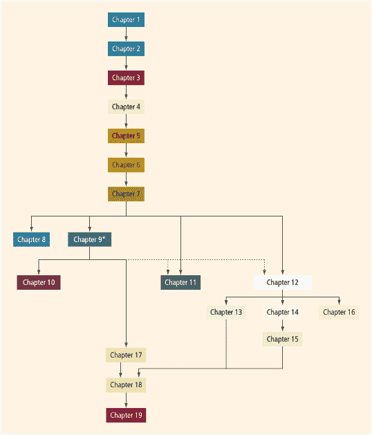

**图 1** 章依赖关系图

在图 1 中，虚线表示前一章的内容会在本章的某一节中用到，但并不一定是下一章的先修内容。例如，第 9 章详细讨论数组。第 11 章和第 12 章分别说明数组与结构体、数组与类之间的关系。然而，如果先学习第 12 章再学习第 9 章，那么第 12 章中处理数组的那一节可以跳过，而不会造成任何不连贯。这一特定小节可以在学习第 9 章之后再来学习。

建议按顺序学习前七章。学完前七章后，如果读者有兴趣尽早学习面向对象设计（OOD）和面向对象编程（OOP），那么可以在第 7 章之后立即学习第 12 章。第 8 章可以在第 7 章之后的任意时间学习。

按顺序学习前七章后，有以下几种学习方案：

- 1. 按以下顺序学习各章：9、10、11、12、13、14、15、16、17、18、19。
- 2. 按以下顺序学习各章：9、12、14、15、13、17、18、19、10、16。
- 3. 按以下顺序学习各章：12、9、10、14、15、13、17、18、19、16。
- 4. 按以下顺序学习各章：12、9、14、15、13、17、18、19、10、16。

## 本书特色

按照 else 与 if 的配对规则，第 12 行的 else 与第 10 行的 if 配对。换句话说，使用正确的缩进，代码如下：

```cpp
if (gpa >= 2.0)                                   //Line 9
if (gpa >= 3.9)                                   //Line 10
    cout << "Dean's Honor List." << endl;         //Line 11
else                                              //Line 12
    cout << "The GPA is below the graduation "
         << "requirement.\nSee your "
         << "academic advisor." << endl;          //Line 13
```

现在可以看到，第 9 行的 if 语句是单向选择。因此，如果输入的数字小于 2.0，则不会执行任何操作；也就是说，不会打印警告消息。现在假设输入为 3.8。那么第 9 行的表达式求值为 true，于是第 10 行的表达式会被求值，而其求值为 false。这意味着第 13 行的输出语句会执行，从而导致不令人满意的结果。

事实上，程序只应在 GPA 小于 2.0 时打印警告消息，并且应打印以下消息：

院长荣誉名单。

如果 GPA 大于或等于 3.9。

为实现该结果，第 12 行的 else 需要与第 9 行的 if 配对。要将第 12 行的 else 与第 9 行的 if 配对，需要使用复合语句，如下所示：

```cpp
if (gpa >= 2.0)                                   //Line 9
{
    if (gpa >= 3.9)                               //Line 10
        cout << "Dean's Honor List." << endl;     //Line 11
}
else                                              //Line 12
    cout << "The GPA is below the graduation "
         << "requirement.\nSee your "
         << "academic advisor." << endl;          //Line 13
```

正确的程序如下：

```cpp
//Correct GPA program.
#include <iostream>                               //Line 1

using namespace std;                              //Line 2

int main()                                        //Line 3
{                                                 //Line 4
    double gpa;                                   //Line 5

    cout << "Enter the GPA: ";                    //Line 6
    cin >> gpa;                                   //Line 7
    cout << endl;                                 //Line 8
```

四色内页设计展示了准确的 C++ 代码和相关注释。

第 2 章将程序定义为一系列语句，其目标是完成某项任务。到目前为止你研究过的程序都很简单直接。为处理程序，计算机从第一条可执行语句开始，按顺序执行语句，直到结束。在本章和第 5 章中，你将学习如何告诉计算机不必遵循简单的顺序语句流程；它还可以作出决策，并重复执行某些语句，直到满足特定条件。

### 控制结构

计算机可以按以下方式之一处理程序：顺序执行；选择执行，即作出选择，也称为分支；重复执行，即反复执行某条语句；使用一种称为循环的结构；或调用函数。（图 4-1 展示了前三种程序流程。第 7 章将说明函数调用如何工作。）第 2 章和第 3 章中的编程示例包括简单的顺序程序。对于这样的程序，计算机从开头开始，按顺序执行语句。不作出选择；没有重复。控制结构为顺序程序执行提供了替代方式，用于改变顺序执行流程。两种最常见的控制结构是选择结构和重复结构。在选择结构中，程序根据某些条件执行特定语句。在重复结构中，程序根据某些条件将特定语句重复一定次数。

300 多幅直观示意图，内容既广泛又详尽，用于阐释困难概念。

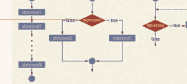

编程示例是每章末尾重点展示的程序。编程示例将本章的所有内容汇集在一起。它们会用页边空白处的图标突出显示，如图所示。这些示例教授解决问题的技能，并包含输入、输出、问题分析与算法设计、类设计以及程序清单等具体阶段。所有程序都设计得有条理、一致且用户友好。每个编程示例都从问题分析开始，随后是算法设计和/或类设计。算法的每一步都用 C++ 编码实现。除了帮助学生掌握解决问题的技巧外，这些详细的程序还向学生展示如何在实际的 C++ 程序中实现概念。

```cpp
typedef int Boolean;
const Boolean TRUE = 1;
const Boolean FALSE = 0;
Boolean flag;
```

第 1 行的语句为数据类型 int 创建了一个别名 Boolean。第 2 行和第 3 行的语句声明了命名常量 TRUE 和 FALSE，并分别将它们初始化为 1 和 0。第 4 行的语句将 flag 声明为 Boolean 类型的变量。因为 flag 是 Boolean 类型的变量，所以以下语句合法：

```cpp
flag = TRUE;
```

### 编程示例：石头、剪刀、布游戏

孩子们经常玩石头、剪刀、布游戏。这个游戏有两名玩家，每人从石头、布或剪刀这三个对象中选择一个。如果玩家 1 选择石头，玩家 2 选择布，那么玩家 2 赢得游戏，因为布包住石头。游戏按照以下规则进行：

- 如果两名玩家选择相同的对象，则本局为平局。
- 如果一名玩家选择石头，另一名选择剪刀，则选择石头的玩家赢得本局，因为石头砸坏剪刀。
- 如果一名玩家选择石头，另一名选择布，则选择布的玩家赢得本局，因为布包住石头。
- 如果一名玩家选择剪刀，另一名选择布，则选择剪刀的玩家赢得本局，因为剪刀剪开布。
- 如果一名玩家选择剪刀，另一名选择石头，则选择石头的玩家赢得本局，因为石头砸坏剪刀。

我们想要编写一个程序来玩这个游戏。

- **输入**
  
  这个程序有两类输入：
  - 当被询问是否玩游戏时用户的响应。
  - 玩家做出的选择。

- **输出**
  
  玩家的选择以及每局游戏的获胜者。游戏结束后，还应输出总局数以及每名玩家获胜的次数。

**问题分析与算法设计**

两名玩家玩这个游戏。玩家通过键盘输入他们的选择。每名玩家输入 R 表示石头（Rock）、P 表示布（Paper）或 S 表示剪刀（Scissors）。当第一名玩家输入选择时，第二名玩家看向别处。两项输入都完成后，如果输入有效，程序会输出玩家的选择并宣布本局获胜者。游戏持续进行，直到其中一名玩家决定退出。

我们强烈建议学生仔细研究编程示例，以便有效地学习 C++。学生通常能从完整解答的程序中学到很多东西。此外，编程示例大大减少了学生在课堂外寻求帮助的需求，并增强了学生的自信心。


### 练习

1. 将下列陈述标记为真或假。
   - a. 对列表进行顺序查找时，假定列表元素按升序排序。
   - b. 对列表进行二分查找时，假定列表已排序。
   - c. 二分查找在有序列表上更快，在无序列表上更慢。
   - d. 二分查找在大列表上更快，但顺序查找在小列表上更快。
   - e. 当你声明一个 vector 对象并将其大小指定为 10 时，该对象中只能存储 10 个元素。

2. 考虑以下列表：

   `63 45 32 98 46 57 28 100`

   使用顺序查找，确定以下项是否在列表中需要多少次比较？（回顾一下，比较是指项比较，而不是索引比较。）

   - a. 90
   - b. 57
   - c. 63
   - d. 120

3. 
   - a. 编写一个可用于查找有序列表的顺序查找算法版本。
   - b. 考虑以下列表：

     `5 12 17 35 46 65 78 93 110 115`

     使用你在 (a) 中设计的用于有序列表的顺序查找，确定以下项是否在列表中需要多少次比较？（回顾一下，比较是指项比较，而不是索引比较。）

     - a. 35
     - b. 60
     - c. 70
     - d. 120

4. 考虑以下列表：

   `2 10 17 45 55 68 85 92 98 110`

   使用二分查找，确定以下项是否在列表中需要多少次比较？显示循环每次迭代后 first、last 和 middle 的值以及比较次数。

   - a. 15
   - b. 49
   - c. 98
   - d. 99

5. 使用本章讨论的冒泡排序算法对以下列表进行排序。显示外层 for 循环每次迭代后的列表。

   `26, 45, 17, 65, 33, 55, 12, 18`

练习进一步强化学习，并确保学生确实已经掌握了这些材料。

```cpp
{
    if (num % 5 == 0 || num % 5 == 3)
        list.insertFirst(num);
    else
        list.insertLast(num);
    cin >> num;
}

list.print();
cout << endl;

copyList = list;
copyList.deleteNode(78);
copyList.deleteNode(45);

cout << "Copy List" << endl;
copyList.print();
cout << endl;
```

19. 绘制本章讨论的类 `doublyLinkedList` 的 UML 图。
20. 绘制 Video Store 编程示例中类 `videoStoreType` 的 UML 图。
21. 绘制 Video Store 编程示例中类 `videoListType` 的 UML 图。

### 编程练习

1. **（在线地址簿再探）** 第13章中的编程练习6最多只能有500个条目。使用链表重做该程序，以处理所需数量的条目。向程序中添加以下操作：
   - a. 向地址簿添加或删除新条目。
   - b. 允许用户保存地址簿中的数据。

2. 通过添加以下操作来扩展类 `linkedListType`：
   - a. 查找并删除列表中 info 最小的节点。（只删除第一次出现的节点，并且只遍历列表一次。）
   - b. 查找并删除列表中给定 info 的所有出现。（只遍历列表一次。）

在类 `linkedListType` 中添加这些抽象函数，并在类 `unorderedLinkedList` 中提供这些函数的定义。同时，编写一个程序来测试这些函数。

## 补充资源

当本书在课堂环境中使用时，可获得以下补充材料。

所有教师教学工具均随本书提供在一张 CD-ROM 上。

### 电子版教师手册

与本教材配套的教师手册包括：

- 额外的教学材料，以协助备课，包括讲座主题建议。
- 所有章末材料的解答，包括编程练习。

### ExamView®

本教材配有 ExamView，这是一个强大的测试软件包，允许教师创建和管理打印版、计算机（基于局域网）和互联网考试。ExamView 包含数百道与本书所涵盖主题相对应的问题，使学生能够生成详细的学习指南，其中包括用于进一步复习的页码引用。这些基于计算机和互联网的测试组件允许学生在自己的计算机上参加考试，并为教师节省时间，因为每份考试都会自动评分。

### PowerPoint 演示文稿

本书附有每章的 Microsoft PowerPoint 幻灯片。这些幻灯片作为课堂演示的教学辅助工具提供，既可以在网络上提供给学生用于章节复习，也可以打印出来在课堂上分发。教师可以为自己向班级介绍的其他主题添加自己的幻灯片。

### 在线学习内容

Course Technology 已与当今领先的远程学习解决方案提供商和班级管理平台建立合作。要访问此材料，请访问 www.cengage.com/webtutor 并搜索您的书名。教师资源包括以下内容：额外的案例项目、示例教学大纲、PowerPoint 演示文稿等。学生要访问此材料，必须已购买特定于本书和您校园平台的 WebTutor PIN 码。学生资源可能包括（取决于教师偏好）：主题复习、复习题、练习题等。如需更多信息，请联系您的销售代表。

### 源代码

采用 ANSI/ISO 标准 C++ 编写的源代码可在 www.course.com 获取，也可在教师资源 CD-ROM 上获取。运行某些程序所需的输入文件也包含在源代码中。

### 解答文件

所有编程练习的解答文件（采用 ANSI/ISO C++）可在 www.course.com 获取，也可在教师资源 CD-ROM 上获取。运行某些编程练习所需的输入文件也包含在解答文件中。

## 致谢

有许多人我必须感谢，他们以各种方式为本书的成功做出了贡献。首先，我要感谢所有学生，他们在准备过程中自发地告诉我某些部分是否需要改写，以便更好地理解和更清晰地阅读。其次，我要感谢那些通过电子邮件发送许多评论以改进第二版的人。感谢 S.C. Cheng、Randall Crist 和 Vasant Raval 教授一直支持这个项目。我也非常感谢审阅了本书早期版本并提出许多关于如何改进本书的关键建议的审稿人。

我非常感谢以下审稿人，他们耐心阅读了当前版本每一章的每一页，并提出了改进本书的关键意见：Stefano Basagni, Northeastern University；Jeff Ringenberg, University of Michigan；Colleen van Lent, University of Michigan；Tuan Vo, Mt. San Antonio College；Kerstin Voigt, California State University San Bernardino；Lan Yang, Cal Poly Pomona。审稿人将会看到，他们的批评意见没有被忽视，事实上，这些意见使本书变得更好。

接下来，我感谢组稿编辑 Amy Jollymore 认识到本项目的重要性和独特性。如果没有高级产品经理 Alyssa Pratt 的精心规划，这一切都不可能实现。我向 Alyssa 以及内容项目经理 Mathew Hutchinson 致以诚挚的感谢。我还要感谢 Integra Software Services 的 Tintu Thomas 协助我们使项目按计划进行。我要感谢 Course Technology 质量保证部门的 Chris Scriver 和 Serge Palladino，他们耐心仔细地校对文本、测试代码并发现拼写错误和错误。

我感谢父母对我的祝福。

最后，我感谢妻子 Sadhana 的支持，尤其感谢我的女儿 Shelly，本书献给她。在写本书期间，每当我感到不堪重负时，她都会鼓励我，还确保各项修正落实到位。每当我承担这样的项目时，Shelly 总是给我带来特别的快乐。

欢迎对本书文本提出任何意见。意见可发送至以下电子邮件地址：malik@creighton.edu

D. S. Malik


## 第1章：计算机与编程语言概述

在本章中，你将：

- 了解不同类型的计算机
- 探究计算机系统的硬件和软件组件
- 学习计算机的语言
- 了解编程语言的发展
- 考察高级编程语言
- 了解什么是编译器及其作用
- 考察一个C++程序
- 探索C++程序是如何被处理的
- 学习什么是算法并探索问题解决技巧
- 了解结构化设计和面向对象设计编程方法
- 了解标准C++和ANSI/ISO标准C++

### 引言

诸如“互联网”之类的术语，在20年前还鲜为人知，如今已司空见惯。小学生经常“上网冲浪”，并使用计算机来设计课堂项目。许多人使用互联网查找信息和与他人交流。这一切都得益于各种软件（也称为计算机程序）的出现。没有软件，计算机将毫无用处。软件是通过编程语言开发的。C++编程语言尤其适合开发用于完成特定任务的软件。我们的主要目标是帮助你学会如何使用C++编程语言编写程序。在开始编程之前，了解一些基本的术语和计算机的不同组成部分是很有用的。我们先从计算机的历史概述开始。

### 计算机历史简述

已知最早能执行计算的设备是算盘。算盘发明于亚洲，但在古巴比伦、中国以及整个欧洲一直使用到中世纪晚期。算盘利用在框架中滑动的珠子系统进行加法和减法。1642年，法国哲学家和数学家布莱兹·帕斯卡发明了一种名为“帕斯卡林”的计算设备。它有八个装在轮子上的可移动刻度盘，能够计算长达八位数的总和。算盘和帕斯卡林都只能执行加法和减法运算。在17世纪后期，戈特弗里德·冯·莱布尼茨发明了一种能够进行加、减、乘、除的装置。1819年，法国织布工约瑟夫·雅卡尔发现，他的织布机的编织指令可以存储在带有穿孔的卡片上。当卡片按顺序通过织机时，针穿过孔并拾取正确颜色和质地的线。织布工可以重新排列卡片来改变正在编织的图案。本质上，卡片对织机进行编程，使其在布料上织出图案。纺织业似乎与计算机行业没有多少共同之处。然而，通过在卡片上打孔来存储信息的想法，在后来的计算机发展中被证明是非常重要的。

在19世纪早期到中期，英国数学家和物理学家查尔斯·巴贝奇设计了两台计算设备——差分机和分析机。差分机可以自动执行平方运算等复杂操作。巴贝奇制造了差分机的原型，但实际设备从未生产出来。分析机的设计包括输入设备、数据存储、一个允许按任意顺序处理指令的控制单元，以及输出设备。然而，这些设计仍停留在蓝图阶段。巴贝奇的大部分工作是通过其同事拉夫拉斯伯爵夫人艾达·奥古斯塔的著作而为人们所知的。奥古斯塔被认为是第一位计算机程序员。

19世纪末，美国人口普查局的官员需要在准确编制人口普查数据方面获得帮助。赫尔曼·霍勒里斯发明了一种以电力运行并使用穿孔卡片存储数据的计算设备。霍勒里斯的机器取得了巨大成功。他创办了制表机公司，该公司后来发展成为著名的计算机和科技公司IBM。

第一台类似计算机的机器是Mark I。它于1944年由IBM和哈佛大学在霍华德·艾肯的领导下联合制造。穿孔卡片被用来将数据输入机器。Mark I长52英尺，重50吨，拥有75万个部件。1946年，ENIAC（电子数值积分器和计算器）在宾夕法尼亚大学建造。它包含18,000个真空管，重约30吨。


我们今天所知的计算机采用了约翰·冯·诺依曼在20世纪40年代末提出的设计规则。他的设计包括算术逻辑单元、控制单元、存储器以及输入/输出设备等组件。这些组件将在下一节中描述。冯·诺依曼的计算机设计使得将编程指令和数据存储在同一个存储空间中成为可能。1951年，UNIVAC（通用自动计算机）被制造出来并出售给美国人口普查局。

1956年，晶体管的发明使计算机变得更小、更快、更可靠、更节能。这个时代也见证了软件开发行业的兴起，同时引入了FORTRAN和COBOL这两种早期编程语言。在下一个重大技术进步中，晶体管被微小的集成电路（或称“芯片”）所取代。芯片比晶体管更小、更便宜，并且可以在单个芯片上包含数千个电路。它们赋予计算机巨大的处理速度。

1970年，微处理器——单个芯片上的完整CPU——被发明出来。1977年，斯蒂芬·沃兹尼亚克和史蒂夫·乔布斯在他们的车库里设计并制造了第一台Apple电脑。1981年，IBM推出了其个人计算机（PC）。20世纪80年代，IBM PC的克隆产品使个人计算机变得更加经济实惠。到20世纪90年代中期，各行各业的人们都能够买得起它们。随着技术的进步，计算机不断变得更快、更便宜。

现代计算机功能强大、可靠且易于使用。它们可以接受语音指令，并通过人工智能模仿人类推理。专家系统辅助医生进行诊断。移动计算应用正在显著增长。使用手持设备，送货司机可以访问全球定位卫星（GPS），以确认客户的取货和送货地点。手机让你可以查看电子邮件、预订机票、查看股票表现以及访问银行账户。

虽然计算机有几种类别，如大型机、中型机和微型机，但所有计算机都共享一些基本要素，这些将在下一节中描述。

### 计算机系统的要素

计算机是一种能够执行命令的电子设备。计算机执行的基本命令包括输入（获取数据）、输出（显示结果）、存储，以及执行算术和逻辑运算。

在当今市场上，个人计算机的销售描述包括：Pentium 4处理器2.80 GHz、1 GB RAM、250 GB硬盘、VX750 19英寸银色平面CRT彩色显示器，并预装了操作系统、游戏、百科全书等软件，以及文字处理程序或理财管理等应用软件。这些描述代表了两个类别：硬件和软件。诸如“Pentium 4处理器2.80 GHz、1GB RAM、250 GB硬盘、VX750 19英寸银色平面CRT彩色显示器”等项目属于硬件类别；而“操作系统、游戏、百科全书和应用软件”等项目属于软件类别。我们先来看硬件。

#### 硬件

主要的硬件组件包括中央处理器（CPU）；主存储器（MM），也称为随机存取存储器（RAM）；输入/输出设备；以及辅助存储器。输入设备的一些例子有键盘、鼠标和辅助存储器。输出设备的例子有屏幕、打印机和辅助存储器。让我们更详细地了解这些组件。

#### 中央处理器和主存储器

**中央处理器**是计算机的“大脑”，也是计算机中最昂贵的单个硬件部件。CPU越强大，计算机运行得越快。算术和逻辑运算在CPU内部执行。图1-1(a)展示了一些硬件组件。

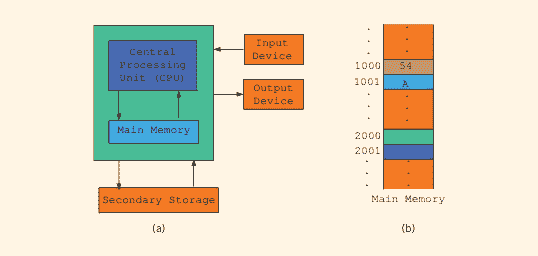

**图1-1** 计算机的硬件组件和主存储器

**主存储器**，或称**随机存取存储器**，直接与CPU相连。所有程序必须先加载到主存储器中才能执行。同样，所有数据也必须先放入主存储器，程序才能操作这些数据。当计算机关闭时，主存储器中的所有内容都会丢失。

主存储器是一个有序的单元序列，这些单元称为**存储单元**。每个单元在主存储器中都有一个唯一的位置，称为单元的**地址**。这些地址帮助你访问存储在单元中的信息。图1-1(b)显示了带有一些数据的主存储器。


### 软件

软件是为执行特定任务而编写的程序。例如，文字处理软件是用于撰写信件、论文甚至书籍的程序。所有软件都用编程语言编写。程序有两类：系统程序和应用程序。

**系统程序**控制计算机。打开 PC 时最先加载的系统程序称为操作系统。没有操作系统，计算机毫无用处。**操作系统**监视计算机的整体活动并提供服务。其中一些服务包括内存管理、输入/输出活动和存储管理。操作系统有一个特殊程序来组织二级存储，以便你方便地访问信息。

**应用程序**执行特定任务。文字处理软件、电子表格和游戏都是应用程序的示例。操作系统是运行应用程序的程序。

### 计算机的语言

当你在键盘上按 A 时，计算机在屏幕上显示 A。但计算机主存中实际存储的是什么？计算机的语言是什么？它如何存储你在键盘上输入的任何内容？

请记住，计算机是一种电子设备。计算机内部使用电信号来处理信息。电信号有两种类型：模拟信号和数字信号。**模拟信号**是用于表示声音等事物的连续波形。例如，音频磁带以模拟信号存储数据。**数字信号**用 0 和 1 的序列表示信息。0 表示低电压，1 表示高电压。数字信号是比模拟信号更可靠的信息载体，并且可以从一个设备复制到另一个设备，且精度完全一致。你可能注意到，当你复制音频磁带时，复制品的音质不如原磁带。另一方面，当你复制 CD 时，复制品和原版一样好。计算机使用数字信号。

因为数字信号在计算机内部处理，所以计算机的语言——称为**机器语言**——是 0 和 1 的序列。数字 0 或 1 称为**二进制位**，或**位**。有时，0 和 1 的序列被称为**二进制代码**或**二进制数**。

**位：** 一个二进制位 0 或 1。

八个位组成的序列称为**字节**。此外，2^10 字节 = 1024 字节称为**千字节（KB）**。表1-1总结了用于描述各种字节数的术语。

**表1-1 二进制单位**

| 单位 | 符号 | 位/字节 |
|---|---|---|
| 字节 | B | 8 位 |
| 千字节 | KB | 2^10 字节 = 1024 字节 |
| 兆字节 | MB | 1024 KB = 2^10 KB = 2^20 字节 = 1,048,576 字节 |
| 吉字节 | GB | 1024 MB = 2^10 MB = 2^30 字节 = 1,073,741,824 字节 |
| 太字节 | TB | 1024 GB = 2^10 GB = 2^40 字节 = 1,099,511,627,776 字节 |
| 拍字节 | PB | 1024 TB = 2^10 TB = 2^50 字节 = 1,125,899,906,842,624 字节 |
| 艾字节 | EB | 1024 PB = 2^10 PB = 2^60 字节 = 1,152,921,504,606,846,976 字节 |
| 泽字节 | ZB | 1024 EB = 2^10 EB = 2^70 字节 = 1,180,591,620,717,411,303,424 字节 |

键盘上的每个字母、数字或特殊符号（如 * 或 {）都编码为位序列，每个都有唯一表示。个人计算机上最常用的编码方案是**七位美国信息交换标准代码（ASCII）**。ASCII 数据集由 128 个字符组成，编号为 0 到 127。也就是说，在 ASCII 数据集中，第一个字符的位置是 0，第二个字符的位置是 1，依此类推。在这种方案中，A 编码为二进制数 1000001。事实上，A 是 ASCII 字符代码中的第 66 个字符，但其位置是 65，因为第一个字符的位置是 0。此外，二进制数 1000001 是 65 的二进制表示。字符 3 编码为 0110011。请注意，在 ASCII 字符集中，字符 3 的位置是 51，因此字符 3 是 ASCII 集中的第 52 个字符。由此也可知，0110011 是 51 的二进制表示。可打印 ASCII 字符集的完整列表请参见附录 C。

> **注意：** 我们日常生活中使用的数制称为**十进制系统**，或称**基 10**。因为计算机内部的一切都表示为 0 和 1 的序列，也就是二进制数，所以计算机使用的数制称为**二进制**，或称**基 2**。我们在上一段中指出，数字 1000001 是 65 的二进制表示。附录 E 描述了如何将数字从基 10 转换为基 2，以及反过来转换。

在计算机内部，每个字符都表示为 *八* 个位的序列，即表示为一个字节。现在，65 的八位二进制表示是 01000001。请注意，我们在 65 的七位表示左侧添加了 0，将其转换为八位表示。类似地，51 的八位二进制表示是 00110011。

ASCII 是七位代码。因此，要在计算机内部表示每个 ASCII 字符，必须将 ASCII 字符的七位二进制表示转换为八位二进制表示。这是通过在字符的七位 ASCII 编码左侧添加 0 来实现的。因此，在计算机内部，字符 A 表示为 01000001，字符 3 表示为 00110011。

还有其他编码方案，例如 EBCDIC（IBM 使用）和 Unicode，后者是较新的发展成果。EBCDIC 由 256 个字符组成；Unicode 由 65,536 个字符组成。要存储属于 Unicode 的字符，需要两个字节。

### 编程语言的演变

计算机最基础的语言——机器语言——以位的形式提供程序指令。尽管大多数计算机执行相同类型的操作，但计算机设计者可能选择了不同的二进制代码集来执行这些操作。因此，一台机器的机器语言不一定与另一台机器的机器语言相同。计算机之间唯一一致的地方是，在任何现代计算机中，所有数据都以二进制代码存储和操作。

早期计算机用机器语言编程。为了了解指令如何用机器语言编写，假设你想使用以下公式：

```
wages = rate · hours
```

来计算周薪。此外，假设二进制代码 100100 表示装入，100110 表示乘法，100010 表示存储。在机器语言中，你可能需要以下指令序列来计算周薪：

```
100100 010001
100110 010010
100010 010011
```

要用机器语言表示周薪公式，程序员必须记住各种操作的机器语言代码。此外，为了操作数据，程序员还必须记住数据在主存中的位置。这种需要记住特定代码的要求使编程不仅非常困难，而且容易出错。

开发汇编语言是为了让程序员的工作更轻松。在汇编语言中，指令是一种易于记忆的形式，称为**助记符**。表1-2显示了汇编语言中的一些指令示例及其对应的机器语言代码。

**表1-2 汇编语言和机器语言中的指令示例**

| 汇编语言 | 机器语言 |
|---|---|
| LOAD | 100100 |
| STOR | 100010 |
| MULT | 100110 |
| ADD | 100101 |
| SUB | 100011 |

使用汇编语言指令，你可以编写如下公式来计算周薪：

```
LOAD  rate
MULT  hours
STOR  wages
```

如你所见，用汇编语言编写指令要容易得多。然而，计算机不能直接执行汇编语言指令。这些指令首先必须翻译成机器语言。称为**汇编器**的程序将汇编语言指令翻译成机器语言。

**汇编器：** 一种将用汇编语言编写的程序翻译成等价的机器语言程序的程序。

从机器语言转向汇编语言使编程更容易，但程序员仍然被迫按照单条机器指令来思考。使编程更容易的下一步是设计**高级语言**，这些语言更接近自然语言，例如英语、法语、德语和西班牙语。FORTRAN、COBOL、Pascal、C、C++、C# 和 Java 都是高级语言。你将在本书中学习高级语言 C++。

在 C++ 中，你可以如下编写周薪公式：

```
wages = rate * hours;
```

用 C++ 编写的指令更容易理解，对于熟悉基本算术的新手用户来说一目了然。然而，如同汇编语言的情况一样，计算机不能直接执行用高级语言编写的指令。要在计算机上运行，这些 C++ 指令首先需要翻译成机器语言。称为**编译器**的程序将用高级语言编写的指令翻译成机器代码。

**编译器：** 一种将用高级语言编写的指令翻译成等价机器语言的程序。


### 处理 C++ 程序

在前面的章节中，我们讨论了机器语言和高级语言，并展示了一个 C++ 程序。由于计算机只能理解机器语言，你现在可以回顾处理用 C++ 编写的程序所需的步骤了。

请看以下 C++ 程序：

```cpp
#include <iostream>

using namespace std;

int main()
{
    cout << "My first C++ program." << endl;

    return 0;
}
```

此时，你不必过于关注该程序的细节。但是，如果运行（执行）此程序，它将在屏幕上显示以下行：

My first C++ program.

回想一下，计算机只能理解机器语言。因此，为了成功运行此程序，必须首先将代码翻译成机器语言。在本节中，我们回顾执行用 C++ 编写的程序所需的步骤。

如图 1–3 所示，处理 C++ 程序需要以下步骤。

- **1.** 你使用文本编辑器，按照高级语言的规则（即*语法*）创建一个 C++ 程序。这个程序称为**源代码**，或称**源程序**。程序必须保存在扩展名为 `.cpp` 的文本文件中。例如，如果你将前面的程序保存在名为 `FirstCPPProgram` 的文件中，那么它的完整名称是 `FirstCPPProgram.cpp`。

  **源程序：** 用高级语言编写的程序。

- **2.** 上一节给出的 C++ 程序包含语句 `#include <iostream>`。在 C++ 程序中，以符号 `#` 开头的语句称为**预处理指令**。这些语句由称为**预处理器**的程序处理。

- **3.** 处理完预处理指令后，下一步是验证程序是否遵守编程语言的规则——也就是说，程序在语法上是否正确——并将程序翻译成等价的机器语言。*编译器*会检查源程序是否有语法错误，如果没有发现错误，就把程序翻译成等价的机器语言。等价的机器语言程序称为**目标程序**。

  **目标程序：** 高级语言程序的机器语言版本。

- **4.** 你用高级语言编写的程序是使用集成开发环境（IDE）开发的。IDE 包含许多有助于创建程序的有用程序。例如，它包含显示程序结果所需的代码（程序）以及若干数学函数，使程序员的工作稍微轻松一些。因此，如果某些代码已经可用，你可以使用这些代码，而不必编写自己的代码。程序开发并成功编译后，你仍然必须将来自 IDE 所用资源的代码引入程序中，以生成计算机可以执行的最终程序。这些预先写好的代码（程序）位于称为**库**的地方。称为**链接器**的程序将目标程序与库中的程序组合起来。

  **链接器：** 一种将目标程序与库中的其他程序组合起来，并在程序中用于创建可执行代码的程序。

- **5.** 接下来，你必须将可执行程序加载到主存中以便执行。称为**加载器**的程序完成这项任务。

  **加载器：** 将可执行程序加载到主存的程序。

- **6.** 最后一步是执行程序。

图 1–3 展示了典型 C++ 程序的处理过程。

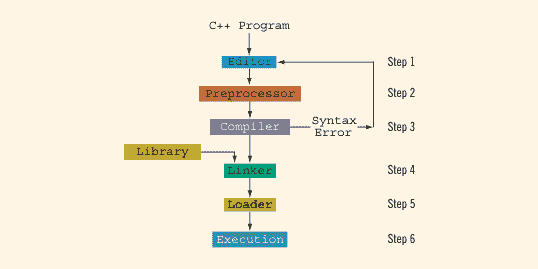

**图 1–3** 处理 C++ 程序

作为程序员，你只需要关注第 1 步。也就是说，你必须学习、理解并掌握编程语言的规则，以创建源程序。

如前所述，程序是使用 IDE 开发的。用于创建高级语言 C++ 程序的知名 IDE 包括 Visual C++ 2008 Express 和 Visual Studio .NET（来自 Microsoft）、C++ Builder（来自 Borland）以及 CodeWarrior（来自 Metrowerks）。这些 IDE 包含用于创建源程序的文本编辑器、用于检查源程序语法错误的编译器、用于将目标代码与 IDE 资源链接的程序，以及用于执行程序的程序。

这些 IDE 相当用户友好。编译程序时，编译器不仅会识别语法错误，而且通常会建议如何修正这些错误。此外，只需一个简单的命令，目标代码就会与来自 IDE 的资源链接起来。例如，在 Visual C++ 2008 Express 和 Visual Studio .NET 中执行链接的命令是 **生成**（Build）或 **重新生成**（Rebuild）。（关于这些命令使用的进一步说明，请查阅这些 IDE 的文档。）如果程序尚未编译，这些命令中的每一个都会先编译程序，然后链接并生成可执行代码。

网站 *http://msdn.microsoft.com/en-us/beginner/bb964629.aspx* 包含一个视频，讲解如何使用 Visual C++ 2008 Express 编写 C++ 程序。

### 使用问题分析—编码—执行周期进行编程

*编程是一个解决问题的过程。* 不同的人使用不同的技术来解决问题。有些技术概述得很好，易于遵循。它们不仅能解决问题，还能让人深入理解解决方案是如何得到的。如果问题的领域发生变化，这些解决问题的技术可以很容易地修改。

要成为优秀的问题解决者和优秀的程序员，你必须遵循良好的问题解决技术。一种常见的问题解决技术包括分析问题、概述问题需求，以及设计称为**算法**的步骤来解决问题。

**算法：** 一种逐步解决问题的过程，在有限时间内得到解决方案。

在编程环境中，问题解决过程需要以下三个步骤：

- **1.** 分析问题，概述问题及其解决方案需求，并设计解决问题的算法。
- **2.** 用编程语言（如 C++）实现该算法，并验证算法是否有效。
- **3.** 如果问题领域发生变化，通过使用和修改程序来维护程序。

图 1–4 总结了这个三步编程过程。

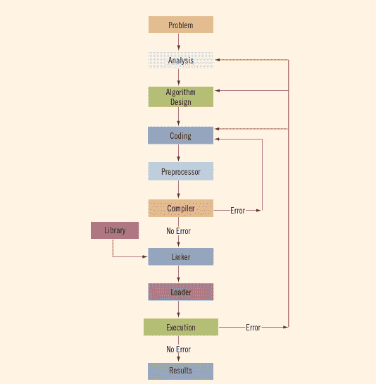

**图 1–4** 问题分析—编码—执行周期

要开发一个解决问题的程序，你首先要分析问题。然后设计算法；用高级语言编写程序指令，即对程序进行编码；并将程序输入计算机系统。

分析问题是第一步，也是最重要的一步。这一步要求你完成以下事项：

- **1.** 彻底理解问题。
- **2.** 理解问题需求。需求可以包括：程序是否需要与用户交互，是否处理数据，是否产生输出，以及输出是什么样子。如果程序处理数据，程序员必须知道数据是什么以及如何表示。也就是说，你需要查看示例数据。如果程序产生输出，你应当知道结果应如何生成和格式化。
- **3.** 如果问题复杂，就将问题划分为子问题，并重复第 1 步和第 2 步。也就是说，对于复杂问题，你需要分析每个子问题并理解每个子问题的需求。

仔细分析问题后，下一步是设计解决问题的算法。如果你将问题划分成了子问题，就需要为每个子问题设计一个算法。设计好算法后，你需要检查其正确性。有时你可以使用示例数据来测试算法的正确性。另一些时候，你可能需要执行一些数学分析来测试算法的正确性。

设计好算法并验证其正确性后，下一步是将其转换为等价的编程代码。然后，你使用文本编辑器将编程代码或程序输入计算机。接下来，你必须确保程序遵循该语言的语法。为了验证语法的正确性，你让代码通过编译器运行。如果编译器生成错误消息，你必须找出代码中的错误，删除它们，然后再次让代码通过编译器运行。当所有语法错误都被删除后，编译器生成等价的机器代码，链接器将机器代码与系统资源链接起来，加载器将程序放入主存，以便它可以执行。

最后一步是执行程序。编译器只保证程序遵循该语言的语法。它并不保证程序会正确运行。在执行期间，程序可能由于逻辑错误（例如除以零）而异常终止。即使程序正常终止，它仍可能产生错误结果。在这种情况下，你可能必须重新检查代码、算法，甚至问题分析。

如果你在尝试编写编程指令之前花足够时间完成问题分析，你的整体编程体验将会很成功。通常，你使用钢笔或铅笔在纸上完成这项工作。采用这种谨慎的编程方法有许多优点。在分析充分、设计良好的程序中，发现错误要容易得多。此外，经过仔细分析和设计的程序更容易理解和修改。即使是最有经验的程序员，也会花大量时间分析问题和设计算法。

贯穿本书，你不仅会学习用 C++ 编写程序的规则，还会学习问题解决技术。每章提供若干编程示例，讨论编程问题。这些编程示例教授如何分析和解决问题、设计算法、将算法编码为 C++ 的技术，并帮助你理解本章讨论的概念。为了充分获益于本书，我们建议你完成每章末尾的编程示例。

接下来，我们提供各种问题分析和算法设计技术的示例。


#### 示例 1-1

在本例中，我们设计一个算法来求矩形的周长和面积。

要求矩形的周长和面积，需要知道矩形的长和宽。

矩形的周长和面积由以下公式给出：

```text
perimeter = 2 · (length + width)
area = length · width
```

求矩形周长和面积的算法是：

- 1. 获取矩形的长。
- 2. 获取矩形的宽。
- 3. 使用以下等式求周长：

  ```text
  perimeter = 2 · (length + width)
  ```

- 4. 使用以下等式求面积：

  ```text
  area = length · width
  ```

#### 示例 1-2

在本例中，我们设计一个算法，用于计算在某个州售出的一件商品的销售税和价格。

销售税的计算方式如下：州销售税部分为4%，市销售税部分为1.5%。如果该商品是奢侈品，例如价格超过50,000美元的汽车，则需缴纳10%的奢侈品税。

要计算商品的价格，我们需要计算州销售税部分、市销售税部分，以及（如果该商品是奢侈品）奢侈品税。假设 salePrice 表示商品的售价，stateSalesTax 表示州销售税，citySalesTax 表示市销售税，luxuryTax 表示奢侈品税，salesTax 表示总销售税，amountDue 表示商品的最终价格。

要计算销售税，我们必须知道商品的售价以及该商品是否为奢侈品。

stateSalesTax 和 citySalesTax 可以使用以下公式计算：

```text
stateSalesTax = salePrice · 0.04
citySalesTax = salePrice · 0.015
```

接下来，可以按如下方式确定 `luxuryTax`：

```text
if (item is a luxury item)
    luxuryTax = salePrice · 0.1
otherwise
    luxuryTax = 0
```

接下来，可以按如下方式确定 `salesTax`：

```text
salesTax = stateSalesTax + citySalesTax + luxuryTax
```

最后，可以按如下方式计算 `amountDue`：

```text
amountDue = salePrice + salesTax
```

因此，确定 `salesTax` 和 `amountDue` 的算法是：

- 1. 获取商品的售价。
- 2. 判断该商品是否为奢侈品。
- 3. 使用以下公式求州销售税部分：

  ```text
  stateSalesTax = salePrice · 0.04
  ```

- 4. 使用以下公式求市销售税部分：

  ```text
  citySalesTax = salePrice · 0.015
  ```

- 5. 使用以下公式求奢侈品税：

  ```text
  if (item is a luxury item)
      luxuryTax = salePrice · 0.1
  otherwise
      luxuryTax = 0
  ```

- 6. 使用以下公式求 `salesTax`：

  ```text
  salesTax = stateSalesTax + citySalesTax + luxuryTax
  ```

- 7. 使用以下公式求 `amountDue`：

  ```text
  amountDue = salePrice + salesTax
  ```

#### 示例 1-3

在本例中，我们设计一个算法，用于计算当地一家百货商店销售人员的月薪。

每位销售人员都有基本工资。销售人员还在每月末根据以下标准获得奖金：如果该销售人员在该商店工作五年或五年以下，奖金为其工作每满一年10美元。如果该销售人员在该商店工作超过五年，奖金为其工作每满一年20美元。销售人员还可以获得额外奖金，方式如下：如果该销售人员当月的总销售额至少为5,000美元但低于10,000美元，他或她可获得销售额3%的佣金。如果该销售人员当月的总销售额至少为10,000美元，他或她可获得销售额6%的佣金。

要计算销售人员的月薪，需要知道基本工资、该销售人员在公司工作的年数，以及该销售人员当月的总销售额。假设 baseSalary 表示基本工资，noOfServiceYears 表示该销售人员在该商店工作的年数，bonus 表示奖金，totalSales 表示该销售人员当月的总销售额，additionalBonus 表示额外奖金。

可以按如下方式确定奖金：

```text
if (noOfServiceYears is less than or equal to five)
    bonus = 10 · noOfServiceYears
otherwise
    bonus = 20 · noOfServiceYears
```

接下来，可以按如下方式确定销售人员的额外奖金：

```text
if (totalSales is less than 5000)
    additionalBonus = 0
otherwise
    if (totalSales is greater than or equal to 5000 and
        totalSales is less than 10000)
        additionalBonus = totalSales · (0.03)
    otherwise
        additionalBonus = totalSales · (0.06)
```

根据上述讨论，现在可以设计计算销售人员月薪的算法：

- 1. 获取 baseSalary。
- 2. 获取 noOfServiceYears。
- 3. 使用以下公式计算 bonus：

  ```text
  if (noOfServiceYears is less than or equal to five)
      bonus = 10 · noOfServiceYears
  otherwise
      bonus = 20 · noOfServiceYears
  ```

- 4. 获取 totalSales。
- 5. 使用以下公式计算 additionalBonus：

  ```text
  if (totalSales is less than 5000)
      additionalBonus = 0
  otherwise
      if (totalSales is greater than or equal to 5000 and
          totalSales is less than 10000)
          additionalBonus = totalSales · (0.03)
      otherwise
          additionalBonus = totalSales · (0.06)
  ```

- 6. 使用以下等式计算 `payCheck`：

  `payCheck = baseSalary + bonus + additionalBonus`

#### 示例 1-4

在本例中，我们设计一个玩猜数字游戏的算法。

目标是随机生成一个大于或等于0且小于100的整数。然后提示玩家（用户）猜这个数。如果玩家猜对了，则输出相应的消息。否则，检查所猜的数是否小于随机数。如果所猜的数小于随机数，则输出消息：“你猜的数比目标数小。再猜一次！”；否则，输出消息：“你猜的数比目标数大。再猜一次！”。然后提示玩家输入另一个数。系统会提示玩家继续猜随机数，直到玩家输入正确的数为止。

第一步是如上所述生成一个随机数。C++ 提供了实现此操作的方法，这将在第5章讨论。假设 num 表示随机数，guess 表示玩家所猜的数。

在玩家输入猜测后，可以按如下方式将猜测与随机数进行比较：

```text
if (guess is equal to num)
    Print "You guessed the correct number."
otherwise
    if guess is less than num
        Print "Your guess is lower than the number. Guess again!"
    otherwise
        Print "Your guess is higher than the number. Guess again!"
```

现在可以按如下方式设计算法：

- 1. 生成一个随机数，并将其称为 num。
- 2. *重复*以下步骤，直到玩家猜出正确的数：
  - a. 提示玩家输入 guess。
  - b.

    ```text
    if (guess is equal to num)
        Print "You guessed the correct number."
    otherwise
        if guess is less than num
            Print "Your guess is lower than the number. Guess again!"
        otherwise
            Print "Your guess is higher than the number. Guess again!"
    ```

在第5章中，我们使用该算法编写一个玩猜数字游戏的 C++ 程序。

#### 示例 1-5

一个班有10名学生。每名学生参加了五次测试，每次测试满分为100分。我们要设计一个算法来计算每名学生的成绩以及班级平均分。成绩的评定方式如下：如果平均测试分数大于或等于90，则成绩为 A；如果平均测试分数大于或等于80且小于90，则成绩为 B；如果平均测试分数大于或等于70且小于80，则成绩为 C；如果平均测试分数大于或等于60且小于70，则成绩为 D；否则，成绩为 F。注意，数据由学生姓名及其测试分数组成。

这是一个可以按如下方式划分为子问题的问题：共有五次测试，因此你设计一个算法来求平均测试分数。接下来，你设计一个算法来确定成绩。这两个子问题分别是确定平均测试分数和确定成绩。

让我们先设计一个确定平均测试分数的算法。要计算平均测试分数，先将五次测试分数相加，然后除以5。因此，算法为：

- 1. 获取五次测试分数。
- 2. 将五次测试分数相加。假设 sum 表示测试分数之和。
- 3. 假设 average 表示平均测试分数。则：

  ```text
  average = sum / 5;
  ```

接下来，你设计一个确定成绩的算法。假设 grade 表示分配给学生的成绩。以下算法确定成绩：

```text
if average is greater than or equal to 90
    grade = A
otherwise
    if average is greater than or equal to 80 and less than 90
        grade = B
    otherwise
        if average is greater than or equal to 70 and less than 80
            grade = C
        otherwise
            if average is greater than or equal to 60 and less than 70
                grade = D
            otherwise
                grade = F
```

你可以使用这些子问题的解来设计主算法，如下所示：（假设 totalAverage 表示每名学生测试平均分的总和。）

- 1. totalAverage = 0;
- 2. 对班里的每名学生*重复*以下步骤：
  - a. 获取学生姓名。
  - b. 使用上面讨论的算法求平均测试分数。


- c. 使用上述讨论的算法来查找成绩。
- d. 通过将当前学生的平均测试成绩相加来更新 `totalAverage`。
- 3. 如下确定班级平均成绩：

  `classAverage = totalAverage / 10`

第7章中的一个编程练习要求你编写一个C++程序，以确定班级中每个学生的平均测试成绩和等级。

### 编程方法

两种流行的编程设计方法是结构化方法和面向对象方法，下面将对此进行概述。

#### 结构化编程

将一个问题划分为更小的子问题被称为**结构化设计**。然后对每个子问题进行分析，并获得解决方案来解决该子问题。然后将所有子问题的解决方案组合起来解决整体问题。这种实现结构化设计的过程被称为**结构化编程**。结构化设计方法也被称为**自顶向下设计**、**自底向上设计**、**逐步求精**和**模块化编程**。

#### 面向对象编程

**面向对象设计（OOD）**是一种广泛使用的编程方法。在OOD中，解决问题过程的第一步是识别称为对象的组件，这些对象构成解决方案的基础，并确定这些对象如何相互交互。例如，假设你想编写一个程序，为当地一家视频租赁店自动化视频租赁过程。此问题中的两个主要对象是视频和顾客。

识别对象之后，下一步是为每个对象指定相关数据以及可能对这些数据执行的操作。例如，对于视频对象，数据可能包括：

- 电影名称
- 主演演员
- 制片人
- 制作公司
- 库存副本数量

视频对象上的某些**操作**可能包括：

- 查看电影名称
- 在副本被租出后，将库存副本数量减一
- 在顾客归还特定视频后，将库存副本数量加一

这说明每个对象都由数据以及对数据的操作组成。对象将数据和对数据的操作组合成一个单一单元。在OOD中，最终程序是交互对象的集合。实现OOD的编程语言称为**面向对象编程（OOP）**语言。你将在后续章节中了解OOD的诸多优点。

由于对象由数据以及对数据的操作组成，因此在设计和应用对象之前，你需要学习如何在计算机内存中表示数据、如何操作数据以及如何实现操作。在第2章中，你将学习C++的基本数据类型，并了解如何在计算机内存中表示和操作数据。第3章讨论如何向C++程序输入数据以及输出C++程序生成的结果。

要创建操作，你需要编写算法并在编程语言中实现它们。由于复杂程序中的数据元素通常具有许多操作，为了将操作彼此分离并有效、方便地使用它们，你使用函数来实现算法。在第2章和第3章简要介绍之后，你将在第6章和第7章中学习函数的细节。某些算法要求程序做出决策，这一过程称为选择。其他算法可能要求重复执行某些语句，直到满足某些条件，这一过程称为重复。还有一些算法可能同时需要选择和重复。你将在第4章和第5章中学习称为控制结构的选择和重复机制。此外，在第9章中，你将使用称为数组的机制，学习在数据项类型相同（例如销售数字列表中的项目）时如何操作数据。

最后，要使用对象，你需要知道如何将数据以及对数据的操作组合成一个单一单元。在C++中，允许你将数据及对数据的操作组合成一个单一单元的机制称为类。你将在这本书后面的“类与数据抽象”一章中学习类如何工作、如何使用类以及如何创建类。

正如你所看到的，在使用OOD方法之前，你需要学习相当多的内容。为了使学习更容易、更有效，本书特意将控制结构分为两章（第4章和第5章），并将用户自定义函数分为两章（第6章和第7章）。

对于某些问题，结构化程序设计方法将非常有效。其他问题则更适合用OOD来解决。例如，如果一个问题需要使用数学函数操作数字集合，你可以使用结构化设计方法并概述获得解决方案所需的步骤。C++库提供了丰富的函数，你可以有效地使用它们来操作数字。另一方面，如果你想编写一个使糖果机运转的程序，OOD方法更有效。C++是专门为实现OOD而设计的。此外，*OOD效果很好，并与结构化设计结合使用。*


结构化设计和OOD方法都要求你掌握编程语言的基本组件，才能成为一名高效的程序员。在第2章到第9章中，你将学习C++的基本组件，如数据类型、输入/输出、控制结构、用户自定义函数和数组，这些是任一类型编程所必需的。我们使用结构化编程方法来说明这些概念如何工作。从“类与数据抽象”一章开始，我们使用OOD方法。

### ANSI/ISO标准C++

编程语言C++由C演变而来，由Bjarne Stroustrup于20世纪80年代初在贝尔实验室设计。从20世纪80年代初到90年代初，出现了多种C++编译器。尽管所有编译器中C++的基本特性大体相同，但本书中称为标准C++的C++语言在不同编译器中以略有不同的方式发展。因此，C++程序并不总是可以从一个编译器移植到另一个编译器。

为了解决这个问题，在20世纪90年代初，美国国家标准协会（ANSI）和国际标准化组织（ISO）成立了一个联合委员会来标准化C++的语法。1998年年中，ANSI/ISO C++语言标准获得批准。如今大多数编译器都符合这些新标准。

本书重点介绍经ANSI/ISO批准的C++语法，称为ANSI/ISO标准C++。

### 快速回顾

- 1. 计算机是一种能够执行算术和逻辑运算的电子设备。
- 2. 计算机系统有两个组件：硬件和软件。
- 3. 中央处理单元（CPU）和主存储器是硬件组件的示例。
- 4. 所有程序必须先装入主存储器才能执行。
- 5. 当电源关闭时，主存储器中的所有内容都会丢失。
- 6. 辅助存储器为信息提供永久存储。硬盘、闪存盘、软盘、ZIP盘、CD-ROM和磁带是辅助存储器的示例。
- 7. 计算机的输入通过输入设备完成。两种常见的输入设备是键盘和鼠标。
- 8. 计算机将其输出发送到输出设备，如计算机屏幕。
- 9. 软件是计算机运行的程序。
- 10. 操作系统监视计算机的整体活动并提供服务。
- 11. 计算机最基本的语言是由0和1组成的序列，称为机器语言。每台计算机都直接理解其自身的机器语言。
- 12. 位（bit）是二进制数字，即0或1。
- 13. 字节（byte）是八个位的序列。
- 14. 由0和1组成的序列称为二进制代码或二进制数。
- 15. 一千字节（KB）是2^10 = 1024字节；一兆字节（MB）是2^20 = 1,048,576字节；一千兆字节（GB）是2^30 = 1,073,741,824字节；一太字节（TB）是2^40 = 1,099,511,627,776字节；一拍字节（PB）是2^50 = 1,125,899,906,842,624字节；一艾字节（EB）是2^60 = 1,152,921,504,606,846,976字节；一泽字节（ZB）是2^70 = 1,180,591,620,717,411,303,424字节。
- 16. 汇编语言使用易于记忆的指令，称为助记符。
- 17. 汇编器是将用汇编语言编写的程序翻译成机器语言的程序。
- 18. 编译器是将用高级语言编写的程序翻译成机器代码（称为目标代码）的程序。
- 19. 链接器将目标代码与集成开发环境（IDE）提供并在程序中使用的其他程序链接起来，以生成可执行代码。
- 20. 通常，执行C++程序需要六个步骤：编辑、预处理、编译、链接、加载和执行。
- 21. 加载器将可执行代码传送到主存储器。
- 22. 算法是一个逐步解决问题的过程，在有限时间内得出解决方案。
- 23. 解决问题的过程有三个步骤：分析问题并设计算法，在编程语言中实现算法，以及维护程序。
- 24. 使用结构化设计方法编写的程序更容易理解、更容易测试和调试，也更容易修改。
- 25. 在结构化设计中，一个问题被划分为更小的子问题。每个子问题都被解决，然后将所有子问题的解决方案组合起来解决问题。
- 26. 在面向对象设计（OOD）中，程序是交互对象的集合。
- 27. 对象由数据以及对数据的操作组成。
- 28. ANSI/ISO标准C++语法于1998年年中获得批准。

### 练习

- 1. 判断以下陈述是否正确。
  - a. 已知第一台能进行计算的设备是帕斯卡计算器（Pascaline）。
  - b. 现代计算机可以接受口头指令，但不能模仿人类推理。


- c. 在 ASCII 编码中，每个字符都被编码为一个 8 位序列。
- d. 编译器将高级程序翻译成汇编语言。
- e. 算术运算在 CPU 内执行；如果发现错误，则输出逻辑错误。
- f. 由 0 和 1 组成的序列称为十进制代码。
- g. 链接器将目标代码从主存链接并加载到 CPU 中执行。
- h. C++ 程序的开发包括六个步骤。
- i. 用高级编程语言编写的程序称为源程序。
- j. ZB 表示零字节。
- k. 问题求解过程的第一步是分析问题。
- l. 在面向对象设计中，程序是相互作用的函数的集合。

- 2. 列举两种输入设备。
- 3. 列举两种输出设备。
- 4. 为什么需要辅助存储器？
- 5. 操作系统的功能是什么？
- 6. 程序有哪两种类型？
- 7. 机器语言和高级语言之间有什么区别？
- 8. 什么是源程序？
- 9. 为什么需要编译器？
- 10. 编译器报告哪些类型的错误？
- 11. 为什么需要将用高级语言编写的程序翻译成机器语言？
- 12. 为什么你更愿意用高级语言而不是机器语言编写程序？
- 13. 什么是链接？
- 14. 与直接用高级语言编写程序相比，问题分析和算法设计有哪些优点？
- 15. 设计一个算法来求四个测验成绩的加权平均值。四个测验成绩及其各自的权重按以下格式给出：

```
testscore1 weight1
...

For example, sample data is as follows:
75 0.20
95 0.35
85 0.15
65 0.30
```

- 16. 设计一个算法，将给定数量的 25 美分、10 美分、5 美分和 1 美分硬币换算成 1 美分硬币。
- 17. 已知披萨的半径（以英寸为单位）和价格，设计一个算法来求披萨每平方英寸的价格。
- 18. 一位销售人员每周一离开家，每周五返回。他驾驶公司汽车出行。每天在路上，这位销售人员都会记录加入汽车的汽油量。已知起始里程表读数（即他周一出发前的里程表读数）和结束里程表读数（即他周五回家后的里程表读数），设计一个算法来求平均每加仑英里数。示例数据如下：

68723  73289  15.75  16.30  10.95  20.65  30.00

- 19. 为了盈利，家具店所售商品的价格加价 60%。设计一个算法来求家具店所售商品的售价。求售价需要哪些信息？
- 20. 假设 a、b 和 c 表示三角形三条边的长度。那么三角形的面积可以用以下公式计算：

\[
\sqrt{s(s-a)(s-b)(s-c)}
\]

其中 s = (1/2)(a + b + c)。设计一个使用该公式求三角形面积的算法。求面积需要哪些信息？
- 21. 假设发送国际传真的费用计算如下：服务费 3.00 美元；前 10 页每页 0.20 美元；之后每增加一页 0.10 美元。设计一个算法，要求用户输入要发送的页数。该算法随后使用要发送的页数计算应付金额。
- 22. 一台 ATM 允许客户每天最多取款 500 美元。如果客户取款超过 300 美元，则服务费为超过 300 美元部分的 4%。如果客户账户中没有足够的钱，ATM 会通知客户资金不足，并提供支付 25.00 美元服务费后取款的选择。如果账户中没有钱或账户余额为负，ATM 不允许客户取款。如果要取款的金额大于 500 美元，ATM 会通知客户最多可取出的金额。编写一个算法，允许客户输入要取款的金额。该算法随后检查账户中的总金额，向客户出钞，并从账户中扣除取款金额和任何服务费。
- 23. 给定学生姓名及其测验成绩的列表。设计一个算法完成以下操作：
    - a. 计算平均测验成绩。
    - b. 确定并打印所有测验成绩低于平均测验成绩的学生姓名。
    
    
    
    - c. 确定最高测验成绩。
    - d. 打印所有测验成绩与最高测验成绩相同的学生姓名。
    
    （必须将此问题划分为以下子问题：第一个子问题求平均测验成绩。第二个子问题确定并打印所有测验成绩低于平均测验成绩的学生姓名。第三个子问题确定最高测验成绩。第四个子问题打印所有测验成绩与最高测验成绩相同的学生姓名。主算法组合各子问题的解。）

在本章中，你将学习 C++ 的基础知识。由于你的目标是学习 C++ 编程语言，自然会提出两个问题。第一，什么是计算机程序？第二，什么是编程？**计算机程序**（或程序）是一系列语句，其目标是完成一项任务。编程是规划和创建程序的过程。这两个定义说明了关于编程的事实，但并没有说明全部事实。要给出一个良好且令人满意的编程定义，很可能需要一整本书。通过类比，你也许能更好地理解编程的本质，因此让我们转向一个几乎人人都有所了解的主题——烹饪。食谱也是一个程序，任何有一些烹饪经验的人都会同意以下观点：

- 1. 通常照着食谱做比创建食谱更容易。
- 2. 有好的食谱，也有不好的食谱。
- 3. 有些食谱容易照着做，有些则不容易照着做。
- 4. 有些食谱能产生可靠的结果，有些则不能。
- 5. 你必须具备一些关于如何使用烹饪工具的知识，才能照着食谱完成烹饪。
- 6. 要创建好的新食谱，你必须对烹饪有丰富的知识和理解。

同样的六点也适用于编程。让我们把烹饪的类比再推进一步。假设你需要教某人如何成为厨师。你会怎么做？你会先让这个人接触美食，希望培养出对美食的品味吗？你会让这个人一个接一个地照着食谱做，希望其中一些能潜移默化地学会吗？还是你会先教工具的使用和食材（食物和香料）的特性，并解释它们如何搭配？正如在如何教烹饪上存在分歧，在如何教编程上也存在分歧。

学习一门编程语言就像学习成为厨师或学习演奏乐器。这三者都需要直接与工具互动。你不能仅靠阅读食谱就成为好厨师，甚至不能成为差厨师。同样，你不能仅靠阅读关于乐器的书就成为演奏者。编程也是如此。你必须具备该语言的基础知识，并且必须在计算机上测试你的程序，以确保每个程序都完成它应该完成的任务。

### 一个 C++ 程序

在本章中，你将学习 C++ 编程语言的基本要素和概念，以创建 C++ 程序。除了给出示例来说明各种概念外，我们还将展示 C++ 程序以阐明这些概念。本节给出一个 C++ 程序示例。此时，你不必过于关注该程序的细节。你只需要了解 *输出* 语句的作用，本程序将介绍该语句。


#### 示例 2-1

```cpp
//********************************************************
// This is a simple C++ program. It displays four lines
// of text, including the sum of two numbers.
//********************************************************

#include <iostream>

using namespace std;

int main()
{
    int num;

    num = 6;

    cout << "My first C++ program." << endl;
    cout << "The sum of 2 and 3 = " << 5 << endl;
    cout << "7 + 8 = " << 7 + 8 << endl;
    cout << "Num = " << num << endl;

    return 0;
}
```

**示例运行：**（编译并执行该程序时，屏幕上会显示以下四行。）

```text
My first C++ program.
The sum of 2 and 3 = 5
7 + 8 = 15
Num = 6
```

这些行是通过执行以下三条语句显示的。

```cpp
cout << "My first C++ program." << endl;
cout << "The sum of 2 and 3 = " << 5 << endl;
cout << "7 + 8 = " << 7 + 8 << endl;
cout << "Num = " << num << endl;
```

接下来，我们解释这是如何发生的。让我们首先考虑以下语句：

```cpp
cout << "My first C++ program." << endl;
```

这是一个 C++ *输出*语句的示例。它使计算机对一对符号 `<<` 后面的*表达式*求值，并在屏幕上显示结果。

通常，C++ 程序包含各种类型的表达式，例如算术表达式和字符串。例如，`7 + 8` 是算术表达式。双引号中的任何内容都是*字符串*。例如，`"My first C++ program."` 和 `"7 + 8 = "` 是字符串。通常，字符串求值结果为其自身。算术表达式按照算术运算规则求值，这些规则通常会在代数课程中学到。本章后面将解释算术表达式和字符串是如何形成和求值的。

另请注意，在输出语句中，`endl` 会使插入点移动到下一行的开头。（在屏幕上，插入点就是光标所在的位置。）因此，前面的语句会使系统在屏幕上显示以下行。

```text
My first C++ program.
```

现在让我们考虑以下语句。

```cpp
cout << "The sum of 2 and 3 = " << 5 << endl;
```

这个输出语句由两个表达式组成。第一个表达式（在第一个 `<<` 之后）是 "The sum of 2 and 3 = "，第二个表达式（在第二个 `<<` 之后）由数字 5 组成。表达式 "The sum of 2 and 3 = " 是一个字符串，求值结果为其自身。（注意 `=` 后面的空格。）第二个表达式由数字 5 组成，求值为 5。因此，前面语句的输出是：

```text
The sum of 2 and 3 = 5
```

现在让我们考虑以下语句。

```cpp
cout << "7 + 8 = " << 7 + 8 << endl;
```

在这个输出语句中，表达式 "7 + 8 = " 是一个字符串，求值结果为其自身。让我们考虑第二个表达式 `7 + 8`。这个表达式由数字 7 和 8 以及 C++ 算术运算符 + 组成。因此，表达式 7 + 8 的结果是 7 与 8 的和，即 15。因此，前面语句的输出是：

```text
7 + 8 = 15
```

最后，考虑以下语句：

```cpp
cout << "Num = " << num << endl;
```

这条语句由字符串 "Num = "（求值结果为其自身）和单词 num 组成。语句 `num = 6;` 将值 6 赋给 num。因此，第二个 `<<` 之后的表达式 num 求值为 6。由此可知，前一条语句的输出是：

```text
Num = 6
```

最后一条语句，即

```cpp
return 0;
```

在程序终止时向操作系统返回值 0。本章后面将详细说明这条语句。

在下一章中，在我们解释如何正确构造 C++ 程序之前，我们将使用类似前面的输出语句来解释各种概念。学完第 2 章后，你应该能够编写足够好的 C++ 程序来进行一些计算并显示结果。

在结束本节之前，让我们注意以下关于前面 C++ 程序的内容。C++ 程序是函数的集合，其中之一是函数 main。粗略地说，**函数**是语句的集合，当它执行时，会完成某些事情。前面的程序由函数 `main` 组成。

程序的第一行，即

```cpp
#include <iostream>
```

允许我们使用（预定义对象）`cout` 生成输出，以及（操纵符）`endl`。

第二行，即

```cpp
using namespace std;
```

允许你在使用 `cout` 和 `endl` 时不必加上前缀 `std::`。这意味着，如果不包含这条语句，那么 `cout` 应写作 `std::cout`，`endl` 应写作 `std::endl`。本章后面将详细说明这一点。

第七行由以下内容组成：

```cpp
int main()
```

这是函数 main 的头部。第八行由一个左花括号组成。它标志着函数 main 的（函数体）开始。右花括号（在程序的最后一行）与此左花括号匹配，标志着函数 main 的函数体结束。本书后面将解释其他术语的含义，例如那些以蓝色显示的术语。注意，在 C++ 中，`<<` 是一个运算符，称为*流插入运算符*。

## C++ 程序基础

C++ 程序是一个或多个子程序的集合，这些子程序称为函数。有些函数称为**预定义**函数或**标准**函数，它们已经编写好并作为系统的一部分提供。但要完成大多数任务，程序员必须学会编写自己的函数。

每个 C++ 程序都有一个名为 `main` 的函数。因此，如果一个 C++ 程序只有一个函数，那么它必定是函数 main。在第 6 章之前，除了使用一些预定义函数外，你主要会与函数 main 打交道。到本章结束时，你将学会如何编写函数 main。

如果你从未见过用编程语言编写的程序，示例 2-1 中的 C++ 程序可能看起来像一门外语。要在一门外语中造出有意义的句子，你必须学习其字母表、单词和语法。编程语言也是如此。要编写有意义的程序，你必须学习编程语言的特殊符号、单词和语法规则。**语法规则**告诉你哪些语句（指令）是合法的，或者被编程语言接受，哪些不是。你还必须学习**语义规则**，它决定指令的含义。编程语言的规则、符号和特殊单词使你能够编写程序来解决问题。语法规则决定哪些指令是有效的。

**编程语言：** 一组规则、符号和特殊单词。


在本节的其余部分，你将学习 C++ 程序的一些特殊符号。后续章节遇到其他概念时，还会介绍更多特殊符号。同样，语法规则和语义规则将在整本书中介绍和讨论。

#### 注释

你编写的程序不仅应对你清晰，也应对程序的读者清晰。良好编程的一部分是在程序中加入注释。通常，注释可用于标明程序的作者、给出程序编写或修改的日期、简要说明程序，以及解释程序中关键语句的含义。在编程示例中，对于我们编写的程序，我们将不包含程序编写的日期，这与编写此类书籍的标准惯例一致。

注释是给读者看的，不是给编译器看的。因此，当编译器编译程序以检查语法错误时，它会完全忽略注释。在本书中，注释以绿色显示。

示例 2-1 中的程序包含以下注释：

```cpp
// This is a C++ program. It prints the sentence:
// Welcome to C++ Programming.
```

C++ 程序中有两种常见类型的注释——单行注释和多行注释。

单行注释以 `//` 开头，可以放在该行的任何位置。该行中 `//` 之后遇到的所有内容都会被编译器忽略。例如，考虑以下语句：

```cpp
cout << "7 + 8 = " << 7 + 8 << endl;
```

你可以按如下方式在该行末尾添加注释：

```cpp
cout << "7 + 8 = " << 7 + 8 << endl;  //prints: 7 + 8 = 15
```

对于初学者程序员来说，这条注释可能很有意义。

多行注释括在 `/*` 和 `*/` 之间。编译器忽略出现在 `/*` 和 `*/` 之间的任何内容。例如，下面是一个多行注释的示例：

```cpp
/*
   You can include comments that can
   occupy several lines.
*/
```

#### 特殊符号

用任何语言编写的程序中最小的单个单元称为标记（token）。C++ 的标记分为特殊符号、单词符号和标识符。


下面是一些特殊符号：

| 类别 | 符号 |
| --- | --- |
| 数学符号 | `+`, `-`, `*`, `/` |
| 标点符号 | `.`, `;`, `?`, `,` |
| 双字符记号 | `<=`, `!=`, `==`, `>=` |

第一行包含用于加、减、乘、除的数学符号。第二行包含取自英语语法的标点符号。请注意，逗号也是一种特殊符号。在C++中，逗号用于分隔列表中的各项。分号用于结束一条C++语句。请注意，上面未显示的空格也是一种特殊符号。你可以通过按键盘上的空格键（只按一次）来创建空格符号。第三行由两个字符组成的记号构成，这些记号被视为单个符号。该记号的两个字符之间不能插入任何字符，甚至不能有空格。

### 保留字（关键字）

第二类记号是词符号。一些词符号包括：

```
`int`, `float`, `double`, `char`, `const`, `void`, `return`
```

保留字也称为**关键字**。构成保留字的字母总是小写。与特殊符号一样，每个保留字都被视为单个符号。此外，词符号不能在任何程序中被重新定义；也就是说，除其预期用途外，它们不能用于任何其他用途。完整的保留字列表见附录A。

> **注意**
>
> 在本书中，保留字以蓝色显示。

### 标识符

第三类记号是标识符。标识符是程序中出现的各种事物的名称，例如变量、常量、函数。所有标识符都必须遵守C++的标识符规则。

**标识符：** C++标识符由字母、数字和下划线字符（_）组成，并且必须以字母或下划线开头。

有些标识符是预定义的，另一些则由用户定义。在示例2-1的C++程序中，cout是预定义标识符，num是用户定义标识符。你会经常遇到的两个预定义标识符是cout和cin。你已经看到了cout的作用。在本章后面，你将了解用于输入数据的cin是如何工作的。与保留字不同，预定义标识符可以被重新定义，但这样做并不明智。

标识符只能由字母、数字和下划线字符组成；不允许使用其他符号来构成标识符。

C++是区分大小写的——大写字母和小写字母被视为不同。因此，标识符NUMBER与标识符number不同。类似地，标识符X和x也是不同的。

在C++中，标识符可以是任意长度。

#### 示例 2-2

以下是C++中的合法标识符：

```
first
conversion
payRate
counter1
```

表2-1列出了一些非法标识符并解释了它们为何非法。

**表2-1 非法标识符示例**

| 非法标识符 | 说明 |
| --- | --- |
| employee Salary | employee和Salary之间不能有空格。 |
| Hello! | 标识符中不能使用感叹号。 |
| one+two | 标识符中不能使用+符号。 |
| 2nd | 标识符不能以数字开头。 |

编译器厂商通常让某些标识符以下划线（_）开头。当链接器将目标程序与集成开发环境（IDE）提供的系统资源链接时，可能会出现某些错误。因此，建议你不要在程序中以下划线（_）作为标识符的开头。

### 空白字符

每个C++程序都包含空白字符。空白字符包括空格、制表符和换行符。在C++程序中，空白字符用于分隔特殊符号、保留字和标识符。空白字符是不可打印的，也就是说，当它们被打印在白纸上时，特殊符号、保留字和标识符之间的间隔是空白的。在程序中恰当利用空白字符非常重要。它们可以用来使程序更易读。

### 数据类型

C++程序的目标是处理数据。不同的程序处理不同的数据。一个用于计算员工工资的程序会对数字进行加、减、乘、除运算，其中一些数字可能表示工作小时数和工资率。类似地，一个用于将班级名单按字母顺序排列的程序会处理姓名。你不会指望一份樱桃派食谱能帮你烤饼干。同样，你也不会使用一个设计用于执行算术计算的程序来处理字母字符。此外，你也不会对姓名进行乘法或减法运算。为了反映这些根本差异，C++将数据划分为不同类型，并且只能对特定类型的数据执行某些操作。虽然一开始这可能看起来令人困惑，但正是由于如此注重类型，C++内置了检查机制来防止错误。

**数据类型：** 一组值以及一组操作。

C++数据类型分为以下三类，如图2-1所示：

- 1. 简单数据类型
- 2. 结构化数据类型
- 3. 指针

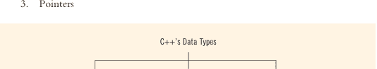

图2-1 C++数据类型

在接下来的几章中，你只需关注简单数据类型。

#### 简单数据类型

简单数据类型是C++中的基础数据类型，因为它将成为结构化数据类型的构建块，你将在第9章开始学习结构化数据类型。简单数据分为三类：

- 1. **整型**，即处理整数（即没有小数部分的数字）的数据类型
- 2. **浮点型**，即处理小数的数据类型
- 3. **枚举型**，一种用户自定义的数据类型

> **注意**
>
> 枚举类型是C++允许程序员创建自己的简单数据类型的方法。这种数据类型将在第8章讨论。

整型数据类型进一步分为以下九类：char、short、int、long、bool、unsigned char、unsigned short、unsigned int和unsigned long。

为什么同一种数据类型有这么多类别？每种数据类型都关联着一组不同的值。例如，char数据类型用于表示−128到127之间的整数。int数据类型用于表示−2147483648到2147483647之间的整数，short数据类型用于表示−32768到32767之间的整数。

请注意，示例2-1中的标识符num可以被赋予属于int数据类型的任何值。

使用哪种数据类型取决于你的程序需要处理的数字有多大。在编程早期，计算机和主存储器非常昂贵。当时只有少量内存可用于执行程序和处理数据。因此，程序员不得不优化内存的使用。因为编写程序并使其运行本就是一个复杂的过程，不必担心内存大小就少了一件需要考虑的事情。因此，为了有效利用内存，程序员可以查看程序中使用的数据类型，并确定应使用哪种数据类型。

较新的编程语言只有五类简单数据类型：整数、实数、char、bool和枚举类型。本书中使用的整型数据类型是int、bool和char。

表2-2给出了这三种数据类型关联的可能取值范围，以及为处理这些值而分配的内存大小。

**表2-2 三种简单数据类型的值与内存分配**

| 数据类型 | 值 | 存储（字节） |
| --- | --- | --- |
| int | −2147483648 到 2147483647 | 4 |
| bool | true 和 false | 1 |
| char | −128 到 127 | 1 |

> **注意**
>
> 此表仅供参考。不同的编译器可能允许不同的取值范围。请查阅你的编译器文档。要查找特定系统上整型数据类型的准确大小，可以运行附录G（系统的内存大小）中给出的程序。此外，要查找这些数据类型的最大值和最小值，可以运行附录F（头文件 `<climits>`）中给出的另一个程序。


## int 数据类型

本节描述 `int` 数据类型。本讨论也适用于其他整型数据类型。

在 C++ 中，整数与数学中一样，是如下这样的数字：

`-6728, -67, 0, 78, 36782, +763`

请注意这些示例中的以下两条规则：

- 1. 正整数前面不需要 `+` 号。
- 2. 整数内部不使用逗号。回想一下，在 C++ 中，逗号用于分隔列表中的项。因此，36,782 会被解释为两个整数：36 和 782。

## bool 数据类型

数据类型 `bool` 只有两个值：`true` 和 `false`。此外，true 和 false 称为*逻辑（布尔）值*。此数据类型的核心目的是操作逻辑（布尔）表达式。逻辑（布尔）表达式将在第 4 章中形式化定义并详细讨论。在 C++ 中，`bool`、`true` 和 `false` 是保留字。

## char 数据类型

数据类型 `char` 是最小的整型数据类型。它主要用于表示字符——即字母、数字和特殊符号。因此，`char` 数据类型可以表示键盘上的每个键。使用 `char` 数据类型时，将所表示的每个字符括在单引号内。属于 `char` 数据类型的值示例包括以下内容：

`'A', 'a', '0', '*', '+', '$', '&', ' '`

注意，空格是一个字符，写作 `' '`，单引号之间有一个空格。

数据类型 `char` 只允许在单引号之间放置一个符号。因此，值 `'abc'` 不属于 `char` 类型。此外，尽管 `!` 和类似特殊符号被视为一个符号，但它们不被视为 `char` 数据类型的可能值。键盘上所有可打印的单个符号都可以视为 `char` 数据类型的可能值。

目前使用着几种不同的字符数据集。最常见的是美国信息交换标准代码（ASCII）和扩展二进制编码十进制交换代码（EBCDIC）。ASCII 字符集有 128 个值。EBCDIC 字符集有 256 个值，由 IBM 创建。这两个字符集都在附录 C 中描述。

ASCII 字符集的 128 个值中的每一个都表示一个不同的字符。例如，值 65 表示 `'A'`，值 43 表示 `'+'`。因此，每个字符在字符集中都有一个预定义的顺序，称为**排序序列**。比较字符时会使用排序序列。例如，表示 'B' 的值是 66，所以 'A' 小于 'B'。类似地，'+' 小于 'A'，因为 43 小于 65。

ASCII 字符集中的第 14 个字符称为换行字符，表示为 '\n'。（注意，换行字符在 ASCII 字符集中的位置是 13，因为第一个字符的位置是 0。）尽管换行字符是两个字符的组合，但它被当作一个字符处理。类似地，水平制表符在 C++ 中表示为 '\t'，空字符表示为 '\0'（反斜杠后跟零）。此外，ASCII 字符集中的前 32 个字符是不可打印的。（有关这些字符的描述，请参见附录 C。）

## 浮点数据类型

为了处理十进制数，C++ 提供了浮点数据类型，本节将讨论它。为便于讨论，让我们回顾高中或大学代数课程中的一个概念。

你可能熟悉科学记数法。例如：

```
43872918 = 4.3872918 * 10^7        {10 to the power of seven}
.0000265 = 2.65 * 10^-5          {10 to the power of minus five}
47.9832 = 4.79832 * 10^1          {10 to the power of one}
```

为了表示实数，C++ 使用一种称为**浮点表示法**的科学记数法形式。表 2–3 展示了 C++ 可能如何按照某台机器对浮点表示法的解释来打印一组实数。在 C++ 浮点表示法中，字母 E 代表指数。

**表 2-3** 以 C++ 浮点表示法打印的实数示例

| 实数 | C++ 浮点表示法 |
| --- | --- |
| 75.924 | 7.592400E1 |
| 0.18 | 1.800000E-1 |
| 0.0000453 | 4.530000E-5 |
| −1.482 | −1.482000E0 |
| 7800.0 | 7.800000E3 |

C++ 提供了三种数据类型来操作十进制数：float、double 和 long double。与整型数据类型的情况一样，数据类型 float、double 和 long double 在取值范围上不同。

> **注意** 在大多数较新的编译器中，数据类型 `double` 和 `long double` 是相同的。因此，这里只描述数据类型 `float` 和 `double`。

`float`：在 C++ 中，数据类型 `float` 用于表示 −3.4E+38 到 3.4E+38 之间的任何实数。为 `float` 数据类型的值分配的内存是四个字节。

`double`：在 C++ 中，数据类型 `double` 用于表示 −1.7E+308 到 1.7E+308 之间的任何实数。为 `double` 数据类型的值分配的内存是八个字节。

数据类型 `float` 和 `double` 的最大值和最小值依赖于系统。要查找特定系统上的这些值，可以查阅编译器的文档，或者运行附录 F（头文件 cfloat）中给出的程序。

除了取值范围之外，数据类型 `float` 和 `double` 还有一个区别。`float` 值的最大有效数字位数——即小数位数——是六或七位。属于 `double` 类型的值的最大有效数字位数是 15 位。

> **注意** 对于 `double` 类型的值，为了获得更好的精度，某些编译器可能给出超过 15 位有效数字。请查阅编译器的文档。

最大有效数字位数称为**精度**。有时 `float` 值称为**单精度**，`double` 类型的值称为**双精度**。如果你处理的是十进制数，大多数情况下只需要 `float` 类型；如果需要精确到超过六位或七位小数，可以使用 `double` 类型。

> **注意** 在 C++ 中，默认情况下，浮点数被视为 `double` 类型。因此，如果你在程序中使用 `float` 数据类型来操作浮点数，某些编译器可能会给出警告消息，例如“从 double 到 float 的截断”。为避免此类警告消息，应使用 `double` 数据类型。为便于说明并避免编程示例中出现此类警告消息，本书大多使用 `double` 数据类型来操作浮点数。

## 算术运算符与运算符优先级

计算机最重要的用途之一是其计算能力。可以使用标准算术运算符来操作整型和浮点数据类型。共有五个算术运算符。

**算术运算符：** +（加法）、−（减法或取负）、*（乘法）、/（除法）、%（取模、模或求余）。

运算符 +、−、* 和 / 可用于整型和浮点数据类型。只能对整型数据类型使用 % 来求普通除法中的余数。当对整型数据类型使用 / 时，它给出普通除法中的商。也就是说，整数除法会截断任何小数部分；不进行舍入。

从高中起，你就习惯了处理如下算术表达式：

- i. −5
- ii. 8 − 7
- iii. 3 + 4
- iv. 2 + 3 * 5
- v. 5.6 + 6.2 * 3
- vi. x + 2 * 5 + 6 / y

（注意，在表达式 (vi) 中，x 和 y 是未知数。）形式上，**算术表达式**由算术运算符和数字构成。表达式中出现的数字称为**操作数**。用于计算某个运算符的数字称为该运算符的操作数。在表达式 (i) 中，符号 − 表示数字 5 为负数。在此表达式中，− 只有一个操作数。只有一个操作数的运算符称为**一元运算符**。

在表达式 (ii) 中，符号 − 用于从 8 中减去 7。在此表达式中，− 有两个操作数：8 和 7。有两个操作数的运算符称为**二元运算符**。

**一元运算符：** 只有一个操作数的运算符。

**二元运算符：** 有两个操作数的运算符。

在表达式 (iii) 中，即 **3 + 4**，3 和 4 是运算符 + 的操作数。在此表达式中，运算符 + 有两个操作数，是二元运算符。现在考虑以下表达式：

```
+27
```

在此表达式中，运算符 + 表示数字 27 为正数。这里，+ 只有一个操作数，因此作为一元运算符。

从前面的讨论可知，− 和 + 既是一元算术运算符，也是二元算术运算符。然而，作为算术运算符，*、/ 和 % 是二元运算符，因此必须有两个操作数。

以下示例展示算术运算符——尤其是 / 和 %——如何用于整型数据类型。从这些示例可以看出，当与整型数据类型一起使用时，运算符 / 表示普通除法中的商。


### 示例 2-3

| 算术表达式 | 结果 | 描述 |
|---|---:|---|
| `2 + 5` | 7 | |
| `13 + 89` | 102 | |
| `34 - 20` | 14 | |
| `45 - 90` | -45 | |
| `2 * 7` | 14 | |
| `5 / 2` | 2 | 在除法 `5 / 2` 中，商为 2，余数为 1。因此，具有整型操作数的 `5 / 2` 求值结果为商，即 2。 |
| `14 / 7` | 2 | |
| `34 % 5` | 4 | 在除法 `34 / 5` 中，商为 6，余数为 4。因此，`34 % 5` 的求值结果为余数，即 4。 |
| `4 % 6` | 4 | 在除法 `4 / 6` 中，商为 0，余数为 4。因此，`4 % 6` 的求值结果为余数，即 4。 |

以下 C++ 程序对前面的表达式进行求值：

```cpp
// This program illustrates how integral expressions are
// evaluated.

#include <iostream>

using namespace std;

int main()
{
    cout << "2 + 5 = " << 2 + 5 << endl;
    cout << "13 + 89 = " << 13 + 89 << endl;
    cout << "34 - 20 = " << 34 - 20 << endl;
    cout << "45 - 90 = " << 45 - 90 << endl;
    cout << "2 * 7 = " << 2 * 7 << endl;
    cout << "5 / 2 = " << 5 / 2 << endl;
    cout << "14 / 7 = " << 14 / 7 << endl;
    cout << "34 % 5 = " << 34 % 5 << endl;
    cout << "4 % 6 = " << 4 % 6 << endl;

    return 0;
}
```

### 示例运行：

```text
2 + 5 = 7
13 + 89 = 102
34 - 20 = 14
45 - 90 = -45
2 * 7 = 14
5 / 2 = 2
14 / 7 = 2
34 % 5 = 4
4 % 6 = 4
```

> **注意** 当使用负整数操作数计算取模运算符时应当小心。你可能得不到预期的答案。例如，−34 % 5 = −4，因为在除法 −34 / 5 中，商为 −6，余数为 −4。类似地，34 % −5 = 4，因为在除法 34 / −5 中，商为 −6，余数为 4。此外，−34 % −5 = −4，因为在除法 −34 / −5 中，商为 6，余数为 −4。

以下示例说明算术运算符如何作用于浮点数。

### 示例 2-4

以下 C++ 程序对各种浮点表达式进行求值。（这些表达式如何求值的细节留作练习。）

```cpp
// This program illustrates how floating-point expressions
// are evaluated.

#include <iostream>

using namespace std;

int main()
{
    cout << "5.0 + 3.5 = " << 5.0 + 3.5 << endl;
    cout << "3.0 + 9.4 = " << 3.0 + 9.4 << endl;
    cout << "16.3 - 5.2 = " << 16.3 - 5.2 << endl;
    cout << "4.2 * 2.5 = " << 4.2 * 2.5 << endl;
    cout << "5.0 / 2.0 = " << 5.0 / 2.0 << endl;
    cout << "34.5 / 6.0 = " << 34.5 / 6.0 << endl;
    cout << "34.5 / 6.5 = " << 34.5 / 6.5 << endl;

    return 0;
}
```

### 示例运行：

```text
5.0 + 3.5 = 8.5
3.0 + 9.4 = 12.4
16.3 - 5.2 = 11.1
4.2 * 2.5 = 10.5
5.0 / 2.0 = 2.5
34.5 / 6.0 = 5.75
34.5 / 6.5 = 5.30769
```

## 运算符优先级

当表达式中使用多个算术运算符时，C++ 使用运算符优先级规则对该表达式求值。根据算术运算符的优先级顺序规则，`*`、`/` 和 `%` 的优先级高于 `+` 和 `−`。

注意，运算符 `*`、`/` 和 `%` 具有相同的优先级。类似地，运算符 `+` 和 `−` 也具有相同的优先级。

当运算符具有相同优先级时，运算从左到右执行。为避免混淆，可以使用圆括号对算术表达式进行分组。例如，按照优先级顺序规则，

```
3 * 7 − 6 + 2 * 5 / 4 + 6
```

表示以下内容：

```
(((3 * 7) − 6) + ((2 * 5) / 4)) + 6
= ((21 − 6) + (10 / 4)) + 6                 (Evaluate *)
= ((21 − 6) + 2) + 6                       (Evaluate /. Note that this is an integer division.)
= (15 + 2) + 6                             (Evaluate −)
= 17 + 6                                   (Evaluate first +)
= 23                                       (Evaluate +)
```

注意，第二个示例中圆括号的使用阐明了优先级顺序。也可以使用圆括号覆盖优先级顺序规则（见示例 2-5）。

### 示例 2-5

在表达式 `3 + 4 * 5` 中，`*` 先于 `+` 求值。因此，该表达式的结果为 23。另一方面，在表达式 `(3 + 4) * 5` 中，`+` 先于 `*` 求值，该表达式的结果为 35。

由于算术运算符从左到右求值（除非存在圆括号），因此称算术运算符的结合性为从左到右。

**（字符算术）** 由于 `char` 数据类型也是整型数据类型，C++ 允许对 `char` 数据执行算术运算。但是，应当谨慎使用这一能力。字符 `'8'` 与整数 8 之间存在差异。整数 8 的整数值为 8。`'8'` 的整数值为 56，这是字符 `'8'` 的 ASCII 排序序列。

在求算术表达式时，8 + 7 = 15；`'8'` + `'7'` = 56 + 55，结果为 111；而 `'8'` + 7 = 56 + 7，结果为 63。此外，由于 `'8'` * `'7'` = 56 * 55 = 3080，而 ASCII 字符集只有 128 个值，因此 `'8'` * `'7'` 在 ASCII 字符数据集中是未定义的。

这些示例说明，在执行字符算术时，很多地方都可能出错。如果必须使用它们，请谨慎地对 `char` 数据类型使用算术运算。

## 表达式

到目前为止，我们只讨论了算术运算符。在本节中，我们将详细讨论算术表达式。上一节已经介绍了算术表达式。

如果表达式中的所有操作数（即数字）都是整数，则该表达式称为**整型表达式**。如果表达式中的所有操作数都是浮点数，则该表达式称为**浮点表达式或小数表达式**。整型表达式产生整型结果；浮点表达式产生浮点结果。看一些示例有助于澄清这些定义。

### 示例 2-6

考虑以下 C++ 整型表达式：

```
2 + 3 * 5
3 + x - y / 7
x + 2 * (y - z) + 18
```

在这些表达式中，x、y 和 z 表示整型变量；也就是说，它们可以保存整数值。本章后面将讨论变量。

### 示例 2-7

考虑以下 C++ 浮点表达式：

```
12.8 * 17.5 - 34.50
x * 10.5 + y - 16.2
```

这里，x 和 y 表示浮点型变量；也就是说，它们可以保存浮点值。本章后面将讨论变量。

对整型表达式或浮点表达式求值很直接。和前面一样，当运算符具有相同优先级时，表达式从左到右求值。始终可以使用圆括号对操作数和运算符进行分组，以避免混淆。

### 混合表达式

具有不同数据类型操作数的表达式称为**混合表达式**。混合表达式同时包含整数和浮点数。以下表达式是混合表达式的示例：

```
2 + 3.5
6 / 4 + 3.9
5.4 * 2 - 13.6 + 18 / 2
```

在第一个表达式中，运算符 `+` 有一个整数操作数和一个浮点操作数。在第二个表达式中，运算符 `/` 的两个操作数都是整数，`+` 的第一个操作数是 `6 / 4` 的结果，`+` 的第二个操作数是浮点数。第三个示例是整数和浮点数更为复杂的混合。显而易见的问题是：C++ 如何对混合表达式求值？

对混合表达式求值时适用两条规则：

- 1. 在对混合表达式中的运算符求值时：
  - a. 如果该运算符具有相同类型的操作数（即两个都是整数或两个都是浮点数），则根据操作数的类型对该运算符求值。因此，整数操作数产生整数结果；浮点数产生浮点数结果。
  - b. 如果该运算符具有两种类型的操作数（即一个是整数，另一个是浮点数），则在计算期间，将整数转换为小数部分为零的浮点数，然后对该运算符求值。结果为浮点数。
- 2. 整个表达式根据优先级规则求值；乘法、除法和取模运算符先于加法和减法运算符求值。具有相同优先级的运算符从左到右求值。为清晰起见，允许分组。

根据这些规则，在对混合表达式求值时，应使用优先级规则一次集中处理一个运算符。如果要计算的运算符具有相同数据类型的操作数，则使用规则 1(a) 对该运算符求值。也就是说，具有整数操作数的运算符将产生整数结果，而具有浮点操作数的运算符将产生浮点结果。如果要计算的运算符有一个整数操作数和一个浮点操作数，则在计算该运算符之前，将整数操作数转换为小数部分为 0 的浮点数。以下示例展示如何对混合表达式求值。


### 示例 2-8

| 混合表达式 | 求值过程 | 应用规则 |
|---|---|---|
| `3 / 2 + 5.5` | `= 1 + 5.5`<br>`= 6.5` | `3 / 2 = 1`（整数除法；规则 1(a)）<br>`1 + 5.5`<br>`= 1.0 + 5.5`（规则 1(b)）<br>`= 6.5` |
| `15.6 / 2 + 5` | `= 7.8 + 5`<br>`= 12.8` | `15.6 / 2`<br>`= 15.6 / 2.0`（规则 1(b)）<br>`= 7.8`<br>`7.8 + 5`<br>`= 7.8 + 5.0`（规则 1(b)）<br>`= 12.8` |
| `4 + 5 / 2.0` | `= 4 + 2.5`<br>`= 6.5` | `5 / 2.0 = 5.0 / 2.0`（规则 1(b)）<br>`= 2.5`<br>`4 + 2.5 = 4.0 + 2.5`（规则 1(b)）<br>`= 6.5` |
| `4 * 3 + 7 / 5 - 25.5` | `= 12 + 7 / 5 - 25.5`<br>`= 12 + 1 - 25.5`<br>`= 13 - 25.5`<br>`= -12.5` | `4 * 3 = 12`（规则 1(a)）<br>`7 / 5 = 1`（整数除法；规则 1(a)）<br>`12 + 1 = 13`（规则 1(a)）<br>`13 - 25.5 = 13.0 - 25.5`（规则 1(b)）<br>`= -12.5` |

以下 C++ 程序对上述表达式进行求值：

```cpp
// This program illustrates how mixed expressions are evaluated.
#include <iostream>

using namespace std;

int main()
{
    cout << "3 / 2 + 5.5 = " << 3 / 2 + 5.5 << endl;
    cout << "15.6 / 2 + 5 = " << 15.6 / 2 + 5 << endl;
    cout << "4 + 5 / 2.0 = " << 4 + 5 / 2.0 << endl;
    cout << "4 * 3 + 7 / 5 - 25.5 = "
         << 4 * 3 + 7 / 5 - 25.5
         << endl;

    return 0;
}
```

### 示例运行结果：

```text
3 / 2 + 5.5 = 6.5
15.6 / 2 + 5 = 12.8
4 + 5 / 2.0 = 6.5
4 * 3 + 7 / 5 - 25.5 = -12.5
```

这些示例说明，只有在待求值的运算符同时具有一个整数操作数和一个浮点数操作数时，整数才会被转换为浮点数。

## 类型转换（强制转换）

在上一节中，你了解到在计算算术表达式时，如果运算符具有混合操作数，整数值会转换为小数部分为零的浮点值。当一个数据类型的值自动更改为另一种数据类型时，就发生了**隐式类型强制转换**。正如上一节中的示例所示，如果你对数据类型不够小心，隐式类型强制转换可能会产生意想不到的结果。

为了避免隐式类型强制转换，C++ 提供了通过使用强制转换运算符进行显式类型转换的方法。**强制转换运算符**，也称为**类型转换**或**类型强制转换**，采用以下形式：

```cpp
static_cast<dataTypeName>(expression)
```

首先，对表达式进行求值。然后将其值转换为 dataTypeName 指定的类型。在 C++ 中，`static_cast` 是一个保留字。

使用强制转换运算符将浮点数（小数）转换为整数时，只需去掉浮点数的小数部分。也就是说，浮点数被截断了。示例 2-9 展示了强制转换运算符的工作方式。请务必理解为什么最后两个表达式的求值结果如此。

### 示例 2-9

| 表达式 | 求值结果为 |
|---|---|
| `static_cast<int>(7.9)` | 7 |
| `static_cast<int>(3.3)` | 3 |
| `static_cast<double>(25)` | 25.0 |
| `static_cast<double>(5 + 3)` | = `static_cast<double>(8)` = 8.0 |
| `static_cast<double>(15) / 2` | = 15.0 / 2<br>（因为 `static_cast<double>(15)` = 15.0）<br>= 15.0 / 2.0 = 7.5 |
| `static_cast<double>(15 / 2)` | = `static_cast<double>(7)`（因为 15 / 2 = 7）<br>= 7.0 |
| `static_cast<int>(7.8 + static_cast<double>(15) / 2)` | = `static_cast<int>(7.8 + 7.5)`<br>= `static_cast<int>(15.3)`<br>= 15 |
| `static_cast<int>(7.8 + static_cast<double>(15 / 2))` | = `static_cast<int>(7.8 + 7.0)`<br>= `static_cast<int>(14.8)`<br>= 14 |

以下 C++ 程序对上述表达式进行求值：

```cpp
// This program illustrates how explicit type conversion works.

#include <iostream>
using namespace std;

int main()
{
    cout << "static_cast<int>(7.9) = "
         << static_cast<int>(7.9)
         << endl;
    cout << "static_cast<int>(3.3) = "
         << static_cast<int>(3.3)
         << endl;
    cout << "static_cast<double>(25) = "
         << static_cast<double>(25)
         << endl;
    cout << "static_cast<double>(5 + 3) = "
         << static_cast<double>(5 + 3)
         << endl;
    cout << "static_cast<double>(15) / 2 = "
         << static_cast<double>(15) / 2
         << endl;
    cout << "static_cast<double>(15 / 2) = "
         << static_cast<double>(15 / 2)
         << endl;

    cout << "static_cast<int>(7.8 + static_cast<double>(15) / 2) = "
         << static_cast<int>(7.8 + static_cast<double>(15) / 2)
         << endl;
    cout << "static_cast<int>(7.8 + static_cast<double>(15 / 2)) = "
         << static_cast<int>(7.8 + static_cast<double>(15 / 2))
         << endl;

    return 0;
}
```

### 示例运行结果：

```text
static_cast<int>(7.9) = 7
static_cast<int>(3.3) = 3
static_cast<double>(25) = 25
static_cast<double>(5 + 3) = 8
static_cast<double>(15) / 2 = 7.5
static_cast<double>(15 / 2) = 7
static_cast<int>(7.8 + static_cast<double>(15) / 2) = 15
static_cast<int>(7.8 + static_cast<double>(15 / 2)) = 14
```

注意，表达式 `static_cast<double>(25)` 的值为 25.0。然而，它输出为 25 而不是 25.0。这是因为我们尚未讨论如何输出小数部分为零的十进制数来显示小数点及尾随零。第 3 章将解释如何按所需格式输出十进制数。类似地，其他小数部分为零的十进制数的输出也不带小数点和小数部分的 0。

> **注意**  
> 在 C++ 中，强制转换运算符还可以采用 `dataType(expression)` 的形式。这种形式称为 C 风格类型转换。例如，`double(5) = 5.0`，`int(17.6) = 17`。但是，`static_cast` 比 C 风格类型转换更稳定。

你还可以使用强制转换运算符将 char 数据值显式转换为 int 数据值，以及将 int 数据值转换为 char 数据值。要将 char 数据值转换为 int 数据值，需要使用排序序列。例如，在 ASCII 字符集中，`static_cast<int>('A')` 为 65，`static_cast<int>('8')` 为 56。类似地，`static_cast<char>(65)` 为 'A'，`static_cast<char>(56)` 为 '8'。

在本章前面，你学习了如何在 C++ 中形成和计算算术表达式。如果你想在另一个表达式中使用某个表达式的值，必须先保存该表达式的值。保存表达式的值有很多原因。有些表达式很复杂，可能需要大量的计算机时间进行求值。通过计算一次值并保存以供后续使用，你不仅可以节省计算机时间并创建执行更快的程序，还可以避免可能的录入错误。在 C++ 中，表达式被求值，如果值未被保存，它就会丢失。也就是说，除非保存下来，否则表达式的值不能在后续计算中使用。在下一节中，你将学习如何保存表达式的值并在后续计算中使用它。

在结束数据类型讨论之前，让我们再讨论一种数据类型——字符串。

## string 类型

string 数据类型是一种程序员自定义的数据类型。它不能像前面讨论的简单数据类型那样直接在程序中使用。要使用此数据类型，你需要从库中访问程序组件，这将在本章后面讨论。string 数据类型是 ANSI/ISO 标准 C++ 的一个特性。

> **注意**  
> 在 ANSI/ISO C++ 语言标准之前，标准 C++ 库不提供 string 数据类型。编译器供应商通常提供他们自己的程序员自定义的 string 类型，并且字符串操作的语法和语义往往因供应商而异。

字符串是零个或多个字符的序列。C++ 中的字符串用双引号括起来。不包含任何字符的字符串称为**空**字符串或**空**字符串。以下是字符串的示例。注意 `""` 是空字符串。

```text
"William Jacob"
"Mickey"
""
```

字符串中的每个字符在字符串中都有一个相对位置。第一个字符的位置为 0，第二个字符的位置为 1，依此类推。字符串的长度是其中字符的数量。


厘米是固定的，因为1英寸始终等于2.54厘米。在内存中存储时，这类数据需要在程序执行过程中防止被意外修改。在C++中，可以使用**命名常量**来指示程序标记那些在程序整个执行期间数据保持固定的内存位置。

**命名常量：** 内容在程序执行期间不允许改变的内存位置。

要分配内存，我们使用C++的声明语句。声明命名常量的语法为：

```cpp
const dataType identifier = value;
```

在C++中，**const**是一个保留字。

### 示例2-11

考虑以下C++语句：

```cpp
const double CONVERSION = 2.54;
const int NO_OF_STUDENTS = 20;
const char BLANK = ' ';
```

第一条语句告诉编译器分配内存（8字节）来存储一个**double**类型的值，将这个内存空间命名为CONVERSION，并在其中存储值2.54。在使用此语句的整个程序中，每当需要转换因子时，都可以访问内存空间CONVERSION。其他语句的含义类似。

注意，命名常量的标识符使用大写字母。尽管没有成文的规则，C++程序员通常更喜欢用大写字母来命名命名常量。此外，如果命名常量的名称由多个单词组合而成（称为*连写词*），则单词之间用下划线分隔。例如，在前面的示例中，NO_OF_STUDENTS就是一个连写词。

> **注意**
>
> 如前所述，浮点数的默认类型是**double**。因此，如果你声明一个**float**类型的命名常量，则必须按如下方式指定该值为**float**类型：
>
> ```cpp
> const float CONVERSION = 2.54f;
> ```
>
> 否则，编译器将生成一条警告消息。注意，2.54f表示它是一个**float**值。回想一下，**float**值的内存大小为4字节；**double**值为8字节。由于如今内存大小已不是问题，如前所述，我们大多使用**double**类型来处理浮点值。

使用命名常量存储固定数据，而不是直接使用数据值本身，有一个主要优点。如果固定数据发生变化，你无需编辑整个程序并在使用旧值的所有位置将其改为新值。相反，你只需在一处进行修改，重新编译程序，然后在整个程序中使用新值执行即可。此外，通过存储一个值并在需要时引用该内存位置，可以避免反复输入相同的值，并防止意外输入错误。如果你拼错了常量值所在位置的名称，计算机会通过错误消息提醒你，但如果值本身输错了，它不会提醒。

在某些程序中，数据需要在程序执行期间进行修改。例如，每次测试后，平均测试分数和已参加的测试次数都会变化。同样，每次加薪后，员工的工资也会变化。这类数据必须存储在那些内容可以在程序执行期间被修改的内存单元中。在C++中，内容在程序执行期间可以被修改的内存单元称为变量。

**变量：** 内容在程序执行期间可能改变的内存位置。

声明一个变量或多个变量的语法为：

```cpp
dataType identifier, identifier, . . .;
```

### 示例2-12

考虑以下语句：

```cpp
double amountDue;
int counter;
char ch;
int x, y;
string name;
```

第一条语句告诉编译器分配足够的内存来存储一个`double`类型的值，并将其命名为amountDue。第二条和第三条语句的约定类似。第四条语句告诉编译器分配两个不同的内存空间，每个空间都足够存储一个`int`类型的值；将第一个内存空间命名为x，第二个命名为y。第五条语句告诉编译器分配内存空间来存储一个字符串，并将其命名为name。

与命名常量的命名一样，变量命名也没有成文的规则。不过，C++程序员通常使用小写字母来声明变量。如果变量名由多个单词组合而成，则除第一个单词外，每个单词的首字母大写。（例如，请看前面示例中的变量amountDue。）

从现在开始，当我们说“变量”时，指的是变量内存位置。

> **注意** 在C++中，必须先声明所有标识符，然后才能使用它们。如果你在未声明的情况下引用某个标识符，编译器将生成一条错误消息（语法错误），指示该标识符未声明。因此，要使用命名常量或变量，必须先声明它。

现在我们已经定义并讨论了数据类型、变量和常量，可以为简单数据类型给出正式定义。如果某种类型的变量或命名常量一次只能存储一个值，则该数据类型称为**简单**类型。例如，如果x是一个**int**变量，在给定时刻，x中只能存储一个值。

## 向变量中放入数据

既然你已经知道如何声明变量，下一个问题是：如何将数据放入这些变量中？在C++中，可以通过两种方式将数据放入变量：

- 1. 使用C++的赋值语句。
- 2. 使用输入（读取）语句。

### 赋值语句

赋值语句的形式如下：

```cpp
variable = expression;
```

在赋值语句中，**表达式**的值应与变量的数据类型匹配。右侧的表达式会被求值，其值被赋给左侧的变量（从而赋给一个内存位置）。

变量首次被放入值称为变量的**初始化**。

在C++中，=被称为**赋值运算符**。

### 示例2-13

假设你有以下变量声明：

```cpp
int num1, num2;
double sale;
char first;
string str;
```

现在考虑以下赋值语句：

```cpp
num1 = 4;
num2 = 4 * 5 - 11;
sale = 0.02 * 1000;
first = 'D';
str = "It is a sunny day.";
```

对于这些语句中的每一条，计算机首先计算右侧的表达式，然后将该值存储到由左侧标识符命名的内存位置中。第一条语句将值4存储在num1中，第二条语句将9存储在num2中，第三条语句将20.00存储在sale中，第四条语句将字符D存储在first中。第五条语句将字符串"It is a sunny day."存储在变量str中。

以下C++程序展示了上述语句的效果：

```cpp
// This program illustrates how data in the variables are
// manipulated.

#include <iostream>
#include <string>

using namespace std;

int main()
{
    int num1, num2;
    double sale;
    char first;
    string str;

    num1 = 4;
    cout << "num1 = " << num1 << endl;

    num2 = 4 * 5 - 11;
    cout << "num2 = " << num2 << endl;

    sale = 0.02 * 1000;
    cout << "sale = " << sale << endl;

    first = 'D';
    cout << "first = " << first << endl;

    str = "It is a sunny day.";
    cout << "str = " << str << endl;

    return 0;
}
```

### 示例运行：

```text
num1 = 4
num2 = 9
sale = 20
first = D
str = It is a sunny day.
```

上述程序大部分内容都很直白。让我们来看一下输出语句：

```cpp
cout << "num1 = " << num1 << endl;
```

这条输出语句由字符串" num1 = "、运算符<<和变量num1组成。在这里，首先输出字符串" num1 = "的值，然后输出变量num1的值。其他输出语句的含义类似。

C++中的如下语句：

```cpp
num = num + 2;
```

意思是“对num中的内容求值，加上2，然后将新值赋给内存位置num。”必须先对右侧的表达式求值；然后将该值赋给左侧变量所指定的内存位置。因此，C++语句序列：

```cpp
num = 6;
num = num + 2;
```

和语句：

```cpp
num = 8;
```

都将8赋给num。注意，如果num尚未初始化，语句num = num + 2可能会产生意外结果，并且/或者编译器可能会生成一条警告消息，指示该变量尚未初始化。

语句num = 5;应读作“num变为5”或“num得到5”或“num被赋值为5”。将该语句读作“num等于5”是不正确的，尤其是对于num = num + 2;这样的语句。每次给num赋新值时，旧值都会被覆盖。

### 示例2-14

假设num1、num2和num3是`int`变量，并且按顺序执行以下语句。

- 1. `num1 = 18;`
- 2. `num1 = num1 + 27;`
- 3. `num2 = num1;`
- 4. `num3 = num2 / 5;`
- 5. `num3 = num3 / 4;`

下表显示了每条语句执行后变量的值。（? 表示值未知。方框中的橙色表示该变量的值已更改。）


|  | 变量的值 | 说明 |
|---|---|---|
| 语句 1 之前 | **num1:** ? &nbsp;&nbsp; **num2:** ? &nbsp;&nbsp; **num3:** ? | |
| 语句 1 之后 | **num1:** 18 &nbsp;&nbsp; **num2:** ? &nbsp;&nbsp; **num3:** ? | |
| 语句 2 之后 | **num1:** 45 &nbsp;&nbsp; **num2:** ? &nbsp;&nbsp; **num3:** ? | `num1 + 27 = 18 + 27 = 45.` 这个值被赋给 num1，它会替换 num1 的旧值。 |
| 语句 3 之后 | **num1:** 45 &nbsp;&nbsp; **num2:** 45 &nbsp;&nbsp; **num3:** ? | 将 num1 的值复制到 num2。 |
| 语句 4 之后 | **num1:** 45 &nbsp;&nbsp; **num2:** 45 &nbsp;&nbsp; **num3:** 9 | `num2 / 5 = 45 / 5 = 9.` 这个值被赋给 num3。因此 num3 = 9。 |
| 语句 5 之后 | **num1:** 45 &nbsp;&nbsp; **num2:** 45 &nbsp;&nbsp; **num3:** 2 | `num3 / 4 = 9 / 4 = 2.` 这个值被赋给 num3，它会替换 num3 的旧值。 |

因此，在执行第 5 行的语句之后，num1 = 45，num2 = 45，num3 = 2。

按顺序跟踪变量的值称为**走查**，它是一种很有价值的学习和练习工具。请在上面的序列中尝试一下。你将在本章后面进一步了解如何走查一系列 C++ 语句。


> 假设 x、y 和 z 是 `int` 变量。以下是 C++ 中的一条合法语句：

```cpp
x = y = z;
```

> 在这条语句中，首先将 z 的值赋给 y，然后将 y 的新值赋给 x。因为赋值运算符 = 是从右向左求值的，所以**赋值运算符的结合性**被认为是从右到左。

## 保存并使用表达式的值

既然你已经知道如何声明变量并向其中放入数据，现在可以学习如何保存表达式的值。之后，你可以在后续表达式中使用这个值，而不必再次使用表达式本身，从而回答本章前面提出的问题。要保存表达式的值并在后续表达式中使用它，请按以下步骤操作：

- 1. 声明一个具有适当数据类型的变量。例如，如果表达式的结果是整数，则声明一个 `int` 变量。
- 2. 使用赋值语句将表达式的值赋给已声明的变量。此操作将表达式的值保存到变量中。
- 3. 在需要该表达式的值时，使用保存该值的变量。下面的示例进一步说明这个概念。

### 示例 2-15

假设你有以下声明：

```cpp
int a, b, c, d;
int x, y;
```

进一步假设你想计算表达式 -b + (b^2 - 4ac) 和 -b - (b^2 - 4ac) 的值，并分别将这些表达式的值赋给 x 和 y。由于表达式 b^2 - 4ac 在两个表达式中都出现，你可以先计算这个表达式的值并将其保存到 d 中。然后你可以使用 d 的值来计算这些表达式，如下面的语句所示：

```cpp
d = b * b - 4 * a * c;
x = -b + d;
y = -b - d;
```

前面你了解到，如果在表达式中使用变量，那么只有在该变量先被初始化时，表达式才会产生有意义的值。你还了解到，在声明变量之后，可以使用赋值语句来初始化它。也可以同时声明并初始化变量。在讨论如何使用输入（读取）语句之前，我们先处理这个重要问题。

## 声明并初始化变量

声明变量时，C++ 可能不会自动向其中放入有意义的值。换句话说，C++ 可能不会自动初始化变量。例如，`int` 和 `double` 变量可能不会像某些编程语言中那样被初始化为 0。然而，这并不意味着变量在声明之后没有值。声明变量时，会为它分配内存。

回顾第 1 章，主存是一个有序的单元序列，每个单元都能够存储一个值。还要回顾，机器语言是 0 和 1 的序列，即比特。因此，内存单元中的数据是一个比特序列。这些比特不过是电信号，所以当计算机开启时，有些比特是 1，有些是 0。这些比特的状态取决于系统如何运作。然而，当你指示计算机将某个特定值存储到内存单元中时，这些比特会根据要存储的数据被设置。

在数据操作期间，计算机取出特定单元中存储的值并执行计算。如果你声明了一个变量但没有在其中存储值，该内存单元仍然有一个值——通常是这些比特上次使用时的设置值——而你无法知道这个值是什么。

如果你只声明变量而不指示计算机将数据放入该变量，那么该变量的值就是垃圾值。然而，计算机不会警告我们，而是把内存中的任何值都视为合法值，并使用内存中的那些值进行计算。在表达式中使用未初始化的变量会产生错误结果。为了避免这些陷阱，C++ 允许你在声明变量的同时初始化它们。例如，考虑以下先声明变量、再初始化变量的 C++ 语句：

```cpp
int first, second;
char ch;
double x;
```

```cpp
first = 13;
second = 10;
ch = ' ';
x = 12.6;
```

你可以使用以下 C++ 语句同时声明并初始化这些变量：

```cpp
int first = 13, second = 10;
char ch = ' ';
double x = 12.6;
```

第一条 C++ 语句声明两个 int 变量 first 和 second，并将 13 存入 first、将 10 存入 second。其他语句的含义类似。

实际上，并非所有变量都会在声明期间初始化。哪些变量应在声明期间初始化，取决于程序的性质或程序员的选择。关键点是，所有变量都必须在使用之前初始化。

## 输入（读取）语句

前面你学习了如何使用赋值语句将数据放入变量。在本节中，你将学习如何使用 C++ 的输入（或读取）语句，从*标准输入设备*将数据放入变量。

> **注意** 在大多数情况下，标准输入设备是键盘。

当计算机从键盘获取数据时，可以说用户正在进行交互操作。

从标准输入设备将数据放入变量，是通过使用 `cin` 和运算符 `>>` 完成的。`cin` 与 `>>` 一起使用的语法是：

```cpp
cin >> variable >> variable ...;
```

这称为**输入（读取）**语句。在 C++ 中，`>>` 称为**流提取运算符**。

> **注意**
>
> 在语法中，阴影表示定义中可选的部分。此外，在本书中，语法都放在黄色方框中。

### 示例 2-16

假设 `miles` 是一个 `double` 类型的变量。再假设输入是 73.65。考虑以下语句：

```cpp
cin >> miles;
```

这条语句使计算机从标准输入设备获取输入 73.65，并将其存储到变量 `miles` 中。也就是说，在这条语句执行之后，变量 `miles` 的值是 73.65。

示例 2-17 进一步说明如何将数值数据输入程序。

### 示例 2-17

假设我们有以下语句：

```cpp
int feet;
int inches;
```

假设输入是：

```text
23 7
```

接下来，考虑以下语句：

```cpp
cin >> feet >> inches;
```

这条语句首先将数字 23 存储到变量 `feet` 中，然后将数字 7 存储到变量 `inches` 中。请注意，当这些数字通过键盘输入时，它们之间用空白分隔。事实上，它们可以用一个或多个空白、换行，甚至制表符来分隔。


下面的 C++ 程序展示了前面输入语句的效果：

```cpp
// This program illustrates how input statements work.

#include <iostream>

using namespace std;

int main()
{
    int feet;
    int inches;

    cout << "Enter two integers separated by spaces: ";
    cin >> feet >> inches;
    cout << endl;

    cout << "Feet = " << feet << endl;
    cout << "Inches = " << inches << endl;

    return 0;
}
```

**示例运行：** 在此示例运行中，用户输入以阴影显示。

```
Enter two integers separated by spaces: 23 7

Feet = 23
Inches = 7
```

示例 2-18 中的 C++ 程序说明了如何读取字符串和数值数据。

## 示例 2-18

```cpp
// This program illustrates how to read strings and numeric data.

#include <iostream>
#include <string>

using namespace std;

int main()
{
    string firstName;                         //Line 1
    string lastName;                          //Line 2
    int age;                                   //Line 3
    double weight;                             //Line 4

    cout << "Enter first name, last name, age, "
         << "and weight, separated by spaces."
         << endl;                             //Line 5

    cin >> firstName >> lastName;                 //Line 6
    cin >> age >> weight;                         //Line 7

    cout << "Name: " << firstName << " "
         << lastName << endl;                     //Line 8

    cout << "Age: " << age << endl;              //Line 9
    cout << "Weight: " << weight << endl;        //Line 10

    return 0;                                     //Line 11
}
```

**示例运行：** 在此示例运行中，用户输入以阴影显示。

```
Enter first name, last name, age, and weight, separated by spaces.
Sheila Mann 23 120.5
Name: Sheila Mann
Age: 23
Weight: 120.5
```

上述程序的工作方式如下：第 1 行到第 4 行的语句声明了 string 类型的变量 `firstName` 和 `lastName`、`int` 类型的变量 `age` 以及 `double` 类型的变量 `weight`。第 5 行的语句是一条输出语句，告诉用户该做什么。（此类输出语句称为提示行。）如示例运行所示，程序的输入为：

```
Sheila Mann 23 120.5
```

第 6 行的语句首先读取字符串 Sheila 并将其存入变量 `firstName`，然后跳过 Sheila 后面的空格，读取字符串 Mann 并将其存入变量 `lastName`。接下来，第 7 行的语句首先跳过 Mann 后面的空白，读取 23 并将其存入变量 `age`，然后跳过 23 后面的空白，读取 120.5 并将其存入变量 `weight`。

第 8、9 和 10 行的语句生成示例运行结果的第三、第四和第五行。

> **注意** 在程序执行期间，如果在一行中输入多个值，这些值之间必须至少用一个空格或制表符分隔。或者，也可以每行输入一个值。

## 变量初始化

请记住，初始化变量有两种方式：使用赋值语句和使用读取语句。考虑以下声明：

```
int feet;
int inches;
```


考虑以下两组代码：

```cpp
(a) feet = 35;
    inches = 6;
    cout << "Total inches = "
         << 12 * feet + inches;
```

```cpp
(b) cout << "Enter feet: ";
    cin >> feet;
    cout << endl;
    cout << "Enter inches: ";
    cin >> inches;
    cout << endl;
    cout << "Total inches = "
         << 12 * feet + inches;
```

在 (a) 中，feet 和 inches 使用赋值语句初始化；在 (b) 中，这些变量使用输入语句初始化。然而，每次执行 (a) 中的代码时，除非你编辑源代码、更改值、重新编译并运行，否则 feet 和 inches 都会被初始化为相同的值。另一方面，在 (b) 中，每次程序运行时，系统都会提示你输入 feet 和 inches 的值。因此，读取语句比赋值语句通用得多。

有时需要使用赋值语句来初始化变量。如果变量仅用于内部计算，而不用于读取和存储数据，则尤其如此。

回想一下，C++ 在声明变量时不会自动初始化变量。有些变量可以在声明时初始化，而另一些变量必须使用赋值语句或读取语句初始化。

> **注意**
> 
> 当程序编译时，一些较新的 IDE 可能会在程序使用某个变量的值但未先正确初始化该变量时给出警告消息。在这种情况下，如果你忽略警告并执行程序，程序可能会异常终止并显示错误消息。

> **注意**
> 
> 假设你想使用输入语句将一个字符存入 `char` 变量。在程序执行期间，当你输入该字符时，不要包含单引号。例如，假设 `ch` 是一个 `char` 变量。考虑以下输入语句：
> 
> ```cpp
> cin >> ch;
> ```
> 
> 如果你想使用这条语句将 K 存入 `ch`，那么在程序执行期间，你只需输入 K。同样，如果你想使用输入语句将一个字符串存入一个 string 变量，那么在程序执行期间，你只需输入该字符串，不要包含双引号。

## 示例 2-19

这个示例进一步说明了赋值语句和输入语句如何操作变量。考虑以下声明：

```cpp
int firstNum, secondNum;
double z;
char ch;
string name;
```

另外，假设以下语句按给定顺序执行：

- 1. `firstNum = 4;`
- 2. `secondNum = 2 * firstNum + 6;`
- 3. `z = (firstNum + 1) / 2.0;`
- 4. `ch = 'A';`
- 5. `cin >> secondNum;`
- 6. `cin >> z;`
- 7. `firstNum = 2 * secondNum + static_cast<int>(z);`
- 8. `cin >> name;`
- 9. `secondNum = secondNum + 1;`
- 10. `cin >> ch;`
- 11. `firstNum = firstNum + static_cast<int>(ch);`
- 12. `z = firstNum - z;`

此外，假设输入为：

```
8 16.3 Jenny D
```

这一行有四个值：8、16.3、Jenny 和 D，每个值之间用一个空格分隔。

现在让我们确定最后一条语句执行后所声明变量的值。为了明确展示某条特定语句如何改变变量的值，下面显示了每条语句执行后变量的值。（在下面的图中，方框中的问号 [?] 表示该方框中的值未知。）

在语句 1 执行之前，所有变量都未初始化，如图 2-2 所示。

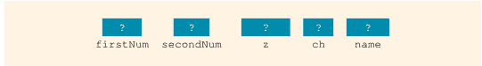

**图 2-2** 语句 1 执行前的变量

接下来，我们显示每条语句执行后变量的值。

| 语句执行后 | 变量的值 | 说明 |
|---|---|---|
| 1 | **firstNum:** 4; **secondNum:** ?; **z:** ?; **ch:** ?; **name:** ? | 将 4 存入 firstNum。 |
| 2 | **firstNum:** 4; **secondNum:** 14; **z:** ?; **ch:** ?; **name:** ? | `2 * firstNum + 6 = 2 * 4 + 6 = 14.`<br>将 14 存入 secondNum。 |
| 3 | **firstNum:** 4; **secondNum:** 14; **z:** 2.5; **ch:** ?; **name:** ? | `(firstNum + 1) / 2.0 = (4 + 1) / 2.0 = 5 / 2.0 = 2.5.`<br>将 2.5 存入 z。 |
| 4 | **firstNum:** 4; **secondNum:** 14; **z:** 2.5; **ch:** A; **name:** ? | 将 'A' 存入 ch。 |
| 5 | **firstNum:** 4; **secondNum:** 8; **z:** 2.5; **ch:** A; **name:** ? | 从键盘读取一个数字（即 8）并将其存入 secondNum。这条语句用新值替换 secondNum 的旧值。 |
| 6 | **firstNum:** 4; **secondNum:** 8; **z:** 16.3; **ch:** A; **name:** ? | 从键盘读取一个数字（即 16.3）并将该数字存入 z。这条语句用新值替换 z 的旧值。 |
| 7 | **firstNum:** 32; **secondNum:** 8; **z:** 16.3; **ch:** A; **name:** ? | `2 * secondNum + static_cast<int>(z) = 2 * 8 + static_cast<int>(16.3) = 16 + 16 = 32.` 将 32 存入 firstNum。这条语句用新值替换 firstNum 的旧值。 |
| 8 | **firstNum:** 32; **secondNum:** 8; **z:** 16.3; **ch:** A; **name:** Jenny | 从键盘读取下一个输入 Jenny，并将其存入 name。 |
| 9 | **firstNum:** 32; **secondNum:** 9; **z:** 16.3; **ch:** A; **name:** Jenny | `secondNum + 1 = 8 + 1 = 9.`<br>将 9 存入 secondNum。 |
| 10 | **firstNum:** 32; **secondNum:** 9; **z:** 16.3; **ch:** D; **name:** Jenny | 从键盘读取下一个输入（即 D）并将其存入 ch。这条语句用新值替换 ch 的旧值。 |


| 执行后 | 变量值 | 说明 |
| --- | --- | --- |
| 11 | `firstNum = 100; secondNum = 5; z = 16.3; ch = 'D'; name = "Johnny"` | `firstNum = firstNum + static_cast<int>(ch) = 32 + static_cast<int>('D') = 32 + 68 = 100.` 将100存储到`firstNum`中。 |
| 12 | `firstNum = 100; secondNum = 5; z = 83.7; ch = 'D'; name = "Johnny"` | `z = firstNum - z = 100 - 16.3 = 100.0 - 16.3 = 83.7.` 将83.7存储到`z`中。 |

> **注意**
>
> 当程序出现错误并且生成的结果不是你所预期的时候，你应该对为变量赋值的语句进行逐步检查。示例2-19说明了如何对程序进行逐步检查。这是一种非常有效的调试技术。本书附带的网站包含一个C++程序，展示了示例2-19开头列出的12条语句的效果。该程序名为Example_2_19.cpp。

> **注意**
>
> 如果你将计算结果为浮点值的表达式的值（不使用强制转换运算符）赋给int类型的变量，小数部分将被丢弃。在这种情况下，编译器很可能会发出有关隐式类型转换的警告消息。

## 自增和自减运算符

既然你已经知道如何声明变量以及向变量中输入数据，在本节中，你将学习另外两个运算符：**自增运算符**和**自减运算符**。这些运算符被C++程序员频繁使用，是非常有用的编程工具。

假设count是一个`int`变量。语句：

```cpp
count = count + 1;
```

将count的值增加1。要执行这条赋值语句，计算机首先计算右侧的表达式，即 count + 1。然后把这个值赋给左侧的变量，即 count。

正如你将在后面的章节中看到的，这类语句经常用来记录某些事情发生的次数。为了加快这类语句的执行，C++提供了**自增运算符**`++`，它将变量的值增加1，以及**自减运算符**`--`，它将变量的值减少1。

自增和自减运算符各有两种形式：前置形式和后置形式。自增运算符的语法是：

- **前置自增：** `++variable`
- **后置自增：** `variable++`

自减运算符的语法是：

- **前置自减：** `--variable`
- **后置自减：** `variable--`

让我们来看一些例子。语句：

```cpp
++count;
```

或者：

```cpp
count++;
```

将count的值增加1。类似地，语句：

```cpp
--count;
```

或者：

```cpp
count--;
```

将count的值减少1。

由于自增和自减运算符都内置于C++中，变量的值可以快速增加或减少，而无需使用赋值语句的形式。

现在，前置和后置自增运算符都会将变量的值增加1。类似地，前置和后置自减运算符都会将变量的值减少1。这些运算符的前置形式和后置形式有什么区别？当使用这些运算符的变量出现在表达式中时，区别就变得明显了。

假设x是一个int变量。如果在表达式中使用++x，则先将x的值增加1，然后使用x的新值来求表达式的值。另一方面，如果在表达式中使用x++，则先在表达式中使用x的当前值，然后将x的值增加1。下面的例子阐明了前置和后置自增运算符之间的区别。

假设x和y是int变量。考虑以下语句：

```cpp
x = 5;
y = ++x;
```

第一条语句将值5赋给x。要执行第二条语句（使用前置自增运算符），先将x的值增加到6，然后将这个值6赋给y。第二条语句执行后，x和y的值都为6。

现在，考虑以下语句：

```cpp
x = 5;
y = x++;
```

和之前一样，第一条语句将5赋给x。在第二条语句中，后置自增运算符作用于x。要执行第二条语句，首先使用x的值（即5）来求表达式的值，然后将x的值增加到6。最后，表达式的值（即5）被存储在y中。第二条语句执行后，x的值为6，y的值为5。

下面的示例进一步说明了前置和后置自增运算符的工作方式。

### 示例 2-20

假设a和b是int变量，并且：

```cpp
a = 5;
b = 2 + (++a);
```

第一条语句将5赋给a。要执行第二条语句，首先对表达式2 + (++a)求值。因为前置自增运算符作用于a，所以先将a的值增加到6。然后将2与6相加得到8，再将8赋给b。因此，第二条语句执行后，a为6，b为8。

另一方面，执行以下语句后：

```cpp
a = 5;
b = 2 + (a++);
```

a的值为6，而b的值为7。

本书通常会在独立的语句中配合变量使用自增和自减运算符。也就是说，使用自增或自减运算符的变量不会作为任何表达式的一部分。

## 输出

在前面的章节中，你已经看到了如何将数据放入计算机内存以及如何操作这些数据。我们还使用了某些输出语句在*标准输出设备*上显示结果。本节将详细说明如何进一步使用输出语句来生成所需的结果。

> **注意**
>
> 标准输出设备通常是屏幕。

在C++中，通过使用`cout`和运算符`<<`在标准输出设备上进行输出。`cout`与`<<`一起使用的一般语法是：

```cpp
cout << expression or manipulator << expression or manipulator...;
```

这称为**输出语句**。在C++中，`<<`称为**流插入运算符**。使用`cout`生成输出遵循两条规则：

- 1. 对表达式求值，并将其值打印在输出设备上的当前插入点。
- 2. 使用操纵器（manipulator）来格式化输出。最简单的操纵器是`endl`（最后一个字符是字母el），它使插入点移动到下一行的开头。

> **注意**
>
> 在屏幕上，插入点就是光标所在的位置。

下一个示例说明了输出语句是如何工作的。在输出语句中，一个字符串或一个只涉及单个变量或单个值的表达式，其求值结果就是它本身。

> **注意**
>
> 当输出语句输出`char`值时，它只输出字符本身，不带单引号（除非单引号是输出语句的一部分）。

例如，假设`ch`是一个`char`变量，且`ch = 'A';`。语句：

```cpp
cout << ch;
```

或者：

```cpp
cout << 'A';
```

输出：

```cpp
A
```

类似地，当输出语句输出字符串的值时，它只输出字符串本身，不带双引号（除非你将双引号包含在输出中）。

### 示例 2-21

考虑以下语句。每个语句的输出显示在其右侧。

| 语句 | 输出 |
| --- | --- |
| `cout << 29 / 4 << endl;` | `7` |
| `cout << "Hello there." << endl;` | `Hello there.` |
| `cout << 12 << endl;` | `12` |
| `cout << "4 + 7" << endl;` | `4 + 7` |

```cpp
cout << 29 / 4 << endl;              //Line 3
cout << 3.0 / 2 << endl;              //Line 4
cout << "Hello there.\n";             //Line 5
cout << 7 << endl;                    //Line 6
cout << 3 + 5 << endl;                //Line 7
cout << "3 + 5";                      //Line 8
cout << endl;                         //Line 9
cout << a << endl;                    //Line 10
cout << "a" << endl;                  //Line 11
cout << (a + 5) * 6 << endl;          //Line 12
cout << 2 * b << endl;                //Line 13

return 0;
}
```

在下面的输出中，标记为“语句输出位置”的列和行号不是输出的一部分。该列中显示行号是为了便于查看哪个输出对应于哪个语句。

|  | 语句输出位置 |
| --- | --- |
| 7 | 第3行 |
| 1.5 | 第4行 |
| Hello there. | 第5行 |
| 7 | 第6行 |
| 8 | 第7行 |
| 3 + 5 | 第8行 |
| 65 | 第10行 |
| a | 第11行 |
| 420 | 第12行 |
| 156 | 第13行 |

在大多数情况下，输出是很直观的。看看第7、8、9和10行中语句的输出。第7行的语句输出3+5的结果（即8），并将插入点移动到下一行的开头。第8行的语句输出字符串3+5。注意，第8行的语句只包含字符串3+5。因此，打印3+5后，插入点停留在5之后；它不会移动到下一行的开头。

第9行中的输出语句只包含操纵器endl，它将插入点移动到下一行的开头。因此，当第10行的语句执行时，输出从行首开始。注意，在此输出中，“语句输出位置”列不包含第9行。这是因为第9行的语句不会产生任何可打印的输出。它只是将插入点移动到下一行的开头。接下来，第10行的语句输出a的值，即65。然后操纵器endl将插入点移动到下一行的开头。


> **注意**  
> 在表达式中输出或访问变量的值不会销毁或修改变量的内容。

现在让我们仔细看看换行字符 `\n`。考虑以下 C++ 语句：

```cpp
cout << "Hello there.";
cout << "My name is James.";
```

如果按顺序执行这些语句，输出为：

```text
Hello there.My name is James.
```

现在考虑以下 C++ 语句：

```cpp
cout << "Hello there.\n";
cout << "My name is James.";
```

这些 C++ 语句的输出为：

```text
Hello there.
My name is James.
```

当在字符串中遇到 `\n` 时，插入点会定位到下一行开头。另请注意，`\n` 可以出现在字符串中的任何位置。例如，以下语句的输出：

```cpp
cout << "Hello \nthere. \nMy name is James.";
```

为：

```text
Hello
there.
My name is James.
```

另请注意，以下语句的输出：

```cpp
cout << '\n';
```

与以下语句的输出相同：

```cpp
cout << "\n";
```

这等价于以下语句的输出：

```cpp
cout << endl;
```

因此，以下语句序列的输出：

```cpp
cout << "Hello there.\n";
cout << "My name is James.";
```

等价于以下语句序列的输出：

```cpp
cout << "Hello there." << endl;
cout << "My name is James.";
```

### 示例 2-23

考虑以下 C++ 语句：

```cpp
cout << "Hello there.\nMy name is James.";
```

或

```cpp
cout << "Hello there.";
cout << "\nMy name is James.";
```

或

```cpp
cout << "Hello there.";
cout << endl << "My name is James.";
```

每种情况下，这些语句的输出都是：

```text
Hello there.
My name is James.
```

### 示例 2-24

以下 C++ 语句的输出：

```cpp
cout << "Count...\n....1\n......2\n.......3";
```

或

```cpp
cout << "Count..." << endl << "....1" << endl
     << "......2" << endl << ".......3";
```

为：

```text
Count...
....1
......2
.......3
```

### 示例 2-25

假设你想将以下句子作为消息的一部分输出在一行中：

今天阳光明媚、温暖，而且没有风。我们可以去打高尔夫球。

显然，你会使用一条输出语句来产生这个输出。然而，在编程代码中，这条语句作为输出语句的一部分可能无法放在一行内。当然，你可以像下面这样使用多条输出语句：

```cpp
cout << "It is sunny, warm, and not a windy day. ";
cout << "We can go golfing." << endl;
```

注意第一条语句末尾的分号，以及第二条语句开头的标识符 `cout`。另请注意，第一条语句末尾没有操纵符 `endl`。这里使用两条输出语句将这句话输出在一行中。等价地，你也可以使用以下输出语句输出这句话：

```cpp
cout << "It is sunny, warm, and not a windy day. "
     << "We can go golfing." << endl;
```

在这条语句中，请注意第一行末尾没有分号，并且第二行开头没有出现标识符 `cout`。由于第一行末尾没有分号，这条输出语句会延续到第二行。另请注意每一行句子开头和结尾的双引号。该字符串被拆分成两个字符串，但这两个字符串都属于同一条输出语句。

如果输出语句中出现的字符串很长，而你想将该字符串输出在一行中，可以使用前面两种方法中的任意一种来拆分该字符串。但是，以下语句是不正确的：

```cpp
cout << "It is sunny, warm, and not a windy day.
          We can go golfing." << endl;        //illegal
```

换句话说，键盘上的回车（或 Enter）键不能成为字符串的一部分。也就是说，在编程代码中，*不能*使用键盘上的回车（或 Enter）键将字符串拆分成多行。

回顾一下，换行字符是 `\n`，它会使插入点移动到下一行开头。C++ 中有许多转义序列，可用于控制输出。表 2-4 列出了一些常用的转义序列。

### 表 2-4 常用转义序列

|  | 转义序列 | 描述 |
|---|---|---|
| `\n` | 换行 | 光标移动到下一行开头 |
| `\t` | 制表符 | 光标移动到下一个制表位 |
| `\b` | 退格 | 光标向左移动一个空格 |
| `\r` | 回车 | 光标移动到当前行开头（不是下一行） |
| `\\` | 反斜杠 | 打印反斜杠 |
| `\'` | 单引号 | 打印单引号 |
| `\"` | 双引号 | 打印双引号 |

以下示例展示了其中一些转义序列的效果。

### 示例 2-26

以下语句的输出：

```cpp
cout << "The newline escape sequence is \\n" << endl;
```

为：

```text
The newline escape sequence is \n
```

以下语句的输出：

```cpp
cout << "The tab character is represented as '\\t'" << endl;
```

为：

```text
The tab character is represented as '\t'
```

请注意，单引号也可以不使用转义序列来打印。因此，前面的语句等价于以下输出语句：

```cpp
cout << "The tab character is represented as '\\t'" << endl;
```

以下语句的输出：

```cpp
cout << "The string \"Sunny\" contains five characters." << endl;
```

为：

```text
The string "Sunny" contains five characters.
```

> **注意**  
> 本书配套网站包含一个 C++ 程序，用于展示示例 2-26 中各语句的效果。该程序名为 `Example2_26.cpp`。

要在程序中使用 `cin` 和 `cout`，必须包含某个头文件。下一节将解释这个头文件是什么、如何在程序中包含头文件，以及为什么程序中需要头文件。第 3 章将全面解释 `cin` 和 `cout`。

## 预处理指令

C++ 中显式定义的操作只有少数，例如算术运算和赋值运算。运行 C++ 程序所需的许多函数和符号以库的集合形式提供。每个库都有一个名称，并通过头文件来引用。例如，执行输入/输出（I/O）所需函数的描述包含在头文件 `iostream` 中。类似地，一些非常有用的数学函数（如幂、绝对值和正弦）的描述包含在头文件 `cmath` 中。如果你想使用 I/O 或数学函数，就需要告诉计算机在哪里找到必要的代码。你使用预处理指令和头文件名来告诉计算机库中提供的代码所在的位置。预处理指令由一个称为预处理器的程序处理。

预处理指令是提供给预处理器的命令，这些命令使预处理器在编译 C++ 程序之前修改其文本。所有预处理命令都以 `#` 开头。预处理命令末尾没有分号，因为它们不是 C++ 语句。要在 C++ 程序中使用头文件，请使用预处理指令 `include`。

在 C++ 程序中包含头文件（由 IDE 提供）的一般语法是：

```cpp
#include <headerFileName>
```

例如，以下语句在 C++ 程序中包含头文件 `iostream`：

```cpp
#include <iostream>
```

用于包含头文件的预处理指令放在程序的第一行，以便这些头文件中声明的标识符可以在整个程序中使用。（回顾一下，在 C++ 中，标识符必须先声明才能使用。）

C++ 要求提供某些头文件作为其组成部分。附录 F 描述了一些常用头文件。程序员个人也可以创建自己的头文件，本书后面的“类与数据抽象”一章将对此进行讨论。

请注意，预处理命令在程序经过编译器之前由预处理器处理。

从图 1-3（第 1 章）可以得出结论：C++ 系统有三个基本组成部分：程序开发环境、C++ 语言和 C++ 库。这三个组成部分都是 C++ 系统不可或缺的部分。程序开发环境由图 1-3 所示的六个步骤组成。在你通读本书学习 C++ 语言的过程中，我们将根据需要讨论 C++ 库的组成部分。


## 命名空间以及在程序中使用 cin 和 cout

此前，你了解到 `cin` 和 `cout` 都是预定义标识符。在 ANSI/ISO 标准 C++ 中，这些标识符声明在头文件 `iostream` 中，但位于一个命名空间内。这个命名空间的名称是 `std`。（命名空间机制将在第 8 章中正式定义并详细讨论。目前，你只需知道如何使用 `cin` 和 `cout`，以及实际上如何使用头文件 `iostream` 中的任何其他标识符。）

有几种方法可以使用在命名空间 `std` 中声明的标识符。使用 `cin` 和 `cout` 的一种方法是在整个程序中将它们称为 `std::cin` 和 `std::cout`。

另一种选择是在程序中包含以下语句：

```cpp
using namespace std;
```

这条语句出现在语句 `#include <iostream>` 之后。然后，你就可以在不使用前缀 `std::` 的情况下引用 `cin` 和 `cout`。为了简化 `cin` 和 `cout` 的使用，本书采用第二种形式。也就是说，要在程序中使用 `cin` 和 `cout`，程序将包含以下两条语句：

```cpp
#include <iostream>
using namespace std;
```

在 C++ 中，`namespace` 和 `using` 是保留字。

命名空间机制是 ANSI/ISO 标准 C++ 的一项特性。随着你学习更多的 C++ 编程知识，你会了解到其他头文件。例如，头文件 `cmath` 包含许多有用的数学函数的规范。同样，头文件 `iomanip` 包含许多有用的函数和操纵符的规范，它们可以帮助你以特定方式格式化输出。然而，就像头文件 `iostream` 中的标识符一样，ANSI/ISO 标准 C++ 头文件中的标识符也是在一个命名空间内声明的。

这些头文件中的命名空间名称都是 `std`。因此，每当讨论 ANSI/ISO 标准 C++ 中某个头文件的某些特性时，本书将引用标识符时不加前缀 `std::`。此外，为了简化程序中标识符的访问，将包含语句 `using namespace std;`。另外，如果一个程序使用多个头文件，只需要一条 `using` 语句。这条 `using` 语句通常出现在所有头文件之后。

## 在程序中使用 `string` 数据类型

回想一下，string 数据类型是程序员定义的数据类型，不能直接在程序中使用。要使用 string 数据类型，你需要从头文件 `string` 中访问其定义。因此，要在程序中使用 string 数据类型，必须包含以下预处理指令：

```cpp
#include <string>
```

## 创建 C++ 程序

在前面的章节中，你已经学习了足够多的 C++ 概念，可以编写有意义的程序。现在，你已准备好创建一个完整的 C++ 程序。

一个 C++ 程序是函数的集合，其中之一是 main 函数。因此，如果一个 C++ 程序只包含一个函数，那么它必须是 main 函数。此外，函数是一组旨在完成特定任务的指令。在第 6 章之前，你将主要处理 main 函数。

用于声明变量的语句、用于操作数据（例如赋值）的语句，以及用于输入和输出数据的语句，都放在 main 函数内。用于声明命名常量的语句通常放在 main 函数外。

本书通篇使用的 main 函数语法具有以下形式：

```cpp
int main()
{
        statement_1
        .
        .
        .
        statement_n
        return 0;
}
```

在 main 函数的语法中，每条语句（statement_1、……、statement_n）通常是声明语句或可执行语句。语句 `return 0;` 必须包含在 main 函数中，并且必须是最后一条语句。如果语句 `return 0;` 在 main 函数体中的位置放错，程序生成的结果可能不合你的意。语句 `return 0;` 的含义将在第 6 章讨论。在 C++ 中，`return` 是保留字。

一个 C++ 程序可能会使用 IDE 提供的资源，例如输入数据所需的代码，这会要求你的程序包含某些头文件。因此，你可以将 C++ 程序分为两部分：预处理指令和程序。预处理指令告诉编译器在程序中包含哪些头文件。程序包含可完成有意义结果的语句。预处理指令和程序语句合在一起构成 C++ 源代码。回想一下，源代码要想有用，就必须保存在扩展名为 .cpp 的文件中。例如，如果源代码保存在文件 firstProgram 中，那么这个文件的完整名称是 firstProgram.cpp。包含源代码的文件称为源代码文件或源文件。

当程序被编译时，编译器生成目标代码，目标代码保存在扩展名为 .obj 的文件中。当目标代码与系统资源链接时，就会生成可执行代码，并保存在扩展名为 .exe 的文件中。通常，包含目标代码的文件名和包含可执行代码的文件名与包含源代码的文件名相同。例如，如果源代码位于名为 firstProg.cpp 的文件中，那么包含目标代码的文件名是 firstProg.obj，包含可执行代码的文件名是 firstProg.exe。

上一段给出的扩展名——即 .cpp、.obj 和 .exe——取决于系统。此外，一些 IDE 以项目的形式维护程序。项目名称和源文件名称不必相同。可执行文件的名称可能是项目名称加上 .exe 扩展名。要确定这一点，请查阅你的系统或 IDE 文档。

由于编程指令放在 main 函数中，让我们详细说明这个函数。

main 函数的基本部分是函数头和函数体。main 函数的第一行，即：

```cpp
int main()
```

称为 main 函数的函数头。

括在花括号（{ 和 }）之间的语句构成 main 函数的函数体。main 函数的函数体包含两类语句：

-   声明语句
-   可执行语句

**声明语句**用于声明事物，例如变量。

在 C++ 中，变量或标识符可以在程序中的任何位置声明，但必须先声明才能使用。

### 示例 2-27

以下语句是变量声明的示例：

```cpp
int a, b, c;
double x, y;
```

**可执行语句**执行计算、操作数据、生成输出、接受输入等。

到目前为止你遇到过的一些可执行语句是赋值语句、输入语句和输出语句。

### 示例 2-28

以下语句是可执行语句的示例：

```cpp
a = 4;                //assignment statement
cin >> b;             //input statement
cout << a << " " << b << endl;   //output statement
```

以骨架形式表示，一个 C++ 程序如下所示：

```cpp
//comments, if needed

preprocessor directives to include header files

using statement

named constants, if necessary

int main()
{
    statement_1
        .
        .
    statement_n

    return 0;
}
```

示例 2-29 中的 C++ 程序展示了 include 语句、声明语句、可执行语句等通常出现在程序中的位置。

### 示例 2-29

```cpp
//********************************************************************
// Author: D.S. Malik
//
// This program shows where the include statements, using
// statement, named constants, variable declarations, assignment
// statements, and input and output statements typically appear.
//********************************************************************

#include <iostream>                                      //Line 1

using namespace std;                                     //Line 2

const int NUMBER = 12;                                   //Line 3

int main()                                               //Line 4
{                                                        //Line 5
    int firstNum;                                         //Line 6
    int secondNum;                                        //Line 7

    firstNum = 18;                                        //Line 8
    cout << "Line 9: firstNum = " << firstNum             //Line 9
         << endl;

    cout << "Line 10: Enter an integer: ";               //Line 10
    cin >> secondNum;                                     //Line 11
    cout << endl;                                         //Line 12
}
```


```cpp
cout << "Line 13: secondNum = " << secondNum        //Line 13
     << endl;

firstNum = firstNum + NUMBER + 2 * secondNum;       //Line 14

cout << "Line 15: The new value of "
     << "firstNum = " << firstNum << endl;           //Line 15

return 0;                                            //Line 16
}                                                    //Line 17
```

**示例运行：** 在此示例运行中，用户输入以阴影显示。

```text
Line 9: firstNum = 18
Line 10: Enter an integer: 15

Line 13: secondNum = 15
Line 15: The new value of firstNum = 60
```

前面的程序按如下方式工作：第1行中的语句包含头文件 iostream，以便程序可以执行输入/输出。第2行中的语句使用 using namespace 语句，以便头文件 iostream 中声明的标识符（如 cin、cout 和 endl）无需使用前缀 std:: 即可使用。第3行中的语句声明命名常量 NUMBER，并将其值设为 12。第4行中的语句包含函数 main 的头部，第5行中的左花括号标记函数 main 的开始。第6行和第7行中的语句声明变量 firstNum 和 secondNum。

第8行中的语句将 firstNum 的值设为 18，第9行中的语句输出 firstNum 的值。接着，第10行中的语句提示用户输入一个整数。第11行中的语句读取该整数并将其存储到变量 secondNum 中，在示例运行中该值为 15。第12行中的语句将屏幕上的光标定位到下一行的开头。第13行中的语句输出 secondNum 的值。第14行中的语句计算表达式：

```text
firstNum + NUMBER + 2 * secondNum
```

并将该表达式的值赋给变量 firstNum，在示例运行中该值为 60。第15行中的语句输出 firstNum 的新值。第16行中的语句包含 return 语句。第17行中的右花括号标记函数 main 的结束。

## 调试：理解并修复语法错误

本章前面的几节介绍了 C++ 程序的基本组成部分。当你输入程序时，很可能会出现拼写错误和无意的语法错误。因此，编译程序时，编译器会识别语法错误。本节展示如何识别并修复语法错误。

考虑以下 C++ 程序：

```cpp
1.  #include <iostream>
2.
3.  using namespace std;
4.
5.  int main()
6.  {
7.      int num
8.
9.      num = 18;
10.
11.     tempNum = 2 * num;
12.
13.     cout << "Num = " << num << ", tempNum = " << tempNum << endl;
14.
15.     return ;
16. }
```

（注意左侧数字1到16不属于程序。为便于引用，我们给语句编了号。）该程序包含语法错误。编译该程序时，编译器产生以下错误：（该程序使用 Visual C++ Express 2008 编译。）

```text
Example2_Syntax_Errors.cpp
c:\chapter 2 source code\example2_syntax_errors.cpp(9) : error C2146: syntax error :
missing ';' before identifier 'num'
c:\chapter 2 source code\example2_syntax_errors.cpp(11) : error C2065: 'tempNum' :
undeclared identifier
c:\chapter 2 source code\example2_syntax_errors.cpp(13) : error C2065: 'tempNum' :
undeclared identifier
c:\chapter 2 source code\example2_syntax_errors.cpp(13) : error C2563: mismatch in formal
parameter list
c:\chapter 2 source code\example2_syntax_errors.cpp(13) : error C2568: '<<' : unable to
resolve function overload
    c:\program files\microsoft visual studio 9.0\vc\include\ostream(974) : could be
'std::basic_ostream<_Elem,_Traits> &std::endl(std::basic_ostream<_Elem,_Traits> &)'
        with
            [
                _Elem=wchar_t,
                _Traits=std::char_traits<wchar_t>
            ]
    c:\program files\microsoft visual studio 9.0\vc\include\ostream(966) : or
'std::basic_ostream<_Elem,_Traits> &std::endl(std::basic_ostream<_Elem,_Traits> &)'
        with
            [
                _Elem=char,
                _Traits=std::char_traits<char>
            ]
```


```text
c:\program files\microsoft visual studio 9.0\vc\include\ostream(940): or
'std::basic_ostream<_Elem,_Traits>& std::endl(std::basic_ostream<_Elem,_Traits>&)'
c:\chapter 2 source code\example2_syntax_errors.cpp(15) : error C2561: 'main' : function
must return a value
    f:\c++ fifth edition\chapter 2\chapter 2 source code and prog.exe\chapter 2
source code\example2_syntax_errors.cpp(5) : see declaration of 'main'
Build log was saved at "file://f:\c++ fifth edition\chapter 2\chapter 2 source code and prog.exe\chapter 2\
Documents\Proj1\Proj1\Debug\BuildLog.htm"
Proj1 - 6 error(s), 0 warning(s)
========== Rebuild All: 0 succeeded, 1 failed, 0 skipped ==========
```

首先，考虑以下错误：

```text
c:\chapter 2 source code\example2_syntax_errors.cpp(9) : error C2146:
syntax error : missing ';' before identifier 'num'
```

错误信息中的 example2_syntax_errors.cpp(9) 表明第9行有错误。该错误的其余部分指出，在标识符 num 之前缺少分号。如果查看第7行，我们会发现语句 int num 末尾缺少分号。因此，必须在第7行语句末尾插入分号。

接下来，考虑第二个错误：

```text
c:\chapter 2 source code\example2_syntax_errors.cpp(11) : error C2065: 'tempNum' :
undeclared identifier
```

该错误发生在第11行，它指出标识符 tempNum 未声明。查看代码时，我们发现该标识符尚未声明。因此，必须将 tempNum 声明为 int 变量。

错误：

```text
c:\chapter 2 source code\example2_syntax_errors.cpp(13) : error C2065: 'tempNum' :
undeclared identifier
```

发生在第13行，它指出标识符 tempNum 未声明。与前一个错误一样，必须声明 tempNum。注意，一旦声明 tempNum 并重新编译，此错误和前一个错误都将消失。

下一个错误是：

```text
c:\chapter 2 source code\example2_syntax_errors.cpp(13) : error C2563: mismatch
in formal parameter list
```

该错误发生在第13行，它表示某个形参列表不匹配。对初学者来说，这个错误有些难以理解。（在第15章中，我们将解释运算符 << 的形参列表。）不过，随着练习，你将学会如何解释并修正语法错误。如果查看下一个错误（其部分内容如下），这个错误就会变得清楚：

```text
c:\chapter 2 source code\example2_syntax_errors.cpp(13) : error C2568: '<<' :
unable to resolve function overload
```

会被列出，并在每次修正后根据需要编译程序。你会看到语法错误列表缩减得有多快。重要的是不要惊慌。

下一节中，我们描述一些可遵循的简单规则，使程序结构合理。

## 程序风格与形式

在前面的几节中，你已经学习了足够的 C++ 概念来编写有意义的程序。然而，在开始编写程序之前，你需要学习程序的正确结构等内容。为 C++ 程序使用正确的结构，可以使其更易于理解，并在随后更容易修改。没有什么比试图理解、甚至修改一个语法正确但没有结构的程序更令人沮丧了。

此外，每个 C++ 程序都必须满足该语言的某些规则。C++ 程序必须包含函数 main。它还必须遵循语法规则；语法规则就像语法一样，指出语言中什么正确、什么错误、什么合法、什么不合法。其他规则则用于赋予语言精确的含义；也就是说，它们支持语言的语义。

以下各节旨在帮助你学习如何使用迄今所学的 C++ 编程元素来创建一个可运行的程序。这些小节涵盖语法；空白的用法；分号、括号和逗号的用法；语义；标识符命名；提示行；文档说明（包括注释）；以及形式与风格。

## 语法

一门语言的语法规则说明什么是合法的、什么是不合法的。语法错误在编译期间被检测出来。例如，考虑以下 C++ 语句：

```cpp
int x;        //Line 1
int y         //Line 2
double z;     //Line 3

y = w + x;    //Line 4
```

编译这些语句时，第2行会出现编译错误，因为变量 y 的声明之后缺少分号。第4行会出现第二个编译错误，因为使用了标识符 w，但它尚未被声明。

如第1章所述，你使用文本编辑器将程序输入计算机。输入程序时，错误几乎不可避免。因此，编译程序时，你很可能会看到语法错误。某一特定位置的语法错误很可能导致后续若干条语句出现语法错误。仅仅漏掉一个字符就导致四五条错误信息，这是很常见的。然而，当第一个语法错误被消除并重新编译程序后，由该语法错误引起的后续语法错误可能会消失。因此，你应当按照编译器列出错误的顺序来修正语法错误。随着你越来越

当你熟悉并具备 C++ 经验后，你将学会如何快速发现并修复语法错误。此外，编译器不仅会发现语法错误，还会给出提示，有时还会告诉用户语法错误在哪里以及如何修复它们。

## 空格的使用

在 C++ 中，输入数据时使用一个或多个空格来分隔数字。空格还用于将保留字和标识符彼此分隔，并将它们与其他符号分隔。空格绝不能出现在保留字或标识符内部。

## 分号、括号和逗号的使用

所有 C++ 语句都必须以分号结尾。分号也称为**语句终止符**。

注意，花括号 { 和 } 本身并不是 C++ 语句，尽管它们经常出现在没有其他代码的行上。你可以将花括号视为分隔符，因为它们包围函数体，并将其与程序的其他部分隔开。花括号还有其他用途，稍后将解释。

回想一下，逗号用于分隔列表中的各项。例如，当你在一个数据类型后声明多个变量时，就要使用逗号。

## 语义

为一门语言赋予含义的一组规则称为**语义**。例如，算术运算符的优先级规则就是语义规则。

如果程序包含语法错误，编译器会警告你。当程序包含语义错误时会发生什么？程序完全可能消除了所有语法错误，却仍然无法运行。而且即使它能运行，也可能不会做你希望它做的事。例如，下面两行代码都是语法正确的表达式，但它们的含义不同：

```cpp
2 + 3 * 5
```

以及：

```cpp
(2 + 3) * 5
```

如果你在程序中用其中一行代码替换另一行，即使数字相同，你也不会得到相同的结果——因为语义不同。你将在本书中学习语义。

## 标识符命名

考虑以下两组语句：

```cpp
const double A = 2.54;        //conversion constant
double x;                    //variable to hold centimeters
double y;                    //variable to hold inches

x = y * A;
```


以及：

```cpp
const double CENTIMETERS_PER_INCH = 2.54;
double centimeters;
double inches;

centimeters = inches * CENTIMETERS_PER_INCH;
```

第二组语句中的标识符，例如 `CENTIMETERS_PER_INCH`，通常称为**自文档化**标识符。如你所见，自文档化标识符可以减少对注释的需求。

考虑自文档化标识符 annualsale。这种标识符称为**连写词**。在使用自文档化标识符时，你可能会无意中包含连写词，这可能会降低文档的清晰度。你可以通过将每个新单词的首字母大写，或在每个新单词前插入下划线，使连写词更易于理解。例如，你可以使用 annualSale 或 annual_sale 来创建更清晰的标识符。

回想一下，本章前面我们说明了命名命名常量和变量的一般规则。例如，用于命名命名常量的标识符全部大写。如果该标识符是连写词，则单词之间用下划线字符分隔。

## 提示行

良好的文档的一部分是使用清晰编写的提示，以便用户在与程序交互时知道该做什么。没有什么比坐在正在运行的程序前，却完全不知道是否要输入内容或输入什么更令人沮丧的了。**提示行**是告知用户该做什么的可执行语句。例如，考虑以下 C++ 语句，其中 num 是 int 变量：

```cpp
cout << "Please enter a number between 1 and 10 and "
     << "press the return key" << endl;
cin >> num;
```

当这两条语句按给定顺序执行时，首先输出语句会使以下文本行出现在屏幕上：

```text
Please enter a number between 1 and 10 and press the return key
```

看到这一行后，用户就知道必须输入一个数字并按回车键。如果程序只包含第二条语句，用户就不知道必须输入一个数字，而计算机将永远等待输入。前面的输出语句就是提示行的一个例子。

在程序中，每当需要用户输入时，都必须包含必要的提示行。此外，这些提示行应尽可能包含关于可接受输入的信息。例如，前面的提示行不仅告诉用户输入一个数字，还告知用户该数字应在 1 到 10 之间。

### 文档

你编写的程序不仅应让你自己清楚，也应让其他任何人清楚。因此，你必须为程序编写适当的文档。一个有良好文档的程序更容易理解和修改，即使在你最初编写它很久之后也是如此。你使用注释来为程序编写文档。程序中应出现注释，以解释程序的目的、标明编写者，并解释特定语句的目的。

### 形式与风格

你可能会认为 C++ 有太多规则。然而，在实践中，这些规则赋予 C++ 很大的自由度。例如，考虑以下两种声明变量的方式：

```cpp
int feet, inches;
double x, y;
```

以及：

```cpp
int feet,inches;double x,y;
```

计算机理解这两种格式都没有困难，但第一种形式更易于阅读和遵循。当然，任一格式中漏掉一个逗号或分号，都可能导致各种奇怪的错误消息。

空格呢？它们在哪里有意义，在哪里无意义？考虑以下两条语句：

```cpp
int a,b,c;
```

以及：

```cpp
int    a,   b,   c;
```

这两种声明含义相同。这里，第二条语句中标识符之间的空格是无意义的。另一方面，考虑以下语句：

```cpp
inta,b,c;
```

这条语句包含语法错误。int 和标识符 a 之间缺少空格，将保留字 int 和标识符 a 变成了一个新的标识符 inta。

语法和语义规则的清晰性使你能够自由采用令你满意且更易于理解的格式。


下面的示例进一步说明了这一点。

### 示例 2-30

考虑以下 C++ 程序：

```cpp
//An improperly formatted C++ program.

#include <iostream>
#include <string>
using namespace std;

int main()
{
int num; double height;
string name;
cout << "Enter an integer: "; cin >> num; cout << endl;
    cout<< "num: "<<num<<endl;
cout<<"Enter the first name: "; cin>>name;
    cout<<endl; cout<<"Enter the Height: ";
cin>>height; cout<<endl;

cout<<"Name: "<<name<<endl;cout<<"Height: "
<<height; cout <<endl;return 0;
}
```

这个程序在语法上是正确的；C++ 编译器读取和编译这个程序不会有任何困难。然而，这个程序非常难以阅读。你编写的程序应具有适当的缩进和格式。注意程序重新格式化后的区别：

```cpp
//A properly formatted C++ program.

#include <iostream>
#include <string>

using namespace std;

int main()
{
        int num;
        double height;
        string name;

        cout << "Enter an integer: ";
        cin >> num;
        cout << endl;

        cout << "num: " << num << endl;

        cout << "Enter the first name: ";
        cin >> name;
        cout << endl;
        cout << "Enter the height: ";
        cin >> height;
        cout << endl;

        cout << "Name: " << name << endl;
        cout << "Height: " << height << endl;

        return 0;
}
```

如你所见，这个程序更易于阅读。你的程序应具有适当的缩进和格式。为了记录变量，程序员通常每行声明一个变量。此外，始终在运算符前后放置一个空格。当你使用 IDE 输入程序时，通常程序会自动缩进。

### 关于赋值语句的更多内容

到目前为止你见过的赋值语句称为**简单赋值语句**。在某些情况下，你可以使用称为**复合赋值语句**的特殊赋值语句，以更简洁的记法编写简单赋值语句。

对应于五个算术运算符 +、-、*、/ 和 %，C++ 分别提供了五个复合运算符：+=、-=、*=、/= 和 %=。考虑以下简单赋值语句，其中 x 和 y 是 int 变量：

```cpp
x = x * y;
```

使用复合运算符 *=，这条语句可以写成：

```cpp
x *= y;
```

一般来说，使用复合运算符 *=，你可以将简单赋值语句：

```cpp
variable = variable * (expression);
```

改写为：

```cpp
variable *= expression;
```


其他算术复合运算符也有类似的约定。例如，使用复合运算符 `+=`，你可以将下面这个简单赋值语句：

```cpp
variable = variable + (expression);
```

改写为：

```cpp
variable += expression;
```

复合赋值语句允许你通过将算术运算符与赋值运算符组合起来，以简洁的方式编写简单赋值语句。

## 示例 2-31

这个示例展示了几条复合赋值语句，它们等价于简单赋值语句。

| 简单赋值语句 | 复合赋值语句 |
|---|---|
| `i = i + 5;`<br>`counter = counter + 1;`<br>`sum = sum + number;`<br>`amount = amount * (interest + 1);`<br>`x = x / (y + 5);` | `i += 5;`<br>`counter += 1;`<br>`sum += number;`<br>`amount *= interest + 1;`<br>`x /= y + 5;` |

> **注意**
> 
> 任何复合赋值语句都可以转换为简单赋值语句。然而，简单赋值语句可能无法（轻松地）转换为复合赋值语句。例如，考虑下面这个简单赋值语句：
> 
> `x = x * y + z - 5;`
> 
> 要将其写成复合赋值语句，变量 `x` 必须是右侧的公因子，但这里并非如此。因此，你不能立即将该语句转换为复合赋值语句。事实上，等价的复合赋值语句是：
> 
> `x *= y + (z - 5)/x;`
> 
> 它比简单赋值语句更复杂。此外，在前面的复合语句中，`x` 不能为 0。我们建议避免这类复合表达式。

> **注意**
> 
> 在编程代码中，本书通常只使用复合运算符 `+=`。因此，诸如 `a = a + b;` 这样的语句会写成 `a += b;`。

## 编程示例：转换长度

编写一个程序，输入以英尺和英寸表示的长度。然后，程序应将这些长度转换为厘米并输出。假设给定的英尺和英寸长度都是整数。

| | |
| --- | --- |
| 输入 | 以英尺和英寸表示的长度。 |
| 输出 | 等价的厘米长度。 |

### 问题分析与算法设计

长度以英尺和英寸给出，你需要求出等价的厘米长度。1 英寸等于 2.54 厘米。程序首先需要做的是将以英尺和英寸给出的长度转换为总英寸数。然后，你可以使用换算公式 1 英寸 = 2.54 厘米，求出等价的厘米长度。要将英尺和英寸长度转换为英寸，你需要将英尺数乘以 12（因为 1 英尺等于 12 英寸），再加上给定的英寸数。

例如，假设输入是 5 英尺 7 英寸。然后，你按如下方式求出总英寸数：

```cpp
totalInches = (12 * feet) + inches
           = 12 * 5 + 7
           = 67
```

然后，你可以应用换算公式 1 英寸 = 2.54 厘米，求出以厘米表示的长度。

```cpp
centimeters = totalInches * 2.54
            = 67 * 2.54
            = 170.18
```

基于对问题的这一分析，你可以设计如下算法：

- 1. 获取以英尺和英寸表示的长度。
- 2. 将长度转换为总英寸数。
- 3. 将总英寸数转换为厘米。
- 4. 输出厘米数。

### 变量

程序的输入是两个数：一个表示英尺，一个表示英寸。因此，你需要两个变量：一个存储英尺，另一个存储英寸。由于程序会先将给定长度转换为英寸，你还需要另一个变量来存储总英寸数。你还需要一个变量来存储等价的厘米长度。总之，你需要以下变量：

```cpp
int feet;                //variable to hold given feet
int inches;              //variable to hold given inches
int totalInches;         //variable to hold total inches
double centimeters;      //variable to hold length in centimeters
```

如果命名常量要在整个程序中使用，那么它通常放在函数 `main` 之前。我们将在第 7 章一般性地讨论用户自定义函数时，进一步说明在程序中放置命名常量的位置。在此之前，通常我们会将命名常量放在函数 `main` 之前，以便它们能在整个程序中使用。

这个程序只有一个函数，即函数 `main`，它将在函数体中包含所有编程指令。此外，程序需要变量来操作数据，这些变量将在函数 `main` 的函数体中声明。在函数 `main` 的函数体中声明变量的原因将在第 7 章解释。函数 `main` 的函数体还将包含实现该算法的 C++ 语句。因此，函数 `main` 的函数体具有以下形式：

```cpp
int main()
{
    declare variables

    statements

    return 0;
}
```

要编写完整的长度转换程序，请按以下步骤进行：

- 1. 以注释开始程序，用于文档说明。
- 2. 如果程序中使用了头文件，则包含这些头文件。
- 3. 声明命名常量（如果有）。
- 4. 编写函数 `main` 的定义。

### 完整程序清单

```cpp
//************************************************************
// Author: D. S. Malik

// Program Convert Measurements: This program converts
// measurements in feet and inches into centimeters using
// the formula that 1 inch is equal to 2.54 centimeters.
//************************************************************

        //Header file
#include <iostream>

using namespace std;

        //Named constants
const double CENTIMETERS_PER_INCH = 2.54;
const int INCHES_PER_FOOT = 12;
```

### 问题分析与算法设计

假设给定的零钱是 646 美分。要求半美元硬币的数量，你用 646 除以 50（半美元硬币的值），得到商 12 和余数 46。商 12 是半美元硬币的数量，余数 46 是剩余的零钱。

接下来，将剩余零钱除以 25，求出 25 美分硬币的数量。由于剩余零钱是 46，除以 25 得到商 1，即 25 美分硬币的数量，以及余数 21，即剩余的零钱。对 10 美分硬币和 5 美分硬币继续这一过程。要计算整数除法中的余数，你可以使用取模运算符 `%`。

将这一讨论应用于 646 美分，得到以下计算：

- 1. 零钱 = 646
- 2. 半美元硬币数量 = 646 / 50 = 12
- 3. 剩余零钱 = 646 % 50 = 46
- 4. 25 美分硬币数量 = 46 / 25 = 1
- 5. 剩余零钱 = 46 % 25 = 21
- 6. 10 美分硬币数量 = 21 / 10 = 2
- 7. 剩余零钱 = 21 % 10 = 1
- 8. 5 美分硬币数量 = 1 / 5 = 0
- 9. 1 美分硬币数量 = 剩余零钱 = 1 % 5 = 1

这一讨论可转化为以下算法：

- 1. 获取以美分为单位的零钱。
- 2. 求半美元硬币数量。
- 3. 计算剩余零钱。
- 4. 求 25 美分硬币数量。
- 5. 计算剩余零钱。
- 6. 求 10 美分硬币数量。
- 7. 计算剩余零钱。
- 8. 求 5 美分硬币数量。
- 9. 计算剩余零钱，即 1 美分硬币数量。

### 变量

根据前面的讨论和算法，程序似乎需要变量来保存半美元硬币、25 美分硬币等的数量。然而，半美元硬币、25 美分硬币等的数量在后续计算中并不会用到，因此程序可以直接输出这些值，而不必把它们分别保存在变量中。唯一不断变化的是零钱，所以程序实际上只需要一个变量：

```c
int change;
```

### 命名常量

为了计算等价的零钱，程序使用半美元硬币的值 50、25 美分硬币的值 25、10 美分硬币的值 10 以及 5 美分硬币的值 5 进行计算。由于这些数据比较特殊，而且程序会多次使用这些值，因此将它们声明为命名常量是合理的。使用命名常量还可以简化程序后续的修改：

```cpp
const int HALF_DOLLAR = 50;
const int QUARTER = 25;
const int DIME = 10;
const int NICKEL = 5;
```

### 主算法

- 1. 提示用户输入。
- 2. 获取输入。
- 3. 通过在屏幕上显示输入的零钱来回显输入。
- 4. 计算并打印半美元硬币数量。
- 5. 计算剩余零钱。
- 6. 计算并打印 25 美分硬币数量。
- 7. 计算剩余零钱。
- 8. 计算并打印 10 美分硬币数量。
- 9. 计算剩余零钱。
- 10. 计算并打印 5 美分硬币数量。
- 11. 计算剩余零钱。
- 12. 打印剩余零钱。

### 完整程序清单

```
 //*********************************************************************
 // Author: D. S. Malik
 //
 // Program Make Change: Given any amount of change expressed
 // in cents, this program computes the number of half-dollars,
 // quarters, dimes, nickels, and pennies to be returned,
 // returning as many half-dollars as possible, then quarters,
 // dimes, nickels, and pennies in that order.
 //*********************************************************************

    //Header file
#include <iostream>

using namespace std;

    //Named constants
const int HALF_DOLLAR = 50;
const int QUARTER = 25;
const int DIME = 10;
const int NICKEL = 5;
```


```cpp
int main()
{
    //Declare variable
    int change;

    //Statements: Step 1 - Step 12
    cout << "Enter change in cents: ";                 //Step 1
    cin >> change;                                     //Step 2

    cout << "The change you entered is " << change
         << endl;                                      //Step 3

    cout << "The number of half-dollars to be returned "
         << "is " << change / HALF_DOLLAR
         << endl;                                      //Step 4

    change = change % HALF_DOLLAR;                     //Step 5

    cout << "The number of quarters to be returned is "
         << change / QUARTER << endl;                 //Step 6

    change = change % QUARTER;                         //Step 7

    cout << "The number of dimes to be returned is "
         << change / DIME << endl;                    //Step 8

    change = change % DIME;                            //Step 9

    cout << "The number of nickels to be returned is "
         << change / NICKEL << endl;                  //Step 10

    change = change % NICKEL;                          //Step 11

    cout << "The number of pennies to be returned is "
         << change << endl;                            //Step 12

    return 0;
}
```

**示例运行：** 在此示例运行中，用户输入已加阴影。

```text
Enter change in cents: 583

The change you entered is 583
The number of half-dollars to be returned is 11
The number of quarters to be returned is 1
The number of dimes to be returned is 0
The number of nickels to be returned is 1
The number of pennies to be returned is 3
```

## 快速回顾

- 1. 一个C++程序是函数的集合。
- 2. 每个C++程序都有一个名为`main`的函数。
- 3. 单行注释以符号对`//`开始，可以出现在行中的任何位置。
- 4. 多行注释包含在`/*`和`*/`之间。
- 5. 编译器会跳过注释。
- 6. 保留字不能用作程序中的标识符。
- 7. C++中的所有保留字都由小写字母组成（参见附录A）。
- 8. 在C++中，标识符是事物的名称。
- 9. C++标识符由字母、数字和下划线组成，并且必须以字母或下划线开头。
- 10. 空白包括空格、制表符和换行符。
- 11. 数据类型是一组值以及一组操作。
- 12. C++数据类型分为以下三类：简单类型、结构类型和指针类型。
- 13. 简单数据类型有三类：整型、浮点型和枚举型。
- 14. 整型数据类型分为九类：`char`、`short`、`int`、`long`、`bool`、`unsigned char`、`unsigned short`、`unsigned int`和`unsigned long`。
- 15. `int`数据类型的取值范围为−2147483648（= −2^31）到2147483647（= 2^31 − 1）。
- 16. `bool`数据类型只有两个值：`true`和`false`。
- 17. 最常见的字符集是ASCII（有128个值）和EBCDIC（有256个值）。
- 18. 字符的排序序列是它在字符数据集中的预设编号。
- 19. C++提供了三种数据类型来处理十进制数：`float`、`double`和`long double`。
- 20. `float`数据类型在C++中用于表示−3.4E+38到3.4E+38之间的任何实数。为`float`数据类型的值分配的内存是四个字节。
- 21. `double`数据类型在C++中用于表示−1.7E+308到1.7E+308之间的任何实数。为`double`数据类型的值分配的内存是八个字节。
- 22. C++中的算术运算符是加法（+）、减法（−）、乘法（*）、除法（/）和取模（%）。
- 23. 取模运算符`%`只接受整数操作数。
- 24. 算术表达式使用优先级规则和算术运算符的结合性进行求值。
- 25. 整型表达式中的所有操作数都是整数，浮点表达式中的所有操作数都是十进制数。
- 26. 混合表达式是同时包含整数和十进制数的表达式。
- 27. 当计算表达式中的运算符时，仅当运算符具有混合操作数时，整数才会转换为带小数部分0的浮点数。
- 28. 可以使用强制转换运算符将值从一种数据类型显式转换为另一种数据类型。
- 29. 字符串是零个或多个字符的序列。
- 30. C++中的字符串用双引号括起来。
- 31. 不包含字符的字符串称为空字符串。
- 32. 字符串中的每个字符在字符串中都有一个相对位置。第一个字符的位置是0，第二个字符的位置是1，依此类推。
- 33. 字符串的长度是其中字符的数量。
- 34. 在程序执行期间，命名常量的内容不能更改。
- 35. 命名常量通过使用保留字`const`声明。
- 36. 命名常量在声明时被初始化。
- 37. 所有变量在使用之前必须先声明。
- 38. C++不会自动初始化变量。
- 39. 每个变量都有名称、值、数据类型和大小。
- 40. 当给变量赋予新值时，旧值会丢失。
- 41. 只有赋值语句或输入（读取）语句才能更改变量的值。
- 42. 在C++中，`>>`被称为流提取运算符。
- 43. 从标准输入设备输入数据是通过使用`cin`和流提取运算符`>>`完成的。
- 44. 当数据在程序中输入时，数据项（如数字）通常由空格、换行或制表符分隔。
- 45. 在C++中，`<<`被称为流插入运算符。
- 46. 程序向标准输出设备的输出是通过使用`cout`和流插入运算符`<<`完成的。
- 47. 操纵符`endl`将插入点定位到输出设备上下一行的开头。
- 48. 在表达式中输出或访问变量的值不会破坏或修改变量的内容。
- 49. 字符`\`称为转义字符。
- 50. 序列`\n`称为换行转义序列。
- 51. 所有预处理命令都以符号`#`开头。
- 52. 预处理命令在程序通过编译器之前由预处理器处理。
- 53. 预处理命令`#include <iostream>`指示预处理器将头文件iostream包含在程序中。
- 54. 要使用`cin`和`cout`，程序必须包含头文件iostream，并且要么包含语句`using namespace std;`，要么将这些标识符引用为`std::cin`和`std::cout`。
- 55. 所有C++语句以分号结尾。在C++中，分号称为语句终止符。
- 56. C++系统有三个组件：环境、语言和标准库。
- 57. 标准库不是C++语言的一部分。它们包含执行操作（如数学运算）的函数。
- 58. 包含C++程序的文件通常以扩展名`.cpp`结尾。
- 59. 提示行是告诉用户该做什么的可执行语句。
- 60. 对应于五个算术运算符`+`、`-`、`*`、`/`和`%`，C++提供了五个复合运算符：`+=`、`-=`、`*=`、`/=`和`%=`。

## 练习

- 1. 判断下列陈述是真还是假。
  - a. 标识符可以是任意数字和字母序列。
  - b. 在C++中，保留字和预定义标识符之间没有区别。
  - c. C++标识符可以以数字开头。
  - d. 取模运算符的操作数必须是整数。
  - e. 如果`a = 4`且`b = 3`，则在语句`a = b;`之后，`b`的值仍然是3。
  - f. 在语句`cin >> y;`中，`y`只能是int或double变量。
  - g. 在输出语句中，换行符可以是字符串的一部分。
  - h. 下面是一个合法的C++程序：

```cpp
int main()
{
    return 0;
}
```


- i. 在混合表达式中，所有操作数都会转换为浮点数。
- j. 假设 x = 5。执行语句 y = x++; 后，y 为 5，x 为 6。
- k. 假设 a = 5。执行语句 ++a; 后，a 的值仍为 5，因为表达式的值没有保存到另一个变量中。

2. 下列哪些是有效的 C++ 标识符？

- a. myFirstProgram
- b. MIX-UP
- c. C++Program2
- d. quiz7
- e. ProgrammingLecture2
- f. 1footEquals12Inches
- g. Mike'sFirstAttempt
- h. Update Grade
- i. 4th
- j. New_Student

3. 下列哪一个是 C++ 中的保留字？

- a. Const
- b. include
- c. Char
- d. void
- e. int
- f. Return

4. 关键字和用户定义标识符之间有什么区别？

5. 标识符 firstName 和 FirstName 相同吗？

6. 计算下列表达式。

- a. 25 / 3
- b. 20 - 12 / 4 * 2
- c. 32 % 7
- d. 3 - 5 % 7
- e. 18.0 / 4
- f. 28 - 5 / 2.0
- g. 17 + 5 % 2 - 3
- h. 15.0 + 3.0 * 2.0 / 5.0

7. 如果 x = 5、y = 6、z = 4、w = 3.5，尽可能计算下列每个语句。如果无法计算，请说明原因。

- a. (x + z) % y
- b. (x + y) % w
- c. (y + w) % x
- d. (x + y) * w
- e. (x % y) % z
- f. (y % z) % x
- g. (x * z) % y
- h. ((x * y) * w) * z

8. 给定：

```cpp
int num1, num2, newNum;
double x, y;
```

下列哪些赋值是有效的？如果某个赋值无效，请说明原因。

未给出时，假设每个变量都已声明。

- a. `num1 = 35;`
- b. `newNum = num1 - num2;`
- c. `num1 = 5; num2 = 2 + num1; num1 = num2 / 3;`
- d. `num1 * num2 = newNum;`
- e. `x = 12 * num1 - 15.3;`
- f. `num1 * 2 = newNum + num2;`
- g. `x / y = x * y;`
- h. `num2 = num1 % 2.0;`
- i. `newNum = static_cast<int> (x) % 5;`
- j. `x = x + y - 5;`
- k. `newNum = num1 + static_cast<int> (4.6 / 2);`

9. 走查以找出赋给 **e** 的值。假设所有变量都已正确声明。

```cpp
a = 3;
b = 4;
c = (a % b) * 6;
d = c / b;
e = (a + b + c + d) / 4;
```

10. 下列哪些变量声明是正确的？如果某个变量声明不正确，请说明原因并提供正确的变量声明。

```cpp
n = 12;                 //Line 1
char letter = ;         //Line 2
int one = 5, two;       //Line 3
double x, y, z;         //Line 4
```

11. 下列哪些是有效的 C++ 赋值语句？假设 **i**、**x** 和 **percent** 是 **double** 变量。

- a. `i = i + 5;`
- b. `x + 2 = x;`
- c. `x = 2.5 * x;`
- d. `percent = 10%;`

12. 编写完成下列任务的 C++ 语句。

- a. 声明 **int** 变量 **x** 和 **y**。将 **x** 初始化为 25，将 **y** 初始化为 18。
- b. 声明并初始化一个 **int** 变量 **temp** 为 10，以及一个 **char** 变量 **ch** 为 `'A'`。
- c. 将 **int** 变量 **x** 的值增加 5。
- d. 声明并初始化一个 **double** 变量 **payRate** 为 12.50。
- e. 将 **int** 变量 **firstNum** 的值复制到 **int** 变量 **tempNum** 中。
- f. 交换 **int** 变量 **x** 和 **y** 的内容。（如有必要，声明额外变量。）
- g. 假设 **x** 和 **y** 是 **double** 变量。输出 **x**、**y** 以及表达式 `x + 12 / y - 18` 的内容。
- h. 声明一个 **char** 变量 **grade**，并将 **grade** 的值设为 `'A'`。
- i. 声明 **int** 变量以存储四个整数。
- j. 将 **double** 变量 **z** 的值四舍五入到最接近的整数，并复制到 **int** 变量 **x** 中。

13. 将下列各项写成 C++ 表达式。

- a. 32 乘以 a 加 b
- b. 表示 8 的字符
- c. 表示名字 Julie Nelson 的字符串。
- d. (b² - 4ac) / 2a
- e. (a + b) / c - (e * f) - g * h
- f. (-b + (b² - 4ac)) / 2a

14. 假设 x、y、z 和 w 是 int 变量。最后一条语句执行后，这些变量各自被赋什么值？

```cpp
x = 5; z = 3;
y = x - z;
z = 2 * y + 3;
w = x - 2 * y + z;
z = w - x;
w++;
```

15. 假设 x、y 和 z 是 int 变量，w 和 t 是 double 变量。最后一条语句执行后，这些变量各自被赋什么值？

```cpp
x = 17;
y = 15;
x = x + y / 4;
z = x % 3 + 4;
w = 17 / 3 + 6.5;
t = x / 4.0 + 15 % 4 - 3.5;
```

16. 假设 x、y 和 z 是 int 变量，且 x = 2、y = 5、z = 6。下列每条语句的输出是什么？

- a. `cout << "x = " << x << ", y = " << y << ", z = " << z << endl;`
- b. `cout << "x + y = " << x + y << endl;`
- c. `cout << "Sum of " << x << " and " << z << " is " << x + z << endl;`
- d. `cout << "z / x = " << z / x << endl;`
- e. `cout << "2 times " << x << " = " << 2 * x << endl;`

17. 下列语句的输出是什么？假设 a 和 b 是 int 变量，c 是 double 变量，且 a = 13、b = 5、c = 17.5。

- a. `cout << a + b - c << endl;`
- b. `cout << 15 / 2 + c << endl;`
- c. `cout << a / static_cast<double>(b) + 2 * c << endl;`
- d. `cout << 14 % 3 + 6.3 + b / a << endl;`
- e. `cout << static_cast<int>(c) % 5 + a - b << endl;`
- f. `cout << 13.5 / 2 + 4.0 * 3.5 + 18 << endl;`

18. 编写完成下列任务的 C++ 语句。

- a. 输出换行符。
- b. 输出制表符。
- c. 输出双引号。

19. 下列哪些是正确的 C++ 语句？

- a. `cout << "Hello There!" << endl;`
- b. `cout << "Hello";`  
  `<< "There!" << endl;`
- c. `cout << "Hello"`  
  `<< "There!" << endl;`
- d. `cout << "Hello There!" << endl;`

20. 为下列变量给出有意义的标识符。

- a. 存储学生名字的变量。
- b. 存储商品折扣价的变量。
- c. 存储果汁瓶数的变量。
- d. 存储旅行英里数的变量。
- e. 存储最高测试成绩的变量。

21. 编写 C++ 语句完成下列任务。

- a. 声明 int 变量 num1 和 num2。
- b. 提示用户输入两个数。
- c. 将第一个数输入 num1，第二个数输入 num2。
- d. 输出 num1、num2 以及 2 乘以 num1 减去 num2。你的输出必须标明每个数和该表达式。

22. 下列程序有语法错误。请改正它们。在后续每一行中，假设前面的错误都已更正。

```cpp
#include <iostream>

const int SECRET_NUM = 11,213;
const PAY_RATE = 18.35

main()
{
    int one, two;
    double first, second;
    one = 18;
    two = 11;

    first = 25;
    second = first * three;
    second = 2 * SECRET_NUM;
    SECRET_NUM = SECRET_NUM + 3;
    cout << first << " " << second << SECRET_NUM << endl;

    paycheck = hoursWorked * PAY_RATE;

    cout << "Wages = " << paycheck << endl;
    return 0;
}
```

23. 下列程序有语法错误。请改正它们。在后续每一行中，假设前面的错误都已更正。

```cpp
const char = STAR = '*';
const int PRIME = 71;

int main
{
    int count, sum;
    double x;

    count = 1;
    sum = count + PRIME;
    x := 25.67;
    newNum = count * ONE + 2;
    sum + count = sum;
    x = x + sum * COUNT;
    cout << " count = " << count << ", sum = "
         << ", PRIME = " << PRIME << endl;
}
```

24. 下列程序有语法错误。请改正它们。在后续每一行中，假设前面的错误都已更正。

```cpp
#include <iostream>

using namespace std;

int main()
{
    int temp;
    string first;

    cout << "Enter first name: ";
    cin >> first;
    cout << endl;

    cout << "Enter last name: ";
    cin >> last;
    cout << endl;

    cout << "Enter today's temperature: ";
    cin >> temperature;
    cout << endl;
```


```cpp
cout << first << " " << last << " today's temperature is: ";
    << temperature << endl;

return 0;
}
```

- 25. 变量在程序中使用之前必须采取什么操作？

- 26. 预处理指令以下列哪个符号开头：
  - a. `*`
  - b. `#`
  - c. `$`
  - d. `!`
  - e. 以上都不是。

- 27. 如果可能，写出等价的复合语句。
  - a. `x = 2 * x`
  - b. `x = x + y - 2;`
  - c. `sum = sum + num;`
  - d. `z = z * x + 2 * z;`
  - e. `y = y / (x + 5);`

- 28. 将下列复合语句写成等价的简单语句。
  - a. `x += 5 - z;`
  - b. `y *= 2 * x + 5 - z;`
  - c. `w += 2 * z + 4;`
  - d. `x -= z + y - t;`
  - e. `sum += num;`

- 29. 假设 a、b 和 c 是 int 变量，且 a = 5，b = 6。每条语句执行后，每个变量被赋予什么值？如果某个变量在特定语句处未定义，请报告 UND（未定义）。

| 语句 | a | b | c |
|---|---:|---:|---:|
| `a = (b++) + 3;` | — | — | — |
| `c = 2 * a + (++b);` | — | — | — |
| `b = 2 * (++c) - (a++);` | — | — | — |

- 30. 假设 a、b 和 sum 是 int 变量，c 是 double 变量。每条语句执行后，每个变量被赋予什么值？假设 a = 3，b = 5，c = 14.1。

| 语句 | a | b | c | sum |
|---|---:|---:|---:|---:|
| `sum = a + b + c;` | — | — | — | — |
| `c /= a;` | — | — | — | — |
| `a += c - a;` | — | — | — | — |
| `a *= 2 * b + c;` | — | — | — | — |

- 31. 下面的程序输出什么？假设输入是：

`20 15`

```cpp
#include <iostream>

using namespace std;

const int NUM = 10;
const double X = 20.5;

int main()
{
    int a, b;
    double z;
```

- 4. 重复练习 3，但将 num1、num2、num3 和 average 声明为 double 类型。将 75.35 存入 num1，-35.56 存入 num2，15.76 存入 num3。

- 5. 考虑以下 C++ 程序，其中的语句顺序不正确。重新排列这些语句，使其提示用户输入矩形的长度和宽度，并输出矩形的面积和周长。

```cpp
#include <iostream>
{
    int main()

    cout << "Enter the length: ";
    cin >> length;
    cout << endl;

    int length;

    area = length * width;

    return 0;

    int width;

    cin >> width;
    cout << "Enter the width: ";
    cout << endl;

    cout << "Area = " << area << endl;
    cout << "Perimeter = " << perimeter << endl;

    int area;
    using namespace std;
    int perimeter;
}
```

- 6. 考虑以下程序段：

```cpp
//include statement(s)
//using namespace statement

int main()
{
    //variable declaration

    //executable statements

    //return statement
}
```

  - a. 编写包含头文件 `iostream` 和 `string` 的 C++ 语句。
  - b. 编写一条 C++ 语句，使你可以不用前缀 `std::` 就能使用 `cin`、`cout` 和 `endl`。
  - c. 编写声明以下变量的 C++ 语句：`string` 类型的 name 和 `double` 类型的 studyHours。
  - d. 编写 C++ 语句，提示用户输入一个字符串存入 `name`，并输入一个 `double` 值存入 `studyHours`。
  - e. 编写一条 C++ 语句，输出 `name` 和 `studyHours` 的值并附上适当的文本。例如，如果 `name` 的值是 "Donald"，`studyHours` 的值是 4.5，则输出为：

Hello, Donald! On Saturday, you need to study 4.5 hours for the exam.

  - f. 编译并运行你的程序。

- 7. 编写一个程序，提示用户输入一个小数，并输出该数四舍五入到最接近的整数后的结果。

- 8. 考虑以下程序段：

```cpp
//include statement(s)
//using namespace statement

int main()
{
    //variable declaration

    //executable statements

    //return statement
}
```

  - a. 编写包含头文件 `iostream` 和 `string` 的 C++ 语句。
  - b. 编写一条 C++ 语句，使你可以不用前缀 `std::` 就能使用 `cin`、`cout` 和 `endl`。
  - c. 编写 C++ 语句，声明并初始化以下命名常量：`int` 类型的 SECRET 初始化为 11，`double` 类型的 RATE 初始化为 12.50。
  - d. 编写声明以下变量的 C++ 语句：`int` 类型的 `num1`、`num2` 和 `newNum`；`string` 类型的 `name`；以及 `double` 类型的 `hoursWorked` 和 `wages`。
  - e. 编写 C++ 语句，提示用户输入两个整数，并将第一个数存储在 `num1` 中，第二个数存储在 `num2` 中。
  - f. 编写一条（或几条）C++ 语句，输出 num1 和 num2 的值，并指明哪个是 num1，哪个是 num2。例如，如果 num1 是 8，num2 是 5，则输出为：

The value of num1 = 8 and the value of num2 = 5.

  - g. 编写一条 C++ 语句，将 num1 的值乘以 2，再加上 num2 的值，然后将结果存储在 newNum 中。然后，编写一条 C++ 语句输出 newNum 的值。
  - h. 编写一条 C++ 语句，将命名常量 SECRET 的值加到 newNum 上来更新 newNum 的值。然后，编写一条 C++ 语句，附上适当的信息输出 newNum 的值。
  - i. 编写 C++ 语句，提示用户输入一个人的姓氏，然后将该姓氏存储到变量 name 中。
  - j. 编写 C++ 语句，提示用户输入一个介于 0 和 70 之间的小数，然后将输入的数存储到 hoursWorked 中。
  - k. 编写一条 C++ 语句，将命名常量 RATE 的值与 hoursWorked 的值相乘，然后将结果存储到变量 wages 中。
  - l. 编写 C++ 语句，产生以下输出：

```cpp
Name:          //output the value of the variable name
Pay Rate: $    //output the value of the variable rate
Hours Worked:  //output the value of the variable hoursWorked

Salary: $      //output the value of the variable wages
```

例如，如果 name 的值是 "Rainbow"，hoursWorked 是 45.50，则输出为：

```cpp
Name: Rainbow
Pay Rate: $12.50
Hours Worked: 45.50
Salary: $568.75
```

  - m. 编写一个 C++ 程序，测试你在 a 到 l 部分编写的每一条 C++ 语句。将这些语句放在前面 C++ 程序段的适当位置。使用以下输入数据（两次）测试运行你的程序：
    - a. num1 = 13, num2 = 28; name = "Jacobson"; hoursWorked = 48.30。
    - b. num1 = 32, num2 = 15; name = "Crawford"; hoursWorked = 58.45。

- 9. 编写一个程序，提示用户输入五个测试分数，然后输出平均测试分数。（假设测试分数是小数。）

- 10. 编写一个程序，提示用户输入五个小数。程序应将这五个小数相加，将总和转换为最接近的整数，并输出结果。

- 11. 编写一个程序，执行以下操作：
  - a. 提示用户输入五个小数。
  - b. 输出这五个小数。
  - c. 将每个小数转换为最接近的整数。
  - d. 将五个整数相加。
  - e. 输出这五个整数的总和与平均值。

- 12. 编写一个程序，提示输入汽车油箱的容量（以加仑为单位）以及汽车每加仑汽油可行驶的英里数。程序输出汽车在不加油的情况下可行驶的英里数。

- 13. 编写一个 C++ 程序，提示用户输入事件经过的时间（以秒为单位）。程序然后以小时、分钟和秒输出经过的时间。（例如，如果经过的时间是 9630 秒，则输出为 2:40:30。）

- 14. 编写一个 C++ 程序，提示用户以小时、分钟和秒输入事件经过的时间。程序然后以秒输出经过的时间。

- 15. 为了盈利，当地一家商店按一定百分比加价销售商品。编写一个 C++ 程序，读取商品的原始价格、加价百分比和销售税率。程序然后输出商品的原始价格、加价百分比、商店的售价、销售税率、销售税和商品的最终价格。（商品的最终价格是售价加上销售税。）

- 16. 编写一个程序，提示用户输入以厘米表示的长度。程序应将长度转换为英寸（四舍五入到最接近的英寸），并依次以码、英尺和英寸输出长度。例如，假设输入的厘米数是 312。按最接近的英寸计算，312 厘米等于 123 英寸。因此 123 英寸应输出为：

3 yard(s), 1 feet (foot), and 3 inch(es).

- 17. 编写一个程序来实现并测试你在第 1 章练习 15 中设计的算法。（你可以假设 π = 3.141593。在你的程序中，声明一个命名常量 PI 来存储这个值。）

- 18. 一个牛奶盒可以容纳 3.78 升牛奶。每天早晨，一个奶牛场将盒装牛奶运往当地一家杂货店。生产一升牛奶的成本是 0.38 美元，每盒牛奶的利润是 0.27 美元。编写一个程序，执行以下操作：


- a. 提示用户输入早晨生产的牛奶总量。
- b. 输出容纳牛奶所需的牛奶盒数量。（将答案四舍五入到最接近的整数。）
- c. 输出生产牛奶的成本。
- d. 输出生产牛奶的利润。

- 19. 重做编程练习 18，使用户还可以输入生产一升牛奶的成本以及每盒牛奶的利润。

- 20. 你找到了一份令人兴奋的五周暑期工作。假设它每小时支付 15.50 美元。假设你暑期工作收入总共需缴纳 14% 的税。缴税后，你用净收入的 10% 购买新衣服和其他配饰供下一学年使用，并用 1% 购买学习用品。购买衣服和学习用品后，你用剩余钱的 25% 购买储蓄债券。你每花 1 美元购买储蓄债券，你的父母就花 0.50 美元为你购买额外储蓄债券。编写一个程序，提示用户输入每小时的工资率以及你每周工作的小时数。然后程序输出以下内容：
  - a. 你暑期工作的税前和税后收入。
  - b. 你花在衣服和其他配饰上的钱。
  - c. 你花在学习用品上的钱。
  - d. 你花在购买储蓄债券上的钱。
  - e. 你父母为你购买额外储蓄债券所花的钱。

- 21. 三个对象 a、b 和 c 的排列是将这些对象排成一行的任意安排。例如，这些对象的一些排列是 abc、bca 和 cab。三个对象的排列数为六。假设这三个对象是字符串。编写一个程序，提示用户输入三个字符串。然后程序输出这些字符串的六种排列。

- 22. 编写一个程序，提示用户输入 25 美分、10 美分和 5 美分硬币的数量。然后程序以美分输出这些硬币的总价值。

- 23. 牛顿定律指出，质量分别为 M₁ 和 M₂ 的两个物体之间的力 F 由下式给出：

$$F = k\left(\frac{M_1M_2}{d^2}\right),$$

其中 k 是引力常数，d 是两物体之间的距离。k 的值约为 6.67×10⁻⁸ dyn·cm²/g²。编写一个程序，提示用户输入两物体的质量以及它们之间的距离。然后程序输出两物体之间的力。

- 24. 一公吨约为 2205 磅。编写一个程序，提示用户输入一袋大米的质量（以磅为单位）。程序输出储存一公吨大米所需的袋数。

- 25. Cindy 使用一家经纪公司的服务买卖股票。该公司对每笔交易（无论买入还是卖出）的总金额收取 1.5% 的服务费。当 Cindy 卖出股票时，她想知道某项特定投资是盈利还是亏损。编写一个程序，允许 Cindy 输入卖出的股数、每股买入价和每股卖出价。程序输出投资金额、服务费总额、盈利或亏损金额，以及卖出股票后收到的金额。


*本页故意留空*


## 第3章

## 输入/输出

### 本章中，你将：

- 了解什么是流，并考察输入流和输出流
- 探索如何从标准输入设备读取数据
- 学习如何在程序中使用预定义函数
- 探索如何使用输入流函数 `get`、`ignore`、`putback` 和 `peek`
- 熟悉输入失败
- 学习如何将数据写入标准输出设备
- 了解如何在程序中使用操纵符来格式化输出
- 学习如何对 `string` 数据类型执行输入和输出操作
- 学习如何调试逻辑错误
- 熟悉文件输入和输出

> 回顾第 2 章，除了包含头文件 `iostream` 以使用 `cin` 和 `cout` 之外，你一直在使用语句 `using namespace std;`。如果没有语句 `using namespace std;`，则需将这些标识符称为 `std::cin` 和 `std::cout`。在第 8 章中，你将详细了解语句 `using namespace std;` 的含义。

类型为 `istream` 的变量称为**输入流变量**；类型为 `ostream` 的变量称为**输出流变量**。流变量要么是输入流变量，要么是输出流变量。

由于 `cin` 和 `cout` 已经定义并具有特定含义，为避免混淆，绝不应在程序中重新定义它们。

变量 `cin` 可以访问用于从标准输入设备提取数据的运算符和函数。你已经简要使用过提取运算符 `>>` 从标准输入设备输入数据。下一节将详细描述提取运算符 `>>` 如何工作。在接下来的几节中，你将学习如何使用函数 `get`、`ignore`、`peek` 和 `putback` 以特定方式输入数据。

### cin 与提取运算符 >>

在第 2 章中，你看到了如何使用 `cin` 和提取运算符 `>>` 从标准输入设备输入数据。假设 `payRate` 是一个 `double` 变量。考虑以下 C++ 语句：

```cpp
cin >> payRate;
```

当计算机执行这条语句时，它会输入键盘上键入的下一个数字，并将该数字存储到 `payRate` 中。因此，如果用户键入 15.50，则存储在 `payRate` 中的值是 15.50。

提取运算符 `>>` 是二元的，因此接受两个操作数。左侧操作数必须是输入流变量，例如 `cin`。由于输入语句的目的是读取值并将其存储到内存位置，而只有变量引用内存位置，因此右侧操作数是变量。

> 提取运算符 `>>` 仅定义为将数据放入简单数据类型的变量中。因此，提取运算符 `>>` 的右侧操作数是简单数据类型的变量。然而，C++ 允许程序员扩展提取运算符 `>>` 的定义，以便通过输入语句将数据也放入其他类型的变量中。你将在本书后面题为*重载与模板*的一章中学习这一机制。

使用 `cin` 和提取运算符 `>>` 的输入语句的语法是：

```cpp
cin >> variable >> variable...;
```

对于 double 类型，输入 25 会转换为十进制数 25.0。表 3-1 通过展示简单数据类型变量的有效输入总结了这一讨论。

**表 3-1** 简单数据类型变量的有效输入

| 变量的数据类型 | 变量的有效输入 |
|---|---|
| `char` | 一个可打印字符，但不能是空白字符 |
| `int` | 一个整数，前面可能有 + 或 - 号 |
| `double` | 一个小数，前面可能有 + 或 - 号。如果实际输入的数据是整数，则输入会转换为小数部分为零的小数。 |

当将数据读入 `char` 变量时，在跳过任何前导空白字符后，提取运算符 `>>` 只找到并存储下一个字符；读取一个字符后即停止。要将数据读入 `int` 或 `double` 变量，在跳过所有前导空白字符并读取正号或负号（如果有）后，提取运算符 `>>` 读取数字的各位数字（对于浮点变量还包括小数点），并在遇到空白字符或非数字字符时停止。

### 示例 3-1

假设你有以下变量声明：

```cpp
int a, b;
double z;
char ch;
```

以下语句展示了提取运算符 `>>` 如何工作。

|  | 语句 | 输入 | 内存中存储的值 |
|---|---|---|---|
| 1 | `cin >> ch;` | `A` | `ch = 'A'` |
| 2 | `cin >> ch;` | `AB` | `ch = 'A'`，`'B'` 留待后续输入 |
| 3 | `cin >> a;` | `48` | `a = 48` |
| 4 | `cin >> a;` | `46.35` | `a = 46`，`.35` 留待后续输入 |
| 5 | `cin >> z;` | `74.35` | `z = 74.35` |
| 6 | `cin >> z;` | `39` | `z = 39.0` |
| 7 | `cin >> z >> a;` | `65.78  38` | `z = 65.78`, `a = 38` |


| 语句 | 输入 | 内存中存储的值 |
|---|---|---|
| 8 `cin >> a >> b;` | 4 60 | a = 4, b = 60 |
| 9 `cin >> a >> z;` | 46 32.4 68 | a = 46, z = 32.4，68 保留供后续输入使用 |

### 示例 3-2

假设有以下变量声明：

```cpp
int a;
double z;
char ch;
```

下面的语句展示了提取运算符 >> 是如何工作的。

| 语句 | 输入 | 内存中存储的值 |
|---|---|---|
| 1 `cin >> a >> ch >> z;` | 57 A 26.9 | a = 57, ch = 'A',<br>z = 26.9 |
| 2 `cin >> a >> ch >> z;` | 57 A<br>26.9 | a = 57, ch = 'A',<br>z = 26.9 |
| 3 `cin >> a >> ch >> z;` | 57<br>A<br>26.9 | a = 57, ch = 'A',<br>z = 26.9 |
| 4 `cin >> a >> ch >> z;` | 57A26.9 | a = 57, ch = 'A',<br>z = 26.9 |

注意，语句 1 到 4 的输入语句相同，但数据输入方式不同。对于语句 1，数据在同一行输入，以空格分隔。对于语句 2，数据分两行输入；前两个输入值之间由两个空格分隔，第三个输入值在下一行。对于语句 3，三个输入值各占一行；对于语句 4，三个输入值在同一行，但它们之间没有空格。注意第二个输入是一个非数字字符。这些语句的工作方式如下。

语句 1、2 和 3 很容易理解。我们来看语句 4。

在语句 4 中，首先提取运算符 >> 从输入流中提取 57 并将其存储在 a 中。然后，提取运算符 >> 从输入流中提取字符 'A' 并将其存储在 ch 中。接下来，提取 26.9 并存储在 z 中。

注意，语句 1、2 和 3 说明了无论输入是用空格分隔还是用换行符分隔，提取运算符 >> 总能找到下一个输入。

### 示例 3-3

假设有以下变量声明：

```cpp
int a, b;
double z;
char ch, ch1, ch2;
```

下面的语句展示了提取运算符 >> 是如何工作的。

| 语句 | 输入 | 内存中存储的值 |
|---|---|---|
| 1. `cin >> z >> ch >> a;` | `36.78B34` | `z = 36.78, ch = 'B', a = 34` |
| 2. `cin >> z >> ch >> a;` | `36.78`<br>`B34` | `z = 36.78, ch = 'B', a = 34` |
| 3. `cin >> a >> b >> z;` | `11 34` | `a = 11, b = 34,`<br>`计算机等待下一个数字` |
| 4. `cin >> a >> z;` | `78.49` | `a = 78, z = 0.49` |
| 5. `cin >> ch >> a;` | `256` | `ch = '2', a = 56` |
| 6. `cin >> a >> ch;` | `256` | `a = 256, 计算机等待ch的输入值` |
| 7. `cin >> ch1 >> ch2;` | `A B` | `ch1 = 'A', ch2 = 'B'` |

在语句 1 中，由于 >> 的第一个右侧操作数是 z，它是一个 double 变量，因此从输入流中提取 36.78，并将值 36.78 存储在 z 中。接下来，提取 'B' 并存储在 ch 中。最后，提取 34 并存储在 a 中。语句 2 的工作方式类似。

在语句 3 中，11 存储在 a 中，34 存储在 b 中，但输入流中没有足够的输入数据来填充每个变量。在这种情况下，计算机等待（并等待，再等待……）输入下一个值。在输入下一个值之前，计算机不会继续执行。

在语句 4 中，提取运算符 >> 的第一个右侧操作数是 int 类型的变量，输入是 78.49。对于 int 变量，在输入数字的各个数位后，读取会在第一个空白字符或非数字字符处停止。因此，运算符 >> 将 78 存储到 a 中。>> 的下一个右侧操作数是变量 z，它是 double 类型。因此，运算符 >> 将值 .49 作为 0.49 存储到 z 中。

在语句 5 中，提取运算符 >> 的第一个右侧操作数是 char 变量，因此从输入流中提取第一个非空白字符 '2'。字符 '2' 存储在变量 ch 中。提取运算符 >> 的下一个右侧操作数是 int 变量，因此提取下一个输入值 56 并存储在 a 中。

在语句 6 中，提取运算符 `>>` 的第一个右侧操作数是 `int` 变量，因此从输入流中提取第一个数据项 256 并存储在 `a` 中。现在计算机等待变量 `ch` 的下一个数据项。

在语句 7 中，'A' 存储在 `ch1` 中。然后提取运算符 `>>` 跳过空格，'B' 存储在 `ch2` 中。

> **注意**  
> 请记住，在程序执行期间输入字符数据（如字母）时，不要在字符两边输入单引号。

如果输入流中的数据项多于程序所需，会发生什么情况？程序终止后，输入流中剩余的任何值都会被丢弃。当输入数据进行处理时，数据值应与输入语句中变量的数据类型相对应。请记住，为 `double` 变量输入数字时，不一定要输入带小数部分的数字。如果输入的数字是整数且没有小数部分，它会被转换为十进制值。但是，计算机不允许任何其他类型的不匹配。例如，将 `char` 值输入到 `int` 或 `double` 变量会导致严重错误，称为**输入失败**。输入失败将在本章后面讨论。

提取运算符在输入流中扫描下一个输入时，会跳过空白字符，如空格和换行符。然而，有些情况下这些字符也必须被存储和处理。例如，如果按行处理文本，就必须知道输入流中换行符的位置。如果不识别换行符的位置，程序就无法知道一行在哪里结束，另一行在哪里开始。接下来的几节将教你如何使用输入函数（如 `get`、`ignore`、`putback` 和 `peek`）将数据输入到程序中。这些函数与数据类型 `istream` 相关联，被称为 **istream 成员函数**。I/O 函数（如 `get`）通常被称为**流成员函数**或**流函数**。

在学习本章中使用的输入函数 `get`、`ignore`、`putback`、`peek` 以及其他 I/O 函数之前，你需要先理解什么是函数以及它是如何工作的。你将在第 6 章和第 7 章中详细学习函数，并学习如何编写自己的函数。

## 在程序中使用预定义函数

如第 2 章所述，函数（也称为子程序）是一组指令。当函数执行时，它会完成某些任务。如你在第 2 章中所见，函数 `main` 在运行程序时自动执行。其他函数只有在被激活（即被调用）时才执行。C++ 提供了大量的函数，称为**预定义函数**，这些函数已经编写好了。在本节中，你将学习如何使用一些作为 C++ 系统一部分提供的预定义函数。在本章后面，你将学习如何使用流函数执行特定的 I/O 操作。

回想第 2 章的内容，预定义函数组织为库的集合，称为头文件。一个特定的头文件可能包含几个函数。因此，要使用某个特定的函数，你需要知道函数的名称以及其他一些信息，稍后将进行描述。

一个非常有用的函数 pow（称为幂函数）可用于在程序中计算 x^y。也就是说，pow(x, y) = x^y。例如，pow(2.0, 3.0) = 2.0^3.0 = 8.0，pow(4.0, 0.5) = 4.0^0.5 = √4.0 = 2.0。在函数 pow 中使用的数字 x 和 y 称为函数 pow 的**参数**。例如，在 pow(2.0, 3.0) 中，参数是 2.0 和 3.0。

诸如 pow(2.0, 3.0) 这样的表达式称为**函数调用**，它会导致与预定义函数 pow 关联的代码执行，在此例中计算 2.0^3.0。头文件 cmath 包含函数 pow 的规范。

要在程序中使用预定义函数，你需要知道包含该函数规范的头文件的名称，并在程序中包含该头文件。此外，你还需要知道函数的名称、函数所需的参数个数以及每个参数的类型。你还必须了解该函数将要做什么。例如，要使用函数 pow，你必须包含头文件 cmath。函数 pow 有两个参数，它们是十进制数。该函数计算第一个参数的第二个参数次幂。（附录 F 描述了一些常用的头文件和预定义函数。）

以下示例中的程序说明了如何在程序中使用预定义函数。更具体地说，我们使用了来自头文件 cmath 的一些数学函数，以及来自头文件 string 的字符串函数 length。注意，函数 length 用于确定字符串的长度。

### 示例 3-4

```cpp
// 如何使用预定义函数。
#include <iostream>
#include <cmath>
#include <string>

using namespace std;

int main()
{
    double u, v;
    string str;
```


```cpp
cout << "Line 1: 2 to the power of 6 = "
     << static_cast<int>(pow(2.0, 6.0))
     << endl;                                      //Line 1

u = 12.5;                                          //Line 2
v = 3.0;                                           //Line 3
cout << "Line 4: " << u << " to the power of "
     << v << " = " << pow(u, v) << endl;           //Line 4

cout << "Line 5: Square root of 24 = "
     << sqrt(24.0) << endl;                        //Line 5

u = pow(8.0, 2.5);                                 //Line 6
cout << "Line 7: u = " << u << endl;               //Line 7

str = "Programming with C++";                      //Line 8

cout << "Line 9: Length of str = "
     << str.length() << endl;                      //Line 9

return 0;
}
```

### 示例运行
```text
Line 1: 2 to the power of 6 = 64
Line 4: 12.5 to the power of 3 = 1953.13
Line 5: Square root of 24 = 4.89898
Line 7: u = 181.019
Line 9: Length of str = 20
```

前面的程序按如下方式运行。第 1 行的语句使用函数 pow 计算并输出 2^6。第 2 行的语句将 u 设置为 12.5，第 3 行的语句将 v 设置为 3.0。第 4 行的语句计算并输出 u^v。第 5 行的语句使用头文件 cmath 中的函数 sqrt 计算并输出 24.0 的平方根。第 6 行的语句计算 8.0^2.5 并将其赋给 u。第 7 行的语句输出 u 的值。

第 8 行的语句将字符串“Programming with C++”存储到 str 中。第 9 行的语句使用字符串函数 length 计算并输出 str 的长度。注意函数 length 是如何使用的。本章后面将解释 str.length() 这类表达式的含义。

由于 I/O 是任何编程语言的基础，而且编写执行特定 I/O 操作的指令并不是每个人都能胜任的工作，因此每种编程语言都提供了一组有用的函数来执行特定的 I/O 操作。在本章的剩余部分，你将学习如何在程序中使用其中一些函数。作为程序员，你必须密切关注这些函数的使用方式，以便充分发挥它们的作用。这里你将学习的第一个函数是函数 get。

## `cin` 与 `get` 函数

正如你所见，提取运算符在扫描下一个输入值时跳过所有前导空白字符。考虑以下变量声明：

```
char ch1, ch2;
int num;
```

以及以下输入：

```
A 25
```

现在考虑以下语句：

```
cin >> ch1 >> ch2 >> num;
```

当计算机执行这条语句时，'A' 被存储到 ch1 中，空白由提取运算符 >> 跳过，字符 '2' 被存储到 ch2 中，5 被存储到 num 中。然而，如果你原本打算将 'A' 存储到 ch1 中、将空白存储到 ch2 中、将 25 存储到 num 中，那该怎么办？显然，你不能使用提取运算符 >> 来输入这些数据。

如前所述，有时你需要处理整个输入，包括空白字符，例如空格和换行符。例如，假设你想逐行处理输入的数据。因为提取运算符 >> 会跳过换行符；除非程序捕获换行符，否则计算机无法知道一行在哪里结束、下一行从哪里开始。

变量 cin 可以访问流函数 get，该函数用于读取字符数据。get 函数从输入流中输入紧接着的下一个字符（包括空白字符），并将其存储到其参数所指示的内存位置。函数 get 有多种形式。接下来，我们讨论用于读取一个字符的那种形式。

使用 cin 以及用于读取字符的 get 函数的语法如下：

```
cin.get(varChar);
```

在 cin.get 语句中，varChar 是一个 char 变量。出现在函数名后括号中的 varChar 称为函数的实参或形参。上述语句的作用是将下一个输入字符存储到变量 varChar 中。

现在再次考虑以下输入：

```
A 25
```

要将 'A' 存储到 ch1 中、将空白存储到 ch2 中、将 25 存储到 num 中，可以按如下方式有效地使用 get 函数：

```
cin.get(ch1);
cin.get(ch2);
cin >> num;
```


### 示例 3-5

考虑以下声明：

```
int a, b;
```

以及以下输入：

```
25 67 89 43 72
12 78 34
```

现在考虑以下语句：

```
cin >> a;
cin.ignore(100, '\n');
cin >> b;
```

第一条语句 `cin >> a;` 将 25 存储到 a 中。第二条语句 `cin.ignore(100, '\n');` 丢弃第一行中所有剩余的数值。第三条语句 `cin >> b;` 将 12（来自下一行）存储到 b 中。

### 示例 3-6

考虑以下声明：

```
char ch1, ch2;
```

以及以下输入：

```
Hello there. My name is Mickey.
```

- a. 考虑以下语句：

    ```cpp
    cin >> ch1;
    cin.ignore(100, '.');
    cin >> ch2;
    ```

    第一条语句 `cin >> ch1;` 将 'H' 存储到 ch1 中。第二条语句 `cin.ignore(100, '.');` 会丢弃直到 .（句点）为止的所有字符。第三条语句 `cin >> ch2;` 将字符 'M'（来自同一行）存储到 ch2 中。（记住，提取运算符 >> 会跳过所有前导空白字符。因此，提取运算符会跳过 . [句点] 后面的空格，并将 'M' 存储到 ch2 中。）

- b. 假设我们有以下语句：

    ```cpp
    cin >> ch1;
    cin.ignore(5, '.');
    cin >> ch2;
    ```

    第一条语句 `cin >> ch1;` 将 'H' 存储到 ch1 中。第二条语句 `cin.ignore(5, '.');` 会丢弃接下来的五个字符，即直到 t 为止。第三条语句 `cin >> ch2;` 将字符 't'（来自同一行）存储到 ch2 中。

当函数 ignore 不带任何参数使用时，它只跳过紧接着的下一个字符。例如，以下语句将跳过紧接着的下一个字符：

```
cin.ignore();
```

该语句通常用于跳过换行符。

## putback 和 peek 函数

假设你正在处理由数字和字符混合而成的数据。此外，这些数字必须作为数字来读取和处理。你还查看了许多组样本数据，却无法确定下一个输入是字符还是数字。你可以逐字符读取整个数据集，并检查某个字符是否为数字。如果找到一个数字字符，你可以接着读取该数字的其余数字字符，并以某种方式将这些字符转换为数字。这样的编程代码会有些复杂。幸运的是，C++ 提供了两个非常有用的流函数，可以在这些情形中有效使用。

流函数 putback 允许你将 get 函数从输入流中提取的最后一个字符放回输入流。流函数 peek 会查看输入流，并在不将其从输入流中移除的情况下告诉你下一个字符是什么。通过使用这些函数，在确定下一个输入是数字之后，你可以将其作为数字读取。你不必将该数字的各位数字作为字符读取，然后再将这些字符转换为该数字。

使用函数 putback 的语法如下：

```
istreamVar.putback(ch);
```

这里，istreamVar 是输入流变量，例如 cin，而 ch 是 char 变量。

peek 函数返回输入流中的下一个字符，但不会将该字符从流中移除。换句话说，函数 peek 会查看输入流，并检查下一个输入字符的身份。此外，在检查输入流中的下一个输入字符之后，它可以将该字符存储到指定的内存位置，而不会将其从输入流中移除。也就是说，当你使用 peek 函数时，下一个输入字符保持不变，即使你现在已经知道它是什么。

使用函数 peek 的语法如下：

```
ch = istreamVar.peek();
```

这里，istreamVar 是输入流变量，例如 cin，而 ch 是 char 变量。


注意 `peek` 函数的使用方式。首先，`peek` 函数用于赋值语句中。它不是像 `get`、`ignore` 和 `putback` 那样的独立语句。其次，`peek` 函数的括号是空的。在你熟练使用函数并学会编写函数之前，请密切注意如何使用预定义函数。

下面的示例说明了如何使用 `peek` 和 `putback` 函数。

### 示例 3-7

```cpp
// Functions peek and putback

#include <iostream>

using namespace std;

int main()
{
    char ch;

    cout << "Line 1: Enter a string: ";                 //Line 1
    cin.get(ch);                                        //Line 2
    cout << endl;                                       //Line 3
    cout << "Line 4: After first cin.get(ch); "         //Line 4
         << "ch = " << ch << endl;

    cin.get(ch);                                        //Line 5
    cout << "Line 6: After second cin.get(ch); "
         << "ch = " << ch << endl;                     //Line 6

    cin.putback(ch);                                    //Line 7
    cin.get(ch);                                        //Line 8
    cout << "Line 9: After putback and then "
         << "cin.get(ch); ch = " << ch << endl;        //Line 9

    ch = cin.peek();                                    //Line 10
    cout << "Line 11: After cin.peek(); ch = "
         << ch << endl;                                //Line 11

    cin.get(ch);                                        //Line 12
    cout << "Line 13: After cin.get(ch); ch = "
         << ch << endl;                                //Line 13

    return 0;
}
```

**示例运行：** 在此示例运行中，用户输入以阴影显示。

```text
Line 1: Enter a string: abcd

Line 4: After first cin.get(ch); ch = a
Line 6: After second cin.get(ch); ch = b
Line 9: After putback and then cin.get(ch); ch = b
Line 11: After cin.peek(); ch = c
Line 13: After cin.get(ch); ch = c
```

用户输入 `abcd` 让你能够看到上述程序中 `get`、`putback` 和 `peek` 函数的效果。第1行的语句提示用户输入一个字符串。在第2行，语句 `cin.get(ch);` 从输入流中提取第一个字符并将其存储到变量 `ch` 中。因此，在第2行执行后，`ch` 的值是 `'a'`。

第4行的 `cout` 语句输出 `ch` 的值。第5行的 `cin.get(ch);` 语句从输入流中提取下一个字符，即 `'b'`，并将其存储到 `ch` 中。此时，`ch` 的值是 `'b'`。

第6行的 `cout` 语句输出 `ch` 的值。第7行的 `cin.putback(ch);` 语句将 `get` 函数先前提取的字符（即 `'b'`）放回输入流。因此，接下来要从输入流中提取的字符是 `'b'`。

第8行的 `cin.get(ch);` 语句从输入流中提取下一个字符（仍然是 `'b'`），并将其存储到 `ch` 中。现在 `ch` 的值是 `'b'`。第9行的 `cout` 语句输出 `ch` 的值为 `'b'`。

在第10行，语句 `ch = cin.peek();` 检查输入流中的下一个字符，即 `'c'`，并将其存储到 `ch` 中。现在 `ch` 的值是 `'c'`。第11行的 `cout` 语句输出 `ch` 的值。第12行的 `cin.get(ch);` 语句从输入流中提取下一个字符并将其存储到 `ch` 中。第13行的 `cout` 语句输出 `ch` 的值，该值仍然是 `'c'`。

注意，第10行的语句 `ch = cin.peek();` 并未从输入流中移除字符 `'c'`；它只是窥视了输入流。第11行和第13行的输出演示了此功能。

## I/O 流变量与 I/O 函数之间的点表示法：注意事项

在前面几节中，你学习了如何操作输入流以将数据读入程序。你还学习了如何使用 `get`、`ignore`、`peek` 和 `putback` 函数。按照所示方式准确使用这些函数非常重要。例如，要使用 `get` 函数，可以使用如下语句：

```cpp
cin.get(ch);
```

省略点——即变量 `cin` 与函数名 `get` 之间的句点——会导致语法错误。例如，在语句：

```cpp
cin.get(ch);
```

`cin` 和 `get` 是由一个点分隔的两个独立标识符。在语句：

```cpp
cinget(ch);
```

`cinget` 变成了一个新标识符。如果你在程序中使用 `cinget(ch);`，编译器将尝试解析一个未声明的标识符，从而产生错误。类似地，缺少括号（如 `cin.getch;`）会导致语法错误。另外，请记住，必须将输入函数与输入流变量一起使用。如果你尝试单独使用任何输入函数——即没有输入流变量——编译器可能会生成诸如“未声明的标识符”之类的错误消息。例如，语句 `get(ch);` 可能导致语法错误。

如你所见，多个函数与 `istream` 变量相关联，每个函数执行特定的任务。回想一下，`get`、`ignore` 等函数是数据类型 `istream` 的成员。这被称为**点表示法**。点将输入流变量名与成员（或函数）名分隔开。实际上，在 C++ 中，点是一个运算符，称为**成员访问运算符**。

> **注意**  
> C++ 为数据类型 `istream` 和 `ostream` 指定了专门的名称。数据类型 `istream` 和 `ostream` 被称为类。变量 `cin` 和 `cout` 也有专门的名称，称为对象。因此，`cin` 被称为 `istream` 对象，`cout` 被称为 `ostream` 对象。实际上，流变量被称为流对象。你将在本书后文题为 *继承和组合* 的章节中学习这些概念。

## 输入失败

在程序执行过程中，很多事情都可能出错。一个语法正确的程序可能会产生不正确的结果。例如，假设通过以下公式计算一名兼职工人的工资：

```cpp
wages = payRate * hoursWorked;
```

如果你不小心输入了 `+` 而不是 `*`，即使包含 `+` 的语句在语法上是正确的，计算出的工资也会不正确。

那么，尝试读取无效数据会怎样呢？例如，如果你试图向 `int` 变量输入一个字母，会发生什么？如果输入数据与相应的变量不匹配，程序就会遇到问题。例如，尝试将字母读入 `int` 或 `double` 变量会导致**输入失败**。考虑以下语句：

```cpp
int a, b, c;
double x;
```

如果输入是：

```text
w 54
```

那么语句：

```cpp
cin >> a >> b;
```

将导致输入失败，因为你试图将字符 `'w'` 输入到 `int` 变量 `a` 中。如果输入是：

```text
35 67.93 48
```

那么输入语句：

```cpp
cin >> a >> x >> b;
```

会将 35 存储到 `a`，67.93 存储到 `x`，48 存储到 `b`。

现在考虑使用之前的输入（包含三个值的输入）的以下读取语句：

```cpp
cin >> a >> b >> c;
```

该语句将 35 存储到 `a`，将 67 存储到 `b`。读取在 `.`（小数点）处停止。由于下一个变量 `c` 的数据类型是 `int`，计算机试图将 `.` 读取到 `c` 中，这是一个错误。输入流随后进入一种称为**失败状态**的状态。

当输入流进入失败状态时，实际上会发生什么？一旦输入流进入失败状态，所有使用该流的后续 I/O 语句都将被忽略。不幸的是，程序会悄悄地继续执行，并使用变量中已存储的值，从而产生不正确的结果。示例 3-8 中的程序演示了输入失败。该程序在您的系统上可能产生不同的结果。

### 示例 3-8

```cpp
// Input Failure program

#include <iostream>

using namespace std;

int main()
{
    int a = 10;                              //Line 1
    int b = 20;                              //Line 2
    int c = 30;                              //Line 3
    int d = 40;                              //Line 4

    cout << "Line 5: Enter four integers: ";  //Line 5
    cin >> a >> b >> c >> d;                 //Line 6
    cout << endl;                             //Line 7
    cout << "Line 8: The numbers you entered are:"
         << endl;                             //Line 8
    cout << "Line 9: a = " << a << ", b = " << b
         << ", c = " << c << ", d = " << d << endl; //Line 9

    return 0;
}
```


**示例运行：** 在这些示例运行中，用户输入以阴影显示。

### 示例运行 1

```
Line 5: Enter four integers: `34 K 67 28`
```

```
Line 8: The numbers you entered are:
Line 9: a = 34, b = 20, c = 30, d = 40
```

第1、2、3、4行中的语句分别声明并初始化变量 a、b、c、d 为 10、20、30、40。第5行中的语句提示用户输入四个整数；第6行中的语句将这四个整数输入到变量 a、b、c、d 中。

在此示例运行中，第二个输入值是字符 'K'。cin 语句尝试将此字符输入到变量 b 中。但是，由于 b 是一个 int 变量，输入流进入失败状态。请注意，b、c、d 的值没有改变，如第9行语句的输出所示。

### 示例运行 2

```
Line 5: Enter four integers: `37 653.89 23 76`
```

```
Line 8: The numbers you entered are:
Line 9: a = 37, b = 653, c = 30, d = 40
```

在此示例运行中，第6行中的 cin 语句将 37 输入到 a 中，然后尝试将小数点输入到 c 中。由于 c 是一个 int 变量，并且小数点被视为一个字符，输入流进入失败状态。在此示例运行中，c 和 d 的值没有改变，如第9行语句的输出所示。

### `clear` 函数

当输入流进入失败状态时，系统会忽略使用该流的所有后续 I/O。你可以使用流函数 clear 将输入流恢复到工作状态。

使用 clear 函数的语法是：

```cpp
istreamVar.clear();
```

这里，istreamVar 是一个输入流变量，例如 cin。

使用 clear 函数将输入流恢复到工作状态后，你仍然需要从输入流中清除剩余的垃圾数据。这可以通过使用 ignore 函数来实现。示例3–9说明了这种情况。

## 输出与格式化输出

除了编写高效的程序之外，生成所需的输出也是程序员的首要任务之一。第2章简要介绍了在标准输出设备上生成输出的过程。更准确地说，你学习了如何使用插入运算符 << 和操纵符 endl 在标准输出设备上显示结果。

然而，输出不仅仅是显示结果。有时，浮点数必须以特定方式输出。例如，工资支票必须打印到两位小数，而科学实验的结果可能要求将浮点数输出到六位、七位、甚至十位小数。此外，你可能希望将数字对齐到特定列，或者用空白以外的字符填充字符串和数字之间的空位。例如，在准备目录时，节标题和页码之间的空间可能需要用点或破折号填充。在本节中，你将学习各种输出函数和操纵符，它们允许你以所需的方式格式化输出。

回想一下，cout 与插入运算符 << 一起使用的语法是：

```cpp
cout << expression or manipulator << expression or manipulator...;
```

这里，表达式被求值，其值被打印，操纵符用于格式化输出。到目前为止，你使用过的最简单的操纵符是 endl，它用于将插入点移动到下一行的开头。

其他值得关注的输出操纵符包括 setprecision、fixed、showpoint 和 setw。接下来的几节将介绍这些操纵符。

### setprecision 操纵符

你使用 setprecision 操纵符来控制浮点数的输出。通常，浮点数的默认输出是科学计数法。一些集成开发环境（IDE）可能使用最多六位小数作为浮点数的默认输出。然而，当打印员工的工资支票时，所需的输出是最多两位小数。要将浮点输出打印到两位小数，你需要使用 setprecision 操纵符将精度设置为 2。

setprecision 操纵符的一般语法是：

```cpp
setprecision(n)
```

其中 n 是小数位数。

你将 setprecision 操纵符与 cout 和插入运算符一起使用。例如，语句：

```cpp
cout << setprecision(2);
```

将小数的输出格式化为两位小数，直到随后类似的语句更改精度。请注意，小数位数或精度值作为参数传递给 setprecision。

要使用 setprecision 操纵符，程序必须包含头文件 iomanip。因此，需要以下包含语句：

```cpp
#include <iomanip>
```

### fixed 操纵符

为了进一步控制浮点数的输出，你可以使用其他操纵符。要以定点十进制格式输出浮点数，你可以使用 fixed 操纵符。以下语句在标准输出设备上设置浮点数的输出为定点十进制格式：

```cpp
cout << fixed;
```

在前面的语句执行之后，所有浮点数都以定点十进制格式显示，直到 fixed 操纵符被禁用。你可以通过使用流成员函数 unsetf 来禁用 fixed 操纵符。例如，要在标准输出设备上禁用 fixed 操纵符，可以使用以下语句：

```cpp
cout.unsetf(ios::fixed);
```

在 fixed 操纵符被禁用后，浮点数的输出将返回到其默认设置。scientific 操纵符用于以科学计数法格式输出浮点数。

> **注意**
> 在某些编译器上，语句 `cin >> fixed;` 和 `cin >> scientific;` 可能无法工作。在这种情况下，你可以使用 `cin.setf(ios::fixed);` 来代替 `cin >> fixed;`，并使用 `cin.setf(ios::scientific);` 来代替 `cin >> scientific;`。

下面的示例显示了 scientific 和 fixed 操纵符在不使用 setprecision 操纵符时的工作方式。

**示例 3-10**

```cpp
//Example: scientific and fixed

#include <iostream>

using namespace std;

int main()
{
    double hours = 35.45;
    double rate = 15.00;
    double tolerance = 0.01000;

    cout << "hours = " << hours << ", rate = " << rate
         << ", pay = " << hours * rate
         << ", tolerance = " << tolerance << endl << endl;

    cout << scientific;
    cout << "Scientific notation: " << endl;
    cout << "hours = " << hours << ", rate = " << rate
         << ", pay = " << hours * rate
         << ", tolerance = " << tolerance << endl << endl;

    cout << fixed;
    cout << "Fixed decimal notation: " << endl;
    cout << "hours = " << hours << ", rate = " << rate
         << ", pay = " << hours * rate
         << ", tolerance = " << tolerance << endl << endl;

    return 0;
}
```

**示例运行：**

```
hours = 35.45, rate = 15, pay = 531.75, tolerance = 0.01
```

```
Scientific notation:
hours = 3.545000e+001, rate = 1.500000e+001, pay = 5.317500e+002, tolerance = 1.000000e-002
```

```
Fixed decimal notation:
hours = 35.450000, rate = 15.000000, pay = 531.750000, tolerance = 0.010000
```

示例运行显示，在未设置 scientific 或 fixed 操纵符时打印 rate 和 tolerance 的值时，不会显示尾随零，并且对于 rate，小数点也不会显示。设置这些操纵符后，值将以六位小数打印。在下一节中，我们将描述 showpoint 操纵符，以强制系统显示小数点及尾随零。然后，我们将给出一个示例，说明如何使用 setprecision、fixed 和 showpoint 操纵符来获得所需的输出。

### showpoint 操纵符

假设一个小数的小数部分为零。在这种情况下，当你指示计算机以定点十进制格式输出该小数时，输出可能不会显示小数点和小数部分。为了强制输出显示小数点以及


要输出尾随零，可以使用操纵符 showpoint。以下语句将带小数点和尾随零的十进制数输出到标准输出设备：

```cpp
cout << showpoint;
```

当然，以下语句将浮点数以带小数点和尾随零的定点十进制格式输出到标准输出设备：

```cpp
cout << fixed << showpoint;
```

示例 3-11 中的程序说明了如何使用操纵符 setprecision、fixed 和 showpoint。

### 示例 3-11

```cpp
//Example: setprecision, fixed, showpoint
#include <iostream>                              //Line 1
#include <iomanip>                               //Line 2

using namespace std;                             //Line 3

const double PI = 3.14159265;                    //Line 4

int main()                                         //Line 5
{
    double radius = 12.67;                        //Line 7
    double height = 12.00;                        //Line 8

    cout << fixed << showpoint;                   //Line 9

    cout << setprecision(2)
         << "Line 10: setprecision(2)" << endl;  //Line 10
    cout << "Line 11: radius = " << radius << endl; //Line 11
    cout << "Line 12: height = " << height << endl; //Line 12
    cout << "Line 13: volume = "
         << PI * radius * radius * height << endl; //Line 13
    cout << "Line 14: PI = " << PI << endl;       //Line 14

    cout << setprecision(3)
         << "Line 15: setprecision(3)" << endl;  //Line 15
    cout << "Line 16: radius = " << radius << endl; //Line 16
    cout << "Line 17: height = " << height << endl; //Line 17
    cout << "Line 18: volume = "
         << PI * radius * radius * height << endl; //Line 18
    cout << "Line 19: PI = " << PI << endl;       //Line 19

    cout << setprecision(4)
         << "Line 20: setprecision(4)" << endl;  //Line 20
    cout << "Line 21: radius = " << radius << endl; //Line 21
    cout << "Line 22: height = " << height << endl; //Line 22
    cout << "Line 23: volume = "
         << PI * radius * radius * height << endl;   //Line 23
    cout << "Line 24: PI = " << PI << endl << endl;   //Line 24

    cout << "Line 25: "
         << setprecision(3) << radius << ", "
         << setprecision(2) << height << ", "
         << setprecision(5) << PI << endl;             //Line 25

    return 0;                                           //Line 26
}                                                   //Line 27
```

### 示例运行：

```text
Line 10: setprecision(2)
Line 11: radius = 12.67
Line 12: height = 12.00
Line 13: volume = 6051.80
Line 14: PI = 3.14

Line 15: setprecision(3)
Line 16: radius = 12.670
Line 17: height = 12.000
Line 18: volume = 6051.797
Line 19: PI = 3.142

Line 20: setprecision(4)
Line 21: radius = 12.6700
Line 22: height = 12.0000
Line 23: volume = 6051.7969
Line 24: PI = 3.1416

Line 25: 12.670, 12.00, 3.14159
```

在此程序中，第 2 行的语句包含头文件 iomanip，第 4 行的语句声明命名常量 PI 并将其值设置为八位小数。第 7 行和第 8 行的语句声明并初始化变量 radius 和 height，以存储圆柱底面的半径和圆柱的高度。第 9 行的语句将浮点数设置为以带小数点和尾随零的定点十进制格式输出。

第 11、12、13 和 14 行的语句将 radius、height、volume 和 PI 的值输出到两位小数。

第 16、17、18 和 19 行的语句将 radius、height、volume 和 PI 的值输出到三位小数。

第 21、22、23 和 24 行的语句将 radius、height、volume 和 PI 的值输出到四位小数。

第 25 行的语句将 radius 的值输出到三位小数，将 height 的值输出到两位小数，将 PI 的值输出到五位小数。

请注意 radius 的值在第 11、16 和 21 行中是如何打印的。第 16 行打印的 radius 值包含一个尾随 0。这是因为 radius 的存储值只有两位小数；第三位小数处会打印一个 0。类似地，height 的值在第 12、17 和 22 行中打印。

另外，请注意第 13、18 和 23 行的语句如何计算 volume 并将其分别输出到两位、三位和四位小数。

注意，第 24 行打印的 PI 值经过了舍入。

第 25 行的语句首先将浮点数的输出设置为三位小数，然后将 radius 的值输出到三位小数。在打印 radius 的值之后，第 25 行的语句将浮点数的输出设置为两位小数，然后将 height 的值输出到两位小数。接着，它将浮点数的输出设置为五位小数，然后将 PI 的值输出到五位小数。

如果省略第 9 行的语句并重新编译和运行程序，你将看到十进制数的默认输出。更具体地说，计算 volume 的表达式值可能会以科学计数法打印。

## setw

操纵符 setw 用于按指定的列数输出表达式的值。表达式的值可以是字符串或数字。表达式 `setw(n)` 在 n 列中输出下一个表达式的值。输出为右对齐。因此，例如，如果将列数指定为 8，而输出只需要四列，则前四列留空。此外，如果指定的列数小于输出所需的列数，输出会自动扩展到所需的列数；输出不会被截断。例如，如果 x 是 `int` 变量，以下语句在标准输出设备上以五列输出 x 的值：

```cpp
cout << setw(5) << x << endl;
```

要使用操纵符 setw，程序必须包含头文件 iomanip。因此，需要以下 `include` 语句：

```cpp
#include <iomanip>
```

与 setprecision 不同（它控制所有浮点数的输出，直到被重置），setw 只控制下一个表达式的输出。

### 示例 3-12

```cpp
//Example: setw

#include <iostream>
#include <iomanip>

using namespace std;

int main()
{
    int x = 19;                        //Line 1
    int a = 345;                       //Line 2
    double y = 76.384;                 //Line 3

    cout << fixed << showpoint;        //Line 4

    cout << "12345678901234567890" << endl; //Line 5

    cout << setw(5) << x << endl;      //Line 6
    cout << setw(5) << a << setw(5) << "Hi"
         << setw(5) << x << endl << endl; //Line 7

    cout << setprecision(2);           //Line 8
    cout << setw(6) << a << setw(6) << y
         << setw(6) << x << endl;      //Line 9
    cout << setw(6) << x << setw(6) << a
         << setw(6) << y << endl << endl; //Line 10

    cout << setw(5) << a << x << endl; //Line 11
    cout << setw(2) << a << setw(4) << x << endl; //Line 12

    return 0;
}
```

### 示例运行：

```text
12345678901234567890
   19
  345   Hi   19

   345 76.38    19
    19   345 76.38

  34519
345  19
```

第 1、2 和 3 行的语句声明变量 x、a 和 y，并分别将这些变量初始化为 19、345 和 76.384。第 4 行的语句将浮点数设置为以带小数点和尾随零的定点十进制格式输出。第 5 行的语句输出显示了打印特定值时的列位置；它是输出的第一行。

第 6 行的语句以五列输出 x 的值。因为 x 只有两位数字，所以只需要两列来输出其值。因此，在输出的第二行中，前三列留空。第 7 行的语句在前五列输出 a 的值，在接下来的五列输出字符串 "Hi"，然后在随后的五列输出 x 的值。因为字符串 "Hi" 只包含两个字符，而设置了五列来输出这两个字符，所以前三列留空。参见

输出的第三行。输出的第四行为空，因为第 7 行的语句中操纵符 `endl` 出现了两次。

第 8 行的语句将浮点数的输出设置为两位小数。第 9 行的语句在前六列输出 a 的值，在接下来的六列输出 y 的值，在随后的六列输出 x 的值，从而生成输出的第五行。第 10 行语句的输出（即输出的第六行）与第 9 行语句的输出类似。请注意，第 9 行和第 10 行语句的输出中数字是如何整齐对齐的。输出的第七行为空，因为第 10 行的语句中操纵符 `endl` 出现了两次。

第 11 行的语句先以五列输出 a 的值，然后输出 x 的值。请注意，第 11 行语句中的操纵符 `setw` 只控制 a 的输出。因此，在打印 a 的值之后，x 的值会在当前光标位置打印（参见输出的第八行）。

在第 12 行的 `cout` 语句中，只分配了两列用于输出 a 的值。然而，a 的值有三位数字，因此输出会扩展到三列。随后 x 的值以四列打印。因为 x 的值只包含两位数字，所以输出 x 的值只需要两列。因此，由于分配了四列用于输出 x 的值，前两列会留空（参见输出的第九行）。

## 其他输出格式化工具

在上一节中，你学习了如何使用操纵符 `setprecision`、`fixed` 和 `showpoint` 来控制浮点数的输出，以及如何使用操纵符 `setw` 在特定列中显示输出。尽管这些操纵符足以生成一份美观的报告，但在某些情况下，你可能希望做更多事情。在本节中，你将学习其他格式化工具，它们能让你对输出有更多控制。

### `setfill` 操纵符

回想一下，在操纵符 `setw` 中，如果指定的列数超过表达式所需的列数，表达式的输出会右对齐，左侧未使用的列会用空格填充。输出流变量可以使用操纵符 `setfill` 用空格以外的字符填充未使用的列。

使用操纵符 `setfill` 的语法是：

```cpp
ostreamVar << setfill(ch);
```

其中 `ostreamVar` 是输出流变量，`ch` 是一个字符。例如，语句：

```cpp
cout << setfill('#');
```

将标准输出设备上的填充字符设置为 `#`。

要使用操纵符 setfill，程序必须包含头文件 iomanip。

示例 3–13 中的程序说明了在程序中使用 setfill 的效果。

**示例 3–13**

```cpp
//Example: setfill

#include <iostream>
#include <iomanip>

using namespace std;

int main()
{
    int x = 15;                                      //Line 1
    int y = 7634;                                    //Line 2

    cout << "12345678901234567890" << endl;        //Line 3
    cout << setw(5) << x << setw(7) << y
         << setw(8) << "Warm" << endl;             //Line 4

    cout << setfill('*');                            //Line 5
    cout << setw(5) << x << setw(7) << y
         << setw(8) << "Warm" << endl;             //Line 6

    cout << setw(5) << x << setw(7) << setfill('#')
         << y << setw(8) << "Warm" << endl;        //Line 7

    cout << setw(5) << setfill('@') << x
         << setw(7) << setfill('#') << y
         << setw(8) << setfill('^') << "Warm"
         << endl;                                    //Line 8
    cout << setfill(' ');                            //Line 9
    cout << setw(5) << x << setw(7) << y
         << setw(8) << "Warm" << endl;             //Line 10

    return 0;
}
```

**运行结果：**

```text
12345678901234567890
   15    7634    Warm
***15***7634****Warm
***15###7634####Warm
@@@15###7634^^^^Warm
   15    7634    Warm
```

第 1 行和第 2 行的语句分别声明变量 x 和 y，并将它们初始化为 15 和 7634。第 3 行语句的输出——即输出的第一行——显示了后续语句输出变量值时的列位置。第 4 行的语句以五列输出 x 的值，以七列输出 y 的值，并以八列输出字符串 "Warm"。在该语句中，填充字符是空白字符，如输出的第二行所示。

第 5 行的语句将填充字符设置为 *。第 6 行的语句以五列输出 x 的值，以七列输出 y 的值，并以八列输出字符串 "Warm"。因为 x 是两位数，而分配了五列用于输出其值，所以 x 不使用前三列，因此这三列由填充字符 * 填充。为了打印 y 的值，分配了七列；然而 y 是四位数，所以填充字符填充前三列。类似地，为了打印字符串 "Warm"，分配了八列；字符串 "Warm" 只有四个字符，所以填充字符填充前四列。参见输出的第三行。

第 7 行语句的输出——即输出的第四行——与第 6 行语句的输出类似，不同之处在于 y 和字符串 "Warm" 的填充字符是 #。在第 8 行语句的输出（输出的第五行）中，x 的填充字符是 @，y 的填充字符是 #，字符串 "Warm" 的填充字符是 ^。操纵符 setfill 设置这些填充字符。

第 9 行的语句将填充字符设置为空白。第 10 行的语句使用空白填充字符输出 x、y 的值以及字符串 "Warm"，如输出的第六行所示。

### `left` 和 `right` 操纵符

回想一下，如果 setw 操纵符中指定的列数超过下一个表达式所需的列数，默认输出为右对齐。有时，你可能希望输出左对齐。要使输出左对齐，可以使用操纵符 left。

设置操纵符 left 的语法是：

```cpp
ostreamVar << left;
```

其中 ostreamVar 是输出流变量。例如，下面的语句将标准输出设备上的输出设置为左对齐：

```cpp
cout << left;
```

你可以使用流函数 unsetf 禁用操纵符 left。禁用操纵符 left 的语法是：

```cpp
ostreamVar.unsetf(ios::left);
```

其中 `ostreamVar` 是输出流变量。禁用操纵符 `left` 会将输出恢复为默认输出格式的设置。例如，下面的语句在标准输出设备上禁用操纵符 `left`：

`cout.unsetf(ios::left);`

设置操纵符 `right` 的语法是：

```cpp
ostreamVar << right;
```

其中 `ostreamVar` 是输出流变量。例如，下面的语句将标准输出设备上的输出设置为右对齐：

`cout << right;`

> **注意**
>
> 在某些编译器上，语句 `cout << left;` 和 `cout << right;` 可能无法工作。在这种情况下，你可以用 `cout.setf(ios::left);` 代替 `cout << left;`，并用 `cout.setf(ios::right);` 代替 `cout << right;`。

示例 3–14 中的程序说明了操纵符 `left` 和 `right` 的效果。

**示例 3–14**

```cpp
//Example: left justification

#include <iostream>
#include <iomanip>

using namespace std;

int main()
{
    int x = 15;                                      //Line 1
    int y = 7634;                                    //Line 2

    cout << left;                                    //Line 3

    cout << "12345678901234567890" << endl;         //Line 4
    cout << setw(5) << x << setw(7) << y
         << setw(8) << "Warm" << endl;             //Line 5

    cout << setfill('*');                            //Line 6

    cout << setw(5) << x << setw(7) << y
         << setw(8) << "Warm" << endl;             //Line 7

    cout << setw(5) << x << setw(7) << setfill('#')
         << y << setw(8) << "Warm" << endl;        //Line 8

    cout << setw(5) << setfill('@') << x
         << setw(7) << setfill('#') << y
```


回忆一下，提取运算符会跳过任何前导空白字符，并且读取会在空白字符处停止。因此，不能使用提取运算符读取包含空格的字符串。例如，假设变量 `name` 如上定义。如果输入是：

```
Alice Wonderland
```

那么在语句：

```
cin >> name;
```

执行后，变量 `name` 的值是 "Alice"。

要读取包含空格的字符串，可以使用函数 `getline`。

使用函数 `getline` 的语法是：

```
getline(istreamVar, strVar);
```

其中 `istreamVar` 是输入流变量，`strVar` 是字符串变量。读取以换行字符 '\n' 为界。

函数 `getline` 会一直读取，直到到达当前行的末尾。换行字符也会被读取，但不会存储在字符串变量中。

考虑以下语句：

```
string myString;
```

如果输入是 29 个字符：

```
bbbbHello there. How are you?
```

其中 b 表示一个空格，在语句：

```
getline(cin, myString);
```

之后，`myString` 的值是：

```
myString = "    Hello there. How are you?"
```

所有 29 个字符，包括前四个空格，都存储到 `myString` 中。

类似地，可以使用输出流变量（例如 `cout`）和插入运算符 `<<` 来输出数据类型为 `string` 的变量的内容。

## 调试：理解逻辑错误并使用 `cout` 语句进行调试

在第 2 章的调试部分，我们说明了如何理解和纠正语法错误。正如我们所见，语法错误由编译器报告，编译器不仅报告语法错误，还会对错误给出一些解释。另一方面，逻辑错误通常不会被编译器捕获，除非是诸如使用未正确初始化的变量之类的琐碎错误。在本节中，我们说明如何使用 cout 语句发现并纠正逻辑错误。假设我们想编写一个程序，输入华氏温度并输出等效的摄氏温度。转换温度的公式是：*摄氏度* = 5 / 9 * (*华氏度* − 32)。因此考虑以下程序：

```cpp
#include <iostream>                                      //Line 1

using namespace std;                                      //Line 2

int main()                                                //Line 3
{                                                         //Line 4
    int fahrenheit;                                       //Line 5
    int celsius;                                           //Line 6

    cout << "Enter temperature in Fahrenheit: ";         //Line 7
    cin >> fahrenheit;                                    //Line 8
    cout << endl;                                         //Line 9

    celsius = 5 / 9 * (fahrenheit - 32);                 //Line 10

    cout << fahrenheit << " degree F = "
         << celsius << " degree C. " << endl;            //Line 11

    return 0;                                             //Line 12
}                                                         //Line 13
```

**示例运行 1：** 在本示例运行中，用户输入以阴影显示。

输入华氏温度：`32`

32 华氏度 = 0 摄氏度。

**示例运行 2：** 在本示例运行中，用户输入以阴影显示。

输入华氏温度：`110`

110 华氏度 = 0 摄氏度。

第一次计算中显示的结果看起来是正确的。然而，第二次计算中的结果显然不正确，尽管使用的是同一个公式，因为 110 华氏度 = 43 摄氏度。这意味着第 10 行计算出的 celsius 值不正确。现在，celsius 的值由表达式 5 / 9 * (fahrenheit − 32) 给出。因此我们应该仔细查看这个表达式。为了查看这个表达式的效果，我们可以分别打印两个表达式 5 / 9 和 fahrenheit − 32 的值。这可以通过临时插入一条输出语句来完成，如下面的程序所示：

```cpp
#include <iostream>                                      //Line 1

using namespace std;                                      //Line 2

int main()                                                //Line 3
{                                                         //Line 4
    int fahrenheit;                                       //Line 5
    int celsius;                                           //Line 6

    cout << "Enter temperature in Fahrenheit: ";    //Line 7
    cin >> fahrenheit;                              //Line 8
    cout << endl;                                   //Line 9

    cout << "5 / 9 = " << 5 / 9
         << ";  fahrenheit - 32 = "
         << fahrenheit - 32 << endl;                //Line 9a

    celsius = 5 / 9 * (fahrenheit - 32);            //Line 10

    cout << fahrenheit << " degree F = "
         << celsius << " degree C. " << endl;       //Line 11

    return 0;                                       //Line 12
}                                                   //Line 13
```

**示例运行：** 在本示例运行中，用户输入以阴影显示。

```
Enter temperature in Fahrenheit: 110

5 / 9 = 0;  fahrenheit - 32 = 78
110 degree F = 0 degree C.
```

让我们看一下这个示例运行。我们看到 5 / 9 = 0，fahrenheit − 32 = 78。因为 fahrenheit = 110，所以表达式的值是正确的。现在让我们看一下表达式 5 / 9。这个表达式的值是 0。因为运算符 / 的两个操作数 5 和 9 都是整数，使用整数除法，表达式的值为 0。也就是说，表达式 5 / 9 = 0 的值也是正确计算出来的。因此，根据运算符的优先级，无论 fahrenheit 的值是多少，表达式 5 / 9 * (fahrenheit − 32) 的值将始终为 0。所以问题出在整数除法上。我们可以将 5 / 9 的值替换为 5.0 / 9。在这种情况下，表达式 5.0 / 9 * (fahrenheit − 32) 的值将是一个小数。因为 fahrenheit 和 celsius 是 int 变量，我们可以使用强制类型转换运算符将这个值转换为整数，也就是说，我们使用以下表达式：

```
celsius = static_cast<int> (5.0 / 9 * (fahrenheit - 32) + 0.5);
```

（注意，在前面的表达式中，我们加上了 0.5，以便将数字四舍五入到最接近的整数。）

修订后的程序是：

```cpp
#include <iostream>                            //Line 1

using namespace std;                            //Line 2

int main()                                      //Line 3
{
    int fahrenheit;                             //Line 4
    int celsius;                                //Line 5

    cout << "Enter temperature in Fahrenheit: ";              //Line 7
    cin >> fahrenheit;                                         //Line 8
    cout << endl;                                              //Line 9

    celsius = static_cast<int>
              (5.0 / 9 * (fahrenheit - 32) + 0.5);             //Line 10

    cout << fahrenheit << " degree F = "
         << celsius << " degree C. " << endl;                 //Line 11

    return 0;                                                  //Line 12
}                                                          //Line 13
```

**示例运行：** 在本示例运行中，用户输入以阴影显示。

```
Enter temperature in Fahrenheit: 110

110 degree F = 43 degree C.
```

正如我们所见，使用临时的 cout 语句，我们能够找到问题。纠正问题后，临时 cout 语句被移除。

温度转换程序包含的是逻辑错误，而不是语法错误。使用 cout 语句打印表达式和/或变量的值来查看计算结果，是发现并纠正逻辑错误的一种有效方法。

## 文件输入/输出

前面几节较为详细地讨论了如何从键盘（标准输入设备）获取输入，以及如何将输出发送到屏幕（标准输出设备）。然而，从键盘获取输入和将输出发送到屏幕存在一些局限性。只要输入量非常小，在程序中从键盘输入数据就很方便。如果数据量很小（不超过屏幕大小），并且你不希望以打印格式将输出分发给其他人，那么将输出发送到屏幕效果很好。

但是，如果输入数据量很大，那么每次运行程序时都从键盘输入数据是低效的。除了输入大量数据的不便之外，打字还可能产生错误，无意的拼写错误会导致错误的结果。你必须有一些方法从其他来源将数据传入程序。通过使用替代数据源，你可以在运行程序之前准备好数据，而程序每次运行时都可以访问这些数据。

假设你想在会议上展示程序的输出。分发程序输出的打印副本比在屏幕上显示输出更好。例如，你可以在重要会议之前给委员会的每位成员一份打印报告。此外，有时必须保存输出，以便一个程序产生的输出可以作为其他程序的输入使用。

本节讨论如何从其他输入设备（例如磁盘，即二级存储）获取数据，以及如何将输出保存到磁盘。C++ 允许程序获取

直接从辅助存储器读取数据，并将输出直接保存到辅助存储器。程序可以使用文件 I/O 从文件中读取数据，或将数据写入文件。正式地，文件定义如下：

**文件：** 辅助存储器中用于保存信息的区域。

标准 I/O 头文件 `iostream` 包含仅用于从标准输入设备输入和向标准输出设备输出的数据类型和变量。此外，C++ 提供了一个名为 `fstream` 的头文件，用于文件 I/O。其中，`fstream` 头文件包含两种数据类型的定义：`ifstream`，表示输入文件流，类似于 `istream`；以及 `ofstream`，表示输出文件流，类似于 `ostream`。

变量 `cin` 和 `cout` 已经定义，并与标准输入/输出设备关联。此外，`>>`、`get`、`ignore`、`putback`、`peek` 等可与 `cin` 一起使用，而 `<<`、`setfill` 等可与 `cout` 一起使用。这些相同的运算符和函数也可用于文件 I/O，但头文件 `fstream` 并未声明用于使用它们的变量。你必须声明称为**文件流变量**的变量，其中包括用于输入的 `ifstream` 变量和用于输出的 `ofstream` 变量。然后，将这些变量与 `>>`、`<<` 或其他 I/O 函数一起使用。请记住，C++ 不会自动初始化用户定义的变量。声明 `fstream` 变量后，必须将这些文件变量与输入/输出源关联起来。

文件 I/O 是一个五步过程：

- 1. 在程序中包含头文件 `fstream`。
- 2. 声明文件流变量。
- 3. 将文件流变量与输入/输出源关联起来。
- 4. 将文件流变量与 `>>`、`<<` 或其他输入/输出函数一起使用。
- 5. 关闭文件。

现在将详细描述这五个步骤。随后，一个骨架程序展示了这些步骤在程序中可能呈现的样子。

第 1 步要求程序中包含头文件 `fstream`。以下语句完成此任务：

```
#include <fstream>
```

第 2 步要求你声明文件流变量。考虑以下语句：

```
ifstream inData;
ofstream outData;
```

第一条语句将 `inData` 声明为输入文件流变量。第二条语句将 `outData` 声明为输出文件流变量。

第 3 步要求你将文件流变量与输入/输出源关联起来。此步骤称为**打开文件**。流成员函数 `open` 用于打开文件。打开文件的语法是：

```
fileStreamVariable.open(sourceName);
```


这里，`fileStreamVariable` 是文件流变量，`sourceName` 是输入/输出文件的名称。

假设你在程序中包含第 2 步中的声明。进一步假设输入数据存储在名为 `prog.dat` 的文件中。以下语句将 `inData` 与 `prog.dat` 关联，并将 `outData` 与 `prog.out` 关联。也就是说，打开文件 `prog.dat` 用于输入数据，打开文件 `prog.out` 用于输出数据。

```
inData.open("prog.dat");  //open the input file; Line 1
outData.open("prog.out"); //open the output file; Line 2
```

> **注意** 像 Visual Studio .Net 这样的 IDE 以项目的形式管理程序。也就是说，首先创建一个项目，然后向项目中添加源文件。第 1 行中的语句假设文件 `prog.dat` 与你的项目位于同一目录（子目录）中。但是，如果它位于不同的目录（子目录）中，则必须指定文件所在路径以及文件名。例如，假设文件 `prog.dat` 位于 H 盘的闪存中。那么第 1 行中的语句应修改如下：
>
> ```cpp
> inData.open("h:\\prog.dat");
> ```
>
> 请注意，`h:` 后面有两个 `\`。回顾第 2 章可知，在 C++ 中，`\` 是转义字符。因此，要在字符串中生成一个 `\`，需要使用 `\\`。（要绝对确保指定输入文件存储的源位置，例如驱动器 `h:\`，请查阅系统文档。）
>
> 第 2 行中的语句遵循类似约定。

> **注意** 假设程序从文件读取数据。由于不同计算机的驱动器标签不同，为简单起见，在本书中，我们假设包含数据的文件与从该文件读取数据的程序位于同一目录（子目录）中。

> **注意** 我们通常使用 `.dat`、`.out` 或 `.txt` 作为输入和输出文件的扩展名，并使用记事本、写字板或 TextPad 创建和打开这些文件。如果 IDE 有编辑器，你也可以使用它创建 `.txt`（文本）文件。（要绝对确保这一点，请查阅 IDE 的文档。）

第 4 步通常如下进行。你将文件流变量与 `>>`、`<<` 或其他输入/输出函数一起使用。将 `>>` 或 `<<` 与文件流变量一起使用的语法与使用 `cin` 和 `cout` 的语法完全相同。但是，你使用的不是 `cin` 和 `cout`，而是已声明的文件流变量名。例如，语句：

```
inData >> payRate;
```

从文件 `prog.dat` 读取数据并将其存储到变量 `payRate` 中。该语句将输出——工资支票为：$565.78——存储到文件 `prog.out` 中。该语句假设工资计算为 565.78。

一旦 I/O 完成，第 5 步要求关闭文件。关闭文件意味着文件流变量与存储区域解除关联并被释放。一旦这些变量被释放，它们就可以重新用于其他文件 I/O。此外，关闭输出文件可确保整个输出被发送到文件中；也就是说，缓冲区被清空。你通过使用流函数 `close` 来关闭文件。例如，假设程序包含第 2 步和第 3 步中列出的声明，则关闭文件的语句为：

```
inData.close();
outData.close();
```

> **注意**
> 在某些系统上，不必关闭文件。程序终止时，文件会自动关闭。尽管如此，自行关闭文件是一种好做法。另外，如果你想使用同一个文件流变量打开另一个文件，必须先关闭用该文件流变量打开的第一个文件。

以骨架形式表示，使用文件 I/O 的程序通常采用以下形式：

```cpp
#include <fstream>

//Add additional header files you use

using namespace std;

int main()
{
    //Declare file stream variables such as the following
    ifstream inData;
    ofstream outData;
    .
    .
    .

    //Open the files
    inData.open("prog.dat");  //open the input file
    outData.open("prog.out"); //open the output file

    //Code for data manipulation

    //Close files
    inData.close();
    outData.close();

    return 0;
}
```

回顾第 3 步，要求为文件 I/O 打开文件。打开文件会将程序中声明的文件流变量与源位置（例如磁盘）上的物理文件关联起来。对于输入文件，文件必须在 open 语句执行之前存在。如果文件不存在，则 open 语句失败，输入流进入失败状态。输出文件在打开之前不必存在；如果输出文件不存在，计算机会准备一个空文件用于输出。如果指定的输出文件已经存在，默认情况下，打开文件时旧内容会被擦除。

> **注意**
>
> 要在现有文件的末尾添加输出，可以如下使用选项 `ios::app`。假设 `outData` 像之前一样声明，并且你想在现有文件（例如 `firstProg.out`）的末尾添加输出。打开此文件的语句为：
>
> ```
> outData.open("firstProg.out", ios::app);
> ```
>
> 如果文件 `firstProg.out` 不存在，则系统会创建一个空文件。

> **注意**
>
> 附录 E 讨论二进制文件和随机访问文件。

## 编程示例：

### 电影票销售与慈善捐赠

当地一家影院的一部电影非常受欢迎。为帮助当地一家慈善机构，影院老板决定将这部电影产生的总收入的一部分捐赠给该慈善机构。本示例设计并实现一个程序，提示用户输入电影名称、成人票价、儿童票价、售出的成人票数量、售出的儿童票数量，以及将捐赠给慈善机构的总收入百分比。该程序的输出如下。

```
* * * * * * * * * * * * * * * * * * * * * * * * * * * * * *
Movie Name: ................... Journey to Mars
Number of Tickets Sold: ......... 2650
Gross Amount: .................... $ 9150.00
Percentage of Gross Amount Donated: 10.00%
Amount Donated: ................... $ 915.00
Net Sale: ......................... $ 8235.00
```

请注意，第一列中的字符串（例如 “Movie Name:”）左对齐，右列中的数字右对齐，并且十进制数字输出时保留两位小数。


## 问题分析与算法设计

### 输入

程序的输入包括电影名称、成人票价格、儿童票价格、售出的成人票数量、售出的儿童票数量，以及捐赠给慈善机构的总金额百分比。

### 输出

输出如上所示。

要计算捐赠给当地慈善机构的金额和净销售额，首先需要确定总金额。要计算总金额，需将售出的成人票数量乘以成人票价格，将售出的儿童票数量乘以儿童票价格，然后将这两个数相加。即：

```cpp
grossAmount = adultTicketPrice * noOfAdultTicketsSold
              + childTicketPrice * noOfChildTicketsSold;
```

接下来，确定捐赠给慈善机构的金额百分比，然后通过从总金额中减去捐赠金额来计算净销售额。计算捐赠金额和净销售额的公式如下所示。这一分析得出以下算法：

1. 获取电影名称。
2. 获取成人票价格。
3. 获取儿童票价格。
4. 获取售出的成人票数量。
5. 获取售出的儿童票数量。
6. 获取捐赠给慈善机构的总金额百分比。
7. 使用以下公式计算总金额：

    ```cpp
    grossAmount = adultTicketPrice * noOfAdultTicketsSold
                  + childTicketPrice * noOfChildTicketsSold;
    ```

8. 使用以下公式计算捐赠给慈善机构的金额：

    ```cpp
    amountDonated = grossAmount * percentDonation / 100;
    ```

9. 使用以下公式计算净销售额：

    ```cpp
    netSaleAmount = grossAmount - amountDonated;
    ```

### 变量

从上述讨论可知，需要变量来存储电影名称、成人票价格、儿童票价格、售出的成人票数量、售出的儿童票数量、捐赠给慈善机构的总金额百分比、总金额、捐赠金额和净销售额。因此，需要以下变量：

```cpp
string movieName;
double adultTicketPrice;
double childTicketPrice;
int noOfAdultTicketsSold;
int noOfChildTicketsSold;
```

1. 声明变量。
2. 将浮点数的输出设置为固定小数格式，保留两位小数，并带有小数点和尾随零。包含头文件 `iomanip`。
3. 提示用户输入电影名称。
4. 输入（读取）电影名称。由于电影名称可能包含多个单词（因此可能包含空格），程序使用函数 `getline` 来输入电影名称。
5. 提示用户输入成人票价格。
6. 输入（读取）成人票价格。
7. 提示用户输入儿童票价格。
8. 输入（读取）儿童票价格。
9. 提示用户输入售出的成人票数量。
10. 输入（读取）售出的成人票数量。
11. 提示用户输入售出的儿童票数量。
12. 输入（读取）售出的儿童票数量。
13. 提示用户输入捐赠的总金额百分比。
14. 输入（读取）捐赠的总金额百分比。
15. 计算总金额。
16. 计算捐赠金额。
17. 计算净销售额。
18. 输出结果。

### 完整程序清单

```cpp
//***************************************************************
// Author: D.S. Malik
//
// Program: Movie Tickets Sale
// This program determines the money to be donated to a
// charity. It prompts the user to input the movie name, adult
// ticket price, child ticket price, number of adult tickets
// sold, number of child tickets sold, and percentage of the
// gross amount to be donated to the charity.
//***************************************************************

#include <iostream>
#include <iomanip>
#include <string>

using namespace std;

int main()
{
    //Step 1
    string movieName;
    double adultTicketPrice;
    double childTicketPrice;
    int noOfAdultTicketsSold;
    int noOfChildTicketsSold;
    double percentDonation;
    double grossAmount;
    double amountDonated;
    double netSaleAmount;

    cout << fixed << showpoint << setprecision(2);  //Step 2

    cout << "Enter the movie name: ";                 //Step 3
    getline(cin, movieName);                          //Step 4
    cout << endl;

    cout << "Enter the price of an adult ticket: ";  //Step 5
    cin >> adultTicketPrice;                         //Step 6
    cout << endl;

    cout << "Enter the price of a child ticket: ";  //Step 7
    cin >> childTicketPrice;                         //Step 8
    cout << endl;
    cout << "Enter the number of adult tickets "
         << "sold: ";                               //Step 9
    cin >> noOfAdultTicketsSold;                     //Step 10
    cout << endl;

    cout << "Enter the number of child tickets "
         << "sold: ";                               //Step 11
    cin >> noOfChildTicketsSold;                     //Step 12
    cout << endl;

    cout << "Enter the percentage of donation: ";   //Step 13
    cin >> percentDonation;                          //Step 14
    cout << endl;

              //Step 15
    grossAmount = adultTicketPrice * noOfAdultTicketsSold +
                  childTicketPrice * noOfChildTicketsSold;

              //Step 16
    amountDonated = grossAmount * percentDonation / 100;

    netSaleAmount = grossAmount - amountDonated;     //Step 17

              //Step 18: Output results
    cout << "********************" << endl;
    cout << "*-*-*-*-*-*-*-*-*-*-*-*" << endl;
    cout << setfill('.') << left << setw(35) << "Movie Name: "
         << right << " " << movieName << endl;
    cout << left << setw(35) << "Number of Tickets Sold: "
         << setfill(' ') << right << setw(10)
         << noOfAdultTicketsSold + noOfChildTicketsSold
         << endl;
    cout << setfill('.') << left << setw(35)
         << "Gross Amount: "
         << setfill(' ') << right << " $"
         << setw(8) << grossAmount << endl;
    cout << setfill('.') << left << setw(35)
         << "Percentage of Gross Amount Donated: "
         << setfill(' ') << right
         << setw(9) << percentDonation << '%' << endl;
    cout << setfill('.') << left << setw(35)
         << "Amount Donated: "
         << setfill(' ') << right << " $"
         << setw(8) << amountDonated << endl;
    cout << setfill('.') << left << setw(35) << "Net Sale: "
         << setfill(' ') << right << " $"
         << setw(8) << netSaleAmount << endl;

    return 0;
}
```

**示例运行：** 在此示例运行中，用户输入以阴影显示。

```text
Enter movie name: Journey to Mars

Enter the price of an adult ticket: 4.50

Enter the price of a child ticket: 3.00

Enter number of adult tickets sold: 800

Enter number of child tickets sold: 1850

Enter the percentage of donation: 10

*-*-*-*-*-*-*-*-*-*-*-*
Movie Name: .................... Journey to Mars
Number of Tickets Sold: ........ 2650
Gross Amount: ................... $ 9150.00
Percentage of Gross Amount Donated: 10.00%
Amount Donated: ................. $ 915.00
Net Sale: ....................... $ 8235.00
```

注意，输出的前六行获取必要的数据，以按要求生成输出的最后六行。

## 编程示例：学生成绩

编写一个程序，读取学生姓名，随后读取五个测试成绩。程序应输出学生姓名、五个测试成绩以及平均测试成绩。输出平均测试成绩时保留两位小数。

要读取的数据存储在名为 `test.txt` 的文件中。输出应存储在名为 `testavg.out` 的文件中。

**输入**  一个包含学生姓名和五个测试成绩的文件。示例输入为：

```text
Andrew Miller 87.50 89 65.75 37 98.50
```

**输出**  学生姓名、五个测试成绩以及五个测试成绩的平均值，保存到文件中。

### 问题分析与算法设计

要计算五个测试成绩的平均值，需将五个测试成绩相加，然后除以 5。输入数据的形式如下：学生姓名，随后是五个测试成绩。因此，必须先读取学生姓名，然后读取五个测试成绩。这一分析转化为以下算法：

1. 读取学生姓名和五个测试成绩。
2. 输出学生姓名和五个测试成绩。
3. 计算平均值。
4. 输出平均值。

以固定小数格式输出平均测试成绩，保留两位小数。

### 变量

程序需要读取学生的名和姓以及五个测试成绩。因此，需要两个变量来存储学生姓名，五个变量来存储五个测试成绩。

要计算平均值，必须将五个测试成绩相加，然后除以 5。因此，需要一个变量来存储平均测试成绩。此外，由于输入数据位于文件中，需要一个 `ifstream` 变量来打开输入文件。由于程序输出将存储在文件中，需要一个 `ofstream` 变量来打开输出文件。因此，程序至少需要以下变量：

```cpp
ifstream inFile;  //input file stream variable
ofstream outFile; //output file stream variable

double test1, test2, test3, test4, test5; //variables to
                                           //read the five test scores
double average;                       //variable to store the average test score
string firstName;                     //variable to store the first name
string lastName;                      //variable to store the last name
```

### 主算法

在前面的章节中，我们分析了问题并确定了执行计算的公式。我们还确定了必要的变量并命名了


```cpp
int main()
{
        //Declare variables;  Step 1
        ifstream inFile;
        ofstream outFile;

        double test1, test2, test3, test4, test5;
        double average;

        string firstName;
        string lastName;

        inFile.open("test.txt");                         //Step 2
        outFile.open("testavg.out");                     //Step 3

        outFile << fixed << showpoint;                    //Step 4
        outFile << setprecision(2);                       //Step 4

        cout << "Processing data" << endl;

        inFile >> firstName >> lastName;                  //Step 5
        outFile << "Student name: " << firstName
                << " " << lastName << endl;              //Step 6

        inFile >> test1 >> test2 >> test3
               >> test4 >> test5;                         //Step 7
        outFile << "Test scores: " << setw(6) << test1
                << setw(6) << test2 << setw(6) << test3
                << setw(6) << test4 << setw(6) << test5
                << endl;                                  //Step 8

        average = (test1 + test2 + test3 + test4
                   + test5) / 5.0;                         //Step 9

        outFile << "Average test score: " << setw(6)
                << average << endl;                       //Step 10

        inFile.close();                                    //Step 11
        outFile.close();                                   //Step 11

        return 0;
}
```

## 示例运行：

**输入文件**（文件 test.txt 的内容）：

```text
Andrew Miller 87.50 89.00 65.75 37.00 98.50
```

**输出文件**（文件 testavg.out 的内容）：

```text
Student name: Andrew Miller
Test scores: 87.50 89.00 65.75 37.00 98.50
Average test score: 75.55
```

> **注意**
>
> 上述程序使用五个变量——test1、test2、test3、test4 和 test5——读取五个测试成绩，然后求平均测试成绩。本书配套网站包含该程序的一个修改版本，该版本仅使用一个变量 testScore 读取测试成绩，并使用另一个变量 sum 求测试成绩之和。该程序名为 Ch3_AverageTestScoreVersion2.cpp。

## 快速复习

- 1. C++ 中的流是从源到目的地的无限字符序列。
- 2. 输入流是从源到计算机的流。
- 3. 输出流是从计算机到目的地的流。
- 4. `cin` 表示控制台输入，是一个输入流对象，通常初始化为标准输入设备，即键盘。
- 5. `cout` 表示控制台输出，是一个输出流对象，通常初始化为标准输出设备，即屏幕。
- 6. 当二元运算符 `>>` 与输入流对象（如 `cin`）一起使用时，它被称为流提取运算符。`>>` 的左侧操作数必须是输入流变量，如 `cin`；右侧操作数必须是变量。
- 7. 当二元运算符 `<<` 与输出流对象（如 `cout`）一起使用时，它被称为流插入运算符。`<<` 的左侧操作数必须是输出流变量，如 `cout`；`<<` 的右侧操作数必须是表达式或操纵符。
- 8. 将数据输入变量时，运算符 `>>` 会跳过所有前导空白字符。
- 9. 要使用 `cin` 和 `cout`，程序必须包含头文件 `iostream`。
- 10. 函数 `get` 用于逐字符读取数据，并且不会跳过任何空白字符。
- 11. 函数 `ignore` 用于跳过一行中的数据。
- 12. 函数 `putback` 将函数 `get` 最后取回的字符放回输入流。
- 13. 函数 `peek` 返回输入流中的下一个字符，但不会将该字符从输入流中移除。
- 14. 试图将无效数据读入变量会导致输入流进入失败状态。
- 15. 一旦发生输入失败，可以使用函数 `clear` 将输入流恢复到工作状态。
- 16. 操纵符 `setprecision` 将浮点数的输出格式化为指定的小数位数。
- 17. 操纵符 `fixed` 以定点小数格式输出浮点数。
- 18. 操纵符 `showpoint` 输出带小数点和尾随零的浮点数。
- 19. 操纵符 `setw` 将表达式输出格式化为特定列数；默认输出为右对齐。
- 20. 如果 `setw` 参数中指定的列数小于打印表达式值所需的列数，则输出不会被截断，表达式的输出会扩展到所需的列数。
- 21. 操纵符 `setfill` 用于用空格以外的字符填充输出设备上未使用的列。
- 22. 如果 `setw` 操纵符中指定的列数超过下一个表达式所需的列数，则输出为右对齐。要使输出左对齐，可以使用操纵符 `left`。
- 23. 要对标准 I/O 使用流函数 `get`、`ignore`、`putback`、`peek`、`clear` 和 `unsetf`，程序必须包含头文件 `iostream`。
- 24. 要使用操纵符 `setprecision`、`setw` 和 `setfill`，程序必须包含头文件 `iomanip`。
- 25. 头文件 `fstream` 包含 `ifstream` 和 `ofstream` 的定义。
- 26. 对于文件 I/O，必须使用语句 `#include <fstream>` 在程序中包含头文件 `fstream`。还必须执行以下操作：为文件输入声明 `ifstream` 类型的变量，为文件输出声明 `ofstream` 类型的变量，并使用 open 语句打开输入文件和输出文件。可以将 `<<`、`>>`、`get`、`ignore`、`peek`、`putback` 或 `clear` 与文件流变量一起使用。
- 27. 要关闭由 `ifstream` 变量 `inFile` 指示的文件，使用语句 `inFile.close();`。要关闭由 `ofstream` 变量 `outFile` 指示的文件，使用语句 `outFile.close();`。

## 练习

- 1. 将下列陈述标记为真或假。
  - a. 在输入流中搜索下一个数据时，提取运算符 `>>` 会跳过所有前导空白字符。
  - b. 在语句 `cin >> x;` 中，x 必须是变量。
  - c. 语句 `cin >> x >> y;` 要求 x 和 y 的输入值出现在同一行。
  - d. 语句 `cin >> num;` 等价于语句 `num >> cin;`。
  - e. 通过按键盘上的 Enter（回车）键生成换行字符。
  - f. 函数 `ignore` 用于跳过一行中的某些输入。

- 2. 假设 x 和 y 是 `int` 变量，ch 是 `char` 变量。考虑以下输入：

  ```text
  5 28 36
  ```

  下列各语句执行后，x、y 和 ch 分别被赋予什么值（如果有）？（每条语句使用相同的输入。）

  - a. `cin >> x >> y >> ch;`
  - b. `cin >> ch >> x >> y;`
  - c. `cin >> x >> ch >> y;`
  - d. `cin >> x >> y;`
    `cin.get(ch);`

- 3. 假设 x 和 y 是 `int` 变量，z 是 `double` 变量。假设有以下输入数据：

  ```text
  37 86.56 32
  ```

  下列各语句执行后，x、y 和 z 分别被赋予什么值（如果有）？（每条语句使用相同的输入。）

  - a. `cin >> x >> y >> z;`
  - b. `cin >> x >> z >> y;`
  - c. `cin >> z >> x >> y;`

- 4. 假设 x 和 y 是 `int` 变量，ch 是 `char` 变量。假设有以下输入数据：

  ```text
  13 28 D
  14 E 98
  A B 56
  ```

  下列各语句执行后，x、y 和 ch 分别被赋予什么值（如果有）？（每条语句使用相同的输入。）

  - a.

    ```cpp
    cin >> x >> y;
    cin.ignore(50, '\n');
    cin >> ch;
    ```

  - b.

    ```cpp
    cin >> x;
    cin.ignore(50, '\n');
    cin >> y;
    cin.ignore(50, '\n');
    cin.get(ch);
    ```

  - c.

    ```cpp
    cin >> y;
    cin.ignore(50, '\n');
    cin >> x >> ch;
    ```


```cpp
cin.get(ch);
cin.ignore(50, '\n');
cin >> x;
cin.ignore(50, 'E');
cin >> y;
```

### 5. 给定输入：

```text
46 A 49
```

以及以下 C++ 代码：

```cpp
int x = 10, y = 18;
char z = '*';
cin >> x >> y >> z;
cout << x << " " << y << " " << z << endl;
```

输出是什么？

### 6. 假设 x 和 y 是 int 变量，z 是 double 变量，ch 是 char 变量。假设输入语句为：

```cpp
cin >> x >> y >> ch >> z;
```

如果输入如下，x、y、z 和 ch 中分别存储了什么值（如果有）？

- a. 35 62.78
- b. 86 32A 92.6
- c. 12 .45A 32

### 7. 使用函数 `setprecision` 必须包含哪个头文件？

### 8. 使用函数 `pow` 必须包含哪个头文件？

### 9. 假设 name 是 string 类型的变量。编写输入语句，读取输入 Brenda Clinton 并将其存储到 name 中。（假设输入来自标准输入设备。）

### 10. 编写一条 C++ 语句，使用操纵符 `setfill` 输出一行包含 35 个星号的内容，如下行所示：

```text
***********************************
```

### 11. 假设 age 是 int 变量，name 是 string 变量。执行以下输入语句后，age 和 name 的值分别是什么：

```cpp
cin >> age;
getline(cin, name);
```

如果输入为：

- a. 23 Lance Grant
- b. `23`  
  `Lance Grant`

### 12. 假设 age 是 int 变量，ch 是 char 变量，name 是 string 变量。执行以下输入语句后，age 和 name 的值分别是什么：

第一行中的数字分别表示一个矩形的长和宽。第二行中的数字表示一个圆的半径。第三行包含一个人的名、姓和年龄。第四行中的第一个数字是月初的储蓄账户余额，第二个数字是年利率。（假设 π = 3.1416。）第五行包含一个大写字母，其范围在 A 到 Y 之间（含 A 和 Y）。编写语句，使程序执行后，文件 `outData.txt` 的内容如下所示。如有必要，请声明额外的变量。你的语句应具有足够的通用性，以便当输入文件的内容发生变化并再次运行程序时（无需编辑和重新编译），它能输出相应的结果。

```text
Rectangle:
Length = 10.20, width = 5.35, area = 54.57, perimeter = 31.10

Circle:
Radius = 15.60, area = 764.54, circumference = 98.02

Name: Randy Gill, age: 31
Beginning balance = $18500.00, interest rate = 3.50
Balance at the end of the month = $18553.96

The character that comes after A in the ASCII set is B
```

- e. 编写关闭输入文件和输出文件的语句。
- f. 编写一个 C++ 程序，测试 a 到 e 部分中的语句。

### 2. 考虑以下程序，其中语句的顺序不正确。重新排列这些语句，使程序提示用户输入圆柱体的高度和底面半径，并输出圆柱体的体积和表面积。将输出格式化为两位小数。

```cpp
#include <iostream>
#include <cmath>

int main()
{}

double height;

cout << "Volume of the cylinder = "
     << PI * pow(radius, 2.0) * height << endl;

cout << "Enter the height of the cylinder: ";
cin >> radius;
cout << endl;

return 0;

double radius;

cout << "Surface area: "
     << 2 * PI * radius * height + 2 * PI * pow(radius, 2.0) << endl;
cout << fixed << showpoint << setprecision(2);

cout << "Enter the radius of the base of the cylinder: ";
cin >> height;
cout << endl;

#include <iostream>
const double PI = 3.14159;

using namespace std;
```

### 3. 编写一个程序，提示用户输入一个人的体重（以千克为单位），并输出等效的体重（以磅为单位）。输出两个体重值，并四舍五入到两位小数。（注意：1 千克 = 2.2 磅。）将输出格式化为两位小数。

### 4. 每年夏天，John 和 Jessica 都会在后院种植蔬菜，并从当地苗圃购买种子和肥料。该苗圃提供不同袋装规格的各种蔬菜肥料。购买某种肥料时，他们想知道该肥料每磅的价格以及每平方英尺的施肥成本。以下程序提示用户输入肥料袋的重量（以磅为单位）、该袋肥料的成本，以及该袋肥料可覆盖的面积（以平方英尺为单位）。程序应输出所需结果。然而，该程序包含逻辑错误。请找出并改正逻辑错误，使程序正常工作。

```cpp
//Logic errors.

#include <iostream>
#include <iomanip>

using namespace std;

int main()
{
    double cost;
    double area;

    double bagSize;

    cout << fixed << showpoint << setprecision(2);

    cout << "Enter the amount of fertilizer, in pounds, "
         << "in one bag: ";
    cin >> bagSize;
    cout << endl;

    cout << "Enter the cost of the " << bagSize
         << " pound fertilizer bag: ";
    cin >> cost;
    cout << endl;

    cout << "Enter the area, in square feet, that can be "
         << "fertilized by one bag: ";
    cin >> area;
    cout << endl;

    cout << "The cost of the fertilizer per pound is: $"
         << bagSize / cost << endl;
    cout << "The cost of fertilizing per square foot is: $"
         << area / cost << endl;

    return 0;
}
```

### 5. 一座足球场的经理希望你编写一个程序，计算每场比赛后的门票销售总额。门票有四种类型——包厢票、边线票、高级票和普通入场票。每场比赛后，数据按以下形式存储在文件中：

```text
ticketPrice   numberOfTicketsSold
...
```

示例数据如下所示：

| 票价 | 售出票数 |
| --- | --- |
| 250 | 5750 |
| 100 | 28000 |
| 50 | 35750 |
| 25 | 18750 |

第一行表示票价为 $250，并且以该价格售出了 5750 张票。输出售出的票数和销售总额。将输出格式化为两位小数。

### 6. 编写一个程序，计算并打印员工的月薪。净工资是在扣除以下项目后计算得出的：

- 联邦所得税：15%
- 州税：3.5%
- 社会保障税：5.75%
- 医疗保险/医疗补助税：2.75%
- 养老金计划：5%
- 健康保险：$75.00

你的程序应提示用户输入总金额和员工姓名。输出将存储在文件中。将输出格式化为两位小数。示例输出如下：

```text
Bill Robinson
Gross Amount: ............ $3575.00
Federal Tax: ............ $ 536.25
State Tax: ............ $ 125.13
Social Security Tax: ..... $ 205.56
Medicare/Medicaid Tax: ... $ 98.31
Pension Plan: ............... $ 178.75
Health Insurance: ........... $ 75.00
Net Pay: .................... $2356.00
```

注意，第一列左对齐，右列右对齐。

### 7. 重做第 2 章中的编程练习 21，使每个字符串都能存储一行文本。

### 8. 公司中有三名员工将获得一次特别加薪。给定一个文件，例如 `Ch3_Ex8Data.txt`，其中包含以下数据：

| 姓 | 名 | 当前薪资 | 加薪百分比 |
| --- | --- | --- | --- |
| Miller | Andrew | 65789.87 | 5 |
| Green | Sheila | 75892.56 | 6 |
| Sethi | Amit | 74900.50 | 6.1 |

每个输入行由员工的姓、名、当前薪资和加薪百分比组成。例如，在第一个输入行中，员工的姓是 Miller，名是 Andrew，当前薪资是 65789.87，加薪为 5%。编写一个程序，从指定文件读取数据，并将输出存储到文件 `Ch3_Ex8Output.dat` 中。对于每位员工，数据必须按以下形式输出：firstName lastName updatedSalary。将十进制数的输出格式化为两位小数。

### 9. 编写一个程序，接受质量（以克为单位）和密度（以克每立方厘米为单位）作为输入，并使用公式 density = mass / volume 输出物体的体积。将输出格式化为两位小数。

### 10. 信用卡未付余额的利息使用平均每日余额计算。假设 netBalance 是账单中显示的余额，payment 是已支付的款项，d1 是账单周期中的天数，d2 是在账单周期前付款的天数。那么，平均每日余额为：

```text
averageDailyBalance = (netBalance * d1 - payment * d2)/d1
```

如果每月利率为，例如 0.0152，则未付余额的利息为：

```text
interest = averageDailyBalance * 0.0152
```

编写一个程序，接受 netBalance、payment、d1、d2 和每月利率作为输入。程序输出利息。将输出格式化为两位小数。


## 第4章：控制结构 I（选择）

本章中，你将：

- 了解控制结构
- 考察关系运算符和逻辑运算符
- 探索如何构造和求值逻辑（布尔）表达式
- 了解如何在程序中使用选择控制结构 `if`、`if...else` 和 `switch`
- 学习如何通过避免一知半解的概念来避免缺陷
- 学习使用 `assert` 函数终止程序

第2章将程序定义为一系列语句，其目标是完成某项任务。到目前为止，你研究过的程序都很简单直接。为了处理程序，计算机从第一条可执行语句开始，按顺序执行语句，直到到达末尾。在本章和第5章中，你将学习如何告诉计算机：它不必遵循简单的顺序语句次序；它也可以做出决策，并反复重复某些语句，直到满足特定条件。

### 控制结构

计算机可以通过以下方式之一处理程序：顺序执行；选择性地执行，即做出选择，也称为分支；重复性地执行，即使用称为循环的结构反复执行一条语句；或者调用函数。图4-1说明了前三种程序流程。（在第7章中，我们将展示函数调用如何工作。）第2章和第3章中的编程示例包含简单的顺序程序。对于这样的程序，计算机从开头开始，并按顺序遵循语句。没有做出选择；没有重复。控制结构提供了顺序程序执行的替代方式，用于改变执行的顺序流程。两种最常见的控制结构是选择和重复。在选择中，程序根据某些条件执行特定语句。在重复中，程序根据某些条件重复执行特定语句一定次数。

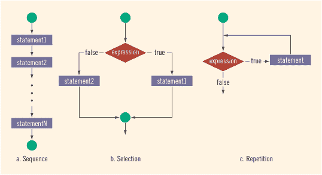

**图 4-1** 执行流程

在学习选择和重复之前，你必须理解条件语句的性质以及如何使用它们。考虑以下三条语句：

- 1. `if (score is greater than or equal to 90)`  
  `grade is A`
- 2. `if (hours worked are less than or equal to 40)`  
  `wages = rate * hours`  
  `otherwise`  
  `wages = (rate * 40) + 1.5 * (rate * (hours - 40))`
- 3. `if (temperature is greater than 70 degrees and it is not raining)`  
  `Go golfing!`

这些语句是条件语句的示例。你可以看到，某些语句只有在满足某些条件时才执行。如果条件求值为**真**，则满足该条件。例如，在语句1中：

```
score is greater than or equal to 90
```

如果 score 的值大于或等于90，则为**真**；否则为**假**。例如，如果 score 的值为95，则该语句求值为**真**。类似地，如果 score 的值为86，则该语句求值为**假**。

如果计算机能够识别这些类型的语句在相应值下为真，那将很有用。此外，在某些情况下，语句的真假可能取决于不止一个条件。例如，在语句3中，“温度大于70度”和“没有下雨”都必须为真，才建议去打高尔夫球。

如你所见，为了让计算机做出决策并重复语句，它必须能够对程序执行时存在的条件作出反应。接下来的几节讨论如何在 C++ 中表示和求值条件语句。

### 关系运算符

要做出决策，你必须能够表达条件并进行比较。例如，支票账户的利率和服务费可能取决于月末余额。如果余额低于某个最低余额，不仅利率较低，而且通常还会收取服务费。因此，为了确定利率，你必须能够说明最低余额，并将账户余额与最低余额进行比较（一个条件）。保险单的保费也通过说明条件并进行比较来确定。例如，为了确定保险费，你必须能够检查保单持有人的吸烟状况。不吸烟者（该条件）比吸烟者获得更低的保费。这两个例子都涉及比较项目。某些项目针对特定条件进行相等性比较；另一些项目针对特定条件进行不等性比较（大于或小于）。


在 C++ 中，条件由逻辑（布尔）表达式表示。值为 `true` 或 `false` 的表达式称为**逻辑（布尔）表达式**。此外，`true` 和 `false` 是**逻辑（布尔）值**。假设 `i` 和 `j` 是整数。考虑表达式：

```
i > j
```

如果这个表达式是逻辑表达式，那么当 `i` 的值大于 `j` 的值时，它的值为 `true`；否则，它的值为 `false`。符号 `>` 称为关系运算符。**关系运算符**允许你在程序中进行比较。

C++ 包含六个关系运算符，允许你说明条件并进行比较。表4-1列出了这些关系运算符。

**表 4-1** C++ 中的关系运算符

| 运算符 | 描述 |
|---|---|
| `==` | 等于 |
| `!=` | 不等于 |
| `<` | 小于 |
| `<=` | 小于或等于 |
| `>` | 大于 |
| `>=` | 大于或等于 |

> **注意**
>
> 在 C++ 中，符号 `==` 由两个等号组成，称为相等运算符。回想一下，符号 `=` 称为赋值运算符。请记住，相等运算符 `==` 判断两个表达式是否相等，而赋值运算符 `=` 将表达式的值赋给变量。

每个关系运算符都是**二元运算符**；也就是说，它需要两个操作数。由于比较的结果是 `true` 或 `false`，使用这些运算符的表达式求值为 `true` 或 `false`。

### 关系运算符与简单数据类型

你可以将关系运算符与所有三种简单数据类型一起使用。在下面的示例中，表达式同时使用整数和实数：

注意，比较不同数据类型的值可能会产生不可预测的结果。例如，下面的表达式比较一个整数和一个字符：

`8 < '5'`

在这个表达式中，在特定机器上，8 将与 `'5'` 的整理序列（即53）进行比较。也就是说，8 与53进行比较，这使得这个特定表达式求值为 `true`。

诸如 `4 < 6` 和 `'R' > 'T'` 这样的表达式是**逻辑（布尔）**表达式的示例。当 C++ 求值一个逻辑表达式时，如果该逻辑表达式求值为 `true`，则返回整数值1；否则返回整数值0。在 C++ 中，任何非零值都被视为 `true`。

> **注意**
>
> 第2章介绍了 bool 数据类型。回想一下，bool 数据类型有两个值：true 和 false。在 C++ 中，true 和 false 是保留字。标识符 true 被设置为1，标识符 false 被设置为0。为了可读性，每当使用逻辑表达式时，这里将使用标识符 true 和 false 作为逻辑表达式的值。

### 关系运算符与 string 类型

关系运算符可以应用于 `string` 类型的变量。`string` 类型的变量逐字符进行比较，从第一个字符开始，并使用 ASCII 整理序列。逐字符比较会一直持续到发现不匹配，或者最后一个字符已比较且相等为止。下面的示例展示了如何比较 `string` 类型的变量。

### 示例 4-2

假设你有以下语句：

```
    string str1 = "Hello";
    string str2 = "Hi";
    string str3 = "Air";
    string str4 = "Bill";
    string str5 = "Big";
```

下面的表达式展示了字符串关系表达式如何求值。

| 表达式 | 值/解释 |
| --- | --- |
| `str1 < str2` | `true`<br>`str1 = "Hello"` 且 `str2 = "Hi"`。`str1` 和 `str2` 的第一个字符相同，但 `str1` 的第二个字符 `'e'` 小于 `str2` 的第二个字符 `'i'`。因此，`str1 < str2` 为 true。 |


本书配套网站上的程序 `Chapter4_StringComparisons.cpp` 展示了前面这些表达式的结果。

## 逻辑（布尔）运算符与逻辑表达式

本节介绍如何构造和求值由其他逻辑表达式组合而成的逻辑表达式。**逻辑（布尔）运算符**使你能够组合逻辑表达式。C++ 有三个逻辑（布尔）运算符，如表 4-2 所示。

**表 4-2** C++ 中的逻辑（布尔）运算符

| 运算符 | 描述 |
|---|---|
| `!` | 非 |
| `&&` | 与 |
| `\|\|` | 或 |

逻辑运算符只接受逻辑值作为操作数，并且只产生逻辑值作为结果。运算符 `!` 是一元运算符，因此它只有一个操作数。运算符 `&&` 和 `||` 是二元运算符。表 4-3、4-4 和 4-5 定义了这些运算符。

表 4-3 定义了运算符 `!`（非）。使用 `!` 运算符时，`!true` 为假，`!false` 为真。将 `!` 放在逻辑表达式前面会反转该逻辑表达式的值。

**表 4-3** `!`（非）运算符

| 表达式 | `!(Expression)` |
|---|---|
| `true (nonzero)` | `false (0)` |
| `false (0)` | `true (1)` |

### 示例 4-3

| 表达式 | 值 | 说明 |
|---|---|---|
| `!('A' > 'B')` | `true` | 因为 `'A' > 'B'` 为假，所以 `!('A' > 'B')` 为真。 |
| `!(6 <= 7)` | `false` | 因为 `6 <= 7` 为真，所以 `!(6 <= 7)` 为假。 |

### 示例 4-5

| 表达式 | 值 | 说明 |
|---|---|---|
| `(14 >= 5) \|\| ('A' > 'B')` | `true` | 因为 `(14 >= 5)` 为真，`('A' > 'B')` 为假，且 `true \|\| false` 为真，所以该表达式求值为真。 |
| `(24 >= 35) \|\| ('A' > 'B')` | `false` | 因为 `(24 >= 35)` 为假，`('A' > 'B')` 为假，且 `false \|\| false` 为假，所以该表达式求值为假。 |
| `('A' <= 'a') \|\| (7 != 7)` | `true` | 因为 `('A' <= 'a')` 为真，`(7 != 7)` 为假，且 `true \|\| false` 为真，所以该表达式求值为真。 |

## 优先级顺序

复杂的逻辑表达式可能难以求值。考虑下面的逻辑表达式：

```cpp
11 > 5 || 6 < 15 && 7 >= 8
```

这个逻辑表达式会得到不同结果，取决于先计算 `||` 还是 `&&`。如果先计算 `||`，表达式的求值为 `false`。如果先计算 `&&`，表达式的求值为 `true`。

一个表达式可能包含算术、关系和逻辑运算符，如下面的表达式：

```cpp
5 + 3 <= 9 && 2 > 3
```

要处理复杂的逻辑表达式，必须有一套用于计算运算符的优先级方案。表 4-6 显示了一些 C++ 运算符的优先级顺序，包括算术、关系和逻辑运算符。（所有 C++ 运算符的优先级见附录 B。）

**表 4-6** —— 运算符的优先级

| 运算符 | 优先级 |
|---|---|
| `!, +, -`（一元运算符） | 第一 |
| `*, /, %` | 第二 |
| `+, -` | 第三 |
| `<, <=, >=, >` | 第四 |
| `==, !=` | 第五 |
| `&&` | 第六 |
| `\|\|` | 第七 |
| `=`（赋值运算符） | 最后 |

> **注意** 在 C++ 中，`&` 和 `|` 也是运算符。这些运算符的含义与 `&&` 和 `||` 的含义不同。用 `&` 代替 `&&`，或用 `|` 代替 `||`——这可能是打字错误造成的——会产生非常奇怪的结果。

在表达式中使用优先级规则时，关系运算符和逻辑运算符从左到右计算。由于关系运算符和逻辑运算符从左到右计算，这些运算符的**结合性**被称为从左到右。

示例 4-6 说明了由变量组成的逻辑表达式如何求值。

### 示例 4-6

假设有如下声明：

```cpp
bool found = true;
int age = 20;
double hours = 45.30;
double overTime = 15.00;
int count = 20;
char ch = 'B';
```

考虑以下表达式：

| 表达式 | 值 / 说明 |
|---|---|
| `!found` | **假**<br>因为 found 是 `true`，所以 `!found` 是 **假**。 |
| `hours > 40.00` | **真**<br>因为 hours 是 45.30，且 45.30 > 40.00 为 `true`，所以表达式 `hours > 40.00` 求值为 `true`。 |
| `!age` | **假**<br>age 是 20，非零，因此 age 为 `true`。所以 `!age` 为 **假**。 |
| `!found && (age >= 18)` | **假**<br>`!found` 为 `false`；`age >= 18` 即 20 >= 18，为 `true`。因此，`!found && (age >= 18)` 为 `false && true`，求值为 **假**。 |
| `!(found && (age >= 18))` | **假**<br>现在，`found && (age >= 18)` 为 `true && true`，求值为 `true`。因此，`!(found && (age >= 18))` 为 `!true`，求值为 **假**。 |
| `hours + overTime <= 75.00` | 真<br>因为 `hours + overTime` 为 `45.30 + 15.00 = 60.30`，且 `60.30 <= 75.00` 为真，所以 `hours + overTime <= 75.00` 求值为 `true`。 |
| `(count >= 0) &&<br>(count <= 100)` | 真<br>现在，`count` 为 `20`。因为 `20 >= 0` 为真，所以 `count >= 0` 为真。并且，`20 <= 100` 为真，因此 `count <= 100` 为真。所以，`(count >= 0) && (count <= 100)` 为 `true && true`，求值为 `true`。 |
| `('A' <= ch && ch <= 'Z')` | 真<br>这里，`ch` 为 `'B'`。因为 `'A' <= 'B'` 为真，所以 `'A' <= ch` 求值为 `true`。并且，因为 `'B' <= 'Z'` 为真，所以 `ch <= 'Z'` 为真。因此，`('A' <= ch && ch <= 'Z')` 为 `true && true`，求值为 `true`。 |

下面的程序计算并输出这些逻辑表达式的值。注意，如果逻辑表达式求值为真，则相应输出为 1；如果逻辑表达式求值为假，则相应输出为 0，如程序末尾的输出所示。（回想一下，如果逻辑表达式的值为真，则求值为 1；如果逻辑表达式的值为假，则求值为 0。）

```cpp
//Chapter 4 Logical operators

#include <iostream>
#include <iomanip>

using namespace std;

int main()
{
    bool found = true;
    int age = 20;
    double hours = 45.30;
    double overTime = 15.00;
    int count = 20;
    char ch = 'B';

    cout << fixed << showpoint << setprecision(2);
    cout << "found = " << found << ", age = " << age
         << ", hours = " << hours << ", overTime = " << overTime
         << "," << endl << "count = " << count
         << ", ch = " << ch << endl << endl;

    cout << "!found evaluates to " << !found << endl;
    cout << "hours > 40.00 evaluates to " << (hours > 40.00) << endl;
    cout << "!age evaluates to " << !age << endl;
    cout << "!found && (hours >= 0) evaluates to "
         << (!found && (hours >= 0)) << endl;
    cout << "!(found && (hours >= 0)) evaluates to "
         << (!(found && (hours >= 0))) << endl;
    cout << "hours + overTime <= 75.00 evaluates to "
         << (hours + overTime <= 75.00) << endl;
    cout << "(count >= 0) && (count <= 100) evaluates to "
         << ((count >= 0) && (count <= 100)) << endl;
    cout << "('A' <= ch && ch <= 'Z') evaluates to "
         << ('A' <= ch && ch <= 'Z') << endl;

    return 0;
}
```

**示例运行：**

```text
found = 1, age = 20, hours = 45.30, overTime = 15.00,
count = 20, ch = B

!found evaluates to 0
hours > 40.00 evaluates to 1
!age evaluates to 0
!found && (hours >= 0) evaluates to 0
!(found && (hours >= 0)) evaluates to 0
hours + overTime <= 75.00 evaluates to 1
(count >= 0) && (count <= 100) evaluates to 1
('A' <= ch && ch <= 'Z') evaluates to 1
```

可以在表达式中插入括号以阐明其含义。也可以使用括号来覆盖运算符的优先级。使用标准优先级顺序，表达式：

```cpp
11 > 5 || 6 < 15 && 7 >= 8
```

等价于：

```cpp
11 > 5 || (6 < 15 && 7 >= 8)
```

在这个表达式中，11 > 5 是 *真*，6 < 15 是 *真*，7 >= 8 是 *假*。将这些值代入表达式 11 > 5 || (6 < 15 && 7 >= 8)，得到 *真* || (*真* && *假*) = *真* || *假* = *真*。因此，表达式 11 > 5 || (6 < 15 && 7 >= 8) 求值为 *真*。

在 C++ 中，逻辑（布尔）表达式可以通过以下两种方式之一进行操作或处理：使用 `int` 变量或使用 `bool` 变量。以下各节介绍这些方法。

## `int` 数据类型与逻辑（布尔）表达式

早期版本的 C++ 没有提供具有逻辑（或布尔）值 *真* 和 *假* 的内置数据类型。因为逻辑表达式求值为 1 或 0，所以逻辑表达式的值存储在 `int` 数据类型的变量中。因此，可以使用 `int` 数据类型来操作逻辑（布尔）表达式。


回想一下，非零值被视为**真**。现在，考虑以下声明：

```cpp
int legalAge;
int age;
```

以及赋值语句：

```cpp
legalAge = 21;
```

如果将 legalAge 视为逻辑变量，则该语句赋给 legalAge 的值为真。

赋值语句：

```cpp
legalAge = (age >= 21);
```

如果 age 的值大于或等于 21，则该语句将值 1 赋给 legalAge。如果 age 的值小于 21，则该语句将值 0 赋给 legalAge。

## bool 数据类型与逻辑（布尔）表达式

较新版本的 C++ 包含一种内置数据类型 bool，它具有逻辑（布尔）值真和假。因此，可以使用 bool 数据类型来操作逻辑（布尔）表达式。回想一下，在 C++ 中，bool、true 和 false 是保留字。此外，标识符 true 的值为 1，标识符 false 的值为 0。现在，考虑以下声明：

```cpp
bool legalAge;
int age;
```

语句：

```cpp
legalAge = true;
```

将变量 legalAge 的值设置为真。语句：

```cpp
legalAge = (age >= 21);
```

如果 age 的值大于或等于 21，则将值真赋给 legalAge。如果 age 的值小于 21，则该语句将值假赋给 legalAge。例如，如果 age 的值为 25，则赋给 legalAge 的值为真——即 1。类似地，如果 age 的值为 16，则赋给 legalAge 的值为假——即 0。

> **注意**
>
> 可以使用 int 变量或 bool 变量来存储逻辑表达式的值。为清晰起见，本书使用 bool 变量来存储逻辑表达式的值。

## 选择：if 和 if...else

尽管只有两个逻辑值——真和假，但它们被证明极其有用，因为它们使程序能够纳入改变处理流程的决策。本章其余部分讨论将决策纳入程序的方法。在 C++ 中，有两种选择结构，或称分支控制结构：**if** 语句和 switch 结构。本节讨论如何使用 **if** 和 **if...else** 语句创建单向选择、双向选择和多向选择。**switch** 结构将在本章后面讨论。

### 单向选择

银行希望在客户的支票账户余额低于所需最低余额时向其发送通知。也就是说，如果账户余额低于所需最低余额，则应向客户发送通知；否则，不应做任何事。类似地，如果保险单持有人不吸烟，公司希望对该保单保费给予 10% 的折扣。这两个示例都涉及单向选择。在 C++ 中，使用 **if** 语句实现单向选择。单向选择的语法为：

```cpp
if (expression)
    statement
```

注意该语法的组成部分。它以保留字 **if** 开始，后面是括号内的表达式，再后面是一条语句。注意，表达式两侧的括号是语法的一部分。该表达式有时称为**决策者**，因为它决定是否执行其后的语句。该表达式通常是逻辑表达式。如果表达式的值为真，则执行该语句。如果值为假，则不执行该语句，计算机继续执行程序中的下一条语句。表达式后面的语句有时称为**操作语句**。图 4-2 展示了 **if** 语句（单向选择）的执行流程。

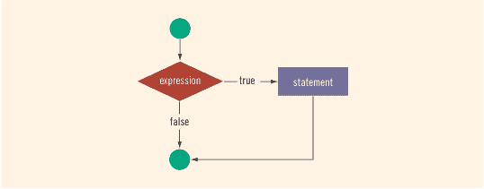

**图 4-2** 单向选择

### 示例 4-7

```cpp
if (score >= 60)
    grade = 'P';
```

在此代码中，如果表达式 (score >= 60) 的值为真，则执行赋值语句 grade = 'P'。如果表达式的值为假，则执行 if 结构后面的语句（如果有）。例如，如果 score 的值为 65，则赋给变量 grade 的值为 'P'。

### 示例 4-8

以下 C++ 程序求一个整数的绝对值。

```cpp
//Program: Absolute value of an integer

#include <iostream>

using namespace std;

int main()
{
    int number, temp;

    cout << "Line 1: Enter an integer: ";        //Line 1
    cin >> number;                               //Line 2
    cout << endl;                                //Line 3

    temp = number;                               //Line 4

    if (number < 0)                              //Line 5
        number = -number;                        //Line 6

    cout << "Line 7: The absolute value of "
         << temp << " is " << number << endl;   //Line 7

    return 0;
}
```

**示例运行：** 在此示例运行中，用户输入以阴影表示。

```
Line 1: Enter an integer: -6734
Line 7: The absolute value of -6734 is 6734
```

第 1 行的语句提示用户输入一个整数；第 2 行的语句将该数字输入到变量 number 中。第 4 行的语句将 number 的值复制到 temp 中，第 5 行的语句检查 number 是否为负数。如果 number 为负数，第 6 行的语句将 number 改为正数。第 7 行的语句输出该数字及其绝对值。注意，由于我们希望同时输出 number 及其绝对值，并且如果 number 为负数，if 语句会将 number 改为正数，因此我们在第 4 行将 number 的值复制到 temp 中。

### 示例 4-9

考虑以下语句：

```cpp
if score >= 60     //syntax error
    grade = 'P';
```

该语句展示了一个 if 语句的错误版本。逻辑表达式两侧的括号缺失，这是语法错误。

在 if 语句中表达式的括号之后（也就是语句之前）放置分号是语义错误。如果分号紧跟在右括号之后，则 if 语句将作用于空语句。

### 示例 4-10

考虑以下 C++ 语句：

```cpp
if (score >= 60);        //Line 1
    grade = 'P';          //Line 2
```

因为表达式末尾有一个分号（见第 1 行），所以第 1 行的 if 语句终止。该 if 语句的动作是空操作，并且第 2 行的语句不属于第 1 行的 if 语句。因此，无论 if 语句如何求值，第 2 行的语句都会执行。

### 双向选择

在许多编程情形中，必须在两个备选方案之间进行选择。例如，如果兼职员工加班，则使用加班工资公式计算薪水；否则，使用常规公式计算薪水。这是一个双向选择的示例。为了在两个备选方案之间进行选择——也就是实现双向选择——C++ 提供了 if...else 语句。双向选择使用以下语法：

```cpp
if (expression)
    statement1
else
    statement2
```

花一点时间检查该语法。它以保留字 if 开始，后面是括号内的逻辑表达式，再后面是一条语句，然后是保留字 else，再后面是第二条语句。语句 1 和语句 2 是任何有效的 C++ 语句。在双向选择中，如果表达式的值为真，则执行语句 1。如果表达式的值为假，则执行语句 2。图 4-3 展示了 if...else 语句（双向选择）的执行流程。

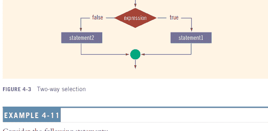

**图 4-3** 双向选择

### 示例 4-11

考虑以下语句：

```cpp
if (hours > 40.0)                       //Line 1
    wages = 40.0 * rate +
        1.5 * rate * (hours - 40.0);    //Line 2
else                                    //Line 3
    wages = hours * rate;               //Line 4
```

如果变量 hours 的值大于 40.0，则工资包含加班费。假设 hours 为 50。第 1 行 if 语句中的表达式的值为真，因此执行第 2 行的语句。另一方面，如果 hours 为 30 或任何小于或等于 40 的数，则第 1 行 if 语句中的表达式的值为假。在这种情况下，程序跳过第 2 行的语句并执行第 4 行的语句——也就是执行保留字 else 后面的语句。

在双向选择语句中，在表达式之后、语句 1 之前放置分号会产生语法错误。如果 if 语句以分号结束，则语句 1 不再是 if 语句的一部分，而 if...else 语句的 else 部分会独立存在。C++ 中没有独立的 else 语句。也就是说，它不能与 if 语句分离。


### 示例 4-12

```cpp
if (hours > 40.0)                         //Line 1
    wages = 40.0 * rate +                 //Line 2
            1.5 * rate * (hours - 40.0);  //Line 2
else                                      //Line 3
    wages = hours * rate;                 //Line 4
```

`if` 语句末尾的分号（见第 1 行）结束了该 `if` 语句，因此第 2 行的语句将 `else` 子句与 `if` 语句分隔开。也就是说，`else` 本身就是一个错误。由于 C++ 中没有独立的 `else` 语句，这段代码会产生语法错误。如示例 4-10 所示，在单向选择中，`if` 语句末尾的分号是逻辑错误；而如本示例所示，在双向选择中，它是语法错误。

### 示例 4-13

下面的程序计算员工的周薪。如果工作小时数超过 40，工资将包含加班费。

```cpp
//Program: Weekly wages

#include <iostream>
#include <iomanip>

using namespace std;

int main()
{
        double wages, rate, hours;

        cout << fixed << showpoint << setprecision(2);  //Line 1
        cout << "Line 2: Enter working hours and rate: "; //Line 2
        cin >> hours >> rate;                            //Line 3

        if (hours > 40.0)                                //Line 4
                wages = 40.0 * rate +                    
                        1.5 * rate * (hours - 40.0);     //Line 5
        else                                             //Line 6
                wages = hours * rate;                    //Line 7

        cout << endl;                                    //Line 8
        cout << "Line 9: The wages are $" << wages
             << endl;                                    //Line 9

        return 0;
}
```

**示例运行：** 在此示例运行中，用户输入部分有底纹。

```
Line 2: Enter working hours and rate: 56.45 12.50

Line 9: The wages are $808.44
```

第 1 行的语句将浮点数的输出设置为固定小数格式，带有小数点、尾随零和两位小数。第 2 行的语句提示用户输入工作小时数和工资率。第 3 行的语句将这些值分别输入到变量 hours 和 rate 中。第 4 行的语句检查变量 hours 的值是否大于 40.0。如果 hours 大于 40.0，则由第 5 行的语句计算工资，其中包含加班费。否则，由第 7 行的语句计算工资。第 9 行的语句输出工资。

现在让我们考虑另一个 `if` 语句的示例，并考察一些可能发生的语义错误。

### 示例 4-14

考虑以下语句：

```cpp
if (score >= 60)                  //Line 1
    cout << "Passing" << endl;       //Line 2
    cout << "Failing" << endl;        //Line 3
```

如果表达式 (score >= 60) 的求值结果为 false，则第 2 行的输出语句不会执行。因此输出将是 Failing。也就是说，这组语句执行的动作与 `if...else` 语句相同。它将执行第 3 行的输出语句，而不是第 2 行的输出语句。例如，如果 score 的值为 50，这些语句将输出以下行：

```
Failing
```

然而，如果表达式 (score >= 60) 的求值结果为 true，程序将执行两个输出语句，产生非常不理想的结果。例如，如果 score 的值为 70，这些语句将输出以下行：

```
Passing
Failing
```

该 `if` 语句只控制第 2 行语句的执行。第 3 行的语句始终会执行。

根据 score 的值打印 Passing 或 Failing 的正确代码是：

```cpp
if (score >= 60)
    cout << "Passing" << endl;
else
    cout << "Failing" << endl;
```

## 复合（块）语句

`if` 和 `if...else` 结构一次只控制一条语句。然而，假设当 `if` 或 `if...else` 语句中的表达式求值为 `true` 时，你希望执行多条语句。为了允许更复杂的语句，C++ 提供了一种称为**复合语句**或**语句块**的结构。复合语句采用以下形式：

```cpp
{
    statement_1
    statement_2
    .
    .
    .
    statement_n
}
```

也就是说，复合语句由一对花括号 `{` 和 `}` 括起来的一系列语句组成。在 `if` 或 `if...else` 结构中，复合语句的作用就像一条语句一样。因此，与使用类似以下代码的简单双向选择不同：

```cpp
if (age >= 18)
    cout << "Eligible to vote." << endl;
else
    cout << "Not eligible to vote." << endl;
```

你可以包含复合语句，类似以下代码：

```cpp
if (age >= 18)
{
    cout << "Eligible to vote." << endl;
    cout << "No longer a minor." << endl;
}
else
{
    cout << "Not eligible to vote." << endl;
    cout << "Still a minor." << endl;
}
```

复合语句非常有用，本章大多数结构化语句中都会使用它。

## 多重选择：嵌套 `if`

在前面的章节中，你学习了如何在程序中实现单向和双向选择。有些问题需要实现两个以上的备选方案。例如，假设如果支票账户余额超过 $50,000，利率为 7%；如果余额在 $25,000 到 $49,999.99 之间，利率为 5%；如果余额在 $1,000 到 $24,999.99 之间，利率为 3%；否则，利率为 0%。这个特定问题有四个备选方案——也就是多条选择路径。如果操作语句本身是 `if` 或 `if...else` 语句，你可以通过使用 `if...else` 结构在程序中包含多条选择路径。当一个控制语句位于另一个控制语句内部时，就称其为嵌套。

示例 4–15 说明了如何使用嵌套 `if...else` 结构来实现多重选择。

### 示例 4-15

假设 `balance` 和 `interestRate` 是 `double` 类型的变量。以下语句根据余额的值确定 `interestRate`。

```cpp
if (balance > 50000.00)              //Line 1
    interestRate = 0.07;             //Line 2
else                                  //Line 3
    if (balance >= 25000.00)          //Line 4
        interestRate = 0.05;          //Line 5
    else                              //Line 6
        if (balance >= 1000.00)       //Line 7
            interestRate = 0.03;      //Line 8
        else                          //Line 9
            interestRate = 0.00;      //Line 10
```

嵌套 `if...else` 结构要求回答一个重要问题：你如何知道哪个 `else` 与哪个 `if` 配对？回想一下，在 C++ 中没有独立的 `else` 语句。每个 `else` 都必须与一个 `if` 配对。将 `else` 与 `if` 配对的规则如下：

**将 `else` 与 `if` 配对：** 在嵌套 `if` 语句中，C++ 会将 `else` 与最近未完成的 `if` 关联起来——也就是最近尚未与 `else` 配对的 `if`。

使用此规则，在示例 4–15 中，第 3 行的 `else` 与第 1 行的 `if` 配对。第 6 行的 `else` 与第 4 行的 `if` 配对，第 9 行的 `else` 与第 7 行的 `if` 配对。

为避免过度缩进，示例 4–15 中的代码可以重写如下：

```cpp
if (balance > 50000.00)              //Line 1
    interestRate = 0.07;             //Line 2
else if (balance >= 25000.00)         //Line 3
    interestRate = 0.05;              //Line 4
else if (balance >= 1000.00)          //Line 5
    interestRate = 0.03;              //Line 6
else                                  //Line 7
    interestRate = 0.00;              //Line 8
```

以下示例将帮助你了解使用嵌套 `if` 结构实现多重选择的各种方式。


### 示例 4-16

```cpp
if (score >= 90)
    cout << "The grade is A." << endl;
else if (score >= 80)
    cout << "The grade is B." << endl;
else if (score >= 70)
    cout << "The grade is C." << endl;
else if (score >= 60)
    cout << "The grade is D." << endl;
else
    cout << "The grade is F." << endl;
```

### 示例 4-17

假设所有变量都已正确声明，并考虑以下语句：

```cpp
if (temperature >= 50)                         //Line 1
    if (temperature >= 80)                     //Line 2
        cout << "Good day for swimming." << endl;  //Line 3
    else                                       //Line 4
        cout << "Good day for golfing." << endl;   //Line 5
else                                           //Line 6
    cout << "Good day to play tennis." << endl;    //Line 7
```

在这段 C++ 代码中，第 4 行的 else 与第 2 行的 if 配对，第 6 行的 else 与第 1 行的 if 配对。注意，第 4 行的 else 不能与第 1 行的 if 配对。如果你将第 4 行的 else 与第 1 行的 if 配对，那么第 2 行的 if 就成为第 1 行的 if 的动作语句部分，从而使第 6 行的 else 悬空。此外，第 2 行到第 5 行的语句构成第 1 行的 if 的语句部分。缩进并不决定配对关系，但应当用来表达配对关系。

### 示例 4-18

假设所有变量都已正确声明，并考虑以下语句：

```cpp
if (temperature >= 70)                         //Line 1
    if (temperature >= 80)                     //Line 2
        cout << "Good day for swimming." << endl;  //Line 3
    else                                       //Line 4
        cout << "Good day for golfing." << endl;   //Line 5
```

```cpp
if (month == 4)
    cout << "April" << endl;
if (month == 5)
    cout << "May" << endl;
if (month == 6)
    cout << "June" << endl;
```

程序段 (a) 写为一系列 **if...else** 语句；程序段 (b) 写为一系列 **if** 语句。两个程序段完成相同的事情。如果 month 为 3，则两个程序段都输出 March。如果 month 为 1，则在程序段 (a) 中，第 1 行的 **if** 语句中的表达式求值为 **true**。与此 **if** 关联的语句（在第 2 行）随后执行；该结构的其余部分，即此 **if** 语句的 **else**，被跳过；其余 **if** 语句不求值。在程序段 (b) 中，计算机必须对每个 **if** 语句中的表达式求值，因为没有 **else** 语句。因此，程序段 (b) 的执行速度比程序段 (a) 慢。

## 短路求值

C++ 中的逻辑表达式使用一种高效算法进行求值。以下语句说明了该算法：

```cpp
(x > y) || (x == 5)      //Line 1
(a == b) && (x >= 7)     //Line 2
```

在第 1 行的语句中，运算符 **||** 的两个操作数是表达式 (x > y) 和 (x == 5)。如果操作数 (x > y) 为 **true** 或操作数 (x == 5) 为 **true**，则该表达式的求值结果为 **true**。使用短路求值时，计算机从左到右对逻辑表达式求值。一旦整个逻辑表达式的值已知，求值就停止。例如，在语句 1 中，如果操作数 (x > y) 求值为 **true**，则整个表达式求值为 **true**，因为 **true || true** 为 **true**，且 **true || false** 为 **true**。因此，操作数 (x == 5) 的值对最终结果没有影响。

类似地，在第 2 行的语句中，运算符 **&&** 的两个操作数是 (a == b) 和 (x >= 7)。如果操作数 (a == b) 求值为 **false**，则整个表达式求值为 **false**，因为 **false && true** 为 **false**，且 **false && false** 为 **false**。

**短路求值**（针对逻辑表达式）：计算机从左到右对逻辑表达式求值，并在表达式值已知时立即停止的过程。

### 示例 4-20

考虑以下表达式：

```cpp
(age >= 21) || (x == 5)       //Line 1
(grade == 'A') && (x >= 7)     //Line 2
```

对于第 1 行中的表达式，假设 age 的值为 25。因为 (25 >= 21) 为 true，且表达式中使用的逻辑运算符是 ||，所以该表达式求值为 true。由于短路求值，计算机不会对表达式 (x == 5) 求值。类似地，对于第 2 行中的表达式，假设 grade 的值为 'B'。因为 ('B' == 'A') 为 false，且表达式中使用的逻辑运算符是 &&，所以该表达式求值为 false。计算机不会对 (x >= 7) 求值。

## 比较浮点数是否相等：一个注意事项

比较浮点数是否相等的行为可能与你预期的不一样。例如，考虑以下程序：

```cpp
#include <iostream>
#include <iomanip>
#include <cmath>

using namespace std;

int main()
{
    double x = 1.0;
    double y = 3.0 / 7.0 + 2.0 / 7.0 + 2.0 / 7.0;

    cout << fixed << showpoint << setprecision(17);

    cout << "3.0 / 7.0 + 2.0 / 7.0 + 2.0 / 7.0 = "
         << 3.0 / 7.0 + 2.0 / 7.0 + 2.0 / 7.0 << endl;

    cout << "x = " << x << endl;
    cout << "y = " << y << endl;

    if (x == y)
        cout << "x and y are the same." << endl;
    else
        cout << "x and y are not the same." << endl;

    if (fabs(x - y) < 0.000001)
        cout << "x and y are the same within the tolerance "
             << "0.000001." << endl;
    else
        cout << " x and y are not the same within the "
             << "tolerance 0.000001." << endl;

    return 0;
}
```

**示例运行：**

```text
3.0 / 7.0 + 2.0 / 7.0 + 2.0 / 7.0 = 0.9999999999999989
x = 1.000000000000000000
y = 0.9999999999999989
x and y are not the same.
x and y are the same within the tolerance 0.000001.
```

在这个程序中，x 初始化为 1.0，y 初始化为 3.0 / 7.0 + 2.0 / 7.0 + 2.0 / 7.0。现在，由于舍入，如输出所示，该表达式的求值结果为 0.9999999999999989。因此，表达式 (x == y) 求值为 *false*。然而，如果你用纸和笔手工计算表达式 3.0 / 7.0 + 2.0 / 7.0 + 2.0 / 7.0，你会得到 3.0 / 7.0 + 2.0 / 7.0 + 2.0 / 7.0 = (3.0 + 2.0 + 2.0) / 7.0 = 7.0 / 7.0 = 1.0。也就是说，y 的值应设为 1.0。

前面的程序及其输出表明，在比较浮点数是否相等时应小心。检查两个浮点数是否相等的一种方法是检查它们之差的绝对值是否小于某个容差。例如，假设容差为 0.000001。那么，如果 (x - y) 的绝对值小于 0.000001，则 x 和 y 相等。为求绝对值，可以使用头文件 *cmath* 中的函数 fabs，如程序所示。因此，表达式 fabs(x - y) < 0.000001 判断 (x - y) 的绝对值是否小于 0.000001。

### 关系运算符的结合性：一个注意事项

有时逻辑表达式的行为可能与你预期的不一样，如下面的程序所示，该程序判断一个数是否在 0 到 10 之间（含 0 和 10）。

```cpp
#include <iostream>

using namespace std;

int main()
{
    int num;

    cout << "Enter an integer: ";
    cin >> num;
    cout << endl;

    if (0 <= num <= 10)
        cout << num << " is within 0 and 10." << endl;
    else
        cout << num << " is not within 0 and 10." << endl;

    return 0;
}
```

**示例运行：** 在这些示例运行中，用户输入以阴影显示。

**示例运行 1：**

```text
Enter an integer: 5

5 is within 0 and 10.
```

**示例运行 2：**

```text
Enter an integer: 20

20 is within 0 and 10.
```

**示例运行 3：**

```text
Enter an integer: -10

-10 is within 0 and 10.
```

显然，示例运行 1 是正确的，而示例运行 2 和 3 不正确。因为 `if` 语句判断一个整数是否在 0 到 10 之间，所以问题出在 `if` 语句中的表达式上。那么，让我们看看这个表达式，即：

```cpp
0 <= num <= 10
```

尽管该语句是合法的 C++ 表达式，但得不到期望的结果。让我们对 num 的某些值求值这个表达式。假设 num 的值为 5。那么：

|  |  |  |
| --- | --- | --- |
| 0 <= num <= 10 | = 0 <= 5 <= 10 |  |
|  | = (0 <= 5) <= 10 | （因为关系运算符从左到右求值） |
|  | = 1 <= 10 | （因为 0 <= 5 为 true，所以 0 <= 5 求值为 1） |
|  | = 1 (true) |  |

现在，假设 num = 20。那么：

|  |  |  |
| --- | --- | --- |
| 0 <= num <= 10 | = 0 <= 20 <= 10 |  |
|  | = (0 <= 20) <= 10 | （因为关系运算符从左到右求值） |
|  | = 1 <= 10 | （因为 0 <= 20 为 true，所以 0 <= 20 求值为 1） |
|  | = 1 (true) |  |

现在，你可以看出为什么当 `num` 为 20 时该表达式求值为 `true`。类似地，如果 `num` 为 -10，表达式 `0 <= num <= 10` 求值为 `true`。事实上，无论 `num` 是什么，该表达式将始终求值为 `true`。这是因为表达式 `0 <= num` 求值为 0 或 1，而 `0 <= 10` 为 `true`，且 `1 <= 10` 为 `true`。那么，是什么呢

表达式 `0 <= num <= 10` 有什么问题？它缺少逻辑运算符 `&&`。在 C++ 中，写这个表达式的正确方式是：

`0 <= num && num <= 10`

在构造逻辑表达式时必须小心。创建复杂逻辑表达式时，必须使用正确的逻辑运算符。

## 通过避免一知半解的概念和技术来避免缺陷

第 2 章和第 3 章的调试部分说明了如何理解和修复语法错误与逻辑错误。在本节中，我们将说明如何通过避免一知半解的概念和技术来避免缺陷。

你到目前为止编写的程序应该已经说明：一个小错误，例如变量声明末尾漏掉分号，或者未正确声明就使用变量，都可能阻止程序成功编译。同样，未正确初始化就使用变量，也可能阻止程序正确运行。回想一下，与 `if` 语句关联的条件必须括在圆括号中。因此，下面的表达式会导致语法错误。

`if score >= 90`

例 4-12 说明了以下 `if` 语句条件后意外多出的分号：

`if (hours > 40.0);`

可能会阻止成功编译或正确执行。

你解决问题所采用的方法必须正确使用概念和技术；否则，你的解决方案要么不正确，要么有缺陷。如果你没有完全理解某个概念或技术，那么在完全理解之前不要使用它。使用一知半解的概念和技术所导致的问题可以通过以下程序来说明。

假设我们想编写一个分析学生 GPA 的程序。如果 GPA 大于或等于 3.9，该学生就进入院长荣誉榜。如果 GPA 小于 2.00，则向该学生发送一封警告信，说明其 GPA 低于毕业要求。因此，请考虑以下程序：

```cpp
//GPA program with bugs.

#include <iostream>        //Line 1

using namespace std;       //Line 2

int main()                 //Line 3
{                                                      //Line 4
    double gpa;                                      //Line 5

    cout << "Enter the GPA: ";                         //Line 6
    cin >> gpa;                                        //Line 7
    cout << endl;                                      //Line 8

    if (gpa >= 2.0)                                    //Line 9
        if (gpa >= 3.9)                                //Line 10
            cout << "Dean's Honor List." << endl;     //Line 11
    else                                               //Line 12
        cout << "The GPA is below the graduation "
             << "requirement. \nSee your "
             << "academic advisor." << endl;           //Line 13

    return 0;                                          //Line 14
}                                                      //Line 15
```

**示例运行：** 在这些示例运行中，用户输入以底纹显示。

**示例运行 1：**
```text
Enter the GPA: 3.91

Dean's Honor List.
```

**示例运行 2：**
```text
Enter the GPA: 3.8

The GPA is below the graduation requirement.
See your academic advisor.
```

**示例运行 3：**
```text
Enter the GPA: 1.95
```

让我们看看这些示例运行。显然，示例运行 1 的输出是正确的。在示例运行 2 中，输入为 3.8，输出表明该 GPA 低于毕业要求。然而，GPA 为 3.8 的学生会以某种荣誉毕业。因此，示例运行 2 的输出不正确。在示例运行 3 中，输入为 1.95，输出没有显示任何警告消息。因此，示例运行 3 的输出也不正确。这意味着第 9 行到第 13 行的 `if...else` 语句不正确。让我们看看这些语句，即：

```cpp
if (gpa >= 2.0)                                    //Line 9
    if (gpa >= 3.9)                                //Line 10
        cout << "Dean's Honor List." << endl;     //Line 11
else                                               //Line 12
    cout << "The GPA is below the graduation "
         << "requirement. \nSee your "
         << "academic advisor." << endl;           //Line 13
```

按照 `else` 与 `if` 配对的规则，第 12 行的 `else` 与第 10 行的 `if` 配对。换句话说，使用正确的缩进，代码为：

```cpp
if (gpa >= 2.0)                              //Line 9
    if (gpa >= 3.9)                          //Line 10
        cout << "Dean's Honor List." << endl; //Line 11
    else                                     //Line 12
        cout << "The GPA is below the graduation "
             << "requirement. \nSee your "
             << "academic advisor." << endl;        //Line 13
```

现在我们可以看到，第 9 行的 `if` 语句是一个单向选择。因此，如果输入数字小于 2.0，将不会执行任何操作，也就是说，不会打印警告消息。现在，假设输入为 3.8。那么，第 9 行的表达式求值为 `true`，因此第 10 行的表达式会被求值，而它求值为 `false`。这意味着第 13 行的输出语句会执行，从而产生不令人满意的结果。

事实上，只有当 GPA 小于 2.0 时，程序才应打印警告消息；并且它应打印消息：

院长荣誉榜。

如果 GPA 大于或等于 3.9。

为了实现该结果，第 12 行的 `else` 需要与第 9 行的 `if` 配对。要将第 12 行的 `else` 与第 9 行的 `if` 配对，需要使用复合语句，如下所示：

```cpp
if (gpa >= 2.0)                              //Line 9
{
    if (gpa >= 3.9)                          //Line 10
        cout << "Dean's Honor List." << endl; //Line 11
}
else                                         //Line 12
    cout << "The GPA is below the graduation "
         << "requirement. \nSee your "
         << "academic advisor." << endl;        //Line 13
```

正确的程序如下：

```cpp
//Correct GPA program.

#include <iostream>                              //Line 1

using namespace std;                             //Line 2

int main()                                         //Line 3
{
    double gpa;                                    //Line 4
                                                   //Line 5
    cout << "Enter the GPA: ";                    //Line 6
    cin >> gpa;                                    //Line 7
    cout << endl;                                  //Line 8

    if (gpa >= 2.0)                                  //Line 9
    {                                                //Line 10
        if (gpa >= 3.9)                              //Line 11
            cout << "Dean's Honor List." << endl;    //Line 12
    }                                                //Line 13
    else                                             //Line 14
        cout << "The GPA is below the graduation "
             << "requirement. \nSee your "
             << "academic advisor." << endl;          //Line 15

    return 0;                                    //Line 16
}                                                //Line 17
```

**示例运行：** 在这些示例运行中，用户输入以底纹显示。

**示例运行 1：**
```text
Enter the GPA: 3.91

Dean's Honor List.
```

**示例运行 2：**
```text
Enter the GPA: 3.8
```

**示例运行 3：**
```text
Enter the GPA: 1.95

The GPA is below the graduation requirement.
See your academic advisor.
```

在此类情况下，一般规则是：不能查看块内部（即花括号内部）来将 else 与 if 配对。第 14 行的 else 不能与第 11 行的 if 配对，因为第 11 行的 if 语句被包含在花括号内，而第 14 行的 else 不能查看这些花括号内部。因此，第 14 行的 else 与第 9 行的 if 配对。

在本书中，C++ 编程概念和技术按逻辑顺序呈现。当这些概念和技术按逻辑顺序一次学习一个时，它们足够简单，可以完全理解。在使用某个概念或技术之前完全理解它，将为你节省大量调试时间。

## 输入失败与 if 语句

在第 3 章中，你看到尝试读取无效数据会导致输入流进入失败状态。一旦输入流进入失败状态，与该输入流关联的所有后续输入语句都会被忽略，计算机继续执行程序，从而产生错误结果。你可以使用 if 语句检查输入流变量的状态，并且如果输入流进入失败状态，就加入停止程序执行的指令。


除了读取无效数据外，还有其他事件会导致输入流进入失败状态。导致输入失败的另外两个常见原因是：

- 尝试打开一个不存在的输入文件
- 尝试读取输入文件中超出末尾的数据

解决这些输入失败原因的一种方法是检查输入流变量的状态。你可以通过将输入流变量用作 `if` 语句中的逻辑表达式来检查其状态。如果最后一次输入成功，输入流变量的值为 `true`；如果最后一次输入失败，其值为 `false`。

语句：

```cpp
if (cin)
    cout << "Input is OK." << endl;
```

如果来自标准输入设备的最后一次输入成功，则输出：

```
Input is OK.
```

类似地，如果 `infile` 是一个 `ifstream` 变量，则语句：

```cpp
if (!infile)
    cout << "Input failed." << endl;
```

如果与流变量 `infile` 相关联的最后一次输入失败，则输出：

```
Input failed.
```

假设某个输入流变量试图打开一个文件以向程序输入数据。如果输入文件不存在，你可以将输入流变量的值与 `return` 语句结合使用来终止程序。

回想一下，函数 `main` 中的最后一条语句是：

```
return 0;
```

当程序终止时，这条语句向操作系统返回一个值 0。值 0 表示程序正常终止，并且在程序执行期间没有发生错误。除了 0 以外的 `int` 类型的值也可以通过 `return` 语句返回给操作系统。但是，返回任何非 0 的值都表示程序执行期间出现了问题。

`return` 语句可以出现在程序的任何位置。每当执行 `return` 语句时，它会立即退出其所在的函数。对于函数 `main` 而言，当执行 `return` 语句时程序即终止。你可以利用 `return` 语句的这些特性，在输入流进入失败状态时终止函数 `main`。当程序试图打开一个输入文件时，这种技术尤其有用。请考虑以下语句：

```cpp
ifstream infile;
infile.open("inputdat.dat");   // 打开 inputdat.dat

if (!infile)
{
    cout << "Cannot open the input file. "
         << "The program terminates." << endl;
    return 1;
}
```

假设文件 `inputdat.dat` 不存在。打开该文件的操作失败，导致输入流进入失败状态。作为逻辑表达式，文件流变量 `infile` 此时求值为 `false`。由于 `infile` 求值为 `false`，表达式 `!infile`（在 `if` 语句中）的值变为 `true`，因此执行 `if` 语句体。屏幕上会打印消息：

Cannot open the input file. The program terminates.

然后 `return` 语句将值 1 返回给操作系统，从而终止程序。

现在，让我们在“编程示例：第 3 章的学生成绩”中加入这些响应输入失败的代码。回忆一下，该程序根据输入文件中的数据计算平均测试分数，然后将结果输出到另一个文件。下面的编程代码与第 3 章的代码相同，只是增加了在输入文件不存在时退出程序的语句。

```cpp
//Program to calculate the average test score.

#include <iostream>
#include <fstream>
#include <iomanip>
#include <string>
using namespace std;

int main()
{
    ifstream inFile;    //input file stream variable
    ofstream outFile;   //output file stream variable

    double test1, test2, test3, test4, test5;
    double average;

    string firstName;
    string lastName;

    inFile.open("test.txt"); //open the input file

    if (!inFile)
    {
        cout << "Cannot open the input file. "
             << "The program terminates." << endl;
        return 1;
    }
    outFile.open("testavg.out");  // open the output file

    outFile << fixed << showpoint;
    outFile << setprecision(2);

    cout << "Processing data" << endl;

    inFile >> firstName >> lastName;
    outFile << "Student name: " << firstName
            << " " << lastName << endl;

    inFile >> test1 >> test2 >> test3
           >> test4 >> test5;
    outFile << "Test scores: " << setw(4) << test1
            << setw(4) << test2 << setw(4) << test3
            << setw(4) << test4 << setw(4) << test5
            << endl;

    average = (test1 + test2 + test3 + test4 + test5) / 5.0;

    outFile << "Average test score: " << setw(6)
            << average << endl;

    inFile.close();
    outFile.close();

    return 0;
}
```

## 混淆相等运算符（==）与赋值运算符（=）

回想一下，如果 `if` 语句中的判断表达式求值为 `true`，则会执行 `if` 语句的语句部分。此外，该表达式通常是一个逻辑表达式。然而，C++ 允许你使用任何可以求值为 `true` 或 `false` 的表达式作为 `if` 语句中的表达式。请考虑以下语句：

```cpp
if (x = 5)
    cout << "The value is five." << endl;
```

`if` 语句中的表达式——即判断条件——是 `x = 5`。表达式 `x = 5` 被称为**赋值表达式**，因为运算符 `=` 出现在表达式中，且末尾没有分号。

该表达式的求值过程如下。首先，求运算符 `=` 右侧的值，结果为 5。然后将值 5 赋给 `x`。而且，值 5——即

将表达式 `y + z` 的值赋给 `x`。而语句：

```
x == y + z;
```

比较表达式 `y + z` 的值与 `x` 的值；但 `x` 的值保持不变。如果在程序的其它地方你依赖于 `x` 的值等于 `y + z`，则会发生逻辑错误，程序输出将是错误的，而且你不会从编译器那里收到任何关于这种情况的警告。编译器只提供关于语法错误的反馈，而不是逻辑错误。因此，在使用相等运算符和赋值运算符时必须格外小心。

## 条件运算符（?:）

> **注意** 读者可以跳过本节，不会影响学习的连续性。

某些 `if...else` 语句可以通过使用 C++ 的条件运算符来编写得更简洁。**条件运算符**写作 `?:`，是一个**三元运算符**，这意味着它接受三个参数。使用条件运算符的语法是：

```
expression1 ? expression2 : expression3
```

这种类型的语句被称为**条件表达式**。条件表达式的求值方式如下：如果 expression1 的值为非零整数（即 `true`），则条件表达式的结果是 expression2；否则，条件表达式的结果是 expression3。

请考虑以下语句：

```cpp
if (a >= b)
    max = a;
else
    max = b;
```

你可以使用条件运算符将这条 `if...else` 语句简化书写为：

```cpp
max = (a >= b) ? a : b;
```

## 程序风格与格式（再讨论）：缩进

在第 2 章的“程序风格与格式”一节中，我们给出了一些编写程序的指导准则。既然我们已经开始讨论控制结构，在本节中，我们将给出一些正确缩进程序的通用指导准则。

当你编写程序时，拼写错误和逻辑错误是不可避免的。如果你的程序缩进得当，你就能快速发现并修复错误，本章中的几个示例就说明了这一点。通常情况下，你使用的 IDE 会自动缩进你的程序。如果由于某种原因你的 IDE 没有缩进程序，你可以自己缩进程序。

正确的缩进可以显示语句的自然分组。你应该在自然分离的语句之间插入一个空行。在本书中，花括号内的语句、选择结构的语句以及 `if` 语句内的 `if` 语句都向右缩进四个空格。在整本书中，我们使用四个空格来缩进语句，尤其是为了显示控制结构嵌套在其它控制结构中的层级。你也可以使用四个空格进行缩进。

放置花括号有两种常用的风格。在本书中，我们将花括号单独放在一行上。同时，匹配的左、右花括号位于同一列，即它们距离程序左边缘的空格数相同。这种放置花括号的风格可以轻松显示语句的分组，并且能使左右花括号匹配。你也可以采用这种风格来放置和缩进花括号。

在第二种放置花括号的风格中，左花括号不必单独占一行。通常，对于控制结构，左花括号放在（逻辑）表达式的最后一个右括号后面，而右花括号单独占一行。这种风格可能会节省一些空间。然而，有时这种风格可能无法立即显示语句的分组或块。

无论你使用什么缩进风格，你都应该在程序中保持一致性，并且缩进应该显示程序的结构。

## 使用伪代码开发、测试和调试程序

开发程序的方法有多种。一种方法涉及使用 C++ 和自然语言的非正式混合体，称为**伪代码**或简称为 **pseudo**。有时伪代码在将程序放入正式的 C++ 代码之前，为勾勒和细化程序提供了一种有用的手段。当你构建涉及复杂嵌套控制结构的程序时，伪代码可以帮助你快速开发出正确的程序结构，并避免犯常见错误。

一个有用的程序片段确定两个整数中较大的一个。如果 `x` 和 `y` 是整数，使用伪代码，你可以快速编写以下内容：

- a. `if (x > y) then`  
  `x is larger`
- b. `if (y > x) then`  
  `y is larger`


如果 (a) 中的语句为 `true`，则 x 较大。如果 (b) 中的语句为 `true`，则 y 较大。然而，要让这段代码协同工作以确定两个整数中较大的一个，计算机需要计算两个表达式：

```text
(x > y)     and     (y > x)
```

即使第一个语句为 `true`。计算两个表达式会浪费计算机时间。

让我们把这段伪代码改写如下：

```text
if (x > y) then
    x is larger
else
    y is larger
```

这里只需要计算一个条件。这段代码看起来没问题，所以让我们把它写成 C++。

```cpp
#include <iostream>

using namespace std;

int main()
{
    if (x > y)
```

等等……一旦你开始把伪代码转换成 C++ 程序，就应该立刻注意到没有地方放置 x 或 y 的值。这些变量没有被声明，这是一个非常常见的疏忽，尤其对新手程序员来说。如果你检查伪代码，就会发现程序需要三个变量，而且不妨让它们具有自文档性。让我们重新开始编写程序代码：

```cpp
#include <iostream>

using namespace std;

int main()
{
    int    num1, num2, larger;       //Line 1

    if  (num1 > num2);              //Line 2; error
        larger = num1;              //Line 3
    else                            //Line 4
        larger = num2;              //Line 5

    return 0;
}
```

编译这个程序会发现一个常见的语法错误（在第 2 行）。回想一下，`if...else` 语句中的表达式后面不能出现分号。然而，即使你修正了这个语法错误，程序仍然不会给出令人满意的结果，因为它试图使用没有值的标识符。变量没有被初始化，这是另一个常见错误。此外，由于没有输出语句，你将无法看到程序的结果。

由于程序中错误太多，你应该尝试进行一次走查，看看它究竟能否工作。在走查时，你应始终使用各种不同的值，以便在尽可能多的不同情况下评估程序。例如，如果一个数为零、一个数为负而另一个数为正、两个数都为负，或者两个数相同，这个程序能正常工作吗？检查这个程序，你会发现它没有检查两个数是否相等。综合考虑所有这些点，你可以按如下方式重写程序：

```cpp
//Program: Compare Numbers
//This program compares two integers and outputs the largest.

#include <iostream>

using namespace std;

int main()
{
    int num1, num2;

    cout << "Enter any two integers: ";
    cin >> num1 >> num2;
    cout << endl;

    cout << "The two integers entered are " << num1
         << " and " << num2 << endl;

    if (num1 > num2)
        cout << "The larger number is " << num1 << endl;
    else if (num2 > num1)
        cout << "The larger number is " << num2 << endl;
    else
        cout << "Both numbers are equal." << endl;

    return 0;
}
```

**示例运行：** 在此示例运行中，用户输入以阴影表示。

```text
Enter any two integers: 78 90
The two integers entered are 78 and 90
The larger number is 90
```

从前面的程序中可以学到一点：你必须先用纸和笔开发程序。尽管先写在纸上的程序不能保证第一次运行就成功，但这一步仍然是一个很好的起点。在纸上更容易发现错误并改进程序，尤其是对于大型程序。

## switch 结构

回想一下，C++ 中有两种选择结构，或称分支结构。第一种选择结构用 `if` 和 `if...else` 语句实现，通常需要计算一个（逻辑）表达式。第二种选择结构不需要计算逻辑表达式，称为 **switch 结构**。C++ 的 switch 结构使计算机能够从众多备选项中进行选择。

switch 语句的一般语法是：

```text
switch (expression)
{
case value1:
    statements1
    break;
case value2:
    statements2
    break;
.
.
case value_n:
    statements_n
    break;
default:
    statements
}
```

在 C++ 中，`switch`、`case`、`break` 和 `default` 是保留字。在 switch 结构中，首先计算 `expression` 的值。然后，`expression` 的值用于执行保留字 `case` 后面的语句所指定的操作。回想一下，在语法中，阴影表示定义中的可选部分。

尽管不必如此，`expression` 通常是一个标识符。无论它是标识符还是表达式，其值只能是整型。`expression` 有时称为 `selector`。它的值决定选择执行哪条语句。某个特定的 `case` 值只应出现一次。一个 `case` 标签后可以跟一条或多条语句，因此不需要用花括号将多条语句转换为单个复合语句。`break` 语句可以在每条语句之后出现，也可以不出现。图 4-4 显示了 switch 语句的执行流程。

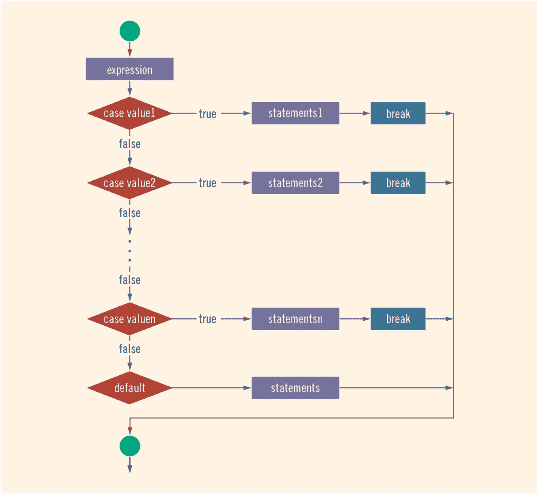

**图 4-4** switch 语句

switch 语句按照以下规则执行：

- 1. 当 `expression` 的值与某个 case 值（也称为标签）匹配时，语句会一直执行，直到遇到 `break` 语句或到达 switch 结构的末尾。
- 2. 如果 `expression` 的值不匹配任何 case 值，则执行 `default` 标签后面的语句。如果 switch 结构没有 default 标签，并且表达式的值不匹配任何 case 值，则跳过整个 switch 语句。
- 3. `break` 语句会导致立即退出 switch 结构。

### 例 4-21

考虑以下语句，其中 grade 是 `char` 类型的变量。

```cpp
switch (grade)
{
case 'A':
    cout << "The grade point is 4.0.";
    break;
case 'B':
    cout << "The grade point is 3.0.";
    break;
case 'C':
    cout << "The grade point is 2.0.";
    break;
case 'D':
    cout << "The grade point is 1.0.";
    break;
case 'F':
    cout << "The grade point is 0.0.";
    break;
default:
    cout << "The grade is invalid.";
}
```

在这个例子中，`switch` 语句中的表达式是一个变量标识符。变量 grade 的类型是 `char`，这是一种整型。grade 的可能值为 'A'、'B'、'C'、'D' 和 'F'。每个 `case` 标签根据 grade 的值指定不同的操作。如果 grade 的值为 'A'，则输出为：

成绩绩点是 4.0。

### 例 4-22

下面的程序说明了 `break` 语句的作用。它要求用户输入一个 0 到 10 之间的数。

```cpp
//Program: Effect of break statements in a switch structure

#include <iostream>

using namespace std;

int main()
{
    int num;

    cout << "Enter an integer between 0 and 7: ";    //Line 1
    cin >> num;                                      //Line 2
    cout << endl;                                    //Line 3

    cout << "The number you entered is " << num
         << endl;                                    //Line 4
    switch(num)                                      //Line 5
    {
    case 0:                                          //Line 6
    case 1:                                          //Line 7
        cout << "Learning to use ";                 //Line 8
    case 2:                                          //Line 9
        cout << "C++'s ";                           //Line 10
    case 3:                                          //Line 11
        cout << "switch structure." << endl;        //Line 12
        break;                                       //Line 13
    case 4:                                          //Line 14
        break;                                       //Line 15
    case 5:                                          //Line 16
        cout << "This program shows the effect ";   //Line 17
    case 6:                                          //Line 18
    case 7:                                          //Line 19
        cout << "of the break statement." << endl;  //Line 20
        break;                                       //Line 21
    default:                                         //Line 22
        cout << "The number is out of range." << endl; //Line 23
    }

    cout << "Out of the switch structure." << endl;  //Line 24

    return 0;                                        //Line 25
}
```

**示例运行：** 这些输出是通过多次执行前面的程序得到的。在每次示例运行中，用户输入以阴影表示。

**示例运行 1：**

```text
Enter an integer between 0 and 7: 0
The number you entered is 0
Learning to use C++'s switch structure.
Out of the switch structure.
```

**示例运行 2：**

```text
Enter an integer between 0 and 7: 2
The number you entered is 2
C++'s switch structure.
Out of the switch structure.
```

**示例运行 3：**

```text
Enter an integer between 0 and 7: 4
The number you entered is 4
Out of the switch structure.
```


### 示例运行 4：

```text
Enter an integer between 0 and 7: 5
The number you entered is 5
This program shows the effect of the break statement.
Out of the switch structure.
```

### 示例运行 5：

```text
Enter an integer between 0 and 7: 7
The number you entered is 7
This program shows the effect of the break statement.
Out of the switch structure.
```

### 示例运行 6：

```text
Enter an integer between 0 and 7: 8
The number you entered is 8
The number is out of range.
Out of the switch structure.
```

结合 `switch` 表达式 `num` 的某些取值逐步讲解这个程序，可以帮助你理解 `break` 语句是如何起作用的。如果 `num` 的值为 0，则 `switch` 表达式的值与 `case` 值 0 匹配。`case 0:` 之后的所有语句都会执行，直到遇到 `break` 语句。

第一个 `break` 语句出现在第 13 行，正好在 `case` 值 4 之前。尽管 `switch` 表达式的值与这些 `case` 值（即 1、2 或 3）中的任何一个都不匹配，但这些值后面的语句仍会执行。

当 `switch` 表达式的值与某个 `case` 值匹配时，所有语句都会执行，直到遇到 `break`，并且程序会跳过其间的所有 `case` 标签。类似地，如果 `num` 的值为 3，则它与 `case` 值 3 匹配，该标签后面的语句会执行，直到在第 13 行遇到 `break` 语句。如果 `num` 的值为 4，则它与 `case` 值 4 匹配。在这种情况下，动作是空的，因为 `case` 值 4 后面只有第 15 行的一条 `break` 语句。

### 示例 4-23

尽管 `switch` 结构的 case 值（标签）是有限的，但 `switch` 语句的表达式可以根据需要变得任意复杂。例如，考虑下面的 `switch` 语句：

```cpp
switch (score / 10)
{
case 0:
case 1:
case 2:
case 3:
case 4:
case 5:
    grade = 'F';
    break;
case 6:
    grade = 'D';
    break;
case 7:
    grade = 'C';
    break;
case 8:
    grade = 'B';
    break;
case 9:
case 10:
    grade = 'A';
    break;
default:
    cout << "Invalid test score." << endl;
}
```

假设 score 是一个 `int` 变量，取值在 0 到 100 之间。如果 score 为 75，则 score / 10 = 75 / 10 = 7，所赋成绩为 'C'。如果 score 的值在 0 到 59 之间，则成绩为 'F'。如果 score 在 0 到 59 之间，那么 score / 10 为 0、1、2、3、4 或 5。这些值中的每一个都对应成绩 'F'。

因此，在这个 `switch` 结构中，`case 0`、`case 1`、`case 2`、`case 3`、`case 4` 和 `case 5` 的动作语句都相同。与其为 0、1、2、3、4 和 5 的每个 `case` 值分别编写语句 `grade = 'F';` 再跟 `break` 语句，不如先指定所有 case 值（如前面的代码所示），然后指定所需的动作语句，从而简化编程代码。`case` 值 9 和 10 遵循类似的约定。

除了可以是变量标识符或复杂表达式之外，`switch` 表达式还可以求值为逻辑值。考虑下面的语句：

```cpp
switch (age >= 18)
{
case 1:
    cout << "Old enough to be drafted." << endl;
    cout << "Old enough to vote." << endl;
    break;
case 0:
    cout << "Not old enough to be drafted." << endl;
    cout << "Not old enough to vote." << endl;
}
```

如果 age 的值为 25，则表达式 age >= 18 求值为 1——也就是 true。如果表达式的求值为 1，则 case 标签 1 后面的语句会执行。如果 age 的值为 14，则表达式 age >= 18 求值为 0——也就是 false——并且 case 标签 0 后面的语句会执行。

你可以分别使用 **true** 和 **false** 代替 1 和 0 作为 case 标签，并将前面的 `switch` 语句改写如下：

```cpp
switch (age >= 18)
{
case true:
    cout << "Old enough to be drafted." << endl;
    cout << "Old enough to vote." << endl;
    break;
case false:
    cout << "Not old enough to be drafted." << endl;
    cout << "Not old enough to vote." << endl;
    break;
}
```

从前面的示例可以看出，`switch` 语句是实现多重选择的一种优雅方式。你将在本章末尾的编程示例中看到 `switch` 语句的用法。尽管没有固定规则可用于决定是实现多重选择时使用 `if...else` 结构还是 `switch` 结构，但应记住以下考虑。如果多重选择涉及一个值范围，则你应使用 `if...else` 结构或 `switch` 结构，并在其中将每个范围转换为有限的值集合。

例如，在示例 4–23 中，grade 的值取决于 `score` 的值。如果 `score` 在 0 到 59 之间，则 grade 为 'F'。因为 `score` 是 `int` 变量，所以有 60 个值对应成绩 'F'。如果将全部 60 个值列为 case 值，则 `switch` 语句可能会非常长。然而，除以 10 可将这 60 个值减少为仅 6 个值：0、1、2、3、4 和 5。

如果值范围包含无穷多个值，并且无法将它们缩减为包含有限个值的集合，则必须使用 `if...else` 结构。例如，如果 `score` 恰好是 `double` 变量，则 0 到 60 之间的值有无限多个。不过，你可以使用表达式 `static_cast<int>(score) / 10`，仍然将这个无限多的值缩减为仅六个值。

## 避免因对概念和技术一知半解而引发的 bug（再探）

本章前面我们讨论过，对某个概念或技术一知半解可能会导致程序出错。在本节中，我们给出另一个例子来说明使用一知半解的概念和技术所导致的问题。在示例 4–23 中，我们说明了如何根据 0 到 100 之间的测试分数来评定成绩。接下来，考虑下面这个根据测试分数评定成绩的程序。

```cpp
//Grade program with bugs.

#include <iostream>                                      //Line 1

using namespace std;                                     //Line 2

int main()                                      //Line 3
{                                               //Line 4
    int testScore;                              //Line 5

    cout << "Enter the test score: ";           //Line 6
    cin >> testScore;                           //Line 7
    cout << endl;                               //Line 8

    switch (testScore / 10)                     //Line 9
    {                                           //Line 10
    case 0:                                     //Line 11
    case 1:                                     //Line 12
    case 2:                                     //Line 13
    case 3:                                     //Line 14
    case 4:                                     //Line 15
    case 5:                                     //Line 16
        cout << "The grade is F." << endl;      //Line 17
    case 6:                                     //Line 18
        cout << "The grade is D." << endl;      //Line 19
    case 7:                                     //Line 20
        cout << "The grade is C." << endl;      //Line 21
    case 8:                                     //Line 22
        cout << "The grade is B." << endl;      //Line 23
    case 9:                                     //Line 24
    case 10:                                    //Line 25
        cout << "The grade is A." << endl;      //Line 26
    default:                                    //Line 27
        cout << "Invalid test score." << endl;  //Line 28
    }                                           //Line 29

    return 0;                                   //Line 30
}                                               //Line 31
```

**示例运行：** 在这些示例运行中，用户输入以底纹显示。

**示例运行 1：**

输入测试分数：`110`

无效的测试分数。

**示例运行 2：**

输入测试分数：`-70`

无效的测试分数。

**示例运行 3：**

输入测试分数：`75`

成绩是 C。
成绩是 B。
成绩是 A。
无效的测试分数。


从这些示例运行结果可以看出，如果`testScore`的值小于0或大于100，程序会得到正确结果；但如果`testScore`的值在0到100之间，比如75，程序就会产生错误结果。你能看出原因吗？

如示例运行3所示，假设`testScore`的值为75。那么，`testScore % 10 = 7`，而这个值匹配了`case`标签7。因此，按照我们的预期，它应该输出“The grade is C.”。然而，实际输出却是：

```
The grade is C.
The grade is B.
The grade is A.
Invalid test score.
```

但这是为什么呢？显然，每个`case`标签最多只关联一条`cout`语句。问题在于我们只部分理解了`switch`结构的工作原理。如我们所看到的，`switch`语句中并没有包含任何`break`语句。因此，在执行完与匹配的`case`标签关联的语句后，程序会继续执行与下一个`case`标签关联的语句，导致打印出了四行非预期内容。

为了正确输出结果，`switch`结构必须在每条`cout`语句（最后一条`cout`语句除外）之后包含一条`break`语句。我们把这个修改留作练习，请你自己修改这个程序使其输出正确结果。

我们再次看到，对一个概念的部分理解可能导致程序中严重的错误。因此，花时间彻底理解每个概念和技术，会为你节省数小时的调试时间。

### 使用`assert`函数终止程序

某些类型的错误极难发现，它们可能出现在程序中。例如，除零操作就很难用你目前学过的任何编程技巧来捕捉。C++提供了一个预定义函数`assert`，当某些难以捉摸的错误发生时，它可用于停止程序执行。在除零的情况下，你可以使用`assert`函数确保程序终止时给出适当的错误消息，指明错误类型以及错误发生的程序位置。

考虑以下语句：

```cpp
int numerator;
int denominator;
int quotient;
double hours;
double rate;
double wages;
char ch;
```

- 1. `quotient = numerator / denominator;`
- 2. `if (hours > 0 && (0 < rate && rate <= 15.50))`
  `wages = rate * hours;`
- 3. `if ('A' <= ch && ch <= 'Z')`

在第一条语句中，如果分母为0，从逻辑上讲你不应该执行除法。然而在执行期间，计算机会尝试执行除法。如果分母为0，程序将终止，并显示一条错误消息，说明发生了非法操作。

第二条语句的设计意图是：仅当`hours`大于0且`rate`为正且小于等于15.50时计算工资。第三条语句的设计意图是：仅当`ch`是大写字母时执行某些语句。

对于所有这些语句（就此而言，在任何必须满足特定条件的情况下），如果条件不满足，最好能终止程序执行，并给出一条消息，指示程序中发生了什么错误以及发生错误的位置。你可以通过在程序中加入`output`和`return`语句来处理这类情况。然而，C++通过`assert`函数提供了一种有效的方法，在所需条件不满足时终止程序。

使用`assert`函数的语法是：

```
assert(expression);
```

这里，`expression`是任何逻辑表达式。如果`expression`求值为true，则执行下一条语句。如果`expression`求值为false，程序终止，并指示程序中错误发生的位置。

`assert`函数的规格说明位于头文件`cassert`中。因此，程序若想使用`assert`函数，必须包含以下语句：

```
#include <cassert>
```

使用`assert`函数的语句有时被称为断言语句（`assert` statement）。

回到前面的语句，你可以使用`assert`函数重写语句1（`quotient = numerator / denominator;`）。因为只有当分母不为零时才应计算`quotient`，所以你需要在赋值语句之前加入一条断言语句，如下所示：

```
assert(denominator);
quotient = numerator / denominator;
```

现在，如果`denominator`为0，`assert`语句将中止程序执行，并显示类似如下的错误消息：

```
Assertion failed: denominator, file c:\temp\assertfunction\assertfunction.cpp, line 20
```

这条错误消息表明`denominator`的断言失败。错误消息还给出了包含源代码的文件名以及断言失败的行号。

你也可以使用断言语句重写语句2，如下所示：

```cpp
assert(hours > 0 && (0 < rate && rate <= 15.50));
if (hours > 0 && (0 < rate && rate <= 15.50))
    wages = rate * hours;
```

如果`assert`语句中的表达式失败，程序将终止，并显示类似如下的错误消息：

Assertion failed: hours > 0 && (0 < rate && rate <= 15.50), file c:\\temp\\assertfunction\\assertfunction.cpp, line 26

在程序开发和测试期间，`assert`语句对于强制执行编程约束非常有用。如你所见，`assert`语句不仅能中止程序，还能指出断言失败的表达式、包含源代码的文件名以及断言失败的行号。

尽管`assert`语句在程序开发期间很有用，但在程序开发完成并投入使用后，如果`assert`语句因某种原因失败，最终用户将完全不知道错误消息的含义。因此，在完成程序的开发和测试后，你可能会想要移除或禁用`assert`语句。在一个非常大型的程序中，移除所有在开发期间使用的`assert`语句可能非常繁琐，甚至不可能。此外，如果你计划将来修改程序，你可能希望保留这些`assert`语句。因此，合乎逻辑的选择是保留这些语句但将其禁用。你可以使用以下预处理指令来禁用`assert`语句：

```cpp
#define NDEBUG
```

这个预处理指令`#define NDEBUG`必须放在`#include <cassert>`指令*之前*。

## 编程示例：有线电视公司计费

这个编程示例演示了一个程序，用于计算本地有线电视公司客户的账单。有两种客户类型：住宅客户和商业客户。计算有线电视账单有两种费率：一种用于住宅客户，一种用于商业客户。对于住宅客户，适用以下费率：

- 账单处理费：$4.50
- 基本服务费：$20.50
- 付费频道：每频道$7.50。

对于商业客户，适用以下费率：

- 账单处理费：$15.00
- 基本服务费：前10个连接$75.00，每增加一个连接$5.00
- 付费频道：任意连接数量均按每频道$50.00计算

程序应要求用户输入账号（一个整数）和客户代码。假设R或r代表住宅客户，B或b代表商业客户。

**输入** 客户的账号、客户代码、用户订购的付费频道数量，以及（在商业客户的情况下）基本服务连接的数量。

**输出** 客户的账号和账单金额。

### 问题分析与算法设计

本程序的目的是计算并打印账单金额。要计算账单金额，你需要知道是为哪个客户计算账单（客户是住宅还是商业）以及客户订购的付费频道数量。对于商业客户，你还需要知道基本服务连接数量和付费频道数量。计算账单所需的其他数据，如账单处理费和付费频道的费用，都是已知常量。程序应将账单金额打印到小数点后两位，这是货币金额的标准格式。这个问题分析转化为以下算法：

- 1. 将精度设置为两位小数。
- 2. 提示用户输入账号和客户类型。
- 3. 根据客户类型，确定付费频道数量和基本服务连接数量，计算账单并打印账单：
  - a. 如果客户类型是R或r，
    - i. 提示用户输入付费频道数量。
    - ii. 计算账单。
    - iii. 打印账单。
  - b. 如果客户类型是B或b，
    - i. 提示用户输入基本服务连接数量和付费频道数量。
    - ii. 计算账单。
    - iii. 打印账单。


## 变量

因为程序会要求用户输入客户账号、客户代码、付费频道数量以及基本服务连接数量，所以你需要变量来存储所有这些信息。另外，因为程序会计算账单金额，所以你需要一个变量来存储账单金额。因此，程序至少需要以下变量来计算并打印账单：

```cpp
int accountNumber;    //variable to store the customer's
                      //account number
char customerType;    //variable to store the customer code
int numOfPremChannels; //variable to store the number
                      //of premium channels to which the
                      //customer subscribes
int numOfBasicServConn; //variable to store the
                       //number of basic service connections
                       //to which the customer subscribes
double amountDue;     //variable to store the billing amount
```

## 命名常量

如你所见，账单处理费、基本服务连接费用和付费频道费用都是固定的，计算账单需要这些值。尽管这些值在程序中是常量，但有线电视公司可能会在几乎没有预警的情况下更改它们。为了简化以后修改程序的过程，不应在程序中直接使用这些值，而应将它们声明为命名常量。基于问题分析，你需要声明以下命名常量：

```cpp
//Named constants - residential customers
const double RES_BILL_PROC_FEES = 4.50;
const double RES_BASIC_SERV_COST = 20.50;
const double RES_COST_PREM_CHANNEL = 7.50;

//Named constants - business customers
const double BUS_BILL_PROC_FEES = 15.00;
const double BUS_BASIC_SERV_COST = 75.00;
const double BUS_BASIC_CONN_COST = 5.00;
const double BUS_COST_PREM_CHANNEL = 50.00;
```

## 公式

程序使用多个公式来计算账单金额。要计算住宅客户账单，你只需要知道用户订阅的付费频道数量。以下语句计算住宅客户的账单金额。

```cpp
amountDue = RES_BILL_PROC_FEES + RES_BASIC_SERV_COST
           + numOfPremChannels * RES_COST_PREM_CHANNEL;
```

要计算商业客户账单，你需要知道基本服务连接数量和用户订阅的付费频道数量。如果基本服务连接数量小于或等于 10，则基本服务连接费用是固定的。如果基本服务连接数量超过 10，则必须为超过 10 的每个连接增加费用。以下语句计算商业客户的账单金额。

```cpp
    if (numOfBasicServConn <= 10)
        amountDue = BUS_BILL_PROC_FEES + BUS_BASIC_SERV_COST
                    + numOfPremChannels * BUS_COST_PREM_CHANNEL;
    else
        amountDue = BUS_BILL_PROC_FEES + BUS_BASIC_SERV_COST
                    + (numOfBasicServConn - 10)
                       * BUS_BASIC_CONN_COST
                    + numOfPremChannels * BUS_COST_PREM_CHANNEL;
```

基于前面的讨论，你现在可以编写主算法。

## 主算法

- 1. 要以带小数点和尾随零的固定十进制格式输出浮点数，请设置操纵符 `fixed` 和 `showpoint`。另外，要输出保留两位小数的浮点数，请将精度设置为两位小数。回想一下，要使用这些操纵符，程序必须包含头文件 `iomanip`。
- 2. 提示用户输入账号。
- 3. 获取客户账号。
- 4. 提示用户输入客户代码。
- 5. 获取客户代码。
- 6. 如果客户代码是 `r` 或 `R`，
  - a. 提示用户输入付费频道数量。
  - b. 获取付费频道数量。
  - c. 计算账单金额。
  - d. 打印账号和账单金额。
- 7. 如果客户代码是 `b` 或 `B`，
  - a. 提示用户输入基本服务连接数量。
  - b. 获取基本服务连接数量。
  - c. 提示用户输入付费频道数量。
  - d. 获取付费频道数量。
  - e. 计算账单金额。
  - f. 打印账号和账单金额。
- 8. 如果客户代码不是 `r`、`R`、`b` 或 `B`，则输出错误消息。

对于步骤 6 和 7，程序使用 `switch` 语句来计算所需客户的账单。

## 完整程序清单

```cpp
/***********************************************************
// Author: D. S. Malik
//
// Program: Cable Company Billing
// This program calculates and prints a customer's bill for
// a local cable company. The program processes two types of
// customers: residential and business.
/***********************************************************

#include <iostream>
#include <iomanip>

using namespace std;

    //Named constants - residential customers
const double RES_BILL_PROC_FEES = 4.50;
const double RES_BASIC_SERV_COST = 20.50;
const double RES_COST_PREM_CHANNEL = 7.50;

    //Named constants - business customers
const double BUS_BILL_PROC_FEES = 15.00;
const double BUS_BASIC_SERV_COST = 75.00;
const double BUS_BASIC_CONN_COST = 5.00;
const double BUS_COST_PREM_CHANNEL = 50.00;

int main()
{
    //Variable declaration
    int accountNumber;
    char customerType;
    int numOfPremChannels;
    int numOfBasicServConn;
    double amountDue;

    cout << fixed << showpoint;                //Step 1
    cout << setprecision(2);                   //Step 1

    cout << "This program computes a cable "
         << "bill." << endl;
    cout << "Enter account number (an integer): "; //Step 2
    cin >> accountNumber;                          //Step 3
    cout << endl;

    cout << "Enter customer type: "
         << "R or r (Residential), "
         << "B or b (Business): ";                  //Step 4
    cin >> customerType;                           //Step 5
    cout << endl;

    switch (customerType)
    {
    case 'r':
    case 'R':
        cout << "Enter the number"
             << " of premium channels: ";
        cin >> numOfPremChannels;
        cout << endl;

        amountDue = RES_BILL_PROC_FEES
                  + RES_BASIC_SERV_COST
                  + numOfPremChannels *
                    RES_COST_PREM_CHANNEL;

        cout << "Account number: "
             << accountNumber
             << endl;
        cout << "Amount due: $"
             << amountDue
             << endl;
        break;

    case 'b':
    case 'B':
        cout << "Enter the number of basic "
             << "service connections: ";
        cin >> numOfBasicServConn;
        cout << endl;

        cout << "Enter the number"
             << " of premium channels: ";
        cin >> numOfPremChannels;
        cout << endl;

        if (numOfBasicServConn <= 10)
            amountDue = BUS_BILL_PROC_FEES
                      + BUS_BASIC_SERV_COST
                      + numOfPremChannels *
                        BUS_COST_PREM_CHANNEL;
        else
            amountDue = BUS_BILL_PROC_FEES
                      + BUS_BASIC_SERV_COST
                      + (numOfBasicServConn - 10) *
                        BUS_BASIC_CONN_COST
                      + numOfPremChannels *
                        BUS_COST_PREM_CHANNEL;

        cout << "Account number: "
             << accountNumber << endl;
        cout << "Amount due: $" << amountDue
             << endl;
        break;

    default:
        cout << "Invalid customer type." << endl;    //Step 8
    }//end switch

    return 0;
}
```

**示例运行：** 在此示例运行中，用户输入以阴影显示。

```
This program computes a cable bill.
Enter account number (an integer): 12345

Enter customer type: R or r (Residential), B or b (Business): b

Enter the number of basic service connections: 16

Enter the number of premium channels: 8

Account number: 12345
Amount due: $520.00
```

### 快速复习

- 1. 控制结构会改变正常的控制流。
- 2. 两种最常见的控制结构是选择结构和重复结构。
- 3. 选择结构将决策融入程序中。
- 4. 关系运算符有 `==`（等于）、`<`（小于）、`<=`（小于或等于）、`>`（大于）、`>=`（大于或等于）和 `!=`（不等于）。
- 5. 在关系运算符 `==`、`<=`、`>=` 和 `!=` 之间包含空格会产生语法错误。
- 6. 字符使用机器的整理顺序进行比较。
- 7. 逻辑表达式的计算结果为 1（或非零值）或 0。逻辑值 1（或任何非零值）被视为真；逻辑值 0 被视为假。
- 8. 在 C++ 中，`int` 变量可用于存储逻辑表达式的值。
- 9. 在 C++ 中，`bool` 变量可用于存储逻辑表达式的值。
- 10. 在 C++ 中，逻辑运算符有 `!`（非）、`&&`（与）和 `||`（或）。
- 11. C++ 中有两种选择结构。
- 12. 单向选择采用以下形式：

  ```cpp
  if (expression)
      statement
  ```

  如果 expression 为真，则执行该语句；否则，计算机执行 `if` 语句之后的语句。


- 13. 双向选择采用以下形式：

  ```cpp
  if (expression)
      statement1
  else
      statement2
  ```

  如果 expression 为真，则执行 statement1；否则执行 statement2。

- 14. `if` 或 `if...else` 结构中的表达式通常是逻辑表达式。

- 15. 在单向选择中，在语句前包含分号会产生语义错误。在这种情况下，`if` 语句的动作为空。

- 16. 在双向选择中，在 statement1 前包含分号会产生语法错误。

- 17. C++ 中没有独立的 `else` 语句。每个 `else` 都有一个相关的 `if`。

- 18. `else` 与最近一个尚未与任何其他 `else` 配对的 `if` 配对。

- 19. 用花括号 `{` 和 `}` 括起来的一系列语句称为复合语句或语句块。复合语句被当作单条语句处理。

- 20. 可以在 `if` 语句中使用输入流变量来确定输入流的状态。

- 21. 使用赋值运算符代替相等运算符会产生语义错误。这可能导致程序中出现严重错误。

- 22. `switch` 结构用于处理多路选择。

- 23. 在 `switch` 语句中执行 `break` 语句会立即退出 `switch` 结构。

- 24. 如果程序中某些条件未满足，可以使用 `assert` 函数终止程序。

## 练习

- 1. 将以下语句标记为真或假。

  - a. 逻辑表达式的结果不能赋给 `int` 变量。

  - b. 在单向选择中，如果在 `if` 语句中的表达式之后放置分号，则 `if` 语句中的表达式始终为真。

  - c. 每个 `if` 语句都必须有对应的 `else`。

  - d. `if` 语句中的表达式：

    ```cpp
    if (score = 30)
        grade = 'A';
    ```

    始终求值为真。

  - e. 表达式：

    `(ch >= 'A' && ch <= 'Z')`

    只要 `ch < 'A'` 或 `ch >= 'Z'` 之一成立，就求值为 **假**。

  - f. 假设输入为 5。以下代码的输出：

    ```cpp
    cin >> num;
    if (num > 5)
        cout << num;
        num = 0;
    else
        cout << "Num is zero" << endl;
    ```

    为：Num is zero

  - g. `switch` 语句中的表达式应求值为简单数据类型的值。

  - h. 表达式 `!(x > 0)` 仅当 x 为负数时为 **真**。

  - i. 在 C++ 中，`!` 和 `!=` 都是逻辑运算符。

  - j. 程序中语句执行的顺序称为控制流。

- 2. 选择最佳答案。

  - a.

    ```cpp
    if (60 <= 12 * 5)
        cout << "Hello";
        cout << " There";
    ```

    输出以下内容：

    (i) Hello There　(ii) Hello　(iii) Hello There　(iv) There

  - b.

    ```cpp
    if ('a' > 'b' || 66 > static_cast<int>('A'))
        cout << "#*#" << endl;
    ```

    输出以下内容：

    (i) `#*#`　(ii)

    ```
    #
    *
    #
    ```

    (iii) `*`　(iv) 以上都不是

  - c.

    ```cpp
    if (7 <= 7)
        cout << 6 - 9 * 2 / 6 << endl;
    ```

    输出以下内容：

    (i) -1　(ii) 3　(iii) 3.0　(iv) 以上都不是

  - d.

    ```cpp
    if (7 < 8)
    {
        cout << "2 4 6 8" << endl;
        cout << "1 3 5 7" << endl;
    }
    ```

    输出以下内容：

    (i)

    ```
    2 4 6 8
    1 3 5 7
    ```

    (ii)

    ```
    1 3 5 7
    ```

    (iii) 以上都不是

  - e.

    ```cpp
    if (5 < 3)
        cout << "*";
    else if (7 == 8)
        cout << "&";
    else
        cout << "$";
    ```

    输出以下内容：

    (i) *　(ii) &　(iii) $　(iv) 以上都不是

- 3. 假设 x、y 和 z 是 int 变量，且 x = 10、y = 15、z = 20。判断以下表达式的求值结果为真还是假。

  - a. `!(x > 10)`
  - b. `x <= 5 || y < 15`
  - c. `(x != 5) && (y != z)`
  - d. `x >= z || (x + y >= z)`
  - e. `(x <= y - 2) && (y >= z) || (z - 2 != 20)`

- 4. 假设 str1、str2 和 str3 是 string 变量，且 str1 = "English"，str2 = "Computer Science"，str3 = "Programming"。求以下表达式的值。

  - a. `str1 >= str2`
  - b. `str1 != "english"`
  - c. `str3 < str2`
  - d. `str2 >= "Chemistry"`

- 5. 假设 x、y、z 和 w 是 int 变量，且 x = 3、y = 4、z = 7、w = 1。以下语句的输出是什么？

  - a. `cout << "x == y: " << (x == y) << endl;`
  - b. `cout << "x != z: " << (x != z) << endl;`
  - c. `cout << "y == z - 3: " << (y == z - 3) << endl;`
  - d. `cout << "!(z > w): " << (!(z > w)) << endl;`
  - e. `cout << "x + y < z: " << (x + y < z) << endl;`

- 6. 以下 C++ 代码的输出是什么？

  ```cpp
  x = 100;
  y = 200;
  if (x > 100 && y <= 200)
      cout << x << " " << y << " " << x + y << endl;
  else
      cout << x << " " << y << " " << 2 * x - y << endl;
  ```

- 7. 改正以下代码，使其打印正确的消息。

  ```cpp
  if (score >= 60)
      cout << "You pass." << endl;
  else;
      cout << "You fail." << endl;
  ```

- 8. 编写 C++ 语句：如果 gender 为 'M'，输出 Male；如果 gender 为 'F'，输出 Female；否则输出 invalid gender。

- 9. 以下程序的输出是什么？

  ```cpp
  #include <iostream>

  using namespace std;

  int main()
  {
      int myNum = 10;
      int yourNum = 30;

      if (yourNum % myNum == 3)
      {
          yourNum = 3;
          myNum = 1;
      }
      else if (yourNum % myNum == 2)
      {
          yourNum = 2;
          myNum = 2;
      }
      else
      {
          yourNum = 1;
          myNum = 3;
      }

      cout << myNum << " " << yourNum << endl;

      return 0;
  }
  ```

- 10. a. 如果 myNum = 5 且 yourNum = 12，练习 9 中程序的输出是什么？
- 10. b. 如果 myNum = 30 且 yourNum = 33，练习 9 中程序的输出是什么？

- 11. 假设 sale 和 bonus 是 double 变量。编写一个 if...else 语句，按如下方式给 bonus 赋值：如果 sale 大于 $20,000，则赋给 bonus 的值为 0.10；如果 sale 大于 $10,000 且小于或等于 $20,000，则赋给 bonus 的值为 0.05；否则，赋给 bonus 的值为 0。

- 12. 假设 overSpeed 和 fine 是 double 变量。按如下方式给 fine 赋值：如果 0 < overSpeed <= 5，则赋给 fine 的值为 $20.00；如果 5 < overSpeed <= 10，则赋给 fine 的值为 $75.00；如果 10 < overSpeed <= 15，则赋给 fine 的值为 $150.00；如果 overSpeed > 15，则赋给 fine 的值为 $150.00 加上超过 15 的每英里 $20.00。

- 13. 假设 score 是 int 变量。考虑以下 if 语句：

  ```cpp
  if (score >= 90)
      cout << "Discount = 10%" << endl;
  ```

  - a. 如果 score 的值为 95，输出是什么？说明理由。
  - b. 如果 score 的值为 85，输出是什么？说明理由。

- 14. 假设 score 是 int 变量。考虑以下 if 语句：

  - i.

    ```cpp
    if (score == 70)
        cout << "Grade is C." << endl;
    ```

  - ii.

    ```cpp
    if (score < 70)
        cout << "Grade is C." << endl;
    ```

  回答以下问题：

  - a. 如果 score 的值为 70，(i) 和 (ii) 中的输出是什么？if 语句执行后 score 的值是什么？
  - b. 如果 score 的值为 80，(i) 和 (ii) 中的输出是什么？if 语句执行后 score 的值是什么？

- 15. 使用条件运算符重写以下表达式。（假设所有变量均已正确声明。）

  - a.

    ```cpp
    if (x >= y)
        z = x - y;
    else
        z = y - x;
    ```

  - b.

    ```cpp
    if (hours >= 40.0)
        wages = 40 * 7.50 + 1.5 * 7.5 * (hours - 40);
    else
        wages = hours * 7.50;
    ```

  - c.

    ```cpp
    if (score >= 60)
        str = "Pass";
    else
        str = "Fail";
    ```

- 16. 使用 if...else 语句重写以下表达式。（假设所有变量均已正确声明。）


```cpp
case 4:
case 5:
    cout << n;
    break;
case 0:
    cout << endl;
    break;
}
```

- d. switch (n % 10)

```cpp
switch (n % 10)
{
    case 2:
    case 4:
    case 6:
    case 8:
        cout << "Even";
        break;
    case 1:
    case 3:
    case 5:
    case 7:
        cout << "Odd";
        break;
}
```

- 19. 假设输入为 5。下列 C++ 代码执行后，alpha 的值是多少？

```cpp
cin >> alpha;
switch (alpha)
{
    case 1:
    case 2:
        alpha = alpha + 2;
        break;
    case 4:
        alpha++;
    case 5:
        alpha = 2 * alpha;
    case 6:
        alpha = alpha + 5;
        break;
    default:
        alpha--;
}
```

- 20. 假设输入为 3。下列 C++ 代码执行后，beta 的值是多少？

```cpp
cin >> beta;
switch (beta)
{
    case 3:
        beta = beta + 3;
    case 1:
        beta++;
        break;
    case 5:
        beta = beta + 5;
    case 4:
        beta = beta + 4;
}
```

- 21. 假设输入为 6。下列 C++ 代码执行后，a 的值是多少？

```cpp
cin >> a;
if (a > 0)
    switch (a)
    {
        case 1:
            a = a + 3;
        case 3:
            a++;
            break;
        case 6:
            a = a + 6;
        case 8:
            a = a * 8;
            break;
        default:
            a--;
    }
else
    a = a + 2;
```

- 22. 下列代码中，请改正任何会导致程序无法编译或运行的错误。

```cpp
#include <iostream>

main ()
{
    int a, b;
    bool found;
    cout << "Enter two integers: ";
    cin >> a >> b;

    if a > a*b && 10 < b
        found = 2 * a > b;
    else
    {
        found = 2 * a < b;
        if found
            a = 3;
            c = 15;
            if b
            {
                b = 0;
                a = 1;
            }
    }
}
```

- 23. 下列程序包含错误。请改正这些错误，使程序能够运行并输出 w = 21。

```cpp
#include <iostream>

using namespace std;

const int SECRET = 5

main ()
{
    int x, y, w, z;
    z = 9;

    if z > 10
        x = 12; y = 5, w = x + y + SECRET;
    else
        x = 12; y = 4, w = x + y + SECRET;

    cout << "w = " << w << endl;
}
```

- 24. 编写下列程序中缺失的语句，使其提示用户输入两个数。如果其中一个数为 0，程序应输出一条消息，指出两个数都必须非零。如果第一个数大于第二个数，则输出第一个数除以第二个数的结果；如果第一个数小于第二个数，则输出第二个数除以第一个数的结果；否则，输出这两个数的乘积。

```cpp
#include <iostream>
using namespace std;

int main()
{
    double firstNum, secondNum;

    cout << "Enter two nonzero numbers: ";
    cin >> firstNum >> secondNum;
    cout << endl;

    //Missing statements

    return 0;
}
```

## 编程练习

- 1. 编写一个程序，提示用户输入一个数。然后程序应输出该数，并输出一条消息说明该数是正数、负数还是零。

- 2. 编写一个程序，提示用户输入三个数。然后程序应按升序输出这三个数。

- 3. 编写一个程序，提示用户输入一个 0 到 35 之间的整数。如果该数小于或等于 9，程序应输出该数；否则，对于 10 输出 A，对于 11 输出 B，对于 12 输出 C……对于 35 输出 Z。*(提示：对于大于等于 10 的数字，使用强制类型转换运算符 `static_cast<char>()`。)*

- 4. 下列程序中的语句顺序不正确。请重新排列这些语句，使其提示用户输入形状类型（矩形、圆形或圆柱体）以及该形状的相应尺寸。然后程序输出该形状的以下信息：对于矩形，输出面积和周长；对于圆形，输出面积和周长；对于圆柱体，输出体积和表面积。重新排列语句后，程序应具有正确的缩进。

```cpp
using namespace std;

#include <iostream>

int main()
{
    string shape;
    double height;

    #include <string>

    cout << "Enter the shape type: (rectangle, circle, cylinder) ";
    cin >> shape;
    cout << endl;

    if (shape == "rectangle")
    {
        cout << "Area of the circle = "
             << PI * pow(radius, 2.0) << endl;

        cout << "Circumference of the circle: "
             << 2 * PI * pow(radius, 2.0) << endl;

        cout << "Enter the height of the cylinder: ";
        cin >> height;
        cout << endl;

        cout << "Enter the width of the rectangle: ";
        cin >> width;
        cout << endl;

        cout << "Perimeter of the rectangle = "
             << 2 * (length + width) << endl;
        double width;
    }

    cout << "Surface area of the cylinder: "
         << 2 * radius *  + 2 * PI * pow(radius, 2.0) << endl;
    }
    else if (shape == "circle")
    {
        cout << "Enter the radius of the circle: ";
        cin >> radius;
        cout << endl;

        cout << "Volume of the cylinder = "
             << PI * pow(radius, 2.0)* height << endl;
        double length;
    }
    return 0;
    else if (shape == "cylinder")
    {
        double radius;

        cout << "Enter the length of the rectangle: ";
        cin >> length;
        cout << endl;

        #include <iomanip>

        cout << "Enter the radius of the base of the cylinder: ";
        cin >> radius;
        cout << endl;

        const double PI = 3.1416;
        cout << "Area of the rectangle = "
             << length * width << endl;
    else
        cout << "The program does not handle " << shape << endl;
        cout << fixed << showpoint << setprecision(2);

        #include <cmath>

    }
```

- 5. 编写一个程序，实现你在第 1 章练习 21 中设计的算法。

- 6. 在直角三角形中，一条边长的平方等于另外两条边长的平方和。编写一个程序，提示用户输入三角形的三条边长，然后输出一条消息，说明该三角形是否为直角三角形。

- 15. 编写一个程序，计算并打印某蜂窝电话公司的账单。该公司提供两种服务类型：常规服务和高级服务。其费率根据服务类型而有所不同。费率计算如下：

  **常规服务：** 10.00 美元，前 50 分钟免费。超过 50 分钟的部分每分钟收费 0.20 美元。

  **高级服务：** 25.00 美元，另加：

  - a. 对于上午 6:00 至下午 6:00 的通话，前 75 分钟免费；超过 75 分钟的部分每分钟收费 0.10 美元。

  - b. 对于下午 6:00 至次日上午 6:00 的通话，前 100 分钟免费；超过 100 分钟的部分每分钟收费 0.05 美元。

  程序应提示用户输入账号、服务代码（类型为 `char`）以及该服务已使用的分钟数。服务代码 r 或 R 表示常规服务；服务代码 p 或 P 表示高级服务。任何其他字符均视为错误。程序应输出账号、服务类型、电话服务已使用的分钟数以及用户应付金额。

  对于高级服务，客户可能在白天和夜间都使用该服务。因此，为了计算账单，必须要求用户输入白天使用服务的分钟数和夜间使用服务的分钟数。

- 16. 编写一个程序，实现你在第 1 章练习 22 中设计的算法。（假设账户余额存储在文件 `Ch4_Ex16_Data.txt` 中。）程序应输出取款前和取款后的账户余额以及服务费。同时，将取款后的账户余额保存到文件 `Ch4_Ex16_Output.txt` 中。

- 17. 你有几张尺寸不同的图片想要装框。当地一家图片装框店提供两种画框——普通画框和精美画框。画框有白色现货，也可以按顾客想要的任何颜色订购。假设每个画框宽 1 英寸。给画框上色的费用为每英寸 0.10 美元。普通画框的费用为每英寸 0.15 美元，精美画框的费用为每英寸 0.25 美元。在图片后面放置硬纸板的费用为每平方英寸 0.02 美元，在图片上面放置玻璃的费用为每平方英寸 0.07 美元。顾客还可以选择在四角安装角冠，每个角冠收费 0.35 美元。编写一个程序，提示用户输入以下信息，然后输出给图片装框的费用：

  - a. 图片的长度和宽度（以英寸为单位）
  - b. 画框类型
  - c. 顾客为画框选择的颜色
  - d. 如果用户想安装角冠，则输入角冠数量


## 第5章

## 控制结构 II（循环）

在本章中，你将：

- 了解重复（循环）控制结构
- 探索如何构建和使用计数器控制、哨兵控制、标志控制和EOF控制的重复结构
- 考察break和continue语句
- 了解如何构造和使用嵌套控制结构
- 学习如何通过避免打补丁来避免错误
- 学习如何调试循环

在第4章中，你看到了决策是如何融入程序的。在本章中，你将学习重复是如何融入程序的。

### 为什么需要重复？

假设你想将五个数相加并求平均值。根据目前所学的知识，你可以按如下方式进行（假设所有变量都已正确声明）：

```cpp
cin >> num1 >> num2 >> num3 >> num4 >> num5;   //read five numbers
sum = num1 + num2 + num3 + num4 + num5;       //add the numbers
average = sum / 5;                             //find the average
```

但假设你想相加并平均100个、1000个或更多数字。你将不得不声明那么多变量，并再次在`cin`语句中列出它们，或许还要在输出语句中再次列出。这会耗费过多的空间和时间。此外，如果你想用不同的值或不同数量的值再次运行此程序，就必须重写程序。

假设你想相加以下数字：

5  3  7  9  4

考虑以下语句，其中sum和num是int类型的变量：

- 1. `sum = 0;`
- 2. `cin >> num;`
- 3. `sum = sum + num;`

第一条语句将sum初始化为0。让我们执行语句2和3。语句2将5存入num；语句3通过将num加到sum中来更新sum的值。执行完语句3后，sum的值为5。

让我们重复语句2和3。在语句2之后（在程序代码读取下一个数字之后）：

```text
num = 3
```

在语句3之后：

```text
sum = sum + num = 5 + 3 = 8
```

此时，sum包含前两个数字之和。让我们再次重复语句2和3（第三次）。在语句2之后（在代码读取下一个数字之后）：

```text
num = 7
```

在语句3之后：

```text
sum = sum + num = 8 + 7 = 15
```

现在，sum包含前三个数字之和。如果再重复语句2和3两次，sum将包含所有五个数字之和。

如果你想加10个数字，可以重复语句2和3十次。如果你想加100个数字，可以重复语句2和3一百次。这里的关键在于，你不必像第一段代码那样声明任何额外的变量。你可以使用这段C++代码来加任意一组数字，而先前的代码要求你大幅修改代码。

还有许多其他情况需要重复一组语句。例如，对于一个班级中的每个学生，确定课程成绩的公式是相同的。C++有三种重复（或循环）结构，可以让你反复执行语句，直到满足特定条件。本章将介绍全部三种循环（重复）结构。下一节将讨论第一种重复结构，称为`while`循环。

### while循环（重复）结构

在上一节中，你看到有时需要多次重复一组语句。重复一组语句的一种方法是在程序中反复输入这组语句。例如，如果你想重复一组语句100次，就在程序中输入这组语句100次。然而，这种重复一组语句的解决方案即使并非不可能，也是不切实际的。幸运的是，有更好的方法来重复一组语句。如前所述，C++有三种重复（或循环）结构，允许你重复一组语句直到满足特定条件。本节将讨论第一种循环结构，称为`while`循环。

`while`语句的一般形式是：

```cpp
while (expression)
    statement
```

在C++中，`while`是一个保留字。当然，该语句可以是简单语句或复合语句。表达式起决策作用，通常是逻辑表达式。该语句称为循环体。注意，表达式两边的括号是语法的一部分。图5-1展示了`while`循环的执行流程。


表达式提供了一个进入条件。如果它最初求值为`true`，则执行该语句。然后重新评估循环条件——即表达式。如果它再次求值为`true`，则再次执行该语句。该语句（循环体）继续执行，直到表达式不再为`true`。持续无限执行的循环称为**无限循环**。为了避免无限循环，请确保循环体内包含能够保证退出条件——`while`语句中的表达式——最终为`false`的语句。

### 示例5-1

考虑以下C++程序片段：（假设`i`是一个`int`变量。）

```cpp
i = 0;              //Line 1

while (i <= 20)     //Line 2
{
    cout << i << " ";   //Line 3
    i = i + 5;          //Line 4
}

cout << endl;
```

**示例运行：**

```text
0 5 10 15 20
```

在第1行，变量`i`被设为0。对`while`语句（第2行）中的表达式`i <= 20`进行求值。因为表达式`i <= 20`求值为`true`，所以接下来执行`while`循环体。`while`循环体由第3行和第4行的语句组成。第3行的语句输出`i`的值，即0。第4行的语句将`i`的值改为5。执行完第3行和第4行的语句后，再次对`while`循环（第2行）中的表达式求值。因为`i`为5，表达式`i <= 20`求值为`true`，因此再次执行`while`循环体。这种对表达式求值并执行`while`循环体的过程不断继续，直到表达式`i <= 20`（第2行）不再求值为`true`。

表达式中的变量`i`（在示例5-1的第2行）称为**循环控制变量**。

请注意示例5-1中的以下几点：

- a. 在循环内，`i`变为25，但由于进入条件为`false`，不会打印输出。
- b. 如果省略循环体中的语句：

    ```cpp
    i = i + 5;
    ```

    将会产生无限循环，不断打印出一行行0。
- c. 在执行循环之前，必须初始化循环控制变量`i`。如果省略了（第1行中的）语句：

    ```cpp
    i = 0;
    ```

    循环可能根本不会执行。（请记住，C++中的变量不会自动初始化。）
- d. 在示例5-1中，如果交换循环体中的两条语句，结果可能会发生巨大变化。例如，考虑以下语句：

    ```cpp
    i = 0;
    
    while (i <= 20)
    {
        i = i + 5;
        cout << i << " ";
    }
    
    cout << endl;
    ```

    此时输出为：

    ```text
    5 10 15 20 25
    ```

    通常，这将是一个语义错误，因为你很少会希望条件`i <= 20`为真，却产生`i > 20`的结果。
- e. 如果在`while`循环末尾（逻辑表达式之后）加上分号，那么`while`循环的动作就是空的或空操作。例如，下面这个`while`循环的动作是空的。

    ```cpp
    i = 0;
    
    while (i <= 20);
    {
        i = i + 5;
        cout << i << " ";
    }
    
    cout << endl;
    ```

    花括号内的语句并不构成`while`循环体。

### 设计`while`循环

如示例5-1所示，`while`循环体仅在`while`语句中的表达式求值为`true`时执行。通常，表达式检查一个或多个变量——称为**循环控制变量（LCV）**——是否满足某些条件。例如，在示例5-1中，`while`语句中的表达式检查`i <= 20`。在执行`while`循环之前，必须正确初始化LCV，并且它应该


最终使表达式的求值结果为 false。我们通过在 while 循环体中更新或重新初始化 LCV 来做到这一点。因此，通常 while 循环写成以下形式：

```cpp
//initialize the loop control variable(s)
while (expression)  //expression tests the LCV
{
    .
    .
    .
    //update the loop control variable(s)
    .
    .
    .
}
```

例如，在示例 5-1 中，第 1 行的语句将 LCV i 初始化为 0。第 2 行中的表达式 i <= 20 检查 i 是否小于或等于 20，第 4 行的语句更新 i 的值。

### 示例 5-2

考虑以下 C++ 程序段：

```cpp
i = 20;                  //Line 1
while (i < 20)           //Line 2
{
    cout << i << " ";    //Line 3
    i = i + 5;           //Line 4
}
cout << endl;            //Line 5
```

很容易忽略本示例与示例 5-1 之间的区别。在本示例中，第 1 行将 i 设为 20。因为 i 是 20，所以 while 语句（第 2 行）中的表达式 i < 20 求值为 false。由于循环入口条件 i < 20 一开始就为 false，while 循环体永远不会执行。因此，不输出任何值，i 的值仍为 20。

接下来几节将描述 while 循环的各种形式。

## 情况 1：计数器控制的 while 循环

假设你确切知道某些语句需要执行多少次。例如，假设你确切知道需要读取多少条数据（或条目）。在这种情况下，while 循环采用**计数器控制的 while 循环**的形式。假设一组语句需要执行 N 次。你可以设置一个计数器（在 `while` 语句之前初始化为 0）来跟踪已读取多少项。在执行 `while` 语句的循环体之前，将计数器与 N 进行比较。如果 counter < N，则执行 `while` 语句的循环体。循环体会继续执行，直到 counter >= N。因此，在 `while` 语句的循环体内，counter 在读取一个新项后递增。在这种情况下，`while` 循环可能如下所示：

```cpp
counter = 0;            //initialize the loop control variable

while (counter < N)    //test the loop control variable
{
   .
   .
   .
   counter++;          //update the loop control variable
   .
   .
   .
}
```

如果 N 表示文件中的数据项数，那么 N 的值可以通过几种方式确定。程序可以提示你指定文件中的项数；输入语句可以读取该值；或者你可以将文件中的第一项指定为文件中的项数，这样你就不必记住输入值（项）的数量。如果输入数据的人不是程序员，这会很有用。考虑示例 5-3。

### 示例 5-3

假设输入为：

```
8 9 2 3 90 38 56 8 23 89 7 2
```

假设你想将这些数相加并求它们的平均值。考虑以下程序：

```cpp
//Program: Counter-Controlled Loop

#include <iostream>

using namespace std;

int main()
{
    int limit;       //store the number of data items
    int number;      //variable to store the number
    int sum;         //variable to store the sum
    int counter;     //loop control variable

    cout << "Line 1: Enter the number of "        //Line 1
         << "integers in the list;";
    cin >> limit;                                  //Line 2
    cout << endl;                                  //Line 3
    sum = 0;                                      //Line 4
    counter = 0;                                   //Line 5

    cout << "Line 6: Enter " << limit
         << " integers." << endl;                //Line 6

    while (counter < limit)                       //Line 7
    {
        cin >> number;                             //Line 8
        sum = sum + number;                        //Line 9
        counter++;                                 //Line 10
    }

    cout << "Line 11: The sum of the " << limit
         << " numbers = " << sum << endl;         //Line 11

    if (counter != 0)                              //Line 12
        cout << "Line 13: The average = "
             << sum / counter << endl;             //Line 13
    else                                           //Line 14
        cout << "Line 15: No input." << endl;     //Line 15

    return 0;                                      //Line 16
}
```

**示例运行：** 在此示例运行中，用户输入以底纹显示。

```
Line 1: Enter the number of integers in the list: 12

Line 6: Enter 12 integers.
8 9 2 3 90 38 56 8 23 89 7 2
Line 11: The sum of the 12 numbers = 335
Line 13: The average = 27
```

该程序的工作方式如下。第 1 行的语句提示用户输入数据项数。第 2 行的语句读取下一输入行并将其存储到变量 limit 中。limit 的值表示列表中的项数。第 4 行和第 5 行的语句将变量 sum 和 counter 初始化为 0。（变量 counter 是循环控制变量。）第 6 行的语句提示用户输入数字。（在此示例运行中，提示用户输入 12 个整数。）第 7 行的 while 语句检查 counter 的值，以确定已读取多少项。如果 counter 小于 limit，则 while 循环继续下一次迭代。第 8 行的语句读取下一个数字并将其存储到变量 number 中。第 9 行的语句通过将 number 的值加到先前的值上来更新 sum 的值，第 10 行的语句将 counter 的值递增 1。第 11 行的语句输出这些数字的和；第 12 行至第 15 行的语句输出平均值。

注意，在此程序中，sum 在第 4 行被初始化为 0。在第 9 行中，在第 8 行读取一个数字后，程序将其加到当前数字之前扫描过的所有数字的和中。读取的第一个数字将加到零上（因为 sum 被初始化为 0），从而得到第一个数字的正确和。要求平均值，将 sum 除以 counter。如果 counter 为 0，那么除以零将终止程序，并且你会收到一条错误消息。因此，在将 sum 除以 counter 之前，必须检查 counter 是否为 0。

注意，在此程序中，第 5 行的语句将 LCV counter 初始化为 0。第 7 行中的表达式 `counter < limit` 判断 counter 是否小于 limit。第 10 行的语句更新 `counter` 的值。

## 情况 2：哨兵控制的 `while` 循环

你并不总是知道需要读取多少条数据（或条目），但你可能知道最后一项是一个特殊值，称为**哨兵**。在这种情况下，你在 `while` 语句之前读取第一个项。如果该项不等于哨兵，则执行 `while` 语句的循环体。只要程序尚未读取到哨兵，`while` 循环就会继续执行。这样的 `while` 循环称为**哨兵控制的 `while` 循环**。在这种情况下，`while` 循环可能如下所示：

```cpp
cin >> variable;            //initialize the loop control variable

while (variable != sentinel)  //test the loop control variable
{
    .
    .
    .
    cin >> variable;        //update the loop control variable
    .
    .
    .
}
```

### 示例 5-4

假设你想读取一些正整数并求它们的平均值，但心中没有预设的数据项数。假设数字 -999 标记数据的结束。你可以按如下方式进行。

```cpp
//Program: Sentinel-Controlled Loop

#include <iostream>

using namespace std;

const int SENTINEL = -999;

int main()
{
    int number;        //variable to store the number
    int sum = 0;       //variable to store the sum
    int count = 0;     //variable to store the total
                       //numbers read

    cout << "Line 1: Enter integers ending with "
         << SENTINEL << endl;                  //Line 1
    cin >> number;                              //Line 2

    while (number != SENTINEL)                 //Line 3
    {
        sum = sum + number;                 //Line 4
        count++;                            //Line 5
        cin >> number;                      //Line 6
    }

    cout << "Line 7: The sum of the " << count
         << " numbers is " << sum << endl;      //Line 7

    if (count != 0)                             //Line 8
        cout << "Line 9: The average is "
             << sum / count << endl;         //Line 9
    else                                        //Line 10
        cout << "Line 11: No input." << endl; //Line 11

    return 0;
}
```

**示例运行：** 在此示例运行中，用户输入以底纹显示。

```
Line 1: Enter integers ending with -999
34 23 9 45 78 0 77 3 5 -999
Line 7: The sum of the 10 numbers is 282
Line 9: The average is 28
```

该程序的工作方式如下。第 1 行的语句提示用户输入以 -999 结尾的数字。第 2 行的语句读取第一个数字并将其存储到 number 中。第 3 行的 while 语句检查 number 是否不等于 SENTINEL。（变量 number 是循环控制变量。）如果 number 不等于 SENTINEL，则执行 while 循环体。第 4 行的语句通过将 number 加到 sum 上来更新 sum 的值。第 5 行的语句将 count 的值递增 1；第 6 行的语句读取下一个数字并将其存储到 number 中。第 4 行至第 6 行的语句重复执行，直到程序读取到 SENTINEL。第 7 行的语句输出这些数字的和，第 8 行至第 10 行的语句输出这些数字的平均值。

注意，第 2 行的语句初始化 LCV number。第 3 行中的表达式 number != SENTINEL 检查 number 的值是否不等于 SENTINEL。第 6 行的语句重新初始化 LCV number。

接下来，考虑另一个哨兵控制的 while 循环的示例。在此示例中，提示用户输入要处理的值。如果用户想停止程序，可以输入哨兵值。


## 示例 5-5

### 电话数字

下面的程序读取字母代码 A 到 Z，并打印相应的电话数字。该程序使用一个哨兵控制的 while 循环。要停止程序，系统会提示用户输入哨兵，即 #。这也是一个嵌套控制结构的示例，其中 if...else、switch 和 while 循环嵌套在一起。

```cpp
//************************************************************
// Program: Telephone Digits
// This is an example of a sentinel-controlled loop. This
// program converts uppercase letters to their corresponding
// telephone digits.
//************************************************************

#include <iostream>

using namespace std;

int main()
{
        char letter;                                      //Line 1

        cout << "Program to convert uppercase "
             << "letters to their corresponding "
             << "telephone digits." << endl;              //Line 2

        cout << "To stop the program enter #."
             << endl;                                     //Line 3

        cout << "Enter a letter: ";                       //Line 4
        cin >> letter;                                    //Line 5
        cout << endl;                                     //Line 6

        while (letter != '#')                             //Line 7
        {
                cout << "The letter you entered is: "
                     << letter << endl;                  //Line 8
                cout << "The corresponding telephone "
                     << "digit is: ";                    //Line 9

                if (letter >= 'A' && letter <= 'Z')       //Line 10
                    switch (letter)                      //Line 11
                    {
                        case 'A':
                        case 'B':
                        case 'C':
                            cout << 2 << endl;             //Line 12
                            break;                       //Line 13
                        case 'D':
                        case 'E':
                        case 'F':
                            cout << 3 << endl;             //Line 14
                            break;                        //Line 15
                        case 'G':
                        case 'H':
                        case 'I':
                            cout << 4 << endl;             //Line 16
                            break;                        //Line 17
                        case 'J':
                        case 'K':
                        case 'L':
                            cout << 5 << endl;             //Line 18
                            break;                        //Line 19
                        case 'M':
                        case 'N':
                        case 'O':
                            cout << 6 << endl;             //Line 20
                            break;                        //Line 21
                        case 'P':
                        case 'Q':
                        case 'R':
                        case 'S':
                            cout << 7 << endl;             //Line 22
                            break;                        //Line 23
                        case 'T':
                        case 'U':
                        case 'V':
                            cout << 8 << endl;             //Line 24
                            break;                        //Line 25
                        case 'W':
                        case 'X':
                        case 'Y':
                        case 'Z':
                            cout << 9 << endl;             //Line 26
                    }
                else
                    cout << "Invalid input." << endl;      //Line 27

                cout << "\nEnter another uppercase "
                     << "letter to find its "
                     << "corresponding telephone digit."
                     << endl;                              //Line 29
                cout << "To stop the program enter #."
                     << endl;                              //Line 30

                cout << "Enter a letter: ";                 //Line 31
                cin >> letter;                              //Line 32
                cout << endl;                               //Line 33
        } //end while

        return 0;
}
```

**示例运行：** 在此示例运行中，用户输入以阴影显示。

```text
Program to convert uppercase letters to their corresponding telephone digits.
To stop the program enter #.
Enter a letter: A
The letter you entered is: A
The corresponding telephone digit is: 2

Enter another uppercase letter to find its corresponding telephone digit.
To stop the program enter #.
Enter a letter: D
The letter you entered is: D
The corresponding telephone digit is: 3

Enter another uppercase letter to find its corresponding telephone digit.
To stop the program enter #.
Enter a letter: #
Program terminates.
```

此程序的工作方式如下。第 2 行和第 3 行的语句告诉用户该做什么。第 4 行的语句提示用户输入一个字母；第 5 行的语句将该字母读取并存储到变量 letter 中。第 7 行的 while 循环检查该字母是否为 #。如果用户输入的字母不是 #，则执行 while 循环体。第 8 行的语句输出用户输入的字母。第 10 行的 if 语句检查用户输入的字母是否为大写字母。if 语句的语句部分是 switch 语句（第 11 行）。如果用户输入的字母是大写字母，则 if 语句中的表达式（第 10 行）计算结果为 true，并执行 switch 语句；如果用户输入的字母不是大写字母，则执行 else 语句（第 27 行）。第 12 行到第 26 行的语句确定相应的电话数字。

一旦当前字母被处理，第 29 行和第 30 行的语句再次告知用户下一步该做什么。第 31 行的语句提示用户输入一个字母；第 32 行的语句将该字母读取并存储到变量 letter 中。（注意，第 29 行的语句与第 2 行的语句类似，第 30 行到第 33 行的语句与第 3 行到第 6 行的语句相同。）第 33 行的语句（在 while 循环的末尾）执行后，控制权回到 while 循环的开头，并再次开始相同的过程。当用户输入 # 时，程序终止。

请注意，在此程序中，变量 letter 是循环控制变量。首先，它在第 5 行由输入语句初始化，然后在第 32 行更新。第 7 行的表达式检查 letter 是否为 #。

> **注意：** 在示例 5-5 的程序中，你可以使用 switch 结构来编写第 10 行到第 28 行之间的语句。（请参阅本章末尾的编程练习 3。）

## 案例 3：标志控制的 while 循环

**标志控制的 while 循环**使用一个 *bool* 变量来控制循环。假设 *found* 是一个 *bool* 变量。标志控制的 while 循环形式如下：

```cpp
found = false;        //initialize the loop control variable
while (!found)        //test the loop control variable
{
    .
    .
    if (expression)
        found = true; //update the loop control variable
    .
    .
}
```

变量 found 用于控制 while 循环的执行，称为**标志变量**。

示例 5-6 进一步说明了标志控制的 while 循环的使用。

### 示例 5-6：猜数字游戏

以下程序随机生成一个大于或等于 0 且小于 100 的整数。然后程序提示用户猜这个数字。如果用户猜对了数字，程序输出一条适当的信息。否则，程序检查猜的数字是否小于随机数。如果猜的数字小于程序生成的随机数，程序输出消息“你的猜测低于该数字。再猜一次！”；否则，程序输出消息“你的猜测高于该数字。再猜一次！”。然后程序提示用户输入另一个数字。系统会一直提示用户猜测随机数，直到用户输入正确的数字。

要生成随机数，可以使用头文件 `cstdlib` 中的函数 `rand`。例如，表达式 `rand()` 返回一个介于 0 和 32767 之间的 `int` 值。因此，语句：

```cpp
cout << rand() << " , " << rand() << endl;
```

将输出两个看似随机的数字。然而，每次运行程序时，此语句都会输出相同的随机数。这是因为函数 `rand` 使用一种算法，在相同系统上每次执行程序时都会产生相同的随机数序列。为了在每次执行程序时生成不同的随机数，还需要使用头文件 `cstdlib` 中的函数 `srand`。函数 `srand` 接受一个 `unsigned int` 作为输入，该值充当算法的种子。通过指定不同的种子值，每次执行程序时，函数 `rand` 将生成不同的随机数序列。要指定不同的种子，可以使用头文件 `ctime` 中的函数 `time`，它返回自 1970 年 1 月 1 日以来经过的秒数。例如，请考虑以下语句：


```cpp
srand(time());
num = rand() % 100;
```

第一条语句设置随机种子，第二条语句生成一个大于或等于 0 且小于 100 的随机数。注意函数 time 是如何使用的。它带有一个参数，即 0。

程序使用 bool 变量 isGuessed 控制循环。bool 变量 isGuessed 初始化为 false。当用户猜对数字时，它被设置为 true。

```cpp
//Flag-controlled while loop.
//Number guessing game.

#include <iostream>
#include <cstdlib>
#include <ctime>

using namespace std;

int main()
{
        //declare the variables
        int num;             //variable to store the random
                             //number
        int guess;           //variable to store the number
                             //guessed by the user
        bool isGuessed;      //boolean variable to control
                             //the loop

        srand(time(0));                              //Line 1
        num = rand() % 100;                           //Line 2

        isGuessed = false;                            //Line 3

        while (!isGuessed)                             //Line 4
        {                                               //Line 5
                cout << "Enter an integer greater"
                     << " than or equal to 0 and"
                     << " less than 100: ";           //Line 6

                cin >> guess;                          //Line 7
                cout << endl;                          //Line 8

                if (guess == num)                      //Line 9
                {                                       //Line 10
                        cout << "You guessed the correct "
                             << "number." << endl;      //Line 11
                        isGuessed = true;               //Line 12
                }                                       //Line 13
                else if (guess < num)                  //Line 14
                        cout << "Your guess is lower than the "
                             << "number.\n Guess again!"
                             << endl;                   //Line 15
            else
                cout << "Your guess is higher than "        //Line 16
                     << "the number.\n Guess again!"
                     << endl;                               //Line 17
        } //end while                                   //Line 18

        return 0;
}
```


**示例运行：** 在此示例运行中，用户输入以粗体显示。

请输入一个大于或等于 0 且小于 100 的整数：**45**

你猜的数比这个数大。
  再猜一次！
请输入一个大于或等于 0 且小于 100 的整数：**20**

你猜的数比这个数小。
  再猜一次！
请输入一个大于或等于 0 且小于 100 的整数：**35**

你猜的数比这个数大。
  再猜一次！
请输入一个大于或等于 0 且小于 100 的整数：**28**

你猜的数比这个数小。
  再猜一次！
请输入一个大于或等于 0 且小于 100 的整数：**32**

你猜对了这个数。

前面的程序工作方式如下：第 2 行中的语句创建一个大于或等于 0 且小于 100 的整数，并将这个数存储在变量 num 中。第 3 行中的语句将 bool 变量 isGuessed 设置为 false。第 4 行 while 循环中的表达式对表达式 !isGuessed 求值。如果 isGuessed 为 false，则 !isGuessed 为 true，并执行 while 循环体；如果 isGuessed 为 true，则 !isGuessed 为 false，因此 while 循环终止。

第 6 行中的语句提示用户输入一个大于或等于 0 且小于 100 的整数。第 7 行中的语句将用户输入的数存储在变量 guess 中。第 9 行 if 语句中的表达式判断 guess 的值是否与 num 相同，也就是说，判断用户是否猜对了这个数。如果 guess 的值与 num 相同，第 11 行中的语句输出消息：

你猜对了这个数。

第 12 行中的语句将变量 isGuessed 设置为 true。然后控制权回到第 3 行。因为 isGuessed 为 true，所以 !isGuessed 为 false，while 循环终止。如果第 9 行中的表达式求值为 false，则第 14 行中的 else 语句判断 guess 的值是小于还是大于 num，并输出相应的消息。

变为 true，因此表达式：

`!infile.eof()`

在 `while` 语句中变为 false，循环终止。

> **注意**
>
> 在 Windows 控制台环境中，使用 Ctrl+z 输入文件结束标记（按住 Ctrl 键并按 z）。在 UNIX 环境中，使用 Ctrl+d 输入文件结束标记（按住 Ctrl 键并按 d）。

### 示例 5-7

以下代码使用受 EOF 控制的 `while` 循环求一组数字的和：

```cpp
int sum = 0;
int num;

cin >> num;

while (cin)
{
    sum = sum + num;    //Add the number to sum
    cin >> num;         //Get the next number
}

cout << "Sum = " << sum << endl;
```

### 示例 5-8

假设给定一个文件，其中包含学生姓名及其测试成绩，成绩是 0 到 100（含 0 和 100）之间的一个数。文件中的每一行由一个学生姓名后跟测试成绩组成。我们希望程序输出每个学生的姓名，随后是测试成绩，再随后是等级。该程序还需要输出全班平均测试成绩。考虑以下程序：

```cpp
// This program reads data from a file consisting of students'
// names and their test scores. The program outputs each student's
// name followed by the test score followed by the grade. The
// program also outputs the average test score for all the students.

#include <iostream>                         //Line 1
#include <fstream>                          //Line 2
#include <string>                           //Line 3
#include <iomanip>                          //Line 4

using namespace std;                        //Line 5

int main()                                                              //Line 6
{                                                                        //Line 7
    //Declare variables to manipulate data
    string firstName;                                                   //Line 8
    string lastName;                                                    //Line 9
    double testScore;                                                   //Line 10
    char grade = ' ';                                                   //Line 11
    double sum = 0;                                                     //Line 12
    int count = 0;                                                      //Line 13

    //Declare stream variables
    ifstream inFile;                                                    //Line 14
    ofstream outFile;                                                   //Line 15

    //Open input file
    inFile.open("Ch5_stData.txt");                                      //Line 16

    if (!inFile)                                                        //Line 17
    {                                                                   //Line 18
        cout << "Cannot open input file. "
             << "Program terminates!" << endl;                          //Line 19
        return 1;                                                       //Line 20
    }                                                                   //Line 21
    //Open output file
    outFile.open("Ch5_stData.out");                                     //Line 22

    outFile << fixed << showpoint << setprecision(2);                   //Line 23

    inFile >> firstName >> lastName; //read the name                 //Line 24
    inFile >> testScore;             //read the test score            //Line 25

    while (inFile)                                                      //Line 26
    {                                                                   //Line 27
        sum = sum + testScore; //update sum                             //Line 28
        count++;               //increment count                        //Line 29

        //determine the grade
        switch (static_cast<int> (testScore) / 10)                      //Line 30
        {                                                               //Line 31
        case 0:                                                         //Line 32
        case 1:                                                         //Line 33
        case 2:                                                         //Line 34
        case 3:                                                         //Line 35
        case 4:                                                         //Line 36
        case 5:                                                         //Line 37
            grade = 'F';                                                //Line 38
            break;                                                      //Line 39

        case 6:                                                         //Line 40
            grade = 'D';                                                //Line 41
            break;                                                      //Line 42

        case 7:                                                         //Line 43
            grade = 'C';                                                //Line 44
            break;                                                      //Line 45
```


```cpp
case 8:
    grade = 'B';
    break;

case 9:
case 10:
    grade = 'A';
    break;

default:
    cout << "Invalid score." << endl;
} //end switch

outFile << left << setw(12) << firstName
        << setw(12) << lastName
        << right << setw(4) << testScore
        << setw(2) << grade << endl;

inFile >> firstName >> lastName; //read the name
inFile >> testScore;             //read the test score
} //end while

outFile << endl;

if (count != 0)
    outFile << "Class Average: " << sum / count
            << endl;
else
    outFile << "No data." << endl;

inFile.close();
outFile.close();

return 0;
}
```

## 示例运行：

### 输入文件：

```text
Steve Gill 89
Rita Johnson 91.5
Randy Brown 85.5
Seema Arora 76.5
Samir Mann 73
Samantha McCoy 88.5
```

### 输出文件：

```text
Steve       Gill       89.00 B
Rita        Johnson    91.50 A
Randy       Brown      85.50 B
Seema       Arora      76.50 C
Samir       Mann       73.00 C
Samantha    McCoy      88.50 B

Class Average: 84.00
```

```cpp
noOfGuesses++;
if (guess == num)
{
    cout << "Winner! You guessed the correct number."
         << endl;
    isGuessed = true;
}
else if (guess < num)
    cout << "Your guess is lower than the number.\n"
         << "Guess again!" << endl;
else
    cout << "Your guess is higher than the number.\n"
         << "Guess again!" << endl;
} //end while
```

如果用户五次仍未猜中正确的数字，你还需要在 **while** 循环之后包含以下代码。

```cpp
if (!isGuessed)
    cout << "You lose! The correct number is " << num << endl;
```

本章末尾的编程练习16要求你编写一个完整的C++程序来实现“猜数字游戏”，在该游戏中用户最多有五次猜数字的机会。

从前面的 **while** 循环可以看出，**while** 语句中的表达式可能很复杂。**while** 循环的主要目标是重复执行某些语句，直到满足特定条件。

## 编程示例：斐波那契数

到目前为止，你已经看到了几个循环示例。回想一下，在C++中，当某些语句需要重复执行直到满足特定条件时，会使用 **while** 循环。下面是一个使用 **while** 循环求 **斐波那契数** 的C++程序。

考虑以下数字序列：

1, 1, 2, 3, 5, 8, 13, 21, 34, ....

给定该序列的前两个数字（如 *a₁* 和 *a₂*），则该序列的第 *n* 个数字 *aₙ*（*n* >= 3）为：

*aₙ* = *aₙ₋₁* + *aₙ₋₂*

因此：

*a₃* = *a₂* + *a₁* = 1 + 1 = 2,

*a₄* = *a₃* + *a₂* = 2 + 1 = 3,

依此类推。

这样的序列称为**斐波那契数列**。在前面的序列中，a₂ = 1，a₁ = 1。不过，给定任意前两个数字，使用该过程，你可以确定该序列的第 n 个数字 aₙ（n >= 3）。以这种方式确定的数字称为**第 n 个斐波那契数**。假设 a₂ = 6，a₁ = 3。

那么：

a₃ = a₂ + a₁ = 6 + 3 = 9; a₄ = a₃ + a₂ = 9 + 6 = 15

接下来，我们编写一个程序，在给定前两个数字的情况下确定第 n 个斐波那契数。

**输入** 前两个斐波那契数和所需的斐波那契数。  
**输出** 第 n 个斐波那契数。

## 问题分析与算法设计

例如，要找到某序列的第十个斐波那契数，你必须先找到 a₉ 和 a₈，这又要求你找到 a₇ 和 a₆，依此类推。因此，要找到 a₁₀，你必须先找到 a₃、a₄、a₅、...、a₉。这一讨论可转化为以下算法：

- 1. 获取前两个斐波那契数。
- 2. 获取所需的斐波那契数。即获取该斐波那契数在序列中的位置 *n*。
- 3. 将斐波那契数列的前两个元素相加，计算下一个斐波那契数。
- 4. 重复步骤 3，直到找到第 *n* 个斐波那契数。
- 5. 输出第 *n* 个斐波那契数。

请注意，该程序假设斐波那契数列的第一个数小于或等于第二个数，且两个数均为非负数。此外，该程序还假设用户为所需数字在斐波那契数列中的位置输入了一个有效值；即它是一个正整数。（参见本章末尾的编程练习12。）

### 变量

因为必须知道最后两个数字才能求出当前的斐波那契数，所以你需要以下变量：两个变量——比如 `previous1` 和 `previous2` 来保存斐波那契数列的前两个数字；以及一个变量——比如 `current` 来保存当前的斐波那契数。算法中步骤 2 重复的次数取决于你正在计算的斐波那契数的位置。例如，如果你想计算第十个斐波那契数，则必须执行步骤 3 八次。（请记住——用户给出了斐波那契数列的前两个数字。）因此，你需要一个变量来存储步骤 3 应执行的次数。你还需要一个变量来跟踪步骤 3 已执行的次数，即循环控制变量。因此，你需要五个变量来进行数据处理：

```cpp
int previous1;  //variable to store the first Fibonacci number
int previous2;  //variable to store the second Fibonacci number
int current;      //variable to store the current
                  //Fibonacci number
int counter;      //loop control variable
int nthFibonacci; //variable to store the desired
                  //Fibonacci number
```

要计算第三个斐波那契数，将 previous1 和 previous2 的值相加，并将结果存储在 current 中。要计算第四个斐波那契数，将第二个斐波那契数（即 previous2）的值与第三个斐波那契数（即 current）的值相加。因此，当计算出第四个斐波那契数时，你不再需要第一个斐波那契数。为了避免声明过多的额外变量，在计算出一个斐波那契数以确定下一个斐波那契数之后，current 变为 previous2，previous2 变为 previous1。因此，你可以再次使用变量 current 来存储下一个斐波那契数。重复此过程，直到计算出所需的斐波那契数。最初，previous1 和 previous2 是用户提供的序列的前两个元素。由前面的讨论可知，你需要五个变量。

### 主算法

- 1. 提示用户输入前两个数字——即 `previous1` 和 `previous2`。
- 2. 将前两个数字读入（输入）`previous1` 和 `previous2`。
- 3. 输出前两个斐波那契数。（回显输入。）
- 4. 提示用户输入所需斐波那契数的位置。
- 5. 将所需斐波那契数的位置读入 `nthFibonacci`。
- 6.
  - a. 如果 (`nthFibonacci == 1`)  
    所需的斐波那契数就是第一个斐波那契数。  
    将 `previous1` 的值复制到 `current`。
  - b. 否则如果 (`nthFibonacci == 2`)  
    所需的斐波那契数就是第二个斐波那契数。  
    将 `previous2` 的值复制到 `current`。
  - c. 否则按如下方式计算所需的斐波那契数：  
    因为你已经知道序列的前两个斐波那契数，所以从确定第三个斐波那契数开始。
    - c.1. 将 `counter` 初始化为 3，以跟踪已计算出的斐波那契数。
    - c.2. 按如下方式计算下一个斐波那契数：  
      `current = previous2 + previous1;`
    - c.3. 将 `previous2` 的值赋给 `previous1`。
    - c.4. 将 `current` 的值赋给 `previous2`。
    - c.5. 递增 `counter`。

    重复步骤 c.2 至 c.5，直到计算出你想要的斐波那契数。

下面的 `while` 循环执行步骤 c.2 至 c.5，并确定第 *n* 个斐波那契数。

```cpp
while (counter <= nthFibonacci)
{
    current = previous2 + previous1;
    previous1 = previous2;
    previous2 = current;
    counter++;
}
```

- 7. 输出第 n 个斐波那契数，即 current。

### 完整程序清单

```cpp
//*********************************************************
// Authors: D.S. Malik
//
// Program: nth Fibonacci number
// Given the first two numbers of a Fibonacci sequence, this
// program determines and outputs the desired number of the
// Fibonacci sequence.
//*********************************************************

#include <iostream>

using namespace std;

int main()
{
    //Declare variables
    int previous1;
    int previous2;
    int current;
    int counter;
    int nthFibonacci;

    cout << "Enter the first two Fibonacci "
         << "numbers: ";                  //Step 1
    cin >> previous1 >> previous2;       //Step 2
    cout << endl;
    cout << "The first two Fibonacci numbers are "
         << previous1 << " and " << previous2
         << endl;                         //Step 3
    cout << "Enter the position of the desired "
         << "Fibonacci number: ";         //Step 4
    cin >> nthFibonacci;                  //Step 5
    cout << endl;

    if (nthFibonacci == 1)                //Step 6.a
        current = previous1;
```


```cpp
else if (nthFibonacci == 2)                     //Step 6.b
    current = previous2;                        //Step 6.c
else
{
    counter = 3;                                //Step 6.c.1

    //Steps 6.c.2 – 6.c.5
    while (counter <= nthFibonacci)
    {
        current = previous2 + previous1;        //Step 6.c.2
        previous1 = previous2;                  //Step 6.c.3
        previous2 = current;                    //Step 6.c.4
        counter++;                              //Step 6.c.5
    }//end while
}//end else

cout << "The Fibonacci number at position "
     << nthFibonacci << " is " << current
     << endl;                                   //Step 7

return 0;
}//end main
```

**示例运行：** 在这些示例运行中，用户输入以阴影显示。

**示例运行 1：**

输入前两个斐波那契数：`12 16`

前两个斐波那契数是 12 和 16
输入所需斐波那契数的位置：`10`

位置 10 处的斐波那契数是 796

**示例运行 2：**

输入前两个斐波那契数：`1 1`

前两个斐波那契数是 1 和 1
输入所需斐波那契数的位置：`15`

位置 15 处的斐波那契数是 610

## for 循环（重复）结构

上一节讨论的 *while* 循环足以实现大多数形式的重复。这里讨论的 C++ *for* 循环结构是 *while* 循环的一种特殊形式。其主要目的是简化计数器控制循环的编写。因此，*for* 循环通常称为计数型或索引型 *for* 循环。

*for* 语句的一般形式为：

```cpp
for (initial statement; loop condition; update statement)
    statement
```

括号内的初始化语句、循环条件和更新语句（称为 *for* 循环控制语句）控制 *for* 语句的循环体（语句）。图 5-2 展示了 *for* 循环的执行流程。

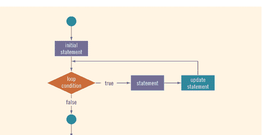

**图 5-2** *for 循环*

*for* 循环的执行过程如下：

- 1. 执行初始化语句。
- 2. 计算循环条件。如果循环条件的计算结果为真：
  - i. 执行 *for* 循环语句。
  - ii. 执行更新语句（括号中的第三个表达式）。
- 3. 重复步骤 2，直到循环条件的计算结果为假。

初始化语句通常初始化一个变量（称为 *for* **循环控制变量**，或 *for* **索引变量**）。

在 C++ 中，*for* 是保留字。

> **注意**
>
> 顾名思义，*for* 循环中的初始化语句是最先执行的语句；它只执行一次。

### 示例 5-9

下面的 for 循环输出前 10 个非负整数：

```cpp
for (i = 0; i < 10; i++)
    cout << i << " ";
cout << endl;
```

初始化语句 i = 0; 将 int 变量 i 初始化为 0。接着，计算循环条件 i < 10。因为 0 < 10 为真，所以执行输出语句并输出 0。然后执行更新语句 i++，将 i 的值设为 1。再次计算循环条件，仍然为真，依此类推。当 i 变为 10 时，循环条件的计算结果为假，for 循环终止，并执行 for 循环之后的语句。

for 循环可以包含简单语句或复合语句。

以下示例进一步说明 for 循环如何执行。

### 示例 5-10

- 1. 下面的 for 循环输出五次 Hello! 和一个星号（各占一行）：

    ```cpp
    for (i = 1; i <= 5; i++)
    {
        cout << "Hello!" << endl;
        cout << "*" << endl;
    }
    ```

- 2. 考虑下面的 for 循环：

    ```cpp
    for (i = 1; i <= 5; i++)
        cout << "Hello!" << endl;
        cout << "*" << endl;
    ```

    这个循环输出 Hello! 五次，而星号只输出一次。注意，for 循环只控制第一条输出语句，因为这两条输出语句没有组成复合语句。因此，第一条输出语句执行五次，因为 for 循环体执行五次。for 循环执行完后，第二条输出语句只执行一次。编译器会忽略缩进，但这种缩进仍会误导读者。

### 示例 5-11

下面的 for 循环执行五次空语句：

```cpp
for (i = 0; i < 5; i++);     //Line 1
    cout << "*" << endl;     //Line 2
```

for 语句末尾（输出语句之前，第 1 行）的分号终止了 for 循环。这个 for 循环的动作是空的，即空操作。

前面的示例表明，要让 for 循环执行所需操作，需要小心。

以下是对 for 循环的一些说明：

- 如果循环条件最初为假，则循环体不执行。
- 更新表达式执行时会改变循环控制变量（由初始化表达式初始化）的值，最终使循环条件的值为假。如果循环条件始终为真，则 for 循环体会无限执行。
- C++ 允许对 double 类型（或任何实数类型）的循环控制变量使用小数值。由于不同计算机可能对这些循环控制变量给出不同结果，应避免使用此类变量。
- for 语句末尾（恰好在循环体之前）的分号是语义错误。在这种情况下，for 循环的动作是空的。
- 在 for 语句中，如果省略循环条件，则假定其为真。
- 在 for 语句中，可以省略全部三个语句——初始化语句、循环条件和更新语句。下面是一个合法的 for 循环：

    ```cpp
    for (;;)
        cout << "Hello" << endl;
    ```

    这是一个无限 for 循环，会连续输出单词 Hello。

以下是更多 for 循环示例。

### 示例 5-12

如果 for 循环控制表达式设置正确，就可以使用 for 循环倒计数。

例如，考虑下面的 for 循环：

```cpp
for (i = 10; i >= 1; i--)
    cout << " " << i;
cout << endl;
```

输出为：

```
10 9 8 7 6 5 4 3 2 1
```

在这个 `for` 循环中，变量 `i` 初始化为 10。每次循环迭代后，`i` 递减 1。只要 `i >= 1`，循环就继续执行。

### 示例 5-13

可以将循环控制变量按任意固定数值递增（或递减）。在下面的 `for` 循环中，变量 `i` 初始化为 1；在 `for` 循环末尾，`i` 递增 2。这个 `for` 循环输出前 10 个正奇数。

```cpp
for (i = 1; i <= 20; i = i + 2)
    cout << i << " ";
cout << endl;
```

### 示例 5-14

假设 `i` 是一个 `int` 变量。

- 1. 考虑下面的 `for` 循环：

    ```cpp
    for (i = 10; i <= 9; i++)
        cout << i << " ";
    cout << endl;
    ```

    在这个 `for` 循环中，初始化语句将 `i` 设为 10。由于最初循环条件（`i <= 9`）为 `false`，所以不会发生任何事。

- 2. 考虑下面的 `for` 循环：

    ```cpp
    for (i = 9; i >= 10; i--)
        cout << i << " ";
    cout << endl;
    ```

    在这个 `for` 循环中，初始化语句将 `i` 设为 9。由于最初循环条件（`i >= 10`）为 `false`，所以不会发生任何事。

- 3. 考虑下面的 `for` 循环：

    ```cpp
    for (i = 10; i <= 10; i++)       //Line 1
        cout << i << " ";             //Line 2
    cout << endl;                       //Line 3
    ```

    在这个 `for` 循环中，初始化语句将 `i` 设为 10。循环条件（`i <= 10`）的计算结果为 `true`，因此第 2 行的输出语句执行，输出 10。

    接着，更新语句将 i 的值递增 1，因此 i 的值变为 11。现在循环条件的计算结果为 *false*，*for* 循环终止。注意，第 2 行的输出语句只执行一次。

- 4. 考虑下面的 *for* 循环：

    ```cpp
    for (i = 1; i <= 10; i++); //Line 1
        cout << i << " "; //Line 2
    cout << endl; //Line 3
    ```

    这个 *for* 循环对第 2 行的输出语句没有影响。*for* 语句末尾的分号终止了 *for* 循环；因此 *for* 循环的动作是空的。输出语句独立存在，只执行一次。

- 5. 考虑下面的 *for* 循环：

    ```cpp
    for (i = 1; ; i++)
        cout << i << " ";
    cout << endl;
    ```

    在这个 *for* 循环中，由于 *for* 语句省略了循环条件，循环条件始终为真。这是一个无限循环。

### 示例 5-15

在这个示例中，*for* 循环读取五个数字并求它们的和与平均值。考虑下面的程序代码，其中 i、newNum、sum 和 average 是 int 变量。

```cpp
sum = 0;

for (i = 1; i <= 5; i++)
{
    cin >> newNum;
    sum = sum + newNum;
}

average = sum / 5;
cout << "The sum is " << sum << endl;
cout << "The average is " << average << endl;
```

在前面的 *for* 循环中，读取一个 newNum 后，将该值加到此前已计算出的（部分）和中，该和由当前数字之前读取的所有数字累加而成。变量 sum 在 *for* 循环之前初始化为 0。因此，程序读取第一个数字并将其加到 sum 的值后，变量 sum 保存的是第一个数字的正确和。


> **注意** `for` 循环的语法如下：
>
> ```cpp
> for (initial expression; logical expression; update expression)
>     statement
> ```
>
> 在功能上等价于以下 `while` 语句：
>
> ```cpp
> initial expression
> while (expression)
> {
>     statement
>     update expression
> }
> ```
>
> 例如，下面的 `for` 和 `while` 循环是等价的：
>
> ```cpp
> for (int i = 0; i < 10; i++)
>     cout << i << " ";
> cout << endl;
> ```
>
> ```cpp
> int i = 0;
> while (i < 10)
> {
>     cout << i << " ";
>     i++;
> }
> cout << endl;
> ```
>
> 如果循环的迭代次数已知或可以预先确定，程序员通常使用 `for` 循环。

### 示例 5-16（斐波那契数程序：修订版）

上一节给出的编程示例：斐波那契数使用 `while` 循环来确定所需的斐波那契数。你可以将 `while` 循环替换为如下等价的 `for` 循环：

```cpp
for (counter = 3; counter <= nthFibonacci; counter++)
{
    current = previous2 + previous1;
    previous1 = previous2;
    previous2 = current;
} //end for
```

使用 `for` 循环确定所需斐波那契数的程序的完整程序清单见本书配套网站。该程序名为 `Ch5_FibonacciNumberUsingAForLoop.cpp`。

在下面的 C++ 程序中，我们建议你逐步走查每个步骤。

## 编程示例：数字分类

该程序读取给定的一组整数，然后打印奇数和偶数的个数。它还输出零的个数。

该程序读取 20 个整数，但你可以轻松修改它以读取任意一组数字。事实上，你可以修改程序，使其首先提示用户指定要读取多少个整数。

**输入** 20 个整数——正数、负数或零。

**输出** 零、偶数和奇数的个数。

### 问题分析与算法设计

读取一个数字后，你需要检查它是偶数还是奇数。假设该值存储在 number 中。将 number 除以 2 并检查余数。如果余数为 0，则 number 是偶数。递增偶数计数，然后检查 number 是否为 0。如果是，则递增零计数。如果余数不为 0，则递增奇数计数。

该程序使用 `switch` 语句来判断 number 是奇数还是偶数。假设 number 是奇数。如果 number 为正数，除以 2 的余数为 1；如果为负数，余数为 −1。如果 number 是偶数，则无论 number 是正数还是负数，除以 2 的余数都是 0。你可以使用取模运算符 % 来求余数。例如：

```cpp
6 % 2 = 0; −4 % 2 = 0; −7 % 2 = −1; 15 % 2 = 1
```

对列表中的每个数字重复上述分析数字的过程。

上述讨论可转化为以下算法：

- 1. 对列表中的每个数字：
  - a. 获取该数字。
  - b. 分析该数字。
  - c. 递增相应的计数。
- 2. 打印结果。

### 变量

因为你要统计零、偶数和奇数的个数，所以需要三个 `int` 类型的变量——比如 zeros、evens 和 odds——来记录计数。你还需要一个变量——比如 number——来读取并存储要分析的数字，以及另一个变量——比如 counter——来统计已分析的数字个数。因此，程序中需要以下变量：

```cpp
int counter;   //loop control variable
int number;    //variable to store the number read
int zeros;     //variable to store the zero count
int evens;     //variable to store the even count
int odds;      //variable to store the odd count
```

显然，必须将变量 zeros、evens 和 odds 初始化为 0。可以在声明这些变量时对它们进行初始化。

### 主算法

- 1. 初始化变量。
- 2. 提示用户输入 20 个数字。
- 3. 对列表中的每个数字：
  - a. 读取该数字。
  - b. 输出该数字（回显输入）。
  - c. 如果该数字是偶数：
    - i. 递增偶数计数。
    - ii. 如果该数字为零，递增零计数。
  - 否则：
    - 递增奇数计数。
- 4. 打印结果。

在编写 C++ 程序之前，让我们更详细地描述步骤 1–4。这样你之后用 C++ 编写指令就会容易得多。

- 1. 初始化变量。可以在声明变量 zeros、evens 和 odds 时对它们进行初始化。
- 2. 使用输出语句提示用户输入 20 个数字。
- 3. 对于步骤 3，你可以使用 `for` 循环来处理和分析这 20 个数字。用伪代码表示，这一步写作如下：

```cpp
for (counter = 1; counter <= 20; counter++)
{
    read the number;
    output number;

    switch (number % 2)    // check the remainder
    {
    case 0:
        increment even count;
        if (number == 0)
            increment zero count;
        break;
    case 1:
    case -1:
        increment odd count;
    } //end switch
} //end for
```

- 4. 打印结果。输出变量 zeros、evens 和 odds 的值。

### 完整程序清单

```cpp
/*************************************************************
// Author: D.S. Malik
//
// Program: Counts zeros, odds, and evens
// This program counts the number of odd and even numbers.
// The program also counts the number of zeros.
*************************************************************/
#include <iostream>
#include <iomanip>

using namespace std;

const int N = 20;

int main()
{
            //Declare variables
    int counter;    //loop control variable
    int number;     //variable to store the new number
    int zeros = 0;                         //Step 1
    int odds = 0;                          //Step 1
    int evens = 0;                         //Step 1

    cout << "Please enter " << N << " integers, "
         << "positive, negative, or zeros."
         << endl;                          //Step 2

    cout << "The numbers you entered are:" << endl;

    for (counter = 1; counter <= N; counter++)       //Step 3
    {
        cin >> number;                              //Step 3a
        cout << number << " ";                      //Step 3b

                                                    //Step 3c
        switch (number % 2)
        {
        case 0:
            evens++;
            if (number == 0)
                zeros++;
            break;
        case 1:
        case -1:
            odds++;
        } //end switch
    } //end for loop

    cout << endl;            //Step 4
    cout << "There are " << evens << " evens, "
         << "which includes " << zeros << " zeros."
         << endl;
    cout << "The number of odd numbers is: " << odds
         << endl;

    return 0;
}
```

**示例运行：** 在此示例运行中，用户输入以底纹显示。

```
Please enter 20 integers, positive, negative, or zeros.
The numbers you entered are:
0 0 -2 -3 -5 6 7 8 0 3 0 -23 -8 0 2 9 0 12 67 54
0 0 -2 -3 -5 6 7 8 0 3 0 -23 -8 0 2 9 0 12 67 54
There are 13 evens, which includes 6 zeros.
The number of odd numbers is: 7
```

我们建议你使用上面的示例输入对该程序进行一次走查。

## do...while 循环（重复）结构

本节介绍第三种循环或重复结构，称为 do...while 循环。do...while 语句的一般形式如下：

```cpp
do
    statement
while (expression);
```

当然，语句可以是简单语句或复合语句。如果它是复合语句，请将其括在花括号中。图 5–3 显示了 do...while 循环的执行流程。

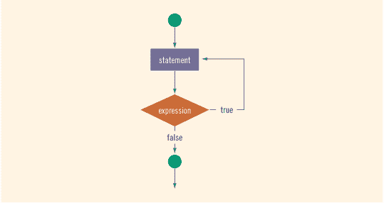

**图 5-3** do...while 循环

在 C++ 中，do 是保留字。

先执行语句，然后对表达式求值。如果表达式的求值结果为 true，则再次执行该语句。只要 do...while 语句中的表达式为 true，语句就会执行。为避免无限循环，你必须再次确保循环体包含一个最终使表达式为 false 并确保循环正确退出的语句。

### 示例 5-18

```cpp
i = 0;

do
{
    cout << i << " ";
    i = i + 5;
} while (i <= 20);
```

这段代码的输出是：

```
0 5 10 15 20
```

在输出 20 之后，语句：

```cpp
i = i + 5;
```

将 `i` 的值改为 25，因此 `i <= 20` 变为 `false`，从而停止循环。


在 **while** 和 **for** 循环中，循环条件在执行循环体之前进行求值。因此，**while** 和 **for** 循环称为 **前测试循环**。另一方面，**do...while** 循环中的循环条件在执行循环体之后进行求值。因此，**do...while** 循环称为 **后测试循环**。

由于 **while** 和 **for** 循环都有入口条件，这些循环可能永远不会被激活。另一方面，**do...while** 循环有出口条件，因此总是至少执行一次语句。

### 示例 5-19

考虑以下两个循环：

```cpp
a.  i = 11;
    while (i <= 10)
    {
        cout << i << " ";
        i = i + 5;
    }
    cout << endl;

b.  i = 11;
    do
    {
        cout << i << " ";
        i = i + 5;
    }
    while (i <= 10);

    cout << endl;
```

在 (a) 中，**while** 循环不产生任何输出。在 (b) 中，**do...while** 循环输出数字 11，并且还将 i 的值改为 16。

**do...while** 循环可用于输入验证。假设程序提示用户输入一个测试分数，该分数必须大于或等于 0 且小于或等于 50。如果用户输入的分数小于 0 或大于 50，则应提示用户重新输入分数。可以使用以下 **do...while** 循环来实现此目标：

```cpp
int score;

do
{
    cout << "Enter a score between 0 and 50: ";
    cin >> score;
    cout << endl;
}
while (score < 0 || score > 50);
```

### 示例 5-20：3 和 9 的整除性测试

假设 $m$ 和 $n$ 是整数，且 $m$ 非零。那么，如果对于某个整数 $t$ 有 $n = mt$，则称 $m$ 是 $n$ 的 **约数**；也就是说，当 $m$ 整除 $n$ 时，余数为 0。

设 $n = a_k a_{k-1} a_{k-2} ... a_1 a_0$ 为一个整数。设 $s = a_k + a_{k-1} + a_{k-2} + ... + a_1 + a_0$ 为 $n$ 的各位数字之和。已知如果 $s$ 能被 3 和 9 整除，则 $n$ 能被 3 和 9 整除。换句话说，一个整数能被 3 和 9 整除当且仅当其各位数字之和能被 3 和 9 整除。

例如，假设 $n = 27193257$。那么 $s = 2 + 7 + 1 + 9 + 3 + 2 + 5 + 7 = 36$。因为 36 能同时被 3 和 9 整除，所以 27193257 能同时被 3 和 9 整除。

接下来，我们编写一个程序，通过先求各位数字之和，然后检查该和是否能被 3 和 9 整除，来判断一个正整数是否能被 3 和 9 整除。

要求一个正整数的各位数字之和，我们需要提取该数字的每一位。考虑数字 951372。注意 951372 % 10 = 2，这是 951372 的最后一位数字。还要注意 951372 / 10 = 95137；也就是说，当该数字除以 10 时，会移除最后一位数字。接下来，我们对数字 95137 重复此过程。当然，我们需要将提取出的数字相加。

假设 `sum` 和 `num` 是 `int` 变量，且正整数存储在 `num` 中。因此，我们有以下算法来求各位数字之和：

```cpp
sum = 0;

do
{
    sum = sum + num % 10; //extract the last digit
                          //and add it to sum
    num = num / 10;       //remove the last digit
}
while (num > 0);
```

使用此算法，我们可以编写以下程序，该程序使用 *do...while* 循环来实现前面的整除性测试算法。

```cpp
//Program: Divisibility test by 3 and 9

#include <iostream>

using namespace std;

int main()
{
    int num, temp, sum;

    cout << "Enter a positive integer: ";
    cin >> num;

    cout << endl;

    temp = num;

    sum = 0;

    do
    {
        sum = sum + num % 10;      //extract the last digit
                                   //and add it to sum
        num = num / 10;            //remove the last digit
    }
    while (num > 0);

    cout << "The sum of the digits = " << sum << endl;

    if (sum % 3 == 0)
        cout << temp << " is divisible by 3" << endl;
    else
        cout << temp << " is not divisible by 3" << endl;

    if (sum % 9 == 0)
        cout << temp << " is divisible by 9" << endl;
    else
        cout << temp << " is not divisible by 9" << endl;
}
```

**示例运行：** 在这些示例运行中，用户输入以底纹显示。

**示例运行 1：**

```text
Enter a positive integer: 27193257

The sum of the digits = 36
27193257 is divisible by 3
27193257 is divisible by 9
```

**示例运行 2：**

```text
Enter a positive integer: 609321

The sum of the digits = 21
609321 is divisible by 3
609321 is not divisible by 9
```

**示例运行 3：**

```text
Enter a positive integer: 161905102

The sum of the digits = 25
161905102 is not divisible by 3
161905102 is not divisible by 9
```

## 选择合适的循环结构

所有三种循环在 C++ 中都有其适用之处。如果你知道，或者程序能够预先确定所需的重复次数，那么 `for` 循环是正确选择。如果你不知道，并且程序无法预先确定所需的重复次数，而且重复次数可能为零，那么 `while` 循环是正确选择。如果你不知道，并且程序无法预先确定所需的重复次数，而且重复次数至少为一次，那么 `do...while` 循环是正确选择。

## break 和 continue 语句

`break` 语句在 `switch` 结构中执行时，会立即退出 `switch` 结构。类似地，你可以在 `while`、`for` 和 `do...while` 循环中使用 `break` 语句。当 `break` 语句在重复结构中执行时，它会立即退出该结构。`break` 语句通常用于两个目的：

- 提前退出循环。
- 跳过 `switch` 结构的剩余部分。

`break` 语句执行后，程序继续执行该结构之后的第一个语句。在循环中使用 `break` 语句可以消除某些（标志）变量的使用。以下 C++ 代码段有助于说明这一想法。（假设所有变量都已正确声明。）

```cpp
sum = 0;
isNegative = false;

cin >> num;

while (cin && !isNegative)
{
    if (num < 0)    //if num is negative, terminate the loop
                    //after this iteration
    {
        cout << "Negative number found in the data." << endl;
        isNegative = true;
    }
    else
    {
        sum = sum + num;
        cin >> num;
    }
}
```

这个 `while` 循环应该求一组正数之和。如果数据集中包含负数，循环会以适当的错误消息终止。这个 `while` 循环使用标志变量 `isNegative` 来达到所需结果。变量 `isNegative` 在 `while` 循环之前初始化为 `false`。在将 num 加入

```cpp
while (cin)
{
    if (num < 0)
    {
        cout << "Negative number found in the data." << endl;
        cin >> num;
        continue;
    }

    sum = sum + num;
    cin >> num;
}
```

前面已经说明，所有三种循环在 C++ 中都有其适用之处，并且一种循环通常可以替代另一种循环。然而，`continue` 语句的执行正是 `while` 和 `do...while` 结构与 `for` 结构的不同之处。当 `continue` 语句在 `while` 或 `do...while` 循环中执行时，更新语句可能不会执行。在 `for` 结构中，更新语句总是会执行。

## 嵌套控制结构

在本节中，我们给出示例，说明如何使用嵌套循环来获得有用的结果并处理数据。

### 示例 5-21

假设你想创建以下图案：

```text
*
**
***
****
*****
```

显然，你想打印五行星号。在第一行中，你想打印一个星号，在第二行中打印两个星号，依此类推。因为将打印五行，所以从以下 `for` 语句开始：

```cpp
for (i = 1; i <= 5; i++)
```

i 的值在第一次迭代中为 1，在第二次迭代中为 2，依此类推。你可以将 i 的值用作嵌套在此循环内的另一个 `for` 循环中的限制条件，以控制一行中的星号数量。再稍加思考，便可得到以下代码：

```cpp
for (i = 1; i <= 5; i++)          //Line 1
{                                  //Line 2
    for (j = 1; j <= i; j++)      //Line 3
        cout << "*";              //Line 4
    cout << endl;                  //Line 5
}                                  //Line 6
```


对这段代码的逐步分析表明，第 1 行中的 `for` 循环从 `i = 1` 开始。当 `i` 为 1 时，第 3 行中的内层 `for` 循环输出一个星号，插入点移到下一行。然后 `i` 变为 2，内层 `for` 循环输出两个星号，第 5 行中的输出语句将插入点移到下一行，依此类推。此过程一直持续到 `i` 变为 6，循环停止。

如果将第 1 行中的 `for` 语句替换为以下语句，这段代码会生成什么图案？

```
for (i = 5; i >= 1; i--)
```

## 例 5-22

假设你想创建以下乘法表：

|   |   |   |   |   |   |   |   |   |   |
|---:|---:|---:|---:|---:|---:|---:|---:|---:|---:|
| 1 | 2 | 3 | 4 | 5 | 6 | 7 | 8 | 9 | 10 |
| 2 | 4 | 6 | 8 | 10 | 12 | 14 | 16 | 18 | 20 |
| 3 | 6 | 9 | 12 | 15 | 18 | 21 | 24 | 27 | 30 |
| 4 | 8 | 12 | 16 | 20 | 24 | 28 | 32 | 36 | 40 |
| 5 | 10 | 15 | 20 | 25 | 30 | 35 | 40 | 45 | 50 |

这个乘法表有五行。因此，如同例 5-21 中那样，我们使用一个 `for` 语句来输出这些行，如下所示：

```
for (i = 1; i <= 5; i++)
    //output a line of numbers
```

在第一行中，我们要打印 1 的乘法表；在第二行中，我们要打印 2 的乘法表；依此类推。注意，第一行以 1 开头，并且当打印这一行时，`i` 为 1。类似地，第二行以 2 开头，并且当打印这一行时，`i` 的值为 2，依此类推。如果 i 为 1，则 i * 1 为 1；如果 i 为 2，则 i * 2 为 2；依此类推。因此，要打印一行数字，我们可以使用 `i` 的值作为起始数字，并使用 10 作为限制值。也就是说，考虑以下 `for` 循环：

```
for (j = 1; j <= 10; j++)
    cout << setw(3) << i * j;
```

让我们看看这个 `for` 循环。假设 i 为 1。那么我们在打印乘法表的第一行。此外，`j` 从 1 到 10，因此这个 `for` 循环输出数字 1 到 10，也就是乘法表的第一行。类似地，如果 i 为 2，我们在打印乘法表的第二行。此外，`j` 从 1 到 10，因此这个 `for` 循环输出乘法表的第二行，依此类推。

再稍加思考，就可以得到以下嵌套循环，用来输出所需的网格：

```
for (i = 1; i <= 5; i++)                 //Line 1
{
    for (j = 1; j <= 10; j++)             //Line 3
        cout << setw(3) << i * j;         //Line 4
    cout << endl;                         //Line 5
}                                         //Line 6
```

## 例 5-23

考虑以下数据：

```
65 78 65 89 25 98 -999
87 34 89 99 26 78 64 34 -999
23 99 98 97 26 78 100 63 87 23 -999
62 35 78 99 12 93 19 -999
```

每一行末尾的数字 -999 充当哨兵值，因此不属于数据的一部分。我们的目标是求每一行中数字的和并输出该和。此外，假设这些数据要从一个文件中读取，例如 Exp_5_23.txt。我们假设输入文件已使用输入文件流变量 infile 打开。

这个特定数据集有四行输入。因此，我们可以使用 `for` 循环或计数器控制的 `while` 循环来处理每一行数据。让我们使用 `while` 循环来处理这四行。由此，`while` 循环采用以下形式：

```
counter = 0;                 //Line 1
while (counter < 4)          //Line 2
{                            //Line 3
    //process the line        //Line 4

    //output the sum
    counter++;
}
```

现在让我们集中处理一行。每一行的数据项数量各不相同。例如，第一行有六个数字，第二行有八个数字，依此类推。因为每一行都以 -999 结束，所以我们可以使用哨兵控制的 `while` 循环来求每一行中数字的和。（记住哨兵控制的循环是如何工作的。）考虑以下 `while` 循环：

```
sum = 0;                    //Line 4
infile >> num;              //Line 5
while (num != -999)         //Line 6
{                            //Line 7
    sum = sum + num;        //Line 8
    infile >> num;          //Line 9
}                            //Line 10
```

第 4 行中的语句将 sum 初始化为 0，第 5 行中的语句读取该行的第一个数字并将其存入 num。第 6 行中的布尔表达式 num != -999 检查该数字是否为 -999。如果 num 不是 -999，则执行第 8 行和第 9 行中的语句。第 8 行中的语句更新 sum 的值；第 9 行中的语句读取下一个数字并将其存入 num。只要 num 不是 -999，循环就继续执行。

由此可知，用于处理这些数据的嵌套循环如下。（假设所有变量都已正确声明。）

```
counter = 0;                          //Line 1
while (counter < 4)                    //Line 2
{                                       //Line 3
    sum = 0;                            //Line 4
    infile >> num;                      //Line 5
    while (num != -999)                 //Line 6
    {                                   //Line 7
        sum = sum + num;                //Line 8
        infile >> num;                  //Line 9
    }                                   //Line 10

    cout << "Line " << counter + 1     //Line 11
         << ": Sum = " << sum << endl; //Line 11
    counter++;                          //Line 12
}                                       //Line 13
```

## 例 5-24

假设我们要处理与例 5-23 中类似的数据，但输入文件的长度未指定。也就是说，每一行包含的数据与例 5-23 中每一行的数据相同，但我们不知道输入行数。

由于我们不知道输入行数，必须使用由 EOF 控制的 `while` 循环来处理数据。在这种情况下，所需代码如下。（假设所有变量都已正确声明，并且输入文件已使用输入文件流变量 `infile` 打开。）

```
counter = 0;                          //Line 1
infile >> num;                          //Line 2
while (infile)                          //Line 3
{                                       //Line 4
    sum = 0;                            //Line 5
    while (num != -999)                 //Line 6
    {                                   //Line 7
        sum = sum + num;                //Line 8
        infile >> num;                  //Line 9
    }                                   //Line 10

    cout << "Line " << counter + 1     //Line 11
         << ": Sum = " << sum << endl; //Line 11
    counter++;                          //Line 12
    infile >> num;                      //Line 13
}                                       //Line 14
```

注意，我们再次使用了变量 counter。这样做的唯一原因是，我们想打印每一行的行号及其和。

## 例 5-25

考虑以下数据：

```
101
John Smith
65 78 65 89 25 98 -999
102
Peter Gupta
87 34 89 99 26 78 64 34 -999
103
Buddy Friend
23 99 98 97 26 78 100 63 87 23 -999
104
Doctor Miller
62 35 78 99 12 93 19 -999
...
```

一行末尾的数字 -999 充当哨兵值，因此不属于数据的一部分。

假设这是某些竞选学生会主席职位的候选人的数据。

对于每位候选人，数据采用以下形式：

```
ID
Name
Votes
```

目标是求出该候选人获得的总票数。我们假设数据从大小未知的文件 Exp_5_25.txt 输入。我们还假设输入文件已使用输入流变量 infile 打开。

由于输入文件的长度未指定，我们使用由 EOF 控制的 `while` 循环。对于每位候选人，第一个数据项是单独占一行的 int 类型 ID；第二个数据项是姓名，可能由多个单词组成；第三行包含从各部门获得的票数。

要读取 ID，我们使用提取运算符 >>；要读取姓名，我们使用流函数 getline。注意，读取 ID 后，读取标记位于 ID 之后，而 ID 之后的字符是换行符。因此，读取 ID 后，读取标记位于 ID 之后、换行符（包含 ID 的那一行的换行符）之前。

函数 getline 会一直读取到行尾。因此，如果我们在读取 ID 后立即读取姓名，那么存入变量 name 的会是（ID 之后的）换行符。由此可知，要读取姓名，我们必须读取并丢弃 ID 之后的换行符，这可以使用流函数 get 来完成。因此，读取 ID 和姓名的语句如下：

```
infile >> ID;            //read the ID
infile.get(ch);         //read the newline character after the ID
getline(infile, name);  //read the name
```


（假设 ch 是 char 类型的变量。）处理数据的一般循环如下：

```cpp
infile >> ID;                         //Line 1
while (infile)                         //Line 2
{
    infile.get(ch);                     //Line 4
    getline(infile, name);              //Line 5

    //process the numbers in each line   //Line 6
    //output the name and total votes
    infile >> ID;                        //begin processing the next line
}
```

读取并汇总投票数据的代码如下：

```cpp
sum = 0;                             //Line 6
infile >> num;                       //Line 7; read the first number
while (num != -999)                  //Line 8
{
    sum = sum + num;                  //Line 10; update sum
    infile >> num;                    //Line 11; read the next number
}                                    //Line 12
```

现在我们可以编写以下嵌套循环来按如下方式处理数据：

```cpp
infile >> ID;                         //Line 1
while (infile)                         //Line 2
{
    infile.get(ch);                     //Line 4
    getline(infile, name);              //Line 5
    sum = 0;                             //Line 6
    infile >> num;                      //Line 7; read the first number
    while (num != -999)                 //Line 8
    {
        sum = sum + num;                //Line 10; update sum
        infile >> num;                  //Line 11; read the next number
    }

    cout << "Name: " << name
         << ", Votes: " << sum
         << endl;                        //Line 12

    infile >> ID;        //Line 13; begin processing the next line
}
```

## 通过避免打补丁来避免错误

前几章中的调试小节说明了如何调试语法错误和逻辑错误，以及如何避免一知半解的概念。在本节中，我们将说明如何避免用软件补丁来修复代码。软件补丁是写在现有代码之上、旨在修复原始代码中错误的一段代码。

假设文件 `Ch5_LoopWithBugsData.txt` 中包含以下数据。

```
87 78 83 94
23 89 92 70
92 78 34 56
```

目标是求每一行中数字的总和。对于每一行，输出这些数字及其总和。让我们考虑以下程序：

```cpp
#include <iostream>
#include <fstream>

using namespace std;

int main()
{
    ifstream infile;

    int i;
    int j;
    int sum;
    int num;

    infile.open("Ch5_LoopWithBugsData.txt");

    for (i = 1; i <= 4; i++)
    {
        sum = 0;

        for (j = 1; j <= 4; j++)
        {
            infile >> num;
            cout << num << " ";
            sum = sum + num;
        }

        cout << "sum = " << sum << endl;
    }

    return 0;
}
```

### 示例运行：

```
87 78 83 94 sum = 342
23 89 92 70 sum = 274
92 78 34 56 sum = 260
56 56 56 56 sum = 224
```

示例运行表明程序中存在一个错误，因为文件包含三行输入，而输出包含四行。此外，最后一行的数字 56 重复了四次。显然，程序中存在错误，我们必须修复代码。有些程序员，尤其是一些初学者，会通过添加软件补丁来处理问题的表面症状。在这种情况下，输出应当只包含三行输出。

初学者可能会通过添加软件补丁来修复代码，如下面的修改后程序所示。

```cpp
#include <iostream>
#include <fstream>

using namespace std;

int main()
{
    ifstream infile;

    int i;
    int j;
    int sum;
    int num;

    infile.open("Ch5_LoopWithBugsData.txt");

    for (i = 1; i <= 4; i++)
    {
        sum = 0;

        if (i != 4)
        {
            for (j = 1; j <= 4; j++)
            {
                infile >> num;
                cout << num << " ";
                sum = sum + num;
            }

            cout << "sum = " << sum << endl;
        }
    }

    return 0;
}
```

### 示例运行：

```
87 78 83 94 sum = 342
23 89 92 70 sum = 274
92 78 34 56 sum = 260
```

显然，程序现在运行正确。

正如我们所看到的，程序员只是观察到了表面症状，并通过添加软件补丁来处理问题。然而，如果你查看代码，程序不仅执行了多余的语句，而且它还是一个一知半解概念的示例。程序员似乎没有很好地理解为什么先前的程序产生四行而不是三行。添加补丁消除了表面症状，但这是一种糟糕的编程实践。程序员必须弄清楚程序为什么产生四行。仔细查看程序，我们可以看到产生四行是因为外层循环执行了四次。赋给循环控制变量 i 的值是 1、2、3 和 4。这是经典的“差一错误”问题的示例。（在“差一错误”问题中，循环要么多执行一次，要么少执行一次。）我们可以通过正确设置循环控制变量的值来消除这个问题。例如，我们可以按如下方式重写循环：

```cpp
for (i = 1; i <= 3; i++)
{
    sum = 0;

    for (j = 1; j <= 4; j++)
    {
        infile >> num;
        cout << num << " ";
        sum = sum + num;
    }

    cout << "sum = " << sum << endl;
}
```

这段代码在不使用软件补丁的情况下修复了原始问题。它也体现了良好的编程实践。完整修改后的程序可在本书配套网站上获得，文件名为 Ch5_LoopWithBugsCorrectedProgram.cpp。

## 调试循环

正如我们在前面的调试小节中所看到的，无论程序设计和编码得多么仔细，错误仍有可能发生。如果存在语法错误，编译器会识别它们。然而，如果存在逻辑错误，我们必须仔细查看代码，甚至可能查看设计，并尝试找出错误。为了提高程序的可靠性，必须在程序发布给用户之前发现并修复错误。

一旦算法编写完成，下一步就是验证它能否正常工作。如果算法是简单的顺序流程或包含分支，可以手工跟踪，或者可以使用 IDE 提供的调试器（如果有）。通常，循环更难调试。循环的正确性可以通过使用循环不变式来验证。循环不变式是一组语句，每次执行循环体时它们都保持为真。设 *p* 为循环不变式，*q* 为循环语句中的（逻辑）表达式。那么，在循环的每次迭代之前，*p* && *q* 保持为真；在循环终止后，*p* && not(*q*) 为真。关于循环不变式的完整讨论超出了本书的范围。不过，你可以在 *离散数学结构：理论与应用*，D.S. Malik 和 M.K. Sen，Course Technology，2004 一书中学习循环不变式。这里，我们给出一些可用于调试循环的提示。

如上一节所述，与循环相关的最常见错误是差一错误。如果某个循环变成了无限循环，错误最有可能出在控制循环执行的逻辑表达式中。仔细检查逻辑表达式，看看是否把不等号写反了、赋值语句符号出现在相等运算符的位置，或者 `&&` 出现在 `||` 的位置。如果循环改变了变量的值，你可以在每次迭代之前和/或之后打印变量的值，或者可以使用 IDE 的调试器（如果有），并在每次迭代期间监视变量的值。

本书中的调试小节旨在帮助你理解调试过程。然而，你会意识到，调试可能是一个令人疲惫的过程。如果你的程序非常糟糕，不要调试。把它扔掉，重新开始。

## 快速回顾

- 1. C++ 有三种循环（重复）结构：`while`、`for` 和 `do...while`。
- 2. `while` 语句的语法是：
  ```
  while (expression)
      statement
  ```
- 3. 在 C++ 中，`while` 是保留字。
- 4. 在 `while` 语句中，表达式（决策者）两边的圆括号很重要；它们标记表达式的开始和结束。
- 5. 语句被称为循环体。
- 6. `while` 循环的循环体必须包含一条最终将表达式设置为 `false` 的语句。
- 7. 计数器控制的 `while` 循环使用计数器来控制循环。
- 8. 在计数器控制的 `while` 循环中，必须在循环之前初始化计数器，并且循环体必须包含一条改变计数器变量值的语句。
- 9. 哨兵值是一个特殊值，用于标记输入数据的结束。哨兵值必须与所有数据项相似但又不同。
- 10. 哨兵控制的 `while` 循环使用哨兵值来控制 `while` 循环。`while` 循环会继续执行，直到读取到哨兵值。
- 11. EOF 控制的 `while` 循环会继续执行，直到程序检测到文件结束标记。
- 12. 在 Windows 控制台环境中，使用 Ctrl+Z 输入文件结束标记（按住 Ctrl 键并按 Z）。在 UNIX 环境中，使用 Ctrl+D 输入文件结束标记（按住 Ctrl 键并按 D）。
- 13. `for` 循环简化了计数器控制的 `while` 循环的编写。
- 14. 在 C++ 中，`for` 是保留字。
- 15. `for` 循环的语法是：
  ```
  for (initialize statement; loop condition; update statement)
      statement
  ```
  语句被称为 `for` 循环的循环体。


- 16. 在 `for` 循环末尾（`for` 循环体之前）添加分号是一个语义错误。在这种情况下，`for` 循环的操作是空的。

- 17. `do...while` 语句的语法是：

```cpp
do
    statement
while (expression);
```

`statement` 被称为 `do...while` 循环的循环体。

- 18. `while` 循环和 `for` 循环都被称为前测试循环。`do...while` 循环被称为后测试循环。

- 19. `while` 循环和 `for` 循环可能完全不执行，但 `do...while` 循环总是至少执行一次。

- 20. 在循环体中执行 `break` 语句会立即终止循环。

- 21. 在循环体中执行 `continue` 语句会跳过循环中剩余的语句，并继续执行下一次迭代。

- 22. 当 `continue` 语句在 `while` 或 `do...while` 循环中执行时，循环体中的表达式更新语句可能不会执行。

- 23. 在 `for` 循环中执行 `continue` 语句后，更新语句是下一个要执行的语句。

## 练习

- 1. 判断以下陈述为真还是假。

  - a. 在计数器控制的 `while` 循环中，不一定需要初始化循环控制变量。
  - b. `while` 循环的循环体有可能完全不执行。
  - c. 在无限 `while` 循环中，`while` 表达式（决策者）最初为假，但在第一次迭代之后始终为真。
  - d. `while` 循环：

```cpp
j = 0;
while (j <= 10)
    j++;
```

如果 `j > 10` 则终止。

  - e. 哨兵控制的 `while` 循环是一种事件控制的 `while` 循环，其终止依赖于一个特殊值。
  - f. 循环是一种控制结构，它使某些语句反复执行。
  - g. 要从长度未知的文件中读取数据，使用 EOF 控制的循环是一个好的选择。


2. 以下 C++ 代码的输出是什么？

```cpp
int count = 1;
int y = 100;
while (count < 100)
{
    y = y - 1;
    count++;
}
cout << " y = " << y << " and count = " << count << endl;
```

3. 以下 C++ 代码的输出是什么？

```cpp
int num = 5;
while (num > 5)
    num = num + 2;
cout << num << endl;
```

4. 以下 C++ 代码的输出是什么？

```cpp
int num = 1;
while (num < 10)
{
    cout << num << " ";
    num = num + 2;
}
cout << endl;
```

5. 以下 `while` 循环何时终止？

```cpp
ch = 'D';
while ('A' <= ch && ch <= 'Z')
    ch = static_cast<char>(static_cast<int>(ch) + 1);
```

6. 假设输入为 38  35  71  14  -1。以下代码的输出是什么？假设所有变量都已正确声明。

```cpp
cin >> sum;
cin >> num;

for (j = 1; j <= 3; j++)
{
    cin >> num;
    sum = sum + num;
}
cout << "Sum = " << sum << endl;
```

7. 假设输入为 38  35  71  14  -1。以下代码的输出是什么？假设所有变量都已正确声明。

```cpp
cin >> sum;
cin >> num;

while (num != -1)
{
    sum = sum + num;
    cin >> num;
}
cout << "Sum = " << sum << endl;
```

8. 假设输入为 `38 35 71 14 -1`。以下代码的输出是什么？假设所有变量都已正确声明。

```cpp
cin >> num;
sum = num;

while (num != -1)
{
    cin >> num;
    sum = sum + num;
}
cout << "Sum = " << sum << endl;
```

9. 假设输入为 `38 35 71 14 -1`。以下代码的输出是什么？假设所有变量都已正确声明。

```cpp
sum = 0;
cin >> num;

while (num != -1)
{
    sum = sum + num;
    cin >> num;
}
cout << "Sum = " << sum << endl;
```

10. 更正以下代码，使其求 20 个数的和。

```cpp
sum = 0;

while (count < 20)
    cin >> num;
    sum = sum + num;
    count++;
```

11. 以下程序的输出是什么？

```cpp
#include <iostream>

using namespace std;

int main()
{
    int x, y, z;

    x = 4;  y = 5;
    z = y + 6;

    while ((z - x) % 4 != 0)
    {
        cout << z << " ";
        z = z + 7;
    }
}
```

```cpp
cout << fixed << showpoint << setprecision(2);

while (response == 'Y' || response == 'y')
{
    cout << "Enter two numbers: ";
    cin >> num1 >> num2;
    cout << endl;

    cout << num1 << " + " << num2 << " = " << (num1 + num2)
         << endl;

    cout << "Would you like to add again: (Y/y) ";
    cin >> response;
    cout << endl;
}

return 0;
}
```

14. 以下程序段的输出是什么？

```cpp
int count = 0;

while (count++ < 10)
    cout << "This loop can repeat statements." << endl;
```

15. 以下程序段的输出是什么？

```cpp
int count = 5;

while (--count > 0)
    cout << count << " ";
cout << endl;
```

16. 以下程序段的输出是什么？

```cpp
int count = 5;

while (count-- > 0)
    cout << count << " ";
cout << endl;
```

17. 以下程序段的输出是什么？

```cpp
int count = 1;
while (count++ <= 5)
    cout << count * (count - 2) << " ";

cout << endl;
```

18. 在以下每种情况下，你会使用什么类型的循环（例如计数器控制和哨兵控制）？

  - a. 求以下级数的和：1 + (2 / 1) + (3 / 2) + (4 / 3) + (5 / 4) + ... + (10 / 9)
  - b. 求以下数字的和，但最后一个数字除外：17, 32, 62, 48, 58, -1
  - c. 一个文件包含一名员工的薪水。更新该员工的薪水。

19. 考虑以下 `for` 循环：

```cpp
int j, s;

s = 0;
for (j = 1; j <= 10; j++)
    s = s + j * (j - 1);
```

在这个 `for` 循环中，指出循环控制变量、初始化语句、循环条件、更新语句以及更新 `s` 值的语句。

20. 假设以下代码被正确插入到程序中，说明其完整输出的内容和形式。（假设所有变量都已正确声明。）

```cpp
num = 0;
for (i = 1; i <= 4; i++)
{
    num = num + 10 * (i - 1);
    cout << num << " ";
}
cout << endl;
```

21. 假设以下代码被正确插入到程序中，说明其完整输出的内容和形式。（假设所有变量都已正确声明。）

```cpp
j = 2;
for (i = 0; i <= 5; i++)
{
    cout << j << " ";
    j = 2 * j + 3;
}
cout << j << " " << endl;
```

22. 假设以下代码被正确插入到程序中：

```cpp
int s = 0;

for (i = 0; i < 5; i++)
{
    s = 2 * s + i;
    cout << s << " ";
}
cout << endl;
```

  - a. `s` 的最终值是多少？
    - (i) 11
    - (ii) 4
    - (iii) 26
    - (iv) 以上都不是
  - b. 如果在 `for` 循环语句的右括号后插入一个分号，`s` 的最终值是多少？
    - (i) 0
    - (ii) 1
    - (iii) 2
    - (iv) 5
    - (v) 以上都不是
  - c. 如果在 `for` 循环控制表达式中将 5 替换为 0，`s` 的最终值是多少？
    - (i) 0
    - (ii) 1
    - (iii) 2
    - (iv) 以上都不是

```cpp
for (j = 0; j < 8; j++)
{
    cout << j * 25 << " - ";

    if (j != 7)
        cout << (j + 1) * 25 - 1 << endl;
    else
        cout << (j + 1) * 25 << endl;
}
```

28. 假设输入为 38  35  71  44  -1。以下代码的输出是什么？假设所有变量都已正确声明。

```cpp
sum = 0;
cin >> num;

for (j = 1; j <= 3; j++)
{
    cin >> num;
    sum = sum + num;
}
cout << "Sum = " << sum << endl;
```

29. 以下哪些仅适用于 **while** 循环？仅适用于 **do...while** 循环？两者都适用？

  - a. 它被认为是一个条件循环。
  - b. 循环体至少执行一次。
  - c. 控制循环的逻辑表达式在进入循环之前被求值。
  - d. 循环体可能根本不执行。

30. 以下程序有五个以上的错误，导致它无法编译和/或运行。更正所有此类错误。

```cpp
#include <iostream>

using namespace std;
const int N = 2,137;

main ()
{
    int a, b, c, d;

    a = 3;
    b = 5;
    c = c + d;
    N = a + n;
    for (i = 3; i <= N; i++)
    {
        cout << setw(5) << i;
        i = i + 1;
    }
    return 0;
}
```


40. 给定以下程序段：

```cpp
j = 2;
for (i = 1; i <= 5; i++);
{
    cout << setw(4) << j;
    j = j + 5;
}
cout << endl;
```

编写一个 while 循环和一个 do...while 循环，使它们具有相同的输出。

41. 以下程序的输出是什么？

```cpp
#include <iostream>

using namespace std;

int main()
{
    int x, y, z;
    x = 4;  y = 5;
    z = y + 6;
    do
    {
        cout << z << " ";
        z = z + 7;
    }
    while (((z - x) % 4) != 0);

    cout << endl;

    return 0;
}
```

42. 为了了解嵌套 `for` 循环的工作原理，请对以下程序段进行走查，并确定每种情况下的确切输出。

a. `int i, j;`

```cpp
for (i = 1; i <= 5; i++)
{
    for (j = 1; j <= 5; j++)
        cout << setw(3) << i;
    cout << endl;
}
```

b. `int i, j;`

```cpp
for (i = 1; i <= 5; i++)
{
    for (j = (i + 1); j <= 5; j++)
        cout << setw(5) << j;
    cout << endl;
}
```

45. 以下代码的输出是什么？

```cpp
int num = 12;

while (num >= 0)
{
    if (num % 5 == 0)
    {
        num++;
        continue;
    }

    cout << num << " ";
    num = num - 2;
}
cout << endl;
```

46. 在循环中，`break` 语句的作用是什么？

## 编程练习

1. 编写一个程序，提示用户输入一个整数，然后输出该数字的各个位以及各位数字之和。例如，它应该将 3456 的各个位输出为 3 4 5 6，将 8030 的各个位输出为 8 0 3 0，将 2345526 的各个位输出为 2 3 4 5 5 2 6，将 4000 的各个位输出为 4 0 0 0，并将 −2345 的各个位输出为 2 3 4 5。

2. \(\pi\) 的值可以通过以下级数近似计算：

\[
\pi = 4\left(1 - \frac{1}{3} + \frac{1}{5} - \frac{1}{7} + \cdots + \frac{1}{2n-1} + \frac{1}{2n+1}\right)。
\]

以下程序使用该级数来求 \(\pi\) 的近似值。但是，语句的顺序不正确，并且该程序中还有一个错误。请重新排列这些语句，并找出并删除错误，以便该程序可以用于近似计算 \(\pi\)。

```cpp
#include <iostream>
#include <iomanip>

using namespace std;

int main()
{
    double pi = 0;
    long i;
    long n;

    cin >> n;
    cout << "Enter the value of n: ";
    cout << endl;
```


```cpp
if (i % 2 == 0)
    pi = pi + (1 / (2 * i + 1));
else
    pi = pi - (1 / (2 * i + 1));

for (i = 0; i < n; i++)
{
    pi = 0;
    pi = 4 * pi;
}

cout << endl << "pi = " << pi << endl;

return 0;
}
```

3. 重写示例 5-5“电话号码数字”中的程序。将第 10 行到第 28 行的语句替换掉，使该程序仅使用 switch 结构来查找与大写字母对应的数字。

4. “电话号码数字”程序只输出与大写字母对应的电话号码数字。重写该程序，使其同时处理大写和小写字母，并输出对应的电话号码数字。如果输入的不是大写或小写字母，程序必须输出适当的错误信息。

5. 为了使电话号码更容易记忆，一些公司使用字母来显示其电话号码。例如，使用字母时，电话号码 438-5626 可以显示为 GET LOAN。在某些情况下，为了使电话号码有意义，公司可能会使用超过七个字母。例如，225-5466 可以显示为 CALL HOME，这使用了八个字母。编写一个程序，提示用户输入一个用字母表示的电话号码，并输出对应的数字电话号码。如果用户输入的字母超过七个，则只处理前七个字母。同时，在第三个数字后输出 –（连字符）。允许用户使用大写和小写字母以及单词之间的空格。此外，您的程序应处理用户想要输入的任意多个电话号码。

6. 编写一个程序，读取一组整数，然后找出并打印偶数和奇数的和。

7. 编写一个程序，提示用户输入一个正整数。然后它应输出一条消息，指示该数是否为素数。（注意：偶数是素数当且仅当它为 2。奇整数是素数当且仅当它不能被任何小于或等于该数平方根的奇数整除。）

8. 设 \(n = d_k d_{k-1} d_{k-2} \ldots d_1 d_0\) 是一个整数，且 \(t = d_0 - d_1 + d_2 - \ldots + (-1)^k d_k\)。已知 \(n\) 能被 11 整除当且仅当 \(t\) 能被 11 整除。例如，假设 \(n = 8784204\)。那么，\(t = 4 - 0 + 2 - 4 + 8 - 7 + 8 = 11\)。因为 11 能被 11 整除，所以 8784204 能被 11 整除。如果 \(n = 54063297\)，则 \(t = 7 - 9 + 2 - 3 + 6 - 0 + 4 - 5 = 2\)。因为 2 不能被 11 整除，所以 54063297 不能被 11 整除。编写一个程序，提示用户输入一个正整数，然后使用此标准确定该数是否能被 11 整除。

9. 编写一个使用 `while` 循环执行以下步骤的程序：

   a. 提示用户输入两个整数：`firstNum` 和 `secondNum`（`firstNum` 必须小于 `secondNum`）。

   b. 输出 `firstNum` 和 `secondNum` 之间的所有奇数。

   c. 输出 `firstNum` 和 `secondNum` 之间所有偶数的和。

   d. 输出 1 到 10 之间的数字及其平方。

   e. 输出 `firstNum` 和 `secondNum` 之间奇数的平方和。

   f. 输出所有大写字母。

10. 使用 `for` 循环重做练习 9。

11. 使用 `do...while` 循环重做练习 9。

12. 编程示例“斐波那契数”中的程序没有检查用户输入的第一个数是否小于或等于第二个数，以及这两个数是否都是非负数。此外，该程序也没有检查用户为所需数在斐波那契序列中的位置输入的值是否有效。重写该程序，使其检查这些情况。

13. A 镇的人口少于 B 镇的人口。然而，A 镇的人口增长速度比 B 镇快。编写一个程序，提示用户输入每个镇的人口和增长率。程序输出多少年后 A 镇的人口将大于或等于 B 镇的人口，以及此时两个镇的人口。（示例输入为：A 镇人口 = 5000，A 镇增长率 = 4%，B 镇人口 = 8000，B 镇增长率 = 2%。）

14. 假设一个序列的第一个数是 \(x\)，其中 \(x\) 是一个整数。定义 \(a_0 = x\)；如果 \(a_n\) 是偶数，则 \(a_{n+1} = a_n/2\)；如果 \(a_n\) 是奇数，则 \(a_{n+1} = 3 \times a_n + 1\)。那么，存在一个整数 \(k\) 使得 \(a_k = 1\)。编写一个程序，提示用户输入 \(x\) 的值。程序输出整数 \(k\)（使得 \(a_k = 1\)）以及数列 \(a_0, a_1, a_2, \ldots, a_k\)。（例如，如果 \(x = 75\)，则 \(k = 14\)，数列 \(a_0, a_1, a_2, \ldots, a_{14}\) 分别为 75, 226, 113, 340, 170, 85, 256, 128, 64, 32, 16, 8, 4, 2, 1。）对以下 \(x\) 值测试您的程序：75, 111, 678, 732, 873, 2048 和 65535。

15. 增强练习 14 中的程序，输出数列 \(a_0, a_1, a_2, \ldots, a_k\) 中最大数的位置以及最大数。（例如，数列 75, 226, 113, 340, 170, 85, 256, 128, 64, 32, 16, 8, 4, 2, 1 中的最大数是 340，其位置是 4。）对以下 \(x\) 值测试您的程序：75, 111, 678, 732, 873, 2048 和 65535。

16. 示例 5-6 中的程序实现了猜数字游戏。但是，在该程序中，用户猜中正确数字所需的尝试次数不受限制。重写该程序，使用户猜测正确数字的尝试次数不超过五次。您的程序应打印适当的消息，例如“你赢了！”或“你输了！”。

17. 示例 5-6 实现了猜数字游戏程序。如果猜的数字不正确，程序会输出一条消息，指示猜测是低了还是高了。按如下方式修改程序：假设 `num` 和 `guess` 变量按示例 5-6 中的声明方式声明，且 `diff` 是一个 `int` 变量。令 `diff` = (`num` - `guess`) 的绝对值。如果 `diff` 为 0，则 `guess` 正确，程序输出一条消息表示用户猜对了数字。假设 `diff` 不为 0。则程序按如下方式输出消息：

   a. 如果 `diff` 大于或等于 50，程序输出消息，指示猜测非常高（如果 `guess` 大于 `num`）或非常低（如果 `guess` 小于 `num`）。

   b. 如果 `diff` 大于或等于 30 且小于 50，程序输出消息，指示猜测高（如果 `guess` 大于 `num`）或低（如果 `guess` 小于 `num`）。

   c. 如果 `diff` 大于或等于 15 且小于 30，程序输出消息，指示猜测 moderately high（如果 `guess` 大于 `num`）或 moderately low（如果 `guess` 小于 `num`）。

   d. 如果 `diff` 大于 0 且小于 15，程序输出消息，指示猜测 somewhat high（如果 `guess` 大于 `num`）或 somewhat low（如果 `guess` 小于 `num`）。

与编程练习 16 一样，给用户不超过五次猜数字的机会。（要找到 `num - guess` 的绝对值，请使用表达式 `abs(num - guess)`。函数 `abs` 来自头文件 `cstdlib`。）

18. 一所高中有 1000 名学生和 1000 个储物柜，每个学生对应一个储物柜。开学第一天，校长玩以下游戏：她让第一个学生去打开所有储物柜。然后她让第二个学生去关闭所有偶数编号的储物柜。第三个学生被要求检查每第三个储物柜。如果它是打开的，该学生就关闭它；如果它是关闭的，该学生就打开它。第四个学生被要求检查每第四个储物柜。如果它是打开的，该学生就关闭它；如果它是关闭的，该学生就打开它。剩下的学生继续这个游戏。一般来说，第 n 个学生检查每第 n 个储物柜。如果储物柜是打开的，该学生就关闭它；如果它是关闭的，该学生就打开它。在所有学生都依次操作完之后，有些储物柜是打开的，有些是关闭的。编写一个程序


该程序提示用户输入学校中储物柜的数量。游戏结束后，程序输出已打开的储物柜数量。分别用以下输入测试运行你的程序：1000、5000、10000。你发现什么规律了吗？

>（提示：考虑100号储物柜。这个储物柜会被编号为1、2、4、5、10、20、25、50和100的学生访问。这些是100的正因数。类似地，30号储物柜会被编号为1、2、3、5、6、10、15和30的学生访问。注意，如果某个储物柜编号的正因数个数为奇数，那么游戏结束时该储物柜是打开的；如果正因数个数为偶数，那么游戏结束时该储物柜是关闭的。）

- **19.** 当你借钱买房、买车或用于其他目的时，你需要在一定期限内定期还款来偿还贷款。当然，贷款公司会对贷款收取利息。每期还款由贷款利息和偿还本金的部分组成。具体来说，假设你借入1000美元，年利率为7.2%，按月还款。假设你每月还款25美元。现在，年利率为7.2%，按月还款，所以月利率为7.2/12 = 0.6%。第一个月1000美元的利息为1000 × 0.006 = 6美元。因为还款额为25美元，而第一个月的利息为6美元，所以偿还本金的部分为25 − 6 = 19。这意味着支付第一笔还款后，贷款金额为1000 − 19 = 981。对于第二次还款，利息按981美元计算。因此第二个月的利息为981 × 0.006 = 5.886，约为5.89美元。这意味着偿还本金的部分为25 − 5.89 = 19.11，第二次还款后的剩余余额为981 − 19.11 = 961.89。重复此过程，直到贷款还清。编写一个程序，接受贷款金额、年利率和每月还款额作为输入。（以百分比形式输入利率。例如，如果年利率为7.2%，则输入7.2。）然后程序输出还清贷款所需的月数。（注意，如果每月还款额小于第一个月的利息，那么每次还款后，贷款金额都会增加。在这种情况下，程序必须警告借款人每月还款额过低，并且按照这个每月还款额，贷款金额无法还清。）

- **20.** 增强你在习题19中编写的程序：首先告诉用户最低每月还款额，然后提示用户输入每月还款额。你最后一次还款可能多于剩余贷款金额及其利息。在这种情况下，输出最后一次还款前的贷款金额以及最后一次还款的实际金额。还要输出支付的总利息。

- **21.** 编写一个完整程序来测试例5-21中的代码。

- **22.** 编写一个完整程序来测试例5-22中的代码。

- **23.** 编写一个完整程序来测试例5-23中的代码。

- **24.** 编写一个完整程序来测试例5-24中的代码。

- **25.** 编写一个完整程序来测试例5-25中的代码。

- **26.（圆锥形纸杯问题）** 你已获得制作随瓶装水提供的小圆锥形杯子的合同。这些杯子要由半径为4英寸的圆形蜡纸通过移除一个长度为x的扇形制成（见图5-4）。将圆剩余部分合拢，就制成了一个圆锥形杯。你的目标是移除该扇形，使杯子的体积最大。

    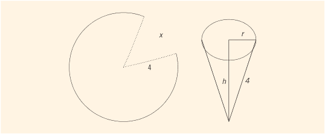

    **图 5-4** 圆锥形纸杯

    编写一个程序，提示用户输入圆形蜡纸的半径。然后程序应输出所移除扇形的长度，使制成的杯子体积最大。将答案计算到两位小数。

- **27.（公寓问题）** 一家房地产办公室管理着，比如说，50套公寓单元。当租金为，比如说，每月600美元时，所有单元都租出。然而，租金每增加，比如说，40美元，就会有一个单元空置。此外，每个已出租单元平均每月需要27美元维护费。应出租多少单元才能使利润最大？

    编写一个程序，提示用户输入：

    - a. 使所有单元都租出时的租金。
    - b. 导致一个单元空置的租金涨幅。
    - c. 维护一个已出租单元的费用。

    然后程序输出为使利润最大而应出租的单元数量。


## 用户定义函数 I

**本章你将：**

- 学习标准（预定义）函数，并了解如何在程序中使用它们
- 学习用户定义函数
- 考查有返回值的函数，包括实参和形参
- 探究如何在程序中构造和使用有返回值的用户定义函数

在第2章中，你了解到 C++ 程序是函数的集合。其中一个函数是 `main`。第1章到第5章的程序只使用函数 `main`；编程指令都打包在一个函数中。然而，这种技术只适用于短程序。对于大型程序，把所有编程指令都放进一个函数并不实际（尽管可行），你很快就会明白。你必须学会把问题分解成可管理的部分。本章先讨论之前定义的函数，然后讨论用户定义函数。

让我们想象一家汽车工厂。汽车制造时并不是由基本原材料直接制成，而是由先前制造好的零件组装而成。有些零件由公司自己制造；其他零件由不同公司制造。

函数就像积木。它们让你把复杂程序划分成可管理的部分。它们还有其他优点：

- 在处理一个函数时，你可以只关注程序的该部分，并构建、调试和完善它。
- 不同的人可以同时处理不同的函数。
- 如果一个函数在程序中的多个位置或不同程序中需要用到，你可以只编写一次并多次使用。
- 使用函数能极大提高程序的可读性，因为它降低了函数 main 的复杂性。

函数常被称为**模块**。它们像微型程序；你可以把它们组合起来构成更大的程序。讨论用户定义函数时，你会看到情况正是如此。对于预定义函数，这种能力不太明显，因为它们的编程代码对我们不可用。然而，由于预定义函数已经为我们编写好，你将先学习这些函数，以便在需要时使用它们。

### 预定义函数

在正式讨论 C++ 中的预定义函数之前，让我们回顾大学代数课程中的一个概念。在代数中，函数可以看作一种规则或对应关系，它把称为函数自变量的值与该函数中与这些自变量相关联的唯一值对应起来。因此，如果 **f(x) = 2x + 5**，那么 **f(1) = 7, f(2) = 9, and f(3) = 11**，其中1、2、3是f的自变量，而7、9、11是函数f的对应值。

在 C++ 中，函数的概念（无论是预定义还是用户定义）与代数中的函数概念相似。例如，每个函数都有名称，并且根据用户指定的值执行某种计算。本节讨论各种预定义函数。

### 表 6-1 预定义函数（续）

| 函数 | 头文件 | 用途 | 参数类型 | 结果 |
|---|---|---|---|---|
| floor(x) | `<cmath>` | 返回不大于 x 的最大整数：floor(45.67) = 45.00 | double | double |
| islower(x) | `<cctype>` | 如果 x 是小写字母，则返回 true；否则返回 false；islower('h') 为 true | int | int |
| isupper(x) | `<cctype>` | 如果 x 是大写字母，则返回 true；否则返回 false；isupper('K') 为 true | int | int |
| pow(x, y) | `<cmath>` | 返回 x^y；如果 x 为负数，则 y 必须是整数：pow(0.16, 0.5) = 0.4 | double | double |
| sqrt(x) | `<cmath>` | 返回 x 的非负平方根；x 必须非负：sqrt(4.0) = 2.0 | double | double |
| tolower(x) | `<cctype>` | 如果 x 是大写字母，则返回 x 的小写值；否则返回 x | int | int |
| toupper(x) | `<cctype>` | 如果 x 是小写字母，则返回 x 的大写值；否则返回 x | int | int |

要在程序中使用预定义函数，必须通过 include 语句包含含有该函数声明的头文件。例如，要使用函数 pow，程序必须包含：

```
#include <cmath>
```

例6-1展示了如何使用一些预定义函数。


## 示例 6-1

```cpp
//How to use predefined functions.
#include <iostream>
#include <cmath>
#include <cctype>

using namespace std;

int main()
{
    int x;
    double u, v;

    cout << "Line 1: Uppercase a is "
         << static_cast<char>(toupper('a'))
         << endl;                         //Line 1

    u = 4.2;                               //Line 2
    v = 3.0;                               //Line 3
    cout << "Line 4: " << u << " to the power of "
         << v << " is " << pow(u, v) << endl; //Line 4

    cout << "Line 5: 5.0 to the power of 4 = "
         << pow(5.0, 4) << endl;          //Line 5

    u = u + pow(3.0, 3);                   //Line 6
    cout << "Line 7: u = " << u << endl;   //Line 7

    x = -15;                               //Line 8
    cout << "Line 9: Absolute value of " << x
         << " = " << abs(x) << endl;      //Line 9

    return 0;
}
```

### 示例运行：

第1行：大写a是A  
第4行：4.2的3次方 = 74.088  
第5行：5.0的4次方 = 625  
第7行：u = 31.2  
第9行：-15的绝对值 = 15

该程序的工作方式如下。第1行中的语句输出与 'a' 对应的大写字母，即 A。注意，函数 toupper 返回一个 int 值。因此，表达式 toupper('a') 的值为 65，这是 'A' 的 ASCII 值。要打印 A 而不是 65，需要使用强制类型转换运算符，如第1行中的语句所示。在第4行的语句中，函数 pow 用于输出 u^v。用 C++ 术语来说，就是使用参数 u 和 v 调用函数 pow。在这种情况下，u 和 v 的值被传递给函数 pow。其他参数具有类似含义。注意，该程序包含头文件 cctype 和 cmath，因为它使用了这些头文件中的函数 toupper、pow 和 abs。

## 用户自定义函数

正如示例 6-1 所示，在程序中使用函数会大大增强程序的可读性，因为它降低了函数 main 的复杂性。此外，一旦编写并正确调试了一个函数，就可以在程序（或其他程序）中反复使用它，而无需重复编写相同的代码。例如，在示例 6-1 中，函数 pow 被使用了不止一次。

由于 C++ 并不提供你将来可能需要的每一个函数，而且设计人员不可能知道用户的具体需求，因此你必须学会编写自己的函数。

C++ 中的用户自定义函数分为两类：

- **有返回值的函数**——具有返回类型的函数。这些函数使用 `return` 语句返回特定数据类型的值，我们很快会对此进行解释。
- **无返回值函数**——没有返回类型的函数。这些函数*不*使用 return 语句返回值。

本章其余部分讨论有返回值的函数。关于有返回值函数讨论的许多概念也适用于无返回值函数。第7章介绍无返回值函数。

### 有返回值的函数

上一节介绍了一些预定义的 C++ 函数，例如 pow、abs、islower 和 toupper。这些都是有返回值函数的示例。要在程序中使用这些函数，你必须知道包含函数规范的头文件的名称。你需要使用 include 语句将此头文件包含到程序中，并了解以下各项：

- 1. 函数的名称
- 2. **参数**的数量（如果有）
- 3. 每个参数的数据类型
- 4. 函数计算出的值（即函数返回的值）的数据类型，称为函数的类型

由于有返回值的函数返回的值是唯一的，你自然会以以下三种方式之一使用该值：

- 保存该值以供进一步计算。
- 在某种计算中使用该值。
- 打印该值。

这表明有返回值的函数可用于：

- 在赋值语句中。
- 作为函数调用中的参数。
- 在输出语句中。

也就是说，有返回值的函数在表达式中被使用（调用）。

在我们查看用户自定义有返回值函数的语法之前，先考虑与此类函数相关的内容。除了前面描述的四个属性之外，函数（无论是有返回值函数还是无返回值函数）还关联着另一项内容：

- 5. 完成任务所需的代码

前四个属性构成所谓的函数**首部**（也称为**函数头**）；第五个属性称为函数**体**。这五个属性共同构成所谓的函数**定义**。例如，对于函数 abs，其首部可能如下所示：

```
int abs(int number)
```

类似地，函数 abs 可能有以下定义：

```
int abs(int number)
{
    if (number < 0)
        number = -number;

    return number;
}
```

在函数 abs 的首部中声明的变量称为函数 abs 的**形参**。因此，abs 的形参是 number。

示例 6-1 中的程序包含若干使用函数 pow 的语句。也就是说，用 C++ 术语来讲，函数 pow 被调用了多次。本章后面将讨论调用函数时会发生什么。

假设函数 pow 的首部为：

```
double pow(double base, double exponent)
```

从函数 pow 的首部可以看出，pow 的形参是 base 和 exponent。考虑以下语句：

```
double u = 2.5;
double v = 3.0;
double x, y;

x = pow(u, v);                                      //Line 1
y = pow(2.0, 3.2) + 5.1;                            //Line 2
cout << u << " to the power of 7 " << pow(u, 7) << endl;  //Line 3
```

在第1行中，函数 pow 使用参数 u 和 v 调用。在这种情况下，u 和 v 的值被传递给函数 pow。实际上，u 的值被复制到 base，v 的值被复制到 exponent。在第1行调用函数 pow 时出现的变量 u 和 v 称为该调用的实参。在第2行中，函数 pow 使用参数 2.0 和 3.2 调用。在此调用中，值 2.0 被复制到 base，3.2 被复制到 exponent。此外，在此次函数 pow 的调用中，实参分别是 2.0 和 3.2。类似地，在第3行中，函数 pow 的实参是 u 和 7；u 的值被复制到 base，7.0 被复制到 exponent。

现在我们可以正式给出两个定义：

**形参：** 在函数首部中声明的变量。

**实参：** 在函数调用中列出的变量或表达式。

对于预定义函数，你只需关注前四个属性。软件公司不会公布实际的源代码，即函数体。否则，软件成本会高得离谱。

### 语法：有返回值的函数

有返回值函数的语法是：

```
functionType functionName(formal parameter list)
{
    statements
}
```

其中 statements 通常是声明语句和/或可执行语句。在此语法中，functionType 是函数返回值的类型。functionType 也称为有返回值函数的**数据类型**或**返回类型**。此外，花括号之间的语句构成函数体。

### 语法：形参列表

形参列表的语法是：

```
dataType identifier, dataType identifier, ...
```

### 函数调用

调用有返回值函数的语法是：

```
functionName(actual parameter list)
```

## F1

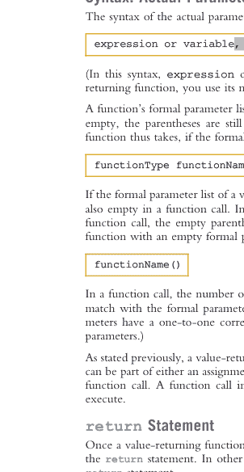

> 用旅行+住宿的预算来决定去哪个国家观看！

### 赛车的极致运动

F1一级方程式锦标赛是世界上最昂贵、速度最快、科技含量最高的赛车运动之一。它始于1950年，由国际汽车联合会（FIA）举办。如今，F1赛程遍布全球各地，每年吸引着数以亿计的车迷。

F1赛车采用了许多先进的工程技术，包括涡轮增压发动机、能量回收系统（ERS）和空气动力学套件等，以确保在高速行驶中保持稳定和性能。

驾驶员需要操作复杂的赛车系统，同时还要应对高速赛道上的各种挑战，比赛的竞争十分激烈。

### F1大赏

- 英国大奖赛
- 意大利大奖赛
- 新加坡大奖赛
- 日本大奖赛

> F1是Formula 1的缩写，中文全称为“世界一级方程式锦标赛”。


在C++中，*return* 是一个保留字。

当 *return* 语句在函数中执行时，函数立即终止，控制权返回给调用者。此外，函数调用语句会被 *return* 语句返回的值替换。当 *return* 语句在 main 函数中执行时，程序终止。

为了将上述讨论中的思想付诸实践，让我们编写一个函数来确定两个数中的较大者。因为该函数比较两个数，所以它有两个参数，且两个参数都是数字。假设这些数字的数据类型是浮点数（十进制）——例如 double。因为较大的数是 double 类型，所以函数的类型也是 double。让我们将这个函数命名为 larger。完成这个函数所需的唯一东西就是函数体。因此，按照函数的语法，你可以将这个函数写成如下形式：

```cpp
    double larger(double x, double y)
    {
        double max;

        if (x >= y)
            max = x;
        else
            max = y;

        return max;
    }
```

注意，函数 **larger** 要求你使用一个额外的变量 **max**（称为**局部声明**，其中 **max** 是函数 **larger** 的局部变量）。图6-1描述了函数 **larger** 的各个部分。

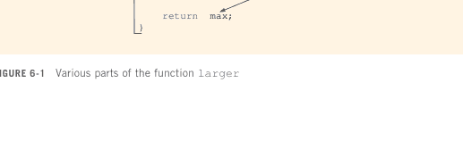

假设 num、num1 和 num2 是 double 变量。还假设 num1 = 45.75，num2 = 35.50。图6-2展示了对函数 larger 的各种调用。

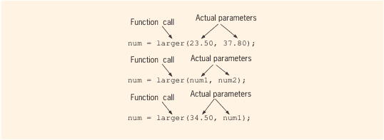

图6-2 函数调用

你还可以将函数 `larger` 的定义写成如下形式：

```cpp
double larger(double x, double y)
{
    if (x >= y)
        return x;
    else
        return y;
}
```

因为函数中 return 语句的执行会终止函数，所以前面的函数 larger 也可以（不包含 else）写成：

```cpp
double larger(double x, double y)
{
    if (x >= y)
        return x;

    return y;
}
```

注意，这些形式的函数 `larger` 不要求你声明任何局部变量。

- 1. 在函数 `larger` 的定义中，x 和 y 是形式参数。
- 2. `return` 语句可以出现在函数的任何位置。回想一下，一旦 `return` 语句执行，所有后续语句都会被跳过。因此，最好在计算出值后立即返回它。

## 示例6-2

现在函数 larger 已经编写好了，下面的 C++ 代码说明了如何使用它。

```cpp
double one = 13.00;
double two = 36.53;
double maxNum;
```

考虑以下语句：

```cpp
cout << "The larger of 5 and 6 is " << larger(5, 6)
     << endl;                                      //Line 1

cout << "The larger of " << one << " and " << two
     << " is " << larger(one, two) << endl;        //Line 2

cout << "The larger of " << one << " and 29 is "
     << larger(one, 29) << endl;                   //Line 3

maxNum = larger(38.45, 56.78);                     //Line 4
```

- 第1行中的表达式 `larger(5, 6)` 是一个函数调用，5 和 6 是实际参数。当表达式 `larger(5, 6)` 执行时，5 被复制到 x，6 被复制到 y。因此，第1行中的语句输出 5 和 6 中的较大者。
- 第2行中的表达式 `larger(one, two)` 是一个函数调用。这里，one 和 two 是实际参数。当表达式 `larger(one, two)` 执行时，one 的值被复制到 x，two 的值被复制到 y。因此，第2行中的语句输出 one 和 two 中的较大者。
- 第3行中的表达式 `larger(one, 29)` 也是一个函数调用。当表达式 `larger(one, 29)` 执行时，one 的值被复制到 x，29 被复制到 y。因此，第3行中的语句输出 one 和 29 中的较大者。
- 第4行中的表达式 `larger(38.45, 56.78)` 是一个函数调用。在这个调用中，实际参数是 38.45 和 56.78。在这个语句中，函数 larger 返回的值被赋给变量 maxNum。

> **注意**
>
> 在函数调用中，你只指定实际参数，而不指定其数据类型。例如，在示例6-2中，第1、2、3行中的语句展示了如何使用实际参数调用函数 larger。但是，以下语句包含对函数 larger 的错误调用，会导致语法错误。（假设所有变量都已正确声明。）
>
> ```
> x = larger(int one, 29);        //illegal
> y = larger(int one, int 29);    //illegal
> cout << larger(int one, int two); //illegal
> ```

一旦编写了一个函数，你就可以在程序中的任何地方使用它。函数 `larger` 比较两个数并返回两者中的较大者。现在让我们编写另一个函数，使用这个函数来确定三个数中的最大者。我们称这个函数为 `compareThree`。

```cpp
double compareThree(double x, double y, double z)
{
    return larger(x, larger(y, z));
}
```

在函数头中，x、y 和 z 是形式参数。

让我们看一下这个表达式：

```cpp
larger(x, larger(y, z))
```

在函数 `compareThree` 的定义中，这个表达式包含两次对函数 `larger` 的调用。外层调用的实际参数是 x 和 `larger(y, z)`；内层调用的实际参数是 y 和 z。因此，首先计算表达式 `larger(y, z)`；也就是说，内层调用先执行，得到 y 和 z 中的较大者。假设 `larger(y, z)` 计算得到 t（注意 t 是 y 或 z）。接下来，外层调用确定 x 和 t 中的较大者。最后，`return` 语句返回最大的数。因此，要执行函数调用，需要先对参数进行求值。例如，外层调用的实际参数 `larger(y, z)` 会先被求值。

注意，函数 `larger` 比函数 `compareThree` 更具通用性。这里，我们仅仅是在说明，一旦你编写了一个函数，你就可以用它来编写其他函数。本章后面将演示如何使用函数 `larger` 从一组数中确定最大的数。

## 函数原型

现在你大致了解了如何在程序中编写和使用函数，接下来的问题涉及用户自定义函数在程序中应出现的顺序。例如，你是将函数 `larger` 放在函数 `main` 之前还是之后？`larger` 应该放在 `compareThree` 之前还是之后呢？根据“必须在使用标识符之前声明它”的规则，并且知道函数 `main` 使用了标识符 `larger`，从逻辑上讲，你必须将 `larger` 放在 `main` 之前。

实际上，C++ 程序员习惯上将函数 `main` 放在所有其他用户自定义函数之前。然而，这种组织方式可能会产生编译错误，因为函数是按照它们在程序中出现的顺序编译的。例如，如果函数 `main` 放在函数 `larger` 之前，那么在编译函数 `main` 时，标识符 `larger` 是未定义的。为了绕过这种未声明标识符的问题，我们将**函数原型**放在任何函数定义（包括 `main` 的定义）之前。

**函数原型：** 没有函数体的函数头。

### 语法：函数原型

返回值函数的函数原型的一般语法是：

```cpp
functionType functionName(parameter list);
```

（请注意，函数原型以分号结尾。）

对于函数 larger，其原型是：

```cpp
double larger(double x, double y);
```

> **注意**
>
> 编写函数原型时，你不必在参数列表中指定变量名。但是，你必须指定每个参数的数据类型。
>
> 你可以将函数 larger 的函数原型改写如下：
>
> ```cpp
> double larger(double, double);
> ```

## 最终程序

现在你已经有足够的知识来编写整个程序、编译并运行它了。下面的程序使用函数 larger、compareThree 和 main 来确定两个或三个数中的较大者/最大者。

```cpp
//Program: Largest of three numbers

#include <iostream>

using namespace std;

double larger(double x, double y);
double compareThree(double x, double y, double z);

int main()
{
    double one, two;                              //Line 1

    cout << "Line 2: The larger of 5 and 10 is "
         << larger(5, 10) << endl;                //Line 2

    cout << "Line 3: Enter two numbers: ";        //Line 3
    cin >> one >> two;                             //Line 4
    cout << endl;                                  //Line 5

    cout << "Line 6: The larger of " << one
         << " and " << two << " is "
         << larger(one, two) << endl;              //Line 6
```


```cpp
cout << "Line 7: The largest of 43.48, 34.00, "
     << "and 12.65 is "
     << compareThree(43.48, 34.00, 12.65)             //Line 7
     << endl;

return 0;
}

double larger(double x, double y)
{
    double max;

    if (x >= y)
        max = x;
    else
        max = y;

    return max;
}

double compareThree (double x, double y, double z)
{
    return larger(x, larger(y, z));
}
```

**示例运行：** 在此示例运行中，用户输入以阴影显示。

第2行：5和10中较大的是10  
第3行：输入两个数：25.6 73.85  

第6行：25.6和73.85中较大的是73.85  
第7行：43.48、34.00和12.65中最大的是43.48  


> 在前面的程序中，函数 larger 和 compareThree 的函数原型出现在它们的函数定义之前。因此，函数 larger 和 compareThree 的定义可以以任意顺序出现。

## 有返回值的函数：一些特殊之处

有返回值的函数必须返回一个值。考虑以下函数 secret，它接收一个 int 值作为参数。如果参数 x 的值大于 5，则返回 x 值的两倍；否则，x 的值保持不变。

```cpp
int secret(int x)
{
    if (x > 5)          //Line 1
        return 2 * x;   //Line 2
}
```

因为这是一个 int 类型的有返回值函数，所以它必须返回一个 int 类型的值。假设 x 的值是 10。那么第 1 行中的表达式 x > 5 求值为真。因此第 2 行中的 `return` 语句返回 20。现在假设 x 是 3。第 1 行中的表达式 `x > 5` 现在求值为 `false`。因此 `if` 语句失败，第 2 行中的 `return` 语句不会执行。然而，函数体中已经没有更多要执行的语句了。在这种情况下，函数会返回一个奇怪的值。由此可知，如果 `x` 的值小于或等于 5，该函数不包含任何有效的 `return` 语句来返回 `x` 的值。

函数 `secret` 的正确定义是：

```cpp
int secret(int x)
{
    if (x > 5)              //Line 1
        return 2 * x;       //Line 2

    return x;               //Line 3
}
```

这里，如果 `x` 的值小于或等于 5，则执行第 3 行中的 `return` 语句，它返回 `x` 的值。另一方面，如果 `x` 的值比如说是 10，则执行第 2 行中的 `return` 语句，它返回 20，并且终止该函数。

回想一下，在有返回值的函数中，`return` 语句返回该值。考虑以下 `return` 语句：

```cpp
return x, y;  //only the value of y will be returned
```

这是一个合法的 `return` 语句。你可能会认为这个 `return` 语句返回 `x` 和 `y` 的值。然而，事实并非如此。请记住，一个 `return` 语句只返回一个值，即使该 `return` 语句包含多个表达式。如果一个 `return` 语句包含多个表达式，则只返回最后一个表达式的值。因此，对于上面的 `return` 语句，返回的是 `y` 的值。以下程序进一步说明了这一概念。

```cpp
// This program illustrates that a value-returning function
// returns only one value, even if the return statement
// contains more than one expression.

#include <iostream>

using namespace std;

int funcRet1();
int funcRet2(int z);

int main()
{
    int num = 4;

    cout << "Line 1: The value returned by funcRet1: "
         << funcRet1() << endl;                    // Line 1
    cout << "Line 2: The value returned by funcRet2: "
         << funcRet2(num) << endl;             // Line 2

    return 0;
}

int funcRet1()
{
    int x = 45;

    return 23, x;   //only the value of x is returned
}

int funcRet2(int z)
{
    int a = 2;
    int b = 3;

    return 2 * a + b, z + b;  //only the value of z + b is returned
}
```

**示例运行：**

第1行：funcRet1 返回的值：45  
第2行：funcRet2 返回的值：7

尽管一个 `return` 语句可以包含多个表达式，但程序中的 return 语句应只包含一个表达式。在 `return` 语句中包含多个表达式可能导致冗余、代码浪费和令人困惑的语法。

## 更多有返回值函数的示例

### 示例 6-3

在这个示例中，我们编写函数 courseGrade 的定义。该函数接收一个 `int` 值作为参数，用于指定某门课程的分数，并返回该课程的成绩，即 `char` 类型的值。（我们假设测试分数是 0 到 100（含）之间的值。）

```cpp
char courseGrade(int score)
{
    switch (score / 10)
    {
    case 0:
    case 1:
    case 2:
    case 3:
    case 4:
    case 5:
        return 'F';
    case 6:
        return 'D';
    case 7:
        return 'C';
    case 8:
        return 'B';
    case 9:
    case 10:
        return 'A';
    }
}
```

你也可以编写函数 courseGrade 的等价定义，使用 `if...else` 结构来确定课程成绩。

### 示例 6-4（掷一对骰子）

在这个示例中，我们编写一个函数，掷一对骰子，直到掷出的点数之和为某个特定数。我们还想知道为了得到期望的点数之和，骰子被掷了多少次。

每个骰子上的最小点数是 1，最大点数是 6。因此，掷出的点数之和最小为 2，最大为 12。假设我们有以下声明。

```cpp
int die1;
int die2;
int sum;
int rollCount = 0;
```

我们使用第 5 章讨论的随机数生成器，随机生成一个 1 到 6 之间的数。然后，以下语句随机生成一个 1 到 6 之间的数，并将该数存入 die1，它成为 die1 掷出的点数。

```cpp
die1 = rand() % 6 + 1;
```

类似地，以下语句随机生成一个 1 到 6 之间的数，并将该数存入 die2，它成为 die2 掷出的点数。

```cpp
die2 = rand() % 6 + 1;
```

两个骰子掷出的点数之和为：

```cpp
sum = die1 + die2;
```

接下来，我们判断 `sum` 是否等于骰子掷出的期望点数之和。如果 `sum` 不等于期望的点数之和，则重新掷骰子。这可以通过以下 `do...while` 循环完成。（假设 `int` 变量 `num` 保存要掷出的期望点数和。）

```cpp
do
{
    die1 = rand() % 6 + 1;
    die2 = rand() % 6 + 1;
    sum = die1 + die2;
    rollCount++;
}
while (sum != num);
```

现在我们可以编写函数 `rollDice`，它接收要掷出的期望点数和作为参数，并返回为掷出期望点数和而掷骰子的次数。

```cpp
int rollDice(int num)
{
    int die1;
    int die2;
    int sum;
    int rollCount = 0;

    srand(time(0));

    do
    {
        die1 = rand() % 6 + 1;
        die2 = rand() % 6 + 1;
        sum = die1 + die2;
        rollCount++;
    }
    while (sum != num);

    return rollCount;
}
```

以下程序展示了如何在程序中使用函数 `rollDice`。

```cpp
//Program: Roll dice

#include <iostream>
#include <cstdlib>
#include <ctime>

using namespace std;

int rollDice(int num);
```


如果一个数正读和反读都相同，那么它就是回文数。例如，整数 5、44、134、1881 和 78965987 都是回文数。

假设 num 是一个非负整数。如果 num < 10，则它是回文数，因此函数应返回 **真**。假设 num >= 10。要判断 num 是否为回文数，首先比较 num 的首位和末位数字。如果 num 的首位和末位数字不相同，则它不是回文数，因此函数应返回 **假**。如果 num 的首位和末位数字相同，则去掉 num 的首位和末位数字，并对去掉 num 的首位和末位数字后得到的新数重复此过程。只要该数 >= 10，就重复此过程。

例如，假设输入为 18281。因为 18281 的首位和末位数字相同，去掉首位和末位数字得到数 828。对 828 重复比较首位和末位数字的过程。同样，首位和末位数字相同。去掉 828 的首位和末位数字后，得到的数是 2，它小于 10。因此，18281 是回文数。

要去掉 num 的首位和末位数字，首先需要找到能整除 num 的 10 的最高次幂，并称之为 pwr。能整除 18281 的 10 的最高次幂是 4，即 pwr = 4。现在 18281 $\div$ $10^pwr$ = 8281，因此首位数字被去掉。另外，因为 8281 $/$ 10 = 828，末位数字被去掉。因此，要去掉首位数字，可以使用取模运算符，其中除数为 $10^pwr$。要去掉末位数字，将该数除以 10。然后为下一次迭代将 pwr 减 2。以下算法实现了上述思路：

- 1. 如果 `num < 10`，则它是回文数，因此函数应返回 **真**。
- 2. 假设 `num` 是整数且 `num >= 10`。要判断 `num` 是否为回文数：
    - a. 找到能整除 `num` 的 10 的最高次幂，并称之为 `pwr`。例如，能整除 434 的 10 的最高次幂是 2；能整除 78965987 的 10 的最高次幂是 8。
    - b. 当 `num` 大于或等于 10 时，比较 `num` 的首位和末位数字。
        - b.1. 如果 `num` 的首位和末位数字不相同，则 `num` 不是回文数。返回 **假**。
        - b.2. 如果 `num` 的首位和末位数字相同：
            - b.2.1. 去掉 `num` 的首位和末位数字。
            - b.2.2. 将 `pwr` 减 2。
    - c. 返回 **真**。


下面的函数实现了这个算法：

```cpp
bool isNumPalindrome(int num)
{
    int pwr = 0;

    if (num < 10)
        return true;                            //Step 1
    else                                        //Step 2
    {
        while (num / static_cast<int>(pow(10.0, pwr)) >= 10)   //Step 2.a
            pwr++;
        while (num >= 10)                       //Step 2.b
        {
            int tenToPwr = static_cast<int>(pow(10.0, pwr));

            if ((num / tenToPwr) != (num % 10))
                return false;                   //Step 2.b.1
            else                                //Step 2.b.2
            {
                num = num % tenToPwr;           //Step 2.b.2.1
                num = num / 10;                 //Step 2.b.2.1
                pwr = pwr - 2;                  //Step 2.b.2.2
            }
        }//end while

        return true;
    }//end else
}
```

> **注意**
>
> 在函数 isNumPalindrome 的定义中，使用了头文件 cmath 中的函数 pow 来找出能整除该数的最高 10 的幂。因此，请务必在程序中包含头文件 cmath。

## 执行流程

如前所述，C++ 程序是函数的集合。回想一下，函数可以以任意顺序出现。你唯一需要记住的是，必须先声明标识符，然后才能使用它。编译器会从头到尾按顺序编译程序。因此，如果函数 main 出现在任何其他用户定义函数之前，它就会先被编译。然而，如果 main 出现在程序的末尾（或中间），那么所有定义（不是原型）出现在函数 main 之前的函数，都会按照它们出现的顺序，在函数 main 之前被编译。

函数原型出现在任何函数定义之前，因此编译器会先编译这些内容。然后编译器才能正确地编译函数调用。然而，当程序执行时，函数 main 中的第一条语句总是最先执行，无论函数 main 被放在程序中的什么位置。其他函数只有在被调用时才会执行。

函数调用语句将控制权转移到函数体中的第一条语句。一般来说，在被调用函数的最后一条语句执行之后，控制权会返回到紧跟在函数调用之后的位置。有返回值的函数会返回一个值。因此，在执行完有返回值的函数后，当控制权回到调用者时，函数返回的值会替换函数调用语句。执行将从紧跟在函数调用之后的位置继续。

假设一个程序包含函数 funcA 和 funcB，并且 funcA 包含一条调用 funcB 的语句。假设程序调用了 funcA。当包含对 funcB 的调用的语句执行时，funcB 会执行；而在 funcB 执行期间，funcA 当前调用的执行会暂停，直到 funcB 完成。

## 编程示例：最大数

在这个编程示例中，函数 larger 用于从一组数字中确定最大的数字。为了便于说明，这个程序从一组 10 个数字中确定最大的数字。你可以轻松增强这个程序，使其适用于任意一组数字。

**输入** 一组 10 个数字。  
**输出** 10 个数字中的最大值。

### 问题分析与算法设计

假设输入数据为：

15 20 7 8 28 21 43 12 35 3

读取数据集的第一个数字。因为这是到目前为止唯一读取的数字，所以可以假定它是目前最大的数字，并称它为 max。读取第二个数字，称它为 num。现在比较 max 和 num，并将较大的数字存入 max。此时 max 包含前两个数字中较大的那个。读取第三个数字。将它与 max 比较，并将较大的数字存入 max。此时，max 包含前三个数字中的最大值。读取下一个数字，将它与 max 比较，并将较大的数字存入 max。对数据集中剩余的每个数字重复这个过程。最终，max 将包含数据集中的最大数字。这段讨论可转化为以下算法：

- 1. 读取第一个数字。因为这是到目前为止你唯一读取的数字，所以它是目前为止最大的数字。将它保存到名为 `max` 的变量中。
- 2. 对于列表中剩余的每个数字：
  - a. 读取下一个数字。将它存储到名为 num 的变量中。
  - b. 比较 num 和 max。如果 max < num，那么 num 就是新的最大数字，因此将 num 复制到 max 来更新 max 的值。如果 max >= num，则丢弃 num；也就是说，什么都不做。
- 3. 因为 max 现在包含最大的数字，所以将它打印出来。

为了找出两个数字中较大的那个，程序使用了函数 larger。

### 完整程序清单

```cpp
//**********************************************************
// Author: D.S. Malik
//
// This program finds the largest number of a set of 10
// numbers.
//**********************************************************

#include <iostream>

using namespace std;

double larger(double x, double y);

int main()
{
    double num; //variable to hold the current number
    double max; //variable to hold the larger number
    int count;  //loop control variable

    cout << "Enter 10 numbers." << endl;
    cin >> num;                         //Step 1
    max = num;                          //Step 1

    for (count = 1; count < 10; count++) //Step 2
    {
        cin >> num;                     //Step 2a
        max = larger(max, num);         //Step 2b
    }

    cout << "The largest number is " << max
         << endl;                       //Step 3
    return 0;
}//end main
```

```cpp
double larger(double x, double y)
{
    if (x >= y)
        return x;
    else
        return y;
}
```

示例运行：在此示例运行中，用户输入以阴影显示。

```text
Enter 10 numbers.
10 56 73 42 22 67 88 26 62 11
The largest number is 88
```

## 编程示例：有线电视公司

第 4 章包含一个用于计算有线电视公司账单的程序。在那个程序中，所有编程指令都集中在函数 main 中。这里，我们使用用户定义函数重写同一个程序，进一步说明结构化编程。程序分析阶段展示了如何将复杂问题划分为更小的子问题。它还表明，在解决某个特定子问题时，你可以只关注程序的那一部分。

该程序的输入和输出与之前相同。

### 问题分析与算法设计

由于有两类客户——住宅客户和商业客户，程序包含两个独立的函数：一个用于计算住宅客户的账单，另一个用于计算商业客户的账单。这两个函数都会计算账单金额，然后将账单金额返回给函数 main。函数 main 打印应付金额。我们将计算住宅账单的函数称为 `residential`，将计算商业账单的函数称为 `business`。计算账单的公式与之前相同。

与第 4 章一样，住宅账单处理费、住宅基本服务连接费用等数据都是特殊数据。因此，这些数据被声明为命名常量。

### 函数 `residential`

要计算住宅账单，你需要知道客户订阅的付费频道数量。根据付费频道数量，你可以计算账单金额。计算完账单金额后，函数使用 `return` 语句返回账单金额。以下四个步骤描述了该函数：

- a. 提示用户输入付费频道数量。
- b. 读取付费频道数量。
- c. 计算账单。
- d. 返回应付金额。

该函数包含一条提示用户输入付费频道数量的语句（步骤 a）和一条读取付费频道数量的语句（步骤 b）。计算账单金额所需的其他项，例如基本服务连接费用和账单处理费，被定义为命名常量（在函数 main 的定义之前）。因此，为了计算账单金额，该函数不需要从函数 main 获取任何值。因此，该函数没有参数。

### 局部变量（函数 residential）

从上面的讨论可知，函数 residential 需要变量来存储付费频道数量和账单金额。该函数只需要两个局部变量来计算账单金额：

```cpp
int noOfPChannels;   //number of premium channels
double bAmount;      //billing amount
```

现在，函数 residential 的定义可以写成如下形式：

```cpp
double residential()
{
    int noOfPChannels;   //number of premium channels
    double bAmount;      //billing amount
    cout << "Enter the number of premium "
         << "channels used: ";
    cin >> noOfPChannels;
    cout << endl;

    bAmount = RES_BILL_PROC_FEES +
              RES_BASIC_SERV_COST +
              noOfPChannels * RES_COST_PREM_CHANNEL;

    return bAmount;
}
```

### 函数 business

要计算商业账单，你需要知道客户订阅的基本服务连接数量和付费频道数量。然后，根据这些数字，你可以计算账单金额。随后使用 return 语句返回账单金额。以下六个步骤描述了该函数：

- a. 提示用户输入基本服务连接数量。
- b. 读取基本服务连接数量。
- c. 提示用户输入付费频道数量。
- d. 读取付费频道数量。
- e. 计算账单。
- f. 返回应付金额。


该函数包含提示用户输入基本服务连接数量和付费频道数量的语句（步骤 a 和 c）。该函数还包含输入基本服务连接数量和付费频道数量的语句（步骤 b 和 d）。计算账单金额所需的其他项目，例如基本服务连接的成本和账单处理费用，被定义为命名常量（在函数 `main` 的定义之前）。因此，要计算账单金额，该函数不需要从函数 `main` 获取任何值。因此，它没有参数。

### 局部变量（函数 `business`）

从前面的讨论可知，函数 `business` 需要变量来存储基本服务连接数量、付费频道数量以及账单金额。实际上，该函数只需要三个局部变量即可计算账单金额：

```cpp
int noOfBasicServiceConnections;
int noOfPChannels;      // number of premium channels
double bAmount;         // billing amount
```

函数 `business` 的定义现在可以编写如下：

```cpp
double business()
{
    int noOfBasicServiceConnections;
    int noOfPChannels;        // number of premium channels
    double bAmount;           // billing amount

    cout << "Enter the number of basic "
         << "service connections: ";
    cin >> noOfBasicServiceConnections;
    cout << endl;

    cout << "Enter the number of premium "
         << "channels used: ";
    cin >> noOfPChannels;
    cout << endl;

    if (noOfBasicServiceConnections <= 10)
        bAmount = BUS_BILL_PROC_FEES + BUS_BASIC_SERV_COST +
                  noOfPChannels * BUS_COST_PREM_CHANNEL;
    else
        bAmount = BUS_BILL_PROC_FEES + BUS_BASIC_SERV_COST +
                  (noOfBasicServiceConnections - 10) *
                  BUS_BASIC_CONN_COST +
                  noOfPChannels * BUS_COST_PREM_CHANNEL;

    return bAmount;
}
```

## 主算法

*（函数 `main`）*

- 1. 要以固定小数格式输出浮点数，并显示小数点和尾随零，请设置操纵符 `fixed` 和 `showpoint`。
- 2. 要将浮点数输出到两位小数，请将精度设置为两位小数。
- 3. 提示用户输入账号。
- 4. 获取账号。
- 5. 提示用户输入客户类型。
- 6. 获取客户类型。
- 7.
  - a. 如果客户类型是 R 或 r：
    - i. 调用函数 `residential` 来计算账单。
    - ii. 打印账单。
  - b. 如果客户类型是 B 或 b：
    - i. 调用函数 `business` 来计算账单。
    - ii. 打印账单。
  - c. 如果客户类型不是 R、r、B 或 b，则为无效客户类型。

## 完整程序清单

```cpp
/************************************************************
// Author: D. S. Malik
//
// Program: Cable Company Billing
// This program calculates and prints a customer's bill for
// a local cable company. The program processes two types of
// customers: residential and business
************************************************************/

#include <iostream>
#include <iomanip>
using namespace std;

            //Named constants - residential customers
const double RES_BILL_PROC_FEES = 4.50;
const double RES_BASIC_SERV_COST = 20.50;
const double RES_COST_PREM_CHANNEL = 7.50;

            //Named constants - business customers
const double BUS_BILL_PROC_FEES = 15.00;
const double BUS_BASIC_SERV_COST = 75.00;
const double BUS_BASIC_CONN_COST = 5.00;
const double BUS_COST_PREM_CHANNEL = 50.00;

double residential();        //Function prototype
double business();           //Function prototype

int main()
{
        //declare variables
    int accountNumber;
    char customerType;
    double amountDue;

    cout << fixed << showpoint;                         //Step 1
    cout << setprecision(2);                            //Step 2

    cout << "This program computes a cable bill."
         << endl;
    cout << "Enter account number: ";                   //Step 3
    cin >> accountNumber;                               //Step 4
    cout << endl;

    cout << "Enter customer type: R, r "
         << "(Residential), B, b (Business): ";        //Step 5
    cin >> customerType;                                 //Step 6
    cout << endl;

    switch (customerType)                                //Step 7
    {
    case 'r':                                            //Step 7a
    case 'R':
        amountDue = residential();                      //Step 7a.i
        cout << "Account number = "
             << accountNumber << endl;                  //Step 7a.ii
        cout << "Amount due = $"
             << amountDue << endl;                      //Step 7a.ii
        break;
    case 'b':                                            //Step 7b
    case 'B':
        amountDue = business();                         //Step 7b.i
        cout << "Account number = "
             << accountNumber << endl;                  //Step 7b.ii
        cout << "Amount due = $"
             << amountDue << endl;                      //Step 7b.ii
        break;
    default:                                             //Step 7c
        cout << "Invalid customer type."
             << endl;
    }

    return 0;
}

double residential()
{
    int noOfPChannels;      //number of premium channels
    double bAmount;         //billing amount

    cout << "Enter the number of premium "
         << "channels used: ";
    cin >> noOfPChannels;
    cout << endl;

    bAmount = RES_BILL_PROC_FEES +
              RES_BASIC_SERV_COST +
              noOfPChannels * RES_COST_PREM_CHANNEL;

    return bAmount;
}

double business()
{
    int noOfBasicServiceConnections;
    int noOfPChannels;      //number of premium channels
    double bAmount;         //billing amount

    cout << "Enter the number of basic "
         << "service connections: ";
    cin >> noOfBasicServiceConnections;
    cout << endl;
    cout << "Enter the number of premium "
         << "channels used: ";
    cin >> noOfPChannels;
    cout << endl;

    if (noOfBasicServiceConnections <= 10)
        bAmount = BUS_BILL_PROC_FEES + BUS_BASIC_SERV_COST +
                  noOfPChannels * BUS_COST_PREM_CHANNEL;
    else
        bAmount = BUS_BILL_PROC_FEES + BUS_BASIC_SERV_COST +
                  (noOfBasicServiceConnections - 10) *
                  BUS_BASIC_CONN_COST +
                  noOfPChannels * BUS_COST_PREM_CHANNEL;

    return bAmount;
}
```

**示例运行：** 在此示例运行中，用户输入以阴影显示。

```text
This program computes a cable bill.
Enter account number: 21341

Enter customer type: R, r (Residential), B, b (Business): B
Enter the number of basic service connections: 25
Enter the number of premium channels used: 9

Account number = 21341
Amount due = $615.00
```

## 快速回顾

- 1. 函数类似于微型程序，被称为模块。
- 2. 函数使您能够将程序划分为可管理的任务。
- 3. C++ 系统提供了标准（预定义）函数。
- 4. 要使用标准函数，您必须：
  - i. 知道包含该函数规范的头文件的名称，
  - ii. 在程序中包含该头文件，并且
  - iii. 知道函数的名称、类型以及参数（实参）的数量和类型。
- 5. 用户自定义函数有两种类型：返回值函数和 `void` 函数。
- 6. 在函数头中定义的变量称为形式参数。
- 7. 在函数调用中使用的表达式、变量或常量值称为实际参数。
- 8. 在函数调用中，实际参数的数量及其类型必须按给定顺序与形式参数匹配。
- 9. 要调用函数，请使用其名称以及实际参数列表。
- 10. 返回值函数返回一个值。因此，返回值函数在表达式或输出语句中使用（调用），或作为函数调用中的参数使用。
- 11. 用户自定义函数的一般语法是：

  ```cpp
  functionType functionName(formal parameter list)
  {
      statements
  }
  ```

- 12. 行 `functionType functionName(formal parameter list)` 称为函数头（或函数标题）。用花括号（`{` 和 `}`）括起来的语句称为函数体。
- 13. 函数头和函数体一起称为函数的定义。


```cpp
if (num1 != 0 && num2 != 0)
    cout << sqrt(fabs(num1 + num2 + 0.0)) << endl;
else if (num1 != 0)
    cout << floor(num1 + 0.0) << endl;
else if (num2 != 0)
    cout << ceil(num2 + 0.0) << endl;
else
    cout << 0 << endl;

return 0;
}
```

- a. 如果输入是 12 4，输出是什么？
- b. 如果输入是 3 27，输出是什么？
- c. 如果输入是 25 0，输出是什么？
- d. 如果输入是 0 49，输出是什么？

7. 考虑以下语句：

```cpp
double num1, num2, num3;
int int1, int2, int3;
int value;

num1 = 5.0; num2 = 6.0; num3 = 3.0;
int1 = 4; int2 = 7; int3 = 8;
```

以及函数原型：

```cpp
double cube(double a, double b, double c);
```

下列哪些语句有效？如果无效，请解释原因。

- a. `value = cube(num1, 15.0, num3);`
- b. `cout << cube(num1, num3, num2) << endl;`
- c. `cout << cube(6.0, 8.0, 10.5) << endl;`
- d. `cout << cube(num1, num3) << endl;`
- e. `value = cube(num1, int2, num3);`
- f. `value = cube(7, 8, 9);`
- g. `value = cube(int1, int2, int3);`

8. 考虑以下函数：

```cpp
int secret(int x)
{
    int i, j;

    i = 2 * x;

    if (i > 10)
        j = x / 2;
    else
        j = x / 3;

    return j - 1;
}

int another(int a, int b)
{
    int i, j;

    j = 0;

    for (i = a; i <= b; i++)
        j = j + i;

    return j;
}
```

下列每个程序段的输出是什么？假设 x、y 和 k 是 int 变量。

- a. `x = 10;`  
  `cout << secret(x) << endl;`
- b. `x = 5; y = 8;`  
  `cout << another(x, y) << endl;`
- c. `x = 10; k = secret(x);`  
  `cout << x << " " << k << " " << another(x, k) << endl;`
- d. `x = 5; y = 8;`  
  `cout << another(y, x) << endl;`

9. 考虑以下函数原型：

```cpp
int test(int, char, double, int);
double two(double, double);
char three(int, int, char, double);
```

回答以下问题。

- a. 函数 test 有多少个参数？函数 test 的类型是什么？
- b. 函数 two 有多少个参数？函数 two 的类型是什么？
- c. 函数 three 有多少个参数？函数 three 的类型是什么？
- d. 调用函数 test 需要多少个实参？每个实参的类型是什么，在调用函数 test 时应按什么顺序使用这些参数？
- e. 编写一条 C++ 语句，输出以实参 5、5、7.3 和 'z' 调用函数 test 返回的值。
- f. 编写一条 C++ 语句，输出分别以实参 17.5 和 18.3 调用函数 two 返回的值。
- g. 编写一条 C++ 语句，输出函数 three 返回的下一个字符。（使用你自己的实参。）

10. 为什么在包含用户定义函数的程序中需要包含函数原型？

11. 编写一个函数的定义，该函数以 `char` 值作为输入，如果字符是大写字母则返回 `true`；否则返回 `false`。

12. 考虑以下函数：

```cpp
int mystery(int x, double y, char ch)
{
    int u;
    if ('A' <= ch && ch <= 'R')
        return(2 * x + static_cast<int>(y));
    else
        return(static_cast<int>(2 * y) - x);
}
```

下列 C++ 语句的输出是什么？

- a. `cout << mystery(5, 4.3, 'B') << endl;`
- b. `cout << mystery(4, 9.7, 'v') << endl;`
- c. `cout << 2 * mystery(6, 3.9, 'D') << endl;`

13. 考虑以下函数：

```cpp
int secret(int one)
{
    int i;
    int prod = 1;

    for (i = 1; i <= 3; i++)
        prod = prod * one;
    return prod;
}
```

- a. 下列 C++ 语句的输出是什么？
  - i. `cout << secret(5) << endl;`
  - ii. `cout << 2 * secret(6) << endl;`
- b. 函数 `secret` 做什么？

14. 编写一个函数的定义，该函数以三个数字作为输入。如果第一个数的第二个数次幂等于第三个数，则函数返回 `true`；否则返回 `false`。（假设这三个数都是 `double` 类型。）

15. 下列 C++ 程序的输出是什么？

```cpp
#include <iostream>
#include <cmath>

using namespace std;

int main()
{
    int counter;

    for (counter = 1; counter <= 100; counter++)
        if (pow(floor(sqrt(counter + 0.0)), 2) == counter)
            cout << counter << " ";

    cout << endl;

    return 0;
}
```

16. 下列程序的输出是什么？

```cpp
#include <iostream>

using namespace std;

int mystery(int x, int y, int z);

int main()
{
    cout << mystery(7, 8, 3) << endl;
    cout << mystery(10, 5, 30) << endl;
    cout << mystery(9, 12, 11) << endl;
    cout << mystery(5, 5, 8) << endl;
    cout << mystery(10, 10, 10) << endl;

    return 0;
}

int mystery(int x, int y, int z)
{
    if (x <= y && x <= z)
        return (y + z - x);
    else if (y <= z && y <= x)
        return (z + x - y);
    else
        return (x + y - z);
}
```

17. 编写一个函数的定义，该函数以三个数字作为输入，并返回前两个数字之和乘以第三个数字的结果。（假设这三个数字都是 `double` 类型。）

18. 显示下列程序的输出：

```cpp
#include <iostream>

using namespace std;

int mystery(int);

int main()
{
    int n;

    for (n = 1; n <= 5; n++)
        cout << mystery(n) << endl;

    return 0;
}

int mystery(int k)
{
    int x, y;

    y = k;

    for (x = 1; x <= (k - 1); x++)
        y = y * (k - x);

    return y;
}
```

## 编程练习

- 1. 编写一个程序，使用例 6–5（回文数）中给出的函数 `isNumPalindrome`。在以下数字上测试你的程序：10、34、22、333、678、67876、44444 和 123454321。
- 2. 编写一个返回值函数 `isVowel`，如果给定字符是元音，则返回 `true`，否则返回 `false`。
- 3. 编写一个程序，提示用户输入一个字符序列，并输出元音的数量。（使用编程练习 2 中编写的函数 `isVowel`。）
- 4. 编写一个程序，定义命名常量 `PI`，即 `const double PI = 3.14159;`，它存储 π 的值。该程序应使用 `PI` 和表 6–1 中列出的函数完成以下任务：
  - a. 输出 √π 的值。
  - b. 提示用户输入 `double` 变量 `r` 的值，该变量存储球的半径。然后程序输出以下内容：
    - i. `4πr²` 的值，即球的表面积。
    - ii. `(4/3)πr³` 的值，即球的体积。
- 5. 以下程序旨在求矩形面积、圆面积或圆柱体积。但是，(a) 语句顺序不正确；(b) 函数调用不正确；(c) `while` 循环中的逻辑表达式不正确；(d) 函数定义不正确。重写该程序使其正确工作。你的程序必须正确缩进。（注意，该程序是菜单驱动的，并允许用户在想运行时一直运行该程序。）

```cpp
#include <iostream>

using namespace std;

const double PI = 3.14159;

double rectangle(double l, double w);

#include <iomanip>

int main()
{
    double radius;
    double height;

    cout << fixed << showpoint << setprecision(2) << endl;
    cout << "This program can calculate the area of a rectangle, "
         << "the area of a circle, or volume of a cylinder." << endl;
    cout << "To run the program enter: " << endl;
    cout << "1: To find the area of a rectangle." << endl;
    cout << "2: To find the area of a circle." << endl;
    cout << "3: To find the volume of a cylinder." << endl;
    cout << "-1: To terminate the program." << endl;
    cin >> choice;
    cout << endl;

    int choice;

    while (choice != -1)
    {
        switch (choice)
        {
            case 1:
                cout << "Enter the radius of the base and the "
                     << "height of the cylinder: ";
                cin >> radius >> height;
                cout << endl;

                cout << "Area = " << circle(length, height) << endl;
                break;

            case 3:
                double length, width;
                cout << "Enter the radius of the circle: ";
                cin >> radius;
                cout << endl;
```


## 第7章

## 用户自定义函数 II

本章中，你将：

- 学习如何在程序中构造和使用 void 函数
- 了解值参数和引用参数之间的区别
- 探索引用参数和值返回函数
- 了解标识符的作用域
- 考察局部标识符和全局标识符之间的差异
- 了解静态变量
- 学习如何使用驱动程序和桩函数调试程序
- 学习函数重载
- 探索带默认参数的函数

在第6章中，你学习了如何使用值返回函数。在本章中，你将总体探讨用户自定义函数，特别是那些没有数据类型的 C++ 函数，称为 **void 函数**。

### void 函数

void 函数和值返回函数具有相似的结构。二者都有函数头和函数体。与值返回函数一样，你可以将用户自定义的 void 函数放在 main 函数之前或之后。然而，程序执行总是从 main 函数中的第一条语句开始。如果将用户自定义的 void 函数放在 main 函数之后，则应将函数原型放在 main 函数之前。void 函数没有数据类型。因此，void 函数头部中的 functionType——即返回类型——以及函数体中的 return 语句都没有意义。不过，在 void 函数中，你可以使用不带任何值的 return 语句；它通常用于提前退出函数。与值返回函数一样，void 函数也可以没有形参。

由于 void 函数没有数据类型，因此它们不会在表达式中被使用（调用）。对 void 函数的调用是一条独立语句。因此，要调用 void 函数，你在一条独立语句中使用函数名以及实参（如果有）。在给出 void 函数的示例之前，下面先给出 void 函数的语法。

### 函数定义

带参数的 void 函数的函数定义具有以下语法：

```text
void functionName(formal parameter list)
{
    statements
}
```

其中 statements 通常是声明语句和/或可执行语句。形参列表可以为空，在这种情况下，函数头中仍然需要空括号。

### 形参列表

形参列表具有以下语法：

```text
dataType& variable, dataType& variable, ...
```

你必须在形参列表中同时指定数据类型和变量名。dataType 后的符号 & 具有特殊含义；它仅用于某些形参，并将在本章后面讨论。

### 函数调用

函数调用具有以下语法：

```text
functionName(actual parameter list);
```

### 实参列表

实参列表具有以下语法：

```text
expression or variable, expression or variable, ...
```

其中 expression 可以由单个常量值组成。与值返回函数一样，在函数调用中，实参的数量及其数据类型必须按给定顺序与形参匹配。实参和形参一一对应。函数调用会执行被调用函数的函数体。（带默认参数的函数将在本章末尾讨论。）

例 7-1 展示了一个带参数的 void 函数。

### 例 7-1

```cpp
void funexp(int a, double b, char c, int x)
{
    .
    .
    .
}
```

函数 funexp 有四个参数。

参数在调用函数（例如 main）和被调用函数之间提供通信链接。它们使函数能够在每次被调用时处理不同的数据。一般来说，有两种形参：**值参数**和**引用参数**。

**值参数：** 接收相应实参内容副本的形参。

**引用参数：** 接收相应实参的位置（内存地址）的形参。

当你在函数的形参列表中的 dataType 后附加 & 时，该 dataType 后面的变量就成为引用参数。

```cpp
                cout << "Area = " << rectangle(length, width)
                     << endl;
                break;

            case 2:
                cout << "Enter the length and the width "
                     << "of the rectangle: ";
                cin >> length >> width;
                cout << endl;

                cout << "Volume = " << cylinder(radius, height)
                     << endl;
                break;
            default:
                cout << "Invalid choice!" << endl;
            }
            switch (choice)
        }

        double circle(double r);
        double cylinder(double bR, double h);

        cout << "To run the program enter: " << endl;
        cout << "2: To find the area of a circle." << endl;
        cout << "1: To find the area of rectangle." << endl;
        cout << "3: To find the volume of a cylinder." << endl;
        cout << "-1: To terminate the program." << endl;
        cin >> choice;
        cout << endl;

        return 0;
    }

    double rectangle(double l, double w)
    {
        return l * w;
    }

    double circle(double r)
    {
        return PI * r * r;
    }

    double cylinder(double bR, double h)
    {
        return PI * bR * bR * h;
    }
```

- 6. 编写一个函数 reverseDigit，它接受一个整数作为参数，并返回其数字反转后的数。例如，reverseDigit(12345) 的值为 54321；reverseDigit(5600) 的值为 65；reverseDigit(7008) 的值为 8007；reverseDigit(-532) 的值为 -235。

- 7. 修改掷骰子程序（例 6-4），使其允许用户输入想要掷出的数字之和。同时允许用户按自己的意愿多次调用 `rollDice` 函数。

- 8. 下面的公式给出笛卡尔平面中两点 $(x_1, y_1)$ 和 $(x_2, y_2)$ 之间的距离：

$$\sqrt{(x_2-x_1)^2+(y_2-y_1)^2}$$

给定圆心和圆上一点，你可以使用该公式求出圆的半径。编写一个程序，提示用户输入圆心和圆上一点。然后程序应输出圆的半径、直径、周长和面积。你的程序至少必须包含以下函数：

- a. **distance：** 该函数接受四个数作为参数，这四个数表示平面中的两个点，并返回它们之间的距离。
- b. **radius：** 该函数接受四个数作为参数，这四个数表示圆心和圆上一点，调用 `distance` 函数求出圆的半径，并返回圆的半径。
- c. **circumference：** 该函数接受一个数作为参数，该数表示圆的半径，并返回圆的周长。（如果 r 是半径，则周长为 $2\pi r$。）
- d. **area：** 该函数接受一个数作为参数，该数表示圆的半径，并返回圆的面积。（如果 r 是半径，则面积为 $\pi r^2$。）

假设 $\pi = 3.1416$。

- 9. 重写第4章编程练习15（手机公司）中的程序，使其使用以下函数计算账单金额。（在本编程练习中，不要输出服务使用的分钟数。）

- a. **regularBill：** 该函数计算并返回常规服务的账单金额。
- b. **premiumBill：** 该函数计算并返回高级服务的账单金额。

- 10. 编写一个程序，输入五个数，并输出这些数的均值（平均数）和标准差。如果这些数是 $x_1$、$x_2$、$x_3$、$x_4$ 和 $x_5$，则均值为 $x = (x_1 + x_2 + x_3 + x_4 + x_5)/5$，标准差为：

$$s=\sqrt{\frac{(x_1-x)^2+(x_2-x)^2+(x_3-x)^2+(x_4-x)^2+(x_5-x)^2}{5}}$$


示例 7-2 展示了一个带有值参数和引用参数的 void 函数。

## 示例 7-2

```cpp
void expfun(int one, int& two, char three, double& four)
{
    .
    .
    .
}
```

函数 `expfun` 有四个参数：
- `one`，一个 `int` 类型的值参数；
- `two`，一个 `int` 类型的引用参数；
- `three`，一个 `char` 类型的值参数；
- `four`，一个 `double` 类型的引用参数。

## 示例 7-3

我们编写一个程序来打印类似下面的图案（星号三角形）：

```text
       *
      * *
     * * *
    * * * *
```

第一行有一个星号，星号前有一些空格；第二行有两个星号，星号前有一些空格，且星号之间有一个空格；依此类推。让我们编写方法 `printStars`，它有两个参数：一个参数用于指定一行中星号前的空格数，第二个参数用于指定一行中的星号数。具体来说，方法 `printStars` 的定义如下：

```cpp
void printStars(int blanks, int starsInLine)
{
    int count;

    //print the number of blanks before the stars in a line
    for (count = 1; count <= blanks; count++)
        cout << ' ';

    //print the number of stars with a blank between stars
    for (count = 1; count <= starsInLine; count++)
        cout << "* ";

    cout << endl;
} //end printStars
```

第一个参数 `blanks` 决定在星号前打印多少个空格；第二个参数 `starsInLine` 决定一行中打印多少个星号。例如，如果参数 `blanks` 的值为 30，那么方法 `printStars` 中的第一个 `for` 循环将执行 30 次并打印 30 个空格。此外，因为要在星号之间打印一个空格，方法 `printStars` 中第二个 `for` 循环的每次迭代都会打印字符串 `"* "`——即一个空格后跟一个星号。

接下来，考虑以下语句：

```cpp
int numberOfLines = 15;
int numberOfBlanks = 30;

for (counter = 1; counter <= numberOfLines; counter++)
{
    printStars(numberOfBlanks, counter);
    numberOfBlanks--;
}
```

这个 `for` 循环调用函数 `printStars`。该 `for` 循环的每次迭代使用变量 `numberOfBlanks` 和 `counter` 指定一行中要打印的空格数以及随后的星号数。函数 `printStars` 的每次调用都比上一次调用少接收一个空格、多接收一个星号。例如，方法 `main` 中 `for` 循环的第一次迭代指定 30 个空格和 1 个星号（它们作为参数 `numberOfBlanks` 和 `counter` 传递给函数 `printStars`）。随后，`for` 循环通过执行语句 `numberOfBlanks--` 将空格数减 1。在 `for` 循环结束时，星号数会为下一次迭代增加 1。这是通过执行 `for` 语句中的更新语句 `counter++` 完成的，该语句将变量 `counter` 的值增加 1。换句话说，函数 `printStars` 的第二次调用接收 29 个空格和 2 个星号作为参数。因此，前面的语句将打印一个由 15 行组成的星号三角形。

```cpp
//Program: Print a triangle of stars

#include <iostream>

using namespace std;

void printStars(int blanks, int starsInLine);

int main()
{
    int noOfLines;    //variable to store the number of lines
    int counter;      //for loop control variable
    int noOfBlanks;   //variable to store the number of blanks

    cout << "Enter the number of star lines (1 to 20) "
         << "to be printed: ";                 //Line 1

    cin >> noOfLines;                            //Line 2

    while (noOfLines < 0 || noOfLines > 20)      //Line 3
    {
        cout << "Number of star lines should be "
             << "between 1 and 20" << endl;     //Line 4
        cout << "Enter the number of star lines "
             << "(1 to 20) to be printed: ";
        cin >> noOfLines;
    }

    cout << endl << endl;
    noOfBlanks = 30;

    for (counter = 1; counter <= noOfLines; counter++)
    {
        printStars(noOfBlanks, counter);
        noOfBlanks--;
    }

    return 0;
}

void printStars(int blanks, int starsInLine)
{
    int count;

    for (count = 1; count <= blanks; count++)
        cout << ' ';
    for (count = 1; count <= starsInLine; count++)
        cout << "* ";
    cout << endl;
}
```

**示例运行：** 在此示例运行中，用户输入以阴影显示。

```text
Enter the number of star lines (1 to 20) to be printed: 15
```

```text
                *
               * *
              * * *
             * * * *
            * * * * *
           * * * * * *
          * * * * * * *
         * * * * * * * *
        * * * * * * * * *
       * * * * * * * * * *
      * * * * * * * * * * *
     * * * * * * * * * * * *
    * * * * * * * * * * * * *
   * * * * * * * * * * * * * *
  * * * * * * * * * * * * * * *
```

在函数 `main` 中，首先要求用户指定要打印多少行星号（第 1 行）。（在这个程序中，用户被限制为最多 20 行，因为最多 20 行的三角形网格可以很好地显示在屏幕上。）由于程序被限制为最多 20 行，第 3 行到第 6 行的 `while` 循环确保：当行数在 1 到 20 之间时，程序只打印该星号三角形网格。

## 值参数

上一节定义了两种类型的参数——值参数和引用参数。示例 7-3 展示了一个使用带参数函数的程序。在考虑更多带参数的 void 函数示例之前，让我们对值参数和引用参数作如下观察。调用函数时，实参的值会被复制到相应的形参中。如果形参是值参数，那么在复制实参的值之后，形参与实参之间就没有联系了；也就是说，形参拥有自己的一份数据副本。因此，在程序执行期间，形参操作的是存储在其自身内存空间中的数据。示例 7-4 中的程序进一步说明了值参数如何工作。

### 示例 7-4

下面的程序展示了基本数据类型的形参如何工作。

```cpp
//Example 7-4
//Program illustrating how a value parameter works.

#include <iostream>

using namespace std;

void funcValueParam(int num);

int main()
{
    int number = 6;                                      //Line 1

    cout << "Line 2: Before calling the function "
         << "funcValueParam, number = " << number       //Line 2
         << endl;

    funcValueParam(number);                              //Line 3

    cout << "Line 4: After calling the function "
         << "funcValueParam, number = " << number
         << endl;                                        //Line 4

    return 0;
}

void funcValueParam(int num)
{
    cout << "Line 5: In the function funcValueParam, "
         << "before changing, num = " << num
         << endl;                                        //Line 5

    num = 15;                                             //Line 6

    cout << "Line 7: In the function funcValueParam, "
         << "after changing, num = " << num
         << endl;                                   //Line 7
}
```

**示例运行：**

```text
    Line 2: Before calling the function funcValueParam, number = 6
    Line 5: In the function funcValueParam, before changing, num = 6
    Line 7: In the function funcValueParam, after changing, num = 15
    Line 4: After calling the function funcValueParam, number = 6
```

该程序的工作过程如下。执行从函数 `main` 开始。第 1 行中的语句声明并初始化 *int* 变量 number。第 2 行中的语句在调用函数 funcValueParam 之前输出 number 的值；第 3 行中的语句调用函数 funcValueParam。然后，变量 number 的值被传递给形参 num。控制权现在转移到函数 funcValueParam。

第 5 行中的语句在改变 num 的值之前输出 num 的值。第 6 行中的语句将 num 的值改为 15；第 7 行中的语句输出 num 的值。该语句执行后，函数 funcValueParam 退出，控制权返回到函数 main。

第 4 行中的语句在调用函数 funcValueParam 之后输出 number 的值。示例运行表明，尽管其对应形参 num 的值在函数 funcValueParam 内部被改变了，number 的值（第 2 行和第 4 行）仍保持不变。

输出显示了各语句执行的顺序。

复制数据之后，值参数与实参之间就没有联系了，因此值参数无法将任何结果传回调用函数。函数执行时，对形参所做的任何更改都不会以任何方式影响实参。实参并不知道形参发生了什么。因此，值参数无法将信息传出函数。值参数仅在实参与形参之间提供单向联系。所以，仅含值参数的函数存在局限性。

### 引用变量作为参数

示例 7-4 中的程序说明了值参数如何工作。另一方面，假设形参是引用参数。由于引用参数接收实参的地址（内存位置），引用参数可以将一个或多个值从函数传出，并且可以改变实参的值。


引用参数在以下三种情况下很有用：

- 需要改变实际参数的值时
- 需要从函数返回多个值时
- 传递地址相对于复制大量数据可以节省内存空间和时间时

本书通篇说明了前两种情况。第9章和第12章讨论第三种情况，即引入数组和类时。

回想一下，在函数的形参列表中，如果在dataType后面加上&，那么该dataType后面的变量就成为引用参数。

> **注意。** 你可以使用关键字`const`将引用（形式）参数声明为常量。第11章和第12章讨论常量引用参数。在此之前，你使用的引用参数将按本章定义，均为非常量。根据引用参数的定义，常量值或表达式不能传递给非常量引用参数。如果形参是非常量引用参数，则在函数调用期间，其对应的实参必须是变量。

## 示例7-5

### 计算成绩

下面的程序接收一个课程分数（0到100之间的值），并确定学生的课程成绩。该程序有三个函数：`main`、`getScore`和`printGrade`，如下所示：

- 1. `main`
  - a. 获取课程分数。
  - b. 打印课程成绩。
- 2. `getScore`
  - a. 提示用户输入。
  - b. 获取输入。
  - c. 打印课程分数。
- 3. `printGrade`
  - a. 计算课程成绩。
  - b. 打印课程成绩。

完整程序如下：

```cpp
//This program reads a course score and prints the
//associated course grade.

#include <iostream>
using namespace std;

void getScore(int& score);
void printGrade(int score);

int main()
{
    int courseScore;

    cout << "Line 1: Based on the course score, \n"
         << "    this program computes the "
         << "course grade." << endl;                 //Line 1

    getScore(courseScore);                           //Line 2

    printGrade(courseScore);                         //Line 3

    return 0;
}

void getScore(int& score)
{
    cout << "Line 4: Enter course score: ";          //Line 4
    cin >> score;                                     //Line 5
    cout << endl << "Line 6: Course score is "
         << score << endl;                            //Line 6
}

void printGrade(int cScore)
{
    cout << "Line 7: Your grade for the course is "; //Line 7

    if (cScore >= 90)                                 //Line 8
        cout << "A." << endl;
    else if (cScore >= 80)
        cout << "B." << endl;
    else if (cScore >= 70)
        cout << "C." << endl;
    else if (cScore >= 60)
        cout << "D." << endl;
    else
        cout << "F." << endl;
}
```

**示例运行：** 在此示例运行中，用户输入以阴影显示。

```
Line 1: Based on the course score,
    this program computes the course grade.
Line 4: Enter course score: 85

Line 6: Course score is 85
Line 7: Your grade for the course is B.
```

该程序工作过程如下。程序从第1行开始执行，该行打印输出的第一行（参见示例运行）。第2行的语句调用函数`getScore`，实际参数为`courseScore`（在`main`中声明的变量）。由于函数`getScore`的形式参数`score`是引用参数，因此地址（即变量`courseScore`的内存位置）传递给了`score`。因此，`score`和`courseScore`都指向同一个内存位置，即`courseScore`（见图7-1）。

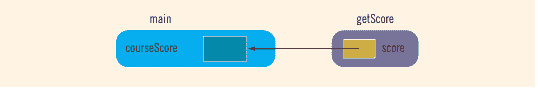

**图7-1** 变量`courseScore`和参数`score`

对`score`所做的任何更改都会立即改变`courseScore`的值。

然后控制权转交给函数`getScore`，第4行的语句执行，打印第二行输出。该语句提示用户输入课程分数。第5行的语句读取用户输入的值（示例运行中为85）并将其存储在`score`中，而`score`实际上就是`courseScore`（因为`score`是引用参数）。因此，此时变量`score`和`courseScore`的值都是85（见图7-2）。

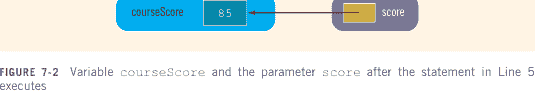

**图7-2** 第5行语句执行后变量`courseScore`和参数`score`

接下来，第6行的语句输出`score`的值，如示例运行的第三行所示。第6行执行后，控制权返回函数`main`（见图7-3）。

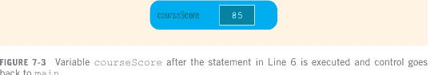

**图7-3** 第6行语句执行且控制权返回`main`后的变量`courseScore`

接下来执行第3行的语句。这是对函数`printGrade`的函数调用，实际参数为`courseScore`。由于函数`printGrade`的形式参数`cScore`是值参数，参数`cScore`接收对应实际参数`courseScore`的值。因此，`cScore`的值为85。在将`courseScore`的值复制到`cScore`后，`cScore`和`courseScore`之间不再有任何联系（见图7-4）。

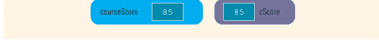

然后程序执行第7行的语句，输出第四行。第8行的`if...else`语句确定并输出课程成绩。由于第7行的输出语句不包含换行符或操纵符`endl`，`if...else`语句的输出是输出的第四行的一部分。`if...else`语句执行后，控制权返回函数`main`。因为函数`main`中下一条要执行的语句是函数`main`的最后一条语句，程序终止。

在该程序中，函数`main`首先调用函数`getScore`从用户处获取课程分数。然后函数`main`调用函数`printGrade`根据该课程分数计算并打印成绩。课程分数由函数`getScore`获取；之后，该课程分数由函数`printGrade`使用。由于`getScore`函数获取的值在程序后面会用到，因此函数`getScore`必须将该值传递到外部。因此，保存该值的形式参数必须是引用参数。

### 值参数和引用参数与内存分配

当函数被调用时，其形式参数和函数体中声明的变量（称为**局部变量**）的内存分配在函数数据区。回想一下，对于值参数，实际参数的值会被复制到其对应形式参数的内存单元中。对于引用参数，实际参数的地址传递给形式参数。也就是说，形式参数的内容是一个地址。在数据操作过程中，形式参数的内容指示计算机操作其内容所指的内存单元中的数据。因此，对于引用参数，实际参数和形式参数引用同一个内存位置。因此，在程序执行期间，形式参数所做的更改会永久改变实际参数的值。

**注意** 流变量（例如`ifstream`和`ofstream`）应按引用传递给函数。在打开输入/输出文件或读取和/或输出数据之后，输入和/或输出流的状态便可以传递到函数外部。

由于参数传递对于任何编程语言都是基础性的，示例7-6和7-7将进一步说明这一概念。每个示例涉及不同的场景。

## 示例7-6

下面的程序展示了引用参数和值参数是如何工作的。

```cpp
//Example 7-6: Reference and value parameters

#include <iostream>

using namespace std;

void funOne(int a, int& b, char v);
void funTwo(int& x, int y, char& w);

int main()
{
    int num1, num2;
    char ch;

    num1 = 10;                                      //Line 1
    num2 = 15;                                      //Line 2
    ch = 'A';                                       //Line 3

    cout << "Line 4: Inside main: num1 = " << num1
         << ", num2 = " << num2 << ", and ch = "
         << ch << endl;                             //Line 4

    funOne(num1, num2, ch);                          //Line 5

    cout << "Line 6: After funOne: num1 = " << num1
         << ", num2 = " << num2 << ", and ch = "
         << ch << endl;                             //Line 6

    funTwo(num2, 25, ch);                            //Line 7

    cout << "Line 8: After funTwo: num1 = " << num1
         << ", num2 = " << num2 << ", and ch = "
         << ch << endl;                             //Line 8

    return 0;
}
```

```cpp
void funOne(int a, int& b, char v)
{
    int one;

    one = a;                                //Line 9
    a++;                                    //Line 10
    b = b * 2;                              //Line 11
    v = 'B';                                //Line 12

    cout << "Line 13: Inside funOne: a = " << a
         << ", b = " << b << ", v = " << v
         << ", and one = " << one << endl; //Line 13
}

void funTwo(int& x, int y, char& w)
{
    x++;                                    //Line 14
    y = y * 2;                              //Line 15
    w = 'G';                                //Line 16

    cout << "Line 17: Inside funTwo: x = " << x
         << ", y = " << y << ", and w = " << w
         << endl;                           //Line 17
}
```

## 示例运行：

```text
Line 4: Inside main: num1 = 10, num2 = 15, and ch = A
Line 13: Inside funOne: a = 11, b = 30, v = B, and one = 10
Line 6: After funOne: num1 = 10, num2 = 30, and ch = A
Line 17: Inside funTwo: x = 31, y = 50, and w = G
Line 8: After funTwo: num1 = 10, num2 = 31, and ch = G
```

让我们逐步分析这个程序。每个语句执行前和/或执行后的变量值都会显示出来。

在第1行的语句执行之前，仅为函数 main 的变量分配了内存；这些内存未被初始化。在第3行的语句执行之后，变量值如图7-5所示。


**图7-5** 第3行语句执行后的变量值

第4行的语句产生以下输出：

Line 4: Inside main: num1 = 10, num2 = 15, and ch = A

第5行的语句是对函数 funOne 的函数调用。现在函数 funOne 有三个形参和一个局部变量。为函数 funOne 的形参和局部变量分配内存。由于形参 b 是引用参数，它接收对应实参（即 num2）的地址（内存位置）。另外两个形参是值参数，因此它们复制相应实参的值。在第9行的语句执行之前，变量值如图7-6所示。


**图7-6** 第9行语句执行前的变量值

在第9行的语句 `one = a;` 执行之后，变量值如图7-7所示。

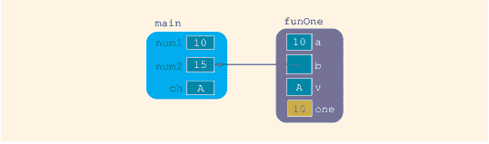

**图7-7** 第9行语句执行后的变量值

在第10行的语句 `a++;` 执行之后，变量值如图7-8所示。


**图7-8** 第10行语句执行后的变量值

在第11行的语句 `b = b * 2;` 执行之后，变量值如图7-9所示。（注意变量 `b` 改变了 `num2` 的值。）


**图7-9** 第11行语句执行后的变量值

在第12行的语句 `v = 'B';` 执行之后，变量值如图7-10所示。


**图7-10** 第12行语句执行后的变量值

第13行的语句产生以下输出：

```text
Line 13: Inside funOne: a = 11, b = 30, v = B, and one = 10
```

在第13行的语句执行后，控制权返回到第6行，为函数 funOne 的变量分配的内存被释放。图7-11显示了函数 main 的变量值。


**图7-11** 控制权返回到第6行时的变量值

第6行产生以下输出：

`Line 6: After funOne: num1 = 10, num2 = 30, and ch = A`

第7行的语句是对函数 `funTwo` 的函数调用。现在 `funTwo` 有三个形参：`x`、`y` 和 `w`。此外，`x` 和 `w` 是引用参数，而 `y` 是值参数。因此，`x` 接收其对应实参（即 `num2`）的地址，`w` 接收其对应实参（即 `ch`）的地址。变量 `y` 将值25复制到其内存单元中。图7-12显示了第14行语句执行前的变量值。


**图7-12** 第14行语句执行前的变量值

在第14行的语句 `x++` 执行之后，变量值如图7-13所示。（注意变量 `x` 改变了 `num2` 的值。）


**图7-13** 第14行语句执行后的变量值

在第15行的语句 `y = y * 2;` 执行之后，变量值如图7-14所示。


**图7-14** 第15行语句执行后的变量值

在第16行的语句 `w = 'G';` 执行之后，变量值如图7-15所示。（注意变量 w 改变了 ch 的值。）


**图7-15** 第16行语句执行后的变量值

第17行产生以下输出：

```text
Line 17: Inside funTwo: x = 31, y = 50, and w = G
```

在第17行的语句执行后，控制权转到第8行。为函数 funTwo 的变量分配的内存被释放。函数 main 的变量值如图7-16所示。

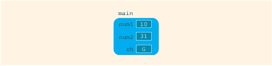

**图7-16** 控制权转到第8行时的变量值

第8行的语句产生以下输出：

Line 8: After funTwo: num1 = 10, num2 = 31, and ch = G

在第8行的语句执行后，程序终止。

## 示例7-7

此示例同样展示了引用参数如何操作实参。

```cpp
//Example 7-7: Reference and value parameters.
//Program: Makes you think.

#include <iostream>

using namespace std;

void addFirst(int& first, int& second);
void doubleFirst(int one, int two);
void squareFirst(int& ref, int val);

int main()
{
    int num = 5;

    cout << "Line 1: Inside main: num = " << num
         << endl;                                  //Line 1

    addFirst(num, num);
    cout << "Line 3: Inside main after addFirst:"
         << " num = " << num << endl;              //Line 3

    doubleFirst(num, num);
    cout << "Line 5: Inside main after "
         << " doubleFirst: num = " << num << endl; //Line 5

    squareFirst(num, num);
    cout << "Line 7: Inside main after "
         << " squareFirst: num = " << num << endl; //Line 7

    return 0;
}

void addFirst(int& first, int& second)
{
    cout << "Line 8: Inside addFirst: first = "
         << first << ", second = " << second << endl; //Line 8

    first = first + 2;                               //Line 9

    cout << "Line 10: Inside addFirst: first = "
         << first << ", second = " << second << endl; //Line 10

    second = second * 2;                                      //Line 11

    cout << "Line 12: Inside addFirst:  first = "
         << first << ", second = " << second << endl;           //Line 12
}

void doubleFirst(int one, int two)
{
    cout << "Line 13: Inside doubleFirst:  one = "
         << one << ", two = " << two << endl;              //Line 13

    one = one * 2;                                           //Line 14

    cout << "Line 15: Inside doubleFirst:  one = "
         << one << ", two = " << two << endl;              //Line 15

    two = two + 2;                                           //Line 16

    cout << "Line 17: Inside doubleFirst:  one = "
         << one << ", two = " << two << endl;              //Line 17
}

void squareFirst(int& ref, int val)
{
    cout << "Line 18: Inside squareFirst: ref = "
         << ref << ", val = " << val << endl;              //Line 18

    ref = ref * ref;                                         //Line 19

    cout << "Line 20: Inside squareFirst: ref = "
         << ref << ", val = " << val << endl;              //Line 20

    val = val + 2;                                           //Line 21

    cout << "Line 22: Inside squareFirst: ref = "
         << ref << ", val = " << val << endl;              //Line 22
}
```

### 示例运行：

```text
Line 1: Inside main:  num = 5
Line 8: Inside addFirst:  first = 5, second = 5
Line 10: Inside addFirst:  first = 7, second = 7
Line 12: Inside addFirst:  first = 14, second = 14
Line 3: Inside main after addFirst:  num = 14
Line 13: Inside doubleFirst:  one = 14, two = 14
Line 15: Inside doubleFirst:  one = 28, two = 14
Line 17: Inside doubleFirst:  one = 28, two = 16
Line 5: Inside main after doubleFirst:  num = 14
Line 18: Inside squareFirst: ref = 14, val = 14
Line 20: Inside squareFirst: ref = 196, val = 14
Line 22: Inside squareFirst: ref = 196, val = 16
Line 7: Inside main after squareFirst:  num = 196
```


对应的实参，即 **num**，而变量 **val** 复制其对应实参的值，该实参同样是 **num**。因此，**num** 和 **ref** 都指向同一个内存位置，即 **num**。图 7–19 说明了这种情况。


**图 7-19** 函数 `squareFirst` 的参数

**ref** 所做的任何修改都会立即改变 **num**。**val** 所做的任何修改都不会影响 **num**。（注意，在函数 `squareFirst` 执行之前，**num** 的值是 14。）

我们建议你逐步运行示例 7–8 中的程序。输出显示了各条语句执行的顺序。

## 引用参数与有返回值函数

在第 6 章讨论有返回值函数时，你只学习了如何使用值参数。你也可以在有返回值函数中使用引用参数，尽管不推荐这种做法。根据定义，有返回值函数返回单个值；该值通过 return 语句返回。如果一个函数需要返回多个值，你应将其改为 void 函数，并使用适当的引用参数来返回这些值。

## 标识符的作用域

前面几节和第 6 章给出了几个包含用户自定义函数的程序示例。标识符可以在函数头中、块内或块外声明。一个自然而然的问题出现了：是否允许在程序中的任何位置访问任何标识符？答案是否定的。访问标识符时必须遵循某些规则。标识符的**作用域**指的是程序中可以访问（可见）该标识符的位置。回想一下，标识符是 C++ 中某个事物的名称，例如变量名或函数名。

本节考察标识符的作用域。首先，我们定义以下两个术语：

**局部标识符：** 在函数（或块）内声明的标识符。

局部标识符不能在函数（块）外访问。

**全局标识符：** 在每个函数定义之外声明的标识符。

此外，C++ 不允许函数嵌套。也就是说，你不能将一个函数的定义包含在另一个函数体中。

一般而言，访问标识符时适用以下规则：

- 1. 全局标识符（例如变量）可由函数或块访问，如果：
  - a. 该标识符在函数定义（块）之前声明，
  - b. 函数名与该标识符不同，
  - c. 函数的所有参数名称都与该标识符名称不同，并且
  - d. 所有局部标识符（例如局部变量）的名称都与该标识符名称不同。
- 2. **(嵌套块)** 在块内声明的标识符可被访问：
  - a. 仅在该块内，从其声明点直到该块结束，并且
  - b. 由嵌套在该块内的那些块访问，前提是嵌套块没有与外部块（包围该嵌套块的块）同名的标识符。
- 3. 函数名的作用域类似于在任何块外声明的标识符的作用域。也就是说，函数名的作用域与全局变量的作用域相同。

在考虑一个解释这些作用域规则的示例之前，首先注意在 `for` 语句中声明的标识符的作用域。C++ 允许程序员在 `for` 语句的初始化语句中声明变量。例如，下面的 `for` 语句：

```cpp
for (int count = 1; count < 10; count++)
    cout << count << endl;
```

声明了变量 count 并将其初始化为 1。变量 count 的作用域仅限于 `for` 循环体。

> **注意**
> `for` 语句中声明变量的这条作用域规则可能不适用于标准 C++。在标准 C++ 中，初始化语句中声明的变量，其作用域可以从声明点一直延伸到紧邻 `for` 语句的块的末尾。（若要完全确定，请查阅编译器的文档。）

下面的 C++ 程序有助于说明这些作用域规则：

```cpp
#include <iostream>

using namespace std;

const double RATE = 10.50;
int z;
double t;

void one(int x, char y);
void two(int a, int b, char x);
void three(int one, double y, int z);

int main()
{
        int num, first;
        double x, y, z;
        char name, last;
        .
        .
        .
        return 0;
}

void one(int x, char y)
{
        .
        .
        .
}

int w;

void two(int a, int b, char x)
{
        int count;
        .
        .
        .
}

void three(int one, double y, int z)
{
        char ch;
        int a;
        .
        .
        //Block four
        {
                int x;
                char a;
                .
        }//end Block four
        .
        .
        .
}
```

### 表 7-1 标识符的作用域（可见性）

| 标识符 | 在 one 中的可见性 | 在 two 中的可见性 | 在 three 中的可见性 | 在块 four 中的可见性 | 在 main 中的可见性 |
|---|---|---|---|---|---|
| RATE（main 之前） | Y | Y | Y | Y | Y |
| z（main 之前） | Y | Y | N | N | N |
| t（main 之前） | Y | Y | Y | Y | Y |
| main | Y | Y | Y | Y | Y |
| main 的局部变量 | N | N | N | N | Y |
| one（函数名） | Y | Y | N | N | Y |
| x（one 的形参） | Y | N | N | N | N |
| y（one 的形参） | Y | N | N | N | N |
| w（函数 two 之前） | N | Y | Y | Y | N |
| two（函数名） | Y | Y | Y | Y | Y |
| a（two 的形参） | N | Y | N | N | N |
| b（two 的形参） | N | Y | N | N | N |
| x（two 的形参） | N | Y | N | N | N |
| two 的局部变量 | N | Y | N | N | N |
| three（函数名） | Y | Y | Y | Y | Y |
| one（three 的形参） | N | N | Y | Y | N |
| y（three 的形参） | N | N | Y | Y | N |
| z（three 的形参） | N | N | Y | Y | N |
| ch（three 的局部变量） | N | N | Y | Y | N |
| a（three 的局部变量） | N | N | Y | N | N |
| x（块 four 的局部变量） | N | N | N | Y | N |
| a（块 four 的局部变量） | N | N | N | Y | N |

注意，函数 three 不能调用函数 one，因为函数 three 有一个名为 one 的形参。同样，函数 three 中标记为 four 的块不能使用在函数 three 中声明的 int 变量 a，因为块 four 有一个名为 a 的标识符。

在结束本节之前，我们说明以下关于全局变量的几点：

- 1. 第 2 章指出，C++ 不会自动初始化变量。然而，有些编译器会将全局变量初始化为其默认值。例如，如果全局变量的类型是 int、char 或 double，则它会被初始化为零。
- 2. 在 C++ 中，`::` 称为**作用域解析运算符**。通过使用作用域解析运算符，在函数（块）定义之前声明的全局变量可以由该函数（或块）访问，即使该函数（或块）有一个与该变量同名的标识符。在前面的程序中，通过使用作用域解析运算符，函数 main 可以将全局变量 z 称为 `::z`。类似地，假设在函数定义之前声明了一个全局变量 t——比如函数 funExample。那么，即使 funExample 有一个标识符 t，funExample 也可以使用作用域解析运算符访问变量 t。使用作用域解析运算符时，funExample 将变量 t 称为 `::t`。此外，在前面的程序中，使用作用域解析运算符，函数 three 可以调用函数 one。
- 3. C++ 提供了一种访问在函数定义之后声明的全局变量的方法。在这种情况下，该函数不能包含任何与全局变量同名的标识符。在前面的程序中，全局变量 w 在函数 one 的定义之后声明。函数 one 不包含任何名为 w 的标识符；因此，只有在 one 内将 w 声明为**外部变量**时，函数 one 才能访问 w。要在函数 one 内将 w 作为外部变量访问，函数 one 必须包含以下语句：

  ```cpp
  extern int w;
  ```

  在 C++ 中，extern 是保留字。上述语句中的 extern 一词声明 w 是在别处声明的全局变量。因此，当调用函数 one 时，会为 one 内声明的 w 分配内存。在 C++ 中，外部声明还有另一种用途，但本书不讨论。

## 全局变量、命名常量与副作用

C++ 程序可以包含全局变量。然而，使用全局变量会产生副作用。如果多个函数使用同一个全局变量并且出了问题，就很难发现出了什么问题以及在哪里出的问题。由……引起的问题

程序某一区域中的全局变量可能会被误认为是另一区域中引发的问题。

例如，考虑以下程序：

```cpp
//Global variable
#include <iostream>

using namespace std;

int t;

void funOne(int& a);

int main()
{
        t = 15;                                      //Line 1

        cout << "Line 2: In main: t = " << t << endl; //Line 2

        funOne(t);                                   //Line 3

        cout << "Line 4: In main after funOne: "
             << " t = " << t << endl;               //Line 4
        return 0;                                    //Line 5
}

void funOne(int& a)
{
        cout << "Line 6: In funOne: a = " << a
             << " and t = " << t << endl;           //Line 6

        a = a + 12;                                  //Line 7
        cout << "Line 8: In funOne: a = " << a
             << " and t = " << t << endl;           //Line 8

        t = t + 13;                                  //Line 9

        cout << "Line 10: In funOne: a = " << a
             << " and t = " << t << endl;           //Line 10
}
```

该程序有一个变量 `t`，它是在任何函数定义之前声明的。因为没有任何函数含有标识符 `t`，所以变量 `t` 在程序中的任何位置都可以访问。此外，该程序包含一个带有引用参数的 void 函数。

在第 3 行，函数 `main` 调用函数 `funOne`，传递给 `funOne` 的实参是 `t`。因此，`funOne` 的形参 `a` 接收 `t` 的地址。`a` 对其值所做的任何更改都会立即改变 `t`。因为 `t` 可以在程序中的任何位置被直接访问，所以在第 9 行，函数 `funOne` 通过使用 `t` 本身来改变 `t` 的值。因此，你可以通过引用参数或 `t` 本身来操纵 `t` 的值。

在前面的程序中，如果 `t` 的最终值不正确，就很难确定哪里出了错以及问题出在程序的哪一部分。我们强烈建议 *不要使用全局变量*；而应使用适当的参数。

在本书给出的程序中，我们通常将命名常量放在函数 `main` 之前、每个函数定义之外。也就是说，我们使用的命名常量是 *全局命名常量*。与全局变量不同，全局命名常量没有副作用，因为它们的值在程序执行期间不能改变。此外，将命名常量放在程序开头可以提高可读性，即使它只在一个函数中使用。如果你以后需要修改程序并更改某个命名常量的值，把它放在程序开头会更容易找到。

### 示例 7-8（菜单驱动程序）

下面是一个菜单驱动程序的示例。程序执行时，会向用户提供一个可供选择的选项列表。该程序进一步说明了值参数和引用参数如何工作。它将长度从英尺和英寸转换为米和厘米，反之亦然。该程序包含三个函数：`showChoices`、`feetAndInchesToMetersAndCent` 和 `metersAndCentToFeetAndInches`。函数 `showChoices` 告知用户如何使用该程序。只要用户愿意，用户就可以选择运行该程序。

```cpp
//Menu-driven program.

#include <iostream>

using namespace std;

const double CONVERSION = 2.54;
const int INCHES_IN_FOOT = 12;
const int CENTIMETERS_IN_METER = 100;

void showChoices();

void feetAndInchesToMetersAndCent(int f, int in,
                                  int& mt, int& ct);
void metersAndCentToFeetAndInches(int mt, int ct,
                                  int& f, int& in);

int main()
{
    int feet, inches;
    int meters, centimeters;
    int choice;

    do
    {
        showChoices();
        cin >> choice;
        cout << endl;

        switch (choice)
        {
        case 1:
            cout << "Enter feet and inches: ";
            cin >> feet >> inches;
            cout << endl;
            feetAndInchesToMetersAndCent(feet, inches,
                                         meters, centimeters);
            cout << feet << " feet(foot), "
                 << inches << " inch(es) = "
                 << meters << " meter(s), "
                 << centimeters << " centimeter(s)." << endl;
            break;

        case 2:
            cout << "Enter meters and centimeters: ";
            cin >> meters >> centimeters;
            cout << endl;
            metersAndCentToFeetAndInches(meters, centimeters,
                                         feet, inches);
            cout << meters << " meter(s), "
                 << centimeters << " centimeter(s) = "
                 << feet << " feet(foot), "
                 << inches << " inch(es)."
                 << endl;
            break;

        case 99:
            break;

        default:
            cout << "Invalid input." << endl;
        }
    }
    while (choice != 99);

    return 0;
}

void showChoices()
{
    cout << "Enter--" << endl;
    cout << "1: To convert from feet and inches to meters "
         << "and centimeters." << endl;
    cout << "2: To convert from meters and centimeters to feet "
         << "and inches." << endl;
    cout << "99: To quit the program." << endl;
}
```

## 静态变量与自动变量

到目前为止讨论的变量遵循两条简单规则：

- 1. 只要程序执行，全局变量的内存就保持分配。
- 2. 在块内声明的变量，其内存会在进入块时分配，并在退出块时释放。例如，函数的形参和局部变量的内存会在调用函数时分配，并在函数退出时释放。

在进入块时分配内存、在退出块时释放内存的变量称为 **自动变量**。只要程序执行就保持分配内存的变量称为 **静态变量**。全局变量是静态变量，而默认情况下，在块内声明的变量是自动变量。你可以使用保留字 `static` 在块内声明静态变量。声明静态变量的语法是：

```cpp
static dataType identifier;
```

语句：

```cpp
static int x;
```

将 `x` 声明为 `int` 类型的静态变量。

在块内声明的静态变量是该块的局部变量，其作用域与该块中任何其他局部标识符的作用域相同。

大多数编译器会将静态变量初始化为其默认值。例如，`static int` 变量会被初始化为 0。然而，自己初始化 `static` 变量是一种好做法，尤其是当初始值不是默认值时。在这种情况下，`static` 变量会在声明时被初始化。语句：

```cpp
static int x = 0;
```

将 `x` 声明为 `int` 类型的静态变量，并将 `x` 初始化为 0。

### 示例 7-9

以下程序展示了静态变量和自动变量的行为。

```cpp
//Program: Static and automatic variables
#include <iostream>

using namespace std;

void test();

int main()
{
    int count;

    for (count = 1; count <= 5; count++)
        test();

    return 0;
}

void test()
{
    static int x = 0;
    int y = 10;

    x = x + 2;
    y = y + 1;

    cout << "Inside test x = " << x << " and y = "
         << y << endl;
}
```

**示例运行：**

```text
Inside test x = 2 and y = 11
Inside test x = 4 and y = 11
Inside test x = 6 and y = 11
Inside test x = 8 and y = 11
Inside test x = 10 and y = 11
```

在函数 `test` 中，`x` 是初始化为 0 的静态变量，`y` 是初始化为 10 的自动变量。函数 `main` 调用函数 `test` 五次。变量 `y` 的内存会在每次调用函数 `test` 时分配，并在函数退出时释放。因此，每次调用函数 `test` 时，它为 `y` 打印的值都相同。然而，因为 `x` 是静态变量，`x` 的内存会在程序执行期间一直保持分配。变量 `x` 只被初始化一次为 0。对函数 `test` 的后续调用会使用 `x` 的当前值。

因为静态变量的内存在函数调用之间保持分配，所以静态变量允许你在一次函数调用到另一次函数调用之间使用变量的值。尽管如果你想在一次函数调用到另一次函数调用之间使用某些值，可以使用全局变量，但静态变量的局部作用域可以防止其他函数操纵它的值。

## 调试：使用驱动程序和桩程序

在本章和前面几章中，你学习了如何编写函数来将问题划分为子问题、求解每个子问题，然后组合这些函数形成完整程序，从而得到问题的解。一个程序可能包含许多函数。在复杂程序中，通常当编写好一个函数后，会单独测试和调试它。你可以编写一个单独的程序来测试该函数。测试函数的程序称为 **驱动程序**。例如，示例 7-8 中的程序包含将长度从英尺和英寸转换为米和厘米的函数。


反之亦然。在编写完整程序之前，你可以编写独立的驱动程序，以确保每个函数都能正常工作。

有时，一个函数计算的结果会在另一个函数中使用。在这种情况下，依赖另一个函数的函数无法单独测试。例如，考虑下面这个计算游泳池注水时间的程序。

```cpp
#include <iostream>
#include <iomanip>

using namespace std;

const double GALLONS_IN_A_CUBIC_FOOT = 7.48;

double poolCapacity(double len, double wid, double dep);
void poolFillTime(double len, double wid, double dep,
                  double fRate, int& fTime);
void print(int fTime);

int main()
{
    double length, width, depth;
    double fillRate;
    int fillTime;

    cout << fixed << showpoint << setprecision(2);

    cout << "Enter the length, width, and the depth of the "
         << "pool (in feet): ";
    cin >> length >> width >> depth;
    cout << endl;

    cout << "Enter the rate of the water (in gallons per minute): ";
    cin >> fillRate;
    cout << endl;

    poolFillTime(length, width, depth, fillRate, fillTime);
    print(fillTime);

    return 0;
}

double poolCapacity(double len, double wid, double dep)
{
    double volume;
    double poolWaterCapacity;

    volume = len * wid * dep;
    poolWaterCapacity = volume * GALLONS_IN_A_CUBIC_FOOT;

    return poolWaterCapacity;
}

void poolFillTime(double len, double wid, double dep,
                  double fRate, int& fTime)
{
    double poolWaterCapacity;

    poolWaterCapacity = poolCapacity(len, wid, dep);
    fTime = static_cast<int> (poolWaterCapacity / fRate + 0.5);
}

void print(int fTime)
{
    cout << "The time to fill the pool is approximately: "
         << fTime / 60 << " hour(s) and " << fTime % 60
         << " minute(s)." << endl;
}
```

**示例运行：** 在此示例运行中，用户输入以阴影显示。

输入游泳池的长、宽和深度（英尺）：`30 15 10`

输入水的流速（加仑/分钟）：`100`

注满游泳池所需时间约为：5 小时 37 分钟。

如你所见，该程序包含用于计算注满游泳池所需水量的函数 poolCapacity、用于计算注满游泳池所需时间的函数 poolFillTime 以及其他一些函数。现在，要计算注满游泳池的时间，你必须知道所需水量以及水流入游泳池的速率。由于函数 poolCapacity 的结果在函数 poolFillTime 中会被用到，因此函数 poolFillTime 无法单独测试。这是否意味着我们必须按特定顺序编写这些函数？不一定，尤其是当不同的人负责程序的不同部分时。在这种情况下，我们使用函数桩。函数桩是一个未完全编码的函数。对于无返回值函数，函数桩可能只包含一个函数头和一组空花括号 {}；而对于有返回值函数，它可能只包含一条带合理返回值的 return 语句。例如，函数 poolCapacity 的函数桩可以是：

```cpp
double poolCapacity(double len, double wid, double dep)
{
    return 1000.00;
}
```

这样一来，在程序编写过程中就可以调用函数 poolCapacity。最终，poolCapacity 的函数桩会被一个真正根据参数值计算注满游泳池所需水量的函数所取代。与此同时，函数桩使得程序其他调用 poolCapacity 的部分可以继续开发。

在我们查看一些编程示例之前，还有另一个与函数相关的概念值得一提：函数重载。

## 函数重载：简介

在 C++ 程序中，多个函数可以具有相同的名称。这称为**函数重载**，或**重载函数名**。在我们说明函数重载的规则之前，先定义以下概念：

如果两个函数具有以下情况，则称它们具有**不同的形式参数列表**：

- 形式参数的数量不同
- 如果形式参数数量相同，则按顺序列出的形式参数数据类型至少在一个位置上不同。

例如，考虑以下函数头：

```cpp
void functionOne(int x)
void functionTwo(int x, double y)
void functionThree(double y, int x)
int functionFour(char ch, int x, double y)
int functionFive(char ch, int x, string name)
```

这些函数都具有不同的形式参数列表。

现在考虑以下函数头：

```cpp
void functionSix(int x, double y, char ch)
void functionSeven(int one, double y, char firstCh)
```

函数 functionSix 和 functionSeven 都有三个形式参数，并且对应参数的数据类型相同。因此，这些函数具有相同的形式参数列表。

要重载一个函数名，该函数的任意两个定义必须具有不同的形式参数列表。

**函数重载：** 创建多个同名函数。

函数的**签名**由函数名及其形式参数列表组成。如果两个函数具有不同的名称或不同的形式参数列表，则它们具有不同的签名。（注意，函数的签名不包含函数的返回类型。）

如果某个函数名被重载，那么该集合中的所有函数都具有相同的名称。因此，如果集合中的所有函数具有不同的形式参数列表，则它们就具有不同的签名。因此，以下函数头可以正确地重载函数 functionXYZ：

```cpp
void functionXYZ()
void functionXYZ(int x, double y)
void functionXYZ(double one, int y)
void functionXYZ(int x, double y, char ch)
```

考虑以下用于重载函数 functionABC 的函数头：

```cpp
void functionABC(int x, double y)
int functionABC(int x, double y)
```


本节讨论带默认参数的函数。回想一下，当函数被调用时，实际参数和形式参数的数量必须相同。C++ 对带默认参数的函数放宽了这一条件。当函数名第一次出现时（例如在函数原型中），需要指定默认参数的值。一般来说，以下规则适用于带默认参数的函数：

- 如果未指定默认参数的值，则使用该参数的默认值。
- 所有默认参数必须是函数最右侧的参数。
- 假设一个函数有多个默认参数。在函数调用中，如果某个默认参数的值未指定，则必须省略其右侧的所有实参。
- 默认值可以是常量、全局变量或函数调用。
- 调用者可以选择为任何默认参数指定除默认值以外的值。
- 不能将常量值作为默认值赋给引用参数。

考虑以下函数原型：

```cpp
void funcExp(int x, int y, double t, char z = 'A', int u = 67,
             char v = 'G', double w = 78.34);
```

函数 funcExp 有七个参数。参数 z、u、v 和 w 是默认参数。如果在对函数 funcExp 的调用中没有为 z、u、v 和 w 指定值，则使用它们的默认值。

假设有以下语句：

```cpp
int a, b;
char ch;
double d;
```

以下函数调用是合法的：

- `funcExp(a, b, d);`
- `funcExp(a, 15, 34.6, 'B', 87, ch);`
- `funcExp(b, a, 14.56, 'D');`

在语句 1 中，使用了 z、u、v 和 w 的默认值。在语句 2 中，z 的默认值被替换为 'B'，u 的默认值被替换为 87，v 的默认值被替换为 ch 的值，并使用了 w 的默认值。在语句 3 中，z 的默认值被替换为 'D'，并使用了 u、v 和 w 的默认值。

以下函数调用是非法的：

- `funcExp(a, 15, 34.6, 46.7);`
- `funcExp(b, 25, 48.76, 'D', 4567, 78.34);`

在语句 1 中，由于省略了 z 的值，因此必须省略所有其他默认值。在语句 2 中，由于省略了 v 的值，因此也应该省略 w 的值。


以下是带默认参数的非法函数原型：

- 1. `void funcOne(int x, double z = 23.45, char ch, int u = 45);`
- 2. `int funcTwo(int length = 1, int height = 1);`
- 3. `void funcThree(int x, int& y = 16, double z = 34);`

在语句1中，因为第二个参数 z 是默认参数，所以 z 之后的所有其他参数都必须是默认参数。在语句2中，因为第一个参数是默认参数，所以所有参数都必须是默认参数。在语句3中，不能将常量值赋给 y，因为 y 是引用参数。

示例7-10进一步说明了带默认参数的函数。

## 示例7-10

```cpp
#include <iostream>
#include <iomanip>

using namespace std;

int volume(int l = 1, int w = 1, int h = 1);
void funcOne(int& x, double y = 12.34, char z = 'B');

int main()
{
    int a = 23;
    double b = 48.78;
    char ch = 'M';

    cout << fixed << showpoint;
    cout << setprecision(2);

    cout << "Line 1: a = " << a << ", b = "
         << b << ", ch = " << ch << endl;       //Line 1
    cout << "Line 2: Volume = " << volume()
         << endl;                                //Line 2
    cout << "Line 3: Volume = " << volume(5, 4)
         << endl;                                //Line 3
    cout << "Line 4: Volume = " << volume(34)
         << endl;                                //Line 4
    cout << "Line 5: Volume = "
         << volume(6, 4, 5) << endl;             //Line 5

    funcOne(a);                                  //Line 6
    funcOne(a, 42.68);                           //Line 7
    funcOne(a, 34.65, 'Q');                      //Line 8

    cout << "Line 9: a = " << a << ", b = "
         << b << ", ch = " << ch << endl;       //Line 9

    return 0;
}

int volume(int l, int w, int h)
{
    return l * w * h;
}

void funcOne(int& x, double y, char z)
{
    x = 2 * x;
    cout << "Line 12: x = " << x << ", y = "
         << y << ", z = " << z << endl;
}
```

### 示例运行：

```text
Line 1: a = 23, b = 48.78, ch = M
Line 2: Volume = 1
Line 3: Volume = 20
Line 4: Volume = 34
Line 5: Volume = 120
Line 12: x = 46, y = 12.34, z = B
Line 12: x = 92, y = 42.68, z = B
Line 12: x = 184, y = 34.65, z = Q
Line 9: a = 184, b = 48.78, ch = M
```

> **注意：** 在本书中的程序中，函数 `main` 的定义放在任何用户自定义函数定义之前。因此，必须在函数原型中指定参数的默认值，并且只在函数原型中指定，而不能在函数定义中指定。

## 编程示例：数字分类

在此示例中，我们使用函数来重写确定给定整数列表中奇数和偶数个数的程序。该程序最初是在第 5 章中编写的。

主算法保持不变：

- 1. 将变量 zeros、odds 和 evens 初始化为 0。
- 2. 读取一个数。
- 3. 如果这个数是偶数，则递增偶数计数；如果这个数也是零，则递增零计数；否则，递增奇数计数。
- 4. 对列表中的每个数字重复步骤 2 和 3。

程序的主要部分是：初始化变量，读取和分类数字，然后输出结果。为了简化函数 main 并进一步说明参数传递，该程序包括：

- 一个 initialize 函数，用于初始化变量，如 zeros、odds 和 evens。
- 一个 getNumber 函数，用于获取数字。
- 一个 classifyNumber 函数，用于确定数字是奇数还是偶数（以及是否为零）。该函数还会递增相应的计数。
- 一个 printResults 函数，用于打印结果。

现在让我们描述这些函数中的每一个。

### initialize

函数 initialize 将变量初始化为它们的初始值。我们需要初始化的变量是 zeros、odds 和 evens。和以前一样，它们的初始值都是零。显然，这个函数有三个参数。由于初始化这些变量的形参的值必须在函数外部传递，这些形参必须是引用参数。本质上，该函数是：

```cpp
void initialize(int& zeroCount, int& oddCount, int& evenCount)
{
    zeroCount = 0;
    oddCount = 0;
    evenCount = 0;
}
```

### getNumber

函数 getNumber 读取一个数字，然后将该数字传递给函数 main。因为只需要传递一个数字，所以这个函数只有一个参数。该函数的形参必须是引用参数，因为读取的数字在函数外部传递。本质上，该函数是：

```cpp
void getNumber(int& num)
{
    cin >> num;
}
```

你也可以将函数 getNumber 编写成一个返回值函数。请参阅此编程示例末尾的注释。

### classifyNumber

函数 classifyNumber 确定数字是奇数还是偶数，如果数字是偶数，它还检查数字是否为零。它还更新一些变量 zeros、odds 和 evens 的值。该函数需要知道要分析的数字；因此，必须将数字作为参数传递。因为该函数还会递增相应的计数，所以保存计数的变量（即在 main 中声明的 zeros、odds 和 evens）必须作为参数传递给该函数。因此，该函数有四个参数。

因为数字只会被分析，所以只需传递它的值。因此，与该变量对应的形参是一个值参数。分析数字后，该函数会递增一些变量 zeros、odds 和 evens 的值。因此，与这些变量对应的形参必须是引用参数。分析数字并递增相应计数的算法与之前相同。该函数的定义是：

```cpp
void classifyNumber(int num, int& zeroCount, int& oddCount,
                    int& evenCount)
{
    switch (num % 2)
    {
    case 0:
        evenCount++;
        if (num == 0)
            zeroCount++;
        break;
    case 1:
    case -1:
        oddCount++;
    } //end switch
} //end classifyNumber
```

### printResults

函数 `printResults` 打印最终结果。为了打印结果（即 zeros、odds 和 evens 的个数），该函数必须能够访问在函数 `main` 中声明的变量 zeros、odds 和 evens 的值。因此，该函数有三个参数。由于该函数只打印变量的值，所以形参是值参数。该函数的定义是：

```cpp
void printResults(int zeroCount, int oddCount, int evenCount)
{
    cout << "There are " << evenCount << " evens, "
         << "which includes " << zeroCount << " zeros"
         << endl;

    cout << "The number of odd numbers is: " << oddCount
         << endl;
} //end printResults
```

我们现在给出主算法，并展示函数 `main` 如何调用这些函数。

### 主算法

- 1. 调用函数 `initialize` 来初始化变量。
- 2. 提示用户输入 20 个数字。
- 3. 对于列表中的每个数字：
  - a. 调用函数 `getNumber` 读取一个数字。
  - b. 输出该数字。
  - c. 调用函数 `classifyNumber` 对数字进行分类并递增相应的计数。
- 4. 调用函数 `printResults` 打印最终结果。

### 完整程序清单

```cpp
//***************************************************************
// Author: D.S. Malik
//
// Program: Classify Numbers
// This program reads 20 numbers and outputs the number of
// zeros, odd, and even numbers.
//***************************************************************

#include <iostream>
#include <iomanip>

using namespace std;

const int N = 20;

        //Function prototypes
void initialize(int& zeroCount, int& oddCount, int& evenCount);
void getNumber(int& num);
void classifyNumber(int num, int& zeroCount, int& oddCount,
                   int& evenCount);
void printResults(int zeroCount, int oddCount, int evenCount);

int main()
{
        //Variable declaration
        int counter;  //loop control variable
        int number;   //variable to store the new number
        int zeros;    //variable to store the number of zeros
        int odds;     //variable to store the number of odd integers
        int evens;    //variable to store the number of even integers

        initialize(zeros, odds, evens);                  //Step 1

        cout << "Please enter " << N << " integers."
             << endl;                                    //Step 2
        cout << "The numbers you entered are: "
             << endl;

        for (counter = 1; counter <= N; counter++)       //Step 3
        {
                getNumber(number);                       //Step 3a
                cout << number << " ";                  //Step 3b
                classifyNumber(number, zeros, odds, evens); //Step 3c
        } // end for loop

        cout << endl;
```


```cpp
printResults(zeros, odds, evens); //Step 4

return 0;
}

void initialize(int& zeroCount, int& oddCount, int& evenCount)
{
    zeroCount = 0;
    oddCount = 0;
    evenCount = 0;
}

void getNumber(int& num)
{
    cin >> num;
}

void classifyNumber(int num, int& zeroCount, int& oddCount,
                    int& evenCount)
{
    switch (num % 2)
    {
    case 0:
        evenCount++;
        if (num == 0)
            zeroCount++;
        break;
    case 1:
    case -1:
        oddCount++;
    } //end switch
} //end classifyNumber

void printResults(int zeroCount, int oddCount, int evenCount)
{
    cout << "There are " << evenCount << " evens, "
         << "which includes " << zeroCount << " zeros"
         << endl;

    cout << "The number of odd numbers is: " << oddCount
         << endl;
} //end printResults
```

**示例运行：** 在此示例运行中，用户输入带有底纹。

```text
Please enter 20 integers.
The numbers you entered are:
0 0 12 23 45 7 -2 -8 -3 -9 4 0 1 0 -7 23 -24 0 0 12
0 0 12 23 45 7 -2 -8 -3 -9 4 0 1 0 -7 23 -24 0 0 12
There are 12 evens, which includes 6 zeros
The number of odd numbers is: 8
```

**注意：** 在前一个程序中，由于假定数据是从标准输入设备（键盘）输入的，并且函数 `getNumber` 只返回一个值，因此你也可以将函数 `getNumber` 编写为返回值的函数。如果写成返回值的函数，则函数 `getNumber` 的定义如下：

```cpp
int getNumber()
{
    int num;

    cin >> num;

    return num;
}
```

在这种情况下，语句（函数调用）：

`getNumber(number);`

在函数 `main` 中应被以下语句替换：

`number = getNumber();`

当然，你还需要更改函数原型。

## 编程示例：数据比较

本编程示例说明：

- 如何在同一程序中从多个文件读取数据。
- 如何将输出发送到文件。
- 如何生成条形图。
- 如何借助函数和参数传递，在（相似的）不同数据集上使用同一程序段。
- 如何使用结构化设计解决问题以及如何进行参数传递。

本程序分为两部分。首先，你学习如何从多个文件读取数据。其次，你学习如何生成条形图。

当地一所大学的两组学生在夏季学期注册了某些特殊课程。这些课程都是第一次开设，由不同的教师授课。学期结束时，两个组参加了相同课程的相同测试，他们的成绩记录在单独的文件中。每个文件中的数据格式如下：

```text
courseNo  score1, score2, ..., scoreN --999
courseNo  score1, score2, ..., scoreM --999
.
.
.
```

让我们编写一个程序，找出每组中每门课程的平均课程分数。输出格式如下：

| 课程编号 | 组号 | 课程平均分 |
|---|---:|---:|
| CSC | 1 | 83.71 |
| CSC | 2 | 80.82 |
| ENG | 1 | 82.00 |
| ENG | 2 | 78.20 |

```text
Avg for group 1: 82.04
Avg for group 2: 82.01
```

**输入** 由于两组的数据记录在单独的文件中，输入数据出现在两个单独的文件中。

**输出** 如上所示。

## 问题分析与算法设计

从两个文件读取输入数据很简单。假设第 1 组的数据存储在文件 `group1.txt` 中，第 2 组的数据存储在文件 `group2.txt` 中。处理完一个组的数据后，我们可以处理第二个组同一课程的数据，并继续直到数据用完。每门课程的数据处理过程类似，是一个两步过程：

- 1. **求和**该课程的成绩。
  - 2. **统计**该课程的学生人数。
  - 3. **将总分除以**学生人数得到课程平均分。
- 2. 输出结果。

我们只比较每组中对应课程的平均值，每个文件中的数据按课程 ID 排序。为了确保只比较相应课程的平均值，我们比较每组的课程 ID。如果相应的课程 ID 不相同，则输出错误消息并终止程序。

这一讨论表明，我们应该编写一个函数 `calculateAverage` 来求课程平均分。我们还应该编写另一个函数 `printResult`，以给定形式输出数据。通过传递适当的参数，我们可以使用相同的函数 `calculateAverage` 和 `printResult` 来处理两组中每门课程的数据。（在程序的第二部分中，我们会修改函数 `printResult`。）

```cpp
void printResult(ofstream& outp, string courseID, int groupNo,
                 double avg)
{
    if (groupNo == 1)
        outp << "  " << courseID << "  ";
    else
        outp << "       ";

    outp << setw(8) << groupNo << setw(17) << avg << endl;
} //end printResult
```

现在我们已经设计并定义了函数 calculateAverage 和 printResult，接下来可以描述函数 main 的算法。然而，在概述算法之前，我们注意以下几点：两个输入文件中的数据很可能都按课程 ID 排序，但一个文件可能比另一个文件少一些课程。我们直到处理完两个文件并发现一个文件有未处理的数据时才会发现此错误。在打印最终答案（即第 1 组和第 2 组的平均值）之前，一定要检查这个错误。

### 主算法

- 1. 声明变量（局部声明）。
- 2. 打开输入文件。
- 3. 如果无法打开文件，则打印一条消息并终止程序。
- 4. 打开输出文件。
- 5. 要以带小数点和尾随零的定点十进制格式输出浮点数，请设置操纵符 `fixed` 和 `showpoint`。另外，要将浮点数输出到两位小数，请将精度设置为两位小数。
- 6. 将第 1 组的课程平均分初始化为 0.0。
- 7. 将第 2 组的课程平均分初始化为 0.0。
- 8. 将课程数初始化为 0。
- 9. 打印标题。
- 10. 获取第 1 组的课程 ID `courseId1`。
- 11. 获取第 2 组的课程 ID `courseId2`。
- 12. 对于第 1 组和第 2 组中的每门课程，
  - a. 如果 `(courseId1 != courseId2)`
    ```cpp
    {
        cout << "Data error: Course IDs do not match.\n";
        return 1;
    }
    ```

```cpp
//Function prototypes
void calculateAverage(ifstream& inp, double& courseAvg);
void printResult(ofstream& outp, string courseId,
                 int groupNo, double avg);

int main()
{
    //Step 1
    string courseId1;       //course ID for group 1
    string courseId2;       //course ID for group 2
    int numberOfCourses;
    double avg1;            //average for a course in group 1
    double avg2;            //average for a course in group 2
    double avgGroup1;       //average group 1
    double avgGroup2;       //average group 2
    ifstream group1;        //input stream variable for group 1
    ifstream group2;        //input stream variable for group 2
    ofstream outfile;       //output stream variable

    group1.open("group1.txt");                    //Step 2
    group2.open("group2.txt");                    //Step 2

    if (!group1 || !group2)                       //Step 3
    {
        cout << "Unable to open files." << endl;
        cout << "Program terminates." << endl;
        return 1;
    }

    outfile.open("student.out");                 //Step 4
    outfile << fixed << showpoint;                 //Step 5
    outfile << setprecision(2);                    //Step 5

    avgGroup1 = 0.0;                               //Step 6
    avgGroup2 = 0.0;                               //Step 7

    numberOfCourses = 0;                           //Step 8

    outfile << "Course No.    Group No.    "
            << "Course Average" << endl;           //Step 9

    group1 >> courseId1;                           //Step 10
    group2 >> courseId2;                           //Step 11
    while (group1 && group2)                       //Step 12
    {
        if (courseId1 != courseId2)                //Step 12a
        {
            cout << "Data error: Course IDs "
                 << "do not match." << endl;
```


```cpp
cout << "Program terminates." << endl;
return 1;
}
else                                      //Step 12b
{
    calculateAverage(group1, avg1);       //Step 12b.i
    calculateAverage(group2, avg2);       //Step 12b.ii
    printResult(outfile, courseId1,
                1, avg1);                 //Step 12b.iii
    printResult(outfile, courseId2,
                2, avg2);                 //Step 12b.iv
    avgGroup1 = avgGroup1 + avg1;         //Step 12b.v
    avgGroup2 = avgGroup2 + avg2;         //Step 12b.vi
    outfile << endl;
    numberOfCourses++;                    //Step 12b.vii
}

group1 >> courseId1;                      //Step 12c
group2 >> courseId2;                      //Step 12d
} //end while

if (group1 && !group2)                    //Step 13a
    cout << "Ran out of data for group 2 "
         << "before group 1." << endl;
else if (!group1 && group2)               //Step 13b
    cout << "Ran out of data for group 1 "
         << "before group 2." << endl;
else                                      //Step 13c
{
    outfile << "Avg for group 1: "
            << avgGroup1 / numberOfCourses
            << endl;
    outfile << "Avg for group 2: "
            << avgGroup2 / numberOfCourses
            << endl;
}

group1.close();                           //Step 14
group2.close();                           //Step 14
outfile.close();                          //Step 14

return 0;
}

void calculateAverage(ifstream& inp, double& courseAvg)
{
    double totalScore = 0.0;
    int numberOfStudents = 0;
    int score;
}
```

## 条形图

### 第2组输入数据

```text
CSC 90 75 90 75 80 89 100 60 80 70 80 -999
ENG 80 80 70 68 70 78 80 90 90 76 -999
HIS 100 80 80 70 90 76 88 90 75 90 85 80 -999
MTH 80 85 95 92 90 90 74 90 83 65 72 90 84 100 -999
PHY 90 93 73 85 68 75 67 100 87 88 -999
```

在商业领域，公司高管通常喜欢以某种可视化形式查看结果，例如条形图。目前许多可用的软件包可以分析多种形式的数据，然后以可视化形式（例如条形图或饼图）显示结果。本程序的第二部分旨在以条形图的形式显示之前获得的结果，如下所示：

```text
Course             Course Average
  ID      0    10    20    30    40    50    60    70    80    90    100
          |....|....|....|....|....|....|....|....|....|....|....|
CSC       ********************************
          ################################
ENG       ********************************
          ################################
          .
          .
          .
Group 1 -- ****
Group 2 -- ####

Avg for group 1: 82.04
Avg for group 2: 82.01
```

条形图中的每个符号（*或#）代表2分。如果课程平均分小于2，则不打印任何符号。

由于输出采用条形图形式，我们需要修改函数`printResult`。

### 打印条形图

函数`printResult`打印课程ID和表示课程平均分的条形图。输出存储在文件中。因此，我们必须向此函数传递四个参数：与输出文件关联的`ofstream`变量、组号（用于打印*或#）、课程ID以及该系的课程平均分。为了打印条形图，我们可以使用循环每2分打印一个符号。例如，如果平均分是78.45，我们必须打印39个符号来表示该平均分。要确定要打印的符号数量，我们可以使用整数除法，如下所示：

```cpp
numberOfSymbols = static_cast<int>(average) / 2;
```

例如，`static_cast<int>(78.45) / 2 = 78 / 2 = 39`。

根据以上讨论，函数`printResult`的定义如下：

```cpp
void printResult(ofstream& out, string courseID,
                 int groupNo, double avg)
{
    int noOfSymbols;
    int count;

    if (groupNo == 1)
        out << setw(4) << courseID << "    ";
    else
        out << "          ";

    noOfSymbols = static_cast<int>(avg)/2;

    if (groupNo == 1)
        for (count = 1; count <= noOfSymbols; count++)
            out << '*';
    else
        for (count = 1; count <= noOfSymbols; count++)
            out << '#';
    out << endl;
}//end printResult
```

我们还需要包含一个函数printHeading来打印输出的前两行。该函数的定义如下：

```cpp
void printHeading(ofstream& out)
{
    out << "Course       Course Average" << endl;
    out << " ID    0    10    20    30    40    50    60    70"
        << "   80    90    100" << endl;
    out << "       |.....|.....|.....|.....|.....|.....|.....|";
    out << "      |.....|.....|.....|" << endl;
}//end printHeading
```

替换前面程序中的函数printResult，加入函数printHeading，加入输出“Group 1 -- ****”和“Group 2 -- ####”的语句，然后重新运行程序。程序应生成与前面所示条形图类似的条形图。（完整的程序清单可在本书附带的网站上找到。）

## 快速回顾

- 1. 没有数据类型的函数称为void函数。
- 2. 无返回值的return语句可用于void函数。如果在void函数中使用return语句，通常是为了提前退出函数。
- 3. void函数的函数头以void关键字开头。
- 4. 在C++中，void是保留字。
- 5. void函数可以有参数，也可以没有参数。
- 6. 对void函数的调用是一条独立语句。
- 7. 调用void函数时，需在独立语句中写出函数名和实际参数。
- 8. 形式参数有两种类型：值参数和引用参数。
- 9. 值参数接收其对应实际参数的一个副本。
- 10. 引用参数接收其对应实际参数的地址（内存位置）。
- 11. 值参数对应的实际参数可以是表达式、变量或常量值。
- 12. 常量值不能传递给引用参数。
- 13. 引用参数对应的实际参数必须是变量。
- 14. 当在形式参数的数据类型后加上&时，该形式参数就成为引用参数。
- 15. 流变量应通过引用传递给函数。
- 16. 如果形式参数需要更改实际参数的值，则必须在函数头中将该形式参数声明为引用参数。
- 17. 标识符的作用域是指程序中可以访问该标识符的部分。
- 18. 在函数（或块）内声明的变量称为局部变量。
- 19. 在所有函数定义（和块）之外声明的变量称为全局变量。
- 20. 函数名的作用域与在任何块之外声明的标识符的作用域相同。
- 21. 请参阅本章中的作用域规则（“标识符的作用域”一节）。
- 22. C++不允许嵌套定义函数。
- 23. 自动变量是在进入函数（或块）时分配内存、在退出函数（或块）时释放内存的变量。
- 24. 静态变量是在整个程序执行期间内存保持分配的变量。
- 25. 默认情况下，全局变量是静态变量。
- 26. 在C++中，函数可以重载。
- 27. 如果两个函数具有以下任一情况，则称它们具有不同的形式参数列表：
    - 形式参数的数量不同，或
    - 如果形式参数的数量相同，则形式参数的数据类型按列出顺序至少在某个位置上不同。
- 28. 函数的签名由函数名及其形式参数列表组成。如果两个函数具有不同的名称或不同的形式参数列表，则它们具有不同的签名。


- 29. 如果一个函数被重载，那么在调用该函数时，签名——即函数的形式参数列表——决定执行哪个函数。
- 30. C++允许函数有默认参数。
- 31. 如果不指定默认参数的值，则该参数使用默认值。
- 32. 所有默认参数必须是函数最右侧的参数。
- 33. 假设一个函数有多个默认参数。在函数调用中，如果未指定某个默认参数的值，则必须省略其右侧的所有实参。
- 34. 默认值可以是常量、全局变量或函数调用。
- 35. 调用函数可以选择为任何默认参数指定不同于默认值的值。
- 36. 不能将常量值作为默认值赋给引用参数。

## 练习

- 1. 将下列陈述标记为真或假。
  - a. 改变引用参数值的函数也会改变实际参数的值。
  - b. 变量名不能传递给值参数。
  - c. 如果C++函数不使用参数，仍然需要空参数列表周围的括号。
  - d. 在C++中，对应的形式参数和实际参数的名称必须相同。
  - e. 每当引用参数的值改变时，实际参数的值就会改变。
  - f. 在C++中，函数定义可以嵌套；也就是说，一个函数的定义可以包含在另一个函数体内。
  - g. 在程序中使用全局变量比使用局部变量是更好的编程风格，因为可以避免额外的变量。
  - h. 在程序中，全局常量和全局变量一样危险。
  - i. 静态变量的内存在函数调用之间保持分配。

- 2. 识别下面所示编程代码中的以下项。
  - a. 函数原型、函数头、函数体和函数定义
  - b. 函数调用语句、形式参数和实际参数
  - c. 值参数和引用参数
  - d. 局部变量和全局变量

```cpp
#include <iostream> //Line 1
using namespace std; //Line 2
int one; //Line 3
void hello(int&, double, char); //Line 4
int main() //Line 5
{ //Line 6
    int x; //Line 7
    double y; //Line 8
    char z; //Line 9
    .
    .
    .
    hello(x, y, z); //Line 10
    .
    .
    .
    hello(x, y - 3.5, 'S'); //Line 11
    .
    .
    .
} //Line 12
void hello(int& first, double second, char ch) //Line 13
{ //Line 14
    int num; //Line 15
    double y; //Line 16
    int u; //Line 17
    .
    .
    .
} //Line 18
```

- 3.
  - a. 解释实际参数和形式参数之间的区别。
  - b. 解释值参数和引用参数之间的区别。
  - c. 解释局部变量和全局变量之间的区别。

- 4. 以下程序的输出是什么？

```cpp
#include <iostream>
using namespace std;

void func1();
void func2();

int main()
{
    int num;

    cout << "Enter 1 or 2: ";
    cin >> num;
    cout << endl;

    cout << "Take ";

    if (num == 1)
        func1();
    else if (num == 2)
        func2();
    else
        cout << "Invalid input. You must enter a 1 or 2" << endl;

    return 0;
}

void func1()
{
    cout << "Programming I." << endl;
}

void func2()
{
    cout << "Programming II." << endl;
}
```

  - a. 如果输入是1，输出是什么？
  - b. 如果输入是2，输出是什么？
  - c. 如果输入是3，输出是什么？
  - d. 如果输入是−1，输出是什么？

- 5. 编写一个void函数的定义，该函数接受一个小数作为输入，并输出该小数值的3倍。将输出格式化为两位小数。

- 6. 编写一个void函数的定义，该函数接受两个小数作为输入。如果第一个数非零，则输出第二个数除以第一个数的结果；否则，输出一条消息，指示第二个数不能除以第一个数，因为第一个数为0。

- 7. 编写一个void函数的定义，该函数具有三个引用参数，类型分别为int、double和string。该函数将int和double变量的值设置为0，将string变量的值设置为空字符串。

- 8. 编写一个void函数的定义，该函数接受两个int类型的参数，例如sum和testScore。该函数通过加上testScore的值来更新sum的值。sum的新值会反映到调用环境中。

- 9. 以下程序的输出是什么？

```cpp
#include <iostream>
using namespace std;

void find(int a, int& b, int& c);

int main()
{
    int one, two, three;

    one = 5;
    two = 10;
    three = 15;

    find(one, two, three);
    cout << one << ", " << two << ", " << three << endl;

    find(two, one, three);
    cout << one << ", " << two << ", " << three << endl;

    find(three, two, one);
    cout << one << ", " << two << ", " << three << endl;

    find(two, three, one);
    cout << one << ", " << two << ", " << three << endl;

    return 0;
}
```

```cpp
void find(int a, int& b, int& c)
{
    int temp;

    c = a + b;
    temp = a;
    a = b;
    b = 2 * temp;
}
```

- 10. 以下程序的输出是什么？

```cpp
#include <iostream>
using namespace std;

int x;

void summer(int&, int);
void fall(int, int&);

int main()
{
    int intNum1 = 2;
    int intNum2 = 5;
    x = 6;

    summer(intNum1, intNum2);
    cout << intNum1 << " " << intNum2 << " " << x << endl;

    fall(intNum1, intNum2);
    cout << intNum1 << " " << intNum2 << " " << x << endl;
    return 0;
}

void summer(int& a, int b)
{
    int intNum1;
    intNum1 = b + 12;
    a = 2 * b + 5;
    b = intNum1 + 4;
}

void fall(int u, int& v)
{
    int intNum2;
    intNum2 = x;
    v = intNum2 * 4;
    x = u - v;
}
```

- 11. 在以下程序中，给标记的语句编号以显示它们的执行顺序（逻辑执行顺序）。

```cpp
#include <iostream>

using namespace std;

void func(int val1, int val2);

int main()
{
    int num1, num2;

    ____ cout << "Please enter two integers." << endl;
    ____ cin >> num1 >> num2;
    ____ func(num1, num2);
    ____ cout << "The two integers are " << num1
         << " " << num2 << endl;
    ____ return 0;
}

void func(int val1, int val2)
{
    int val3, val4;
    ____ val3 = val1 + val2;
    ____ val4 = val1 * val2;
    ____ cout << "The sum and product are " << val3
         << " and " << val4 << endl;
}
```

- 12. 考虑以下程序：

```cpp
#include <iostream>
#include <cmath>
#include <iomanip>
using namespace std;

void traceMe(double x, double y);

int main()
{
    double one, two;

    cout << "Enter two numbers: ";
    cin >> one >> two;
    cout << endl;

    traceMe(one, two);
    traceMe(two, one);

    return 0;
}

void traceMe(double x, double y)
{
    double z;

    if (x != 0)
        z = sqrt(y) / x;
    else
    {
        cout << "Enter a nonzero number: ";
        cin >> x;
        cout << endl;
        z = floor(pow(y, x));
    }

    cout << fixed << showpoint << setprecision(2);
    cout << x << ", " << y << ", " << z << endl;
}
```

  - a. 如果输入是3 625，输出是什么？
  - b. 如果输入是24 1024，输出是什么？
  - c. 如果输入是0 196，输出是什么？

- 13. 练习12中的函数`traceMe`输出x、y和z的值。修改该函数的定义，使其不打印这些值，而是将这些值发送回调用环境，并由调用环境打印这些值。

- 14. 在练习12中，确定每个标识符的作用域。

- 15. 以下代码片段的输出是什么？（注意：alpha和beta是int变量。）

```cpp
alpha = 5;
beta = 10;
```


```cpp
if (beta >= 10)
{
    int alpha = 10;
    beta = beta + alpha;
    cout << alpha << ' ' << beta << endl;
}
cout << alpha << ' ' << beta << endl;
```

16. 考虑以下程序。它的确切输出是什么？像示例7-6那样，在执行每一行后显示变量的值。

```cpp
#include <iostream>

using namespace std;

void funOne(int& a);

int main()
{
    int num1, num2;

    num1 = 10;                                      //Line 1

    num2 = 20;                                      //Line 2

    cout << "Line 3: In main: num1 = " << num1
         << ", num2 = " << num2 << endl;            //Line 3

    funOne(num1);                                   //Line 4
    cout << "Line 5: In main after funOne: num1 = "
         << num1 << ", num2 = " << num2 << endl;    //Line 5

    return 0;                                       //Line 6
}

void funOne(int& a)
{
    int x = 12;
    int z;

    z = a + x;                                      //Line 7

    cout << "Line 8: In funOne: a = " << a
         << ", x = " << x
         << ", and z = " << z << endl;              //Line 8

    x = x + 5;                                      //Line 9

    cout << "Line 10: In funOne: a = " << a
         << ", x = " << x
         << ", and z = " << z << endl;              //Line 10

    a = a + 8;                                      //Line 11

    cout << "Line 12: In funOne: a = " << a
         << ", x = " << x
         << ", and z = " << z << endl;          //Line 12
}
```

17. 以下程序的输出是什么？

```cpp
#include <iostream>
using namespace std;

void tryMe(int& v);

int main()
{
    int x = 8;

    for (int count = 1; count < 5; count++)
        tryMe(x);

    return 0;
}

void tryMe(int& v)
{
    static int num = 2;

    if (v % 2 == 0)
    {
        num++;
        v = v + 3;
    }
    else
    {
        num--;
        v = v + 5;
    }
    cout << v << ", " << num << endl;
}
```

18. 什么是函数签名？

19. 考虑以下函数原型：

```cpp
void testDefaultParam(int a, int b = 7, char z = '*');
```

以下哪个函数调用是正确的？

- a. `testDefaultParam(5);`
- b. `testDefaultParam(5, 8);`
- c. `testDefaultParam(6, '#');`
- d. `testDefaultParam(0, 0, '*');`

20. 考虑以下函数定义：

```cpp
void defaultParam(int u, int v = 5, double z = 3.2)
{
    int a;

    u = u + static_cast<int>(2 * v + z);
    a = u + v * z;
    cout << "a = " << a << endl;
}
```

以下函数调用的输出是什么？

- a. `defaultParam(6);`
- b. `defaultParam(3, 4);`
- c. `defaultParam(3, 0, 2.8);`

## 编程练习题

1. 考虑函数 `main` 的定义。

```cpp
int main()
{
    int x, y;
    char z;
    double rate, hours;
    double amount;
    .
    .
    .
}
```

下面 a 到 e 项中涉及的变量 x、y、z、rate 和 hours 是函数 main 的变量。所描述的每个函数都必须有适当的参数来访问这些变量。编写以下定义：

- a. 编写函数 `initialize` 的定义，该函数将 x 和 y 初始化为 0，并将 z 初始化为空格字符。
- b. 编写函数 `getHoursRate` 的定义，该函数提示用户输入工作小时数和每小时费率，以初始化函数 main 中的变量 hours 和 rate。
- c. 编写值返回函数 `payCheck` 的定义，该函数根据工作小时数和每小时费率计算并返回应支付给员工的金额。工作小时数和每小时费率分别存储在函数 main 的变量 hours 和 rate 中。计算应付金额的公式如下：前 40 小时按给定费率计算；超过 40 小时的部分按给定费率的 1.5 倍计算。
- d. 编写函数 `printCheck` 的定义，该函数打印工作小时数、每小时费率和薪水。
- e. 编写函数 `funcOne` 的定义，该函数提示用户输入一个数字。然后函数通过将表达式 2 乘以 x 的（旧）值，加上 y 的值，再减去用户输入的值，将结果赋值给 x，从而改变 x 的值。

2. 函数 func2 有三个参数，类型分别为 int、int 和 double，分别设为 a、b 和 c。编写 func2 的定义，使其行为如下：

- a. 提示用户输入两个整数，并将数字分别存储在 a 和 b 中。
- b. 如果两个数字都不为零：
  - i. 如果 a >= b，则赋给 c 的值是 a 的 b 次幂，即 a^b。
  - ii. 如果 a < b，则赋给 c 的值是 b 的 a 次幂，即 b^a。
- c. 如果 a 不为零且 b 为零，则赋给 c 的值是 a 的绝对值的平方根。
- d. 如果 b 不为零且 a 为零，则赋给 c 的值是 b 的绝对值的平方根。
- e. 否则，赋给 c 的值为 0。

a、b 和 c 的值被传递回调用环境。

完成 func2 的定义并编写其函数原型后，测试运行你的程序。

3. 以下程序中的语句顺序不正确。请重新排列这些语句，使程序输出员工每天在工作上花费的总时间。程序要求用户输入员工姓名、到达时间（到达小时、到达分钟、上午或下午）和离开时间（离开小时、离开分钟、上午或下午）。程序还允许用户根据需要多次运行。重新排列语句后，你的程序必须正确缩进。

```cpp
    #include <iostream>
    #include <string>

    using namespace std;

    int main()
    {
        string employeeName;
        int arrivalHr;

        int departureHr;
        int departureMin;
        bool departureAM;

        char response;
        char discard;
        char isAM;

        cout << "This program calculates the total time spent by an "
             << "employee on the job." << endl;
        cout << "To run the program, enter (y/Y): ";
        cin >> response;
        cout << endl;
        cin.get(discard);

        while (response == 'y' || response == 'Y')
        {
            cout << "Enter employee's name: ";
            getline(cin, employeeName);
            cout << endl;

            if (isAM == 'y' || isAM == 'Y')
                arrivalAM = true;
            else
                arrivalAM = false;

            cout << "Enter departure hour: ";
            cin >> departureHr;
            cout << endl;
            cout << "Enter departure minute: ";
            cin >> departureMin;
            cout << endl;
            cout << "Enter (Y/N) if departure is before 12:00PM: ";
            cin >> isAM;
            cout << endl;

            if (isAM == 'y' || isAM == 'Y')
                departureAM = true;
            else
                departureAM = false;

            cout << employeeName << endl;
            timeOnJob(arrivalHr, arrivalMin, arrivalAM,
                      departureHr, departureMin, departureAM);

            cout << "Enter arrival hour: ";
            cin >> arrivalHr;
            cout << endl;
            cout << "Enter arrival minute: ";
            cin >> arrivalMin;
            cout << endl;
            cout << "Enter (Y/N) if arrival is before 12:00PM: ";
            cin >> isAM;
            cout << endl;

            int arrivalMin;
            bool arrivalAM;
            cout << "Run program again (y/Y): ";
            cin >> response;
            cout << endl;
            cin.get(discard);
        }

        return 0;
    }

    void timeOnJob(int arvHr, int arvMin, bool arvIsAM,
                   int depHr, int depMin, bool depIsAM)
    {
        int arvTimeInMin;
        int depTimeInMin;
        int timeOnJobInMin;

        else if (arvIsAM == true && depIsAM == false)
        {
            arvTimeInMin = arvHr * 60 + arvMin;
            depTimeInMin = depHr * 60 + depMin;

            timeOnJobInMin = (720 - arvTimeInMin) + depTimeInMin;
            cout << "Time spent on job: "
                 << timeOnJobInMin / 60 << " hour(s) and "
                 << timeOnJobInMin % 60 << " minutes." << endl;
        }

        else
        if (arvTimeInMin <= depTimeInMin)
        {
            timeOnJobInMin = depTimeInMin - arvTimeInMin;
            cout << "Time spent on job: "
                 << timeOnJobInMin / 60 << " hour(s) and "
                 << timeOnJobInMin % 60 << " minutes." << endl;
        }
        else
            cout << "Invalid input." << endl;
        if ((arvIsAM == true && depIsAM == true)
            || (arvIsAM == false && depIsAM == false))
        {
            cout << "Invalid input." << endl;
        }

    void timeOnJob(int arvHr, int arvMin, bool arvIsAM,
                   int depHr, int depMin, bool depIsAM);
    }
```

4. 示例7-5中的函数 `printGrade` 被编写为一个 void 函数，用于计算并输出课程成绩。课程分数作为参数传递给函数 `printGrade`。将函数 `printGrade` 重写为一个值返回函数，使其计算并返回课程成绩。（课程成绩必须在函数 `main` 中输出。）另外，将函数名改为 `calculateGrade`。

5. 在本练习中，你要修改本章中的“数字分类”编程示例。按当前写法，程序从标准输入设备（键盘）输入数据，并在标准输出设备（屏幕）上输出结果。程序只能处理 20 个数字。重写程序以满足以下要求：


- a. 程序的数据从未指定长度的文件中输入；也就是说，程序事先不知道文件中有多少个数字。
- b. 将程序的输出保存到文件中。
- c. 修改函数 `getNumber`，使其从输入文件（在函数 main 中打开）读取一个数字，将该数字输出到输出文件（在函数 main 中打开），并将读取的数字发送给函数 main。每行只打印 10 个数字。
- d. 让程序计算这些数字的和与平均值。
- e. 修改函数 `printResult`，使其将最终结果输出到输出文件（在函数 main 中打开）。除了输出适当的计数外，这个新定义的函数 `printResult` 还应输出这些数字的和与平均值。

- 6. 出于研究目的并为了更好地帮助学生，当地大学的招生办公室想了解女生和男生在某些课程中的表现。你收到一个文件，其中包含女生和男生在某些课程中的 GPA。出于保密原因，字母代码 f 表示女生，m 表示男生。每个文件条目由一个字母代码后跟一个 GPA 组成。每行有一个条目。文件中的条目数未知。编写一个程序，计算并输出女生和男生的平均 GPA。将结果格式化为两位小数。你的程序应使用以下函数：
  - a. 函数 `openFiles`：该函数打开输入和输出文件，并将浮点数的输出设置为固定小数格式的两位小数，带小数点和尾随零。
  - b. 函数 `initialize`：该函数初始化诸如 `countFemale`、`countMale`、`sumFemaleGPA` 和 `sumMaleGPA` 之类的变量。
  - c. 函数 `sumGrades`：该函数计算女生和男生的 GPA 总和。
  - d. 函数 `averageGrade`：该函数计算女生和男生的平均 GPA。
  - e. 函数 `printResults`：该函数输出相关结果。
  - f. 不能有全局变量。使用适当的参数在函数之间传递信息。

- 7. 编写一个程序，给定月-日-年形式的日期，输出该日期在一年中的天数。例如，如果输入是 1-1-2006，天数为 1；如果输入是 12-25-2006，天数为 359。程序应检查闰年。如果某一年能被 4 整除但不能被 100 整除，则该年为闰年。例如，1992 和 2008 能被 4 整除，但不能被 100 整除。能被 100 整除的年份，如果同时能被 400 整除，则是闰年。例如，1600 和 2000 能被 400 整除。然而，1800 不是闰年，因为 1800 不能被 400 整除。

- 8. 编写一个程序，读取一个字符串，并输出其中每个小写元音字母出现的次数。你的程序必须包含一个函数，该函数的参数之一是一个字符串变量，并返回其中每个小写元音字母出现的次数。另外编写一个程序来测试你的函数。（注意，如果 `str` 是 string 类型的变量，那么 `str.at(i)` 返回第 *i* 个位置的字符。第一个字符的位置是 0。此外，`str.length()` 返回 `str` 的长度，即 `str` 中字符的个数。）

- 9. 按如下方式重做编程练习 8。编写一个程序，读取一个字符串，并输出其中每个小写元音字母出现的次数。你的程序必须包含一个函数，其参数之一是一个 `char` 变量，如果该字符是元音字母，则递增该元音字母的计数。

- 10. 编写一个函数，该函数以一个整数（作为 long 值）为参数，并返回奇数、偶数和零数字的个数。另外编写一个程序来测试你的函数。

- 11. 成为健身中心会员的费用如下：（a）老年人折扣为 30%；（b）如果购买并支付 12 个月或以上的会员资格，折扣为 15%；（c）如果购买并支付超过五节私人训练课，每节课的折扣为 20%。编写一个菜单驱动程序，确定新会员的费用。你的程序必须包含一个显示健身中心及其收费一般信息的函数；一个获取确定会员费用所需所有必要信息的函数；以及一个确定会员费用的函数。使用适当的参数在函数之间传递信息。（不要使用任何全局变量。）

- 12. 编写一个程序，输出连续两年的通货膨胀率，以及通货膨胀是上升还是下降。要求用户输入某件商品当前的价格，以及一年前和两年前的价格。要计算某年的通货膨胀率，请将该年商品的价格从一年前的商品价格中减去，然后将结果除以一年前的价格。你的程序必须至少包含以下函数：一个获取输入的函数，一个计算结果的函数，以及一个输出结果的函数。使用适当的参数在函数之间传递信息。不要使用任何全局变量。

- 13. 编写一个程序，将时间从 24 小时制转换为 12 小时制，反之亦然。你的程序必须是菜单驱动的，让用户选择在两种表示法之间转换时间。此外，你的程序必须至少包含以下函数：一个将时间从 24 小时制转换为 12 小时制的函数，一个将时间从 12 小时制转换为 24 小时制的函数，一个显示选项的函数，获取输入的函数，以及显示结果的函数。（对于 12 小时制时间表示法，你的程序必须显示 AM 或 PM。）

- 14. （纸盒问题）你有一块面积为 70 平方英寸的平板纸板，通过从每个角剪下一个正方形并折叠边来制作一个开口盒（见图 7-20）。你的目标是确定尺寸，即长度和宽度，以及应从角落剪下的正方形的边长，以使所得盒子的体积最大。

  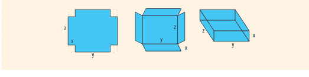

  图 7-20 纸板盒

  编写一个程序，提示用户输入平板纸板的面积。程序随后输出纸板的长度和宽度，以及应从角落剪下的正方形的边长，以使所得盒子的体积最大。将你的答案计算到三位小数。你的程序必须包含一个函数，该函数以纸板的长度和宽度为输入，并返回应剪下的正方形边长以最大化体积。该函数还返回最大体积。

- 15. （发电站问题）一座发电站位于一条半英里宽的河的一侧，一座工厂位于河对岸下游八英里处（见图 7-21）。陆上铺设电力线路每英尺花费 7 美元，水下铺设每英尺花费 9 美元。你的目标是确定铺设电力线路最经济的路径。也就是说，确定电力线路应在水下铺设多长，以及在陆上铺设多长，以实现铺设电力线路的最小总成本。

  

  图 7-21 发电站、河流和工厂

  编写一个程序，提示用户输入：
  - a. 河流的宽度
  - b. 工厂在河对岸下游的距离
  - c. 水下铺设电力线路的成本
  - d. 陆上铺设电力线路的成本

  程序随后输出电力线路应水下铺设的长度和应陆上铺设的长度，以使建设电力线路的成本最小。程序还应输出建设电力线路的总成本。

- 16. **（管道问题，需要三角学）** 一根管道需要绕过两条相交走廊的直角拐角。假设两条相交走廊的宽度分别为 5 英尺和 8 英尺（见图 7-22）。你的目标是找到最长管道的长度，四舍五入到最近的英尺，该管道可以水平地绕过直角拐角。

  

  **图 7-22** 管道问题

  编写一个程序，提示用户输入两条走廊的宽度。程序随后输出最长管道的长度，四舍五入到最近的英尺，该管道可以水平地绕过直角拐角。（注意，管道的长度由 \(l = AB + BC = 8 / \sin\theta + 5 / \cos\theta\) 给出，其中 \(0 < \theta < \pi / 2\)。）


## 第 8 章

## 用户自定义简单数据类型、命名空间和 `String` 类型

### 本章将学习：

- 学习如何创建和操作自己的简单数据类型，即枚举类型
- 熟悉 `typedef` 语句
- 了解 `namespace` 机制
- 探索 `string` 数据类型，并学习如何使用各种 `string` 函数来操作字符串

在第 2 章中，你了解到 C++ 的简单数据类型分为三类：整型、浮点型和枚举型。在后续章节中，你主要使用整型和浮点型数据类型。在本章中，你将学习 enum 类型。此外，语句 using namespace std;（在第 2 章中讨论过）用于每个使用 ANSI/ISO 标准 C++ 风格头文件的 C++ 程序。本章后半部分将考察这条语句的用途。事实上，你将了解什么是命名空间机制。你还将学习 string 类型以及许多可用于有效操作字符串的有用函数。

### 枚举类型

> **注意** 本节可以跳过，不会影响内容的连续性。

第 2 章将数据类型定义为值的集合以及对这些值的一组运算。例如，int 数据类型由从 −2,147,483,648 到 2,147,483,647 的整数以及对这些数字的一组运算（即算术运算（+、−、*、/ 和 %））组成。因为程序的主要目标是操作数据，所以数据类型的概念对任何编程语言都是基础性的。通过提供数据类型，你指定了哪些值是合法的，并告诉用户允许对这些值执行哪些种类的运算。因此，系统为你提供了内置的错误检查。

到目前为止，你使用过的数据类型大多是 int、bool、char 和 double。尽管这些数据类型足以解决几乎任何问题，但有时会出现这些数据类型不足以解决特定问题的情况。C++ 提供了一种机制，使用户能够创建自己的数据类型，这极大地增强了编程语言的灵活性。

在本节中，你将学习如何创建自己的简单数据类型，称为枚举类型。在后续章节中，你将学习创建复杂数据类型的更高级技术。

要定义**枚举类型**，你需要以下各项：

- 数据类型的名称
- 该数据类型的一组值
- 对这些值的一组运算

C++ 允许你定义一个新的简单数据类型，在其中指定其名称和值，但不能指定运算。阻止用户创建自己的运算有助于避免潜在的系统故障。

你为该数据类型指定的值必须是标识符。

枚举类型的语法为：

```cpp
enum typeName {value1, value2, ...};
```

其中 value1、value2、... 是称为**枚举器**的标识符。在 C++ 中，**enum** 是保留字。

通过列出花括号之间的所有值，你也指定了这些值之间的顺序。也就是说，value1 < value2 < value3 < .... 因此，枚举类型是一组有序的值。此外，分配给这些枚举器的默认值从 0 开始。也就是说，分配给 value1 的默认值是 0，分配给 value2 的默认值是 1，依此类推。（在定义枚举类型时，你可以为枚举器分配不同于默认值的其他值。）还要注意，枚举器 value1、value2、... **不是**变量。

### 例 8-1

语句：

```cpp
enum colors {BROWN, BLUE, RED, GREEN, YELLOW};
```

定义了一个名为 colors 的新数据类型，属于该数据类型的值为 BROWN、BLUE、RED、GREEN 和 YELLOW。

### 例 8-2

语句：

```cpp
enum standing {FRESHMAN, SOPHOMORE, JUNIOR, SENIOR};
```

将 standing 定义为枚举类型。属于 standing 的值为 FRESHMAN、SOPHOMORE、JUNIOR 和 SENIOR。

### 例 8-3

考虑以下语句：

```cpp
enum grades {'A', 'B', 'C', 'D', 'F'}; //illegal enumeration type
enum places {1ST, 2ND, 3RD, 4TH}; //illegal enumeration type
```

这些是非法的枚举类型，因为其中没有任何值是*标识符*。然而，下面这些是合法的枚举类型：

```cpp
enum grades {A, B, C, D, F};
enum places {FIRST, SECOND, THIRD, FOURTH};
```

如果一个值已经在一种枚举类型中使用过，那么它就不能在*同一个块*中的任何其他枚举类型中使用。同样的规则适用于在任何块之外声明的枚举类型。*例 8-4* 说明了这个概念。

### 例 8-4

考虑以下语句：

```cpp
enum mathStudent {JOHN, BILL, CINDY, LISA, RON};
enum compStudent {SUSAN, CATHY, JOHN, WILLIAM}; //illegal
```

假设这些语句位于同一程序中的同一个块内。第二个枚举类型 `compStudent` 是不允许的，因为值 `JOHN` 已在先前的枚举类型 `mathStudent` 中使用过。

### 声明变量

一旦定义了数据类型，就可以声明该类型的变量。声明 enum 类型变量的语法与之前相同：

```cpp
dataType identifier, identifier, ...;
```

语句：

```cpp
enum sports {BASKETBALL, FOOTBALL, HOCKEY, BASEBALL, SOCCER,
             VOLLEYBALL};
```

定义了一个名为 `sports` 的枚举类型。语句：

```cpp
sports popularSport, mySport;
```

将 `popularSport` 和 `mySport` 声明为 `sports` 类型的变量。

### 赋值

一旦声明了变量，就可以在其中存储值。假设有前面的声明，则语句：

```cpp
popularSport = FOOTBALL;
```

将 FOOTBALL 存储到 popularSport 中。语句：

```cpp
mySport = popularSport;
```

将 popularSport 的值复制到 mySport 中。

### 枚举类型的运算

枚举类型不允许进行算术运算。因此以下语句是非法的：

```cpp
mySport = popularSport + 2;          //illegal
popularSport = FOOTBALL + SOCCER;     //illegal
popularSport = popularSport * 2;       //illegal
```

此外，枚举类型不允许进行递增和递减运算。因此以下语句是非法的：

```cpp
popularSport++;  //illegal
popularSport--;  //illegal
```

假设你想将 popularSport 的值递增 1。可以按如下方式使用强制类型转换运算符：

```cpp
popularSport = static_cast<sports>(popularSport + 1);
```

当使用类型名时，编译器假定用户知道自己正在做什么。因此，前面的语句会被编译，并且在执行期间，它会把 popularSport 的值推进到列表中的下一个值。考虑以下语句：

```cpp
popularSport = FOOTBALL;
popularSport = static_cast<sports>(popularSport + 1);
```

在第二条语句之后，popularSport 的值是 HOCKEY。类似地，以下语句：

```cpp
popularSport = FOOTBALL;
popularSport = static_cast<sports>(popularSport - 1);
```

会使得 BASKETBALL 被存储到 popularSport 中。

### 关系运算符

由于枚举是一组有序的值，因此关系运算符可用于枚举类型。再次假设你有前面定义的枚举类型 sports 以及变量 popularSport 和 mySport。那么：

```
FOOTBALL <= SOCCER is true
HOCKEY > BASKETBALL is true
BASEBALL < FOOTBALL is false
```

假设：

```cpp
popularSport = SOCCER;
mySport = VOLLEYBALL;
```

那么：

popularSport < mySport 为 true

### 枚举类型与循环

回想一下，枚举类型是一种整型，并且使用强制类型转换运算符（即类型名），你可以递增、递减和比较枚举类型的值。因此，你可以在循环中使用这些枚举类型。假设 mySport 是前面声明的变量。考虑以下 for 循环：

```cpp
for (mySport = BASKETBALL; mySport <= SOCCER;
                         mySport = static_cast<sports>(mySport + 1))
.
.
.
```

这个 for 循环有五次迭代。

在循环中使用枚举类型可以提高程序的可读性。

### 枚举类型的输入/输出

由于输入和输出仅为 int、char、double 等内置数据类型定义，因此枚举类型既不能（直接）输入，也不能（直接）输出。不过，你可以间接地输入和输出枚举类型。例 8-5 说明了这个概念。

### 例 8-5

假设你有以下语句：

```cpp
enum courses {ALGEBRA, BASIC, PASCAL, CPP, PHILOSOPHY, ANALYSIS,
             CHEMISTRY, HISTORY};
courses registered;
```

第一条语句定义了一个枚举类型 courses；第二条语句声明了一个 courses 类型的变量 registered。你可以借助 char 数据类型读取（即输入）枚举类型。注意，对于枚举类型 courses 中的某些值，只需读取第一个字符就能区分；而另一些值则需要读取前两个字符才能区分。例如，只需读取第一个字符就能区分 ALGEBRA 和 BASIC；通过读取前两个字符可以区分 ALGEBRA 和 ANALYSIS。要从（例如）键盘读取这些值，你需要读取两个字符，然后使用选择结构将值赋给变量 registered。因此，你需要声明两个 char 类型的变量。


```cpp
char ch1, ch2;
cin >> ch1 >> ch2; // Read two characters
```

下面的 `switch` 语句将相应的值赋给变量 `registered`：

```cpp
switch (ch1)
{
case 'a':
case 'A':
    if (ch2 == 'l' || ch2 == 'L')
        registered = ALGEBRA;
    else
        registered = ANALYSIS;
    break;
case 'b':
case 'B':
    registered = BASIC;
    break;
case 'c':
case 'C':
    if (ch2 == 'h' || ch2 == 'H')
        registered = CHEMISTRY;
    else
        registered = CPP;
    break;
case 'h':
case 'H':
    registered = HISTORY;
    break;
case 'p':
case 'P':
    if (ch2 == 'a' || ch2 == 'A')
        registered = PASCAL;
    else
        registered = PHILOSOPHY;
    break;
default:
    cout << "Illegal input." << endl;
}
```

同样，你可以间接输出枚举类型：

```cpp
switch (registered)
{
case ALGEBRA:
    cout << "Algebra";
    break;
case ANALYSIS:
    cout << "Analysis";
    break;
case BASIC:
    cout << "Basic";
    break;
case CHEMISTRY:
    cout << "Chemistry";
    break;
case CPP:
    cout << "CPP";
    break;
case HISTORY:
    cout << "History";
    break;
case PASCAL:
    cout << "Pascal";
    break;
case PHILOSOPHY:
    cout << "Philosophy";
}
```

> **注意**
> 
> 如果尝试直接输出枚举项的值，计算机将输出赋给该枚举项的值。例如，假设 `registered = ALGEBRA`。下面的语句将输出值 0，因为赋给 `ALGEBRA` 的（默认）值是 0：
> 
> ```cpp
> cout << registered << endl;
> ```
> 
> 同样，下面的语句将输出 4：
> 
> ```cpp
> cout << PHILOSOPHY << endl;
> ```

## 函数与枚举类型

你可以像传递任何其他简单数据类型一样，将枚举类型作为参数传递给函数——即按值传递或按引用传递。此外，就像任何其他简单数据类型一样，函数也可以返回枚举类型的值。利用这一机制，你可以使用函数来输入和输出枚举类型。

下面的函数从键盘输入数据，并返回一个枚举类型的值。假设枚举类型 courses 的定义与前面相同：

```cpp
courses readCourses()
{
    courses registered;
    char ch1, ch2;

    cout << "Enter the first two letters of the course: "
         << endl;
    cin >> ch1 >> ch2;

    switch (ch1)
    {
    case 'a':
    case 'A':
        if (ch2 == 'l' || ch2 == 'L')
            registered = ALGEBRA;
        else
            registered = ANALYSIS;
        break;
    case 'b':
    case 'B':
        registered = BASIC;
        break;
    case 'c':
    case 'C':
        if (ch2 == 'h' || ch2 == 'H')
            registered = CHEMISTRY;
        else
            registered = CPP;
        break;
    case 'h':
    case 'H':
        registered = HISTORY;
        break;
    case 'p':
    case 'P':
        if (ch2 == 'a' || ch2 == 'A')
            registered = PASCAL;
        else
            registered = PHILOSOPHY;
        break;
    default:
        cout << "Illegal input." << endl;
    }
    return registered;
} // end readCourses
```

下面的函数输出一个枚举类型的值：

```cpp
void printEnum(courses registered)
{
    switch (registered)
    {
    case ALGEBRA:
        cout << "Algebra";
        break;
    case ANALYSIS:
        cout << "Analysis";
        break;
    case BASIC:
        cout << "Basic";
        break;
    case CHEMISTRY:
        cout << "Chemistry";
        break;
    case CPP:
        cout << "CPP";
        break;
    case HISTORY:
        cout << "History";
        break;
    case PASCAL:
        cout << "Pascal";
        break;
    case PHILOSOPHY:
        cout << "Philosophy";
    } // end switch
} // end printEnum
```

### 在定义枚举类型时声明变量

在前面的章节中，你先定义枚举类型，然后声明该类型的变量。C++ 允许你将这两个步骤合并为一步。也就是说，你可以在定义枚举类型的同时声明该枚举类型的变量。例如，下面的语句：

```cpp
enum grades {A, B, C, D, F} courseGrade;
```

定义了一个枚举类型 grades，并声明了一个类型为 grades 的变量 courseGrade。

同样，下面的语句：

```cpp
enum coins {PENNY, NICKEL, DIME, HALFDOLLAR, DOLLAR} change, usCoins;
```

定义了一个枚举类型 coins，并声明了两个类型为 coins 的变量 change 和 usCoins。

### 匿名数据类型

在变量声明中直接指定值而不给出类型名称的数据类型称为**匿名类型**。下面的语句创建了一个匿名类型：

```cpp
enum {BASKETBALL, FOOTBALL, BASEBALL, HOCKEY} mySport;
```

这条语句指定了值并声明了一个变量 mySport，但没有为数据类型指定名称。

然而，创建匿名类型也有缺点。首先，由于该类型没有名称，你不能将匿名类型作为参数传递给函数，函数也不能返回匿名类型的值。其次，在一个匿名类型中使用的值可以在另一个匿名类型中使用，但这些类型的变量会被区别对待。考虑以下语句：

```cpp
enum {ENGLISH, FRENCH, SPANISH, GERMAN, RUSSIAN} languages;
enum {ENGLISH, FRENCH, SPANISH, GERMAN, RUSSIAN} foreignLanguages;
```

即使变量 languages 和 foreignLanguages 具有相同的值，编译器仍将它们视为不同类型的变量。因此，下面的语句是非法的：

```cpp
languages = foreignLanguages; // illegal
```

即使这些机制可用，也应谨慎使用。为避免混淆，请先定义枚举类型，然后再声明变量。

现在介绍 C++ 中的 typedef 语句。

## typedef 语句

在 C++ 中，你可以使用 typedef 语句为先前定义的数据类型创建同义词或别名。typedef 语句的一般语法是：

```cpp
typedef existingTypeName newTypeName;
```

在 C++ 中，typedef 是保留字。注意，typedef 语句不会创建任何新的数据类型；它只为现有数据类型创建别名。

### 示例 8-6

下面的语句：

```cpp
typedef int integer;
```

为数据类型 int 创建别名 integer。同样，下面的语句：

```cpp
typedef double real;
```

为数据类型 double 创建别名 real。下面的语句：

```cpp
typedef double decimal;
```

为数据类型 double 创建别名 decimal。

使用 typedef 语句，你可以创建自己的布尔数据类型，如示例 8-7 所示。

### 示例 8-7

回顾第 4 章可知，C++ 中的逻辑（布尔）表达式的求值结果为 1 或 0，它们实际上是 int 值。作为逻辑值，1 表示 true，0 表示 false。考虑以下语句：

游戏。游戏结束后，程序输出总游戏次数和每位玩家获胜次数。这一讨论转化为以下算法：

- 1. 简要说明游戏及其玩法。
- 2. 询问用户是否想玩这个游戏。
- 3. 获取两位玩家的出拳。
- 4. 如果出拳有效，输出出拳和获胜者。
- 5. 更新总游戏次数和获胜次数。
- 6. 在用户同意继续游戏时重复步骤 2 到 5。
- 7. 输出游戏次数和每位玩家获胜次数。

我们将使用枚举类型来描述对象。

```cpp
enum objectType {ROCK, PAPER, SCISSORS};
```

## 变量（函数 main）

显然，在函数 main 中需要以下变量：

```cpp
int gameCount;    // variable to store the number of
                  // games played
int winCount1;    // variable to store the number of games
                  // won by player 1
int winCount2;    // variable to store the number of games
                  // won by player 2
int gamewinner;
char response;    // variable to get the user's response to
                  // play the game
char selection1;
char selection2;
objectType play1; // player1's selection
objectType play2; // player2's selection
```

该程序分为以下函数，后续各节将详细描述。

- **displayRules:** 此函数显示有关游戏及其规则的简要信息。
- **validSelection:** 此函数检查玩家的选择是否有效。唯一有效的选择是 R、r、P、p、S 和 s。
- **retrievePlay:** 由于枚举类型不能直接读取，此函数将输入的选项（R、r、P、p、S 或 s）转换为相应的对象类型并返回。
- **gameResult:** 此函数输出玩家的选择以及游戏获胜者。


- **convertEnum：** 该函数由函数 `gameResult` 调用，用于输出枚举类型值。
- **winningObject：** 该函数确定并返回获胜对象。
- **displayResults：** 游戏结束后，该函数显示最终结果。

### 函数 `displayRules`

该函数没有参数。它仅由用于解释游戏和游戏规则的输出语句组成。本质上，该函数的定义是：

```cpp
void displayRules()
{
    cout << "  Welcome to the game of Rock, Paper, "
         << "and Scissors." << endl;
    cout << "  This is a game for two players. For each "
         << "game, each" << endl;
    cout << "  player selects one of the objects Rock, "
         << "Paper, or Scissors." << endl;
    cout << "  The rules for winning the game are: " << endl;
    cout << "  1. If both players select the same object, it "
         << "is a tie." << endl;
    cout << "  2. Rock breaks Scissors: So player who selects "
         << "Rock wins." << endl;
    cout << "  3. Paper covers Rock: So player who selects "
         << "Paper wins." << endl;
    cout << "  4. Scissors cuts Paper: So player who selects "
         << "Scissors wins." << endl;
    cout << "  Enter R or r to select Rock, P or p to select "
         << "Paper, and S or s to select Scissors." << endl;
}
```

### 函数 `validSelection`

该函数检查玩家的选择是否有效。

```text
if selection is 'R' or 'r' or 'S' or 's' or 'P' or 'p', then
    it is a valid selection;
otherwise the selection is invalid.
```

让我们使用 `switch` 语句检查选择是否有效。该函数的定义是：

```cpp
bool validSelection(char selection)
{
    switch (selection)
    {
    case 'R':
    case 'r':
    case 'P':
    case 'p':
    case 'S':
    case 's':
        return true;
    default:
        return false;
    }
}
```

### 函数 `retrievePlay`

由于枚举类型不能直接读取，该函数将输入的选项（R、r、P、p、S 或 s）转换为相应的对象类型并返回。该函数有一个 `char` 类型的参数。它是一个有返回值的函数，返回 objectType 类型的值。用伪代码表示，该函数的算法是：

```text
if selection is 'R' or 'r'
    return ROCK;

if selection is 'P' or 'p'
    return PAPER;

if selection is 'S' or 's'
    return SCISSORS;
```

函数 retrievePlay 的定义是：

```cpp
objectType retrievePlay(char selection)
{
    objectType object;

    switch (selection)
    {
    case 'R':
    case 'r':
        object = ROCK;
        break;
    case 'P':
    case 'p':
        object = PAPER;
        break;
    case 'S':
    case 's':
        object = SCISSORS;
    }

    return object;
}
```

### 函数 `gameResult`

该函数判断一局游戏是平局还是哪位玩家获胜。它输出玩家的选择以及该局游戏的获胜者。显然，该函数有三个参数：玩家 1 的选择、玩家 2 的选择，以及一个用于返回获胜者的参数。用伪代码表示，该函数是：

```text
a. if player1 and player2 have the same selection, then
       this is a tie game.
```


```text
b. else
   {
   1. Determine the winning object. (Call function winningObject)
   2. Output each player's choice.
   3. Determine the winning player.
   4. Return the winning player via a reference parameter to the function main so that the function main can update the winning player's win count.
   }
```

该函数的定义是：

```cpp
void gameResult(objectType play1, objectType play2,
                int& winner)
{
    objectType winnerObject;

    if (play1 == play2)
    {
        winner = 0;
        cout << "Both players selected ";
        convertEnum(play1);
        cout << ". This game is a tie." << endl;
    }
    else
    {
        winnerObject = winningObject(play1, play2);

        //Output each player's choice
        cout << "Player 1 selected ";
        convertEnum(play1);
        cout << " and player 2 selected ";
        convertEnum(play2);
        cout << ".";

        //Decide the winner
        if (play1 == winnerObject)
            winner = 1;
        else if (play2 == winnerObject)
            winner = 2;

        //Output the winner
        cout << "Player " << winner << " wins this game."
             << endl;
    }
}
```

### 函数 `convertEnum`

由于枚举类型不能直接输出，让我们编写函数 `convertEnum` 来输出枚举类型 `objectType` 的对象。该函数有一个 `objectType` 类型的参数。它输出与 `objectType` 对应的字符串。用伪代码表示，该函数是：

```text
if object is ROCK
    output "Rock"

if object is PAPER
    output "Paper"

if object is SCISSORS
    output "Scissors"
```

函数 convertEnum 的定义是：

```cpp
void convertEnum(objectType object)
{
    switch (object)
    {
    case ROCK:
        cout << "Rock";
        break;
    case PAPER:
        cout << "Paper";
        break;
    case SCISSORS:
        cout << "Scissors";
    }
}
```

要判定游戏的获胜者，需要查看玩家的选择，然后依据游戏的获胜规则。例如，如果一名玩家选择 ROCK，另一名玩家选择 PAPER，则选择 PAPER 的玩家获胜。换句话说，获胜对象是 PAPER。函数 winningObject 在给定两个对象时，确定并返回获胜对象。显然，该函数有两个 objectType 类型的参数，且该函数返回的值也是 objectType 类型。该函数的定义是：

```cpp
objectType winningObject(objectType play1, objectType play2)
{
    if ((play1 == ROCK && play2 == SCISSORS)
            || (play2 == ROCK && play1 == SCISSORS))
        return ROCK;
    else if ((play1 == ROCK && play2 == PAPER)
            || (play2 == ROCK && play1 == PAPER))
        return PAPER;
    else
        return SCISSORS;
}
```

游戏结束后，该函数输出最终结果——即总对局数以及每位玩家赢得的对局数。总对局数存储在变量 gameCount 中，玩家 1 赢得的对局数存储在变量 winCount1 中，玩家 2 赢得的对局数存储在变量 winCount2 中。该函数有三个参数，分别对应这三个变量。本质上，该函数的定义是：

```cpp
void displayResults(int gCount, int wCount1, int wCount2)
{
    cout << "The total number of plays: " << gCount
         << endl;
    cout << "The number of plays won by player 1: "
         << wCount1 << endl;
    cout << "The number of plays won by player 2: "
         << wCount2 << endl;
}
```

现在我们可以编写函数 main 的算法了。

## 主算法

1. 声明变量。
2. 初始化变量。
3. 显示规则。
4. 提示用户玩游戏。
5. 获取用户是否玩游戏的响应。
6. while（response 为 yes）
   {
   a. 提示玩家 1 做出选择。
   b. 获取玩家 1 的出招。
   c. 提示玩家 2 做出选择。
   d. 获取玩家 2 的出招。
   e. 如果双方出招均合法：
      {
      i. 总对局数加 1。
      ii. 判定该局游戏的获胜者。
      iii. 将获胜者的获胜对局数加 1。
      }
   f. 提示用户确定是否想再玩一局。
   g. 获取玩家的响应。
   }
7. 输出游戏结果。

## 程序清单

```cpp
//******************************************************************
// Author: D. S. Malik
//
// Program: Rock, Paper, and Scissors
// This program plays the game of rock, paper, and scissors.
//******************************************************************

#include <iostream>

using namespace std;

enum objectType {ROCK, PAPER, SCISSORS};

        //Function prototypes
void displayRules();
objectType retrievePlay(char selection);
bool validSelection(char selection);
void convertEnum(objectType object);
objectType winningObject(objectType play1, objectType play2);
void gameResult(objectType play1, objectType play2, int& winner);
void displayResults(int gCount, int wCount1, int wCount2);

int main()
{
              //Step 1
    int gameCount;  //variable to store the number of
                    //games played
    int winCount1;  //variable to store the number of games
                    //won by player 1
    int winCount2;  //variable to store the number of games
                    //won by player 2

    int gameWinner;
    char response;  //variable to get the user's response to
                    //play the game
    char selection1;
    char selection2;
    objectType play1;  //player1's selection
    objectType play2;  //player2's selection

          //Initialize variables: Step 2
    gameCount = 0;
    winCount1 = 0;
    winCount2 = 0;

    displayRules();                                      //Step 3

    cout << "Enter Y/y to play the game: ";             //Step 4
    cin >> response;                                     //Step 5
    cout << endl;
```


```cpp
while (response == 'Y' || response == 'y')   //Step 6
{
    cout << "Player 1 enter your choice: ";   //Step 6a
    cin >> selection1;                         //Step 6b
    cout << endl;

    cout << "Player 2 enter your choice: ";   //Step 6c
    cin >> selection2;                         //Step 6d
    cout << endl;

        //Step 6e
    if (validSelection(selection1)
            && validSelection(selection2))
    {
        play1 = retrievePlay(selection1);
        play2 = retrievePlay(selection2);
        gameCount++;                           //Step 6e.i
        gameResult(play1, play2, gamewinner);  //Step 6e.ii

        if (gamewinner == 1)                   //Step 6e.iii
            winCount1++;
        else if (gamewinner == 2)
            winCount2++;
    }//end if

    cout << "Enter Y/y to play the game: ";   //Step 6f
    cin >> response;                           //Step 6g
    cout << endl;
}//end while

displayResults(gameCount, winCount1,
               winCount2);                    //Step 7

return 0;
}//end main

//Place the definitions of the functions displayRules,
//validSelection, retrievePlay, convertNum, winningObject,
//gameResult, and displayResults as described previously here.
```

## 命名空间

1998 年 7 月，ANSI/ISO 标准 C++ 获得正式批准。大多数最新编译器也与 ANSI/ISO 标准 C++ 兼容。（要完全确定，请查阅编译器的文档。）标准 C++ 和 ANSI/ISO 标准 C++ 这两个标准实际上几乎相同。ANSI/ISO 标准 C++ 语言具有一些标准 C++ 中没有的功能，本章余下部分将讨论这些功能。

在后续章节中，除非另有说明，C++ 语法适用于这两个标准。首先，我们讨论 ANSI/ISO 标准 C++ 的命名空间机制，该机制已在第 2 章中介绍。

当程序中包含头文件（例如 iostream）时，该头文件中的全局标识符也会成为程序中的全局标识符。因此，如果程序中的某个全局标识符与头文件中的某个全局标识符同名，编译器会生成语法错误（例如“标识符重定义”）。如果程序使用第三方库，也可能出现同样的问题。为克服此问题，第三方供应商让其全局标识符以特殊符号开头。在第 2 章中，你了解到，由于编译器供应商让其全局标识符名称以下划线（_）开头，为避免链接错误，你不应让程序中的标识符名称以下划线（_）开头。

ANSI/ISO 标准 C++ 试图通过命名空间机制解决全局标识符名称重叠的问题。

namespace 语句的一般语法是：

```cpp
namespace namespace_name
{
    members
}
```

其中 members 通常是命名常量、变量声明、函数或另一个命名空间。注意，namespace_name 是 C++ 标识符。

在 C++ 中，namespace 是保留字。

### 示例 8-8

语句：

```cpp
namespace globalType
{
    const int N = 10;
    const double RATE = 7.50;
    int count = 0;
    void printResult();
}
```

将 globalType 定义为具有四个成员的命名空间：命名常量 N 和 RATE、变量 count 以及函数 printResult。

命名空间成员的作用域局限于该命名空间。通常可以通过以下两种方式之一在命名空间外部访问命名空间成员，如下所述。

访问 `namespace` 成员的一般语法是：

```cpp
namespace_name::identifier
```

回想一下，在 C++ 中，`::` 称为作用域解析运算符。

要访问 `namespace` globalType 的成员 RATE，需要以下语句：

```cpp
globalType::RATE
```

要访问成员 printResult（它是一个函数），需要以下语句：

```cpp
globalType::printResult();
```

因此，要访问 `namespace` 的成员，应使用 namespace_name，后接作用域解析运算符，再接成员名。

为简化对 `namespace` 成员的访问，ANSI/ISO 标准 C++ 提供了 `using` 语句的使用。使用 `using` 语句的语法如下：

- a. 简化对所有 `namespace` 成员的访问：

  ```cpp
  using namespace namespace_name;
  ```

- b. 简化对特定 `namespace` 成员的访问：

  ```cpp
  using namespace_name::identifier;
  ```

例如，`using` 语句：

```cpp
using namespace globalType;
```

简化了对 `namespace` globalType 所有成员的访问。语句：

```cpp
using globalType::RATE;
```

简化了对 `namespace` globalType 的成员 RATE 的访问。

在 C++ 中，`using` 是保留字。

通常将 `using` 语句放在 `namespace` 声明之后。例如，对于 `namespace` globalType，通常按如下方式编写代码：

```cpp
namespace globalType
{
    const int N = 10;
    const double RATE = 7.50;
    int count = 0;
    void printResult();
}
using namespace globalType;
```

在 `using` 语句之后，要访问 `namespace` 成员，不必在 `namespace` 成员前放置命名空间名称和作用域解析运算符。然而，如果 `namespace` 成员与程序中的全局标识符同名，则要在程序中访问该 `namespace` 成员，必须在该 `namespace` 成员前加上命名空间名称和作用域解析运算符。同样，如果 `namespace` 成员与块中的标识符同名，则要在该块中访问此 `namespace` 成员，必须在该 `namespace` 成员前加上 namespace_name 和作用域解析运算符。

示例 8-9 至 8-12 有助于阐明 `namespace` 机制的用法。

### 示例 8-9

考虑以下 C++ 代码：

```cpp
#include <iostream>

using namespace std;
.
.
int main()
{
    .
    .
    .
}
.
.
.
```

在此示例中，你可以引用头文件 `iostream` 的全局标识符，例如 `cin`、`cout` 和 `endl`，而无需在标识符名称前使用前缀 `std::`。明显的限制是，引用（头文件 `iostream` 的）全局标识符的块（或函数）不得包含与该全局标识符同名的任何标识符。

### 示例 8-10

考虑以下 C++ 代码：

```cpp
#include <cmath>

int main()
{
    double x = 15.3;
    double y;

    y = std::pow(x, 2);
    .
    .
    .
}
```

此示例访问头文件 cmath 中的函数 pow。

### 示例 8-11

考虑以下 C++ 代码：

```cpp
#include <iostream>
.
.
.
int main()
{
    using namespace std;
    .
    .
}
.
.
.
```

在此示例中，函数 main 可以引用头文件 iostream 的全局标识符，而无需在标识符名称前使用前缀 std::。using 语句出现在函数 main 内部。因此，其他函数（如果有）应在头文件 iostream 的全局标识符名称前使用前缀 std::，除非该函数有类似的 using 语句。

### 示例 8-12

考虑以下 C++ 代码：

```cpp
#include <iostream>

using namespace std;        //Line 1

int t;                      //Line 2
double u;                   //Line 3

namespace expN
{
    int x;                  //Line 4
    char t;                 //Line 5
    double u;                 //Line 6
    void printResult();       //Line 7
}

using namespace expN;

int main()
{
    int one;              //Line 8
    double t;             //Line 9
    double three;         //Line 10

    .
    .
    .

}

void expN::printResult() //Definition of the function printResult
{
    .
    .
    .
}
```

在此 C++ 程序中：

- 1. 要在 main 中引用第 2 行的变量 t，请使用*作用域解析运算符*，即 `::`（也就是说，将 t 引用为 `::t`），因为函数 main 有一个名为 t 的变量（在第 9 行声明）。例如，要将 x 的值复制到 t，可以使用语句 `::t = x;`。
- 2. 要在 main 中引用命名空间 expN 的成员 t（在第 5 行声明），请对 t 使用前缀 `expN::`（也就是说，将 t 引用为 `expN::t`），因为有一个名为 t 的全局变量（在第 2 行声明），并且 main 中有一个名为 t 的变量。
- 3. 要在 main 中引用命名空间 expN 的成员 u（在第 6 行声明），请对 u 使用前缀 `expN::`（也就是说，将 u 引用为 `expN::u`），因为有一个名为 u 的全局变量（在第 3 行声明）。
- 4. 可以在 main 中将命名空间 expN 的成员 x（在第 4 行声明）引用为 x 或 `expN::x`，因为不存在名为 x 的全局标识符，并且函数 main 不包含任何名为 x 的标识符。
- 5. 作为命名空间成员的函数（例如 printResult）的定义通常像前面的程序那样写在命名空间之外。要编写函数 printResult 的定义，函数首部中的函数名可以是 printResult 或 `expN::printResult`（因为没有其他全局标识符名为 printResult）。


> **注意**
>
> 系统提供的头文件（如`iostream`、`cmath`和`iomanip`）中的标识符定义在命名空间`std`中。因此，为简化从这些头文件中访问标识符，我们在所编写的程序中使用以下语句。
>
> ```cpp
> using namespace std;
> ```

## `string` 类型

在第2章中，你已经接触过数据类型`string`。回想一下，在 ANSI/ISO C++ 语言标准之前，标准 C++ 库并未提供`string`数据类型。编译器供应商通常提供自己的、由程序员定义的`string`类型，而`string`操作的语法和语义往往因供应商而异。

数据类型`string`是一种程序员定义的类型，并非 C++ 语言的一部分；C++ 标准库提供它。在使用数据类型`string`之前，程序必须包含头文件`string`，如下所示：

```cpp
#include <string>
```

回想一下，在 C++ 中，`string`是零个或多个字符的序列，字符串用双引号括起来。

语句：

```cpp
string name = "William Jacob";
```

将`name`声明为`string`变量，并将`name`初始化为`"William Jacob"`。`name`中第一个字符`W`的位置是0；第二个字符`i`的位置是1；依此类推。也就是说，`string`变量中第一个字符的位置从0开始，而不是从1开始。

变量`name`可以存储（几乎）任意大小的字符串。

第3章讨论了对`string`类型的 I/O 操作；第4章解释了对`string`类型的关系运算。我们建议你回顾第3章和第4章，复习`string`类型上的 I/O 和关系运算。

其他运算符，例如二元运算符`+`（允许字符串连接操作）和数组索引（下标）运算符`[]`，也已为数据类型`string`定义。让我们看看这些运算符如何作用于`string`数据类型。

假设你有以下声明：

```cpp
string str1, str2, str3;
```

语句：

```cpp
str1 = "Hello There";
```

将字符串`"Hello There"`存储到`str1`中。语句：

```cpp
str2 = str1;
```

将`str1`的值复制到`str2`中。

如果`str1 == "Sunny"`，语句：

```cpp
str2 = str1 + " Day";
```

将字符串`"Sunny Day"`存储到`str2`中。

假设`str1 == "Hello"`且`str2 == "There"`。语句：

```cpp
str3 = str1 + " " + str2;
```

将`"Hello There"`存储到`str3`中。该语句等价于语句：

```cpp
str3 = str1 + ' ' + str2;
```

此外，语句：

```cpp
str1 = str1 + " Mickey";
```

通过将字符串`"Mickey"`追加到`str1`的旧值来更新`str1`的值。因此，`str1`的新值是`"Hello Mickey"`。

> **注意** 要使运算符`+`能用于`string`数据类型，`+`的一个操作数必须是`string`变量。例如，以下语句将无法工作：
>
> ```cpp
> str1 = "Hello " + "there!";  //illegal
> str2 = "Sunny Day" + '!';    //illegal
> ```

如果`str1 == "Hello there"`，语句：

```cpp
str1[6] = 'T';
```

将字符`t`替换为字符`T`。回想一下，`string`变量中第一个字符的位置是0。因此，由于`t`是`str1`中的第七个字符，其位置是6。

在 C++ 中，`[]`称为**数组下标运算符**。

如前面所示，将数组下标运算符与字符位置一起使用，可以访问`string`中的单个字符。

### 示例 8-13

以下程序展示前面语句的效果。

```cpp
//Example string operations
#include <iostream>
#include <string>

using namespace std;

int main()
{
    string name = "William Jacob";                 //Line 1
    string str1, str2, str3, str4;                  //Line 2

    cout << "Line 3: Name = " << name << endl;     //Line 3

    str1 = "Hello There";                          //Line 4
    cout << "Line 5: str1 = " << str1 << endl;     //Line 5

    str2 = str1;                                    //Line 6
    cout << "Line 7: str2 = " << str2 << endl;     //Line 7

    str1 = "Sunny";                                //Line 8
    str2 = str1 + " Day";                          //Line 9
    cout << "Line 10: str2 = " << str2 << endl;    //Line 10

    str1 = "Hello";                                //Line 11
    str2 = "There";                                //Line 12
    str3 = str1 + " " + str2;                      //Line 13
    cout << "Line 14: str3 = " << str3 << endl;    //Line 14

    str3 = str1 + ' ' + str2;                       //Line 15
    cout << "Line 16: str3 = " << str3 << endl;    //Line 16

    str1 = str1 + " Mickey";                       //Line 17
    cout << "Line 18: str1 = " << str1 << endl;    //Line 18

    str1 = "Hello there";                          //Line 19
    cout << "Line 20: str1[6] = " << str1[6]
         << endl;                                   //Line 20

    str1[6] = 'T';                                  //Line 21
    cout << "Line 22: str1 = " << str1 << endl;    //Line 22

        //String input operations
    cout << "Line 23: Enter a string with "
         << " no blanks: ";                         //Line 23
    cin >> str1;                                    //Line 24

    char ch;                                        //Line 25
    cin.get(ch);                                    //Read the newline character; //Line 26
    cout << endl;                                   //Line 27

    cout << "Line 28: The string you entered = "
         << str1 << endl;                           //Line 28

    cout << "Line 29: Enter a sentence: ";          //Line 29
    getline(cin, str2);                             //Line 30
    cout << endl;                                   //Line 31

    cout << "Line 32: The sentence is: " << str2
         << endl;                                   //Line 32

    return 0;
}
```

**示例运行：** 在以下示例运行中，用户输入以阴影显示。

```
Line 3: Name = William Jacob
Line 5: str1 = Hello There
Line 7: str2 = Hello There
Line 10: str2 = Sunny Day
Line 14: str3 = Hello There
Line 16: str3 = Hello There
Line 18: str1 = Hello Mickey
Line 20: str1[6] = t
Line 22: str1 = Hello There
Line 23: Enter a string with no blanks: Programming

Line 28: The string you entered = Programming
Line 29: Enter a sentence: Testing string operations

Line 32: The sentence is: Testing string operations
```

前面的输出不言自明，对其解读留作练习。

## 其他 string 操作

数据类型`string`有一个数据类型`string::size_type`和一个命名常量`string::npos`，定义如下：

|  |  |
| --- | --- |
| `string::size_type` | 一种无符号整数（数据）类型 |
| `string::npos` | `string::size_type`（数据类型）的最大值，在许多机器上是诸如`4294967295`这样的数 |

数据类型`string`还包含若干其他用于字符串操作的函数。下表描述其中一些函数。在本表中，我们假设`strVar`是字符串变量，`str`是字符串变量、字符串常量或字符数组。（数组将在第9章讨论。）

### 表8-1 一些 string 函数

| 表达式 | 作用 |
| --- | --- |
| `strVar.at(index)` | 返回由索引指定位置处的元素。 |
| `strVar[index]` | 返回由索引指定位置处的元素。 |
| `strVar.append(n, ch)` | 将 ch 的 n 个副本追加到 strVar，其中 ch 是 char 变量或 char 常量。 |
| `strVar.append(str)` | 将 str 追加到 strVar。 |
| `strVar.clear()` | 删除 strVar 中的所有字符。 |
| `strVar.compare(str)` | 比较 strVar 和 str。（此操作在第4章讨论。） |
| `strVar.empty()` | 如果 strVar 为空，则返回 true；否则返回 false。 |
| `strVar.erase()` | 删除 strVar 中的所有字符。 |
| `strVar.erase(pos, n)` | 从 strVar 中位置 pos 开始删除 n 个字符。 |
| `strVar.find(str)` | 返回 str 在 strVar 中第一次出现的索引。如果未找到 str，则返回特殊值`string::npos`。 |
| `strVar.find(str, pos)` | 返回在 pos 处或之后第一次找到 str 出现在 strVar 中的索引。 |
| `strVar.find_first_of(str, pos)` | 返回 str 中任一字符在 strVar 中第一次出现的索引。搜索从 pos 开始。 |
| `strVar.find_first_not_of(str, pos)` | 返回 strVar 中任一不属于 str 的字符第一次出现的索引。搜索从 pos 开始。 |
| `strVar.insert(pos, n, ch);` | 在 strVar 的索引 pos 处插入 n 个字符 ch；pos 和 n 的类型为`string::size_type`；ch 是字符。 |
| `strVar.insert(pos, str);` | 将 str 的所有字符插入 strVar 的索引 pos 处。 |
| `strVar.length()` | 返回`string::size_type`类型的值，给出 strVar 中的字符数。 |


以下程序演示了 length 函数的用法。

```cpp
//Example: clear, empty, erase, length, and size functions
#include <iostream>
#include <string>

using namespace std;

int main()
{
    string firstName = "Elizabeth";                         //Line 1
    string name = firstName + " Jones";                     //Line 2
    string str1 = "It is sunny.";                           //Line 3
    string str2 = "";                                       //Line 4
    string str3 = "computer science";                       //Line 5
    string str4 = "C++ programming.";                       //Line 6
    string str5 = firstName + " is taking " + str4;         //Line 7

    string::size_type len;                                  //Line 8

    cout << "Line 9: str3: " << str3 << endl;               //Line 9
    str3.clear();                                           //Line 10
    cout << "Line 11: After clear, str3: " << str3          //Line 11
         << endl;

    cout << "Line 12: str1.empty(): " << str1.empty()        //Line 12
         << endl;
    cout << "Line 13: str2.empty(): " << str2.empty()        //Line 13
         << endl;

    cout << "Line 14: str4: " << str4 << endl;               //Line 14
    str4.erase(11, 4);                                      //Line 15
    cout << "Line 16: After erase(11, 4), str4: "            //Line 16
         << str4 << endl;

    cout << "Line 17: Length of \"" << firstName << "\" = "  //Line 17
         << static_cast<unsigned int> (firstName.length())
         << endl;
    cout << "Line 18: Length of \"" << name << "\" = "       //Line 18
         << static_cast<unsigned int> (name.length())
         << endl;
    cout << "Line 19: Length of \"" << str1 << "\" = "       //Line 19
         << static_cast<unsigned int> (str1.length())
         << endl;
    cout << "Line 20: Size of \"" << str5 << "\" = "         //Line 20
         << static_cast<unsigned int> (str5.size())
         << endl;

    len = name.length();                                   //Line 21
    cout << "Line 22: len = "                               //Line 22
         << static_cast<unsigned int> (len) << endl;

    return 0;                                               //Line 23
}
```

### 示例运行：

```text
Line 9: str3: computer science
Line 11: After clear, str3:
Line 12: str1.empty(): 0
Line 13: str2.empty(): 1
Line 14: str4: C++ programming.
Line 16: After erase(11, 4), str4: C++ program.
Line 17: Length of "Elizabeth" = 9
Line 18: Length of "Elizabeth Jones" = 15
Line 19: Length of "It is sunny." = 12
Line 20: Size of "Elizabeth is taking C++ programming." = 36
Line 22: len = 15
```

该程序的输出不言自明。详细过程留作练习。注意，此程序使用 static cast 运算符输出 length 函数返回的值。这是因为 length 函数返回 string::size_type 类型的值。如果不使用该强制转换运算符，某些编译器可能会给出以下警告消息：

```text
conversion from 'size_t' to 'unsigned int', possible loss of data
```

## 示例 8-15（find 函数）

假设 str1 和 str2 是 string 类型。以下是对 find 函数的有效调用：

```text
str1.find(str2)
str1.find("the")
str1.find('a')
str1.find(str2 + "xyz")
str1.find(str2 + 'b')
```

考虑以下语句：

```text
string sentence = "Outside it is cloudy and warm.";
string str = "cloudy";

string::size_type position;
```

接下来，我们展示 find 函数的效果。

| 语句 | 效果 |
|---|---|
| `cout << sentence.find("is") << endl;` | 输出 11 |
| `cout << sentence.find('s') << endl;` | 输出 3 |
| `cout << sentence.find(str) << endl;` | 输出 14 |
| `cout << sentence.find("the") << endl;` | 输出 string::npos 的值 |
| `cout << sentence.find('i', 6) << endl;` | 输出 8 |
| `position = sentence.find("warm");` | 将 25 赋给 position |

注意，搜索区分大小写。因此，字符串 sentence 中 o（小写 o）的位置是 16。

以下程序运行前面的语句。

```cpp
//Example: find function

#include <iostream>
#include <string>

using namespace std;

int main()
{
    string sentence = "Outside it is cloudy and warm.";  //Line 1
    string str = "cloudy";                               //Line 2

    string::size_type position;                          //Line 3

    cout << "Line 4: sentence = \"" << sentence
         << "\"" << endl;                                //Line 4

    cout << "Line 5: The position of \"is\" in sentence = "
         << static_cast<unsigned int> (sentence.find("is"))
         << endl;                                        //Line 5

    cout << "Line 6: The position of 's' in sentence = "
         << static_cast<unsigned int> (sentence.find('s'))
         << endl;                                        //Line 6

    cout << "Line 7: The position of \"" << str
         << "\" in sentence = "
         << static_cast<unsigned int> (sentence.find(str))
         << endl;                                        //Line 7

    cout << "Line 8: The position of \"the\" in sentence = "
         << static_cast<unsigned int> (sentence.find("the"))
         << endl;                                        //Line 8

    cout << "Line 9: The first occurrence of 'i' in "
         << "sentence \n     after position 6 = "
         << static_cast<unsigned int> (sentence.find('i', 6))
         << endl;                                        //Line 9

    position = sentence.find("warm");                    //Line 10
    cout << "Line 11: " << "Position = "
         << position << endl;                            //Line 11

    return 0;                                            //Line 12
}
```

### 示例运行：

```text
Line 4: sentence = "Outside it is cloudy and warm."
Line 5: The position of "is" in sentence = 11
Line 6: The position of 's' in sentence = 3
Line 7: The position of "cloudy" in sentence = 14
Line 8: The position of "the" in sentence = 4294967295
Line 9: The first occurrence of 'i' in sentence
        after position 6 = 8
Line 11: Position = 25
```

该程序的输出不言自明。详细过程留作练习。注意，此程序使用 static cast 运算符输出 find 函数返回的值。这是因为 find 函数返回 string::size_type 类型的值。如果不使用该强制转换运算符，某些编译器可能会给出以下警告消息：

```text
conversion from 'size_t' to 'unsigned int', possible loss of data
```

## 示例 8-16（insert 和 replace 函数）

假设有以下语句：

```text
string firstString = "Cloudy and warm.";
string secondString = "Hello there";
string thirdString = "Henry is taking programming I.";
string str1 = " very ";
string str2 = "Lisa";
```

接下来，我们展示 insert 和 replace 函数的效果。

| 语句 | 效果 |
|---|---|
| `firstString.insert(10, str1);` | `firstString = "Cloudy and very warm."` |
| `secondString.insert(11, 5, '!');` | `secondString = "Hello there!!!!!"` |
| `thirdString.replace(0, 5, str2);` | `thirdString = "Lisa is taking programming I."` |

以下程序运行前面的语句。

```cpp
//Example: insert and replace functions

#include <iostream>
#include <string>

using namespace std;

int main()
{
    string firstString = "Cloudy and warm.";                 //Line 1
    string secondString = "Hello there";                     //Line 2
    string thirdString = "Henry is taking programming I.";   //Line 3
    string str1 = " very ";                                  //Line 4
    string str2 = "Lisa";                                    //Line 5

    cout << "Line 6: firstString = " << firstString
         << endl;                                             //Line 6
    firstString.insert(10, str1);                             //Line 7
    cout << "Line 8: After insert; firstString = "
         << firstString << endl;                              //Line 8

    cout << "Line 9: secondString = " << secondString
         << endl;                                             //Line 9
    secondString.insert(11, 5, '!');                          //Line 10
    cout << "Line 11: After insert; secondString = "
         << secondString << endl;                             //Line 11

    cout << "Line 12: thirdString = " << thirdString
         << endl;                                             //Line 12
    thirdString.replace(0, 5, str2);                          //Line 13
    cout << "Line 14: After replace, thirdString = "
         << thirdString << endl;                              //Line 14

    return 0;                                                  //Line 15
}
```

### 示例运行：

```text
Line 6: firstString = Cloudy and warm.
Line 8: After insert; firstString = Cloudy and very  warm.
Line 9: secondString = Hello there
Line 11: After insert; secondString = Hello there!!!!!
Line 12: thirdString = Henry is taking programming I.
Line 14: After replace, thirdString = Lisa is taking programming I.
```

该程序的输出不言自明。详细过程留作练习。

## 示例 8-17（substr 函数）

考虑以下语句：

```cpp
string sentence;
string str;

sentence = "It is cloudy and warm.";
```


接下来，我们展示 `substr` 函数的效果。

| 语句 | 效果 |
|---|---|
| `cout << sentence.substr(0, 5) << endl;` | 输出：It is |
| `cout << sentence.substr(6, 6) << endl;` | 输出：cloudy |
| `cout << sentence.substr(6, 16) << endl;` | 输出：cloudy and warm. |
| `cout << sentence.substr(17, 10) << endl;` | 输出：warm. |
| `cout << sentence.substr(3, 6) << endl;` | 输出：is clo |
| `str = sentence.substr(0, 8);` | `str = "It is cl"` |
| `str = sentence.substr(2, 10);` | `str = " is cloudy"` |

以下程序说明如何使用字符串函数 `substr`。

```cpp
//Example: substr function.

#include <iostream>
#include <string>

using namespace std;

int main()
{
    string sentence;                                      //Line 1
    string str;                                            //Line 2

    sentence = "It is cloudy and warm.";                  //Line 3

    cout << "Line 4: substr(0, 5) in \""
         << sentence << "\" = \""
         << sentence.substr(0, 5) << "\"\n" << endl;     //Line 4

    cout << "Line 5: substr(6, 6) in \""
         << sentence << "\" = \""
         << sentence.substr(6, 6) << "\"\n" << endl;     //Line 5

    cout << "Line 6: substr(6, 16) in \""
         << sentence << "\" = " << endl
         << "                 " << sentence.substr(6, 16)
         << "\"" << endl;                                //Line 6

    cout << "Line 7: substr(17, 10) in \""
         << sentence << "\" = \""
         << sentence.substr(17, 10) << "\"" << endl;      //Line 7

    cout << "Line 8: substr(3, 6) in \""
         << sentence << "\" = \""
         << sentence.substr(3, 6) << "\"" << endl;        //Line 8
}
```

函数 `pigLatinString` 用于求 `str` 的 pig Latin 形式。前面的讨论可转化为以下算法：

- 1. 获取 `str`。
- 2. 使用函数 `pigLatinString` 求 `str` 的 pig Latin 形式。
- 3. 输出 `str` 的 pig Latin 形式。

在编写主算法之前，将详细描述这些函数中的每一个。

## 函数 `isVowel`

该函数接受一个字符作为参数，如果该字符是元音则返回 `true`，否则返回 `false`。函数 `isVowel` 的定义如下：

```cpp
bool isVowel(char ch)
{
    switch (ch)
    {
    case 'A':
    case 'E':
    case 'I':
    case 'O':
    case 'U':
    case 'Y':
    case 'a':
    case 'e':
    case 'i':
    case 'o':
    case 'u':
    case 'y':
        return true;
    default:
        return false;
    }
}
```

## 函数 `rotate`

该函数接受一个字符串作为参数，删除字符串的第一个字符，并将其放到字符串末尾。具体做法是：从位置 1（即第二个字符）开始提取子字符串直到字符串末尾，然后再加上字符串的第一个字符。新字符串作为该函数的值返回。本质上，函数 `rotate` 的定义如下：

```cpp
string rotate(string pStr)
{
    string::size_type len = pStr.length();

    string rStr;

    rStr = pStr.substr(1, len - 1) + pStr[0];

    return rStr;
}
```

## 函数 `pigLatinString`

该函数接受一个字符串 `pStr` 作为参数，并返回 `pStr` 的 pig Latin 形式。假设 `pStr` 表示要转换为其 pig Latin 形式的字符串。有三种可能情况：`pStr[0]` 是元音，`pStr` 包含元音且 `pStr` 的第一个字符不是元音，或者 `pStr` 不包含元音。假设 `pStr[0]` 不是元音。将 `pStr` 的第一个字符移到 `pStr` 的末尾。重复此过程，直到 `pStr` 的第一个字符变为元音，或者 `pStr` 的所有字符都已检查完毕；在后一种情况下，`pStr` 不包含任何元音。该讨论可转化为以下算法：

- 1. 如果 `pStr[0]` 是元音，在 `pStr` 末尾添加 "-way"。
- 2. 假设 `pStr[0]` 不是元音。
- 3. 将 `pStr` 的第一个字符移到 `pStr` 的末尾。`pStr` 的第二个字符成为 `pStr` 的第一个字符。现在 `pStr` 可能包含也可能不包含元音。我们使用一个 `bool` 变量 `foundVowel`，如果 `pStr` 包含元音则将其设为 `true`，否则设为 `false`。
  - a. 假设 `len` 表示 `pStr` 的长度。
  - b. 将 `foundVowel` 初始化为 `false`。
  - c. 如果 `pStr[0]` 不是元音，则调用函数 `rotate` 将 `pStr[0]` 移到 `pStr` 末尾。
  - d. 重复步骤 c，直到 `pStr` 的第一个字符变为元音，或 `pStr` 的所有字符都已检查完毕。
- 4. 将 `pStr` 转换为 pig Latin 形式。
- 5. 返回 `pStr`。

函数 `pigLatinString` 的定义如下：

```cpp
string pigLatinString(string pStr)
{
    string::size_type len;

    bool foundVowel;

    string::size_type counter;

    if (isVowel(pStr[0]))                         //Step 1
        pStr = pStr + "-way";
    else                                         //Step 2
    {
        pStr = pStr + '-';
        pStr = rotate(pStr);                     //Step 3

        len = pStr.length();                     //Step 3.a
        foundVowel = false;                      //Step 3.b
        for (counter = 1; counter < len - 1;
             counter++)                 //Step 3.d
            if (isVowel(pStr[0]))
            {
                foundVowel = true;
                break;
            }
            else                              //Step 3.c
                pStr = rotate(pStr);
        if (!foundVowel)                       //Step 4
            pStr = pStr.substr(1, len) + "-way";
        else
            pStr = pStr + "ay";
    }
    return pStr;                          //Step 5
}
```

## 主算法

- 1. 获取字符串。
- 2. 调用函数 `pigLatinString` 求字符串的 pig Latin 形式。
- 3. 输出字符串的 pig Latin 形式。

## 程序清单

```cpp
/*******************************************************
// Author: D. S. Malik
//
// Program: Pig Latin Strings
// This program reads a string and outputs the pig Latin form
// of the string.
*******************************************************/

#include <iostream>
#include <string>

using namespace std;

bool isVowel(char ch);
string rotate(string pStr);
string pigLatinString(string pStr);

int main()
{
    string str;

    cout << "Enter a string: ";
    cin >> str;

    cout << endl;

    cout << "The pig Latin form of " << str << " is: "
         << pigLatinString(str) << endl;

    return 0;
}

//Place the definitions of the functions isVowel, rotate, and
//pigLatinString as described previously here.
```

**示例运行：** 在这些示例运行中，用户输入以阴影显示。

### 示例运行 1

输入一个字符串：`eye`

eye 的 pig Latin 形式是：eye-way

### 示例运行 2

输入一个字符串：`There`

There 的 pig Latin 形式是：ere-Thay

### 示例运行 3

输入一个字符串：`why`

why 的 pig Latin 形式是：y-whay

### 示例运行 4

输入一个字符串：`123456`

123456 的 pig Latin 形式是：123456-way

## 快速回顾

- 1. 枚举类型是一组有序值。
- 2. C++ 的保留字 `enum` 用于创建枚举类型。
- 3. `enum` 的语法是：
  
  ```cpp
  enum typeName {value1, value2,...};
  ```
  
  其中 value1、value2、... 是标识符，且 value1 < value2 < ...。
- 4. 不允许对枚举类型进行算术运算。
- 5. 关系运算符可用于 `enum` 值。
- 6. 枚举类型的值不能直接输入或输出。
- 7. 枚举类型可以按值或按引用作为参数传递给函数。
- 8. 函数可以返回枚举类型的值。
- 9. 匿名类型是指变量的值在指定时没有任何类型名。
- 10. C++ 的保留字 `typedef` 用于为先前定义的数据类型创建同义词或别名。
- 11. 匿名类型不能作为参数传递给函数。
- 12. 命名空间机制是 ANSI/ISO 标准 C++ 的一项特性。
- 13. 命名空间成员通常是具名常量、变量、函数或另一个命名空间。
- 14. 命名空间成员的作用域局限于该命名空间。
- 15. 在命名空间外访问命名空间成员的一种方法是，在命名空间成员名之前加上命名空间名和作用域解析运算符。
- 16. 在 C++ 中，`namespace` 是保留字。
- 17. 要使用命名空间机制，程序必须包含 ANSI/ISO 标准 C++ 头文件——即不带扩展名 `.h` 的头文件。
- 18. using 语句简化了对命名空间成员的访问。
- 19. 在 C++ 中，`using` 是保留字。
- 20. 关键字 `namespace` 必须出现在 using 语句中。
- 21. 在不使用 using 语句访问命名空间成员时，命名空间名和作用域解析运算符必须位于命名空间成员名之前。
- 22. 要在不写命名空间名的情况下使用标准头文件中声明的标识符，在包含所有必要头文件之后，程序中必须出现以下语句：
  
  ```cpp
  using namespace std;
  ```
  
- 23. 字符串是零个或多个字符的序列。
- 24. C++ 中的字符串括在双引号中。
- 25. 要使用 string 类型，程序必须包含头文件 `string`。程序中使用的其他头文件应为 ANSI/ISO 标准 C++ 风格的头文件。
- 26. 赋值运算符可用于 string 类型。
- 27. 运算符 + 可用于连接两个 string 类型的值。要使运算符 + 能与 string 数据类型一起使用，+ 的操作数之一必须是 string 变量。


- 28. 第4章讨论的关系运算符可应用于 `string` 类型。
- 29. 在字符串中，第一个字符的位置是 0，第二个字符的位置是 1，依此类推。
- 30. 字符串的长度是字符串中的字符数。
- 31. 在 C++ 中，`[]` 称为数组下标运算符。
- 32. 要访问字符串中的单个字符，请使用数组下标运算符以及该字符的位置。
- 33. `string` 类型包含 at、append、clear、compare、erase、find、find_first_of、find_first_not_of、insert、length、replace、size、substr 和 swap 等函数来操作字符串。这些函数见表 8-1。

## 练习

- 1. 判断以下语句的正误。

  - a. 以下是一个有效的 C++ 枚举类型：

    ```cpp
    enum romanNumerals {I, V, X, L, C, D, M};
    ```

  - b. 给定声明：

    ```cpp
    enum cars {FORD, GM, TOYOTA, HONDA};
    cars domesticCars = FORD;
    ```

    语句：

    ```cpp
    domesticCars = domesticCars + 1;
    ```

    将 domesticCars 的值设置为 GM。

  - c. 函数可以返回枚举类型的值。

  - d. 可以直接从标准输入设备输入枚举类型的值。

  - e. 枚举类型上允许的唯一算术运算是递增和递减。

  - f. 枚举类型值域中的值称为枚举器。

  - g. 以下语句在 C++ 程序的同一代码块中是合法的：

    ```cpp
    enum mathStudent {BILL, JOHN, LISA, RON, CINDY, SHELLY};
    enum historyStudent {AMANDA, BOB, JACK, TOM, SUSAN};
    ```

  - h. 以下语句创建了一个匿名类型：

    ```cpp
    enum {A, B, C, D, E} studentGrade;
    ```

  - i. 可以将命名空间机制与扩展名为 h 的头文件一起使用。

  - j. 假设 `str == "ABCD"`。执行语句 `str[1] = 'a';` 后，`str` 的值为 `"aBCD"`。

  - k. 假设 `str == "abcd"`。执行语句：

    ```cpp
    str = str + "ABCD";
    ```

    后，`str` 的值为 `"ABCD"`。

- 2. 编写完成以下操作的 C++ 语句：

  - a. 定义一个 `enum` 类型 `bookType`，其值为 `MATH`、`CSC`、`ENGLISH`、`HISTORY`、`PHYSICS` 和 `PHILOSOPHY`。

  - b. 声明一个 `bookType` 类型的变量 `book`。

  - c. 将 `MATH` 赋给变量 `book`。

  - d. 将 `book` 推进到列表中的下一个值。

  - e. 输出变量 `book` 的值。

- 3. 给定：

  ```cpp
  enum currencyType {DOLLAR, POUND, FRANK, LIRA, MARK};
  currencyType currency;
  ```

  以下哪些语句有效？

  - a. `currency = DOLLAR;`

  - b. `cin >> currency;`

  - c. `currency = static_cast<currencyType>(currency + 1);`

  - d.

    ```cpp
    for (currency == DOLLAR; currency <= MARK; currency++)
        cout << "*";
    ```

- 4. 给定：

  ```cpp
  enum cropType {WHEAT, CORN, RYE, BARLEY, OATS};
  cropType crop;
  ```

  圈出正确答案。

  - a. `static_cast<int>(WHEAT)` 为 0
    (i) 正确   (ii) 错误

  - b. `static_cast<cropType>(static_cast<int>(WHEAT) - 1)` 为 `WHEAT`
    (i) 正确   (ii) 错误

  - c. `RYE > WHEAT`
    (i) 正确   (ii) 错误

  - d.

    ```cpp
    for (crop == WHEAT; crop <= OATS; ++crop)
        cout << "*";
    cout << endl;
    ```

    输出：`*****`

    (i) 正确   (ii) 错误

- 5. 以下程序有什么问题？

  ```cpp
  #include <iostream>                         //Line 1

  int main()                                   //Line 2
  {
      cout << "Hello World! " << endl;        //Line 3

      return 0;                                //Line 4
  }
  ```

- 6. 以下程序有什么问题？

  ```cpp
  #include <iostream.h>                       //Line 1

  using namespace std;                         //Line 2

  int main()                                   //Line 3
  {
      int x = 0;                               //Line 4
      cout << "x = " << x << endl;            //Line 5
      return 0;                                //Line 6
  }
  ```

- 7. 以下程序有什么问题？

  ```cpp
  #include <iostream>                         //Line 1

  namespace aaa                              //Line 2
  {
      const int X = 0;                         //Line 3
      double Y;                                //Line 4
  }

  using namespace std;                         //Line 5

  int main()                                   //Line 6
  {
      Y = 34.50;                               //Line 7
      cout << "X = " << X << ", Y = " << Y   //Line 8
           << endl;
      return 0;                                //Line 9
  }
  ```

- 8. 以下程序有什么问题？

  ```cpp
  #include <iostream>                         //Line 1
  #include <cmath>                             //Line 2

  using std;                                  //Line 3

  int main()                                   //Line 4
  {
      return 0;                                //Line 5
  }
  ```

- 9. 考虑以下 C++ 代码：

  ```cpp
  string str1;
  string str2;
  char ch;

  cin >> str1;
  str2 = str1;
  cin >> ch;
  str2[0] = ch;
  cout << str1 << " -> " << str2 << endl;
  ```

  回答以下问题。

  - a. 如果输入是 Hello J，输出是什么？

  - b. 如果输入是 Bingo R，输出是什么？

  - c. 如果输入是 Sunny B，输出是什么？

- 10. 假设有如下语句：

  ```cpp
  string str1, str2;

  cin >> str1 >> str2;

  if (str1 == str2)
      cout << str1 + '!' << endl;
  else if (str1 > str2)
      cout << str1 + " > " + str2 << endl;
  else
      cout << str1 + " < " + str2 << endl;
  ```

  回答以下问题。

  - a. 如果输入是 diamond diamond，输出是什么？

  - b. 如果输入是 diamond gold，输出是什么？

  - c. 如果输入是 silver gold，输出是什么？

- 11. 以下程序的输出是什么？

  ```cpp
  #include <iostream>
  #include <string>

  using namespace std;

  int main()
  {
      string str1 = "Amusement Park";
      string str2 = "Going to";
      string str3 = "the";
      string str;

      cout << str2 + ' ' + str3 + ' ' + str1 << endl;
      cout << str1.length() << endl;
      cout << str1.find('P') << endl;
      cout << str1.substr(1, 5) << endl;

      str = "ABCDEFGHIJK";
      cout << str << endl;
      cout << str.length() << endl;

      str[0] = 'a';
      str[2] = 'd';

      cout << str << endl;

      return 0;
  }
  ```

- 12. 考虑以下语句：

  ```cpp
  string str = "Now is the time for the party!";
  ```

  以下语句的输出是什么？（假设各部分相互独立。）

  - a. `cout << str.size() << endl;`

  - b. `cout << str.substr(7, 8) << endl;`

  - c.

    ```cpp
    string::size_type ind = str.find('f');
    string s = str.substr(ind + 4, 9);
    cout << s << endl;
    ```

  - d. `cout << str.insert(11, "best ") << endl;`

  - e.

    ```cpp
    str.erase(16, 14);
    str.insert(16, "to study for the exam?");
    cout << str << endl;
    ```

## 编程练习

- 1.
  - a. 定义一个枚举类型 `triangleType`，其值为 `scalene`、`isosceles`、`equilateral` 和 `noTriangle`。

  - b. 编写一个函数 `triangleShape`，它接受三个数作为参数，每个数表示三角形一条边的长度。该函数应返回三角形的形状。*（注：在三角形中，任意两边长度之和大于第三边。）*

  - c. 编写一个程序，提示用户输入三角形各边的长度，并输出三角形的形状。

- 2. 重做第4章编程练习14（手机公司），使所有命名常量都在一个 `namespace` 中定义。

- 3. 编程示例：Pig Latin Strings 将一个字符串转换为 pig Latin 形式，但它只处理一个单词。重写该程序，使其可用于处理长度未指定的文本。如果单词以标点符号结尾，则在 pig Latin 形式中，将标点放在字符串末尾。例如，`Hello!` 的 pig Latin 形式是 `ello-Hay!`。假设文本包含以下标点符号：`,`（逗号），


选择运算（+、−、* 或 /），并输入每个分数的分子和分母。此外，你的程序必须至少包含以下函数：

- a. **函数 menu：** 该函数告知用户程序的目的，解释如何输入数据，并允许用户选择运算。
- b. **函数 addFractions：** 该函数接收四个整数作为输入，分别代表两个分数的分子和分母，将两个分数相加，并返回结果的分子和分母。（注意：该函数总共有六个参数。）
- c. **函数 subtractFractions：** 该函数接收四个整数作为输入，分别代表两个分数的分子和分母，将两个分数相减，并返回结果的分子和分母。（注意：该函数总共有六个参数。）
- d. **函数 multiplyFractions：** 该函数接收四个整数作为输入，分别代表两个分数的分子和分母，将两个分数相乘，并返回结果的分子和分母。（注意：该函数总共有六个参数。）
- e. **函数 divideFractions：** 该函数接收四个整数作为输入，分别代表两个分数的分子和分母，将两个分数相除，并返回结果的分子和分母。（注意：该函数总共有六个参数。）

一些示例输出如下：

```
3 / 4 + 2 / 5 = 23 / 20
2 / 3 * 3 / 5 = 6 / 15
```

你的答案不需要是最简分数。

- 8. 编写一个程序，读取一行包含学生姓名、社保号、用户 ID 和密码的字符串。程序输出该字符串，其中社保号的所有数字和密码中的所有字符都被替换为 x。（社保号的格式为 000–00–0000，用户 ID 和密码不包含任何空格。）你的程序不应使用运算符 [] 来访问字符串元素。请使用表 8–1 中描述的适当函数。
- 9. 给定一个文件，其中包含以下形式的学生姓名：lastName,firstName middleName。（注意：学生可能没有中间名。）编写一个程序，将每个姓名转换为以下形式：firstName middleName lastName。你的程序必须将每个学生的完整姓名读入一个变量，并且必须包含一个函数，该函数接收一个包含学生姓名的字符串作为输入，并返回包含转换后姓名的字符串。使用字符串函数 find 查找 ',' 的索引；使用函数 length 查找字符串的长度；使用函数 substr 提取 firstName、middleName 和 lastName。

*此页有意留空*


## 第 9 章

## 数组与字符串

在本章中，你将：

- 了解数组
- 探索如何声明数组并将数据操作到数组中
- 了解“数组索引越界”
- 熟悉数组处理的限制
- 发现如何将数组作为参数传递给函数
- 学习如何搜索数组
- 了解 C 字符串
- 检查使用字符串函数处理 C 字符串
- 发现如何向 C 字符串输入数据以及从 C 字符串输出数据
- 了解并行数组
- 发现如何操作二维数组中的数据
- 了解多维数组

注意前面程序中的以下几点：

- 1. 必须声明五个变量，因为数字要按逆序打印。
- 2. 所有变量都是 `int` 类型——即相同的数据类型。
- 3. 这些变量的声明方式表明，用于存储这些数字的变量都有相同的名称——除了最后一个字符，它是一个数字。

语句 1 告诉你必须声明五个变量。语句 3 告诉你，如果能够以某种方式将最后一个字符（一个数字）放入计数器变量中，并使用一个 `for` 循环从 0 计数到 4 进行读取，再用另一个 `for` 循环从 4 计数到 0 进行打印，那将会很方便。最后，由于所有变量都是相同类型，你应该能够用比我们之前使用的更简单的语句来指定必须声明的变量数量及其数据类型。

在 C++ 中，能够让你完成所有这些事情的数据结构称为数组。

### 数组

**数组**是固定数量的、所有组件都具有相同数据类型的集合。**一维数组**是其组件以列表形式排列的数组。本节仅讨论一维数组。二维或更多维的数组将在本章后面讨论。

声明一维数组的一般形式是：

```
dataType arrayName[intExp];
```

其中 intExp 是任何值为正整数的常量表达式。此外，intExp 指定了数组中的组件数量。

### 示例 9-1

语句：

```
int num[5];
```

声明了一个包含五个组件的数组 num。每个组件都是 `int` 类型。这些组件是 num[0]、num[1]、num[2]、num[3] 和 num[4]。图 9-1 说明了数组 num。


**图 9-1** 数组 `num`

为了节省空间，我们也按图 9-2(a) 或 9-2(b) 所示绘制数组。

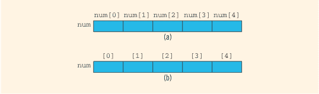

**图 9-2** 数组 `num`

### 访问数组组件

用于访问数组组件的一般形式（语法）是：

```
arrayName[indexExp]
```

其中 *indexExp*（称为 *索引*）是任何值为非负整数的表达式。索引值指定了组件在数组中的位置。

在 C++ 中，`[]` 是一个称为**数组下标运算符**的运算符。此外，在 C++ 中，数组索引从 0 开始。

考虑以下语句：

```c
int list[10];
```

该语句声明了一个包含 10 个组件的数组 list。这些组件是 list[0]、list[1]、...、list[9]。换句话说，我们声明了 10 个变量（见图 9-3）。

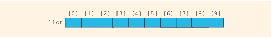

**图 9-3** 数组 list

赋值语句：

```c
list[5] = 34;
```

将 34 存储在 `list[5]` 中，这是数组 list 的第六个组件（见图 9-4）。

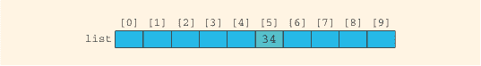

**图 9-4** 执行语句 `list[5] = 34;` 后的数组 list

假设 `i` 是一个 `int` 变量。那么，赋值语句：

```c
list[3] = 63;
```

等价于以下赋值语句：

```c
i = 3;
list[i] = 63;
```

如果 `i` 是 4，那么赋值语句：

```c
list[2 * i - 3] = 58;
```

将 58 存储在 `list[5]` 中，因为 2 * i - 3 的计算结果为 5。索引表达式首先被求值，给出组件在数组中的位置。

接下来，考虑以下语句：

```c
list[3] = 10;
list[6] = 35;
list[5] = list[3] + list[6];
```

第一条语句将 10 存储在 `list[3]` 中，第二条语句将 35 存储在 `list[6]` 中，第三条语句将 `list[3]` 和 `list[6]` 的内容相加，并将结果存储在 `list[5]` 中（见图 9-5）。

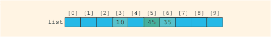

**图 9-5** 执行语句 `list[3] = 10`; `list[6] = 35`; 和 `list[5] = list[3] + list[6];` 后的数组 list

### 示例 9-2

你也可以按如下方式声明数组：

```c
const int ARRAY_SIZE = 10;
int list[ARRAY_SIZE];
```

也就是说，你可以先声明一个命名常量，然后使用该命名常量的值来声明数组并指定其大小。

> **注意** 当你声明数组时，其大小必须是已知的。例如，你不能执行以下操作：

```
int arraySize;                                      //Line 1

cout << "Enter the size of the array: ";              //Line 2
cin >> arraySize;                                      //Line 3
cout << endl;                                          //Line 4

int list[arraySize];                                   //Line 5; not allowed
```

第 2 行的语句在程序执行时要求用户输入数组的大小。第 3 行的语句将数组大小输入到 `arraySize` 中。当编译器编译第 1 行时，变量 `arraySize` 的值是未知的。因此，当编译器编译第 5 行时，数组的大小未知，编译器将不知道为数组分配多少内存空间。在第 14 章中，你将学习如何在程序执行期间指定数组的大小，然后使用动态数组声明该大小的数组。在程序执行期间通过指针创建的数组称为动态数组。目前，每当你声明数组时，其大小必须是已知的。


- **b. 将数据读入数组：** 下面的循环将数据输入到数组 `sales` 中。为简单起见，我们假设数据从键盘输入。

```cpp
for (index = 0; index < 10; index++)
    cin >> sales[index];
```

- **c. 打印数组：** 下面的循环输出数组 `sales`。为简单起见，我们假设输出到屏幕。

```cpp
for (index = 0; index < 10; index++)
    cout << sales[index] << " ";
```

- **d. 求数组的和与平均值：** 因为数组 `sales` 顾名思义表示某些销售数据，所以求销售总额和平均销售额是很自然的。下面的 C++ 代码求数组 `sales` 各元素的和以及平均销售额：

```cpp
sum = 0;
for (index = 0; index < 10; index++)
    sum = sum + sales[index];

average = sum / 10;
```

- **e. 数组中的最大元素：** 我们现在讨论查找数组中最大元素第一次出现的算法——即具有最大值的第一个数组分量。然而，一般来说，用户更感兴趣的是确定数组中最大元素的位置。当然，如果你知道位置（即数组中最大元素的下标），就可以轻松确定数组中最大元素的值。因此，让我们描述确定数组中最大元素第一次出现下标——特别是数组 `sales` 中最大销售额下标——的算法。我们将使用数组中最大元素第一次出现的下标来查找最大销售额。

我们假设 `maxIndex` 将包含数组 `sales` 中最大元素第一次出现的下标。一般算法很直接。最初，我们假设列表中的第一个元素是最大元素，因此将 `maxIndex` 初始化为 0。然后，我们将 `maxIndex` 指向的元素与列表中后续每个元素进行比较。每当发现数组中有元素大于 `maxIndex` 指向的元素时，就更新 `maxIndex`，使其指向新的更大元素。算法如下：

```cpp
maxIndex = 0;
for (index = 1; index < 10; index++)
    if (sales[maxIndex] < sales[index])
        maxIndex = index;
largestSale = sales[maxIndex];
```

让我们用一个例子演示这个算法如何工作。假设数组 `sales` 如图 9-6 所示。

|  | [0] | [1] | [2] | [3] | [4] | [5] | [6] | [7] | [8] | [9] |
|---|---:|---:|---:|---:|---:|---:|---:|---:|---:|---:|
| sales | 12.50 | 8.35 | 19.60 | 25.00 | 14.00 | 39.43 | 35.90 | 98.23 | 66.65 | 35.64 |

**图 9-6** 数组 `sales`

这里，我们确定数组 `sales` 中的最大元素。在 `for` 循环开始之前，`maxIndex` 被初始化为 0，而 `for` 循环将 `index` 初始化为 1。下面我们展示 `for` 循环每次迭代期间 `maxIndex`、`index` 以及某些数组元素的值。

| index | maxIndex | sales[maxIndex] | sales[index] | sales[maxIndex] < sales[index] |
|---:|---:|---:|---:|---|
| 1 | 0 | 12.50 | 8.35 | 12.50 < 8.35 为**假** |
| 2 | 0 | 12.50 | 19.60 | 12.50 < 19.60 为**真**；maxIndex = 2 |
| 3 | 2 | 19.60 | 25.00 | 19.60 < 25.00 为**真**；maxIndex = 3 |
| 4 | 3 | 25.00 | 14.00 | 25.00 < 14.00 为**假** |
| 5 | 3 | 25.00 | 39.43 | 25.00 < 39.43 为**真**；maxIndex = 5 |
| 6 | 5 | 39.43 | 35.90 | 39.43 < 35.90 为**假** |
| 7 | 5 | 39.43 | 98.23 | 39.43 < 98.23 为**真**；maxIndex = 7 |
| 8 | 7 | 98.23 | 66.65 | 98.23 < 66.65 为**假** |
| 9 | 7 | 98.23 | 35.64 | 98.23 < 35.64 为**假** |

`for` 循环执行后，`maxIndex = 7`，即数组 `sales` 中最大元素的下标。因此，`largestSale = sales[maxIndex] = 98.23`。

> **注意**  你可以编写一个查找数组中最小元素的算法，该算法与查找数组中最大元素的算法类似。（参见本章末尾的编程练习 2。）

现在我们已经知道如何声明和处理数组，让我们重写本章开头讨论的程序。回顾一下，该程序读取五个数字，求它们的和，并按相反顺序打印这些数字。

## 例 9-4

```cpp
//Program to read five numbers, find their sum, and
//print the numbers in reverse order.

#include <iostream>

using namespace std;

int main()
{
    int item[5];  //Declare an array item of five components
    int sum;
    int counter;

    cout << "Enter five numbers: ";

    sum = 0;

    for (counter = 0; counter < 5; counter++)
    {
        cin >> item[counter];
        sum = sum + item[counter];
    }

    cout << endl;

    cout << "The sum of the numbers is: " << sum << endl;
    cout << "The numbers in reverse order are: ";

        //Print the numbers in reverse order.
    for (counter = 4; counter >= 0; counter--)
        cout << item[counter] << " ";

    cout << endl;

    return 0;
}
```

**示例运行：** 在此示例运行中，用户输入以阴影显示。

```
Enter five numbers: 12 76 34 52 89

The sum of the numbers is: 263
The numbers in reverse order are: 89 52 34 76 12
```

## 数组索引越界

考虑以下声明：

```cpp
double num[10];
int i;
```

分量 num[i] 是有效的，也就是说，如果 i = 0、1、2、3、4、5、6、7、8 或 9，那么 i 是有效下标。

数组的下标——比如说 index——如果 index >= 0 且 index <= ARRAY_SIZE − 1，则称该下标是**在界内**的。如果 index < 0 或 index > ARRAY_SIZE − 1，则称该下标是**越界**的。

不幸的是，在 C++ 中，没有对越界下标进行防护。因此，C++ 不会检查下标值是否在范围内——即是否在 0 和 ARRAY_SIZE − 1 之间。如果下标越界，并且程序试图访问该下标指定的分量，那么程序会访问该下标所指示的任何内存位置。这种情况可能导致修改或访问你从未打算修改或访问的内存位置中的数据。因此，如果执行期间下标越界，可能会发生一些奇怪的事情。确保下标在界内完全是程序员的责任。

像下面这样的循环可能会使下标越界：

```
for (i = 0; i <= 10; i++)
    list[i] = 0;
```

这里，我们假设 list 是一个包含 10 个分量的数组。当 i 变为 10 时，循环测试条件 i <= 10 求值为真，循环体执行，从而将 0 存入 list[10]。从逻辑上讲，list[10] 并不存在。

> **注意**  
> 在一些新编译器中，如果程序中的数组下标越界，程序可能会以错误消息终止。例如，请参阅本书配套网站上的程序 Example_ArrayIndexOutOfBoundsA.cpp 和 Example_ArrayIndexOutOfBoundsB.cpp。

## 声明期间初始化数组

像任何其他简单变量一样，数组可以在声明时初始化。例如，下面的 C++ 语句声明一个包含五个分量的数组 sales，并初始化这些分量。

```
double sales[5] = {12.25, 32.50, 16.90, 23, 45.68};
```

这些值放在花括号之间，并用逗号分隔——这里，sales[0] = 12.25，sales[1] = 32.50，sales[2] = 16.90，sales[3] = 23.00，sales[4] = 45.68。

在声明数组时初始化数组，不必指定数组的大小。大小由花括号中初始值的数量决定。但是，必须在数组名后包含方括号。因此，前面的语句等价于：

```
double sales[] = {12.25, 32.50, 16.90, 23, 45.68};
```

尽管如果在声明期间初始化数组，就不必指定数组的大小，但这样做是一种好习惯。

## 声明期间数组的部分初始化

当你同时声明并初始化一个数组时，不需要初始化数组的所有分量。此过程称为**声明期间数组的部分初始化**。但是，如果在声明期间部分初始化数组，则必须谨慎。下面的示例有助于解释声明并部分初始化数组时会发生什么。

语句：

```c
int list[10] = {0};
```

将 list 声明为包含 10 个分量的数组，并将所有分量初始化为 0。

语句：

```c
int list[10] = {8, 5, 12};
```

将 list 声明为包含 10 个分量的数组，并将 list[0] 初始化为 8，list[1] 初始化为 5，list[2] 初始化为 12，其他所有分量初始化为 0。因此，如果初始化语句中没有指定所有值，则未指定值的数组分量会被初始化为 0。注意，这里声明语句中的数组大小确实有影响。例如，语句：

```c
int list[] = {5, 6, 3};
```

将 list 声明为包含三个分量的数组，并将 list[0] 初始化为 5，list[1] 初始化为 6，list[2] 初始化为 3。相比之下，语句：

```c
int list[25] = {4, 7};
```

将 list 声明为包含 25 个分量的数组。前两个分量分别初始化为 4 和 7，其他所有分量初始化为 0。

当你部分初始化数组时，最后一个未初始化元素之后的所有元素都必须保持未初始化。因此，下面的语句会导致语法错误：

```c
int list[10] = {2, 5, 6, , 8}; //illegal
```

在此初始化中，因为第四个元素未初始化，所以第四个元素之后的所有元素都必须保持未初始化。

## 数组处理的一些限制

考虑以下语句：

```c
int myList[5] = {0, 4, 8, 12, 16};  //Line 1
int yourList[5];  //Line 2
```


第1行的语句声明并初始化数组 `myList`，第2行的语句声明数组 `yourList`。注意，这些数组类型相同，且分量个数相同。假设你想将 `myList` 的元素复制到 `yourList` 的对应元素中。以下语句是非法的：

```cpp
yourList = myList;  //illegal
```

事实上，这条语句会产生语法错误。C++ 不允许对数组进行聚合操作。数组上的**聚合操作**是指将整个数组作为单个单元进行操作的任何操作。

要将一个数组复制到另一个数组，必须逐分量复制——也就是一次复制一个分量。这可以使用循环完成，如下所示：

```cpp
for (int index = 0; index < 5; index++)
    yourList[index] = myList[index];
```

接下来，假设你想将数据读入数组 `yourList`。以下语句是非法的，事实上会产生语法错误。

```cpp
cin >> yourList;  //illegal
```

要将数据读入 `yourList`，必须一次读取一个分量，使用如下循环：

```cpp
for (int index = 0; index < 5; index++)
    cin >> yourList[index];
```

同样，判断两个数组是否具有相同的元素，以及打印数组的内容，都必须逐分量完成。注意，以下语句在不会产生语法错误的意义上是非法的；然而，它们不会给出期望的结果。

```cpp
cout << yourList;

if (myList <= yourList)
.
.
.
```

我们将在本章后面的“数组的基地址与计算机内存中的数组”一节中讨论这些语句。

## 数组作为函数参数

既然你已经了解了如何使用数组，一个自然的问题就出现了：数组如何作为参数传递给函数？

**仅按引用传递：** 在 C++ 中，数组仅按引用传递。

由于数组仅按引用传递，因此在将数组声明为形参时，你*不*需要使用符号 &。

将一维数组声明为形参时，通常省略数组的大小。如果在将一维数组声明为形参时指定其大小，编译器会忽略该大小。

### 示例 9-5

考虑以下函数：

```cpp
void funcAnArrayAsParam(int listOne[], double listTwo[])
{
    .
    .
}
```

函数 `funcAnArrayAsParam` 有两个形参：(1) listOne，一个 `int` 类型的一维数组（即分量类型为 `int`）；(2) listTwo，一个 `double` 类型的一维数组。在此声明中，两个数组的大小均未指定。

有时，数组中的元素个数可能小于数组的大小。例如，存储学生数据的数组中的元素个数可能会随着学生退选或加选课程而增加或减少。在这种情况下，我们只想处理数组中保存实际数据的分量。要编写处理此类数组的函数，除了将数组声明为形参外，还要声明另一个形参来指定数组中的元素个数，如下函数所示：

```cpp
void initialize(int list[], int listSize)
{
    int count;

    for (count = 0; count < listSize; count++)
        list[count] = 0;
}
```

函数 `initialize` 的第一个参数是一个任意大小的 `int` 数组。调用函数 `initialize` 时，实际数组的大小作为函数 `initialize` 的第二个参数传入。

## 常量数组作为形参

回想一下，当形参是引用参数时，只要形参改变，实参也会随之改变。然而，尽管数组总是按引用传递，你仍然可以防止函数改变实参。为此，在形参声明中使用保留字 `const`。考虑以下函数：

```cpp
void example(int x[], const int y[], int sizeX, int sizeY)
{
   .
   .
   .
}
```

这里，函数 `example` 可以修改数组 `x`，但不能修改数组 `y`。任何修改 `y` 的尝试都会导致编译时错误。如果不想让函数修改某个数组，将该数组声明为常量形参是一种良好的编程实践。

### 示例 9-6

本示例展示如何编写用于数组处理的函数，以及如何将数组声明为形参。

```cpp
//Function to initialize an int array to 0.
//The array to be initialized and its size are passed
//as parameters. The parameter listSize specifies the
//number of elements to be initialized.
void initializeArray(int list[], int listSize)
{
   int index;

   for (index = 0; index < listSize; index++)
      list[index] = 0;
}

//Function to read and store the data into an int array.
//The array to store the data and its size are passed as
//parameters. The parameter listSize specifies the number
//of elements to be read.
void fillArray(int list[], int listSize)
{
   int index;

   for (index = 0; index < listSize; index++)
      cin >> list[index];
}

//Function to print the elements of an int array.
//The array to be printed and the number of elements
//are passed as parameters. The parameter listSize
//specifies the number of elements to be printed.
void printArray(const int list[], int listSize)
{
   int index;

   for (index = 0; index < listSize; index++)
      cout << list[index] << " ";
}
```

## 数组的基地址与计算机内存中的数组

数组的**基地址**是第一个数组分量的地址（即内存位置）。例如，如果 `list` 是一维数组，那么 `list` 的基地址就是分量 `list[0]` 的地址。

考虑以下语句：

```cpp
int myList[5];        //Line 1
```

这条语句将 `myList` 声明为包含五个 `int` 类型分量的数组。这些分量是 `myList[0]`、`myList[1]`、`myList[2]`、`myList[3]` 和 `myList[4]`。计算机为这些分量分配五个内存空间，每个空间都足以存储一个 `int` 值。此外，这五个内存空间是连续的。

数组 `myList` 的基地址是分量 `myList[0]` 的地址。假设数组 `myList` 的基地址是 1000。那么，分量 `myList[0]` 的地址就是 1000。通常，为 `int` 变量分配的内存是四个字节。回想第1章，主存是一个有序的存储单元序列，每个存储单元都有一个唯一地址。通常，每个存储单元是一个字节。因此，要将一个值存入 `myList[0]`，从地址 1000 开始，接下来的四个字节被分配给 `myList[0]`。由此可知，`myList[1]` 的起始地址是 1004，`myList[2]` 的起始地址是 1008，依此类推（见图 9-7）。

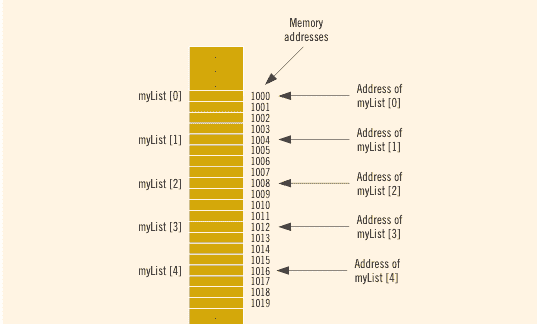

**图 9-7** 数组 `myList` 及其各分量的地址

现在，`myList` 是一个数组名。还有一个与标识符 `myList` 关联的内存空间，数组的基地址就存储在该内存空间中。考虑以下语句：

```cpp
cout << myList << endl;        //Line 2
```

前面我们说过，这条语句不会给出期望的结果。也就是说，这条语句不会输出 `myList` 各分量的值。事实上，这条语句输出的是 `myList` 的值，即数组的基地址。这就是该语句不会产生语法错误的原因。

假设你还有以下语句：

```cpp
int yourList[5];
```

那么，在以下语句中：

```cpp
if (myList <= yourList)        //Line 3
·
·
·
```

如果数组 `myList` 的基地址小于数组 `yourList` 的基地址，则表达式 `myList <= yourList` 的求值结果为 `true`；否则求值结果为 `false`。它并不判断 `myList` 的元素是否小于或等于 `yourList` 的对应元素。


**注意** 本书配套网站包含程序 `BaseAddressOfAnArray.cpp`，它阐明了第2行和第3行等语句。

你可能想知道为什么数组的基地址如此重要。原因是，当你声明一个数组时，计算机关于该数组唯一记住的内容是数组名、它的基地址、每个分量的数据类型，以及（可能）分量个数。利用数组的基地址和数组分量的下标，计算机可以确定特定分量的地址。例如，假设你想访问 `myList[3]` 的值。现在，`myList` 的基地址是 1000。`myList` 的每个分量都是 `int` 类型，因此它使用四个字节存储一个值，而下标是 3。要访问 `myList[3]` 的值，计算机计算地址 `1000 + 4 * 3 = 1000 + 12 = 1012`。也就是说，这是 `myList[3]` 的起始地址。因此，从 1012 开始，计算机访问接下来的四个字节。

当你将数组作为参数传递时，实际数组的基地址会传给形参。例如，假设你有以下函数：


```cpp
void arrayAsParameter(int list[], int size)
{
    .
    .
    .

    list[2] = 28;        //第4行

    .
    .
    .
}
```

另外，假设你有如下对该函数的调用：

```cpp
arrayAsParameter(myList, 5);   //第5行
```

在这个语句中，`myList`的基地址被传递给了形参`list`。因此，`list`的基地址是1000。该函数的定义包含语句`list[2] = 28;`。该语句将28存储到`list[2]`中。为了访问`list[2]`，计算机按如下方式计算地址：1000 + 4 * 2 = 1008。于是，从地址1008开始，计算机访问接下来的四个字节并存储28。注意，实际上1008就是`myList[2]`的地址（参见图9-7）。因此，在执行第5行的语句期间，第4行的语句将值28存储到了`myList[2]`中。同时，在执行第5行的函数调用语句期间，`list[index]`和`myList[index]`指向相同的内存空间，其中0 <= index且index < 5。

> **注意**
>
> 如果C++允许按值传递数组，那么计算机就必须为形参的组件分配内存，并在函数调用时将实际数组的内容复制到对应的形参中。如果数组规模很大，这个过程会浪费内存以及复制数据所需的计算机时间。这就是为什么在C++中数组总是按引用传递的原因。

## 函数不能返回数组类型的值

C++不允许函数返回数组类型的值。请注意，前面描述的`sumArray`和`indexLargestElement`函数返回的是`int`类型的值。

### 示例9-7

下面的程序演示了在函数调用中数组如何作为实参传递。（请注意，该程序使用了示例9-6中编写的函数。）

```cpp
//数组作为函数的参数

#include <iostream>
using namespace std;

const int ARRAY_SIZE = 10;

void initializeArray(int x[],int sizeX);
void fillArray(int x[],int sizeX);
void printArray(const int x[],int sizeX);
int sumArray(const int x[],int sizeX);
int indexLargestElement(const int x[],int sizeX);
void copyArray(int list1[], int src, int list2[],
               int tar, int numOfElements);

int main()
{
    int listA[ARRAY_SIZE] = {0};    //声明数组listA
                                    //包含10个组件，并将
                                    //每个组件初始化为0。
    int listB[ARRAY_SIZE];          //声明数组listB
                                    //包含10个组件。

    cout << "Line 1: listA元素: ";      //第1行

        //使用函数printArray输出listA的元素
    printArray(listA, ARRAY_SIZE);           //第2行
    cout << endl;                            //第3行

        //使用函数initializeArray初始化listB
    initializeArray(listB, ARRAY_SIZE);      //第4行

    cout << "Line 5: listB元素: ";      //第5行

        //输出listB的元素
    printArray(listB, ARRAY_SIZE);           //第6行
    cout << endl << endl;                    //第7行

    cout << "Line 8: 输入 " << ARRAY_SIZE
         << " 个整数: ";                   //第8行

        //使用函数fillArray向listA输入数据
    fillArray(listA, ARRAY_SIZE);            //第9行
    cout << endl;                            //第10行

    cout << "Line 11: 填充listA后，"
         << "元素为:" << endl;     //第11行

        //输出listA的元素
    printArray(listA, ARRAY_SIZE);           //第12行
    cout << endl << endl;                    //第13行
```

## 声明数组的其他方式

假设一个班有20名学生，你需要记录他们的成绩。因为学生人数每学期都可能变化，与其在声明数组时指定大小，不如按如下方式声明数组：

```cpp
const int NO_OF_STUDENTS = 20;
int testScores[NO_OF_STUDENTS];
```

用于声明数组的其他形式如下：

```cpp
const int SIZE = 50;          //第1行
typedef double list[SIZE];    //第2行

list yourList;                //第3行
list myList;                  //第4行
```

第2行的语句定义了一个数据类型`list`，它是包含50个`double`类型组件的数组。第3行和第4行的语句声明了两个变量`yourList`和`myList`。两者都是包含50个`double`类型组件的数组。当然，这些语句等价于：

```cpp
double yourList[50];
double myList[50];
```

## 在数组中搜索特定项

在列表中搜索给定项是对列表执行的最常见操作之一。我们描述的搜索算法称为**顺序搜索**或**线性搜索**。顾名思义，你从第一个数组元素开始依次搜索数组。你将`searchItem`与数组（列表）中的元素进行比较，并继续搜索，直到找到该项或列表中不再有数据可与`searchItem`比较为止。

考虑图9-8中显示的七个元素的列表。

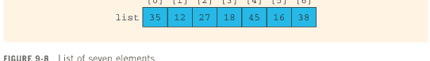

图9-8 七个元素的列表

假设你想确定27是否在列表中。顺序搜索的工作方式如下：首先，你将27与`list[0]`比较，即将27与35比较。因为`list[0] ≠ 27`，接着将27与`list[1]`比较，即与列表中的第二项12比较。因为`list[1] ≠ 27`，你将27与列表中的下一个元素比较，即将27与`list[2]`比较。因为`list[2] = 27`，搜索停止。这次搜索成功。

现在让我们搜索10。和之前一样，搜索从列表的第一个元素开始，即从`list[0]`开始。按前述方式进行，我们看到这次搜索项10与列表中的每一项都进行了比较。最终，列表中不再有数据可与搜索项比较。这是一次不成功的搜索。

因此可以得出，一旦你在列表中找到与搜索项相等的元素，就必须停止搜索并报告成功。（在这种情况下，通常还需要报告搜索项在列表中找到的位置。）否则，在搜索项与列表中每个元素都不成功比配后，你必须停止搜索并报告失败。

假设包含列表元素的数组名为`list`。前面的讨论转化为以下顺序搜索算法：

```
found被设为false;
loc = 0;

while (loc < listLength and not found)
    if (list[loc]等于searchItem)
        found被设为true
    else
        将loc加1

if (found)
    返回loc;
else
    返回-1;
```

以下函数对列表执行顺序搜索。具体来说，为了便于说明，我们假设列表元素为`int`类型。

```cpp
int seqSearch(const int list[], int listLength, int searchItem)
{
    int loc;
    bool found = false;

    loc = 0;

    while (loc < listLength && !found)
        if (list[loc] == searchItem)
            found = true;
        else
            loc++;

    if (found)
        return loc;
    else
        return -1;
}
```

如果函数`seqSearch`返回的值大于或等于0，则搜索成功；否则，搜索不成功。

从这个代码中可以看出，你首先将`searchItem`与列表中的第一个元素进行比较来开始搜索。如果`searchItem`等于列表中的第一个元素，则退出循环；否则，`loc`加1以指向列表中的下一个元素。然后你将`searchItem`与列表中的下一个元素进行比较，依此类推。

### 示例9-8

```cpp
// 该程序演示了如何在程序中
// 使用顺序搜索。

#include <iostream>                                      //第1行

using namespace std;                                     //第2行

const int ARRAY_SIZE = 10;                               //第3行

int seqSearch(const int list[], int listLength,
              int searchItem);                           //第4行

int main()                                               //第5行
{
    int intList[ARRAY_SIZE];                              //第7行
    int number;                                           //第8行

    cout << "第9行: 输入" << ARRAY_SIZE
         << "个整数。" << endl;                        //第9行

    for (int index = 0; index < ARRAY_SIZE; index++)      //第10行
        cin >> intList[index];                            //第11行

    cout << endl;                                         //第12行

    cout << "第13行: 输入要搜索的"
         << "数字: ";                                //第13行
    cin >> number;                                        //第14行
    cout << endl;                                         //第15行

    int pos = seqSearch(intList, ARRAY_SIZE, number);     //第16行

    if (pos != -1)                                        //第17行
        cout << "第18行: " << number
             << " 在位置" << pos
             << "处找到" << endl;                                     //第18行
    else                                               //第19行
        cout << "第20行: " << number
             << " 不在列表中。" << endl;           //第20行

    return 0;                                             //第21行
}                                                        //第22行

//将前面给出的函数seqSearch的定义
//放在这里。
```


**示例运行 1：** 在此示例运行中，用户输入以阴影显示。

第 9 行：输入 10 个整数。
`2 56 34 25 73 46 89 10 5 16`

第 13 行：输入要查找的数字：`25`

第 18 行：25 在位置 3 被找到

**示例运行 2：**

第 9 行：输入 10 个整数。
`2 56 34 25 73 46 89 10 5 16`

第 13 行：输入要查找的数字：`38`

第 20 行：38 不在列表中。

## C 字符串（字符数组）

到目前为止，我们一直避免讨论字符数组，原因很简单：字符数组具有特殊的重要性，并且处理它们的方式与其他数组不同。C++ 提供了许多（预定义的）函数，可用于字符数组。

**字符数组：** 其分量为 char 类型的数组。

回想一下，最广泛使用的字符集是 ASCII 和 EBCDIC。ASCII 字符集中的第一个字符是空字符，它是不可打印的。另外，回想一下，在 C++ 中，空字符表示为 `'\0'`，即一个反斜杠后跟一个零。

语句：

```cpp
ch = '\0';
```

将空字符存入 ch，其中 ch 是 char 变量。

正如你将看到的，空字符在处理字符数组时起着重要作用。由于空字符的排序序列为 0，因此空字符小于 char 数据集中的任何其他字符。

字符数组最常用的术语是 C 字符串。然而，字符数组与 C 字符串之间存在细微差别。回想一下，字符串是零个或多个字符的序列，并且字符串用双引号括起来。在 C++ 中，C 字符串以空字符结尾；也就是说，C 字符串中的最后一个字符始终是空字符。字符数组可能不包含空字符，但 C 字符串中的最后一个字符始终是空字符。正如你将看到的，除了最后一个位置之外，空字符不应出现在 C 字符串的任何位置。此外，C 字符串存储在（一维）字符数组中。

以下是 C 字符串的示例：

```text
"John L. Johnson"
"Hello there."
```

从 C 字符串的定义可以清楚地看出，`'A'` 和 `"A"` 之间存在差异。前者是字符 A；后者是 C 字符串 A。因为 C 字符串以空字符结尾，所以 `"A"` 表示两个字符：`'A'` 和 `'\0'`。类似地，C 字符串 `"Hello"` 表示六个字符：`'H'`、`'e'`、`'l'`、`'l'`、`'o'` 和 `'\0'`。要存储 `'A'`，我们只需要一个 char 类型的内存单元；要存储 `"A"`，我们需要两个 char 类型的内存单元——一个用于 `'A'`，一个用于 `'\0'`。类似地，要将 C 字符串 `"Hello"` 存储到计算机内存中，我们需要六个 char 类型的内存单元。

考虑以下语句：

```cpp
char name[16];
```

这条语句声明了一个名为 name 的数组，包含 16 个 char 类型的分量。由于 C 字符串以空字符结尾，并且 name 有 16 个分量，因此可以存储在 name 中的最大字符串长度为 15。如果你将一个长度为 10 的 C 字符串存储到 name 中，则使用 name 的前 11 个分量，最后 5 个分量保持未使用。

语句：

```cpp
char name[16] = {'J', 'o', 'h', 'n', '\0'};
```

声明了一个包含 16 个 char 类型分量的数组 name，并在其中存储 C 字符串 `"John"`。在 char 数组变量声明期间，C++ 允许在初始化语句中使用 C 字符串表示法。因此，上述语句等价于：

```cpp
char name[16] = "John";        //Line A
```

回想一下，如果在声明期间初始化数组，则可以省略数组的大小。

语句：

```cpp
char name[] = "John";          //Line B
```

声明了一个 C 字符串变量 name，其长度足够大——在本例中为 5——并在其中存储 `"John"`。最后两条语句之间存在差异：两条语句都将 `"John"` 存储到 name 中，但 A 行语句中 name 的大小为 16，而 B 行语句中 name 的大小为 5。

适用于其他数组的大多数规则也适用于字符数组。考虑以下语句：

```cpp
char studentName[26];
```

假设你想将 `"Lisa L. Johnson"` 存储到 studentName 中。由于数组不允许赋值和比较等聚合操作，因此以下语句不合法：

```cpp
studentName = "Lisa L. Johnson"; //illegal
```

C++ 提供了一组可用于 C 字符串操作的函数。头文件 `cstring` 描述了这些函数。我们经常使用其中三个函数：`strcpy`（字符串复制，用于将 C 字符串复制到 C 字符串变量中——即赋值）；`strcmp`（字符串比较，用于比较 C 字符串）；以及 `strlen`（字符串长度，用于求 C 字符串的长度）。表 9-1 总结了这些函数。

**表 9-1 `strcpy`、`strcmp` 和 `strlen` 函数**

| 函数 | 作用 |
|---|---|
| `strcpy(s1, s2)` | 将字符串 s2 复制到字符串变量 s1 中<br>s1 的长度至少应与 s2 一样大 |
| `strcmp(s1, s2)` | 如果 s1 小于 s2，则返回一个 < 0 的值<br>如果 s1 和 s2 相同，则返回 0<br>如果 s1 大于 s2，则返回一个 > 0 的值 |
| `strlen(s)` | 返回字符串 s 的长度，不包括空字符 |

要使用这些函数，程序必须通过 include 语句包含头文件 `cstring`。也就是说，程序中必须包含以下语句：

```cpp
#include <cstring>
```

### 字符串比较

在 C++ 中，C 字符串使用系统的排序序列逐字符进行比较。假设你使用 ASCII 字符集。

-   C 字符串 `"Air"` 小于 C 字符串 `"Boat"`，因为 `"Air"` 的第一个字符小于 `"Boat"` 的第一个字符。
-   C 字符串 `"Air"` 小于 C 字符串 `"An"`，因为两个字符串的第一个字符相同，但 `"Air"` 的第二个字符 `'i'` 小于 `"An"` 的第二个字符 `'n'`。
-   C 字符串 `"Bill"` 小于 C 字符串 `"Billy"`，因为 `"Bill"` 和 `"Billy"` 的前四个字符相同，但 `"Bill"` 的第五个字符是 `'\0'`（空字符），它小于 `"Billy"` 的第五个字符 `'y'`。（回想一下，C++ 中的 C 字符串以空字符结尾。）
-   C 字符串 `"Hello"` 小于 `"hello"`，因为 C 字符串 `"Hello"` 的第一个字符 `'H'` 小于 C 字符串 `"hello"` 的第一个字符 `'h'`。

## AI 产品榜

### 2024年9月 全球AI产品月活跃用户榜

数据来源：Similarweb 公开数据，统计时间截至2024年9月30日

| 排名 | 产品名称 | 月活跃用户（百万） | 环比变化 |
|------|----------|------------------|----------|
| 1 | ChatGPT | 3,200 | +12% |
| 2 | Gemini | 1,800 | +28% |
| 3 | 豆包 | 1,200 | +45% |
| 4 | Copilot | 950 | +15% |
| 5 | 文心一言 | 720 | +8% |
| 6 | Midjourney | 680 | +5% |
| 7 | 通义千问 | 650 | +30% |
| 8 | Claude | 580 | +22% |
| 9 | 智谱清言 | 420 | +18% |
| 10 | Grok | 390 | +35% |

### 亮点分析

-   **豆包表现亮眼**：环比增长45%，是TOP10中增速最快的AI产品，主要受益于字节跳动生态的流量扶持。
-   **Gemini追赶态势明显**：凭借Google全系产品的集成，月活突破18亿，环比增长28%。
-   **新上榜产品**：Grok首次进入榜单前十，反映出X（Twitter）平台用户的强转化。

> 全球AI产品月活用户总数首次突破100亿，标志着AI应用进入规模化落地阶段。

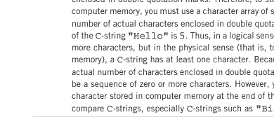

考虑以下语句：

```cpp
char str[31];
cin.get(str, 31);
```

如果输入为：

```text
William T. Johnson
```

那么 `"William T. Johnson"` 会存储到 str 中。假设输入为：

```text
Hello there. My name is Mickey Blair.
```

那么，由于 str 最多只能存储 30 个字符，C 字符串 `"Hello there. My name is Mickey"` 会存储到 str 中。

现在，假设我们有这些语句：

```cpp
char str1[26];
char str2[26];
char discard;
```

以及两行输入：

```text
Summer is warm.
Winter will be cold.
```

此外，假设我们想将第一个 C 字符串存储到 str1 中，将第二个 C 字符串存储到 str2 中。str1 和 str2 都可以存储长度最多为 25 个字符的 C 字符串。由于第一行中的字符数为 15，读取会在 `'\n'` 处停止。你必须读取并丢弃第一行末尾的换行符，才能将第二行存储到 str2 中。以下语句序列将第一行存储到 str1 中，将第二行存储到 str2 中：

```cpp
cin.get(str1, 26);
cin.get(discard);
cin.get(str2, 26);
```

要读取并存储一行输入（包括空白字符），还可以使用流函数 `getline`。假设你有以下声明：

```cpp
char textLine[100];
```

以下语句将读取接下来的 99 个字符（或直到换行符为止）并存储到 textLine 中。空字符将自动追加为 textLine 的最后一个字符。

```cpp
cin.getline(textLine, 100);
```

### 字符串输出

C 字符串的输出是另一个允许对数组进行聚合操作的地方。你可以使用输出流变量（例如 `cout`）以及插入运算符 `<<` 来输出 C 字符串。例如，以下语句：

```cpp
cout << name;
```

将 name 的内容输出到屏幕上。插入运算符 `<<` 会持续写出 name 的内容，直到遇到空字符为止。因此，如果 name 的长度为 4，上述语句只输出四个字符。如果 name 不包含空字符

以下语句说明如何在程序执行期间使用 string 类型的变量读取输入/输出文件的名称，并打开这些文件：

```cpp
ifstream infile;
string fileName;

cout << "Enter the input file name: ";
cin >> fileName;

infile.open(fileName.c_str());    //open the input file
```

当然，还必须在程序中包含头文件 string。输出文件也有类似的约定。

## 并行数组

如果两个（或更多）数组的对应分量保存相关信息，则称这些数组为**并行**数组。

假设你需要记录学生的课程成绩及其学号，以便在学期末公布成绩。进一步假设一个班最多有 50 名学生，且他们的学号是 5 位数。因为可能有 50 名学生，所以需要 50 个变量来存储学生学号，以及 50 个变量来存储他们的成绩。你可以声明两个数组：int 类型的 studentId 和 char 类型的 courseGrade。每个数组有 50 个分量。此外，studentId[0] 和 courseGrade[0] 将存储第一个学生的学号和课程成绩，studentId[1] 和 courseGrade[1] 将存储第二个学生的学号和课程成绩，依此类推。

下列语句：

```cpp
int studentId[50];
char courseGrade[50];
```

声明了这两个数组。

假设需要将数据输入这些数组，而数据以如下形式提供在文件中：

```text
studentId courseGrade
```

例如，一个示例数据集为：

```text
23456 A
86723 B
22356 C
32733 B
11892 D
.
.
.
```

假设使用 ifstream 变量 infile 打开输入文件。因为每个数组的大小为 50，所以每个数组最多可以存储 50 个元素。此外，班里学生人数可能少于 50。因此，

## 访问数组分量

要访问二维数组的分量，需要一对下标：一个表示行位置，一个表示列位置。

访问二维数组分量的语法为：

```text
arrayName[indexExp1][indexExp2]
```

其中 `indexExp1` 和 `indexExp2` 是产生非负整数值的表达式。`indexExp1` 指定行位置；`indexExp2` 指定列位置。

下列语句：

```cpp
sales[5][3] = 25.75;
```

将 25.75 存储到数组 `sales` 的第 5 行第 3 列（即第六行第四列）中（见图 9-11）。

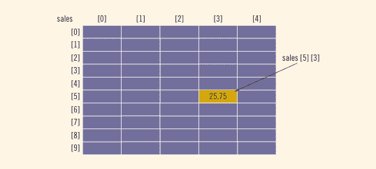

图 9-11  `sales[5][3]`

假设：

```cpp
int i = 5;
int j = 3;
```

那么，前面的语句：

```cpp
sales[5][3] = 25.75;
```

等价于：

```cpp
sales[i][j] = 25.75;
```

因此，下标也可以是变量。

## 声明时初始化二维数组

与一维数组一样，二维数组可以在声明时初始化。下面的例子有助于说明这一概念。考虑下列语句：

```c
int board[4][3] = {{2, 3, 1},
                   {15, 25, 13},
                   {20, 4, 7},
                   {11, 18, 14}};
```

这条语句将 board 声明为一个四行三列的二维数组。第一行的分量是 2、3 和 1；第二行的分量是 15、25 和 13；第三行的分量是 20、4 和 7；第四行的分量分别是 11、18 和 14。图 9-12 显示了数组 board。

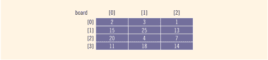

**图 9-12** 二维数组 board

在声明二维数组时初始化它：

- 1. 每一行的元素用花括号括起来，并用逗号分隔。
- 2. 所有行都用花括号括起来。
- 3. 对于数值数组，如果未指定某一行的所有分量，则未指定的分量初始化为 0。在这种情况下，必须至少给出一个值，才能初始化某一行的所有分量。

## 二维数组与枚举类型

> **注意** 理解本节需要先阅读第 8 章中的“枚举类型”一节。

也可以将枚举类型用于数组下标。考虑下列语句：

```c
const int NUMBER_OF_ROWS = 6;
const int NUMBER_OF_COLUMNS = 5;
enum carType {GM, FORD, TOYOTA, BMW, NISSAN, VOLVO};
enum colorType {RED, BROWN, BLACK, WHITE, GRAY};

int inStock[NUMBER_OF_ROWS][NUMBER_OF_COLUMNS];
```

这些语句定义了 `carType` 和 `colorType` 枚举类型，并将 `inStock` 定义为六行五列的二维数组。假设 `inStock` 中的每一行对应一种汽车类型，每一列对应一种颜色类型。也就是说，第一行对应汽车类型 `GM`，第二行对应汽车类型 `FORD`，依此类推。类似地，第一列对应颜色类型 `RED`，第二列对应颜色类型 `BROWN`，依此类推。进一步假设 `inStock` 中的每个条目表示某种类型和颜色的汽车数量（见图 9-13）。

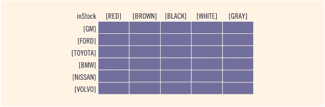

**图 9-13**  二维数组 `inStock`

下列语句：

```text
inStock[1][3] = 15;
```

等价于下列语句（见图 9-14）：

```text
inStock[FORD][WHITE] = 15;
```

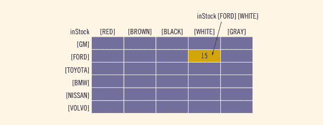

**图 9-14**  `inStock[FORD][WHITE]`

第二条语句可以很容易地传达信息——即把 WHITE FORD 汽车的数量设置为 15。这个例子说明，枚举类型可以有效地用于使程序具有可读性且易于管理。

## 处理二维数组

二维数组可以通过三种方式处理：

- 1. 处理整个数组。
- 2. 处理数组的特定行，称为**行处理**。
- 3. 处理数组的特定列，称为**列处理**。

初始化和打印数组是处理整个二维数组的例子。查找某行（列）中的最大元素或求某行（列）的和是行（列）处理的例子。在讨论中，我们将使用以下声明：

```cpp
const int NUMBER_OF_ROWS = 7;    //This can be set to any number.
const int NUMBER_OF_COLUMNS = 6; //This can be set to any number.

int matrix[NUMBER_OF_ROWS][NUMBER_OF_COLUMNS];
int row;
int col;
int sum;
int largest;
int temp;
```

图 9-15 显示了数组 matrix。

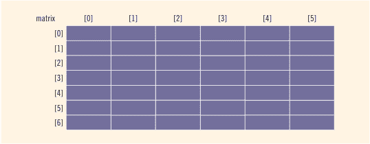

**图 9-15** 二维数组 `matrix`

由于二维数组的分量都具有相同类型，因此任意行或列的分量也具有相同类型。这意味着二维数组的每一行和每一列都是一个一维数组。因此，在处理二维数组的特定行或列时，我们使用

```cpp
for (row = 0; row < NUMBER_OF_ROWS; row++)
    for (col = 0; col < NUMBER_OF_COLUMNS; col++)
        matrix[row][col] = 0;
```

### 打印

通过使用嵌套的 `for` 循环，可以输出 `matrix` 的分量。下面的嵌套 `for` 循环打印 `matrix` 的分量，每行一行：

```cpp
for (row = 0; row < NUMBER_OF_ROWS; row++)
{
    for (col = 0; col < NUMBER_OF_COLUMNS; col++)
        cout << setw(5) << matrix[row][col] << " ";

    cout << endl;
}
```

### 输入

下面的 `for` 循环将数据输入到 `matrix` 的第 4 行，即第五行：

```cpp
row = 4;

for (col = 0; col < NUMBER_OF_COLUMNS; col++)
    cin >> matrix[row][col];
```

和前面一样，通过将行号放入循环中，可以将数据输入到 `matrix` 的每个分量中。下面的 `for` 循环将数据输入到 `matrix` 的每个分量中：

```cpp
for (row = 0; row < NUMBER_OF_ROWS; row++)
    for (col = 0; col < NUMBER_OF_COLUMNS; col++)
        cin >> matrix[row][col];
```

### 按行求和

下面的 `for` 循环求 `matrix` 第 4 行的和；也就是说，它把第 4 行的各分量相加。

```cpp
sum = 0;
row = 4;
for (col = 0; col < NUMBER_OF_COLUMNS; col++)
    sum = sum + matrix[row][col];
```

再一次，通过将行号放入循环中，我们可以分别求出每一行的和。下面是求每一行各自之和的 C++ 代码：

```cpp
//Sum of each individual row
for (row = 0; row < NUMBER_OF_ROWS; row++)
{
    sum = 0;
    for (col = 0; col < NUMBER_OF_COLUMNS; col++)
        sum = sum + matrix[row][col];

    cout << "Sum of row " << row + 1 << " = " << sum << endl;
}
```


### 按列求和

与按行求和的情况类似，下面的嵌套 `for` 循环用于计算每一列的和：

```cpp
//Sum of each individual column
for (col = 0; col < NUMBER_OF_COLUMNS; col++)
{
    sum = 0;
    for (row = 0; row < NUMBER_OF_ROWS; row++)
        sum = sum + matrix[row][col];

    cout << "Sum of column " << col + 1 << " = " << sum
         << endl;
}
```

### 每行和每列中的最大元素

如前所述，二维数组的另外两种操作是找出每行和每列中的最大元素，以及计算两条对角线的和。接下来，我们给出执行这些操作的 C++ 代码。

下面的 `for` 循环确定第 4 行中的最大元素：

```cpp
row = 4;
largest = matrix[row][0]; //Assume that the first element of
                          //the row is the largest.
for (col = 1; col < NUMBER_OF_COLUMNS; col++)
    if (largest < matrix[row][col])
        largest = matrix[row][col];
```

下面的 C++ 代码确定每行和每列中的最大元素：

```cpp
//Largest element in each row
for (row = 0; row < NUMBER_OF_ROWS; row++)
{
    largest = matrix[row][0]; //Assume that the first element
                              //of the row is the largest.
    for (col = 1; col < NUMBER_OF_COLUMNS; col++)
        if (largest < matrix[row][col])
            largest = matrix[row][col];

    cout << "The largest element in row " << row + 1 << " = "
         << largest << endl;
}

//Largest element in each column
for (col = 0; col < NUMBER_OF_COLUMNS; col++)
{
    largest = matrix[0][col]; //Assume that the first element
                              //of the column is the largest.
    for (row = 1; row < NUMBER_OF_ROWS; row++)
        if (largest < matrix[row][col])
            largest = matrix[row][col];

    cout << "The largest element in column " << col + 1
         << " = " << largest << endl;
}
```

### 将二维数组作为参数传递给函数

二维数组可以作为参数传递给函数，并且它们是按引用传递的。基地址（即实际参数的第一个分量的地址）被传递给形式参数。如果 `matrix` 是二维数组的名称，那么 `matrix[0][0]` 就是 `matrix` 的第一个分量。

在计算机内存中存储二维数组时，C++ 使用**行序形式**。也就是说，先存储第一行，然后是第二行，接着是第三行，依此类推。

对于一维数组，在将其声明为形式参数时，我们通常省略数组的大小。由于 C++ 以行序形式存储二维数组，为了正确计算某个分量的地址，编译器必须知道一行在哪里结束、下一行从哪里开始。因此，在将二维数组声明为形式参数时，可以省略第一维的大小，但不能省略第二维；也就是说，必须指定列数。

假设我们有如下声明：

```cpp
const int NUMBER_OF_ROWS = 6;
const int NUMBER_OF_COLUMNS = 5;
```

考虑下面定义的函数 `printMatrix`：

```cpp
void printMatrix(int matrix[][NUMBER_OF_COLUMNS],
                 int noOfRows)
{
    int row, col;

    for (row = 0; row < noOfRows; row++)
    {
        for (col = 0; col < NUMBER_OF_COLUMNS; col++)
            cout << setw(5) << matrix[row][col] << " ";

        cout << endl;
    }
}
```

该函数将行数未指定、列为五列的二维数组作为参数，并输出该二维数组的内容。在函数调用期间，实际参数的列数必须与形式参数的列数匹配。

类似地，下面的函数输出元素类型为 `int` 的二维数组中每一行元素的和。

```cpp
void sumRows(int matrix[][NUMBER_OF_COLUMNS], int noOfRows)
{
    int row, col;
    int sum;

    //Sum of each individual row
    for (row = 0; row < noOfRows; row++)
```

```cpp
void printMatrix(int matrix[][NUMBER_OF_COLUMNS],
                 int noOfRows);
void sumRows(int matrix[][NUMBER_OF_COLUMNS],
             int noOfRows);
void largestInRows(int matrix[][NUMBER_OF_COLUMNS],
                   int noOfRows);

int main()
{
    int board[NUMBER_OF_ROWS][NUMBER_OF_COLUMNS]
        = {{23, 5, 6, 15, 18},
           {4, 16, 24, 67, 10},
           {12, 54, 23, 76, 11},
           {1, 12, 34, 22, 8},
           {81, 54, 32, 67, 33},
           {12, 34, 76, 78, 9}};    //Line 1

    printMatrix(board, NUMBER_OF_ROWS);    //Line 2
    cout << endl;                          //Line 3
    sumRows(board, NUMBER_OF_ROWS);        //Line 4
    cout << endl;                          //Line 5
    largestInRows(board, NUMBER_OF_ROWS);  //Line 6

    return 0;
}

//Place the definitions of the functions printMatrix,
//sumRows, and largestInRows as described previously here.
```

### 示例运行：

```text
        23     5     6    15    18
         4    16    24    67    10
        12    54    23    76    11
         1    12    34    22     8
        81    54    32    67    33
        12    34    76    78     9

        Sum of row 1 = 67
        Sum of row 2 = 121
        Sum of row 3 = 176
        Sum of row 4 = 77
        Sum of row 5 = 267
        Sum of row 6 = 209

        The largest element in row 1 = 23
        The largest element in row 2 = 67
        The largest element in row 3 = 76
        The largest element in row 4 = 34
        The largest element in row 5 = 81
        The largest element in row 6 = 78
```

在该程序中，第 1 行的语句声明并初始化 `board` 为一个六行五列的二维数组。第 2 行的语句使用函数 `printMatrix` 输出 `board` 的元素（参见示例运行的前六行）。第 4 行的语句使用函数 `sumRows` 计算并打印每一行的和。第 6 行的语句使用函数 `largestInRows` 查找并打印每一行中的最大元素。

### 字符串数组

假设你需要执行一项操作，例如按字母顺序排列一组姓名。由于每个姓名都是一个字符串，存储这组姓名的一种便捷方式是使用数组。在 C++ 中，可以使用数据类型 `string` 或字符数组（C 字符串）来操作字符串。此外，在某些编译器上，数据类型 `string` 在标准 C++（即非 ANSI/ISO 标准 C++）中可能不可用。本节将说明操作字符串列表的两种方式。

### 字符串数组与 `string` 类型

使用数据类型 `string` 处理字符串列表非常简单。假设列表最多包含 100 个姓名。你可以声明一个包含 100 个 `string` 类型分量的数组，如下所示：

```cpp
string list[100];
```

诸如赋值、比较和输入/输出等基本操作都可以对 `string` 类型的值执行。因此，可以像处理本章第一部分讨论的任何一维数组一样处理 `list` 中的数据。

### 字符串数组与 C 字符串（字符数组）

假设列表中最大的字符串（例如，姓名）长度为 15 个字符，并且列表中有 100 个字符串。你可以声明一个 100 行、16 列的字符二维数组，如下所示（参见图 9-16）：

```cpp
char list[100][16];
```

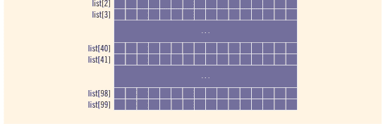

**图 9-16** 字符串数组 `list`

现在，对于每个 `j`（0 <= j <= 99），`list[j]` 是一个长度至多为 15 个字符的字符串。下面的语句将 `"Snow White"` 存储到 `list[1]` 中（参见图 9-17）：

```cpp
strcpy(list[1], "Snow White");
```

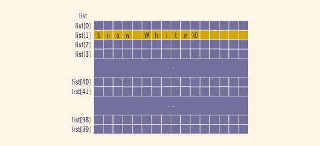

**图 9-17** 数组 `list`，显示 `list[1]`

假设你想读取数据并存储到 `list` 中，并且每行一个条目。下面的 `for` 循环可以完成此任务：

```cpp
for (j = 0; j < 100; j++)
    cin.get(list[j], 16);
```

下面的 `for` 循环输出每一行中的字符串：

```cpp
for (j = 0; j < 100; j++)
    cout << list[j] << endl;
```

你还可以使用其他字符串函数（如 `strcmp` 和 `strlen`）以及 `for` 循环来操作列表。

> **注意：** 数据类型 `string` 定义了赋值、连接和关系运算等操作。如果你使用标准 C++ 头文件，并且你的编译器支持数据类型 `string`，我们建议你使用数据类型 `string` 来操作字符串列表。

### 声明二维数组的另一种方式

> **注意：** 可以跳过本节，不会影响内容的连贯性。


如果你知道程序将要处理的表的大小，那么可以使用 `typedef` 先定义一个二维数组数据类型，然后声明该类型的变量。

例如，考虑以下内容：

```cpp
const int NUMBER_OF_ROWS = 20;
const int NUMBER_OF_COLUMNS = 10;
```

```cpp
typedef int tableType[NUMBER_OF_ROWS][NUMBER_OF_COLUMNS];
```

前面的语句定义了一个二维数组数据类型 `tableType`。现在可以声明这种类型的变量。因此：

```cpp
tableType matrix;
```

声明了一个 20 行 10 列的二维数组 `matrix`。

在声明形参时也可以使用这个数据类型，如下面的代码所示：

```cpp
void initialize(tableType table)
{
    int row;
    int col;

    for (row = 0; row < NUMBER_OF_ROWS; row++)
        for (col = 0; col < NUMBER_OF_COLUMNS; col++)
            table[row][col] = 0;
}
```

该函数接受任何 `tableType` 类型的变量（即二维数组）作为实参，并将该数组初始化为 0。

通过先定义数据类型，在将二维数组声明为变量或形参时，或在函数调用期间将数组作为参数传递时，就不需要反复检查确切的列数。

## 多维数组

在本章中，我们将数组定义为固定数量的同类型元素（称为分量）的集合。一维数组是元素以列表形式排列的数组；在二维数组中，元素以表格形式排列。我们也可以定义三维或更高维的数组。在 C++ 中，数组的维数没有限制。下面是数组的一般定义。

*n* 维数组：固定数量的元素（称为分量）按 *n* 个维度（*n* >= 1）排列的集合。

声明 n 维数组的一般语法是：

```cpp
dataType arrayName[intExp1][intExp2] ... [intExpn];
```

其中 intExp1、intExp2、……和 intExpn 是产生正整数值的常量表达式。

访问 n 维数组分量的语法是：

```cpp
arrayName[indexExp1][indexExp2] ... [indexExpn]
```

其中 indexExp1、indexExp2、……和 indexExpn 是产生非负整数值的表达式。indexExp1 给出数组分量在第 i 维中的位置。

例如，语句：

```cpp
double carDealers[10][5][7];
```

声明 carDealers 为一个三维数组。第一维的大小是 10，第二维的大小是 5，第三维的大小是 7。第一维的范围是 0 到 9，第二维的范围是 0 到 4，第三维的范围是 0 到 6。数组 carDealers 的基地址是第一个分量的地址——即 carDealers[0][0][0] 的地址。数组 carDealers 中分量的总数是 10 * 5 * 7 = 350。

语句：

```cpp
carDealers[5][3][2] = 15564.75;
```

将分量 carDealers[5][3][2] 的值设置为 15564.75。

可以使用循环来处理多维数组。例如，下面的嵌套 for 循环：

```cpp
for (i = 0; i < 10; i++)
    for (j = 0; j < 5; j++)
        for (k = 0; k < 7; k++)
            carDealers[i][j][k] = 0.0;
```

将整个数组初始化为 0.0。

在函数中将多维数组声明为形参时，可以省略第一维的大小，但不能省略其他维度的大小。作为参数，多维数组只能按引用传递，函数不能返回数组类型的值。不会检查数组下标是否在边界内。

## 编程示例：代码检测

当消息以秘密代码形式通过传输信道传输时，通常以位序列（即 0 和 1）发送。由于传输信道中的噪声，传输的消息可能会损坏。也就是说，在目的地接收到的消息与发送的消息不相同；某些位可能已经改变。有多种技术可以在目的地检查所传输消息的有效性。一种技术是将同一消息传输两次。在目的地，将消息的两个副本逐位比较。如果对应位相同，则接收到的消息无差错。

让我们编写一个程序来检查在目的地接收到的消息是否无差错。为简单起见，假设表示消息的秘密代码是数字序列（0 到 9），且消息的最大长度是 250 个数字。此外，消息中的第一个数字是消息的长度。例如，如果秘密代码是：

```
7 9 2 7 8 3 5 6
```

那么实际消息长度为 7 个数字，并且它被传输两次。

上述消息按如下方式传输：

```
7 9 2 7 8 3 5 6 7 9 2 7 8 3 5 6
```

**输入** 一个包含秘密代码及其副本的文件

**输出** 秘密代码、其副本，以及——如果接收到的代码无差错——按以下形式给出的消息：

| 代码数字 | 代码数字副本 |
|---|---|
| 9 | 9 |
| 2 | 2 |
| 7 | 7 |
| 8 | 8 |
| 3 | 3 |
| 5 | 5 |
| 6 | 6 |

消息传输正常。

### 问题分析与算法设计

因为必须比较秘密代码及其副本的对应数字，所以我们首先读取秘密代码并将其存储在一个数组中。然后读取副本的第一个数字，并将其与秘密代码的第一个数字比较，依此类推。如果任何对应数字不相同，我们就通过在数字旁边打印一条消息来指出这一事实。因为消息的最大长度是 250，所以我们使用一个包含 250 个分量的数组。秘密代码中以及秘密代码副本中的第一个数字表示代码的长度。上述讨论可转化为以下算法：

- 1. 打开输入文件和输出文件。
- 2. 如果输入文件不存在，则退出程序。
- 3. 读取秘密代码的长度。
- 4. 如果秘密代码的长度大于 250，则终止程序，因为本程序中代码的最大长度是 250。
- 5. 读取秘密代码并将其存储到数组中。
- 6. 读取副本的长度。
- 7. 如果秘密代码及其副本的长度相同，则比较代码。否则，打印一条错误消息。

为简化函数 main，让我们编写一个函数 readCode 来读取秘密代码，并编写另一个函数 compareCode 来比较代码。

该函数首先读取秘密代码的长度。如果秘密代码的长度大于 250，则将引用参数 bool 变量 lenCodeOk 设置为 false，并终止该函数。lenCodeOk 的值会传递给调用函数，以指示秘密代码是否读取成功。如果代码长度小于 250，readCode 函数会读取秘密代码并将其存储到数组中。由于输入存储在文件中，并且该文件是在函数 main 中打开的，因此必须将与输入文件对应的输入流变量作为参数传递给该函数。此外，在读取秘密代码的长度和代码本身之后，readCode 函数必须将这些值传递给函数 main。因此，该函数有四个参数：一个输入文件流变量、一个用于存储秘密代码的数组、代码长度以及 bool 参数 lenCodeOk。函数 readCode 的定义如下：

readCode

```cpp
void readCode(ifstream& infile, int list[], int& length,
              bool& lenCodeOk)
{
    int count;

    lenCodeOk = true;

    infile >> length;  //get the length of the secret code

    if (length > MAX_CODE_SIZE)
    {
        lenCodeOk = false;
        return;
    }

    //Get the secret code
    for (count = 0; count < length; count++)
        infile >> list[count];
}
```


## compareCode

此函数将保密代码与其副本进行比较。因此，它必须能够访问包含保密代码的数组以及保密代码的长度。保密代码的副本及其长度存储在输入文件中。因此，与输入文件对应的输入流变量必须作为参数传递给此函数。此外，compareCode 函数比较保密代码与副本，并打印适当的信息。由于输出将存储在文件中，与输出文件对应的输出流变量也必须作为参数传递给此函数。因此，该函数有四个参数：一个输入文件流变量、一个输出文件流变量、包含保密代码的数组以及保密代码的长度。上述讨论转化为 compareCode 函数的以下算法：

- a. 声明变量。
- b. 将布尔变量 `codeOk` 设置为 true。
- c. 读取保密代码副本的长度。
- d. 如果保密代码与其副本的长度不相同，则输出适当的错误信息并终止该函数。
- e. 对于输入文件中的每一位数字：
  - 1. 读取保密代码副本的下一位数字。
  - 2. 输出保密代码及其副本中对应的数字。
  - 3. 如果对应数字不相同，则输出错误信息并将布尔变量 `codeOk` 设置为 false。
- f. 如果布尔变量 `codeOk` 为 true：
  - 输出一条消息，指示保密代码已正确传输。
  - 否则
  - 输出错误信息。

按照此算法，函数 compareCode 的定义如下：

```cpp
void compareCode(ifstream& infile, ofstream& outfile,
                  const int list[], int length)
{
        //Step a
    int length2;
    int digit;
    bool codeOk;
    int count;

    codeOk = true;                                  //Step b

    infile >> length2;                              //Step c

    if (length != length2)                         //Step d
    {
        cout << "The original code and its copy "
             << "are not of the same length."
             << endl;
        return;
    }

    outfile << "Code Digit    Code Digit Copy"
            << endl;

    for (count = 0; count < length; count++)       //Step e
    {
        infile >> digit;                           //Step e.1
        outfile << setw(5) << list[count]          //Step e.2
                << setw(17) << digit;

        if (digit != list[count])                  //Step e.3
        {
            outfile << "  code digits are not the same"
                    << endl;
            codeOk = false;
        }
        else
            outfile << endl;
    }

    if (codeOk)                                    //Step f
        outfile << "Message transmitted OK."
                << endl;
    else
        outfile << "Error in transmission. "
                << "Retransmit!" << endl;
}
```

以下是函数 `main` 的算法。

**主算法**

- 1. 声明变量。
- 2. 打开文件。
- 3. 调用函数 `readCode` 读取保密代码。
- 4. `if (length of the secret code <= 250)`
  - 调用函数 `compareCode` 比较代码。
  - `else`
  - 输出适当的错误信息。

```cpp
/**********************************************************
// Author: D.S. Malik
//
// Program: Check Code
// This program determines whether a code is transmitted
// correctly.
//**********************************************************

#include <iostream>
#include <fstream>
#include <iomanip>

using namespace std;

const int MAX_CODE_SIZE = 250;

void readCode(ifstream& infile, int list[],
              int& length, bool& lenCodeOk);
void compareCode(ifstream& infile, ofstream& outfile,
                 const int list[], int length);

int main()
{
    //Step 1
    int codeArray[MAX_CODE_SIZE]; //array to store the secret
                                  //code
    int codeLength;               //variable to store the
                                  //length of the secret code
    bool lengthCodeOk; //variable to indicate if the length
                       //of the secret code is less than or
                       //equal to 250

    ifstream incode;  //input file stream variable
    ofstream outcode; //output file stream variable

    char inputFile[51];  //variable to store the name of the
                         //input file
    char outputFile[51]; //variable to store the name of
                         //the output file

    cout << "Enter the input file name: ";
    cin >> inputFile;
    cout << endl;

    //Step 2
    incode.open(inputFile);
    if (!incode)
    {
        cout << "Cannot open the input file." << endl;
        return 1;
    }
```

该程序的算法如下：

- 1. 声明变量。
- 2. 打开输入文件和输出文件。
- 3. 初始化变量。
- 4. 当输入文件中还有更多数据时：
  - 4.1. 对于一行中的每个字符：
    - 4.1.1. 读取并写出该字符。
    - 4.1.2. 增加相应字母的计数。
  - 4.2. 增加行计数。
- 5. 输出行计数和字母计数。
- 6. 关闭文件。

为简化函数 main，我们将其划分为四个函数：

- 函数 initialize
- 函数 copyText
- 函数 characterCount
- 函数 writeToFile

以下各节详细描述这些函数中的每一个。然后，借助这些函数，我们描述函数 main 的算法。

## initialize

此函数将变量 lineCount 和数组 letterCount 初始化为 0。因此，它有两个参数：一个对应于变量 lineCount，另一个对应于数组 letterCount。显然，对应于 lineCount 的参数必须是引用参数。该函数的定义如下：

```cpp
void initialize(int& lc, int list[])
{
    int j;
    lc = 0;

    for (j = 0; j < 26; j++)
        list[j] = 0;
} //end initialize
```

## copyText

此函数读取一行并输出该行。读取一个字符后，它调用函数 characterCount 来更新字母计数。显然，此函数有四个参数：一个输入文件流变量、一个输出文件流变量、一个 char 变量以及用于更新字母计数的数组。

请注意，copyText 函数并不执行字母计数，但我们仍将数组 letterCount 传递给它。我们采取这一步是因为 characterCount 调用函数 characterCount，而该函数需要数组 letterCount 来更新相应的字母计数。因此，我们必须将数组 letterCount 传递给 copyText 函数，以便它可以将该数组传递给函数 characterCount。

```cpp
void copyText(ifstream& intext, ofstream& outtext, char& ch,
              int list[])
{
    while (ch != '\n')        //process the entire line
    {
        outtext << ch;        //output the character
        characterCount(ch, list);   //call the function
                                    //character count
        intext.get(ch);       //read the next character
    }
    outtext << ch;            //output the newline character
} //end copyText
```

## characterCount

此函数增加字母计数。为了增加相应字母的计数，它必须知道该字母是什么。因此，characterCount 函数有两个参数：一个 char 变量和用于更新字母计数的数组。用伪代码表示，此函数为：

- a. 将字母转换为大写。
- b. 找到该字母对应的数组索引。
- c. 如果索引有效，则增加相应的计数。在此步骤中，我们必须确保该字符是字母。我们只统计字母，因此其他字符——例如逗号、连字符和句点——会被忽略。

按照此算法，该函数的定义如下：

```cpp
void characterCount(char ch, int list[])
{
    int index;

    ch = toupper(ch);                      //Step a

    index = static_cast<int>(ch)
          - static_cast<int>('A');         //Step b

    if (0 <= index && index < 26)          //Step c
        list[index]++;
} //end characterCount
```

## writeTotal

此函数输出行计数和字母计数。它有三个参数：输出文件流变量、行计数以及用于输出字母计数的数组。该函数的定义如下：


```cpp
void writeTotal(ofstream& outtext, int lc, int list[])
{
    int index;

    outtext << endl << endl;
    outtext << "The number of lines = " << lc << endl;

    for (index = 0; index < 26; index++)
        outtext << static_cast<char>(index
                                      + static_cast<int>('A'))
                << " count = " << list[index] << endl;
} //end writeTotal
```

现在我们描述函数`main`的算法。

## 主算法

- 1. 声明变量。
- 2. 打开输入文件。
- 3. 如果输入文件不存在，则退出程序。
- 4. 打开输出文件。
- 5. 初始化变量，例如`lineCount`和数组`letterCount`。
- 6. 读取第一个字符。
- 7. 当（未到输入文件末尾）时：
  - 7.1. 处理下一行；调用函数`copyText`。
  - 7.2. 增加行计数。（递增变量`lineCount`。）
  - 7.3. 读取下一个字符。
- 8. 输出行数和字母计数。调用函数`writeTotal`。
- 9. 关闭文件。

## 完整程序清单

```cpp
//************************************************************
// Author: D.S. Malik
//
// Program: Line and Letter Count
// This program reads a text, outputs the text as is, and also
// prints the number of lines and the number of times each
// letter appears in the text. An uppercase letter and a
// lowercase letter are treated as being the same; that is,
// they are tallied together.
//************************************************************

void initialize(int& lc, int list[])
{
    int j;
    lc = 0;

    for (j = 0; j < 26; j++)
        list[j] = 0;
} //end initialize

void copyText(ifstream& intext, ofstream& outtext, char& ch,
              int list[])
{
    while (ch != '\n')       //process the entire line
    {
        outtext << ch;        //output the character
        characterCount(ch, list); //call the function
                                  //character count
        intext.get(ch);       //read the next character
    }
    outtext << ch;            //output the newline character
} //end copyText

void characterCount(char ch, int list[])
{
    int index;

    ch = toupper(ch);                          //Step a

    index = static_cast<int>(ch)
          - static_cast<int>('A');             //Step b

    if (0 <= index && index < 26)              //Step c
        list[index]++;
} //end characterCount

void writeTotal(ofstream& outtext, int lc, int list[])
{
    int index;

    outtext << endl << endl;
    outtext << "The number of lines = " << lc << endl;

    for (index = 0; index < 26; index++)
        outtext << static_cast<char>(index
                         + static_cast<int>('A'))
                << " count = " << list[index] << endl;
} //end writeTotal
```

## 示例运行（textout.out）：

如今，我们生活在一个信息几乎以光速处理的时代。通过计算机，技术革命正在极大地改变我们的生活方式和彼此沟通的方式。诸如“互联网”这样的术语，在几年前还鲜为人知，如今却非常普遍。借助计算机，你可以在几秒钟内给亲人寄信和收到他们的来信。你不再需要通过邮件发送简历来申请工作；在许多情况下，你只需通过互联网提交求职申请即可。你可以实时观看股票表现，并立即买入和卖出。学生们经常“上网”冲浪，并使用计算机来设计课堂项目。他们还使用强大的文字处理软件来完成学期论文。许多人在计算机上维护和平衡他们的支票簿。

```
The number of lines = 15
A count = 53
B count = 7
C count = 30
D count = 19
E count = 81
F count = 11
G count = 10
H count = 29
I count = 41
J count = 4
K count = 3
L count = 31
M count = 26
N count = 50
O count = 59
P count = 21
Q count = 0
R count = 45
S count = 48
T count = 62
U count = 24
V count = 7
W count = 15
X count = 0
Y count = 20
Z count = 0
```

## 快速回顾

- 1. 如果某种数据类型的变量一次只能保存一个值，那么这种数据类型就是简单数据类型。
- 2. 在结构化数据类型中，每个数据项都是其他数据项的集合。
- 3. 数组是一种具有固定数量组件（分量）的结构化数据类型。每个组件都具有相同的类型，并且通过它们在数组中的相对位置来访问这些组件。
- 4. 一维数组的元素以列表的形式排列。
- 5. 不会检查数组索引是否越界。
- 6. 在C++中，数组索引从0开始。
- 7. 数组索引可以是任何计算结果为非负整数的表达式。索引的值必须始终小于数组的大小。
- 8. 除了字符数组（C字符串）的输入/输出之外，数组没有聚合操作。
- 9. 数组可以在声明时初始化。如果初始值的数量少于数组大小，则其余元素将初始化为0。
- 10. 数组的基地址是第一个数组组件的地址。例如，如果`list`是一维数组，那么`list`的基地址就是`list[0]`的地址。
- 11. 当声明一维数组作为形参时，通常省略数组大小。如果在形参声明中指定了一维数组的大小，编译器将忽略该大小。
- 12. 在函数调用语句中，当将数组作为实参传递时，只使用其名称。
- 13. 作为函数参数，数组仅按引用传递。
- 14. 由于数组作为参数仅按引用传递，因此在将数组声明为形参时，不要在数据类型后使用符号&。
- 15. 函数不能返回数组类型的值。
- 16. 虽然数组作为参数是按引用传递的，但在将数组声明为形参时，在数据类型前使用保留字`const`可以防止函数修改该数组。
- 17. 单个数组组件可以作为参数传递给函数。
- 18. 顺序查找算法从列表中的第一个元素开始，在列表中查找给定的项。它继续将查找项与列表中的其他元素进行比较，直到找到该项，或者列表中再也没有剩余元素可与查找项进行比较。
- 19. 在C++中，字符串是双引号括起来的任意字符序列。
- 20. 在C++中，C字符串以空字符结尾。
- 21. 在C++中，空字符表示为`\0`。
- 22. 在ASCII字符集中，空字符的排序序列为0。
- 23. C字符串存储在字符数组中。
- 24. 字符数组可以在声明时使用字符串表示法进行初始化。
- 25. C字符串的输入和输出是C++允许聚合操作的唯一地方。
- 26. 头文件cstring包含了可用于C字符串操作的函数的规范。
- 27. 常用的C字符串操作函数包括strcpy（字符串复制）、strcmp（字符串比较）和strlen（字符串长度）。
- 28. C字符串是逐字符进行比较的。
- 29. 由于C字符串存储在数组中，因此可以使用数组组件访问表示法来访问C字符串中的各个字符。
- 30. 并行数组用于保存相关信息。
- 31. 在二维数组中，元素以表格形式排列。
- 32. 要访问二维数组的元素，需要一对索引：一个用于行位置，一个用于列位置。
- 33. 在二维数组中，行的编号为0到ROW_SIZE − 1，列的编号为0到COLUMN_SIZE − 1。
- 34. 如果matrix是一个二维数组，那么matrix的基地址就是数组组件matrix[0][0]的地址。
- 35. 在按行处理中，二维数组一次处理一行。
- 36. 在按列处理中，二维数组一次处理一列。
- 37. 当声明二维数组作为形参时，可以省略第一维的大小，但不能省略第二维的大小。
- 38. 当二维数组作为实参传递时，实参和形参数组的列数必须匹配。
- 39. C++在计算机内存中以行序形式存储二维数组。

## 练习

- 1. 判断下列陈述为真还是假。
  - a. double类型是简单数据类型的一个例子。
  - b. 一维数组是结构化数据类型的一个例子。
  - c. 数组可以作为参数按值或按引用传递给函数。


- d. 函数可以返回数组类型的值。

- e. 数组的大小在编译时确定。

- f. 对于 `int` 数组，唯一允许的聚合操作是自增和自减操作。

- g. 给定声明：

```cpp
int list[10];
```

语句：

```cpp
list[5] = list[3] + list[2];
```

更新数组 list 的第五个分量的内容。

- h. 如果数组下标越界，程序总是以错误终止。

- i. 在 C++ 中，字符串允许使用某些聚合操作。

- j. 声明：

```cpp
char name[16] = "John K. Miller";
```

将 name 声明为包含 15 个字符的数组，因为字符串 `"John K. Miller"` 只有 14 个字符。

- k. 声明：

```cpp
char str = "Sunny Day";
```

将 str 声明为长度未指定的字符串。

- l. 作为参数时，二维数组可以按值传递，也可以按引用传递。

- 2. 考虑以下声明：

```cpp
double salary[10];
```

  在此声明中，指出以下内容：

  - a. 数组名。
  - b. 数组大小。
  - c. 每个数组分量的数据类型。
  - d. 数组下标的取值范围。

- 3. 指出以下数组声明中的错误（如果有）。

  - a.

```cpp
int list[10];
```

  - b.

```cpp
const int size = 100;
double list[SIZE];
```

  - c.

```cpp
int numList[0..9];
```

  - d.

```cpp
string names[20];
```

  - e.

```cpp
scores[50] double;
```

- 4. 判断以下数组声明是否有效。如果声明无效，请解释原因。

  - a. `int list[75];`
  - b. `int size;`
    `double list[size];`
  - c. `int test[-10];`
  - d. `double sales[40.5];`

- 5. 大小为 50 的数组，其下标的有效范围是什么？

- 6. 编写 C++ 语句完成以下操作：

  - a. 声明一个包含 15 个 `int` 类型分量的数组 alpha。
  - b. 输出数组 alpha 第十个分量的值。
  - c. 将数组 alpha 第五个分量的值设置为 35。
  - d. 将数组 alpha 第九个分量的值设置为数组 alpha 第六个和第十三个分量之和。
  - e. 将数组 alpha 第四个分量的值设置为数组 alpha 第八个分量值的 3 倍减去 57。
  - f. 输出 alpha，使每行打印五个分量。

- 7. 以下程序段的输出是什么？

```cpp
int temp[5];

for (int i = 0; i < 5; i++)
    temp[i] = 2 * i - 3;

for (int i = 0; i < 5; i++)
    cout << temp[i] << " ";
cout << endl;

temp[0] = temp[4];
temp[4] = temp[1];
temp[2] = temp[3] + temp[0];

for (int i = 0; i < 5; i++)
    cout << temp[i] << " ";
cout << endl;
```

- 8. 假设 list 是一个包含五个 `int` 类型分量的数组。以下 C++ 代码执行后，list 中存储的是什么？

```cpp
for (int i = 0; i < 5; i++)
{
    list[i] = 2 * i + 5;
    if (i % 2 == 0)
        list[i] = list[i] - 3;
}
```

- 9. 假设 list 是一个包含六个 `int` 类型分量的数组。以下 C++ 代码执行后，list 中存储的是什么？

```cpp
list[0] = 5;
for (int i = 1; i < 6; i++)
{
    list[i] = i * i + 5;
    if (i > 2)
        list[i] = 2 * list[i] - list[i - 1];
}
```

- 10. 改正以下代码，使其能够正确地初始化和输出数组元素。

```cpp
myList;

int myList[10];

for (int i = 1; i <= 10; i++)
    cin >> myList;

for (int i = 1; i <= 10; i++)
    cout << myList[i] << " ";
cout << endl;
```

- 11. 什么是数组下标越界？C++ 会检查数组下标是否在边界内吗？

- 12. 假设 scores 是一个包含 10 个 `double` 类型分量的数组，并且：

scores = {2.5, 3.9, 4.8, 6.2, 6.2, 6.7, 7.4, 7.9, 8.5, 8.5, 9.9}

以下代码本应确保 scores 的元素按非递减顺序排列。然而，代码中存在错误。请找出并改正这些错误。

```cpp
for (int i = 1; i <= 10; i++)
    if (scores[i] >= scores[i + 1])
        cout << i << " and " << (i + 1)
             << " elements of scores are out of order." << endl;
```

- 13. 编写 C++ 语句来定义并初始化以下数组。

  - a. 数组 heights 包含 10 个 `double` 类型分量。将该数组初始化为以下值：5.2, 6.3, 5.8, 4.9, 5.2, 5.7, 6.7, 7.1, 5.10, 6.0。
  - b. 数组 weights 包含 7 个 `int` 类型分量。将该数组初始化为以下值：120, 125, 137, 140, 150, 180, 210。
  - c. 数组 specialSymbols 的类型为 `char`。将该数组初始化为以下值：'$', '#', '%', '@', '&', '!', '^'。
  - d. 数组 seasons 包含 4 个 `string` 类型分量。将该数组初始化为以下值："fall", "winter", "spring", "summer"。

- 14. 判断以下数组声明是否有效。

  - a. `int a[5] = {0, 4, 3, 2, 7};`
  - b. `int b[10] = {0, 7, 3, 12};`
  - c. `int c[7] = {12, 13, , 14, 16, , 8};`
  - d. `double lengths[] = {12.7, 13.9, 18.75, 20.78};`
  - e. `char name[8] = "Samantha";`

- 15. 假设你有以下声明：

```cpp
int list[10] = {8, 9, 15, 12, 80};
```

list 的每个分量中存储的是什么？

- 16. 以下代码的输出是什么？

```cpp
int list[] = {6, 8, 2, 14, 13};

for (int i = 0; i < 4; i++)
    list[i] = list[i] - list[i + 1];

for (int i = 0; i < 5; i++)
    cout << i << " " << list[i] << endl;
```

- 17. 考虑以下函数头：

```cpp
void tryMe(int x[], int size);
```

以及以下声明：

```cpp
int list[100];
int score[50];
double gpas[50];
```

以下哪个函数调用是有效的？

  - a. tryMe(list, 100);
  - b. tryMe(list, 75);
  - c. tryMe(score, 100);
  - d. tryMe(score, 49);
  - e. tryMe(gpas, 50);

- 18. 假设你有以下函数定义。

```cpp
void sum(int x, int y, int& z)
{
    z = x + y;
}
```

考虑以下声明：

```cpp
int list1[10], list2[10], list3[10];
int a, b, c;
```

以下哪个函数调用是有效的？

  - a. `sum(a, b, c);`
  - b. `sum(list1[0], list2[0], a);`
  - c. `sum(list1, list2, c);`
  - d. `for (int i = 1; i <= 10; i++)`
    `sum(list1[i], list2[i], list3[3]);`

- 19. 以下 C++ 代码的输出是什么？

```cpp
double salary[5] = {25000, 36500, 85000, 62500, 97000};
double raise = 0.03;

cout << fixed << showpoint << setprecision(2);

for (int i = 0; i < 5; i++)
    cout << (i + 1) << " " << salary[i] << " "
         << salary[i] * raise << endl;
```

- 20. 一位汽车经销商有 10 名销售人员。每名销售人员记录每月售出的汽车数量，并在月末向管理层报告。管理层将数据保存在文件中，并为每名销售人员分配编号 1 到 10。以下语句声明了一个包含 10 个 `int` 类型分量的数组 cars，用于存储每名销售人员售出的汽车数量。

```cpp
int cars[10];
```

编写代码，将每名销售人员售出的汽车数量存入数组 cars，输出每月末售出的汽车总数，并输出售出汽车数量最多的销售人员编号。（假设数据位于文件 cars.dat 中，并且该文件已使用 `ifstream` 变量 `inFile` 打开。）

- 21. 以下程序的输出是什么？

```cpp
#include <iostream>

using namespace std;

int main()
{
    int count;
    int alpha[5];

    alpha[0] = 5;
    for (count = 1; count < 5; count++)
    {
        alpha[count] = 5 * count + 10;
        alpha[count - 1] = alpha[count] - 4;
    }

    cout << "List elements: ";
    for (count = 0; count < 5; count++)
        cout << alpha[count] << " ";
    cout << endl;

    return 0;
}
```

- 22. 以下程序的输出是什么？

```cpp
#include <iostream>

using namespace std;

int main()
{
    int j;
    int one[5];
    int two[10];

    for (j = 0; j < 5; j++)
        one[j] = 5 * j + 3;

    cout << "One contains: ";
    for (j = 0; j < 5; j++)
        cout << one[j] << " ";
    cout << endl;
    for (j = 0; j < 5; j++)
    {
        two[j] = 2 * one[3] - 1;
        two[j + 5] = one[4 - j] + two[j];
    }

    cout << "Two contains: ";
    for (j = 0; j < 10; j++)
        cout << two[j] << " ";
    cout << endl;

    return 0;
}
```

- 23. 以下 C++ 代码的输出是什么？

```cpp
const double PI = 3.14159;
double cylinderRadii[5] = {3.5, 7.2, 10.5, 9.8, 6.5};
double cylinderHeights[5] = {10.7, 6.5, 12.0, 10.5, 8.0};
double cylinderVolumes[5];

cout << fixed << showpoint << setprecision(2);

for (int i = 0; i < 5; i++)
    cylinderVolumes[i] = 2 * PI * cylinderRadii[i]
                       * cylinderHeights[i];

for (int i = 0; i < 5; i++)
    cout << (i + 1) << " " << cylinderRadii[i] << " "
         << cylinderHeights[i] << " " << cylinderVolumes[i] << endl;
```


- **24.** 当数组作为实参传递给函数时，实际传递的是什么？

- **25.** 在 C++ 中，数组作为实参时，可以按值传递吗？

- **26.** 给定声明：

  ```cpp
  char string15[16];
  ```

  将下列语句标记为有效或无效。如果语句无效，请解释原因。

  - a. `strcpy(string15, "Hello there");`
  - b. `strlen(string15);`
  - c. `string15 = "Jacksonville";`
  - d. `cin >> string15;`
  - e. `cout << string15;`
  - f. `if (string15 >= "Nice day")`
    `cout << string15;`
  - g. `string15[6] = 't';`

- **27.** 给定声明：

  ```cpp
  char str1[15];
  char str2[15] = "Good day";
  ```

  将下列语句标记为有效或无效。如果语句无效，请解释原因。

  - a. `str1 = str2;`
  - b. `if (str1 == str2)`
    `cout << "Both strings are of the same length." << endl;`
  - c. `if (strlen(str1) >= strlen(str2))`
    `str1 = str2;`
  - d. `if (strcmp(str1, str2) < 0)`
    `cout << "str1 is less than str2." << endl;`

- **28.** 给定声明：

  ```cpp
  char name[8] = "Shelly";
  ```

  如果下列语句输出 Shelly，则将其标记为“是”。否则，将该语句标记为“否”，并解释为什么它不输出 Shelly。

  - a. `cout << name;`
  - b. `for (int j = 0; j < 6; j++)`
    `cout << name[j];`
  - c. `int j = 0;`
    `while (name[j] != '\0')`
    `cout << name[j++];`
  - d. `int j = 0;`
    `while (j < 8)`
    `cout << name[j++];`

- **29.** 给定声明：

  ```cpp
  char str1[21];
  char str2[21];
  ```

  - a. 编写一条 C++ 语句，将 "Sunny Day" 存储到 `str1` 中。
  - b. 编写一条 C++ 语句，将 `str1` 的长度存储到 `int` 变量 `length` 中。
  - c. 编写一条 C++ 语句，将 `name` 的值复制到 `str2` 中。
  - d. 编写 C++ 代码，如果 `str1` 小于或等于 `str2`，则输出 `str1`，否则输出 `str2`。

- **30.** 假设有如下声明：

  ```cpp
  char name[21];
  char yourName[21];
  char studentName[31];
  ```

  将下列语句标记为有效或无效。如果语句无效，请解释原因。

  - a. `cin >> name;`
  - b. `cout << studentName;`
  - c. `yourName[0] = '\0';`
  - d. `yourName = studentName;`
  - e. `if (yourName == name) studentName = name;`
  - f. `int x = strcmp(yourName, studentName);`
  - g. `strcpy(studentName, Name);`
  - h. `for (int j = 0; j < 21; j++) cout << name[j];`

- **31.** 定义一个名为 `temp` 的二维数组，类型为 `int`，三行四列，使得第一行初始化为 6、8、12、9；第二行初始化为 17、5、10、6；第三行初始化为 14、13、16、20。

- **32.** 假设数组 `temp` 如练习 31 中所定义。编写 C++ 语句完成以下任务：

  - a. 输出 `temp` 中第一行第一列元素的内容。
  - b. 输出 `temp` 中第一行最后一列元素的内容。
  - c. 输出 `temp` 中最后一行第一列元素的内容。
  - d. 输出 `temp` 中最后一行最后一列元素的内容。

- **33.** 考虑以下声明：

  ```cpp
  const int CAR_TYPES = 5;
  const int COLOR_TYPES = 6;
  double sales[CAR_TYPES][COLOR_TYPES];
  ```

  - a. 数组 `sales` 有多少个分量？
  - b. 数组 `sales` 的行数是多少？
  - c. 数组 `sales` 的列数是多少？
  - d. 要按 `CAR_TYPES` 对销售额求和，需要哪种处理？
  - e. 要按 `COLOR_TYPES` 对销售额求和，需要哪种处理？

- **34.** 编写完成以下任务的 C++ 语句：

  - a. 声明一个类型为 `int`、10 行 20 列的数组 `alpha`。
  - b. 将数组 `alpha` 初始化为 0。
  - c. 在第一行存储 1，在其余行存储 2。
  - d. 在第一列存储 5，并确保后续每一列中的值都是前一列中值的两倍。
  - e. 打印数组 `alpha`，每行一行。
  - f. 打印数组 `alpha`，每行一列。

- **35.** 考虑以下声明：

  ```cpp
  int beta[3][3];
  ```

  下列每条语句执行后，`beta` 中存储的是什么？

  - a.

    ```cpp
    for (i = 0; i < 3; i++)
        for (j = 0; j < 3; j++)
            beta[i][j] = 0;
    ```

  - b.

    ```cpp
    for (i = 0; i < 3; i++)
        for (j = 0; j < 3; j++)
            beta[i][j] = i + j;
    ```

  - c.

    ```cpp
    for (i = 0; i < 3; i++)
        for (j = 0; j < 3; j++)
            beta[i][j] = i * j;
    ```

  - d.

    ```cpp
    for (i = 0; i < 3; i++)
        for (j = 0; j < 3; j++)
            beta[i][j] = 2 * (i + j) % 4;
    ```

- **36.** 假设有如下声明：

  ```cpp
  int times[30][7];
  int speed[15][7];
  int trees[100][7];
  int students[50][7];
  ```

  - a. 编写函数 `print` 的定义，该函数可用于输出这些数组的内容。
  - b. 编写 C++ 语句，调用函数 `print` 输出数组 `times`、`speed`、`trees` 和 `students` 的内容。


## 编程练习

- **1.** 编写一个 C++ 程序，声明一个包含 50 个 `double` 类型分量的数组 alpha。初始化该数组，使前 25 个分量等于索引变量的平方，后 25 个分量等于索引变量的三倍。输出该数组，每行打印 10 个元素。

- **2.** 编写一个 C++ 函数 `smallestIndex`，它接受一个 int 数组及其大小作为参数，并返回数组中最小元素第一次出现的索引。同时编写一个程序测试该函数。

- **3.** 编写一个 C++ 函数 `largestIndex`，它接受一个 int 数组及其大小作为参数，并返回数组中最大元素最后一次出现的索引。同时编写一个程序测试该函数。

- **4.** 编写一个程序，读取一个包含学生考试成绩（范围 0–200）的文件。然后确定分数位于以下各范围的学生人数：0–24、25–49、50–74、75–99、100–124、125–149、150–174 和 175–200。输出分数范围和学生人数。（使用以下输入数据运行程序：76, 89, 150, 135, 200, 76, 12, 100, 150, 28, 178, 189, 167, 200, 175, 150, 87, 99, 129, 149, 176, 200, 87, 35, 157, 189。）

- **5.** 编写一个程序，提示用户输入一个字符串，并以大写字母输出该字符串。（使用字符数组存储该字符串。）

- **6.** 你学校的历史老师需要帮助批改一份判断题试卷。学生的 ID 和考试答案存储在一个文件中。文件中的第一项包含试卷答案，格式如下：

  ```text
  TFFTFFTTTTTFFTFTTTT
  ```

  文件中的其他每一项都是学生 ID，后跟一个空格，再跟学生的作答。例如，条目：

  ```text
  ABC54301 TFTFTTTT TFTTFFTTTT
  ```

  表示学生 ID 是 ABC54301，第 1 题的答案是 True，第 2 题的答案是 False，依此类推。该学生没有回答第 9 题。考试有 20 道题，班上有超过 150 名学生。每答对一题得两分，每答错一题扣一分，未作答得零分。编写一个程序处理这些考试数据。输出应包括学生 ID，后跟答案，后跟考试分数，后跟考试等级。假设等级标准如下：90%–100% 为 A；80%–89.99% 为 B；70%–79.99% 为 C；60%–69.99% 为 D；0%–59.99% 为 F。

- **7.** 编写一个程序，允许用户输入地方选举中五名候选人的姓氏以及每位候选人获得的票数。程序随后应输出每位候选人的姓名、票数

接收到的票数，以及该候选人获得的总票数百分比。程序还应输出选举的获胜者。示例输出如下：

| 候选人 | 获得的票数 | 占总票数的百分比 |
|---|---:|---:|
| Johnson | 5000 | 25.91 |
| Miller | 4000 | 20.73 |
| Duffy | 6000 | 31.09 |
| Robinson | 2500 | 12.95 |
| Ashton | 1800 | 9.33 |
| 总计 | 19300 | |

选举获胜者是 Duffy。

- **8. 考虑以下主函数：**

    ```cpp
    int main()
    {
        int inStock[10][4];
        int alpha[20];
        int beta[20];
        int gamma[4] = {11, 13, 15, 17};
        int delta[11] = {3, 5, 2, 6, 10, 7, 9, 7, 11, 1, 8};

        .
        .
        .
    }
    ```

    - a. 编写函数 `setZero` 的定义，该函数将任意一维 `int` 类型数组初始化为 0。
    - b. 编写函数 `inputArray` 的定义，该函数提示用户输入 20 个数字并将这些数字存储到 `alpha` 中。
    - c. 编写函数 `doubleArray` 的定义，该函数将 `beta` 的每个元素初始化为 `alpha` 中对应元素的两倍。确保阻止函数修改 `alpha` 的元素。
    - d. 编写函数 `copyGamma` 的定义，该函数将 `inStock` 第一行的元素设置为 `gamma`，并将 `inStock` 的其余行设置为上一行的三倍。确保阻止函数修改 `gamma` 的元素。
    - e. 编写函数 `copyAlphaBeta` 的定义，该函数将 `alpha` 存储到 `inStock` 的前五行，将 `beta` 存储到 `inStock` 的后五行。确保阻止函数修改 `alpha` 和 `beta` 的元素。
    - f. 编写函数 `printArray` 的定义，该函数打印任意一维 `int` 类型数组。每行打印 15 个元素。
    - g. 编写函数 `setInStock` 的定义，该函数提示用户输入 `inStock` 第一列的元素。然后函数应将剩余列的元素设置为前一列对应元素的两倍减去 `delta` 中对应的元素。
    - h. 编写 C++ 语句，调用 a 到 g 部分中的每个函数。
    - i. 编写一个 C++ 程序，测试主函数以及 a 到 g 部分中讨论的函数。（根据需要添加其他函数，例如打印二维数组的函数。）

- **9. 编写一个程序，使用二维数组存储一年中每个月的最高温度和最低温度。程序应输出全年平均高温、平均低温以及全年最高温和最低温。程序必须包含以下函数：**

    - a. 函数 `getData`：此函数读取数据并将其存储在二维数组中。
    - b. 函数 `averageHigh`：此函数计算并返回全年的平均高温。
    - c. 函数 `averageLow`：此函数计算并返回全年的平均低温。
    - d. 函数 `indexHighTemp`：此函数返回数组中最高高温的索引。
    - e. 函数 `indexLowTemp`：此函数返回数组中最低低温的索引。

    （这些函数都必须有合适的参数。）

- **10. 第 6 章编程练习 8 要求你计算五个数的平均值和标准差。扩展此编程练习，使其能够计算最多 100 个数的平均值和标准差。假设 n 个数 x1, x2, ..., xn 的平均值为 x̄。那么这些数的标准差为：**

    $$s = \sqrt{\frac{(x_1 - \bar{x})^2 + (x_2 - \bar{x})^2 + \cdots + (x_i - \bar{x})^2 + \cdots + (x_n - \bar{x})^2}{n}}$$

- **11. （大整数相加）** 在 C++ 中，最大的 int 值是 2147483647。因此，大于此值的整数无法作为整数存储和处理。同样，如果两个正整数的和或积大于 2147483647，结果将是错误的。存储和操作大整数的一种方法是将数字的每一位存储在数组中。编写一个程序，输入两个最多 20 位的正整数，并输出这两个数的和。如果两个数的和超过 20 位，则输出该和并附上相应的提示信息。程序至少必须包含一个函数用于读取数字并将其存储到数组中，以及另一个函数用于输出数字的和。（提示：将数字作为字符串读取，并按相反顺序存储数字的各位。）

- **12. Jason、Samantha、Ravi、Sheila 和 Ankit 正在为即将到来的马拉松比赛做准备。一周中的每一天，他们都会跑一定数量的英里，并将其记录在笔记本中。一周结束时，他们想知道每天跑的英里数、一周的总英里数以及每天的平均英里数。编写一个程序帮助他们分析数据。程序必须包含并行数组：一个用于存储跑步者姓名的数组，以及一个五行七列的二维数组，用于存储每位跑步者每天跑的英里数。此外，程序至少必须包含以下函数：一个用于读取并存储跑步者姓名和每天跑的英里数的函数；一个用于计算每位跑步者一周总英里数和每天平均英里数的函数；以及一个用于输出结果的函数。（你可以假设输入数据存储在文件中，每行数据格式如下：`runnerName milesDay1 milesDay2 milesDay3 milesDay4 milesDay5 milesDay6 milesDay7`。）**

- **13. 编写一个程序计算学生的平均测试成绩和等级。你可以假设输入数据如下：**

    ```
    Johnson 85 83 77 91 76
    Aniston 80 90 95 93 48
    Cooper 78 81 10 90 73
    Gupta 92 83 30 69 87
    Blair 23 45 96 38 59
    Clark 60 85 45 39 67
    Kennedy 77 31 52 74 83
    Bronson 93 94 89 77 97
    Sunny 79 85 28 93 82
    Smith 85 72 49 75 63
    ```

    使用三个数组：一个一维数组存储学生姓名，一个（并行的）二维数组存储测试成绩，以及一个并行的一维数组存储等级。程序至少必须包含以下函数：一个用于读取数据并存储到两个数组中的函数，一个用于计算平均测试成绩和等级的函数，以及一个用于输出结果的函数。程序还应输出班级平均成绩。

- **14. （飞机座位分配）** 编写一个程序，用于为商用飞机分配座位。飞机有 13 排，每排有 6 个座位。第 1 排和第 2 排是头等舱，第 3 排到第 7 排是商务舱，第 8 排到第 13 排是经济舱。程序必须提示用户输入以下信息：

    - a. 票类型（头等舱、商务舱或经济舱）
    - b. 期望的座位


## 第 10 章

## 数组的应用（查找与排序）及 vector 类型

在本章中，你将：

- 探索如何使用冒泡排序、选择排序和插入排序算法对数组进行排序
- 学习如何实现二分查找算法
- 熟悉 vector 类型

第 9 章介绍了数组这种结构化数据类型。当数据值类型相同时，数组是存储和处理它们的便捷方式。你可以有效地使用循环进行输入/输出、初始化和其他操作。此外，你可以通过一条语句将整个值集作为参数传递。下一节将继续讨论一维数组，并展示如何有效地将其用于列表处理。然后我们研究 vector 类型。

### 列表处理

列表是相同类型值的集合。由于所有值类型相同，存储列表的便捷位置是数组，尤其是一维数组。列表的大小是列表中元素的个数。由于列表的大小可以增加和减少，用于存储列表的数组应声明为列表的最大大小。

对列表执行的基本操作包括以下内容：

- 在列表中搜索给定项。
- 对列表排序。
- 在列表中插入一项。
- 从列表中删除一项。
- 打印列表。

以下各节讨论查找和排序算法。

### 查找

在第 9 章中，我们描述了顺序查找算法。回忆一下，顺序查找算法是：

```cpp
int seqSearch(const int list[], int listLength, int searchItem)
{
    int loc;
    bool found = false;
    loc = 0;

    while (loc < listLength && !found)
        if (list[loc] == searchItem)
            found = true;
        else
            loc++;

    if (found)
        return loc;
    else
        return -1;

}
```


假设你有一个包含1000个元素的列表。如果搜索项是列表中的第二个元素，顺序搜索需要进行两次**关键**（也称为项）比较，以确定搜索项是否在列表中。类似地，如果搜索项是列表中的第900个元素，顺序搜索需要进行900次关键比较来确定搜索项是否在列表中。如果搜索项不在列表中，顺序搜索需要进行1000次关键比较。

因此，如果`searchItem`总是在列表底部，就需要进行很多次比较才能找到它。此外，如果`searchItem`不在`list`中，那么我们需要将`searchItem`与`list`中的每一个元素进行比较。因此，对于大型列表来说，顺序搜索效率不高。事实上，可以证明，顺序搜索平均进行的比较次数（关键比较，而非索引比较）等于列表大小的一半。因此，对于大小为1000的列表，顺序搜索平均要进行约500次关键比较。

顺序搜索算法不假设列表已排序。如果列表已排序，则可以显著改进搜索算法，如本章“二分搜索”一节所述。不过，我们首先讨论如何对列表进行排序。

## 冒泡排序

排序算法有很多种。本节介绍一种称为**冒泡排序**的排序算法，用于对列表进行排序。

假设 `list[0]...list[n - 1]` 是一个包含 `n` 个元素的列表，索引从0到 `n - 1`。我们希望将`list`中的元素重新排列，即排序，使其按递增顺序排列。冒泡排序算法的工作原理如下：

在连续的 `n - 1` 次迭代中，会比较`list`中相邻的元素 `list[index]` 和 `list[index + 1]`。如果 `list[index]` 大于 `list[index + 1]`，则交换元素 `list[index]` 和 `list[index + 1]`，即互换位置。

由此可见，较小的元素会向列表顶部（开头）移动，较大的元素会向列表底部（末尾）移动。

在第一次迭代中，我们考虑 `list[0]...list[n - 1]`；在第二次迭代中，我们考虑 `list[0]...list[n - 2]`；在第三次迭代中，我们考虑 `list[0]...list[n - 3]`，依此类推。例如，考虑 `list[0]...list[4]`，如图10-1所示。

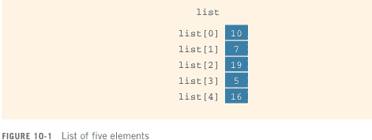

- **迭代1：** 对 `list[0]...list[4]` 排序。图10-2显示了在第一次迭代中列表元素如何重新排列。

  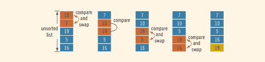

  **图10-2** 第一次迭代期间的列表元素

  第一次迭代结束后，最大的元素位于最后一个位置。因此，在下一次迭代中，我们考虑 `list[0]...list[3]`。

- **迭代2：** 对 `list[0]...list[3]` 排序。图10-3显示了在第二次迭代中列表元素如何重新排列。

  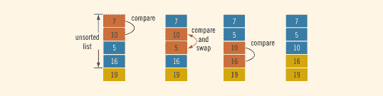

  **图10-3** 第二次迭代期间的列表元素

  与第一次迭代一样，元素会被比较并交换。这里只考虑列表元素 list[0] 到 list[3]。第二次迭代结束后，最后两个元素位于正确的位置。因此，在下一次迭代中，我们考虑 `list[0]...list[2]`。

- **迭代3：** 对 `list[0]...list[2]` 排序。图10-4显示了在第三次迭代中列表元素如何重新排列。

  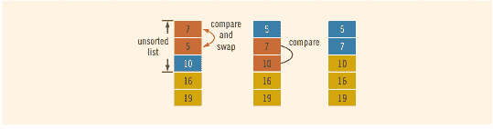

  **图10-4** 第三次迭代期间的列表元素

  第三次迭代结束后，最后三个元素位于正确的位置。因此，在下一次迭代中，我们考虑 `list[0]...list[1]`。

- **迭代4：** 对 `list[0]...list[1]` 排序。图10-5显示了在第四次迭代中列表元素如何重新排列。

  

  **图10-5** 第四次迭代期间的列表元素

第四次迭代结束后，列表已经排好序。

以下函数实现了冒泡排序算法：

```c
void bubbleSort(int list[], int length)
{
    int temp;
    int iteration;
    int index;
    for (iteration = 1; iteration < length; iteration++)
    {
        for (index = 0; index < length - iteration; index++)
            if (list[index] > list[index + 1])
            {
                temp = list[index];
                list[index] = list[index + 1];
                list[index + 1] = temp;
            }
    }
}
```

示例10-1中的程序演示了如何在程序中使用冒泡排序算法。

### 示例10-1

```cpp
//Bubble sort

#include <iostream>

using namespace std;

void bubbleSort(int list[], int length);

int main()
{
    int list[] = {2, 56, 34, 25, 73, 46, 89, 10, 5, 16};  //Line 1
    int i;                                                   //Line 2

    bubbleSort(list, 10);                                    //Line 3

    cout << "After sorting, the list elements are:"
         << endl;                                            //Line 4

    for (i = 0; i < 10; i++)                                //Line 5
        cout << list[i] << " ";                             //Line 6

    cout << endl;                                             //Line 7

    return 0;                                                 //Line 8
}

//Place the definition of the function bubbleSort given
//previously here.
```

**示例运行结果：**

After sorting, the list elements are:  
2 5 10 16 25 34 46 56 73 89

第1行的语句声明并初始化`list`为一个包含10个`int`类型分量的数组。第3行的语句使用函数bubbleSort对`list`进行排序。注意，`list`及其长度（其中元素的数量，即10）都作为参数传递给了函数bubbleSort。第5行和第6行的for循环输出`list`的元素。

为了在该程序中演示冒泡排序算法，我们声明并初始化了数组list。但是，您也可以提示用户在程序执行期间输入数据。

对于包含n个元素的列表，前面给出的冒泡排序恰好会进行 \(\frac{n(n-1)}{2}\) 次关键比较，并且平均会进行约 \(\frac{n(n-1)}{4}\) 次项赋值。因此，如果 n = 1000，冒泡排序要排序该列表，大约需要进行500,000次关键比较和约250,000次项赋值。下一节将介绍选择排序算法，该算法可以减少项赋值的次数。

> 如果在某次迭代中发现没有发生元素交换，就立即停止排序过程，则可以提高冒泡排序的性能。在这种情况下，列表已经排好序了。请参阅本章末尾的练习12和编程练习17。

## 选择排序

本节介绍另一种排序算法，称为**选择排序**。

顾名思义，在**选择排序**算法中，我们通过选择列表中的一个元素并将其移动到正确位置来重新排列列表。该算法会找出列表未排序部分中最小元素的位置，并将其移动到列表未排序部分的顶部。第一次，我们找出整个列表中的最小项。第二次，我们从列表的第二个元素开始找出剩余列表中的最小项，依此类推。

假设你有如图10-6所示的列表。

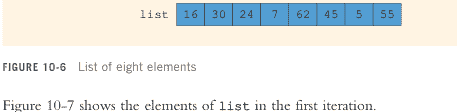

图10-6 包含八个元素的列表

图10-7显示了第一次迭代中`list`的元素。

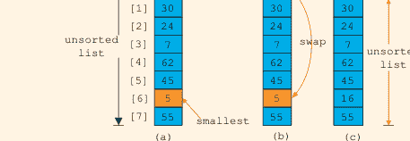

图10-7 第一次迭代期间`list`的元素


```
for (index = 0; index < length - 1; index++)
{
    a. Find the location, smallestIndex, of the smallest element in
       list[index]...list[length - 1]
    b. Swap the smallest element with list[index]. That is, swap
       list[smallestIndex] with list[index].
}
```

第一次循环时，我们在 list[0]...list[length - 1] 中找到最小元素，并将该最小元素与 list[0] 交换。第二次循环时，我们在 list[1]...list[length - 1] 中找到最小元素，并将该最小元素与 list[1] 交换，依此类推。

步骤 a 类似于第 9 章讨论的查找列表中最大项索引的算法。（另见第 9 章编程练习 2。）这里，我们查找列表中最小项的索引。步骤 a 的一般形式为：

```
smallestIndex = index; // assume first element is the smallest

for (location = index + 1; location < length; location++)
    if (list[location] < list[smallestIndex])
        smallestIndex = location; // current element in the list
                                  // is smaller than the smallest so
                                  // far, so update smallestIndex
```

步骤 b 将 list[smallestIndex] 的内容与 list[index] 交换。以下语句完成此任务：

```
temp = list[smallestIndex];
list[smallestIndex] = list[index];
list[index] = temp;
```

由此可知，交换这些值需要进行三次元素赋值。以下函数 selectionSort 实现了选择排序算法：

```
void selectionSort(int list[], int length)
{
    int index;
    int smallestIndex;
    int location;
    int temp;

    for (index = 0; index < length - 1; index++)
    {
        // Step a
        smallestIndex = index;

        for (location = index + 1; location < length; location++)
            if (list[location] < list[smallestIndex])
                smallestIndex = location;

        // Step b
        temp = list[smallestIndex];
        list[smallestIndex] = list[index];
        list[index] = temp;
    }
}
```

示例 10-3 中的程序说明了如何在程序中使用选择排序算法。

### 示例 10-3

```
// Selection sort

#include <iostream>

using namespace std;

void selectionSort(int list[], int length);

int main()
{
    int list[] = {2, 56, 34, 25, 73, 46, 89, 10, 5, 16}; // Line 1
    int i; // Line 2

    selectionSort(list, 10); // Line 3

    cout << "After sorting, the list elements are:"
         << endl; // Line 4
    for (i = 0; i < 10; i++) // Line 5
        cout << list[i] << " "; // Line 6

    cout << endl; // Line 7

    return 0; // Line 8
}

// place the definition of the function selectionSort given
// previously here.
```

### 示例运行：

```
After sorting, the list elements are:
2 5 10 16 25 34 46 56 73 89
```

该程序的工作方式与示例 10-1 中的程序相同。这里，我们使用选择排序算法对列表进行排序。

对于长度为 *n* 的列表，选择排序恰好进行 $\frac{n(n-1)}{2}$ 次关键字比较和 $3(n-1)$ 次元素赋值。因此，如果 $n = 1000$，那么为了对该列表排序，选择排序大约进行 500,000 次关键字比较和约 3000 次元素赋值。下一节将介绍减少比较次数的插入排序算法。

## 插入排序

如上一节所述，对于长度为 1000 的列表，冒泡排序和选择排序都会进行大约 500,000 次关键字比较，这个数字相当高。本节介绍一种称为插入排序的排序算法，它试图改善——也就是减少——关键字比较的次数。

插入排序算法通过将每个元素移动到其正确位置来对列表排序。考虑图 10-9 中给出的列表。


**图 10-9** 列表

该列表的长度为 8。此外，列表元素 list[0]、list[1]、list[2] 和 list[3] 已经按（升序）排列。也就是说，list[0]...list[3] 已排序（见图 10-10）。

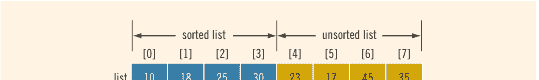

**图 10-10** 列表的已排序部分和未排序部分

接下来，我们考虑元素 list[4]，它是未排序列表的第一个元素。因为 list[4] < list[3]，所以需要将元素 list[4] 移动到其正确位置。因此，元素 list[4] 应移动到 list[2]（见图 10-11）。

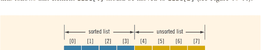

**图 10-11** 将 list[4] 移动到 list[2]

要将 `list[4]` 移动到 `list[2]`，首先将 `list[4]` 复制到临时内存空间 `temp` 中（见图 10-12）。

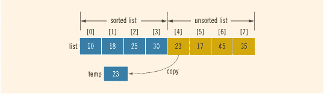

**图 10-12** 将 `list[4]` 复制到 `temp`

接下来，我们将 `list[3]` 复制到 `list[4]`，然后将 `list[2]` 复制到 `list[3]`（见图 10-13）。

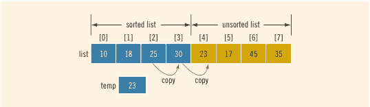

**图 10-13** 在将 `list[3]` 复制到 `list[4]`、然后将 `list[2]` 复制到 `list[3]` 之前的 `list`

在将 `list[3]` 复制到 `list[4]`、并将 `list[2]` 复制到 `list[3]` 之后，列表如图 10-14 所示。

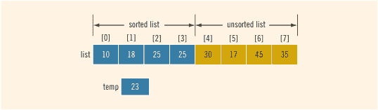

**图 10-14** 在将 `list[3]` 复制到 `list[4]`、然后将 `list[2]` 复制到 `list[3]` 之后的 `list`

现在我们将 temp 复制到 list[2]。图 10-15 显示了结果列表。

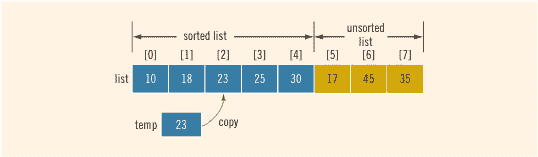

**图 10-15** 将 temp 复制到 list[2] 后的列表

现在 list[0]...list[4] 已排序，而 list[5]...list[7] 未排序。我们对结果列表重复此过程：将未排序列表的第一个元素移动到已排序列表中的正确位置。

从上述讨论可以看出，在排序阶段，包含该列表的数组被分为两个子列表：已排序子列表和未排序子列表。已排序子列表中的元素是有序的；未排序子列表中的元素将逐个移动到已排序子列表中的正确位置。我们使用一个索引——例如 firstOutOfOrder——指向未排序子列表中的第一个元素。最初，firstOutOfOrder 初始化为 1。

上述讨论可转化为以下伪代码：

```
for (firstOutOfOrder = 1; firstOutOfOrder < listLength;
                         firstOutOfOrder++)
    if (list[firstOutOfOrder] is less than list[firstOutOfOrder - 1])
    {
        copy list[firstOutOfOrder] into temp

        initialize location to firstOutOfOrder

        do
        {
            a. copy list[location - 1] into list[location]
            b. decrement location by 1 to consider the next element
               in the sorted portion of the array
        }
        while (location > 0 && the element in the sorted list at
                               location - 1 is greater than temp)

        copy temp into list[location]
    }
```

以下 C++ 函数实现了前面的算法：

```
void insertionSort(int list[], int listLength)
```

二分查找使用“分而治之”技术来搜索列表。首先，将查找项与列表的中间元素进行比较。如果查找项小于列表的中间元素，我们将搜索限制在列表的下半部分；否则，我们搜索列表的上半部分。

考虑以下长度为 12 的有序列表，如图 10-16 所示。


**图 10-16** 长度为 12 的列表

假设我们要确定 75 是否在列表中。最初，整个列表就是搜索列表（见图 10-17）。


**图 10-17** 搜索列表，list[0]...list[11]

首先，我们将 75 与列表中的中间元素 list[5]（其值为 39）进行比较。由于 75 ≠ list[5] 且 75 > list[5]，接下来我们将搜索限制在 list[6]...list[11]，如图 10-18 所示。


**图 10-18** 搜索列表，list[6]...list[11]

现在对 list[6]...list[11] 重复上述过程，这是一个长度为 6 的列表。

由于我们经常需要确定列表的中间元素，二分查找算法通常针对基于数组的列表实现。为了确定……的中间元素

列表中，我们将搜索列表的起始索引**first**和结束索引**last**相加，然后除以2来计算其中间索引。也就是说，\(mid = \frac{first + last}{2}\)。初始时，`first = 0`，并且（由于C++数组索引从0开始，`listLength`表示列表中的元素个数）`last = listLength - 1`。（注意，无论列表中的元素个数是偶数还是奇数，计算中间元素的这个公式都成立。）

下面的C++函数实现了二分查找算法。如果在列表中找到该项，则返回其位置。如果查找项不在列表中，则返回−1。

```cpp
int binarySearch(const int list[], int listLength, int searchItem)
{
    int first = 0;
    int last = listLength - 1;
    int mid;

    bool found = false;

    while (first <= last && !found)
    {
        mid = (first + last) / 2;

        if (list[mid] == searchItem)
            found = true;
        else if (list[mid] > searchItem)
            last = mid - 1;
        else
            first = mid + 1;
    }

    if (found)
        return mid;
    else
        return -1;
} // end binarySearch
```

注意，在二分查找算法中，每次循环都要进行两次关键（项）比较，除非是成功的情况——循环的最后一次——此时只进行一次关键比较。

接下来，我们在图10-19所示的列表上逐步演示二分查找算法。


**图10-19**  用于二分查找的有序列表

图10-19中列表的大小为12，因此`listLength = 12`。假设我们要查找的项是89，所以`searchItem = 89`。在执行while循环之前，first = 0，last = 11，found = false。下面我们跟踪while循环的执行，展示每次迭代中first、last、mid的值以及关键比较的次数。

| 迭代 | first | last | mid | list[mid] | 关键比较次数 |
|---|---:|---:|---:|---:|---:|
| 1 | 0 | 11 | 5 | 39 | 2 |
| 2 | 6 | 11 | 8 | 66 | 2 |
| 3 | 9 | 11 | 10 | 89 | 1（found为true） |

该项在位置10处找到，关键比较总次数为5。

接下来，让我们在列表中查找34，因此`searchItem = 34`。在执行while循环之前，first = 0，last = 11，found = false。与之前一样，下面我们跟踪while循环的执行，展示每次迭代中first、last、mid的值以及关键比较的次数。

| 迭代 | first | last | mid | list[mid] | 关键比较次数 |
|---|---:|---:|---:|---:|---:|
| 1 | 0 | 11 | 5 | 39 | 2 |
| 2 | 0 | 4 | 2 | 19 | 2 |
| 3 | 3 | 4 | 3 | 25 | 2 |
| 4 | 4 | 4 | 4 | 34 | 1（found为true） |

该项在位置4处找到，关键比较总次数为7。

现在让我们查找22，因此`searchItem = 22`。在执行while循环之前，first = 0，last = 11，found = false。与之前一样，下面我们跟踪while循环的执行，展示每次迭代中first、last、mid的值以及关键比较的次数。

| 迭代 | first | last | mid | list[mid] | 关键比较次数 |
|---|---:|---:|---:|---:|---:|
| 1 | 0 | 11 | 5 | 39 | 2 |
| 2 | 0 | 4 | 2 | 19 | 2 |
| 3 | 3 | 4 | 3 | 25 | 2 |
| 4 | 3 | 2 |  |  | 循环停止（因为first > last）；查找失败 |

这是一次不成功的查找。关键比较总次数为6。

从这些二分查找算法的跟踪过程可以看出，每次循环都会将子列表的大小减半。也就是说，下一次循环时你要搜索的子列表大小是上一次子列表的一半。

我们把它留作练习，请你编写一个程序来测试binarySearch函数。请参阅本章末尾的编程练习2。

## 二分查找的性能

假设L是一个大小为1024的有序列表，我们想确定一个项x是否在L中。根据二分查找算法，while循环的每次迭代都会将搜索列表的大小减半。（例如，参见图10-17和图10-18。）因为1024 = 2^{10}，所以while循环最多需要11次迭代来确定x是否在L中。由于while循环的每次迭代都会进行两次项（关键）比较，即x与L中的元素比较两次，因此二分查找最多需要22次比较来确定x是否在L中。另一方面，回顾一下，顺序查找平均需要512次比较来确定x是否在L中。

为了更好地理解二分查找相比顺序查找有多快，假设L的大小为1048576。因为1048576 = 2^{20}，所以二分查找中的while循环最多需要21次迭代来确定一个元素是否在L中。while循环的每次迭代都会进行两次关键（即项）比较。因此，要确定一个元素是否在L中，二分查找最多需要进行42次项比较。

注意，40 = 2 * 20 = 2 * log_2(2^{20}) = 2 * log_2(1048576)。

一般而言，假设L是一个大小为n的有序列表。进一步假设n是2的幂，即对于某个非负整数m，n = 2^m。while循环每次迭代之后，大约剩下一半的元素需要搜索，也就是说，下一次迭代的搜索子列表大小是当前子列表的一半。例如，第一次迭代后，搜索子列表的大小约为n/2 = 2^{m-1}。不难看出，while循环的最大迭代次数约为m + 1。同时m = log_2n。每次迭代进行两次关键比较。因此，确定一个元素x是否在L中的最大比较次数为2(m + 1) = 2(log_2n + 1) = 2log_2n + 2。

## vector 类型（类）

> 注意：本节可以跳过，不会导致任何不连贯。

第9章和本章前面几节描述了如何使用数组来实现和处理列表。到目前为止所讨论的数组的一个局限性是，一旦创建了数组，其大小就固定不变。这意味着数组中只能存储固定数量的元素。此外，在数组的特定位置插入元素可能需要移动数组中的元素。类似地，从数组中删除元素也可能需要移动数组中的元素，因为我们通常不会在存有数据的数组位置之间留下空位。通常，数组的空位在末尾。

除了数组之外，C++还提供了vector类型（通常称为vector类）来实现列表。使用vector类型声明的变量称为vector容器（或vector、vector对象，或简称为对象）。与数组不同，vector对象的大小在程序执行期间可以增大和缩小。因此，你无需担心数据元素的数量。

当你声明一个vector对象时，必须指定该vector对象存储的元素类型。表10-1描述了声明vector对象的多种方式。

**表10-1** 声明和初始化vector对象的各种方式

| 语句 | 作用 |
|---|---|
| `vector<elemType> vecList;` | 创建不包含任何元素的空vector对象vecList。 |
| `vector<elemType> vecList(otherVecList);` | 创建vector对象vecList，并用vector otherVecList的元素初始化vecList。vecList和otherVecList类型相同。 |
| `vector<elemType> vecList(size);` | 创建大小为size的vector对象vecList。vecList使用默认值初始化。 |
| `vector<elemType> vecList(n, elem);` | 创建大小为n的vector对象vecList。vecList使用元素elem的n个副本初始化。 |

在表10-1中，elemType指定要存储在vecList中的元素的数据类型。

### 示例10-3

- a. 下面的语句将intList声明为一个空的vector对象，元素类型为`int`。

```cpp
vector<int> intList;
```

- b. 下面的语句将intList声明为大小为10的vector对象，元素类型为`int`。intList的元素被初始化为0。

```cpp
vector<int> intList(10);
```


既然我们已经知道如何声明一个 `vector` 对象，接下来讨论如何操作存储在 `vector` 对象中的数据。为此，我们必须了解以下基本操作：

- 插入元素
- 删除元素
- 遍历 `vector` 容器中的元素

类型 `vector` 提供了多种操作来操纵存储在 `vector` 对象中的数据。这些操作都以函数的形式定义。表 10-2 描述了其中一些函数以及如何将它们用于 `vector` 对象。（假设 `vecList` 是一个 `vector` 对象。函数名以**粗体**显示。）

表 10-2 对 `vector` 对象的操作

| 表达式 | 作用 |
| --- | --- |
| `vecList.at(index)` | 返回由 `index` 指定位置处的元素。 |
| `vecList[index]` | 返回由 `index` 指定位置处的元素。 |
| `vecList.front()` | 返回第一个元素。（不检查对象是否为空。） |
| `vecList.back()` | 返回最后一个元素。（不检查对象是否为空。） |
| `vecList.clear()` | 从对象中删除所有元素。 |
| `vecList.push_back(elem)` | 将 `elem` 的副本插入到 `vecList` 的末尾。 |
| `vecList.pop_back()` | 删除 `vecList` 的最后一个元素。 |
| `vecList.empty()` | 如果对象 `vecList` 为空，则返回 `true`，否则返回 `false`。 |
| `vecList.size()` | 返回对象 `vecList` 中当前元素的数量。返回的值是一个无符号 `int` 值。 |
| `vecList.max_size()` | 返回可插入对象 `vecList` 中的最大元素数量。 |

表 10-2 表明，向量中的元素可以像数组中的元素一样处理。（回想一下，在 C++ 中，数组从位置 0 开始。类似地，向量对象中的第一个元素位于位置 0。） （注意，函数 `at` 和下标运算符 `[]` 都返回指定位置处的元素。但是，如果指定位置的位置（即索引）超出范围，函数 `at` 会抛出异常。） （异常将在第 16 章讨论。）

## 示例 10-4

考虑以下语句，它声明 `intList` 为一个大小为 5 的向量，且元素类型为 `int`。

```cpp
vector<int> intList(5);
```

可以使用如下循环将元素存储到 `intList` 中：

```cpp
for (int j = 0; j < 5; j++)
    intList[j] = j;
```

类似地，可以使用 `for` 循环输出 `intList` 的元素。

示例 10-4 使用 `for` 循环和数组下标运算符 `[]` 来访问 `intList` 的元素。我们声明 `intList` 为一个大小为 5 的向量对象。这是否意味着我们只能在 `intList` 中存储五个元素？答案是否定的。事实上，可以向 `intList` 中添加更多元素。然而，因为我们在声明 `intList` 时指定大小为 5，所以为了添加位置 4 之后的任何元素，我们使用函数 `push_back`。

此外，如果最初声明一个向量对象且未指定其大小，那么要向该向量对象添加元素，我们使用函数 `push_back`。示例 10-5 说明了如何使用此函数。

## 示例 10-5

以下语句声明 `intList` 为一个大小为 0 的向量容器：

```cpp
vector<int> intList;
```

要向 `intList` 中添加元素，我们可以按如下方式使用函数 `push_back`：

```cpp
intList.push_back(34);
intList.push_back(55);
```

这些语句执行后，`intList` 的大小为 2，并且：

```cpp
intList = {34, 55}.
```

在示例 10-5 中，因为 `intList` 被声明为大小为 0，所以我们使用函数 `push_back` 向 `intList` 中添加元素。然而，我们也可以使用 `resize` 函数增大 `intList` 的大小，然后使用数组下标运算符。例如，假设 `intList` 如示例 10-5 中那样声明。那么，以下语句将 `intList` 的大小设置为 10：

```cpp
intList.resize(10);
```

类似地，以下语句将 `intList` 的大小增加 10：

```cpp
intList.resize(intList.size() + 10);
```

然而，有时 `push_back` 函数更方便，因为它不需要知道向量的大小；它只是将元素添加到末尾。

> **注意**  
> 包含 `class vector` 的头文件名为 `vector`。因此，要使用 `class vector`，必须包含头文件 `vector`，即，在程序中包含以下语句：
>
> ```cpp
> #include <vector>
> ```

示例 10-6 中的程序说明了如何在程序中使用向量对象以及如何处理向量的元素。

## 示例 10-6

```cpp
// This program illustrates how to use a vector object.

#include <iostream>
#include <vector>

using namespace std;

int main()
{
    vector<int> intList;                         //Line 1
    unsigned int i;                              //Line 2

    intList.push_back(13);                       //Line 3
    intList.push_back(75);                       //Line 4
    intList.push_back(28);                       //Line 5
    intList.push_back(35);                       //Line 6

    cout << "Line 7: List Elements: ";           //Line 7

    for (i = 0; i < intList.size(); i++)
        cout << intList[i] << " ";               //Line 9
    cout << endl;                                //Line 10

    for (i = 0; i < intList.size(); i++)         //Line 11
        intList[i] = intList[i] * 2;              //Line 12

    cout << "Line 13: List Elements: ";          //Line 13

    for (i = 0; i < intList.size(); i++)         //Line 14
        cout << intList[i] << " ";               //Line 15

    cout << endl;                                //Line 16

    return 0;
}
```

### 示例运行：

```text
Line 7: List Elements: 13 75 28 35
Line 13: List Elements: 26 150 56 70
```

第 1 行的语句声明了类型为 `int` 的向量对象（简称向量）`intList`。第 2 行的语句声明 `i` 为一个 `unsigned int` 变量。（注意，我们将 `i` 声明为 `unsigned int`，因为在 `for` 循环中，我们使用表达式 `intList.size()` 来确定 `intList` 的大小，而它返回一个 `unsigned int` 值。）

第 3 行到第 6 行的语句使用 `push_back` 操作将四个数字——13、75、28 和 35——插入 `intList`。第 8 行和第 9 行的语句使用 `for` 循环和数组下标运算符 `[ ]` 输出 `intList` 的元素。在输出中，参见标有 Line 7 的那一行，它包含程序第 7 行到第 10 行的输出。第 11 行和第 12 行的语句使用 `for` 循环将 `intList` 的每个元素的值加倍；第 14 行和第 15 行的语句输出 `intList` 的元素。在输出中，参见标有 Line 13 的那一行，它包含程序第 13 行到第 16 行的输出。

> **注意** 数据类型（类）`vector` 是 C++ 标准模板库（STL）的一部分。要了解更多关于 STL 的内容，请参见附录 H。

## 编程示例：选举结果

你所在大学的学生会主席选举即将举行。出于保密原因，选举委员会主席希望将投票计算机化。主席正在找人编写一个程序来分析数据并报告获胜者。让我们编写一个程序来帮助选举委员会。

该大学有四个主要分区，每个分区有若干个系。为选举目的，这些分区被标记为区域 1、区域 2、区域 3 和区域 4。每个分区中的每个系管理自己的投票过程，并直接向选举委员会报告结果。投票结果按以下格式报告：

```text
candidateName  regionNumber  numberOfVotesForTheCandidate
```

在本程序中，我们必须做的第一件事是从输入文件 `candData.txt` 中读取候选人姓名到数组 `candidatesName` 中。一旦候选人姓名存储到数组中，我们必须对其排序。

接下来，我们必须处理投票数据。文件 `voteData.txt` 中的每个条目包含 candidateName、regionNumber 和 votesReceivedByTheCandidate。为处理每个条目，我们在数组 votesByRegion 中找到相应条目，并通过将 votesReceivedByTheCandidate 加到该条目来更新它。因此，数组 votesByRegion 必须初始化为零。（本节后面将详细描述投票数据的处理。）

处理完投票数据后，下一步是计算每位候选人获得的总票数。此任务通过将每个区域获得的票数相加来完成。因此，我们必须将数组 `totalVotes` 初始化为零。最后，我们按前面所示输出结果。

上述讨论可转化为以下算法：

- 1. 将候选人姓名读入数组 `candidatesName`。
- 2. 对数组 `candidatesName` 排序。
- 3. 初始化数组 `votesByRegion` 和 `totalVotes`。
- 4. 处理投票数据。
- 5. 计算每位候选人获得的总票数。
- 6. 输出结果。

由于输入数据在两个单独的文件中提供，因此在本程序中必须打开两个文件。我们在函数 main 中打开这两个输入文件。

为实现算法的这六个步骤，本程序由若干函数组成，如下所述。

### 函数 `getCandidatesName`

此函数从输入文件 `candData.txt` 读取数据，并填充数组 `candidatesName`。输入文件在函数 main 中打开。我们可以看到，此函数有三个参数：一个对应于输入文件，一个对应于数组 `candidatesName`，还有一个用于传入数组 `candidatesName` 的行数。本质上，这个函数是：

```cpp
void getCandidatesName(ifstream& inp, string cNames[],
                       int noOfRows)
{
    int i;

    for (i = 0; i < noOfRows; i++)
        inp >> cNames[i];
}
```


调用此函数后，用于保存数据的数组如图 10-21 所示。


图 10-21 读取候选人姓名后的数组 candidatesName、votesByRegion 和 totalVotes

### 函数 sortCandidatesName

该函数使用选择排序算法对数组 candidatesName 进行排序。该函数有两个参数：一个对应于数组 candidatesName，另一个用于传递数组 candidatesName 的行数。本质上，该函数为：

```cpp
void sortCandidatesName(string cNames[], int noOfRows)
{
    int i, j;
    int min;

    //selection sort
    for (i = 0; i < noOfRows - 1; i++)
    {
        min = i;

        for (j = i + 1; j < noOfRows; j++)
            if (cNames[j] < cNames[min])
                min = j;

        cNames[i].swap(cNames[min]);
    }
}
```

调用此函数后，数组如图 10-22 所示。

| candidatesName | votesByRegion 行 | votesByRegion[0] | votesByRegion[1] | votesByRegion[2] | votesByRegion[3] | totalVotes 行 | totalVotes |
|---|---|---|---|---|---|---|---|
| [0] Ashley | [0] |  |  |  |  | [0] |  |
| [1] Danny | [1] |  |  |  |  | [1] |  |
| [2] Donald | [2] |  |  |  |  | [2] |  |
| [3] Mia | [3] |  |  |  |  | [3] |  |
| [4] Mickey | [4] |  |  |  |  | [4] |  |
| [5] Peter | [5] |  |  |  |  | [5] |  |

图 10-22 排序姓名后的数组 candidatesName、votesByRegion 和 totalVotes

### 函数 initialize

函数 initialize 将数组 votesByRegion 和 totalVotes 初始化为零。该函数必须有三个参数：一个对应于数组 votesByRegion，一个对应于数组 totalVotes，另一个用于传递数组 votesByRegion 的行数。注意，两个数组的行数相同。该函数的定义如下：

```c
void initialize(int vbRegion[][NO_OF_REGIONS], int tVotes[],
                int noOfRows)
{
    int i, j;

    for (i = 0; i < noOfRows; i++)
        for (j = 0; j < NO_OF_REGIONS; j++)
            vbRegion[i][j] = 0;

    for (i = 0; i < noOfRows; i++)
        tVotes[i] = 0;
}
```

调用此函数后，数组 votesByRegion 和 totalVotes 如图 10-23 所示。


*图 10-23* 初始化后的数组 `candidatesName`、`votesByRegion` 和 `totalVotes`

### 处理

处理投票数据相当直接。文件 `voteData.txt` 中的每个条目格式如下：

`candidateName regionNumber numberOfVotesForTheCandidate`

处理投票数据的通用算法如下。对于文件 `voteData.txt` 中的每个条目，我们执行以下操作：

- a. 获取 `candidateName`、`regionNumber` 和 `numberOfVotesForTheCandidate`。
- b. 在数组 `candidatesName` 中找到与该候选人对应的行号。这给出了该候选人在数组 `votesByRegion` 中对应的行号。
- c. 在数组 `votesByRegion` 中找到与 `regionNumber` 对应的列。
- d. 通过加上 `numberOfVotesForTheCandidate` 来更新数组 `votesByRegion` 中的相应条目。

步骤 b 要求我们搜索数组 `candidatesName`，以找到特定候选人的位置（即行号）。因为数组 `candidatesName` 已排序，所以我们可以使用二分查找算法来找到对应特定候选人的行号。因此，该程序还包含一个函数 `binSearch`，用于在数组 `candidatesName` 上实现二分查找算法。我们稍后将编写函数 `binSearch` 的定义。首先，让我们讨论如何更新数组 `votesByRegion`。

假设这三个数组如图 10-24 所示。


图 10-24 数组 candidatesName、votesByRegion 和 totalVotes

此外，假设从输入文件读取的下一个条目是：

Donald 2 35

我们必须定位网格中与该候选人对应的行。为了找到该行，我们搜索数组 candidatesName，以找到与该姓名对应的行。Donald 对应数组 candidatesName 中的第 2 行（见图 10-25）。


图 10-25 Donald 和区域 = 2 的位置

为了处理该条目，我们访问数组 votesByRegion 的第 2 行。因为 Donald 从区域 2 获得了 35 票，所以我们访问第 2 行和第 1 列（即 votesByRegion[2][1]），并通过在其先前值上加 35 来更新该条目。以下语句完成此任务：

```
votesByRegion[2][1] = votesByRegion[2][1] + 35;
```

处理该条目后，三个数组如图 10-26 所示。

Donald；区域 = 2

| candidatesName | votesByRegion[0] | votesByRegion[1] | votesByRegion[2] | votesByRegion[3] | totalVotes |
|---|---|---|---|---|---|
| [0] Ashley | 0 | 0 | 50 | 0 | 0 |
| [1] Danny | 10 | 0 | 56 | 0 | 0 |
| [2] Donald | 76 | 48 | 0 | 0 | 0 |
| [3] Mia | 0 | 45 | 0 | 0 | 0 |
| [4] Mickey | 50 | 0 | 45 | 0 | 0 |
| [5] Peter | 100 | 0 | 0 | 28 | 0 |

图 10-26 处理条目 Donald 2 35 后的数组 candidatesName、votesByRegion 和 totalVotes

接下来，我们描述用于处理投票数据的函数 binSearch 和函数 processVotes。

### 函数 binSearch

该函数在数组 candidatesName 上实现二分查找算法。它类似于本章前面讨论的函数 binarySearch。其定义如下：

```c
int binSearch(string cNames[], int noOfRows, string name)
{
    int first, last, mid;
    bool found;
    first = 0;
    last = noOfRows - 1;
    found = false;

    while (!found && first <= last)
    {
        mid = (first + last) / 2;

        if (cNames[mid] == name)
            found = true;
        else if (cNames[mid] > name)
            last = mid - 1;
        else
            first = mid + 1;
    }

    if (found)
        return mid;
    else
        return -1;
}
```

### 函数 processVotes

该函数处理投票数据。显然，它必须能够访问数组 `candidatesName` 和 `votesByRegion`，以及输入文件 `voteData.txt`。我们还需要告诉该函数每个数组的行数。因此，函数 `processVotes` 有四个参数：一个用于访问输入文件 `voteData.txt`，一个对应于数组 `candidatesName`，一个对应于数组 `votesByRegion`，另一个用于传递每个数组的行数。该函数的定义如下：

```cpp
void processVotes(ifstream& inp, string cNames[],
                  int vbRegion[][NO_OF_REGIONS],
                  int noOfRows)
{
    string candName;
    int region;
    int noOfVotes;
    int loc;

    inp >> candName >> region >> noOfVotes;

    while (inp)
    {
        loc = binSearch(cNames, noOfRows, candName);

        if (loc != -1)
            vbRegion[loc][region - 1] = vbRegion[loc][region - 1]
                                           + noOfVotes;
        inp >> candName >> region >> noOfVotes;
    }
}
```

## 计算总票数（函数 addRegionsVote）

处理投票数据后，下一步是计算每位候选人的总票数。假设处理投票数据后，数组如图 10-27 所示。

| candidatesName | votesByRegion [0] | [1] | [2] | [3] | totalVotes |
|---|---:|---:|---:|---:|---:|
| [0] Ashley | 23 | 89 | 0 | 160 | 0 |
| [1] Danny | 25 | 1 | 89 | 97 | 0 |
| [2] Donald | 110 | 158 | 0 | 0 | 0 |
| [3] Mia | 134 | 112 | 156 | 0 | 0 |
| [4] Mickey | 56 | 63 | 67 | 99 | 0 |
| [5] Peter | 207 | 56 | 0 | 46 | 0 |

**图 10-27** 处理投票数据后的数组 candidatesName、votesByRegion 和 totalVotes

计算每位候选人获得的总票数后，三个数组如图 10-28 所示。

| candidatesName | votesByRegion [0] | [1] | [2] | [3] | totalVotes |
|---|---:|---:|---:|---:|---:|
| [0] Ashley | 23 | 89 | 0 | 160 | 272 |
| [1] Danny | 25 | 1 | 89 | 97 | 232 |
| [2] Donald | 110 | 158 | 0 | 0 | 268 |
| [3] Mia | 134 | 112 | 156 | 0 | 402 |
| [4] Mickey | 56 | 63 | 67 | 99 | 275 |
| [5] Peter | 207 | 56 | 0 | 46 | 309 |

**图 10-28** 计算每位候选人获得的总票数后的数组 candidatesName、votesByRegion 和 totalVotes

为了计算每位候选人获得的总票数，我们将 votesByRegion 数组中每一行的内容相加，然后将总和存入 totalVotes 数组中对应的行。该任务由函数 addRegionsVote 完成。

函数 addRegionsVote 计算每位候选人获得的总票数。该函数必须访问数组 votesByRegion 和 totalVotes。此外，我们还必须告诉该函数每个数组的行数。该函数有三个参数：一个对应于数组 votesByRegion，一个对应于数组 totalVotes，另一个用于传递每个数组的行数。该函数的定义如下：


```cpp
void addRegionsVote(int vbRegion[][NO_OF_REGIONS],
                     int tVotes[], int noOfRows)
{
    int i, j;

    for (i = 0; i < noOfRows; i++)
        for (j = 0; j < NO_OF_REGIONS; j++)
            tVotes[i] += vbRegion[i][j];
}
```

现在我们介绍获得所需输出所需的其余函数。

### 函数 printHeading

该函数输出输入内容的前四行，因此包含若干输出语句。该函数的定义如下：

```cpp
void printHeading()
{
    cout << "-------- -------------Election Results----------" << endl;
    cout << "-----" << endl;
    cout << "Candidate                 Votes" << endl;
    cout << "Name       Region1   Region2   Region3" << endl;
    cout << "Region4    Total" << endl;
    cout << "--------  ------   -------   ------  "
         << "-------  ------" << endl;
}
```

### 函数 printResults

该函数输出结果中的其余行。显然，它必须能够访问这三个数组。我们还必须告知该函数每个数组的行数。（注意，每个数组的行数相同。）因此，该函数有四个参数。假设参数 cName 对应 candidatesName，参数 vbRegion 对应 votesByRegion，参数 tVotes 对应 totalVotes。

进一步假设变量 sumVotes 保存选举中投出的总票数，变量 largestVotes 保存某位候选人获得的最高票数，变量 winLoc 保存数组 candidatesName 中获胜候选人的索引。该函数的算法如下：

- a. 将 sumVotes、largestVotes 和 winLoc 初始化为0。
- b. 对于每个数组中的每一行：
  - i. `if (largestVotes < tVotes[i])`
    ```
    {
        largestVotes = tVotes[i];
        winLoc = i;
    }
    ```
  - ii. `sumVotes = sumVotes + tVotes[i];`
  - iii. 输出每个数组相应行的数据。
- c. 输出最后的几行结果。

该函数的定义如下：

```cpp
void printResults(string cNames[],
                 int vbRegion[][NO_OF_REGIONS],
                 int tVotes[], int noOfRows)
{
    int i, j;
    int largestVotes = 0;
    int winLoc = 0;
    int sumVotes = 0;

    for (i = 0; i < noOfRows; i++)
    {
        if (largestVotes < tVotes[i])
        {
            largestVotes = tVotes[i];
            winLoc = i;
        }

        sumVotes = sumVotes + tVotes[i];

        cout << left;
        cout << setw(9) << cNames[i] << " ";
        cout << right;
        for (j = 0; j < NO_OF_REGIONS; j++)
            cout << setw(8) << vbRegion[i][j] << " ";
        cout << setw(6) << tVotes[i] << endl;
    }

    cout << endl << endl << "Winner: " << cNames[winLoc]
         << ", Votes Received: " << tVotes[winLoc]
         << endl << endl;
    cout << "Total votes polled: " << sumVotes << endl;
}
```

现在我们给出主算法。

假设函数 main 中的变量如下：

```cpp
string candidatesName[NO_OF_CANDIDATES]; //array to store the
                                           //candidate's name
int votesByRegion[NO_OF_CANDIDATES][NO_OF_REGIONS]; //array to
                                                    //hold the voting data by region
int totalVotes[NO_OF_CANDIDATES]; //array to hold the total votes
                                  //received by each candidate

ifstream infile; //input file variable
```

此外，假设候选人姓名位于文件 candData.txt 中，投票数据位于文件 voteData.txt 中。

## 主算法
### 函数 main

1. 声明变量。
2. 打开输入文件 candData.txt。
3. 如果输入文件不存在，则退出程序。
4. 将文件 candData.txt 中的数据读入数组 candidatesName。
5. 对数组 candidatesName 进行排序。
6. 关闭文件 candData.txt 并清除输入流。
7. 打开输入文件 voteData.txt。
8. 如果输入文件不存在，则退出程序。
9. 初始化数组 votesByRegion 和 totalVotes。
10. 处理投票数据并将结果存储在数组 votesByRegion 中。
11. 计算每位候选人获得的总票数并将结果存储在数组 totalVotes 中。
12. 打印标题。
13. 打印结果。

## 程序清单

```cpp
//****************************************************************
// Author: D. S. Malik
//
// This program processes voting data for student council
// president's post. It outputs each candidate's name and the
// votes they received. The name of the winner is also printed.
//****************************************************************

#include <iostream>
#include <fstream>
#include <string>
#include <iomanip>

using namespace std;

const int NO_OF_CANDIDATES = 6;
const int NO_OF_REGIONS = 4;

void printHeading();
void initialize(int vbRegion[][NO_OF_REGIONS], int tVotes[],
                int noOfRows);

void getCandidatesName(ifstream& inp, string cNames[],
                       int noOfRows);

void sortCandidatesName(string cNames[], int noOfRows);

int binSearch(string cNames[], int noOfRows, string name);

void processVotes(ifstream& inp, string cNames[],
                  int vbRegion[][NO_OF_REGIONS],
                  int noOfRows);

void addRegionsVote(int vbRegion[][NO_OF_REGIONS],
                    int tVotes[], int noOfRows);

void printResults(string cNames[],
                  int vbRegion[][NO_OF_REGIONS],
                  int tVotes[], int noOfRows);

int main()
{
        //Declare variables; Step 1
        string candidatesName[NO_OF_CANDIDATES];
        int votesByRegion[NO_OF_CANDIDATES][NO_OF_REGIONS];
        int totalVotes[NO_OF_CANDIDATES];
        ifstream infile;

        infile.open("candData.txt");                         //Step 2
        if (!infile)                                          //Step 3
        {
                cout << "Input file (candData.txt) does "
                     << "not exist." << endl;
                return 1;
        }

        getCandidatesName(infile, candidatesName,
                          NO_OF_CANDIDATES);                  //Step 4
        sortCandidatesName(candidatesName,
                           NO_OF_CANDIDATES);                 //Step 5

        infile.close();                                       //Step 6
        infile.clear();                                       //Step 6

        infile.open("voteData.txt");                         //Step 7
        if (!infile)                                          //Step 8
        {
                cout << "Input file (voteData.txt) does "
                     << "not exist." << endl;
                return 1;
        }

        initialize(votesByRegion, totalVotes,
                   NO_OF_CANDIDATES);                    //Step 9
        processVotes(infile, candidatesName,
                     votesByRegion, NO_OF_CANDIDATES);   //Step 10
        addRegionsVote(votesByRegion, totalVotes,
                       NO_OF_CANDIDATES);                //Step 11
        printHeading();                                  //Step 12
        printResults(candidatesName,votesByRegion,
                     totalVotes, NO_OF_CANDIDATES);      //Step 13

        return 0;
}

//Place the definitions of the functions initialize,
//getCandidatesName, sortCandidatesName, binSearch,
//processVotes, addRegionsVote, printHeading, and
//printResults here.
```

### 示例运行

（在按上述说明将所有函数的定义放入程序并执行之后。）

-------------------选举结果-------------------

**票数**

| 候选人姓名 | 地区1 | 地区2 | 地区3 | 地区4 | 总计 |
|---|---|---|---|---|---|
| Ashley | 23 | 89 | 0 | 160 | 272 |
| Danny | 25 | 71 | 89 | 97 | 282 |
| Donald | 110 | 158 | 0 | 0 | 268 |
| Mia | 134 | 112 | 156 | 0 | 402 |
| Mickey | 56 | 63 | 67 | 89 | 275 |
| Peter | 207 | 56 | 0 | 46 | 309 |

获胜者：Mia，得票数：402

总投票数：1808

### 输入文件

**candData.txt**

- Mia
- Mickey
- Donald
- Peter
- Danny
- Ashley


`votesData.txt`

|  |  |  |
|---|---|---|
| Mia | 2 | 34 |
| Mickey | 1 | 56 |
| Donald | 2 | 56 |
| Mia | 1 | 78 |
| Danny | 4 | 29 |
| Ashley | 4 | 78 |
| Mickey | 2 | 63 |
| Donald | 1 | 23 |
| Peter | 2 | 56 |
| Danny | 1 | 25 |
| Peter | 4 | 23 |
| Danny | 4 | 12 |
| Ashley | 4 | 82 |
| Mickey | 3 | 67 |
| Donald | 2 | 67 |
| Mia | 3 | 67 |
| Ashley | 1 | 23 |
| Mia | 1 | 56 |
| Donald | 2 | 35 |
| Peter | 1 | 27 |
| Danny | 2 | 34 |
| Peter | 4 | 23 |
| Mickey | 4 | 89 |
| Peter | 1 | 23 |
| Danny | 3 | 89 |
| Mia | 3 | 89 |
| Peter | 1 | 67 |
| Danny | 2 | 37 |
| Ashley | 2 | 89 |
| Mia | 2 | 78 |
| Donald | 1 | 87 |
| Peter | 1 | 90 |
| Danny | 4 | 56 |

该程序的完整代码清单可在本书配套网站上获取。

## 快速复习

- 1. 列表是同一类型元素的集合。
- 2. 列表的长度是列表中元素的个数。
- 3. 一维数组是存储和处理列表的便捷场所。
- 4. 顺序查找算法从列表的第一个元素开始，在列表中查找给定项。它继续将查找项与列表中的其他元素进行比较，直到找到该项，或者列表中不再有元素可与查找项比较为止。
- 5. 平均而言，顺序查找会搜索列表的一半。
- 6. 顺序查找仅适用于非常短的列表。
- 7. 要对含 n 个元素的列表（称为 list）排序，冒泡排序算法如下：在 n − 1 次迭代的一系列过程中，依次比较 list 中相邻元素 list[index] 和 list[index + 1]。如果 list[index] 大于 list[index + 1]，则交换元素 list[index] 和 list[index + 1]。
- 8. 对于长度为 n 的列表，本章给出的冒泡排序恰好进行 n(n−1)/2 次关键字比较，平均约进行 n(n−1)/4 次数据项赋值。
- 9. 选择排序通过找到列表中最小的（或等价地，最大的）元素并将其移到列表开头（或末尾）来对列表排序。
- 10. 对于长度为 n 的列表，选择排序恰好进行 n(n−1)/2 次关键字比较和 3(n−1) 次数据项赋值。
- 11. 插入排序算法通过将每个元素移到其正确位置来对列表排序。
- 12. 对于长度为 n 的列表，平均而言，插入排序进行 (n^2 + 3n − 4)/4 次关键字比较，并约进行 n(n−1)/4 次数据项赋值。
- 13. 二分查找比顺序查找快得多。
- 14. 二分查找要求列表元素有序——也就是说，列表必须已排序。
- 15. 对于长度为 1024 的列表，要确定某一项是否在列表中，二分查找算法最多需要 22 次关键字比较。
- 16. 除数组外，C++ 还提供 vector 类型（通常称为 vector 类）来实现列表。
- 17. 与数组不同，vector 对象的大小可以在程序执行期间增大和减小。因此，你无需关心数据元素的个数。
- 18. 声明 vector 对象时，必须指定该 vector 对象存储的元素类型。
- 19. vector 中的元素可以像数组中的元素一样处理。与数组一样，vector 对象中的第一个元素位于位置 0。
- 20. 下列函数可用于对 vector 对象执行各种操作：at、front、back、clear、push_back、pop_back、empty、size、resize 和 max_size。这些函数的说明见表 10-2。

## 练习

- 1. 判断下列陈述为真还是假。
  - a. 对列表进行顺序查找假设列表元素按升序排序。
  - b. 对列表进行二分查找假设列表已排序。
  - c. 二分查找在有序列表上更快，在无序列表上更慢。
  - d. 二分查找在大列表上更快，但顺序查找在小列表上更快。
  - e. 声明一个 vector 对象并将其大小指定为 10 时，该对象只能存储 10 个元素。

- 2. 考虑以下列表：

  63 45 32 98 46 57 28 100

  使用顺序查找，确定下列各项是否在列表中分别需要多少次比较？（回忆一下，比较是指数据项比较，而不是下标比较。）
  - a. 90
  - b. 57
  - c. 63
  - d. 120

- 3.
  - a. 编写顺序查找算法的一个版本，可用于查找有序列表。
  - b. 考虑以下列表：

    5 12 17 35 46 65 78 85 93 110 115

    使用你在 (a) 中设计的有序列表顺序查找，确定下列各项是否在列表中分别需要多少次比较？（回忆一下，比较是指数据项比较，而不是下标比较。）
    - i. 35
    - ii. 60
    - iii. 78
    - iv. 120

- 4. 考虑以下列表：

  2 10 17 45 49 55 68 85 92 98 110

  使用二分查找，确定下列各项是否在列表中分别需要多少次比较？显示 first、last 和 middle 的值，以及循环每次迭代后的比较次数。
  - a. 15
  - b. 49
  - c. 98
  - d. 99

- 5. 使用本章讨论的冒泡排序算法对以下列表排序。显示外层 for 循环每次迭代后的列表。

  26, 45, 17, 65, 33, 55, 12, 18

- 6. 使用本章讨论的选择排序算法对以下列表排序。显示外层 for 循环每次迭代后的列表。

  36, 55, 17, 35, 63, 85, 12, 48, 3, 66

- 7. 考虑以下列表：

  5, 18, 21, 10, 55, 20

  前三个关键字已经有序。使用本章描述的插入排序将 10 移到其正确位置，恰好执行多少次关键字比较？

- 8. 考虑以下列表：

  7, 28, 31, 40, 5, 20

  前四个关键字已经有序。使用本章描述的插入排序将 5 移到其正确位置，恰好执行多少次关键字比较？

- 9. 考虑以下列表：

  28, 18, 21, 10, 25, 30, 12, 71, 32, 58, 15

  该列表将使用本章描述的插入排序算法排序。显示排序阶段六趟之后——即 for 循环六次迭代之后——得到的列表。

- 10. 回顾本章讨论的插入排序算法。假设以下关键字列表：

  18, 8, 11, 9, 15, 20, 32, 61, 22, 48, 75, 83, 35, 3

  使用插入排序对该列表排序，恰好执行多少次关键字比较？

- 11. 假设 L 是含 10,000 个元素的列表。求冒泡排序、选择排序和插入排序对 L 排序平均进行的比较次数。

- 12.
  - a. 本章提到，如果我们在某次迭代中发现没有发生元素交换就立即停止排序过程，冒泡排序的性能可以得到改进。编写一个利用这一事实实现冒泡排序算法的函数。
  - b. 使用你在 (a) 部分设计的算法，求对列表排序所需的迭代次数：65, 14, 52, 43, 75, 25, 80, 90, 95。

- 13. 假设 L 是含 4096 个元素的有序列表。二分查找确定某一项是否在 L 中最多进行多少次比较？

- 14. 假设列表元素按降序排列，需要将其按升序排列。编写一个 C++ 函数，输入为按降序排列的数据项数组和数组元素个数。该函数将数组元素重新排列为升序。你的函数不得包含任何排序算法，也就是说，不应进行任何数据项比较。

- 15. 要在程序中使用 vector 对象，必须在该程序中包含哪个头文件？

- 16. 下列语句分别做什么？
  - a.

    ```cpp
    vector<int> list(50);
    ```

  - b.

    ```cpp
    vector<string> nameList;
    ```

- 17. 下列 C++ 代码的输出是什么？

  ```cpp
  vector<int> intList(5);
  int i;

  for (i = 0; i < 5; i++)
      intList[i] = 2 * i + 1;

  for (i = 0; i < 5; i++)
      cout << intList.at(i) << " ";

  cout << endl;
  ```

- 18. 下列 C++ 代码的输出是什么？

  ```cpp
  vector<string> classList;

  classList.push_back("Nisha");
  classList.push_back("Tonny");
  classList.push_back("Bobby");
  classList.push_back("Peter");

  for (unsigned int i = 0; i < classList.size(); i++)
      cout << classList[i] << " ";

  cout << endl;
  ```

- 19.
  - a. 编写一条 C++ 语句，将 `secretList` 声明为存储整数的 vector 对象。（不要指定 `secretList` 的大小。）
  - b. 编写 C++ 语句，按给定顺序将下列值存入 `secretList`：

    56, 28, 32, 96, 75

  - c. 编写一个 `for` 循环输出 `secretList` 的内容。（使用表达式 `secretList.size()` 确定 `secretList` 的大小。）

- 20. 下列 C++ 代码的输出是什么？

  ```cpp
  vector<int> intList(10);

  for (int i = 0; i < 10; i++)
      intList[i] = 2 * i + 5;

  cout << intList.front() << " " << intList.back() << endl;
  ```

- **21.** 假设有如下 C++ 代码：

  ```cpp
  vector<int> myList(5);

  unsigned int length;

  myList[0] = 3;
  for (int i = 1; i < 4; i++)
      myList[i] = 2 * myList[i - 1] - 5;

  myList.push_back(46);
  myList.push_back(57);
  myList.push_back(35);
  ```

  - a. 编写一条 C++ 语句，输出 myList 的第一个和最后一个元素。（不要使用数组下标运算符或元素索引。）
  - b. 编写一条 C++ 语句，将 myList 的大小存入 length。
  - c. 编写一个 for 循环，输出 myList 的元素。

- **22.** vector 的 size 与 capacity 有什么区别？

## 编程练习

- **1.** 编写一个程序测试函数 seqOrderedSearch。在搜索前使用函数 bubbleSort 或 selectionSort 对列表排序。
- **2.** 编写一个程序测试函数 binarySearch。在搜索前使用函数 bubbleSort 或 selectionSort 对列表排序。
- **3.** 编写一个函数 remove，它接收三个参数：一个整数数组、数组中的元素个数和一个整数（比如 removeItem）。该函数应找到并删除数组中第一次出现的 removeItem。如果该值不存在或数组为空，输出适当消息。（注意，删除元素后，数组中元素个数减 1。）假设数组无序。
- **4.** 编写一个函数 removeAt，它接收三个参数：一个整数数组、数组中的元素个数和一个整数（比如 index）。该函数应删除由 index 指示的数组元素。如果 index 越界或数组为空，输出适当消息。（注意，删除元素后，数组中元素个数减 1。）假设数组无序。
- **5.** 编写一个函数 removeAll，它接收三个参数：一个整数数组、数组中的元素个数和一个整数（比如 removeItem）。该函数应找到并删除数组中所有出现的 removeItem。如果该值不存在或数组为空，输出适当消息。（注意，删除元素后，数组中元素个数会减少。）假设数组无序。
- **6.** 对有序数组重新完成练习 3、4 和 5。
- **7.** 编写一个函数 `insertAt`，它接收四个参数：一个整数数组、数组中的元素个数、一个整数（比如 `insertItem`）和一个整数（比如 `index`）。该函数应将 `insertItem` 插入到数组中由 `index` 指定的位置。如果 `index` 越界，输出适当消息。（注意，`index` 必须介于 0 和数组元素个数之间；即 `0 <= index < 数组中的元素个数`。）假设数组无序。
- **8.** 编写选择排序算法的一个版本，可用于对字符串列表排序。
- **9.** 编写二分搜索算法的一个版本，可用于搜索字符串列表。（使用你在练习 8 中设计的选择排序对列表排序。）
- **10.** 编写顺序搜索算法的一个版本，可用于搜索字符串 vector 对象。同时编写程序测试你的算法。
- **11.** 编写冒泡排序算法的一个版本，可用于对字符串 vector 对象排序。同时编写程序测试你的算法。
- **12.** 编写选择排序算法的一个版本，可用于对字符串 vector 对象排序。同时编写程序测试你的算法。
- **13.** 编写程序测试本章给出的插入排序算法。
- **14.** 编写插入排序算法的一个版本，可用于对字符串 vector 对象排序。同时编写程序测试你的算法。
- **15.** 编写二分搜索算法的一个版本，可用于搜索字符串 vector 对象。同时编写程序测试你的算法。（使用你在编程练习 12 中开发的选择排序算法对该 vector 排序。）
- **16.** 编写一个程序，创建三个相同的数组 `list1`、`list2` 和 `list3`，每个数组有 5000 个元素。然后程序分别使用冒泡排序对 `list1` 排序、使用选择排序对 `list2` 排序、使用插入排序对 `list3` 排序，并输出每种排序算法进行的比较次数和赋值次数。
- **17.** 编写一个程序测试你在练习 12 中设计的用于改进冒泡排序性能的函数。
- **18.** 编写一个程序测试你在练习 14 中设计的函数。
- **19.** 编写一个程序，读入一组正整数，表示一个班级的测试分数，并输出某个特定数字在列表中出现的次数。可以假设数据集最多有 100 个数字，并且 `-999` 标记输入数据结束。这些数字必须按递增顺序输出。例如，对于数据：

  55 80 78 92 95 55 78 53 92 65 78 95 85 92 85 95 95

  输出为：

  | 测试分数 | 计数 |
  | ---: | ---: |
  | 53 | 1 |
  | 55 | 2 |
  | 65 | 1 |
  | 78 | 3 |
  | 80 | 1 |
  | 85 | 2 |
  | 92 | 3 |
  | 95 | 4 |

- **20.** 在编程练习 13（第 9 章）中，要求你编写一个程序来计算学生的平均测试成绩和等级。通过添加一个函数来对学生姓名排序，使学生的数据按姓名升序输出，从而改进这个编程练习。
- **21.** 你所在的州正在创建一种每周彩票。每周从 1 到 40（含）之间抽取五个不同的随机整数。如果玩家正确猜出所有数字，则赢得一定金额。编写一个程序完成以下操作：

  - a. 生成五个介于 1 和 40（含）之间的不同随机数，并将它们存储在数组中。
  - b. 对包含彩票号码的数组排序。
  - c. 提示玩家选择五个介于 1 和 40（含）之间的不同整数，并将这些数字存储在数组中。玩家可以按任意顺序选择数字，包含这些数字的数组不必排序。
  - d. 判断玩家是否正确猜中彩票号码。如果玩家正确猜中彩票号码，则输出消息“你赢了！”；否则输出消息“你输了！”并输出彩票号码。

  你的程序应允许玩家想玩多少次就玩多少次。每次游戏前，生成一组新的彩票号码。

- **22.** 重做选举结果编程示例（本章中），使候选人的姓名和总票数存储在 vector 对象中。
- **23.** 编写一个程序来跟踪五金店库存。商店销售各种商品。对于商店中的每件商品，保存以下信息：商品编号、商品名称、订购数量、当前库存数量、已售数量、商品的制造商价格和商店销售价格。每周结束时，商店经理希望看到如下形式的报告：

### 友好五金店

| 商品编号 | 商品名称 | 订购数量 | 库存数量 | 已售数量 | 制造商价格 | 销售价格 |
| --- | --- | ---: | ---: | ---: | ---: | ---: |
| 4444 | 圆锯 | 150 | 150 | 40 | 45.00 | 125.00 |
| 3333 | 烹饪炉灶 | 50 | 50 | 20 | 450.00 | 850.00 |
| . |  |  |  |  |  |  |
| . |  |  |  |  |  |  |

总库存价值：$########.##  
商店中商品总数：________

总库存价值是商店中当前所有商品的销售总价值。商品总数是商店中所有商品的数量之和。

你的程序必须由菜单驱动，为用户提供各种选择，例如检查某件商品是否在商店中、销售商品以及打印报告。输入数据后，按商品名称排序。另外，在商品售出后，更新相应的计数。

最初，商店中（某件商品的）数量与订购数量相同，某件商品的已售数量为零。程序的输入是一个文件，包含以下形式的数据：

```
itemID
itemName
pOrdered manufPrice sellingPrice
```

使用七个并行 vector 存储信息。程序必须至少包含以下函数：一个将数据输入 vector 的函数、一个显示菜单的函数、一个销售商品的函数，以及一个为经理打印报告的函数。


*本页有意留白*


## 第11章

## 记录（结构体）

### 本章中，你将：

- 学习记录（结构体）
- 考察结构体上的各种操作
- 探索使用结构体操作数据的方法
- 了解结构体与函数之间的关系
- 发现数组如何在结构体中使用
- 学习如何创建结构体项组成的数组

在 C++ 中，`struct` 是保留字。`struct` 的成员即使被花括号括起来（也就是说，它们形成一个块），也不被视为构成复合语句。因此，分号（位于右花括号之后）对于结束 `struct` 语句是必不可少的。所以，`struct` 定义末尾的分号是语法的一部分。

语句：

```cpp
struct employeeType
{
    string firstName;
    string lastName;
    string address1;
    string address2;
    double salary;
    string deptID;
};
```

定义了一个包含六个成员的 `struct` employeeType。成员 firstName、lastName、address1、address2 和 deptID 的类型为 string，成员 salary 的类型为 double。

与任何类型定义一样，`struct` 是定义，而不是声明。也就是说，它只定义一种数据类型；不会分配内存。

一旦定义了数据类型，就可以声明该类型的变量。我们先定义一个 `struct` 类型 studentType，然后声明该类型的变量。

```cpp
struct studentType
{
    string firstName;
    string lastName;
    char courseGrade;
    int testScore;
    int programmingScore;
    double GPA;
};

//variable declaration
studentType newStudent;
studentType student;
```

这些语句声明了两个 `struct` 变量 newStudent 和 student，类型为 studentType。分配的内存足以存储 firstName、lastName、courseGrade、testScore、programmingScore 和 GPA（见图 11-1）。


**图 11-1**  `structs newStudent and student`

> **注意** 你也可以在定义 `struct` 时声明 `struct` 变量。例如，考虑以下语句：

```cpp
struct studentType
{
    string firstName;
    string lastName;
    char courseGrade;
    int testScore;
    int programmingScore;
    double GPA;
} tempStudent;
```

这些语句定义了 `struct` `studentType`，并且还声明 `tempStudent` 为 `studentType` 类型的变量。

通常，在程序中，`struct` 会在程序中所有函数的定义之前定义，以便该 `struct` 可以在整个程序中使用。因此，如果你定义了一个 `struct`，同时又声明了一个 `struct` 变量（如前面的语句所示），那么该 `struct` 变量就成为全局变量，因而可以在程序中的任何位置访问。考虑到全局变量的副作用，你首先应当只定义一个 `struct`，然后再声明 `struct` 变量。

### 访问 `struct` 成员

在数组中，访问一个分量要使用数组名以及该分量的相对位置（索引）。数组名和索引用方括号分隔。要访问结构体成员（分量），要使用结构体变量名以及成员名；这些名称用点（句点）分隔。访问 `struct` 成员的语法是：

```cpp
structVariableName.memberName
```

从键盘读取两个整数值，并分别存入 `newStudent.testScore` 和 `newStudent.programmingScore`。

假设 `score` 是 `int` 类型的变量。语句：

```cpp
score = (newStudent.testScore + newStudent.programmingScore) / 2;
```

将 `newStudent.testScore` 和 `newStudent.programmingScore` 的平均值赋给 `score`。

以下语句确定课程成绩，并将其存入 `newStudent.courseGrade`：

```cpp
if (score >= 90)
    newStudent.courseGrade = 'A';
else if (score >= 80)
    newStudent.courseGrade = 'B';
else if (score >= 70)
    newStudent.courseGrade = 'C';
else if (score >= 60)
    newStudent.courseGrade = 'D';
else
    newStudent.courseGrade = 'F';
```

## 赋值

我们可以使用赋值语句，将一个结构体变量的值赋给另一个同类型的结构体变量。假设 newStudent 如图 11-3 所示。


**图 11-3** `struct newStudent`

语句：

```cpp
student = newStudent;
```

尽管可以使用赋值语句将一个结构体的内容复制到另一个同类型的结构体中，但不能对结构体变量使用关系运算符。因此，以下写法是非法的：

```cpp
if (student == newStudent)    //illegal
.
.
.
```

## 输入/输出

不允许对结构体变量进行整体输入/输出操作。结构体变量中的数据必须一次读取一个成员。同样，结构体变量的内容必须一次写出一个成员。

我们已经了解了如何将数据读入结构体变量。现在来看如何输出结构体变量。语句：

```cpp
cout << newStudent.firstName << " " << newStudent.lastName
     << " " << newStudent.courseGrade
     << " " << newStudent.testScore
     << " " << newStudent.programmingScore
     << " " << newStudent.GPA << endl;
```

输出结构体变量 newStudent 的内容。

## 结构体变量与函数

回想一下，数组只能按引用传递，并且函数不能返回数组类型的值。然而：

- 结构体变量既可以按值传递，也可以按引用传递作为参数，并且
- 函数可以返回结构体类型的值。

以下函数读取并存储学生的名字、姓氏、测试成绩、编程成绩和 GPA。它还确定学生的课程成绩，并将其存入成员 courseGrade。

```cpp
void readIn(studentType& student)
{
    int score;

    cin >> student.firstName >> student.lastName;
    cin >> student.testScore >> student.programmingScore;
    cin >> student.GPA;

    score = (student.testScore + student.programmingScore) / 2;

    if (score >= 90)
        student.courseGrade = 'A';
    else if (score >= 80)
        student.courseGrade = 'B';
    else if (score >= 70)
        student.courseGrade = 'C';
    else if (score >= 60)
        student.courseGrade = 'D';
    else
        student.courseGrade = 'F';
}
```

语句：

```cpp
readIn(newStudent);
```

调用函数 readIn。函数 readIn 将相应信息存入变量 newStudent。

同样，我们可以编写一个打印结构体变量内容的函数。例如，以下函数在屏幕上输出 studentType 类型的结构体变量的内容：

```cpp
void printStudent(studentType student)
{
    cout << student.firstName << " " << student.lastName
         << " " << student.courseGrade
         << " " << student.testScore
         << " " << student.programmingScore
         << " " << student.GPA << endl;
}
```

## 数组与 `structs`

前面的讨论向我们表明，结构体和数组既有相似之处，也有不同之处。表 11-1 总结了这一讨论。

**表 11-1**  数组与 `structs` 对比

| 聚合操作 | 数组 | `struct` |
|---|---|---|
| 算术运算 | 否 | 否 |
| 赋值 | 否 | 是 |
| 输入/输出 | 否（字符串除外） | 否 |
| 比较 | 否 | 否 |
| 参数传递 | 仅按引用 | 按值或按引用 |
| 返回值的函数 | 否 | 是 |

## `structs` 中的数组

列表是同一类型元素的集合。因此，列表有两个相关项：值（即元素）和长度。由于值和长度都与列表相关，我们可以定义一个包含这两个项的结构体。

```cpp
const int ARRAY_SIZE = 1000;

struct listType
{
    int listElem[ARRAY_SIZE];    //array containing the list
    int listLength;               //length of the list
};
```

以下语句声明 intList 为 listType 类型的结构体变量（见图 11-5）：

```cpp
listType intList;
```


**图 11-5** `struct` 变量 `intList`

变量 `intList` 有两个成员：`listElem`（一个包含 1000 个 int 类型分量的数组）和 `listLength`（int 类型）。此外，`intList.listElem` 访问成员 `listElem`，`intList.listLength` 访问成员 `listLength`。

考虑以下语句：

```cpp
intList.listLength = 0;       //Line 1
intList.listElem[0] = 12;    //Line 2
intList.listLength++;         //Line 3
intList.listElem[1] = 37;    //Line 4
intList.listLength++;         //Line 5
```

第 1 行中的语句将成员 listLength 的值设为 0。第 2 行中的语句将 12 存入数组 listElem 的第一个分量。第 3 行中的语句将 listLength 的值增加 1。其他语句的含义类似。这些语句执行后，intList 如图 11-6 所示。


假设一个 `struct` 有几个需要大量内存来存储数据的数据成员，而你需要按值传递该结构体类型的变量。相应的形参随后会接收该变量数据的一份副本。编译器随后必须为形参分配内存，以便复制实参的值。除了大量存储空间外，此操作可能还需要相当多的计算机时间，才能将实参的值复制到形参中。

另一方面，如果变量按引用传递，形参只接收实参的地址。因此，将变量作为参数传递的一种高效方式是按引用传递。如果变量按引用传递，那么当形参改变时，实参也会改变。然而，有时你并不希望函数能够改变实参的值。在 C++ 中，你可以按引用传递变量，同时仍然防止函数改变其值。这通过在形参声明中使用关键字 `const` 来实现，如函数 `seqSearch` 的定义所示。

同样，我们也可以重写排序、二分查找以及其他列表处理函数。

## 数组中的结构体

假设一家公司有 50 名全职员工。我们需要打印他们的月度工资单，并跟踪年初至今已向每位员工支付了多少钱。首先，让我们定义一名员工的记录：

```cpp
struct employeeType
{
    string firstName;
    string lastName;
    int personID;
    string deptID;
    double yearlySalary;
    double monthlySalary;
    double yearToDatePaid;
    double monthlyBonus;
};
```

每位员工都有以下成员（组成部分）：名字、姓氏、个人 ID、部门 ID、年薪、月薪、年初至今已支付金额和月度奖金。

由于我们有 50 名员工，且每位员工的数据类型相同，我们可以使用一个包含 50 个组成部分的数组来处理员工数据。

```cpp
employeeType employees[50];
```

这条语句声明了数组 employees，它包含 50 个 employeeType 类型的组成部分（见图 11-7）。employees 的每个元素都是一个结构体。例如，图 11-7 还展示了 employees[2]。


**图 11-7** 员工数组

假设我们还有以下声明：

```cpp
int counter;
```

此外，假设每位员工的初始数据——名字、姓氏、个人 ID、部门 ID 和年薪——都提供在一个文件中。为便于讨论，我们假设每位员工的数据都存储在一个文件中，例如 employee.dat。以下 C++ 代码将数据加载到 employees 数组中。我们假设最初 yearToDatePaid 为 0，并且月度奖金根据绩效每月确定。

```cpp
ifstream infile; //input stream variable
                 //assume that the file employee.dat has been opened
for (counter = 0; counter < 50; counter++)
{
    infile >> employees[counter].firstName
           >> employees[counter].lastName
           >> employees[counter].personID
           >> employees[counter].deptID
           >> employees[counter].yearlySalary;
    employees[counter].monthlySalary =
           employees[counter].yearlySalary / 12;
    employees[counter].yearToDatePaid = 0.0;
    employees[counter].monthlyBonus = 0.0;
}
```

假设对于某个月份，月度奖金已经存储在每位员工的记录中，而我们需要计算月度工资单并更新 yearToDatePaid 金额。以下循环计算并打印员工当月的工资单：

```cpp
double payCheck; // variable to calculate the paycheck

for (counter = 0; counter < 50; counter++)
{
    cout << employees[counter].firstName << " "
         << employees[counter].lastName << " ";

    payCheck = employees[counter].monthlySalary +
               employees[counter].monthlyBonus;

    employees[counter].yearToDatePaid =
                employees[counter].yearToDatePaid +
                payCheck;

    cout << setprecision(2) << payCheck << endl;
}
```

## 结构体中的结构体

你已经看到结构体和数组数据结构如何组合起来组织信息。你也看到了这样的示例：结构体的一个成员是数组，而数组类型是结构体。在本节中，你将了解在哪些情况下使用另一个结构体来组织结构体中的数据是有益的。

让我们考虑以下员工记录：

```cpp
struct employeeType
{
    string firstName;
    string middlename;
    string lastname;
    string empID;
    string address1;
    string address2;
    string city;
    string state;
    string zip;
    int hiremonth;
    int hireday;
    int hireyear;
    int quitmonth;
    int quitday;
    int quityear;
    string phone;
    string cellphone;
    string fax;
    string pager;
    string email;
    string deptID;
    double salary;
};
```

如你所见，大量信息被塞进一个结构体中。这个结构体有 22 个成员。该结构体的一些成员会比其他成员更频繁地被访问，而一些成员之间的联系也比其他成员更紧密。此外，一些成员将具有相同的底层结构。例如，入职日期和离职日期都是 `int` 日期类型。让我们按如下方式重新组织这个 `struct`：

```cpp
struct nameType
{
    string first;
    string middle;
    string last;
};
```

```cpp
struct addressType
{
    string address1;
    string address2;
    string city;
    string state;
    string zip;
};
```

```cpp
struct dateType
{
    int month;
    int day;
    int year;
};
```

```cpp
struct contactType
{
    string phone;
    string cellphone;
    string fax;
    string pager;
    string email;
};
```

我们将员工的姓名、地址和联系方式类型分成了子类别。此外，我们定义了一个 `struct` dateType。让我们按如下方式重建员工记录：

```cpp
struct employeeType
{
    nameType name;
    string empID;
    addressType address;
    dateType hireDate;
    dateType quitDate;
    contactType contact;
    string deptID;
    double salary;
};
```

这个员工 `struct` 中的信息比之前的更容易管理。这个 `struct` 中的一部分可以复用来构建另一个 `struct`。例如，假设你想定义一名客户的记录。每位客户都有名字、姓氏和中间名，以及地址和联系方式。因此，你可以使用结构体 nameType、addressType、contactType 以及客户特有的成员，快速组合出客户记录。

接下来，让我们声明一个 employeeType 类型的变量，并讨论如何访问其成员。

考虑以下语句：

```cpp
employeeType newEmployee;
```

这条语句将 newEmployee 声明为 employeeType 类型的结构体变量（见图 11-8）。


图 11-8 结构体变量 newEmployee

语句：

```cpp
newEmployee.salary = 45678.00;
```

将 newEmployee 的 salary 设置为 45678.00。以下语句：

```cpp
newEmployee.name.first = "Mary";
newEmployee.name.middle = "Beth";
newEmployee.name.last = "Simmons";
```

分别将 newEmployee 的名字、中间名和姓氏设置为 "Mary"、"Beth" 和 "Simmons"。注意，newEmployee 有一个名为 name 的成员。我们通过 newEmployee.name 访问该成员。还要注意，newEmployee.name 是一个结构体，并且有三个成员。我们应用成员访问规则来访问结构体 newEmployee.name 的成员 first。因此，newEmployee.name.first 就是我们存储名字的成员。

语句：

```cpp
cin >> newEmployee.name.first;
```

读取一个字符串并将其存储到 newEmployee.name.first 中。语句：

```cpp
newEmployee.salary = newEmployee.salary * 1.05;
```

更新 newEmployee 的 salary。

以下语句将 employees 声明为一个包含 100 个组成部分的数组，其中每个组成部分都是 employeeType 类型：

```cpp
employeeType employees[100];
```

for 循环：

```cpp
for (int j = 0; j < 100; j++)
    cin >> employees[j].name.first >> employees[j].name.middle
       >> employees[j].name.last;
```

读取 100 名员工的姓名并将其存储到数组 employees 中。因为 employees 是一个数组，所以要访问某个组成部分，我们使用索引。例如，employees[50] 是数组 employees 的第 51 个组成部分（回想一下，数组索引从 0 开始）。因为 employees[50] 是一个结构体，所以我们应用成员访问规则来选择特定的成员。


## 编程示例：销售数据分析

一家公司有六名销售人员。每个月，他们都会出差销售公司的产品。每月月底，每名销售人员的总销售额连同该销售人员的 ID 和月份一起记录在一个文件中。每年年底，公司经理希望看到以下表格格式的报告：

| ID | QT1 | QT2 | QT3 | QT4 | 总计 |
|---:|---:|---:|---:|---:|---:|
| 12345 | 1892.00 | 0.00 | 494.00 | 322.00 | 2708.00 |
| 32214 | 343.00 | 892.00 | 9023.00 | 0.00 | 10258.00 |
| 23422 | 1395.00 | 1901.00 | 0.00 | 0.00 | 3296.00 |
| 57373 | 893.00 | 892.00 | 8834.00 | 0.00 | 10619.00 |
| 35864 | 2882.00 | 121.00 | 0.00 | 1223.00 | 5326.00 |
| 54654 | 893.00 | 0.00 | 392.00 | 3420.00 | 4705.00 |
| 总计 | 8298.00 | 4906.00 | 18743.00 | 4965.00 |  |

销售人员最高销售额：ID = 57373，金额 = $10619.00

季度最高销售额：季度 = 3，金额 = $18743.00

在本报告中，QT1 表示第 1 季度（第 1 至 3 月），QT2 表示第 2 季度（第 4 至 6 月），QT3 表示第 3 季度（第 7 至 9 月），QT4 表示第 4 季度（第 10 至 12 月）。

销售人员的 ID 存储在一个文件中；销售数据存储在另一个文件中。销售数据采用以下形式：

```
salesPersonID  month  saleAmount
.
.
.
```

此外，销售数据没有特定顺序；它不是按 ID 排序的。

示例销售数据为：

```
12345 1 893
32214 1 343
23422 3 903
57373 2 893
.
.
.
```


**图 11-9** 数组 salesPersonList

程序的第一步是将销售人员的 ID 读入数组 salesPersonList，并将每名销售人员的季度销售额和总销售额初始化为 0。完成这一步后，数组 salesPersonList 如图 11-10 所示。


**图 11-10** 初始化后的数组 salesPersonList

下一步是处理销售数据。处理销售数据非常直接。对于包含销售数据的文件中的每条记录：

- 1. 读取销售人员的 ID、月份以及该月的销售额。
- 2. 在数组 salesPersonList 中搜索，定位与该销售人员对应的分量。
- 3. 确定该月份对应的季度。
- 4. 通过加上该月的销售额来更新该季度的销售额。

销售数据文件处理完毕后：

- 1. 计算每名销售人员的总销售额。
- 2. 计算每个季度的总销售额。
- 3. 打印报告。

上述讨论转化为以下算法：

- 1. 初始化数组 salesPersonList。
- 2. 处理销售数据。
- 3. 计算每个季度的总销售额。
- 4. 计算每名销售人员的总销售额。
- 5. 打印报告。
- 6. 计算并打印每名销售人员的最高销售额。
- 7. 计算并打印每个季度的最高销售额。

为降低主程序的复杂性，让我们为这七个步骤分别编写一个单独的函数。

### 函数 initialize

该函数从输入文件中读取销售人员的 ID，并将该销售人员的 ID 存储在数组 salesPersonList 中。它还会将每名销售人员的季度销售额和总销售额初始化为 0。该函数的定义如下：

```cpp
void initialize(ifstream& indata, salesPersonRec list[],
                int listSize)
{
    int index;
    int quarter;

    for (index = 0; index < listSize; index++)
    {
        indata >> list[index].ID; //get salesperson's ID

        for (quarter = 0; quarter < 4; quarter++)
            list[index].saleByQuarter[quarter] = 0.0;

        list[index].totalSale = 0.0;
    }
} //end initialize
```

### 函数 `getData`

该函数从输入文件中读取销售数据，并将相应信息存储在数组 `salesPersonList` 中。该函数的算法如下：

- 1. 读取销售人员的 ID、月份以及该月的销售额。
- 2. 在数组 `salesPersonList` 中搜索，定位与该销售人员对应的分量。（由于销售人员的 ID 未排序，我们将使用顺序搜索来搜索该数组。）
- 3. 确定该月份对应的季度。
- 4. 通过加上该月的销售额来更新该季度的销售额。

假设读取到的记录为：

```
57373 2 350
```

这里，销售人员的 ID 为 57373，月份为 2，销售额为 350。假设数组 `salesPersonList` 如图 11-11 所示。


**图 11-11** 数组 `salesPersonList`

现在，ID 57373 对应数组分量 `salesPersonList[3]`，月份 2 对应第 1 季度。因此，将 350 加到 354.80 上，得到新金额 704.80。处理完该记录后，数组 `salesPersonList` 如图 11-12 所示。


**图 11-12** 处理记录 57373 2 350 后的数组 `salesPersonList`

函数 getData 的定义如下：

```cpp
void getData(ifstream& infile, salesPersonRec list[],
             int listSize)
{
    int index;
    int quarter;
    string sID;
    int month;
    double amount;

    infile >> sID;        //get salesperson’s ID

    while (infile)
    {
        infile >> month >> amount;  //get the sale month and
                                    //the sale amount

        for (index = 0; index < listSize; index++)
            if (sID == list[index].ID)
                break;

        if (1 <= month && month <= 3)
            quarter = 0;
        else if (4 <= month && month <= 6)
            quarter = 1;
        else if (7 <= month && month <= 9)
            quarter = 2;
        else
            quarter = 3;

        if (index < listSize)
            list[index].saleByQuarter[quarter] += amount;
        else
            cout << "Invalid salesperson's ID." << endl;

        infile >> sID;
    } //end while
} //end getData
```

### 函数 saleByQuarter

该函数计算公司每个季度的总销售额。要计算每个季度的总销售额，我们将每名销售人员在该季度的销售额相加。显然，该函数必须能够访问数组 salesPersonList，以便计算每个 totalSaleByQuarter。该函数还需要知道每个数组的行数。因此，该函数有三个参数。该函数的定义如下：

```cpp
void saleByQuarter(salesPersonRec list[], int listSize,
                   double totalByQuarter[])
{
    int quarter;
    int index;

    for (quarter = 0; quarter < 4; quarter++)
        totalByQuarter[quarter] = 0.0;

    for (quarter = 0; quarter < 4; quarter++)
        for (index = 0; index < listSize; index++)
            totalByQuarter[quarter] +=
                list[index].saleByQuarter[quarter];
} //end saleByQuarter
```

### 函数 totalSaleByPerson

该函数计算每名销售人员的年度销售额。要计算某名员工的年度销售额，我们将该员工四个季度的销售额相加。显然，该函数必须能够访问数组 salesPersonList。该函数还需要知道数组的大小。因此，该函数有两个参数。

该函数的定义如下：

```cpp
void totalSaleByPerson(salesPersonRec list[], int listSize)
{
    int index;
    int quarter;

    for (index = 0; index < listSize; index++)
        for (quarter = 0; quarter < 4; quarter++)
            list[index].totalSale +=
                list[index].saleByQuarter[quarter];
} //end totalSaleByPerson
```

### 函数 printReport

该函数按指定格式打印年度报告。printReport 伪代码中的算法如下：

- 1. 打印标题——即输出的前三行。
- 2. 打印每名销售人员的数据。
- 3. 打印表格的最后一行。

请注意，接下来的两个函数将生成输出的最后两行。

显然，printReport 函数必须能够访问数组 salesPersonList 和数组 totalSaleByQuarter。此外，由于输出将存储在文件中，该函数必须能够访问与输出文件关联的 ofstream 变量。因此，该函数有四个参数：一个对应于数组 salesPersonList 的参数，一个对应于数组 totalSaleByQuarter 的参数，一个指定数组大小的参数，以及一个对应于 ofstream 变量的参数。该函数的定义如下：

```cpp
void printReport (ofstream& outfile, salesPersonRec list[],
                 int listSize, double saleByQuarter[])
{
    int index;
    int quarter;

    outfile << "----------- Annual Sales Report -----------"
            << "----------------" << endl;
    outfile << endl;
    outfile << " ID          QT1          QT2          QT3          "
            << "QT4       Total" << endl;
    outfile << "-----------------------------------------------" << endl;

    for (index = 0; index < listSize; index++)
    {
        outfile << list[index].ID << "  ";

        for (quarter = 0; quarter < 4; quarter++)
            outfile << setw(10)
                    << list[index].saleByQuarter[quarter];

        outfile << setw(10) << list[index].totalSale << endl;
    }
    outfile << "Total  ";
```


```cpp
for (quarter = 0; quarter < 4; quarter++)
    outfile << setw(10) << saleByQuarter[quarter];

outfile << endl << endl;
} //end printReport
```

该函数打印产生最高销售额的销售员的姓名。为了确定这位销售员，我们查看每个销售员的销售总额，并找出最大的销售额。由于每个员工的销售总额都保存在数组 salesPersonList 中，因此该函数必须能访问数组 salesPersonList。另外，由于输出将存储在文件中，该函数必须能访问与输出文件关联的 ofstream 变量。因此，该函数有三个参数：一个参数对应数组 salesPersonList，一个参数指定该数组的大小，还有一个参数对应输出文件。

查找最大销售额的算法与查找数组中最大元素的算法类似（见第 9 章）。该函数的定义如下：

```cpp
void maxSaleByPerson(ofstream& outData, salesPersonRec list[],
                    int listSize)
{
    int maxIndex = 0;
    int index;

    for (index = 1; index < listSize; index++)
        if (list[maxIndex].totalSale < list[index].totalSale)
            maxIndex = index;

    outData << "Max Sale by Salesperson: ID = "
            << list[maxIndex].ID
            << ", Amount = $" << list[maxIndex].totalSale
            << endl;
} //end maxSaleByPerson
```

该函数打印最高销售额所在的季度。为了确定该季度，我们查看每个季度的销售总额，并找出最大的销售额。由于每个季度的销售总额存放在数组 totalSaleByQuarter 中，因此该函数必须能访问数组 totalSaleByQuarter。另外，因为输出将存储在文件中，该函数必须能访问与输出文件关联的 ofstream 变量。因此，该函数有两个参数：一个参数对应数组 totalSaleByQuarter，另一个参数对应输出文件。

查找最大销售额的算法与查找数组中最大元素的算法相同（见第 9 章）。该函数的定义如下：

```cpp
void maxSaleByQuarter(ofstream& outData,
                      double saleByQuarter[])
{
    int quarter;
    int maxIndex = 0;

    for (quarter = 0; quarter < 4; quarter++)
        if (saleByQuarter[maxIndex] < saleByQuarter[quarter])
            maxIndex = quarter;

    outData << "Max Sale by Quarter: Quarter = "
            << maxIndex + 1
            << ", Amount = $" << saleByQuarter[maxIndex]
            << endl;
} //end maxSaleByQuarter
```

为了使程序更加灵活，我们将在程序执行过程中提示用户指定输入和输出文件。

现在我们可以为 main 函数编写算法了。

## 主算法

- 1. 声明变量。
- 2. 提示用户输入包含销售员 ID 数据的文件名。
- 3. 读取输入文件名。
- 4. 打开输入文件。
- 5. 如果输入文件不存在，则退出程序。
- 6. 初始化数组 `salesPersonList`。调用函数 `initialize`。
- 7. 关闭包含销售员 ID 数据的输入文件，并清除输入流。
- 8. 提示用户输入包含销售数据的文件名。
- 9. 读取输入文件名。
- 10. 打开输入文件。
- 11. 如果输入文件不存在，则退出程序。
- 12. 提示用户输入输出文件名。
- 13. 读取输出文件名。
- 14. 打开输出文件。
- 15. 要以固定小数点格式输出浮点数并显示小数点及尾随零，请设置操作符 `fixed` 和 `showpoint`。另外，要将浮点数输出到两位小数，请将精度设置为两位小数。

```cpp
void getData(ifstream& infile, salesPersonRec list[],
             int listSize);
void saleByQuarter(salesPersonRec list[], int listSize,
                   double totalByQuarter[]);
void totalSaleByPerson(salesPersonRec list[], int listSize);
void printReport(ofstream& outfile, salesPersonRec list[],
                 int listSize, double saleByQuarter[]);
void maxSaleByPerson(ofstream& outfile, salesPersonRec list[],
                     int listSize);
void maxSaleByQuarter(ofstream& outData, double saleByQuarter[]);

int main()
{
    //Step 1
    ifstream infile;    //input file stream variable
    ofstream outfile;   //output file stream variable

    string inputFile;   //variable to hold the input file name
    string outputFile;  //variable to hold the output file name

    double totalSaleByQuarter[4];    //array to hold the
                                     //sale by quarter

    salesPersonRec salesPersonList[NO_OF_SALES_PERSON]; //array
                                     //to hold the salesperson’s data

    cout << "Enter the salesPerson ID file name: "; //Step 2
    cin >> inputFile;                              //Step 3
    cout << endl;

    infile.open(inputFile.c_str());                 //Step 4

    if (!infile)                                     //Step 5
    {
        cout << "Cannot open the input file."
             << endl;
        return 1;
    }

    initialize(infile, salesPersonList,
               NO_OF_SALES_PERSON);                 //Step 6

    infile.close();                                  //Step 7
    infile.clear();                                  //Step 7

    cout << "Enter the sales data file name: ";     //Step 8
    cin >> inputFile;                                //Step 9
    cout << endl;

    infile.open(inputFile.c_str());                  //Step 10

    if (!infile)
    {
        cout << "Cannot open the input file."
             << endl;
        return 1;
    }

    cout << "Enter the output file name: ";       //Step 12
    cin >> outputFile;                             //Step 13
    cout << endl;

    outfile.open(outputFile.c_str());              //Step 14
    outfile << fixed << showpoint
            << setprecision(2);                    //Step 15

    getData(infile, salesPersonList,
            NO_OF_SALES_PERSON);                   //Step 16
    saleByQuarter(salesPersonList,
                  NO_OF_SALES_PERSON,
                  totalSaleByQuarter);             //Step 17
    totalSaleByPerson(salesPersonList,
                      NO_OF_SALES_PERSON);         //Step 18

    printReport(outfile, salesPersonList,
                NO_OF_SALES_PERSON,
                totalSaleByQuarter);               //Step 19
    maxSaleByPerson(outfile, salesPersonList,
                    NO_OF_SALES_PERSON);           //Step 20
    maxSaleByQuarter(outfile, totalSaleByQuarter); //Step 21

    infile.close();                                //Step 22
    outfile.close();                               //Step 22

    return 0;
}

//Place the definitions of the functions initialize,
//getData, saleByQuarter, totalSaleByPerson,
//printReport, maxSaleByPerson, and maxSaleByQuarter here.
```

**示例运行：** 在此示例运行中，用户输入以阴影显示。

输入销售员 ID 文件名：`Ch11_SalesManID.txt`

输入销售数据文件名：`Ch11_SalesData.txt`

输入输出文件名：`Ch11_SalesDataAnalysis.txt`

## 输入文件：销售员的 ID

```text
12345
32214
23422
57373
35864
54654
```

## 输入文件：销售员的数据

```text
12345 1 893
32214 1 343
23422 3 903
57373 2 893
35864 5 329
54654 9 392
12345 2 999
32214 4 892
23422 4 895
23422 2 492
57373 6 892
35864 10 1223
54654 11 3420
12345 12 322
35864 5 892
54654 3 893
12345 8 494
32214 8 9023
23422 6 223
23422 4 783
57373 8 8834
35864 3 2882
```

## 示例运行：

## 年度销售报告

| ID | QT1 | QT2 | QT3 | QT4 | 总计 |
|---|---:|---:|---:|---:|---:|
| 12345 | 1892.00 | 0.00 | 494.00 | 322.00 | 2708.00 |
| 32214 | 343.00 | 892.00 | 9023.00 | 0.00 | 10258.00 |
| 23422 | 1395.00 | 1901.00 | 0.00 | 0.00 | 3296.00 |
| 57373 | 893.00 | 892.00 | 8834.00 | 0.00 | 10619.00 |
| 35864 | 2882.00 | 1221.00 | 0.00 | 1223.00 | 5326.00 |
| 54654 | 893.00 | 0.00 | 392.00 | 3420.00 | 4705.00 |
| 总计 | 8298.00 | 4906.00 | 18743.00 | 4965.00 |  |

销售员最高销售额：ID = 57373，金额 = $10619.00

季度最高销售额：季度 = 3，金额 = $18743.00


## 快速复习

- 1. `struct` 是固定数量组件的集合。

- 2. `struct` 的组件可以是不同类型。

- 3. 定义 `struct` 的语法是：

```cpp
struct structName
{
        dataType1 identifier1;
        dataType2 identifier2;
        .
        .
        .
        dataTypen identifiern;
};
```

- 4. 在 C++ 中，`struct` 是保留字。

- 5. 在 C++ 中，`struct` 是一种定义；不会分配内存。只有在你声明 `struct` 变量时，才会为这些变量分配内存。

- 6. 结构的组件称为 `struct` 的成员。

- 7. `struct` 的组件通过名称访问。

- 8. 在 C++ 中，点（.）运算符称为成员访问运算符。

- 9. 使用点（.）运算符访问 `struct` 的成员。例如，如果 employeeType 是一个 `struct`，employee 是 employeeType 类型的变量，name 是 employee 的成员，那么表达式 employee.name 访问成员 name。也就是说，employee.name 是一个变量，可以像其他变量一样被操作。

- 10. 对 `struct` 唯一的内置操作是赋值和成员访问操作。

- 11. 不允许对结构体进行算术运算或关系运算。

- 12. 作为函数的参数，`struct` 可以按值传递，也可以按引用传递。

- 13. 函数可以返回 `struct` 类型的值。

- 14. 一个 `struct` 可以是另一个 `struct` 的成员。

## 练习

- 1. 将下列陈述标记为真或假。

  - a. `struct` 的所有成员必须是不同类型。
  - b. 函数不能返回 `struct` 类型的值。
  - c. `struct` 的成员可以是另一个 `struct`。
  - d. 对 `struct` 唯一允许的操作是赋值和成员选择。

- 2. 定义一个 `struct`，`checkingAccount`，用于存储有关支票账户的以下数据：账户持有人姓名（`string`）、账号（`int`）、余额（`double`）和利率（`double`）。

- 3. 假设采用练习 2 的定义。声明一个 `checkingAccount` 变量，并编写 C++ 语句存储以下信息：账户持有人姓名——Jason Miller，账号——17328910，余额——24476.38，利率——2.5%。

- 4. 定义一个 `struct`，`movieType`，用于存储有关电影的以下数据：电影名称（`string`）、电影导演（`string`）、制片人（`string`）、电影发行年份（`int`）和库存拷贝数。

- 5. 假设采用练习 4 的定义。声明一个 `movieType` 类型的变量，用于存储以下数据：电影名称——Summer Vacation，导演——Tom Blair，制片人——Rajiv Merchant，电影发行年份——2005，库存拷贝数——34。

- 6. 考虑以下语句：

```cpp
struct nameType      struct dateType      struct personalInfoType
{                    {                    {
    string first;        int month;           nameType name;
    string last;         int day;             int pID;
};                   int year;            dateType dob;
                     };                   };
personalInfoType person;
personalInfoType classList[100];
nameType student;
```

将下列语句标记为有效或无效。如果语句无效，请解释原因。

  - a. person.name.first = "William";
  - b. cout << person.name << endl;
  - c. classList[1] = person;
  - d. classList[20].pID = 000011100;
  - e. person = classList[20];
  - f. student = person.name;
  - g. cin >> student;
  - h. `for (int j = 0; j < 100; j++) classList[j].pID = 00000000;`
  - i. classList.dob.day = 1;
  - j. student = name;

- 7. 考虑以下语句（nameType 如练习 6 所定义）：

```cpp
struct employeeType
{
    nameType name;
    int performanceRating;
    int pID;
    string dept;
    double salary;
};
employeeType employees[100];
employeeType newEmployee;
```

将下列语句标记为有效或无效。如果语句无效，请解释原因。

  - a. `newEmployee.name = "John Smith";`
  - b. `cout << newEmployee.name;`
  - c. `employees[35] = newEmployee;`
  - d.
    ```cpp
    if (employees[45].pID == 55533444)
        employees[45].performanceRating = 1;
    ```
  - e. `employees.salary = 0;`

- 8. 假设采用练习 6 和 7 的声明。编写 C++ 语句完成以下操作：

  - a. 将以下信息存储到 `newEmployee` 中：

    ```text
    name: Mickey Doe
    pID: 111111111
    performanceRating: 2
    dept: ACCT
    salary: 34567.78
    ```

  - b. 在数组 `employees` 中，将每个 `performanceRating` 初始化为 0。
  - c. 将数组 `employees` 第 20 个组件的信息复制到 `newEmployee`。
  - d. 将数组 `employees` 中第 50 个员工的工资在其先前值基础上增加 5735.87。

- 9. 假设你有以下结构体定义。

```cpp
struct partsType
{
    string partName;
    int partNum;
    double price;
    int quantitiesInStock;
};
```

声明一个包含 100 个 partsType 类型组件的数组 inventory。

- 10. 假设采用练习 9 的定义。

  - a. 编写 C++ 代码，将 inventory 的每个组件初始化如下：`partName` 为空字符串，`partNum` 为 −1，`price` 为 0.0，`quantitiesInStock` 为 0。
  - b. 编写 C++ 代码，使用循环输出存储在 inventory 中的数据。假设变量 `length` 表示 inventory 中元素的数量。

- 11. 假设采用练习 9 的定义和声明。编写一个 void 函数的定义，可用于向 `partsType` 类型的变量输入数据。还要编写 C++ 代码，使用你的函数向 inventory 输入数据。

- 12. 假设你有以下定义：

```cpp
struct timeType
{
    int hr;
    double min;
    int sec;
};

struct tourType
{
    string cityName;
    int distance;
    timeType travelTime;
};
```

  - a. 声明 `tourType` 类型的变量 `destination`。
  - b. 编写 C++ 语句将以下数据存储到 `destination` 中：`cityName`——Chicago，`distance`——550 miles，`travelTime`——9 小时 30 分钟。
  - c. 编写一个函数的定义，用于输出存储在 `tourType` 类型变量中的数据。
  - d. 编写一个值返回函数的定义，用于向 `tourType` 类型的变量输入数据。
  - e. 编写一个 `void` 函数的定义，带有一个 `tourType` 类型的引用参数，用于向 `tourType` 类型的变量输入数据。

## 编程练习

- 1. 假设采用练习 4 的定义，其中定义了 `struct` `movieType`。编写一个程序，声明一个 `movieType` 类型的变量，提示用户输入电影数据，并输出电影数据。

- 2. 编写一个程序，读取学生姓名及其测试分数。程序应输出每个学生的姓名、测试分数和相应等级。它还应找到并打印最高测试分数以及具有最高测试分数的学生姓名。

- **函数 `printCheck`：** 此函数计算并打印账单。（注意账单金额应包含 5% 的税。）示例输出为：

```text
Welcome to Johnny's Restaurant
Bacon and Egg       $2.45
Muffin              $0.99
Coffee              $0.50
Tax                 $0.20
Amount Due          $4.14
```

用两位小数格式化输出。输出中每个项目的名称必须左对齐。可以假设用户只选择某一类型的一个项目。

- 5. 重做练习 4，使顾客可以选择某一类型的多个项目。此情况下的示例输出为：

```text
Welcome to Johnny's Restaurant
1 Bacon and Egg     $2.45
2 Muffin             $1.98
1 Coffee             $0.50
  Tax                $0.25
  Amount Due         $5.18
```

- 6. 编写一个程序，其 main 函数仅是一组变量声明和函数调用。该程序读取一个文本，并输出字母及其计数，如下文 `printResult` 函数中所述。（不能有全局变量！所有信息都必须传入和传出函数。使用结构体存储信息。）你的程序必须至少包含以下函数：

  - **函数 `openFile`：** 打开输入和输出文件。必须将文件流作为参数传递（当然按引用传递）。如果文件不存在，程序应打印适当的消息并退出。程序必须询问用户输入文件和输出文件的名称。

  - **函数 `count`：** 统计在 `openFile` 函数中打开的文本文件中每个大写字母 A–Z 和小写字母 a–z 的出现次数。此信息必须存入一个结构体数组。该数组必须作为参数传递，文件标识符也必须作为参数传递。

  - **函数 `printResult`：** 打印大写字母和小写字母的数量，以及每个字母 A–Z 的大写字母百分比和每个字母 a–z 的小写字母百分比。百分比应如下所示：“25%”。此信息必须来自一个结构体数组，并且该数组必须作为参数传递。


## 第12章
## 类与数据抽象

在本章中，你将：

- 学习类
- 学习类的`private`、`protected`和`public`成员
- 探索类如何实现
- 研究构造函数和析构函数
- 学习抽象数据类型（ADT）
- 探索如何使用类实现ADT
- 学习信息隐藏
- 探索如何在C++中实现信息隐藏
- 学习类的`static`成员

在第11章中，你学习了如何使用struct来组合不同类型的数据库项。第11章给出的struct定义与C语言中的struct定义类似。然而，C++的struct成员既可以是数据项，也可以是函数。C++提供了另一种结构化数据类型，称为类（class），它专门用于组合数据和函数。本章首先介绍类及其用法，然后讨论struct和class之间的异同。

> **注意**
>
> 第11章不是本章的前置条件。实际上，struct和类具有相似的能力，如本章“struct与class的对比”一节所述。

### 类

第1章介绍了称为**面向对象设计（OOD）**的问题解决方法。在OOD中，第一步是识别组件，称为**对象**。对象将数据以及对数据的操作组合在单个单元中。在C++中，允许你将数据和对数据的操作组合在单个单元中的机制称为类。既然你已经知道如何在计算机内存中存储和操作数据，以及如何构建自己的函数，那么现在可以学习如何构造对象了。本章及后续章节将使用OOD开发和实现程序。本章首先解释如何定义类并在程序中使用它。

**类**是固定数量组件的集合。类的组件称为类的**成员**。

定义类的一般语法是：

```cpp
class classIdentifier
{
    classMembersList
};
```

其中classMembersList由变量声明和/或函数组成。也就是说，类的成员可以是变量（用于存储数据），也可以是函数。

- 如果类的成员是变量，你就像声明任何其他变量一样声明它。此外，在类的定义中，不能在声明变量时初始化它。
- 如果类的成员是函数，通常使用函数原型来声明该成员。
- 如果类的成员是函数，它可以直接访问类的任何成员——成员变量和成员函数。也就是说，在编写成员函数的定义时，可以直接访问类的任何成员变量，而不必将其作为参数传递。唯一明显的条件是，在使用标识符之前必须先声明它。

在C++中，`class`是保留字，它仅定义一种数据类型；不分配内存。它声明了一个类。此外，请注意右花括号后的分号（;）。该分号是语法的一部分。因此，缺少分号会导致语法错误。

类的成员分为三类：`private`、`public`和`protected`。本章主要讨论前两种类型：`private`和`public`。

在C++中，`private`、`protected`和`public`是保留字，称为成员访问说明符。

以下是一些关于类的`public`和`private`成员的事实：

- 默认情况下，类的所有成员都是`private`的。
- 如果类的成员是`private`的，则不能在类外部访问它。（示例12-1说明了此概念。）
- `public`成员可以在类外部访问。（示例12-1说明了此概念。）
- 要使类的成员成为`public`，需要使用成员访问说明符`public`加冒号。

假设我们要在程序中定义一个类来实现一天中的时间。由于时钟给出一天中的时间，我们称这个类为ClockType。此外，为了在计算机内存中表示时间，我们使用三个int变量：一个表示小时，一个表示分钟，一个表示秒。

假设这三个变量是：

```cpp
int hr;
int min;
int sec;
```

我们还希望对时间执行以下操作：

- 1. 设置时间。
- 2. 获取时间。
- 3. 打印时间。
- 4. 将时间增加一秒。
- 5. 将时间增加一分钟。
- 6. 将时间增加一小时。
- 7. 比较两个时间是否相等。

为了实现这七个操作，我们将编写七个函数——setTime、getTime、printTime、incrementSeconds、incrementMinutes、incrementHours和equalTime。

从这个讨论可以看出，类ClockType有10个成员：三个成员变量和七个成员函数。

ClockType类的某些成员将是`private`的；其他成员将是`public`的。决定哪个成员设为`public`，哪个设为`private`取决于成员的性质。一般规则是，任何需要在类外部访问的成员都声明为`public`；任何不应由用户直接访问的成员都应声明为`private`。例如，用户应该能够设置时间和打印时间。因此，设置时间和打印时间的成员应声明为`public`。

类似地，增加时间和比较时间相等的成员应声明为`public`。另一方面，为了防止直接操作成员变量hr、min和sec，我们将它们声明为`private`。此外，请注意，如果用户可以直接访问成员变量，那么setTime等成员函数就不再需要了。本章第二部分（从“信息隐藏”一节开始）将解释为什么某些成员需要`public`，而另一些成员应该`private`。

以下语句定义了`class` ClockType：

```cpp
class ClockType
{
public:
    void setTime(int, int, int);
    void getTime(int&, int&, int&) const;
    void printTime() const;
    void incrementSeconds();
    void incrementMinutes();
    void incrementHours();
    bool equalTime(const ClockType&) const;

private:
    int hr;
    int min;
    int sec;
};
```

在这个定义中：

- `class` ClockType有七个成员函数：setTime、getTime、printTime、incrementSeconds、incrementMinutes、incrementHours和equalTime。它有三个成员变量：hr、min和sec。
- 三个成员变量——hr、min和sec——是类的`private`成员，不能在类外部访问。（示例12-1说明了此概念。）
- 七个成员函数——setTime、getTime、printTime、incrementSeconds、incrementMinutes、incrementHours和equalTime——可以直接访问成员变量（hr、min和sec）。换句话说，当我们编写这些函数的定义时，不会将这些成员变量作为参数传递给成员函数。
- 在函数`equalTime`中，形参是常量引用参数。也就是说，在调用函数`equalTime`时，形参接收实参的地址，但形参不能修改实参的值。你也可以将形参声明为值参数，但这要求形参复制实参的值，这可能导致性能不佳。（参见本章“引用参数与类对象（变量）”一节。）
- 在成员函数`getTime`、`printTime`和`equalTime`末尾的`const`关键字指定了这些函数不能修改`ClockType`类型变量的成员变量。

> **注意** `private`和`public`成员可以按任意顺序出现。如果需要，可以先声明`private`成员，然后再声明`public`成员。本章“类中`public`和`private`成员的顺序”一节将讨论此问题。

> **注意** 在类ClockType的定义中，所有成员变量都是`private`的，所有成员函数都是`public`的。但是，成员函数也可以是`private`的。例如，如果某个成员函数仅用于实现类的其他成员函数，并且用户不需要访问该函数，则将其设为`private`。同样，类的成员变量也可以是`public`的。

请注意，我们还没有编写类的成员函数的定义。你将在稍后学习如何编写它们。

函数`setTime`将三个成员变量——hr、min和sec——设置为给定值。给定值作为参数传递给函数`setTime`。函数`printTime`打印时间，即hr、min和sec的值。函数`incrementSeconds`将时间增加一秒，函数`incrementMinutes`将时间增加一分钟，函数`incrementHours`将时间增加一小时，函数`equalTime`比较两个时间是否相等。

请注意，函数`equalTime`只有一个参数，尽管比较需要两个对象。我们将在本章后面的“成员函数的实现”一节中借助示例解释这一点。


## 统一建模语言类图

类及其成员可以使用一种称为**统一建模语言**（UML）的表示法以图形方式描述。例如，图12-1展示了类 `clockType` 的UML类图。


**图 12-1** 类 `clockType` 的UML类图

顶部的方框包含类的名称。中间的方框包含成员变量及其数据类型。底部的方框包含成员函数名称、参数列表和函数的返回类型。成员名称前的 +（加号）表示该成员是公有成员；-（减号）表示该成员是私有成员。成员名称前的符号 # 表示该成员是受保护成员。

## 变量（对象）声明

一旦定义了类，就可以声明该类型的变量。在C++术语中，类变量称为**类对象**或**类实例**。为了帮助你熟悉这些术语，从现在起我们将使用术语“类对象”，或简称为**对象**，来表示类变量。

声明类对象的语法与声明任何其他变量的语法相同。以下语句声明了两个 `clockType` 类型的对象：

```cpp
clockType myClock;
clockType yourClock;
```

每个对象有10个成员：7个成员函数和3个成员变量。每个对象都有独立的内存分配给 `hr`、`min` 和 `sec`。

实际上，内存只分配给每个类对象的成员变量。C++编译器只为类的成员函数生成一份物理副本，每个类对象执行同一份成员函数副本。因此，每当我们绘制类对象的图形时，只会显示成员变量。例如，图12-2显示了对象 myClock 和 yourClock 及其成员变量中的值。


**图 12-2** 对象 *myClock* 和 *yourClock*

## 访问类成员

一旦声明了类的对象，它就可以访问类的成员。对象访问类成员的一般语法是：

```
classObjectName.memberName
```

类对象可以访问的类成员取决于对象的声明位置。

- 如果对象声明在类的成员函数定义中，则该对象可以访问*公有*和*私有*成员。（我们将在本章后面的“成员函数的实现”一节中编写类 `clockType` 的成员函数 `equalTime` 的定义时详细说明这一点。）
- 如果对象声明在其他地方（例如，在用户的程序中），则该对象只能访问类的*公有*成员。

回顾一下，在C++中，点号 .（句点）是一个运算符，称为**成员访问运算符**。

示例12-1说明了如何访问类的成员。

### 示例 12-1

假设我们有以下声明（例如，在用户的程序中）：

```
clockType myClock;
clockType yourClock;
```

考虑以下语句：

```cpp
myClock.setTime(5, 2, 30);
myClock.printTime();
yourClock.setTime(x, y, z);    //假设x、y和z是
                              //int类型的变量
```

## 赋值运算符和类

假设 myClock 和 yourClock 是前面定义的 clockType 对象。此外，假设 myClock 和 yourClock 的值如图12-3(a)所示。


**图 12-3** 执行语句 `myClock = yourClock;` 之前和之后的 myClock 和 yourClock

语句：

```
myClock = yourClock;    //第1行
```

将 yourClock 的值复制到 myClock 中。也就是说：

- yourClock.hr 的值被复制到 myClock.hr 中，
- yourClock.min 的值被复制到 myClock.min 中，且
- yourClock.sec 的值被复制到 myClock.sec 中。

换句话说，yourClock 的三个成员变量的值被复制到 myClock 的相应成员变量中。因此，赋值语句执行的是逐成员复制。在第1行的语句执行后，myClock 和 yourClock 的值如图12-3(b)所示。

## 类的作用域

类对象可以是自动的（即每次控制到达其声明时创建，当控制退出包围块时销毁）或静态的（即控制到达其声明时创建一次，当程序终止时销毁）。此外，可以声明类对象的数组。类对象与其他变量具有相同的作用域。类的成员与结构体的成员具有相同的作用域。也就是说，类的成员是类局部的。可以通过使用类对象名和成员访问运算符（.）在类外部访问类成员。

### 函数和类

以下规则描述了函数和类之间的关系：

- 类对象可以作为参数传递给函数，也可以作为函数值返回。
- 作为函数的参数，类对象可以按值传递，也可以按引用传递。
- 如果类对象按值传递，则实际参数的成员变量的内容被复制到形式参数的相应成员变量中。

### 引用参数和类对象（变量）

回顾一下，当变量按值传递时，形式参数会复制实际参数的值。也就是说，为形式参数分配内存空间以复制实际参数的值。作为参数，类对象可以按值传递。

假设一个类有多个需要大量内存来存储数据的成员变量，并且需要按值传递一个变量。相应的形式参数会接收到该变量数据的副本。也就是说，编译器必须为形式参数分配内存，以便复制实际参数的成员变量的值。除了需要大量存储空间外，此操作可能还需要大量的计算机时间将实际参数的值复制到形式参数中。

另一方面，如果变量按引用传递，形式参数只接收实际参数的地址。因此，将变量作为参数传递的一种高效方式是按引用传递。如果变量按引用传递，那么当形式参数改变时，实际参数也会改变。然而，有时不希望函数能够修改成员变量的值。在C++中，可以通过在形式参数声明中使用关键字 `const`，按引用传递变量，同时阻止函数修改其值。例如，考虑以下函数定义：

```cpp
void testTime(const clockType& otherClock)
{
    clockType dClock;
    .
    .
    .
}
```

函数 testTime 包含一个引用参数 otherClock。参数 otherClock 使用关键字 `const` 声明。因此，在调用函数 testTime 时，形式参数 otherClock 接收实际参数的地址，但 otherClock 不能修改实际参数的内容。例如，执行以下语句后，myClock 的值不会被改变：

```cpp
testTime(myClock);
```

从函数 `incrementMinutes` 和 `incrementSeconds` 的定义中可以清楚地看出，类的成员函数可以调用该类的其他成员函数。

函数 `equalTime` 的定义如下：

```cpp
bool clockType::equalTime(const clockType& otherClock) const
{
    return (hr == otherClock.hr
            && min == otherClock.min
            && sec == otherClock.sec);
}
```

让我们看看成员函数 `equalTime` 是如何工作的。

假设 `myClock` 和 `yourClock` 是前面声明的 `clockType` 类型的对象。进一步假设 `myClock` 和 `yourClock` 如图12-5所示。


**图 12-5** 对象 `myClock` 和 `yourClock`

考虑以下语句：

```cpp
if (myClock.equalTime(yourClock))
.
.
.
```

在表达式中：

```cpp
myClock.equalTime(yourClock)
```

对象 `myClock` 访问成员函数 `equalTime`。由于 `otherClock` 是引用参数，实际参数 `yourClock` 的地址被传递给形式参数 `otherClock`，如图12-6所示。


**图 12-6** 对象 *myClock* 和参数 *otherClock*

otherClock 的成员变量 hr、min 和 sec 的值分别为 14、25 和 54。换句话说，当函数 equalTime 的函数体执行时，otherClock.hr 的值为 14，otherClock.min 的值为 25，otherClock.sec 的值为 54。函数 equalTime 是 myClock 的成员。当函数 equalTime 执行时，函数 equalTime 函数体中的变量 hr、min 和 sec 是对象 myClock 的成员变量。因此，myClock 的成员 hr 与 otherClock.hr 进行比较，myClock 的成员 min 与 otherClock.min 进行比较，myClock 的成员 sec 与 otherClock.sec 进行比较。

再次说明，从函数 equalTime 的定义可以清楚看出它为什么只有一个参数。

让我们再次看一下函数 equalTime 的定义。注意，在该函数的定义中，对象 otherClock 访问了成员变量 hr、min 和 sec。然而，这些成员变量是**私有**的。那么是否存在违规？答案是否定的。函数 equalTime 是**类** clockType 的成员，而 hr、min 和 sec 是成员变量。此外，otherClock 是 clockType 类型的对象。因此，在函数 equalTime 的定义中，对象 otherClock 可以访问其**私有**成员变量。

对于类的任何成员函数也是如此。一般来说，当你编写某个**类**（比如 dummyClass）的成员函数（比如 dummyFunction）的定义，并且该函数使用该**类** dummyClass 的一个对象（比如 dummyObject）时，那么在 dummyFunction 的定义中，对象 dummyObject 可以访问其**私有**成员变量（事实上，可以访问该类的任何**私有**成员）。

一旦类被正确定义和实现，就可以在程序中使用。使用并操作某个类的对象的程序或软件称为该类的**客户端**。

当你声明**类** clockType 的对象时，每个对象都有自己的成员变量 hr、min 和 sec 的副本。在面向对象术语中，像 hr、min 和 sec 这样的变量称为该类的**实例变量**，因为每个对象都有自己的数据实例。

### 访问器函数和修改器函数

让我们看看类 `clockType` 的成员函数。函数 `setTime` 将成员变量的值设置为用户指定的值。换句话说，它改变或修改成员变量的值。类似地，函数 `incrementSeconds`、`incrementMinutes` 和 `incrementHours` 也会修改成员变量。另一方面，诸如 `getTime`、`printTime` 和 `equalTime` 之类的函数只访问成员变量的值。它们*不*修改成员变量。因此，我们可以将类 `clockType` 的成员函数分为两类：修改成员变量的成员函数，以及只访问而不修改成员变量的成员函数。

这通常适用于任何类。也就是说，每个类都有只访问而不修改成员变量的成员函数，称为访问器函数；也有修改成员变量的成员函数，称为修改器函数。

- **访问器函数：** 类的一种成员函数，只访问（即不修改）成员变量的值。
- **修改器函数：** 类的一种成员函数，修改成员变量的值。

由于访问器函数只访问成员变量的值，作为保护措施，我们通常在这些函数的函数头末尾加上保留字 `const`。此外，类的常成员函数不能修改该类的成员变量。例如，参见类 `clockType` 的成员函数 `getTime`、`printTime` 和 `equalTime` 的函数头。

如果类的成员函数的函数头末尾包含保留字 `const`，则该成员函数称为**常函数**。例如，类 `clockType` 的成员函数 `getTime`、`printTime` 和 `equalTime` 都是常函数。类的常成员函数不能修改该类的成员变量，因此这些函数是访问器函数。关于常成员函数需要记住的一点是，类的常成员函数*只能*调用该类的其他常成员函数。因此，在将成员函数设为常成员函数时应格外小心。

例 12-2 展示了如何在程序中使用类 `clockType`。注意，我们将类的定义、成员函数的定义和 main 函数组合在一起，创建了一个完整的程序。在本章后面，你将学习如何使用三个文件分别存放类 `clockType` 的定义、成员函数的定义和主程序。

**例 12-2**

```text
//The program listing of the program that defines
//and uses the class clockType
```

```cpp
#include <iostream>
using namespace std;

class clockType
{
public:
    void setTime(int, int, int);
    void getTime(int&, int&, int&) const;
    void printTime() const;
    void incrementSeconds();
    void incrementMinutes();
    void incrementHours();
    bool equalTime(const clockType&) const;

private:
    int hr;
    int min;
    int sec;
};

int main()
{
    clockType myClock;
    clockType yourClock;

    int hours;
    int minutes;
    int seconds;

    //Set the time of myClock
    myClock.setTime(5, 45, 30);                         //Line 1

    cout << "Line 2: myClock: ";                       //Line 2
    myClock.printTime();  //print the time of myClock   //Line 3
    cout << endl;                                      //Line 4

    cout << "Line 5: yourClock: ";                     //Line 5
    yourClock.printTime(); //print the time of yourClock //Line 6
    cout << endl;                                      //Line 7

    //Set the time of yourClock
    yourClock.setTime(5, 45, 16);                       //Line 8

    cout << "Line 9: After setting, yourClock: ";      //Line 9
    yourClock.printTime(); //print the time of yourClock //Line 10
    cout << endl;                                      //Line 11

    //Compare myClock and yourClock
    if (myClock.equalTime(yourClock))                  //Line 12
        cout << "Line 13: Both times are equal."
             << endl;                                  //Line 13
}
```

```cpp
//Place the definitions of the remaining functions, getTime,
//incrementHours, incrementMinutes, incrementSeconds, printTime,
//and equalTime, of the class clockType, as described
//previously here.
```

**示例运行：** 在此示例运行中，用户输入以底纹显示。

```text
Line 2: myClock: 05:04:30
Line 5: yourClock: 0-858993460:0-858993460:0-858993460
Line 9: After setting, yourClock: 05:45:16
Line 15: The two times are not equal.
Line 16: Enter the hours, minutes, and seconds: 5 23 59

Line 20: New myClock: 05:23:59
Line 24: After incrementing myClock by one second, myClock: 05:24:00
Line 28: hours = 5, minutes = 24, seconds = 0
```

yourClock 的值（如输出第二行（Line 5）所示）取决于机器；你可能会得到不同的值。

### 类中公有成员和私有成员的顺序

C++ 没有规定声明 `public` 和 `private` 成员的固定顺序；你可以按任意顺序声明它们。唯一需要记住的是，默认情况下，类的所有成员都是 `private`。必须使用成员访问说明符 `public` 才能使成员可供 `public` 访问。如果你决定在 `public` 成员之后声明 `private` 成员（如 `clockType` 中的做法），则必须使用成员访问说明符 `private` 来开始 `private` 成员的声明。

我们可以用三种方式之一声明 `class` `clockType`，如例 12-3 至 12-5 所示。

**例 12-3**

此声明与前面相同。为完整起见，我们给出类定义：

```cpp
class clockType
{
...
public:
    void setTime(int, int, int);
    void getTime(int&, int&, int&) const;
    void printTime() const;
    void incrementSeconds();
    void incrementMinutes();
    void incrementHours();
    bool equalTime(const clockType&) const;
```

```cpp
private:
    int hr;
    int min;
    int sec;
};
```

### 示例 12-4

```cpp
class clockType
{
private:
    int hr;
    int min;
    int sec;

public:
    void setTime(int, int, int);
    void getTime(int&, int&, int&) const;
    void printTime() const;
    void incrementSeconds();
    void incrementMinutes();
    void incrementHours();
    bool equalTime(const clockType&) const;
};
```

### 示例 12-5

```cpp
class clockType
{
    int hr;
    int min;
    int sec;

public:
    void setTime(int, int, int);
    void getTime(int&, int&, int&) const;
    void printTime() const;
    void incrementSeconds();
    void incrementMinutes();
    void incrementHours();
    bool equalTime(const clockType&) const;
};
```

在示例 12-5 中，由于标识符 `hr`、`min` 和 `sec` 未跟随任何成员访问说明符，因此它们是 **私有** 的。

通常的做法是先列出所有 **公有** 成员，然后列出 **私有** 成员。这样，你可以将注意力集中在 **公有** 成员上。

## 构造函数

在示例 12-2 的程序中，当我们没有调用函数 `setTime` 就打印 `yourClock` 的值时，输出是一些奇怪的数字（参见示例运行中第 5 行的输出）。这是因为 C++ 不会自动初始化变量。由于类的 **私有** 成员不能在类外部访问（在我们的例子中是成员变量），如果用户忘记通过调用函数 `setTime` 来初始化这些变量，程序将产生错误的结果。

为了保证类的成员变量被初始化，可以使用构造函数。构造函数有两种类型：带参数的和不带参数的。不带参数的构造函数称为 **默认构造函数**。

构造函数具有以下属性：

-   构造函数的名称与类的名称相同。
-   构造函数尽管是函数，但没有类型。也就是说，它既不是有返回值的函数，也不是 `void` 函数。
-   一个类可以有多个构造函数。但是，一个类的所有构造函数都具有相同的名称。
-   如果一个类有多个构造函数，这些构造函数必须具有不同的形参列表。也就是说，要么它们的形参数量不同；要么在形参数量相同的情况下，按所列顺序，形参的数据类型至少在一个位置上不同。
-   当类对象进入其作用域时，构造函数会自动执行。由于它们没有类型，因此不能像其他函数那样被调用。
-   执行哪个构造函数取决于声明类对象时传递给该类对象的值类型。

让我们通过包含两个构造函数来扩展类 `clockType` 的定义：

```cpp
class clockType
{
public:
    void setTime(int, int, int);
    void getTime(int&, int&, int&) const;
    void printTime() const;
    void incrementSeconds();
    void incrementMinutes();
    void incrementHours();
    bool equalTime(const clockType&) const;
    clockType(int, int, int); //constructor with parameters
    clockType();             //default constructor

private:
    int hr;
    int min;
    int sec;
};
```

`clockType` 类的这个定义包含两个构造函数：一个带有三个参数，另一个不带任何参数。现在让我们编写这些构造函数的定义：

```cpp
clockType::clockType(int hours, int minutes, int seconds)
{
    if (0 <= hours && hours < 24)
        hr = hours;
    else
        hr = 0;

    if (0 <= minutes && minutes < 60)
        min = minutes;
    else
        min = 0;

    if (0 <= seconds && seconds < 60)
        sec = seconds;
    else
        sec = 0;
}

clockType::clockType()   //default constructor
{
    hr = 0;
    min = 0;
    sec = 0;
}
```

从这些构造函数的定义可以看出，默认构造函数将三个成员变量——`hr`、`min` 和 `sec`——设置为 0。此外，带参数的构造函数将成员变量设置为赋给形参的值。而且，我们可以通过调用函数 `setTime` 来编写带参数构造函数的定义，如下所示：

```cpp
clockType::clockType(int hours, int minutes, int seconds)
{
    setTime(hours, minutes, seconds);
}
```

## 调用构造函数

回想一下，当声明类对象时，构造函数会自动执行。由于一个类可能有多个构造函数，包括默认构造函数，接下来我们讨论如何调用特定的构造函数。

### 调用默认构造函数

假设一个类包含默认构造函数。调用默认构造函数的语法是：

```cpp
className classObjectName;
```

例如，语句：

```cpp
clockType yourClock;
```

声明 yourClock 是 clockType 类型的对象。在这种情况下，默认构造函数执行，yourClock 的成员变量被初始化为 0。

**注意：** 如果声明对象并希望执行默认构造函数，则对象声明语句中对象名后面的空括号不是必需的。事实上，如果不小心包含了空括号，编译器会生成语法错误消息。例如，以下声明对象 yourClock 的语句是非法的：

```cpp
clockType yourClock();  //illegal object declaration
```

### 调用带参数的构造函数

假设一个类包含带参数的构造函数。调用带参数构造函数的语法是：

```cpp
className classObjectName(argument1, argument2, ...);
```

其中 argument1、argument2 等是变量或表达式。

注意以下事项：

-   实参的数量及其类型应与某个构造函数的形参（按给定顺序）匹配。
-   如果实参的类型与任何构造函数的形参（按给定顺序）都不匹配，C++ 会使用类型转换并寻找最佳匹配。例如，整数值可能被转换为小数部分为零的浮点值。任何歧义都会导致编译时错误。

考虑以下语句：

```cpp
clockType myClock(5, 12, 40);
```

该语句声明一个 clockType 类型的对象 myClock。这里，我们传递了三个 `int` 类型的值，这与带参数构造函数的形参类型匹配。因此，`clockType` 类的带参数构造函数执行，对象 myClock 的三个成员变量被设置为 5、12 和 40。

示例 12-6 进一步说明构造函数如何执行。

### 示例 12-6

考虑以下类定义：

```cpp
class inventory
{
public:
    inventory();                         //Line 1
    inventory(string);                   //Line 2
    inventory(string, int, double);      //Line 3
    inventory(string, int, double, int); //Line 4

    //Add additional functions

private:
    string name;
    int itemNum;
    double price;
    int unitsInStock;
};
```

该类有四个构造函数和四个成员变量。假设构造函数的定义如下：

```cpp
inventory::inventory() //default constructor
{
    name = "";
    itemNum = -1;
    price = 0.0;
    unitsInStock = 0;
}
```

```cpp
inventory::inventory(string n)
{
    name = n;
    itemNum = -1;
    price = 0.0;
    unitsInStock = 0;
}
```

```cpp
inventory::inventory(string n, int iNum, double cost)
{
    name = n;
    itemNum = iNum;
    price = cost;
    unitsInStock = 0;
}
```

```cpp
inventory::inventory(string n, int iNum, double cost, int inStock)
{
    name = n;
    itemNum = iNum;
    price = cost;
    unitsInStock = inStock;
}
```

考虑以下声明：

```cpp
inventory item1;
inventory item2("Dyer");
inventory item3("Washer", 2345, 278.95);
inventory item4("Toaster", 8231, 34.49, 200);
```

对于 item1，由于没有向该变量传递任何值，第 1 行中的默认构造函数执行。对于 item2，由于只传递了一个 string 类型的参数，并且它与第 2 行中的构造函数匹配，所以第 2 行中的构造函数执行。对于 item3，由于向 item3 传递了三个参数，并且它们与第 3 行中的构造函数匹配，所以第 3 行中的构造函数执行。类似地，对于 item4，第 4 行中的构造函数执行（见图 12-7）。


**图 12-7** 构造函数对对象的影响

**注意：** 如果传递给类对象的值不匹配任何构造函数的参数，并且无法进行类型转换，则会生成编译时错误。


## 构造函数与默认参数

构造函数也可以有默认参数。在这种情况下，声明形参的规则与在函数中声明默认形参的规则相同。此外，向带默认参数的构造函数传递实参时，遵循带默认参数的函数的规则。（第 7 章讨论带默认参数的函数。）使用定义默认参数的规则，在类 `clockType` 的定义中，可以使用以下语句替换两个构造函数。（回想一下，在函数原型中，形参的名称是可选的。）

```
clockType clockType(int = 0, int = 0, int = 0);    //Line 1
```

在实现文件中，此构造函数的定义与带参数构造函数的定义相同。

如果用第 1 行中的构造函数（带默认参数的构造函数）替换类 `clockType` 的构造函数，那么可以如下声明带零个、一个、两个或三个实参的 `clockType` 对象：

```
clockType clock1;                 //Line 2
clockType clock2(5);              //Line 3
clockType clock3(12, 30);          //Line 4
clockType clock4(7, 34, 18);       //Line 5
```

`clock1` 的成员变量被初始化为 0。`clock2` 的成员变量 `hr` 被初始化为 5，成员变量 `min` 被初始化为 0。`clock3` 的成员变量 `hr` 被初始化为 12，`clock3` 的成员变量 `min` 被初始化为 30，`clock3` 的成员变量 `sec` 被初始化为 0。`clock4` 的成员变量 `hr` 被初始化为 7，`clock4` 的成员变量 `min` 被初始化为 34，`clock4` 的成员变量 `sec` 被初始化为 18。

按照这些约定，我们可以说，没有参数或所有参数均为默认参数的构造函数称为**默认构造函数**。

## 类与构造函数：注意事项

如前文所述，构造函数为对象的成员变量提供有保证的初始化。通常，默认构造函数用于将成员变量初始化为某些默认值，并且该构造函数没有参数。带参数的构造函数用于将成员变量初始化为某些特定值。

我们已经看到，如果类没有构造函数，则创建的对象是未初始化的，因为 C++ 在声明变量时不会自动初始化变量。实际上，如果类没有构造函数，则 C++ 会自动提供默认构造函数。然而，这个默认构造函数不做任何事情。声明的对象仍然是未初始化的。

关于类和构造函数，需要记住的重要事项如下：

- 如果类没有构造函数，C++ *自动*提供默认构造函数。然而，声明的对象仍然是未初始化的。
- 另一方面，假设一个 `class`（比如 `dummyClass`）包含带参数的构造函数，但不包含默认构造函数。在这种情况下，C++ *不会*为 `class` `dummyClass` 提供默认构造函数。因此，当声明 `class` `dummyClass` 的对象时，必须在其声明中包含适当的实参。

以下代码进一步说明了这一点。考虑以下类的定义：

```
class dummyClass
{
public:
    void print() const;

    dummyClass(int dX, int dY);

private:
    int x;
    int y;
};
```

`class` `dummyClass` *没有*默认构造函数。它有一个带参数的构造函数。给定 `class` `dummyClass` 的此定义，以下对象声明是合法的：

```
dummyClass myObject(10, 25);  //object declaration is legal
```

然而，由于 `class` `dummyClass` 不包含默认构造函数，以下声明是不正确的，并且会产生语法错误：

```
dummyClass dummyObject;  //incorrect object declaration
```

因此，为避免此类陷阱，如果类有构造函数，则该类还应包含默认构造函数。

## 类对象（变量）数组与构造函数

如果类有构造函数，并且声明该类的对象数组，则该类应具有默认构造函数。默认构造函数通常用于初始化每个（数组）类对象。

例如，如果声明一个包含 100 个类对象的数组，那么为每个分量指定不同的构造函数是不切实际的（甚至是不可能的）。（我们将在本节末尾进一步说明这一点。）

假设有 100 名按小时计酬的员工，并且需要跟踪他们的到达和离开时间。可以声明两个各含 100 个分量的数组——`arrivalTimeEmp` 和 `departureTimeEmp`，其中每个分量都是 `clockType` 类型的对象。

考虑以下语句：

```
clockType arrivalTimeEmp[100];                 //Line 1
```

第 1 行中的语句创建对象数组 `arrivalTimeEmp[0]`、`arrivalTimeEmp[1]`、……、`arrivalTimeEmp[99]`，如图 12-8 所示。


**图 12-8** 数组 `arrivalTimeEmp`

现在可以使用类 `clockType` 的函数来操作每位员工的时间。例如，以下语句将第 50 名员工的到达时间（即 hr、min 和 sec）分别设置为 8、5 和 10（见图 12-9）。

```
arrivalTimeEmp[49].setTime(8, 5, 10);  //Line 2
```


**图 12-9** 设置员工 49 的时间后的数组 `arrivalTimeEmp`

要输出每位员工的到达时间，可以使用如下循环：

```
for (int j = 0; j < 100; j++)  //Line 3
{
    cout << "Employee " << (j + 1)
         << " arrival time: ";
    arrivalTimeEmp[j].printTime();  //Line 4
    cout << endl;
}
```

第 4 行中的语句以 hr:min:sec 的形式输出员工的到达时间。

要跟踪每位员工的离开时间，可以使用数组 `departureTimeEmp`。

类似地，可以使用数组管理姓名列表或其他对象。

> **注意** 在结束关于类对象数组的讨论之前，我们想指出以下内容：本节开头指出，如果声明类对象数组并且该类有构造函数，则该类应具有默认构造函数。编译器使用默认构造函数初始化对象数组。如果数组规模很大，那么为每个对象指定不同的带参数构造函数是不切实际的。对于小规模数组，我们可以设法指定不同的带参数构造函数。

例如，以下语句声明 `clocks` 为一个包含两个分量的数组。第一个分量的成员变量分别被初始化为 8、35 和 42。第二个分量的成员变量分别被初始化为 6、52 和 39。

```
clockType clocks[2] = {clockType(8, 35, 42), clockType(6, 52, 39)};
```

实际上，表达式 `clockType(8, 35, 42)` 创建 `class` `clockType` 的一个匿名对象，将其成员变量分别初始化为 8、35 和 42；然后使用逐成员复制来初始化对象 `clocks[0]`。

考虑以下语句，它创建对象 `myClock` 并将其成员变量分别初始化为 10、45 和 38。这就是我们一直以来创建和初始化对象的方式。事实上，语句：

```
clockType myClock(10, 45, 38);
```

等价于语句：

```
clockType myClock = clockType(10, 45, 38);
```

然而，第一条语句更高效。它不需要先创建一个匿名对象，然后再逐成员复制以初始化 `myClock`。

我们在此强调的、并且在前一节讨论过的要点如下：为避免任何陷阱，如果类有构造函数，则它还应具有默认构造函数。

## 析构函数

与构造函数一样，析构函数也是函数。此外，与构造函数一样，析构函数没有类型。也就是说，它既不是有返回值的函数，也不是 void 函数。然而，一个类只能有一个析构函数，并且该析构函数没有参数。析构函数的名称是波浪号字符（`~`），后跟类名。例如，类 `clockType` 的析构函数名称为：

```
~clockType();
```


当类对象超出作用域时，析构函数会自动执行。析构函数的使用将在后续章节中讨论。

## 数据抽象、类与抽象数据类型

对于我们驾驶的汽车，大多数人都想知道如何启动并驾驶它。大多数人并不关心发动机工作的复杂性。通过将汽车发动机的设计细节与其使用相分离，制造商帮助驾驶员专注于如何驾驶汽车。我们的日常生活中还有其他类似的例子。在大多数情况下，我们只关心如何使用某些物品，而不关心它们如何工作。

将设计细节（即汽车发动机如何工作）与其使用分离开来称为**抽象**。换句话说，抽象关注的是发动机做什么，而不是它如何工作。因此，抽象是将逻辑属性与实现细节分离的过程。驾驶汽车是一种逻辑属性；发动机的构造构成了实现细节。我们对发动机做什么有一个抽象的看法，但并不关心发动机的实际实现。

抽象也可以应用于数据。本章前面的部分定义了一个数据类型 `clockType`。数据类型 `clockType` 有三个成员变量和以下基本操作：

- 设置时间。
- 返回时间。
- 打印时间。
- 将时间增加一秒。
- 将时间增加一分钟。
- 将时间增加一小时。
- 比较两个时间是否相等。

操作的实际实现，即 `clockType` 类成员函数的定义，被推迟了。

数据抽象被定义为将数据的逻辑属性与其实现分离的过程。`clockType` 的定义及其基本操作是逻辑属性；将 `clockType` 对象存储在计算机中以及执行这些操作的算法是 `clockType` 的实现细节。

**抽象数据类型（ADT）：** 一种将逻辑属性与实现细节分离的数据类型。

与其他任何数据类型一样，ADT 关联着三件事：ADT 的名称，称为**类型名**；属于 ADT 的值集合，称为**域**；以及对数据的**操作**集合。遵循这些约定，我们可以如下定义 ClockType ADT：

```
dataTypeName
    ClockType
domain
    每个 clockType 值是一天中的某个时间，形式为小时、
    分钟和秒。
operations
    设置时间。
    返回时间。
    打印时间。
    将时间增加一秒。
    将时间增加一分钟。
    将时间增加一小时。
    比较两个时间是否相等。
```

### 示例 12-7

列表被定义为同一类型的一组值。因为列表中的所有值类型相同，所以表示和处理列表的一种便捷方式是使用数组。你可以将列表定义为 ADT，如下所示：

```
dataTypeName
    listType
domain
    每个 listType 值是一个数组，比如包含 1000 个数字
operations
    检查列表是否为空。
    检查列表是否已满。
    在列表中搜索给定项。
    从列表中删除一项。
    在列表中插入一项。
    对列表排序。
    销毁列表。
    打印列表。
```

下一个显而易见的问题是如何在程序中实现 ADT。要实现 ADT，你必须表示数据并编写算法来执行操作。

上一节使用类将数据和函数分组在一起。此外，我们对类的定义只包含操作的规范；实现操作的函数是单独编写的。因此，我们看到类是实现 ADT 的一种便捷方式。事实上，在 C++ 中，类就是专门为处理 ADT 而设计的。

与类一样，`struct` 的成员也可以是函数，包括构造函数和析构函数。`struct` 和 `class` 之间的唯一区别是，默认情况下，`struct` 的所有成员都是 `public`，而 `class` 的所有成员都是 `private`。你可以在 `struct` 中使用成员访问说明符 `private` 来使某个成员成为 `private`。

在 C 语言中，`struct` 的定义与第 11 章中给出的 C++ 中 `struct` 的定义类似。由于 C++ 是从 C 演化而来的，标准的 C 结构体在 C++ 中完全可接受。但是，C++ 中 `struct` 的定义已扩展到包含成员函数以及构造函数和析构函数。将来，由于 `class` 是一个语法上独立的实体，专门设计用于处理 ADT，`class` 的定义可能会以与类似 C 的 `struct` 定义完全不同的方式演化。

C++ 的 `classes` 和 `structs` 具有相同的功能。然而，大多数程序员将其对结构体的使用限制在遵循类似 C 的结构体形式上，因此不会用它们来包含成员函数。换句话说，如果 `class` 的所有成员变量都是 `public` 且该 `class` 没有成员函数，你通常会使用 `struct` 来分组这些成员。事实上，本书就是这样做的。

### 信息隐藏

上一节定义了 `class` `clockType` 以在程序中实现时间。然后我们编写了一个使用 `class` `clockType` 的程序。事实上，我们将 `class` `clockType` 与实现操作的函数定义以及函数 `main` 组合在一起，以完成程序。也就是说，`class` `clockType` 的规范和实现细节被直接整合到了程序中。

将类的规范和实现细节包含在程序中是一种好做法吗？绝对不是。不这样做有几个原因。假设类的定义和成员函数的定义直接包含在用户的程序中。那么用户就可以直接访问类的定义和成员函数的定义。因此，用户可以按照自己的意愿以任何方式修改操作。用户也可以按照自己的意愿以任何方式修改对象的成员变量。因此，在这个意义上，对象的 `private` 成员变量对对象而言不再保持 `private`。

如果多个程序员在项目中使用同一个对象，并且他们可以直接访问对象的内部部分，那么无法保证每个程序员都会以完全相同的方式使用同一个对象。因此，我们必须隐藏实现细节。用户应该只了解对象做什么，而不了解它如何做。隐藏实现细节使用户不必在程序中容纳这额外的代码片段。此外，通过隐藏细节，我们可以确保对象在整个项目中以完全相同的方式被使用。而且，一旦对象被编写、调试并正确测试，它就会（并保持）无错误。


本节讨论如何隐藏对象的实现细节。为了说明起见，我们将使用类 *clockType*。

要在程序中实现 *clockType*，用户必须声明 `clockType` 类型的对象，并知道允许哪些操作以及这些操作做什么。因此，用户必须能够访问规范细节。由于用户不关心实现细节，我们必须将这些细节放在一个单独的文件中，称为**实现文件**。同时，因为规范细节可能太长，我们必须使用户不必直接将其包含在程序中。然而，用户必须能够查看规范细节，以便正确地调用函数等。因此，我们必须将规范细节放在一个单独的文件中。包含规范细节的文件称为**头文件**（或**接口文件**）。

实现文件包含用于实现对象操作的函数的定义。该文件包含 C++ 语句以及其他内容（如预处理器指令）。由于 C++ 程序只能有一个函数 *main*，因此实现文件不包含函数 *main*。只有用户程序包含函数 *main*。因为实现文件不包含函数 *main*，所以我们无法从该文件生成可执行代码。事实上，我们从实现文件生成所谓的目标代码。然后，用户将实现文件生成的目标代码与使用该类的程序的目标代码链接起来，以创建最终的可执行代码。

最后，头文件的扩展名是 `.h`，而实现文件的扩展名是 `.cpp`。假设类 *clockType* 的规范细节在一个名为 *clockType* 的文件中，那么该文件的完整名称应为 *clockType.h*。如果类 *clockType* 的实现细节在一个文件中——比如 *clockTypeImp*——该文件的名称必须是 *clockTypeImp.cpp*。

文件 *clockTypeImp.cpp* 只包含函数的定义，而不包含类的定义。因此，为了解决未声明标识符（如函数名和变量名）的问题，我们借助 *include* 语句将头文件 *clockType.h* 包含在文件 *clockTypeImp.cpp* 中。任何使用类 *clockType* 的程序以及定义类 *clockType* 操作的实现文件都需要以下 *include* 语句：

```
#include "clockType.h"
```

请注意，头文件 *clockType.h* 用双引号括起来，而不是尖括号。头文件 *clockType.h* 被称为用户自定义头文件。通常，所有用户自定义头文件都用双引号括起来，而系统提供的头文件（如 *iostream*）则用尖括号括起来。

实现包含函数的定义，这些定义对用户是隐藏的，因为用户通常*只*被提供目标代码。


然而，类的用户应当了解某个特定函数的作用以及如何使用它。因此，在包含函数原型的规范文件中，我们会加入注释，简要描述该函数，并说明任何前置条件和/或后置条件。

**前置条件：** 一条说明在调用函数之前必须为真的条件的语句。

**后置条件：** 一条说明在函数调用完成后为真的内容的语句。

以下是类 clockType 的规范文件和实现文件：

```cpp
//clockType.h, the specification file for the class clockType

class clockType
{
public:
    void setTime(int hours, int minutes, int seconds);
        //Function to set the time.
        //The time is set according to the parameters.
        //Postcondition: hr = hours; min = minutes;
        //              sec = seconds;
        //              The function checks whether the
        //              values of hours, minutes, and seconds
        //              are valid. If a value is invalid, the
        //              default value 0 is assigned.

    void getTime(int& hours, int& minutes, int& seconds) const;
        //Function to return the time.
        //Postcondition: hours = hr; minutes = min;
        //              seconds = sec;

    void printTime() const;
        //Function to print the time.
        //Postcondition: The time is printed in the form
        //              hh:mm:ss.

    void incrementSeconds();
        //Function to increment the time by one second.
        //Postcondition: The time is incremented by one second.
        //              If the before-increment time is
        //              23:59:59, the time is reset to 00:00:00.

    void incrementMinutes();
        //Function to increment the time by one minute.
        //Postcondition: The time is incremented by one minute.
        //              If the before-increment time is
        //              23:59:53, the time is reset to 00:00:53.

    void incrementHours();
        //Function to increment the time by one hour.
        //Postcondition: The time is incremented by one hour.
        //              If the before-increment time is
        //              23:45:53, the time is reset to 00:45:53.

    bool equalTime(const clockType& otherClock) const;
        //Function to compare the two times.
        //Postcondition: Returns true if this time is equal to
        //               otherClock; otherwise, returns false.

    clockType(int hours, int minutes, int seconds);
        //Constructor with parameters.
        //The time is set according to the parameters.
        //Postcondition: hr = hours; min = minutes;
        //               sec = seconds;
        //               The constructor checks whether the
        //               values of hours, minutes, and seconds
        //               are valid. If a value is invalid, the
        //               default value 0 is assigned.

    clockType();
        //Default constructor
        //The time is set to 00:00:00.
        //Postcondition: hr = 0; min = 0; sec = 0;

private:
    int hr;  //variable to store the hours
    int min; //variable to store the minutes
    int sec; //variable to store the seconds
};
```

```cpp
//clockTypeImp.cpp, the implementation file

#include <iostream>
#include "clockType.h"

using namespace std;
.
.
.

//Place the definitions of the member functions of the class
//clockType here.
.
.
.
```

```cpp
//The user program that uses the class clockType

#include <iostream>
#include "clockType.h"

using namespace std;
.
.
.
//Place the definitions of the function main and the other
//user-defined functions here
.
.
```

> **注意** 为节省篇幅，我们没有提供实现文件以及包含用户程序的文件完整细节。不过，你可以在本书配套网站上找到这些文件以及规范（头）文件。

## 可执行代码

上一节讨论了如何隐藏类的实现细节。要在程序中使用对象，在执行期间，程序必须能够访问该对象的实现细节（即实现对该对象操作的算法）。本节讨论客户端程序如何获得对某个对象实现细节的访问权限。为便于说明，我们将使用类 clockType。

如前所述，要使用类 clockType，程序必须通过 include 语句包含头文件 clockType.h。例如，以下程序段包含了头文件 clockType.h：

```cpp
//Program test.cpp

#include "clockType.h"
.
.
.
int main()
{
    .
    .
    .
}
```

程序 test.cpp 必须只包含头文件，而不是实现文件。要创建用于运行程序 test.cpp 的可执行代码，需要以下步骤：

- 1. 我们单独编译文件 clockTypeImp.cpp，并创建目标代码文件 clockTypeImp.obj。目标代码文件包含机器语言代码，但该代码不是可执行形式。

  假设命令 cc 在计算机的系统命令行上调用 C++ 编译器或链接器，或两者兼有。命令：

  ```
  cc -c clockTypeImp.cpp
  ```

  会创建目标代码文件 clockTypeImp.obj。

- 2. 要为源代码文件 test.cpp 创建可执行代码，我们编译源代码文件 test.cpp，创建目标代码文件 test.obj，然后链接文件 test.obj 和 clockTypeImp.obj 以创建可执行文件 test.exe。系统命令行上的以下命令会创建可执行文件 test.exe：

  ```
  cc test.cpp clockTypeImp.obj
  ```

**注意**

- 1. 要为任何源代码文件创建目标代码文件，我们在系统命令行上使用命令行选项 -c。例如，要为名为 exercise.cpp 的源代码文件创建目标代码文件，我们在系统命令行上使用以下命令：

  ```
  cc -c exercise.cpp
  ```

- 2. 要将多个目标代码文件与一个源代码文件链接，我们在系统命令行上列出所有目标代码文件。例如，要将 A.obj 和 B.obj 与源代码文件 test.cpp 链接，我们使用命令：

  ```
  cc test.cpp A.obj B.obj
  ```

- 3. 如果源代码文件被修改，则必须重新编译。

- 4. 如果一个源文件中的修改影响其他文件，则其他文件必须重新编译并重新链接。

- 5. 用户必须能够访问头文件和目标代码文件。需要访问头文件，以了解对象的作用以及如何使用它们。需要访问目标代码文件，以便用户可以将程序与目标代码链接，生成可执行代码。用户不需要访问包含实现细节的源代码文件。

如第 1 章所述，IDE Visual C++ 2008 Express、Visual Studio .NET、C++ Builder 和 CodeWarrior 将编辑器、编译器和链接器全部集成在一个包中。使用一条命令，程序就会与其他必要文件一起被编译和链接。这些系统还以项目的形式管理多文件程序。因此，一个项目由若干文件组成，这些文件称为项目文件。这些系统通常有一条命令，称为 build、rebuild 或 make。（请查阅你的系统文档。）当对项目应用 build、rebuild 或 make 命令时，系统会自动编译并链接创建可执行代码所需的所有文件。

当项目中的一个或多个文件发生更改时，你可以使用这些命令重新编译并重新链接这些文件。

### 示例 12-8

在示例 6-4 中，函数 rollDice 掷一对骰子，直到掷出的数字之和为给定数字，并返回为得到所需和而掷骰子的次数。事实上，我们可以设计一个类来实现骰子的基本属性。考虑以下类 die 的定义。

```cpp
class die
{
public:
    die();
        //Default constructor
        //Sets the default number rolled by a die to 1

    int roll();
        //Function to roll a die.
        //This function uses a random number generator to randomly
        //generate a number between 1 and 6, and stores the number
        //in the instance variable num and returns the number.

    int getNum() const;
        //Function to return the number on the top face of the die.
        //Returns the value of the instance variable num.

private:
    int num;
};
```

成员函数的定义如下。

```cpp
die::die()
{
    num = 1;
    srand(time(0));
}

int die::roll()
{
    num = rand() % 6 + 1;

    return num;
}

int die::getNum() const
{
    return num;
}
```


下面的程序展示了如何在程序中使用 `class` `die`。

```cpp
//The user program that uses the class die

#include <iostream>
#include "die.h"

using namespace std;

int main()
{
    die die1;                                      //Line 1
    die die2;                                      //Line 2
                                                   //Line 3
    cout << "Line 4: die1: " << die1.getNum() << endl;  //Line 4

    cout << "Line 5: die2: " << die2.getNum() << endl;  //Line 5

    cout << "Line 6: After rolling die1: "
         << die1.roll() << endl;                  //Line 6

    cout << "Line 7: After rolling die2: "
         << die2.roll() << endl;                  //Line 7
    cout << "Line 8: The sum of the numbers rolled"
         << " by the dice is: "
         << die1.getNum() + die2.getNum() << endl; //Line 8

    cout << "Line 9: After again rolling, the sum of "
         << "the numbers rolled is: "
         << die1.roll() + die2.roll() << endl;    //Line 9

    return 0;                                      //Line 10
} //end main                                    //Line 11
```

**示例运行：**

```text
Line 4: die1: 1
Line 5: die2: 1
Line 6: After rolling die1: 3
Line 7: After rolling die2: 4
Line 8: The sum of the numbers rolled by the dice is: 7
Line 9: After again rolling, the sum of the numbers rolled is: 5
```

前面的程序工作如下。第1行和第2行的语句创建了对象 die1 和 die2，并使用默认构造函数将两个骰子都设置为1。第4行和第5行的语句输出两个骰子的点数。第6行的语句掷 die1 并输出掷出的点数。类似地，第7行的语句掷 die2 并输出掷出的点数。第8行的语句输出 die1 和 die2 掷出的点数之和。第9行的语句再次掷两个骰子并输出掷出的点数之和。

示例12-9进一步说明了类如何设计和实现。示例12-9中设计的 `class personType` 非常有用；我们将在后续章节中使用这个类。

## 示例 12-9

一个人最常见的属性是其名字和姓氏。对一个人姓名的典型操作是设置姓名和打印姓名。以下语句定义了一个具有这些属性的类。

```cpp
#include <string>

using namespace std;

class personType
{
public:
    void print() const;
        //Function to output the first name and last name
        //in the form firstName lastName.

    void setName(string first, string last);
        //Function to set firstName and lastName according
        //to the parameters.
        //Postcondition: firstName = first; lastName = last;

    string getFirstName() const;
        //Function to return the first name.
        //Postcondition: The value of firstName is returned.

    string getLastName() const;
        //Function to return the last name.
        //Postcondition: The value of lastName is returned.

    personType(string first = "", string last = "");
        //Constructor
        //Sets firstName and lastName according to the parameters.
        //The default values of the parameters are null strings.
        //Postcondition: firstName = first; lastName = last;

private:
    string firstName; //variable to store the first name
    string lastName;  //variable to store the last name
};
```

图12-11展示了 `class personType` 的 UML 类图。


**图 12-11** `class` `personType` 的 UML 类图

现在我们给出 `class personType` 的成员函数的定义。

```cpp
void personType::print() const
{
    cout << firstName << " " << lastName;
}

void personType::setName(string first, string last)
{
    firstName = first;
    lastName = last;
}

string personType::getFirstName() const
{
    return firstName;
}

string personType::getLastName() const
{
    return lastName;
}

    //constructor
personType::personType(string first, string last)
{
    firstName = first;
    lastName = last;
}
```

## 类的静态成员

> **注意** 本节可以跳过，不会影响连续性。

在第7章中，我们描述了两种类型的变量：自动变量和静态变量。回想一下，如果函数的局部变量是静态的，那么它在函数调用之间仍然存在。与静态变量类似，类也可以有静态成员、函数或变量。关于类的**静态**成员，我们需要注意以下几点：

- 如果类的函数是静态的，则在类定义中，在其头部使用关键字 `static` 声明。
- 如果类的成员变量是静态的，则使用关键字 `static` 声明，如第7章所述，示例12-10也对此进行了说明。
- 类的 `public` 静态成员、函数或变量可以使用类名和作用域解析运算符访问。

示例12-10阐明了关键字 `static` 的作用。

### 示例 12-10

考虑以下 `class illustrate` 的定义：

```cpp
class illustrate
{
public:
    static int count;    //public static variable

    void print() const;
        //Function to output x, y, and count.

    void setX(int a);
        //Function to set x.
        //Postcondition: x = a;

    static void increment();
        //Static function
        //Function to increment y by 1.
        //Postcondition: y = y + 1

    illustrate(int a = 0);
        //constructor
        //Postcondition: x = a;
        //              If no value is specified for a, x = 0;
```

该类的对象存在。可以在类外部访问 `public static` 成员变量，如本节前面所述。

接下来，我们解释如何为类的 `static` 和非静态成员变量分配内存空间。

假设你有示例12-10中给出的 `class illustrate`。那么，`static` 成员变量 `y` 和 `count` 会存在内存空间。

考虑以下语句：

```cpp
illustrate illusObject1(3);    //Line 1
illustrate illusObject2(5);    //Line 2
```

第1行和第2行的语句将 `illusObject1` 和 `illusObject2` 声明为 `illustrate` 类型的对象（见图12-12）。


**图 12-12** `illusObject1` 和 `illusObject2`

现在，考虑以下语句：

```cpp
illustrate::incrementY();
illustrate::count++;
```

这些语句执行后，对象和静态成员如图12-13所示。


**图 12-13** 语句 `illustrate::incrementY();` 和 `illustrate::count++;` 执行后的 `illusObject1` 和 `illusObject2`

以下语句的输出：

```cpp
illusObject1.print();
```

为：

```text
x = 3, y = 1, count = 1
```

类似地，以下语句的输出：

```cpp
illusObject2.print();
```

为：

```text
x = 5, y = 1, count = 1
```

现在考虑以下语句：

```cpp
illustrate::count++;
```

该语句执行后，对象和静态成员如图12-14所示。


**图 12-14** 语句 `illustrate::count++;` 执行后的 `illusObject1` 和 `illusObject2`

以下语句的输出：

```cpp
illusObject1.print();
illusObject2.print();
```

为：

```text
x = 3, y = 1, count = 2
x = 5, y = 1, count = 2
```

示例12-11中的程序进一步说明了类的 `static` 成员如何工作。

### 示例 12-11

```cpp
#include <iostream>
#include "illustrate.h"

using namespace std;

int main()
{
    illustrate illusObject1(3);                 //Line 1
    illustrate illusObject2(5);                 //Line 2

    illustrate::incrementY();                   //Line 3
    illustrate::count++;                        //Line 4
    illusObject1.print();                       //Line 5
    illusObject2.print();                       //Line 6
    cout << "Line 7: ***Increment y using "
         << "illusObject1***" << endl;         //Line 7

    illusObject1.incrementY();                  //Line 8
    illusObject1.set(8);                        //Line 9
    illusObject1.print();                       //Line 10
    illusObject2.print();                       //Line 11

    cout << "Line 12: ***Increment y using "   //Line 12
         << "illusObject2***" << endl;

    illusObject2.incrementY();                  //Line 13
    illusObject2.set(23);                       //Line 14
    illusObject1.print();                       //Line 15
    illusObject2.print();                       //Line 16

    return 0;
}
```

**示例运行：**

```text
x = 3, y = 1, count = 1
x = 5, y = 1, count = 1
Line 7: ***Increment y using illusObject1***
x = 8, y = 2, count = 1
x = 5, y = 2, count = 1
Line 12: ***Increment y using illusObject2***
x = 8, y = 3, count = 1
x = 23, y = 3, count = 1
```

前面的程序工作如下。静态成员变量 y 和 count 被初始化为 0。第 1 行的语句将 illusObject1 声明为类 illustrate 的对象，并将其成员变量 x 初始化为 3。语句在

第2行声明`illusObject2`是类`illustrate`的对象，并将其成员变量`x`初始化为5。

第3行中的语句使用类`illustrate`的名称和函数`incrementY`来递增`y`。现在，`count`是类`illustrate`的一个`public static`成员。因此，第4行中的语句使用类`illustrate`的名称直接访问`count`并将其递增1。第5行和第6行中的语句输出对象`illusObject1`和`illusObject2`中存储的数据。注意，两个对象的`y`值相同。类似地，两个对象的`count`值也相同。

第7行中的语句是一条输出语句。第8行中的语句使用对象`illusObject1`和函数`incrementY`来递增`y`。第9行中的语句将`illusObject1`的成员变量`x`的值设置为8。第10行和第11行输出对象`illusObject1`和`illusObject2`中存储的数据。注意，两个对象的`y`值相同。类似地，两个对象的`count`值也相同。此外，注意第9行中的语句只改变`illusObject1`的成员变量`x`的值，因为`x`*不是*类`illustrate`的`static`成员。

第13行中的语句使用对象`illusObject2`和函数`incrementY`来递增`y`。第14行中的语句将`illusObject2`的成员变量`x`的值设置为23。第15行和第16行输出对象`illusObject1`和`illusObject2`中存储的数据。注意，两个对象的`y`值相同。类似地，两个对象的`count`值也相同。此外，注意第14行中的语句只改变`illusObject2`的成员变量`x`的值，因为`x`*不是*类`illustrate`的`static`成员。

**注意** 以下是关于类的`static`成员的一些补充说明。正如本节所见，类的`static`成员函数不需要任何对象即可被调用。如示例所示，可以使用类名和作用域解析运算符来调用它。因此，`static`成员函数不能使用任何依赖于调用对象的内容。换言之，在`static`成员函数的定义中，不能使用非`static`成员变量或非`static`函数，除非在本地声明了一个对象来访问该非`static`成员变量或非`static`成员函数。

让我们再次考虑示例12-10中定义的类`illustrate`。该类同时包含`static`和非`static`成员变量。当我们声明该类的对象时，每个对象都有自己的成员变量`x`副本，而`x`是非`static`的；所有对象共享成员变量`y`和`count`，它们是`static`的。在本章前面，我们使用类`clockType`定义了类的实例变量这一术语。然而，当时我们没有讨论类的`static`成员变量。一个类可以同时拥有`static`和非`static`成员变量。因此，我们可以作如下一般性表述：类的非`static`成员变量称为该类的实例变量。

## 编程示例：糖果机

购买糖果的一个常见场所是自动售货机。健身房购买了一台新的糖果机，但它运行不正常。这台机器出售糖果、薯片、口香糖和饼干。有人要求你为这台糖果机编写一个程序，以便它可以投入使用。

该程序应完成以下操作：

- 1. 向顾客显示糖果机出售的不同产品。
- 2. 让顾客进行选择。
- 3. 向顾客显示所选商品的价格。
- 4. 接收顾客支付的货币。
- 5. 放出商品。

**输入** 商品选择和商品价格。

**输出** 所选商品。

## 问题分析与算法设计

糖果机有两个主要组成部分：内置收银机和若干个用于存放和放出商品的分配器。

### 收银机

让我们首先讨论收银机的属性。收银机里有一些备用现金，它接收顾客支付的金额；如果存入的金额超过商品价格，那么——如果可能的话——它会找零。为简单起见，我们假设用户存入的钱大于或等于商品价格。收银机还应能够随时向糖果机所有者显示收银机中的金额。下面的类定义了收银机的属性：

```cpp
class cashRegister
{
public:
    int getCurrentBalance() const;
        //Function to show the current amount in the cash
        //register.
        //Postcondition: The value of cashOnHand is returned.

    void acceptAmount(int amountIn);
        //Function to receive the amount deposited by
        //the customer and update the amount in the register.
        //Postcondition: cashOnHand = cashOnHand + amountIn;

    cashRegister(int cashIn = 500);
        //Constructor
        //Sets the cash in the register to a specific amount.
        //Postcondition: cashOnHand = cashIn;
        //                 If no value is specified when the
        //                 object is declared, the default value
        //                 assigned to cashOnHand is 500.

private:
    int cashOnHand;    //variable to store the cash
                       //in the register
};
```

图12-15展示了类`cashRegister`的UML类图。


**图12-15** 类`cashRegister`的UML类图

接下来，我们给出实现类`cashRegister`操作的函数定义。这些函数的定义非常简单且易于理解。

函数getCurrentBalance显示收银机中的当前金额。它返回私有成员变量cashOnHand的值。因此，其定义如下：

```cpp
int cashRegister::getCurrentBalance() const
{
    return cashOnHand;
}
```

函数acceptAmount接收顾客存入的金额。它通过将顾客存入的金额加到收银机中先前的金额上来更新收银机中的现金。本质上，该函数的定义如下：

```cpp
void cashRegister::acceptAmount(int amountIn)
{
    cashOnHand = cashOnHand + amountIn;
}
```

在类`cashRegister`的定义中，构造函数声明时带有默认值。因此，如果用户在声明对象时没有指定任何值，则使用默认值来初始化成员变量cashOnHand。回想一下，由于我们在类定义中为构造函数的参数指定了默认值，因此在构造函数定义的首部中，我们不指定默认值。构造函数的定义如下：

```cpp
cashRegister::cashRegister(int cashIn)
{
    if (cashIn >= 0)
        cashOnHand = cashIn;
    else
        cashOnHand = 500;
}
```

注意，构造函数的定义会检查参数cashIn的有效值。如果cashIn的值小于0，则赋给成员变量cashOnHand的值为500。

### 分配器

如果分配器不为空，则放出所选商品。它应显示分配器中的商品数量以及商品价格。下面的类定义了分配器的属性。我们将这个类称为**dispenserType**：

```cpp
class dispenserType
{
public:
    int getNoOfItems() const;
        //Function to show the number of items in the machine.
        //Postcondition: The value of numberOfItems is returned.

    int getCost() const;
        //Function to show the cost of the item.
        //Postcondition: The value of cost is returned.

    void makeSale();
        //Function to reduce the number of items by 1.
        //Postcondition: numberOfItems--;

    dispenserType(int setNoOfItems = 50, int setCost = 50);
        //Constructor
        //Sets the cost and number of items in the dispenser
        //to the values specified by the user.
        //Postcondition: numberOfItems = setNoOfItems;
        //              cost = setCost;
        //              If no value is specified for a
        //              parameter, then its default value is
        //              assigned to the corresponding member
        //              variable.

private:
    int numberOfItems;    //variable to store the number of
                          //items in the dispenser
    int cost;             //variable to store the cost of an item
};
```


图 12-16 显示了类 `dispenserType` 的 UML 类图。


**图 12-16**  类 `dispenserType` 的 UML 类图

由于糖果机销售四种商品，我们将声明四个 `dispenserType` 类型的对象。例如，以下语句：

```cpp
dispenserType chips(100, 65);
```

将 `chips` 声明为 `dispenserType` 类型的对象，将售货器中薯片袋的数量设为 100，并将每袋薯片的价格设为 65 美分（见图 12-17）。


**图 12-17**  对象 `chips`

接下来，我们讨论实现类 `dispenserType` 各操作的函数定义。

函数 `getNoOfItems` 返回特定商品的数量。由于售货器中当前的商品数量存储在私有成员变量 `numberOfItems` 中，该函数返回 `numberOfItems` 的值。该函数的定义如下：

```cpp
int dispenserType::getNoOfItems() const
{
    return numberOfItems;
}
```

函数 `getCost` 返回商品的价格。由于商品价格存储在**私有**成员变量 `cost` 中，该函数返回 `cost` 的值。该函数的定义如下：

```cpp
int dispenserType::getCost() const
{
    return cost;
}
```

当商品售出时，该售货器中的商品数量减 1。因此，函数 `makeSale` 将售货器中的商品数量减 1。也就是说，它将**私有**成员变量 `numberOfItems` 的值减 1。该函数的定义如下：

```cpp
void dispenserType::makeSale()
{
    numberOfItems--;
}
```

构造函数的定义会检查参数的有效值。如果这些值小于 0，则将默认值赋给成员变量。构造函数的定义如下：

```cpp
//constructor
dispenserType::dispenserType(int setNoOfItems, int setCost)
{
    if (setNoOfItems >= 0)
        numberOfItems = setNoOfItems;
    else
        numberOfItems = 50;

    if (setCost >= 0)
        cost = setCost;
    else
        cost = 50;
}
```

## 主程序

程序执行时，必须执行以下操作：

- 1. 显示糖果机销售的不同商品。
- 2. 显示如何选择特定商品。
- 3. 显示如何终止程序。

此外，这些说明必须在处理每次选择后显示（退出程序除外），这样用户如果想购买两件或更多商品，就无需记住该怎么做。用户做出相应选择后，糖果机必须据此执行操作。如果用户选择购买某种商品且该商品有货，糖果机应显示该商品的价格，并要求用户投入钱款。如果投入的金额至少等于商品价格，糖果机应售出该商品并显示相应消息。

上述讨论可转化为以下算法：

- 1. 向顾客显示选择项。
- 2. 获取选择。
- 3. 如果选择有效且该选择对应的售货器不为空，则售出商品。

我们将该程序划分为三个函数：`showSelection`、`sellProduct` 和 `main`。

### showSelection

```cpp
void showSelection()
{
    cout << "*** Welcome to Shelly's Candy Shop ***" << endl;
    cout << "To select an item, enter " << endl;
    cout << "1 for Candy" << endl;
    cout << "2 for Chips" << endl;
    cout << "3 for Gum" << endl;
    cout << "4 for Cookies" << endl;
    cout << "9 to exit" << endl;
}//end showSelection
```

### sellProduct

该函数尝试售出顾客选择的商品。因此，它必须能够访问存放该商品的售货器。该函数做的第一件事是检查存放该商品的售货器是否为空。如果售货器为空，该函数会通知顾客该商品已售罄。如果售货器不为空，它会告诉用户投入购买该商品所需的金额。

如果用户投入的钱不足以购买该商品，`sellProduct` 会告诉用户还需要投入多少钱。如果用户两次尝试后仍未投入足够的钱购买该商品，该函数会直接退还钱款。（本章末尾的编程练习 9 要求你修改方法 `sellProduct` 的定义，使其在用户未投入足够购买该商品的钱时，持续要求用户输入追加金额。）如果用户投入的金额足够，它就收下钱款并售出商品。售出商品意味着将售货器中的商品数量减 1，并通过加上该商品的价格来更新收银机中的钱款。（由于该程序不会退还顾客多投入的钱，因此收银机通过加上用户输入的金额来更新。）

从上述讨论可以清楚地看出，函数 `sellProduct` 必须能够访问存放该商品的售货器（以便将售货器中的商品数量减 1 并显示商品价格）以及收银机（以便更新现金）。因此，该函数有两个参数：一个对应售货器，另一个对应收银机。此外，两个参数都必须是引用参数。

用伪代码表示，该函数的算法是：

- 1. 如果售货器不为空，
  - a. 显示并提示顾客输入商品价格。
  - b. 获取顾客输入的金额。
  - c. 如果顾客输入的金额小于商品价格，
    - i. 显示并提示顾客输入追加金额。
    - ii. 计算顾客输入的总金额。
  - d. 如果顾客输入的金额至少等于商品价格，
    - i. 更新收银机中的金额。
    - ii. 售出商品——也就是说，将售货器中的商品数量减 1。
    - iii. 显示相应消息。
  - e. 如果用户输入的金额小于商品价格，则退还该金额。
- 2. 如果售货器为空，则告诉用户该商品已售罄。

函数 `sellProduct` 的定义如下：

```cpp
void sellProduct(dispenserType& product,
                cashRegister& pCounter)
{
    int amount;  //variable to hold the amount entered
    int amount2; //variable to hold the extra amount needed

    if (product.getNoOfItems() > 0) //if the dispenser is not
                                    //empty
    {
        cout << "Please deposit " << product.getCost()
             << " cents" << endl;
        cin >> amount;
```

```cpp
/**************************************************************
// Author: D.S. Malik
//
// class cashRegister
// This class specifies the members to implement a cash
// register.
//**************************************************************

class cashRegister
{
public:
    int getCurrentBalance() const;
        //Function to show the current amount in the cash
        //register.
        //Postcondition: The value of cashOnHand is returned.

    void acceptAmount(int amountIn);
        //Function to receive the amount deposited by
        //the customer and update the amount in the register.
        //Postcondition: cashOnHand = cashOnHand + amountIn;

    cashRegister(int cashIn = 500);
        //Constructor
        //Sets the cash in the register to a specific amount.
        //Postcondition: cashOnHand = cashIn;
        //             If no value is specified when the
        //             object is declared, the default value
        //             assigned to cashOnHand is 500.

private:
    int cashOnHand;    //variable to store the cash
                       //in the register
};

/**************************************************************
// Author: D.S. Malik
//
// class dispenserType
// This class specifies the members to implement a dispenser.
//**************************************************************

class dispenserType
{
public:
    int getNoOfItems() const;
        //Function to show the number of items in the machine.
        //Postcondition: The value of numberOfItems is returned.

    int getCost() const;
        //Function to show the cost of the item.
        //Postcondition: The value of cost is returned.

    void makeSale();
        //Function to reduce the number of items by 1.
        //Postcondition: numberOfItems--;
```


```cpp
dispenserType(int setNoOfItems = 50, int setCost = 50);
//Constructor
//Sets the cost and number of items in the dispenser
//to the values specified by the user.
//Postcondition: numberOfItems = setNoOfItems;
//               cost = setCost;
//               If no value is specified for a
//               parameter, then its default value is
//               assigned to the corresponding member
//               variable.

private:
    int numberOfItems;     //variable to store the number of
                           //items in the dispenser
    int cost;              //variable to store the cost of an item
};
```

```cpp
//************************************************************
// Author: D.S. Malik
//
// Implementation file candyMachineImp.cpp
// This file contains the definitions of the functions to
// implement the operations of the classes cashRegister and
// dispenserType.
//************************************************************

#include <iostream>
#include "candyMachine.h"

using namespace std;

int cashRegister::getCurrentBalance() const
{
    return cashOnHand;
}

void cashRegister::acceptAmount(int amountIn)
{
    cashOnHand = cashOnHand + amountIn;
}

cashRegister::cashRegister(int cashIn)
{
    if (cashIn >= 0)
        cashOnHand = cashIn;
    else
        cashOnHand = 500;
}

int dispenserType::getNoOfItems() const
{
    return numberOfItems;
}

int dispenserType::getCost() const
{
    return cost;
}

void dispenserType::makeSale()
{
    numberOfItems--;
}

dispenserType::dispenserType(int setNoOfItems, int setCost)
{
    if (setNoOfItems >= 0)
        numberOfItems = setNoOfItems;
    else
        numberOfItems = 50;

    if (setCost >= 0)
        cost = setCost;
    else
        cost = 50;
}
```

```cpp
//*******************************************************
// Author: D.S. Malik
//
// This program uses the classes cashRegister and
// dispenserType to implement a candy machine.
//*******************************************************

#include <iostream>
#include "candyMachine.h"

using namespace std;

void showSelection();
void sellProduct(dispenserType& product,
                 cashRegister& pCounter);

int main()
{
    cashRegister counter;
    dispenserType candy(100, 50);
    dispenserType chips(100, 65);
    dispenserType gum(75, 45);
    dispenserType cookies(100, 85);

    int choice;   //variable to hold the selection

    showSelection();
    cin >> choice;

    while (choice != 9)
    {
        switch (choice)
        {
        case 1:
            sellProduct(candy, counter);
            break;
        case 2:
            sellProduct(chips, counter);
            break;
        case 3:
            sellProduct(gum, counter);
            break;
        case 4:
            sellProduct(cookies, counter);
            break;
        default:
            cout << "Invalid selection." << endl;
        }//end switch
        showSelection();
        cin >> choice;
    }//end while

    return 0;
}//end main

void showSelection()
{
    cout << "*** Welcome to Shelly's Candy Shop ***" << endl;
    cout << "To select an item, enter " << endl;
    cout << "1 for Candy" << endl;
    cout << "2 for Chips" << endl;
    cout << "3 for Gum" << endl;
    cout << "4 for Cookies" << endl;
    cout << "9 to exit" << endl;
}//end showSelection

void sellProduct(dispenserType& product,
                 cashRegister& pCounter)
{
    int amount;  //variable to hold the amount entered
    int amount2; //variable to hold the extra amount needed

    if (product.getNoOfItems() > 0) //if the dispenser is not
                                    //empty
    {
        cout << "Please deposit " << product.getCost()
             << " cents" << endl;
        cin >> amount;

        if (amount < product.getCost())
        {
            cout << "Please deposit another "
                 << product.getCost() - amount
                 << " cents" << endl;
            cin >> amount2;
            amount = amount + amount2;
        }

        if (amount >= product.getCost())
        {
            pCounter.acceptAmount(amount);
            product.makeSale();
            cout << "Collect your item at the bottom and "
                 << "enjoy." << endl;
        }
        else
            cout << "The amount is not enough."
                 << "Collect what you deposited." << endl;

        cout << "*-*-*-*-*-*-*-*-*-*-*-*-*-*-*-*-*-*-*-*-*-*-*-*-*"
             << endl << endl;
    }
    else
        cout << "Sorry, this item is sold out." << endl;
}//end sellProduct
```

**示例运行：** 在此示例运行中，用户输入以底纹显示。

```text
*** Welcome to Shelly's Candy Shop ***
To select an item, enter
1 for Candy
2 for Chips
3 for Gum
4 for Cookies
9 to exit
1
Please deposit 50 cents
50
Collect your item at the bottom and enjoy.
*-*-*-*-*-*-*-*-*-*-*-*-*-*-*-*-*-*-*-*-*-*-*-*-*

*** Welcome to Shelly's Candy Shop ***
To select an item, enter
1 for Candy
2 for Chips
3 for Gum
4 for Cookies
9 to exit
9
```

> **注意**
>
> 我们将类 `cashRegister` 和 `dispenserType` 的定义放在同一个头文件 `candyMachine.h` 中。不过，你也可以将这些类的定义放在单独的头文件中，并在使用这些类的文件中包含这些头文件，例如这些类的实现文件以及包含主程序的文件。同样，你也可以为这些类创建单独的实现文件。本书配套网站包含这些头文件和实现文件。

## 快速复习

- 1. `class` 是固定数量组件的集合。
- 2. `class` 的组件称为类的成员。
- 3. `class` 的成员通过名称访问。
- 4. 在 C++ 中，`class` 是保留字。
- 5. 类的成员被归类为以下三类之一：`private`、`protected` 和 `public`。
- 6. 类的 `private` 成员在类外部不可访问。
- 7. 类的 `public` 成员在类外部可访问。
- 8. 默认情况下，类的所有成员都是 `private`。
- 9. `public` 成员使用成员访问说明符 `public` 和冒号 `:` 声明。
- 10. `private` 成员使用成员访问说明符 `private` 和冒号 `:` 声明。
- 11. 类的成员可以是函数或变量。
- 12. 如果类的任何成员是函数，通常使用函数原型来声明它。
- 13. 如果类的任何成员是变量，则像任何其他变量一样声明它。
- 14. 在类的定义中，声明变量时不能初始化它。
- 15. 在类的统一建模语言（UML）视图中，顶部的框包含类名。中间的框包含成员变量及其数据类型。最后一个框包含成员函数名、参数列表和函数的返回类型。成员前面的 `+`（加号）表示该成员是 `public` 成员。成员前面的 `−`（减号）表示这是 `private` 成员。成员名前面的符号 `#` 表示该成员是 `protected` 成员。
- 16. 在 C++ 中，`class` 是一种定义。不会为 `class` 本身分配内存；当你声明类变量时，才会为这些类变量分配内存。
- 17. 在 C++ 中，类变量称为类对象、类实例，或简称为对象。
- 18. 类成员通过类变量名、点运算符（`.`）和成员名来访问。
- 19. 类上唯一的内置操作是赋值和成员选择。
- 20. 作为函数参数，类可以按值传递，也可以按引用传递。
- 21. 函数可以返回 `class` 类型的值。
- 22. 任何使用某个类的程序（或软件）都称为该类的客户端。
- 23. 类中只访问（即不修改）成员变量值的成员函数称为访问器函数。
- 24. 类中修改成员变量值的成员函数称为修改器函数。
- 25. 如果类的成员函数头部末尾包含保留字 `const`，则该成员函数称为常量函数。此外，类的常量成员函数不能修改类的成员变量。
- 26. 类的常量成员函数只能调用该类的其他常量成员函数。
- 27. 构造函数保证在声明对象时初始化成员变量。
- 28. 构造函数的名称与类名相同。
- 29. 一个类可以有多个构造函数。
- 30. 不带参数的构造函数称为默认构造函数。
- 31. 当类对象进入其作用域时，构造函数会自动执行。
- 32. 当类对象离开其作用域时，析构函数会自动执行。
- 33. 一个类只能有一个析构函数，并且析构函数没有参数。
- 34. 析构函数的名称是波浪号（`~`）后跟类名（中间没有空格）。
- 35. 构造函数和析构函数是没有任何类型的函数；也就是说，它们既不是返回值类型，也不是 void。因此，它们不能像其他函数那样被调用。
- 36. 将逻辑属性与实现细节分离的数据类型称为抽象数据类型（ADT）。
- 37. C++ 中的类就是专门为处理 ADT 而设计的。
- 38. 要实现 ADT，必须表示数据并编写相关算法来实现操作。
- 39. 前置条件是指定在调用函数之前必须为真的条件的语句。
- 40. 后置条件是指定函数调用完成后为真的内容的语句。
- 41. 类的 `public static` 成员（函数或变量）可以使用类名和作用域解析运算符访问。
- 42. 对于类的每个静态变量，C++ 只分配一个内存空间。该类的所有对象都引用同一个内存空间。
- 43. 即使不存在该类类型的对象，类的 `static` 成员变量仍然存在。
- 44. 类的非静态成员变量称为类的实例变量。


```cpp
xClass();
xClass(int, double);
private:
    int u;
    double w;
};
```

并假设用户程序中有以下语句：

```cpp
xClass x;
```

- a. **类** xClass 有多少个成员？
- b. **类** xClass 有多少个*私有*成员？
- c. **类** xClass 有多少个构造函数？
- d. 编写成员函数 `func` 的定义，使 `u` 设为 10，`w` 设为 15.3。
- e. 编写成员函数 `print` 的定义，打印 `u` 和 `w` 的内容。
- f. 编写 **类** xClass 的默认构造函数的定义，使*私有*成员变量初始化为 0。
- g. 编写一条 C++ 语句，打印对象 `x` 的成员变量的值。
- h. 编写一条 C++ 语句，声明一个 xClass 类型的对象 `t`，并将 `t` 的成员变量分别初始化为 20 和 35.0。

- 4. 考虑以下类的定义：

```cpp
class CC
{
public:
    CC();                 //第1行
    CC(int);              //第2行
    CC(int, int);         //第3行
    CC(double, int);      //第4行
    .
    .
    .
private:
    int u;
    double v;
};
```

  - a. 给出在以下每个声明中执行的构造函数所在的行号。
    - i. `CC one;`
    - ii. `CC two(5, 6);`
    - iii. `CC three(3.5, 8);`
  - b. 编写第 1 行中构造函数的定义，使**私有**成员变量初始化为 0。
  - c. 编写第 2 行中构造函数的定义，使**私有**成员变量 `u` 根据参数的值初始化，**私有**成员变量 `v` 初始化为 0。
  - d. 编写第 3 行和第 4 行中的构造函数的定义，使**私有**成员变量根据参数的值初始化。

- 5. 考虑以下 `class` 的定义：

```cpp
class testClass
{
public:
    int sum();
    //返回私有成员变量的和
    void print() const;
    //打印私有成员变量的值
    testClass();
    //默认构造函数
    //将私有成员变量初始化为 0
    testClass(int a, int b);
    //带参数的构造函数
    //将私有成员变量初始化为参数指定的值
    //后置条件：x = a; y = b;
private:
    int x;
    int y;
};
```

  - a. 根据类 `testClass` 定义中的描述，编写成员函数的定义。
  - b. 编写一个测试程序来测试类 `testClass` 的各种操作。

- 6. 给定带有构造函数的类 `clockType` 的定义（如本章所述），以下 C++ 代码的输出是什么？

```cpp
clockType clock1;
clockType clock2(23, 13, 75);

clock1.printTime();
cout << endl;
clock2.printTime();
cout << endl;

clock1.setTime(6, 59, 39);
clock1.printTime();
cout << endl;

clock1.incrementMinutes();
clock1.printTime();
cout << endl;

clock1.setTime(0, 13, 0);

if (clock1.equalTime(clock2))
    cout << "Clock1 time is the same as clock2 time."
         << endl;
else
    cout << "The two times are different." << endl;
```

- 7. 假设类 `personType` 的定义如本章所示。
  - a. 编写一条 C++ 语句，声明 `student` 为一个 `personType` 对象，并将其名字初始化为 `"Buddy"`，姓氏初始化为 `"Arora"`。
  - b. 编写一条 C++ 语句，输出对象 `student` 中存储的数据。
  - c. 编写 C++ 语句，将 `student` 的名字改为 `"Susan"`，姓氏改为 `"Gilbert"`。

- 8. 解释为什么类中需要同时有公有成员和私有成员。

- 9. 什么是构造函数？为什么要在类中包含构造函数？

- 10. 以下哪个字符出现在析构函数名称的前面？
  - a. #
  - b. !
  - c. ~
  - d. $

- 11. 什么是析构函数？它的用途是什么？

- 12. 编写一个类的定义，该类具有以下属性：
  - a. 类的名称是 `secretType`。
  - b. 类 `secretType` 有四个成员变量：`name`（类型为 `string`），`age` 和 `weight`（类型为 `int`），以及 `height`（类型为 `double`）。
  - c. 类 `secretType` 具有以下成员函数。（将每个访问器函数设为常量成员函数。）
    - `print`——输出成员变量中存储的数据，并带有适当的标题
    - `setName`——设置姓名的函数
    - `setAge`——设置年龄的函数
    - `setWeight`——设置体重的函数
    - `setHeight`——设置身高的函数
    - `getName`——返回姓名的值返回函数
    - `getAge`——返回年龄的值返回函数
    - `getWeight`——返回体重的值返回函数
    - `getHeight`——返回身高的值返回函数
    - `constructor`——带默认参数：`name` 的默认值是空字符串 `""`，`age`、`weight` 和 `height` 的默认值是 `0`。
  - d. 编写类 `secretType` 的成员函数的定义，如 Part c 所述。

- 13. 考虑以下类 `myClass` 的定义：

```cpp
class myClass
{
public:
    void setX(int a);
        //设置 x 的值的函数。
        //后置条件：x = a;
    void printX() const;
        //输出 x 的函数。
    static void printCount();
        //输出 count 的函数。
    static void incrementCount();
        //递增 count 的函数。
        //后置条件：count++;
    myClass(int a = 0);
        //带默认参数的构造函数
        //后置条件：x = a;
        //如果没有为 a 指定值，则 x = 0;

private:
    int x;
    static int count;
};
```

  - a. 编写一条 C++ 语句，将成员变量 `count` 初始化为 0。
  - b. 编写一条 C++ 语句，将 `count` 的值增加 1。
  - c. 编写一条 C++ 语句，输出 `count` 的值。
  - d. 根据类 `myClass` 定义中的描述，编写该类的函数的定义。
  - e. 编写一条 C++ 语句，声明 `myObject1` 为一个 `myClass` 对象，并将其成员变量 `x` 初始化为 5。
  - f. 编写一条 C++ 语句，声明 `myObject2` 为一个 `myClass` 对象，并将其成员变量 `x` 初始化为 7。
  - g. 以下哪些语句是有效的？（假设 `myObject1` 和 `myObject2` 如 Parts e 和 f 中所声明。）

```cpp
myObject1.printCount();    //第1行
myObject1.printX();        //第2行
myClass.printCount();      //第3行
myClass.printX();          //第4行
myClass::count++;          //第5行
```

  - h. 假设 `myObject1` 和 `myObject2` 如 Parts e 和 f 中所声明。以下 C++ 代码的输出是什么？

```cpp
myObject1.printX();
cout << endl;
myObject1.incrementCount();
myClass::incrementCount();
myObject1.printCount();
cout << endl;
myObject2.printCount();
cout << endl;
myObject2.printX();
cout << endl;
myObject1.setX(14);
myObject1.incrementCount();
myObject1.printX();
cout << endl;
myObject1.printCount();
cout << endl;
myObject2.printCount();
cout << endl;
```

- 14. 在示例 12-8 中，我们设计了类 *die*。使用这个类，声明一个名为 *rolls* 的数组，包含 100 个 *die* 类型的组件。编写 C++ 语句来掷数组 *rolls* 中的每一个骰子，找出并输出掷出的最大点数以及该点数被掷出的次数，并找出并输出被掷出次数最多的点数及其次数。还要编写一个程序来测试你的语句。

## 编程练习

- 1. 编写一个程序，将输入的罗马数字转换为十进制数。你的程序应包含一个类，比如 *romanType*。一个 *romanType* 类型的对象应完成以下操作：
  - a. 将数字存储为罗马数字。
  - b. 将数字转换并存储为十进制形式。
  - c. 根据用户的要求，将数字打印为罗马数字或十进制数字。

罗马数字的十进制值如下：

|  |  |
|---|---|
| M | 1000 |
| D | 500 |
| C | 100 |
| L | 50 |
| X | 10 |
| V | 5 |
| I | 1 |

  - d. 使用以下罗马数字测试你的程序：MCXIV、CCCLIX、MDCLXVI。


- 2. 设计并实现一个`class` `dayType`，用于在程序中实现星期几。`class` `dayType`应存储星期几，例如Sun代表星期日。程序应能对`dayType`类型的对象执行以下操作：
  - a. 设置星期几。
  - b. 打印星期几。
  - c. 返回星期几。
  - d. 返回下一天。
  - e. 返回前一天。
  - f. 通过在当前星期几上加上一定天数来计算并返回星期几。例如，如果当前是星期一，加上4天，返回的应该是星期五。同样，如果今天是星期二，加上13天，返回的应该是星期一。
  - g. 添加适当的构造函数。

- 3. 编写函数定义，以实现编程练习2中定义的`class` `dayType`的操作。同时，编写一个程序来测试该类上的各种操作。

- 4. 本章定义了`class` `clockType`以在程序中实现时间。向该类添加函数，使使用该类的程序可以仅设置小时、分钟或秒，并且仅检索小时、分钟或秒。同时编写一个程序来测试你的类。

- 5. 示例12-9定义了一个`class` `personType`来存储一个人的姓名。我们包含的成员函数仅打印姓名和设置姓名。重新定义`class` `personType`，使除了现有`class`的功能外，你还可以：
  - a. 仅设置名字。
  - b. 仅设置姓氏。
  - c. 存储并设置中间名。
  - d. 检查给定的名字是否与此人的名字相同。
  - e. 检查给定的姓氏是否与此人的姓氏相同。
  
  编写成员函数的定义以实现此类的操作。同时，编写一个程序来测试此类的各种操作。

- 6.
  - a. 一本书的一些特征包括书名、作者、出版社、ISBN、价格和出版年份。设计一个`class` `bookType`，将书籍定义为ADT。
    - i. `class` `bookType`的每个对象可以保存关于一本书的以下信息：书名、最多四位作者、出版社、ISBN、价格和库存数量。为了跟踪作者数量，添加另一个成员变量。
    - ii. 包含成员函数以对`bookType`类型的对象执行各种操作。例如，对书名通常可以执行的操作是显示书名、设置书名，并检查给定书名是否与该书的实际书名相同。类似地，对库存数量可以执行的典型操作是显示库存数量、设置库存数量、更新库存数量以及返回库存数量。对出版社、ISBN、书价和作者添加类似的操作。添加适当的构造函数和析构函数（如果需要的话）。
  - b. 编写类`bookType`的成员函数的定义。
  - c. 编写一个使用`bookType`类并测试`bookType`类对象的各种操作的程序。声明一个包含100个`bookType`类型组件的数组。你应该执行的一些操作包括按书名搜索书籍、按ISBN搜索以及更新书籍的库存数量。

- 7. 在本练习中，你将设计一个类`memberType`。
  - a. `memberType`的每个对象可以保存一个人的姓名、会员ID、购买书籍数量和消费金额。
  - b. 包含成员函数以对`memberType`的对象执行各种操作——例如，修改、设置和显示一个人的姓名。类似地，更新、修改和显示购买书籍数量和消费金额。
  - c. 添加适当的构造函数。
  - d. 编写`memberType`的成员函数的定义。
  - e. 编写一个程序来测试你的`memberType`类的各种操作。

- 8. 使用编程练习6和7中设计的类，编写一个程序来模拟书店。书店有两种类型的顾客：书店会员和偶尔从书店买书的顾客。每位会员必须支付每年10美元的会员费，并且每购买一本书享受5%的折扣。
  
  对于每位会员，书店记录购买的书籍数量和总消费金额。会员每购买第11本书时，书店计算最近购买的10本书的总金额的平均值，将此金额作为折扣，然后将总消费金额重置为0。
  
  编写一个能够处理多达1000种书名和500名会员的程序。你的程序应包含一个菜单，为用户提供不同的选项以便有效运行程序；换句话说，你的程序应该是用户驱动的。

- 9. 糖果机编程示例中的`sellProduct`方法只给用户两个选项来输入足够的钱以购买产品。

- 13. 通常，每个人都会定期存钱以备退休、买房或其他用途。如果你正在为退休存钱，那么你投入退休基金的钱是免税的，雇主也会向你的退休基金缴款。在本练习中，为简单起见，我们假设钱存入一个支付固定利率的账户，并且在指定期间结束时将钱存入账户。假设一个人每年向账户存入\(R\)美元\(m\)次，该账户支付\(r\%\)的利息，每年复利\(m\)次，持续\(t\)年。那么\(t\)年末累积的总金额为
  
  \[
  R\left[\frac{(1+r/m)^{mt}-1}{r/m}\right].
  \]
  
  例如，假设你每月月底向账户存入500美元，该账户每年支付4.8%的利息，按月复利，持续25年。那么账户中累积的总金额为
  
  \[
  500\left[\frac{(1+0.048/12)^{300}-1}{0.048/12}\right] = \$289,022.42.
  \]
  
  另一方面，假设你想在\(t\)年内累积\(S\)美元，并且想知道每年应存入账户\(m\)次多少钱，该账户支付\(r\%\)的利息，每年复利\(m\)次。定期付款由公式给出
  
  \[
  \frac{S(r/m)}{(1+r/m)^{mt}-1}.
  \]
  
  设计一个类，使用上述公式来确定账户中累积的总金额以及累积特定金额所需的定期存款。你的类应有实例变量来存储定期存款、\(m\)的值、利率和资金将存续的年数。添加适当的构造函数来初始化实例变量、设置实例变量值的函数、获取实例变量值的函数，以及进行必要计算和输出结果的函数。


## 第13章：继承与组合

在本章中，你将：
- 了解继承
- 了解派生类和基类
- 探索如何重定义基类的成员函数
- 考察基类和派生类的构造函数如何工作
- 学会如何构造派生类的头文件
- 探索三种继承类型：公有继承、保护继承和私有继承
- 了解组合（聚合）
- 熟悉面向对象设计的三个基本原则

第12章介绍了类、抽象数据类型（ADT）以及在C++中实现ADT的方法。通过使用类，你可以将数据和操作组合在单个单元中。因此，对象成为自包含的实体。操作可以直接访问数据，但不能直接操作对象的内部状态。

除了实现ADT之外，类还有其他特性。例如，类可以从现有类创建新类。这一重要特性促进了代码重用。在C++中，你可以通过多种方式关联两个或多个类。以有意义的方式关联类的两种常见方式是：
- **继承**（“is-a”关系）
- **组合**（聚合）（“has-a”关系）

### 继承

假设你想设计一个类`partTimeEmployee`来实现和处理兼职员工的特征。兼职员工的主要特征包括姓名、工资率和工作时间。在第12章的示例12-9中，我们设计了一个类来实现人名。每个兼职员工都是一个人。因此，与其从头设计`partTimeEmployee`类，我们希望能够通过添加额外成员（数据和/或函数）来扩展`personType`类（来自示例12-9）的定义。

当然，我们不想直接对`personType`类进行必要的修改——也就是说，编辑`personType`类并添加和/或删除成员。事实上，我们希望在不物理更改`personType`类的情况下创建`partTimeEmployee`类，只添加必要的成员。例如，由于`personType`类已经有成员来存储名字和姓氏，我们不会在`partTimeEmployee`类中包括任何此类成员。实际上，这些成员变量将从`personType`类继承。（我们将在示例13-3中设计这样的类。）

在第12章中，我们广泛研究并设计了`clockType`类以在程序中实现一天中的时间。`clockType`类有三个成员变量来存储小时、分钟和秒。某些应用除了小时、分钟和秒之外，可能还要求我们存储时区。在这种情况下，我们希望扩展`clockType`类的定义并创建一个类`extClockType`来容纳这一新信息。也就是说，我们希望通过添加一个成员变量——比如`timeZone`——以及必要的成员函数来操作时间，从而派生`extClockType`类（参见本章末尾的编程练习1）。在C++中，允许我们完成此任务的机制是继承原则。继承是一种“is-a”关系；例如，“每个员工都是一个人”。

继承让我们可以从现有类创建新类。我们从现有类创建的新类称为**派生类**；现有类称为

**基类。** 派生类继承基类的属性。因此，我们可以利用继承来减少软件复杂性，而不是从头创建全新的类。

每个派生类反过来又成为未来派生类的基类。继承可以是单继承或多继承。在**单继承**中，派生类派生自一个基类；在**多继承**中，派生类派生自多个基类。本章重点讨论单继承。

继承可以看作一种树状或层次结构，其中基类与其派生类一同展示。考虑图13-1所示的树状图。


**图13-1** 继承层次结构

在此图中，shape是基类。类circle和rectangle派生自shape，类square派生自rectangle。每个circle和每个rectangle都是一个shape。每个square都是一个rectangle。

派生类的一般语法是：

```cpp
class className: memberAccessSpecifier baseClassName
{
    member list
};
```

其中memberAccessSpecifier是public、protected或private。当未指定memberAccessSpecifier时，假定为私有继承。（本章稍后讨论受保护继承。）

### 示例 13-1

假设我们已经定义了一个名为`shape`的类。以下语句指定类`circle`派生自`shape`，并且是`public`继承。

```cpp
class circle: public shape
{
   .
   .
   .
};
```

另一方面，考虑以下类`circle`的定义：

```cpp
class circle: private shape
{
   .
   .
   .
};
```

这是`private`继承。在此定义中，`shape`的`public`成员成为类`circle`的`private`成员。因此，任何类型为`circle`的对象都不能直接访问这些成员。之前`circle`的定义等价于：

```cpp
class circle: shape
{
   .
   .
   .
};
```

也就是说，如果我们既不使用`memberAccessSpecifier` `public`也不使用`private`，则基类的`public`成员将作为`private`成员被继承。

关于基类和派生类的以下事实应牢记。

- 1. 基类的`private`成员对基类是`private`的；因此，派生类的成员不能直接访问它们。换言之，当你编写派生类的成员函数定义时，不能直接访问基类的`private`成员。
- 2. 基类的`public`成员可以由派生类继承为`public`成员或`private`成员。也就是说，基类的`public`成员可以成为派生类的`public`或`private`成员。
- 3. 派生类可以包含额外的成员——数据和/或函数。
- 4. 派生类可以重定义基类的`public`成员函数。也就是说，在派生类中，你可以有一个成员函数，其名称、参数个数和类型与基类中的函数相同。然而，这种重定义仅适用于派生类的对象，而不适用于基类的对象。
- 5. 基类的所有成员变量也是派生类的成员变量。类似地，基类的成员函数（除非被重定义）也是派生类的成员函数。（在派生类中访问基类成员时，请记住规则1。）

接下来的几节描述与继承相关的两个重要问题。第一个问题是在派生类中重定义基类的成员函数。在讨论此问题时，我们还将说明如何在派生类中访问基类的`private`（数据）成员；第二个关键继承问题与构造函数有关。派生类的构造函数不能直接访问基类的`private`成员变量。因此，我们需要确保从基类继承的`private`成员变量在派生类的构造函数执行时被初始化。

## 重定义（覆盖）基类的成员函数

假设`class` `derivedClass`派生自`class` `baseClass`。进一步假设`derivedClass`和`baseClass`都有一些成员变量。由此可知，`class` `derivedClass`的成员变量是它自己的成员变量，再加上`baseClass`的成员变量。假设`baseClass`包含一个函数`print`，用于打印`baseClass`的成员变量的值。现在`derivedClass`除了从`baseClass`继承的成员变量外，还包含其他成员变量。假设你想包含一个打印`derivedClass`成员变量值的函数。你可以给这个函数任意命名。然而，在`class` `derivedClass`中，你也可以将这个函数命名为`print`（与`baseClass`使用的函数相同）。这称为重定义（或覆盖）基类的成员函数。接下来，我们借助一个示例说明如何重定义基类的成员函数。

> **注意**
>
> 要在派生类中重定义基类的`public`成员函数，派生类中的对应函数必须具有相同的名称、参数个数和参数类型。换言之，派生类中被重定义的函数必须具有相同的名称和相同的参数集合。如果基类和派生类中的对应函数名称相同但参数集合不同，那么这就是派生类中的函数重载，这也是允许的。

考虑以下类的定义：

```cpp
class rectangleType
{
public:
    void setDimension(double l, double w);
        //Function to set the length and width of the rectangle.
        //Postcondition: length = l; width = w;

    double getLength() const;
        //Function to return the length of the rectangle.
        //Postcondition: The value of length is returned.

    double getWidth() const;
        //Function to return the width of the rectangle.
        //Postcondition: The value of width is returned.

    double area() const;
        //Function to return the area of the rectangle.
        //Postcondition: The area of the rectangle is
        //               calculated and returned.

    double perimeter() const;
        //Function to return the perimeter of the rectangle.
        //Postcondition: The perimeter of the rectangle is
        //               calculated and returned.

    void print() const;
        //Function to output the length and width of
        //the rectangle.

    rectangleType();
        //Default constructor
        //Postcondition: length = 0; width = 0;

    rectangleType(double l, double w);
        //Constructor with parameters
        //Postcondition: length = l; width = w;

private:
    double length;
    double width;
};
```

图13-2展示了类`rectangleType`的UML类图。


**图13-2** 类`rectangleType`的UML类图

类`rectangleType`有10个成员。

假设类`rectangleType`的成员函数定义如下：

```cpp
void rectangleType::setDimension(double l, double w)
{
    if (l >= 0)
        length = l;
    else
        length = 0;

    if (w >= 0)
        width = w;
    else
        width = 0;
}

double rectangleType::getLength() const
{
    return length;
}

double rectangleType::getWidth() const
{
    return width;
}

double rectangleType::area() const
{
    return length * width;
}
```


```cpp
double rectangleType::perimeter() const
{
    return 2 * (length + width);
}

void rectangleType::print() const
{
    cout << "Length = " << length
         << "; Width = " << width;
}

rectangleType::rectangleType(double l, double w)
{
    setDimension(l, w);
}

rectangleType::rectangleType()
{
    length = 0;
    width = 0;
}
```

现在考虑以下从**类 rectangleType** 派生的**类 boxType** 的定义：

```cpp
class boxType: public rectangleType
{
public:
    void setDimension(double l, double w, double h);
        //函数用于设置盒子的长度、宽度和高度。
        //后置条件：length = l; width = w; height = h;

    double getHeight() const;
        //函数用于返回盒子的高度。
        //后置条件：返回 height 的值。

    double area() const;
        //函数用于返回盒子的表面积。
        //后置条件：计算并返回盒子的表面积。

    double volume() const;
        //函数用于返回盒子的体积。
        //后置条件：计算并返回盒子的体积。

    void print() const;
        //函数用于输出盒子的长度、宽度和高度。

    boxType();
        //默认构造函数
        //后置条件：length = 0; width = 0; height = 0;

    boxType(double l, double w, double h);
        //带参数的构造函数
        //后置条件：length = l; width = w; height = h;

private:
    double height;
};
```

图13-3展示了类 `boxType` 的 UML 类图及继承层次。


**图 13-3** 类 `boxType` 的 UML 类图及继承层次

从类 `boxType` 的定义可以清楚地看到，类 `boxType` 是从类 `rectangleType` 派生的，并且是公有继承。因此，类 `rectangleType` 的所有公有成员都是类 `boxType` 的公有成员。类 `boxType` 还重写（重新定义）了函数 `print` 和 `area`。

一般来说，在编写派生类成员函数的定义以指定对基类公有成员函数的调用时，我们应遵循以下规则：

- 如果派生类重写了基类的某个公有成员函数，那么要指定对该基类公有成员函数的调用，你需要使用基类名，后跟作用域解析运算符 `::`，再跟带有适当参数列表的函数名。
- 如果派生类没有重写基类的公有成员函数，你可以直接使用函数名和适当的参数列表来指定对该公有成员函数的调用。（有关在派生类中被重载的基类成员函数，请参见下面的注释。）

> **注意** 如果派生类*重载*了基类的某个**公有**成员函数，那么在编写派生类成员函数的定义时，要指定对基类该（被重载的）成员函数的调用，你可能（取决于编译器）需要使用基类名，后跟作用域解析运算符 `::`，再跟带有适当参数列表的函数名。例如，类 `boxType` 重载了类 `rectangleType` 的成员函数 `setDimension`。（参见本节稍后给出的类 `boxType` 的函数 `setDimension` 的定义。）

接下来，让我们编写类 `boxType` 的成员函数 `print` 的定义。

类 `boxType`` 有三个成员变量：length、width 和 height。类 `boxType` 的成员函数 `print` 打印这些成员变量的值。在编写类 `boxType` 的函数 `print` 的定义时，请记住以下几点：

- 成员变量 length 和 width 是类 `rectangleType` 的私有成员，因此不能在类 `boxType` 中直接访问。所以，在编写类 `boxType` 的函数 `print` 的定义时，我们不能直接访问 length 和 width。
- 类 `rectangleType` 的成员变量 length 和 width 可以通过类 `rectangleType` 的公有成员函数在类 `boxType` 中访问。因此，在编写类 `boxType` 的成员函数 `print` 的定义时，我们首先调用类 `rectangleType` 的成员函数 `print` 来打印 length 和 width 的值。打印完 length 和 width 的值后，我们再输出 height 的值。

为了在类 `boxType` 的成员函数 `print` 的定义中调用 `rectangleType` 的成员函数 `print`，我们必须使用以下语句：

```cpp
rectangleType::print();
```

该语句确保我们调用的是基类 `rectangleType` 的成员函数 `print`，而不是类 `boxType` 的。

类 `boxType` 的成员函数 `print` 的定义如下：

```cpp
void boxType::print() const
{
    rectangleType::print();
    cout << "; Height = " << height;
}
```

现在让我们编写类 `boxType` 其余成员函数的定义。

函数 `setDimension` 的定义如下：

```cpp
void boxType::setDimension(double l, double w, double h)
{
    rectangleType::setDimension(l, w);

    if (h >= 0)
        height = h;
    else
        height = 0;
}
```

注意，在上述函数 `setDimension` 的定义中，对类 `rectangleType` 的成员函数 `setDimension` 的调用前面加上了类名和作用域解析运算符，即使类 `boxType` 是重载——而不是重写——函数 `setDimension` 也是如此。

函数 `getHeight` 的定义如下：

```cpp
double boxType::getHeight() const
{
    return height;
}
```

类 `boxType` 的成员函数 `area` 计算盒子的表面积。要计算盒子的表面积，我们需要访问盒子的长度和宽度，而它们被声明为类 `rectangleType` 的 `private` 成员。因此，我们使用类 `rectangleType` 的成员函数 `getLength` 和 `getWidth` 分别获取长度和宽度。由于类 `boxType` 不包含名为 `getLength` 或 `getWidth` 的任何成员函数，我们可以在不指定基类名的情况下调用类 `rectangleType` 的这些成员函数。

```cpp
double boxType::area() const
{
    return  2 * (getLength() * getWidth()
               + getLength() * height
               + getWidth() * height);
}
```

类 `boxType` 的成员函数 `volume` 计算盒子的体积。要计算盒子的体积，你可以将盒子的长度、宽度和高度相乘，或者将盒子的底面积乘以高度。让我们使用第二种方法来编写成员函数 `volume` 的定义。为此，你可以使用类 `rectangleType` 的成员函数 `area` 来计算底面积。因为类 `boxType` 声明了成员函数 `area`，所以要指定对类 `rectangleType` 的成员函数 `area` 的调用，我们使用基类名和作用域解析运算符，如下面的定义所示：

```cpp
double boxType::volume() const
{
    return rectangleType::area() * height;
}
```

在下一节中，我们将讨论在编写派生类构造函数定义时如何指定对基类构造函数的调用。

## 派生类和基类的构造函数

派生类可以拥有自己的私有成员变量，因此派生类可以显式地包含自己的构造函数。构造函数通常用于初始化成员变量。当我们声明一个派生类对象时，该对象继承基类的成员，但派生类对象不能直接访问基类的私有（数据）成员。派生类的成员函数也是如此。也就是说，派生类的成员函数不能直接访问基类的私有成员。

因此，派生类的构造函数只能（直接）初始化从基类继承的派生类的（公有数据）成员。所以，当声明派生类对象时，它还必须自动执行基类的一个构造函数。由于构造函数不能像其他函数那样被调用，派生类构造函数的执行必须触发基类某个构造函数的执行。事实上，情况正是如此。此外，对基类构造函数的调用是在派生类构造函数定义的头部指定的。

在前一节中，我们定义了类 `rectangleType`，并从中派生了类 `boxType`。此外，我们还演示了如何重写类 `rectangleType` 的成员函数。现在让我们讨论如何编写类 `boxType` 的构造函数的定义。

类 `rectangleType` 有两个构造函数和两个成员变量。类 `boxType` 有三个成员变量：length、width 和 height。其中成员变量 length 和 width 继承自类 `rectangleType`。

首先，让我们编写类 `boxType` 的默认构造函数的定义。回想一下，如果一个类包含默认构造函数，并且在声明对象时没有指定任何值，那么默认构造函数就会执行并初始化该对象。由于类 `rectangleType` 包含默认构造函数，因此在编写类 `boxType` 的默认构造函数的定义时，我们不需要指定基类的任何构造函数。

```cpp
boxType::boxType()
{
    height = 0.0;
}
```

接下来，我们讨论如何编写带参数的构造函数的定义。为了触发基类的带参数构造函数的执行，你需要在派生类构造函数定义的头部指定基类的一个构造函数名及其参数。


考虑以下 `class boxType` 带参数构造函数的定义：

```cpp
boxType::boxType(double l, double w, double h)
    : rectangleType(l, w)
{
    if (h >= 0)
        height = h;
    else
        height = 0;
}
```

在这个定义中，我们指定了 `rectangleType` 带有两个参数的构造函数。当 `boxType` 的这个构造函数执行时，它会触发类 `rectangleType` 中带有两个 `double` 类型参数的构造函数执行。

考虑以下语句：

```cpp
rectangleType myRectangle(5.0, 3.0);    //Line 1
boxType myBox(6.0, 5.0, 4.0);           //Line 2
```

第 1 行中的语句创建了 `rectangleType` 对象 `myRectangle`。因此，对象 `myRectangle` 有两个成员变量：length 和 width。第 2 行中的语句创建了 `boxType` 对象 `myBox`。因此，对象 `myBox` 有三个成员变量：length、width 和 height（见图 13–4）。

**图 13–4** 对象 `myRectangle` 和 `myBox`


考虑以下语句：

```cpp
myRectangle.print();       //Line 3
cout << endl;              //Line 4
myBox.print();             //Line 5
cout << endl;              //Line 6
```

在第 3 行中的语句中，执行 `class rectangleType` 的成员函数 `print`。在第 5 行中的语句中，执行与 `class boxType` 关联的函数 `print`。回想一下，如果派生类重写了基类的成员函数，那么重定义只适用于派生类的对象。因此，第 3 行中语句的输出为：

Length = 5.0; Width = 3.0

第 5 行中语句的输出为：

Length = 6.0; Width = 5.0; Height = 4.0

当对象 myRectangle1 进入其作用域时，类 rectangleType 和 boxType 的构造函数会执行。注意，基类的构造函数不会在派生类中被继承。对基类构造函数的调用是在派生类构造函数的定义中指定的。当派生类构造函数执行时，首先执行基类的构造函数来初始化从基类继承的数据成员，然后执行派生类的构造函数来初始化派生类声明的数据成员。因此，首先执行类 rectangleType 的构造函数来初始化实例变量 length 和 width，然后执行类 boxType 的构造函数来初始化实例变量 height。

示例 13–2 中的程序展示了基类和派生类的对象的行为方式。

## 示例 13-2

考虑以下 C++ 程序：

```cpp
#include <iostream>
#include <iomanip>
#include "rectangleType.h"
#include "boxType.h"

using namespace std;

int main()
{
    rectangleType myRectangle1;                         //Line 1
    rectangleType myRectangle2(8, 6);                   //Line 2

    boxType myBox1;                                     //Line 3
    boxType myBox2(10, 7, 3);                            //Line 4

    cout << fixed << showpoint << setprecision(2);      //Line 5

    cout << "Line 6: myRectangle1: ";                  //Line 6
    myRectangle1.print();                               //Line 7
    cout << endl;                                       //Line 8
    cout << "Line 9: Area of myRectangle1: "            //Line 9
         << myRectangle1.area() << endl;

    cout << "Line 10: myRectangle2: ";                 //Line 10
    myRectangle2.print();                               //Line 11
    cout << endl;                                       //Line 12
    cout << "Line 13: Area of myRectangle2: "           //Line 13
         << myRectangle2.area() << endl;

    cout << "Line 14: myBox1: ";                    //Line 14
    myBox1.print();                              //Line 15
    cout << endl;                                //Line 16
    cout << "Line 17: Surface Area of myBox1: "  //Line 17
         << myBox1.area() << endl;
    cout << "Line 18: Volume of myBox1: "         //Line 18
         << myBox1.volume() << endl;

    cout << "Line 19: myBox2: ";                    //Line 19
    myBox2.print();                                //Line 20
    cout << endl;                                  //Line 21
    cout << "Line 22: Surface Area of myBox2: "    //Line 22
         << myBox2.area() << endl;
    cout << "Line 23: Volume of myBox2: "           //Line 23
         << myBox2.volume() << endl;

    return 0;                                      //Line 24
}
```

### 示例运行结果：

```text
Line 6: myRectangle1: Length = 0.00; Width = 0.00
Line 9: Area of myRectangle1: 0.00
Line 10: myRectangle2: Length = 8.00; Width = 6.00
Line 13: Area of myRectangle2: 48.00
Line 14: myBox1: Length = 0.00; Width = 0.00; Height = 0.00
Line 17: Surface Area of myBox1: 0.00
Line 18: Volume of myBox1: 0.00
Line 19: myBox2: Length = 10.00; Width = 7.00; Height = 3.00
Line 22: Surface Area of myBox2: 242.00
Line 23: Volume of myBox2: 210.00
```

前面的程序按如下方式工作：第 1 行中的语句创建 rectangleType 对象 myRectangle1，并将其成员变量初始化为 0。第 2 行中的语句创建 rectangleType 对象 myRectangle2，并将其成员变量 length 和 width 分别初始化为 8.0 和 6.0。

第 3 行中的语句创建 boxType 对象 myBox1，并将其成员变量初始化为 0。第 4 行中的语句创建 boxType 对象 myBox2，并将其成员变量 length、width 和 height 分别初始化为 10.0、7.0 和 3.0。

第 5 行中的语句将小数输出设置为固定小数格式，保留两位小数，并显示小数点和尾随零。

第 6 行到第 9 行中的语句输出 myRectangle1 的长度、宽度和面积。由于 myRectangle1 的成员变量由默认构造函数初始化为 0，因此该矩形的面积为 0 平方单位。参见示例运行结果中的第 9 行。

第 10 行到第 13 行中的语句输出 myRectangle2 的长度、宽度和面积。由于 myRectangle2 的成员变量 length 和 width 由带参数的构造函数分别初始化为 8.0 和 6.0，因此该矩形的面积为 48.0 平方单位。参见示例运行结果中的第 13 行。

第 14 行到第 18 行中的语句输出 myBox1 的长度、宽度、高度、表面积和体积。由于 myBox1 的成员变量由默认构造函数初始化为 0，因此该盒子的表面积为 0.0 平方单位，体积为 0.0 立方单位。参见示例运行结果中的第 17 行和第 18 行。

第 19 行到第 23 行中的语句输出 myBox2 的长度、宽度、高度、表面积和体积。由于 myBox2 的成员变量 length、width 和 height 由带参数的构造函数分别初始化为 10.0、7.0 和 3.0，因此该盒子的表面积为 242.0 平方单位，体积为 210.0 立方单位。参见示例运行结果中的第 22 行和第 23 行。

从该程序的输出可以得出，类 boxType 中函数 print 和 area 的重定义只适用于 boxType 类型的对象。

> **（带默认参数的构造函数与继承层次结构）** 回想一下，类可以有带默认参数的构造函数。因此，派生类也可以有带默认参数的构造函数。例如，假设类 rectangleType 的定义如下所示。（为节省篇幅，这些定义没有文档说明。）

```cpp
class rectangleType
{
public:
    void setDimension(double l, double w);
    double getLength() const;
    double getWidth() const;
    double area() const;
    double perimeter() const;
    void print() const;
    rectangleType(double l = 0, double w = 0);
    //Constructor with default parameters

private:
    double length;
    double width;
};
```

假设构造函数的定义如下：

```cpp
rectangleType::rectangleType(double l, double w)
{
    setDimension(l, w);
}
```


现在假设类 boxType 的定义是：

```cpp
class boxType: public rectangleType
{
public:
    void setDimension(double l, double w, double h);
    double getHeight() const;
    double area() const;
    double volume() const;
    void print() const;
    boxType(double l = 0, double w = 0, double h = 0);
        //Constructor with default parameters

private:
    double height;
};
```

可以按如下方式编写类 boxType 的构造函数的定义：

```cpp
boxType::boxType(double l, double w, double h)
        : rectangleType(l, w)
{
    if (h >= 0)
        height = h;
    else
        height = 0;
}
```

注意，这个定义也处理了类 boxType 的默认构造函数。

> **注意**
>
> 假设一个基类 baseClass 具有私有成员变量和构造函数。进一步假设类 derivedClass 派生自 baseClass，并且 derivedClass 没有成员变量。因此，derivedClass 的成员变量是从 baseClass 继承来的那些变量。构造函数不能像其他函数那样被调用，并且 derivedClass 的成员函数不能直接访问 baseClass 的成员变量。为了保证 derivedClass 类型对象的继承成员变量得到初始化，即使 derivedClass 没有成员变量，它也必须具有适当的构造函数。
>
> derivedClass 的（带参数的）构造函数仅仅发出对 baseClass 的（带参数的）构造函数的调用。因此，当编写 derivedClass 的（带参数的）构造函数的定义时，构造函数的定义头部包含对 baseClass 的适当（带参数的）构造函数的调用，而构造函数体为空——也就是说，它只包含左花括号和右花括号。

## 示例 13-3

假设你想定义一个类来归组员工的属性。员工既有全职员工，也有兼职员工。兼职员工的薪酬基于工作小时数和小时工资率。假设你想定义一个类来记录兼职员工的信息，例如姓名、工资率和工作小时数。然后你可以打印员工姓名及其工资。因为每个员工都是一个人，并且示例 12-9（第 12 章）定义了类 personType 来存储名字和姓氏以及对姓名所需的操作，所以我们可以基于类 personType 定义类 partTimeEmployee。你还可以重新定义 print 函数以打印适当的信息。

```cpp
class partTimeEmployee: public personType
{
public:
    void print() const;
        //Function to output the first name, last name, and
        //the wages.
        //Postcondition: Outputs
        //                firstName lastName wages are $$$$.$$

    double calculatePay() const;
        //Function to calculate and return the wages.
        //Postcondition: Pay is calculated and returned

    void setNameRateHours(string first, string last,
                          double rate, double hours);
        //Function to set the first name, last name, payRate,
        //and hoursWorked according to the parameters.
        //Postcondition: firstName = first; lastName = last;
        //                payRate = rate; hoursWorked = hours

    partTimeEmployee(string first = "", string last = "",
                     double rate = 0, double hours = 0);
        //Constructor with parameters
        //Sets the first name, last name, payRate, and hoursWorked
        //according to the parameters. If no value is specified,
        //the default values are assumed.
        //Postcondition: firstName = first; lastName = last;
        //                payRate = rate; hoursWorked = hours

private:
    double payRate;      //variable to store the pay rate
    double hoursWorked;  //variable to store the hours worked
};
```

图 13-5 展示了类 partTimeEmployee 的 UML 类图和继承层次结构。


**图 13-5** 类 `partTimeEmployee` 的 UML 类图和继承层次结构

类 `partTimeEmployee` 的成员函数定义如下：

```cpp
void partTimeEmployee::print() const
{
    personType::print(); //print the name of the employee
    cout << "'s wages are: $" << calculatePay() << endl;
}

double partTimeEmployee::calculatePay() const
{
    return (payRate * hoursWorked);
}

void partTimeEmployee::setNameRateHours(string first,
                                         string last, double rate, double hours)
{
    personType::setName(first, last);
    payRate = rate;
    hoursWorked = hours;
}

//Constructor
partTimeEmployee::partTimeEmployee(string first, string last,
                                    double rate, double hours)
    : personType(first, last)
{
    if (rate >= 0)
        payRate = rate;
    else
        payRate = 0;

    if (hours >= 0)
        hoursWorked = hours;
    else
        hoursWorked = 0;
}
```

## 派生类中的析构函数

回顾第 12 章，类可以有析构函数。正如我们将在下一章看到的，析构函数通常用于释放由类对象分配的动态内存。（在执行期间分配的内存空间称为动态内存空间。下一章解释如何创建和使用动态内存。）假设一个基类及其派生类都有析构函数。当派生类对象超出作用域时，它会自动调用其析构函数。当派生类的析构函数执行时，它会自动调用基类的析构函数。因此，在编写派生类析构函数的定义时，不需要显式调用基类的析构函数。此外，当派生类的析构函数执行时，它先执行自己的代码，然后调用基类的析构函数。例如，假设类 three 派生自类 two，类 two 派生自类 one，并且这些类都有析构函数。当类 three 的对象超出作用域时，首先执行类 three 的析构函数，然后执行类 two 的析构函数，最后执行类 one 的析构函数。也就是说，析构函数按相反的顺序执行。

## 派生类的头文件

上一节解释了如何从先前定义的类派生新类。要定义新类，需要创建新的头文件。基类已经定义，头文件包含它们的定义。因此，要基于先前定义的类创建新类，新类的头文件包含告诉计算机到哪里查找基类定义的命令。

假设类 personType 的定义放在头文件 personType.h 中。要创建类 partTimeEmployee 的定义，头文件——比如 partTimeEmployee.h——必须包含以下预处理指令：

```cpp
#include "personType.h"
```

位于类 partTimeEmployee 的定义之前。具体来说，头文件 partTimeEmployee.h 如下所示。

```cpp
//Header file partTimeEmployee

#include "personType.h"

class partTimeEmployee: public personType
{
public:
    void print() const;
        //Function to output the first name, last name, and
        //the wages.
        //Postcondition: Outputs
        //              firstName lastName wages are $$$$.$$

    double calculatePay() const;
        //Function to calculate and return the wages.
        //Postcondition: Pay is calculated and returned

    void setNameRateHours(string first, string last,
                          double rate, double hours);
        //Function to set the first name, last name, payRate,
        //and hoursWorked according to the parameters.
        //Postcondition: firstName = first; lastName = last;
        //               payRate = rate; hoursWorked = hours

    partTimeEmployee(string first = "", string last = "",
                     double rate = 0, double hours = 0);
        //Constructor with parameters
        //Sets the first name, last name, payRate, and hoursWorked
        //according to the parameters. If no value is specified,
        //the default values are assumed.
        //Postcondition: firstName = first; lastName = last;
        //               payRate = rate; hoursWorked = hours

private:
    double payRate;       //variable to store the pay rate
    double hoursWorked;   //variable to store the hours worked
};
```

成员函数的定义可以放在单独的文件中。回顾一下，要在用户程序中包含系统提供的头文件（如 iostream），需将头文件放在尖括号中；要在程序中包含用户定义的头文件，需将头文件放在双引号中。

## 头文件的多次包含

上一节讨论了如何创建派生类的头文件。要在程序中包含头文件，需使用预处理命令。回顾一下，在程序编译之前，预处理器首先处理程序。考虑以下头文件：

```cpp
//Header file test.h

const int ONE = 1;
const int TWO = 2;
```

假设头文件 testA.h 包含文件 test.h，以便使用标识符 ONE 和 TWO。具体来说，假设头文件 testA.h 如下所示：

```cpp
//Header file testA.h

#include "test.h"
.
.
.
```


现在，考虑以下程序代码：

```cpp
//Program headerTest.cpp

#include "test.h"
#include "testA.h"
.
.
.
```

当程序 headerTest.cpp 被编译时，它首先由预处理器处理。预处理器先包含头文件 test.h，然后包含头文件 testA.h。当包含头文件 testA.h 时，由于它包含预处理指令 `#include "test.h"`，头文件 test.h 会在程序中被包含两次。第二次包含头文件 test.h 会导致编译时错误，例如标识符 ONE 已被声明。出现此问题是因为第一次包含头文件 test.h 时已经定义了变量 ONE 和 TWO。为避免一个文件在程序中被多次包含，我们在头文件中使用某些预处理命令。让我们首先使用这些预处理命令重写头文件 test.h，然后解释这些命令的含义。

```cpp
//Header file test.h

#ifndef H_test
#define H_test
const int ONE = 1;
const int TWO = 2;
#endif
```

- a. `#ifndef H_test` 表示“如果未定义 H_test”
- b. `#define H_test` 表示“定义 H_test”
- c. `#endif` 表示“结束 if”

这里，H_test 是一个预处理器标识符。

这些命令的作用如下：如果标识符 H_test 未定义，则必须定义标识符 H_test，并让 `#define` 与 `#endif` 之间的其余语句通过编译器。如果头文件 test.h 在程序中被第二次包含，则语句 `#ifndef` 失败，直到 `#endif` 的所有语句都会被跳过。事实上，所有头文件都使用类似的预处理命令编写。

## C++ 流类

第3章详细描述了如何使用标准 I/O 设备和文件 I/O 执行输入/输出（I/O）。特别地，你使用对象 cin、提取运算符 >> 以及 get 和 ignore 等函数从标准输入设备读取数据。你还使用对象 cout 和插入运算符 << 将输出发送到标准输出设备。为了使用 cin 和 cout，程序包含了头文件 iostream，其中包含类 `istream` 和 `ostream` 的定义。此外，对于文件 I/O，程序包含了头文件 `fstream`，并使用 `ifstream` 类型的对象进行文件输入，使用 `ofstream` 类型的对象进行文件输出。本节简要描述流类在 C++ 中如何关联和实现。

在 C++ 中，流类使用继承机制实现，如图 13–6 所示。


**图 13–6**  C++ 流类层次结构

图 13–6 显示了我们在前面章节中遇到的流类。从该图可知，类 `ios` 是所有流类的基类。类 `istream` 和 `ostream` 派生自类 `ios`。类 `ifstream` 派生自类 `istream`，类 `ofstream` 派生自类 `ostream`。此外，使用多重继承机制，类 `iostream`（不要与头文件 `iostream` 混淆——它们是不同的东西）和类 `fstream` 派生自类 `istream` 和 `ostream`。（本书不讨论类 `iostream` 和 `fstream`。）

类 `ios` 包含格式化标志以及访问和/或修改这些标志设置的成员函数。为了标识 I/O 状态，类 `ios` 包含一个整数状态字。该整数状态字提供持续更新的流状态报告。

类 `istream` 和 `ostream` 负责提供在内存与设备之间传输数据的操作。类 `istream` 定义提取运算符 `>>` 以及 `get` 和 `ignore` 等函数。类 `ostream` 定义插入运算符 `<<`，对象 `cout` 使用该运算符。

类 `ifstream` 派生自类 `istream`，以提供文件输入操作。类似地，类 `ofstream` 派生自类 `ostream`，以提供文件输出操作。`ifstream` 类型的对象用于文件输入；`ofstream` 类型的对象用于文件输出。头文件 `fstream` 包含类 `ifstream` 和 `ofstream` 的定义。

## 类的受保护成员

类的 **私有** 成员对类是 **私有** 的，不能在类外直接访问。只有该类的成员函数可以访问 **私有** 成员。如前所述，派生类不能直接访问基类的 **私有** 成员。然而，有时（例如为了提高效率和/或简化代码）派生类需要直接访问基类的私有成员。如果你将 **私有** 成员变为 **公有**，那么任何人都可以访问该成员。回想一下，类的成员分为三类：**公有**、**私有** 和 **受保护**。因此，为了让基类允许其派生类访问某个成员，同时仍然阻止在类外直接访问该成员，你必须在成员访问说明符 **受保护** 下声明该成员。因此，类的 **受保护** 成员的可访问性介于 **公有** 和 **私有** 之间。派生类可以直接访问基类的 **受保护** 成员。

总之，如果基类的某个成员需要由派生类访问，则应在成员访问说明符 **受保护** 下声明该成员。

## 作为 **公有**、**受保护** 或 **私有** 的继承

假设类 B 派生自类 A。那么，B 不能直接访问 A 的 **私有** 成员。也就是说，A 的 **私有** 成员在 B 中被隐藏。那么 A 的 **公有** 和 **受保护** 成员呢？本节给出访问基类成员时通常适用的规则。

考虑以下语句：

```cpp
class B: memberAccessSpecifier A
{
    .
    .
    .
};
```

在该语句中，成员访问说明符是 **公有**、**受保护** 或 **私有** 之一。

- 1. 如果成员访问说明符是 **公有**——也就是说，继承是 **公有** 的——那么：
  - a. A 的 **公有** 成员是 B 的 **公有** 成员。它们可以在 **类 B** 中直接访问。
  - b. A 的 **受保护** 成员是 B 的 **受保护** 成员。它们可以由 B 的成员函数（以及 **友元** 函数）直接访问。
  - c. A 的 **私有** 成员在 B 中被隐藏。它们不能在 B 中直接访问。它们可以由 B 的成员函数（以及 **友元** 函数）通过 A 的 **公有** 或 **受保护** 成员访问。

- 2. 如果成员访问说明符是 `protected`——也就是说，继承是 `protected` 的——那么：
  - a. A 的 `public` 成员是 B 的 `protected` 成员。它们可以由 B 的成员函数（以及 `friend` 函数）访问。
  - b. A 的 `protected` 成员是 B 的 `protected` 成员。它们可以由 B 的成员函数（以及 `friend` 函数）访问。
  - c. A 的 `private` 成员在 B 中被隐藏。它们不能在 B 中直接访问。它们可以由 B 的成员函数（以及 `friend` 函数）通过 A 的 `public` 或 `protected` 成员访问。

- 3. 如果成员访问说明符是 `private`——也就是说，继承是 `private` 的——那么：
  - a. A 的 `public` 成员是 B 的 `private` 成员。它们可以由 B 的成员函数（以及 `friend` 函数）访问。
  - b. A 的 `protected` 成员是 B 的 `private` 成员。它们可以由 B 的成员函数（以及 `friend` 函数）访问。
  - c. A 的 `private` 成员在 B 中被隐藏。它们不能在 B 中直接访问。它们可以由 B 的成员函数（以及 `friend` 函数）通过 A 的 `public` 或 `protected` 成员访问。

> **注意** 第15章描述了 `friend` 函数。

例 13-4 说明了派生类的成员函数如何直接访问基类的 `protected` 成员。

## 例 13-4

### （在派生类中访问受保护成员）

考虑以下 `class` bClass 的定义：

```cpp
class bClass
{
public:
    void setData(double);
    void setData(double, double);
    void print() const;
};
```


```cpp
bClass(char ch = '*', double u = 0.0);

protected:
    char bCh;

private:
    double bX;
};
```

类 bClass 的定义包含一个 char 类型的受保护成员变量 bCh 和一个 double 类型的私有成员变量 bX。它还包含一个重载的成员函数 setData。一个版本用于设置两个成员变量；另一个版本仅用于设置私有成员变量。该类还有一个带默认参数的构造函数。假设成员函数和构造函数的定义如下：

```cpp
void bClass::setData(double u)
{
    bX = u;
}
void bClass::setData(char ch, double u)
{
    bCh = ch;
    bX = u;
}

void bClass::print() const
{
    cout << "Base class: bCh = " << bCh << ", bX = " << bX
         << endl;
}
bClass::bClass(char ch, double u)
{
    bCh = ch;
    bX = u;
}
```

接下来，我们使用公有继承从类 bClass 派生出一个类 dClass，如下所示：

```cpp
class dClass: public bClass
{
public:
    void setData(char, double, int);
    void print() const;

    dClass(char ch = '*', double u = 0.0, int x = 0);

private:
    int dA;
};
```

**类** dClass 包含一个 `int` 类型的**私有**成员变量 dA。它还包含一个构造函数、一个带三个参数的成员函数 setData，以及函数 print。

现在让我们编写函数 setData 的定义。因为 bCh 是**类** bClass 的**受保护**成员变量，所以可以在函数 setData 的定义中直接访问它。但是，因为 bX 是**类** bClass 的**私有**成员变量，所以函数 setData 不能直接访问它。因此，函数 setData 必须通过**类** bClass 的函数 setData 来设置 bX。**类** dClass 的函数 setData 的定义可以写成如下形式：

```cpp
void dClass::setData(char ch, double v, int a)
{
    bClass::setData(v);

    bCh = ch; //initialize bCh using the assignment statement
    dA = a;
}
```

注意，函数 setData 的定义调用函数 bClass::setData，用一个参数设置成员变量 bX，然后直接设置 bCh 的值。接下来，让我们编写函数 print（**类** dClass 的）的定义。

我们现在编写**类** dClass 的函数 print 的定义。注意，在**类** bClass 的定义中，成员函数 print 不像成员函数 setData 那样被重载。它打印两个成员变量 bCh 和 bX 的值。成员变量 bX 是**私有**成员变量，因此不能在**类** dClass 中直接访问。尽管 bCh 是**受保护**成员变量，并且可以在**类** dClass 中直接访问，但我们必须使用**类** bClass 的函数 print 来打印它的值，因为该函数输出 bCh 和 bX 两者的值。因此，我们首先调用（**类** bClass 的）函数 print，然后仅输出 dA 的值。函数 print 的定义是：

```cpp
void dClass::print() const
{
    bClass::print();

    cout << "Derived class dA = " << dA << endl;
}
```

构造函数的定义是：

```cpp
dClass::dClass(char ch, double u, int x)
    : bClass(ch, u)
{
    dA = x;
}
```

下面的程序说明了 bClass 和 dClass 的对象如何工作。我们假设**类** bClass 的定义位于头文件 protectMemBClass.h 中，**类** dClass 的定义位于头文件 protectMemBInDerivDClass.h 中。

以及出生日期。因为每个人都有个人 ID 和出生日期，所以我们可以定义一个新类，称为 `personalInfo`，其中一个成员是 `personType` 类型的对象。我们可以为类 `personalInfo` 声明额外的成员来存储个人 ID 和出生日期。

首先，我们定义另一个类 `dateType`，仅用于存储一个人的出生日期。然后，我们从类 `personType` 和 `dateType` 构造类 `personalInfo`。这样，我们就可以演示如何使用两个类定义一个新类。

为了定义类 `dateType`，我们需要三个成员变量——用于存储月份、日期数字和年份。需要对日期执行的一些操作包括设置日期和打印日期。以下语句定义了类 `dateType`：

```cpp
class dateType
{
public:
    void setDate(int month, int day, int year);
    //Function to set the date.
    //The member variables dMonth, dDay, and dYear are set
    //according to the parameters.
    //Postcondition: dMonth = month; dDay = day;
    //               dYear = year
    //

    int getDay() const;
    //Function to return the day.
    //Postcondition: The value of dDay is returned.

    int getMonth() const;
    //Function to return the month.
    //Postcondition: The value of dMonth is returned.

    int getYear() const;
    //Function to return the year.
    //Postcondition: The value of dYear is returned.

    void printDate() const;
    //Function to output the date in the form mm-dd-yyyy.

    dateType(int month = 1, int day = 1, int year = 1900);
    //Constructor to set the date
    //The member variables dMonth, dDay, and dYear are set
    //according to the parameters.
    //Postcondition: dMonth = month; dDay = day; dYear = year;
    //               If no values are specified, the default
    //               values are used to initialize the member
    //               variables.

private:
    int dMonth; //variable to store the month
    int dDay;   //variable to store the day
    int dYear;  //variable to store the year
};
```

图13-7 展示了类 `dateType` 的 UML 类图。


**图13-7** 类 `dateType` 的 UML 类图

类 `dateType` 的成员函数的定义如下：

```cpp
void dateType::setDate(int month, int day, int year)
{
    dMonth = month;
    dDay = day;
    dYear = year;
}
```

函数 setDate 的定义在将日期存储到成员变量之前，并不检查日期是否有效。也就是说，它不确认 month 是否介于 1 和 12 之间、year 是否大于 0，以及 day 是否有效（例如，对于一月，day 应介于 1 和 31 之间）。在本章末尾的编程练习2a中，要求你重写函数 setDate 的定义，以便在将日期存储到成员变量之前对日期进行验证。其余成员函数的定义如下：

```cpp
int dateType::getDay() const
{
    return dDay;
}
```

```cpp
int dateType::getMonth() const
{
    return dMonth;
}
```

```cpp
int dateType::getYear() const
{
    return dYear;
}

void dateType::printDate() const
{
    cout << dMonth << "-" << dDay << "-" << dYear;
}

//Constructor with parameters
dateType::dateType(int month, int day, int year)
{
    dMonth = month;
    dDay = day;
    dYear = year;
}
```

正如 setDate 的情况一样，在编程练习2中，要求你重写构造函数的定义，以便在将日期存储到成员变量之前检查 month、day 和 year 的有效值。

接下来，我们给出类 personalInfo 的定义。

```cpp
class personalInfo
{
public:
    void setpersonalInfo(string first, string last, int month,
                         int day, int year, int ID);
    //Function to set the personal information.
    //The member variables are set according to the
    //parameters.
    //Postcondition: firstName = first; lastName = last;
    //               dMonth = month; dDay = day;
    //               dYear = year; personID = ID;
    //

    void printpersonalInfo() const;
    //Function to print the personal information.

    personalInfo(string first = "", string last = "",
                 int month = 1, int day = 1, int year = 1900,
                 int ID = 0);
    //Constructor
    //The member variables are set according to the
    //parameters.
    //Postcondition: firstName = first; lastName = last;
    //               dMonth = month; dDay = day;
    //               dYear = year; personID = ID;
    //               If no values are specified, the default
    //               values are used to initialize the member
    //               variables.
```


取决于数据，并且函数是专门为解决特定问题而设计的。要把为一个程序编写的函数重用到另一个程序中是相当困难的，甚至是不可能的。由于这些原因中的一些，结构化编程对于大型软件开发来说效率不高。

第12章从类的介绍开始。我们学习了类如何定义和使用。在该章后面，我们集中讨论一个问题的数据需求以及对该数据的逻辑操作。借助类，我们将数据以及对这些数据的操作组合成一个单元。也就是说，数据和操作被封装在一个单元中。此外，借助类，我们能够将数据与操作这些数据的算法分离。然而，实现数据操作的函数可以直接访问数据。本章解释如何通过继承（以及使用组合）从现有类创建新类。此外，对象能够隐藏信息细节。这些是面向对象设计（OOD）的一些特性。

OOD的三条基本原则如下：

- **封装**——将数据和对该数据的操作组合到一个单元中的能力。
- **继承**——从现有对象（类）创建新对象（类）的能力。
- **多态**——使用同一表达式表示不同操作的能力。

在OOD中，对象是基本实体；在结构化编程中，函数是基本实体。在OOD中，我们调试类；在结构化编程中，我们调试函数。在OOD中，程序是相互交互的对象的集合；在结构化编程中，程序是相互交互的函数的集合。此外，OOD鼓励代码重用。一旦一个类变得无错，它就可以在许多程序中重用，因为它是一个自包含实体。面向对象编程（OOP）实现OOD。

要创建对象，我们必须知道如何表示数据并编写操作该数据的函数。因此，我们必须知道第2章到第9章学到的所有内容。前九章对于任何类型的编程都是必不可少的，无论是结构化编程还是面向对象编程。

C++通过使用类支持OOP。我们已经在本章和第12章中考察了OOP的前两个特性：封装和继承。第15章讨论OOD的第三个特性：多态。多态函数或运算符有多种形式。

在C++中，函数名和运算符可以被重载。函数重载的一个例子出现在函数被调用时，而运算符根据所使用的实参进行求值。例如，如果两个操作数都是整数，则除法运算符产生整数结果；否则，除法运算符产生小数结果。假设一个类有构造函数。如果在声明对象时没有向对象传递任何实参，则执行默认构造函数；否则，执行带参数的某个构造函数。然而，所有构造函数都具有相同的名称。

C++还提供参数化多态。在参数化多态中，（数据）类型保持未指定，随后再实例化。模板（在第15章讨论）提供参数化多态。此外，C++提供虚函数作为在继承层次结构中实现多态的一种手段，这允许在运行时选择合适的成员函数。（第14章讨论虚函数。）

当今存在几种OOP语言，包括Ada、Modula-2、Object Pascal、Turbo Pascal、Eiffel、C++、Java和Smalltalk。最早的OOP语言是Simula，于1967年开发。OOP术语受到Smalltalk词汇的影响，Smalltalk是20世纪70年代主要在施乐研究中心开发的一种OOP语言。OOP语言使用许多“花哨”的词语，如方法、消息传递等。

OOP是一种自然且直观的看待编程过程的方式。当我们看待一个对象时，我们会立即想到它能做什么。例如，当我们想到汽车时，也会想到对汽车的操作，例如启动汽车和驾驶汽车。当程序员想到列表时，也会想到对列表的操作，例如搜索、排序和插入。OOP允许创建和使用ADT。在C++中，我们通过使用类来实现ADT。

当声明类变量时创建对象。对象通过函数调用相互交互。每个对象都有一个内部状态和一个外部状态。*私有*成员构成内部状态；*公有*成员构成外部状态。只有对象本身可以操作其内部状态。

## 识别类、对象和操作

在本节的前11章中，在问题分析阶段，我们分析问题、识别数据并概述算法。为了降低函数main的复杂性，我们编写函数来操作数据。在第12章中，我们使用了OOD技术，首先识别出构成整个问题的对象。对象的设计和实现独立于主程序。OOD中最困难的部分是识别类和对象。在本节中，我们描述一种常用且简单的技术来识别类和对象。

我们从问题的描述开始，然后识别所有名词和动词。我们从名词列表中选择类，从动词列表中选择操作。

例如，假设我们想编写一个计算并打印圆柱体体积和表面积的程序。我们可以这样陈述这个问题：

*编写一个程序，输入* **圆柱体的尺寸** *并计算并打印* **表面积和体积。**

在这个陈述中，名词是粗体，动词是斜体。从名词列表——**程序、尺寸、圆柱体、表面积**和**体积**——我们可以很容易地想象出

```
15000 345
studentName studentID isTuitionPaid numberOfCourses
courseName courseNumber creditHours grade
courseName courseNumber creditHours grade
.
.
.
studentName studentID isTuitionPaid numberOfCourses
courseName courseNumber creditHours grade
courseName courseNumber creditHours grade
.
.
.
```

第一行表示注册的学生人数和每学分时的学费。随后给出学生的数据。

一个示例输入文件如下：

```
3 345
Lisa Miller 890238 Y 4
Mathematics MTH345 4 A
Physics PHY357 3 B
ComputerSci CSC478 3 B
History HIS356 3 A
.
.
.
```

第一行表示输入文件包含三个学生的数据，学费为每学分时345美元。接下来给出学生Lisa Miller的课程数据：Lisa Miller的ID是890238，她已支付学费，并且正在修四门课程。她所修数学课的课程编号是MTH345，该课程有4个学分时，她的期中成绩是A，依此类推。

每个学生的期望输出采用以下形式：

Student Name: Lisa Miller
Student ID: 890238
Number of courses enrolled: 4

| 课程编号 | 课程名称 | 学分 | 成绩 |
| --- | --- | --- | --- |
| CSC478 | ComputerSci | 3 | B |
| HIS356 | History | 3 | A |
| MTH345 | Mathematics | 4 | A |
| PHY357 | Physics | 3 | B |

总学分数：13
期中GPA：3.54

从这个输出可以明显看出，课程必须按课程编号排序。为了计算GPA，我们假设成绩A相当于4分，B相当于3分，C相当于2分，D相当于1分，F相当于0分。

**输入**  一个包含前面给定形式数据的文件。为便于参考，我们假设输入文件的名称为`stdData.txt`。

**输出**  一个包含前面给定形式输出的文件。

## 问题分析与算法设计

我们必须首先识别程序的主要组成部分。大学有学生，每个学生都要修课程。因此，两个主要组成部分是学生和课程。

让我们先描述课程组件。

### 课程

课程的主要特征是课程名称、课程编号和学分时数。

需要对课程类型的对象执行的一些基本操作包括：

- 设置课程信息。
- 打印课程信息。
- 显示学分时数。
- 显示课程编号。

下面的类将课程定义为ADT：

```cpp
class courseType
{
public:
    void setCourseInfo(string cName, string cNo, int credits);
        //Function to set the course information.
        //This function sets the course information to the
        //parameters.
        //Postcondition: courseName = cName; courseNo = cNo;
        //              courseCredits = credits;

    void print(ostream& outF);
        //Function to print the course information.
        //This function sends the course information to the
        //output device specified by the parameter outF. If the
        //actual parameter to this function is the object cout,
        //then the output is shown on the standard output device.
        //If the actual parameter is an ostream variable, say,
        //outFile, then the output goes to the file specified by
        //outFile.

    int getCredits();
        //Function to return the credit hours.
        //Postcondition: The value of courseCredits is returned.
```

```cpp
string getCourseNumber();
    //Function to return the course number.
    //Postcondition: The value of courseNo is returned.

string getCourseName();
    //Function to return the course name.
    //Postcondition: The value of courseName is returned.

courseType(string cName = "", string cNo = "",
           int credits = 0);
    //Constructor
    //The object is initialized according to the parameters.
    //Postcondition: courseName = cName; courseNo = cNo;
    //               courseCredits = credits;

private:
    string courseName;    //variable to store the course name
    string courseNo;      //variable to store the course number
    int courseCredits;    //variable to store the credit hours
};
```

图 13-9 显示了类 `courseType` 的 UML 类图。


图 13-9 `courseType` 类的 UML 类图

接下来，我们讨论实现 `class courseType` 操作的函数定义。这些定义相当直接且易于理解。函数 `setCourseInfo` 根据参数值设置 `private` 成员变量的值。其定义如下：

```cpp
void courseType::setCourseInfo(string cName, string cNo,
                                int credits)
{
    courseName = cName;
    courseNo = cNo;
    courseCredits = credits;
} //end setCourseInfo
```

函数 print 打印课程信息。参数 outF 指定输出设备。此外，我们以左对齐而非右对齐（默认）方式打印课程名称和课程编号。因此，我们需要设置左对齐操纵符。在打印学分时数之前，将操纵符设置为右对齐。以下步骤描述此函数：

- 1. 设置左对齐操纵符。
- 2. 打印课程编号。
- 3. 打印课程名称。
- 4. 设置右对齐操纵符。
- 5. 打印学分时数。

函数 print 的定义如下：

```cpp
void courseType::print(ostream& outF)
{
    outF << left;                         //Step 1
    outF << setw(8) << courseNo << "  ";  //Step 2
    outF << setw(15) << courseName;        //Step 3
    outF << right;                         //Step 4
    outF << setw(3) << courseCredits << "  "; //Step 5
} //end print
```

构造函数使用默认值声明。如果在声明 courseType 对象时未指定值，构造函数使用默认值初始化该对象。使用默认值时，对象的成员变量初始化如下：courseNo 为空白，courseName 为空白，courseCredits 为 0。否则，使用对象声明中指定的值初始化对象。其定义如下：

```cpp
courseType::courseType(string cName, string cNo, int credits)
{
    courseName = cName;
    courseNo = cNo;
    courseCredits = credits;
} //end default constructor
```

其余函数的定义如下：

```cpp
int courseType::getCredits()
{
    return courseCredits;
} //end getCredits

string courseType::getCourseNumber()
{
    return courseNo;
} //end getCourseNumber

string courseType::getCourseName()
{
    return courseName;
} //end getCourseName
```

接下来，我们讨论学生组件。

> **注意**
>
> 请注意，在 `class courseType` 的定义中，成员函数（如 `print` 和 `getCredits`）是访问器函数。该类还有其他访问器函数。如第 12 章所述，我们通常将访问器函数定义为在其头部末尾带有 `const` 关键字。我们将其留作练习，让你重新定义该类，使访问器函数声明为常量函数。（参见本章末尾的编程练习 13。）

## 学生

学生的主要特征是学生姓名、学生 ID、已注册课程数量、已注册课程以及每门课程的成绩。因为每个学生都必须支付学费，所以我们还包括一个成员来指示该学生是否已支付学费。

每个学生都是一个人，并且每个学生都要修课程。我们已经设计了一个类 personType 来处理一个人的名和姓。我们还设计了一个类来处理课程信息。因此，我们可以看到，我们可以从类 personType 派生出类 studentType 来跟踪学生信息，并且该类的一个成员是 courseType 类型。我们可以根据需要添加更多成员。

要对 studentType 类型的对象执行的基本操作如下：

- 1. 设置学生信息。
- 2. 打印学生信息。
- 3. 计算已修学分时数。
- 4. 计算 GPA。
- 5. 计算账单金额。
- 6. 因为成绩单将按升序打印课程，所以根据课程编号对课程进行排序。

下面的类将 studentType 定义为 ADT。我们假设一个学生每学期最多修六门课程。

```cpp
class studentType: public personType
{
public:
    void setInfo(string fName, string lName, int ID,
                 int noOfCourses, bool isTuitionPaid,
                 courseType courses[], char courseGrades[]);
    //Function to set the student's information.
    //Postcondition: The member variables are set
    //              according to the parameters.

    void print(ostream& outF, double tuitionRate);
    //Function to print the student's grade report.
    //If the member variable isTuitionPaid is true, the grades
    //are shown; otherwise, three stars are printed. If the
    //actual parameter corresponding to outF is the object
    //cout, then the output is shown on the standard output
    //device. If the actual parameter corresponding to outF
    //is an ofstream object, say outFile, then the output
    //goes to the file specified by outFile.

    studentType();
    //Default constructor
    //The member variables are initialized.

    int getHoursEnrolled();
    //Function to return the credit hours a student is
    //enrolled in.
    //Postcondition: The number of credit hours is
    //              calculated and returned.
    //

    double getGpa();
    //Function to return the grade point average.
    //Postcondition: The gpa is calculated and returned.

    double billingAmount(double tuitionRate);
    //Function to return the tuition fees.
    //Postcondition: The billing amount is calculated
    //and returned.

private:
    void sortCourses();
    //Function to sort the courses.
    //Postcondition: The array coursesEnrolled is sorted.
    //              For each course, its grade is stored in
    //              the array coursesGrade. Therefore, when
    //              the array coursesEnrolled is sorted, the
    //              corresponding entries in the array
    //              coursesGrade are adjusted.
    //
    int sId;                       //variable to store the student ID
    int numberOfCourses;           //variable to store the number
                                   //of courses
    bool isTuitionPaid;            //variable to indicate whether the
                                   //tuition is paid
    courseType coursesEnrolled[6]; //array to store the courses
    char coursesGrade[6];          //array to store the course grades
};
```

图 13-10 显示了类 `studentType` 的 UML 类图，以及继承与组合（聚合）关系。


**图 13-10**  类 `studentType` 的 UML 类图，以及继承与组合（聚合）关系

在编写类 `studentType` 的成员函数定义之前，我们作如下说明。

> **注意** 请注意，在 `class` studentType 的定义中，成员函数（如 print 和 getGpa）是访问器函数。该类还有其他访问器函数。如第 12 章所述，我们通常将访问器函数定义为在其头部末尾带有 `const` 关键字。我们将其留作练习，让你重新定义该类，使访问器函数声明为常量函数。（参见本章末尾的编程练习 13。）

请注意，用于对数组 `coursesEnrolled` 进行排序的成员函数 `sortCourses` 是 `class` studentType 的 `private` 成员。这是因为该函数是内部数据处理所需要的，而类的用户不需要访问该成员。

接下来，我们讨论实现 `class` studentType 操作的函数定义。

函数 `setInfo` 首先根据传入参数初始化 `private` 成员变量。然后，该函数调用函数 `sortCourses`，按课程编号对数组 `coursesEnrolled` 进行排序。`class` studentType 派生自 `class` personType，而用于存储名和姓的变量是该类的 `private` 成员变量。因此，我们调用 `class` personType 的成员函数 `setName`，并传递适当的变量来设置名和姓。函数 setInfo 的定义如下：

```cpp
void studentType::setInfo(string fName, string lName, int ID,
                          int nOfCourses, bool isTPaid,
                          courseType courses[], char cGrades[])
{
    int i;

    setName(fName, lName);             //set the name

    sId = ID;                          //set the student ID
    isTuitionPaid = isTPaid;           //set isTuitionPaid
    numberOfCourses = nOfCourses;      //set the number of courses

        //set the course information
    for (i = 0; i < numberOfCourses; i++)
    {
        coursesEnrolled[i] = courses[i];
        coursesGrade[i] = cGrades[i];
    }

    sortCourses();   //sort the array coursesEnrolled
} //end setInfo
```


默认构造函数将`private`成员变量初始化为默认值。注意，由于`private`成员变量`coursesEnrolled`的类型为`courseType`且是一个数组，`class` `courseType`的默认构造函数会自动执行，整个数组都会被初始化。

```cpp
studentType::studentType()
{
    numberOfCourses = 0;
    sId = 0;
    isTuitionPaid = false;

    for (int i = 0; i < 6; i++)
        coursesGrade[i] = '*';
} //end default constructor
```

函数`print`打印成绩报告。参数`outF`指定输出设备。如果学生已支付学费，则显示成绩和GPA。否则，将打印三个星号代替每个成绩，不显示GPA，并显示一条消息指明成绩因未支付学费而被暂扣，同时显示应缴金额。该函数包含以下步骤：

- 1. 输出学生姓名。
- 2. 输出学生ID。
- 3. 输出学生注册的课程数量。
- 4. 输出标题：
  `Course No  Course Name  Credits  Grade`
- 5. 打印每门课程的信息。
  对于每门课程，打印：
  - a. 课程编号、课程名称、学分
  - b. `if isTuitionPaid is true`
    输出成绩
    `else`
    输出三个星号。
- 6. 输出总学分。
- 7. 要以固定小数格式输出GPA和账单金额，并带小数点与尾随零，请设置必要的标志。同时，将精度设置为两位小数。
- 8. `if isTuitionPaid is true`
  输出GPA
  `else`
  输出账单金额以及关于暂扣成绩的消息。

函数`print`的定义如下：

```cpp
void studentType::print(ostream& outF, double tuitionRate)
{
    int i;

    outF << "Student Name: " << getFirstName()
         << " " << getLastName() << endl;             //Step 1

    outF << "Student ID: " << sId << endl;             //Step 2

    outF << "Number of courses enrolled: "
         << numberOfCourses << endl;                    //Step 3
    outF << endl;

    outF << left;
    outF << "Course No" << setw(15) << "  Course Name"
         << setw(8) << "Credits"
         << setw(6) << "Grade" << endl;                //Step 4

    outF << right;
    for (i = 0; i < numberOfCourses; i++)               //Step 5
    {
        coursesEnrolled[i].print(outF);                 //Step 5a

        if (isTuitionPaid)                               //Step 5b
            outF << setw(4) << coursesGrade[i] << endl;
        else
            outF << setw(4) << "***" << endl;
    }
    outF << endl;

    outF << "Total number of credit hours: "
         << getHoursEnrolled() << endl;                  //Step 6

    outF << fixed << showpoint << setprecision(2);       //Step 7

    if (isTuitionPaid)                                   //Step 8
        outF << "Mid-Semester GPA: " << getGpa()
             << endl;
    else
    {
        outF << "*** Grades are being held for not paying "
             << "the tuition. ***" << endl;
        outF << "Amount Due: $" << billingAmount(tuitionRate)
             << endl;
    }

    outF << "*-*-*-*-*-*-*-*-*-*-*-*-*-*-*-*-*-*-*-*-*-*"
         << "*-*-*-*-*-*-*-*" << endl;
}
//end print
```

> **注意：**
>
> 让我们看一下函数`print`的形参。形参`outF`是`class` `ostream`的一个对象。我们可以使用此函数将输出发送到标准输出设备（屏幕）或文件。如函数定义所示，如果实参是`cout`，则输出显示在屏幕上。如果实参是`outfile`（一个`class` `ofstream`的对象），则输出被发送到`outfile`指示的设备。
>
> 如“C++流层次结构”一节所述，`class` `ofstream`派生自`class` `ostream`。因此，`class` `ostream`是基类。在C++中，如果形参引用类型为`ostream`，它可以引用`class` `ofstream`的对象。
>
> 一般来说，C++允许基类类型的形参引用引用派生类的对象。当然，对于用户自定义的类，要使此机制正常工作还需要考虑其他一些问题，我们将在第14章（“继承、指针和虚函数”一节）中讨论。

函数`getHoursEnrolled`计算并返回学生正在修读的总学分。这些学分在计算GPA和账单金额时都需要。总学分通过将学生注册的每门课程的学分相加得到。由于课程的学分数存储在`courseType`类型对象的`private`成员变量中，我们使用`class` `courseType`的成员函数`getCredits`来获取学分。该函数的定义如下：

```cpp
int studentType::getHoursEnrolled()
{
    int totalCredits = 0;
    int i;

    for (i = 0; i < numberOfCourses; i++)
        totalCredits += coursesEnrolled[i].getCredits();

    return totalCredits;
} //end getHoursEnrolled
```

如果学生未支付学费，函数`billingAmount`将根据注册的学分数计算并返回应缴金额。该函数的定义如下：

```cpp
double studentType::billingAmount(double tuitionRate)
{
    return tuitionRate * getHoursEnrolled();
} //end billingAmount
```

```cpp
for (i = 0; i < numberOfCourses - 1; i++)
{
    minIndex = i;

    for (j = i + 1; j < numberOfCourses; j++)
    {
        //get the course numbers
        course1 =
            coursesEnrolled[minIndex].getCourseNumber();
        course2 = coursesEnrolled[j].getCourseNumber();

        if (course1 > course2)
            minIndex = j;
    }//end for

    temp = coursesEnrolled[minIndex];
    coursesEnrolled[minIndex] = coursesEnrolled[i];
    coursesEnrolled[i] = temp;

    tempGrade = coursesGrade[minIndex];
    coursesGrade[minIndex] = coursesGrade[i];
    coursesGrade[i] = tempGrade;
} //end for
} //end sortCourses
```

## 主程序

现在我们已经设计了`courseType`和`studentType`类，我们将使用这些类来完成该程序。

我们将程序限制为最多处理10名学生。请注意，该程序可以轻松增强以处理任意数量的学生。

由于类的`print`函数会执行必要的计算来打印最终成绩报告，主程序几乎没有什么工作要做。事实上，主程序剩下的工作就是声明用于保存学生数据的对象，将数据加载到这些对象中，然后打印成绩报告。由于输入来自文件，输出也将发送到文件，我们需要声明流变量来访问输入和输出文件。本质上，程序的主算法是：

- 1. 声明变量。
- 2. 打开输入文件。
- 3. 如果输入文件不存在，则退出程序。
- 4. 打开输出文件。
- 5. 获取注册学生人数和学费费率。
- 6. 加载学生数据。
- 7. 打印成绩报告。

### 变量

该程序最多处理10名学生。因此，我们必须声明一个包含10个`studentType`类型组件的数组来保存学生数据。我们还需要存储注册学生人数和学费费率。由于数据将从文件读取，输出也会发送到文件，我们需要两个流变量来访问输入和输出文件。因此，我们需要以下变量：

```cpp
studentType studentList[MAX_NO_OF_STUDENTS];  //array to store
                                               //the students’ data

int noOfStudents;    //variable to store the number of students
double tuitionRate;  //variable to store the tuition rate

ifstream infile;     //input stream variable
ofstream outfile;    //output stream variable
```

### getStudentData函数

该函数有三个参数：一个用于访问输入文件的参数，一个用于访问数组`studentList`的参数，以及一个用于获知注册学生人数的参数。其定义的伪代码如下：

- 对于大学中的每个学生，
  - 1. 获取名、姓、学生ID和`isPaid`。
  - 2. 如果`isPaid`为‘Y’：
    - 将`isTuitionPaid`设置为`true`
    - 否则将`isTuitionPaid`设置为`false`
  - 3. 获取该学生正在修读的课程数量。
  - 4. 对于每门课程：
    - 获取课程名称、课程编号、学分和成绩。
    - 将课程信息加载到`courseType`对象中。
  - 5. 将数据加载到`studentType`对象中。

我们需要声明几个局部变量来读取和存储数据。函数`getStudentData`的定义如下：

```cpp
void getStudentData(ifstream& infile,
                    studentType studentList[],
                    int numberOfStudents)
{
        //local variables
        string fName;       //variable to store the first name
        string lName;       //variable to store the last name
        int ID;              //variable to store the student ID
        int noOfCourses;     //variable to store the number of courses
        char isPaid;         //variable to store Y/N, that is
                             //is tuition paid
        bool isTuitionPaid;  //variable to store true/false
}
```


```cpp
string cName;    //变量存储课程名称
string cNo;      //变量存储课程编号
int credits;     //变量存储学分数

int count;       //循环控制变量
int i;           //循环控制变量

courseType courses[6];        //对象数组，用于存储
                              //课程信息
char cGrades[6];              //数组，用于存储课程成绩

for (count = 0; count < numberOfStudents; count++)
{
    infile >> fName >> lName >> ID >> isPaid;    //步骤1

    if (isPaid == 'Y')                           //步骤2
        isTuitionPaid = true;
    else
        isTuitionPaid = false;

    infile >> noOfCourses;                       //步骤3

    for (i = 0; i < noOfCourses; i++)            //步骤4
    {
        infile >> cName >> cNo >> credits
               >> cGrades[i];                    //步骤4.a
        courses[i].setCourseInfo(cName, cNo,
                                  credits);       //步骤4.b
    }
    studentList[count].setInfo(fName, lName, ID,
                               noOfCourses,
                               isTuitionPaid,
                               courses, cGrades); //步骤5
} //end for
} //end getStudentData
```

**函数 `printGradeReports`**

该函数用于打印成绩报告。对于每个学生，它调用类 `studentType` 的成员函数 `print` 来打印成绩报告。函数 `printGradeReports` 的定义如下：

```cpp
void printGradeReports(ofstream& outfile,
                       studentType studentList[],
                       int numberOfStudents,
                       double tuitionRate)
{
    int count;
    for (count = 0; count < numberOfStudents; count++)
        studentList[count].print(outfile, tuitionRate);
} //end printGradeReports
```

## 程序清单

```cpp
//***************************************************************
// 作者：D. S. Malik
//
// 类 courseType
// 该类指定成员以实现课程的信息。
//***************************************************************

#ifndef H_courseType
#define H_courseType

#include <fstream>
#include <string>

using namespace std;

//类 courseType 的定义在此处。
.
.
.
#endif
```

```cpp
//***************************************************************
// 作者：D. S. Malik
//
// 实现文件 courseTypeImp.cpp
// 该文件包含实现类 courseType 操作的函数定义。
//***************************************************************

#include <iostream>
#include <fstream>
#include <string>
#include <iomanip>
#include "courseType.h"

using namespace std;

//类 courseType 的成员函数的定义
//在此处。
.
.
.
```

```cpp
//***************************************************************
// 作者：D. S. Malik
//
// 类 personType
// 该类指定成员以实现个人的名和姓。
//***************************************************************

#ifndef H_personType
#define H_personType

#include <string>

using namespace std;

//类 personType 的定义在此处。
.
.
.
#endif
```

```cpp
//***************************************************************
// 作者：D. S. Malik
//
// 实现文件 personTypeImp.cpp
// 该文件包含实现类 personType 操作的函数定义。
//***************************************************************

#include <iostream>
#include <string>
#include "personType.h"

using namespace std;

//类 personType 的成员函数的定义
//在此处。
.
.
.
```

```cpp
//***************************************************************
// 作者：D. S. Malik
//
// 类 studentType
// 该类指定成员以实现学生的信息。
//***************************************************************
```

## 示例运行

学生姓名：Lisa Miller  
学生ID：890238  
注册课程数：4  

| 课程编号 | 课程名称 | 学分 | 成绩 |
|---|---|---|---|
| CSC478 | 计算机科学 | 3 | B |
| HIS356 | 历史 | 3 | A |
| MTH345 | 数学 | 4 | A |
| PHY357 | 物理 | 3 | B |

总学分数：13  
期中GPA：3.54  
-*-*-*-*-*-*-*-*-*-*-*-*-*-*-*-*-*-*-*-*-*-*-*-*-*-*-*-

学生姓名：Bill Wilton  
学生ID：798324  
注册课程数：5  

| 课程编号 | 课程名称 | 学分 | 成绩 |
|---|---|---|---|
| BIO234 | 生物 | 4 | *** |
| CHM256 | 化学 | 4 | *** |
| ENG378 | 英语 | 3 | *** |
| MTH346 | 数学 | 3 | *** |
| PHL534 | 哲学 | 3 | *** |

总学分数：17  
*** 因未缴纳学费，成绩暂被扣留。 ***  
应缴金额：$5865.00  
-*-*-*-*-*-*-*-*-*-*-*-*-*-*-*-*-*-*-*-*-*-*-*-*-*-*-*-

学生姓名：Dandy Goat  
学生ID：746333  
注册课程数：6  

| 课程编号 | 课程名称 | 学分 | 成绩 |
|---|---|---|---|
| BUS128 | 商务 | 3 | C |
| CHM348 | 化学 | 4 | B |
| CSC201 | 计算机科学 | 3 | B |
| ENG328 | 英语 | 3 | B |
| HIS101 | 历史 | 3 | A |
| MTH137 | 数学 | 3 | A |

总学分数：19  
期中GPA：3.16  
-*-*-*-*-*-*-*-*-*-*-*-*-*-*-*-*-*-*-*-*-*-*-*-*-*-*-*-

## 输入文件

```text
3 345
Lisa Miller 890238 Y 4
Mathematics MTH345 4 A
Physics PHY357 3 B
ComputerSci CSC478 3 B
History HIS356 3 A

Bill Wilton 798324 N 5
English ENG378 3 B
Philosophy PHL534 3 A
Chemistry CHM256 4 C
Biology BIO234 4 C
Mathematics MTH346 3 C

Dandy Goat 746333 Y 6
History HIS101 3 A
English ENG328 3 B
Mathematics MTH137 3 A
Chemistry CHM348 4 B
ComputerSci CSC201 3 B
Business BUS128 3 C
```

## 快速回顾

1. 继承和组合（聚合）是关联两个或更多类的有意义的方式。
2. 继承是“是一种”（is-a）关系。
3. 组合（聚合）是“有一个”（has-a）关系。
4. 在单一继承中，派生类仅从现有的一个类（称为基类）派生而来。
5. 在多重继承中，派生类从多个基类派生而来。
6. 基类的**私有**成员对于基类来说是**私有**的。派生类不能直接访问它们。
7. 基类的**公有**成员可以被派生类以**公有**或**私有**方式继承。
8. 派生类可以重新定义基类的成员函数，但这种重新定义仅适用于派生类的对象。
9. 对基类构造函数（带参数）的调用在派生类构造函数定义的头部指定。
10. 如果在派生类构造函数定义的头部未指定对基类构造函数（带参数）的调用，则在派生类对象声明和初始化期间，将执行基类的默认构造函数（如果有的话）。
11. 在初始化派生类对象时，首先执行基类的构造函数。
12. 复习本章给出的继承规则。
13. 在组合（聚合）中，类的成员是另一个类的对象。
14. 在组合（聚合）中，对成员对象构造函数的调用在类的构造函数定义的头部指定。
15. 面向对象设计的三个基本原则是封装、继承和多态。
16. 识别类、对象和操作的一种简单方法是用英语描述问题，然后找出所有的名词和动词。从名词列表中选择类（对象），从动词列表中选择操作。

## 练习

1. 判断下列陈述为真或假。

   a. 派生类的构造函数可以在函数定义的头部指定对基类构造函数的调用。

   b. 派生类的构造函数可以使用类的名称指定对基类构造函数的调用。

   c. 假设x和y是类，x的某个成员变量是y类型的对象，并且两个类都有构造函数。x的构造函数通过使用y类型的对象名来指定对y构造函数的调用。

2. 绘制一个类层次结构，其中多个类从单个基类派生。

3. 假设类employeeType是从类personType派生的（参见第12章示例12-9）。给出可以添加到类employeeType中的成员（数据和函数）的示例。

4. 考虑以下语句：

   ```cpp
   class dog: public animal
   {
       ...
   } ;
   ```

   在此声明中，哪个类是基类，哪个类是派生类？


- 5. 考虑以下类定义：

    ```cpp
    class circle
    {
    public:
        void print() const;
        void setRadius(double);
        double getRadius();
        double area();
        circle();
        circle(double);

    private:
        double radius;
    };
    ```

    ```cpp
    class cylinder: public circle
    {
    public:
        void print() const;
        void setHeight(double);
        double getHeight();
        double volume();
        double area();
        cylinder();
        cylinder(double, double);

    private:
        double height;
    };
    ```

    假设有如下声明：

    ```cpp
    cylinder newCylinder;
    ```

    确定对象 newCylinder 的私有成员。

- 6. 假设类 three 派生自类 two，类 two 派生自类 one，并且每个类都有实例变量。假设类 three 的一个对象进入其作用域，因此这些类的构造函数将执行。确定这些类的构造函数的执行顺序。

- 7. 考虑以下类定义：

    ```cpp
    class aClass
    {
    public:
        void print() const;
        void set(int, int);
        aClass();
        aClass(int, int);

    private:
        int u;
        int v;
    };
    ```

    以下类定义有什么问题？

    - a.

        ```cpp
        class bClass : public aClass
        {
        public:
            void print();
            void set(int, int, int);

        private:
            int z;
        };
        ```

- b. 编写 `xClass` 的默认构造函数的定义，使 `xClass` 的 `private` 成员变量初始化为 0。

- c. 编写 `yClass` 的成员函数 `two` 的定义，使 `private` 成员变量 `a` 初始化为 `two` 的第一个参数的值，并使 `private` 成员变量 `b` 初始化为 `two` 的第二个参数的值。

- 10. 解释类的 `private` 成员和 `protected` 成员之间的区别。

- 11. 解释类的 `protected` 成员和 `public` 成员之间的区别。

- 12. 考虑以下类定义：

    ```cpp
    class first
    {
    public:
        void setX();
        void print() const;
    protected:
        int y;
        void setY(int a);
    private:
        int x;
    };
    ```

    假设 `class second` 使用以下语句派生自 `class first`：

    ```cpp
    class second: private first;
    ```

    确定 `class first` 的哪些成员在 `class second` 中是 `private`、`protected` 和 `public`。

- 13. 假设采用练习12的声明。假设 `class third` 使用以下语句派生自 `class first`：

    ```cpp
    class third: protected first;
    ```

    确定 `class first` 的哪些成员在 `class third` 中是 `private`、`protected` 和 `public`。

- 14. 假设采用练习12的声明。假设 `class fourth` 使用以下语句派生自 `class first`：

    ```cpp
    class fourth: public first;
    ```

    确定 `class first` 的哪些成员在 `class fourth` 中是 `private`、`protected` 和 `public`。

- 15. 假设采用练习12的声明。假设 `class fifth` 使用以下语句派生自 `class first`：

    ```cpp
    class fifth: first;
    ```

    确定 `class first` 的哪些成员在 `class fifth` 中是私有、受保护和公有。

- 16. 以下代码有什么问题？

    ```cpp
    class classA
    {
    protected:
        void setX(int a);                 //Line 1
            //Postcondition: x = a;       //Line 2

    private:                              //Line 3
        int x;                             //Line 4
    };
    ...
    int main()
    {
        classA aObject;                   //Line 5

        aObject.setX(4);                  //Line 6
        return 0;                         //Line 7
    }
    ```

- 17. 考虑以下代码：

    ```cpp
    class one
    {
    public:
        void print() const;
            //Output the values of x and y
    protected:
        void setData(int u, int v);
            //Postcondition: x = u; y = v;
    private:
        int x;
        int y;
    };

    class two: public one
    {
    public:
        void setData(int a, int b, int c);
            //Postcondition: x = a; y = b; z = c;
        void print() const;
            //Output the values of x, y, and z
    private:
        int z;
    };
    ```

    - a. 编写 `class two` 的函数 `setData` 的定义。

    - b. 编写 `class two` 的函数 `print` 的定义。

```cpp
baseClass::baseClass(string s, int a)
{
    str = s;
    x = a;
}
```

```cpp
void derivedClass::print() const
{
    cout << "Derived class: " << y << endl;
    baseClass::print();
}
```

```cpp
derivedClass::derivedClass(string s, int a, int b)
    :baseClass("Hello Base", a + b)
{
    y = b;
}
```

- 19. 考虑以下类定义：

    ```cpp
    class baseClass
    {
    public:
        void print() const;
        int getX() const;
        baseClass(int a = 0);

    protected:
        int x;
    };
    ```

    ```cpp
    class derivedClass: public baseClass
    {
    public:
        void print() const;
        int getResult() const;
        derivedClass(int a = 0, int b = 0);

    private:
        int y;
    };
    ```

    假设这些类的成员函数定义如下：

    ```cpp
    void baseClass::print() const
    {
        cout << "In base: x = " << x << endl;
    }
    ```

    ```cpp
    baseClass::baseClass(int a)
    {
        x = a;
    }
    ```

在将日期存入成员变量之前，检查该日期是否有效。重写函数 setDate 和构造函数的定义，以便在将日期存入成员变量之前，检查月、日、年的值。添加一个成员函数 isLeapYear，用于检查某一年是否为闰年。此外，编写一个测试程序来测试你的类。

- 3. x-y 平面中的点由其 x 坐标和 y 坐标表示。设计一个类 pointType，能够存储和处理 x-y 平面中的点。然后应对该点执行操作，例如设置点的坐标、打印点的坐标、返回 x 坐标以及返回 y 坐标。另外，编写一个程序来测试该点的各种操作。

- 4. 每个圆都有一个圆心和半径。给定半径，我们可以确定圆的面积和周长。给定圆心，我们可以确定其在 x-y 平面中的位置。圆心是 x-y 平面中的一个点。设计一个类 circleType，能够存储圆的半径和圆心。由于圆心是 x-y 平面中的一个点，并且你在编程练习3中设计了捕获点属性的类，因此必须从类 pointType 派生类 circleType。你应该能够对圆执行通常的操作，例如设置半径、打印半径、计算并打印面积和周长，以及对圆心执行通常的操作。另外，编写一个程序来测试圆的各种操作。

- 5. 每个圆柱都有一个底面和高度，其中底面是一个圆。设计一个类 cylinderType，能够捕获圆柱的属性并对圆柱执行通常的操作。从编程练习4中设计的类 circleType 派生该类。可以对圆柱执行的部分操作如下：计算并打印体积、计算并打印表面积、设置高度、设置底面半径，以及设置底面圆心。另外，编写一个程序来测试圆柱的各种操作。

- 6. 使用类设计一个在线通讯录，用于记录家庭成员、密友和某些业务伙伴的姓名、地址、电话号码和出生日期。你的程序应能够处理最多 500 个条目。
    - a. 定义一个类 addressType，能够存储街道地址、城市、州和邮政编码。使用适当的函数打印和存储地址。另外，使用构造函数自动初始化成员变量。
    - b. 使用类 personType（如第12章示例12-9所定义）、类 dateType（如本章编程练习2所设计）和类 addressType 来定义类 extPersonType。向该类添加一个成员变量，以将此人分类为 family

成员、朋友或业务伙伴。另外，添加一个成员变量来存储电话号码。添加（或重写）用于打印和存储相应信息的函数。使用构造函数自动初始化成员变量。

- **c.** 使用前面定义的类定义 `class addressBookType`。一个 `addressBookType` 类型的对象应能处理最多 500 条记录。程序应执行以下操作：
  - **i.** 从磁盘将数据加载到通讯录中。
  - **ii.** 按姓氏对通讯录排序。
  - **iii.** 按姓氏查找某个人。
  - **iv.** 打印给定人员的地址、电话号码和出生日期（如果存在）。
  - **v.** 打印生日在给定月份的人员姓名。
  - **vi.** 打印姓氏介于两个姓氏之间的所有人员姓名。
  - **vii.** 根据用户请求，打印所有家庭成员、朋友或业务伙伴的姓名。

- **7.** 在编程练习 2 中，设计并实现了 `class dateType` 来记录日期，但它的操作非常有限。重新定义 `class dateType`，使其除了已定义的操作外，还能对日期执行以下操作：
  - **a.** 设置月份。
  - **b.** 设置日。
  - **c.** 设置年份。
  - **d.** 返回月份。
  - **e.** 返回日。
  - **f.** 返回年份。
  - **g.** 测试该年份是否为闰年。
  - **h.** 返回该月中的天数。例如，如果日期是 3-12-2013，则应返回 31，因为三月有 31 天。
  - **i.** 返回该年中已经过去的天数。例如，如果日期是 3-18-2013，则该年中已经过去的天数为 77。注意返回的天数也包括当天。
  - **j.** 返回该年中剩余的天数。例如，如果日期是 3-18-2013，则该年中剩余的天数为 288。
  - **k.** 通过在日期上加上固定天数来计算新日期。例如，如果日期是 3-18-2013，要加的天数为 25，则新日期是 4-12-2013。

- **8.** 编写函数定义，以实现编程练习 7 中为 `class dateType` 定义的操作。

- **9.** 编程练习 7 中定义的 `class dateType` 以数字形式打印日期。某些应用可能要求以另一种形式打印日期，例如 2013 年 3 月 24 日。派生 `class extDateType`，以便日期可以以任一形式打印。

  向 `class extDateType` 添加一个成员变量，使月份也能以字符串形式存储。添加一个成员函数，以字符串格式输出月份，后跟年份——例如，形式为 2013 年 3 月。

  编写函数定义，以实现 `class extDateType` 的操作。

- **10.** 使用 `extDateType` 类（编程练习 9）和 `dayType` 类（第 12 章编程练习 2），设计 `calendarType` 类，使得给定月份和年份后，我们可以打印该月的日历。要打印月历，必须知道该月的第一天和该月的天数。因此，必须存储该月的第一天（其形式为 `dayType`），以及日历的月份和年份。显然，可以通过将日期的日部分设置为 1，并将月份和年份设置为用户指定的值，将月份和年份存储在 `extDateType` 类型的对象中。因此，`calendarType` 类有两个成员变量：一个 `dayType` 类型的对象和一个 `extDateType` 类型的对象。

  设计 `calendarType` 类，使程序可以打印从 1500 年 1 月 1 日开始的任意月份的日历。注意，1500 年 1 月 1 日是星期一。要计算某月的第一天，可以将相应的天数加到 1500 年 1 月 1 日的星期一上。

  对于 `calendarType` 类，包括以下操作：

  - **a.** 确定要打印日历的月份的第一天。将此操作称为 `firstDayOfMonth`。
  - **b.** 设置月份。
  - **c.** 设置年份。
  - **d.** 返回月份。
  - **e.** 返回年份。
  - **f.** 打印特定月份的日历。
  - **g.** 添加适当的构造函数以初始化成员变量。

- **11.**
  - **a.** 编写 `calendarType` 类（在编程练习 10 中设计）的成员函数定义，以实现 `calendarType` 类的操作。
  - **b.** 编写一个测试程序，以打印特定月份或特定年份的日历。例如，2013 年 9 月的日历为：

**2013年9月**

| 周日 | 周一 | 周二 | 周三 | 周四 | 周五 | 周六 |
|---|---|---|---|---|---|---|
| 1 | 2 | 3 | 4 | 5 | 6 | 7 |
| 8 | 9 | 10 | 11 | 12 | 13 | 14 |
| 15 | 16 | 17 | 18 | 19 | 20 | 21 |
| 22 | 23 | 24 | 25 | 26 | 27 | 28 |
| 29 | 30 |  |  |  |  |  |

- **12.** 在本练习中，你将设计各种类，并编写一个程序来实现医院计费系统的计算机化。

  - **a.** 设计 `class doctorType`，继承第 12 章中定义的 `class personType`，并增加一个数据成员来存储医生的专科。添加适当的构造函数和成员函数，以初始化、访问和操作数据成员。
  - **b.** 设计 `class billType`，其数据成员用于存储患者 ID 和患者的医院费用，例如药品的药房费用、医生费用和病房费用。添加适当的构造函数和成员函数，以初始化、访问和操作数据成员。
  - **c.** 设计 `class patientType`，继承第 12 章中定义的 `class personType`，并增加数据成员来存储患者 ID、年龄、出生日期、主治医生姓名、患者入院日期和患者出院日期。（使用 `class dateType` 存储出生日期、入院日期、出院日期，使用 `class doctorType` 存储主治医生姓名。）添加适当的构造函数和成员函数，以初始化、访问和操作数据成员。

  编写一个程序来测试你的类。

- **13.** 在编程示例“成绩报告”中，在 `courseType` 和 `studentType` 类的定义中，访问器函数没有被声明为常量；也就是说，它们的标题末尾没有使用保留字 `const` 来定义。重新定义这些类，使所有访问器函数都是常量函数。相应地，修改访问器函数的定义并重新运行程序。

- **14.**
  - **a.** 定义 `class bankAccount`，用于存储银行客户的账号和余额。假设账号为 `int` 类型，余额为 `double` 类型。你的类至少应提供以下操作：设置账号、获取账号、获取余额、存款和取款，以及打印账户信息。添加适当的构造函数。
  - **b.** 每家银行都提供支票账户。从 `class bankAccount`（在 (a) 部分设计）派生 `class checkingAccount`。该类从基类继承用于存储账号和余额的成员。拥有支票账户的客户通常会获得利息、维持最低余额，并且如果余额低于最低余额，则需支付服务费。添加成员变量以存储这些附加信息。除了从基类继承的操作外，该类还应提供以下操作：设置利率、获取利率、设置最低余额、获取最低余额、设置服务费、获取服务费、结算利息、验证余额是否低于最低余额、开具支票、取款（重写基类的方法）以及打印账户信息。添加适当的构造函数。
  - **c.** 每家银行都提供储蓄账户。从 `class bankAccount`（在 (a) 部分设计）派生 `class savingsAccount`。该类从基类继承用于存储账号和余额的成员。拥有储蓄账户的客户通常会获得利息、进行存款和取款。除了从基类继承的操作外，该类还应提供以下操作：设置利率、获取利率、结算利息、取款（重写基类的方法）以及打印账户信息。添加适当的构造函数。
  - **d.** 编写一个程序来测试你在 (b) 和 (c) 部分设计的类。


## 第14章

## 指针、类、虚函数和抽象类

本章中，你将：

- 了解指针数据类型和指针变量
- 探索如何声明和操作指针变量
- 学习取地址运算符和解引用运算符
- 认识动态变量
- 探索如何使用 `new` 和 `delete` 运算符操作动态变量
- 学习指针算术
- 认识动态数组
- 了解数据的浅拷贝和深拷贝
- 认识带有指针成员变量的类的特殊之处
- 学习虚函数
- 考察取地址运算符与类之间的关系
- 了解抽象类

在第2章中，你了解到 C++ 的数据类型分为三类：简单类型、结构化类型和指针类型。到目前为止，你只学习了前两种数据类型。本章讨论第三种数据类型，称为指针数据类型。你将首先学习如何声明指针变量（简称指针）并操作它们所指向的数据。之后，在学习动态数组和链表时，你将用到这些概念。链表将在第18章讨论。

### 指针数据类型和指针变量

第2章将数据类型定义为一组值以及一组操作。回想一下，这组值称为数据类型的定义域。除了这两个属性之外，到目前为止，你遇到的所有数据类型还有一个与之关联的东西：数据类型的名称。例如，有一种数据类型称为 `int`。属于该数据类型的值包括介于 −2147483648 和 2147483647 之间的整数，允许对这些值执行的操作是第2章描述的算术运算符。要操作范围在 −2147483648 到 2147483647 之间的整数数值数据，你可以使用 `int` 一词声明变量。数据类型的名称使你能够声明变量。接下来，我们描述指针数据类型。

属于指针数据类型的值是计算机的内存地址。与许多其他语言一样，在 C++ 中，指针数据类型没有关联的名称。因为定义域——也就是指针数据类型的值集——是地址（内存位置），所以指针变量是其内容为地址（即内存位置）的变量。

**指针变量：** 其内容为地址（即内存地址）的变量。

### 声明指针变量

如前所述，指针数据类型没有关联的名称。此外，指针变量存储内存地址。那么显而易见的问题是：如果指针数据类型没有关联的名称，你如何声明指针变量？

指针变量的值是一个地址。也就是说，该值指向另一个内存空间。数据通常存储在这个内存空间中。因此，当你声明指针变量时，还要指定将存储在指针变量所指向的内存位置中的值的数据类型。

在 C++ 中，通过在数据类型和变量名之间使用星号符号 (*) 来声明指针变量。声明指针变量的一般语法是：

```cpp
dataType * identifier;
```

例如，考虑以下语句：

```cpp
int *p;
char *ch;
```

在这些语句中，p 和 ch 都是指针变量。p 的内容（在正确赋值后）指向 `int` 类型的内存位置，ch 的内容指向 `char` 类型的内存位置。通常，p 称为 `int` 类型的指针变量，ch 称为 `char` 类型的指针变量。

在讨论指针如何工作之前，我们先作以下观察。语句：

```cpp
int *p;
```

等价于语句：

```cpp
int* p;
```

也等价于语句：

```cpp
int * p;
```

因此，字符 * 可以出现在数据类型名称和变量名之间的任何位置。

现在，考虑以下语句：

```cpp
int* p, q;
```

在这条语句中，只有 p 是指针变量，q 不是。这里，q 是一个 int 变量。为避免混淆，我们倾向于将字符 * 附加到变量名上。所以前面的语句写为：

```cpp
int *p, q;
```

当然，语句：

```cpp
int *p, *q;
```

将 p 和 q 都声明为 int 类型的指针变量。

既然你知道如何声明指针，接下来我们将讨论如何让指针指向一个内存空间，以及如何操作存储在这些内存位置中的数据。

因为指针的值是一个内存地址，所以指针可以存储指定类型内存空间的地址。例如，如果 p 是 int 类型的指针，那么 p 可以存储任何 int 类型内存空间的地址。C++ 提供了两个用于处理指针的运算符——取地址运算符 (&) 和解引用运算符 (*)。接下来两节描述这些运算符。

### 取地址运算符 (&)

在 C++ 中，& 符号（&）称为取地址运算符，它是一个一元运算符，返回其操作数的地址。例如，给定以下语句：

```cpp
int x;
int *p;
```

语句：

```cpp
p = &x;
```

将 x 的地址赋给 p。也就是说，x 和 p 的值指向同一个内存位置。

### 解引用运算符 (*)

到目前为止，每一章都将星号字符 * 用作二元乘法运算符。C++ 还将 * 用作一元运算符。当作为一元运算符使用时，* 通常称为**解引用运算符**或**间接引用运算符**，它指向其操作数（即指针）所指向的对象。例如，给定以下语句：

```cpp
int x = 25;
int *p;
p = &x;    //store the address of x in p
```

语句：

```cpp
cout << *p << endl;
```

打印存储在 p 所指向的内存空间中的值，即 x 的值。另外，语句：

```cpp
*p = 55;
```

将 55 存储到 p 所指向的内存位置——也就是 x 中。

### 例 14-1

让我们考虑以下语句：

```cpp
int *p;
int num;
```

在这些语句中，p 是 int 类型的指针变量，num 是 int 类型的变量。假设为 p 分配了内存位置 1200，为 num 分配了内存位置 1800。（见图 14-1。）


图 14-1  变量 p 和 num

考虑以下语句。

- 1. `num = 78;`
- 2. `p = &num;`
- 3. `*p = 24;`

下面显示执行每条语句后变量的值。

| 执行语句后 | 变量的值 | 解释 |
|---|---|---|
| 1 | 内存位置 1200 包含 `p`；内存位置 1800 包含 `num = 78`。 | 语句 `num = 78;` 将 78 存入 `num`。 |
| 2 | `p` 包含 1800，`num` 包含 78。 | 语句 `p = &num;` 将 `num` 的地址（即 1800）存入 `p`。 |
| 3 | `p` 包含 1800，且内存位置 1800 处的值为 24。 | 语句 `*p = 24;` 将 24 存入 `p` 所指向的内存位置。因为 `p` 的值是 1800，所以语句 3 将 24 存入内存位置 1800。注意 `num` 的值也改变了。 |

让我们总结前面的讨论。

- 1. 像 `int *p;` 这样的声明只为 `p` 分配内存，不为 `*p` 分配内存。稍后，你将学习如何为 `*p` 分配内存。
- 2. `p` 的内容只指向 `int` 类型的内存位置。
- 3. `&p`、`p` 和 `*p` 的含义都不同。
- 4. `&p` 表示 `p` 的地址——即 1200（在图 14-1 中）。
- 5. `p` 表示 `p` 的内容，在执行语句 `p = &num;` 后，该内容是 1800。
- 6. `*p` 表示 `p` 所指向的内存位置的内容。注意，在执行语句 `p = &num;` 后，`*p` 的值是 78；在执行语句 `*p = 24;` 后，`*p` 的值是 24。


## 示例 14-2

考虑以下语句：

```cpp
int *p;
int x;
```

假设 p 和 x 的内存分配如图 14-2 所示。


**图 14-2** 主存、p 和 x

&p、p、*p、&x 和 x 的值如下所示：

| 表达式 | 值 |
|---|---|
| `&p` | `1400` |
| `p` | `? (unknown)` |
| `*p` | `Does not exist (undefined)` |
| `&x` | `1750` |
| `x` | `? (unknown)` |

假设按给定顺序执行以下语句：

```cpp
x = 50;
p = &x;
*p = 38;
```

在这些语句中的每一条执行后，&p、p、*p、&x 和 x 的值如下所示。

执行语句 `x = 50;` 后，&p、p、*p、&x 和 x 的值如下：

| `&p` | `p` | `*p` | `&x` | `x` |
|---|---|---|---|---|
| `1400` | `? (unknown)` | `Does not exist (undefined)` | `1750` | `50` |

执行语句 `p = &x;` 后，&p、p、*p、&x 和 x 的值如下：

| `&p` | `p` | `*p` | `&x` | `x` |
|---|---|---|---|---|
| `1400` | `1750` | `50` | `1750` | `50` |

执行语句 `*p = 38;` 后，&p、p、*p、&x 和 x 的值如下。（因为 *p 和 x 引用同一个内存位置，x 的值也变为 38。）

| `&p` | `p` | `*p` | `&x` | `x` |
|---|---|---|---|---|
| `1400` | `1750` | `38` | `1750` | `38` |

我们需要注意以下几点：

- 1. **p** 是一个指针变量。
- 2. **p** 的内容仅指向 `int` 类型的内存位置。
- 3. 内存位置 **x** 存在，且类型为 `int`。因此，赋值语句：
  
  ```cpp
  p = &x;
  ```
  
  是合法的。该赋值语句执行后，`*p` 是有效且有意义的。

示例 14-3 中的程序进一步说明了指针变量是如何工作的。

## 示例 14-3

以下程序说明了指针变量的工作方式：

```cpp
//Chapter 14: Example 14-3

#include <iostream>

using namespace std;

int main()
{
    int *p;
    int x = 37;

    cout << "Line 1: x = " << x << endl;                  //Line 1

    p = &x;                                                //Line 2

    cout << "Line 3: *p = " << *p
         << ", x = " << x << endl;                       //Line 3

    *p = 58;                                               //Line 4

    cout << "Line 5: *p = " << *p
         << ", x = " << x << endl;                       //Line 5

    cout << "Line 6: Address of p = " << &p << endl;       //Line 6

    cout << "Line 7: Value of p = " << p << endl;         //Line 7

    cout << "Line 8: Address of the memory location "
         << "pointed to by *p = " << *p << endl;           //Line 8
    cout << "Line 9: Address of x = " << &x << endl;       //Line 9
    cout << "Line 10: Value of x = " << x << endl;        //Line 10

    return 0;
}
```

在上述声明中，`student` 是 `studentType` 类型的对象，`studentPtr` 是 `studentType` 类型的指针变量。以下语句将 `student` 的地址存储到 `studentPtr` 中：

```cpp
studentPtr = &student;
```

以下语句将 3.9 存储到对象 `student` 的成员 `gpa` 中：

```cpp
(*studentPtr).gpa = 3.9;
```

表达式 `(*studentPtr).gpa` 是指针解引用和类成员选择的组合。在 C++ 中，点运算符 `.` 的优先级高于解引用运算符。

让我们稍微详细说明一下。在表达式 `(*studentPtr).gpa` 中，运算符 `*` 首先求值，因此表达式 `*studentPtr` 首先求值。因为 `studentPtr` 是 `studentType` 类型的指针变量，`*studentPtr` 引用的是类型为 `studentType` 的内存空间，它就是一个 `struct`。因此，`(*studentPtr).gpa` 引用的是该 `struct` 的 `gpa` 成员。

考虑表达式 `*studentPtr.gpa`。让我们看看这个表达式是如何求值的。因为 `.`（点）的优先级高于 `*`，所以表达式 `studentPtr.gpa` 首先求值。表达式 `studentPtr.gpa` 会导致语法错误，因为 `studentPtr` 不是 `struct` 变量，因此它没有 `gpa` 这样的成员。

正如你所看到的，在表达式 `(*studentPtr).gpa` 中，括号很重要。然而，拼写错误可能会带来问题。因此，为了简化通过指针访问类或结构体成员，C++ 提供了另一个运算符，称为**成员访问运算符箭头** `->`。运算符 `->` 由两个连续的符号组成：一个连字符和一个“大于”号。

使用运算符 `->` 访问类（`struct`）成员的语法是：

```cpp
pointerVariableName->classMemberName
```

因此，语句：

```cpp
(*studentPtr).gpa = 3.9;
```

等价于语句：

```cpp
studentPtr->gpa = 3.9;
```

通过指针并使用运算符 `->` 来访问类（`struct`）成员，从而无需再使用括号和解引用运算符。由于拼写错误难以避免，且缺少括号可能导致程序异常终止或错误结果，因此本书在通过指针访问类（`struct`）成员时使用箭头表示法。

示例 14-4 说明了指针如何与类成员函数一起工作。

## 示例 14-4

考虑以下类：

```cpp
class classExample
{
public:
    void setX(int a);
        //Function to set the value of x
        //Postcondition: x = a;
    void print() const;
        //Function to output the value of x

private:
    int x;
};
```

成员函数的定义如下：

```cpp
void classExample::setX(int a)
{
    x = a;
}

void classExample::print() const
{
    cout << "x = " << x << endl;
}
```

考虑以下 main 函数：

```cpp
int main()
{
    classExample *cExpPtr;    //Line 1
    classExample cExpObject;  //Line 2

    cExpPtr = &cExpObject;    //Line 3

    cExpPtr->setX(5);         //Line 4
    cExpPtr->print();         //Line 5

    return 0;
}
```

### 示例运行：

x = 5

在 main 函数中，第 1 行的语句将 cExpPtr 声明为 classExample 类型的指针，第 2 行的语句将 cExpObject 声明为 classExample 类型的对象。第 3 行的语句将 cExpObject 的地址存储到 cExpPtr 中（见图 14-3）。


**图 14-3** 语句 `cExpPtr = &cExpObject;` 执行后的 `cExpObject` 和 `cExpPtr`

在第 4 行的语句中，指针 `cExpPtr` 访问成员函数 `setX` 来设置成员变量 `x` 的值（见图 14-4）。


**图 14-4** 语句 `cExpPtr->setX(5);` 执行后的 `cExpObject` 和 `cExpPtr`

在第 5 行的语句中，指针 `cExpPtr` 访问成员函数 `print` 来打印 `x` 的值，如上所示。

## 初始化指针变量

由于 C++ 不会自动初始化变量，如果你不希望指针变量指向任何东西，就必须对它们进行初始化。指针变量使用常量值 0 进行初始化，称为**空指针**。因此，语句 `p = 0;` 将空指针存储在 `p` 中，也就是说，`p` 不指向任何东西。有些程序员使用命名常量 `NULL` 来初始化指针变量。以下两条语句是等价的：

```cpp
p = NULL;
p = 0;
```

数字 0 是唯一可以直接赋给指针变量的数字。

## 动态变量

在前几节中，你学习了如何声明指针变量、如何将变量的地址存储到与该变量类型相同的指针变量中，以及如何使用指针操作数据。然而，你只学会了如何使用指针在由其他变量创建的内存空间中操作数据。换句话说，指针操作的是已存在的内存空间中的数据。那么，使用动态变量有什么好处呢？


因为动态变量是未命名的，所以不能直接访问它。它通过 `new` 返回的指针间接访问。以下语句说明了这一概念：

```cpp
int *p;             //p is a pointer of type int
char *name;         //name is a pointer of type char
string *str;        //str is a pointer of type string

p = new int;        //allocates memory space of type int
                    //and stores the address of the
                    //allocated memory in p

*p = 28;            //stores 28 in the allocated memory

name = new char[5]; //allocates memory for an array of
                    //five components of type char and
                    //stores the base address of the array
                    //in name

strcpy(name, "John"); //stores John in name

str = new string;   //allocates memory space of type string
                    //and stores the address of the
                    //allocated memory in str

*str = "Sunny Day"; //stores the string "Sunny Day" in
                    //the memory pointed to by str
```

> **注意**
>
> 回顾一下，运算符 `new` 分配特定类型的内存空间，并返回所分配内存空间的地址。但是，如果运算符 `new` 无法分配所需的内存空间（例如，内存空间不足），那么它会抛出 `bad_alloc` 异常；如果未处理此异常，程序会以错误消息终止。第 16 章详细讨论异常。本章还讨论 `bad_alloc` 异常。

## 运算符 delete

假设你有以下声明：

```cpp
int *p;
```

此语句将 `p` 声明为 int 类型的指针变量。接下来，考虑以下语句：

```cpp
p = new int;    //Line 1
*p = 54;         //Line 2
p = new int;     //Line 3
*p = 73;         //Line 4
```

图 14-5 显示了这些语句的效果。


**图 14-5**  执行各种语句后 `p` 及其所指向的内存空间

（框顶部的数字 1500 表示该内存空间的地址。）第 1 行中的语句分配 int 类型的内存空间，并将所分配内存空间的地址存储到 `p` 中。假设所分配内存空间的地址是 1500。那么，在执行此语句后，`p` 的值为 1500（见图 14-5(a)）。第 2 行中的语句将 54 存储到 `p` 所指向的内存空间，即 1500 中（见图 14-5(b)）。

接下来，第 3 行中的语句执行，它分配一个新的 int 类型的内存空间，并将所分配内存空间的地址存储到 `p` 中。假设这个所分配内存空间的地址是 1800。由此可知，`p` 的值现在是 1800（见图 14-5(c)）。第 4 行中的语句将 73 存储到 `p` 所指向的内存空间，即 1800 中。换句话说，在执行第 4 行语句后，位置 1800 的内存空间中存储的值为 73（见图 14-5(d)）。

现在显而易见的问题是：在执行第 1 行语句后，`p` 原先指向的内存空间 1500 发生了什么。执行第 3 行语句后，`p` 指向位置 1800 的新内存空间。位置 1500 的原先内存空间现在不可访问。此外，内存空间 1500 仍被标记为已分配。换句话说，它无法被重新分配。这称为**内存泄漏**。也就是说，存在未使用且无法分配的内存空间。

设想一下，如果你将诸如第 3 行这样的语句执行几千次或几百万次，会发生什么。那将造成大量内存泄漏。程序随后可能会耗尽用于数据操作的内存空间，并最终导致程序异常终止。

当前的问题是，如何*避免*内存泄漏。当不再需要动态变量时，可以将其销毁；也就是说，可以释放其内存。C++ 运算符 `delete` 用于销毁动态变量。使用运算符 `delete` 的语法有两种形式：

```cpp
delete pointerVariable;      //to deallocate a single
                             //dynamic variable
delete [] pointerVariable;    //to deallocate a dynamically
                              //created array
```

因此，根据上一节的声明，下列语句：

```cpp
delete p;
delete [] name;
delete str;
```

释放指针 `p`、`name` 和 `str` 所指向的内存空间。

假设 `p` 和 `name` 是如前所声明的指针变量。注意，诸如以下表达式：

```cpp
delete p;
```

或：

```cpp
delete [] name;
```

只是将这些指针变量所指向的内存空间标记为已释放。取决于具体系统，这些语句执行后，这些指针变量可能仍包含已释放内存空间的地址。在这种情况下，我们说这些指针是**悬空**的。因此，如果之后你通过这些指针访问内存空间而未正确初始化它们，那么取决于具体系统，程序要么会访问错误的内存空间（这可能导致数据损坏），要么会以错误消息终止。避免此陷阱的一种方法是在 `delete` 操作后将这两个指针设置为 `NULL`。还要注意，为了使运算符 `delete` 正常工作，指针必须指向有效的内存空间。

## 指针变量的操作

允许对指针变量执行的操作包括赋值运算、关系运算以及一些有限的算术运算。一个指针变量的值可以赋给另一个同类型的指针变量。两个同类型的指针变量可以比较是否相等，等等。可以向指针变量加上或减去整数值。一个指针变量的值可以从另一个指针变量中减去。

例如，假设我们有以下语句：

```cpp
int *p, *q;
```

语句：

```cpp
p = q;
```

将 `q` 的值复制到 `p`。此语句执行后，`p` 和 `q` 都指向同一内存位置。对 `*p` 所做的任何更改都会自动更改 `*q` 的值，反之亦然。

表达式：

```cpp
p == q
```

如果 `p` 和 `q` 具有相同的值——也就是说，如果它们指向同一内存位置——则求值为 true。类似地，表达式：

```cpp
p != q
```

如果 `p` 和 `q` 指向不同内存位置，则求值为 true。

允许的算术运算不同于对数字的算术运算。首先，让我们用以下语句来解释指针变量的递增和递减运算：

```cpp
int *p;
double *q;
char *chPtr;
studentType *stdPtr;  //studentType is as defined before
```

回顾一下，为 int 变量分配的内存大小为 4 字节，double 变量为 8 字节，char 变量为 1 字节。那么，为 `studentType` 类型的变量分配的内存为 40 字节。

语句：

```cpp
p++;   or   p = p + 1;
```

将 `p` 的值增加 4 字节，因为 `p` 是 int 类型的指针。类似地，语句：

```cpp
q++;
chPtr++;
```

分别将 `q` 的值增加 8 字节，将 `chPtr` 的值增加 1 字节。语句：

```cpp
stdPtr++;
```

将 `stdPtr` 的值增加 40 字节。

递增运算符将指针变量的值增加其所指向内存的大小。类似地，递减运算符将指针变量的值减少其所指向内存的大小。

此外，语句：

```cpp
p = p + 2;
```

将 `p` 的值增加 8 字节。

因此，当向指针变量加上一个整数时，指针变量的值会增加该整数乘以指针所指向内存大小的量。类似地，当从指针变量中减去一个整数时，指针变量的值会减少该整数乘以指针所指向内存大小的量。

> **注意**
>
> 指针算术可能非常危险。使用指针算术，程序可能意外访问其他变量的内存位置并在不发出警告的情况下更改其内容，让程序员试图找出哪里出了问题。如果指针变量试图访问其他变量的内存空间或非法内存空间，某些系统可能会以适当的错误消息终止程序。进行指针算术时始终要格外小心。

## 动态数组

在第 9 章中，你学习了如何声明和处理数组。第 9 章讨论的数组称为静态数组，因为它们的大小在编译时固定。静态数组的一个限制是：每次执行程序时，数组的大小都是固定的，因此可能无法用同一个数组处理同一类型的不同的数据集。处理此限制的一种方法是声明一个足够大的数组，以处理各种数据集。然而，如果数组非常大而数据集很小，这样的声明会造成内存浪费。另一方面，如果在程序执行期间可以提示用户输入数组大小，然后创建合适大小的数组，那将很有帮助。当你甚至无法猜测数组大小时，这种方法尤其有用。在本节中，你将学习如何在程序执行期间创建数组并处理这样的数组。

在程序执行期间创建的数组称为**动态数组**。要创建动态数组，我们使用 `new` 运算符的第二种形式。

语句：

```cpp
int *p;
```

将 `p` 声明为 int 类型的指针变量。语句：

```cpp
p = new int[10];
```

分配 10 个连续的内存位置，每个位置的类型为 int，并将第一个内存位置的地址存储到 `p` 中。换句话说，运算符 `new` 创建一个包含 10 个 int 类型分量的数组，返回该数组的基地址，然后赋值运算符将该数组的基地址存储到 `p` 中。因此，语句：

```cpp
*p = 25;
```

将 25 存储到第一个内存位置，并且语句：

```cpp
p++;       // p points to the next array component
*p = 35;
```


*程序执行。* 也就是说，list 的值是*常量*。因此，不能对 list 应用递增和递减运算。事实上，任何试图对 list 使用递增或递减运算的操作都会导致编译时错误。

请注意，这里我们*只*是在说 list 的值不能改变。不过，数组 list 中的数据仍可以像以前一样操作。例如，语句 `list[0] = 25;` 将 25 存入数组的第一个分量。类似地，语句 `list[3] = 78;` 将 78 存入 list 的第四个分量（见图 14-7）。


图 14-7 执行语句 `list[0] = 25;` 和 `list[3] = 78;` 后的数组 list

如果 p 是 int 类型的指针变量，那么语句：

```
p = list;
```

将 list 的值（即数组的基地址 1000）复制到 p 中。我们可以对 p 执行递增和递减运算。

*数组名是一个常量指针。*

### 示例 14-5

以下程序段说明了如何获取用户对数组大小的响应，并在程序执行期间创建动态数组。考虑以下语句：

```
int *intList;                 //Line 1
int arraySize;                //Line 2

cout << "Enter array size: ";  //Line 3
cin >> arraySize;             //Line 4
cout << endl;                 //Line 5

intList = new int[arraySize]; //Line 6
```

第 1 行的语句将 `intList` 声明为 int 类型的指针，第 2 行的语句将 `arraySize` 声明为 int 变量。第 3 行的语句提示用户输入数组大小，第 4 行的语句将数组大小输入变量 `arraySize`。第 6 行的语句创建一个由 `arraySize` 指定大小的数组，并将该数组的基地址存入 `intList`。从此以后，你可以像对待任何其他数组一样对待 `intList`。例如，你可以使用数组表示法处理 `intList` 的元素，并将 `intList` 作为参数传递给函数。

## 函数与指针

指针变量既可以按值也可以按引用作为参数传递给函数。要在函数首部声明作为值参数传递的指针，使用与声明变量相同的机制。要使形参成为引用参数，在函数首部声明该形参时使用 &。因此，要将形参声明为引用指针参数，在数据类型名和标识符名之间必须包含 *，使标识符成为指针，并包含 &，使其成为引用参数。显而易见的问题是：要将指针声明为引用参数，& 和 * 在数据类型名和标识符之间应以什么顺序出现？在 C++ 中，要在函数首部使指针成为引用参数，* 应出现在数据类型名和标识符之间的 & 之前。下面的示例说明了这一概念。

```cpp
void pointerParameters(int* &p, double *q)
{
    .
    .
    .
}
```

在函数 `pointerParameters` 中，p 和 q 都是指针。参数 p 是引用参数；参数 q 是值参数。此外，函数 `pointerParameters` 可以改变 *q 的值，但不能改变 q 的值。然而，函数 `pointerParameters` 可以改变 p 和 *p 的值。

## 指针与函数返回值

在 C++ 中，函数的返回类型可以是指针。例如，以下函数的返回类型：

```cpp
int* testExp(...)
{
    .
    .
    .
}
```

是 int 类型的指针。

## 动态二维数组

本节开头讨论了如何创建动态一维数组。你也可以创建动态多维数组。本节讨论如何创建动态二维数组。动态多维数组的创建方式类似。

创建动态二维数组有多种方法。一种方法如下。考虑以下语句：

```
int *board[4];
```

该语句将 board 声明为包含四个指针的数组，其中每个指针都是 `int` 类型。由于 `board[0]`、`board[1]`、`board[2]` 和 `board[3]` 都是指针，现在可以使用这些指针创建 board 的各行。假设 board 的每一行有六列。那么，下面的 `for` 循环将创建 board 的各行。

```
for (int row = 0; row < 4; row++)
    board[row] = new int[6];
```

注意，表达式 `new int[6]` 创建一个包含六个 `int` 类型分量的数组，并返回该数组的基地址。随后，赋值语句将返回的地址存入 `board[row]`。因此，执行完前面的 `for` 循环后，board 就是一个四行六列的二维数组。

在前面的 `for` 循环中，如果将数字 6 替换为数字 10，那么该循环将创建一个四行十列的二维数组。换句话说，board 的列数可以在执行期间指定。但是，按照 board 的声明方式，行数是固定的。因此，实际上 board 并不是真正的动态二维数组。

接下来，考虑以下语句：

```
int **board;
```

该语句将 board 声明为指向指针的指针。换句话说，board 和 *board 都是指针。现在，board 可以存储一个指针或一个 `int` 类型指针数组的地址，而 *board 可以存储一个 `int` 内存空间或一个 `int` 值数组的地址。

假设你希望 board 是一个 10 行 15 列的数组。为此，首先创建一个包含 10 个 `int` 类型指针的数组，并将该数组的地址赋给 board。以下语句可实现这一点：

```
board = new int*[10];
```

接下来，我们创建 board 的各列。以下 `for` 循环可实现这一点。

```
for (int row = 0; row < 10; row++)
    board[row] = new int[15];
```

要访问 board 的分量，可以使用第 9 章讨论的数组下标表示法。

注意，board 的行数和列数可以在程序执行期间指定。以下程序进一步说明如何创建二维数组。

### 示例 14-6

```cpp
// Dynamic two-dimensional arrays
#include <iostream>
#include <iomanip>

using namespace std;

void fill(int **p, int rowSize, int columnSize);
void print(int **p, int rowSize, int columnSize);

int main()
{
    int **board;                              //Line 1

    int rows;                                 //Line 2
    int columns;                              //Line 3

    cout << "Line 4: Enter the number of rows "
         << "and columns: ";                 //Line 4
    cin >> rows >> columns;                   //Line 5
    cout << endl;                             //Line 6

        //Create the rows of board
    board = new int* [rows];                  //Line 7

        //Create the columns of board
    for (int row = 0; row < rows; row++)      //Line 8
        board[row] = new int[columns];       //Line 9

        //Insert elements into board
    fill(board, rows, columns);               //Line 10

    cout << "Line 11: Board:" << endl;       //Line 11

        //Output the elements of board
    print(board, rows, columns);              //Line 12

    return 0;
}
```

## 浅拷贝与深拷贝及指针

在前面的某一节中，我们讨论了指针算术，并说明如果不小心，一个指针可能会访问另一个（完全无关的）指针的数据。这种情况可能导致意外或错误的结果。这里，我们讨论指针的另一个特殊之处。为便于讨论，我们将使用图示来展示指针及其相关内存。

考虑以下语句：

```
    int *first;
    int *second;

    first = new int[10];
```

前两条语句声明 `first` 和 `second` 这两个 `int` 类型指针变量。第三条语句创建一个包含 10 个分量的数组，并将该数组的基地址存入 `first`（见图 14-8）。（注意，`first` 连同箭头表示 `first` 指向已分配的内存。）


图 14-8 指针 `first` 及其所指向的数组

假设 `first` 所指向的数组中存储了一些有意义的数据。具体来说，假设该数组如图 14-9 所示。


图 14-9 指针 `first` 及其数组

接下来，考虑以下语句：

```
    second = first;          //Line A
```

该语句将 `first` 的值复制到 `second`。该语句执行后，`first` 和 `second` 都指向同一个数组，如图 14-10 所示。


图 14-10 语句 `second = first;` 执行后的 `first` 和 `second`


接下来，我们执行以下语句：

```
delete [] second;
```

该语句执行后，`second`所指向的数组被删除。该操作得到图14-11所示结果。


**图14-11** 语句`delete [] second;`执行后的`first`和`second`

由于`first`和`second`指向同一个数组，因此语句：

```
delete [] second;
```

执行后，`first`变得无效，也就是说，`first`（以及`second`）现在都是悬空指针。因此，如果程序之后试图访问`first`所指向的内存，那么程序要么会访问错误的内存，要么会因错误而终止。这种情况是浅拷贝的一个例子。更正式地说，在**浅拷贝**中，两个或多个同类型的指针指向同一块内存；也就是说，它们指向相同的数据。

另一方面，假设我们没有使用前面的语句`second = first;`（位于A行），而是使用以下语句：

```
second = new int[10];

for (int j = 0; j < 10; j++)
    second[j] = first[j];
```

第一条语句创建一个包含10个`int`类型分量的数组，并将该数组的基地址存储在`second`中。第二条语句将`first`所指向的数组复制到`second`所指向的数组中（见图14-12）。


**图14-12** `first`和`second`都指向各自的数据

现在`first`和`second`都指向各自的数据。如果`second`删除其内存，对`first`没有影响。这种情况是深拷贝的一个例子。更正式地说，在**深拷贝**中，两个或多个指针拥有各自的数据。

从前面的讨论可知，你必须知道何时使用浅拷贝、何时使用深拷贝。

## 类与指针：一些特殊之处

上一节讨论了当指针变量为类类型时，如何使用箭头表示法通过指针访问类成员。由于类可以拥有指针成员变量，本节讨论此类类的一些特殊之处。为便于讨论，我们将使用以下类：

```
class ptrMemberVarType
{
public:
    ⋮
    ⋮
    ⋮
private:
    int x;
    int lenP;
    int *p;
};
```

另外，考虑以下语句（见图14-13）：

```
ptrMemberVarType objectOne;
ptrMemberVarType objectTwo;
```


**图14-13** 对象`objectOne`和`objectTwo`

### 析构函数

对象`objectOne`有一个指针成员变量`p`。假设在程序执行期间，指针`p`创建了一个动态数组。当`objectOne`超出作用域时，`objectOne`的所有成员变量都会被销毁。然而，`p`创建了一个动态数组，而动态内存必须使用运算符`delete`来释放。因此，如果指针`p`不使用`delete`运算符释放该动态数组，那么该动态数组的内存空间就会一直保持标记为已分配，即使它无法被访问。我们如何确保当`p`被销毁时，由`p`创建的动态内存也被销毁？假设`objectOne`如图14-14所示。


**图14-14** 对象objectOne及其数据

回想一下，如果类有析构函数，那么每当类对象超出作用域时，析构函数就会自动执行（见第12章）。因此，我们可以在析构函数中放置必要的代码，以确保当objectOne超出作用域时，由指针p创建的内存被释放。例如，类ptrMemberVarType的析构函数定义如下：

```cpp
ptrMemberVarType::~ptrMemberVarType()
{
    delete [] p;
}
```

当然，必须在类的定义中将析构函数包含为该类的成员。让我们通过加入析构函数来扩展类ptrMemberVarType的定义。此外，本节余下部分假定析构函数的定义如前所述——也就是说，析构函数会释放`p`所指向的内存空间。

```cpp
class ptrMemberVarType
{
public:
    ~ptrMemberVarType();
    .
    .
    .

private:
    int x;
    int lenP;
    int *p;
};
```

> **注意** 为使析构函数正常工作，指针p必须具有有效值。如果p未正确初始化（也就是说，如果p的值是垃圾值），并且析构函数执行，那么程序要么因错误消息而终止，要么析构函数释放了不相关的内存空间。因此，在使用指针时应格外小心。

### 赋值运算符

本节描述对于带有指针成员变量的类，内置赋值运算符的局限性。假设objectOne和objectTwo如图14-15所示。


**图14-15** 对象objectOne和objectTwo

回想一下，类上的内置操作之一是赋值运算符。例如，语句：

```
objectTwo = objectOne;
```

将objectOne的成员变量复制到objectTwo中。也就是说，objectOne.x的值被复制到objectTwo.x中，objectOne.p的值被复制到objectTwo.p中。由于p是指针，这种逐成员复制数据会导致数据的浅拷贝。也就是说，objectTwo.p和objectOne.p都会指向同一块内存空间，如图14-16所示。


**图14-16** 语句`objectTwo = objectOne;`执行后的对象objectOne和objectTwo

现在，如果objectTwo.p释放了它所指向的内存空间，objectOne.p就会变得无效。如果类ptrMemberVarType具有析构函数，并且当ptrMemberVarType类型的对象超出作用域时，该析构函数会释放p所指向的内存空间，那么这种情况很可能发生。这表明必须有一种方法来避免这个陷阱。为了避免带有指针成员变量的类出现这种数据浅拷贝，C++允许程序员扩展赋值运算符的定义。这个过程称为重载赋值运算符。第15章解释如何通过运算符重载来完成这项任务。一旦赋值运算符被正确重载，objectOne和objectTwo就都拥有各自的数据，如图14-17所示。


**图14-17** 对象objectOne和objectTwo

### 复制构造函数

声明类对象时，可以使用同类型现有对象的值来初始化它。例如，考虑以下语句：

```
ptrMemberVarType objectThree(objectOne);
```

对象objectThree正在被声明，同时也在使用objectOne的值进行初始化。也就是说，objectOne的成员变量的值被复制到objectThree的对应成员变量中。这种初始化称为默认逐成员初始化。默认逐成员初始化是由构造函数完成的，该构造函数称为复制构造函数（由编译器提供）。正如赋值运算符的情况一样，由于类ptrMemberVarType具有指针成员变量，这种默认初始化会导致数据的浅拷贝，如图14-18所示。（假设objectOne如前所述。）


**图14-18** 对象objectOne和objectThree

在描述如何克服这一缺陷之前，让我们再描述一种也可能导致数据浅拷贝的情况。这两个问题的解决方案相同。

回想一下，作为函数的参数，类对象既可以按引用传递，也可以按值传递。记住，类ptrMemberVarType具有析构函数，它会释放`p`所指向的内存空间。假设objectOne如图14-19所示。


**图14-19** 对象objectOne

考虑以下函数原型：

```cpp
void destroyList(ptrMemberVarType paramObject);
```

函数destroyList有一个形式值参数paramObject。现在考虑以下语句：

```cpp
destroyList(objectOne);
```

在这条语句中，objectOne作为参数传递给函数destroyList。因为paramObject是值参数，所以复制构造函数会将objectOne的成员变量复制到paramObject的对应成员变量中。正如前一种情况一样，paramObject.p和objectOne.p会指向同一块内存空间，如图14-20所示。


**图14-20** 对象objectOne和paramObject的指针成员变量指向同一个数组


因为 objectOne 是按值传递的，所以 paramObject 的成员变量应当拥有自己的一份数据副本。特别地，paramObject.p 应当拥有自己的内存空间。我们如何确保实际情况确实如此？

如果一个类有指针成员变量：

-   在声明对象时，如果允许默认的逐成员数据复制，那么用一个对象的值初始化另一个对象会导致数据的浅拷贝。
-   如果一个对象作为参数按值传递，并且允许默认的逐成员数据复制，那么这会导致数据的浅拷贝。

在这两种情况下，为了强制每个对象拥有自己的数据副本，我们必须覆盖编译器提供的复制构造函数定义；也就是说，我们必须提供自己的复制构造函数定义。通常的做法是在类定义中放入一条包含复制构造函数的声明，然后编写复制构造函数的定义。这样，每当需要执行复制构造函数时，系统就会执行我们提供的定义，而不是编译器提供的定义。因此，对于类 ptrMemberVarType，我们可以通过在类 ptrMemberVarType 中包含复制构造函数来克服这个浅拷贝问题。示例 14-6 说明了这一点。

复制构造函数会在三种情况下自动执行（前两种情况前面已经描述过）。

-   当声明一个对象并用另一个对象的值初始化它时
-   当一个对象作为参数按值传递时
-   当一个函数的返回值是对象时

因此，一旦为类 ptrMemberVarType 正确定义了复制构造函数，objectOne.p 和 objectThree.p 都将拥有自己的数据副本。类似地，objectOne.p 和 paramObject.p 将拥有自己的数据副本，如图 14-21 所示。


**图 14-21** 对象 *objectOne* 和 *paramObject* 的指针成员变量拥有各自的数据

当函数 destroyList 退出时，形参 paramObject 离开作用域，对象 paramObject 的析构函数会释放 paramObject.p 所指向的内存空间。然而，这种释放对 objectOne 没有影响。

在类定义中包含复制构造函数的一般语法是：

```cpp
className(const className& otherObject);
```

注意，复制构造函数的形参是一个常量引用参数。

示例 14-7 说明了如何在类中包含复制构造函数以及它如何工作。

### 示例 14-7

考虑下面的类：

```cpp
class ptrMemberVarType
{
public:
    void print() const;
        //Function to output the data stored in the array p.

    void insertAt(int index, int num);
        //Function to insert num into the array p at the
        //position specified by index.
        //If index is out of bounds, the program is terminated.
        //If index is within bounds, but greater than the index
        //of the last item in the list, num is added at the end
        //of the list.

    ptrMemberVarType(int size = 10);
        //Constructor
        //Creates an array of the size specified by the
        //parameter size; the default array size is 10.

    ~ptrMemberVarType();
        //Destructor
        //deallocates the memory space occupied by the array p.

    ptrMemberVarType(const ptrMemberVarType& otherObject);
        //Copy constructor

private:
    int maxSize; //variable to store the maximum size of p
    int length;  //variable to store the number of elements in p
    int *p;      //pointer to an int array
};
```

假设类 ptrMemberVarType 的成员定义如下：

```cpp
void ptrMemberVarType::print() const
{
    for (int i = 0; i < length; i++)
        cout << p[i] << " ";
}

void ptrMemberVarType::insertAt(int index, int num)
{
    //if index is out of bounds, terminate the program
    assert(index >= 0 && index < maxSize);

    if (index < length)
        p[index] = num;
    else
    {
        p[length] = num;
        length++;
    }
}

ptrMemberVarType::ptrMemberVarType(int size)
{
    if (size <= 0)
    {
        cout << "The array size must be positive." << endl;
        cout << "Creating an array of the size 10." << endl;

        maxSize = 10;
    }
    else
        maxSize = size;

    length = 0;

    p = new int[maxSize];

}

ptrMemberVarType::~ptrMemberVarType()
{
    delete [] p;
}

    //copy constructor
ptrMemberVarType::ptrMemberVarType
                  (const ptrMemberVarType& otherObject)
{
    maxSize = otherObject.maxSize;
    length = otherObject.length;
    p = new int[maxSize];

    for (int i = 0; i < length; i++)
        p[i] = otherObject.p[i];
}
```

考虑下面的函数 main。（我们假设类 ptrMemberVarType 的定义在头文件 ptrMemberVarType.h 中。）

```cpp
#include <iostream>
#include "ptrMemberVarType.h"

using namespace std;

void testCopyConst(ptrMemberVarType temp);

int main()
{
    ptrMemberVarType listOne;                         //Line 1

    int num;                                           //Line 2
    int index;                                          //Line 3

    cout << "Line 4: Enter 5 integers." << endl;      //Line 4

    for (index = 0; index < 5; index++)                //Line 5
    {
        cin >> num;                                    //Line 6
        listOne.insertAt(index, num);                  //Line 7
    }

    cout << "Line 8: listOne: ";                      //Line 8
    listOne.print();                                   //Line 9
    cout << endl;                                      //Line 10

        //Declare listTwo and initialize it using listOne
    ptrMemberVarType listTwo(listOne);                 //Line 11

    cout << "Line 12: listTwo: ";                     //Line 12
    listTwo.print();                                   //Line 13
    cout << endl;                                      //Line 14

    listTwo.insertAt(5, 34);                           //Line 15
    listTwo.insertAt(2, -76);                          //Line 16

    cout << "Line 17: After modifying listTwo: ";    //Line 17
    listTwo.print();                                   //Line 18
    cout << endl;                                      //Line 19

    cout << "Line 20: After modifying listTwo, "    //Line 20
         << "listOne: ";                             //Line 21
    listOne.print();                                   //Line 22
    cout << endl;                                      //Line 23

    cout << "Line 23: Calling the function testCopyConst"
         << endl;                         //Line 23

    //Call function testCopyConst
    testCopyConst(listOne);                  //Line 24

    cout << "Line 25: After a call to the function "
         << "testCopyConst, " << endl
         << "       listOne is: ";           //Line 25

    listOne.print();                        //Line 26
    cout << endl;                           //Line 27

    return 0;                               //Line 28
}

void testCopyConst(ptrMemberVarType temp)
{
    cout << "Line 29: *** Inside the function "
         << "testCopyConst ***" << endl; //Line 29

    cout << "Line 30: Object temp data: "; //Line 30
    temp.print();                          //Line 31
    cout << endl;                          //Line 32

    temp.insertAt(3, -100);                //Line 33
    cout << "Line 34: After changing temp: "; //Line 34
    temp.print();                          //Line 35
    cout << endl;                          //Line 36

    cout << "Line 37: *** Exiting the function "
         << "testCopyConst ***" << endl; //Line 37
}
```

**示例运行：** 在此示例运行中，用户输入以底纹显示。

```text
Line 4: Enter 5 integers.
14 8 34 2 58
Line 8: listOne: 14 8 34 2 58
Line 12: listTwo: 14 8 34 2 58
Line 17: After modifying listTwo: 14 8 -76 2 58 34
Line 20: After modifying listTwo, listOne: 14 8 34 2 58
Line 23: Calling the function testCopyConst
Line 29: *** Inside the function testCopyConst ***
Line 30: Object temp data: 14 8 34 2 58
Line 34: After changing temp: 14 8 34 -100 58
Line 37: *** Exiting the function testCopyConst ***
Line 25: After a call to the function testCopyConst,
       listOne is: 14 8 34 2 58
```

在前面的程序中，Line 1 中的语句将 listOne 声明为 ptrMemberVarType 类型的对象。listOne 的成员变量 p 是一个大小为 10 的数组，该数组是

默认数组大小。第5行中的 for 循环读取五个整数并将它们存储在 `listOne.p` 中。第9行中的语句输出存储在 `listOne` 中的数字，即存储在 `p` 中的五个数字。（请参阅示例运行中标记为第8行的那一行的输出。）

第11行中的语句将 `listTwo` 声明为 `ptrMemberVarType` 类型的对象，并使用 `listOne` 的值初始化 `listTwo`。第13行中的语句输出存储在 `listTwo` 中的数字。（请参阅示例运行中标记为第12行的那一行的输出。）

第15行和第16行中的语句修改 `listTwo`，第18行中的语句输出 `listTwo` 修改后的数据。（请参阅示例运行中标记为第17行的那一行的输出。）第21行中的语句输出存储在 `listOne` 中的数据。请注意，存储在 `listOne` 中的数据没有改变，即使 `listTwo` 修改了它的数据。由此可见，用于使用 `listOne` 初始化 `listTwo` 的复制构造函数（在第11行）为 `listTwo` 提供了它自己的数据副本。

第23行到第28行中的语句表明，当 `listOne` 按值作为参数传递给函数 `testCopyConst` 时（见第24行），相应的形参 `temp` 拥有自己的数据副本。请注意，函数 `testCopyConst` 修改对象 `temp`；然而，对象 `listOne` 保持不变。请参阅示例运行中标记为第23行（在调用函数 `testCopyConst` 之前）和第25行（在函数 `testCopyConst` 终止之后）的那些行的输出。还要注意，当函数 `testCopyConst` 终止时，类 `ptrMemberVarType` 的析构函数会释放 `temp.p` 占用的内存空间，这对 `listOne.p` 没有影响。

对于带有指针成员变量的类，通常要做三件事：

- 1. 在类中包含析构函数。
- 2. 为该类重载赋值运算符。
- 3. 包含复制构造函数。

第15章讨论重载赋值运算符。在此之前，每当我们讨论带有指针成员变量的类时，在前一个列表的三项中，我们将只实现析构函数和复制构造函数。

## 继承、指针和虚函数

回想一下，作为参数，类对象既可以按值传递，也可以按引用传递。前面的章节还说过，实参和形参的类型必须匹配。然而，对于类，C++ 允许用户将*派生类*的对象传递给*基类类型的形参*。

首先，让我们讨论形参是引用参数或指针的情况。具体来说，让我们考虑以下类：

```cpp
class petType
{
public:
    void print();
    petType(string n = "");

private:
    string name;
};

class dogType: public petType
{
public:
    void print();
    dogType(string n = "", string b = "");

private:
    string breed;
};
```

类 petType 有三个成员。类 dogType 派生自类 petType，并且有它自己的三个成员。两个类都有一个成员函数 print。假设两个类的成员函数定义如下：

```cpp
void petType::print()
{
    cout << "Name: " << name;
}

petType::petType(string n)
{
    name = n;
}

void dogType::print()
{
    petType::print();
    cout << ", Breed: " << breed << endl;
}
```

考虑用户程序（客户端代码）中的以下函数：

```cpp
void callPrint(petType& p)
{
    p.print();
}
```

函数 callPrint 有一个 petType 类型的形参引用 p。你可以使用 petType 类型或 dogType 类型的对象作为参数来调用函数 callPrint。此外，函数 callPrint 的函数体调用成员函数 print。考虑以下函数 main：

```cpp
int main()
{
    petType pet("Lucky");                 //Line 1
    dogType dog("Tommy", "German Shepherd");  //Line 2

    pet.print();                           //Line 3
    cout << endl;                          //Line 4
    dog.print();                           //Line 5

    cout << "*** Calling the function callPrint  ***"        //Line 6
         << endl;                                      //Line 6
    callPrint(pet);                                    //Line 7
    cout << endl;                                      //Line 8
    callPrint(dog);                                    //Line 9

    return 0;
}
```

### 示例运行：

```text
Name: Lucky
Name: Tommy, Breed: German Shepherd
*** Calling the function callPrint ***
Name: Lucky
Name: Tommy
```

第1行到第6行中的语句非常直接。让我们看看第7行和第9行中的语句。第7行中的语句调用函数 `callPrint`，并将对象 `pet` 作为参数传递；它生成输出的第四行。第9行中的语句也调用函数 `callPrint`，但将对象 `dog` 作为参数传递；它生成输出的第五行。第7行和第9行中的语句生成的输出只显示 name 的值，尽管每次作为参数传递的是不同类的对象。由于在第9行中，对象 `dog` 作为参数传递给函数 `callPrint`，人们会期望第9行中的语句生成的输出应该与输出的第二行相同。实际发生的是，对于两个语句（第7行和第9行），执行的都是类 `petType` 的成员函数 `print`。这是因为函数 `callPrint` 函数体中成员函数 `print` 的绑定发生在编译时。由于函数 `callPrint` 的形参是 `petType` 类型，对于语句 `p.print();`，编译器关联的是类 `petType` 的函数 `print`。更具体地说，在**编译时绑定**中，调用特定函数所需的代码由编译器生成。（编译时绑定也称为**静态绑定**或**早期绑定**。）

对于第9行中的语句，实参是 `dogType` 类型。因此，当函数 `callPrint` 的函数体执行时，从逻辑上讲，应该执行对象 `dog` 的 print 函数，但实际情况并非如此。那么，在程序执行期间，C++ 如何纠正这个调用适当函数的问题呢？C++ 通过提供**虚函数**机制来纠正这个问题。虚函数的绑定发生在程序执行时，而不是编译时。这种绑定称为**运行时绑定**或**晚期绑定**。更正式地说，在运行时绑定中，编译器不生成调用特定函数的代码。相反，它生成足够的信息，使运行时系统能够为适当的函数调用生成特定的代码。运行时绑定也称为**动态绑定**。

在 C++ 中，虚函数使用保留字 `virtual` 声明。让我们使用这个特性重新定义前面的类。

```cpp
class petType
{
public:
    virtual void print();        //virtual function
    petType(string n = "");

private:
    string name;
};

class dogType: public petType
{
public:
    void print();
    dogType(string n = "", string b = "");

private:
    string breed;
};
```

请注意，我们只需要在基类中声明虚函数。

成员函数 print 的定义与之前相同。如果我们执行带有这些修改的前一个程序，输出如下。

### 示例运行：

```text
Name: Lucky
Name: Tommy, Breed: German Shepherd
*** Calling the function callPrint ***
Name: Lucky
Name: Tommy, Breed: German Shepherd
```

这个输出表明，对于第9行中的语句，执行的是 dogType 的 print 函数（参见输出的最后两行）。

前面的讨论也适用于形参是指向类的指针，并且派生类的指针作为实参传递的情况。为了说明这个特性，假设我们有前面的类。（我们假设类 petType 的定义在头文件 petType.h 中，类 dogType 的定义在头文件 dogType.h 中。）考虑以下程序：

```cpp
#include <iostream>
#include "petType.h"
#include "dogType.h"

using namespace std;

void callPrint(petType *p);

int main()
{
    petType *q;                              //Line 1
    dogType *r;                              //Line 2

    q = new petType("Lucky");               //Line 3
    r = new dogType("Tommy", "German Shepherd"); //Line 4
```


```cpp
q->print();
cout << endl;                    //Line 5
r->print();                      //Line 6
                                 //Line 7
cout << "*** Calling the function callPrint ***"
     << endl;                    //Line 8
callPrint(q);                    //Line 9
cout << endl;                    //Line 10
callPrint(r);                    //Line 11
    return 0;
}

void callPrint(petType *p)
{
    p->print();
}
```

### 示例运行：

```text
Name: Lucky
Name: Tommy, Breed: German Shepherd
*** Calling the function callPrint ***
Name: Lucky
Name: Tommy, Breed: German Shepherd
```

前述示例表明，如果形参（比如类类型的 *p*）是引用参数或指针，并且 *p* 使用基类的虚函数，那么我们可以有效地将派生类对象作为实参传递给 *p*。

然而，如果 *p* 是 *值参数*，那么即使 *p* 使用虚函数，这种将派生类对象作为实参传递给 *p* 的机制也不起作用。回想一下，如果形参是 *值参数*，则实参的值会被复制到形参中。因此，如果形参是 *类类型*，则实际对象的成员变量会被复制到形参相应的成员变量中。

假设我们有上面的类——即 `petType` 和 `dogType`。考虑以下函数定义：

```cpp
void callPrint(petType p)  //p is a value parameter
{
    p.print();
}
```

进一步假设我们有以下声明：

```cpp
dogType dog;
```

对象 `dog` 有两个成员变量：`name` 和 `breed`。成员变量 `name` 继承自基类。考虑以下函数调用：

```cpp
callPrint(dog);
```

在此语句中，因为形参 `p` 是值参数，所以 `dog` 的成员变量会被复制到 `p` 的成员变量中。然而，因为 `p` 是 `petType` 类型的对象，所以它只有一个成员变量。因此，只有 `dog` 的成员变量 `name` 会被复制到 `p` 的成员变量 `name` 中。此外，语句：

`p.print();`

在函数体中，将导致执行 `class petType` 的成员函数 `print`。

以下程序的输出进一步说明了这一概念。（和之前一样，我们假设 `class petType` 的定义在头文件 `petType.h` 中，`class dogType` 的定义在头文件 `dogType.h` 中。）

```cpp
//Chapter 14: Virtual Functions and Value Parameters
#include <iostream>
#include "petType.h"
#include "dogType.h"

using namespace std;

void callPrint(petType p);

int main()
{
    petType pet("Lucky");                         //Line 1
    dogType dog("Tommy", "German Shepherd");     //Line 2

    pet.print();                                   //Line 3
    cout << endl;                                  //Line 4
    dog.print();                                   //Line 5

    cout << "*** Calling the function callPrint ***" //Line 6
         << endl;
    callPrint(pet);                                //Line 7
    cout << endl;                                  //Line 8
    callPrint(dog);                                //Line 9
    cout << endl;                                  //Line 10

    return 0;
}

void callPrint(petType p)  //p is a value parameter
{
    p.print();
}
```

### 示例运行：

```text
Name: Lucky
Name: Tommy, Breed: German Shepherd
*** Calling the function callPrint ***
Name: Lucky
Name: Tommy
```

仔细查看第7行和第9行语句的输出（输出的最后两行）。在第9行中，因为形参 `p` 是值参数，所以 `dog` 的成员变量会被复制到 `p` 相应的成员变量中。然而，因为 `p` 是 `petType` 类型的对象，所以它只有一个成员变量。因此，只有 `dog` 的成员变量 `name` 会被复制到 `p` 的成员变量 `name` 中。此外，函数 `callPrint` 中的语句 `p.print();` 执行的是 `class petType` 的函数 `print`，而不是 `class dogType` 的函数 `print`。因此，输出的最后一行只显示 `name`（`dog` 的成员变量）的值。

> **注意**
>
> 基类类型的对象不能传递给派生类类型的形参。

在结束本节之前，我们讨论另一个与虚函数相关的问题。

假设 `class petType` 的定义和之前一样，而 `class dogType` 的定义稍作修改如下：

```cpp
class dogType: public petType
{
public:
    void print();
    void setBreed(string b = "");
    dogType(string n = "", string b = "");

private:
    string breed;
};
```

考虑以下语句：

```cpp
petType pet("Lucky");
dogType dog("Tommy", "German Shepherd");
```

```cpp
pet = dog;
```

C++ 允许这种类型的赋值，即派生类对象的值可以被复制到基类对象中。（注意，反向语句，即 `dog = pet;` 是不允许的。）现在，因为对象 `pet` 只有一个数据成员（`name`），而对象 `dog` 有两个数据成员（`name` 和 `breed`），所以只有 `dog` 的数据成员 `name` 的值会被复制到 `pet` 的数据成员 `name` 中。这称为 **切片问题**。以下语句将导致编译时错误。

```cpp
pet.setBreed("Siberian Husky");
```

C++ 提供了一种方法，通过使用指针，将 `dogType` 对象当作 `petType` 对象处理，而不会丢失 `class dogType` 的额外属性。

例如，假设你有以下语句：

```cpp
petType *pet;
dogType *dog;

dog = new dogType("Tommy", "German Shepherd");
dog->setBreed("Siberian Husky");

pet = dog;
```

在这种情况下，语句 `pet->print();` 的输出是：

```text
Name: Tommy, Breed: Siberian Husky
```

## 类与虚析构函数

对于带有指针成员变量的类，建议这些类应具有析构函数。当类对象超出作用域时，析构函数会自动执行。因此，如果对象创建了动态内存空间，就可以设计析构函数来释放该内存空间。如果将派生类对象传递给基类类型的形参，则无论该派生类对象是按引用还是按值传递，基类的析构函数都会执行。然而，从逻辑上讲，当派生类对象超出作用域时，应执行派生类的析构函数。

为纠正此问题，基类的析构函数必须是虚函数。基类的 **虚析构函数** 会自动使派生类的析构函数成为虚函数。当派生类对象传递给基类类型的形参时，当该对象超出作用域时，会执行派生类的析构函数。执行完派生类的析构函数后，会执行基类的析构函数。因此，当派生类对象被销毁时，该派生类对象中属于基类的部分（即从基类继承的成员）也会被销毁。

如果基类包含虚函数，请将基类的析构函数设为虚函数。

## 抽象类与纯虚函数

前面几节讨论了虚函数。除了强制函数进行运行时绑定之外，虚函数还有另一种用途，本节将讨论这一点。第13章讨论了面向对象设计（OOD）的第二条原则——继承。通过继承，我们无需从头设计就能派生新类。派生类除了继承基类已有的成员外，还可以添加自己的成员，并重新定义或重写基类的公有和受保护成员函数。基类可以包含你希望每个派生类实现的函数。在许多场景中，我们希望某个类充当若干派生类的基类；然而，该基类可能包含某些在基类中没有有意义定义的函数。

让我们考虑第13章给出的 **类** shape。正如该章所述，从 **类** shape 可以派生其他 **类**，例如 rectangle、circle、ellipse，


等等。每个形状共有的一些属性包括它的中心、利用中心将形状移动到不同位置，以及绘制该形状。我们可以把这些内容包含在 `class shape` 中。例如，`class shape` 的定义可以类似于以下内容：

```cpp
class shape
{
public:
    virtual void draw();
        //Function to draw the shape.

    virtual void move(double x, double y);
        //Function to move the shape at the position
        //(x, y).

    .
    .
    .
};
```

由于函数 draw 和 move 的定义特定于某个具体形状，每个派生类都可以为这些函数提供适当的定义。注意，我们已将函数 draw 和 move 设为 **虚**函数，以强制这些函数进行运行时绑定。

`class shape` 的这一定义要求你编写函数 draw 和 move 的定义。然而，此时没有可绘制或移动的形状。因此，这些函数体没有代码。处理这一点的一种方法是将这些函数的函数体置空。这种解决方案可行，但还有另一个缺点。一旦我们编写了 `class shape` 中函数的定义，就可以创建该类的对象。由于没有可操作的形状，我们希望阻止用户创建 `class shape` 的对象。因此，我们希望做以下两件事——不包含函数 draw 和 move 的定义，并阻止用户创建 `class shape` 的对象。

由于我们不想在 `class shape` 中包含函数 draw 和 move 的定义，必须将这些函数转换为**纯虚函数**。在这种情况下，这些函数的原型为：

```cpp
virtual void draw() = 0;
virtual void move(double x, double y) = 0;
```

注意分号前的表达式 = 0。一旦在 `class shape` 中将这些函数设为纯虚函数，就不再需要为 `class shape` 提供这些函数的定义。

一旦一个类包含一个或多个纯虚函数，该类就称为**抽象类**。因此，`class shape` 的抽象定义类似于以下内容：

类 employeeType 的定义如下：

```cpp
#include "personType.h"

class employeeType: public personType
{
public:
    virtual void print() const = 0;
        //Function to output employee's data.
    virtual double calculatePay() const = 0;
        //Function to calculate and return the wages.
        //Postcondition: Pay is calculated and returned

    void setId(long id);
        //Function to set the salary.
        //Postcondition: personId = id;

    long getId() const;
        //Function to retrieve the id.
        //Postcondition: returns personId

    employeeType(string first = "", string last = "",
                 long id = 0);
        //Constructor with parameters
        //Sets the first name, last name, payRate, and
        //hoursWorked according to the parameters. If
        //no value is specified, the default values are
        //assumed.
        //Postcondition: firstName = first;
        //               lastName = last; personId = id;

private:
    long personId;      //stores the id
};
```

类 employeeType 中非纯虚的构造函数和函数定义如下：

```cpp
void employeeType::setId(long id)
{
    personId = id;
}

long employeeType::getId() const
{
    return personId;
}

employeeType::employeeType(string first, string last, long id)
                    : personType(first, last)
{
    personId = id;
}
```

类 fullTimeEmployee 的定义如下：

```cpp
#include "employeeType.h"

class fullTimeEmployee: public employeeType
{
public:
    void set(string first, string last, long id,
              double salary, double bonus);
        //Function to set the first name, last name,
        //id, and salary according to the parameters.
        //Postcondition: firstName = first; lastName = last;
        //               personId = id; empSalary = salary;
        //               empBonus = bonus;

    void setSalary(double salary);
        //Function to set the salary.
        //Postcondition: empSalary = salary;

    double getSalary();
        //Function to retrieve the salary.
        //Postcondition: returns empSalary

    void setBonus(double bonus);
        //Function to set the bonus.
        //Postcondition: empBonus = bonus;

    double getBonus();
        //Function to retrieve the bonus.
        //Postcondition: returns empBonus;

    void print() const;
        //Function to output the first name, last name,
        //and the wages.
        //Postcondition: Outputs
        //               Id:
        //               Name: firstName lastName
        //               Wages: $$$.$$

    double calculatePay() const;
        //Function to calculate and return the wages.
        //Postcondition: Pay is calculated and returned

    fullTimeEmployee(string first = "", string last = "",
                     long id = 0, double salary = 0,
                     double bonus = 0);
        //Constructor with default parameters
        //Sets the first name, last name, id, salary, and
        //bonus according to the parameters. If
        //no value is specified, the default values are
        //assumed.
        //Postcondition: firstName = first; lastName = last;
        //               personId = id; empSalary = salary;
        //               empBonus = bonus;

private:
    double empSalary;
    double empBonus;
};
```

`class fullTimeEmployee` 的构造函数和函数定义如下：

```cpp
void fullTimeEmployee::set(string first, string last,
                            long id,
                            double salary, double bonus)
{
    setName(first, last);
    setId(id);
    empSalary = salary;
    empBonus = bonus;
}

void fullTimeEmployee::setSalary(double salary)
{
    empSalary = salary;
}

double fullTimeEmployee::getSalary()
{
    return empSalary;
}

void fullTimeEmployee::setBonus(double bonus)
{
    empBonus = bonus;
}

double fullTimeEmployee::getBonus()
{
    return empBonus;
}

void fullTimeEmployee::print() const
{
    cout << "Id: " << getId() << endl;
    cout << "Name: ";
    personType::print();
    cout << endl;
    cout << "Wages: $" << calculatePay() << endl;
}

double fullTimeEmployee::calculatePay() const
{
    return empSalary + empBonus;
}
```

```cpp
partTimeEmployee(string first = "", string last = "",
                 long id = 0,
                 double rate = 0, double hours = 0);
//Constructor with parameters
//Sets the first name, last name, payRate, and
//hoursWorked according to the parameters. If
//no value is specified, the default values are
//assumed.
//Postcondition: firstName = first; lastName = last;
//               personId = id, payRate = rate;
//               hoursWorked = hours;

private:
    double payRate;       //stores the pay rate
    double hoursWorked;   //stores the hours worked
};
```

类 partTimeEmployee 的构造函数和函数定义如下：

```cpp
void partTimeEmployee::set(string first, string last, long id,
                           double rate, double hours)
{
    setName(first, last);
    setId(id);
    payRate = rate;
    hoursWorked = hours;
}

void partTimeEmployee::setPayRate(double rate)
{
    payRate = rate;
}

double partTimeEmployee::getPayRate()
{
    return payRate;
}

void partTimeEmployee::setHoursWorked(double hours)
{
    hoursWorked = hours;
}

double partTimeEmployee::getHoursWorked()
{
    return hoursWorked;
}

void partTimeEmployee::print() const
{
    cout << "Id: " << getId() << endl;
    cout << "Name: ";
    personType::print();
    cout << endl;
    cout << "Wages: $" << calculatePay() << endl;
}

double partTimeEmployee::calculatePay() const
{
    return (payRate * hoursWorked);
}

//constructor
partTimeEmployee::partTimeEmployee(string first, string last,
                                    long id,
                                    double rate, double hours)
      : employeeType(first, last, id)
{
    payRate = rate;
    hoursWorked = hours;
}
```

以下函数 main 测试这些类：

```cpp
#include <iostream>
#include "partTimeEmployee.h"
#include "fullTimeEmployee.h"

int main()
{
    fullTimeEmployee newEmp("John", "Smith", 75, 56000, 5700);
    partTimeEmployee tempEmp("Bill", "Nielson", 275, 15.50, 57);

    newEmp.print();
    cout << endl;
    tempEmp.print();

    return 0;
}
```

## 示例运行：

```text
Id: 75
Name: John Smith
Wages: $61700

Id: 275
Name: Bill Nielson
Wages: $883.5
```

前面的输出不言自明。我们将细节留作练习。


## 取地址运算符与类

本章使用了取地址运算符 &，将变量的地址存储到指针变量中。取地址运算符还用于创建对象的别名。考虑以下语句：

```cpp
int x;
int &y = x;
```

第一条语句声明 x 为 int 变量，第二条语句声明 y 为 x 的别名。也就是说，x 和 y 都指向同一内存位置。因此，y 类似于一个常量指针变量。语句：

```cpp
y = 25;
```

将 y 的值、进而将 x 的值设置为 25。类似地，语句：

```cpp
x = 2 * x + 30;
```

更新 x 的值，进而更新 y 的值。

取地址运算符还可用于返回类的私有成员变量的地址。但是，如果不小心，此操作可能导致程序中出现严重错误。以下示例有助于说明这一想法。

考虑以下类定义：

```cpp
//header file testAdd.h
#ifndef H_testAdd
#define H_testAdd

class testAddress
{
public:
    void setX(int);
    void printX() const;
    int& addressOfX();    //this function returns the address
                          //of the x
private:
    int x;
};

#endif
```

实现成员函数的函数定义如下：

```cpp
//Implementation file testAdd.cpp
#include <iostream>
#include "testAdd.h"

using namespace std;

void testAddress::setX(int inX)
{
    x = inX;
}

void testAddress::printX() const
{
    cout << x;
}

int& testAddress::addressOfX()
{
    return x;
}
```

由于函数 addressOfX 的返回类型是 `int&`，即一个 int 内存位置的地址，因此语句：

```cpp
return x;
```

的效果是返回 x 的地址。

接下来，让我们编写一个使用类 `testAddress` 的简单程序，并说明可能出错的地方。稍后，我们将展示如何修复该问题。

```cpp
//Test program.
#include <iostream>
#include "testAdd.h"

using namespace std;

int main()
{
    testAddress a;
    int &y = a.addressOfX();

    a.setX(50);
    cout << "X in class testAddress = ";
    a.printX();
    cout << endl;

    y = 25;
    cout << "After y = 25, x in class testAddress = ";
    a.printX();
    cout << endl;

    return 0;
}
```

## 示例运行：

```text
X in class testAddress = 50
After y = 25, x in class testAddress = 25
```

在前面的程序中，在语句：

```cpp
int & y = a.addressOfX();
```

执行后，**y** 成为对象 a 的 *私有* 成员变量 x 的别名。因此，语句：

```cpp
y = 25;
```

会改变 x 的值。

第 12 章指出，*私有* 成员变量在类外部不可访问。然而，通过返回它们的地址，程序员可以操纵它们。解决此问题的一种方法是绝不向类用户提供 *私有* 成员变量的地址。然而，有时必须返回 *私有* 成员变量的地址，正如我们将在下一章看到的那样。我们如何防止程序直接操纵 *私有* 成员变量？为解决此问题，我们在函数的返回类型前使用 **const** 一词。这样，我们仍然可以返回 *私有* 成员变量的地址，同时防止程序员直接操纵 *私有* 成员变量。让我们使用此特性重写类 testAddress。

```cpp
#ifndef H_testAdd
#define H_testAdd

class testAddress
{
public:
    void setX(int);
    void printX() const;
    const int& addressOfX(); //this function returns the
                             //address of the private data
                             //member

private:
    int x;
};

#endif
```

实现文件中函数 addressOfX 的定义为：

```cpp
const int& testAddress::addressOfX()
{
    return x;
}
```

现在，同一程序将产生编译时错误。

## 快速回顾

- 1. 指针变量以其他变量的地址作为其值。
- 2. 在 C++ 中，指针数据类型没有关联的名称。
- 16. 运算符 `new` 用于创建动态变量。
- 17. 运算符 `delete` 用于释放动态变量占用的内存。
- 18. 在 C++ 中，`new` 和 `delete` 都是保留字。
- 19. 运算符 `new` 有两种形式：一种用于创建单个动态变量，另一种用于创建动态变量数组。
- 20. 如果 p 是 int 类型的指针，则语句：

    ```cpp
    p = new int;
    ```

    在内存某处分配 int 类型的存储空间，并将所分配存储空间的地址存入 p。

- 21. 运算符 `delete` 有两种形式：一种用于释放单个动态变量占用的内存，另一种用于释放动态变量数组占用的内存。
- 22. 如果 p 是 int 类型的指针，则语句：

    ```cpp
    delete p;
    ```

    释放 p 所指向的内存。

- 23. 数组名是常量指针。它始终指向同一内存位置，即第一个数组分量的位置。
- 24. 要创建动态数组，使用 `new` 运算符中创建动态变量数组的形式。例如，如果 p 是 int 类型的指针，则语句：

    ```cpp
    p = new int[10];
    ```

    创建一个包含 10 个 int 类型分量的数组。数组的基地址存储在 p 中。我们称 p 为动态数组。

- 25. 可以使用数组表示法访问动态数组的分量。例如，假设 p 是包含 10 个分量的动态数组。那么，`p[0]` 表示第一个数组分量，`p[1]` 表示第二个数组分量，依此类推。特别地，`p[i]` 表示数组的第 `(i + 1)` 个分量。
- 26. 在程序执行期间创建的数组称为动态数组。
- 27. 如果 p 是动态数组，则语句：

    ```cpp
    delete [] p;
    ```

    释放 p 占用的内存——即 p 的各分量。

- 28. C++ 允许程序创建动态多维数组。
- 29. 在语句 `int **board;` 中，变量 board 是指向指针的指针。
- 30. 在浅拷贝中，两个或多个相同类型的指针指向同一内存空间；也就是说，它们指向相同的数据。

- **f.** 给定声明：

    ```cpp
    int *p;
    ```

    语句：

    ```cpp
    p = new int[50];
    ```

    动态分配一个包含 50 个 `int` 类型分量的数组，并且 `p` 包含该数组的基地址。

- **g.** 取地址运算符返回其操作数的地址和值。

- **h.** 如果 `p` 是指针变量，则语句 `p = p * 2;` 在 C++ 中是有效的。

- 2. 给定声明：

    ```cpp
    int x;
    int *p;
    int *q;
    ```

    将以下语句标记为有效或无效。如果语句无效，请解释原因。

    - a. `p = q;`
    - b. `*p = 56;`
    - c. `p = x;`
    - d. `*p = *q;`
    - e. `q = &x;`
    - f. `*p = q;`

- 3. 解释运算符 `*` 如何用于处理指针。

- 4. 考虑以下语句：

    ```cpp
    int* p, q;
    ```

    此语句可能导致哪种类型的误解？

- 5. 以下 C++ 代码的输出是什么？

    ```cpp
    int x;
    int y;
    int *p = &x;
    int *q = &y;
    *p = 35;
    *q = 98;
    cout << x << " " << y << endl;
    cout << *p << " " << *q << endl;
    ```

- 6. 以下 C++ 代码的输出是什么？

    ```cpp
    int x;
    int y;
    int *p = &x;
    int *q = &y;
    x = 35;
    y = 46;
    p = q;
    *p = 78;
    ```


```cpp
cout << x << " " << y << endl;
cout << *p << " " << *q << endl;
```

- 7. 给出声明：

```cpp
int num = 6;
int *p = &num;
```

以下哪个（些）语句会使 num 的值递增？

  - a. `p++`
  - b. `(*p)++`
  - c. `num++`
  - d. `(*num)++`

- 8. 以下代码的输出是什么？

```cpp
int *p;
int *q;
p = new int;
q = p;
*p = 46;
*q = 39;
cout << *p << " " << *q << endl;
```

- 9. 以下代码的输出是什么？

```cpp
int *p;
int *q;
p = new int;
*p = 43;
q = p;
*q = 52;
p = new int;
*p = 78;
q = new int;
*q = *p;
cout << *p << " " << *q << endl;
```

- 10. 以下 C++ 代码的输出是什么？

```cpp
int *p;
int *q;
p = new int;
q = new int;
*p = 27;
*q = 35;
cout << *p << " " << *q << endl;
q = p;
*q = 73;
cout << *p << " " << *q << endl;
p = new int;
*p = 36;
*q = 42;
cout << *p << " " << *q << endl;
```

- 11. 以下 C++ 代码的输出是什么？

```cpp
int *p;
int *q;
p = new int;
q = new int;
*p = 27;
*q = 35;
cout << *p << " " << *q << endl;
*q = *p;
*p = 73;
cout << *p << " " << *q << endl;
p = new int;
*p = 36;
q = p;
cout << *p << " " << *q << endl;
```

- 12. 以下代码有什么问题？

```cpp
int *p;                     //Line 1
int *q;                     //Line 2

p = new int;                //Line 3
*p = 43;                    //Line 4

q = p;                      //Line 5
*q = 52;                    //Line 6

delete q;                   //Line 7

cout << *p << " " << *q << endl;    //Line 8
```

- 13. 以下代码的输出是什么？

```cpp
int x;
int *p;
int *q;
p = new int[10];
q = p;
*p = 4;

for (int j = 0; j < 10; j++)
{
    x = *p;
    p++;
    *p = x + j;
}

for (int k = 0; k < 10; k++)
{
    cout << *q << " ";
    q++;
}
cout << endl;
```

- 14. new 运算符的作用是什么？

- 15. delete 运算符的作用是什么？

- 16. 以下代码的输出是什么？

```cpp
int *secret;
int j;

secret = new int[10];
secret[0] = 10;
for (j = 1; j < 10; j++)
    secret[j] = secret[j - 1] + 5;
for (j = 0; j < 10; j++)
    cout << secret[j] << " ";
cout << endl;
```

- 17. 考虑以下语句：

```cpp
int *num;
```

  - a. 编写一条 C++ 语句，动态创建一个包含 10 个 `int` 类型元素的数组，并且 `num` 包含该数组的首地址。
  - b. 编写一个 C++ 代码，从标准输入设备将数据输入到数组 `num` 中。
  - c. 编写一条 C++ 语句，释放 `num` 所指向的数组的内存空间。

- 18. 考虑以下 C++ 代码：

```cpp
int *p;
p = new int[10];
for (int j = 0; j < 10; j++)
    p[j] = 2 * j - 2;
```

编写一条 C++ 语句，释放 p 所指向的数组占用的内存空间。

- 19. 解释数据的浅复制和深复制之间的区别。

- 20. 以下代码有什么问题？

```cpp
int *p;                         //Line 1
int *q;                         //Line 2

p = new int[5];                 //Line 3
*p = 2;                         //Line 4

for (int i = 1; i < 5; i++)     //Line 5
    p[i] = p[i - 1] + i;        //Line 6

q = p;                          //Line 7

delete [] p;                    //Line 8

for (int j = 0; j < 5; j++)     //Line 9
    cout << q[j] << " ";       //Line 10

cout << endl;                   //Line 11
```

- 21. 以下代码的输出是什么？

```cpp
int *p;
int *q;
int i;

p = new int[5];
p[0] = 5;

for (i = 1; i < 5; i++)
    p[i] = p[i - 1] + 2 * i;

cout << "Array p: ";
for (i = 0; i < 5; i++)
    cout << p[i] << " ";
cout << endl;

q = new int[5];

for (i = 0; i < 5; i++)
    q[i] = p[4 - i];

cout << "Array q: ";
for (i = 0; i < 5; i++)
    cout << q[i] << " ";
cout << endl;
```

- 22.
  - a. 编写一条语句，将 `sales` 声明为指向 `double` 类型指针的指针。
  - b. 编写一个 C++ 代码，动态创建一个 5 行 7 列的二维数组，并且 `sales` 包含该数组的首地址。
  - c. 编写一个 C++ 代码，从标准输入设备将数据输入到数组 `sales` 中。
  - d. 编写一个 C++ 代码，释放 `sales` 所指向的二维数组占用的内存空间。

- 23. 复制构造函数的作用是什么？

- 24. 列出复制构造函数执行的两种情况。

- 25. 对于具有指针成员变量的类，列出你应该做的三件事。

- 26. 假设你有以下类 classA 和 classB：

```cpp
class classA
{
public:
    virtual void print() const;
    void doubleNum();
    classA(int a = 0);

private:
    int x;
};

void classA::print() const
{
    cout << "ClassA x: " << x << endl;
}

void classA::doubleNum()
{
    x = 2 * x;
}

classA::classA(int a)
{
    x = a;
}

class classB: public classA
{
public:
    void print() const;
    void doubleNum();
    classB(int a = 0, int b = 0);

private:
    int y;
};

void classB::print() const
{
    classA::print();
    cout << "ClassB y: " << y << endl;
}

void classB::doubleNum()
{
    classA::doubleNum();

    y = 2 * y;
}

classB::classB(int a, int b)
    : classA(a)
{
    y = b;
}
```

以下函数 main 的输出是什么？

```cpp
int main()
{
    classA *ptrA;
    classA objectA(2);

    classB objectB(3, 5);
```

重写类 studentType 的定义，使函数 print 和 calculateGPA 成为纯虚函数。

- 31. 假设类 employeeType、fullTimeEmployee 和 partTimeEmployee 的定义如本章示例 14-8 所示。以下哪个语句是合法的？

  - a. `employeeType tempEmp;`
  - b. `fullTimeEmployee newEmp();`
  - c. `partTimeEmployee pEmp("Molly", "Burton", 101, 0.0, 0);`

## 编程练习

- 1. 使用动态数组重做第 9 章的编程练习 5。

- 2. 使用动态数组重做第 9 章的编程练习 6。

- 3. 使用动态数组重做第 9 章的编程练习 7。你必须询问用户候选人的数量，然后创建适当的数组来保存数据。

- 4. 第 9 章的编程练习 11 解释了如何使用数组进行大整数相加。然而，在那个练习中，程序只能相加最多 20 位的整数。本章讲解了如何处理动态整数。设计一个名为 `largeIntegers` 的类，使得该类的对象可以存储任意位数的整数。添加用于相加、相减、相乘和比较两个对象中存储的整数的操作。还要添加构造函数以正确初始化对象，以及用于设置、获取和打印对象值的函数。

- 5. 银行提供各种类型的账户，例如储蓄账户、支票账户、定期存单和货币市场账户，以吸引客户并满足他们的特定需求。最常用的两种账户是储蓄账户和支票账户。这些账户中的每一种都有各种选项。例如，你可能有一个不要求最低余额但利率较低的储蓄账户。同样，你可能有一个限制可签发支票数量的支票账户。另一种用于长期储蓄的账户是定期存单（CD）。

  在这个编程练习中，你使用抽象类和纯虚函数来设计处理各种类型账户的类。为简单起见，假设银行提供三种类型的账户：储蓄账户、支票账户和定期存单，如下所述。

  **储蓄账户：** 假设银行提供两种类型的储蓄账户：一种没有最低余额且利率较低，另一种要求最低余额且利率较高。

  **支票账户：** 假设银行提供三种类型的支票账户：一种按月收取服务费、限制支票签发数量、没有...


最低余额，且不计利息；另一种不收取月度服务费，要求最低余额，可无限量开具支票且利息较低；第三种不收取月度服务费，最低余额要求更高，利率更高，且可无限量开具支票。

**定期存单（CD）：** 在这种账户中，资金会存放一段时间，这类账户的利率高于储蓄账户或支票账户。假设你购买了一份六个月期的 CD。那么我们就说该 CD 将在六个月后到期。提前支取的罚金很重。

图 14-22 展示了这些银行账户的继承层次结构。


**图 14-22** 银行账户的继承层次结构

注意，类 `bankAccount` 和 `checkingAccount` 是抽象的。也就是说，我们不能实例化这些类的对象。图 14-22 中的其他类不是抽象的。

**bankAccount：** 每个银行账户都有账号、账户持有人姓名和余额。因此，诸如 `name`、`accountNumber` 和 `balance` 等实例变量应在抽象类 `bankAccount` 中声明。所有类型账户共有的一些操作包括：获取账户持有人姓名、账号和账户余额；存款；取款；以及生成月度对账单。因此，应包含实现这些操作的函数。其中一些函数将是纯虚函数。

**checkingAccount：** 支票账户是一种银行账户。因此，它继承银行账户的所有属性。由于支票账户的目标之一是能够开具支票，因此应包含用于开具支票的纯虚函数 `writeCheck`。

**serviceChargeChecking：** 收取服务费的支票账户是一种支票账户。因此，它继承支票账户的所有属性。为简单起见，假设这类账户不支付任何利息，允许账户持有人每月开具有限数量的支票，并且不要求任何最低余额。在此类中包含适当的命名常量、实例变量和函数。

**noServiceChargeChecking：** 不收取月度服务费的支票账户是一种支票账户。因此，它继承支票账户的所有属性。此外，这类账户支付利息，允许账户持有人开具支票，并要求最低余额。

**highInterestChecking：** 高利息支票账户是一种不收取月度服务费的支票账户。因此，它继承不收取服务费支票账户的所有属性。此外，与不收取服务费的支票账户相比，这类账户支付更高的利息，并要求更高的最低余额。

**savingsAccount：** 储蓄账户是一种银行账户。因此，它继承银行账户的所有属性。此外，储蓄账户也支付利息。

**highInterestSavings：** 高利息储蓄账户是一种储蓄账户。因此，它继承储蓄账户的所有属性。它还要求最低余额。

**certificateOfDeposit：** 定期存单账户是一种银行账户。因此，它继承银行账户的所有属性。此外，它还有实例变量来存储 CD 到期月数、利率和当前 CD 月份。

编写本编程练习中所述类的定义，并编写一个程序来测试你的类。

在第 12 章中，你学习了 C++ 中的类如何用于将数据和作用于数据的操作组合到一个实体中。将数据和对数据的操作组合在一起的能力称为封装。它是面向对象设计（OOD）的第一条原则。第 12 章定义了抽象数据类型（ADT），并描述了 C++ 中的类如何实现 ADT。第 13 章讨论了如何通过继承机制从现有类派生出新类。继承是 OOD 的第二条原则，它鼓励代码复用。

本章介绍**运算符重载和模板**。模板使程序员能够为相关函数和类编写泛型代码。我们还将通过使用称为**函数模板**的模板来简化函数重载（第 7 章介绍过）。

## 为什么需要运算符重载

第 12 章定义并实现了 `class clockType`。它还展示了如何使用 `class clockType` 在程序中表示一天中的时间。让我们回顾一下 `class clockType` 的一些特性。

考虑以下语句：

```
clockType myClock(8, 23, 34);
clockType yourClock(4, 5, 30);
```

第一条语句将 myClock 声明为 clockType 类型的对象，并将 myClock 的成员变量 hr、min 和 sec 分别初始化为 8、23 和 34。第二条语句将 yourClock 声明为 clockType 类型的对象，并将 yourClock 的成员变量 hr、min 和 sec 分别初始化为 4、5 和 30。

现在考虑以下语句：

```
myClock.printTime();

myClock.incrementSeconds();

if (myClock.equalTime(yourClock))
.
.
.
```

第一条语句以 hr:min:sec 的形式打印 myClock 的值。第二条语句将 myClock 的值增加一秒。第三条语句检查 myClock 的值是否与 yourClock 的值相同。

这些语句完成了它们的工作。然而，如果我们能使用插入运算符 `<<` 输出 myClock 的值，使用自增运算符 `++` 将 myClock 的值增加一秒，并使用关系运算符进行比较，我们就能显著增强**类** `clockType` 的灵活性。更具体地说，我们更愿意使用以下语句代替前面的语句：

```cpp
cout << myClock;

myClock++;

if (myClock == yourClock)
...
```

回想一下，类上唯一的内置操作是赋值运算符和成员选择运算符。因此，其他运算符不能直接应用于类对象。然而，C++ 允许程序员扩展大多数运算符的定义，以便关系运算符、算术运算符、用于数据输出的插入运算符和用于数据输入的提取运算符等运算符可以应用于类。在 C++ 术语中，这称为**运算符重载**。

## 运算符重载

回想一下算术运算符 `/` 是如何工作的。如果 `/` 的两个操作数都是整数，则结果是整数；否则，结果是浮点数。类似地，流插入运算符 `<<` 和流提取运算符 `>>` 也是重载的。运算符 `>>` 既用作流提取运算符，也用作右移运算符。运算符 `<<` 既用作流插入运算符，也用作左移运算符。这些都是运算符重载的例子。（注意，运算符 `<<` 和 `>>` 也已针对各种数据类型进行了重载，例如 `int`、`double` 和 `string`。）

其他重载运算符的例子是 `+` 和 `-`。对于整数运算、浮点运算和指针运算，`+` 和 `-` 的结果不同。

C++ 允许用户重载大多数运算符，以便这些运算符能在特定应用中有效工作。它不允许用户创建新运算符。大多数现有运算符都可以重载以操作类对象。

为了重载运算符，你必须编写函数（即函数头和函数体）。重载运算符的函数的名称是保留字 **operator** 后跟要重载的运算符。例如，用于重载运算符 `>=` 的函数名称是：

```cpp
operator>=
```

**运算符函数：** 重载运算符的函数。

## 运算符函数的语法

运算的结果是一个值。因此，运算符函数是一个返回值函数。

运算符函数头的语法是：

```
returnType operator operatorSymbol(formal parameter list)
```

在 C++ 中，`operator` 是保留字。

回想一下，类上唯一的内置操作是赋值（=）和成员选择。要在类对象上使用其他运算符，必须显式重载它们。运算符重载为用户定义的数据类型提供了与内置数据类型相同的简洁表达式。

要为类重载运算符：

1. 在类的定义中包含声明重载该运算符的函数（即运算符函数）原型的语句。
2. 编写该运算符函数的定义。

在类定义中包含运算符函数时，必须遵循某些规则。这些规则将在本章后面的“运算符函数作为成员函数和非成员函数”一节中描述。

## 重载运算符：一些限制

重载运算符时，请记住以下事项：

1. 不能改变运算符的优先级。
2. 不能改变结合性。（例如，算术运算符加法的结合性是从左到右，不能改变。）
3. 默认参数不能与重载运算符一起使用。
4. 不能改变运算符接受的参数个数。
5. 不能创建新运算符。只能重载现有运算符。
6. 不能重载的运算符有：
   - `.*`
   - `::`
   - `?:`
   - `sizeof`
7. 运算符与内置类型（如 `int`）配合使用时的含义保持不变。
8. 运算符既可以针对用户定义类型的对象进行重载，也可以针对用户定义类型对象与内置类型对象的组合进行重载。


## this 指针

类的成员函数可以（直接）访问给定对象的该类的成员变量。有时，成员函数需要引用整个对象，而不是对象的各个成员变量。在成员函数的定义中，如何引用整个对象（也就是作为一个整体）呢，尤其是在该对象没有作为参数传递时？类的每个对象都维护一个指向自身的（隐藏）指针，这个指针的名称是 *this*。在 C++ 中，*this* 是保留字。指针 *this*（在成员函数中）可供你使用。当对象调用成员函数时，该成员函数会引用该对象的指针 *this*。例如，假设 *test* 是一个类，并且有一个名为 *one* 的成员函数。再假设 *one* 的定义如下所示：

```cpp
test test::one()
{
    .
    .
    .
    return *this;
}
```

如果 *x* 和 *y* 是 *test* 类型的对象，那么语句：

```cpp
y = x.one();
```

会将对象 *x* 的值复制到对象 *y* 中。也就是说，*x* 的成员变量被复制到 *y* 的对应成员变量中。当对象 *x* 调用函数 *one* 时，成员函数 *one* 定义中的指针 *this* 指向对象 *x*，因此 *this* 表示 *x* 的地址，而 `*this` 表示 *x* 的值。

下面的示例说明了指针 *this* 如何工作。

### 示例 15-1

考虑下面的类：

```cpp
class thisPointerClass
{
public:
    void set(int a, int b, int c);
    void print() const;

    thisPointerClass updateXYZ();
    // Postcondition: x = 2 * x; y = y + 2;
    //                z = z * z;

    thisPointerClass(int a = 0, int b = 0, int c = 0);

private:
    int x;
    int y;
    int z;
};
```

假设类 thisPointerClass 的成员函数的定义如下：

```cpp
void thisPointerClass::set(int a, int b, int c)
{
    x = a;
    y = b;
    z = c;
}
```

```cpp
void thisPointerClass::print() const
{
    cout << "x = " << x
         << ", y = " << y
         << ", z = " << z << endl;
}
```

```cpp
thisPointerClass thisPointerClass::updateXYZ()
{
    x = 2 * x;
    y = y + 2;
    z = z * z;

    return *this;
}
```

函数 updateXYZ 的定义会更新 x、y 和 z 的值。使用指针 this 会返回整个对象的值。也就是说，返回成员变量 x、y 和 z 的值。

```cpp
thisPointerClass::thisPointerClass(int a, int b, int c)
{
    x = a;
    y = b;
    z = c;
}
```

考虑下面的函数 main：

```cpp
//Chapter 15: this pointer illustration

#include <iostream>
#include "thisPointerIllus.h"

using namespace std;

int main()
{
    thisPointerClass object1(3, 5, 7);      //Line 1
    thisPointerClass object2;              //Line 2

    cout << "Object 1: ";                  //Line 3
    object1.print();                       //Line 4

    object2 = object1.updateXYZ();         //Line 5

    cout << "After updating object1: ";    //Line 6
    object1.print();                       //Line 7

    cout << "Object 2: ";                  //Line 8
    object2.print();                       //Line 9

    return 0;
}
```

**示例运行：**

```text
Object 1: x = 3, y = 5, z = 7
After updating object1: x = 6, y = 7, z = 49
Object 2: x = 6, y = 7, z = 49
```

大部分输出本身就能说明问题。第 5 行中的语句会求值表达式 object1.updateXYZ()，该表达式更新 object1 的成员变量的值。随后，指针 *this* 返回 object1 的值，如函数 updateXYZ 的定义所示。然后，赋值运算符将该值复制到 object2 中。

下面的示例也说明了指针 *this* 如何工作。

### 示例 15-2

在（第 12 章的）示例 12-9 中，我们设计了一个类，用于在程序中实现一个人的姓名。这里，我们扩展类 `personType` 的定义，以便分别设置一个人的名和姓，然后返回整个对象。类 `personType` 的扩展定义如下：

```cpp
class personType
{
public:
    void print() const;
        //Function to output the first name and last name.
        //the form firstName lastName

    void setName(string first, string last);
        //Function to set firstName and lastName according
        //to the parameters.
        //Postcondition: firstName = first; lastName = last

    personType& setFirstName(string first);
        //Function to set the first name.
        //Postcondition: firstName = first
        //              After setting the first name, a reference
        //              to the object, that is, the address of the
        //              object, is returned.

    personType& setLastName(string last);
        //Function to set the last name.
        //Postcondition: lastName = last
        //              After setting the last name, a reference
        //              to the object, that is, the address of the
        //              object, is returned.

    string getFirstName() const;
        //Function to return the first name.
        //Postcondition: The value of firstName is returned.

    string getLastName() const;
        //Function to return the last name.
        //Postcondition: The value of lastName is returned.

    personType(string first = "", string last = "");
        //Constructor
        //Sets firstName and lastName according to the parameters.
        //Postcondition: firstName = first; lastName = last

private:
    string firstName; //variable to store the first name
    string lastName;  //variable to store the last name
};
```

注意，在类 `personType` 的这个定义中，我们用带默认参数的构造函数替换了默认构造函数和带参数的构造函数。

函数 `print`、`setName`、`getFirstName`、`getLastName` 以及构造函数的定义与之前相同（见示例 12-9）。函数 `setFirstName` 和 `setLastName` 的定义如下：

```cpp
personType& personType::setLastName(string last)
{
    lastName = last;

    return *this;
}
```

```cpp
personType& personType::setFirstName(string first)
{
    firstName = first;

    return *this;
}
```

下面的程序展示了如何使用 `class` `personType`。（我们假设该类的定义位于文件 personType.h 中）

```cpp
//Test Program: class personType

#include <iostream>
#include <string>
#include "personType.h"

using namespace std;

int main()
{
        personType student1("Angela", "Smith");                    //Line 1

        personType student2;                                         //Line 2

        personType student3;                                         //Line 3

        cout << "Line 4 -- Student 1: ";                            //Line 4
        student1.print();                                             //Line 5
        cout << endl;                                                 //Line 6

        student2.setFirstName("Shelly").setLastName("Malik");       //Line 7

        cout << "Line 8 -- Student 2: ";                            //Line 8
        student2.print();                                             //Line 9
        cout << endl;                                                 //Line 10

        student3.setFirstName("Chelsea");                            //Line 11

        cout << "Line 12 -- Student 3: ";                           //Line 12
        student3.print();                                             //Line 13
        cout << endl;                                                 //Line 14

        student3.setLastName("Tomek");                               //Line 15

        cout << "Line 16 -- Student 3: ";                           //Line 16
        student3.print();                                             //Line 17
        cout << endl;                                                 //Line 18

        return 0;
}
```

**示例运行：**

```text
Line 4 -- Student 1: Angela Smith
Line 8 -- Student 2: Shelly Malik
Line 12 -- Student 3: Chelsea
Line 16 -- Student 3: Chelsea Tomek
```

第 1、2、3 行中的语句分别声明并初始化对象 student1、student2 和 student3。对象 student2 和 student3 被初始化为空字符串。第 5 行中的语句输出 student1 的值（见示例中的第 4 行


运行，其中包含第4、5和6行的输出）。第7行的语句的工作原理如下。在语句：

``` 
student2.setFirstName("Shelly").setLastName("Malik");
```

首先，表达式：

``` 
student2.setFirstName("Shelly")
```

被执行，因为点运算符的结合性是从左到右。该表达式将名字设置为“Shelly”，并返回对象的引用，即 student2。因此，下一个要执行的表达式是：

``` 
student2.setLastName("Malik")
```

它将 student2 的姓氏设置为“Malik”。第9行的语句输出 student2 的值。第11行的语句将对象 student3 的名字设置为“Chelsea”，并忽略返回的值。第13行的语句输出 student3 的值。请注意第12行的输出。输出只显示了名字，没有显示姓氏，因为我们尚未设置 student3 的姓氏。student3 的姓氏仍然为空，这是在声明 student3 时由第3行的语句设置的。接下来，第15行的语句设置 student3 的姓氏，第17行的语句输出 student3 的值。

## 类的友元函数

类的**友元函数**是该类的非成员函数，但可以访问该类的所有成员（`public` 或非 `public`）。要使一个函数成为类的友元，保留字 `friend` 位于函数原型之前（在类定义中）。单词 `friend` 只出现在类定义的函数原型中，而不出现在友元函数的定义中。

考虑以下语句：

```cpp
class classIllusFriend
{
    friend void two(/*parameters*/);
    .
    .
};
```

在类 `classIllusFriend` 的定义中，`two` 被声明为类 `classIllusFriend` 的 `friend`。也就是说，它是类 `classIllusFriend` 的一个非成员函数。当你编写函数 `two` 的定义时，任何类型为 `classIllusFriend` 的对象——无论是 `two` 的局部变量还是 `two` 的形式参数——都可以在函数 `two` 的定义中访问其私有成员。（示例15-3说明了这一概念。）此外，因为 `friend` 函数不是类的成员，所以它的声明可以放在类的 `private`、`protected` 或 `public` 部分中。然而，它们通常放在任何成员函数声明之前。

### 友元函数的定义

在编写友元函数的定义时，类的名称和作用域解析运算符不会在函数头中位于友元函数名称之前。另外，请记住，单词 friend 不会出现在友元函数定义的头部。因此，前面类 classIllusFriend 中函数 two 的定义为：

```cpp
void two(/*parameters*/)
{
    .
    .
    .
}
```

当然，我们会把友元函数的定义放在实现文件中。

下一节将说明当我们为特定类重载某些运算符时，成员函数和非成员函数（友元函数）之间的区别。

以下示例展示了友元函数如何访问类的私有成员。

### 示例 15-3

考虑以下类：

```cpp
class classIllusFriend
{
    friend void two(classIllusFriend cIFObject);

public:
    void print();
    void setx(int a);

private:
    int x;
};
```

在类 classIllusFriend 的定义中，two 被声明为友元函数。假设类 classIllusFriend 的成员函数定义如下：

```cpp
void classIllusFriend::print()
{
    cout << "In class classIllusFriend: x = " << x << endl;
}
```

```cpp
void classIllusFriend::setx(int a)
{
    x = a;
}
```

考虑函数 two 的以下定义：

```cpp
void two(classIllusFriend cIFObject)                         //Line 1
{
    classIllusFriend localTwoObject;                         //Line 2

    localTwoObject.x = 45;                                   //Line 3

    localTwoObject.print();                                  //Line 4

    cout << "Line 5: In Friend Function two "
         << "accessing private member variable "
         << "x = " << localTwoObject.x
         << endl;                                            //Line 5

    cIFObject.x = 88;                                         //Line 6

    cIFObject.print();                                        //Line 7

    cout << "Line 8: In Friend Function two "
         << "accessing private member variable "
         << "x = " << cIFObject.x << endl;                  //Line 8
}
```

函数 two 包含一个形式参数 cIFObject 和一个局部变量 localTwoObject，两者都是 classIllusFriend 类型。在第3行的语句中，对象 localTwoObject 访问其私有成员变量 x 并将其值设置为45。如果 two 没有被声明为类 classIllusFriend 的友元函数，那么这个语句将导致语法错误，因为对象不能直接访问其私有成员。类似地，在第6行的语句中，形式参数 cIFObject 访问其私有成员变量 x 并将其值设置为88。同样，如果 two 没有被声明为类 classIllusFriend 的友元函数，这个语句也会导致语法错误。第5行的语句通过直接访问 x 来输出 localTwoObject 的私有成员变量 x 的值。类似地，第8行的语句通过直接访问它来输出 cIFObject 的 x 的值。函数 two 还通过使用函数 print 打印 x 的值（见第4行和第7行的语句）。

现在考虑以下 main 函数的定义：

```cpp
int main()
{
    classIllusFriend aObject;                                //Line 9

    aObject.setx(32);                                        //Line 10

    cout << "Line 11: aObject.x: ";                         //Line 11
    aObject.print();                                         //Line 12
    cout << endl;                                            //Line 13

    cout << "*~*~*~*~* Testing Friend Function "
         << "two ~*~*~*~*~*" << endl;                       //Line 14

    two(aObject);                                            //Line 15

    return 0;
}
```

### 示例运行

```text
Line 11: aObject.x: In class classIllusFriend: x = 32

*~*~*~*~* Testing Friend Function two ~*~*~*~*~*

In class classIllusFriend: x = 45
Line 5: In Friend Function two accessing private member variable x = 45
In class classIllusFriend: x = 88
Line 8: In Friend Function two accessing private member variable x = 88
```

在很大程度上，输出是不言自明的。第15行的语句调用函数 two（类 classIllusFriend 的**友元**函数），并将对象 aObject 作为实际参数传递。请注意，函数 two 生成了输出的最后四行。

在本章稍后，你将了解到，对于一个类，流插入和提取运算符只能作为**友元**函数重载。

## 运算符函数作为成员函数和非成员函数

本章开头指出，当你在类定义中包含运算符函数时，必须遵循某些规则。本节将描述这些规则。

大多数运算符函数既可以是成员函数，也可以是非成员函数——也就是类的**友元**函数。要使运算符函数成为类的成员或非成员函数，请记住以下几点：

- 1. 重载 `()`, `[]`, `->` 或 `=` 这些运算符中的任何一个的函数必须声明为类的成员。
- 2. 假设运算符 `op` 为一个类（比如 `opOverClass`）重载。（这里，`op` 代表一个可以重载的运算符，例如 `+` 或 `>>`。）
  - a. 如果 `op` 最左边的操作数是不同类型的对象（即不是 `opOverClass` 类型），那么为 `opOverClass` 重载运算符 `op` 的函数必须是非成员函数——即类 `opOverClass` 的友元。
  - b. 如果为类 `opOverClass` 重载运算符 `op` 的运算符函数是类 `opOverClass` 的成员，那么当对 `opOverClass` 类型的对象应用 `op` 时，`op` 最左边的操作数必须是 `opOverClass` 类型。


在类定义中包含运算符函数时，必须遵循以下规则。

本章后面你会看到，为类重载插入运算符 `<<` 和提取运算符 `>>` 的函数必须是非成员函数——也就是说，必须是该类的友元函数。

除了前面提到的某些运算符之外，运算符既可以重载为成员函数，也可以重载为非成员函数。下面的讨论将说明这两类函数之间的区别。

为了便于讨论运算符重载，我们将使用下面给出的类 `rectangleType`。（尽管第 13 章定义了这个类，但第 13 章并不是本章的先修内容。为便于参考，我们重现该类的定义以及成员函数的定义。）

```cpp
class rectangleType
{
public:
    void setDimension(double l, double w);
    //Function to set the length and width of the rectangle.
    //Postcondition: length = l; width = w;

    double getLength() const;
    //Function to return the length of the rectangle.
    //Postcondition: The value of length is returned.

    double getWidth() const;
    //Function to return the width of the rectangle.
    //Postcondition: The value of width is returned.

    double area() const;
    //Function to return the area of the rectangle.
    //Postcondition: The area of the rectangle is
    //              calculated and returned.

    double perimeter() const;
    //Function to return the perimeter of the rectangle.
    //Postcondition: The perimeter of the rectangle is
    //              calculated and returned.

    void print() const;
    //Function to output the length and width of
    //the rectangle.

    rectangleType();
    //Default constructor
    //Postcondition: length = 0; width = 0;

    rectangleType(double l, double w);
    //Constructor with parameters
    //Postcondition: length = l; width = w;

private:
    double length;
    double width;
};
```

`class rectangleType` 的成员函数定义如下：

```cpp
void rectangleType::setDimension(double l, double w)
{
    if (l >= 0)
        length = l;
    else
        length = 0;

    if (w >= 0)
        width = w;
    else
        width = 0;
}

double rectangleType::getLength() const
{
    return length;
}

double rectangleType::getWidth() const
{
    return width;
}

double rectangleType::area() const
{
    return length * width;
}

double rectangleType::perimeter() const
{
    return 2 * (length + width);
}

void rectangleType::print() const
{
    cout << "Length = " << length
         << "; Width = " << width;
}

rectangleType::rectangleType(double l, double w)
{
    setDimension(l, w);
}

rectangleType::rectangleType()
{
    length = 0;
    width = 0;
}
```

类 `rectangleType` 有两个私有成员变量：`length` 和 `width`，二者均为 `double` 类型。在重载运算符时，我们会向类 `rectangleType` 添加运算符函数。

另外，假设有如下语句：

```cpp
rectangleType myRectangle;
rectangleType yourRectangle;
rectangleType tempRect;
```

也就是说，`myRectangle`、`yourRectangle` 和 `tempRect` 都是 `rectangleType` 类型的对象。

C++ 包含二元运算符和一元运算符。它还有一个三元运算符，但该运算符不能被重载。接下来几节将讨论如何重载各种二元运算符和一元运算符。

## 重载二元运算符

假设 `#` 表示要为类 `rectangleType` 重载的二元运算符（算术运算符，如 `+`；或关系运算符，如 `==`）。该运算符既可以重载为类的成员函数，也可以重载为友元函数。我们将描述重载该运算符的两种方式。

### 将二元运算符重载为成员函数

假设 `#` 被重载为类 `rectangleType` 的成员函数。为类 `rectangleType` 重载 `#` 的函数名是：

```cpp
operator#
```

因为 `myRectangle` 和 `yourRectangle` 是 `rectangleType` 类型的对象，所以可以执行如下操作：

```cpp
myRectangle # yourRectangle
```

编译器将该表达式转换为以下表达式：

```cpp
myRectangle.operator#(yourRectangle)
```

该表达式清楚地表明，函数 `operator#` 只有一个参数，即 `yourRectangle`。

因为 `operator#` 是类 `rectangleType` 的成员，而 `myRectangle` 是 `rectangleType` 类型的对象，所以在上述语句中，`operator#` 可以直接访问对象 `myRectangle` 的私有成员。因此，`operator#` 的第一个参数是调用函数 `operator#` 的对象，第二个参数则作为参数传递给该函数。

### 将二元（算术或关系）运算符重载为成员函数的一般语法

本节描述将二元运算符重载为类的成员函数时函数的一般形式。

**函数原型**（应包含在类定义中）：

```cpp
returnType operator#(const className&) const;
```

其中，`#` 表示要重载的二元运算符（算术或关系）；`returnType` 是函数返回值的类型；`className` 是为其重载该运算符的类名。

**函数定义：**

```cpp
returnType className::operator#
                  (const className& otherObject) const
{
    //algorithm to perform the operation

    return value;
}
```

> **注意。** 重载关系运算符的函数的返回类型是 `bool`。

### 示例 15-4

让我们为类 `rectangleType` 重载 `+`、`*`、`==` 和 `!=`。这些运算符都重载为成员函数。

```cpp
class rectangleType
{
public:
    void setDimension(double l, double w);
    double getLength() const;
    double getWidth() const;
    double area() const;
    double perimeter() const;
    void print() const;

    rectangleType operator+(const rectangleType&) const;
    //Overload the operator +
    rectangleType operator*(const rectangleType&) const;
    //Overload the operator *
    bool operator==(const rectangleType&) const;
    //Overload the operator ==
    bool operator!=(const rectangleType&) const;
    //Overload the operator !=

    rectangleType();
    rectangleType(double l, double w);

private:
    double length;
    double width;
};
```

函数 `operator+` 的定义如下：

```cpp
rectangleType rectangleType::operator+
                         (const rectangleType& rectangle) const
{
    rectangleType tempRect;

    tempRect.length = length + rectangle.length;
    tempRect.width = width + rectangle.width;

    return tempRect;
}
```

注意，`operator+` 将两个矩形对应的长度和宽度相加。函数 `operator*` 的定义如下：

```cpp
rectangleType rectangleType::operator*
                         (const rectangleType& rectangle) const
{
    rectangleType tempRect;

    tempRect.length = length * rectangle.length;
    tempRect.width = width * rectangle.width;

    return tempRect;
}
```

注意，`operator*` 将两个矩形对应的长度和宽度相乘。

如果两个矩形的长度和宽度都相等，则这两个矩形相等。因此，重载运算符 `==` 的函数的定义是：

```cpp
bool rectangleType::operator==
                         (const rectangleType& rectangle) const
{
    return (length == rectangle.length &&
            width == rectangle.width);
}
```

如果两个矩形的长度不相等或宽度不相等，则这两个矩形不相等。因此，重载运算符 `!=` 的函数的定义是：

```cpp
bool rectangleType::operator!=(const rectangleType& rectangle) const
{
    return (length != rectangle.length ||
            width != rectangle.width);
}
```

（注意，在编写了重载运算符 `==` 的函数的定义之后，可以使用它来编写重载运算符 `!=` 的函数的定义。具体细节留作练习。）

考虑下面的程序。（我们假设类 `rectangleType` 的定义位于头文件 `rectangleType.h` 中。）

```cpp
//This program shows how to use the class rectangleType.

#include <iostream>
#include "rectangleType.h"

using namespace std;

int main()
{
    rectangleType rectangle1(23, 45);                 //Line 1
    rectangleType rectangle2(12, 10);                 //Line 2
    rectangleType rectangle3;                         //Line 3
    rectangleType rectangle4;                         //Line 4

    cout << "Line 5: rectangle1: ";                  //Line 5
    rectangle1.print();                               //Line 6
    cout << endl;                                     //Line 7

    cout << "Line 8: rectangle2: ";                  //Line 8
    rectangle2.print();                               //Line 9
    cout << endl;                                     //Line 10

    rectangle3 = rectangle1 + rectangle2;             //Line 11

    cout << "Line 12: rectangle3: ";                 //Line 12
    rectangle3.print();                               //Line 13
    cout << endl;                                     //Line 14

    rectangle4 = rectangle1 * rectangle2;             //Line 15

    cout << "Line 16: rectangle4: ";                 //Line 16
    rectangle4.print();                               //Line 17
    cout << endl;                                     //Line 18

    if (rectangle1 == rectangle2)                     //Line 19
        cout << "Line 20: rectangle1 and "          //Line 20
             << "rectangle2 are equal." << endl;     //Line 20
    else                                             //Line 21
        cout << "Line 22: rectangle1 and "
             << "rectangle2 are not equal."
             << endl;                                 //Line 22
```


```cpp
if (rectangle1 != rectangle3)
    cout << "Line 24: rectangle1 and "
         << "rectangle3 are not equal."
         << endl;
else
    cout << "Line 25: rectangle1 and "
         << "rectangle3 are equal." << endl;

return 0;
}
```

### 示例运行：

```
Line 5: rectangle1: Length = 23; Width = 45
Line 8: rectangle2: Length = 12; Width = 10
Line 12: rectangle3: Length = 35; Width = 55
Line 16: rectangle4: Length = 276; Width = 450
Line 22: rectangle1 and rectangle2 are not equal.
Line 24: rectangle1 and rectangle3 are not equal.
```

在很大程度上，上述输出是不言自明的。不过，让我们看一下第 11、15、19 和 23 行中的语句。第 11 行的语句使用运算符 `+` 将 rectangle1 和 rectangle2 的长度和宽度相加，并将结果存储在 rectangle3 中。（也就是说，执行此语句后，rectangle3 的长度是 rectangle1 和 rectangle2 的长度之和，rectangle3 的宽度是 rectangle1 和 rectangle2 的宽度之和。第 12 行的语句输出 rectangle3 的长度和宽度。）类似地，第 15 行的语句使用运算符 `*` 将 rectangle1 和 rectangle2 的长度和宽度相乘，并将结果存储在 rectangle4 中。（第 17 行的语句输出 rectangle4 的长度和宽度。）第 19 行的语句使用关系运算符 `==` 来确定 rectangle1 和 rectangle2 的尺寸是否相同。类似地，第 23 行的语句使用关系运算符 `!=` 来确定 rectangle1 和 rectangle3 的尺寸是否相同。

## 重载二元运算符（算术或关系）作为非成员函数

假设 `#` 表示要作为 `rectangleType` 类的*非成员*函数重载的二元运算符（算术或关系）。

进一步假设要执行以下操作：

```cpp
myRectangle # yourRectangle
```

在这种情况下，表达式被编译为：

```cpp
operator#(myRectangle, yourRectangle)
```

这里，我们看到函数 `operator#` 有两个参数。这个表达式也清楚地表明，函数 `operator#` 既不是对象 myRectangle 的成员，也不是对象 yourRectangle 的成员。对象 myRectangle 和 yourRectangle 都是作为参数传递给函数 `operator#` 的。

为了将运算符函数 `operator#` 作为类的非成员函数包含在类的定义中，保留字 **friend** 必须出现在函数头之前。此外，函数 `operator#` 必须有两个参数。

### 将二元（算术或关系）运算符重载为非成员函数的一般语法

本节描述将二元运算符重载为类的非成员函数时函数的一般形式。

**函数原型**（包含在类的定义中）：

```cpp
friend returnType operator#(const className&,
                           const className&);
```

其中 `#` 代表要重载的二元运算符；`returnType` 是函数返回值的类型；`className` 是要重载运算符的类的名称。

**函数定义：**

```cpp
returnType operator#(const className& firstObject,
                     const className& secondObject)
{
    //执行操作的算法

    return value;
}
```

### 示例 15-5

本示例说明如何将运算符 `+` 和 `==` 重载为类 `rectangleType` 的非成员函数。

要将运算符函数 `operator+` 作为类 `rectangleType` 的非成员函数包含进来，其在 `rectangleType` 定义中的原型是：

```cpp
friend rectangleType operator+(const rectangleType&,
                               const rectangleType&);
```

函数 `operator+` 的定义如下：

```cpp
rectangleType operator+(const rectangleType& firstRect,
                        const rectangleType& secondRect)
{
    rectangleType tempRect;

    tempRect.length = firstRect.length + secondRect.length;
    tempRect.width = firstRect.width + secondRect.width;

    return tempRect;
}
```

在上述定义中，将 firstRect 和 secondRect 对应的成员变量相加，结果存储在 tempRect 中。回想一下，类的私有成员对于类是局部的，因此不能在类外访问。如果遵循这一规则，那么由于 `operator+` 不是 `rectangleType` 类的成员，其定义中诸如 `firstRect.length` 之类的表达式必须是非法的，因为 `length` 是 firstRect 的私有成员。然而，由于 `operator+` 被声明为类 `rectangleType` 的友元函数，`rectangleType` 类型的对象可以在 `operator+` 的定义中访问其私有成员。另外，请注意在函数头中，类名（即 `rectangleType`）和作用域解析运算符没有包含在函数名 `operator+` 之前，因为 `operator+` 不是类的成员。

要将运算符函数 `operator==` 作为类 `rectangleType` 的非成员函数包含进来，其在 `rectangleType` 定义中的原型是：

```cpp
friend bool operator==(const rectangleType&,
                       const rectangleType&);
```

函数 `operator==` 的定义如下：

```cpp
bool operator==(const rectangleType& firstRect,
                const rectangleType& secondRect)
{
    return (firstRect.length == secondRect.length &&
            firstRect.width == secondRect.width);
}
```

您可以编写一个类似于示例 15-4 的程序来测试运算符 `+` 和 `==` 作为非成员函数的重载。

## 重载流插入（<<）和提取（>>）运算符

重载类的插入运算符 `<<` 或提取运算符 `>>` 的运算符函数必须是该类的非成员函数，原因如下。

考虑表达式：

```cpp
cout << myRectangle;
```

在此表达式中，`<<` 最左边的操作数（即 `cout`）是一个 `ostream` 对象，而不是 `rectangleType` 类型的对象。由于 `<<` 的最左边操作数不是

在该函数定义中：

- 两个参数都是引用参数。
- 第一个参数（即 `isObject`）是对 `istream` 对象的引用。
- 第二个参数通常是对特定类的引用。读取的数据将存储在该对象中。
- 函数返回类型是对 `istream` 对象的引用。

出于前面解释过的相同原因（当我们重载插入运算符 `<<` 时），函数 `operator>>` 的返回类型必须是对 `istream` 对象的引用。这样我们就能成功执行以下类型的语句：

`cin >> myRectangle >> yourRectangle;`

示例 15-6 展示了如何为 `rectangleType` 类重载流插入和提取运算符。

### 示例 15-6

`rectangleType` 类的定义以及运算符函数的定义为：

```cpp
#include <iostream>

using namespace std;

class rectangleType
{
    //重载流插入和提取运算符
    friend ostream& operator<< (ostream&, const rectangleType&);
    friend istream& operator>> (istream&, rectangleType&);

public:
    void setDimension(double l, double w);
    double getLength() const;
    double getWidth() const;
    double area() const;
    double perimeter() const;
    void print() const;

    rectangleType operator+(const rectangleType&) const;
        //重载运算符 +
    rectangleType operator*(const rectangleType&) const;
        //重载运算符 *

    bool operator==(const rectangleType&) const;
        //重载运算符 ==
    bool operator!=(const rectangleType&) const;
        //重载运算符 !=

    rectangleType();
    rectangleType(double l, double w);

private:
    double length;
    double width;
};
```

请注意，我们删除了成员函数 `print`，因为我们正在重载流插入运算符 `<<`。

```cpp
//函数 operator+、operator*、
//operator== 和 operator!= 的定义与示例 15-5 中相同。
```

```cpp
ostream& operator<< (ostream& osObject,
                     const rectangleType& rectangle)
{
    osObject << "Length = " << rectangle.length
             << "; Width = " << rectangle.width;

    return osObject;
}

istream& operator>> (istream& isObject,
                     rectangleType& rectangle)
{
    isObject >> rectangle.length >> rectangle.width;

    return isObject;
}
```

考虑以下程序。（我们假设类 `rectangleType` 的定义在头文件 `rectangleType.h` 中。）

```cpp
//该程序演示如何使用修改后的类 rectangleType。

#include <iostream>

#include "rectangleType.h"

using namespace std;

int main()
{
    rectangleType myRectangle(23, 45);                    //第 1 行
    rectangleType yourRectangle;                         //第 2 行

    cout << "Line 3: myRectangle: " << myRectangle        //第 3 行
         << endl;

    cout << "Line 4: Enter the length and width "
         << "of a rectangle: ";                           //第 4 行
    cin >> yourRectangle;                                  //第 5 行
    cout << endl;                                          //第 6 行
}
```


```cpp
     cout << "Line 7: yourRectangle: "
          << yourRectangle << endl;          //Line 7

     cout << "Line 8: myRectangle + yourRectangle: "
          << myRectangle + yourRectangle << endl; //Line 8
     cout << "Line 9: myRectangle * yourRectangle: "
          << myRectangle * yourRectangle << endl; //Line 9

     return 0;
}
```

**示例运行：** 在此示例运行中，用户输入已加阴影。

```text
Line 3: myRectangle: Length = 23; Width = 45
Line 4: Enter the length and width of a rectangle: 32 15

Line 7: yourRectangle: Length = 32; Width = 15
Line 8: myRectangle + yourRectangle: Length = 55; Width = 60
Line 9: myRectangle * yourRectangle: Length = 736; Width = 675
```

第1行和第2行中的语句声明并初始化myRectangle和yourRectangle为rectangleType类型的对象。第3行中的语句使用cout和插入运算符输出myRectangle的值。第5行中的语句使用cin和提取运算符将数据输入到yourRectangle中。第7行中的语句使用cout和插入运算符输出yourRectangle的值。第8行中的cout语句将myRectangle和yourRectangle的长度和宽度相加并输出结果。类似地，第9行中的cout语句将myRectangle和yourRectangle的长度和宽度相乘并输出结果。输出显示流插入运算符和流提取运算符都成功重载。

## 重载赋值运算符（=）

类上的内置操作之一是赋值操作。赋值运算符会导致对类的成员变量进行逐成员复制。例如，语句：

```cpp
myRectangle = yourRectangle;
```

等价于以下语句：

```cpp
myRectangle.length = yourRectangle.length;
myRectangle.width = yourRectangle.width;
```

从第14章回顾可知，内置赋值运算符对于没有指针成员变量的类效果良好，但对于有指针成员变量的类则不适用。因此，为了避免有指针成员变量的类发生数据的浅拷贝，我们必须显式重载赋值运算符。

回顾一下，要为一个类重载赋值运算符`=`，运算符函数`operator=`必须是该类的成员。

### 为类重载赋值运算符=的通用语法

下面描述为类重载赋值运算符=的通用语法。

**函数原型**（要包含在类的定义中）：

```cpp
const className& operator=(const className&);
```

**函数定义：**

```cpp
const className& className::operator=
                         (const className& rightObject)
{
        // Local declaration, if any

        if (this != &rightObject)   // avoid self-assignment
        {
                // Algorithm to copy rightObject into this object
        }

        // Return the object assigned.
        return *this;
}
```

在函数operator=的定义中：

- 只有一个形参。
- 形参通常是某个特定类的常量引用。
- 函数返回类型是某个特定类的常量引用。

我们现在解释为什么函数operator=的返回类型应该是类类型的引用。

假设为类rectangleType重载了赋值运算符=。语句：

```cpp
myRectangle = yourRectangle;
```

等价于语句：

```cpp
myRectangle.operator=(yourRectangle);
```

也就是说，对象yourRectangle成为函数的实参：

```cpp
operator=
```

现在考虑语句：

```cpp
myRectangle = yourRectangle = tempRect;
```

由于运算符=的结合性是从右到左，该语句等价于语句：

```cpp
myRectangle.operator=(yourRectangle.operator=(tempRect)); // Line A
```

显然，我们必须首先执行表达式：

```cpp
yourRectangle.operator=(tempRect)
```

也就是说，表达式：

```cpp
yourRectangle = tempRect
```

表达式返回的值：

```cpp
yourRectangle.operator=(tempRect)
```

将成为函数`operator=`的参数，以便给对象myRectangle赋值（见A行中的语句）。由于函数`operator=`的形参是引用参数，表达式：

```cpp
yourRectangle.operator=(tempRect)
```

必须返回对象的引用，而不是其值。也就是说，它必须返回对对象yourRectangle的引用，而不是yourRectangle的值。因此，为类重载赋值运算符`=`的函数的返回类型必须是类类型的引用。

现在考虑语句：

```cpp
myRectangle = myRectangle;                 //Line B
```

这里，我们试图将myRectangle的值复制到myRectangle中；也就是说，该语句是一个自赋值。我们必须防止此类赋值的一个原因是它们会浪费计算机时间。然而，首先我们解释赋值运算符的函数体如何防止此类赋值。

如上所述，函数`operator=`的函数体确实可以防止诸如B行中给出的赋值。让我们看看它是如何做到的。

考虑运算符函数`operator=`函数体中的`if`语句：

```cpp
if (this != &rightObject)  //avoid self-assignment
{
    //algorithm to copy rightObject into this object
}
```

语句：

```cpp
myRectangle = myRectangle;
```

被编译成语句：

```cpp
myRectangle.operator=(myRectangle);
```

由于函数`operator=`是由对象myRectangle调用的，函数`operator=`函数体中的指针this指向对象myRectangle。此外，由于myRectangle也是函数`operator=`的参数，形参`rightObject`也引用对象`myRectangle`。因此，在表达式：

```cpp
this != &rightObject
```

`this`和`&rightObject`都表示`myRectangle`的地址。因此，该表达式的计算结果将为`false`，从而跳过`if`语句的函数体。

> **注意**
> 本说明阐述了运算符函数体必须防止自赋值的另一个原因。让我们考虑以下类：

```cpp
class arrayClass
{
public:
    const arrayClass& operator=(const arrayClass&);
    .
    .
    .
private:
    int *list;
    int length;
    int maxSize;
};
```

类`arrayClass`有一个指针成员变量`list`，它用于创建数组来存储整数。假设为类`arrayClass`重载赋值运算符的函数定义写为带有`if`语句，如下所示：

```cpp
const arrayClass& arrayClass::operator=
                         (const arrayClass& otherList)
{
    delete [] list;                         //Line 1
    maxSize = otherList.maxSize;            //Line 2
    length = otherList.length;              //Line 3

    list = new int[maxSize];                //Line 4

    for (int i = 0; i < length; i++)         //Line 5
        list[i] = otherList.list[i];        //Line 6

    return *this;                            //Line 7
}
```

假设我们在用户程序中有以下声明：

```cpp
arrayClass myList;
```

考虑以下语句：

```cpp
myList = myList;
```

这是一个自赋值。当此语句在函数`operator=`的函数体中执行时，

- 1. list表示myList.list，maxSize表示myList.maxSize，length表示myList.length。
- 2. otherList与myList相同。

第1行中的语句销毁了list，即myList.list，因此保存数字的数组不再存在。也就是说，它无效。问题出在第6行。这里，表达式`list[i] = otherList.list[i]`等价于语句`myList.list[i] = myList.list[i]`。由于`myList.list[i]`没有有效数据（它在第1行被销毁），第6行中的语句会产生垃圾数据。

因此，函数`operator=`的定义必须防止自赋值。类arrayClass的`operator=`的正确定义是：

```cpp
const arrayClass& arrayClass::operator=
                         (const arrayClass& otherList)
{
    if (this != &otherList)                  //Line 1
    {
        delete [] list;                       //Line 2
        maxSize = otherList.maxSize;          //Line 3
        length = otherList.length;            //Line 4

        list = new int[maxSize];              //Line 5

        for (int i = 0; i < length; i++)      //Line 6
            list[i] = otherList.list[i];      //Line 7
    }

    return *this;                             //Line 8
}
```

下面的示例说明了如何重载赋值运算符。

### 示例15-7

考虑以下类：

```cpp
class cAssignmentOprOverload
{
public:
    const cAssignmentOprOverload&
        operator=(const cAssignmentOprOverload& otherList);
    //Overload assignment operator
```


```cpp
void print() const;
    //Function to print the list

void insertEnd(int item);
    //Function to insert an item at the end of the list
    //Postcondition: if the list is not full,
    //               length++; list[length] = item;
    //               if the list is full,
    //               output an appropriate message

void destroyList();
    //Function to destroy the list
    //Postcondition: length = 0; maxSize = 0; list = NULL;

cAssignmentOprOverload(int size = 0);
    //Constructor
    //Postcondition: length = 0; maxSize = size;
    //               list is an array of size maxSize

private:
    int maxSize;
    int length;
    int *list;
};
```

类 `cAssignmentOprOverload` 的成员函数定义如下：

```cpp
void cAssignmentOprOverload::print() const
{
    if (length == 0)
        cout << "The list is empty." << endl;
    else
    {
        for (int i = 0; i < length; i++)
            cout << list[i] << " ";
        cout << endl;
    }
}

void cAssignmentOprOverload::insertEnd(int item)
{
    if (length == maxSize)
        cout << "List is full" << endl;
    else
        list[length++] = item;
}

void cAssignmentOprOverload::destroyList()
{
    delete [] list;
    list = NULL;
    length = 0;
    maxSize = 0;
}
```

```cpp
cAssignmentOprOverload::cAssignmentOprOverload(int size)
{
    maxSize = size;
    length = 0;

    if (maxSize == 0)
        list = NULL;
    else
        list = new int[maxSize];
}

const cAssignmentOprOverload& cAssignmentOprOverload::operator=
                              (const cAssignmentOprOverload& otherList)
{
    if (this != &otherList)   //avoid self-assignment; Line 1
    {
        delete [] list;                              //Line 2
        maxSize = otherList.maxSize;                 //Line 3
        length = otherList.length;                   //Line 4

        list = new int[maxSize];                     //Line 5

        for (int i = 0; i < length; i++)             //Line 6
            list[i] = otherList.list[i];             //Line 7
    }
    return *this;                                    //Line 8
}
```

重载赋值运算符的函数的工作方式如下。行1的语句检查一个对象是否在复制自身。行2的语句销毁 list。行3和行4的语句分别将 otherList 的成员变量 maxSize 和 length 的值复制到 list 的成员变量 maxSize 和 length 中。行5的语句创建用于存储数字的数组。行6的 for 循环将 otherList 复制到 list。行8的语句返回该对象的地址，因为函数 operator= 的返回类型是引用类型。

下面的程序测试类 `cAssignmentOprOverload`：

```cpp
#include <iostream>

#include "classAssignmentOverload.h"

using namespace std;
int main()
{
    cAssignmentOprOverload intList1(10);             //Line 9
    cAssignmentOprOverload intList2;                 //Line 10
    cAssignmentOprOverload intList3;                 //Line 11

    int i;                                      //Line 12
    int number;                                 //Line 13

    cout << "Line 14: Enter 5 integers: ";     //Line 14

    for (i = 0; i < 5; i++)                     //Line 15
    {
        cin >> number;                           //Line 16
        intList1.insertEnd(number);              //Line 17
    }

    cout << endl;                                //Line 18
    cout << "Line 19: intList1: ";              //Line 19
    intList1.print();                            //Line 20

    intList3 = intList2 = intList1;              //Line 21

    cout << "Line 22: intList2: ";              //Line 22
    intList2.print();                            //Line 23

    intList2.destroyList();                      //Line 24

    cout << endl;                                //Line 25
    cout << "Line 26: intList2: ";              //Line 26
    intList2.print();                            //Line 27

    cout << "Line 28: After destroying intList2, " //Line 28
         << "intList1: ";                       //Line 29
    intList1.print();

    cout << "Line 30: After destroying intList2, " //Line 30
         << "intList3: ";                       //Line 31
    intList3.print();
    cout << endl;                                //Line 32

    return 0;
}
```

**示例运行：** 在此示例运行中，用户输入带有阴影。

```text
Line 14: Enter 5 integers: 8 5 3 7 2

Line 19: intList1: 8 5 3 7 2
Line 22: intList2: 8 5 3 7 2

Line 26: intList2: The list is empty.
Line 28: After destroying intList2, intList1: 8 5 3 7 2
Line 30: After destroying intList2, intList3: 8 5 3 7 2
```

行9的语句创建大小为10的 intList1；行10和行11的语句创建（默认）大小为50的 intList2 和 intList3。行15到行17的语句将数据输入 intList1，行20的语句输出 intList1。行21的语句将 intList1 复制到 intList2，然后将 intList2 复制到 intList3。行23的语句输出 intList2（参见示例运行中的行22，它包含行22和行23的输出）。行24的语句销毁 intList2。行27的语句输出 intList2，此时它为空。（参见示例运行中的行26，它包含行26和行27的输出。）在销毁 intList2 之后，程序输出 intList1 和 intList3 的内容（参见示例运行中的行28和行30）。示例运行清楚地表明，销毁 intList2 既不影响 intList1 也不影响 intList3，因为 intList1 和 intList3 各自拥有自己的数据。

## 重载一元运算符

重载一元运算符的过程与重载二元运算符的过程类似。唯一的区别在于，对于二元运算符，运算符有两个操作数；对于一元运算符，运算符只有一个参数。因此，为一个类重载一元运算符时：

- 1. 如果运算符函数是类的成员，则它没有参数。
- 2. 如果运算符函数是非成员——即类的`friend`函数——则它有一个参数。

接下来，我们描述如何重载递增和递减运算符。

### 重载递增（++）和递减（--）运算符

*重载前置递增运算符。重载前置递增运算符非常简单。在函数定义中，首先递增对象的值，然后使用指针`this`返回对象的值。*

例如，假设我们为`class rectangleType`重载前置递增运算符，使矩形的长度和宽度各增加1。再假设运算符函数`operator++`是`class rectangleType`的成员。那么运算符函数`operator++`没有参数。由于运算符函数`operator++`没有参数，我们使用指针`this`返回对象的递增后的值：

```cpp
rectangleType rectangleType::operator++()
{
    //increment the length and width
    ++length;
    ++width;
    return *this; //return the incremented value of the object
}
```

因为 `myRectangle` 是 `rectangleType` 类型的对象，所以语句：

```cpp
++myRectangle;
```

会将 `myRectangle` 的长度和宽度各增加1。此外，与 `myRectangle` 关联的指针 `this` 返回 `myRectangle` 递增后的值，但该值被忽略。

现在，`yourRectangle` 也是 `rectangleType` 类型的对象，所以语句：

```cpp
yourRectangle = ++myRectangle;
```

会将 `myRectangle` 的长度和宽度各增加1，并且与 `myRectangle` 关联的指针 `this` 返回 `myRectangle` 递增后的值，该值被复制到 `yourRectangle` 中。

### 将前置递增运算符++重载为成员函数的一般语法

下面描述将前置递增运算符`++`重载为成员函数的一般语法。

**函数原型**（需要包含在类定义中）：

```cpp
className operator++();
```

**函数定义：**

```cpp
className className::operator++()
{
    //increment the value of the object by 1
    return *this;
}
```

重载前置递增运算符的运算符函数也可以是`rectangleType`类的非成员函数，我们下面将进行描述。

因为运算符函数`operator++`是`rectangleType`类的非成员函数，所以它有一个参数，该参数是`rectangleType`类型的对象。（和前面一样，我们假设递增运算符将矩形的长度和宽度各增加1。）

```cpp
rectangleType operator++(rectangleType& rectangle)
{
    //increment the length and width of the rectangle
    (rectangle.length)++;
    (rectangle.width)++;
    return rectangle; //return the incremented
                      //value of the object
}
```


## 作为非成员函数重载前置自增运算符 ++ 的一般语法

下面描述作为非成员函数重载前置自增运算符 ++ 的一般语法。

**函数原型**（应包含在类的定义中）：

```cpp
friend className operator++(className&);
```

**函数定义：**

```cpp
className operator++(className& incObj)
{
    //increment incObj by 1
    return incObj;
}
```

## 重载后置自增运算符

现在我们讨论如何重载后置自增运算符。与前置自增运算符的情况一样，我们首先描述将该运算符重载为类的成员。

让我们为**类** rectangleType 重载后置自增运算符。在前置自增和后置自增两种情况下，运算符函数的名称相同——**operator++**。为了区分前置自增运算符重载和后置自增运算符重载，我们在运算符函数的函数头中使用一个哑参数（类型为 **int**）。因此，**类** rectangleType 的后置自增运算符的函数原型为：

```cpp
rectangleType operator++(int);
```

语句：

```cpp
myRectangle++;
```

会被编译器编译为以下语句：

```cpp
myRectangle.operator++(0);
```

因此，带参数的函数 **operator++** 会执行。参数 0 仅用于区分前置自增和后置自增运算符函数。

后置自增运算符先在表达式中使用对象的值，然后递增对象的值。因此，实现该函数所需的步骤如下：

1. 保存对象的值——例如保存到 temp 中。
2. 递增对象的值。
3. 返回保存在 temp 中的值。

**类** rectangleType 的后置自增运算符的函数定义如下：

```cpp
rectangleType rectangleType::operator++(int u)
```

**函数原型**（应包含在类的定义中）：

```cpp
friend className operator++(className&, int);
```

**函数定义：**

```cpp
className operator++(className& incObj, int u)
{
    className temp = incObj; //copy incObj into temp

    //increment incObj

    return temp;   //return the old value of the object
}
```

自减运算符可以用类似方式重载，具体细节留作练习。

现在让我们编写类 `rectangleType` 的定义，并展示这些运算符函数在类定义中如何出现。由于某些运算符既可以重载为成员函数，也可以重载为非成员函数，我们给出类 `rectangleType` 的两个等价定义。在第一个定义中，自增、自减、算术和关系运算符被重载为成员函数。在第二个定义中，自增、自减、算术和关系运算符被重载为非成员函数。

类 `rectangleType` 的定义如下：

```cpp
//Definition of the class rectangleType
//The increment, decrement, arithmetic, and relational
//operator functions are members of the class.

#include <iostream>

using namespace std;

class rectangleType
{
    //Overload the stream insertion and extraction operators
    friend ostream& operator<<(ostream&, const rectangleType &);
    friend istream& operator>>(istream&, rectangleType &);

public:
    void setDimension(double l, double w);
    double getLength() const;
    double getWidth() const;
    double area() const;
    double perimeter() const;

    //Overload the arithmetic operators
    rectangleType operator+(const rectangleType &) const;
    rectangleType operator-(const rectangleType &) const;

    rectangleType operator* (const rectangleType&) const;
    rectangleType operator/ (const rectangleType&) const;

    //Overload the increment and decrement operators
    rectangleType operator++();       //pre-increment
    rectangleType operator++(int);    //post-increment
    rectangleType operator--();       //pre-decrement
    rectangleType operator--(int);    //post-decrement

    //Overload the relational operators
    bool operator==(const rectangleType&) const;
    bool operator!=(const rectangleType&) const;
    bool operator<(const rectangleType&) const;
    bool operator<=(const rectangleType&) const;
    bool operator>(const rectangleType&) const;
    bool operator>=(const rectangleType&) const;

    //Constructors
    rectangleType();
    rectangleType(double l, double w);

private:
    double length;
    double width;
};
```

下面是类 `rectangleType` 的定义，其中自增、自减、算术和关系运算符被重载为非成员函数。

```cpp
//Definition of the class rectangleType
//The increment, decrement, arithmetic, and relational
//operator functions are nonmembers of the class.

#include <iostream>

using namespace std;

class rectangleType
{
        //Overload the stream insertion and extraction operators
        friend ostream& operator<<(ostream&, const rectangleType&);
        friend istream& operator>>(istream&, rectangleType&);

        //Overload the arithmetic operators
        friend rectangleType operator+(const rectangleType&,
                                      const rectangleType&);
        friend rectangleType operator-(const rectangleType&,
                                      const rectangleType&);
        friend rectangleType operator*(const rectangleType&,
                                      const rectangleType&);
        friend rectangleType operator/(const rectangleType&,
                                      const rectangleType&);

        //Overload the increment and decrement operators
        friend rectangleType operator++(rectangleType&);
           //pre-increment
        friend rectangleType operator++(rectangleType&, int);
           //post-increment
        friend rectangleType operator--(rectangleType&);
           //pre-decrement
        friend rectangleType operator--(rectangleType&, int);
           //post-decrement

        //Overload the relational operators
        friend bool operator==(const rectangleType&,
                               const rectangleType&);
        friend bool operator!=(const rectangleType&,
                               const rectangleType&);
        friend bool operator<(const rectangleType&,
                              const rectangleType&);
        friend bool operator<=(const rectangleType&,
                              const rectangleType&);
        friend bool operator>(const rectangleType&,
                              const rectangleType&);
        friend bool operator>=(const rectangleType&,
                               const rectangleType&);

public:
    void setDimension(double l, double w);
    double getLength() const;
    double getWidth() const;
    double area() const;
    double perimeter() const;

    //Constructors
    rectangleType();
    rectangleType(double l, double w);

private:
    double length;
    double width;
};
```

为类 rectangleType 重载这些运算符的函数定义留作练习。（参见本章末尾的编程练习 1 和 2。）

## 运算符重载：成员函数与非成员函数

前面的章节讨论并说明了如何重载运算符。某些运算符必须重载为类的成员函数，而有些必须重载为非成员（友元）函数。那么，那些既可以重载为成员函数、也可以重载为非成员函数的运算符呢？例如，二元算术运算符 + 既可以重载为成员函数，也可以重载为非成员函数。如果将 + 重载为成员函数，那么运算符 + 可以直接访问其中一个对象的成员变量，并且只需传递一个对象作为参数。另一方面，如果将 + 重载为非成员函数，则必须将两个对象都作为参数传递。当两个对象都作为参数传递时，代码可能会更清晰一些。因此，将 + 重载为成员函数还是非成员函数，取决于个人偏好。在本章的其余部分，如果我们将某个运算符重载为成员函数，就会把将其重载为非成员函数留作练习。

## 类与指针成员变量（再论）

第14章描述了带指针成员变量的类的特殊性。既然我们已经讨论了如何重载各种运算符，现在让我们回顾带指针成员变量的类的特殊性，以及如何避免这些问题。

回想一下，类上唯一的内置操作是赋值和成员选择。赋值运算符提供数据的逐成员复制。也就是说，一个对象的成员变量会被复制到同一类型的另一个对象的对应成员变量中。我们已经看到，这种逐成员复制对于带指针成员变量的类并不能很好地工作。带指针成员变量可能出现的其他问题与对象离开作用域时释放动态内存以及按值传递类对象作为参数有关。要解决这些问题，带指针成员变量的类必须：

1. 显式重载赋值运算符
2. 包含复制构造函数
3. 包含析构函数

## 运算符重载：最后一点说明

接下来，我们看三个说明运算符重载的示例。在深入研究这些示例之前，必须记住以下内容：假设为某个类——比如 rectangleType——重载了运算符 op。每当我们对 rectangleType 类型的对象使用运算符 op 时，为类 rectangleType 重载运算符 op 的函数体就会执行。因此，你在该函数体中放入什么代码，什么代码就会执行。

## 编程示例：ClockType

第12章定义了类 clockType，用于在程序中实现一天中的时间。我们使用函数实现了打印时间、递增时间以及比较两个时间是否相等的操作。本示例重新定义类 clockType。它还重载了流插入和流提取运算符以便于输入输出，重载了关系运算符用于比较，并重载了自增运算符以将时间增加一秒。使用类 clockType 的程序要求用户以 hr:min:sec 的形式输入时间。


`class clockType`的定义如下：

```cpp
//Header file newClock.h

#ifndef H_newClock
#define H_newClock

#include <iostream>

using namespace std;

class clockType
{
    friend ostream& operator<<(ostream&, const clockType&);
    friend istream& operator>>(istream&, clockType&);

public:
    void setTime(int hours, int minutes, int seconds);
        //Function to set the member variables hr, min, and sec.
        //Postcondition: hr = hours; min = minutes; sec = seconds.

    void getTime(int& hours, int& minutes, int& seconds) const;
        //Function to return the time.
        //Postcondition: hours = hr; minutes = min; seconds = sec;

    clockType operator++();
        //Overload the pre-increment operator.
        //Postcondition: The time is incremented by one second.

    bool operator==(const clockType& otherClock) const;
        //Overload the equality operator.
        //Postcondition: Returns true if the time of this clock
        //               is equal to the time of otherClock,
        //               otherwise it returns false.
        //

    bool operator!=(const clockType& otherClock) const;
        //Overload the not equal operator.
        //Postcondition: Returns true if the time of this clock
        //               is not equal to the time of otherClock,
        //               otherwise it returns false.
        //

    bool operator<=(const clockType& otherClock) const;
        //Overload the less than or equal to operator.
        //Postcondition: Returns true if the time of this clock
        //               is less than or equal to the time of
        //               otherClock, otherwise it returns false.
        //

    bool operator<(const clockType& otherClock) const;
        //Overload the less than operator.
        //Postcondition: Returns true if the time of this clock
        //               is less than the time of otherClock,
        //               otherwise it returns false.
        //

    bool operator>=(const clockType& otherClock) const;
        //Overload the greater than or equal to operator.
        //Postcondition: Returns true if the time of this clock
        //               is greater than or equal to the time of
        //               otherClock, otherwise it returns false.
    
    bool operator>(const clockType& otherClock) const;
        //Overload the greater than operator.
        //Postcondition: Returns true if the time of this clock
        //               is greater than the time of otherClock,
        //               otherwise it returns false.
    
    clockType(int hours = 0, int minutes = 0, int seconds = 0);
        //Constructor to initialize the object with the values
        //specified by the user. If no values are specified,
        //the default values are assumed.
        //Postcondition: hr = hours; min = minutes;
        //               sec = seconds;

private:
    int hr;   //variable to store the hours
    int min;  //variable to store the minutes
    int sec;  //variable to store the seconds
};

#endif
```

图15-1展示了`clockType`类的UML类图。


图15-1 `clockType`类的UML类图

现在让我们编写实现`class clockType`操作的函数定义。请注意，`class clockType`仅重载了前置递增运算符。然而，为了保持一致性，该类还应重载后置递增运算符。这一步留作练习由你完成。（参见本章末尾的编程练习3。）

首先，我们编写函数`operator++`的定义。将时间增加一秒的算法如下：

- a. 将秒增加1。
- b. 如果秒 > 59，
  - b.1. 将秒设为0。
  - b.2. 将分钟增加1。
  - b.3. 如果分钟 > 59
    - b.3.1. 将分钟设为0。
    - b.3.2. 将小时增加1。
    - b.3.3. 如果小时 > 23，
      - b.3.3.1. 将小时设为0。
- c. 返回对象递增后的值。

函数`operator++`的定义如下：

```cpp
//Overload the pre-increment operator.
clockType clockType::operator++()
{
    sec++;                 //Step a

    if (sec > 59)          //Step b
    {
        sec = 0;           //Step b.1
        min++;             //Step b.2

        if (min > 59)      //Step b.3
        {
            min = 0;       //Step b.3.1
            hr++;          //Step b.3.2

            if (hr > 23)   //Step b.3.3
                hr = 0;    //Step b.3.3.1
        }
    }

    return *this;          //Step c
}
```

函数`operator==`的定义相当简单。如果两个时间具有相同的小时、分钟和秒，则它们相同。因此，函数`operator==`的定义如下：

```cpp
bool clockType::operator>=(const clockType& otherClock) const
{
    return ((hr > otherClock.hr) ||
            (hr == otherClock.hr && min > otherClock.min) ||
            (hr == otherClock.hr && min == otherClock.min &&
             sec >= otherClock.sec));
}

//Overload the greater than operator.
bool clockType::operator>(const clockType& otherClock) const
{
    return ((hr > otherClock.hr) ||
            (hr == otherClock.hr && min > otherClock.min) ||
            (hr == otherClock.hr && min == otherClock.min &&
             sec > otherClock.sec));
}
```

（注意，编写完重载运算符==的函数定义后，你可以使用运算符==来编写重载运算符!=的函数定义。类似地，你可以使用运算符==和<来编写重载运算符<=的函数定义，依此类推。具体细节我们留作练习。）

函数setTime和getTime的定义与第12章中给出的相同。为了内容的完整性，这里也一并给出。此外，我们修改了构造函数的定义，使其使用setTime函数来设置时间。定义如下：

```cpp
void clockType::setTime(int hours, int minutes, int seconds)
{
    if (0 <= hours && hours < 24)
        hr = hours;
    else
        hr = 0;

    if (0 <= minutes && minutes < 60)
        min = minutes;
    else
        min = 0;

    if (0 <= seconds && seconds < 60)
        sec = seconds;
    else
        sec = 0;
}

void clockType::getTime(int& hours, int& minutes,
                        int& seconds) const
{
    hours = hr;
    minutes = min;
    seconds = sec;
}
```

```cpp
//Constructor
clockType::clockType(int hours, int minutes, int seconds)
{
    setTime(hours, minutes, seconds);
}
```

现在我们讨论函数`operator<<`的定义。时间必须以如下形式输出：

`hh:mm:ss`

以这种格式输出时间的算法与第12章中给出的clockType的printTime函数体相同。此处，在以前述格式输出时间后，我们必须返回ostream对象。因此，函数`operator<<`的定义如下：

```cpp
//Overload the stream insertion operator.
ostream& operator<<(ostream& osObject, const clockType& timeOut)
{
    if (timeOut.hr < 10)
        osObject << '0';
    osObject << timeOut.hr << ':';

    if (timeOut.min < 10)
        osObject << '0';
    osObject << timeOut.min << ':';

    if (timeOut.sec < 10)
        osObject << '0';
    osObject << timeOut.sec;

    return osObject; //return the ostream object
}
```

现在我们讨论函数`operator>>`的定义。程序的输入形式如下：

`hh:mm:ss`

也就是说，输入顺序是：小时后跟冒号，再跟分钟，再跟冒号，最后跟秒。显然，输入时间的算法如下：

- a. 获取输入（一个数字），将其存储到成员变量hr中，并检查输入是否有效。
- b. 获取下一个输入（一个冒号），并将其丢弃。
- c. 获取下一个输入（一个数字），将其存储到成员变量min中，并检查输入是否有效。
- d. 获取下一个输入（一个冒号），并将其丢弃。
- e. 获取下一个输入（一个数字），将其存储到成员变量sec中，并检查输入是否有效。
- f. 返回istream对象。


```cpp
        cout << "Line 4: yourClock = " << yourClock
             << endl;                          //Line 4

        cout << "Line 5: Enter the time in the form "
             << "hr:min:sec ";                  //Line 5
        cin >> myClock;                         //Line 6
        cout << endl;                           //Line 7

        cout << "Line 8: The new time of myClock = "
             << myClock << endl;                //Line 8

        ++myClock;                              //Line 9

        cout << "Line 10: After incrementing the time, "
             << "myClock = " << myClock << endl; //Line 10

        yourClock.setTime(13, 35, 38);          //Line 11

        cout << "Line 12: After setting the time, "
             << "yourClock = " << yourClock << endl; //Line 12

        if (myClock == yourClock)               //Line 13
            cout << "Line 14: The times of myClock and "
                 << "yourClock are equal." << endl; //Line 14
        else                                    //Line 15
            cout << "Line 16: The times of myClock and "
                 << "yourClock are not equal." << endl; //Line 16

        if (myClock <= yourClock)               //Line 17
            cout << "Line 18: The time of myClock is "
                 << "less than or equal to " << endl
                 << "the time of yourClock." << endl; //Line 18
        else                                    //Line 19
            cout << "Line 20: The time of myClock is "
                 << "greater than the time of "
                 << "yourClock." << endl;       //Line 20

        return 0;
    }
```

**示例运行：** 在这段示例运行中，用户输入以底纹显示。

```text
Line 3: myClock = 05:06:23
Line 4: yourClock = 00:00:00
Line 5: Enter the time in the form hr:min:sec 4:50:59

Line 8: The new time of myClock = 04:50:59
Line 10: After incrementing the time, myClock = 04:51:00
Line 12: After setting the time, yourClock = 13:35:38
Line 16: The times of myClock and yourClock are not equal.
Line 18: The time of myClock is less than or equal to
the time of yourClock.
```

## 编程示例：复数

形如 $a + ib$ 的数称为**复数**，其中 $i^2 = -1$，$a$ 和 $b$ 是实数。我们称 $a$ 为 $a + ib$ 的实部，$b$ 为虚部。复数也可以表示为有序对 $(a, b)$。复数的加法和乘法由以下规则定义：

$(a + ib) + (c + id) = (a + c) + i(b + d)$

$(a + ib) * (c + id) = (ac - bd) + i(ad + bc)$

使用有序对记法，这些规则写为：

$(a, b) + (c, d) = ((a + c), (b + d))$

$(a, b) * (c, d) = ((ac - bd), (ad + bc))$

C++ 没有允许我们操作复数的内置数据类型。在本示例中，我们将构造一个数据类型 complexType，用于处理复数。我们将重载流插入和流提取运算符，以便于输入和输出。我们还将重载运算符 + 和 *，以执行复数的加法和乘法。如果 $x$ 和 $y$ 是复数，我们可以计算诸如 $x + y$ 和 $x * y$ 的表达式。

```cpp
//Specification file complexType.h

#ifndef H_complexNumber
#define H_complexNumber

#include <iostream>
using namespace std;

class complexType
{
        //Overload the stream insertion and extraction operators
        friend ostream& operator<<(ostream&, const complexType&);
        friend istream& operator>>(istream&, complexType&);

public:
        void setComplex(const double& real, const double& imag);
                //Function to set the complex numbers according to
                //the parameters.
                //Postcondition: realPart = real; imaginaryPart = imag;

        void getComplex(double& real, double& imag) const;
                //Function to retrieve the complex number.
                //Postcondition: real = realPart; imag = imaginaryPart;

        complexType(double real = 0, double imag = 0);
                //Constructor
                //Initializes the complex number according to
                //the parameters.
                //Postcondition: realPart = real; imaginaryPart = imag;

        complexType operator+
                     (const complexType& otherComplex) const;
                //Overload the operator +

        complexType operator*
                     (const complexType& otherComplex) const;
                //Overload the operator *

        bool operator== (const complexType& otherComplex) const;
                //Overload the operator ==
private:
        double realPart;       //variable to store the real part
        double imaginaryPart;  //variable to store the
                               //imaginary part
};

#endif
```

图 15-2 显示了类 `complexType` 的 UML 类图。


**图 15-2** 类 `complexType` 的 UML 类图

接下来，我们编写函数定义，以实现类 `complexType` 的各种操作。

这些函数中大多数的定义都很直接。我们只讨论用于重载流插入运算符 `<<` 和流提取运算符 `>>` 的函数定义。

要按以下形式输出复数：

`(a, b)`

其中 a 是实部，b 是虚部，显然算法为：

- a. 输出左圆括号 `(`。
- b. 输出实部。
- c. 输出逗号和空格。
- d. 输出虚部。
- e. 输出右圆括号 `)`。

因此，函数 `operator<<` 的定义是：

```cpp
ostream& operator<<(ostream& osObject,
                    const complexType& complex)
{
    osObject << "(";                 //Step a
    osObject << complex.realPart;    //Step b
    osObject << ", ";                //Step c
    osObject << complex.imaginaryPart; //Step d
    osObject << ")";                 //Step e

    return osObject;    //return the ostream object
}
```

接下来，我们讨论用于重载流提取运算符 `>>` 的函数定义。

输入形式为：

`(3, 5)`

在此输入中，复数的实部是 3，虚部是 5。显然，读取该复数的算法是：

- a. 读取并丢弃左圆括号。
- b. 读取并存储实部。
- c. 读取并丢弃逗号。
- d. 读取并存储虚部。
- e. 读取并丢弃右圆括号。

按照这些步骤，函数 `operator>>` 的定义是：

```cpp
istream& operator>>(istream& isObject, complexType& complex)
{
    char ch;

    isObject >> ch;                   //Step a
    isObject >> complex.realPart;     //Step b
    isObject >> ch;                   //Step c
    isObject >> complex.imaginaryPart; //Step d
    isObject >> ch;                   //Step e

    return isObject;      //return the istream object
}
```

其他函数的定义如下：

```cpp
bool complexType::operator==
            (const complexType& otherComplex) const
{
    return (realPart == otherComplex.realPart &&
            imaginaryPart == otherComplex.imaginaryPart);
}


    //Constructor
complexType::complexType(double real, double imag)
{
    realPart = real;
    imaginaryPart = imag;
}

    //Function to set the complex number after the object
    //has been declared.
void complexType::setComplex(const double& real,
                             const double& imag)
{
    realPart = real;
    imaginaryPart = imag;
}

void complexType::getComplex(double& real, double& imag) const
{
    real = realPart;
    imag = imaginaryPart;
}


    //overload the operator +
complexType complexType::operator+
            (const complexType& otherComplex) const
{
    complexType temp;

    temp.realPart = realPart + otherComplex.realPart;
    temp.imaginaryPart = imaginaryPart
                       + otherComplex.imaginaryPart;

    return temp;
}
```


```cpp
//overload the operator *
complexType complexType::operator*
                         (const complexType& otherComplex) const
{
    complexType temp;
    temp.realPart = (realPart * otherComplex.realPart) -
                    (imaginaryPart * otherComplex.imaginaryPart);
    temp.imaginaryPart = (realPart * otherComplex.imaginaryPart)
                       + (imaginaryPart * otherComplex.realPart);

    return temp;
}
```

下面的程序演示了类 complexType 的用法：

```cpp
/************************************************************
// Author: D.S. Malik
//
// This program shows how to use the class complexType.
************************************************************/
#include <iostream>
#include "complexType.h"

using namespace std;

int main()
{
    complexType num1(23, 34);                         //Line 1
    complexType num2;                                 //Line 2
    complexType num3;                                 //Line 3

    cout << "Line 4: Num1 = " << num1 << endl;       //Line 4
    cout << "Line 5: Num2 = " << num2 << endl;       //Line 5

    cout << "Line 6: Enter the complex number "
         << " in the form (a, b) ";                  //Line 6
    cin >> num2;                                      //Line 7
    cout << endl;                                     //Line 8

    cout << "Line 9: New value of num2 = "
         << num2 << endl;                             //Line 9

    num3 = num1 + num2;                               //Line 10

    cout << "Line 11: Num3 = " << num3 << endl;      //Line 11

    cout << "Line 12: " << num1 << " + " << num2
         << " = " << num1 + num2 << endl;            //Line 12

    cout << "Line 13: " << num1 << " * " << num2
         << " = " << num1 * num2 << endl;            //Line 13

    return 0;
}
```

**示例运行：** 在此示例运行中，用户输入以底纹显示。

```text
Line 4: Num1 = (23, 34)
Line 5: Num2 = (0, 0)
Line 6: Enter the complex number in the form (a, b)  (3, 4)
Line 9: New value of num2 = (3, 4)
Line 11: Num3 = (26, 38)
Line 12: (23, 34) + (3, 4) = (26, 38)
Line 13: (23, 34) * (3, 4) = (-67, 194)
```

你可以扩展此数据类型，以对复数执行减法和除法运算。

接下来，我们将定义一个名为 `newString` 的类，并重载赋值运算符和关系运算符。也就是说，当我们声明一个 `newString` 类型的变量时，我们将能够使用赋值运算符将一个字符串复制到另一个字符串中，并使用关系运算符比较这两个字符串。

然而，在讨论类 `newString` 之前，我们先考察运算符 `[]` 的重载。回想一下，我们已经使用运算符 `[]` 来访问数组的各个分量。为了访问 `newString` 类型字符串中的单个字符，我们必须为类 `newString` 重载运算符 `[]`。

## 重载数组索引（下标）运算符（[]）

回想一下，为类重载运算符 `[]` 的函数必须是该类的成员。此外，由于数组可以声明为常量或非常量，我们需要重载运算符 `[]` 以处理这两种情况。

将运算符函数 `operator[]` 声明为类的成员以处理非常量数组的语法是：

```cpp
Type& operator[](int index);
```

将运算符函数 `operator[]` 声明为类的成员以处理常量数组的语法是：

```cpp
const Type& operator[](int index) const;
```

其中 Type 是数组元素的数据类型。

假设 `classTest` 是一个具有数组成员变量的类。为重载运算符 `[]` 而给出的 `classTest` 定义是：

```cpp
class classTest
{
public:
    Type& operator[](int index);
        //Overload the operator for nonconstant arrays
    const Type& operator[](int index) const;
        //Overload the operator for constant arrays
    .
    .

private:
    Type *list; //pointer to the array
    int arraySize;
};
```

其中 Type 是数组元素的数据类型。

为 classTest 重载运算符 [] 的函数定义是：

```cpp
    //Overload the operator [] for nonconstant arrays
Type& classTest::operator[](int index)
{
    assert(0 <= index && index < arraySize);
    return list[index];    //return a pointer of the
                           //array component
}

    //Overload the operator [] for constant arrays
const Type& classTest::operator[](int index) const
{
    assert(0 <= index && index < arraySize);
    return list[index];    //return a pointer of the
                           //array component
}
```

> **注意** 前面的函数定义使用了 assert 语句。（有关 assert 语句的说明，参见第 4 章或附录。）

考虑以下语句：

```cpp
classTest list1;
classTest list2;
const classTest list3;
```

对于以下语句：

```cpp
list1[2] = list2[3];
```

将执行用于非常量数组的运算符函数 `operator[]` 的函数体。对于以下语句：

```cpp
list1[2] = list3[5];
```

首先，将执行用于常量数组的运算符函数 `operator[]` 的函数体，因为 `list3` 是常量数组。接着，将执行用于非常量数组的运算符函数 `operator[]` 的函数体，以完成赋值语句的执行。

## 编程示例：`newString`

第 9 章讨论了 C 字符串。回想一下：

- 1. C 字符串是一个或多个字符的序列。
- 2. C 字符串括在双引号中。
- 3. C 字符串以 null 结尾。
- 4. C 字符串存储在字符数组中。

允许对 C 字符串执行的唯一聚合操作是输入和输出。要使用其他操作，程序员需要包含头文件 `cstring`，其中包含许多用于字符串操作的函数声明。

最初，C++ 没有提供任何内置数据类型来处理 C 字符串。然而，较新版本的 C++ 提供了一个 `string` 类来处理 C 字符串以及对 C 字符串的操作。

我们在本示例中的目标是定义自己的类来进行 C 字符串操作，同时进一步说明运算符重载。更具体地说，我们重载赋值运算符、关系运算符以及流插入和提取运算符，以便于输入和输出。我们将这个类称为 `newString`。首先，我们给出类 `newString` 的定义：

```cpp
//Header file myString.h

#ifndef H_myString
#define H_myString

#include <iostream>

using namespace std;

class newString
{
    //Overload the stream insertion and extraction operators.
    friend ostream& operator << (ostream&, const newString&);
    friend istream& operator >> (istream&, newString&);

public:
    const newString& operator=(const newString&);
        //overload the assignment operator
    newString(const char *);
        //constructor; conversion from the char string
    newString();
        //Default constructor to initialize the string to null
    newString(const newString&);
        //Copy constructor
    ~newString();
        //Destructor
    char &operator[] (int);
    const char &operator[](int) const;

        //overload the relational operators
    bool operator==(const newString&) const;
    bool operator!=(const newString&) const;
    bool operator<=(const newString&) const;
    bool operator<(const newString&) const;
    bool operator>=(const newString&) const;
    bool operator>(const newString&) const;

private:
    char *strPtr;       //pointer to the char array
                        //that holds the string
    int strLength;      //variable to store the length
                        //of the string
};

#endif
```

类 newString 有两个私有成员变量：一个用于存储 C 字符串，另一个用于存储 C 字符串的长度。

接下来，我们给出实现 newString 操作的函数定义。实现文件包含头文件 cassert，因为我们使用了函数 assert。（有关函数 assert 的说明，参见第 4 章或附录中的头文件 cassert。）

```cpp
//Implementation file myStringImp.cpp
#include <iostream>
#include <iomanip>
#include <cstring>
#include <cassert>
#include "myString.h"

using namespace std;

    //Constructor: conversion from the char string to newString
newString::newString(const char *str)
{
    strLength = strlen(str);
    strPtr = new char[strLength + 1];  //allocate memory to
                                      //store the char string
    strcpy(strPtr, str);  //copy string into strPtr
}
```


```cpp
//Default constructor to store the null string
newString::newString()
{
    strLength = 0;
    strPtr = new char[1];
    strcpy(strPtr, "");
}

newString::newString(const newString& rightStr)  //copy constructor
{
    strLength = rightStr.strLength;
    strPtr = new char[strLength + 1];
    strcpy(strPtr, rightStr.strPtr);
}

newString::~newString()  //destructor
{
    delete [] strPtr;
}

//overload the assignment operator
const newString& newString::operator=(const newString& rightStr)
{
    if (this != &rightStr) //avoid self-copy
    {
        delete [] strPtr;
        strLength = rightStr.strLength;
        strPtr = new char[strLength + 1];
        strcpy(strPtr, rightStr.strPtr);
    }

    return *this;
}

char& newString::operator[](int index)
{
    assert(0 <= index && index < strLength);
    return strPtr[index];
}

const char& newString::operator[](int index) const
{
    assert(0 <= index && index < strLength);
    return strPtr[index];
}

//Overload the relational operators.
bool newString::operator==(const newString& rightStr) const
{
    return (strcmp(strPtr, rightStr.strPtr) == 0);
}

bool newString::operator<(const newString& rightStr) const
{
    return (strcmp(strPtr, rightStr.strPtr) < 0);
}

bool newString::operator<=(const newString& rightStr) const
{
    return (strcmp(strPtr, rightStr.strPtr) <= 0);
}

bool newString::operator>(const newString& rightStr) const
{
    return (strcmp(strPtr, rightStr.strPtr) > 0);
}

bool newString::operator>=(const newString& rightStr) const
{
    return (strcmp(strPtr, rightStr.strPtr) >= 0);
}

bool newString::operator!=(const newString& rightStr) const
{
    return (strcmp(strPtr, rightStr.strPtr) != 0);
}

//Overload the stream insertion operator <<
ostream& operator<<(ostream& osObject, const newString& str)
{
    osObject << str.strPtr;

    return osObject;
}

//Overload the stream extraction operator >>
istream& operator>>(istream& isObject, newString& str)
{
    char temp[81];

    isObject >> setw(81) >> temp;
    str = temp;
    return isObject;
}
```

考虑以下语句：

```cpp
isObject >> setw(81) >> temp;
```

在函数 `operator>>` 的定义中。因为 `temp` 被声明为大小为 81 的数组，所以能存储到 `temp` 中的最大字符串长度为 80。此语句（即输入语句）中的操纵符 `setw` 确保读入 `temp` 的字符不超过 80 个。

这些函数大多非常直接。让我们解释重载转换构造函数、赋值运算符和复制构造函数的函数。

**转换构造函数**是一个单参数函数，它将其参数转换为构造函数所属类的对象。在我们的例子中，转换构造函数将字符串转换为 newString 类型的对象。

注意，赋值运算符仅针对 newString 类型的对象进行了显式重载。然而，如果我们想将 C 字符串存储到 newString 对象中，重载的赋值运算符也可以工作。考虑以下声明：

```cpp
newString str;
```

以及以下语句：

```cpp
str = "Hello there";
```

编译器将此语句转换为：

```cpp
str.operator=("Hello there");
```

- 1. 首先，编译器自动调用转换构造函数创建一个 newString 类型的对象，以临时存储字符串 "Hello there"。
- 2. 其次，编译器调用重载的赋值运算符，将临时 newString 对象赋给对象 str。

因此，不必显式重载赋值运算符就能将 C 字符串存储到 newString 类型的对象中。

接下来，我们编写一个 C++ 程序，测试 newString 类的一些操作。

```cpp
//********************************************************
// Author: D.S. Malik
//
// This program shows how to use the class newString.
//********************************************************

#include <iostream>
#include "myString.h"

using namespace std;

int main()
{
    newString str1 = "Sunny";        //initialize str1 using
                                     //the assignment operator
    const newString str2("Warm");    //initialize str2 using the
                                     //conversion constructor
    newString str3; //initialize str3 to the empty string
    newString str4; //initialize str4 to the empty string

    cout << "Line 1: " << str1 << " " << str2
         << " ***" << str3 << "###." << endl;       //Line 1

    if (str1 <= str2)                  //compare str1 and str2; Line 2
        cout << "Line 3: " << str1 << " is less "
             << "than or equal to " << str2 << endl;   //Line 3
    else                                                //Line 4
        cout << "Line 5: " << str2 << " is less "
             << "than or equal to " << str1 << endl;   //Line 5

    cout << "Line 6: Enter a string with a length "
         << "of at least 7: ";                          //Line 6
    cin >> str1;                                        //Input str1;
    cout << endl;                                       //Line 8

    cout << "Line 9: The new value of "
         << "str1 = " << str1 << endl;                  //Line 9

    str4 = str3 = "Birth Day";                         //Line 10

    cout << "Line 11: str3 = " << str3
         << ", str4 = " << str4 << endl;               //Line 11

    str3 = str1;                                        //Line 12
    cout << "Line 13: The new value of str3 = "
         << str3 << endl;                               //Line 13

    str1 = "Bright Sky";                                //Line 14

    str3[1] = str1[5];                                  //Line 15
    cout << "Line 16: After replacing the second "
         << "character of str3 = " << str3 << endl;    //Line 16

    str3[2] = str2[0];                                  //Line 17
    cout << "Line 18: After replacing the third "
         << "character of str3 = " << str3 << endl;    //Line 18

    str3[5] = 'g';                                      //Line 19
    cout << "Line 20: After replacing the sixth "
         << "character of str3 = " << str3 << endl;    //Line 20

    return 0;
}
```

**示例运行：** 在此示例运行中，用户输入以底纹显示。

```text
Line 1: Sunny    Warm   ***###.
Line 3: Sunny is less than or equal to Warm
Line 6: Enter a string with a length of at least 7: 123456789
Line 9: The new value of str1 = 123456789
Line 11: str3 = Birth Day, str4 = Birth Day
Line 13: The new value of str3 = 123456789
Line 16: After replacing the second character of str3 = 1t3456789
Line 18: After replacing the third character of str3 = 1tW456789
Line 20: After replacing the sixth character of str3 = 1tW45g789
```

前面的程序按如下方式工作。第 1 行中的语句输出 str1、str2 和 str3 的值。注意，str3 的值将打印在 *** 和 ### 之间。因为 str3 为空，所以 *** 和 ### 之间不打印任何内容；参见示例运行中的第 1 行。第 2 行到第 5 行中的语句比较 str1 和 str2 并输出结果。第 7 行中的语句将一个长度至少为 7 的字符串输入到 str1 中，第 9 行中的语句输出 str1 的新值。注意，在以下语句中（参见第 10 行）：

```cpp
str4 = str3 = "Birth Day";
```

因为赋值运算符的结合性是从右到左，所以首先执行语句 `str3 = "Birth Day";`，然后执行语句 `str4 = str3;`。第 11 行中的语句输出 str3 和 str4 的值。第 15、17 和 19 行中的语句使用数组下标运算符 `[]` 分别操作 str3 的字符。其余语句的含义很直接。

## 函数重载

上一节讨论了运算符重载。运算符重载为程序员提供了与内置类型运算符相同的简洁表示法，用于用户定义的数据类型。与运算符一起使用的参数类型决定要执行的操作。与运算符重载类似，C++ 允许程序员重载函数名。第 7 章介绍了函数重载。为了在下面的讨论中便于参考，让我们回顾这个概念。

回想一下，一个类可以有多个构造函数，但一个类的所有构造函数都具有相同的名称，即该类的名称。这是重载函数的一个例子。进一步回想，重载函数是指有多个具有相同名称但参数列表不同的函数。参数列表决定将执行哪个函数。

为了使函数重载生效，我们必须给出每个函数的定义。下一节将教你如何用单个代码段重载函数，并将为各个函数生成代码的工作留给编译器。


## 模板

模板是 C++ 非常强大的特性。它们允许你为一组相关函数编写单一代码段，称为**函数模板**；并为一组相关类编写单一代码段，称为**类模板**。我们用于模板的语法是：

```cpp
template <class Type>
declaration;
```

其中 Type 是数据类型的名称，可以是内置类型或用户定义类型，而 declaration 是函数声明或类声明。在 C++ 中，`template` 是保留字。模板头部中的单词 `class` 指任何用户定义类型或内置类型。Type 被称为模板的形式参数。（注意，在第一行 `template <class Type>` 中，关键字 `class` 可以替换为关键字 `typename`。）

与变量作为函数的参数类似，类型（即数据类型）是模板的参数。

### 函数模板

在第 7 章中，当我们介绍函数重载时，函数 larger 被重载以找出两个整数、字符、浮点数或字符串中较大者。为了实现函数 larger，我们需要针对这些数据类型编写四个函数定义：一个用于 int，一个用于 char，一个用于 double，一个用于 string。然而，每个函数体都相似。C++ 通过提供函数模板简化了函数重载的过程。

函数模板的语法是：

```cpp
template <class Type>
function declaration;
```

其中 Type 被称为模板的形式参数。它用于指定函数的参数类型和函数的返回类型，并用于在函数内声明变量。

以下语句：

```cpp
template <class Type>
Type larger(Type x, Type y)
{
    if (x >= y)
        return x;
    else
        return y;
}
```

定义了一个函数模板 larger，它返回两个项中较大者。在函数头部中，形式参数 x 和 y 的类型是 Type，该类型将在调用函数时由实际参数的类型指定。语句：

```cpp
cout << larger(5, 6) << endl;
```

是对函数模板 larger 的调用。因为 5 和 6 的类型是 `int`，所以数据类型 `int` 会替换 Type，编译器生成适当的代码。

注意，函数模板 larger 仅适用于已定义运算符 `>=` 的那些数据类型。

如果在函数模板定义中省略函数体，那么该函数模板照常就是原型。

下面的示例说明了函数模板的使用。

### 示例 15-8

以下程序使用函数模板 `larger` 确定两个项中较大者。

```cpp
// Template larger
#include <iostream>
#include "myString.h"

using namespace std;

template <class Type>
Type larger(Type x, Type y);

int main()
{
    cout << "Line 1: Larger of 5 and 6 = "
         << larger(5, 6) << endl;                 //Line 1
    cout << "Line 2: Larger of A and B = "
         << larger('A', 'B') << endl;             //Line 2
    cout << "Line 3: Larger of 5.6 and 3.2 = "
         << larger(5.6, 3.2) << endl;             //Line 3

    newString str1 = "Hello";                     //Line 4
    newString str2 = "Happy";                     //Line 5

    cout << "Line 6: Larger of " << str1 << " and "
         << str2 << " = " << larger(str1, str2)
         << endl;                                  //Line 6

    return 0;
}

template <class Type>
Type larger(Type x, Type y)
{
    if (x >= y)
        return x;
    else
        return y;
}
```

**示例运行：**

```
Line 1: Larger of 5 and 6 = 6
Line 2: Larger of A and B = B
Line 3: Larger of 5.6 and 3.2 = 5.6
Line 6: Larger of Hello and Happy = Hello
```

### 类模板

与函数模板类似，类模板用于为一组相关类编写单一代码段。例如，在第 12 章中，我们将列表定义为 ADT；我们的列表元素类型是 `int`。如果列表元素类型从 `int` 变为例如 `char`、`double` 或 `string`，我们需要为每种元素类型编写单独的类。在大多数情况下，对列表的操作以及实现这些操作的算法保持不变。使用类模板，我们可以创建一个通用的 `class listType`，编译器可以为特定实现生成适当的源代码。

我们用于类模板的语法是：

```cpp
template <class Type>
class declaration
```

类模板被称为**参数化类型**，因为根据参数类型会生成特定的类。

以下语句将 listType 定义为类模板：

```cpp
template<class elemType>
class listType
{
public:
    bool isEmpty() const;
        //Function to determine whether the list is empty.
        //Postcondition: Returns true if the list is empty,
        //              otherwise it returns false.

    bool isFull() const;
        //Function to determine whether the list is full.
        //Postcondition: Returns true if the list is full,
        //              otherwise it returns false.

    bool search(const elemType& searchItem) const;
        //Function to search the list for searchItem.
        //Postcondition: Returns true if searchItem
        //              is found in the list, and
        //              false otherwise.

    void insert(const elemType& newElement);
        //Function to insert newElement in the list.
        //Precondition: Prior to insertion, the list must
        //              not be full.
        //Postcondition: The list is the old list plus
        //               newElement.

    void remove(const elemType& removeElement);
        //Function to remove removeElement from the list.
        //Postcondition: If removeElement is found in the list,
        //               it is deleted from the list, and
        //               list is the old list minus removeElement.
        //               If the list is empty, output the message
        //               "Cannot delete from the empty list."

    void destroyList();
        //Function to destroy the list.
        //Postcondition: length = 0;

    void printList();
        //Function to output the elements of the list.

    listType();
        //Default constructor
        //Sets the length of the list to 0.
        //Postcondition: length = 0;

protected:
    elemType list[100];   //array to hold the list elements
    int length;            //variable to store the number of
                          //elements in the list
};
```

类模板 `listType` 的这个定义是一个通用定义，仅包含列表的基本操作。为了从这个列表派生特定列表，并添加或重写操作，我们将包含列表元素的数组和列表长度声明为 protected。

接下来，我们描述一个具体的列表。假设你想创建一个处理整数数据的列表。语句：

```cpp
listType<int> intList;    //Line 1
```

声明 `intList` 为 `listType` 的对象。受保护成员 `list` 是一个包含 100 个分量的数组，每个分量的类型为 `int`。类似地，语句：

```cpp
listType<newString> stringList;    //Line 2
```

声明 `stringList` 为 `listType` 的对象。受保护成员 `list` 是一个包含 100 个分量的数组，每个分量的类型为 `newString`。

在第 1 行和第 2 行的语句中，`listType<int>` 和 `listType<newString>` 被称为**模板实例化**或**类模板的实例化** `listType<elemType>`，其中 `elemType` 是模板头部中的类参数。模板实例化可以使用内置类型或用户定义类型创建。

类模板的函数成员被视为函数模板。因此，在给出类模板的函数成员定义时，我们必须遵循函数模板的定义。例如，`class listType` 的成员 `insert` 的定义是：

```cpp
template <class elemType>
void listType<elemType>::insert(elemType newElement)
{
    .
    .
    .
}
```

在成员函数定义的头中，类名用参数 `elemType` 指定。

第 1 行中的语句声明 `intList` 为一个包含 100 个分量的列表。当编译器为 `intList` 生成代码时，它会在 `class listType` 的定义中将单词 `elemType` 替换为 `int`。`class listType` 的成员函数定义中的模板参数（例如 `insert` 定义中的 `elemType`）也会被替换为 `int`。

### 类模板的头文件和实现文件

到目前为止，我们将类的定义（放在头文件中）和成员函数的定义（放在实现文件中）放在单独的文件中。目标代码从实现文件生成，并与用户代码链接。然而，这种将类定义和成员函数定义分离的机制不适用于类模板。向函数传递参数在运行时生效，而向类模板传递参数在编译时生效。由于类的实际参数在用户代码中指定，并且由于编译器在没有模板实际参数的情况下无法实例化函数模板，我们不能再独立于用户代码编译实现文件。

这个问题有几种可能的解决方案。我们可以将类定义和函数模板的定义直接放在代码中，或者将类定义和函数模板的定义一起放在同一个头文件中。另一种替代方案是将类定义和函数定义放在单独的文件中（像往常一样），但在头文件末尾包含一条指向实现文件的指令。无论哪种情况，函数定义和客户端代码都会一起编译。为便于说明，我们将把类定义和函数定义放在同一个头文件中。

以下示例演示了类模板的使用。


## 示例 15-9

在本例中，我们将编写一个使用 `class` listType 的程序。包含的部分操作如下：检查列表是否为空、检查列表是否已满、对列表排序以及打印列表。由于我们可以动态分配数组，用户将能够指定数组的大小。默认数组大小为 50。我们将操作一个整数列表和一个字符串列表。由于我们之前定义的 newString 类允许我们使用关系运算符进行比较，并使用赋值运算符进行赋值，因此我们将使用 newString 类来声明字符串。

listType 类的定义如下：

```cpp
#ifndef H_listType
#define H_listType

#include <iostream>
#include <cassert>

using namespace std;

template <class elemType>
class listType
{
public:
    bool isEmpty() const;
        //Function to determine whether the list is empty.
        //Postcondition: Returns true if the list is empty,
                       otherwise it returns false.

    bool isFull() const;
        //Function to determine whether the list is full.
        //Postcondition: Returns true if the list is full,
                       otherwise it returns false.

    int getLength() const;
        //Function to return the number of elements in the list.
        //Postcondition: The value of length is returned.

    int getMaxSize() const;
        //Function to return the maximum number of elements
        //that can be stored in the list.
        //Postcondition: The value of maxSize is returned.

    void sort();
        //Function to sort the list.
        //Postcondition: The list elements are in ascending order.

    void print() const;
        //Outputs the elements of the list.

    void insertAt(const elemType& item, int position);
        //Function to insert item in the list at the location
        //specified by position.
        //Postcondition: list[position] = item; length++;
        //
        //            If position is out of range, the program
        //            is aborted.

    listType(int listSize = 50);
        //Constructor
        //Creates an array of the size specified by the
        //parameter listSize; the default array size is 50.
        //Postcondition: list contains the base address of the
        //            array; length = 0; maxSize = listSize;

    ~listType();
        //Destructor
        //Deletes all the elements of the list.
        //Postcondition: The array list is deleted.

private:
    int maxSize;    //variable to store the maximum size
                    //of the list
    int length;     //variable to store the number of elements
                    //in the list
    elemType *list; //pointer to the array that holds the
                    //list elements
};


template <class elemType>
bool listType<elemType>::isEmpty() const
{
    return (length == 0);
}

template <class elemType>
bool listType<elemType>::isFull() const
{
    return (length == maxSize);
}

template <class elemType>
int listType<elemType>::getLength() const
{
    return length;
}

template <class elemType>
int listType<elemType>::getMaxSize() const
{
    return maxSize;
}

    //Constructor; the default array size is 50
template <class elemType>
listType<elemType>::listType(int listSize)
{
    maxSize = listSize;
    length = 0;
    list = new elemType[maxSize];
}

template <class elemType>
listType<elemType>::~listType()  //destructor
{
    delete [] list;
}

template <class elemType>
void listType<elemType>::sort()   //selection sort
{
    int i, j;
    int min;
    elemType temp;

    for (i = 0; i < length; i++)
    {
        min = i;
        for (j = i + 1; j < length; ++j)
            if (list[j] < list[min])
                min = j;

        temp = list[i];
        list[i] = list[min];
        list[min] = temp;
    }//end for
}//end sort

template <class elemType>
void listType<elemType>::print() const
{
    int i;
    for (i = 0; i < length; ++i)
        cout << list[i] << " ";
    cout << endl;
}//end print

template <class elemType>
void listType<elemType>::insertAt(const elemType& item,
                                  int position)
{
    assert(position >= 0 && position < maxSize);
    list[position] = item;
    length++;
}

#endif
```

请考虑以下程序：

```cpp
//This program shows how to use the class template listType.

#include <iostream>

#include "myString.h"
#include "listType.h"

using namespace std;

int main()
{
        listType<int> intList(100);                    //Line 1
        listType<newString> stringList;                //Line 2
        int index;                                      //Line 3
        int number;                                     //Line 4

        cout << "Line 5: Processing the integer list"
             << endl;                                  //Line 5
        cout << "Line 6: Enter 5 integers: ";         //Line 6

        for (index = 0; index < 5; index++)             //Line 7
        {
                cin >> number;                         //Line 8
                intList.insertAt(number, index);       //Line 9
        }

        cout << endl;                                   //Line 10
        cout << "Line 11: intList: ";                  //Line 11
        intList.print();                                //Line 12
        cout << endl;                                   //Line 13

                //Sort intList
        intList.sort();                                 //Line 14

        cout << "Line 15: After sorting, intList: ";  //Line 15
        intList.print();                                //Line 16
        cout << endl;                                   //Line 17

        newString str;                                  //Line 18

        cout << "Line 19: Processing the string list"
             << endl;                                  //Line 19

        cout << "Line 20: Enter 5 strings: ";         //Line 20

        for (index = 0; index < 5; index++)             //Line 21
        {
                cin >> str;                            //Line 22
                stringList.insertAt(str, index);       //Line 23
        }

        cout << endl;                                   //Line 24
        cout << "Line 25: stringList: ";               //Line 25
        stringList.print();                             //Line 26
        cout << endl;                                   //Line 27

        //Sort stringList
        stringList.sort();                              //Line 28

        cout << "Line 29: After sorting, stringList: ";//Line 29
        stringList.print();                             //Line 30
        cout << endl;                                   //Line 31

        int intListSize;                                //Line 32

        cout << "Line 33: Enter the size of the integer " //Line 33
             << "list: ";                               //Line 33
        cin >> intListSize;                             //Line 34
        cout << endl;                                   //Line 35

        listType<int> intList2(intListSize);            //Line 36

        cout << "Line 37: Processing the integer list"  //Line 37
             << endl;
        cout << "Line 38: Enter " << intListSize
             << " integers: ";

        for (index = 0; index < intListSize; index++)   //Line 39
        {
                cin >> number;                          //Line 40
                intList2.insertAt(number, index);       //Line 41
        }

        cout << endl;                                   //Line 42

        cout << "Line 43: intList2: ";                  //Line 43
        intList2.print();                               //Line 44
        cout << endl;                                   //Line 45

        //Sort intList2
        intList2.sort();                                //Line 46

        cout << "Line 47: After sorting, intList2: ";  //Line 47
        intList2.print();                               //Line 48
        cout << endl;                                   //Line 49

        cout << "Line 50: Length of intList2: "
             << intList2.getLength() << endl;           //Line 50
        cout << "Line 51: Maximum size of intList2: "
             << intList2.getMaxSize() << endl;          //Line 51

        return 0;
}
```


**示例运行：** 在此示例运行中，用户输入以底纹显示。

```
Line 5: Processing the integer list
Line 6: Enter 5 integers: 19 15 66 24 34

Line 11: intList: 19 15 66 24 34

Line 15: After sorting, intList: 15 19 24 34 66

Line 19: Processing the string list
Line 20: Enter 5 strings: summer cold hot warm sunny

Line 25: stringList: summer cold hot warm sunny

Line 29: After sorting, stringList: cold hot summer sunny warm

Line 33: Enter the size of the integer list: 10

Line 37: Processing the integer list
Line 38: Enter 10 integers: 23 65 34 8 11 5 3 16 45 2

Line 43: intList2: 23 65 34 8 11 5 3 16 45 2

Line 47: After sorting, intList2: 2 3 5 8 11 16 23 34 45 65

Line 50: Length of intList2: 10
Line 51: Maximum size of intList2: 10
```

## 快速回顾

- 1. 同一个运算符在不同数据类型下具有不同含义，称为运算符重载。
- 2. 在 C++ 中，`>>` 既用作流提取运算符，也用作右移运算符。类似地，`<<` 既用作流插入运算符，也用作左移运算符。两者都是运算符重载的示例。
- 3. 任何重载运算符的函数都称为运算符函数。
- 4. 运算符函数首部的语法为：
  `returnType operator operatorSymbol(parameters)`
- 5. 在 C++ 中，`operator` 是保留字。
- 6. 运算符函数是有返回值的函数。
- 7. 除赋值运算符和成员选择运算符外，要在类对象上使用某个运算符，该运算符必须被重载。赋值运算符执行默认的逐成员复制。
- 8. 对于具有指针成员变量的类，必须显式重载赋值运算符。
- 9. 运算符重载为用户自定义数据类型提供了与内置数据类型相同的简洁表示法。
- 10. 重载运算符时，其优先级不能改变，其结合性不能改变，重载运算符不能使用默认参数，运算符的参数数量不能改变，并且运算符作用于内置数据类型时的含义保持不变。
- 11. 不能创建新的运算符。只能重载已有运算符。
- 12. 大多数 C++ 运算符都可以重载。
- 13. 不能重载的运算符是 `., .*, ::, ?:,` 和 `sizeof`。
- 14. 指针 `this` 指代整个对象。
- 15. 为类重载运算符 `()`、`[]`、`->` 或 `=` 的运算符函数必须是该类的成员。
- 16. 友元函数是类的非成员。
- 17. 友元函数原型的首部前面有单词 `friend`。
- 18. 在 C++ 中，`friend` 是保留字。
- 19. 如果运算符函数是类的成员，则运算符最左边的操作数必须是该运算符所属类的类对象（或类对象的引用）。
- 20. 作为类成员的二元运算符函数只有一个参数；作为类的非成员时，它有两个参数。
- 21. 为类重载流插入运算符 `<<` 和流提取运算符 `>>` 的运算符函数必须是该类的友元函数。
- 22. 如果运算符函数是类的成员，要为类重载前置递增（`++`）运算符，它必须没有参数。类似地，如果运算符函数是类的成员，要为类重载前置递减（`--`）运算符，它必须没有参数。
- 23. 如果运算符函数是类的成员，要为类重载后置递增（`++`）运算符，它必须有一个 `int` 类型的参数。用户不为该参数指定任何值。函数首部中的哑元参数帮助编译器生成正确的代码。后置递减运算符有类似的约定。
- 24. 转换构造函数是单参数函数。
- 25. 转换构造函数将其参数转换为该构造函数所属类的对象。编译器会隐式调用此类构造函数。
- 26. 具有指针成员变量的类必须重载赋值运算符，并同时包含复制构造函数和析构函数。
- 27. 在 C++ 中，函数名可以重载。
- 28. 在 C++ 中，`template` 是保留字。
- 29. 使用模板，可以为一组相关函数编写单个代码段——称为函数模板。
- 30. 使用模板，可以为一组相关类编写单个代码段——称为类模板。
- 31. 模板的语法是：

    ```cpp
    template <class Type>
    declaration;
    ```

    其中 Type 是用户自定义标识符，用于将类型（即数据类型）作为参数传递，而 declaration 要么是函数，要么是类。首部中的单词 `class` 指任意用户自定义数据类型或内置数据类型。

- 32. 类模板称为参数化类型。
- 33. 在类模板中，参数 Type 指定如何定制泛型类模板以形成特定的模板类。
- 34. 参数 Type 会在每个类首部和成员函数定义中出现。
- 35. 假设 cType 是类模板，func 是 cType 的成员函数。func 的函数定义首部为：

    ```cpp
    template <class Type>
    funcType cType<Type>::func(parameters)
    ```

    其中 funcType 是函数的类型，例如 `void`。

- 36. 假设 cType 是类模板，它可以接受 `int` 作为参数。语句：

    ```cpp
    cType<int> x;
    ```

    声明 x 为 cType 类型的对象，并且传递给类 cType 的类型是 `int`。

## 练习

- 1. 判断以下陈述为真或假。

    - a. 在 C++ 中，所有运算符都可以为用户自定义数据类型重载。
    - b. 在 C++ 中，不能为内置类型重新定义运算符。
    - c. 重载运算符的函数称为运算符函数。
    - d. C++ 允许用户创建自己的运算符。
    - e. 运算符的优先级不能改变，但其结合性可以改变。
    - f. 重载函数的每个实例都有相同数量的参数。
    - g. 对于只有 `int` 成员变量的类，不必重载关系运算符。
    - h. 类模板的成员函数是函数模板。
    - i. 编写友元函数的定义时，关键字 `friend` 必须出现在函数首部中。
    - j. 模板提供了软件复用的能力。
    - k. 用于重载前置递增运算符（`++`）和后置递增运算符（`++`）的运算符函数，其函数首部相同，因为这两个运算符具有相同的符号。

- 2. 什么是友元函数？

- 3. 类的友元函数与类的成员函数之间有什么区别？

- 4. 考虑第13章给出的类 `dateType` 的定义。

    - a. 编写语句，在类 `dateType` 中包含一个名为 before 的友元函数，该函数以两个 `dateType` 类型的对象作为参数，如果第一个对象表示的日期早于第二个对象表示的日期，则返回 true；否则该函数返回 false。
    - b. 编写你在 a 部分中定义的函数的定义。

- 5. 假设要为用户自定义类 `mystery` 重载运算符 `<<`。为什么必须将 `<<` 重载为友元函数？

- 6. 假设二元运算符 `+` 被重载为类 `strange` 的成员函数。函数 operator+ 有多少个参数？

- 7. 类应在什么时候重载赋值运算符并定义复制构造函数？

- 8. 考虑以下声明：

    ```cpp
    class strange
    {
        .
        .
        .
    };
    ```

    - a. 编写一条语句，展示在类 `strange` 中声明重载运算符 `>>`。
    - b. 编写一条语句，展示在类 `strange` 中声明重载运算符 `=`。
    - c. 编写一条语句，展示在类 `strange` 中将二元运算符 `+` 声明为成员函数进行重载。


- 26. 考虑以下声明：

```
template <class type>
class strange
{
    .
    .
    .

private:
    type a;
    type b;
};
```

  - a. 编写一条语句，将 sObj 声明为 strange 类型的对象，使得私有成员变量 a 和 b 为 int 类型。
  - b. 编写一条语句，展示在类 strange 中将运算符 == 重载为成员函数的声明。
  - c. 假设如果两个 strange 类型对象的对应成员变量相等，则这两个对象相等。编写类 strange 中函数 operator== 的定义，该函数被重载为成员函数。

- 27. 考虑以下函数模板的定义：

```
template <class Type>
Type surprise(Type x, Type y)
{
    return x + y;
}
```

以下语句的输出是什么？

  - a. `cout << surprise(5, 7) << endl;`
  - b. `string str1 = "Sunny";`
    `string str2 = "Day";`
    `cout << surprise(str1, str2) << endl;`

- 28. 考虑以下函数模板的定义：

```
template <class Type>
Type funcExp(Type list[], int size)
{
    int j;
    Type x = list[0];
    Type y = list[size - 1];

    for (j = 1; j < (size - 1)/2; j++)
    {
        if (x < list[j])
            x = list[j];
        if (y > list[size - 1 - j])
            y = list[size - 1 - j];
    }

    return x + y;
}
```

进一步假设你有以下声明：

```
int list[10] = {5, 3, 2, 10, 4, 19, 45, 13, 61, 11};
string strList[] = {"One", "One", "Three",
                    "How", "Six"};
```

以下语句的输出是什么？

  - a. `cout << funcExp(list, 10);`
  - b. `cout << funcExp(strList, 6) << endl;`

- 29. 编写交换两个变量内容的函数模板的定义。

- 30.
  - a. 为类 `newString` 重载运算符 +，以执行字符串连接。例如，如果 `s1` 是 "Hello "，`s2` 是 "there"，则语句：

```
s3 = s1 + s2;
```

应将 "Hello there" 赋给 `s3`，其中 `s1`、`s2` 和 `s3` 是 `newString` 对象。

  - b. 为类 `newString` 重载运算符 +=，以执行以下字符串连接。假设 `s1` 是 "Hello "，`s2` 是 "there"。那么，语句：

```
s1 += s2;
```

应将 "Hello there" 赋给 `s1`，其中 `s1` 和 `s2` 是 `newString` 对象。

## 编程练习

- 1.
  - a. 编写将自增、自减、算术和关系运算符重载为类 `rectangleType` 成员函数的函数定义。
  - b. 编写一个测试程序，测试类 `rectangleType` 上的各种操作。

- 2.
  - a. 编写将自增、自减、算术和关系运算符重载为类 `rectangleType` 非成员函数的函数定义。
  - b. 编写一个测试程序，测试类 `rectangleType` 上的各种操作。

- 3.
  - a. 通过将后自增运算符函数重载为类 `clockType` 的成员，扩展类 `clockType` 的定义。
  - b. 为按 a 部分定义的类 `clockType` 编写重载后自增运算符的函数定义。

- 4. a. `class clockType` 中的自增和关系运算符被重载为成员函数。重写 `class clockType` 的定义，使这些运算符被重载为非成员函数。另外，为 `class clockType` 将后自增运算符重载为非成员函数。
  - b. 编写按 a 部分设计的 `class clockType` 的成员函数的定义。
  - c. 编写一个测试程序，测试按 a 和 b 部分设计的类上的各种操作。

- 5. a. 扩展 `class complexType` 的定义，使其执行减法和除法运算。为该类将减法运算符和除法运算符重载为成员函数。

  如果 (a, b) 和 (c, d) 是复数：

  (a, b) - (c, d) = (a - c, b - d)。

  如果 (c, d) 非零：

  (a, b) / (c, d) = ((ac + bd) / (c² + d²), (-ad + bc) / (c² + d²))。

  - b. 编写按 a 部分定义的重载运算符 - 和 / 的函数定义。
  - c. 编写一个测试程序，测试 `class complexType` 上的各种操作。将答案格式化为两位小数。

- 6. a. 重写 `class complexType` 的定义，使算术和关系运算符被重载为非成员函数。
  - b. 编写按 a 部分设计的 `class complexType` 的成员函数的定义。
  - c. 编写一个测试程序，测试按 a 和 b 部分设计的 `class complexType` 上的各种操作。将答案格式化为两位小数。

- 7. a. 按如下方式扩展 `class newString` 的定义：
    - i. 重载运算符 + 和 +=，以执行字符串连接操作。
    - ii. 添加函数 length，以返回字符串的长度。
  - b. 编写实现 a 部分所定义操作的函数定义。
  - c. 编写一个测试程序，测试 `newString` 对象上的各种操作。

- 8. a. 重写编程练习7中定义并扩展的 `class newString` 的定义，使关系运算符被重载为非成员函数。
  - b. 编写按 a 部分设计的 `class newString` 的定义。
  - c. 编写一个测试程序，测试 `class newString` 上的各种操作。

- 9. 有理分数具有 $a / b$ 的形式，其中 $a$ 和 $b$ 是整数且 $b \ne 0$。在本练习中，所谓“分数”是指有理分数。假设 $a / b$ 和 $c / d$ 是分数。分数的算术运算由以下规则定义：

$a / b + c / d = (ad + bc) / bd$

$a / b - c / d = (ad - bc) / bd$

$a / b \times c / d = ac / bd$

$(a / b) / (c / d) = ad / bc$，其中 $c / d \ne 0$。

分数比较如下：若 $ad$ op $bc$，则 $a / b$ op $c / d$，其中 op 是任意关系运算符。例如，若 $ad < bc$，则 $a / b < c / d$。

设计一个类——比如 `fractionType`——对分数执行算术和关系运算。重载算术和关系运算符，以便可以使用相应的符号来执行运算。此外，重载流插入和流提取运算符，以便于输入和输出。

编写一个 C++ 程序，使用类 `fractionType` 对分数执行运算。

除其他事项外，测试以下内容：假设 x、y 和 z 是 `fractionType` 类型的对象。如果输入为 2/3，则语句：

```
cin >> x;
```

应将 2/3 存入 x。语句：

```
cout << x + y << endl;
```

应以分数形式输出 x + y 的值。语句：

```
z = x + y;
```

应以分数形式将 x 与 y 的和存入 z。你的答案不必化为最简形式。

- 10. 回想一下，在 C++ 中，对数组下标越界没有检查。然而，在程序执行期间，数组下标越界可能导致严重问题。此外，在 C++ 中，数组下标从 0 开始。

设计并实现类 `myArray`，它解决数组下标越界问题，并且允许用户从任意整数（正数或负数）开始数组下标。每个 `myArray` 类型的对象都是一个 `int` 类型的数组。在执行期间，访问数组分量时，如果下标越界，程序必须终止并给出适当的错误消息。考虑以下语句：

```
myArray<int> list(5);              //Line 1
myArray<int> myList(2, 13);        //Line 2
myArray<int> yourList(-5, 9);      //Line 3
```

第1行中的语句将 list 声明为包含5个分量的数组，分量类型为 int，分量为：list[0]、list[1]、……、list[4]；第2行中的语句将 myList 声明为包含11个分量的数组，分量类型为 int，分量为：myList[2]、myList[3]、……、myList[12]；第3行中的语句将 yourList 声明为包含14个分量的数组，分量类型为 int，分量为：yourList[-5]、yourList[-4]、……、yourList[0]、……、yourList[8]。编写一个程序来测试类 myArray。

- 11. 编程练习10只处理 int 数组。使用类模板重新设计类 `myArray`，使该类可用于任何需要数组处理数据的应用。

- 12. 设计一个类来执行各种矩阵运算。矩阵是按行和列排列的一组数。因此，矩阵的每个元素都有一个行位置和一个列位置。如果 A 是一个五行六列的矩阵，我们说矩阵 A 的大小为 5 × 6，有时将其记为 A_{5×6}。显然，存储矩阵的一个方便位置是二维数组。如果两个矩阵大小相同，则它们可以相加和相减。假设 A = [a_{ij}] 和 B = [b_{ij}] 是两个大小为 m × n 的矩阵，其中 a_{ij} 表示 A 中第 i 行第 j 列的元素，依此类推。A 与 B 的和与差由下式给出：

A + B = [a_{ij} + b_{ij}]

A - B = [a_{ij} - b_{ij}]

A 与 B 的乘法（A * B）仅当 A 的列数等于 B 的行数时才有定义。如果 A 的大小为 m × n，B 的大小为 n × t，则 A * B = [c_{ik}] 的大小为 m × t，且元素 c_{ik} 由以下公式给出：

c_{ik} = a_{i1}b_{1k} + a_{i2}b_{2k} + · · · + a_{in}b_{nk}

设计并实现一个类 `matrixType`，它可以存储任意大小的矩阵。重载运算符 +、- 和 *，分别执行加法、减法和乘法运算，并重载运算符 << 以输出矩阵。此外，编写一个测试程序来测试矩阵上的各种操作。

- 13. a. 在第12章的编程练习1中，我们定义了一个类 `romanType`，用于在程序中实现罗马数字。在该练习中，我们还实现了一个函数 `romanToDecimal`，用于将……


将一个罗马数字转换为等价的十进制数。

修改类 `romanType` 的定义，使成员变量声明为 protected。使用编程练习 7 中设计的类 `newString` 来操作字符串。此外，重载流插入和流提取运算符，以便于输入和输出。流插入运算符以罗马数字格式输出罗马数字。

另外，包含一个成员函数 `decimalToRoman`，它将十进制数（该十进制数必须为正整数）转换为等价的罗马数字格式。编写成员函数 `decimalToRoman` 的定义。

为简单起见，我们假设只有字母 I 可以出现在另一个字母前面，并且它只出现在字母 V 和 X 前面。例如，4 表示为 IV，9 表示为 IX，39 表示为 XXXIX，49 表示为 XXXXIX。此外，40 将表示为 XXXX，190 将表示为 CLXXXX，依此类推。

- b. 从类 `romanType` 派生一个类 `extRomanType`，以完成以下操作：在类 `extRomanType` 中，重载算术运算符 `+`、`−`、`*` 和 `/`，以便能对罗马数字执行算术运算。此外，作为类 `extRomanType` 的成员函数，重载前置和后置自增及自减运算符。

要对罗马数字进行加法（减法、乘法或除法），分别对其十进制表示进行加法（减法、乘法或除法），然后将结果转换为罗马数字格式。对于减法，如果第一个数小于第二个数，则输出一条消息：“因为第一个数小于第二个数，所以这两个数不能相减”。类似地，对于除法，分子必须大于分母。对自增和自减运算符采用类似的约定。

- c. 编写重载 b 部分所述运算符的函数的定义。

- d. 用以下程序测试类 `extRomanType`。（包括适当的头文件。）

```cpp
int main()
{
    extRomanType num1("XXXIV");
    extRomanType num2("XIV");
    extRomanType num3;

    cout << "Num1 = " << num1 << endl;
    cout << "Num2 = " << num2 << endl;
    cout << "Num1 + Num2 = " << num1 + num2 << endl;
    cout << "Num1 * Num2 = " << num1 * num2 << endl;

    cout << "Enter two numbers in Roman format: ";
    cin >> num1 >> num2;
    cout << endl;

    cout << "Num1 = " << num1 << endl;
    cout << "Num2 = " << num2 << endl;

    num3 = num2 * num1;
    cout << "Num3 = " << num3 << endl;

    cout << "--num3: " << --num3 << endl;
    cout << "++num3: " << ++num3 << endl;

    return 0;
}
```

- **14.** 在示例 15-9 中，类模板 `listType` 旨在实现程序中的列表。为说明目的，该示例只包含了排序操作。扩展类模板的定义，以包含删除和查找操作。重写成员函数的定义以实现类模板 `listType`。另外，编写一个测试程序来测试列表上的各种操作。

- **15.** 考虑第 13 章中给出的类 `dateType`。在此类中，添加函数以重载自增和自减运算符，分别将日期增加一天和减少一天；添加关系运算符以比较两个日期；以及添加流运算符以便于输入和输出。（假设日期以 MM-DD-YYYY 的形式输入和输出。）另外编写一个程序来测试你的类。

- **16.** 第 12 章的编程练习 12 描述了如何设计类 `lineType` 来实现一条直线。重新完成此编程练习，使得类 `lineType`：
  - a. 重载流插入运算符 `<<`，以便于输出。
  - b. 重载流提取运算符 `>>`，以便于输入。（直线 `ax + by = c` 以 `(a, b, c)` 的形式输入。）
  - c. 重载赋值运算符，以将一条直线复制到另一条直线。
  - d. 作为成员函数重载一元运算符 `+`，使得如果直线是竖直的则返回 `true`；否则返回 `false`。
  - e. 作为成员函数重载一元运算符 `-`，使得如果直线是水平的则返回 `true`；否则返回 `false`。
  - f. 作为成员函数重载运算符 `==`，使得如果两条直线相等则返回 `true`；否则返回 `false`。
  - g. 作为成员函数重载运算符 `||`，使得如果两条直线平行则返回 `true`；否则返回 `false`。
  - h. 作为成员函数重载运算符 `&&`，使得如果两条直线垂直则返回 `true`；否则返回 `false`。

编写一个程序来测试你的类。

- **17.** 考虑第 12 章编程示例中给出的类 `cashRegister` 和 `dispenserType`。
  - a. 在类 `cashRegister` 中，添加函数以重载二元运算符 `+` 和 `−`，以便在收银机中增加和减少金额；添加关系运算符以比较两个收银机中的金额；以及添加流插入运算符以便于输出。
  - b. 第 12 章编程示例中的类 `dispenserType` 旨在实现一个用于存放和发放产品的分配器。在此类中，添加函数以重载自增和自减运算符，分别将物品数量增加和减少一，并添加流插入运算符以便于输出。

编写一个程序来测试 a 和 b 部分设计的类。

- **18.（股市）。** 编写一个程序，帮助一家本地股票交易公司实现其系统自动化。该公司只投资于股票市场。在每个交易日结束时，公司希望生成并发布其股票列表，以便投资者可以看到其持仓当天的表现。我们假设该公司投资于，比如说，10 只不同的股票。期望的输出是生成两个列表，一个按股票代码排序，另一个按涨幅百分比从高到低排序。

输入数据以如下格式提供在文件中：

```
symbol openingPrice closingPrice todayHigh todayLow
prevClose volume
```

例如，示例数据为：

```
MSMT 112.50 115.75 116.50 111.75 113.50 6723823
CBA 67.50 75.50 78.75 67.50 65.75 378233
.
.
.
```

第一行表示股票代码为 MSMT，今日开盘价为 112.50，收盘价为 115.75，今日最高价为 116.50，今日最低价为 111.75，昨日收盘价为 113.50，当前持有股数为 6723823。

按股票代码排序的列表必须采用以下形式：

******** 第一投资者天堂 ********
******** 财务报告 ********

| 股票代码 | 今日开盘价 | 今日收盘价 | 最高价 | 最低价 | 前收盘价 | 涨跌幅百分比 | 成交量 |
|---|---|---|---|---|---|---|---|
| ABC | 123.45 | 130.95 | 132.00 | 125.00 | 120.50 | 8.67% | 10000 |
| AOLK | 80.00 | 75.00 | 82.00 | 74.00 | 83.00 | -9.64% | 5000 |
| CSCO | 100.00 | 102.00 | 105.00 | 98.00 | 101.00 | 0.99% | 25000 |
| IBD | 68.00 | 71.00 | 72.00 | 67.00 | 75.00 | -5.33% | 15000 |
| MSET | 120.00 | 140.00 | 145.00 | 140.00 | 115.00 | 21.74% | 30920 |

收盘资产：$9628300.00

分两步开发此编程练习。第一步（a 部分），设计并实现一个股票对象。第二步（b 部分），设计并实现一个用于维护股票列表的对象。

  - a.（股票对象）设计并实现股票对象。将捕获股票对象各种特征的类命名为 `stockType`。

股票的主要组成部分是股票代码、股票价格和股数。此外，我们需要输出开盘价、收盘价、最高价、最低价、前收盘价以及当天的涨跌幅百分比。这些也都是股票的特征。因此，股票对象应存储所有这些信息。

对每个股票对象执行以下操作：

    - i. 设置股票信息。
    - ii. 打印股票信息。
    - iii. 显示各种价格。
    - iv. 计算并打印涨跌幅百分比。
    - v. 显示股数。

    - a.1. 股票列表的自然排序是按股票代码。重载关系运算符，以按股票代码比较两个股票对象。
    - a.2. 重载插入运算符 `<<`，以便于输出。
    - a.3. 因为数据存储在文件中，重载流提取运算符 `>>`，以便于输入。

例如，假设 `infile` 是一个 `ifstream` 对象，并且输入文件是使用对象 `infile` 打开的。再假设 `myStock` 是一个股票对象。那么，语句：

```cpp
infile >> myStock;
```

从输入文件读取数据并将其存储到对象 `myStock` 中。

（请注意，此语句读取数据并将其存储到 `myStock` 的相关组成部分中。）


- b. 既然你已设计并实现了类 `stockType` 来在程序中实现股票对象，现在是时候创建一个股票对象列表了。

  让我们把用于实现股票对象列表的类称为 `stockListType`。

  类 `stockListType` 必须派生自类 `listType`，后者是你在上一个练习中设计并实现的。然而，类 `stockListType` 是一个非常具体的类，旨在创建股票对象列表。因此，类 `stockListType` 不再是一个模板。

  添加和/或覆盖类 `listType` 的操作，以实现对股票列表的必要操作。

  下面的语句从类 `listType` 派生出类 `stockListType`。

  ```cpp
  class stockListType: public listType<stockType>
  {
      member list
  };
  ```

  用于保存列表元素、列表长度和 maxListSize 的成员变量在类 `listType` 中声明为 protected。因此，这些成员可以在类 `stockListType` 中直接访问。

  由于公司还要求你生成按收益率/损失率排序的列表，你需要按该分量对股票列表进行排序。但是，你不能按收益率/损失率分量对列表进行物理排序。相反，你将针对该分量提供一种逻辑排序。

  为此，请添加一个成员变量（一个数组），用于保存按收益率/损失率分量排序后的股票列表索引。将此数组称为 `sortIndicesGainLoss`。当打印按收益率/损失率分量排序的列表时，使用数组 `sortIndicesGainLoss` 来打印列表。数组 `sortIndicesGainLoss` 的元素将告诉接下来要打印股票列表的哪个分量。

- c. 编写一个程序，使用这两个类来自动化公司对股票数据的分析。


## 第16章

## 异常处理

本章中，你将：

- 了解什么是异常
- 学习如何在程序中处理异常
- 了解如何使用 try/catch 块来处理异常
- 熟悉 C++ 异常类
- 学习如何创建自己的异常类
- 探索如何抛出和重新抛出异常
- 探索栈展开

异常是在程序执行期间可以检测到的不希望出现的情况。例如，除以零就是一种异常。同样，尝试打开一个不存在的输入文件也是一种异常，数组索引越界也是如此。

到目前为止，我们通过使用 `if` 语句或 assert 函数处理了某些异常。例如，在示例5-3和5-4中，在用 sum 除以 counter 或 count 之前，我们检查了 counter 或 count 是否非零。同样，在编程示例 newString（第15章）中，我们使用 assert 函数来确定数组索引是否在边界内。

另一方面，有些地方我们直接忽略了异常。例如，在确定字符串中的子串时（第8章），我们从未检查子串的起始位置是否在范围内。此外，我们也没有处理数组索引越界异常。然而，在所有这些情况下，如果程序执行期间发生异常，要么我们加入了终止程序的代码，要么程序以适当的错误消息终止。例如，如果我们在函数 main 中打开一个输入文件，而该输入文件不存在，我们终止了函数 main，因此程序被终止。

有些情况下会发生异常，但你不希望程序只是忽略异常并终止。例如，一个监控股票表现的程​​序不应该在账户余额低于某一水平时自动卖出。它应该通知股票持有人并请求采取适当的操作。同样，一个监控患者心跳的程序不能在血压变得很高时终止。一个监控太空卫星的程序不能在卫星某部分出现临时电源故障时终止。

处理异常的代码取决于你开发的应用程序类型。提供异常处理代码的一种常见方式是在可能发生错误的位置添加异常处理代码。这种技术使阅读代码的程序员能够将异常处理代码与实际代码一起看到，并确定错误检查代码是否已正确实现。这种方法的缺点是，程序可能会因异常处理代码而变得杂乱，这会使理解和维护程序变得困难。这可能会分散程序员的注意力，使其无法确保程序正确运行。

### 在程序中处理异常

在第3章中，我们指出，如果你尝试将无效数据输入到变量中，输入流会进入失败状态，因此发生异常。例如，如果你尝试将字母输入到 int 变量中，就会发生这种情况。第3章还展示了如何清除和恢复输入流。第4章介绍了 assert 函数，并解释了如何使用它来避免某些不可预见的错误，例如除以零。尽管函数 assert 可以检查表达式是否满足所需条件，但如果条件不满足，它会终止程序。如上一节所述，有些情况下，如果出现问题，程序不应简单地终止。

在示例运行2中，为 divisor 输入的值是0。第8行中的语句将 dividend 除以 divisor。然而，程序在将 dividend 除以 divisor 之前没有检查 divisor 是否为0。因此程序崩溃并显示所示消息。请注意，错误消息取决于平台，也就是说，取决于 IDE。有些 IDE 可能不会给出此错误消息，而可能只是挂起。

接下来，考虑示例16-2。这与示例16-1中的程序相同，不同之处在于第8行中程序检查 divisor 是否为零。

### 示例16-2

```cpp
// Checking division by zero.

#include <iostream>

using namespace std;

int main()
{
    int dividend, divisor, quotient;                 //Line 1

    cout << "Line 2: Enter the dividend: ";         //Line 2
    cin >> dividend;                                  //Line 3
    cout << endl;                                     //Line 4

    cout << "Line 5: Enter the divisor: ";          //Line 5
    cin >> divisor;                                   //Line 6
    cout << endl;                                     //Line 7

    if (divisor != 0)                                 //Line 8
    {
        quotient = dividend / divisor;                //Line 9
        cout << "Line 10: Quotient = " << quotient  //Line 10
             << endl;
    }
    else                                              //Line 11
        cout << "Line 12: Cannot divide by zero."    //Line 12
             << endl;

    return 0;                                         //Line 13
}
```

### 示例运行1：

```text
Line 2: Enter the dividend: 12

Line 5: Enter the divisor: 6

Line 10: Quotient = 2
```

### 示例运行2：

```text
Line 2: Enter the dividend: 24
Line 5: Enter the divisor: 0
Line 12: Cannot divide by zero.
```

在示例运行1中，divisor 的值非零，因此没有发生异常。程序计算并输出商，然后正常终止。

在示例运行2中，为 divisor 输入的值是0。在第8行中，程序检查 divisor 是否为0。因为 divisor 为0，`if` 语句中的表达式失败，因此执行 `else` 部分，输出示例运行中的第三行。

示例16-3中的程序使用函数 assert 来确定 divisor 是否为零。如果 divisor 为零，函数 assert 会以错误消息终止程序。

### 示例16-3

```cpp
// Division by zero and the assert function.

#include <iostream>
#include <cassert>

using namespace std;

int main()
{
    int dividend, divisor, quotient;                    //Line 1

    cout << "Line 2: Enter the dividend: ";             //Line 2
    cin >> dividend;                                    //Line 3
    cout << endl;                                       //Line 4

    cout << "Line 5: Enter the divisor: ";              //Line 5
    cin >> divisor;                                     //Line 6
    cout << endl;                                       //Line 7

    assert(divisor != 0);                               //Line 8
    quotient = dividend / divisor;                      //Line 9

    cout << "Line 10: Quotient = " << quotient
         << endl;                                       //Line 10

    return 0;                                           //Line 11
}
```

### 示例运行1：

```text
Line 2: Enter the dividend: 26
Line 5: Enter the divisor: 7
Line 10: Quotient = 3
```


**示例运行 2：**

```
Line 2: Enter the dividend: 24
Line 5: Enter the divisor: 0
Assertion failed: divisor !=0, file c:\chapter 16 source code\ch16_exp3.cpp,
line 20
```

在示例运行 1 中，除数的值非零，因此不会发生异常。程序计算并输出商，然后正常终止。

在示例运行 2 中，为除数输入的值是 0。在第 8 行，函数 assert 检查除数是否非零。由于除数为 0，assert 语句中的表达式求值为 false，函数 assert 以输出中第三行所示的错误消息终止程序。

## C++ 异常处理机制

示例 16-1 至 16-3 展示了程序中发生异常且未被处理时会出现什么情况。本节介绍如何在程序中包含处理异常所需的代码。

### try/catch 块

可能产生异常的语句放在 try 块中。try 块还包含在发生异常时不应执行的语句。try 块后面跟着一个或多个 catch 块。catch 块指定它能捕获的异常类型，并包含一个异常处理程序。

try/catch 块的一般语法是：

```
try
{
    //statements
}
catch (dataType identifier)
{
    //exception-handling code
}
.
.
.
catch (dataType identifier)
{
    //exception-handling code
}
.
.
.
catch (...)
{
    //exception-handling code
}
```

假设有一条可能产生异常的语句，例如除以 0。通常，在执行这样的语句之前，我们会检查是否满足某些条件。例如，在执行除法之前，我们会检查除数是否非零。如果不满足条件，我们通常会生成一个异常，在 C++ 术语中这称为抛出异常。这通常使用 `throw` 语句完成，我们很快会解释它。我们将展示通常会抛出什么来生成异常。

现在让我们注意以下关于 `try`/`catch` 块的要点。

- 如果 `try` 块中没有抛出异常，那么与该 `try` 块关联的所有 `catch` 块都会被忽略，程序执行会从最后一个 `catch` 块之后继续。
- 如果 `try` 块中抛出了异常，该 `try` 块中剩余的语句会被忽略。程序会按照 `catch` 块在 `try` 块之后出现的顺序搜索这些 `catch` 块，寻找合适的异常处理程序。如果抛出的异常类型与某个 `catch` 块中的参数类型匹配，则执行该 `catch` 块的代码，并且该 `catch` 块之后剩余的 `catch` 块会被忽略。
- 最后一个带有省略号（三个点）的 `catch` 块用于捕获任何类型的异常。

考虑下面的 `catch` 块：

```
catch (int x)
{
    //exception-handling code
}
```

在这个 `catch` 块中：

- 标识符 `x` 充当参数。实际上，它被称为 `catch` 块参数。
- 数据类型 `int` 指定这个 `catch` 块可以捕获 `int` 类型的异常。
- 一个 `catch` 块*至多*可以有一个 `catch` 块参数。

本质上，`catch` 块参数会成为所抛出值的占位符。在这种情况下，`x` 成为任何 `int` 类型抛出值的占位符。换句话说，如果抛出的值被这个 `catch` 块捕获，那么该抛出值会存储在 `catch` 块参数中。这样，如果异常处理代码想对该值执行某些操作，就可以通过 `catch` 块参数访问它。

假设在 `catch` 块头部只指定了数据类型，也就是说没有 `catch` 块参数。那么，在 `catch` 块的异常处理代码中可能无法访问所抛出的值。

### 抛出异常

为了让异常在 `try` 块中发生并被 `catch` 块捕获，必须在 `try` 块中抛出该异常。抛出异常的一般语法是：

```
throw expression;
```

其中 **表达式** 是常量值、变量或对象。被抛出的对象可以是特定对象，也可以是匿名对象。由此可知，在 C++ 中，*异常是一个值。*

在 C++ 中，**throw** 是保留字。

示例 16-4 说明如何使用 **throw** 语句。

### 示例 16-4

假设有如下声明：

```
int num = 5;
string str = "Something is wrong!!!";
```

| throw 表达式 | 效果 |
|---|---|
| `throw 4;` | 抛出常量值 4。 |
| `throw x;` | 抛出变量 x 的值。 |
| `throw str;` | 抛出对象 str。 |
| `throw string("Exception found!");` | 抛出一个匿名 string 对象，其字符串为 "Exception found!"。 |

### catch 块的顺序

**catch** 块既可以捕获某一特定类型的所有异常，也可以捕获所有类型的异常。**catch** 块的头部指定它处理的异常类型。如前所述，带有省略号（三个点）的 **catch** 块用于捕获任何类型的异常。因此，如果我们把这个 **catch** 块放在最前面，那么这个 **catch** 块就能捕获所有类型的异常。

假设在 **try** 块中发生异常，并被某个 **catch** 块捕获。那么，与该 **try** 块关联的其余 **catch** 块会被忽略。因此，应当注意在 **try** 块之后列出 **catch** 块的顺序。例如，考虑下面这组 **try/catch** 块：

```
try                         //Line 1
{
    //statements
}
catch (...)                  //Line 2
{
    //statements
}
catch (int x)                //Line 3
{
    //statements
}
```

假设在 `try` 块中抛出了异常。由于第 2 行的 `catch` 块可以捕获所有类型的异常，第 3 行的 `catch` 块无法到达。对于这组 `try`/`catch` 块，某些编译器实际上可能会给出语法错误（请查阅编译器的文档）。

在一组 `try`/`catch` 块中，如果需要带有省略号（在头部）的 `catch` 块，那么它应该是该组中的最后一个 `catch` 块。

### 在程序中使用 `try`/`catch` 块

接下来，我们提供一些示例，说明 `try`/`catch` 块在程序中可能如何出现。

执行数值计算时可能发生的一个常见错误是整数除以零。如果在程序执行期间发生整数除以零且程序未处理，程序可能会以错误消息终止，或者可能只是挂起。示例 16-5 展示如何处理除零异常。

### 示例 16-5

本示例说明如何捕获和处理除以零异常。它还展示 `try`/`catch` 块在程序中可能如何出现。

```cpp
// Handling division by zero exception.

#include <iostream>

using namespace std;

int main()
{
    int dividend, divisor, quotient;                 //Line 1

    try                                           //Line 2
    {
        cout << "Line 3: Enter the dividend: ";    //Line 3
        cin >> dividend;                           //Line 4
        cout << endl;                              //Line 5

        cout << "Line 6: Enter the divisor: ";     //Line 6
        cin >> divisor;                            //Line 7
        cout << endl;                              //Line 8

        if (divisor == 0)                          //Line 9
            throw 0;                               //Line 10

        quotient = dividend / divisor;             //Line 11

        cout << "Line 12: Quotient = " << quotient
             << endl;                              //Line 12
    }
    catch (int)                                    //Line 13
```

**示例运行 1：** 在此示例运行中，用户输入以底纹显示。

第 4 行：输入被除数：**23**

第 7 行：输入除数：**6**

第 17 行：商 = 3

**示例运行 2：** 在此示例运行中，用户输入以底纹显示。

第 4 行：输入被除数：**34**

第 7 行：输入除数：**-6**

第 21 行：除数为负。

**示例运行 3：** 在此示例运行中，用户输入以底纹显示。

第 4 行：输入被除数：**34**

第 7 行：输入除数：**g**

第 21 行：输入流处于失败状态。

在这个程序中，第 1 行和第 2 行的语句声明了程序中使用的变量。注意，string 对象 inpStr 也被初始化。

第 4 行至第 9 行的语句将数据输入到变量 dividend 和 divisor 中。第 10 行的语句检查 divisor 是否为 0；第 12 行的语句检查 divisor 是否为负；第 14 行的语句检查标准输入流是否处于失败状态。

第 11 行的语句抛出变量 divisor；第 13 行的语句抛出一个匿名 string 对象，其字符串为 "Negative divisor."；第 15 行的语句抛出对象 inpStr。

第 18 行的 catch 块捕获 int 类型的异常，第 20 行的 catch 块捕获 string 类型的异常。如果异常由第 11 行的语句抛出，则由第 18 行的 catch 块捕获并处理。如果异常由第 13 行或第 15 行的语句抛出，则由第 20 行的 catch 块捕获并处理。

在示例运行 1 中，程序没有遇到任何问题。在示例运行 2 中，发生了除以负数的情况。在示例运行 3 中，标准输入流进入失败状态。

## 使用 C++ 异常类

C++ 通过类层次结构提供处理异常的支持。类 exception 是用于处理异常的类的基类。除其他内容外，该类还包含函数 what。函数 what 返回一个字符串，其中包含一个

相应的消息。**exception 类** 的所有派生类都重写函数 `what`，以发出自己的错误消息。

有两个类直接派生自 **exception 类**：`logic_error` 和 `runtime_error`。这两个类都定义在头文件 `stdexcept` 中。

为了处理程序中的逻辑错误，例如字符串下标越界或函数调用的无效参数，有若干类派生自 **logic_error 类**。例如，**invalid_argument 类** 旨在处理函数调用中使用的非法参数。**out_of_range 类** 处理字符串下标越界错误。如果使用的长度大于字符串对象允许的最大长度，**length_error 类** 会处理此错误。例如，回想一下，每个字符串对象都有一个最大长度（见第 8 章）。如果使用的长度大于字符串允许的最大长度，则会生成 `length_error` 异常。如果运算符 `new` 无法分配内存空间，则该运算符会抛出 `bad_alloc` 异常。

**runtime_error 类** 旨在处理只能在程序执行期间检测到的错误。例如，为了处理算术上溢和下溢异常，**overflow_error 类和 underflow_error 类** 派生自 **runtime_error 类**。

示例 16-8 和 16-9 说明了如何使用 C++ 的异常类来处理程序中的异常。

### 示例 16-8

```cpp
// Handling out_of_range and length_error exceptions.

#include <iostream>
#include <string>

using namespace std;

int main()
{
    string sentence;                              //Line 1
    string str1, str2, str3;                      //Line 2

    try                                          //Line 3
    {
        sentence = "Testing string exceptions!"; //Line 4
        cout << "Line 5: sentence = " << sentence //Line 5
             << endl;
}
```

### 示例 16-9

```cpp
// Handling bad_alloc exception thrown by the operator new.

#include <iostream>

using namespace std;

int main()
{
    int *list[100];                     //Line 1

    try                                 //Line 2
    {
        for (int i = 0; i < 100; i++)   //Line 3
        {
            list[i] = new int[50000000]; //Line 4
            cout << "Line 4: Created list[" << i
                 << "] of 50000000 components."
                 << endl;                //Line 5
        }
    }
    catch (bad_alloc be)                //Line 6
    {
        cout << "Line 7: In the bad_alloc catch "
             << "block: " << be.what() << "."
             << endl;                    //Line 7
    }

    return 0;                            //Line 8
}
```

**示例运行：**

```text
Line 4: Created list[0] of 50000000 components.
Line 4: Created list[1] of 50000000 components.
Line 4: Created list[2] of 50000000 components.
Line 4: Created list[3] of 50000000 components.
Line 4: Created list[4] of 50000000 components.
Line 4: Created list[5] of 50000000 components.
Line 4: Created list[6] of 50000000 components.
Line 4: Created list[7] of 50000000 components.
Line 7: In the bad_alloc catch block: bad allocation.
```

前面的程序按如下方式工作。第 1 行的语句将 `list` 声明为包含 100 个指针的数组。第 3 行中 `for` 循环的循环体被设计为执行 100 次。对于 `for` 循环的每次迭代，第 4 行的语句使用运算符 `new` 分配一个包含 50000000 个 `int` 类型分量的数组。如示例运行所示，运算符 `new` 能够创建八个各包含 50000000 个分量的数组。在第九次迭代中，运算符 `new` 无法创建该数组，并抛出 `bad_alloc` 异常。此异常由第 6 行的 `catch` 块捕获并处理。注意，表达式 `be.what()` 返回字符串 `bad allocation`。（此外，`be.what()` 返回的字符串依赖于 SDK。某些 SDK 可能返回字符串 `bad_alloc`。）第 7 行的语句执行后，控制退出 `try/catch` 块，第 8 行的语句终止程序。

## 创建自己的异常类

每当你创建自己的类或编写程序时，异常都有可能发生。正如你所见，C++ 提供了许多异常类来处理这些情况。然而，它并不提供你将来可能需要的所有异常类。因此，C++ 使程序员能够创建自己的异常类，以处理 C++ 的异常类未涵盖的异常以及他们自己的异常。本节描述如何创建自己的异常类。

C++ 使用与处理内置异常相同的机制来处理你定义的异常。但是，你必须使用 `throw` 语句抛出自己的异常。

在 C++ 中，任何类都可以被视为异常类。因此，异常类就是一个类。它不必继承自 `class exception`。使一个类成为异常类的是你如何使用它。

你定义的异常类可以非常简单，即它不包含任何成员。例如，以下代码可以被视为一个异常类。

```cpp
class dummyExceptionClass
{
};
```

示例 16-10 中的程序使用一个用户定义的类（没有成员）来抛出异常。

### 示例 16-10

```cpp
// Using a user-defined exception class.

#include <iostream>

using namespace std;

class divByZero
{};

int main()
{
    int dividend, divisor, quotient;                 //Line 1

    try
    {
        cout << "Line 3: Enter the dividend: ";        //Line 3
        cin >> dividend;                                //Line 4
        cout << endl;                                   //Line 5

        cout << "Line 6: Enter the divisor: ";         //Line 6
        cin >> divisor;                                 //Line 7
        cout << endl;                                   //Line 8

        if (divisor == 0)                               //Line 9
            throw divByZero();                          //Line 10

        quotient = dividend / divisor;                  //Line 11
        cout << "Line 12: Quotient = " << quotient
             << endl;                                   //Line 12
    }
    catch (divByZero)                                   //Line 13
    {
        cout << "Line 14: Division by zero!"
             << endl;                                   //Line 14
    }

    return 0;                                           //Line 15
}
```

**示例运行 1：** 在此示例运行中，用户输入以阴影显示。

Line 3: Enter the dividend: 34

Line 6: Enter the divisor: 5

Line 12: Quotient = 6

**示例运行 2：** 在此示例运行中，用户输入以阴影显示。

Line 3: Enter the dividend: 56

Line 6: Enter the divisor: 0

Line 14: Division by zero!

前面的程序按如下方式工作。如果用户为除数输入 0，第 10 行的语句会抛出类 divByZero 的匿名对象。类 divByZero 没有成员，因此我们实际上无法对抛出的对象做任何事。因此，在第 13 行的 catch 块中，我们只指定数据类型名而不指定参数名。第 14 行的语句输出相应的错误消息。

让我们再次考虑第 10 行中的语句 throw divByZero();。注意，在这个语句中，divByZero 是类名，表达式 divByZero() 创建该类的匿名对象，而 throw 语句抛出该对象。

示例 16-10 中设计并使用的异常类 `divByZero` 没有成员。接下来，我们说明如何创建带成员的异常类。

如果希望在异常类中包含成员，通常需要包含构造函数和函数 `what`。考虑以下类 `divisionByZero` 的定义。

```cpp
// User-defined exception class.

#include <iostream>
#include <string>

using namespace std;

class divisionByZero                         //Line 1
{                                            //Line 2
public:                                      //Line 3
    divisionByZero()                         //Line 4
    {
        message = "Division by zero";      //Line 5
    }                                        //Line 6

    divisionByZero(string str)              //Line 7
    {
        message = str;                      //Line 9
    }                                        //Line 10

    string what()                            //Line 11
    {
        return message;                     //Line 13
    }                                        //Line 14

private:                                     //Line 15
    string message;                          //Line 16
};                                           //Line 17
```

> **注意**
>
> 在类 `divisionByZero` 的定义中，构造函数也可以写成：
>
> ```cpp
> divisionByZero() : message("Division by zero"){}
> divisionByZero(string str) : message(str){}
> ```

类 `divisionByZero` 的定义包含两个构造函数：默认构造函数和带参数的构造函数。默认构造函数将字符串 "Division by zero" 存储在一个对象中。带参数的构造函数允许用户创建自己的错误消息。函数 `what` 用于返回存储在对象中的字符串。

示例 16-11 中的程序使用前面的类来抛出异常。


### 示例 16-11

```cpp
// Using user-defined exception class divisionByZero with
// default error message.

#include <iostream>
#include "divisionByZero.h"

using namespace std;

int main()
{
    int dividend, divisor, quotient;                 //Line 1

    try                                           //Line 2
    {
        cout << "Line 3: Enter the dividend: ";    //Line 3
        cin >> dividend;                           //Line 4
        cout << endl;                              //Line 5

        cout << "Line 6: Enter the divisor: ";     //Line 6
        cin >> divisor;                            //Line 7
        cout << endl;                              //Line 8

        if (divisor == 0)                          //Line 9
            throw divisionByZero();                //Line 10

        quotient = dividend / divisor;             //Line 11
        cout << "Line 12: Quotient = " << quotient //Line 12
             << endl;
    }
    catch (divisionByZero divByZeroObj)             //Line 13
    {
        cout << "Line 14: In the divisionByZero "
             << "catch block."
             << divByZeroObj.what() << endl;       //Line 14
    }

    return 0;                                      //Line 15
}
```

**示例运行 1：** 在此示例运行中，用户输入以底纹显示。

第 3 行：输入被除数：**34**  
第 6 行：输入除数：**5**  
第 12 行：商 = 6

**示例运行 2：** 在此示例运行中，用户输入以底纹显示。

第 3 行：输入被除数：**56**  
第 6 行：输入除数：**0**  
第 14 行：在 divisionByZero 的 catch 块中：除数为零

在此程序中，如果用户输入的除数为 0，则第 10 行中的语句会抛出类 `divisionByZero` 的一个对象（异常）。这个抛出的异常由第 13 行中的 catch 块捕获并处理。catch 块中的参数 divByZeroObj 捕获所抛出对象的值，然后使用函数 what 返回存储在对象中的字符串。第 14 行中的语句输出相应的错误消息。

示例 16-12 中的程序与示例 16-11 中的程序类似。这里，抛出的对象仍然是匿名对象，但错误消息由用户指定（参见第 10 行中的语句）。

### 示例 16-12

```cpp
// Using user-defined exception class divisionByZero with a
// specific error message.

#include <iostream>
#include "divisionByZero.h"

using namespace std;

int main()
{
    int dividend, divisor, quotient;                    //Line 1

    try                                                //Line 2
    {
        cout << "Line 3: Enter the dividend: ";       //Line 3
        cin >> dividend;                               //Line 4
        cout << endl;                                  //Line 5

        cout << "Line 6: Enter the divisor: ";        //Line 6
        cin >> divisor;                                //Line 7
        cout << endl;                                  //Line 8

        if (divisor == 0)                              //Line 9
            throw divisionByZero("Found division by zero"); //Line 10

        quotient = dividend / divisor;                 //Line 11
        cout << "Line 12: Quotient = " << quotient    //Line 12
             << endl;
    }
    catch (divisionByZero divByZeroObj)
    {
        cout << "Line 14: In the divisionByZero "
             << "catch block:"
             << divByZeroObj.what() << endl;
    }

    return 0;
}
```

**示例运行 1：** 在此示例运行中，用户输入以底纹显示。

第 3 行：输入被除数：**34**  
第 6 行：输入除数：**5**  
第 12 行：商 = 6

**示例运行 2：** 在此示例运行中，用户输入以底纹显示。

第 3 行：输入被除数：**56**  
第 6 行：输入除数：**0**  
第 14 行：在 divisionByZero 的 catch 块中：发现除数为零

此程序的工作方式与示例 16-11 中的程序相同。具体细节留作练习。

在示例 16-11 和 16-12 的程序中，数据操作在函数 main 中完成。因此，异常在函数 main 中抛出、捕获和处理。示例 16-13 中的程序使用用户自定义函数 doDivision 来操作数据。因此，异常在函数 doDivision 中抛出、捕获和处理。

### 示例 16-13

```cpp
// Handling an exception thrown by a function.

#include <iostream>
#include "divisionByZero.h"

using namespace std;

void doDivision();

int main()
{
    doDivision();                         //Line 1

    return 0;                             //Line 2
}

void doDivision()
{
    int dividend, divisor, quotient;                //Line 3

    try
    {
        cout << "Line 4: Enter the dividend: ";     //Line 4
        cin >> dividend;                            //Line 5
        cout << endl;                               //Line 6

        cout << "Line 7: Enter the divisor: ";      //Line 7
        cin >> divisor;                             //Line 8
        cout << endl;                               //Line 9

        if (divisor == 0)                           //Line 10
            throw divisionByZero();                 //Line 11

        quotient = dividend / divisor;              //Line 12
        cout << "Line 13: Quotient = " << quotient
             << endl;                               //Line 13
    }
    catch (divisionByZero divByZeroObj)             //Line 14
    {
        cout << "Line 15: In the function "
             << "doDivision: "
             << divByZeroObj.what() << endl;        //Line 15
    }
}
```

**示例运行 1：** 在此示例运行中，用户输入以底纹显示。

第 4 行：输入被除数：**34**  
第 7 行：输入除数：**5**  
第 13 行：商 = 6

**示例运行 2：** 在此示例运行中，用户输入以底纹显示。

第 4 行：输入被除数：**56**  
第 7 行：输入除数：**0**  
第 15 行：在函数 doDivision 中：除数为零

## 重新抛出和抛出异常

当 `try` 块中发生异常时，控制权会立即转移到某个 `catch` 块。通常，`catch` 块要么处理该异常，要么部分处理该异常后重新抛出同一个异常，或者重新抛出另一个异常，以便调用环境处理该异常。示例 16-4 到 16-13 中的 `catch` 块会处理异常。在 `catch` 块捕获到异常但无法处理该异常，或者 `catch` 块决定该异常应由调用块或调用环境处理的情况下，重新抛出或抛出异常的机制非常有用。这使程序员能够将异常处理代码集中在一处。

要重新抛出或抛出异常，我们使用 `throw` 语句。重新抛出由 `catch` 块捕获的异常的一般语法是：

```cpp
throw;
```

（在这种情况下，会重新抛出同一个异常）或者：

```cpp
throw expression;
```

其中 `expression` 是常量值、变量或对象。被抛出的对象可以是特定对象，也可以是匿名对象。

函数在其函数头中使用 `throw` 子句指定它抛出的异常（以便在某处处理）。例如，下面的函数指定它抛出 `int`、`string` 和 `divisionByZero` 类型的异常，其中 `divisionByZero` 是前面定义的类。

```cpp
void someThrowExcep(int x) throw (int, string, divisionByZero)
{
    .
    .
    .
    //include the appropriate throw statements
    .
    .
    .
}
```

示例 16-14 中的程序进一步说明了函数如何指定它抛出的异常。

### 示例 16-14

```cpp
// Handling an exception, in the main function, thrown by another
// function. The function throws the same exception object.

#include <iostream>
#include "divisionByZero.h"

using namespace std;

void doDivision() throw (divisionByZero);
```


```cpp
void doDivision() throw (divisionByZero)
{
    int dividend, divisor, quotient;                    //Line 6

    try                                             //Line 7
    {
        cout << "Line 8: Enter the dividend: ";       //Line 8
        cin >> dividend;                              //Line 9
        cout << endl;                                 //Line 10

        cout << "Line 11: Enter the divisor: ";       //Line 11
        cin >> divisor;                               //Line 12
        cout << endl;                                 //Line 13

        if (divisor == 0)                             //Line 14
            throw divisionByZero();                   //Line 15

        quotient = dividend / divisor;                //Line 16
        cout << "Line 17: Quotient = " << quotient    //Line 17
             << endl;
    }
    catch (divisionByZero)                            //Line 18
    {
        throw divisionByZero("Division by zero found!"); //Line 19
    }
}
```

**示例运行 1：** 在此示例运行中，用户输入以阴影显示。

第 8 行：输入被除数：`34`

第 11 行：输入除数：`5`

第 17 行：商 = 6

**示例运行 2：** 在此示例运行中，用户输入以阴影显示。

第 8 行：输入被除数：`56`

第 11 行：输入除数：`0`

第 4 行：在 main 中：发现除以零！

此程序的工作方式与示例 16-14 中的程序相同。唯一区别是，在这里，第 18 行中的 `catch` 块重新抛出一个不同的异常值，即一个 divisionByZero 对象。

示例 16-14 和 16-15 中的程序说明了函数如何重新抛出同一异常，或抛出另一个异常供调用函数处理。此机制非常有用，因为它允许程序在一个位置处理所有异常，而不是将异常处理代码分散到整个程序中。

## 异常处理技术

当程序中发生异常时，程序员通常有三种选择：终止程序、在程序中加入代码以从异常中恢复，或记录错误并继续。以下各节讨论这些情况。

### 终止程序

在某些情况下，最好在发生异常时让程序终止。假设你编写了一个从文件输入数据的程序。如果程序执行时输入文件不存在，那么继续运行该程序没有意义。在这种情况下，程序可以输出适当的错误消息并终止。

### 修复错误并继续

在其他情况下，你会希望处理异常并让程序继续。假设你有一个接收整数输入的程序。如果用户输入字母而不是数字，输入流将进入失败状态。在这种情况下，你可以加入必要的代码，持续提示用户输入数字，直到输入有效。示例 16-16 中的程序说明了这种情况。

### 示例 16-16

```cpp
// Handle exceptions by fixing the errors. The program continues to
// prompt the user until a valid input is entered.

#include <iostream>
#include <string>

using namespace std;

int main()
{
    int number;                            //Line 1
    bool done = false;                     //Line 2

    string str =
        "The input stream is in the fail state."; //Line 3

    do                                     //Line 4
    {                                      //Line 5
        try                                //Line 6
        {                                  //Line 7
            cout << "Line 8: Enter an integer: "; //Line 8
            cin >> number;                 //Line 9
            cout << endl;                  //Line 10
            if (!cin)                      //Line 11
                throw str;                 //Line 12

            done = true;                   //Line 13
            cout << "Line 14: Number = " << number
                 << endl;                  //Line 14
        }                                  //Line 15
        catch (string messageStr)          //Line 16
        {                                  //Line 17
            cout << "Line 18: " << messageStr
                 << endl;                  //Line 18
            cout << "Line 19: Restoring the "
                 << "input stream." << endl; //Line 19
            cin.clear();                   //Line 20
            cin.ignore(100, '\n');         //Line 21
        }                                  //Line 22
    } while (!done);                       //Line 23

    return 0;                              //Line 24
}
```

**示例运行：** 在此示例运行中，用户输入以阴影显示。

```
Line 8: Enter an integer: r5

Line 18: The input stream is in the fail state.
Line 19: Restoring the input stream.
Line 8: Enter an integer: d45

Line 18: The input stream is in the fail state.
Line 19: Restoring the input stream.
Line 8: Enter an integer: hw3

Line 18: The input stream is in the fail state.
Line 19: Restoring the input stream.
Line 8: Enter an integer: 48

Line 14: Number = 48
```

此程序提示用户输入一个整数。如果输入无效，标准输入流进入失败状态。在 **try** 块中，第 12 行的语句抛出一个异常，该异常是一个 string 对象。控制转移到 **catch** 块，异常被捕获并处理。第 20 行的语句将流恢复到正常状态，第 21 行的语句清除该行剩余的输入。**do...while** 循环继续提示用户，直到用户输入有效数字。

### 记录错误并继续

发生异常时终止的程序通常假定这种终止是相当安全的。然而，如果你的程序旨在运行核反应堆或持续监控卫星，那么发生异常时不能终止。这些程序应报告异常，但程序必须继续运行。

例如，考虑一个分析航空公司票务交易的程序。由于每天会发生大量票务交易，程序会在每天结束时运行，以验证当天的交易。这类程序处理交易并使用异常识别任何错误条目会耗费大量时间。相反，当发生异常时，程序应将异常写入文件，并继续分析交易。

### 栈展开

本章给出的示例展示了如何捕获和处理异常。特别是，你学习了如何在同一块中捕获和处理异常，以及在调用环境中处理已捕获的异常。

当在（比如）一个函数中抛出异常时，该函数可以执行以下操作：

- 什么都不做。
- 部分处理异常，并抛出同一异常或新异常。
- 抛出一个新异常。

在每种情况下，函数调用栈都会展开，以便异常可以在下一个 try/catch 块中被捕获。当函数调用栈展开时，未捕获异常和/或返回的函数会终止，其局部变量的内存会被销毁。栈展开会持续进行，直到某个 try/catch 处理该异常，或者程序不处理该异常。如果程序不处理该异常，则调用 `terminate` 函数终止程序。

示例 16-17 和 16-18 说明了异常如何传播。为此，让我们定义以下异常类：

```cpp
// User-defined myException class.

#include <string>

using namespace std;

class myException
{
public:
    myException()
    {
        message = "Something is wrong!";
    }

    myException(string str)
    {
        message = str;
    }

    string what()
    {
        return message;
    }

private:
    string message;
};
```

> **注意** 在类 `myException` 的定义中，构造函数也可以写成如下形式：
>
> ```cpp
> myException() : message("Something is wrong!") {}
> myException(string str) : message(str) {}
> ```

示例 16-17 中的程序说明了在函数中抛出的异常如何在调用环境中得到处理。

### 示例 16-17

```cpp
// Processing exceptions thrown by a function in the calling
// environment.

#include <iostream>
#include "myException.h"

using namespace std;

void functionA() throw (myException);
void functionB() throw (myException);
void functionC() throw (myException);

int main()
{
    try
    {
        functionA();
    }
}
```

## 示例运行

```cpp
using namespace std;

void functionA();
void functionB();
void functionC() throw (myException);

int main()
{
    try
    {
        functionA();
    }
    catch (myException e)
    {
        cout << e.what() << " Caught in main." << endl;
    }
    return 0;
}

void functionA()
{
    functionB();
}

void functionB()
{
    try
    {
        functionC();
    }
    catch (myException me)
    {
        cout << me.what() << " Caught in functionB." << endl;
    }
}

void functionC() throw (myException)
{
    throw myException("Exception generated in functionC.");
}
```

在 functionC 中生成异常。在 functionB 中捕获。

在这个程序中，异常由 functionB 捕获并处理。尽管 main 函数包含 `try/catch` 块，但 `try` 块不会抛出任何异常，因为 functionC 抛出的异常已由 functionB 捕获并处理。

## 快速复习

- 1. 异常是程序执行期间可检测到的不期望情况的发生。
- 2. 处理异常的一些典型方法是使用 `if` 语句或 `assert` 函数。
- 3. `assert` 函数可以检查表达式是否满足所需条件。如果不满足条件，它会终止程序。
- 4. `try`/`catch` 块用于处理程序中的异常。
- 5. 可能生成异常的语句放在 `try` 块中。`try` 块还包含在发生异常时不应执行的语句。
- 6. `try` 块后跟一个或多个 `catch` 块。
- 7. `catch` 块指定它可以捕获的异常类型，并包含异常处理程序。
- 8. 如果 `catch` 块的首部包含 `...`（省略号）来代替参数，那么这个 `catch` 块可以捕获所有类型的异常。
- 9. 如果 `try` 块中没有抛出异常，则与该 `try` 块关联的所有 `catch` 块都被忽略，程序在最后一个 `catch` 块之后继续执行。
- 10. 如果 `try` 块中抛出异常，则 `try` 块中的其余语句被忽略。程序按 `catch` 块在 `try` 块之后出现的顺序搜索这些 `catch` 块，寻找合适的异常处理程序。如果抛出的异常类型与某个 `catch` 块中的参数类型匹配，则执行该 `catch` 块中的代码，并忽略该 `catch` 块之后的其余 `catch` 块。
- 11. `catch` 块参数的数据类型指定该 `catch` 块可以捕获的异常类型。
- 12. 一个 `catch` 块最多只能有一个 `catch` 块参数。
- 13. 如果 `catch` 块首部只指定了数据类型，也就是说没有 `catch` 块参数，那么在 `catch` 块的异常处理代码中可能无法访问被抛出的值。
- 14. 要使异常在 `try` 块中发生并被 `catch` 块捕获，该异常必须在 `try` 块中抛出。
- 15. `throw` 异常的一般语法是：

  ```cpp
  throw expression;
  ```

  其中 `expression` 是常量值、变量或对象。被抛出的对象可以是特定对象，也可以是匿名对象。
- 16. C++ 通过类层次结构提供处理异常的支持。
- 17. `class exception` 是 C++ 提供的异常类的基类。
- 18. `what` 函数返回包含 C++ 内置异常类所抛出的异常对象的字符串。
- 19. `class exception` 包含在头文件 `exception` 中。
- 20. 直接派生自 `class exception` 的两个类是 `logic_error` 和 `runtime_error`。这两个类都定义在头文件 `stdexcept` 中。
- 21. `class invalid_argument` 用于处理函数调用中使用的非法参数。
- 22. `class out_of_range` 处理字符串下标 `out_of_range` 错误。
- 23. 如果使用的长度大于字符串对象允许的最大长度，则 `class length_error` 处理以下错误：当使用的长度大于被操作对象允许的最大大小时发生的错误。
- 24. 如果运算符 `new` 无法分配内存空间，该运算符会抛出 `bad_alloc` 异常。
- 25. `class runtime_error` 用于处理只能在程序执行期间检测到的错误。例如，为了处理算术溢出和下溢异常，`classes overflow_error` 和 `underflow_error` 派生自 `class runtime_error`。
- 26. `catch` 块通常处理异常，或部分处理异常，然后重新抛出同一异常或重新抛出另一异常，以便调用环境处理该异常。
- 27. C++ 使程序员能够创建自己的异常类，以处理 C++ 异常类未覆盖的异常以及自己的异常。
- 28. C++ 使用与处理内置异常相同的机制来处理你定义的异常。但是，你必须使用 `throw` 语句抛出自己的异常。
- 29. 在 C++ 中，任何类都可以被视为异常类。它不必继承自 `class exception`。使一个类成为异常类的是它的使用方式。
- 30. 重新抛出由 `catch` 块捕获的异常的一般语法是：
  `throw;`
  （在这种情况下，重新抛出同一异常）或：
  `throw expression;`
  其中 `expression` 是常量值、变量或对象。被抛出的对象可以是特定对象，也可以是匿名对象。
- 31. 函数使用 `throw` 子句在其首部指定它抛出的异常。
- 32. 当函数中抛出异常时，该函数可以执行以下操作：不做任何事；部分处理异常并抛出同一异常或新异常；或抛出新的异常。在每种情况下，函数调用栈都会展开，以便异常可以在下一个 `try/catch` 块中被捕获。栈展开会继续，直到某个 `try/catch` 处理该异常，或者程序不处理该异常。
- 33. 如果程序不处理该异常，则调用 `terminate` 函数来终止程序。

## 练习

- 1. 将下列语句标记为正确或错误：
  - a. catch 块列出的顺序并不重要。
  - b. 异常既可以在发生它的函数中被捕获，也可以在导致调用该方法的任意函数中被捕获。
  - c. 处理异常的一种方法是打印错误消息并退出程序。
  - d. 所有异常都需要报告，以避免编译错误。
- 2. `try` 块和 `catch` 块之间有什么区别？
- 3. 如果抛出异常但未被捕获，会发生什么？
- 4. 如果 `try` 块中没有抛出异常，会发生什么？
- 5. 如果 `try` 块中抛出异常，会发生什么？
- 6. 考虑以下 C++ 代码：

  ```cpp
  double balance;

  try
  {
      cout << "Enter the balance: ";
      cin >> balance;
      cout << endl;

      if (balance < 1000.00)
          throw balance;

      cout << "Leaving the try block." << endl;
  }
  catch (double x)
  {
      cout << "Current balance: " << x << endl
           << "Balance must be greater than 1000.00" << endl;
  }
  ```

  - a. 在这段代码中，指出 `try` 块。
  - b. 在这段代码中，指出 `catch` 块。
  - c. 在这段代码中，指出 `catch` 块参数及其类型。
  - d. 在这段代码中，指出 `throw` 语句。
- 7. 假设练习 6 中给出的代码。
  - a. 如果输入为 1200，输出是什么？
  - b. 如果输入为 975，输出是什么？
  - c. 如果输入为 -2000，输出是什么？
- 8. 考虑以下 C++ 代码：

  ```cpp
  int lowerLimit;
  .
  .
  .
  try
  {
      cout << "Entering the try block." << endl;

      if (lowerLimit < 100)
          throw exception("Lower limit violation.");

      cout << "Exiting the try block." << endl;
  }
  catch (exception eObj)
  {
      cout << "Exception: " << eObj.what() << endl;
  }
  cout << "After the catch block" << endl;
  ```

  - 如果以下情况，输出是什么：
    - a. `lowerLimit` 的值为 50？
    - b. `lowerLimit` 的值为 150？
- 9. 考虑以下 C++ 代码：

  ```cpp
  int lowerLimit;
  int divisor;
  int result;

  try
  {
      cout << "Entering the try block." << endl;

      if (divisor == 0)
          throw 0;
      if (lowerLimit < 100)
          throw string("Lower limit violation.");

      result = lowerLimit / divisor;
  ```

```cpp
cout << "Exiting the try block." << endl;
}
catch (int x)
{
    cout << "Exception: " << x << endl;
    result = 120;
}
catch (string str)
{
    cout << "Exception: " << str << endl;
}

cout << "After the catch block" << endl;
```

如果以下情况，输出是什么：

- a. lowerLimit 的值为 50，divisor 的值为 10？
- b. lowerLimit 的值为 50，divisor 的值为 0？
- c. lowerLimit 的值为 150，divisor 的值为 10？
- d. lowerLimit 的值为 150，divisor 的值为 0？

- 10. 如果定义自己的异常类，该类中通常包含什么？
- 11. 使用哪种类型的语句重新抛出异常？
- 12. 定义一个名为 tornadoException 的异常类。该类应有两个构造函数，包括默认构造函数。如果使用默认构造函数抛出异常，则方法 what 应返回 "Tornado: Take cover immediately!"。另一个构造函数有一个 int 类型的单参数，比如 m。如果使用该构造函数抛出异常，则方法 what 应返回 "Tornado: m miles away; and approaching!"
- 13. 编写一个 C++ 程序来测试练习 12 中指定的 tornadoException 类。
- 14. 假设异常类 myException 定义如下：

```cpp
class myException
{
public:
    myException()
    {
        message = "myException thrown!";
        cout << "Immediate attention required!"
             << endl;
    }

    myException(string msg)
    {
        message = msg;
        cout << "Attention required!" << endl;
    }

    string what()
    {
        return message;
    }

private:
    string message;
};
```

假设在用户程序中，`catch` 块具有以下形式：

```cpp
catch (myException mE)
{
    cout << mE.what() << endl;
}
```

如果使用默认构造函数抛出异常，将产生什么输出？另外，如果使用带参数的构造函数并以以下实参抛出异常，将产生什么输出？

"May Day, May Day"

- 15. 如果一个函数抛出异常，它如何指定该异常？
- 16. 说出三种异常处理技术。

### 编程练习

- 1. 编写一个程序，提示用户输入以英尺和英寸表示的长度，并输出以厘米表示的等效长度。如果用户输入负数或非数字，则抛出并处理适当的异常，并提示用户输入另一组数字。
- 2. 重做第 8 章的编程练习 7，使你的程序处理除零和无效输入等异常。
- 3. 编写一个程序，提示用户输入 12 小时制时间。然后程序输出 24 小时制时间。你的程序必须包含三个异常类：`invalidHr`、`invalidMin` 和 `invalidSec`。如果用户输入无效的小时值，则程序应抛出并捕获 `invalidHr` 对象。对于无效的分钟值和秒值，采用类似约定。
- 4. 编写一个程序，提示用户以数字形式输入一个人的出生日期，例如 8-27-1980。然后程序以如下形式输出出生日期：August 27, 1980。你的程序必须至少包含两个异常类：`invalidDay` 和 `invalidMonth`。如果用户输入无效的日值，则程序应抛出并捕获 `invalidDay` 对象。对于无效的月和年值，采用类似约定。（注意，你的程序必须处理闰年。）

*本页有意留白*


## 第 17 章
## 递归

### 本章中，你将：

- 学习递归定义
- 探讨递归定义的基本情况和一般情况
- 了解什么是递归算法
- 学习递归函数
- 探讨如何使用递归函数实现递归算法

在前面的章节中，为了设计问题的解决方案，我们使用了最常见的技术，称为迭代。然而，对于某些问题，使用迭代技术获得解决方案相当复杂。本章介绍另一种称为递归的问题求解技术，并提供几个示例演示递归如何工作。

### 递归定义

通过将问题简化为其自身更小的版本来解决问题的过程称为**递归**。递归是解决某些问题的一种非常强大的方法，否则这些问题的解决方案会非常复杂。让我们考虑一个大多数人都熟悉的问题。

在数学中，非负整数的阶乘定义如下：

$$0! = 1 \qquad\qquad\qquad\qquad (17-1)$$

$$n! = n \times (n - 1)! \quad \text{if} \quad n > 0 \qquad (17-2)$$

在此定义中，0! 定义为 1；如果 *n* 是大于 0 的整数，则首先求出 (*n* − 1)!，然后将其乘以 *n*。为了求 (*n* − 1)!，我们再次应用该定义。如果 (*n* − 1) > 0，则使用公式 17-2；否则，使用公式 17-1。因此，对于大于 0 的整数 *n*，*n*! 的求法是先求出 (*n* − 1)!（也就是说，*n*! 被简化为其自身更小的版本），然后将 (*n* − 1)! 乘以 *n*。

让我们应用该定义来求 3!。这里，*n* = 3。因为 *n* > 0，我们使用公式 17-2 得到：

$$3! = 3 \times 2!$$

接下来，我们求 2!。这里，*n* = 2。因为 *n* > 0，我们使用公式 17-2 得到：

$$2! = 2 \times 1!$$

现在，为了求 1!，我们再次使用公式 17-2，因为 *n* = 1 > 0。因此：

$$1! = 1 \times 0!$$

最后，我们使用公式 17-1 求 0!，其值为 1。将 0! 代入 1! 得到 1! = 1。这得到 2! = 2 × 1! = 2 × 1 = 2，进而得到 3! = 3 × 2! = 3 × 2 = 6。

公式 17-1 中的解法是直接的——也就是说，等式右侧不含阶乘记号。公式 17-2 中的解法是用其自身更小的版本来表示的。公式 17-1 和 17-2 给出的阶乘定义称为**递归定义**。公式 17-1 称为**基本情况**（也就是说，直接获得解的情况）；公式 17-2 称为**一般情况**。

**递归定义：** 一种用某事物自身更小的版本来定义该事物的定义。

从前面的例子（阶乘）可以清楚地看出：

- 1. 每个递归定义必须有一个（或多个）基本情况。
- 2. 一般情况最终必须简化为基本情况。
- 3. 基本情况停止递归。

计算机科学中的递归概念也类似。这里，我们讨论递归算法和递归函数。通过将问题简化为其自身更小的版本来找到给定问题解的算法称为**递归算法**。递归算法必须有一个或多个基本情况，并且一般解最终必须简化为基本情况。

调用自身的函数称为**递归函数**。也就是说，递归函数体中包含一条语句，该语句使同一函数在完成当前调用之前再次执行。递归算法使用递归函数实现。

接下来，让我们编写实现阶乘函数的递归函数。

```cpp
int fact(int num)
{
    if (num == 0)
        return 1;
    else
        return num * fact(num - 1);
}
```

图 17-1 跟踪以下语句的执行：

```cpp
cout << fact(4) << endl;
```


**图 17-1** `fact(4)` 的执行

前面的 cout 语句的输出是：

24

在图 17-1 中，向下箭头表示对函数 `fact` 的连续调用，向上箭头表示返回给调用者的值，即调用函数。

让我们从前面的阶乘函数示例中注意以下内容。

- 从逻辑上讲，你可以把递归函数看作有无限个自身的副本。
- 对递归函数的每次调用——也就是每次递归调用——都有自己的代码以及自己的一组参数和局部变量。


- 在完成某个特定的递归调用后，控制权返回到调用环境，即前一次调用。当前（递归）调用必须完全执行完毕后，控制权才能返回到前一次调用。前一次调用中的执行从紧跟在递归调用之后的位置开始。

### 直接递归与间接递归

如果一个函数调用自身，则称该函数是**直接递归**的。如果一个函数调用另一个函数，并最终导致对原函数的调用，则称该函数是**间接递归**的。例如，如果函数 A 调用函数 B，而函数 B 调用函数 A，则函数 A 是间接递归的。间接递归可以深入若干层。例如，假设函数 A 调用函数 B，函数 B 调用函数 C，函数 C 调用函数 D，函数 D 调用函数 A。那么函数 A 就是间接递归的。

间接递归需要与直接递归同样仔细的分析。必须识别基本情况，并为其提供适当的解决方案。然而，跟踪间接递归可能很繁琐。因此，在设计间接递归函数时必须格外小心。为简单起见，本书中的问题只涉及直接递归。

如果一个递归函数最后执行的语句是递归调用，则称其为**尾递归函数**。函数 fact 是尾递归函数的一个例子。

### 无限递归

图 17-1 表明，递归调用序列最终到达了一个不再进行进一步递归调用的调用。也就是说，递归调用序列最终到达了一个基本情况。另一方面，如果每次递归调用都会导致另一次递归调用，则称该递归函数（算法）具有无限递归。理论上，无限递归会永远执行下去。每次调用递归函数都需要系统为局部变量和形式参数分配内存。系统还会保存这些信息，以便在完成调用后，控制权可以转回正确的调用者。因此，由于计算机内存有限，如果在计算机上执行无限递归函数，该函数会一直执行到系统内存耗尽，并导致程序异常终止。

递归函数（算法）必须仔细设计和分析。必须确保每次递归调用最终都归结为一个基本情况。本章提供了几个示例，说明如何设计和实现递归算法。

要设计一个递归函数，必须完成以下步骤：

- a. 理解问题需求。
- b. 确定限制条件。例如，对于一个列表，限制条件是列表中元素的数量。
- c. 识别基本情况，并为每个基本情况提供直接解决方案。
- d. 识别一般情况，并针对每个一般情况给出基于其自身较小规模的解决方案。

## 使用递归解决问题

示例 17-1 至 17-3 说明了如何使用递归函数在 C++ 中开发和实现递归算法。

### 示例 17-1：数组中的最大元素

在第 9 章中，我们使用循环来查找数组中的最大元素。在本例中，我们使用递归算法来查找数组中的最大元素。考虑图 17-2 中给出的列表。


**图 17-2** 包含六个元素的 `list`

图 17-2 中列表的最大元素是 10。

假设 list 是包含列表元素的数组的名称。另外，假设 list[a]...list[b] 表示数组元素 list[a]、list[a + 1]、...、list[b]。例如，list[0]...list[5] 表示数组元素 list[0]、list[1]、list[2]、list[3]、list[4] 和 list[5]。类似地，list[1]...list[5] 表示数组元素 list[1]、list[2]、list[3]、list[4] 和 list[5]。为了编写查找列表中最大元素的递归算法，让我们从递归的角度来思考。

如果 list 的长度为 1，那么 list 只有一个元素，该元素就是最大元素。假设 list 的长度大于 1。为了找到 list[a]...list[b] 中的最大元素，我们首先找到 list[a + 1]...list[b] 中的最大元素，然后将这个最大元素与 list[a] 进行比较。也就是说，list[a]...list[b] 中的最大元素由下式给出：

```
maximum(list[a], largest(list[a + 1]...list[b]))
```

让我们应用这个公式来查找图 17-2 所示列表中的最大元素。该列表有六个元素，由 list[0]...list[5] 给出。现在，list 中的最大元素是：

```
maximum(list[0], largest(list[1]...list[5]))
```

也就是说，list 中的最大元素是 list[0] 与 list[1]...list[5] 中最大元素的最大值。为了找到 list[1]...list[5] 中的最大元素，我们再次使用相同的公式，因为该列表的长度大于 1。那么，list[1]...list[5] 中的最大元素是：

```
maximum(list[1], largest(list[2]...list[5]))
```

依此类推。我们看到，每次使用上述公式查找子列表中的最大元素时，下一次调用中子列表的长度都会减一。最终，子列表的长度变为 1，此时子列表只包含一个元素，该元素就是子列表中的最大元素。从此开始，我们通过递归调用进行回溯。上述讨论转化为以下递归算法，以伪代码形式给出。

**基本情况：** 列表的大小为 1

列表中的唯一元素就是最大元素

**一般情况：** 列表的大小大于 1

要找到 list[a]...list[b] 中的最大元素

- a. 找到 list[a + 1]...list[b] 中的最大元素，并将其称为 max
- b. 比较元素 list[a] 和 max
  - 如果 (list[a] >= max)
    list[a]...list[b] 中的最大元素是 list[a]
  - 否则
    list[a]...list[b] 中的最大元素是 max

该算法转化为以下用于查找数组中最大元素的 C++ 函数：

```cpp
int largest(const int list[], int lowerIndex, int upperIndex)
{
    int max;

    if (lowerIndex == upperIndex)  //size of the sublist is one
        return list[lowerIndex];
    else
    {
        max = largest(list, lowerIndex + 1, upperIndex);

        if (list[lowerIndex] >= max)
            return list[lowerIndex];
        else
            return max;
    }
}
```

考虑图 17-3 中给出的列表。


**图 17-3** 包含四个元素的 list

让我们跟踪以下语句的执行：

```
cout << largest(list, 0, 3) << endl;
```

这里，upperIndex = 3，且该列表有四个元素。图 17-4 跟踪了 largest(list, 0, 3) 的执行过程。


**图 17-4** largest(list, 0, 3) 的执行过程

表达式 largest(list, 0, 3) 返回的值是 12，它是 list 中的最大元素。

以下 C++ 程序使用函数 largest 来确定列表中的最大元素。

```cpp
//Largest Element in an Array

#include <iostream>

using namespace std;

int largest(const int list[], int lowerIndex, int upperIndex);

int main()
{
    int intArray[10] = {23, 43, 35, 38, 67, 12, 76, 10, 34, 8};

    cout << "The largest element in intArray: "
         << largest(intArray, 0, 9);
    cout << endl;

    return 0;
}

int largest(const int list[], int lowerIndex, int upperIndex)
{
    int max;

    if (lowerIndex == upperIndex) //size of the sublist is one
        return list[lowerIndex];
    else
    {
        max = largest(list, lowerIndex + 1, upperIndex);

        if (list[lowerIndex] >= max)
            return list[lowerIndex];
        else
            return max;
    }
}
```

**示例运行：**

intArray 中的最大元素：76

### 示例 17-2：斐波那契数

在第 5 章中，我们设计了一个程序来确定所需的斐波那契数。在本例中，我们编写一个递归函数 `rfibNum` 来确定所需的斐波那契数。函数 `rfibNum` 接受三个数字作为参数，分别表示斐波那契序列的前两个数，以及一个数 *n*，即所需的第 *n* 个斐波那契数。函数 `rfibNum` 返回序列中的第 n 个斐波那契数。


回想一下，第三个斐波那契数是前两个斐波那契数之和。序列中的第四个斐波那契数是第二个和第三个斐波那契数之和。因此，要计算第四个斐波那契数，我们将第二个斐波那契数与第三个斐波那契数（它本身是前两个斐波那契数之和）相加。下面的递归算法计算第 n 个斐波那契数，其中 a 表示第一个斐波那契数，b 表示第二个斐波那契数，n 表示第 n 个斐波那契数。

```
rFibNum(a,b,n) =
{
  a                                           if n = 1
  b                                           if n = 2
  rFibNum(a,b,n − 1) + rFibNum(a,b,n − 2)     if n > 2.   (17-3)
}
```

假设我们想要求：

`rFibNum(2, 5, 4)`

这里，a = 2、b = 5、n = 4。也就是说，我们想要求出第一个数为 2、第二个数为 5 的序列中的第四个斐波那契数。因为 n 为 4 > 2：

- 1. `rFibNum(2, 5, 4) = rFibNum(2, 5, 3) + rFibNum(2, 5, 2)`

  接下来，我们求 `rFibNum(2, 5, 3)` 和 `rFibNum(2, 5, 2)`。让我们先求 `rFibNum(2, 5, 3)`。这里，a = 2、b = 5、n 为 3。因为 n 为 3：

  - 1.a. `rFibNum(2, 5, 3) = rFibNum(2, 5, 2) + rFibNum(2, 5, 1)`

    这个语句要求我们求 `rFibNum(2, 5, 2)` 和 `rFibNum(2, 5, 1)`。在 `rFibNum(2, 5, 2)` 中，a = 2、b = 5、n = 2。因此，根据等式 17-3 中给出的定义，可得：

    - 1.a.1. `rFibNum(2, 5, 2) = 5`

    为了求 `rFibNum(2, 5, 1)`，注意 a = 2、b = 5、n = 1。因此，根据等式 17-3 中给出的定义：

    - 1.a.2. `rFibNum(2, 5, 1) = 2`

    我们将 `rFibNum(2, 5, 2)` 和 `rFibNum(2, 5, 1)` 的值代入 (1.a)，得到：

    `rFibNum(2, 5, 3) = 5 + 2 = 7`

  接下来，我们求 `rFibNum(2, 5, 2)`。如 (1.a.1) 中那样，`rFibNum(2, 5, 2) = 5`。我们可以将 `rFibNum(2, 5, 3)` 和 `rFibNum(2, 5, 2)` 的值代入 (1)，得到：

  `rFibNum(2, 5, 4) = 7 + 5 = 12`

下面的递归函数实现了这个算法。

```cpp
int rFibNum(int a, int b, int n)
{
    if (n == 1)
        return a;
    else if (n == 2)
        return b;
    else
        return rFibNum(a, b, n - 1) + rFibNum(a, b, n - 2);
}
```

让我们跟踪以下语句的执行：

```cpp
cout << rFibNum(2, 3, 5) << endl;
```

在这个语句中，第一个数是 2，第二个数是 3，我们想要求出该序列的第五个斐波那契数。图 17-5 跟踪了表达式 `rFibNum(2,3,5)` 的执行过程。返回的值是 13，即第一个数为 2、第二个数为 3 的序列中的第五个斐波那契数。


**图 17-5** `rFibNum(2, 3, 5)` 的执行过程

下面的 C++ 程序使用了函数 rFibNum：

```cpp
//Chapter 17: Fibonacci Number

#include <iostream>

using namespace std;

int rFibNum(int a, int b, int n);

int main()
{
    int firstFibNum;
    int secondFibNum;
    int nth;

    cout << "Enter the first Fibonacci number: ";
    cin >> firstFibNum;
    cout << endl;

    cout << "Enter the second Fibonacci number: ";
    cin >> secondFibNum;
    cout << endl;

    cout << "Enter the position of the desired Fibonacci number: ";
    cin >> nth;
    cout << endl;

    cout << "The Fibonacci number at position " << nth
         << " is: " << rFibNum(firstFibNum, secondFibNum, nth)
         << endl;

    return 0;
}

int rFibNum(int a, int b, int n)
{
    if (n == 1)
        return a;
    else if (n == 2)
        return b;
    else
        return rFibNum(a, b, n - 1) + rFibNum(a, b, n - 2);
}
```

**示例运行：** 在这些示例运行中，用户输入以底纹显示。

### 示例运行 1

输入第一个斐波那契数：2

输入第二个斐波那契数：5

输入所需斐波那契数的位置：6

位置 6 处的斐波那契数为：31

### 示例运行 2

输入第一个斐波那契数：12

输入第二个斐波那契数：18

输入所需斐波那契数的位置：15

位置 15 处的斐波那契数为：9582

## 例 17-3：汉诺塔

19 世纪，一种名为汉诺塔的游戏在欧洲流行起来。这个游戏代表了梵天庙中正在进行的工作。据称，在宇宙创生时，梵天庙中的祭司得到了三根钻石针，其中一根针上串着 64 个金盘。每个金盘都比它下面的盘子略小。祭司的任务是将全部 64 个盘从第一根针移到第三根针。移动盘的规则如下：

- 1. 一次只能移动一个盘。
- 2. 取下的盘必须放在其中一根针上。
- 3. 较大的盘不能放在较小的盘上面。

祭司们被告知，一旦他们把全部盘从第一根针移到第三根针，宇宙就会终结。

我们的目标是编写一个程序，打印将盘从第一根针转移到第三根针所需的移动序列。图 17-6 展示了三个盘的汉诺塔问题。


**图 17-6** 三个盘的汉诺塔问题

和之前一样，我们从递归的角度来思考。让我们先考虑第一根针上只有一个盘的情况。在这种情况下，这个盘可以直接从针 1 移到针 3。因此，让我们考虑第一根针上只有两个盘的情况。在这种情况下，首先我们将第一个盘从针 1 移到针 2，然后将第二个盘从针 1 移到针 3。最后，我们将第一个盘从针 2 移到针 3。接下来，我们考虑第一根针上有三个盘的情况，然后将其推广到 64 个盘的情况（实际上是任意数量的盘）。

假设针 1 上有三个盘。要将 3 号盘移到针 3，必须先将最上面的两个盘移到针 2。然后就可以将 3 号盘从针 1 移到针 3。为了将最上面的两个盘从针 2 移到针 3，我们使用与之前相同的策略。这一次，我们使用针 1 作为中间针。图 17-7 展示了三个盘的汉诺塔问题的一个解法。


**图 17-7** 三个盘的汉诺塔问题的解法

现在让我们将这个问题推广到 64 个盘的情况。开始时，第一根针上有全部 64 个盘。除非最上面的 63 个盘都在第二根针上，否则 64 号盘不能从针 1 移到针 3。因此，首先我们将最上面的 63 个盘从针 1 移到针 2，然后将 64 号盘从针 1 移到针 3。现在最上面的 63 个盘都在针 2 上。为了将 63 号盘从针 2 移到针 3，我们先将最上面的 62 个盘从针 2 移到针 1，然后将 63 号盘从针 2 移到针 3。为了移动剩余的 62 个盘，我们使用类似的过程。上述讨论转化为以下用伪代码给出的递归算法。假设针 1 上有 n 个盘，其中 n ≥ 1。

- 1. 将最上面的 n − 1 个盘从针 1 移到针 2，使用针 3 作为中间针。
- 2. 将 n 号盘从针 1 移到针 3。
- 3. 将最上面的 n − 1 个盘从针 2 移到针 3，使用针 1 作为中间针。

这个递归算法转化为以下 C++ 函数：

```cpp
void moveDisks(int count, int needle1, int needle3, int needle2)
{
    if (count > 0)
    {
        moveDisks(count - 1, needle1, needle2, needle3);

        cout << "Move disk " << count << " from " << needle1
             << " to " << needle3 << "." << endl;

        moveDisks(count - 1, needle2, needle3, needle1);
    }
}
```

### 汉诺塔：分析

让我们确定将全部 64 个盘从针 1 移到针 3 需要多长时间。如果针 1 上有三个盘，那么将全部三个盘从针 1 移到针 3 所需的移动次数为 2^3 − 1 = 7。类似地，如果针 1 上有 64 个盘，那么将全部 64 个盘从针 1 移到针 3 所需的移动次数为 2^64 − 1。因为 2^10 = 1024 ≈ 1000 = 10^3，所以有：

2^64 = 2^4 × 2^60 ≈ 2^4 × 10^18 = 1.6 × 10^19

一年中的秒数约为 3.2 × 10^7。假设祭司每秒移动一个盘且不休息。现在：

1.6 × 10^19 = 5 × 3.2 × 10^18 = 5 × (3.2 × 10^7) × 10^11 = (3.2 × 10^7) × (5 × 10^11)

将全部 64 个盘从针 1 移到针 3 所需的时间大约为 5 × 10^11 年。据估计，我们的宇宙大约有 150 亿年历史（1.5 × 10^10）。另外，5 × 10^11 = 50 × 10^10 ≈ 33 × (1.5 × 10^10)。这个计算表明，我们的宇宙还将持续大约其已有寿命的 33 倍。


假设一台计算机每秒可以生成 10 亿（10^9）步。那么该计算机在一年内可以生成的步数为：

(3.2 × 10^7) × 10^9 = 3.2 × 10^16

因此，生成 2^64 步所需的计算机时间为：

2^64 ≈ 1.6 × 10^19 = 1.6 × 10^16 × 10^3 = (3.2 × 10^16) × 500

所以，以每秒 10 亿步的速度，计算机生成 2^64 步大约需要 500 年。

## 递归还是迭代？

在第 5 章中，我们设计了一个程序来确定所需的斐波那契数。该程序使用循环来执行计算。换句话说，第 5 章中的程序使用迭代控制结构来重复一组语句。更正式地说，**迭代控制结构**使用循环结构，例如 `while`、`for` 或 `do...while`，来重复一组语句。在示例 17-2 中，我们设计了一个递归函数来计算斐波那契数。从这里的示例可以看出，在递归中，一组语句通过让函数调用自身来重复。此外，递归中使用选择控制结构来控制重复调用。

同样，在第 9 章中，我们使用迭代控制结构（for 循环）来确定列表中的最大元素。在本章中，我们使用递归来确定列表中的最大元素。此外，本章一开始设计了一个递归函数来求非负整数的阶乘。使用迭代控制结构，我们也可以编写算法来求非负整数的阶乘。给出阶乘问题的递归解的唯一原因是为了说明递归是如何工作的。

因此我们看到，解决特定问题通常有两种方法——迭代和递归。显而易见的问题是哪种方法更好——迭代还是递归？没有简单的答案。除了问题的性质之外，确定最佳解决方法方法的另一个关键因素是效率。

示例 7-7（第 7 章）在跟踪程序执行时向我们表明，每当调用函数时，都会为其形参和（自动）局部变量分配内存空间。当函数终止时，该内存空间随后被释放。

本章在跟踪递归函数的执行时也向我们表明，每次（递归）调用都有自己的一组参数和（自动）局部变量。也就是说，每次（递归）调用都要求系统为其形参和（自动）局部变量分配内存空间，并在函数退出时释放该内存空间。因此，执行（递归）函数会带来内存空间和计算机时间方面的开销。因此，递归函数执行起来比其迭代对应版本更慢。在较慢的计算机上，尤其是内存空间有限的计算机上，递归函数的（缓慢）执行会是可见的。

然而，今天的计算机速度快且内存便宜。因此，递归函数的执行并不明显。保持当今计算机的能力

要编写一个将二进制数转换为等价十进制数的程序，我们注意两件事：(1) 必须知道二进制数中每一位的权重，(2) 权重是从右到左分配的。由于我们事先不知道二进制数中有多少位，因此必须从右到左处理这些位。处理完一位后，我们可以将其权重加 1，从而得到其左侧相邻位的权重。此外，必须从二进制数中提取每一位，并乘以 2 的权重次方。要提取一位，我们可以使用取模运算符。考虑以下递归算法，它以伪代码给出。

```text
if (binaryNumber > 0)
{
    bit = binaryNumber % 10;        //extract the rightmost bit
    decimal = decimal + bit * power(2, weight);
    binaryNumber = binaryNumber / 10; //remove the rightmost
                                      //bit
    weight++;
    convert the binaryNumber into decimal
}
```

该算法假设在使用该算法之前，内存位置 decimal 和 weight 已初始化为 0。该算法转换为以下 C++ 递归函数：

```cpp
void binToDec(int binaryNumber, int& decimal, int& weight)
{
    int bit;

    if (binaryNumber > 0)
    {
        bit = binaryNumber % 10;
        decimal = decimal
                + bit * static_cast<int>(pow(2.0, weight));
        binaryNumber = binaryNumber / 10;
        weight++;
        binToDec(binaryNumber, decimal, weight);
    }
}
```

在这个函数中，decimal 和 weight 都是引用参数。与这些参数对应的实参被初始化为 0。提取最右边的位后，该函数更新十进制数和下一位的权重。假设 decimalNumber 和 bitWeight 是 int 变量。考虑以下语句：

```cpp
decimalNumber = 0;
bitWeight = 0;
binToDec(1101, decimalNumber, bitWeight);
```

图 17-8 跟踪最后一条语句的执行，即 `binToDec(1101, decimalNumber, bitWeight);`。它在每个函数调用旁边显示了变量 decimalNumber 和 bitWeight 的内容。


**图 17-8** binToDec(1101, decimalNumber, bitWeight); 的执行

在图 17-8 中，每个向下箭头表示相继的函数调用。由于函数 binToDec 的最后一条语句是函数调用，因此该语句执行后，不会发生其他事情。在语句：

`binToDec(1101, decimalNumber, bitWeight);` 执行后，变量 `decimalNumber` 的值为 13。以下 C++ 程序测试函数 `binToDec`：

```cpp
/************************************************************
// Author: D. S. Malik
//
// Program: Binary to decimal
// This program uses recursion to find the decimal
// representation of a binary number.
************************************************************/

#include <iostream>
#include <cmath>

using namespace std;

void binToDec(int binaryNumber, int& decimal, int& weight);

int main()
{
    int decimalNum;
    int bitWeight;
    int binaryNum;

    decimalNum = 0;
    bitWeight = 0;

    cout << "Enter number in binary: ";
    cin >> binaryNum;
    cout << endl;

    binToDec(binaryNum, decimalNum, bitWeight);
    cout << "Binary " << binaryNum << " = " << decimalNum
         << " decimal" << endl;

    return 0;
}

void binToDec(int binaryNumber, int& decimal, int& weight)
{
    int bit;

    if (binaryNumber > 0)
    {
        bit = binaryNumber % 10;
        decimal = decimal
                + bit * static_cast<int>(pow(2.0, weight));
        binaryNumber = binaryNumber / 10;
```

- 1. 如果 `num = 0`，则 `binary(num) = num`。
- 2. 如果 `num > 0`，则先执行 `binary(num / 2)`，然后执行 `num % 2`。

以下递归函数实现了该算法：

```cpp
void decToBin(int num, int base)
{
    if (num > 0)
    {
        decToBin(num / base, base);
        cout << num % base;
    }
}
```

图 17-9 跟踪以下语句的执行：

```cpp
decToBin(13, 2);
```

其中 num 为 13，base 为 2。


**图 17-9** `decToBin(13, 2)` 的执行

**示例运行：** 在此示例运行中，用户输入以阴影显示。

`Enter a number in decimal: 57`

`Decimal 57 = 111001 binary`

## 快速复习

- 1. 通过将问题简化为其自身的较小版本来解决问题的过程称为递归。
- 2. 递归定义用其自身的较小版本来定义问题。
- 3. 每个递归定义都有一个或多个基本情况。
- 4. 递归算法通过将问题简化为其自身的较小版本来解决问题。
- 5. 每个递归算法都有一个或多个基本情况。
- 6. 基本情况中问题的解是直接获得的。
- 7. 如果一个函数调用自身，则称其为递归函数。
- 8. 递归算法使用递归函数实现。
- 9. 每个递归函数必须有一个或多个基本情况。
- 10. 一般解将问题分解为其自身的较小版本。
- 11. 一般情况最终必须归约到基本情况。
- 12. 基本情况停止递归。
- 13. 在跟踪递归函数时：
    - 从逻辑上讲，你可以将递归函数视为拥有无限多个自身的副本。
    - 对递归函数的每次调用——即每次递归调用——都有自己的代码以及自己的一组参数和局部变量。
    - 完成某个特定递归调用后，控制权返回到调用环境，即前一次调用。当前（递归）调用必须完全执行完毕，控制权才能返回到前一次调用。前一次调用中的执行从紧跟在递归调用之后的点开始。
- 14. 如果一个函数调用自身，则称其为直接递归。
- 15. 如果一个函数调用另一个函数并最终导致对原函数的调用，则称其为间接递归。
- 16. 如果最后执行的语句是递归调用，则这样的递归函数称为尾递归函数。


- **17.** 设计递归函数时，必须完成以下步骤：
  - a. 理解问题需求。
  - b. 确定限制条件。例如，对于列表，限制条件是列表中元素的数量。
  - c. 找出基本情况，并为每个基本情况提供直接解决方案。
  - d. 找出一般情况，并为每个一般情况提供基于其较小规模的解决方案。

## 习题

- **1.** 判断下列陈述为真还是假。
  - a. 每个递归定义必须有一个或多个基本情况。
  - b. 每个递归函数必须有一个或多个基本情况。
  - c. 一般情况会终止递归。
  - d. 在一般情况下，问题的解决方案是直接获得的。
  - e. 递归函数总是返回一个值。

- **2.** 什么是基本情况？

- **3.** 什么是递归情况？

- **4.** 什么是直接递归？

- **5.** 什么是间接递归？

- **6.** 什么是尾递归？

- **7.** 考虑以下递归函数：

```cpp
int mystery(int number)                         //第1行
{
    if (number == 0)                             //第2行
        return number;                           //第3行
    else                                         //第4行
        return (number + mystery(number - 1));   //第5行
}
```

  - a. 识别基本情况。
  - b. 识别一般情况。
  - c. 哪些有效值可以作为参数传递给函数 mystery？
  - d. 如果 mystery(0) 是有效调用，它的值是什么？如果不是，请解释原因。
  - e. 如果 mystery(5) 是有效调用，它的值是什么？如果不是，请解释原因。
  - f. 如果 mystery(-3) 是有效调用，它的值是什么？如果不是，请解释原因。

- **8.** 考虑以下递归函数：

```cpp
void funcRec(int u, char v)                     //第1行
{
    if (u == 0)                                  //第2行
        cout << v;                               //第3行
    else if (u == 1)
        cout << static_cast<char>(static_cast<int>(v) + 1);  //第4行
    else                                         //第6行
        funcRec(u - 1, v);                       //第7行
}
```

回答以下问题：

  - a. 识别基本情况。
  - b. 识别一般情况。
  - c. 以下语句的输出是什么？`funcRec(5, 'A');`

- **9.** 考虑以下递归函数：

```cpp
void recFun(int x)
{
    if (x > 10)
    {
        recFun(x / 10);
        cout << x % 10 << endl;
    }
    else
        cout << x << endl;
}
```

以下语句的输出是什么？

  - a. `recFun(258);`
  - b. `recFun(7);`
  - c. `recFun(36);`
  - d. `recFun(-85);`

- **10.** 考虑以下递归函数：

```cpp
void recFun(int u)
{
    if (u == 1)
        cout << "Stop! ";
    else
    {
        cout << "Go ";
        recFun(u - 1);
    }
}
```

以下语句的输出是什么（如果有）？

  - a. `recFun(7);`
  - b. `recFun(3);`
  - c. `recFun(-6);`

- **11.** 考虑以下递归函数：

```cpp
void exercise(int x)
{
    if (x > 0 && x < 10)
    {
        cout << x << " ";
        exercise(x + 1);
    }
}
```

以下语句的输出是什么？

  - a. `exercise(0);`
  - b. `exercise(5);`
  - c. `exercise(10);`
  - d. `exercise(-5);`

- **12.** 考虑以下函数：

```cpp
int test(int x, int y)
{
    if (x == y)
        return x;
    else if (x > y)
        return (x + y);
    else
        return test(x + 1, y - 1);
}
```

以下语句的输出是什么？

  - a. `cout << test(5, 10) << endl;`
  - b. `cout << test(3, 9) << endl;`

- **13.** 考虑以下函数：

```cpp
int func(int x)
{
    if (x == 0)
        return 2;
    else if (x == 1)
        return 3;
    else
        return (func(x - 1) + func(x - 2));
}
```

以下语句的输出是什么？

  - a. `cout << func(0) << endl;`
  - b. `cout << func(1) << endl;`
  - c. `cout << func(2) << endl;`
  - d. `cout << func(5) << endl;`

- **14.** 假设 `intArray` 是一个整数数组，`length` 指定 `intArray` 中的元素个数。另外，假设 `low` 和 `high` 是两个整数，满足 `0 <= low < length`，`0 <= high < length`，且 `low < high`。也就是说，`low` 和 `high` 是 `intArray` 中的两个下标。编写一个递归定义，反转 `intArray` 中从 `low` 到 `high` 之间的元素。

- **15.** 编写一个递归算法，使用重复加法来乘以两个正整数 `m` 和 `n`。指明基本情况和递归情况。

- **16.** 考虑以下问题：从 10 人中选出一个 4 人委员会有多少种方式？还有许多类似的问题，要求你找出从给定物品集合中选取一组物品的方式数。一般问题可以表述如下：求从 *n* 个物品中选取 *r* 个不同物品的方式数，其中 *r* 和 *n* 是非负整数且 *r* ≤ *n*。假设 *C*(*n*, *r*) 表示从 *n* 个物品中选取 *r* 个不同物品的方式数。那么，*C*(*n*, *r*) 由以下公式给出：

  \[
  C(n, r) = \frac{n!}{r!(n-r)!}
  \]

  其中感叹号表示阶乘函数。此外，*C*(*n*, 0) = *C*(*n*, *n*) = 1。已知 *C*(*n*, *r*) = *C*(*n* − 1, *r* − 1) + *C*(*n* − 1, *r*)。

  - a. 编写一个递归算法来确定 *C*(*n*, *r*)。指出基本情况（一个或多个）和一般情况（一个或多个）。
  - b. 使用你的递归算法，确定 *C*(5, 3) 和 *C*(9, 4)。

### 编程练习

- **1.** 编写一个递归函数，该函数以非负整数为参数，并生成以下星号模式。如果非负整数是 4，则生成的模式为：

```
****
***
**
*
*
**
***
****
```

同时，编写一个程序，提示用户输入模式的行数，并使用递归函数生成该模式。例如，指定行数为 4 会生成上述模式。

- **2.** 编写一个递归函数生成如下星号模式：

```
*
**
***
****
*****
****
***
**
*
```

同时，编写一个程序，提示用户输入模式的行数，并使用递归函数生成该模式。例如，指定行数为 5 会生成上述模式。

- **3.** 编写一个递归函数生成如下星号模式：

```
    *
   * *
  * * *
 * * * *
  * * *
   * *
    *
```

同时，编写一个程序，提示用户输入模式的行数，并使用递归函数生成该模式。例如，指定行数为 4 会生成上述模式。

- **4.** 编写一个递归函数 `vowels`，返回字符串中元音字母的数量。同时，编写一个程序来测试你的函数。

- **5.** 编写一个名为 `sumSquares` 的递归函数，返回从 0 到 num 的数的平方和，其中 num 是一个非负的 `int` 变量。不要使用全局变量；使用适当的参数。同时编写一个程序来测试你的函数。

- **6.** 编写一个递归函数，查找并返回一个 `int` 数组中元素的和。同时，编写一个程序来测试你的函数。

- **7.** 回文是正读和反读都相同的字符串。例如，字符串 "madam" 就是一个回文。编写一个程序，使用递归函数检查一个字符串是否为回文。你的程序必须包含一个返回值类型的递归函数，如果字符串是回文则返回 `true`，否则返回 `false`。不要使用任何全局变量；使用适当的参数。

- **8.** 编写一个程序，使用递归函数将字符串反向打印。不要使用任何全局变量；使用适当的参数。

- **9.** 编写一个递归函数 `reverseDigits`，将一个整数作为参数，并返回数字反转后的数。同时，编写一个程序来测试你的函数。

- **10.** 编写一个递归函数 `power`，以两个整数 x 和 y 作为参数（x 不为零），返回 xʸ。你可以使用以下递归定义来计算 xʸ。如果 y ≥ 0：

$$
power(x,y)=\begin{cases}
1 & \text{if } y=0\\
x & \text{if } y=1\\
x\times power(x,y-1) & \text{if } y>1
\end{cases}
$$


如果 $y < 0$：

$$\operatorname{power}(x,y)=\frac{1}{\operatorname{power}(x,-y)}.$$

另外，编写一个程序来测试你的函数。

- 11. **（最大公约数）** 给定两个整数 $x$ 和 $y$，下面的递归定义确定了 $x$ 和 $y$ 的最大公约数，记作 $\operatorname{gcd}(x,y)$。

$$\operatorname{gcd}(x,y)=\begin{cases}x & \text{if } y=0 \\ \operatorname{gcd}(y,x\%y) & \text{if } y\ne 0\end{cases}$$

*注意：* 在此定义中，% 是取模运算符。

编写一个递归函数 gcd，它接受两个整数作为参数，并返回这两个数的最大公约数。另外，编写一个程序来测试你的函数。

- 12. **（阿克曼函数）** 阿克曼函数定义如下：

$$A(m,n)=\begin{cases}n+1, & \text{if } m=0 \\ A(m-1,1), & \text{if } m\ne 0,\ n=0 \\ A(m-1,A(m,n-1)), & \text{otherwise}\end{cases}$$

其中 $m$ 和 $n$ 是非负整数。编写一个递归函数来实现阿克曼函数。另外，编写一个程序来测试你的函数。当用 $m=4$ 和 $n=3$ 调用该函数时会发生什么？

- 13. 编写一个递归函数来实现习题 12 的递归算法（反转数组中两个索引之间的元素）。另外，编写一个程序来测试你的函数。

- 14. 编写一个递归函数来实现习题 15 的递归算法（使用重复加法将两个正整数相乘）。另外，编写一个程序来测试你的函数。

- 15. 编写一个递归函数来实现习题 16 的递归算法（确定从给定的一组事物中选择一组事物的方式数）。另外，编写一个程序来测试你的函数。

- 16. **（递归顺序搜索）** 第 9 章给出的顺序搜索算法是非递归的。编写并实现顺序搜索算法的递归版本。

- 17. **（递归二分搜索）** 第 10 章给出的二分搜索算法是非递归的。编写并实现二分搜索算法的递归版本。

- 18. 在本章给出的编程示例“将数从十进制转换为二进制”中，你学习了如何将十进制数转换为等价的二进制数。计算机科学家还关注另外两种数制：八进制（基 8）和十六进制（基 16）。事实上，在 C++ 中，你可以指示计算机以八进制或十六进制存储一个数。

八进制数制中的数字是 0、1、2、3、4、5、6 和 7。十六进制数制中的数字是 0、1、2、3、4、5、6、7、8、9、A、B、C、D、E 和 F。因此，十六进制中的 A 是十进制中的 10，十六进制中的 B 是十进制中的 11，依此类推。

将正十进制数转换为等价的八进制（或十六进制）数的算法与讨论二进制数时相同。这里，我们将十进制数除以 8（用于八进制）和除以 16（用于十六进制）。假设 $a_0$ 表示以 $b$ 为基的数字 0。例如，$75_{10}$ 表示基 10（即十进制）下的 75，$83_{16}$ 表示基 16（即十六进制）下的 83。于是：

$$753_{10}=1361_8$$

$$753_{10}=2F1_{16}$$

将十进制数转换为基 2、8 或 16 的方法可以扩展到任意基。假设你想将十进制数 $n$ 转换为基 $b$ 下的等价数，其中 $b$ 介于 2 和 36 之间。然后，像十进制转换为二进制的算法那样，将十进制数 $n$ 除以 $b$。

注意，比方说基 20 中的数字是 0、1、2、3、4、5、6、7、8、9、A、B、C、D、E、F、G、H、I 和 J。

编写一个程序，使用递归函数将十进制数转换为给定基 $b$ 下的数，其中 $b$ 介于 2 和 36 之间。程序应提示用户输入十进制数以及所需基。

用以下数据测试你的程序：

  - 9098 和基 20
  - 692 和基 2
  - 753 和基 16

- 19. 头文件 `cmath` 中的函数 `sqrt` 可用于求非负实数的平方根。使用牛顿法，你也可以编写算法，在给定容差内求非负实数的平方根，如下所示：假设 $x$ 是非负实数，$a$ 是 $x$ 的近似平方根，$\epsilon$ 是容差。从 $a=x$ 开始。

  - a. 如果 $|a^2-x|\leq\epsilon$，那么 $a$ 就是在容差范围内 $x$ 的平方根；否则：

  - b. 用 $(a^2+x)/(2a)$ 替换 $a$，并重复步骤 a，其中 $|a^2-x|$ 表示 $a^2-x$ 的绝对值。

编写一个递归函数来实现该算法，以求非负实数的平方根。另外，编写一个程序来测试你的函数。

*本页故意留空*


## 第18章

## 链表

本章中，你将：

- 了解链表
- 认识链表的基本属性
- 探索链表上的插入和删除操作
- 发现如何构建和操作链表
- 学习如何构造双向链表

你已经见过如何使用称为 *顺序表* 的数组来顺序组织和处理数据。你已经对顺序表执行过若干操作，例如排序、插入、删除和搜索。你还发现，如果数据未排序，那么在列表中搜索某一项可能非常耗时，尤其是在大型列表中。一旦数据排序后，你可以使用二分搜索并改进搜索算法。然而，在这种情况下，插入和删除会变得耗时，尤其是在大型列表中，因为这些操作需要移动数据。此外，由于数组大小在执行期间必须固定，所以只有在有空间时才能添加新项。因此，用数组组织数据存在一些限制。

本章帮助你克服其中一些问题。第 14 章展示了如何使用指针动态分配和释放内存（变量）。本章使用指针来组织和处理称为**链表**的列表中的数据。回想一下，当数据存储在数组中时，数组各组成部分的内存是连续的——也就是说，内存块一个接一个地分配。然而，正如我们将看到的，链表的组成部分（称为节点）不必连续。

### 链表

链表是称为**节点**的组成部分的集合。每个节点（最后一个节点除外）都包含下一个节点的地址。因此，链表中的每个节点都有两个组成部分：一个用于存储相关信息（即数据），另一个用于存储列表中下一个节点的地址，该地址称为**链接**。列表中第一个节点的地址存储在一个单独的位置，称为**head**或**first**。图18-1是节点的图示表示。


**图18-1**  节点的结构

**链表：** 一种项列表，其中的项称为**节点**，节点的顺序由存储在每个节点中的地址决定，该地址称为**链接**。

图18-2中的列表是链表的一个示例。


**图18-2**  链表

每个节点中的箭头表示它所指向的节点的地址存储在该节点中。最后一个节点中的向下箭头表示该链接字段为 NULL。

为了更好地理解这种表示法，假设第一个节点位于内存位置 1200，第二个节点位于内存位置 1575。于是得到图18-3。


**图18-3**  链表及链接的值

head 的值为 1200，第一个节点的数据部分是 45，第一个节点的链接组成部分包含 1575，即第二个节点的地址。如果不引起混淆，那么我们在绘制链表图时将使用箭头表示法。

为简单起见，并且为了便于理解和清晰，图18-3至图18-6使用十进制整数作为内存地址的值。然而，在计算机内存中，内存地址是二进制的。

因为链表的每个节点有两个组成部分，所以我们需要将每个节点声明为 `class` 或 `struct`。每个节点的数据类型取决于具体应用——也就是正在处理何种数据。然而，每个节点的链接组成部分是一个指针。这个指针变量的数据类型就是节点类型本身。对于前面的链表，节点的定义如下。（假设数据类型为 `int`。）

```cpp
struct nodeType
{
    int info;
    nodeType *link;
};
```

变量声明为：

```cpp
nodeType *head;
```

### 链表：一些性质

为了帮助你更好地理解链表和节点的概念，下面描述链表的一些重要性质。

考虑图18-4中的链表。


**图18-4**  含四个节点的链表


这个链表有四个节点。第一个节点的地址存储在指针 head 中。每个节点有两个组成部分：info，用于存储信息；link，用于存储下一个节点的地址。为简单起见，我们假设 info 的类型为 `int`。

假设第一个节点位于位置 2000，第二个节点位于位置 2800，第三个节点位于位置 1500，第四个节点位于位置 3600。因此，head 的值为 2000，第一个节点的 link 组件的值为 2800，第二个节点的 link 组件的值为 1500，依此类推。此外，最后一个节点的 link 组件中的值 0 表示该值为 NULL，我们通过绘制一个向下箭头来表示它。每个节点顶部的数字是该节点的地址。下表列出了图18-4所示链表中 head 以及一些其他节点的值。

|  | 值 | 说明 |
|---|---:|---|
| `head` | 2000 |  |
| `head->info` | 17 | 因为 head 为 2000，且位置 2000 的节点的 info 为 17 |
| `head->link` | 2800 |  |
| `head->link->info` | 92 | 因为 head->link 为 2800，且位置 2800 的节点的 info 为 92 |

假设 `current` 是与指针 `head` 类型相同的指针。那么，语句：

```
current = head;
```

将 `head` 的值复制到 `current` 中（见图18-5）。


**图18-5**  语句 `current = head;` 执行后的链表

显然，在图18-5中：

|  | 值 |
|---|---:|
| `current` | 2000 |
| `current->info` | 17 |
| `current->link` | 2800 |
| `current->link->info` | 92 |

现在考虑以下语句：

```
current = current->link;
```

该语句将 `current` 的值改为 `current->link`，即 2800。因此，该语句执行后，`current` 指向链表中的第二个节点。（在处理链表时，我们通常使用这类语句将指针推进到链表中的下一个节点。）见图18-6。


**图18-6**  语句 `current = current->link;` 执行后的链表

在图18-6中：

|  | 值 |
|---|---:|
| `current` | 2800 |
| `current->info` | 92 |
| `current->link` | 1500 |
| `current->link->info` | 63 |

最后，请注意在图18-6中：

|  | 值 |
|---|---:|
| `head->link->link` | 1500 |
| `head->link->link->info` | 63 |
| `head->link->link->link` | 3600 |
| `head->link->link->link->info` | 45 |
| `current->link->link` | 3600 |
| `current->link->link->info` | 45 |
| `current->link->link->link` | 0（即 NULL） |
| `current->link->link->link->info` | 不存在 |

从现在起，在处理链表时，我们将只使用箭头表示法。

## 遍历链表

链表的基本操作如下：搜索链表以确定某个特定元素是否在链表中，在链表中插入一个元素，以及从链表中删除一个元素。这些操作都需要遍历链表。也就是说，给定指向链表第一个节点的指针，我们必须逐个经过链表中的节点。

假设指针 head 指向链表中的第一个节点，并且最后一个节点的 link 为 NULL。我们不能使用指针 head 来遍历链表，因为如果我们使用 head 遍历链表，就会丢失链表中的节点。出现这个问题是因为链接是单向的。指针 head 包含第一个节点的地址，第一个节点包含第二个节点的地址，第二个节点包含第三个节点的地址，依此类推。如果我们将 head 移到第二个节点，第一个节点就会丢失（除非我们保存指向该节点的指针）。如果我们不断将 head 推进到下一个节点，就会丢失链表的所有节点（除非在推进 head 之前保存指向每个节点的指针，但这并不实际，因为维护链表需要额外的计算机时间和内存空间）。

因此，我们总是希望 head 指向第一个节点。由此可知，我们必须使用另一个同类型的指针来遍历链表。假设 current 是与 head 同类型的指针。以下代码遍历该链表。

```
current = head;

while (current != NULL)
{
    // Process the current node
    current = current->link;
}
```

例如，假设 head 指向一个数字链表。以下代码输出每个节点中存储的数据：

```
current = head;

while (current != NULL)
{
    cout << current->info << "  ";
    current = current->link;
}
```

## 元素插入与删除

本节讨论如何向链表中插入元素以及从链表中删除元素。考虑以下节点定义。（为简单起见，我们假设 info 的类型为 int。下一节将讨论使用模板将链表作为抽象数据类型（ADT），并使用节点的泛型定义。）

```
struct nodeType
{
    int info;
    nodeType *link;
};
```

我们将使用以下变量声明：

```
nodeType *head, *p, *q, *newNode;
```

### 插入

考虑图18-7所示的链表。


**图18-7**  插入元素前的链表

假设 p 指向 info 为 65 的节点，并且要创建一个 info 为 50 的新节点并将其插入到 p 之后。考虑以下语句：

```
newNode = new nodeType;    // create newNode
newNode->info = 50;        // store 50 in the new node
newNode->link = p->link;
p->link = newNode;
```

表18-1展示了这些语句的效果。

**表18-1**  在链表中插入节点

| 语句 | 效果 |
|---|---|
| `newNode = new nodeType;` | 分配一个新节点。链表仍为 `head → 45 → 65 → 34 → 76`；`p` 指向 65，`newNode` 尚未链接。 |
| `newNode->info = 50;` | 新分配的节点存储值 `50`。现有链表保持不变。 |
| `newNode->link = p->link;` | 新节点的 link 被设置为 `p` 之后的节点，因此 `newNode → 34`。 |
| `p->link = newNode;` | 新节点被插入到 `p` 之后：`head → 45 → 65 → 50 → 34 → 76`。 |

注意，插入节点的语句顺序非常重要，因为要在链表中插入 `newNode`，我们只使用一个指针 `p` 来调整链表中节点的链接。假设我们颠倒语句的顺序，并按以下顺序执行这些语句：

```
p->link = newNode;
newNode->link = p->link;
```

图18-8展示了这些语句执行后的结果链表。


**图18-8**  执行语句 `p->link = newNode;` 后再执行语句 `newNode->link = p->link;` 后的链表

从图18-8可以清楚地看出，`newNode` 指向自身，链表的其余部分丢失。

使用两个指针，我们可以在一定程度上简化插入代码。假设 q 指向 info 为 34 的节点（见图18-9）。


**图18-9**  带有指针 p 和 q 的链表

以下语句将 `newNode` 插入到 p 和 q 之间。

```
newNode->link = q;
p->link = newNode;
```

这些语句的执行顺序无关紧要。为了说明这一点，假设我们按以下顺序执行这些语句：

```
p->link = newNode;
newNode->link = q;
```

表18-2展示了这些语句的效果。

**表18-2**  使用两个指针在链表中插入节点

| 语句 | 效果 |
| --- | --- |
| `p->link = newNode;` |  |
| `newNode->link = q;` |  |

### 删除

考虑图18-10所示的链表。


**图18-10**  要删除的节点包含 info 34

假设要从链表中删除 info 为 34 的节点。以下语句将该节点从链表中移除。

```
p->link = p->link->link;
```

图18-11展示了前一条语句执行后的结果链表。


**图18-11**  语句 `p->link = p->link->link;` 执行后的链表

从图18-11可以清楚地看出，info 为 34 的节点已从链表中移除。然而，该节点仍占用内存，且这块内存无法访问；也就是说，该节点是悬空的。要释放这块内存，我们需要一个指向该节点的指针。The


下面的语句从链表中删除某个节点，并释放该节点所占用的内存。

```cpp
q = p->link;
p->link = q->link;
delete q;
```

表 18-3 显示了这些语句的效果。

**表 18-3** 从链表中删除节点

| 语句 | 效果 |
|---|---|
| `q = p->link;` | `head -> 45 -> 65 -> 34 -> 76`；`p` 指向 45，`q` 指向 34。 |
| `p->link = q->link;` | `head -> 45 -> 65 -> 76`；`p` 指向 45，`q` 指向 34，且 65 直接链接到 76。 |
| `delete q;` | `head -> 45 -> 65 -> 76`；节点 `q` 被删除。 |

## 构建链表

现在你已经知道如何在链表中插入节点，接下来我们看看如何构建链表。首先，我们考虑一般的链表。如果我们读取的数据是无序的，那么链表也将是无序的。这样的链表可以通过两种方式构建：正向构建和反向构建。正向构建时，新节点总是插入到链表的末尾；反向构建时，新节点总是插入到链表的开头。我们将讨论这两种情况。

### 正向构建链表

假设节点采用通常的 info-link 形式，并且 info 的类型为 `int`。假设我们处理以下数据：

2  15  8  24  34

构建链表需要三个指针：一个指向链表中的第一个节点，该指针不能移动；一个指向链表中的最后一个节点；一个用于创建新节点。考虑以下变量声明：

```cpp
nodeType *first, *last, *newNode;
int num;
```

假设 first 指向链表中的第一个节点。最初，链表为空，所以 first 和 last 都是 NULL。因此，我们必须有以下语句：

```cpp
first = NULL;
last = NULL;
```

将 first 和 last 初始化为 NULL。

接下来，考虑下面的语句：

```cpp
1   cin >> num;                    //read and store a number in num
2   newNode = new nodeType;          //allocate memory of type nodeType
                                      //and store the address of the
                                      //allocated memory in newNode
3   newNode->info = num;             //copy the value of num into the
                                      //info field of newNode
4   newNode->link = NULL;            //initialize the link field of
                                      //newNode to NULL
5   if (first == NULL)               //if first is NULL, the list is empty;
    {                                //make first and last point to newNode
5a      first = newNode;
5b      last = newNode;
    }
    else                             //list is not empty
    {
6a      last->link = newNode;        //insert newNode at the end of the list
6b      last = newNode;               //set last so that it points to the
                                      //actual last node in the list
    }
```

现在让我们执行这些语句。最初，first 和 last 都是 NULL。因此，我们得到的链表如图 18-12 所示。


**图 18-12** 空链表

语句 1 执行后，num 为 2。语句 2 创建一个节点，并将该节点的地址存储到 newNode 中。语句 3 将 2 存储到 newNode 的 info 字段中，语句 4 将 NULL 存储到 newNode 的 link 字段中（见图 18-13）。


**图 18-13** info 为 2 的 newNode

由于 `first` 为 NULL，我们执行语句 5a 和 5b。图 18-14 显示了所得链表。


**图 18-14** 插入 `newNode` 后的链表

现在，我们重复执行语句 1 到 6b。语句 1 执行后，`num` 为 15。语句 2 创建一个节点，并将该节点的地址存储到 `newNode` 中。语句 3 将 15 存储到 `newNode` 的 `info` 字段中，语句 4 将 NULL 存储到 `newNode` 的 `link` 字段中（见图 18-15）。


**图 18-15** 链表和 info 为 15 的 `newNode`

由于 `first` 不为 NULL，我们执行语句 6a 和 6b。图 18-16 显示了所得链表。


**图 18-16** 在末尾插入 `newNode` 后的链表

现在，我们再重复执行语句 1 到 6b 三次。图 18-17 显示了最终得到的链表。

### 反向构建链表

现在我们考虑反向构建链表的情况。对于前面给出的数据——2、15、8、24 和 34——构建出的链表如图 18-18 所示。


**图 18-18** 反向构建后的链表

由于新节点总是插入到链表的开头，我们不需要知道链表的末尾，因此不需要指针 last。此外，将新节点插入到开头后，新节点就变成了链表中的第一个节点。因此，我们需要更新指针 first 的值，使其正确指向链表中的第一个节点。由此可见，构建链表只需要两个指针：一个用于指向链表，一个用于创建新节点。由于最初链表为空，指针 first 必须初始化为 NULL。用伪代码表示，该算法如下：

- 1. 将 first 初始化为 NULL。
- 2. 对于链表中的每个数据项：
  - a. 创建新节点 newNode。
  - b. 将该数据项存储到 newNode 中。
  - c. 将 newNode 插入到 first 之前。
  - d. 更新指针 first 的值。

下面的 C++ 函数反向构建链表，并返回所构建链表的指针。

```cpp
nodeType* buildListBackward()
{
    nodeType* first, *newNode;
    int num;

    cout << "Enter a list of integers ending with -999."
         << endl;
    cin >> num;
    first = NULL;

    while (num != -999)
    {
        newNode = new nodeType;   //create a node
        newNode->info = num;      //store the data in newNode
        newNode->link = first;    //put newNode at the beginning of the list
        first = newNode;          //update the head pointer of the list, that is, first
        cin >> num;               //read the next number
    }

    return first;
} //end buildListBackward
```

## 链表作为 ADT

前面几节介绍了链表的基本性质，以及如何构建和操作链表。由于链表是一种非常重要的数据结构，本节不讨论诸如整数链表或字符串链表等具体链表，而是将链表作为一种抽象数据类型（ADT）来讨论。本节使用模板给出链表的泛型定义，该定义将在下一节以及本书后续部分中使用。本章末尾的编程示例也使用了这个链表的泛型定义。

链表的基本操作有：

- 1. 初始化链表。
- 2. 判断链表是否为空。
- 3. 打印链表。
- 4. 求链表的长度。
- 5. 销毁链表。
- 6. 检索第一个节点中的 info 信息。
- 7. 检索最后一个节点中的 info 信息。
- 8. 在链表中搜索给定项。
- 9. 向链表中插入项。
- 10. 从链表中删除项。
- 11. 复制链表。

一般来说，链表分为两类：有序链表，其元素按某种标准排列；无序链表，其元素没有特定顺序。对于有序链表和无序链表，实现搜索、插入和删除操作的算法略有不同。因此，我们将定义 `class linkedListType`，以使其作为一个 `abstract class` 来实现链表的基本操作。事实上，利用继承原则，我们将从 `class linkedListType` 派生出两个 `classes`——`unorderedLinkedList` 和 `orderedLinkedList`。

`class unorderedLinkedList` 的对象将无序排列链表元素，也就是说，这些链表可能不是有序的。另一方面，`class orderedLinkedList` 的对象将根据某种比较标准（通常是小于或等于）排列元素。也就是说，这些链表将按升序排列。此外，在


在有序表中插入元素或从有序表中删除元素后，得到的表仍然是有序的。

如果链表是无序的，我们可以在末尾或开头插入新项。此外，你可以按正向或反向方式构建这样的链表。函数 `buildListForward` 将新项插入到末尾，而函数 `buildListBackward` 将新项插入到开头。为了支持这两种操作，我们将编写两个函数：`insertFirst` 用于将新项插入到链表开头，`insertLast` 用于将新项插入到链表末尾。另外，为了提高算法效率，我们将在链表中使用两个指针：`first` 指向链表中的第一个节点，`last` 指向链表中的最后一个节点。

## 链表节点的结构

回想一下，链表的每个节点都必须存储数据以及链表中下一个节点的地址（链表最后一个节点除外）。因此，节点有两个成员变量。为了简化插入和删除等操作，我们将实现链表节点的类定义为 `struct`。`struct` 类型 `nodeType` 的定义如下：

```cpp
//Definition of the node

template <class Type>
struct nodeType
{
    Type info;
    nodeType<Type> *link;
};
```

> **注意** 实现链表节点的类被声明为 `struct`。本章末尾的编程练习9要求你重新定义实现链表节点的类，使类 `nodeType` 的成员变量为 `private`。

## `class linkedListType` 的成员变量

为了维护链表，我们使用两个指针：`first` 和 `last`。指针 `first` 指向链表中的第一个节点，`last` 指向链表中的最后一个节点。我们还记录链表中节点的数量。因此，`class linkedListType` 有三个成员变量，如下所示：

```cpp
protected:
    int count;       //variable to store the number of
                     //elements in the list
    nodeType<Type> *first;  //pointer to the first node
                            //of the list
    nodeType<Type> *last;   //pointer to the last node
                            //of the list
```

## 链表迭代器

对链表执行的基本操作之一是对链表中的每个节点进行处理。这需要从第一个节点开始遍历链表。此外，特定应用需要以非常特定的方式处理每个节点。实现这一点的一种常用技术是提供迭代器。那么什么是迭代器？迭代器是一种对象，它一次一个地产生容器（例如链表）的每个元素。迭代器上最常见的两个操作是 ++（自增运算符）和 *（解引用运算符）。自增运算符将迭代器推进到链表中的下一个节点，解引用运算符返回当前节点的信息。

注意，迭代器是一个对象。因此，我们需要定义一个类（我们将其称为 linkedListIterator），用于为类 linkedListType 的对象创建迭代器。迭代器类将有一个指向（当前）节点的成员变量。

```cpp
template <class Type>
class linkedListIterator
{
public:
    linkedListIterator();
    //Default constructor
    //Postcondition: current = NULL;

    linkedListIterator(nodeType<Type> *ptr);
    //Constructor with a parameter
    //Postcondition: current = ptr;

    Type operator*();
    //Function to overload the dereferencing operator *.
    //Postcondition: Returns the info contained in the node.

    linkedListIterator<Type> operator++();
    //Overload the preincrement operator.
    //Postcondition: The iterator is advanced to the next
    //               node.

    bool operator==(const linkedListIterator<Type>& right) const;
    //Overload the equality operator.
    //Postcondition: Returns true if this iterator is equal to
    //               the iterator specified by right,
    //               otherwise it returns false.

    bool operator!=(const linkedListIterator<Type>& right) const;
    //Overload the not equal to operator.
    //Postcondition: Returns true if this iterator is not equal
    //               to the iterator specified by right,
    //               otherwise it returns false.

private:
    nodeType<Type> *current; //pointer to point to the current
                             //node in the linked list
};
```

## 本次调整的主要内容

- 调整铅精矿品位波动区间，将铅精矿的铅品位从40%～60%调整为35%～65%，调整后的铅精矿品位区间更加适应市场供应现状，有利于降低采购风险。
- 调整铅冶炼系统生产工艺控制要求，新增精矿化学成分要求明细表，明确各元素含量范围，使工艺控制更加科学规范。
- 调整铅冶炼系统产品技术要求，提高铅锭主品位要求，将铅锭主品位从不低于99.990%调整到不低于99.995%，同时对其他杂质元素含量要求进行修改，确保产品质量提升。

本次调整修订了哪些技术指标？

```cpp
template <class Type>
bool linkedListIterator<Type>::operator!=
                         (const linkedListIterator<Type>& right) const
{
    return (current != right.current);
}
```

既然我们已经定义了实现链表节点和链表迭代器的类，接下来我们描述类 linkedListType 以及链表的基本属性。

下面的抽象类将链表的基本属性定义为 ADT。

```cpp
template <class Type>
class linkedListType
{
public:
    const linkedListType<Type>& operator=
                         (const linkedListType<Type>&);
    //Overload the assignment operator.

    void initializeList();
    //Initialize the list to an empty state.
    //Postcondition: first = NULL, last = NULL, count = 0;

    bool isEmptyList() const;
    //Function to determine whether the list is empty.
    //Postcondition: Returns true if the list is empty,
    //               otherwise it returns false.

    void print() const;
    //Function to output the data contained in each node.
    //Postcondition: none

    int length() const;
    //Function to return the number of nodes in the list.
    //Postcondition: The value of count is returned.

    void destroyList();
    //Function to delete all the nodes from the list.
    //Postcondition: first = NULL, last = NULL, count = 0;

    Type front() const;
    //Function to return the first element of the list.
    //Precondition: The list must exist and must not be
    //              empty.
    //Postcondition: If the list is empty, the program
    //               terminates; otherwise, the first
    //               element of the list is returned.
    //

    Type back() const;
    //Function to return the last element of the list.
    //Precondition: The list must exist and must not be
    //              empty.
    //Postcondition: If the list is empty, the program
    //               terminates; otherwise, the last
    //               element of the list is returned.
    //

protected:
    nodeType<Type> *first;  // pointer to the first node of the list
    nodeType<Type> *last;   // pointer to the last node of the list

private:
    void copyList(const linkedListType<Type>& otherList);
        //Function to make a copy of otherList.
        //Postcondition: A copy of otherList is created and
        //              assigned to this list.
};
```

图18-20 显示了类 `linkedListType` 的 UML 类图。


**图18-20** 类 `linkedListType` 的 UML 类图

注意，通常，在 UML 图中，抽象类和抽象函数的名称用斜体显示。

如前所述，类 `linkedListType` 的实例变量 `first` 和 `last` 是**protected**（受保护）的，而不是**private**（私有）的，因为如前所述，我们将从类 `linkedListType` 派生类 `unorderedLinkedList` 和 `orderedLinkedList`。由于类 `unorderedLinkedList` 和 `orderedLinkedList` 中的每一个都会提供函数 `search`、`insertFirst`、`insertLast` 和 `deleteNode` 的单独定义，并且这些函数会访问实例变量，为了提供对实例变量的直接访问，这些实例变量被声明为 protected（受保护）。

类 linkedListType 的定义包含一个用于重载赋值运算符的成员函数。对于包含指针数据成员的类，必须显式重载赋值运算符（见第14章和第15章）。出于同样的原因，该类的定义还包含一个复制构造函数。

注意，类 linkedListType 的定义包含成员函数 copyList，它被声明为私有成员。这是因为该函数仅用于实现复制构造函数和重载赋值运算符。

接下来，我们编写类 linkedListType 的非抽象函数的定义。如果 first 为 NULL，则链表为空。因此，实现该操作的函数 isEmptyList 的定义如下：

```cpp
template <class Type>
bool linkedListType<Type>::isEmptyList() const
{
    return (first == NULL);
}
```

### 默认构造函数

默认构造函数 linkedListType 非常直接。它只是将链表初始化为空状态。回想一下，当声明 linkedListType 类型的对象且未传递任何值时，默认构造函数会自动执行。

```cpp
template <class Type>
linkedListType<Type>::linkedListType() //default constructor
{
    first = NULL;
    last = NULL;
    count = 0;
}
```

### 销毁链表

函数 destroyList 释放每个节点占用的内存。我们从第一个节点开始遍历链表，并通过调用运算符 delete 释放内存。我们需要一个临时指针来释放内存。整个链表销毁后，必须将指针 first 和 last 设置为 NULL，并将 count 设置为 0。

```cpp
template <class Type>
void linkedListType<Type>::destroyList()
{
    nodeType<Type> * temp;      //pointer to deallocate the memory
                                //occupied by the node
```


```cpp
while (first != NULL)    //while there are nodes in the list
{
    temp = first;        //set temp to the current node
    first = first->link; //advance first to the next node
    delete temp;         //deallocate the memory occupied by temp
}

last = NULL;             //initialize last to NULL; first has already
                         //been set to NULL by the while loop
count = 0;
}
```

## 初始化链表

函数 initializeList 将链表初始化为空状态。注意，当链表对象声明时，默认构造函数或复制构造函数已经初始化了链表。实际上，此操作会将链表重新初始化为空状态，因此它必须删除链表中的节点（如果有）。此任务可以通过使用 destroyList 操作完成，该操作还会将指针 first 和 last 重置为 NULL，并将 count 设置为 0。

```cpp
template <class Type>
void linkedListType<Type>::initializeList()
{
    destroyList(); //if the list has any nodes, delete them
}
```

## 打印链表

成员函数 print 打印每个节点中包含的数据。为此，我们必须从第一个节点开始遍历链表。由于指针 first 始终指向链表中的第一个节点，我们需要另一个指针来遍历链表。（如果我们使用 first 遍历链表，整个链表将会丢失。）

```cpp
template <class Type>
void linkedListType<Type>::print() const
{
    nodeType<Type> * current; //pointer to traverse the list

    current = first;           //set current so that it points to
                               //the first node
    while (current != NULL)    //while more data to print
    {
        cout << current->info << " ";
        current = current->link;
    }
}//end print
```

## 链表的长度

链表长度（即链表中有多少个节点）存储在变量 count 中。因此，此函数返回该变量的值：

```cpp
template <class Type>
int linkedListType<Type>::length() const
{
    return count;
}
```

## 获取第一个节点的数据

函数 front 返回第一个节点中包含的信息，其定义很直接：

```cpp
template <class Type>
Type linkedListType<Type>::front() const
{
    assert(first != NULL);

    return first->info; //return the info of the first node
}//end front
```

注意，如果链表为空，assert 语句将终止程序。因此，在调用此函数之前，请检查链表是否非空。

## 获取最后一个节点的数据

函数 back 返回最后一个节点中包含的信息，其定义很直接：

```cpp
template <class Type>
Type linkedListType<Type>::back() const
{
    assert(last != NULL);

    return last->info; //return the info of the last node
}//end back
```

注意，如果链表为空，assert 语句将终止程序。因此，在调用此函数之前，请检查链表是否非空。

## Begin 和 End

函数 begin 返回指向链表中第一个节点的迭代器，函数 end 返回指向链表中最后一个节点之后位置的迭代器。它们的定义是：

```cpp
template <class Type>
linkedListIterator<Type> linkedListType<Type>::begin()
{
    linkedListIterator<Type> temp(first);

    return temp;
}
```

```cpp
template <class Type>
linkedListIterator<Type> linkedListType<Type>::end()
{
    linkedListIterator<Type> temp (NULL);

    return temp;
}
```

## 复制链表

函数 copyList 创建链表的相同副本。因此，我们从第一个节点开始遍历要复制的链表。对于原链表中的每个节点，我们：

- a. 创建一个节点，并将其称为 newNode。
- b. 将（原链表中）节点的信息复制到 newNode。
- c. 将 newNode 插入正在创建的链表的末尾。

函数 copyList 的定义是：

```cpp
template <class Type>
void linkedListType<Type>::copyList
                      (const linkedListType<Type> & otherList)
{
    nodeType<Type> *newNode;  //pointer to create a node
    nodeType<Type> *current;  //pointer to traverse the list

    if (first != NULL)  //if the list is nonempty, make it empty
        destroyList();

    if (otherList.first == NULL)  //otherList is empty
    {
        first = NULL;
        last = NULL;
        count = 0;
    }
    else
    {
        current = otherList.first;  //current points to the
                                     //list to be copied
        count = otherList.count;

        //copy the first node
        first = new nodeType<Type>;  //create the node
        first->info = current->info; //copy the info
        first->link = NULL;          //set the link field of
                                     //the node to NULL
        last = first;                //make last point to the
                                     //first node
        current = current->link;     //make current point to
                                     //the next node

        //copy the remaining list
        while (current != NULL)
        {
            newNode = new nodeType<Type>;  //create a node
            newNode->info = current->info;  //copy the info
            newNode->link = NULL;           //set the link of
                                            //newNode to NULL
            last->link = newNode;           //attach newNode after last
            last = newNode;                 //make last point to
                                            //the actual last node
            current = current->link;        //make current point
                                            //to the next node
        } //end while
    } //end else
} //end copyList
```

## 析构函数

当类对象超出作用域时，析构函数释放链表节点占用的内存。由于内存是动态分配的，仅重置指针 first 和 last 并不会释放链表中节点占用的内存。我们必须从第一个节点开始遍历链表，并删除链表中的每个节点。可以通过调用函数 destroyList 来销毁链表。因此，析构函数的定义是：

```cpp
template <class Type>
linkedListType<Type>::~linkedListType() //destructor
{
    destroyList();
}
```

## 复制构造函数

由于类 linkedListType 包含指针数据成员，因此该类的定义包含复制构造函数。回想一下，如果形参是值参数，复制构造函数会为该形参提供其自己的数据副本。当使用另一个对象声明并初始化一个对象时，复制构造函数也会执行。（更多信息，请参见第 14 章。）

复制构造函数创建链表的相同副本。这可以通过调用函数 copyList 来完成。由于函数 copyList 通过检查 first 的值来判断原链表是否为空，因此在调用函数 copyList 之前，我们必须先将指针 first 初始化为 NULL。

复制构造函数的定义是：

```cpp
template <class Type>
linkedListType<Type>::linkedListType
                  (const linkedListType<Type>& otherList)
{
    first = NULL;
    copyList(otherList);
} //end copy constructor
```

## 重载赋值运算符

为类 linkedListType 重载赋值运算符的函数定义与复制构造函数的定义类似。为完整起见，我们给出其定义。

```cpp
//overload the assignment operator
template <class Type>
const linkedListType<Type>& linkedListType<Type>::operator=
                         (const linkedListType<Type>& otherList)
{
    if (this != &otherList) //avoid self-copy
    {
        copyList(otherList);
    } //end else

    return *this;
}
```

## 无序链表

如上一节所述，我们从抽象类 linkedListType 派生类 unorderedLinkedList，并实现操作 search、insertFirst、insertLast 和 deleteNode。

下面的类将无序链表定义为抽象数据类型（ADT）。

```cpp
template <class Type>
class unorderedLinkedList: public linkedListType<Type>
{
public:
    bool search(const Type& searchItem) const;
    //Function to determine whether searchItem is in the list.
    //Postcondition: Returns true if searchItem is in the
    //              list; otherwise the value false is
    //              returned.

    void insertFirst(const Type& newItem);
    //Function to insert newItem at the beginning of the list.
    //Postcondition: first points to the new list, newItem is
    //              inserted at the beginning of the list,
    //              last points to the last node in the
    //              list, and count is incremented by 1.

    void insertLast(const Type& newItem);
    //Function to insert newItem at the end of the list.
    //Postcondition: first points to the new list, newItem
    //              is inserted at the end of the list,
    //              last points to the last node in the
    //              list, and count is incremented by 1.

    void deleteNode(const Type& deleteItem);
    //Function to delete deleteItem from the list.
    //Postcondition: If found, the node containing


```text
//      deleteItem is deleted from the list.
//      first points to the first node, last
//      points to the last node of the updated
//      list, and count is decremented by 1.
};
```

图 18–21 展示了 `unorderedLinkedList` 类的 UML 类图和继承层次结构。


**图 18–21**  `unorderedLinkedList` 类的 UML 类图和继承层次结构

接下来，我们给出 `unorderedLinkedList` 类的成员函数定义。

## 在链表中查找

成员函数 search 在链表中查找给定项。如果找到该项，则返回 `true`；否则，返回 `false`。因为链表不是随机访问数据结构，所以必须从第一个节点开始顺序查找链表。

该函数包含以下步骤：

- 1. 将查找项与链表中的当前节点进行比较。如果当前节点的 `info` 与查找项相同，则停止查找；否则，将下一个节点设为当前节点。
- 2. 重复步骤 1，直到找到该项，或者链表中没有更多数据可与查找项比较为止。

```cpp
template <class Type>
bool unorderedLinkedList<Type>::
                         search(const Type& searchItem) const
{
    nodeType<Type> *current; //Pointer to traverse the list
    bool found = false;
    current = first; //set current to point to the first
                     //node in the list

    while (current != NULL && !found)    //search the list
        if (current->info == searchItem)  //searchItem is found
            found = true;
        else
            current = current->link;     //make current point to
                                         //the next node
    return found;
}//end search
```

> **注意**
>
> 函数 `search` 也可以写成：
>
> ```cpp
> template <class Type>
> bool OrderedLinkedList<Type>::search(const Type& searchItem)
> {
>     const nodeType<Type>* current; //pointer to traverse the list
>     current = first;             //set current to point to the first
>                                  //node in the list
>     while (current != NULL)      //search the list
>         if (current->info == searchItem) //searchItem is found
>             return true;
>         else
>             current = current->link;    //make current point to
>                                         //the next node
>     return false; //searchItem is not in the list, return false
> }//end search
> ```

## 插入第一个节点

函数 `insertFirst` 将新项插入到链表开头——即在 `first` 所指向的节点之前。实现该函数所需的步骤如下：

- 1. 创建一个新节点。
- 2. 将新项存储到新节点中。
- 3. 将该节点插入到 `first` 之前。
- 4. 将 `count` 加 1。

```cpp
template <class Type>
void unorderedLinkedList<Type>::insertFirst(const Type& newItem)
{
    nodeType<Type> *newNode; //pointer to create the new node
    newNode = new nodeType<Type>; //create the new node
    newNode->info = newItem;      //store the new item in the node
    newNode->link = first;      //insert newNode before first;
    first = newNode;            //make first point to the
                                //actual first node

    count++;                    //increment count

    if (last == NULL)           //if the list was empty, newNode is also
                                //the last node in the list
        last = newNode;
}//end insertFirst
```

## 插入最后一个节点

成员函数 `insertLast` 的定义与成员函数 `insertFirst` 的定义类似。这里，我们将新节点插入到 `last` 之后。本质上，函数 `insertLast` 为：

```cpp
template <class Type>
void unorderedLinkedList<Type>::insertLast(const Type& newItem)
{
    nodeType<Type> *newNode; //pointer to create the new node

    newNode = new nodeType<Type>; //create the new node
    newNode->info = newItem;      //store the new item in the node
    newNode->link = NULL;         //set the link field of newNode
                                  //to NULL

    if (first == NULL)            //if the list is empty, newNode is
                                  //both the first and last node
    {
        first = newNode;
        last = newNode;
        count++;                  //increment count
    }
    else      //the list is not empty, insert newNode after last
    {
        last->link = newNode; //insert newNode after last
        last = newNode;       //make last point to the actual
                              //last node in the list
        count++;              //increment count
    }
}//end insertLast
```

## 删除节点

接下来，我们讨论成员函数 `deleteNode` 的实现，该函数从链表中删除具有给定 `info` 的节点。我们需要考虑以下几种情况：

- **情况 1：** 链表为空。
- **情况 2：** 第一个节点就是具有给定 `info` 的节点。在这种情况下，需要调整指针 first。
- **情况 3：** 具有给定 `info` 的节点位于链表中的某个位置。如果要删除的节点是最后一个节点，则必须调整指针 last。
- **情况 4：** 链表中不包含具有给定 `info` 的节点。

如果链表为空，我们只需打印一条消息，表明链表为空。如果链表非空，我们在链表中查找具有给定 `info` 的节点，如果找到这样的节点，就删除该节点。删除节点后，count 减 1。用伪代码表示，算法为：

```text
if list is empty
    Output(cannot delete from an empty list);
else
{
    if the first node is the node with the given info
        adjust the head pointer, that is, first, and deallocate
        the memory;
    else
    {
        search the list for the node with the given info
        if such a node is found, delete it and adjust the
        values of last (if necessary) and count.
    }
}
```

**情况 1：** 链表为空。

如果链表为空，则输出一条错误消息，如伪代码所示。

**情况 2：** 链表非空。要删除的节点是第一个节点。

此情况有两种情形：链表只有一个节点，以及链表有多个节点。考虑只有一个节点的链表，如图 18-22 所示。


**图 18-22** 只有一个节点的链表

假设要删除 37。删除后，链表变为空。因此，删除后，first 和 last 都设置为 NULL，count 设置为 0。

现在考虑具有多个节点的链表，如图 18-23 所示。


**图 18-23** 具有多个节点的链表

假设要删除的节点是 28。删除该节点后，第二个节点成为第一个节点。因此，删除该节点后，指针 first 的值改变；即删除后，first 包含 info 为 17 的节点的地址，并且 count 减 1。图 18-24 展示了删除 28 后的链表。


**图 18-24** 删除 info 为 28 的节点后的链表

**情况 3：** 要删除的节点不是第一个节点，而是在链表中的某个位置。

此情况有两个子情况：(a) 要删除的节点不是最后一个节点；(b) 要删除的节点是最后一个节点。我们来说明这两种情况。

**情况 3a：** 要删除的节点不是最后一个节点。

考虑图 18-25 所示的链表。


**图 18-25** 删除 37 之前的链表

假设要删除的节点是 37。删除该节点后，所得链表如图 18-26 所示。（注意，删除 37 不需要我们改变 first 和 last 的值。前一个节点——即 17——的链接字段改变。删除后，info 为 17 的节点包含 info 为 24 的节点的地址。）


**图 18-26**  删除 37 后的链表

**情况 3b：** 要删除的节点是最后一个节点。

考虑图 18–27 所示的链表。假设要删除的节点是 54。


**图 18-27**  删除 54 之前的链表

删除 54 后，info 为 24 的节点成为最后一个节点。因此，删除 54 需要我们改变指针 last 的值。删除 54 后，last 包含 info 为 24 的节点的地址。同时，count 减 1。图 18–28 展示了所得链表。


**图 18-28**  删除 54 后的链表

**情况 4：** 要删除的节点不在链表中。在这种情况下，链表不需要调整。我们只需输出一条错误消息，表明要删除的项不在链表中。


从情况2、3和4可以看出，删除一个节点需要遍历链表。由于链表不是随机访问数据结构，我们必须顺序搜索链表。我们单独处理情况1，因为它不需要遍历链表。我们从第二个节点开始顺序搜索链表。如果待删除节点位于链表中间，我们需要调整紧挨着待删除节点的前一个节点的链接字段。因此，我们需要一个指向前一个节点的指针。当我们在链表中搜索给定信息时，使用两个指针：一个用于检查当前节点的信息，另一个用于跟踪当前节点的前一个节点。如果待删除节点是最后一个节点，我们必须随后调整该指针。

```cpp
template <class Type>
void unorderedLinkedList<Type>::deleteNode(const Type& deleteItem)
{
    nodeType<Type> *current;  //pointer to traverse the list
    nodeType<Type> *trailCurrent; //pointer just before current
    bool found;

    if (first == NULL)    //Case 1: the list is empty
        cout << "Cannot delete from an empty list."
             << endl;
    else
    {
        if (first->info == deleteItem) //Case 2
        {
            current = first;
            first = first->link;
            count--;

            if (first == NULL)    //the list has only one node
                last = NULL;

            delete current;
        }
        else //search the list for the node with the given info
        {
            found = false;
            trailCurrent = first;  //set trailCurrent to point
                                   //to the first node
            current = first->link; //set current to point to
                                   //the second node

            while (current != NULL && !found)
            {
                if (current->info != deleteItem)
                {
                    trailCurrent = current;
                    current = current->link;
                }
                else
                    found = true;
            }//end while

            if (found)  //Case 3: if found, delete the node
            {
                trailCurrent->link = current->link;
                count--;

                if (last == current)    //node to be deleted
                                        //was the last node
                    last = trailCurrent; //update the value
                                         //of last
                delete current;  //delete the node from the list
            }
            else
                cout << "The item to be deleted is not in "
                     << "the list." << endl;
        }//end else
    }//end else
}//end deleteNode
```

## 无序链表的头文件

为了完整性，我们将展示如何创建定义类 unorderedLinkedList 及其操作的头文件。（我们假设类 linkedListType 的定义以及实现操作的函数定义都在头文件 linkedlist.h 中。）

```cpp
#ifndef H_UnorderedLinkedList
#define H_UnorderedLinkedList

#include "linkedList.h"

using namespace std;

template <class Type>
class unorderedLinkedList: public linkedListType<Type>
{
public:
    bool search(const Type& searchItem) const;
    //Function to determine whether searchItem is in the list.
    //Postcondition: Returns true if searchItem is in the
    //              list, otherwise the value false is
    //              returned.
    //
    void insertFirst(const Type& newItem);
    //Function to insert newItem at the beginning of the list.
    //Postcondition: first points to the new list, newItem is
    //              inserted at the beginning of the list,
    //              last points to the last node in the
    //              list, and count is incremented by 1.
    //
    void insertLast(const Type& newItem);
    //Function to insert newItem at the end of the list.
    //Postcondition: first points to the new list, newItem
    //              is inserted at the end of the list,
    //              last points to the last node in the
    //              list, and count is incremented by 1.

    void deleteNode(const Type& deleteItem);
    //Function to delete deleteItem from the list.
    //Postcondition: If found, the node containing
    //              deleteItem is deleted from the list.
    //              first points to the first node of the new list,
    //              last points to the last node of the updated
    //              list, and count is decremented by 1.
};

//Place the definitions of the functions search,
//insertFirst, insertLast, and deleteNode here.
.
.
#endif
```

**注意：** 本书配套网站包含几个演示如何使用 `unorderedLinkedList` 类的程序。

## 有序链表

前一节描述了无序链表上的操作。本节讨论有序链表。如前所述，我们从类 `linkedListType` 派生出类 `orderedLinkedList`，并提供抽象函数 `insertFirst`、`insertLast`、`search` 和 `deleteNode` 的定义，以利用有序链表的元素按某种排序标准排列这一事实。为简单起见，我们假设有序链表的元素按升序排列。

由于有序链表的元素是有序的，我们增加了函数 `insert`，用于将元素插入有序链表中的适当位置。

下面的类将有序链表定义为ADT：

```cpp
template <class Type>
class orderedLinkedList: public linkedListType<Type>
{
public:
    bool search(const Type& searchItem) const;
        //Function to determine whether searchItem is in the list.
        //Postcondition: Returns true if searchItem is in the list,
        //              otherwise the value false is returned.

    void insert(const Type& newItem);
        //Function to insert newItem in the list.
        //Postcondition: first points to the new list, newItem
        //              is inserted at the proper place in the
        //              list, and count is incremented by 1.

    void insertFirst(const Type& newItem);
        //Function to insert newItem at the beginning of the list.
        //Postcondition: first points to the new list, newItem is
        //              inserted at the proper place in the list,
        //              last points to the last node in the
        //              list, and count is incremented by 1.

    void insertLast(const Type& newItem);
        //Function to insert newItem at the end of the list.
        //Postcondition: first points to the new list, newItem is
        //              inserted at the proper place in the list,
        //              last points to the last node in the
        //              list, and count is incremented by 1.

    void deleteNode(const Type& deleteItem);
        //Function to delete deleteItem from the list.
        //Postcondition: If found, the node containing
        //              deleteItem is deleted from the list;
        //              first points to the first node of the
        //              new list, and count is decremented by 1.
        //              If deleteItem is not in the list, an
        //              appropriate message is printed.
};
```

图18-29显示了类 `orderedLinkedList` 的UML类图及继承层次结构。


**图18-29** 类 `orderedLinkedList` 的UML类图及继承层次结构

接下来，我们给出类 `orderedLinkedList` 成员函数的定义。

### 搜索链表

首先，我们讨论搜索操作。实现搜索操作的算法与前面讨论的通用列表搜索算法类似。这里，由于链表已排序，我们可以在一定程度上改进搜索算法。与之前一样，我们从链表的第一个节点开始搜索。只要找到链表中信息大于或等于搜索项的节点，或者搜索完整个链表，就停止搜索。


以下步骤描述了该算法：

- 1. 将搜索项与链表中的当前节点进行比较。如果当前节点的信息大于或等于搜索项，则停止搜索；否则，将下一个节点设为当前节点。
- 2. 重复步骤1，直到找到链表中大于或等于搜索项的项，或者链表中没有更多数据可与搜索项比较为止。

请注意，该循环并未显式检查搜索项是否等于链表中的某个项。因此，循环执行后，我们必须检查搜索项是否等于链表中的项。

```cpp
template <class Type>
bool orderedLinkedList<Type>::
    search(const Type& searchItem) const
{
    bool found = false;
    nodeType<Type> *current; //pointer to traverse the list

    current = first;  //start the search at the first node

    while (current != NULL && !found)
        if (current->info >= searchItem)
            found = true;
        else
            current = current->link;

    if (found)
        found = (current->info == searchItem); //test for equality

    return found;
}//end search
```

### 插入节点

要在有序链表中插入一个项，我们首先找到新项应插入的位置，然后将该项插入链表。为了找到新项的位置，和之前一样，我们搜索链表。这里我们使用两个指针 current 和 trailCurrent 来搜索链表。指针 current 指向其信息正与待插入项进行比较的节点，trailCurrent 指向 current 之前的节点。由于链表有序，搜索算法与之前相同。会出现以下情况：

**情况1：** 链表初始为空。包含新项的节点是唯一节点，因此是链表中的第一个节点。

**情况2：** 新项小于链表中的最小项。新项放在链表开头。在这种情况下，我们需要调整链表的头指针——即 first。同时，count 增加1。

**情况3：** 该项要插入到链表中的某个位置。

## 德比郡：一家历史悠久、坚韧不拔的足球俱乐部

德比郡足球俱乐部位于英格兰德比，是世界上历史最悠久、最具传奇色彩的足球俱乐部之一。该俱乐部成立于1884年，拥有超过140年的丰富传统，以卓越成就、令人难忘的球员和热情的球迷群体为标志。

俱乐部最伟大的时代出现在20世纪70年代布莱恩·克拉夫执教时期。克拉夫与助手彼得·泰勒一起，带领德比郡于1972年首次夺得甲级联赛冠军，并于1975年再次夺冠。这一时期巩固了德比郡作为英格兰足球一支强大力量的地位。

多年来，德比郡经历了足球命运的全貌——从在棒球场征战欧洲赛场的荣耀，到降级和财务动荡的心碎。尽管面临挑战，俱乐部的精神从未动摇，这在很大程度上要归功于忠实的支持者。

- **成立时间：** 1884
- **球场：** 普莱德公园球场（容量33,597）
- **昵称：** 公羊队
- **球队颜色：** 白色和黑色
- **竞争对手：** 诺丁汉森林、莱斯特城

德比郡还以其卓越的青训学院而闻名，该学院培养了许多顶级球员，他们后来在国内和国际赛场上大放异彩。这种培养年轻人才的承诺仍然是俱乐部理念的基石。

> “德比郡不仅仅是一家足球俱乐部；它是一种生活方式，是一种根深蒂固的激情，将一代代球迷紧密相连。”

近年来，俱乐部在普莱德公园球场进行比赛，这是一座于1997年启用的现代化场馆。该球场举办了许多令人难忘的比赛，其氛围在足球联赛中广受赞誉。普莱德公园不仅仅是一座球场——它是一座堡垒，梦想和回忆在这里铸就。

随着德比郡继续它的旅程，历史的回响和球迷坚定不移的支持提供了恒久的基础。从克拉夫的辉煌岁月到现代，公羊队自豪地屹立，准备迎接接下来的一切。

**情况3b：** 待插入项位于链表中间某处。考虑图18-35所示的链表。


假设我们要在此链表中插入27。显然，27位于17和38之间，这需要修改信息为17的节点的链接。插入27后，得到的链表如图18-36所示。


根据情况3，我们必须首先遍历链表以找到新项要插入的位置。由此还可知，我们应该使用两个指针——例如 current 和 trailCurrent——遍历链表。指针 current 用于遍历链表，并将链表中节点的信息与待插入项进行比较。指针 trailCurrent 指向 current 之前的节点。例如，在情况3b中，当搜索停止时，trailCurrent 指向节点17，current 指向节点38。该项插入在 trailCurrent 之后。在情况3a中，搜索链表找到65的位置后，trailCurrent 指向节点54，current 为 NULL。

本质上，函数 insert 如下所示：

```cpp
template <class Type>
void orderedLinkedList<Type>::insert(const Type& newItem)
{
    nodeType<Type> *current; //pointer to traverse the list
    nodeType<Type> *trailCurrent; //pointer just before current
    nodeType<Type> *newNode; //pointer to create a node
    bool found;

    newNode = new nodeType<Type>; //create the node
    newNode->info = newItem;       //store newItem in the node
    newNode->link = NULL;          //set the link field of the node
                                  //to NULL

    if (first == NULL)   //Case 1
    {
        first = newNode;
        last = newNode;
        count++;
    }
    else
    {
        current = first;
        found = false;

        while (current != NULL && !found) //search the list
            if (current->info >= newItem)
                found = true;
            else
            {
                trailCurrent = current;
                current = current->link;
            }

        if (current == first)      //Case 2
        {
            newNode->link = first;
            first = newNode;
            count++;
        }
        else                       //Case 3
        {
            trailCurrent->link = newNode;
            newNode->link = current;

            if (current == NULL)
                last = newNode;

            count++;
        }
    }//end else
}//end insert
```

### 插入首节点与插入尾节点

函数 insertFirst 将新项插入到链表开头。然而，由于结果链表必须保持有序，新项必须插入到适当位置。类似地，函数 insertLast 必须将新项插入到适当位置。

```cpp
if (first == NULL)  //Case 1
    cout << "Cannot delete from an empty list." << endl;
else
{
    current = first;
    found = false;

    while (current != NULL && !found)  //search the list
        if (current->info >= deleteItem)
            found = true;
        else
        {
            trailCurrent = current;
            current = current->link;
        }

    if (current == NULL)  //Case 4
        cout << "The item to be deleted is not in the "
             << "list." << endl;
    else
        if (current->info == deleteItem) //the item to be
                                         //deleted is in the list
        {
            if (first == current)       //Case 2
            {
                first = first->link;

                if (first == NULL)
                    last = NULL;

                delete current;
            }
            else                        //Case 3
            {
                trailCurrent->link = current->link;

                if (current == last)
                    last = trailCurrent;

                delete current;
            }
            count--;
        }
        else                            //Case 4
            cout << "The item to be deleted is not in the "
                 << "list." << endl;
}
} //end deleteNode
```

### 有序链表的头文件

为了完整性，我们将展示如何创建定义 `class orderedListType` 的头文件，以及此类链表上的操作。（我们假设


类 linkedListType 的定义以及实现这些操作的函数定义位于头文件 linkedList.h 中。）

```cpp
#ifndef H_orderedListType
#define H_orderedListType

#include "linkedList.h"

using namespace std;

template <class Type>
class orderedLinkedList: public linkedListType<Type>
{
public:
    bool search(const Type& searchItem) const;
    //Function to determine whether searchItem is in the list.
    //Postcondition: Returns true if searchItem is in the list,
    //              otherwise the value false is returned.
    //

    void insert(const Type& newItem);
    //Function to insert newItem in the list.
    //Postcondition: first points to the new list, newItem
    //              is inserted at the proper place in the
    //              list, and count is incremented by 1.

    void insertFirst(const Type& newItem);
    //Function to insert newItem at the beginning of the list.
    //Postcondition: first points to the new list, newItem
    //              is inserted at the proper place in the list,
    //              last points to the last node in the
    //              list, and count is incremented by 1.
    //

    void insertLast(const Type& newItem);
    //Function to insert newItem at the end of the list.
    //Postcondition: first points to the new list, newItem is
    //              inserted at the proper place in the list,
    //              last points to the last node in the
    //              list, and count is incremented by 1.

    void deleteNode(const Type& deleteItem);
    //Function to delete deleteItem from the list.
    //Postcondition: If found, the node containing
    //              deleteItem is deleted from the list;
    //              first points to the first node of the
    //              new list, and count is decremented by 1.
    //              If deleteItem is not in the list, an
    //              appropriate message is printed.
    //
};

//Place the definitions of the functions search, insert,
//insertFirst, insertLast, and deleteNode here.
.
.
.
#endif
```

**示例运行：** 在此示例运行中，用户输入以阴影显示。

```text
Line 3: Enter numbers ending with -999.
23 65 34 72 12 82 36 55 29 -999

Line 9: list1: 12 23 29 34 36 55 65 72 82
Line 13: list2: 12 23 29 34 36 55 65 72 82
Line 16: Enter the number to be deleted: 34

Line 20: After deleting 34, list2:
12 23 29 36 55 65 72 82
```

前面的输出不言自明。细节留作练习。

**注意** 请注意，函数 `insert` 不检查要插入的项是否已经在链表中，也就是说，它不检查重复项。本章末尾的编程练习 8 要求你修改函数 `insert` 的定义，使其在插入项之前检查该项是否已经在链表中。如果要插入的项已经在链表中，该函数会输出适当的错误消息。换言之，不允许重复项。

## 逆序打印链表（重温递归）

有序链表（如前面所构造的）的节点按升序排列。然而，某些应用可能要求按降序打印数据，这意味着我们必须反向打印链表。我们现在讨论函数 `reversePrint`。给定一个指向链表的指针，该函数按逆序打印链表的元素。

考虑图 18-37 所示的链表。


**图 18-37** 链表

对于图 18-37 中的链表，输出应采用以下形式：

```text
20 15 10 5
```

由于链接只有一个方向，我们无法从最后一个节点开始反向遍历链表。下面看看如何有效地利用递归按逆序打印链表。

让我们从递归的角度来思考。在打印完链表的其余部分（即第一个节点的尾部）之前，我们无法打印第一个节点的信息。类似地，在打印完第二个节点的尾部之前，我们无法打印第二个节点的信息，依此类推。每次考虑某个节点的尾部时，我们都将链表规模减 1。最终，链表规模会减到 0，此时递归将停止。让我们先用伪代码写出该算法。（假设 current 是指向链表的指针。）

```text
    if (current != NULL)
    {
        reversePrint(current->link);    //print the tail
        cout << current->info << endl; //print the node
    }
```

这里，我们看不到基本情况；它是隐藏的。只有当指向链表的指针不为 NULL 时，才会打印链表。另外，在 if 语句体中，递归调用作用于链表的尾部。由于链表的尾部最终会为空，下一次调用中的 if 语句将失败，递归将停止。还要注意，语句（例如打印节点信息）出现在递归调用之后；因此，当控制权返回到调用函数时，我们必须执行剩余的语句。回想一下，函数只有在最后一条语句执行后才会退出。（这里的“最后一条语句”不是指物理上的最后一条语句，而是指逻辑上的最后一条语句。）

让我们用 C++ 编写前面的函数，然后将其应用于一个链表。

```cpp
    template <class Type>
    void linkedListType<Type>::reversePrint
                     (nodeType<Type> *current) const
    {
        if (current != NULL)
        {
            reversePrint(current->link);   //print the tail
            cout << current->info << " ";  //print the node
        }
    }
```

考虑语句：`reversePrint(first);`，其中 `first` 是类型为 `nodeType<Type>` 的指针。让我们针对图 18-37 所示的链表，跟踪这条语句（它是一个函数调用）的执行过程。因为形参是值参数，所以实参的值被传递给形参。见图 18-38。


**图 18-38** 语句 `reversePrint(first);` 的执行

### printListReverse

既然已经编写了函数 reversePrint，我们就可以编写函数 printListReverse 的定义。其定义如下：

```cpp
template <class Type>
void linkedListType<Type>::printListReverse() const
{
    reversePrint(first);
    cout << endl;
}
```

## 双向链表

双向链表是一种链表，其中每个节点都有一个 next 指针和一个 back 指针。换言之，每个节点都包含下一个节点的地址（最后一个节点除外），并且每个节点都包含前一个节点的地址（第一个节点除外）（见图 18-39）。


**图 18-39** 双向链表

双向链表可以沿任一方向遍历。也就是说，我们可以从第一个节点开始遍历链表；或者，如果给定了指向最后一个节点的指针，也可以从最后一个节点开始遍历链表。

和之前一样，双向链表上的典型操作包括：

- 1. 初始化链表。
- 2. 销毁链表。
- 3. 判断链表是否为空。
- 4. 在链表中查找给定项。
- 5. 获取链表的第一个元素。
- 6. 获取链表的最后一个元素。
- 7. 在链表中插入一项。
- 8. 从链表中删除一项。
- 9. 求链表的长度。
- 10. 打印链表。
- 11. 复制双向链表。

接下来，我们描述有序双向链表的这些操作。下面的类将双向链表定义为 ADT。

```cpp
//Definition of the node
template <class Type>
struct nodeType
{
    Type info;
    nodeType<Type> * next;
    nodeType<Type> * back;
};

template <class Type>
class doublyLinkedList
{
public:
    const doublyLinkedList<Type>& operator=
                         (const doublyLinkedList<Type> &);
    //Overload the assignment operator.

    void initializeList();
    //Function to initialize the list to an empty state.
    //Postcondition: first = NULL; last = NULL; count = 0;

    bool isEmptyList() const;
    //Function to determine whether the list is empty.
    //Postcondition: Returns true if the list is empty,
    //               otherwise returns false.
    //

    void destroy();
    //Function to delete all the nodes from the list.
    //Postcondition: first = NULL; last = NULL; count = 0;

    void print() const;
    //Function to output the info contained in each node.

    void reversePrint() const;
    //Function to output the info contained in each node
    //in reverse order.

    int length() const;
    //Function to return the number of nodes in the list.
    //Postcondition: The value of count is returned.

    Type front() const;
    //Function to return the first element of the list.
    //Precondition: The list must exist and must not be empty.
    //Postcondition: If the list is empty, the program
    //               terminates; otherwise, the first
    //               element of the list is returned.

    Type back() const;
    //Function to return the last element of the list.
    //Precondition: The list must exist and must not be empty.
    //Postcondition: If the list is empty, the program
    //               terminates; otherwise, the last
    //               element of the list is returned.

    bool search(const Type& searchItem) const;
    //Function to determine whether searchItem is in the list.
    //Postcondition: Returns true if searchItem is found in
    //               the list, otherwise returns false.
```


```cpp
void insert(const Type& insertItem);
    //Function to insert insertItem in the list.
    //Precondition: If the list is nonempty, it must be in
    //              order.
    //Postcondition: insertItem is inserted at the proper place
    //              in the list, first points to the first
    //              node, last points to the last node of the
    //              new list, and count is incremented by 1.

void deleteNode(const Type& deleteItem);
    //Function to delete deleteItem from the list.
    //Postcondition: If found, the node containing deleteItem
    //              is deleted from the list; first points
    //              to the first node of the new list, last
    //              points to the last node of the new list,
    //              and count is decremented by 1; otherwise
    //              an appropriate message is printed.

doublyLinkedList();
    //default constructor
    //Initializes the list to an empty state.
    //Postcondition: first = NULL; last = NULL, count = 0;

doublyLinkedList(const doublyLinkedList<Type>& otherList);
    //copy constructor
~doublyLinkedList();
    //destructor
    //Postcondition: The list object is destroyed.

protected:
    int count;
    nodeType<Type> *first;  //pointer to the first node
    nodeType<Type> *last;   //pointer to the last node

private:
    void copyList(const doublyLinkedList<Type>& otherList);
    //Function to make a copy of otherList.
    //Postcondition: A copy of otherList is created and
    //              assigned to this list.
};
```

我们将类 doublyLinkedList 的 UML 类图留作练习。

实现双向链表操作的函数与前面讨论的函数类似。这里，由于每个结点都有两个指针 back 和 next，某些操作需要调整每个结点中的两个指针。对于插入和删除操作，由于我们可以沿任一方向遍历链表，因此只使用一个指针来遍历链表。我们将此指针称为 current。我们可以通过 current 指针以及 current 所指结点的 back 指针来设置 trailCurrent 的值。这里给出每个函数的定义，但有四个例外。`copyList` 函数、复制构造函数、重载赋值运算符和析构函数的定义留作练习。（参见本章末尾的编程练习 11。）此外，函数 `copyList` 仅用于实现复制构造函数和重载赋值运算符。

## 默认构造函数

默认构造函数将双向链表初始化为空状态。它将 first 和 last 设置为 NULL，将 count 设置为 0。

```cpp
template <class Type>
doublyLinkedList<Type>::doublyLinkedList()
{
    first = NULL;
    last = NULL;
    count = 0;
}
```

## isEmptyList

如果链表为空，此操作返回 `true`；否则返回 `false`。如果指针 first 为 NULL，则链表为空。

```cpp
template <class Type>
bool doublyLinkedList<Type>::isEmptyList() const
{
    return (first == NULL);
}
```

## 销毁链表

此操作删除链表中的所有结点，使链表处于空状态。我们从第一个结点开始遍历链表，然后删除每个结点。此外，将 count 设置为 0。

```cpp
template <class Type>
void doublyLinkedList<Type>::destroy()
{
    nodeType<Type> *temp; //pointer to delete the node

    while (first != NULL)
    {
        temp = first;
        first = first->next;
        delete temp;
    }

    last = NULL;
    count = 0;
}
```


## 初始化链表

此操作将双向链表重新初始化为空状态。此任务可通过使用 destroy 操作完成。函数 initializeList 的定义为：

```cpp
template <class Type>
void doublyLinkedList<Type>::initializeList()
{
    destroy();
}
```

## 链表长度

链表的长度（即链表中结点的数量）存储在变量 count 中。因此，此函数返回该变量的值。

```cpp
template <class Type>
int doublyLinkedList<Type>::length() const
{
    return count;
}
```

## 打印链表

函数 print 输出每个结点中包含的信息。我们从第一个结点开始遍历链表。

```cpp
template <class Type>
void doublyLinkedList<Type>::print() const
{
    nodeType<Type> *current; //pointer to traverse the list

    current = first; //set current to point to the first node

    while (current != NULL)
    {
        cout << current->info << " ";  //output info
        current = current->next;
    }//end while
}//end print
```

## 逆序打印链表

此函数按逆序输出每个结点中包含的信息。我们按逆序从最后一个结点开始遍历链表。其定义为：

```cpp
template <class Type>
void doublyLinkedList<Type>::reversePrint() const
{
    nodeType<Type> *current; //pointer to traverse
                              //the list

    current = last;  //set current to point to the
                     //last node

    while (current != NULL)
    {
        cout << current->info << "  ";
        current = current->back;
    }//end while
}//end reversePrint
```

## 查找链表

如果在链表中找到 searchItem，函数 search 返回 true；否则返回 false。该查找算法与有序链表的查找算法完全相同。

```cpp
template <class Type>
bool doublyLinkedList<Type>::
       search(const Type& searchItem) const
{
    bool found = false;
    nodeType<Type> *current; //pointer to traverse the list

    current = first;

    while (current != NULL && !found)
        if (current->info >= searchItem)
            found = true;
        else
            current = current->next;

    if (found)
        found = (current->info == searchItem); //test for
                                               //equality

    return found;
}//end search
```

## 首元素和尾元素

函数 front 返回链表的第一个元素，函数 back 返回链表的最后一个元素。如果链表为空，这两个函数都会终止程序。它们的定义为：

```cpp
template <class Type>
Type doublyLinkedList<Type>::front() const
{
    assert(first != NULL);

    return first->info;
}
```

```cpp
if (current == first) //insert newNode before first
{
    first->back = newNode;
    newNode->next = first;
    first = newNode;
    count++;
}
else
{
    //insert newNode between trailCurrent and current
    if (current != NULL)
    {
        trailCurrent->next = newNode;
        newNode->back = trailCurrent;
        newNode->next = current;
        current->back = newNode;
    }
    else
    {
        trailCurrent->next = newNode;
        newNode->back = trailCurrent;
        last = newNode;
    }

    count++;
}//end else
}//end insert
```

## 删除结点

此操作从双向链表中删除给定项（如果找到）。和之前一样，我们首先查找链表，以确定要删除的项是否在链表中。查找算法与之前相同。与 insertNode 操作类似，此操作（如果要删除的项在链表中）需要调整某些结点中的两个指针。删除操作有以下几种情况：

- **情况 1：** 链表为空。
- **情况 2：** 要删除的项位于链表的第一个结点中，这需要我们改变指针 first 的值。
- **情况 3：** 要删除的项位于链表中的某个位置。
- **情况 4：** 要删除的项不在链表中。

删除结点后，count 减 1。下面演示情况 3。考虑图 18-42 所示的链表。


**图 18-42** 删除 17 之前的双向链表

假设要删除的项是 17。首先，我们用两个指针搜索链表，找到信息为 17 的节点，然后调整受影响节点的链接字段（见图 18-43）。


**图 18-43** 调整信息为 17 的节点前后节点的链接后的链表

接下来，我们删除 `current` 所指向的节点（见图 18-44）。


**图 18-44** 删除信息为 17 的节点后的链表

函数 `deleteNode` 的定义为：

```cpp
template <class Type>
void doublyLinkedList<Type>::deleteNode(const Type& deleteItem)
{
    nodeType<Type> * current; //pointer to traverse the list
    nodeType<Type> * trailCurrent; //pointer just before current

    bool found;

    if (first == NULL)
        cout << "Cannot delete from an empty list." << endl;
    else if (first->info == deleteItem) //node to be deleted is
                                        //the first node
    {
        current = first;
        first = first->next;

        if (first != NULL)
            first->back = NULL;
        else
            last = NULL;

        count--;

        delete current;
    }
    else
    {
        found = false;
        current = first;

        while (current != NULL && !found) //search the list
            if (current->info >= deleteItem)
                found = true;
            else
                current = current->next;

        if (current == NULL)
            cout << "The item to be deleted is not in "
                 << "the list." << endl;
        else if (current->info == deleteItem) //check for
                                               //equality
        {
            trailCurrent = current->back;
            trailCurrent->next = current->next;

            if (current->next != NULL)
                current->next->back = trailCurrent;

            if (current == last)
                last = trailCurrent;

            count--;
            delete current;
        }
        else
            cout << "The item to be deleted is not in list."
                 << endl;
    }//end else
}//end deleteNode
```

## 循环链表

最后一个节点指向第一个节点的链表称为**循环链表**。图 18-45 展示了各种循环链表。


**图 18-45** 循环链表

在如图 18-45(c) 所示的多节点循环链表中，让指针 `first` 指向链表的最后一个节点是很方便的。这样，通过 `first` 就可以访问链表的第一个节点和最后一个节点。例如，`first` 指向最后一个节点，而 `first->link` 指向第一个节点。

和之前一样，循环链表上的常用操作有：

- 1. 初始化链表（为空状态）。
- 2. 判断链表是否为空。
- 3. 销毁链表。
- 4. 打印链表。
- 5. 求链表的长度。
- 6. 在链表中搜索给定项。
- 7. 在链表中插入一项。
- 8. 从链表中删除一项。
- 9. 复制链表。

我们把它留作练习，请你设计一个类来实现有序循环链表。（参见本章末尾的编程练习 13。）

## 编程示例：视频商店

对于一个家庭或个人来说，周末或假期最喜欢去的地方之一是视频商店租借电影。你家附近有一家新的视频商店即将开业。然而，它没有一个程序来跟踪其视频和客户。商店经理希望有人为他们的系统编写一个程序，以便视频商店能够运营。该程序应能够执行以下操作：

- 1. 租出视频，即借出视频。
- 2. 归还视频，即登记归还视频。
- 3. 创建商店拥有的视频列表。
- 4. 显示特定视频的详细信息。
- 5. 打印商店中所有视频的列表。
- 6. 检查特定视频是否在商店中。
- 7. 维护客户数据库。
- 8. 打印每个客户租用的所有视频的列表。

让我们为视频商店编写一个程序。这个例子进一步说明了面向对象的设计方法，特别是继承和重载。

编程需求告诉我们，视频商店有两个主要组成部分：视频和客户。我们将详细描述这两个组成部分。我们还需要维护以下列表：

- 商店中所有视频的列表
- 商店所有客户的列表
- 客户当前租用的视频列表

我们将分两部分开发这个程序。在第 1 部分中，我们设计、实现并测试视频组件。在第 2 部分中，我们设计并实现客户组件，然后将其添加到第 1 部分开发的视频组件中。也就是说，在完成第 1 部分和第 2 部分之后，我们就可以执行前面列出的所有操作。

### 第 1 部分：视频组件

### 视频对象

这是第一阶段，我们将讨论视频组件。与视频相关的常见属性有：

- 电影名称
- 影星姓名
- 制片人姓名
- 导演姓名
- 制作公司名称
- 商店中的副本数量

从这个列表中，我们看到对视频对象要执行的一些操作是：

- 1. 设置视频信息——即标题、影星、制作公司等。
- 2. 显示特定视频的详细信息。
- 3. 检查商店中的副本数量。
- 4. 借出（即租出）视频。换句话说，如果副本数量大于零，则将副本数量减一。
- 5. 归还（即返还）视频。要归还视频，首先必须检查商店是否拥有这样的视频，如果拥有，则将副本数量加一。
- 6. 检查特定视频是否可用——即检查商店中当前的副本数量是否大于零。

从视频列表中删除一个视频需要先在列表中搜索要删除的视频。因此，我们需要检查视频的标题以确定要从列表中删除哪个视频。为简单起见，我们假设两个视频如果标题相同，则它们是相同的。

以下类将视频对象定义为一个 ADT。

```cpp
//****************************************************************
// Author: D.S. Malik
//
// class videoType
// This class specifies the members to implement a video.
//****************************************************************

#include <iostream>
#include <string>

using namespace std;

class videoType
{
    friend ostream& operator<< (ostream&, const videoType&);

public:
    void setVideoInfo(string title, string star1,
                      string star2, string producer,
                      string director, string productionCo,
                      int setInStock);
    //Function to set the details of a video.
    //The member variables are set according to the
    //parameters.
//Postcondition: videoTitle = title; movieStar1 = star1;
//               movieStar2 = star2; movieProducer = producer;
//               movieDirector = director;
//               movieProductionCost = productionCo;
//               copiesInStock = setInStock;

int getNoOfCopiesInStock() const;
//Function to check the number of copies in stock.
//Postcondition: The value of copiesInStock is returned.

void checkOut();
//Function to rent a video.
//Postcondition: The number of copies in stock is
//              decremented by one.

void checkIn();
//Function to check in a video.
//Postcondition: The number of copies in stock is
//              incremented by one.

void printTitle() const;
//Function to print the title of a movie.

void printInfo() const;
//Function to print the details of a video.
//Postcondition: The title of the movie, stars,
//              director, and so on are displayed
//              on the screen.

bool checkTitle(string title);
//Function to check whether the title is the same as the
//title of the video.
//Postcondition: Returns the value true if the title
//              is the same as the title of the video;
//              false otherwise.

void updateInStock(int num);
//Function to increment the number of copies in stock by
//adding the value of the parameter num.
//Postcondition: copiesInStock = copiesInStock + num;

void setCopiesInStock(int num);
//Function to set the number of copies in stock.
//Postcondition: copiesInStock = num;

string getTitle() const;
//Function to return the title of the video.
//Postcondition: The title of the video is returned.

videoType(string title = "", string star1 = "",
          string star2 = "", string producer = "",
```


```cpp
string director = "", string productionCo = "",
int setInStock = 0);
//constructor
//The member variables are set according to the
//incoming parameters. If no values are specified, the
//default values are assigned.
//Postcondition: videoTitle = title; movieStar1 = star1;
//               movieStar2 = star2;
//               movieProducer = producer;
//               movieDirector = director;
//               movieProductionCo = productionCo;
//               copiesInStock = setInStock;

//Overload the relational operators.
bool operator==(const videoType&) const;
bool operator!=(const videoType&) const;

private:
    string videoTitle;  //variable to store the name
                        //of the movie
    string movieStar1;  //variable to store the name
                        //of the star
    string movieStar2;  //variable to store the name
                        //of the star
    string movieProducer; //variable to store the name
                          //of the producer
    string movieDirector; //variable to store the name
                          //of the director
    string movieProductionCo; //variable to store the name
                              //of the production company
    int copiesInStock;  //variable to store the number of
                        //copies in stock
};
```

我们将类videoType的UML图留作练习。

为了方便输出，我们将为类videoType重载输出流插入运算符`<<`。

接下来，我们编写类videoType中每个函数的定义。如下所示，这些函数的定义相当直接且易于理解。

```cpp
void videoType::setVideoInfo(string title, string star1,
                             string star2, string producer,
                             string director,
                             string productionCo,
                             int setInStock)
{
    videoTitle = title;
    movieStar1 = star1;
    movieStar2 = star2;
    movieProducer = producer;
    movieDirector = director;
    movieProductionCo = productionCo;
    copiesInStock = setInStock;
}

void videoType::checkOut()
{
    if (getNoOfCopiesInStock() > 0)
        copiesInStock--;
    else
        cout << "Currently out of stock" << endl;
}

void videoType::checkIn()
{
    copiesInStock++;
}

int videoType::getNoOfCopiesInStock() const
{
    return copiesInStock;
}

void videoType::printTitle() const
{
    cout << "Video Title: " << videoTitle << endl;
}

void videoType::printInfo() const
{
    cout << "Video Title: " << videoTitle << endl;
    cout << "Stars: " << movieStar1 << " and "
         << movieStar2 << endl;
    cout << "Producer: " << movieProducer << endl;
    cout << "Director: " << movieDirector << endl;
    cout << "Production Company: " << movieProductionCo
         << endl;
    cout << "Copies in stock: " << copiesInStock
         << endl;
}

bool videoType::checkTitle(string title)
{
    return(videoTitle == title);
}

void videoType::updateInStock(int num)
{
    copiesInStock += num;
}

void videoType::setCopiesInStock(int num)
{
    copiesInStock = num;
}

string videoType::getTitle() const
{
    return videoTitle;
}

videoType::videoType(string title, string star1,
                     string star2, string producer,
                     string director,
                     string productionCo, int setInStock)
{
    setVideoInfo(title, star1, star2, producer, director,
                 productionCo, setInStock);
}

bool videoType::operator==(const videoType& other) const
{
    return (videoTitle == other.videoTitle);
}

bool videoType::operator!=(const videoType& other) const
{
    return (videoTitle != other.videoTitle);
}

ostream& operator<< (ostream& osObject, const videoType& video)
{
    osObject << endl;
    osObject << "Video Title: " << video.videoTitle << endl;
    osObject << "Stars: " << video.movieStar1 << " and "
             << video.movieStar2 << endl;
    osObject << "Producer: " << video.movieProducer << endl;
    osObject << "Director: " << video.movieDirector << endl;
    osObject << "Production Company: "
             << video.movieProductionCo << endl;
    osObject << "Copies in stock: " << video.copiesInStock
             << endl;
    osObject << "__________________________________"
             << endl;

    return osObject;
}
```

## 视频列表

该程序要求我们维护商店中所有视频的列表。我们还应该能够向列表中添加新视频。通常，我们无法知道商店中有多少视频，而添加或删除视频会改变商店中的视频数量。因此，我们将使用链表来创建视频列表（见图18-46）。


**图18-46**  *视频列表*

在本章前面，我们定义了类`unorderedLinkedList`来创建对象的链表。我们还定义了列表中对视频进行插入和删除等基本操作。然而，有些操作是视频列表特有的，例如借出视频、归还视频、设置视频副本数量等。这些操作在类`unorderedLinkedList`中不可用。因此，我们将从类`unorderedLinkedList`派生一个类`videoListType`，并添加这些操作。

类`videoListType`的定义如下：

```cpp
/******************************************************************
// Author: D.S. Malik
//
// class videoListType
// This class specifies the members to implement a list of
// videos.
******************************************************************/

#include <string>
#include "unorderedLinkedList.h"
#include "videoType.h"

using namespace std;

class videoListType : public unorderedLinkedList<videoType>
{
public:
    bool videoSearch(string title) const;
        //Function to search the list to see whether a
        //particular title, specified by the parameter title,
        //is in the store.
        //Postcondition: Returns true if the title is found,
        //              and false otherwise.

    bool isVideoAvailable(string title) const;
        //Function to determine whether a copy of a particular
        //video is in the store.
        //Postcondition: Returns true if at least one copy of the
        //              video specified by title is in the store,
        //              and false otherwise.

    void videoCheckOut(string title);
        //Function to check out a video, that is, rent a video.
        //Postcondition: copiesInStock is decremented by one.

    void videoCheckIn(string title);
        //Function to check in a video returned by a customer.
        //Postcondition: copiesInStock is incremented by one.

    bool videoCheckTitle(string title) const;
        //Function to determine whether a particular video is in
        //the store.
        //Postcondition: Returns true if the video's title is
        //              the same as title, and false otherwise.
        //

    void videoUpdateInStock(string title, int num);
        //Function to update the number of copies of a video
        //by adding the value of the parameter num.
        //parameter title specifies the name of the video for
        //which the number of copies is to be updated.
        //Postcondition: copiesInStock = copiesInStock + num;

    void videoSetCopiesInStock(string title, int num);
        //Function to reset the number of copies of a video.
        //The parameter title specifies the name of the video
        //for which the number of copies is to be reset, and the
        //parameter num specifies the number of copies.
        //Postcondition: copiesInStock = num;

    void videoPrintTitle() const;
        //Function to print the titles of all the videos in
        //the store.

private:
    void searchVideoList(string title, bool& found,
                         nodeType<videoType>* &current) const;
    //This function searches the video list for a
    //particular video, specified by the parameter title.
    //Postcondition: If the video is found, the parameter
    //              found is set to true, otherwise it is set
    //              to false. The parameter current points
    //              to the node containing the video.
};
```

请注意，类videoListType通过公有继承从类unorderedLinkedList派生而来。此外，unorderedLinkedList是一个类模板，我们已将类videoType作为参数传递给该类。也就是说，类videoListType是


不是模板。因为我们现在处理的是非常特定的数据类型，所以类 `videoListType` 不再需要是模板。因此，链表中每个节点的信息类型现在为 `videoType`。通过类 `videoType` 的成员函数，现在可以访问某些成员——例如类型为 `videoType` 的对象的 `videoTitle` 和 `copiesInStock`。

接下来给出实现类 `videoListType` 各项操作的函数定义。

视频列表的主要操作是归还视频和借出视频。这两种操作都需要搜索列表，并在视频列表中找到正在归还或借出的视频的位置。其他操作，例如确定某部特定视频是否在店中、更新视频的副本数量等，也需要搜索列表。为了简化搜索过程，我们将编写一个函数，用于在视频列表中搜索某部特定视频。如果找到该视频，就将参数 found 设置为 true，并返回指向该视频的指针，以便能够对视频对象执行归还、借出及其他操作。注意，函数 `searchVideoList` 是类 `videoListType` 的私有成员函数，因为它仅用于内部操作。首先，我们描述搜索过程。

考虑图 18-47 所示的视频列表节点。


**图 18-47**  视频列表的节点

组件 `info` 的类型为 `videoType`，包含关于视频的必要信息。实际上，节点的组件 `info` 有七个成员：`videoTitle`、`movieStar1`、`movieStar2`、`movieProducer`、`movieDirector`、`movieProductionCo` 和 `copiesInStock`。（参见类 `videoType` 的定义。）因此，视频列表的节点具有图 18-48 所示的形式。


**图 18-48**  显示 `info` 各组成部分的视频列表节点

这些成员变量都是私有的，不能直接访问。类 `videoType` 的成员函数将帮助我们检查和/或设置特定组件的值。

假设有一个指针——比如 `current`——指向视频列表中的一个节点（见图 18-49）。


**图 18-49**  指针 `current` 与视频列表节点

如果搜索成功，参数 `found` 被设置为 `true`，参数 `current` 指向包含视频信息的节点。如果搜索不成功，`found` 被设置为 `false`，并且 `current` 将为 NULL。

类 `videoListType` 的其他函数定义如下：

```cpp
bool videoListType::isVideoAvailable(string title) const
{
    bool found;
    nodeType<videoType> *location;

    searchVideoList(title, found, location);

    if (found)
        found = (location->info.getNoOfCopiesInStock() > 0);
    else
        found = false;

    return found;
}

void videoListType::videoCheckIn(string title)
{
    bool found = false;
    nodeType<videoType> *location;

    searchVideoList(title, found, location); // search the list

    if (found)
        location->info.checkIn();
    else
        cout << "The store does not carry " << title
             << endl;
}

void videoListType::videoCheckOut(string title)
{
    bool found = false;
    nodeType<videoType> *location;

    searchVideoList(title, found, location); // search the list

    if (found)
        location->info.checkOut();
    else
        cout << "The store does not carry " << title
             << endl;
}
```

```cpp
bool videoListType::videoCheckTitle(string title) const
{
    bool found = false;
    nodeType<videoType> *location;

    searchVideoList(title, found, location); // search the list

    return found;
}

void videoListType::videoUpdateInStock(string title, int num)
{
    bool found = false;
    nodeType<videoType> *location;

    searchVideoList(title, found, location); // search the list

    if (found)
        location->info.updateInStock(num);
    else
        cout << "The store does not carry " << title
             << endl;
}

void videoListType::videoSetCopiesInStock(string title, int num)
{
    bool found = false;
    nodeType<videoType> *location;

    searchVideoList(title, found, location);

    if (found)
        location->info.setCopiesInStock(num);
    else
        cout << "The store does not carry " << title
             << endl;
}

bool videoListType::videoSearch(string title) const
{
    bool found = false;
    nodeType<videoType> *location;

    searchVideoList(title, found, location);

    return found;
}
```

```cpp
void videoListType::videoPrintTitle() const
{
    nodeType<videoType>* current;

    current = first;
    while (current != NULL)
    {
        current->info.printTitle();
        current = current->link;
    }
}
```

## 第 2 部分：客户组件

### 客户对象

客户对象存储关于客户的信息，例如名字、姓氏、账号，以及该客户租借的视频列表。

每个客户都是一个人。我们已经在示例 12-9（第 12 章）中设计了类 `personType`，并描述了针对人名的必要操作。因此，我们可以从类 `personType` 派生出类 `customerType`，并添加所需的额外成员。不过，首先我们必须重新定义类 `personType`，以利用你已学过的面向对象设计的新特性，例如运算符重载，然后再派生类 `customerType`。

回想一下，对类型为 `personType` 的对象的基本操作是：

- 1. 打印姓名。
- 2. 设置姓名。
- 3. 显示名字。
- 4. 显示姓氏。

类似地，对类型为 `customerType` 的对象的基本操作是：

- 1. 打印姓名、账号和租借视频列表。
- 2. 设置姓名和账号。
- 3. 租借视频；也就是说，将租借的视频添加到列表中。
- 4. 归还视频；也就是说，从列表中删除租借的视频。
- 5. 显示账号。

实现客户组件的细节留作练习。（参见本章末尾的编程练习 14。）

### 主程序

现在我们将编写主程序来测试视频对象。我们假设视频所需的数据存储在文件中。我们将打开该文件，并创建视频店拥有的视频列表。输入文件中的数据采用以下形式：

```text
video title (that is, the name of the movie)
movie star1
movie star2
movie producer
movie director
movie production co.
number of copies
.
.
```

我们将编写一个函数 `createVideoList`，用于从输入文件读取数据并创建视频列表。我们还将编写一个函数 `displayMenu`，用于显示用户可以做出的不同选择——例如归还电影或借出电影。函数 `main` 的算法是：

- 1. 打开输入文件。
  - 如果输入文件不存在，则退出程序。
- 2. 创建视频列表（`createVideoList`）。
- 3. 显示菜单（`displayMenu`）。
- 4. 当未完成时
  - 执行各种操作。

打开输入文件很直接。让我们描述步骤 2 和步骤 3，它们通过编写两个单独的函数来完成：`createVideoList` 和 `displayMenu`。

### `createVideoList`

该函数从输入文件读取数据，并创建视频的链表。由于数据将从文件中读取，而且输入文件是在函数 `main` 中打开的，所以我们将输入文件指针传递给该函数。我们还将函数 `main` 中声明的视频列表指针传递给该函数。这两个参数都是引用参数。接下来，我们读取每个视频的数据，然后将该视频插入列表中。一般算法是：

- a. 读取数据并将其存储在一个视频对象中。
- b. 将该视频插入列表中。
- c. 对文件中的每个视频数据重复步骤 a 和 b。

### `displayMenu`

该函数告知用户要做什么。它包含以下输出语句：

选择以下之一：

- 1. 检查商店是否备有某部特定视频
- 2. 借出视频


- 3. 归还视频
- 4. 检查某个特定视频是否有库存
- 5. 仅打印所有视频的标题
- 6. 打印所有视频的列表
- 9. 退出

用伪代码表示，主程序的第 4 步为：

```text
a. get choice
b. while (choice != 9)
   {
      switch (choice)
      {
      case 1:
         a. get the movie name
         b. search the video list
         c. if found, report success
               else report "failure"
            break;
      case 2:
         a. get the movie name
         b. search the video list
         c. if found, check out the video
               else report "failure"
            break;
      case 3:
         a. get the movie name
         b. search the video list
         c. if found, check in video
               else report "failure"
            break;
      case 4:
         a. get the movie name
         b. search the video list
         c. if found,
               if number of copies > 0
                  report "success"
               else
                  report "currently out of stock"
            else report "failure"
            break;
      case 5:
         print the titles of the videos
            break;
      case 6:
         print all the videos in the store
            break;
      default: bad selection
      } // end switch

      displayMenu();
      get choice;
   }//end while
```

### 程序清单

```cpp
/*******************************************************
                  // Author: D.S. Malik
                  //
                  // This program uses the classes videoType and videoListType to
                  // create a list of videos for a video store. It also performs
                  // basic operations such as check in and check out videos.
                  //**************************************************************

#include <iostream>
#include <fstream>
#include <string>
#include "videoType.h"
#include "videoListType.h"

using namespace std;

void createVideoList(ifstream& infile,
                     videoListType& videoList);
void displayMenu();

int main()
{
    videoListType videoList;
    int choice;
    char ch;
    string title;

    ifstream infile;

                //open the input file
    infile.open("videoDat.txt");
    if (!infile)
    {
        cout << "The input file does not exist. "
             << "The program terminates!!!" << endl;
        return 1;
    }

                //create the video list
    createVideoList(infile, videoList);
    infile.close();

                //show the menu
    displayMenu();
    cout << "Enter your choice: ";
    cin >> choice;      //get the request
    cin.get(ch);
    cout << endl;

//process the requests
while (choice != 9)
{
    switch (choice)
    {
    case 1:
        cout << "Enter the title: ";
        getline(cin, title);
        cout << endl;

        if (videoList.videoSearch(title))
            cout << "The store carries " << title
                 << endl;
        else
            cout << "The store does not carry "
                 << title << endl;
        break;

    case 2:
        cout << "Enter the title: ";
        getline(cin, title);
        cout << endl;

        if (videoList.videoSearch(title))
        {
            if (videoList.isVideoAvailable(title))
            {
                if (videoList.videoCheckOut(title))
                    cout << "Enjoy your movie: "
                         << title << endl;
            }
            else
                cout << "Currently " << title
                     << " is out of stock." << endl;
        }
        else
            cout << "The store does not carry "
                 << title << endl;
        break;

    case 3:
        cout << "Enter the title: ";
        getline(cin, title);
        cout << endl;

        if (videoList.videoSearch(title))
        {
            videoList.videoCheckIn(title);
            cout << "Thanks for returning "
                 << title << endl;
        }
        else
            cout << "The store does not carry "
                 << title << endl;
        break;

    case 4:
        cout << "Enter the title: ";
        getline(cin, title);
        cout << endl;

        if (videoList.videoSearch(title))
        {
            if (videoList.isVideoAvailable(title))
                cout << title << " is currently in "
                     << "stock." << endl;
            else
                cout << title << " is currently out "
                     << "of stock." << endl;
        }
        else
            cout << "The store does not carry "
                 << title << endl;
        break;

    case 5:
        videoList.videoPrintTitle();
        break;

    case 6:
        videoList.print();
        break;

    default:
        cout << "Invalid selection." << endl;
    }//end switch

    displayMenu();      //display menu

    cout << "Enter your choice: ";
    cin >> choice;      //get the next request
    cin.get(ch);
    cout << endl;
}//end while

return 0;

}

void createVideoList(ifstream& infile,
                     videoListType& videoList)
{
    string title;
    string star1;
    string star2;
    string producer;
    string director;
    string productionCo;

    char ch;
    int inStock;

    videoType newVideo;

    getline(infile, title);

    while (infile)
    {
        getline(infile, star1);
        getline(infile, star2);
        getline(infile, producer);
        getline(infile, director);
        getline(infile, productionCo);
        infile >> inStock;
        infile.get(ch);
        newVideo.setVideoInfo(title, star1, star2, producer,
                              director, productionCo, inStock);

        videoList.insertFirst(newVideo);

        getline(infile, title);
    }//end while
}//end createVideoList

void displayMenu()
{
    cout << "Select one of the following:" << endl;
    cout << "1: To check whether the store carries a "
         << "particular video." << endl;
    cout << "2: To check out a video." << endl;
    cout << "3: To check in a video." << endl;
    cout << "4: To check whether a particular video is "
         << "in stock." << endl;
    cout << "5: To print only the titles of all the videos."
         << endl;
    cout << "6: To print a list of all the videos." << endl;
    cout << "9: To exit" << endl;
}//end displayMenu
```

## 快速回顾

- 1. 链表是由称为节点的项组成的列表，其中节点的顺序由存储在每个节点中称为链接的地址决定。
- 2. 指向链表的指针——即指向链表中第一个节点的指针——存储在称为头指针或首指针的单独位置。
- 3. 链表是一种动态数据结构。
- 4. 链表的长度是链表中节点的数量。
- 5. 从链表中插入和删除项不需要移动数据；只需调整指针。
- 6. （单）链表只能沿一个方向遍历。
- 7. 对链表的搜索是顺序搜索。
- 8. 链表的第一个（或头）指针始终固定，指向链表中的第一个节点。
- 9. 要遍历链表，程序必须使用一个不同于链表头指针的指针，并将其初始化为指向链表中的第一个节点。
- 10. 在双向链表中，每个节点有两个链接：一个指向下一个节点，一个指向前一个节点。
- 11. 双向链表可以沿任一方向遍历。
- 12. 在双向链表中，插入和删除项需要调整节点中的两个指针。
- 13. 最后一个节点指向第一个节点的链表称为循环链表。

## 练习

- 1. 将下列陈述标记为正确或错误。
  - a. 在链表中，元素的顺序由为存储元素而创建节点的顺序决定。
  - b. 在链表中，为节点分配的内存是连续的。
  - c. 单链表可以沿任一方向遍历。
  - d. 在链表中，节点总是插入在开头或结尾，因为链表不是随机访问数据结构。
- 2. 描述单链表节点的两个典型组成部分。
- 3. 非空单链表最后一个节点的链接字段中存储什么？
- 4. 假设 first 是指向链表的指针。first 中存储什么？
- 5. 假设要删除链表的第四个节点，且 p 指向第四个节点。为什么需要指向链表第三个节点的指针？


考虑图 18-50 所示的链表。假设结点采用通常的 info-link 形式。使用该链表回答习题 6 至 12。如有必要，声明额外的变量。（假设 `list`、`p`、`s`、`A` 和 `B` 是 `nodeType` 类型的指针。）


**图 18-50** 用于习题 6 至 12 的链表

**6.** 下列各 C++ 语句的输出是什么？

- a. `cout << list->info;`
- b. `cout << A->info;`
- c. `cout << B->link->info;`
- d. `cout << list->link->link->info;`

**7.** 下列各关系表达式的值是什么？

- a. `list->info >= 18`
- b. `list->link == A`
- c. `A->link->info == 16`
- d. `B->link == NULL`
- e. `list->info == 18`

**8.** 将下列各语句标记为有效或无效。如果语句无效，请解释原因。

- a. `A = B;`
- b. `list->link = A->link;`
- c. `list->link->info = 45;`
- d. `*list = B;`
- e. `*A = *B;`
- f. `B = A->link->info;`
- g. `A->info = B->info;`
- h. `list = B->link->link;`
- i. `B = B->link->link->link;`

**9.** 编写 C++ 语句完成以下操作。

- a. 使 `A` 指向包含信息 23 的结点。
- b. 使 `list` 指向包含 16 的结点。
- c. 使 `B` 指向链表中的最后一个结点。
- d. 使 `list` 指向空链表。
- e. 将包含 25 的结点的值设置为 35。
- f. 创建信息为 10 的结点，并将其插入到 `A` 所指向的结点之后。
- g. 删除信息为 23 的结点。同时释放该结点占用的内存。

**10.** 下列 C++ 代码的输出是什么？

```cpp
p = list;

while (p != NULL)
{
    cout << p->info << " ";
    p = p->link;
}
cout << endl;
```

**11.** 如果下列 C++ 代码有效，请给出输出。如果无效，请解释原因。

```cpp
s = A;
p = B;
s->info = B;
p = p->link;
cout << s->info << " " << p->info << endl;
```

**12.** 如果下列 C++ 代码有效，请给出输出。如果无效，请解释原因。

```cpp
p = A;
p = p->link;
s = p;
p->link = NULL;
s = s->link;
cout << p->info << " " << s->info << endl;
```

**13.** 说明下列 C++ 代码产生的结果。假设结点采用通常的 info-link 形式，且 info 的类型为 int。（`list` 和 `ptr` 是 `nodeType` 类型的指针。）

```cpp
list = new nodeType;
list->info = 10;
ptr = new nodeType;
ptr->info = 13;
ptr->link = NULL;
list->link = ptr;
ptr = new nodeType;
ptr->info = 18;
ptr->link = list->link;
list->link = ptr;
ptr->info = 12;
ptr->link = NULL;
list->link->link = ptr;
```

使用这段代码创建的链表回答下列问题。（这些问题彼此独立。）如果需要，请声明额外的指针。

- a. 哪个指针指向链表的第一个结点？
- b. 确定链表中结点的顺序。
- c. 编写 C++ 代码，创建一个 `info` 为 45 的结点，并将其插入到 `info` 为 16 的结点之后。
- d. 编写 C++ 代码，创建一个 `info` 为 58 的结点，并将其插入到 `info` 为 25 的结点之前。这是否要求你改变原来指向链表第一个结点的指针的值？
- e. 编写 C++ 代码删除 `info` 为 25 的结点。这是否要求你改变原来指向链表第一个结点的指针的值？

**17.** 考虑下列 C++ 语句。（类 `unorderedLinkedList` 如本章所定义。）

```cpp
unorderedLinkedList<int> list;

list.insertFirst(15);
list.insertLast(28);
list.insertFirst(30);
list.insertFirst(2);
list.insertLast(45);
list.insertFirst(38);
list.insertLast(25);
list.deleteNode(30);
list.insertFirst(18);
list.deleteNode(28);
list.deleteNode(12);
list.print();
```

该程序段的输出是什么？

**18.** 假设输入为：

```text
18 30 4 32 45 36 78 19 48 75 -999
```

下列 C++ 代码的输出是什么？（类 `unorderedLinkedList` 如本章所定义。）

```cpp
unorderedLinkedList<int> list;
unorderedLinkedList<int> copyList;
int num;

cin >> num;
while (num != -999)
{
    if (num % 5 == 0 || num % 5 == 3)
        list.insertFirst(num);
    else
        list.insertLast(num);
    cin >> num;
}

list.print();
cout << endl;

copyList = list;

copyList.deleteNode(78);
copyList.deleteNode(35);

cout << "Copy List = ";
copyList.print();
cout << endl;
```

- **19.** 画出本章讨论的类 `doublyLinkedList` 的 UML 图。
- **20.** 画出视频商店编程示例中类 `videoType` 的 UML 图。
- **21.** 画出视频商店编程示例中类 `videoListType` 的 UML 图。

## 编程练习

- **1.**（在线通讯录（再访））第 13 章中的编程练习 6 最多只能处理 500 个条目。使用链表重做该程序，以处理所需数量的条目。向程序中添加以下操作：
  - a. 在通讯录中添加或删除一个新条目。
  - b. 允许用户保存通讯录中的数据。
- **2.** 通过添加以下操作来扩展 `class linkedListType`：
  - a. 查找并删除链表中 info 最小的结点。（只删除第一个出现者，并且只遍历链表一次。）
  - b. 查找并删除链表中给定 info 的所有出现。（只遍历链表一次。）

将这些操作作为抽象函数添加到 `class linkedListType` 中，并在 `class unorderedLinkedList` 中提供这些函数的定义。同时编写一个程序来测试这些函数。

- **3.** 通过添加以下操作来扩展类 `linkedListType`：
  - a. 编写一个函数，返回链表中第 *k* 个元素的 info。如果不存在这样的元素，则终止程序。
  - b. 编写一个函数，删除链表中第 *k* 个元素。如果不存在这样的元素，则终止程序。

在类 `linkedListType` 中提供这些函数的定义。同时编写一个程序来测试这些函数。（使用类 `unorderedLinkedList` 或类 `orderedLinkedList` 来测试你的函数。）

### 4. 反向打印单链表

将本章讨论的函数 `reversePrint` 和 `recursiveReversePrint` 包含在类 `linkedListType` 中。同时编写一个程序函数来反向打印一个（单）链表。（使用类 `unorderedLinkedList` 或类 `orderedLinkedList` 来测试你的函数。）

### 5. 将链表分成两个大小几乎相等的子链表

- a. 按如下方式向类 `linkedListType` 添加操作 `divideMid`：

```cpp
void divideMid(linkedListType<Type> &sublist);

//This operation divides the given list into two sublists
//of (almost) equal sizes.
//Postcondition:  first points to the first node and last
//                points to the last node of the first
//                sublist.
//                sublist.first points to the first node
//                and sublist.last points to the last node
//                of the second sublist.
```

考虑以下语句：

```cpp
unorderedLinkedList<int> myList;
unorderedLinkedList<int> subList;
```

假设 `myList` 指向包含元素 34 65 27 89 12（按此顺序）的链表。语句：

```cpp
myList.divideMid(subList);
```

将 `myList` 分成两个子链表：`myList` 指向包含元素 34 65 27 的链表，而 `subList` 指向包含元素 89 12 的子链表。

- b. 编写函数模板的定义以实现操作 `divideMid`。同时编写一个程序来测试你的函数。

### 6. 在给定结点处将链表分成两个子链表

创建一个新链表，其元素顺序为 2 3 5 6 7 8，并且对象 newList 指向该链表。另外，在前面的语句执行之后，list1 和 list2 为空。

- b. 编写函数模板 `mergeLists` 的定义以实现操作 `mergeLists`。

- **8.** 类 `orderedLinkedList` 的函数 `insert` 不检查要插入的项是否已在链表中；也就是说，它不检查重复项。重写函数 `insert` 的定义，使得在插入项之前，检查要插入的项是否已在链表中。如果要插入的项已在链表中，函数输出适当的错误消息。同时编写一个程序来测试你的函数。

- **9.** 本章中，用于实现链表结点的类被定义为 `struct`。下面重写 `struct nodeType` 的定义，使其声明为类，并且成员变量为 `private`。

```cpp
template <class Type>
class nodeType
{
public:
    const nodeType<Type>& operator=(const nodeType<Type>&);
        //Overload the assignment operator.

    void setInfo(const Type& elem);
        //Function to set the info of the node.
        //Postcondition: info = elem;

    Type getInfo() const;
        //Function to return the info of the node.
        //Postcondition: The value of info is returned.

    void setLink(nodeType<Type> *ptr);
        //Function to set the link of the node.
        //Postcondition: link = ptr;

    nodeType<Type>* getLink() const;
        //Function to return the link of the node.
        //Postcondition: The value of link is returned.

    nodeType();
        //Default constructor
        //Postcondition: link = NULL;

    nodeType(const Type& elem, nodeType<Type> *ptr);
        //Constructor with parameters
        //Sets info to point to the object elem points to, and
        //link is set to point to the object ptr points to.
        //Postcondition: info = elem; link = ptr
```


```cpp
nodeType(const nodeType<Type>& otherNode);
//Copy constructor
~nodeType();
//Destructor

private:
    Type info;
    nodeType<Type> *link;
};
```

编写类 `nodeType` 的成员函数定义。另外，编写一个程序测试你的类。

- 10. 编程练习9要求你重新定义类以实现链表的节点，使实例变量为私有。因此，类 `linkedListType` 及其派生类 `unorderedLinkedList` 和 `orderedLinkedList` 不能再直接访问类 `nodeType` 的实例变量。重写这些类的定义，使它们使用类 `nodeType` 的成员函数来访问节点的 info 和 link 字段。另外，编写程序测试类 `unorderedLinkedList` 和 `orderedLinkedList` 的各种操作。

- 11. 为类 `doublyLinkedList` 编写函数 `copyList`、复制构造函数以及重载赋值运算符的函数的定义。

- 12. 编写一个程序测试类 `doublyLinkedList` 的各种操作。

- 13. **（循环链表）** 本章定义并指出了循环链表上的各种操作。
  - a. 编写类 `circularLinkedList` 及其成员函数的定义。（你可以假定循环链表的元素按升序排列。）
  - b. 编写一个程序测试 (a) 中定义的类的各种操作。

- 14. **（音像店编程示例）**
  - a. 完成音像店编程示例中定义的类 `customerType` 的设计与实现。
  - b. 设计并实现类 `customerListType`，以创建和维护音像店的客户列表。

- 15. **（音像店编程示例）** 完成音像店程序的设计与实现。换句话说，编写一个程序，使用音像店编程示例和编程练习14中设计的类，使音像店能够运行。

- 16. 通过添加以下函数来扩展 `class linkedListType`：

    ```cpp
    void rotate();
    //Function to remove the first node of a linked list and put it
    //at the end of the linked list.
    ```

    另外编写一个程序测试你的函数。使用 `class unorderedLinkedList` 创建链表。

- 17. 编写一个程序，提示用户输入一个字符串，然后以猪拉丁形式输出该字符串。将字符串转换为猪拉丁形式的规则在第8章的编程示例：猪拉丁字符串中描述。你的程序必须将字符串的字符存储到链表中，并使用编程练习16中描述的函数 rotate 来旋转该字符串。


## 第19章：栈和队列

本章中，你将：

- 了解栈
- 考察各种栈操作
- 学习如何将栈实现为数组
- 学习如何将栈实现为链表
- 探索栈的应用
- 学习如何使用栈消除递归
- 了解队列
- 考察各种队列操作
- 学习如何将队列实现为数组
- 学习如何将队列实现为链表
- 探索队列的应用

本章讨论两种非常有用的数据结构：栈和队列。栈和队列在计算机科学中都有大量应用。

### 栈

假设你有一个包含若干函数的程序。具体来说，假设程序中有函数 A、B、C 和 D。现在假设函数 A 调用函数 B，函数 B 调用函数 C，函数 C 调用函数 D。当函数 D 终止时，控制权返回到函数 C；当函数 C 终止时，控制权返回到函数 B；当函数 B 终止时，控制权返回到函数 A。在程序执行期间，你认为计算机如何跟踪函数调用？递归函数又如何呢？计算机如何跟踪递归调用？在第18章中，我们设计了一个递归函数来反向打印链表。如果你想编写一个非递归算法来反向打印链表，该怎么办？

本节讨论一种称为**栈**的数据结构，计算机用它来实现函数调用。你也可以使用栈将递归算法转换为非递归算法，尤其是非尾递归的递归算法。栈在计算机科学中有大量应用。在开发出实现栈所需的工具之后，我们将考察栈的一些应用。

栈是同类型元素的列表，其中元素的添加和删除只在一端进行，这一端称为栈的**顶部**。例如，在自助餐厅里，一摞托盘中的第二个托盘只有在第一个托盘被取走后才能被取走。再举一个例子，要拿到你最喜欢的计算机科学书，而它压在你的数学书和历史书下面，你必须先拿走数学书和历史书。拿走这些书之后，计算机科学书就成为最上面的书——也就是栈的顶部元素。图19-1展示了栈的一些示例。


**图19-1** 各种类型的栈

栈底部的元素在栈中停留的时间最长。栈的顶部元素是最后添加到栈中的元素。由于元素从一端（即顶部）添加和删除，因此最后添加的项将最先被删除。由于这个原因，栈也称为**后进先出（LIFO）**数据结构。

**栈：** 一种只能从一端添加和删除元素的数据结构；一种后进先出（LIFO）数据结构。

既然你知道了什么是栈，让我们看看可以对栈执行哪些类型的操作。由于可以向栈中添加新项，我们可以执行称为**入栈（push）**的添加操作，将一个元素添加到栈中。类似地，由于可以检索和/或移除栈顶项，我们可以执行**查看（peek）**操作来检索栈的顶部元素，以及执行**出栈（pop）**操作来移除栈的顶部元素。

push、top 和 pop 操作的工作方式如下：假设地板上放着一些箱子，需要把它们堆放到桌子上。最初，所有箱子都在地板上，栈为空（见图19-2）。


**图19-2** 空栈

首先，我们将箱子 A 入栈。入栈操作之后，栈如图19-3(a)所示。


**图19-3** 栈操作

然后，我们将箱子 B 入栈。这次入栈操作之后，栈如图19-3(b)所示。接下来，我们将箱子 C 入栈。这次入栈操作之后，栈如图19-3(c)所示。接下来，我们查看，也就是 peek，栈的顶部元素。此操作之后，栈保持不变，如图19-3(d)所示。然后我们将箱子 D 入栈。这次入栈操作之后，栈如图19-3(e)所示。接下来，我们执行出栈。出栈操作之后，栈如图19-3(f)所示。

只有当栈中有元素时，才能从栈中移除元素；只有当栈中有空间时，才能向栈中添加元素。紧随 push、top 和 pop 之后的两个操作是 `isFullStack`（检查栈是否已满）和 `isEmptyStack`（检查栈是否为空）。由于随着我们添加和移除元素，栈会不断变化，因此在首次开始使用栈之前，栈必须为空。因此，我们需要另一个操作，称为 `initializeStack`，它将栈初始化为空状态。所以，要成功实现一个栈，我们至少需要这六个操作，下一节将描述它们。根据具体实现，我们可能还需要对栈进行其他操作。

### 栈操作

- `initializeStack`：将栈初始化为空状态。
- `isEmptyStack`：判断栈是否为空。如果栈为空，则返回 `true`；否则返回 `false`。
- `isFullStack`：判断栈是否已满。如果栈已满，则返回 `true`；否则返回 `false`。
- `push`：向栈顶添加一个新元素。该操作的输入包括栈和新元素。在此操作之前，栈必须存在且不能已满。
- `top`：返回栈的顶部元素。在此操作之前，栈必须存在且不能已满。
- `pop`：移除栈的顶部元素。在此操作之前，栈必须存在且不能为空。

以下抽象类 `stackADT` 将这些操作定义为 ADT。

```cpp
template <class Type>
class stackADT
{
public:
    virtual void initializeStack() = 0;
        //Method to initialize the stack to an empty state.
        //Postcondition: Stack is empty.

    virtual bool isEmptyStack() const = 0;
        //Function to determine whether the stack is empty.
        //Postcondition: Returns true if the stack is empty,
        //               otherwise returns false.
```


```cpp
virtual bool isFullStack() const = 0;
    //Function to determine whether the stack is full.
    //Postcondition: Returns true if the stack is full,
    //               otherwise returns false.

virtual void push(const Type& newItem) = 0;
    //Function to add newItem to the stack.
    //Precondition: The stack exists and is not full.
    //Postcondition: The stack is changed and newItem
    //               is added to the top of the stack.

virtual Type top() const = 0;
    //Function to return the top element of the stack.
    //Precondition: The stack exists and is not empty.
    //Postcondition: If the stack is empty, the program
    //               terminates; otherwise, the top element
    //               of the stack is returned.

virtual void pop() = 0;
    //Function to remove the top element of the stack.
    //Precondition: The stack exists and is not empty.
    //Postcondition: The stack is changed and the top
    //               element is removed from the stack.
};
```

图19-4展示了类 stackADT 的 UML 类图。


**图 19-4** 类 `stackADT` 的 UML 类图

现在我们考虑抽象栈数据结构的实现。因为栈的所有元素都具有相同类型，所以栈既可以实现为数组，也可以实现为链式结构。这两种实现都很有用，本章将分别讨论。

## 栈的数组实现

因为栈的所有元素都具有相同类型，所以可以使用数组来实现栈。栈的第一个元素可以放在数组的第一个槽位中，栈的第二个元素放在数组的第二个槽位中，依此类推。栈顶是最后添加到栈中的元素的索引。

在这种栈的实现中，栈元素存储在一个数组中，而数组是一种随机访问数据结构；也就是说，你可以直接访问数组中的任意元素。然而，根据定义，栈是一种只在一端访问元素（出栈或入栈）的数据结构，即后进先出数据结构。因此，栈元素只能通过栈顶访问，而不能通过底部或中间访问。栈的这一特性极其重要，必须从一开始就认识到。

为了跟踪数组的栈顶位置，我们可以简单地声明另一个名为 stackTop 的变量。

下面的类 stackType 实现了抽象类 stackADT 的功能。通过使用指针，我们可以动态分配数组，因此我们将数组的大小（即栈的大小）留给用户指定。我们假设默认栈大小为 100。因为类 stackType 有一个指针成员变量（指向用于存储栈元素的数组的指针），所以我们必须重载赋值运算符，并包含复制构造函数和析构函数。此外，我们给出了栈的泛型定义。根据具体应用，我们可以在声明栈对象时传入栈元素类型。

```cpp
template <class Type>
class stackType: public stackADT<Type>
{
public:
    const stackType<Type>& operator=(const stackType<Type>&);
    //Overload the assignment operator

    void initializeStack();
    //Function to initialize the stack to an empty state.
    //Postcondition: stackTop = 0;

    bool isEmptyStack() const;
    //Function to determine whether the stack is empty.
    //Postcondition: Returns true if the stack is empty,
    //               otherwise returns false.

    bool isFullStack() const;
    //Function to determine whether the stack is full.
    //Postcondition: Returns true if the stack is full,
    //               otherwise returns false.

    void push(const Type& newItem);
    //Function to add newItem to the stack.
    //Precondition: The stack exists and is not full.
    //Postcondition: The stack is changed and newItem
    //               is added to the top of the stack.

    Type top() const;
    //Function to return the top element of the stack.
    //Precondition: The stack exists and is not empty.
    //Postcondition: If the stack is empty, the program
    //              terminates; otherwise, the top element
    //              of the stack is returned.
    //
    void pop();
    //Function to remove the top element of the stack.
    //Precondition: The stack exists and is not empty.
    //Postcondition: The stack is changed and the top
    //              element is removed from the stack.
    //
    stackType(int stackSize = 100);
    //Constructor
    //Create an array of the size stackSize to hold
    //the stack elements. The default stack size is 100.
    //Postcondition: The variable list contains the base
    //              address of the array, stackTop = 0, and
    //              maxStackSize = stackSize.

    stackType(const stackType<Type>& otherStack);
    //Copy constructor

    ~stackType();
    //Destructor
    //Remove all the elements from the stack.
    //Postcondition: The array (list) holding the stack
    //              elements is deleted.

private:
    int maxStackSize; //variable to store the maximum stack size
    int stackTop;     //variable to point to the top of the stack
    Type *list;       //pointer to the array that holds the
                      //stack elements

    void copyStack(const stackType<Type>& otherStack);
    //Function to make a copy of otherStack.
    //Postcondition: A copy of otherStack is created and
    //              assigned to this stack.
};
```

图19-5展示了类 stackType 的 UML 类图。


**图 19-5**  类 `stackType` 的 UML 类图

> **注意**
>
> 因为 C++ 数组从索引 0 开始，所以我们需要区分 `stackTop` 的值与 `stackTop` 所指示的数组位置。如果 `stackTop` 为 0，则栈为空；如果 `stackTop` 非零，则栈非空，且栈顶元素由 `stackTop − 1` 给出。
>
> 请注意，函数 `copyStack` 被包含为 `private` 成员。这是因为我们只想使用此函数来实现复制构造函数并重载赋值运算符。要将一个栈复制到另一个栈，程序可以使用赋值运算符。

图19-6展示了这种数据结构，其中 `stack` 是类型为 `stackType` 的对象。注意，`stackTop` 的取值范围可以从 0 到 `maxStackSize`。如果 `stackTop` 非零，那么 `stackTop − 1` 是栈中第 `stackTop` 个元素的索引。假设 `maxStackSize = 100`。

函数 `initializeStack` 的定义如下：

```cpp
template <class Type>
void stackType<Type>::initializeStack()
{
    stackTop = 0;
}//end initializeStack
```

### 空栈

我们已经看到，`stackTop` 的值指示栈是否为空。如果 `stackTop` 为 0，则栈为空；否则，栈不为空。函数 `isEmptyStack` 的定义如下：

```cpp
template <class Type>
bool stackType<Type>::isEmptyStack() const
{
    return (stackTop == 0);
}//end isEmptyStack
```

### 满栈

接下来，我们考虑操作 `isFullStack`。由此可知，如果 `stackTop` 等于 `maxStackSize`，则栈为满。函数 `isFullStack` 的定义如下：

```cpp
template <class Type>
bool stackType<Type>::isFullStack() const
{
    return (stackTop == maxStackSize);
}//end isFullStack
```

### 入栈

向栈中添加元素（或称入栈）是一个两步过程。回想一下，`stackTop` 的值表示栈中元素的数量，而 `stackTop − 1` 给出栈顶元素的位置。因此，入栈操作如下：

- 1. 将 newItem 存入由 stackTop 指示的数组分量中。
- 2. 将 stackTop 递增。

图19-8和图19-9说明了入栈操作。

假设在入栈操作之前，栈如图19-8所示。


**图 19-8** 压入 y 之前的栈

假设 newItem 为 'y'。执行 push 操作后，栈如图 19-9 所示。


**图 19-9** 压入 y 之后的栈

使用前面的算法，函数 push 的定义为：

```cpp
template <class Type>
void stackType<Type>::push(const Type& newItem)
{
    if (!isFullStack())
    {
        list[stackTop] = newItem;    //add newItem to the
                                     //top of the stack
        stackTop++;  //increment stackTop
    }
    else
        cout << "Cannot add to a full stack." << endl;
}//end push
```

如果试图向已满的栈中添加新元素，由此产生的状态称为**溢出**。对溢出的错误检查可以用不同方式处理。一种方式如前所示。或者，我们可以在调用函数 push 之前检查是否溢出，如下所示（假设 stack 是 stackType 类型的对象）。

```cpp
if (!stack.isFullStack())
    stack.push(newItem);
```

## 返回栈顶元素

top 操作返回栈顶元素。其定义为：

```cpp
template <class Type>
Type stackType<Type>::top() const
{
    assert(stackTop != 0);              //if stack is empty,
                                         //terminate the program

    return list[stackTop - 1];           //return the element
                                         //stack indicated by
                                         //stackTop - 1
}//end top
```

## 出栈

要从栈中删除（或弹出）一个元素，只需将 stackTop 减 1。

图 19-10 和图 19-11 展示了 pop 操作。

假设在执行 pop 操作之前，栈如图 19-10 所示。


**图 19-10** 弹出 D 之前的栈

执行 pop 操作后，栈如图 19-11 所示。


**图 19-11** 弹出 D 之后的栈

函数 pop 的定义为：

```cpp
template <class Type>
void stackType<Type>::pop()
{
    if (!isEmptyStack())
        stackTop--;              //decrement stackTop
    else
        cout << "Cannot remove from an empty stack." << endl;
}//end pop
```

如果试图从空栈中删除元素，由此产生的状态称为**下溢**。对下溢的错误检查可以用不同方式处理。一种方式如函数 pop 的定义所示。或者，我们可以在调用函数 pop 之前检查是否下溢，如下所示（假设 stack 是 stackType 类型的对象）。

```cpp
if (!stack.isEmptyStack())
    stack.pop();
```

## 复制栈

函数 copyStack 生成栈的副本。要复制的栈作为参数传递给函数 copyStack。实际上，我们将使用该函数实现复制构造函数并重载赋值运算符。该函数的定义为：

```cpp
template <class Type>
void stackType<Type>::copyStack(const stackType<Type>& otherStack)
{
    delete [] list;
    maxStackSize = otherStack.maxStackSize;
    stackTop = otherStack.stackTop;

    list = new Type[maxStackSize];

            //copy otherStack into this stack
    for (int j = 0; j < stackTop; j++)
        list[j] = otherStack.list[j];
} //end copyStack
```

## 构造函数与析构函数

实现构造函数和析构函数的函数很直接。带参数的构造函数将栈大小设置为用户指定的大小，将 stackTop 设置为 0，并创建用于存储栈元素的适当数组。如果用户没有指定用于存储栈元素的数组大小，构造函数使用默认值 100 创建大小为 100 的数组。析构函数只是释放数组（即栈）占用的内存，并将 stackTop 设置为 0。构造函数和析构函数的定义为：

```cpp
template <class Type>
stackType<Type>::stackType(int stackSize)
{
    if (stackSize <= 0)
    {
        cout << "Size of the array to hold the stack must "
             << "be positive." << endl;
        cout << "Creating an array of size 100." << endl;

        maxStackSize = 100;
    }
    else
        maxStackSize = stackSize;   //set the stack size to
                                    //the value specified by
                                    //the parameter stackSize

    stackTop = 0;                   //set stackTop to 0
    list = new Type[maxStackSize];  //create the array to
                                    //hold the stack elements
}//end constructor
```

```cpp
template <class Type>
stackType<Type>::~stackType() //destructor
{
    delete [] list; //deallocate the memory occupied
                    //by the array
}//end destructor
```

### 复制构造函数

当栈对象作为（值）参数传递给函数时，会调用复制构造函数。它将实际参数中成员变量的值复制到形式参数的对应成员变量中。其定义为：

```cpp
template <class Type>
stackType<Type>::stackType(const stackType<Type>& otherStack)
{
    list = NULL;

    copyStack(otherStack);
}//end copy constructor
```

### 重载赋值运算符（=）

回想一下，对于具有指针成员变量的类，必须显式重载赋值运算符。为类 stackType 重载赋值运算符的函数定义为：

```cpp
template <class Type>
const stackType<Type>& stackType<Type>::operator=
                  (const stackType<Type>& otherStack)
{
    if (this != &otherStack) //avoid self-copy
        copyStack(otherStack);

    return *this;
} //end operator=
```

## 栈的头文件

现在你已知道如何实现栈操作，可以将类和实现栈操作的函数的定义放在一起，创建栈的头文件。为了完整起见，我们接下来描述该头文件。（为节省空间，仅显示类的定义；未提供文档说明。）假设包含类 stackType 定义的头文件名为 myStack.h。在任何使用栈的程序中，我们都将引用该头文件。

```cpp
//Header file: myStack.h

#ifndef H_StackType
#define H_StackType

#include <iostream>
#include <cassert>

#include "stackADT.h"

using namespace std;

template <class Type>
class stackType: public stackADT<Type>
{
public:
    const stackType<Type>& operator=(const stackType<Type>&);

    void initializeStack();

    bool isEmptyStack() const;

    bool isFullStack() const;

    void push(const Type& newItem);

    Type top() const;

    void pop();

    stackType(int stackSize = 100);

    stackType(const stackType<Type>& otherStack);

    ~stackType();

private:
    int maxStackSize; //variable to store the maximum stack size
    int stackTop;     //variable to point to the top of the stack
    Type *list;       //pointer to the array that holds the
                      //stack elements

    void copyStack(const stackType<Type>& otherStack);
};

template <class Type>
void stackType<Type>::initializeStack()
{
    stackTop = 0;
}//end initializeStack

template <class Type>
bool stackType<Type>::isEmptyStack() const
{
    return (stackTop == 0);
}//end isEmptyStack

template <class Type>
bool stackType<Type>::isFullStack() const
{
    return (stackTop == maxStackSize);
} //end isFullStack

template <class Type>
void stackType<Type>::push(const Type& newItem)
{
    if (!isFullStack())
    {
        list[stackTop] = newItem;     //add newItem to the
                                      //top of the stack
        stackTop++; //increment stackTop
    }
    else
        cout << "Cannot add to a full stack." << endl;
}//end push

template <class Type>
Type stackType<Type>::top() const
{
    assert(stackTop != 0);        //if stack is empty,
                                  //terminate the program
    return list[stackTop - 1];    //return the element of the
                                  //stack indicated by
                                  //stackTop - 1
}//end top

template <class Type>
void stackType<Type>::pop()
{
    if (!isEmptyStack())
        stackTop--;               //decrement stackTop
    else
        cout << "Cannot remove from an empty stack." << endl;
}//end pop
```


```cpp
return *this;
} //end operator=

#endif
```

## 示例 19-1

在给出编程示例之前，我们先编写一个使用 `class stackType` 并测试一些栈操作的简单程序。除其他操作外，我们将测试赋值运算符和复制构造函数。该程序及其输出如下：

```cpp
//Program to test the various operations of a stack

#include <iostream>
#include "myStack.h"

using namespace std;

void testCopyConstructor(stackType<int> otherStack);

int main()
{
    stackType<int> stack(50);
    stackType<int> copyStack(50);
    stackType<int> dummyStack(100);

    stack.initializeStack();
    stack.push(23);
    stack.push(45);
    stack.push(38);
    copyStack = stack;    //copy stack into copyStack

    cout << "The elements of copyStack: ";

    while (!copyStack.isEmptyStack())    //print copyStack
    {
        cout << copyStack.top() << " ";
        copyStack.pop();
    }
    cout << endl;

    copyStack = stack;
    testCopyConstructor(stack);  //test the copy constructor

    if (!stack.isEmptyStack())
        cout << "The original stack is not empty." << endl
             << "The top element of the original stack: "
             << copyStack.top() << endl;

    dummyStack = stack;    //copy stack into dummyStack
    cout << "The elements of dummyStack: ";
    while (!dummyStack.isEmptyStack())  //print dummyStack
    {
        cout << dummyStack.top() << " ";
        dummyStack.pop();
    }
    cout << endl;

    return 0;
}

void testCopyConstructor(stackType<int> otherStack)
{
    if (!otherStack.isEmptyStack())
        cout << "OtherStack is not empty." << endl
             << "The top element of otherStack: "
             << otherStack.top() << endl;
}
```

### 示例运行

```
The elements of copyStack: 38 45 23
OtherStack is not empty.
The top element of otherStack: 38
The original stack is not empty.
The top element of the original stack: 38
The elements of dummyStack: 38 45 23
```

建议你逐步演练这个程序。

## 编程示例：最高 GPA

在这个示例中，我们编写一个 C++ 程序，读取一个数据文件，该文件由每个学生的 GPA 后跟学生姓名组成。然后程序打印最高 GPA 以及获得该 GPA 的所有学生姓名。程序只扫描输入文件一次。此外，我们假设班级中最多有 100 名学生。

**输入** 程序读取一个输入文件，该文件由每个学生的 GPA 后跟学生姓名组成。示例数据为：

```
3.5 Bill
3.6 John
2.7 Lisa
3.9 Kathy
3.4 Jason
3.9 David
3.4 Jack
```

### 问题分析与算法设计

**输出** 最高 GPA 以及与最高 GPA 关联的所有姓名。例如，对于上述数据，最高 GPA 是 3.9，获得该 GPA 的学生是 Kathy 和 David。

我们读取第一个 GPA 和学生姓名。由于这个数据是读取的第一项，所以它是目前为止的最高 GPA。接下来，我们读取第二个 GPA 和学生姓名。然后我们将这个（第二个）GPA 与目前为止的最高 GPA 进行比较。会出现三种情况：

- 1. 新 GPA 大于目前为止的最高 GPA。在这种情况下，我们：
  - a. 更新目前为止的最高 GPA 的值。
  - b. 初始化栈——即从栈中移除学生姓名。
  - c. 将目前为止拥有最高 GPA 的学生姓名保存在栈中。
- 2. 新 GPA 等于目前为止的最高 GPA。在这种情况下，我们将新学生的姓名添加到栈中。
- 3. 新 GPA 小于目前为止的最高 GPA。在这种情况下，我们丢弃具有该成绩的学生姓名。

然后我们读取下一个 GPA 和学生姓名，并重复步骤 1 到 3。

我们继续这个过程，直到到达输入文件的末尾。

从上述讨论可以清楚地看出，我们需要以下变量：

```cpp
double GPA;        //variable to hold the current GPA
double highestGPA; //variable to hold the highest GPA
string name;       //variable to hold the name of the student
stackType<string> stack(100); //object to implement the stack
```

上述讨论可转化为以下算法：

- 1. 声明变量并初始化栈。
- 2. 打开输入文件。
- 3. 如果输入文件不存在，则退出程序。
- 4. 将浮点数的输出设置为带小数点和尾随零的固定十进制格式。同时，将精度设置为两位小数。
- 5. 读取 GPA 和学生姓名。
- 6. `highestGPA = GPA;`
- 7. **while**（未到文件末尾）
  {
  - 7.1. **if**（GPA > highestGPA）
    {
    - 7.1.1. clearstack(stack);
    - 7.1.2. push(stack, student name);
    - 7.1.3. highestGPA = GPA;
    }
  - 7.2. **else**
    **if**（GPA 等于 highestGPA）
    push(stack, student name);
  - 7.3. 读取 GPA 和学生姓名；
  }
- 8. 输出最高 GPA。
- 9. 输出具有最高 GPA 的学生姓名。

### 程序清单

```cpp
////////////////////////////////////////////////////////////
// Author: D.S. Malik
//
// This program uses the class myStack to determine the
// highest GPA from a list of students with their GPA.
// The program also outputs the names of the students
// who received the highest GPA.
////////////////////////////////////////////////////////////

#include <iostream>
#include <iomanip>
#include <fstream>
#include <string>

#include "myStack.h"

using namespace std;

int main()
{
        //Step 1
        double GPA;
        double highestGPA;
        string name;

        stackType<string> stack(100);

        ifstream infile;

cout << endl;

return 0;
}
```

### 示例运行

**输入文件（HighestGPAData.txt）**

```
3.4 Randy
3.2 Kathy
3.5 Colt
3.4 Tom
3.8 Ron
3.8 Mickey
3.6 Peter
3.5 Donald
3.8 Cindy
3.7 Dome
3.9 Andy
3.8 Fox
3.9 Minnie
2.7 Gilda
3.9 Vinay
3.4 Danny
```

**输出**

```
Highest GPA = 3.90
The students holding the highest GPA are:
Vinay
Minnie
Andy
```

注意，最高 GPA 的学生姓名输出顺序与它们在输入中出现的顺序相反，这是因为栈顶元素是最后添加到栈中的元素。

## 栈的链接实现

由于数组大小是固定的，在栈的数组（线性）表示中，只能将固定数量的元素压入栈中。如果程序中要压入的元素数量超过数组大小，程序可能会因错误而终止。我们必须克服这些问题。

我们已经看到，通过使用指针变量，我们可以动态分配和释放内存；通过使用链表，我们可以动态组织数据（例如有序表）。接下来，我们将使用这些概念来动态实现一个栈。

回想一下，在栈的线性表示中，`stackTop` 的值表示栈中元素的数量，而 `stackTop - 1` 的值指向栈顶项。借助 `stackTop`，我们可以做几件事：找到栈顶元素、检查栈是否为空，等等。

与线性表示类似，在链接表示中，`stackTop` 用于定位栈中的栈顶元素。然而，有一个细微差别。在前一种情况下，`stackTop` 给出数组的索引。在后一种情况下，`stackTop` 给出栈顶元素的地址（内存位置）。

下面的类实现了抽象类 `stackADT` 的函数。

```cpp
//Definition of the node
template <class Type>
struct nodeType
{
    Type info;
    nodeType<Type> *link;
};

template <class Type>
class linkedStackType: public stackADT<Type>
{
public:
    const linkedStackType<Type>& operator=
                         (const linkedStackType<Type>&);
    //Overload the assignment operator.

    bool isEmptyStack() const;
        //Function to determine whether the stack is empty.
        //Postcondition: Returns true if the stack is empty;
        //              otherwise returns false.

    bool isFullStack() const;
        //Function to determine whether the stack is full.
        //Postcondition: Returns false.

    void initializeStack();
        //Function to initialize the stack to an empty state.
        //Postcondition: The stack elements are removed;
        //              stackTop = NULL;

    void push(const Type& newItem);
        //Function to add newItem to the stack.
        //Precondition: The stack exists and is not full.
        //Postcondition: The stack is changed and newItem
        //              is added to the top of the stack.
```

```cpp
Type top() const;
    //Function to return the top element of the stack.
    //Precondition: The stack exists and is not empty.
    //Postcondition: If the stack is empty, the program
    //              terminates; otherwise, the top
    //              element of the stack is returned.
    //
void pop();
    //Function to remove the top element of the stack.
    //Precondition: The stack exists and is not empty.
    //Postcondition: The stack is changed and the top
    //              element is removed from the stack.

linkedStackType();
    //Default constructor
    //Postcondition: stackTop = NULL;

linkedStackType(const linkedStackType<Type>& otherStack);
    //Copy constructor

~linkedStackType();
    //Destructor
    //Postcondition: All the elements of the stack are
    //              removed from the stack.

private:
    nodeType<Type> * stackTop;  //pointer to the stack

    void copyStack(const linkedStackType<Type>& otherStack);
    //Function to make a copy of otherStack.
    //Postcondition: A copy of otherStack is created and
    //              assigned to this stack.
};
```

> **注意**  在这种链式栈实现中，存储栈元素的内存是动态分配的。从逻辑上讲，栈永远不会满。只有当我们耗尽内存空间时，栈才会满。因此，实际上函数 `isFullStack` 不适用于链式栈实现。然而，类 `linkedStackType` 必须提供函数 `isFullStack` 的定义，因为它是父抽象类 `stackADT` 中的一个抽象函数。

我们将类 `linkedStackType` 的 UML 类图留作练习。（参见本章末尾的练习 26。）

## 示例 19-2

假设 stack 是类型 `linkedStackType` 的一个对象。图 19–12(a) 显示了一个空栈，图 19–12(b) 显示了一个非空栈。


**图 19-12**  空链式栈与非空链式栈

在图 19-12(b) 中，栈顶元素是 C；也就是说，最后一个被压入栈的元素是 C。

下面，我们讨论实现链式栈操作的各个函数的定义。

### 默认构造函数

我们考虑的第一个操作是默认构造函数。默认构造函数在声明栈对象时将栈初始化为空状态。因此，该函数将 stackTop 设置为 NULL。该函数的定义如下：

```cpp
template <class Type>
linkedStackType<Type>::linkedStackType()
{
        stackTop = NULL;
}
```

### 空栈与满栈

操作 isEmptyStack 和 isFullStack 非常简单。如果 stackTop 为 NULL，则栈为空。另外，由于栈元素的内存是动态分配和释放的，所以栈永远不会满。（只有当我们耗尽内存时，栈才会满。）因此，函数 isFullStack 总是返回值 false。实现这些操作的函数定义如下：

```cpp
template <class Type>
bool linkedStackType<Type>::isEmptyStack() const
{
    return (stackTop == NULL);
} //end isEmptyStack
```

```cpp
template <class Type>
bool linkedStackType<Type>::isFullStack() const
{
    return false;
} //end isFullStack
```

回顾一下，在链式栈实现中，函数 isFullStack 并不适用，因为从逻辑上讲，栈永远不会满。但是，你必须提供它的定义，因为它是父类 stackADT 中的一个抽象函数。

### 初始化栈

操作 initializeStack 将栈重新初始化为空状态。由于栈可能包含一些元素，而且我们使用的是链式栈实现，所以必须释放栈元素占用的内存，并将 stackTop 设置为 NULL。该函数的定义如下：

```cpp
template <class Type>
void linkedStackType<Type>::initializeStack()
{
    nodeType<Type> * temp; //pointer to delete the node

    while (stackTop != NULL) //while there are elements in
                            //the stack
    {
        temp = stackTop;    //set temp to point to the
                            //current node
        stackTop = stackTop->link; //advance stackTop to the
                                   //next node
        delete temp;    //deallocate memory occupied by temp
    }
} //end initializeStack
```

接下来，我们考虑 push、top 和 pop 操作。从图 19-12(b) 中可以清楚地看到，新元素（在 push 的情况下）将被添加到 stackTop 所指链表的开头。在 pop 的情况下，stackTop 所指的节点将被移除。在这两种情况下，指针 stackTop 的值都会被更新。操作 top 返回 stackTop 所指节点的 info。

### 压入

考虑图 19-13 所示的栈。


**图 19-13**  压入操作之前的栈

图 19-14 展示了压入操作的步骤。（假设要压入的新元素是 'D'。）


**图 19-14**  压入操作

如下语句：

```cpp
newNode = new nodeType<Type>;  // create the new node
newNode->info = newElement;
```

创建一个节点，将节点的地址存储到变量 newNode 中，并将 newElement 存储到 newNode 的 info 字段中。参见图 19-14(a)。

如下语句：

```cpp
newNode->link = stackTop;
```

将 newNode 插入栈顶，如图 19-14(b) 所示。

最后，如下语句：

```cpp
stackTop = newNode;
```

更新 stackTop 的值，最终得到图 19-14(c)。

函数 push 的定义如下：

```cpp
template <class Type>
void linkedStackType<Type>::push(const Type& newElement)
{
    nodeType<Type> *newNode;  //pointer to create the new node

    newNode = new nodeType<Type>; //create the node

    newNode->info = newElement; //store newElement in the node
    newNode->link = stackTop;   //insert newNode before stackTop
    stackTop = newNode;         //set stackTop to point to the
                                //top node
} //end push
```

在向栈中压入元素之前，我们不需要检查栈是否已满，因为在这种实现中，从逻辑上讲，栈永远不会满。

### 返回栈顶元素

返回栈顶元素的操作非常简单。其定义如下：

```cpp
template <class Type>
Type linkedStackType<Type>::top() const
{
    assert(stackTop != NULL);  //if stack is empty,
                                //terminate the program
    return stackTop->info;      //return the top element
} //end top
```

### 弹出

现在我们来考虑 pop 操作，它会移除栈顶元素。考虑图 19-15 所示的栈。


**图 19-15**  弹出操作之前的栈

图 19-16 展示了弹出操作。


**图 19-16**  弹出操作

如下语句：

```cpp
temp = stackTop;
```

使 temp 指向栈顶。参见图 19-16(a)。接下来，如下语句：

```cpp
stackTop = stackTop->link;
```

使栈的第二个元素成为新的栈顶元素。参见图 19-16(b)。

最后，如下语句：

```cpp
delete temp;
```

释放 temp 所指向的内存。参见图 19-16(c)。

函数 pop 的定义如下：

```cpp
template <class Type>
void linkedStackType<Type>::pop()
{
    nodeType<Type> * temp;      //pointer to deallocate memory

    if (stackTop != NULL)
    {
        temp = stackTop;   //set temp to point to the top node

        stackTop = stackTop->link;  //advance stackTop to the
                                    //next node
        delete temp;      //delete the top node
    }
    else
        cout << "Cannot remove from an empty stack." << endl;
}//end pop
```

### 复制栈

函数 copyStack 用来复制一个完全相同的栈。其定义类似于第 18 章中给出的链表 copyList 的定义。函数 copyStack 的定义如下：

```cpp
template <class Type>
void linkedStackType<Type>::copyStack
                   (const linkedStackType<Type>& otherStack)
{
    nodeType<Type> *newNode, *current, *last;

    if (stackTop != NULL) //if stack is nonempty, make it empty
        initializeStack();

    if (otherStack.stackTop == NULL)
        stackTop = NULL;
    else
    {
        current = otherStack.stackTop;  //set current to point
                                        //to the stack to be copied

        //copy the stackTop element of the stack
        stackTop = new nodeType<Type>;  //create the node

        stackTop->info = current->info; //copy the info
```


```cpp
stackTop->link = NULL;   //set the link field of the
                         //node to NULL
last = stackTop;         //set last to point to the node
current = current->link; //set current to point to
                         //the next node

                         //copy the remaining stack
while (current != NULL)
{
    newNode = new nodeType<Type>;

    newNode->info = current->info;
    newNode->link = NULL;
    last->link = newNode;
    last = newNode;
    current = current->link;
}//end while
}//end else
}//end copyStack
```

## 构造函数和析构函数

我们已经讨论过默认构造函数。为了完成栈操作的实现，接下来给出实现复制构造函数、析构函数以及重载赋值运算符的函数的定义。（这些函数与第18章中讨论的链表相关函数类似。）

```cpp
//copy constructor
template <class Type>
linkedStackType<Type>::linkedStackType(
                         const linkedStackType<Type>& otherStack)
{
    stackTop = NULL;
    copyStack(otherStack);
}//end copy constructor
```

```cpp
//destructor
template <class Type>
linkedStackType<Type>::~linkedStackType()
{
    initializeStack();
}//end destructor
```

## 重载赋值运算符（=）

为类 linkedStackType 重载赋值运算符的函数的定义如下：

```cpp
template <class Type>
const linkedStackType<Type>& linkedStackType<Type>::operator=
                         (const linkedStackType<Type>& otherStack)
{
    if (this != &otherStack) //avoid self-copy
        copyStack(otherStack);

    return *this;
}//end operator
```

前面讨论的栈的定义以及实现栈操作的函数是通用的。此外，与栈的数组表示一样，在栈的链式表示中，我们必须将栈的定义和实现栈操作的函数一起放在一个（头）文件中。客户端程序可以通过 `include` 语句包含这个头文件。

例 19–3 说明了如何在程序中使用 linkedStack 对象。

### 例 19-3

我们假设 `class linkedStackType` 的定义以及实现栈操作的函数包含在头文件 "linkedStack.h" 中。

```cpp
//This program tests various operations of a linked stack

#include <iostream>
#include "linkedStack.h"

using namespace std;

void testCopy(linkedStackType<int> OStack);

int main()
{
    linkedStackType<int> stack;
    linkedStackType<int> otherStack;
    linkedStackType<int> newStack;

    //Add elements into stack
    stack.push(34);
    stack.push(43);
    stack.push(27);

    //Use the assignment operator to copy the elements
    //of stack into newStack
    newStack = stack;

    cout << "After the assignment operator, newStack: "
         << endl;

    //Output the elements of newStack
    while (!newStack.isEmptyStack())
    {
        cout << newStack.top() << endl;
        newStack.pop();
    }

    //Use the assignment operator to copy the elements
    //of stack into otherStack
    otherStack = stack;

    cout << "Testing the copy constructor." << endl;

    testCopy(otherStack);

    cout << "After the copy constructor, otherStack: " << endl;

    while (!otherStack.isEmptyStack())
    {
        cout << otherStack.top() << endl;
        otherStack.pop();
    }

    return 0;
}
```

```cpp
//Function to test the copy constructor
void testCopy(linkedStackType<int> OStack)
{
    cout << "Stack in the function testCopy:" << endl;

    while (!OStack.isEmptyStack())
    {
        cout << OStack.top() << endl;
        OStack.pop();
    }
}
```

### 示例运行：

```text
After the assignment operator, newStack:
27
43
34
Testing the copy constructor.
Stack in the function testCopy:
27
43
34
After the copy constructor, otherStack:
27
43
34
```

## 从 unorderedLinkedList 类派生的栈

如果将栈的 push 函数与第18章中讨论的用于一般列表的 insertFirst 函数进行比较，我们会发现实现这些操作的算法是相似的。对其他函数——例如 initializeStack 和 initializeList、isEmptyList 和 isEmptyStack 等——的比较表明，类 linkedStackType 可以从类 linkedListType 派生。此外，函数 pop 和 isFullStack 可以像上一节那样实现。注意，类 linkedListType 是一个抽象类，并没有实现所有操作。然而，类 unorderedLinkedListType 派生自类 linkedListType，并提供了类 linkedListType 的抽象函数的定义。因此，我们可以从类 unorderedLinkedListType 派生类 linkedStackType。

接下来，我们定义从类 unorderedLinkedList 派生的类 linkedStackType。同时给出实现栈操作的函数定义。

```cpp
#include <iostream>
#include "unorderedLinkedList.h"

using namespace std;

template <class Type>
class linkedStackType: public unorderedLinkedListType<Type>
{
public:
    void initializeStack();
    bool isEmptyStack() const;
    bool isFullStack() const;
    void push(const Type& newItem);
    Type top() const;
    void pop();
};

template <class Type>
void linkedStackType<Type>::initializeStack()
{
    unorderedLinkedListType<Type>::initializeList();
}

template <class Type>
bool linkedStackType<Type>::isEmptyStack() const
{
    return unorderedLinkedListType<Type>::isEmptyList();
}
template <class Type>
bool linkedStackType<Type>::isFullStack() const
{
    return false;
}

template <class Type>
void linkedStackType<Type>::push(const Type& newElement)
{
    unorderedLinkedListType<Type>::insertFirst(newElement);
}

template <class Type>
Type linkedStackType<Type>::top() const
{
    return unorderedLinkedListType<Type>::front();
}

template <class Type>
void linkedStackType<Type>::pop()
{
    nodeType<Type> * temp;

    temp = first;
    first = first->link;
    delete temp;
}
```

## 栈的应用：后缀表达式计算器

书写算术表达式时通常使用的表示法（我们在小学学过的表示法）称为**中缀表示法**，其中运算符写在操作数之间。例如，在表达式 *a + b* 中，运算符 + 位于操作数 *a* 和 *b* 之间。在中缀表示法中，运算符具有优先级。也就是说，我们必须从左到右计算表达式，并且乘法和除法的优先级高于加法和减法。如果我们想以不同的顺序计算表达式，就必须使用括号。例如，在表达式 *a + b × c* 中，我们首先使用操作数 *b* 和 *c* 计算 ×，然后使用操作数 *a* 和 *b × c* 的结果计算 +。

20世纪20年代初，波兰数学家扬·武卡谢维奇（Jan Lukasiewicz）发现，如果将运算符写在操作数之前（**前缀**或**波兰**表示法；例如 `+ a b`），就可以省略括号。20世纪50年代末，澳大利亚哲学家、早期计算机科学家查尔斯·L·汉布林（Charles L. Hamblin）提出了一种方案，其中运算符跟在操作数之后（后缀运算符），从而产生了**逆波兰**表示法。这种表示法的优点是运算符按计算所需的顺序出现。

例如，表达式：

*a + b × c*

的后缀表达式为：

*a b c × +*

下面的例子展示了各种中缀表达式及其等价的后缀表达式。

### 例 19-4

| 中缀表达式 | 等价后缀表达式 |
|---|---|
| `a + b` | `a b +` |
| `a + b * c` | `a b c * +` |
| `a * b + c` | `a b * c +` |
| `(a + b) * c` | `a b + c *` |
| `(a − b) * (c + d)` | `a b − c d + *` |
| `(a + b) * (c − d / e) + f` | `a b + c d e / − * f +` |

在武卡谢维奇发现之后不久，人们意识到后缀表示法在计算机科学中有重要应用。事实上，许多编译器现在首先将算术表达式转换为某种形式的后缀表示法，然后将这个后缀表达式转换为机器代码。可以使用以下算法计算后缀表达式：

从左到右扫描表达式。当遇到运算符时，回退以获取所需数量的操作数，执行运算，然后继续。

考虑以下后缀表达式：

```text
6 3 2 + * =
```

让我们使用栈和前面的算法来计算这个表达式。图 19–17 展示了这个表达式是如何计算的。


**图 19-17** 计算后缀表达式：`6 3 2 + * =`


读取第一个符号 6，它是一个数字。将该数字压入栈（见图 19–17(a)）。读取下一个符号 3，它是一个数字。将该数字压入栈（见图 19–17(b)）。读取下一个符号 +，它是一个运算符。因为运算符需要两个操作数才能求值，所以从栈中弹出两次（见图 19–17(c)）。执行该运算，并将结果放回栈中（见图 19–17(d)）。

读取下一个符号 2，它是一个数字。将该数字压入栈（见图 19–17(e)）。读取下一个符号 *，它是一个运算符。因为运算符需要两个操作数才能求值，所以从栈中弹出两次（见图 19–17(f)）。执行该运算，并将结果放回栈中（见图 19–17(g)）。

扫描下一个符号 =，即等号，表示表达式结束。因此，打印结果。表达式的结果在栈中，所以弹出并打印（见图 19–17(h)）。

表达式 6 3 + 2 * = 的值为 18。

从上述讨论可以清楚地看出，当我们读到的符号不是数字时，会出现以下情况：

- 1. 我们读到的符号是以下之一：+、-、*、/ 或 =。
   - a. 如果符号是 +、-、*、/，则该符号是运算符，因此必须对它求值。因为运算符需要两个操作数，所以栈中至少要有两个元素；否则表达式有错误。
   - b. 如果符号是 =（等号），则表达式结束，必须打印答案。在此步骤，栈中必须恰好包含一个元素；否则表达式有错误。
- 2. 我们读到的符号不是 +、-、*、/ 或 =。在这种情况下，表达式包含非法运算符。

同样清楚的是，当在表达式中遇到操作数（数字）时，会将其压入栈，因为运算符位于操作数之后。

考虑以下表达式：

- a. 7 6 + 3 ; 6 =
- b. 14 + 2 3 * =
- c. 14 2 3 + =

表达式 (a) 含有非法运算符，表达式 (b) 没有足够的操作数供 + 使用，而表达式 (c) 的操作数过多。对于表达式 (c)，当我们遇到等号（=）时，栈中将有两个元素，而这个错误直到我们准备打印表达式的值时才能被发现。

为了便于读取输入，我们假设后缀表达式采用以下形式：

```text
#### 6 #### 3 + #### 2 * =
```


符号 # 位于表达式中每个数字之前。如果扫描到的符号是 #，则下一个输入是数字（即操作数）。如果扫描到的符号不是 #，那么它要么是运算符（可能是非法的），要么是等号（表示表达式结束）。此外，我们假设每个表达式只包含 +、-、* 和 / 运算符。

该程序输出整个后缀表达式及其答案。如果表达式有错误，则丢弃该表达式。在这种情况下，程序输出该表达式以及相应的错误消息。因为表达式可能包含错误，所以在处理下一个表达式之前必须清空栈。此外，栈必须初始化；也就是说，栈必须为空。

## 主算法

根据前面的讨论，主算法的伪代码如下：

```text
Read the first character
while not the end of input data
{
    a. initialize the stack
    b. process the expression
    c. output result
    d. get the next expression
}
```

为了降低函数 `main` 的复杂性，我们编写了四个函数：`evaluateExpression`、`evaluateOpr`、`discardExp` 和 `printResult`。函数 `evaluateExpression` 在可能的情况下对表达式求值，并将结果留在栈中。如果后缀表达式没有错误，函数 `printResult` 输出结果。函数 `evaluateOpr` 对一个运算符求值，而函数 `discardExp` 在表达式中存在任何错误时丢弃当前表达式。

## 函数 `evaluateExpression`

函数 `evaluateExpression` 对每个后缀表达式求值。每个表达式以符号 `=` 结束。一般算法如下：

```text
while (ch is not = '=') //process each expression
    //= marks the end of an expression
{
    switch (ch)
    {
    case '#':
        read a number
        output the number;
        push the number onto the stack;
        break;
    default:
        assume that ch is an operation
        evaluate the operation;
    } //end switch
}
```

注意，函数 exit 会终止程序。

## 函数 `evaluateOpr`

该函数（在可能的情况下）对表达式求值。对一个运算求值需要两个操作数，而操作数保存在栈中。因此，栈中必须至少包含两个数字。如果栈中包含的数字少于两个，则表达式有错误。在这种情况下，整个表达式将被丢弃，并打印相应的消息。该函数还会检查任何非法运算。其伪代码如下：

```text
if stack is empty
{
    error in the expression
    set expressionOk to false
}
else
{
    retrieve the top element of stack into op2
    pop stack
    if stack is empty
    {
        error in the expression
        set expressionOk to false
    }
    else
    {
        retrieve the top element of stack into op1
        pop stack

        //If the operation is legal, perform the
        //operation and push the result onto the stack.
        switch (ch)
        {
        case '+':
            //Perform the operation and push the result
            //onto the stack.
            stack.push(op1 + op2);
            break;
        case '-':
            //Perform the operation and push the result
            //onto the stack.
            stack.push(op1 - op2);
            break;
        case '*':
            //Perform the operation and push the
            //result onto the stack.
            stack.push(op1 * op2);
            break;
        case '/':
            //If (op2 != 0), perform the operation and
            //push the result onto the stack.
            stack.push(op1 / op2);
            //Otherwise, report the error.
            //Set expressionOk to false.
            break;
        otherwise operation is illegal
        {
            output an appropriate message;
            set expressionOk to false
        }
        } //end switch
    }
}
```

根据这段伪代码，函数 evaluateOpr 的定义如下：

```cpp
void evaluateOpr(ostream& out, stackType<double>& stack,
                char& ch, bool& isExpOk)
{
    double op1, op2;

    if (stack.isEmptyStack())
    {
        out << " (Not enough operands)";
        isExpOk = false;
    }
    else
    {
        op2 = stack.top();
        stack.pop();

        if (stack.isEmptyStack())
        {
            out << " (Not enough operands)";
            isExpOk = false;
        }
        else
        {
            op1 = stack.top();
            stack.pop();

            switch (ch)
            {
            case '+':
                stack.push(op1 + op2);
                break;
            case '-':
                stack.push(op1 - op2);
                break;
            case '*':
                stack.push(op1 * op2);
                break;
            case '/':
                if (op2 != 0)
                    stack.push(op1 / op2);
                else
                {
                    out << " (Division by 0)";
                    isExpOk = false;
                }
                break;
            default:
                out << " (Illegal operator)";
                isExpOk = false;
            }//end switch
        } //end else
    } //end else
} //end evaluateOpr
```

## 函数 `discardExp`

每当在表达式中发现错误时，都会调用该函数。它只读取并写出输入数据，直到输入为 '='，即表达式结束。该函数的定义如下：

```cpp
void discardExp(ifstream& in, ofstream& out, char& ch)
{
    while (ch != '=')
    {
        in.get(ch);
        out << ch;
    }
} //end discardExp
```

## 函数 `printResult`

如果后缀表达式不包含错误，函数 `printResult` 会打印结果；否则，它会输出相应的消息。表达式的结果在栈中，输出会发送到文件。因此，该函数必须能够访问栈和输出文件。假设方法 `evaluateExpression` 未遇到任何错误。如果栈只有一个元素，则表达式没有错误，并打印栈顶元素。如果栈为空或包含多个元素，则后缀表达式有错误。在这种情况下，该方法输出相应的错误消息。该方法的定义如下：

```cpp
void printResult(ofstream& outF, stackType<double>& stack,
                 bool isExpOk)
{
    double result;

    if (isExpOk) //if no error, print the result
```

```cpp
stackType<double> stack(100);
ifstream infile;
ofstream outfile;

infile.open("RpnData.txt");

if (!infile)
{
    cout << "Cannot open the input file. "
         << "Program terminates!" << endl;
    return 1;
}

outfile.open("RpnOutput.txt");

outfile << fixed << showpoint;
outfile << setprecision(2);

infile >> ch;
while (infile)
{
    stack.initializeStack();
    expressionOk = true;
    outfile << ch;

    evaluateExpression(infile, outfile, stack, ch,
                       expressionOk);
    printResult(outfile, stack, expressionOk);
    infile >> ch; //begin processing the next expression
} //end while

infile.close();
outfile.close();

return 0;

} //end main
//Place the definitions of the function evaluateExpression,
//evaluateOp, discardExp, and printResult as described
//previously here.
```

### 示例运行

**输入文件**

```text
#35 #27 + #3 * =
#26 #28 + #32 #2 ; - #5 / =
#23 #30 #15 * / =
#2 #3 #4 + =
#20 #29 #9 * ; =
#25 #23 - + =
#34 #24 #12 #7 / * + #23 - =
```

**输出**

```text
#35.00 #27.00 + #3.00 * = 186.00
---
#26.00 #28.00 + #32.00 #2.00 ; (Illegal operator) - #5 / = (Error in the expression)
---
#23.00 #30.00 #15.00 * / = 0.05
---
#2.00 #3.00 #4.00 + = (Error: Too many operands)
---
#20.00 #29.00 #9.00 * ; (Illegal operator) = (Error in the expression)
---
#25.00 #23.00 - + (Not enough operands) = (Error in the expression)
---
#34.00 #24.00 #12.00 #7.00 / * + #23.00 - = 52.14
```

## 消除递归：逆序打印链表的非递归算法

在第18章中，我们使用递归逆序打印链表。在本节中，你将学习如何使用栈来设计一个逆序打印链表的非递归算法。

考虑图19-18所示的链表。


**图 19-18** 链表

要逆序打印链表，首先需要到达链表的最后一个节点，这可以通过从第一个节点开始遍历链表来实现。然而，一旦到达最后一个节点，我们如何回到前一个节点，尤其是考虑到链接只朝一个方向？你可以用适当的循环终止条件再次遍历链表，但这种方法可能浪费大量计算机时间，尤其是链表非常大时。此外，如果对链表中的每个节点都这样做，程序执行可能会非常慢。接下来，我们展示如何有效地使用栈来逆序打印链表。

打印完某个节点的信息后，我们需要移动到紧挨在该节点后面的节点。例如，打印 15 后，我们需要移动到具有

第4行中的语句执行后，第2行中的循环条件会被重新求值。因为 `current` 不为 NULL，循环条件求值为真，所以第3行和第4行中的语句执行。（见图19-21。）


**图 19-21** 语句 `stack.push(current);` 和 `current = current->link;` 执行后的链表与栈

第4行中的语句执行后，第2行中的循环条件再次求值。因为 `current` 不为 NULL，循环条件求值为真，所以第3行和第4行中的语句执行。（见图19-22。）


**图 19-22** 语句 `stack.push(current);` 和 `current = current->link;` 执行后的链表与栈

第4行中的语句执行后，第2行中的循环条件再次求值。因为 `current` 为 NULL，循环条件求值为假，第2行中的 while 循环终止。从图19-22可以看出，链表中每个节点的指针都保存在栈中。栈顶元素包含指向链表中最后一个节点的指针，依此类推。现在让我们执行以下语句：

```cpp
while (!stack.isEmptyStack())        //Line 5
{
    current = stack.top();            //Line 6
    stack.pop();                      //Line 7
    cout << current->info << " ";     //Line 8
}
```

第5行中的循环条件求值为真，因为栈非空。因此，第6、7、8行中的语句执行。第6行中的语句执行后，current 指向最后一个节点。第7行中的语句移除栈顶元素。（见图19-23。）


第8行中的语句输出 `current->info`，其值为 15。接下来，第5行中的循环条件被求值。因为循环条件求值为真，第6、7、8行中的语句执行。第6行和第7行中的语句执行后，得到图19-24。


第8行中的语句输出 `current->info`，其值为 10。接下来，第5行中的循环条件被求值。因为循环条件求值为真，第6、7、8行中的语句执行。第6行和第7行中的语句执行后，得到图19-25。


**图 19-25** 语句 `current = stack.top();` 和 `stack.pop();` 执行后的链表与栈

第8行中的语句输出 `current->info`，其值为 5。接下来，第5行中的循环条件被求值。因为循环条件求值为假，while 循环终止。第5行中的 while 循环产生以下输出：

```text
15 10 5
```

## 队列

本节讨论另一种重要的数据结构，称为**队列**。计算机科学中队列的概念与日常生活中所习惯的队列概念相同。银行或杂货店中有顾客队列，也有等待通过收费站的汽车队列。类似地，因为计算机发送打印请求的速度比打印机打印的速度快，所以打印机处常常有一个文档队列等待打印。处理队列中元素的一般规则是：队列前端的顾客下一个得到服务；当新顾客到达时，他或她站在队列末尾。也就是说，队列是一种先进先出数据结构。

队列在计算机科学中有大量应用。只要系统按照先进先出原则建模，就会使用队列。在本节末尾，我们将讨论队列最广泛使用的应用之一：计算机模拟。不过，首先我们需要开发实现队列所必需的工具。接下来几节讨论如何设计类，将队列实现为 ADT。

队列是一组同类型元素，其中元素从一端添加，该端称为**后端**或**尾部**，并从另一端删除，该端称为**前端**。例如，考虑银行中的一队顾客，这些顾客正在等待取款/存款或办理其他业务。每个新顾客从尾部加入队列。每当柜员准备好接待新顾客时，队列前端的顾客得到服务。

每当向队列添加新元素时，访问队列的尾部；每当从队列删除元素时，访问队列的前端。与栈一样，即使队列元素存储在数组中，队列中间的元素也不可访问。

**队列：** 一种数据结构，其中元素从一端添加，该端称为尾部，并从另一端删除，该端称为前端；一种先进先出（FIFO）数据结构。

### 队列操作

从队列的定义可以看出，两个关键操作是添加和删除。我们将添加操作称为 **addQueue**，将删除操作称为 **deleteQueue**。因为既不能从空队列删除元素，也不能向满队列添加元素，所以为了成功实现 **addQueue** 和 **deleteQueue** 操作，还需要另外两个操作：**isEmptyQueue**（检查队列是否为空）和 **isFullQueue**（检查队列是否已满）。

我们还需要一个操作 **initializeQueue**，用于将队列初始化为空状态。此外，为了获取队列的第一个和最后一个元素，我们包含操作 **front** 和 **back**，如下列表所述。部分队列操作如下：

- **initializeQueue**：将队列初始化为空状态。
- **isEmptyQueue**：判断队列是否为空。如果队列为空，则返回 true；否则返回 false。
- **isFullQueue**：判断队列是否已满。如果队列已满，则返回 true；否则返回 false。
- **front**：返回前端，即队列的第一个元素。该操作的输入是队列。执行此操作之前，队列必须存在且不能为空。
- **back**：返回队列的最后一个元素。该操作的输入是队列。执行此操作之前，队列必须存在且不能为空。
- **addQueue**：向队列尾部添加一个新元素。该操作的输入是队列和新元素。执行此操作之前，队列必须存在且不能为满。
- **deleteQueue**：从队列中移除前端元素。该操作的输入是队列。执行此操作之前，队列必须存在且不能为空。

与栈的情况一样，队列可以存储在数组中，也可以存储在链式结构中。我们将考虑这两种实现。因为元素从一端添加并从另一端移除，所以需要两个指针来跟踪队列的前端和尾部，分别称为 **queueFront** 和 **queueRear**。


下面的抽象 `class queueADT` 将以下操作定义为 ADT。

```cpp
template <class Type>
class queueADT
{
public:
    virtual bool isEmptyQueue() const = 0;
        //Function to determine whether the queue is empty.
        //Postcondition: Returns true if the queue is empty,
        //               otherwise returns false.

    virtual bool isFullQueue() const = 0;
        //Function to determine whether the queue is full.
        //Postcondition: Returns true if the queue is full,
        //               otherwise returns false.

    virtual void initializeQueue() = 0;
        //Function to initialize the queue to an empty state.
        //Postcondition: The queue is empty.
    virtual Type front() const = 0;
        //Function to return the first element of the queue.
        //Precondition: The queue exists and is not empty.
        //Postcondition: If the queue is empty, the program
        //               terminates; otherwise, the first
        //               element of the queue is returned.

    virtual Type back() const = 0;
        //Function to return the last element of the queue.
        //Precondition: The queue exists and is not empty.
        //Postcondition: If the queue is empty, the program
        //               terminates; otherwise, the last
        //               element of the queue is returned.

    virtual void addQueue(const Type& queueElement) = 0;
        //Function to add queueElement to the queue.
        //Precondition: The queue exists and is not full.
        //Postcondition: The queue is changed and queueElement
        //               is added to the queue.

    virtual void deleteQueue() = 0;
        //Function to remove the first element of the queue.
        //Precondition: The queue exists and is not empty.
        //Postcondition: The queue is changed and the first
        //               element is removed from the queue.
};
```

我们把绘制 `queueADT` 类的 UML 类图留作练习。

## 队列的数组实现

在给出将队列作为 ADT 实现的类定义之前，我们需要确定实现该队列需要多少个成员变量。当然，我们需要一个数组来存储队列元素，需要变量 queueFront 和 queueRear 来跟踪队列的第一个和最后一个元素，还需要变量 maxQueueSize 来指定队列的最大大小。因此，我们至少需要四个成员变量。

在编写实现队列操作的算法之前，我们需要决定如何使用 queueFront 和 queueRear 来访问队列元素。queueFront 和 queueRear 如何表示队列为空或已满？假设 queueFront 给出队列第一个元素的索引，queueRear 给出队列最后一个元素的索引。要向队列添加元素，首先将 queueRear 前移到下一个数组位置，然后将元素添加到 queueRear 所指向的位置。要从队列删除元素，首先取出 queueFront 所指向的元素，然后将 queueFront 前移到队列的下一个元素。因此，每次 deleteQueue 操作后 queueFront 都会变化，每次 addQueue 操作后 queueRear 都会变化。

让我们看看在 deleteQueue 操作后 queueFront 发生变化、在 addQueue 操作后 queueRear 发生变化时会发生什么。假设用于保存队列元素的数组大小为 100。

初始时，队列为空。执行以下操作后：

```
addQueue(Queue, 'A');
```

数组如图 19–26 所示。


**图 19–26** 第一次 `addQueue` 操作后的队列

再执行两次 addQueue 操作后：

```
addQueue(Queue, 'B');
addQueue(Queue, 'C');
```

数组如图 19–27 所示。


**图 19-27** 再执行两次 addQueue 操作后的队列

现在考虑 deleteQueue 操作：

```
deleteQueue();
```

执行此操作后，包含该队列的数组如图 19-28 所示。


**图 19-28** 执行 deleteQueue 操作后的队列

这种队列设计能行得通吗？假设 A 表示向队列添加（即 addQueue）一个元素，D 表示从队列删除（即 deleteQueue）一个元素。考虑以下操作序列：

```
AAADADADADADADADA...
```

这一操作序列最终会使索引 queueRear 指向数组的最后一个位置，给人一种队列已满的印象。然而，队列中只有两三个元素，而数组的前部是空的（见图 19-29）。


**图 19-29** 执行操作序列 AAADADADADADADADA... 后的队列

这个问题的一种解决方案是：当队列向后溢出（即 queueRear 指向数组的最后一个位置）时，我们可以检查索引 queueFront 的值。如果 queueFront 的值表明数组前部还有空间，那么当 queueRear 到达数组的最后一个位置时，我们可以将所有队列元素向数组的第一个位置滑动。如果队列规模很小，这种解决方案很好；否则，程序执行可能会变慢。

这个问题的另一种解决方案是假定数组是环形的——也就是说，数组的第一个位置紧接在最后一个位置之后（见图 19-30）。


**图 19-30** 循环队列

我们将把包含队列的数组视为环形的，尽管仍像之前那样绘制保存队列元素的数组示意图。

假设我们有如图 19-31(a) 所示的队列。


**图 19-31** 添加操作前后的队列

执行操作 `addQueue(Queue, 'Z');` 后，队列如图 19-31(b) 所示。

由于包含队列的数组是环形的，我们可以使用以下语句将 `queueRear`（`queueFront`）前移到下一个数组位置。

`queueRear = (queueRear + 1) % maxQueueSize;`

如果 `queueRear < maxQueueSize − 1`，那么 `queueRear + 1 <= maxQueueSize − 1`，所以 `(queueRear + 1) % maxQueueSize = queueRear + 1`。如果 `queueRear == maxQueueSize − 1`（即 `queueRear` 指向数组的最后一个位置），则 `queueRear + 1 == maxQueueSize`，所以 `(queueRear + 1) % maxQueueSize = 0`。在这种情况下，`queueRear` 将被设为 0，即数组的第一个位置。

这种队列设计似乎运行良好。在编写实现队列操作的算法之前，请考虑以下两种情况。

**情况 1：** 假设经过某些操作后，包含队列的数组如图 19–32(a) 所示。


**图 19–32** 删除操作前后的队列

执行操作 `deleteQueue();` 后，所得数组如图 19–32(b) 所示。

**情况 2：** 现在我们考虑图 19–33(a) 所示的队列。


**图 19–33** 添加操作前后的队列

执行操作 `addQueue(Queue, 'Z');` 后，所得数组如图 19–33(b) 所示。

图 19–32(b) 和图 19–33(b) 中的数组具有相同的 queueFront 和 queueRear 值。然而，图 19–32(b) 中所得数组表示空队列，而图 19–33(b) 中所得数组表示满队列。最新的这种队列设计又引出了另一个问题：如何区分空队列和满队列。

这个问题有几种解决方案。一种解决方案是维护一个计数器。除了成员变量 queueFront 和 queueRear 之外，我们还需要另一个变量 count 来实现队列。每当向队列添加新元素时，count 的值就递增；每当从队列删除元素时，count 的值就递减。在这种情况下，函数 initializeQueue 将 count 初始化为 0。如果队列的使用者经常需要知道队列中的元素个数，这种解决方案非常有用。

另一种解决方案是让 queueFront 表示队列第一个元素之前那个数组位置的索引，而不是（实际的）第一个元素本身的索引。在这种情况下，假设 queueRear 仍表示队列中最后一个元素的索引，则如果 queueFront == queueRear，队列为空。在这种解决方案中，由索引 queueFront 指示的槽位（即第一个真实元素之前的槽位）被保留。如果下一个可用空间是由 queueFront 指示的特殊保留槽位，则队列将满。最后，由于 queueFront 指示的数组位置要保持为空，如果数组大小为 100，那么队列中最多可以存储 99 个元素（见图 19–34）。


让我们使用第一种解决方案来实现队列。也就是说，我们使用变量 count 来表示队列是空还是满。下面的类实现了抽象类 queueADT 的功能。由于数组可以动态分配，我们将让用户指定用于实现队列的数组大小。数组的默认大小为 100。

```cpp
template <class Type>
class queueType: public queueADT<Type>
{
public:
    queueType<Type>& operator=(const queueType<Type>&);
    //Overload the assignment operator
```


```
bool isEmptyQueue() const;
    //Function to determine whether the queue is empty.
    //Postcondition: Returns true if the queue is empty,
    //              otherwise returns false.

bool isFullQueue() const;
    //Function to determine whether the queue is full.
    //Postcondition: Returns true if the queue is full,
    //              otherwise returns false.

void initializeQueue();
    //Function to initialize the queue to an empty state.
    //Postcondition: The queue is empty.

Type front() const;
    //Function to return the first element of the queue.
    //Precondition: The queue exists and is not empty.
    //Postcondition: If the queue is empty, the program
    //              terminates; otherwise, the first
    //              element of the queue is returned.

Type back() const;
    //Function to return the last element of the queue.
    //Precondition: The queue exists and is not empty.
    //Postcondition: If the queue is empty, the program
    //              terminates; otherwise, the last
    //              element of the queue is returned.

void addQueue(const Type& queueElement);
    //Function to add queueElement to the queue.
    //Precondition: The queue exists and is not full.
    //Postcondition: The queue is changed and queueElement
    //              is added to the queue.

void deleteQueue();
    //Function to remove the first element of the queue.
    //Precondition: The queue exists and is not empty.
    //Postcondition: The queue is changed and the first
    //              element is removed from the queue.

queueType(int queueSize = 100);
    //Constructor

queueType(const queueType<Type>& otherQueue);
    //Copy constructor

~queueType();
    //Destructor

private:
    int maxQueueSize;  //variable to store the maximum queue size
    int count;         //variable to store the number of
                       //elements in the queue
    int queueFront;    //variable to point to the first
                       //element of the queue
    int queueRear;     //variable to point to the last
                       //element of the queue
    Type *list;        //pointer to the array that holds
                       //the queue elements
};
```

我们将类 `queueType` 的 UML 类图留作练习。（参见本章末尾的练习 28。）

接下来，我们考虑队列操作的实现。

## 空队列与满队列

如前所述，如果 count == 0，则队列为空；如果 count == maxQueueSize，则队列为满。因此，实现这些操作的函数为：

```cpp
template <class Type>
bool queueType<Type>::isEmptyQueue() const
{
    return (count == 0);
} //end isEmptyQueue
```

```cpp
template <class Type>
bool queueType<Type>::isFullQueue() const
{
    return (count == maxQueueSize);
} //end isFullQueue
```

## 初始化队列

该操作将队列初始化为空状态。第一个元素添加到数组的第一个位置。因此，我们将 queueFront 初始化为 0，将 queueRear 初始化为 maxQueueSize - 1，并将 count 初始化为 0。参见图 19–35。


**图 19–35**  空队列

函数 `initializeQueue` 的定义为：

```cpp
template <class Type>
void queueType<Type>::initializeQueue()
{
    queueFront = 0;
    queueRear = maxQueueSize - 1;
    count = 0;
} //end initializeQueue
```

## FRONT

该操作返回队列的第一个元素。如果队列非空，则返回由索引 `queueFront` 指示的队列元素；否则，程序终止。

```cpp
template <class Type>
Type queueType<Type>::front() const
{
    assert(!isEmptyQueue());
    return list[queueFront];
} //end front
```

## BACK

该操作返回队列的最后一个元素。如果队列非空，则返回由索引 queueRear 指示的队列元素；否则程序终止。

```cpp
template <class Type>
Type queueType<Type>::back() const
{
    assert(!isEmptyQueue());
    return list[queueRear];
} //end back
```

## addQueue

接下来，我们实现 addQueue 操作。因为 queueRear 指向队列的最后一个元素，所以要将新元素添加到队列中，我们首先将 queueRear 推进到下一个数组位置，然后将新元素添加到由 queueRear 指示的数组位置。我们还将 count 增加 1。因此，函数 addQueue 为：

```cpp
template <class Type>
void queueType<Type>::addQueue(const Type& newElement)
{
    if (!isFullQueue())
    {
        queueRear = (queueRear + 1) % maxQueueSize; //use the
                                                     //mod operator to advance queueRear
                                                     //because the array is circular
        count++;
        list[queueRear] = newElement;
    }
    else
        cout << "Cannot add to a full queue." << endl;
} //end addQueue
```

## deleteQueue

要实现 deleteQueue 操作，我们访问索引 queueFront。因为 queueFront 指向包含队列第一个元素的数组位置，为了删除第一个队列元素，我们将 count 减 1，并将 queueFront 推进到下一个队列元素。因此，函数 deleteQueue 为：

```cpp
template <class Type>
void queueType<Type>::deleteQueue()
{
    if (!isEmptyQueue())
    {
        count--;
        queueFront = (queueFront + 1) % maxQueueSize; //use the
                                                       //mod operator to advance queueFront
                                                       //because the array is circular
    }
    else
        cout << "Cannot remove from an empty queue." << endl;
} //end deleteQueue
```

## 构造函数与析构函数

为了完成队列操作的实现，我们接下来考虑构造函数和析构函数的实现。构造函数从用户处获取 maxQueueSize，将变量 maxQueueSize 设置为用户指定的值，并创建一个大小为 maxQueueSize 的数组。如果用户未指定队列大小，则构造函数使用默认值 100 来创建大小为 100 的数组。构造函数还初始化 queueFront 和 queueRear，以表示队列为空。实现构造函数的函数定义为：

```cpp
template <class Type>
queueType<Type>::queueType(int queueSize)
{
    if (queueSize <= 0)
    {
        cout << "Size of the array to hold the queue must "
             << "be positive." << endl;
        cout << "Creating an array of size 100." << endl;

        maxQueueSize = 100;
    }
    else
        maxQueueSize = queueSize;   //set maxQueueSize to
                                    //queueSize

    queueFront = 0;                 //initialize queueFront
    queueRear = maxQueueSize - 1;   //initialize queueRear
    count = 0;
    list = new Type[maxQueueSize];  //create the array to
                                    //hold the queue elements
} //end constructor
```

用于存储队列元素的数组是动态创建的。因此，当队列对象超出作用域时，析构函数只需释放存储队列元素的数组所占用的内存。实现析构函数的函数定义为：

```cpp
void initializeQueue();
//Function to initialize the queue to an empty state.
//Postcondition: queueFront = NULL; queueRear = NULL

Type front() const;
//Function to return the first element of the queue.
//Precondition: The queue exists and is not empty.
//Postcondition: If the queue is empty, the program
//              terminates; otherwise, the first
//              element of the queue is returned.

Type back() const;
//Function to return the last element of the queue.
//Precondition: The queue exists and is not empty.
//Postcondition: If the queue is empty, the program
//              terminates; otherwise, the last
//              element of the queue is returned.

void addQueue(const Type& queueElement);
//Function to add queueElement to the queue.
//Precondition: The queue exists and is not full.
//Postcondition: The queue is changed and queueElement
//              is added to the queue.
//

void deleteQueue();
//Function to remove the first element of the queue.
//Precondition: The queue exists and is not empty.
//Postcondition: The queue is changed and the first
//              element is removed from the queue.

linkedQueueType();
//Default constructor

linkedQueueType(const linkedQueueType<Type>& otherQueue);
//Copy constructor

~linkedQueueType();
//Destructor

private:
    nodeType<Type> * queueFront; //pointer to the front of
                                 //the queue
    nodeType<Type> * queueRear;  //pointer to the rear of
                                 //the queue
};
```

类 linkedQueueType 的 UML 类图留作练习。（参见本章末尾的练习 29。）

接下来，我们编写类 linkedQueueType 的函数的定义。

## 空队列与满队列

如果 queueFront 为 NULL，则队列为空。用于存储队列元素的内存是动态分配的。因此，队列永远不会满，所以用于实现的函数……

isFullQueue 操作返回值 **false**。（只有内存耗尽时队列才会满。）

```cpp
template <class Type>
bool linkedQueueType<Type>::isEmptyQueue() const
{
    return (queueFront == NULL);
} //end
```

```cpp
template <class Type>
bool linkedQueueType<Type>::isFullQueue() const
{
    return false;
} //end isFullQueue
```

注意，实际上在队列的链式实现中，函数 isFullQueue 并不适用，因为从逻辑上讲，队列永远不会满。但是，你必须提供它的定义，因为它是作为抽象函数包含在父类 queueADT 中的。

## 初始化队列

操作 initializeQueue 将队列初始化为空状态。如果队列中没有元素，则队列为空。注意，构造函数在声明队列对象时初始化队列。因此，该操作必须从队列中删除所有元素（如果有）。因此，该操作遍历从第一个节点开始的包含队列的链表，并释放队列元素占用的内存。该函数的定义是：

```cpp
template <class Type>
void linkedQueueType<Type>::initializeQueue()
{
    nodeType<Type> *temp;

    while (queueFront != NULL)    //while there are elements left
                                  //in the queue
    {
        temp = queueFront;        //set temp to point to the
                                  //current node
        queueFront = queueFront->link;  //advance first to
                                        //the next node
        delete temp;              //deallocate memory occupied by temp
    }

    queueRear = NULL;  //set rear to NULL
} //end initializeQueue
```

## addQueue、front、back 和 deleteQueue 操作

addQueue 操作在队列末尾添加一个新元素。要实现此操作，我们访问指针 queueRear。

如果队列非空，操作 front 返回队列的第一个元素，因此返回由指针 queueFront 指示的队列元素。如果队列为空，函数 front 终止程序。

如果队列非空，操作 back 返回队列的最后一个元素，因此返回由指针 queueRear 指示的队列元素。如果队列为空，函数 back 终止程序。类似地，如果队列非空，操作 deleteQueue 删除队列的第一个元素，因此我们访问指针 queueFront。

实现这些操作的函数定义是：

```cpp
template <class Type>
void linkedQueueType<Type>::addQueue(const Type& newElement)
{
    nodeType<Type> *newNode;

    newNode = new nodeType<Type>;    //create the node

    newNode->info = newElement; //store the info
    newNode->link = NULL;      //initialize the link field to NULL

    if (queueFront == NULL) //if initially the queue is empty
    {
        queueFront = newNode;
        queueRear = newNode;
    }
    else             //add newNode at the end
    {
        queueRear->link = newNode;
        queueRear = queueRear->link;
    }
} //end addQueue

template <class Type>
Type linkedQueueType<Type>::front() const
{
    assert(queueFront != NULL);
    return queueFront->info;
} //end front

template <class Type>
Type linkedQueueType<Type>::back() const
{
    assert(queueRear != NULL);
    return queueRear->info;
} //end back
```

```cpp
template <class Type>
void linkedQueueType<Type>::deleteQueue()
{
    nodeType<Type> * temp;

    if (!isEmptyQueue())
    {
        temp = queueFront;  //make temp point to the
                            //first node
        queueFront = queueFront->link; //advance queueFront

        delete temp;        //delete the first node

        if (queueFront == NULL) //if after deletion the
                                //queue is empty
            queueRear = NULL;   //set queueRear to NULL
    }
    else
        cout << "Cannot remove from an empty queue" << endl;
}//end deleteQueue
```

默认构造函数的定义是：

```cpp
template<class Type>
linkedQueueType<Type>::linkedQueueType()
{
    queueFront = NULL; //set front to null
    queueRear = NULL;  //set rear to null
} //end default constructor
```

当队列对象超出作用域时，析构函数销毁队列；也就是说，它释放队列元素占用的内存。实现析构函数的函数定义类似于函数 initializeQueue 的定义。此外，实现复制构造函数和重载赋值运算符的函数与栈的相应函数类似。实现这些操作留作练习。

## 示例 19-5

以下程序测试队列的各种操作。它使用类 linkedQueueType 来实现队列。

```cpp
//Test Program linked queue

#include <iostream>
#include "linkedQueue.h"

using namespace std;
int main()
{
    linkedQueueType<int> queue;
    int x, y;

    queue.initializeQueue();
    x = 4;
    y = 5;
    queue.addQueue(x);
    queue.addQueue(y);
    x = queue.front();
    queue.deleteQueue();
    queue.addQueue(x + 5);
    queue.addQueue(16);
    queue.addQueue(x);
    queue.addQueue(y - 3);

    cout << "Queue Elements: ";

    while (!queue.isEmptyQueue())
    {
        cout << queue.front() << " ";
        queue.deleteQueue();
    }

    cout << endl;

    return 0;
}
```

### 示例运行：

队列元素：5 9 16 4 2

## 从类 unorderedLinkedListType 派生的队列

从实现队列操作的函数定义可以看出，队列的链式实现类似于以正向方式创建的链表的实现（见第18章）。addQueue 操作类似于 insertFirst 操作。同样，操作 initializeQueue 和 initializeList、isEmptyQueue 和 isEmptyList 也是类似的。deleteQueue 操作可以像以前一样实现。指针 queueFront 与指针 first 相同，指针 queueRear 与指针 last 相同。这种对应关系表明，我们可以从类 linkedListType（见第18章）派生实现队列的类。注意，类 linkedListType 是一个抽象类，并未实现所有操作。但是，类 unorderedLinkedListType 是从类 linkedListType 派生的，并提供了类 linkedListType 的抽象函数的定义。因此，我们可以从类 unorderedLinkedListType 派生类 linkedQueueType。

我们留给读者练习来编写从类 `unorderedLinkedListType` 派生的类 `linkedQueueType` 的定义。见本章末尾的编程练习17。

## 队列的应用：仿真

一个系统模拟另一个系统行为的技术称为仿真。例如，物理模拟器包括用于试验车体设计的风洞和用于训练航空公司飞行员的飞行模拟器。当对真实系统进行实验过于昂贵或危险时，就会使用仿真技术。你也可以设计计算机模型来研究真实系统的行为。（我们很快会描述一些由计算机建模的真实系统。）

使用计算机模型模拟昂贵或危险实验的行为通常比使用真实系统更便宜，并且是在不危及人类生命的情况下获得见解的好方法。此外，对于难以构建数学模型的复杂系统，计算机仿真尤其有用。对于此类系统，计算机模型可以保持描述精度。在计算机仿真中，程序的步骤用于模拟真实系统的行为。让我们考虑这样一个问题。

当地一家电影院的经理听到顾客抱怨他们排队买票的时间太长。电影院目前只有一个收银员。另一家电影院正准备在附近开业，经理担心失去顾客。经理想雇足够多的收银员，使顾客不必等太久就能买到票，但又不想试招额外收银员而可能浪费钱。经理想知道的一件事是顾客等待服务的平均时间。经理希望有人编写一个程序来模拟电影院的行为。

在计算机仿真中，被研究的对象通常表示为数据。对于电影院问题，一些对象是顾客和收银员。收银员为顾客服务，我们希望确定顾客的平均等待时间。动作通过编写算法来实现，在编程语言中借助函数来实现。因此，函数用于实现对象的动作。在C++中，我们可以借助类将数据和对这些数据的操作组合成一个单元。因此，对象可以表示为类。类的成员变量描述对象的属性，函数成员描述对该数据的操作。如果改变数据的值或修改函数的定义（即修改实现动作的算法），仿真结果也会发生变化。计算机仿真的主要目标是产生显示现有系统性能的结果，或预测拟议系统的性能。

在电影院问题中，当收银员正在为一名顾客服务时，其他顾客必须等待。因为顾客按照先来先服务的原则得到服务，而队列是

每位顾客的时间，然后将总和除以已到达的顾客人数。当顾客到达时，他或她走到队列末尾，该顾客的等待时间开始计算。如果队列为空且某个服务台空闲，则该顾客立即得到服务，因此该顾客的等待时间为零。另一方面，如果顾客到达时队列非空或所有服务台都忙，则该顾客必须等待下一个可用服务台，因此该顾客的等待时间开始计算。我们可以通过为每位顾客使用一个计时器来跟踪该顾客的等待时间。当顾客到达时，计时器设为 0，并且每经过一个时间单位就递增。

假设服务台服务一位顾客平均需要五分钟。当某个服务台空闲下来且等待顾客队列非空时，队首顾客上前开始办理事务。因此，我们必须跟踪顾客与服务台在一起的时间。当顾客到达某个服务台时，事务时间设为五，并且每经过一个时间单位就递减。当事务时间变为零时，该服务台被标记为空闲。因此，实现排队系统的时间驱动计算机模拟所需的两个对象是顾客和服务台。

接下来，在设计用于实现该模拟的主算法之前，我们先设计类来实现这两个对象：*顾客* 和 *服务台*。

## 顾客

每位顾客都有一个顾客编号、到达时间、等待时间、事务时间和离开时间。如果已知到达时间、等待时间和事务时间，那么将这三个时间相加就可以确定离开时间。我们将用于实现顾客对象的类称为 `customerType`。由此可知，类 `customerType` 有四个成员变量：`customerNumber`、`arrivalTime`、`waitingTime` 和 `transactionTime`，每个变量的数据类型都是 `int`。必须对 `customerType` 类型的对象执行的基本操作如下：设置顾客编号、到达时间和等待时间；将等待时间增加一个时间单位；返回等待时间；返回到达时间；返回事务时间；以及返回顾客编号。下面的类 `customerType` 将顾客实现为一个 ADT。

```cpp
class customerType
{
public:
    customerType(int cN = 0, int arrvTime = 0, int wTime = 0,
                 int tTime = 0);
    //Constructor to initialize the instance variables
    //According to the parameters.
    //If no value is specified in the object declaration,
    //the default values are assigned.
    //Postcondition: customerNumber = cN;
    //              arrivalTime = arrvTime;
    //              waitingTime = wTime;
    //              transactionTime = tTime

    void setCustomerInfo(int customerN = 0, int arrvTime = 0,
                         int wTime = 0, int tTime = 0);
    //Function to initialize the instance variables.
    //Instance variables are set according to the parameters.
    //Postcondition: customerNumber = customerN;
    //               arrivalTime = arrvTime;
    //               waitingTime = wTime;
    //               transactionTime = tTime;

    int getWaitingTime() const;
    //Function to return the waiting time of a customer.
    //Postcondition: The value of waitingTime is returned.

    void setWaitingTime(int time);
    //Function to set the waiting time of a customer.
    //Postcondition: waitingTime = time;

    void incrementWaitingTime();
    //Function to increment the waiting time by one time unit.
    //Postcondition: waitingTime++;

    int getArrivalTime() const;
    //Function to return the arrival time of a customer.
    //Postcondition: The value of arrivalTime is returned.

    int getTransactionTime() const;
    //Function to return the transaction time of a customer.
    //Postcondition: The value of transactionTime is returned.

    int getCustomerNumber() const;
    //Function to return the customer number.
    //Postcondition: The value of customerNumber is returned.

private:
    int customerNumber;
    int arrivalTime;
    int waitingTime;
    int transactionTime;
};
```

图 19-36 展示了类 `customerType` 的 UML 类图。


**图 19-36** 类 `customerType` 的 UML 类图

类 `customerType` 的成员函数的定义很容易从其描述中得出。接下来，我们给出类 `customerType` 的成员函数的定义。

函数 `setCustomerInfo` 使用参数值来初始化 `customerNumber`、`arrivalTime`、`waitingTime` 和 `transactionTime`。`setCustomerInfo` 的定义如下：

```cpp
void customerType::setCustomerInfo(int customerN, int arrvTime,
                                   int wTime, int tTime)
{
    customerNumber = customerN;
    arrivalTime = arrvTime;
    waitingTime = wTime;
    transactionTime = tTime;
}
```

构造函数的定义与函数 `setCustomerInfo` 的定义类似。它使用参数值来初始化 `customerNumber`、`arrivalTime`、`waitingTime` 和 `transactionTime`。为了便于调试，我们使用函数 `setCustomerInfo` 来编写构造函数的定义，该定义如下所示：

```cpp
customerType::customerType(int customerN, int arrvTime,
                           int wTime, int tTime)
{
    setCustomerInfo(customerN, arrvTime, wTime, tTime);
}
```

函数 getWaitingTime 返回当前等待时间。函数 getWaitingTime 的定义如下：

```cpp
int customerType::getWaitingTime() const
{
    return waitingTime;
}
```

函数 incrementWaitingTime 将 waitingTime 的值递增。其定义如下：

```cpp
void customerType::incrementWaitingTime()
{
    waitingTime++;
}
```

函数 setWaitingTime、getArrivalTime、getTransactionTime 和 getCustomerNumber 的定义留作练习。

## 服务台

在任意给定的时间单位，服务台要么正忙于服务顾客，要么空闲。我们使用一个字符串变量来设置服务台的状态。每个服务台都有一个计时器，并且由于程序可能需要知道哪位顾客由哪个服务台服务，服务台还存储正在服务的顾客的信息。因此，一个服务台关联三个成员变量：状态、*transactionTime* 和 *currentCustomer*。必须对服务台执行的一些基本操作如下：检查服务台是否空闲；将服务台设为空闲；将服务台设为忙；设置事务时间（即服务该顾客需要多长时间）；返回剩余事务时间（以确定是否应将服务台设为空闲）；如果每个时间单位之后服务台仍忙，则将事务时间递减一个时间单位；等等。下面的类 *serverType* 将服务台实现为一个 ADT。

```cpp
class serverType
{
public:
    serverType();
        //Default constructor
        //Sets the values of the instance variables to their default
        //values.
        //Postcondition: currentCustomer is initialized by its
        //                default constructor; status = "free"; and
        //                the transaction time is initialized to 0.

    bool isFree() const;
    //Function to determine if the server is free.
    //Postcondition: Returns true if the server is free,
    //              otherwise returns false.

    void setBusy();
    //Function to set the status of the server to busy.
    //Postcondition: status = "busy";

    void setFree();
    //Function to set the status of the server to "free".
    //Postcondition: status = "free";

    void setTransactionTime(int t);
    //Function to set the transaction time according to the
    //parameter t.
    //Postcondition: transactionTime = t;

    void setTransactionTime();
    //Function to set the transaction time according to
    //the transaction time of the current customer.
    //Postcondition:
    //    transactionTime = currentCustomer.transactionTime;

    int getRemainingTransactionTime() const;
    //Function to return the remaining transaction time.
    //Postcondition: The value of transactionTime is returned.

    void decreaseTransactionTime();
    //Function to decrease the transactionTime by one unit.
    //Postcondition: transactionTime--;

    void setCurrentCustomer(customerType cCustomer);
    //Function to set the info of the current customer
    //according to the parameter cCustomer.
    //Postcondition: currentCustomer = cCustomer;

    int getCurrentCustomerNumber() const;
    //Function to return the customer number of the current
    //customer.
    //Postcondition: The value of customerNumber of the
    //              current customer is returned.

    int getCurrentCustomerArrivalTime() const;
    //Function to return the arrival time of the current
    //customer.
    //Postcondition: The value of arrivalTime of the current
    //              customer is returned.

    int getCurrentCustomerWaitingTime() const;
    //Function to return the current waiting time of the
    //current customer.
```


```cpp
//Postcondition: The value of transactionTime is
// returned.

int getCurrentCustomerTransactionTime() const;
//Function to return the transaction time of the
//current customer.
//Postcondition: The value of transactionTime is the
// current customer is returned.

private:
    customerType currentCustomer;
    string status;
    int transactionTime;
};
```

图 19–37 展示了类 `serverType` 的 UML 类图。


**图 19–37**  类 `serverType` 的 UML 类图

类 `serverType` 的一些成员函数的定义如下：

```cpp
serverType::serverType()
{
    status = "free";
    transactionTime = 0;
}

bool serverType::isFree() const
{
    return (status == "free");
}

void serverType::setBusy()
{
    status = "busy";
}

void serverType::setFree()
{
    status = "free";
}

void serverType::setTransactionTime(int t)
{
    transactionTime = t;
}

void serverType::setTransactionTime()
{
    int time;

    time = currentCustomer.getTransactionTime();

    transactionTime = time;
}

void serverType::decreaseTransactionTime()
{
    transactionTime--;
}
```

我们将函数 getRemainingTransactionTime、setCurrentCustomer、getCurrentCustomerNumber、getCurrentCustomerArrivalTime、getCurrentCustomerWaitingTime 和 getCurrentCustomerTransactionTime 的定义留作练习。

因为我们正在设计一个可用于多种应用的模拟程序，所以还需要设计另外两个类：一个用于创建和处理服务器列表，另一个用于创建和处理等待顾客队列。接下来的两节将分别描述这两个类。

## 服务器列表

服务器列表是一组服务器。在任意给定时刻，一个服务器要么空闲，要么忙碌。对于位于队列前端的顾客，我们需要在列表中找到一台空闲服务器。如果所有服务器都忙碌，那么该顾客必须等待，直到某台服务器变为空闲。因此，实现服务器列表的类有两个成员变量：一个存储服务器数量，一个维护服务器列表。使用动态数组，根据用户指定的服务器数量，在程序执行期间创建服务器列表。必须在服务器列表上执行的一些操作如下：

- 返回一台空闲服务器的编号；
- 当顾客准备好办理业务且有一台服务器可用时，将该服务器设置为忙碌；
- 当模拟结束时，一些服务器可能仍然忙碌，因此返回忙碌服务器的数量；
- 在每个时间单位之后，将每台忙碌服务器的 transactionTime 减少一个时间单位；
- 并且如果某台服务器的 transactionTime 变为零，则将该服务器设置为空闲。

下面的类 serverListType 将服务器列表实现为 ADT。

```cpp
class serverListType
{
public:
    serverListType(int num = 1);
        //Constructor to initialize a list of servers
        //Postcondition: numOfServers = num
        //              A list of servers, specified by num,
        //              is created and each server is
        //              initialized to "free".

    ~serverListType();
        //Destructor
        //Postcondition: The list of servers is destroyed.

    int getFreeServerID() const;
        //Function to search the list of servers.
        //Postcondition: If a free server is found, returns
        //              its ID; otherwise, returns -1.

    int getNumberOfBusyServers() const;
        //Function to return the number of busy servers.
        //Postcondition: The number of busy servers is returned.

    void setServerBusy(int serverID, customerType cCustomer,
                       int tTime);
        //Function to set a server as busy.
        //Postcondition: The server specified by serverID is set
        //              to "busy", to serve the customer
        //              specified by cCustomer, and the
        //              transaction time is set according to the
        //              parameter tTime.

    void setServerBusy(int serverID, customerType cCustomer);
        //Function to set a server as busy
        //Postcondition: The server specified by serverID is set
        //              to "busy", to serve the customer
        //              specified by cCustomer.

    void updateServers(ostream& outFile);
        //Function to update the status of a server.
        //Postcondition: The transaction time of each busy
        //              server is decremented by one unit. If
        //              the transaction time of a busy server
        //              is reduced to zero, the server is set
        //              to "free". Moreover, if the actual
        //              parameter corresponding to outFile is
        //              cout, a message indicating which customer
        //              has been served is printed on the screen,
        //              together with the customer's departing
        //              time. Otherwise, the output is sent to
        //              a file specified by the user.

private:
    int numOfServers;
    serverType *servers;
};
```

图 19-38 展示了类 serverListType 的 UML 类图。


图 19-38  类 serverListType 的 UML 类图

以下是类 serverListType 的成员函数的定义。构造函数和析构函数的定义很直接。

```cpp
serverListType::serverListType(int num)
{
    numOfServers = num;
    servers = new serverType[num];
}

serverListType::~serverListType()
{
    delete [] servers;
}
```

函数 `getFreeServerID` 搜索服务器列表。如果找到一台空闲服务器，则返回该服务器的 ID；否则，返回值 −1，表示所有服务器都忙碌。该函数的定义如下：

```cpp
int serverListType::getFreeServerID() const
{
    int serverID = -1;

    int i;

    for (i = 0; i < numOfServers; i++)
        if (servers[i].isFree())
        {
            serverID = i;
            break;
        }

    return serverID;
}
```

函数 `getNumberOfBusyServers` 搜索服务器列表，确定并返回忙碌服务器的数量。该函数的定义如下：

```cpp
int serverListType::getNumberOfBusyServers() const
{
    int busyServers = 0;

    int i;

    for (i = 0; i < numOfServers; i++)
        if (!servers[i].isFree())
            busyServers++;

    return busyServers;
}
```

函数 `setServerBusy` 将一台服务器设置为忙碌。该函数被重载。被设置为忙碌的服务器的 serverID 作为参数传递给该函数。一个函数根据参数 `tTime` 设置服务器的交易时间；另一个函数使用对象 `cCustomer` 中存储的交易时间进行设置。之后需要该交易时间来确定平均等待时间。这些函数的定义如下：

```cpp
void serverListType::setServerBusy(int serverID,
                                    customerType cCustomer,
                                    int tTime)
{
    servers[serverID].setBusy();
    servers[serverID].setTransactionTime(tTime);
    servers[serverID].setCurrentCustomer(cCustomer);
}

void serverListType::setServerBusy(int serverID,
                                  customerType cCustomer)
{
    int time;

    time = cCustomer.getTransactionTime();

    servers[serverID].setBusy();
    servers[serverID].setTransactionTime(time);
    servers[serverID].setCurrentCustomer(cCustomer);
}
```

函数 updateServers 的定义非常直接。它从第一台服务器开始，在服务器列表中搜索忙碌服务器。当找到一台忙碌服务器时，其 transactionTime 减 1。如果 transactionTime 减到零，则将该服务器设置为空闲。如果一台忙碌服务器的 transactionTime 减到零，那么该服务器正在服务的顾客的交易就完成了。如果 outFile 对应的实参是 cout，则在屏幕上打印一条消息，指示哪位顾客已被服务，并同时打印该顾客的离开时间。否则，输出被发送到用户指定的文件。该函数的定义如下：

```cpp
void serverListType::updateServers(ostream& outFile)
{
    int i;

    for (i = 0; i < numOfServers; i++)
        if (!servers[i].isFree())
        {
            servers[i].decreaseTransactionTime();

            if (servers[i].getRemainingTransactionTime() == 0)
            {
                outFile << "From server number " << (i + 1)
                        << " customer number "
                        << servers[i].getCurrentCustomerNumber()
                        << "\n     departed at time unit "
                        << servers[i].
                           getCurrentCustomerArrivalTime()
                           + servers[i].
                           getCurrentCustomerWaitingTime()
                           + servers[i].
                           getCurrentCustomerTransactionTime()
                        << endl;
                servers[i].setFree();
            }
        }
}
```


## 等待顾客队列

当顾客到达时，他或她走到队列末尾。当有服务器空闲时，位于队列前端的顾客离开队列去进行交易。每经过一个时间单位，队列中每个顾客的等待时间就增加 1。本章设计的 ADT `queueType` 具有实现队列所需的全部操作，唯独缺少将队列中每个顾客的等待时间增加一个时间单位的操作。我们将从类 `queueType` 派生一个类 `waitingCustomerQueueType`，并添加额外操作来实现顾客队列。类 `waitingCustomerQueueType` 的定义如下：

```cpp
class waitingCustomerQueueType: public queueType<customerType>
{
public:
    waitingCustomerQueueType(int size = 100);
    //Constructor
    //Postcondition: The queue is initialized according to
    //              the parameter size. The value of size
    //              is passed to the constructor of queueType.

    void updateWaitingQueue();
    //Function to increment the waiting time of each
    //customer in the queue by one time unit.
};
```

> **注意** 请注意，类 `waitingCustomerQueueType` 派生自类 `queueType`，后者用数组实现队列。你也可以从类 `linkedQueueType` 派生它，后者用链表实现队列。我们将细节留作练习。

下面给出成员函数的定义。构造函数的定义如下：

```cpp
waitingCustomerQueueType::waitingCustomerQueueType(int size)
                                :queueType<customerType>(size)
{
}
```

函数 `updateWaitingQueue` 将队列中每个顾客的等待时间增加一个时间单位。类 `waitingCustomerQueueType` 派生自类 `queueType`。由于 `queueType` 的成员变量是私有的，函数 `updateWaitingQueue` 不能直接访问队列中的元素。访问队列元素的唯一方式是使用 `deleteQueue` 操作。在增加等待时间后，可以使用 `addQueue` 操作将该元素放回队列。

addQueue 操作将元素插入队列末尾。如果我们对队列中的每个元素执行 deleteQueue 操作，随后执行 addQueue 操作，那么最终队首元素会再次成为队首元素。既然每个 deleteQueue 操作之后都跟着一个 addQueue 操作，我们如何确定队列中的所有元素都已处理完毕？我们不能对队列使用 isEmptyQueue 或 isFullQueue 操作，因为队列永远不会为空或为满。

这个问题的一种解决方案是创建一个临时队列。将原队列中的每个元素移除、处理，并插入临时队列。当原队列变为空时，队列中的所有元素都已处理完毕。然后我们可以将元素从临时队列复制回原队列。然而，这种解决方案需要使用额外的内存空间，这可能相当可观。此外，如果队列很大，还需要额外的计算机时间将元素从临时队列复制回原队列。让我们研究另一种解决方案。

在第二种解决方案中，在开始更新队列元素之前，我们可以插入一个等待时间例如为 -1 的虚拟顾客。在更新过程中，当我们到达等待时间为 -1 的顾客时，我们可以停止更新过程，而不处理等待时间为 -1 的顾客。如果我们不处理等待时间为 -1 的顾客，该顾客就会从队列中移除，并且在处理完队列中的所有元素之后，队列将不包含额外元素。这种解决方案不需要我们创建临时队列，因此我们不需要额外的计算机时间将元素复制回原队列。我们将使用这种解决方案来更新队列。因此，函数 updateWaitingQueue 的定义如下：

```cpp
void waitingCustomerQueueType::updateWaitingQueue()
{
    customerType cust;

    cust.setWaitingTime(-1);
    int wTime = 0;

    addQueue(cust);

    while (wTime != -1)
    {
        cust = front();
        deleteQueue();

        wTime = cust.getWaitingTime();
        if (wTime == -1)
            break;
        cust.incrementWaitingTime();
        addQueue(cust);
    }
}
```

## 主程序

要运行模拟，我们首先需要获取以下信息：

- 模拟应运行的时间单位数。假设每个时间单位为一分钟。
- 服务器数量。
- 服务一个顾客所需的时间——即交易时间。
- 顾客到达之间的近似时间。

这些信息称为模拟参数。通过改变这些参数的值，我们可以观察系统性能的变化。我们可以编写一个函数 setSimulationParameters，提示用户指定这些值。该函数的定义如下：

```cpp
void setSimulationParameters(int& sTime, int& numOfServers,
                             int& transTime,
                             int& tBetweenCArrival)
{
    cout << "Enter the simulation time: ";
    cin >> sTime;
    cout << endl;

    cout << "Enter the number of servers: ";
    cin >> numOfServers;
    cout << endl;

    cout << "Enter the transaction time: ";
    cin >> transTime;
    cout << endl;

    cout << "Enter the time between customer arrivals: ";
    cin >> tBetweenCArrival;
    cout << endl;
}
```

当一个服务器变为空闲且顾客队列非空时，我们可以将队首顾客移到空闲服务器上接受服务。此外，当顾客开始交易时，等待时间结束。该顾客的等待时间会加到总等待时间中。开始交易的一般算法（假设 serverID 表示空闲服务器的 ID）如下：

- 1. 从队列前端移除该顾客。
  
  ```cpp
  customer = customerQueue.front();
  customerQueue.deleteQueue();
  ```
  
- 2. 将当前顾客的等待时间加到先前的总等待时间上，以更新总等待时间。
  
  ```cpp
  totalWait = totalWait + customer.getWaitingTime();
  ```
  
- 3. 设置空闲服务器开始交易。
  
  ```cpp
  serverList.setServerBusy(serverID, customer, transTime);
  ```

要运行模拟，我们需要知道在给定时间单位内到达的顾客数量，以及服务该顾客需要多长时间。我们使用统计学中的泊松分布，它表明在给定时间内发生 γ 个事件的概率由以下公式给出：

$$P(\gamma)=\frac{\lambda^\gamma e^{-\lambda}}{\gamma!},\ \gamma=0,1,2,\ldots$$

其中 λ 是在该时间发生 γ 个事件的期望值。假设平均每四分钟到达一位顾客。在这四分钟时间段内，顾客可以在四分钟中的任意一分钟到达。假设四分钟中每一分钟的可能性相等，因此顾客在四分钟中的每一分钟到达的期望值为 1 / 4 = 0.25。接下来，我们需要确定顾客是否真的在给定分钟到达。

现在，$P(0)=e^{-\lambda}$ 是在给定时间不发生任何事件的概率。泊松分布的基本假设之一是，在短时间间隔内发生多个结果的概率可以忽略不计。为简单起见，我们假设在给定时间单位内只有一位顾客到达。因此，我们使用 $e^{-\lambda}$ 作为截止点，来判断顾客是否在给定时间单位到达。假设平均每四分钟到达一位顾客。那么，$\lambda=0.25$。我们可以使用算法生成一个 0 到 1 之间的数。如果生成的数值 > $e^{-0.25}$，我们可以假设顾客在该特定时间单位到达。例如，假设 $rNum$ 是一个满足 $0 \le rNum \le 1$ 的随机数。如果 $rNum > e^{-0.25}$，则顾客在给定时间单位到达。

我们现在描述函数 runSimulation 来实现模拟。假设我们运行模拟 100 个时间单位，顾客在时间单位 93、96 和 100 到达。平均交易时间为五分钟——即五个时间单位。为简单起见，假设我们只有一个服务器，并且该服务器在时间单位 97 变为空闲，而且在时间单位 93 之前到达的所有顾客都已被服务。当服务器在时间单位 97 变为空闲时，在时间单位 93 到达的顾客开始交易。由于在时间单位 93 到达的顾客的交易从时间单位 97 开始，并且完成一次交易需要五分钟，所以当模拟循环结束时，在时间单位 93 到达的顾客仍在服务器上。此外，在时间单位 96 和 100 到达的顾客在队列中。为简单起见，我们假设当模拟循环结束时，服务器上的顾客被视为已服务。该函数的一般算法如下：

- 1. 声明并初始化变量，例如模拟参数、顾客编号、时钟、总等待时间和平均等待时间、已到达顾客数、已服务顾客数、仍在等待队列中的顾客数、仍在服务器上的顾客数、waitingCustomersQueue 以及服务器列表。


- 2. 主循环为：

  ```cpp
  for (clock = 1; clock <= simulationTime; clock++)
  {
  ```

  - 2.1. 更新服务器列表，将每个忙碌服务器的交易时间减少一个时间单位。
  - 2.2. 如果顾客队列非空，将每个顾客的等待时间增加一个时间单位。
  - 2.3. 如果有顾客到达，将顾客数量加 1，并将新顾客加入队列。
  - 2.4. 如果服务器空闲且顾客队列非空，从队列前端移除一位顾客，并将该顾客分配给空闲服务器。

  ```cpp
  }
  ```

- 3. 打印适当的结果。结果必须包括队列中剩余的顾客数、仍在服务器上的顾客数、已到达的顾客数，以及实际完成交易的顾客数。

一旦设计好函数 runSimulation，函数 main 的定义就简单直接，因为函数 main 只调用函数 runSimulation。

当我们测试我们的模拟程序版本时，生成了以下结果。（该程序执行了两次。）我们假设平均交易时间为五分钟，并且平均每四分钟到达一位顾客，还使用随机数生成器生成 0 到 1 之间的随机数，以决定在给定时间单位是否有顾客到达。

## 示例运行：

### 示例运行 1：

```text
Customer number 1 arrived at time unit 4
Customer number 2 arrived at time unit 8
From server number 1 customer number 1
    departed at time unit 9
Customer number 3 arrived at time unit 9
Customer number 4 arrived at time unit 12
From server number 1 customer number 2
    departed at time unit 14
From server number 1 customer number 3
    departed at time unit 19
Customer number 5 arrived at time unit 21
From server number 1 customer number 4
    departed at time unit 24
From server number 1 customer number 5
    departed at time unit 29
Customer number 6 arrived at time unit 37
Customer number 7 arrived at time unit 38
Customer number 8 arrived at time unit 41
From server number 1 customer number 6
    departed at time unit 42
Customer number 9 arrived at time unit 43
Customer number 10 arrived at time unit 44
From server number 1 customer number 7
    departed at time unit 47
Customer number 11 arrived at time unit 49
Customer number 12 arrived at time unit 51
From server number 1 customer number 8
    departed at time unit 52
Customer number 13 arrived at time unit 52
Customer number 14 arrived at time unit 53
Customer number 15 arrived at time unit 54
From server number 1 customer number 9
    departed at time unit 57
Customer number 16 arrived at time unit 59
From server number 1 customer number 10
    departed at time unit 62
Customer number 17 arrived at time unit 66
From server number 1 customer number 11
    departed at time unit 67
Customer number 18 arrived at time unit 71
From server number 1 customer number 12
    departed at time unit 72
From server number 1 customer number 13
    departed at time unit 77
Customer number 19 arrived at time unit 78
From server number 1 customer number 14
    departed at time unit 82
From server number 1 customer number 15
    departed at time unit 87
Customer number 20 arrived at time unit 90
From server number 1 customer number 16
    departed at time unit 92
Customer number 21 arrived at time unit 92
From server number 1 customer number 17
    departed at time unit 97

The simulation ran for 100 time units
Number of servers: 1
Average transaction time: 5
Average arrival time difference between customers: 4
Total waiting time: 269
Number of customers that completed a transaction: 17
Number of customers left in the servers: 1
The number of customers left in the queue: 3
Average waiting time: 12.81
**************** END SIMULATION ***************
```

### 示例运行 2：

```text
Customer number 1 arrived at time unit 4
Customer number 2 arrived at time unit 8
From server number 1 customer number 1
    departed at time unit 9
Customer number 3 arrived at time unit 9
Customer number 4 arrived at time unit 12
From server number 2 customer number 2
    departed at time unit 13
From server number 1 customer number 3
    departed at time unit 14
From server number 2 customer number 4
    departed at time unit 18
Customer number 5 arrived at time unit 21
From server number 1 customer number 5
    departed at time unit 26
Customer number 6 arrived at time unit 37
Customer number 7 arrived at time unit 38
Customer number 8 arrived at time unit 41
From server number 1 customer number 6
    departed at time unit 42
From server number 2 customer number 7
    departed at time unit 43
Customer number 9 arrived at time unit 43
Customer number 10 arrived at time unit 44
From server number 1 customer number 8
    departed at time unit 47
From server number 2 customer number 9
    departed at time unit 48
Customer number 11 arrived at time unit 49
Customer number 12 arrived at time unit 51
From server number 1 customer number 10
    departed at time unit 52
Customer number 13 arrived at time unit 52
Customer number 14 arrived at time unit 53
From server number 2 customer number 11
    departed at time unit 54
Customer number 15 arrived at time unit 54
From server number 1 customer number 12
    departed at time unit 57
From server number 2 customer number 13
    departed at time unit 59
Customer number 16 arrived at time unit 59
From server number 1 customer number 14
    departed at time unit 62
From server number 2 customer number 15
    departed at time unit 64
Customer number 17 arrived at time unit 66
From server number 1 customer number 16
    departed at time unit 67
From server number 2 customer number 17
    departed at time unit 71
Customer number 18 arrived at time unit 71
From server number 1 customer number 18
    departed at time unit 76
Customer number 19 arrived at time unit 78
From server number 1 customer number 19
    departed at time unit 83
Customer number 20 arrived at time unit 90
Customer number 21 arrived at time unit 92
From server number 1 customer number 20
    departed at time unit 95
From server number 2 customer number 21
    departed at time unit 97

The simulation ran for 100 time units
Number of servers: 2
Average transaction time: 5
Average arrival time difference between customers: 4
Total waiting time: 20
Number of customers that completed a transaction: 21
Number of customers left in the servers: 0
The number of customers left in the queue: 0
Average waiting time: 0.95
************** END SIMULATION **************
```

## 快速回顾

- 1. 栈是一种数据结构，其中项只能从一端添加和删除。
- 2. 栈是一种后进先出（LIFO）数据结构。
- 3. 栈的基本操作如下：将项压入栈、从栈中弹出项、获取栈顶元素、初始化栈、检查栈是否为空，以及检查栈是否已满。
- 4. 栈可以用数组或链表实现。
- 5. 不应直接访问栈的中间元素。
- 6. 栈是数组和链表的受限版本。
- 7. 后缀表示法不需要使用括号来强制运算符优先级。
- 8. 在后缀表示法中，运算符写在操作数之后。
- 9. 后缀表达式按以下规则求值：
  - a. 从左到右扫描表达式。
  - b. 如果找到运算符，回退以获取所需数量的操作数，计算该运算符，然后继续。
- 10. 队列是一种数据结构，其中项从一端添加，从另一端移除。
- 11. 队列是一种先进先出（FIFO）数据结构。
- 12. 队列的基本操作如下：向队列添加项、从队列移除项、获取队列的第一个或最后一个元素、初始化队列、检查队列是否为空，以及检查队列是否已满。
- 13. 队列可以用数组或链表实现。
- 14. 不应直接访问队列的中间元素。
- 15. 队列是数组和链表的受限版本。


## 习题

- 1. 描述栈的两种基本操作。

- 2. 假设 `stack` 是 `stackType<int>` 类型的对象。`stack.top()` 和 `stack.top() - 1` 之间有什么区别？

- 3. 考虑以下语句：

```cpp
stackType<int> stack;
int x, y;
```

指出下面代码段的输出：

```cpp
x = 4;
y = 0;
stack.push(7);
stack.push(x);
stack.push(x + 5);
y = stack.top();
stack.pop();
stack.push(x + y);
stack.push(y - 2);
stack.push(3);
x = stack.top();
stack.pop();

cout << "x = " << x << endl;
cout << "y = " << y << endl;

while (!stack.isEmptyStack())
{
    cout << stack.top() << endl;
    stack.pop();
}
```

- 4. 考虑以下语句：

```cpp
stackType<int> stack;
int x;
```

假设输入为：

`14 45 34 23 10 5 -999`

指出下面代码段的输出：

```cpp
stack.push(5);

cin >> x;

while (x != -999)
{
    if (x % 2 == 0)
    {
        if (!stack.isFullStack())
            stack.push(x);
    }
    else
        cout << "x = " << x << endl;

    cin >> x;
}

cout << "Stack Elements: ";

while (!stack.isEmptyStack())
{
    cout << " " << stack.top();
    stack.pop();
}
cout << endl;
```

- 5. 计算下列后缀表达式：
  - a. `8 2 + 3 * 16 4 / / - =`
  - b. `12 25 5 1 / / 7 8 7 + - =`
  - c. `70 14 4 5 15 3 / * - - / 6 + =`
  - d. `3 5 6 * + 13 - 18 2 / + =`

- 6. 将下列中缀表达式转换为后缀表示法。
  - a. `(A + B) * (C + D) - E`
  - b. `A - (B + C) * D + E / F`
  - c. `((A + B) / (C - D) + E) * F - G`
  - d. `A + B * (C + D) - E / F * G + H`

- 7. 写出下列后缀表达式对应的中缀表达式。
  - a. `A B * C +`
  - b. `A B + C D - *`
  - c. `A B - C - D *`

- 8. 下列程序的输出是什么？

```cpp
#include <iostream>
#include <string>
#include "myStack.h"

using namespace std;

template <class type>
void mystery(stackType<type>& s, stackType<type>& t);

int main()
{
    stackType<string> s1;
    stackType<string> s2;

    string list[] = {"Winter", "Spring", "Summer", "Fall",
                     "Cold", "Warm", "Hot"};

    for (int i = 0; i < 7; i++)
        s1.push(list[i]);

    mystery(s1, s2);

    while (!s2.isEmptyStack())
    {
        cout << s2.top() << " ";
        s2.pop();
    }
    cout << endl;
}
template <class type>
void mystery(stackType<type>& s, stackType<type>& t)
{
    while (!s.isEmptyStack())
    {
        t.push(s.top());
        s.pop();
    }
}
```

- 9. 下列程序的输出是什么？

```cpp
#include <iostream>
#include <string>
#include "myStack.h"

using namespace std;

void mystery(stackType<int>& s, stackType<int>& t);

int main()
{
    int list[] = {5, 10, 15, 20, 25};

    stackType<int> s1;
    stackType<int> s2;

    for (int i = 0; i < 5; i++)
        s1.push(list[i]);

    mystery(s1, s2);

    while (!s2.isEmptyStack())
    {
        cout << s2.top() << " ";
        s2.pop();
    }
    cout << endl;
}

void mystery(stackType<int>& s, stackType<int>& t)
{
    while (!s.isEmptyStack())
    {
        t.push(2 * s.top());
        s.pop();
    }
}
```

- 10. 解释为什么在栈的链式实现中，不需要实现判断栈是否为满的操作。

- 11. 假设 `stack` 是 `linkedStackType<int>` 类型的对象。语句 `stack.top();` 和 `stack.pop();` 之间有什么区别？

- 12. 编写函数模板 `printListReverse` 的定义，该函数使用栈以逆序打印链表。假设此函数是第 18 章中设计的类 `linkedListType` 的成员。

- 13. 编写方法 `second` 的定义，该方法以栈对象作为参数，并返回栈的第二个元素。原栈保持不变。

- 14. 考虑以下语句：

```cpp
queueType<int> queue;
int x, y;
```

指出下面代码段的输出：

```cpp
x = 4;
y = 5;
queue.addQueue(x);
queue.addQueue(y);
x = queue.front();
queue.deleteQueue();
queue.addQueue(x + 5);
queue.addQueue(16);
queue.addQueue(x);
queue.addQueue(y - 3);

cout << "Queue Elements: ";
while (!queue.isEmptyQueue())
{
    cout << queue.front() << " ";
    queue.deleteQueue();
}
cout << endl;
```

- 15. 考虑以下语句：

```cpp
stackType<int> stack;
queueType<int> queue;
int x;

cout << "Queue Elements: ";
while (!queue.isEmptyQueue())
{
    cout << queue.front() << " ";
    queue.deleteQueue();
}
cout << endl;
```

- 16. 下面的函数做了什么？

```cpp
void mystery(queueType<int>& q)
{
    stackType<int> s;

    while (!q.isEmptyQueue())
    {
        s.push(q.front());
        q.deleteQueue();
    }

    while (!s.isEmptyStack())
    {
        q.addQueue(2 * s.top());
        s.pop();
    }
}
```

- 17. 假设 `queue` 是一个 `queueType` 对象，实现 `queue` 的数组大小为 100。另外，假设 `queueFront` 的值为 50，`queueRear` 的值为 99。
  - a. 向 `queue` 中添加一个元素后，`queueFront` 和 `queueRear` 的值是什么？
  - b. 从 `queue` 中删除一个元素后，`queueFront` 和 `queueRear` 的值是什么？

- 18. 假设 `queue` 是一个 `queueType` 对象，实现 `queue` 的数组大小为 100。另外，假设 `queueFront` 的值为 99，`queueRear` 的值为 25。
  - a. 向 `queue` 中添加一个元素后，`queueFront` 和 `queueRear` 的值是什么？
  - b. 从 `queue` 中删除一个元素后，`queueFront` 和 `queueRear` 的值是什么？

- 19. 假设 `queue` 是一个 `queueType` 对象，实现 `queue` 的数组大小为 100。另外，假设 `queueFront` 的值为 25，`queueRear` 的值为 75。
  - a. 向 `queue` 中添加一个元素后，`queueFront` 和 `queueRear` 的值是什么？
  - b. 从 `queue` 中删除一个元素后，`queueFront` 和 `queueRear` 的值是什么？

- 20. 假设 `queue` 是一个 `queueType` 对象，实现 `queue` 的数组大小为 100。另外，假设 `queueFront` 的值为 99，`queueRear` 的值为 99。
  - a. 向 `queue` 中添加一个元素后，`queueFront` 和 `queueRear` 的值是什么？
  - b. 从 `queue` 中删除一个元素后，`queueFront` 和 `queueRear` 的值是什么？

- 21. 假设 `queue` 是按照本章描述的使用特殊保留槽位的数组实现的。另外，假设实现 `queue` 的数组大小为 100。如果 `queueFront` 的值为 50，那么第一个队列元素的位置是什么？

- 22. 假设 `queue` 是按照本章描述的使用特殊保留槽位的数组实现的。假设实现 `queue` 的数组大小为 100。另外，假设 `queueFront` 的值为 74，`queueRear` 的值为 99。
  - a. 向 `queue` 中添加一个元素后，`queueFront` 和 `queueRear` 的值是什么？
  - b. 从 `queue` 中删除一个元素后，`queueFront` 和 `queueRear` 的值是什么？另外，被删除的队列元素的位置是什么？

- 23. 编写一个函数模板 `reverseStack`，它以栈对象作为参数，并使用队列对象来反转栈中的元素。

- 24. 编写一个函数模板 `reverseQueue`，它以队列对象作为参数，并使用栈对象来反转队列中的元素。

- 25. 在类 `queueType`（队列的数组实现）中添加操作 `queueCount`，该操作返回队列中的元素个数。编写实现此操作的函数模板的定义。

- 26. 画出类 `linkedStackType` 的 UML 类图。

- 27. 画出类 `queueADT` 的 UML 类图。

- 28. 画出类 `queueType` 的 UML 类图。

- 29. 画出类 `linkedQueueType` 的 UML 类图。

## 编程练习

- 1. 如果两个相同类型的栈具有相同数量的元素，并且对应位置上的元素相同，则这两个栈相同。为类 `stackType` 重载关系运算符 `==`，该运算符返回


- 10. **(中缀转后缀)** 编写一个程序，将中缀表达式转换为等价的后缀表达式。

  将中缀表达式转换为等价的后缀表达式的规则如下：

  假设 `infx` 表示中缀表达式，`pfx` 表示后缀表达式。将 `infx` 转换为 `pfx` 的规则如下：

  - a. 将 `pfx` 初始化为空表达式，并同时初始化栈。
  - b. 从 `infx` 中获取下一个符号 `sym`。
    - b.1. 如果 `sym` 是操作数，则将 `sym` 追加到 `pfx`。
    - b.2. 如果 `sym` 是 `(`，则将 `sym` 压入栈。
    - b.3. 如果 `sym` 是 `)`，则弹出栈中直到最近左括号为止的所有符号并追加到 `pfx`。弹出并丢弃左括号。
    - b.4. 如果 `sym` 是运算符：
      - b.4.1. 弹出栈中位于最近左括号之上、且优先级高于或等于 `sym` 的所有运算符，并追加到 `pfx`。
      - b.4.2. 将 `sym` 压入栈。
  - c. 处理完 `infx` 后，栈中可能还会留下一些运算符。将栈中的所有内容弹出并追加到 `pfx`。

  在本程序中，你需要考虑以下（二元）算术运算符：+、-、* 和 /。你可以假设要处理的表达式没有错误。

  设计一个类来存储中缀和后缀字符串。该类必须包括以下操作：

  - **getInfix:** 存储中缀表达式。
  - **showInfix:** 输出中缀表达式。
  - **showPostfix:** 输出后缀表达式。

  你可能还需要以下操作：

  - **convertToPostfix:** 将中缀表达式转换为后缀表达式。生成的后缀表达式存储在 `pfx` 中。
  - **precedence:** 确定两个运算符之间的优先级。如果第一个运算符的优先级高于或等于第二个运算符，则返回 `true`；否则返回 `false`。

  包含构造函数和析构函数，用于自动初始化和动态内存释放。

  使用以下表达式测试你的程序：

  - a. `A + B − C;`
  - b. `(A + B) * C;`
  - c. `(A + B) * (C − D);`
  - d. `A + ((B + C) * (E − F) − G) / (H − I);`
  - e. `A + B * (C + D) − E / F * G + H;`

  对于每个表达式，你的答案必须采用以下形式：

  中缀表达式：A + B − C;

  后缀表达式：A B + C −

- 11. 编写重载赋值运算符和复制构造函数的函数定义，用于 `class queueType`。另外，编写一个程序来测试这些操作。

- 12. 编写重载赋值运算符和复制构造函数的函数定义，用于 `class linkedQueueType`。另外，编写一个程序来测试这些操作。

- 13. 本章描述了队列的数组实现，该实现使用一个称为保留槽位的特殊数组槽位来区分空队列和满队列。请编写该类的定义，以及队列设计中各函数成员的定义。另外，编写一个测试程序来测试队列上的各种操作。

- 14. 编写函数 `moveNthFront` 的定义，该函数以正整数 `n` 作为参数。函数将队列的第 `n` 个元素移到队首。其余元素的顺序保持不变。例如，假设：

  `queue = {5, 11, 34, 67, 43, 55}`，`n = 3`。

  调用函数 `moveNthFront` 后：

  `queue = {34, 5, 11, 67, 43, 55}.`

  将此函数添加到 `class queueType`。另外，编写一个程序来测试你的方法。

- 15. 编写一个程序，读取一行文本，将每个大写字母改为小写，并将每个字母同时放入队列和栈中。然后程序应验证该行文本是否为回文（一组字母或数字，无论正向读取还是反向读取都相同）。

- 16. 如本章所述，队列的数组实现使用变量 `count` 来确定队列为空还是满。你也可以使用变量 `count` 返回队列中的元素个数。另一方面，`class linkedQueueType` 不使用这样的变量来跟踪队列中的元素个数。请添加变量 `count` 来重新定义 `class linkedQueueType`，以跟踪队列中的元素个数。根据需要修改 addQueue 和 deleteQueue 函数的定义。添加 queueCount 函数以返回队列中的元素个数。另外，编写一个程序来测试你所定义的类的各种操作。

- 17. 编写类 linkedQueueType 的定义，该类派生自类 unorderedLinkedList，如本章所述。另外，编写一个程序来测试该类的各种操作。

- 18.
  - a. 编写 customerType 类的函数 setWaitingTime、getArrivalTime、getTransactionTime 和 getCustomerNumber 的定义，该类在“队列的应用：模拟”一节中定义。
  - b. 编写 serverType 类的函数 getRemainingTransactionTime、setCurrentCustomer、getCurrentCustomerNumber、getCurrentCustomerArrivalTime、getCurrentCustomerWaitingTime 和 getCurrentCustomerTransactionTime 的定义，该类在“队列的应用：模拟”一节中定义。
  - c. 编写函数 runSimulation 的定义，以完成计算机模拟程序的设计（参见“队列的应用：模拟”一节）。使用各种数据测试运行你的程序。此外，使用随机数生成器来决定在给定的时间单位内是否有顾客到达。


## 附录 A

### 保留字

| | | | |
|---|---|---|---|
| and | and_eq | asm | auto |
| bitand | bitor | bool | break |
| case | catch | char | class |
| compl | const | const_cast | continue |
| default | delete | do | double |
| dynamic_cast | else | enum | explicit |
| export | extern | false | float |
| for | friend | goto | if |
| inline | int | long | mutable |
| namespace | new | not | not_eq |
| operator | or | or_eq | private |
| protected | public | register | reinterpret_cast |
| return | short | signed | sizeof |
| static | static_cast | struct | switch |
| template | this | throw | true |
| try | typedef | typeid | typename |
| union | unsigned | using | virtual |
| void | volatile | wchar_t | while |
| xor | xor_eq | | |

*此页有意留空*


## 附录 B

### 运算符优先级

下表显示了 C++ 中运算符的优先级（从高到低）和结合性。

| 运算符 | 结合性 |
|---|---|
| `::`（二元作用域解析） | 从左到右 |
| `::`（一元作用域解析） | 从右到左 |
| `()` | 从左到右 |
| `[]` `->` `.` | 从左到右 |
| `++` `--`（作为后缀运算符） | 从右到左 |
| `typeid` `dynamic_cast` | 从右到左 |
| `static_cast` `const_cast` | 从右到左 |
| `reinterpret_cast` | 从右到左 |
| `++` `--`（作为前缀运算符） `!` `+`（一元） `-`（一元） | 从右到左 |
| `~` `&`（取地址） `*`（解引用） | 从右到左 |
| `new` `delete` `sizeof` | 从右到左 |
| `->*` `.*` | 从左到右 |
| `*` `/` `%` | 从左到右 |
| `+` `-` | 从左到右 |
| `<<` `>>` | 从左到右 |
| `<` `<=` `>` `>=` | 从左到右 |
| `==` `!=` | 从左到右 |
| `&` | 从左到右 |
| `^` | 从左到右 |
| `\|` | 从左到右 |
| `&&` | 从左到右 |
| `\|\|` | 从左到右 |
| `?:` | 从右到左 |
| `= += -= *= /= %=` | 从右到左 |
| `<<= >>= &= \|= ^=` | 从右到左 |
| `throw` | 从右到左 |
| `,`（顺序运算符） | 从左到右 |

## 附录 C：ASCII（美国信息交换标准代码）

下表显示了 ASCII 字符集。

| ASCII | 0 | 1 | 2 | 3 | 4 | 5 | 6 | 7 | 8 | 9 |
|---|---|---|---|---|---|---|---|---|---|---|
| 0 | nul | soh | stx | etx | eot | enq | ack | bel | bs | ht |
| 1 | lf | vt | ff | cr | so | si | dle | dc1 | dc2 | dc3 |
| 2 | dc4 | nak | syn | etb | can | em | sub | esc | fs | gs |
| 3 | rs | us | sp | ! | " | # | $ | % | & | ' |
| 4 | ( | ) | * | + | , | - | . | / | 0 | 1 |
| 5 | 2 | 3 | 4 | 5 | 6 | 7 | 8 | 9 | : | ; |
| 6 | < | = | > | ? | @ | A | B | C | D | E |
| 7 | F | G | H | I | J | K | L | M | N | O |
| 8 | P | Q | R | S | T | U | V | W | X | Y |
| 9 | Z | [ | \\ | ] | ^ | _ | \` | a | b | c |
| 10 | d | e | f | g | h | i | j | k | l | m |
| 11 | n | o | p | q | r | s | t | u | v | w |
| 12 | x | y | z | { | \| | } | ~ | del |  |  |

第一列中的数字 0-12 指定左边的一位或两位数字，第二行中的数字 0-9 指定 ASCII 数据集中每个字符右边的一位数字。例如，


行标记为 6（第一列中的数字）且列标记为 5（第二行中的数字）处的字符是 A。因此，位置 65（即第 66 个字符）处的字符是 A。此外，位置 32 处的字符 b 表示空格字符。

前 32 个字符，即位置 00–31 以及位置 127 处的字符是不可打印字符。下表显示了这些字符的缩写和含义。

| | | | | | |
|---|---|---|---|---|---|
| nul | 空字符 | ff | 换页符 | can | 取消 |
| soh | 标题开始 | cr | 回车符 | em | 介质结束 |
| stx | 正文开始 | so | 移出 | sub | 替换 |
| etx | 正文结束 | si | 移入 | esc | 转义 |
| eot | 传输结束 | dle | 数据链路转义 | fs | 文件分隔符 |
| enq | 询问 | dc1 | 设备控制 1 | gs | 组分隔符 |
| ack | 确认 | dc2 | 设备控制 2 | rs | 记录分隔符 |
| bel | 响铃 | dc3 | 设备控制 3 | us | 单元分隔符 |
| bs | 退格 | dc4 | 设备控制 4 | b | 空格 |
| ht | 水平制表符 | nak | 否定确认 | del | 删除 |
| lf | 换行 | syn | 同步空闲 |  |  |
| vt | 垂直制表符 | etb | 传输块结束 |  |  |

### EBCDIC（扩展二进制编码十进制交换码）

下表显示了 EBCDIC 字符集中的部分字符。

**EBCDIC**

| | 0 | 1 | 2 | 3 | 4 | 5 | 6 | 7 | 8 | 9 |
|---|---|---|---|---|---|---|---|---|---|---|
| 6 | | | | | b | | | | | |
| 7 | | | | | | . | < | ( | + | |
| 8 | & | | | | | | | | | |
| 9 | ! | $ | * | ) | ; | ¬ | - | / | | |
| 10 | | | | | | | , | % | _ | |
| 11 | > | ? |  |  |  |  |  |  |  |  |
| 12 | ` |  | : | # | @ | , | = | " |  | a |
| 13 | b | c | d | e | f | g | h | i |  |  |
| 14 |  |  |  |  |  | j | k | l | m | n |
| 15 | o | p | q | r |  |  |  |  |  |  |
| 16 |  | ~ | s | t | u | v | w | x | y | z |
| 17 |  |  |  |  |  |  |  |  |  |  |
| 18 | [ | ] |  |  |  |  |  |  |  |  |
| 19 |  |  |  | A | B | C | D | E | F | G |
| 20 | H | I |  |  |  |  |  |  |  | J |
| 21 | K | L | M | N | O | P | Q | R |  |  |
| 22 |  |  |  |  |  |  | S | T | U | V |
| 23 | W | X | Y | Z |  |  |  |  |  |  |
| 24 | 0 | 1 | 2 | 3 | 4 | 5 | 6 | 7 | 8 | 9 |

第一列中的数字 6–24 指定了 EBCDIC 数据集中字符的左侧数字，第二行中的数字 0–9 指定了右侧数字。例如，行标记为 19（第一列中的数字）且列标记为 3（第二行中的数字）处的字符是 A。因此，位置 193（即第 194 个字符）处的字符是 A。此外，位置 64 处的字符 b 表示空格字符。上表并未显示 EBCDIC 字符集中的所有字符。实际上，位置 00–63 和 250–255 处的字符是不可打印的控制字符。

*本页有意留空*


## 附录 D

## 运算符重载

下表列出了可以重载的运算符。

**可以重载的运算符**

| | | | | | | | |
|---|---|---|---|---|---|---|---|
| + | - | * | / | % | & | \| | ^ |
| ! | && | \|\| | = | == | < | <= | > |
| >= | != | += | -= | *= | /= | %= | ^= |
| \|= | &= | << | >> | >>= | <<= | ++ | -- |
| ->* | , | -> | [] | () | ~ | new | delete |

下表列出了不能重载的运算符。

**不能重载的运算符**

| | | | | |
|---|---|---|---|---|
| . | .* | :: | ?: | sizeof |

*本页有意留空*

## 附录 E：C++ 其他主题

### 非负整数的二进制（基 2）表示

#### 将十进制数（基 10）转换为二进制数（基 2）

第 1 章提到，*A* 是 ASCII 字符集中的第 66 个字符，但其位置是 65，因为第一个字符的位置是 0。此外，二进制数 1000001 是 65 的二进制表示。我们日常使用的数制称为**十进制数制**或**基 10 数制**。计算机使用的数制称为**二进制数制**或**基 2 数制**。在本节中，我们描述如何找到非负整数的二进制表示，以及反之如何找到二进制数对应的十进制值。

考虑 65。注意：

$65 = 1 \times 2^6 + 0 \times 2^5 + 0 \times 2^4 + 0 \times 2^3 + 0 \times 2^2 + 0 \times 2^1 + 1 \times 2^0$

类似地：

$711 = 1 \times 2^9 + 0 \times 2^8 + 1 \times 2^7 + 1 \times 2^6 + 0 \times 2^5 + 0 \times 2^4 + 0 \times 2^3 + 1 \times 2^2 + 1 \times 2^1 + 1 \times 2^0$

一般来说，如果 $m$ 是一个非负整数，则 $m$ 可以写成：

$m = a_k \times 2^k + a_{k-1} \times 2^{k-1} + a_{k-2} \times 2^{k-2} + \cdots + a_1 \times 2^1 + a_0 \times 2^0,$

其中 $k$ 是某个非负整数，并且对于每个 $i = 0, 1, 2, \ldots, k$，$a_i = 0$ 或 $1$。二进制数 $a_k a_{k-1} a_{k-2} \cdots a_1 a_0$ 称为 $m$ 的**二进制**或**基 2 表示**。在这种情况下，我们通常写：

$m_{10} = (a_k a_{k-1} a_{k-2} \cdots a_1 a_0)_2$

并表示 $m$ 以基 10 表示等于 $a_k a_{k-1} a_{k-2} \cdots a_1 a_0$ 以基 2 表示。

例如，对于整数 65，$k = 6$，$a_6 = 1$，$a_5 = 0$，$a_4 = 0$，$a_3 = 0$，$a_2 = 0$，$a_1 = 0$，$a_0 = 1$。因此，$a_6 a_5 a_4 a_3 a_2 a_1 a_0 = 1000001$，所以 65 的二进制表示是 1000001，即：

$65_{10} = (1000001)_2$。

如果没有歧义，我们将 $(1000001)_2$ 写成 $1000001_2$。

类似地，对于数字 711，$k = 9$，$a_9 = 1$，$a_8 = 0$，$a_7 = 1$，$a_6 = 1$，$a_5 = 0$，$a_4 = 0$，$a_3 = 0$，$a_2 = 1$，$a_1 = 1$，$a_0 = 1$。因此：

$711_{10} = 1011000111_2$。

由此可见，要找到非负整数的二进制表示，我们需要找到 2 的各个幂的系数，这些系数为 0 或 1。然而，有一种简单的算法，如下所述，可用于找到非负整数的二进制表示。首先，注意：

$0_{10}=0_2$，$1_{10}=1_2$，$2_{10}=10_2$，$3_{10}=11_2$，$4_{10}=100_2$，$5_{10}=101_2$，$6_{10}=110_2$，$7_{10}=111_2$。

让我们考虑整数 65。注意 $65 / 2 = 32$ 且 $65 \% 2 = 1$，其中 % 是取模运算符。接下来，$32 / 2 = 16$，$32 \% 2 = 0$，依此类推。可以证明 $a_0 = 65 \% 2 = 1$，$a_1 = 32 \% 2 = 0$，依此类推。我们可以借助图 E-1 来展示这种连续除法和取余过程。


**图 E-1** 确定 65 的二进制表示

注意，在图 E-1(a) 中，从第二行开始，第二列包含上一行数字除以 2 所得的商，第三列包含该除法的余数。例如，在第二行中，$65 / 2 = 32$，$65 \% 2 = 1$。在第三行中，$32 / 2 = 16$，$32 \% 2 = 0$，依此类推。对于第二列中的每个数字，当它除以 2 时，商写在下一行（当前行的下一行），余数写在第三列。当使用像 E-1 这样的图来确定非负整数的二进制表示时，通常我们只显示商和余数，如图 E-1(b) 所示。你可以从第三列中的最后一个余数开始写二进制表示，然后是倒数第二个余数，依此类推。因此：

$65_{10} = 1000001_2$。

接下来，考虑数字 711。图 E-2 显示了商和余数。


**图 E-2** 确定 711 的二进制表示

从图 E-2 可以看出：

$711_{10} = 1011000111_2$。

### 将二进制数（基 2）转换为基 10

要将数字从基 2 转换为基 10，我们首先找到二进制数中每个位的权重。二进制数中每个位的权重从右到左分配。最右侧位的权重为 0。紧邻最右侧位左侧的位的权重为 1，紧邻其左侧的位的权重为 2，依此类推。考虑二进制数 1001101。每个位的权重如下：

```
weight 6 5 4 3 2 1 0
       1 0 0 1 1 0 1
```


我们使用每一位的权重来求等价的十进制数。对于每一位，我们将该位乘以 2 的权重次幂，然后把所有数相加。对于上面的二进制数，其等价的十进制数为：

1 × 2^6 + 0 × 2^5 + 0 × 2^4 + 1 × 2^3 + 1 × 2^2 + 0 × 2^1 + 1 × 2^0  
= 64 + 0 + 0 + 8 + 4 + 0 + 1  
= 77.

### 将二进制数（基 2）转换为八进制数（基 8）和十六进制数（基 16）

前面的章节描述了如何将二进制数转换为十进制数（基 2）。尽管计算机的语言是二进制，但如果二进制数太长，手动处理它就会很困难。为了有效处理二进制数，计算机科学家还关注另外两种数制：八进制（基 8）和十六进制（基 16）。

八进制数制中的数字是 0、1、2、3、4、5、6 和 7。十六进制数制中的数字是 0、1、2、3、4、5、6、7、8、9、A、B、C、D、E 和 F。因此，十六进制中的 A 在十进制中是 10，十六进制中的 B 在十进制中是 11，依此类推。

将二进制数转换为等价的八进制（或十六进制）数的算法相当简单。在描述具体方法之前，让我们回顾一些记法。假设 a_b 表示基为 b 的数 a。例如，2A0_16 表示基为 16 的 2A0，63_8 表示基为 8 的 63。

首先我们描述如何将二进制数转换为等价的八进制数，以及反过来如何转换。表 E-1 描述了前八个八进制数。

**表 E-1** 前八个八进制数的二进制表示

| 二进制 | 八进制 | 二进制 | 八进制 |
|---|---|---|---|
| 000 | 0 | 100 | 4 |
| 001 | 1 | 101 | 5 |
| 010 | 2 | 110 | 6 |
| 011 | 3 | 111 | 7 |

考虑二进制数 1101100010101。为了求等价的八进制数，我们从右向左每次取三位，并写出它们的八进制表示。注意，二进制数 1101100010101 只有 13 位。因此，当每次取三位时，最后只会剩下一位。在这种情况下，我们在该二进制数的左边添加两个 0；等价的二进制数是 001101100010101。因此，

$$1101100010101_2 = 001101100010101_2$$

$$= 001\ 101\ 100\ 010\ 101$$

$$= 15425_8 \text{，因为 } 001_2=1_8,\ 101_2=5_8,\ 100_2=4_8,\ 010_2=2_8 \text{，且 } 101_2=5_8.$$

因此，$1101100010101_2 = 15425_8$。

要将八进制数转换为等价的二进制数，使用表 E-1，写出该数中每个八进制数字的二进制表示。例如，

$$3761_8 = 011\ 111\ 110\ 001_2$$

$$= 011111110001_2$$

$$= 11111110001_2$$

因此，$3761_8 = 11111110001_2$。

接下来我们讨论如何将二进制数转换为等价的十六进制数，以及反过来如何转换。其方法类似于在二进制与八进制之间转换，只不过这里每次处理四位二进制数字。表 E-2 给出了前 16 个十六进制数的二进制表示。

**表 E-2** 前 16 个十六进制数的二进制表示

| 二进制 | 十六进制 | 二进制 | 十六进制 |
|---|---|---|---|
| 0000 | 0 | 1000 | 8 |
| 0001 | 1 | 1001 | 9 |
| 0010 | 2 | 1010 | A |
| 0011 | 3 | 1011 | B |
| 0100 | 4 | 1100 | C |
| 0101 | 5 | 1101 | D |
| 0110 | 6 | 1110 | E |
| 0111 | 7 | 1111 | F |

考虑二进制数 1111101010001010101₂。现在，

1111101010001010101₂  =  111 1101 0100 0101 0101₂  
                    =  0111 1101 0100 0101 0101₂，在左边添加一个 0  
                    =  7D455₁₆

因此，1111101010001010101₂ = 7D455₁₆。

接下来，要将十六进制数转换为等价的二进制数，写出该数中每个十六进制数字的四位二进制表示。例如，

A7F32₁₆ = 1010 0111 1111 0011 0010₂  
        = 10100111111100110010₂

因此，A7F32₁₆ = 10100111111100110010₂。

## 更多关于文件输入/输出的内容

在第 3 章中，你学习了如何从文件读取数据以及向文件写入数据。本节将扩展该章介绍的概念。

### 二进制文件

在第 3 章中，你学习了如何让程序从文件读取数据以及向文件写入数据。然而，程序直到现在使用的文件称为文本文件。文本文件中的数据以字符格式存储。例如，考虑数字 45。如果 45 存储在文件中，那么它存储为两个字符的序列——字符 '4' 后跟字符 '5'。'4' 的八位机器表示是 00000100，'5' 的八位机器表示是 00000101。因此，在文本文件中，45 存储为 0000010000000101。当 C++ 程序读取这个数字时，它必须首先转换为二进制格式。假设整数表示为 16 位二进制数。那么 45 的 16 位二进制表示是 0000000000101101。类似地，当程序将数字 45 存储到文本文件中时，它首先必须转换为文本格式。由此可见，从文本文件读取数据和向文本文件写入数据效率不高，因为数据必须在文本格式与二进制格式之间进行转换，反之亦然。

另一方面，当数据以二进制格式存储在文件中时，读取和写入数据更快，因为在将数据从一种格式转换为另一种格式时不会浪费时间。这样的文件称为二进制文件。更正式地说，**二进制文件**是以二进制格式存储数据的文件。文本文件中的数据也称为**格式化数据**，而二进制文件中的数据称为**原始数据**。

C++ 允许程序员创建二进制文件。本节说明如何创建二进制文件，以及如何从二进制文件读取数据。

要创建二进制文件，必须以二进制模式打开文件。假设 outFile 是一个 ofstream 变量（对象）。考虑以下语句：

```cpp
outFile.open("employee.dat", ios::binary);
```

这条语句打开文件 employee.dat。该文件中的数据将以二进制格式写入。因此，文件打开模式 ios::binary 指定文件以二进制模式打开。

接下来，你使用流函数 write 将数据写入文件 employee.dat。使用函数 write 的语法是：

```cpp
fileVariableName.write(reinterpret_cast<const char *> (buffer),
                  sizeof(buffer));
```

其中 fileVariableName 是用于打开输出文件的对象，第一个参数 buffer 指定内存中存储数据的起始地址。表达式 sizeof(buffer) 指定要写入的数据大小（以字节为单位）。

例如，假设 num 是一个 int 变量。以下语句将 num 的值以二进制格式写入与 outFile 关联的文件：

```cpp
outFile.write(reinterpret_cast<const char *> (&num),
                  sizeof(num));
```

类似地，假设 empSalary 是一个数组，比如有 100 个分量，分量类型为 double。以下语句将整个数组写入与 outFile 关联的文件：

```cpp
outFile.write(reinterpret_cast<const char *> (empSalary),
                  sizeof(empSalary));
```

接下来，让我们讨论如何从二进制文件读取数据。从二进制文件读取数据的操作类似于向二进制文件写入数据。首先，必须打开二进制文件。例如，假设 inFile 是一个 ifstream 变量，并且程序已经创建了二进制文件 employee.dat。以下语句打开这个文件：

```cpp
inFile.open("employee.dat");
```

或者：

```cpp
inFile.open("employee.dat", ios::binary);
```

要以二进制格式读取数据，使用流函数 read。使用函数 read 的语法是：

```cpp
fileVariableName.read(reinterpret_cast<char *> (buffer),
                  sizeof(buffer));
```

第一个参数 buffer 指定内存中将要存储数据的起始地址。表达式 `sizeof(buffer)` 指定要读取的数据大小（以字节为单位）。

下面示例中的程序进一步说明如何创建二进制文件以及如何从二进制文件读取数据。

### 示例 E-1

```cpp
//Creating and reading binary files

#include <iostream>
#include <fstream>

using namespace std;

struct studentType
{
    char firstName[15];
    char lastName[15];
    int ID;
};

int main()
{
    //create and initialize an array of students’ IDs
    int studentIDs[5] = {111111, 222222, 333333,
                         444444, 555555};              //Line 1

    //declare and initialize the struct newStudent
    studentType newStudent = {"John", "Wilson",
                              777777};                  //Line 2

    ofstream outFile;                                   //Line 3

    //open the output file as a binary file
    outFile.open("ids.dat", ios::binary);               //Line 4

    //write the array in the binary format
    outFile.write(reinterpret_cast<const char *>(studentIDs),
                  sizeof(studentIDs));                  //Line 5
    //write the newStudent data in the binary format
    outFile.write(reinterpret_cast<const char *> (&newStudent),
                  sizeof(newStudent));                  //Line 6

    outFile.close();  //close the file                  //Line 7
    ifstream inFile;                                    //Line 8
    int arrayID[5];                                      //Line 9
    studentType student;                                //Line 10
```


```cpp
//open the input file
inFile.open("ids.dat");

if (!inFile)
{
    cout << "The input file does not exist. "
         << "The program terminates!!!!" << endl;
    return 1;
}

//input the data into the array arrayID
inFile.read(reinterpret_cast<char *>(arrayID),
            sizeof(arrayID));
//output the data of the array arrayID
for (int i = 0; i < 5; i++)
    cout << arrayID[i] << " ";
cout << endl;

//read the student's data
inFile.read(reinterpret_cast<char *> (&student),
            sizeof(student));

//output studentData
cout << student.ID << " " << student.firstName
     << " " << student.lastName << endl;

inFile.close();    //close the file

return 0;
}
```

### 示例运行：

```
111111 222222 333333 444444 555555
777777 John Wilson
```

上述程序的输出不言自明。其细节留给读者作为练习。

> **注意** 在示例E-1的程序中，第2行的语句声明了`struct`变量`newStudent`，同时也对其进行了初始化。由于`newStudent`有三个成员，并且我们要初始化所有成员，所以在花括号中指定了三个值，用逗号分隔。换句话说，`struct`变量在声明时也可以被初始化。

下面的示例程序进一步说明了如何创建二进制文件，然后从二进制文件中读取数据。

### 示例 E-2

```cpp
//Creating and reading a binary file consisting of
//bank customers' data

#include <iostream>
#include <fstream>
#include <iomanip>

using namespace std;

struct customerType
{
    char firstName[15];
    char lastName[15];
    int ID;
    double balance;
};

int main()
{
    customerType cust;                                      //Line 1
    ifstream inFile;                                         //Line 2
    ofstream outFile;                                        //Line 3

    inFile.open("customerData.txt");                        //Line 4

    if (!inFile)                                             //Line 5
    {
        cout << "The input file does not exist. "
             << "The program terminates!!!!" << endl;       //Line 6
        return 1;                                            //Line 7
    }

    outFile.open("customer.dat", ios::binary);               //Line 8

    inFile >> cust.ID >> cust.firstName >> cust.lastName
           >> cust.balance;                                  //Line 9

    while (inFile)                                            //Line 10
    {
        outFile.write(reinterpret_cast<const char *> (&cust),
                      sizeof(cust));                         //Line 11
        inFile >> cust.ID >> cust.firstName >> cust.lastName
               >> cust.balance;                              //Line 12
    }

    inFile.close();                                           //Line 13
    inFile.clear();                                           //Line 14
    outFile.close();                                          //Line 15

    inFile.open("customer.dat", ios::binary);                  //Line 16
    if (!inFile)                                                //Line 17
    {
        cout << "The input file does not exist. "               //Line 18
             << "The program terminates!!!!" << endl;           //Line 18
        return 1;                                                //Line 19
    }

    cout << left << setw(8) << "ID"
         << setw(16) << "First Name"
         << setw(16) << "Last Name"
         << setw(10) << " Balance" << endl;                     //Line 20
    cout << fixed << showpoint << setprecision(2);               //Line 21

    //read and output the data from the binary
    //file customer.dat
    inFile.read(reinterpret_cast<char *> (&cust),
               sizeof(cust));                                    //Line 22
    while (inFile)                                               //Line 23
    {
        cout << left << setw(8) << cust.ID
             << setw(16) << cust.firstName
             << setw(16) << cust.lastName
             << right << setw(10) << cust.balance
             << endl;                                             //Line 24
        inFile.read(reinterpret_cast<char *> (&cust),
                   sizeof(cust));                                //Line 25
    }

    inFile.close();        //close the file                       //Line 26

    return 0;                                                    //Line 27
}
```

### 示例运行：

| ID    | 名       | 姓      | 余额      |
|-------|---------|---------|-----------|
| 77234 | Ashley  | White   | 4563.50   |
| 12345 | Brad    | Smith   | 128923.45 |
| 87123 | Lisa    | Johnson | 2345.93   |
| 81234 | Sheila  | Robinson| 674.00    |
| 11111 | Rita    | Gupta   | 14863.50  |
| 23422 | Ajay    | Kumar   | 72682.90  |
| 22222 | Jose    | Ramey   | 25345.35  |
| 54234 | Sheila  | Duffy   | 65222.00  |
| 55555 | Tommy   | Pitts   | 892.85    |
| 23452 | Salma   | Quade   | 2812.90   |
| 32657 | Jennifer| Ackerman| 9823.89   |
| 82722 | Steve   | Sharma  | 78932.00  |

## 随机文件访问

在第3章和上一节中，你学习了如何从文件读取数据和向文件写入数据。具体来说，你使用`ifstream`对象从文件读取数据，使用`ofstream`对象向文件写入数据。然而，文件是顺序读取和/或写入的。对于许多应用程序来说，顺序读取文件中的数据效果并不理想。例如，考虑一个处理银行客户数据的程序。通常，银行有数千甚至数百万客户。假设我们想从包含客户数据的文件中访问某个客户的数据，比如进行账户更新。如果数据是顺序访问的，从第一个位置开始读取，直到找到所需客户的数据，这个过程可能会非常耗时。类似地，在航空公司的订票系统中，顺序访问乘客的预订信息也可能非常耗时。在这种情况下，数据检索必须高效。一种方便的方法是能够从文件中随机读取数据，即随机访问文件中的任何记录。

在上一节中，你学习了如何使用流函数`read`读取指定数量的字节，以及使用函数`write`写入指定数量的字节。

流函数`seekg`用于将读取位置移动到文件中的任何字节。使用函数`seekg`的一般语法是：

```cpp
fileVariableName.seekg(offset, position);
```

流函数`seekp`用于将写入位置移动到文件中的任何字节。使用函数`seekp`的一般语法是：

```cpp
fileVariableName.seekp(offset, position);
```

`offset`指定读取/写入位置要移动的字节数，`position`指定从哪里开始计算偏移量。`offset`可以从文件开头、文件末尾或文件中的当前位置来计算。此外，`offset`是偏移量的长整数表示。表E-3显示了可用于`position`的值。

**表 E-3** `position`的值

| position | 描述 |
| --- | --- |
| `ios::beg` | 偏移量从文件开头计算。 |
| `ios::cur` | 偏移量从文件中读取标记的当前位置计算。 |
| `ios::end` | 偏移量从文件末尾计算。 |

### 示例 E-3

假设你在一个文件中存储了以下一行文本，例如`digitsAndLetters.txt`：

```
0123456789ABCDEFGHIJKLMNOPQRSTUVWXYZ
```

另外，假设`inFile`是一个`ifstream`对象，并且文件`digitsAndLetters.txt`已使用对象`inFile`打开。这一行文本中的每个字符占用一个字节。此外，第一个字符的位置是0。

| 语句 | 解释 |
|---|---|
| `inFile.seekg(10L, ios::beg);` | 将`inFile`的读取位置设置为第11个字节（字符），即位置10。也就是说，它将读取位置设置在数字9之后、字母A之前。 |
| `inFile.seekg(5L, ios::cur);` | 将`inFile`的读取位置从其当前位置向右移动五个字节。 |
| `inFile.seekg(-6L, ios::end);` | 将`inFile`的读取位置设置为距末尾的第六个字节（字符）。也就是说，它将读取位置设置在字母U之前。 |

下面的示例程序进一步说明了函数`seekg`和`seekp`的工作方式。

### 示例 E-4

```cpp
#include <iostream>
#include <fstream>

using namespace std;

int main()
{
    char ch;                                      //Line 1
    ifstream inFile;                              //Line 2

    inFile.open("digitsAndAlphabet.txt");         //Line 3

    if (!inFile)                                  //Line 4
    {
        cout << "The input file does not exist. "
             << "The program terminates!!!!" << endl; //Line 5
        return 1;                                 //Line 6
    }
}
```


示例 E-2 中的程序创建了二进制文件 `customer.dat`，其中包含某些客户的数据。可以使用函数 `seekg` 将该文件的读取位置移动到任意记录。假设 `inFile` 是用于打开二进制文件 `customer.dat` 的 `ifstream` 对象。

以下语句计算 `customerType` 结构体的大小，并将其存储在变量 `custSize` 中：

```cpp
long custSize = sizeof(cust);
```

我们可以使用变量 `custSize` 的值将读取位置移动到文件中的特定记录。例如，考虑以下语句：

```cpp
inFile.seekg(6 * custSize, ios::beg);
```

该语句将读取位置移动到第六个客户记录之后，也就是第七个客户记录之前。

以下程序进一步说明函数 `seekg` 如何与结构体一起工作。

## 示例 E-6

```cpp
//Reading a file randomly

#include <iostream>
#include <fstream>
#include <iomanip>

using namespace std;

struct customerType
{
    char firstName[15];
    char lastName[15];
    int ID;
    double balance;
};

void printCustData(const customerType& customer);

int main()
{
    customerType cust;                         //Line 1
    ifstream inFile;                            //Line 2

    long custSize = sizeof(cust);               //Line 3

    inFile.open("customer.dat", ios::binary);  //Line 4
    if (!inFile)                                //Line 5
    {
        cout << "The input file does not exist. "
             << "The program terminates!!!!" << endl;  //Line 6
        return 1;                                      //Line 7
    }

    cout << fixed << showpoint << setprecision(2);     //Line 8

    //randomly read the records and output them
    inFile.seekg(6 * custSize, ios::beg);              //Line 9
    inFile.read(reinterpret_cast<char *> (&cust),
                sizeof(cust));                         //Line 10

    cout << "Seventh customer's data: " << endl;       //Line 11
    printCustData(cust);                                //Line 12

    inFile.seekg(8 * custSize, ios::beg);              //Line 13
    inFile.read(reinterpret_cast<char *> (&cust),
                sizeof(cust));                         //Line 14

    cout << "Ninth customer's data: " << endl;         //Line 15
    printCustData(cust);

    inFile.seekg(-8 * custSize, ios::end);             //Line 16
    inFile.read(reinterpret_cast<char *> (&cust),
                sizeof(cust));                         //Line 17
    cout << "Eighth (from the end) customer's data: "
         << endl;                                      //Line 18
    printCustData(cust);                               //Line 19

    inFile.close();        //close the file            //Line 20

    return 0;                                          //Line 21
}

void printCustData(const customerType& customer)
{
    cout << "   ID: " << customer.ID << endl
         << "   First Name: " << customer.firstName << endl
         << "   Last Name: " << customer.lastName << endl
         << "   Account Balance: $" << customer.balance
         << endl;
}
```

### 示例运行：

```text
Seventh customer's data:
   ID: 22222
   First Name: Jose
   Last Name: Ramey
   Account Balance: $25345.35
Ninth customer's data:
   ID: 55555
   First Name: Tommy
   Last Name: Pitts
```

```cpp
//read the data at location 0 in the file
inFile.read(reinterpret_cast<char *> (&st),
            sizeof(st));                         //Line 24

while (inFile)                                  //Line 25
{
    if (st.ID != 0)                              //Line 26
        printStudentData(st);                    //Line 27

    //read the data at the current reading position
    inFile.read(reinterpret_cast<char *> (&st),
               sizeof(st));                      //Line 28
};

return 0;                                        //Line 29
}

void printStudentData(const studentType& student)
{
    cout << left << setw(3) << student.ID
         << setw(16) << student.FirstName
         << setw(16) << student.LastName
         << right << setw(10)<< student.GPA
         << endl;
}
```

### 示例运行：

| ID | 名字 | 姓氏 | 当前 GPA |
|---:|---|---|---:|
| 2 | Sheila | Duffy | 4.00 |
| 10 | Ajay | Kumar | 3.60 |
| 12 | Ashley | White | 3.90 |
| 16 | Tommy | Pitts | 2.40 |
| 23 | Rita | Gupta | 3.40 |
| 34 | Brad | Smith | 3.50 |
| 36 | Salma | Quade | 3.90 |
| 41 | Steve | Sharma | 3.10 |
| 45 | Sheila | Robinson | 2.50 |
| 56 | Lisa | Johnson | 2.90 |
| 67 | Jose | Ramey | 3.80 |
| 75 | Jennifer | Ackerman | 4.00 |

文件 `studentData.txt` 中的数据如下：

```text
12 Ashley White 3.9
34 Brad Smith 3.5
56 Lisa Johnson 2.9
45 Sheila Robinson 2.5
23 Rita Gupta 3.4
10 Ajay Kumar 3.6
67 Jose Ramey 3.8
2 Sheila Duffy 4.0
16 Tommy Pitts 2.4
36 Salma Quade 3.9
75 Jennifer Ackerman 4.0
41 Steve Sharma 3.5
```

## ANSI/ISO 标准 C++ 与 Standard C++ 中头文件的命名约定

本书中的程序使用 ANSI/ISO 标准 C++ 编写。如第 1 章所述，C++ 有两个版本——ANSI/ISO 标准 C++ 和 Standard C++。在很大程度上，这两个标准是相同的。Standard C++ 中的头文件扩展名为 .h，而 ANSI/ISO 标准 C++ 中的头文件没有扩展名。此外，在 ANSI/ISO 标准 C++ 中，某些头文件（如 math.h）的名称以字母 c 开头。C++ 语言由 C 演变而来。因此，某些头文件——如 math.h、stdlib.h 和 string.h——从 C 引入到 C++ 中。而 iostream.h、iomanip.h 和 fstream.h 等头文件则是专为 C++ 设计的。回想一下，当头文件被包含到程序中时，该头文件的全局标识符也会成为程序的全局标识符。在 ANSI/ISO 标准 C++ 中，为了利用命名空间机制，所有头文件都经过修改，使标识符在某个命名空间中声明。回想一下，这个命名空间的名字是 std。

在 ANSI/ISO 标准 C++ 中，专为 C++ 设计的头文件去掉了扩展名 .h。对于从 C 引入到 C++ 的头文件，也去掉了扩展名 .h，并且这些头文件的名称以字母 c 开头。以下是 Standard C++ 和 ANSI/ISO 标准 C++ 中最常用头文件的名称：

| Standard C++ 头文件名 | ANSI/ISO 标准 C++ 头文件名 |
|---|---|
| assert.h | cassert |
| ctype.h | cctype |
| float.h | cfloat |
| fstream.h | fstream |
| iomanip.h | iomanip |
| iostream.h | iostream |
| limits.h | climits |
| math.h | cmath |
| stdlib.h | cstdlib |
| string.h | cstring |

要包含一个头文件，比如 `iostream`，需要使用以下语句：

```cpp
#include <iostream>
```

此外，要使用 `cin`、`cout`、`endl` 等标识符，程序应使用以下语句之一：

```cpp
using namespace std;
```

或在标识符前使用前缀 `std::`。

*此页故意留空*

C++ 标准库包含许多预定义函数、命名常量和专门的数据类型。本附录讨论一些最常用的库例程（以及若干命名常量）。有关函数、命名常量等的更多解释和信息，请查阅系统文档。Standard C++ 头文件的名称显示在括号中。

## 头文件 `cassert` (`assert.h`)

下表描述函数 assert。其规范包含在头文件 cassert（assert.h）中。

| 函数 | 描述 | 详细信息 |
|---|---|---|
| `assert(expression)` | expression 是任意 `int` 表达式；expression 通常是逻辑表达式 | - 如果 expression 的值非零（`true`），程序继续执行。<br>- 如果 expression 的值为 0（`false`），程序立即终止执行。将显示该表达式、包含源代码的文件名以及源代码中的行号。 |

> **注意：** 要禁用所有 `assert` 语句，请将预处理指令 `#define NDEBUG` 放在指令 `#include <cassert>` 之前。


## 头文件 `cctype` (`ctype.h`)

下表显示了头文件 `cctype` (`ctype.h`) 中的各种函数。

| 函数名称和参数 | 参数类型 | 函数返回值 |
|---|---|---|
| `isalnum(ch)` | ch 是一个 `char` 值 | 函数返回一个 `int` 值，如下：<br>• 如果 ch 是字母或数字字符，即（`'A'–'Z'`、`'a'–'z'`、`'0'–'9'`），则返回一个非零值（`true`）<br>• 否则为 0（`false`） |
| `iscntrl(ch)` | ch 是一个 `char` 值 | 函数返回一个 `int` 值，如下：<br>• 如果 ch 是一个控制字符（在 ASCII 中，字符值为 0–31 或 127），则返回一个非零值（`true`）<br>• 否则为 0（`false`） |
| `isdigit(ch)` | ch 是一个 `char` 值 | 函数返回一个 `int` 值，如下：<br>• 如果 ch 是一个数字（`'0'–'9'`），则返回一个非零值（`true`）<br>• 否则为 0（`false`） |
| `islower(ch)` | ch 是一个 `char` 值 | 函数返回一个 `int` 值，如下：<br>• 如果 ch 是小写字母（`'a'–'z'`），则返回一个非零值（`true`）<br>• 否则为 0（`false`） |
| `isprint(ch)` | ch 是一个 `char` 值 | 函数返回一个 `int` 值，如下：<br>• 如果 ch 是一个可打印字符，包括空格（在 ASCII 中，从 `' '` 到 `'~'`），则返回一个非零值（`true`）<br>• 否则为 0（`false`） |
| `ispunct(ch)` | ch 是一个 `char` 值 | 函数返回一个 `int` 值，如下：<br>• 如果 ch 是一个标点字符，则返回一个非零值（`true`）<br>• 否则为 0（`false`） |
| `isspace(ch)` | ch 是一个 `char` 值 | 函数返回一个 `int` 值，如下：<br>• 如果 ch 是一个空白字符（空格、换行、制表、回车、换页），则返回一个非零值（`true`）<br>• 否则为 0（`false`） |
| `isupper(ch)` | `ch` 是一个 `char` 值 | 函数返回一个 `int` 值，如下：<br>• 如果 `ch` 是一个大写字母（`'A'–'Z'`），则返回一个非零值（`true`）<br>• 否则为 `0`（`false`） |
| `tolower(ch)` | `ch` 是一个 `char` 值 | 函数返回一个 `int` 值，如下：<br>• 如果 `ch` 是一个大写字母，则返回 `ch` 对应的小写字母的 ASCII 值<br>• 否则返回 `ch` 的 ASCII 值 |
| `toupper(ch)` | `ch` 是一个 `char` 值 | 函数返回一个 `int` 值，如下：<br>• 如果 `ch` 是一个小写字母，则返回 `ch` 对应的大写字母的 ASCII 值<br>• 否则返回 `ch` 的 ASCII 值 |

## 头文件 `cfloat` (`float.h`)

在第2章中，我们列出了浮点数据类型的最大值和最小值。我们还提到过，这些值是系统相关的。这些最大值和最小值存储在命名常量中。头文件 cfloat 包含许多这样的命名常量。下表列出了其中一些常量。

| 命名常量 | 描述 |
|---|---|
| `FLT_DIG` | `float` 值中有效数字的近似位数 |
| `FLT_MAX` | 最大正 `float` 值 |
| `FLT_MIN` | 最小正 `float` 值 |
| `DBL_DIG` | `double` 值中有效数字的近似位数 |
| `DBL_MAX` | 最大正 `double` 值 |
| `DBL_MIN` | 最小正 `double` 值 |
| `LDBL_DIG` | `long double` 值中有效数字的近似位数 |
| `LDBL_MAX` | 最大正 `long double` 值 |
| `LDBL_MIN` | 最小正 `long double` 值 |

一个类似于下面的程序可以打印出这些命名常量在你的系统上的值。

```cpp
#include <iostream>
#include <cfloat>

using namespace std;

int main()
{
    cout << "Approximate number of significant digits "
         << "in a float value " << FLT_DIG << endl;
    cout << "Maximum positive float value " << FLT_MAX
         << endl;
    cout << "Minimum positive float value " << FLT_MIN
         << endl;
    cout << "Approximate number of significant digits "
         << "in a double value " << DBL_DIG << endl;
    cout << "Maximum positive double value " << DBL_MAX
         << endl;
    cout << "Minimum positive double value " << DBL_MIN
         << endl;
    cout << "Approximate number of significant digits "
         << "in a long double value " << LDBL_DIG << endl;
    cout << "Maximum positive long double value " << LDBL_MAX
         << endl;
    cout << "Minimum positive long double value " << LDBL_MIN
         << endl;

    return 0;
}
```

## 头文件 `climits` (`limits.h`)

在第2章中，我们列出了整数数据类型的最大值和最小值。我们还提到过，这些值是系统相关的。这些最大值和最小值存储在命名常量中。头文件 `climits` 包含许多这样的命名常量。下表列出了其中一些常量。

| 命名常量 | 描述 |
|---|---|
| `CHAR_BIT` | 一个字节中的位数 |
| `CHAR_MAX` | char 最大值 |
| `CHAR_MIN` | char 最小值 |
| `SHRT_MAX` | short 最大值 |
| `SHRT_MIN` | short 最小值 |
| `INT_MAX` | `int` 最大值 |
| `INT_MIN` | `int` 最小值 |
| `LONG_MAX` | `long` 最大值 |
| `LONG_MIN` | `long` 最小值 |
| `UCHAR_MAX` | `unsigned char` 最大值 |
| `USHRT_MAX` | `unsigned short` 最大值 |
| `UINT_MAX` | `unsigned int` 最大值 |
| `ULONG_MAX` | `unsigned long` 最大值 |

一个类似于下面的程序可以打印出这些命名常量在你的系统上的值。

```cpp
#include <iostream>
#include <climits>

using namespace std;

int main()
{
    cout << "Number of bits in a byte " << CHAR_BIT << endl;
    cout << "Maximum char value " << CHAR_MAX << endl;
    cout << "Minimum char value " << CHAR_MIN << endl;
    cout << "Maximum short value " << SHRT_MAX << endl;
    cout << "Minimum short value " << SHRT_MIN << endl;
    cout << "Maximum int value " << INT_MAX << endl;
    cout << "Minimum int value " << INT_MIN << endl;
    cout << "Maximum long value " << LONG_MAX << endl;
    cout << "Minimum long value " << LONG_MIN << endl;
    cout << "Maximum unsigned char value " << UCHAR_MAX
         << endl;
    cout << "Maximum unsigned short value " << USHRT_MAX
         << endl;
    cout << "Maximum unsigned int value " << UINT_MAX << endl;
    cout << "Maximum unsigned long value " << ULONG_MAX
         << endl;

    return 0;
}
```

| 函数名称和参数 | 参数类型 | 函数返回值 |
|---|---|---|
| `sqrt(x)` | x 是一个浮点表达式，其中 x ≥ 0.0 | x 的平方根 |
| `tan(x)` | x 是一个浮点表达式；x 以弧度为单位 | 角度的三角正切 |
| `tanh(x)` | x 是一个浮点表达式 | x 的双曲正切 |

## 头文件 `cstddef` (`stddef.h`)

此外，该头文件包含以下符号常量的定义：

`NULL`：系统相关的空指针（通常为 0）

## 头文件 `cstring` (`string.h`)

下表显示了各种字符串函数。

| 函数名称和参数 | 参数类型 | 函数返回值 |
|---|---|---|
| `strcat(destStr, srcStr)` | destStr 和 srcStr 是以空字符结尾的 char 数组；destStr 必须足够大以容纳结果 | 返回 destStr 的基地址；srcStr（包括空字符）被连接到 destStr 的末尾 |
| `strcmp(str1, str2)` | str1 和 str2 是以空字符结尾的 char 数组 | 返回值如下：<br>- 如果 `str1 < str2`，则返回一个小于 0 的 int 值<br>- 如果 `str1 = str2`，则返回一个等于 0 的 int 值<br>- 如果 `str1 > str2`，则返回一个大于 0 的 int 值 |
| `strcpy(destStr, srcStr)` | `destStr` 和 `srcStr` 是以空字符结尾的 `char` 数组 | 返回 `destStr` 的基地址；`srcStr` 被复制到 `destStr` 中 |
| `strlen(str)` | `str` 是以空字符结尾的 `char` 数组 | 返回一个 ≥ 0 的整数值，指定 `str` 的长度（不包括 `\0`） |

## 头文件 `string`

这个头文件——不要与头文件 `cstring` 混淆——提供了一个名为 `string` 的程序员自定义数据类型。与 string 类型相关的有数据类型 `string::size_type` 和命名常量 `string::npos`。它们的定义如下：

|  |  |
|---|---|
| `string::size_type` | 无符号整数类型 |
| `string::npos` | `string::size_type` 类型的最大值 |

`string` 类型包含几个用于字符串操作的函数。除了表 8-1 中列出的字符串函数外，下表描述了其他字符串函数。在此表中，我们假设 `strVar` 是一个 string 变量，而 `str` 是一个 string 变量、string 常量或字符数组。

| 表达式 | 作用 |
|---|---|
| `getline(istreamVar, strVar);` | `istreamVar` 是一个输入流变量（类型为 `istream` 或 `ifstream`）。从 `istreamVar` 读取直到换行符为止的字符，并存储到 `strVar` 中。（换行符被读取但不存储到 `strVar`。）此函数的返回值通常被忽略。 |
| `strVar.append(str, n)` | 字符数组 `str` 的前 n 个字符被追加到 `strVar`。 |
| `strVar.c_str()` | 与 `strVar` 中字符对应的以空字符结尾的 C 字符串的基地址。 |


| 表达式 | 作用 |
| --- | --- |
| `strVar.capacity()` | 返回为strVar分配的存储空间大小。 |
| `strVar.erase(pos);` | pos是类型为`string::size_type`的参数。<br><br>从strVar中删除从索引pos开始的所有字符。 |
| `strVar.resize(n, ch);` | 将strVar的存储分配大小更改为n。如果n小于strVar当前存储大小，则字符串的存储大小将被截断为n。如果n大于当前存储大小，则字符串将扩展到大小n，额外的空间用字符变量ch指定的字符的副本填充。 |

## 随机数生成器

要生成随机数，可以使用C++函数`rand`。要使用函数`rand`，程序必须包含头文件`cstdlib`。头文件`cstdlib`还包含常量`RAND_MAX`。通常，`RAND_MAX`的值为32767。要了解`RAND_MAX`的确切值，请查阅系统文档。函数`rand`生成0到`RAND_MAX`之间的整数。以下程序演示了如何使用函数`rand`，并打印出`RAND_MAX`的值：

```cpp
#include <iostream>
#include <cstdlib>
#include <iomanip>

using namespace std;

int main()
{
    cout << fixed << showpoint << setprecision(5);
    cout << "The value of RAND_MAX: " << RAND_MAX << endl;
    cout << "A random number: " << rand() << endl;
    cout << "A random number between 0 and 9: "
         << rand() % 10 << endl;
    cout << "A random number between 0 and 1: "
         << static_cast<double> (rand())
             / static_cast<double> (RAND_MAX)
         << endl;

    return 0;
}
```

### 示例运行：

```text
The value of RAND_MAX: 32767
A random number: 41
A random number between 0 and 9: 7
A random number between 0 and 1: 0.19330
```

## 容器类型

容器用于管理特定类型的对象。STL容器分为三类：

- 序列容器（也称为顺序容器）
- 关联容器
- 容器适配器

本附录讨论序列容器和容器适配器。

### 序列容器

序列容器中的每个对象都有特定位置。三个预定义的序列容器是：

- vector
- deque
- list

在一般性地讨论容器类型之前，我们先简要描述序列容器vector。我们这样做是因为vector容器与数组类似，因此可以像数组一样处理。另外，借助vector容器，我们可以描述所有容器共有的一些属性。实际上，所有容器对常见操作使用相同的名称。当然，有些操作是特定于某个容器的，这将在描述具体容器时讨论。

### 序列容器：vector

vector容器在动态数组中存储和管理其对象。由于数组是一种随机访问数据结构，vector的元素可以被随机访问。在数组的开头或中间插入元素非常耗时，尤其是当数组很大时。然而，在末尾插入元素则相当快。

> **注意**
>
> 第10章简要介绍了类`vector`，并说明了如何声明vector对象以及操作该对象中的数据。然而，为了使本附录成为独立的一节，我们重复第10章的部分内容，并详细讨论类`vector`。

实现vector容器的类名是vector。（回忆一下，容器是类模板。）包含类vector的头文件名是vector。因此，要在程序中使用vector容器，程序必须包含以下语句：

```cpp
#include <vector>
```

此外，要定义vector类型的对象，我们必须指定对象的类型，因为类vector是类模板。例如，语句：

```cpp
vector<int> intList;
```

声明intList为vector，并且其元素类型是int。类似地，语句：

```cpp
vector<string> stringList;
```

声明stringList为vector容器，并且其元素类型是string。

### 声明vector对象

类vector包含几个构造函数，包括默认构造函数。因此，可以用多种方式声明和初始化vector容器。表H-1描述了如何声明和初始化特定类型的vector容器。

**表 H-1** 声明和初始化vector容器的各种方式

| 语句 | 作用 |
|---|---|
| `vector<elemType> vecList;` | 创建空的vector容器`vecList`。（调用默认构造函数。） |
| `vector<elemType> vecList (otherVecList);` | 创建vector容器`vecList`，并将`vecList`初始化为vector `otherVecList`的元素。`vecList`和`otherVecList`具有相同类型。 |
| `vector<elemType> vecList(size);` | 创建大小为`size`的vector容器`vecList`。`vecList`使用默认构造函数初始化。 |
| `vector<elemType> vecList(n, elm);` | 创建大小为`n`的vector容器`vecList`。`vecList`使用`n`个元素`elm`的副本初始化。 |
| `vector<elemType> vecList(beg, end);` | 创建vector容器`vecList`。`vecList`被初始化为范围`[beg, end)`内的元素，即范围`beg . . . end-1`中的所有元素。`beg`和`end`都是指针，在STL术语中称为迭代器。（在本附录后面，我们将解释如何使用迭代器。） |

既然我们知道如何声明vector序列容器，现在让我们讨论如何操作vector容器中存储的数据。为了操作vector容器中的数据，我们必须了解以下基本操作：

- 插入元素
- 删除元素
- 遍历vector容器中的元素

vector容器中的元素可以使用表H-2中给出的操作直接访问。函数名称以粗体显示。

**表 H-2** 访问vector容器元素的操作

| 表达式 | 描述 |
|---|---|
| `vecList.at(index)` | 返回由*index*指定的位置处的元素。 |
| `vecList[index]` | 返回由*index*指定的位置处的元素。 |
| `vecList.front()` | 返回第一个元素。（不检查容器是否为空。） |
| `vecList.back()` | 返回最后一个元素。（不检查容器是否为空。） |

从表H-2可知，vector中的元素可以像数组中的元素一样进行处理；参见示例H-1。（回忆一下，在C++中，数组从位置0开始。类似地，vector中的第一个元素位于位置0。）

### 示例 H-1

考虑以下语句，它声明`intList`为大小为5的vector容器，元素类型为`int`。

```cpp
vector<int> intList(5);
```

可以使用如下循环将元素存储到`intList`中：

```cpp
for (int j = 0; j < 5; j++)
    intList[j] = j;
```

类似地，可以使用`for`循环输出`intList`的元素。

类`vector`还包含成员函数，可用于查找容器中当前元素的数量、可以插入到容器中的最大元素数等。表H-3描述了其中一些操作。函数名称以粗体显示。（假设`vecCont`是一个vector容器。）

**表 H-3** 确定vector容器大小的操作

| 表达式 | 描述 |
|---|---|
| `vecCont.capacity()` | 返回在不重新分配的情况下可以插入到容器`vecCont`中的最大元素数。 |
| `vecCont.empty()` | 如果容器`vecCont`为空，则返回`true`，否则返回`false`。 |
| `vecCont.size()` | 返回容器`vecCont`中当前元素的数量。 |
| `vecCont.max_size()` | 返回可以插入到容器`vecCont`中的最大元素数。 |

类`vector`还包含可用于操作vector容器中的数据以及插入和删除元素的成员函数。假设`vecList`是类型为`vector`的容器。`vecList`中的元素插入和删除通过使用表H-4中给出的操作来完成。这些操作作为类`vector`的成员函数实现，并以粗体显示。表H-4还展示了如何使用这些操作。

**表 H-4** 对vector容器的各种操作

| 语句 | 作用 |
|---|---|
| `vecList.clear()` | 删除容器中的所有元素。 |
| `vecList.erase(position)` | 删除由`position`指定的位置处的元素。 |
| `vecList.erase(beg, end)` | 删除从`beg`开始到`end-1`为止的所有元素。 |


## 表 H-4 向量容器上的各种操作（续）

| 语句 | 效果 |
|---|---|
| `vecList.insert(position, elem)` | 将 elem 的一个副本插入到 position 指定的位置。返回新元素的位置。 |
| `vecList.insert(position, n, elem)` | 将 elem 的 n 个副本插入到 position 指定的位置。 |
| `vecList.insert(position, beg, end)` | 将从 beg 开始直到 end-1 的元素的副本插入到 vecList 中 position 指定的位置。 |
| `vecList.push_back(elem)` | 将 elem 的一个副本插入到 vecList 的末尾。 |
| `vecList.pop_back()` | 删除最后一个元素。 |
| `vecList.resize(num)` | 将元素数量改为 num。如果 size() 增加，则默认构造函数创建新元素。 |
| `vecList.resize(num, elem)` | 将元素数量改为 num。如果 size() 增加，则默认构造函数创建新元素。 |

> **注意** 在表 H-4 中，STL 术语中的标识符 position、beg 和 end 称为迭代器。迭代器就像指针一样。一般来说，迭代器用于遍历容器中的元素。换句话说，借助迭代器，我们可以遍历容器中的元素，并一次处理一个元素。因为迭代器是 STL 不可或缺的一部分，所以在本附录后面名为“迭代器”的一节中讨论它们。

例 H-1 使用 for 循环和数组下标运算符 `[]` 来访问 intList 的元素。我们将 intList 声明为大小为 5 的向量对象。这是否意味着我们只能在 intList 中存储五个元素？答案是否定的。事实上，你可以向 intList 添加更多元素。然而，因为我们在声明 intList 时指定其大小为 5，所以为了添加位置 4 之后的任何元素，我们使用函数 push_back。此外，如果你最初声明一个向量对象时没有指定其大小，那么要向该向量对象添加元素，我们使用函数 push_back。例 H-2 说明了如何使用函数 push_back。

## 例 H-2

以下语句将 intList 声明为大小为 0 的向量对象：

```cpp
vector<int> intList;
```

要向 intList 添加元素，我们可以按如下方式使用函数 push_back：

```cpp
intList.push_back(34);
intList.push_back(55);
```

这些语句执行后，intList 的大小为 2，并且：

```cpp
intList = {34, 55}.
```

在例 H-2 中，因为 intList 被声明为大小为 0，所以我们使用函数 push_back 向 intList 添加元素。然而，我们也可以使用 resize 函数增大 intList 的大小，然后使用数组下标运算符。例如，假设 intList 如例 H-2 中那样声明。那么，以下语句将 intList 的大小设置为 10：

```cpp
intList.resize(10);
```

类似地，以下语句将 intList 的大小增加 10：

```cpp
intList.resize(intList.size() + 10);
```

然而，有时 push_back 函数更方便，因为它不需要知道向量的大小；它只是将元素添加到末尾。

接下来，我们描述如何声明指向向量容器的迭代器。

## 声明指向向量容器的迭代器

类 vector 包含一个 typedef iterator，它被声明为公有成员。使用 typedef iterator 声明指向向量容器的迭代器。例如，以下语句：

```cpp
vector<int>::iterator intVecIter;
```

将 intVecIter 声明为指向元素类型为 int 的向量容器的迭代器。

因为 iterator 是定义在类 vector 内部的 **typedef**，所以我们必须使用容器名（即 vector）、容器元素类型和作用域解析运算符来使用 **typedef** iterator。

表达式：

```cpp
++intVecIter
```

将迭代器 `intVecIter` 前进到容器中的下一个元素，而表达式：

```cpp
*intVecIter
```

返回当前迭代器位置处的元素。

注意，这些操作与第 14 章讨论的指针操作相同。回想一下，当 `*` 用作一元运算符时，称为解引用运算符。

现在我们讨论如何使用指向向量容器的迭代器来操作存储在向量容器中的数据。

假设我们有以下语句：

```cpp
vector<int>   intList;              //Line 1
vector<int>::iterator intVecIter;    //Line 2
```

第 1 行的语句将 intList 声明为向量容器，元素类型为 int。

第 2 行的语句将 intVecIter 声明为指向元素类型为 int 的向量容器的迭代器。

## 容器与函数 `begin` 和 `end`

每个容器都有成员函数 **begin** 和 **end**。函数 begin 返回容器中第一个元素的位置；函数 end 返回指向容器中最后一个元素之后位置的指针。此外，这些函数没有参数。

以下语句执行后：

```cpp
intVecIter = intList.begin();
```

迭代器 intVecIter 指向容器 intList 中的第一个元素。

以下 for 循环将 intList 的元素输出到标准输出设备：

```cpp
for (intVecIter = intList.begin(); intVecIter != intList.end();
     ++intVecIter)
    cout << *intVecIter << " ";
```

例 H-3 展示了函数 insert 如何用于向量对象。

## 例 H-3

考虑以下语句：

```cpp
int intArray[7] = {1, 3, 5, 7, 9, 11, 13};    //Line 1
vector<int> vecList(intArray, intArray + 7);       //Line 2
vector<int>::iterator intVecIter;                  //Line 3
```

第 2 行的语句声明并初始化向量容器 vecList。现在考虑以下语句：

```cpp
intVecIter = vecList.begin();                    //Line 4
++intVecIter;                                      //Line 5
vecList.insert(intVecIter, 22);                    //Line 6
```

第 4 行的语句将迭代器 intVecIter 初始化为指向 vecList 的第一个元素；第 5 行的语句将 intVecIter 前进到 vecList 的第二个元素。第 6 行的语句在 intVecIter 指定的位置插入 22。第 6 行的语句执行后，vecList = {1, 22, 3, 5, 7, 9, 11, 13}。注意容器的大小也会增加。

以下示例说明如何在程序中使用向量容器，以及如何处理向量容器中的元素。

## 例 H-4

```cpp
#include <iostream>
#include <vector>

using namespace std;

int main()
{
    vector<int> intList;                         //Line 1
    int i;                                       //Line 2

    intList.push_back(13);                       //Line 3
    intList.push_back(75);                       //Line 4
    intList.push_back(28);                       //Line 5
    intList.push_back(35);                       //Line 6

    cout << "Line 7: List elements: ";           //Line 7
    for (i = 0; i < 4; i++)                      //Line 8
        cout << intList[i] << " ";              //Line 9
    cout << endl;                                //Line 10

    for (i = 0; i < 4; i++)                      //Line 11
        intList[i] *= 2;                         //Line 12

    cout << "Line 13: List elements: ";          //Line 13
    for (i = 0; i < 4; i++)                      //Line 14
        cout << intList[i] << " ";              //Line 15
    cout << endl;                                //Line 16

    vector<int>::iterator listIt;                //Line 17

    cout << "Line 18: List elements: ";          //Line 18
    for (listIt = intList.begin();               //Line 19
         listIt != intList.end(); ++listIt)      //Line 20
        cout << *listIt << " ";                  //Line 21
    cout << endl;

    listIt = intList.begin();                    //Line 22
    ++listIt;                                    //Line 23
    ++listIt;                                    //Line 24

    //Insert 88 at the position specified
    //by listIt
    intList.insert(listIt, 88);                  //Line 25

    cout << "Line 25: List elements: ";          //Line 26
    for (listIt = intList.begin();               //Line 27
         listIt != intList.end(); ++listIt)      //Line 28
        cout << *listIt << " ";                  //Line 29
    cout << endl;

    return 0;
}
```

**示例运行：**

```
Line 7: List elements: 13 75 28 35
Line 13: List elements: 26 150 56 70
Line 18: List elements: 26 150 56 70
Line 25: List elements: 26 150 88 56 70
```

第 1 行的语句声明一个类型为 int 的向量容器（或简称 vector）intList。第 2 行的语句将 i 声明为 int 变量。第 3 行到第 6 行的语句使用 push_back 操作将四个数字——13、75、28 和 35——插入 intList。第 8 行和第 9 行的语句使用 for 循环和数组下标运算符 `[]` 输出 intList 的元素。在输出中，请参见标记为 Line 7 的行，它包含第 7 行到第 10 行的输出。第 11 行和第 12 行的语句使用 for 循环将 intList 中每个元素的值加倍；第 14 行和第 15 行的语句输出 intList 的元素。在输出中，请参见标记为 Line 13 的行，它包含第 13 行到第 16 行的输出。

第 17 行的语句将 listIt 声明为一个向量迭代器，用于处理元素类型为 int 的任意向量容器。使用迭代器 listIt，以下语句

第19行和第20行输出`intList`的元素。第22行的语句执行后，`listIt`指向`intList`的第一个元素。第23行和第24行的语句将`listIt`推进两次；这些语句执行后，`listIt`指向`intList`的第三个元素。第25行的语句将88插入到`intList`中由迭代器`listIt`指定的位置。由于`listIt`指向位置2处的元素（即`intList`的第三个元素），88被插入到`intList`的位置2；也就是说，88成为`intList`的第三个元素。第27行和第28行的语句输出修改后的`intList`。

## 所有容器共有的成员函数

上一节讨论了 vector 容器。本节讨论所有容器共有的操作。例如，每个容器类都有默认构造函数、多个带参数的构造函数、析构函数、向容器插入元素的函数，等等。

回顾一下，类将数据和针对这些数据的操作封装成一个单元。因为每个容器都是一个类，所以一些操作直接为容器定义，并作为类定义的一部分提供。另外，回顾一下，对数据的操作是借助函数实现的，并称为类的成员函数。表 H-5 描述了所有容器共有的成员函数；也就是说，这些函数作为实现容器的类模板的成员而包含在内。

假设 `ct`、`ct1` 和 `ct2` 是相同类型的容器。在表 H-5 中，函数名称以粗体显示。该表还显示了函数的调用方式。

**表 H-5** 所有容器共有的操作

| 成员函数 | 描述 |
|---|---|
| 默认构造函数 | 将对象初始化为空状态。 |
| 带参数的构造函数 | 除了默认构造函数，每个容器都有带参数的构造函数。在讨论特定容器时，我们会描述这些构造函数。 |
| 复制构造函数 | 当对象按值作为参数传递，以及使用同类型的另一个对象声明并初始化对象时执行。 |
| 析构函数 | 当对象超出作用域时执行。 |
| **ct.empty()** | 如果容器 `ct` 为空，则返回 true，否则返回 false。 |
| `ct.size()` | 返回容器 `ct` 中当前元素的个数。 |
| `ct.max_size()` | 返回可插入容器 `ct` 中的最大元素个数。 |
| `ct1.swap(ct2)` | 交换容器 `ct1` 和 `ct2` 中的元素。 |
| `ct.begin()` | 返回一个指向容器 `ct` 中第一个元素的迭代器。 |
| `ct.end()` | 返回一个指向容器 `ct` 中最后一个元素之后位置的迭代器。 |
| `ct.rbegin()` | 反向起始。返回一个指向容器 `ct` 中最后一个元素的指针。此函数用于反向处理 `ct` 的元素。 |
| `ct.rend()` | 反向末尾。返回一个指向容器 `ct` 中第一个元素之前位置的指针。 |
| `ct.insert(position, elem)` | 将 `elem` 插入到容器 `ct` 中由 `position` 指定的位置。注意，这里的 `position` 是一个迭代器。 |
| `ct.erase(beg, end)` | 从容器 `ct` 中删除 `beg...end-1` 之间的所有元素。`beg` 和 `end` 都是迭代器。 |
| `ct.clear()` | 删除容器中的所有元素。调用此函数后，容器 `ct` 为空。 |
| **运算符函数** |  |
| `ct1 = ct2;` | 将 `ct2` 的元素复制到 `ct1` 中。此操作后，两个容器中的元素相同。 |
| `ct1 == ct2` | 如果容器 `ct1` 和 `ct2` 相等，则返回 `true`，否则返回 `false`。 |
| `ct1 != ct2` | 如果容器 `ct1` 和 `ct2` 不相等，则返回 `true`，否则返回 `false`。 |

**注意** 由于这些操作是所有容器共有的，因此在讨论特定容器时，为节省篇幅，不再列出这些操作。

## 所有序列容器共有的成员函数

上一节描述了所有容器共有的成员函数。除了这些成员函数，表 H-6 描述了所有序列容器（即 vector、deque 和 list 类型的容器）共有的成员函数。函数名称以粗体显示。（假设 seqCont 是一个序列容器。）

**表 H-6** 所有序列容器共有的成员函数

| 表达式 | 描述 |
|---|---|
| `seqCont.insert(position, elem)` | 将 `elem` 的副本插入到由迭代器 position 指定的位置。返回新元素的位置。 |
| `seqCont.insert(position, n, elem)` | 将 `elem` 的 `n` 个副本插入到由迭代器 position 指定的位置。 |
| `seqCont.insert(position, beg, end)` | 将从 `beg` 开始到 `end-1` 为止的元素的副本插入到 `seqCont` 中由迭代器 position 指定的位置。此外，`beg` 和 `end` 是迭代器。 |
| `seqCont.push_back(elem)` | 将 `elem` 的副本插入到 `seqCont` 的末尾。 |
| `seqCont.pop_back()` | 删除最后一个元素。 |
| `seqCont.erase(position)` | 删除由迭代器 position 指定位置的元素。 |
| `seqCont.erase(beg, end)` | 删除从 `beg` 开始到 `end-1` 为止的所有元素。`beg` 和 `end` 都是迭代器。 |
| `seqCont.clear()` | 删除容器中的所有元素。 |
| `seqCont.resize(num)` | 将元素个数改为 `num`。如果 `size()` 增大，新元素将通过其默认构造函数创建。 |
| `seqCont.resize(num, elem)` | 将元素个数改为 `num`。如果 `size()` 增大，新元素将是 `elem` 的副本。 |

## copy 算法

示例 H-4 使用 for 循环输出一个 vector 容器的元素。STL 借助函数 copy 提供了一种输出容器元素的便捷方式。函数 copy 作为泛型算法的一部分提供，可用于任何容器类型。由于我们需要频繁输出容器的元素，在继续讨论容器之前，先描述一下这个函数。

函数 copy 所做的不仅仅是输出容器中的元素。一般来说，函数 copy 允许我们把元素从一个位置复制到另一个位置。例如，要输出一个 vector 的元素，或将一个 vector 的元素复制到另一个 vector，我们可以使用函数 copy。函数模板 copy 的原型如下：

```cpp
template <class inputIterator, class outputIterator>
outputItr copy(inputIterator first1, inputIterator last,
               outputIterator first2);
```

参数 `first1` 指定开始复制元素的位置，参数 `last` 指定结束位置。参数 `first2` 指定将元素复制到何处。因此，参数 `first1` 和 `last` 指定源，参数 `first2` 指定目标。

注意，复制的是范围 `first1...last-1` 内的元素。

函数模板 copy 的定义包含在头文件 algorithm 中。因此，要使用函数 copy，程序必须包含如下语句：

```cpp
#include <algorithm>
```

函数 copy 的工作方式如下。

考虑下面的语句：

```cpp
int intArray[] = {5, 6, 8, 3, 40, 36, 98, 29, 75};
```

这条语句创建一个包含九个元素的数组 intArray。这里，intArray[0] = 5，intArray[1] = 6，依此类推。

语句：

```cpp
vector<int> vecList(9);
```

创建一个类型为 vector、包含九个元素的空容器，且元素类型为 int。

回顾一下，数组名 intArray 实际上是一个指针，包含数组的首地址。因此，intArray 指向数组的第一个元素，intArray + 1 指向数组的第二个元素，依此类推。

考虑下面的语句：

```cpp
copy(intArray, intArray + 9, vecList.begin());
```

这条语句将起始位置为 intArray（即数组 intArray 的第一个元素）到 intArray + 9 - 1（即 intArray + 8，数组 intArray 的最后一个元素）的元素复制到容器 vecList 中。（注意，这里 first1 是 intArray，last 是 intArray + 9，first2 是 vecList.begin()。）前面的语句执行后：

```cpp
vecList = {5, 6, 8, 3, 40, 36, 98, 29, 75}
```

现在考虑下面的语句：

```cpp
copy(intArray + 1, intArray + 9, intArray);
```

这里，first1 是 intArray + 1；也就是说，first1 指向数组 intArray 的第二个元素的位置，last 是 intArray + 9。另外，first2 是 intArray，也就是说，first2 指向数组 intArray 的第一个元素的位置。因此，第二个数组元素被复制到第一个数组元素中，第三个数组元素被复制到第二个数组元素中，依此类推。前面的语句执行后：

```cpp
intArray[] = {6, 8, 3, 40, 36, 98, 29, 75, 75}
```

显然，数组 intArray 的元素向左移动了一个位置。

现在考虑下面的语句：

```cpp
copy(vecList.rbegin() + 2, vecList.rend(), vecList.rbegin());
```

回顾一下，函数 rbegin（反向起始）返回容器中最后一个元素的指针，该函数用于反向处理容器的元素。因此，vecList.rbegin() + 2 返回容器 vecList 中倒数第三个元素的指针。函数 rend（反向末尾）返回容器中第一个元素之前位置的指针。前面的语句将容器 vecList 的元素向右移动两个位置。前面的语句执行后，容器 vecList 为：


```cpp
vecList = {5, 6, 5, 6, 8, 3, 40, 36, 98};
```

示例 H-5 使用一个 C++ 程序展示了前面语句的效果。在展示示例 H-5 之前，下面先描述一种特殊类型的迭代器，称为 **ostream 迭代器**，它与函数 copy 配合良好，可将容器中的元素复制到输出设备。

## ostream 迭代器与函数 copy

输出容器内容的一种方法是使用 for 循环，并用函数 begin 初始化 for 循环控制变量，用函数 end 设置上限。然而，函数 copy 也可以用于输出容器的元素。在这种情况下，类型为 ostream 的迭代器指定目标。（ostream 迭代器将在本附录后面讨论。）创建 ostream 类型的迭代器时，我们还要指定该迭代器将输出的元素类型。

下面的语句说明如何创建元素类型为 int 的 ostream 迭代器：

```cpp
ostream_iterator<int> screen(cout, " ");    //Line A
```

该语句创建 screen 为一个 ostream 迭代器，元素类型为 int。迭代器 screen 有两个实参：对象 cout 和一个空格。这意味着迭代器 screen 使用对象 cout 进行初始化，并且当该迭代器输出元素时，元素之间用空格分隔。

语句：

```cpp
copy(intArray, intArray + 9, screen);
```

将 intArray 的元素输出到屏幕上。

类似地，语句：

```cpp
copy(vecList.begin(), vecList.end(), screen);
```

将容器 vecList 的元素输出到屏幕上。

我们将经常使用函数 copy 和 ostream 迭代器来输出容器中的元素。另外，在详细讨论 ostream 迭代器之前，我们将使用与行 A 中语句类似的语句来创建 ostream 迭代器。

当然，我们可以在函数 copy 中直接指定 ostream 迭代器。例如，下面的语句（前面已展示）：

```cpp
copy(vecList.begin(), vecList.end(), screen);
```

等价于下面的语句：

```cpp
copy(vecList.begin(), vecList.end(),
     ostream_iterator<int>(cout, " "));
```

最后，语句：

```cpp
copy(vecList.begin(), vecList.end(),
     ostream_iterator<int>(cout, ", "));
```

输出 vecList 的元素，元素之间用逗号和空格分隔。

示例 H-5 说明如何在程序中使用函数 copy 和 ostream 迭代器。

### 示例 H-5

```cpp
#include <algorithm>
#include <vector>
#include <iterator>
#include <iostream>

using namespace std;

int main()
{
    int intArray[] = {5, 6, 8, 3, 40,
                      36, 98, 29, 75};                  //Line 1

    vector<int> vecList(9);                              //Line 2

    ostream_iterator<int> screen(cout, " ");            //Line 3

    cout << "Line 4: intArray: ";                       //Line 4
    copy(intArray, intArray + 9, screen);                //Line 5
    cout << endl;                                        //Line 6

    copy(intArray, intArray + 9, vecList.begin());       //Line 7

    cout << "Line 8: vecList: ";                        //Line 8
    copy(vecList.begin(), vecList.end(), screen);        //Line 9
    cout << endl;                                        //Line 10

    copy(intArray + 1, intArray + 9, intArray);          //Line 11
    cout << "Line 12: After shifting the elements "
         << "one position to the left," << endl
         << "        intArray: ";                       //Line 12
    copy(intArray, intArray + 9, screen);                //Line 13
    cout << endl;                                        //Line 14

    copy(vecList.rbegin() + 2, vecList.rend(),
         vecList.rbegin());                              //Line 15
    cout << "Line 16: After shifting the elements "
         << " down by two positions," << endl
         << "        vecList: ";                         //Line 16
    copy(vecList.begin(), vecList.end(), screen);        //Line 17
    cout << endl;                                        //Line 18

    return 0;
}
```

### 示例运行

```text
Line 4: intArray: 5 6 8 3 40 36 98 29 75
Line 8: vecList: 5 6 8 3 40 36 98 29 75
Line 12: After shifting the elements one position to the left,
         intArray: 6 8 3 40 36 98 29 75 75
Line 16: After shifting the elements down by two positions,
         vecList: 5 6 5 6 8 3 40 36 98
```

## 序列容器：`deque`

本节介绍序列容器 deque。术语 **deque** 表示双端队列。deque 容器实现为动态数组，因此可以在两端插入元素。于是，deque 可以向任一方向扩展。元素也可以插入到中间。在开头或末尾插入元素很快；然而，在中间插入元素很耗时，因为队列中的元素需要移动。

定义 deque 容器的类名为 deque。此外，类 deque 的定义以及用于实现对 deque 对象各种操作的函数都包含在头文件 deque 中。因此，要在程序中使用 deque 容器，程序必须包含以下语句：

```cpp
#include <deque>
```

类 deque 包含多个构造函数。因此，deque 对象在声明时可以用多种方式初始化。表 H-7 描述了声明 deque 对象的多种方式。

**表 H-7** 声明 `deque` 对象的多种方式

| 语句 | 描述 |
|---|---|
| `deque<elementType> deq;` | 创建一个空的 deque 容器 deq。（调用默认构造函数。） |
| `deque<elementType> deq(otherDeq);` | 创建 deque 容器 deq，并将其初始化为 otherDeq 的元素；deq 和 otherDeq 类型相同。 |
| `deque<ElementType> deq(size);` | 创建大小为 size 的 deque 容器 deq。deq 使用默认构造函数初始化。 |
| `deque<ElementType> deq(n, elm);` | 创建大小为 n 的 deque 容器 deq。deq 使用元素 elm 的 n 个副本初始化。 |
| `deque<ElementType> deq(beg, end);` | 创建 deque 容器 deq。deq 初始化为范围 [beg, end) 中的元素，即范围 beg...end-1 中的所有元素。beg 和 end 都是迭代器。 |

除了所有容器共有的操作（见表 H-6）之外，表 H-8 描述了可用于操作 deque 容器元素的操作。实现这些操作的函数名以粗体显示。语句还展示了如何使用某个特定函数。（假设 deq 是一个 deque 容器。）

**表 H-8** 可对 `deque` 对象执行的各种操作

| 表达式 | 描述 |
|---|---|
| `deq.assign(n,elem)` | 将 elem 的 n 个副本赋给容器。 |
| `deq.assign(beg, end)` | 赋予范围 beg...end-1 中的所有元素。 |
| `deq.push_front(elem)` | 将 elem 插入 deq 的开头。 |
| `deq.pop_front()` | 从 deq 中移除第一个元素。 |
| `deq.at(index)` | 返回由 index 指定位置处的元素。 |
| `deq[index]` | 返回由 index 指定位置处的元素。 |
| `deq.front()` | 返回第一个元素。（不检查容器是否为空。） |
| `deq.back()` | 返回最后一个元素。（不检查容器是否为空。） |

```cpp
    copy(intDeq.begin(), intDeq.end(), screen);    //Line 23
    cout << endl;                                  //Line 24

    return 0;
}
```

### 示例运行

```text
Line 7:  intDeq: 13 75 28 35
Line 12: After adding two more elements, one at the front
         and one at the back, intDeq: 0 13 75 28 35 100
Line 17: After removing the first two elements,
         intDeq: 75 28 35 100
Line 22: After removing the last two elements,
         intDeq: 75 28
```

第 1 行中的语句声明一个元素类型为 int 的 deque 容器 intDeq，即 intDeq 的所有元素都是 int 类型。第 2 行中的语句声明 screen 为一个 ostream 迭代器，并将其初始化为标准输出设备。第 3 行到第 6 行中的语句使用 push_back 操作将四个数——13、75、28 和 35——插入 intDeq。第 8 行中的语句输出 intDeq 的元素。在输出中，参见标记为 Line 7 的那一行，它包含第 7 行到第 9 行中语句的输出。

第 10 行中的语句在 intDeq 的开头插入 0；第 11 行中的语句在 intDeq 的末尾插入 100。第 13 行中的语句输出修改后的 intDeq。

第 15 行和第 16 行中的语句使用 pop_front 操作移除 intDeq 的前两个元素，第 18 行中的语句输出修改后的 intDeq。第 20 行和第 21 行中的语句使用 pop_back 操作移除 intDeq 的最后两个元素，第 23 行中的语句输出修改后的 intDeq。

## 序列容器：`list`

本节介绍序列容器 list。list 容器实现为双向链表。因此，list 中的每个元素都指向其直接前驱和直接后继（第一个和最后一个元素除外）。回想一下，链表不是随机访问数据结构，例如数组。因此，要访问 list 中的第五个元素，必须先遍历前四个元素。

包含类 list 定义的类名为 list。此外，类 list 的定义以及用于实现对 list 各种操作的函数定义都包含在头文件 list 中。因此，要在程序中使用 list，程序必须包含以下语句：

```cpp
#include <list>
```

与其他容器类一样，类 `list` 也包含若干构造函数。因此，在声明 `list` 对象时，可以通过多种方式初始化它。表 H-9 展示了声明和初始化 `list` 对象的各种方式。

### 表 H-9 声明 `list` 对象的各种方式

| 语句 | 描述 |
|---|---|
| `list<elementType> listCont;` | 创建一个空的 list 容器 `listCont`。（调用默认构造函数。） |
| `list<elementType> listCont(otherList);` | 创建 list 容器 `listCont`，并将其初始化为 `otherList` 的元素。`listCont` 和 `otherList` 类型相同。 |
| `list<elementType> listCont(size);` | 创建大小为 `size` 的 list 容器 `listCont`。`listCont` 使用默认构造函数初始化。 |
| `list<elementType> listCont(n, elm);` | 创建大小为 `n` 的 list 容器 `listCont`。`listCont` 使用元素 `elm` 的 `n` 个副本初始化。 |
| `list<elementType> listCont(beg, end);` | 创建 list 容器 `listCont`。`listCont` 初始化为范围 `[beg, end)` 中的元素，即范围 `beg...end-1` 中的所有元素。`beg` 和 `end` 都是迭代器。 |

表 H-5 描述了所有容器共有的操作，表 H-6 描述了所有序列容器共有的操作。除这些共有操作外，表 H-10 描述了 list 容器特有的操作。实现该操作的函数名以粗体显示。（假设 `listCont`、`listCont1` 和 `listCont2` 是 `list` 类型的容器。）

### 表 H-10 `list` 容器特有的各种操作

| 表达式 | 描述 |
|---|---|
| `listCont.assign(n, elem)` | 将 `elem` 的 `n` 个副本赋值给容器。 |
| `listCont.assign(beg, end)` | 将范围 `beg...end-1` 中的所有元素赋值给容器。`beg` 和 `end` 都是迭代器。 |
| `listCont.push_front(elem)` | 在 `listCont` 的开头插入 `elem`。 |
| `listCont.pop_front()` | 从 `listCont` 中移除第一个元素。 |
| `listCont.front()` | 返回第一个元素。（不检查容器是否为空。） |
| `listCont.back()` | 返回最后一个元素。（不检查容器是否为空。） |
| `listCont.remove(elem)` | 移除所有等于 `elem` 的元素。 |
| `listCont.remove_if(oper)` | 移除所有使 `oper` 为真的元素。 |
| `listCont.unique()` | 如果 `listCont` 中连续元素具有相同的值，则移除重复项。 |
| `listCont.unique(oper)` | 如果 `listCont` 中连续元素具有相同的值，则移除其中使 `oper` 为真的重复项。 |
| `listCont.sort()` | 对 `listCont` 的元素进行排序。排序标准是 `<`。 |
| `listCont.sort(oper)` | 对 `listCont` 的元素进行排序。排序标准由 `oper` 指定。 |

### 表 H-10 `list` 容器特有的各种操作（续）

| 表达式 | 描述 |
|---|---|
| `listCont1.merge(listCont2)` | 假设 `listCont1` 和 `listCont2` 的元素已排序。此操作将 `listCont2` 的所有元素移动到 `listCont1` 中。此操作后，`listCont1` 中的元素已排序。此外，此操作后，`listCont2` 为空。 |
| `listCont1.merge(listCont2, oper)` | 假设 `listCont1` 和 `listCont2` 的元素已按排序标准 `oper` 排序。此操作将 `listCont2` 的所有元素移动到 `listCont1` 中。此操作后，`listCont1` 中的元素按排序标准 `oper` 排序。 |
| `listCont.reverse()` | `listCont` 的元素被反转。 |

示例 H-7 说明了如何在 list 容器上使用各种操作。

### 示例 H-7

```cpp
//List Container Example
#include <iostream>
#include <list>
#include <iterator>
#include <algorithm>

using namespace std;

int main()
{
    list<int> intList1, intList2, intList3, intList4; //Line 1

    ostream_iterator<int> screen(cout, " ");          //Line 2

    intList1.push_back(23);                            //Line 3
    intList1.push_back(58);                            //Line 4
    intList1.push_back(58);                            //Line 5
    intList1.push_back(58);                            //Line 6
    intList1.push_back(36);                            //Line 7
    intList1.push_back(15);                            //Line 8
    intList1.push_back(93);                            //Line 9
    intList1.push_back(98);                            //Line 10
    intList1.push_back(58);                            //Line 11

    cout << "Line 12: intList1: ";                  //Line 12
    copy(intList1.begin(), intList1.end(), screen);  //Line 13
    cout << endl;                                    //Line 14

    intList2 = intList1;                             //Line 15

    cout << "Line 16: intList2: ";                  //Line 16
    copy(intList2.begin(), intList2.end(), screen);  //Line 17
    cout << endl;                                    //Line 18

    intList1.unique();                               //Line 19

    cout << "Line 20: After removing the consecutive "
         << "duplicates, " << endl
         << "             intList1: ";               //Line 20
    copy(intList1.begin(), intList1.end(), screen);  //Line 21
    cout << endl;                                    //Line 22

    intList2.sort();                                 //Line 23

    cout << "Line 24: After sorting, intList2: ";   //Line 24
    copy(intList2.begin(), intList2.end(), screen);  //Line 25
    cout << endl;                                    //Line 26

    intList3.push_back(13);                          //Line 27
    intList3.push_back(25);                          //Line 28
    intList3.push_back(23);                          //Line 29
    intList3.push_back(198);                         //Line 30
    intList3.push_back(136);                         //Line 31

    cout << "Line 32: intList3: ";                  //Line 32
    copy(intList3.begin(), intList3.end(), screen);  //Line 33
    cout << endl;                                    //Line 34

    intList3.sort();                                 //Line 35

    cout << "Line 36: After sorting, intList3: ";   //Line 36
    copy(intList3.begin(), intList3.end(), screen);  //Line 37
    cout << endl;                                    //Line 38

    intList2.merge(intList3);                        //Line 39

    cout << "Line 40: After merging intList2 and "
         << "intList3, intList2: " << endl
         << "                 ";                      //Line 40
    copy(intList2.begin(), intList2.end(), screen);  //Line 41
    cout << endl;                                      //Line 42

    return 0;
}
```

### 示例运行：

```text
Line 12: intList1: 23 58 58 58 36 15 93 98 58
Line 16: intList2: 23 58 58 58 36 15 93 98 58
Line 20: After removing the consecutive duplicates,
         intList1: 23 58 36 15 93 98 58
Line 24: After sorting,
         intList2: 15 23 36 58 58 58 58 93 98
Line 32: intList3: 13 25 23 198 136
Line 36: After sorting, intList3: 13 23 25 136 198
Line 40: After merging intList2 and intList3, intList2:
         13 15 23 23 25 36 58 58 58 58 93 98 136 198
```

前面程序的输出大部分都很直观。第 3 行至第 11 行的语句按此顺序将数字元素 23、58、58、58、36、15、93、98 和 58 插入 intList1。第 15 行的语句将 intList1 的元素复制到 intList2。执行该语句后，intList1 和 intList2 完全相同。第 19 行的语句移除任何连续出现的相同元素。例如，数字 58 连续出现三次。该操作移除了 58 的两次出现。注意，此操作对出现在 intList1 末尾的 58 没有影响。

第 23 行的语句对 intList2 排序。第 27 行至第 31 行的语句将 13、25、23、198 和 136 插入 intList3。第 35 行的语句对 intList3 排序，第 39 行的语句将 intList2 和 intList3 合并到 intList2 中。合并操作后，intList3 为空。其余语句的含义类似。

## 迭代器

迭代器类似指针。通常，迭代器指向容器（序列容器或关联容器）中的元素。因此，借助迭代器，我们可以依次访问容器中的每个元素。

迭代器上最常见的两个操作是 ++（递增运算符）和 *（解引用运算符）。假设 cntItr 是某个容器的迭代器。语句：

```cpp
++cntItr;
```

会使 cntItr 前进，使其指向容器中的下一个元素。类似地，语句：

```cpp
*cntItr;
```

返回 cntItr 所指向的容器元素的值。


## IOStream 迭代器

一组有用的迭代器是流迭代器——istream 迭代器和 ostream 迭代器。接下来两节将介绍这些迭代器。

### `istream_iterator`

istream 迭代器用于从输入流向程序输入数据。类 `istream_iterator` 包含输入流迭代器的定义。使用 istream 迭代器的一般语法是：

```cpp
istream_iterator<Type> isIdentifier (istream&);
```

其中 `Type` 是内置类型或用户定义的类类型，并且为该类型定义了输入迭代器。标识符 `isIdentifier` 使用构造函数初始化，该构造函数的参数是 `istream` 类对象（如 `cin`），或任何公开定义的 `istream` 子类型（如 `ifstream`）。

### `ostream_iterator`

ostream 迭代器用于将程序中的数据输出到输出流。这些迭代器已在本附录前面定义过。为完整起见，我们在此回顾它们。

类 `ostream_iterator` 包含输出流迭代器的定义。使用 ostream 迭代器的一般语法是：

```cpp
ostream_iterator<Type> osIdentifier(ostream&);
```

或：

```cpp
ostream_iterator<Type> osIdentifier(ostream&, char* deLimit);
```

其中 `Type` 是内置类型或用户定义的类类型，并且为该类型定义了输出迭代器。标识符 `osIdentifier` 使用构造函数初始化，该构造函数的参数是 `ostream` 类对象（如 `cout`），或任何公开定义的 `ostream` 子类型（如 `ofstream`）。在声明 ostream 迭代器的第二种形式中，使用初始化构造函数的第二个参数（`deLimit`），我们可以指定分隔输出的字符。

## 容器适配器

前面几节讨论了几种容器类型。除了在通用框架中工作的容器外，STL 还提供用于适应特殊情况的容器。这些容器称为**容器适配器**，是经过适配的标准 STL 容器，以便在特定环境中工作。这三种容器适配器是：

```cpp
int main()
{
    stack<int> intStack;                         //Line 1

    intStack.push(16);                           //Line 2
    intStack.push(8);                            //Line 3
    intStack.push(20);                           //Line 4
    intStack.push(3);                            //Line 5

    cout << "Line 6: The top element of "
         << "intStack: " << intStack.top()
         << endl;                                //Line 6

    intStack.pop();                              //Line 7

    cout << "Line 8: After the pop operation, "
         << "the top element of intStack: "
         << intStack.top() << endl;              //Line 8

    cout << "Line 9: intStack elements: ";       //Line 9

    while (!intStack.empty())                    //Line 10
    {
        cout << intStack.top() << " ";           //Line 11
        intStack.pop();                          //Line 12
    }

    cout << endl;                                //Line 13

    return 0;
}
```

**示例运行：**

```text
Line 6: The top element of intStack: 3
Line 8: After the pop operation, the top element of intStack: 20
Line 9: intStack elements: 20 8 16
```

## 队列

第 19 章详细讨论了数据结构队列。由于队列是一种重要的数据结构，STL 提供了一个类来在程序中实现队列。定义队列的类名是 `queue`，包含类 `queue` 定义的头文件名是 `queue`。表 H-12 定义了队列容器类支持的各种操作。

```cpp
cout << "Line 7: The last element of "
     << " intQueue: " << intQueue.back()
     << endl;                         //Line 7

intQueue.pop();                        //Line 8

cout << "Line 9: After the pop operation, "
     << "the front element of intQueue: "
     << intQueue.front() << endl;       //Line 9

cout << "Line 10: intQueue elements: "; //Line 10

while (!intQueue.empty())              //Line 11
{
    cout << intQueue.front() << " ";   //Line 12
    intQueue.pop();                     //Line 13
}

cout << endl;                           //Line 14

return 0;
}
```

**示例运行：**

```text
Line 6: The front element of intQueue: 26
Line 7: The last element of intQueue: 33
Line 9: After the pop operation, the front element of intQueue: 18
Line 10: intQueue elements: 18 50 33
```

## 算法

可以为容器定义多种操作。有些操作非常特定于某个容器，因此作为容器定义的一部分提供（即作为实现该容器的类的成员函数）。然而，有些操作——如查找、排序和合并——对所有容器都是通用的。因此，这些通用操作以泛型算法的形式提供，并且可以应用于所有容器以及内置数组类型。算法通过迭代器对绑定到特定容器。

泛型算法包含在头文件 `algorithm` 中。后续几节将介绍其中一些算法，并展示如何在程序中使用它们。由于算法是借助函数实现的，因此在这些章节中，术语“函数”和“算法”含义相同。

### STL 算法分类

在前面几节中，你对序列容器应用了各种操作，如清除、排序、合并等。然而，那些算法以特定类的成员形式与特定容器绑定。所有这些算法以及一些其他算法也以更通用的形式提供，称为**泛型算法**，并且可以应用于多种情况。本节讨论其中一些泛型算法。

STL 包含仅查看容器中元素的算法，以及移动容器中元素的算法。它还具有可执行特定计算的算法，例如求数值容器中元素之和。STL 还包含用于基本集合论运算的算法，例如集合并和交集。你已经遇到过一些泛型算法，例如 copy 算法，它将给定元素范围内的元素复制到另一个位置，例如另一个容器或屏幕。STL 中的算法可以分为以下类别：

- 非修改算法
- 修改算法
- 数值算法
- STL 算法

接下来四节将介绍这些算法。大多数泛型算法包含在头文件 `algorithm` 中。某些算法（如数值算法）包含在头文件 `numeric` 中。

### 非修改算法

非修改算法不修改容器中的元素；它们只检查元素。表 H-13 描述了非修改算法。

**表 H-13 — 非修改算法**

| 非修改算法 |  |  |
|---|---|---|
| `adjacent_find` | `find_if` | `max` |
| `binary_search` | `find_end` | `max_element` |
| `count` | `find_first_of` | `min` |
| `count_if` | `for_each` | `min_element` |
| `equal` | `includes` | `search` |
| `equal_range` | `lower_bound` | `search_n` |
| `find` | `mismatch` | `upper_bound` |

### 修改算法

顾名思义，修改算法通过重新排列、移除和/或更改元素的值来修改容器中的元素。表 H-14 描述了修改算法。

**表 H-14 — 修改算法**

| 修改算法 |  |  |
|---|---|---|
| `copy` | `prev_permutation` | `rotate_copy` |
| `copy_backward` | `random_shuffle` | `set_difference` |
| `fill` | `remove` | `set_intersection` |
| `fill_n` | `remove_copy` | `set_symmetric_difference` |
| `generate` | `remove_copy_if` | `set_union` |
| `generate_n` | `remove_if` | `sort` |
| `inplace_merge` | `replace` | `stable_partition` |
| `iter_swap` | `replace_copy` | `stable_sort` |
| `merge` | `replace_copy_if` | `swap` |
| `next_permutation` | `replace_if` | `swap_ranges` |
| `nth_element` | `reverse` | `transform` |
| `partial_sort` | `reverse_copy` | `unique` |
| `partial_sort_copy` | `rotate` | `unique_copy` |
| `partition` |  |  |

改变元素顺序而不改变其值的修改算法也称为**变异算法**。例如，`next_permutation`、`partition`、`prev_permutation`、`random_shuffle`、`reverse`、`reverse_copy`、`rotate`、`rotate_copy` 和 `stable_partition` 都是变异算法。


## 数值算法

数值算法用于对容器中的元素执行数值计算。表 H-15 定义了这些算法。

**表 H-15** 数值算法

| 数值算法 |  |
|---|---|
| `accumulate` | `inner_product` |
| `adjacent_difference` | `partial_sum` |

下一节将展示其中一些算法如何在程序中使用。

## STL 算法

接下来的各节描述一些 STL 算法。每个算法包括函数原型、算法功能的简要说明，以及展示如何使用它的程序或示例。在函数原型中，参数类型指示该算法适用于哪种类型的容器。

### 函数 `fill` 和 `fill_n`

函数 `fill` 用于用元素填充容器，函数 `fill_n` 用于填充接下来的 n 个元素。用作填充元素的元素作为参数传递给这些函数。这两个函数都定义在头文件 `algorithm` 中。这些函数的原型是：

```cpp
template <class forwardItr, class Type>
void fill(forwardItr first, forwardItr last, const Type& value);

template <class forwardItr, class size, class Type>
void fill_n(forwardItr first, size n, const Type& value);
```

函数 `fill` 的前两个参数是指定容器起始和结束位置的前向迭代器；第三个参数是填充元素。函数 `fill_n` 的第一个参数是指定容器起始位置的前向迭代器；第二个参数指定要填充的元素个数；第三个参数指定填充元素。示例 H-10 中的程序说明了如何使用这些函数。

### 示例 H-10

```cpp
// STL functions fill and fill_n

#include <iostream>
#include <algorithm>
#include <iterator>
#include <vector>

using namespace std;

int main()
{
    vector<int> vecList(8);                  //Line 1
    ostream_iterator<int> screen(cout, " "); //Line 2

    fill(vecList.begin(), vecList.end(), 2);  //Line 3

    cout << "Line 4: After filling vecList "
         << "with 2's: ";                     //Line 4
    copy(vecList.begin(), vecList.end(), screen); //Line 5
    cout << endl;                              //Line 6

    fill_n(vecList.begin(), 3, 5);             //Line 7

    cout << "Line 8: After filling the first "
         << "three elements with 5's: "
         << endl << endl;                      //Line 8
    copy(vecList.begin(), vecList.end(), screen); //Line 9
    cout << endl;                              //Line 10

    return 0;
}
```

**示例运行：**

```text
Line 4: After filling vecList with 2's: 2 2 2 2 2 2 2 2
Line 8: After filling the first three elements with 5's:
          5 5 2 2 2 2 2 2
```

第 1 行和第 2 行的语句分别将 vecList 声明为大小为 8 的序列容器，并将 screen 声明为以空格字符为分隔符、初始化为 cout 的 ostream 迭代器。第 3 行的语句使用函数 fill 将 vecList 填充为 2；也就是说，vecList 的全部八个元素都被设置为 2。第 5 行的语句使用 copy 函数输出 vecList 的元素。第 7 行的语句使用函数 fill_n 将 5 存入 vecList 的元素中。在第 7 行的语句中，fill_n 的第一个参数是 vecList.begin()，它指定开始复制的位置。fill_n 的第二个参数是 3，它指定要填充的元素个数，而第三个参数 5 指定

该语句在 charList 中搜索 'd' 的第一次出现，并返回一个迭代器，该迭代器存储在 position 中。因为 'd' 是 charList 中的第四个字符，所以其位置为 3。因此，position 指向 charList 中位置 3 的元素。

现在考虑以下语句：

```cpp
position = find_if(charList.begin(), charList.end(), isupper);
```

该语句使用函数 find_if 查找 charList 中的第一个大写字符。（注意，头文件 cctype 中的函数 isupper 作为第三个参数传递给函数 find_if。）charList 中的第一个大写字符是第三个元素。因此，该语句执行后，position 指向 charList 的第三个元素。

我们将编写一个测试函数 find 和 find_if 的程序留作练习。

### 函数 `remove` 和 `replace`

函数 remove 用于从序列中移除某些元素。函数 replace 用于将给定范围内给定元素的所有出现替换为新值。这些函数的一些原型是：

```cpp
template <class forwardItr, class Type>
forwardItr remove(forwardItr first, forwardItr last,
                  const Type& value);

template <class forwardItr, class Type>
void replace(forwardItr first, forwardItr last,
             const Type& oldValue, const Type& newValue);
```

函数 remove 移除范围 first...last-1 中给定元素的每一次出现。要移除的元素作为第三个参数传递给该函数。该函数返回一个迭代器，它指向最后一个被复制元素之后的位置。

函数 replace 将范围 first...last-1 中值等于 oldValue 的所有元素替换为 newValue 指定的值。

示例 H-12 中的程序展示了如何使用函数 remove 和 replace。

### 示例 H-12

```cpp
//STL functions remove and replace

#include <iostream>
#include <cctype>
#include <algorithm>
#include <iterator>
#include <vector>

using namespace std;

int main()
{
    char cList[10] = {'A', 'a', 'A', 'B', 'A',
                      'C', 'D', 'E', 'F', 'A'};                 //Line 1

    vector<char> charList1(cList, cList + 10);                  //Line 2
    vector<char> charList2(cList, cList + 10);                  //Line 3

    vector<char>::iterator lastElem;                            //Line 4

    ostream_iterator<char> screen(cout, " ");                  //Line 5

    cout << "Line 6: Character list 1: ";                      //Line 6
    copy(charList1.begin(), charList1.end(), screen);            //Line 7
    cout << endl;                                                //Line 8

        //remove
    lastElem = remove(charList1.begin(),
                      charList1.end(), 'A');                    //Line 9

    cout << "Line 10: Character list 1 after "
         << "removing A: ";                                    //Line 10
    copy(charList1.begin(), lastElem, screen);                  //Line 11
    cout << endl;                                                //Line 12

    cout << "Line 13: Character list 2: ";                      //Line 13
    copy(charList2.begin(), charList2.end(), screen);            //Line 14
    cout << endl;                                                //Line 15

        //replace
    replace(charList2.begin(), charList2.end(),
            'A', 'Z');                                          //Line 16

    cout << "Line 17: Character list 2 after "
         << "replacing A with Z: " << endl;                    //Line 17
    copy(charList2.begin(), charList2.end(), screen);            //Line 18
    cout << endl;                                                //Line 19

    return 0;
}
```

**示例运行：**

```text
Line 6: Character list 1: A a A B A C D E F A
Line 10: Character list 1 after removing A: a B C D E F
Line 13: Character list 2: A a A B A C D E F A
Line 17: Character list 2 after replacing A with Z:
Z a Z B Z C D E F Z
```

第 2 行和第 3 行的语句创建 char 类型的 vector 列表 charList1 和 charList2，并使用第 1 行创建的数组 cList 初始化它们。第 4 行的语句声明 vector 迭代器 lastElem。第 5 行的语句声明 ostream 迭代器 screen。第 6 行的语句输出 charList1 的值。

第 9 行的语句使用函数 remove 从 charList1 中移除所有出现的 'A'。该函数返回一个指针，指向新范围最后一个元素之后的一个字符，该指针存储在 lastElem 中。第 11 行的语句输出新范围中的元素。

第 16 行的语句使用函数 replace 将 charList2 中所有出现的 'A' 替换为 'Z'。第 18 行的语句输出 charList2 的元素。

### 函数 `search`、`sort` 和 `binary_search`

函数 search、sort 和 binary_search 定义在头文件 algorithm 中。函数 search 用于搜索元素。函数 search 的一个原型是：

```cpp
template <class forwardItr1, class forwardItr2>
forwardItr1 search(forwardItr1 first1, forwardItr1 last1,
                   forwardItr2 first2, forwardItr2 last2);
```

给定两个元素范围 first1...last1-1 和 first2...last2-1，函数 search 在范围 first1...last1-1 中搜索第一个位置，使得范围 first2...last2-1 作为 first1...last1-1 的子范围出现。

函数 sort 的一个原型是：

```cpp
template <class randomAccessItr>
void sort(randomAccessItr first, randomAccessItr last);
```

函数 sort 将范围 first...last-1 中的元素按升序重新排序。

函数 binary_search 的一个原型是：

```cpp
template <class forwardItr, class Type>
bool binary_search(forwardItr first, forwardItr last,
                   const Type& searchValue);
```

如果 searchValue 在范围 first...last-1 中找到，则该函数返回 true，否则返回 false。

示例 H-13 说明了如何使用这些搜索和排序函数。


## 示例 H-13

```cpp
//STL functions search, sort, and binary_search

#include <iostream>
#include <algorithm>
#include <iterator>
#include <vector>

using namespace std;

int main()
{
    int intList[15] = {12, 34, 56, 34, 34,
                       78, 38, 43, 12, 25,
                       34, 56, 62, 5, 49};          //Line 1

    vector<int> vecList(intList, intList + 15);      //Line 2
    int list[2] = {34, 56};                          //Line 3

    vector<int>::iterator location;                  //Line 4

    ostream_iterator<int> screenOut(cout, " ");      //Line 5

    cout << "Line 6: vecList: ";                     //Line 6
    copy(vecList.begin(), vecList.end(), screenOut); //Line 7
    cout << endl;                                    //Line 8

    cout << "Line 9: list: ";                       //Line 9
    copy(list, list + 2, screenOut);                 //Line 10
    cout << endl;                                    //Line 11

    //search
    location = search(vecList.begin(), vecList.end(),
                      list, list + 2);               //Line 12

    if (location != vecList.end())                   //Line 13
        cout << "Line 14: list is found in vecList. "
             << "The first occurrence of \n "
             << " list in vecList is at position: "
             << (location - vecList.begin())
             << endl;                                //Line 14
    else                                             //Line 15
        cout << "Line 16: list is not in vecList."
             << endl;                                //Line 16

    //sort
    sort(vecList.begin(), vecList.end());            //Line 17

    cout << "Line 18: vecList after sorting:\n"
         << " ";                                    //Line 18
    copy(vecList.begin(), vecList.end(), screenOut); //Line 19
    cout << endl;

    //binary_search
    bool found;

    found = binary_search(vecList.begin(),
                          vecList.end(), 78);

    if (found)
        cout << "Line 24: 43 found in vecList "
             << endl;
    else
        cout << "Line 26: 43 not in vecList" << endl;

    return 0;
}
```

## 示例运行：

```
Line 6: vecList: 12 34 56 34 34 78 38 43 12 25 34 56 62 5 49
Line 9: list: 34 56
Line 14: list found in vecList. The first occurrence of
        list in vecList is at position: 1
Line 18: vecList after sorting:
         5 12 12 25 34 34 34 34 38 43 49 56 56 62 78
Line 24: 43 found in vecList
```

第2行的语句创建一个向量 vecList，并使用第1行创建的数组 intList 对其进行初始化。第3行的语句创建一个包含两个元素的数组 list，并同时初始化 list。第7行的语句输出 vecList。第12行的语句使用 search 函数在 vecList 中搜索 list 作为子序列第一次出现的位置。第13行到第16行的语句输出搜索结果。参见输出中标记为第14行的行。

第17行的语句使用 sort 函数对 vecList 进行排序。第19行的语句输出 vecList。在输出中，标记为第18行的行包含第18行到第20行语句的输出。

第22行的语句使用 binary_search 函数搜索 vecList。第23行到第26行的语句输出搜索结果。

## 第1章

- 1. a. 错误；b. 错误；c. 正确；d. 错误；e. 错误；f. 错误；g. 错误；h. 正确；i. 正确；j. 错误；k. 正确；l. 错误

- 3. 屏幕和打印机。

- 5. 操作系统监控计算机的整体活动并提供服务。其中一些服务包括内存管理、输入/输出活动和存储管理。

- 7. 在机器语言中，程序使用二进制代码编写，而在高级语言中，程序更接近自然语言。为了执行，高级语言程序被翻译成机器语言，而机器语言不需要翻译成任何其他语言。

- 9. 因为计算机不能直接执行用高级语言编写的指令，所以需要编译器将用高级语言编写的程序翻译成机器代码。

- 11. 每台计算机都直接理解自己的机器语言。因此，为了让计算机执行用高级语言编写的程序，必须将高级语言程序翻译成计算机的机器语言。

- 13. 在链接中，目标程序与程序中使用的库中的其他程序相结合，以创建可执行代码。

- 15. 要找到四次测试成绩的加权平均值，首先需要知道每次测试的成绩及其权重。接下来，将每次测试的成绩乘以其权重，然后将这些数字相加得到平均值。因此：
  - 1. 获取 testScore1、weightTestScore1
  - 2. 获取 testScore2、weightTestScore2
  - 3. 获取 testScore3、weightTestScore3
  - 4. 获取 testScore4、weightTestScore4
  - 5. weightedAverage = testScore1 * weightTestScore1 +
    testScore2 * weightTestScore2 +
    testScore3 * weightTestScore3 +
    testScore4 * weightTestScore4;

- 17. 要计算每平方英寸的价格，首先需要求出披萨的面积。然后将披萨的价格除以披萨的面积。设 radius 表示半径，area 表示圆的面积，price 表示披萨的价格。另外，设 pricePerSquareInch 表示每平方英寸的价格。
  - a. 获取 radius
  - b. area = π * radius * radius
  - c. 获取 price
  - d. pricePerSquareInch = price / area

- 19. 要计算一件商品的售价，我们需要知道该商品的原始价格（商店购买商品时的价格）。然后我们可以使用以下公式计算售价。

  ```
  sellingPrice = originalPrice + originalPrice * .60
  ```

  算法如下：

  - a. 获取 originalPrice
  - b. 使用以下公式计算 sellingPrice：

    ```
    sellingPrice = originalPrice + originalPrice * .60
    ```

  计算售价所需的信息是原始价格和加价百分比。

- 21. 假设 numOfPages 表示要传真的页数，billingAmount 表示传真页数的总费用。要计算总费用，你需要知道传真的页数。

  如果 numOfPages 小于或等于 10，则计费金额为服务费 + (numOfPages × 0.20)；否则，计费金额为服务费 + 10 × 0.20 + (numOfPages − 10) × 0.10。即，

  现在可以编写算法如下：

  - a. 获取 numOfPages。
  - b. 使用以下公式计算计费金额：

    ```
    if (numOfPages is less than or equal to 10)
        billingAmount = 3.00 + (numOfPages × 0.20);
    otherwise
        billingAmount = 3.00 + 10 × 0.20 + (numOfPages − 10) × 0.10;
    ```

- 23. 假设 averageTestScore 表示平均测试成绩，highestScore 表示最高测试成绩，testScore 表示测试成绩，sum 表示所有测试成绩的总和，count 表示班级中的学生人数，studentName 表示学生的姓名。

  - a. 首先，设计一个算法来查找平均测试成绩。要找到平均测试成绩，首先需要统计班级中的学生人数，并将每个学生的测试成绩相加。然后将总和除以 count 即可得出平均测试成绩。计算平均测试成绩的算法如下：

    - i. 将 sum 和 count 设置为 0。
    - ii. 对班上的每个学生重复以下步骤。
      - 1. 获取 testScore
      - 2. count 加 1，并将当前 testScore 加到 sum 中，更新 sum 的值。
    - iii. 使用以下公式计算平均测试成绩。

      ```
      if (count is 0)
          averageTestScore = 0;
      otherwise
          averageTestScore = sum / count;
      ```

  - b. 以下算法确定并打印所有测试成绩低于平均测试成绩的学生姓名。

    对班上的每个学生重复以下步骤。

    - i. 获取 studentName 和 testScore
    - ii. 如果（testScore 小于 averageTestScore）
            打印 studentName

  - c. 以下算法确定最高测试成绩。

    - i. 获取第一个学生的测试成绩，并将其称为 highestTestScore。
    - ii. 对班级中其余每个学生重复以下步骤
      - 1. 获取 testScore
      - 2. 如果（testScore 大于 highestTestScore）
              highestTestScore = testScore;

  - d. 要打印所有测试成绩与最高测试成绩相同的学生姓名，请将每个学生的测试成绩与最高测试成绩进行比较，如果相等，则打印姓名。以下算法完成了这一操作。对班上的每个学生重复以下步骤。

    - i. 获取 studentName 和 testScore
    - ii. 如果（testScore 等于 highestTestScore）
            打印 studentName

你可以使用在 a 到 d 部分获得的子问题的解决方案来设计主算法，如下所示：

- 1. 使用 a 部分中的算法查找平均测试成绩。
- 2. 使用 b 部分中的算法打印所有成绩低于平均测试成绩的学生姓名。
- 3. 使用 c 部分中的算法查找最高测试成绩。
- 4. 使用 d 部分中的算法打印所有测试成绩与最高测试成绩相同的学生姓名。


## 第2章

- 1. a. 假；b. 假；c. 假；d. 真；e. 真；f. 假；g. 真；h. 真；i. 假；j. 真；k. 假
- 3. b、d、e
- 5. 标识符 `firstName` 和 `FirstName` 不相同。C++ 区分大小写。`firstName` 的第一个字母是小写 f，而 `FirstName` 的第一个字符是大写 F。因此这两个标识符是不同的。
- 7.
  - a. 3
  - b. 不可能。运算符 % 的两个操作数都必须是整数。因为第二个操作数 `w` 是浮点值，所以该表达式无效。
  - c. 不可能。运算符 % 的两个操作数都必须是整数。因为第一个操作数 `y + w` 是浮点值，所以该表达式无效。
  - d. 38.5
  - e. 1
  - f. 2
  - g. 2
  - h. 420.0
- 9. 7
- 11. a 和 c 是有效的。
- 13.
  - a. `32 * a + b`
  - b. `'8'`
  - c. `"Julie Nelson"`
  - d. `(b * b - 4 * a * c) / (2 * a)`
  - e. `(a + b) / c * (e * f) - g * h`
  - f. `(-b + (b * b - 4 * a * c)) / (2 * a)`
- 15.

  ```text
  x = 20
  y = 15
  z = 6
  w = 11.5
  t = 4.5
  ```

- 17. a. 0.50；b. 24.50；c. 37.6；d. 8.3；e. 10；f. 38.75
- 19. a 和 c 是正确的。
- 21.
  - a.

    ```cpp
    int num1;
    int num2;
    ```

  - b. `cout << "Enter two numbers separated by spaces." << endl;`
  - c. `cin >> num1 >> num2;`
  - d.

    ```cpp
    cout << "num1 = " << num1 << "num2 = " << num2
         << "2 * num1 - num2 = " << 2 * num1 - num2 << endl;
    ```

- 23. 一个正确的答案是：

  ```cpp
  #include <iostream>

  using namespace std;

  const char STAR = '*';
  const int PRIME = 71;

  int main()
  {
      int count, sum;
      double x;

      int newNum;    //declare newNum

      count = 1;
      sum = count + PRIME;
      x = 25.67;     // x = 25.67;
      newNum = count * 1 + 2;    //newNum = count + ONE + 2;
      sum = sum + count;         //sum + count = sum;
      x = x + sum * count;       // x = x + sum * COUNT;
      cout << " count = " << count << ", sum = " << sum
           << ", PRIME = " << PRIME << endl;
      return 0;
  }
  ```

- 25. 标识符必须先声明才能使用。
- 27.
  - a. `x *= 2;`
  - b. `x += y - 2;`
  - c. `sum += num;`
  - d. `z *= x + 2;`
  - e. `y /= x + 5;`
- 29.

  ```text
  a = (b++) + 3;
  c = 2 * a + (++b);
  b = 2 * (++c) - (a++);
  ```

  | a | b | c |
  |---:|---:|---|
  | 9 | 7 | 未定义 |
  | 9 | 8 | 26 |
  | 10 | 45 | 27 |

- 31. （用户输入以阴影显示。）

  ```text
  a = 25
  Enter two integers : 20 15

  The numbers you entered are 20 and 15
  z = 45.5
  Your grade is A
  The value of a = 65
  ```

- 33.

  ```cpp
  #include <iostream>
  #include <string>

  using namespace std;

  const double X = 13.45;
  const int Y = 34;
  const char BLANK = ' ';

  int main()
  {
      string firstName, lastName;
      int num;
      double salary;

      cout << "Enter first name: ";
      cin >> firstName;
      cout << endl;

      cout << "Enter last name: ";
      cin >> lastName;
      cout << endl;

      cout << "Enter a positive integer less than 70: ";
      cin >> num;
      cout << endl;

      salary = num * X;

      cout << "Name: " << firstName << BLANK << lastName << endl;
      cout << "Wages: $" << salary << endl;
      cout << "X = " << X << endl;
      cout << "X + Y = " << X + Y << endl;

      return 0;
  }
  ```

## 第3章

- 1. a. 真；b. 真；c. 假；d. 假；e. 真；f. 真
- 3.
  - a. x = 37, y = 86, z = 0.56
  - b. x = 37, y = 32, z = 86.56
  - c. 输入失败：z = 37.0，x = 86，试图将 .（句点）读入 y。
- 5. 输入失败：试图将 A 读入 y，而 y 是 int 变量。x = 46，y = 18，z = 'A'。y 和 z 的值未改变。
- 7. iomanip
- 9. getline(cin, name);
- 11.
  - a. name = "Lance Grant", age = 23
  - b. name = "", age = 23
- 13.

  ```cpp
  #include <iostream>
  #include <fstream>

  using namespace std;

  int main()
  {
      int num1, num2;
      ifstream infile;
      ofstream outfile;

      infile.open("input.dat");
      outfile.open("output.dat");

      infile >> num1 >> num2;
      outfile << "Sum = " << num1 + num2 << endl;

      infile.close();
      outfile.close();

      return 0;
  }
  ```

- 15. fstream
- 17.
  - a. 与之前相同。
  - b. 该文件包含程序产生的输出。
  - c. 该文件包含程序产生的输出。旧内容被清除。
  - d. 程序将准备该文件并将输出存储在文件中。
- 19.
  - a. `outfile.open("travel.dat");`
  - b. `outfile << fixed << showpoint << setprecision(2);`
  - c. `outfile << day << " " << distance << " " << speed << endl;`
  - d. `travelTime = distance / speed;`
  - e. fstream 和 iomanip。

## 第4章

- 1. a. 假；b. 假；c. 假；d. 真；e. 假；f. 假；g. 假；h. 假；i. 假；j. 真
- 3. a. 真；b. 假；c. 真；d. 真；e. 假
- 5.
  - a. `x == y : 0`
  - b. `x != z : 1`
  - c. `y == z - 3 : 1`
  - d. `!(z > w) : 0`
  - e. `x + y < z : 0`
- 7. 省略 else 后的分号。正确的语句是：

  ```cpp
  if (score >= 60)
      cout << "You pass." << endl;
  else
      cout << "You fail." << endl;
  ```

- 9. 3 1
- 11.

  ```cpp
  if (sale > 20000)
      bonus = 0.10;
  else if (sale > 10000 && sale <= 20000)
      bonus = 0.05;
  else
      bonus = 0.0;
  ```

- 13.
  - a. 输出为：**Discount = 10%**。`if` 语句末尾的分号终止了 `if` 语句。因此 `cout` 语句不属于 `if` 语句的一部分。无论 `if` 语句中的表达式计算结果为**真**还是**假**，`cout` 语句都会执行。
  - b. 输出为：**Discount = 10%**。`if` 语句末尾的分号终止了 `if` 语句。因此 `cout` 语句不属于 `if` 语句的一部分。无论 `if` 语句中的表达式计算结果为**真**还是**假**，`cout` 语句都会执行。
- 15.
  - a. `(x >= y) ? z = x - y : z = y - x;`
  - b. `(hours >= 40.0) ? wages = 40 * 7.50 + 1.5 * 7.5 * (hours - 40) : wages = hours * 7.50;`
  - c. `(score >= 60) ? str = "Pass" : str = "Fail";`
- 17.
  - a. `40.00`
  - b. `40.00`
  - c. `55.00`
- 19. `15`
- 21. `96`
- 23.

  ```cpp
  #include <iostream>

  using namespace std;
  const int SECRET = 5;

  int main()
  {
      int x, y, w, z;

      z = 9;

      if (z > 10)
      {
          x = 12;
          y = 5;
          w = x + y + SECRET;
      }
      else
      {
          x = 12;
          y = 4;
          w = x + y + SECRET;
      }

      cout << "w = " << w << endl;

      return 0;
  }
  ```

## 第5章

- 1. a. 假；b. 真；c. 假；d. 真；e. 真；f. 真；g. 真；h. 假
- 3. 5
- 5. `if (ch > 'Z' || ch < 'A')`
- 7. Sum = 158
- 9. Sum = 158
- 11. 11 18 25
- 13. 将 while 循环语句替换为以下内容：

  ```cpp
  while (response == 'Y' || response == 'y')
  ```

  将 cout 语句：

  ```cpp
  cout << num1 << " + " << num2 << " = " << (num1 - num2)
       << endl;
  ```

  替换为以下内容：

  ```cpp
  cout << num1 << " + " << num2 << " = " << (num1 + num2)
       << endl;
  ```

- 15. 4 3 2 1
- 17. 0 3 8 15 24
- 19.
  循环控制变量：j
  初始化语句：j = 1;
  循环条件：j <= 10;
  更新语句：j++
  更新 s 值的语句：s = s + j * (j - 1);
- 21. 2 7 17 37 77 157 317
- 23.
  - a. *
  - b. 无限循环
  - c. 无限循环
  - d. ****
  - e. ******
  - f. ***
- 25. x 和 y 之间的关系是：3^y = x。
  输出：x = 19683, y = 10
- 27.
  0 - 24
  25 - 49
  50 - 74
  75 - 99
  100 - 124
  125 - 149
  150 - 174
  175 - 200


- 29.
  - a. 两者都
  - b. `do ... while`
  - c. while
  - d. while

- 31. 在前测循环中，循环条件在执行循环体之前求值。在后测循环中，循环条件在执行循环体之后求值。后测循环至少执行一次，而前测循环可能一次也不执行。

- 33.

  ```cpp
  int num;
  do
  {
      cout << "Enter a number less than 20 or greater than 75: ";
      cin >> num;
  }
  while (20 <= num && num <= 75);
  ```

- 35.

  ```cpp
  int i = 0, value = 0;
  do
  {
      if (i % 2 == 0 && i <= 10)
          value = value + i * i;
      else if (i % 2 == 0 && i > 10)
          value = value + i;
      else
          value = value - i;
      i = i + 1;
  }
  while (i <= 20);

  cout << "value = " << value << endl;
  ```

输出为：Value = 200

- 37.

  ```cpp
  cin >> number;
  while (number != -1)
  {
      total = total + number;
      cin >> number;
  }
  cout << endl;
  cout << total << endl;
  ```

- 39.
  - a.

    ```cpp
    number = 1;
    while (number <= 10)
    {
        cout << setw(3) << number;
        number++;
    }
    ```

  - b.

    ```cpp
    number = 1;
    do
    {
        cout << setw(3) << number;
        number++;
    }
    while (number <= 10);
    ```

- 41. 11 18 25

- 43. -1 0 3 8 15 24

- 45. 12 11 9 7 6 4 2 1

## 第6章

- 1. a. 假；b. 真；c. 真；d. 真；e. 假

- 3. a. 4；b. 10.8；c. 2.5；d. 10.24；e. 15.625；f. 5；g. 2.5；h. 9；i. 28；j. 36

- 5. (iii)

- 7. a、b、c、e、f 和 g 有效。在 d 中，输出（cout）语句中的函数调用还需要一个参数。

- 9.
  - a. 4；`int`
  - b. 2；`double`
  - c. 4；`char`
  - d. 函数 test 需要四个实参。参数顺序为：`int`、`char`、`double`、`int`。
  - e. `cout << test(5, '2', 7.3, 5) << endl;`
  - f. `cout << two(17.5, 18.3) << endl;`
  - g. `cout << static_cast<char>(static_cast<int>(three(4, 3, 'A', 17.6)) + 1) << endl;`

- 11.

  ```cpp
  bool isUppercaseLetter(char ch)
  {
      if (isupper(ch))
          return true;
      else
          return false;
  }
  ```

- 13.
  - a.
    - i. 125
    - ii. 432
  - b. 该函数计算 x³，其中 x 是该函数的参数。

- 15. 1 4 9 16 25 36 49 64 81 100

- 17.

  ```cpp
  double funcEx17(double x, double y, double z)
  {
      return (x + y) * z;
  }
  ```

## 第7章

- 1. a. 真；b. 假；c. 真；d. 假；e. 真；f. 假；g. 假；h. 假；i. 真

- 3.
  - a. 在函数定义头部声明的变量称为形参。在函数调用中使用的变量或表达式称为实参。
  - b. 值参数接收实参数据的副本。引用参数接收实参的地址。
  - c. 在函数或块内声明的变量称为局部变量。在每个函数定义之外声明的变量称为全局变量。

- 5.

  ```cpp
  void functionThreeTimes(double x)
  {
      cout << fixed << showpoint << setprecision(2);
      cout << 3 * x << endl;
  }
  ```

- 7.

  ```cpp
  void initialize(int& x, double& y, string& str)
  {
      x = 0;
      y = 0;
      str = "";
  }
  ```

- 9.

  ```text
  5, 10, 15
  20, 10, 15
  25, 30, 15
  45, 30, 60
  ```

- 11.

  ```cpp
  #include <iostream>

  using namespace std;

  void func(int val1, int val2);

  int main()
  {
              int num1, num2;
      __1__   cout << "Please enter two integers." << endl;
      __2__   cin >> num1 >> num2;
      __3__   func(num1, num2);
  ___7___  cout << " The two integers are " << num1
          << ", " << num2 << endl;
  ___8___  return 0;
  }

  void func (int val1, int val2)
  {
          int val3, val4;
     4    val3 = val1 + val2;
  ___5___  val4 = val1 * val2;
  ___6___  cout << "The sum and product are " << val3
              << " and " << val4 << endl;
  }
  ```

- 13.

  ```cpp
  void traceMe(double& x, double y, double& z)
  {
      if (x != 0)
          z = sqrt(y) / x;
      else
      {
          cout << "Enter a nonzero number: ";
          cin >> x;
          cout << endl;
          z = floor(pow(y, x));
      }
  }
  ```

- 15.

  ```text
  10 20
  5 20
  ```

- 17.

  ```text
  11, 3
  16, 2
  19, 3
  24, 2
  ```

- 19. (a)、(b) 和 (d) 正确。

## 第8章

- 1. a. 真；b. 假；c. 真；d. 假；e. 假；f. 真；g. 真；h. 真；i. 假；j. 假；k. 假

- 3. 只有 a 和 c 有效。

- 5. 语句：

  `using namespace std;`

  在第 1 行和第 2 行之间缺失。

- 7. 要么在函数 `main` 之前包含以下语句：

  ```cpp
  using namespace aaa;
  ```

  要么在 `main` 中将标识符 `x` 和 `y` 分别引用为 `aaa::x` 和 `aaa::y`。

- 9.

  ```text
  Hello --> Jello
  Bingo --> Ringo
  Sunny --> Bunny
  ```

- 11.

  ```text
  Going to the Amusement Park
  14
  10
  museum
  ABCDEFGHIJK
  11
  aBdEFGHIJK
  ```

## 第9章

- 1. a. 真；b. 真；c. 假；d. 假；e. 真；f. 假；g. 假；h. 假；i. 真；j. 假；k. 假；l. 假

- 3.
  - a. 此声明正确。
  - b. const 声明应为：

    ```cpp
    const int SIZE = 100;
    double list[SIZE];
    ```

  - c. 此声明应为：`int numList[10];`
  - d. 此声明正确。
  - e. 此声明应为：`double scores[50];`

- 5. 0 到 49

- 7.

  ```text
  -3 -1 1 3 5
  5 -1 8 3 -1
  ```

- 9. 5 6 9 19 23 37

- 11. 如果数组索引小于 0 或大于 arraySize - 1，则称数组索引越界。C++ 不检查数组索引是否在边界内。

- 13.
  - a.

    ```cpp
    double heights[10] = {5.2, 6.3, 5.8, 4.9, 5.2, 5.7, 6.7, 7.1, 5.10, 6.0};
    ```

    或

    ```cpp
    double heights[] = {5.2, 6.3, 5.8, 4.9, 5.2, 5.7, 6.7, 7.1, 5.10, 6.0};
    ```

  - b.

    ```cpp
    int weights[7] = {120, 125, 137, 140, 150, 180, 210};
    ```

    或

    ```cpp
    int weights[] = {120, 125, 137, 140, 150, 180, 210};
    ```

  - c.

    ```cpp
    char specialSymbols[] = {'$', '#', '%', '@', '&', '!', '^'};
    ```

  - d.

    ```cpp
    string seasons[4] = {"fall", "winter", "spring", "summer"};
    ```

    或

    ```cpp
    string seasons[] = {"fall", "winter", "spring", "summer"};
    ```

- b. beta 的第一行：0 1 2
  beta 的第二行：1 2 3
  beta 的第三行：2 3 4

- c. beta 的第一行：0 0 0
  beta 的第二行：0 1 2
  beta 的第三行：0 2 4

- d. beta 的第一行：0 2 0
  beta 的第二行：2 0 2
  beta 的第三行：0 2 0

## 第10章

- 1. a. 假；b. 真；c. 假；d. 假；e. 假

- 3.
  - a.

    ```cpp
    int seqOrderedSearch(const int list[], int listLength,
                         int searchItem)
    {
        int loc;
        bool found = false;

        for (loc = 0; loc < listLength; loc++)
            if (list[loc] >= searchItem)
            {
                found = true;
                break;
            }

        if (found)
            if (list[loc] == searchItem)
                return loc;
            else
                return -1;
        else
            return -1;
    }
    ```

  - b.
    - i. 5
    - ii. 7
    - iii. 8
    - iv. 11

- 5.
  - 第一次迭代前的列表：26, 45, 17, 65, 33, 55, 12, 18
  - 第一次迭代后的列表：26, 17, 45, 33, 55, 12, 18, 65
  - 第二次迭代后的列表：17, 26, 33, 45, 12, 18, 55, 65
  - 第三次迭代后的列表：17, 26, 33, 12, 18, 45, 55, 65
  - 第四次迭代后的列表：17, 26, 12, 18, 33, 45, 55, 65
  - 第五次迭代后的列表：17, 12, 18, 26, 33, 45, 55, 65
  - 第六次迭代后的列表：12, 17, 18, 26, 33, 45, 55, 65
  - 第七次迭代后的列表：12, 17, 18, 26, 33, 45, 55, 65

- 7. 3


- 7.
  - a. 无效；`newEmployee` 的成员名是一个结构体。请指定成员名以存储值 "John Smith"。例如：
  
  ```cpp
  newEmployee.name.first = "John";
  newEmployee.name.last = "Smith";
  ```
  
  - b. 无效；`newEmployee` 的成员名是一个结构体。结构体没有聚合输出操作。正确的语句是：
  
  ```cpp
  cout << newEmployee.name.first << " "
       << newEmployee.name.last << endl;
  ```
  
  - c. 有效
  - d. 有效
  - e. 无效；employees 是数组。数组没有聚合赋值操作。

- 9. `partsType inventory[100];`

- 11.
  
  ```cpp
  void getData(partsType &pType)
  {
      for (int j = 0; j < length; j++)
      {
          cin >> pType.partName;
          cin >> pType.partNum;
          cin >> pType.price;
          cin >> pType.quantitiesInStock;
      }
  }
  
  for (int j = 0; j < 100; j++)
      getData(inventory[j]);
  ```

## 第 12 章

- 1. a. 假；b. 假；c. 真；d. 假；e. 假

- 3.
  - a. 6；b. 2；c. 2；
  - d. void xClass::func()
  
  ```cpp
  {
      u = 10;
      w = 15.3;
  }
  ```
  
  - e. void xClass::print()
  
  ```cpp
  {
      cout << u << " " << w << endl;
  }
  ```
  
  - f.
  
  ```cpp
  xClass::xClass()
  {
      u = 0;
      w = 0;
  }
  ```
  
  - g. `x.print();`
  - h. `xClass t(20, 35.0);`

- 5.
  - a.
  
  ```cpp
  int testClass::sum()
  {
      return x + y;
  }
  
  void testClass::print() const
  {
      cout << "x = " << x << ", y = " << y << endl;
  }
  
  testClass::testClass()
  {
      x = 0;
      y = 0;
  }
  
  testClass::testClass(int a, int b)
  {
      x = a;
      y = b;
  }
  ```
  
  - b. 一种可能的解决方案。（我们假设包含类 testClass 定义的头文件名为 Exercise5Ch12.h。）
  
  ```cpp
  #include <iostream>
  #include "Exercise5Ch12.h"
  
  int main()
  {
      testClass one;
      testClass two(4, 5);
  
      one.print();
      two.print();
  
      return 0;
  }
  ```

- 7.
  - a. `personType student("Buddy", "Arora");`
  - b. `student.print();`
  - c. `student.setName("Susan", "Gilbert");`

- 9. 构造函数是类的成员，当实例化类对象并在对象声明中指定调用构造函数时，它会自动执行。类中包含构造函数，是为了在声明对象时正确地初始化对象。

- 11. 析构函数是类的成员；如果类中包含析构函数，那么当类对象离开作用域时，它会自动执行。其主要目的是释放对象创建的动态内存。

- 13.
  - a. `myClass::count = 0;`
  - b. `myClass.incrementCount();`
  - c. `myClass.printCount();`
  - d. `int myClass::count = 0;`
  
  ```cpp
  void myClass::setX(int a)
  {
      x = a;
  }
  
  void myClass::printX() const
  {
      cout << x;
  }
  
  void myClass::printCount()
  {
      cout << count;
  }
  
  void myClass::incrementCount()
  {
      count++;
  }
  
  myClass::myClass(int a)
  {
      x = a;
  }
  ```
  
  - e. `myClass myObject1(5);`
  - f. `myClass myObject2(7);`
  - g. 第 1 行和第 2 行的语句有效。
  
    第 3 行的语句应为：`myClass::printCount();`。
  
    第 4 行的语句无效，因为成员函数 printX 不是类的静态成员，所以不能通过类名调用。
  
    第 5 行的语句无效，因为 count 是类的私有静态成员变量。
  - h.
  
  ```
  5
  2
  2
  3
  14
  3
  3
  ```

## 第 13 章

- 1. a. 真；b. 真；c. 真

- 3. 可以添加到类 employeeType 的一些成员变量有：department、salary、employeeCategory（例如 supervisor 和 president）以及 employeeID。一些成员函数有：setInfo、getSalary、getEmployeeCategory 和 setSalary。

- 5. 对象 newCylinder 的私有成员是 radius 和 height。

- 7.
  - a. 语句：
  
  ```cpp
  class bClass public aClass
  ```
  
  应为：
  
  ```cpp
  class bClass: public aClass
  ```
  
  另外，在 } 后缺少分号。
  
  - b. 在语句 cClass(int) 后缺少分号，并且在 } 后缺少分号。

- 9.
  - a.
  
  ```cpp
  yClass::yClass()
  {
      a = 0;
      b = 0;
  }
  ```
  
  - b.
  
  ```cpp
  xClass::xClass()
  {
      z = 0;
  }
  ```
  
  - c.
  
  ```cpp
  void yClass::two(int u, int v)
  {
      a = u;
      b = v;
  }
  ```

- 11. 基类的保护成员可以由派生类的成员函数直接访问，但在使用该类的程序中不能直接访问。类的公有成员可以由任何派生类的成员函数直接访问，也可以在使用该类的程序中直接访问。

- 13. 成员 setX、print、y 和 setY 在类 third 中是保护成员。类 first 的私有成员在类 third 中被隐藏，在类 third 中只能通过类 first 的保护成员和公有成员访问它。

- 15. 因为没有指定 memberAccessSpecifier，所以这是私有继承。因此，类 first 的所有成员在类 fifth 中都成为私有成员。

- 17.
  - a.
  
  ```cpp
  void two::setData(int a, int b, int c)
  {
      one::setData(a, b);
      z = c;
  }
  ```
  
  - b.
  
  ```cpp
  void two::print() const
  {
      one::print();
      cout << z << endl;
  }
  ```

- 19. 在 base 中：x = 7  
  在 derived 中：x = 3，y = 8；x + y = 11  
  ****7  
  ####11

## 第 14 章

- 1. a. 假；b. 假；c. 假；d. 真；e. 真；f. 真；g. 假；h. 假

- 3. 运算符 * 用于声明指针变量，以及访问指针变量所指向的内存空间。

- 5. 98  98  
  98  98

- 7. b 和 c

- 9. 78 78

- 11. 27 35  
  73 27  
  36 36

- 13. 4 4 5 7 10 14 19 25 32 40

- 15. 运算符 delete 释放指针所指向的内存空间。

- 17.
  - a. `num = new int[10];`
  - b.
  
  ```cpp
  for (int j = 0; j < 10; j++)
      cin >> num[j];
  ```
  
  - c. `delete [] num;`

- 19. 在数据的浅拷贝中，两个或多个指针指向同一内存空间。在数据的深拷贝中，每个指针都有自己的数据副本。

- 21. 数组 p：5 7 11 17 25  
  数组 q：25 17 11 7 5

- 23. 拷贝构造函数会复制实际变量。

- 25. 带有指针数据成员的类应包含析构函数，重载赋值运算符，并通过在类定义中包含拷贝构造函数并提供其定义来显式提供拷贝构造函数。

- 27.
  
  ```cpp
  ClassA x: 4
  
  ClassA x: 6
  ClassB y: 10
  ```

- 29. 是。

- 31.
  - a. 因为 employeeType 是抽象类，所以不能实例化该类的对象。因此，这条语句是非法的。
  - b. 这条语句是合法的。
  - c. 这条语句是合法的。

## 第 15 章

- 1. a. 假；b. 真；c. 真；d. 假；e. 假；f. 真；g. 假；h. 真；i. 假；j. 真；k. 假

- 3. `friend` 函数是类的非成员，而成员函数是类的成员。

- 5. 因为 `<<` 的左操作数是流对象，其类型不是 `mystery`。

- 7. 当类具有指针数据成员时。

- 9.
  - a. `friend strange operator+(const strange&, const strange&);`
  - b. `friend bool operator==(const strange&, const strange&);`
  - c. `friend strange operator++(strange&, int);`

- 11. 在第 2 行中，`bool` 前面的单词 `friend` 缺失。正确的语句是：
  
  ```cpp
  friend bool operator<=(mystery, mystery); //Line 2
  ```

- 13. 因为 `<<` 最左侧的操作数不是 `<<` 所重载的类类型的对象。

- 15. 对类 `iostream` 对象的引用。

- 17. 假设有一个类（比如 temp）重载了前置和后置自增运算符 ++，并且 tempObj 是类 temp 的对象。那么，语句 ++tempObj; 会编译为 `tempObj.operator++();`，而语句 tempObj++; 会编译为 `tempObj.operator++(0);`。哑参数用于区分前置自增函数和后置自增函数。前置和后置自减运算符也采用类似的约定。

- 19. 无。


- 21. 一。

- 23. 此问题的答案见本书配套网站。

- 25. 第4行有错误。模板实例化只能针对内置类型或用户自定义类型。尖括号之间的“type”一词必须替换为内置类型或用户自定义类型。

- 27. a. 12 b. 晴天

- 29.

```cpp
template <class Type>
void swap(Type &x, Type &y)
{
    Type temp;
    temp = x;
    x = y;
    y = temp;
}
```

## 第16章

- 1. a. 错误；b. 正确；c. 正确；d. 错误

- 3. 程序将以错误消息终止。

- 5. 如果在try块中抛出异常，该try块中剩余的语句将被忽略。程序按catch块在try块之后出现的顺序搜索catch块，并寻找合适的异常处理器。如果抛出的异常类型与某个catch块中的参数类型匹配，则执行该catch块的代码，并且该catch块之后的其余catch块将被忽略。

- 7.
  - a. 离开try块。
  - b. 当前余额：975
    余额必须大于1000.00
  - c. 当前余额：-2000
    余额必须大于1000.00

- 9.
  - a. 进入try块。
    异常：下限违规。
    在catch块之后
  - b. 进入try块。
    异常：0
    在catch块之后
  - c. 进入try块。
    退出try块。
    在catch块之后
  - d. 进入try块。
    异常：0
    在catch块之后

- 11. throw语句。

- 13. （假设类`tornadoException`的定义在头文件`tornadoException.h`中。）

```cpp
#include <iostream>
#include "tornadoException.h"

using namespace std;

int main()
{
        int miles;

        try
        {
                cout << "Enter the miles: ";
                cin >> miles;
                cout << endl;

                if (miles < 5)
                        throw tornadoException();
                else
                        throw tornadoException(miles);
        }
        catch (tornadoException tE)
        {
                cout << tE.what() << endl;
        }

        return 0;
}
```

- 15. 函数在其头部使用`throw`子句指定它抛出的异常。

## 第17章

- 1. a. 正确；b. 正确；c. 错误；d. 错误；e. 错误

- 3. 解决方案以自身较小版本定义的情况。

- 5. 一个函数调用另一个函数，并最终导致原函数被调用的现象称为间接递归。

- 7.
  - a. 第2行和第3行的语句。
  - b. 第4行和第5行的语句。
  - c. 任何非负整数。
  - d. 这是有效调用。`mystery(0)`的值为0。
  - e. 这是有效调用。`mystery(5)`的值为15。
  - f. 这是无效调用。它将导致无限递归。

- 9.
  - a. 2
    5
    8
  - b. 7
  - c. 3
    6
  - d. -85

- 11.
  - a. 它不产生任何输出。
  - b. 5 6 7 8 9
  - c. 它不产生任何输出。
  - d. 它不产生任何输出。

- 13. a. 2；b. 3；c. 5；d. 21

- 15.

$$\operatorname{multiply}(m,n)=\begin{cases}0 & \text{如果 } n=0\\m & \text{如果 } n=1\\m+\operatorname{multiply}(m,n-1) & \text{其他情况}\end{cases}$$

基本情形是当$n = 0$或$n = 1$时。一般情况由“其他情况”选项指定。

## 第18章

- 1. a. 错误；b. 错误；c. 错误；d. 错误

- 3. NULL

- 5. 删除前，第三个节点的链接字段存储第四个节点的地址。删除后，第三个节点的链接字段将存储下一个节点的地址，即原来的第五个节点。如果没有第五个节点，则删除后，链接字段将存储NULL值。因此，删除第四个节点后，第三个节点的链接字段被更改。所以需要一个指向第三个节点的指针。

- 7. a. 正确；b. 正确；c. 错误；d. 错误；e. 正确

- 9.
  - a. `A = A->link;`
  - b. `list = A->link->link;`
  - c. `B = B->link->link;`
  - d. `list = NULL;`
  - e. `B->link->info = 35;`
  - f.
    ```cpp
    newNode = new nodeType;
    newNode->info = 10;
    newNode->link = A->link;
    A->link = newNode;
    ```
  - g.
    ```cpp
    p = A->link;
    A->link = p->link;
    delete p;
    ```

- 11. 这是无效代码。语句`s->info = B;`无效，因为B是指针，而s->info是int类型。

- 13. 10 18 13

- 15. `nodeType head, p, q;`

```cpp
head = new nodeType;
head->info = 72;
head->link = NULL;
p = new nodeType;
p->info = 43;
p->link = head;
head = p;
p = head->link;
q = new nodeType;
q->info = 8;
q->link = NULL;
p->link = q;
q = new nodeType;
q->info = 12;
q->link = p;
head->link = q;

p = head;
while (p != NULL)
{
    cout << p->info << " ";
    p = p->link;
}
cout << endl;
```

这段代码的输出为：43 12 72 8

- 17. 要删除的项不在列表中。
  18 38 2 15 45 25

- 19. 此问题的答案见本书配套网站。

- 21. 此问题的答案见本书配套网站。

## 第19章

- 1. 栈上的两个基本操作是push，用于向栈中添加元素，以及pop，用于从栈中移除元素。

- 3. x = 3
  y = 9
  13
  4
  7

- 5. a. 26；b. 45；c. 8；d. 29

- 7. a. A * B + C
  b. (A + B) * (C - D)
  c. (A - B - C) * D

- 9. 10 20 30 40 50

- 11. 如果栈非空，语句`stack.top();`返回栈顶元素，语句`stack.pop();`移除栈顶元素。

- 13.

```cpp
template <class elemType>
elemType second(stackType<elemType> stack)
{
    elemType temp1, temp2;

    if (stack.isEmptyStack())
    {
        cout << "Stack is empty." << endl;
        exit(0); //terminate the program
    }

    temp1 = stack.top();
    stack.pop();

    if (stack.isEmptyStack())
    {
        cout << "Stack has only one element." << endl;
        exit(0); //terminate the program
    }

    temp2 = stack.top();
    stack.push(temp1);

    return temp2;
}
```

- 15. 队列元素 = 0
  队列元素 = 14
  队列元素 = 22
  抱歉，队列为空
  抱歉，队列为空
  栈元素 = 32
  栈元素：64 28 0
  队列元素：30

- 17.
  - a. queueFront = 50; queueRear = 0。
  - b. queueFront = 51; queueRear = 99。

- 19.
  - a. queueFront = 25; queueRear = 76。
  - b. queueFront = 26; queueRear = 75。

- 21. 51

- 23.

```cpp
template <class Type>
void reverseStack(stackType<Type> &s)
{
    linkedQueueType<Type> q;
    Type elem;

    while (!s.isEmptyStack())
    {
        elem = s.top();
        s.pop();
        q.addQueue(elem);
    }

    while (!q.isEmptyQueue())
    {
        elem = q.front();
        q.deleteQueue();
        s.push(elem);
    }
}
```

- 25.

```cpp
template <class Type>
int queueType<Type>::queueCount()
{
    return count;
}
```

- 27. 此问题的答案见本书配套网站。

- 29. 此问题的答案见本书配套网站。

*此页有意留空*

注意：页码中的粗体表示关键术语。

## A

- &（与号），369, 812
- *（星号），794, 796, 812
- \\（反斜杠），69, 73
- ,（逗号），85
- {}（花括号），78, 85, 212
- "（双引号），458, 510, 513
- =（等号），1153
- /（正斜杠），32
- −（减号），654
- ()（圆括号），187, 327, 801
- .（句点），129, 655
- +（加号），654
- #（井号），145, 257, 880, 1154
- ;（分号），85, 651, 836
- []（方括号），495
- ~（波浪号），677
- _（下划线），33, 34, 86, 453

- abs函数，321, 325
- 抽象类
  - 描述，**836**
  - 概述，835–843
- 抽象数据类型。*参见* ADT（抽象数据类型）
- 抽象，678。*另见* 抽象类
- 访问器函数，**664**，665–669
- 操作语句，189
- 实际参数列表，327, 363
- addFirst函数，381
- addQueue函数，1166, 1168–1170, 1175, 1179–1182, 1197
- 地址运算符，**795–796**，844–846
- addressOfX函数，845, 846
- ADT（抽象数据类型）
  - 描述，**678**
  - 链表与，1037–1050, 1058–1059, 1072–1074
  - 面向对象编程与，关系，757
  - 概述，678–680
  - 队列与，1165, 1167, 1185, 1188, 1192, 1196
  - 结构与，681
  - 模板与，927
- 聚合操作，**497**
- 聚合。*参见* 组合
- 艾肯，霍华德，3
- 代数，320
- 算法
  - 数组与，507–510
  - 控制结构与，287–288
  - 描述，**12**
  - 泛型，**1290**
  - 链表与，1059–1060, 1070, 1077
  - 修改，**1291**
  - 变易，**1291**
  - 非修改，**1290**
  - 数值，1292
  - 问题分析-编码-执行循环与，12–20
  - 栈与，1154–1156, 1161–1165
  - STL与，1289–1292


- 算法头文件，1290，1294
- 与符号（&），68，812
- 模拟信号，**6**
- 匿名数据类型，**442–443**
- ANSI（美国国家标准学会），22，76。*另见* ANSI/ISO 标准 C++，434，530
  - ANSI/ISO 标准 C++，434，530
    - 命名空间与……，452–453，454
      - 头文件命名约定，1244–1245
    - 概述，22
    - 字符串与……，49，458，530
- append 函数，462
- Apple 公司，3
- 应用程序，**6**。*另见* 程序
- 实参。*另见* 形参
  - 描述，**125**
  - 概述，127
- 算术表达式，**40**
- 算术运算符
  - 描述，**40**
  - 概述，39–44
- 数组。*另见* 数组索引；*特定类型*
  - 应用，概述，564–609
  - 基地址，**501**，502–503
  - 类对象的，675–677
  - 分量，访问，488–490，520
  - 常量，作为形参，498–500
  - 声明，495–496，507
  - 描述，**487**
  - 求其和/平均值，492
  - 将栈实现为数组，1120–1138
  - 在边界内，**495**
  - 初始化，491，495–496
  - 其中最大元素，492–493，996–999
  - 越界，**495**
  - 概述，487–507
  - 并行数组，**537**，538
  - 作为函数参数，497–498
  - 部分初始化，**496**
  - 按引用传递，497–498
  - 打印，492，525
  - 处理，491–494，496–497
  - 队列与……，1168–1174
  - 将数据读入，492
  - 搜索特定项，507–510
  - 字符串的，530–531
  - 结构与……，619–624
- 数组索引运算符，916–924
- 数组索引
  - 访问数组分量与……，530
  - c 字符串与……，514
  - 描述，**488**
  - 整型数据类型与……，506
  - 越界，494–495
  - 栈与……，1122
- 数组下标运算符，**459**，488
- ASCII（美国信息交换标准代码）
  - 字符，比较，179–180
  - 排序序列，179，180–181
  - c 字符串与……，510，512
  - 数据类型与……，37–38
  - 描述，**7**
  - 函数与……，323
  - 输入/输出（I/O）与……，120
  - 概述，7–8，1219–1220
  - 递归与……，1007
  - 类型转换与……，49
- 汇编器，**9**
- 汇编语言，8–9
- assert 函数，223–231，952，955–956
- assert 语句，1046
- assert.h（cassert）头文件，1247
- 赋值运算符，56，209–211，656–657，820–821
  - 链表与……，1044，1049
  - 重载，887–895
  - 栈与……，1129–1130，1147–1149
- 赋值语句，489，657
  - 复合，**89–90**
  - 枚举类型与……，436
  - 用……将数据放入变量，53–56
  - 记录与……，616–617
  - 简单，**89–90**
  - 类型，89–97
- 结合性，**43**，56，185
- 星号（*），794，796，812
- at 函数，462，582
- 奥古斯塔，艾达，2

## B

- 巴贝奇，查尔斯，2
- 队尾，**1165**，1166
- back 函数，582，1046，1166，1175，1179–1182
- 反斜杠（\\），69，73
- bad_alloc 异常，805，964，965–967
- 基地址，**501**，502–503
- 基本情况，992
- 基类。*另见* 继承
  - 构造函数与……，734–741
  - 描述，**725**
  - 其成员函数，重定义，727–734
  - 概述，726–727
- begin 函数，1046–1047，1266–1267
- 二进制代码，**6**
- 二进制数字，**6**。*另见* 二进制数
- 二进制文件
  - 描述，**1230**
  - 使用，1230–1234
- 二进制数
  - 描述，**6**
  - 转换为其他数制，1007–1014，1225–1230
  - 概述，6–7，1225
- 二元运算符
  - 描述，**40**
  - 重载，876–882
- 二分查找算法
  - 描述，**576**
  - 概述，576–580
  - 性能，580
- binary_search 函数，1297–1299
- 位，**6–7**
- 空白，使用，85，87，120
- 块
  - 描述，**195**
  - 嵌套，**383**
- bool 数据类型，36，37，188
- 自底向上设计，**20**
- boxType 类，730–738，739
- break 语句
  - 概述，289–291
  - switch 结构与……，216，217–220
- 冒泡排序算法
  - 描述，**565**
  - 概述，565–569
- 缺陷。*另见* 调试；错误
  - 避免，203–209，221–223，296–299
  - 控制结构与……，203–209，221–223，296–299
  - 补丁与……，296–299
- Build 命令，**12**，686
- buildListBackward 函数，1036–1037，1038
- buildListForward 函数，1035–1036，1038
- 字节，**6–7**

## C

- 有线电视公司程序，225–231，343–349
- calculatePay 函数，837
- callPrint 函数，829–830，834
- 糖果机程序，697–710
- 区分大小写，34
- 强制类型转换运算符，**47**
- 强制转换（类型转换），**47**，48–49，671
- ceil 函数，321
- 中央处理器。*见* CPU（中央处理器）
- 找零程序，94–97
- char 数据类型，36–38，121，537
  - c 字符串与……，510，511
  - 枚举类型与……，438–439
  - 函数与……，364
  - 指针与……，795
  - 记录与……，615
  - 模板与……，925，927
- 字符数组（c 字符串）
  - 字符串数组与……，530–531
  - 描述，**510**
  - 执行时间与……，516
  - 运算符重载与……，918–924
  - 概述，510–537
  - 用其读写字符串，513
  - 指定 I/O 文件与……，516
  - 字符串输入与……，514–515
  - 字符串输出与……，515–516
- 构造函数与……，669–675
- 数据抽象与……，678
- 声明，667–669
- 析构函数与……，667–678
- 可执行代码与……，685–690
- 信息隐藏与……，681–685
- 继承与……，724
- 成员函数与……，664–669
- clockType.h 头文件，682，685
- cmath 头文件，456，458
- 代码
  - 检测程序，534–539
  - 可执行代码，685–690
  - 源代码，10，77
- 排序序列，38
- 列
  - 其中最大元素，526
  - 处理，523
  - 按列求和，526
- 逗号（,），85
- 注释，32，87
- 公共
  - 输入，118
  - 输出，118
- compare 函数，462
- compareThree 函数，331，332–333
- 编译器，22，490，686，830。*另见* 编译时错误
  - 描述，9
  - 函数与……，340
  - 继承与……，743–744
  - 命名空间与……，452
- 编译时绑定，830
- 编译时错误。*另见* 错误
  - 构造函数与……，671，673
  - 继承与……，744
  - 链表与……，1094
- 复数
  - 描述，911
  - 程序，911–916
- 组合
  - 描述，724
  - 概述，750–755
- 计算机
  - 历史，2–3
  - 语言，6–8
  - 概述，1–26
  - 系统的要素，3–6
- 计算机程序。*见* 程序
- 条件运算符，211
- const 关键字，51，658，659
- 常量函数，664
- 构造函数
  - 数组，675–677
  - 组合与……，754–755
  - 容器，1280
  - 转换，922
  - 默认，669，671，674，738，1044，1075，1141
  - 继承与……，734–741
  - 调用，671–673
  - 链表与……，1044，1048，1075
  - 概述，669–670
  - 参数与……，671–675
  - 相关注意事项，674–675
  - 属性，669
  - 队列与……，1176–1177
  - 栈与……，1128–1129，1141，1147
- 容器
  - 适配器，1285，1286–1289
  - 共有的成员函数，1269–1272
  - 类型，1260–1284
  - vector，1260–1269
- continue 语句，289–291
- 控制结构。*另见* 重复结构；选择结构；顺序结构
  - 缺陷与……，203–209，221–223，296–300
  - 缩进与……，211–212
  - 嵌套，291–296
  - 补丁与……，296–299
  - 短路求值与……，199–200
  - 终止程序与……，223–231
- copy 算法，1272–1276
- 复制构造函数，821，822–828，1048，1129
- copy 函数，1272–1276
- copyList 函数，1044，1047–1048，1075
- copyStack 函数，1128，1146–1147
- cos 函数，321
- 计数器控制的 while 循环，252，253–255


## 注意力机制


$$\text{Attention}(Q, K, V) = \text{softmax}\left(\frac{QK^T}{\sqrt{d_k}}\right)V$$

- 整除性测试，287–288
- divisionByZero 类，969，970–972，974
- divisor 一词的用法，**287**
- do 关键字，285
- do…while 循环
  - 异常处理与 do…while 循环，979
  - 函数与 do…while 循环，337，390
  - 概述，284–289
- 文档概述，87
- doDivision 函数，972，976
- 域，**679**
- 点表示法，132，**133**
- double 数据类型，121，498，808
  - 函数与 double 数据类型，328，329
  - 模板与 double 数据类型，925，927
- 双引号（"），458，510，513
- doubleFirst 函数，381
- doublyLinkedList 类，1074
- draw 函数，836
- 驱动程序，**392**，393–394
- dummyClass 类，675
- 动态数组，**490**，809–816
- 动态变量概述，803，**804**，805–807

## E

- 早期绑定。*参见*编译时绑定
- EBCDIC（扩展二进制编码十进制交换码），8，37，510，1220–1221
- 选举结果程序，585–601
- ellipse 类，835–836
- employeeType 类，837–840
- empty 函数，582，462，463，1286，1288
- end 函数，1266–1267
- 枚举类型，35，506
  - 匿名数据类型与枚举类型，442–443
  - 描述，**434**，442
  - 函数与枚举类型，440–442
  - 枚举类型的输入/输出，438–440
  - 循环与枚举类型，438
  - 枚举类型的操作，437
  - 概述，434–444
  - 二维数组与枚举类型，521–524
- 枚举器，**435**
- eof 函数，263–264
- EOF 控制的 while 循环，**263**，264–268，294–295
- 等号（=），1153
- 相等运算符，209–211
- equalTime 函数，651，652–653，655，659，663，664
- erase 函数，462，463
- 错误。*另见*bug；编译时错误；调试；语法错误
  - 标识符与错误，34
  - 链表与错误，1053，1065
  - 日志记录，980
  - 逻辑，149–152，964。*另见*错误
  - 语义，194
  - 栈与错误，1128，1158
- 转义序列，69–74
- evaluateExpression 函数，1154–1156，1158
- evaluateOp 函数，1154，1156–1158
- example 函数，499
- 异常处理
  - bad_alloc 异常与异常处理，964，805，965–967
  - C++ 的异常处理机制，956–963
  - 异常类与异常处理，963–977
  - 概述，952–989
  - 程序中的异常处理，952–956
  - 重新抛出异常，973–977
  - 栈展开与异常处理，980–983
  - 异常处理技术，978–980
  - 抛出异常与异常处理，957–958，967–968，973–977
- try/catch 块与异常处理，956–965，967，973–977，979–983
- .exe 文件扩展名，77，78
- 可执行文件
  - 代码概述，685–690
  - 可执行语句，**78**
- exp 函数，321
- 表达式
  - 概述，44–46
  - 保存表达式，56–57
  - 使用表达式的值，56–57
- extClockType 类，724
- extern 关键字，386
- 提取运算符，119–124，129，148

## F

- fabs 函数，321
- 失败状态，134，208
- 斐波那契数
  - 描述，**269**，270–273，279–280
  - 第 n 个，**270**，999–1000
  - 递归与斐波那契数，99–1003
- 斐波那契数列，**270**
- FIFO（先进先出）数据结构，1166
- 文件
  - 描述，**153**
  - I/O 概述，152–165
  - 文件扩展名，77–78，682，1244
  - 打开文件，**153**
  - 流变量，**153**
- fill 函数，815，1292–1294
- fill_n 函数，1292–1294
- find 函数，462，465–467，1294–1295
- find_if 函数，1294–1295
- first 一词的用法，**1024**
- fixed 操纵符，138–139，140–141
- 标志变量，**260**
- 标志控制的 while 循环，**259**，260，268
- float.h（cfloat）头文件，1249–1250
- 浮点数据类型，35，**38**，39，44，200–201
- floor 函数，321，322
- for 关键字，274
- for 循环
  - 数组与 for 循环，493，524，525，526，810，813
  - 构造函数与 for 循环，828
  - 枚举类型与 for 循环，438
  - 异常处理与 for 循环，966–967
  - 函数与 for 循环，355，383
  - 嵌套 for 循环，292–293
  - 运算符重载与 for 循环，893
  - 概述，273–280
  - 向量与 for 循环，585，583
- 形参列表，326，362，**395**
- formatted data 一词的用法，**1230**
- 正斜杠（/），32
- 友元函数，**870**，871–873，901
- friend 关键字，**870**
- 队列的 front，**1165**
- front 函数，582，1046，1077，1166，1174–1175，1179–1182，1288
- fstream 头文件，745
- fullTimeEmployee 类，837，840–841
- funcArrayAsParam 函数，498
- funcExp 函数，397
- 函数。*另见*函数（按名称列出）
  - 访问函数，**664**，665–669
  - 函数体，**325**
  - 调用，125，326，340，363
  - 类与函数，658，659–669
  - 调试与函数，392–394
  - 带默认参数的函数，396–399
  - 函数定义，**325**，362，877，881，884，896–899
  - 描述，**31**
  - 枚举类型与函数，440–442
  - 执行流程与函数，340–341
  - 友元函数，**870**，871–873，901
  - 函数头，**325**
  - 标识符与函数，382–386
  - 内存分配与函数，372–382
  - 嵌套，382
  - 重载，**395**，396，756，924，1194
  - 将二维数组作为参数传递给函数，527–530
  - 预定义函数，320–323
  - 函数原型，**331**，332–333，397，398，877，881，884，896–899
  - 纯虚函数，835，836，837–843
  - 记录与函数，618–619
  - 返回类型，812
  - 函数签名，**395**
  - 静态函数，691，696
  - 函数桩，**394**
  - 函数模板，**925**，926–927
- 函数（按名称列出）。*另见*函数；main 函数
  - abs 函数，321，325
  - addFirst 函数，381
  - addQueue 函数，1166，1168–1170，1175，1179–1182，1197
  - addressOfX 函数，845，846
  - append 函数，462
  - assert 函数，223–231，952，955–956
  - at 函数，462，582
  - back 函数，582，1046，1166，1175，1179–1182
  - begin 函数，1046–1047，1266–1267
  - binary_search 函数，1297–1299
  - buildListBackward 函数，1036–1037，1038
  - buildListForward 函数，1035–1036，1038
  - calculatePay 函数，837
  - callPrint 函数，829–830，834
  - ceil 函数，321
  - clear 函数，135–136，462，463，582
  - compare 函数，462
  - compareThree 函数，331，332–333
  - copy 函数，127–128
  - copyList 函数，1044，1047–1048，1075
  - copyStack 函数，1128，1146–1147
  - cos 函数，321
  - decToBin 函数，1012–1014
  - deleteNode 函数，1044，1049，1052，1058，1065–1066，1082–1083
  - deleteQueue 函数，1166，1168–1169，1170，1175–1176，1179–1182，1197
  - destroyList 函数，822，824，1044–1045，1048
  - discardExp 函数，1154，1158
  - doDivision 函数，972，976
  - doubleFirst 函数，381
  - draw 函数，836
  - empty 函数，582，462，463，1286，1288
  - end 函数，1266–1267
  - eof 函数，263–264
  - equalTime 函数，651，652–653，655，659，663，664
  - erase 函数，462，463
  - evaluateExpression 函数，1154–1156，1158
  - evaluateOp 函数，1154，1156–1158
  - example 函数，499
  - exp 函数，321
  - fabs 函数，321
  - fill 函数，815，1292–1294
  - fill_n 函数，1292–1294
  - find 函数，462，465–467，1294–1295
  - find_if 函数，1294–1295
  - floor 函数，321，322
  - front 函数，582，1046，1077，1166，1174–1175，1179–1182，1288
  - funcArrayAsParam 函数，498
  - funcExp 函数，397
  - get 函数，127–128，514，744
  - getFirstName 函数，868
  - getLastName 函数，868
  - getLength 函数，733
  - getLine 函数，515
  - getNumberOfBusyServers 函数，1194
  - getScore 函数，369–370
  - getTime 函数，651，652，653，659
  - getWaitingTime 函数，1188
  - getWidth 函数，733
  - ignore 函数，128–130，744
  - incrementHours 函数，651，652，664
  - incrementMinutes 函数，651，652，662，664
  - initializeList 函数，1045，1076
  - initializeQueue 函数，1166，1171，1174，1179，1181
  - initializeStack 函数，1118，1123–1124
  - insert 函数，462，467–468，1063，1079–1080
  - insertFirst 函数，1038，1044，1049，1051，1058，1064–1065
  - insertionSort 函数，575–576
  - insertLast 函数，1038，1044，1049，1058，1064–1065
  - isEmptyList 函数，1044
  - isEmptyQueue 函数，1166，1197
  - isEmptyStack 函数，1118，1124，1141–1142
  - isFullQueue 函数，1166，1179
  - isFullStack 函数，1118，1124，1140–1142
  - islower 函数，322
  - isNumPalindrome 函数，338–340
  - isupper 函数，322
  - larger 函数，328–331，332，341–343，925–927
  - largerChar 函数，396
  - largerInt 函数，396
  - largestInRows 函数，528–529
  - length 函数，462，463，464–465
  - max_size 函数，582


## 函数（按名称列出）（续）

- peek 函数，130–132
- poolCapacity 函数，394
- poolFillTime 函数，394
- pop 函数，1117–1118，1126–1128，1144–1146，1286，1288
- pop_back 函数，582
- pow 函数，321–326，456
- print 函数，735，740，749，831，837，868，872，1076
- printListReverse 函数，1071
- printMatrix 函数，528–529
- printResult 函数，453，454，457，1154，1158–1161
- printStars 函数，364–366
- printTime 函数，651，652，653，656，659，664
- push 函数，1117–1118，1124–1126，1142–1144，1150，1286，1288
- push_back 函数，582，583–584
- rand 函数，1258
- rbFibNum 函数，999–1003
- read 函数，1236
- readIn 函数，619
- remove 函数，1295–1297
- replace 函数，463，467–468，1295–97
- resize 函数，583–584
- reversePrint 函数，1069–1071
- rollDice 函数，687
- runSimulation 函数，1199–1200
- search 函数，1044，1058，1077，1297–1299
- seekg 函数，1236，1237–1241
- seekp 函数，1236，1237–1238
- selectionSort 函数，571
- seqSearch 函数，508–509，621–622
- setCustomerInfo 函数，1187
- setData 函数，748，749，752，753
- setDimension 函数，733
- setLastName 函数，868
- setName 函数，868
- setServerBusy 函数，1194
- setTime 函数，651，652，653，656，659，660，664，670
- size 函数，463，582，1286，1288
- sort 函数，1297–1299
- sqrt 函数，321，322
- squareFirst 函数，381
- strcmp 函数，512，513
- strlen 函数，512
- substr 函数，463，469–470，964
- sumRows 函数，528–529
- swap 函数，463，470
- terminate 函数，980
- test 函数，392
- testCopyConst 函数，828
- testTime 函数，658，659
- tolower 函数，322
- top 函数，1117–1118，1126，1286，1288
- toupper 函数，322
- updateServers 函数，1195
- updateWaitingQueue 函数，1196
- write 函数，1236

### G

- 一般情况，**992**
- get 函数，127–128，514，744
- getFirstName 函数，868
- getLastName 函数，868
- getLength 函数，733
- getLine 函数，515
- getNumberOfBusyServers 函数，1194
- getScore 函数，369–370
- getTime 函数，651，652，653，659
- getWaitingTime 函数，1188
- getWidth 函数，733
- 成绩计算程序，162–165，369–372
- 平均绩点（GPA）程序，1134–1138
- 成绩报告程序，758–779
- .h 文件扩展名，682，1244

### H

- 硬件，概述，4–5
- 头，术语用法，**1024**
- 头文件，76，80，456，512
  - 控制结构和，224
  - 派生类和，741–743
  - 描述，**682**
  - 函数和，321
  - 信息隐藏，682
  - 继承和，742–744
  - 输入/输出（I/O）和，118，142，143
  - 链表和，1057–1058，1066–1069
  - 多重包含，735–746
  - 命名空间和，452，458
  - 命名约定，1244–1245
  - 概述，1247–1255
  - 栈和，1130–1134，1148
  - 模板和，929
  - 向量和，585
- 十六进制数，1228–1230
- 高级语言，**9**
- 霍勒里斯，赫尔曼，2

### I

- IBM（国际商业机器公司）
  - 字符集和，37
  - 编码方案和，8
  - 历史，2–3
- 标识符
  - 描述，**33**
  - 函数和，382–386
  - 全局，**382**
  - 局部，**382**
  - 命名，85–86
  - 命名空间和，452，455
  - 概述，33–34
  - 自文档化，**86**
- 集成开发环境（IDE）
  - 调试和，299
  - 文件扩展名和，78
  - 标识符和，34
  - 缩进和，212
  - 输入/输出（I/O）和，137
  - 概述，11–12
- if 语句，188–212，952，1013
  - 与 if . . . else 语句的比较，198–199
  - 函数和，334
  - 链表和，1070
  - 嵌套，195，**196**，197–199
- if . . . else 语句，198–199
- ignore 函数，128–130，744
- 实现文件
  - 描述，**682**
  - 模板和，929
- 隐式类型转换，**47**
- #include 预处理指令，75，81，512，744
  - 函数和，322–323
  - 输入/输出（I/O）和，118
  - 字符串数据类型和，458
- 自增运算符，**65**，66–67，1039
- incrementHours 函数，651，652，664
- incrementMinutes 函数，651，652，662，664
- incrementSeconds 函数，651，652，653，659，662，664
- 索引。*参见* 数组索引
- 间接递归，术语用法，**995**
- 无限循环，**250**
- 中缀表示法，1151，1152
- 信息隐藏，681–685
- 继承
  - 描述，**724**
  - 层次结构，738，740–741
  - 链表和，1037
  - 概述，723–792
  - 指针和，828–835
- initializeList 函数，1045，1076
- initializeQueue 函数，1166，1171，1174，1179，1181
- initializeStack 函数，1118，1123–1124
- 输入。*另参见* I/O（输入/输出）
  - 设备，5
  - 失败，**124**，133，134–136，206–207
  - 内存分配和，50–53
  - 概述，50–65
  - 语句，58–61
  - 流变量，**119**
  - 流，**118**
    - 字符串，514–515
- 输入/输出（I/O）。*另参见* 输入；输出
  - C 字符串和，515–517
  - 调试和，149–152
  - 枚举类型和，438
  - EOF 控制的 while 循环和，263，264
  - 文件，152–165，516
  - 函数和，321
  - 继承和，744–745
  - 概述，1230–1244
  - 记录和，618，619
  - 流变量，132–133
  - 字符串数据类型和，148–152，458
- insert 函数，462，462–468，1063，1079–1080
- insertFirst 函数，1038，1044，1049，1051，1058，1064–1065
- 插入运算符，515
- 插入排序算法，572–576
- insertionSort 函数，575–576
- insertLast 函数，1038，1044，1049，1058，1064–1065
- 实例变量，**663**
- int 数据类型，36–37，121，333–335，364
  - 数组和，508，809，810，813，815
  - 控制结构和，187–188
  - 异常处理和，957，960
  - 继承和，749
  - 链表和，1025，1028，1032
  - 指针和，794，795，797，799，808
  - 记录和，616，625
  - 模板和，925–927
  - 向量对象和，581
- int 关键字，87
- 整型数据类型，35–36，506
- 整型表达式，44
- iomanip 头文件，321，452，456–457，458，743，744–745
- isEmptyList 函数，1044
- isEmptyQueue 函数，1166，1197
- isEmptyStack 函数，1118，1124，1141–1142
- isFullQueue 函数，1166，1179
- isFullStack 函数，1118，1124，1140–1142
- isLower 函数，322
- isNumPalindrome 函数，338–340
- ISO（国际标准化组织），22
- istream 成员函数，**124**
- isupper 函数，322
- 迭代控制结构，**1106**，1107–1114
- 迭代器，1039，1040–1045，1265–1266，1284–1289

### J

- 雅卡尔，约瑟夫，2
- 乔布斯，史蒂文，3

### K

- 键（项），**565**
- 关键字。*另参见* 关键字（按名称列出）
  - 描述，33
  - 列表，1215
- 关键字（按名称列出）。*另参见* 关键字
  - class 关键字，651
  - const 关键字，51，658，659
  - do 关键字，285
  - extern 关键字，386
  - for 关键字，274
  - friend 关键字，870
  - int 关键字，87
  - namespace 关键字，76
  - new 关键字，804
  - operator 关键字，864
  - return 关键字，77，328
  - static 关键字，491，691
  - struct 关键字，613
  - this 关键字，865
  - throw 关键字，958
  - using 关键字，76，454
  - virtual 关键字，830
- 千字节（KB），**6–7**

### L

- larger 函数，328–331，332，341–343，925–927
- largerChar 函数，396
- largerInt 函数，396
- largestInRows 函数，528–529
- 最大数程序，342–343
- left 操纵符，146–148
- length 函数，462，463，464–465
- 长度转换程序，91–94
- 库。*另参见* STL（C++ 标准模板库）
  - 描述，11
  - 标准 C++，458


- LIFO（后进先出）数据结构，117, 1120
- limits.h（climits）头文件，1250–1251
- 链表。*另请参阅* 有序链表；无序链表
  - 构建，1032–1037
  - 循环，**1083**, 1084–1103
  - 容器与，1279–1284
  - 复制，1047–1048
  - 删除其中的项，1028, 1031–1032
  - 描述，**1024**
  - 销毁，1044–1045, 1075
  - 双向，1072–1083
  - 首/尾元素，1077–1083
  - 初始化，1045, 1076
  - 插入其中的项，1028–1031
  - 长度，1045–1046, 1076
  - 概述，1023–1114
  - 打印，1045, 1069–1071, 1076–1077, 1161–1165
  - 属性，1025–1031
  - 搜索，1050–1051, 1059–1060, 1077
  - 栈与，1150–1151, 1161–1165
  - 遍历，1044, 1027–1028
- linkedList.h 头文件，1057–1058, 1067–1069
- linkedListIterator 类，1039–1041
- linkedListType 类，1037–1044, 1048–1049, 1057–1059, 1067, 1150–1151, 1162, 1182
- linkedQueueType 类，1181–1182
- linkedStack.h 头文件，1148
- linkedStackType 类，1140–1141, 1147–1149
- 链接器，**11**
- 节点之间的链接，**1024**, 1025
- list 类，1279–1280
- list 容器，1279–1284
- 列表。*另请参阅* 链表
  - 描述，**565**
  - 处理，564–580
- listType 类，680, 927–929
- 加载器，**11**
- 局部声明，**328**
- 逻辑错误，149–152, 964。*另请参阅* 错误
- 逻辑表达式，**178**, 182–188, 443–444
- 逻辑运算符，182–188
- 逻辑值，**178**
- 循环。*另请参阅* 递归；*特定类型*
  - 数组与，491
  - 二分搜索算法与，579, 580
  - 枚举类型与，438
  - 嵌套，291–296, 525, 526
  - 记录与，623
  - 选择排序算法，571
- 循环控制变量（LCVs），**250**, 251, 256, 274

## M

- 机器语言，**6**
- main 函数，31, 78, 80, 124, 324, 369, 381, 456–457, 872–873
  - 数组与，815
  - 构造函数与，826
  - 信息隐藏与，682
  - 指针与，802
  - 虚函数与，843
  - void 函数与，362
- 主存储器。*参见* RAM（随机存取存储器）
- make 命令，**686**
- math.h（cmath）头文件，1252–1255
- max_size 函数，582
- 成员访问运算符，**133**, 655, 656, 657, 615
- 成员函数
  - 作为二元运算符，876
  - 容器常用，1269–1272
  - 实现，659–663
  - 作为运算符函数，873–876, 896–898, 901–902
  - 重定义（覆盖），727–734
- 类的成员
  - 访问，655–656
  - 描述，**650**
  - 顺序，667–669
  - 概述，650–651
  - 静态，691–696
- 内存。*另请参阅* 栈
  - 地址，**4**
  - 分配，50–53, 372–382
  - 单元，4
  - 数据类型与，36
  - 泄漏，**806, 807**
  - 概述，4–5
  - 记录与，613–616
  - 大小，1257–1258
- 菜单驱动程序，388–389
- 减号（-），654
- 混合表达式，**45, 46**
- 助记符，**8–9**
- 模块化编程，**20**
- 模块，**320**。*另请参阅* 函数
- 电影票销售程序，156–161
- 多维数组，518–533。*另请参阅* 数组
- 修改器函数，**664**, 665–669
- myStack.h 头文件，1130–1134

## N

- 命名常量，**51**, 52, 386–390, 461
- namespace 关键字，76
- 命名空间，76, 452–458
- 头文件的命名约定，1244–1245
- n 维数组，**532, 533**。*另请参阅* 数组
- new 关键字，804
- new 运算符，804–805, 809, 965–966
- 换行转义序列（\n），69, 71–73, 120, 128, 295
- newString 类，918–924, 930, 952
- 节点
  - 删除，1031–1032, 1052–1057, 1065–1066
  - 描述，**1024**
  - 插入，1029–1031, 1051–1057, 1060–1064, 1078–1080
  - 检索其数据，1046
  - 结构，1038
- 非成员函数，873–876, 898–902
- 非递归算法，1161–1165
- 空字符，510
- NULL 节点，1026, 1028, 1033–1034, 1044
- 空指针，**803**
- 空字符串，**49**
- 数字分类程序，399–404
- 猜数字游戏，260–261

## O

- .obj 文件扩展名，77–78
- 对象
  - 对象数组，675–677
  - 声明，654–655
  - 描述，**650**
  - 标识，757–758
  - 程序，10–11
  - 引用参数与，648
- 面向对象设计。*参见* OOD（面向对象设计）
- 面向对象编程。*参见* OOP（面向对象编程）
- 八进制数制，转换为，1228–30
- 一维数组，**487**, 491–494, 498, 519, 527, 564。*另请参阅* 数组
- OOD（面向对象设计）。*另请参阅* 对象
  - 抽象类与，835
  - 基本原则，756
  - 描述，**20**
  - 概述，20–22, 650, 755–758
- OOP（面向对象编程）。*另请参阅* 对象
  - 描述，**21**
  - 与 OOD 的关系，756
  - 概述，755–758
- 操作数，**40**
- 操作系统软件，**6**
- 操作
  - 数据抽象与，679
  - 描述，**679**
  - 标识，757–758
- 运算符。*另请参阅* 运算符重载；运算符（按名称列出）
  - 算术运算符，39, 40, 41–44
  - 函数，**863**, 864, 873–876, 898–902
  - 优先级，43–44, 85, 184–187, 1217–1218
- operator 关键字，864
- 运算符重载
  - 链表与，1044, 1049
  - 需要，862–863
  - 概述，863–924
  - 后置递增运算符与，897–901
  - 前置递增运算符与，896
  - 限制，864
  - 栈与，1129–1130, 1147–1149
  - 流提取运算符与，882–887
  - 流插入运算符与，882–887
  - 表，1223
  - 一元运算符与，895–901
- 运算符（按名称列出）。*另请参阅* 赋值运算符；运算符
  - 地址运算符，**795–796**, 844–846
  - 数组索引运算符，916–924
  - 数组下标运算符，**459**, 488
  - 类型转换运算符，**47**
  - 条件运算符，**211**
  - delete 运算符，804, 805–807
  - 解引用运算符，**796–801**, 1039
  - 相等运算符，209–211
  - 提取运算符，119–124, 129, 148
  - 插入运算符，515
  - 成员访问运算符，**133**, 655, 656, 657, 615
  - new 运算符，804–805, 809, 965–966
  - 后置递增运算符，897–901
  - 作用域解析运算符，386, 454, 457, **659**, 691
  - 流提取运算符，**59**, 882–887
  - 流插入运算符，**31**, **68**, 882–887
- 有序链表。*另请参阅* 链表
  - 从中删除节点，1065–1066
  - 概述，1058–1069
  - 搜索，1059–1060
- orderedLinkedList 类，1043–1044, 1058
- orderedListType 类，106
- 输出。*另请参阅* I/O（输入/输出）
  - 设备，**5**
  - 格式化，137–148
  - 概述，67–74, 117–174
  - 语句，**68**
  - 流变量，**119**
  - 流，**118**
  - 字符串，515–516
- 溢出条件，**126**
- overflow_error 异常，964

## P

- 回文数程序，338–340
- 并行数组，**537**, 538
- 参数
  - 实参，**326**
  - 数组作为，497–498
  - 构造函数与，671–675
  - 默认，396–399, 738
  - 形参，**325–326**, 498–500
  - 链表与，1048, 1070–1071
  - 传递给函数，527–530
  - 队列与，1198
  - 引用，**363**, 372–382
  - 栈与，1155
  - 值，**363**, 372–382
- 参数化流操纵器，**148**
- 参数化类型，**327**
- 圆括号，187, 327, 801
- partTimeEmployee 类，724, 740–742, 837, 841–843
- 布莱士·帕斯卡，2
- 补丁，296–299
- PC（个人计算机）的历史，3。*另请参阅* 计算机
- peek 函数，130–132
- 句点（.），129, 655
- personalInfo 类，753–755
- personType 类，689–690, 724, 740, 742, 750–751, 837, 867–870
- 猪拉丁字符串，471–475
- 加号（+），654
- 指针变量
  - 类与，902
  - 声明，794–795
  - 描述，**794**
  - 初始化，803
  - 操作，807–809
  - 运算符，795–800
  - 结构体与，800–803
- 指针
  - 类与，800–803, 818–828
  - 常量，811
  - 悬空，**807**
  - 析构函数与，818–819
  - 动态变量与，803–807
  - 函数与，812


- 指针（续）
  - 继承与指针，828-835
  - 链表与指针，1030-1038，1044，1048，1054-1056，1060，1063
  - 运算符重载与指针，865
  - 概述，818-828
  - 浅拷贝与深拷贝及指针，816-818
  - 结构体与指针，800-803
- 多态
  - 描述，756
  - 参数化，757
- poolCapacity 函数，394
- poolFillTime 函数，394
- pop 函数，1117-1118，1126-1128，1144-1146，1286，1288
- pop_back 函数，582
- 后置条件，683
- 后置递增运算符，897-901
- 后缀表达式计算器，1151-1161
- 后测循环，286
- 井号（#），145，257，880，1154
- pow 函数，321-326，456
- 精度
  - 描述，39
  - 双精度，39
  - 单精度，39
- 前置条件，683
- 预定义函数
  - 描述，125
  - 概述，31
  - 使用，124-133
- 前缀（波兰）表示法，1151
- 预处理器，10，75-76。*另请参阅* #include 预处理器指令
- 前测循环，286
- print 函数，735，740，749，831，837，868，872，1076
- printListReverse 函数，1071
- printMatrix 函数，528-529
- printResult 函数，453，454，457，1154，1158-1161
- printStars 函数，364-366
- printTime 函数，651，652，653，656，659，664
- 私有成员，651-655，663，667-669，681
  - 取地址运算符与私有成员，844，846
  - 友元函数与私有成员，870，871-872
  - 继承与私有成员，725-727，732，734，746-747
  - 链表与私有成员，1043，1044
- 问题分析—编码—执行周期，12-20
- 程序。*另请参阅* 编程；编程语言
  - 基本元素，28-34
  - 创建，概述，77-80
  - 描述，28
  - 形式，84-89，211-212
  - 概述，6
  - 处理，概述，10-12
  - 源，10
  - 风格，84-89，211-212
  - 终止，223-231，978，980
- 编程。*另请参阅* 程序
  - 描述，28
  - 方法学，20-22
  - 结构化，20
- 编程语言。*另请参阅* 编程
  - 描述，31
  - 演变，8-9
  - 概述，1-26
- 提示行，86
- 受保护成员，651，654，870
  - 继承与受保护成员，725，746-750
  - 链表与受保护成员，1043
- 原型，331，332-333，397，398，877，881，884，896-899
- 伪代码
  - 描述，212
  - 链表与伪代码，1070
  - 概述，212-215
  - 栈与伪代码，1154，1157
- 公有成员，651-655，667-669，691，694
  - 友元函数与公有成员，870
  - 继承与公有成员，725-727，731-732，746-747
  - push 函数，1117-1118，1124-1126，1142-1144，1150，1286，1288
  - push_back 函数，582，583-584

## Q

- 队列
  - 应用，1183–1203
  - 队尾，**1165**，**1166**
  - 描述，**1165**
  - 空，1174，1178–1179
  - 队头，**1165**
  - 满，1174，1178–1179
  - 实现，1168–1174，1177–1182
  - 初始化，1174，1179
  - 操作，1166–1167
  - 概述，1165–1183
  - STL 与队列，1287–1289
- queueADT 类，1167，1172，1177–1178
- queueType 类，1196
- 排队系统，**1184**，1185

## R

- RAM（随机存取存储器），**4，5**。*另请参阅* 内存
- rand 函数，1258
- RAND_MAX 值，1258
- 随机文件访问，1236–1244
- 随机数生成器，内存大小，1257–1258
- 原始数据，**1230**
- rbFibNum 函数，999–1003
- read 函数，1236
- readIn 函数，619
- Rebuild 命令，12，**686**
- 记录。*另请参阅* 结构体
  - 数组与记录，619–624
  - 赋值语句与记录，616–617
  - 概述，611–648
- rectangle 类，725，835–837
- rectangleType 类，728–731，734–736，738，874–888，895–902
- 递归
  - 描述，**992**
  - 直接递归，**995**
  - 间接递归，**995**
  - 无限递归，995–996
  - 迭代与递归，1006–1014
  - 链表与递归，1069–1071
  - 概述，991–1021
  - 使用递归解决问题，996–1006
  - 消除递归，1161–1165
  - 栈与递归，1161–1165
- 递归算法
  - 描述，**993**
  - 使用递归算法解决问题，996–1006
- 递归定义
  - 描述，**992**
  - 概述，992–996
- 递归函数
  - 描述，**993**
  - 无限递归与递归函数，995–996
  - 概述，993–995
- 引用变量作为参数，368–372
- 关系运算符，201–203，437–438
  - 描述，**178**
  - 概述，177–182
  - 记录与关系运算符，617–618
- remove 函数，1295–1297
- 重复结构。*另请参阅* 循环
  - 需要，248–249
  - 概述，176–177，247–318
- replace 函数，463，467–468，1295–1297
- 保留字。*参见* 关键字
- resize 函数，583–584
- return 关键字，77，328
- return 语句，208，324，327–331，333–335
- 函数的返回类型，326，877
- 逆波兰表示法，**1151**
- reversePrint 函数，1069–1071
- right 操纵符，146–148
- 最右位，**1011**
- “石头、剪刀、布”游戏，444–452
- rollDice 函数，687
- 行
  - 数组与行，523，525
  - 行中最大元素，526
  - 行序形式，**527**
  - 处理，**523**
  - 按行求和，525
- runSimulation 函数，1199–1200
- 运行时（晚期绑定），**830**
- 连写单词，**86**

## S

- 销售数据分析程序，628-641
- 作用域解析运算符，386，454，457，**659**，691
- search 函数，1044，1058，1077，1297-1299
- 查找。*另请参阅* search 函数
  - 数组，查找特定项，507-510
  - 列表，564-565
- 辅助存储，**5**
- seekg 函数，1236，1237-1241
- seekp 函数，1236，1237-1238
- 选择排序算法，569，570-572
- 选择结构
  - 多路，**195-199**
  - 单向，189-191
  - 概述，176-177，188-212
  - 双向，191-194
- selectionSort 函数，571
- 选择器，215
- 语义
  - 描述，**85**
  - 错误，194
  - 规则，**31**
- 分号（;），85，651，836
- 哨兵，257，259
  - 哨兵控制的 while 循环，255，256
  - 描述，**255**
- seqSearch 函数，508-509，621-622
- 序列容器，1260-1269，1271-1272，1276-1284
- 顺序结构，176-177
- 顺序查找算法，507，508-510，564-565，621-622
- serverListType 类，1192-1194
- 服务器
  - 描述，1184
  - 服务器列表，1191-1195
  - 队列与服务器，1184-1185，1188-1191，1198-1199
- serverType 类，1188-1191
- setCustomerInfo 函数，1187
- setData 函数，748，749，752，753
- setDimension 函数，733
- setfill 操纵符，144-146
- setLastName 函数，868
- setName 函数，868
- setprecision 操纵符，137-138，140-141
- setServBusy 函数，1194
- setTime 函数，651，652，653，656，659，660，664，670
- setw 操纵符，142-144，146
- 浅拷贝，816，817，818
- shape 类，725，835-837
- 短路求值，199，200
- showpoint 操纵符，139-142
- 副作用，386-390
- 简单数据类型，53，433-483，486
- 模拟示例，1183-1203
- 单继承，**725**
- size 函数，463，582，1286，1288
- 切片问题，834
- 软件。*另请参阅* 程序
  - 操作系统，**6**
  - 概述，**6**
- sort 函数，1297-1299
- 源
  - 代码，**10，77**
  - 文件，**77**
  - 程序，**10**
- sqrt 函数，321，322
- 方括号（[]），495
- squareFirst 函数，381
- 栈
  - 容器适配器与栈，1286
  - 复制，1128，1146-1147
  - 描述，**1116**
  - 清空，1124，1141-1142
  - 满，1124，1141-1142
  - 用数组实现栈，1120-1138
  - 初始化，1123-1124
  - 链式实现，1138-1151
  - 操作，1118-1119
  - 概述，1116-1165
  - 递归与栈，1161-1165
  - 返回栈顶元素，**1144**
- stackADT 类，1119，1120，1139-1140，**1142**
- stackType 类，1120-1123，1129-1134
- 标准 C++
  - 库，458
  - 头文件命名约定，1244-1245


- 语句
  - 动作，189
  - 声明，78
  - 可执行，78
  - 嵌套，195，196，197–199，280
  - 终止符，85
- 静态绑定。*参见*编译期绑定
- static 关键字，491，691
- 类的静态成员，691–696
- std:: 前缀，455
- stddef.h (cstddef) 头文件，1253
- 逐步细化，20
- STL（C++ 标准模板库），585，1259–1299
  - 算法及，1289–1292
  - 组成部分，1259–1260
  - 容器及，1260–1284
  - 向量及，1260–1269
- strcmp 函数，512，513
- 流
  - 类，744–745
  - 描述，118
  - 提取运算符，59，882–887
  - 函数，124
  - 插入运算符，31，68，882–887
  - 变量，119，373
- 字符串。*另见* string 数据类型
  - 数组，530–531
  - 比较，512–513
  - 描述，49
  - 输出，515–516
  - 猪拉丁语，471–475
  - 读取，60–61，513
  - 写入，513
- string 数据类型，49–50，76，148–152，180–182。*另见*字符串
  - 函数列表，462–463
  - 概述，458–470
  - 模板及，927
- string.h (cstring) 头文件，470，512，516，517，918，1253–1255
- strlen 函数，512
- 结构体。*另见*记录
  - 数组及，619–624
  - 赋值语句及，616–617
  - 类与结构体比较，680–681
  - 描述，612
  - 链表及，1038
  - 概述，611–648
  - 指针变量及，800–803
  - 嵌套结构体，624–627
  - 语法，612–613
  - 变量及，618–622
- struct 关键字，613
- 结构体成员，614–616
- 结构化数据类型，486
- 结构化设计，20
- 结构化编程，20
- 结构。*另见*特定类型
  - 选择合适结构，289
- switch，215，216–223
  - 测试，212–215
- substr 函数，463，469–470，964
- sumRows 函数，528–529
- swap 函数，463，470
- switch 语句，439–440
- switch 结构，215，216–223
- 语法错误，80–84，133，396。*另见*调试；错误；语法规则
  - 控制结构及，215
  - 修复，80–84
- 语法规则，31，84–85。*另见*语法错误
- 系统程序，6

## T

- 制表符，120
- 尾递归函数，995
- 电话数字程序，257–259
- 模板，862，925–935。*另见* STL（C++ 标准模板库）
- terminate 函数，980
- 三元运算符，211
- test 函数，392
- testAddress 类，845，846
- testCopyConst 函数，828
- 测试，控制结构的，212–215
- testTime 函数，658，659
- 文本处理程序，540–547
- this 关键字，865
- this 指针，865–870，895
- throw 关键字，958

## W

- waitingCustomerQueueType 类，1196–1197
- 演练，**56**，65，214，292
- while 循环
  - 二分查找算法及，579，580
  - 计数器控制，252，253–255
  - 描述，**249**
  - 设计，251–252
  - EOF 控制，**263**，264–268，294–295
  - 表达式，268–269
  - 斐波那契数列及，269，270–273
  - 标志控制，**259**，260，268
  - 函数及，366
  - 嵌套，293
  - 概述，249–284
  - 哨兵控制，**255**，256
- 空白字符，3，120，129，149
- 沃兹尼亚克，斯蒂芬，3
- write 函数，1236
