# C++ 编程基础


谨以此书献给敬爱的父母  
和亲爱的学生们


## 中文日报

欢迎阅读《中文日报》，这里为您提供来自世界各地的新闻和资讯。

在今天的版面上，我们将报道全球经济的最新动态、科技创新和文化亮点。

通过我们驻外记者的全面报道和深度分析，随时掌握最新资讯。

# C++ 与超越

## 引言

在本章中，你将熟悉 C++ 的基础知识。C++ 是一种强大的编程语言，语法和概念简单易懂，深受开发者喜爱。许多电子游戏、嵌入式系统、物联网设备和资源密集型 AI 应用都使用 C++。C++ 是一种通用、跨平台的语言，提供了庞大的库集合，帮助你轻松编程。让我们开始吧。

## 1.1 C++ 的起源

1980 年，在新泽西州默里山 AT&T 贝尔实验室工作的丹麦计算机科学家比雅尼·斯特劳斯特鲁普（Bjarne Stroustrup）开发了 C++。C++ 继承了 C 和 Simula67 的特性，并支持面向对象编程（OOP）。这门编程语言最初被命名为“C with Classes”，因为斯特劳斯特鲁普的主要目标是利用类来实现 OOP 特性。

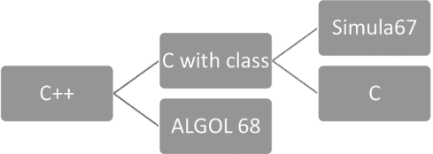

*图 1.1*  C++ 的编程关系

C 后面的 ++ 符号被称为*自增运算符*，表示该语言是 C 的一个扩展版本。1985 年，C++ 开始在贝尔实验室之外使用，其首个 C++ 编译器 Cfront 也于同年发布。1989 年，美国国家标准学会（ANSI）成立了 C++ 委员会。1995 年，首个标准草案发布。程序员常被建议在学习 C++ 之前先学 C，但使用本书则无此必要。我们将学习 C++ 的核心原理，以及一些编程基础知识。C++17 是当前正在使用的 C++ 最新版本。

## 1.2 为什么使用 C++？

C++ 常因其简洁性和 OOP 便利性而使用。使用该语言的其他原因如下：

## C++ 的特性

- 语法简单：由于 C++ 源自 C，其语法与之相似，且易于理解。
- 面向对象：使用了多态、继承、封装和抽象等 OOP 特性。
- 平台相关：你的代码只会在其设计和开发所针对的操作系统上执行。
- 提供内存管理：C++ 支持动态内存分配。
- 中级编程：它既能处理底层编程任务（如驱动程序和内核），也能开发游戏、GUI 和桌面应用等高级应用。
- 庞大的库：你可以使用许多内置函数（库），从而节省时间。
- 基于编译器：你的 C++ 程序若不通过编译就无法执行。
- 结构化编程语言：你的代码是*模块化*的，即由函数、类和对象组成。

封装与上述特性一同提供。可以将其视为一个胶囊，将你可能需要的所有重要成分集于一处。C++ 通过将类引入程序来实现这一概念。

## 2. 数据抽象

*抽象*只获取与用户相关的数据，并隐藏任何其他细节。考虑一个例子：你去餐厅下单。你有时会得到一个订单号，当叫到号时凭它取餐。你并不关心后厨制作餐食的工具、员工人数或他们的细节。共享相关信息既能节省时间和内存，又能保护我们的数据。

我们可以使用类在 C++ 中实现抽象，将数据成员和成员函数组合在一起。这种方法将决定程序中的其他实体可以访问哪个数据成员，以及访问到何种程度。

## 3. 多态

*多态*为我们提供了具有不同签名但相同名称的方法的多种形式。多态有两种类型：运行时多态和编译时多态，这两种多态在 C++ 中都是通过方法重载和方法重写实现的。通过改变函数签名中参数的类型和数量，方法可以呈现出多种形式。当这些方法以相同名称但不同签名使用时，称为重载；当名称和签名都相同时，称为重写。

让我们看下面的例子：

在一级方程式赛车中，有 10 支车队，每队 2 名车手，车手们使用相同的设备和赛车规格。然而，两位车手为各自车队取得的结果总是不同，因为“方法”（赛车）被以完全不同的方式“重载”了（也就是说，F1 赛车以不同的形式存在）。

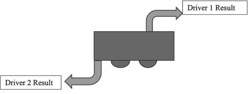

对于 C++ 中的对象而言，通信非常重要，因为它们可能需要执行来自其他对象的请求，以完成自己的任务（函数）。要实现成功的通信，你需要发送方和接收方的地址以及要发送的信息。用 C++ 的术语来说，你只需要正确的对象名（接收方）、函数名和数据。

## 6. 动态绑定

*动态绑定*（或*后期绑定*）指明在运行时将调用哪个过程。我们用 C++ 编写的代码称为*源代码*，并以 .cpp 为扩展名保存。编译器会检查程序中的每一行，以发现错误并通知我们。程序执行的时间被称为*运行时*。也就是函数调用执行的时候。过程内部的代码直到执行时才知道，因此得名后期绑定。在 C++ 中，动态绑定是通过对象实现的。

## 1.4 C++ 基础

现在你已经了解了 C++ 能做什么，让我们来看看具体如何实现。与数学类似，我们将学习什么是变量，以及解决问题时会用到的符号。

### 1.4.1 变量

C++ 中的*变量*是赋予在定义的作用域内保存值的单元的唯一名称。命名需要遵循一定的规则。遵循这些规则，你可以使程序更容易被他人（以及你自己）理解。

*变量声明*是指在变量被使用之前将其引入程序。

*变量定义*是指为变量分配内存位置和值。C++ 中变量命名的规则如下：

- 1. 应以字母开头。
- 2. 可以包含数字或字母的组合。
- 3. 除下划线（_）外，不应包含任何空格或特殊字符（如 !、% 或 #）。
- 4. 不应包含任何 C++ 保留字（也称为*关键字*）。

### 代码：在 C++ 中实现数据类型

```cpp
//Various data types and their sizes
#include <iostream>
using namespace std;
void main()
{
        int x=98;
        short int sh=1;
        long int l=34566;
        signed int s=-9978;
        unsigned int u=66;
        char c='A';
        float f=1.98;
        double d=9.6666788;
        bool b=true;
        cout << "Size of int : " << sizeof(int) << " bytes"
             << endl;
        cout << "Size of short int : " << sizeof(short int)
             << " bytes" << endl;
        cout << "Size of long int : " << sizeof(long int)
             << " bytes" << endl;
        cout << "Size of signed int : "
             << sizeof(signed int) << " bytes" << endl;
        cout << "Size of unsigned long int : "
             << sizeof(unsigned int) << " bytes" << endl;
        cout << "Size of char : " << sizeof(char) << " byte"
             << endl;
        cout << "Size of float : " << sizeof(float) << " bytes"
             << endl;
        cout << "Size of double : " << sizeof(double)
             << " bytes" << endl;
        // no return statement as void used
}
```

### 输出：

```text
Size of int : 4 bytes
Size of short int : 2 bytes
Size of long int : 8 bytes
Size of signed int : 4 bytes
Size of unsigned long int : 4 bytes
Size of char : 1 byte
Size of float : 4 bytes
Size of double : 8 bytes
```


**表1.2 C++数据类型及取值范围**

| 数据类型 | 字节 | 范围 |
|---|---:|---|
| int | 4 | -2,147,483,648 到 2,147,483,647 |
| short int | 2 | -32,768 到 32,767 |
| long int | 4 | -2,147,483,648 到 2,147,483,647 |
| unsigned int | 4 | 0 到 4,294,967,295 |
| signed char | 1 | -128 到 127 |
| unsigned char | 1 | 0 到 255 |
| float | 4 | ±3.4E-38 和 ±3.4E+38 |
| double | 8 | ±1.7E-308 和 ±1.7E+308 |
| long double | 12 | ±1.7E-308 和 ±1.7E+308 |

## 1.5 C++执行流程

在继续之前，我们先来了解几个基本术语：

- *机器码*是仅供计算机理解的指令，用二进制（0,1）编写，可由CPU直接执行。
- *汇编代码*是一种低级语言，由程序员能理解的英文语句组成。
- *调试*是指找出程序中的故障或错误并修复它们，从而使程序正确执行。

C++程序分四个阶段执行，不同的工具帮助我们简化执行过程：

1. *预处理器*

   C++程序中发生的第一件事是预处理器在编译前处理程序。它包含头文件以及定义的任何宏，并为后续执行阶段准备源代码。

2. *编译器*

   现在，经过预处理的源代码通过编译器生成目标文件。编译器将C++编程语言代码翻译成机器语言，检查错误并发出错误警告。目标文件包含汇编代码。

3. *链接器*

   链接器将库和目标文件连接在一起，生成扩展名为 .exe 的可执行文件。

4. *加载器*

   加载器将程序放入内存，程序正是在这里实际运行的。

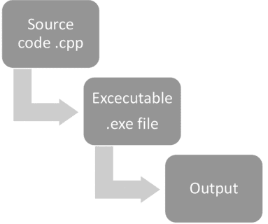

*图1.8* C++执行流程

让我们用C++编写第一个程序。

要遵循的步骤：

1. 获取一个文本编辑器（如记事本）来编写C++代码，以及一个编译器（GCC）来将C++代码翻译成机器代码。
2. 获取一个IDE（集成开发环境）来编辑和编译代码（例如Code::Blocks、Eclipse，或者本例中的Visual Studio）。
3. 在Visual Studio中，转到`File > New > File`，在开始编码前保存文件（`new.cpp`）。
4. 点击最右侧的运行符号，它会显示调试或运行文件的选项，从而在代码终端上获得输出。

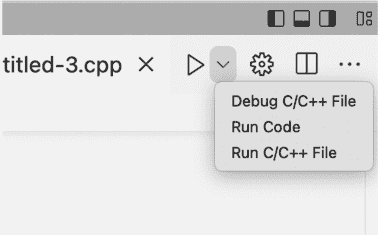

*图1.9* Visual Studio 代码选项

5. 另一种运行代码的方式是将其输入到记事本，然后保存为`.cpp`文件。打开命令提示符终端，输入`gcc filename.cpp`命令即可看到输出。

### “你好，全新的你”程序

### 代码：第一个C++程序

```cpp
#include <iostream> // preprocessor
using namespace std; // libraries used

int main() { // first block that runs
    //
    cout << "Hello new you!!"; // your first output
    return 0; // as the main method not void
}
```

### 输出：

```text
Hello new you!!
```

## 总结

- C++是一种编译型、通用、区分大小写且自由格式的编程语言，支持过程式编程和面向对象编程。
- C++由比雅尼·斯特劳斯特鲁普（Bjarne Stroustrup）于1980年在贝尔实验室开发。
- 编程范式包括过程式、结构化和面向对象等。
- C++具有面向对象编程特性，如多态、继承、数据封装、抽象、消息传递和后期绑定。
- 我们学习了C++数据类型、数据修饰符和变量。
- 我们了解了`int`、`char`和`long int`的取值范围。
- 我们讨论了编译器和调试器的使用。
- 我们讨论了C++程序执行的各个阶段。
- 我们通过简单步骤编写了第一个C++程序。

## 练习

### 理论问题

1. C++有哪些特点？我们为什么需要学习C++？
2. 列出C++的四种实际领域应用。
3. 区分不同类型的编程范式。
4. 用有效示例解释OOP概念。
5. 列出变量命名规则。从下面的列表中识别有效的变量名：
   - a. `_thisis2`
   - b. `24Hours`
   - c. `Name@dune`
   - d. `Formula1`
   - e. `___aditi`
   - f. `Meine#Name`
6. C++程序执行中使用哪些工具？
7. 编译器和调试器有什么区别？
8. C++程序究竟是如何执行的？

### 选择题

1. 谁是C++语言的原创者？
   - a. Dennis Ritchie
   - b. Ken Thompson
   - c. Bjarne Stroustrup
   - d. Brian Kernighan

2. C++是一种___类型的语言。
   - a. 高级
   - b. 低级
   - c. 中级
   - d. 以上都不是

3. 以下哪个符号可用于命名有效变量？
   - a. %
   - b. _
   - c. *
   - d. 以上所有

4. 结构体是什么类型的数据类型？
   - a. 内置
   - b. 派生
   - c. 用户自定义
   - d. 以上都不是

5. C++支持以下哪些特性？
   - a. 封装
   - b. 继承
   - c. 多态
   - d. 以上所有

6. void持有的是什么值？
   - a. 未定义
   - b. 空
   - c. 0
   - d. 以上都不是

7. 在类内部，声明的数据成员被称为________
   - a. 数据
   - b. 对象和数据
   - c. 成员
   - d. 以上都不是

8. 以下C++程序的输出是什么？

   ```cpp
   #include <iostream>
   using namespace std;
   int main ( )
   {
       double i;
       i = 15;
       cout << sizeof(i);
       return 0;
   }
   ```

   - a. 2
   - b. 3
   - c. 4
   - d. 8

9. 变量的声明意味着________它？
   - a. 引入
   - b. 删除
   - c. 赋值
   - d. 使用

10. 面向对象编程采用________的编程方法。
    - a. 自顶向下
    - b. 过程式
    - c. 自底向上
    - d. 以上所有

### 实际应用

1. 编写一个C++程序来检查整数的上界和下界。
2. 编写一个C++程序，在单独的行中打印你的姓名和详细信息。
3. 编写一个C++程序来查找以下变量abc的大小。
4. 编写一个C++程序来查找各种数据类型的大小并打印出来。
5. 编写一个C++程序来展示变量命名及其类型的使用。
6. 编写一个C++程序来检查变量234Mine是否存在。

### 选择题答案

**答案**

| 1 | 2 | 3 | 4 | 5 | 6 | 7 | 8 | 9 | 10 |
|---|---|---|---|---|---|---|---|---|---|
| (c) | (c) | (b) | (c) | (d) | (b) | (c) | (d) | (a) | (c) |

## 参考文献

### 书籍

- B. Stroustrup, *《C++程序设计语言》*（第4版），（Addison-Wesley Professional，2013年）。
- K. R. Venugopal, *《精通C++》*（第2版），（McGraw Hill Education，2017年7月）。
- Y. Kanetkar, *《让我们C++》*，（BPB Publications，2020年9月）。

### 网站

- Learn CPP，访问于2022年5月，https://www.learncpp.com
- Silly Codes，访问于2022年5月，https://sillycodes.com
- Codes Cracker，访问于2022年5月，https://codescracker.com
- Geeks For Geeks，访问于2022年5月，https://www.geeksforgeeks.org
- Udacity，访问于2022年5月，https://www.udacity.com
- Scaler，访问于2022年5月，https://www.scaler.com
- C Plus Plus，访问于2022年5月，https://cplusplus.com

# 第2章：C++基础

## 2.1 字面量、常量和限定符

在编码时，程序通常需要一个在整个程序生命周期内保持不变的值，例如pi的值或任何你希望不修改的基本值。固定不变的值称为*常量*。字面量常量（或简称*字面量*）是直接在代码中使用的未命名值。它们是常量，因为除非重写程序并重新编译，否则其值不会改变。就像对象有类型一样，所有字面量也有类型。字面量的类型由其自身的值和格式决定。*字符字面量*用单引号括起来。字符字面量可以是普通字符、转义序列或通用字符。以`\`开头的特殊字符具有特定含义并执行特定功能。


**表2.1** 转义字符

| 转义序列 | 含义 |
|---|---|
| `\\` | `\` 字符 |
| `\'` | `'` 字符 |
| `\"` | `"` 字符 |
| `\?` | `?` 字符 |
| `\a` | 警报或响铃 |
| `\b` | 退格 |
| `\f` | 换页 |
| `\n` | 换行 |
| `\r` | 回车 |
| `\t` | 水平制表符 |
| `\v` | 垂直制表符 |

*限定符*（qualifier）是应用于类型的关键字，使其成为限定类型（这很像使用`const int`作为限定类型，意味着该值是一个在程序运行过程中不会改变的整数）。

### 代码：转义序列的使用

```cpp
#include <iostream>
using namespace std;

int main() {
    cout << "\nHello\tProgrammer\n\n ";
    return 0;
}
```

### 输出：

```text
Hello  Programmer
```

## 2.2 基于流的IO

在C++中，用户输入值需要使用输入流；这里，我们用术语*流*（stream）来表示可以按顺序访问的一组字节。流有两种不同的类型。*输入流*用于保存来自用户的输入，例如来自键盘的信息。例如，用户可能在键盘上按键，所有这些击键都会被保存到输入流中，以便程序之后需要时使用。*输出流*用于通过显示器、文件或打印机展示输出。例如，你可能需要打印输出，但打印机

```cpp
int main() {
    char ch='A';
    int a = 9,b=10,c;
    cout << "Value as output is :  " << ch<< a+b<<endl;
    cout<< "Enter your input integer "<<endl;
    cin>>c;
    cout<< "You entered  "<<c<<endl;
}
```

### 输出：

```text
Value as output is: A19
Enter your input integer
3
You entered 3
```

### 代码：输入/输出流的使用

```cpp
#include <iostream>

using namespace std;

int main() {
    char ch='A';
    int c;
    cout<< "\nEnter your input integer "<<endl;
    cin>>c;
    cout<< "\nYou entered  "<<c<<endl;
    cerr <<  "Error message :  " << ch << endl;
    clog <<  "Error message :  " << c << endl;
}
```

### 输出：

```text
Enter your input integer
45

You entered 45
Error message : A
Error message : 45
```

## 2.3 注释

在程序中添加注释有助于你跟踪程序的工作方式；程序注释也可以作为将来参考的笔记。

- *二元运算符*（Binary operators）接受两个操作数，就像数学方程中我们需要6和7的和一样。插入运算符（`<<`）和提取运算符（`>>`）也是二元运算符。
- *三元运算符*（Ternary operators）作用于三个操作数。

C/C++ 有许多内置运算符，可以分为6类：

1. **算术运算符**是简单且众所周知的（`+`、`-`、`*`、`/`、`%`、`++`、`--`）。这里，`%`不是“百分比”的意思，而是“取模”。
2. **关系运算符**用于比较两个操作数的值（即使用大于或小于来检查相等性，例如`==`、`>=`和`<=`）。
3. **逻辑运算符**用于检查条件/约束或补集，结果为真或假，即二进制1或0。
4. **按位运算符**用于对操作数执行位级操作。在应用诸如AND或OR之类的逻辑之前，必须先将要操作的操作数转换为位形式。
5. **赋值运算符**用于给变量赋值。
6. **其他运算符**也可使用，例如`sizeof`，它可以查找数据类型的大小。

记住BODMAS规则：括号（Brackets）、指数（Orders）、除法（Division）、乘法（Multiplication）、加法（Addition）和减法（Subtraction）。编译器遵循表2.2所示的顺序。在C++中，当你遇到运算符时，会出现两种优先级：优先级（Precedence）和结合性（Associativity）。这里运算符的优先级从表2.2的底部到顶部递增，当表达式中出现两个相同优先级的运算符时，使用结合性。

**表2.2** 带优先级和结合性的运算符类型

| 类型 | 运算符 | 结合性 |
|---|---|---|
| 后缀 | `()` `[]` `->` `.` `++` `--` | 从左到右 |
| 一元 | `+` `-` `!` `~` `++` `--` `(type)*` `&` `sizeof` | 从右到左 |
| 乘法 | `*` `/` `%` | 从左到右 |
| 加法 | `+` `-` | 从左到右 |
| 移位 | `<<` `>>` | 从左到右 |
| 关系 | `<` `<=` `>` `>=` | 从左到右 |
| 相等 | `==` `!=` | 从左到右 |
| 按位与 | `&` | 从左到右 |
| 按位异或 | `^` | 从左到右 |
| 按位或 | `\|` | 从左到右 |
| 逻辑与 | `&&` | 从左到右 |
| 逻辑或 | `\|\|` | 从左到右 |
| 条件 | `?:` | 从右到左 |
| 赋值 | `= += -= *= /= %= >>= <<= &= ^= \|=` | 从右到左 |
| 逗号 | `,` | 从左到右 |

### 代码：算术运算符的使用

```cpp
#include <iostream>
using namespace std;

int main() {

    int a, b;
    a = 78;
    b = 25;
    cout << "a + b = " << (a + b) << endl;
    cout << "a - b = " << (a - b) << endl;
    cout << "a * b = " << (a * b) << endl;
    cout << "a / b = " << (a / b) << endl;
    cout << "a % b = " << (a % b) << endl;

    return 0;
}
```

### 输出：

```text
a + b = 103
a - b = 53
a * b = 1950
a / b = 3
a % b = 3
```

## 2.5 类型转换

将值从一种类型转换为另一种类型的过程称为*类型转换*（type conversion）；类型转换有两种：隐式转换和显式转换。

### 隐式转换

- 由编译器自行智能完成，无需用户任何帮助。
- 例如，如果某个数据类型接受了与当前值不同的新值，编译器会将其升级调整为新值，而不会给出任何错误。

### 代码：隐式转换

```cpp
#include <iostream>
using namespace std;

int main() {
    int a = 34; // integer type
    char b = 'a'; // character type
    a = a + b; // seems illegal but
    float c = a + 1.0;
    cout << "a = " << a << endl
         << "b = " << b << endl
         << "c = " << c << endl;

    return 0;
}
```

### 输出：

```text
a = 131
b = a
c = 132
```

### 显式转换

- 它允许我们明确告诉编译器将值从一种类型转换为另一种类型，任何错误都由我们自己负责。
- 我们将使用 `static_cast` 运算符：`static_cast<new_type>(expression)`。

### 代码：显式转换

```cpp
#include <iostream>
using namespace std;

int main()
{
    double d = 1.6;
    int sum = (int)d + 5;
    cout << "Sum = " << sum;
    return 0;
}
```

### 输出：

```text
Sum = 6
```

## 2.6 关键字

*关键字*（Keywords）是具有特殊含义的保留字。因此，它们不能在C++程序中用于其他目的。C++预留了92个关键字。

以下是所有C++关键字的列表。

```text
alignas
alignof
and
and_eq
asm
auto
bitand
bitor
bool
break
case
catch
char
char8_t (since C++20)
char16_t
char32_t
class
compl
concept (since C++20)
const
consteval (since C++20)
constexpr
constinit (since C++20)
const_cast
continue
co_await (since C++20)
co_return (since C++20)
co_yield (since C++20)
decltype
default
delete
do
double
dynamic_cast
else
enum
explicit
export
extern
false
float
for
friend
goto
if
inline
int
long
mutable
namespace
new
not
not_eq
nullptr
operator
or
or_eq
private
protected
public
register
reinterpret_cast
requires (since C++20)
return
short
signed
sizeof
static
static_assert
static_cast
struct
switch
template
this
thread_local
throw
true
try
typedef
typeid
typename
union
unsigned
using
virtual
void
volatile
wchar_t
while
xor
xor_eq
```


## 2.7 C++ 中的循环

并非你编写的每个程序都是独一无二的。你可能会有一段需要重复执行直到满足特定条件的代码块，这就是 C++ 中循环的用途。让我们考虑一个打印特定月份（此处为六月）日期的示例。六月有 30 天，日期从 1 到 30，因此我们编写程序如下：

```cpp
#include <iostream>

int main()
{
    cout << "June!";
    cout << "1 2 3 4 5 6 7 8 9 10 11 12 13 14 15 16 17 18 19 20 21 22 23 24 25 26 27 28 29 30";
    return 0;
}
```

让我们检查一些可用于此程序的循环。

### For 循环

我们可以使用 for 循环在日期程序中打印日期。for 循环的一般语法如下：

```cpp
for (initialization; condition; end condition)
{
    //statement or for body
}
```

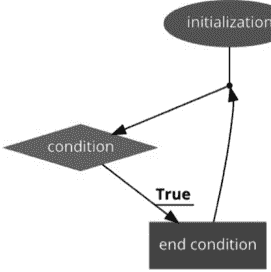

让我们考虑循环中的步骤：

1. 初始化是你的起始位置；在我们这里的日期示例中，它是该月的第一天。
2. 第二部分是检查条件以确定是否进入 for 循环的位置。
3. 要么条件满足并执行主体中的语句，要么程序退出循环（即终止）。
4. 最后，结束条件用于为下一轮循环（通常称为下一次迭代）更改初始化。这通常涉及递增/递减操作。

尝试以下代码来打印六月的日期：

```cpp
#include <iostream>

int main()
{
    for (int count = 1; count <= 30; ++count)
        std::cout << count << ' ';

    return 0;
}
```

**输出：**

```
1 2 3 4 5 6 7 8 9 10 11 12 13 14 15 16 17 18 19 20 21 22 23 24 25 26 27 28 29 30
```

再举一个 for 循环的例子，它帮助我们理解 for 循环的内部工作原理：

```cpp
for (;;)
    statement;
```

**输出：**

这段代码的结果是一个需要被终止的无限循环。

### While 循环

for 循环对于我们的程序来说可能过于复杂。我们有一个更简单的循环，它只包含一个条件。while 语句的语法如下：

```cpp
while (condition)
{
    statement;
}
```

### Do While 循环

do while 循环与 while 循环类似，但在这里，你需要重复执行的工作至少会执行一次。do while 循环的语法如下：

```cpp
do
    {statement; // can be a single statement or a compound statement}
while (condition);
```

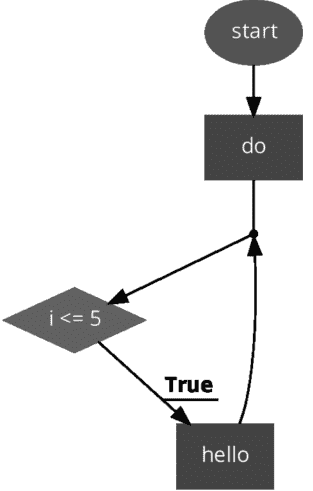

*图 2.4* 流程图（do while 循环）

#### 代码：Do While 循环示例

```cpp
#include <iostream>

int main()
{
    int i = 1;
    do {
        std::cout << i << "\n";
        i++;
    } while (i <= 5);
    return 0;
}
```

```cpp
#include <iostream>
using namespace std;

int main() {
    for (int i = 0; i < 6; i++) {
        if (i == 4) {
            continue;
        }
        cout << i << "\n";
    }
    return 0;
}
```

**输出：**

```
0
1
2
3
5
```

- **break：** 摆脱困难和不希望出现的情况对代码的“健康”很重要，因此该语句会终止循环并执行下一条语句。

```cpp
#include <iostream>
using namespace std;

int main() {
    for (int i = 0; i < 6; i++) {
        if (i == 4) {
            break;
        }
        cout << i << "\n";
    }
    return 0;
}
```

**输出：**

```
0
1
2
3
```

- `return`：你可能已经注意到这里展示的代码片段中出现了这个代码。有一个 `return` 语句和 `int`，因此代码返回一个整数值。
- `goto`：如果你需要的代码主体距离当前循环很远怎么办？在这种情况下，使用 `goto` 直接跳转到该代码块。请谨慎使用此语句，因为你可能会失去代码的流程控制，并且代码将难以维护。

#### 使用 goto 的语法：

```cpp
goto label_name;
.
.
.
label_name:
```

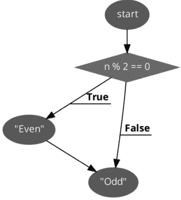

```cpp
#include <iostream>
using namespace std;
int main()
{
    int n = 88;

    if (n % 2 == 0)
        goto place1;
    else
        goto place2;

place1:
    cout << "Even" << endl;
    return 0; // return statement used
place2:
    cout << "Odd" << endl;
}
```

**输出：**

```
Even
```

## 2.9 定义函数

在 C++ 中，很多时候，30-40 行的整个代码块会被重复使用。当发生这种情况时，我们可以使用*函数*，它可以接受不同的输入，并用相同的代码处理它们以获得不同的结果。如果你还记得我们的一级方程式示例，拥有不同技能组合的车手获得了完全不同的结果；在这个实例中，函数就像引擎（共同的联系），经过处理产生两个结果。

### 2.9.1 为什么要使用函数？

- 它们减少了代码冗余：一个单一的代码块可以在任何需要的地方被多次调用。
- 易于维护，因为只有一个位置作为函数的“家”。
- 模块化使代码易于理解和控制。
- 支持抽象，因为可以使用库函数，而无需额外复制整个函数。

C++ 有两种类型的函数：内置函数或程序员定义函数。在程序员定义函数中，用于特定任务的代码块被赋予一个唯一名称，该名称在函数被调用（激活）时使用。

#### 函数声明

*函数声明*介绍函数及其在传递必要参数后能够执行的操作。编译器可以了解函数的签名，并在函数被调用时进行验证。

其语法如下：

```cpp
return_type function_name([ arg1_type arg1_name, ... ]) { code }
```

#### 向函数传递参数

传递给函数的参数称为实际参数，函数接收的参数称为*形式参数*。

| C | C++ |
|---|---|
| C 是 C++ 的子集。 | C++ 是 C 的超集。 |
| C 不支持多态、封装和继承。 | C++ 支持多态、封装和继承。 |
| C 不支持数据隐藏，并且很容易被操纵。 | C++ 的封装隐藏了数据，以确保数据结构和运算符按预期使用。 |
| 支持内置数据类型。 | C++ 支持内置以及用户定义的数据类型。 |
| C 是一种函数驱动语言，更关注函数。 | C++ 是一种对象驱动语言。 |
| 使用的头文件是 `stdio.h`。 | C++ 中使用 `iostream.h`。 |
| C 不支持函数和运算符重载。它也没有命名空间功能和引用变量功能。 | C++ 支持函数和运算符重载；它具有命名空间功能和引用变量功能。 |
| C 中的函数不是在结构体内部定义的。 | 函数可以在结构体内部定义。 |
| C 不支持引用变量。 | C++ 支持引用变量。 |
| 命名空间功能不可用。 | C++ 提供命名空间。 |
| C 不支持虚函数和友元函数。 | C++ 支持虚函数和友元函数。 |
| 不支持直接异常处理。 | 支持异常处理。 |
| 内存管理通过 `malloc()` 和 `calloc()` 函数进行。 | `new` 和 `delete` 运算符用于内存分配和释放。 |

## 小结

- 字面量常量（literals）是直接在代码中使用的未命名值。
- `iostream` 类可以处理输入和输出流。
- `cin` 是一个 `istream` 类，使用标准输入来获取值。`cout` 是一个 `ostream` 类，写入标准输出。
- C++ 中的运算符类型包括一元运算符（只接受一个操作数）、二元运算符（接受两个操作数）和三元运算符（处理三个操作数）。
- 将值从一种类型转换为另一种类型的过程称为类型转换。


- C++ 保留了 92 个专供自身使用的单词，称为关键字。
- C++ 具有循环结构，例如 `for`、`while` 和 `do while`，用于执行重复任务。
- 函数定义和声明通过签名完成，以便后续调用。
- C++ 是对 C 的改进，尽管两者有基本的相似之处，但也存在许多差异。

## 练习题

### 理论题

1. 比较 C 与 C++。
2. 定义 C++ 中的字面量和常量。
3. 讨论 C++ 中各种类型的运算符。
4. C++ 中如何进行类型转换？
5. 定义 C++ 中所有基于 IO 的流类。
6. 在程序中，`int` 究竟表示什么？
7. `for` 循环和 `while` 循环哪个更好？结合示例讨论你的答案。
8. `do while` 循环比普通的 `while` 循环更高效吗？
9. 定义各种控制语句并给出示例。
10. 使用 `if-else` 还是 `goto` 更好？请用示例支持你的推理。
11. 讨论在 C++ 中使用函数的过程。
12. 为什么你认为模块化编程受到程序员的青睐？

### 选择题

1. 下列哪项功能不是 C 语言提供的？
   a. 指针
   b. 结构体
   c. 引用
   d. 函数

2. 下列哪种类型是 C++ 提供而 C 不提供的？
   a. int
   b. bool
   c. float
   d. double

3. 下列哪个是入口控制循环？
   a. for
   b. while
   c. do-while
   d. while 和 for 都是

4. 下列哪个运算符具有从左到右的结合性？
   a. 一元运算符
   b. 逻辑非
   c. 数组元素访问
   d. 取地址

5. 字符字面量在 C 和 C++ 中的大小分别是多少？
   a. 4 和 1
   b. 1 和 4
   c. 1 和 1
   d. 4 和 4

6. C++ 中的 std 是什么？
   a. std 是 C++ 中的一个标准类
   b. std 是 C++ 中的一个标准命名空间
   c. std 是 C++ 中的一个标准头文件
   d. std 是 C++ 中一个用于读取文件的标准头文件

7. `\a` 转义码表示什么？
   a. 警报
   b. 反斜杠
   c. 制表符
   d. 换页

8. `\t` 转义码表示什么？
   a. 警报
   b. 反斜杠
   c. 制表符
   d. 换页

9. 下列哪个不是 C++ 中的关键字？
   a. int
   b. break
   c. object
   d. void

10. 哪种方式会产生永久性更改？
    a. 按值传递
    b. 按引用传递
    c. 传递地址
    d. b 和 c 都是

### 实践题

1. 编写一个 C++ 程序来实现运算符。
2. 编写一个 C++ 程序，在不同行上打印你的爱好。
3. 编写一个 C++ 程序，打印三个数的和。
4. 编写一个 C++ 程序，对用户输入的两个数进行加、乘、减运算。
5. 编写一个 C++ 程序，根据用户输入的所有尺寸计算圆柱体的体积。
6. 编写一个 C++ 程序，计算矩形、正方形和圆形的面积与周长，所有尺寸由用户输入。
7. 编写一个 C++ 程序，使用函数交换两个数。
8. 编写一个 C++ 程序，将温度从摄氏度转换为华氏度。
9. 编写一个 C++ 程序，找出用户输入的五个数中的最大值。
10. 编写一个 C++ 程序，计算用户输入的四个数的总和和平均值。

### 选择题答案

| 答案表 |
| --- |
| 1. (c) |
| 2. (b) |
| 3. (d) |
| 4. (c) |
| 5. (a) |
| 6. (b) |
| 7. (a) |
| 8. (c) |
| 9. (c) |
| 10. (d) |

### 参考资料

#### 书籍

- B. Stroustrup，*The C++ Programming Language*（第4版），（Addison-Wesley Professional，2013年）。
- K. R. Venugopal，*Mastering C++*（第2版），（McGraw Hill Education，2017年7月）。
- Y. Kanetkar，*Let Us C++*，（BPB Publications，2020年9月）。

#### 网站

- Learn CPP，访问于2022年5月，*https://www.learncpp.com*
- Geeks For Geeks，访问于2022年5月，*https://www.geeksforgeeks.org*
- WordPress，访问于2022年5月，*https://wordpress.com*
- Code 2 Flow，访问于2022年5月，*https://code2flow.com*
- Silly Codes，访问于2022年5月，*https://sillycodes.com*

# 数组与字符串

## 3.1 什么是数组？

*数组*就像一个存储设施：它允许你将相似的数据类型保存在同一个“屋檐”下，并用一个名称来标识。存储在数组中的项可以是整数、字符和字符串。无论你想把什么分组在一起，都可以使用数组。让我们看看如何声明和初始化它们。

### 3.1.1 声明数组的方式

- `Datatype array_name[array_size];` 通过给定大小来声明
- `Datatype array_name[]={element1, ele2..};` 通过初始化元素来声明
- `Datatype array_name[array_size]={element1, ele2..};` 通过初始化元素和大小来声明
- `Datatype array_name[array_index]= ele3;` 将元素赋值给特定索引

这里，使用了 `[ ]` 下标运算符，以便编译器知道这是一个数组；其后是相同类型的元素，索引从 0 开始（即任何数组的第一个元素总是被赋给索引 0，即 `arr[0]`，数组的最后一个索引是 n-1，其中 n 表示元素总数）。让我们看一个例子。尝试将数组想象成一列旅客列车，有三节车厢，依次排列，票号从 0 到 2。名为 `Train` 的数组有三个车厢，索引如图 3.1 所示。

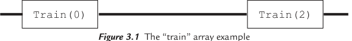

### 3.1.2 访问数组成员的方式

- 存储在连续内存位置中的数组元素也按顺序访问。
- 索引对于提取特定元素很重要。
- 索引为 0 的元素也可以说是数组名称的*指针*。
- 如果你使用静态/固定数组，则使用 `index[n-1]` 提取最后一个元素。
- 对于动态数组，大小在运行时确定，因此使用 `array.length()` 方法来确定确切的大小和索引。

**代码：列车和车厢数组示例**

```cpp
#include <iostream>
int main()
{
        int train[3]={10,11}; // 声明三节车厢
        train[2]= 12;
        std::cout << "\nElements in Train are\n";
        std::cout << "Elements 1: "<<train[0];
        std::cout << "\nElements 2:"<<train[1];
        std::cout << "\nElements 3: "<<train[2];
        return 0;
}
```

**输出：**

```text
Elements in Train are
Elements 1: 10
Elements 2: 11
Elements 3: 12
```

### 3.1.3 遍历一维数组

这里，*1D* 指的是一维数组，你可以使用 `for` 和 `while` 循环语句轻松遍历它以访问和获取数组元素，并允许用户在特定索引处输入数组元素。

**代码：创建一维数组**

```cpp
#include <iostream>
using namespace std;
int main() {

    int num_array[6];
    cout << "Enter six numbers: " << endl;
    for (int i = 0; i < 6; ++i)
    {
        cin >> num_array[i];//从用户处获取元素
    }
    cout << "The numbers are: ";
    for (int j = 0; j < 6; ++j) {
        cout << num_array[j] << " ";// 显示用户数组
    }

    return 0;
}
```

**输出：**

```text
Enter six numbers:
12
79
45
33
11
23
The numbers are: 12  79  45  33  11  23
```

## 3.2 数组上的操作

### 3.2.1 将数组传递给函数

函数非常有用，但你可以传递不需要的数组元素，这会产生一个问题：想象一下传递数千个这样的元素！你可以通过只传递数组名称来避免这种情况，数组名称充当指向第一个元素和整个数组的指针。确保函数签名通过以下方式之一表明它是一个数组非常重要：

- `int func(int array_name[]){ //函数体 }`
- `int func(int array_name[array_size]){ //函数体 }`
- `int func(int *array_name){ //函数体 }`

**代码：传递数组**

```cpp
#include <iostream>

int coach (int train[], int s)
{
int i,price=0;
for( i = 0; i < s; i++)
price += train [i];
return price;
}
int main ( )
{
int price,s;
int train[3]={1050,1100};

std::cout << "How many passengers ";
std::cin >> s;
price = coach (train, s);
std::cout << "\nYour bill is:"<<price;
return 0;
}
```

**输出：**

```text
How many passengers 3

Your bill is: 2150
```

### 3.2.2 查找长度

确定用户输入的动态数组的确切长度非常重要，因为大小可能在程序中途发生变化。


### 3.2.4 搜索

按索引访问数组中的每一个元素（称为*遍历*）对于大型数组来说效率不高，因此我们应该使用一种算法来查找我们想要的元素。以下便是这些搜索方法。

### 线性搜索

在线性搜索中，我们通过遍历数组并检查搜索元素是否与数组元素匹配，来顺序查找所需的元素。

#### 线性搜索算法

1. 开始。
2. 如果未给定数组，则从用户处获取大小和元素输入。
3. 从用户处输入搜索元素。
4. 初始化 for 循环，从 i=0 到索引 size-1。
5. 使用嵌套 if 循环判断搜索元素是否等于 array[i]。
6. 如果结果为真，则找到匹配项；跳出循环。
7. 如果结果为假，则执行代码的 else 部分。
8. 停止。

#### 代码：线性搜索示例

```cpp
#include<iostream>
using namespace std;
int main()
{
    int size,e,flag=0;
    cout<<"\nGive the size of the array "<<endl;
    cin>>size;
    int array[size];
    cout<<"Enter the elements of the array "<<endl;
    for(int i=0;i<size;i++)
    {
        cin>>array[i];
    }
    cout<<"What do you wish to search for"<<endl;
    cin>>e;
    for(int i=0;i<size;i++)//traverse array
    {
        if(array[i]==e)//check with element to match
        {
            flag=i;
            break;
        }
    }
    if(flag)
        cout<<"Element "<<e<<" is at index "<<flag;
    else
        cout<<"Element "<<e<<" is not present\n";
    return 0;
}
```

#### 输出

```
Give the size of the array
4
Enter the elements of the array
11
23
66
77
What do you wish to search for
88
Element 88 is not present
```

你还可以通过设置一个初始为 false 的标志，并在 if 语句内将 i 的值赋给它，来轻松找到搜索元素所在的索引。

### 二分搜索

在该搜索算法中，我们获得一个按从小到大顺序排列的有序数组。然后，通过找到中点将工作分成两半，并基于中点继续寻找下一半。程序检查搜索元素是大于还是小于中间元素，并重复此过程，直到数组为空并找到匹配的元素。

#### 二分搜索算法

1. 开始。
2. 如果未给定数组，则从用户处获取大小和元素输入。
3. 从用户处输入搜索元素。
4. 调用二分搜索函数，并传入数组、`firstindex`、`lastindex` 和搜索元素。
5. 执行嵌套 if 循环，判断搜索元素是等于 `array[mid]`、小于 `array[mid]` 还是大于 `array[mid]`。
6. 如果结果为真，则找到匹配项，返回 mid。
7. 如果结果为假，则返回 0 并退出循环。
8. 停止。

#### 代码：二分搜索示例

```cpp
#include<iostream>
using namespace std;
int binarySearch(int array[], int a, int b, int s) {
    if (a <= b) {
        int mid = (a + b)/2;
        if (array[mid] == s)
            return mid;
        if (array[mid] > s)
            return binarySearch(array, a, mid-1, s);
        if (array[mid] < s)
            return binarySearch(array, mid+1, b, s);
    }
    return 0;
}
int main(void) {
    int array[] = {23,67,45,11,33,44,55};
    int size = sizeof(array)/sizeof(array[0]);
    int s;
    cout << "Enter the element to search: \n";
    cin >> s;
    int flag = binarySearch(array, 0, size-1, s);
    if(flag){
        cout << s << " found at index " << flag << "\n";
    }else{
        cout << s << " is not in the array sorry!";
    }
    return 0;
}
```

#### 输出

```
Enter the element to search:
55
55 found at index 6
```

## 3.3 多维数组

我们之前已经了解了 1D 数组及其操作，现在让我们继续学习 2D 和 3D 数组。这类数组具有行和列，你可以通过以下语句来表示它们：

2D 数组：datatype array_name[rows][columns];

3D 数组：int three_d[array_no][rows][columns];

### 代码：演示 2D 和 3D 数组的示例

```cpp
#include<iostream>
using namespace std;

int main()
{
    int array[2][3] = {{5,1,4}, {2,3,7}};
    cout<<"\n2D Array:\n";
    for (int i = 0; i < 2; ++i) {
        for (int j = 0; j < 3; ++j) {
            cout << array[i][j]<<" ";
        }
        cout<<"\n";
    }

    int x[2][3][3] = { { { 7, 1,5 }, { 26, 3,88 }, { 45, 5,78 } },
        { { 66, 77,33}, { 84, 9,32 }, { 10, 11,12 } } };
    cout<<"\n3D Array:\n";
    for (int m = 0; m < 2; ++m) {
        for (int n = 0; n < 3; ++n) {
            for (int q = 0; q < 3; ++q) {
                cout<< x[m][n][q]<<" ";
            }
        }
    }
}
```

## 3.4 字符串

```cpp
int main() {
    string str1;
    cout << "Enter your name: ";
    cin >> str1;
    cout << "Name: " << str1;
    return 0;
}
```

#### 输出

```
Enter your name:
Carlos Sainz
Name: Carlos
```

## 3.5 字符串函数

C++ 字符串类提供了大量用于处理字符串的函数，如下表所示。

**表 3.1** 字符串函数的语法与功能

| 函数语法 | 功能 |
|---|---|
| `strcat(char_arr1, char_arr2);` | 连接两个字符数组 |
| `string1.append(string2);` | 将一个字符串追加到另一个字符串的末尾 |
| `int length();` | 查找给定字符串的长度 |
| `void swap(string& string1);` | 交换两个字符串 |
| `int compare(const string& string1);` | 检查两个字符串是否相等 |
| `int size()` | 查找字符串的字节大小。 |
| `int find(string& string1, int pos, int size)` | 在给定位置查找字符串 |
| `int copy(string& string1)` | 将一个字符串的内容复制到另一个字符串 |
| `int capacity()` | 返回已分配的内存空间大小 |
| `getline()` | 读取输入字符串，直到遇到 `\n` 字符 |
| `resize()` | 增加或减少字符串的大小 |
| `end()` | 标识字符串的末尾 |
| `rend()` | 反转字符串的末尾 |
| `char& at(int pos)` | 查找指定位置的字符 |
| `string& append(const string& string1)` | 将一个字符串追加到另一个字符串 |

## 小结

- 数组是 C++ 中的一种数据类型，用于在相同名称下存储同类数据，并通过索引进行访问。
- 所有数组元素都存储在连续的内存位置中。
- 索引 0 处的元素也可以说是数组名的指针，数组的下标范围一直到 n-1。
- 数组仅通过其名称传递给函数。
- 枚举（Enum）是用户自定义的数据类型。
- 按索引逐个访问每个元素称为遍历数组。
- 可以使用线性算法或二分算法搜索数组中的元素。
- 数组的数组称为多维数组。
- C++ 中的字符串是一种数据类型，表示一组字符，这些字符以字节集合的形式存储在连续的内存位置中。
- 我们讨论了诸如 concat、compare、length 和 size 等字符串函数。

## 练习

### 理论题

1. 讨论 C++ 中数组的概念。
2. 如何声明一个数组？
3. 数组有哪些优点和缺点？
4. 解释 2D 和 3D 数组是如何工作的。
5. 比较数组的线性搜索算法和二分搜索算法。
6. 关于数组，维度和下标分别是什么意思？
7. C++ 中的字符串是什么？
8. 比较字符串和字符数组。
9. 结合示例讨论 C++ 中对字符串进行的各种操作。

### 多项选择题

1. 数组元素总是存储在 __________ 内存位置中。
   - a. 连续的
   - b. 随机的
   - c. 连续的和随机的
   - d. 以上都不是

2. 字符串是一种 __________。
   - a. C++ 中的数据类型
   - b. 以空字符结尾的字符数组
   - c. 以空字符开头的字符数组
   - d. 以 0 结尾的整数数组

3. 选择关于字符串对象的正确陈述。
   - a. 它们以空字符“\0”结尾。
   - b. 它们具有有限的、确定的大小。
   - c. 它们是动态的。
   - d. 以上都不是

4. 以下哪一项或哪几项用于查找字符串的长度？
   - a. length()
   - b. size()
   - c. max_size()
   - d. size() 和 length() 都可以

5. 以下哪项是声明数组的正确方式？
   - a. int array;
   - b. int array[size];
   - c. array{ele};
   - d. array{ele,ele} array[size];


- 6. 一个有11个元素的数组，其最后一个元素的索引是多少？
  - a. 12
  - b. 10
  - c. 0
  - d. 都不是

- 7. 在哪个过程中，我们将数组中的每个元素与搜索键进行匹配？
  - a. 线性搜索
  - b. 冒泡排序
  - c. 归并排序
  - d. 二分搜索

- 8. 数组 {1,1,33,43,22,43,88,99} 的长度是多少？
  - a. 9
  - b. 10
  - c. 8
  - d. 0

### 实践题

- 1. 编写一个 C++ 程序，找出给定整数数组中的最大元素。
- 2. 编写一个 C++ 程序，在字符串数组中打印字母或你的姓名。
- 3. 编写一个 C++ 程序，找出数组中的最大元素。
- 4. 编写一个 C++ 程序，找出给定整数数组中的第二大元素。
- 5. 编写一个 C++ 程序，计算给定整数数组中元素的总和。
- 6. 编写一个 C++ 程序，反转字符串。
- 7. 编写一个 C++ 程序，找出字符串中最长的单词。
- 8. 编写一个 C++ 程序，按字母顺序对字符串进行排序。

# C++ 中的指针

## 4.1 引言

学完本章之后，希望你对于在 C++ 中使用指针会更有信心。指针到底是什么？在编程术语中，指针是一个指向内存空间或某个变量地址的变量。指针保存的是其所指向内存位置的第一个字节的地址。这第一个字节的地址称为基地址，它就像一个用于存储另一个变量地址的变量。

指针的概念需要花费时间和精力去理解，但在使用指针的同时，请继续练习你的编码技能。只要付出一些努力，指针就能在帮助你让部分代码访问更快、更简单方面发挥重要作用。你可以用指针执行一些重要的操作，甚至可以声明一个指向指针的指针。让我们从指针的基本声明和初始化过程开始吧。

## 4.2 指针：声明与初始化

让我们从基础开始。&（与符号）用于引用另一个变量的内存位置。指针可以被解引用，我们使用 *（星号）来执行此操作，这意味着该运算符会获取变量的值。以下代码片段声明了一个指针类型的变量。

#### 代码：指针示例

```cpp
#include <iostream>
int main()
{
    int *variable;
    int var=10;
    std::cout << var << '\n';
    std::cout << &var << '\n';
    std::cout << *(&var) << '\n';

    return 0;
}
```

#### 输出：

```text
10
0x30cc965f8
10
```

在前面的代码片段中，关键字表示 C++ 中的合法数据类型，`variable` 是指针变量的名称。当数据类型为整数（int）时，它只会指向一个整数值，也就是说，它将是一个指向整数的指针。然而，指针可以指向内存的任何部分，因为这正是它的唯一用途。算术运算的进行都参照基类型。因此，在 C++ 中正确且相关地声明指针是一个优先事项。

本例代码片段中的指针是指 `var` 的值等于地址的指针值，而 `&` 给我们提供了这个数字，也就是变量存储时的确切内存位置。现在，让我们尝试用图像来可视化指针的工作方式。在图 4.1 中，圆柱体代表内存空间，地址为“xxx”和“yyy”。图中显示的箭头充当指向内存位置的指针。

还有几种声明指针来分配变量地址的方法。请记住，对引用所做的更改是永久性的，且往往不可逆转。因此，我们应该小心使用指针。

在 C++ 中，我们会处理空指针。如前几章所述，null 不等于零，而是表示该值不存在。空指针或零指针指向一个非法且为空的地址。如果无法对地址进行引用，那为什么还要使用它呢？随着你在编码之旅中不断前进并更频繁地使用指针，你可能会遇到一个问题：

#### 代码：指针的运作

```cpp
#include <iostream>
using namespace std;

int main ()
{
    int val1, val2;
    int *ptr1, *ptr2, ptr3;

    ptr1 = &val1;
    *ptr1 = 10;
    ptr1 = &val2;
    *ptr1 = 20;
    ptr3=50;
    cout << "\nValue One = " << val1<< '\n';
    cout << "Value One address = " << ptr1<< '\n';
    cout << "Value two = " << val2 <<'\n';
    cout << "Value One address = " << ptr2<< '\n';
    cout << "Value three = " << ptr3 << '\n';
    cout << "Value three address = " << &ptr3 << '\n';
    return 0;
}
```

你预测到输出了吗？让我们一起逐步分析这段代码：

- 1. 我们声明了整型变量 `val1`、`val2` 和 `ptr2`。`ptr3` 也是一个变量，因为它没有使用解引用符号。
- 2. 接下来，声明了两个指针变量 `ptr1` 和 `ptr2`，并且只为 `ptr1` 指针分配了 value one 和 value two 的地址。
- 3. 然后，整数 `ptr3` 的值为给定值。
- 4. 所有地址和值都将被打印出来。

#### 输出：

```text
Value one = 10
Value one address = 0x308cd65e4
Value two = 20
Value one address = 0x0
Value three = 50
Value three address = 0x308cd65cc
```

输出显示了两个不同变量的地址如何分配给同一个指针。前一个值 1 的指针将显示零地址，然后指向值 2 的新地址。

## 4.3 指针的强制转换与传递

### 4.3.1 类型转换

在 C++ 中，我们可以将变量从一种数据类型强制转换为另一种数据类型。如果我们希望使用指针来更改分配的数据类型，也可以这样做。让我们看一个如何实现此操作的示例。我们使用 `reinterpret_cast`，这是一种类型转换运算符，有助于转换指针的数据类型。它所做的只是更改为新类型，并且不检查指针所指向的数据是否相同。其语法如下（此处，一个参数用作指针变量，且不返回任何值）：

```cpp
data_type *var_name =
        reinterpret_cast <data_type *>(pointer_variable);
```

返回类型

以下是 `reinterpret_cast` 的一些重要功能：

- 特殊运算符。仅当指针具有相同数据类型时才有效。
- 有助于转换为任何其他合法的数据类型。
- 当使用 bool 时，它会自动转换为等效的整数，即 1 表示 `true`，0 表示 `false`。
- 大多在按位操作处于核心地位时使用。

现在考虑以下示例：

#### 代码：`reinterpret_cast` 的使用

```cpp
#include <iostream>
using namespace std;

int main()
{
    int* ptr = new int(69);
    char* cr = reinterpret_cast<char*>(ptr);
    cout << *ptr << endl;
    cout << *cr << endl;
    cout << ptr << endl;
    cout << cr << endl;
    return 0;
}
```

#### 输出：

```text
69
E
0x7fbbebd405ac0
E
```

在这里，我们借助特殊运算符 `reinterpret_cast` 将整数 69 强制转换为其对应的字符类型值。现在，`char` 指针类型的值为 E，这正好是 69 的 ASCII 值。

### 4.3.2 传递

将指针传递给函数可以通过两种方式完成：要么直接传递指针，要么传递引用，正如前面一些示例中所做的那样，将简单数据作为参数（在这种情况下，数据本身是指针）。

在第一种方法（直接传递指针）中，变量的内存地址作为参数传递。函数体内所做的任何更改都将反映在原始指针上。以下示例演示了此方法。

#### 代码：直接传递指针

```cpp
#include <iostream>
using namespace std;

void function_A(int *x, int *y) {
    *x= *x+10;
    *y=*y+*x;

}
int main () {
    int a,b;
    int* num1;
    int* num2;
    num1= &a;
    num2=&b;
    cout<<"\nEnter value of Num1 and Num2:";
    cin>>*num1>>*num2;
    cout << "\nBefore Function Call Num1= " <<*num1 <<" Num2= "
         <<*num2<<endl;
    function_A( num1,num2 );
    cout << "\nAfter Function Call Num1= " <<*num1 <<" Num2= "
         <<*num2<<endl;
```


```cpp
return 0;
}
```

### 输出

```text
Enter value of Num1 and Num2: 4
5
Before Function Call Num1= 4 Num2= 5
After Function Call Num1= 14 Num2= 19
```

在第二种方法中，通过引用传递指针时，所创建的引用变量会作为参数传入。这意味着函数体内所做的任何更改都会反映到原始值上，因此这些更改是永久性的。下面的示例演示了这种方法。

### 代码：通过引用传递指针

```cpp
#include <iostream>
using namespace std;

void function_A(int &x, int &y) {
    x= x+10;
    y=y+x;
}

int main () {

    int num1;
    int num2;
    cout<<"\nEnter value of Num1 and Num2:";
    cin>>num1>>num2;
    cout << "\nBefore Function Call Num1= " <<num1 <<" Num2= "
         <<num2<<endl;
    function_A( num1,num2 );
    cout << "\nAfter Function Call Num1= " <<num1 <<" Num2= "
         <<num2<<endl;

    return 0;
}
```

### 输出

```text
Enter value of Num1 and Num2: 4
```

### 代码：使用指针与数组（示例1）

```cpp
#include <iostream>
int main()
{
    int array[3] = { 101, 102, 103 };
    int *ptr = array;
    std::cout << "\nBase element : \n"<< ptr<<" array[0] = "<<*(ptr);
    std::cout << "\nSecond element: \n"<< ptr+1 <<" array[1] = "<<*(ptr+1);
    std::cout << "\nThird element: \n"<< ptr+2 <<" array[2] = "<<*(ptr+2);

    return 0;
}
```

### 输出

```text
Base element :
0x30da805ec array[0] = 101
Second element:
0x30da805f0 array[1] = 102
Third element:
0x30da805f4 array[2] = 103
```

这里，`int *ptr = array;` 会将数组的基地址（即第一个元素）赋给指针 ptr。下面这些递增 ptr 的指针算术运算将指向行中的下一个整数，也就是数组的第二个元素：

```text
ptr + 1 == &array[1];
ptr + 2 == &array[2]; ...... or
*ptr == array[0];
*(ptr + 1) == array[1];
*(ptr + 2) == array[2]; ......
```

你唯一需要注意的就是算术运算，这样才能访问一维数组的所有元素。同样，要将一个指针指向数组的所有元素（即整个数组），可以使用以下简单语法来实现：

```text
data_type (*pointer_var)[Array_size];
```

到目前为止，我们一直引用数组的第 0 个基元素，并从中访问其他元素。然而，现在整个数组都落在一个指针的“保护伞”之下。当我们处理多维数组时，这种方法也会有所帮助。下面这个示例将解释它们是如何工作的。

### 输出

```text
ptr++ = 0x309abf5a0

pa++ = 0x309abf5a0

Array addresses with help of pointers:
ptr + 0 = 0x309abf5a4
ptr + 1 = 0x309abf5a8
ptr + 2 = 0x309abf5ac
ptr + 3 = 0x309abf5b0
ptr++ = 0x309abf5a4
pa++ = 0x309abf5a4
```

对于多维数组，我们也可以使用指向基元素或整个数组的指针来访问所有元素。在表示二维数组时，我们使用行号 i 和列号 j 作为定义二维数组的两个参数。我们将二维数组代码写为 `arr[i][j]`，因此其对应的指针表示为 `*(*(arr + i) + j)`。让我们考虑以下二维数组：

```cpp
int arr[3][4] = { {11, 22, 33, 44}, {52, 65, 75, 88}, {92, 101, 121, 152} };
```

在此示例中，`*(arr + i)`（其中 i = 1）可获得 `arr[i]` 的基元素。但是，如果考虑到二维数组，我们递增 +j 来获取第 i 个一维数组中第 j 个元素的地址。于是我们得到以下内容：

- `*(arr + i) + 1` = 第 i 个一维数组的第一个元素的地址
- `*(arr + i) + 2` = 第 i 个一维数组的第二个元素的地址
- `*(arr + i) + j` 将表示第 i 个一维数组中第 j 个元素的地址。

### 代码：使用指针与数组（示例3）

```cpp
#include <iostream>
using namespace std;

int main ()
{

    int array[3][4] = { {1, 2, 3, 4}, {5, 6, 7, 8}, {9, 10, 11, 12} };
    int i,j;
    for(i=0;i<3;i++)
    {
        for (j=0;j<4;j++) {
            cout << "*(array+"<<i<<")+"<<j <<"= "<< *(array+i)+j <<endl;
        }
    }
    return 0;
}
```

### 输出

```text
*(array+0)+0= 0x3053d95a0
*(array+0)+1= 0x3053d95a4
*(array+0)+2= 0x3053d95a8
*(array+0)+3= 0x3053d95ac
*(array+1)+0= 0x3053d95b0
*(array+1)+1= 0x3053d95b4
*(array+1)+2= 0x3053d95b8
*(array+1)+3= 0x3053d95bc
*(array+2)+0= 0x3053d95c0
*(array+2)+1= 0x3053d95c4
*(array+2)+2= 0x3053d95c8
*(array+2)+3= 0x3053d95cc
```

类似地，我们可以创建三维数组，并使用三个参数访问所有元素。

## 4.5 指针的用途

C++ 中的指针用途广泛，可以帮助轻松执行许多任务。下面列出了指针的一些用途。

- 指针可以通过引用作为参数传递给函数。
- 可以使用指针访问数组元素。
- 指针有助于对值执行简单的算术运算和交换操作。
- 指针可以轻松地用于从函数返回多个值。
- 指针有助于动态分配内存。
- 在 C++ 中，指针有助于高效地使用数据结构。
- 指针借助 `nullptr`、零或 NULL 指针对值进行地址有效性检查。

| 优点 | 缺点 |
| --- | --- |
| 指针有助于节省内存空间。 | 即使输入中出现最微小的错误也会导致错误的输出。 |
| 指针可以直接访问和修改内存中的数据，因此可以更快地执行。 | 它们比其他变量运行得更慢。 |
| 指针可用于文件处理。 | 总是需要解引用。 |
| 可以使用指针访问数组元素。 | 如果任何指针被指向错误的内存地址，可能会导致该地址处的值被永久更改。 |
| 指针有助于动态内存分配。 | 如果内存释放处理不当，总是存在内存泄漏的问题。 |

## 总结

- 指针保存其指向的内存位置中第一个字节的地址。
- 这个第一个字节的地址称为*基地址*，它就像一个用于存储另一个变量地址的变量。
- 使用与号（&）来引用另一个变量的内存位置。
- 需要使用星号（*）对指针进行解引用，以声明一个指针类型的变量。
- `interpret_cast` 是 C++ 提供给我们的一种类型转换运算符，有助于转换指针的数据类型。
- NULL 或零指针指向一个不合法且为空的地址。
- 向函数传递指针有两种方式：按值传递或按引用传递。
- 按值传递时，指针的副本作为参数传递，更改会反映在原始变量中。
- 按引用传递时，地址直接作为参数传递，因此更改是永久性的。
- 指针还有助于通过基元素引用或所赋的数组指针来访问数组元素。
- C++ 中的指针用途广泛，有助于轻松执行许多任务。

## 练习

### 理论题

1. 定义指针并说明它在 C++ 中的工作方式。
2. 如何声明和初始化指针？
3. C++ 中指针的用途是什么？
4. 用几个示例讨论指针算术。
5. C++ 中空指针的用途是什么？我们如何声明它？
6. 写出数组指针和基地址指针之间的区别。
7. 在 C++ 中，空指针如何帮助检查地址的有效性？
8. 列出使用指针的一些缺点。请用示例支持你的理由。
9. C++ 中引用和指针之间的区别是什么？

### 实践题

1. 编写一个程序，打印一个变量的地址，并从用户那里输入其值。
2. 编写一个 C++ 程序，使用指针交换两个数字。
3. 编写一个 C++ 程序，以指针作为参数，交换你名字的前两个字符。
4. 编写一个 C++ 程序，对四种不同类型的指针执行简单的算术运算。
5. 编写一个 C++ 程序，仅使用指针变量实现一个带菜单的简单计算器。
6. 编写一个 C++ 程序，从用户那里输入一个地址数组，并使用指针打印每个地址。
7. 编写一个 C++ 程序，显示指针变量按值传递与按引用传递之间的区别。


8. 编写一个C++程序，借助指针从用户输入的五个数中找出最大值。
9. 编写一个C++程序，使用指针在数组中查找元素。
10. 编写一个C++程序，使用指针作为体重、身高及其他因素的参数来计算一个人的BMI。
11. 编写一个C++程序，使用指针作为参数，显示用户给定数字的阶乘结果。
12. 编写一个C++程序，显示一个指针数组。
13. 编写一个C++程序，以指针数组的形式打印5的倍数。
14. 编写一个C++程序，使用指针访问二维数组的元素。

### 基于选择题（MCQ-Based）

1. 哪个运算符用于解引用或间接访问？

   - a. `*`
   - b. `&`
   - c. `->`
   - d. `->*`

2. 指针在C++中扮演什么角色？

   - a. 保存数据值
   - b. 保存变量的名称
   - c. 保存变量的地址
   - d. 保存指针的数据类型

3. 关于以下语句，哪项是正确的？

   ```cpp
   char *x, y;
   ```

   - a. x 是一个字符
   - b. y 是一个字符串
   - c. x 是一个字符指针
   - d. y 是一个字符指针

4. 关于以下代码，哪项是正确的？

   ```cpp
   int x = 1023, y = 456;

   int *ptr1 = &x, *ptr2 = &y;

   ptr1 = ptr2;
   ```

   - a. `y == x`
   - b. `ptr1` 指向 `y`
   - c. `x == *ptr2`
   - d. `ptr2` 指向 `x`

5. 以下哪项是声明指针的正确方式？

   - a. `int *a`
   - b. `int &a`
   - c. `int ptr`
   - d. 以上全部

6. 通过指针引用值的方法是什么？

   - a. 指针引用
   - b. 直接寻址
   - c. 间接访问
   - d. 间接寻址

7. `*ptr++` 等同于 `++*ptr` 吗？

   - a. 正确
   - b. 错误
   - c. 也许
   - d. 无效

8. 指针能帮助我们做什么？

   - a. 访问所有数组元素
   - b. 动态内存分配
   - c. 实现数据结构
   - d. 以上全部

9. `char****x` 表示什么？

   - a. x 是一个指向字符的指针的指针的指针
   - b. x 是一个指向字符的指针的指针的指针的指针
   - c. x 是指向字符指针的指针
   - d. x 是指向字符的指针的指针

10. `nullptr` 与未初始化的指针相同吗？

    - a. 是
    - b. 否
    - c. 也许
    - d. 以上都不是

### 答案表

| 问题 | 答案 |
| --- | --- |
| 1 | (a) |
| 2 | (c) |
| 3 | (c) |
| 4 | (b) |
| 5 | (a) |
| 6 | (c) |
| 7 | (b) |
| 8 | (d) |
| 9 | (b) |
| 10 | (d) |

## 参考文献

### 书籍

- B. Stroustrup，*C++编程语言*（第4版）（Addison-Wesley Professional，2013年）。
- K. R. Venugopal，*精通C++*（第2版）（McGraw Hill Education，2017年7月）。
- Y. Kanetkar，*让我们学C++*（BPB Publications，2020年9月）。
- Y. Kanetkar，*测试你的C++技能*（BPB Publications，2003年3月）。

### 网站

- Learn CPP，访问于2022年7月，*https://www.learncpp.com*
- Codes Cracker，访问于2022年7月，*https://codescracker.com*
- Geeks For Geeks，访问于2022年7月，*https://www.geeksforgeeks.org*
- C Plus Plus，访问于2022年7月，*https://cplusplus.com*
- Silly Codes，访问于2022年7月，*https://sillycodes.com*

# C++中的类

## 5.1 类的创建

我们之前简要讨论了什么是类，以及面向对象编程如何从这一基本单元构建。类是一种用户自定义数据类型，将方法和数据作为成员组合在一起（即封装）。类使用对象存储数据，并具有定义的状态和行为；对象也被称为*类的实例*。类就像一个宽泛的类别，包含了具有相似属性或特征的一些实体。例如，猫和老虎有相似之处，都属于*猫科*动物家族。在这个例子中，*猫科*是类的名称，猫和老虎是类的成员。下面的代码展示了我们如何在C++中声明和使用类。

### 代码：声明和使用类

```cpp
#include <iostream>
using namespace std;

class Felidae
{
    public:
    string cats;
    string tigers;

    void petName()
    {
        std::cout << "\nCat's pet name is: " << cats;
        std::cout << "\nTiger's pet name is: " << tigers;
    }
};

int main()
{
    Felidae object1;

    object1.cats = "checo";
    object1.tigers = "maxial";
    object1.petName();

    return 0;
}
```

**输出：**

```text
Cat's pet name is: checo
Tiger's pet name is: maxial
```

让我们看看这段代码是如何工作的。尝试预测执行流程，以提高你的理解。

1. 尽管 `main` 是C++程序中典型的执行入口，但这里我们声明了一个类 `outside` `main`。类可以声明在 `main` 外部或内部。
2. 类 `Felidae` 使用关键字 `class` 定义，成员 `cats` 和 `tigers` 是字符串，并带有 `petName` 函数。
3. 我们注意到，类中的访问说明符由标签定义，公有成员可被所有人访问，私有成员仅可被类方法访问。
4. 在 `main` 中，我们使用了两个对象，并通过点运算符访问成员，然后为它们分配名称。
5. 一个对象访问类的所有数据成员，因此我们可以根据需要创建任意多的对象。

### 类命名技巧

- 以大写字母开头，并给类一个有意义的名字。
- 为对象分配一个能清楚表明其用途的名字。
- 可以在类名中使用符号，如下划线。

### 代码：使用类

```cpp
#include <iostream>
using namespace std;

class MyClass
{
    public:
    int x = 40, y;

    void sum()
    {
        std::cout << "\nSum is: " << x + y;
    }
};

int main()
{
    MyClass c1;
    MyClass c2, c3;

    c1.y = 10;
    c2.y = 20;

    c1.sum();
    c2.sum();

    return 0;
}
```

**输出：**

```text
Sum is: 50
Sum is: 60
```

## 5.2 构造函数和析构函数

C++中的类拥有数据成员，例如不同类型的变量和方法（函数）。除此之外，还有一种特殊的成员函数，称为*构造函数*，其主要作用是初始化类，并为所有数据成员构造值，而无需像我们之前那样通过对象访问和调用所有函数。析构函数则涉及“销毁”或消除构造函数创建的对象，以免使计算机的有限内存过载。

**构造函数的特点：**

1. 它与类同名。
2. 它们可以被设置为公有、私有或保护级别。
3. 它们不能被任何其他类继承或实例化。
4. 每创建一个对象时，默认构造函数都会被调用。
5. 在C++中，构造函数不能被声明为虚函数。
6. 它们没有返回类型。

### 代码：使用构造函数和析构函数

```cpp
#include <iostream>
using namespace std;

class Driver
{
    public:
    Driver()
    {
        std::cout << "\nThis is a constructor of class Driver\n" << endl;
    }
};

int main()
{
    Driver d1;
    return 0;
}
```

**输出：**

```text
This is a constructor of class Driver
```

请注意，对象一创建，类的构造函数就会被调用，因为构造函数可以被重载。现在让我们定义各种类型的构造函数。

### C++中构造函数的类型

C++为我们提供了三种类型的构造函数，每种都略有不同。这些类型如下。

1. **默认构造函数**

   它们不接受任何参数，类的所有对象都使用同一组值进行初始化。它们由编译器提供，并且它们将是0或任何整数值。如果程序员忘记在C++中显式定义构造函数，编译器将隐式地提供默认构造函数。默认构造函数的语法如下：

   ```cpp
   class class_name
   {
       class_name()
       { //body
       }
   };
   ```


### 代码：使用默认构造函数

```cpp
#include <iostream>
using namespace std;
class People
{
    public:
    People()
    {
        std::cout << "\nThis is a default constructor \n" << endl;
    }

};
int main() {
    People Object1;


    return 0;
}
```

### 输出：

This is a default constructor

### 代码：实现参数化构造函数

```cpp
#include <iostream>
using namespace std;
class People
{
    public:
    int x;

};
int main() {
    People Object1;
    cout << "\nWill be provided with any random value: " << Object1.x << endl;
    // Garbage value would be shown as x is not initialized

    return 0;
}
```

### 输出：

Will be provided with any random value: 9015333

### 2. 参数化构造函数

在参数化构造函数中，我们可以向成员函数传递一个或多个参数，以便在创建对象时为对象赋不同的初始化值。请记住，调用这种类型的构造函数时，我们必须按照构造函数原型中定义的参数顺序和类型来传递参数。参数化构造函数的语法如下：

```cpp
class class_name
{
    class_name(argument list..)
    {
        // body
    }
};
```

### 代码：使用参数化构造函数

```cpp
#include <iostream>
using namespace std;
class Student
{
    public:
    Student(string n)
    {
        std::cout << "\nThis is a parameterized constructor" << endl;
        std::cout << "\nName is " << n << endl;
    }
};
int main() {
    Student s1("Mary");
    return 0;
}
```

### 输出：

```text
This is a parameterized constructor
Name is Mary
```

### 3. 拷贝构造函数

拷贝构造函数帮助创建某个类对象的副本。副本会复制所有数据成员的值。拷贝构造函数的语法如下：

```cpp
class Class_name
{
    Class_name(argument list..)
    {
    }
    Class_name(const Class_name& obj)
    {
    }
};
```

### 代码：使用拷贝构造函数

```cpp
#include <iostream>
using namespace std;
class Student
{
public:
    string n;
    /*Student()
    {
        std::cout << "\nThis is a default constructor \n" << endl;
    }*/
    Student(string n)
    {
        std::cout << "\nName is " << n << endl;
    }
    Student(const Student& s1)
    {
        std::cout << "\nThis is a copy constructor\n" << endl;
    }
};
int main() {
    //Student s1;
    Student s1("Rio");
    Student s3(s1);

    return 0;
}
```

### 输出：

```text
Name is Rio
This is a copy constructor
```

### 代码：使用构造函数

```cpp
#include <iostream>
using namespace std;
class Student
```

```cpp
class Average {
    private:
        int num1;
        int num2;
        int r;
    public:
        Average (int num1, int num2) {
            this->num1 = num1;
            this->num2 = num2;
        }
        void AvgResult() {
            cout<<"Average of num1 and num2 = "<<(this->num1+this->num2)/2<<endl;
        }
};

int main () {
    Average object1(22, 33);
    object1.AvgResult();
    return 0;
}
```

### 输出：

Average of num1 and num2 = 27

## 5.4 类方法

我们已经讨论了类及其成员，以及特殊的类函数——构造函数。现在，让我们考虑类方法。类函数可以在类定义内部或外部定义。这些函数的调用是通过类的对象使用点运算符或选择运算符来完成的。

### 代码：使用类方法

```cpp
#include <iostream>
using namespace std;
class myclass
{
    public :
    static int num1;
    int y=100,r;
    int sum(int x,int y)
```

- 访问静态数据类型的成员
- 用于继承

C++ 提供了一项特性，可以在类中启用内联函数。编译器每次调用内联函数时，都会将函数体的代码复制过来。这样可以产生更快的结果，因此作为程序员，我们不必一遍遍地编写代码。调用内联函数的语法如下：

```
inline returnType function_Name(Argument List...)
{ // function body
}
```

## 5.5 static 关键字

你可能多次听说过 static。在物理学中，它通常被定义为静止且不发生运动的状态，但在 C++ 中，static 关键字将任何变量、数据成员或函数声明为一种常量类型。这些值不能被修改。它只初始化一次，并且在程序整个生命周期中只使用一份副本。

### static 关键字的特性

- 1. 在 C++ 程序中，静态变量只初始化一次。
- 2. 静态变量可以在某个特定函数内定义，也可以在函数外定义。
- 3. 静态变量的作用域限于其使用的块。
- 4. 如果程序员没有为静态变量赋值，则默认值为零。
- 5. 静态变量的生命周期持续到程序终止，之后内存空间被释放。
- 6. 静态函数直接通过类名调用。

静态函数和变量的语法如下：

```cpp
static DataType var = 10;  // gives a static variable
static returnType function() // static function declared
{ // body
}
```

### 代码：使用静态函数和变量

```cpp
#include <iostream>
using namespace std;

class myclass
{
    public :
    static int num1;
    static int assign(int x)
    {
        cout << "\nAssigned value to integer= " << x << endl;
    }
};
int myclass::num1 = 4560;
int main()
{
    myclass obj1;
    myclass::assign(87);
    cout << "\nThe static variable value : " << obj1.num1 << endl;
    return 0;
}
```

### 输出：

```text
Assigned value to integer= 87
The static variable value : 4560
```

## 5.6 C++ 中的内存管理和垃圾回收

C++ 还提供了其他有用的运算符，如 new 和 delete。这些运算符帮助我们增强根据需要分配或释放内存的灵活性，比 `malloc()`、`calloc()` 和 `free()` 等 C 函数更强大。

内存管理在编程中很重要，因为设备中提供的 RAM 空间是有限的。*垃圾回收* 是一种内存管理技术，可以由垃圾回收器手动或自动完成。我们之前已经做过这类工作：所有全局变量和静态变量只存活到程序结束，之后它们不再有用，内存会被释放。函数内部的局部变量也只在函数调用和返回语句之间“存活”。在 C++ 中，所有这些工作都是自动完成的，并且全部在编译时完成。C++ 还具备在运行时为变量分配内存的能力，这被称为*动态内存分配*。这必须手动完成，不像 Java 或 Python 等其他一些编程语言那样，编译器会自动管理内存分配任务。

### 为什么使用动态内存分配？

- 1. 适用于在运行时才知道特定数据类型大小的情况
- 2. 使一组数据类型更灵活，且可由用户修改
- 3. 更加关注用户输入，结果更具个性化

### new 运算符

C++ 中的 new 运算符用于动态分配内存。我们请求内存空间，如果存在所需数量的内存，则会分配指定数量的内存并返回一个指向它的指针（如果分配失败，则返回空指针）。可以使用 `sizeof` 来计算其大小。该运算符的语法如下：

```cpp
pointerVar = new dataType;
dataType *pointerVar = new dataType[size];
pointerVar = new dataType[int size];
```

### delete 运算符

C++ 中的 delete 运算符用于动态释放内存。该地址变为无效，内存现在被不同的数据使用，因此它返回 void。如果对象是使用 new 运算符分配的，那么只能使用 delete 运算符来删除它。该运算符确保安全高效的内存使用。delete 运算符的语法如下：

```cpp
delete ptr_var;
```

### 代码：使用 delete 运算符

```cpp
#include <iostream>
using namespace std;
int main () {
    int *ptr1 = nullptr;
    ptr1 = new int;
    *ptr1 = 28;
    cout << "\nValue of pointer variable 1 : " << *ptr1 << endl;
    delete ptr1;
    return 0;
}
```

### 输出：

```text
Value of pointer variable 1 : 28
```


## 小结

- *类*是一种用户自定义数据类型，其中方法和数据作为成员组合在一起。
- *构造函数*的主要作用是初始化类，并为所有数据成员构造值。
- 三种类型的构造函数是：默认构造函数、参数化构造函数和拷贝构造函数。
- 析构函数有助于释放未使用对象的内存。
- 构造函数和析构函数都与类同名。
- C++ 中的 `this` 指针存储对象或类实例的地址，使成员函数能够更新相应对象的值。
- 类函数既可以在类定义内部定义，也可以在类定义外部定义。
- 调用类函数是通过类的对象并使用点运算符或选择运算符来完成的。
- 在 C++ 中，`static` 关键字可将任何变量、数据成员或函数声明为一种常量类型。这些值不能被修改。
- `::` 是 C++ 中的作用域解析运算符，其主要作用是访问类的静态成员或为其赋值。
- `new` 和 `delete` 运算符用于 C++ 中的内存分配和释放。

## 练习

### 理论题

- 1. 什么是类？请用示例描述声明类的语法。
- 2. 讨论 C++ 中类的创建和声明？
- 3. 在类主体内部定义的成员函数与在类主体外部定义的成员函数有什么区别？
- 4. 解释传递对象参数的不同方法。
- 5. 使用示例讨论 C++ 中的构造函数和析构函数。
- 6. C++ 中如何动态进行内存分配？
- 7. `static` 关键字在 C++ 中可以以几种方式使用？请使用代码示例讨论这一点。

### 实践题

- 1. 编写一个程序，创建一个名为 `Student` 的类，其中包含一个字符串变量 name 和一个整型变量 `roll_no`。通过创建 `Student` 类的对象，将 `roll_no` 的值赋为 2，将 name 的值赋为 John。
- 2. 编写一个 C++ 程序，演示类的声明和定义以及类成员的访问。
- 3. 编写一个 C++ 程序，演示类的构造函数的调用。
- 4. 编写一个 C++ 程序，演示类的析构函数的调用。
- 5. 编写一个 C++ 程序，使用类的概念实现一个带菜单的简单计算器。
- 6. 编写一个 C++ 程序，演示 `static` 关键字的使用方式。
- 7. 编写一个 C++ 程序，使用 `static` 关键字统计并显示对象被创建的次数。
- 8. 编写一个 C++ 程序，演示 `new` 和 `delete` 运算符的使用。
- 9. 编写一个 C++ 程序，仅使用指针变量实现一个带菜单的简单计算器。

### 选择题

- 1. 关于类，以下哪个语句是正确的？
  - a. 对象是它所属类的一个实例。
  - b. 类是它所属对象的一个实例。
  - c. 对象是该类的数据类型的一个实例。
  - d. A 和 C 都正确。
- 2. 如果在函数中定义了一个局部类，那么对于该类的对象，下列说法正确的是？
  - a. 该对象可以在该函数中局部地访问、声明和使用。
  - b. 该对象必须在任何其他函数中声明。
  - c. 该对象在函数外部可以临时访问。
  - d. 该对象可以在程序中的任何位置调用该类的所有其他成员。
- 3. 以下哪项指的是将数据及其功能封装到单个独立实体中？
  - a. 模块化
  - b. 抽象
  - c. 封装
  - d. 以上都不是
- 4. 当使用 `struct` 而不是关键字 `class` 时，程序中会发生什么？
  - a. 默认访问权限是公有的
  - b. 默认访问权限是私有的
  - c. 默认访问权限是保护的
  - d. 访问被拒绝
- 5. 以下哪个用于在类外部定义类的成员？
  - a. `:`
  - b. `::`
  - c. `#`
  - d. `!!$`
- 6. C++ 中的类包含什么？
  - a. 数据
  - b. 函数
  - c. 数据和函数
  - d. 数组
- 7. 在类中，数据成员也被称为 ________
  - a. 抽象
  - b. 属性
  - c. 特性
  - d. 维度
- 8. C++ 中的一个类中有多少个访问说明符？
  - a. 2
  - b. 1
  - c. 4
  - d. 3

### 选择题答案

| 1 | 2 | 3 | 4 | 5 | 6 | 7 | 8 |
| --- | --- | --- | --- | --- | --- | --- | --- |
| (a) | (a) | (c) | (a) | (b) | (c) | (b) | (d) |

## 参考资料

### 书籍

- B. Stroustrup，*C++ 程序设计语言*（第 4 版）（Addison-Wesley Professional，2013 年）。
- K. R. Venugopal，*精通 C++*（第 2 版）（McGraw Hill Education，2017 年 7 月）。
- Y. Kanetkar，*让我们学 C++*（BPB Publications，2020 年 9 月）。
- Y. Kanetkar，*测试你的 C++ 技能*（BPB Publications，2003 年 3 月）。

### 网站

- Learn CPP，访问于 2022 年 7 月，*https://www.learncpp.com*
- Codes Cracker，访问于 2022 年 7 月，*https://codescracker.com*
- Geeks For Geeks，访问于 2022 年 7 月，*https://www.geeksforgeeks.org*
- Udacity，访问于 2022 年 7 月，*https://www.udacity.com*
- Scaler，访问于 2022 年 7 月，*https://www.scaler.com*
- C Plus Plus，访问于 2022 年 7 月，*https://cplusplus.com*

# 继承

## 6.1 引言

我们在第一章中简要讨论了面向对象编程的概念。现在，让我们深入学习其中几个概念。我们熟悉类的创建，以及对象如何访问类以使用某个特定类的成员。在 C++ 中，我们可以在一个程序中创建多个类（并在这些类之间建立联系），使它们能够共享对其各自数据成员的访问。这种在类之间建立联系并共享某些属性的概念被称为*继承*。本章将探讨继承及其类型，以及如何充分利用这一面向对象编程概念。所有讨论的主题都附有代码示例，我们鼓励读者全部尝试一遍，以提高对这一主题的理解。

## 6.2 继承

正如孩子不仅会继承父母的资产，还会继承一些独特的特征，如眼睛或头发的颜色，C++ 中的继承被定义为“子”类继承其“父”类特征的能力。在继续之前，让我们进一步了解这些术语。

- *父类*：也称为*基类*或*超类*。你可以把它看作是在其子类之前已存在的实体。它的所有子类都从它继承属性。

### 代码：使用访问说明符（公有、私有、保护）

```cpp
#include <iostream>
using namespace std;
class Parent {

    public:
    int p1=60;
    void showP()
    {
        cout<<"\nParent age is public " <<p1<< endl;
        cout<<"\nParent age is private " <<p2<< endl;
        cout<<"\nParent age is protected " <<p3<< endl;
    }
    private:
    int p2=12;
    protected:
    int p3=16;
};

class Child : public Parent
{

    public:
    int c1=20;
    void showC() {
        cout<< "\nChild age is public " <<c1<< endl;
        cout<< "\nChild age is private " <<c2<< endl;
        cout<< "\nChild age is protected " <<c3<< endl;
    }
    private:
    int c2;
    protected:
    int c3;
};

int main() {
    Child c;
    c.p2=36;
    c.p3=56;
    c.showP();
    c.showC();
    return 0;
}
```

### 输出：

```text
inherit.cpp:37:7: error: 'p2' is a private member of 'Parent'
    c.p2= 36;
      ^

inherit.cpp:14:9: note: declared private here
    int p2;
        ^

inherit.cpp:38:7: error: 'p3' is a protected member of 'Parent'
    c.p3=56;
      ^

inherit.cpp:16:9: note: declared protected here
    int p3;
        ^
```

请仔细研究给出的代码片段，以及当我们尝试在派生类调用中访问声明为私有（private）和保护（protected）的数据成员时所产生的错误。

### 6.2.2 继承方式

- 1. **公有：** 如果一个类以公有方式继承，那么基类中为数据成员定义的访问权限在派生类中也会保持不变。也就是说，公有成员具有公有访问权限，私有成员具有私有访问权限，保护成员具有保护访问权限。这是一种常用的继承访问方式。

### 代码：提供对数据的访问

```cpp
#include <iostream>
using namespace std;
class parentc
{
    public :
        int age=52;
    protected :
        int avgSal= 43000;
    private :
        int adharDigit=876;

};
class PublicChild : public parentc
{
    public:
    int pro()
    {
        return avgSal;
    }
};
```


```cpp
int main()
{
    PublicChild obj1;
    cout << "\nPrivate : adhar number digit is inaccessible as "
            "it is not inherited " << endl;
    cout << "\nProtected<->Protected : avg salary is "
         << obj1.pro() << endl;
    cout << "\nPublic<->Public : age is " << obj1.agep << endl;
    cout<< "\n";

    return 0;
}
```

### 输出

```text
Private : adhar number digit is inaccessible as it is not inherited
Protected<->Protected : avg salary is 43000
Public<->Public : age is 52
```

### 代码解析

- 从代码中可以看出，我们使用公有继承在两个类之间建立了一种关系。
- 公有子类现在能够继承甚至修改父类成员中的属性，因为它们的访问权限是在基类中声明的。
- 子类的对象可以访问基类或父类中除私有成员外的所有成员。

### 2. 私有继承

如果一个类以私有方式继承，那么基类中为数据成员定义的访问权限在派生类中会变为私有。也就是说，所有公有、保护和私有成员都具有私有（不可访问）级别。

### 代码：使用私有类

```cpp
#include <iostream>
using namespace std;
class parentc
{
    public :
        int agep=52;
    protected :
        int avgSal=43000;
```

### 3. 保护继承

如果一个类以保护方式继承，那么基类中为数据成员定义的访问权限在派生类中也会变为保护。也就是说，公有和保护成员具有保护访问级别，而私有访问保持私有（不可访问）。

### 代码：使用保护继承

```cpp
#include <iostream>
using namespace std;
class parent
{
        public :
                int agep=52;
        protected :
                int avgSal=43000;
        private :
                int adharDigit=876;
};
class ProtectChild : protected parent
{
        public :
        int pro()
        {
                return avgSal;
        }
        int pub()
        {
                return agep;
        }
};

int main()
{
        ProtectChild obj1;
        cout << "\nPrivate : adhar number digit is inaccessible "
             << endl;
        cout << "\nProtected<->Protected : avg salary is "
             << obj1.pro() << endl;
        cout << "\nPublic<->Protected: age is " << obj1.pub()
             << endl;
        cout<<"\n";

        return 0;
}
```

### 输出

```text
Private : adhar number digit is inaccessible
Protected<->Protected : avg salary is 43000
Public<->Protected: age is 52
```

### 代码解析

- 在这段代码中，我们使用保护继承在两个类之间建立了一种关系。
- 保护子类现在能够继承甚至修改所有父类成员的属性，因为它们的访问权限是在基类中声明的。
- 子类的对象可以访问基类或父类中除私有成员外的所有成员。
- 分配给所有继承内容的新访问说明符是保护。

下面的代码块是另外几个示例，用于解释 C++ 中声明的继承类型。请自行尝试这些示例，以便更好地理解我们讨论的概念。

### 代码：使用不同类型的继承

```cpp
#include <iostream>
using namespace std;
class Parent {

    public:
    int p1=60;
    void showP()
    {
        cout<<"\nParent age is public " <<p1<< endl;
        cout<<"\nParent age is private " <<p2<< endl;
        cout<<"\nParent age is protected " <<p3<< endl;
    }
    private:
    int p2=12;
    protected:
    int p3=16;
};

class Child : private Parent
{

    public:
    int c1=20;
    void showC() {
        cout<< "\nChild age is public " <<c1<< endl;
        cout<< "\nChild age is private " <<c2<< endl;
        cout<< "\nChild age is protected " <<c3<< endl;
    }
    private:
    int c2;
    protected:
    int c3;
};

int main() {
    Child c;
    c.p2= 36;
    c.p3=56;
    c.showP();
    c.showC();
    return 0;
}
```

### 输出

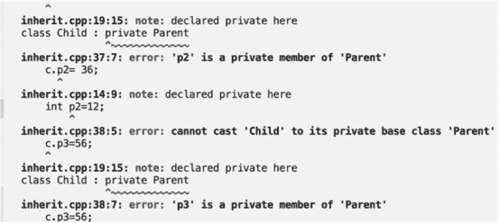

请仔细研究给定的代码片段，以及当我们尝试在派生类调用中访问声明为私有的继承时所产生的错误。访问规则可能看起来难以理解，因为它们的组合创建了一个关于类和类成员如何被继承的九成员集合。

### 表 6.1 继承类型映射

**以公有方式继承**

| 基类 | 派生类 |
|---|---|
| 公有 | 公有 |
| 私有 | 不可访问 |
| 保护 | 保护 |

**以私有方式继承**

| 基类 | 派生类 |
|---|---|
| 公有 | 私有 |
| 私有 | 不可访问 |
| 保护 | 私有 |

**以保护方式继承**

| 基类 | 派生类 |
|---|---|
| 公有 | 保护 |
| 私有 | 不可访问 |
| 保护 | 保护 |

## 6.3 继承的类型

C++ 中的继承可以通过多种形式和组合来实现。可以实施六种继承类型来定义不同类之间的关系。

### 1. 单继承

*单继承*是最基本的继承类型，只有一个父类和一个子类继承属性。你可以把它想象成两级相连的梯子。单继承的语法如下：

```cpp
class parent
{
    // class body
};
class child : accessMode  parent
{
    // class body
};
```

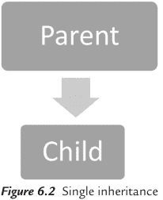

### 代码：使用单继承

```cpp
#include <iostream>
using namespace std;
class Parent {

    public:
    int p=60;
    void showP()
    {
        cout<<"\nParent age is "<<p<< endl;
    }
};
class Child : public Parent
{

    public:
    int c=20;
    void showC() {
        cout<< "\nChild age is "<<c<< endl;
    }
};

int main() {
    Child c1;
    c1.showP();
    c1.showC();
    return 0;
}
```

### 输出

```text
Parent age is 60
Child age is 20
```

### 代码解析

- 从前面的代码可以看出，我们使用单继承在两个类之间建立了一种关系。
- 在这里，只有子类能够继承和修改父类所有成员的属性，因为它们的访问权限是在基类中声明的。
- 子类的对象可以访问基类或父类中除私有成员外的所有成员。

### 2. 多级继承

*多级继承*，顾名思义，具有多级属性共享。最底层并不直接继承属性，但仍然可以访问所有顶层的数据成员。你可以从家庭关系的角度来理解它。这种继承类型类似于孙子往往具有祖父的一些特征。仅为孙子创建的对象将能够访问其所有前序类。多级继承的语法如下：

```cpp
class A
{
    // class body
};
class B : accessMode A
{
    // class body
};
class C : accessMode B
{
    // class body
};
```

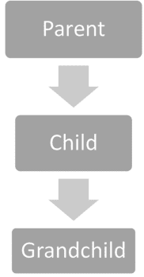

**图 6.3** 多级继承

### 代码：使用多级继承

```cpp
#include <iostream>
using namespace std;
class Parent {

    public:
    int p=60;

    void showP()
    {
        cout<<"\nParent age is " <<p<< endl;
    }
};

class Child : public Parent
{
public:
    int c=20;
    void showC() {
        cout<< "\nChild age is " <<c<< endl;
    }
};
class Grandchild : public Child
{
public:
    int g=4;
    void showg() {
        cout<< "\nGrandchild age is " <<g<< endl;
    }
};

int main() {
    Grandchild g1;
    g1.showP();
    g1.showC();
    g1.showg();
    return 0;
}
```

### 输出

```text
Parent age is 60
Child age is 20
Grandchild age is 4
```


```cpp
float cost;
public:
void getdata()
{
    cout<<"Enter Seat Section & Cost: "<<endl;
    cin>>ss>>cost;
}
void showdata()
{
    cout<<"Seat : "<<ss<<endl;
    cout<<"Cost: "<<cost<<endl;
}
};
class ring2
{
private:
    float spectators[3];
public:
void getdata()
{
    int i;
    for(i=0;i<3;i++)
    {
        cout<<"\nEnter "<<i+1<<" Section Spectators ";
        cin>> spectators[i];
    }
}
void showdata()
{
    int i;
    for(i=0;i<3;i++)
    {
        cout<<"\n"<<i+1<<" Section Spectators = "<<spectators[i];
    }
}
};

class arena:public ring1,public ring2
{
private :
    int guest;
public:
ring1 r1;
ring2 r2;
void getdata()
{
    r1.getdata();
    cout<<"Enter guest";
    cin>>guest;
    r2.getdata();
}
void showdata()
{
    cout<<"\nGuest count = "<<guest<<endl;
    r2.showdata();
}
};

int main()
{
    arena obj1;
    obj1.getdata();
    obj1.showdata();

    return 0;
}
```

### 输出

```text
Enter Seat Section & Cost:
4
3500
Enter guest4

Enter 1 Section Spectators 230

Enter 2 Section Spectators 345

Enter 3 Section Spectators 445

Guest count = 4
1 Section Spectators = 230
2 Section Spectators = 345
3 Section Spectators = 445
```

### 代码解读

- 在这段代码中，我们使用多重继承在三个类之间建立了关系。
- 在这里，子类将能够继承甚至修改两个父类的属性，因为它们的访问权限在基类中声明。
- 子类的对象可以访问所有成员，除了基类或父类中的私有成员。

### 4. 虚拟继承

*虚拟继承*在多重继承中出现这样的情形时发挥作用：两个不同的基类继承自同一个超类，并且它们从超类继承的成员名称相同。此时，这两个基类的子类将同时拥有来自两个父类的超类方法副本，这被称为*菱形问题*。菱形问题会导致当对象按名称访问某个方法时，无法确定实际调用的是超类的哪个继承方法。解决此问题的方法是使用 C++ 中的虚拟继承特性，即让两个父类以虚拟方式继承超类。

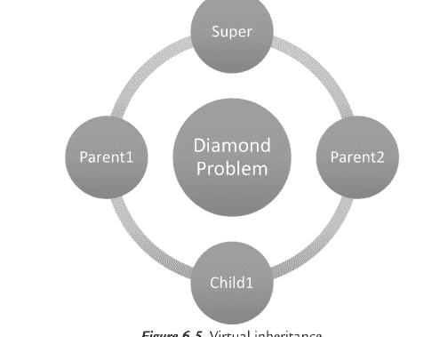

*图 6.5 虚拟继承*

虚拟继承的语法如下：

```cpp
class A
{
    // class body
};
class B : accessMode virtual A
{
    // class body
};
class C : accessMode virtual A
{
    // class body
};
class D : accessMode B, accessMode C
{
    // class body
};
```

### 代码：使用虚拟继承

```cpp
#include <iostream>
using namespace std;
class pg
{
    public:
    int age;
    void display1()
    {
        cout<<"Enter your age"<<endl;
        cin>>age;
    }
};

class student : public virtual pg
{
    public :
    string name;
    void display2()
    {
        cout<<"Enter your name"<<endl;
        cin>>name;
    }
};
class exam: public virtual pg
{
    public :
    int ecode;
    void display3()
    {
        cout<<"Enter exam code"<<endl;
        cin>>ecode;
    }
};
class external : public student, public exam
{
    public :
    int marks;
    void display4()
    {
        cout<<"Enter your Level 1 marks"<<endl;
        cin>>marks;
    }
    void check()
    {
        if ((age>17)&&(marks>65))
        {
            cout<<"\nAllowed for Level 2 Examination\n";
        }
        else
            cout<<"Start looking for backups";
    }
};
int main()
{
    external e;
    cout<<"Enter your valid information"<<endl;
    e.display1();
    e.display2();
    e.display3();
    e.display4();
    e.check();
    return 0;
}
```

### 输出

```text
Enter your valid information
Enter your age
20
Enter your name
Yash
Enter exam code
23099
Enter your Level 1 marks
68

Allowed for Level 2 Examination
```

### 代码解读

- 在这段代码中，我们使用虚拟继承在两个类之间建立了关系。
- 这是解决多重继承问题所必需的。
- 在这里，只有子类现在能够从父类继承并修改属性，因为所有成员在基类中声明的访问权限相同。
- 子类的对象可以访问所有成员，除了基类或父类中的私有成员。

### 5. 层次继承

*层次继承*是指多个派生类继承自同一个基类的情况。这种继承具有树状结构，因为每个类都作为一个或多个子类的基类。层次继承的语法如下：

```cpp
class A
{
    // class body
};
class B : accessMode  A
{
    // class body
};
class C : accessMode A
{
    // class body
};
class D : accessMode B
{
    // class body
};
class E : accessMode C
{
    // class body
};
```

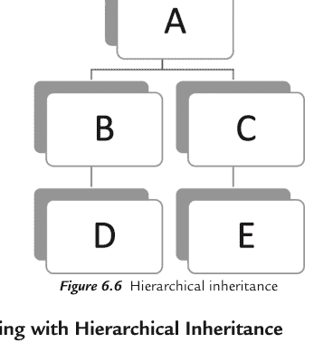

*图 6.6 层次继承*

### 代码：使用层次继承

```cpp
#include <iostream>
using namespace std;
class f1Car
{
    protected :
        string team;
    public:
    void getdata()
    {
        cout<<"Enter team name"<<endl;
        cin>>team;
    }
    void showdata()
    {
        cout<<"Team Name : "<<team<<endl;
    }
};
class engine : public f1Car
{
    protected :
        int LmotrNO;
    public:
    void getdata()
    {
        f1Car :: getdata();
        cout<<"Enter light motor number: ";
        cin>>LmotrNO;
    }
    void showdata()
    {
        f1Car:: showdata();
        cout<<"LMotor No = "<<LmotrNO<<endl;
    }

};
class hydraulic : public f1Car
{
protected:
    float price;
public :
    void getdata()
    {
        f1Car :: getdata();
        cout<<"Enter heavy motor price: ";
        cin>>price;
    }
    void showdata()
    {
        f1Car :: showdata();
        cout<<"HMotor Price = "<<price<<endl;
    }

};
class fuel: public engine
{
protected :
    int capacity;
public:
    void getdata()
    {
        engine :: getdata();
        cout<<"Enter Gear motor capacity: ";
        cin>>capacity;
    }
    void showdata()
    {
        engine :: showdata();
        cout<<"GMotor Capacity = "<<capacity<<endl;
    }

};
class nofuel : public engine
{
    protected :
    int capacity;
    public:
    void getdata()
    {
        engine :: getdata();
        cout<<"Enter Non Gear motor capacity: ";
        cin>>capacity;
    }
    void showdata()
    {
        engine :: showdata();
        cout<<"NonGMotor Capacity = "<<capacity<<endl;
    }
};
class race : public hydraulic
{
    protected :
    int passNo;
    public:
    void getdata()
    {
        hydraulic :: getdata();
        cout<<"Enter passenger capacity: ";
        cin>>passNo;
    }
    void showdata()
    {
        hydraulic:: showdata();
        cout<<"Passenger Capacity = "<<passNo<<endl;
    }
};
class sprint : public hydraulic
{
    protected :
        int maxLoad;
    public:
        void getdata()
        {
            hydraulic :: getdata();
            cout<<"Enter max goods load: ";
            cin>>maxLoad;
        }
        void showdata()
        {
            hydraulic :: showdata();
            cout<<"GMotor Capacity = "<<maxLoad<<endl;
        }

};
int main()
{
    fuel f1;
    race r1;
    cout<<"Enter details of vehicle: "<<endl;
    f1.getdata();
    r1.getdata();
    cout<<"Vehicle Specifications are: "<<endl;
    f1.showdata();
    r1.showdata();
}
```

### 输出

```text
Enter details of vehicle:
Enter team name
Redbull
Enter light motor number: 27789
Enter Gear motor capacity: 4900
Enter team name
Redbull
Enter heavy motor price: 4500000
Enter passenger capacity: 1
Vehicle Specifications are:
Team Name : Redbull
LMotor No = 27789
GMotor Capacity = 4900
Team Name : Redbull
HMotor Price = 4500000
Passenger Capacity = 1
```

### 6. 混合继承

最后，*混合继承*是我们所学过的所有继承类型的混合。

### 代码：使用混合继承

```cpp
#include <iostream>
using namespace std;
class pg
{
    public:
    int age;
    void display1()
    {
        cout<<"Enter your age"<<endl;
        cin>>age;
    }
};

class student : public pg
{
    public :
    string name;
    void display2()
    {
        cout<<"Enter your name"<<endl;
        cin>>name;
    }
};
class exam
{
    public :
    int ecode;
    void display3()
```


```cpp
{
    cout<<"Enter exam code"<<endl;
    cin>>ecode;
}
};
class external : public student, public exam
{
    public :
    int marks;
    void display4()
    {
        cout<<"Enter your Level1 marks"<<endl;
        cin>>marks;
    }
    void check()
    {
        if ((age>17)&&(marks>65))
        {
            cout<<"\nAllowed for Level 2 Examination :)\n";
        }
        else
            cout<<"Start looking for backups :(( \n";
    }
};
int main()
{
    external e;
    cout<<"Enter your valid information"<<endl;
    e.display1();
    e.display2();
    e.display3();
    e.display4();
    e.check();
    return 0;
}
```

### 输出：

```text
Enter your valid information
Enter your age
20
Enter your name
Mick
Enter exam code
203
Enter your Level1 marks
24
Start looking for backups :((
```

## 6.4 构造函数调用

在上一章中，我们讨论了类的创建和方法，以及构造函数等特殊方法及其各种类型。在那里，我们只涉及单个类，但在继承中，总会涉及多个类。构造函数调用是如何工作的？让我们来看看。

### 记住

- 无论创建何种对象，基类构造函数总是首先被调用。
- 创建派生类对象会初始化其所有成员，但它也有继承来的成员。因此，先调用基类构造函数，以便派生类中的所有成员都能初始化。
- 在多重继承中，基类的放置顺序将决定调用哪个构造函数。
- 析构函数总是以与构造函数相反的顺序被调用。

调用构造函数的语法如下：

```cpp
class A
{
        //class body
        A();
};
class B : accessMode A
{
        // class body
        B();
};
class C : accessMode B
{
    // class body
    C();
};

C object;
```

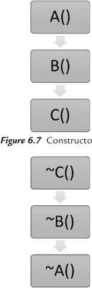

*图 6.7* 构造函数顺序

*图 6.8* 析构函数顺序

## 6.5 实现继承

继承是一个重要的面向对象编程概念，你在类中会用到它。继承的一些优点如下：

- 1. *代码复用：* 由于父类和子类之间的关系允许共享方法，我们不需要一遍又一遍地编写相同的代码主体。
- 2. *结构清晰：* 它使代码更易于理解，因为方法不会重复，而且子对象可以访问所有继承的方法。
- 3. *效率：* 继承在从一个类获取数据以获得结果时节省了大量时间和精力。
- 4. *可扩展性：* 类（以及成员）能够通过派生类或子类扩展其特征和功能。

下面的继承示例突出了它的重要性和易用性。

### 代码：使用继承编程

```cpp
#include <iostream>
using namespace std;
class person
{
    public:
    int age;
    void display1()
    {
        cout<<"Enter your age"<<endl;
        cin>>age;
    }
};
class student : public person
{
    public :
    int ugYear;
    void display2()
    {
        cout<<"Enter your Under Graduate passing Year"<<endl;
        cin>>ugYear;
    }
};
class exam: public student
{
    public :
    void check()
    {
        if((age>18) && (ugYear== 2021 || ugYear== 2022))
            cout<<"You Can appear for CAT 2022"<<endl;
        else
            cout<<"Sorry you Cannot appear for CAT 2022"<<endl;
    }
};

int main()
{
    exam e;
    cout<<"Enter valid information"<<endl;
    e.display1();
    e.display2();
    e.check();
    return 0;
}
```

### 输出：

```text
Enter valid information
Enter your age
19
Enter your Under Graduate passing Year
2023
Sorry you Cannot appear for CAT 2022
```

请自行对这个代码进行“代码复盘”，并尝试在 C++ 中编写你自己的继承版本。

## 总结

- *继承* 是 C++ 中的一种机制，允许子类继承父类的特性。
- 父类（或称基类或超类）是在子类之前存在的单一实体，其所有子类都从它继承属性。
- 子类（或称派生类或子类）由基类的某些特征构成。
- 声明为 public 的数据成员可以被任何类访问，无论其类与其他类之间是什么关系。
- 声明为 private 的数据成员访问受限，只有基类、友元类和派生类可以访问。
- 声明为 protected 的数据成员可以被基类成员和友元类访问。

家庭。所有类都必须具有接口函数，例如用于读取和显示属性的重载流运算符函数。编写一个交互式程序来模拟这种关系。

- 3. 用 C++ 编写一个程序，使用现实生活中的实体来描绘多层继承。
- 4. 用 C++ 编写一个程序，在祖父类和孙类之间建立关系，并在两者中都重写方法。
- 5. 用 C++ 编写一个程序，展示通过继承访问 private、public 和 protected 类。
- 6. 用 C++ 编写一个程序，描述构造函数在单继承中的作用。
- 7. 用 C++ 编写一个程序，描述构造函数在多层继承中的作用。
- 8. 用 C++ 编写一个程序，描述构造函数在多重继承中的作用。
- 9. 用 C++ 编写一个程序，描述构造函数在层次继承中的作用。
- 10. 用 C++ 编写一个程序，描述构造函数在虚继承中的作用。
- 11. 用 C++ 编写一个程序，描述构造函数在混合继承中的作用。

## 选择题

- 1. C++ 中的继承是什么？
  - a. 将数据封装到单个类中
  - b. 从现有类派生新类
  - c. 类的重载
  - d. 具有相同名称的类
- 2. 关于虚继承，以下哪个陈述是正确的？
  - a. 这是一种确保可以访问基类私有成员的技术。
  - b. 这是一种优化多重继承的技术。
  - c. 这是一种避免类的多重继承的技术。
  - d. 这是一种避免为派生类或子类创建基类代码的多个副本的技术。
- 3. 如果一个类是私有地从基类派生的，那么
  - a. 基类的成员不会被继承。
  - b. 所有成员都可以被派生类访问。
  - c. 所有成员都被该类继承，但被隐藏且无法访问。
  - d. 不进行类的派生会产生错误。
- 4. 以下 C++ 代码的输出是什么？

```cpp
#include <iostream>
#include <string>
using namespace std;
class A
{
    float d;
public:
    virtual void func(){
        cout<<"Hello this is class A\n";
    }
};
class B: public A
{
    int a = 15;
public:
    void func(){
        cout<<"Hello this is class B\n";
    }
};
int main(int argc, char const *argv[])
{
    A *a = new A();
    B b;
    a = &b;
    a->func();
    return 0;
}
```

  - a. Hello this is class A
  - b. Hello this is class B
  - c. Error
  - d. Segmentation Fault
- 5. 写出以下代码的输出。

```cpp
#include <iostream>
#include <string>
using namespace std;
class A
{
    float d;
    public:
    virtual void func(){
        cout<<"Hello this is class A\n";
    }
};
class B: public A
{
    int a = 15;
    public:
    void func(){
        cout<<"Hello this is class B\n";
    }
};
int main(int argc, char const *argv[])
{
    A *a;
    a->func();
    return 0;
}
```

  - a. Hello this is class A
  - b. Hello this is class B
  - c. Error
  - d. Segmentation Fault
- 6. 以下 C++ 代码的输出是什么？

```cpp
#include <iostream>
#include <string>
using namespace std;
class A{
    float d;
```


### 6. 以下 C++ 代码的输出是什么？

```cpp
class A {
public:
    virtual void func(){
        cout<<"Hello this is class A\n";
    }
};

class B: public A {
    int a = 15;
public:
    void func(){
        cout<<"Hello this is class B\n";
    }
};

int main(int argc, char const *argv[])
{
    B b;
    b.func();
    return 0;
}
```

- a. Hello this is class B
- b. Hello this is class A
- c. Error
- d. Segmentation fault

### 7. 以下 C++ 代码的输出是什么？

```cpp
#include <iostream>
#include <string>
using namespace std;
class A
{
    float d;
public:
    A(){
        cout<<"Constructor of class A\n";
    }
};

class B: public A
{
    int a = 15;
public:
    B(){
        cout<<"Constructor of class B\n";
    }
};

int main(int argc, char const *argv[])
{
    B b;
    return 0;
}
```

- a. Constructor of class A Constructor of class B
- b. Constructor of class A
- c. Constructor of class B
- d. Constructor of class B Constructor of class A

8. 类的继承语法是什么？

- a. 类名
- b. 类名：访问说明符
- c. 类名：访问说明符 类名
- d. 以上都不是

9. C++ 中有多少种继承类型？

- a. 2
- b. 3
- c. 4
- d. 6

10. 多重继承是什么意思？

- a. 从派生类派生基类
- b. 从基类派生派生类
- c. 从多个基类派生派生类
- d. 以上都不是

11. 使用多重继承会失去以下哪些优势？

- a. 动态绑定
- b. 多态性
- c. a 和 b
- d. 以上都不是

12. 创建多重继承使用哪个符号？

- a. 点
- b. 逗号
- c. 美元符号
- d. 以上都不是

13. 从基类继承了什么？

- a. 构造函数及其析构函数
- b. operator=() 成员
- c. 友元
- d. 以上都是

14. 以下程序的输出是什么？

**注意：** 此代码包含所有必需的头文件。

```cpp
class find {
public:
    void print() { cout <<" In find"; }
};

class course : public find {
public:
    void print() { cout <<" In course"; }
};
class tech: public course { };
int main(void)
{
    tech t;
    t.print();
    return 0;
}
```

- a. In find
- b. In course
- c. Compiler Error: Ambiguous call to print()
- d. 以上都不是

### 15. 假设一个整数占 4 字节，并且下面的类中不进行内存对齐。预测输出。

```cpp
#include<iostream>
using namespace std;
class base {
    int arr[10];
};
class b1: public base { };
class b2: public base { };
class derived: public b1, public b2 {};
int main(void)
{
cout << sizeof(derived);
return 0;
}
```

- a. 40
- b. 80
- c. 0
- d. 4

### 16. 以下程序的输出是什么？

```cpp
#include<iostream>
using namespace std;

class Base {
private:
    int i, j;
public:
    Base(int _i = 0, int _j = 0): i(_i), j(_j) { }
};

class Derived: public Base {
public:
    void show(){
        cout<<" i = "<<i<<"  j = "<<j;
    }
};
int main(void) {
    Derived d;
    d.show();
    return 0;
}
```

- a. i = 0 j = 0
- b. Compiler Error: i and j are private in Base
- c. Compiler Error: Could not call constructor of Base

17. 一个类作为许多派生类的基类，这称为

- a. 多态性
- b. 多路径继承
- c. 层次继承
- d. 以上都不是

## 选择题（MCQ）

| **答案** |  |  |  |  |  |  |  |  |  |  |
|---|---|---|---|---|---|---|---|---|---|---|
| 1. (b) | 2. (d) | 3. (c) | 4. (b) | 5. (d) | 6. (a) | 7. (a) | 8. (c) | 9. (d) | 10. (c) |  |
| 11. (c) | 12. (b) | 13. (d) | 14. (b) | 15. (b) | 16. (b) | 17. (c) |  |  |  |  |

## 参考文献

### 书籍

- B. Stroustrup，*C++ 程序设计语言*（第 4 版）（Addison-Wesley Professional，2013 年）。
- K. R. Venugopal，*精通 C++*（第 2 版）（McGraw Hill Education，2017 年 7 月）。
- Y. Kanetkar，*让我们学 C++*（BPB Publications，2020 年 9 月）。
- Y. Kanetkar，*测试你的 C++ 技能*（BPB Publications，2003 年 3 月）。

### 网站

- Learn CPP，访问于 2022 年 7 月，*https://www.learncpp.com*
- Codes Cracker，访问于 2022 年 7 月，*https://codescracker.com*
- Geeks For Geeks，访问于 2022 年 7 月，*https://www.geeksforgeeks.org*
- Udacity，访问于 2022 年 7 月，*https://www.udacity.com*
- Scaler，访问于 2022 年 7 月，*https://www.scaler.com*
- C Plus Plus，访问于 2022 年 7 月，*https://cplusplus.com*
- Silly Codes，访问于 2022 年 7 月，*https://sillycodes.com*

# 多态性

## 7.1 简介

另一个重要的面向对象编程概念是多态性。我们在第一章中通过一级方程式（Formula 1）的例子简要提到过它。多态性使我们能够以不同的签名但相同的名称，让一个方法拥有多种形式。方法可以通过改变参数的类型和函数签名中参数的数量，来以多种形式存在。例如，在一级方程式赛车中，有 10 支车队，每队有 2 名车手。两名车手配备相同的设备和赛车规格。然而，车手及其车队取得的结果总是不同，因为赛车（也就是我们的编程方法）已经被改造成完全不同的风格：一辆 F1 赛车可以以不同的形式存在。

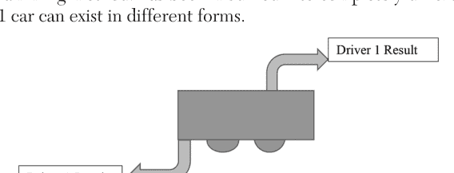

图 7.1 多态性

多态性主要有两种类型：编译时多态性和运行时多态性。（它们还有子类别，其实现方式将在后面讨论。）

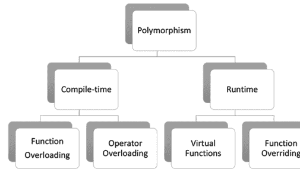

图 7.2 多态性类型

让我们看一个 display 函数重载以及多态性如何工作的示例。这里的语法与我们之前学过的函数语法相同。

### 代码：使用多态性和函数重载

```cpp
#include <iostream>
using namespace std;
void display(int i)
{
    cout << " Integer  is " << i << endl;
}
void display(double f)
{
    cout << "Float is " << f << endl;
}
void display(char const *c)
{
    cout << " Character is " << c << endl;
}

int main()
{
    display(11);
    display(11.11);
    display("Eleven");
    return 0;
}
```

### 代码解读

- 在这段代码中，我们类的 display 函数以多种形式存在。
- 这种类型的多态性是通过 display 方法的函数重载实现的。
- 这些函数都具有相同的名称，但签名不同。也就是说，它们的参数组合和参数数量不同。
- 在调用 display 函数时，请记住哪个签名将调用哪个函数。

## 7.2 动态绑定与静态绑定

表 7.1 动态绑定和静态绑定

| 动态绑定 | 静态绑定 |
|---|---|
| 动态绑定（或延迟绑定）在运行时确定将调用哪个过程。 | 静态绑定（或早期绑定）在编译时确定将调用哪个过程。 |
| 过程内部的代码直到执行时才已知，因此称为延迟绑定。 | 过程内部的代码在执行前已知，并在执行时结合到一起，因此称为早期绑定。 |
| 在 C++ 中通过虚函数实现。 | 在 C++ 中通过普通函数调用、函数重载和运算符重载实现。 |
| 程序执行速度较慢。 | 程序执行速度较快。 |
| 它也被称为运行时多态性。 | 它也被称为编译时多态性。 |

### 代码：静态绑定

```cpp
#include <iostream>
using namespace std;
class person
{
    public:
    int age;
    void display1()
    {
        cout<<"Enter your age"<<endl;
        cin>>age;
    }
};
class student : public person
{
    public:
    int ugYear;
    void display2()
    {
        cout<<"Enter your Undergraduate Year "<<endl;
        cin>>ugYear;
    }

};
class exam: public student
{
    public:
    void check()
    {
        if((age>18) && (ugYear== 2021 || ugYear== 2022))
            cout<<"You can appear for Common Admission Test 2022"<<endl;
        else
            cout<<"Sorry, you cannot appear "<<endl;
    }

};

int main()
{
    exam e;
    cout<<"Enter your valid information"<<endl;
    e.display1();
    e.display2();
    e.check();
    return 0;
}
```

**输出：**

```text
Enter your valid information
Enter your age
```


```text
21
Enter your Undergraduate Year
2024
Sorry, you cannot appear
```

## 代码解读

- 此代码表明我们类的显示函数具有多种形式。
- 静态绑定是通过函数重载实现的。
- 这些函数名称相同，但签名不同。也就是说，它们具有不同的参数组合和参数数量。
- 在调用显示函数时，请记住哪个签名调用哪个函数。
- 在这里，编译器仅在编译时才知道与函数调用关联的代码。

## 代码：动态绑定

```cpp
#include <iostream>
using namespace std;
class person
{
    public:
    virtual void display()
    {
        cout<<"Enter your age"<<endl;
    }
};
class student : public person
{
    public :
    void display()//overridden
    {
        cout<<"Enter your Undergraduate Year"<<endl;
    }
};

int main()
{
    person e;
    student s;
    cout<<"Please enter your information "<<endl;
    s.display();
    e.display();
    return 0;
}
```

### 输出

```text
Please enter your information
Enter your Undergraduate Year
Enter your age
```

### 代码解读

- 此代码表明我们类的显示函数具有多种形式。
- 静态绑定是通过函数重载实现的。
- 这些函数名称相同，但签名不同。也就是说，它们具有不同的参数组合和数量。
- 在调用显示函数时，请记住哪个签名调用哪个函数。
- 在这里，编译器仅在运行时才知道与函数调用关联的方法。

## 7.3 接口与实现

有时，由于子类的需求，代码块必须一次又一次地重新定义。为此，C++提供了接口，这些接口没有直接实现，只声明方法。让我们来看一下接口的一些特征：

- a. 不提供任何方法的实现；它们只处理声明部分。

- b. 实现接口的类也有责任实现这些方法。

- c. 我们不能在接口内部定义变量。

### 代码：使用接口

```cpp
#include <iostream>
using namespace std;
class myInterface
{
public:
virtual void Purely() = 0;
void method1()
{
cout<<"\nParent class method"<<endl;
}
};
class child1: public myInterface
{
public:
void Purely()
{
cout<<"\nParent method redefined"<<endl;
}
};

int main()
{
cout<<"\nInterfaces"<<endl;
child1 c1;
c1.Purely();
c1.method1();
return 0;
}
```

### 输出

```text
Interfaces
Parent method redefined
Parent class method
```

### 代码解读

- 这里应用了接口的概念。
- 静态绑定是通过函数重载实现的。
- 该方法在子类中重新定义，因为子类可以继承并修改属性。

以下是一些额外的术语及其定义，以使C++中的接口概念更加清晰。

- a. *虚函数*是一种在父类或基类中声明并定义、在子类中重新定义的函数类型。

- b. *纯虚函数*是一种仅声明但从未实现或重新定义的函数类型。

- c. 抽象类（ABC）是一种只有纯虚函数的类。这意味着它只被声明而从未被定义，这有助于所有子类根据需要继承和重新定义成员。这种类型的类不能通过直接创建对象来实例化，但可以通过实现接口来实例化。类的所有纯虚函数都需要被重写，否则可能会出现错误。其语法如下：
  `virtual void functionName() = 0;`

### 代码：

```cpp
#include <iostream>
using namespace std;
class parentc
{
    public :
        virtual int pro()=0;
    protected:
        int avgSal=230000;
};
class PublicChild1 : public parentc
{
    public:
    virtual int pro()
    {
        return (avgSal+9000);
    }
};

class PublicChild2: public parentc
{
    public:
    virtual int pro()
    {
        return (avgSal+12000);
    }
};

int main()
{
    PublicChild1 obj1;
    PublicChild2 obj2;
    cout << "\nPublic child 1 average salary is "
         << obj1.pro() << endl;
    cout << "\nPublicchild2 average Salary is " << obj2.pro()
         << endl;
    cout<< "\n";

    return 0;
}
```

### 输出

```text
Public child 1 average salary is 239000
Publicchild2 average Salary is 242000
```

### 代码解读

- 在此代码中，我们类的虚函数具有多种形式。
- 在调用显示函数时，请记住哪个签名调用哪个函数。

### 代码：

```cpp
#include <iostream>
using namespace std;
class ABC
{
public:
virtual void Purely() = 0;
};
class child1: public ABC
{
public:
void Purely()
{
cout<<"\nParent method redefined by child1"<<endl;
}
};
class child2: public ABC
{
public:
void Purely()
{
cout<<"\nParent method redefined by child2"<<endl;
}
};
int main()
{
child1 c1;
child2 c2;
c1.Purely();
c2.Purely();
return 0;
}
```

### 输出

```text
Parent method redefined by child1
Parent method redefined by child2
```

## 7.4 函数重写与重载

现在我们转向一种我们将会经常使用的多态类型，它通过函数及其不同状态来实现。（你应该通过重新定义所创建函数的状态和类型，并观察如何使用对象进行调用来练习这个概念。）

表7.2 函数重载与函数重写

| 函数重载 | 函数重写 |
| --- | --- |
| 编译时多态实现 | 运行时多态实现 |
| 不需要继承 | 始终需要继承 |
| 函数以相同的名称但不同的签名重载 | 函数以相同的名称和签名被重写 |
| 参数类型、数量和顺序可以更改 | 参数类型、数量和顺序不需要更改 |
| 函数调用根据签名在编译时确定 | 函数调用根据签名在运行时确定 |
| 重载可以发生多次 | 重写在一个C++程序中只发生一次 |

以下示例展示了C++中函数如何被重载和重写。

### 代码：使用重载函数

```cpp
#include <iostream>
using namespace std;
void display(int i)
{
    cout << " Integer  is " << i << endl;
}
void display(double f)
{
    cout << "Float is " << f << endl;
}
void display(char const *c)
{
    cout << " The number of characters is  " << c << endl;
}

int main()
{
    cout<<"To show function overloading "<<endl;
    display(11);
    display(11.11);
    display("Eleven");
    return 0;
}
```

### 输出

```text
To show function overloading
Integer is 11
Float is 11.11
The number of characters is Eleven
```

### 代码解读

- 在此代码中，我们类的显示函数具有多种形式。
- 多态是通过函数重载实现的。
- 这些函数名称相同，但签名不同。也就是说，它们具有不同的参数组合和数量。
- 在调用显示函数时，请记住哪个签名调用哪个函数。

### 代码：加法方法的函数重载

```cpp
#include <iostream>
using namespace std;
int add(int num1, int num2) {
    return num1 + num2;
}
double add(float num1, double num2) {
    return num1 + num2;
}
int add(int num1, float num2, int num3) {
    return num1 + num2 + num3;
}
int main() {
    cout << "Addition method 1 = " << add(87, 45) << endl;
    cout << "Addition method 2 = " << add(90.5, 63.6) << endl;
    cout << "Addition method 3 = " << add(51, 5.6, 33) << endl;
    return 0;
}
```

### 输出

```text
Addition method 1 = 132

Addition method 2 = 154.1

Addition method 3 = 89
```

### 代码解读

- 此代码表明我们类的加法函数具有多种形式。
- 这种多态是通过加法方法的函数重载实现的。
- 这些函数名称相同，但签名不同。也就是说，它们具有不同的参数组合和数量。
- 在调用显示函数时，请记住哪个签名调用哪个函数。

### 代码：

```cpp
#include <iostream>
using namespace std;
```


## 7.5 友元函数和泛型函数

### 7.5.1 友元函数

友元函数是类的非成员函数，它可以像普通函数一样访问，但使用关键字 friend 声明。

### 友元函数的特性

- 使用 `friend` 关键字仅声明一次，可以在全局作用域或另一个类中声明。
- 它可以在类中具有任何类型的访问权限：public、private 或 protected。
- 友元函数无需任何对象或点运算符即可调用。
- 对象可以作为参数传递。
- 即使它是非成员函数，它也可以访问类的所有数据成员（包括 private）。
- 友元关系不能被继承。

友元函数的语法如下：

```cpp
class OurClass
{
    //body
    friend returnType Myfunction(Parameters list...);
};
```

### 代码：使用友元函数

```cpp
#include <iostream>
using namespace std;
class myclass
{
    friend int myfriend(int a, int b);
};
int myfriend(int a, int b)
{
    return a+b;
}
int main()
{
    int a,b;
    cout<<"Enter numbers to add"<<endl;
    cin>>a>>b;
    cout<<"Addition gives "<<myfriend(a,b)<<endl;
    return 0;
}
```

**输出：**

```text
Enter numbers to add
23
567
Addition gives 590
```

**代码解读：**

- 此代码展示了如何创建友元函数。
- 此函数可以在类内声明，并在类外定义。

### 7.5.2 泛型函数

当一个普通函数需要多次使用，并且函数所作用的参数需要具有不同的数据类型时，我们可以使用 C++ 中的泛型函数来实现。这些函数充当模板，以便不同类型的参数产生所需的结果。

### 泛型函数的特性

- 类似于宏，函数体在编译时展开以接收参数。
- 源代码作为模板，因此所有函数的代码相同，但在编译不同副本时，由于参数类型不同，会产生不同的结果。
- 类模板也可以像泛型函数一样使用。
- 这些函数有助于减少函数重载。
- 如果需要，参数也可以具有默认值。

泛型函数的语法如下：

```cpp
template <typename T> T mytemplate(T parameter1, T parameter2)
{
    //template body
}
```

### 代码：泛型函数与数字交换

```cpp
#include <iostream>
using namespace std;
class myclass
{
    public:
    void swapR(int &a,int &b)
    {
        cout<<"Swapping using the call by reference changes what is visible "<<endl;
        a= a+b;
        b= a-b;
        a= a-b;
    }
    void swapP(int *a,int *b)
    {
        cout<<"Swapping by using the call by pointers "<<endl;
        *a= *a + *b;
        *b= *a - *b;
        *a= *a - *b;
    }
}c1;
int main()
{
    int a,b;
    cout<<"Enter numbers to swap"<<endl;
    cin>>a>>b;
    cout<<"After swapping A= "<<a<<" B="<<b<<endl;
    c1.swapR(a,b);
    cout<<"After swapping A= "<<a<<" B="<<b<<endl;
    c1.swapP(&a,&b);
    cout<<"After swapping A= "<<a<<" B="<<b<<endl;

    return 0;
}
```

**输出：**

```text
Enter numbers to swap
23
67
After swapping A= 23 B=67
Swapping using the call by reference changes what is visible
After swapping A= 67 B=23
Swapping by using the call by pointers
```

### 代码：使用模板交换数字

```cpp
#include<iostream>
using namespace std;

template <class T, class T1>
void swap(T &a,T1 &b)
{
        T temp=a;
        a=b;
        b=temp;
}

int main()
{
```

命名空间的语法如下：

```cpp
namespace Ournamespace
{
    // namespace body
}
Ournamespace :: identifiers_any;
```

### 代码：使用命名空间

```cpp
#include <iostream>
using namespace std;

namespace ourSpace1
{
void nFunc()
{
    cout << "\nFunction of ourSpace1 called" << endl;
}
}

namespace ourSpace2
{
void nFunc()
{
    cout << "\nFunction of ourSpace2 called" << endl;
}
}

int main ()
{
    ourSpace1::nFunc();
    ourSpace2::nFunc();
    return 0;
}
```

**输出：**

```text
Function of ourSpace1 called
Function of ourSpace2 called
```

**代码解读：**

- 在此代码中，声明了命名空间。
- 在命名空间内定义了两个函数。
- 使用作用域解析运算符调用了函数 `nFunc`。

## 摘要

- 多态允许一个方法以不同的签名但相同的名称存在多种形式。
- 创建的方法可以通过在函数签名中改变参数的类型和数量来以多种形式存在。
- 动态绑定或后期绑定决定在运行时调用哪个过程。
- 静态绑定或早期绑定决定在编译时调用哪个过程。
- C++ 提供了不直接实现而只声明方法的接口。
- *虚函数* 是一种在父类或基类中声明并定义，并在子类中重新定义的函数。
- *纯虚函数* 是一种只声明但从不实现或重新定义的函数。
- 抽象类（ABC）是一种只有纯虚函数的类。这意味着它只声明而从不定义；这有助于所有子类按自己的意愿继承和重新定义成员。
- 函数重载是通过给函数相同的名称但不同的签名来实现的。
- 函数覆盖是通过给函数相同的名称和签名来实现的。
- *友元*函数是类的非成员函数，它可以像普通函数一样访问，但使用关键字 `friend` 声明。
- C++ 中的泛型函数充当模板，并使用不同类型的参数来获得所需结果。
- *命名空间* 在逻辑上组织标识符（变量、方法和类），使它们可以在一个名称或空间下定义和声明。

## 练习

### 理论题

1. 什么是 C++ 中的多态？描述使用它的语法并举例说明。
2. C++ 中有哪些不同类型的多态？
3. 编译时多态和运行时多态之间有什么区别？
4. 讨论 C++ 中虚函数和纯虚函数的概念？
5. 动态绑定和静态绑定是什么意思？
6. C++ 中如何实现运行时多态？举例说明。
7. 什么是抽象类？解释它们的一些特性。
8. C++ 中友元函数的用途是什么？解释它的一些特性。
9. C++ 中的模板是什么？解释它的一些特性以及如何声明它们。
10. C++ 中的命名空间是什么？解释它们的一些特性。
11. 比较 C++ 中抽象函数和虚函数的异同。

### 实践题

1. 编写一个 C++ 程序，演示运行时多态的使用。
2. 编写一个 C++ 程序，说明纯虚函数的使用。
3. 编写一个 C++ 程序，描述抽象关键字的使用。
4. 编写一个 C++ 程序，使用虚函数维护电子商务数据库。
5. 编写一个 C++ 程序，使用模板概念来求五个输入的平均值。
6. 编写一个 C++ 程序，描述抽象基类的使用。
7. 编写一个 C++ 程序，实现命名空间的概念。
8. 编写一个 C++ 程序，使用多态的各个方面来展示学生数据库。


## 选择题

- 1. 下列哪个选项正确解释了多态的概念？
  - a. `int func(float);` `float func(int, int, char);`
  - b. `int func(int);` `int func(int);`
  - c. `int func(int, int);` `float func1(float, float);`
  - d. 以上都不是

- 2. C++语言中的编译时多态是？
  - a. 运算符重载
  - b. 函数重载
  - c. 函数重写
  - d. 仅B
  - e. A和B

- 3. 如果将同一条消息传递给几个不同类的对象，并且它们都能以不同的方式响应，这个特性称为什么？
  - a. 继承
  - b. 重载
  - c. 多态
  - d. 重写

- 4. 哪项是对多态的最佳描述？
  - a. 它是未定义的消息/数据以至少一种方式被处理的能力。
  - b. 它是消息/数据以多种形式被处理的能力。
  - c. 它是许多消息/数据以多种方式被处理的能力。
  - d. 以上都不是

- 5. 支持类但不支持多态的语言被称为什么？
  - a. 基于子类的语言
  - b. 基于类的语言
  - c. 基于对象的语言
  - d. 面向过程的语言

- 6. 哪种语言不支持多态但支持类？
  - a. C#
  - b. Ada
  - c. C++
  - d. Java

- 7. 哪种类型的函数表现出多态？
  - a. 内联函数
  - b. 虚函数
  - c. 未定义的函数
  - d. 类成员函数

- 8. 当使用抽象类或函数重载时，应首先调用哪个函数？
  - a. 局部函数
  - b. 编译器中优先级最高的函数
  - c. 全局函数
  - d. 以上都不是

- 9. 下列哪一项不能用于多态？
  - a. 成员函数重载
  - b. 静态成员函数
  - c. 全局成员函数
  - d. 构造函数重载

- 10. 下列哪一项可以表现出多态？
  - a. 重载 ||
  - b. 重载 &&
  - c. 重载 <<
  - d. 重载 +=

- 11. 两个类派生自同一个基类，并重定义了基类的一个函数，同时还在类体内重载了一些运算符。多态应该用在何处，是函数重载还是运算符重载？
  - a. 仅函数重载
  - b. 仅运算符重载
  - c. 函数重载或运算符重载都可以，因为多态在一个程序中只能应用一次
  - d. 这两者都在使用多态

- 12. 下列关于多态的说法，哪一项是不正确的？
  - a. 它是面向对象编程（OOP）的一个特性。
  - b. 易于提高程序的可读性
  - c. 有助于重定义相同的功能
  - d. 总是增加函数定义的开销

- 13. 在以下代码中，哪个类或哪些类可以说明多态？

```cpp
abstract class student
{
public : int marks;
calc_grade();
}
class topper:public student
{
public : calc_grade()
{
return 10;
}
};
class average:public student
{
public : calc_grade()
{
return 20;
}
};
class failed{ int marks; };
```

  - a. 只有student类可以展示多态
  - b. student、topper和average类一起可以展示多态
  - c. 只有student和topper类一起可以展示多态
  - d. 以上都不是

- 14. 以下代码的输出是什么？

```cpp
class student
{
public :
int marks;
void disp()
{
cout<<"its base class";
};
class topper:public student
{
public :
void disp()
{
cout<<"Its derived class";
}
}
void main() { student s; topper t;
s.disp();
t.disp();
}
```

  - a. 先是基类，然后是派生类
  - b. 只是基类，而不是派生类
  - c. 先是派生类，然后是基类
  - d. 以上都不是

- 15. 当通过指向基类的指针访问__________时，才能实现运行时多态。
  - a. 静态函数
  - b. 真实函数
  - c. 成员函数
  - d. 虚函数

- 16. 以下程序的输出是什么？

```cpp
class education
{
char name[10];
public : disp()
{
cout<<"Its education system";
}
class school:public education
{
public: void disp()
{
cout<<"Its school education system";
}
};
void main()
```

# 运算符重载

## 8.1 基础

多态为我们提供了具有不同签名但同名的方法的多种形式。方法可以通过改变函数签名中参数的类型和数量而存在多种形式。如上一章所述，多态包括函数和虚函数的重载与重写。在本章中，我们将考虑另一种类型的重载：运算符重载。

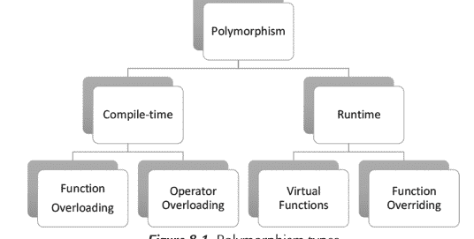

图8.1 多态类型

## 8.2 如何重载运算符？

*运算符重载* 是编译时多态的一种类型，其中的基本运算符可以被重载，以赋予用户自定义数据类型某种功能。这有助于重新定义C++中可用的运算符及其对操作数的操作（除了下面列出的少数运算符）：即使运算符在C++中可以存在于不同的状态。由于具有特殊且复杂的可操作性而无法重载的运算符如下：

- 作用域解析运算符 ::
- sizeof运算符
- 选择器或点运算符 .
- 指针符号 *
- 三元运算符 ?:

运算符重载的语法如下：

```cpp
Return_DataType MyClass::operator operationName(Parameters list...)
{
    // function body
}
```

重载之前，请检查以确保以下事项：

- 重载时，应至少有一个操作数属于新的用户自定义数据类型。
- 不能再次重载任何新创建的运算符。
- 我们甚至可以使用类中可用的成员方法来重载，但不能使用友元函数来实现此目的。
- 根据所用运算符的类型（一元或二元），所使用的成员函数将接受 n-1 个操作数（运算符定义中有 n 个操作数）。

#### 代码：为 ++ 运算符实现运算符重载

```cpp
#include <iostream>
using namespace std;
class opOverload
{
int m;
public:

opOverload()
{
}
void values()
{
    cout<<"\nEnter any number\n";
    cin>>m;
}

void operator ++()
{
    m++;
}
void display()
{
    cout<<"\nFirst Number now is "<<m<<endl;
}
};

int main()
{
    opOverload obj1;
    obj1.values();
    obj1++;
    obj1.display();
    return 0;
}
```

**输出：**

```
Enter any number
33
First number now is 34
```

#### 代码解析

- 在这段代码中，我们创建了一个包含几个方法的类。
- values()方法用于接受用户对数据成员的输入。
- 此处，一元运算符 ++ 被重载，并与一个对象（obj1）一起使用。
- 该重载不接收参数，obj1中存储的值会被改变。
- 代码现在显示所做的更改。重载已成功执行。

#### 代码：实现运算符重载

```cpp
#include <iostream>
using namespace std;
class diff
{
    public:
    int m,n;
    void display()
    {
        cout<<"\nEnter any numbers\n";
        cin>>m>>n;
    }
    diff operator == (diff obj1)
    {
        if(m==n)
            cout<<"Equal :)\n";
        else
            cout<<"Not Equal\n";
    }
    diff operator +=(diff obj1)
    {
        m= m+2;
        cout<<"\nFirst number now is "<<m<<endl;
    }
};

int main()
{
    diff obj1,obj2;
    obj1.display();
    obj1==obj1;
    obj1+=obj1;
    return 0;
}
```


```cpp
class unary1
{
    int m;
    public:

    unary1()
    {
    }
    void values()
    {
        cout<<"\nEnter any numbers\n";
        cin>>m;
    }
    void operator ++()
    {
        m++;
    }
    void display()
    {
        cout<<"\nFirst Number now is "<<m<<endl;
    }
};

int main()
{
    unary1 obj1,obj2;
    obj1.values();
    obj1++;
    obj1.display();

    return 0;
}
```

### 输出

```
Enter any numbers
33
First Number now is 34
```

```cpp
void display()
{
    cout << "\nYour number now is " << m << endl;
}

};

int main()
{
    unary2 obj1;
    obj1.values();
    ++obj1;
    obj1.display();
    --obj1;
    obj1.display();

    return 0;
}
```

### 输出

```
Enter any number
23
Your number now is 24
Your number now is 23
```

### 代码讲解

- 在这段代码中，我们创建了一个带有几个方法的类。
- `values()` 方法用于从用户处接收数据成员的输入。
- 这里，一元运算符 `--` 和 `++` 被重载，并与 `obj1` 一起使用。
- 这种重载不接收参数，并且会修改存储在 `obj1` 中的值。
- 代码随后显示了所做的更改。重载成功执行。

## 8.4 重载二元运算符

我们拥有的第二类运算符是二元运算符，它们使用两个操作数。例如，插入运算符（`<<`）和提取运算符（`>>`）就是二元运算符。在重载这类运算符时，我们取两个操作数并使它们成为多态形式。二元运算符的语法如下：

```cpp
Return_DataType MyClass :: operator operationName(Parameters list..)
{
    // 函数体
}
```

### 代码：重载一个二元运算符

```cpp
#include <iostream>
using namespace std;
class myclass
{
    public:
    int m,n;
    void display()
    {
        cout<<"\nEnter any two numbers\n";
        cin>>m>>n;
    }
    int operator - ()
    {
        return m-n;
    }
};

int main()
{
    myclass obj;
    int r;
    obj.display();
    r= -obj;
    cout<<"Difference is "<<r <<endl;
    return 0;
}
```

### 输出

```
Enter any two numbers
23
67
Difference is -44
```

```cpp
obj2.values();
r= obj1*obj2;
r.display();
return 0;
}
```

### 输出

```
Enter any number
48

Enter any number
122

Your Result is 5856
```

### 代码讲解

在这段代码中，我们创建了一个带有几个方法的类。

- `values()` 方法用于从用户处接收数据成员的输入。
- 这里，用于执行乘法的二元运算符 `*` 被重载，并与对象一起使用。
- 在函数内部为该类创建了一个额外的临时对象，用于存储更改后的值。
- 这种重载接收一个参数，并且对象中存储的值会被修改。
- 代码随后显示了所做的更改。重载成功执行。

### 代码：使用二元运算符

```cpp
#include <iostream>
#include<string.h>
using namespace std;
class concat
{
    char str[20];
    public:
    void input()
    {
        cout<<"\nEnter your string: ";
        cin.getline(str,20);
    }
    void display()
    {
        cout<<"String: "<<str;
    }
    concat operator +(concat s)
    {
        concat obj;
        strcat(str,s.str);
        strcpy(obj.str,str);
        return obj;
    }
};
int main()
{
    concat str1,str2,str3;
    str1.input();
    str2.input();
    str3=str1+str2;
    str3.display();
    return 0;
}
```

### 输出

```
Enter your string: Hello

Enter your string: learners!
String: HelloLearners!%
```

### 代码讲解

在这段代码中，我们创建了一个带有几个方法的类。

- `input()` 方法用于从用户处接收字符串类型的数据成员。
- 这里，二元运算符 `+` 被重载，用于连接输入的字符串。

```cpp
int main()
{
    myclass obj1(86, 99);
    myclass obj2(108, 245);
    myclass obj3;
    obj3 = obj1+obj2;
    cout << "Sum is " << obj3.m << endl;
    cout << "Sum is " << obj3.n << endl;
    return 0;
}
```

### 输出

```
Sum is 194
Sum is 344
```

### 代码讲解

- 在这段代码中，我们创建了一个带有几个构造函数的类：一个默认构造函数，另一个是参数化构造函数。
- 在这个示例中，重载是通过在类内声明函数、在类外实现函数来完成的。
- 这里，二元运算符 `+` 被重载，并与 `obj1` 和 `obj2` 一起使用。结果存储到 `obj3` 中。
- 这种重载接收两个参数，并且对象中存储的值会被修改。
- 代码随后显示了所做的更改。重载成功执行。

## 总结

- 多态性为我们提供了具有不同签名但名称相同的多种方法形式。
- *运算符重载*是一种编译时多态性，其中我们使用的基本运算符也可以被重载，从而为用户定义的数据类型提供功能。
- 运算符重载使用两种类型的运算符完成：一元运算符和二元运算符。
- 不能重载新的运算符，也不能再次重载已重载的运算符。
- 不能重载的运算符包括作用域解析运算符（`::`）、sizeof 运算符、选择器或点运算符（`.`）、指向成员的指针运算符（`.*`）以及三元运算符（`?:`），因为它们具有特殊而复杂的可操作性。
- 二元运算符的重载也可以使用友元函数来完成。

## 练习

### 理论题

1. 什么是运算符重载？解释运算符重载的重要性。
2. 列出不能重载的运算符，并说明为什么它们不能被重载。
3. 什么是运算符函数？用语法和示例描述运算符函数。
4. 重载一元递增/递减运算符有哪些限制？如何克服这些限制？
5. 解释一元运算符重载的语法。重载一元运算符的定义中需要多少个参数？
6. 解释二元运算符重载的语法。重载二元运算符的定义中需要多少个参数？

### 实践题

1. 编写一个程序，重载一元运算符（例如 `++`），用于递增 GPS 系统中的距离。用同一个程序描述重载运算符的工作模型。
2. 编写一个 C++ 程序，重载一元运算符以处理计数器。它应同时支持向上和向下计数。还必须支持将两个计数器相加并将结果存储到另一个计数器中的运算符。
3. 编写一个 C++ 程序，重载算术运算符以操作向量。
4. 编写一个 C++ 程序，重载 new 运算符和 delete 运算符以操作 Student 类的对象。Student 类必须包含数据成员，例如 `char* name`、`int roll_no` 和 `int branch`。重载的 new 运算符和 delete 运算符必须为 Student 类对象及其数据成员分配内存。
5. 编写一个 C++ 程序来操作 N 个 Student 类的对象。重载下标运算符，在访问时进行边界检查。

### 选择题

1. 关于 C++ 中运算符重载，哪个说法是正确的？
   a. 只能重载算术运算符。
   b. 运算符的结合性和优先级不会改变。
   c. 重载后运算符的优先级会发生改变。
   d. 只能重载非算术运算符。

2. 什么是 C++ 中的运算符重载？
   a. 使用用户定义的含义覆盖运算符，用于用户定义的数据类型
   b. 重新定义运算符对用户定义类型的工作方式
   c. 为运算符提供某种特殊含义，使其适用于用户定义的数据类型
   d. 以上全部

3. 以下哪个运算符不能重载？
   a. *（指向成员的指针运算符）
   b. ::（作用域解析运算符）
   c. .*（指向成员的指针运算符）
   d. 以上全部

4. 使用成员函数重载二元运算符需要 ______ 个参数。
   a. 2
   b. 1


## 选择题

- c. 0
- d. 3

5. 以下哪个运算符更适合作为全局函数而不是成员函数进行重载？

    - a. 后缀 ++
    - b. 比较运算符
    - c. 插入运算符 <<
    - d. 前缀 ++

6. 以下哪个运算符函数不能是全局函数（即必须是成员函数）？

    - a. new
    - b. delete
    - c. 转换运算符
    - d. 以上都是

7. 以下哪项是运算符重载过程的正确顺序？

    - i. 定义运算符函数以实现所需操作。
    - ii. 创建一个类，定义在重载操作中使用的数据类型。
    - iii. 在类的公有部分声明运算符函数 op()。

    - a. 1-i, 2-ii, 3-iii
    - b. 1-ii, 2-iii, 3-i
    - c. 1-ii, 2-i, 3-iii
    - d. 1-iii, 2-ii, 3-i

8. 以下 C++ 代码的输出是什么？

```cpp
#include <iostream>
#include <string>
using namespace std;
class A
{
    static int a;
public:
    void show()
    {
        a++;
        cout<<"a: "<<a<<endl;
    }
};
int A::a = 5;
int main(int argc, char const *argv[])
{
    A a;
    return 0;
}
```

    - a. 错误，因为私有成员 a 在类外部被引用
    - b. 段错误
    - c. 没有输出
    - d. 程序编译成功，但出现运行时错误

9. 当对象 s1 和 s2 相加时会发生什么？

```cpp
string s1 = "Hello";
string s2 = "World";
string s3 = (s1+s2).substr(5);
```

    - a. 错误，因为 s1+s2 将得到一个 string，而 string 没有 substr() 函数
    - b. 段错误，因为在 C++ 中两个 string 不能相加
    - c. 语句完全正常执行。
    - d. 运行时错误

10. 对于友元运算符重载函数，一元运算符重载函数最多可以接受多少个对象参数？

    - a. 1
    - b. 2
    - c. 3
    - d. 0

11. 对于友元运算符重载函数，二元运算符重载函数最多可以接受多少个对象参数？

    - a. 1
    - b. 2
    - c. 3
    - d. 0

12. 以下 C++ 代码的输出是什么？

```cpp
#include <iostream>
#include <string>
using namespace std;
class A
{
    static int a;
public:
    void show()
    {
        a++;
        cout<<"a: "<<a<<endl;
    }
    void operator.()
    {
        cout<<"Objects are added\n";
    }
};
class B
{
public:
};
int main(int argc, char const *argv[])
{
    A a1, a2;
    return 0;
}
```

    - a. 运行时错误
    - b. 完美运行
    - c. 段错误
    - d. 编译时错误

### 答案

| 1 | 2 | 3 | 4 | 5 | 6 | 7 | 8 | 9 | 10 | 11 | 12 |
| --- | --- | --- | --- | --- | --- | --- | --- | --- | --- | --- | --- |
| (b) | (d) | (d) | (b) | (c) | (c) | (b) | (c) | (c) | (a) | (b) | (d) |

## 参考资料

### 书籍

- B. Stroustrup，*C++ 编程语言*（第4版）（Addison-Wesley Professional，2013年）。
- K. R. Venugopal，*精通 C++*（第2版）（McGraw Hill Education，2017年7月）。
- Y. Kanetkar，*让我们学 C++*（BPB Publications，2020年9月）。
- Y. Kanetkar，*测试你的 C++ 技能*（BPB Publications，2003年3月）。

### 网站

- Learn CPP，访问于 2022 年 8 月，<https://www.learncpp.com>
- Java Point，访问于 2022 年 8 月，<https://www.javatpoint.com>
- Codes Cracker，访问于 2022 年 8 月，<https://codescracker.com>
- Geeks For Geeks，访问于 2022 年 8 月，<https://www.geeksforgeeks.org>
- C Plus Plus，访问于 2022 年 8 月，<https://cplusplus.com>
- Silly Codes，访问于 2022 年 8 月，<https://sillycodes.com>

# 结构体与联合体

## 9.1 结构体：声明与定义

在 C++ 中，类是用户自定义数据类型存在的一种方式。然而，我们也可以使用结构体，它是一种将不同数据类型组合在一起的用户自定义数据类型。可以将其视为在同一个名称下存储相似数据类型的数组。结构体存储信息的方式与类存储信息的方式不同，因为默认情况下，结构体的所有成员都具有公有可见性，而类中所有成员的默认可见性是私有的。

### 结构体的特性

- 使用关键字 `struct` 定义，成员通过名称访问。
- 在 C++ 中，结构体的内存分配是连续的。
- 它具有数据成员和函数，类似于 C++ 其他地方使用的变量和函数。
- 数据成员不能在结构体内部初始化。
- 可以使用花括号初始化成员。
- 可以使用选择运算符或点运算符访问成员。
- 在 C++ 中，指向结构体的指针使用以下字符：->。
- 与数组类似，在 C++ 中也可以创建结构体的结构体。

结构体的语法如下：

```cpp
struct {
    // Declaration of our struct
    //members
};
```

下面的 C++ 程序使用了类，帮助我们观察类与结构体之间的区别。

### 代码：C++ 中的类与结构体

```cpp
#include <iostream>
using namespace std;
class Student
{
    public:
    string n;
    Student(string n)
    {
        std::cout << "\nName is " <<n<<endl;
    }
    Student(const Student& s1)
    {
        std::cout << "\nThis is a member of a class\n" <<endl;
    }
};
int main() {
    Student s1("Rio");
    Student s3(s1);
    return 0;
}
```

### 输出：

```
Name is Rio
This is a member of a class
```

### 代码解读

- 在这段代码中，我们创建了一个带有几个方法的类。
- 这些方法用于从用户处获取数据成员的输入。
- 这里，构造函数被重载并与一个对象一起使用。
- 代码展示了所做更改。重载已成功执行。

### 代码：使用结构体

```cpp
#include <iostream>
using namespace std;
struct OurStructure {
        int x;
        char c;
};
int main()
{

        struct OurStructure s1;
        s1.x = 85;
        s1.c = 'G';
        cout << "The value is : "<< s1.x << endl;
        cout << "The value is : "<< s1.c << endl;
        cout<<"Size of structure : "<<sizeof(s1)<<endl;
        return 0;
}
```

### 输出：

```
The value is : 85
The value is : G
Size of structure : 8
```

### 代码解读

- 在这段代码中，我们创建了一个带有几个变量的结构体。
- 创建结构体的对象来访问成员。
- 注意，整个结构体的大小变得不同，如同在类中一样。
- 代码展示了所做更改。

## 9.2 访问结构体

结构体是 C++ 中的一种用户自定义数据类型，它将不同的数据类型组合在一起。访问成员可以使用结构体成员运算符（.）或结构体指针。下面是一些示例，展示了如何访问和调用成员。这些示例还显示了结构体所占用的内存量（或字节数）。

### 代码：访问结构体

```cpp
#include <iostream>
using namespace std;
struct OurStructure {
    int x;
    char c;
};
int main()
{
    struct OurStructure s1;
    struct OurStructure s2 = { 240,'S' };
    s1.x = 835;
    s1.c = 'G';
    cout << "The value is : "<< s1.x << endl;
    cout << "The value is : "<< s1.c << endl;
    cout<<"Size of structure  : "<<sizeof(s1)<<endl;
    cout << "The value is : "<< s2.x << endl;
    cout << "The value is : "<< s2.c << endl;
    cout<<"Size of structure  : "<<sizeof(s2)<<endl;
    return 0;
}
```

### 输出：

```
The value is : 835
The value is : G
Size of structure : 8
The value is : 240
The value is : S
Size of structure : 8
```

### 代码解读

- 在这段代码中，我们创建了两个带有几个变量的结构体。结构体的创建使用了不同的语法。
- 创建结构体的对象来访问成员。
- 注意，整个结构体的大小变得不同，如同在类中一样。
- 代码展示了所做更改。

### 代码：使用多个结构体

```cpp
#include <iostream>
using namespace std;
struct OurStructure {
    int x;
    char c;
};
int main()
{
    struct OurStructure s1 = { 240,'S' };
    struct OurStructure* s2 = &s1;
    cout << "The value is : "<< s2->x << endl;
    cout << "The value is : "<< s2->c << endl;
    cout<<"Size of structure : "<<sizeof(s1)<<endl;
    return 0;
}
```

### 输出：

```
The value is : 240
The value is : S
Size of structure : 8
```

### 代码解读

- 在这段代码中，我们创建了两个带有几个变量的结构体。结构体的创建使用了不同的语法。
- 创建结构体的对象来访问成员。


- 注意，整个结构体的大小会发生变化，就像在类中一样。
- 代码显示了所做的更改。

## 9.3 联合体（Union）

联合体是 C++ 中另一种用户自定义数据类型。联合体将各种不同类型的对象和成员组合在一起。结构体和联合体在语法上可能看起来很相似，但它们在成员的内存分配上有所不同。联合体会为数据变量分配内存空间，该空间大小等于该联合体中占用空间最大的数据变量的大小。

联合体的语法如下：

```cpp
union UnionName
{
    //members
};
```

### 特性

- 使用关键字 `union` 定义，成员通过点运算符访问。
- 联合体的内存分配由最大的成员决定。
- 它拥有与 C++ 中其他地方使用的变量和函数类似的数据成员和函数。
- 数据成员可以被初始化，并且如果值发生变化，由于同一内存空间会受到影响，因此可以被覆盖。
- 成员通过选择运算符或点运算符来访问。
- 在 C++ 中，指向联合体的指针按如下方式使用：`->`。

### 代码：使用联合体

```cpp
#include <iostream>
using namespace std;

union OurUnion {
    int x;
    char c;
};

int main()
{
    union OurUnion u1;
    u1.x = 85;
    u1.c = 'H';
    cout << "The value is : " << u1.x << endl;
    cout << "The value is : " << u1.c << endl;
    cout << "Size of union  : " << sizeof(u1) << endl;
    return 0;
}
```

### 输出：

```text
The value is : 72
The value is : H
Size of union : 4
```

### 代码解读

- 在这段代码中，我们用几个变量创建了一个联合体。
- 然后创建联合体的对象来访问成员。
- 可以观察到，整个联合体的大小会发生变化，这与结构体类似。
- 代码显示了所做的更改。

### 代码：联合体数据类型的实现

```cpp
#include <iostream>
using namespace std;

union OurUnion {
    int x;
    char c;
    char name[12];
};

int main()
{
    union OurUnion u1;
    u1.x = 8588;
    u1.c = 'H';

    union OurUnion u2;
    u2.x = 590;
    u2.c = 'S';

    cout << "The value is x : " << u1.x << endl;
    cout << "The value is c : " << u1.c << endl;
    cout << "Size of union  : " << sizeof(u1) << endl;
    cout << "The value is x : " << u2.x << endl;
    cout << "The value is c : " << u2.c << endl;
    cout << "Size of union  : " << sizeof(u2) << endl;

    return 0;
}
```

### 输出：

```text
The value is x : 8250
The value is c : H
Size of union : 12
The value is x : 595
The value is c : S
Size of union : 12
```

### 代码解读

- 在这段代码中，我们用几个变量创建了一个联合体，并使用点运算符为成员赋值。
- 然后创建联合体的对象来访问成员。
- 可以观察到，整个联合体的大小会发生变化，这与结构体类似。
- 代码显示了所做的更改。

## 9.4 结构体与联合体的区别

既然我们已经了解了 C++ 中这两种用户自定义数据类型，下面来看看它们之间有何不同。下表将帮助学习者在 C++ 程序中判断何时何地可以使用结构体和联合体。

**表 9.1 结构体与联合体区别表**

| 结构体 | 联合体 |
|---|---|
| 结构体是 C++ 中一种用户自定义数据类型，它将不同的数据类型组合在一起。 | 联合体帮助我们将各种不同类型的对象和成员组合在一起。 |
| C++ 中结构体的内存分配是连续的。 | 联合体的内存分配由最大的成员决定。 |
| 数据成员不能在结构体内部初始化。可以通过声明结构体来完成初始化。 | 数据成员可以被初始化，并且如果值发生变化，由于同一内存空间会受到影响，因此可以被覆盖。 |
| 在结构体中，所有数据成员都被分配独立的内存空间。 | 在联合体中，所有数据成员共享一块等于最大成员大小的内存空间。 |
| 结构体的所有数据成员都可以被初始化。 | 联合体只能初始化第一个数据成员。 |
| 结构体的所有数据成员可以同时被访问。 | 联合体的数据成员一次只能访问一个。 |

## 9.5 C++ 中的枚举（Enum）

用户自定义数据类型使我们的 C++ 程序更加灵活和用户友好。它们让用户更容易理解计算机想要表达的语言。枚举（enum）是 C++ 中一种独特的数据类型，它允许我们定义数据类型，并将我们选择的元素命名为整型常量。

枚举的语法如下：

```cpp
enum datatypename { enum values list.... };
```

### 代码：使用枚举

```cpp
#include <iostream>
using namespace std;

int main()
{
    enum Gender { max, checo = 9, lewis, kimi, mick, ocon };
    int i;
    for (i = checo; i <= ocon; i++)
        cout << i << " ";
    return 0;
}
```

### 输出：

```text
9 10 11 12 13
```

### 代码解读

- 在这段代码中，我们使用带有多个项的枚举。
- for 循环遍历数据结构，并将每个成员作为索引号输出。
- 索引为 +1，可根据需求进行更改。

## 实践练习

1. 编写一个 C++ 程序，用于处理录取报告。使用一个结构体，其中包含表示学号、姓名、出生日期（使用嵌套结构体）和分配专业等信息的元素。处理结构体成员的函数必须是结构体的一部分。报告格式如下：

    | 学号 | 姓名 | 出生日期 | 分配专业 |
    |---|---|---|---|
    | XX | xxx | dd/mm/yy | xxxxxxxxxx |

2. 编写一个 C++ 程序，使用结构体处理出生日期。要求能够处理多名学生的出生日期。

3. 编写一个 C++ 程序处理复数。程序需要执行复数的加、减、乘、除运算，并以 x+iy 形式输出结果。

4. 对于以下结构体声明：

```cpp
struct institution {
    struct teacher {
        int empl_no;
        char name[20];
    };
    struct student {
        int roll_no;
        char name[15];
    };
};
```

`sizeof(institution)`、`sizeof(teacher)` 和 `sizeof(student)` 的值分别是多少？

## 选择题

1. 下面代码的正确输出是什么？

```cpp
#include <iostream>
#include <math.h>
using namespace std;

struct st {
    int A = NULL;
    int B = abs(EOF + EOF);
} S;

int main()
{
    cout << S.A << " " << S.B;
    return 0;
}
```

- a. 0 2
- b. 0 0
- c. 2 0
- d. 错误

2. 下面代码的正确输出是什么？

```cpp
#include <iostream>
using namespace std;

typedef struct {
    int A = 10;
    int B = 20;
} S;

int main()
{
    cout << S.A << " " << S.B;
    return 0;
}
```

- a. 错误
- b. 10 20
- c. 10 0
- d. 0 0

3. 下面代码的正确输出是什么？

```cpp
#include <iostream>
using namespace std;

typedef struct {
    int A;
    char* STR;
} S;

int main()
{
    S ob = { 10, "india" };

    S* ptr;
    ptr = &ob;

    cout << ptr->A << " " << ptr->STR;
    return 0;
}
```

- a. 10 india
- b. 空白输出
- c. 垃圾值
- d. India 10

4. 下面代码的正确输出是什么？

```cpp
#include <iostream>
using namespace std;

int main()
{
    typedef struct {
        int A;
        char* STR;
    } S;

    S ob = { 10, "india" };
    S* ptr;
    ptr = &ob;

    cout << ptr->A << " " << ptr->STR;
    return 0;
}
```

- a. 10 in
- b. 10 d
- c. 10 india
- d. 10 n

5. 下面代码的正确输出是什么？

```cpp
#include <iostream>
using namespace std;

struct st {
    int A;
```

7. 下面代码的正确输出是什么？

```cpp
#include <iostream>
using namespace std;

struct st1 {
    int A = 10;
    struct st2 {
        char ch = 'A';
    } S;
} SS;

int main()
{
    struct st1* PTR = &SS;
    int X = 0;
    X = PTR->A + PTR->S.ch;
    cout << X;
    return 0;
}
```

- a. 65
- b. 75
- c. 97
- d. 107

8. 以下代码的输出是什么？

```cpp
#include <iostream>
#include <string.h>
using namespace std;

int main() {
    struct student {
        int num;
        char name[25];
    };

    student stu;
    stu.num = 123;
    strcpy(stu.name, "john");
    cout << stu.num << endl;
    cout << stu.name << endl;
    return 0;
}
```


- a. 123 john
- b. john john
- c. 编译时错误
- d. 运行时错误

### 9. 以下代码的输出是什么？

```cpp
#include <iostream>
using namespace std;
struct Time{
    int hours, minutes, seconds;
};
int toSeconds(Time now);
int main() {
    Time t;
    t.hours = 5;
    t.minutes = 30;
    t.seconds = 45;
    cout << "Total seconds: " << toSeconds(t) << endl;
    return 0;
}
int toSeconds (Time now){
    return 3600 * now.hours + 60 * now.minutes + now.seconds;
}
```

- a. 19845
- b. 20000
- c. 15000
- d. 19844

### 10. 以下代码的输出是什么？

```cpp
#include <iostream>
using namespace std;
int main() {
    struct ShoeType{
        string style;
        double price;
    };

    ShoeType shoe1, shoe2;
    shoe1.style = "Adidas";
    shoe1.price = 9.99;
    cout << shoe1.style << "$" << shoe1.price;
    shoe2 = shoe1;
    shoe2.price = shoe2.price / 9;
    cout << shoe2.style << "$" << shoe2.price;
    return 0;
}
```

- a. Adidas$9.99Adidas$1.11
- b. Adidas$9.99Adidas$9.11
- c. Adidas$9.99Adidas$11.11
- d. Adidas$11.11Adidas$11.11

### 11. 以下哪项是正确定义的结构体？

- a. `struct {int a;}`
- b. `struct a_struct {int a;}`
- c. `struct a_struct int a;`
- d. `struct a_struct {int a;};`

### 12. 以下哪项访问结构体指针 *b 中的变量？

- a. `b->var;`
- b. `b.var;`
- c. `b-var;`
- d. `b>var;`

### 13. 以下哪项本身是不同数据类型的集合？

- a. 字符串
- b. 结构体
- c. 字符
- d. 以上都不是

### 14. 哪个运算符连接结构体名称与其成员名称？

- a. `-`
- b. `->`
- c. `.`
- d. `.` 和 `->` 都可以

### 15. 以下哪项不能作为结构体成员？

- a. 函数
- b. 数组
- c. 结构体
- d. 以上都不是

### 16. 声明一个接收结构体数组的 foo() 函数的正确语法是什么？

- a. `void foo(struct *var);`
- b. `void foo(struct *var[]);`
- c. `void foo(struct var);`
- d. 以上都不是

### 17. 联合体与结构体的区别如下：

- a. 所有成员同时被使用。
- b. 每次只能使用一个成员。
- c. 联合体不能有更多成员。
- d. 联合体会像结构体一样初始化所有成员。

### 18. 结构体中的数据元素也被称为什么？

- a. 对象
- b. 成员
- c. 数据
- d. 对象和数据

## C++ 编程基础

### 19. 结束结构体声明时会使用什么？

- a. `:`
- b. `}`
- c. `;`
- d. `;;`

### 20. 声明结构体时会发生什么？

- a. 它不会分配任何内存。
- b. 它会分配内存。
- c. 它会被声明并初始化。
- d. 它会被声明。

### 21. 结构体的声明也被称为

- a. 结构体创建者
- b. 结构体指示符
- c. 结构体说明符
- d. 结构体创建者和指示符

### 22. 在 int 占用 4 字节内存的情况下，以下联合体的大小是 ____________。

```c
union demo
{
    float x;
    int y;
    char z[10];
};
```

- a. 8 字节
- b. 4 字节
- c. 10 字节
- d. 18 字节

### 23. 联合体的成员通过 ____________ 访问。

- a. `union-name.member`
- b. `union-pointer->member`
- c. a 和 b 都可以
- d. 以上都不是

### 24. 无法创建指向结构体的指针数组。

- a. 正确
- b. 错误
- c. 在某些情况下可能可以
- d. 无法给出答案

### 25. 以下哪项陈述是正确的？

- a. 用户必须显式定义枚举的数值。
- b. 用户可以控制枚举变量的大小。
- c. 如果需要，枚举可以具有仅限于块内的局部作用域。
- d. 枚举在整个文件中具有全局作用域。

### 26. `sizeof a union` 给出的是联合体中最大元素的大小。

- a. 是
- b. 不是
- c. 在某些情况下可能可以
- d. 无法给出答案

### 27. 结构体、联合体和枚举之间有什么相似之处？

- a. 它们都允许你定义新值。
- b. 它们都允许你定义新的数据类型。
- c. 它们都允许你定义新的指针。
- d. 它们都允许你定义新的结构体。

### 28. 以下哪些项在语法上有相似之处？

1. 联合体
2. 结构体
3. 数组
4. 指针

- a. 3 和 4
- b. 1 和 2
- c. 2 和 3
- d. 以上全部

### 29. 联合体的大小由______的大小决定。

- a. 联合体中的第一个成员
- b. 联合体中的最后一个成员
- c. 所有成员大小之和
- d. 联合体中最大的成员

### 30. 哪个运算符连接结构体名称与其成员名称？

- a. `-`
- b. `.`
- c. `.` 和 `->` 都可以
- d. 以上都不是

### 31. 如何释放已分配的内存？

- a. `remove(var_name);`
- b. `free(var_name);`
- c. `delete(var_name);`
- d. `dalloc(var_name);`

### 32. 以下哪项访问结构体 b 中的变量？

- a. `b->var;`
- b. `b.var;`
- c. `b-var;`
- d. `b>var;`

### 33. 以下哪项访问结构体指针 *b 中的变量？

- a. `b->var;`
- b. `b.var;`
- c. `b-var;`
- d. `b>var;`

### 34. 以下哪项是正确定义的结构体？

- a. `struct {int a;}`
- b. `struct a_struct {int a;}`
- c. `struct a_struct int a;`
- d. `struct a_struct {int a;};`

### 35. 以下哪项正确声明了一个结构体 foo 的变量？

- a. `struct foo;`
- b. `struct foo var;`
- c. `foo;`
- d. `int foo;`

### 36. 这个程序的输出是什么？

```c
#include <stdio.h>
struct test {
    int x = 0;
    char y = 'A';
};
int main()
{
    struct test t;
    printf("%d, %c", s.x, s.y);
    return 0;
}
```

- a. 0
- b. 错误
- c. 垃圾值 垃圾值
- d. 以上都不是

### 37. 这个程序的输出是什么？

```c
#include <stdio.h>
struct test {
    int x;
    char y;
} test;

int main()
{
    test.x = 10;
    test.y = 'A';
    printf("%d %c", test.x, test.y);
    return 0;
}
```

- a. 0.416666666666667
- b. 垃圾值 垃圾值
- c. 编译错误
- d. 以上都不是

### 38. 这个程序的输出是什么？

```c
#include <stdio.h>
struct result{
    char sub[20];
    int marks;
};
void main()
{
    struct result res[] = { {"Maths",100},
    {"Science",90},
    {"English",85}
    };
    printf("%s ", res.sub);
    printf("%d", (*(res+2)).marks);
}
```

- a. Maths 100
- b. Science 85
- c. Science 90
- d. Science 100

### 39. 以下结构体的大小是多少？

```c
struct demo{
    int a;
    char b;
    float c;
};
```

- a. 12
- b. 8
- c. 10
- d. 9

### 40. 这个程序的输出是什么？

```c
#include <stdio.h>
void main()
{
struct demo{
    char * a;
    int n;
};

struct demo p = {"hello", 2015};
struct demo q = p;
printf("%d", printf("%s",q.a));
}
```

- a. hello
- b. 5hello
- c. hello5
- d. 6hello

### 41. 这个程序的输出是什么？

```c
#include <stdio.h>
int main()
{
    union demo {
        int x;
        int y;
    };

    union demo a = 100;
    printf("%d %d", a.x, a.y);
}
```

- a. 100 0
- b. 100 100
- c. 0 0
- d. 编译错误

### 42. 这个程序的输出是什么？

```c
#include <stdio.h>
int main()
{
    enum days {MON=-1, TUE, WED=4, THU, FRI, SAT};
    printf("%d, %d, %d, %d, %d, %d", MON, TUE, WED, THU, FRI,
           SAT);
    return 0;
}
```

- a. -1 0 4 5 6 7
- b. -1 0 1 2 3 4
- c. 0 1 2 3 4 5
- d. 错误

### 43. 这个程序的输出是什么？

```c
#include <stdio.h>
int main(){
    struct simp
    {
        int i = 6;
        char city[] = "chicago";
    };
    struct simp s1;
    printf("%d",s1.city);
    printf("%d", s1.i);
    return 0;
}
```

- a. chicago 6
- b. 不会显示任何内容
- c. 运行时错误
- d. 编译错误

### 44. 这个程序的输出是什么？

```c
#include <stdio.h>

struct
{
    int i;
```


```c
float ft;
}decl;
int main(){
    decl.i = 4;
    decl.ft = 7.96623;
    printf("%d %.2f", decl.i, decl.ft);
    return 0;
}
```

- a. 4 7.97
- b. 4 7.96623
- c. 编译错误
- d. 以上都不是

### 45. 这个程序的输出是什么？

```c
void main()
{
    struct bitfields {
    int bits_1: 2;
    int bits_2: 9;
    int bits_3: 6;
    int bits_4: 1;
    }bit;
    printf("%d", sizeof(bit));
}
```

- a. 2
- b. 3
- c. 4
- d. 0

### 46. 这个程序的输出是什么？

```c
#include <stdio.h>
int main(){
    struct leader
    {
    char *lead;
    int born;
    };
    struct leader l1 = {"Adam ", 1931};
    struct leader l2 = l1;
    printf("%s %d", l2.lead, l1.born);
}
```

- a. 编译错误
- b. 垃圾值 1931
- c. Adam 1931
- d. 以上都不是

## 选择题

|  | 答案 |  |  |  |  |  |  |  |  |  |
|---|---|---|---|---|---|---|---|---|---|---|
| 1. (a) | 2. (a) | 3. (a) | 4. (b) | 5. (a) | 6. (b) | 7. (b) | 8. (a) | 9. (a) | 10. (a) |  |
| 11. (d) | 12. (a) | 13. (b) | 14. (c) | 15. (a) | 16. (a) | 17. (b) | 18. (b) | 19. (c) | 20. (a) |  |
| 21. (a) | 22. (c) | 23. (c) | 24. (b) | 25. (c) | 26. (a) | 27. (b) | 28. (b) | 29. (d) | 30. (b) |  |
| 31. (b) | 32. (b) | 33. (a) | 34. (d) | 35. (b) | 36. (b) | 37. (b) | 38. (a) | 39. (a) | 40. (c) |  |
| 41. (d) | 42. (a) | 43. (d) | 44. (a) | 45. (b) | 46. (c) |  |  |  |  |  |

## 参考文献

### 书籍

- B. Stroustrup，*C++ 程序设计语言*（第4版）（Addison-Wesley Professional，2013年）。
- K. R. Venugopal，*精通 C++*（第2版）（McGraw Hill Education，2017年7月）。
- Y. Kanetkar，*让我们学习 C++*（BPB Publications，2020年9月）。
- Y. Kanetkar，*测试你的 C++ 技能*（BPB Publications，2003年3月）

### 网站

- Learn CPP，访问于2022年8月，https://www.learncpp.com
- Codes Cracker，访问于2022年8月，https://codescracker.com
- Geeks For Geeks，访问于2022年8月，https://www.geeksforgeeks.org
- Udacity，访问于2022年8月，https://www.udacity.com
- Scaler，访问于2022年8月，https://www.scaler.com
- C Plus Plus，访问于2022年8月，https://cplusplus.com
- Silly Codes，访问于2022年8月，https://sillycodes.com

# 第10章

# 异常处理

## 10.1 错误与异常

编程世界中的异常是运行时异常条件，导致程序终止或错误执行。错误是程序员可能在程序中使用的非法语句或功能。错误无法修复，但异常可以处理。

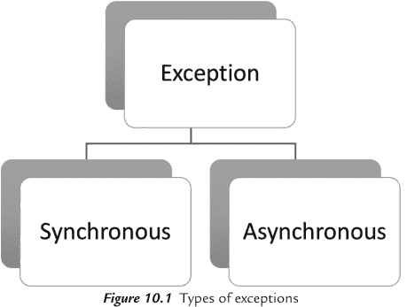

C++中的异常大致分为两种类型：

- 1. **同步异常**：此类异常只能由抛出语句产生。例如，访问数组不存在的索引元素，会引发数组索引越界异常。
- 2. **异步异常**：此类异常包括程序执行过程中出现的键盘或输入中断，并扰乱C++代码的自然流程。这些异常不直接处理，而是通过信号概念来管理。

### 代码：异常处理（1）

```cpp
#include <iostream>
using namespace std;
int main()
{
int x = 0;
int y=10;
cout << "oops wrong \n"<<y/x<<endl;
}
```

### 输出：

```text
oops wrong
zsh: floating point exception
```

### 代码：异常处理（2）

```cpp
#include <iostream>
using namespace std;
class Parent {

public:
int p=60;
void showP()
{
cout<<"\nParent's age is " <<p<< endl;
}
};

class Child : public Parent
{
public:
    int c=20;
    void showC() {
        cout<< "\nChild's age  is " <<c<< endl;
    }

}//a syntax error will occur as class declaring syntax is not
// being followed
class Grandchild : public Child
{

    public:
    int g=4;
    void showg() {
        cout<< "\nGrandchild's age  is  " <<g<< endl;
        ;
    }

};

int main() {
    Grandchild g1;
    g1.showP();
    g1.showC();
    g1.showg();
    return 0;
}
```

### 输出：

```text
inherit.cpp:25:2: error: expected ';' after class
```

```text
}//syntax error will occur as class declaring syntax not followed
```

### 代码说明

- 正如你可以从这段代码中观察到的，我们没有遵循C++中的语法规则。
- 这导致编译器给出语法错误消息。
- 它向我们显示了错误发生的行号以及错误导致程序终止的原因。

## 10.2 异常处理

在C++中，异常使用try-catch块处理，我们可以抛出认为代码可能会遇到的特定异常，并在块中处理它。现在让我们熟悉在异常处理机制中将要使用的重要关键字。

- *Try*：此块用于抛出异常。我们可以测试条件，如果条件满足（为真），就抛出一个异常。try块后面总是跟着catch块。
- *Catch*：此块在抛出异常时使用。它给出了捕获异常后会发生什么，以及如何使用异常处理器进行管理。一个try块后面可以跟多个catch。
- *Throw*：这个关键字只是抛出一个异常，除此之外不做其他事。处理异常是try-catch块的责任。

try-catch块的语法如下：

```cpp
try {
    // code
    throw exceptionName;
}
catch () {
    // code
}
```

### 代码：使用Try-Catch块处理异常

```cpp
#include <iostream>
using namespace std;

int main()
{
int x = 0;
int y=10;
//cout << "oops wrong \n"<<y/x<<endl;
try {

        if (y > 9)
        {
                throw y;
        }
}
catch (int y) {
    cout << "\n The Exception thrown has been Caught \n";
}
return 0;
}
```

### 输出：

```text
The Exception thrown has been Caught
```

### 代码说明

- 正如你可以从这段代码中观察到的，我们使用try-catch块机制来处理异常。
- try块位于main函数内部。如果语句满足，我们在try块中抛出异常。
- catch块执行其工作并捕获异常，然后打印消息。

### 代码：捕获异常

```cpp
#include <iostream>
using namespace std;

int main()
{
int x = -9;
int y=10;
//cout << "oops wrong \n"<<y/x<<endl;
try {

    if (y > 9)
    {
        throw y;
    }
    if (x< 0)
    {
        throw x;
    }
}
catch (int y) {
    cout << "\nThe Exception thrown has been Caught \n";
}
```

| 序号 | 异常 | 说明 |
|---|---|---|
| 5. | range_error | 当我们尝试对超出范围的值进行操作时发生的异常 |
| 6. | overflow_error | 当值无法再容纳时发生的异常 |
| 7. | underflow_error | 当值不满足最小范围时发生的异常 |
| 8. | length_error | 当字符串值正在操作时可能发生的异常 |
| 9. | domain_error | 如果分配的值超出域时可能发生的异常 |
| 10. | bad_alloc | 使用new运算符分配内存时可能发生的异常 |

## 10.4 C++中的自定义异常

在C++中，如果我们希望创建自己的个性化异常，可以通过继承标准异常类的属性并重写其方法来实现。以下代码展示了类的概念以及从预定义类继承如何帮助处理和生成我们自己的异常。

```cpp
#include <iostream>
using namespace std;

class trial {
};

int main()
{
    try {
        throw trial();
    }

    catch (trial obj) {
        cout << "\nCaught an exception  of a class \n";
    }
}
```

### 输出：

```text
Our custom exception has been caught
Calling function
User, Please enter an Exception
```

### 代码说明

- 正如你可以从这段代码中观察到的，我们通过继承`exception`父类的属性创建了自己的异常。
- 在`main`内部，我们在`try`块中抛出异常。
- `catch`块执行其工作并捕获异常，然后打印消息。
- 由于我们的异常是一个类，我们使用对象调用其数据方法。

## 总结

- 编程中的*异常*是运行时的异常条件，导致程序终止或错误执行。
- *错误*是程序员可能在程序中使用的非法语句或功能。
- 错误无法修复，但异常可以处理。
- 异常使用`try-catch`块处理，我们可以抛出特定的异常。
- `try`块用于抛出异常。我们可以检查条件，如果条件满足，程序就抛出异常。
- `catch`块在抛出异常时使用。捕获异常后会发生什么在此块中。
- `try`块后面总是跟着`catch`块，一个`try`块后面可以跟多个catch。
- 有一些标准异常是程序员经常遇到的，它们是`std`库的一部分。
- 在C++自定义异常中，我们可以继承标准异常类的属性并重写其方法。


## 练习

### 理论题

- 1. 什么是异常？同步异常和异步异常有什么区别？
- 2. 解释 C++ 的异常处理模型及其支持的各种结构。
- 3. 用于指示一个函数可能抛出的异常列表的语法是什么？如果抛出了未指定的异常会发生什么？
- 4. 当在带有若干已构造对象的 try 块中抛出异常时会发生什么？
- 5. 当抛出的异常未被 catch 块捕获时会发生什么？
- 6. 列出成功处理异常的十条规则。

### 实践题

- 1. 编写一个程序，演示如何捕获所有异常。
- 2. 编写一个 C++ 程序来计算一个数的平方根。必须对输入值进行有效性测试。如果它是负数，用户自定义函数 my_sqrt() 是否应该抛出一个异常？
- 3. 编写一个 C++ 程序，当抛出的异常未被捕获时，将控制权转移到用户定义的 terminate 函数。
- 4. 编写一个 C++ 程序，安装用户定义的 unexpected 函数来处理异常。
- 5. 编写一个 C++ 程序，将两个复数相除。重载除号（/）运算符。这个程序能否使用异常来处理除以零等情况？
- 6. 编写一个 C++ 程序进行矩阵乘法。矩阵乘法函数应通过异常告知用户矩阵的阶数无效。
- 7. 编写一个 C++ 程序将两个向量相加。每个向量对象（类 Vector 的实例）的数据成员都是动态分配的。该程序能否捕获 new 运算符抛出的异常并采取纠正措施？

### 选择题（MCQ）

- 1. C++ 程序中的异常是什么？
  - a. 程序执行期间出现的问题
  - b. 编译期间出现的问题
  - c. 语法错误
  - d. 语义错误
- 2. 默认情况下，当程序检测到异常时，它会做什么？
  - a. 继续运行
  - b. 终止程序
  - c. 调用程序的其他函数
  - d. 移除异常并告知程序员出现了异常
- 3. 为什么需要处理异常？
  - a. 避免程序在运行时出现意外行为
  - b. 让编译器自行移除所有异常
  - c. 为了成功编译程序
  - d. 为了获得正确的输出
- 4. 在 try-catch 块中，派生类的 catch 块应放在哪里？
  - a. 在基类的 catch 块之前
  - b. 在基类的 catch 块之后
  - c. 在 catch 块序列中的任何位置
  - d. 在所有 catch 块之后
- 5. 捕获任何类型异常的语法是什么？
  - a. catch (Exception e)
  - b. catch (...)
  - c. catch (Exception ALL)
  - d. catch (ALL)
- 6. 未捕获的异常会导致 ________
  - a. 程序终止
  - b. 程序成功执行
  - c. 对程序没有影响
  - d. 程序启动后执行其他函数
- 7. C++ 中用于异常处理的头文件是什么？
  - a. <cstdlib>
  - b. <string>
  - c. <handler>
  - d. <exception>
- 8. 导致程序异常终止/行为的 C++ 代码应写在 ________ 块下。
  - a. try
  - b. catch
  - c. finally
  - d. throw
- 9. 异常处理器是用 ________ 关键字声明的。
  - a. try
  - b. catch
  - c. throw
  - d. finally
- 10. 关于 catch 处理器，下列哪些说法是正确的？
  - i. 它必须紧跟在 try 块之后。
  - ii. 它可以有多个参数。
  - iii. 每个 try 块必须有且只有一个 catch 处理器。
  - iv. 一个 try 块可以有多个 catch 处理器。
  - v. 通用 catch 处理器可以放在 try 块之后的任何位置。
  - a. i, iv, v
  - b. i, ii, iii
  - c. i, iv
  - d. i, ii
- 11. 在嵌套的 try-catch 块中，如果内部 catch 块被执行，则 ________
  - a. 程序立即停止
  - b. 外部 catch 块也会执行
  - c. 编译器跳到外部 catch 块并执行 main() 函数的剩余语句
  - d. 编译器执行外部 try-catch 块的剩余语句，然后执行 main() 函数
- 12. 如果内部 catch 块无法处理抛出的异常，则 ________
  - a. 程序异常停止
  - b. 编译器会查找外部 try-catch 块
  - c. 编译器将检查外部 try 块的相应 catch 处理器
  - d. 编译器不会检查外部 try 块的相应 catch 处理器
- 13. 在嵌套的 try-catch 块中，如果内部和外部 catch 块都无法处理抛出的异常，则 ________
  - a. 编译器只执行 main()
  - b. 编译器抛出编译时错误
  - c. 程序将不间断地运行
  - d. 程序将被异常终止
- 14. 当抛出未处理的异常时，会调用哪个函数？
  - a. stop()
  - b. abort()
  - c. terminate()
  - d. abandon()
- 15. 如何限制一个函数只抛出特定的异常？
  - a. 在函数内定义多个 try-catch 块
  - b. 在 try-catch 块内定义一个通用函数
  - c. 使用 throw 子句定义函数
  - d. 在 C++ 中不允许
- 16. 当我们试图抛出函数不支持的异常时，会调用哪个函数？
  - a. indeterminate()
  - b. unutilized()
  - c. unexpected()
  - d. unpredicted()
- 17. 未捕获异常的返回类型是 ________
  - a. int
  - b. bool
  - c. char*
  - d. double
- 18. 关于 C++ 中的异常处理，下列哪项是正确的？
  - i. C++ 中有一个标准异常类，类似于 Java 中的异常类。
  - ii. 在 C++ 中，所有异常都是不检查的，即编译器不检查异常是否被捕获。
  - iii. 在 C++ 中，函数可以使用逗号分隔的列表指定它可以抛出的异常列表，如下所示：

    ```cpp
    void fun(int a, char b) throw (Exception1, Exception2, ...)
    ```

  - a. i, iii
  - b. i, ii, iii
  - c. i, ii
  - d. ii, iii
- 19. 哪个替代语句可以取代 throw 语句？
  - a. for
  - b. break
  - c. return
  - d. exit
- 20. 如果我们使用 return 关键字返回错误代码，有哪些缺点？
  - a. 你必须显式处理所有异常情况。
  - b. 代码量急剧增加。
  - c. 代码变得更难阅读。
  - d. 以上所有
- 21. 在嵌套的 try-catch 块中，如果内部 catch 块被执行，则 ________
  - a. 程序立即停止
  - b. 外部 catch 块也会执行
  - c. 编译器跳到外部 catch 块并执行 main() 函数的剩余语句
  - d. 编译器执行外部 try-catch 块的剩余语句，然后执行 main() 函数
- 22. 异常在哪里被处理？
  - a. 在程序内部
  - b. 在常规代码之外
  - c. a 和 b 两者
  - d. 以上都不是
- 23. 如果内部 catch 块无法处理抛出的异常，则 ________
  - a. 程序异常停止
  - b. 编译器会查找外部 try-catch 块
  - c. 编译器将检查外部 try 块的相应 catch 处理器
  - d. 编译器不会检查外部 try 块的相应 catch 处理器
- 24. 无论是否发生异常，catch 处理器总是会执行。
  - a. 正确
  - b. 错误
- 25. 在采用面向对象的异常处理之前，__________。
  - a. 没有发生运行时错误
  - b. 程序员无法处理运行时错误
  - c. 最流行的错误处理方法是抛出异常
  - d. 最流行的错误处理方法是终止程序
- 26. 如何定义用户自定义异常？
  - a. 继承一个类的功能
  - b. 重写一个类的功能
  - c. 继承并重写一个异常类的功能
  - d. 以上都不是
- 27. 哪种类型的程序建议放在 try 块中？
  - a. 指针
  - b. const 引用
  - c. 静态内存分配
  - d. 动态内存分配


### 28. 我们可以防止一个函数抛出任何异常。

- **a.** 正确
- **b.** 错误

### 29. Catch 处理程序可以有多个参数。

- **a.** 正确
- **b.** 错误

### 30. 以下 C++ 代码的输出是什么？

```cpp
#include <iostream>
using namespace std;
int main()
{
    int var = -12;
    try {
        cout<<"Inside try\n";
        if (var < 0)
        {
            throw var;
            cout<<"After throw\n";
        }
    }
    catch (int var) {
        cout<<"Exception Caught\n";
    }
    cout<<"After catch\n";
    return 0;
}
```

- **a.** 在 try 内<br>捕获异常<br>在 catch 之后
- **b.** 在 try 内<br>在 throw 之后<br>在 catch 之后
- **c.** 在 try 内<br>捕获异常<br>在 throw 之后
- **d.** 在 try 内<br>捕获异常<br>在 throw 之后<br>在 catch 之后

### 31. 这个程序的输出是什么？

```cpp
#include<iostream>
using namespace std;
int main ()
{
try {
int* myarray = new int[1000];
cout << "Allocated";
}
catch (exception& e){
cout << "Standard exception: " << e.what() << endl;
}
return 0;
}
```

- a. 错误
- b. 已分配
- c. 标准异常
- d. 取决于内存

### 32. 以下 C++ 代码的输出是什么？

```cpp
#include <iostream>
using namespace std;
int main()
{
    try
    {
        try
        {
            throw 20;
        }
        catch (int n)
        {
            cout << "Inner Catch\n";
        }
    }
    catch (int x)
    {
        cout << "Outer Catch\n";
    }
    return 0;
}
```

- a. 内层 catch
- b. 外层 catch
- c. 内层 catch<br>外层 catch
- d. 错误

### 33. 以下 C++ 代码的输出是什么？

```cpp
#include <iostream>
using namespace std;
int main()
{
    try
    {
        try
        {
            throw 20;
        }
        catch (char n)
        {
            cout << "Inner Catch\n";
        }
    }
    catch (int x)
    {
        cout << "Outer Catch\n";
    }
    return 0;
}
```

- a. 内层 catch
- b. 外层 catch
- c. 内层 catch<br>外层 catch
- d. 错误

### 34. 以下 C++ 代码的输出是什么？

```cpp
#include <iostream>
#include <typeinfo>
using namespace std;
class A
{
};
int main()
{
    char c; float x;
    if (typeid(c) != typeid(x))
        cout << typeid(c).name() << endl;
    cout << typeid(A).name();
    return 0;
}
```

- a. c<br>1A
- b. x
- c. c 和 x 两者
- d. c

### 35. 以下 C++ 代码的输出是什么？

```cpp
#include <iostream>
using namespace std;
void Division(const double a, const double b);
int main()
{
    double op1=0, op2=10;
    try
    {
        Division(op1, op2);
    }
    catch (const char* Str)
    {
        cout << "\nBad Operator: " << Str;
    }
    return 0;
}
void Division(const double a, const double b)
{
    double res;
    if (b == 0)
        throw "Division by zero not allowed";
    res = a / b;
    cout << res;
}
```

- a. 0
- b. 错误运算符
- c. 10
- d. 15

### 36. 以下 C++ 代码的输出是什么？

```cpp
#include <stdexcept>
#include <limits>
#include <iostream>
using namespace std;
void MyFunc(char c)
{
    if (c < numeric_limits<char>::max())
        return invalid_argument;
}
int main()
{
    try
    {
        MyFunc(256);
    }
    catch(invalid_argument& e)
    {
        cerr << e.what() << endl;
        return -1;
    }
    return 0;
}
```

- a. 256
- b. 无效参数
- c. 错误
- d. 246

```cpp
cout << "Standard exception: " << e.what() << endl;
}
return 0;
}
```

- a. 已分配
- b. 标准异常：
- c. bad_alloc
- d. 取决于内存

### 39. 以下 C++ 代码的输出是什么？

```cpp
#include <iostream>
using namespace std;
int main()
{
    char* ptr;
    unsigned long int a = (size_t(0) / 3);
    cout << a << endl;
    try
    {
        ptr = new char[size_t(0) / 3];
        delete[] ptr;
    }
    catch(bad_alloc &thebadallocation)
    {
        cout << thebadallocation.what() << endl;
    };
    return 0;
}
```

- a. 0
- b. 2
- c. bad_alloc
- d. 取决于编译器

### 40. 以下 C++ 代码的输出是什么？

```cpp
#include <typeinfo>
#include <iostream>
using namespace std;
class shape
{
public:
    virtual void myvirtualfunc() const {}
};
class mytriangle: public shape
{
    public:
    virtual void myvirtualfunc() const
    {
    };
};
int main()
{
    shape shape_instance;
    shape &ref_shape = shape_instance;
    try
    {
        mytriangle &ref_mytriangle = dynamic_cast<mytriangle&>(ref_shape);
    }
    catch (bad_cast)
    {
        cout << "Caught: bad_cast exception\n";
    }
    return 0;
}
```

- a. 捕获到标准异常
- b. 没有产生异常
- c. 捕获到：bad_cast 异常
- d. 捕获到：cast

### 41. 以下 C++ 代码的输出是什么？

```cpp
#include <typeinfo>
#include <iostream>
using namespace std;
class Test
{
    public:
    Test();
    virtual ~Test();
};
int main()
{
    Test *ptrvar = NULL;
    try
    {
        cout << typeid(*ptrvar).name() << endl;
    }
    catch (bad_typeid)
    {
        cout << "The object is null" << endl;
    }
    return 0;
}
```

- a. 没有产生异常
- b. 对象为空
- c. 错误
- d. 对象为

### 42. 给定代码的正确输出是什么？

```cpp
#include <iostream>
using namespace std;
int main()
{
    try {
        int A = 10;
        int B = 0;
        int C;

        if (B == 0)
            throw 2;

        C = A / B;
    }
    catch (int num) {
        cout << "Error code: " << num << endl;
    }
    return 0;
}
```

- a. 错误代码：2
- b. 语法错误
- c. 没有输出
- d. 垃圾值

### 43. 给定代码的正确输出是什么？

```cpp
#include <iostream>
using namespace std;
int main()
{
    try {
        int A = 10;
        int B = 0;
        int C;
        C = A / B;
    }
    catch (exception e) {
        cout << "Exception generated" << endl;
    }
    return 0;
}
```

- a. 生成了异常
- b. 语法错误
- c. 没有输出
- d. 程序在运行时崩溃

### 44. 给定代码的正确输出是什么？

```cpp
#include <iostream>
using namespace std;
int main()
{
    try {
        int A = 10;
        int B = 0;
        int C;

        if (B == 0)
            throw "divide by zero";
        C = A / B;
    }
    catch (char* e) {
        cout << "Exception Received: " << e << endl;
    }
    return 0;
}
```

- a. 收到异常：除以零
- b. 语法错误
- c. 没有输出
- d. 程序在运行时崩溃

### 45. 给定代码的正确输出是什么？

```cpp
#include <iostream>
using namespace std;

int main()
{
    try {
        int A = 10;
        int B = 0;
        int C;

        if (B == 0)
            throw "divide by zero";
        C = A / B;
    }
    catch (const char* e) {
        cout << "Exception Received: " << e << endl;
    }
    return 0;
}
```

- a. 收到异常：除以零
- b. 语法错误
- c. 没有输出
- d. 程序在运行时崩溃

### 46. 给定代码的正确输出是什么？

```cpp
#include <iostream>
using namespace std;
int main()
{
    try {
        int A = 10;
        int B = 0;
        int C;

        if (B == 0)
            throw "Divide by zero";
        C = A / B;
    }
    catch (int num) {
        cout << "Error Code: " << num << endl;
    }
    catch (...) {
        cout << "Exception received" << endl;
    }
    return 0;
}
```

- a. 收到异常
- b. 除以零
- c. 语法错误
- d. 没有输出

### 47. 给定代码的正确输出是什么？

```cpp
#include <iostream>
using namespace std;

int main()
{
    try {
        int A = 10;
        int B = 0;
        int C;

        if (B == 0) {
            Exception E;
            throw E;
        }
        C = A / B;
    }
    catch (exception E) {
        cout << "Exception Received" << endl;
    }

    return 0;
}
```


- a. 收到异常  
- b. 除零错误  
- c. 语法错误  
- d. 无输出  

- 48. 以下代码片段的正确输出是什么？

```cpp
#include <iostream>
using namespace std;
int main()
{
    try {
        int A = 10;
        int B = 0;
        int C;

        if (B == 0) {
            exception E;
            throw E;
        }
        C = A / B;
    }
    catch (exception E) {
        cout << "Exception Received" << endl;
    }
    return 0;
}
```

- a. 收到异常  
- b. 除零错误  
- c. 语法错误  
- d. 无输出  

- 49. 以下代码片段的正确输出是什么？

```cpp
#include <iostream>
using namespace std;

int main()
{
    try {
        int A = 10;
return 0;
}
```

- a. ###收到异常  
- b. @@@收到异常  
- c. 语法错误  
- d. 无输出  

- 51. 以下代码的正确输出是什么？

```cpp
#include <iostream>
using namespace std;

int main()
{
    try {
        int A = 10;
        int B = 0;
        int C;
        if (B == 0) {
            bad_exception E;
            throw E;
        }
        C = A / B;
    }
    catch (bad_exception E) {
        cout << "@@@Exception Received" << endl;
    }
    catch (exception E) {
        cout << "###Exception Received" << endl;
    }
    return 0;
}
```

- a. ###收到异常  
- b. @@@收到异常  
- c. 语法错误  
- d. 无输出  

## 多项选择题

| 1. (a) | 2. (b) | 3. (a) | 4. (a) | 5. (b) | 6. (a) | 7. (d) | 8. (a) | 9. (b) | 10. (c) |
| --- | --- | --- | --- | --- | --- | --- | --- | --- | --- |
| 11. (d) | 12. (c) | 13. (d) | 14. (c) | 15. (c) | 16. (c) | 17. (b) | 18. (b) | 19. (c) | 20. (d) |
| 21. (d) | 22. (b) | 23. (c) | 24. (c) | 25. (c) | 26. (d) | 27. (a) | 28. (a) | 29. (b) | 30. (a) |
| 31. (b) | 32. (a) | 33. (b) | 34. (a) | 35. (a) | 36. (c) | 37. (b) | 38. (d) | 39. (a) | 40. (a) |
| 41. (b) | 42. (a) | 43. (d) | 44. (d) | 45. (a) | 46. (a) | 47. (c) | 48. (a) | 49. (a) | 50. (a) |
| 51. (b) |  |  |  |  |  |  |  |  |  |

## 参考资料

### 图书

- B. Stroustrup, *C++程序设计语言*（第4版）（Addison-Wesley Professional，2013年）。
- K. R. Venugopal, *精通C++*（第2版）（McGraw Hill Education，2017年7月）。
- Y. Kanetkar, *让我们学C++*（BPB Publications，2020年9月）。
- Y. Kanetkar, *测试你的C++技能*（BPB Publications，2003年3月）。

### 网站

- Learn CPP，2022年8月访问，*https://www.learncpp.com*
- Codes Cracker，2022年8月访问，*https://codescracker.com*
- Roll Bar，2022年8月访问，*https://rollbar.com*
- Geeks For Geeks，2022年8月访问，*https://www.geeksforgeeks.org*
- Udacity，2022年8月访问，*https://www.udacity.com*
- Scaler，2022年8月访问，*https://www.scaler.com*
- C Plus Plus，2022年8月访问，*https://cplusplus.com*
- Silly Codes，2022年8月访问，*https://sillycodes.com*

# 第11章 文件处理

## 11.1 文件与流

整理和维护我们的物品有助于我们在需要时轻松获取它们，桌面文件夹和手机数据也是如此。一切都需要整理和高效处理。在C++中，我们处理和组织文件、文件夹和目录。我们可以编写自己的文件，并在创建的文件中显示内容。C++中的文件究竟是什么？让我们用简单的术语来定义它。

### 文件

在C++中创建的文件有助于将数据存储到硬盘上，并保留在系统中以供以后使用。这与传统程序不同，在传统程序中，我们的数据或保存数据的对象会在程序终止后被删除，以回收分配的临时内存空间。很多时候，我们需要将数据安全地存储在系统中，这样从文件中取出条目所需的时间会更少。

### 流

为了让用户输入和提供详细信息或值，我们使用输入流。流是指一组可以按顺序访问的字节。有两种不同类型的流。*输入流*用于保存来自用户的输入，例如键盘输入。例如，用户可能会按下键盘上的任意键，即使没有被要求这样做。在类似这样的情况下

### 代码：处理文件和流

```cpp
#include <iostream>
#include <fstream>
using namespace std;
int main()
{
    ofstream ofObj;
    string ourLine;
    ofObj.open("textFile3.txt");
    while (ofObj)
    {
        getline(cin, ourLine);
        if (ourLine == "-1")
            break;
        cout << ourLine << endl;
    }
    ofObj.close();
    ifstream ifObj;
    ifObj.open("textFile3.txt");
    while (ifObj)
    {
        getline(ifObj, ourLine);
        cout << ourLine << endl;
    }
    ifObj.close();
    return 0;
}
```

**输出：**

```text
We are learning and improving everyday.
We are learning and improving everyday.

-1
```

### 代码解析

- 在这段代码中，我们使用了`ofstream`类并创建了它的对象和一个字符串值。
- 然后我们使用`open`方法以打开模式访问我们的文件。
- 输入的文本通过`ifstream`类对象写入文件。
- 程序随后打印新写入文件的内容。
- 调用`close`方法来关闭我们之前打开的文件。

## 11.2 文件操作

C++中文件处理所需的主要步骤如下：

**打开文件：** 这是在C++中进行文件管理的第一步，可以通过在创建对象时将文件名传递给构造函数，或者使用`open()`方法来完成。

打开文件的语法如下：

```text
void open(const char* ourFileName, ios::openMode mode);
或
open() 函数
```

现在，可以在C++中激活各种打开模式。

**表11.1** 打开模式的类型

| 序号 | 模式 | 作用 |
| --- | --- | --- |
| 1 | `in` | 此模式是使用`ifstream`时的默认模式，它将我们的文件打开以进行读取。 |
| 2 | `out` | 此模式是使用`ofstream`时的默认模式，它将我们的文件打开以进行写入。 |
| 3 | `ate` | 此模式打开我们的文件，指针指向文件末尾。 |
| 4 | `binary` | 此模式以二进制形式打开我们的文件。 |
| 5 | `noreplace` | 此模式仅当文件在系统中不存在时才会打开文件。 |
| 6 | `nocreate` | 此模式仅当文件在系统中存在时才会打开文件。 |
| 7 | `trunc` | 如果文件已存在，此模式将打开该文件，并且其中的内容将被截断。 |
| 8 | `app` | 此模式以追加模式打开我们的文件，所有新内容将追加到文件末尾。 |

我们还可以通过使用符号`|`（称为逻辑或符号）分隔每个模式来组合不同的打开模式。

- **写入文件：** 使用`ofstream`或`fstream`类将数据输入到我们创建或打开的文件中。
- **读取文件：** 使用`ifstream`或`fstream`类从我们创建或打开的文件中获取数据。
- **关闭文件：** 这是文件处理中最后且重要的一步。程序终止时，内存会自动释放。但是，为了不冒任何风险和内容泄漏，我们应该始终关闭文件。

### 代码：处理文件操作

```cpp
#include <iostream>
#include <fstream>
using namespace std;
int main()
{
    fstream ourFile;
    ourFile.open("OurFile", ios::out);
    if(!ourFile)
    {
        cout<<"File was not created";
    }
    else
    {
        cout<<"Our new file has been created";
        ourFile.close();
    }
    return 0;
}
```

**输出：**

```text
Our new file has been created
```

### 代码解析

- 在这段代码中，我们使用了`fstream`类并创建了它的对象。
- 我们使用`open`方法以打开模式访问我们的文件。
- 程序随后打印消息“我们的新文件已创建。”
- 调用`close`方法来关闭我们之前打开的文件。

### 代码：处理文本文件

```cpp
#include <iostream>
#include <fstream>
using namespace std;
int main()
{
    ofstream ofObj;
    string ourLine;
    ofObj.open("textFile3.txt");
    while (ofObj)
    {
        getline(cin, ourLine);
        if (ourLine == "-1")
            break;
        cout << ourLine << endl;
    }
    ofObj.close();
    ifstream ifObj;
    ifObj.open("textFile3.txt");
    while (ifObj)
    {
        getline(ifObj, ourLine);
        cout << ourLine << endl;
    }
    ifObj.close();
    return 0;
}
```

**输出：**

```text
We are learning and improving everyday.
We are learning and improving everyday.

-1
```

### 代码解析

- 在这段代码中，我们使用了`ofstream`类并创建了它的对象和一个字符串值。
- 然后我们使用`open`方法以打开模式访问我们的文件。
- 输入的文本通过`ifstream`类对象写入文件。
- 程序随后打印新写入文件的内容。
- 调用`close`方法来关闭我们之前打开的文件。


## 总结

- 在我们编写的C++程序中创建的文件有助于将数据存储到硬盘上，并保留在系统中以供日后使用。
- 在C++中，为了让用户输入并提供细节或数值，我们使用输入流。*流*指的是一组可以按顺序访问的字节。
- *输入流*用于接收来自用户的输入，例如键盘输入。
- *输出流*用于在显示器、文件或打印机上展示输出。
- 在C++代码中，你需要包含`iostream`头文件，它为程序提供了完整的类层次结构（多重继承），以便使用所有的I/O类。
- `iostream`类可以同时处理输入流和输出流，即使是用户随机按键的情况。
- `fstream`类可以处理与文件打开和关闭相关的输入和输出操作，例如读取。
- 在C++中，打开文件是文件管理的第一步。可以通过在创建对象时将文件名传递给构造函数，或者使用`open()`方法来完成。
- 向文件写入数据是通过`ofstream`或`fstream`类完成的，用于将数据写入已创建或已打开的文件。
- 从文件读取数据是通过`ifstream`或`fstream`类完成的，用于从已创建或已打开的文件中获取数据。
- 关闭文件是文件处理中最后一个重要步骤。
- 程序终止时，内存会自动释放。然而，为了不冒任何可能导致项目泄漏的风险，我们应该始终关闭文件。
- *随机文件访问*意味着默认情况下控制权并非交给文件的开头或结尾，而是文件中的任意位置。这是通过特殊的文件操作实现的，这些操作将文件指针指向我们希望访问的位置。

8. 编写一个C++程序，使用文件处理读取并显示文件。

9. 编写一个C++程序，使用文件处理将两个文件合并到第三个文件中。

10. 编写一个C++程序，使用文件处理对文件进行加密。

11. 编写一个C++程序，使用文件处理对文件进行解密。

12. 编写一个C++程序，使用文件处理通过对象读写值。

13. 编写一个C++程序，使用文件处理统计数字、字母和空格的数量。

14. 编写一个C++程序，使用文件处理统计单词数、行数和总大小。

15. 编写一个C++程序，使用文件处理读取一个文本文件并将其写入另一个文本文件。

16. 编写一个C++程序，使用文件处理统计某个单词出现的次数。

17. 编写一个C++程序，使用文件处理读写学生详细信息。

18. 编写一个C++程序，使用文件处理操作文件指针。

## 选择题

1. 默认情况下，所有文件以__________模式打开。
   - a. 二进制
   - b. 文本
   - c. 无法确定

2. 在`open()`方法中不能组合两种或多种文件打开模式。
   - a. 正确
   - b. 错误

3. 以下哪项不是文件打开模式？
   - a. `ios::ate`
   - b. `ios::nocreate`
   - c. `ios::noreplace`
   - d. `ios::truncate`

4. 由于`ios::trunc`模式，文件会被截断为零长度。
   - a. 正确
   - b. 错误

5. 如果我们有一个`ofstream`类的对象，那么打开文件的默认模式是__________。
   - a. `ios::in`
   - b. `ios::out`
   - c. `ios::in|ios::trunc`
   - d. `ios::out|ios::trunc`

6. __________是`open()`函数的返回类型。
   - a. `int`
   - b. `bool`
   - c. `float`
   - d. `char*`

7. 如果我们有一个`fstream`类的对象，那么打开文件的默认模式是什么？
   - a. `ios::in|ios::out`
   - b. `ios::in|ios::out|ios::trunc`
   - c. `ios::in|ios::trunc`
   - d. 默认模式取决于编译器

8. 要创建输出流，我们必须将流声明为__________类。
   - a. `ofstream`
   - b. `ifstream`
   - c. `iostream`
   - d. 以上都不是

9. 将要同时执行输入和输出操作的流必须声明为__________类。
   - a. `iostream`
   - b. `fstream`
   - c. `stdiostream`
   - d. `Stdiostream`

10. 要执行文件I/O操作，我们必须使用__________头文件。
    - a. `<ifstream>`
    - b. `<ofstream>`
    - c. `<fstream>`
    - d. 以上任意一个

11. 以下哪项不用于定位文件指针？
    - a. `ios::cur`
    - b. `ios::set`
    - c. `ios::end`
    - d. `ios::beg`

12. 以下哪项用于将文件指针移动到文件开头？
    - a. `ios::cur`
    - b. `ios::start`
    - c. `ios::first`
    - d. `ios::beg`

13. 以下哪项不用作文件打开模式？
    - a. `ios::trunc`
    - b. `ios::binary`
    - c. `ios::in`
    - d. `ios::ate`

14. 哪个流类只向文件写入？
    - a. `ofstream`
    - b. `ifstream`
    - c. `fstream`
    - d. `iostream`

15. 关于`eof()`，以下哪个说法是正确的？
    - a. 如果为读取而打开的文件已到达下一个字符，则返回true。
    - b. 如果为读取而打开的文件已到达下一个单词，则返回true。
    - c. 如果为读取而打开的文件已到达末尾，则返回true。
    - d. 如果为读取而打开的文件已到达中间，则返回true。

16. 关于`FILE *fp`，以下哪项是正确的？
    - a. `FILE`是一个结构体，fp是指向`FILE`类型结构体的指针。
    - b. `FILE`是一种缓冲流。
    - c. `FILE`是C++中表示文件的关键字，`fp`是`FILE`类型的变量。
    - d. `FILE`是一种流。

17. 在文件处理中，可以使用以下哪种方法打开文件？
    - a. 使用`open()`
    - b. 构造函数方法
    - c. 析构函数方法
    - d. A和B都可以

18. 哪个运算符用于向文件插入数据？
    - a. `>>`
    - b. `<<`
    - c. <
    - d. 以上都不是

19. 哪个语法是正确的？
    - a. `myfile:open ("example.bin", ios::out);`
    - b. `myfile.open ("example.bin", ios::out);`
    - c. `myfile::open ("example.bin", ios::out);`
    - d. `myfile.open ("example.bin", ios:out);`

20. 这个程序的输出是什么？

    > **注意** *包含所有必需的头文件*

    ```cpp
    using namespace std;
    int main ()
    {
        int l;
        char * b;
        ifstream i;
        i.open ("find.txt", ios::binary);
        i.seekg (0, ios::end);
        l = i.tellg();
        i.seekg (0, ios::beg);
        b = new char [l];
        i.read (b, l);
        i.close();
        cout.write (b, l);
        delete[] b;
        return 0;
    }
    ```

    - a. 错误
    - b. find
    - c. This is find
    - d. 运行时错误

21. 这个程序的输出是什么？

    > **注意** *包含所有必需的头文件*

    ```cpp
    using namespace std;
    int main ()
    {
        char fine, course;
        cout << "Enter a word: ";
        fine = cin.get();
        cin.sync();
        course = cin.get();
        cout << fine << endl;
        cout << course << endl;
        return 0;
    }
    ```

    - a. course
    - b. fine
    - c. 返回“fine”以及从输入的单词中得到的两个字母或数字
    - d. 以上均不是

22. `ios::trunc`有什么用途？
    - a. 如果文件是为输出操作而打开且已存在，则不执行任何操作。
    - b. 如果文件是为输出操作而打开且已存在，则会创建一个新副本。
    - c. 如果文件是为输出操作而打开且已存在，则其先前内容会被删除并由新内容替换。
    - d. 以上都不是

23. 以下程序的输出是什么？

    > **注意** *包含所有必需的头文件*

    ```cpp
    using namespace std;
    int main()
    {
        ofstream ofile;
        ofile.open ("find.txt");
    ```


```cpp
ofile << "letsfindcourse" << endl;
cout << "Data written to file" << endl;
ofile.close();
return 0;
}
```

- a. 编译错误
- b. 运行时错误
- c. 程序在文件 find.txt 中打印“letsfindcourse”
- d. 以上都不是

### 24. 这个程序的输出是什么？

**注意** *包含所有必需的头文件*

```cpp
using namespace std;
int main ()
{
    char fine, course;
    cout << "Enter a word: ";
    fine = cin.get();
    cin.sync();
    course = cin.get();
    cout << fine << endl;
    cout << course << endl;
    return 0;
}
```

- a. course
- b. fine
- c. 返回 fine 以及输入单词中的2个字母或数字
- d. 以上都不是

### 25. 这个程序的输出是什么？

**注意** *包含所有必需的头文件*

```cpp
using namespace std;
int main ()
{
    ofstream outfile ("find.txt");
    for (int i = 0; i < 70; i++) {
        outfile << i;
        outfile.flush();
    }
    cout << "Done";
    outfile.close();
    return 0;
}
```

- a. Done
- b. 错误
- c. 运行时错误
- d. 以上都不是

### 26. 这个程序的输出是什么？

**注意** *包含所有必需的头文件*

```cpp
using namespace std;
int main ()
{
    int p = 1000;
    double q = 3.14;
    cout << p;
    cout << endl;
    cout << q << endl << p * q;
    endl (cout);
    return 0;
}
```

- a. 1000
- b. 3.14
- c. 3140
- d. 以上都是

### 27. 关于以下程序，下列哪项是正确的？

**注意** *包含所有必需的头文件*

```cpp
using namespace std;
int main ()
{
    char i;
    streambuf *pbuf;
    ofstream of ("find.txt");
    pbuf = of.rdbuf();
    do {
        i = cin.get();
        pbuf->sputc(i);
    } while (i != '.');
    of.close();
    return 0;
}
```

- a. 插入运算符
- b. $ 符号
- c. 点运算符
- d. 以上都不是

### 28. 这个程序的输出是什么？

**注意** *包含所有必需的头文件*

```cpp
using namespace std;
int main () {
    int p = 10;
    double q = 1.14;
    cout << p + q;
    endl (cout);
    return 0;
}
```

- a. 10
- b. 1.14
- c. 11.14
- d. 以上都是

### 29. 这个程序的输出是什么？

**注意** *包含所有必需的头文件*

```cpp
using namespace std;
int main () {
    FILE *fp;
    char x[1024];
    fp = fopen("find.txt", "r");
    // "Mary and Brit"
    x[0] = getc(fp);
    fseek(fp, 0, SEEK_END);
    fseek(fp, -7L, SEEK_CUR);
    fgets(x, 6, fp);
    puts(x);
    return 0;
}
```

- a. Mary
- b. Harry
- c. Chris
- d. Brit

### 30. 在 `fopen()` 中，打开模式“wx”有时比“w”更受青睐，因为

- i. 使用 wx 更高效。
- ii. 如果使用 w，文件的旧内容会被清除并创建一个新的空文件。当使用 wx 时，如果文件已存在，`fopen()` 返回 NULL。

- a. 只有 i
- b. 只有 ii
- c. i 和 ii 都正确
- d. 以上都不是

### 31. 哪个成员函数用于确定流对象当前是否与文件关联？

- a. `is_open`
- b. `Buf`
- c. `String`
- d. 以上都不是

### 32. `getc()` 在什么情况下返回 EOF？

- a. 到达文件末尾时
- b. 当 `getc()` 读取字符失败时
- c. A 和 B 都正确
- d. 以上都不是

### 33. 应该优先选择 `fseek()` 而不是 `rewind()`，主要是因为

- a. 在 `rewind()` 中，无法检查操作是否成功完成
- b. `rewind()` 不适用于空文件
- c. `rewind()` 适用于空文件
- d. 以上都是

### 34. 哪个函数用于从文件对象末尾返回到第一个位置？

- a. `seekg`
- b. `seekp`
- c. seekg 和 seekp 两者都可以
- d. 以上都不是

### 35. 以下哪项用于以二进制模式打开文件？

- a. `ios::app`
- b. `ios::out`
- c. `ios::in`
- d. `ios::binary`

### 36. 我们如何到达 fileObject 的第 n 个字节的位置？

- a. `fileObject.seekg( 'filename', n );`
- b. `fileObject.seekg( n, 'filename' );`
- c. `fileObject.seekg( n );`
- d. `fileObject.seekg( n, ios::app );`

### 37. 在 C++ 中执行读写操作之前，文件临时存储在哪里？

- a. RAM
- b. 记事本
- c. 缓冲区
- d. 硬盘

## 选择题

| 1. (b) | 2. (b) | 3. (d) | 4. (a) | 5. (d) | 6. (b) | 7. (d) | 8. (a) | 9. (b) | 10. (c) |
|---|---|---|---|---|---|---|---|---|---|
| 11. (b) | 12. (d) | 13. (a) | 14. (a) | 15. (c) | 16. (a) | 17. (d) | 18. (b) | 19. (b) | 20. (d) |
| 21. (c) | 22. (c) | 23. (c) | 24. (a) | 25. (b) | 26. (d) | 27. (d) | 28. (d) | 29. (d) | 30. (b) |
| 31. (a) | 32. (c) | 33. (a) | 34. (a) | 35. (d) | 36. (c) | 37. (c) |  |  |  |

## 参考文献

### 书籍

- B. Stroustrup，*C++ 编程语言*（第4版）（Addison-Wesley Professional，2013）。
- K. R. Venugopal，*精通 C++*（第2版）（McGraw Hill Education，2017年7月）。
- Y. Kanetkar，*让我们学 C++*（BPB Publications，2020年9月）。
- Y. Kanetkar，*测试你的 C++ 技能*（BPB Publications，2003年3月）。

### 网站

- Learn CPP，访问于2022年8月，https://www.learncpp.com
- Codes Cracker，访问于2022年8月，https://codescracker.com
- Geeks For Geeks，访问于2022年8月，https://www.geeksforgeeks.org
- Udacity，访问于2022年8月，https://www.udacity.com
- Scaler，访问于2022年8月，https://www.scaler.com
- C Plus Plus，访问于2022年8月，https://cplusplus.com
- Silly Codes，访问于2022年8月，https://sillycodes.com

## 270° 索引

### C

- 构造函数与析构函数
  - 差异表，86
- 复制
  - 复制构造函数，82–84

### D

- 数据抽象，5
- 调试，11
- delete 运算符，91
- 解引用，59
- 反序列化，254
- 菱形问题，114
- 直接数据成员
  - 私有，99
  - 受保护，99
  - 公有，99
- 双精度浮点数，9
- 动态和静态绑定，142–145
- 动态绑定，7
- 动态内存分配，90

### E

- 效率，126
- 封装的，4
- 封装，4
- 枚举，47
- 枚举值，197
- 转义字符，20
- 异常，215–246
  - 自定义，221–222
  - 错误，215–217
  - 处理，218–220
  - 各类，220–221
- 可扩展性，126
- 提取运算符，248
- 提取运算符（>>），21

### F

- 猫科，77
- 文件处理，247–268
  - 对象序列化，253–254
  - 操作，250–252
  - 随机访问，253–254
- 文件，247
- 文件和流，247–250
- 浮点数，9
- 浮点数，9
- 形式参数，36
- 函数，3, 36
- 函数声明，36

### G

- 垃圾回收，90

### H

- 处理，218

### I

- 递增运算符，2
- 继承，6, 97–138
  - 层次继承，117–118
  - 混合继承，122–124
  - 实现，125–127
  - 多层继承，109–110
  - 多重继承，111–112
  - 单继承，107–108
  - 虚继承，114–115
- 继承模式
  - 私有，102
  - 公有，101–102
- 输入流，20, 247
- 插入运算符（<<），21, 248
- 整数，8
- iostream 头文件，21

### J

- 跳转语句，33

### K

- 关键字，7, 27

### L

- 后期绑定，7
- 链接器，11
- 字面常量（或字面量），19
- 加载器，12

### M

- 机器码，11
- 继承类型映射，107
- 消息传递，6
- 方法
  - Close, 250, 251, 252
  - Display, 171
  - Getline, 254
  - input(), 178
  - Length(), 44
  - open(), 250
  - Open, 251, 252, 254
  - Seekg, 254
  - Sizeof, 47
  - values(), 169–170, 173
- 修饰符，9
- 模块化，2
- 多行注释，23

### N

- new 运算符，91
- 空指针，60

### O

- 面向对象编程（OOP），1
- 打开模式，250
- 运算符重载，167–186
  - 二元运算符，174–179
  - 友元函数，179
  - 一元运算符，171–174
- 输出流，20

### P

- 参数化构造函数，82
- 引用传递，37
- 值传递，37
- 传递，64
- 指针，44
- 指针，59–76
  - 数组，66–69
  - 强制转换和传递，63–66
  - 声明和初始化，59–62
  - 使用，70–71
- 多态，5, 139–166
  - 函数重写，149–153
  - 接口与实现，145–149
  - 命名空间，157
- 预处理器，11
- 过程式编程，4
- 编程语言
  - Pascal、COBOL、C、Fortran，4
  - C、C++、Java、C#，3
- 优缺点，71
- 纯虚函数，147

### Q

- 限定符，20

### R

- 随机文件访问，253
- 运行时，7

### S

- 作用域解析，88
- 查找
  - 二分查找，49
  - 线性查找，48
- 序列化，254
- 源代码，7
- 标准异常，220–221
- 标准流，21
- 流，20
- 流对象
  - Cin, 21
  - Clog, 21
  - Cout, 21
  - Err, 21
- 流，247
- 字符串，52
- 字符串函数，53
- 结构化编程，3
- 结构体，125, 187
  - 联合体，192–194
- 结构体和联合体，187–214
  - 访问，190–192
  - 声明，187–189
  - 定义，187–189
  - 区别，194–195
- 同步，216
- 语法和功能，53

### T

- 三元运算符，24
- this 指针，86–87


## 索引

- 抛出, 218
- 遍历, 48
- 遍历一维数组, 45
- 尝试, 218
- 类型强制转换, 63
- 类型转换, 25

### U

- 一元运算符, 23, 171
- 联合体, 192

### V

- 变量, 7
  - 声明, 7
  - 定义, 7
- 各种编程范式
  - 面向对象, 4
  - 过程式, 4
  - 结构化编程, 3–4
- 虚函数, 147
- 空类型, 9

