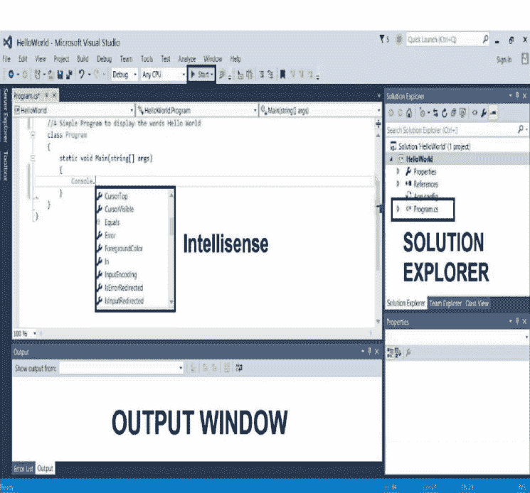

# C# 编程：初学者实用项目指南

## 概述

## `Staff` 类

- 字段
- 属性
- 构造函数
- 方法

## `Manager` 继承 `Staff` 类

- 字段
- 属性
- 构造函数
- 方法

## `Admin` 继承 `Staff` 类

- 字段
- 属性
- 构造函数
- 方法

## `FileReader` 类

## `PaySlip` 类

- 字段
- `Enum`
- 构造函数
- 方法

## `Program` 类

- `Main()` 方法

感谢阅读

# 第 1 章：C# 简介

欢迎学习 C# 编程，非常感谢你选择这本书！

无论你是资深程序员还是完全的初学者，这本书的编写都是为了帮助你快速学习 C# 编程。书中主题经过仔细挑选，旨在让你广泛接触 C#，同时不会因信息过载而让你感到压力。

读完本书后，你应该能够毫无问题地编写自己的 C# 程序。事实上，我们将在书末项目中一起编写一个简单的工资软件。准备好开始了吗？

首先，我们来回答几个问题：

## 什么是 C#？

C#（读作 C Sharp）是微软公司在 Anders Heisenberg 的领导下于 21 世纪初开发的一种面向对象的编程语言。它是 `.Net` 框架的一部分，旨在成为一种简单的通用编程语言，用于开发不同类型的应用程序，包括控制台、Windows、Web 和移动应用程序。

与所有现代编程语言一样，C# 代码类似于英语，但计算机无法理解这种语言。因此，C# 代码必须通过所谓的“编译器”（参见脚注）转换为机器语言。我们在书书中将使用的编译器是微软提供的免费版 `Visual Studio Community 2017`。

## 为什么要学习 C#？

C# 的语法和特征与 `Java`、`C++` 等其他编程语言相似。因此，如果你有任何编程经验，你会发现学习 C# 是一如举反的。即使你对编程完全一陌生，C# 的设计也非常易于学习（不像 C 或 C++），是一门非常棒的入门语言。

此外，C# 是 `.Net` 框架的一部分。该框架包含了大量的预写代码库，程序员可以使用它们，而无需从头开始编写一切。这允许程序员在 C# 中快速开发应用程序，如果你时间紧迫，C# 是你进行工作的的理想语言。

最后，C# 是一种面向对象编程（OOP）语言。面向对象编程是一种编程方法，它将编程问题分解为相互作用的各个。我们将在书中介绍各种面向对象的编程概念。一旦你掌握了 C#，就会熟悉这些概念。这将使你未来更容易掌握其他面向对象的编程语言。

准备好涉足 C# 编程的世界了吗？让我们开始吧。

脚注：

将 C# 程序转换为机器语言实际上比这要稍微复杂一点。`Visual Studio Community` 仅将 C# 程序转换为 `IL`，代表微软中间语言（Microsoft Intermediate Language）。然后，IL 代码由一个称为通用语言运行时（Common Language Runtime）的虚拟执行系统转换为机器语言。欲了解更多信息，可以访问 `https://msdn.microsoft.com/`。

# 第 2 章：为 C# 准备

## 安装 Visual Studio Community

在我们开始开发 C# 之前，需要下载 `Visual Studio Community`。事实上，`VSC` 不仅仅是一个编译器。它是一个集成开发环境（IDE），包含一个供我们编写代码的文本编辑器和一个帮助识别错误的调试器。要下载 `VSC`，请访问 `https://www.microsoft.com/vs/community/`。

## 你的第一个程序

为了编写第一个程序，让我们在桌面上创建一个文件夹并命名为“C# Projects”。我们将所有的 C# 项目都存在这个文件夹中。接下来，启动 `VSC` 并选择文件 > 新建 > 项目。我们要写的第一个程序是控制台应用程序。控制台应用程序指的是没有图形界面的程序。

在新建项目对话框中，在左侧选择 C#，然后在主框中选择“控制应用 (. Framework)”。将此程序命名为“HelloWorld”，并保存到之前创建的“C# Projects”文件夹中。最后，点击确定创建项目。

你将看到 `VSC` 为你生成的默认模板。将模板中的代码替换为下面的代码。注意，行号是为了参考，不是代码的一部分。在我们讨论该程序时，你可能想标记此页面以便参考。

```
1 using System;
2 using System.Collections.Generic;
3 using System.Linq;
4 using System.Text;
5 using System.Threading.Tasks;
6
7 namespace HelloWorld
8 {
9
10     // 一个显示 Hello World 的简单程序
11     class Program
12     {
13         static void Main(string[] args)
14         {
15             Console.WriteLine("Hello World");
16             Console.Read();
17         }\}
```

我强烈建议你亲自输入代码，以更好地感受 `VSC` 的工作方式。当你输入代码时，你会注意到光标附近偶尔会出现一个带有帮助消息的框。这被称为 `IntelliSense`（智能感知）。例如，当你在 "`Console`" 单词后输入点（`.`）时，会出现一个下拉列表，让你知道点号之后可以输入什么。这是 `VSC` 为程序员使编码更便利的功能之一。

输入完成后，你可以通过点击顶部菜单上的“启动”按钮来运行此程序（见下图）。



如果你的程序运行失败，`VSC` 将在“输出窗口（Output Window）”中告知你错误。双击错误会将光标移动到错误所在的位置。请对照上面的代码检查你的代码以纠正错误并重新运行程序。

如果一切顺利且你的程序运行成功，将出现一个黑色窗口，上面有白色的“Hello World”字样。这个黑色窗口被称为控制台。按回车键进入窗口。

好了！你已经成功编写了第一个程序。拍拍肩膀鼓励自己吧。

如果你现在导航到你的“C# Projects”文件夹，你会发现一个名为“HelloWorld”的文件夹。在文件夹内部，你会找到另一个“HelloWorld”的文件夹和一个“HelloWorld.sln”文件。这个 `.sln` 文件是解决方案文件。每当你需要重新打开项目时，都要打开这个文件。如果打开解决方案文件时文本编辑器没有显示你的代码，只需双击右侧“解决方案资源管理器（Solution Explorer）”（参考上图）中的“Program.cs”文件即可打开。

你代码的可执行文件 (`.exe`) 可以在 `HelloWorld > HelloWorld > bin > Debug` 文件夹中找到。

## C# 程序的基本结构

现在，让我们快速回顾一下你刚刚编写的基础程序。

## 指令

从第 1 行到第 5 行，我们有几个以 `using` 单词开头的语句。这些语句被称为指令（directives）。它们告诉编译器我们的程序使用了特定的命名空间。

例如，第一行

```csharp
using System;
```

告诉编译器我们的程序使用了 `System` 命名空间。

## 命名空间

命名空间（namespace）简单来说相关代码元素的分组。这些元素包括类、接口、枚举和结构体等（我们将在后续章节中介绍这些元素）。

C# 带有大量的预写代码，这些代码组织在不同的命名空间中。`System` 命名空间包含了允许我们与用户交互的方法代码。我们在程序中使用了其中两个方法——`WriteLine()` 和 `Read()` 方法。其他的命名空间在程序中不需要。但是，由于这些命名空间包含在默认模板中，我们将它们留在代码中。

除了 Microsoft 提供的预写命名空间外，我们也可以声明自己的命名空间。

声明命名空间的一个优点是它可以防止命名冲突。只要两个或多个代码元素属于不同的命名空间，它们就可以同名。例如，下面的代码定义了两个命名空间，它们都包含一个名为 `MyClass` 的类。这在 C# 中是允许的，因为这两个类属于不同的命名空间（`First` 和 `Second`）。

```csharp
namespace First
{
    class MyClass
    {
    }
}
namespace Second
{
    class MyClass
    {
    }
}
```

在我们的示例中，我们声明了一个命名空间——`HelloWorld`。

`HelloWorld` 命名空间从第 7 行开始，第 8 行有一个左大括号。它在第 20 行以右大括号结束。大括号在 C# 中广泛用于代码元素的开始和结束。C# 中所有的左括号都必须用相应的右括号关闭。

在 `HelloWorld` 命名空间内，我们有 `Program` 类，它从第 12 行开始，到第 19 行结束。在 `Program` 类中，我们有 `Main()` 方法，它从第 14 行开始，到第 18 行结束。

## `Main()` 方法

`Main()` 方法是所有 C# 控制台程序的入口点。每当启动控制台程序时，`Main()` 方法都是第一个被调用的方法。

在本书中，当你被要求尝试某个代码段时，你应该创建一个新的“控制台应用程序（Console Application）”，并将给定的代码段输入到 `Main()` 方法（大括号之间）。你可以运行程序来测试代码。

注意我们 `Main()` 方法括号内的 "`string[] args`" 单词吗？这意味着 `Main()` 方法可以接受一个字符串数组作为输入。暂时不要担心这个问题。我们将在后续章节中介绍这些主题。

在我们的示例中，`Main()` 方法包含两行代码。第一行

```csharp
Console.WriteLine("Hello World");
```

在屏幕上显示“Hello World”行（不带引号）。

第二行

```csharp
Console.Read();
```

在关闭窗口之前等待用户按键。对于你在本本书书中编写的所有应用程序，你都必须将此行添加到 `Main()` 方法的末尾。

上述两个语句都以分号结尾。这在 C# 的大多数语句中都是常见的。在 `Console.Read()` 语句之后，我们用三个右大括号来关闭之前的左大括号。

好了！这个简单程序的所有内容都在这里。

## 注释

我们在这一章涵盖了一些内容。你现在应该对 C# 编程有了基本的理解，并且能够熟悉 `VSC`。在我们结束这一章之前，还有一件事要学习——注释。

如果你回到“Hello World”示例并查看第 10 行，你会注意到这一行以两个斜杠（`//`）开头。

```csharp
//A Simple Program to display the words Hello World
```

这一行实际上并不是程序的一部分。它是我们写的注释，为了让代码对其他程序员更易读。编译器会忽略注释。

要向我们的程序添加注释，我们在它前面输入两个斜杠（`//`）。

或者，我们可以使用这样的多行注释：

```csharp
/*
This is a multi-line comment
*/
```

# 第 3 章：变量与运算符的世界

现在你已经熟悉了 `VSC` 并编写了第一个程序，让我们进入正题吧。在这一章中，你将学习变量和运算符。

## 什么是变量？

变量是赋予数据的名称。在本章中，你将学习什么是变量以及如何声明它们。具体来说，我们将学习可以在它们上执行的常用操作。

变量是存储数据值的容器。变量的值在程序执行过程中可以改变。要声明变量，必须指定数据类型和它的名称。例如：

```csharp
int age = 25;
```

## C# 中的数据类型

C# 中常用的数据类型有：

### `int`

`int` 代表整数（integer，即没有小数部分的数字），保存从 -2,147,483,648 到 2,147,483,647 的数字。

### `byte`

`byte` 也指整数，但范围较窄，范围从 0 到 255。

大多数时候，我们使用 `int` 而不是 `byte` 来处理整数。但是，如果你为内存空间有限的机器进行编程，并且确定值不会超出范围，就应该使用 `byte`。例如，如果你需要存储用户的年龄，可以使用 `byte` 类型，因为用户的年龄不太可能超过 255 岁。

### `float`

`float` 指浮点数，即带有小数的数字，例如 12.43、5.2 和 -9.12。

`float` 可以存储从 -3.4 x 10³⁸ 到 +3.4 x 10³⁸ 的数字。它占用 4 字节存储空间，精度约为 7 位数字。这意味着如果你使用 `float` 存储 1.23456789（10 位），该数字将被舍入为 1.234568（7 位）。

### `double`

`double` 也是浮点数，但它可以存储范围更广的数字。它可以存储从 +/-5.0 x 10⁻³²⁴ 到 +/-1.7 x 10³⁰⁸ 的数字，精度为 15 到 16 位。

`double` 是 C# 中默认的浮点数据类型。也就是说，如果你写一个像 2.34 这样的数字，C# 默认将其视为 `double`。

### `decimal`

`decimal` 存储小数，但范围比 `float` 和 `double` 小。然而，它具有更高的精度，大约为 28-29 位数字。

如果你的程序在存储非整数时需要高精度的，你应该使用 `decimal` 数据类型。一个例子是你正在编写财务应用程序，此时精度非常重要。

### `char`

`char` 代表字符（character），用于存储单个 Unicode 字符，如 'A'、'%'、'@' 和 'p' 等。

### `bool`

`bool` 代表 boolean（布尔），只能包含两个值：`true`（真）和 `false`（假）。它通常用于控制流语句。我们将在第 6 章介绍控制流语句。

## 变量命名

C# 中的变量名只能包含字母、数字或下划线 (`_`)。但是，第一个字符不能是数字。因此，你可以将变量命名为 `userName`、`user_name` 或 `username2`，而不是 `2userName`。

此外，还有一些保留字是不能用作变量名的，因为它们在 C# 中已经有了预定义的含义。这些保留字包括 `Console`、`if`、`while` 等。我们将在随后的章节中学习每一个。

最后，变量名是区分大小大小的。`username` 和 `UserName` 是不同的。

在 C# 中命名变量有两种惯例。我们可以使用驼峰命名法（camel case）或使用下划线。驼峰命名法是用混合大小写编写复合词，除了第一个单词外，每个单词的首字母都大写（例如 `this&VariableName`）。这是我们在书中其余部分使用的约定。或者，另一种常见做法是使用下划线 (`_`) 来分隔单词。如果你喜欢，可以这样命名变量：`this_is_a_variable_name`。

## 初始化变量

每当你声明一个新变量时，都需要给它赋一个初始值。这被称为初始化变量。稍后可以在程序中更改变量的值。

初始化变量有两种方法。你可以在声明时初始化，也可以在单独的语句中初始化。

下面的示例展示了如何在声明点点初始化变量：

## 示例 1

这些示例展示了如何初始化 `byte` 和 `int` 变量。

```
byte usage = 20;
int numberOfEmployees = 510;
```

由于 `byte` 和 `int` 用于没有小数位的数据，如果你编写类似代码，将会报错：

```
byte usage2 = 20.0;
```

在 C# 中，20.0 不等于 20。

## 示例 2

接下来的示例展示了如何用整数值初始化 `double`、`float` 和 `decimal` 变量。虽然这些数据类型用于带有小数部分的数字，但我们也可以像所示使用它们来存储整数值。

```
double numberOfHours = 5120;
float hourlyRate = 60.0f;
decimal intIncome = 25399;
```

## 示例 3

下面的示例展示了如何用非整数初始化 `double`、`float` 和 `decimal` 变量。

```
double numberOfHours = 5120.5;
float hourlyRate = 60.5f;
decimal income = 25399.65m;
```

如之前所述，带小数数字的默认数据类型是 `double`。

因此，在上面的示例中，当你初始化 `hourlyRate` 时，需要在 60.5 之后添加后缀 `f`，以显式告诉编译器将 60.5 转换为 `float`。

同样，当你初始化 `income` 时，你需要添加后缀 `m` 以将 25399.65 转换为 `decimal` 数据类型。

## 示例 4

`char` 数据类型只能包含单个字符。当我们初始化一个 `char` 变量时，需要将该字符括在单引号中。例如：

```
char grade = 'A';
```

## 示例 5

`bool` 变量只能是 true 或 false。下面的示例展示了如何初始化一个 `bool` 变量。

```
bool promote = true;
```

## 示例 6

除了单独初始化变量外，你也可以在同一条语句中初始化多个变量，只要它们具有相同的数据类型。接下来的示例展示了如何这样做。注意两个变量之间用逗号分隔，语句以分号结束。

```
byte level = 2, userExperience = 5;
```

上面的示例展示了你如何在声明点初始化变量。或者，你可以选择在单独的语句中初始化变量。下例所示：

```
byte year; // 声明变量
year = 20; // 初始化它
```

## 赋值符号

编程中的 `=` 与我们在数学中学习的 `=` 符号具有不同的含义。在编程中，`=` 被称为赋值符号。这意味着我们将 `=` 右侧的值赋值给左侧的变量。理解像 `year = 20` 这样的语句的好方法是将其想作 `year <- 20`。

在编程中，语句 `x = y` 和 `y = x` 有非常不同的含义。

困惑吗？一个示例可能会澄清这个问题。

假设我们有两个变量 `x` 和 `y`

```
x = 5; y = 10;
```

如果你写：

```
x = y;
```


你的数学老师可能会对你生气，因为 `x` 不等于 `y`。

然而，在编程中，这是好的。这条语句意味着我们将 `y` 的值赋值给 `x`（将其想成 `x <-`）。将一个变量的值赋值给另一个变量是可以的。在我们的示例中，`x` 的值保持不变。换句话说，现在 `x = 10` 且 `y` 变成了 10。

现在假设我们将 `x` 和 `y` 的值改回

```
x = 5; y = 10;
```

如果你现在写：

```
y = x;
```

这意味着你将 `x` 的值赋值给 `y`（将其想成 `y <-`）。

## 基础运算符

除了单独初始化变量外，你也可以在同一条语句中初始化多个变量，只要它们具有相同的数据类型。接下来的示例展示了如何这样做。注意两个变量之间用逗号分隔，语句以分号结束。

```
byte level = 2, userExperience = 5;
```

上面的示例展示了你如何在声明点初始化变量。或者，你可以选择在单独的语句中初始化变量。下例所示：

```
byte year; // 声明变量
year = 20; // 初始化它
```

## 赋值符号

编程中的 `=` 与我们在数学中学习的 `=` 符号具有不同的含义。在编程中，`=` 被称为赋值符号。这意味着我们将 `=` 右侧的值赋值给左侧的变量。理解像 `year = 20` 这样的语句的好方法是将其想作 `year <- 20`。

在编程中，语句 `x = y` 和 `y = x` 有非常不同的含义。

困惑吗？一个示例可能会澄清这个问题。

假设我们有两个变量 `x` 和 `y`

```
x = 5; y = 10;
```

如果你写：

```
x = y;
```

你的数学老师可能会对你生气，因为 `x` 不等于 `y`。

然而，在编程中，这是好的。这条语句意味着我们将 `y` 的值赋值给 `x`（将其想成 `x <-`）。将一个变量的值赋值给另一个变量是可以的。在我们的示例中，`x` 的值保持不变。换句话说，现在 `x = 10` 且 `y` 变成了 10。

现在假设我们将 `x` 和 `y` 的值改回

```
x = 5; y = 10;
```

如果你现在写：

```
y = x;
```

这意味着你将 `x` 的值赋值给 `y`（将其想成 `y <-`）。

## 基础运算符

在编程中，语句 `x = y` 和 `y = x` 有非常不同的含义。

困惑吗？一个示例可能会澄清这个问题。

假设我们有两个变量 `x` 和 `y`

```
x = 5; y = 10;
```

如果你写：

```
x = y;
```

你的数学老师可能会对你生气，因为 `x` 不等于 `y`。

然而，在编程中，这是好的。这条语句意味着我们将 `y` 的值赋值给 `x`（将其想成 `x <-`）。将一个变量的值赋值给另一个变量是可以的。在我们的示例中，`x` 的值保持不变。换句话说，现在 `x = 10` 且 `y` 变成了 10。

现在假设我们将 `x` 和 `y` 的值改回

```
x = 5; y = 10;
```

如果你现在写：

```
y = x;
```

这意味着你将 `x` 的值赋值给 `y`（将其想成 `y <-`）。

## 示例

假设我们有两个变量 `x` 和 `y`

```
x = 5; y = 10;
```

如果你写：

```
x = y;
```

你的数学老师可能会对你生气，因为 `x` 不等于 `y`。

然而，在编程中，这是好的。这条语句意味着我们将 `y` 的值赋值给 `x`（将其想成 `x <-`）。将一个变量的值赋值给另一个变量是可以的。在我们的示例中，`x` 的值保持不变。换句话说，现在 `x = 10` 且 `y` 变成了 10。

现在假设我们将 `x` 和 `y` 的值改回

```
x = 5; y = 10;
```

如果你现在写：

```
y = x;
```

这意味着你将 `x` 的值赋值给 `y`（将其想成 `y <-`）。

## 示例

假设我们有两个变量 `x` 和 `y`

```
x = 5; y = 10;
```

如果你写：

```
x = y;
```

你的数学老师可能会对你生气，因为 `x` 不等于 `y`。

然而，在编程中，这是好的。这条语句意味着我们将 `y` 的值赋值给 `x`（将其想成 `x <-`）。将一个变量的值赋值给另一个变量是可以的。在我们的示例中，`x` 的值保持不变。换句话说，现在 `x = 10` 且 `y` 变成了 10。

现在假设我们将 `x` 和 `y` 的值改回

```
x = 5; y = 10;
```

如果你现在写：

```
y = x;
```

这意味着你将 `x` 的值赋值给 `y`（将其想成 `y <-`）。

## 运算符

假设我们有两个变量 `x` 和 `y`

```
x = 5; y = 10;
```

- 加法：`x + y`
- 减法：`x - y`
- 乘法：`x * y`
- 除法：`x / y`
- 取模：`x % y`

## 运算符

假设我们有两个变量 `x` 和 `y`

```
x = 5; y = 10;
```

- 加法：`x + y`
- 减法：`x - y`
- 乘法：`x * y`
- 除法：`x / y`
- 取模：`x % y`

例如，从 `double` 转换为 `int`。这被称为类型转换（type casting）。

要将一种数值数据类型转换为另一种类型，我们只需要在想要转换的数据前面加上 `(新数据类型)` 即可。

例如，我们可以这样将非整数转换为整数：

```
int x = (int) 20.9;
```

当我们将 `20.9` 转换为整数时，得到的值是 `20`而不是 `21`。小数部分在转换后会被截断。

我们还可以将 `double` 转换为 `float` 或 `decimal`。还记得我们之前提到过在 C# 中，所有非整数默认都被处理为 `double` 吗？如果我们想将像 `20.9` 这样的数值赋值给 `float` 或 `decimal`，我们需要分别添加 `f` 和 `m` 后缀。另一种方法是使用强制转换，如下所示：

```
float num1 = (float) 20.9;
decimal num2 = (decimal) 20.9;
```

`num1` 和 `num2` 的值都将是 `20.9`。

除了数值类型之间的转换外，我们还可以进行其他类型的转换。我们将在随后的章节中探索其中一些转换。

# 第 4 章：数组、字符串和列表

在上一章中，我们涵盖了 C# 中常用的一些基础数据类型。除了这些基础数据类型外，C# 还提供了几种高级数据类型。在本章中，我们将涵盖三种高级数据类型：数组、字符串和列表。此外，我们将讨论值数据类型（value data type）和引用数据类型（reference data type）之间的区别。

## 数组

数组简单来说是一个相互相关的数据集合。假设我们要存储 5 个用户的年龄。与其将它们存储为 `user1Age`、`user2Age`、`user3Age`、`user4Age` 和 `user5Age`，我们可以将它们存储在一个数组中。

可以这样声明并初始化数组：

```
int[] userAge = {21, 22, 23, 24, 25};
```

- `int` 表示该变量存储 `int` 类型的值。
- `[]` 表示该变量是一个数组而不是普通变量。
- `userAge` 是数组名称。
- `{21, 22, 23, 24, 25}` 是数组存储的五个整数。

除了在声明时初始化数组外，我们还可以先声明数组稍后初始化它。要这样做，我们需要使用 `new` 运算符：

```
int[] userAge2;
userAge2 = new int[] {21, 22, 23, 24, 25};
```

第一条语句声明数组。第二条语句使用整数 `21`、`22`、`23`、`24` 和 `25` 初始化它。

最后，我们还可以声明数组并用默认值初始化它。我们可以这样写：

```
int[] userAge3 = new int[5];
```

这条语句声明了一个包含 5 个整数的数组（如方括号 `[]` 内的数字5 所示）。由于我们没有指定这 5 个整数的值，C# 会自动将它们初始化为默认值。整数的默认值为 `0`。因此，数组变为 `{0, 0, 0, 0, 0}`。

你可以通过索引访问数组中的单个值来更新它们。索引始终从 `ZERO` 开始，而不是 `1`。这是几乎所有编程语言（如 Python 和 Java）中的常见做法。数组的第一个值的索引为 `0`，下一个值的索引为 `1`，依此类推。假设数组当前用法为 `{21, 22, 23, 24, 25}`。要更新数组的第一个值，我们写：

```
userAge[0] = 31;
```

数组变为 `{31, 22, 23, 24, 25}`。

如果我们输入：

```
userAge[2] = userAge[2] + 20;
```

数组变为 `{31, 22, 43, 24, 25}`。也就是说，第三个元素加上了 `20`。

## 数组属性和方法

C# 提供了许多可以与数组配合使用的属性和方法。

我们将在第 7 章讨论类时学习更多关于属性和方法的知识。现在，我们只需要知道，要使用属性或方法，需要使用点 (`.`) 运算符。要使用属性，在点符号之后输入属性名。要使用方法，在点运算符之后输入方法名，后跟一对括号 `()`。

### Length

数组的 `Length` 告诉我们数组中有多少项。

例如，如果我们有：

```
int [] userAge = {21, 22, 26, 32, 40};
```

`userAge.Length` 等于 `5`，因为数组中有 5 个数字。

### Copy()

`Copy()` 方法允许你从第一个元素开始将一个数组的内容复制到另一个数组中。

在 C# 中，方法可能有许多不同的变体。例如，`Copy()` 方法有四种不同的变体。下面的示例讨论了四种中的一种。如果你学会了如何使用一种，就可以学会如何使用其他的。

## 字符串

接下来，让我们来看看字符串数据类型。字符串是一段文本。字符串的一个示例是文本 "Hello World"。

要声明并初始化一个字符串变量，你可以写：

```
string message = "Hello World";
```

其中 `message` 是字符串变量的名称，`"Hello World"` 是赋值给它的字符串。注意你需要将字符串包含在双引号 (`"`) 之中。

你也可以给变量赋值一个空字符串，如下：

```
string anotherMessage = "";
```

最后，我们可以使用连接符号 (`+`) 将两个或多个字符串合并并将它们赋值给变量。

```
string myName = "Hello World, " + "my name is Jamie";
```

第一个是要提取的位置，第二个告诉编译器长度。

假设我们声明了一个字符串变量 `message` 并给它赋值字符串 "Hello World"。

```
string message = "Hello World";
```

然后我们可以像下面所示使用 `Substring()` 方法。

```
string newMessage = message.Substring(2, 5);
```

`Substring(2, 5)` 从 `message` 中从索引 2 开始提取一个 5 个字符的子字符串（索引始终从 0 开始，因此它是第三个字母）。

生成的子字符串随后赋值给 `newMessage`。

因此，`newMessage` 等于 "llo W"。

另一方面，`message` 没有发生变化。它仍然保持为 "Hello World"。

## Equals()

我们可以使用 `Equals()` 方法来比较两个字符串是否相同。

如果我们有两个如下所示的字符串

```
string firstString = "This is Jamie"
string secondNumber = "Hello";
```

```
firstString.Equals("This is Jamie");
```

返回 `true`，而

```
firstString.Equals(secondString);
```

返回 `false`，因为这两个字符串（`firstString` 和 `secondString`）不相等。

## Split()

`Split()` 方法根据用户定义的分隔符数组将字符串拆分为子字符串。在分割字符串后，`Split()` 方法返回一个包含结果子字符串的数组。

`Split()` 方法需要两个参数 - 一个作为分隔符的字符串数组，以及另一个指定你是否想要从结果中删除空字符串的参数。

假设你想将字符串 "Peter, John; Andy, ,David" 拆分为子字符串，可以按照以下方式操作（添加行号供参考）：

```
1 string [] separator = (", ", ";");
2 string names = "Peter, John; Andy, ,David";
3 string [] substrings = names.Split(separator,
StringSplitOptions.None);
```

在第 1 行，我们分配了一个包含两个字符串的数组作为分隔符。第一个字符串是逗号后加空格，第二个是分号后加空格。

在第 2 行，我们将想要拆分的字符串赋值给 `names` 变量。在第 3 行，我们使用 `names` 变量调用 `Split()` 方法，并将其结果赋值给 `substrings` 数组。

上述代码的结果是以下数组

```
{"Peter", "John", "Andy", "", "David"}
```

该数组包含一个空字符串，因为在原始字符串中，“Andy”之后的逗号和 “David” 之前的逗号之间有一个空格。如果你想从结果中删除空字符串，必须将第 3 行改为

```
string [] substrings = names.Split(separator,
StringSplitOptions.RemoveEmptyEntries);
```

`substrings` 数组变为

```
{"Peter", "John", "Andy", "David"}
```

如往常，我们只涵盖了更常用的字符串方法的一部分。要查看 C# 中所有可用字符串方法的完整列表，请访问此页面 https://msdn.microsoft.com/en-us/library/system.string.methods(v=vs,110).aspx

## Lists（列表）

现在，让我们看看本章的最后一种数据类型 - 列表。列表像数组一样存储值，但可以随意添加或删除元素。

数组只能持有固定数量的值。如果你声明

```
int [] myArray = new int[10];
```

`myArray` 只能容 10 个值。如果你编写 `myArray[10]`（由于数组索引从0开始，因此它是第11个值），你将得到错误。

如果你在程序中需要更大的灵活性，可以使用列表。

声明一个整数列表，我们写

```
List<int> userList = new List<int>();
```

`userList` 是列表的。

`List` 是一个关键字，表示你正在声明一个列表。

数据类型包含角括号 `< >` 中。

你可以选择在声明时初始化列表，如下

```
List<int> userList = new List<int> {11, 21, 31, 41, 51};
```

要访问列表中的单个元素，我们使用与访问数组元素相同的符号。例如，要访问第一个元素，你编写 `userList[0]`。要访问第三个元素，你编写 `userList[2]`。

## 列表属性和方法

列表数据类型带有大量的属性和方法。

### Add()

你可以使用 `Add()` 方法向列表添加成员。

```
userList.Add(51);
userList.Add(61);
```

`userList` 现在有 6 个成员：{11, 21, 31, 41, 51, 61}。

### Count

要找到列表中的元素数量，使用 `Count` 属性。

`userAgeList.Count` 给了我们 6，因为目前列表中有 6 个元素。

### Insert()

要在特定位置添加成员，使用 `Insert()` 方法。

要在第 3 个位置插入一个成员，你编写

```
userAgeList.Insert(2, 51);
```

其中 2 是索引，51 是你想要插入的值。

`userAgeList` 现在变为 {11, 21, 51, 31, 41, 51, 61}。

### Remove()

要从列表中移除成员，使用 `Remove()` 方法。`Remove()` 方法接受一个参数并移除第一个出现项。

### RemoveAt()

要移除特定位置的成员，使用 `RemoveAt()` 方法。要移除索引为2的项，你编写

```
userAgeList.RemoveAt(2);
```

其中 2 是要移除的的索引。

### Contains()

要检查列表是否包含某个成员，使用 `Contains()` 方法。

### Clear()

要移除列表中的所有项，使用 `Clear()` 方法。

## 值类型与 引用类型

在我们熟悉了字符串、数组和列表之后，让我们讨论一下 C# 中的一个重要概念。C# 中的所有数据类型都可以分类为值类型或引用类型。本章讨论的数据类型都是值类型。

值类型是存储其数据的变量。当我们编写

```
int myNumber = 5;
```

`myNumber` 存储实际的值。

另一方面，引用类型并不存储实际数据。它存储的是数据的引用。它告诉编译器去哪里找到数据。

引用类型的一个例子是字符串。当你编写这样的语句时

```
string message = "Hello";
```

变量 `message` 并没有存储 "Hello"。


相反，“Hello”在计算机内存的其他地方创建并存储。变量 `message` 存储该内存位置的地址。

这就是我们目前对引用类型的所有了解。由于这是一本书，我们将详细介绍为什么我们需要引用类型。只需注意值类型和引用类型之间存在区别；前者存储值，而后者存储地址。

## 第5章：让我们的程序具有交互性

在我们已经涵盖了变量和数据类型的知识之后，让我们编写一个利用它们的程序。在本章中，我们将学习如何接受用户输入、将数据存储在变量中并向用户显示消息。准备好了吗？

## 向用户显示消息

要显示消息，我们使用 C# 提供的 `Write()` 或 `WriteLine()` 方法，这些方法在 `System` 命名空间可用。

`WriteLine()` 和 `write()` 的区别在于 `WriteLine()` 在显示消息后会将光标移动到下一行，而 `write()` 则不会。如果我们编写

```
Console.WriteLine("Hello ");
Console.WriteLine("How are you?");
```

我们将得到

Hello

How are you?

如果我们编写

```
Console.write("Hello ");
Console.write("How are you?");
```

我们将得到

Hello How are you?

注意在上面的示例中，每当我们调用 `WriteLine()` 或 `write()` 方法时，都在方法名前前面添加了 `Console` 单词。这是因为这两个方法都是 `Console` 类的静态方法。我们将在第7章更多地讨论静态方法。

如果你觉得每次使用这两个方法时添加 `Console` 单词很麻烦，你可以添加指令

```c
using static System.Console;
```

添加到你程序的开头。如果你这样做，你就可以直接写成

`WriteLine("Hello World");`

而不是

`Console.WriteLine("Hello World");`

每当你使用 `Console` 类中的任何静态方法时，都可以这样做。这是 C# 6 的新功能（C# 的最新版本），并且只有在你使用最新的 IDE（即 Visual Studio 2017）时才可用。在接后的示例中，为了向后兼容，我们将坚持使用第一种方法。

在第 2 章编写“Hello World”程序时，我们已经看到过如何使用 `write()` 方法的示例。现在让我们来看更多的示例。在下面的示例中，我们将重点关注 `WriteLine()` 方法。`write()` 方法的工作方式完全相同。

## 示例 1

要显示一个简单的字符串，我们编写

`Console.WriteLine("Hello, how are you?");`

输出

Hello, how are you?

## 示例 2

要显示变量的值，我们将变量名作为参数传递。例如，假设我们有

`int age = 30;`

我们通过编写

`Console.WriteLine(age);`

来显示 `age` 的值。

输出

注意，我们没有将变量名（`userAge`）括在双引号中。如果我们写

```c
Console.WriteLine("userAge");
```

我们将得到

userAge

作为输出。

## 示例 3

要组合两个或多个字符串并显示它们，我们使用上一章提到的连接符号 (`+`)。

例如，如果我们写

```c
Console.WriteLine("Hello, " + "how are you?" + " I love C#.");
```

我们将得到

Hello, how are you? I love C#.

## 示例 4

我们还可以使用连接符号来组合字符串和变量。假设我们有

```c
int results = 79;
```

该语句

```c
Console.WriteLine("You scored " + results + " marks for your test.");
```

给我们带来了

You scored 79 marks for your test.

再次，我们没有将变量名括在双引号中。否则我们将得到

You scored results marks for your test.

## 示例 5

除了使用连接符号组合字符串和变量外，我们还可以使用占位符。假设我们有

```c
int results = 79;
```

如果我们写

```c
Console.WriteLine("{0}! You scored {1} marks for your test.", "Good morning", results);
```

我们将得到

Good morning! You scored 79 marks for your test.

在这个示例中，我们向 `WriteLine()` 方法传递了三个参数，并用逗号分隔。

这三个参数是：

- 1) "{0}! You scored {1} marks for your test."

- 2) "Good morning"

- 3) `results`

第一个将要显示的字符串。在字符串内部，大括号充当占位符，并将被随后的参数替换。

`{0}` 是下一个参数的占位符，在这种情况下，该参数是字符串 "Good morning"。

`{1}` 是变量 `results` 的占位符。

因此，输出是

Good morning! You scored 79 marks for your test.

如果你写

```c
Console.WriteLine("{1}! You scored {0} marks for your test.", "Good morning", results);
```

你将得到

79! You scored Good morning marks for your test.

当然，这样的语句没有意义。但是，它展示了占位符是如何被相应的参数替换的。

当使用占位符时，我们可以指定我们希望如何显示数值。这是通过格式指定符来实现的，例如 C 和 F 指定符。

F 指定符指定了数字显示时保留的小数位数。

如果我们写

```c
Console.WriteLine("The number is {0:F3}", 123.45678);
```

我们将得到

The number is 123.457.

F3 标识符将数字 123.45678 四舍五入为 123.457。注意，指定符之前不应该有任何空格。句话句话，必须是 `{0:F3}` 而不是 `{0:F3}`。

C 指定符用于格式化货币；它在数字前添加 "$" 符号，并带有2位小数显示数字。此外，它用逗号分隔每隔千位。

如果你写

```c
Console.WriteLine("Deposit = {0:C}, Account balance = {1:C}", 2125, 12345.678);
```

你将得到

Deposit = $2,125.00. Account balance = $12,345.68

## 示例 6

我们还可以使用 `Console.WriteLine()` 来打印方法的结果。

在第 4 章，我们学习了如何使用 `Substring()` 方法从较长的字符串中提取子字符串。在那个示例中，我们将结果赋值给另一个字符串。或者，我们可以使用 `Console.WriteLine()` 显示结果而不将其赋值给变量。

例如，如果你写

```c
Console.WriteLine("Microsoft".Substring(1, 3));
```

输出

ic

将显示在屏幕上。

除了显示方法的结果，`Console.WriteLine()` 还可以显示属性的值。如果我们写

```c
Console.WriteLine("Microsoft".Substring(1, 3));
```

## 转义序列

有时在程序中，我们可能需要打印特殊字符，如制表符或换行。在这种情况下，我们使用转义字符。

例如，如果我们输入

```c
Console.WriteLine("Hello\tWorld");
```

输出

Hello    World

将显示。

如果我们输入

```c
Console.WriteLine("Hello\nWorld");
```

输出

Hello

World

将显示。

其他常见用途包括：

- `\t` (制表符)

- `\n` (换行符)

## 接收用户输入

现在我们知道如何向用户显示消息，让我们看看如何接收他们的输入。要接收用户输入，可以使用 `Read()` 或 `ReadLine()` 方法。`Read()` 从标准输入读取下一个字符，而 `ReadLine()` 读取一行字符。标准输入指的是用户用于输入数据的设备，通常是键盘。`ReadLine()` 比 `Read()` 更常用。

下面的示例显示了如何使用 `ReadLine()` 读取用户的输入。

```c
string userInput = Console.ReadLine();
```

`ReadLine()` 方法将输入作为字符串读取。

## 将字符串转换为数字

有时，有必要将用户输入转换为数值类型，以便对其进行计算。C# 为我们提供了许多方法来执行转换。我们使用的方法位于 `Convert` 类中，该类位于 `System` 命名空间下。

将字符串转换为整数，我们使用 `ToInt32()` 方法。例如，如果我们有

```c
string userInput = Console.ReadLine();
```

并且用户输入 20，`userInput` 等于 "20"（这是一个字符串而不是整数）。

我们可以使用

```c
int newUserInput = Convert.ToInt32(userInput);
```

将字符串转换为整数 20 并赋值给 `int` 变量。我们现在可以对这个 `int` 变量进行通常的数学运算。

除了将字符串转换为整数外，我们还可以使用 `ToDecimal()`、`ToSingle()` 和 `ToDouble()` 方法将字符串转换为 `decimal`、`float` 或 `double`。

## 汇总

现在让我们把学的一切整合在一起编写一个完整的程序。我们将修改在第 2 章编写的“Hello World”程序。不仅仅是向世界问好，我们还想知道名字和年龄。

首先，启动 Visual Studio Community 并创建一个新的 C# 控制应用程序项目。将项目命名为 "HelloWorldAgain"。在 `Main()` 方法中输入以下代码段（行号仅供参考）：

```c
WriteLine("Please enter your name:");
string name = Console.ReadLine();
WriteLine("Please enter your age:");
int age = int.ToInt32(Console.ReadLine());
WriteLine("Please enter the current year:");
int currentYear = int.ToInt32(Console.ReadLine());
int birthYear = currentYear - age;
WriteLine("Hello World! My name is " + name + " and I am " + age + " years old. I was born in " + birthYear + ".");
```

运行程序并输入以下信息

Please enter your name: Jamie

Please enter your age: 39

Please enter the current year: 2015

程序应该带给你以下输出

Hello World! My name is Jamie and I am 39 years old. I was born in 1976.

这个程序应该非常容易理解。但是，关于程序有两点需要说明。

首先，第 10 行展示了如何在同一个语句中使用两种方法的示例。当我们写下：

```
userAge = Convert.ToInt32(Console.ReadLine());
```

`Console.ReadLine()` 方法会首先执行，因为它位于一对括号 `()` 之中。这与我们在评估数学表达式时，括号内的操作优先级更高相似。例如，当我们评估 `3 * (5 + 9)` 时，我们必须先将 5 加到 9，然后再将结果乘以 3（即 34）。

在执行 `Console.ReadLine()` 之后，用户输入的值将使用 `Convert.ToInt32()` 转换为整数。

假设用户输入了 39。

```
Convert.ToInt32(Console.ReadLine())
```

变为

```
Convert.ToInt32("39")
```

`Convert.ToInt32("39")` 的结果是整数 39。然后，该整数被赋值给变量 `userAge`。

程序中下一个需要指出的点是第 12 行，如下所示：

```
Console.WriteLine("Hello World! My name is {0} and I am {1} years old. I was born in {2}.", userName, userAge, currentYear - userAge);
```

注意最后一个参数 `(currentYear - userAge)` 涉及到一个数学运算？这在 C# 中是允许的。`WriteLine()` 将执行减法并显示计算结果。

# 第 6 章：做出选择与决策

祝贺你走到这里。我们走了很远的路。你现在已经了 C# 中不同的数据类型，并且我们能够编写一个与用户交互的简单程序了。

在本章中，我们将涵盖编程中的另一个基本概念；我们将学习如何使用控制流语句来控制程序的流程。

具体来说，我们将学习 `if` 语句、内联 `if` 语句、`switch` 语句、`for` 循环、`foreach` 循环、`while` 循环和 `do` 循环。此外，我们还将学习 `try-catch-finally` 语句如何在发生错误时控制程序的流程。

然而，在进入这些控制工具之前，我们必须首先查看条件语句。

## 条件语句

大多数控制流语句都涉及评估条件语句。程序将根据条件是否满足以不同的方式运行。

最常见的条件语句是比较语句。如果我们想比较两个变量是否相同，我们使用 `==` 符号。例如，如果你写下 `x == y`，你是在要求程序检查 `x` 的值是否等于 `y` 的值。如果它们相等，则满足条件，语句求值为 `true`。否则，语句求值为 `false`。

除了评估一个值是否等于另一个值外，我们还有其他可以在条件语句中使用的比较运算符。

## 不等于 (!=)

如果左侧不等于右侧，则返回 `true`

- `5 != 2` 是 `true`

- `6 != 6` 是 `false`

## 大于 (>)

如果左侧大于右侧，则返回 `true`

- `5 > 2` 是 `true`

- `3 > 6` 是 `false`

## 小于 (<)

如果左侧小于右侧，则返回 `true`

- `1 < 7` 是 `true`

- `9 < 6` 是 `false`

## 大于或等于 (>=)

如果左侧大于或等于右侧，则返回 `true`

- `5 >= 2` 是 `true`

- `5 >= 5` 是 `true`

- `3 >= 6` 是 `false`

## 小于或等于 (<=)

如果左侧小于或等于右侧，则返回 `true`

- `11 <= 7` 是 `true`

- `7 <= 7` 是 `true`

- `9 <= 6` 是 `false`

我们还有三个逻辑运算符（`&&`、`||`、`!`），当我们要组合多个条件时，它们非常有用。

## 与逻辑运算符 (&&)

如果所有条件都满足，则返回 `true`

```
5==5 && 2>1 && 3!=7 is true
5==5 && 2<1 && 3!=7 is false as the second condition (2<1) is false
```

## 或逻辑运算符 (||)

如果至少满足一个条件，则返回 `true`。

- `5==5 || 2<1 || 3==7` 是 `true`，因为第一个条件 `(5==5)` 是 `true`

- `5==6 || 2<1 || 3==7` 是 `false`，因为所有条件都是 `false`

## 控制流语句

现在我们已经熟悉了条件语句，让我们继续学习如何使用这些语句来控制程序的流程。

## if 语句

`if` 语句是最常用的控制流语句之一。它允许程序评估某个特定条件是否满足，并根据评估结果执行相应的操作。`if` 语句的结构如下（为了方便参考添加了行号）：

```
1   if (condition 1 is met)
2       {
3           do Task A
4       }
5   else if (condition 2 is met)
6       {
7           do Task B
8       }
9   else if (condition 3 is met)
10      {
11          do Task C
12  }
13  else
14      {
15          do Task E
16  }
```

第 1 行测试第一个条件。如果满足条件，后续大括号内的所有内容（第 2 到 4 行）将被执行。`if` 语句的其余部分（从第 5 行到 16 行）将被跳过。

如果不满足第一个条件，程序将移动到下一个条件。如果满足第二个条件，第 6 行到 8 行内部的代码将被执行。`if` 语句的其余部分（从第 9 行到 16 行）将被跳过。

如果未满足第二个条件，程序将检查第三个条件。如果满足第三个条件，第 11 行到 12 行的代码将被执行。`if` 语句的其余部分（从第 13 行到 16 行）将被跳过。

如果没有任何条件满足，将执行 `else` 块，并执行第 14 行到 16 行的代码。


为了完全理解 `if` 语句的工作原理，请向你的程序中添加以下代码：

```csharp
int userAge;
int currentYear = DateTime.Now.Year;
```

用户输入的值将使用 `Convert.ToInt32()` 转换为整数。

假设用户输入了 39。

```
Convert.ToInt32(Console.ReadLine())
```

变为

```
Convert.ToInt32("39")
```

`Convert.ToInt32("39")` 的结果是整数 39。然后，该整数被赋值给变量 `userAge`。

程序中下一个需要指出的点是第 12 行，如下所示：

```
Console.WriteLine("Hello World! My name is {0} and I am {1} years old. I was born in {2}.", userName, userAge, currentYear - userAge);
```

注意最后一个参数 `(currentYear - userAge)` 涉及到一个数学运算？这在 C# 中是允许的。`WriteLine()` 将执行减法并显示计算结果。

## 内联 if

内联 语句是 `if` 语句的一种更简单的形式，当你想要根据条件的结果为变量赋值时，它非常方便。其语法为：

`condition ? value if true : value if false;`

例如，语句

`3>2 ? 10 : 5;`

返回值 10，因为 3 大于 2（即条件 `3 > 2` 为 `true`）。

## switch 语句

`switch` 语句与 `if` 语句相似，不同之处在于它不支持值的范围。`switch` 语句要求每个 `case` 都基于单一值。根据用于切换的变量，程序将执行正确的代码块。

`switch` 语句的语法如下：

```
switch (variable used for switching)
{
    case firstCase:
        do A;
        break (or other jump statements);
    case secondCase:
        do B;
        break (or other jump statements);
    case default:
        do C;
        break (or other jump statements);
}
```

```cs
switch (userGrade)
{
    case "A+":
        Console.WriteLine("Distinction");
        break;
    case "B":
        Console.WriteLine("B Grade");
        break;
    case "C":
        Console.WriteLine("C Grade");
        break;
    default:
        Console.WriteLine("Fail");
        break;
}
```

程序提示用户输入等级。

如果等级为 "A+"（第 6 行），程序将执行后续语句，直到遇到 `break;` 语句。这意味着它将执行第 7 到第 9 行。因此，输出为 "Distinction"。

如果等级为 "A"（第 7 行），程序将执行第 8 和第 9 行。同样，输出为 "Distinction"。

如果等级既不是 "A+" 也不是 "A"，程序将检查下一个 `case`。它会从上到下持续检查，直到满足某个 `case`。如果没有没有任何 `case` ，则执行 `default` 情况。

如果你运行上面的代码，将为图中显示的每个输入获得以下输出：

Enter your grade: A+

Distinction

Enter your grade: A

Distinction

Enter your grade: B

B Grade

Enter your grade: C

C Grade

Enter your grade: D

Fail

Enter your grade: Hello

Fail

## for 循环

`for` 循环反复执行代码块，直到测试条件不再有效。

`for` 循环的语法如下：

```cs
for (初始值; 测试条件; 值修改) {
    // 执行某些任务
}
```

为了理解 `for` 循环是如何工作的，让我们考虑下面的示例。

```cs
1 for (int i = 0; i < 5; i++)
{
    Console.WriteLine(i);
}
```

`for` 循环的重点在于第 1 行：

```cs
for (int i = 0; i < 5; i++)
```

它包含三个部分，每部分之间用分号隔。

第二部分测试 `i` 是否小于 5。如果是，将执行大括号内的语句。在这个例子中，由于只有一个语句，所以大括号是可选的。

在执行 `WriteLine(i)` 语句后，程序返回到第 1 行的最后一个部分。`i++` 将 `i` 的值加 1。因此，`i` 从 0 增加到 1。

增加后，程序测试 `i` 的新值是否仍然小于 5。如果是，它将再次执行 `WriteLine(i)` 语句。

这种测试和增加循环计数器的过程将重复，直到条件 `i < 5` 不再为真。此时，程序退出 `for` 循环，并继续执行 `for` 循环之后的其他命令。

该代码段的输出为：

```
0
1
2
3
4
```

输出在 4 停止，是因为当 `i` 为 5 时，`WriteLine()` 语句不会执行，因为 5 并不小于 5。

`for` 循环通常用于遍历数组或列表。例如，如果我们有

```cssharp
int[] myNumbers = { 10, 20, 30, 40, 50 };
```

我们可以使用 `for` 循环和数组的 `Length` 属性来遍历数组，如下所示。

```cssharp
for (int i = 0; i < myNumbers.Length; i++)
    Console.WriteLine(myNumbers[i]);
```

由于 `myNumbers.Length` 等于 5，此代码从 `i = 0` 运行到 `i = 4`。如果我们运行代码，将获得以下输出：

```
10
20
30
40
50
```

## foreach 循环

除了 `for` 之外，在处理数组和列表时我们还可以使用 `foreach` 循环。如果你想在不修改数组或列表的情况下获取它们的信息，`foreach` 循环非常有用。

假设你有

```cssharp
char[] message = { 'H', 'e', 'l', 'l', 'o' };
```

你可以使用以下代码显示数组的元素：

```cssharp
foreach (char i in message)
    Console.Write(i);
```

当 `i = 2` 时，`continue` 关键字之后的代码将不会执行。除此之外，一切都按正常方式运行。

# 异常处理

我们现在已经学习了如何使用控制流语句和跳转语句在“正常”情况下控制程序的执行流。在本章结束之前，我们需要查看最后一种控制语句：`try-catch-finally` 语句。`try-catch-finally` 语句控制程序在发生错误时如何继续进行。其语法如下：

```
try {
    执行某些操作
} catch (错误类型) {
    当发生错误时执行其他操作
} finally {
    // 无论是否满足 try 或 catch 条件，都执行此操作。
}
```

你可以有多个 `catch` 块。此外，`finally` 块是可选的。

让我们考虑一个例子。

```cs
int numerator, denominator;
```

```cs
Console.Write("Please enter the numerator: ");
numerator = Convert.ToInt32(Console.ReadLine());
```

```cs
Console.Write("Please enter the denominator: ");
denominator = Convert.ToInt32(Console.ReadLine());
```

```cs
try {
    Console.WriteLine("The result is {0}.", numerator/denominator);
} catch (Exception e) {
    Console.WriteLine(e.Message);
} finally
{
    Console.WriteLine("--- End of Error Handling Example ---");
}
```

如果你运行代码并输入 12 和 4，你将得到消息：

The result is 3.

--- End of Error Handling Example ---

在这个例子中，`try` 块中的代码执行成功。在执行完 `try` 块的代码后，执行 `finally` 块中的代码。

现在假设你输入 12 和 0。你会得到：

Attempted to divide by zero.

--- End of Error Handling Example ---

在这种情况下，执行的是 `catch` 块中的代码。这是因为程序尝试执行 `try` 块中的语句，由于你不能将数字除以零，发生了错误。因此，执行了 `catch` 块中的语句。此外，`finally` 块中的代码也会执行。无论是否执行 `try` 或 `catch` 块，`finally` 块总是会被执行。

`catch` 块允许我们指定它应该捕获的错误类型。在这种情况下，我们正尝试捕获一个通用错误。因此，我们写道

`catch (Exception e)`

其中 `Exception` 指向错误所属的类，而 `e` 是赋予该错误的名称。

`Exception` 类处理所有通用错误，并有一个名为 `Message` 的属性来解释异常的原因。要显示该属性，我们写道：

```
Console.WriteLine(e.Message);
```

## 特定错误

除了处理通用错误的 `Exception` 类外，我们还有其他类可以处理更特定的错误。如果你想根据捕获到的错误执行特定的任务，这就会非常用。例如，你可能想要显示你自己的错误消息。

尝试运行下面的代码：

```cs
int choice = 0;
int[] numbers = { 10, 11, 12, 13, 14, 15 };
Console.Write("Please enter the index of the array: ");
```

try {

    choice = Convert.ToInt32(Console.ReadLine());

    Console.WriteLine("numbers[{0}] = {1}", choice, numbers[choice]);

} catch (IndexOutOfRangeException) {

    Console.WriteLine("Error: Index should be from 0 to 5.");

} catch (FormatException) {

    Console.WriteLine("Error: You did not enter an integer.");

} catch (Exception e) {

    Console.WriteLine(e.Message);

}

```

如果你输入

10

你会得到

Index was outside the bounds of the array.
Index should be from 0 to 5.

如果你输入

Hello

你会得到

Input string was not in a correct format.

`IndexOutOfRangeException` 异常发生在访问数组范围之外时，由第一个 `catch` 块处理。`FormatException` 异常发生在你没有输入整数时，由第二个 `catch` 块处理。`Exception` 异常捕获通用错误，由最后一个 `catch` 块处理。

# 属性

接下来，让我们来看属性。

属性通常用于在其他类需要某个私有字段的情况下，提供对该字段的访问。这听起来可能有些矛盾。之前我们提到，使用私有字段是为了让其他类无法访问它们。既然如此，我们为什么允许通过属性来访问它们呢？

主要原因之一是使用属性可以对其他类在评估这些私有字段时的权利拥有更大的控制权。我们稍后会看到如何实现。

现在，让我们先学习如何声明属性。

在 `Staff` 类中，`private int hworked;` 这一行之后添加以下代码：

```csharp

public int Hworked

{

    get

    {

        return hworked;

    }

    set

    {

        if (value > 0)

            hworked = value;

        else

            hworked = 0;

    }

}

```

我们将属性声明为：

```csharp

public int Hworked

{}

```

访问修饰符为 `public`，因为我们希望其他类能够访问此属性。

数据类型是 `int`，因为此属性用于访问私有 `int` 字段 `hworked`。`hworked` 被称为属性的备用字段。

属性的名称为 `Hourworked`。我们通常对属性名使用大驼峰命名法。

属性包含两个特殊方法，称为访问器。第一个访问器是获取器，第二个是设置器。

基础的 getter 简单地返回私有字段的值。因此，我们写道：

```csharp

{

  return hworked;

}

```

其中 `hworked` 是一个关键字，而另一个 `hworked` 是备用字段的名称。

setter 设置私有字段的值。我们写道：

```csharp

{

  if (value > 0)

    hworked = value;

  else

    hworked = 0;

}

```

当用户使用属性设置私有字段的值时，`value` 在赋值语句内部被用作，是一个关键字。我们稍后会学习如何操作。

在 setter 内部，我们使用 `if` 语句进行了一个简单的检查。我们检查 `value` 是否大于零。如果是，则将其分配给 `hworked`。否则，我们将 `hworked` 设置为零。这个 setter 演示了我们如何使用属性来控制可以分配给私有字段的数值。

默认情况下，getter 和 setter 的访问级别与属性本身相同。因此，我们不需要显式指定它们。然而，如果你不希望 setter 的访问级别与属性相同，可以将 setter 声明为 `private`，这样其他类就无法修改你的私有字段：

```csharp

private set

{

```

那么，该属性在 `Staff` 类之外就是一个只读属性。它的值只能在 `Staff` 类内部被设置。

## 自动实现属性

注意，在 getter 和 setter 不需要额外逻辑的情况下，C# 为我们提供了一种声明属性的简写方式。这被称为自动实现属性。

要声明一个自动实现属性，我们写道：

```csharp

public int Hourworked { get; set; }
```

这等同于：

```csharp

private int Hworked;

public int Hourworked

{

    get

    {

        return Hworked;

    }

    set

    {

        Hworked = value;

    }

}
```

当你使用这种简写时，不需要手动声明私有字段。编译器将自动为你创建一个匿名的私有备用字段。

如果你想让属性只读，可以这样将 setter 设置为 `private`：

```csharp

public int Hourworked { get; private set; }
```

## 方法

接下来，让我们来看方法。

方法是一个执行特定任务的代码块。

让我们为我们的 `Staff` 类添加一个简单的方法。

```csharp

public void PrintMessage()

{

    Console.WriteLine("Calculating Pay...");

}
```

该方法的声明为：

```csharp

public void PrintMessage()
{}
```


方法声明首先说明了方法的访问级别。在这里，我们将方法声明为 `public`，以便该方法在程序的任何处都是可访问的（而不仅仅是在 `Staff` 类内部）。

接下来，我们指定方法的返回类型。方法在执行任务后可能会返回特定的结果。如果方法不返回任何结果，我们像示例中那样使用 `void` 关键字。

最后，我们指定方法的名称（示例中为 `PrintMessage`）。

方法名后的括号 `()` 是我们包含方法参数的地方。参数是传递给方法以执行其任务的数据的命名数据。如果方法不需要数据（如示例所示），我们只需要在方法名后添加一对空括号即可。

声明方法后，我们在随后的大括号内定义它的功能。这被称为实现方法 `implementing the method`。在我们的示例中，`PrintMessage()` 方法简单地打印行“Calculating Pay...”

这就是 `PrintMessage()` 方法的全部内容。

接下来，让我们转向一个更复杂的方法。此方法计算每个员工的工资并返回计算结果。在 `Staff` 中添加以下代码：

```csharp
public int CalculatePay()
{
    PrintMessage();
    int staffPay;
    staffPay = hworked * hourlyRate;
    if (hworked > 0)
        return staffPay;
    else
        return 0;
}
```

该方法声明为 `public int CalculatePay()`。`int` 关键字表示此方法返回一个 `int` 类型的值。

在大括号内部，我们有语句 `PrintMessage();`。这被称为调用 `PrintMessage()` 方法。当程序运行到这条语句时，它将首先执行 `PrintMessage()` 方法并打印行“Calculating Pay...”

接下来，我们声明一个局部变量 `staffPay`，并将 `hworked` 和 `hourlyRate` 的乘积赋值给它。方法可以访问类中声明的所有字段和属性。此外，它还可以声明自己的变量。这些被称为局部变量，仅存在于方法内部。示例中的 `staffPay` 就是一个例子。

在分配 `staffPay` 后，我们使用 `if` 语句来确定方法应该返回什么结果。方法通常至少有一个 return 语句。`return` 是一个用于从方法返回答案的关键字。方法中可以有多个 return 语句。然而，一旦方法执行了 return 语句，方法就会退出。

在我们的示例中，如果 `hworked` 大于零，程序将执行语句：

```csharp
return staffPay;
```

并退出方法。这个返回值可以赋值给变量。例如，如果 `hworked` 是 10 且 `hourlyRate` 是 20，我们可以使用语句：

```csharp
int pay = CalculatePay();
```

将 `CalculatePay()` 的结果赋值给变量 `pay`。此时 `pay` 的值将为 200。

另一方面，如果 `hworked` 小于等于零，程序将执行语句：

```csharp
return 0;
```

并退出方法。`pay` 的值将为 0。

## 重载 Overloading

在 C#（以及大多数其他语言）中，只要签名不同，你就可以创建同名的方法。这被称为重载。方法的签名指的是方法的名称以及它拥有的参数。

在 `CalculatePay()` 方法下方添加以下方法：

```csharp
public int CalculatePay(int bonus, int allowance)
{
    PrintMessage();
    if (hworked > 0)
        return hworked * hourlyRate + bonus + allowance;
    else
        return 0;
}
```

第一个方法的签名是 `CalculatePay()`，而第二个方法的签名是 `CalculatePay(int bonus, int allowance)`。

第二个方法有两个参数——`bonus` 和 `allowance`。它通过将这两个参数的值加到 `hworked` 和 `hourlyRate` 的乘积上来计算员工的工资。

## ToString() 方法

最后，在进入下一个节之前，我们需要再写一个方法 - `ToString()` 方法。

`ToString()` 方法是一个特殊的方法，它返回一个表示当前类的字符串。在 C# 中，所有类都带有一个预定义的 `ToString()` 方法。然而，按照惯例（这是我们被我们的），我们会重写这个方法。重写此方法简单意味着编写我们自己的方法版本。

通常，我们编写的 `ToString()` 方法会显示类的字段和属性的值。将以下代码添加到 `staff` 类中：

```csharp
public override string ToString()
{
    return "Name of Staff " + nameOfStaff + ", hourlyRate = " + hourlyRate + ", " + hWorked;
}
```

如你所见，`ToString()` 方法返回一个字符串类型。它包含的字符串包含了 staff 类的信息。方法声明中的 `override` 关键字表示此方法重写了默认方法。我们将在下一章讨论更多关于 `override` 关键字。

### 构造函数

现在，让我们来看构造函数。

构造函数是一个特殊的方法，用于从类模板“构造”对象。每当我们从类中创建对象时，它是第一个被调的方法。构造函数通常用于初始化类的字段。

构造函数的名称始终与类相同（在我们的案例中为 `Staff`），并且不返回任何值。声明构造函数时不需要使用 `void` 关键字。

将以下几行添加到我们的 `Staff` 类。

```csharp
public Staff(string name)
{
    nameOfStaff = name;
    Console.WriteLine("\n" + nameOfStaff);
    Console.WriteLine("-");
}
```

在这个构造函数中，我们首先用传递构造函数的字符串（`name`）初始化字段 `nameOfStaff`。然后我们在屏幕上显示 `nameOfStaff` 的值，并用一系列连字符对其加上下划线。

与其他方法一样，只要签名不同，我们就可以有多个构造函数。我们可以为类类添加另一个构造函数。

```csharp
public Staff(string firstName, string lastName)
{
    nameOfStaff = firstName + " " + lastName;
    Console.WriteLine("\n" + nameOfStaff);
    Console.WriteLine("--------------------");
}
```

这个构造函数有两个参数 - `firstName` 和 `lastName`。第一行将两个字符串连接起来并将结果字符串赋值给 `nameOfStaff`。接下来两行在屏幕上打印 `nameOfStaff` 并用一系列连字符对其加上下划线。

声明构造函数是可选的。如果你不声明自己的构造函数，C# 会自动为你创建一个。默认构造函数简单地将类中的所有字段初始化为默认值，通常对于数值字段为 0，对于字符串字段为空字符串。

## 实例化对象

现在我们已经知道如何创建类，让我们看看如何利用该类来创建对象。这个过程被称为实例化对象。对象也被称为实例。

回顾一下，我们的 `Staff` 类具有以下组件：

### 字段

```csharp
private const int hourlyRate
private string nameOfStaff
private int hWorked
```

### 属性

```csharp
public int HoursWorked
```

### 方法

```csharp
public void PrintMessage()
public int CalculatePay()
public int CalculatePay(int bonus, int allowance)
public override string toString()
```

### 构造函数

```csharp
public Staff(string name)
public Staff(string firstName, string lastName)
```

我们将在 `Program` 类的 `Main()` 方法中实例化一个 `Staff` 对象。

实例化对象的语法是：

`ClassName objectName = new ClassName(arguments);`

将以下几行添加到 `Program` 类的大括号内部。

`int pay;`

```csharp
staff1 = new Staff("Peter");
staff1.HoursWorked = 160;
pay = staff1.CalculatePay(1000, 400);
Console.WriteLine("Pay = {0}", pay);
```

在这里，我们使用第一个构造函数（带有一个参数）来创建我们的 `staff1` 对象。

一旦创建了对象，我们就可以使用对象名称后的点运算符（`.`）访问 `Staff` 类中的任何公共字段、属性或方法。注意，我们需要在这里使用点运算符，因为我们正尝试从 `Program` 类访问 `Staff` 类的成员。当我们想要从另一个类访问字段、属性或方法时，点运算符是必须的。

如果你正在访问同一个类的成员，则不需要使用点运算符。一个例子是我们之前从 `CalculatePay()` 方法中调用 `PrintMessage()` 方法。我们没有使用点运算符，因为这两个方法都来自同一个类。

创建我们的 `staff1` 对象后，下一行显示了我们如何使用公共 `EmployeeType` 属性来给 `worked` 字段赋值。

`staff1.HoursWorked = 160;`

如果我们尝试通过编写

`staff1.hworked = 160;`

直接访问私有字段 `hworked`，我们将得到一个错误，因为 `hworked` 是私有字段，因此只能在 `Staff` 类内部访问。

要调用 `CalculatePay()` 方法，我们写：

```csharp
staff1.CalculatePay(1000, 408);
```

由于我们在括号内有数字 1000 和 400，我们正在使用第二个 `CalculatePay()` 方法。我们把值 1000 和 400 分别传递给参数 `bonus` 和 `allowance`。我们传递的值被称为参数 `arguments`。程序随后使用这些值。

## Static 关键字

我们已经涵盖了一些非常好的概念。在本节中，我们将看看另一个在创建对象时有时使用的关键字。

以前，我们查看了如何创建 `staff1`、`staff2` 和 `staff3` 对象。然而，某些类或成员不需要创建对象就可以访问。这些被称为静态类或成员，并使用 `static` 关键字声明。

考虑以下类：

```csharp
class MyClass
{
    // 非静态成员
    public string message = "Hello World";
    public string Name { get; set; }
    public void DisplayName()
    {
        Console.WriteLine("Name = {0}", Name);
    }
    // 静态成员
    public static string greetings = "Good morning";
    public static int Age { get; set; }
    public static void DisplayAge()
    {
        Console.WriteLine("Age = {0}", Age);
    }
}
```

`MyClass` 包含一个非静态字段 `message`、一个非静态属性 `Name` 和一个非静态方法 `DisplayName()`。

它还包含一个静态字段 `greetings`、一个静态属性 `Age` 和一个静态方法 `DisplayAge()`。

要从另一个类访问 `MyClass` 的静态成员，我们需要像以前一样实例化对象：

```csharp
MyClass classA = new MyClass();
Console.WriteLine(classA.message);
classA.Name = "Jamie";
classA.DisplayAge();
```

然而，要访问静态成员，我们不需要创建任何对象。只需使用类名访问它们，如下所示：

```csharp
Console.WriteLine(MyClass.greetings);
MyClass.Age = 39;
MyClass.DisplayAge();
```

如果你运行上面的代码，将得到以下输出：

```
Hello World
Name = Jamie
Good morning
Age = 39
```

除了拥有静态方法、字段、属性和构造函数，我们还可以拥有静态类。静态类只能包含静态成员。示例所示：

```csharp
static class MyStaticClass
{
    public static int a = 0;
    public static int B{get; set;}
}
```

C# 中的一些预写类被声明明为静态类 `static classes`。例如 `Console` 类。在使用 `Console` 类中的方法时，我们不需要创建 `Console` 对象。我们只需要编写 `Console.WriteLine("Hello World");` 即可。

## 高级方法概念

现在你已经熟悉了类，让我们进入关于类中方法声明和使用的一些高级概念。这些概念更为复杂，可能需要阅读多次才能完全理解。

## 使用数组和列表

之前，我们学习了如何使用 `int` 和 `float` 等基本数据类型作为参数。除了使用基本数据类型外，我们还可以使用数组和列表。

要将数组作为参数，我们需要在方法声明的参数数据类型后面添加方括号 `[]`。示例如下：

```csharp
public void PrintFirstElement(int[] a)
{
    Console.WriteLine("The first element is {}.\n", a[0]);
}
```

要调用此方法，我们需要声明一个数组并将其作为参数传递给方法：

```csharp
int[] myArray = {1, 2, 3, 4, 5};
PrintFirstElement(myArray);
```

下一个示例显示了我们如何使用列表作为参数：

```csharp
public void PrintFirstElement(List<int> a)
{
    Console.WriteLine("The first list element is {}.\n", a[0]); own}
```

要调用此方法，我们需要声明一个列表并将其作为参数传递给方法。

```csharp
List<int> myList = new List<int>{1, 2, 3};
PrintFirstElement(myList);
```

除了将数组或列表作为方法的参数外，我们还可以从方法返回数组或列表。要从方法返回数组，我们需要在方法声明的返回类型后面添加方括号 `[]`。

```csharp
public int[] ReturnUserInput()
{
    int[] a = new int[3];
    for (int i = 0; i < a.length; i++) {
        Console.Write("Enter an integer: ");
        a[i] = Convert.ToInt32(Console.ReadLine());
        Console.WriteLine("Integer added to array.\n");
    }
    return a;
}
```

要使用此方法，我们需要声明一个数组并将方法的结果赋值给它。

```csharp
int[] myArray2 = ReturnUserInput();
```

要从方法返回列表，我们使用方法声明中使用 `List<>` 关键字作为返回类型。示例下：

```csharp
public List<int> ReturnUserInputList()
{
    List<int> a = new List<int>();
    int input;
    for (int i = 0; i < 3; i++) {
        Console.Write("Enter an integer: ");
        input = Convert.ToInt32(Console.ReadLine());
        Console.WriteLine("Integer added to list.\n");
        a.Add(input);
    }
    return a;
}
```


要使用此方法，我们需要声明一个列表并将方法的结果赋值给它。

```csharp
List<int> myList2 = ReturnUserInputList();
```

## 使用 params 关键字

接下来，让我们探索 `params` 关键字。当我们不知道一个方法有多少个参数时，`params` 关键字非常有用。例如，我们可能有一个方法可以打印一系列名字，但我们事先不知道有多少个名字。在这种情况下，我们可以使用数组作为参数，并在其前面添加 `params` 关键字。

示例下：

```csharp
public void PrintNames(params string[] names)
{
    for (int i = 0; i < names.Length; i++)
    {
        Console.Write(names[i] + " ");
    }
    Console.WriteLine();
}
```

要使用此方法，我们可以传递任意数量的字符串。

示例

`PrintNames("Peter");`
`PrintNames("Yvonne", "Jamie");`
`PrintNames("Abigail", "Betty", "Carol", "David");`

输出

`Yvonne Jamie`
`Abigail Betty Carol`

注意在 `params` 关键字后面不允许有额外的参数，且方法声明中只允许一个 `params` 关键字。因此，以下方法声明是正确的：

```csharp
public void PrintNames2(int a, double b, params int[] ages)
```

但以下声明是不允许的：

```csharp
public void PrintNames3(int a, params string[] names, double b)
public void PrintNames4(params string[] names, params int[] ages)
```

`PrintNames3` 是允许的，因为 `double b` 位于 `string[] names` 之后。

## 传递值类型与引用类型

希望你现在很好地理解类是如何工作的。在这一章结束之前，我想回顾一下值类型和引用类型的概念。在第 4 章中，我们学习了 C# 中的两种大类数据类型：值类型和引用类型。在向方法传递值类型变量和引用类型变量之间存在差异。

当你传递值类型变量时，对该值的修改仅在类内部有效。一旦方法退出，该修改不再有效。

另一方面，如果你传递引用类型变量，对该变量的修改在方法结束后仍然有效。

考虑以下类：

```csharp
class MethodDemo
{
    public void MethodValue(int a)
    {
        // 值类型的逻辑
    }
    public void MethodReference(int[] b)
    {
        // 引用类型的逻辑
    }
}
```

希望你现在很好地理解类是如何工作的。在这一章结束之前，我想回顾一下值类型和引用类型的概念。在第 4 章中，我们学习了 C# 中的两种大类数据类型：值类型和引用类型。在向方法传递值类型变量和引用类型变量之间存在差异。

当你传递值类型变量时，对该值的修改仅在类内部有效。一旦方法退出，该修改不再有效。

另一方面，如果你传递引用类型变量，对该变量的修改在方法结束后仍然有效。

考虑以下类：

```csharp
class MethodDemo
{
    public void MethodValue(int a)
    {
        a = 10;
    }
    public void MethodReference(int[] b)
    {
        b[0] = 10;
    }
}
```

# 第 8 章：面向对象编程 2

现在让我们进入面向对象编程的一些高级主题。在本章中，我们将学习继承、多态、抽象类和接口。

## 继承

继承是面向对象编程的核心概念之一。简单来说，继承允许我们从现有类创建新类，以便有效地重用代码。

### 编写父类

假设我们为一家拥有两种会员类型（VIP 和普通）的健身房编写程序。为此，我们首先创建一个名为 `Member` 的类。

```csharp
class Member {
    protected int annualFee;
    private string name;
    private int memberID;
    private int memberSince;
}
```

`Member` 包含一个受保护字段和三个私有字段。受保护字段在声明它的类以及任何派自它的类中都是可的。我们很快就会讨论派生类。

接下来，我们写一个 `ToString()` 方法来显示四个字段的值。

```csharp
public override string ToString() {
    return "Name: " + name + "\nID: " + memberID + "\nJoined Since: " + memberSince + "\nAnnual Fee: " + annualFee;
}
```

最后，为 `Member` 类添加两个构造函数：

```csharp
public Member() {
    Console.WriteLine("无参数父类构造函数");
}
public Member(string pName, int memberID, int memberSince)
{
    Console.WriteLine("带 3 个参数的父类构造函数");
    name = pName;
    memberID = memberID;
    memberSince = memberSince;
}
```

### 编写子类

现在，让我们学习如何从 `Member` 类派生一个类。派生类被称为子类，而它们派自的类被称为父类或基类。

派生类继承类类所有的公共和受保护成员。换句话说，可以使用这些字段、属性和方法，就像它们是自己代码的一部分一样。

我们的父类（`Member`）包含以下内容：

#### 字段

```csharp
protected int annualFee
private string name
private int memberID
private int memberSince
```

#### 方法

```csharp
public override string ToString()
```

#### 构造函数

```csharp
public Member()
public Member(string pName, int memberID, int memberSince)
```

我们从 `Member` 类派生了两个类——`NormalMember` 和 `VIPMember`。

首先，让我们声明子类 `NormalMember`。我们使用冒号 `(:)` 表示它派生自 `Member` 类，如下所示

```csharp
class NormalMember : Member
{
}
```

现在，我们需要为子类编写构造函数。子类的构造函数基于父类的构造函数。每当我们创建一个对象时，父类的构造函数总是会被调用。

创建子构造函数有两种方法。第一种像声明其他构造函数一样简单声明。

```csharp
public NormalMember()
{
    Console.WriteLine("Child constructor with no parameter");
}
```

当我们像上面那样声明构造函数时，C# 会父类中查找无参数构造函数（即没有参数的构造函数），并在执行子构造函数代码之前调用它。如果你使用此构造函数创建子对象，屏幕上将显示以下两行：

`Parent Constructor with no parameter`
`Child constructor with no parameter`

第一行来自父类构造函数，第二行来自子类构造函数。

声明子构造函数的第二种方法是使用冒号 `()` 和 `base` 关键字来调用父类中的非无参数构造函数。示例所示：

```csharp
public NormalMember(string remarks) : base ("Jamie", 1, 2015)
{
    Console.WriteLine("Remarks = {0}", remarks);
}
```

当我们调用父类中的非无参数构造函数时，我们需要向其参数传递值。在上面的示例中，我们将值 `"Jamie"`、1 和 2015 传递给父类构造函数。这些值随后被分别赋值给基类中的 `name`、`memberID` 和 `membersSince` 字段。

在这个示例中，我们向基构造函数传递了固定值参数。然而，更好的方法是通过子构造函数传递参数。下面的示例显示了如何实现。将之前的构造函数替换为下面的构造函数：

```csharp
public NormalMember(string name, string remarks, int memberID, int memberSince) : base (name, memberID, memberSince)
{
    Console.WriteLine("Child Constructor with 4 parameters");
    Console.WriteLine("Remarks = {0}", remarks);
}
```

这个新构造函数有四个参数。第一个参数是一个名为 `remarks` 的字符串参数。该参数在子构造函数内部使用。

第二个和第四个参数在子构造函数内部未使用。相反，它们根据名称作为参数传递给父类构造函数。例如，子构造函数中的第二个参数 (`string name`) 被作为父构造函数的第一个参数 (`name`)。

当我们使用此构造函数创建对象时，我们编写如下代码：

```csharp
NormalMember myChildMember = new NormalMember("Special Rate", "James", 1, 2010);
```

带有 3 个参数的基构造函数被首先调用并执行。值 `"James"`、1 和 2010 被分配给基构造函数。在底层，这些值被分别赋值给基类中的 `name`、`memberID` 和 `membersSince` 字段。

执行基构造函数后，将执行子构造函数。字符串 `"Special Rate"` 被赋值给 `remarks` 并显示在屏幕上。

当你运行代码时，将得到以下输出

```
Parent Constructor with 3 parameters
Child Constructor with 4 parameters
Remarks = Special Rate
```

现在我们已经为子类创建了构造函数，让我们继续创建一个方法来计算普通会员的年费。代码如下：

```csharp
public void CalculateAnnualFee()
{
    annualFee = 100 + 12*30;
}
```

每当我们在上面的代码中编写 `"annualFee"` 时，我们都在访问父类中的受保护字段 `annualFee`。还记得子类可以访问其父类中的所有公共和受保护字段吗？因此，子类可以使用该字段，就像它是自己的一样。子类不需要创建父类的实例来访问其受保护字段。

我们的子类 `NormalMember` 就到此为止。该类包含以下内容：

#### 字段
继承自父类：
- `protected int annualFee`

#### 方法
在子类中声明：
- `public void CalculateAnnualFee()`

#### 构造函数
- `public NormalMember()`
- `public NormalMember(string remarks, string name, int memberID, int memberSince)`

接下来，让我们写另一个继承自 `Member` 的类。这次，派生类被称为 `VIPMember`。代码所示：

```csharp
class VIPMember : Member
{
    public VIPMember(string name, int memberID, int memberSince) : base
    (name, memberID, memberSince)
    {
        Console.WriteLine("Child Constructor with 3 parameters");
    }
    public void CalculateAnnualFee()
    {
        annualFee = 1200;
    }
}
```

该类有一个构造函数（带有 3 个参数）和一个方法 `CalculateAnnualFee()`。这里的 `CalculateAnnualFee()` 方法使用的计算年费的公式与 `NormalMember` 类中的 `CalculateAnnualFee()` 方法不同。这两个方法共享相同的名称（和签名）是可以的，因为它们位于不同的类中。

`VIPMember` 类包含以下内容：

#### 字段
继承自父类：
- `protected int annualFee`

#### 方法
继承自父类：
- `public override string ToString()`

在子类中声明：
- `public void CalculateAnnualFee()`

#### 构造函数
- `public VIPMember(string name, int memberID, int memberSince)`

## Main() 方法

现在我们已经有了需要的三个类，让我们为 `Main()` 方法编写代码。

首先，我们从两个派生类中创建两个对象。

```csharp
NormalMember mem1 = new NormalMember("Special Rate", "James", 1, 2010);
VIPMember mem2 = new VIPMember("Andy", 2, 2011);
```

`mem1` 使用 `NormalMember` 类中的 4 参数构造函数创建。
`mem2` 使用 `VIPMember` 类中的 3 参数构造函数创建。

接下来，我们将使用各自所在类中的 `CalculateAnnualFee()` 方法。

```csharp
mem1.CalculateAnnualFee();
mem2.CalculateAnnualFee();
```

由于 `mem1` 是 `Normal` 类的实例，因此执行了该类的 `CalculateAnnualFee()` 方法。因此 `mem1` 的年费为 100 + 12*30 = 460。对于 `mem2`，年费是 1200。

最后，让我们使用父类的 `toString()` 方法来显示信息。我们编写

```csharp
Console.WriteLine(mem1.ToString());
Console.WriteLine(mem2.ToString());
```

由于 `toString()` 方法属于父类且是公共的，`mem1` 和 `mem2` 都能使用它。当你运行程序时，将得到以下输出

```
Name: James
Member ID: 1
Member Since: 2010
Total Annual Fee: 460
Name: Andy
Member ID: 2
Member Since: 2011
Total Annual Fee: 1200
```

## 多态

现在我们已经看到了继承的示例，让我们转向另一个与继承密切的话题——多态。解释多态的最佳是通过示例。让我们扩展我们的健身俱乐部示例。

首先，删除 `Main()` 方法中的所有代码并添加以下行：

```csharp
Member[] clubMembers = new Member[5];
clubMembers[0] = new NormalMember("Special Rate", "James", 1, 2010);
clubMembers[1] = new VIPMember("Normal Rate", "Andy", 2, 2011);
clubMembers[2] = new NormalMember("Normal Rate", "Bill", 3, 2011);
clubMembers[3] = new NormalMember("Carol", 4, 2012);
clubMembers[4] = new VIPMember("Evelyn", 5, 2012);
```

在这里，我们声明了一个 `Member` 类型的数组并向其添加了五个成员。前三个成员是 `NormalMember` 类的实例，而最后两个是 `VIPMember` 类的实例。

尽管 `clubMembers` 被声明为 `Member` 类型数组，但我们可以将 `NormalMember` 和 `VIPMember` 的实例赋值给它，因为它们都是 `Member` 类的子类。我们不需要为 `NormalMember` 和 `VIPMember` 对象分开数组。

接下来，我们将使用 `foreach` 循环计算每个成员的年费并显示信息。这样做，我们编写

```csharp
foreach (Member m in clubMembers)
{
    m.CalculateAnnualFee();
    Console.WriteLine(m.ToString());
```


如果你在这个阶段尝试运行程序，你将得到一个错误，说 `Member` 不包含 `CalculateAnnualFee` 的定义。这是因为 `clubMembers` 被声明为 `Member` 类型的数组。因此，当我们编写 `m.CalculateAnnualFee()` 时，编译器尝试执行 `Member` 类中的 `CalculateAnnualFee()` 方法。出现错误的原因是我们的 `Member` 父类中没有这样的方法；它只在两个子类中。为了纠正这个错误，我们必须向我们的父类中添加以下方法。

```csharp
public virtual void CalculateAnnualFee()
```

```csharp
{
  annualFee = 0;
}
```

现在运行程序并注意每个成员的“年度总费用”（Total Annual Fee）。你发现了什么？它们应该都显示为 $0。这意味着被调用的 `CalculateAnnualFee()` 方法是父类中的那。这并不意外，因为 `clubMembers` 被声明为 `Member` 类型。

如果你想调用子方法，你需要进行两处更改。

首先，你需要将父方法声明为 `virtual`，如下：

```csharp
public virtual void CalculateAnnualFee()
{
  annualFee = 0;
}
```

`virtual` 关键字告诉编译器该方法可以在派生类中重写。当编译器遇到这个关键字时，它会在派生类中寻找相同的方法并执行该方法。

接下来，在派生类中，你必须使用 `override` 关键字声明你的方法重写了父类中的方法，如下：

```csharp
// 在 VIPMember 子类中
public override void CalculateAnnualFee()
{
  annualFee = 1200;
}
```

```csharp
// 在 NormalMember 子类中
public override void CalculateAnnualFee()
{
  annualFee = 100 + 12 * 30;
}
```

现在如果你再次运行程序，前三个成员（`NormalMember`）和后两个成员（`VIPMember`）的年度费用分别为 $460 和 $1200。

这就是多态的结果。在运行时（即程序运行期间），程序确定 `clubMembers` 的前三个成员是 `NormalMember` 类型，并执行该类中的 `CalculateAnnualFee()` 方法。它还确定后两个成员是 `VIPMember` 类型，并执行该类的方法。

多态简单来说意味着在运行时，程序足够智能，即使该对象被声明为 `Member` 类型，它也能使用正确子类中的 `CalculateAnnualFee()` 方法。

我们说 `clubMembers` 的前三个元素的运行时类型是 `NormalMember`，而后两个元素的运行时类型是 `VIPMember`。所有 5 个元素的声明类型都是 `Member`。

## GetType() 和 typeof()

在之前的示例中，我们让程序来确定 `clubMembers` 数组中每个成员的运行时类型并调用 `CalculateAnnualFee()` 方法。然而，有时我们可能需要在编写代码时自己确定每个单独成员的运行时类型。我们将在项目的后部分看到相关的示例。

下面的 `if` 语句展示了你如何在运行时确定 `clubMember` 数组的第一个元素是否为 `VIPMember` 类型：

```csharp
if (clubMembers[0].GetType() == typeof(VIPMember))
    Console.WriteLine("Yes");
else
    Console.WriteLine("No");
```

`GetType()` 方法返回对象的运行时类型。

`typeof()` 方法接收一个数据类型的名称（例如 `int`、`float` 或类的名称）并返回该类型，然后我们可以将其结果与左侧 `GetType()` 方法的结果进行比较。

如果你运行上面的代码，你将得到输出“No”，因为 `clubMembers[0]` 不是 `VIPMember` 类型。

## 抽象类和方法类和 Methods

既然我们已经熟悉了继承（以及多态），让我们继续讨论 C# 中两种特殊的“父类”类型——抽象类和接口。

首先，让我们来看抽象类。

抽象类是一种特殊的类，其创建的完全是为了作为基类供其他类派生。它们不能被实例化。换句话说，如果 `FourWheelVehicles` 是一个抽象类，语句

```csharp
FourWheelVehicle myVeh = new FourWheelVehicle();
```

将给你一个错误，因为你不能创建一个抽象类的对象。

抽象类可以拥有字段、属性和方法，就像其他类一样。然而，它们不能拥有静态成员。此外，抽象类可以具有特殊类型的方法，称为抽象方法。抽象方法是没有体的方法，并且**必须**在派生类中实现。它们只能存在于抽象类中。在某种程度上，抽象方法就像一份合同。如果你想确保任何继承该类的类都实现某个方法，你可以将类声明为抽象类，并将该方法声明为抽象方法。

要声明抽象类，只需在 `class` 关键字之前添加 `abstract` 关键字如下：

```csharp
abstract class Class
```

在抽象类内部声明抽象方法，在返回类型之前添加 `abstract` 关键字，如下：

```csharp
abstract void AbstractMethod();
```

由于抽象方法没有体，我们用分号（;）结束声明。要在派生类中实现抽象方法，我们使用 `override` 关键字，如下：

```csharp
class Class
{
    public override void AbstractMethod();
}
```

下面的代码展示了一个抽象类的示例。

```csharp
using System;
using System.Collections.Generic;
using System.Linq;
using System.Text;
using System.Threading.Tasks;
namespace Abstract
{
    class Program
    {
        static void Main(string[] args)
        {
            AbstractClass a = new AbstractClass();
            a.PrintMessage();
        }
    }
    abstract class AbstractClass
    {
        protected string message = "Hello C!";
        public abstract void PrintMessage();
    }
    class AbstractClass : AbstractClass // 注意：此处原文代码类名冲突，保持原样翻译
    {
        public override void PrintMessage()
        {
            Console.WriteLine(message);
        }
    }
}
```

## Interfaces

接下来，让我们来看接口。接口与抽象类的相似之处在于它们不能被实例化。然而，接口比抽象类更具概念性。它们不能包含字段，但可以包含属性。

抽象类和接口之间的关键区别之一是，类只能继承一个抽象类，但可以实现多个接口。我们 own不会展示多个接口的示例，因为那超出了本书的范围。

接口的名称通常以字母 `I` 开头。接口中的所有属性和方法都是公共的，因此不需要为它们添加任何修饰符。

```csharp
using System;
using System.Collections.Generic;
using System.Linq;
using System.Text;
using System.Threading.Tasks;
namespace Interface
{
    class Program
    {
        static void Main(string[] args)
        {
            InterfaceA a = new ClassA();
            a.MyNumber = 5;
            a.InterfaceMethod();
        }
    }
    interface IShape
    {
        int MyNumber
        {
            get;
            set;
        }
        void InterfaceMethod();
    }
    class ClassA : IShape
    {
        private int myNumber;
        public int MyNumber
        {
            get
            {
                return myNumber;
            }
            set
            {
                if (value < 0)
                    myNumber = 0;
                else
                    myNumber = value;
            }
        }
        public void InterfaceMethod()
        {
            Console.WriteLine("The number is {0}", MyNumber);
        }
    }
}
```

## 复习访问修饰符

现在我们已经涵盖了与继承相关的主题，让我们再次查看面向对象编程中访问修饰符的概念。之前，我们了解到访问修饰符就像守门员。它控制谁可以访问特定的字段、属性或方法。C# 带有 4 种访问修饰符：`private`, `public`、`protected` 和 `internal`。

任何声明为 `internal` 的成员只能在当前程序集（assembly）中访问。由于本书不会介绍程序集，因此我们不会演示 `internal` 的工作原理。

为了理解 `private`、`public` 和 `protected` 如何工作，请考虑下面的示例。我们将使用字段来演示这一概念。方法和属性同样适用于。

假设我们有一个三个字段的类：

```csharp
class ClassA
{
    private int privateNum = 1;
    public int publicNum = 2;
    protected int protectedNum = 3;
}
```

如果 `ClassB` 继承自 `ClassA`，

```csharp
class ClassB:ClassA
{
    public void PrintMessages()
    {
        // 这是可以的
        Console.WriteLine(publicNum);
        // 这是可以的
        Console.WriteLine(protectedNum);
        // 这是不允许的
        Console.WriteLine(privateNum);
    }
    public void WriteLine()
```

前两个 `WriteLine()` 语句不会产生任何错误，因为派生类可以访问父类中的任何 `public` 和 `protected` 字段。

然而，第三条语句会报错，因为 `privateNum` 是一个 `private` 字段，因此只能在 `ClassA` 内部访问。

如果一个类没有继承自 `ClassA`，我们需要实例化一个 `ClassA` 对象来访问 `ClassA` 的 `public` 字段。然而，即使有了 `ClassA` 对象，我们也无法访问 `ClassA` 的 `private` 和 `protected` 字段。在下面的示例中，`ClassC` 没有继承自 `ClassA`。因此，第一个 `WriteLine()` 语句不会产生任何错误，但第二个和第三条语句会。

```csharp
class ClassC
{
    ClassA a = new ClassA();
    public void PrintMessages()
    {
        // 这是可以的
        Console.WriteLine(a.publicNum);
        // 这是不允许的
        Console.WriteLine(a.protectedNum);
        // 这是不允许的
        Console.WriteLine(a.privateNum);
    }
}
```

简而言之，任何声明为 `public` 的内容在处处可见；访问 `public` 成员没有限制。相反，任何声明为 `private` 的内容只能在声明它的类内部访问。任何声明为 `protected` 的内容在声明它的类以及任何派自它的类中都可以访问。

# 第 9 章：枚举（Enum）和结构体（Struct）

在第 3 和第 4 章中，我们了 C# 提供的一些内置数据类型。这些包括如 `int`、`float` 和 `double` 等值类型，以及如数组、字符串和列表等引用数据类型。此外，我们还在第 7 和第 8 章学习了如何编写自己的类。类可以被看作是一种高级的用户定义数据类型，它将一组相关的字段、属性和方法分组为一个逻辑单元。

在本章中，我们将查看 C# 中的另外两种用户定义数据类型——`enum` 和 `struct`。

## Enum（枚举）

枚举（enumerated type 的缩写）是一种特殊的数据类型，允许程序员为一组整数常量提供有意义的名称。

要声明枚举，我们使用 `enum` 关键字后跟枚举的名称。枚举成员包含在一在大括号中，并用逗号分隔。

下文是一个示例：

```csharp
enum DaysOfWeek
{
    Sun, Mon, Tues, Wed, Thurs, Fri, Sat
}
```

注意，我们不在最后一个成员末尾加分号。

在声明 `DaysOfWeek` 枚举后，我们可以像这样声明并初始化一个 `DaysOfWeek` 变量：

```csharp
DaysOfWeek myDays = DaysOfWeek.Mon;
```

变量的名为 `myDays`。如果我们写

```csharp
Console.WriteLine(myDays);
```

我们将得到

Mon

默认情况下，枚举中的每个成员都被分配一个整数值，从零开始。也就是说，在我们的示例中，`Sun` 被赋值为 0，`Mon` 为 1，`Tues` 为 2，依此类推。

由于枚举本质上是整数，我们可以将 `DaysOfWeek` 变量转换为 `int`，反之亦然。例如，

```csharp
Console.WriteLine((int)Days);
```

给了我们整数 1，而

```csharp
Console.WriteLine((DaysOfWeek)1);
```

给了我们 Mon。

如果你想为枚举成员分配一组不同的整数，可以采取以下操作

```csharp
enum DaysOfWeekTwo {
  Sun = 5, Mon = 10, Tues, Wed, Thurs, Fri, Sat
}
```

现在，`Sun` 被赋值为 5，`Mon` 被赋值为 10。由于我们没有为 `Tues` 到 `Sat` 分配值，10之后的连续数字将被分配给它们。即 `Tues = 11`，`Wed = 12` 等。

所有枚举在内部都存储为整数（`int`）。如果你想将底层数据类型从 `int` 更改为其他类型，可以在枚举名称后添加冒号，然后是所需的数据类型。允许 `char` 外的任何整数数据类型。例如

```csharp
enum DaysOfWeekThree : byte {
  Sun, Mon, Tues, Wed, Thurs, Fri, Sat
}
```

当然，如果你使用 `byte` 数据类型，你无法执行类似

```csharp
enum DaysOfWeekFour : byte {
  Sun = 300, Mon, Tues, Wed, Thurs, Fri, Sat
}
```

因为 `byte` 的范围是从 0 到 255。

使用枚举有两个主要原因。第一个是提高代码的可读性。第二个原因是限制变量可以取的值。如果我们有一个存储星期的枚举，我们可能会无意中给它赋值。如果我们使用 `byte` 数据类型，我们就无法执行此类操作，因为 `byte` 的范围是从 0 到 255。

## Struct（结构体）

结构体在许多方面与类相似。像类一样，它们包含属性、构造函数和字段等元素来组合相关的成员。要声明结构体，使用 `struct` 关键字。示例：

```csharp
struct MyStruct
{
    // 字段
    private int x, y;
    private AnotherClass myCamera;
    private Days myDays;
    // 构造函数
    public MyStruct(int a, int b, int c)
    {
```


```csharp
myClass = new AnotherClass();

myClass.number = a;

x = b;

y = c;

myDays = Days.Mon;
}

// 方法

public void PrintStatement()
{
    Console.WriteLine("x = {0}, y = {1}, myDays = {2}", x, y, myDays);
}
}

class AnotherClass
{
    public int number;
}

enum Days
{
    Mon, Tues, Wed
}
```

结构体从第 1 到第 23 行。在第 4 行，我们声明了两个 `int` 字段。在第 5 行，我们声明了另一个字段 `myClass`。该字段是 `AnotherClass` 的实例。在第 6 行，我们声明了枚举 `myDays`。这两个字段（`myClass` 和 `myDays`）特别包含在示例中，以演示如何将类实例和枚举变量作为字段。结构体（和类）可以包含枚举变量以及其他结构体类的实例。

声明结构体后，我们在第 9 到 16 行声明了结构体的构造函数，随后是打印 `x`、`y` 和 `myDays` 值的方法。

在声明结构体后，我们在第 25 到第 28 行声明了类 `AnotherClass`，第 30 行声明了枚举 `Days`。示例中，我们将类和枚举声明在 `myStruct` 外部。然而，我们可以在 `myStruct` 内部声明枚举或类。枚举、结构体或类可以嵌套在另一个结构体或类中。当我们处理书末的项目时，我们将查看在类内部声明枚举的示例。

要使用上面的结构体，我们可以向 `Main()` 中添加以下代码：

```csharp
myStruct example = new myStruct(2, 3, 5);
example.PrintStatement();
```

如果我们运行代码，我们将得到

`x = 3, y = 5, myDays = Mon`

结构体和类之间有两个主要区别。首先，结构体数据类型不支持继承。因此，你不能从一个结构体派生另一个。然而，结构体可以实现接口。实现方法与类相同。更多信息请参阅第 8 章。

# 第 10 章：LINQ

LINQ 代表语言集成查询（Language-Integrated Query），是 C# 中一个有趣的特性，允许你对程序中的数据进行。在本章中，我们将对 LINQ 进行简要介绍，并给出两个使用 LINQ 的示例。

首先，让我们学习如何编写 LINQ 查询。LINQ 查询的典型语法是来自...`from...where...select`。

假设我们有一个数字数组，想要从数组中选择所有的偶数。我们可以使用 LINQ 轻松地实现。

首先，我们声明该数组。

```csharp
int[] numbers = { 0, 1, 2, 3, 4, 5, 6 };
```

接下来，我们按照如下方式编写 LINQ 查询：

```csharp
var evenNumQuery =
from num in numbers
where (num % 2) == 0
select num;
```

查询位于第二行到第四行。有 SQL 经验的读者可能会觉得这个查询非常熟悉。该查询由三部分组成。
第一部分

```csharp
from num in numbers
```

表示我们正在对 `numbers` 数组执行查询。`num` 是我们用来表示数组中单个元素的名称。接下来的一行

```csharp
where (num % 2) == 0
```

测试单个元素，确定 `num` 除以 2 的余数是否为零。如果是，则 `num` 是一个偶数。第三行

```csharp
select num;
```

选择所有符合此标准的元素。

然后将此结果赋值给变量 `evenNumQuery`，该变量被声明为 `var` 类型。`var` 是一种特殊的数据类型，每当我们希望编译器自己确定数据类型时就会使用它。这是必要的，因为在我们的示例中，`evenNumQuery` 的数据类型相当复杂；让 C# 自己找出数据类型会更好。

创建查询语句后，我们可以通过编写以下代码来执行查询：

```csharp
foreach (int i in evenNumQuery)
    Console.WriteLine("{0} is an even number", i);
```

如果你运行这段代码，将得到：

```
0 is an even number
2 is an even number
4 is an even number
6 is an even number
```

就是这样。使用 LINQ 就这么简单。现在让我们进入一个更复杂的 LINQ 示例。

假设你有一个 `Customer` 类，具有 `Name`、`Phone`、`Address` 和 `Balance` 属性，并有一个用于初始化这些每个属性的构造函数。

我们可以在 `Main()` 方法中使用下面的代码创建一个 `Customer` 对象的列表。

```csharp
List<Customer> customers = new List<Customer>();
```

```csharp
customers.Add(new Customer("Alan", "80911291", "ABC Street", 25.60m));
customers.Add(new Customer("Bill", "198721311", "DEF Street", -32.1m));
customers.Add(new Customer("Carl", "298123711", "GHI Street", -12.2m));
customers.Add(new Customer("David", "78612312", "JKL Street", 12.6m));
```

现在我们要搜索所有余额为负的账户，可以使用以下 LINQ 查询。

```csharp
var overdue = from cust in customers
               where cust.Balance < 0
               orderby cust.Balance ascending
               select { cust.Name, cust.Balance };
```

此查询与第一个查询相似，但有两个主要区别。在这里，我们使用了两个额外的关键字 `orderby` 和 `ascending` 来按升序顺序排列结果。

此外，我们在 `select` 语句中使用了 `new` 关键字。每当我们想要从对象中选择多个一个字段时，就需要 `new` 关键字。

要执行并打印结果，我们可以使用下面的 `foreach` 循环：

```csharp
foreach (var cust in overdue)
    Console.WriteLine("Name = {0}, Balance = {1}", cust.Name,
    cust.Balance);
```

我们将得到：

```
Name = Bill, Balance = -32.1
Name = Carl, Balance = -12.2
```

# 第 11 章：文件处理

太棒了！我们来到了项目前的最后一章。在本章中，我们将学习如何读取和写入外部文件。

在之前的第 5 章中，我们学习了如何使用 `ReadLine()` 方法从用户获取输入。然而，在某些情况下，让用户向我们的程序输入数据可能并不实际，特别是当我们的程序需要处理大量数据时。在这种情况下，更方便的方法是将所需信息准备为外部文件，并让我们的程序从文件中读取信息。

C# 为我们提供了许多类来处理文件。在本章中我们将看到的类是 `File`、`StreamWriter` 和 `StreamReader` 类。这三个类都位于 `System.IO` 命名空间。要使用本章中的方法，你必须添加指令：

```csharp
using System.IO;
```

## 读取文本文件

要从文本文件中读取数据，我们使用 `StreamReader` 类。

假设我们要从位于 C 盘的 "myFile.txt" 文件读取数据。下面的示例显示了如何操作。

```csharp
string path = "c:\myFile.txt";
using (StreamReader sr = new StreamReader(path))
{
    while (sr.EndOfStream != true)
    {
        Console.WriteLine(sr.ReadLine());
    }
    sr.Close();
}
```

在第 1 行，我们首先声明一个字符串变量 `path` 并文件路径赋值给该变量。

```csharp
string path = "c:\\File.txt";
```

注意，在编写路径时我们必须使用双斜杠 `\\`。这是因为如果我们只使用单斜杠，编译器会认为单斜杠是转义序列的开头并将 `\m` 解释为转义序列。这将导致错误。

在第 2 行，我们创建一个 `StreamReader` 实例。`StreamReader` 构造函数接收一个参数——要读取的文件路径。

```csharp
StreamReader sr = new StreamReader(path);
```

注意到我们在第 2 行跟在 `using` 单词后面的括号内创建了这个 `StreamReader` 实例吗？

这里的 `using` 关键字与我们编写指令时使用的那个不同。

这里的关键字确保了 `dispose()` 方法始终被调用。`dispose()` 方法是 `System` 命名空间中的一个预写方法，一旦文件和流不再需要，就会释放这些未托管资源。当我们使用 `using` 关键字时，我们确保即使发生异常，`dispose()` 方法也会被调用。在第 9 行我们手动关闭文件。在处理文件时，始终使用 `using` 关键字是一种良好的习惯。从第 4 行到第 7 行，我们使用 `while` 循环来读取文件。

```csharp
while (sr.EndOfStream != true)
{
    Console.WriteLine(sr.ReadLine());
}
```

`EndOfStream` 是 `StreamReader` 类的一个属性，当到达文件末尾时返回 `true`。只要没有到达文件末尾，`while` 循环就会继续运行。在 `while` 循环内部，我们有语句：

```csharp
Console.WriteLine(sr.ReadLine());
```

`sr.ReadLine()` 从文件中读取一行并作为字符串返回。然后使用 `Console.WriteLine()` 方法打印到屏幕上。

最后，在我们完成读取后，关闭文件以便其他程序可以使用。当你不再需要它时，你应该关闭文件。

```csharp
sr.Close();
```

就这样。这就是在 C# 中读取文本文件的方法。非常简单吧？

然而，上面的代码有一个问题。如果找不到 "myFile.txt"，这段代码将产生错误。在这里有两个选项。

### 选项 1：try...catch

第一个选项是使用所示的 `try...catch` 语句：

```csharp
try
{
    using (StreamReader sr = new StreamReader(path))
    {
     while (sr.EndOfStream)
     {
         Console.WriteLine(sr.ReadLine());
     }
     sr.Close();
 }
catch (FileNotFoundException e)
{
    Console.WriteLine(e.Message);
}
```

从 1 行到 11 行，我们在 `try` 块中尝试打开、读取并关闭文件。

从 11 行到 14 行，我们使用 `catch` 块在文件不存在时捕捉 `FileNotFoundException` 异常。在 `catch` 块中，我们打印错误语句告知用户未找到文件。

### 选项 2：File.Exists()

处理“找不到文件”场景的第二种方法是使用 `File` 类中的 `Exists()` 方法。正如名字所示`Exists()` 方法检查文件是否存在。`File` 类是 `System.IO` 命名空间中的预写类，它为单个文件的创建、复制、删除、移动和打开提供了静态方法。

要使用 `Exists()` 方法，我们使用 `if` 语句在用 `StreamReader` 打开并读取文件之前检查文件是否存在。

```csharp
if (File.Exists(path))
{
    using (StreamReader sr = new StreamReader(path))
    {
        while (sr.EndOfOfStream)
        {
            Console.WriteLine(sr.ReadLine());
        }
        sr.Close();
    }
}else
{
    //Do something else
}
```

在这个代码块中，我们可以编写代码在未找到文件时创建它。

如你所见，处理文件缺失的两种方法非常相似。然而，`File.Exists()` 方法是优选，因为它比 `try..catch` 语句更快。

## 写入文本文件

接下来，让我们看看如何向文本文件写入。

要写入文本文件，我们使用 `StreamWriter` 类。

如果你想向现有文件追加数据，可以像这样创建一个 `StreamWriter` 实例：

```csharp
StreamWriter sw = new StreamWriter(path, true);
```

其中 `path` 是文件的路径，`true` 表示我们想要追加数据。

如果你想覆盖文件中的任何现有数据，可以像这样创建一个 `StreamWriter` 实例：

```csharp
StreamWriter sw = new StreamWriter(path);
```

当我们创建 `StreamWriter` 实例时，构造函数会在指定的路径处查找文件。如果没有找到文件，它将创建该文件。

在实例化我们的 `StreamWriter` 对象后，我们可以像下面一样使用 `WriteLine()` 方法向文件中写入：

```csharp
sw.WriteLine("It is easy to write to a file.");
```

在完成文件写入后，我们必须使用 `Close()` 关闭文件：

```csharp
sw.Close();
```

注意，在写入文本文件时，将代码封装在 `using` 语句中也是良好的做法。下面的代码展示了所有这些内容如何结合的完整示例。

```csharp
using System;
using System.Collections.Generic;
using System.Linq;
using System.Text;
using System.Threading.Tasks;
using System.IO;
namespace FileDemo
{
    class Program
    {
        static void Main(string[] args)
        {
            //declaring the path to the file
            string path = "file.txt";
            //Writing to the file
            using(StreamWriter sw=new StreamWriter(path,true))
            {
                sw.WriteLine("ABC");
                sw.WriteLine("DEF");
                sw.Close();
            }
        // Reading from the file
        if (File.Exists(path))
        {
            using (StreamReader sr=new StreamReader(path))
            {
                while (!sr.EndOfStream)
                {
                    Console.WriteLine(sr.ReadLine());
                }
            }
        }
    }
}
```

```csharp
sr.Close();
}
Console.Read();
}
}
```


在这个示例中，我们在向文件写入时选择追加数据。当你第一次运行此程序时，你将得到：

ABC
EFG

作为文件输出和屏幕显示。如果你运行第二次，你将得到：

ABC
EFG
ABC
EFG

由于此示例中没有给出“myfile.txt”的完整路径，文本文件将在与 `.exe` 文件相同的文件夹中创建，即 `FileDemo > FileDemo > Debug > Bin` 文件夹。

# 项目 – 简单的薪资软件

恭喜！

我们现在已经完成了 C# 的核心概念。在最后一个章节中，我们将通过编写一个完整的控制台应用程序来尝试，该程序将生成小公司的工资单。

准备好了吗？

## 概述

首先，创建一个新的控制台应用程序并命名为 `CSPProject`。

该应用程序包含如下所示的六个类：

- `Staff`
- `Manager : Staff`
- `Admin : Staff`
- `FileReader`
- `PaySlip`
- `Program`

`Staff` 类包含公司中每位员工的信息。它还包含一个名为 `CalculatePay()` 的虚方法，用于计算每个员工的薪水。

`Manager` 和 `Admin` 类继承自 `Staff` 类并重写了 `CalculatePay()` 方法。

`FileReader` 类包含一个简单的方法，从 `.txt` 文件读取内容并根据 `.txt` 文件的内容创建 `Staff` 对象列表。

`PaySlip` 类生成公司每位员工的工资单。此外，还会生成每月工作时间少于 10 小时的员工详情摘要。

最后，`Program` 类包含 `Main()` 方法，它作为我们应用程序的主入口点。

## Staff 类

首先，让我们从 `Staff` 类开始。`Staff` 类包含关于员工的基本信息，并提供了一个计算基本薪水的方法。它作为一个父类，另外两个类将派生自它。

### 字段

该类有一个名为 `hourlyRate` 的私有 `float` 字段和一个名为 `hworked` 的私有 `int` 字段。尝试你自己来声明这些字段。

### 属性

接下来，为该类声明三个公共自动实现属性。这些属性是 `TotalPay`、`BasicPay` 和 `NameOfStaff`。

`TotalPay` 是一个 `float` 属性，并有一个受保护的设置器（setter）。`BasicPay` 是一个 `float` 属性，具有一个私有的设置器。`NameOfStaff` 是一个 `string` 属性，具有一个私有的设置器。所有三个属性的访问器（getters）都是公共的。因此，你不需要为这些访问器声明访问修饰符，因为它们的访问级别与属性相同。

除了这三个自动实现的方法外，`Staff` 类还有一个名为 `HoursWorked` 的公共属性。该属性的备用字段是 `hworked`。

`HoursWorked` 的访问器直接返回 `hworked`。设置器检查 `hworked` 是否大于 0。如果是，则将值赋值给 `hworked`。如果不是，则将 0 赋值给 `hworked`。尝试编写此属性。你可以参考第 7 章。

### 构造函数

`Staff` 类有一个公共构造函数，带有参数 `name` (`string`) 和 `rate` (`float`)。在构造函数内部，我们将参数赋值给 `NameOfStaff` 和字段 `hourlyRate`。

### 方法

现在，让我们编写类的方法。首先，编写一个名为 `CalculatePay()` 的虚方法。

`CalculatePay()` 是公共的，没有参数且没有返回值。该方法做了三件事：首先，它在屏幕上打印“Calculating...”。接下来，它将 `hourlyRate` 的值赋值给 `BasicPay`。最后，它将 `BasicPay` 的值赋值给 `TotalPay`。也就是说，`BasicPay` 和 `TotalPay` 相。尝试编写该方法。

最后，编写 `ToString()` 来显示 `Staff` 类的字段和属性。这就是 `Staff` 类的全部。下表显示了 `Staff` 类的总结。

| 字段 |
| :--- |
| private float hourlyRate |
| private int hworked (HoursWorked 的备用字段) |

| 属性 |
| :--- |
| public float TotalPay |
| public float BasicPay |
| public string NameOfStaff |
| public int HoursWorked |

| 构造函数 |
| :--- |
| public Staff(string name, float rate) |

| 方法 |
| :--- |
| public virtual void CalculatePay() |
| public string ToString() |

## Manager : Staff 类

接下来，让我们编写 `Manager` 类。

### 字段

`Manager` 类是 `Staff` 类的子类。它有一个名为 `managerRate` 的私有常量字段。尝试声明此字段并将其初始化为 50。

### 属性

`Manager` 还有一个名为 `Allowance` 的公共自动实现属性。`Allowance` 是 `int` 类型并具有私有的设置器。尝试编写此属性。

### 构造函数

现在，为 `Manager` 声明构造函数。`Manager` 类有一个带有 `string` 参数的公共构造函数。构造函数的作用是调用基类构造函数，并将参数和字段 `managerRate` 传递给基类构造函数。除外，子构造函数什么都不做。因此，子构造函数的大括号内为空。尝试编写此构造函数。如果你在编写构造函数时遇到问题，可以参考下面的 `Manager` 类。

### 方法

接下来，让我们编写一个方法来重写 `Staff` 类中的 `calculatePay()` 方法。由于 `Manager` 派自 `Staff`，它可以访问在 `Staff` 类中声明的 `BasicPay`、`TotalPay` 和属性。

此外，`Manager` 还有它自己的属性——`Allowance`。我们将在方法中使用这些属性。

首先，让我们声明该方法。`CalculatePay()` 是公共的且没有返回值。声明此方法时我们需要使用 `override` 关键字，因为它重写了 `Staff` 类中的 `calculatePay()` 方法。

在 `Manager` 类的 `calculatePay()` 方法中，我们首先调用父类的 `CalculatePay()` 方法，并用它设置 `BasicPay` 和 `TotalPay` 的值。要调用父类中的虚方法，你需要使用 `base` 关键字。将以下行添加到你的 `calculatePay()` 方法中。

```cs
base.CalculatePay();
```

这调用了基类（父类）中的 `CalculatePay()` 方法，该方法设置了 `BasicPay` 和 `TotalPay` 的值。在设置这两个属性的值后，让我们继续设置 `Allowance` 的值。我们将其设置为1000。

接下来，我们想要更改 `TotalPay` 的值。根据基类中的 `CalculatePay()` 方法，`TotalPay` 等于 `BasicPay`，两者都等于 `hoursWorked` 和 `hourlyRate` 的乘积。

然而，在 `Manager` 类中，我们想要通过增加津贴来更新 `TotalPay` 的值。假设经理在一个月内工作超过160小时，将获得1000美元的津贴。尝试使用 `if` 语句根据 `hoursWorked` 的值来更新 `TotalPay` 的值。

更新 `TotalPay` 的值后，`CalculatePay()` 方法即完成。

最后，我们需要为 `Manager` 类编写 `ToString()` 方法。尝试编写此方法。

完成后，`Manager` 类就写完成了。下表显示了 `Manager` 类的总结。

## Fields

```cs
private const float managerHourlyRate
```

## Properties

```cs
public int Allowance
```

## Constructor

```cs
public Manager(string name) : base(name, managerHourlyRate)
```

## Methods

```cs
public override void CalculatePay()
public override string ToString()
```

## The Admin : Staff Class

下一个类是 `Admin` 类，它也派生自 `staff` 类。

## Fields

`Admin` 类有两个私有字段：`overtimeRate` 和 `adminHourlyRate`。两个字段都是 `float` 类型。尝试声明这两个字段并将其分别初始化为 15.5 和 30。

## Property

接下来，尝试声明一个公共的自动实现属性 `Overtime`。

`Overtime` 是 `float` 类型，并且有一个私有设置器。

## Constructor

现在，让我们声明构造函数。与 `Manager` 类的构造函数类似，`Admin` 类的构造函数是公共的，并且有一个字符串参数 `name`。它的工作仅仅是调用基类构造函数，并将参数 `name` 和字段 `adminHourlyRate` 传递给基类构造函数。

## Method

最后，我们准备好为 `Admin` 类编写 `CalculatePay()` 方法。`Admin` 类中的 `CalculatePay()` 方法与 `Manager` 类中的方法非常相似。让我们先声明该方法。

接下来，在花括号内，我们使用基类的 `CalculatePay()` 方法来设置行政人员的 `BasicPay` 和 `TotalPay` 属性。

在设置这两个属性的值后，我们检查 `HoursWorked` 是否大于 160。如果是，我们将更新 `TotalPay` 属性的值。

假设如果行政人员在一个月内工作超过160 小时，将在基本工资的基础上获得加班费。尝试使用 `if` 语句更新行政人员的 `TotalPay` 属性。

加班费使用以下公式计算：

`Overtime = overtimeRate * (HoursWorked - 160);`

其中 `overtimeRate` 是 `Admin` 类中的一个私有字段，而 `Overtime` 是同一类中的一个属性。`HoursWorked` 是从 `Staff` 类继承的属性。

完成了？

太棒了！现在继续编写 `ToString()` 方法。这样，`Admin` 类就写完成了。下表显示了该类的总结。

## Fields

```cs
private const float overtimeRate
private const float adminHourlyRate
```

## Properties

```cs
public float Overtime
```

## Constructor

```cs
public Admin(string name) : base(name, adminHourlyRate)
```

## Methods

```cs
public override void CalculatePay()
public override string ToString()
```

## The FileReader Class

我们准备好编写 `FileReader` 类了。`FileReader` 类相对简单。

它包含一个名为 `ReadFile()` 的公共方法，该方法没有参数。该方法返回 `Staff` 对象的列表。该方法的声明如下：

```cs
public List<Staff> ReadFile()
```

`FileReader` 读取的 `.txt` 文件包含员工的姓名和职位。格式如下：

Name of Staff, Position of Staff

示例：

Yvonne, Manager
Peter, Manager
John, Admin
Carol, Admin

文本文件名为 "staff.txt"，并存储在与 `.exe` 文件相同的文件夹中。使用记事本自己创建此文件，并将其存放在 `.exe` 文件所在的文件夹中。

现在，我们可以开始编写 `ReadFile()` 方法。我们首先声明名为 `myStaff`、`result` 和 `separator` 的局部变量：

```cs
List<Staff> myStaff = new List<Staff>();
string[] result = new string[2];
string path = "staff.txt";
string[] separator = {", ""};
```

接下来，我们使用 `if` 语句和 `Exists()` 方法检查 "staff.txt" 文件是否存在。你需要引入：

```cs
using System.IO;
```

以便使用 `Exists()` 方法。

如果文件存在，我们使用 `StreamReader` 对象逐行读取文本文件。（如果你需要这方面的帮助，请参考第11章。）每次读取一行时，我们使用 `Split()` 方法（参考第4章）将行分成两部分并将结果存储在 `result` 数组中。

...

## Methods

```cs
public List<Staff> ReadFile()
```

## The PaySlip Class

现在，让我们编写 `PaySlip` 类。这个类与我们目前看到的类略有不同。除了拥有字段、属性、方法和构造函数外，`PaySlip` 类还有一个枚举（enum）。

## Fields

首先，让我们声明字段。该类有两个名为 `month` 和 `year` 的 `int` 字段。尝试声明它们：

## Enum

接下来，我们在 `PaySlip` 类内部声明一个名为 `Months` 的枚举。`Months` 代表一年的十二个月，其中 `JAN = 1`, `FEB = 2` 等。通过声明此枚举，你不需要为它指定任何访问修饰符。类内部声明的枚举默认是私有的。

## Constructor

现在，尝试为 `PaySlip` 类添加一个构造函数。该构造函数是公共的，有两个 `int` 参数 `payMonth` 和 `payYear`。在构造函数内部，我们将这两个参数分别赋值给私有字段。

## Methods

接下来，让我们编写 `GeneratePaySlip()` 方法。该方法接收一个对象列表但不返回任何内容。方法的声明为：

```cs
public void GeneratePaySlip(List<Staff> myStaff)
{}
```

在方法内部，我们声明了一个名为 `path` 的字符串变量。接下来，在 `GeneratePaySlip()` 方法中，我们使用 `foreach` 循环遍历 `myStaff` 中的元素。可以这样做：

```cs
foreach (Staff f in myStaff)
{}
```

`GeneratePaySlip()` 方法从这里开始之后的所有内容要在 `foreach` 循环的花括号内编写。

首先，我们根据员工的姓名为 `path` 变量赋值。

记得 `Staff` 类有一个属性 `NameOfStaff`。

假设 `NameOfStaff = "Yvonne"`，我们要把字符串 "Yvonne.txt" 赋值给 `path` 变量。

你会怎么做？尝试自己编写。（提示：你可以使用 `f.NameOfStaff` 来访问员工姓名，并使用 `+` 运算符拼接 ".txt" 扩展名）

给 `path` 赋值后，我们想要实例化 `StreamWriter` 对象写入文件，这样生成的每个工资单都不会包含上个月的内容。默认会覆盖文件上的现有内容。如果你忘记了如何使用 `StreamWriter` 类，请参考第11章。我们将 `StreamWriter` 对象命名为 `sw`。

然后继续使用一系列 `sw.WriteLine()` 语句来生成每个员工的工资单。

典型的经理工资单如下：

+   1 PAYSLIP FOR DEC 2010
2 ==================
3 Name of Staff: Yvonne
4 Hours Worked: 1231
5
6 Basic Pay: $61,550.00
7 Allowance: $1,000.00


========== 
总薪资：$62,550.00
==========

左侧的数字仅供参考，不属于实际工资单的一部分。

行政人员的典型工资单看起来与第 7 行外都都相似。对于行政人员，第 7 行的内容类似于：

```
Overtime Pay: $1,286.50
```

现在让我们来看看如何生成这张工资单。

要编写第 1 行，我们需要访问类中的月份和年份字段。由于月份 `month` 是一个整数，我们需要将其强制转换为 `MonthsOfYear` 枚举值，这样它会被写为 `DEC` 而不是 `12`。下面的语句显示了如何编写第 1 行。

```
sw.WriteLine("PAYSLIP FOR {0}", (MonthsOfYear)month, year);
```

第 2 行很容易编写。它仅仅由一系列等号（=）组成。请尝试编写代码第 3 行。

要编写第 3 行和第 4 行，我们需要访问 `Staff` 类中的 `NameOfStaff` 和 `HoursWorked` 属性。下面的语句显示了如何实现第 3 行。

```
sw.WriteLine("Name of Staff: {0}", f.NameOfStaff);
```


请尝试自己编写第 4 行。

接下来，我们使用 `sw.WriteLine("");` 语句来打印空行。

要编写第 6 行，我们需要访问 `Staff` 类中的 `BasicPay` 属性。此外，我们还需要使用特定的 `c` 格式以货币符号形式显示 `BasicPay` 属性（参考第 5 章）。请自己尝试一下。

第 7 行较难，因为我们需要在 `foreach` 循环中确定当前对象的运行时类型。我们在 B 章中学习了如何做到这一点。如果当前实例是 `Manager` 对象，我们访问并打印 `Manager` 类中的 `Allowance` 属性。为了访问 `Manager` 类中的 `Allowance` 属性，我们需要通过编写代码将 `f` 强制转换为 `Manager` 对象。

* MeWith

`((Manager)f).Allowance`

如果当前实例是 `Admin` 对象，我们访问并打印 `Admin` 类中的 `Overtime` 属性。请尝试编写第 7 行。

第 8 行是另一个空行，第 9 行由一系列等号组成。第 10 行显示当前员工的总薪资，我们可以从 `Staff` 类的 `TotalPay` 属性获取。最后，第 11 行是另一行由等号组成的行。请尝试自己编写这些行。

最后，在为每个员工生成工资单后，我们需要使用 `sw.Close()` 方法关闭文件。

这标志着 `GeneratePaySlip()` 方法的结束。一旦你完成了该方法的编码，我们就可以进入 `Pays` 类中的下一个方法。

下一个方法用于生成在该月工作时间少于 10 小时的员工摘要。我们将此方法命名为 `GenerateSummary()`。

与 `GeneratePaySlip()` 方法一样，`GenerateSummary()` 方法是公共的（public），接收一个 `Staff` 对象列表，并且不返回任何值。请尝试自己声明此方法。

在 `GenerateSummary()` 方法内部，我们使用 LINQ 来选择在该月工作时间少于 10 小时的所有员工。我们想要这些员工的 `NameOfStaff` 和 `HoursWorked` 属性。此外，我们希望根据 `NameOfStaff` 对结果进行升序排列。请尝试自己编写此 LINQ 语句并将结果赋值给名为 `result` 的变量。你可以参考第 10 章寻求帮助。

完成了吗？

很好。

接下来，让我们声明一个字符串变量 `path` 并为其赋值字符串 `"summary.txt"`。

现在我们准备好写入 `"summary.txt"` 了。声明一个 `StreamWriter` 实例写入此文件。一个典型的 `"summary.txt"` 文件如下所示（左侧的数字仅供参考）：

- 1 名工作时间少于 10 小时的员工
- Name of Staff: Carol, Hours Worked: 2
- Name of Staff: Peter, Hours Worked: 6

第 1 行和第 2 行的编码应该非常容易。请尝试编写它们。

为了打印第 3 行和第 4 行，我们需要使用 `foreach` 循环遍历从 LINQ 语句获取的 `result` 变量中的每个元素。请尝试编写。

显示结果后，使用 `close()` 方法关闭 `"summary.txt"` 文件。

这就是 `GenerateSummary()` 方法的全部。

在完成 `GenerateSummary()` 方法后，你的 `PaySlip` 类就完成了。下面的表格显示了 `PaySlip` 类的总结。

## 字段 (Fields)

```
private int month

private int year
```

## 枚举 (Enum)

```
enum MonthsOfYear
```

## 构造函数 (Constructor)

```
public PaySlip(int payMonth, int payYear)
```

## 方法 (Methods)

```cs
public void generatePaySlip(List<Staff> myStaff)

public void generateSummary(List<Staff> myStaff)

public override string ToString()
```

## Program 类 (Program Class)

我们现在来到了项目最重要的部分——`Program` 类。`Program` 类只有一个方法——`Main()` 方法。

## Main 方法 (Main Method)

首先，让我们为 `Main()` 方法声明局部变量。第一个是 `Staff` 对象列表。我们将此列表命名为 `myStaff`。下一个是一个名为 `fr` 对象。剩下的两个是整数变量。我们将它们命名为 `month` 和 `year` 并将其初始化为 0。请尝试声明这些局部变量。

现在，我们将使用一个 `while` 循环和 `try-catch` 语句来处理输入。

```cs
while (year == 0)
{
  try
  {
    Console.Write("Enter year: ");
    year = int.Parse(Console.ReadLine());
  }
  catch (FormatException)
  {
    Console.WriteLine("Invalid input.");
  }
}
```

如果你的代码无法运行，请将其与答案进行对比，并尝试找出哪里出了问题。通过分析自己的错误，你将学很多。解决问题正是乐趣所在，也是回报最丰厚的地方。享受其中并永不要放弃！答案可以在附录 A 中找到。

## 感谢

我们已经到达了书的结尾。感谢你阅读这本书，希望你喜欢它。更重要的是，我诚地希望这本书能帮助你掌握 C# 编程的基础知识。

我知道你本可以在几十本 C# 编程书中任选一本，但你选择了这本书。再次感谢你下载这本书并一直读到最后。请尝试一下练习和项目。你将在做中中学到很多。

现在我想请你帮个“小”忙。你愿意花一两分钟时间在 Amazon 上给这本书留一个好评吗？

这些反馈将对我非常有帮助，并将帮助我继续编写更多关于编程指南。如果你喜欢这本书或有任何改进建议，请告诉我。我将深胜感激。 :)

最后，请记住你可以在 http://www.learncodingfast.com/csharp 下载项目的源代码。

你也可以通过 jamie@learncodingfast.com 与我联系。

# 附录 A – 项目答案

程序的源代码可以在此处下载：
http://www.learncodingfast.com/csharp

```c
using System;
using System.Collections.Generic;
using System.Linq;
using System.Text;
using System.Threading.Tasks;
using System.IO;
namespace CSProject
{
    class Program
    {
        static void Main(string[] args)
        {
            List<Staff> myStaff = new List<Staff>();
            FileReader fr = new FileReader();
            int month = 0, year = 0;
            while (year == 0)
            {
                Console.Write("\n请输入年份: ");
                try
                {
                    year = Convert.ToInt32(Console.ReadLine());
                }
                catch (Exception e)
                {
                    Console.WriteLine(e.Message + " 请重试.");
                }
            }
            while (month == 0)
            {
                Console.Write("\n请输入月份: ");
                try
                {
                    month = Convert.ToInt32(Console.ReadLine());
                    if (month < 1 || month > 12)
                    {
                        Console.WriteLine("月份必须在 1 到 12 之间。请重试.");
                    }
                }
            }
            month = 0;
            }
            catch (Exception e)
            {
                Console.WriteLine(e.Message + " 请重试.");
            }
            myStaff = fr.ReadFile();
            for (int i = 0; i < myStaff.Count; i++)
            {
                try
                {
                    Console.WriteLine("输入 {0} 的工作小时数:", i);
                    myStaff[i].HoursWorked = Convert.ToInt32(Console.ReadLine());
                    myStaff[i].CalculatePay();
                    Console.WriteLine(myStaff[i].ToString());
                }
                catch (Exception e)
                {
                    Console.WriteLine(e.Message);
                    i--;
                }
            }
            PaySlip ps = new PaySlip(month, year);
            ps.GeneratePaySlip(myStaff);
            ps.GenerateSummary(myStaff);
            Console.Read();
        }
    }
    class Staff
    {
        private float hourlyRate;
        private int hworked;
        public float TotalPay { get; protected set; }
        public float BasicPay { get; private set; }
        public string NameOfStaff { get; private set; }
        public int HoursWorked
        {
            get
            {
                return hworked;
            }
            set
            {
                if (value > 0)
                {
                    hworked = value;
                }
                else
                    hworked = 0;
            }
        }
        public Staff(string name, float rate)
        {
            NameOfStaff = name;
            hourlyRate = rate;
        }
        public virtual void CalculatePay()
        {
            Console.WriteLine("正在计算工资...");
            BasicPay = hworked * hourlyRate;
            TotalPay = BasicPay;
        }
        public override string ToString()
        {
            return "\n员工名称 = " + NameOfStaff +
            + "\n时薪 = " + hourlyRate + "\n工作小时数 = " + hworked +
            + "\n底薪 = " + BasicPay + "\n总工资 = " + TotalPay;
        }
    }
    class Manager : Staff
    {
        private const float managerHourlyRate = 50;
        public int Allowance { get; private set; }
        public Manager(string name) : base(name, managerHourlyRate) { }
        public override void CalculatePay()
        {
            base.CalculatePay();
            Allowance = 1000;
            if (HoursWorked > 160)
                TotalPay = BasicPay + Allowance;
        }
        public override string ToString()
        {
            return "\n员工名称 = " + NameOfStaff + "\n经理时薪 = " + managerHourlyRate + "\n工作小时数 = " + HoursWorked + "\n底薪 = " + BasicPay + "\n总工资 = " + TotalPay;
        }
    }
    class Admin : Staff
    {
        private const float adminRate = 30;
        public Admin(string name) : base(name, adminRate) { }
        public override void CalculatePay()
        {
            base.CalculatePay();
            if (HoursWorked > 160)
                TotalPay += (HoursWorked - 160) * 20;
        }
    }
}
```
*(注：由于原文代码块在 Admin 类部分存在明显的语法错乱和未闭合括号，在翻译时遵循“代码块不需要翻译”原则，保留了其原始逻辑结构，仅对代码内的字符串常量进行了本地化处理。)*
