# C 编程轻松学（第5版）：针对 GNU 编译器 6.3.0 和 Windows 10 更新

## 前言

编写本书为我 Mike McGrath 提供了更新我之前关于 C 编程书籍以包含最新技术的难得机会。本书中我提供的所有示例都展示了当前编译器在 Windows 和 Linux 操作系统上支持的 C 特性，并且书中的屏幕截图说明了编译和执行所列代码实际产生的输出。

### 本书中的约定

为了澄清每个示例中步骤所列的代码，我采用了某些着色约定。C 语言本身的组件为蓝色着色；数值和字符串值为红色；程序员指定的名称为黑色；注释为绿色，如下所示：

```
/* Store then output a text string value. */
char *myMessage = "Hello from C";
printf( myMessage );
```

此外，为了识别步骤中描述的每个源代码文件，彩色图标和文件名会出现在步骤旁边的页边：


main.c

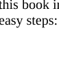

header.h

### 获取源代码

为方便起见，我已将本书示例中的源代码文件放在一个 ZIP 归档中，您可以通过以下简单步骤获取：

## 1 入门

*欢迎来到 C 的世界。本章演示如何以文本形式创建 C 程序，然后如何将其编译为可执行字节形式。*

- 介绍 C 语言
- 安装 C 编译器
- 编写 C 程序
- 编译 C 程序
- 理解编译
- 摘要

### 介绍 C 语言

C 是一种紧凑的通用计算机编程语言，最初由 Dennis MacAlistair Ritchie 为 Unix 操作系统开发。它首次在 1972 年的 Digital Equipment Corporation PDP-11 计算机上实现。

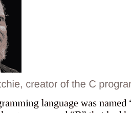

Dennis M. Ritchie，C 编程语言的创造者。

这种新编程语言被命名为“C”，因为它继任了大约在 1970 年引入的名为“B”的早期编程语言。

Unix 操作系统和几乎所有 Unix 应用程序都是用 C 语言编写的。然而，C 不限于特定平台，可以在任何支持 C 的机器上创建程序，包括运行 Windows 平台的机器。

C 的灵活性和可移植性使其非常流行，该语言于 1989 年由美国国家标准学会（ANSI）正式标准化。ANSI 标准明确定义了 C 的各个方面，从而消除了之前对语言精确语法的任何不确定性。

ANSI C 已成为 C 语言公认的标准，并在本书中通过示例进行了描述和演示。

C 语言已经存在相当长一段时间，并见证了 Java、C++ 和 C# 等更新编程语言的引入。其中许多新语言至少部分源自 C ——但体积大得多。更紧凑的 C 更适合编程入门，因为它更简单易学。

掌握 C 编程原理后，更容易转而学习更新的语言。例如，C++ 是 C 的扩展，除非您先掌握了 C 编程，否则学习起来会很困难。

尽管新语言提供了额外的功能，但 C 仍然很受欢迎，因为它通用且高效。如今它被用于大量平台，从微控制器到最先进的科学系统。世界各地的程序员都拥抱 C，因为它允许他们在程序中获得最大程度的控制和效率。

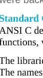

20 年前用 C 编写的程序今天仍然和当时一样有效。

### 标准 C 库

ANSI C 定义了若干标准库，其中包含经过验证的函数，可在您自己的 C 程序中使用。

这些库包含在“头文件”中，每个头文件的文件扩展名为“.h”。标准 C 库头文件名称及其用途的描述如下表所示：

| 库： | 描述： |
|---|---|
| stdio.h | 包含输入和输出函数、类型和宏定义。此库被大多数 C 程序使用，几乎占整个 C 库的三分之一 |
| ctype.h | 包含用于测试字符的函数 |
| string.h | 包含用于操作字符串的函数 |
| math.h | 包含数学函数 |
| stdlib.h | 包含用于数字转换、存储分配等的实用函数 |
| assert.h | 包含可用于向程序添加诊断的函数 |


| 头文件 | 描述 |
| --- | --- |
| stdarg.h | 包含可用于遍历函数参数列表的函数 |
| setjmp.h | 包含可用于避免正常调用和返回序列的函数 |
| signal.h | 包含用于处理程序中可能出现的异常情况的函数 |
| time.h | 包含用于操作日期和时间组件的函数 |
| limits.h | 包含 C 数据类型的大小的常量定义 |
| float.h | 包含与浮点运算相关的常量定义 |


函数是一段可在 C 程序中重复使用的代码。C 库中每个函数的描述在参考部分从此处开始给出。

### 安装 C 编译器

C 程序最初创建为纯文本文件，以 “.c” 文件扩展名保存。它们可以在任何纯文本编辑器中编写，例如 Windows 的记事本应用程序——不需要特殊软件。

为了执行 C 程序，它必须首先被“编译”成计算机可理解的字节码。C 编译器读取程序的原始文本版本并将其翻译成第二个文件，该文件为机器可读的可执行字节格式。

如果文本程序包含任何语法错误，这些错误将由编译器报告，并且可执行文件将不会被构建。

最受欢迎的 C 编译器之一是 GNU C 编译器 (GCC)，它根据通用公共许可证 (GPL) 的条款免费提供。它包含在几乎所有 Linux 操作系统发行版中。GNU C 编译器用于将本书中的所有示例编译为可执行字节码。

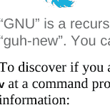

“GNU” 是 “Gnu’s Not Unix” 的递归缩写，发音为 “guh-new”。您可以在 www.gnu.org 找到更多详细信息

要发现您是否已在系统上安装了 GNU C 编译器，请在命令提示符下输入 `gcc -v`。如果可用，编译器将以版本信息进行响应：

```
mike@linux-pc:~$ gcc -v
Using built-in specs.
Thread model: posix
gcc version 7.3.0 (Ubuntu 7.3.0-16ubuntu3)
```

如果您使用的是 Linux 操作系统且没有 GNU C 编译器，请从发行版光盘或在线仓库安装，或请您的系统管理员安装。

如果您使用的是 Windows 操作系统且尚未安装 GNU C 编译器，您可以下载并安装 Minimalist GNU for Windows (MinGW) 软件包，其中包含 GNU C 编译器，按照对面步骤进行。


安装编译器时，标准 C 库头文件（此处列出）也将被安装。

- 1. 在联网的情况下，启动网页浏览器，然后导航到 sourceforge.net/projects/mingw 并点击“Download”按钮以获取 MinGW 设置安装程序
- 2. 启动设置安装程序，并在“Installation Manager”对话框中接受建议的位置 C:\MinGW
- 3. 选择“Basic”和“C++ Compiler”项，然后点击 Installation，Apply Changes 完成安装

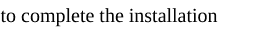

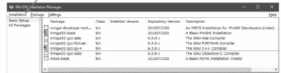


由于 C++ 是 C 的扩展，任何 C++ 开发工具也可以用来编译 C 程序。

MinGW C++ 编译器是一个位于 **C:\MinGW\bin** 的二进制可执行文件。为了使其可从任何系统位置访问，此文件夹现在应添加到系统路径中：

- 4. 在 Windows 控制面板中，点击 **System** 图标，然后选择 **Advanced System Settings** 项以启动“System Properties”对话框
- 5. 在 System Properties 对话框中，点击 **Environment Variables** 按钮，选择 **Path** 系统变量，然后点击 **Edit** 按钮并添加位置 **C:\MinGW\bin;**
- 6. 点击 **OK** 关闭每个对话框，然后打开“Command Prompt”窗口并输入命令 `gcc -v` 以查看编译器以版本信息进行响应

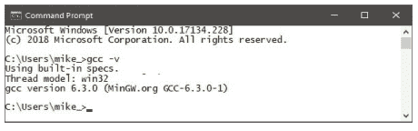


Path 语句中的位置地址必须以 ; 分号结尾。

| 变量名 | 路径 |
| --- | --- |
| 变量值 | C:\MinGW\bin |


MinGW 安装过程可能会发生变化，但当前指导可在 **mingw.org/wiki/Getting_Started** 找到

### 编写 C 程序

在 C 程序中，要执行的代码语句包含在“函数”中，其定义使用以下语法格式：

```
data-type function-name ( ) { statements-to-be-executed }
```

在调用函数执行其包含的语句后，它可以向调用者返回一个值。此值必须是函数名之前指定的数据类型。

程序可以包含一个或多个函数，但必须始终有一个名为“main”的函数。main() 函数是所有 C 程序的起点，如果编译器在程序中找不到 main() 函数，则不会编译代码。

程序中的其他函数可以使用字母、数字和下划线字符命名，但名称不能以数字开头。此外，本书前内页表上列出的 C 关键字必须避免使用。

函数名后面的 ( ) 括号可选择性地包含该函数要使用的值。这些值以逗号分隔列表的形式出现，被称为函数的“参数”或“形参”。

{ } 花括号（大括号）包含每次调用该函数时要执行的语句。每个语句必须以分号结束，就像英语句子必须以句号/句点结束一样。

传统上，学习任何编程语言时尝试的第一个程序就是简单生成消息“Hello World”的程序。

- 1. 打开一个纯文本编辑器，如 Notepad，然后在页面开头输入以下代码行，完全照抄

```
#include <stdio.h>
```

### hello.c

程序以一条指令开始，指示 C 编译器包含来自标准输入/输出 stdio.h 库文件的信息。这使得该库中包含的函数可供此程序使用。该指令更准确地称为“预处理器指令”或“预处理器指令”，必须始终出现在页面开头，在实际程序代码被处理之前。

不要使用文字处理器应用程序创建程序代码，因为它们会存储额外的格式信息，从而阻止代码编译。

预处理器指令以 # 井号字符开头，并且必须用 < > 角括号括住标准库名称。

在预处理器指令下方两行，添加一个空的 main 函数

```
int main()
{
}
```

此函数声明指定函数在完成时应返回 int 数据类型的整数值。

在大括号之间，插入一行代码，调用由预处理器指令提供的标准输入/输出库中定义的其中一个函数

```
printf ( "Hello World!\n" ) ;
```

这里 printf() 函数在其括号之间指定一个字符串参数。在 C 编程中，字符串必须始终用双引号括起来。此字符串包含文本 Hello World 和 \n “换行”转义序列，该序列将打印头移动到下一行的左边界。

在大括号之间，插入最后一行代码以返回零整数值，如函数声明所要求

```
return 0 ;
```

传统上，在程序执行后返回零值表示程序已正确执行。

检查程序代码是否与下面的列表完全相同，然后添加一个最终换行符（在闭合大括号后按 Return），并将程序保存为“hello.c”

```
#include <stdio.h>

int main()
{
    printf( "Hello World!\n" ) ;
    return 0 ;
}
```


完整的程序文本格式现已准备好编译为机器可读字节格式的可执行文件。

代码之间的空白会被 C 编译器忽略，但程序代码应始终以换行符结束。


每条语句必须以分号字符结尾。

### 编译 C 程序

本书示例的 C 源代码文件存储在一个专门为此创建的目录中。该目录名为“MyPrograms”，其在 Windows 上的绝对地址是 **C:\MyPrograms**，而在 Linux 上位于 **/home/user/MyPrograms**。按照此处步骤创建的 **hello.c** 源代码文件保存在该目录中，等待编译以生成可执行字节码格式的版本。

- 1. 在命令提示符处，使用指向 **MyPrograms** 目录的路径发出 **cd** 命令以导航到该目录
- 2. 在 **MyPrograms** 目录中的命令提示符处，键入 **gcc hello.c**，然后按回车编译程序

编译成功时，编译器会在原始源代码文件旁创建可执行文件。默认情况下，该文件在 Linux 系统上命名为 **a.out**，在 Windows 系统上命名为 **a.exe**。现在，在 **MyPrograms** 目录中编译另一个 C 源代码文件会在没有警告的情况下覆盖第一个可执行文件。这显然不理想，因此在编译 **hello.c** 时必须为可执行文件指定自定义名称。这可以通过在编译器命令中包含 **-o** 选项并在其后跟自定义名称来实现。

- 3. 在 **MyPrograms** 目录中的命令提示符处，键入 **gcc hello.c -o hello.exe**，然后按回车再次编译程序

在 Linux 和 Windows 系统上，现在都会在 C 源代码文件旁创建名为 **hello.exe** 的可执行文件：

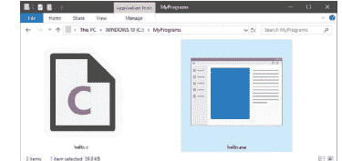


在命令提示符处，键入 `gcc --help`，然后按回车查看所有编译器选项的列表。

- 4. 在 Windows 的命令提示符处，键入可执行文件名，然后按回车运行程序——文本字符串会输出，打印头移到下一行

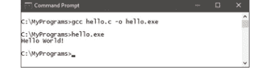

由于 Linux 默认不会在当前目录中查找可执行文件，除非明确指示它这样做，因此必须在文件名前加上 ./ 才能执行程序。

- 5. 在 Linux 的命令提示符处，键入 `./hello.exe`，然后按回车运行程序——文本字符串会输出，打印头移到下一行

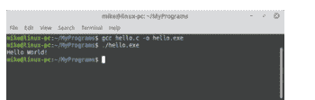

现在，你已经创建、编译并执行了这个简单的 Hello World 程序，它是 C 编程的起点。本书中的所有其他示例都将以同样的方式创建、编译和执行。


如果编译器提示文件末尾没有换行符，请在源代码末尾添加一个回车符，然后保存并重试。


Windows 用户甚至可以省略文件扩展名来运行程序。在这种情况下，只需键入 hello 就足够了。

### 理解编译

在从原始 C 源代码文件生成可执行文件时，编译过程实际上要经历四个独立阶段，每个阶段都会生成一个新文件：

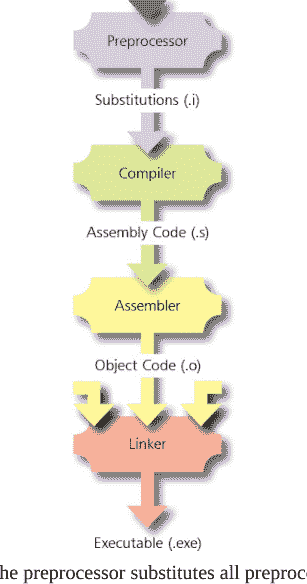

- 预处理——预处理器将原始源代码 .c 文件中的所有预处理指令替换为实现这些指令的实际库代码。例如，用库代码替换 #include 指令。生成的包含替换内容的文件为文本格式，通常具有 .i 文件扩展名。
- 翻译——编译器将 .i 文件中的高级指令翻译为低级汇编语言指令。生成的包含翻译内容的文件为文本格式，通常具有 .s 文件扩展名。
- 汇编——汇编器将 .s 文件中的汇编语言文本指令转换为机器码。生成的包含转换内容的目标文件为二进制格式，通常具有 .o 文件扩展名。
- 链接——链接器将一个或多个二进制目标 .o 文件合并为单个可执行文件。生成的文件为二进制格式，通常具有 .exe 文件扩展名。

严格来说，“编译”描述的是上述前三个阶段，它们作用于单个源代码文本文件，并最终生成单个二进制目标文件。如果程序源代码包含语法错误，例如缺少分号语句终止符或缺少括号，编译器将报告这些错误，编译将失败。

另一方面，链接器可以作用于多个目标文件，并最终生成单个可执行文件。这允许从模块化目标文件创建大型程序，这些目标文件可以各自包含可重用函数。如果链接器发现在多个目标文件中定义了同名函数，它将报告错误，并且不会创建可执行文件。

通常，编译过程的中间阶段创建的临时文件会被自动删除，但可以通过在编译器命令中包含 -save-temps 选项来保留它们以供检查：

- 1. 在 MyPrograms 目录中的命令提示符处，键入 gcc hello.c -save-temps -o hello.exe，然后按回车重新编译程序并保存临时文件

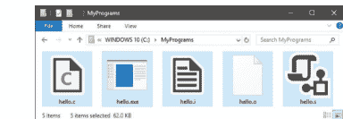

- 2. 在纯文本编辑器（如 Windows 的记事本）中打开 **hello.i** 文件，以查看文件最末尾的源代码，其前面是替换后的 **stdio.h** 库代码
- 3. 现在，在纯文本编辑器中打开 **hello.s** 文件，查看翻译成低级汇编代码后的内容，并注意与 C 代码版本相比它显得多么不友好

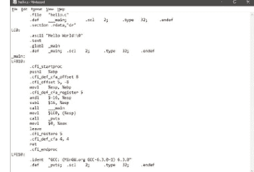


用汇编语言繁琐编写的程序可以比用 C 编写的程序运行得更快，但更难开发和维护。对于传统计算机编程而言，C 几乎总是首选。

### 总结

- 美国国家标准学会（ANSI）制定了 C 编程语言的公认标准。
- 其他编程语言，例如 C++ 和 C#，部分源自 C 语言。
- C 语言有许多标准库，其中包含经过实践检验的函数，可在任何程序中使用。
- C 库包含在名称具有 **.h** 文件扩展名的头文件中。
- C 程序创建为名称具有 **.c** 文件扩展名的纯文本文件。
- 流行的 GNU C 编译器（GCC）包含在 Minimalist GNU for Windows（MinGW）包中。
- 将编译器的主机目录添加到系统路径中，可以方便地从任何目录运行编译器。
- 程序有一个或多个函数，其中包含在每次调用该函数时要执行的语句。
- 每个 C 程序都必须有一个 **main()** 函数。
- 函数声明首先指定函数执行后要返回的值的数据类型。
- 要执行的语句包含在 { } 大括号内，并且每条语句必须以 ; 分号终止符结尾。
- 预处理器指令在程序编译的第一阶段执行，通常会替换库代码。
- GNU C 编译器使用 **gcc** 命令运行，并且可以包含 **-o** 选项来命名可执行输出文件。
- 编译过程中创建的临时文件可以使用 **-save-temps** 编译器命令选项保留。

## 2 存储变量值

本章演示如何在 C 程序中使用变量容器存储、检索和操作各种类型的数据。

- 创建程序变量
- 显示变量值
- 输入变量值
- 限定数据类型
- 使用全局变量
- 注册变量
- 转换数据类型
- 创建数组变量
- 描述维度
- 总结


### 创建程序变量

变量是 C 程序中的容器，数据值可以存储在计算机内存中。可以使用变量名引用所存储的值。程序员可以为变量选择任何名称，只要它遵循下表列出的命名约定：

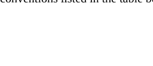

| 命名规则 | 示例 |
| --- | --- |
| 不能包含任何 C 关键字 | volatile |
| 不能包含算术运算符 | a+b*c |
| 不能包含标点字符 | %$#@! |
| 不能包含任何空格 | no spaces |
| 不能以数字开头 | 2bad |
| 可以在其他位置包含数字 | good1 |
| 可以包含大小写混合 | UPdown |
| 可以包含下划线 | is_ok |

为变量选择有意义的名称是良好做法，可使程序代码更易于理解。在程序代码中创建变量需要“声明”它。变量声明具有以下语法：

```
data-type variable-name ;
```

首先，声明指定变量允许包含的数据类型。这将是此处描述的四种数据类型之一。数据类型后跟一个空格，然后是按上表命名约定选择的变量名。与 C 程序中的所有语句一样，声明必须以分号终止符结尾。可以在单个声明中创建多个相同数据类型的变量，以逗号分隔列表的形式，如下所示：

```
data-type variable-name-1 , variable-name-2 , variable-name-3 ;
```


在 C 中变量名区分大小写——因此名为“VAR”、“Var”和“var”的变量将被视为三个独立的变量。


C 关键字列于本书封二的表格中。

C 语言中有四种基本数据类型。这些数据类型使用下表列出的 C 关键字定义，并附有每种数据类型的说明：

| 数据类型： | 描述： | 示例： |
| --- | --- | --- |
| **char** | 单个字节，仅能存储一个字符 | 'A' |
| **int** | 一个整数 | 100 |
| **float** | 精确到六位小数的浮点数 | 0.123456 |
| **double** | 精确到 10 位小数的浮点数 | 0.0123456789 |

这四种数据类型分配不同数量的机器内存来存储数据。最小的是 **char** 数据类型，仅分配一个字节的内存；最大的是 **double** 数据类型，通常分配八个字节的内存。这是 **float** 数据类型所分配内存量的两倍。

### 显示变量值

可以使用 printf() 函数显示变量的值，该函数在第 1 章中用于显示“Hello World”消息。必须以 printf() 函数括号中的参数形式，使用合适的“格式说明符”以及变量名，指定显示变量值所需的格式：

| 说明符： | 描述： | 示例： |
|---|---|---|
| %d | 从 -32768 到 +32767 的整数 | 100 |
| %ld | 长整数 -2^31 到 +2^31-1 | 123456789 |
| %f | 浮点数 | 0.123456 |
| %c | 单个字符 | 'A' |
| %s | 字符串 | "Hello World" |
| %p | 机器内存地址 | 0x0022FF34 |

格式说明符可以确保输出占用特定的最小空格数，方法是在 % 字符后立即写出所需数字——例如，要确保整数始终至少填满七个空格，可使用说明符 %7d。如果更希望用零填充空白空格，只需在 % 字符和指定数字之间添加一个零——例如，要确保整数始终至少填满七个空格并用零填充空白空格，可使用说明符 %07d。

精度说明符由一个句点（句号）后跟一个数字组成，可与 %f 格式说明符一起使用，以确定显示多少位小数——例如，要仅显示两位小数，可使用精度说明符 %.2f。精度说明符也可以与最小空格说明符组合，以同时控制要显示的最小空格数和小数位数——例如，要显示七个空格（包括两位小数）并用零填充空白空格，可使用 %07.2f。

默认情况下，空白空格位于数字之前，因此数字右对齐；但可以通过在最小空格说明符前加减号，将空白空格添加到数字之后，使其左对齐。


单个 char 字符值必须用单引号括起来——另一方面，由多个字符组成的字符串必须用双引号括起来。

- 1. 使用预处理指令包含标准输入/输出库函数，开始一个新程序

```
#include <stdio.h>
```


vars.c

- 2. 添加一个 main 函数，声明并初始化两个变量

```
int main()
{
    int num = 100 ;
    double pi = 3.1415926536 ;
}
```

- 3. 在 main 函数中，在变量声明之后插入语句，以各种格式输出变量值

```
printf("Integer is %d \n", num );
printf("Values are %d and %f \n", num, pi );
printf("%7d displays %7d \n", num, num );
printf("%07d displays %07d \n", num, num );
printf("PI is approximately %1.10f \n", pi );
printf("Right-aligned %20.3f rounded pi \n", pi );
printf("Left-aligned %-20.3f rounded pi \n", pi );
```

- 4. 在 main 函数块末尾插入最后一条语句，按照函数声明的要求返回整数零值

```
return 0 ;
```

- 5. 保存程序文件，然后在命令提示符下编译并执行程序，以查看变量值按指定格式输出

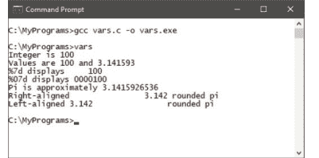


要使用 printf() 函数显示“%”字符，请在其前面再加一个“%”字符，如此处所示。


请注意，当格式说明符分配的小数位数较少时，浮点值会被舍入——而不是简单地截断。

### 输入变量值

标准输入/输出库 stdio.h 提供了 scanf() 函数，可用于将用户输入获取到程序中。scanf() 函数需要在其括号内提供两个参数，以指定要输入的数据类型以及输入应存储的位置。

scanf() 函数的第一个参数必须是此处表格中的格式说明符之一，并放在双引号之间——例如，当输入为整数值时使用“%d”。scanf() 函数的第二个参数必须是一个前面带有 & 字符的变量名，除非输入数据是文本字符串。& 字符在 C 编程中有多种用途，但在这种语境下是“addressof”运算符，表示输入数据应存储在为该变量保留的内存位置。

声明变量时，会在机器内存中保留空间，以存储分配给该变量的数据。保留的字节数取决于变量的数据类型。分配的内存通过唯一的变量名来引用。

将计算机内存想象成一长排槽位。每个槽位都有一个唯一地址，以十六进制格式表示。这就像一条长长的房屋街道——每栋房屋里都有人，并且都有一个唯一的数字地址。在 C 程序中，房屋就是槽位，人就是那些地址中包含的数据。

scanf() 函数也可以同时为多个变量赋值。此时它的第一个参数必须包含格式说明符列表，每个说明符之间用空格分隔，整个列表必须用双引号括起来。第二个参数必须包含以逗号分隔的变量名列表，每个变量名前面都要加上 & addressof 运算符，并且每个指定格式分别应用于对应的变量名。

& addressof 运算符还可用于返回存储变量数据的十六进制内存地址。

将 printf() 函数的输出与 scanf() 函数的输入结合起来，可以在用户和程序之间创建基本的交互性。


字符串是一种特殊情况，这里通过数组主题进行演示。

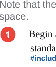

注意，`scanf()` 函数在遇到空格时会停止读取输入。

- 1. 开始一个新程序，使用预处理指令包含标准输入/输出库函数

```c
#include <stdio.h>
```


setvars.c

- 2. 添加一个声明三个变量的 main 函数

```c
int main()
{
    char letter ;
    int num1 , num2 ;
}
```

- 3. 在 main 函数中，变量声明之后，插入语句以获取用户输入

```c
printf( "Enter any one keyboard character: " );
scanf( "%c", &letter );
printf( "Enter two integers separated by a space: " );
scanf( "%d %d", &num1, &num2 );
```

- 4. 接下来，插入语句以输出所存储数据的详细信息

```c
printf( "Numbers input: %d and %d \n", num1, num2 );
printf( "Letter input: %c ", letter );
printf(" Stored at: %p\n", &letter);
```

- 5. 在 main 函数块末尾，插入最后一条语句，按照函数声明的要求返回整数值零。

```c
return 0;
```

- 6. 保存程序文件；编译并执行程序；根据提示输入数据；然后查看存储数据的输出。

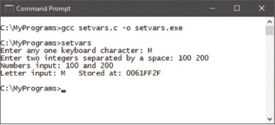


机器地址的格式说明符是 `%p`。

### 限定数据类型

当创建一个 int 数据类型的整数变量时，默认情况下它可以包含正值或负值。这些被称为“有符号”值。可能值的范围由你的系统决定为“long”或“short”。

如果 int 变量默认创建为 long 类型（很可能），那么它通常可能具有从最大值 +2,147,483,647 到最小值 -2,147,483,648 的值范围。

另一方面，如果 int 变量默认创建为 short 类型（不太可能），那么它通常可能具有从最大值 +32,767 到最小值 -32,768 的值范围。

不过，可以使用变量声明中的 short 和 long 限定符关键字显式指定范围大小，如下所示：

```c
short int num1 ; /* Saves memory space. */
long int num2 ; /* Allows bigger range. */
```

limits.h C 库头文件包含每种数据类型大小的实现定义限制。对于未指定大小的 int 变量声明，可以通过名为 INT_MAX 和 INT_MIN 的常量值访问这些限制。类似地，SHRT_MAX 和 SHRT_MIN 包含 short int 变量声明的限制，LONG_MAX 和 LONG_MIN 包含 long int 变量声明的限制。

当变量永远不会被赋负值时，可以使用 unsigned 限定符关键字声明一个非负的“无符号”int 变量。无符号 short int 变量通常可能具有从 0 到 65,535 的范围，但只占用与常规 short int 变量相同的内存空间。无符号 long int 变量通常可能具有从 0 到 4,294,967,295 的范围，但只占用与常规 long int 变量相同的内存空间。

sizeof 运算符可用于揭示不同数据类型的变量所保留的内存空间量。使用尽可能少的内存是良好的编程实践。例如，如果某个变量只会包含低于 65,535 的正整数值，那么最好使用仅保留 2 字节内存的无符号 short int 变量，而不是保留 4 字节内存的 long int 变量。


常量总是完全用大写命名，以区别于变量。


分配给未指定大小的 int 变量的内存空间取决于系统，但通常默认会被当作 long int 处理。

- 1. 开始一个新程序，使用预处理指令包含标准输入/输出函数和常量

```c
#include <stdio.h>
#include <limits.h>
```

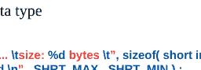

- 2. 添加一个 main 函数，其中包含输出 short int 数据类型大小和范围的语句

```c
int main()
{
    printf("short int... size: %d bytes\n", sizeof(short int));
    printf("%d to %d\n", SHRT_MAX, SHRT_MIN);
}
```

- 3. 接下来，插入语句以输出 long int 数据类型的大小和范围

```c
printf("long int...\t size: %d bytes \t", sizeof( long int ));
printf(" %ld to %ld \n", LONG_MAX , LONG_MIN );
```

- 4. 现在，插入语句以输出其他数据的大小

```c
printf("char...\t size: %d byte \n", sizeof( char ));
printf("float...\t size: %d bytes \n", sizeof( float ));
printf("double...\t size: %d bytes \n", sizeof( double ));
```

- 5. 插入最后一条语句，按照函数声明的要求返回整数值零

```c
return 0 ;
```

- 6. 保存程序文件，然后编译并执行程序，以查看数据类型的大小和范围

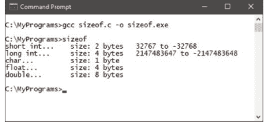


注意本例中如何使用 \t 制表符转义序列来为输出添加间距。

### 使用全局变量

变量在程序中的可访问程度称为“变量作用域”。在函数内部声明的变量称为“局部”变量，而在任何函数块外部声明的变量称为“全局”变量。

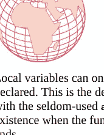

局部变量只能从其声明所在的函数内部访问。这是默认的隐式行为，可以在变量声明中使用很少使用的 auto 关键字来显式指定。它们在函数被调用时产生，并通常在函数结束时消失。

另一方面，全局变量可以从程序中的任何函数内部访问。它们在程序执行时产生，并一直存在到程序结束。

外部全局变量必须在程序开始时恰好定义一次。它还必须在每个需要访问它的函数开始时进行声明。声明应以 extern 关键字开头，以表示它引用的是外部变量，而不是常规的局部变量声明。这些声明不应用于初始化全局变量。

较大的 C 程序通常由多个源代码文件组成，这些文件一起编译以创建单个可执行文件。全局变量通常可以从一起编译的任何文件中的任何函数访问。所有函数通常也可以全局访问，但函数以及——更常见的是——全局变量可以通过在其声明中使用 static 关键字，将其可访问性限制为仅在创建它们的文件中。

通常，一个程序不能使用多个同名变量，但如果每个变量都声明为 **static** 变量，并且在该源代码文件中是唯一的，就可以这样做。使用多个源代码文件编程时，可能会发现一个常见的全局变量名在两个不同文件中重复。将它们声明为 **static** 可以避免在源代码中每次出现时都需要重命名其中一个变量。

内部局部变量也可以声明为 **static**。与通常情况一样，它们只能从其声明所在的函数内部访问，但它们在函数结束时不会消失。这允许在函数内进行永久私有存储，直到程序结束。


全局变量的广泛使用可能会引入名称冲突。


尽量只使用局部变量。全局变量允许方便地从程序中的任何函数访问值，但更好的做法是避免使用全局变量，而是将值作为参数在函数之间传递。

- 1. 开始一个新程序，使用预处理指令包含标准输入/输出库函数

```c
#include <stdio.h>
```


- 2. 定义并初始化一个全局静态变量，该变量只能从此源代码文件内部访问


```c
static int sum = 100;
```

添加一个 main 函数，声明它想要使用全局静态变量并输出其值

```c
int main()
{
    extern int sum;
    printf("Sum is %d \n", sum);
}
```

现在，插入一个声明以使用第二个全局变量并输出其值

```c
extern int num;
printf("Num is %d \n", num);
```

插入一个最终语句以返回零整数值，如函数声明所要求，然后保存文件

```c
return 0;
```

在单独的文件中定义第二个全局变量，然后保存该文件

```c
int num = 200;
```


global_2.c

通过在命令中提供每个源代码文件名，将两个源文件编译成一个可执行程序，然后执行程序以查看全局值的输出

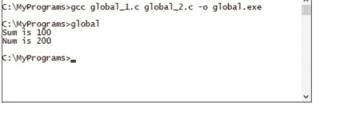


在第二个文件中的 **num** 变量定义中添加 **static** 关键字会将其可访问性限制为仅该文件——因此编译随后会失败。

### 寄存器变量

包含 register 关键字的变量声明会建议编译器，指定的变量将被程序大量使用。其意图是让编译器将寄存器变量放置在计算机的机器寄存器中以加快访问时间。尽管如此，其有用性可能值得怀疑，因为编译器可以自由忽略此建议。

只有局部内部变量可以声明为寄存器变量。在任何情况下，只有少数变量可以保存在机器寄存器中，并且它们只能是某些类型。精确的限制因机器而异。

尽管存在这些可能的缺点，register 声明是无害的，因为当编译器实际上无法使用机器寄存器来存储变量时，register 关键字将被忽略。相反，变量会被创建，就好像 register 关键字不存在一样。

寄存器变量的完全相反是通过包含 volatile 关键字的变量声明实现的。这意味着变量不得存储在机器寄存器中，因为其值可能随时发生变化，而编译器在附近找到的代码不会采取任何操作。这对于大型程序中的全局变量尤其相关，这些全局变量可能被多个线程并发修改。

可能受益于成为寄存器变量的一种变量是用于存储循环控制值的局部变量。在循环的每次迭代中，该值必须被比较和更改，因此变量会被反复访问。然后将此值存储在机器寄存器中可以加快循环的执行速度。

另一方面，如果全局变量用于存储循环的控制值，并且也可能从循环外部更改，则该全局变量可能受益于成为 volatile 变量。

循环结构在第 5 章中有完整描述，但此处列出的示例是为了说明对寄存器变量的重复访问而包含的。


register 和 volatile 关键字在此处是为了完整性而描述的，但在现实中很少见，因为大多数程序只是使用常规变量来存储数据。


register.c

- 1. 使用预处理器指令开始一个新程序，以包含标准输入/输出库函数

    ```c
    #include <stdio.h>
    ```

- 2. 添加一个 main 函数，声明并初始化一个包含循环控制值为零的局部寄存器变量

    ```c
    int main()
    {
        register int num = 0;
    }
    ```

- 3. 现在，插入一个条件测试以查看控制值是否低于五，然后跟一对大括号

    ```c
    while ( num < 5 )
    {
    }
    ```

- 4. 在循环结构的大括号之间，插入语句以递增控制值并在循环的每次迭代中输出其当前值

    ```c
    ++num;
    printf("Pass %d \n", num);
    ```

- 5. 在函数块的末尾，返回零整数值，如函数声明所要求

    ```c
    return 0;
    ```

- 6. 保存程序文件，然后编译并执行程序，以查看在循环的每次迭代中从寄存器变量检索到的值

    ```
    C:\MyPrograms>gcc register.c -o register.exe
    C:\MyPrograms>register
    Pass 1
    Pass 2
    Pass 3
    Pass 4
    Pass 5
    C:\MyPrograms>_
    ```


如果在寄存器变量上使用 & 取地址运算符，编译器将把变量放置在内存位置而不是寄存器中。

### 转换数据类型

如果看起来合乎逻辑，编译器会隐式地将一种数据类型更改为另一种数据类型。例如，当整数被赋给 **float** 变量时，编译器会将整数转换为浮点值。

存储在变量中的任何数据都可以通过称为“casting”的过程显式强制（转换）为不同数据类型的变量。强制转换只是在存储原始数据类型数据的变量名称之前，用括号说明应将其转换为什么数据类型。括号中还应包括任何修饰符，例如 **unsigned**，视情况而定——因此强制转换的语法如下所示：

```
*variable-name2* = ( *modifiers data-type* ) *variable-name1* ;
```

请注意，强制转换不会更改变量的原始数据类型，而只是将该值复制为不同的数据类型。

当从 **float** 变量强制转换为 **int** 变量时，值 simply 在小数点处截断。没有四舍五入到最接近的整数。例如，使用 **float num = 5.75** 时，使用 **(int)num** 强制转换为整数会产生整数 **5**，而不是 **6**。

当从 **char** 变量强制转换为 **int** 变量时，结果整数值是表示该字符的数值 ASCII 码值。大写字母的数值 ASCII 值范围为 65-90，而小写字母的范围为 97-122。例如，使用 **char letter = ‘A’** 时，使用 **(int) letter** 强制转换为整数会产生整数 **65**。将这些范围内的整数值强制转换为 **char** 数据类型会产生等效字母。

通常有必要将整数值强制转换为其浮点等价物以执行精确的算术运算。否则，除法可能会产生截断的整数结果。例如，使用 **int x=7,y=5** 时，语句 **float z = x / y** 分配的值为 **1.000000**。精确的算术运算要求语句使用强制转换，因为 **(float)x / (float)y** 产生浮点值 **1.400000**。

将长而精确的浮点数从 **double** 数据类型强制转换为较短的 **float** 数据类型，并不是简单地在第六位小数处截断较长的值，而是向上或向下舍入到最接近的数字。例如，使用 double decimal = 0.1234569 时，使用 (float)decimal 强制转换为 float 会产生 0.123457。

ASCII（发音为“as-kee”）是“American Standard Code for Information Interchange”（信息交换美国标准代码）的缩写，是纯文本的公认标准。你可以在这里找到标准 ASCII 代码的完整范围。

/ 正斜杠字符是 C 语言中的除法运算符。

- 1. 使用预处理器指令开始一个新程序，以包含标准输入/输出库函数

    ```c
    #include <stdio.h>
    ```

- 2. 添加一个 main 函数，声明并初始化各种数据类型的变量

    ```c
    int main()
    {
        float num = 5.75;
        char letter = 'A';
        int zee = 90;
        int x = 7, y = 5;
        double decimal = 0.12345678;
    }
    ```

- 3. 接下来，插入语句以输出每个变量值的强制转换等价物

    ```c
    printf("Float cast to int: %d\n", (int)num );
    printf("Char cast to int: %d\n", (int)letter );
    printf("Int cast to char: %c\n", (char)zee );
    printf("Float arithmetic: %f\n", (float)x / (float)y );
    printf("Double cast to float: %f\n", (float)decimal );
    ```

- 4. 在函数块的末尾，返回零整数值，如函数声明所要求

    ```c
    return 0;
    ```

- 5. 保存程序文件，然后编译并执行程序以查看每个强制转换的结果等价物

    ```
    C:\MyPrograms>gcc cast.c -o cast.exe
    C:\MyPrograms>cast
    Float cast to int: 5
    Char cast to int: 65
    Int cast to char: Z
    Float cast to char: 0
    Float arithmetic: 1.400000
    Double cast to float: 0.123457
    C:\MyPrograms>_
    ```

从 float 强制转换为 int 的值会被截断，但从 double 强制转换为 float 的值会被四舍五入。


### 创建数组变量

数组变量可以存储多个数据项，而普通变量只能存储单个数据项。

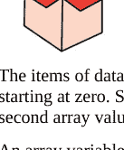

数据项按顺序存储在数组“元素”中，这些元素从零开始编号。因此，第一个数组值存储在数组元素零中；第二个数组值存储在数组元素一中；以此类推。

在 C 程序中，数组变量的声明方式与普通变量相同，但此外，还应在声明中指定数组的大小（其元素数量）。这是在数组名称后方用方括号表示，语法如下：

```text
data-type array-name [ number-of-elements ] ;
```

可选地，数组可以在声明时通过为每个元素分配值来初始化，这些值作为逗号分隔的列表用花括号（大括号）括起来。例如，可以创建并初始化一个包含三个整数的数组，方法为 int arr[3] = { 1,2,3 } 。

可以使用数组名称后跟包含元素编号的方括号来引用数组元素值。例如，arr[0] 引用第一个元素中的值。

如果在声明中初始化元素，则在数组声明中省略方括号之间的数字是可以接受的——大小将自动调整以适应分配给数组的值的数量。

在 C 编程中，数组最显著的用途之一是其能够存储文本字符串。char 数据类型的数组中的每个元素可以存储一个字符。在数组的最后一个元素中添加特殊的 \0 空字符转义序列会使数组获得字符串状态。例如，可以通过 char str[4] = {'C', 'a', 't', '\0'}; 创建并初始化一个字符串。

被提升为字符串状态的字符数组允许仅使用数组名称引用整个字符串，并且可以使用 printf() 函数和 %s 格式说明符显示——例如，使用 printf("%s", str); 显示存储在数组 str 中的字符串。

数组元素从零开始编号，而不是从一开始。

创建用于保存字符串的数组时，请记住为最后一个元素预留空间以包含 \0 空字符。

```c
#include <stdio.h>
```

```c
int main()
{
    int arr[3];
}
```

- 1. 使用预处理器指令开始一个新程序，以包含标准输入/输出库函数
  ```c
  #include <stdio.h>
  ```
- 2. 添加一个 main 函数，声明一个包含三个元素的整数数组
  ```c
  int main()
  {
      int arr[3];
  }
  ```
- 3. 接下来，插入语句通过单独为每个元素赋值来初始化整数数组元素
  ```c
  arr[0] = 100 ;
  arr[1] = 200 ;
  arr[2] = 300 ;
  ```
- 4. 现在，插入一条语句来创建并初始化一个字符数组以保存文本字符串
  ```c
  char str[10] = {'C',' ','P','r','o','g','r','a','m','\0'} ;
  ```
- 5. 插入语句以输出整数数组的所有元素值以及字符数组中的字符串
  ```c
  printf("1st element value: %d \n" , arr[0] ) ;
  printf("2nd element value: %d \n" , arr[1] ) ;
  printf("3rd element value: %d \n" , arr[2] ) ;
  printf("String: %s \n" , str ) ;
  ```
- 6. 在函数块末尾，返回零整数值，如函数声明所要求
  ```c
  return 0 ;
  ```
- 7. 保存程序文件，然后编译并执行程序以查看存储在数组变量中的值
  
  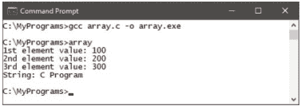
  
  

创建数组会根据数据类型为每个元素分配内存——char 数组每个元素一个字节。因此，数组不能动态调整大小。

### 描述维度

数组元素的编号更准确地称为“数组索引”，并且由于元素编号从零开始，有时也称为“零基索引”。使用单个索引创建的数组是一维数组，其元素出现在单行中：

| 元素内容... | A | B | C | D | E |
| --- | --- | --- | --- | --- | --- |
| 索引编号... | [0] | [1] | [2] | [3] | [4] |

数组也可以具有多个索引——用于表示多个维度。使用两个索引创建的数组是二维数组，其元素出现在多行中：

| 第一索引 [0] | [0] | A | B | C | D | E |
| --- | --- | --- | --- | --- | --- | --- |
| | [1] | F | G | H | I | J |
| 第二索引 | | [0] | [1] | [2] | [3] | [4] |

对于多维数组，每个元素包含的值是通过说明每个索引的编号来引用的。例如，对于上面的二维数组，[1][2] 处的元素包含字母 H。

二维数组对于存储基于网格的信息很有用，例如 XY 坐标。创建具有三个索引的三维数组将允许存储 XYZ 坐标：

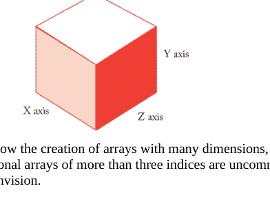

额外的索引允许创建具有许多维度的数组，但实际上，超过三个索引的多维数组并不常见，因为它们难以想象。


具有超过两个索引的多维数组可能产生难以阅读的源代码并可能导致错误。

- 1. 使用预处理器指令开始一个新程序，以包含标准输入/输出库函数
  ```c
  #include <stdio.h>
  ```
  
  
  
  matrix.c
- 2. 添加一个 main 函数，声明并初始化一个二维整数数组
  ```c
  int main()
  {
    int matrix[2][3] = { {'A','B','C'}, {1,2,3} };
  }
  ```
- 3. 接下来，插入语句以显示第一个索引中所有元素的内容
  ```c
  printf("Element [0][0] contains %c \n", matrix[0][0]);
  printf("Element [0][1] contains %c \n", matrix[0][1]);
  printf("Element [0][2] contains %c \n", matrix[0][2]);
  ```
- 4. 现在，插入语句以显示第二个索引中所有元素的内容
  ```c
  printf("Element [1][0] contains %d \n", matrix[1][0]);
  printf("Element [1][1] contains %d \n", matrix[1][1]);
  printf("Element [1][2] contains %d \n", matrix[1][2]);
  ```
- 5. 在函数块末尾，返回零整数值，如函数声明所要求
  ```c
  return 0 ;
  ```
- 6. 保存程序文件，然后编译并执行程序以查看二维数组元素中存储的所有值
  
  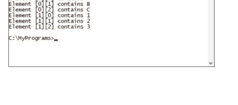
  
  

注意这里隐式类型转换如何将字母的 ASCII 代码值存储在整数数组中，但 %c 格式说明符再次将它们显示为字母。

### 摘要

- 变量是 C 程序中的一个容器，其中数据值可以存储在计算机内存中。
- 变量名必须遵守 C 命名约定。
- C 中的四种基本数据类型是 **char**、**int**、**float** 和 **double**。
- 格式说明符 **%d**、**%f**、**%c**、**%s** 和 **%p** 可与 **printf()** 函数一起使用以显示不同类型的变量值。
- 用户输入可以通过 **scanf()** 函数分配给变量。
- **int** 变量的允许范围可以使用 **short** 和 **long** 关键字显式限定。
- 永不保存负值的变量可以限定为 **unsigned** 以扩展其正值范围。
- 任何变量保留的内存字节数可以使用 **sizeof** 运算符揭示。
- 变量作用域描述了对变量的访问范围，可以是局部或全局。
- **extern** 关键字指定外部定义的变量，而 **static** 关键字将访问限制在同一源文件中。
- 使用 **register** 关键字将变量放在机器寄存器中可以提高频繁使用变量的性能。
- 不适合寄存器的变量可以标记为 **volatile**。
- 编译器在逻辑上可能隐式更改数据类型，或可以通过强制类型转换显式更改。
- 数组变量在单独的元素中存储多个数据项，这些元素按顺序编号——从零开始。
- 数组元素中的值通过数组变量名称后跟方括号内的元素编号来引用。
- 数组变量可以具有多个索引以创建多维数组。


## 声明程序常量

当程序需要使用一个永远不会改变的固定常量数据值时，它应与变量以相同的方式声明，但要在声明中包含 const 关键字。例如，表示不变的整数值一百万的常量可以像这样声明并初始化：

```
const int MILLION = 1000000 ;
```

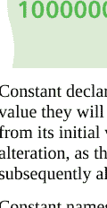

常量声明必须始终使用其将包含的数据值初始化常量对象。程序永远无法从其初始值更改常量的值。这可防止常量值被意外更改，因为如果程序尝试随后更改初始值，编译器会报告错误。

常量名须遵守与变量名相同的命名约定（此处描述），但传统上使用大写字符作为常量名，以便在阅读源代码时易于将其与变量名区分开。

如果程序永远不会更改其所有初始元素值，也可以在数组声明中使用 const 关键字。

- 1. 使用预处理指令开始一个新程序以包含标准输入/输出库函数

  ```
  #include <stdio.h>
  ```


constant.c

- 2. 添加一个 main 函数，声明一个近似数学值 Pi 的常量值

  ```
  int main()
  {
      const float PI = 3.141593 ;
  }
  ```

- 3. 接下来，在 main 函数块中，插入声明四个变量的语句

  ```
  float diameter ;
  float radius ;
  float circ ;
  float area ;
  ```

- 4. 现在，插入请求用户输入以分配给变量的语句

  ```
  printf("Enter the diameter of a circle in millimeters: ");
  scanf("%f", &diameter );
  ```

- 5. 接下来，添加使用常量值和用户输入计算其他三个变量值的语句

  ```
  circ = PI * diameter ;
  radius = diameter / 2 ;
  area = PI * ( radius * radius ) ;
  ```

- 6. 现在，插入将计算值格式化为两位小数输出的语句

  ```
  printf("Circumference is %.2f mm", circ );
  printf("And the area is %.2f sq.mm\n", area );
  ```

- 7. 在 main 函数块末尾，返回零整数值，如函数声明所要求

  ```
  return 0 ;
  ```

- 8. 保存程序文件，然后编译并执行程序，在需要时输入数据以查看计算输出

```
C:\MyPrograms>gcc constant.c -o constant.exe
C:\MyPrograms>constant
Enter the diameter of a circle in millimeters: 
```

```
C:\MyPrograms>constant
Enter the diameter of a circle in millimeters: 140
Circumference is 439.82 mm
And the area is 15393.81 sq.mm
C:\MyPrograms>
```

这里星号字符是算术乘法运算符，正斜杠字符是除法运算符。算术运算符将在下一章中完整演示。

请记住，在 scanf() 中必须在变量名前加上 & 取地址运算符，以便将输入分配给变量。

### 枚举常量值

enum 关键字提供了一种简洁的方式来创建整数常量的序列。可选地，声明可以在 enum 关键字后包含序列的名称。常量名作为逗号分隔的列表跟在花括号内。

默认情况下，每个常量的值都比列表中在其前面的常量大一。若未指定，第一个常量的值为零；下一个值为 1；依此类推。

例如，可以使用 `enum{MON,TUE,WED,THU,FRI};` 给命名的工作日常量一个从零开始的整数值序列——在这种情况下，常量 WED 的整数值为 2。

常量可以在声明中被赋予任意单个整数值，但列表中的下一个常量始终会将前一个值递增一，除非它也被赋予了值。例如，要使序列从 1 而不是零开始，使用 `enum{MON=1,TUE,WED,THU,FRI};` 将 1 分配给第一个常量——在这种情况下，常量 WED 的整数值为 3。

枚举常量的列表也称为“枚举集合”，可能包含重复的常量值。例如，值零可以分配给名为 NIL 和 NONE 的常量。

在下面的示例中，枚举集合表示斯诺克游戏中球的分数值，并包含一个可选名称，该名称以大写形式出现，因为它也是常量。

- 1. 使用预处理指令开始一个新程序以包含标准输入/输出库函数

  ```
  #include <stdio.h>
  ```

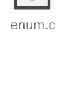


在本例中给 **BLUE** 常量赋值为 1 会重新开始递增过程——使 **PINK** 常量为 2，**BLACK** 常量为 3。


enum 类型名（在本例中为 **SNOOKER**）是可选的——因此在本例中可以省略。

### 创建常量类型

一旦枚举序列被声明，它就可以被视为一种新的数据类型，具有其指定的常量名及其相关值的属性。

这种 enum 数据类型的变量可以像声明其他数据类型的变量一样声明——使用以下语法：

```
data-type variable-name ;
```

这里的示例创建了一个名为 SNOOKER 的枚举序列，可视为 enum SNOOKER 的数据类型。因此，可以使用声明 enum SNOOKER pair ; 创建该数据类型的名为“pair”的变量，并可存储该类型定义的枚举集合的值。

要显式地将整数值分配给枚举数据类型的变量，C 标准建议使用强制转换将 int 数据类型转换为 enum 数据类型，如下所示：

```
pair = ( enum SNOOKER ) 7 ;
```

然而在实践中这并非必需，因为枚举值始终是整数，因此等同于 int 数据类型。

enum 声明可选择在最后的花括号后指定变量名来同时创建变量。例如，声明 enum BOOLEAN { FALSE , TRUE } flag ; 定义了一个 enum 数据类型并创建了该类型的名为“flag”的变量。

可以使用 typedef 关键字和以下语法定义自定义数据类型：

```
typedef definition type-name ;
```

声明自定义数据类型有助于使程序代码更简洁。例如，如果程序使用多个 unsigned short int 变量，使用以下声明先创建具有这些修饰符的自定义数据类型会很有用：

```
typedef unsigned short int USINT ;
```

然后每个 unsigned short int 变量声明只需使用自定义数据类型名 USINT 代替 unsigned short int。


虽然不是必需的，但使用推荐的强制转换显式地为枚举类型变量赋值可作为其类型的提醒。

constype.c

- 1. 使用预处理指令开始一个新程序以包含标准输入/输出库函数

  ```
  #include <stdio.h>
  ```

- 2. 添加一个 main 函数，声明并初始化一个从 1 开始的枚举常量集合

  ```
  int main()
  {
      enum SNOOKER
      {
          RED=1, YELLOW, GREEN, BROWN, BLUE, PINK, BLACK
      };
  }
  ```

- 3. 接下来，在 main 函数块中，声明并初始化一个定义好的 enum 类型变量，然后显示其值

  ```
  enum SNOOKER pair = RED + BLACK;
  printf("Pair value: %d\n", pair);
  ```

- 4. 现在，添加一条创建自定义数据类型的语句

  ```
  typedef unsigned short int USINT;
  ```

- 5. 然后，声明并初始化一个自定义数据类型变量并显示其值

  ```
  USINT num = 16;
  printf("Unsigned short int value: %d\n", num);
  ```

- 6. 在 main 函数块末尾，返回零整数值，作为

  ```
  return 0;
  ```

根据函数声明的要求

```c
return 0 ;
```

- 7. 保存程序文件，然后编译并执行程序，查看赋给枚举类型变量和自定义数据类型的值。

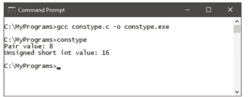


必须先程序中定义自定义数据类型，然后才能创建该类型的变量。

### 定义常量

预处理器 `#define` 指令可用于指定常量文本值，这些值可以在程序中使用以下语法使用：

```c
#define CONSTANT-NAME "text-string"
```

与 `#include` 指令一样，这些指令应出现在程序代码的最开始处。程序代码中任何出现的指定常量名都会在编译前由预处理器替换为关联的文本字符串。

条件预处理器 `#ifdef` 指令也可用于评估当前是否存在某个定义。根据评估结果，后面可以跟随一个 `#define` 指令来指定常量文本值。这种预处理器例程称为“宏”，每个宏都必须以 `#endif` 指令结束。

有用的是，预处理器宏可以检查编译器定义的常量来确定宿主操作系统。这些常量因机器而异，但在 Windows 平台上通常会有名为 `_WIN32` 的常量，而在 Linux 平台上通常会有 `linux` 常量。`#ifdef` 预处理器指令可以应用适当的文本字符串来标识宿主平台。

- 1. 使用包含标准输入/输出库函数的预处理器指令开始一个新程序

  ```c
  #include <stdio.h>
  ```


- 2. 再添加三个预处理器指令，指定用于在源代码中替换的文本字符串

  ```c
  #define LINE ""
  #define TITLE "C Programming in easy steps"
  #define AUTHOR "Mike McGrath"
  ```

接下来，添加一个条件宏，指定用于标识 Windows 宿主平台的文本字符串：

```c
#ifdef _WIN32
#define SYSTEM "Windows"
#endif
```

现在，添加一个条件宏，指定用于标识 Linux 宿主平台的文本字符串：

```c
#ifdef linux
#define SYSTEM "Linux"
#endif
```

接下来，添加一个 main 函数，输出由预处理器替换后的文本字符串值：

```c
int main()
{
    printf("\n\t%s \n\t%s \n", LINE , TITLE );
    printf("\t by %s \n\t%s \n", AUTHOR , LINE );
    printf("\n Operating System: %s \n", SYSTEM );
}
```

在 main 函数块末尾，按照函数声明的要求返回零整数值：

```c
return 0 ;
```

保存程序文件，然后编译并执行程序，查看输出的字符串常量。

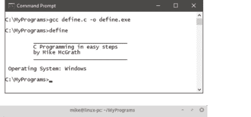

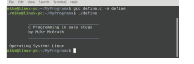


本示例中的 `LINE` 字符串只是一系列下划线字符。


尝试执行命令 `cpp -dM define.c` 以查看所有已定义的常量。

### 调试定义

可以使用 `#if`、`#else` 和 `#elif`（else if）预处理器指令提供替代分支。这些指令允许根据评估结果进行条件分支，以执行代码段。

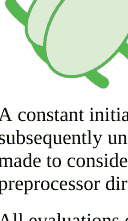

最初由预处理器 `#define` 指令定义的常量，随后可以用 `#undef` 指令取消定义。也可以使用 `#ifndef`（if not defined，如果未定义）预处理器指令进行评估，以考虑某个常量是否未定义。

所有评估都可以在函数块中进行，并与常规 C 语句混合，而且可以相互嵌套。这类宏对于调试源代码特别有用，因为只需更改 DEBUG 宏的状态，就可以轻松隐藏或显示整个代码段。


- 1. 使用包含标准输入/输出库函数的预处理器指令开始一个新程序

  ```c
  #include <stdio.h>
  ```

- 2. 再添加一个预处理器指令来建立宏

  ```c
  #define DEBUG 1
  ```

- 3. 接下来，添加一个包含预处理器指令的 main 函数，以评估并报告宏状态：

```c
#if DEBUG == 1
    printf( "Debug status is 1 \n" );
#elif DEBUG == 2
    printf( "Debug status is 2 \n" );
#else
    #ifdef DEBUG
    printf( "Debug is defined! \n" );
    #endif
    #ifndef DEBUG
    printf( "Debug is not defined! \n" );
    #endif
#endif
```

在 main 函数块末尾，按照函数声明的要求返回零整数值：

```c
return 0 ;
```


本示例中使用的 `==` 相等运算符表示“等于”。

保存程序文件，然后编译并执行程序，查看报告的宏状态。

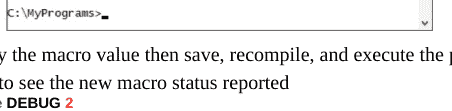

修改宏值，然后保存、重新编译并再次执行程序，查看报告的新宏状态。

```c
#define DEBUG 2
```


再次修改宏值，然后保存、重新编译并再次执行程序，查看变化。

```c
#define DEBUG 3
```

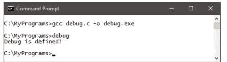

在函数块开头插入另一个预处理器指令，然后保存、重新编译并再次执行程序，查看报告的宏状态。

```c
#undef DEBUG
```

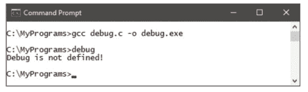


每个预处理器条件测试都必须以 `#endif` 指令结束。

### 总结

- 永远不会改变的固定数据值应存储为常量，并使用 **const** 关键字声明。
- 声明常量时，声明必须始终用其固定数据值初始化该常量。
- **enum** 关键字创建按顺序编号的整数常量序列，默认从零开始。
- 枚举序列中的任何常量都可以显式赋值为一个整数值，该序列中后续常量将在此基础上递增。
- 一个枚举常量序列可被视为一种新数据类型，可以创建该类型的变量来存储由该类型定义的枚举集中的值。
- 可以使用 **typedef** 关键字定义自定义数据类型，然后可以使用与声明常规变量相同的语法创建该类型的变量。
- 预处理器 **#define** 指令可用于指定在编译前要替换的常量文本值。
- 条件预处理器 **#ifdef** 指令评估当前是否存在某个定义。
- 宏是一种预处理器例程，必须以 **#endif** 指令结束。
- 编译器定义的常量（例如 `_WIN32` 和 `linux`）可用于确定宿主操作系统。
- 可以使用 **#if**、**#else** 和 **#elif** 预处理器指令提供宏的替代分支。
- 常量宏定义可以使用 **#undef** 指令取消定义，并使用 **#ifndef** 指令评估为未定义。
- 宏可用于通过轻松隐藏或显示代码段来帮助调试源代码。

## 4 执行操作

## 执行操作

*本章演示如何使用 C 运算符在 C 程序中操作数据。*

- 进行算术运算
- 赋值
- 比较值
- 评估逻辑
- 检查条件
- 测量大小
- 比较位值
- 标记位
- 理解优先级
- 总结

### 进行算术运算

C 程序中常用的算术运算符及其执行的操作如下表所示：


| 运算符 | 操作 |
|---|---|
| + | 加法 |
| - | 减法 |
| * | 乘法 |
| / | 除法 |
| % | 取模 |
| ++ | 递增 |
| -- | 递减 |

加法、减法、乘法和除法运算符的作用与预期一致。不过，在使用多个运算符时，必须注意用括号使表达式清晰：

```c
a = b * c - d % e / f;    /* This is unclear. */
a = (b * c) - ((d % e) / f);    /* This is clearer. */
```

`%` 取模运算符将第一个给定数字除以第二个给定数字，并返回运算的余数。这对于判断一个数字是奇数还是偶数很有用。

`++` 递增运算符和 `--` 递减运算符会将给定数字改变

++ 递增运算符和 -- 递减运算符将给定数字改变一，并返回得到的新值。它们最常用于统计循环中的迭代次数。递增运算符将值增加一，递减运算符将值减少一。

递增和递减运算符可以放在操作数之前或之后，以产生不同效果。如果放在操作数之前（前缀），其值会立即改变；如果放在操作数之后（后缀），则先记录其值，稍后再改变。


与运算符一起构成表达式的数字称为“操作数”——在表达式 2 + 3 中，数字 2 和 3 就是操作数。

- 1. 使用预处理指令开始一个新程序，以包含标准输入/输出库函数

```c
#include <stdio.h>
```

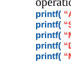

arithmetic.c

- 2. 添加一个 main 函数，声明并初始化几个整型变量

```c
int main()
{
    int a = 4, b = 8, c = 1, d = 1;
}
```

- 3. 接下来，在 main 函数块中，输出对变量值执行算术运算的结果

```c
printf("Addition: %d \n", a + b);
printf("Subtraction: %d \n", b - a);
printf("Multiplication: %d \n", a * b);
printf("Division: %d \n", b / a);
printf("Modulus: %d \n", a % b);
```

- 4. 现在，在 main 函数块中，输出后缀和前缀递增运算的结果

```
printf("Postfix increment: %d\n", c++);
printf("Postfix now: %d\n", c);
printf("Prefix increment: %d\n", ++d);
printf("Prefix now: %d\n", d);
```

- 5. 在 main 函数块末尾，按照函数声明的要求返回整数值零

```
return 0;
```

- 6. 保存程序文件，然后编译并执行程序，查看算术运算的结果

```
Addition: 12
Subtraction: 4
Multiplication: 32
Division: 2
Modulus: 4
Postfix increment: 1
Postfix now: 2
Prefix increment: 2
Prefix now: 2
```

注意，只有使用前缀递增运算符时，变量值才会立即增加——使用后缀运算符时，它会在下一次被引用时递增。

### 赋值

C 程序中用于赋值的运算符列在下表中。除简单的 = 赋值运算符外，其他运算符都是较长表达式的简写形式，因此为清晰起见，给出了各自的等价形式。

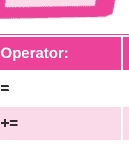

| 运算符： | 示例： | 等价形式： |
|---|---|---|
| = | a = b | a = b |
| += | a += b | a = (a + b) |
| -= | a -= b | a = (a - b) |
| *= | a *= b | a = (a * b) |
| /= | a /= b | a = (a / b) |
| %= | a %= b | a = (a % b) |

重要的是要把 = 运算符理解为“赋值”而不是“等于”，以避免与 == 相等运算符混淆。

在上面的示例中，名为 a 的变量被赋值为名为 b 的变量中包含的值——因此该值成为存储在 a 变量中的新值。

+= 运算符适用于将一个值加到 a 变量中存储的现有值上。在表格示例中，+= 运算符先将变量 a 中存储的值与变量 b 中存储的值相加，然后将结果赋值为存储在 a 变量中的新值。

表中的所有其他运算符都以相同方式工作：先对两个值执行算术运算，然后将结果赋给第一个变量，使其成为该变量存储的新值。

使用 %= 运算符时，第一个操作数 a 除以第二个操作数 b，然后将该运算的余数赋给 a 变量。

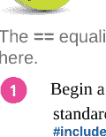

== 相等运算符比较操作数的值。此处对此进行了描述。

- 1. 使用预处理指令开始一个新程序，以包含标准输入/输出库函数

```
#include <stdio.h>
```

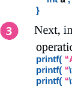

assign.c

- 2. 添加一个 main 函数，声明两个整型变量

```
int main()
{
    int a, b;
}
```

- 3. 接下来，在 main 函数块中，输出对变量执行赋值运算的结果

```
printf(" Assigned: \n" );
printf(" Variable a = %d \n", a = 8 );
printf(" Variable b = %d \n", b = 4 );
printf(" Added & assigned: \n" );
printf(" Variable a+=b (8+=4) a= %d \n", a += b );
printf(" Subtracted & assigned: \n" );
printf(" Variable a-=b (12-=4) a= %d \n", a -= b );
printf(" Multiplied & assigned: \n" );
printf(" Variable a*=b (8*=4) a= %d \n", a *= b );
printf(" Divided & assigned: \n" );
printf(" Variable a/=b (32/=4) a= %d \n", a /= b );
printf(" Modulated & assigned: \n" );
printf(" Variable a%%=b (8%%=4) a= %d \n", a %= b );
```

- 4. 在 main 函数块末尾，按照函数声明的要求返回整数值零
return 0;

- 5. 保存程序文件，然后编译并执行程序，查看赋值运算的结果

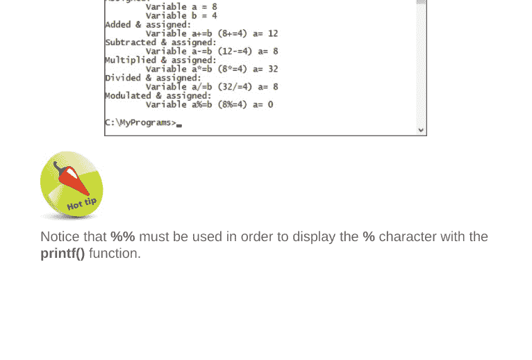

> 注意，必须使用 %% 才能通过 printf() 函数显示 % 字符。

### 比较值

C 编程中常用于比较两个数值的运算符列在下表中：

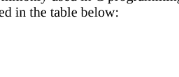

| 运算符： | 比较测试： |
| --- | --- |
| == | 相等 |
| != | 不相等 |
| > | 大于 |
| < | 小于 |
| >= | 大于或等于 |
| <= | 小于或等于 |

== 相等运算符比较两个操作数，如果两者的值相等，则返回 1（真），否则返回 0（假）。如果两者是相同的数字，则它们相等；如果两者是字符，则按数值比较它们的 ASCII 码值。

相反，!= 不相等运算符在两个操作数不相等时返回 1（真），使用与 == 相等运算符相同的规则；否则返回 0（假）。

相等和不相等运算符可用于测试两个变量的状态，以便在程序中执行条件分支。

大于运算符（>）比较两个操作数，如果第一个的值大于第二个，则返回 1（真）；如果相等或更小，则返回 0（假）。大于运算符（>）经常用于测试循环中倒计时的值。

小于运算符（<）进行相同的比较，但如果第一个操作数的值小于第二个，则返回 1（真），否则返回 0（假）。

在大于运算符（>）或小于运算符（<）后加上 = 运算符，使其在两个操作数的值完全相等时也返回 1（真）。

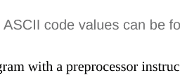

有关 ASCII 码值的更多信息，可在参考部分的此处找到。

- 1. 使用预处理指令开始一个新程序，以包含标准输入/输出库函数

```c
#include <stdio.h>
```

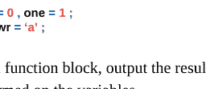

- 2. 添加一个 main 函数，声明并初始化三个整型变量和两个字符变量

```c
int main()
{
int zero = 0, nil = 0, one = 1;
char upr = 'A', lwr = 'a';
}
```

- 3. 接下来，在 main 函数块中，输出对变量执行比较运算的结果

```c
printf("Equality (0==0): %d\n", zero == nil );
printf("Equality (0==1): %d\n", zero == one );
printf("Equality (A==a): %d\n", upr == lwr );
printf("Inequality (A!=a): %d\n", upr != lwr );
printf("Greater than (1>0): %d\n", one > nil );
printf("Less than (1<0): %d\n", one < nil );
printf("Greater or equal (0>=0): %d\n", zero >= nil );
```

```
printf("Less or equal (1<=0): %d \n", one <= nil );
```

在 main 函数块末尾，按照函数声明的要求返回整数值零
return 0 ;

保存程序文件，然后编译并执行程序，查看比较运算的结果

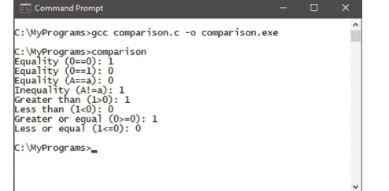


在数值上，1 表示真结果，0 表示假结果。


大写 'A' 的 ASCII 码值是 65，小写 'a' 的 ASCII 码值是 97——因此此处对它们的比较返回 0（假）。


### 评估逻辑

C 编程中最常用的逻辑运算符列于下表：

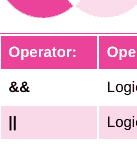

| 运算符： | 操作： |
|---|---|
| && | 逻辑与 |
| || | 逻辑或 |
| ! | 逻辑非 |

逻辑运算符用于具有真或假布尔值的操作数，或用于可转换为真或假的表达式。

逻辑 && 与运算符会计算两个操作数，并且仅当两个操作数本身都为真时才返回真。否则，&& 与运算符将返回假。

这用于条件分支，其中 C 程序的方向通过测试两个条件来确定。如果两个条件都满足，程序将朝某个方向执行；否则将采取不同的方向。

与需要两个操作数都为真的 && 与运算符不同，|| 或运算符会计算两个操作数，并在其中一个操作数本身为真时返回真。如果两个操作数都不为真，则 || 或运算符将返回假。这在 C 编程中很有用，可在两个测试条件中任一条件满足时执行特定操作。

第三个逻辑 ! 非运算符是一个“一元”运算符——它用于单个操作数之前。它返回给定操作数的相反值，因此如果变量 var 为真值，则 !var 将返回假值。! 非运算符在 C 编程中很有用，可通过类似 var = !var 的语句在连续的循环迭代中切换变量的值。这确保每次遍历时该值都被反转，就像来回拨动电灯开关一样。

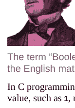

术语“布尔”指的是由英国数学家乔治·布尔（1815-1864）发展的一种逻辑思想体系。

在 C 编程中，零表示布尔假值；而任何非零值（例如 1）表示布尔真值。

- 1. 使用预处理指令包含标准输入/输出库函数，开始一个新程序

```c
#include <stdio.h>
```

- 2. 添加一个主函数，声明并初始化两个整型变量

```c
int main()
{
  int yes = 1, no = 0;
}
```

- 3. 接下来，在主函数块中，输出对这些变量执行逻辑运算的结果

```c
printf(" AND (no&&no): %d \n", no && no );
printf(" AND (yes&&no): %d \n", yes && no );
printf(" AND (yes&&yes): %d \n", yes && yes );
printf(" OR (no||no): %d \n", no || no );
printf(" OR (yes||no): %d \n", yes || no );
```

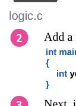

logic.c

```c
printf("OR (yes||yes): %d \n", yes || yes );
printf("NOT (yes !yes): %d %d\n", yes, !yes );
printf("NOT (no !no): %d %d\n", no, !no );
```

- 4. 在主函数块末尾，按照函数声明的要求返回零整数值
return 0;

- 5. 保存程序文件，然后编译并执行程序，以查看逻辑运算的结果

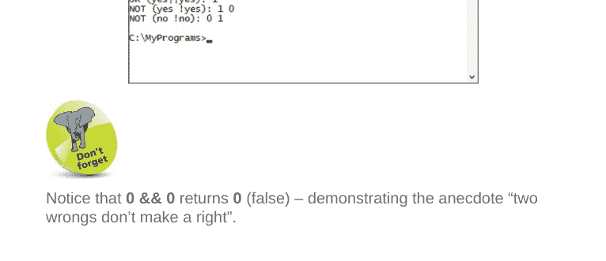

请注意，0 && 0 返回 0（假）——这印证了“两个错误不能凑成一个正确”这一说法。


### 检查条件

C 程序员最喜欢的测试运算符可能是 ?: 条件运算符，也称为“三元”运算符。该运算符首先求一个表达式的真或假布尔值，然后根据求值结果执行两个给定语句之一。


条件运算符的语法如下：

```
(test-expression) ? if-true-do-this : if-false-do-this ;
```

例如，该运算符可用于通过检查一个数除以二后是否有余数来判断给定数字是奇数还是偶数，然后输出适当的字符串，如下所示：

```
(7 % 2 != 0) ? printf("Odd Number") : printf("Even Number");
```

在本例中，七除以二不会留下零余数——因此该表达式求值为真；所以执行第一条语句，正确地将该数字描述为奇数值。

条件运算符还可用于确保输出中关于单数和复数项的语法正确，从而避免像“There is 5”这样别扭的短语。只需在 printf 语句内进行求值，即可使用合适的版本：

```
printf("There %s %d", (num == 1) ? "is" : "are", num);
```

在本例中，当 num 变量的值确实为一时，将使用“is”版本；否则将使用“are”版本。

条件运算符还可用于根据求值结果向变量分配适当的值。以这种方式使用时，其语法如下：

```
variable = (test-expression) ? if-true-assign-this : if-false-assign-this ;
```

例如，该运算符可用于判断一个给定数字是否大于另一个数字，然后将较大的数字赋给变量，如下所示：

```
int num, a = 5, b = 2;
num = (a > b) ? a : b;
```

在本例中，变量 a 的值大于变量 b 的值，因此将较大的值 5 赋给 num 变量。


尽管条件运算符快速且易于使用，但它可能降低代码可读性。

- 1 使用预处理指令包含标准输入/输出库函数，开始一个新程序

```
#include <stdio.h>
```

- 2 添加一个主函数，声明并初始化单个整型变量

```
int main()
{
int num = 7;
}
```

- 3 接下来，在主函数块中，插入条件语句以输出变量的奇偶性

```
(num % 2 != 0) ? printf("%d is odd\n", num) : printf("%d is even\n", num);
```

```
conditional.c
```

- 4. 现在，插入条件语句以输出使用正确复数语法的短语

```c
printf( "There %s " , ( num == 1 ) ? "is" : "are" ) ;
printf( "%d %s\n", num, (num==1) ? "apple" : "apples" ) ;
```

- 5. 减小变量值，然后插入条件语句以输出符合单数形式的短语

```c
num=1;
printf( "There %s " , ( num == 1 ) ? "is" : "are" ) ;
printf( "%d %s\n", num, (num==1) ? "apple" : "apples" ) ;
```

- 6. 在主函数块末尾，按照函数声明的要求返回零整数值

```c
return 0 ;
```

- 7. 保存程序文件，然后编译并执行程序，以查看条件运算的结果

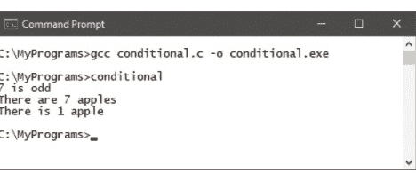


条件运算符最适合用于只提供两个简单替代方案来实现的简洁语句。

### 测量大小

在 C 编程中，sizeof 运算符返回一个整数值，即在其操作数的内容存储到内存中所需的字节数。


当提供给 sizeof 运算符的操作数是数据类型名称（例如 int）时，该操作数必须括在圆括号中——就像前面列出的示例一样。

或者，当提供的操作数是数据对象名称（例如变量名）时，圆括号可以省略。在实践中，许多程序员总是将 sizeof 运算符的操作数括在圆括号中，以避免必须记住这一区别。

C 中的基本存储单元由 char 数据类型定义，它在一个字节的内存中存储单个字符。这意味着 sizeof(char) 将返回 1（1 字节）。

通常，int 和 float 数据类型将各自分配 4 字节的机器内存，而 double 数据类型通常将分配 8 字节的机器内存，以容纳其可能值的范围。然而，这些大小并非由标准定义，而是由实现定义，因此可能有所不同。因此，良好的做法是使用 sizeof 运算符来测量实际的内存分配，而不是假定会分配这些典型大小。

为数组变量分配的内存空间就是该数据类型所分配的字节数乘以该数组中的元素数量。因此，例如，表达式 sizeof(int[3]) 通常会返回 12（3 x 4）


使用 `sizeof` 运算符来准确发现为具有不同数据类型成员的用户定义结构分配的内存量尤为重要，因为通常会自动添加“填充”。这意味着总内存分配可能超过分配给每个成员的内存之和。人们可能合理地期望，一个包含成员变量 `int score` 和 `char grade` 的结构会被分配总共 5 字节（4+1）的内存，但总分配量通常会是 8 字节。这是因为计算机系统喜欢以每个 4 字节的“字”大小的块来读写数据。因此，会添加填充，使内存分配成为四字节的倍数。

> 为了代码一致性，始终将提供给 `sizeof` 运算符的操作数括在括号内。


- 1. 使用预处理指令开始一个新程序，以包含标准输入/输出库函数

```c
#include <stdio.h>
```

```c
int main()
{
    int num = 1234567890 ;
}
```

- 2. 添加一个 main 函数，声明并初始化一个整数变量

```c
printf("Size of int data type is %d bytes\n", sizeof(int));
printf("Size of int variable is %d bytes\n", sizeof(num));
```

- 3. 接下来，在 main 函数块中，插入语句，通过类型名和对象名揭示（在此实现中）分配给 int 数据类型的内存

现在，插入一条语句，揭示数组为其每个元素分配相同的内存

```c
printf("Size of an int array is %d bytes\n", sizeof(int[3]));
```

定义一个包含一个 char 变量和一个 int 变量的结构，然后揭示其总内存分配——包括任何填充

```c
struct { int score ; char grade ; } result ;
printf("Size of a structure is %d bytes\n", sizeof(result));
```

在 main 函数块末尾，按照函数声明的要求返回零整数值

```c
return 0;
```

保存程序文件，然后编译并执行程序，以查看 sizeof 操作的输出

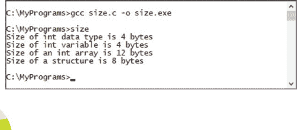


此示例包含一个 struct 对象的代码，它是一个不同变量的列表。结构在第 9 章中演示，但此处包含一个 struct 是为了演示 sizeof 运算符如何测量其内存大小。

### 比较位值

一个字节由 8 个位组成，每个位可以包含 1 或 0，用于存储表示 0 到 255 十进制值的二进制数。只有当某位包含 1 时，该位才会贡献一个十进制分量。各分量从右到左被指定为从“最低有效位”（LSB）到“最高有效位”（MSB）。下面位模式中的二进制数表示十进制 50。

| 位号 | 8 MSB | 7 | 6 | 5 | 4 | 3 | 2 | 1 LSB |
|---|---|---|---|---|---|---|---|---|
| 十进制 | 128 | 64 | 32 | 16 | 8 | 4 | 2 | 1 |
| 二进制 | 0 | 0 | 1 | 1 | 0 | 0 | 1 | 0 |

尽管 char 数据类型是 C 编程中的基本 1 字节存储单元（如本文所述），但可以使用“按位”运算符操作字节的各个部分。

| 运算符 | 名称 | 二进制数运算 |
|---|---|---|
| `\|` | 或 | 在两个相比较的位中，只要任一一位为 1，就在每个对应位返回 1。<br>示例：`1010 \| 0101 = 1111` |
| `&` | 与 | 在两个相比较的位中，只有当两位都为 1 时，才在每个对应位返回 1。<br>示例：`1010 & 1100 = 1000` |
| `~` | 非 | 对每个位，如果该位不是 1 则返回 1，如果该位是 1 则返回 0。<br>示例：`~1010 = 0101` |
| `^` | 异或 | 在两个相比较的位中，只有当其中一位为 1 时，才在每个对应位返回 1。<br>示例：`1010 ^ 0100 = 1110` |
| `<<` | 左移 | 将每个为 1 的位向左移动指定的位数。<br>示例：`0010 << 2 = 1000` |
| `>>` | 右移 | 将每个为 1 的位向右移动指定的位数。<br>示例：`1000 >> 2 = 0010` |


许多 C 程序员从不使用按位运算符，但了解它们是什么以及如何使用它们是有用的。

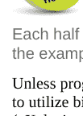

字节的每一半称为一个“半字节”（nibble）（4 位）。表格示例中的二进制数描述存储在半个字节中的值。

除非为资源有限的设备编程，否则很少需要使用按位运算符，但它们可能很有用。例如，XOR（异或）运算符允许你在两个变量之间交换值，而不需要第三个变量。

- 1. 使用预处理指令开始一个新程序，以包含标准输入/输出库函数

```c
#include <stdio.h>
```


xor.c

- 2. 添加一个 main 函数，声明并初始化两个整数变量，然后输出它们的初始值

```c
int main()
{
    int x = 10 , y = 5 ;
    printf("\n x=%d y=%d\n", x , y );
}
```

- 3. 接下来，在 main 函数块中，插入三次 XOR 语句，以通过二进制位操作交换变量值

```c
x = x ^ y; /* 1010 ^ 0101 = 1111 (decimal 15) */
y = x ^ y; /* 1111 ^ 0101 = 1010 (decimal 10) */
x = x ^ y; /* 1111 ^ 1010 = 0101 (decimal 5) */
```

- 4. 现在，插入一条语句以输出交换后的值

```c
printf("x=%d y=%d\n", x, y);
```

- 5. 在 main 函数块末尾，按照函数声明的要求返回零整数值

```c
return 0;
```

- 6. 保存程序文件，然后编译并执行程序，以查看 XOR 按位魔法

```text
C:\MyPrograms>gcc xor.c -o xor.exe
C:\MyPrograms>./xor
x=10 y=5
x=5 y=10
C:\MyPrograms>
```

不要将按位运算符与逻辑运算符混淆。按位运算符比较二进制数，而逻辑运算符计算布尔值。

### 标记位

到目前为止，按位运算符最常见的用途是操作一个紧凑的“位字段”，其中包含一组布尔“标志”。与将布尔标志值存储在单独的变量中相比，这更有效地利用内存——仅 1 字节的 char 数据类型可以容纳八个标志的位字段，每位一个标志，而八个单独的 char 变量将需要 8 个完整字节的内存。


初始位标志可以通过向变量分配一个十进制值来设置，该变量的二进制等效值对于每个要作为布尔标志“打开”的位都为 1。例如，十进制 8 的二进制等效值为 1000（1×8 0×4 0×2 0×1），因此会打开第四个标志（从最低有效位从右到左读取）。

随后，可以使用按位 NOT ~ 运算符反转位标志值，但必须注意在位标志之前屏蔽零，否则它们每个都会返回为 1。例如，要反转一个字节右侧四位内的四个标志的位字段，必须屏蔽左侧四位。十进制 15 是二进制 00001111（0×128 0×64 0×32 0×16 1×8 1×4 1×2 1×1），并且可以作为此掩码与按位 AND & 运算符一起应用。

位标志模式还可以通过使用按位左移 << 和右移 >> 运算符，将那些已打开的标志移动指定的位数来操作。

- 1. 使用预处理指令开始一个新程序，以包含标准输入/输出库函数

```c
#include <stdio.h>
```


bitflag.c

- 2. 添加一个 main 函数，声明一个用十进制值初始化的整数变量，以打开一个位标志

```c
int main()
{
    int flags = 8 ; /* Binary 1000 (1×8 0×4 0×2 0×1) */
}
```

- 3. 接下来，在 main 函数块中，向变量分配一个新值，以同时打开另一个标志

```c
flags = flags | 2 ; /* 1000 | 0010 = 1010 (decimal 10) */
```

- 4. 现在，插入语句以输出所有位标志设置

```c
printf("Flag 1: %s\n", (flags & 1) > 0 ? "ON" : "OFF");
printf("Flag 2: %s\n", (flags & 2) > 0 ? "ON" : "OFF");
printf("Flag 3: %s\n", (flags & 4) > 0 ? "ON" : "OFF");
printf("Flag 4: %s\n\n", (flags & 8) > 0 ? "ON" : "OFF");
```

- 5. 接下来，插入语句以屏蔽该字节的前四位，然后翻转所有位标志设置

```c
char mask = 15 ;  /* Binary 00001111 */
flags = ~flags & mask ; /* ~(1010) & 1111 = 0101 */
```

- 6. 现在，插入语句以输出反转后的位标志设置以及表示此模式的十进制值

```c
printf("Flag 1: %s\n", (flags & 1) > 0 ? "ON" : "OFF");
printf("Flag 2: %s\n", (flags & 2) > 0 ? "ON" : "OFF");
printf("Flag 3: %s\n", (flags & 4) > 0 ? "ON" : "OFF");
printf("Flag 4: %s\n\n", (flags & 8) > 0 ? "ON" : "OFF");
printf("Flags decimal value is %d\n", flags );
```

- 7. 添加一条语句，将“打开”的位标志向左移动一位，然后输出新模式的十进制值

```c
flags = flags << 1 ;  /* 0101 << 1 = 1010. */
printf("Flags decimal value is now %d\n", flags );
```

- 8. 在 main 函数块末尾，按照函数声明的要求返回零整数值

```c
return 0;
```


## 9

保存程序文件，然后编译并执行程序以查看位标志操作


经常预定义常量来表示每个位标志很方便。例如：

```
#define FLAG1 1
#define FLAG2 2
#define FLAG3 4
#define FLAG4 8
```


使用占用更多内存的变量可以创建具有更多位标志的较大位域——4 字节的 int 数据类型有 32 位。

### 理解运算符优先级

运算符优先级定义了 C 评估表达式的顺序。例如，在表达式 a=6+b*3 中，优先级的顺序决定了加法还是乘法先完成。

下表按递减顺序列出运算符优先级，其中上方的运算符优先于下方的运算符，因此其操作先完成。同一行的运算符优先级相等，但完成顺序由结合性方向决定。例如，对于“从左到右”结合性，左侧的操作先完成。

| 运算符: | 结合性: |
| --- | --- |
| () 函数调用 [ ] 数组下标<br>-> 结构体指针 . 结构体成员 | 从左到右 |
| ! 逻辑非 ~ 按位非 ++ 自增<br>-- 自减 + 正号 sizeof<br>- 负号 * 指针 & 取地址 | 从右到左 |
| * 乘法 / 除法 % 取模 | 从左到右 |
| + 加法 - 减法 | 从左到右 |
| << 左移 >> 右移 | 从左到右 |
| < 小于 <= 小于或等于<br>> 大于 >= 大于或等于 | 从左到右 |
| == 相等 != 不相等 | 从左到右 |
| & 按位与 | 从左到右 |
| ^ 按位异或 | 从左到右 |
| \| 按位或 | 从左到右 |
| && 逻辑与 | 从左到右 |
| \|\| 逻辑或 | 从左到右 |
| ?: 条件 | 从右到左 |
| = += -= *= /= %= &= ^= \|= <<= >>= 赋值运算符 | 从右到左 |
| , 逗号 | 从左到右 |


* 乘法运算符位于 + 加法运算符所在行的上方——因此在表达式 a=6+b*3 中，乘法在加法操作之前完成。


-> 和 . 结构体运算符将在本书后面描述，但在此包含以提供所有运算符的完整优先级表。

- 1. 使用预处理器指令开始一个新程序以包含标准输入/输出库函数
    
    ```
    #include <stdio.h>
    ```


- 2. 添加一个 main 函数，该函数根据行级优先级规则从表达式输出一个整数，并根据显式确定的优先级输出另一个整数
    
    ```c
    int main()
    {
        printf("\nDefault precedence ((2*3)+4)-5 : %d\n", 2*3+4-5 );
        printf("Explicit precedence 2* ((3+4)-5) : %d\n", 2*((3+4)-5) );
    }
    ```

接下来，在 main 函数块中，根据从左到右结合性优先级规则输出一个整数，然后根据显式确定的优先级输出另一个整数

```
printf("\nDefault precedence (7*3) %%2: %d\n", 7*3%2);
printf("Explicit precedence 7* (3%%2): %d\n", 7*(3%2));
```

现在，根据从右到左结合性优先级规则输出一个整数，然后根据显式优先级输出另一个整数

```
int num = 9;
printf("\nDefault precedence (8/2)*4:%d\n", --num/2*sizeof(int));
num = 9;
printf("Explicit precedence 8/(2*4):%d\n", --num/(2*sizeof(int)));
```

在 main 函数块结束时，返回零整数值，如函数声明所要求

```
return 0;
```

保存程序文件，然后编译并执行程序以查看遵循优先级规则的输出


为了输出 % 字符，printf() 语句需要 %%。

### 摘要

- 算术运算符可以用两个操作数形成表达式，用于加法 +、减法 -、乘法 *、除法 / 和取模 %。
- 自增 ++ 和自减 -- 运算符将单个操作数修改一个值。
- 赋值 = 运算符可以与算术运算符结合使用以执行算术计算然后分配其结果。
- 比较运算符可以形成表达式比较两个操作数的相等 ==、不相等 !=、大于 >、小于 <、大于或等于 >= 和小于或等于 <= 值。
- 逻辑与 && 和或 || 运算符形成表达式评估两个操作数以返回布尔值 true 或 false，但逻辑非 ! 运算符返回单个操作数的反向布尔值。
- 条件 ?: 运算符评估给定的布尔表达式然后根据其结果返回两个操作数之一。
- sizeof 运算符返回数据类型或数据对象的内存字节大小。
- 单个内存字节包含八位，每位可以包含值一 (1) 或零 (0)。
- 按位运算符或 |、与 &、非 ~ 和异或 ^ 在比较两个位内的值后各返回一个值，而左移 << 和右移 >> 运算符将位值在其方向上移动指定数量的位。
- 按位运算符最常见的用途是操作包含一组布尔标志的紧凑位域。
- 包含多个运算符的表达式将根据默认优先级规则执行其操作，除非通过添加括号显式确定。

## 5 制作语句

本章演示语句如何评估表达式以确定 C 程序应进行的方向。

- 测试表达式
- 分支开关
- 循环指定次数
- 循环直到为真
- 跳出循环
- 跳转到标签
- 摘要

### 测试表达式

if 关键字用于执行基本条件测试，评估给定表达式的布尔值 true 或 false。评估后大括号内的语句只有在表达式被发现为真时才会被执行。因此，if 测试语句的语法如下所示：

```
if ( test-expression ) {statements-to-execute-when-true }
```


当测试为真时可能有多个语句需要执行，但每个语句必须以分号终止。

有时可能希望评估多个表达式以确定是否应执行以下语句，这可以通过两种方式实现。逻辑 && AND 运算符可用于确保只有当两个表达式都被发现为真时语句才会被执行，语法如下：

```
if ( ( test-expression ) && ( test-expression ) ) { statements-to-execute }
```

或者，多个 if 语句可以“嵌套”，一个在另一个内部，以确保只有当两个评估的表达式都被发现为真时，以下语句才会被执行，如下所示：

```
if ( test-expression )
{
if ( test-expression ) { statements-to-execute }
}
```

当 if 测试语句评估的一个或多个表达式被发现为假时，其后大括号内的语句不会被执行，程序继续执行后续代码。

通常最好通过附加 else 语句来扩展 if 语句，指定当 if 语句评估的表达式被发现为假时要执行的大括号内的语句，语法如下：

```
if ( test-expression )
    { statements-to-execute-when-true }
else
    { statements-to-execute-when-false }
```

这是一种基本的编程技术，根据评估结果为程序提供两个进行方向，被称为“条件分支”。


当要执行的代码只是单个语句时，大括号可以省略。


可以通过组合 if 和 else 语句使用 if() { ... } else if () { ... } 来评估多个表达式。

- 1. 使用预处理器指令开始一个新程序以包含标准输入/输出库函数
    
    ```
    #include <stdio.h>
    ```
    
    ifelse.c
    
- 2. 添加一个 main 函数，当测试的表达式被发现为真时输出一条语句


```c
int main()
{
	if(5 > 1) { printf("Yes, 5 is greater than 1\n"); }
}
```

3. 接下来，在 main 函数块中，当两个测试表达式都被判定为真时输出一条语句

```c
if(5 > 1)
{
	if(7 > 2)
	{
		printf("5 is greater than 1 and 7 is greater than 2\n");
	}
}
```

4. 现在，在两个测试表达式都被判定为假后输出一条默认语句

```c
if(1 > 2)
{
	printf("1st expression is true\n");
}
else if(1 > 3)
{
	printf("2nd expression is true\n");
}
else
{
	printf("Both expressions are false\n");
}
```

5. 在 main 函数块的末尾，返回一个零整数值，如函数声明所要求

```c
return 0;
```

6. 保存程序文件，然后编译并执行程序以查看条件测试后的输出


在 C 语言中，布尔值 true 在数值上表示为 1，而布尔值 false 为 0（零）。因此表达式 (5 > 1) 是 (5 > 1 == 1) 的简写。

### 分支 switch

由多个 if else 语句执行的条件分支，当测试表达式仅评估单一条件时，通常可以通过 switch 语句更高效地执行。

switch 语句的工作方式比较特殊。它以给定值作为参数参数，然后从多个 case 语句中查找该值。当找到匹配时要执行的代码包含在每个 case 语句中。

重要的是用 break 关键字语句结束每个 case 语句，这样当找到匹配时 switch 语句就会退出，而不会继续查找进一步的匹配——除非这是有意为之的要求。

可选地，case 语句列表可以跟随一个最终的 default 语句，以指定在任何 case 语句中均未找到匹配时要执行的代码。因此 switch 语句的语法通常如下所示：

```
switch ( test-value )
{
  case match-value : statements-to-execute-when-matched ; break ;
  case match-value : statements-to-execute-when-matched ; break ;
  case match-value : statements-to-execute-when-matched ; break ;
  default : statements-to-execute-when-no-match-found ;
}
```

根据 ANSI C 标准，switch 语句最多可以有至少 257 个 case 语句，但其任意两个 case 语句都不能尝试匹配相同的值。

当多个匹配值需要各自执行相同的语句时，只有最后一个 case 语句需要包含要执行的语句以及退出 switch 语句块的 break 语句。例如，为匹配值 0、1 和 2 输出相同的消息：

```
switch ( num )
{
  case 0 :
case 1 :
case 2 : printf( "Less than 3\n" ) ; break ;
case 3 : printf( "Exactly 3\n" ) ; break ;
default : printf( "Greater than 3 or less than zero\n" ) ;
}
```


始终建议包含一个 default 语句——即使它只是为了在 switch 语句失败时输出错误消息。


default 语句不必出现在 switch 块的末尾，但在那里放置它是合理的，因为它不需要 break 语句。

1 开始一个新的程序，使用预处理器指令包含标准输入/输出库函数 #include <stdio.h>


switch.c

2 添加一个 main 函数，声明并初始化一个整数变量和一个字符变量

```c
int main()
{
  int num = 2 ; char letter = 'b' ;
}
```

3 接下来，在 main 函数块中，插入一个尝试匹配整数值的 switch 语句

```
case 2 : printf( "Number is two\n" ) ; break ;
case 3 : printf( "Number is three\n" ) ; break ;
default : printf( "Number is unrecognized\n" ) ;
}
```

现在，插入一个尝试匹配字符值的 switch 语句

```
switch( letter )
{
case 'a' : case 'b' : case 'c' :
printf( "Letter is %c\n" , letter ) ; break ;
default : printf( "Letter is unrecognized\n" ) ;
}
```

在 main 函数块的末尾，返回一个零整数值，如函数声明所要求

```
return 0 ;
```

保存程序文件，然后编译并执行程序以查看 switch 语句的输出


在 switch 语句中，case 关键字、匹配值和冒号字符被视为唯一的“标签”。

### 循环指定次数

循环是程序中自动重复的一段代码。循环内所有语句的一次完整执行称为“迭代”或“遍”。循环的长度由循环内进行条件测试控制。只要测试表达式被判定为真，循环就会继续——直到测试表达式被判定为假，此时循环结束。


在 C 编程中，有三种循环结构——for 循环、while 循环和 do while 循环。其中最常见的是 for 循环，其通常具有以下语法：

```
for ( initializer ; test-expression ; incrementer ) { statements }
```

初始化器用于为循环迭代次数的计数器设置起始值。为此使用一个整数变量，传统上命名为“i”。

在循环的每次迭代中，都会评估 test-expression，并且该迭代仅在该表达式为真时继续。当 test-expression 变为假时，循环会立即结束，而不会再次执行语句。每次迭代时，计数器都会递增，然后执行语句。

循环可以嵌套，一个在另一个内部，以便在外层循环的每次迭代中完全执行内层嵌套循环的所有迭代。

+   1. 开始一个新的程序，使用预处理器指令包含标准输入/输出库函数
+      `#include <stdio.h>`

### forloop.c

2 添加一个 main 函数，声明两个稍后用作循环迭代计数器的整数变量

```c
int main()
{
    int i, j;
}
```

3 接下来，在 main 函数块中，插入一个 for 循环，在每次三次迭代中输出循环计数器的值

```
for(i = 1 ; i < 4 ; i++)
{
    printf( "Outer loop iteration %d\n", i );
}
```

4 在 main 函数块的末尾，返回一个零整数值，如函数声明所要求

```
return 0 ;
```

5 保存程序文件，然后编译并执行程序以查看 for 循环的输出


6 现在，在循环块中，在现有输出语句之后立即插入一个嵌套循环，以在每次三次内层循环迭代中输出循环计数器的值

```
for(j = 1 ; j < 4 ; j++)
{
    printf( "\tInner loop iteration %d\n", j );
}
```

7 保存程序文件，然后再次编译并执行程序以查看两个循环的输出


for 循环计数器也可以递减——通过在每次迭代中使用 i-- 而不是 i++ 来递减计数器的值。

### 循环 while 为真

while 循环是前一个示例中描述的 for 循环的替代方案。while 循环也需要初始化器、test-expression 和增量器，但它们不像 for 循环那样整齐地列在一个括号对内。相反，初始化器必须出现在循环块开始之前，而 test-expression 必须出现在 while 关键字后的括号内，后跟包含增量器和每次迭代要执行的语句的大括号。

```
initializer
while ( test-expression )
{ statements-to-be-executed ; incrementer }
```

do while 循环通过将 do 关键字放在循环块之前并将 while 语句移到循环块之后，对上述语法进行了细微的变化：

```
initializer
do { statements-to-be-executed ; incrementer }
while ( test-expression ) ;
```

while 循环和 do while 循环都会继续迭代，直到 test-expression 被判定为假，此时循环将退出。因此，循环体必须包含在某一点上会改变 test-expression 评估结果的代码——否则会创建无限循环，导致系统锁定。

while 循环和 do while 循环之间的显著区别在于，如果 test-expression 在首次评估时为假，while 循环将不会进行一次迭代。相比之下，do while 循环总是至少进行一次迭代，因为其语句在评估之前执行。如果这是期望的，do while 循环显然是最好的选择，否则 for 循环和 while 循环之间的选择在很大程度上是个人偏好的问题。一个经验法则是，for 循环最好用于执行特定次数的迭代，而 while 循环最好用于在满足特定条件时迭代。

循环是与数组一起使用的完美搭档，因为每次迭代都可以毫不费力地

### 读取或写入连续数组元素

请注意，在 do while 循环中，while 语句之后必须有一个分号终止符。


如果程序陷入无限循环，在 Windows 或 Linux 系统上，按 Ctrl + C 键可停止循环执行。


使用预处理指令包含标准输入/输出库函数，开始一个新程序

```c
#include <stdio.h>
```

dowhile.c

添加一个 main 函数，声明一个计数器变量，然后声明并初始化一个包含三个元素的数组变量

```c
int main()
{
 int i, arr[3] = {10, 20, 30};
}
```

接下来，在 main 函数块中插入一个 while 循环，输出每个元素的编号及其包含的值

```c
i = 0;
while(i < 3)
{
 printf("While: arr[%d] = %d\n", i, arr[i]); i++;
}
```

现在，插入一个 do while 循环，同样输出每个元素的编号及其包含的值

```c
i = 0;
do
{
    printf("\nDo while: arr[%d] = %d", i, arr[i]); i++;
}
while(i < 3);
```

在 main 函数块末尾，按照函数声明的要求返回整数零值

```c
return 0;
```

保存程序文件，然后编译并执行程序，以查看两个循环输出的结果看起来相同


将此测试表达式中的值改为零——即两个循环中都改为 while (i<0)——然后重新编译并再次运行程序，以查看仅 do while 循环的第一次迭代被执行。

### 跳出循环

当满足指定条件时，可以使用 break 关键字提前终止循环。break 语句位于循环语句块内部，并且前面有一个测试表达式。当测试返回 true 时，循环立即结束，程序继续执行下一个任务。例如，在嵌套的内层循环中，它会继续执行外层循环的下一次迭代。

- 1. 使用预处理指令包含标准输入/输出库函数，开始一个新程序

```c
#include <stdio.h>
```


breakcontinue.c

- 2. 添加一个 main 函数，声明两个整型变量，稍后将用作循环迭代计数器

```c
int main()
{
    int i, j;
}
```

- 3. 接下来，在 main 函数块中插入两个嵌套循环，在三次迭代中的每一次输出它们的计数器值

```c
for(i = 1 ; i < 4 ; i++)
{
    for(j = 1 ; j < 4 ; j++)
    {
        printf("Running i=%d j=%d\n", i, j);
    }
}
```

- 4. 在 main 函数块末尾，按照函数声明的要求返回整数零值

```c
return 0;
```

- 5. 保存程序文件，然后编译并执行程序，以查看嵌套循环的输出


- 6. 现在，将此 break 语句插入内层循环块的最开头，以跳出内层循环——然后保存、编译并再次运行程序

```c
if(i == 2 && j == 1)
{
    printf("Breaks inner loop when i=%d and j=%d\n", i, j);
    break;
}
```


当满足指定条件时，可以使用 continue 关键字跳过循环的一次迭代。continue 语句位于循环语句块内部，并且前面有一个测试表达式。当测试返回 true 时，该次迭代结束。

- 7. 将此 continue 语句插入内层循环块的开头，以跳过内层循环的第一次迭代——然后保存、编译并再次运行程序

```c
if(i == 1 && j == 1)
{
    printf("Continues inner loop when i=%d and j=%d\n", i, j);
    continue;
}
```


此处，当外层循环第二次尝试运行内层循环时，**break** 语句会停止内层循环的全部三次迭代。


此处，当外层循环第一次尝试运行内层循环时，**continue** 语句仅跳过内层循环的第一次迭代。

### 跳转到标签

**goto** 关键字据说允许程序流程跳转到程序代码中其他位置的标签，就像网页上的超链接一样。然而，实际上这可能导致错误；它的使用不受欢迎；并且被视为不良编程实践。


**goto** 关键字跳转是一项强大的特性，已在计算机程序中存在数十年，但它的能力被许多早期程序员滥用，他们创建了以令人费解的方式到处跳转的程序。这产生了不可读的程序代码，因此 **goto** 的使用变得极其不受欢迎。

**goto** 关键字的一种可能有效用法是：通过跳转到外层循环块结束之后的标签，干净利落地跳出内层嵌套循环。这会立即退出两个循环，因此两个循环都不会再执行后续迭代。

- 1. 使用预处理指令包含标准输入/输出库函数，开始一个新程序

```c
#include <stdio.h>
```


- 2. 添加一个 main 函数，声明两个整型变量，稍后将用作循环迭代计数器

```c
int main()
{
    int i, j;
```

- 3. 接下来，在 main 函数块中插入两个嵌套循环，在三次迭代中的每一次输出它们的计数器值

```c
for(i = 1; i < 4; i++)
{
	for(j = 1; j < 4; j++)
	{
		printf("Running i=%d j=%d\n", i, j);
	}
}
```

- 4. 在内层嵌套循环的第一行插入一条语句，以便在指定计数器值时跳转到名为“end”的标签

```c
if(i == 2 && j == 1){ goto end;}
```

- 5. 现在，在外层循环的右花括号之后添加该标签

```c
} end:
```

请注意，goto 语句仅通过名称指定标签，但标签本身必须有一个结尾的“:”冒号。

- 6. 在 main 函数块末尾，按照函数声明的要求返回整数零值

```c
return 0;
```

- 7. 保存程序文件，然后编译并执行程序，以查看循环在跳转后退出


一种避免使用 goto 关键字的替代方法，可能是在每个循环的每次迭代中检查某个变量是否为布尔真值 (1)：

- 8. 在现有变量声明中再添加一个变量，并将其初始化为真值 1

```c
int i, j, flag = 1;
```

- 9. 在外层循环块的开头，以及内层循环块中输出语句之前，插入对新变量值的条件测试

```c
if( flag )
```

- 10. 更改内层循环的第一行，将 goto 语句替换为将变量赋值为假值 0 的语句

```c
if( i == 2 && j == 1 ) { flag = 0 ; }
```

- 11. 删除右花括号之后现已过时的 end: 标签，然后保存、编译并再次执行程序，以查看与之前相同的结果输出


在 C 中，布尔值在数值上表示为 1（真）和 0（假）。


避免创建名为“goto.exe”的程序可执行文件，因为这会与 Windows 内部的 GOTO 命令冲突。

### 总结

- if 关键字执行基本的条件测试，以评估给定表达式的布尔值为 true 还是 false。
- else 关键字可用于提供当 if 语句将表达式评估为 false 时要执行的替代语句。
- 在评估之后为程序提供可供继续执行的替代方向称为“条件分支”。
- 由多个 if else 语句执行的条件分支通常可以通过 switch 语句更高效地执行。
- 通常，switch 块内的 case 语句每个都必须以 break 语句终止。
- 可选地，switch 块可以包含 default 语句，指定在未找到匹配项时要执行的语句。
- for 关键字后面跟括号，其中指定初始化表达式、测试表达式和增量表达式，以控制循环。
- while 关键字后面跟括号，其中指定测试表达式，以确定循环是否应继续。
- while 循环块之前必须有一个初始化器，并且其语句块内必须包含一个增量器。
- do 关键字后面跟一个语句块，之后必须有一个以分号终止的 while 语句。
- do while 循环之前必须有一个初始化器，并且其语句块内必须包含一个增量器。
- 与 for 循环和 while 循环不同，do while 循环中的语句将始终至少执行一次。
- break 关键字可用于终止循环，而 continue 关键字可用于跳过单次迭代。
- 循环可以嵌套，goto 关键字可用于退出到指定标签，尽管不建议使用它。


## 6 使用函数

*本章演示如何将语句封装在“函数”中，以便 C 程序在调用时执行。*

- 声明函数
- 提供参数
- 递归调用
- 将函数放在头文件中
- 限制可访问性
- 小结

### 声明函数

本书前面的示例使用了必需的 main() 函数以及 C 头文件库中包含的标准函数，例如来自 stdio.h 文件的 printf() 函数。然而，大多数 C 程序都包含许多自定义函数，这些函数可以在程序执行期间根据需要调用。


函数块仅包含一组语句，每当调用该函数时就会执行这些语句。函数语句执行完毕后，程序流会从紧接函数调用之后的位置继续。这种模块化在 C 编程中非常有用，可以隔离固定例程，以便反复调用它们。

要在 C 程序中引入自定义函数，必须先声明它，这与变量在使用前必须声明的方式类似。函数声明应添加到 main() 函数块之前。

与 main() 函数一样，自定义函数可以返回值。此返回值的数据类型必须包含在函数声明中。如果函数不返回值，则其返回数据类型应使用 void 关键字声明。函数命名应遵循与变量名相同的命名约定。

函数声明更准确的叫法是“函数原型”，它只是向编译器告知该函数。实际的函数定义（包括要执行的语句）出现在 main() 函数之后。然后，可以根据需要从 main() 函数内部调用该自定义函数来执行其语句。

如果自定义函数返回一个值，则可以将其赋给适当数据类型的变量，或者使用适当的格式说明符将其作为输出显示。

1. 使用预处理指令包含标准输入/输出库函数，开始一个新程序

```
#include <stdio.h>
```


first.c

2. 声明三个自定义函数原型

```
void first();
int square5();
int cube5();
```


函数原型有时称为“函数头”。

3. 添加一个声明整型变量的 main 函数

```
int main()
{
    int num ;
}
```

4. 在 main 函数之后，定义这些自定义函数

```
void first()
{
    printf( "Hello from the first function\n" );
}

int square5()
{
    int square = 5 * 5 ;
    return square ;
}

int cube5()
{
```

```
int cube = (5 * 5) * 5 ;
return cube ;
}
```

现在，在 main 函数块中插入对这些自定义函数的调用

```
first();
num = square5();
printf("5x5= %d\n", num );
printf("5x5x5= %d\n", cube5() );
```

在 main 函数块末尾，按照该函数声明的要求返回零整数值

```
return 0 ;
```

保存程序文件，然后编译并执行程序，以查看自定义函数的输出


注意，每个函数原型都必须以分号结尾。


从技术上讲，自定义函数定义可以出现在 main() 函数之前——但惯例是包含原型，并将 main() 函数保留在程序代码的开头。

### 提供参数

数据可以作为“参数”传递给自定义函数，然后函数可以使用该数据执行其语句。函数原型必须包含每个参数的名称和数据类型。

重要的是要认识到，在 C 编程中，数据是“按值”传递给指定为函数参数的变量。这与 Pascal 等一些其他编程语言不同，后者的参数是“按引用”传递的——函数操作的是原始值，而不仅仅是局部副本。

函数原型中的参数称为函数的“形式参数”。这些参数可以具有不同的数据类型，如果以逗号分隔，则可以为单个函数指定多个参数。例如，一个包含四种数据类型各一个参数的函数原型可能如下所示：

```
void action( char c , int i , float f , double d ) ;
```

编译器会检查函数原型中指定的形式参数是否与函数定义中的形式参数匹配，如果不匹配，则报告错误。

1. 使用预处理指令包含标准输入/输出库函数，开始一个新程序

```
#include <stdio.h>
```


2. 声明三个自定义函数原型，每个原型都有一个在调用时传递给它的参数

```
void display( char str[] ) ;
int square( int x ) ;
int cube( int y ) ;
```

3. 添加一个 main 函数，声明一个整型变量和一个用文本字符串初始化的字符数组变量

```c
int main()
{
int num ;
char msg[50] = "String to be passed to a function" ;
}
```


“按值”传递数据会将值赋给被调用函数中的变量。然后函数可以操作该副本，但不会影响原始数据。

4. 在 main 函数之后，定义这些自定义函数

```c
void display( char str[] )
{
printf( "%s\n", str );
}

int square( int x )
{
return (x * x);
}

int cube( int y )
{
return ( y * y ) * y ;
}
```

5. 现在，在 main 函数中，插入调用每个自定义函数并传递参数值的语句

```c
display( msg );
num = square( 4 );
printf( "4x4= %d\n", num );
printf( "4x4x4= %d\n", cube( 4 ) );
```

6. 在 main 函数块末尾，按照函数声明的要求返回零整数值

```c
return 0;
```

7. 保存程序文件，然后编译并执行程序，以查看使用所传递参数值的自定义函数的输出


函数定义中使用的参数名可以与函数原型中使用的参数名不同，但参数的数据类型、数量和顺序必须相同。不过，在两者中采用相同的名称会更清晰。


函数不必返回任何值，但仍然可以包含 **return** 关键字，且后面不跟任何值，以表示将控制权返回给调用者。

### 递归调用

自定义函数中的语句可以自由调用其他自定义函数，就像它们可以调用 **printf()** 等标准库函数一样。

此外，函数可以调用自身，这些函数称为“递归函数”。与循环一样，重要的是递归函数必须修改受测试的表达式以避免连续执行——以便函数调用在某个时刻结束。

1. 使用预处理指令包含标准输入/输出库函数，开始一个新程序

```
#include <stdio.h>
```


2. 声明一个自定义函数原型，其中有一个在调用时传递的参数

```
void count_down_from( int num );
```

3. 添加一个声明整型变量的 main 函数

```
int main()
{
    int start;
}
```

4. 接下来，在 main 函数块中，添加一条语句，请求用户输入一个要赋给该变量的整数值

```
printf("Enter a positive integer to count down from: ");
scanf("%d", &start);
```

5. 现在，在 main 函数块中，添加对自定义函数的调用，并将用户输入的值传递给它

```
count_down_from( start );
```

6. 在 main 函数块中，添加一条语句，在……时输出一条消息

控制返回自自定义函数

```c
printf( "Lift Off!\n" );
```

- 7. 在 main 函数块的末尾，返回一个零整数值，如函数声明所要求

```c
return 0 ;
```


变量名必须在 `scanf()` 函数中前面加上 `&` 取地址运算符，如此处所述。

- 8. 在 main 函数块之后，以输出函数调用期间传递的参数值的语句开始自定义函数定义

```c
void count_down_from( int num )
{
    printf( "%d\n", num );
}
```

- 9. 接下来，在自定义函数块中，递减作为参数传递的值

```c
--num ;
```

- 10. 现在，在自定义函数块中，添加一个条件测试，如果递减后的值低于零则返回控制权给 main 函数，否则将其作为参数在对该函数的递归调用中传递

```c
if( num < 0 ) return ;
else
count_down_from( num );
```

- 11. 保存程序文件，然后编译并执行程序，在请求时输入一个整数，以查看递归函数调用的输出


```text
C:\MyPrograms>gcc recur.c -o recur.exe
C:\MyPrograms>recur
Enter a positive integer to count down from: 10
10
9
8
7
6
5
4
3
2
1
0
Lift off!!
C:\MyPrograms>_
```


递归函数可能不如使用循环高效。

### 在头文件中放置函数

本书中列出的示例程序由于篇幅考虑必然很小，但实际上，大多数 C 程序将包含大量代码。

在开发较大程序时，应考虑程序结构。随着程序的增长，将整个程序代码维护在单个文件中可能会变得难以管理。

为了简化程序结构，可以创建一个自定义头文件来包含可能重复使用的函数。它应以 “.h” 文件扩展名命名，如 C 库中的标准头文件。

可以通过在包含 `main()` 函数的文件开头添加 `#include` 预处理指令，使自定义头文件中的函数可供程序使用。尽管如此，自定义头文件名应在预处理指令中用双引号括起来，而不是用用于包含标准头文件的 `<` 和 `>` 角括号。

- 1. 创建一个名为 “utils.h” 的自定义头文件，其中包含单个函数的定义

```c
int square( int num )
{
    return ( num * num );
}
```


- 2. 使用预处理指令开始一个新程序，以包含标准输入/输出库函数和自定义头文件

```c
#include <stdio.h>
#include "utils.h"
```

**square.c**

- 3. 声明一个没有参数的自定义函数原型

```c
void getnum();
```

- 4. 添加一个 main 函数来调用另一个函数，然后按声明要求返回零整数

```c
int main()
{
getnum();
return 0;
}
```

- 5. 在 main 函数块之后，通过声明两个变量开始第二个函数定义

```c
void getnum()
{
int num;
char again;
}
```

- 6. 接下来，在此函数定义中，添加语句请求用户输入并将其值赋给变量

```c
printf("Enter an integer to be squared: ");
scanf("%d", &num);
```

- 7. 现在，通过调用自定义头文件中的函数并将输入值作为其参数传递来输出结果

```c
printf("%d squared is %d\n", num, square(num));
```

- 8. 添加一条请求进一步用户输入并将其值赋给变量的语句

```c
printf("Square another number? Y or N: ");
scanf("%1s", &again);
```

- 9. 最后，添加一个条件测试以再次执行此函数或将控制权返回给 main 函数

```c
if( (again == 'Y') || (again == 'y') ) getnum();
else return;
```

- 10. 保存程序文件，然后编译并执行程序，在请求时输入整数和字符，以查看函数调用的输出

```text
C:\MyPrograms>gcc square.c -o square.exe
C:\MyPrograms>square
Enter an integer to be squared: 4
4 squared is 16
Square another number? Y or N: Y
Enter an integer to be squared: 5
5 squared is 25
Square another number? Y or N: Y
Enter an integer to be squared: 6
6 squared is 36
Square another number? Y or N: N
C:\MyPrograms>
```


程序文件和自定义头文件必须位于同一目录中，但使用常规命令编译——编译器由于 `#include` 指令会自动读取头文件。


注意本示例中使用 `%1s` 格式说明符——用于读取用户输入的下一个字符。

### 限制可访问性

**static** 关键字可用于将函数的可访问性限制在其创建的文件中，正如 **static** 变量具有受限的可访问性一样。这是在跨多个 “.c” 文件的大型程序中推荐的做法，以防止函数被意外误用。例如，在本示例中，**square()** 和 **multiply()** 函数不能直接从 **main()** 函数调用。

- 1. 使用预处理指令开始一个新程序，以包含标准输入/输出库函数

```c
#include <stdio.h>
```


- 2. 声明两个自定义函数原型

```c
void menu();
void action( int option );
```

- 3. 添加一个 main 函数来调用第一个自定义函数，然后按声明要求返回零整数

```c
int main()
{
    menu();
    return 0 ;
}
```

- 4. 在 main 块之后，定义第一个自定义函数以将菜单选项作为参数传递给另一个函数

```c
void menu()
{
    int option ;
    printf( "\n\tWhat would you like to do?" );
    printf( "\n\t1. Square a number" );
    printf( "\n\t2. Multiply two numbers" );
    printf( "\n\t3. Exit\n" );
    scanf("%d", &option);
    action( option );
}
```

- 5. 使用预处理器开始第二个程序文件以包含标准输入/输出函数，并再次声明自定义原型

```c
#include <stdio.h>
void menu();
void action( int option );
```


action.c


请注意，这里为包含对这些函数调用的每个文件声明原型——以防止“隐式函数声明”编译器警告。

- 6. 现在，定义两个简单的 static 函数

```c
static int square( int a ) { return (a * a ); }
static int multiply( int a, int b ){ return a * b ; }
```

- 7. 最后，定义从 main 函数中的调用传递菜单选项的函数以执行适当的操作——在需要时调用此文件中创建的 static 函数

```c
void action( int option )
{
    int n1, n2;
    if( option == 1 )
    {
        printf( "Enter an integer to be squared: " );
        scanf( "%d", &n1 );
        printf( "%d x %d = %d \n", n1 , n1 , square(n1) );
        menu();
    }
    else if( option == 2 )
    {
        printf("Enter two integers to multiply ");
        printf("separated by a space: ");
        scanf("%d", &n1); scanf("%d", &n2);
        printf("%d x %d = %ld\n", n1, n2, multiply(n1, n2));
        menu();
    }
    else return;
}
```

- 8. 保存两个程序文件，然后编译并执行程序以查看从 static 函数返回的输出


这里可以找到一个演示 static 变量的示例。


请注意，编译器命令指定了两个 `.c` 源代码文件名以创建一个单一的可执行文件。


### 总结

- 自定义函数通过声明函数的返回数据类型、然后函数名加圆括号、并以分号结尾来声明。
- 函数声明也称为“函数原型”，应出现在 main 函数之前——这样编译器在读取 main() 函数时就知道它们的存在。
- 函数定义包含调用该函数时要执行的实际语句，应出现在 main() 函数块之后。
- 函数声明可以选择在其圆括号内包含一个以逗号分隔的参数列表，这些参数由调用者传递给函数，每个参数都说明数据类型和名称。
- 函数定义中指定的参数必须与其声明中的参数匹配，因为这些是它的形参。
- 在 C 编程中，参数按值传递——因此函数操作的是原始值的副本。
- 函数可以递归调用自身，但必须包含一条修改被测试表达式的语句，以便在某个时刻退出。
- 自定义头文件具有 “.h” 文件扩展名。
- 用于 #include 自定义头文件的预处理指令必须指定用双引号括起来的文件名。
- static 关键字可用于函数声明和定义中，通过将其作用域缩小到它们所在的文件来限制可访问性。
- 较大的程序应将函数声明为 static，除非有某些特定原因必须让它们在文件外部可见。
- 对于包含 main() 函数的文件之外的文件中的函数，不需要函数原型。

## 7 指向数据

本章演示如何通过指向数据存储的机器地址来引用 C 程序中的数据。

- 通过指针访问数据
- 进行指针算术运算
- 将指针传递给函数
- 创建指针数组
- 指向函数
- 小结

### 通过指针访问数据

指针是高效 C 编程中非常有用的一部分。它们是存储其他变量内存地址的变量。


当声明一个普通变量时，会在一个空闲内存地址处分配适合其数据类型大小的内存。随后，程序无论在哪里找到该变量名，都会引用存储在该内存地址处的数据。同样，程序无论在哪里找到指针变量的名称，都会引用它所存储的地址。但指针变量可以被“解引用”，以揭示其包含的地址处存储的数据。

指针变量的声明方式与其他变量完全相同，但变量名前缀有“*”。在这种情况下，* 字符表示“解引用运算符”，仅仅表示所声明的变量是一个指针。指针的数据类型必须与其指向的变量的数据类型匹配。

一旦声明，就可以使用 & 取地址运算符将另一个变量的地址赋给指针变量。在赋值语句中，指针变量不应以 * 解引用运算符为前缀，除非在指针变量声明本身中立即初始化该指针。

- 指针变量名单独使用时，引用以十六进制表示的内存地址。

当 * 解引用运算符用于变量声明时，它仅仅表示该变量是一个指针；但在程序的其他地方，在指针变量名前加上 * 解引用运算符，则引用分配给该指针变量的地址处存储的数据。

- 指针变量名在声明之后以 * 解引用运算符为前缀时，引用分配给该指针变量的地址处存储的数据。

这意味着程序可以仅使用指针变量的名称来获取分配给它的地址，也可以通过在其名称前加上 * 解引用运算符来获取它指向的地址处存储的数据。


* 解引用运算符也称为“间接”运算符。


删除指针所指向的对象时，务必也删除该指针，以免在程序中留下“悬空指针”。

- 1. 使用预处理指令包含标准输入/输出库函数，开始一个新程序

```
#include <stdio.h>
```


point.c

- 2. 添加一个 main 函数，声明并初始化一个普通整数变量和一个整数指针变量

```
int main()
{
    int num = 8 ;
    int *ptr = &num ;
}
```

- 3. 接下来，在 main 函数块中，输出两个变量的内容以及指针解引用得到的值

```
printf("Regular variable contains: %d\n", num );
printf("Pointer variable contains: 0x%p\n", ptr );
printf("Pointer points to value: %d\n\n", *ptr );
```

- 4. 现在，在 main 函数块中，通过指针变量为普通变量赋一个新值，然后再次输出其内容和解引用值

```
*ptr = 12 ;
printf("Regular variable contains: %d\n", num );
printf("Pointer variable contains: 0x%p\n", ptr );
printf("Pointer points to value: %d\n\n", *ptr );
```

- 5. 在 main 函数块末尾，按照函数声明的要求返回零整数值

```
return 0 ;
```

- 6. 保存程序文件，然后编译并执行程序，查看变量内容和解引用值


在编写其他语句之前声明变量——例如，在 main() 开头。

### 进行指针算术运算

一旦创建了具有已分配内存地址的指针，就可以将其重新分配给另一个地址，或使用算术运算移动它。

++ 递增运算符和 -- 递减运算符会将指针向前或向后移动到该数据类型的其他内存地址——数据类型越大，跳转幅度越大。

使用 += 和 -= 运算符可以指定跳转多少个位置，从而实现更大的跳转。

指针算术运算对数组特别有用，因为数组中的元素占据连续的内存位置。

仅将数组的名称赋给指针，就会自动将数组中第一个元素的内存地址赋给它。然后将指针递增一，就会将指针移动到下一个元素的地址。

使用预处理指令包含标准输入/输出库函数，开始一个新程序

```
#include <stdio.h>
```


movptr.c

添加一个 main 函数，声明一个整数变量，然后声明并初始化一个整数数组变量

```
int main()
{
    int i;
    int nums[10] = {1, 2, 3, 4, 5, 6, 7, 8, 9, 10};
}
```

接下来，在 main 函数块中，声明并初始化一个指向第一个数组元素的指针变量，然后输出该地址和该指针解引用得到的值

```
int *ptr = nums ;
printf( "\nAt Address: %p is Value: %d\n", ptr , *ptr ) ;
```

现在，在 main 函数块中，递增指针以逐个移动数组元素

```
ptr++ ;
printf( "At Address: %p is Value: %d\n", ptr , *ptr ) ;
ptr++ ;
printf( "At Address: %p is Value: %d\n", ptr , *ptr ) ;
```


*= 和 /= 运算符不能用于移动指针。

现在，向后跳转两个内存位置，回到第一个数组元素的地址

```
ptr -= 2 ;
printf( "At Address: %p is Value: %d\n\n", ptr , *ptr ) ;
```

接下来，添加一个循环，输出每个数组元素的索引号及其包含的值

```
for( i = 0 ; i < 10 ; i++ )
{
    printf( "Element %d Contains Value: %d\n", i , *ptr ) ;
    ptr++ ;
}
```

在 main 函数块末尾，按照函数声明的要求返回零整数值

```
return 0 ;
```

保存程序文件，然后编译并执行程序，查看指针在数组元素之间移动时输出的值


```text
C:\MyPrograms>gcc movptr.c -o movptr.exe
C:\MyPrograms>movptr
At Address: 0061FF00 is Value: 1
At Address: 0061FF04 is Value: 2
At Address: 0061FF08 is Value: 3
At Address: 0061FF0C is Value: 1
Element 0 Contains Value: 1
Element 1 Contains Value: 2
Element 2 Contains Value: 3
Element 3 Contains Value: 4
Element 4 Contains Value: 5
Element 5 Contains Value: 6
Element 6 Contains Value: 7
Element 7 Contains Value: 8
Element 8 Contains Value: 9
Element 9 Contains Value: 10
C:\MyPrograms>_
```


数组名的作用类似于指向其第一个元素的指针。

```c
printf( "The num value is %d\n" , num ) ;
```


注意，指针参数必须包含在函数原型声明中。

- 6. 在 main 函数块之后，定义原型所声明的两个自定义函数，它们在调用时各接收一个整数指针作为参数

```c
void twice( int *number )
{
*number = (*number * 2) ;
}

void thrice( int *number )
{
*number = (*number * 3) ;
}
```

- 7. 回到 main 函数块中，添加对每个自定义函数的调用，将常规变量的地址作为引用传入，并输出该常规变量被修改后的原始值

```c
twice( ptr ) ;
printf( "The num value is now %d\n" , num ) ;
thrice( ptr ) ;
printf( "And now the num value is %d\n" , num ) ;
```

- 8. 在 main 函数块末尾，按照函数声明的要求返回整数零值

```c
return 0 ;
```

- 9. 保存程序文件，然后编译并执行程序，以查看传递引用后输出的值

```text
C:\MyPrograms>gcc passptr.c -o passptr.exe
C:\MyPrograms>passptr
ptr stores address: 0061FF28
*ptr dereferences value: 5
The num value is 5
The num value is now 10
And now the num value is 30
C:\MyPrograms>_
```


定义中的圆括号里的 * 字符表示该参数是指针；而在语句中，当它出现在参数名之前时，会解引用该参数；在算术语句中，它表示乘法运算符。

### 创建指针数组

C 程序可以包含指针数组，其中数组的每个元素存储其他变量的地址。

这种能力在处理字符串时特别有用。以 `\0` 空字符结尾的字符数组具有字符串状态，因此可以赋值给指针变量。字符串字符数组的名称的作用类似于指向其第一个元素的指针，因此在将字符串赋值给指针变量时不需要 `&` 取地址运算符。

- 1. 使用预处理指令包含标准输入/输出库函数来开始一个新程序

```c
#include <stdio.h>
```


- 2. 添加一个 main 函数，其中声明一个整数变量，然后声明并初始化一个整数数组变量

```c
int main()
{
int i;
int nums[5] = {1, 2, 3, 4, 5};
}
```

- 3. 接下来，在 main 函数块中，使用每个元素的地址声明并初始化整数指针变量

```c
int *ptr0 = &nums[0];
int *ptr1 = &nums[1];
int *ptr2 = &nums[2];
int *ptr3 = &nums[3];
int *ptr4 = &nums[4];
```

- 4. 现在，声明并初始化一个整数指针数组，每个元素包含一个整数指针

```c
int *ptrs[5] = { ptr0 , ptr1 , ptr2 , ptr3 , ptr4 };
```

- 5. 接下来，声明并初始化一个字符数组；一个指向该数组的指针；以及一个字符指针数组，其中每个元素包含一个字符串

```c
char str[9] = {'C', ' ', 'i', 's', ' ', 'F', 'u', 'n', '\0' };
char *string = str ;
char *strings[3] = { "Alpha", "Bravo", "Charlie" };
```


注意在循环的每次迭代中，计数器 i 的值是如何替换元素索引号的。

- 6. 添加一个循环，输出每个整数指针数组元素的地址及其解引用后的值

```c
for(i = 0 ; i < 5 ; i++)
{
    printf("The value at %p is: %d\n", ptrs[i], *ptrs[i]) ;
}
```

- 7. 添加一条语句，输出存储在字符数组中的值

```c
printf("\nString is: %s\n\n", string) ;
```

- 8. 添加一个循环，输出存储在每个字符指针数组元素中的字符串

```c
for(i = 0 ; i < 3 ; i++)
{
    printf("String %d is: %s\n", i, strings[i]) ;
}
```

- 9. 在 main 函数块末尾，按照函数声明的要求返回整数零值

```c
return 0 ;
```

- 10. 保存程序文件，然后编译并执行程序，以查看从指针数组元素输出的值

```text
C:\MyPrograms>gcc arrptr.c -o arrptr.exe

C:\MyPrograms>arrptr
The value at 0061FF00 is: 1
The value at 0061FF04 is: 2
The value at 0061FF08 is: 3
The value at 0061FF0C is: 4
The value at 0061FF10 is: 5

String is: C is Fun
String 0 is: Alpha
String 1 is: Bravo
String 2 is: Charlie

C:\MyPrograms>_
```


**char** 数组中的整个字符串仅通过指针名引用——不需要 * 解引用运算符。


要在字符串中包含空格，单引号之间实际上必须有一个空格，就像这样 ' '——两个单引号连在一起，例如 ''，会被视为空元素并导致编译器错误。

### 指向函数

可以创建指向函数的指针，尽管这种能力不如指向数据值的指针常用。

指向函数的指针类似于指向数据的指针，但在使用 * 解引用运算符时必须始终括在圆括号中，以避免编译器错误。它们后面还会跟着另一组圆括号，其中包含要传递给该指针所指向函数的任何参数。

函数指针包含它所指向的函数在内存中的起始地址。当函数指针被解引用时，它所指向的函数会被调用，并且指定给该函数指针的任何参数都会传递给被调用的函数。

函数指针甚至可以作为参数传递给另一个函数——因此接收函数随后可以调用该函数指针所指向的函数。


fcnptr.c

- 1. 使用预处理指令包含标准输入/输出库函数来开始一个新程序

```c
#include <stdio.h>
```

- 2. 声明一个具有整数参数的自定义函数原型，以及另一个同时具有函数指针参数和整数参数的自定义函数原型

```c
int bounce( int a );
int caller( int (*function) (int), int b );
```

- 3. 添加一个 main 函数，其中声明一个整数变量，然后声明并初始化一个函数指针变量

```c
int main()
{
int num ;
int (*fptr)(int) = bounce ;
}
```

在 main 函数块之后，定义第一个自定义函数，以输出接收到的值并返回一个整数

```c
int bounce( int a )
{
printf( "In Received Value: %d\n", a );
return ( ( 3 * a ) + 3 );
}
```

接下来，定义第二个自定义函数，以从接收到的函数指针调用一个常规函数，并向其传递接收到的整数值

```c
int caller( int (*function)(int), int b )
{
(*function)(b);
}
```

回到 main 函数块中，通过函数指针调用常规函数来为整数变量赋值，并输出其返回的值

```c
num = (*fptr)(10);
printf( "Returned Value: %d\n" , num );
```

现在，通过将函数指针和一个整数传递给另一个函数来为整数变量赋新值，该函数又会调用常规函数，然后输出其返回的值

```c
num = caller( fptr, 5 );
printf( "Returned Value: %d\n", num );
```

在 main 函数块末尾，按照函数声明的要求返回整数零值

```c
return 0 ;
```

保存程序文件，然后编译并执行程序，以查看通过函数指针输出的值


本示例中，caller() 函数的第一个参数可以是指向任意函数的指针，该函数接收一个整数参数并返回一个整数值——如原型声明中所指定。


与 C 编程中的其他指针一样，函数指针只是存储一个内存地址。当使用 `*` 对函数指针进行解引用时，指针所指向地址处的函数会被调用。

### 总结

- 指针是一个变量，它存储另一个变量的内存地址，该地址以十六进制表示。
- `*` 解引用运算符用于引用指针所指向变量中包含的值。
- 在指针变量声明中，变量名前缀有 `*` 字符，以表示该变量将是一个指针。
- 可以使用 `&` 取地址运算符将另一个变量的地址赋给指针变量。
- 指针算术允许指针在连续内存位置之间移动，尤其适用于在数组元素之间移动。
- 当将整数变量数组名赋给指针时，该指针会自动存储数组第一个元素的内存地址。
- 指针可以作为参数传递给其他函数。
- 将指针作为函数参数传递即按引用传递，允许该函数操作原始值。
- 指针数组中的每个元素都可以存储另一个变量的地址。
- 指针数组尤其适用于处理字符串。
- 当将字符串变量数组名赋给指针时，该指针会自动存储整个字符串。
- 使用 `*` 解引用运算符时，指向函数的指针必须始终括在括号内，以避免编译器错误。
- 对函数指针解引用会调用它所指向的函数，并将指定给该指针的任何参数传递给它。

## 8 操作字符串

*本章演示如何在 C 程序中操作文本字符串。*

- 读取字符串
- 复制字符串
- 连接字符串
- 查找子字符串
- 验证字符串
- 转换字符串
- 总结

### 读取字符串

在 C 编程中，字符串是一个字符数组，其最后一个元素是特殊的 `\0` 空字符。每个字符（包括标点符号和换行符等非打印字符）都有唯一的数值 ASCII 码值。这意味着字符可以按算术方式更改。例如，若 `char letter = 'S'`，则 `letter++` 会将值改为 `'T'`。小写字母的 ASCII 码值总是比大写字母高 32，因此可以通过加上或减去 32 来更改任何字符的大小写。例如，若 `char letter = 'M'`，则 `letter+=32` 会将值改为 `'m'`。由于 C 没有专用的字符串数据类型，字符串变量必须创建为字符数组，并记得添加最后一个元素用于 `\0` 空字符，以使数组提升为字符串常量状态。这意味着数组名随后就像指向整个字符字符串的隐式指针。当将字符串名作为参数提供时，`sizeof` 运算符将返回该字符串的数组长度。可以将字符串赋给数组或 `char` 数据类型的指针，如下所示：


```c
char arr[6] = { 'A', 'l', 'p', 'h', 'a', '\0' };
char *ptr = "Beta";
printf("%s", arr); /* Outputs “Alpha” */
printf("%s", ptr); /* Outputs “Beta” */
```


你可以在这里找到标准 ASCII 字符编码表。

字符串值可以通过用户输入经 scanf() 函数引入 C 程序，该函数在此处有描述。此函数适用于单个字符或组成单个单词的多个字符，但 scanf() 有一个严重限制：遇到空格时就会停止读取。这意味着用户无法通过 scanf() 输入一个句子，因为字符串会在第一个单词后的空格处被截断。scanf() 问题的解决方案由 stdio.h 头文件中的两个替代函数提供。其中第一个名为 fgets()，可用于读取用户输入。它接受所有字符（包括空格），并将字符串赋给作为其第一个参数指定的字符数组。其第二个参数必须指定要读取的字符数，第三个参数必须指定从哪里读取，例如 stdin 表示读取标准输入。当用户按下 Return 键时，fgets() 函数会自动在字符串末尾添加 `\0` 空字符——以确保输入具有字符串常量状态。与 fgets() 配套的是 puts() 函数，它会输出作为其参数指定的字符串，并自动在末尾添加换行符。


在 C 中，字符值必须用单引号括起来，字符串必须用双引号括起来。

1. 使用预处理指令开始一个新程序，以包含标准输入/输出库函数
   `#include <stdio.h>`
2. 添加一个声明字符数组的 main 函数

   ```c
   int main()
   {
   char str[51];
   }
   ```
3. 接下来，在 main 函数块中，请求用户输入并将其赋给数组变量

   

   `fgetsputs.c`

   ```c
   printf("Enter up to 50 characters with spaces:\n");
   fgets( str, sizeof(str), stdin );
   ```
4. 现在，在 main 函数块中，输出存储在数组变量中的字符串

   ```c
   printf("fgets() read: ");
   puts(str);
   ```
5. 重复该过程以查看 scanf() 的限制

   ```c
   printf("Enter up to 50 characters with spaces:\n");
   scanf("%s", str);
   printf("scanf() read: %s\n", str);
   ```
6. 在 main 函数块末尾，按函数声明的要求返回零整数值

   ```c
   return 0;
   ```
7. 保存程序文件，然后编译并执行程序以查看字符串结果

   

如果不想在输出后添加换行符，请使用 printf() 而不是 puts()。

### 复制字符串

标准 C 库包含一个名为 `string.h` 的头文件，其中包含特殊的字符串处理函数。要使这些函数可供程序使用，必须使用 `#include` 指令在程序开头添加 `string.h` 头文件。

`string.h` 文件中的函数之一是 `strlen()`，可用于查找作为其参数提供的字符串的长度。`strlen()` 函数返回一个整数，即字符串中的字符总数——包括空格“字符”，但不包括最后的 `\0` 空字符。

`string.h` 头文件还提供两个有用的函数，用于将字符串从一个数组复制到另一个数组。其中第一个是 `strcpy()`，它要求指定两个参数。第一个参数指定要将字符串复制到的目标数组的名称，第二个参数指定应从其复制字符串的源数组的名称。因此，其语法如下：

```c
strcpy( target-array , source-array ) ;
```

源数组中的所有字符都会被复制到目标数组中，包括 `\0` 空终止字符。如果空字符之后还有其他元素，这些元素也会用 `\0` 填充。这确保当较短字符串复制到数组中时，较长的原始字符串残留会被移除。

第二个字符串复制函数是名称相似的 `strncpy()` 函数（多了一个“n”）。它的用法与 `strcpy()` 函数类似，但接受第三个参数来指定要复制字符串的多少内容。因此，其语法如下：

```c
strncpy( target-array , source-array , length ) ;
```

正在复制的字符串将从源数组的第一个字符开始，但在第三个参数指定的位置结束——因此最后的 `\0` 空字符不会自动复制。复制字符后，必须为目标数组中的下一个元素赋一个终止 `\0` 空字符，以使数组提升为常量字符串状态。因此，必须确保目标数组始终比复制到其中的实际字符数（包括空格“字符”）多一个元素，以容纳最后的 `\0`。


空字符。


确保目标数组有足够的大小来容纳被复制字符串的所有字符——包括终止的 \0 空字符。

- 1. 开始一个新程序，使用预处理指令包含标准输入/输出和字符串函数

```
#include <stdio.h>
#include <string.h>
```


### strcpy.c

- 2. 添加一个 main 函数，声明并初始化两个字符数组变量，并用字符串赋值

```
int main()
{
char s1[] = "Larger text string", s2[] = "Smaller string";
}
```

- 3. 接下来，在 main 函数块中，输出第一个数组的内容及其大小和字符串长度

```
printf( "%s: %d elements", s1, sizeof(s1) );
printf( ", %d characters\n", strlen(s1) );
```

- 4. 现在，在 main 函数块中，将第二个数组的全部内容复制到第一个数组中

```
strcpy( s1, s2 );
```

- 5. 重复步骤 3，再次输出第一个数组的特征，然后仅将第二个数组的前五个字符复制到第一个数组中，并添加一个空字符终止符

```
strncpy( s1, s2, 5 );
s1[5] = '\0';
```

重复步骤 3，再次输出第一个数组的特征，然后最后返回所需的零整数值 return 0 ;

保存程序文件，然后编译并执行程序以查看复制后的字符串


注意，数组的初始大小不必在声明中指定，因为声明同时也会初始化它们。其他稍后要初始化的数组——例如通过用户输入或从另一个数组复制——必须在声明中指定大小。


这里最终 s1 字符串中的第六个元素是 s1[5]——因为数组索引编号从零开始，而不是从一开始。

### 连接字符串

将两个字符串合并为一个字符串更准确地称为字符串“连接”（concatenation）。

标准 C 库 **string.h** 头文件包含两个可用于连接字符串的函数。要使程序能够使用这些函数，必须在程序开头使用 `#include` 指令添加 **string.h** 头文件。

第一个字符串连接函数是 **strcat()**，它要求指定两个参数，分别给出要连接的两个字符串的名称。作为第二个参数命名的字符串会追加到作为第一个参数命名的字符串之后，然后该函数返回整个连接后的第一个字符串。因此，该函数的语法如下所示：

```
strcat( first-string , string-to-add-to-first-string ) ;
```

务必注意，第一个字符串数组必须足够大，以容纳连接后字符串的所有字符，从而避免错误。

第二个字符串连接函数是名称相似的 **strncat()** 函数（多了一个“n”）。它的用法与 **strcat()** 函数类似，但接受第三个参数，用于指定应将第二个字符串的多少个字符追加到第一个字符串上。因此，其语法如下所示：

```
strncat( first-string , string-to-add-to-first-string , length ) ;
```

默认情况下，被追加的字符串将从第二个参数指定的字符串的第一个字符开始，并在第三个参数指定的位置结束。但由于字符串名称是指向其第一个字符的隐式指针，因此可以使用指针算术来指示开始追加的不同位置，语法如下：

```
strncat( first-string , (string-to-add-to-first-string+places) , length );
```

再次强调，与 **strcat()** 函数一样，第一个字符串数组必须足够大，以容纳连接后字符串的所有字符，从而避免在使用 **strncat()** 函数时发生错误。


这些函数在添加字符时会改变原始字符串长度。

- 1. 开始一个新程序，使用预处理指令包含标准输入/输出和字符串函数

```
#include <stdio.h>
#include <string.h>
```


### strcat.c

- 2. 添加一个 main 函数，声明并初始化四个字符数组变量，并用字符串赋值

```
int main()
{
  char s1[100] = "A Place for Everything ";
  char s2[] = "and Everything in its Place";
  char s3[100] = "The Truth is Rarely Pure ";
  char s4[] = "and Never Simple. - Oscar Wilde";
}
```

- 3. 接下来，在 main 函数块中，将第二个字符串追加到第一个字符串上，并输出连接后的字符串

```
strcat( s1, s2 ); printf( "\n%s\n", s1 );
```

- 4. 将第四个字符串的前 17 个字符追加到第三个字符串上，并输出连接后的字符串

```
strncat( s3, s4, 17 ); printf( "\n%s\n", s3 );
```

- 5. 将第四个字符串的最后 14 个字符追加到第三个字符串上，并输出连接后的字符串

```
strncat( s3, ( s4 + 17 ), 14 ); printf( "\n%s\n", s3 );
```

- 6. 在 main 函数块末尾，按照函数声明的要求返回零整数值

```
return 0;
```

## 7

保存程序文件，然后编译并执行程序以查看连接后的字符串


被加长的字符串必须具有足够大的数组大小，以容纳合并后字符串的所有字符。

### 查找子字符串

可以使用名为 strstr() 的函数搜索一个字符串，以确定它是否包含指定的“子字符串”字符序列。它是标准库 string.h 头文件的一部分，必须在程序开头使用 #include 指令添加该头文件，才能使 strstr() 可用。

strstr() 函数接受两个参数——第一个指定要搜索的字符串，第二个指定要查找的子字符串。如果未找到子字符串，该函数返回 NULL 值。当找到子字符串时，该函数返回指向子字符串首次出现位置的第一个字符的指针。

包含所定位子字符串第一个字符的元素的数组索引号，可以使用指针算术轻松计算。用被搜索字符串第一个字符的地址（字符数组名所指向的地址）减去 strstr() 函数返回的子字符串第一个字符的地址，可以得到一个整数值，即子字符串第一个字符在被搜索字符串中的索引号。

在 C 编程中，== 和 != 比较运算符可用于将结果与 NULL 值比较，但不能用于比较两个字符串。相反，string.h 标准库头文件提供了一个名为 strcmp() 的函数用于此目的。该函数接受两个参数，即要比较的字符串。比较基于每个字符的数值 ASCII 代码值及其位置进行。当两个字符串在每个方面都相同（包括大小写匹配）时，strcmp() 函数返回零。否则，该函数根据字符串值返回一个正整数或负整数。

- 1. 开始一个新程序，使用预处理指令包含标准输入/输出和字符串函数

```
#include <stdio.h>
#include <string.h>
```


### strstr.c

添加一个 main 函数，声明并初始化两个字符数组变量，并用字符串赋值

```c
int main()
{
    char str[] = "No Time Like the Present.";
    char sub[] = "Time";
}
```


strstr() 函数在找到子字符串的第一次出现时停止搜索。该子字符串在被搜索字符串中的后续出现将不会被识别。

接下来，在 main 函数块中，如果在第一个字符串中找不到第二个字符串值，则输出一条消息

```c
if( strstr( str, sub ) == NULL )
{
    printf( "Substring \"Time\" Not Found\n" );
}
```

现在，添加语句，输出所定位子字符串的第一个字符在第一个字符串中出现的内存地址和元素索引号

```c
else
{
    printf( "Substring \"Time\" Found at %p\n", strstr( str, sub ) );
    printf( "Element Index Number %d\n\n", strstr(str,sub) - str );
}
```

输出与第二个字符串值进行的三次比较的结果

```c
printf("%s Versus \"Time\": %d\n",sub, strcmp(sub,"Time"));
printf("%s Versus \"time\": %d\n",sub, strcmp(sub,"time"));
printf("%s Versus \"TIME\": %d\n",sub, strcmp(sub,"TIME"));
```

在 main 函数块末尾，按照函数声明的要求返回零整数值


```
return 0 ;
```

保存程序文件，然后编译并执行该程序，以查看搜索子字符串的结果以及三个字符串值的比较结果。


注意，本例中的 \ 字符用于转义双引号字符——以避免输出字符串过早终止。


string.h 头文件还包含两个字符搜索函数：strchr() 查找字符串中某字符的首次出现，strrchr() 查找最后一次出现——如果未找到该字符，两者都返回 NULL。

### 验证字符串

名为 ctype.h 的标准库头文件包含许多用于对字符执行测试的函数。为了使这些函数可用于程序，必须在程序开头添加 #include 指令来包含 ctype.h 头文件。

在 ctype.h 头文件中，isalpha() 函数测试字符是否为字母，而 isdigit() 测试字符是否为数字。类似地，ispunct() 函数测试字符是否为其他可打印符号，而 isspace() 函数测试一个“字符”是否实际上是一个空格。

此外，ctype.h 头文件提供了 isupper() 和 islower() 函数来测试字符大小写，以及 toupper() 和 tolower() 函数来更改字符大小写。

每个测试函数在测试字符符合预期时返回一个非零值（不一定是 1），但如果不符合预期，则始终返回零。

这些测试函数可用于验证用户输入的字符串，方法是循环遍历字符串中的字符，逐一检查。当某个字符不满足所需条件时，可以设置一个“标志”变量，以告知用户输入无效。

- 1 在一个新程序中添加预处理指令，以包含标准输入/输出和字符串函数

```
#include <stdio.h>
#include <string.h>
```


isval.c

- 2 添加一个 main 函数，声明三个变量，并将一个标志变量初始化为数值真值 (1)

```
int main()
{
```

```
char str[7];
int i;
int flag = 1;
}
```

接下来，在 main 函数中，请求用户输入，然后将该输入作为字符串赋给数组变量。

```
puts("Enter six digits without any spaces...");
gets(str);
```

现在，在 main 函数块中，添加一个循环来检查数组变量中的每个字符。

```
for(i = 0 ; i < 6 ; i++) { }
```

在循环块内，如果任何字符不是数字，则将标志变量改为 false (0)。

```
if( !isdigit( str[i] ) )
{
    flag = 0 ;
}
```

接下来，在 if 块中，描述任何非数字字符。

```
if( isalpha( str[i] ) )
{ printf( "Letter %c Found\n" , toupper(str[i]) ); }
else if( ispunct( str[i] ) )
{ printf( "Punctuation Found\n" ); }
else if( isspace( str[i] ) )
{ printf( "Space Found\n" ); }
```

在循环块之后，输出一条描述标志变量状态的消息。

```
( flag ) ? puts("Entry Valid") : puts("Entry Invalid");
```

在 main 函数块末尾，根据函数声明的要求，返回一个零整数值。

```
return 0 ;
```

保存程序文件，然后编译并执行该程序，以查看输入字符串的验证结果。


**isdigit()** 测试也可以这样表示：**isdigit() == 0.**


完整的字符测试函数列表可在此处的参考部分找到。

### 转换字符串

标准 C 库文件 stdlib.h 中包含一个名为 atoi() 的有用函数，可用于将字符串转换为整数。为了使该函数可用于程序，必须在程序开头添加 #include 指令以包含 stdlib.h 文件。

atoi() 函数，即字母转整数，将要转换的字符串作为其唯一参数。如果字符串为空，或者字符串的第一个字符不是数字或减号，则 atoi() 返回零。否则，字符串（或至少字符串开头的数字部分）将被转换为 int 数据类型，直到 atoi() 遇到字符串中的非数字字符为止。当 atoi() 遇到字符串中的非数字字符时，它会将已转换的数字作为 int 数据类型返回。

还有一个 itoa() 函数，即整数转字母，可用于将 int 数据类型值转换为字符串。该函数使用广泛，但不属于标准 ANSI C 规范。itoa() 函数需要三个参数：要转换的数字；转换后的数字要赋给的字符串；最后是转换所用的基数。例如，指定基数为 2 时，会将指定数字参数的二进制等价形式赋给指定的字符串参数。

符合 ANSI 标准的替代 itoa() 的函数是 stdlib.h 头文件中的 sprintf() 函数。它的功能较弱，因为不能指定基数。sprintf() 函数同样接受三个参数——转换后的数字要赋给的字符串、格式说明符和要转换的数字。该函数返回一个整数，表示转换后字符串中的字符数。

- 1. 在一个新程序中添加预处理指令，以包含标准输入/输出和转换函数

```
#include <stdio.h>
#include <stdlib.h>
```


conv.c

- 2 添加一个 main 函数，声明三个整数变量，然后声明并初始化三个字符数组

```c
int main()
{
    int n1, n2, n3 ;
    char s1[10]="12eight", s2[10]="-65.8", s3[10]="x13" ;
}
```

- 3 现在，在 main 函数块中，尝试将每个字符串转换为整数值并输出结果

```c
n1 = atoi( s1 );
printf( "\nString %s converts to Integer: %d\n", s1 , n1 );

n2 = atoi( s2 );
printf( "String %s converts to Integer: %d\n", s2 , n2 );

n3 = atoi( s3 );
printf( "String %s converts to Integer: %d\n\n", s3 , n3 );
```

- 4 接下来，在函数块中，使用非标准函数将第一个整数变量的值转换为包含其二进制等价形式的字符串，并输出结果

```c
itoa( n1, s1, 2 );
printf( "Decimal %d is Binary: %s\n", n1 , s1 );
```

- 5 然后，使用标准库函数将第一个整数变量的值转换为包含其八进制和十六进制等价形式的字符串，并存储它们的字符长度

```c
n2 = sprintf( s3, "%o", n1 );
printf( "Decimal %d is Octal: %s chars: %d\n", n1, s3, n2 );

n3 = sprintf( s3, "%x", n1 );
printf("Decimal %d is Hexadecimal: %s chars: %d\n",n1,s3,n3);
```

- 6 在 main 函数块末尾，根据函数声明的要求，返回一个零整数值

```c
return 0 ;
```

- 7 保存程序文件，然后编译并执行该程序以查看转换结果

```
C:\MyPrograms>gcc conv.c -o conv.exe
C:\MyPrograms>conv
String 12eight converts to Integer: 12
String -65.8 converts to Integer: -65
String x13 converts to Integer: 0
Decimal 12 is Binary: 1100
Decimal 12 is Octal: 14 chars: 2
Decimal 12 is Hexadecimal: c chars: 1
C:\MyPrograms>_
```


itoa() 函数非常有用，但由于它不是 ANSI 标准的一部分，并非所有编译器都支持它——不过，本书介绍的 GNU C 编译器支持它。


与 itoa() 函数不同，sprintf() 不能转换为二进制，因为没有二进制数的格式说明符。

### 总结

- 在 C 语言编程中，字符串是一个字符数组，其最后一个元素是特殊的 \0 空字符。
- 每个字符还有一个数值型的 ASCII 码值。
- 字符数组名称的作用类似于指向整个字符串的指针。
- scanf() 函数在遇到第一个空格字符时停止读取输入，而 gets() 函数接受空格并自动在末尾添加一个 \0 空字符。
- puts() 函数输出其参数指定的字符串，并自动在字符串末尾添加一个换行符。
- 标准 C 库 string.h 头文件提供了特殊的字符串处理函数，例如 strlen() 函数返回指定字符串的长度，或者 strcpy() 和 strncpy() 函数可以复制字符串。
- string.h 头文件还提供了 strcat() 和 strncat() 函数，可用于拼接字符串。
- 此外，string.h 提供了 strstr() 函数，用于在字符串中搜索指定的子字符串，以及 strcmp() 函数，用于比较两个指定的字符串。
- 当 strstr() 未能找到其要查找的子字符串时，该函数返回 NULL 值。
- 标准 C 库 ctype.h 头文件提供了测试字符类型的函数，例如 isalpha()、isdigit() 和 ispunct()。
- ctype.h 头文件还提供了 islower()、isupper() 以及 tolower()、toupper() 函数，用于测试和设置字符大小写。
- 标准库 stdlib.h 头文件提供了 atoi() 函数，可以将字符串转换为整数。
- 标准库 stdlib.h 头文件提供了 sprintf() 函数，可以将整数转换为字符串，其方式与功能更强大的非标准 itoa() 函数非常相似。


## 9 构建结构体

_本章介绍“struct”结构体和“union”抽象数据类型，并演示如何在 C 程序中使用它们将多个不同类型的变量组合在一起。_

- 在结构体中分组
- 定义类型结构体
- 在结构体中使用指针
- 指向结构体
- 向函数传递结构体
- 在联合体中分组
- 分配内存
- 小结

### 在结构体中分组

C 程序中的结构体可以包含一个或多个相同或不同数据类型的变量。这些变量组合在单个结构体中，可以方便地通过其名称引用。结构体内的变量称为其“成员”。


将相关变量组合在结构体中有助于组织复杂的数据，尤其是在较大的程序中。例如，可以创建一个结构体来描述工资记录，其中包含用于存储员工姓名、地址、薪金、税额等的变量。

在 C 程序中使用 struct 关键字声明结构体，后跟一个给定的名称以及包含变量成员的花括号。最后，结构体声明必须在右花括号后以分号结束；因此，一个包含描述图中点 x 和 y 坐标成员的结构体可以像这样：

```c
struct coords
{
    int x ;
    int y ;
};
```

可选地，可以在结尾分号之前以逗号分隔列表的形式包含“标签”名称。实际上，结构体声明定义了一种新的数据类型，标签名的作用类似于该数据类型的变量。例如，可以这样声明一个数据类型为“coords”、名为“point”的变量：

```c
struct coords
{
    int x ;
    int y ;
} point ;
```

然后，可以通过在标签名后附加“.”运算符和成员名来引用每个结构体成员，例如 point.x。

此外，可以使用现有结构体的名称来声明新的结构体变量，该新变量将继承原始成员的特性。例如，基于名为“coords”的结构体创建一个名为“top”的新结构体变量，其成员为 top.x 和 top.y，声明如下：

```c
struct coords top ;
```


结构体的变量成员不能在 struct 声明中立即初始化。


通常，struct 声明会出现在 C 程序的 main() 函数之前。

- 1. 使用一条预处理指令开始新程序，以包含标准输入/输出库函数

```c
#include <stdio.h>
```

- 2. 声明一个包含两个成员和一个标签的结构体

```c
struct coords
{
    int x;
    int y;
} point;
```

然后，创建该结构体的另一个实例

```c
struct coords top ;
```

接下来，添加一个 main 函数，初始化每个结构体的两个成员

```c
int main()
{
    point.x = 5 ; point.y = 8 ;
    top.x = 15 ; top.y = 24 ;
}
```

现在，输出存储在结构体每个成员中的值

```c
printf("\n point x: %d, point y: %d\n", point.x , point.y );
printf("\n top x: %d, top y: %d\n", top.x , top.y );
```

在 main 函数块末尾，按函数声明要求返回一个零整数值

```c
return 0 ;
```

保存程序文件，然后编译并执行程序，以查看存储在结构体成员中的值


### 定义类型结构体

通过在结构体声明的最开始处添加 typedef 关键字，可以将结构体定义的数据类型声明为实际的数据类型定义。这会将结构体标识为原型，其他结构体可以仅使用其任意标签名即可声明，而无需 struct 关键字。

使用 typedef 通常有助于简化代码，因为在声明结构体定义的数据类型的变量时无需 struct 关键字。不过，将标签名大写是很有帮助的，这样很容易识别为结构体定义的数据类型。

在声明结构体定义的数据类型的变量时，可以选择使用花括号内的逗号分隔列表为所有成员赋值，从而初始化这些成员。

结构体也可以嵌套在其他结构体内。在这种情况下，使用两个“.”点运算符引用单个成员，语法为 外层结构体.内层结构体.成员。

- 1. 使用一条预处理指令开始新程序，以包含标准输入/输出库函数

```c
#include <stdio.h>
```

- 2. 声明一个未命名结构体，定义一个具有两个成员和一个标签的数据类型

```c
typedef struct
{
int x;
int y;
} Point;
```

- 3. 然后，创建两个该结构体定义的数据类型的变量，并初始化其中一个变量的两个成员

```c
Point top = { 15 , 24 } ;
Point btm ;
```

- 4. 接下来，添加一个 main 函数，初始化该结构体定义的数据类型的另一个变量的两个成员

```c
int main()
{
    btm.x = 5 ;
    btm.y = 8 ;
}
```

- 5. 现在，输出两个点的坐标

```c
printf( "\nTop x: %d, y: %d\n" , top.x , top.y ) ;
printf( "Bottom x: %d, y: %d\n" , btm.x , btm.y ) ;
```

- 6. 在 main 函数块之前，插入第二个结构体，定义一个具有两个嵌套结构体成员的数据类型

```c
typedef struct
{
    Point a ;
    Point b ;
} Box ;
```

- 7. 接下来，声明第二个结构体定义的数据类型的一个变量，并初始化其所有成员

```c
Box rect = { 6 , 12 , 30 , 20 } ;
```

- 8. 回到 main 函数块中，输出嵌套结构体成员中包含的所有点的坐标

```c
printf( "\nPoint a x: %d" , rect.a.x ) ;
printf( "\nPoint a y: %d" , rect.a.y ) ;
printf( "\nPoint b x: %d" , rect.b.x ) ;
printf( "\nPoint b y: %d\n" , rect.b.y ) ;
```

- 9. 在 main 函数块末尾，按函数声明要求返回一个零整数值

```c
return 0 ;
```

- 10. 保存程序文件，然后编译并执行程序，以查看存储在结构体成员中的值


请注意，结构体本身无需命名，因为重要的是标签名。


结构体成员只能在变量声明中使用逗号分隔列表进行初始化——之后必须逐个初始化。

### 在结构体中使用指针

在结构体中使用字符指针作为字符串容器，比使用字符数组实现相同目的更有优势。

只有在声明 char 数组时，才能将一整条字符串赋给它。之后若要通过 = 运算符将字符串赋给结构体中的 char 数组，唯一的方法是逐个元素地赋单个字符。

在每次赋值中，= 运算符左侧的值称为“左值（L-value）”，表示内存位置；而 = 运算符右侧的值称为“右值（R-value）”，表示要读入该位置的数据。

C 编程中一条重要规则是：右值不能出现在 = 运算符的左侧。而左值则可以出现在 = 运算符的任一侧。

char 数组的每个单独元素都是左值，可以被赋一个单独的字符；但 char 指针也是左值，在该指针被声明后，可以给它赋一整条字符串。


左值是对象，而右值是数据。

- 1. 使用一条预处理指令开始新程序，以包含标准输入/输出库函数

```c
#include <stdio.h>
```


strmbr.c

- 2. 接下来，声明一个未命名结构体，定义一个具有单个字符数组成员和一个标签名的数据类型

```c
typedef struct
{
    char str[5];
} ArrType ;
```

- 3. 现在，声明一个未命名结构体，定义一个具有单个字符指针成员和一个标签名的数据类型

```c
typedef struct
{
    char *str;
} PtrType ;
```

- 4. 然后，为每种结构体定义的数据类型各声明一个变量，并初始化每个变量的单个成员

```c
ArrType arr = { 'B', 'a', 'd', '\0', '\0' };
PtrType ptr = { "Good" };
```

- 5. 接下来，添加一个 main 函数，输出变量字符数组成员中的字符串值

```c
int main()
{
    printf( "\nArray string is a %s", arr.str );
}
```

- 6. 在 main 函数块中，繁琐地为字符数组的每个元素赋新值，并输出新的字符串值

```c
arr.str[0] = 'f';
arr.str[1] = 'd';
arr.str[2] = 'e';
arr.str[3] = 'a';
arr.str[4] = '\0';
printf( "%s\n", arr.str );
```

- 7. 接下来，输出变量字符指针成员中的字符串值

```c
printf( "\nPointer string is a %s", ptr.str );
```

- 8. 现在，轻松地为字符指针赋一个新值，并输出新的字符串值

```c
ptr.str = "Idea";
printf( "%s\n", ptr.str );
```

- 9. 在 main 函数块末尾，按函数声明要求返回一个零整数值

```c
return 0 ;
```


```
return 0 ;
```

保存程序文件，然后编译并执行程序以查看结构成员中存储的值


请注意，不同结构体的成员可以同名而不会冲突。


char 数组的元素只能在其声明中使用逗号分隔的列表进行初始化。

### 指向结构体

指向结构体

结构体数据类型指针的创建方式与普通数据类型指针完全相同。在这种情况下，指针保存的是用于存储成员数据的内存区域的起始地址。

在 C 程序中，结构体指针的使用非常普遍，因此甚至有一个专门的操作符来描述它。在结构体指针中，“.”点操作符可以用“->”替换，即连字符后跟大于号操作符。这种组合被称为箭头操作符。例如，指向结构体成员的指针 ptr->member 等价于 (*ptr).member。

- 1. 使用预处理指令包含标准输入/输出库函数开始一个新程序

```
#include <stdio.h>
```


structptr.c

- 2. 接下来，声明一个未命名的结构体，定义一个具有两个字符指针成员和一个标签名的数据类型

```
typedef struct
{
    char *name; char *popn ;
} City ;
```

- 3. 现在，添加一个 main 函数，声明三个常规变量和一个指针变量，全部为结构体数据类型

```
int main()
{
    City ny , la , ch , *ptr ;
}
```

- 4. 在 main 函数块内，为第一个变量的成员分配值然后显示存储的值，使用点操作符同时存储和检索值

```
ny.name = "New York City" ;
ny.popn = "8,274,527" ;
printf( "\n%s , Population: %s\n", ny.name , ny.popn ) ;
```

- 5. 将第二个变量的地址分配给指针变量
ptr = &la ;


箭头操作符在 C 编程中很有用，可用于区分结构体指针和其他指针。

- 6. 现在，为第二个变量的成员分配值，然后显示存储的值，使用箭头操作符存储值并使用点操作符检索值

```
ptr->name = "Los Angeles" ;
ptr->popn = "3,834,340" ;
printf( "\n%s, Population: %s\n", la.name, la.popn ) ;
```

- 7. 接下来，将第三个变量的地址分配给指针变量
ptr = &ch ;

- 8. 现在，为第三个变量的成员分配值，然后显示存储的值，使用箭头操作符同时存储和检索值

```
ptr->name = "Chicago" ;
ptr->popn = "2,836,658" ;
printf( "\n%s, Population: %s\n", ptr->name, ptr->popn ) ;
```

- 9. 在 main 函数块结束时，返回零整数值，如函数声明所要求
return 0 ;

- 10. 保存程序文件，然后编译并执行程序以查看结构成员中存储的值

```
C:\MyPrograms>gcc structptr.c -o structptr.exe

New York City, Population: 8,274,527
Los Angeles, Population: 3,834,340
Chicago, Population: 2,836,658

C:\MyPrograms>
```

此示例中的人口值被分配为字符串以保留逗号分隔。

### 向函数传递结构体

向函数传递结构体

结构体成员值可以像任何其他数据类型的值一样存储在数组中。数组按通常方式声明，但用于为其元素分配值的方法略有不同。每个成员值的逗号分隔列表必须用一对大括号括起来。


简单地将所有值作为逗号分隔列表分配是行不通的——每组值必须用自己的大括号对括起来。

类似地，**struct** 可以像任何其他变量一样作为参数传递给函数。结构体的 数据类型必须在函数原型声明和其定义中同时指定，并附带一个变量名，以便函数可以寻址其成员值。

但请记住，按值传递，仅使用常规变量，意味着函数将对 struct 的副本进行操作——其原始成员值将保持不变。另一方面，按引用传递结构体，使用指针变量，意味着函数将对原始结构体成员进行操作——因此原始成员值将被更改。

- 1. 使用预处理指令包含标准输入/输出库函数开始一个新程序

```c
#include <stdio.h>
```


passtruct.c

- 2. 接下来，声明一个未命名的结构体，定义一个具有两个成员和一个标签名的数据类型

```
typedef struct
{
 char *name ;
 int quantity ;
} Item ;

```

现在，声明结构体数据类型的数组，初始化三个结构体的每个成员

```
Item fruits[3] = {{ "Apple" , 10 },{ "Orange" , 20 },{ "Pear" , 30 }} ;
```

添加一个函数原型，该原型将传递一个结构体变量和指向结构体的指针变量作为参数

```
void display( Item val, Item *ref );
```

现在，定义原型中声明的函数，该函数首先显示传递参数的值

```
void display( Item val, Item *ref )
{
 printf("%s: %d\n", val.name, val.quantity );
 }
```

接下来，在函数块中，改变传递的 struct 成员副本的值然后输出新值

```
val.name = "Banana" ; val.quantity = 40 ;
printf("%s: %d\n", val.name, val.quantity );
```

确认原始值未更改

```
printf("%s: %d\n", fruits[0].name, fruits[0].quantity );
```

然后，改变原始成员值并输出新值

```
ref->name = "Peach" ;
ref->quantity = 50 ;
printf("%s: %d\n", fruits[0].name, fruits[0].quantity );
```

在函数块之前插入一个 main 函数，该函数调用另一个函数，传递一个结构体和一个指针作为参数

```
int main()
{
 display( fruits[0], &fruits[0] );
 }
```

在 main 函数块结束时，返回零整数值，如函数声明所要求

```
return 0 ;
```

保存程序文件，然后编译并执行程序以查看结构成员中存储的值

```
C:\MyPrograms>gcc passstruct.c -o passstruct.exe
C:\MyPrograms>passstruct
Apple: 10
Banana: 40
Apple: 10
Peach: 50
C:\MyPrograms>_
```


按值传递大型结构体效率低下，因为它会在内存中创建整个结构体的副本，而按引用传递只需要一个指针的大小。

### 联合体中分组

在联合中分组

在 C 编程中，“union”允许在程序进行时将不同类型、任意数据类型的不同数据片段存储在同一内存位置——为联合分配值会覆盖之前存储在其中的值。这允许高效使用内存。

联合类似于结构体，但使用 union 关键字声明，并且由于其特性，其成员只能在程序进行时单独分配值。

联合数组可以像前一个示例中创建的结构体数组一样创建，但如果联合成员都是相同数据类型，则只能在声明中初始化。指向联合的指针可以以与指向结构体的指针完全相同的方式创建，并且联合可以像任何其他变量一样传递给函数。


union.c

- 1. 使用预处理指令包含标准输入/输出库函数开始一个新程序
`#include <stdio.h>`

- 2. 接下来，声明一个未命名的结构体，定义一个具有三个成员和一个标签名的数据类型
`typedef struct { int num ; char ltr , *str ; } Distinct ;`

- 3. 现在，声明一个未命名的联合，定义一个具有三个成员和一个标签名的数据类型
`typedef union { int num ; char ltr , *str ; } Unified ;`

- 4. 添加一个 main 函数，声明结构体数据类型的变量并初始化其每个成员
`int main()`


```c
struct Distinct sdata = { 10, 'C', "Program" };
```

5. 现在，在 main 函数块中，声明一个联合体数据类型 `Unified` 的变量：

   ```c
   union Unified udata;
   ```

   

   程序员有责任理解在程序执行过程中的任意时刻，联合体中存储的是哪种类型的数据。

6. 在变量声明之后，输出每个结构体成员的值和内存地址：

   ```c
   printf("\nStructure:\nNumber: %d", sdata.num );
   printf("\tStored at: %p\n", &sdata.num );
   printf("Letter: %c", sdata.ltr );
   printf("\tStored at: %p\n", &sdata.ltr );
   printf("String: %s", sdata.str );
   printf("\tStored at: %p\n", &sdata.str );
   ```

7. 现在，为第一个联合体成员赋值，然后输出其值和内存地址：

   ```c
   udata.num = 16 ;
   printf("\nUnion:\nNumber: %d", udata.num );
   printf("\tStored at: %p\n", &udata.num );
   ```

8. 接下来，为第二个联合体成员赋值，然后输出其值和内存地址：

   ```c
   udata.ltr = 'A' ;
   printf("Letter: %c", udata.ltr );
   printf("\tStored at: %p\n", &udata.ltr );
   ```

9. 最后，为第三个联合体成员赋值，然后输出其值和内存地址：

   ```c
   udata.str = "Union" ;
   printf("String: %s", udata.str );
   printf("\tStored at: %p\n", &udata.str );
   ```

10. 在 main 函数块末尾，按照函数声明的要求返回零整数值：

    ```c
    return 0 ;
    ```

11. 保存程序文件，然后编译并执行程序，查看结构体和联合体成员中存储的值以及它们存储的地址：

    ```
    C:\MyPrograms>gcc union.c -o union.exe
    C:\MyPrograms>union.exe

    Structure:
    Number: 10 Stored at: 0061FF24
    Letter: C Stored at: 0061FF28
    String: Program Stored at: 0061FF2C

    Union:
    Number: 16 Stored at: 0061FF20
    Letter: A Stored at: 0061FF20
    String: Union Stored at: 0061FF20
    ```

**提示：** 联合体在内存非常有限时最为有用。

### 分配内存

标准 C 的 `stdlib.h` 库头文件提供了内存管理函数，程序可以用这些函数在运行时显式请求可用内存。`malloc()` 函数需要一个整数参数来指定要分配多少字节的内存，而 `calloc()` 函数需要两个整数参数，将它们相乘来指定要分配多少字节的内存。这两个函数成功时都返回指向内存块起始位置的指针，失败时返回 `NULL` 值。


`calloc()` 函数会将所有已分配的内存空间清零，而 `malloc()` 会保留那里原有的任何值。

先前用 `malloc()` 或 `calloc()` 分配的内存可以通过 `realloc()` 函数增加。这需要将指向已分配内存块的指针作为第一个参数，并将指定新块大小的整数作为第二个参数。成功时它返回指向扩大后内存块起始位置的指针，失败时返回 `NULL` 值。

使用这些函数分配的所有内存，在不再需要时都应通过将内存块指针作为 `free()` 函数的参数来释放。

没有标准 C 函数可以确定动态分配的内存块大小，但可以通过平台特定的函数来获取。在 Windows 上有 `_msize()`，在 Linux 上有 `malloc_usable_size()`。这两个函数都需要将内存块指针作为参数。

1. 开始一个新程序，使用预处理指令包含标准库输入/输出函数和内存管理函数。

### memory.c


### 声明一个 Windows 特定的函数原型

```c
int _msize(int *bytes );
```

### 添加一个 main 函数，声明一个整型变量和一个整型指针变量

```c
int main()
{
	int size ,*mem ;
}
```


在 Linux 系统上，将 `_msize` 原型声明和函数调用替换为替代的 `malloc_usable_size`。

### 请求内存以容纳 100 个整数

```c
mem = malloc(100 * sizeof(int) );
```

### 接下来，输出已分配内存块的详细信息，如果请求失败则输出提示消息

```c
if (mem != NULL)
{
	size = _msize( mem );
	printf("Size of block for 100 ints: %d bytes\n", size );
	printf("Beginning at %p\n", mem );
}
else { printf("!!! Insufficient memory\n"); return 1; }
```

### 现在，尝试扩大已分配的内存块，并输出其详细信息；如果请求失败则输出提示消息

```c
if (mem = realloc( mem , size + (100 * sizeof(int) )))
{
	// output details or advisory message
	size = _msize( mem );
	printf( "\nSize of block for 200 ints: %d bytes\n", size );
	printf( "Beginning at %p\n", mem );
}
else { printf( "!!! Insufficient memory\n" ); return 1; }
```

7. 在 main 函数块末尾，记得释放已分配的内存，然后返回所需的零整数值：

   ```c
   free( mem );
   return 0 ;
   ```

8. 保存程序文件，然后编译并执行程序，在请求成功时查看已分配的内存块。


尽管 int 通常占用 4 个字节，但最好使用 `sizeof()` 运算符来指定大小，以防变化。


`realloc()` 函数的实现在不同平台上可能有所不同。


内存请求语句也可以改为使用 `calloc(100, sizeof(int))`。

### 总结

- 一个 **struct** 可以包含一个或多个任意数据类型的变量，这些变量称为 **struct** 成员。
- 每个 **struct** 成员都可以通过使用 . 点运算符将其名称追加到标签名后来引用。
- **struct** 的更多实例将继承其所派生自的原始实例的成员属性。
- **struct** 关键字前面可以加上 **typedef** 关键字，以将该结构体声明为一种数据类型。
- 将标签名大写有助于轻松识别结构体定义的数据类型。
- 变量声明可以选择通过分配逗号分隔的值列表来初始化每个 **struct** 成员。
- 指向 **struct** 的指针保存用于存储成员数据的内存区域起始位置的内存地址。
- 在结构体指针中，. 点运算符可以替换为 -> 箭头运算符。
- 结构体数组中的成员可以选择在声明中初始化——但每个成员值列表必须用一对花括号括起来。
- **struct** 可以像任何其他变量一样作为参数传递给函数。
- 将 **struct** 变量传递给函数意味着函数将操作 **struct** 成员的副本，但传递 **struct** 指针变量意味着函数操作原始成员。
- **union** 类似于 **struct**，其中不同的数据片段在程序执行过程中存储在同一内存位置。
- 标准 C 库 **stdlib.h** 头文件提供了 **malloc()**、**calloc()** 和 **realloc()** 函数，它们可以分配内存，还提供了 **free()** 函数来释放已分配的内存。

## 10 生成结果

*本章演示 C 程序如何利用文件、系统时间、随机数以及一个简单的 Windows 对话框。*

- 创建文件
- 读取和写入字符
- 读取和写入行
- 读取和写入整个文件
- 扫描文件流
- 报告错误
- 获取日期和时间
- 运行计时器
- 生成随机数
- 显示对话框
- 总结


### 创建文件

在 stdio.h 头文件中定义了一种用于处理文件的特殊数据类型。它被称为“文件指针”，其语法为 FILE *fp。文件指针用于打开、读取、写入和关闭文件。在 C 程序中，可以使用声明 FILE *file_ptr ; 创建一个名为“file_ptr”的文件指针。


文件指针指向在 stdio.h 头文件中定义的结构体，其中包含有关文件的信息。这包括有关当前字符的详细信息以及文件是正在被读取还是写入。

在文件可以被读取或写入之前，它首先必须始终使用 fopen() 函数打开。该函数需要两个参数来指定文件的名称和位置，以及一个打开文件的“模式”。fopen() 函数在成功时返回一个文件指针，在失败时返回一个 NULL 值。

一旦文件成功打开，就可以在其中读取或追加内容，或根据 fopen() 函数调用中指定的模式在文件中写入新文本。之后，必须始终通过调用 fclose() 函数并指定文件指针作为其唯一参数来关闭打开的文件。

下表列出了可以作为 fopen() 函数第二个参数指定的所有可能文件模式：

| 文件模式 | 操作 |
|---|---|
| r | 打开现有文件进行读取 |
| w | 打开现有文件进行写入。如果不存在则创建新文件，或打开现有文件并丢弃其所有先前内容 |
| a | 追加文本。打开或创建文本文件以在文件末尾进行写入 |
| r+ | 打开文本文件以便读取或写入 |
| w+ | 打开文本文件以便写入或读取 |
| a+ | 打开或创建文本文件以便在文件末尾读取或写入 |

注意：当模式在上述任何文件模式之后包含 b 时，操作涉及二进制文件而不是文本文件——例如，rb 或 wb

所有用于文件输入/输出的标准函数都包含在 stdio.h 头文件中。

为方便起见，本章示例中的所有文本文件都位于也包含 C 源代码文件的 MyPrograms 文件夹中。在 Windows 上，该目录为 c:\MyPrograms，在 Linux 系统上位于 /home/MyPrograms。

- 1. 使用预处理器指令开始一个新程序以包含标准输入/输出库函数

```
#include <stdio.h>
```


- 2. 添加一个 main 函数声明文件指针

```
int main()
{
FILE *file_ptr ;
}
```

- 3. 接下来，在 main 函数块中，尝试创建一个用于写入的文件

```
file_ptr = fopen( "data.txt", "w" );
```

- 4. 现在，输出一条消息以确认尝试成功，然后关闭文件并返回函数声明所需的零整数值

```
if(file_ptr != NULL)
{
    printf( "File created\n" );
    fclose( file_ptr );
    return 0 ;
}
```

- 5. 最后，如果尝试失败则输出一条替代消息

```
else
{
    printf( "Unable to create file\n" ); return 1 ;
}
```

- 6. 保存程序文件，然后编译并执行程序以尝试创建文本文件


请注意，文件名和文件模式参数都必须用双引号括起来。


请注意，当尝试打开文件失败时，此程序会向系统返回值为 1——这告诉系统并非一切顺利。

### 读取与写入字符

### 标准输入

**scanf()** 函数在之前的示例中使用过，是一个名为 **fscanf()** 的函数的简化版本，该函数要求其第一个参数为输入文件流。这表示字符序列将被引入程序的来源。

在 C 编程中，名为 **stdin** 的文件流代表键盘，是 **scanf()** 函数的默认来源。函数调用 **scanf(...)** 与 **fscanf( stdin, ... )** 相同。

### 标准输出

同样，**printf()** 函数是名为 **fprintf()** 的函数的简化版本，该函数要求其第一个参数为输出文件流。这表示字符序列将从程序输出的目的地。

名为 **stdout** 的文件流代表显示器，是 **printf()** 函数的默认来源。函数调用 **printf(...)** 与 **fprintf( stdout, ... )** 相同。

其他具有 **stdin** 或 **stdout** 作为默认文件流的标准函数，也有允许指定替代文件流的等效项。它们可以通过指定文件指针作为替代读取 **stdin** 文件流的选项来读取文件。它们也可以通过指定 **stdout** 文件流的替代项来写入文件：

- **fputc()** 函数可用于一次向文件流写入一个字符——通常通过遍历 **char** 数组。其配套函数 **fgetc()** 可用于一次从文件流读取一个字符。
- **fputs()** 函数可用于一次向文件流写入一行，其配套函数 **fgets()** 可用于一次从文件流读取一行。
- **fread()** 函数可用于读取整个文件流，其伙伴 **fwrite()** 可写入整个文件流。
- **fscanf()** 函数和 **fprintf()** 函数可用于使用字符串和数字读取和写入文件流。


另一个标准输出文件流名为 stderr，用于输出错误消息。

- 1. 使用预处理器指令开始一个新程序以包含标准输入/输出库函数

```
#include <stdio.h>
```


writechars.c

- 2. 添加一个 main 函数声明文件指针、循环计数器变量和一个已初始化的字符数组

```
int main()
{
    FILE *file_ptr ; int i ;
    char text[50] = { "Text, one character at a time." } ;
}
```

- 3. 接下来，在 main 函数块中，尝试创建一个用于写入的文件

```
file_ptr = fopen( "chars.txt" , "w" ) ;
```

- 4. 现在，输出一条消息以确认尝试成功，写入数组中的每个字符，然后关闭文件并返回所需的零整数值

```
if( file_ptr != NULL )
{
    printf( "File chars.txt created\n" ) ;
    for( i = 0 ; text[i] ; i++ ) { fputc( text[i], file_ptr ) ; }
    fclose( file_ptr ) ;
    return 0 ;
}
```

- 5. 最后，如果尝试失败则输出一条替代消息

```
else { printf( "Unable to create file\n" ) ; return 1 ; }
```

- 6. 保存程序文件，然后编译并执行程序以尝试写入文本文件


fputc() 函数返回当前字符的 ASCII 码，或一个名为 EOF 的常量，表示已到达文件末尾。

### 读取与写入行

fgetc() 函数并不是将文本读入程序的最有效方式，因为它必须被反复调用以读取每个字符。最好采用 fgets() 函数，该函数一次读取整行文本。

fgets() 函数需要三个参数。第一个参数指定要分配文本的 char 指针或字符数组。第二个参数必须是指定每行读取的最大字符数的整数。第三个参数是指定读取来源的文件指针。

同样，fputc() 函数一次写入一个字符的效率不如 fputs() 函数一次按行写入文本。fputs() 函数需要两个参数来指定要写入的文本和要写入到的文件的指针。fputs() 在写入行后会添加换行符。该函数在成功时返回零，在发生错误或到达文件末尾时返回 EOF 常量。


lines.c

- 1. 使用预处理器指令开始一个新程序以包含标准输入/输出和字符串函数

```
#include <stdio.h>
#include <string.h>
```

- 2. 添加一个 main 函数声明文件指针和一个未初始化的字符数组

```
int main()
{
FILE *file_ptr ;
char text[50] ;
}
```

- 3. 接下来，在 main 函数块中，尝试打开一个本地文本文件以便同时进行读取和追加


```
file_ptr = fopen("farewell.txt", "r+a");
```


现在，输出一条消息以确认尝试成功

```
if(file_ptr != NULL)
{
    printf("File farewell.txt opened\n");
}
```

接下来，在 if 块中，读取并输出文件中的所有行

```
while( fgets( text, 50, file_ptr ) ) { printf( "%s", text ); }
```

现在，在 if 块中，将一个新字符串复制到数组，然后将该字符串追加到文本文件

```
strcpy( text, "...by Lord Alfred Tennyson" );
fputs( text, file_ptr );
```

最后，在 if 块中，关闭文件并返回所需的零整数值

```
fclose( file_ptr );
return 0;
```

如果尝试失败，添加一条替代消息

```
else { printf( "Unable to open file\n" ); return 1; }
```

保存程序文件，然后编译并执行程序，以打开文件并追加文本字符串


> 千阳将照耀你，
> 千月将颤动；
> 但我的脚步不会由你引领，
> 永远，永远……
> ……作者：阿尔弗雷德·丁尼生勋爵


请注意这里如何使用 strcpy() 函数将一个新字符串赋给 char 数组。

### 读写整个文件

整个文件可以用 fread() 函数读取，用 fwrite() 函数写入。这两个函数都接受相同的四个参数。第一个是一个 char 变量，用于存储文本。第二个参数指定一次读取或写入的文本块大小——通常为 1。第三个参数指定要读取或写入的字符总数，第四个参数是指向要操作文件的文件指针。

fread() 函数返回它已读取的对象数，将字符、空格和换行符各计为一个对象。类似地，fwrite() 返回它已写入的对象数。

- 1. 开始一个新程序，使用预处理指令包含标准输入/输出库函数
  `#include <stdio.h>`


readwrite.c

- 1. 添加一个 main 函数，声明两个文件指针、一个字符数组变量和一个整数变量
```
int main()
{
FILE *orig_ptr
; FILE *copy_ptr
; char buffer[1000] ;
int num ;
}
```

- 3. 接下来，在 main 函数块中，尝试打开一个现有本地文件进行读取，并打开另一个文件进行写入
```
orig_ptr = fopen ( "original.txt" , "r" ) ;
copy_ptr = fopen( "copy.txt" , "w" ) ;
```

保存程序文件，然后编译并执行程序，以打开一个文件并将其内容复制到新文件


使用 `fread()` 返回的数字作为 `fwrite()` 的第三个参数，以确保写入的对象数与读取的对象数相同。


确保 `fread()` 的第三个参数足够大，以允许复制所有内容——在此示例中将值改为 100 将只复制前 100 个对象，而省略最后 70 个对象。

### 扫描文件流

scanf() 函数用于获取用户输入，它是 fscanf() 函数的简化版本，其文件流始终设置为 stdin。fscanf() 函数允许将文件流指定为第一个参数。它在读取仅包含数字的文件时还有一个优势——文本文件中的数字只是被看作一串字符，但由 fscanf() 读取时可以转换为它们的数值类型。

类似地，printf() 函数用于输出，它是 fprintf() 函数的简化版本，其文件流始终设置为 stdout。fprintf() 函数允许将文件流指定为第一个参数进行写入。

因此，fscanf() 和 fprintf() 在选择从 stdin 还是文件读取，以及写入 stdout 还是文件方面提供了极大的灵活性。

1 开始一个新程序，使用预处理指令包含标准输入/输出库函数

```
#include <stdio.h>
```


fscanprint.c

2 添加一个 main 函数，声明两个文件指针、一个整数数组变量和两个常规整数变量

```
int main()
{
    FILE *nums_ptr , *hint_ptr ;
    int nums[20] , i , j ;
}
```

3 接下来，在 main 函数块中，尝试打开一个现有本地文件进行读取，并打开另一个文件进行写入

```
nums_ptr = fopen ( "nums.txt" , "r" ) ;
hint_ptr = fopen( "hint.txt" , "w" ) ;
```


4 现在，测试两个文件是否都成功打开
if( ( nums_ptr != NULL ) && ( hint_ptr != NULL ) )
{
}

5 在 if 块中，从文件扫描整数到整数数组的元素中
for( i = 0 ; !feof( nums_ptr ) ; i++ )
{
    fscanf( nums_ptr , "%d" , &nums[i] );
}

6 接下来，在 if 块中，输出数组元素值
fprintf( stdout , "\nTotal numbers found: %d\n" , i );
for( j=0 ; j<i ; j++ ) { fprintf( stdout , "%d " , nums[j] ); }

7 现在，将数组元素值写入文件
fprintf( hint_ptr , "fscanf and fprintf are flexible\n" );
for( j=0 ; j<i ; j++ ) { fprintf( hint_ptr , "%d " , nums[j] ); }

8 最后，在 if 块中，完成后关闭两个文件
fclose( nums_ptr );
fclose( hint_ptr );

9 如果尝试失败，添加一条替代消息
else
{
    fprintf( stdout , "Unable to open a file\n" ); return 1 ;
}

10 保存程序文件，然后编译并执行程序，以打开文件，然后输出并写入其内容


请注意，此示例中使用 feof() 函数测试是否已到达文件末尾——到达时退出循环。


fscanf() 和 fprintf() 函数接受与 scanf() 和 printf() 相同的参数，外加一个额外的第一个流参数。

### 报告错误

C 语言在 stdio.h 头文件中提供了一个名为 perror() 的函数，可用于打印描述性错误消息。它需要一个字符串作为唯一参数，perror() 会向其添加一个冒号，后跟当前错误的描述。

此外，errno.h 头文件定义了一个名为“errno”的整数表达式，当发生错误时，会为其分配一个错误代码编号。此错误代码编号可以指定为 string.h 头文件中 strerror() 函数的参数，以输出其关联的错误消息。

1. 开始一个新程序，使用预处理指令包含标准输入/输出函数、错误消息处理和字符串函数

```
#include <stdio.h>
#include <errno.h>
#include <string.h>
```


errno.c

2. 添加一个 main 函数，声明一个文件指针和一个整数变量

```
int main()
{
    FILE *f_ptr ;
    int i ;
}
```

3. 接下来，在 main 函数块中，尝试打开一个实际上不存在的文件

```
f_ptr = fopen( "nosuch.file", "r" );
```

4. 由于尝试失败，输出确认或错误消息

```
if( f_ptr != NULL ) { printf( "File opened\n" ); }
else { perror( "Error" ); }
```

现在，添加一个循环，输出与每个已定义的数值 errno 错误代码关联的错误消息

```
for( i = 0 ; i < 44 ; i++ )
{
    printf( "Error %d : %s\n" , i , strerror(i) ) ;
}
```

在 main 函数块末尾，按照函数声明的要求返回零整数值

```
return 0 ;
```

保存程序文件，然后编译并执行程序以查看错误消息


错误码消息的范围由实现定义。Linux 系统上的范围比 Windows 平台更大。

### 获取日期和时间

当前系统时间通常计为自 1970 年 1 月 1 日格林尼治标准时间 00:00:00 的纪元（Epoch）以来经过的秒数。总计数表示根据格里高利历的当前日期和时间，被称为“日历时间”。time.h 头文件中提供了处理日期和时间的特殊函数，以及一个名为 tm 的结构体数据类型，用于存储日期和时间组件，如下所示：


| 组件 | 描述 |
|-----------|-------------|
| int tm_sec | 分钟后的秒数，通常为 0-59 |
| int tm_min | 小时后的分钟数，0-59 |
| int tm_hour | 自午夜起的小时数，0-23 |
| int tm_mday | 月中的日期，1-31 |
| int tm_mon | 自一月起的月份数，0-11 |
| int tm_year | 自 1900 年起的年数 |
| int tm_wday | 自星期日起的天数，0-6 |
| int tm_yday | 自 1 月 1 日起的天数，0-365 |
| int tm_isdst | 是否正在实行夏令时 |

当前经过的秒数由 time(NULL) 函数以 time_t 数据类型返回。然后可将其指定为 localtime() 函数的参数，以转换为 tm 结构体的各个组件。

结构体组件可以使用 asctime() 函数以标准日期和时间格式输出。或者，可以使用 strftime() 函数及特殊时间格式说明符输出各个组件。此函数需要四个参数，分别用于指定：存储格式化日期字符串的 char 数组、最大字符串长度、用于提取所需组件的文本和格式说明符，以及要使用的 tm 结构体。


夏令时组件 tm_isdst 在夏令时生效时为正数；未生效时为零；如果该信息不可用则为负数。


所有时间格式说明符的完整列表见此处的“参考”部分。

- 1. 开始一个新程序，使用预处理指令包含标准输入/输出库函数以及日期和时间函数

```
#include <stdio.h>
#include <time.h>
```


datetime.c

- 2. 添加一个 main 函数，声明一个字符数组变量、一个 time_t 变量和一个 tm 结构体

```
int main()
{
    char buffer[100];
    time_t elapsed;
    struct tm *now;
}
```

接下来，在 main 函数块中，获取自 Epoch 以来当前经过的秒数

```
elapsed = time(NULL);
```

现在，将该计数转换为本地时间组件

```
now = localtime( &elapsed );
```

以标准格式输出日期和时间

```
printf( "%s\n", asctime( now ) );
```

然后，输出各个日期和时间组件

```
strftime( buffer, 100, "Today is %A, %B %d.\n", now );
printf( "%s", buffer );
strftime( buffer, 100, "The time is %I:%M %p.\n", now );
printf( "%s", buffer );
```

最后，返回所需的零整数，然后保存程序文件；编译并执行程序以查看当前日期和时间信息

```
return 0;
```


注意，在转换为本地时间时使用了 & 取地址运算符，以便从 time_t 数据类型获取日历时间。

### 运行计时器

在事件发生前后分别获取当前时间，意味着可以通过它们的差值计算事件的持续时间。**time.h** 头文件包含一个用于该特定目的的 **difftime()** 函数。此函数需要两个参数，这两个参数均为 **time_t** 数据类型。它从第一个参数中减去第二个参数，并返回以整秒表示的差值，但作为 **double** 数据类型返回。

**time.h** 头文件中的 **clock()** 函数提供了另一种处理时间的方式。它返回自程序开始以来使用的处理器时间，以时钟“滴答”数表示。通过运行空循环直到到达未来的某个时间点，此函数可用于“暂停”程序的执行。


wait.c

- 1. 开始一个新程序，使用预处理指令包含标准输入/输出库函数以及日期和时间函数
```c
#include <stdio.h>
#include <time.h>
```
- 2. 接下来，声明一个用于暂停程序的函数原型
```c
void wait( int seconds );
```
- 3. 添加一个 main 函数，声明两个 time_t 变量和一个整数变量
```c
int main()
{
    time_t go , stop ;
    int i ;
}
```
- 4. 接下来，在 main 函数块中，获取当前时间并输出一条消息
```c
go = time( NULL );
```

```
printf ( "\nStarting countdown...\n\n" );
```

添加一个循环，输出倒计数值，并在每次迭代时调用另一个函数

```
for( i = 10 ; i > -1 ; i-- )
{
    printf ( " - %d", i );
    wait(1);
}
```

接下来，在 main 函数块中，再次获取当前时间，然后输出运行该循环所花费的时间

```
stop = time( NULL );
printf("\nRuntime: %.0f seconds\n" , difftime( stop, go ) );
```

最后，在 main 函数块中，按函数声明的要求返回零整数值

```
return 0 ;
```

在 main 函数块之后，通过将 clock_t 变量初始化为超出当前已运行时间的未来时间点，开始函数定义

```
void wait( int seconds )
{
    clock_t end_wait =
        ( clock() + ( seconds * CLOCKS_PER_SEC ));
}
```

最后，在 wait 函数块中，添加一个空循环，当当前时间达到未来时间点时终止，并将控制权返回给 main 函数中的循环

```
while ( clock() < end_wait ) { }
```

保存程序文件，然后编译并执行程序以查看倒计时计时器和运行时间


每秒的时钟滴答数取决于实现，但在 time.h 中由 CLOCKS_PER_SEC 常量定义。


通过将 clock() 函数返回的值除以 CLOCKS_PER_SEC 值，可以得到以秒表示的已运行时间。

### 生成随机数

`stdlib.h` 头文件提供了一个 `rand()` 函数，调用时会生成一个伪随机正整数。默认情况下，它将返回一个范围从 0 到一个较大值（至少 32,767）的数。可以通过使用取模运算符指定最大上限来设置特定范围——例如，使用表达式 `rand() % 9` 指定从 0 到 9 的范围。

要为该范围设置最小下限，可以将该值加到表达式的结果中——例如，使用表达式 `( rand() % 9 ) + 1` 指定从 1 到 10 的范围。

`rand()` 函数生成的数字并非真正随机，因为每次执行使用 `rand()` 的程序时，该函数都会连续生成相同的数字序列。为了生成不同的数字序列，必须指定启动该序列的“种子”。默认情况下，初始种子值为 1，但可以通过向 `srand()` 函数指定另一个整数参数来更改——例如，`srand(8)`。这将使 `rand()` 生成与使用默认种子值所生成序列不同的数字序列，但每次执行使用 `rand()` 的程序时，该序列仍会重复。

要在连续执行时生成不同的随机序列，指定给 `srand()` 的参数必须不是静态整数。常见的解决方案是使用以秒为单位的当前经过时间通过 `srand( time( NULL ) )` 为 `rand()` 函数设置种子。

现在，每次执行使用 `rand()` 的程序时，`rand()` 生成的数字序列都会不同。

- 1. 开始一个新程序，使用预处理指令包含标准输入/输出库函数、随机数、时间和字符串函数

```
#include <stdio.h>
#include <stdlib.h>
#include <time.h>
#include <string.h>
```


lotto.c

添加一个主函数，声明整数和字符变量

```
int main()
{
  int i , r , temp , nums[60];
  char buf[4], str[100]= { "Your Six Lucky Numbers Are: " };
}
```

在主函数块中，首先用当前经过的秒数作为随机数生成器的种子

```
srand( time(NULL) );
```

接下来，按顺序用数字 0-59 填充一个数组

```
for( i = 0 ; i < 60 ; i++ ) { nums[i] = i ; }
```

现在，将序列打乱为随机顺序

```
for( i = 1 ; i < 60 ; i++ )
{
  r = ( rand() % 59 ) + 1 ;
  temp = nums[i] ; nums[i]=nums[r] ; nums[r] = temp ;
}
```

将六个数组元素中的数字添加到字符串中

```
for( i = 1 ; i < 7 ; i++ )
{
  sprintf( buf, "%d ", nums[i] ) ;
  strcat( buf, ", " ) ; strcat( str , buf ) ;
}
```

然后，输出该字符串

```
printf( "\n%s\n\n" , str );
```

在主函数块末尾，按照函数声明的要求，返回一个零整数值

```
return 0 ;
```

保存程序文件，然后反复编译并执行程序，每次执行都会看到从 1-59 范围内选出的六个不同的随机数

```
C:\MyPrograms>gcc lotto.c -o lotto.exe
C:\MyPrograms>lotto
Your Six Lucky Numbers Are: 9 3 8 5 18 32
C:\MyPrograms>lotto
Your Six Lucky Numbers Are: 13 39 57 21 38 7
C:\MyPrograms>_
```


数组元素 nums[0] 被赋值为零，但它不参与打乱，因为只有元素 1-59 才有资格被选中。


注意这里如何使用 sprintf() 函数将 int 值转换为 char 值，然后可以连接到较大的文本字符串中。

### 显示对话框

在 Windows 操作系统中，C 程序可以通过 Windows 应用程序编程接口（WINAPI）提供的特殊函数轻松生成图形组件。通过添加编译器指令以包含 Windows 特有的 windows.h 头文件，即可在程序中使用这些功能。

在面向 Windows 的 C 程序中，通常的 main() 函数程序入口点被这个特殊的 WinMain() 函数所取代：

```
int WINAPI WinMain( HINSTANCE hInstance,
    HINSTANCE hPrevInstance, LPSTR lpCmdLine, int nCmdShow )
```

这些参数始终是必需的，以便程序与操作系统进行通信。hInstance 参数是对程序的“句柄”引用；而 hPrevInstance 参数在早期的 Windows 编程中使用，现在可以放心忽略。lpCmdLine 参数是一个字符串，表示用于编译应用程序的命令行上的所有项目，nCmdShow 参数控制窗口的显示方式。

在 Windows 中创建的最简单的图形组件是只有一个“确定”按钮的基本对话框。这通过调用此 MessageBox() 函数创建：

```
int MessageBox( HWND hWnd, LPCTSTR lpText,
    LPCTSTR lpCaption, UINT uType );
```

hWnd 参数是对父窗口（如果有）的“句柄”引用——如果没有父窗口，该值指定为 NULL。lpText 参数是要显示的消息字符串，lpCaption 参数是显示在对话框上的标题。最后，uType 参数可以使用管道分隔列表中的特殊常量值来指定图标和按钮。例如，常量 MB_OK 添加一个“确定”按钮，常量 MB_ICONEXCLAMATION 可以添加一个感叹号图标。

编译后，创建对话框的 C 程序可以像往常一样从命令行运行。此外，还可以通过双击其可执行文件图标来运行——但这会同时打开命令提示符窗口和对话框。但 GNU C 编译器有一个特殊的 -mwindows 选项，可以添加到编译命令的最末尾，以便在通过双击运行程序时抑制命令提示符窗口的显示。


请注意，WinMain() 函数在完成时需要返回一个整数，就像通常的 main() 函数一样。


其他 MessageBox 图标常量包括 MB_ICONERROR、MB_ICONQUESTION 和 MB_ICONINFORMATION。

- 1 复制上一个示例 lotto.c，并将其重命名为 winlotto.c


winlotto.c

- 2 在重命名后的程序文件开头，插入一条额外的预处理器指令，使 WINAPI 可用
`#include <windows.h>`

- 3 接下来，将包含 int main() 的行替换为与 Windows 操作系统通信的那一行
`int WINAPI WinMain(HINSTANCE hInstance, HINSTANCE hPrevInstance, LPSTR lpCmdLine, int nCmdShow)`

- 4 现在，将输出所选数字的 printf() 调用替换为在对话框中显示它们的调用
`MessageBox(NULL, str, "Lotto Number Picker", MB_OK | MB_ICONEXCLAMATION);`

## 5

保存程序文件，使用特殊编译器选项编译程序，然后运行程序——既可以从命令行运行，也可以通过双击运行

```
C:\MyPrograms>gcc winlotto.c -o winlotto.exe -mwindows
C:\MyPrograms>winlotto
C:\MyPrograms>_
```

### 乐透号码选择器

你的六个幸运数字是：47 22 27 30 55 14

### 乐透号码选择器

你的六个幸运数字是：5 56 57 50 20 13


### 总结

- 文件指针的语法为 FILE *fp，可用于打开、读取、写入和关闭文件。
- 打开文件的 fopen() 函数必须将文件位置和文件模式作为其两个参数。
- 在完成对文件的操作后，必须通过 fclose() 函数关闭该文件。
- 单个字符使用 fgetc() 和 fputc() 读取和写入，而 fgets() 读取和写入整行。
- fread() 和 fwrite() 函数可以将整个文件流读入或写出到字符缓冲区。
- fscanf() 和 fprintf() 函数提供了灵活性，可以读取和写入文件流、stdin 或 stdout。
- 错误消息可以通过 perror() 函数写入，或者 strerror() 函数可以写入与 errno 关联的消息。
- 自 1970 年 1 月 1 日午夜（纪元）以来经过的秒数可通过调用 time(NULL) 返回。
- 通过使用 localtime() 函数转换经过的秒数，可以初始化 tm 结构体的成员。
- asctime() 函数提供标准日期和时间格式，但可以使用 strftime() 函数配合格式说明符来格式化各个组成部分。
- 程序执行期间的时间点可以使用 difftime() 或 clock() 函数确定。
- rand() 生成的伪随机数序列最好先用 srand() 函数和 time(NULL) 设置种子。
- 在程序中包含 windows.h 头文件可以使 Windows API 可用于创建图形组件。
- Windows 程序的入口点是 WinMain() 函数，而

**MessageBox()** 创建一个简单的对话框。

## 参考章节

本书的这一部分列出了标准 ASCII 键码以及标准 C 库中包含的每个函数，按头文件分组，并描述了所有标准常量。

- ASCII 字符代码
- 输入与输出函数 <stdio.h>
- 字符测试函数 <ctype.h>
- 字符串函数 <string.h>
- 数学函数 <math.h>
- 实用函数 <stdlib.h>
- 诊断函数 <assert.h>
- 参数函数 <stdarg.h>
- 日期与时间函数 <time.h>
- 跳转函数 <setjmp.h>
- 信号函数 <signal.h>
- 限制常量 <limits.h>
- 浮点常量 <float.h>


### ASCII 字符代码

ASCII（信息交换美国标准代码）是通过数字代码表示字符的标准表示形式。非打印字符代码最初为电传打字机开发，现在很少用于其最初的预期用途。

还有从 128-255 的扩展 ASCII 代码集（未列出），包含带重音的字符和符号，但这些集合各不相同。

请注意，字符代码 32 所代表的字符并未缺失——事实上，它是非打印的空格字符。此外，字符代码 127 所代表的字符是删除字符。

| 代码： | 字符： | 描述： |
|---|---|---|
| 0 | NUL | 空 |
| 1 | SOH | 标题开始 |
| 2 | STX | 文本开始 |
| 3 | ETX | 文本结束 |
| 4 | EOT | 传输结束 |
| 5 | ENQ | 询问 |
| 6 | ACK | 确认 |
| 7 | BEL | 铃声 |
| 8 | BS | 退格 |
| 9 | TAB | 水平制表符 |
| 10 | NL | 换行 |
| 11 | VT | 垂直制表符 |
| 12 | FF | 换页 |
| 13 | CR | 回车 |

| 代码 | 字符 | 描述 |
|---|---|---|
| 14 | SO | 移出 |
| 15 | SI | 移入 |
| 16 | DLE | 数据链路转义 |
| 17 | DC1 | 设备控制 1 |
| 18 | DC2 | 设备控制 2 |
| 19 | DC3 | 设备控制 3 |
| 20 | DC4 | 设备控制 4 |
| 21 | NAK | 否定确认 |
| 22 | SYN | 同步 |
| 23 | ETB | 传输块结束 |
| 24 | CAN | 取消 |
| 25 | EM | 介质结束 |
| 26 | SUB | 替换 |
| 27 | ESC | 转义 |
| 28 | FS | 文件分隔符 |
| 29 | GS | 组分隔符 |
| 30 | RS | 记录分隔符 |
| 31 | US | 单元分隔符 |

| 代码 | 字符 |
|---|---|
| 32 | ! |
| 33 | " |
| 34 | " |
| 35 | # |
| 36 | $ |
| 37 | % |

| 代码 | 字符 |
|---|---|
| 38 | & |
| 39 | ' |
| 40 | ( |
| 41 | ) |
| 42 | * |
| 43 | + |
| 44 | , |
| 45 | - |
| 46 | . |
| 47 | / |
| 48 | 0 |
| 49 | 1 |
| 50 | 2 |
| 51 | 3 |
| 52 | 4 |
| 53 | 5 |
| 54 | 6 |
| 55 | 7 |
| 56 | 8 |
| 57 | 9 |
| 58 | : |
| 59 | ; |
| 60 | < |
| 61 | = |
| 62 | > |
| 63 | ? |

| 代码 | 字符 |
|---|---|
| 64 | @ |
| 65 | A |
| 66 | B |
| 67 | C |
| 68 | D |
| 69 | E |
| 70 | F |
| 71 | G |
| 72 | H |
| 73 | I |
| 74 | J |
| 75 | K |
| 76 | L |
| 77 | M |
| 78 | N |
| 79 | O |
| 80 | P |
| 81 | Q |
| 82 | R |
| 83 | S |
| 84 | T |
| 85 | U |
| 86 | V |
| 87 | W |
| 88 | X |

| 代码 | 字符 |
|---|---|
| 89 | Y |
| 90 | Z |
| 91 | [ |
| 92 | \ |
| 93 | ] |
| 94 | ^ |
| 95 | _ |
| 96 | ` |
| 97 | a |
| 98 | b |
| 99 | c |
| 100 | d |
| 101 | e |
| 102 | f |
| 103 | g |
| 104 | h |
| 105 | i |
| 106 | j |
| 107 | k |
| 108 | l |
| 109 | m |
| 110 | n |
| 111 | o |
| 112 | p |
| 113 | q |
| 114 | r |

| 代码 | 字符 |
|---|---|
| 115 | s |
| 116 | t |
| 117 | u |
| 118 | v |
| 119 | w |
| 120 | x |
| 121 | y |
| 122 | z |
| 123 | { |
| 124 | \| |
| 125 | } |
| 126 | ~ |
| 127 | del |


如需了解更多关于扩展 ASCII 集的信息，请尝试访问 asciitable.com 网站，或在线搜索“ASCII”。


“ASCII 文件”一词仅指纯文本文件，例如 Windows 的记事本应用程序所生成的文件。

### 输入与输出函数

stdio.h 头文件中定义的功能和类型约占 C 语言库的三分之一。它用于向程序引入数据并从程序生成输出。

“流”是以换行符终止的数据源。它可通过“打开”流来读取或写入，并通过“关闭”流来终止。打开流会返回一个 FILE 类型指针，其中存储了控制流所需的信息。

### 文件处理函数

FILE fopen(const char *filename, const char *mode)

fopen() 函数返回一个 FILE 指针，如果文件无法打开则返回 NULL。可以在函数调用中指定以下任何模式：

- r 仅用于只读打开文本文件
- w 创建文本文件用于写入，并丢弃任何先前内容
- a 追加 – 打开或创建文本文件用于在文件末尾写入
- r+ 打开文本文件以更新（读和写）
- w+ 打开文本文件以更新（读和写，丢弃任何先前内容）
- a+ 追加 – 打开或创建文本文件以更新，用于在文件末尾写入

如果打开的文件是二进制文件，则应在文件模式后添加 b – 例如，`wb+`

FILE freopen(const char *filename, const char *mode , FILE *stream )

freopen() 函数以指定的模式打开文件并将其与流关联。它返回流，如果发生错误则返回 NULL。此函数通常用于更改与 stdin、stdout 或 stderr 关联的文件

int fflush( FILE *stream )

在输出流上，此函数会立即写入任何缓冲数据。它在写入错误时返回 EOF 常量，否则返回零。调用 fflush( NULL ) 会刷新所有输出流

### <stdio.h>

```
int fclose( FILE *stream )
```

调用 fclose() 会先刷新流中未写入的数据然后关闭流。如果发生错误则返回 EOF 常量，否则返回零

```
int remove( const char *filename )
```

此函数删除指定的文件——因此任何后续尝试打开该文件都将失败。如果无法删除文件则返回非零值

```
int rename( const char *old-name , const char *new-name )
```

rename() 函数更改指定文件的名称，如果无法重命名文件则返回非零值

```
FILE *tmpfile( void )
```

调用 tmpfile() 会创建一个临时文件，文件模式为 wb+，在程序结束时会被删除。此函数返回一个流，如果文件无法创建则返回 NULL

```
char *tmpnam( char arr[ L_tmpnam ] )
```

此函数将字符串存储在数组中并返回指向该数组的唯一有效名称指针。arr 数组必须至少有 L_tmpnam 个字符。每次调用 tmpnam() 函数时都会生成不同的名称

```
int setvbuf( FILE *stream , char *buffer , int mode , size_t size )
```

调用 setvbuf() 为指定流设置缓冲。它应在打开流后但在对其执行任何操作之前调用。有效模式为 _IOFBF 以实现完全缓冲，_IOLBF 用于行缓冲，_IONBF 用于无缓冲。size 设置缓冲区大小。此函数在发生错误时返回非零值

```
void setbuf( FILE *stream , char *buffer )
```

setbuf() 函数定义流应如何缓冲。它应在打开流后但在对其执行任何操作之前调用。参数 buffer 指向用作缓冲区的数组

### <stdio.h>

### 格式化输出的函数

```
int printf( FILE *stream, const char *format, ... )
```

printf 函数根据格式说明符的控制将输出转换并写入指定的文件流。它返回写入的字符数，如果发生错误则返回负值

```
int printf( const char *format, ... )
```

printf() 函数将输出写入并转换到 stdout。它等同于 fprintf(stdout, const char *format)

```
int sprintf( char *s, const char *format, ... )
```

sprintf() 函数与 printf() 相同，只是输出写入指定的字符串，并以 0 空字符终止

```
vprintf( const char *format, va_list arg )
```

```
vfprintf( FILE *stream, const char *format, va_list arg )
```

```
vsprintf( char *s, const char *format, va_list arg )
```

这三个函数等同于相应的 printf() 函数，只是其可变参数列表被 va_list 类型的参数替换。有关更多详细信息，请在此处参阅 stdarg.h 头文件函数

### 格式化输入的函数

```
int fscanf( FILE *stream, const char *format, ... )
```

fscanf() 函数根据格式说明符的控制从指定流读取并将转换后的值赋给后续参数。它返回转换的输入项数，如果遇到文件末尾或发生错误则返回 EOF 常量

```
int scanf( const char *format, ... )
```

scanf() 函数读取并转换 stdin 的输入。它等同于 fscanf(stdin, const char *format)

```
int sscanf( char *s, const char *format, ... )
```

sscanf() 函数与 scanf() 相同，只是输入从指定的字符串读取

### 输出格式说明符

```
<stdio.h>
```

### `<stdio.h>`

在 C 语言中，% 前缀表示格式说明符。下面列出了所有 printf() 格式说明符，scanf() 的格式说明符见此处。

| 字符： | printf() 转换为： |
|---|---|
| d , i | int 数据类型，有符号十进制 |
| o | int 数据类型，无前导零的无符号八进制 |
| x , X | int 无符号十六进制。0x 使用小写，例如 0xff，0X 使用大写，例如 0XFF |
| u | int 数据类型，无符号十进制 |
| c | int 单个字符，转换为 char 数据类型后 |
| s | 指向字符串的 char 指针，以 \0 空字符结尾 |
| f | double 数据类型，形式为 xxx.yyyyyy，其中小数点后的位数由精度设置。默认精度为 6 位 |
| e , E | double 数据类型，形式为 xx.yyyyyy±zz 或 xx.yyyyyyE±zz，其中小数点后的位数由精度设置。默认精度为 6 位 |
| g , G | double 数据类型，按 %e 或 %E 转换或 %f 转换中较短者打印 |
| p | 指针的内存地址 |
| n | 不是转换，而是将到目前为止 printf() 函数调用已写入的字符数存储到 int 指针参数中 |
| % | 不是转换；打印一个 % |

### 输入的格式说明符

| 字符： | scanf() 转换为： |
|---|---|
| d | int 数据类型，有符号十进制整数 |
| i | int 数据类型，可以是八进制（前导 0）或十六进制（前导 0x 或 0X） |
| o | int 数据类型，带或不带前导零的八进制整数 |
| u | int 数据类型，无符号十进制 |
| x | int 十六进制整数，带或不带前导 0x 或 0X |
| c | char 字符，读入指定数组。读取其宽度字段中指定的字符数（默认是 1），不添加最后的 \0 空字符。遇到空格时停止读取 |
| s | 一串非空白字符读入数组。该数组必须足够大，以容纳所有字符外加最后的 \0 空字符 |
| e , f , g | float 数据类型，可选以符号开头，然后跟一串数字。这些数字可以包含小数点，以及一个可选指数字段，该字段包含 "E" 或 "e"，后跟一个可能带符号的整数 |
| p | 内存地址，形式与 printf() 的 %p 转换输出相同 |
| n | 不是转换，而是将到目前为止 scanf() 函数调用已读取的字符数存储到 int 指针参数中 |
| [...] | 将方括号中指定的字符串与输入流中的字符串匹配，并添加 \0 空字符 |
| [^...] | 匹配输入流中除方括号中指定字符之外的所有 ASCII 字符，并添加 \0 空字符 |

### 字符输入和输出函数

| 函数 | 描述 |
|---|---|
| `int fgetc( FILE *stream )` | 将指定流的下一个字符作为 **char** 返回；如果到达文件末尾或发生错误，则返回 **EOF** 常量 |
| `char *fgets( char *s , int n , FILE *stream )` | 从指定流读取接下来的 n - 1 个字符到数组中，然后在数组末尾添加 \0 空字符。该函数返回 s；如果到达文件末尾或发生错误，则返回 **NULL** |
| `int fputc( int c , FILE *stream )` | 将字符 **c** 写入指定流，并返回写入的字符；如果发生错误，则返回 **EOF** |
| `int fputs( const char *s , FILE *stream )` | 将字符串 **s** 写入指定流，并返回非负值；如果发生错误，则返回 **EOF** |
| `int getc( FILE *stream )` | **getc()** 函数是 **fgetc()** 的宏等价物 |

- `int getchar( void )`

  getchar() 函数等价于 getc( stdin )

- `char *gets( char *s )`

  将下一行输入读入数组，用 \0 空字符替换其末尾的换行字符。它返回 s；如果到达文件末尾或发生错误，则返回 NULL

- `int putc( int c , FILE *stream )`

  putc() 函数是 fputc() 的宏等价物

- `int putchar( int c )` 等价于 `putc( c , stdout )`

- `int puts( const char *s )`

  将字符串 s 和换行字符写入 stdout。它返回非负值；如果发生错误，则返回 EOF

- `int ungetc( int c , FILE *stream )`

  将字符 c 推回指定流，下次读取时将返回它。每个流只保证一个推回字符，且不能推回 EOF。该函数返回被推回的字符；如果发生错误，则返回 EOF

### 直接流输入和输出函数

stdio.h 头文件中包含的 fread() 和 fwrite() 函数在读写整个文本文件时最有效：

- `size_t fread( void *ptr , size_t size , size_t nobj , FILE *stream )`

  fread() 函数从指定流最多读取 nobj 个大小为 size 的对象到指定 ptr 指针所指向的数组中。该函数返回已读取的对象数，可能少于函数调用中请求的数量。

  fread() 的状态可以在其执行过程中使用 feof() 函数和 ferror() 函数进行测试——参见此处列出的错误函数

- `size_t fwrite(const void *ptr, size_t size, size_t nobj, FILE *stream )`

  fwrite() 函数将指定 ptr 指针处 nobj 个大小为 size 的对象写入指定流。它返回已写入的对象数。如果发生错误，返回值将少于函数调用中 nobj 请求的数量

C 库中的许多标准函数在发生错误或到达文件末尾时会设置状态指示器。这些指示器可以使用下表列出的错误函数进行测试。此外，errno.h 头文件中定义的整数表达式 errno 可能包含错误代码，提供有关最近错误的更多信息。

### 错误函数

- `void clearerr( FILE *stream )`

  clearerr() 函数清除指定流的文件末尾和错误指示器

- `int feof( FILE *stream )`

  如果为指定流设置了文件末尾指示器，feof() 函数返回非零值

- `int ferror( FILE *stream )`

  如果为指定流设置了错误指示器，ferror() 函数返回非零值

- `void perror( const char *s )`

  perror() 函数打印与 errno 表达式中包含的整数值关联的实现定义错误消息。另请参见 string.h 头文件中的 strerror() 函数

### 文件定位函数

文件流通过逐个移动其包含的字符来处理。下表中的函数可用于操作文件流中的位置：

- `int fseek( FILE *stream, long offset, int original )`

  fseek() 函数设置指定流中的文件位置。后续读取或写入从新位置开始。新位置通过指定相对于原始位置的偏移量来确定。可选地，此函数的第三个参数可以指定为 SEEK_SET（开头）、SEEK_CUR（当前位置）或 SEEK_END（文件末尾）。对于文本流，偏移量必须为零或 ftell() 函数返回的值，且原始位置指定为 SEEK_SET。如果发生错误，fseek() 函数返回非零值

- `long ftell( FILE *stream )`

  ftell() 函数返回指定流的当前文件位置；如果发生错误，则返回 -1

- `int fgetpos( FILE *stream , fpos_t *ptr )`

  fgetpos() 函数将指定流的当前文件位置以特殊的 fpos_t 类型记录到指定 ptr 指针中。如果发生错误，该函数返回非零值

- `int fsetpos( FILE *stream , const fpos_t *ptr )`

  fsetpos() 函数将指定流中的文件指针定位到 fgetpos() 记录在 ptr 指针中的位置。如果发生错误，该函数返回非零值


### 字符测试函数

### <ctype.h>

ctype.h 头文件包含用于测试字符的函数。在每种情况下，字符必须作为函数的参数指定。函数在测试条件满足时返回非零值（true），如果不满足则返回零（false）。此外，该头文件还包含两个用于转换字母大小写的函数。ctype.h 头文件中的所有函数都列在下表中，并附有其用途的描述：

| 函数 | 描述 |
|---|---|
| isalpha( c ) | 该字符是字母吗？ |
| isalnum( c ) | 该字符是字母或数字吗？ |
| iscntrl( c ) | 该字符是控制字符吗？ |
| isdigit( c ) | 该字符是十进制数字吗？ |
| isgraph( c ) | 该字符是除空格外的任何可打印字符吗？ |
| islower( c ) | 该字符是小写字母吗？ |
| isprint( c ) | 该字符是包括空格在内的任何可打印字符吗？ |
| ispunct( c ) | 该字符是除空格、字母或数字外的任何可打印字符吗？ |
| isspace( c ) | 该字符是空格、换页、换行、回车、水平制表符或垂直制表符吗？ |
| isupper( c ) | 该字符是大写字母吗？ |
| isxdigit( c ) | 该字符是十六进制数字吗？ |
| int tolower( int c ) | 将字符转换为小写 |
| int toupper( int c ) | 将字符转换为大写 |

### 字符串函数

### <string.h>

string.h 头文件包含以下可用于比较和操作文本字符串的函数：

| 函数 | 描述 |
|---|---|
| char *strcpy( s1 , s2 ) | 将 s2 复制到 s1，然后返回 s1 |
| char *strncpy( s1 , s2 , n ) | 将 s2 的 n 个字符复制到 s1，然后返回 s1 |
| char *strcat( s1 , s2 ) | 将 s2 拼接到 s1 的末尾，然后返回 s1 |
| char *strncat( s1 , s2 , n ) | 将 s2 的 n 个字符拼接到 s1 的末尾，然后返回 s1 |
| int strcmp( s1 , s2 ) | 比较 s1 和 s2，然后如果 s1 < s2 则返回 < 0，或如果 s1 == s2 则返回 0，或如果 s1 > s2 则返回 > 0 |
| int strncmp( s1 , s2 , n ) | 比较 s1 和 s2 的前 n 个字符，然后如果 s1 < s2 则返回 < 0，或如果 s1 == s2 则返回 0，或如果 s1 > s2 则返回 > 0 |
| char *strchr( s , c ) | 返回 s 中 c 的首次出现位置的指针，如果不存在则返回 NULL |
| char *strrchr( s , c ) | 返回 s 中 c 的最后一次出现位置的指针，如果不存在则返回 NULL |
| size_t strspn( s1 , s2 ) | 返回 s1 的前缀长度，该前缀由 s2 中的字符组成 |
| size_t strcspn( s1 , s2 ) | 返回 s1 的前缀长度，该前缀由 s2 中不存在的字符组成 |
| char *strpbrk( s1 , s2 ) | 返回 s1 中 s2 的任一字符的首次出现位置的指针，如果没有则返回 NULL |
| char *strstr( s1 , s2 ) | 返回 s1 中 s2 的首次出现位置的指针，如果不存在则返回 NULL |
| size_t strlen( s ) | 返回 s 的长度 |
| char *strerror( n ) | 返回与错误代码 n 关联的实现定义字符串的指针 |
| char *strtok( s1 , s2 ) | 在 s1 中搜索由 s2 中的字符分隔的标记 |
| void *memcpy( s1 , s2 , n ) | 将 s2 的 n 个字符复制到 s1，然后返回 s1 |
| void *memmove( s1 , s2 , n ) | 与 memcpy() 相同，但即使对象重叠时也能工作 |
| int memcmp( s1 , s2 , n ) | 比较 s1 和 s2 的前 n 个字符；返回值与 strcmp() 函数相同 |
| void *memchr( s , c , n ) | 返回 s 中字符 c 的首次出现位置的指针，如果在前 n 个字符中不存在则返回 NULL |
| void *memset( s , c , n ) | 将字符 c 放入 s 的前 n 个字符中，然后返回 s |

### 数学函数

### <math.h>

**math.h** 头文件包含执行数学计算的函数。下表中列出了所有函数以及它们执行的计算描述。在表中 **x** 和 **y** 为 double 数据类型，**n** 为 **int** 数据类型。所有函数都以 **double** 数据类型返回其计算结果：

| 函数 | 描述 |
|---|---|
| sin( x ) | 返回 x 的正弦值 |
| cos( x ) | 返回 x 的余弦值 |
| tan( x ) | 返回 x 的正切值 |
| asin( x ) | 返回 x 的反正弦值 |
| acos( x ) | 返回 x 的反余弦值 |
| atan( x ) | 返回 x 的反正切值 |
| atan2( y, x ) | 返回从 x 轴到点 y 的角度（以弧度为单位） |
| sinh( x ) | 返回 x 的双曲正弦值 |
| cosh( x ) | 返回 x 的双曲余弦值 |
| tanh( x ) | 返回 x 的双曲正切值 |
| exp( x ) | 返回 e（自然对数的底）的 x 次幂 |
| log( x ) | 返回 x 的自然对数 |
| log10( x ) | 返回 x 的以 10 为底的对数 |
| pow( x , y ) | 返回 x 的 y 次幂 |
| sqrt( x ) | 返回 x 的平方根 |
| ceil( x ) | 返回不小于 x 的最小整数，以 double 表示 |
| floor(x) | 返回不大于 x 的最大整数，以 double 表示 |
| fabs(x) | 返回 x 的绝对值 |
| ldexp(x,n) | 返回 x 乘以 2 的 n 次幂 |
| frexp(x,int *exp) | 将 x 分解为两部分 – 返回介于 0.5 和 1 之间的尾数，并将指数存储在 exp 中 |
| modf(x,double *ip) | 将 x 分为整数和分数部分 – 返回小数部分，并将整数部分存储在 ip 中 |
| fmod(x,y) | 返回 x 除以 y 的余数 |

### 实用函数

### <stdlib.h>

执行各种有用任务的函数

| 函数 | 描述 |
|---|---|
| double atof( const char *s ) | 将 s 转换为 double |
| int atoi( const char *s ) | 将 s 转换为 int |
| long atol( const char *s ) | 将 s 转换为 long |
| double strtod( const char *s , char **endp ) | 将 s 的初始部分转换为 double，忽略前导空白。s 的剩余部分的指针存储在 *endp 中 |
| long strtol( const char *s , char **endp , int b ) | 使用基数 b 将 s 的初始部分转换为 long。s 的剩余部分的指针存储在 *endp 中 |
| unsigned long strtoul( const char *s , char **endp , int b ) | 此函数与 strtol() 函数相同，只是返回结果为 unsigned long |
| int rand( void ) | 返回介于零和实现定义的至少为 32,767 的最大值之间的伪随机数 |
| void srand( unsigned int seed ) | 为 rand() 提供的新的随机数序列设置种子。初始种子为 1 |
| void *calloc( size_t nobj , size_t size ) | 返回 nobj 个大小为 size 的对象的数组的内存空间指针，如果请求无法满足则返回 NULL。该空间初始化为零字节 |
| void *malloc( size_t size ) | 返回大小为 size 的对象的内存空间指针，如果请求失败则返回 NULL。该空间未初始化 |
| void *realloc( void *p , size_t size ) | 将指针 p 所指向的对象的大小更改为 size size。该函数返回指向新空间的指针，如果请求失败则返回 NULL |
| void free( void *p ) | free() 函数释放指针 p 所指向的内存空间。请注意，p 必须是先前由 calloc()、malloc() 或 realloc() 分配的内存空间的指针 |
| void abort( void ) | 导致程序异常结束 |
| void exit( int status ) | 导致程序正常结束。status 的值返回给系统。可选地，可使用 EXIT_SUCCESS 和 EXIT_FAILURE 指定状态值 |
| int atexit( void ( *fcn ) ( void ) ) | 注册 fcn 函数以在程序终止时调用。atexit() 在不成功时返回非零值 |
| int system( const char *s ) | 将字符串 s 传递给环境进行处理。返回值取决于实现 |
| char *getenv( const char *name ) | 返回与 name 关联的环境字符串，如果该环境中没有与 name 关联的字符串则返回 NULL。细节取决于实现 |
| void *bsearch( const void *key , const void *base , size_t n , size_t size , int ( *cmp ) ( const void *keyval , const void *datum ) ) | 在 base[0]...base[ n-1 ] 中搜索与 key 匹配的项。如果成功则返回指向匹配项的指针，否则返回 NULL 值。base 数组中的项必须按升序排列 |
| void qsort( void *base , size_t n , size_t size , int ( *cmp ) ( const void * , const void * ) ) | 将大小为 size 的对象数组 base[0]...base[ n-1 ] 按升序排序。比较函数 cmp() 与 bsearch() 函数中的相同 |
| int abs( int n ) | 返回 int n 的绝对值 |
| long labs( long n ) | 返回 long n 的绝对值 |
| ldiv_t ldiv( long num , long denom ) | 将 num 除以 denom 并将结果存储为类型为 ldiv_t 的结构体的成员。其 quot 成员存储商结果，其 rem 成员存储余数结果 |


### 参数函数

<stdarg.h>
<stdarg.h> 头文件包含可用于在不知道其数量和类型的情况下遍历函数参数列表的函数。由于这些函数的性质，它们必须在函数体内作为“宏”实现。

参数列表被分配给一个名为 va_list 的特殊数据类型。下表中列出的函数操作名为 “args” 的 va_list 类型变量：

| Function | Description |
|---|---|
| va_start( va_list args , lastarg) | 必须调用一次以在最后一个已知参数 lastarg 的列表位置初始化名为 args 的 va_list |
| va_arg( va_list args , data-type ) | 在 va_list args 由 va_start() 初始化后，对 va_arg() 的每次后续调用都将返回 args 列表中下一个参数的值，类型为指定的 data-type |
| va_end( va_list args ) | 必须在处理完 va_list args 中的参数后、在退出函数之前调用一次 |

### 日期和时间函数

<time.h>

<time.h> 头文件包含用于操作日期和时间的函数。其中一些函数处理“日历时间”，它基于公历。以自 Epoch（1970 年 1 月 1 日 00:00:00 GMT）以来的经过秒数表示。

<time.h> 中包含的其他函数处理“本地时间”，它是考虑时区的日历时间的转换。

数据类型 time_t 用于描述日历时间和本地时间。

一个名为 tm 的 struct 包含日历时间的组成部分，列在下表：

| Component: | Description: |
|---|---|
| int tm_sec | 分钟后的秒数，0-61 |
| int tm_min | 小时后的分钟数，0-59 |
| int tm_hour | 午夜以来的小时数，0-23 |
| int tm_mday | 月份中的天数，1-31 |
| int tm_mon | 自一月以来的月份数，0-11 |
| int tm_year | 自 1900 年以来的年数 |
| int tm_wday | 自星期日以来的天数，0-6 |
| int tm_yday | 自 1 月 1 日以来的天数，0-365 |
| int tm_isdst | 夏令时标志 |

tm_isdst 组件在启用夏令时时为正数，在未启用时为零，或在信息不可用时为负数。

<time.h> 头文件中的函数列在下表。

<time.h> 头文件包含下面列出的可用于操作日期和时间的函数：

| Function | Description |
|---|---|
| clock_t clock( void ) | 返回程序启动以来使用的处理器时间，或在不可用时返回 -1 |
| time_t time( time_t *tp ) | 返回当前日历时间，或在不可用时返回 -1 |
| double difftime( time_t time2 , time_t time1 ) | 返回 time2 减去 time1，以秒为单位表示 |
| time_t mktime( struct tm *tp ) | 将结构 *tp 中的本地时间转换为日历时间 |
| char *asctime( const struct tm *tp ) | 将 struct *tp 中的时间转换为标准字符串 |
| char *ctime( const time_t *tp ) | 将日历时间转换为本地时间 |
| struct tm *gmtime( const time_t *tp ) | 将日历时间转换为协调世界时（UTC 或 GMT） |
| struct tm *localtime( const time_t *tp ) | 将日历时间 *tp 转换为本地时间 |
| size_t strftime( char *s , size_t smax , const char *fmt , const struct tm *tp ) | 将时间 *tp 格式化为所选格式 *fmt |

strftime() 函数根据指定的格式说明符格式化 tm 结构体的选定组件。所有可能的格式说明符列在下表。

| Specifier: | Description: |
|---|---|
| %a | 星期几的缩写名称 |
| %A | 星期几的全称 |
| %b | 月份的缩写名称 |
| %B | 月份的全称 |
| %c | 本地日期和时间表示 |
| %d | 月份中的天数，01-31 |
| %H | 小时（24 小时制），00-23 |
| %I | 小时（12 小时制），01-12 |
| %j | 一年中的天数，001-366 |
| %m | 一年中的月份，01-12 |
| %M | 分钟，00-59 |
| %p | AM 或 PM 的本地等效表示 |
| %S | 秒，00-61（考虑闰秒） |
| %U | 一年中的周数（星期日为一周的第一天），00-53 |
| %w | 星期几编号，0-6（星期日为 0） |
| %W | 一年中的周数（星期一为一周的第一天），00-53 |
| %x | 本地日期表示 |
| %X | 本地时间表示 |
| %y | 不带世纪的年份，00-99 |
| %Y | 带世纪的年份 |
| %Z | 时区名称，如有提供 |

### 跳转函数

<setjmp.h>

**setjmp.h** 头文件用于控制低级调用，并提供一种避免正常调用和返回序列的手段。

| Function | Description |
|---|---|
| `int setjmp( jmp_buf env )` | 用于条件测试中的低级函数，用于将环境保存到 *env* 变量中，然后返回零 |
| `void longjmp( jmp_buf env , int value )` | 通过 `setjmp()` 保存到 *env* 变量中的环境将被恢复，就好像 `setjmp()` 返回了 *value* 一样 |

### 信号函数

<signal.h>

signal.h 头文件包含用于处理程序执行期间可能出现的异常情况的函数：

```
void (*signal ( int sig , void (*handler) ( int ))) ( int )
```

signal() 函数指定后续信号如何处理。handler 可以是 SIG_DFL，即实现定义的默认值；或 SIG_IGN，以忽略信号。有效的 sig 信号包括：

- SIGABRT : 中止终止
- SIGFPE : 算术错误
- SIGILL : 非法指令
- SIGINT : 外部中断
- SIGSEGV : 访问超出内存限制
- SIGTERM : 发送给程序的终止请求

该函数返回该特定信号的处理程序的先前值，或在发生错误时返回 SIG_ERR。当下一次发生 sig 信号时，信号将恢复为其默认行为，然后调用信号处理程序。如果此操作返回，执行将恢复到信号发生的位置

```
int raise( int sig )
```

尝试向程序发送 sig 信号，并在尝试不成功时返回非零值

### Limit constants

<limits.h>

下表列出了与最大和最小数值限制相关的常量。它们的值根据实现而变化。如果给出值，则在括号中表示该常量的最小大小——但实际上可能施加更大的值。程序不应假设任何实现相关常量的特定值。

| Constant: | Value: |
|---|---|
| CHAR_BIT | char 中的位数（8） |
| CHAR_MAX | char 的最大值（UCHAR_MAX 或 SCHAR_MAX） |
| CHAR_MIN | char 的最小值（零或 SCHAR_MIN） |
| INT_MAX | int 的最大值（+32,767） |
| INT_MIN | int 的最小值（-32,767） |
| LONG_MAX | long 的最大值（+2,147,483,647） |
| LONG_MIN | long 的最小值（-2,147,483,647） |
| SCHAR_MAX | 有符号 char 的最大值（+127） |
| SCHAR_MIN | 有符号 char 的最小值（-127） |
| SHRT_MAX | short 的最大值（+32,767） |
| SHRT_MIN | short 的最小值（-32,767） |
| UCHAR_MAX | 无符号 char 的最大值（+255） |
| UINT_MAX | 无符号 int 的最大值（+65,535） |
| ULONG_MAX | 无符号 long 的最大值（+4,294,967,295） |
| USHRT_MAX | 无符号 short 的最大值（+65,535） |

### Float constants

<float.h>

下表列出了与浮点运算相关的常量。它们的值根据实现而变化。如果给出值，则在括号中表示该常量的最小大小。

| Constant: | Value: |
|---|---|
| FLT_RADIX | float 指数表示的基数（2） |
| FLT_ROUNDS | 四舍五入到最接近的数字 |
| FLT_DIG | 精确位数（5） |
| FLT_EPSILON | 最小的数 x，其中 1.0 + x != 1.0（1E-5） |
| FLT_MANT_DIG | FLT_RADIX 尾数位数 |
| FLT_MAX | 最大浮点数（1E+37） |
| FLT_MAX_EXP | 最大的数 n，其中 FLT_RADIX^(n-1) 是有效数字 |
| FLT_MIN | 最小浮点数（1E-37） |
| FLT_MIN_EXP | 最小的数 n，其中 10^n 有效 |
| DBL_DIG | 双精度位数（10） |
| DBL_EPSILON | 最小的数 x，其中 1.0 + x != 1.0（1E-9） |
| DBL_MANT_DIG | FLT_RADIX 尾数位数 |
| DBL_MAX | 最大双精度浮点数（1E+37） |
| DBL_MAX_EXP | 最大的数 n，其中 FLT_RADIX^(n-1) 是有效数字 |
| DBL_MIN | 最小双精度浮点数（1E-37） |
| DBL_MIN_EXP | 最小的数 n，其中 10^n 有效 |


## C 编程精要

下表列出的 32 个单词是 C 编程语言的关键字。它们在 C 程序中具有特殊意义，不得用于其他任何目的。

|  |  |  |  |
|---|---|---|---|
| auto | break | case | char |
| const | continue | default | do |
| double | else | enum | extern |
| float | for | goto | if |
| int | long | register | return |
| short | signed | sizeof | static |
| struct | switch | typedef | union |
| unsigned | void | volatile | while |

下表列出了可在 C 程序中使用的 14 个转义序列，用于包含对 C 编程代码编译器具有特殊意义的特殊非文本字符。

| 序列： | 意义： | 序列： | 意义： |
|---|---|---|---|
| \n | 换行 | \\ | 反斜杠 |
| \t | 制表符 | \? | 问号 |
| \v | 垂直制表符 | \' | 单引号 |
| \b | 退格 | \" | 双引号 |
| \r | 回车 | \xhh | 十六进制数字 |
| \f | 换页 | \ooo | 八进制数字 |
| \a | 可听警报 | \0 | 空字符 |


### 喜欢这本书？更多轻松入门系列图书助你领先

- Accounts & Bookkeeping
- Agile Project Management
- Android Phones for Seniors
- Arduino
- Building a PC
- C# Programming
- C++ Programming
- Coding for Beginners
- Cool Scratch Projects
- CSS3
- Earned Value Management
- Effective Communications
- Effective Project Management
- Effective Time Management
- Excel VBA
- Facebook for Beginners
- HTML5
- iPad at Work
- iPad for Seniors
- iPhone
- iPhone & Apple Watch for Health & Fitness
- Java
- JavaScript
- jQuery
- Linux

- Mac Basics
- MacBook
- macOS/Mac OS X
- Management Basics
- Microsoft Access
- Microsoft Excel
- Microsoft Office
- Microsoft Word
- Online Marketing
- Photoshop
- Photoshop Elements
- PHP & MySQL
- PHP 7
- Python
- R for Data Analysis
- Raspberry Pi
- Scratch Programming
- Scrum
- SQL
- Unix
- Visual Basic
- Web Design
- Windows 10
- Windows 10 Tips, Tricks & Shortcuts
- Windows 10 – Special Edition
- WordPress


**In Easy Steps 电子书** 现在可下载到您的电脑、平板电脑和智能手机，网址为 www.ineasysteps.com


### 7 岁以上儿童新品


凭借引人入胜的故事，本书将以有趣的方式并分步教导有志成为年轻程序员的孩子们如何建立他们的第一个网站。
