# C++ 编程轻松入门（第 5 版）

## 前言

本书的编写给了我（迈克·麦格拉思）一个难得的机会，得以用最新技术更新我此前关于 C++ 编程的书籍。我在本书中给出的所有示例都展示了当前 Windows 和 Linux 操作系统上的编译器以及 Microsoft Visual Studio 开发套件所支持的 C++ 特性，书中的截图则展示了编译和执行所列代码所产生的实际结果。

### 本书约定

为了清楚展示每个示例步骤中列出的代码，我采用了一些颜色约定。C++ 语言本身的组件以蓝色显示，数值和字符串值为红色，程序员指定的名称为黑色，注释为绿色，如下所示：

```cpp
// Store then output a text string value.
string myMessage = "Hello from C++!";
cout << myMessage;
```

另外，为了标识步骤中描述的每个源代码文件，步骤旁边的页边空白处会出现一个彩色图标和文件名：

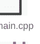


### 获取源代码

为方便起见，我已将本书中示例的源代码文件整合到一个 ZIP 压缩包中，提供 Windows 和 Linux 平台版本，以及 Microsoft Visual Studio IDE 版本。您可以按照以下简单步骤获取完整压缩包：

- 1. 浏览 www.ineasysteps.com，然后进入 Free Resources（免费资源）并选择 Downloads（下载）部分
- 2. 在列表中找到《C++ 编程入门（第5版）》，然后点击标题为“所有代码示例”的超链接以下载压缩包
- 3. 然后，将压缩包内容解压到计算机上的任意方便位置

我衷心希望您能发现 C++ 编程强大且富有表现力的可能性，并像我撰写本书时一样乐在其中。

## 1 开始入门

欢迎来到激动人心的 C++ 编程世界。本章演示如何创建简单的 C++ 程序，以及如何在程序中存储数据。

- C++ 简介
- 安装编译器
- 编写第一个程序
- 编译与运行程序
- 创建变量
- 使用变量数组
- 使用向量数组
- 声明常量
- 本章小结

### C++ 简介

C++ 是 C 编程语言的扩展，C 语言最早由丹尼斯·里奇于 1972 年在 UNIX 操作系统上实现。C 是一种灵活且至今仍广受欢迎的编程语言，广泛应用于从微控制器到最先进科学系统的众多平台。


一种强大的编程语言（读作“see plus plus”），旨在让您表达想法。

C++ 由比雅尼·斯特劳斯特鲁普博士于 1983 年至 1985 年间在新泽西州的 AT&T 贝尔实验室工作时开发。他在原始 C 语言的基础上添加了功能，创造了他称之为“带类的 C”的语言。这些类定义了具有特定功能的编程对象，将 C 的过程式特性转变为 C++ 的面向对象编程语言。

C 编程语言之所以命名为 C，是因为它继承了早期于 1970 年左右推出的名为“B”的编程语言。名称“C++”体现了程序员的一些幽默，因为编程中的 ++ 自增运算符表示 C++ 是 C 语言的扩展。

与 C 一样，C++ 不依赖于平台，因此可以在任何操作系统上创建程序。本书中的大多数插图都显示 Windows 操作系统上的输出，纯粹是因为它是最广泛使用的桌面平台。这些示例也可以在 Linux 或 macOS 等其他平台上创建。

### 为什么要学习 C++ 编程？

C++ 语言深受许多专业程序员的青睐，因为它允许他们创建快速、紧凑、健壮且可移植的程序。

使用现代的 C++ 集成开发环境（IDE），例如 Microsoft 的 Visual Studio Community Edition，程序员可以快速创建复杂的应用程序。但要最大程度地发挥这些工具的作用，程序员必须首先深入了解 C++ 语言本身。

本书是 C++ 编程入门，通过程序代码示例及其输出，展示这一强大语言的基础知识。


本书使用 Microsoft 免费的 Visual Studio Community Edition IDE 来演示可视化编程。

### 我应该先学习 C 吗？

对于在继续学习 C++ 之前先熟悉 C 编程是否更有优势，意见不一。先学习原始语言似乎是合乎逻辑的，以便更容易理解更庞大的扩展语言。然而，C++ 并不仅仅是 C 的更大版本，因为 C++ 的面向对象编程方法与 C 的过程式本质截然不同。因此，可以说在没有 C 知识的情况下学习 C++ 更好，以避免混淆。

本书不假设读者具有任何编程语言的先前知识，因此适合 C++ 编程初学者，无论他们是否了解 C。

如果您确实觉得在继续学习 C++ 之前先学习 C 编程会有所裨益，我们建议您先尝试《C 编程入门》（C Programming in easy steps）中的示例，然后再阅读本书。


### C++ 的标准化

随着 C++ 编程语言日益流行，它被世界各地许多程序员采用为首选编程语言。其中一些程序员开始为该语言添加自己的扩展，因此有必要就一个精确的 C++ 版本达成一致，以便所有程序员能够在国际上共同使用。

C++ 的一个标准版本由美国国家标准学会（ANSI）和国际标准化组织（ISO）的联合委员会定义。该版本有时被称为 ANSI C++，并且可移植到任何平台和任何开发环境。

本书给出的示例符合 ANSI C++。示例程序在控制台窗口中运行，例如 Windows 系统上的命令提示符窗口或 Linux 系统上的 shell 终端窗口，以演示 C++ 语言本身的机制。最后一章中的一个示例说明了，在你熟悉 C++ 语言之后，如何编辑 Windows 平台上可视化开发工具自动生成的代码，以创建图形化窗口应用程序。


> “ISO” 不是首字母缩略词，而是源自希腊语单词 “isos”，意为“相等”——如同 “isometric” 中的含义。

### 安装编译器

C++ 程序最初创建为纯文本文件，保存为扩展名 “.cpp”。它们可以用任何文本编辑器编写，例如 Windows 的记事本应用程序或 Linux 上的 Vi 编辑器。

为了执行 C++ 程序，必须首先将其“编译”成计算机能够理解的字节码。C++ 编译器读取程序的文本版本，并将其翻译成第二个文件——机器可读的可执行格式。

如果文本程序包含任何语法错误，编译器将报告这些错误，并且不会生成可执行文件。

如果你使用 Windows 平台并安装了 C++ 集成开发环境（IDE），那么你已经拥有可用的 C++ 编译器，因为编译器是 Visual IDE 的组成部分。出色且免费的 Microsoft Visual C++ Express IDE 提供了一个编辑器窗口（可在其中编写程序代码）以及用于编译和执行程序的按钮。然而，在开始学习 C++ 时，可视化 IDE 可能显得笨重，因为它们总是创建大量供高级程序使用的“项目”文件。

流行的 GNU C++ 编译器根据通用公共许可证（GPL）的条款免费提供。它包含在大多数 Linux 操作系统发行版中。GNU C++ 编译器也可用于 Windows 平台，并用于编译本书中的示例。

要查明你的系统上是否已经安装了 GNU C++ 编译器，请在命令提示符下输入 **c++ -v**，然后按回车键。如果它可用，编译器将响应版本信息。如果你使用 Linux 平台且计算机上没有 GNU C++ 编译器，请从发行版光盘安装它、从 GNU 网站下载它，或请系统管理员安装它。

GNU（发音为 “guh-new”）计划早在 1984 年启动，旨在开发一个完整的免费类 Unix 操作系统。GNU 的一部分是“Minimalist GNU for Windows”（MinGW）。MinGW 包含 GNU C++ 编译器，可在 Windows 系统上使用它来创建可执行的 C++ 程序。Windows 用户可按照以下说明下载并安装 GNU C++ 编译器。


通用公共许可证的条款和条件可在网上查阅：[gnu.org/copyleft/gpl.html](gnu.org/copyleft/gpl.html)

- 1. 在互联网连接打开的情况下，启动 Web 浏览器，然后导航到 [sourceforge.net/projects/mingw](sourceforge.net/projects/mingw)，并单击 **下载** 按钮以获取 MinGW 安装程序。


- 2. 启动安装程序，并在“安装管理器”对话框中接受建议的位置 **C:\MinGW**。

- 3. 选择基础项和 C++ 编译器项，然后单击“安装”、“应用更改”以完成安装。

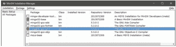


MinGW 安装过程可能会发生变化，但当前指南可在 **mingw.org/wiki/Getting_Started** 找到。

MinGW C++ 编译器是一个二进制可执行文件，位于 **C:\MinGW\bin**。为了使其可从任何系统位置访问，现在应将该文件夹添加到系统 Path 中：

- 4. 在 Windows 的“控制面板”中，单击“系统”图标，然后选择“高级系统设置”项以启动“系统属性”对话框

- 5. 在“系统属性”对话框中，单击“环境变量”按钮，选择 Path 系统变量，然后单击“编辑”按钮并添加位置 **C:\MinGW\bin;**

- 6. 单击“确定”关闭每个对话框，然后打开“命令提示符”窗口并输入命令 **c++**。如果安装成功，编译器应响应称你未指定任何要编译的输入文件：

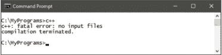


Path 语句中的位置地址必须以 ; 分号结尾。

| 变量名 | 路径 |
| --- | --- |
| 变量值 | `C:\MinGW\bin` |

### 编写你的第一个程序

按照以下步骤操作，并完全照列出的代码复制，创建一个将输出传统第一个程序问候语的简单 C++ 程序：


hello.cpp

- 1. 打开一个纯文本编辑器，例如 Windows 的记事本，然后键入以下“预处理器指令”

  ```cpp
  #include <iostream>
  using namespace std;
  ```

- 2. 在预处理器指令下方几行处，添加描述程序的“注释”

  ```cpp
  // A C++ Program to output a greeting.
  ```

- 3. 在注释下方，添加一个“main 函数”声明，以包含程序语句

  ```cpp
  int main()
  {
  }
  ```

- 4. 在 main 函数的花括号（大括号）之间，插入以下输出“语句”

  ```cpp
  cout << "Hello World!" << endl;
  ```

- 5. 接下来，在 main 函数中插入最后的“return”语句

  ```cpp
  return 0;
  ```

- 6. 将程序保存到任何方便的位置，命名为 “hello.cpp”——完整程序应如下所示：

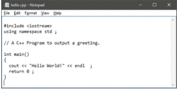


本书中贯穿各处的注释以绿色显示——以便将它们与其他代码区分开。


在键入 main 方法的最后一个右花括号 } 后，务必按回车键添加换行符——你的编译器可能坚持要求源文件以换行符结尾。

可以单独查看程序代码[此处](here)的各个部分，以更清楚地理解每一部分：

- **预处理器指令**——这些指令由编译器在程序代码之前处理，因此必须始终出现在页面开头。这里，**#include** 指示编译器使用名为 **iostream** 的标准 C++ 输入/输出库，并在 `<>` 尖括号之间指定库名。下一行是“using 指令”，它允许使用指定命名空间中的函数而无需其命名空间前缀。**iostream** 库的函数位于 **std** 命名空间中——因此这个 **using** 指令允许将 **std::cout** 和 **std::endl** 等函数简单地写为 **cout** 和 **endl**。

- **注释**——应使用注释使代码更易于他人理解，也便于你以后重新查看代码时理解。在 C++ 编程中，`//` 双斜杠之后单行上的所有内容都会被编译器忽略。

- **main 函数**——这是每个 C++ 程序必需的入口点。程序可以包含许多函数，但它们必须始终包含一个名为 **main** 的函数，否则编译器将不会编译该程序。可选地，函数名后的圆括号可以指定一个逗号分隔的“参数”值列表，供该函数使用。执行后，函数必须向操作系统返回其声明中指定数据类型的值——在本例中为 **int**（整数）值。

- **语句**——这些是程序运行时将执行的操作。每条语句必须以分号结尾，就像英语句子必须以句号（句点）结尾一样。这里，第一条语句调用 **cout** 库函数来输出文本和 **endl** 回车符。它们通过 `<<` 输出流运算符定向到标准输出。请注意，C++ 中的文本字符串必须始终用双引号括起来。最后一条语句使用 C++ **return** 关键字向操作系统返回零整数值——正如 main 函数声明所要求的那样。传统上，返回零值表示程序成功执行。


C++ 编译器还支持位于 `/*` 和 `*/` 之间的多行 C 风格注释，但在 C++ 编程中，这些注释只应在此调试时用于“注释掉”代码段。


请注意程序代码如何使用空格和缩进（统称为空白）进行格式化，以提高可读性。所有空白都会被 C++ 编译器忽略。


### 编译和运行程序

本书示例的 C++ 源代码文件存储在一个专为此目的创建的目录中。该目录名为“MyPrograms”——在 Windows 系统上其绝对地址为 **C:\MyPrograms**，在 Linux 上为 **/home/user/MyPrograms**。你可以重新创建此目录，用于存放等待编译的程序：

- 1. 将[此处](here)创建的“hello.cpp”程序源代码文件移动到系统上的“MyPrograms”目录。
- 2. 在命令提示符下，使用“cd”命令导航到“MyPrograms”目录。
- 3. 输入命令尝试编译程序 **c++ hello.cpp**。


你可以使用命令 **c++ --version** 查看编译器版本号，并使用 **c++ --help** 显示其所有选项。

当尝试成功时，编译器会在原始源代码文件旁边创建一个可执行文件。默认情况下，可执行文件在 Windows 系统上命名为 **a.exe**，在 Linux 上命名为 **a.out**。此时在同一目录中编译不同的源代码文件会在没有警告的情况下覆盖第一个可执行文件。这显然不可取，因此在编译程序时，应使用编译命令中编译器的 **-o** 选项为可执行文件指定自定义名称。


命令 **c++** 是 GNU C++ 编译器的别名——也可以使用命令 **g++**。

- 4. 输入命令编译程序，在源文件旁创建名为“hello.exe”的可执行文件 **c++ hello.cpp -o hello.exe**。

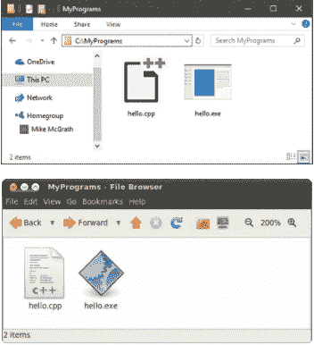

- 5. 要在 Windows 中运行生成的可执行程序文件，只需在“MyPrograms”目录中的提示符下输入文件名——可选地，可以省略文件扩展名。在 Linux 中，必须使用完整文件名，并在前面加上 `./`（点斜杠）——因为 Linux 除非被明确指示，否则不会查看当前目录：

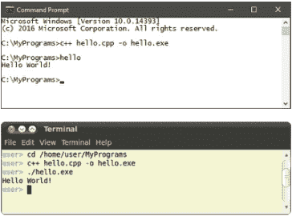


本书中的所有命令行示例均已使用撰写时可用的最新 GNU C++ 编译器进行编译和测试——使用其他编译器时可能无法完全重现。

### 创建变量

在 C++ 程序中，“变量”就像一个容器，数据值可以存储在其中，位于计算机内存中。存储的值可以通过变量名来引用。


程序员可以为变量选择任意名称，只要它遵循 C++ 命名约定——所选名称只能包含字母、数字和下划线字符，但不能以数字开头。此外，必须避免使用本书封二列出的 C++ 关键字。选择有意义的名称以使代码更易理解是一种良好做法。

要在程序中创建新变量，必须对其进行“声明”，指定它可包含的数据类型及其所选名称。变量声明具有以下语法：

```
**data-type variable-name** ;
```


在 C++ 中名称区分大小写——因此名为 VAR、Var 和 var 的变量被视为三个独立变量。传统上，C++ 变量名使用小写，且很少以下划线开头，因为某些 C++ 库使用该约定。

可以在单个声明中创建多个相同数据类型的变量，作为逗号分隔列表，使用以下语法：

```
**data-type variable-name1 , variable-name2 , variable-name3** ;
```

下表列出了五种基本 C++ 数据类型，以及简要说明和示例内容：

| 数据类型： | 说明： | 示例： |
|---|---|---|
| char | 一个字节，能够容纳一个字符 | 'A' |
| int | 整数 | 100 |
| float | 浮点数，精确到六位小数 | 0.123456 |
| double | 浮点数，精确到 10 位小数 | 0.0123456789 |
| bool | 布尔值 true 或 false，或者数值上零为 false，任何非零为 true | false 或 0；true 或 1 |


char 数据类型的字符值必须始终用单引号括起来——而不是双引号。

变量声明必须出现在可执行语句之前——这样它们才能在语句中供引用。

当为变量赋值时，称其已被“初始化”。可选地，变量可以在其声明中初始化。任何已初始化变量中存储的值都可以通过 **cout** 函数显示到标准输出，此处使用该函数显示“Hello World!”问候语。


vars.cpp

- 1. 通过指定要包含的 C++ 库类和要使用的命名空间前缀来启动新程序

```cpp
#include <iostream>
using namespace std ;
```

- 2. 添加一个包含最终 **return** 语句的 main 函数

```cpp
int main()
{
    // Program code goes here.
    return 0 ;
}
```

- 3. 在 main 函数中，插入语句以声明并初始化各种数据类型的变量

```cpp
char letter ; letter = 'A' ;       // Declared then initialized.
int number ; number = 100 ;        // Declared then initialized.
float decimal = 7.5 ;              // Declared and initialized.
double pi = 3.14159 ;              // Declared and initialized.
bool isTrue = false ;              // Declared and initialized.
```

- 4. 现在，插入语句以输出每个存储的值

```cpp
cout << "char letter: " << letter << endl ;
cout << "int number: " << number << endl ;
cout << "float decimal: " << decimal << endl ;
cout << "double pi: " << pi << endl ;
cout << "bool isTrue: " << isTrue << endl ;
```

- 5. 保存、编译并运行程序以查看输出

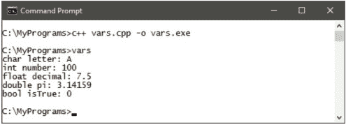


布尔变量名应始终以“is”开头，以便能立即识别为布尔值。此外，对于所有由多个单词组成的变量名，应使用“lowerCamelCase”（小驼峰式命名法）——其中除第一个单词外，所有单词均以大写字母开头，例如“isTrue”。

### 使用变量数组

数组是一种可以存储多个数据项的变量——不同于普通变量只能存储一个数据项。这些数据项按顺序存储在编号从零开始的数组“元素”中。因此，第一个值存储在元素零中，第二个值存储在元素一中，依此类推。


数组的声明方式与其他变量相同，但还必须在声明中指定数组的大小，放在数组名后面的方括号中。例如，声明一个名为“nums”的数组以存储六个整数的语法如下所示：

```cpp
int nums[6];
```

可选地，数组可以在声明时通过为每个元素赋值来初始化，这些值是以逗号分隔的列表，括在花括号（大括号）中。例如：

```cpp
int nums[6] = { 0, 1, 2, 3, 4, 5 };
```


数组编号从零开始——因此六元素数组中的最后一个元素编号是五，而不是六。

单个元素可以通过数组名后跟包含元素编号的方括号来引用。这意味着 **nums[1]** 引用上面示例中的第二个元素——而不是第一个元素，因为元素编号从零开始。

可以为任何 C++ 数据类型创建数组，但每个元素只能包含相同数据类型的数据。如果最后一个元素包含特殊的 `\0` 空字符，则字符数组可用于存储文本字符串。例如：

```cpp
char name[5] = { 'm', 'i', 'k', 'e', '\0' };
```

|  | [0] | [1] | [2] |
|---|---:|---:|---:|
| [0] | 1 | 2 | 3 |
| [1] | 4 | 5 | 6 |

整个字符串可以仅通过数组名来引用。这是 C 语言中处理字符串的主要方式，但[第四章](#)中介绍的 C++ string 类要简单得多。

数组的元素统称为“索引”。数组可以有多个索引——以表示多个维度，而不是常规数组的单一维度。三个及更多索引的多维数组不常见，但二维数组对于存储基于网格的信息（例如坐标）很有用。例如：

```cpp
int coords[2][3] = { { 1, 2, 3 }, { 4, 5, 6 } };
```


#### arrays.cpp

- 1. 通过指定要包含的 C++ 库类和要使用的命名空间前缀，开始一个新程序
    
    ```cpp
    #include <iostream>
    using namespace std;
    ```

- 2. 添加一个包含最终 **return** 语句的 main 函数
    
    ```cpp
    int main()
    {
        // Program code goes here.
        return 0;
    }
    ```

- 3. 在 main 函数中，插入语句来声明并初始化三个变量数组
    
    ```cpp
    // Declared then initialized.
    float nums[3];
    nums[0] = 2.5; nums[1] = 2.75; nums[2] = 3.25;
    
    // Declared and initialized.
    char name[5] = { 'm', 'i', 'k', 'e', '\0' };
    int coords[2][3] = { { 1, 2, 3 }, { 4, 5, 6 } };
    ```

- 4. 现在，插入语句以输出特定元素的值
    
    ```cpp
    cout << "nums[0]: " << nums[0] << endl;
    cout << "nums[1]: " << nums[1] << endl;
    cout << "nums[2]: " << nums[2] << endl;
    cout << "name[0]: " << name[0] << endl;
    cout << "Text string: " << name << endl;
    cout << "coords[0][2]: " << coords[0][2] << endl;
    cout << "coords[1][2]: " << coords[1][2] << endl;
    ```

- 5. 保存、编译并运行程序以查看输出

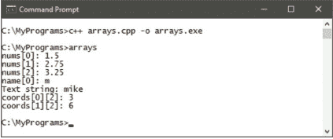


在可能的情况下，变量名不应使用缩写——由于篇幅限制，本书示例中仅使用缩写名称。


第三章介绍的循环结构常用于遍历数组元素。

### 使用 vector 数组

vector 是常规数组的一种替代方案，其优势在于可以根据程序需要更改其大小。与常规数组一样，vector 可以为任何数据类型创建，其元素也从零开始编号。

为了在程序中使用 vector，必须在程序开头使用 **#include <vector>** 预处理指令添加 C++ **vector** 库。该库包含下表中用于操作 vector 的预定义函数：

| 函数 | 描述 |
|---|---|
| `at( number )` | 获取指定元素编号中包含的值 |
| `back()` | 获取最后一个元素中的值 |
| `clear()` | 移除所有 vector 元素 |
| `empty()` | 如果 vector 为空，则返回 true (1)，否则返回 false (0) |
| `front()` | 获取第一个元素中的值 |
| `pop_back()` | 移除最后一个元素 |
| `push_back( value )` | 在 vector 末尾添加一个元素，其中包含指定值 |
| `size()` | 获取元素数量 |

创建 vector 的声明如下所示：

```cpp
vector < data-type > vector-name ( size );
```

默认情况下，int vector 的每个元素都会自动初始化为零值。可选地，可以在声明中在大小之后指定不同的初始值，语法如下：

```cpp
vector < data-type > vector-name ( size , initial-value );
```

用于操作 vector 的函数通过点运算符附加到所选的 vector 名称后。例如，要获取名为“vec”的 vector 的大小，可以使用 **vec.size()**。


与常规数组一样，可以使用方括号引用单个 vector 元素，例如 `vec[3]`。


#### vector.cpp

- 1. 通过指定要包含的 C++ 库类和要使用的命名空间前缀，开始一个新程序
    
    ```cpp
    #include <vector>       // Include vector support.
    #include <iostream>
    using namespace std;
    ```

- 2. 添加一个包含最终 **return** 语句的 main 函数
    
    ```cpp
    int main()
    {
        // Program code goes here.
        return 0;
    }
    ```

- 3. 在 main 函数中，插入一条语句来声明并初始化一个包含三个元素、每个元素值为 100 的 vector 数组
    
    ```cpp
    vector <int> vec( 3, 100 );
    ```

- 4. 现在，插入语句来操作 vector 元素
    
    ```cpp
    cout << "Vector size: " << vec.size() << endl;
    cout << "Is empty?: " << vec.empty() << endl;
    cout << "First element: " << vec.at(0) << endl;
    
    vec.pop_back();        // Remove final element.
    cout << "Vector size: " << vec.size() << endl;
    cout << "Final element: " << vec.back() << endl;
    
    vec.clear();           // Remove all elements.
    cout << "Vector size: " << vec.size() << endl;
    
    vec.push_back( 200 );  // Add an element.
    cout << "Vector size: " << vec.size() << endl;
    cout << "First element: " << vec.front() << endl;
    ```

- 5. 保存、编译并运行程序以查看输出

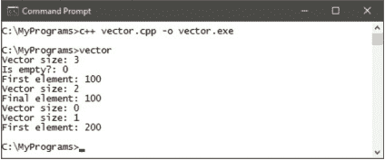


此示例展示了如何使用循环为 vector 的每个元素填充不同的初始值。

### 声明常量

在程序执行期间不会改变的数据应存储在常量容器中，而不是变量中。这样可以更好地使编译器检查代码错误——如果程序试图更改常量中存储的值，编译器将报告错误，编译将失败。

对于任何数据类型，都可以通过在变量声明前加上 **const** 关键字（后跟一个空格）来创建常量。通常，常量名使用大写，以区别于（小写的）变量名。与变量不同，常量必须在声明时初始化。例如，数学 pi 值的常量声明如下所示：

```cpp
const double PI = 3.1415926536;
```

**enum** 关键字提供了一种便捷方式，可以简洁地创建一系列整数常量。可选地，声明可以在 **enum** 关键字之后包含序列名称。常量名随后以逗号分隔列表的形式出现在花括号内。例如，以下声明创建了一系列常量：

```cpp
enum suit { CLUBS, DIAMONDS, HEARTS, SPADES };
```

默认情况下，每个常量的值都比列表中前一个常量的值大 1。除非另行指定，第一个常量的值为零，下一个的值为一，依此类推。可以为常量分配任意整数值，但列表中的下一个常量始终会将其递增 1。

有时将枚举常量列表定义为“自定义数据类型”会很方便——通过使用 **typedef** 关键字。这可以开始 **enum** 声明，并且可以在声明末尾添加选定的类型名。例如，以下 **typedef** 语句创建了一个名为“charge”的自定义数据类型：

```cpp
typedef enum { NEGATIVE, POSITIVE } charge;
```

然后可以按常规方式创建该自定义数据类型的变量，这些变量可以合法地赋予所列常量中的任意一个。本质上，这些变量的作用就像 **int** 变量——因为它们存储所赋常量表示的数值整数值。例如，在上面的示例中，将 **POSITIVE** 常量赋给 **charge** 变量实际上会赋予整数 1。


> **typedef** 关键字只是为结构创建一个别名。

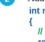

#### constant.cpp

- 1. 通过指定要包含的 C++ 库类和要使用的命名空间前缀，开始一个新程序
    
    ```cpp
    #include <iostream>
    using namespace std;
    ```

- 2. 添加一个包含最终 return 语句的 main 函数
    
    ```cpp
    int main()
    {
        // Program code goes here.
        return 0;
    }
    ```

- 3. 在 main 函数中，插入语句以声明一个常量，并使用该常量值进行输出
    
    ```cpp
    const double PI = 3.1415926536;
    cout << "6\" circle circumference: " << (PI * 6) << endl;
    ```

- 4. 接下来，插入语句以声明一个枚举常量列表，并使用其中一些常量值进行输出
    
    ```cpp
    enum { RED = 1, YELLOW, GREEN, BROWN, BLUE, PINK, BLACK };
    cout << "A shot red worth: " << RED << endl;
    cout << "Then a blue worth: " << BLUE << endl;
    cout << "Total scored: " << (RED + BLUE) << endl;
    ```

- 5. 现在，插入语句以声明一个自定义数据类型并输出其被赋予的值
    
    ```cpp
    typedef enum { NEGATIVE, POSITIVE } charge;
    charge neutral = NEGATIVE, live = POSITIVE;
    cout << "Neutral wire: " << neutral << endl;
    cout << "Live wire: " << live << endl;
    ```

- 6. 保存、编译并运行程序以查看输出

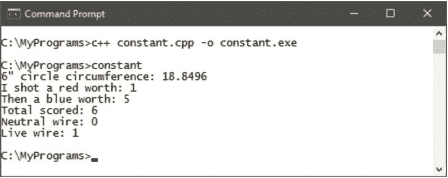


在 PI 声明中，* 字符是 C++ 乘法运算符，而 \" 中的反斜杠字符用于转义引号，使其不被识别——这样字符串就不会过早终止。


### 总结

- C++ 是一种面向对象的编程语言，是过程式 C 编程语言的扩展。
- GNU C++ 编译器可用于 Windows 和 Linux。
- 预处理器指令用于使标准 C++ 库中的函数可供程序使用。
- 每个 C++ 程序都必须包含一个 main 方法作为程序的入口点。
- 语句定义程序将执行的操作。
- 建议对程序代码进行充分注释，以明确其用途。
- `c++` 命令调用编译器，其 `-o` 选项允许该命令指定生成的可执行文件的名称。
- 变量声明指定数据类型以及选定的名称，通过该名称可以引用该变量中的值。
- `cout` 函数是 C++ `iostream` 库的一部分，用于将内容写入标准输出控制台。
- 数组是一种固定大小的变量，它在元素中存储多个数据项，元素从零开始编号。
- 可以将特殊字符 `\0` 赋给 `char` 数组的最后一个元素，以便将其作为单个文本字符串处理。
- vector 变量在元素中存储多个数据项，并且可以动态调整大小。
- 可以使用变量名及其索引号来引用存储在数组或 vector 元素中的值。
- 程序中从不更改的变量值应存储在常量中。
- 常量列表可以通过 `enum` 关键字自动编号，并通过 `typedef` 关键字指定类型名。

## 2 执行运算

*本章介绍 C++ 运算符，并演示它们可以执行的操作。*

- 执行算术运算
- 赋值
- 比较值
- 评估逻辑
- 检查条件
- 确定大小
- 设置优先级
- 转换数据类型
- 摘要

### 执行算术运算

下表列出了 C++ 程序中常用的算术运算符，以及它们执行的运算：

| 运算符： | 运算： |
|---|---|
| + | 加法 |
| - | 减法 |
| * | 乘法 |
| / | 除法 |
| % | 取模 |
| ++ | 递增 |
| -- | 递减 |

加法、减法、乘法和除法运算符的作用与预期一致。但是，当表达式中使用多个运算符时，必须注意用括号括起来以明确表达式——最内层括号内的运算最先执行：

```cpp
a = b * c - d % e / f;        // This is unclear.
a = ( b * c ) - ( ( d % e ) / f );   // This is clearer.
```

% 取模运算符会将第一个给定的数除以第二个给定的数，并返回该运算的余数。这对于判断一个数是奇数还是偶数很有用。


与运算符一起构成表达式的值称为“操作数”——在表达式 2 + 3 中，数值 2 和 3 是操作数。

++ 递增运算符和 -- 递减运算符将给定的数改变一，并返回结果值。它们最常用于统计循环中的迭代次数。递增计数时，++ 运算符将值增加一；递减计数时，-- 递减运算符将值减少一。

递增和递减运算符可以放在值之前或之后，从而产生不同的效果。如果放在操作数之前（前缀），其值会立即改变；如果放在操作数之后（后缀），则先记录其值，然后改变该值。


arithmetic.cpp

- 1. 通过指定要包含的 C++ 库类和要使用的命名空间前缀，开始一个新程序

    ```cpp
    #include <iostream>
    using namespace std;
    ```

- 2. 添加一个包含最终 **return** 语句的 main 函数

    ```cpp
    int main()
    {
        // Program code goes here.
        return 0;
    }
    ```

- 3. 在 main 函数中，插入一条语句以声明并初始化两个整数变量

    ```cpp
    int a = 8, b = 4;
    ```

- 4. 接下来，插入语句以输出每个基本算术运算的结果

    ```cpp
    cout << "Addition result: " << (a + b) << endl;
    cout << "Subtraction result: " << (a - b) << endl;
    cout << "Multiplication result: " << (a * b) << endl;
    cout << "Division result: " << (a / b) << endl;
    cout << "Modulus result: " << (a % b) << endl;
    ```

- 5. 现在，插入语句以输出后缀和前缀递增运算的结果

    ```cpp
    cout << "Postfix increment: " << a++ << endl;
    cout << "Postfix result: " << a << endl;
    cout << "Prefix increment: " << ++b << endl;
    cout << "Prefix result: " << b << endl;
    ```

- 6. 保存、编译并运行程序以查看输出。

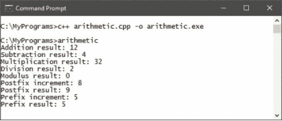


请记住，前缀运算符会立即改变变量值——后缀运算符则随后改变该值。

### 赋值

下表列出了 C++ 编程中用于赋值的运算符。除简单的 = 赋值运算符外，其他运算符都是较长表达式的简写形式，因此为清晰起见给出了每个等效形式：

| 运算符： | 示例： | 等效形式： |
|---|---|---|
| = | a = b | a = b |
| += | a += b | a = (a + b) |
| -= | a -= b | a = (a - b) |
| *= | a *= b | a = (a * b) |
| /= | a /= b | a = (a / b) |
| %= | a %= b | a = (a % b) |

在上面的示例中，名为“a”的变量被赋予名为“b”的变量中包含的值——因此该值成为存储在 **a** 变量中的新值。

**+=** 运算符可用于将一个值加到存储在 **a** 变量中的现有值上。

在表格示例中，**+=** 运算符首先将变量 **a** 中包含的值与变量 **b** 中包含的值相加。然后，它将结果赋值为存储在变量 **a** 中的新值。


重要的是，要将 **=** 运算符理解为“赋值”而不是“等于”，以避免与 **==** 相等运算符混淆。

所有其他运算符都以相同方式工作：先对两个值执行算术运算，然后将该运算的结果赋给第一个变量——使其成为该变量存储的新值。

使用 **%=** 运算符时，第一个操作数 **a** 除以第二个操作数 **b**，然后将该运算的余数赋给 **a** 变量。

下面的程序演示了每种赋值操作。


assign.cpp

- 1. 通过指定要包含的 C++ 库类和要使用的命名空间前缀，开始一个新程序。

    ```cpp
    #include <iostream>
    using namespace std;
    ```

- 2. 添加一个包含最终 **return** 语句的 main 函数。

    ```cpp
    int main()
    {
        // Program code goes here.
        return 0;
    }
    ```

- 3. 在 main 函数中，插入一条声明两个整数变量的语句。

    ```cpp
    int a, b;
    ```

- 4. 接下来，插入语句以输出简单赋值后的值

    ```cpp
    cout << "Assign values: ";
    cout << "a = " << (a = 8) << " ; ";
    cout << "b = " << (b = 4);
    ```

- 5. 现在，插入语句以输出组合赋值后的值

    ```cpp
    cout << endl << "Add & assign: ";
    cout << "a += b (8 += 4) a = " << (a += b);
    cout << endl << "Subtract & assign: ";
    cout << "a -= b (12 -= 4) a = " << (a -= b);
    cout << endl << "Multiply & assign: ";
    cout << "a *= b (8 *= 4) a = " << (a *= b);
    cout << endl << "Divide & assign: ";
    cout << "a /= b (32 /= 4) a = " << (a /= b);
    cout << endl << "Modulus & assign: ";
    cout << "a %= b (8 %= 4) a = " << (a %= b);
    ```

- 6. 保存、编译并运行程序以查看输出

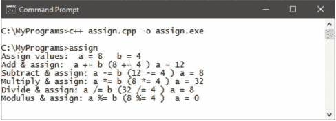


与 = 赋值运算符不同，== 相等运算符比较操作数，并在此处进行描述。


### 比较值

C++ 编程中常用于比较两个数值的运算符列于下表：

| 运算符： | 比较测试： |
|---|---|
| `==` | 相等 |
| `!=` | 不等 |
| `>` | 大于 |
| `<` | 小于 |
| `>=` | 大于或等于 |
| `<=` | 小于或等于 |

**==** 相等运算符比较两个操作数，如果两者的值相等则返回 **真 (1)**，否则返回 **假 (0)** 值。如果两者是相同的数字，则它们相等；或者如果两者是字符，则按数值比较它们的 ASCII 码值。相反，**!=** 不等运算符在两个操作数不相等时返回 **真 (1)**，使用与 **==** 相等运算符相同的规则，否则返回 **假 (0)**。相等和不等运算符可用于测试两个变量的状态，以便在程序中执行条件分支。


A-Z 大写字符的 ASCII 码值为 65-90，a-z 小写字符的 ASCII 码值为 97-122。

**>** “大于”运算符比较两个操作数，如果第一个的值大于第二个则返回 **真 (1)**，如果相等或较小则返回 **假 (0)**。**<** “小于”运算符进行相同的比较，但如果第一个操作数的值小于第二个则返回 **真 (1)**，否则返回 **假 (0)**。“大于”或“小于”运算符常用于测试循环中迭代计数器的值。

在 **>** “大于”或 **<** “小于”运算符后添加 **=** 运算符，使其在两个操作数的值完全相等时也返回 **真 (1)**。

下面的程序演示了每种比较运算。

```cpp
comparison.cpp
```

- 1. 通过指定要包含的 C++ 库类和要使用的命名空间前缀来启动新程序

    ```cpp
    #include <iostream>
    using namespace std;
    ```

- 2. 添加一个包含最后 **return** 语句的 main 函数

    ```cpp
    int main()
    {
        // Program code goes here.
        return 0;
    }
    ```

- 3. 在 main 函数中，插入语句以声明并初始化可转换为布尔值的变量

    ```cpp
    int nil = 0, num = 0, max = 1; char cap = 'A', low = 'a';
    ```

- 4. 接下来，插入语句以输出整数和字符的相等比较结果

    ```cpp
    cout << "Equality comparisons: ";
    cout << "(0 == 0) " << (nil == num) << "(true)";
    cout << "(A == a) " << (cap == low) << "(false)";
    ```

- 5. 现在，插入语句以输出所有其他比较结果

    ```cpp
    cout << endl << "Inequality comparison: ";
    cout << "(0 != 1) " << (nil != max) << "(true)";
    cout << endl << "Greater comparison: ";
    cout << "(0 > 1) " << (nil > max) << "(false)";
    cout << endl << "Lesser comparison: ";
    cout << "(0 < 1) " << (nil < max) << "(true)";
    cout << endl << "Greater or equal comparison: ";
    cout << "(0 >= 0) " << (nil >= num) << "(true)";
    cout << endl << "Lesser or equal comparison: ";
    cout << "(1 <= 0) " << (max <= num) << "(false)";
    ```

- 6. 保存、编译并运行程序以查看输出

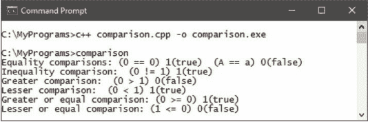


大写“A”的 ASCII 码值是 65，而小写“a”的是 97——因此它们在这里的比较返回假 (0)。

### 评估逻辑

C++ 编程中最常用的逻辑运算符列于下表：

| 运算符： | 运算： |
|---|---|
| && | 逻辑与 |
| \|\| | 逻辑或 |
| ! | 逻辑非 |

逻辑运算符与具有 **真** 或 **假** 布尔值的操作数一起使用，或者与可转换为 **真** 或 **假** 的值一起使用。

逻辑 **&&** 与运算符将评估两个操作数，仅当两个操作数本身都为 **真** 时才返回 **真**。否则，**&&** 运算符将返回 **假**。这用于条件分支，其中程序的方向由测试两个条件决定——如果两个条件都满足，程序将朝某个方向执行，否则将朝另一个方向执行。


当有多个操作数时，每个表达式必须用括号括起来。

与需要两个操作数都为 **真** 的 **&&** 与运算符不同，**||** 或运算符将评估其两个操作数，如果其中一个操作数本身返回 **真**，则返回 **真**。如果两个操作数都不返回 **真**，则 **||** 或运算符将返回 **假**。这在 C++ 编程中很有用，可在两个测试条件中任一条件满足时执行某个操作。

第三个逻辑 **!** 非运算符是一元运算符，用于单个操作数之前。它返回给定操作数的相反值，因此如果变量 **a** 的值为 **真**，那么 **!a** 的值将为 **假**。**!** 非运算符在 C++ 程序中很有用，可在连续的循环迭代中使用类似 **a = !a** 的语句切换变量的值。这确保每次传递时值都会改变，就像打开和关闭电灯开关一样。

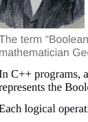

“布尔”一词指的是英国数学家乔治·布尔（1815-1864）发展的一种逻辑思维体系。

在 C++ 程序中，零表示布尔 **假** 值，任何非零值（例如 1）表示布尔 **真** 值。

下面的程序演示了每种逻辑运算。


logic.cpp

- 1. 通过指定要包含的 C++ 库类和要使用的命名空间前缀来启动新程序。

    ```cpp
    #include <iostream>
    using namespace std;
    ```

- 2. 添加一个包含最后 **return** 语句的 main 函数。

    ```cpp
    int main()
    {
        // Program code goes here.
        return 0;
    }
    ```

- 3. 在 main 函数中，声明并初始化两个整型变量——其值可以表示布尔值。

    ```cpp
    int a = 1, b = 0;
    ```

- 4. 插入语句以输出与运算的评估结果。

    ```cpp
    cout << "AND logic:" << endl;
    cout << "(a && a) " << (a && a) << "(true) ";
    cout << "(a && b) " << (a && b) << "(false) ";
    cout << "(b && b) " << (b && b) << "(false)" << endl;
    ```

- 5. 插入语句以输出或运算的评估结果。

    ```cpp
    cout << endl << "OR logic:" << endl;
    cout << "(a || a) " << (a || a) << "(true) ";
    cout << "(a || b) " << (a || b) << "(true) ";
    cout << "(b || b) " << (b || b) << "(false)" << endl;
    ```

- 6. 插入语句以输出非运算的评估结果。

    ```cpp
    cout << endl << "NOT logic:" << endl;
    cout << "a = " << a << " !a = " << !a << " ";
    cout << "b = " << b << " !b = " << !b << endl;
    ```

- 7. 保存、编译并运行程序以查看输出。

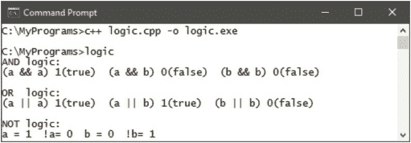


请注意，0 && 0 返回 0，而不是 1——这证明了格言“两个错误不能构成一个正确”。

### 检查条件

C++ 程序员可能最喜欢的测试运算符是 `?:` “三元”运算符。该运算符首先评估表达式以判断 **真** 或 **假** 条件，然后根据评估结果返回两个指定值之一。因此，它也被称为“条件”运算符。

`?:` 三元运算符具有以下语法：

```cpp
( test-expression ) ? if-true-return-this : if-false-return-this ;
```

尽管三元运算符最初可能看起来有点令人困惑，但它非常值得熟悉，因为它可以用最少的代码执行强大的程序分支。例如，当变量的值不为 1 时进行分支：

```cpp
( var != 1 ) ? if-true-do-this : if-false-do-this ;
```

三元运算符在 C++ 编程中常用于将两个变量的最大值或最小值赋给第三个变量。例如，像这样赋最小值：

```cpp
c = ( a < b ) ? a : b ;
```

当变量 **a** 的值小于变量 **b** 的值时，括号中的表达式返回 **真**——因此在这种情况下，变量 **a** 的较小值会被赋给变量 **c**。

类似地，将测试表达式中的 `<` 小于运算符替换为 `>` 大于运算符，会将变量 **b** 的较大值赋给变量 **c**。

三元运算符的另一个常见用法是在测试表达式中结合 `%` 取模运算符，以确定变量的值是奇数还是偶数：

```cpp
( var % 2 != 0 ) ? if-true(odd)-do-this : if-false(even)-do-this ;
```

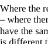

三元运算符有三个操作数——`?` 之前的一个，以及 `:` 之前和之后的操作数。

如果变量值除以二的结果有余数，则该数字为奇数——如果没有余数，则该数字为偶数。测试表达式 `( var % 2 == 1 )` 会产生相同的效果，但最好测试不等性——发现不同之处比发现相同之处更容易。

下面的程序演示了三元运算符。


ternary.cpp

- 1. 通过指定要包含的 C++ 库类和要使用的命名空间前缀来启动新程序

    ```cpp
    #include <iostream>
    using namespace std;
    ```

- 2. 添加一个包含最后 **return** 语句的 main 函数

    ```cpp
    int main()
    {
        // Program code goes here.
        return 0;
    }
    ```


- 3. 在主函数中，插入声明三个整型变量并初始化其中两个的语句

    ```cpp
    int a, b, max ;
    a = 1, b = 2 ;
    ```

- 4. 插入语句，输出第一个被检查变量的值和奇偶性

    ```cpp
    cout << "Variable a value is: " ;
    cout << ( ( a != 1 ) ? "not one, " : "one, " ) ;
    cout << ( ( a % 2 != 0 ) ? "odd" : "even" ) ;
    ```

- 5. 接下来，插入语句，输出第二个被检查变量的值和奇偶性

    ```cpp
    cout << endl << "Variable b value is: " ;
    cout << ( ( b != 1 ) ? "not one, " : "one, " ) ;
    cout << ( ( b % 2 != 0 ) ? "odd" : "even" ) ;
    ```

- 6. 现在，插入语句，输出所存储的两个变量值中较大的那个

    ```cpp
    max = ( a > b ) ? a : b ;
    cout << endl << "Greater value is: " << max << endl ;
    ```

- 7. 保存、编译并运行程序以查看输出

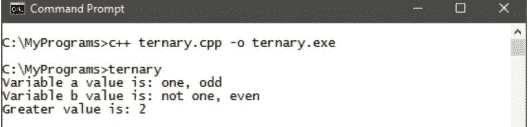

 三元运算符可以返回任何数据类型的值——数字、字符串、布尔值等。

### 确定大小

声明变量会分配系统内存，用于存储赋给该变量的值。为此分配的内存量由你的系统和数据类型决定。

通常，**int** 数据类型默认创建为“long”值，可存储从 +2,147,483,647 到 -2,147,483,648 的值。另一方面，如果 **int** 数据类型默认创建为“short”值，则只能存储从 +32,767 到 -32,768 的值。

在声明变量时，可以通过在 **int** 关键字前加上 **short** 或 **long** 限定符来明确指定所需范围。当确信永远不会超出有限范围时，**short int** 有助于节省内存空间。

声明 **int** 变量时，默认情况下它可以包含正整数或负整数，这些称为“有符号”值。如果该变量将始终只包含正整数，则可以将其限定为 **unsigned**，以增大其可能的最大值。通常，**unsigned short int** 的范围是 0 到 65,535，**unsigned long int** 的范围是 0 到 4,294,967,295。

可以使用 C++ 的 **sizeof** 运算符获知任何变量的内存大小。要检查的变量名可以指定在 **sizeof** 运算符名称后面的可选括号中。例如，要检查名为“var”的变量：

```cpp
sizeof( var );    // Alternatively you can use “sizeof var”;
```


> 尽管 sizeof 是一个严格来说不需要括号的运算符，但通常还是会带上括号——就好像它是一个函数，比如 main()。

简单数据类型（如 **char** 和 **bool**）只需要一个字节的内存即可存储一份数据。较长的数值需要更多内存，具体取决于其可能范围——由数据类型和限定符决定。

分配给数组的内存，就是按其元素数量，将分配给该数据类型单个变量的内存乘以相应倍数。例如，一个包含 50 个元素的 **int** 数组将分配单个 **int** 变量内存的 50 倍。

下面的程序演示了 **sizeof** 运算符。


- 1. 通过指定要包含的 C++ 库类和要使用的命名空间前缀来启动一个新程序

    ```cpp
    #include <iostream>
    using namespace std ;
    ```

- 2. 添加一个包含最后 **return** 语句的主函数

    ```cpp
    int main()
    {
        // Program code goes here.
        return 0 ;
    }
    ```

- 3. 在主函数中，插入声明各种数据类型变量的语句

    ```cpp
    int num ;
    int nums[50] ;
    float decimal ;
    bool isTrue ;
    unsigned int max ;
    char letter ;
    double pi ;
    short int number ;
    char letters[50] ;
    ```

- 4. 接下来，插入语句，输出每个整型变量的字节大小

    ```cpp
    cout << "int size: " << sizeof( num ) << endl ;
    cout << "50 int size: " << sizeof( nums ) << endl ;
    cout << "short int size: " << sizeof( number ) << endl ;
    cout << "unsigned int size: " << sizeof( max ) << endl ;
    ```

- 5. 现在，插入语句，输出其他变量的大小

    ```cpp
    cout << "double size: " << sizeof( pi ) << endl ;
    cout << "float size: " << sizeof( decimal ) << endl ;
    cout << "char size: " << sizeof( letter ) << endl ;
    cout << "50 char size: " << sizeof( letters ) << endl ;
    cout << "bool size: " << sizeof( isTrue ) << endl ;
    ```

- 6. 保存、编译并运行程序以查看输出

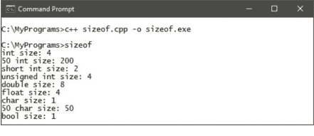


这里，int 数据类型默认创建为 long 类型——你的系统可能有所不同。

### 设置优先级

运算符优先级决定 C++ 计算表达式的顺序。例如，在表达式 **a = 6 + 8 * 3** 中，优先级顺序决定先完成乘法。

下表按降序列出运算符优先级——最上面一行的优先级最高，越往下优先级依次降低。C++ 计算包含多个相同优先级运算符的表达式时，其顺序由“运算符结合性”决定——将操作数与左侧（LTR）或右侧（RTL）的分组。


* 乘法运算符所在行高于 + 加法运算符——因此在表达式 a=6+8*3 中，先完成乘法，再进行加法。

| 运算符 | 描述 | 运算符 | 描述 | 方向 |
|---|---|---|---|---|
| `()` | 函数调用 | `[]` | 数组索引 | LTR |
| `->` | 类指针 | `.` | 类成员 | LTR |
| `!` | 逻辑非 | `*` | 指针 | RTL |
| `--` | 递减 | `++` | 递增 | RTL |
| `+` | 正号 | `-` | 负号 | RTL |
| `sizeof` | 大小 | `&` | 取地址 | RTL |
| `*` | 乘法 | `/` | 除法 | LTR |
| `%` | 取模 |  |  | LTR |
| `+` | 加法 | `-` | 减法 | LTR |
| `<=` | 小于或等于 | `<` | 小于 | LTR |
| `>=` | 大于或等于 | `>` | 大于 | LTR |
| `==` | 等于 | `!=` | 不等于 | LTR |
| `&&` | 逻辑与 |  |  | LTR |
| `\|\|` | 逻辑或 |  |  | LTR |
| `?:` | 三元 |  |  | RTL |
| `+= -= *= /= %=` | 赋值 |  |  | RTL |
| `,` | 逗号 |  |  | LTR |


> -> 类指针和 . 类成员运算符将在本书后面介绍——但为了完整性，这里也将它们列出。

除了表中的运算符之外，还有许多“位”运算符，用于执行二进制算术。这超出了本书的范围，但《C Programming in easy steps》中有一节专门介绍二进制算术。这些运算符在 C++ 中的工作方式完全相同。

下面的程序演示了运算符优先级。


- 1. 通过指定要包含的 C++ 库类和要使用的命名空间前缀来启动一个新程序

    ```cpp
    #include <iostream>
    using namespace std ;
    ```

- 2. 添加一个包含最后 **return** 语句的主函数

    ```cpp
    int main()
    {
      // Program code goes here.
      return 0 ;
    }
    ```

- 3. 在主函数中，声明一个整型变量，并用使用默认优先级计算的表达式结果初始化它，然后输出结果

    ```cpp
    int num = 1 + 4 * 3 ;
    cout << endl << "Default order: " << num << endl ;
    ```

- 4. 接下来，使用显式优先级将该表达式的结果赋给该变量，然后输出结果

    ```cpp
    num = ( 1 + 4 ) * 3 ;
    cout << "Forced order: " << num << endl << endl ;
    ```

- 5. 使用方向优先级将另一个表达式的结果赋给该变量，然后输出结果

    ```cpp
    num = 7 - 4 + 2 ;
    cout << "Default direction: " << num << endl ;
    ```

- 6. 现在，使用显式优先级将该表达式的结果赋给该变量，然后输出结果

    ```cpp
    num = 7 - ( 4 + 2 ) ;
    cout << "Forced direction: " << num << endl ;
    ```

- 7. 保存、编译并运行程序以查看输出


不要依赖默认优先级，因为它可能因编译器而异——始终使用括号来明确表达式。


### 数据类型转换

存储在变量中的任何数据都可以通过称为“类型转换”的过程被强制（coerce）转换为不同数据类型的变量。转换语句只需在包含待转换数据的变量名之前用括号指出值应转换成的数据类型。因此类型转换语法如下所示：

```cpp
variable-name = ( data-type ) variable-name ;
```

这是传统的转换形式，在 C 编程语言中也能找到。C++ 中提供的一种较新的替代方案使用尖括号和 **static_cast** 关键字，如下所示：

```cpp
variable-name = static_cast < data-type > variable-name ;
```

较新的版本避免使用括号，从而更容易在源代码中识别类型转换，因为括号很容易与表达式中的括号混淆。较新的转换形式更受青睐，但旧形式仍然广泛存在。

为了准确存储算术运算的结果，类型转换通常是必要的，因为一个整数除以另一个整数总是产生整数结果。例如，整数除法 *7/2* 会产生截断后的整数结果 **3**。

要存储准确的浮点结果，需要将结果转换为合适的数据类型，例如 **float**，如下所示：

```cpp
float result = ( float ) 7 / 2 ;
```

或者使用较新的转换形式：

```cpp
float result = static_cast < float > 7 / 2 ;
```


一个整数除以另一个整数的结果会被截断，而不是四舍五入——因此 9.9 的结果会变成 9。

无论哪种情况，都应注意运算符优先级会先将第一个操作数转换为指定的数据类型，然后再执行算术运算，因此该语句最好写成：

```cpp
float result = static_cast < float > ( 7 ) / 2 ;
```

将表达式括为 *( 7 / 2 )* 会先对整数执行算术运算，因此整数结果会在转换为 **float** 变量之前被截断——这不是想要的效果！

下面的程序演示了使用旧式 C 风格形式和新式 C++ 形式进行类型转换。


cast.cpp

- 1. 通过指定要包含的 C++ 库类和要使用的命名空间前缀，开始一个新程序

```cpp
#include <iostream>
using namespace std ;
```

- 2. 添加一个包含最终 **return** 语句的 main 函数

```cpp
int main()
{
    // Program code goes here.
    return 0;
}
```

- 3. 在 main 函数中，插入语句以声明并初始化整数、字符和浮点变量

```cpp
int num = 7, factor = 2 ;
char letter = 'A' ; float result = 0.0 ;
```

- 4. 输出普通整数除法的结果

```cpp
cout << "Integer division: " << ( num / factor ) << endl ;
```

- 5. 现在，将相同的除法转换为浮点变量并输出该结果

```cpp
result = (float) ( num ) / factor ;
cout << "Cast division float: " << result << endl ;
```

- 6. 接下来，将字符变量转换为整数变量并输出该值

```cpp
num = static_cast <int> ( letter ) ;
cout << "Cast character int: " << num << endl ;
```

- 7. 将整数转换为字符变量并输出

```cpp
letter = static_cast <char> ( 70 ) ;
cout << "Cast integer char: " << letter << endl ;
```

- 8. 保存、编译并运行程序以查看输出

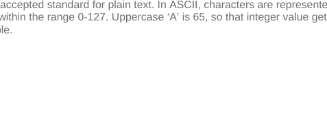


ASCII（读作“askee”）是美国信息交换标准代码，是纯文本的公认标准。在 ASCII 中，字符以 0-127 范围内的数值表示。大写字母 'A' 是 65，因此该整数值会被转换为 int 变量。

### 总结

- 算术运算符可以构成包含两个操作数的表达式，用于加法 **+**、减法 **-**、乘法 `*`、除法 **/** 或取模 **%**。
- 递增 **++** 和递减 **--** 运算符将单个操作数的值修改一。
- 赋值 **=** 运算符可以与算术运算符组合，执行算术计算，然后赋值其结果。
- 比较运算符可以构成表达式，用于比较两个操作数的值：相等 **==**、不等 **!=**、大于 **>**、小于 **<**、大于或等于 **>=** 以及小于或等于 **<=**。
- 逻辑 **&&** 和 **||** 运算符构成表达式，对两个操作数求值以返回 true 或 false 的布尔值。
- 逻辑 **!** 运算符返回单个操作数的反向布尔值。
- 三元 **?:** 运算符对给定的布尔表达式求值，然后根据其结果返回两个操作数之一。
- **sizeof** 运算符返回变量的内存字节大小。
- **int** 变量可以限定为 **short** 类型以表示较小的数字，或限定为 **long** 类型以表示较大的数字。
- 当 **int** 变量只存储正数时，可以将其限定为 **unsigned** 以扩展其数值范围。
- 在复杂表达式中，通过添加括号 **()** 显式设置运算符优先级很重要。
- 存储在变量中的数据可以通过类型转换过程强制转换为不同数据类型的变量。
- C++ 支持传统的 C 风格类型转换以及使用 **static_cast** 关键字的较新转换形式。

## 3 编写语句

*本章演示 C++ 条件语句，这些语句允许程序向不同方向分支，并介绍 C++ 函数结构。*

- 使用 if 分支
- 切换分支
- for 循环
- while 循环
- 声明函数
- 传递参数
- 重载函数
- 优化函数
- 总结

### 使用 if 分支

C++ **if** 关键字执行基本条件测试，对给定表达式求值以得到 **true** 或 **false** 的布尔值——其语法如下：

```cpp
if (test-expression) { statements-to-execute-when-true }
```


测试后的花括号可以包含一条或多条语句，每条语句以分号结尾，但只有在表达式为 **true** 时才会执行这些语句。当测试结果为 **false** 时，程序继续执行下一个任务。

可选地，**if** 语句可以通过在 **if** 语句块之后附加 **else** 语句块，提供测试失败时要执行的替代语句，如下所示：

```cpp
if (test-expression) { statements-to-execute-when-true }
else { statements-to-execute-when-false }
```


当测试成功时只有一条语句要执行，可以省略花括号——但保留它们有助于代码清晰。

要测试两个条件，测试表达式可以使用 **&&** 运算符。例如，**if ( ( num > 5 ) && ( letter == 'A' ) )**。或者，一个 **if** 语句可以“嵌套”在另一个 **if** 语句中，因此内层语句块中的那些语句只有在两个测试都成功时才会执行——但如果外层测试成功，外层语句块中的语句将会执行。


ifelse.cpp

- 1. 通过指定要包含的 C++ 库类和要使用的命名空间前缀，开始一个新程序

```cpp
#include <iostream>
using namespace std ;
```

- 2. 添加一个包含最终 **return** 语句的 main 函数

```cpp
int main()
{
    // Program code goes here.
    return 0 ;
}
```

- 3. 在 main 函数中，插入语句以声明并初始化两个变量

```cpp
int num = 8 ;
char letter = 'A' ;
```

- 4. 接下来，插入一个 **if-else** 语句，测试整数变量的值并输出适当的响应

```cpp
if ( num > 5 )
{ cout << "Number exceeds five" << endl ; }
```


- 2. 添加一个包含最后 **return** 语句的 main 函数

    ```cpp
    int main()
    {
        // Program code goes here.
        return 0;
    }
    ```

- 3. 在 main 函数中，插入一条语句，声明并初始化一个整型变量，并将该变量设为待匹配的值

    ```cpp
    int num = 3;
    ```

- 4. 接下来，插入一个 **switch** 语句以寻找匹配项

    ```cpp
    switch ( num )
    {
        case 1 : cout << num << ": Monday"; break ;
        case 2 : cout << num << ": Tuesday"; break ;
        case 3 : cout << num << ": Wednesday"; break ;
        case 4 : cout << num << ": Thursday"; break ;
        case 5 : cout << num << ": Friday"; break ;
    }
    ```

- 5. 在 **switch** 语句中，在最后一个 **case** 语句之后插入一个 **default** 语句

    ```cpp
    default : cout << num << ": Weekend day" ;
    ```

- 6. 保存、编译并运行程序以查看输出

- 7. 现在，编辑整型变量声明以更改其值，然后再次保存、编译并运行程序

    ```cpp
    int num = 6;
    ```

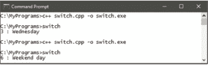


请注意，**default** 语句后面不需要跟 **break** 关键字——因为 **default** 语句总是出现在 **switch** 语句的最后。

### for 循环

循环是程序中自动重复执行的一段代码。循环块中包含的所有语句完整执行一次称为一次“迭代”或“一轮”。


循环执行的迭代次数由循环内进行的条件测试控制。只要被测试的表达式保持为 **true**，循环就会继续——直到被测试的表达式变为 **false**，此时循环结束。

C++ 编程中的三种循环结构是 **for** 循环、**while** 循环和 **do-while** 循环。也许最常用的循环是 **for** 循环，其语法如下：

```
for ( initializer ; test-expression ; incrementer ) { statements }
```

初始化器为循环迭代次数计数器设置起始值。为此使用一个整型变量，传统上命名为“i”。

在循环的每次迭代中，都会对测试表达式求值，并且只有在该表达式为 **true** 时，该次迭代才会继续。当被测试的表达式变为 **false** 时，循环立即结束，不再执行语句。每次迭代时，计数器递增，然后执行语句。

循环可以嵌套在其他循环中——这样，内层循环会在外层循环的每次迭代中完整执行其所有迭代。


- 1. 通过指定要包含的 C++ 库类和要使用的命名空间前缀来开始一个新程序

    ```cpp
    #include <iostream>
    using namespace std ;
    ```

- 2. 添加一个包含最后 **return** 语句的 main 函数

    ```cpp
    int main()
    {
        // Program code goes here.
        return 0 ;
    }
    ```

- 3. 在 main 函数中，插入一条语句，声明一个用作循环迭代计数器的整型变量

    ```cpp
    int i ;
    ```

- 4. 接下来，插入一个 **for** 循环，在三次迭代的每一次中输出计数器值

    ```cpp
    for ( i = 1 ; i < 4 ; i++ )
    {
        cout << "Loop iteration: " << i << endl ;
    }
    ```

- 5. 保存、编译并运行程序以查看输出

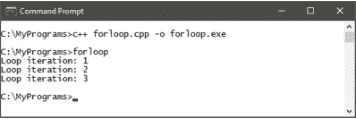

- 6. 现在，编辑变量声明以添加第二个计数器。

    ```cpp
    int i, j;        // Integer variable "j" added.
    ```

- 7. 在 for 循环块内，在输出语句之后添加一个内层循环，在每次迭代中输出其计数器值。

    ```cpp
    for (j = 1; j < 4; j++)
    {
        cout << "Inner loop iteration: " << j << endl;
    }
    ```

- 8. 再次保存、编译并运行程序，以查看内层循环在外层循环的每次迭代中完整执行。

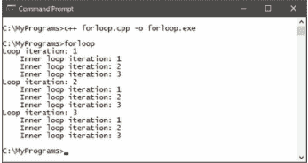


另外，**for** 循环计数器可以通过使用 i-- 而不是 i++ 递增器来递减迭代，从而在每次迭代中倒计数。


在这些循环的第三次迭代中，递增器将计数器值增加到四——因此当下一次求值时，测试返回 false，循环结束。

### while 循环

上面介绍的 **for** 循环的替代方案使用 **while** 关键字，后面跟一个要求值的表达式。当表达式为 **true** 时，将执行测试表达式后面花括号内的语句。随后会再次对该表达式求值，**while** 循环将继续，直到发现该表达式为 **false**。

循环的语句块**必须**包含会影响被测试表达式的代码，以便将求值结果变为 **false**，否则会创建无限循环，从而锁定系统！当被测试表达式在第一次求值时就被发现为 **false** 时，**while** 循环的语句块将永远不会被执行。


如果不小心开始运行无限循环，请按 **Ctrl + C** 键终止进程。

**while** 循环的一个细微变体是将 **do** 关键字放在循环语句块之前，并在其后放置 **while** 测试，语法如下：

```
do { statements-to-be-executed } while ( test-expression ) ;
```

在 **do-while** 循环中，语句块将始终至少执行一次——因为表达式直到循环第一次迭代之后才会求值。

**break** 语句可以包含在任何类型的循环中，以便在满足测试条件时立即终止循环。**break** 确保不再执行该循环的后续迭代。

类似地，**continue** 语句可以包含在任何类型的循环中，以便在满足测试条件时立即终止该次特定迭代。**continue** 语句允许循环继续进行下一次迭代。


#### while.cpp

- 1. 通过指定要包含的 C++ 库类和要使用的命名空间前缀来开始一个新程序

    ```cpp
    #include <vector>              // Include vector support.
    #include <iostream>
    using namespace std ;
    ```

- 2. 添加一个包含最后 **return** 语句的 main 函数

    ```cpp
    int main()
    {
        // Program code goes here.
        return 0 ;
    }
    ```

- 3. 在 main 函数中，插入语句来声明一个整型向量和一个整型变量循环计数器

    ```cpp
    vector <int> vec( 10 );
    int i = 0 ;
    ```

- 4. 接下来，插入一个 **while** 循环，在每次迭代中将计数器值赋给向量的一个元素

    ```cpp
    while ( i < vec.size() )
    {
        i++ ;                     // Increment the counter.
        vec[ i-1 ] = i ;                  // Assign count to element.
        cout << "|" << vec.at( i-1 ) ;
    }
    ```

- 5. 保存、编译并运行程序以查看输出

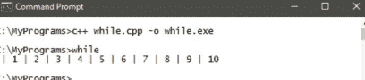

- 6. 编辑 **while** 循环，在递增器之后立即添加一个 **continue** 语句，使循环跳过其第三次迭代

    ```cpp
    if ( i == 3 ) { cout << " | Skipped" ; continue ; }
    ```

- 7. 在 **continue** 语句之后，现在添加一个 **break** 语句，使循环在其第八次迭代时退出

    ```cpp
    if ( i == 8 ) { cout << endl << "Done" ; break ; }
    ```

- 8. 再次保存、编译并运行程序，以查看循环现在省略了一些迭代

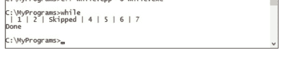


在此示例中，必须使用预处理指令包含 vector 库。


**break** 和 **continue** 语句的位置很重要——它们必须出现在递增器之后，以避免创建无限循环，但要出现在影响程序的其他语句之前，以避免执行那些语句。


### 声明函数

函数封装了一段为程序提供特定功能的代码。当从主程序调用函数时，其语句会被执行，并且可选地，在完成后可以向主程序返回一个值。使用函数有三个主要好处：

- 函数使程序代码更易于理解和维护。
- 经过实践检验的函数可以被其他程序重复使用。
- 在大型项目中，多个程序员可以通过分别处理程序的不同函数来分担工作负载。


### 声明函数

每个函数都在程序代码的前部声明为“原型”，包括其将要返回的值的数据类型，以及函数名后跟括号，括号中可选地包含其所使用传递值的一列“参数”数据类型。函数原型声明的语法如下所示：

```
return-data-type function-name ( arguments-data-type-list ) ;
```


严格来说，函数原型中的参数称为其“形式参数”。

例如，一个名为“computeArea”的函数返回 float 值，并接收两个 float 参数，其声明为：

```cpp
float computeArea( float, float ) ;
```

### 定义函数

函数的定义出现在程序代码的较后位置，包括重复的原型以及实际的函数体。函数体是每当函数被调用时要执行的语句，包含在一对花括号内。


如果函数不向调用者返回值，请使用 `void` 关键字。

重要的是要认识到，编译器会根据原型检查函数定义，因此实际返回的数据类型必须与原型中指定的类型匹配，并且所提供的任何参数都必须在数量和数据类型上匹配。如果定义与原型不匹配，编译就会失败。一个简单的 computeArea 定义可能如下所示：

```cpp
float computeArea( float width, float height )
{
    return ( width * height ) ;
}
```

### 变量作用域

在函数中声明的变量只能在该函数内部局部使用，不能全局访问以用于其他函数。这种限制称为“变量作用域”。


**scope.cpp**

1. 通过指定要包含的 C++ 库类和要使用的命名空间前缀，开始一个新程序。

   ```cpp
   #include <iostream>
   using namespace std;
   ```

2. 接下来，声明两个简单的函数原型。

   ```cpp
   float bodyTempC();
   float bodyTempF();
   ```

3. 现在，添加一个 main 函数，其中包含对每个函数的调用以及最后的 return 语句。

   ```cpp
   int main()
   {
       cout << "Centigrade: " << bodyTempC() << endl;
       cout << "Fahrenheit: " << bodyTempF() << endl;
       return 0;
   }
   ```

4. 在 main 函数之后，定义另外两个函数——让每个函数返回一个局部“temperature”变量的值。

   ```cpp
   float bodyTempC()
   {
       float temperature = 37.0;
       return temperature;
   }

   float bodyTempF()
   {
       float temperature = 98.6;
       return temperature;
   }
   ```

5. 保存、编译并运行程序以查看输出。

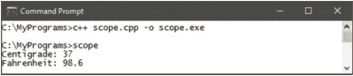


> 同名变量在不同作用域中声明时不会冲突——它们彼此不可见。

### 传递参数

函数调用经常向函数提供参数值。这些值的数量和数据类型可以任意，但它们必须与函数原型声明中指定的内容一致。

注意，传递给函数的参数只提供原始值的一个副本，这一过程称为“按值传递”。

传递给参数的值可以是程序代码中指定的“静态”值，也可以是用户输入的“动态”值。在命令提示符下，可以将 C++ `cin` 函数与 `>>` 输入流运算符一起使用，将来自标准输入的值定向到变量，如下所示：

```cpp
float num ;
cout << "Please enter a number: " ;
cin >> num ;
```

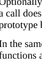

函数原型必须先声明才能定义。通常，原型出现在 main 函数之前，其定义出现在 main 函数之后。

然后可以在函数调用中将输入作为参数传递给函数，例如 `workWith( num )`。

可选地，函数原型可以为参数分配默认值，当调用未传递参数值时将使用这些默认值。可以在原型中为多个参数分配默认值，但这些参数必须始终出现在参数列表的末尾，位于任何其他参数之后。

与可以从 main 函数调用函数的方式相同，函数也可以调用其他函数并传递参数。

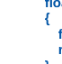

**args.cpp**

1. 通过指定要包含的 C++ 库类和要使用的命名空间前缀，开始一个新程序。

   ```cpp
   #include <iostream>
   using namespace std ;
   ```

2. 接下来，声明一个函数原型，它返回一个 float 值并指定一个 float 参数，并为该参数分配默认值。

   ```cpp
   float fToC ( float degreesF = 32.0 ) ;
   ```

3. 添加一个 main 函数，其中包含最后的 return 语句。

   ```cpp
   int main()
   {
     // Program code goes here.
     return 0 ;
   }
   ```

4. 在 main 函数之后，定义“fToC”函数，其中的语句将返回转换后的值。

   ```cpp
   float fToC( float degreesF )
   {
     float degreesC = ( ( 5.0 / 9.0 ) * ( degreesF - 32.0 ) ) ;
     return degreesC ;
   }
   ```

5. 在 main 函数中，插入一条语句以声明两个 `float` 变量——用于存储输入的华氏温度值及其对应的摄氏温度值。

   ```cpp
   float fahrenheit, centigrade ;
   ```

6. 插入语句，要求将用户输入存储到第一个变量中。

   ```cpp
   cout << "Enter a Fahrenheit temperature:\t" ;
   cin >> fahrenheit ;
   ```

7. 接下来，调用“fToC”函数以转换输入值——并将转换结果赋给第二个变量。

   ```cpp
   centigrade = fToC( fahrenheit ) ;
   ```

8. 现在，输出一条描述结果的消息。

   ```cpp
   cout << fahrenheit << "F is " << centigrade << "C" ;
   ```

9. 最后，添加一条语句，使用函数原型的默认参数值输出另一条消息。

   ```cpp
   cout << endl << "Freezing point: " << fToC() << "C" ;
   ```

10. 保存、编译并运行程序，然后在提示时输入一个数值以查看输出。

    ```text
    C:\MyPrograms>c++ args.cpp -o args.exe
    C:\MyPrograms>args
    Enter a Fahrenheit temperature: 98.6
    98.6F is 37C
    Freezing point: 0C
    C:\MyPrograms>args
    Enter a Fahrenheit temperature: 50
    50F is 10C
    Freezing point: 0C
    C:\MyPrograms>
    ```


与可以从 main 函数调用函数的方式相同，函数也可以调用其他函数并向它们传递参数。


函数定义中为参数和变量指定的名称不必与调用函数中的变量名相同——但这有助于使程序更清晰。

### 重载函数

函数“重载”允许同名函数在同一程序中和谐共存，只要它们的参数在数量、数据类型或数量与数据类型两方面有所不同。编译器通过识别实参的数量和数据类型，将函数调用匹配到函数的正确版本——这一过程称为“函数解析”。

当重载函数要执行的任务相似但又有细微差别时，创建重载函数很有用。


**overload.cpp**

1. 通过指定要包含的 C++ 库类和要使用的命名空间前缀，开始一个新程序。

   ```cpp
   #include <iostream>
   using namespace std;
   ```

2. 在预处理器指令下方，声明一个返回 float 值并具有一个参数的函数原型。

   ```cpp
   float computeArea ( float );
   ```

3. 现在，声明两个重载函数原型——它们具有与第一个原型不同的参数。

   ```cpp
   float computeArea ( float, float );
   float computeArea ( char, float, float );
   ```

4. 在原型声明下方，添加一个 main 函数，其中包含最后的 `return` 语句。

   ```cpp
   int main()
   {
       // Program code goes here.
       return 0;
   }
   ```

5. 在 main 函数之后，定义第一个只接收一个参数的函数。

   ```cpp
   float computeArea( float diameter )
   {
       float radius = ( diameter / 2 );
       return ( 3.141593 * ( radius * radius ) );
   }
   ```


仅返回数据类型不同的函数不能重载——必须不同的是参数。函数解析不考虑返回数据类型。

6. 在第一个函数定义下方，定义接收不同参数的重载函数。

   ```cpp
   float computeArea( float width, float height )
   {
       return ( width * height );
   }
   float computeArea( char letter, float width, float height )
   {
       return ( ( width / 2 ) * height );
   }
   ```

7. 在 main 函数中，插入语句以声明两个变量，并将其中一个初始化为


用户输入

```cpp
float num, area;

cout << "Enter dimension in feet: ";
cin >> num;
```

- 8. 调用第一个函数并输出其返回值

  ```cpp
  area = computeArea(num);
  cout << "Circle: Area = " << area << " sq.ft." << endl;
  ```

- 9. 调用重载函数并输出它们的返回值

  ```cpp
  area = computeArea(num, num);
  cout << "Square: Area = " << area << " sq.ft." << endl;
  area = computeArea('T', num, num);
  cout << "Triangle: Area = " << area << " sq.ft." << endl;
  ```

- 10. 保存、编译并运行程序，然后在提示时输入一个数值，以查看输出

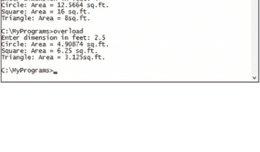

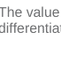

传递给字符参数的值从未被使用——包含该参数仅仅是为了区分那个重载函数。

### 优化函数

函数可以递归地调用自身，以重复执行函数体内的语句——这与循环非常相似。与循环一样，递归函数必须包含一个递增器和一个条件测试，以决定是再次调用自身，还是在满足条件时停止重复。递归函数的语法如下：

```text
return-data-type function-name(argument-list)
{
    statements-to-be-executed;
    incrementer;
    conditional-test-to-recall-or-exit;
}
```

递增器会改变所传递参数的值——因此后续调用会将调整后的值传回函数。


optimize.cpp

- 1. 通过指定要包含的 C++ 库类以及要使用的命名空间前缀，开始一个新程序。

  ```cpp
  #include <iostream>
  using namespace std;
  ```

- 2. 在预处理指令下方，声明两个函数原型，它们都将是递归函数。

  ```cpp
  int computeFactorials(int, int);
  int factorial(int);
  ```

- 3. 在原型声明下方，添加一个主函数，其中包含最终的 **return** 语句。

  ```cpp
  int main()
  {
      // Program code goes here.
      return 0;
  }
  ```

- 4. 在主函数之后，添加第一个函数原型的定义——一个递归函数。

  ```cpp
  int computeFactorials(int num, int max)
  {
      cout << "Factorial of " << num << ": ";
      cout << factorial(num) << endl;     // Statements.
      num++;                              // Incrementer.
      if (num > max) return 0;            // Exit...
      else computeFactorials(num, max);   // Or call again.
  }
  ```


递归函数通常比循环使用更多的系统资源——但它可以使代码更易读。

- 5. 为第二个原型定义一个递归函数。

  ```cpp
  int factorial(int n)
  {
      int result;
      if (n == 1) result = 1;             // Exit or...
  }
  ```

```cpp
else result = (factorial(n - 1) * n); // Decrement.
return result;                        // and call again.
}
```

- 6. 在主函数的开头，插入对递归函数 `computeFactorials(1, 8);` 的调用。

- 7. 保存、编译并运行程序以查看输出

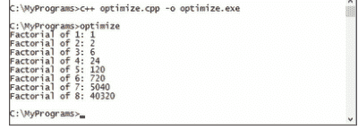


如果你不小心运行了一个无限递归函数，请按 Ctrl + C 键终止进程。

输出列出了阶乘值（例如阶乘 3 是 3 × 2 × 1 = 6，等等），但该程序可以通过优化 `factorial()` 函数来改进。如果使用三元运算符编写，这个函数不需要变量。它随后只包含一条语句，因此它的定义可以替换原型声明，作为一个“内联”声明。这意味着程序无需在声明和定义之间反复检查，从而提高了效率。


内联声明可能只包含一两条语句，因为编译器会在每个调用点重新创建它们——因此，较长的内联声明会产生更加臃肿的程序。

- 8. 删除 `factorial()` 函数定义，然后用以下内联声明替换其原型声明

  ```cpp
  inline int factorial(int n)
  { return (n == 1) ? 1 : (factorial(n - 1) * n); }
  ```

- 9. 再次保存、编译并运行程序，以更高效的方式看到相同的输出

### 总结

- **if** 语句对给定的测试表达式求值，以获得 **true** 或 **false** 的布尔值。
- 只有在求值结果为 **true** 时，**if** 语句后花括号中包含的语句才会被执行。
- **if** 和 **else** 关键字用于根据被测表达式的结果执行条件分支。
- **switch** 语句是条件分支的另一种形式，它将 **case** 语句与给定值进行匹配。
- **for** 循环结构具有声明初始化器、测试表达式以及递增器或递减器的参数。
- **while** 循环和 **do-while** 循环必须在循环体内始终包含递增器或递减器。
- 任何类型的循环都可以通过在循环体内包含一条 **break** 语句来立即终止。
- 任何类型的循环的单个迭代都可以通过在循环体内包含一条 **continue** 语句来跳过。
- 函数通常作为原型在程序开头声明，并在主函数之后定义。
- 函数中声明的变量只能从该函数内部访问，因为它们只具有局部作用域。
- 如果在函数原型和定义中声明了参数，则可以将值传递给函数。
- 重载函数具有相同的名称，但声明的参数数量或类型不同。
- 递归函数会反复调用自身，直到满足测试条件。
- 可以使用 **inline** 关键字将仅包含一两条语句的简短函数定义声明为原型。

## 4 处理字符串

本章演示如何将 C++ 文本字符串作为字符数组更简单、更强大的替代方案来操作。

- 创建字符串变量
- 获取字符串输入
- 解决字符串问题
- 发现字符串特性
- 连接和比较字符串
- 复制和交换字符串
- 查找子字符串
- 替换子字符串
- 总结

### 创建字符串变量

与 **char**、**int**、**float**、**double** 和 **bool** 数据类型不同，C++ 中没有原生的“字符串”数据类型——但其 **<string>** 库类提供了一个模拟字符串数据类型的 **string** 对象。要使该对象在程序可用，必须在程序开头添加 **#include <string>** 指令。


与 **<iostream>** 类库一样，**<string>** 库是 C++ 标准库类所使用的 **std** 命名空间的一部分。这意味着 string 对象可以被称为 **std::string**，或者当程序开头包含 **using namespace std;** 指令时，更简单地称为 **string**。

一旦 **<string>** 库可用，就可以像声明其他变量一样声明 **string** “变量”。声明可以选择使用 **=** 赋值运算符初始化变量，也可以稍后在程序中初始化。

此外，**string** 变量可以通过在变量名后放置括号并包含文本字符串来初始化。

C++ 中的文本字符串必须始终用“ ”双引号括起来——‘ ’单引号仅用于包围 **char** 数据类型的字符值。

C++ **string** 变量比 C 程序员必须使用的 **char** 数组更容易使用，因为它会自动调整大小以适应任何文本字符串的长度。在较低层次上，文本仍然存储为字符数组，但 **string** 变量让您可以忽略这些细节。因此，可以使用 **=** 赋值运算符将字符数组赋值给 **string** 变量。

需要记住的是，当数值被赋值给 **string** 变量时，它们不再是数值数据类型，因此无法对其进行算术运算。例如，尝试使用 **+** 加法运算符将 **string** 值“7”和“6”相加，会得到拼接后的字符串 **“76”**，而不是数值 13。在这种情况下，**+** 运算符会识别到上下文不是算术运算，因此采用“连接运算符”的形式将两个字符串连接起来。类似地，**+=** 运算符会将一个 **string** 追加到另一个 **string**，这在构建长文本字符串时很有用。

在下面描述的示例程序中，几个 **string** 值被构建成一个长字符串。


- 1. 通过指定要包含的 C++ 库类以及要使用的命名空间前缀，开始一个新程序

  ```cpp
  #include <string>       // Include string support.
  #include <iostream>
  using namespace std;
  ```

- 2. 添加一个主函数，其中包含四个 **string** 变量声明和一条最终的 **return** 语句

  ```cpp
  int main()
  ```


```cpp
{
   string text = "9" ;
   string term( "9" );
   string info = "Toys" ;
   string color ;
   // Add more statements here.
   return 0 ;
}
```

- 3. 在 main 函数中，在变量声明之后插入语句，声明并初始化一个字符数组，然后将其值赋给未初始化的**字符串**变量
  
  ```cpp
  char hue[4] = { 'R', 'e', 'd', '\0' } ;
  color = hue ;
  ```

- 4. 将一个较长的文本**字符串**赋给其中一个**字符串**变量
  
  ```cpp
  info = "Balloons" ;
  ```

- 5. 通过将第一个**字符串**变量中的所有**字符串**变量值组合起来，构建一个长**字符串**，然后输出组合后的**字符串**值
  
  ```cpp
  text += ( term + color + info ) ;
  cout << endl << text << endl ;
  ```

- 6. 保存、编译并运行程序以查看输出


记住添加特殊的 \0 字符，以标记字符数组中字符串的结束。

### 获取字符串输入

上一章介绍的用于输入数值的 C++ **cin** 函数，也可以将文本输入赋给**字符串**变量。但这有一个限制：它一次只能用于输入单个单词——**cin** 函数在遇到空格时停止读取输入，并将其他任何文本留在“输入缓冲区”中。

当你想允许用户输入带空格的字符串（例如一句话）时，可以使用 **getline()** 函数。该函数需要两个参数来指定字符串的源和目标。例如，**cin** 函数作为源，名为“str”的字符串变量作为目标：

```cpp
getline( cin , str ) ;
```

**getline()** 函数从输入“流”中读取，直到遇到行末的 **\n** 换行符——该换行符是在按 Return 键时产生的。

混合使用 **cin** 和 **getline()** 函数时必须小心，因为 **getline()** 函数会自动读取输入缓冲区中遗留的任何内容——让人感觉程序跳过了一条指令。可以使用 **cin.ignore()** 函数忽略输入缓冲区中遗留的内容，从而克服此问题。


- 1. 通过指定要包含的 C++ 库类和要使用的命名空间前缀，开始一个新程序
  
  ```cpp
  #include <string>       // Include string support.
  #include <iostream>
  using namespace std ;
  ```

- 2. 添加一个 main 函数，其中包含一个字符串变量声明和最后的 **return** 语句
  
  ```cpp
  int main()
  {
      string name ;
      // Add more statements here.
      return 0 ;
  }
  ```

- 3. 在 main 函数中，插入语句，将用户名输入赋给一个字符串变量，然后输出其值
  
  ```cpp
  cout << "Please enter your full name: " ;
  cin >> name ;
  cout << "Welcome " << name << endl ;
  ```

- 4. 接下来，插入一条再次请求用户名的语句，但这次在输出其值之前，使用 **getline** 函数将输入赋给**字符串**变量
  
  ```cpp
  cout << "Please re-enter your full name: " ;
  getline( cin , name ) ;
  cout << "Thanks," << name << endl ;
  ```

- 5. 保存、编译并运行程序，并在要求时输入你的全名

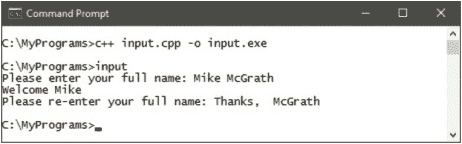

这个不理想的结果表明，**cin** 会一直读取到第一个空格，将第二个名字留在输入缓冲区中，随后该名字会被 **getline()** 读取并输出。即使你只输入名字，问题仍然存在，因为 **cin** 会将按 Return 键时产生的换行符留在输入缓冲区中。

- 6. 编辑程序以解决此问题：在调用 **getline** 函数之前插入一条语句，指示它忽略输入缓冲区中的内容。
  
  ```cpp
  cin.ignore(256, '\n');
  ```

- 7. 再次保存、编译并运行程序，然后重新输入你的全名，以查看程序按需运行。

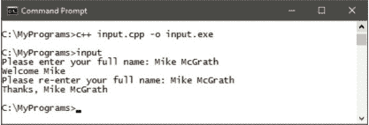


数值输入或单个单词输入使用 **cin** 函数，但字符串输入使用 **getline()** 函数。


**cin.ignore()** 函数的参数指定它应丢弃最多 256 个字符，并在遇到换行符时停止。

### 解决字符串问题

当你需要将**字符串**变量转换为其他数据类型时（例如要用这些值执行算术运算），就会出现问题。由于 **字符串** 对象不是 C++ 原生数据类型，**字符串**变量值无法通过强制转换转换为 **int** 或任何其他常规数据类型。

C++ **<sstream>** 库提供了解决方案，它允许 **stringstream** 对象充当中间媒介，通过该媒介可以将**字符串**值转换为数值数据类型，也可以将数值转换为**字符串**数据类型。要让程序具备此能力，必须在程序开头使用 **#include <sstream>** 指令添加该库。

可以使用与 **cout** 语句一起使用的熟悉输出流 **<<** 运算符，将值加载到 **stringstream** 对象中。然后可以使用与 **cin** 语句一起使用的 **>>** 输入流运算符，从 **stringstream** 对象中提取内容。

为了重新使用 **stringstream** 对象，必须先将其恢复为原始状态。这需要将其内容设置为空**字符串**，并清除其位标志。


- 1. 通过指定要包含的 C++ 库类和要使用的命名空间前缀，开始一个新程序
  
  ```cpp
  #include <string>      // Include string support.
  #include <sstream>      // Include stringstream support.
  #include <iostream>
  using namespace std;
  ```

- 2. 添加一个 main 函数，其中包含最后的 **return** 语句，并声明两个已初始化、要转换的变量
  
  ```cpp
  int main()
  {
      string term = "100";
      int number = 100;
      // Add more statements here.
      return 0;
  }
  ```

- 3. 在 main 函数中，插入语句以声明一个整数变量、一个**字符串**变量和一个 **stringstream** 对象
  
  ```cpp
  int num;              // To store a converted string.
  string text;          // To store a converted integer.
  stringstream stream;  // To perform conversions.
  ```

- 4. 接下来，使用流输出运算符将已初始化的**字符串**值加载到 **stringstream** 对象中
  
  ```cpp
  stream << term;      // Load the string.
  ```

- 5. 使用流输入运算符从 **stringstream** 对象中提取内容到未初始化的整数变量中
  
  ```cpp
  stream >> num;       // Extract the integer.
  ```

- 6. 对该整数执行算术运算并输出结果
  
  ```cpp
  num /= 4;
  cout << "Integer value: " << num << endl;
  ```

- 7. 重置 **stringstream** 对象以备重新使用
  
  ```cpp
  stream.str("");      // Empty the contents.
  stream.clear();       // Empty the bit flags.
  ```

- 8. 现在，使用流输出运算符将已初始化的整数值加载到 **stringstream** 对象中
  
  ```cpp
  stream << number ;    // Load the integer.
  ```

- 9. 使用流输入运算符从 **stringstream** 对象中提取内容到未初始化的**字符串**变量中
  
  ```cpp
  stream >> text ;    // Extract the string.
  ```

- 10. 对该**字符串**执行拼接并输出结果
  
  ```cpp
  text += " Per Cent" ;
  cout << "String value: " << text << endl ;
  ```

- 11. 保存、编译并运行程序以查看转换后的输出值

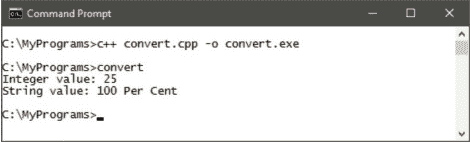


请注意，这里如何使用 **stringstream** 对象的 `str()` 函数将其内容重置为空字符串。


非空 **stringstream** 对象具有指示其状态为 good、bad、eof 或 fail 的位标志——如这里所示，在重新使用之前，应通过 **stringstream** 对象的 `clear()` 函数清除这些标志。


### 探索字符串特性

C++ `<string>` 库提供了许多函数，使处理字符串变得轻松。要使用它们，只需在 **string** 变量名后加上函数名和一个点。例如，对于名为“msg”的 **string** 变量，可以调用 **size()** 函数，通过 **msg.size()** 返回其字符长度。

通过将一个由两个双引号且中间没有空格组成的空字符串（即 ""）赋给 **string** 变量，可以清空其中的所有字符；或者也可以调用 `<string>` 库的 **clear()** 函数来清空。

与 **char** 数组不同，**string** 变量会动态扩大，以容纳分配给它的字符数量；其当前内存大小可以通过 `<string>` 库的 **capacity()** 函数获知。一旦扩大，即使给该变量分配一个更小的 **string**，已分配的内存大小仍会保留。


**length()** 函数可以代替 **size()** 函数来显示字符串值的大小。

`<string>` 库的 **empty()** 函数返回布尔值 **true (1)** 或 **false (0)**，以显示字符串是否为空。


features.cpp

- 1. 通过指定要包含的 C++ 库类和要使用的命名空间前缀，开始一个新程序。

  ```cpp
  #include <string>       // Include string support.
  #include <iostream>
  using namespace std;
  ```

- 2. 在预处理器指令下方，声明一个带单个 string 数据类型参数的函数原型。

  ```cpp
  void computeFeatures( string );
  ```

- 3. 添加一个 main 函数，其中包含最后的 **return** 语句，并声明一个已初始化的 **string** 变量。

  ```cpp
  int main()
  {
      string text = "C++ is fun";
      // Add more statements here.
      return 0;
  }
  ```

- 4. 在 main 函数之后，定义已声明的函数，使其在被调用时显示该 **string** 变量的值。

  ```cpp
  void computeFeatures( string text )
  {
      cout << endl << "String: " << text << endl ;
  }
  ```

- 5. 在函数定义中，添加语句以输出该 **string** 变量的特性。

  ```cpp
  cout << "Size: " << text.size() ;
  cout << "Capacity: " << text.capacity() ;
  cout << "Empty?: " << text.empty() << endl ;
  ```

- 6. 在 main 函数中，插入对已定义函数的调用

  ```cpp
  computeFeatures( text );
  ```

- 7. 接下来，在 main 函数中插入一条语句以扩大该 **string** 值，并调用该函数查看其特性

  ```cpp
  text += " for everyone";
  computeFeatures( text );
  ```

- 8. 现在，插入一条语句以缩小该 **string** 值

  ```cpp
  text = "C++ Fun";
  computeFeatures( text );
  ```

- 9. 最后，插入一条语句以清空该 **string** 变量

  ```cpp
  text.clear();
  computeFeatures( text );
  ```

- 10. 保存、编译并运行程序以查看输出

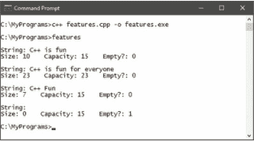


**empty()** 函数可用于检查用户是否已输入所请求的输入。


空格占用一个内存元素——就像字符一样。

### 连接与比较字符串

当在赋值中使用 **+** 运算符连接字符串时，合并后的字符串会存储到 **string** 变量中。但是当它与 **cout** 函数一起使用时，字符串只在输出中合并——变量值不变。

**<string>** 库的 **append()** 函数也可以用于连接字符串，将要追加的 **string** 值指定为其括号内的参数。当它与 **cout** 函数一起使用时，字符串会在变量中合并，然后其值作为输出写出——在这种情况下，变量值确实会改变。

可以使用 **==** 相等运算符进行字符串比较，方式与数值比较相同。当两个字符串完全匹配时，它返回 **true** (1)，否则返回 **false** (0)。

或者，可以使用 **<string>** 库的 **compare()** 函数来比较指定为其参数的 **string** 值。与 **==** 相等比较不同，**compare()** 函数在字符串相同时返回零，这是通过检查 **string** 值的组合 ASCII 码值来实现的。当 **string** 参数的总值大于第一个字符串时，它返回 -1，否则返回 1。


- 1. 通过指定要包含的 C++ 库类和要使用的命名空间前缀，开始一个新程序。

  ```cpp
  #include <string>       // Include string support.
  #include <iostream>
  using namespace std;
  ```

- 2. 添加一个 main 函数，其中包含最后的 **return** 语句，并声明三个已初始化的 string 变量。

  ```cpp
  int main()
  {
      string lang = "C++";
      string term = "Programming";
      string text = "C++ Programming";
      // Add more statements here.
      return 0;
  }
  ```

- 3. 在 main 函数中，插入语句以输出用 **+** 连接运算符合并的两个 **string** 值，以及第一个变量的（未改变的）值。

  ```cpp
  cout << "Concatenated: " << (lang + term) << endl;
  cout << "Original: " << lang << endl;
  ```

- 4. 接下来，插入语句以输出用 **append()** 函数合并的两个 **string** 值，以及第一个变量的（已改变的）值。

  ```cpp
  cout << "Appended: " << lang.append(term) << endl;
  cout << "Original: " << lang << endl;
  ```

- 5. 使用 **==** 相等运算符比较两个不同的 **string** 值，然后比较两个匹配的 **string** 值。

  ```cpp
  cout << "Differ: " << (lang == term) << endl;
  cout << "Match: " << (lang == text) << endl << endl;
  ```

- 6. 现在，使用 **compare()** 函数比较三个 **string** 值，检查它们的 ASCII 码总值。

  ```cpp
  cout << "Match: " << lang.compare(text) << endl;
  cout << "Differ: " << lang.compare(term) << endl;
  cout << "Lower ASCII: " << lang.compare("zzzz") << endl;
  ```

- 7. 保存、编译并运行程序以查看输出。

```
    C:\MyPrograms>c++ compare.cpp -o compare.exe
    C:\MyPrograms>compare
    Concatenated: C++ Programming
    Original: C++ Programming
    Appended: C++ Programming
    Original: C++ Programming
    Differ: 0
    Match: 1
    Match: 0
    Differ: 1
    Lower ASCII: -1
    C:\MyPrograms>
```


+= 赋值运算符也可以用于追加字符串。


在比较中会考虑字符顺序——因此将“za”与“az”比较可以看出，“za”的总值更大。就 ASCII 值而言，'a' 是 97，'z' 是 122。

### 复制与交换字符串

可以通过 **=** 赋值运算符，或通过 **<string>** 库的 **assign()** 函数，将字符串值赋给 **string** 变量。该函数将要复制到变量中的 **string** 值指定为其括号内的参数。

可选地，**assign()** 函数可以通过将起始字符的位置指定为第二个参数、将要复制的字符数指定为第三个参数，只复制指定 **string** 值的一部分。

可以通过 **<string>** 库的 **swap()** 函数，将一个 **string** 变量的内容与另一个 **string** 变量的内容交换。在这种情况下，第一个变量接收第二个变量的内容，而第二个变量反过来接收第一个变量的内容。


swap.cpp

- 1. 通过指定要包含的 C++ 库类和要使用的命名空间前缀，开始一个新程序。

  ```cpp
  #include <string>       // Include string support.
  #include <iostream>
  using namespace std ;
  ```

- 2. 添加一个 main 函数，其中包含最后的 **return** 语句，并声明三个 **string** 变量——其中一个已初始化。

  ```cpp
  int main()
  {
      string front ;
      string back ;
      string text =
      "Always laugh when you can. It's cheap medicine." ;
      // Add more statements here.
      return 0 ;
  }
  ```

- 3. 在 main 函数中，插入一条语句，将已初始化的 **string** 变量的整个值赋给第一个未初始化的 **string** 变量。

  ```cpp
  front.assign( text ) ;
  ```

- 4. 接下来，插入一条语句以输出新赋值的 **string** 值。

  ```cpp
  cout << endl << "Front: " << front << endl ;
  ```

- 5. 现在，插入一条语句，仅将已初始化变量的前 27 个字符赋给第一个变量。

  ```cpp
  front.assign( text, 0, 27 ) ;
  ```

- 6. 输出新赋值的 **string** 值。

  ```cpp
  cout << endl << "Front: " << front << endl ;
  ```

- 7. 接下来，仅将已初始化的 **string** 变量的最后一部分赋给第二个未初始化的变量，从字符（元素）27 开始。

  ```cpp
  back.assign( text, 27, text.size() ) ;
  ```

- 8. 现在，输出这个新赋值的 **string** 值。

  ```cpp
  cout << "Back: " << back << endl ;
  ```

- 9. 最后，交换第一个和第二个 **string** 变量中包含的已赋值 **string** 值，然后输出交换后的值。

  ```cpp
  back.swap( front ) ;
  cout << endl << "Front: " << front << endl ;
  cout << "Back: " << back << endl ;
  ```


- 10. 保存、编译并运行程序以查看输出

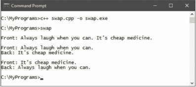


使用`=`赋值运算符分配完整字符串，使用**assign()**函数分配部分字符串。


尽可能使用**swap()**函数，而不是创建额外的字符串变量。

### 查找子字符串

可以使用**<string>**库的**find()**函数搜索字符串值，以查看其是否包含指定的“子字符串”。其括号应将要查找的子字符串指定为第一个参数，并将开始搜索的字符的索引号指定为第二个参数。

当搜索成功找到指定子字符串时，**find()**函数返回子字符串第一个字符在被搜索字符串中首次出现的索引号。当搜索失败时，**find()**返回-1以表示失败。

**<string>**库中还有几个与**find()**函数相关的其他函数。其中两个是**find_first_of()**函数和**find_first_not_of()**函数。**find_first_of()**函数不是像**find()**那样查找完整**string**的首次出现，而是查找指定**string**中任意字符的首次出现，而**find_first_not_of()**则查找不在指定**string**中的字符的首次出现。

**find_last_of()**和**find_last_not_of()**函数的工作方式类似——但从**string**的末尾开始搜索，然后向前移动。


- 1. 通过指定要包含的C++库类和要使用的命名空间前缀来启动新程序

```cpp
#include <string>       // Include string support.
#include <iostream>
using namespace std;
```

- 2. 添加一个main函数，其中包含最后的return语句、已初始化的string变量声明，以及声明一个用于存储搜索结果的整数变量

```cpp
int main()
{
    string text = "I can resist anything but temptation.";
    int num;
    // Add more statements here.
    return 0;
}
```

- 3. 在main函数中，插入语句以输出子字符串在整个**string**变量中的起始位置

```cpp
num = text.find("resist", 0);
cout << "Position: " << num << endl;
```

- 4. 接下来，插入一条语句以在整个**string**变量中查找不存在的子字符串，并输出结果

```cpp
num = text.find("nonsuch", 0);
cout << "Result: " << num << endl;
```

- 5. 现在，插入一条语句以输出在整个**string**变量中找到的“If”子字符串中任意字符首次出现的起始位置

```cpp
num = text.find_first_of("If");
cout << "First :" << num << endl;
```

- 6. 插入一条语句以报告不在“If”子字符串中的第一个字符的字符串位置

```cpp
num = text.find_first_not_of("If");
cout << "First not :" << num << endl;
```

- 7. 接下来，插入一条语句以查找字母“t”在**string**变量中的最后一次出现，并输出其位置

```cpp
num = text.find_last_of("t");
cout << "Last t: " << num << endl;
```

- 8. 现在，添加一条语句以报告字符串变量中不是“t”的最后一个字符的字符串位置

```cpp
num = text.find_last_not_of("t");
cout << "Last not t: " << num << endl;
```

- 9. 保存、编译并运行程序以查看搜索结果，这些结果指示失败或找到时的位置

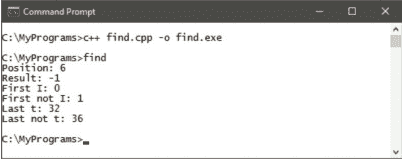


搜索区分大小写，因此查找“If”和“if”可能会产生不同结果——此处大写‘I’匹配。


字符串中的第一个字符位于位置零，而不是位置一。

### 替换子字符串

**<string>**库包含许多用于操作子字符串的有用函数。可以使用**insert()**函数将一个**string**插入另一个**string**中。这要求将应插入**string**的索引位置作为第一个参数，并将要插入的**string**值作为第二个参数。

相反，可以使用**erase()**函数从**string**中删除子字符串。这要求将开始擦除的索引位置作为第一个参数，并将要擦除的字符数作为第二个参数。

**replace()**函数巧妙地将**erase()**和**insert()**函数结合起来，既删除子字符串又插入替换内容。它需要三个参数，分别指定开始擦除的位置、要擦除的字符数，以及在该位置插入的替换**string**。

可以使用**substr()**函数从**string**中复制子字符串，将开始复制的索引位置作为第一个参数，并将要复制的字符数作为第二个参数。

可以使用**at()**函数复制**string**中任意指定位置的字符，该函数需要索引位置作为其参数。**string**中的最后一个字符的元素索引号总是比**string**的长度小一——因为索引编号从零开始，而不是从一开始。


- 1. 通过指定要包含的C++库类和要使用的命名空间前缀来启动新程序

```cpp
#include <string>              // Include string support.
#include <iostream>
using namespace std;
```

- 2. 添加一个main函数，其中包含最后的**return**语句、已初始化的**string**变量声明，以及一条输出**string**变量值的语句

```cpp
int main()
{
    string text = "I do like the seaside";
    cout << "Original: " << text << endl;
    // Add more statements here.
    return 0;
}
```

- 3. 在main函数中，插入语句以在索引位置10处将子字符串插入变量值中，并输出修改后的**string**

```cpp
text.insert(10, "to be beside");
cout << "Inserted: " << text << endl;
```

- 4. 接下来，插入语句以从修改后的**string**值中从索引位置2开始擦除三个字符，并输出修订后的**string**

```cpp
text.erase(2, 3);
cout << "Erased: " << text << endl;
```

- 5. 现在，插入语句以在索引位置7处移除25个字符，插入替换子字符串，然后再次输出修订后的**string**

```cpp
text.replace(7, 25, "strolling by the sea");
cout << "Replaced: " << text << endl;
```

- 6. 最后，插入语句以输出索引位置7处复制的九个字符，并输出字符串中的最后一个字符

```cpp
cout << "Copied: " << text.substr(7, 9) << endl;
cout << "Last character: " << text.at(text.size() - 1) << endl;
```

保存、编译并运行程序以查看输出，显示字符串是如何被操作的

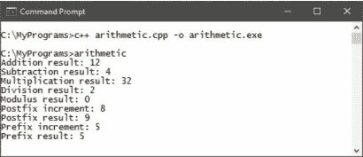


**insert()**函数可以选择具有第三个和第四个参数——指定子字符串中开始复制的位置以及要复制的字符数。


**replace()**函数可以选择具有第四个和第五个参数——指定子字符串中开始复制的位置以及要复制的字符数。


### 小结

- C++ **`<string>`** 库提供了一个模拟数据类型的“字符串”对象，因此可以创建**字符串**变量。
- 不能对赋给**字符串**变量的数值执行算术运算，除非先将它们转换为数值数据类型。
- 标准**cin**函数从标准输入读取，直到遇到空格，因此可用于输入单个单词，并提供**ignore()**函数来忽略输入缓冲区。
- **getline()**函数从标准输入读取，直到遇到换行符，因此可用于输入一行文本。
- C++ **`<sstream>`** 库提供了一个“stringstream”对象，作为将字符串转换为其他数据类型的中间媒介。
- **字符串**变量可以通过赋空字符串（**= ""**）或调用其**clear()**函数来清空。
- 通过调用其**size()**、**capacity()**和**empty()**函数可以显示**字符串**变量的特性。
- 多个**字符串**值可以通过**+**运算符连接。
- 一个**字符串**可以通过**+=**运算符或调用其**append()**函数追加到另一个**字符串**。
- 一个**字符串**可以通过**==**运算符或调用其**compare()**函数与另一个**字符串**进行比较。
- 可以使用**=**运算符或调用其**assign()**函数将**字符串**值赋给**字符串**变量。
- **swap()**函数交换两个**字符串**变量的值。
- 可以使用**find()**函数或**find_first_of()**等专用函数查找**字符串**的子字符串，并通过**at()**函数从指定索引位置获取字符。
- 可以使用**insert()**函数向**字符串**添加子字符串，使用**erase()**函数删除子字符串，使用**replace()**函数替换子字符串，或使用**substr()**函数复制子字符串。

## 5 读写文件

*本章演示如何在文本文件中存储和检索数据，并说明如何避免C++程序中的错误。*

- 写入文件
- 追加到文件
- 读取字符与行
- 使用getline格式化
- 操作输入与输出
- 预测问题
- 识别异常
- 处理错误
- 小结

### 写入文件

程序具备读写文件的能力，这是在计算机硬盘上维护数据的一种有用方法。数据格式可以指定为人类可读的纯文本格式或机器可读的二进制格式。

标准C++ **`<fstream>`** 库提供了处理文件的函数，可以通过在程序开头添加**`#include <fstream>`**指令来使用这些函数。

对于每个要打开的文件，必须首先创建一个文件流对象。该对象可以是“**ofstream**”（输出文件流）对象，用于将数据写入文件，也可以是“**ifstream**”（输入文件流）对象，用于从文件读取数据。**ofstream**对象的使用方式类似于写入标准输出的**cout**函数，而**ifstream**对象的工作方式类似于从标准输入读取的**cin**函数。

要声明一个用于写入输出的文件流对象，以**ofstream**关键字开头，接着是该特定文件流对象的选定名称，后跟指定要写入的文本文件的括号。因此，声明语法如下所示：

```cpp
ofstream object-name ( "file-name" ) ;
```

指定文本文件的参数可以可选地包含完整文件路径，例如`C:\datalog.txt`或`/home/user/log.txt`，否则程序将在其所在目录中查找该文件。

在将输出写入文件之前，程序应始终首先测试文件流对象是否已实际创建。通常，这通过**if**语句执行，该语句仅当测试成功时才允许程序写入输出。

如果指定文件已存在，默认情况下将被覆盖而不发出警告。否则，将创建并写入一个新文件。

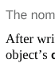

指定的文件名或路径必须用双引号括起来，就像字符串一样。

向指定文件写入输出后，程序应始终调用关联文件流对象的**`close()`**函数来关闭输出文件流。

下面描述的程序首先构建一个字符串作为输出。当文件流对象成功创建后，该字符串被写入指定文件，然后关闭文件流。


- 1. 通过指定要包含的C++库类和要使用的命名空间前缀来开始一个新程序。
  
  ```cpp
  #include <fstream>      // Include filestream support.
  #include <string>
  #include <iostream>
  using namespace std ;
  ```

- 2. 添加一个main函数，其中包含一个最终的**return**语句，并在一个**字符串**变量中构建一段较长的文本字符串。
  
  ```cpp
  int main()
  {
      string poem = "I never saw a man who looked";
      poem.append( "\n\tWith such a wistful eye" );
      poem.append( "\n\tUpon that little tent of blue" );
      poem.append( "\n\tWhich prisoners call the sky" );
      // Add more statements here.
      return 0;
  }
  ```

- 3. 在main函数中，创建一个输出文件流对象。
- 4. 插入用于将字符串写入文件或退出的语句，然后保存、编译并运行程序以查看结果。
  
  ```cpp
  if ( ! writer )
  {
      cout << "Error opening file for output" << endl ;
      return -3 ;    // Signal an error then exit the program.
  }
  writer << poem << endl ;        // Write output.
  writer.close() ;                 // Close filestream.
  ```

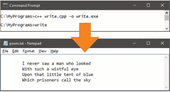


字符串值可以包含`\n`换行符和`\t`制表符转义序列，用于格式化行。


注意换行符和制表符在文本文件中是如何保留的。

### 追加到文件

创建文件流对象时，其名称后的括号可以可选地包含附加参数，用于指定一系列文件“模式”来控制该文件流对象的行为。这些文件模式属于**ios**命名空间的一部分，因此必须使用该前缀显式指定。下表中列出了每种文件模式及其行为描述：

| 模式 | 行为 |
|---|---|
| **ios::out** | 打开文件以写入输出 |
| **ios::in** | 打开文件以读取输入 |
| **ios::app** | 打开文件，在任何现有内容的末尾追加输出 |
| **ios::trunc** | 截断现有文件（默认行为） |
| **ios::ate** | 打开文件而不截断，并允许将数据写入文件中的任何位置 |
| **ios::binary** | 将文件视为二进制格式而非文本格式，以便数据可以非文本格式存储 |


预处理器指令**using namespace std;**允许省略**std**命名空间前缀——因此**cout**指的是**std::cout**函数。**ios**命名空间存在于**std**命名空间内——因此可以使用两个命名空间前缀显式指定文件模式，例如**std::ios::out**。

如果多个模式用`|`管道字符分隔，则可以指定多个模式。例如，打开文件进行二进制输出的语句语法如下：

```cpp
ofstream object-name ( "file-name" , ios::out|ios::binary );
```

当未显式指定模式时，默认行为是将文件视为文本文件，并在写入后截断。

最常指定的模式是**ios::app**，它确保当新输出写入指定文件时，现有内容将被追加，而不是被覆盖。

下面描述的程序将数据追加到上一个示例创建的文本文件中。


append.cpp

- 1. 通过指定要包含的C++库类和要使用的命名空间前缀来开始一个新程序。
  
  ```cpp
  #include <fstream>    // Include filestream support.
  #include <string>
  #include <iostream>
  using namespace std ;
  ```

- 2. 添加一个main函数，其中包含一个最终的**return**语句，并在一个**字符串**变量中构建一个文本字符串。
  
  ```cpp
  int main()
  {
  ```


```cpp
string info = "\n\tThe Ballad of Reading Gaol" ;
info.append( "\n\t\tOscar Wilde 1898" );
// Add more statements here.
return 0 ;
}
```

- 3. 在主函数中，创建一个输出文件流对象——指定一种文件模式，该模式将追加到现有文本

```cpp
ofstream writer( "poem.txt" , ios::app );
```

- 4. 插入将字符串追加到文件或退出的语句，然后保存、编译并运行程序以查看结果

```cpp
if ( ! writer )
{
    cout << "Error opening file for output" << endl ;
    return -1 ;      // Signal an error then exit the program.
}
writer << info << endl ;      // Append output.
writer.close() ;              // Close filestream.
```

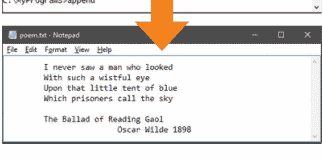


文件必须允许程序拥有合适的读写权限。

### 读取字符与行

**ifstream** 文件流对象有一个 **get()** 函数，可以在循环中使用该函数读取文件，并依次将每个字符赋给作为其参数指定的 **char** 变量：


- 1. 通过指定要包含的 C++ 库类和要使用的命名空间前缀，开始一个新程序

```cpp
#include <fstream>     // Include filestream support.
#include <iostream>
using namespace std ;
```

- 2. 添加一个包含最终 **return** 语句和两个变量声明的主函数——一个变量用于存储字符，另一个用于统计循环迭代次数

```cpp
int main()
{
  char letter ;
  int i ;
  // Add more statements here.
  return 0 ;
}
```

- 3. 在主函数中，创建一个输入文件流对象，以读取前面示例中的文本文件

```cpp
ifstream reader( "poem.txt" ) ;
```

- 4. 插入语句，如果文件流对象不存在则退出

```cpp
if ( ! reader )
{
  cout << "Error opening input file" << endl ;
  return -1 ;    // Signal an error then exit the program.
}
```

- 5. 接下来，插入一个循环读取文本文件，依次将每个字符赋给变量并输出其值

```cpp
else
for ( i = 0 ; ! reader.eof() ; i++ )
{
  reader.get( letter ) ;
  cout << letter ;
}
```

- 6. 最后，插入语句关闭文件流并输出循环迭代的总次数

```cpp
reader.close() ;
cout << "Iterations: " << i << endl ;
```


请注意 ifstream 的 eof() 函数如何用于检查是否已到达“文件末尾”。

- 7. 保存、编译并运行程序，查看文本文件内容和循环次数显示在标准输出上

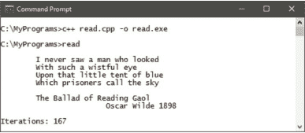

这个程序运行得还算不错，但循环必须进行多次迭代才能输出文本文件的内容。可以通过在每次循环迭代中读取一行来提高效率：

- 8. 插入一个预处理指令，使 C++ string 库可被程序使用

```cpp
#include <string>
```

- 9. 将 `char` 变量声明替换为 `string` 变量声明

```cpp
string line ;
```

- 10. 替换 `for` 循环中的两条语句以读取行，然后再次保存、编译并运行程序

```cpp
getline( reader , line ) ;
cout << line << endl ;
```

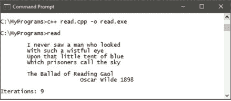


在每行输出后输出一个 **endl**——因为 **getline()** 在遇到 `\n` 换行符时会停止读取。

### 使用 getline 格式化

**getline()** 函数可以选择使用第三个参数来指定停止读取行的分隔符。这可用于分隔从数据文件中的制表列表读取的文本：


format.cpp

- 1. 在纯文本编辑器中，创建一个包含 12 个数据项的文本文件，每行四个项目，每个项目之间用制表符分隔。


- 2. 通过指定要包含的 C++ 库类和要使用的命名空间前缀，开始一个新程序。

```cpp
#include <fstream>    // Include filestream support.
#include <string>
#include <iostream>
using namespace std;
```

- 3. 添加一个包含最终 **return** 语句和四个变量声明的主函数——一个固定数字、一个用于存储数据的 **string** 数组，以及两个设置为零的计数器变量。

```cpp
int main()
{
    const int RANGE = 12 ;
    string tab[RANGE] ;
    int i = 0, j = 0 ;
    // Add more statements here.
    return 0 ;
}
```

- 4. 插入一条语句以创建输入文件流对象。

```cpp
ifstream reader("records.txt");
```

- 5. 插入语句，如果文件流对象不存在则退出。

```cpp
if ( ! reader )
{
    cout << "Error opening input file" << endl ;
    return -1 ;
}
```


string 数组必须具有足够数量的元素来存储每个数据项——如果需要处理更多记录，则需要扩大数组。

- 6. 接下来，插入一个循环，将每一行读取到 **string** 数组中——对于前三项，读取到 **\t** 制表符为止；对于每行的第四项，读取到 **\n** 换行符为止。

```cpp
while ( ! reader.eof() )
{
    if ( (i + 1) % 4 == 0 )
        getline( reader, tab[i++], '\n' );
    else
        getline(reader, tab[i++], '\t');
}
```

- 7. 现在，关闭文件流并重置计数器

```cpp
reader.close();
i = 0;
```

- 8. 插入第二个循环，输出存储在每个数组元素中的数据，并使用描述和换行符进行格式化

```cpp
while (i < RANGE)
{
    cout << endl << "Record Number: " << ++i << endl ;
    cout << "Forename: " << tab[i++] << endl ;
    cout << "Surname: " << tab[i++] << endl ;
    cout << "Department: " << tab[i++] << endl ;
    cout << "Telephone: " << tab[i++] << endl ;
}
```

- 9. 保存、编译并运行程序，查看文本文件的格式化输出

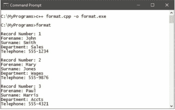


if 语句测试项目编号（元素编号加 1）是否能被四整除，以确定读取到换行符还是制表符。


记录计数器必须使用前缀递增运算符，以便在输出变量值之前先递增变量。

### 操作输入与输出

输入和输出流的行为可以通过使用“插入运算符”配合 **cout** 和 **cin** 函数来修改。为其 **width()** 函数指定一个整数参数可设置流的字符宽度。当内容未填满整个流宽度时，可指定一个填充字符作为其 **fill()** 函数的参数来表示空白部分。类似地，浮点数默认的六位小数精度可以通过为其 **precision()** 函数指定一个整数来改变。使用插入运算符修改流的语句应位于使用 `<<` 或 `>>` 运算符的语句之前。


插入运算符只修改一个流对象——后续的流对象使用默认值，除非它们也先被插入运算符修改。

`<iostream>` 库提供了下表中列出的“操纵器”，它们使用 `<<` 或 `>>` 运算符修改流。

| 操纵器： | 显示： |
|---|---|
| noboolalpha* | 布尔值显示为 1 或 0 |
| boolalpha | 布尔值显示为 "true" 或 "false" |
| dec* | 整数以十进制（基数为 10）显示 |
| hex | 整数以十六进制（基数为 16）显示 |
| oct | 整数以八进制（基数为 8）显示 |
| right* | 文本在输出宽度中右对齐 |
| left | 文本在输出宽度中左对齐 |
| internal | 符号左对齐，数字右对齐 |
| noshowbase* | 不显示表示数字进制的前缀 |
| showbase | 显示表示数字进制的前缀 |
| noshowpoint* | 当小数为零时仅显示整数部分 |
| showpoint | 所有浮点数都显示小数点 |
| noshowpos* | 正数前不加 + 前缀 |
| showpos | 正数前加上 + 前缀 |
| noskipws* | 对 >> 输入不跳过空白字符 |
| skipws | 对 >> 输入跳过空白字符 |
| fixed* | 浮点数保留六位小数 |
| scientific | 以科学计数法显示浮点数 |
| nouppercase* | 科学计数法用 e，十六进制数用 ff |
| uppercase | 科学计数法用 E，十六进制数用 FF |


标有 * 的操纵符是默认行为。


manipulate.cpp

- **1.** 通过指定要包含的 C++ 库类以及要使用的命名空间前缀，开始一个新程序。

```cpp
#include <iostream>
using namespace std;
```

- **2.** 添加一个 main 函数，其中包含末尾的 **return** 语句，并声明两个已初始化的变量。

```cpp
int main()
{
    bool isTrue = 1;
    int num = 255;
    // Add more statements here.
    return 0;
}
```

- **3.** 在 main 函数中，插入语句以设置输出流的宽度和填充字符，然后向其中输出一个文本字符串。

```cpp
cout.width(40);
cout.fill(' ');
cout << "Output" << endl;
```

- **4.** 接下来，插入语句以设置输出流的精度，从而阻止小数位被截断——然后输出一个显示其所有小数位的浮点数。

```cpp
cout.precision(11);
cout << "Pi: " << 3.1415926536 << endl;
```

- **5.** 现在，插入使用操纵符以修改后的格式输出变量值的语句。

```cpp
cout << isTrue << ": " << boolalpha << isTrue << endl;
cout << num << ":" << hex << showbase << uppercase << num << endl;
```

- **6.** 保存、编译并运行程序以查看输出。

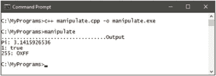


操纵符会影响该流上的所有输入或输出。例如，**boolalpha** 操纵符会以文字形式显示该流上的所有布尔值。

### 预测问题

尽管程序员尽了最大努力，C++ 程序仍可能不幸包含以下三种类型错误中的一种或多种：

- **语法错误** – 代码中包含对 C++ 语言的不正确使用。例如，左花括号没有匹配的右花括号。
- **逻辑错误** – 代码在语法上是正确的，但试图执行非法操作。例如，程序可能试图将数字除以零，从而导致错误。
- **异常错误** – 程序按预期运行，直到遇到导致程序崩溃的异常条件。例如，程序可能请求输入一个数字，而用户以文字形式而不是数字形式输入。


C++ 标准允许编译器发现涉及语法和逻辑的“编译时”错误，但异常错误的可能性更难定位，因为它们只在“运行时”发生。这意味着程序员必须尝试预测可能出现的问题，并准备好处理这些异常错误。

第一步是确定程序代码中可能在特定条件下导致异常错误的部分。然后可以用一个“try”块将其包围，该块使用 **try** 关键字，并将可疑代码括在一对花括号内。


始终考虑到用户会做出意料之外的操作——然后确保你的程序能够处理这些操作。

当发生异常错误时，**try** 块会将异常“抛出”到一个“catch”块，该块紧跟在 **try** 块之后。它使用 **catch** 关键字，并将用于处理异常错误的语句括在一对花括号内。

下面描述的程序有一个 **try** 块，其中包含一个递增整数的循环。当整数达到五时，**throw()** 函数会手动向 **catch** 块异常处理程序抛出一个异常，并传递该整数参数。


- **1.** 通过指定要包含的 C++ 库类以及要使用的命名空间前缀，开始一个新程序。

```cpp
#include <iostream>
using namespace std;
```

- **2.** 添加一个 main 函数，其中包含末尾的 **return** 语句，并声明一个供循环递增的整数变量。

```cpp
int main()
{
    int number;
    // Add more statements here.
    return 0;
}
```

### 识别异常

当 **try** 块内发生程序异常时，会自动抛出一个“exception”对象。可以在 **catch** 关键字后的括号中，将对异常的引用传递给关联的 **catch** 块。这将指定该参数为 **exception** 类型，并使用由 & 引用运算符作为前缀的选定异常名称。例如，**exception &error**。


更多关于引用的内容将在下一章介绍。

一旦将异常引用传递给 **catch** 块，就可以通过该异常的 **what()** 函数获取错误描述：


- **1.** 通过指定要包含的 C++ 库类以及要使用的命名空间前缀，开始一个新程序。

```cpp
#include <string>    // Include string support.
#include <iostream>
using namespace std;
```

- **2.** 添加一个 main 函数，其中包含末尾的 **return** 语句，并声明一个已初始化的 **string** 变量。

```cpp
int main()
{
    string lang = "C++";
    // Add more statements here.
    return 0;
}
```

- **3.** 在 main 函数中，插入一个 **try** 块，其中包含一条尝试擦除 **string** 变量一部分的语句。

```cpp
try { lang.erase(4, 6); }
```

- **4.** 接下来，插入一个 **catch** 块，其中包含一条语句，用于通过 **cerr** 函数将描述发送到标准错误输出。

```cpp
catch (exception &error)
{ cerr << "Exception: " << error.what() << endl; }
```

- **5.** 保存、编译并运行程序，以查看所捕获异常的错误描述。


错误描述会因编译器而异——在此示例中，Visual C++ 编译器将该异常错误描述为“invalid string position”（无效的字符串位置）。

C++ **<stdexcept>** 库定义了许多异常类。它的基类名为“exception”，其他类由它派生，用于对常见异常进行分类。

下表列出了每个异常类，展示了它们的关系并描述了其异常类型：

| 异常类： | 描述： |
|---|---|
| exception | 一般异常 |
| ├─ bad_alloc | – 分配存储失败 |
| ├─ bad_cast | – 转换数据类型失败 |
| ├─ bad_typeid | – 引用 typeid 失败 |
| ├─ logic_error | 逻辑异常 |
| │  ├─ domain_error | – 无效域 |
| │  ├─ invalid_argument | – 调用中的无效参数 |
| │  ├─ length_error | – 容器的无效长度 |
| │  └─ out_of_range | – 无效的元素范围 |
| └─ runtime_error | 运行时异常 |
|    ├─ range_error | – 无效的范围请求 |
|    └─ overflow_error | – 无效的算术请求 |


`cout` 函数将数据发送到标准输出，而 `cerr` 函数将错误数据发送到标准错误输出。它们只是两个不同的数据流。

当通过添加 `#include <stdexcept>` 预处理器指令使 `<stdexcept>` 库可供程序使用时，异常类可用于识别抛给 `catch` 块的异常类型。

特定的异常类名可以出现在 `catch` 块的括号内，以替代通用的 `exception` 类型。

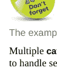

这里描述的示例演示了*标准异常*的用法。

可以连续使用多个 `catch` 块，就像 `switch` 块中的 `case` 语句一样，来处理多种类型的异常。

此外，可以使用 `throw` 关键字手动产生异常。这可用于创建上表中的任何 `logic_error` 和 `runtime_error` 异常。可选地，可以为手动异常指定自定义错误消息，并可通过其 `what()` 函数获取。


### 处理错误

可以通过包含 C++ 标准 `<typeinfo>` 库来提供异常类型信息。其 `typeid()` 函数接受一个异常参数，以便其 `name()` 函数可以返回类型名称：


- 1. 通过指定要包含的 C++ 库类和要使用的命名空间前缀来启动一个新程序

```cpp
#include <stdexcept> // 支持标准异常。
#include <typeinfo> // 支持类型信息。
#include <fstream>
#include <string>
#include <iostream>
using namespace std ;
```

- 2. 添加一个主函数，其中包含一个最终的返回语句、两个已初始化的变量声明，以及一个输出文本消息的语句

```cpp
int main()
{
   string lang = "C++" ;
   int num = 1000000000 ; // 十亿。
   // try-catch 块放在这里。
   cout << "Program continues..." << endl ;
   return 0 ;
}
```

- 3. 在主函数中，插入一个 try 块，其中包含一条尝试替换字符串值部分的语句

```cpp
try { lang.replace( 100, 1 , "C" ) ; }
```

- 4. 在 try 块之后，添加一个 catch 块来处理范围异常，然后保存、编译并运行程序

```cpp
catch( out_of_range &e )
{
   cerr << "Range Exception: " << e.what() << endl ;
   cerr << "Exception Type: " << typeid(e).name() ;
   cerr << endl << "Program terminated." << endl ;
   return -1 ;
}
```

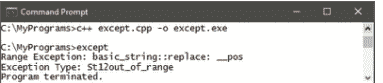


出现 `out_of_range` 错误是因为 `replace()` 函数试图从第 100 个字符处开始删除，但该 `string` 变量只有三个字符。

- 5. 将 try 块中的语句替换为一条尝试调整字符串变量大小的语句

```cpp
lang.resize( 3 * num ) ;
```

- 6. 在 catch 块之后，添加第二个 catch 块来处理一般异常

```cpp
catch ( exception &e )
{
    cerr << "Exception: " << e.what() << endl ;
    cerr << "Exception Type: " << typeid( e ).name() << endl ;
}
```

- 7. 再次保存、编译并运行程序，以查看由第二个 **catch** 块处理的异常

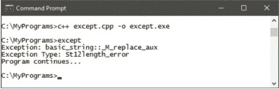

- 8. 将 **try** 块中的语句替换为一条尝试打开不存在文件的语句

```cpp
ifstream reader("nonsuch.txt");
if( ! reader ) throw logic_error("File not found");
```

- 9. 再次保存、编译并运行程序，以查看再次由第二个 catch 块处理的异常，以及指定的自定义错误消息

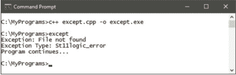


**catch** 块的顺序可能很重要——将 **exception** 错误处理器放在 **out_of_range** 错误处理器之前，会使 **out_of_range** 错误被（更高级的）**exception** 处理器处理。


异常对象通常被命名为“e”——正如这里所见。

## 6 指向数据

*本章演示如何利用指针和引用编写高效的 C++ 程序。*

- 理解数据存储
- 使用指针获取值
- 执行指针运算
- 将指针传递给函数
- 创建指针数组
- 引用数据
- 将引用传递给函数
- 比较指针与引用
- 总结

### 理解数据存储

为了理解 C++ 指针，了解数据在计算机中的存储方式会很有帮助。可以把计算机的内存想象成一行极长、按顺序编号的插槽，每个插槽可以容纳一个字节的数据。当程序中声明一个变量时，机器会预留一些插槽来存储分配给该变量的数据。预留的插槽数量取决于变量的数据类型。当程序使用变量名来检索存储的数据时，它实际上是在寻址该变量第一个预留插槽的编号。

可以将其比作一排按顺序编号的房子，每栋房子可以容纳不同的家庭。任何家庭都可以通过其房子编号被明确引用。

计算机内存中的插槽（房子）编号以十六进制格式表示，可以通过 & 引用运算符来显示。


address.cpp

- 1. 通过指定要包含的 C++ 库类和要使用的命名空间前缀来启动一个新程序。

```cpp
#include <string>
#include <iostream>
using namespace std;
```

- 2. 添加一个主函数，其中包含一个最终的 **return** 语句，并声明三个已初始化的变量。

```cpp
int main()
{
    int num = 100;
    double sum = 0.0123456789;
    string text = "C++ Fun";
    // 在这里添加更多语句。
    return 0;
}
```

- 3. 在主函数中，插入语句以输出每个变量的第一个槽的内存地址。

```cpp
cout << "Integer variable starts at: " << &num << endl;
cout << "Double variable starts at: " << &sum << endl;
cout << "String variable starts at: " << &text << endl;
```

- 4. 保存、编译并运行程序以查看这三个内存地址。

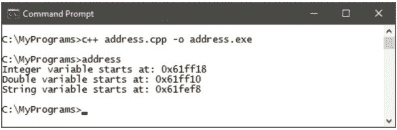

一旦变量声明预留了内存空间，就可以使用 **=** 赋值运算符将适当数据类型的一个值存储到该空间中。例如，**num = 100** 取其右侧的值（**100**）并将其放入左侧命名变量（**num**）所引用的内存中。


这些位置地址是动态分配的——因此会与截图中的地址有所不同。

**=** 赋值运算符左侧的操作数称为其“L-value”（左值），右侧的操作数称为其“R-value”（右值）。可以把 L-value 中的“L”理解为“Location”（位置），把 R-value 中的“R”理解为“Read”（读取）。

C++ 编程中一条重要的规则强调：R-value 不能出现在 **=** 赋值运算符的左侧，但 L-value 可以出现在任一侧。将 R-value 放在 **=** 赋值运算符左侧的代码将无法编译：

- 5. 在 `return` 语句之前，插入将 R-value 错误地放在赋值运算符左侧的语句

```cpp
200 = num ;
5.5 = sum ;
"Bad assignments" = text ;
```

- 6. 保存并尝试重新编译程序，以查看因错误放置 R-value 而导致的错误


L-value 是容器，而 R-value 是数据。

### 使用指针获取值

指针是高效 C++ 编程中有用的部分——它们就是存储其他变量内存地址的变量。

指针变量的声明方式与其他变量相同，但数据类型后缀有一个“*”字符。在声明中，这表示该变量将是一个指针。始终记住：指针的数据类型必须与其指向的变量的数据类型匹配。

指针变量通过使用 & 引用运算符为其赋予另一个变量的内存地址来初始化。赋值可以在声明语句中完成，也可以在声明后的单独语句中完成。仅通过指针变量名来引用它，将会直接显示它所包含的内存地址。

指针变量初始化后（无论是在声明中还是在后续赋值中），它就“指向”其包含地址处的变量。有用的是，这意味着可以通过在指针名称前加上 * 解引用运算符来引用它所指向的变量的值。


deref.cpp

- 1. 通过指定要包含的 C++ 库类和要使用的命名空间前缀来启动一个新程序

```cpp
#include <iostream>
using namespace std;
```

- 2. 添加一个主函数，其中包含一个最终的 **return** 语句，并声明两个常规的已初始化整型变量

```cpp
int main()
{
    int a = 8, b = 16;
    // 在这里添加更多语句。
    return 0;
}
```

- 3. 在主函数中，插入一条语句来声明一个指针，并用第一个整型变量的内存地址初始化它

```cpp
int* aPtr = &a;      // aPtr 被赋值为 a 的地址。
```

- 4. 插入一条语句来声明第二个指针，然后用第二个整型变量的地址初始化它

```cpp
int* bPtr;           // 声明 bPtr。
bPtr = &b;           // bPtr 被赋值为 b 的地址。
```

- 5. 接下来，插入语句以输出每个指针的实际内存地址

```cpp
cout << "Addresses of pointers..." << endl;
cout << "aPtr: " << &aPtr << endl;
cout << "bPtr: " << &bPtr << endl;
```

- 6. 现在，插入语句以输出存储在每个指针内部的内存地址

```cpp
cout << "Values in pointers..." << endl;
cout << "aPtr: " << aPtr << endl;
cout << "bPtr: " << bPtr << endl << endl;
```

- 7. 最后，插入语句以输出存储在每个指针所指向的内存地址处的值——即指针所指向变量的值

```cpp
cout << "Values in addresses pointed to..." << endl;
cout << "a: " << *aPtr << endl;
cout << "b: " << *bPtr << endl;
```


- 8. 保存、编译并运行程序，以查看指针地址和存储的值


`*` 解引用运算符也称为“间接”运算符。


内存地址是动态分配的——因此会与此截图中的地址不同。

### 进行指针运算

一旦指针变量用内存地址初始化，就可以为它分配另一个地址，或使用指针运算来更改它。

`++` 递增运算符或 `--` 递减运算符会将指针移动到该数据类型下一个或上一个地址——数据类型越大，跳转的幅度就越大。

使用 `+=` 和 `-=` 运算符可以实现更大的跳转。

指针运算对数组特别有用，因为数组中的元素占用连续的内存地址。仅将数组名赋给指针，就会自动将其赋值为第一个元素的地址。将指针递增一，就会将指针移动到下一个元素。


point.cpp

- 1. 新建一个程序，指定要包含的 C++ 库类，以及要使用的命名空间前缀

```cpp
#include <iostream>
using namespace std;
```

- 2. 添加一个 main 函数，其中包含最后的 return 语句，并声明一个已初始化的、包含 10 个元素的整数数组

```cpp
int main()
{
    int nums[] = { 1, 2, 3, 4, 5, 6, 7, 8, 9, 10 };
    // Add more statements here.
    return 0;
}
```

- 3. 在 main 函数中，插入一条语句来声明一个指针，并用整数数组中第一个元素的内存地址初始化它

```cpp
int* ptr = nums;
```

- 4. 接下来，插入一条语句，输出整数数组第一个元素的内存地址及其值

```cpp
cout << endl << "ptr at: " << ptr << " gets: " << *ptr;
```

- 5. 现在，递增指针并输出其新的内存地址——即整数数组中第二个元素的地址

```cpp
ptr++;
cout << endl << "ptr at: " << ptr << " gets: " << *ptr;
```

- 6. 再次递增指针，并输出其新的内存地址——即整数数组中第三个元素的地址

```cpp
ptr++;
cout << endl << "ptr at: " << ptr << " gets: " << *ptr;
```

- 7. 将指针递减两个位置，并输出其内存地址——即数组中第一个元素的地址

```cpp
ptr -= 2;
cout << endl << "ptr at: " << ptr << " gets: " << *ptr;
cout << endl;
```

- 8. 现在，插入一个循环，输出整数数组中每个元素存储的值

```cpp
for ( int i = 0 ; i < 10 ; i++ )
{
    cout << endl << "Element: " << i ;
    cout << " Value: " << *ptr ;
    ptr++;
}
cout << endl;
```

- 9. 保存、编译并运行程序，以查看指针地址和存储的值


`*=`、`/=` 和 `%=` 运算符不能用于移动指针。


数组名的作用类似于指向其第一个元素的指针。

### 将指针传递给函数

指针可以使用 `*` 解引用运算符访问其所指向变量中存储的数据。这也可用于通过分配适当数据类型的新值来更改存储的数据。

此外，指针可以作为参数传递给函数——其效果与将变量作为参数传递有细微不同：

- 当变量传递给函数时，其数据会“按值”传递给函数内的局部变量——因此函数操作的是原始值的副本。
- 当指针传递给函数时，其数据会“按引用”传递——因此函数操作的是**原始**值。

按引用传递的好处是允许函数直接操作调用函数中声明的变量值。


fnptr.cpp

- 1. 新建一个程序，指定要包含的 C++ 库类，以及要使用的命名空间前缀。

```cpp
#include <iostream>
using namespace std;
```

- 2. 在预处理器指令之后，声明两个函数原型，每个原型都接受一个指针参数。

```cpp
void writeOutput( int* );
void computeTriple( int* );
```

- 3. 添加一个 main 函数，其中包含最后的 **return** 语句，并声明一个已初始化的普通整数变量。

```cpp
int main()
{
    int num = 5;
    // Add more statements here.
    return 0;
}
```

- 4. 在 main 函数中，插入第二个变量声明，用该普通整数变量的地址初始化一个指针。

```cpp
int* ptr = &num;
```

- 5. 在 main 函数块之后，定义一个函数，用于输出指针所指向变量的当前值。

```cpp
void writeOutput( int* value )
{
    cout << "Current value: " << *value << endl;
}
```

- 6. 定义另一个函数，用于将指针所指向变量的当前值乘以某个倍数。

```cpp
void computeTriple( int* value )
{
    *value *= 3;   // Multiply and assign dereferenced value.
}
```

- 7. 在 main 函数中，向函数传递一个指针参数，以输出该指针所指向的变量值。

```cpp
writeOutput( ptr );
```

- 8. 接下来，使用指针增加变量值，然后显示其新值

```cpp
*ptr += 15;    // Add and assign a dereferenced value.
writeOutput( ptr );
```

- 9. 现在，向函数传递一个指针参数，以将指针所指向的变量值乘以某个倍数，然后显示其新值

```cpp
computeTriple( ptr );
writeOutput( ptr );
```

- 10. 保存、编译并运行程序，以查看计算值的输出


函数原型和定义都必须包含指针参数。


直接在调用函数中操作变量的函数不需要 **return** 语句。

### 创建指针数组

普通 **char** 数据类型的变量可以赋值为单个字符，但指向常量 **char** 数组的指针可以方便地赋值为一个字符串。该字符串实际上存储为字符数组，每个元素一个字符，但引用 **char** 指针会自动检索整个字符串。

仅使用变量名就能从 **char** 指针检索字符串值的这种能力，类似于使用变量名从普通 **char** 数组检索字符串的方式。

多个字符串可以存储在一个常量 **char** 指针数组中，每个元素一个字符串。你甚至可以将多个 **char** 指针数组存储在一个“主” **char** 指针数组中——每个元素一个数组。


- 1. 新建一个程序，指定要包含的 C++ 库类，以及要使用的命名空间前缀。

```cpp
#include <iostream>
using namespace std;
```

- 2. 添加一个 main 函数，其中包含最后的 **return** 语句，并声明两个已初始化的变量——一个普通字符数组，以及一个具有相同 **string** 值的字符指针。

```cpp
int main()
{
    char letters[8] = {'C', '+', '+', ' ', 'F', 'u', 'n', '\0'};
    const char* text = "C++ Fun";
    // Add more statements here.
    return 0;
}
```

- 3. 在 main 函数中，插入语句以声明并初始化另外两个字符指针变量，它们具有各自不同的 **string** 值。

```cpp
const char* term = "Element";
const char* lang = "C++";
```

- 4. 接下来，插入一条语句来声明一个字符指针数组，并用三个 **string** 值初始化它。

```cpp
const char* ap1[3] = {"Great", "Program", "Code"};
```


字符值必须用单引号括起来，但字符串值必须用双引号括起来——即使它们被赋给 **char** 指针时也是如此。

- 5. 现在，插入一条语句来声明第二个字符指针数组，并用三个字符串值初始化它——将其中一个指针变量作为其第一个元素值。

```cpp
const char* ap2[3] = {lang, "is", "Fun"};
```

- 6. 声明两个“主”字符指针数组，每个都用 **char** 指针数组的三个元素初始化。

```cpp
const char* ap3[3] = {ap2[0], ap2[1], ap1[0]};
const char* ap4[3] = {ap1[2], ap2[1], ap2[2]};
```

- 7. 在声明之后，插入语句以输出前两个变量相同的 **string** 值。


```cpp
cout << letters << endl;
cout << text << endl;
```

- 8. 接下来，插入一个循环，其中包含一条语句，用于输出字符指针中的值和迭代次数

```cpp
for ( int i = 0 ; i < 3 ; i++ )
{
  cout << term << i << " " ;
}
```

- 9. 在循环块内，插入语句以输出四个字符指针数组中每个元素的值

```cpp
cout << ap1[ i ] << " " ;
cout << ap2[ i ] << " " ;
cout << ap3[ i ] << " " ;
cout << ap4[ i ] << endl ;
```

- 10. 保存、编译并运行程序，以查看字符串输出


要在`char`数组中包含空格，赋值时必须在引号之间留一个空格，如`' '` —— 两个单引号紧挨着（`''`）会被视为空元素并导致编译器错误。


请记住，`char`数组的最后一个元素必须包含特殊的`\0`字符，以将该数组指定为字符串。

### 引用数据

C++中的“引用”是程序中变量或对象的别名。引用必须在其声明中初始化，方法是赋予它其所引用的变量或对象的名称。从那时起，引用即成为其所引用项的另一个名称——对引用所做的任何事情实际上都是在其所引用的变量或对象上实现的。

引用声明首先声明其数据类型，该类型与其将要引用的项的类型匹配，后面跟一个&字符表示该变量将是一个引用，以及一个选定的名称。最后，声明使用=运算符来关联一个变量或对象。


> 一旦创建了引用，它将始终指向初始化时所引用的项——不能将另一个项赋给该引用。

传统上，引用使用关联变量或对象的名称来命名，但首字母大写，并在整个名称前加上前缀“r”。例如，创建一个指向名为“num”的整数变量的引用的声明如下：

```cpp
int& rNum = num ;
```

请注意，&引用运算符的用途是上下文相关的，因此当它作为左值（即=运算符左侧）使用时声明一个引用，否则当它作为右值使用时返回一个内存地址。

引用是其关联项的真正别名，以至于查询其内存地址会返回其关联项的地址——无法找到引用本身的地址。


- 1. 通过指定要包含的C++库类和要使用的命名空间前缀，开始一个新程序。

```cpp
#include <iostream>
using namespace std ;
```

- 2. 添加一个main函数，其中包含一个最终的**return**语句，并声明两个变量——一个常规整数变量和该变量的引用。

```cpp
int main()
{
    int num ;
    int& rNum = num ;
    // Add more statements here.
    return 0 ;
}
```

- 3. 在main函数中，插入一条语句，通过其引用为整数变量赋一个初始值。

```cpp
rNum = 400 ;
```

- 4. 接下来，插入语句以输出存储的值，既直接输出又通过其引用输出。

```cpp
cout << "Value direct: " << num << endl ;
cout << "Value via reference: " << rNum << endl ;
```

- 5. 现在，插入语句以输出内存地址，既直接输出又通过其引用输出。

```cpp
cout << "Address direct:" << &num << endl ;
```

- 6. 插入一条语句，通过其引用操作变量中存储的值

```cpp
rNum += 2;
```

- 7. 再次输出存储的值，既直接输出又通过其引用输出

```cpp
cout << "Value direct: " << num << endl;
cout << "Value via reference: " << rNum << endl;
```

- 8. 保存、编译并运行程序，查看值和内存地址


编译器根据上下文决定如何使用&引用运算符。


引用始终是其声明语句中关联项的别名。

### 将引用传递给函数

引用与变量本身一样，可以访问其所引用的变量中存储的数据，并可通过赋适当数据类型的新值来更改存储的数据。

此外，引用与指针一样，可以作为参数传递给函数：

- 当变量传递给函数时，其数据按“值”传递给函数内的局部变量——因此函数操作的是原始值的副本。
- 当引用传递给函数时，其数据按“引用”传递——因此函数操作的是原始值。

按引用传递的好处是允许函数直接操作调用函数中声明的变量值。


fnref.cpp

- 1. 通过指定要包含的C++库类和要使用的命名空间前缀，开始一个新程序

```cpp
#include <iostream>
using namespace std ;
```

- 2. 在预处理器指令之后，声明两个函数原型，每个原型都接受一个引用参数

```cpp
void writeOutput ( int& );
void computeTriple ( int& );
```

- 3. 添加一个main函数，包含一个最终的return语句，并声明一个已初始化的常规整数变量

```cpp
int main()
{
    int num = 5 ;
    // Add more statements here.
    return 0 ;
}
```

- 4. 在main函数中，插入第二个变量声明，将引用初始化为整数变量的别名

```cpp
int& ref = num ;
```


这个示例可能看起来很眼熟，因为它重现了此处的示例——但用引用替换了指针。

- 5. 在main函数块之后，定义一个函数，用于输出引用所引用的变量的当前值

```cpp
void writeOutput( int& value )
{
    cout << "Current value: " << value << endl ;
}
```

- 6. 定义另一个函数，用于将引用所引用的变量的当前值乘以3

```cpp
void computeTriple( int& value )
{
    value *= 3;    // Multiply and assign a referenced value.
}
```

- 7. 在main函数中，将一个引用参数传递给函数，以输出其引用的变量值

```cpp
writeOutput( ref );
```

- 8. 接下来，使用引用增加变量值，然后显示其新值

```cpp
ref += 15;    // Add and assign a referenced value.
writeOutput( ref );
```

- 9. 现在，将一个引用参数传递给函数，以对其引用的变量进行乘法运算，然后显示其新值

```cpp
computeTriple( ref );
writeOutput( ref );
```

- 10. 保存、编译并运行程序，查看计算后的值输出


函数原型和函数定义都必须包含一个引用参数。


直接操作调用函数中变量的函数不需要**return**语句。

### 比较指针和引用

指针和引用都可用于引用变量值，并按引用而不是按值将它们传递给函数。从技术上讲，按引用传递比按值传递更高效，因此应鼓励使用指针和引用。

决定使用指针还是引用，取决于程序需求。C++程序员通常尽可能使用引用，因为引用比指针更容易使用和理解。然而，引用必须遵守某些规则，这些规则可能使指针的使用成为必要：

| 规则 | 引用： | 指针： |
|---|---|---|
| 可以未初始化而声明 | 否 | 是 |
| 可以重新赋值 | 否 | 是 |
| 可以包含0（空）值 | 否 | 是 |
| 最易于使用 | 是 | 否 |

作为一般规则，可通过遵循以下指南来决定使用引用还是指针：

- 如果不想在声明中初始化，请使用指针

**或**

- 如果希望能够重新赋值另一个变量，请使用指针

**否则**

- 始终使用引用


引用必须在声明中初始化以引用变量或对象——然后始终指向该项。

然而，指针比引用更灵活，甚至可以指向函数。在这种情况下，指针声明必须与所指向函数的返回数据类型和参数精确匹配。此外，指针名称在声明中必须用括号括起来，以避免编译器错误。然后，可以将函数按名称赋给该函数指针，从而可以通过该指针调用该函数。


pref.cpp

- 1. 通过指定要包含的C++库类和要使用的命名空间前缀，开始一个新程序。

```cpp
#include <iostream>
using namespace std ;
```

- 2. 在预处理器指令之后，定义一个内联函数，用于输出两个传入参数的总和。

```cpp
inline void add ( int& a, int* b )
{ cout << "Total: " << (a + *b) << endl; }
```

- 3. 添加一个main函数，包含一个最终的**return**语句和创建两个的声明


普通整型变量、一个引用和两个指针

```cpp
int main()
{
    int num = 100, sum = 500;
    int& rNum = num;
    int* ptr = &num;
    void (*fn)(int& a, int* b) = add;
    // Add more statements here.
    return 0;
}
```

- 4. 在 main 函数中，插入语句以通过引用和指针输出第一个整型变量的值。

```cpp
cout << "Reference: " << rNum << endl;
cout << "Pointer: " << *ptr << endl;
```

- 5. 现在，将第二个整型变量赋给指针，并通过该指针输出其值，然后调用函数指针以输出这些变量值之和。

```cpp
ptr = &sum;
cout << "Pointer now: " << *ptr << endl;
fn(rNum, ptr);
```

- 6. 保存、编译并运行程序以查看输出。


C 程序员倾向于将 `&` 和 `*` 字符放在变量名之前，但在 C++ 中通常将它们放在数据类型之后——因为该特性是数据类型的属性，而不是名称的属性。

### 总结

- 数据存储在计算机内存中按顺序编号的地址内。
- **=** 运算符左侧的操作数是左值，右侧的操作数是右值。
- 右值只能出现在 **=** 运算符的右侧。
- 指针是一个变量，它存储另一个变量的内存地址——即它所指向的变量。
- **\*** 字符在指针声明中作为左值出现，表示该语句将创建一个指针变量。
- 一旦声明，**\*** 解引用运算符可用于引用指针所指向变量中的值。
- 指针算术可用于遍历存储在数组元素中的值。
- 变量按值传递给函数，而指针和引用按引用传递。
- 按引用传递允许接收函数直接操作调用函数中声明的变量。
- 可以将字符串值赋给 **char** 数据类型的指针，并使用指针名检索整个字符串。
- 指针数组中的每个元素都可以存储数据或指针。
- 引用不是变量，而只是变量的别名。
- **&** 字符在引用声明中作为左值出现，表示该语句将创建一个别名。
- **&** 引用运算符可用于引用存储在指针中的内存地址。
- 引用比指针更易使用，但与指针不同，引用必须始终在其声明中初始化，并且永远不能赋值为另一个变量。

## 7 创建类与对象

本章介绍封装和继承这两个主题——C++ 面向对象编程的前两个原则。

- 封装数据
- 创建对象
- 创建多个对象
- 初始化类成员
- 重载方法
- 继承类属性
- 调用基类构造函数
- 重写基类方法
- 总结

### 封装数据

类是一种数据结构，可以在单个实体中同时包含变量和函数。它们统称为类的“成员”，而函数称为类的“方法”。

从类外部对类成员的访问由类声明中的“访问说明符”控制。通常，这些说明符会拒绝对变量成员的访问，但允许访问能够存储和检索这些变量成员数据的方法。这种“数据隐藏”技术确保存储的数据安全地封装在类的变量成员中，并且是面向对象编程（OOP）的第一项原则。


类声明以 **class** 关键字开头，后跟一个空格，然后是由程序员指定的名称——遵循通常的 C++ 命名约定，但以大写字母开头。接下来是访问说明符和类成员，它们包含在一对花括号中。每个类声明都必须在右花括号后以分号结尾，因此类声明语法如下所示：

```cpp
class ClassName
{
    access specifier:
        member1;
        member2;
    access specifier:
        member3;
        member4;
};
```

访问说明符可以是 **public**、**private** 或 **protected** 中的任意一个关键字，用于指定其列出的成员的访问权限：

- 公有成员可从类可见的任何位置访问。
- 私有成员仅可由同一类的其他成员访问。
- 受保护成员仅可由同一类的其他成员以及从该类派生的类的成员访问。

默认情况下，所有类成员都具有私有访问权限——因此，类声明中未带访问说明符出现的任何成员都将具有私有访问权限。


使用 **protected** 访问说明符的派生类将在本章后面介绍。

任何现实世界中的对象都可以通过其属性和行为来定义。例如，狗具有年龄、体重和颜色等属性，以及它可以执行的行为，例如吠叫。C++ 中的类机制提供了一种在程序中创建虚拟狗对象的方式，其中类的变量成员可以表示其属性，而方法表示其行为：

```cpp
class Dog
{
    private: // The default access level.
        int age, weight;
```

```cpp
        string color;
public:
    void bark();
};
// ... Plus methods to store/retrieve data.
```


虽然程序中的类无法完美模拟现实世界中的对象，但其目标是封装所有相关属性和行为。

重要的是要认识到，类声明只定义了一种数据结构——为了创建对象，必须声明该数据结构的“实例”。实现方式与声明常规 C++ 数据类型的实例完全相同：

```cpp
int num;        // Creates an instance named “num”.
                // of the regular C++ int data type.

Dog fido;       // Creates an instance named “fido”
                // of a programmer-defined Dog data structure.
```

或者，可以通过在类声明的右花括号与其最后的分号之间指定实例对象的名称来创建实例对象。通过指定以逗号分隔的对象名列表，可以用这种方式创建多个实例。例如，下面列出的类声明创建了 Dog 类的四个实例对象，名称分别为“fido”、“pooch”、“rex”和“sammy”。

```cpp
class Dog
{
    int age, weight;
    string color;
public:
    void bark();
    // ... Plus methods to store/retrieve data.
} fido, pooch, rex, sammy;
```

C++ 编程中的封装原则描述了将数据和功能组合在类成员中——Dog 类中的年龄、体重和颜色属性以及吠叫行为。


按照惯例，类名以大写字符开头，对象名以小写字符开头。

### 创建对象

为了向类的私有成员分配数据和从中检索数据，必须向类中添加特殊的公有访问器方法。这些方法是用于分配数据的“setter”方法和用于检索数据的“getter”方法。访问器方法通常以其所处理的变量命名，将首字母大写，并分别加上“set”或“get”前缀。例如，用于处理 age 变量的访问器方法可以命名为 `setAge()` 和 `getAge()`。


object.cpp

- 1. 通过指定要包含的 C++ 库类和要使用的命名空间前缀，开始一个新程序。

```cpp
#include <string>
#include <iostream>
using namespace std;
```

- 2. 声明一个名为“Dog”的类。

```cpp
class Dog
{
};
```

- 3. 在 Dog 类声明的花括号之间，声明三个 **private** 变量成员。

```cpp
int age, weight;
string color;
```

- 4. 在 **private** 变量之后，添加一个 **public** 访问说明符。

```cpp
public:
```

- 5. 通过添加一个在被调用时输出 **string** 的方法，开始公有成员列表。

```cpp
void bark() { cout << "WOOF!" << endl; }
```

- 6. 添加 **公有 setter 方法**，为每个 **private** 变量分配各自的值。

```cpp
void setAge(int yrs) { age = yrs; }
void setWeight(int lbs) { weight = lbs; }
void setColor(string hue) { color = hue; }
```

- 7. 添加 **公有 getter 方法**，从每个 **private** 变量中检索各自的值。

```cpp
int getAge() { return age; }
int getWeight() { return weight; }
string getColor() { return color; }
```


在访问说明符之前声明的成员默认是 **private**，并且请记住在每个类声明后添加最后的分号。


在类声明中，请注意所有方法都声明为 **public**，所有变量都声明为 **private**。这种“公有接口、私有数据”的概念是创建类时的关键概念。


- 8. 在 Dog 类声明之后，声明一个包含最终 **return** 语句的 main 方法

    ```cpp
    int main()
    {
        // Program code goes here.
        return 0;
    }
    ```

- 9. 在 main 方法的花括号之间，声明一个名为 "fido" 的 Dog 类实例

    ```cpp
    Dog fido;
    ```

- 10. 添加调用每个 setter 方法以分配数据的语句

    ```cpp
    fido.setAge(3);
    fido.setWeight(15);
    fido.setColor("brown");
    ```

- 11. 添加调用每个 getter 方法以获取所分配值的语句

    ```cpp
    cout << "Fido is a " << fido.getColor() <<
                 "dog" << endl;
    cout << "Fido is " << fido.getAge() <<
                 " years old" << endl;
    cout << "Fido weighs " << fido.getWeight() <<
                 " pounds" << endl;
    ```

- 12. 现在，添加对常规输出方法的调用

    ```cpp
    fido.bark();
    ```

- 13. 保存、编译并运行程序以查看输出


Fido


随着新功能的加入，此程序将在接下来的几页中进行修改。

### 创建多个对象

程序可以轻松创建多个对象，只需声明类的多个实例，并且每个对象都可以通过其 setter 方法分配各自的值来拥有唯一的属性。

通常方便的做法是将 setter 方法合并为一个接受每个私有变量参数的方法。这意味着在程序中可以用一条语句分配所有值，但该方法将包含多条语句。

上一示例中的类声明包含仅一行的简短方法，这些方法是“内联”创建的——完全位于类声明块内。当方法超过两行时，不应内联创建，而应在类声明块中声明为“原型”，并在类声明之后单独定义。定义必须在方法名前加上类名和作用域解析运算符 ::，以标识包含其原型的类。


- 1. 将上一示例的副本“object.cpp”重命名为新程序“multiple.cpp”
- 2. 在 Dog 类声明中，将三个 setter 方法替换为一个组合 setter 原型，该原型指定参数数据类型——但不指定其名称

    `void setValues(int, int, string);`

- 3. 在 Dog 类声明之后，为该原型添加定义块，使用 `::` 作用域解析运算符标识其所在的类

    ```cpp
    void Dog::setValues(int age, int weight, string color)
    {
    }
    ```

请注意，为便于识别，参数命名与将被赋值的变量同名。当类方法定义的参数与类成员同名时，可以使用 `this->` 类指针显式引用类成员。例如，`this->age` 引用类成员变量，而 `age` 引用参数。


注意，原型是一条语句——因此它必须以分号结尾。

- 4. 在方法定义块中，插入三条语句，将传入参数的值赋给类变量

    ```cpp
    this->age = age;
    this->weight = weight;
    this->color = color;
    ```

- 5. 在 main 方法的花括号之间，将三个 setter 方法的调用替换为对组合 setter 方法的单次调用——传递三个参数

    ```cpp
    fido.setValues(3, 15, "brown");
    ```

- 6. 在 main 方法中，声明一个名为 "pooch" 的 Dog 类第二个实例

    ```cpp
    Dog pooch;
    ```

- 7. 添加对组合 setter 方法的第二次调用——为新对象传递三个参数

    ```cpp
    pooch.setValues(4, 18, "gray");
    ```

- 8. 添加调用每个 getter 方法以获取所分配值的语句

    ```cpp
    cout << "Pooch is a " << pooch.getAge();
    cout << " year old " << pooch.getColor();
    cout << " dog who weighs " << pooch.getWeight();
    cout << " pounds.";
    ```

- 9. 现在，添加对常规输出方法的第二次调用

    ```cpp
    pooch.bark();
    ```

- 10. 保存、编译并运行程序以查看输出


如果参数名和类成员名不同，则 setter 方法定义中不需要 **this->** 类指针。

### 初始化类成员

类变量成员可以通过一种特殊的“构造函数”方法初始化，每当创建类的实例时都会调用该方法。构造函数始终与类名完全相同，并且需要参数来设置类变量的初始值。

当声明构造函数时，还应声明一个关联的“析构函数”——每当类的实例被销毁时都会调用它。析构函数始终以类名命名，并在前面加上 ~ 波浪号字符。

构造函数和析构函数没有返回值，并且会被自动调用——不能显式调用它们。

用于初始化类变量的值在创建对象的语句中传递，位于对象名后的括号内。


- 1. 将上一示例的副本“multiple.cpp”重命名为新程序“constructor.cpp”
- 2. 在 Dog 类声明的 public 部分，将 setValues 方法原型替换为此构造函数原型

    ```cpp
    Dog(int, int, string);
    ```

- 3. 现在，添加一个关联的析构函数原型

    ```cpp
    ~Dog();
    ```

- 4. 在 Dog 类声明之后，将 setValues 定义块替换为构造函数定义块

    ```cpp
    Dog::Dog(int age, int weight, string color)
    {
    }
    ```

- 5. 在构造函数定义块中，插入三条语句，将传入参数的值赋给类变量

    ```cpp
    this->age = age;
    this->weight = weight;
    this->color = color;
    ```


类方法的定义也称为方法“实现”。

- 6. 在构造函数定义之后，添加析构函数定义块

    ```cpp
    Dog::~Dog()
    {
    }
    ```

- 7. 在析构函数定义中，插入一条语句，以便每当实例对象被销毁时输出确认信息

    ```cpp
    cout << "Object destroyed." << endl;
    ```

- 8. 在 main 方法中，编辑创建“fido”对象的语句——向其构造函数传递值

    ```cpp
    Dog fido(3, 15, "brown");
    ```

- 9. 同样，编辑创建“pooch”对象的语句——向构造函数传递值

    ```cpp
    Dog pooch(4, 18, "gray");
    ```

- 10. 删除调用“fido”和“pooch”对象的 setValues 方法的语句——构造函数现在已替代该方法
- 11. 保存、编译并运行程序——查看输出与之前一样出现，并在对象被销毁时显示确认信息


析构函数定义以类名“Dog”、作用域解析运算符“::”开头，然后是析构函数名“~Dog”。


尽管变量成员的初始值由构造函数设置，但可以添加 setter 方法以随后更改这些值——并且可以通过 getter 方法获取这些新值。


### 重载方法

正如 C++ 允许函数重载一样，类方法也可以重载——包括构造函数方法。重载的构造函数方法很有用，可以在创建对象时未向构造函数传递值的情况下，为成员变量分配默认值。


overloaded.cpp

- 1. 将上一个示例“constructor.cpp”的副本重命名为新程序“overloaded.cpp”。

- 2. 在 Dog 类声明的 public 部分中，内联添加一个重载的 bark 方法——在调用时输出传入的字符串参数。

```cpp
void bark(string noise) { cout << noise << endl; }
```

- 3. 现在，声明一个不接受参数的构造函数方法原型（默认构造函数方法），以及一个接受两个参数的重载构造函数方法原型。

```cpp
Dog();
Dog(int, int);
```

- 4. 在 Dog 类声明之后，添加默认构造函数方法的定义——在创建对象时未传递任何参数的情况下，为类变量分配默认值。

```cpp
Dog::Dog()
{
    age = 1;
    weight = 2;
    color = "black";
}
```

- 5. 现在，添加重载构造函数方法的定义——在创建对象时传递两个参数的情况下，为类变量分配默认值。

```cpp
Dog::Dog(int age, int weight)
{
    this->age = age;
    this->weight = weight;
    color = "white";
}
```


当参数与成员同名时，`this->` 指针用于显式标识类成员。

- 6. 在 main 方法中，插入一条语句以创建不传递任何参数的 Dog 对象——调用默认构造函数。

```cpp
Dog rex;
```

- 7. 添加语句，调用每个 getter 方法以获取由默认构造函数方法设置的默认值。

```cpp
cout << "Rex is a " << rex.getAge();
cout << " year old " << rex.getColor();
cout << " dog who weighs " << rex.getWeight();
cout << " pounds.";
```

- 8. 现在，添加对重载输出方法的调用。

```cpp
rex.bark("GRRR!");
```

- 9. 插入一条语句，创建传递两个参数的 Dog 对象——以调用重载构造函数。

```cpp
Dog sammy(2, 6);
```

- 10. 添加语句以获取由重载构造函数方法设置的值，并调用重载输出方法。

```cpp
cout << "Sammy is a " << sammy.getAge();
cout << " year old " << sammy.getColor();
cout << " dog who weighs " << sammy.getWeight();
cout << " pounds.";
sammy.bark("BOWWOW!");
```

- 11. 保存、编译并运行程序。


在不传递参数创建对象时，不要在对象名后添加括号——注意是 **Dog rex**；而不是 **Dog rex()**。


这是 Dog 类的最终版本。在继续之前，请确保你能轻松识别它的公有和私有成员。

### 继承类属性

C++ 类可以像前面示例中那样作为全新类创建，也可以从现有类“派生”而来。重要的是，派生类除了拥有自己的成员外，还继承其派生自的父类（基类）的成员。

从基类继承成员的能力允许创建共享某些公共属性的派生类，这些属性已在基类中定义。例如，“Polygon”基类可以定义所有多边形共有的 width 和 height 属性。“Rectangle”和“Triangle”类可以从 Polygon 类派生——除了定义它们各自独有特性的自身成员之外。


继承的优点极其强大，并且是面向对象编程（OOP）的第二项原则。

派生类声明在其类名后添加一个冒号 `:`，后跟访问说明符以及它派生自的类。


derived.cpp

- 1. 通过指定要包含的 C++ 库类和要使用的命名空间前缀来开始一个新程序。

```cpp
#include <iostream>
using namespace std;
```

- 2. 声明一个名为“Polygon”的类，其中包含两个 protected 变量（仅可由此类的成员及派生自该类的类访问），以及一个用于为这些变量赋值的 public 方法。

```cpp
class Polygon
{
    protected:
        int width, height;
    public:
        void setValues(int w, int h) { width = w; height = h; }
};
```

- 3. 在 Polygon 类之后，声明一个派生自 Polygon 类并添加一个独有方法的 Rectangle 类。

```cpp
class Rectangle : public Polygon
{
    public:
        int area() { return (width * height); }
};
```

- 4. 在 Rectangle 类之后，声明一个派生自 Polygon 类并添加一个独有方法的 Triangle 类。

```cpp
class Triangle : public Polygon
{
public:
    int area() { return ((width * height) / 2); }
};
```

- 5. 在 Triangle 类之后，添加一个 main 方法，其中包含最后的 `return` 语句，并创建每个派生类的实例。

```cpp
int main()
{
    Rectangle rect; Triangle trgl;
    return 0;
}
```

- 6. 插入对从 Polygon 基类继承的方法的调用——以初始化继承的变量。

```cpp
rect.setValues(4, 5);
trgl.setValues(4, 5);
```

- 7. 输出每个派生类的独有方法返回的值。

```cpp
cout << "Rectangle area : " << rect.area() << endl;
cout << "Triangle area : " << trgl.area() << endl;
```

- 8. 保存、编译并运行程序以查看输出。


不要混淆类实例和派生类——实例是类的一个副本，而派生类是一个新类，它继承其派生自的基类的属性。


一个类声明可以从多个类派生。例如，**class Box : public A, public B, public C { };** 

### 调用基类构造函数

尽管派生类继承其父基类的成员，但它们不继承其构造函数和析构函数。然而，应当注意，当创建派生类的新对象时，总是会调用基类的默认构造函数——而当对象被销毁时，会调用基类析构函数。这些调用是在对派生类的构造函数和析构函数方法的调用之外额外进行的。

基类的默认构造函数没有参数——但该类也可能有带参数的重载构造函数。如果你希望在创建派生类的新对象时调用基类的重载构造函数，可以在派生类中创建一个匹配的重载构造函数——具有相同数量和类型的参数。


- 1. 通过指定要包含的 C++ 库类和要使用的命名空间前缀来开始一个新程序。

```cpp
#include <iostream>
using namespace std;
```

- 2. 声明一个名为“Parent”的类，它将作为基类。

```cpp
class Parent
{
    // Class members go here.
};
```

- 3. 在 Parent 类声明的大括号之间，插入一个 public 访问说明符，并添加一个默认构造函数以输出文本——标识它何时被调用。

```cpp
public:
    Parent()
    { cout << "Default Parent constructor called."; }
```

- 4. 添加一个重载构造函数，它接受单个整数参数，并且也输出标识文本。

```cpp
Parent(int a)
{ cout << endl <<
    "Overloaded Parent constructor called."; }
```

- 5. 在 Parent 类之后，声明一个派生的“Daughter”类。

```cpp
class Daughter : public Parent
{

};
```


- 6. 在 Daughter 类声明中，插入一个 public 访问说明符，并添加一个默认构造函数以输出文本——标识它何时被调用。

```cpp
public:
    Daughter()
    { cout << endl <<
        "Derived Daughter class default constructor called."; }
```

- 7. 在 Daughter 类之后，声明一个派生的“Son”类。


```cpp
class Son : public Parent
{
};
```

- 8. 在 Son 类声明中，插入 public 访问说明符，并添加一个重载构造函数，该构造函数接受一个整数参数，同时还输出标识文本

```cpp
public:
    Son(int a) : Parent(a)
    {
        cout << endl <<
        "Derived Son class overloaded constructor called.";
    }
```

- 9. 在 Son 类之后，添加一个 main 方法，其中包含最后的 **return** 语句，并创建每个派生类的实例——调用基类和派生类的构造函数

```cpp
int main()
{
    Daughter emma;
    Son andrew(0);
    return 0;
}
```

- 10. 保存、编译并运行程序，以查看每个构造函数在被调用时依次产生的输出


请注意，重载的 Son 类构造函数中的语法会将整数参数传递给重载的基类构造函数。


每个类都会自动拥有一个空的默认构造函数和析构函数——例如 `Son() {}` 和 `~Son() {}`。

### 重写基类方法

可以在派生类中声明一个方法，以重写基类中匹配的方法——前提是两个方法声明具有相同的名称、参数和返回类型。这会有效地隐藏基类方法，使其变得不可访问，除非使用 :: 作用域解析运算符进行精确标识来显式调用它。

然而，必须谨慎使用重写基类方法的技术，以避免无意中隐藏重载方法——派生类中的单个重写方法将隐藏基类中该名称的所有重载方法！


override.cpp

- 1. 通过指定要包含的 C++ 库类和要使用的命名空间前缀来启动一个新程序。

```cpp
#include <string>
#include <iostream>
using namespace std;
```

- 2. 声明一个名为“Man”的类，它将作为基类。

```cpp
class Man
{
    // Class members go here.
};
```

- 3. 在 Man 类声明的大括号之间，插入 public 访问说明符和一个内联输出方法。

```cpp
public:
    void speak() { cout << "Hello! " << endl; }
```

- 4. 现在，插入一个重载的内联输出方法。

```cpp
void speak(string msg)
    { cout << " " << msg << endl; }
```

- 5. 在 Man 类声明之后，声明一个名为“Hombre”的类，它派生自 Man 类。

```cpp
class Hombre : public Man
{
    // Class members go here.
};
```


派生类中的方法声明必须与基类中的方法声明完全匹配才能重写它——包括使用 const 关键字时也要一致。

- 6. 在 Hombre 类声明的大括号之间，插入一个访问说明符和一个重写基类重载方法的方法——不输出制表符。

```cpp
public:
    void speak(string msg) { cout << msg << endl; }
```

- 7. 在 Hombre 类声明之后，添加一个 main 方法，其中包含最后的 **return** 语句，并创建两个对象——一个基类实例和一个派生类实例。

```cpp
int main()
{
    Man henry;
    Hombre enrique;
    // Add more statements here.
    return 0;
}
```

- 8. 在 main 方法中，插入调用基类两个方法的语句

```cpp
henry.speak();
henry.speak("It's a beautiful evening.");
```

- 9. 接下来，插入一条调用派生类中重写方法的语句——产生不带制表符的输出

```cpp
enrique.speak("Hola!");
```

- 10. 现在，插入一条显式调用基类中被重写方法的语句

```cpp
enrique.Man::speak("Es una tarde hermosa.");
```

- 11. 保存、编译并运行程序，以查看重写方法和被重写方法的输出


亨利和恩里克


在派生类中声明的重写方法会隐藏基类中的两个重载方法。尝试调用 **enrique.speak()**——编译器会报错，提示该调用没有匹配的方法。

## 8 利用多态

本章演示如何将程序分离为模块化组件，并介绍多态这一主题——C++ 面向对象编程的第三项原则。

- 指向类
- 调用虚方法
- 控制方法调用
- 提供能力类
- 创建抽象数据类型
- 构建复杂层次结构
- 隔离类结构
- 使用隔离类
- 小结

### 指向类

面向对象编程（OOP）的三大基石是封装、继承和多态。上一章中的示例已经演示了数据如何封装在 C++ 类中，以及派生类如何继承其基类的属性。本章介绍最后一项基石原则——多态。


术语“多态”（源自希腊语，意为“多种形式”）描述了根据上下文为实体赋予不同含义或用途的能力。

在 C++ 中，重载运算符可以被称为多态的。例如，* 字符根据上下文可以表示乘法运算符或解引用运算符。同样，+ 字符根据上下文可以表示加法运算符或连接运算符。

更重要的是，C++ 类方法也可以是多态的。理解类多态的关键在于认识到，可以创建一个基类指针，并通过关联将其绑定到特定的派生类。

可以将派生类的内存地址赋给基类指针，以提供一种“上下文”——唯一标识该派生类。例如，有一个 Base 基类和一个派生类 Sub，可以像这样创建指针：

```cpp
Sub inst;
Base* pSub = &inst;
```

或者更简单地使用 new 关键字，像这样：

```cpp
Base* pSub = new Sub;
```


有关指针的更多内容，请回看第六章。

当存在多个派生类时，可以创建基类指针，通过每个派生类唯一的内存地址将其绑定——该地址可以使用取地址 & 运算符获得。


- 1. 通过指定要包含的 C++ 库类和要使用的命名空间前缀来启动一个新程序

```cpp
#include <iostream>
using namespace std;
```

- 2. 声明一个 Base 类，其中包含一个以十六进制格式输出传入整数值的方法

```cpp
class Base
{
    public:
        void Identify(int adr) const
        {
            cout << "Base class called by 0x" << hex << adr << endl;
        }
};
```

- 3. 声明两个空的派生类 **SubA** 和 **SubB**。

```cpp
class SubA : public Base { };
class SubB : public Base { };
```

- 4. 声明一个 main 方法，其中包含最后的 `return` 语句。

```cpp
int main()
{
    // Program code goes here.
    return 0;
}
```

- 5. 在 main 方法中，插入语句以创建两个基类指针——每个指针绑定到一个特定的派生类。

```cpp
Base* ptrA = new SubA;
Base* ptrB = new SubB;
```

- 6. 现在，插入语句，使用这些指针调用基类方法，并传递每个对象的内存地址用于输出。

```cpp
ptrA->Identify((int) &ptrA);
ptrB->Identify((int) &ptrB);
```

- 7. 保存、编译并运行程序以查看地址。


这里使用 -> 类指针运算符来调用类方法。


十六进制地址作为 int 数据类型传递，然后由 hex 输出操纵器以十六进制格式显示。每次程序执行时地址都会不同——它们是动态分配的。


### 调用虚方法

绑定到特定派生类的基类指针可用于调用派生类中继承自基类的方法。然而，派生类特有的方法必须通过实例对象调用。

绑定到特定派生类的基类指针也可用于通过 :: 作用域解析运算符显式调用基类中的方法。

最有用的情形是，当基方法被声明为“虚”方法时，派生类中的继承方法可以覆盖基类中的该方法。这只是在基类中一个常规方法声明前加上 **virtual** 关键字。虚方法的声明表明该类将用作基类，另一个类将从它派生，而派生类可能包含一个覆盖该虚基方法的方法。


#### virtual.cpp

- 1. 通过指定要包含的 C++ 库类和要使用的命名空间前缀，启动一个新程序。

```cpp
#include <iostream>
using namespace std;
```

- 2. 声明一个名为“Parent”的基类，其中包含一个常规方法声明和一个虚方法声明。

```cpp
class Parent
{
    public:
        void Common() const
        { cout << "I am part of this family, "; }

        virtual void Identify() const
        { cout << "I am the parent" << endl; }
};
```

- 3. 声明一个名为“Child”的派生类，其中包含一个用于覆盖虚基方法的方法。

```cpp
class Child : public Parent
{
    public:
        void Identify() const
        { cout << "I am the child" << endl; }
};
```


基类指针不能用于调用派生类中非继承的方法。

- 4. 声明一个“Grandchild”类，它派生自“Child”类，包含一个用于覆盖虚基方法的方法和一个常规方法声明。

```cpp
class Grandchild : public Child
{
    public:
        void Identify() const
        { cout << "I am the grandchild" << endl; }

        void Relate() const
        { cout << "Grandchild has parent and grandparent"; }
};
```

### 定向方法调用

使用多个派生类对象的多态性的最大优点是，对同名方法的调用会被定向到适当的覆盖方法。

基类可以只包含虚方法，每个派生类可以用自己的方法覆盖它们，但基类方法仍可通过 :: 作用域解析运算符显式调用。然而，这可能导致不一致——这个示例似乎暗示鸡能飞！


#### birds.cpp

- 1. 通过指定要包含的 C++ 库类和要使用的命名空间前缀，启动一个新程序

```cpp
#include <iostream>
using namespace std;
```

- 2. 声明一个名为“Bird”的基类，其中包含两个虚方法声明

```cpp
class Bird
{
public:
    virtual void Talk() const
    { cout << "A bird talks..." << endl; }

    virtual void Fly() const
    { cout << "A bird flies..." << endl; }
};
```

- 3. 声明一个名为“Pigeon”的派生类，其中包含两个用于覆盖基类中方法的方法

```cpp
class Pigeon : public Bird
{
public:
    void Talk() const
    { cout << "Cool! Cool!" << endl; }

    void Fly() const
    { cout << "A pigeon flies away..." << endl; }
};
```


派生类中的覆盖方法可以选择性地包含 virtual 前缀——以提醒它正在覆盖基类方法。

- 4. 声明一个名为“Chicken”的派生类，其中包含两个用于覆盖基类中方法的方法

```cpp
class Chicken : public Bird
{
public:
    void Talk() const
    { cout << "Cluck! Cluck!" << endl; }

    void Fly() const
    { cout << "I\'m just a chicken – I can\'t fly!" << endl; }
};
```

- 5. 声明一个 main 方法，其中包含最后的 **return** 语句，并创建绑定派生类的基类指针

```cpp
int main()
{
    Bird* pPigeon = new Pigeon;
    Bird* pChicken = new Chicken;
    // Add more statements here.
    return 0;
}
```


- 6. 在 main 方法中，插入对每个方法的调用

```cpp
pPigeon->Talk();
pPigeon->Fly();
pChicken->Talk();
pChicken->Fly();
pPigeon->Bird::Talk();
pChicken->Bird::Fly();    // Inappropriate call.
```

- 7. 保存、编译并运行程序以查看输出


反斜杠 \ 字符用于在字符串中转义撇号。

### 提供能力类

其唯一目的是允许其他类从它们派生的类称为“能力类”——它们为派生类提供能力。

能力类通常不包含数据，而只是声明一些可在其派生类中覆盖的虚方法。

以下示例基于前一个示例，演示如何将“Bird”类更好地编写为能力类。它的方法不再包含输出语句，但如果被显式调用，则返回 -1（错误）值。

有必要将这些方法的返回类型从 void 改为 int，并且这些更改也必须反映在派生类中的每个覆盖方法中。


#### capability.cpp

- 1. 通过指定要包含的 C++ 库类和要使用的命名空间前缀，启动一个新程序

```cpp
#include <iostream>
using namespace std;
```

- 2. 声明一个名为“Bird”的基能力类，其中包含两个虚方法声明，如果被显式调用将发出错误信号

```cpp
class Bird
{
  public:
    virtual int Talk() const { return -1; }
    virtual int Fly() const { return -1; }
};
```

- 3. 声明一个名为“Pigeon”的派生类，其中包含两个用于覆盖基类中方法的方法

```cpp
class Pigeon : public Bird
{
  public:
    int Talk() const
    { cout << "Coo! Coo!" << endl; return 0; }

    int Fly() const
    { cout << "A pigeon flies away..." << endl; return 0; }
};
```


派生类中覆盖方法的返回值必须与基类中声明的返回值匹配。

- 4. 声明一个名为“Chicken”的派生类，其中包含两个用于覆盖基类中方法的方法

```cpp
class Chicken : public Bird
{
  public:
    int Talk() const
    { cout << "Cluck! Cluck!" << endl; return 0; }

    int Fly() const
    { cout << "I\'m just a chicken – I can\'t fly!" << endl; return 0; }
};
```

- 5. 声明一个 main 方法，创建绑定这些派生类的基类指针

```cpp
int main()
{
    Bird* pPigeon = new Pigeon;
    Bird* pChicken = new Chicken;
```

- 6. 在 main 方法中，插入方法调用，以及一条当通过显式调用基类方法遇到错误时终止程序的语句

```cpp
pPigeon->Talk();
pChicken->Talk();

pPigeon->Bird::Talk();
if (-1) { cout << "Error! - Program ended."
                         << endl; return 0; }

pPigeon->Fly();       // Call will not be made.
pChicken->Fly();      // Call will not be made.
return 0;              // Statement will not be executed
}
```

- 7. 保存、编译并运行程序以查看输出


能力类方法旨在在派生类中被覆盖——不应显式调用它们。


有关错误处理的更多详细信息，请回看这里。


### 创建抽象数据类型

抽象数据类型（ADT）表示的是一种概念，而不是一个有形对象，并且始终是其他类的基类。通过将其一个或多个方法初始化为零，可以将基类变为 ADT。这些方法称为“纯虚方法”，并且必须在派生类中重写。


**adt.cpp**

1. 通过指定要包含的 C++ 库类和要使用的命名空间前缀来开始一个新程序。

```cpp
#include <iostream>
using namespace std;
```

2. 声明一个名为 `Shape` 的基 ADT 类，其中包含三个纯虚方法。

```cpp
class Shape
{
    public:
        virtual int getArea() = 0;
        virtual int getEdge() = 0;
        virtual void Draw() = 0;
};
```

3. 声明一个名为 `Rect` 的派生类，其中包含两个私有变量。

```cpp
class Rect : public Shape
{
    private:
        int height, width;
};
```

4. 在派生类声明中，插入一个公共构造函数和析构函数。

```cpp
public:
    Rect(int initWidth, int initHeight)
    {
        height = initHeight;
        width = initWidth;
    }

    ~Rect();
```


创建 ADT 的实例对象是非法的——尝试这样做只会产生编译器错误。

5. 在派生 `Rect` 类声明中，声明三个公共方法以重写在 `Shape` 基类中声明的纯虚方法。

```cpp
int getArea() { return height * width; }
int getEdge() { return (2 * height) + (2 * width); }

void Draw()
{
    for (int i = 0; i < height; i++) {
        for (int j = 0; j < width; j++) {
            cout << "x";
        }
        cout << endl;
    }
}
```

6. 声明一个 `main` 方法，其中包含最后的 **return** 语句，并创建派生 `Rect` 类的两个实例——分别表示一个正方形和一个四边形形状。

```cpp
int main()
{
    Shape* pQuad = new Rect(3, 7);
    Shape* pSquare = new Rect(5, 5);
    // Add more statements here.
    return 0;
}
```


7. 在 `main` 方法中，插入对每个方法的调用，然后保存、编译并运行程序以查看输出。

```cpp
pQuad->Draw();
cout << "Area is " << pQuad->getArea() << endl;
cout << "Perimeter is " << pQuad->getEdge() << endl;

pSquare->Draw();
cout << "Area is " << pSquare->getArea() << endl;
cout << "Perimeter is " << pSquare->getEdge() << endl;
```


基类只需包含一个纯虚方法即可创建抽象数据类型。

### 构建复杂的层次结构

有时需要从一个 ADT 派生出另一个 ADT，以构建复杂的类层次结构。这提供了极大的灵活性，并且完全可行，前提是每个纯方法都在派生类的某个位置定义。


**hierarchy.cpp**

1. 通过指定要包含的 C++ 库类和要使用的命名空间前缀来开始一个新程序。

```cpp
#include <iostream>
using namespace std;
```

2. 声明一个名为 `Boat` 的基 ADT 类，其中包含一个变量和一个访问器方法以及一个纯虚方法。

```cpp
class Boat
{
    protected:
        int length;
    public:
        int getLength() { return length; }
        virtual void Model() = 0;
};
```

3. 声明一个名为 `Sailboat` 的 ADT 类（派生自 `Boat` 类）——同样包含一个变量和一个访问器方法以及一个纯虚方法。

```cpp
class Sailboat : public Boat
{
    protected:
        int mast;
    public:
        int getMast() { return mast; }
        virtual void Boom() = 0;
};
```

4. 声明一个名为 `Laser` 的常规类（派生自 `Sailboat` 类），其中所有成员都将允许公共访问。

```cpp
class Laser : public Sailboat
{
    public:
};
```


`Boat` 类具有任何船都通用的属性，而 `Sailboat` 类具有带帆船只特有的属性。

5. 在 `Laser` 类中，插入对其构造函数方法的调用，以便为此类派生自的每个类中的变量赋值——并调用析构函数方法。

```cpp
Laser() { mast = 19; length = 35; }
~Laser();
```

6. 在 `Laser` 类中，定义此类派生自的每个类中声明的纯虚方法。

```cpp
void Model() { cout << "Laser Classic" << endl; }
void Boom() { cout << "Boom: 14ft" << endl; }
```

7. 声明一个 `main` 方法，其中包含最后的 **return** 语句，并创建层次结构底层的派生类实例。

```cpp
int main()
{
    Laser* pLaser = new Laser;
    // Add more statements here.
    return 0;
}
```

8. 在 `main` 方法中，插入对每个已定义方法的调用。

```cpp
pLaser->Model();
cout << "Length: "
     << pLaser->getLength() << "ft" << endl;
cout << "Height: "
     << pLaser->getMast() << "ft" << endl;
pLaser->Boom();
```

9. 保存、编译并运行程序以查看输出。


尝试添加一个派生自 `Boat` 类的 `Powerboat` 类（用于包含发动机信息），以及一个派生自 `Powerboat` 类的 `Cruiser` 类——用于给变量赋值并定义虚方法。

### 隔离类结构

本书中每个示例程序的源代码通常包含在单个 **.cpp** 文件中以节省空间，但实际上面向对象程序通常包含在三个单独的文件中：

- **头文件 .h 文件**——仅包含类声明。
- **实现 .cpp 文件**——包含类定义，以实现头文件中声明的方法，该头文件由 **#include** 指令引用。
- **客户端 .cpp 文件**——包含一个 **main** 方法，该方法使用头文件中声明的类成员，该头文件也由 **#include** 指令引用。


客户端文件有时被称为“驱动程序”文件。

例如，一个求和计算器程序可能包含三个文件：**ops.h**（一个声明操作类的头文件）、**ops.cpp**（一个定义操作方法的实现文件）和 **sum.cpp**（一个调用各种操作的客户端文件）。

在编译 **sum.cpp** 时，编译器会将包含的头文件和实现文件并入程序中。它首先将头文件和实现文件转换为二进制目标文件（**ops.o**），然后将头文件和客户端文件转换为第二个二进制目标文件（**sum.o**）。最后，链接器将两个目标文件合并为一个可执行文件（**sum.exe**）。


使用 **#include** 指令引用头文件的工作方式，与使用 **#include** 指令引用标准 C++ 库类似。

将类结构隔离到单独的“模块化”文件中，具有提高可移植性的优势，并通过清楚标识每个文件的用途使代码维护更容易。

要让编译器将所有三个源代码文件合并为一个可执行文件，只需在编译命令中显式指定 **.cpp** 文件——**#include** 指令可确保头文件也会被识别。

例如，在 **ops.cpp** 和 **sum.cpp** 中都有语句 `#include "ops.h"` 时，编译下述示例的命令无需在编译命令中指定 **ops.h** 头文件，而只需：

```bash
c++ ops.cpp sum.cpp -o sum.exe
```


#### 计算器

本示例将允许用户输入一个简单的算术表达式并输出计算结果。它将在首次启动时提供说明，并允许用户进行后续表达式计算——或通过输入零字符退出。


#### ops.h

- 1. 通过声明一个名为“Calculator”的类来开始一个头文件

```cpp
class Calculator
{
};
```

- 2. 在类声明中，插入公有方法声明

```cpp
public:
    Calculator();       // (Constructor) To set initial status.
    void launch();      // To display initial instructions.
    void readInput();   // To get expression.
    void writeOutput(); // To display result.
    bool run();         // (Accessor) To get current status.
```

- 3. 在类声明中，插入私有变量声明

```cpp
private:
    double num1, num2; // To store input numbers.
    char oper;         // To store input operator.
    bool status;       // To store current status.
```

- 4. 将头文件保存为“ops.h”

- 5. 翻到下一页，通过创建一个实现文件来继续此示例——该文件包含在“ops.h”头文件中声明的 Calculator 类方法的定义


注意，头文件名在 #include 指令中必须用引号括起来——而不是用用于包含标准 C++ 库的 < > 尖括号。

### 使用隔离类


#### ops.cpp

- 6. 开始一个实现文件，使用 **包含** 指令来包含在[此处](#)创建的头文件，以及支持输入/输出语句的标准 C++ 库。

```cpp
#include "ops.h"          // Reference header file.
#include <iostream>
using namespace std ;
```

- 7. 为头文件中的每个方法添加以下定义，然后将实现文件保存为“ops.cpp”。

```cpp
Calculator::Calculator()
{ status = true ; }              // initialize status.

void Calculator::launch()       // Display instructions.
{
    cout << endl << "*** SUM CALCULATOR ***" << endl ;
    cout << "Enter a number, an operator (+,-,*) " << endl
         << "another number." << endl
         << "Hit Return to calculate. Enter zero to exit." << endl ;
}

void Calculator::readInput()              // Get expression.
{
    cout << "> " ; cin >> num1 ;           // Get 1st number.
    if ( num1 == 0 ) status = false ;      // Exit if it's zero.
    else { cin >> oper ; cin >> num2 ; }   // Or get the rest.
}

void Calculator::writeOutput()             // Display result.
{
    if ( status ) switch( oper )            // If continuing.
    {
                                           // Show result.
        case '+' : { cout << ( num1 + num2 ) << endl ; break ; }
        case '-' : { cout << ( num1 - num2 ) << endl ; break ; }
        case '*' : { cout << ( num1 * num2 ) << endl ; break ; }
        case '/' : if ( num2 != 0 )
                       cout << ( num1 / num2 ) << endl ;
                   else cout << "Cannot divide by zero" << endl ;
    }
}

bool Calculator::run()                    // Get the current status.
{ return status ; }
```


由于空间限制，此程序几乎未尝试进行输入验证——它假设用户将输入有效的表达式，例如 8 * 3。


#### sum.cpp

- 8. 开始一个客户端文件，使用 include 指令来合并[此处](#)创建的头文件。

```cpp
#include "ops.h"
```

- 9. 声明一个 main 方法，其中包含最后的 **返回** 语句，并创建一个指针以及调用以显示说明

```cpp
int main()
{
    Calculator* pCalc = new Calculator ;
    pCalc->launch();
    // Add more statements here.
    return 0 ;
}
```

- 10. 在 main 方法中，插入一个循环，在程序状态允许时读取表达式并写入结果

```cpp
while ( pCalc->run() )
{
    pCalc->readInput();
    pCalc->writeOutput();
}
```

- 11. 将客户端文件保存为“sum.cpp”，与“ops.h”和“ops.cpp”放在一起，然后使用以下命令编译程序

```bash
c++ ops.cpp sum.cpp -o sum.exe
```

- 12. 运行程序并输入简单表达式以查看结果，然后输入零并按 Return 退出程序


此程序循环，直到用户输入零并按 Return——将“status”控制变量更改为 false，从而退出程序。

### 总结

- 面向对象编程的三大基石是封装、继承和多态。
- 多态实体根据其上下文具有不同的含义或用途。
- 基类指针可用于调用其绑定的派生类中的继承方法。
- 基类指针还可用于使用 :: 作用域解析运算符显式调用基类方法。
- 虚基类方法旨在在派生类中被重写。
- 多态允许对同名方法的调用被定向到适当的重写方法。
- 能力类通常不包含数据，而仅声明可在派生类中重写的虚方法。
- 返回 **-1** 值的虚方法表示错误，指示不应直接调用它们。
- 抽象数据类型表示一个概念，并且始终是其他类的基类。
- 声明纯虚方法并赋值为 **=0**，表示该类是 ADT。
- 类可以从 ADT 派生——但不能创建 ADT 的实例。
- 一个 ADT 可以从另一个 ADT 派生，以创建复杂的类层次结构。
- 程序可以分离为头文件、实现文件和客户端文件，以帮助可移植性并简化代码维护。
- 由 **#include** 指令引用的头文件将在编译期间由编译器自动包含。

## 9 处理宏

*本章演示如何让 C++ 编译器在编译程序之前执行有用的任务。*

- 探索编译过程
- 定义替代
- 定义条件
- 提供替代方案
- 保护包含
- 使用宏函数
- 构建字符串
- 调试断言
- 总结

### 探索编译过程

每当 C++ 编译器运行时，它首先调用其预处理器来查找源代码中可能包含的任何编译器指令。这些指令均以 `#` 哈希字符开头，并将首先被执行，以在源代码被汇编和编译之前有效地修改源代码。


编译器指令对预处理器所做的更改会创建通常不可见的新的临时文件。正是这些临时文件被用来创建二进制对象文件：

- 编译期间创建的第一个临时文件通过将编译器指令替换为实现这些指令的库代码来扩展原始源代码。此文本文件的命名与源文件类似，但扩展名为 `.ii`。
- 编译期间创建的第二个临时文件是将扩展后的临时 `.ii` 文件转换为低级汇编语言指令的翻译。此文本文件的命名与源文件类似，但扩展名为 `.s`。
- 编译期间创建的第三个临时文件是将临时汇编语言 `.s` 文件转换为机器码的翻译。此二进制对象文件的命名与源文件类似，但扩展名为 `.o`。

因此，编译过程使用预处理器来编译源代码，使用“汇编器”将其转换为机器码，并使用链接器将一个或多个二进制对象转换为可执行程序。

你可以通过使用 `-save-temps` 编译器选项指示编译器保存临时文件来查看它们。然后可以通过在纯文本编辑器中打开两个临时文本文件来检查它们。

最重要的是，你可以看到扩展名为 `.ii` 的临时文件包含任何包含库的完整函数定义。例如，它将 `#include <iostream>` 指令替换为 `cin`、`cout`、`cerr` 函数的定义，以及可用于将错误消息重定向到文件的 `clog` 函数的定义。`.ii` 文件的末尾显示已定义函数属于“std”命名空间——因此它们可以不带 `std::` 前缀出现。


### 定义替代项

正如预处理器会为 **#include** 指令替换库代码一样，其他预处理指令也可用于在汇编和编译之前替换文本或数值。

**#define** 指令用于指定一个宏，它由标识符名称和字符串或数值组成，预处理器会在源代码中每次出现该宏时将其替换。

与 **#include** 预处理指令一样，**#define** 指令可以出现在源代码的开头。与常量变量名一样，宏名传统上使用大写，并且定义的字符串值应括在双引号内。对于表达式中的数值替换，宏名应括在圆括号中，以确保正确的优先级。


- 1. 通过声明三个 **define** 指令开始一个新程序

  ```c
  #define BOOK "C++ Programming in easy steps"
  #define NUM 200
  #define RULE "******************************"
  ```

- 2. 指定要包含的库类和命名空间

  ```cpp
  #include <iostream>
  using namespace std;
  ```

- 3. 添加一个 main 函数，其中包含最后的 **return** 语句和三个用于输出替换值的语句

  ```cpp
  int main()
  {
    cout << RULE << endl << BOOK << endl << RULE;
    cout << endl << "NUM is: " << NUM << endl;
    cout << "Double NUM: " << ( ( NUM ) * 2 ) << endl;
    return 0;
  }
  ```

- 4. 保存、编译并运行程序以查看输出


数值常量通常最好声明为 const 变量——因为由预处理器替换的值不受类型检查。

- 5. 重新编译程序，保存临时文件 **c++ define.cpp -save-temps -o define.exe**

- 6. 在纯文本编辑器中打开临时文件“define.ii”，滚动到文件末尾以查看替换结果

```cpp
using namespace std;

int main()
{
    cout << "****************************" << endl;
    cout << "C++ Programming in easy steps" << endl;
    cout << "****************************" << endl;

    cout << endl << "NUM is: " << 200 << endl;
    cout << "Double NUM: " << (200 * 2) << endl;
    return 0;
}
```


Linux 用户可以在命令中使用转义双引号 "string" 或普通单引号 'string' 来括住带引号的字符串。

也可以从命令行使用 **-Dname** 选项进行替换，用指定的值替换宏。请注意，双引号内的字符串值在命令中也必须用转义引号括起来——这样替换结果才会包含双引号字符。

- 7. 删除或注释掉 **BOOK** 和 **NUM** 两个标识符的 **define** 指令——然后保存程序文件以应用更改

- 8. 重新编译程序，指定替换宏值，然后再次运行程序

  `c++ -DNUM=50 -DBOOK="XML in easy steps" define.cpp -o define.exe`

```text
C:\MyPrograms>c++ -DNUM=50 -DBOOK="XML in easy steps"
define.cpp -o define.exe

C:\MyPrograms>define
************************
XML in easy steps
************************
NUM is: 50
Double NUM: 100
```


尝试编译一个其中标识符未定义的程序，会产生“not declared in this scope”错误。

### 定义条件

预处理器可以通过使用宏函数执行条件测试，向程序源代码中智能插入内容。**#ifdef** 指令通过测试指定宏是否已定义来执行最常见的预处理器功能。当宏已定义，即测试返回真时，预处理器会插入后续行中直到对应 **#endif** 指令之前的所有指令或语句。

相反，**#ifndef** 指令测试指定宏是否尚未定义。当该测试返回真时，它会插入后续行中直到对应 **#endif** 指令之前的所有指令或语句。

要满足任一条件测试，应注意 **#define** 指令只需指定宏名即可定义标识符——无需指定要替换的值。

任何先前定义的宏之后都可以使用 **#undef** 指令移除——这样后续 **#ifdef** 条件测试就会失败。然后可以通过另一个 **#define** 指令重新定义该宏。


- 1. 通过条件测试开始一个新程序：当宏尚未定义时插入一条指令

  ```cpp
  #ifndef BOOK
      #define BOOK "C++ Programming in easy steps"
  #endif
  ```

- 2. 指定要包含的库类和命名空间

  ```cpp
  #include <iostream>
  using namespace std;
  ```

- 3. 添加一个 main 函数，其中包含最后的 **return** 语句

  ```cpp
  int main()
  {
      // Program code goes here.
      return 0;
  }
  ```

- 4. 在 main 函数中，添加一个条件预处理器测试，以便在测试成功时插入一条输出语句

  ```cpp
  #ifdef BOOK
      cout << BOOK;
  #endif
  ```

- 5. 添加另一个条件预处理器测试，以便在测试成功时既定义新宏又插入输出语句

  ```cpp
  #ifndef AUTHOR
      #define AUTHOR "Mike McGrath"
      cout << " by " << AUTHOR << endl;
  #endif
  ```

- 6. 接下来，添加一个条件测试，如果宏已经定义，则取消定义该宏

  ```cpp
  #ifdef BOOK
      #undef BOOK
  #endif
  ```

- 7. 现在，添加一个条件测试，如果宏不再定义，则重新定义该宏，并插入一条输出语句

  ```cpp
  #ifndef BOOK
      #define BOOK "Linux in easy steps"
      cout << BOOK << " by " << AUTHOR << endl;
  #endif
  ```

- 8. 保存、编译并运行程序以查看插入内容


- 9. 重新编译程序，这次在命令中定义 **BOOK** 宏，然后再次运行程序，以查看指定值出现在输出的第一行 `c++ -DBOOK="Java in easy steps" ifdef.cpp -o ifdef.exe`


每条预处理指令必须单独占一行——不能将多条指令放在同一行。


在 Windows 系统上，命令中指定的字符串宏值必须用转义双引号括起来。

### 提供替代方案

由 `#ifdef` 和 `#ifndef` 执行的条件测试可以通过添加 `#else` 指令来扩展，以提供替代方案。例如：

```cpp
#ifdef WEATHER
    cout << WEATHER;
#else
    #define WEATHER "Sunny"
#endif
```

同样，`#if`、`#else` 和 `#elif` 宏可以执行多个条件测试，很像常规 C++ 的 `if` 和 `else` 关键字。

要测试多个定义，`#ifdef` 宏可以表示为 `#if defined`，并通过 `#elif defined` 宏进行进一步测试。


`#elif` 宏只是将 else 和 if 组合起来，提供另一种测试。

虽然大多数宏是在源文件中用 `#define` 指令定义，或在命令行上用 `-D` 选项定义，但有些宏是由编译器自动预定义的。通常，这些名称以双下划线开头，以避免与所选名称发生意外混淆。编译器的预定义宏是平台特定的，因此程序可以使用多定义测试来识别宿主平台：


- 1. 启动纯文本编辑器，在程序目录中将一个新文件（不含任何内容）保存为“empty.txt”

- 2. 要查看编译器预定义宏的列表，请发出一个命令，直接在空文件上使用“-dM”选项调用 cpp 预处理器

  `cpp -dM empty.txt`

- 3. 浏览列表，在 Windows 上找到“_WIN32”宏，或在 Linux 系统上找到“_linux”宏


使用 `cpp` 命令直接调用预处理器（而不是 `c++` 命令），并确保 `-dM` 选项的大小写正确。


- 4. 新建一个程序，使用条件测试查找 `_WIN32` 和 `__linux` 宏，以识别平台

  ```cpp
  #ifdef _WIN32
      #define PLATFORM "Windows"
  #elif defined __linux
      #define PLATFORM "Linux"
  #endif
  ```

- 5. 指定要包含的库类和命名空间

  ```cpp
  #include <iostream>
  using namespace std ;
  ```

- 6. 现在，添加一个 main 函数，其中包含最后的 `return` 语句和一条识别主机平台的语句

  ```cpp
  int main()
  {
      cout << PLATFORM << " System" << endl ;
      return 0 ;
  }
  ```

- 7. 在 main 函数中，插入针对特定平台执行的语句

  ```cpp
  if ( PLATFORM == "Windows" )
      cout << "Performing Windows-only tasks..." << endl ;
  if ( PLATFORM == "Linux" )
      cout << "Performing Linux-only tasks..." << endl ;
  ```

- 8. 保存、编译并运行程序，查看特定于平台的输出


预定义的 `_WIN32` 宏有一个下划线，而 `__linux` 宏有两个下划线字符。


对预定义宏的条件测试可以扩展为查找其他操作系统的宏，并添加最后的 `#else` 指令来指定 "Unknown" 默认值。

### 包含保护

通常，一个 C++ 程序会有许多 **.h** 头文件和一个包含主程序的 **.cpp** 实现文件。头文件通常可能包含一个或多个 **#include** 指令，以使其他头文件中的其他类或函数可用，并且当定义出现在两个文件中时可能导致重复。例如，当头文件包含另一个含有函数定义的头文件时，编译器会认为该定义出现在每个文件中——因此编译将失败。

解决这种重定义问题的常用方案是使用预处理指令，确保编译器只接触到一个定义。这些被称为“包含保护”，并为每个头文件创建一个唯一的宏名。传统上，名称是文件名的大写版本，并将点改为下划线。例如，文件 **rum.h** 的宏名为 **RUM_H**。


包含保护也称为“宏保护”，或简称为“包含守卫”。

在创建用于防止重复的宏时，**#ifndef** 指令首先检查该定义是否已由同一程序中包含的另一个头文件创建。如果定义已存在，编译器会忽略重复定义；否则，**#define** 指令将允许编译器使用该头文件中的定义：


add.h


triple.h


guard.cpp

- 1. 创建一个名为 "add.h" 的头文件，其中包含 "add" 函数的内联声明

  ```cpp
  inline int add ( int x, int y ) { return ( x + y ) ; }
  ```

- 2. 现在，创建一个名为 "triple.h" 的头文件，其中包含一条预处理指令，使 add 函数可用于 "triple" 函数的内联声明

  ```cpp
  #include "add.h"

  inline int triple ( int x ) { return add( x, add( x, x ) ) ; }
  ```

- 3. 新建一个程序，使用预处理指令使 add 和 triple 函数都可用

  ```cpp
  #include "add.h"
  #include "triple.h"
  ```

- 4. 指定要包含的库类和命名空间

  ```cpp
  #include <iostream>
  using namespace std ;
  ```

- 5. 添加一个 main 函数，其中包含调用所包含头文件中 **add()** 和 **triple()** 函数的语句

  ```cpp
  int main()
  {
      cout << "9 + 3 = " << add(9, 3) << endl ;
      cout << "9 x 3 = " << triple(9) << endl ;
      return 0 ;
  }
  ```

- 6. 保存文件，然后尝试编译程序，会看到编译失败，因为 add 函数似乎被定义了两次——一次在 "add.h" 中，一次通过 "triple.h" 的包含引入


- 7. 编辑头文件 "add.h"，将内联函数声明包含在预处理包含保护中

  ```cpp
  #ifndef ADD_H
  #define ADD_H

  inline int add ( int x, int y ) { return ( x + y ) ; }

  #endif
  ```

- 8. 保存修改后的文件，然后编译并运行程序——现在编译成功，因为包含保护防止了 add 函数看似重定义


使用常规命名方案，使宏名类似于文件名，以避免冲突。


所有头文件都应包含头文件保护——向 triple.h 文件添加 **TRIPLE_H** 宏。

### 使用宏函数

**#define** 指令可用于创建宏函数，这些宏函数将在编译前在源代码中被替换。

预处理函数声明由宏名组成，宏名后紧跟包含函数参数的括号——重要的是不要在名称和括号之间留任何空格。声明之后是另一组括号中的函数定义。例如，一个将参数减半的预处理宏函数如下所示：

```cpp
#define HALF(n) (n / 2)
```

使用宏函数时应小心，因为与常规 C++ 函数不同，它们不执行任何类型的类型检查——因此很容易创建导致错误的宏。因此，内联函数通常比宏函数更可取，但由于宏直接替换其代码，它们避免了函数调用的开销——因此程序运行得更快。由此产生的差异可以在编译过程中创建的第一个临时文件中看到：


- 1. 通过定义两个宏函数来操作单个参数，开始一个新程序

  ```cpp
  #define SQUARE(n) (n * n)
  #define CUBE(n) (n * n * n)
  ```

- 2. 在宏函数定义之后，指定要包含的库类和要使用的命名空间前缀

  ```cpp
  #include <iostream>
  using namespace std;
  ```

- 3. 接下来，声明两个内联函数来操作单个参数——就像上面定义的宏函数一样

  ```cpp
  inline int square(int n) { return (n * n); }
  inline int cube(int n) { return (n * n * n); }
  ```

- 4. 添加一个包含最后 return 语句的 main 函数

  ```cpp
  int main()
  {
      // Program code goes here.
      return 0;
  }
  ```

- 5. 在 main 函数块的开头，声明并初始化一个整数变量

  ```cpp
  int num = 5;
  ```

- 6. 现在，插入语句以调用每个宏函数和每个可比较的内联函数

  ```cpp
  cout << "Macro SQUARE: " << SQUARE(num) << endl;
  cout << "Inline square: " << square(num) << endl;
  cout << "Macro CUBE: " << CUBE(num) << endl;
  cout << "Inline cube: " << cube(num) << endl;
  ```

- 7. 保存文件，然后编译程序并保存临时文件，再运行程序

  ```bash
  c++ macro.cpp -save-temps -o macro.exe
  ```

### 构建字符串

预处理器的 # 运算符被称为“字符串化”运算符，因为它将作为宏参数传入的一系列字符转换为字符串——并添加双引号将字符串括起来。

作为宏参数传递给字符串化运算符的字符序列前后的所有空白都会被忽略，字符之间的多个空格会缩减为仅一个空格。

字符串化运算符可用于将字符串值传递给预处理器 #define 指令，而无需用双引号括住每个字符串。

宏定义可以使用 ## 合并运算符将两个项合并为一个项。当合并后的项是变量名时，其值不会被宏展开——它只是允许该变量名被宏替换。


strung.cpp

- 1. 通过定义一个宏来开始一个新程序，该宏从作为其参数传入的一系列字符创建字符串，以替换到输出语句中

  ```cpp
  #define LINEOUT( str ) cout << #str << endl
  ```

- 2. 定义第二个宏，将作为其参数传入的两个项合并为变量名，以替换到输出语句中

  ```cpp
  #define GLUEOUT( a, b ) cout << a##b << endl
  ```

- 3. 在宏定义之后，指定要包含的库类和要使用的命名空间前缀

  ```cpp
  #include <string>
  #include <iostream>
  using namespace std ;
  ```

- 4. 添加一个包含最后 return 语句的 main 函数

  ```cpp
  int main()
  {
      // Program code goes here.
      return 0 ;
  }
  ```

- 5. 在 main 函数块的开头，声明并初始化一个字符串变量，然后追加另一个字符串

  ```cpp
  string longerline = "They carried a net " ;
  longerline += "and their hearts were set" ;
  ```

- 6. 现在，添加使用宏输出文本的语句

  ```cpp
  LINEOUT(In a bowl to sea went wise men three) ;
  LINEOUT(On a brilliant night in June) ;
  GLUEOUT( longer, line ) ;
  LINEOUT(On fishing up the moon.) ;
  ```

- 7. 保存文件，然后编译程序并保存临时文件，再运行程序

  ```bash
  c++ strung.cpp -save-temps -o strung.exe
  ```


- 8. 在纯文本编辑器（如记事本）中打开临时 ".ii" 文件，以查看该字符串


输出语句中的值和变量名已被替换

```cpp
using namespace std;

int main()
{
    string longgerline = "They carried a net";
    longgerline += "and their hearts were set";

    cout << "In a bowl to sea went wise men three" << endl;
    cout << "On a brilliant night in June" << endl;
    cout << longgerline << endl;
    cout << "On fishing up the moon." << endl;

    return 0;
}
```


请注意，第二条语句包含多个空格，而这些空格会被字符串化运算符删除。


合并运算符也称为“令牌粘贴”运算符，因为它会将两个“令牌”粘贴在一起。

### 调试断言

有时可以使用预处理器指令来辅助调试程序代码——定义一个**ASSERT**宏函数，以评估指定条件的布尔值。

要评估的条件将由调用方作为**ASSERT**函数参数传入。然后，函数可以根据评估结果执行适当的语句。通过在每行末尾添加反斜杠 `\`，可以在宏函数定义中包含多个语句，从而使定义延续到下一行。


调试时，可以使用 C 风格的 `/* */` 注释运算符将代码段注释掉。

可以在程序代码中添加大量调用**ASSERT**函数的语句，以便在程序运行过程中监控某个条件。例如，检查变量值的变化。

实用的是，可以通过**DEBUG**宏控制**ASSERT**函数。只需更改**DEBUG**控制宏的值，即可轻松打开或关闭调试功能：


- 1. 通过定义一个值为 1 的“开启”状态的**DEBUG**宏，开始一个新程序，以控制**ASSERT**函数。

```cpp
#define DEBUG 1
```

- 2. 接下来，添加一个宏 `if`-`elif`语句块，根据控制值定义**ASSERT**函数。

```cpp
#if ( DEBUG == 1 )
        // Definition for “on” goes here.
#elif ( DEBUG == 0 )
        // Definition for “off” goes here.
#endif
```

- 3. 在**ASSERT**函数语句块的上半部分，插入调试控制设置为“开启”时的定义，以便输出预定义宏提供的失败详细信息。

```cpp
#define ASSERT( expr ) \
cout << #expr << "..." << num; \
if ( expr != true ) \
{ \
    cout << " Fails in file:" << __FILE__; \
    cout << " at line:" << __LINE__ << endl; \
} \
else cout << " Succeeds" << endl;
```


不要在定义的最后一行放置反斜杠续行字符，并记得使用 `#` 字符串化运算符将表达式作为字符串输出。

- 4. 在**ASSERT**函数语句块的下半部分，插入调试控制设置为“关闭”时的定义，以便仅输出当前变量值。

```cpp
#define ASSERT( result ) \
cout << "Number is " << num << endl;
```

- 5. 在宏定义之后，指定要包含的库类，以及要使用的命名空间前缀。

```cpp
#include <iostream>
using namespace std;
```

- 6. 添加一个包含最终返回语句的 `main` 函数。

```cpp
int main()
{
    // Program code goes here.
    return 0;
}
```

- 7. 在 `main` 函数块的开头，声明并初始化一个整数变量，然后调用宏 ASSERT 函数，在变量递增时检查其值。

```cpp
int num = 9;    ASSERT( num < 10 );
num++;          ASSERT( num < 10 );
```

- 8. 保存、编译并运行程序，查看输出结果。


- 9. 通过更改控制值来编辑程序、关闭调试功能，然后重新编译并再次运行程序。

```cpp
#define DEBUG 0
```


预定义宏名称以两个下划线开头，并以两个下划线结尾。


此外，还可以通过 `__DATE__` 和 `__TIME__` 预定义宏输出当前日期和时间。

### 总结

- C++ 编译器的 **-save-temps** 选项会保存编译过程中创建的临时文件，以便进行检查。
- 编译过程首先将程序代码和包含的库代码写入一个 **.ii** 文本文件，然后将其转换为低级汇编语言，生成一个 **.s** 文本文件。
- 汇编语言 **.s** 文件会被转换为机器代码，生成 **.o** 目标文件，并利用这些目标文件创建可执行程序。
- **#define** 指令定义一个宏名称和一个值，预处理器会在程序代码中用该值替换宏名称。
- 可以使用 **#ifdef**、**#ifndef** 和 **#endif** 指令，让预处理器执行条件测试。
- 可以使用 **#if**、**#else** 和 **#elif** 指令提供预处理器替代方案，还可以使用 **#undef** 删除定义。
- 每个头文件都应使用包含保护，以防止同一个类或函数被意外多次定义。
- 包含保护的宏名称是文件名的大写形式，但要将其中的点替换为下划线。
- **#define** 指令还可以定义宏函数，在程序代码中使用宏名称的位置进行替换。
- 内联函数通常优于宏函数，因为内联函数能够执行类型检查，而宏函数不能。
- 预处理器的 **#** 字符串化运算符会将作为宏参数传入的一系列字符转换为字符串值。
- 预处理器的 **##** 合并运算符可以将两个术语组合成一个术语。
- **ASSERT** 宏函数对调试代码很有用，并且可以通过**DEBUG**宏进行控制，从而轻松打开或关闭调试功能。

### 启动 Universal 项目

Windows 10 引入了**通用 Windows 平台（Universal Windows Platform，UWP）**，它使你能够创建一个可以在任何现代 Windows 设备——手机、平板电脑或 PC——上运行的单一应用程序。

UWP 应用程序的界面布局使用**可扩展应用程序标记语言（eXtensible Application Markup Language，XAML）**来指定组件。


本章中的示例针对 Windows 10 上的 Visual Studio 2015——在更早版本中无法运行。

要开发 UWP 应用程序，你应运行最新版本的 Windows 10，并且 Visual Studio IDE 必须包含**通用 Windows 应用开发工具（Universal Windows App Development Tools）**：


通用

- 1. 打开**控制面板、程序和功能（Control Panel, Programs and Features）**，然后右键单击 Visual Studio 项目并选择**更改（Change）**，以启动 Visual Studio 安装程序。


- 2. 在**通用 Windows 应用开发工具（Universal Windows App Development Tools）**类别中选择所有选项，然后单击**下一步（Next）**按钮，下载并安装这些工具。


- 3. 工具安装完成后，打开 Visual Studio IDE。


UWP 应用程序也称为“UWA”，即通用 Windows 应用程序（Universal Windows Application）。


根据安装 Visual Studio 时所做的选择，安装程序启动时可能会显示已选中的选项，这表示你已经拥有通用 Windows 应用开发工具。

- 4. 接下来，依次选择**文件（File）**、**新建（New）**、**项目（Project）**，创建一个名为“Universal”的新**空白应用（通用 Windows）（Blank App (Universal Windows)）**项目。


- 5. 当系统要求选择目标平台版本和最低平台版本时，只需单击**确定（OK）**接受默认选项。

- 6. Visual Studio 创建新项目后，选择**视图（View）**、**解决方案资源管理器（Solution Explorer）**，查看生成的文件：

  - **Assets**文件夹中的一组徽标图像。


  - 内部 XAML 和 C++ **App** 文件。
  - **MainPage**对应的 XAML 和 C++ 文件——你将在这里创建界面组件和功能代码。
  - 其他各种**Package**文件。


在 Windows 10 中，应确保已在**设置（Settings）**、**更新和安全（Update & Security）**、**面向开发人员（For developers）**中启用**开发人员模式（Developer Mode）**选项。


这些文件对于所有使用 C++ 的 UWP 应用程序都至关重要，并且 Visual Studio 为以 C++ 为目标创建通用 Windows 平台项目时，生成的每个项目中都会包含这些文件。


### 插入页面组件

Visual Studio 提供了一个由两部分组成的窗口，用于将界面组件插入 UWP 应用。该窗口包含组件的 **设计** 视图和用于 XAML 代码的 **XAML** 视图：


- 1. 打开 **解决方案资源管理器**，然后双击 **MainPage.xaml**——以启动该两部分窗口


- 2. 可以看到，默认情况下，**设计** 视图在 **纵向** 模式下显示一个空白画布


浏览这些按钮以更改缩放比例和网格特性。

- 3. 在 **设计** 视图中单击相邻按钮，将空白画布更改为 **横向** 模式


XAML 读作“zammel”。


有一个 **工具箱**，可让你将组件添加到画布上，但稍后你需要在 XAML 代码中编辑它们。在本示例中，组件从一开始就在 XAML 代码中创建。

- 4. 现在可以看到，默认情况下，**XAML** 视图显示有 `<Grid></Grid>` 标记——这是画布的根元素，你可以在其中添加组件元素

组件元素最好嵌套在 **<StackPanel>** 元素内，因为可以为其指定 **x:Name** 以便在功能代码中引用，并指定 **Orientation** 属性以规定嵌套元素应出现的方向。常见组件元素包括 **<Image>**、**<TextBox>**、**<TextBlock>**（标签）和 **<Button>**。多个 **<StackPanel>** 元素可以相互嵌套，以确定组件的 **水平** 和 **垂直** 布局：

- 5. 在根 `<Grid></Grid>` 标记之间插入元素，使 XAML 视图代码完全如下所示：


- 6. 当你在 **XAML** 视图中添加组件元素时，它们会显示在 **设计** 视图中，直到看起来如下所示：


**Name** 属性前的 x: 前缀指的是 UWP 应用使用的 XAML 架构。


外层 **<StackPanel>** 是水平布局，包含一个 **<Image>** 和一个嵌套的 **<StackPanel>**。嵌套的 **<StackPanel>** 是垂直布局，包含另外两个 **<StackPanel>** 元素，它们各自水平显示其组件。

### 导入程序资产

为了让 XAML **<Image>** 组件显示图形，首先需要将图像文件添加到项目的 **Assets** 文件夹。然后可以将其分配给 **<Image>** 标记的 **Source** 属性：


通用

- 1. 打开 **解决方案资源管理器**，然后右键单击 **Assets** 文件夹，并从上下文菜单中选择 **添加**。

- 2. 现在，从下一个上下文菜单中选择 **现有项**——以打开 **添加现有项** 对话框。


- 3. 在 **添加现有项** 对话框中，浏览到图像所在位置，然后选择该文件并单击 **添加** 按钮。


用于显示的图像可以是任何常见文件格式——例如 **.bmp**、**.gif**、**.jpg**、**.png** 或 **.tif**。

- 4. 在 **解决方案资源管理器** 中，选定的图像文件现在会出现在项目的 **Assets** 文件夹中。

- 5. 在 **设计** 视图中选择 Image 组件，然后单击 **视图**、**属性** 以显示其属性。


- 6. 在 **属性** 窗口中，展开 **常规** 类别，然后单击 **Source** 项的箭头按钮，并从下拉列表中选择已添加的图像。

- 7. 图像现在会显示在 **设计** 视图中，其路径会被添加到 **XAML** 视图代码和 **Source** 属性中。


浏览图像 **属性** 窗口中的 **外观** 和 **变换** 选项，了解如何修改其显示方式。

### 设计布局

要完成应用的布局，可以将设计属性添加到 XAML 元素标记中，以指定它们将显示的内容以及在界面中出现的精确位置：


通用

- 1. 打开 **MainPage.xaml**，然后向外层 **<StackPanel>** 元素添加两个属性以固定其位置：**HorizontalAlignment = "Left" VerticalAlignment = "Top"**

- 2. 接下来，编辑 **<Image>** 元素，修改最初分配的 200 值——以增加其宽度：**Width = "300"**

- 3. 现在，向嵌套的 **<StackPanel>** 元素添加一个属性以固定其位置：**VerticalAlignment = "Center"**

- 4. 然后，以同样方式编辑所有六个 **<TextBlock>** 元素，以指定它们的初始内容、宽度和四边边距

    ```
    Text = "…" Width = "20" Margin = "15"
    Text = "…" Width = "20" Margin = "15"
    Text = "…" Width = "20" Margin = "15"
    Text = "…" Width = "20" Margin = "15"
    Text = "…" Width = "20" Margin = "15"
    Text = "…" Width = "20" Margin = "15"
    ```

- 5. 编辑第一个 **<Button>** 元素以重命名它，并指定其按钮标签内容和四边边距

    ```
    x:Name = "BtnPick" Content = "Get My Lucky Numbers"
    Margin = "15"
    ```

- 6. 编辑第二个 **<Button>** 元素以重命名它，并指定其按钮标签内容

    ```
    x:Name = "BtnReset" Content = "Reset"
    ```

- 7. 最后，向每个相应的 **<Button>** 元素添加一个属性以指定其初始状态

    ```
    IsEnabled = "True"
    IsEnabled = "False"
    ```


单个 **Margin** 值会设置该组件四周的所有边距。你可以指定两个值来设置左、右边距和上、下边距，例如 **Margin = "10,30"**。或者，你可以指定四个值来分别设置左、上、右、下边距，例如 **Margin = "10,30,10,50"**。

属性在每个元素中出现的顺序并不重要，但 **MainPage.xaml** 文件中的元素现在应类似于下面的屏幕截图：


你还可以选择添加 Margin = "0" 属性，以明确要求元素在堆叠面板内没有边距。

当你更改 **XAML** 视图代码时，组件布局会在 **设计** 视图中相应改变，现在应如下所示：


**设计** 视图显示组件的初始状态——Reset 按钮显示为灰色，因为它未启用。

### 添加运行时功能

完成上述使用 XAML 元素的应用组件布局后，你现在可以使用 C++ 编程代码添加功能：


- 1. 在 **设计** 视图中，双击 **BtnPick** 按钮

- 2. **MainPage.xaml.cpp** 代码隐藏页会在 **代码编辑器** 中打开，并定位到生成的 **BtnPick_Click** 事件处理程序

- 3. 在 **BtnPick_Click** 事件处理程序块中，插入以下语句以创建由 1 到 59 之间的整数组成的随机数组

    ```cpp
    int i, j, k, seq[ 60 ];
    srand( ( int )time( 0 ) );

    for ( i = 1 ; i < 60 ; i++ ) seq[ i ] = i ;
    for ( i = 1 ; i < 60 ; i++ )

    {
        j = ( ( int )rand( ) % 59 ) + 1 ;
        k = seq[ i ] ; seq[ i ] = seq[ j ] ; seq[ j ] = k ;
    }
    // Statements to be inserted here (Steps 4-5).
    ```

- 4. 接下来，插入语句以将六个数组元素值分配给 <TextBlock> 组件

    ```cpp
    textBlock1->Text = seq[ 1 ].ToString( );
    textBlock2->Text = seq[ 2 ].ToString( );
    textBlock3->Text = seq[ 3 ].ToString( );
    textBlock4->Text = seq[ 4 ].ToString( );
    textBlock5->Text = seq[ 5 ].ToString( );
    textBlock6->Text = seq[ 6 ].ToString( );
    ```

- 5. 接下来，插入语句以设置 <Button> 状态

    ```cpp
    BtnPick->IsEnabled = false ;
    BtnReset->IsEnabled = true ;
    ```

- 6. 返回 **MainPage.xaml**，然后在 **设计** 视图中双击 **BtnReset** 按钮

- 7. **MainPage.xaml.cpp** 代码隐藏页会在 **代码编辑器** 中打开，并定位到生成的 **BtnReset_Click** 事件处理程序


srand() 函数使用当前系统时间为随机数生成器设置种子，因此随后对 rand() 函数的调用会返回不同的伪随机数。


UWP 应用中没有 Label 组件；它被称为 TextBlock。


在 UWP 应用中没有 **Enabled** 属性，而是使用 **IsEnabled**。

- 8. 在 **BtnReset_Click** 事件处理程序块中，插入语句将字符串赋值给 **<TextBlock>** 组件。

```
textBlock1->Text = "...";
textBlock2->Text = "...";
textBlock3->Text = "...";
textBlock4->Text = "...";
textBlock5->Text = "...";
textBlock6->Text = "...";
// Statements to be inserted here (Step 9).
```

- 9. 最后，插入语句设置 **<Button>** 状态。

```
BtnPick->IsEnabled = true;
BtnReset->IsEnabled = false;
```


**BtnReset** 按钮仅将 **<TextBox>** 和 **<Button>** 组件恢复到其原始状态。

**MainPage.xaml.cpp** 代码隐藏页现在应如下图所示：


- 10. 返回到 **MainPage.xaml** 文件，然后在 **XAML** 视图中，可以看到属性已自动添加到 **<Button>** 元素以调用事件处理程序代码。


请注意，第一个 for 循环在每次迭代中只包含一条要执行的语句，因此不需要大括号。

### 测试程序

通过上面的 C++ 代码添加了功能后，你现在可以针对两种设备测试该程序：


- 1. 在 Visual Studio 标准工具栏上，选择 **x64** 体系结构的 **Debug** 和 **Local Machine** 选项，然后单击 **Start** 按钮为 PC 设备运行该应用。


- 2. 等待应用程序生成并加载，然后点击按钮测试其功能。


你必须将 PC 设置为 **开发人员模式**，路径为 **设置、更新和安全、开发人员**。

该应用在 PC 设备上看起来不错——数字正在随机化，按钮状态按需变化。

- 3. 现在，在 Visual Studio 标准工具栏上，选择 **Debug**，**Stop Debugging** 退出正在运行的程序。


你可以安全地忽略黑色框中出现的 DEBUG 数字，但如果不想看到它们，请选择 **Project**、**ProjectName Properties**、**Build**，然后取消选中 **Define DEBUG** 常量选项。

- 4. 在 Visual Studio 标准工具栏上，选择 **x86** 体系结构的 **Debug** 和大型 **Mobile Emulator** 选项，然后单击 **Start** 按钮为移动设备运行该应用。


- 5. 等待模拟器启动——这需要一些时间。

- 6. 当应用程序生成并加载后，你看到控件不可见——所以你无法测试其功能！

- 7. 这是怎么回事？单击模拟器的 **Rotate**（旋转）按钮之一，将其翻转为横向，然后寻找线索。


- 8. 啊哈！现在可以看到一些控件了，但这并不令人满意——需要对界面布局进行调整，以使应用在移动设备上看起来很好。

- 9. 再次在 Visual Studio 标准工具栏上，选择 **Debug**、**Stop Debugging** 退出正在运行的程序。


在内存最低、屏幕最小的模拟器上进行测试，在具有更好功能的模拟器上运行应该没问题。


不要单击模拟器窗口上的 X 按钮来停止正在运行的程序，因为那也会关闭模拟器。

### 调整界面

上面针对移动设备的应用测试未能令人满意地呈现控件，因为对于小屏幕设备来说界面太宽。幸运的是，可以使界面适应不同的屏幕尺寸，使其在移动设备上看起来也很不错。这种适应依赖于识别屏幕尺寸，并为窄屏设备更改 **XAML** 中 **<StackPanel>** 元素的方向：


- 1. 打开 **MainPage.xaml**，然后在 XAML 视图中，将这些元素紧接在开始 **<Grid>** 元素下方、组件元素之前添加。

```xml
<VisualStateManager.VisualStateGroups>
    <VisualStateGroup>
        <!-- Elements to be inserted here (Steps 2-3) -->
    </VisualStateGroup>
</VisualStateManager.VisualStateGroups>
```

- 2. 接下来，插入用于识别宽屏的元素。

```xml
<VisualState x:Name="wideState">
    <VisualState.StateTriggers>
        <AdaptiveTrigger MinWindowWidth="641" />
    </VisualState.StateTriggers>
</VisualState>
```

- 3. 现在，插入用于识别窄屏并更改外部 **<StackPanel>** 的 **Orientation** 的元素。

```xml
<VisualState x:Name="narrowState">
    <VisualState.StateTriggers>
        <AdaptiveTrigger MinWindowWidth="0" />
    </VisualState.StateTriggers>

    <VisualState.Setters>
        <Setter
            Target="MainStack.Orientation" Value="Vertical" />
    </VisualState.Setters>
</VisualState>
```

**MainPage.xaml** 文件的开头现在应类似于下面的截图：


XAML 代码识别与 HTML 代码中使用的相同的 `<!-- -->` 注释标记。


请记住，此应用中的外部 **<StackPanel>** 包含一个 **<Image>** 和一个嵌套的 **<StackPanel>**，它们以水平并排方式显示。如果垂直显示，它们应该一个在另一个上方。


- 4. 选择 **x64** 和 **Local Machine**，再次为 PC 设备运行该应用——它看起来和运行起来仍然很好。


- 5. 现在选择 **x86** 和 **Mobile Emulator**，为移动设备运行该应用——它现在看起来和运行起来也很好。


你可以通过按 Ctrl + K、Ctrl + D 让 Visual Studio 很好地格式化 XAML 代码。


虽然应用可能在模拟器上运行良好，但建议在部署前始终在真实设备上进行测试。

### 部署应用程序

上文已在 **Mobile Emulator**（移动模拟器）中测试了该应用，现在可以在部署之前在真实设备上进行测试：


- 1. 在 Windows 10 设备上，从“**设置、更新和安全、开发人员**”菜单中选择“**开发人员模式**”。


- 2. 接下来，通过 USB 插口将设备连接到你的 PC。

- 3. 在 Visual Studio 工具栏上，选择 **ARM** 体系结构的 **Debug** 和 **Device** 选项，然后单击 **Start** 按钮，在连接的设备上运行该应用。


- 4. 等待应用程序生成并加载，然后点击按钮测试其功能。


你可以选择 **Remote Machine** 选项通过网络连接进行测试。

该应用看起来不错，数字在随机化，按钮状态按需变化——该应用可以部署了。


- **5.** 从设备中删除应用的 **Debug** 版本


- **6.** 在 **解决方案资源管理器** 中，将徽标图像添加到 **Assets** 文件夹，然后双击 **Package.appxmanifest**，并将这些图像添加到 **Visual Assets**


将三张符合所需尺寸的徽标图像添加到 **Assets** 文件夹，然后单击这些按钮选择它们作为应用磁贴。你还可以添加磁贴图像、启动屏幕图像，或者选择 **Application** 选项卡并更改应用的 **Display name** ——例如，可以改为“幸运数字”。

- **7.** 在 Visual Studio 工具栏中，为 **ARM** 架构和 **Device** 选项选择 **Release**，然后依次单击 **Build**、**Deploy Solution**，以构建并安装 **Release** 版本


### 总结

- **通用 Windows 平台**（UWP）支持让单个应用在任何现代 Windows 设备上运行。
- e**X**tensible **A**pplication **M**arkup **L**anguage（XAML）用于指定 UWP 应用中的组件和布局。
- 开发 UWP 应用需要 **通用 Windows 应用开发工具**。
- **Blank App (Universal Windows)** 模板可用于创建新的 UWP 项目。
- Visual Studio 为 **MainPage.xaml** 文件提供图形化的 **Design** 视图和文本代码 **XAML** 视图。
- 组件元素可以放置在 XAML **<StackPanel>** 元素中，以安排其方向。
- 可以将图像文件添加到 **Assets** 文件夹，并将其分配给 XAML **<Image>** 元素，以便在界面中显示。
- 可以通过添加 **Margin** 属性并在元素标签中为其赋值，来在组件周围添加空白。
- 可以将可执行的 C++ 编程代码添加到 **MainPage.xaml.cpp** 代码隐藏页面中。
- 必须在 Windows 10 选项中启用 **Developer Mode** 设置，才能开发和测试 UWP 应用。
- UWP 应用可以在 **Local Machine**、**Mobile Emulator** 和已连接的 **Device** 上以 **Debug** 模式进行测试。
- 通过更改 **<StackPanel>** 元素的方向，UWP 应用的界面可以适应不同的屏幕尺寸。
- 可以将图像文件添加到 **Assets** 文件夹，以便在 **Package.appxmanifest** 窗口中将其指定为徽标。
- 可以选择目标配置，然后使用 **Build**、**Deploy Solution** 菜单部署 **Release** 版本。

## C++ 编程要点

### 关键字：

|  |  |  |  |  |  |
|---|---|---|---|---|---|
| `auto` | `break` | `case` | `catch` | `char` | `class` |
| `const` | `continue` | `default` | `delete` | `do` | `double` |
| `else` | `enum` | `extern` | `float` | `for` | `friend` |
| `goto` | `if` | `int` | `long` | `mutable` | `new` |
| `operator` | `private` | `protected` | `public` | `register` | `return` |
| `short` | `signed` | `sizeof` | `static` | `struct` | `switch` |
| `template` | `this` | `throw` | `typedef` | `union` | `unsigned` |
| `virtual` | `void` | `volatile` | `while` |  |  |


### 数据类型：

| 类型 | 描述 |
|---|---|
| `char` | 单个字符 |
| `int` | 整数 |
| `float` | 浮点数，精确到小数点后六位 |
| `double` | 浮点数，精确到小数点后十位 |
| `bool` | TRUE（1）或 FALSE（0）的布尔值 |
| `string` | 字符串 |


### 类库：

| 类 | 描述 |
|---|---|
| `<iostream>` | 读取和写入控制台 |
| `<fstream>` | 读取和写入文件 |
| `<string>` | 存储和操作文本字符串 |
| `<sstream>` | 将字符串转换为其他数据类型 |
| `<vector>` | 在向量数组元素中存储和操作数据 |
| `<stdexcept>` | 报告逻辑错误和运行时错误 |
| `<ctime>` | 报告日期和时间 |


## 喜欢这本书？通过“轻松学”系列的更多书籍保持领先

- 敏捷项目管理
- Android 平板电脑
- Arduino
- 组装电脑
- 构建 Android 应用
- C 编程
- C# 编程
- 初学者编程
- 酷炫 Scratch 项目
- CSS3
- 高效沟通
- 高效营销
- 高效项目管理
- HTML5
- iMac
- InDesign
- iPad
- Java
- JavaScript
- jQuery
- Linux
- MacBook
- Mac 基础
- Mac OS X
- Microsoft Excel
- Microsoft Office
- Microsoft PowerPoint
- Microsoft Project
- Microsoft Word
- 在线营销
- Photoshop
- Photoshop Elements
- PHP 7
- PHP 与 MySQL
- 公开演讲
- Python
- Raspberry Pi
- Samsung Galaxy 平板电脑
- Scratch 编程
- SQL
- 开办在线业务
- 成功销售
- Unix
- Visual Basic
- 网页设计
- Windows 10
- Windows 10 技巧、窍门与快捷方式
- Windows 10——特别版
- WordPress
- XML


**In Easy Steps 电子书**现已可从 [www.ineasysteps.com](http://www.ineasysteps.com) 下载到你的电脑、平板电脑和智能手机中


访问 [www.ineasysteps.com](http://www.ineasysteps.com) 获取更多信息

## 为什么选择本书？

### 以通俗易懂的英语编写

被术语吓退了吗？别担心，我们会让内容简单明了。

### 易于跟随

清晰、循序渐进的说明让学习变得简单。

### 配有完整插图

我们不仅告诉你如何操作，还会向你展示具体方法。

### 全彩印刷

本书采用彩色印刷，让使用更加简单，也更加赏心悦目。

### 而且物超所值

还需要我们多说什么吗？

《C++ 编程轻松学》现已推出第 5 版，适合所有刚开始学习 C++ 的读者。本书首先介绍如何安装免费的 C++ 编译器，然后通过完整示例展示 C++ 的各个方面，并配有彩色代码。下载这些代码，立即开始轻松创建你的 C++ 程序：

- 掌握 C++ 基础知识，包括创建和使用变量、声明常量、进行算术运算、创建条件语句、使用文本字符串以及存储和检索数据。
- 理解面向对象编程（OOP）的关键原则。
- 将所学知识融会贯通，在可视化编程环境中构建完整的 C++ 应用程序。

高效、有效且经济地学习 C++ 编程——这就是聪明的学习方式！


## 目录

- 书名 ........................................ 2
- 版权页 ...................................... 3
- 目录 ........................................ 4
- 前言 ........................................ 6
- 1 开始入门 ................................. 7
    - C++ 简介 ................................ 8
    - 安装编译器 ............................. 10
    - 编写你的第一个程序 ................... 12
    - 编译和运行程序 ....................... 14
    - 创建变量 ............................... 16
    - 使用变量数组 ........................... 18
    - 使用向量数组 ........................... 20
    - 声明常量 ............................... 22
    - 总结 ................................... 24
- 2 执行运算 ................................. 25
    - 进行算术运算 ........................... 26
    - 赋值 ................................... 28
    - 比较值 ................................ 30
    - 评估逻辑 ............................... 32
    - 检查条件 ............................... 34
    - 确定大小 ............................... 36
    - 设置优先级 ............................. 38
    - 转换数据类型 ........................... 40
    - 总结 ................................... 42
- 3 创建语句 ................................. 43
    - 使用 if 进行分支 ....................... 44
    - 切换分支 ............................... 46
    - 使用 for 循环 .......................... 48
    - 使用 while 循环 ....................... 50
    - 声明函数 ............................... 52
    - 传递参数 ............................... 54
    - 函数重载 ............................... 56
    - 优化函数 ............................... 58
    - 总结 ................................... 60
- 4 处理字符串 ............................... 61
    - 创建字符串变量 ......................... 62
    - 获取字符串输入 ........................ 64
    - 解决字符串问题 ........................ 66
    - 了解字符串特性 ........................ 68
    - 连接和比较字符串 ........................ 70
    - 复制和交换字符串 ........................ 72
    - 查找子字符串 ........................... 74
    - 替换子字符串 ........................... 76
    - 总结 ................................... 78
- 5 读写文件 ................................. 79
    - 写入文件 ............................... 80
    - 追加到文件 ............................. 82
    - 读取字符和行 ........................... 84
    - 使用 getline 设置格式 .................. 86


- 操作输入与输出 ................................ 88
- 预判问题 ........................................ 90
- 识别异常 ........................................ 92
- 处理错误 ........................................... 94
- 小结 ................................................... 96

## 6 指向数据 ........................................ 97

- 理解数据存储 ...................................... 98
- 使用指针对取值 ................................. 100
- 进行指针运算 ................................ 102
- 将指针传递给函数 .......................... 104
- 创建指针数组 ............................... 106
- 引用数据 ........................................ 108
- 将引用传递给函数 ......................... 110
- 比较指针与引用 ......................... 112
- 小结 .................................................. 114

## 7 创建类与对象 ........................ 115

- 封装数据 .................................... 116
- 创建对象 ..................................... 118
- 创建多个对象 .............................. 120
- 初始化类成员 ............................. 122
- 重载方法 .................................... 124
- 继承类属性 ............................ 126
- 调用基类构造函数 .............................. 128
- 重写基类方法 ................................. 130
- 小结 .................................................. 132

## 8 利用多态 .............................. 133

- 指向类 ................................... 134
- 调用虚方法 ............................... 136
- 引导方法调用 .................................. 138
- 提供能力类 ........................... 140
- 创建抽象数据类型 ............................. 142
- 构建复杂层次结构 ........................... 144
- 隔离类结构 ............................. 146
- 使用隔离类 ............................. 148
- 小结 .................................................. 150

## 9 处理宏 ..................................... 151

- 探索编译 ................................ 152
- 定义替换 ................................... 154
- 定义条件 .................................... 156
- 提供备选方案 ................................ 158
- 防止重复包含 .................................... 160
- 使用宏函数 .................................. 162
- 构建字符串 ....................................... 164
- 调试断言 ................................... 166
- 小结 .................................................. 168

## 10 可视化编程 ............................... 169

- 启动通用项目 ........................ 170
- 插入页面组件 ............................. 173
- 导入程序资源 .............................. 176
- 设计布局 .................................. 178
- 添加运行时功能 ............................... 180
- 测试程序 ................................... 182
- 调整界面 ........................................ 185
- 部署应用程序 .................................... 187
- 小结 .............................................................. 190
- 封底 .......................................................... 194

