# C++ 编程入门指南，第 6 版

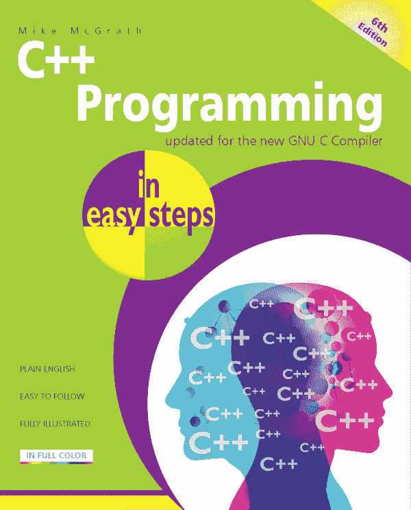

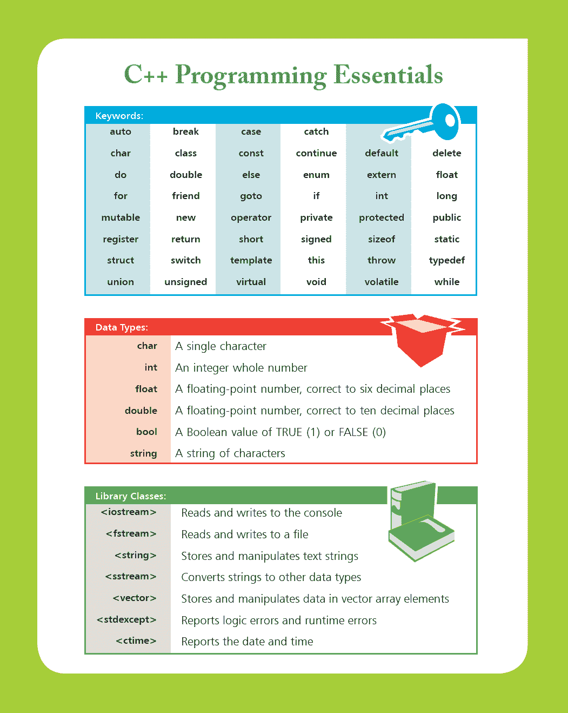
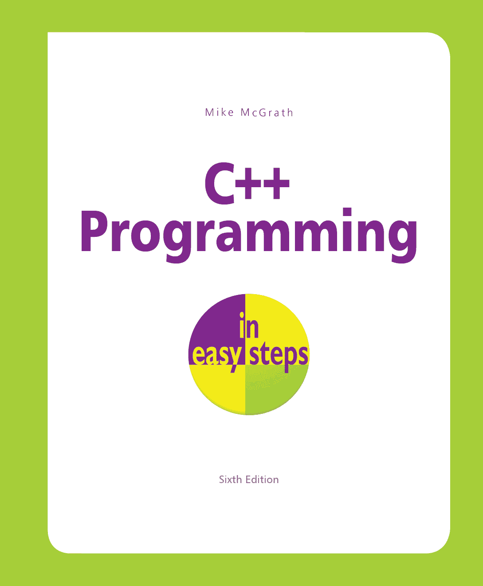

# 前言

本书的创作为我——Mike McGrath 提供了一个更新我之前的 C++ 书籍的好机会。书中提供的所有示例都演示了当前 Windows 和 Linux 操作系统上的编译器支持的 C++ 特性，适用于 Microsoft Studio 开发套。我衷心希望你们在发现 C++ 强大且富有表现力的可能性时，能像我编写这本书时一样享受其中。

## 本书中的约定

为了清晰每个示例中列出的代码，我采用了特定的色彩约定。C++ 语言本身的组件为蓝色，数值和字符串值为红色，程序员指定的名称为黑色，注释为绿色，如下所示：

```cpp
// 存储并输出文本字符串值。
string myMessage = "Hello from C++!";
cout << myMessage ;
```

此外，为了标识步骤中描述的每个源代码文件，步骤旁边会出现彩色图标和文件名：

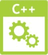
`main.cpp`


`header.h`

## 获取源代码

为了方便起见，我将书中示例的源代码文件放置在一个 ZIP 压缩包中，提供了 Windows 和 Linux 平台版本以及 Microsoft Studio IDE。你可以可以通过以下简单的步骤获取完整的压缩包：


访问 **[www.ineasysteps.com](http://www.ineasysteps.com)**，然后导航到免费资源 (Free Resources) 并选择下载 (Downloads) 部分。


在列表中找到 C++ Programming in easy steps, 6th edition，然后点击标题为 All Code Examples 的超链接下载压缩包。


现在，将压缩包内容解压到你计算机上的任何方便的位置。

如果你没有获得任何示例所示的结果，只需将你的代码与你下载的原始示例文件中的代码进行比较，以发现错误出在哪里。

# 1

## 开始上手

欢迎来到精彩的 C++ 编程世界。本章将演示如何创建一个简单的 C++ 程序，以及如何在程序中存储数据。

- 介绍 C++
- 安装编译器
- 编写你的第一个程序
- 编译并运行程序
- 创建变量
- 使用变量数组
- 使用 vector 数组
- 声明常量
- 总结

## 介绍 C++

C++ 是 C 编程语言的扩展，由 Dennis Ritchie 在 1972 年首次在 UNIX 操作系统上实现。C 是一种灵活的编程语言，至今仍然非常流行，并被用于从微控制器到最先进科学系统的各种平台。


一种强大的编程语言（读音为“see plus plus”），设计用于让你表达思想。

C++ 是由 Bjarne Stroustrup 博士在 1983 年至 1985 年间于新泽西州的 AT&T 贝尔实验室工作期间开发的。他在原始 C 语言的基础上添加了特性，产生了他所谓的“带有类的 C”（C with classes）。这些类定义了具有特定特性的编程对象，将 C 的过程化本质转换为 C++ 的面向对象编程语言。

C 编程语言之所以得此名，是因为它继承了在 1970 年左右引入的名为“B”的早期编程语言。“C++”这个名字体现了一些程序员的幽默感，因为编程中的 `++` 增运算符表示 C++ 是 C 语言的扩展。

C++ 像 C 一样，不依赖于平台，因此可以在任何操作系统上创建程序。书中的大多数插图描述的是 Windows 操作系统上的输出，纯粹是因为它是最常用的桌面平台。示例也可以在 Linux 或 macOS 等其他平台上创建。

### 为什么要学习 C++ 编程？

C++ 语言受到许多专业程序员的喜爱，因为它允许他们创建快速、紧凑且健壮可移植的程序。

使用现代的 C++ 集成开发环境（IDE），例如微软的 Visual Studio Community 版，程序员可以快速创建复杂的应用程序。但为了充分发挥这些工具的作用，程序员必须首先学习大量的 C++ 语言本身。

本书是 C++ 编程的入门教程，提供了程序代码及其输出示例，以演示这种强大语言的基础知识。


微软免费的 Visual Studio Community 版 IDE 在书中用于演示可视化编程。

### 我应该先学 C 语言吗？

对于在转向 C++ 之前熟悉 C 编程是否是一个优势，人们意见不一。先学习原始语言以便更轻松地理解更大的扩展语言似乎是合逻辑的。然而，C++ 并不仅仅是 C 的大版本，因为 C++ 的面向对象编程方法与 C 的过程化本质有显著不同。因此，认为在没有 C 语言知识的情况下学习 C++ 更好，以避免混淆。

本书并不假设读者具备任何编程语言的先前知识，因此适合 C++ 编程的初学者，无论他们是否知道 C 语言。

如果你觉得在转向 C++ 之前学习 C 语言编程对你有所帮助，我们建议你在阅读本书之前尝试[易学 C 语言编程](http://www.ineasysteps.com/)中的示例。

### C++ 的标准化

随着 C++ 编程语言普及性的提高，它被全球许多程序员作为首选编程语言。其中一些程序员开始向语言中添加自己的扩展，因此有必要约定一个精确的 C++ 版本，以便所有程序员在国际范围内共同共享。

标准版本的 C++ 是由美国国家标准协会（ANSI）和国际标准化组织（ISO）的联合委员会定义的。这个版本有时被称为 ANSI C++，它可以移植到任何平台和任何开发环境。

书中所给示例符合 ANSI C++。示例程序运行在控制台窗口中（例如 Windows 系统上的命令提示符窗口或 Linux 系统上的 shell 终端窗口），用以演示 C++ 语言本身的机制。最后一章中的一个示例说明了在 Windows 平台上通过视觉化开发工具自动生成的代码，一旦你熟悉了 C++ 语言，就可以通过编辑来创建一个图形化的窗口应用程序。


“ISO”不是缩写词，而是源自希腊单词“isos”，意为“相等”——就像“等距”（isometric）。

## 安装编译器

C++ 程序最初以纯文本文件创建，扩展名为 `.cpp`。这些文件可以在任何文本编辑器中编写，例如 Windows 的记事本应用程序或 Linux 上的 Vi 编辑器。

为了执行 C++ 程序，必须将其“编译”成计算机可以理解的字节码。C++ 编译器读取程序的文本版本并将其翻译成第二个文件——机器可读的、可执行格式。

如果文本程序包含任何语法错误，编译器将报告这些错误且不会生成可执行文件。

如果你使用 Windows 平台并安装了 C++ 集成开发环境（IDE），那么你已经可以使用 C++ 编译器，因为编译器是视觉 IDE 的不可缺的一部分。优秀的免费微软 C++ IDE 在开始学习 C++ 时可能会显得笨重，因为它们总是创建许多高级程序使用的“项目”文件。

流行的免费 GNU C++ 编译器根据通用公共许可证（GPL）免费提供。它包含在大多数 Linux 操作系统发行版中。GNU C++ 编译器也适用于 Windows 平台，并用于编译书中的示例。

要发现系统是否已安装 GNU C++ 编译器，请在命令提示符处输入 `c++ -v` 然后按回车。如果可用，编译器将返回版本信息。如果你使用 Linux 平台且计算机上没有 GNU C++ 编译器，请从发行版磁盘安装、从 GNU 网站下载或要求系统管理员安装。

GNU 项目（读音为“guh-new”）于 1984 年启动，旨在开发一个完全免费的类 Unix 操作系统。GNU 的一部分是“Windows 最小化 GNU”（MinGW）。MinGW 包含了可以在 Windows 系统上创建可执行 C++ 程序的 GNU C++ 编译器。Windows 用户可以按照此处的说明下载并安装 GNU C++ 编译器。

要打开 Windows 命令提示符，按下 `Windows + R` 启动运行对话框，然后在对话框中输入 `cmd` 并按回车。


连接互联网，启动网络浏览器然后导航到 `[osdn.net/projects/mingw](http://osdn.net/projects/mingw)` 并点击链接下载 MinGW 安装程序 `mingw-get-setup.exe`。


启动安装程序，并在“Installation Manager”对话框中接受建议的位置 `C:\MinGW`。


勾选 `Basic MinGW` 和 `C++ Compiler` 项目，然后点击 `Installation`、`Apply Changes`、`Apply` 进行安装。

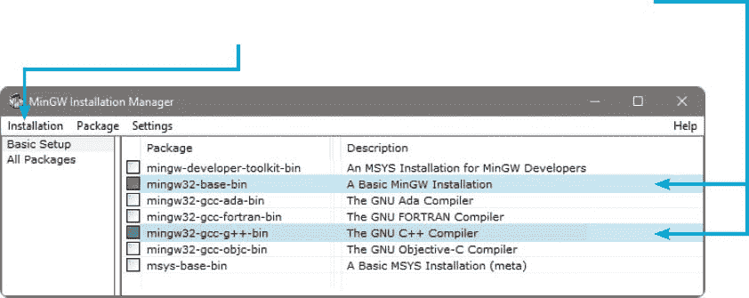

MinGW C++ 编译器是一个位于 `C:\MinGW\bin` 的二进制执行文件。为了允许从任何系统位置访问，现在应将此文件夹添加到系统路径（System Path）：


打开 Windows “系统属性”对话框，然后选择`Advanced`选项卡并点击`Environment Variables`按钮 – 打开“环境变量”对话框。


选择`Path`系统变量，然后点击`Edit`按钮并添加位置 `C:\MinGW\bin;`。


点击`OK`关闭每个对话框，然后打开命令提示符窗口输入命令 `c++`。如果安装成功，编译器应该响应你没有指定任何用于编译的输入文件

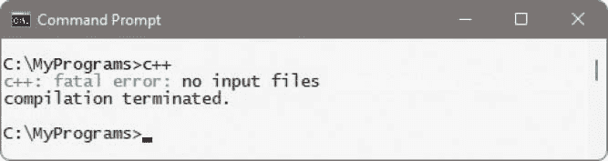


要打开系统属性对话框，按下 `Windows` + `R` 键启动运行对话框，然后在对话框中输入 `sysdm.cpl` 并按 `Enter` 。


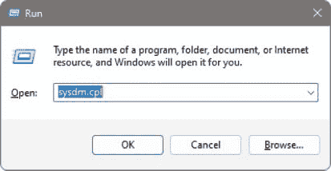

# 编写你的第一个程序

按照以下步骤，完全按照列出的内容复制代码，创建一个简单的 C++ 程序，它将输出传统的第一个程序问候语：

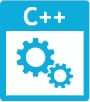
hello.cpp


打开一个纯文本编辑器，例如 Windows 记事本，然后输入这些“预处理器指令”：

```cpp
#include <iostream>
using namespace std ;
```


在预处理器指令下方几行，添加一个描述程序的“注释”

```cpp
// A C++ Program to output a greeting.
```


在注释下方，添加一个“main 函数”声明以包含程序语句

```cpp
int main()
{
}
```


在主函数的大括号（braces）之间，插入此输出“语句”：

```cpp
cout << “Hello World!” << endl ;
```


接下来，在主函数中插入最后的“return”语句

```cpp
return 0 ;
```


将程序保存到任何方便的位置命名为“hello.cpp” – 完整的程序看起来应该是这样：

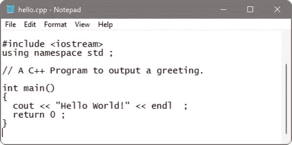


本书中的注释均以绿色显示 – 以将它们与其他代码区分。


在输入主方法的最后一个闭合 `}` 大括号后，始终按 `Return` 以添加换行符 – 你的编译器可能坚持源文件应以换行符结束。

可以单独检查此处所示的程序代码的各个部分，以更清楚地理解每个部分：

- **预处理器指令 (Preprocessor Directives)** – 这些在程序代码之前由编译器处理，因此必须始终出现在页面开头。在这里，`#include` 指令编译器使用名为 `iostream` 的标准 C++ 输入输出库，在`< >` 尖括号之间指定库名。下一行是“使用指令”（using directive），允许使用指定命名空间中的函数而无需其命名名前缀。`iostream` 库的函数位于 `std` 命名空间内 – 因此此 `using` 指令允许将 `std::cout` 和 `std::endl` 写为 `cout` 和 `endl`。

- **注释 (Comments)** – 这些应该让其他人更容易理解代码，以及自己在以后重新查看代码时。在 C++ 编程中，`//` 双斜杠之后单行上的所有内容都会被编译器忽略。

- **主函数 (Main function)** – 这是每个 C++ 程序的强制入口点。程序可以包含许多函数，但它们必须包含一个名为 `main` 的函数，否则编译器将无法编译程序。可选情况下，函数名后的括号可以指定一个用逗号分隔的“参数”值列表，供该函数使用。执行后，函数必须向操作系统返回其在声明中指定的数据类型的值 – 在本情况下，是一个 `int`（整数）值。

- **语句 (Statements)** – 这些是程序运行时将执行的动作。每个语句必须以分号终止，就像英语句子必须以句号结束一样。在这里，第一条语句调用 `cout` 库函数来输出文本和一个 `endl` 换行符。这些通过 `<<` 输出流运算符定向到标准输出。注意文本必须包含在双引号内。最后的语句使用 `return` 返回零值。C++ 编译器支持 `/*` 和 `*/` 之间的多行注释 – 但这些仅用于注释代码段。


注意代码使用空格和缩进（统称为空白字符）来提高可读性。C++ 编译器忽略所有空白。

# 编译与运行程序

本书的 C++ 源文件存储在为此目的创建的目录中。该目录命名为 `MyPrograms` – 其在 Windows 上的绝对地址为 `C:\MinGW`，在 Linux 上为 /*user。你可以重建此目录来存储等待编译的程序：


将 `hello.cpp` 程序文件移动到 `MyPrograms` 目录


在命令提示符处，使用 `cd` 命令导航到 `MyPrograms` 目录


输入命令尝试编译程序：

```bash
c++ hello.cpp
```

当尝试成功时，编译器会在源文件旁边创建一个执行文件。默认情况下，执行文件在 Windows 上名为 a.exe，在 Linux 上名为 a。同一目录下编译不同的源文件将覆盖第一个执行文件。这显然是不理想的，因此在编译程序时应为执行文件指定自定义名称，使用编译命令中的 `-o` 选项：

```bash
c++ hello.cpp -o hello.exe
```


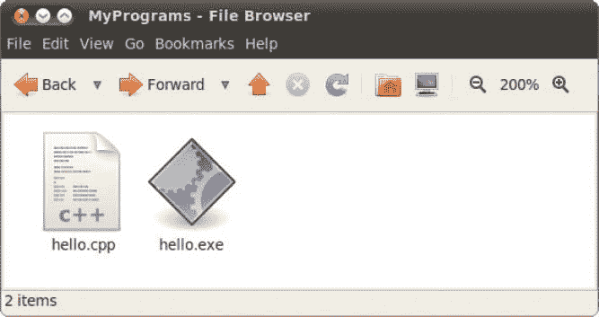


`c++` 命令是 GNU C++编译编译别名 – 也可以使用 `g++` 命令。你可以通过命令查看编译器版本号：

```bash
c++ --version
```

并通过以下命令显示所有选项：

```bash
c++ --help
```

在 Windows 上运行生成的执行程序文件，只需在 `MyPrograms` 目录的提示符处输入文件名 – 可选省略文件扩展。在 Linux 中，必须使用完整文件名，并加上 `./` 点斜 – 因为在没有明确指示的情况下，Linux 不查找当前目录：

```bash
./hello
```

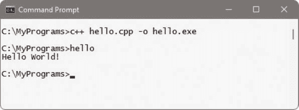

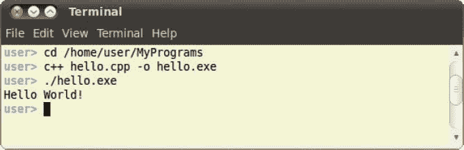


书中的所有命令行示例都已使用写作时最新的最新 GNU C++ 编译器进行了编译和测试——它们在其他编译器上可能无法完全复制。

## 创建变量

“变量”就像 C++ 程序中的一个容器，数据值可以存储在计算机的内存中。可以使用变量的名称来引用存储的值。


程序员可以为变量选择任何名称，只要它符合 C++ 的命名规范——所选名称只能包含字母、数字和下划线字符，但不能以数字开头。此外，必须避免使用书内封上列出的 C++ 关键字。选择有意义的名称是一个良好的习惯，可以使代码更易于理解。

要在程序中创建一个新变量，必须对其进行“声明”，并指定它可能包含的数据类型和所选的名称。变量声明的语法如下：

```cpp
data-type variable-name ;
```

可以在单个声明中创建多个相同数据类型的变量，其格式为用逗号分隔的列表，语法如下：

```cpp
data-type variable-name1 , variable-name2 , variable-name3 ;
```


C++ 中的名称是区分大小写的——因此，名为 `VAR`、`Var` 和 `var` 的变量被视为三个独立的变量。传统上，C++ 变量名是小写且很少以下划线开头，因为某些 C++ 库使用了这种约定。

下表列出了五种基本的 C++ 数据类型，并带有简要描述和示例内容：

| 数据类型 | 描述 | 示例 |
| :--- | :--- | :--- |
| `char` | 单字节，可以存储一个字符 | ‘A’ |
| `int` | 整数 | `100` |
| `float` | 浮点数，精确到六位小数 | `0.123456` |


| `double` | 浮点数，精确到十位小数 | `0.0123456789` |

| `bool` | `true` 或 `false` 的布尔值，或者数值上零为假，任何非零为真 | `false` 或 `0`, `true` 或 `1` |


`char` 数据类型的字符值必须始终包含在单引号之间——而不是双引号。

变量声明必须出现在可执行语句之前——这样它们在语句内部就可以被引用。

当一个值赋值给变量时，该变量被称为已“初始化”。可选，可以在声明时初始化变量。任何初始化变量中存储的值都可以通过 `cout` 函数显示在标准输出上，该函数在此处用于显示“Hello World!”问候。

通过指定要包含的 C++ 库类和要使用的命名空间前来启动新程序

```cpp
#include <iostream>
using namespace std ;
```


`vars.cpp`

添加一个包含最终 `return` 语句的 `main` 函数

```cpp
int main()
{
    // 程序代码放在这里。
    return 0 ;
}
```

在 `main` 函数中插入语句来声明和初始化各种数据类型的变量

```cpp
char letter ; letter = ‘A’ ;  // 声明后初始化。
int number ; number = 100 ; // 声明后初始化。
float decimal = 7.5 ;  // 声明并初始化。
double pi = 3.14159 ;  // 声明并初始化。
bool isTrue = false ;  // 声明并初始化。
```

现在，插入语句输出每个存储的值

```cpp
cout << “char letter: ” << letter << endl ;
cout << “int number: ” << number << endl ;
cout << “float decimal: ” << decimal << endl ;
cout << “double pi: ” << pi << endl ;
cout << “bool isTrue: ” << isTrue << endl ;
```

保存、编译并运行程序以查看输出

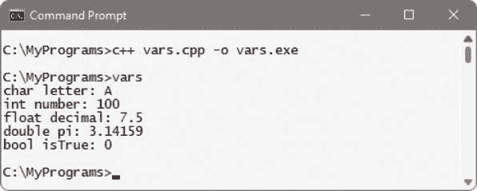


布尔变量名始终以“`is`”开头，以便它们能立即识别为布尔值。此外，对于所有由多个单词组成的变量名使用“驼峰命名法”（`lowerCamelCase`）——除第一个单词外的所有单词大大写开头，如`isTrue`。

## 使用变量数组

数组是一个可以存储多个数据项的变量——与普通变量不同，后者只能存储一个数据。数据项顺序存储在数组“元素”中，从 0 开始编号。因此，第一个值存储在元素 0 中，第二个值存储在元素 1 中，以此此类推。


数组的声明方式与其他变量相同，此外在声明中必须指定数组的大小，放在数组名称后的方括号中。例如，声明一个名为`nums`存储六个整数的数组的语法如下：

```cpp
int nums[6] ;
```

可选，可以在声明时通过用大括号括起来逗号分隔列表为每个元素赋值来初始化数组。例如：

```cpp
int nums[6] = { 0, 1, 2, 3, 4, 5 } ;
```


C++ 中的名称是区分大小写的——因此，名为`VAR`、`Var`和`var`的变量被视为三个独立的变量。传统上，C++ 变量名是小写且很少以下划线开头，因为某些 C++ 库使用了这种约定。

下表列出了五种基本的 C++ 数据类型，并带有简要描述和示例内容：

| 数据类型 | 描述 | 示例 |

| :--- | :--- | :--- |

| `char` | 单字节，可以存储一个字符 | ‘A’ |

| `int` | 整数 | `100` |

| `float` | 浮点数，精确到六位小数 | `0.123456` |

| `double` | 浮点数，精确到十位小数 | `0.0123456789` |

| `bool` | `true` 或 `false` 的布尔值，或者数值上零为假，任何非零为真 | `false` 或 `0`, `true` 或 `1` |

循环结构在第 3 章中引入，通常用于遍历数组元素。

## 使用向量数组

向量（`vector`）是普通数组的替代方案，它的优点是大小可以根据程序需要进行更改。与普通数组一样，可以为任何数据类型创建向量，并且它们的元素也从 0 开始编号。


为了在程序中使用向量，必须在程序开头使用`#include <vector>`预处理指令添加 C++ `vector`库。该库包含了下表中的预定义函数，用于操作向量：

| **函数:** | **描述:** |

| :--- | :--- |

| `at(number)` | 获取指定元素编号包含的值 |

| `back()` | 获取最后一个元素的值 |

| `clear()` | 移除所有向量元素 |

| `empty()` | 如果向量为空则返回 true (1)，否则返回 false (0) |

| `front()` | 获取第一个元素的值 |

| `pop_back()` | 移除最后一个元素 |

| `push_back(value)` | 在向量末尾添加一个包含指定值的最终元素 |

| `size()` | 获取元素数量 |

创建向量的声明如下：

`vector < data-type > vector-name ( size ) ;`

一个`int`向量默认情况下，每个元素都会自动初始化为零值。可选情况下，可以在声明中的大小之后指定一个不同的初始值，语法如下：

`vector < data-type > vector-name ( size , initial-value ) ;`

操作向量的函数只需通过点操作符（`dot operator`）附加到所选的向量名称即可。例如，要获取名为“`vec`”的向量的大小，可以使用`vec.size()`。


单个向量元素可以像普通数组一样使用方括号引用，例如`vec[3]`。

 通过指定要包含的 C++ 库类和要使用的命名空间前缀来启动新程序

```cpp
#include <vector>  // 向量支持。
#include <iostream>
using namespace std ;
```


`vector.cpp`

 添加一个包含最终返回语句的 `main` 函数

```cpp
int main()
{
    // 程序代码在此处。
    return 0 ;
}
```

 在 `main` 函数中，插入语句来声明并初始化一个包含三个值为 100 的元素的向量数组

`vector <int> vec( 3, 100 ) ;`

 现在，插入语句来操作向量元素

```cpp
cout << “Vector size: ” << vec.size() << endl ;
cout << “Is empty?: ” << vec.empty() << endl;
cout << “First element: ” << vec.at(0) << endl;
vec.pop_back() ;  // 移除最后一个元素。
cout << “Vector size: ” << vec.size() << endl;
cout << “Final element: ” << vec.back() << endl;
vec.clear() ;  // 移除所有元素。
cout << “Vector size: ” << vec.size() << endl;
vec.push_back( 200 ) ;  // 添加一个元素。
cout << “Vector size: ” << vec.size() << endl;
cout << “First element: ” << vec.front() << endl;
```

 保存、编译并运行程序以查看输出

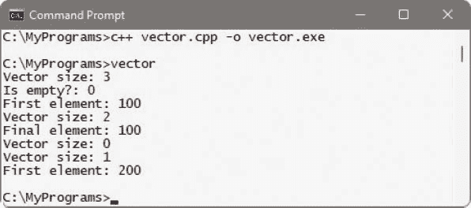


示例此处展示了如何使用循环为向量填充数据，使每个元素具有不同的初始值。

## 声明常量

在程序执行期间不会更改的数据应该存储在常量容器中，而不是变量中。这使得编译器能够更好地检查代码中的错误——如果程序尝试更改存储在常量的值，编译器将报告错误导致编译失败。


通过在变量声明前加上`const`关键字并后跟一个空格，可以为任何数据类型创建常量。通常，常量名使用大写字母，以将它们区别于（小写的）变量名。与变量不同，常量必须在声明时初始化。例如，数学值 `pi` 的常量的声明如下：

`const double PI = 3.1415926536 ;`

`enum`关键字提供了一种简洁创建整数常量序列的方便方法。可选情况下，声明可以在`enum`关键字之后包含该序列的名称。常量名在花括号内以逗号分隔的列表形式出现。例如，此声明创建了一个常量序列：

`enum suit { CLUBS , DIAMONDS , HEARTS , SPADES } ;`

默认情况下，每个常量的值都比列表中前一个常量大一。除非指定，否则第一个常量将有一个值。有时使用`typedef`关键字来定义枚举常量列表是方便的。`typedef`关键字简单地为结构体创建一个别名。

```cpp
typedef enum { NEGATIVE , POSITIVE } charge;
```

然后可以像往一样创建自定义类型的变量。例如，对于上面的示例，将`POSITIVE`常量赋值给`charge`变量实际上赋值了 1。

 通过指定要包含的 C++ 库类和要使用的命名空间前缀来启动新程序

```cpp
#include <iostream>
using namespace std ;
```


`constant.cpp`

 添加一个包含最终返回语句的 `main` 函数

```cpp
int main()
{
    // 程序代码在此处。
    return 0 ;
}
```

 在 `main` 函数中，插入语句来声明常量并输出常量值

`const double PI = 3.1415926536 ;`

`cout << “6 circumference: ” << (PI * 6) << endl;`

 接下来，插入语句声明枚举常量列表并输出某些常量值

```cpp
enum { RED=1, YELLOW, GREEN, BROWN, BLUE, PINK, BLACK } ;
cout << “I shot a red worth: ” << RED << endl;
cout << “Then a blue worth: ” << BLUE << endl;
cout << “Total scored: ” << ( RED + BLUE ) << endl;
```

 现在，插入语句声明自定义数据类型并输出其赋值值

```cpp
typedef enum { NEGATIVE , POSITIVE } charge;
charge neutral = NEGATIVE , live = POSITIVE ;
cout << “Neutral wire: ” << neutral << endl;
cout << “Live wire: ” << live << endl;
```

 保存、编译并运行程序以查看输出

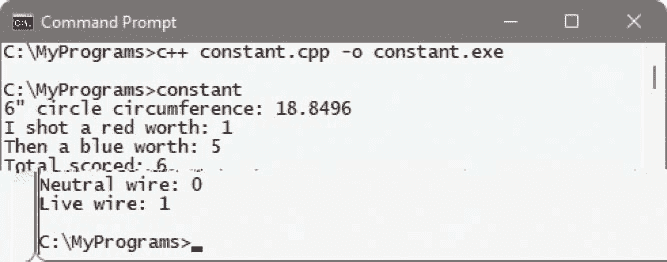


在`PI`声明中，`*`字符是 C++ 乘法运算符，`\”`中的反斜杠转义了引号标记——这样字符串不会提前终止。

## 总结


- C++ 是一种面向对象的编程语言，是过程化 C 语言的扩展。
- GNU C++ 编译器适用于 Windows 和 Linux。
- 预处理指令用于使标准 C++ 库中的函数程序可用。
- 每个 C++ 程序必须包含一个 `main` 方法作为程序的入口点。
- 语句定义了程序将执行的操作。
- 建议对程序代码进行广泛注释，以明确其用途。
- `c++`命令调用编译器，其`-o`选项允许命令指定生成的可执行文件的名称。
- 变量声明指定数据类型和一个选定的名称，通过该名称可以引用变量中的值。
- `cout`函数是 C++ `iostream`库的一部分，用于将内容写入标准输出控制台。
- 数组是一个固定大小的变量，以元素的形式存储多个数据项，元素从 0 开始编号。
- 特殊字符`\0`可以赋值给`char`数组的最后一个元素，以便将其视为单个文本字符串。
- `vector`变量以元素的形式存储多个数据项，并且可以动态调整大小。
- 使用该变量的名称及其索引号可以引用数组或 `vector` 元素中存储的值。
- 程序从不改变的变量值应该存储在常量中。
- 常量列表可以通过`enum`关键字自动编号，并由`typedef`关键字赋予类型名称。

# 2

## 执行操作

本章介绍了 C++ 运算符，并演示了它们可以执行的操作。

- 算术运算
- 赋值
- 比较值
- 逻辑评估
- 检查条件
- 确定大小
- 设置优先级
- 数据类型转换
- 总结

### 算术运算

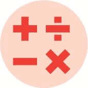

C++ 程序中常用的算术运算符列如表所示，并包含了它们执行的操作：

| 运算符: | 操作: |

| :--- | :--- |

| `+` | 加法 |

| `-` | 减法 |

| `*` | 乘法 |

| `/` | 除法 |

| `%` | 取模 |

| `++` | 递增 |

| `--` | 递减 |

加法、减法、乘法和除法的运算符作用方式正如你预期的那样。然而，当使用多个运算符时，必须注意使用括号表达式以明确其含义——最内层括号内的操作优先执行：

```
a = b * c - d % e / f ; // 这不清晰。
```

```
a = ( b * c ) - ( ( d % e ) / f ) ; // 这更清晰。
```

`%`取模运算符会将第一个数字除以第二个数字，并返回操作的余数。这对于判断一个数是奇数还是偶数很有用。

`++`递增运算符和`--`递减运算符会将给数字改变 1 并返回结果。它们最常用于循环中的迭代计数。向上计数时，`++`运算符将值加 1；向下计数时，`--`递减运算符将值减 1。


用于运算符构成表达式的值被称为“操作数”——在表达式`2 + 3`中，数值`2`和`3`就是操作数。

递增和递减运算符可以放在值的之前或之后，产生不同的效果。如果放在操作数之前（前置），其值立即改变；如果放在操作数之后（后置），则先记录值，然后改变值。

通过指定要包含的 C++ 库类和使用的命名空间前缀开始一个新程序

```cpp
#include <iostream>
using namespace std ;
```

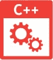

`arithmetic.cpp`

添加一个包含`return`语句的 `main` 函数

```cpp
int main()
{
// 程序代码在这里。
return 0 ;
}
```

在 `main` 函数中，插入语句来声明并初始化两个整数变量

```cpp
int a = 8 , b = 4 ;
```

接下来，插入语句来输出每个基础算术运算的结果

```cpp
cout << “Addition result: ” << ( a + b ) << endl;
cout << “Subtraction result: ” << ( a - b ) << endl;
cout << “Multiplication result: ” << ( a * b ) << endl;
cout << “Division result: ” << ( a / b ) << endl;
cout << “Modulus result: ” << ( a % b ) << endl;
```

现在，插入语句来输出后置和前置递增操作的结果

```cpp
cout << “Postfix increment: ” << a++ << endl;
cout << “Postfix result: ” << a << endl;
cout << “Prefix increment: ” << ++b << endl;
cout << “Prefix result: ” << b << endl;
```

保存、编译并运行程序以查看输出

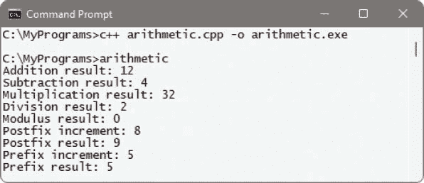


前置运算符立即改变变量值——后置运算符随后改变值。

### 赋值


前置运算符立即改变变量值——后置运算符随后改变值。

### 赋值操作

C++ 中用于赋值的运算符下表所示。

| 运算符 | 示例 | 等效于 |
| :--- | :--- | :--- |
| `=` | `a = b` | `a = b` |
| `+=` | `a += b` | `a = a + b` |
| `-=` | `a -= b` | `a = a - b` |
| `*=` | `a *= b` | `a = a * b` |
| `/=` | `a /= b` | `a = a / b` |
| `%=` | `a %= b` | `a = a % b` |

在上面的示例中，`=` 运算符表示赋值，而不是 `==` 运算符（相等）。其他运算符以相同的方式工作。

与 `=` 赋值运算符不同，`==` 等于运算符用于比较操作数，其描述请参见此处。

## 比较值


C++ 编程中常用的用于比较两个数值的运算符列如下表所示：

| **运算符** | **比较测试** |
| :--- | :--- |
| `==` | 等于 |
| `!=` | 不等于 |
| `>` | 大于 |
| `<` | 小于 |
| `>=` | 大于等于 |
| `<=` | 小于等于 |

`==` 等于运算符比较两个操作数，如果两个操作数的数值相等，则返回 `true` (1)，否则将返回 `false` (0) 值。如果两者都是同一个数字，则它们是相等的；如果两者都是字符，则会对其它们的 ASCII 码值进行数值比较。相反，`!=` 不等于运算符在两个操作数不相等时返回 `true` (1)，其使用的规则与 `==` 等于运算符相同，否则返回 `false` (0)。相等和不等于运算符对于测试两个变量的状态以执行程序中的条件分支非常有用。


A-Z 大写字母的 ASCII 码值为 65-90，a-z 小写字母的 ASCII 码值为 97-122。

`>` “大于”运算符比较两个操作数，如果第一个的数值大于第二个，则返回 `true` (1)；如果其数值等于或小于第二个，则返回 `false` (0)。`<` “小于”运算符进行相同的比较，但如果第一个操作数的数值小于第二个的，则返回 `true` (1)，否则返回 `false` (0)。`>` “大于”或 `<` “小于”运算符常用于测试循环中迭代计数器的值。

在 `>` “大于”或 `<` “小于”运算符后添加 `=` 运算符，可以使其在两个操作数数值恰好相等时也返回 `true` (1)。

每个比较操作都在此处 的程序中进行了演示。


通过指定要包含的 C++ 库类和要使用的命名空间前缀启动新程序

```cpp
#include <iostream>
using namespace std ;
```


comparison.cpp


添加一个包含最终 `return` 语句的 main 函数

```cpp
int main()
{
    // 程序代码在此处。
    return 0 ;
}
```


在 main 函数中，插入语句声明并初始化可以转换为布尔值的变量

```cpp
int nil = 0, num = 0, max = 1 ; char cap = 'A', low = 'a' ;
```


接下来，插入语句输出整数和字符的相等比较结果

```cpp
cout << "Equality comparisons: " ;
cout << "(0 == 0) " << ( nil == num ) << "(true)" ;
cout << "(A == a) " << ( cap == low ) << "(false)" ;
```


现在，插入语句输出所有其他比较结果

```cpp
cout << endl << "Inequality comparison: " ;
cout << "(0 != 1) " << ( nil != max ) << "(true)" ;
cout << endl << "Greater comparison: " ;
cout << "(0 > 1) " << ( nil > max ) << "(false)" ;
cout << endl << "Lesser comparison: " ;
cout << "(0 < 1) " << ( nil < max ) << "(true)" ;
cout << endl << "Greater or equal comparison: " ;
cout << "(0 >= 0) "<< ( nil >= num ) << "(true)" ;
cout << endl << "Lesser or equal comparison: " ;
cout << "(1 <= 0) " << ( max <= num ) << "(false)" ;
```


保存、编译并运行程序以查看输出

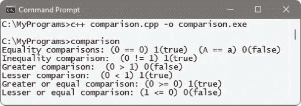


大写字母 “A” 的 ASCII 码值为 65，但小写字母 “a” 是 97 —— 因此它们这里的比较返回 `false` (0)。

## 评估逻辑


C++ 编程中最常用的逻辑运算符列如下表所示：

| **运算符** | **操作** |
| :--- | :--- |
| `&&` | 逻辑与 |
| `||` | 逻辑或 |
| `!` | 逻辑非 |

逻辑运算符用于具有布尔值 `true` 或 `false` 的操作数，或者可以转换为 `true` 或 `false` 的值。

逻辑 `&&` 与运算符会评估两个操作数，只有当两个操作数本身都为 `true` 时才会返回 `true`。否则，`&&` 运算符将返回 `false`。这被用于条件分支，程序的运行方向通过测试两个条件来决定 —— 如果两个条件都满足，程序将进入某个方向，否则它将采取另一个方向。


逻辑运算符用于具有布尔值 `true` 或 `false` 的操作数，或者可以转换为 `true` 或 `false` 的值。

逻辑 `&&` 与运算符会评估两个操作数，只有当两个操作数本身都为 `true` 时才会返回 `true`。否则，`&&` 运算符将返回 `false`。这被用于条件分支，程序的运行方向通过测试两个条件来决定 —— 如果两个条件都满足，程序将进入某个方向，否则它将采取另一个方向。

`( *test-expression ) ? `if-true-return-this` : `if-false-return-this` ;`

虽然三元运算符最初可能看起来有些困惑，但熟悉这个运算符是非常有价值的，因为它可以用最少的代码执行强大的程序分支。例如，当一个变量的值不为 1 时进行分支：

`( var != 1 ) ? `if-true-do-this` : `if-false-do-this` ;`

三元运算符在 C++ 编程中常被用于将两个变量的最大值或最小值赋值给第三个变量。例如，这样赋值最小值：

`c = ( a < b ) ? a : b ;`

当括号中的表达式在变量 `a` 的值小于变量 `b` 的值时返回 `true` —— 因此在这种情况下，变量 `a` 的较小值被赋值给变量 `c`。

同样地，将测试表达式中的 `<` 小于运算符替换为 `>` 大于运算符，会将变量 `b` 的较大值赋值给变量 `c`。

三元运算符的另一个用法是在测试表达式中使用 `%` 取模运算符来确定变量的值是奇数还是偶数：

`( var % 2 != 0 ) ? `if-true(odd)-do-this` : `if-false(even)-do-this` ;`


三元运算符有三个操作数：`?` 之前的那个，以及 `:` 之前和之后的两个。

当变量值除以二有余数时，该数字为奇数 —— 没有余数时，数字为偶数。测试表达式 `( var % 2 == 1 )` 具有相同的效果，但最好测试不相等性 —— 发现不同之处比发现相同之处更容易。

程序在处展示了三元运算符的用法。


### 程序示例实现

通过指定要包含的 C++ 库类和使用的命名空间前缀开始一个新程序

```cpp
#include <iostream>
using namespace std ;
```


ternary.cpp


添加一个包含最终 `return` 语句的 main 函数

```cpp
int main()
{
    // 程序代码在这里。
    return 0 ;
}
```


在 main 函数中，插入声明三个整数变量的语句，并初始化其中两个

```cpp
int a, b, max ;
a = 1, b = 2 ;
```


插入语句输出第一个检查变量的值和奇偶性

```cpp
cout << "Variable a value is: " ;
cout << ( ( a != 1 ) ? "not 1, " : "1, " ) ;
cout << ( ( a % 2 != 0 ) ? "odd" : "even" ) ;
```


接下来，插入语句输出第二个检查变量的值和奇偶性

```cpp
cout << endl << "Variable b value is: " ;
cout << ( ( b != 1 ) ? "not 1, " : "1, " ) ;
cout << ( ( b % 2 != 0 ) ? "odd" : "even" ) ;
```


现在，插入语句输出两个存储变量中的较大值

```cpp
max = ( a > b ) ? a : b ;
cout << endl << "Greater value is: " << max << endl ;
```


保存、编译并运行程序查看输出

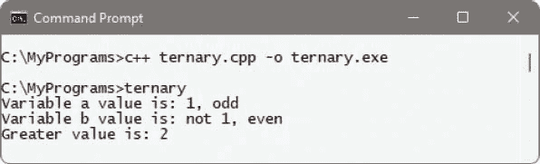


三元运算符可以返回任何数据类型的值 —— 数字、字符串、布尔值等。

### 确定大小

变量声明分配系统内存，用于存储赋值给该变量的值。为此分配的内存量取决于系统和数据类型。


通常，`int` 数据类型默认创建为“长型”（long）值，它可以存储从 +2,147,483,647 到 -2,147,483,648 的值。另一方面，如果 `int` 数据类型默认创建为“短型”（short）值，它只能存储从 +32,767 到 -32,768 的值。

在声明变量时，通过在 `int` 关键字前加上 `short` 或 `long` 修饰符可以显式指定首选范围。当你确定永远不会超出限制范围时，`short int` 有助于节省内存空间。

当声明 `int` 变量时，它默认包含正整数或负整数，这些被称为“有符号”（signed）值。如果变量始终只包含正整数，可以将其限定为 `unsigned`（无符号）以增加其最大可能值。通常，`unsigned short int` 的范围从 0 到 65,535，`unsigned long int` 的范围从 0 到 4,294,967,295。

可以使用 C++ 的 `sizeof` 运算符发现任何变量的内存大小。可以使用 `sizeof` 检查要检查的变量名。

| `( )` | 函数调用 | `[ ]` | 数组索引 | LTR |
| :--- | :--- | :--- | :--- | :--- |
| `->` | 类指针 | `.` | 类成员 | |
| `!` | 逻辑非 | `*` | 指针 | RTL |
| `--` | 递减 | `++` | 增 | |
| `+` | 正号 | `-` | 负号 | |
| `sizeof` | 大小 | `&` | 地址 | |
| `*` | 乘法 | `/` | 除法 | LTR |
| `%` | 取模 | | | |
| `+` | 加法 | `-` | 减法 | LTR |
| `<=` | 小于等于 | `<` | 小于 | LTR |
| `>=` | 大于等于 | `>` | 大于 | |
| `==` | 等于 | `!=` | 不等 | LTR |
| `&&` | 逻辑与 | | | LTR |
| `\|\|` | 逻辑或 | | | LTR |
| `?:` | 三元运算符 | | | RTL |
| `+= -= *= /= %=` | 赋值 | RTL | | |
| `,` | 逗号 | | | LTR |

除了表中的运算符外，还有许多“位”运算符，用于执行二进制算术。这超出了本书的范围，但在[C 语言编程快速入门](http://www.ineasysteps.com/)中有一个专门介绍二进制算术的章节。这些运算符在 C++ 中的执行方式完全相同。

运算符优先级在相反程序中得到了。


`*` 乘法运算符所在的行比 `+` 加法运算符高——因此在表达式`a=6+8*3`中，乘法先完成，然后才是加法。


`->` 类指针和 `.` 类成员运算符将在本书的后面介绍——但为了完整性，它们被包含在这里。


通过指定要包含的 C++ 库类和要使用的命名空间前缀来开始一个新程序：

```cpp
#include <iostream>
using namespace std ;
```


precedence.cpp

添加一个包含最终返回语句的 main 函数：

```cpp
int main()
{
    // 程序代码写在这里。
    return 0 ;
}
```


在 main 函数中，声明一个整数变量，并使用默认优先级的表达式结果进行初始化，然后输出结果。


```cpp
int num = 1 + 4 * 3 ;
cout << endl << "Default order: " << num << endl ;
```

接下来，使用显式优先级将此表达式的结果赋值变量，然后输出结果：

```cpp
num = ( 1 + 4 ) * 3 ;
cout << "Forced order: " << num << endl << endl ;
```

使用方向优先级将另一个表达式的结果赋值给变量，然后输出结果：

```cpp
num = 7 - 4 + 2 ;
cout<< "Default direction: " << num << endl ;
```

现在，使用显式优先级将此表达式的结果赋值变量，然后输出结果：

```cpp
num = 7 - ( 4 + 2 ) ;
cout << "Forced direction: " << num << endl ;
```

保存、编译并运行程序以查看输出：

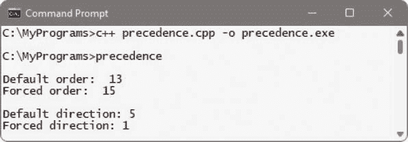


不要依赖默认优先级，因为它在编译器之间可能会不同——始终使用括号来明确表达式。

### 数据类型转换


存储在变量中的任何数据都可以通过名为"强制转换"（casting）的过程强制（迫）转换为不同数据类型的变量。转换语句只需在包含要转换数据的变量名之前的括号中指明该值应该转换到的数据类型。因此，转换语法看起来如下：

`variable-name = ( data-type ) variable-name ;`

这是传统的转换形式，在 C 编程语言中也可以找到。C++ 中一种较新的替代方案使用尖角括号和`static_cast`关键字，如下：

`variable-name = static_cast < data-type > variable-name ;`

新版本允许通过避免使用括号在源代码中更容易地识别转换，因为括号很容易与表达式中的括号混淆。虽然优选较新的转换形式，但旧形式仍然广泛存在。

为了准确存储算术运算的结果，转换通常是必要的，因为将一个整数除以另一个整数总是产生整数结果。例如，整数除法`7/2`产生被截断的整数结果`3`。

要存储准确的浮点数结果，需要将结果转换为适当的数据类型，例如`float`，如下：

`float result = ( float ) 7 / 2 ;`

或者使用较新的转换形式：

`float result = static_cast < float > 7 / 2 ;`


- `sizeof`运算符返回变量的内存字节大小。

- `int`变量可以被指定为`short`类型以处理较小的数字，或者指定为`long`类型以处理较大的数字。

- 当`int`变量仅存储正数时，可以将其指定为`unsigned`以扩展其数值范围。

- 在复杂表达式中，通过添加括号`( )`来显式设置运算符优先级是非常重要的。

- 通过类型转换过程，可以将存储在变量中的数据强制转换为不同数据类型的变量。

- C++ 支持传统的 C 风格强制转换以及使用`static_cast`关键字的新更新形式强制转换。

# 3 语句

*本章将演示 C++ 条件语句，这些语句允许程序向不同的方向进行分支，并引入了 C++ 函数结构。*

- 使用`if`进行分支

- 使用`switch`分支

- 使用`for`循环

- 使用`while`循环

- 声明函数

- 传递参数

- 函数重载

- 函数优化

- 总结

## 使用`if`进行分支

C++ 的`if`关键字执行基础条件测试，评估给定表达式的布尔值为`true`或`false`——其语法看起来如下：

```cpp
if ( test-expression ) { statements-to-execute-when-true }
```


测试语句后面的大括号可以包含一个或多个语句，每条语句都以分号结束，但这些语句仅在表达式被判定为`true`时才会执行。当测试结果为`false`时，程序将继续执行下一个任务。

可选地，`if`语句可以在`if`语句块之后附加`else`语句块，在测试失败时提供备用执行语句，如下：

```cpp
if ( test-expression ) { statements-to-execute-when-true }
else { statements-to-execute-when-false }
```


当测试成功时只有一条语句需要执行，可以省略大括号——但保留它们有助于代码的可读性。

为了测试两个条件，测试表达式可以使用`&&`运算符——例如，`if ( ( num > 5 ) && ( letter == 'A' ) )`。或者，可以将一个`if`语句"嵌套"另一个`if`语句中，这样内部语句块中的语句只有在两个测试都成功才会执行——但如果外部测试成功，外部语句块中的语句将被执行。

通过指定要包含的 C++ 库类和使用的命名空间前缀开始一个新程序

```cpp
#include <iostream>
using namespace std ;
```

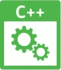

ifelse.cpp

添加包含最终`return`语句的主函数

```cpp
int main()
{
    // 程序代码写在这里。
    return 0 ;
}
```

在主函数中，插入语句声明并初始化两个变量

```cpp
int num = 8 ;
char letter = 'A' ;
```

接下来，插入一个`if-else`语句来测试整数变量的值并输出相应的响应

```cpp
if ( num > 5 )
{ cout << "Number exceeds five" << endl ; }
else
{ cout << "Number is five or less" << endl ; }
```

在`if`语句块中，插入一个嵌套的`if`语句来测试字符变量的值并在匹配时输出

```cpp
if ( letter == 'A' ) { cout << "Letter is A" << endl ; }
```

保存、编译并运行程序以查看两个测试均成功

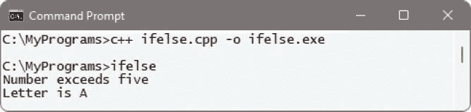

修改字符变量声明以更改其值

```cpp
char letter = 'B' ;
```

再次保存、编译并运行程序以查看只有外部测试成功——执行外部`if`语句

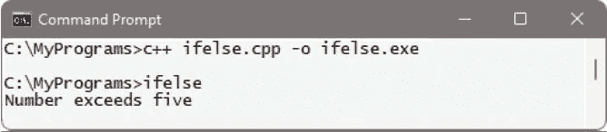

修改整数变量声明以更改其值

```cpp
int num = 3 ;
```

再次保存、编译并运行程序以查看两个测试均失败——执行外部`else`语句


在测试布尔值时可以使用简写——因此表达式`if ( flag == true )`可以写为`if ( flag )`


避免嵌套超过三层的`if`语句——以避免混淆和错误。

## 使用`switch`分支


`if`和`else`关键字在此处引入，允许程序根据测试的结果向不同的方向分支，并可以用于测试变量——例如，测试整数：

```cpp
if ( num == 1 ) { cout << "Monday" }
else
if ( num == 2 ) { cout << "Tuesday" }
else
if ( num == 3 ) { cout << "Wednesday" }
else
if ( num == 4 ) { cout << "Thursday" }
else
if ( num == 5 ) { cout << "Friday" }
```

长`if-else`语句通常可以使用`switch`语句更高效地执行，`switch`语句接收一个值，然后在`case`语句中寻找匹配值。如果没有找到匹配项，`case`语句将执行执行，但你可以在最后的`case`语句之后添加`default`语句来指定要执行的语句——除非这正是你所需要的。例如，对于三个值，如下：

```cpp
switch( variable-name )
{
    case value1 ; case value2 ; case value3 :
        statements-to-executed ; break ;
    case value4 ; case value5 ; case value6 :
        statements-to-executed ; break ;
}
```

通常，每个`case`语句将拥自己的执行语句并以`break`结束，如相反程序所示。

缺少`break`关键字不是语法错误——确保所有必要的`break`都存在。

 

```cpp
#include <iostream>
using namespace std ;
```

switch.cpp

添加包含最终`return`语句的主函数

```cpp
int main()
{
    // 程序代码写在这里。
    return 0 ;
}
```

在主函数中，插入语句声明并初始化一个待匹配的整数变量

```cpp
int num = 3 ;
```

接下来，插入一个`switch`语句来寻找匹配

```cpp
switch ( num )
{
    case 1 : cout << num << " : Monday" ; break ;
    case 2 : cout << num << " : Tuesday" ; break ;
    case 3 : cout << num << " : Wednesday" ; break ;
    case 4 : cout << num << " : Thursday" ; break ;
    case 5 : cout << num << " : Friday" ; break ;
}
```

在`switch`语句中，在最后的`case`语句之后插入`default`语句

```cpp
default : cout << num << " : Weekend day" ;
```

保存、编译并运行程序以查看输出

现在，修改整数变量声明以更改其值，然后保存、编译并再次运行程序

```cpp
int num = 6 ;
```

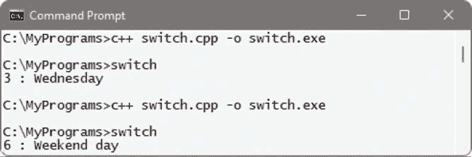


注意，`default`语句后面不需要跟`break`关键字——因为`default`语句始终出现在`switch`语句的最后。

## 循环 (Looping for)

循环是程序中一段会自动重复的代码。对循环块内包含的所有语句的完整执行称为一次"迭代"（iteration）或"通过"（pass）。


循环执行的迭代次数由循环内部的条件测试控制。只要被测试的表达式保持为`true`，循环就会继续——直到被测试的表达式变为`false`，此时循环结束。

C++ 编程中的三种循环结构是`for`循环、`while`循环和`do`-`while`循环。可能最常用的循环是`for`循环，其语法如下：

```cpp
for ( *initializer ; *test-expression ; *incrementer* ) { *statements* }
```

初始化器（initializer）为循环迭代次数的计数器设置起始值。为此使用一个整数变量，传统上通常命名为"i"。

在循环的每次迭代中，都会评估测试表达式，只有当该表达式为`true`时，该迭代才会继续。当被测试的表达式变为`false`时，循环立即结束，不再再次执行语句。在每次迭代中，计数器加增，然后执行语句。

循环可以嵌套在其他循环中——这样内部循环在外部循环的每次迭代中都会完整执行其迭代。

通过指定要包含的 C++ 库类和使用的命名空间前缀来启动新程序

```cpp
#include <iostream>
using namespace std ;
```


forloop.cpp

添加一个包含最终`return`语句的 main 函数

```cpp
int main()
{
// 程序代码放在这里。
return 0 ;
}
```

在 main 函数中，插入一条语句声明一个整数变量作为循环迭代计数器

```cpp
int i ;
```

接下来，插入一个`for`循环在三次迭代的每次输出计数器值

```cpp
for ( i = 1 ; i < 4 ; i++ )
{
cout << "Loop iteration: " << i << endl ;
}
```

保存、编译并运行程序查看输出

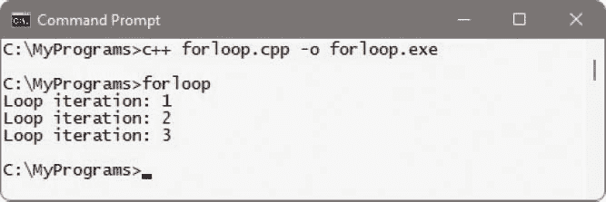

现在，修改变量声明以添加第二个计数器

```cpp
int i , j ;  // 添加了整数变量"j"。
```

在`for`循环块内部输出语句之后添加一个内部循环，在每次迭代中输出其计数器值

```cpp
for ( j = 1 ; j < 4 ; j++ )
{ cout << " Inner loop iteration: " << j << endl ; }
```

再次保存、编译并运行程序，查看内部循环在外部循环的每次迭代中完整执行

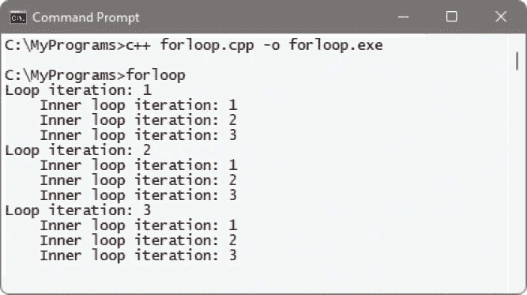


另一种，`for`循环计数器可以通过在每次迭代中使用`i--`而不是`i++`增器来递减计数器值。


在循环的第三次迭代中，增器将计数器值增加到 4——因此当下次评估时，测试返回为 false 且循环结束。

## while 循环 (Looping while)

`for`循环的替代方案（此处）使用`while`关键字，跟着一个要评估的表达式。当表达式为`true`时，测试表达式后大括号内的语句将被执行。表达式将再次被评估，`while`循环将持续直到发现表达式为`false`。


循环的语句块必须包含影响被测试表达式的代码，以便将评估结果更改为`false`，否则将导致导致锁定系统的死循环！如果在第一次评估时发现被测试表达式为`false`，则`while`循环的语句块将永远不会执行。

`while`循环的一种微妙变是将`do`关键字放在循环语句块之前并在之后加上`while`测试，语法如下：

```cpp
do { statements-to-be-executed } while ( test-expression ) ;
```

在`do-while`循环中，语句块将至少执行一次——因为表达式在循环的第一次迭代之后才会被评估。


如果你不小心启动了死循环，请按`Ctrl + C`键终止进程。

`break`语句可以包含在任何类型的循环中，在满足测试条件时立即终止循环。`break`语句确保该循环不会再执行后续迭代。

同样，`continue`语句可以包含在任何循环中以跳到下一次迭代。

通过指定要包含的 C++ 库类和使用的命名空间前缀启动新程序

```cpp
#include <vector>
#include <iostream>
using namespace std ;
```


while.cpp

添加一个包含最终`return`语句的 main 函数

```cpp
int main()
{
// 程序代码放在这里。
return 0 ;
}
```

在 main 函数中，插入语句声明整数 vector 和整数循环计数器

```cpp
vector <int> vec( 10 ) ;
int i = 0 ;
```

接下来，插入一个`while`循环在每次迭代将计数器值赋值给 vector 的元素


```cpp
while ( i < vec.size() )
{
i++; // 递增。
vec[ i-1 ] = i ; // 赋值给元素。
cout << " | " << vec.at( i-1 ) ;
}
```

保存、编译并运行程序查看输出

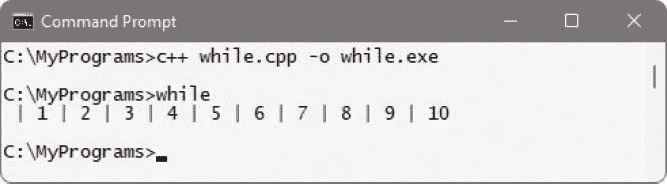

修改 `while` 循环在增器后立即添加 `continue` 语句，使循环跳过第三次迭代

```cpp
if ( i == 3 ) { cout << " | Skipped" ; continue ; }
```

在 `continue` 语句之后现在添加 `break` 语句，使循环在第八次迭代退出

```cpp
if ( i == 8 ) { cout << endl << "Done" ; break ; }
```

再次保存、编译并运行程序，查看循环现在跳过了某些迭代

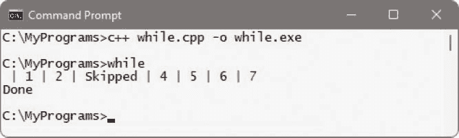


在此示例中必须通过预处理器指令包含 `vector` 库。


`break` 和 `continue` 语句的位置很重要 —— 它们必须出现在增器之后，以避免创建死循环，但在影响程序的其他语句之前，以避免执行这些语句。

## 函数声明 (Declaring functions)

函数封装了一段为程序提供特定功能代码。当主程序调用函数时，其语句将被执行，并可以在完成后向主程序返回一个值。使用函数有三个主要好处：

- 函数使程序代码更易理解和维护。
- 经过测试的函数可以在其他程序重用。
- 在大型项目中，多个程序员可以通过编写程序的不同函数来分担工作量。

每个函数在程序代码早期被声明为“原型（prototype）”，它包含一个返回数值的数据类型，以及函数名及其后的括号，括号内可选地包含该函数可能使用的传入值的“参数”数据类型列表。函数原型声明的语法如下所示：

`return-data-type function-name ( arguments-data-type-list ) ;`


严格来说，函数原型中的参数被称为“形式参数（formal parameters）”。

例如，一个名为 `computeArea`、返回 `float` 值并传递两个 `float` 参数的函数声明为：

```cpp
float computeArea( float, float ) ;
```

### 定义函数

函数的定义出现在程序代码的后部分，它包含了对原型的重复，加上实际的函数体。函数体是每次调用该函数时要执行的语句，包含在一对括号中。


如果函数不向调用者返回任何值，请使用 `void` 关键字。

重要的一点是，编译器会根据原型对定义进行检查，因此实际返回的数据类型必须与原型中指定的匹配，且提供的任何参数在数量和数据类型上必须匹配。如果定义与原型不匹配，编译将失败。一个简单的 `computeArea` 定义可能如下：

```cpp
float computeArea( float width, float height )
{
  return ( width * height ) ;
}
```

### 变量作用域

在函数中声明的变量只能在该函数内部局部使用，不能全局供其他函数访问。这种限制被称为“变量作用域（variable scope）”。

通过指定要包含的 C++ 库类和要使用的命名空间前缀来启动新程序

```cpp
#include <iostream>
using namespace std ;
```


`scope.cpp`

接下来，声明两个简单的函数原型

```cpp
float bodyTempC() ;
float bodyTempF() ;
```

现在，添加一个包含对每个函数调用和最终 `return` 语句的主函数

```cpp
int main()
{
  cout << "Centigrade: " << bodyTempC() << endl ;
  cout << "Fahrenheit: " << bodyTempF() << endl ;
  return 0 ;
}
```

在主函数之后，定义另外两个函数 —— 每个函数都返回局部“temperature”变量的值

```cpp
float bodyTempC()
{
  float temperature = 37.0 ;
  return temperature ;
}

float bodyTempF()
{
  float temperature = 98.6 ;
  return temperature ;
}
```

保存、编译并运行程序以查看输出

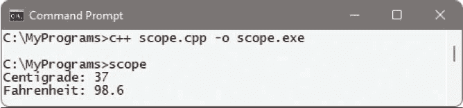


同名的变量在不同的作用域中声明时不会冲突 —— 它们相互不可见。

### 传递参数

函数调用经常为函数提供参数值。这些可以是任意数量和数据类型，但它们必须与函数原型声明中指定的匹配。


注意，传递给函数的参数仅提供原始值的副本，这种过程被称为“值传递（passing by value）”。

传递给参数的值可以是程序代码中指定的“静态”值，也可以是用户输入的“动态”值。在命令行提示符下，可以使用 C++ 的 `cin` 函数配合 `>>` 输入流操作符将值从标准输入重定向到变量，例如：

```cpp
float num ;
cout << "Please enter a number: " ;
cin >> num ;
```

输入可以作为函数调用中的参数传递给函数，例如 `workWith( num )`。


函数原型必须在定义之前声明。通常，原型出现在主函数之前，而它们的定义出现在主函数之后。

可选情况下，函数原型可以为参数分配默认值，当调用未传递参数值时将使用这些默认值。可以为多个参数分配默认值。

### 重载函数

函数“重载（overloading）”允许同名的函数在同一个程序中和谐地共存，只要它们的参数在数量、数据类型或数量和数据类型上有所不同。编译器通过识别参数数量和数据类型将函数调用匹配到正确的函数版本 —— 这一过程被称为“函数解析（function resolution）”。

当要执行的任务相似但细有不同时，创建重载函数是有用的。

通过指定要包含的 C++ 库类和要使用的命名空间前缀来启动新程序

```cpp
#include <iostream>
using namespace std ;
```


`overload.cpp`

在预处理指令下方，声明一个返回 `float` 值并有一个参数的函数原型

```cpp
float computeArea ( float ) ;
```

现在，声明两个重载函数原型 —— 为第一个原型具有不同的参数

```cpp
float computeArea ( float, float ) ;
float computeArea ( char, float, float ) ;
```

在原型声明下方，添加一个包含最终 `return` 语句的主函数

```cpp
int main()
{
  // 程序代码在此处。
  return 0 ;
}
```

在 `main` 函数之后，定义第一个接收参数的函数

```cpp
float computeArea( float diameter )
{
  float radius = ( diameter / 2 ) ;
  return ( 3.141593 * ( radius * radius ) ) ;
}
```


仅通过返回数据类型不同的函数不能进行重载——必须是参数有所不同。函数解析时不考虑返回数据类型。

在第一个函数定义下方，定义接收不同参数的重载函数

```cpp
float computeArea( float width, float height )
```


### 函数重载

```cpp
{

  return ( width * height ) ;

}

float computeArea( char letter, float width , float height )

{

  return ( ( width / 2 ) * height ) ;

}
```

在 `main` 函数中，插入语句声明两个变量，并用用户输入初始化其中一个

```cpp
float num, area ;

cout << “Enter dimension in feet: “ ;

cin >> num ;
```

调用第一个函数并输出其返回值

```cpp
area = computeArea( num ) ;

cout << “Circle: Area = “ << area << “ sq.ft.” << endl ;
```

调用重载函数并输出它们的返回值

```cpp
area = computeArea( num, num ) ;

cout << “Square: Area = “ << area << “ sq.ft.” << endl ;

area = computeArea( ‘T’, num, num ) ;

cout << “Triangle: Area = “ << area << “sq.ft.” << endl ;
```

保存、编译并运行程序，然后在提示时输入一个数值以查看输出

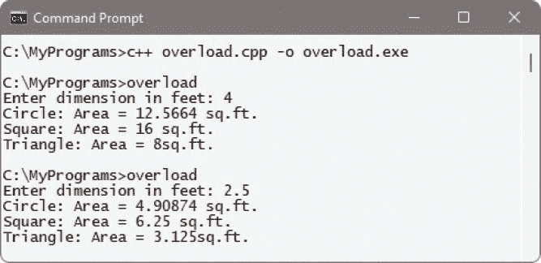


传递给 `char` 参数的值从未被使用过——包含该参数仅仅是为了区分该重载函数。

### 优化函数

函数可以递归地调用自身，以重复执行其函数体包含的语句——类似于循环。和循环一样，递归函数必须包含一个增量器和一个条件测试，以便再次调用自身，或者在满足条件时停止重复。递归函数的语法如下：

```cpp
return-data-type function-name ( argument-list )

{

  statements-to-be-executed ;

  incrementer ;

  conditional-test-to-recall-or-exit ;

}
```


增量器会改变所传参数的值——因此后续调用会将调整后的值传回函数。

通过指定要包含的 C++ 库类和使用的命名空间前缀开始一个新程序

```cpp
#include <iostream>

using namespace std ;
```


`optimize.cpp`

在预处理器指令下方，声明两个都是递归函数的原型

```cpp
int computeFactorials ( int, int ) ;

int factorial ( int ) ;
```

在原型声明下方，添加一个包含最终 `return` 语句的 `main` 函数

```cpp
int main()

{

  // Program code goes here.

  return 0 ;

}
```

在 `main` 函数之后，添加第一个函数原型的定义——一个递归函数

```cpp
int computeFactorials( int num, int max )

{

  cout << “Factorial of “ << num << “: ” ;

  cout << factorial( num ) << endl ;  // Statements.

  num++ ;  // Incrementer.

  if ( num > max ) return 0 ;  // 退出或再次调用.

  else return computeFactorials( num , max ) ;

}
```


递归函数通常比循环消耗更多的系统资源——但它可以使代码更易读。

为第二个原型定义一个递归函数

```cpp
int factorial( int n )

{

  int result ;

  if ( n == 1 ) result = 1 ;  // 退出或...

  else result = ( factorial( n - 1 ) * n ) ;  // 递减...

  return result ;  // 再次调用.

}
```

在 `main` 函数开始处，插入对递归函数的调用

```cpp
computeFactorials( 1, 8 ) ;
```

保存、编译并运行程序查看输出

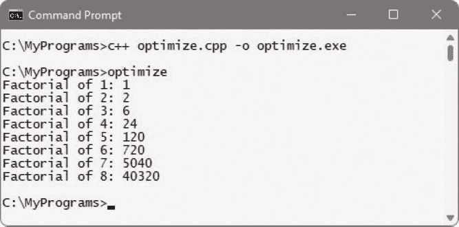


如果你意外运行了无限递归，请按下 `Ctrl + C` 键终止进程。

输出列出了阶乘值（3 的阶乘是 3x2x1=6 等），但可以通过优化 `factorial()` 函数来改进程序。该函数如果使用三元运算符，不需要变量。

用三元运算符替换 `factorial()` 函数

```cpp
inline factorial( int n )

{

  return ( n == 1 ) ? 1 : ( factorial( n - 1 ) * n ) ;

}
```

### 使用字符串


与`<iostream>`类库一样，`<string>` 库是 `std` 命名空间的一部分，C++ 标准库类都使用了该命名空间。这意味着字符串对象可以被称为 `std::string`，或者在程序开头包含 `using namespace std;` 指令时，更简单地简称为 `string`。

一旦`<string>` 库可用，就可以像声明其他变量一样声明一个 `string` “变量”。在声明时，可以选择性使用 `=` 赋值运算符对变量进行初始化，也可以在程序的稍后部分进行初始化。

此外，可以通过在变量名后的括号中包含一个文本字符串来初始化 `string` 变量。

C++ 中的文本字符串必须始终包含在双引号 `" "` 之内——单引号 `' '` 仅用于围绕 `char` 数据类型的字符值。

与 C 语言程序员必须使用的 `char` 数组相比，C++ `string` 变量处理起来要容易得多，因为它会自动调整大小以容纳任何文本字符串的长度。在更底层的层级上，文本仍然存储为字符数组，但 `string` 变量允许你忽略这些细节。因此，可以使用 `=` 赋值运算符将字符数组赋值给 `string` 变量。

需要记住，当将数值赋给 `string` 变量时，它们不再是数值数据类型，因此不能对它们进行算术运算。例如，尝试用 `+` 加法运算符相加 `"7"` 和 `"6"` 的 `string` 值会产生拼接后的字符串 `"76"`，而不是数值值 13。在这种情况下，`+` 运算符识别出上下文不是算术运算，因此采用“字符串连接运算符”的外壳来合并两个字符串。同样，`+=` 运算符将一个 `string` 追加到另一个 `string` 之后，这对于构建长文本字符串非常有用。

在此处描述的示例程序中，有几个 `string` 值被构建在一个长字符串中。

通过指定要包含的 C++ 库类和要使用的命名空间前缀开始一个新程序

```cpp
#include <string>  // 字符串支持。

#include <iostream>

using namespace std ;
```

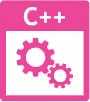

`string.cpp`

添加一个包含四个 `string` 变量声明和一个最终返回语句的 `main` 函数

```cpp
int main()

{

    string text = “9” ;

    string term( “9 “ ) ;

    string info = “Toys” ;

    string color ;

    // 在此处添加更多语句。

    return 0 ;

}
```

在 `main` 函数中，变量声明之后插入语句来声明并初始化字符数组，然后将其值赋予未初始化的 `string` 变量

```cpp
char hue[4] = { ‘R’, ’e’, ’d’, ’\0’ } ;

color = hue ;
```

将较长的文本字符串赋值其中一个 `string` 变量

```cpp
info = “Balloons” ;
```

通过组合第一个 `string` 变量中的所有 `string` 变量值来构建长字符串，然后输出组合后的字符串值

```cpp
text += ( term + color + info ) ;

cout << endl << text << endl ;
```

保存、编译并运行程序查看输出

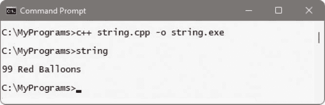


记得添加特殊的 `\0` 字符来标记 `char` 数组中字符串的结束。

### 获取字符串输入

C++ `cin` 函数在第 3 章中引入用于输入数值，它也可以将文本输入赋值给 `string` 变量。这有一个局限性，因为它每次只能用于输入一个单词——`cin` 函数在遇到空格时会停止读取，将任何其他文本留在“输入缓冲区”中。


当你想要允许用户输入带有空格的字符串（例如句子）时，可以使用 `getline()` 函数。该函数需要两个参数来指定字符串的源和目的。例如，当 `cin` 函数是源而名为 `str` 的 `string` 变量是目的时：

```cpp
getline( cin , str ) ;
```

`getline()` 函数从输入“流”中读取，直到遇到行尾的 `\n` 换行符——该换行符是在按下 **Return** 键时产生的。

混合使用 `cin` 和 `getline()` 函数时必须小心，因为 `getline()` 函数会自动读取输入缓冲区中留下的任何内容——给人一种程序跳过了指令的印象。可以使用 `cin.ignore()` 函数通过忽略输入缓冲区中留下来的内容来解决这个问题。

通过指定要包含的 C++ 库类和要使用的命名空间前缀开始一个新程序

```cpp
#include <string>  // 字符串支持。

#include <iostream>

using namespace std ;
```


`input.cpp`

添加一个包含一个 `string` 声明和一个最终返回语句的 `main` 函数

```cpp
int main()

{

    string name ;

    // 在此处添加更多语句。

    return 0 ;

}
```

在 `main` 函数中，插入语句将用户输入赋值给 `string` 变量，然后输出其值

```cpp
cout << “Please enter your name: ” ;

cin >> name ;

cout << “Welcome “ << name << endl ;
```

接下来，插入语句再次请求名称，但这次使用 `getline` 函数将输入赋值给 `string` 变量之前输出其值

```cpp
cout << “Please re-enter your full name: ” ;

getline( cin , name ) ;

cout << “Thanks, “ << name << endl ;
```

保存、编译并运行程序，并在提示时输入全名

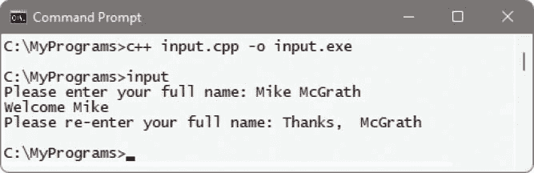

这个不理想的结果显示 `cin` 读取到空格为止，将第二个名字留在缓冲区中，然后由 `getline()` 读取。即使你只输入了名字，问题仍然存在，因为 `cin` 将你按下 **Return** 键时产生的换行符留在了输入缓冲区中。

通过在调用 `getline` 函数之前插入语句修改程序以解决此问题，指令其忽略输入缓冲区中的内容

```cpp
cin.ignore( 256, ‘\n’ ) ;
```

再次保存、编译并运行程序，然后重新输入全名以查看程序按要求执行

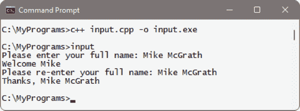

### 解决字符串问题

当你需要将 `string` 变量转换为不同的数据类型（也许为了对这些值进行算术运算）时，`string` 变量就会出现问题。由于 `string` 对象不是 C++ 的原生数据类型，无法通过强制类型转换将 `string` 变量值转换为 `int` 或任何常规数据类型。


解决方案由 C++ `<sstream>` 库提供，它允许 `stringstream` 对象作为中间介质，通过它可以将 `string` 值转换为数值数据类型，并将数值值转换为 `string` 数据类型。

值可以使用与 `cout` 语句中相同的输出流运算符 `<<` 加载到 `stringstream` 对象中。随后，可以使用与 `cin` 语句中相同的 `>>` 输入流运算符从 `stringstream` 对象中提取内容。

为了重用 `stringstream` 对象，必须先将其恢复原始状态。这需要将其内容设置为空字符串 `string`，并清除其状态位标志。

通过指定要包含的 C++ 库类和要使用的命名空间前缀来启动新程序

```cpp
#include <string>  // 包含 string 支持。

#include <sstream> // 包含 stringstream 支持。

#include <iostream>

using namespace std ;
```


`convert.cpp`

添加一个包含最终 `return` 语句的 `main` 函数，并声明两个要转换的初始化变量

```cpp
int main()

{

string term = “100” ;

int number = 100 ;

// 在此处添加更多语句。

return 0 ;

}
```

在 `main` 函数中，插入语句声明一个整数变量、`string` 变量和一个 `stringstream` 对象

```cpp
int num ;  // 用于存储转换后的字符串。

string text ;  // 用于存储转换后的整数。

stringstream stream ;  // 执行转换。
```

接下来，使用流输出运算符将初始化的 `string` 值加载到 `stringstream` 对象中

```cpp
stream << term ;  // 加载字符串。
```

使用流输入运算符将内容从 `stringstream` 对象提取到未初始化的整数变量中

```cpp
stream >> num ;  // 提取整数。
```

对整数进行算术运算并输出结果

```cpp
num /= 4 ;

cout << “Integer value: ” << num << endl ;
```

重置 `stringstream` 对象准备好重用

```cpp
stream.str(“”) ;  // 清空内容。

stream.clear() ;  // 清空位标志。
```

现在，使用流输出运算符将初始化的整数值加载到 `stringstream` 对象中

```cpp
stream << number ;  // 加载整数。
```

使用流输入运算符将内容从 `stringstream` 对象提取到未初始化的 `string` 变量中

```cpp
stream >> text ;  // 提取字符串。
```

对 `string` 进行拼接并输出结果

```cpp
text += “ Per Cent” ;

cout << “String value: ” << text << endl ;
```


保存、编译并运行程序查看转换后的输出值

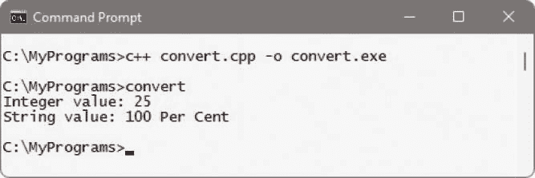


注意此处是如何使用`stringstream`对象的`str()`函数将其内容重置为空字符串的。


非空的`stringstream`对象具有指示其状态为`good`、`bad`、`eof`或`fail`的位标志——如此处所示，在重用之前应通过`stringstream`对象的`clear()`函数将其清除。

## 发现字符串特性

C++ `<string>`库提供了许多函数，可以轻松处理字符串。要使用它们，只需在`string`变量名后加点和函数名即可。例如，对于名为“msg”的`stringstream`变量，你可以调用`size()`函数来返回其字符长度，即`msg.size()`。


可以通过为`string`变量赋值一个没有空格的双引号空字符串——`“”`来清空所有字符，或者调用`<string>`库的`clear()`函数。

与`char`数组不同，`string`变量会动态扩大以适应分配给它的字符数，其当前的内存大小可以通过`<string>`库的`capacity()`函数显示。一旦扩大，即使给变量分配较小的字符串，分配的内存大小依然保留。

`<string>`库的`empty()`函数返回布尔`true` (1) 或`false` (0) 响应，以显示字符串是否为空。

通过指定要包含的 C++ 库类和要使用的命名空间前缀来启动新程序

```cpp
#include <string>  // 包含 string 支持。
#include <iostream>
using namespace std ;
```


features.cpp

在预处理器指令下方声明一个带有单个`string`数据类型参数的函数原型

```cpp
void computeFeatures( string ) ;
```

添加一个包含最终`return`语句的`main`函数，并声明一个化的`string`变量

```cpp
int main()
{
    string text = “C++ is fun” ;
    // 在此处添加更多语句。
    return 0 ;
}
```

在预处理器指令之后，定义函数以显示`string`值

```cpp
void computeFeatures( text )
{
    cout << “String: ” << text << endl ;
}
```

`length()`函数可以替代`size()`函数来显示字符串的大小。

在定义中，添加语句输出`string`变量的特性

```cpp
cout << “Size: ” << text.size() ;
cout << “ Capacity: ” << text.capacity() ;
cout << “ Empty?: ” << text.empty() << endl ;
```

在`main`函数中，插入函数的调用

```cpp
computeFeatures( text ) ;
```

接下来，在`main`函数中插入语句扩大`string`值并调用函数

```cpp
text += “ for everyone” ;
computeFeatures( text ) ;
```

现在，插入语句减少`string`值

```cpp
text = “C++ Fun” ;
computeFeatures( text ) ;
```

最后，插入语句清空`string`变量

```cpp
text.clear() ;
computeFeatures( text ) ;
```

保存、编译并运行程序查看输出

## 合并与比较字符串

当使用`+`运算符在赋值中拼接字符串时，合并后的字符串存储在`string`变量中。但当它用于`cout`函数时，字符串仅在输出中合并——变量值保持不变。


`<string>`库的`append()`函数也可用于拼接字符串，在其括号内指定要追加的`string`值作为参数。当这用于`cout`函数时，字符串在变量中合并，然后将其值输出——在这种情况下，变量值会发生变化。

字符串比较可以像数值比较一样，使用`==`等等运算符进行。当两个字符串精确匹配时，它返回`true` (1)，否则返回`false` (0)。

或者，`<string>`库的`compare()`函数也可用于比较作为其参数指定的`string`值。与`==`等等比较不同，`compare()`函数在字符串完全相同时返回 0，这是通过检查`string`值的组合 ASCII 代码实现的。当`string`参数的总和大于第一个字符串时，它返回 -1，否则返回 1。

添加一个主函数，包含一个最终的`return`语句并声明三个初始化的`string`变量

```cpp
int main()
{
    string lang = “C++” ;
    string term = “ Programming” ;
    string text = “C++ Programming” ;
    // 在此处添加更多语句。
    return 0 ;
}
```

在主函数中，插入语句使用`+`拼接运算符输出两个`string`值的值，并输出第一个变量的（未改变）值

```cpp
cout << “Concatenated: ” << ( lang + term ) << endl ;
cout << “Original: ” << lang << endl ;
```

接下来，插入语句使用`append()`函数输出两个`string`值，并输出第一个变量的（已改变）值

```cpp
cout << “Appended: ” << lang.append( term ) << endl ;
cout << “Original: ” << lang << endl ;
```

使用`==`等值运算符比较两个不同的`string`值，然后比较两个匹配的`string`值

```cpp
cout << “Differ: ” << ( lang == term ) << endl ;
cout << “Match: ” << ( lang == text ) << endl ;
```

现在，使用`compare()`函数比较三个`string`值，检查它们的 ASCII 代码总和

```cpp
cout << “Match: ” << lang.compare( text ) << endl ;
cout << “Differ: ” << lang.compare( term ) << endl ;
cout << “Lower ASCII: ” << lang.compare( “zzzzz” ) << endl ;
```

保存、编译并运行程序以查看输出

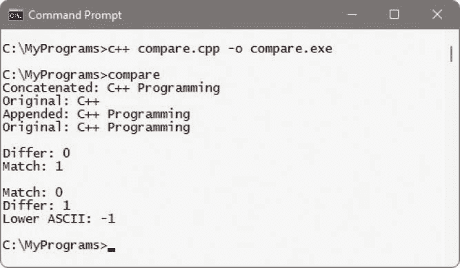


`+=`赋值运算符也可以用于追加字符串。


在比较中，会考虑字符顺序——因此比较“za”和“az”会发现“za”的总和更大。从 ASCII 值来说，‘a’ 是 97，‘z’ 是 122。

### 复制与交换字符串

可以通过`=`赋值运算符将字符串值赋给`string`变量，也可以通过`<string>`库的`assign()`函数。该函数通过其括号内的参数来指定要复制到变量的`string`值。


可选地，`assign()`函数可以通过将起始字符的位置作为第二个参数，并将要复制的字符数作为第三个参数，仅复制指定`string`值的一部分。

可以通过`<string>`库的`swap()`函数交换`string`变量与另一个`string`变量的内容。在这种情况下，第一个变量的内容接收第二个变量的内容，而第二个变量接收第一个变量的内容。

指定要包含的 C++ 库类和要使用的命名空间前缀开始一个新程序

```cpp
#include <string>  // 包含字符串支持
#include <iostream>
using namespace std ;
```


swap.cpp

添加一个主函数，包含一个最终的`return`语句并声明三个`string`变量——其中一个已初始化

```cpp
int main()
{
    string front ;
    string back ;
    string text = “Always laugh when you can. It\’s cheap medicine.” ;
    // 在此处添加更多语句。
    return 0 ;
}
```

在主函数中，插入语句将初始化`string`变量的赋值赋给第一个未初始化的`string`变量

```cpp
front.assign( text ) ;
```

接下来，插入语句输出新赋值的`string`值

```cpp
cout << endl << “Front: ” << front << endl ;
```

现在，插入语句仅将初始化变量的前 27 个字符赋给第一个变量

```cpp
front.assign( text, 0, 27 ) ;
```

输出新赋值的`string`值

```cpp
cout << endl << “Front: ” << front << endl ;
```

接下来，仅将初始化`string`变量的最后部分赋给第二个未初始化的变量，从字符（元素）27 开始

```cpp
back.assign ( text, 27 , text.size() ) ;
```

现在，输出这个新赋值的`string`值

```cpp
cout << “Back: ” << back << endl ;
```

最后，交换第一个和第二个`string`变量包含的赋值`string`值，然后输出交换后的值

```cpp
back.swap( front ) ;
cout << endl << “Front: ” << front << endl ;
cout << “Back: ” << back << endl ;
```

保存、编译并运行程序以查看输出

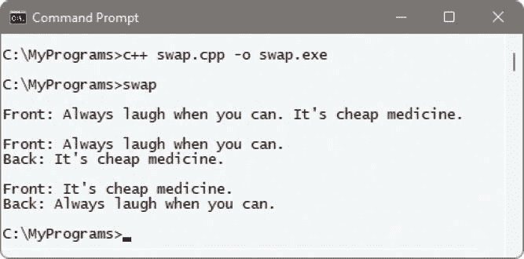


使用`=`赋值运算符赋值完整字符串，并使用`assign()`函数赋值部分字符串

 查找子字符串

`string`值可以被搜索以查看它是否包含“子字符串”，使用`find()`函数。它的括号应该将要搜索的字符串作为第一个参数，并将从何处开始搜索的索引作为第二个参数

 当成功找到子字符串时，`find()`函数返回首次出现的索引。当搜索失败时，`find()`返回 -1。`<string>`中还有几个与`find()`函数相关的函数。其中两个是`find_first_of()`函数和`find_first_not_of()`函数。与其`find()`搜索完整字符串，`find_first_of()`函数搜索指定字符串中任何字符的首次出现。`find_last_of()`和`find_last_not_of()`函数的工作原理类似但从`string`的末尾开始向前搜索。

 指定要包含的 C++ 库类和要使用的命名空间前缀开始一个新程序

```cpp
#include <string>  // 包含字符串支持
#include <iostream>
using namespace std ;
```


find.cpp

添加一个主函数，包含一个最终的`return`语句、一个初始化字符串变量并声明一个用于存储搜索结果的整数变量

```cpp
int main()
{
    string text = “I can resist anything but temptation.” ;
    int num ;
    // 在此处添加更多语句。
    return 0 ;
}
```

在主函数中，插入语句输出整个`string`变量中子字符串的起始位置

```cpp
num = text.find( “resist”, 0 ) ;
cout << “Position: ” << num << endl ;
```

接下来，插入语句在整个`string`变量中搜索不存在的子字符串并输出结果

```cpp
num = text.find( “nonsuch” , 0 ) ;
cout << “Result: ” << num << endl ;
```

现在，插入语句输出`string`变量中“If ”子字符串内任何字符的首次出现位置

```cpp
num = text.find_first_of( “If” ) ;
cout << “First I: ” << num << endl ;
```

插入语句报告不在“If ”子字符串内的第一个字符的字符串位置

```cpp
num = text.find_first_not_of( “If” ) ;
cout << “First not I: ” << num << endl ;
```

接下来，插入语句在`string`变量中搜索字母“t”的最后出现并输出其位置

```cpp
num = text.find_last_of( “t” ) ;
cout << “Last t: ” << num << endl ;
```

现在，添加一条语句来报告`string`变量中最后一个不是“t”的字符的`string`位置。

```cpp
num = text.find_last_not_of( “t” ) ;
cout << “Last not t: ” << num << endl ;
```


保存、编译并运行程序，查看搜索结果，结果将显示搜索失败或找到字符的位置。

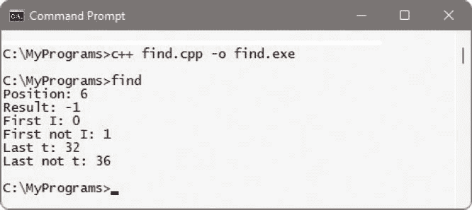


搜索是区分大小写的，因此寻找`If`和`if`可能会产生不同的结果——在这里，大写的'I'是匹配的。


字符串中的第一个字符位于位置`0`，而不是位置`1`。

### 替换子字符串

`<string>`库包含了许多用于操作子字符串的有用函数。可以使用`insert()`函数将一个`string`插入到另一个`string`中。这需要将要插入`string`的索引位置作为第一个参数，并将要插入的`string`值作为第二个参数。


相反，可以使用`erase()`函数从`string`中删除子字符串。这需要将开始删除的索引位置作为第一个参数，并将要删除的字符数作为第二个参数。

`replace()`函数简洁地结合了`erase()`和`insert()`函数，同时删除子字符串并插入替换内容。它需要三个参数，分别指定开始删除的位置、要删除的字符数，以及要插入该位置的替换`string`。

可以使用`substr()`函数从`string`中复制一个子字符串，将开始复制的索引位置作为第一个参数，并将要复制的字符数作为第二个参数。

可以使用`at()`函数复制`string`中任何指定位置的字符，该函数需要索引位置作为参数。`string`中最后一个字符的元素索引总是比`string`的长度少`1`——因为索引计数从`0`开始，而不是从`1`。

通过指定要包含的C++库类和要使用的命名空间前缀来启动新程序。

```cpp
#include <string>  // 字符串支持
#include <iostream>
using namespace std ;
```


sub.cpp

添加一个包含最终`return`语句、已初始`string`变量声明以及输出`string`变量值语句的`main`函数。

```cpp
int main()
{
  string text = "I do like the seaside" ;
  cout << "Original: " << text << endl ;
  // Add more statements here.
  return 0 ;
}
```

在`main`函数中，插入语句在索引位置`10`变量值处插入子字符串，并输出修改后的`string`。

```cpp
text.insert( 10, "to be beside " ) ;
cout << "Inserted: " << text << endl ;
```

接下来，插入语句从索引位置`3`开始从修改后的`string`值中删除两个字符，并输出修订后的`string`。

```cpp
text.erase( 2, 3 ) ;
cout << "Erased: " << text << endl ;
```

现在，插入语句在索引位置`7`处删除`25`个字符，插入替换子字符串，然后再次修订后的`string`。

```cpp
text.replace( 7, 25, "strolling by the sea" ) ;
cout << "Replaced: " << text << endl ;
```

最后，插入语句输出索引位置`7`处复制的九个字符，并输出字符串中的最后一个字符。

```cpp
cout << "Copied: " << text.substr( 7, 9 ) << endl ;
cout << "Last character: " << text.at( text.size() - 1 ) << endl ;
```

保存、编译并运行程序，查看输出显示`string`如何被操作。

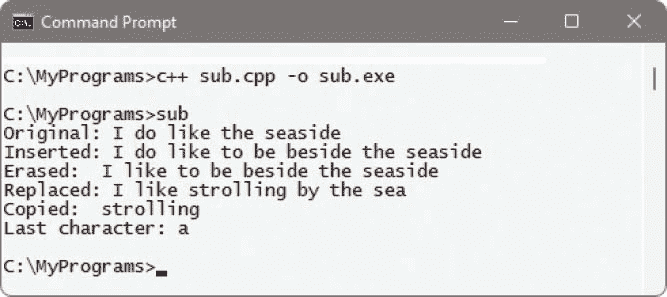


`insert()`函数可以可选地拥有第三和第四个参数——指定子字符串中开始复制的位置以及要复制的字符数。


`replace()`函数可以可选地拥有第四和第五个参数——指定子字符串中开始复制的位置以及要复制的字符数。

## 总结


- C++ `<string>`库提供了一个模拟数据类型的"string"对象——这样就可以创建`string`变量了。
- 对于赋值给`string`变量的数值值，在将其转换为数值数据类型之前，无法对其进行算术运算。
- 标准`cin`函数从标准输入读取直到遇到空格，因此可以用于输入单个单词，并提供了一个`ignore()`函数。
- `getline()`函数从标准输入读取直到遇到换行符，因此可以输入字符串。
- `<sstream>`库提供了一个"stringstream"对象，作为中间转换将字符串转换为其他类型。
- 通过赋值空字符串`""`或调用`clear()`函数可以清空`string`变量。
- 通过调用`size()`、`capacity()`和`empty()`函数可以揭示`string`的特征。
- 使用`+`运算符可以将多个`string`值拼接。
- 使用`+=`运算符或调用`append()`函数可以将`string`追加到另一个`string`中。
- 使用`==`运算符或调用`compare()`函数可以将`string`进行比较。
- 使用`=`运算符或调用`assign()`函数可以将`string`值赋值给`string`。
- `swap()`函数交换两个`string`变量的值。
- 可以`find()`函数搜索`string`的子字符串，或使用专门函数如`find_first_of()`，并通过`at()`函数从指定位置检索字符。
- 子字符串可以通过`insert()`函数添加到`string`中，通过`erase()`函数删除，通过`replace()`函数替换，或通过`substr()`函数复制。

用于写入输出的文件流对象声明以`ofstream`关键字开始，然后是为该特定文件流对象选择的名称，随后是括号，其中用于指定要写入的文本文件。因此，声明语法如下：

```
ofstream *object-name* ( *"file-name"* ) ;
```

指定文本文件的参数可以可选包含完整的文件路径，例如`"C:\data\log.txt"`或`"home/user/log.txt"`，否则程序将在程序所在的目录中查找该文件。

在向文件写入输出之前，程序应始终先测试文件流对象是否已实际创建。通常，这是通过一个`if`语句实现的，该语句允许程序仅在测试成功时才写入输出。

如果指定的文件已存在，默认情况下它将被覆盖且不发出警告。否则，将创建一个新文件并进行写入。


指定的文件名或路径必须包含在双引号内，就像`string`一样。

在向指定的文件写入输出内容后，程序应始终调用关联文件流对象的`close()`函数来关闭输出文件流。

对应的程序首先构建一个用于写入输出的字符串。当文件流对象成功创建时，将其写入指定的文件，然后关闭文件流。

通过指定要包含的C++库类和要使用的命名空间前缀开始一个新程序

```cpp
#include <fstream>  // 文件流支持。
#include <string>
#include <iostream>
using namespace std ;
```

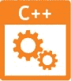

write.cpp

添加一个包含最终`return`语句的`main`函数，并在`string`变量中构建一个长文本字符串

```cpp
int main()
{
string poem = "\n\tI never saw a man who looked" ;
poem.append( "\n\tWith such a wistful eye" ) ;
poem.append( "\n\tUpon that little tent of blue" ) ;
poem.append( "\n\tWhich prisoners call the sky" ) ;
// 在处添加更多语句。
return 0 ;
}
```

在`main`函数中，创建一个输出文件流对象

```cpp
ofstream writer( "poem.txt" ) ;
```

插入语句将`string`写入文件或退出，然后保存、编译并运行程序以查看结果

```cpp
if ( ! writer )
{
cout << "Error opening file for output" << endl ;
return -1 ;  // 信号错误并退出程序。
}
writer << poem << endl ;  // 输出。
writer.close() ;  // 关闭文件流。
```

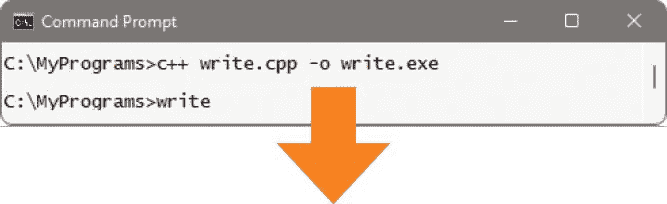

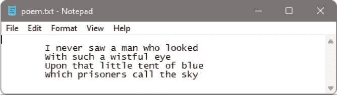


字符串值可以包含`\n`换行和`\t`制表符转义序列用于格式化行。


注意换行符和制表符在文本文件中是如何保留的。

### 追加到文件


当创建文件流对象时，其选择名称后的括号可以可选包含额外的参数，指定一组文件"模式"以控制该文件流对象的行为。这些文件模式是`ios`命名空间的一部分，因此必须使用该前缀显式指定。下表列出了每个文件模式，并附带行为描述：

| Mode: | 行为: |
| :--- | :--- |
| `ios::out` | 打开文件写入输出 |
| `ios::in` | 打开文件以读取输入 |
| `ios::app` | 打开文件并在任何现有内容的末尾追加输出 |
| `ios::trunc` | 截断现有文件（默认行为） |
| `ios::ate` | 打开文件且不截断，并允许在文件的任何位置写入数据 |
| `ios::binary` | 将文件视为二进制格式而非文本，因此数据可以存储在非文本格式中 |

如果多个模式之间用"|"管道符分隔，则可以指定多个模式。例如，为二进制输出打开文件的语句的语法如下所示：

```cpp
ofstream *object-name* ( *"file-name"* , ios::out|ios::binary ) ;
```


预处理器指令`using namespace std;`允许省略`std`命名空间前缀——因此`cout`指向`std::cout`函数。`ios`命名空间存在于`std`命名空间内——可以使用命名空间前缀显式指定文件模式——例如`std::ios::out`。

当未显式指定模式时的默认行为是将文件视为文本文件，写入后将被截断。

最常用的模式是`ios::app`，它确保在向指定文件写入新输出时，现有内容将被追加而非覆盖。

对应的程序将数据追加到上一个示例创建的文本文件中。

通过指定要包含的C++库类和要使用的命名空间前缀开始一个新程序

```cpp
#include <fstream>  // 文件流支持。
#include <string>
#include <iostream>
using namespace std ;
```


append.cpp

添加一个包含最终`return`语句的`main`函数，并在`string`变量中构建文本字符串

```cpp
int main()
{
string info = "\n\tThe Ballad of" ;
info.append( "\n\tOscar Wilde 1898" ) ;
// 在处添加更多语句。
return 0 ;
}
```

在`main`函数中，创建一个输出文件流对象——指定将追加文本的模式

```cpp
ofstream writer( "poem.txt" , ios::app ) ;
```

插入语句将`string`写入文件或退出，然后保存、编译并运行程序以查看结果

```cpp
if ( ! writer )
{
cout << "Error opening file for output" << endl ;
return -1 ;  // 信号错误并退出程序。
}
writer << info << endl ;  // 追加输出。
writer.close() ;  // 关闭文件流。
```


读取字符。

### 读取字符与行

`ifstream`文件流对象有一个`get()`函数，可以在循环中用于读取文件并将字符逐一赋予指定的`char`变量：

通过指定要包含的库类和要使用的命名空间前缀开始一个新程序

```cpp
#include <fstream>  // 文件流支持。
#include <string>
#include <iostream>
using namespace std ;
```


read.cpp

添加一个包含最终`return`语句的`main`函数和两个变量声明——一个变量存储字符，另一个计算循环次数

```cpp
int main()
{
char letter ;
int i ;
// 在处添加更多语句。
return 0 ;
}
```

在`main`函数中，创建一个输入文件流对象以读取上一个示例中的文本文件

```cpp
ifstream reader( "poem.txt" ) ;
```

插入语句，除非文件流对象存在否则退出

```cpp
if ( ! reader )
{
cout << "Error opening input file" << endl ;
return -1 ;  // 信号错误并退出程序。
}
```

接下来，插入一个循环读取文本文件，将每个字符逐一赋予变量并输出其值

```cpp
else
for ( i = 0 ; ! reader.eof() ; i++ )
{
reader.get( letter ) ;
cout << letter ;
}
```

最后，插入语句关闭文件流并输出循环的总次数

```cpp
reader.close() ;
cout << "Iterations: " << i << endl ;
```

保存、编译并运行程序，以在标准输出上显示文本文件内容和循环计数

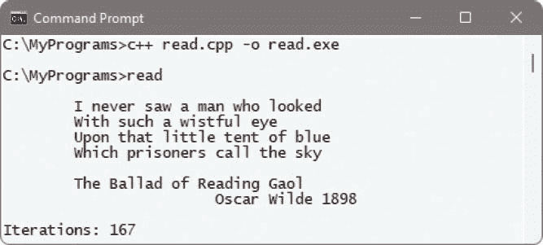


这个程序运行得足够好，但循环必须多次迭代才能输出文本的内容。通过在循环的每次迭代中读取一行可以提高效率：

插入一个预处理器指令，使程序可以使用C++字符串库

```cpp
#include <string>
```

将`char`变量声明替换为`string`变量声明

```cpp
string line ;
```

替换`for`循环中的两个语句以读取行，然后再次保存、编译并运行程序

```cpp
getline( reader , line ) ;
cout << line << endl ;
```

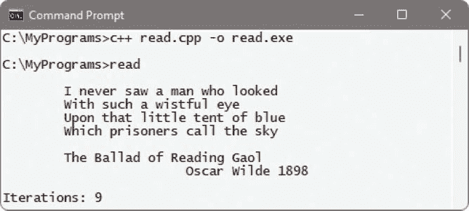


在每行输出后输出一个`endl` – 因为`getline()`在遇到`\n`换行符时停止读取。

### 使用`getline`格式化

`getline()`函数可以包含第三个参数，用于指定停止读取行的分隔符。这可以用于从数据文件的制表符列表中读取文本：

在纯文本编辑器中，创建一个包含`12`个数据项目的文本文件，每行四个项目，每个项目之间用制表符分隔

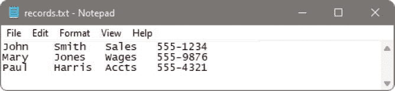


format.cpp

通过指定要包含的C++库类和使用的命名空间前缀开始一个新程序

```cpp


`#include <fstream>` // 包含文件流支持。

`#include <string>`

`#include <iostream>`

`using namespace std ;`

```

添加一个包含最终 `return` 语句四个变量声明的 `main` 函数 – 一个固定数值、一个存储数据的 `string` 数组以及两个设置为 0 的计数器变量

```cpp

int main()

{

  const int RANGE = 12 ;

  string tab[ RANGE ] ;

  int i = 0 , j = 0 ;

  // Add more statements here.

  return 0 ;

}

```

插入一个语句创建一个输入文件流对象

```cpp

ifstream reader( “records.txt” ) ;

```

插入语句，除非文件流对象存在否则退出

```cpp

if ( ! reader )

{

  cout << “Error opening input file” << endl ;

  return -1 ;

}

```


`string` 数组必须有足够的元素来存储每个数据项 – 它需要扩大以处理更多记录。

接下来，插入一个循环，将每行读取到 `string` 数组中 – 每行的前三个项目读取到 `\t` 制表符，第四个项目读取到 `\n` 换行符

```cpp

while ( ! reader.eof() )

{

  if ( ( i + 1 ) % 4 == 0 )

    getline( reader, tab[ i++ ], ‘\n’ ) ;

  else

    getline( reader, tab[ i++ ], ‘\t’ ) ;

}

```


现在，关闭文件流并重置计数器

```cpp

reader.close() ;

i = 0 ;

```

插入第二个循环输出存储在每个数组元素中的数据，并用描述和换行进行格式化

```cpp

while ( i < RANGE )

{

  cout << endl << “Record Number: ” << ++j << endl ;

  cout << “Forename: ” << tab[ i++ ] << endl ;

  cout << “Surname: ” << tab[ i++ ] << endl ;

  cout << “Department: ” << tab[ i++ ] << endl ;

  cout << “Telephone: ” << tab[ i++ ] << endl ;

}

```

保存、编译并运行程序，查看来自文本文件的格式化输出

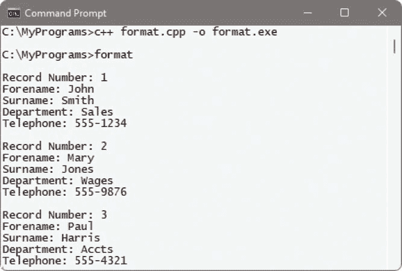


`if` 语句测试项目数（元素编号加 1）是否恰好被四整除，以决定读取到换行符或制表符为止。


记录计数器必须使用前置增符在输出之前增加变量值。

### 操作输入与输出

输入和输出流的行为可以通过带有 `cout` 和 `cin` 函数的“插入运算符”来修改。为它们的 `width()` 函数指定一个整数参数可以设置流的字符宽度。当内容未填充整个流宽度时，可以作为 `fill()` 函数的参数指定填充字符以指示空部分。同样，通过为它们的 `precision()` 函数指定一个整数可以更改浮点数默认的六位小数精度。使用插入运算符修改流的语句应放在使用 `<<` 或 `>>` 的语句之前。

`<iostream>` 库提供了下表所示的“操纵符”，它们通过 `<<` 或 `>>` 运算符修改流。

| 操纵符 | 显示 |
| :--- | :--- |
| `noboolalpha` | 布尔值为 1 或 0 |
| `boolalpha` | 布尔值为 “true” 或 “false” |
| `dec`* | 整数为十进制 (decimal) |
| `hex` | 整数为十六进制 (hexadecimal) |
| `oct` | 整数为八进制 (octal) |
| `right`* | 在输出宽度中右对齐 |
| `left` | 在输出宽度中左对齐 |
| `internal` | 在输出宽度中内部分对齐 |
| `noshowbase`* | 不显示进制前缀 |
| `showbase` | 显示进制前缀 |
| `noshowpoint`* | 仅当有分数时显示小数点 |
| `showpoint` | 所有浮点数显示小数点 |
| `noshowpos`* | 正数前不显示正号 |
| `showpos` | 正数前显示 + 号 |
| `noskipws`* | 输入时不跳过空白 |
| `skipws` | 跳过空白输入 |
| `fixed`* | 浮点数固定六位小数 |
| `scientific` | 浮点数使用科学计数法 |
| `nouppercase`* | 科学计数法使用小写 e |
| `uppercase` | 科学计数法使用大写 E |

插入运算符仅修改一个对象 – 后续对象使用默认值，除非它们也被插入运算符修改。

标记为 * 的操纵符是默认行为。

通过指定要包含的 C++ 库类和使用的命名空间前缀开始一个新程序

```cpp

#include <iostream>

using namespace std ;

```


manipulate.cpp

添加一个包含最终 `return` 语句并声明两个初始化变量的 `main` 函数

```cpp

int main()

{

  bool isTrue = 1 ;

  int num = 255 ;

  // Add more statements here.

  return 0 ;

}

```

在 `main` 函数中，插入语句设置输出流的宽度和填充符，然后在其上输出一个字符串

```cpp

cout.width( 40 ) ;

cout.fill( ‘.’ ) ;

cout << “Output” << endl ;

```

接下来，插入语句设置输出流的精度以停止对小数的截断 – 然后输出一个显示所有小数的浮点数

```cpp

cout.precision( 11 ) ;

cout << “Pi: ” << 3.1415926536 << endl ;

```

现在，插入使用操纵符以修改格式输出变量值的语句

```cpp

cout << isTrue << “: ” << boolalpha << isTrue << endl ;

cout << num << “: ” << hex << showbase << uppercase << num << endl ;

```

保存、编译并运行程序查看输出

**预测问题**

尽管程序员尽了努力，C++ 程序不幸可能包含以下三种类型的任或多个 Bug：

- **语法错误** – 代码中包含对 C++ 语言的错误用法。例如，左括号没有相匹配的右括号。
- **逻辑错误** – 代码在语法上是正确的，但尝试执行非法的操作。例如，程序可能会尝试除以零，从而导致错误。
- **异常错误** – 程序按预期运行，直到遇到一种导致程序崩溃的异常情况。例如，程序可能会请求一个数字，但用户以单词形式而非数字形式输入了它。


C++ 标准允许编译器发现涉及语法和逻辑的“编译时”错误，但异常错误的可能性更难定位，因为它们只在“运行时”发生。这意味着程序员必须尝试预测可能出现的问题，并准备好处理这些异常。

第一步是识别程序代码中在某些条件下可能导致异常错误的部分。然后，可以使用一个 `try` 块将其包围起来，该块使用 `try` 关键字，并将可疑代码包含在一对括号内。


始终要考虑到用户会执行意料之外的操作——然后确保你的程序能够处理这些操作。

当异常错误发生时，`try` 块会将异常“抛出”到紧随 `try` 块之后的 `catch` 块中。这使用了 `catch` 关键字，并将处理异常错误的语句包含在一对括号内。

此地描述的程序包含一个包含递增整数循环的 `try` 块。当整数达到 5 时，`throw()` 函数手动向 `catch` 块异常处理程序抛出一个异常，并传递整数参数。

通过指定要包含的 C++ 库类和使用的命名空间前缀开始一个新程序

```cpp

#include <iostream>

using namespace std ;

```


try.cpp

添加一个包含最终 `return` 语句并声明用于循环递增整数变量的 `main` 函数

```cpp

int main()

{

    int number ;

    // 在此处添加更多语句。

    return 0 ;

}

```

在 `main` 函数中插入 `try` 和 `catch` 块来处理“坏数字”异常

```cpp

try

{

}

catch ( int num )

{

}

```

在 `try` 块中插入一个递增变量的循环

```cpp

for ( number = 1 ; number < 21 ; number++ )

{

    if (number > 4 ) throw ( number ) ;

    else

        cout << “Number: ” << number << endl ;

}

```

在 `catch` 块中插入一个异常处理语句

```cpp

cout << “Exception at: ” << num << endl ;

```

保存、编译并运行程序，查看抛出的异常如何被 `catch` 块捕获

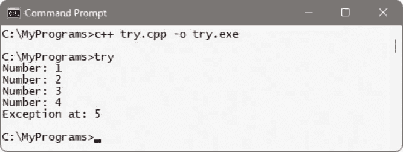


异常发生时，控制传递给 `catch` 块——在本例中，循环没有完成。

### 识别异常

当程序在 `try` 块内发生异常时，会自动抛出一个“异常”对象。异常的引用可以传递给 `catch` 关键字后括号中的关联 `catch` 块。这指定了 `exception` 类型的参数，以及由 `&` 引用运算符前缀指定的选异常名称——例如 `exception &error`。


一旦异常引用传递给 `catch` 块，可以通过异常的 `what()` 函数获取错误描述：

通过指定要包含的 C++ 库类和使用的命名空间前缀开始一个新程序

```cpp

#include <string>  // 字符串支持。

#include <iostream>

using namespace std ;

```


what.cpp

添加一个包含最终 `return` 语句并声明初始化 `string` 变量的 `main` 函数

```cpp

int main()

{

    string lang = “C++” ;

    // 在此处添加更多语句。

    return 0 ;

}

```

在 `main` 函数中插入一个包含尝试删除 `string` 变量部分语句的 `try` 块

```cpp

try { lang.erase( 4, 6 ) ; }

```

接下来，插入一个 `catch` 块，包含一个通过 `cerr` 函数向标准错误输出发送描述的语句

```cpp

catch ( exception &error )

{ cerr << “Exception: ” << error.what() << endl ; }

```

保存、编译并运行程序，查看被捕获异常的错误描述


错误描述会因不同的编译器而异——`stdexcept` 库定义了许多异常类。其基类名为“exception”，其他类从其派生。`cout` 将数据发送到标准输出，而 `cerr` 将数据发送到标准错误。当通过 `#include <stdexcept>` 使该库可用时，可以使用异常类。特定的异常类名可以出现在 `catch` 块中，以通用的 `exception` 类型。此外，异常可以通过 `throw` 关键字手动产生。可选地，可以手动异常指定自定义错误消息，并通过其 `what()` 函数检索。

### 处理错误

异常类型信息可以通过包含 C++ 标准 `<typeinfo>` 库来提供。它的 `typeid()` 函数接受异常参数，以便其 `name()` 函数返回类型名称：

通过指定要包含的 C++ 库类和使用的命名空间前缀开始一个新程序

```cpp

#include <stdexcept> // 标准异常支持。

#include <typeinfo>  // 类型信息支持。

#include <fstream>

#include <string>

#include <iostream>

using namespace std ;

```


except.cpp

添加一个包含最终 `return` 语句、两个初始化变量声明和一个输出文本语句的 `main` 函数

```cpp

int main()

{

    string lang = “C++” ;

    int num = 1000000000 ; // 十亿。

    // Try-catch 块放在此处。

    cout << “Program continues...” << endl ;

    return 0 ;

}

```

在 `main` 函数中插入一个 `try` 块，包含一个尝试替换 `string` 值的语句

```cpp

try { lang.replace( 100, 1 , “C” ) ; }

```

在 `try` 块之后，添加一个 `catch` 块来处理范围异常，然后保存、编译并运行程序

```cpp

catch ( out_of_range &e )

{

    cerr << “Range Exception: ” << e.what() << endl ;

    cerr << “Exception Type: ” << typeid( e ).name() ;

}

```


```cpp

cerr << endl << “Program terminated.” << endl ;

return -1 ;

}

```

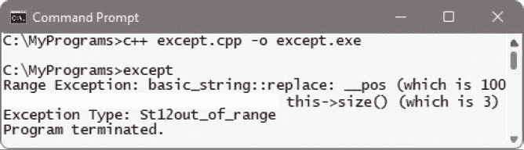


发生 `out_of_range` 错误是因为 `replace()` 函数尝试从第 100 个字符开始删除，但 `string` 变量只有三个字符。

将 `try` 块中的语句替换为尝试重置 `string` 变量大小的语句

```cpp

lang.resize( 3 * num ) ;

```


在 `catch` 块之后，添加第二个 `catch` 块来处理通用异常

```cpp

catch ( exception &e )

{

cerr << “Exception: ” << e.what() << endl ;

cerr << “Exception Type: ” << typeid( e ).name() << endl ;

}

```

保存、编译并再次运行程序，查看由第二个 `catch` 块处理的异常


将 `try` 块中的语句替换为尝试打开不存在文件的语句

```cpp

ifstream reader( “nonsuch.txt” ) ;

if ( ! reader ) throw logic_error( “File not found” ) ;


保存、编译并再次运行程序，查看再次由第二个`catch`块处理的异常以及指定的自定义错误消息


`catch`块的顺序可能很重要——将`exception`错误处理器放在`out_of_range`错误处理器之前，将允许`out_of_range`错误被（较高层的）`exception`处理器处理。


异常对象通常被命名为“e”——此处所示。

## 总结


- C++ `<fstream>`库提供了使用`ifstream`输入流或`ofstream`输出流对象处理文件的函数。
- 完成后，应调用流的`close()`函数。
- 文件模式可用于控制流的行为。
- 输入流的`get()`函数每次读取一个字符。
- `getline()`函数可用于从输入流中一次读取一行。
- 可选地，`getline()`函数可以有第三个参数，指定停止读取的隔符字符。
- 插入运算符可以与`cin`和`cout`函数一起使用修改它们的行为。
- `cout.width()`函数设置输出流的宽度。
- `cout.fill()`函数指定一个字符来占据输出的任何空部分。
- `cout.precision()`函数决定在输出浮点数时显示多少位小数。
- 性能不佳的程序可能包含语法错误、逻辑错误或异常错误。
- `try`块可以用于封装在某些条件下可能导致异常错误的语句。
- `catch`块可以用于处理在其关联的`try`块产生的异常错误。
- `try`块中发生的异常错误会自动抛出到关联的`catch`块，或者可以使用`throw()`函数手动抛出。
- C++ `<stdexcept>`库定义了一系列异常类来对常见异常进行分类，`<typeinfo>`库提供了异常类型信息。

6

## 指向数据

*本章演示如何利用指针和引用产生高效的 C++ 程序。*

- 理解数据存储
- 使用指针获取值
- 进行指针算术运算
- 向函数传递指针
- 创建指针数组
- 引用数据
- 向函数传递引用
- 比较指针与引用
- 总结

## 理解数据存储

为了理解 C++ 指针，了解数据数据如何在你的计算机上存储非常有帮助。将计算机内存想象成一排很长的、按顺序编号的槽，每个槽可以包含一个字节的数据。当程序中声明变量时，机器会保留若干槽来存储分配给该变量的数据。预留槽的数量取决于变量的数据类型。当程序使用变量名检索存储的数据时，它实际上访问的是该变量第一个预留槽的编号。


这种比较可以比作一排按顺序编号的长房子，每个房子可以容纳一个不同的家庭。任何家庭都可以通过其门牌号被显式引用。

计算机内存中的槽编号以十六进制格式表示，并通过`&`引用运算符显示。

通过指定要包含的 C++ 库和使用的命名空间开始一个新程序

```cpp
#include <string>
#include <iostream>
using std ;
```

address.cpp

添加包含返回语句并声明三个变量的 main 函数

```cpp
int main()
{
    int num = 100 ;
    double sum = 0.123456789 ;
    string text = "C Fun" ;
    // 在此处添加更多语句。
    return 0 ;
}
```

在 main 函数中插入输出每个变量内存地址的语句

```cpp
cout << "整数变量起始于: " << &num << endl ;
cout << "双精度变量起始于: " << &sum << endl ;
cout << "字符串变量起始于: " << &text << endl ;
```

保存、编译并运行程序查看地址

例如，`num = 100`将右侧的值（100）放入左侧命名变量（`num`）引用的内存中。

地址是动态分配的——所以与此截图不同。

赋值运算符`=`左侧的操作数被称为“L 值”，而右侧的操作数被称为“R 值”。考虑 L 值中的“L”代表“位置”（Location），考虑 R 值中的“R”代表“读取”（Read）。

C++ 编程的一个重要规则是 R 值不能出现在赋值运算符`=`的左侧，但 L 值可以出现在任何侧。将 R 值放在赋值运算符左侧的代码将无法编译：

在 return 语句之前，插入将 R 值错误放在赋值运算符左侧的语句

```cpp
200 = num ;
5.5 = sum ;
"Bad assignments" = text ;
```

保存并尝试重新编译程序，查看由错误放置的 R 值引起的错误


L 值是容器而 R 值是数据。

## 使用指针获取值

指针是高效 C++ 编程的有用部分——它们仅仅是存储其他变量地址的变量。


指针变量通过使用`&`引用操作符赋值另一个变量的内存地址来初始化。该赋值可以在声明语句中完成，也可以在声明后的单独语句中完成。仅通过名称引用指针变量将仅仅揭示它所包含的内存地址。

在指针变量初始化后（无论是在声明中初始化还是通过随后的赋值初始化），它会“指向”它所包含地址地址处的变量。有用的是，这意味着通过在指针名称前加上`*`解引用运算符，就可以引用它指向的变量的值：

通过指定要包含的 C++ 库类和要使用的命名空间前缀开始一个新程序

```cpp
#include <iostream>
using namespace std ;
```


deref.cpp

添加一个 main 函数，包含一个最后的`return`语句并声明两个初始化的普通整数变量

```cpp
int main()
{
    int a = 8 , b = 16 ;
    // 在此处添加更多语句。
    return 0 ;
}
```

在 main 函数中，插入一条语句声明并用第一个整数变量的内存地址初始化指针

```cpp
int* aPtr = &a ;  // aPtr 被赋值为 a 的地址。
```

插入一条语句声明第二个指针，然后用第二个整数变量的地址对其初始化

```cpp
int* bPtr ;  // 声明 bPtr。
bPtr = &b ;  // bPtr 被赋值为 b 的地址。
```

接下来，插入语句输出每个指针的实际内存地址

```cpp
cout << "Addresses of pointers..." << endl ;
cout << "aPtr: " << &aPtr << endl ;
cout << "bPtr: " << &bPtr << endl << endl ;
```

现在，插入语句输出每个指针内部存储的内存地址

```cpp
cout << "Values in pointers..." << endl ;
cout << "aPtr: " << aPtr << endl ;
cout << "bPtr: " << bPtr << endl << endl ;
```

最后，插入语句输出存储在每个指针的内存地址处的值——即指针指向的变量的值

```cpp
cout << "Values in addresses pointed to..." << endl ;
cout << "a: " << *aPtr << endl ;
cout << "b: " << *bPtr << endl ;
```

保存、编译并运行程序以查看指针地址和存储的值


`*`解引用运算符也被称为“间接”运算符。


内存地址是动态分配的——因此将与此截图中的地址有所不同。

## 执行指针算术

一旦指针变量用内存地址初始化，就可以赋值另一个地址，或使用指针算术来更改它。


`++`增增运算符或`--`递减运算符将指针移动到该数据类型的下一个或上一个地址——数据类型越大，跳跃越大。

使用`+=`和`-=`运算符可以实现更大的跳跃。

指针算术在处理数组时特别有用，因为数组中的元素占据连续的内存地址。仅将数组的名称赋值给指针会自动为它分配第一个元素的地址。将指针加 1 会将指针移动到下一个元素。

通过指定要包含的 C++ 库类和要使用的命名空间前缀开始一个新程序

```cpp
#include <iostream>
using namespace std ;
```


point.cpp

添加一个 main 函数，包含一个最后的`return`语句并声明一个包含 10 个元素的初始化整数数组

```cpp
int main()
{
    int nums[] = { 1, 2, 3, 4, 5, 6, 7, 8, 9, 10 } ;
    // 在此处添加更多语句。
    return 0 ;
}
```

在 main 函数中，插入一条语句声明指针，并用整数数组第一个元素的内存地址初始化它

```cpp
int* ptr = nums ;
```

接下来，插入一条语句输出整数数组第一个元素的内存地址及其值

```cpp
cout << endl << "ptr at: " << ptr << " gets: "<< *ptr ;
```

现在，增加指针并输出它的新内存地址——整数数组中第二个元素的地址

```cpp
ptr++ ;
cout << endl << "ptr at: " << ptr << " gets: "<< *ptr ;
```

再次增加指针，输出它的新内存地址——整数数组中第三个元素的地址

```cpp
ptr++ ;
cout << endl << "ptr at: " << ptr << " gets: "<< *ptr ;
```

递减指针两个位置并输出它的内存地址——第一个元素的地址

```cpp
ptr -= 2 ;
cout << endl << "ptr at: " << ptr << " gets: "<< *ptr ;
```

现在，插入一个循环输出数组中每个元素的值

```cpp
for ( int i = 0 ; i < 10 ; i++ )
{
    cout << endl << "Element: " << i ;
    cout << " Value: " << *ptr ;
}
```

保存、编译并运行程序以查看指针地址和存储的值


`*=`、`/=`和`%=`运算符无法移动指针。


数组名称就像指向其元素的指针。

## 将指针传递给函数

指针可以使用`*`解引用运算符访问指向变量的数据。这也可以通过赋值适当数据类型的新值来更改存储的数据。


指针可以作为参数传递给函数——与传递变量的效果有所不同：

- 当变量传递给函数时，数据是“按值”传递给函数内部的局部变量——因此函数操作的是原始值。
- 当指针传递给函数时，数据是“按引用”传递的——因此函数操作的是原始值。

按引用传递的用处允许函数直接操作调用函数内的变量。

通过指定要包含的 C++ 库类和要使用的命名空间前缀开始一个新程序

```cpp
#include <iostream>
using namespace std ;
```


fnptr.cpp

在预处理指令之后，声明两个接受单个指针参数的函数原型

```cpp
void writeOutput ( int* ) ;
void computeTriple ( int* ) ;
```

添加一个 main 函数，包含一个最后的`return`语句并声明一个初始化的普通整数变量

```cpp
int main()
{
    int num = 5 ;
    // 在此处添加更多语句。
    return 0 ;
}
```

在 main 函数中，插入第二个变量声明，用普通整数变量的地址初始化指针

```cpp
int* ptr = &num ;
```

在 main 函数块之后定义一个输出指针指向的变量当前值的函数

```cpp
void writeOutput( int* value )
{
    cout << "Current value: " << *value << endl ;
}
```

定义另一个乘以指针指向的变量当前值的函数

```cpp
void computeTriple( int* value )
{
    *value *= 3 ;  // 相乘并赋值解引用值。
}
```

在 main 函数中，将指针参数传递给函数以输出它指向的变量值

```cpp
writeOutput( ptr ) ;
```

接下来，使用指针增加变量的值，然后显示其新值

```cpp
*ptr += 15 ;  // 对引用值进行加并赋值。
writeOutput( ptr ) ;
```

现在，将指针参数传递给函数以将该指针指向的变量乘以三倍，然后显示其新值

```cpp
computeTriple( ptr ) ;
writeOutput( ptr ) ;
```

保存、编译并运行程序，查看计算值的输出


函数原型和定义都必须包含一个指针参数。


直接操作调用函数内变量的函数不需要返回语句。

### 创建指针数组

普通的`char`数据类型变量可以分配单个字符值，但指向常量`char`数组的指针可以很有用地分配一个字符字符串。该字符串实际上存储为字符数组，每个元素一个字符，但引用`char`指针将自动检索整个字符串。


这种仅通过变量名从`char`指针检索字符串值的能力，类似于通过变量名从普通`char`数组检索字符串的方法。

多个字符串可以存储在常量`char`指针数组中，每个元素一个字符串。你甚至可以在一个“主”`char`指针数组中存储多个`char`指针数组——每个元素一个数组。

指定要包含的 C++ 库类和要使用的命名空间名前来开始新程序

```cpp
#include <iostream>
using namespace std ;
```


arrptr.cpp

添加一个包含最终 return 语句并声明两个初始化变量的 main 函数——一个普通的字符数组和一个具有相同字符串值的字符指针

```cpp
int main()
{
    char letters[ 8 ] = { 'C', '+' , '+' , ' ' , 'F', 'u', 'n', '\0' } ;
    const char* text = "C++ Fun" ;
    // 在此处添加更多语句
    return 0 ;
}
```

在 main 函数中，插入语句声明并初始化两个额外的字符指针变量，并具有唯一的字符串值

```cpp
const char* term = "Element:" ;
const char* lang = "C++" ;
```

接下来，插入一条语句声明字符指针数组，并用三个字符串值初始化

```cpp
const char* ap1[ 3 ] = { "Great " , "Program" , "Code " } ;
```


字符值必须包含在单引号中，但字符串值必须包含在双引号中——即使它们被赋值给 `char` 指针。

现在，插入一条语句声明第二个字符指针数组，用三个字符串值初始化——将其中一个指针变量作为它的第一个元素

```cpp
const char* ap2[ 3 ] = { lang , "is " , "Fun" } ;
```

声明两个“主”字符指针数组，每个数组初始化了三个 `char` 指针数组元素

```cpp
const char* ap3[ 3 ] = { ap2[ 0 ] , ap2[ 1 ] , ap1[ 0 ] } ;

const char* ap4[ 3 ] = { ap1[ 2 ] , ap2[ 1 ] , ap2[ 2 ] } ;
```

在声明之后，插入语句输出前两个变量相同的字符串值

```cpp
cout << letters << endl ;

cout << text << endl ;
```

接下来，插入一个包含语句的循环，输出字符指针内部的值和迭代次数

```cpp
for ( int i = 0 ; i < 3 ; i++ )
{
    cout << term << i << " " ;
}
```

在循环块内，插入语句输出四个字符指针数组的每个元素值

```cpp
cout << ap1[ i ] << " " ;
cout << ap2[ i ] << " " ;
cout << ap3[ i ] << " " ;
cout << ap4[ i ] << endl ;
```

保存、编译并运行程序，查看字符字符串输出


要在 `char` 数组中包含空格，赋值的引号之间必须有一个空格如 `' '`——两个单引号在一起（`''`）被视为空元素并导致编译器错误。


记住 `char` 数组的最后一个元素必须包含特殊的 `\0` 字符，以将该数组指定为字符串。

### 引用数据

C++ “引用”（reference）是程序中变量或对象的别名。引用必须在声明时初始化，通过为其赋值它所引用的变量或对象的名称来完成。

引用始终是其声明语句中关联项的别名。

**将引用传递给函数**

引用可以访问其所引用的变量中存储的数据，就像变量本身一样，并且可以通过分配适当数据类型的新值来更改存储的数据。


此外，引用可以像指针一样，作为参数传递给函数：

- 当变量被传递给函数时，它们的数据是“按值”传递给函数内部的局部变量 – 因此函数在原始值的副本上进行操作。
- 当引用被传递给函数时，它们的数据是“按引用”传递的 – 因此函数在原始值上进行操作。

按引用传递的优点是允许函数可以直接操作调用函数内部声明的变量值。

通过指定要包含的 C++ 库类和使用的命名空间前缀创建一个新程序

```cpp
#include <iostream>

using namespace std ;
```


fnref.cpp

在预处理器指令之后，声明两个函数原型，每个原型接受一个引用参数

```cpp
void writeOutput ( int& ) ;

void computeTriple ( int& ) ;
```

添加一个包含最终 `return` 语句并声明一个初始化普通整数变量的 `main` 函数

```cpp
int main()
{
    int num = 5 ;
    // 在这里添加更多语句。
    return 0 ;
}
```

在 `main` 函数中，插入第二个变量声明，将引用初始化为整数变量的别名

```cpp
int& ref = num ;
```


这个示例可能看起来很熟悉，因为它重创建了此处的示例 – 但将指针替换为了引用。

在 `main` 函数块之后，定义一个函数输出引用所指变量的当前值

```cpp
void writeOutput( int& value )
{
    cout << "Current value: " << value << endl ;
}
```

定义另一个函数，将引用所指变量的当前值乘以 3

```cpp
void computeTriple( int& value )
{
    value *= 3 ;  // 乘以并赋值引用的值。
}
```

在 `main` 函数中，将引用参数传递给函数以输出其引用的变量值

```cpp
writeOutput( ref ) ;
```

接下来，使用引用增加变量值，然后显示其新值

```cpp
ref += 15 ;  // 加上并赋值引用的值。
writeOutput( ref ) ;
```

现在，将引用参数传递给函数以将其引用的变量乘以 3，然后显示其新值

```cpp
computeTriple( ref ) ;
writeOutput( ref ) ;
```

保存、编译并运行程序以查看计算值的输出


函数原型和定义必须包含一个引用参数。


直接操作调用函数内部变量的函数不需要 `return` 语句。

### 比较指针与引用

指针和引用都可以用于引用变量值，并按引用而非按值传递给函数。从技术上讲，按引用传递比按值传递高效，因此鼓励使用指针和引用。


使用指针还是引用的取决于程序需求。C++ 程序员通常倾向于尽可能使用引用，因为它们比指针更容易使用、也更容易理解。然而，引用必须遵守某些规则，这些规则使得使用指针变得必要：

| 规则: | 引用: | 指针: |
| :--- | :--- | :--- |
| 可以不初始化就声明 | 否 | 是 |
| 可以重新赋值 | 否 | 是 |
| 可以包含 0 (null) 值 | 否 | 是 |
| 最容易使用 | 是 | 否 |

作为一个一般规则，使用引用或指针的选择可以通过遵循以下指南来确定：

- 如果你不想在声明时初始化，请使用指针；
- 或者
如果你想要重新赋值另一个变量，请使用指针；
- 否则
始终使用引用。

然而，指针比引用更灵活，甚至可以指向函数。在这种情况下，指针的声明必须与它指向的函数的返回数据类型和参数精确匹配。此外，指针名在声明中必须包含括号内以避免编译器错误。可以通过名称给函数指针分配一个函数，以便通过指针调用该函数。


引用必须在声明中初始化以引用变量或对象 – 之后将始终引用该项。

通过指定要包含的 C++ 库类和使用的命名空间前缀创建一个新程序

```cpp
#include <iostream>

using namespace std ;
```


pref.cpp

在预处理器指令之后，定义一个内联函数输出两个参数的总和

```cpp
inline void add ( int& a, int* b )
{
    cout << "Total: " << a + b << endl ;
}
```

添加一个包含最终 `return` 语句的 `main` 函数，并两个整数变量、一个引用和一个指针

```cpp
int main()
{
    int num = 100 , sum = 500 ;
    int& rNum = num ;
    int* ptr = &num ;
    // 在这里添加更多语句。
    return 0 ;
}
```

在 `main` 函数中，插入通过引用和指针输出的语句

```cpp
cout << "Reference: " << rNum << endl ;

cout << "Pointer: " << *ptr << endl ;
```

现在，将第二个整数变量赋值给指针并通过指针输出其值，然后调用函数输出和

```cpp
ptr = &sum ;
cout << "Pointer now: " << *ptr << endl ;
add( rNum , ptr )
```

保存、编译并运行程序查看输出


C 程序员倾向于将 `&` 和 `*` 放在变量名之前，但在 C++ 中通常将其放在数据类型之后 – 因为该特性是类型的属性，而不是名称属性。

## 总结


- 数据存储在按顺序编号的计算机内存中。
- `=` 运算符左侧的操作数是左值，右侧的是右值。
- 右值只能出现在 `=` 运算符的右侧。
- 指针是存储另一个变量内存地址的变量 – 即它指向的变量。
- `*` 字符在指针声明中作为左值出现，表示该语句创建一个指针变量。
- 一旦声明，可以使用 `*` 解引用运算符引用指针指向的变量内部的值。
- 指针算术可以遍历数组元素存储的值。
- 变量按值传递给函数，而指针和引用按引用传递。
- 按引用传递允许接收函数直接操作调用函数内部声明的变量。
- 字符串值可以赋值给 `char` 类型的指针，并使用指针名检索整个字符串。
- 指针数组的每个元素都可以存储数据或指针。
- 引用不是变量，仅仅是变量的别名。
- `&` 字符在引用声明中作为左值出现，表示该语句创建一个别名。
- `&` 引用操作符可以引用指针内部存储的内存地址。
- 引用比指针更易使用，但与指针不同，引用必须在声明时始终初始化，且不能被赋值不同的变量。

# 7

# 创建类和对象

本章介绍了封装和继承两个主题——这是 C++ 面向对象编程的前两个原则。

- 数据封装
- 创建对象
- 创建多个对象
- 初始化类成员
- 重载方法
- 继承类属性
- 调用基构造函数
- 重写基方法
- 总结

## 数据封装

类是一种可以在单个实体中同时包含变量和函数的数据结构。这些统称为其“成员”，而函数被称为其“方法”。

从类外部访问类成员受类声明中“访问修饰符”的控制。通常，这些修饰符会拒绝对变量成员的访问，但允许访问可以存储和检索这些变量成员数据的方法。这种“数据隐藏”技术确保了存储的数据被安全地封装在类变量成员内部，它是面向对象编程（OOP）的第一大原则。


类声明以 `class` 关键字开始，后面跟着空格，然后是程序员指定的名称——遵循通常的 C++ 命名规范，但大写字母开头。接下来是访问修饰符和类成员，它们包含在一对括号内。每个类声明必须在右大括号后以分号结束——因此类声明语法如下：

```cpp
class ClassName
{
    access specifier :
        member1 ;
        member2 ;
    access specifier :
        member3 ;
        member4 ;
};
```

访问修饰符可以是 `public`、`private` 或 `protected` 关键字中的任意一个，用于指定其列出成员的访问权限：

- 公有成员（Public）可以在类可见的任何地方访问。
- 私有成员（Private）仅供同类的其他成员访问。
- 保护成员（Protected）仅供同类的其他成员以及该类派生类的成员访问。

默认情况下，所有类成员都有私有访问权限——因此，任何出现在类声明中没有访问修饰符的成员都具有私有权限。


使用 `protected` 访问修饰符的派生类将在本章稍后介绍。

任何现实世界的对象都可以通过属性和动作来定义。例如，狗有年龄、重量和颜色等属性，以及它可以执行的吠等动作。C++ 中的类机制提供了一种在程序中创建虚拟狗对象的方法，其中类的变量成员可以代表其属性，方法则代表其动作：

```cpp
class Dog
{
    private: // 默认访问级别。
        int age, weight ;
        string color;
    public :
        void bark() ;
        // ... 其他用于存储/检索数据的方法。
};
```


虽然程序类无法完美模拟真实世界对象，但目标是封装所有相关的属性和动作。

重要的是，类声明只定义了一个数据结构——为了创建对象，你必须声明该数据结构的一个“实例”。这与声明普通 C++ 数据类型的实例的方式完全相同：

| `int num ;` | `// 创建一个名为"num"的实例。// 属于普通的 C++ int 数据类型。` |
| `Dog fido ;` | `// 创建一个名为"fido"的实例。// 属于程序员定义的 Dog 数据结构。` |

或者，可以通过在类声明右大括号和最终分号之间指定其名称来创建实例对象。可以通过指定用逗号分隔的对象名称列表来创建多个实例。例如，下面列出的类声明创建了四个名为“fido”、“pooch”、“rex”和“sammy”的 `Dog` 类实例对象。

```cpp
class Dog
{
    int age, weight ;
    string color;
    public:
        void bark() ;
        // ... 其他用于存储/检索数据的方法。
} fido, pooch, rex, sammy ;
```

C++ 编程中的封装原则描述了数据和功能在类成员中的组合——即 `Dog` 类中的年龄、重量、颜色属性和 `bark` 动作。


类名通常以大写字母开头，对象名以小写字母开头。

## 创建对象

为了从类的私有成员中分配和检索数据，必须向类中添加特殊的公有访问方法。这些是“设置器”（setter）方法，用于分配数据，以及“访问器”（getter）方法，用于检索数据。访问方法通常以它们处理的变量命名，首字母大写，并分别以“set”或“get”为前缀。例如，处理 `age` 变量的访问方法可以命名为 `setAge()` 和 `getAge()`。


现在，添加对普通输出方法的调用

```cpp
fido.bark() ;
```

保存、编译并运行程序以查看输出


随着新功能的加入，该程序将在接下来的页面中被修改。

## 创建多个对象

程序可以很容易地创建多个对象，只需声明类的多个实例，并且通过为其 setter 方法（设置方法）分配单独的值，每个对象都可以拥有独特的属性。


将 setter 方法合并为一个接受每个私有变量参数的单一方法通常是非常方便的。这意味着在程序中可以使用单个语句为所有值赋值，但该方法内部将包含多个语句。

上一个示例中的类声明包含了仅有一行的短方法，这些方法是“内联”创建的——完全位于类声明块内部。当方法超过两行时，不应内联创建，而应该在类声明块中声明为“原型”（prototype），并在类声明之后单独定义。定义必须在方法名前加上类名和作用域解析运算符 `::` 以识别包含其原型的类。

将上一个示例的副本“object.cpp”重命名为新程序“multiple.cpp”


multiple.cpp

在 `Dog` 类声明中，将三个 setter 方法替换为单一的组合 setter 原型，指定参数的数据类型但不指定它们的名称

```cpp
void setValues ( int, int, string ) ;
```

在 `Dog` 类声明之后，使用 `::` 作用域解析运算符添加该原型的定义块，以识别其所在的类

```cpp
void Dog::setValues ( int age, int weight, string color )
{
}
```

注意，为了方便识别，参数名称与它们将赋值的变量名称相同。当类方法定义的参数与类成员同名时，可以使用 `this ->` 类指针来显式地引用类成员。例如，`this -> age` 指的是类成员变量，而 `age` 指的是参数。


注意，原型是一个语句——所以它必须以分号结束。

在方法定义块中，插入三个语句将从传递的参数赋值给类变量


进入`/path/to/xxx`目录，找到`xxx.json`。

在表达式`cvar = avar + bvar`中，加法运算符（`+`）将`avar`与`bvar`相加，得到它们的和`cvar`。

在`List.of(arg0, arg1, arg2)`中，`List`接口的工厂方法`of()`接受一系列的元素，返回包含它们的只读列表。

之后我们这样调用`cmd`命令：`cmd arg0 arg1 arg2`。

```
if (condVar > someVal) {console.log("xxx")}
```


`#include <iostream>`

`using namespace std ;`


`override.cpp`

声明一个名为 “Man”的类，它将作为一个基类。

```cpp
class Man
{
    // 类成员在这里。
} ;
```

在 `Man` 类声明的大括号之间，插入一个公共访问修饰符和一个内联输出方法。

```cpp
public :
void speak() { cout << "Hello! " << endl ; }
```

现在，插入一个重载的内联输出方法。

```cpp
void speak( string msg )
{ cout << " " << msg << endl ; }
```

在 `Man` 类声明之后，声明一个派自 `Man` 类的名为 “Hombre”的类。

```cpp
class Hombre : public Man
{
    // 类成员在这里。
} ;
```


派生类中的方法声明必须与基类中的匹配才能覆盖它 – 如果使用了 `const` 关键字。

在 `Hombre` 类声明的大括号之间，插入一个访问修饰符和一个重写重载基类方法的方法 – 不带制表符输出。

```cpp
public :
void speak( string msg ) { cout << msg << endl ; }
```

在 `Hombre` 类声明之后，添加一个包含最终 `return` 语句的 `main` 方法，并创建两个对象 – 基类的实例和派生类的实例。

```cpp
int main()
{
    Man henry ;
    Hombre enrique ;
    // 在此处添加更多语句。
    return 0 ;
}
```


在 `main` 方法中，插入调用基类两个方法的语句。

```cpp
henry.speak() ;
henry.speak( "It’s a beautiful evening." ) ;
```

接下来，插入一条调用派生类中重写方法的语句 – 不带制表符的输出。

```cpp
enrique.speak( "Hola!" ) ;
```

现在，插入一条显式调用基类中被重写方法的语句。

```cpp
enrique.Man::speak( "Es una tarde hermosa." ) ;
```

保存、编译并运行程序，查看重写方法和被重写方法的输出。


在派生类中声明的重写方法隐藏了基类中的两个重载类。尝试调用 `enrique.speak()` – 编译器将报错说该调用没有匹配的方法。

## 总结


- 面向对象编程的第一原则是在单个类中对数据和功能进行封装。
- 访问修饰符 `public`、`private` 和 `protected` 控制类成员从类外部的可访问性。
- 类声明描述了一个可以从其创建实例对象的数据结构。
- 公共的 `setter` 和 `getter` 类方法从私有类变量成员中存储和检索数据。
- 作用域解析符 `::` 可以显式识别一个类。
- 与传递的参数同名的类成员可以显式识别。
- 构造函数在对象创建时调用，析构函数在对象销毁时调用。
- 面向对象编程的第二个原则是允许派生类继承基类的属性。
- 在派生类声明中，类名后面跟着冒号、修饰符。

# 8 利用多态

***本章将演示如何将程序拆分为模块组件，并引入多态 – C++ 的第三原则。***

- 指向类
- 调用虚方法
- 引导方法调用
- 提供能力类
- 抽象数据类型
- 构建层次结构
- 隔离类结构
- 使用隔离类
- 总结

## 指向类

面向对象编程（OOP）三个基石是封装、继承和多态。第 7 章的示例演示了如何将数据封装在 C++ 类中，以及派生类如何继承基类的属性。本章引入最后一个基石原则：多态。

“多态”一词（源自希腊语，意为“多种形式”）描述了根据上下文赋予实体不同含义或目的。在 C++ 中，重载运算符可以被认为是多态的。例如，`*` 字符根据上下文可以表示乘法运算符或引用运算符。同样，`+` 字符根据上下文可以表示加法运算符或拼接运算符。

重要的是，C++ 类方法也可以是多态的。理解类多态的关键是意识到可以创建一个基类指针并与特定的派生类绑定。

基类指针可以分配派生类的内存地址，以提供“上下文” – 唯一标识该派生类。例如，对于一个 `Base` 基类和一个派生类 `Sub` 类，可以这样创建指针：

```cpp
Sub inst ;
Base* pSub = &inst ;
```

或者更简单地使用 `new` 关键字，如下：

```cpp
Base* pSub = new Sub ;
```


返回第 6 章 了解更多关于指针的知识。

当存在多个派生类时，可以创建基类指针，通过每个派生类的唯一内存地址进行绑定——可以使用 `addressof` `&` 运算符获取地址。

通过指定要包含的 C++ 库类和要使用的命名空间前缀来启动新程序

```cpp
#include <iostream>
using namespace std ;
```

`classptr.cpp`

声明一个 `Base` 类，包含一个以十六进制格式输出传递整数值的方法

```cpp
class Base
{
public:
void Identify( int adr ) const
{ cout << "Base class called by 0x" << hex << adr << endl ; }
} ;
```

声明两个空的派生类，`SubA` 和 `SubB`

```cpp
class SubA : public Base {     } ;
class SubB : public Base {     } ;
```

声明一个包含最终 `return` 语句的 `main` 方法

```cpp
int main()
{
// Program code goes here.
return 0 ;
}
```

在 `main` 方法中，插入语句创建两个基类指针——每个指针绑定到特定的派生类

```cpp
Base* ptrA = new SubA ;
Base* ptrB = new SubB ;
```

现在，插入使用指针调用基类方法的语句，传递每个类的内存地址进行输出

```cpp
ptrA -> Identify( (int) &ptrA ) ;
ptrB -> Identify( (int) &ptrB ) ;
```

保存、编译并运行程序以查看地址


此处使用 `->` 类指针运算符来调用类方法。


十六进制地址作为 `int` 数据类型传递，然后由 `hex` 输出操纵符以十六进制格式显示。地址在每次程序执行时都会不同——它们是动态分配的。

### 调用虚拟方法

绑定到特定派生类的基类指针可以用于调用从基类继承的派生类方法。然而，派生类特有的方法必须通过实例对象调用。


绑定到特定派生类的基类指针也可以使用 `::` 作用域解析符显式调用基类中的方法。

最有用的是，当基类方法被声明为“虚”方法时，派生类中的继承方法可以重写基类中的方法。这只是在基类中一个以 `virtual` 关键字之前的普通方法声明。虚拟方法的声明表示该类将用作基类，从其派生出另一个类，该类可能包含一个用于重写虚拟基方法的方法。

通过指定要包含的 C++ 库类和要使用的命名空间前缀来启动新程序

```cpp
#include <iostream>
using namespace std ;
```

`virtual.cpp`

声明一个名为“Parent”的基类，包含一个普通方法声明和一个虚拟方法声明

```cpp
class Parent
{
public :
void Common() const
{ cout << "I am part of this family, ; }
virtual void Identify() const
{ cout << "I am the parent" << endl ; }
} ;
```

声明一个名为“Child”的派生类，包含一个重写虚拟基方法的方法

```cpp
class Child : public Parent
{
public :
void Identify() const
{ cout << "I am the child" << endl ; }
} ;
```

基类指针不能用于调用派生类中的非继承方法。

声明一个派自“Child”类的“Grandchild”类，包含一个重写虚拟基方法的方法和一个普通方法声明

```cpp
class Grandchild : public Child
{
public :
void Identify() const
{ cout << "I am the grandchild" << endl ; }
void Relate() const
{ cout << "Grandchild has parent and grandparent" ; }
} ;
```

Parent Child Grandchild

声明一个包含最终 `return` 语句并创建每个派生类实例的 `main` 方法，加上这些派生类的基类指针

```cpp
int main()
{
Child son ;
Grandchild grandson ;
Parent* ptrChild = &son ;
Parent* ptrGrandchild = &grandson ;
// 在 main 方法中，插入对每个方法的调用
ptrChild -> Common() ; // 继承
ptrChild -> Identify() ; // 重写
ptrGrandchild -> Common() ; // 继承
ptrGrandchild -> Identify() ; // 重写
ptrChild -> Parent::Common() ; // 显式
ptrGrandchild -> Parent::Identify() ; // 显式
return 0 ;
}
```


在字符串中需要使用反斜符 `\` 来转义单引号。

## 提供能力类

其唯一目的是允许其他类派生自该类的类被称为“能力类”（capability classes）——它们为派生类提供能力。


能力类通常不包含数据，仅声明了若干可以在派生类中重写的虚拟方法。

接下来的示例在之前的示例的基础上，展示了如何将 `Bird` 类更写地写为一个能力类。它的方法不再包含输出语句，但如果被显式调用，将返回 `-1`（错误）值。

有必要将这些方法的返回类型从 `void` 更改为 `int`，并且这些更改必须反映在派生类中的每个重写方法中。

通过指定要包含的 C++ 库类和要使用的命名空间前缀开始一个新程序

```cpp
#include <iostream>
using namespace std ;
```


`capability.cpp`

声明一个名为“Bird”的基能力类，包含两个虚拟方法声明，如果被显式调用将报告错误

```cpp
class Bird
{
public :
    virtual int Talk() const { return -1 ; }
    virtual int Fly() const { return -1 ; }
} ;
```

声明一个名为“Pigeon”的派生类，包含两个重写基类方法的方法

```cpp
class Pigeon : public Bird
{
public :
    int Talk() const { cout << "Coo! Coo!" << endl ; return 0 ; }
    int Fly() const { cout << "A pigeon flies away..." << endl ; return 0 ; }
} ;
```


派生类中重写方法的返回值必须与基类中声明的返回值匹配。

声明一个名为“Chicken”的派生类，包含两个重写基类方法的方法

```cpp
class Chicken : public Bird
{
public :
    int Talk() const { cout << "Cluck! Cluck!" << endl ; return 0 ; }
    int Fly() const { cout << "I’m just a chicken – I can’t fly!" << endl ; return 0 ; }
} ;
```

声明一个主方法，创建绑定派生类的基类指针

```cpp
int main()
{
    Bird* pPigeon = new Pigeon ;
    Bird* pChicken = new Chicken ;
}
```

在主方法中，插入方法调用和一条在显式调用基类方法并遇到错误时终止程序的语句

```cpp
pPigeon -> Talk() ;
pChicken -> Talk() ;
pPigeon -> Bird::Talk() ;
if ( -1 ) { cout << "Error! - Program ended." << endl ; return 0 ; }
pPigeon -> Fly() ;  // 将不会被调用。
pChicken -> Fly() ; // 将不会被调用。
return 0 ;  // 语句将不会执行。
```

保存、编译并运行程序以查看输出


能力类方法旨在在派生类中被重写——它们不应被显式调用。


更多错误处理的详细信息，请参考此处和此处。

## 抽象数据类型

抽象数据类型（ADT）代表一个概念而非一个实体对象，并且总是其他类的基类。通过将其一个或多个方法初始化为 `0`，可以将基类变为 ADT。这些被称为“纯虚拟方法”，并且必须在派生类中被重写。

通过指定要包含的 C++ 库类和要使用的命名空间前缀开始一个新程序

```cpp
#include <iostream>
using namespace std ;
```


`adt.cpp`

声明一个名为“Shape”的基 ADT 类，包含三个纯虚拟方法

```cpp
class Shape
{
public :
    virtual int getArea() = 0 ;
    virtual int getEdge() = 0 ;
    virtual void Draw() = 0 ;
} ;
```

声明一个名为“Rect”的派生类，包含两个私有变量

```cpp
class Rect : public Shape
{
private :
    int height, width ;
} ;
```

在派生类声明中，插入公共构造函数和析构函数

```cpp
public :
    Rect( int initWidth, int initHeight )
    {
        height = initHeight ;
        width = initWidth ;
    }
    ~Rect() ;
```


创建 ADT 的实例对象是不允许的——尝试这样做会导致编译器错误。

在派生类`Rect`声明中，插入公共方法以重写`Shape`基类

```cpp
int getArea() { return height * width ; }

int getEdge() { return 2 * (height + width) ; }

void Draw()

{

    for (int i = 0 ; i < height ; i++) { cout << “_” }

}
```

声明一个主方法，包含返回语句并创建`Rect`类的实例——表示一个形状

```cpp
int main()

{

    Shape* pQuad = new Rect( 3, 7 ) ;

    Shape* pSquare = new Rect( 5, 5 ) ;

    return 0 ;

}
```

在主方法中插入对方法的调用，然后保存、编译并运行程序以查看输出

```cpp
pQuad -> Draw() ;

cout << “Area is ” << pQuad -> getArea() << endl ;

cout << “Perimeter is ” << pQuad -> getEdge() << endl ;

pSquare -> Draw() ;

cout << “Area is ” << pSquare -> getArea() << endl ;

cout << “Perimeter is ” << pSquare -> getEdge() << endl ;
```


基类只需要包含一个虚拟方法即可创建抽象数据类型。

## 构建复杂的层次结构

有时从另一个 ADT 派生 ADT 以构建复杂的类层次结构。这提供了极大的活性，只要每个纯方法在某个派生类中定义都是完全可以的。

通过指定要包含的 C++ 库类和要使用的命名空间前缀开始一个新程序

```cpp
#include <iostream>

using namespace std ;
```


`hierarchy.cpp`

声明一个名为`Boat`的基 ADT 类，包含一个变量、访问方法和一个纯虚拟方法

```cpp
class Boat

{

protected:

int length ;

public:

    int getLength() { return length ; }

    virtual void Model() = 0 ;

} ;
```

声明一个名为`Sailboat`的 ADT 类（派自`Boat`类）——同样包含一个变量、访问方法和一个纯虚拟方法

```cpp
class Sailboat : public Boat

{

protected :

int mast ;

public :

    int getMast() { return mast ; }

    virtual void Boom() = 0 ;

} ;
```

声明一个名为`Laser`的普通类（派自`Sailboat`类），其中所有成员将允许公共访问

```cpp
class Laser : public Sailboat

{

public :

} ;
```

在`Laser`类中，定义在该类派生类中声明的纯虚方法

```cpp
void Model() { cout << “Laser Classic” << endl ; }

void Boom() { cout << “Boom: 14ft” << endl ; }
```

声明一个`main`方法，包含一个最终的`return`语句，并在层次结构的底层创建一个派生类的实例

```cpp
int main()

{

    Laser* pLaser = new Laser ;

    // Add more statements here.

    return 0 ;

}
```

在`main`方法中，插入对每个定义方法的调用

```cpp
pLaser -> Model() ;

cout << “Length: “ << pLaser -> getLength() << “ft” << endl ;

cout << “Height: “ << pLaser -> getMast() << “ft” << endl ;

pLaser -> Boom() ;
```

保存、编译并运行程序以查看输出


尝试添加一个派自`Boat`类的`Powerboat`类（包含引擎信息），以及一个派自`Powerboat`类的`Cruiser`类 —— 用于为变量赋值并定义虚方法。

### 隔离类结构

书中每个示例程序的源代码通常包含在单个`.cpp`文件中以节省空间，但实际上，OOP 程序通常包含在三个单独文件中：

*   头文件`.h` – 仅包含类声明。
*   实现文件`.cpp` – 包含类定义，用于实现头文件中声明的方法，该文件通过`#include`指令引用。
*   客户端`.cpp`文件 – 包含一个`main`方法，该方法使用头文件中声明的类成员，该文件同样通过`#include`指令引用。


例如，一个加法器程序可能由三个文件组成：`ops.h`（声明操作类的头文件）、`ops.cpp`（定义操作方法的实现文件）和`sum.cpp`（调用各种操作的客户端文件）。


客户端文件有时被称为“驱动”（driver）文件。

编译`sum.cpp`时，编译器会将包含的头文件和实现文件合并到程序中。它首先将头文件和实现文件转换为二进制对象文件（`ops.o`），然后将头文件和客户端文件转换为第二个二进制对象文件（`sum.o`）。最后，链接器将两个对象文件合并成单个可执行文件（`sum.exe`）。


使用`#include`指令引用头文件与使用`#include`指令引用标准 C++ 库的方式类似。

在独立的“模块化”文件中隔离类结构具有提高可移植性的优势，并且通过明确识别每个文件的目的使代码维护更加容易。

要让编译器将三个源文件合并成单个可执行文件，只需要在编译器命令中显式指定`.cpp`文件 —— `#include`指令确保头文件也会被识别。

例如，在`ops.cpp`和`sum.cpp`中都使用`#include “ops.h”`语句，编译侧描述的示例的命令不需要在编译器命令中指定`ops.h`头文件，只需要`c++ ops.cpp sum.cpp -o sum.exe`。


### 计算器

此示例将允许用户输入一个简单的算术表达式并输出计算结果。它将在首次启动时提供说明，并允许用户输入后续表达式 —— 或通过字符 0 退出。

通过声明名为`Calculator`的类开始编写头文件

```cpp
class Calculator

{

} ;
```


#### ops.h

在类声明中插入公共方法声明

```cpp
public :

    Calculator() ;

    void launch() ;

    void readInput() ;

    void writeOutput() ;

    bool run() ;
```

#### ops.cpp

在类声明中插入私有声明

```cpp
private :

    double num1 ;

    double num2 ;

    char oper ;

    bool status ;
```

#### 类的应用

使用`#include`开始头文件

```cpp
#include <iostream>

using namespace std;
```

#### 隔离的方法

用定义开始实现文件

```cpp
Calculator::Calculator()

{

    status = true ;

}

void Calculator::launch()

{

    cout << “CALCULATOR” << endl ;

    cout << “Enter a number, an operator (+,-*,/), and another number.” << endl ;

    cout << “Hit zero to exit.” << endl ;

}

void Calculator::readInput()

{

    cout << “> “ ; cin >> num1 ;

    if ( num1 == 0 ) 

        status = false ;

    else

        cin >> oper >> cin >> num2 ;

}

void Calculator::writeOutput()

{

    if ( status ) 

        switch( oper )

        {

            case ‘+’ : { cout << ( num1 + num2 ) << endl ; break; }

            case ‘-’ : { cout << ( num1 - num2 ) << endl ; break; }

            case ‘*’ : { cout << ( num1 * num2 ) << endl ; break; }

            case ‘/’ : 

                if ( num2 != 0 ) 

                    cout << ( num1 / num2 ) << endl ;

                else 

                    cout << “Cannot divide by 0” << endl ;

                break;

        }

}

bool Calculator::run()

{

    return status ;

}
```

#### sum.cpp

使用包含指令开始编写客户端文件

```cpp
#include “ops.h”

int main()

{

    Calculator* pCalc = new Calculator ;

    pCalc -> launch() ;

    while ( pCalc -> run() )

    {

        pCalc -> readInput() ;

        pCalc -> writeOutput() ;

    }

    return 0 ;

}
```

该程序循环运行，直到用户输入 0 并按下回车键——将“status”控制变量更改为`false`，从而退出程序。

## 总结


*   面向对象编程的三基石是封装、继承和多态。
*   多态实体根据其语境具有不同的含义或目的。
* 基类指针可以用于调用其所绑定的派生类中继承的方法。
* 基类指针还可以使用`::`作用域解析符显式地调用基类方法。
* 虚基类方法旨在在派生类中被重写。
*   多态允许将同名方法的调用定向到相应的重写方法。
*   能力类（Capability classes）通常不包含数据，仅声明了可以在派生类中重写的虚方法。
*   返回`-1`值的虚方法发出错误信号，表示它们不应被直接调用。
* 抽象数据类型（ADT）代表一个概念，并且总是其他类的基类。
*   使用赋值`=0`声明纯虚拟方法表示该类是一个 ADT。
*   类可以从 ADT 派生——但你无法创建 ADT 的实例。
* 一个 ADT 可以从另一个 ADT 派生，创建一个复杂的类层次结构。
* 程序可以拆分为头文件、实现文件和客户端文件，以帮助移植性并简化代码维护。
* 被`#include`指令引用的头文件将在编译期间由编译器自动包含。

9

## 宏处理

***本章演示了如何让 C++ 编译器在编译程序之前执行实用的任务。***

探索编译
* 定义替换符
* 定义条件
* 提供备选方案
* 保护包含
* 使用宏函数
* 构建字符串
* 调试断言
* 总结

## 探索编译

每当 C++ 编译器运行时，它首先调用其预处理器来寻找可能包含在源代码中的任何编译器指令。这些指令中的每一个都以`#`哈希字符开头，并将首先执行，以便在汇编和编译之前有效地修改源代码。


编译器指令对预处理器所做的更改创建了通常不可见的临时文件。正是这些临时文件被用于创建二进制对象文件：

* 编译期间创建的第一个临时文件通过将编译器指令替换为实现这些指令的库代码来扩展原始源代码。该文本文件的命名与源文件相似，但扩展名为`.ii`。
* 编译期间创建的第二个临时文件是将临时扩展`.ii`文件翻译成低级汇编语言指令。该文本文件的命名与源文件相似，但扩展名为`.s`。
* 编译期间创建的第三个临时文件是将临时汇编语言`.s`文件翻译成机器码。该二进制对象文件的命名与源文件相似，但扩展名为`.o`。

因此，编译过程利用预处理器来编译源代码，使用“汇编器”将其翻译成机器码，并使用“链接器”将一个或多个二进制对象转换为可执行程序。

你可以通过指示编译器使用`-save-temps`编译器选项来保存它们，从而查看临时文件。然后可以在纯文本编辑器中打开这两个临时文本文件。

最重要的是，你可以看到带有`.ii`扩展名的临时文件包含了来自任何已包含库的完整函数定义。例如，它将`#include <iostream>`指令替换为`cin`、`cout`、`cerr`函数以及用于将错误消息重定向到文件的`clog`函数的定义。`.ii`文件的末显示定义的函数属于“std”命名空间——因此它们可以在没有`std::`前缀的情况下出现。

创建一个名为“prog.cpp”的简单程序，该程序在执行时将输出一条消息

```cpp
#include <iostream>

using namespace std ;

int main()

{

    cout << “This is a simple test program” << endl ;

    return 0 ;

}
```


prog.cpp

使用`-save-temps`选项发布命令保存临时文件，并使用`-c`选项将此程序的源文件编译为对象文件——不生成可执行文件`c++ prog.cpp -save-temps -c`

用记事本等纯文本编辑器打开`.ii`文件，然后滚动到文件末尾查看修改后的源代码——注意`<iostream>`库函数如何在`std`命名空间中定义


用纯文本编辑器打开`.s`文件查看低级汇编指令——注意消息字符串现在由特殊字符`\0`终止

使用`-save-temps`选项发布命令保存临时文件`c++ prog -o prog`


一个或多个对象文件可以创建可执行文件——如处所示](#chapter08.xhtml_70)。

## 定义替换

正如预处理器为`#include`指令替换库代码一样，其他预处理器指令也可在汇编和编译之前替换文本或数值。


`#define`指令指定一个宏，其由标识符名称和字符串或数值组成，由预处理器替换源代码中的每个出现。

与`#include`预处理器指令一样，`define`指令可以出现在源代码的开头。与常量相同，宏名称传统上使用大写，定义的字符串值应包含双引号内。对于表达式中的数值替换，宏名称应包含括号以确保正确的优先级。

通过声明三个`define`直接启动新程序

```cpp
#define BOOK “C++ Programming in easy steps”

#define NUM 200

#define RULE “*******************************”
```


define.cpp

指定要包含的库类和命名空间

```cpp
```


`#include <iostream>`

`using namespace std ;`

添加包含返回语句的三个输出替换值的 `main` 函数

```cpp

int main()

{

    cout << RULE << endl << BOOK << endl << RULE ;

    cout << endl << "NUM is: " << NUM << endl ;

    cout << "Double NUM: " << ( NUM ) * 2 ) << endl ;

    return 0 ;

}

```

保存、编译并运行程序以查看输出

```bash

c++ .o -o define

```

数值常量通常最好声明为 `const` 变量——因为由预处理器替换的值不受类型检查。

重新编译程序，保存临时文件 `c++ define.cpp -save-temps -o define.exe`


Linux 用户可以使用转义的双引号 `\"string\"` 或普通的单引号 `'"string"'` 来在命令中包含引用的字符串。

此外，也可以通过命令行使用 `-Dname` 选项进行替换，将宏替换为指定的值。请注意，双引号内的字符串值在命令中也必须用转义引号括——因此替换将包含双引号字符。

删除或注释掉针对 `BOOK` 和 `NUM` 标识符的 `define` 指令——保存程序文件以应用更改。

重新编译程序并指定替换宏的值，然后再次运行程序 `c++ -DNUM=50 -DBOOK=\"Java in easy steps\"`。

```bash

define.cpp -o define.exe

```


Linux 用户可以使用转义的双引号 `\"string\"` 或普通的单引号 `'"string"'` 来在命令中包含引用的字符串。


尝试编译一个未定义标识符的程序将产生“未在此作用域中声明”的错误。

### 定义条件

预处理器可以通过使用宏函数执行条件测试，从而对程序源代码进行智能插入。`#ifdef` 指令执行最常见的预处理器功能，它会测试指定的宏是否已定义。当宏已定义时（测试返回真），预处理器将插入后续行上的所有指令或语句，直到遇到相应的 `#endif` 指令。


相反，`#ifndef` 指令测试指定的宏是否未定义。当该测试返回真时，它将插入后续行上的所有指令或语句，直到遇到相应的 `#endif` 指令。

为了满足任一条件测试，需要注意的是，`#define` 指令仅需指定宏名称来定义标识符——它不需要指定用于替换的值。

以后可以使用 `#undef` 指令移除之前定义的任何宏——使得随后的 `#ifdef` 条件测试失败。随后可以通过另一个 `#define` 指令重新定义宏：

启动一个带有条件测试的新程序，当宏尚未定义时插入一个指令。

```cpp

#ifndef BOOK

#define BOOK "C++ Programming in easy steps"

#endif

```


ifdef.cpp

指定要包含的库类和命名空间

```cpp

#include <iostream>

using namespace std ;

```

添加一个包含最终 `return` 语句的 `main` 函数。

```cpp

int main()

{

    // 程序代码在此。

    return 0 ;

}

```

在 `main` 函数中，添加一个条件预处理器测试，在测试成功时插入输出语句。

```cpp

#ifdef BOOK

cout << BOOK ;

#endif

```

添加另一个条件预处理器测试，在测试成功时定义一个新宏并插入输出语句。

```cpp

#ifndef AUTHOR

#define AUTHOR "Mike McGrath"

cout << " by " << AUTHOR << endl ;

#endif

```

接下来，添加一个条件测试，如果宏已经定义，则取消定义它。

```cpp

#ifdef BOOK

#undef BOOK

#endif

```

现在，添加一个条件测试，如果宏不再定义，则重新定义它并插入输出语句。

```cpp

#ifndef BOOK

#define BOOK "Linux in easy steps"

cout << BOOK " by " << AUTHOR << endl ;

#endif

```

保存、编译并运行程序以查看插入结果。


重新编译程序，这次在命令中定义 `BOOK` 宏，然后再次运行程序，在输出的第一行中看到指定的值。

```bash

c++ -DBOOK=\"Python in easy steps\" ifdef.cpp -o ifdef.exe

```


每个预处理器指令必须单独占一行——你不能在同一行上放置多个指令。


在 Windows 系统上，命令中指定的字符串宏值必须用转义的双引号括。

### 提供替代方案

可以通过添加 `#else` 指令扩展 `#ifdef` 和 `#ifndef` 执行的条件测试提供替代方案。例如：

```cpp

#ifdef WEATHER

cout << WEATHER ;

#else

#define WEATHER "Sunny"

#endif

```


同样，`#if`、`#else` 和 `#elif` 宏可以执行多个条件测试，就像普通的 C++ `if` 和 `else` 关键字一样。

预定义宏是特定平台的，通常这些名称以双下划线开头，以避免与选择的名称意外冲突。要查看预定义宏列表，对空文件使用 `-dM` 选项直接调用预处理器：

```bash

cpp -dM empty.txt

```

滚动列表查找 Windows 的 `_WIN32` 或 Linux 的 `__linux`。`_WIN32` 宏有一个下划线，而 `__linux` 宏有两个下划线。

### 包含保护


使用 `cpp` 命令（而不是 `c++` 命令）并确保 `-dM` 选项大小写正确。

```cpp

#if defined __WIN32

#define PLATFORM "Windows"

#elif defined __linux

#define PLATFORM "Linux"

#endif

#include <iostream>

using namespace std ;

int main()

{

    cout << PLATFORM << " System" << endl ;

    return 0 ;

}

if ( PLATFORM == "Windows" )

    cout << "Performing Windows-only tasks..." << endl ;

if ( PLATFORM == "Linux" )

    cout << "Performing Linux-only tasks..." << endl ;

```

通常，一个 C++ 程序将包含许多 `.h` 头文件和一个包含主程序的单个 `.cpp` 实现文件。头文件通常可能包含一个或多个 `#include` 指令，以便从其他头文件中可以使用其他类或函数，并可能在定义出现在两个文件中时导致重复。例如，当一个头文件包含了另一个包含函数定义的头文件时，编译器将认为该定义出现在了每个文件中——因此编译将失败。


解决此重定义问题的流行方案是使用预处理器指令，以确保编译器只接触到单一定义。这些被称为“包含保护符”（inclusion guards），并为每个头文件创建一个唯一的宏名称。按照惯例，该名称通常是文件名的大写版本，并将点更改为下划线——例如，文件 `rum.h` 对应 `RUM_H`。


包含保护符也被“宏保护符”（macro guards）或简单称为“包含保护符”（include guards）。

在创建一个用于防止重复的宏时，`#ifndef` 指令首先测试该定义是否已经由同一程序中包含的另一个头文件创建。如果定义已存在，编译器将忽略重复定义，否则 `#define` 指令将允许编译器使用该头文件中的定义：

创建一个名为“add.h”的头文件，其中包含“add”函数的内联声明

```cpp

inline int add ( int x, int y ) { return ( x + y ) ; }

```


add.h

现在，创建一个名为“triple.h”的头文件，其中包含一个处理器指令，使 `add` 函数可以在“triple”函数的内联声明中使用

```cpp

#include "add.h"

inline int triple ( x ) { return add( x, add( x, x ) ) ; }

```


triple.h

使用预处理器指令开始一个新程序，使 `add` 和 `triple` 函数均可用

```cpp

#include "add.h"

#include "triple.h"

```


guard.cpp

指定要包含的库类和命名空间

```cpp

#include <iostream>

using namespace std ;

```

添加一个主函数，其中包含调用包含头文件中 `add()` 和 `triple()` 函数的语句

```cpp

int main()

{

  cout << "9 + 3 = " << add( 9, 3 ) << endl ;

  cout << " 9 x 3 = " << triple( 9 ) << endl ;

  return 0 ;

}

```

保存文件，然后尝试编译程序以查看编译是否失败，因为 `add` 函数似乎定义了两次——分别在“add.h”中和通过包含在“triple.h”中


编辑头文件“add.h”，将内联函数封装在预处理器包含保护符中

```cpp

#ifndef ADD_H

#define ADD_H

inline int add ( int x, int y ) { return ( x + y ) ; }

#endif

```

保存修改后的文件，然后编译并运行程序——现在编译成功，因为包含保护符防止了 `add` 函数的表面重复定义


使用传统的命名方案（即宏名称与文件名相似）以避免冲突。


所有头文件都应该包含头保护——在 `triple.h` 文件中添加 `TRIPLE_H` 宏。

## 使用宏函数

`#define` 指令可用于创建宏函数，这些函数会在编译前的源代码中被替换。


一个预处理器函数声明由一个宏名称以及紧随其包含函数参数的括号组成——在名称和括号之间不要留任何空格是非常重要的。声明之后紧跟在另一组括号内的函数定义。例如，一个将参数减半的预处理器宏函数看起来如下：

```cpp

#define HALF( n ) ( n / 2)

```

使用宏函数时需要小心，因为与普通的 C++ 函数不同，它们不执行任何形式的类型检查——因此很容易创建一个导致错误的宏。由于这个原因，内联函数通常比宏函数更优，但由于宏直接替换其代码，它们避免了函数调用的开销——因此程序运行得更快。结果差异可以在编译过程中创建的第一个临时文件中：

通过定义两个处理单个参数的宏函数开始一个新程序

```cpp

#define SQUARE( n ) ( n * n )

#define CUBE( n ) ( n * n * n )

```


macro.cpp

在宏定义之后，指定要包含的库类和要使用的命名空间前缀

```cpp

#include <iostream>

using namespace std ;

```

接下来，声明内联函数来处理单个参数——就像宏函数一样

```cpp

inline int square ( int n ) { return ( n * n ) }

inline int cube ( int n ) { return ( n * n * n ) }

```

添加一个主函数，其中包含最后的 `return` 语句

```cpp

int main()

{

  // 程序代码在这里

  return 0 ;

}

```

在主函数开头声明并初始化一个整数变量

```cpp

int num = 5 ;

```

现在，插入语句调用每个宏函数和每个内联函数

```cpp

cout << "Macro SQUARE: " << SQUARE( num ) << endl ;

cout << "Inline square: " << square( num ) << endl ;

cout << "Macro CUBE: " << CUBE( num ) << endl ;

cout << "Inline cube: " << cube( num ) << endl ;

```

保存文件，然后编译程序，保存临时文件并运行程序

```bash

c++ macro.cpp -save-temps -o macro.exe

```


用纯文本编辑器打开临时“.ii”文件，查看宏函数已直接替换在每个输出语句中


## 构建字符串

处理器 `#` 运算符被称为字符串化（stringizing）运算符，因为它将作为宏参数传递的字符序列转换为字符串——添加双引号来封装字符串。


作为字符串化运算符参数的字符序列前后的空白都会被忽略，字符之间的多个空格将减少为一个空格。

字符串化运算符有助于将字符串值传递给预处理器 `#define` 指令，而无需为每个字符串加上双引号。

宏定义可以使用 `##` 合并运算符将两个项合并为一个项。当合并后的项是变量名时，其值不会被宏展开——它只是允许变量名被宏替换。

在宏定义之后，指定要包含的库类以及要使用的命名空间前缀

```cpp

#include <string>

#include <iostream>

using namespace std ;

```

添加一个包含最终返回语句的 `main` 函数

```cpp

int main()

{

// Program code goes here.

return 0 ;

}

```

在 `main` 函数块的开始，声明并初始化一个字符串变量，然后追加另一个字符串

```cpp

string longerline = "They carried a net " ;

longerline += "and their hearts were set" ;

```

现在，添加语句使用宏输出文本

```cpp

LINEOUT(In a bowl to sea went wise men three) ;

LINEOUT(On a brilliant night in June) ;

GLUEOUT( longer, line ) ;

LINEOUT(On fishing up the moon.) ;


保存文件，然后编译程序，保存临时文件并运行程序

```bash
c++ strung.cpp -save-temps -o strung.exe
```


用纯文本编辑器（如记事本）打开临时`.ii`文件，可以看到字符串值和变量名已在输出语句中替换


注意第二个语句包含多个空格，这些将被字符串化运算符移除


合并运算符被称为“标记粘贴”（token-pasting）运算符，因为它将两个“标记”粘贴在一起。

### 调试断言 (Debugging assertions)

有时使用预处理器指令来辅助程序代码调试是有帮助的——通过定义一个`ASSERT`宏函数来对布尔值评估指定的条件。


要评估的条件将作为`ASSERT`函数的参数从调用者传递。该函数随后可以根据评估结果执行适当的语句。通过在每行末尾添加反斜杠`\`，可以在宏函数定义中包含多个语句，允许定义延续到下一行。

可以在程序代码中添加许多调用`ASSERT`函数的语句，以在程序运行期间监控条件。例如，检查变量值变化的情况。


在调试时，可以使用 C 风格的`/* */`注释运算符注释代码部分。

有用的是，`ASSERT`函数可以通过`DEBUG`宏控制。这允许通过简单更改`DEBUG`控制宏的值来轻松开启或关闭调试：

通过定义一个值为 1 的`DEBUG`宏来启动新程序——以控制`ASSERT`函数

```cpp
#define DEBUG 1
```


assert.cpp

接下来，添加一个宏`if-elif`语句块，根据控制值定义`ASSERT`函数

```cpp
#if( DEBUG == 1 )

// Definition for “on” goes here.

#elif( DEBUG == 0 )

// Definition for “off” goes here.

#endif
```

在`ASSERT`函数语句块的顶部部分插入当调试控制设置为“开启”时的定义——用于从预定义的宏输出失败细节

| `#define ASSERT( expr )` | `\` |
| :--- | :--- |
| `cout << #expr << “ ...” << num ;` | `\` |
| `if ( expr != true )` | `\` |
| `{` | `\` |
| `cout << “ Fails in file: ” << __FILE__ ;` | `\` |
| `cout << “ at line: ” << __LINE__ << endl ;` | `\` |
| `}` | `\` |
| `else cout << “ Succeeds” << endl ;` | |


不要在定义的最后一行放置反斜杠续行符，并记得使用`#`字符串化运算符将表达式作为字符串输出。

在`ASSERT`函数语句块的底部，插入当调试控制设置为“关闭”时的定义——仅输出当前的变量值

```cpp
#define ASSERT( result ) \
cout << “Number is “ << num << endl ;
```

在宏定义之后，指定要包含的库类以及要使用的命名空间缀

```cpp
#include <iostream>

using namespace std ;
```

添加一个包含最终返回语句的`main`函数

```cpp
int main()

{

// Program code goes here.

return 0 ;

}
```

在`main`函数块的开始，声明并初始化一个整数变量，然后调用宏`ASSERT`函数检查其递增后的值

| `int num = 9 ;` | `ASSERT( num < 10 ) ;` |
| :--- | :--- |
| `num++ ;` | |

保存、编译并运行程序以查看输出


```cpp
#define DEBUG 0
```


预定义宏以双下划线开头并以双下划线结尾

此外，可以使用`__DATE__`和`__TIME__`预定义宏输出当前日期和时间

### 总结 (Summary)


- C++ 编译器的`-save-temps`选项保存编译过程中产生的临时文件。
- 编译首先将程序代码和包含的库代码写入单个`.ii`文件，然后将其转换为汇编语言`.s`文件。
- 汇编语言`.s`文件被翻译为机器码`.o`对象文件，用于创建可执行程序。
- `#define`指令定义一个宏名称和预处理器应替换该名称的值。
- 预处理器可以使用`#ifdef`、`#ifndef`和`#endif`进行条件测试，并可以使用`#undef`删除定义。
- 每个头文件都应使用包含保护符防止类的重复定义，宏名称是文件名的大写版本，并将点替换为下划线。
- `#define`指令还可定义一个宏函数，该函数会在程序代码中被宏名称替换。
- 内联函数通常比宏函数更好，因为与宏函数不同，它们会进行类型检查。
- 预处理器`#`字符串化运算符将作为宏参数传递的字符转换为字符串值。
- 两个标记可以通过预处理器`##`合并运算符合并成一个标记。
- `ASSERT`宏函数对于调试代码非常有用，并且可以通过`DEBUG`宏控制以轻松开启或关闭调试。

Windows 10 引入了**通用 Windows Platform**(UWP)，它允许您创建一个单一的**通用 Windows 应用**(UWA)，该应用可以在任何现代基于 Windows 的设备上运行。UWA 的界面布局使用**可扩展应用程序标记语言**(XAML) 来指定组件。为了为 UWP 开发应用，您应该运行 Windows 10 或 Windows 11，并且您的 Visual Studio IDE 必须包含**通用 Windows 应用开发工具**：

进入 Windows 应用程序菜单并启动`Visual Studio Installer`


Universal

点击安装程序的**修改**按钮以打开“修改”对话框


选择“工作负载”菜单，然后选择**通用 Windows 平台开发**工作负载组件


点击对话框中的**修改**按钮以下载并安装 UWP 开发工作负载组件


点击**启动**按钮打开 Visual Studio IDE


选择**创建新项目**选项


滚动项目选项列表，点击**安装用于 C++ 开发的 Windows 通用工具**选项以下载工具


本章示例针对 Windows 11 上的 Visual Studio 2022 说明 – 其他版本的说明可能会不同。


根据您安装 Visual Studio 时的选择，您可能已经拥有通用 Windows 应用开发工具。

再次选择**创建新项目**并选择**空白应用（通用 Windows - C++/CX）**项目选项


点击**下一步**打开**配置你的新项目**对话框，然后将项目命名为“Universal”并点击**创建**

当要求选择目标和最小平台版本时，只需点击**确定**以接受默认选项

在 Visual Studio 创建新项目后，选择**视图, 解决方案管理器**以检查生成的文件：

- **Assets** 文件夹中的一组 logo 图像。
- 内部 XAML 和 C++ **App** 文件。
- **MainPage** 的 XAML 和 C++ 文件 – 您将在此处创建界面组件和功能代码。
- 其他杂项**Package** 包文件。


确保在**设置>隐私与安全性>开发人员**中启用了 Windows **开发模式**和**设备发现**选项。


这些文件对于所有使用 C++ 的 UWP 应用都至关重要，并且存在于 Visual Studio 创建的每个以 C++ 为目标针对通用 Windows 平台的项目中。

## 插入页面组件

Visual Studio 提供了一个双部分窗口来向 UWP 应用中插入界面组件。这包含了组件的**设计**视图和用于 XAML 代码的 **XAML** 视图：

打开**解决方案管理器**，然后双击`MainPage.xaml` – 启动双部分窗口


Universal

看到默认情况下，**设计**视图在**横**模式下显示空白画布

有一个弹出的**工具箱**功能，允许您向画布上添加组件，但稍后需要在 XAML 代码中对它们进行编辑。在本示例中，组件从一开始就开始在 XAML 代码中创建。


XAML 的发音为“zammel”。

现在，看到默认情况下，**XAML** 视图显示存在`<Grid> </Grid>`标签 – 这是画布的根元素，您可以在其中添加组件元素

组件元素最好嵌套在`<StackPanel>`元素中，因为可以给它赋予一个`x:Name`以在功能代码中引用，并赋予一个`Orientation`属性以指定嵌套元素出现的方向。常见的组件元素包括`<Image>`、`<TextBox>`、`<TextBlock>`（标签）和`<Button>`。多个`<StackPanel>`元素相互嵌套可以确定组件的**水平**和**垂直**布局：

在根`<Grid> </Grid>`标签之间插入元素，使 **XAML** 视图代码看起来恰好像这样：


当您在**设计**视图中添加组件时，它们看起来所示：


```xml
<Grid>

    <StackPanel>

        <Image x:Name="image1" />

        <TextBox x:Name="textbox1" />

        <TextBlock x:Name="textblock1" Text="Label" />

        <Button x:Name="button1" Content="Click" />

    </StackPanel>

</Grid>
```

## 导入资源

为了让`<Image>`组件显示图形，首先需要将图像文件添加到项目的 **Assets** 文件夹。然后将其分配给`<Image>`标签的`Source`属性：

将图像复制到项目的 Assets 文件夹，通常位于`C:\Users\username\repos\project\Assets`


Universal

打开解决方案管理器，然后右键点击 **Assets** 文件夹并从右键菜单中选择**添加**

现在，从下一个键菜单中选择**现有项目…** – 打开现有项目对话框

在现有项目对话框中，浏览到图像文件的位置并点击**添加**按钮


用于显示的图像可以是任何文件格式 – 如`.bmp`、`.gif`、`.jpg`、`.png`或`.tif`。

在解决方案管理器中，选中的图像现在出现在项目的 Assets 文件夹中

在设计视图中选择 Image 组件，点击**查看>属性**显示其属性

在属性窗口中，展开**常用**类别，然后点击`Source`项目的箭头按钮并从下拉列表中选择添加的图像

图像现在出现在**设计**视图中，其路径被添加到 **XAML** 视图代码和`Source`属性中


## 导入资源

探索图像属性窗口中的**外观**和**变换**选项，发现如何修改它的显示方式。

## 设计布局

为了完成应用的布局，可以在 XAML 元素标签中添加设计属性，以指定它们显示的内容以及它们在界面上的精确位置：

打开`MainPage.xaml`，然后为外部`<StackPanel>`元素添加两个属性以固定其位置`HorizontalAlignment="Left" VerticalAlignment="Top"`

接下来，通过修改初始分配值 200 来编辑`<Image>`元素 – 将其宽度`Width="300"`

现在，为嵌套的`<StackPanel>`元素添加一个属性来固定它的位置

```xml
VerticalAlignment = ”Center”
```

然后，修改所有六个`<TextBlock>`元素以指定初始内容、宽度以及四个边的边距

```xml
Text = ”...” Width = ”20” Margin = ”15”
Text = ”...” Width = ”20” Margin = ”15”
Text = ”...” Width = ”20” Margin = ”15”
Text = ”...” Width = ”20” Margin = ”15”
Text = ”...” Width = ”20” Margin = ”15”
Text = ”...” Width = ”20” Margin = ”15”
```

编辑第一个`<Button>`元素进行重命名，指定它的按钮标签内容，并设置它的四个边边距

```xml
x:Name = “BtnPick” Content = “Get My Lucky Numbers”
Margin = “15”
```

编辑第二个`<Button>`元素进行重命名并指定它的按钮标签内容

```xml
x:Name = “BtnReset” Content = ”Reset”
```

最后，为每个相应的`<Button>`元素添加属性以指定它们的默认状态

```xml
IsEnabled = ”True”
IsEnabled = “True”
```


单个`Margin`值会设置该组件周围的所有四个边距。你可以指定两个值来设置左右和上下边距；例如`Margin = "10,30"`。或者，你也可以指定四个值来分别设置左、上、右、下边距；例如`Margin = "10,30,10,50"`。

属性在每个元素中出现的顺序并不重要，但`MainPage.xaml`文件中的元素现在应该类似于下方的截图：


当你更改`XAML`视图代码时，`Design`视图中的组件布局会随之改变，现在看起来应该是这样的：


你可以选择性添加`Margin = "0"`属性，以显式要求元素没有边距宽度。

## 添加运行时功能

在此处使用`XAML`元素完成应用程序组件布局后，你现在准备好使用 C++ 编程代码添加功能了：

在`Design`视图中，双击`BtnPick`按钮


通用

`MainPage.xaml.cpp`后代码页面将在`Code Editor`中打开，并位于生成的`BtnPick_Click`事件处理程序

在`BtnPick_Click`事件处理块中，插入这些语句来创建一个 1 到 59 之间的随机整数数组

```cpp
int i , j , k , seq[ 60 ] ;

srand( ( int ) time( 0 ) ) ;

for ( i = 1 ; i < 60 ; i++ ) seq[ i ] = i ;

for ( i = 1 ; i < 60 ; i++ )

{

j = ( ( int ) rand( ) % 59 ) + 1 ;

k = seq[ i ] ; seq[ i ] = seq[ j ] ; seq[ j ] = k ;

}

// 在此处插入语句（步骤 4-5）。
```

接下来，插入语句将六个数组元素值赋值给`<TextBlock>`组件

```cpp
textBlock1->Text = seq[ 1 ].ToString( ) ;

textBlock2->Text = seq[ 2 ].ToString( ) ;

textBlock3->Text = seq[ 3 ].ToString( ) ;

textBlock4->Text = seq[ 4 ].ToString( ) ;

textBlock5->Text = seq[ 5 ].ToString( ) ;

textBlock6->Text = seq[ 6 ].ToString( ) ;
```

接下来，插入语句设置`<Button>`状态

```cpp
BtnPick->IsEnabled = false ;

BtnReset->IsEnabled = true ;
```

返回`MainPage.xaml`，然后在`Design`视图中，双击`BtnReset`按钮

`MainPage.xaml.cpp`后代码页面将在`Code Editor`中打开，并位于生成的`BtnReset_Click`事件处理程序


`srand()`函数使用当前系统时间为随机数生成器种子，因此后续对`rand()`函数的调用将返回不同的伪随机数。


UWP 应用中没有`Label`组件；它被称为`TextBlock`。


UWP 应用中没有`Enabled`属性；它被称为`IsEnabled`。

在`BtnReset_Click`事件处理块中，插入语句将字符串赋值给`<TextBlock>`组件

```cpp
textBlock1->Text = "..." ;

textBlock2->Text = "..." ;

textBlock3->Text = "..." ;

textBlock4->Text = "..." ;

textBlock5->Text = "..." ;

textBlock6->Text = "..." ;
```

最后，插入语句设置`<Button>`状态

```cpp
BtnPick->IsEnabled = true ;

BtnReset->IsEnabled = false ;
```

`MainPage.xaml.cpp`后代码页面现在应该像下面的截图：


返回`MainPage.xaml`文件，然后在`Design`视图中，查看已添加的`<Button>`元素


元素现在看起来如下所示：

## 测试程序

在此处使用 C++ 代码添加功能后，你现在准备好测试程序：

在 Visual Studio 工具栏上，选择`x64`架构和`Local Machine`选项，然后点击`Start`按钮启用调试运行应用程序


等待应用程序生成并加载，然后点击按钮尝试它们的功能


你必须在**设置** > **隐私和安全性** > **开发人员**中将你的 PC 设置为**开发者模式**。

应用程序看起来很好——数字正在随机化，按钮状态也按要求改变。

打开`MainPage.xaml`，然后在`XAML`视图中，在起始`<Grid>`元素之后、组件元素之前添加这些元素：

```xml
<VisualStateManager.VisualStateGroups>

  <VisualStateGroup>

    <!-- 在此处插入元素（步骤 2-3） -->

  </VisualStateGroup>

</VisualStateManager.VisualStateGroups>
```

通用性

接下来，插入识别宽屏的元素

```xml
<VisualState x:Name = "wideState" >

  <VisualState.StateTriggers>

    <AdaptiveTrigger MinWindowWidth = "641" />

  </VisualState.StateTriggers>

</VisualState>
```

现在，插入识别窄屏的元素，并更改外部`<StackPanel>`的`Orientation`

```xml
<VisualState x:Name = "narrowState" >

  <VisualState.StateTriggers>

    <AdaptiveTrigger MinWindowWidth = "0" />

  </VisualState.StateTriggers>

  <VisualState.Setters>

    <Setter Target = "MainStack.Orientation" Value = "Vertical" />

  </VisualState.Setters>

</VisualState>
```


XAML 代码识别与 HTML 代码中相同的`<!-- -->`注释标签。


请记住，此应用中的外部`<StackPanel>`包含一个`<Image>`和嵌套的`<StackPanel>`，它们是水平并排显示的。如果垂直显示，它们应该一个接一个显示。

`MainPage.xaml`文件的开头现在应该类似于右侧对应的截图：


选择`x64`和`Local Machine`，然后点击 Start 再次运行应用程序——它看起来运行仍然正常


现在，拖动窗口边缘缩小宽度，观察界面如何适应更窄的屏幕


