# C++ 编程入门，第五版

## 前言

本书的创作为我，Mike McGrath 提供了一个难得的机会，让我用最新的技术更新我之前的 C++ 编程书籍。我在本书中提供的所有示例都展示了在 Windows 和 Linux 操作系统上的当前编译器、以及 Microsoft Visual Studio 开发套件支持的 C++ 特性，书中的截图说明了编译和执行列出的代码后产生的实际结果。

## 本书中的约定

为了清楚每个示例所在步骤中列出的代码，我采用了某些颜色标记约定。C++ 语言本身的组件显示为蓝色，数值和字符串`string`值为红色，程序员指定的名称为黑色，注释为绿色，例如：

```cpp
// 存储并输出一个文本字符串值。
string myFunction = "Hello from C++";
cout << myFunction;
```

此外，为了识别步骤中描述的每个源文件，步骤旁的边栏会出现一个彩色图标和文件名：


`main.cpp`


`header.h`

## 获取源代码

为了方便起见，我将书中特色示例的源代码文件放置在一个 ZIP 压缩包中，提供了适用于 Windows 和 Linux 平台以及 Microsoft Visual Studio IDE 的版本。你可以按照以下简单步骤获取该包：

1. 访问 `www.ineasysteps.com`，导航到“Free Resources”（免费资源）并选择“Downloads”（下载）部分
2. 在列表中找到《C++ Programming in easy steps, 5th Edition》，然后点击名为“All Code Examples”（所有代码示例）的链接下载包
3. 现在，将压缩包内容解压到电脑上任何方便的位置

我衷心希望你喜欢发现 C++ 编程强大且富有表现力的可能，并从中获得乐趣。

# 1 入门

欢迎来到 C++ 编程的精彩世界。本章将演示如何使用 C++ 存储数据。

- 介绍 C++
- 安装编译器
- 编写你的第一个程序
- 编译与运行程序
- 创建变量
- 使用变量数组
- 使用向量数组
- 声明常量
- 总结

## 介绍 C++

C++ 是 C 语言的扩展，由 Ritchie 在 1972 年在 Unix 系统上首次实现。它是一门目前仍然流行的语言，适用于从微控制器到先进系统的各种领域。

C++ 语言（读作“加加”）是由 Stroustrup 在 1983 年至 1985 年间在 AT&T 实验室开发的。他在原始语言中增加了类以产生 C++。

C++ 之如此命名是因为它是 C 的扩展。C++ 像 C 一样不依赖平台，因此可以在任何操作系统上创建。

### 为什么学习 C++？

C++ 语言受到许多专业程序员的青睐，因为它允许他们创建快速、紧凑的程序。使用现代 C++ 开发环境（IDE），如 Visual Studio，程序员可以快速创建应用程序。但为了充分利用这些工具，程序员必须首先学习 C++。

本书是 C++ 编程的介绍，通过代码示例及其输出来演示语言的基础。

### 我应该学习 C 吗？

对于在学习 C++ 之前熟悉 C 编程是否有优势，意见不一。先学习原始语言以便更容易理解更大的语言似乎是逻辑性的。然而，C++ 并不是 C 的放大版本，因为使用 C++ 进行面向对象编程的方法与 C 的过程化本质显著不同。因此，在没有 C 知识的情况下学习 C++ 可能会避免混淆。

如果你觉得在转向 C++ 之前学习 C 编程会有获益，我们建议你在阅读本书之前尝试《轻松步学 C 编程》中的示例。

“ISO”并不是一个缩写词，而是源于希腊单词“isos”，意为“相等”——正如“等轴测”（isometric）。

## 安装编译器

C++ 程序最初以纯文本文件的形式创建，并以`.cpp`作为后缀保存。这些可以在任何文本编辑器中编写，例如 Windows 的记事本程序或 Linux 上的 Vi 编辑器。

为了执行 C++ 程序，必须首先将其“编译”为计算机可以理解的字节码。C++ 编译器读取程序的文本并将其翻译成一种免费的、机器可读的可执行的格式。

如果文本程序包含任何语法错误，编译器将报告这些错误，并且不会生成可执行文件。

如果你使用的是 Windows 平台并安装了 C++ 集成开发环境 (IDE)，那么你已经有了一个 C++ 编译器，因为编译器是视觉化 IDE 不可缺的一部分。优秀的、免费的 Microsoft C++ IDE 提供了一个编辑器窗口，可以在其中编写程序代码，并提供了编译和执行程序的按钮。然而，在开始学习 C++ 时，视觉化 IDE 显得可能很笨重，因为它们会创建大量供高级程序使用的“项目”文件。

流行的 GNU C++ 编译器根据通用公共许可证 (GPL) 免费提供。它包含在大多数 Linux 操作系统发行版中。GNU C++ 编译器也适用于 Windows 平台，并用于编译本书中的所有示例。

要检查你的系统中是否已经有了 GNU C++ 编译器，请在命令提示符中输入`c++ -v`然后按回车。如果可用，编译器将响应版本信息。如果你使用的是 Linux 平台且电脑上没有 GNU C++ 编译器，请从发行光盘安装、从 GNU 网站下载，或要求你的系统管理员进行安装。

GNU 项目（读作“guh-new”）启动于 1984 年，旨在开发一个免费的类 Unix 操作系统。GNU 的一部分是“Windows 极极化 GNU”（MinGW）。MinGW 包含了可以在 Windows 系统上用于创建 C++ 程序的 GNU C++ 编译器。Windows 用户可以按照以下说明下载并安装 GNU C++ 编译器。

通用公共许可证的条款和条件可以在网上 `gnu.org/copyleft/gpl.html` 找到。

在打开网络连接的情况下，启动浏览器并导航到 `sourceforge.net/projects/mingw`，点击 Download 按钮获取 MinGW 安装程序。

在“Installation Manager”（安装管理器）对话框中安装安装程序并接受建议的位置 `C:\MinGW`。

选择 base 和 C++ compiler 项目，然后点击 Installation（安装）、Apply Changes（应用更改）以完成安装。

| Base Name | Installation | Class | Repository Version | Description |
|---|---|---|---|---|
| All Packages | mingw-devel-tool... | bin | 20100720 | 适用于 MinGW 开发者的 MSYS 安装 (meta) |
| | mingw-base | bin | 20100720 | MSYS Base 安装 |
| | mingw32-gcc | bin | 5.3.2-0 | GNU C++ 编译器 |
| | mingw32-gcc-obj | bin | 5.3.2-0 | GNU Object-C 编译器 |
| | mingw-base | bin | 20100720 | MSYS 安装 (meta) |

MinGW 安装过程可能会发生变化，当前的指导可以在 `mingw.org/wiki/Getting_Started` 找到。

MinGW C++ 编译器是一个位于`C:\MinGW\bin`的二进制可执行文件。为了允许从任何系统位置访问它，现在应将此文件夹添加到系统路径（Path）中：

在 Windows 控制面板中，点击“系统”图标，然后选择“高级系统设置”启动“系统属性”对话框。

在“系统属性”对话框中，点击“环境变量”按钮，选择`Path`变量，然后点击“编辑”按钮并添加位置`C:\MinGW\`;

点击“确定”关闭每个对话框，然后打开命令提示符窗口并输入命令`c++`。如果安装成功，编译器将响应你没有为编译指定任何输入文件：

`Path`语句中的路径地址必须以`;`（分号）结束。

| Edit System Variable | |
|---|---|
| Variable name: | Path |
| Variable value: | C:\MinGW\bin; |

## 编写你的第一个程序

按照以下步骤操作，完全按照列出的内容复制代码，创建一个简单的 C++ 程序，该程序将输出传统的“Hello World!”：

```cpp
#include <iostream>
using namespace std;

int main() {
    cout << "Hello World!" << endl;
    return 0;
}
```

执行成功。

C++ 编译器还支持在`/*`和`*/`之间的多行 C 风格注释 – 这些注释应该只在 C++ 编程中用于调试时“注释掉”部分代码。

请注意程序代码是如何使用空格和缩进（统称为空白字符）进行格式化的以提高可读性。C++ 编译器会忽略所有的空白字符。

## 编译与运行程序

本书中示例的 C++ 源代码文件存储在一个专门为该目的创建的目录。该目录命名为“MyPrograms” – 在 Windows 系统上的绝对路径为`C:\MyPrograms`，在 Linux 上为`~/home/user/MyPrograms`。你可以重新创建此目录来存储等待编译的程序：

- 将在此创建的`hello.cpp`程序源文件移动到系统中的“MyPrograms”目录
- 在命令提示符下，使用`cd`命令导航到“MyPrograms”目录
- 输入命令尝试编译程序`c++ hello.cpp`

你可以通过命令`c++ --version`查看编译器版本号，并使用`c++ --help`显示其所有选项。

当尝试成功时，编译器会在原始源代码文件旁边创建一个可执行文件。默认情况下，可执行文件在 Windows 系统上名为`a.exe`，在 Linux 上名为`a.out`。现在在同一目录下编译不同的源代码文件将在不发出警告的情况下覆盖第一个可执行文件。这显然是不符合理想的，因此在编译程序时，应使用编译命令中的`-o`参数为可执行文件指定自定义名称。

`c++`命令是 GNU C++ 编译器的别名 – 也可以使用命令`g++`。

- 输入命令编译程序，并在源文件旁边创建一个名为“hello.exe”的可执行文件：`c++ hello.cpp -o hello.exe`

在 Windows 中运行可执行程序文件，只需在“MyPrograms”目录的提示符处输入文件名 – 可选地省略文件扩展名。在 Linux 中，必须使用完整文件名，并以`./`点斜杠开头 – 因为除非被明确指示，否则 Linux 不会查找当前目录：

```
Command Prompt
Microsoft Windows [Version 10.0.14393]
(c) 2016 Microsoft Corporation. All rights reserved.
C:\MyPrograms>c++ hello.cpp -o hello.exe
C:\MyPrograms>hello
Hello World!
C:\MyPrograms>
```

```
Terminal
user> cd /home/user/MyPrograms
user> c++ hello.cpp -o hello.exe
user> ./hello
Hello World!
user>
```

本书中的所有命令行示例均使用编写时最新的最新的 GNU C++ 编译器进行了编译和测试 – 它们可能无法在其他编译器上完全复现。

## 创建变量

“变量”（variable）就像是 C++ 程序中的一个容器，可以在计算机内存中存储一个数据值。存储的值可以通过变量的名称进行引用。

程序员可以为变量选择任何名称，只要它符合 C++ 命名规范 – 所选的名称可以只包含字母、数字和下划线，但不能以数字开头。必须避开书中内部列出的 C++ 关键字。选择有意义的名称是一个良好的习惯，可以使代码易于理解。

为了在程序中创建一个新变量，必须对其进行“声明”，指定它包含的数据类型和所选的名称。变量声明的语法如下：

```
data-type variable-name;
```

名称在 C++ 中是区分大小写的 – 因此变量`VAR`、`Var`和`var`被视为独立的变量。传统上，C++ 变量名通常全小写，且很少以下划线开头。可以在单个声明中以逗号分隔列表的形式创建多个相同数据类型的变量，其语法如下：

```
data-type variable-name1, variable-name2, variable-name3;
```

下表列出了五种基本的 C++ 数据类型，并附有简要描述和示例：

| 数据类型 | 描述 | 示例 |
| :--- | :--- | :--- |
| char | 单字节，能够存储一个字符 | 'A' |
| int | 整数 | 100 |
| float | 浮点数，精确到六位小数 | 0.123456 |
| double | 浮点数，精确到十位小数 | 0.123456789 |
| bool | 布尔值，真或假，数值上 0 为假，非零为真 | 0 或 1 |

`char`类型的字符值必须始终包含在单引号之间 而不是双引号。变量声明必须出现在可执行语句之前 – 因此它们在语句内部是有效的。

当给变量赋值一个值时，该变量被称为已“初始化”。可选情况下，可以在声明时初始化变量。任何初始化变量中存储的值都可以`cout`函数显示在标准输出上，此处用它显示“Hello World!”问候语。

1. 通过指定要包含的 C++ 库和使用的命名空间前缀创建一个新程序：

```cpp
#include <iostream>
using namespace std;
```

2. 添加一个包含最终返回语句的`main`函数

```cpp
int main() {
    // 程序代码写在这里。
    return 0;
}
```

3. 在`main`函数中，插入语句声明并初始化各种数据类型的变量

```cpp
char letter = 'A'; // 声明并初始化。
int number = 100; // 声明并初始化。
float decimal = 7.5; // 声明并初始化。
double pi = 3.14159; // 声明并初始化。
bool isTrue = true; // 声明并初始化。
```

4. 现在，插入语句输出每个存储的值：

```cpp
cout << "letter: " << letter << endl;
cout << "int number: " << number << endl;
cout << "float decimal: " << decimal << endl;
cout << "double pi: " << pi << endl;
cout << "bool isTrue: " << isTrue << endl;
```

5. 保存、编译并运行程序查看输出

始终让布尔变量名以"is"开头，以便立即识别为布尔值。此外，对于由多个单词组成的变量名使用小驼峰命名法 – 除了第一个单词外，其他单词字母大写，如"isTrue"。

## 使用变量数组

数组是一个可以存储多个数据的变量 – 与普通变量只能存储一个数据不同。数据项顺序存储在数组“元素”中，编号从零开始。因此，第一个值存储在元素零，第二个值存储在元素一，以此此类推。

数组的声明方式与其他变量相同，但还必须在声明中指定数组的大小，位于数组名后的方括号内。例如，声明一个名为“nums”的存储六个整数的数组的语法如下：

```
int nums[6];
```

可选情况下，可以在声明时通过大括号逗号分隔列表为每个元素赋值来初始化数组。例如：

```cpp
int nums[6] = { 0, 1, 2, 3, 4, 5 };
```

数组编号从零开始 – 所以包含六个元素的数组的最后一个元素是五，而不是六。

可以使用数组名后跟包含元素的方括号来引用单个元素。这意味着示例中的`nums[1]`引用的是第二个元素 – 不是第一个元素，因为元素编号从零开始。

可以为任何 C++ 数据类型创建数组，但每个元素只能包含相同数据类型的数据。如果最后一个元素包含特殊的空字符，则字符数组可以用于存储字符串文本字符串。例如：

```cpp
char name[5] = { 'm', 'i', 'k', 'e', '\0' };
```

| [0] | [1] | [2] |
|---|---|---|
| | 1 | 2 | 3 |
| | 4 | 5 | 6 |

整个字符串通过数组名进行引用。这是 C 语言中处理字符串的原理，但第四章引入的 C++ 字符串类要简单得多。

数组的元素合称为“索引（index）”。数组可以有多个索引——用来表示多个维度，而不是普通数组的单维度。三个或更多索引的多维数组并不常见，但二维数组非常适合用于存储基于网格的信息，例如坐标。例如：

```cpp
int coords[2][3] = {{1, 2, 3}, {4, 5, 6}};
```


- 通过指定要包含的 C++ 库类和使用的命名空间前缀来启动新程序

```cpp
#include <iostream>
using namespace std;
```

- 添加一个包含最终返回语句的`main`函数

```cpp
int main() {
    // 程序代码在这里。
    return 0;
}
```

- 在`main`函数中，插入语句来声明并初始化三个变量数组


```cpp
// 先声明后初始化。
float nums[3];
nums[0] = 1.5; nums[1] = 2.75; nums[2] = 3.25;
// 声明并初始化。
char name[5] = {'m', 'i', 'k', 'e', '0'};
int coords[2][3] = {{1, 2, 3}, {4, 5, 6}};
```

现在，插入语句输出特定的元素值：

```cpp
cout << "nums[0]:" << nums[0] << endl;
cout << "nums[1]:" << nums[1] << endl;
cout << "nums[2]:" << nums[2] << endl;
cout << "name[0]:" << name << endl;
cout << "Text string:" << name << endl;
cout << "coords[0][2]:" << coords[0][2] << endl;
```

保存、编译并运行程序查看输出：


在可能的情况下，变量名不应缩写——由于空间限制，缩写仅在本书的示例中使用。


第三章引入的循环结构通常用于遍历数组元素。

## 使用 vector 数组

`vector` 是普通数组的替代方案，它的优点是大小可以根据程序需要进行更改。和普通数组一样，可以为任何数据类型创建 `vector`，并且它们的元素也从零开始编号。

在程序中使用 `vector`，必须在程序开头通过 `#include <vector>` 预处理指令添加 C++ `vector` 库。该库包含下表所示的定义函数，用于处理 `vector`：

| 函数 | 说明 |
| --- | --- |
| `at(number)` | 获取指定元素编号包含的值 |
| `back()` | 获取最后一个元素的值 |
| `clear()` | 移除所有元素 |
| `empty()` | 如果 `vector` 为空则返回 `true` (1)，否则返回 `false` (0) |
| `front()` | 获取第一个元素的值 |
| `pop_back()` | 移除最后一个元素 |
| `push_back(value)` | 在 `vector` 末尾添加一个包含指定值的元素 |
| `size()` | 获取元素数量 |

创建 `vector` 的声明如下所示：

```cpp
vector < data-type > vector-name ( size ) ;
```

默认情况下，`int` `vector` 的每个元素都将自动初始化为零值。可选情况下，可以在声明中的大小之后指定不同的初始值，语法如下：

```cpp
vector < data-type > vector-name ( size , initial-value ) ;
```

处理 `vector` 的函数通过点运算符（`.`）附加到所选的 `vector` 名称上。例如，要获取名为 `vec` 的 `vector` 的大小，可以使用 `vec.size()`。


单个 `vector` 元素可以像普通数组一样使用方括号引用，例如 `vec[3]`。


- 通过指定要包含的 C++ 库类和使用的命名空间前缀来启动新程序：

```cpp
#include <vector>
//  vector 支持。
#include <iostream>
using namespace std;
```

- 添加一个包含最终返回语句的 `main` 函数：

```cpp
int main()
{
    return 0;
}
```

在 `main` 函数中，插入语句来声明并初始化一个 100 的 `int` `vector` 数组：

```cpp
vector<int> vec(3, 100);
```

现在，插入语句操作 `vector`：

```cpp
cout << "Size: " << vec.size() << endl;
cout << "Is empty? " << vec.empty() << endl;
cout << "First: " << vec.at(0) << endl;
```

```cpp
vec.pop_back(); // 移除最后一个元素。
cout << "Size: " << vec.size() << endl;
```

```cpp
vec.clear(); // 移除所有元素。
cout << "Size: " << vec.size() << endl;
```

```cpp
vec.push_back(200); // 添加一个元素。
cout << "Size: " << vec.size() << endl;
```

```cpp
cout << "Final: " << vec.front() << endl;
```

保存、编译并运行程序查看输出：

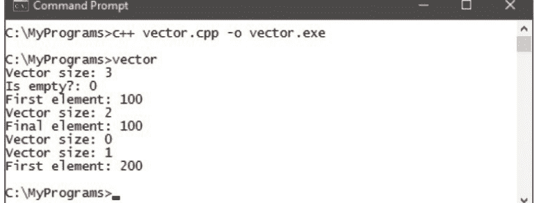

在 `PI` 声明中，`*` 字符是 C++ 的乘法运算符，而 `\"` 中的反斜杠字符用于转义防止引号被识别——这样字符串就不会过早终止。

## 总结

- C++ 是一种面向对象的编程语言，是过程化编程语言的扩展。
- GNU C++ 编译器适用于 Windows 和 Linux。
- 预处理器指令用于使标准 C++ 库中的函数对程序可用。
- 每个 C++ 程序必须包含一个 `main` 方法作为程序的入口点。
- 语句定义了程序将执行的动作。
- 建议对程序代码进行广泛注释，以明确其用途。
- `cpp` 命令调用编译器，其 `-o` 选项允许命令指定生成的可执行文件的名称。
- 变量声明指定了数据类型和一个用于引用该值的指定名称。
- `cout` 函数是 C++ `iostream` 库的一部分，用于将内容写入标准输出控制台。
- 数组是一个固定大小的变量，在元素中存储多个数据项，元素从零开始编号。
- 特殊字符 `\0` 可以被赋值给字符数组的最后一个元素，以便将其视为单个文本字符串。
- `vector` 变量在元素中存储多个数据项，并可以动态调整大小。
- 使用变量名及其索引号可以引用数组或 `vector` 元素中存储的值。
- 程序从不改变的变量值应该存储在常量中。
- 常量列表可以通过 `enum` 关键字自动编号，并通过 `typedef` 关键字赋予类型名称。

# 2 执行操作

本章介绍了 C++ 运算符，并演示了它们可以执行的操作。

- 算术运算
- 赋值操作
- 比较值
- 逻辑评估
- 检查条件
- 确定大小
- 设置优先级
- 数据类型转换
- 总结

## 算术运算

C++ 程序中常用的算术运算符列在表所示，以及它们所执行的操作：

| 运算符 | 操作 |
|---|---|
| `+` | 加法 |
| `-` | 减法 |
| `*` | 乘法 |
| `/` | 除法 |
| `%` | 取模 |
| `++` | 递增 |
| `--` | 递减 |

加、减、乘、除运算符的作用正如你所预期的一样。然而，当使用多个运算符时，必须使用括号括起表达式以明确表达式——即先执行最内层括号的操作：

```
a=b*c-d%e/f; // 这不明确。
a=(b*c)-((d%e)/f); // 这更清晰。
```

`%` 取模运算符将第一个数除以第二个数，并返回操作的余数。这对于判断一个数是奇数还是偶数很有用。

用于运算符形成表达式的值被称为“操作数”——在表达式 `2 + 3` 中，数值 `2` 和 `3` 就是操作数。

`++` 递增运算符和 `--` 递减运算符将给定数字改变一并返回结果。这些最常用于计算循环中的迭代次数。向上计数时，`++` 运算符将值加一；向下计数时，`--` 运算符将值减一。

递增和递减运算符可以放在值的之前或之后，产生不同的效果。如果放在操作数之前（前置），值立即改变；如果放在操作数之后（后置），先记录其值，然后改变值。

### arithmetic.cpp

通过指定要包含的 C++ 类和命名空间前缀开始新程序：

```cpp
#include <iostream>
using namespace std;
```

添加一个包含最终返回语句的 `main` 函数：

```cpp
int main() {
  // 程序代码写在这里。
  return 0;
}
```

在 `main` 函数中，插入一条语句来声明并初始化两个整数变量：

```cpp
int a = 8, b = 4;
```

接下来，插入语句输出每个基本算术操作的结果：

```cpp
cout << "Addition result: " << (a + b) << endl;
cout << "Subtraction result: " << (a - b) << endl;
cout << "Multiplication result: " << (a * b) << endl;
cout << "Division result: " << (a / b) << endl;
cout << "Modulus result: " << (a % b) << endl;
```

现在，插入语句输出后置和前置递增的结果：

```cpp
cout << "Postfix increment: " << a++ << endl;
cout << "Postfix result: " << a << endl;
cout << "Prefix increment: " << ++b << endl;
cout << "Prefix result: " << b << endl;
```

保存、编译并运行程序。

记住，前置运算符立即改变值——后置运算符改变值。

## 赋值操作

C++ 编程中用于赋值的运算符列在表所示。除了简单的 `=` 运算符外，都是表达式的简写形式，以便清晰：

| 运算符 | 示例 | 等于 |
|---|---|---|
| `=` | `a = b` | `a = b` |
| `+=` | `a += b` | `a = (a + b)` |
| `-=` | `a -= b` | `a = (a - b)` |
| `*=` | `a *= b` | `a = (a * b)` |
| `/=` | `a /= b` | `a = (a / b)` |
| `%=` | `a %= b` | `a = (a % b)` |

在上面的示例中，变量 `a` 被赋值变量 `b` 中的值。

`+=` 运算符用于在现有值上加上值。在表中，`+=` 运算符首先将 `b` 中的值加到 `a` 中，将结果赋值给 `a`。

重要的是将 `=` 运算符视为“赋值”而不是“等于”，以避免与 `==` 运算符混淆。

### assign.cpp

1. 通过指定要包含的 C++ 类和命名空间前缀开始新程序：

```cpp
#include <iostream>
using namespace std;
```

2. 添加一个包含最终返回语句的 `main` 函数：

```cpp
int main() {
  // 程序代码写在这里。
  return 0;
}
```

3. 在 `main` 函数中，插入语句声明两个整数变量：

```cpp
int a, b;
```

4. 接下来，插入语句输出简单的赋值值：

```cpp
cout << "Assign values:";
cout << "a = " << (a = 8) << "";
cout << "b = " << (b = 4);
```

5. 现在，插入语句输出组合值：

```cpp
cout << endl << "Add and assign:";
cout << "a += b (8 += 4) = " << (a += b);
cout << endl << "Subtract and assign:";
cout << "a -= b (12 -= 4) = " << (a -= b);
cout << endl << "Multiply and assign:";
cout << "a *= b (8 *= 4) = " << (a *= b);
cout << endl << "Divide and assign:";
cout << "a /= b (32 /= 4) = " << (a /= b);
cout << endl << "Modulus and assign:";
cout << "a %= b (8 % 4) = " << (a %= b);
```

6. 保存、编译并运行程序查看输出。

与 `=` 赋值运算符不同，`==` 等于运算符比较操作数并在此描述。

## 比较值

C++ 编程中常用的比较两个数值的运算符列在表所示：

| 运算符 | 比较测试 |
| --- | --- |
| `==` | 等于 |
| `!=` | 不等于 |
| `>` | 大于 |
| `<` | 小于 |
| `>=` | 大于等于 |
| `<=` | 小于等于 |

`==` 等于运算符比较两个操作数，如果两个值相等，则返回真 (1)，否则返回假 (0) 值。如果两个都是相同的数字，或者都是字符，则按数值比较它们的 ASCII 码。相反，`!=` 不等于运算符如果两个操作数不等，则返回真 (1)，使用与 `==` 等于运算符相同的规则，否则返回假 (0)。相等和不等于运算符用于测试两个变量的状态以执行程序中的条件分支。

A-Z 大写字符的 ASCII 值为 65-90，a-z 小写字符的 ASCII 值为 97-122。

“大于”运算符比较两个操作数，如果第一个的值大于第二个，则返回真 (1)，如果值等于或小于，则返回假 (0)。`<` 小于运算符进行相同的比较，但如果第一个操作数的值小于第二个，则返回真 (1)，否则返回假 (0)。`>` 大于或 `<` 小于运算符常用于测试循环中计数器的值。

在 `>` 大于或 `<` 小于运算符后添加 `=` 运算符使其在两个操作数值完全相等时也返回真 (1)。

### comparison.cpp

1. 通过指定要包含的 C++ 库类和使用的命名空间开始一个新程序：

```cpp
#include <iostream>
using namespace std;
```

2. 添加一个包含最终返回语句的 `main` 函数：

```cpp
int main()
{
  // 程序代码写在此处。
  return 0;
}
```

3. 在 `main` 函数中，插入语句来声明并初始化可以转换为布尔值的变量：

```cpp
int nil = 0, num = 0; char cap = 'A', low = 'a';
```

4. 接下来，插入语句输出整数和字符的等性比较结果：

```cpp
cout << "Equality comparisons: ";
cout << "(==0)" << (nil == num) ? "true" : "false";
cout << "(A==a)" << (cap == low) ? "true" : "false";
```

5. 现在，插入语句输出所有其他比较：

```cpp
cout << endl << "Inequality comparison: ";
cout << "(!=1)" << (nil != 1) ? "true" : "false";
cout << endl << "Greater comparison: ";
cout << "(>0)" << (nil > 0) ? "true" : "false";
cout << endl << "Lesser comparison: ";
cout << "(<1)" << (nil < 1) ? "true" : "false";
cout << endl << "Greater or equal comparison: ";
cout << "(>=0)" << (nil >= num) ? "true" : "false";
cout << endl << "Lesser or equal comparison: ";
cout << "(1<=0)" << (1 <= num) ? "true" : "false";
```

6. 保存、编译并运行程序以查看输出：

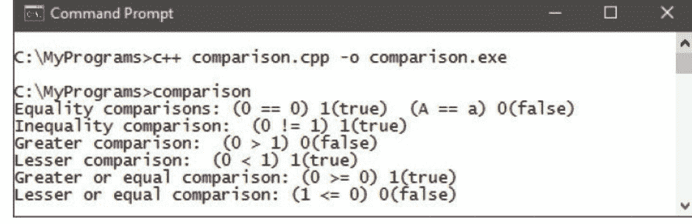

大写字母 `A` 的 ASCII 码值为 65，但小写字母 `a` 是 97 —— 因此它们在这里比较返回 `false` (0)。

## 逻辑评估

C++ 编程中最常用的逻辑运算符列如下表所示：

| 运算符 | 操作 |
|---|---|
| `&&` | 逻辑与 |
| `\|\|` | 逻辑或 |
| `!` | 逻辑非 |

逻辑运算符用于布尔值为 **true** 或 **false** 的操作数，或者用于可以转换为 **true** 或 **false** 的值。

逻辑 `&&` 运算符会评估两个操作数，并且仅当两个操作数本身都为 **true** 时才返回 **true**。否则，`&&` 运算符将返回 **false**。这用于条件分支，程序的程序的方向通过测试两个条件来确定——如果两个条件都满足，程序将进入某个方向，否则它将进入另一个方向。


当存在多个操作数时，每个表达式必须用括号括起来。

与需要两个操作数均为 **true** 的 `&&` 与运算符不同，`||` 或运算符会评估它的两个操作数，如果其中任一个操作数返回 **true**，它就会返回 **true**。如果两个都没有返回 **true**，则 `||` 运算符将返回 **false**。这在 C++ 编程中非常有用，可以在两个条件之一满足时执行某些操作。


逻辑`!`非运算符是一个一元运算符，用于单个操作数之前。它返回给定操作数的反反值，因此如果变量值为`true`，那么`!a`的值就是`false`。逻辑`!`非运算符在 C++ 程序中用于通过像`a = !a`这样的语句在连续的循环迭代中切换变量的值。这确保了每次通过时值发生变化，就像开关灯一样。


“布尔”（Boolean）一词是指英国数学家乔治·布尔（1815-1864）开发的一种逻辑思维体系。

在 C++ 程序中，零代表布尔值`false`，而任何非零值（如 1）都代表布尔值`true`。

下面的程序演示了每个逻辑操作。


1. 通过指定要包含的 C++ 库类和使用的命名空间前缀开始一个新程序

```cpp
#include <iostream>
using namespace std;
```

2. 添加一个包含最终返回语句的`main()`函数

```cpp
int main()
{
  // 程序代码写在此处
  return 0;
}
```

3. 在`main()`函数中，声明并初始化两个整数变量——值代表布尔值

```cpp
int a = 1, b = 0;
```

4. 插入语句输出 AND 评估的结果

```cpp
cout << "AND logic:" << endl;
cout << "(a && a)" << (a && a) ? "true" : "false";
cout << "(a && b)" << (a && b) ? "true" : "false";
cout << "(b && b)" << (b && b) ? "true" : "false" << endl;
```

5. 现在，插入语句输出 OR 评估的结果

```cpp
cout << "OR logic:" << endl;
cout << "(a || a)" << (a || a) ? "true" : "false";
cout << "(a || b)" << (a || b) ? "true" : "false";
cout << "(b || b)" << (b || b) ? "true" : "false" << endl;
```

6. 插入语句输出 NOT 评估的结果

```cpp
cout << "NOT logic:" << endl;
cout << "(!a)" << (!a) ? "true" : "false";
cout << "(!b)" << (!b) ? "true" : "false" << endl;
```

三元运算符可以返回任何数据类型的值——数字、字符串、布尔值等。

## 确定大小

变量声明会分配系统内存，用于存储赋值给该变量的值。分配的内存数量取决于你的系统和数据类型。

通常，`int`数据类型默认被创建为“长型”（`long`）值，可以存储从 +2,147,483,647 到 -2,147,483,648 之间的值。另一方面，如果`int`数据类型默认创建为“短型”（`short`）值，它只能存储从 +32,767 到 -32,768 之间的值。

在声明变量时，可以通过在`int`前加上`short`或`long`限定符来显式指定首选范围。当你确定范围不会超出限制时，使用`short int`有助于节省内存。

当声明一个`int`变量时，它默认包含正整数或负整数，这些被称为“有符号”（`signed`）值。如果变量始终包含正整数，可以将其限定为“无符号”（`unsigned`）以增加其最大可能值。通常，`unsigned short int`的范围从 0 到 65,535，`unsigned int`的范围从 0 到 4,294,967,295。

可以使用 C++ 的`sizeof`运算符发现任何变量的内存。要检查的变量名称可以在`sizeof`运算符后可选的括号中指定。例如，要检查名为“var”的变量：

```cpp
sizeof(var); // 或者你可以使用 sizeof var;
```

`sizeof`运算符将返回一个整数，表示存储命名变量内数据所分配的字节数。

简单数据类型（如`char`和`bool`）只需要一个字节内存来存储一条数据。较长的数值根据其可能的范围（由数据类型和限定符决定）需要更多内存。

数组分配的内存根据其元素数量，是该类型单个变量分配内存的倍数。例如，一个包含 50 个元素的`int`数组将分配单个`int`变量内存的 50 倍内存。

下面的程序演示了`sizeof`运算符。

### sizeof.cpp

通过指定要包含的 C++ 库类和使用的命名空间前缀开始新程序

```cpp
#include <iostream>
using namespace std;
```

添加包含最终返回语句的`main()`函数

```cpp
int main()
{
    // 程序代码写在这里。
    return 0;
}
```

在`main()`函数中，声明各种数据类型变量的`int`语句

```cpp
int num[50]; float decimal;
bool isTrue; unsigned int max; char letter;
double pi; char letters[50];
```

接下来，插入语句输出每个整数变量的字节大小

```cpp
cout << "int size:" << sizeof(num) << endl;
cout << "50 size:" << sizeof(nums) << endl;
cout << "short int size:" << sizeof(number) << endl;
cout << "unsigned int size:" << sizeof(max) << endl;
```

现在，插入语句输出所有其他变量的大小

```cpp
cout << "double size:" << sizeof(pi) << endl;
cout << "float size:" << sizeof(decimal) << endl;
cout << "char size:" << sizeof(letter) << endl;
cout << "50 char size:" << sizeof(letters) << endl;
cout << "bool size:" << sizeof(isTrue) << endl;
```

保存、编译并运行程序以查看输出

```cpp
C:\MyPrograms\>c++ sizeof.cpp -o sizeof.exe
C:\MyPrograms\sizeof
int size: 4
50 int size: 200
short int size: 2
unsigned int size: 4
double size: 8
float size: 4
char size: 1
50 char size: 50
bool size: 1
```

在这里，`int`数据类型默认被创建为`long`类型——你的系统可能有所不同。

## 设置优先级

运算符优先级决定了 C++ 评估表达式的顺序。例如，在表达式`a = 6 + 8 * 3`中，优先级决定了先完成乘法。

下表按降序排列列出了运算符优先级——顶行的优先级最高，较低行的优先级依次递减。C++ 评估多个相同优先级运算符的顺序由“运算符结合性”（`operator associativity`）决定——将操作数与左侧（LTR）或右侧（RTL）结合。

* 乘法运算符的行高于`+`加法运算符——因此在表达式`a=6+8*3`中，乘法先完成，然后是加法。

| 运算符 | 优先级 | 结合性 |
| :--- | :--- | :--- |
| `* / %` | 最高 | LTR |
| `+ -` | | LTR |
| `< <= > >=` | | LTR |
| `== !=` | | LTR |
| `&&` | | LTR |
| `\|\|` | | LTR |
| `?` | | RTL |
| `= += -= *= /= %= <<` | 最低 | RTL |

（注：源文件中表格的 OCR 文本是乱码；根据标准 C++ 优先级规则和图像描述文本提供的上下文进行了重构。）

下面的程序演示了使用旧的 C 风格形式和新的 C++ 形式进行类型转换。


### cast.cpp

1. 通过指定要包含的 C++ 库类和要使用的命名空间前缀开始一个新程序

```cpp
#include <iostream>
using namespace std;
```

2. 添加一个包含最终返回语句的`main()`函数

```cpp
int main() {
    // 程序代码写在此处。
    return 0;
}
```

3. 在`main()`函数中，插入语句来声明和初始化整数、字符和浮点变量

```cpp
int num = 7; int factor = 2;
char letter = 'A'; float result = 0.0;
```

4. 输出纯整数除法的结果

```cpp
cout << "Integer division: " << (num / factor) << endl;
```

5. 现在，将同一个除法运算转换为浮点变量并输出该结果

```cpp
result = (float) ( num ) / factor;
cout << "Cast division float: " << result << endl;
```

6. 接下来，将字符变量转换为整数变量并输出该值

```cpp
num = static_cast<int>(letter);
cout << "Cast integer: " << num << endl;
```

7. 将一个整数转换为字符变量并输出它

```cpp
letter = static_cast<char>(70);
cout << "Cast integer char: " << letter << endl;
```

8. 保存、编译并运行程序以查看结果

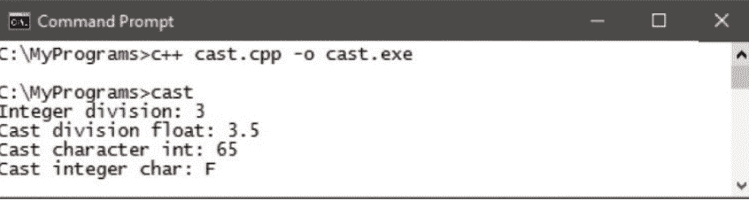


ASCII（读作 "askee"）是美国信息交换代码，是纯文本的认可标准。在 ASCII 中，字符在 0-127 的范围内用数值表示。大写字母'A'是 65，因此该整数值被转换为`int`变量。

## 总结

- 算术运算符可以形成两个操作数的表达式，用于加`+`、减`-`、乘`*`、除`/`或取模`%`。
- 递增`++`和递减`--`运算符通过值 1 修改单个操作数。
- 赋值运算符`=`可以与算术运算符结合执行算术计算，然后赋值其结果。
- 比较运算符可以形成表达式，比较两个操作数的相等`==`、不相等`!=`、大于`>`、小于`<`、大于或等于`>=`以及小于或等于`<=`值。
- 逻辑`&&`和`||`运算符形成表达式，评估两个操作数以返回`true`或`false`的布尔值。
- 逻辑`!`运算符返回单个操作数的取反布尔值。
- 三元运算符`?`评估给定的布尔表达式，然后根据其结果返回两个操作数之一。
- `sizeof`运算符返回变量的内存大小。
- `int`变量可以修饰为`short`类型以处理较小的数字，或修饰为`long`类型以处理大数字。
- 当`int`变量仅存储正数时，可以将其修饰为无符号（`unsigned`）以扩展其数值范围。
- 在复杂的表达式中，通过添加括号`()`显式设置运算符优先级是非常重要的。
- 变量中存储的数据可以通过类型转换过程强制转换为不同数据类型的变量。
- C++ 支持传统的 C 风格转换和使用`static_cast`关键字的更新类型转换形式。

# 3

## 编写语句

本章演示了 C++ 条件语句，它允许程序在不同的方向上分支，并引入了 C++ 函数结构。

- 使用`if`分支
- 切换分支
- `for`循环
- `while`循环
- 声明函数
- 传递参数
- 函数重载
- 优化函数
- 总结

## 使用 if 分支

C++ 的`if`关键字执行基础条件测试，评估给定的表达式以获得`true`或`false`的布尔值——其语法如下：

```cpp
if ( test-expression ) { statements-to-execute-when-true }
```


测试语句后面的大括号可以包含一个或多个语句，每个语句都以分号结束；但这些语句只有在发现表达式为真时才会执行。当发现测试为假时，程序将继续下一个任务。

可选地，`if`语句可以在`if`语句块之后附加`else`语句块，在测试失败时提供备选执行语句，如下：

```cpp
if ( test-expression ) { statements-to-execute-when-true }
else { statements-to-execute-when-false }
```


当在测试成功时只有一个语句要执行时，可以省略大括号——但保留它们有助于代码的清晰度。

要测试两个条件，测试表达式可以使用`&&`运算符。例如，`if (( num > 5) && ( letter == 'A') )`。或者，一个`if`语句可以“嵌套”在另一个`if`语句中，因此内部语句块中的语句只有在两个测试都成功时才会执行——但如果外部测试成功，则外部语句块中的语句将执行。


1. 通过指定要包含的 C++ 库类和要使用的命名空间前缀开始一个新程序

```cpp
#include <iostream>
using namespace std;
```

2. 添加一个包含最终返回语句的`main()`函数

```cpp
int main()
{
    // 程序代码写在此处。
    return 0;
}
```

3. 在`main()`函数中，插入语句来声明和初始化两个变量（例如，一个整数和一个字符）

```cpp
int num = 7;
char letter = 'A';
```

4. 接下来，插入一个`if-else`语句测试整数变量的值并输出适当的响应

```cpp
if (num > 5)
    cout << "Number exceeds five" << endl;
else
    cout << "Number is five or less" << endl;
```

5. 在`if`语句块中，插入一个嵌套的`if`语句测试字符变量的值并输出匹配

```cpp
if (letter == 'A') cout << "Letter is A" << endl;
```

6. 保存、编译并运行程序以查看两个测试都成功

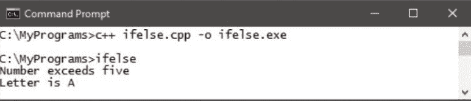

7. 编辑字符变量以更改值

```cpp
char letter = 'B';
```

8. 保存、编译并运行程序以查看外部测试成功但内部测试失败

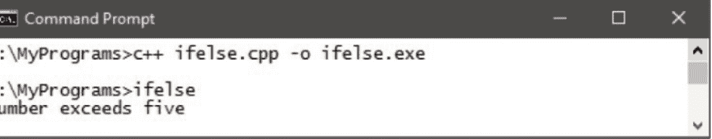

9. 编辑整数变量以更改值

```cpp
int num = 3;
```

10. 再次保存并运行程序以查看两个测试失败

```cpp
C:\MyPrograms\ifelse.cpp -o ifelse.exe
C:\MyPrograms>ifelse
Number five
```


测试布尔值时可以使用简写——所以`if ( flag == true )`可以写为`if ( flag )`。


避免嵌套超过三层的`if`语句。

## 切换分支

上述引入的`if`和`else`关键字允许根据测试结果在特定方向分支，并可反复测试变量以匹配值。例如，测试整数：

```cpp
if (num == 1) { cout << "Monday"; }
else if (num == 2) { cout << "Tuesday"; }
else if (num == 3) { cout << "Wednesday"; }
else if (num == 4) { cout << "Thursday"; }
else if (num == 5) { cout << "Friday"; }
```

程序将在匹配的方向分支。

使用`switch`语句通常比长`if-else`语句效率，特别是当测试表达式评估一个变量时。

`switch`语句的工作方式异常。它接收给定的变量值，然后在多个`case`语句中寻找匹配的值。与`case`语句值相关的语句将执行。

当未找到匹配时，没有`case`语句将执行，但你可以在最后一个`case`语句之后添加`default`语句，指定在未找到匹配时执行的语句。

在每个`case`语句后面跟上`break`关键字是非常重要的，以便在与匹配的`case`值相关的语句执行后停止程序通过`switch`块——除非这正是你需要的。例如，对于三个值中的每个值一个语句：

```cpp
switch(variable-name)
{
  case value1; case value2; case value3;
    statements-to-be-executed; break;
  case value4; case value5; case value6;
}
```


`statements-to-be-executed; break;`

}

通常，每个`case`语句都有自己的要执行语句集并以`break`结束，如下程序所示。


缺失`break`关键字并不是语法错误——请确保在所有`case`语句之后都存在预期的断开。

### switch.cpp

-   通过指定要包含的 C++ 库类和要使用的命名空间前缀开始新程序
```cpp
#include <iostream>
using namespace std;
```

-   添加一个包含最终返回语句的`main`函数
```cpp
int main() {
  // 程序代码写在此处。
  return 0;
}
```

-   在`main`函数中，插入一条语句来声明并初始化一个整数变量，并赋予待匹配的值
```cpp
int num = 3;
```

-   接下来，插入一个`switch`语句来查找`case`
```cpp
switch (num) {
  case 1: cout << num << ": Monday "; break;
  case 2: cout << num << ": Tuesday "; break;
  case 3: cout << num << ": Wednesday "; break;
  case 4: cout << num << ": Thursday "; break;
  case 5: cout << num << ": Friday "; break;
}
```

-   在`switch`语句中，在最后一个`case`语句之后插入一个`default`语句
```cpp
default: cout << num << ": Weekend day ";
```

-   保存、编译并运行程序以执行

-   现在，编辑整数变量声明以更改其值，然后再次保存、编译并运行程序
```cpp
int num = 6;
```

注意，`default`语句后面不需要跟随`break`关键字，因为`default`语句始终出现在`switch`语句的最后。

## 循环 (Looping for)

循环是程序中一段自动重复的代码。对循环块内包含的所有语句的完整执行称为一次“迭代”或“传次”。

循环执行的迭代次数由循环内部的条件测试控制。只要测试表达式保持为真，循环就会继续——直到测试表达式变为为假，此时循环结束。

C++ 编程中的三种循环结构类型是`for`循环、`while`循环和`do while`循环。可能最常用的循环是`for`循环，其语法如下：

```
for ( initializer;test-expression ; incrementer) { statements }
```

初始化器为循环迭代次数的计数器设置起始值。为此目的使用一个整数变量，传统上命名为“`i`”。

在循环的每次迭代中，都会评估测试表达式，只有当该表达式为真时，迭代才会继续。当测试表达式变为假时，循环立即结束，不再再次执行语句。在每次迭代中，计数器递增，然后执行语句。

循环可以嵌套在其他循环之中——使得内层循环在外层循环的每次迭代中完全执行其迭代。

### forloop.cpp

-   1. 通过指定要包含的 C++ 库类和要使用的命名空间前缀开始新程序
```cpp
#include <iostream>
using namespace std;
```

-   2. 添加一个包含最终返回语句的`main`函数
```cpp
int main()
{
  // 程序代码写在此处。
  return 0;
}
```

在`main`函数中，插入一条语句来声明一个作为循环迭代计数器的整数变量
```cpp
int i;
```

接下来，插入一个`for`循环以便在三次迭代的每次中输出计数器值
```cpp
for (i = 1; i < 4; i++)
{
cout << "Loop iteration: " << i << endl;
}
```

保存、编译并运行程序查看输出

现在，编辑变量声明以添加第二个计数器
```cpp
int i, j;
// 添加了整数变量 "j"。
```

在`for`循环块内部添加一个内层循环，在每次迭代中输出其计数器值
```cpp
for (j = 1; j < 4; j++)
cout << "Inner loop iteration: " << j << endl;
```

保存、编译并运行程序查看内层循环在外层循环的每次迭代中完全执行

另一种，`for`循环计数器可以使用`i--`代替`i++`递增器在每次迭代中递减计数器值。

在这些循环的第三次迭代中，递增器将计数器值增加四——所以当下次评估时，测试返回为假，循环结束。

## while 循环 (Looping while)

上述`for`循环的替代方案使用`while`关键字，后面紧跟一个待评估的表达式。当表达式为真时，大括号内的语句将被执行。表达式将再次被评估，`while`循环将持续直到发现表达式为假。

循环的语句块必须包含能够影响测试表达式的代码，以便将评估变为假，否则将创建死循环并导致系统锁定！如果表达式在第一次评估时即为假，则`while`循环的语句块永远不会执行。

如果你不小心开始死循环，请按`Ctrl + C`键终止进程。

`while`循环的一种变体是将`do`关键字放在循环语句之前，并在之后放置`while`测试，语法如下：

```
do { statements-to-executed } while (test-expression);
```

在`while`循环中，语句块将至少执行一次，因为表达式在第一次迭代之后才会进行评估。任何类型的循环中都可以包含`break`语句，在满足测试条件时立即终止循环。`break`确保不再执行循环的后续迭代。

同样，`continue`语句可以包含在任何类型的循环中，在满足测试条件时终止该迭代。`continue`语句允许循环进入下一次迭代。

-   1. 通过指定要包含的 C++ 库类和要使用的命名空间前缀开始新程序
```cpp
#include <vector> // 包含 vector
#include <iostream>
using namespace std;
```

-   添加一个包含最终返回语句的`main`函数
```cpp
int main()
{
    // 程序代码写在此处。
    return 0;
}
```

在`main`函数中，插入语句声明一个作为循环迭代计数器的整数`vector`
```cpp
vector<int> vec(10);
int i = 0;
```

接下来，插入一个`while`循环在每次迭代中将值赋值给`vector`的元素
```
while (i < vec.size()) {

    i++; // 递增器

    vec[i-1] = i; // 赋值给元素

    cout << vec.at(i-1);

}
```

保存并运行程序查看输出

编辑循环，在递增器后立即添加`continue`语句，使循环跳过第三次迭代
```
if (i == 3) { cout << "|"; continue; }
```

在`continue`语句之后，现在添加`break`语句，使循环在第八次迭代时退出
```
if (i == 8) { cout << endl << "Done"; break; }
```

再次保存、编译并运行程序。

示例中必须通过预处理器包含`vector`库。

`break`和`continue`的位置很重要——它们必须出现在递增器之后，以免创建死循环，但要在影响程序的语句之前。

## 函数 (Functions)

函数封装了程序中提供特定功能的代码。当从主程序调用函数时，其语句将被执行，并在完成后可选地返回一个值。使用函数有三个主要优点：

-   函数使得程序代码更容易于理解和维护。
-   经过测试的函数可以被其他程序重复。
-   在大型项目中，多个程序员可以通过编写不同的函数来分工协作。

## 函数 (Functions)

每个函数在程序代码早期被声明为“原型”，它包含返回值的数据类型和函数名，后面跟着括号，括号内可选包含可能使用的传入值的“参数”数据类型列表。函数原型定义的语法如下：

```
return-data-type function-name ( arguments-data-type-list );
```

严格来说，函数原型中的参数被称为“形式参数”。

例如，一个名为“`computeArea`”的返回`float`值并接受`float`参数的函数声明为：

```
float computeArea(float, float);
```

## 定义函数 (Defining functions)

函数定义出现在程序代码的后部分，它包含了原型的重复以及实际的函数体。函数体是每当调用函数时都要执行的语句，包含在一对括号内。

如果函数不向调用者返回任何值，请使用`void`关键字。

重要的是，编译器会检查函数定义与原型之间的匹配情况，因此实际返回的数据类型必须与原型中指定的匹配，且提供的任何参数在数量和数据类型上必须匹配。如果定义与原型不匹配，编译将失败。一个简单的`computeArea`定义如下：

```cpp
float computeArea(float width, float height)
{
    return (width * height);
}
```

## 变量作用域

在函数中声明的变量只能在该函数内部局部使用，不能在全局范围内供其他函数使用。这种限制被称为“变量作用域”。

### scope.cpp

+   1. 通过指定要包含的 C++ 库类和要使用的命名空间前缀开始一个新程序
```cpp
#include <iostream>
using namespace std;
```

+   2. 接下来声明两个简单的函数原型
```cpp
float bodyTempC();
float bodyTempF();
```

+   3. 现在添加一个`main`函数，包含对每个函数的调用和最后的返回语句
```cpp
int main() {
    cout << "Centigrade: " << bodyTempC() << endl;
    cout << "Fahrenheit: " << bodyTempF() << endl;
    return 0;
}
```

+   4. 在`main`函数之后，定义其他两个函数——每个函数返回局部“温度”变量的值
```cpp
float bodyTempC()
{
    float temperature = 37.0;
    return temperature;
}
```

```cpp
float bodyTempF()
{
    float temperature = 98.6;
    return temperature;
}
```

+   5. 保存、编译并运行程序以查看输出


同名的变量在不同的作用域中声明时不会发生冲突——它们相互不可见。

## 传递参数

函数调用经常为函数提供参数值。这些值可以是任何数量和数据类型，但必须与函数原型声明中指定的保持一致。

注意，传递给函数的参数仅提供原始值的副本，这种过程被称为“按值传递”。

传递给参数的值可以是程序代码中指定的“静态”值，也可以是用户输入的“动态”值。在命令提示符处，使用 C++ `cin`输入流运算符将值从标准输入重定向到变量，如下：

```cpp
float num;
cout << "Please enter a number: ";
cin >> num;
```


函数原型必须在定义之前声明。通常，原型出现在`main`函数之前，而它们的定义出现在`main`函数之后。

然后，输入可以作为函数调用中的参数传递给函数，例如`workWith(num)`。

可选地，函数原型可以为参数分配默认值，当调用未传递参数值时将使用这些默认值。原型中可以为多个参数分配默认值，但它们必须始终出现在参数列表的末尾，位于其他参数之后。

与函数可以从`main`函数调用一样，函数也可以调用其他函数并传递参数。

### args.cpp

+   1. 通过指定要包含的 C++ 库类和要使用的命名空间前缀开始一个新程序
```cpp
#include <iostream>
using namespace std;
```

+   接下来声明一个返回`float`值并指定单个`float`参数的函数原型，该参数被分配了一个默认值
```cpp
float toC(float degreesF = 32.0);
```

添加一个包含最后返回语句的`main`函数
```cpp
int main() {
  // 程序代码写在这里。
  return 0;
}
```

在`main`函数之后，定义“`toC`”函数以接收输入并返回转换值
```cpp
float toC(float degreesF)
{
    float degreesC = (degreesF - 32.0) * 5.0 / 9.0;
    return degreesC;
}
```

在`main`函数中，插入语句声明两个`float`变量，并将第一个初始化为用户输入
```cpp
float fahrenheit, centigrade;
cout << "Enter Fahrenheit: ";
```

接下来，调用“`toC`”函数并将结果转换为第二个变量
```cpp
centigrade = toC(fahrenheit);
```

现在，输出描述结果的消息
```cpp
cout << "对应的摄氏度: " << centigrade << "C" << endl;
```

最后，添加一个语句使用函数的默认值输出消息
```cpp
cout << "冰点: " << toC() << "C";
```

保存，编译并运行程序，然后在要求时输入数值以查看输出


## 函数重载

“重载”允许同名函数在同一个程序中共存，但它们在数量或数据类型上不同。函数解析通过识别参数将函数调用匹配到正确的版本。

### overload.cpp

+   1. 通过指定要包含的 C++ 库类和要使用的命名空间前缀开始一个新程序
```cpp
#include <iostream>
using namespace std;
```

+   2. 接下来声明两个函数原型——具有不同的参数
```cpp
float computeArea(float diameter);
float computeArea(char letter, float width, float height);
```

+   3. 现在，添加一个包含最后返回语句的`main`函数
```cpp
int main() {
  // 程序代码写在这里。
  return 0;
}
```

+   4. 在`main`函数之后，定义仅接收一个参数的第一个函数
```cpp
float computeArea(float diameter)
{
float radius = diameter / 2;
return 3.14159 * (radius * radius);
}
```

+   5. 在第一个函数定义下方，定义接收不同参数的重载函数
```cpp
float computeArea(float width, float height)
{
    return (width * height);
}
float computeArea(char letter, float width, float height)
{
    return ((width / 2) * height);
}
```

+   6. 在`main`函数中，插入语句声明两个变量，并将其中一个初始化为用户输入
```cpp
float num, area;
cout << "输入尺寸（英寸）： ";
cin >> num;
```

调用第一个函数并输出其返回值
```cpp
area = computeArea(num);
cout << "圆面积: " << area << " 平方英寸" << endl;
```

调用重载函数并输出它们的结果
```cpp
area = computeArea(num, num);
cout << "正方形面积: " << area << " 平方英寸" << endl;
area = computeArea('T', num, num);
cout << "三角形面积: " << area << " 平方英寸" << endl;
```

传递给`char`参数的值从未被使用 – 包含该参数仅是为了区分该重载函数。

## 优化函数

函数可以递归地调用自己，以反复执行函数体内包含的语句——就像循环一样。循环循环，递归函数必须包含一个递增器和一个条件测试，以便再次调用自身，或者在满足条件时停止重复。递归函数的语法看起来如下：

```
return-data-type function-name ( argument-list )
{
    statements-to-be-executed;
    incrementer;
    conditional-test-to-recall-or-exit;
}
```

递增器会改变所传参数的值——因此后续调用将把调整后的值传回函数。

- 1. 通过指定要包含的 C++ 库类和要使用的命名空间前缀开始一个新程序
```cpp
#include <iostream>
using namespace std;
```

- 2. 在预处理指令下方，声明两个递归函数的函数原型
```cpp
int computeFactorials ( int, int );
int factorial ( int );
```

- 3. 在原型声明下方，添加一个包含返回语句的`main`函数
```cpp
int main()
{
    // 程序代码在此处。
    return 0;
}
```

- 4. 在`main`函数之后，为第一个函数原型添加定义——这是一个递归函数
```cpp
int computeFactorials(int num, int max)
{
    cout << "Factorial of " << num << ":";
```


```
cout << factorial( num ) << endl; // 语句。

num++; // 递增器。

if ( num > max ) return 0; // 退出...

else computeFactorials(num, max); // 或再次调用。
```

递归函数通常比循环消耗更多的系统资源——但它可以使代码更具可读性。

## 为原型定义递归函数

```cpp
int factorial(int n)
{
    int result;
    if (n == 1) result = 1; // 退出或...
    else result = (factorial(n - 1)*n); // 递减...
    // 并再次调用。
    return result;
}
```

## 在 main 函数开始处插入递归函数调用

在 `main` 函数开始处，插入对递归函数`computeFactorials(1,8);`的调用。

## 保存、编译并运行程序

保存、编译并运行程序以查看输出。

如果你意外运行了无限递归函数，请按 `Ctrl + C` 键终止进程。

输出列出了阶乘值（阶乘3是 `3x2x1=6` 等），但可以通过优化`factorial()`函数来改进程序。如果使用三元运算符编写，它不需要变量。它只包含一条语句，因此其定义可以替换原型声明。这意味着程序不需要在声明和定义之间进行检查，从而提高了效率。

内联声明可能只包含一两个语句，因为编译器会在每个调用点重新创建它们——因此，较长的内联声明会导致程序变得更加臃肿。

删除**factorial()函数定义**，然后将其原型声明替换为此内联声明：

```cpp
inline int factorial(int n)
{ return (n == 1) ? 1 : (factorial(n - 1) * n); }
```

保存、编译并再次运行程序以查看相同的输出，但生成效率更高。

## 总结

- `if`语句对给定的测试表达式进行布尔值的真（`true`）或假（`false`）评估。
- `if`语句后大括号内的语句仅在评估结果为真时才会执行。
- `if`和`else`关键字用于根据被测试表达式的结果执行条件分支。
- `switch`语句是条件分支的另一种形式，它将`case`语句与给定值进行匹配。
- `for`循环具有声明初始化器、测试表达式以及递增器或递减器的参数。
- `while`循环和`do-while`循环在循环体内必须有一个递增器或递减器。
- 任何类型的循环都可以通过在体内包含`break`语句来立即终止。
- 通过在体内包含`continue`语句可以跳过任何类型循环的单迭代。
- 函数用于将代码组织成可重用的块。
- 递归允许函数调用自己。
- 内联函数可以通过减少函数调用开销来提高性能。

## 字符串处理

- 创建字符串
- 获取字符串
- 解决字符串
- 复制字符串
- 交换字符串
- 查找字符串
- 替换字符串

与`char`、`int`、`double`、`bool`类型不同，C++中没有原生字符串类型，但`<string>`库提供了一个。为了使之可用，必须在开头包含`<string>`头文件。

C++字符串比`char`数组要易处理得多，因为它会自动调整大小以适应任何字符串的长度。在较低层次上，文本仍然存储为字符数组，但字符串变量让你能够忽略这些细节。

需要记住，当将数值赋值给字符串变量时，它们不再是数值类型，因此无法对它们执行算术运算。例如，尝试用`+`运算符相加`"7"`和`"6"`会产生拼接后的字符串`"76"`，而不是数值`13`。在这种情况下，`+`运算符识别出上下文不是算术运算，因此采用“拼接运算符”的外壳来合并字符串。`+=`运算符将一个字符串添加到另一个字符串上，对于构建长字符串很有用。

在下面描述的示例中，多个字符串值被构建在一个字符串中：

```cpp
#include <string> // 字符串支持。
#include <iostream>

using namespace std;

int main() {
    string text = "9";
    string term = "9";
    string info = "Toys";
    string color;

    // 在此处添加更多语句。
    char hue[4] = { 'R', 'e', 'd', '\0' };
    color = hue;
    info = "Balloons";
    text += (term + color + info);
    cout << endl << text << endl;
    return 0;
}
```

记得在字符数组中添加特殊的`\0`字符来标记字符串的结束。

## 获取字符串输入

C++`cin`函数在上一节中引入，用于输入数值，它也可以将文本输入赋值给`string`变量。这有一个局限性，因为它一次只能输入单个单词——`cin`函数在遇到空格时会停止读取输入，将任何其他文本留在“输入缓冲区”中。

当你想要允许用户输入带有空格的字符串（例如一个句子）时，可以使用`getline()`函数。该函数需要两个参数来指定字符串的源和目的。例如，以`cin`函数为源，名为`"str"`的`string`变量为目的：

```cpp
getline(cin, str);
```

`getline()`函数从输入“流”中读取，直到遇到行尾的换行符——这是在你按下 `Return` 键时创建的。

在混合使用`cin`和`getline()`函数时必须小心，因为`getline()`函数会自动读取输入缓冲区中任何剩余内容——给人一种程序跳过了某个指令的感觉。可以使用`cin.ignore()`函数通过忽略输入缓冲区中留下的内容来解决这个问题。

### input.cpp 示例

1. 通过指定要包含的C++库类和要使用的命名空间前缀开始新程序：

```cpp
#include <string> // Include string support.
#include <iostream>
using namespace std;
```

2. 添加包含一个`string`变量声明和最后的`return`语句的`main`函数：

```cpp
int main() {
  string name;
  // 在此处添加更多语句。
  return 0;
```

3. 在`main`函数中，插入将用户姓名输入赋值给`string`变量的语句，并输出其值：

```cpp
cout << "Please enter your full name: ";
cin >> name;
cout << "Welcome " << name << endl;
```

4. 接下来，再次插入一个请求用户姓名的`string`变量，这次在输出其值之前将输入赋值给`getline()`函数：

```cpp
cout << "Please re-enter your full name: ";
getline(cin, name);
cout << "Thanks, " << name << endl;
```

5. 保存、编译并运行程序，并在提示时重新输入你的全名。

这个不满意的结果显示`cin`读取到第一个空格为止，将第二个姓留在输入缓冲区中，随后它被`getline()`读取并输出。即使你只输入了名字，问题依然存在，因为`cin`将按下 `Return` 键时创建的换行符留在了输入缓冲区中。

6. 修改程序，在调用`getline`函数之前插入一条语句，指令它忽略输入缓冲区中的内容`cin.ignore(256, '\n');`以解决此问题。

7. 再次保存、编译并运行程序，然后重新输入你的全名，查看程序如何按要求运行。

使用`cin`函数进行数值输入或单单词输入，但使用`getline()`函数进行字符串输入。

`cin.ignore()`函数的参数指定它应该丢弃最多`256`个字符，并在遇到换行符时停止。

## 解决字符串问题

当你需要将`string`变量转换为不同的数据类型（例如对这些值进行算术运算），就会出现问题。由于`string`对象不是C++的原生数据类型，因此无法通过类型转换将`string`值转换为`int`或任何常规数据类型。

解决方案由C++`<sstream>`库提供，它允许`stringstream`充当中间媒介，通过它，`string`值可以转换为数值类型，而数值类型可以转换为`string`类型。为了让程序可以使用此功能，必须在程序开头使用`#include <sstream>`指令添加该库。

可以使用与`cout`语句相同的输出流`<<`运算符将值加载到`stringstream`对象中。然后，可以使用`cin`语句使用的`>>`输入运算符从`stringstream`对象中提取内容。

为了重用`stringstream`对象，必须先将其恢复到原始状态。这需要将其内容设置为空字符串并清除其状态位。

### 解决字符串问题示例

1. 通过指定要包含的C++库类和要使用的命名空间前缀开始新程序：

```cpp
#include <string> // Include string support.
#include <iostream>
#include <sstream>
using namespace std;
```

2. 添加包含一个`string`变量声明和最后的`return`语句的`main`函数：

```cpp
int main() {
  string name;
  // 在此处添加更多语句。
  return 0;
}
```

3. 在`main`函数中，插入将用户姓名输入赋值给`string`变量的语句，并输出其值：

```cpp
cout << "Please enter your full name: ";
cin >> name;
cout << "Welcome " << name << endl;
```

4. 接下来，再次插入一个请求用户姓名的`string`变量，这次在输出其值之前将输入赋值给`getline()`函数：

```cpp
cout << "Please re-enter your full name: ";
getline(cin, name);
cout << "Thanks, " << name << endl;
```

5. 保存、编译并运行程序，并在提示时重新输入你的全名。

这个不满意的结果显示`cin`读取到第一个空格为止，将第二个姓留在输入缓冲区中，随后它被`getline()`读取并输出。即使你只输入了名字，问题依然存在，因为`cin`将按下 `Return` 键时创建的换行符留在了输入缓冲区中。

6. 修改程序，在调用`getline`函数之前插入一条语句，指令它忽略输入缓冲区中的内容`cin.ignore(256, '\n');`以解决此问题。

7. 再次保存、编译并运行程序，然后重新输入你的全名，查看程序如何按要求运行。

使用`cin`函数进行数值输入或单单词输入，但使用`getline()`函数进行字符串输入。

`cin.ignore()`函数的参数指定它应该丢弃最多`256`个字符，并在遇到换行符时停止。

## 发现字符串特性

C++`<string>`库提供了许多可以方便处理字符串的功能。要使用它们，只需在字符串变量后加上点和函数名。例如，对于名为`"msg"`的字符串，你可以调用`size()`函数来返回其字符长度：`msg.size()`。

可以通过赋值一个没有空格的双引号`""`来清空字符串变量的所有字符，或者调用`<string>`库的`clear()`。

与字符数组不同，`string`变量会动态扩大以容纳分配给它的字符，可以使用`<string>`库的`capacity()`函数显示其当前的内存大小。一旦扩大，即使分配了较小的字符串，分配的内存大小依然存在。

`length()`函数可以代替`size()`函数来显示字符串值的大小。

`<string>`库的`empty()`函数返回一个布尔真（`1`）或假（`0`）响应，以显示字符串是否为空。

### features.cpp 示例

```cpp
#include <string> // Include string support.
#include <iostream>
using namespace std;

void computeFeatures(string string);

int main() {
    string text = "C++ is fun";
    // Add more statements here.
    return 0;
}
```


# 字符串操作进阶

## 4. 在主函数之后定义函数

在主函数之后，定义声明的函数以便在调用时显示字符串变量的值：

```cpp
void computeFeatures(string text)
{
cout << endl << "String: " << text << endl;
}
```

## 5. 在函数定义中添加输出语句

在函数定义中，添加语句以输出字符串变量的特征：

```cpp
cout << "Size: " << text.size();
cout << "Capacity: " << text.capacity();
cout << "Empty: " << text.empty() << endl;
```

## 6. 在主函数中调用函数

在主函数中，插入一条语句定义该函数：

```cpp
computeFeatures(text);
```

## 7. 增大字符串并查看特征

接下来，在主函数中，插入一条语句增大字符串的值并调用函数以查看其特征：

```cpp
text += " for everyone";
computeFeatures(text);
```

## 8. 减小字符串

现在，插入一条语句减小字符串的值：

```cpp
text = "C++ Fun";
computeFeatures(text);
```

## 9. 清空字符串变量

最后，插入一条语句清空字符串变量：

```cpp
text.clear();
computeFeatures(text);
```

## 10. 保存、编译并运行程序

保存、编译并运行程序以查看输出。

`empty()` 函数用于检查用户是否输入了请求的输入。

空格占用一个内存单元——就像字符一样。

## 合并与比较字符串

当使用 `+` 运算符在赋值中连接字符串时，合并后的字符串将存储在字符串变量中。但当它与`cout`函数一起使用时，字符串仅在输出时合并——变量的值保持不变。

`<string>` 库的 `append()` 函数也可以用于连接字符串，通过在其括号内作为参数指定要追加的字符串值。当它与`cout`函数一起使用时，字符串会在变量中合并，然后将其值作为输出写入——在这种情况下，值不会改变。

字符串比较可以像数值比较一样，使用 `==` 等于运算符进行比较。当两个字符串精确匹配时，它返回 `true (1)`，否则返回 `false (0)`。

或者，可以使用 `<string>` 库的 `compare()` 函数将字符串值作为其参数进行比较。与 `==` 比较不同，`compare()` 函数通过检查字符串值的组合 ASCII 码值，在字符串完全相同时返回 `0`。当字符串参数的总和大于第一个字符串时，它返回 `-1`，否则返回 `1`。

### 程序示例：合并与比较字符串

1. 指定要包含的 C++ 库类和要使用的命名空间前缀以启动新程序：

```cpp
#include <string> // 包含字符串支持。
#include <iostream>
using namespace std;
```

2. 添加一个包含最终返回语句的`main`函数，并声明三个初始化的字符串变量：

```cpp
int main() {
    string lang = "C++";
    string term = "Programming";
    string text = "C++ Programming";
    // Add more statements here.
    return 0;
}
```

3. 在主函数中，插入语句输出通过连接运算符合并的两个字符串值以及第一个变量的（未更改）值：

```cpp
cout << "Concatenated: " << (lang + term) << endl;
cout << "Original: " << lang << endl;
```

4. 接下来，插入语句使用`append()`函数输出两个第一个字符串值的组合：

```cpp
cout << "Appended: " << lang.append(term) << endl;
cout << "Original: " << lang << endl << endl;
```

5. 使用 `==` 等于运算符比较两个不同的字符串值，然后比较两个匹配的字符串值：

```cpp
cout << "Differ: " << (lang == term) << endl;
cout << "Match: " << (lang == text) << endl << endl;
```

6. 现在，使用`compare()`函数比较三个字符串值，检查它们的 ASCII 码值：

```cpp
cout << "Match: " << lang.compare(text) << endl;
cout << "Differ: " << lang.compare(term) << endl;
cout << "Lower ASCII: " << lang.compare("zzzzz") << endl;
```

7. 保存、编译并运行程序以查看输出。

`+=` 赋值运算符也可以用于追加字符串。

在比较中，会考虑字符顺序——所以比较 `"za"` 和 `"az"` 时，`"za"` 的总和更大。在 ASCII 码方面，`'a'` 是 `97`，`'z'` 是 `122`。

## 复制与交换字符串

可以通过 `=` 赋值运算符将字符串值分配给字符串变量，或者通过 `<string>` 的 `assign` 函数。可选地，`assign()` 函数可以通过指定起始位置和要复制的字符数来复制字符串的一部分。

可以使用 `swap()` 函数将字符串的内容与另一个交换。在这种情况下，第一个变量的内容将接收第二个变量的内容。

### 程序示例：复制与交换字符串

1. 指定要包含的类和要使用的命名空间以启动新程序：

```cpp
#include <string> // 包含字符串支持。
#include <iostream>
using namespace std;
```

2. 添加一个包含最终返回语句的`main`函数、一个初始化的字符串声明并声明字符串变量：

```cpp
int main()
{
  string front;
  string back;
  string text = "Always laugh when.";
  // Add more statements here.
  return 0;
}
```

3. 在`main`函数中，插入语句将整个字符串分配给变量：

```cpp
front.assign(text);
```

4. 接下来，插入语句输出新字符串的值：

```cpp
cout << endl << "Front: " << front;
```

5. 现在，插入语句将字符串的一部分分配给未初始化的变量：

```cpp
front.assign(text, 0);
```

6. 输出新字符串的值：

```cpp
cout << endl << "Front: " << front;
```

7. 接下来，插入语句将字符串分配给变量：

```cpp
front.assign(text, text.size());
```

8. 现在，输出新字符串的值：

```cpp
cout << endl << "Back: " << back;
```

9. 最后，交换分配的字符串并输出值：

```cpp
back.swap(front);
cout << endl << "Front: " << front;
cout << endl << "Back: " << back;
```

10. 保存、编译并运行程序以查看输出。

使用 `=` 赋值运算符分配字符串，使用 `assign` 函数分配部分字符串。尽可能使用 `swap` 函数而不是创建额外的字符串变量。

## 查找子字符串

可以使用 `<string>` 库的 `find()` 函数搜索字符串值是否包含“子字符串”。其括号指定要查找的子字符串作为第一个参数，起始字符索引作为第二个参数。

当搜索成功找到子字符串时，`find()` 函数返回首次出现的索引。当搜索失败时，`find()` 返回 `-1`。

`<string>` 库中还有其他与 `find()` 函数相关的函数。其中两个是 `find_first_of()` 函数和 `find_first_not_of()` 函数。与 `find` 查找完整字符串不同，`find_first_of()` 函数搜索指定字符串中任何字符的首次出现，而 `find_first_not_of()` 搜索不在指定字符串中的字符的首次出现。

`find_last_of()` 和 `find_last_not_of()` 函数以类似的方式工作——但从字符串末尾开始并向前移动。

### 程序示例：查找子字符串

1. 指定要包含的 C++ 库类和要使用的命名空间以启动新程序：

```cpp
#include <string> // 包含字符串支持。
#include <iostream>
using namespace std;
```

2. 添加一个包含最终返回语句、初始化字符串变量声明和用于存储搜索结果的整数变量的`main`函数：

```cpp
int main()
{
    string text = "I can resist anything but temptation";
    int num =
    // Add more statements here.
    return 0;
}
```

3. 在`main`函数中，插入语句输出整个字符串变量中子字符串的起始位置：

```cpp
num = text.find("resist", 0);
cout << "Position: " << num << endl;
```

4. 接下来，插入语句在整个字符串变量中查找不存在的子字符串：

```cpp
num = text.find("nonsuch", 0);
cout << "Result: " << num << endl;
```

5. 现在，插入一条语句输出整个字符串变量中 `"If"` 子字符串中任何字符首次出现的起始位置：

```cpp
num = text.find_first_of("If");
cout << "First I: " << num << endl;
```

6. 插入一条语句报告第一个不在 `"If"` 子字符串中的字符的位置：

```cpp
num = text.find_first_not_of("If");
cout << "First not I: " << num << endl;
```

7. 接下来，插入一条语句来查找字符串变量中字母 `"t"` 的最后一次出现并输出其位置：

```cpp
num = text.find_last_of("t");
cout << "Last t: " << num << endl;
```

8. 现在，添加一条语句来报告字符串变量中最后一个不是 `"t"` 的字符的字符串位置：

```cpp
num = text.find_last_not_of("t");
cout << "Last not: " << num << endl;
```

9. 保存、编译并运行程序，查看搜索结果是失败还是找到的位置。

这些搜索是区分大小写的，因此查找 `"If"` 和 `"if"` 可能产生不同的结果——在这里，大写字母 `'I'` 匹配。

字符串中的第一个字符位于位置零，而不是位置一。

## 替换子字符串

`<string>` 库包含许多用于操作子字符串的函数。可以使用 `insert()` 函数将一个字符串插入到另一个字符串中。这需要将要插入字符串的索引位置作为第一个参数，并将要插入的字符串值作为第二个参数。

相反，可以使用 `erase()` 函数从字符串中删除子字符串。这需要将开始删除的索引位置作为第一个参数，并将要删除的字符数作为第二个参数。

`replace()` 函数需要结合 `erase()` 和 `insert()` 函数来同时删除一个子字符串并插入替换内容。它需要三个参数，分别指定开始删除的位置、要删除的字符数以及在位置插入的替换字符串。

可以使用 `substr()` 函数从字符串中复制子字符串，通过将开始复制的索引位置作为第一个参数，并将要复制的字符数作为第二个参数。

可以使用 `at()` 函数复制字符串中任何指定位置的字符，该函数需要索引位置作为参数。字符串中最后一个字符的元素索引总是比字符串的长度少一——因为索引编号从零开始，而不是一。

### 程序示例：替换子字符串

1. 通过指定要包含的 C++ 库类和使用的命名空间前缀添加一个新程序：

```cpp
#include <string> // 包含字符串支持
#include <iostream>
using namespace std;
```

2. 添加一个`main`函数，包含一个最后的返回语句、一个初始化的字符串变量声明以及一个输出字符串变量值的语句：

```cpp
int main() {
string text = "I do like the seaside";
cout << "Original: " << text << endl;
// 在此处添加更多语句。
return 0;
}
```

3. 在`main`函数中，插入语句将子字符串插入到变量值的索引位置 `10`，并输出修改后的字符串：

```cpp
text.insert(10, "to be beside ");
cout << "Inserted: " << text << endl;
```

4. 接下来，插入语句从修改后的字符串值从索引位置三开始删除两个字符，并输出修订后的字符串：

```cpp
text.erase(2, 3);
cout << "Erased: " << text << endl;
```

5. 现在，插入语句在索引七处删除 `25` 个字符，插入一个替换字符串，并输出修订后的字符串：

```cpp
text.replace(7, 25, "rolling by the sea");
cout << "Replaced: " << text << endl;
```

6. 最后，插入语句在索引位置七输出九个字符，并输出字符串中的最后一个字符：

```cpp
cout << "Copied: " << text.substr(7, 9) << endl;
cout << "Last character: " << text.at(text.size() - 1) << endl;
```

`insert()` 函数可以可选地拥有第三和第四个参数——指定子字符串中开始复制的位置以及要复制的字符数。

`replace()` 函数可以可选地拥有第四和五个参数——指定子字符串中开始复制的位置以及要复制的字符数。

## 总结

- C++ `<string>` 库提供了一个模拟数据类型的 `"string"` 对象——这样就可以创建字符串变量。
- 赋值给字符串变量的数值值在转换为数据类型之前，无法进行算术运算。
- 标准 C++ `<iostream>` 函数从标准输入读取直到遇到空格，因此可以输入单个单词，并提供了 `ignore()` 来忽略输入缓冲区。
- `getline()` 函数从标准输入读取直到遇到换行符，因此可以输入一段文本字符串。
- C++ `<iostream>` 库提供了 `"stringstream"` 对象，作为将字符串转换为其他数据类型的中间媒介。
- 可以通过赋值空字符串或调用其 `clear()` 函数来清空字符串变量。
- 可以通过调用 `size()`、`capacity()` 和 `empty()` 函数来显示字符串变量的特征。
- 多个字符串值可以通过 `+` 运算符拼接。
- 可以通过 `+=` 运算符或调用 `append()` 函数将字符串附加到另一个字符串。
- 可以通过 `==` 运算符或调用 `compare()` 函数将字符串与另一个字符串进行比较。
- 可以使用 `=` 运算符将字符串值赋值给字符串变量。
- 使用 `swap()` 函数可以交换两个字符串变量的值。
- 字符串的子字符串可以通过 `find()` 函数查找，并通过 `at()` 函数从指定位置检索字符。
- 子字符串可以通过 `insert()` 函数添加、通过 `erase()` 函数删除、通过 `replace()` 函数替换或通过 `substr()` 函数复制。

# 5 读写文件

本章演示了如何在文件中读写数据，并说明了如何在 C++ 程序中避免错误。

- 写入文件
- 追加到文件
- 读取字符与行
- 使用 `getline` 格式化
- 处理输入输出
- 预测问题
- 识别异常
- 总结

## 写入文件

从程序读写文件提供了在计算机硬盘上维护数据的有用方法。数据的格式可以指定为人类可读的文本格式或机器可读的二进制格式。

标准 C++ `<fstream>` 提供了处理文件的函数，通过在程序开头添加 `#include <fstream>` 可用。

对于每个要打开的文件，必须先创建一个流对象。可以是 `"ofstream"`（输出文件流）对象，用于向文件写入数据，或者是 `"ifstream"`（输入文件流）对象，用于从文件读取数据。`ofstream` 对象就像向标准输出写入的 `cout` 函数，而 `ifstream` 对象就像从标准输入读取的 `cin` 函数。

### write.cpp

通过指定要包含的 C++ 库类和要使用的命名空间前缀创建一个新程序：

```cpp
#include <fstream> // filestream support
#include <string>
#include <iostream>

using namespace std;
```

添加一个 `main` 函数，包含最后的返回语句并在字符串变量中构建一个长字符串：

```cpp
int main() {
  string poem = "I never saw a man who looked";
  poem.append("With such a wistful eye");
  poem.append("Upon that little tent of blue");
  poem.append("Which prisoners call the sky");
  // 在此处添加更多语句。
  return 0;
}
```

在`main`函数中，创建一个输出文件流对象：

```cpp
ofstream writer("poem.txt");
```

插入语句将字符串写入文件或退出，保存、编译并运行程序以查看结果：

```cpp
if (! writer) {
```


`cout << "Error opening file for output" << endl;` // 信号错误并退出程序。

`return -1;`

`writer << poem << endl;` // 写入输出。

`writer.close();` // 关闭文件流。

字符串值可以包含 `\n` 换行符和 `\t` 制表符转义序列来格式化行。

注意文本文件中换行符和制表符。

## 向文件追加内容

当创建文件流对象时，在其所选名称后的括号可以可选地包含额外的参数，用于指定一组文件“模式”以控制该文件流对象的行为。这些文件模式是 `ios` 命名空间的一部分，因此必须使用该前缀显式指定。下表列出了每种文件模式，并附带行为描述：

| 模式 | 行为 |
| --- | --- |
| `ios::out` | 打开文件进行写入 |
| `ios::in` | 打开文件进行输入读取 |
| `ios::app` | 打开文件并在任何现有内容的末尾追加输出 |
| `ios::trunc` | 截断现有文件（清空）（默认行为） |
| `ios::ate` | 打开文件但不截断，并允许在文件的任何位置写入数据 |
| `ios::binary` | 将文件视为二进制格式而非文本格式，因此数据可以以非格式化的形式存储 |

使用 `namespace std;` 的预处理指令允许省略 `std` 命名空间前缀——因此 `cout` 指向 `std::cout` 函数。`ios` 命名空间存在于 `std` 命名空间内——因此可以使用两个命名空间前缀显式指定，例如 `std::ios::out`。

如果用“|”管道符分隔，则可以指定多个模式。例如，为二进制输出打开文件的语句语法如下：

```cpp
ofstream object-name ("file-name", ios::out|ios::binary);
```

当未指定模式时，默认行为是将文件视为文本文件并在写入后进行截断。

最常用的模式是 `ios::app`，它确保在向指定文件写入新输出时，现有内容将被追加而非覆盖。

下文描述的程序将数据追加到上一个示例创建的文本文件中。

### append.cpp

通过指定要包含的 C++ 库类和要使用的命名空间前缀创建一个新程序：

```cpp
#include <fstream>    // Include filestream support.
#include <string>
#include <iostream>
using namespace std;
```

添加一个 `main` 函数，包含最后的返回语句并在字符串变量中构建文本字符串：

```cpp
int main() {
    string info = "InIt The Ballad of Reading Gaol";
    info.append("InIt Oscar Wilde 1898");
    // 在此处添加更多语句。
    return 0;
}
```

在 `main` 函数中，创建一个输出文件流对象——指定一个将追加到现有文本的文件模式：

```cpp
ofstream writer("poem.txt", ios::app);
```

插入语句将字符串追加到文件或退出，然后保存、编译并运行程序以查看结果：

```cpp
if (writer) {
    cout << "Error opening file for output" << endl; // 信号错误并退出程序。
    return -1;
}
writer << info << endl; // 追加输出。
writer.close(); // 关闭文件流。
```

## 读取字符

文件流对象有一个 `get()` 函数，可逐个读取字符：

1. 通过指定要包含的 C++ 库类和要使用的命名空间前缀创建一个新程序：

```cpp
#include <fstream> // Include filestream support.
#include <string>
#include <iostream>
using namespace std;
```

2. 添加一个 `main` 函数，包含最后的返回语句和变量声明：

```cpp
int main() {
  char letter;
  int i;
  // 在此处添加更多语句。
  return 0;
}
```

3. 在 `main` 函数中，创建一个输入文件流：

```cpp
ifstream reader("poem.txt");
```

4. 插入语句，除非文件流存在则退出：

```cpp
if (!reader)
{
  cout << "Error opening file for output" << endl; // 信号错误并退出程序。
  return -1;
}
```

5. 接下来，插入一个循环逐个读取字符：

```cpp
for (i=0; !reader.eof(); i++)
{
  reader.get(letter);
  cout << letter;
}
```

6. 最后，关闭文件流：

```cpp
reader.close();
```

`cout << "Iterations: " << i << endl;`

注意如何使用 `eof()` 函数检查是否到达“文件末尾”。

保存、编译并运行程序以查看计数。

此程序运行良好，但必须读取行进行输出：

```cpp
getline(reader, line);
cout << line << endl;
```

## 使用 getline 格式化

`getline()` 函数可以可选包含第三个参数来指定停止行的分隔符。这可以从数据文件的制表列表中分离文本：

在纯文本编辑器中，创建一个包含 12 个数据的文本文件，每行 4 个，每项之间用制表符分隔。

通过指定要包含的 C++ 库类和要使用的命名空间前缀创建一个新程序：

```cpp
#include <fstream> // Filestream support.
#include <string>
#include <iostream>
using namespace std;
```

添加一个 `main` 函数，包含最后的返回语句和变量声明：
- 固定数量、存储数据的字符串数组以及两个设置为零的计数变量

```cpp
int main()
{
    const int RANGE = 12;
    string tab[RANGE];
    int i = 0, j = 0;
    // 在此处添加更多语句。
    return 0;
}
```

插入语句创建一个输入文件流：

```cpp
ifstream reader("records.txt");
```

插入语句，除非文件流存在则退出：

```cpp
if (!reader)
{
    cout << "Error opening input file" << endl;
    return -1;
}
```

字符串数组必须有足够的元素来存储每项数据 - 它需要扩大以处理更多记录。

接下来，插入一个循环，将每行读入字符串数组中 - 每行的前三个项目读取到制表符，第四个项目读取到换行符：

```cpp
while (!reader.eof()) {
    if ((i + 1) % 4 == 0)
        getline(reader,tab[i++], '\n');
    else
        getline(reader,tab[i++], '\t');
}
```

现在，关闭文件流并重置计数器：

```cpp
reader.close();
i = 0;
```

插入第二个循环输出存储在每个数组元素中的数据，用描述和换行进行格式化：

```cpp
while (i < RANGE)
{
    cout << endl << "Record Number: " << ++j << endl;
    cout << "Forename: " << tab[i++] << endl;
    cout << "Surname: " << tab[i++] << endl;
    cout << "Department: " << tab[i++] << endl;
    cout << "Telephone: " << tab[i++] << endl;
}
```

保存、编译并运行程序以查看来自文本文件的输出：

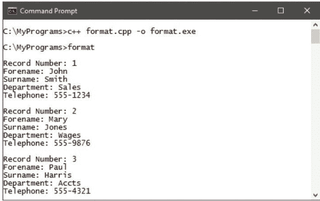


`if` 语句测试项目编号（元素编号加1）是否恰好被四整除，以决定是读取到换行符还是制表符。


记录计数器必须使用前缀递增器在输出之前增加变量值。

## 处理输入与输出

输入输出流的行为可以使用带有 `cout` 和 `cin` 函数的“插入运算符”进行修改。向它们的 `width()` 函数指定整数参数可以设置流的字符宽度。当内容没有填充整个流时，可以指定一个字符作为它们的 `fill()` 参数来指示空部分。同样，浮点数默认的六位小数精度可以通过向它们的 `precision()` 函数指定整数来更改。使用插入运算符修改流的语句应该放在使用 `<<` 或 `>>` 运算符的语句之前。


插入运算符只修改一个流对象 - 后续流对象为默认值，除非它们先被插入运算符修改过。

`<iostream>` 库提供了下表出的“操纵符”，它们使用 `<<` 或 `>>` 运算符修改流。

| 操纵符 | 显示 |
| --- | --- |
| `noboolalpha`* | 布尔值为 1 或 0 |
| `boolalpha` | 布尔值为“true”或“false” |
| `dec`* | 整数为 10 进制（十进制） |
| `hex` | 整数为 16 进制（十六进制） |
| `oct` | 整数为 8 进制（八进制） |
| `right`* | 文本在输出宽度内右对齐 |
| `left` | 文本在输出宽度内左对齐 |
| `internal` | 符号左对齐，数字右对齐 |
| `noshowbase`* | 不显示指示数值进制的前缀 |
| `showbase` | 显示指示数值进制的前缀 |
| `noshowpoint`* | 当分数为零时仅显示整数 |
| `showpoint` | 所有浮点数都显示小数点 |
| `noshowpos`* | 正数前不加 + 前缀 |
| `showpos` | 正数加 + 号前缀 |

- `>>` 不跳过空白符
- `>>` 跳过空白符
- 浮点数保留六位小数
- 科学计数法的浮点数
- 科学计数法使用 e，十六进制数使用 ff
- 科学计数法使用 E，十六进制数使用 FF


标记为 `*` 的操纵符是默认行为。


### manipulate.cpp

1. 通过指定要包含的 C++ 库类和使用的命名空间前缀开始新程序：

```cpp
#include <iostream>
using namespace std;
```

2. 添加一个 `main` 函数，包含一个最后的 `return` 语句并声明两个初始化的变量：

```cpp
int main()
{
    bool isTrue = 1;
    int num = 255;
    // 在此处添加更多语句
    return 0;
}
```

3. 在 `main` 函数中，插入语句设置输出流的宽度和填充符，然后在 `cout` 上输出文本字符串：

```cpp
cout.width(40);
cout.fill(' ' );
cout << "Output" << endl;
```

4. 接下来，插入语句设置输出流的精度以停止截断小数 - 然后输出一个显示所有小数位的浮点数：

```cpp
cout.precision(11);
cout << 3.1415926535 << endl;
```

5. 现在，插入语句使用操纵符输出变量：

```cpp
cout << fixed << setprecision(11) << 3.1415926535 << endl;
```

6. 保存、编译并运行程序以查看来自文本文件的输出：

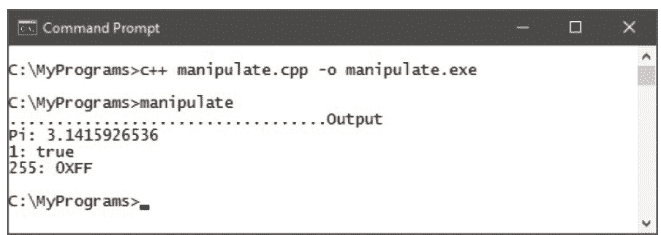


```cpp
cout << endl << "Record Number: " << ++j << endl;
cout << "Forename: " << tab[i++] << endl;
cout << "Surname: " << tab[i++] << endl;
cout << "Department: " << tab[i++] << endl;
cout << "Telephone: " << tab[i++] << endl;
```

## 预测问题

尽管尽了努力，C++ 程序不幸仍包含以下三种错误：
- 语法错误 – 代码使用错误
- 逻辑错误 – 代码语法正确，但尝试非法操作
- 异常错误 – 程序运行崩溃

C++ 标准允许编译器检测编译时错误，但异常错误更难定位，因为它们只发生在运行时。第一步是识别哪些代码被 `try` 块包围。

始终考虑用户会执行意外操作，确保你的程序可以处理这些操作。

当异常发生时，控制传递到 `catch` 块 - 它紧随 `try` 块之后。这使用了异常。

下面描述的程序有一个 `try` 块，包含一个增加整数的循环。当整数达到五时，`throw()` 函数手动向 `catch` 块抛出异常并传递该整数。

### try.cpp

通过指定要包含的 C++ 库类和使用的命名空间前缀开始新程序：

```cpp
#include <iostream>
using namespace std;
```

添加一个 `main` 函数，包含一个最后的 `return` 语句并声明一个整数变量：

```cpp
int main() {
  int number;
  // 在此处添加更多语句
  return 0;
}
```

在 `main` 函数中，插入 `try` 和 `catch` 块来处理“坏数字”异常：

```cpp
try {
}
catch (int num) {
}
```

在 `try` 块中，插入一个增加变量的循环：

```cpp
for (number = 1; number < 21; number++)
{
  if (number > 4) throw (number);
  else
    cout << "Number: " << number << endl;
}
```

在 `catch` 块中，插入异常处理语句：

```cpp
cout << "Exception at: " << num << endl;
```

保存、编译并运行程序以查看抛出的异常如何被 `catch` 块捕获：

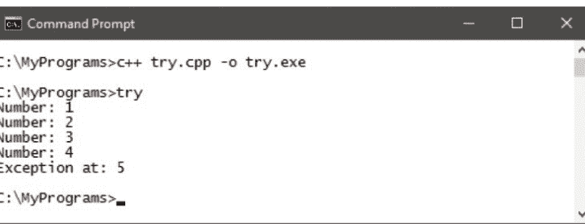


当异常发生时，控制传递到 `catch` 块 - 在这个示例中，循环没有完成。

## 识别异常

当 `try` 块内发生程序异常时，会自动抛出一个“异常”对象。异常的引用可以传递给 `catch` 关键字后括号中的关联 `catch` 块。这指定了参数为异常类型，以及由 `&` 引用运算符前缀的异常名称。例如 `exception&error`。

关于引用的更多信息将在下一节介绍。

一旦异常引用传递给 `catch` 块，就可以通过异常的 `what()` 函数获取错误描述：

1. 通过指定要包含的 C++ 库类和使用的命名空间前缀来启动新程序：

```cpp
#include <string> // 包含字符串支持。
#include <iostream>
using namespace std;
```

2. 添加一个包含最终返回语句的 `main` 函数，并声明一个初始化的字符串变量：

```cpp
int main()
{
string lang = "C++";
// 在此处添加更多语句。
return 0;
}
```

3. 在 `main` 函数中，插入一个 `try` 块，其中包含一条尝试删除字符串变量部分的语句：

```cpp
try {lang.erase(4,6); }
```

4. 接下来插入一个 `catch` 块，其中包含一条通过 `cerr` 函数将描述发送到标准错误输出的语句：

```cpp
catch (exception &error)
{cerr << "Exception: " << error.what() << endl;}
```

5. 编译并运行程序，查看捕获异常的错误描述：

```
Command Prompt

C:\MyPrograms>c++ what.cpp -o what.exe

C:\MyPrograms>what

Exception: basic_string::erase: __pos

C:\MyPrograms>_
```


错误描述会随不同的编译器而异——Visual C++ 编译器会将此示例中的错误描述为“invalid string position”（无效字符串位置）。

C++ `<stdexcept>` 库定义了许多异常类。其基类命名为`exception`，其他类派生自它，从而对常见异常进行分类。

下表列出了每个异常类，说明了它们的关系并描述了它们的异常类型：

| 异常类 | 描述 |
| --- | --- |
| `exception` | 通用异常 |
| - failure allocating storage | |
| - failure casting data type | |
| - failure referencing typeid | |
| `bad_alloc` | 逻辑异常 |
| `bad_cast` | - 无效域 |
| `bad_typeid` | - 调用中的无效参数 |
| `logic_error` | - 容器长度无效 |
| - `domain_error` | - 无效元素范围 |
| `invalid_argument` | 运行时异常 |
| `length_error` | - 无效范围请求 |
| `out_of_range` | - 无效算术请求 |
| `runtime_error` | |
| `overflow_error` | |

`cout` 函数将数据发送到标准输出，而 `cerr` 函数将错误数据发送到标准错误。它们仅仅是两个不同的数据流。

当通过添加`#include <stdexcept>`预处理器指令使程序可以使用`<stdexcept>`库时，可以使用这些异常类来识别（此处意为识别类型）抛出给`catch`块的异常类型。

特定的异常类名可以出现在`catch`块括号内，代替通用异常类型。

这里描述的示例演示了标准异常的使用。

多个`catch`块可以连续使用，类似于`switch`块中的`case`语句，用于处理多种类型的异常。

此外，可以使用`throw`关键字手动产生异常。这可以创建表中的任何`logic_error`和`runtime_error`异常。可选地，为手动异常指定自定义错误消息，并通过其`what()`函数检索。

## 处理错误

可以通过包含 C++ 标准`<typeinfo>`库来提供异常类型信息。其`typeid()`函数接受异常参数，因此其`name()`函数可以返回类型名称：

- 通过指定要包含的 C++ 库类和使用的命名空间前缀来启动新程序

```
#include <stdexcept> // 支持标准异常。
#include <typeinfo>  // 支持类型信息。
#include <fstream>
#include <string>
#include <iostream>
using namespace std;
```

- 添加一个包含最终返回语句、两个初始化变量声明以及一条输出文本消息语句的`main`函数

```
int main()
{
    string lang = "C++";
    int num = 10000;
    // ...
}
```

- 在`main`函数中，插入一个`try`块，其中包含一条尝试删除字符串变量部分的语句

```
try {lang.erase(4,6); }
```

- 接下来插入一个`catch`块，其中包含一条通过`cerr`函数将描述发送到标准错误输出的语句

```
catch (exception &error)
{cerr << "Exception: " << error.what() << endl;}
```

- 编译并运行程序，查看捕获异常的错误描述

```
Command Prompt
C:\MyPrograms>c++ what.cpp -o what.exe
C:\MyPrograms>what
Exception: basic_string::erase: __pos
C:\MyPrograms>_
```

## 指向数据

本章演示了如何利用指针和引用来编写高效的 C++ 程序。

- 理解数据存储
- 使用指针获取值
- 进行指针运算
- 将指针传递给函数
- 创建指针数组
- 引用数据
- 将引用传递给函数
- 比较指针与引用
- 总结

## 理解数据存储

为了理解 C++ 指针，了解数据如何在你的计算机上存储将很有帮助。将计算机内存想象成一排非常长的顺序编号的槽位，每个槽位可以包含一个字节的数据。当程序中声明一个变量时，机器会预留若干槽位来存储分配给该变量的数据。预留位数的数量取决于变量的数据类型。当程序使用变量名来检索存储的数据时，它实际上检索的是该变量第一个槽位的编号。

这可以类比为一排按顺序编号的房子，每栋房子可以容纳一个不同的家庭。可以通过房号显式地引用任何家庭。

内存中的槽位（房子）编号以十六进制格式表示，并可以通过`&`引用操作显示。


- 通过指定要包含的 C++ 库类和使用的命名空间前缀开始一个新程序

```
#include <string>
#include <iostream>
using namespace std;
```

- 添加一个包含最终`return`语句并声明三个初始化变量的`main`函数

```
int main() {
  int num = 100;
  double sum = 0.0123456789;
  string text = "C++ Fun";
  // 在此处添加更多语句。
  return 0;
}
```

- 在`main`函数中，插入语句输出每个变量第一个槽位的内存地址

```
cout << "Integer variable starts at: " << &num << endl;
cout << "Double variable starts at: " << &sum << endl;
cout << "String variable starts at: " << &text << endl;
```

- 保存、编译并运行程序以查看这三个内存地址

## 命令行提示符

```
C:\MyPrograms>c++ address.cpp -o address.exe
C:\MyPrograms>-address
Integer variable starts at: 0x61ff18
Double variable starts at: 0x61ff10
String variable starts at: 0x61fef8
C:\MyPrograms>_
```

一旦通过变量声明预留了内存空间，就可以使用`=`赋值运算符存储相应数据类型的值。例如，`num = 100`获取其右侧的值（`100`）并将其放入左侧命名变量（`num`）所引用的内存中。


位置地址是动态分配的——因此会与此截图中的地址不同。

赋值 赋值运算符左侧的操作数称为“左值”（`L-value`），右侧的操作数称为“右值”（`R-value`）。将`L-value`中的“`L`”理解为“位置”（`Location`），将`R-value`中的“`R`”理解为“读取”（`Read`）。

C++ 编程中的一个重要规则规定，右值不能出现在`=`运算符的左侧，但左值可以出现在任何侧。将右值放在`=`赋值运算符左侧的代码将无法编译：

- 在`return`语句正之前，插入将右值错误地放在赋值运算符左侧的语句

```
200 = num ;
5.5 = sum ;
"Bad assignments" = text ;
```

- 保存并尝试重新编译程序，以查看由右值放置不当当引起的错误

## 命令行提示符

```
C:\MyPrograms>c++ address.cpp -o address.exe
address.cpp:1 In function 'int main'
address.cpp:7:
error: lvalue used as left operand of assignment
address.cpp:12:
error: lvalue used as left operand of assignment
address.cpp:17:
error: assignment of read-only location "Bad assignments"
address.cpp:22:
error: incompatible types in assignment of "std::string"
C:\MyPrograms>_
```


左值是容器，而右值是数据。

## 使用指针获取值

指针是高效 C++ 编程的有用部分——它们只是存储其他变量内存地址的变量。

指针的声明与其他变量相同，但数据类型后面带有一个“`*`”字符。这在声明中表示该变量将是一个指针。记住，指针的数据类型必须与它指向的变量类型匹配。

通过使用`&`引用运算符将另一个变量的内存地址赋值给指针变量。赋值可以在声明语句中进行，也可以在声明后的单独语句中进行。仅通过名称引用指针变量只会显示它包含的内存地址。

在指针变量初始化后（无论是在声明中还是通过随后的赋值），它就“指向”它包含的变量。通过在指针前加上`*`解引用运算符来引用指针变量：


- 通过指定要包含的 C++ 库类和使用的命名空间前缀开始一个新程序

```
#include <iostream>
using namespace std;
```

- 添加一个包含最终`return`语句并声明三个初始化变量

```
int main() {
  int num = 100;
  double sum = 0.0123456789;
  string text = "C++ Fun";
  // 在此处添加更多语句。
  return 0;
}
```

- 在`main`函数中，插入语句输出每个变量第一个槽位的内存地址

```
cout << "Integer variable starts at: " << &num << endl;
cout << "Double variable starts at: " << &sum << endl;
cout << "String variable starts at: " << &text << endl;
```

- 保存、编译并运行程序以查看这三个内存地址

（注：由于 OCR 文本存在重复和交叉，此处已根据逻辑进行了合并和清理）。

递增指针并输出它的新内存地址——第三个整数数组的地址

```
ptr++;
cout << endl << "ptr at: " << ptr << " gets: " << *ptr;
```

将指针减二并输出它的内存地址——数组中第一个元素的地址

```
ptr = 2;
cout << endl << "ptr at: " << ptr << " gets: " << *ptr;
cout << endl;
```

现在，插入一个循环来输出整数数组每个元素中存储的值

```
for (int i = 0; i < 10; i++) {
    cout << endl << "Element: " << i << "; ";
    cout << "Value: " << *ptr;
}
cout << endl;
```

保存、编译并运行程序查看指针地址和存储的值

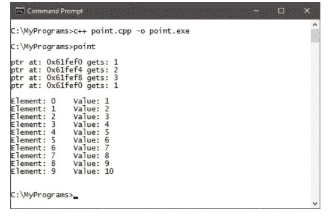


`*=` `/=` 和 `%=` 运算符不能用于移动指针。


数组名就像指向其第一个元素的指针。

## 将指针传递给函数

指针可以使用解引用符访问其所指向变量中存储的数据。这也可以通过一个适当数据类型的新值来更改存储的数据。

此外，指针可以作为参数传递给函数——这与将变量作为参数传递的效果略不同：

- 当变量传递给函数时，它们的数据是“按值”传递给函数内部的局部变量的——因此函数在原始值的副本上进行操作。
- 当指针传递给函数时，它们的数据是“按引用”传递的——因此函数在原始值上进行操作。

按引用传递的好处允许函数可以直接操作调用函数中声明的变量。


`fnptr.cpp`

+ 1. 通过指定要包含的 C++ 库类和使用的命名空间前缀开始新程序

```
#include <iostream>
using namespace std;
```

+ 2. 在预处理器指令之后，声明两个函数原型，每个接受一个指针参数

```
void writeOutput(int *);
void computeTriple(int *);
```

+ 3. 添加一个`main`函数，包含最后的返回语句并声明一个初始化的普通整数变量

```
int main()
{
    int num = 5;
    // 在此处添加更多语句
    return 0;
}
```

+ 4. 在`main`函数中，插入第二个变量声明，初始化指向普通整数变量的指针

```
int* ptr = &num;
```

+ 5. 在`main`函数块之后，定义一个函数输出指针所指向变量的当前值

```
void writeOutput(int* value)
{
    cout << "Current value: " << *value << endl;
}
```

定义另一个函数将指针所指向变量的当前值乘以 3

```
void computeTriple(int* value)
{
    *value *= 3; // 乘以并赋值解引用值。
}
```

在`main`函数中，将指针参数传递给函数以输出它所指向的变量值

```
writeOutput(ptr);
```

接下来，使用指针增加变量值，然后显示它的新值

```
*ptr += 15; // 相加并赋值解引用值
writeOutput(ptr);
```

现在，将指针参数传递给函数以乘以它所指向的变量，然后显示它的新值

```
computeTriple(ptr);
writeOutput(ptr);
```

保存、编译并运行程序查看输出的计算值

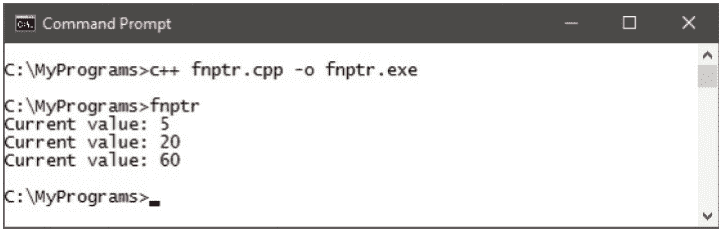


函数原型和定义必须包含指针参数。


直接操作调用函数内部变量的函数需要返回语句。

## 创建指针数组

普通`char`数据类型的变量可以分配单个字符值，但指向常量`char`数组的指针可以完全分配一个字符串。字符串实际上存储为字符数组，每个元素一个字符，但引用`char`指针将自动检索整个字符串。

这种仅通过变量名就能从`char`指针检索字符串值的能力，类似于使用变量名从普通`char`数组中检索字符串的方法。

多个字符串存储在常量`char`指针数组中，每个元素一个字符串。你甚至可以在“主”`char`指针数组中存储多个`char`指针数组——每个元素一个数组。


+ 1. 通过指定要包含的 C++ 库类和使用的命名空间前缀开始新程序

```
#include <iostream>
using namespace std;
```

+ 2. 添加一个包含最后的返回语句并声明两个变量的函数——一个字符数组和一个具有相同字符串值的字符指针

```
int main() {
    char letters[] = {'C', '+', 'F', 'n', '\0'};
    const char* text = "C++ Fun";
    // 在此处添加更多语句
    return 0;
}
```

+ 3. 在`main`函数中，插入语句声明并初始化另外两个变量，具有唯一的字符串值

```
const char* term = "Element:";
const char* lang = "C++";
```

+ 4. 接下来，插入一条语句声明字符指针数组，用三个字符串值初始化

```
const char* ap1[3] = { "Great", "Program", "Code" };
```


字符值必须包含在单引号内，常量`char`数组的指针可以完全分配字符串。现在，插入一条语句声明字符指针数组，用三个字符串值初始化

```
const char* ap1[3] = { "Great", "Program", "Code" };
```

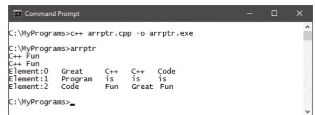

字符值必须包含在单引号内，常量`char`数组的指针可以完全分配字符串。现在，插入一条语句声明字符指针数组，用三个字符串值初始化


`const char* ap1[3] = { "Great", "Program", "Code" };`

字符值必须包含在单引号内，常量 `char` 数组的指针可以完全分配字符串。现在，插入一条语句声明字符指针数组，用三个字符串值初始化：

```cpp
const char* ap1[3] = { "Great", "Program", "Code" };
```

（注：由于原文文本中存在重复和逻辑混乱，此处翻译已根据上下文逻辑对齐处理）

`term` = `"Element:"`，`lang` = `"C++"`

`ap1[3]` = `{"Great", "Program", "Code"}`  
`ap2[3]` = `{lang, ...}`  
`ap3[3]` = `{ap2[0], ...}`  
`ap4[3]` = `{ap1[0], ...}`  

循环部分：

```cpp
for (int i = 0; i < 3; i++) {
    cout << endl << "Element: " << i << "; ";
    cout << "Value: " << *ptr;
}
```

输出部分：

```
Element: 0; Value
Element: 1; Value
Element: 2; Value
```

保存、编译并运行程序查看输出。

---

普通整数变量以及该变量的引用：

```cpp
int main() {
    int num;
    int &rNum = num;
    // 在此处添加更多语句。
    return 0;
}
```

在 `main` 函数中，插入一条语句通过其引用为整数变量赋初值：

`rNum = 400;`

接下来，插入语句直接和通过其引用输出存储的值：

`cout << "Value direct: " << num << endl;`  
`cout << "Value via reference: " << rNum << endl;`

现在，插入语句直接和通过其引用输出内存地址：

`cout << "Address direct: " << &num << endl;`  
`cout << "Address via reference: " << &rNum << endl;`

插入一条语句，通过其引用操作变量中存储的值：

`rNum = 2;`

再次，直接和通过其引用输出存储的值：

`cout << "Value direct: " << num << endl;`  
`cout << "Value via reference: " << rNum << endl;`

保存、编译并运行程序，查看值和内存地址。

编译器根据其上下文决定如何使用 `&` 引用运算符。

引用始终是声明语句中关联项目的别名。

## 向函数传递引用

引用提供了对所引用变量存储数据的访问，就像变量本身一样，并且可以通过分配适当数据类型的新值来更改存储的数据。

此外，引用可以像指针一样作为参数传递给函数：

- 当变量传递给函数时，它们的数据是"按值"传递给函数内部的局部变量的——因此函数在原始值的副本上进行操作。
- 当引用传递给函数时，它们的数据是"按引用"传递的——因此函数在原始值上进行操作。

传递引用的用处允许函数直接操作调用函数内部声明的变量值。

1. 通过指定包含的 C++ 库类和使用的命名空间前缀开始新程序：

```cpp
#include <iostream>
using namespace std;
```

2. 在预处理器指令之后，声明两个函数原型，每个接受一个引用参数：

```cpp
void writeOutput(int &);
void computeTriple(int &);
```

3. 添加一个 `main` 函数，包含一个最终返回语句并声明一个初始化的整数变量：

```cpp
int main()
{
    int num = 5;
    // 在此处添加更多语句。
    return 0;
}
```

4. 在 `main` 函数中，插入第二个变量声明，将引用初始化为整数变量的别名：

```cpp
int& ref = num;
```

这个示例看起来很熟悉，因为它重现了这里的示例——但用引用替换了指针。

- 在 `main` 函数块之后，定义一个函数输出引用所指变量的当前值：

```cpp
void writeOutput(int & value) {
    cout << "Current value: " << value << endl;
}
```

- 定义另一个函数，将引用所指变量的当前值乘以3：

```cpp
void computeTriple(int & value) {
    value *= 3; // 乘以并赋值引用值。
}
```

- 在 `main` 函数中，将引用参数传递给函数以输出其引用的变量：

`writeOutput(ref);`

- 接下来，使用引用增加变量值，然后显示其新值：

```cpp
ref += 15; // 增加并赋值引用
writeOutput(ref);
```

- 现在，将引用参数传递给函数以乘以其引用的变量，然后显示其新值：

```cpp
computeTriple(ref);
writeOutput(ref);
```

- 保存、编译并运行程序，查看输出的计算值。

函数原型和定义必须都包含引用参数。

直接操作调用函数内部变量的函数不需要`return`语句。

## 指针与引用比较

指针和引用都可以用于引用变量值，并通过引用而非按值传递给函数。从技术上讲，按引用传递比按值传递更高效，因此鼓励使用指针和引用。

是否使用指针或引用取决于需求。C++ 程序员通常倾向于尽可能使用引用，因为它们比指针更容易理解。

| 规则 | 引用 | 指针 |
| :--- | :--- | :--- |
| 可以在不初始化的情况下声明 | 否 | 是 |
| 可以重新赋值 | 否 | 是 |
| 可以包含空值 | 否 | 是 |
| 更容易使用 | 是 | 否 |

### ref.cpp

通过指定包含的 C++ 库类和使用的命名空间前缀开始新程序：

```cpp
#include <iostream>
using namespace std;
```

在预处理器指令之后，定义一个函数输出两个数的总和：

```cpp
void add(int &a, int &b) {
    a += b;
    cout << "Total: " << a << endl;
}
```

添加一个 `main` 函数，包含一个最终返回语句并声明一个初始化的整数变量：

```cpp
int main() {
    int num = 100;
    int sum = 500;
    int& rNum = num;
    int* ptr = &sum;
```

在 `main` 函数中，插入语句通过引用输出第一个整数变量：

`cout << "Reference: " << rNum << endl;`

接下来，插入语句通过指针输出第二个变量：

`cout << "Pointer: " << *ptr << endl;`

现在，将第一个变量赋值给指针并输出其值：

```cpp
ptr = &num;
cout << "Pointer now: " << *ptr << endl;
```

现在，将引用参数传递给函数以输出总和：

`add(rNum, sum);`

保存、编译并运行程序以查看输出。

C 程序员倾向于将 `&` 和 `*` 字符放在变量名前之前，但在 C++ 中通常将它们放在数据类型之后，因为该特性是数据类型的属性，而不是名称的属性。

---

## 7 创建类和对象

本章将介绍封装和继承主题——这是 C++ 面向对象编程的前两个原则。

- 封装数据
- 创建对象
- 创建多个对象
- 初始化类成员
- 方法重载
- 继承类属性
- 调用基类构造函数
- 重写基方法
- 总结

## 封装数据

类是一种数据结构，可以在单个实体中同时包含变量和函数。这些统称为"成员"，而函数被称为该类的"方法"。从类外部对类成员的访问由类声明中的"访问修饰符"控制。通常，这些修饰符会拒绝对变量成员的访问，但允许对可以从这些变量成员中存储和检索数据的方法进行访问。这种"数据隐藏"（data hiding）技术确保了存储的数据被安全地封装在类变量成员中，它是面向对象编程（OOP）的第一大原则。

类声明以 `class` 关键字开头，随后跟着一个空格，然后是程序员指定的名称——遵循标准的 C++ 命名规范，但以大字母开头。接下来是访问修饰符和类成员，它们包含在一对括号中。每个类声明必须在右括号后以分号结束——因此类声明的语法如下：

```cpp
class ClassName
{
  access specifier :
    member1;
    member2;

  access specifier :
    member3;
    member4;
};
```

访问修饰符可以是 `public`、`private` 或 `protected` 关键字中的任意一个，用于指定所列成员的访问权限：

- 公共（Public）成员可以在类可见的任何地方访问
- 私有（Private）成员仅可由同类的其他成员访问
- 保护（Protected）成员仅可由同类的其他成员以及该类派生类的成员访问

默认情况下，所有类成员都是 `private` 访问权限——因此，类声明中任何没有访问修饰符的成员都将具有 `private` 访问权限。

使用 `protected` 访问修饰符的派生类将在本章稍后介绍。

任何现实世界的对象都可以通过属性和动作来定义。例如，狗有年龄、重量等属性，以及可以执行的如叫等动作。C++ 中的类机制提供了一种在程序中创建虚拟狗对象的方法，类的变量成员可以代表它的属性，而方法则代表它的动作：

```cpp
class Dog
{
  private: // 默认访问级别。
  int age, weight;
  string color;

  public:
  void bark();
  // ... 加上用于存储/检索数据的方法。
};
```

虽然程序类不能完美模拟现实世界的对象，但目标是封装所有相关的属性和动作。

重要的是，类声明只定义了数据结构——为了创建对象，你必须声明该数据结构的"实例"。它的实现方式与声明普通 C++ 数据类型的实例的方式相同：

```cpp
int num; // 创建一个名为 "num" 的实例。
// 属于普通的 C++ int 数据类型。
```

```cpp
Dog fido; // 创建一个名为 "fido" 的实例。
// 属于程序员定义的 Dog 数据结构。
```

或者，可以通过在类声明的右括号和最终分号之间指定其名称来创建实例对象。可以通过这种方式创建多个实例，只需指定用逗号分隔的对象名称列表。例如，下面列出的类声明创建了四个名为"fido"、"peach"、"rex"和"sammy"的 `Dog` 类实例对象。

```cpp
class Dog
{
  int age, weight;
  string color;

  public:
    void bark();
    // ... 加上用于存储/检索数据的方法。
} fido, pooch, rex, sammy;
```

C++ 编程中的封装原则描述了将数据和功能归类集合在类成员中——即 `Dog` 类中的年龄、重量、颜色属性和 `bark` 动作。

类名以大字母开头、对象名以小字母开头是常规。

## 创建对象

为了从类的私有成员中分配和检索数据，必须在类中添加特殊的公共访问方法。这些是用于分配数据的"set器"（setter）方法，以及用于检索数据的"get器"（getter）方法。访问方法通常命名为变量地址，首字母大写，并以 `set` 或 `get` 为前缀。例如，处理 `age` 变量的访问方法可以命名为 `setAge()` 和 `age()`。

### object.cpp

1. 指定要包含的 C++ 库类和要使用的命名空间前缀开始新程序：

```cpp
#include <string>
#include <iostream>
using namespace std;
```

2. 声明一个名为"Dog"的类：

```cpp
class Dog
```

3. 在类声明的右括号和最终分号之间声明私有成员：

```cpp
  private: // 默认访问级别。
  int age, weight;
  string color;
```

4. 在私有成员之后添加访问修饰符：

```cpp
  public:
```

5. 添加一个输出字符串的公共 `bark` 方法：

```cpp
  void bark() {
    cout << "WOOF!" << endl;
  }
```

6. 在 `main` 方法的右括号内声明 `Dog` 实例：

```cpp
int main() {
    Dog fido;
```

7. 添加调用 setter 方法的方法来分配：

```cpp
    fido.setAge(3);
    fido.setWeight(15);
    fido.setColor("brown");
```

8. 添加调用 getter 方法的方法来检索：

```cpp
    cout << "Fido is a " << fido.getColor() << " dog" << endl;
    cout << "Fido is " << fido.getAge() << " years old" << endl;
    cout << "Fido weighs " << fido.getWeight() << " pounds" << endl;

    return 0;
}
```

9. 保存、编译并运行程序查看输出：

```
C:\HyPrograms>c++ object.cpp -o object
C:\HyPrograms>object
Fido is a brown dog
Fido is 3 years old
Fido weighs 15 pounds
```

随着新功能的引入，程序将在接下来几页中进行修改。

## 创建多个对象

程序可以通过声明类的多个实例轻松创建多个对象，每个对象都可以其 setter 方法具有独特的属性。

通常方便将 setter 方法合并为一个接受每个私有变量参数的合并。这意味着在程序中使用一个语句分配所有值，但该方法将包含多个语句。

上一个示例中的类声明包含了短内联方法——完全位于类声明块中。如果方法超过两行，就不应该内联创建，而应该在类声明中声明为"原型"，并在类声明之后单独定义。定义必须使用类名和作用域运算符 `::` 作为方法名前缀，以识别包含原型的类。

1. 将上一个示例 "object.cpp" 重命名为新程序 "multiple.cpp"

2. 在 `Dog` 类声明中，将三个 setter 方法替换为单个合并 setter 原型，该原型指定参数数据类型——但不包含名称：

```cpp
void setValues(int, int, string);
```

3. 在 `Dog` 类声明之后，使用 `::` 作用域运算符为原型添加一个定义块：

```cpp
void Dog::setValues(int age, int weight, string color)
{
}
```


注意，为了方便识别，参数的命名与它们将要赋值的变量名称相同。当类方法定义有一个与类成员同名的参数时，可以使用`this ->`类指针来显式引用类成员。例如，`this -> age`指代类成员变量，而`age`指代参数。

注意，原型是一个陈述——因此它必须以分号结束。

在方法定义块中，插入三条语句将传递的参数值赋值给类变量：

```cpp
this->age = age;
this->weight = weight;
this->color = color;
```

在主方法的大括号之间，将对三个 setter（设置）方法的调用替换为单个组合 setter 方法调用——传递三个参数`fido.setValues(3, 15, "brown")`。

在主方法中，声明一个名为“pooch”的`Dog`类第二个实例：

```cpp
Dog pooch;
```

添加对组合 setter 方法的第二次调用——为新对象`pooch`传递三个参数`.setValues(4, 18, "gray")`。

添加调用每个 getter（访问器）方法的语句，以检索已赋值的值：

```cpp
cout << "Poch is a " << pooch.getAge();
cout << " year old " << pooch.getColor();
cout << " Dog who weighs " << pooch.getWeight();
cout << " pounds.";
```

现在，添加对普通输出方法的第二次调用`pooch.bark();`。

保存、编译并运行程序以查看输出。

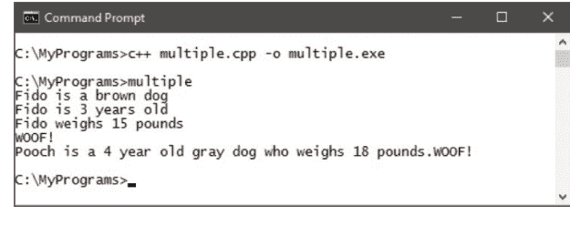


当参数名和类成员名不同时，在 setter 方法定义中不需要`this->`类指针。

## 初始化类成员

类变量成员可以通过一个特殊的“构造函数”（constructor）方法进行初始化，该方法每当创建类的实例时就会被调用。构造方法的命名始终与类名完全相同，并且需要参数来设置类变量的初始值。

当声明一个构造方法时，也应该声明一个相关的“析构函数”（destructor）方法——它每当类的实例被销毁时就会被调用。析构方法的命名始终与类名相同，但前面带有一个`~`波浪字符。

构造方法和析构方法没有返回值，并且是自动调用的——它们不能被显式调用。

初始化类变量的值是在创建对象的语句中传递给构造方法的，位于对象名称后的括号内。


### constructor.cpp

1. 将上一个示例副本“multiple.cpp”重命名为新程序“constructor.cpp”。
2. 在`Dog`类声明的 public 部分，将`setValues`方法原型替换为此构造函数原型：

```cpp
Dog (int, int, string);
```

3. 现在，添加相关的析构函数原型：

```cpp
~Dog();
```

4. 在`Dog`类声明之后，将`setValues`定义块替换为构造函数定义块：

```cpp
Dog::Dog (int age, int weight, string color)
{
}
```

5. 在构造函数定义块中，插入三条语句将参数赋值给类变量：

```cpp
this->age = age;
this->weight = weight;
this->color = color;
```

类方法的定义也被称为方法的“实现”（implementation）。

- 在构造定义之后，添加析构函数定义块：

```cpp
Dog::~Dog()
{}
```

- 在析构函数中，插入一条语句，在实例对象被销毁时输出确认：

```cpp
cout << "Object destroyed." << endl;
```

- 在主方法中，编辑创建“fido”对象的语句——向其构造方法传递值：

```cpp
Dog fido (3, 15, "brown");
```

- 同样地，编辑创建“pooch”对象的语句——向其构造方法传递值：

```cpp
Dog pooch (4, 18, "gray");
```

- 删除调用“fido”和“pooch”对象`setValues`方法的语句，构造函数现在已经取代了该方法。

- 保存、编译并运行程序——查看输出像以前一样出现，并加上对象被销毁时的确认。

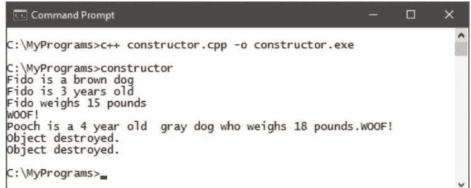

析构函数的定义以类名“Dog”开始，作用域解析运算符“~”，然后是析构方法名“Dog”。


虽然变量成员的初始值是由构造函数设置的，但添加 setter 方法来后续更改值——这些新值可以通过 getter 方法检索。

## 方法重载（Overloading methods）

就像 C++ 允许函数重载一样，类方法也可以重载——包括构造方法。重载的构造方法在创建对象且未向构造函数传递值时，为成员变量分配默认值非常有用。


### overloaded.cpp

1. 将上一个示例副本“constructor.cpp”重命名为新程序“overloaded.cpp”。
2. 在`Dog`类声明的 public 部分，添加一个重载`bark`方法以输出字符串参数：

```cpp
void bark(string noise) { cout << noise << endl; }
```

3. 现在，声明一个不带参数的重载构造函数原型：

```cpp
Dog();
```

4. 在`Dog`类声明之后，为默认构造函数添加定义：

```cpp
Dog::Dog()
{
    age = 0;
    weight = 0;
    color = "white";
}
```

5. 为带两个参数的重载构造函数添加定义：

```cpp
Dog::Dog(int age, int weight)
{
    this->age = age;
    this->weight = weight;
    this->color = color;
}
```

当参数名和类成员名不同时，setter 方法定义中不需要`this->`类指针。

在主方法中，声明一个名为“pooch”的`Dog`类第二个实例：

```cpp
Dog pooch;
```

添加调用每个 getter 方法的语句以检索已赋值的值：

```cpp
cout << "Poch is a " << pooch.getAge();
cout << " year old " << pooch.getColor();
cout << " Dog who weighs " << pooch.getWeight();
cout << " pounds.";
```

现在，添加对普通输出方法的第二次调用`pooch.bark();`。

保存、编译并运行程序查看输出。

```
Command Prompt

C:\Programs\c++ overloaded.cpp -o overloaded.exe

C:\Programs\overloaded

Fido is a brown dog

Fido is 3 years old.

Fido weighs 15 pounds.

WOOF!

Poo is a gray dog who weighs 18 pounds. WOOF!

Rex is a black dog who weighs 2 pounds. GRRR!

Sammy is a white dog who weighs 6 pounds. BOWOW!

Object destroyed.

Object destroyed.

Object destroyed.

Object destroyed.

C:\Programs->
```


创建不传递参数的对象时，不要在对象名称后添加括号——注意是`Dog rex;`而不是`Dog rex();`。


这是`Dog`类的类的版本。在继续之前，确保你可以识别公共和私有成员。

## 继承类属性（Inheriting class properties）

C++ 类可以作为一个全新的类创建（如之前的示例所示），也可以从现有类“派生”（derived）。重要的是，派生类除了拥有自己的成员外，还继承了其父基类的成员。

从基类继承成员的能力允许创建共享某些属性的派生类，这些属性是在基类中定义的。例如，“Polygon”基类可以定义所有多边形通用的宽度高度。矩形和三角形类可以从`Polygon`类派生——继承宽度和高度属性，此外还有定义独特特征的成员。

### derived.cpp

通过指定要包含的C++库类和要使用的命名空间前缀开始一个新程序：

```cpp
#include <iostream>
using namespace std;
```

声明一个名为“Polygon”的类，包含两个保护变量（protected），它们仅对该类的成员和派生自该类的类可见，以及一个公共为这些变量赋值的方法：

```cpp
class Polygon {
protected:
    int width, height;
public:
    void setValues(int w, int h) { width = w; height = h; }
};
```

在`Polygon`类之后，声明一个继承自`Polygon`类的`Rectangle`类，并添加一个独特的方法：

```cpp
class Rectangle : public Polygon {
public:
    int area() { return (width * height); }
}
```

在`Rectangle`类之后，声明一个继承自`Polygon`类的`Triangle`类，并添加一个独特的方法：

```cpp
class Triangle : public Polygon {
public:
    int area() { return (width * height) / 2; }
};
```

在`Triangle`类之后，添加一个`main`方法，其中包含一个最终的返回语句，用于创建每个派生类的实例：

```cpp
int main() {
    Rectangle rect; Triangle trgl;
    return 0;
}
```

插入对从`Polygon`基类继承的方法的方法调用——以初始化继承的变量：

```cpp
rect.setValues(4,5);
trgl.setValues(4,5);
```

输出每个派生类独特方法返回的结果：

```cpp
cout << "Rectangle area: " << rect.area() << endl;
cout << "Triangle area: " << trgl.area() << endl;
```

保存、编译并运行程序以查看输出。

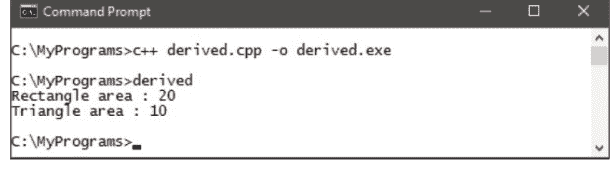


不要混淆类实例和派生类——实例是类的拷贝，而派生类是一个继承了其所自基类属性的新类。


一个类声明可以继承自多个类。例如，`class Box : public A, public B, public C { }`。

## 调用基类构造函数

尽管派生类继承了其父基类的成员，但它们并不继承其构造函数和析构函数。然而，需要注意的是，当创建派生类的新对象时，基类的默认构造函数会被调用——当对象被销毁时，基析构函数会被调用。这些调用是在对派生类的构造方法和析构方法进行调用之外的。

基类的默认构造函数没有参数——但该类也可能有带有参数的重载构造函数。如果你希望在创建派生类的新对象时调用基类的重载构造函数，可以在派生类中创建一个匹配的重载构造函数——具有相同数量和类型的参数。


### basecon.cpp

1. 通过指定要包含的 C++ 库类和命名空间前缀开始新程序：

```cpp
#include <iostream>
using namespace std;
```

2. 声明一个名为“Parent”的类，它将是一个基类：

```cpp
class Parent
{ // 类成员存放在这里
}
```

3. 在`Parent`类声明的大括号之间，插入一个公共访问说明符并添加一个默认构造函数以输出文本——标识它何时被调用：

```cpp
public:
Parent()
{ cout << "Default Parent constructor called."; }
```

4. 添加一个重载构造函数，它接受一个整数参数，并输出标识文本：

```cpp
Parent (int a)
{ cout << endl << "Overloaded Parent constructor called."; }
```

5. 在`Parent`类之后，声明一个派生的“Daughter”类：

```cpp
class Daughter : public Parent
{
};
```

### Son – Parent – Daughter

在`Daughter`类声明中，插入一个公共访问说明符并添加一个默认构造函数以输出文本——标识它何时被调用：

```cpp
public:
    Daughter() {
        cout << endl;
        cout << "Derived Daughter class default constructor constructed."; }
}
```

在`Daughter`类之后，声明一个派生的“Son”类：

```cpp
class Son : public Parent
{
};
```

在`Son`类声明中，插入一个公共访问说明符并添加一个接受单个整数参数的重载构造函数，并输出标识文本：

```cpp
Son (int a) : Parent (a) {
    cout << endl;
    cout << "Derived Son class overloaded constructor constructed.";
}
```

在`Son`类之后，添加一个`main`方法，其中包含一个最终的返回语句并创建每个派生类的实例——调用基类和派生类的构造函数：

```cpp
int main()
{
    Daughter emma;
    Son andrew(0);
    return 0;
}
```


保存、编译并运行程序以按顺序查看每个构造函数的输出

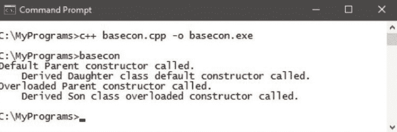

注意`Son`类构造语法


每个类都有一个析构函数`~Son()`。

## 重写基方法

可以在派生类中声明方法以重写基类中的方法——如果它们具有相同的名称、参数和返回类型。

然而，重写基方法的技术必须谨慎使用，以免无意中隐藏基类方法。


1. 通过指定要包含的库类和命名空间前缀开始新程序

```
#include <string>
#include <iostream>
using namespace std;
```

2. 声明一个名为`Man`的类，它将是一个基类

```
class Man
{ // 类成员存放在这里
}
```

3. 在`Man`类声明的大括号之间，插入一个公共访问说明符并添加一个默认构造函数

```
public:
Man()
{ cout << "Hello!" << endl; }
```

4. 现在，插入一个重载构造函数

```
void speak(string msg)
{ cout << msg << endl; }
```

5. 在`Man`类之后，声明一个派生的`Hombre`类

```
class Hombre : public Man
{
};
```

6. 在`Hombre`类声明中，插入一个公共访问说明符并添加一个默认构造函数

```
public:
    Hombre() {
        cout << endl;
        cout << "Derived Hombre class default constructor constructed."; 
    }
```

7. 在`Hombre`类之后，声明一个派生的`Son`类

```
class Son : public Hombre
{
};
```

8. 在`Son`类声明中，插入一个公共访问说明符并添加一个默认构造函数

```
public:
    Son() : Hombre() {
        cout << endl;
        cout << "Derived Son class default constructor constructed."; 
    }
```

9. 在`Son`类中，声明一个方法来重写基方法

```
void speak(string msg) {
    cout << "Overridden: " << msg << endl;
}
```

10. 在`Son`类之后，添加一个`main`方法，其中包含一个最终的返回语句并创建每个派生类的实例

```
int main()
{
    Man m;
    Hombre h;
    Son s;
    m.speak("Hello");
    h.speak("Hola");
    s.speak("World");
    return 0;
}
```

# 8

## 利用多态性

本章演示了如何将程序拆分为模块化组件，并引入了多态性主题——C++ 面向对象编程的第三原则。

- 指向类
- 调用虚方法
- 引导方法调用
- 提供能力类
- 构建抽象数据类型
- 构建复杂的层次结构
- 隔离类结构
- 使用隔离类
- 总结

## 指向类

面向对象编程 (OOP) 的三大基石是封装、继承和多态性。上一章的示例已经演示了数据如何封装在 C++ 类中，以及派生类如何继承其基类的属性。本章将介绍最后一个作为基石的特性原则：多态性。

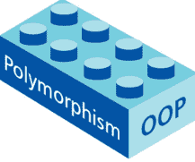

“多态性”（源自希腊语，意为“多种形式”）描述了根据上下文赋予实体不同含义或目的的能力。

在 C++ 中，重载运算符可以被视为多态的。例如，`*`字符根据上下文可以表示乘法运算符也可以表示解引用运算符。同样，`+`字符根据上下文可以表示加法运算符或连接运算符。

更重要的是，C++ 类方法也可以是态的。理解类多态性的关键在于：可以创建一个基类指针，并通过关联绑定到特定的派生类。

基类指针可以指向派生类的内存地址以提供“上下文”——从而唯一标识派生类。例如，对于基类`Base`和派生类`Sub`，可以这样创建指针：

```
Sub int;

Base* pSub = &int;
```

或者更简单地使用`new`关键字，如下所示：

```cpp
Base* pSub = new Sub;
```


关于指针的更多信息请返回第六章。

当存在多个派生类时，可以创建基类指针，将每个派生类绑定到其唯一的内存地址——可以使用`&`运算符获取该地址。

### classptr.cpp

- 通过指定要包含的 C++ 库类和要使用的命名空间前缀开始新程序

```cpp
#include <iostream>
using namespace std;
```

- 声明一个`Base`类，包含一个以十六进制格式输出传递整数值的方法

```cpp
class Base {

public:

    void identify(int adr)

        cout << "Base class called by 0x" << hex << adr << endl;

}
```

- 声明两个空派生类`SubA`和`SubB`

```cpp
class SubA : public Base { };
class SubB : public Base { };
```

- 声明一个包含最终返回语句的`main`方法

```cpp
int main() {

    // 程序代码在此处。

    return 0;

}
```

- 在`main`方法中，插入语句创建两个基类指针——每个指针绑定到特定的派生类

```cpp
Base*ptrA = new SubA;

Base*ptrB = new SubB;
```

- 现在，插入使用指针调用基类方法的语句，传递每个输出的内存地址

```cpp
ptrA -> identify((int) &ptrA);

ptrB -> identify((int) &ptrB);
```

- 保存、编译并运行程序以查看地址

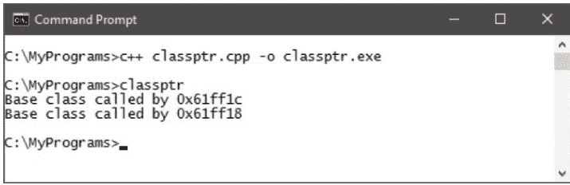


这里使用`->`类指针运算符来调用类方法。


十六进制地址作为`int`数据类型传递，然后由`hex`输出操纵符以十六进制格式显示。地址在每次程序执行时都会不同——它们是动态分配的。

## 调用虚方法

绑定到特定派生类的基类指针可以用于调用继承自基类的派生类方法。然而，派生类特有的方法必须通过实例对象调用。

绑定到特定派生类的基类指针也可以使用`::`作用域解析运算符显式地调用基类中的方法。

最有用的是，当基类方法被声明为“虚”（virtual）方法时，派生类中的继承方法可以覆盖基类中的方法。这仅仅是基类中的一个普通声明，前面加了`virtual`关键字。虚方法的声明表示该类将用作基类，另一个类将派生自它，而该类可能包含一个覆盖虚基类的方法。


### virtual.cpp

1. 通过指定要包含的 C++ 库类和要使用的命名空间前缀开始新程序

```cpp
#include <iostream>
using namespace std;
```

2. 声明一个`Base`类，包含一个以十六进制格式输出传递整数值的方法

```cpp
class Base

{

public:

    virtual void Common()

        cout << "I am parent" << endl;

    virtual void identify(int adr)

        cout << "Base class called by 0x" << hex << adr << endl;

};
```

3. 声明两个空派生类`SubA`和`SubB`

```cpp
class SubA : public Base { };

class SubB : public Base { };
```

4. 声明一个包含最终返回语句的`main`方法

```cpp
int main() {

    // 程序代码在此处。

    return 0;

}
```

5. 在`main`方法中，插入语句创建两个基类指针——每个指针绑定到特定的派生类

```cpp
Base*ptrA = new SubA;

Base*ptrB = new SubB;
```

6. 现在，插入使用指针调用基类方法的语句，传递每个输出的内存地址

```cpp
ptrA -> identify((int) &ptrA);

ptrB -> identify((int) &ptrB);
```

7. 保存、编译并运行程序以查看地址

8. 绑定到特定派生类的基类指针可以用于调用继承自基类的派生类方法。然而，派生类特有的方法必须通过实例对象调用。

9. 绑定到特定派生类的基类指针也可以使用`::`作用域解析运算符显式地调用基类中的方法。

10. 最有用的是，当基类方法被声明为“虚”方法时，派生类中的继承方法可以覆盖基类中的方法。这仅仅是基类中的一个普通声明，前面加了`virtual`关键字。虚方法的声明表示该类将用作基类，另一个类将派生自它，而该类可能包含一个覆盖虚基类的方法。


## 引导方法调用

多个派生类对象的多态性极大优势在于，对同名方法的调用会被引导到相应的覆盖方法。

基类可能只包含虚方法，每个派生类都可以对其进行覆盖，但基类方法仍然可以使用`::`显式调用。这可能会导致不一致——这个示例似乎暗示了鸡会飞！


在派生类中重写方法时，可以选择包含`virtual`前缀——作为提醒，表示它正在重写基类方法。

声明一个名为`Chicken`的派生类，包含基类中两个要重写的方法

```cpp
class Chicken : public Bird {

  public:

    void Talk() const {

      cout << "Cluck! Cluck!" << endl;

    }

    void Fly() const {

      cout << "I'm just a chicken - I can't fly!" << endl;

    }

};
```

声明一个`main`方法，其中包含最终的返回语句，并创建绑定到派生类的基类指针

```cpp
int main() {

  Bird* pigeon = new Pigeon;

  Bird* pchicken = new Chicken;

  // 在此处添加更多语句。

  return 0;

}
```

在`main`方法中，插入对每个方法的调用

```
Pigeon -> Talk();
Pigeon -> Fly();
Chicken -> Talk();
Chicken -> Fly();
Pigeon -> Bird::Talk();
Chicken -> Bird::Fly(); // 不恰的调用。
```

保存、编译并运行程序以查看输出

```
Command Prompt

C:\MyPrograms>c++ birds.cpp -o birds.exe

birds

C:\MyPrograms\birds

Cool Cool

Pigeon flies away...

Cluck! Cluck!

I'm just a chicken - I can't fly!

A bird bawks...

A bird flies...

C:\MyPrograms>>
```

反斜杠`\`字符用于转义字符串中的单引号。

## 能力类 (Capability classes)

唯一目的是允许其他类派生自该类的类被称为“能力类”——它们为派生类提供了功能。

能力类通常不包含数据，仅声明了若干可以在其派生类中重写的虚方法。

以下示例在之前的示例的基础上，展示了如何将`Bird`类更好地改写为能力类。它的方法不再包含输出语句，但如果被显式调用，将返回-1（错误）值。

有必要将这些方法的返回类型从`void`改为`int`，并且这些更改必须反映在派生类中的每个重写方法中。

1. 通过指定要包含的 C++ 库类和使用的命名空间前缀开始一个新程序：`#include <iostream> using namespace std;`

2. 声明一个名为`Bird`的基类，包含两个在显式调用时会指示错误的虚方法声明

```cpp
class Bird

{

  public:

    virtual int Talk() const { return -1 };

    virtual int Fly() const { return -1 };

}
```

3. 声明一个名为`Pigeon`的派生类，包含两个重写基类中的方法

```cpp
class Pigeon : public Bird

{

  public:

  int Talk() const {

    cout << "Cool! Coo!" << endl; return 0;

  }

  int Fly() const {

    cout << "A pigeon flies away..." << endl; return 0;

  }

}
```

派生类中重写方法的返回值必须与基类中声明的返回值匹配。

## 声明一个名为`Chicken`的派生类，包含基类中两个要重写的方法

```cpp
class Chicken : public Bird

{

    public :

    int Talk() const

    { cout << "Cluck! Cluck!" << endl; return 0; }

    int Fly() const

    { cout << "I'm just a chicken - I can't fly!" << endl; return 0; }

};
```

## 声明一个`main`方法，创建绑定派生类的基指针

```cpp
int main()

{

    Bird* pPigeon = new Pigeon;

    Bird* pChicken = new Chicken;

}
```

## 在`main`方法中，插入方法调用以及在显式调用基类方法遇到错误时终止程序的语句

```cpp
pPigeon -> Talk();

pChicken -> Talk();

pPigeon -> Bird::Talk();

if (-1) { cout << "Error - Program ended." << endl; return 0; }
```

```cpp
pPigeon -> Fly(); // 不调用

pChicken -> Fly();
```

保存、编译并运行程序以查看输出

能力类方法旨在被派生类重写——它们不应被显式调用。

参见此处。

## 抽象类型 (Abstract types)

抽象数据类型 (ADT) 代表一个概念而非具体的对象，并且总是基类。这些被称为“纯方法”，并且必须在派生类中重写。

1. 通过指定要包含的 C++ 库类和使用的命名空间前缀开始一个新程序：`#include <iostream> using namespace std;`

2. 声明一个名为`Shape`的基类 ADT，包含三个虚方法

```cpp
class Shape {

public:

    virtual int getArea() = 0;

    virtual int getEdge() = 0;

    virtual void Draw() = 0;

}
```

3. 声明一个派生类`Rect`，包含两个私有变量

```cpp
class Rect : public Shape {

private:

    int height, width;

}
```

4. 在派生类中插入公共构造函数和析构函数

```cpp
public:

Rect(int intWidth, int intHeight) {

    width = intWidth;

    height = intHeight;

}

~Rect();
```

创建 ADT 的实例会导致编译器错误。

```cpp
int getArea() { return height * width; }

int getEdge() { return 2 * height + width; }

void Draw() {

    for (int i = 0; i < height; i++) {

        for (int j = 0; j < width; j++) {

            cout << "x";

        }

    }

}
```

声明一个`main`方法，创建两个派生类`Rect`的实例

```cpp
int main() {

    Shape pQuad = new Rect(3, 7);
```


`Shape pSquare = new Rect(5, 5);`

在`main`方法中插入对每个方法的调用，然后保存、编译并运行程序。

```cpp
pQuad -> Draw();
cout << "Area is " << pQuad->getArea() << endl;
cout << "Perimeter is " << pQuad->getEdge() << endl;

pSquare -> Draw();
cout << "Area is " << pSquare->getArea() << endl;
cout << "Perimeter is " << pSquare->getEdge() << endl;
```

基类包含一个虚方法即可创建抽象数据类型。

## 构建复杂的层级结构 (Building complex hierarchies)

有时从另一个 ADT 派生一个 ADT 以构建复杂的类层级结构。这提供了极大的灵活性并且是完全允许的，只要每个纯方法在某个派生类中都有定义。

1. 通过指定要包含的 C++ 库类和使用的命名空间前缀开始一个新程序：

```cpp
#include <iostream>
using namespace std;
```

2. 声明一个名为`Boat`的基 ADT，包含一个变量、访问方法以及一个纯虚方法：

```cpp
class Boat {
protected:
  int length;
public:
  int getLength() { return length; }
  virtual void Model() = 0;
}
```

3. 声明一个派自`Boat`类的 ADT 类`Sailboat`——同样包含一个变量、访问方法以及一个纯虚方法：

```cpp
class Sailboat : public Boat {
protected:
  int mast;
public:
  int getMast() { return mast; }
  virtual void Boom() = 0;
}
```

4. 声明一个派自`Sailboat`类的普通类`Laser`，其所有成员将允许公共访问：

```cpp
class Laser : public Sailboat {
public:
}
```

`Boat`类具有所有船只共有的属性，而`Sailboat`类具有带有帆的船只特有的属性。

在`Laser`类中，插入对其构造方法的调用，以为派生自每个类中的变量赋值——并调用析构方法。

```cpp
Laser() { mast = 19; length = 35; }
~Laser();
```

在`Laser`类中，定义派生自每个类中声明的纯虚方法。

```cpp
void Model() { cout << "Laser Classic" << endl; }
void Boom() { cout << "Boom: 14ft" << endl; }
```

声明一个`main`方法，其中包含最终的返回语句，并在层次结构的底层创建一个派生类的实例。

```cpp
int main() {
  Laser* pLaser = new Laser;
  // 在此处添加更多语句
  return 0;
}
```

在`main`方法中，插入对每个定义方法的调用。

```cpp
pLaser -> Model();
cout << "Length: " << pLaser -> getLength() << "ft" << endl;
cout << "Height: " << pLaser -> getMast() << "ft" << endl;
pLaser -> Boom();
```

保存、编译并运行程序以查看输出。

尝试添加一个派自`Boat`类的`Powerboat`类（用于包含引擎信息），以及一个派自`Powerboat`类的`Cruiser`类——用于为变量赋值并定义虚方法。

## 隔离类结构

书中每个示例程序的源代码通常包含在单个`.cpp`文件中以节省空间，但实际上，OOP 程序通常包含在三个独立的文件中：

- 头文件`.h`文件 – 仅包含类声明。
- 实现文件`.cpp`文件 – 包含类定义，用于实现头文件中声明的方法，该文件通过`#include`指令引用。
- 客户端`.cpp`文件 – 包含一个`main`方法，用于使用头文件中声明的类成员，该文件也通过`#include`指令引用。

客户端文件有时被称为“驱动”（driver）文件。

例如，一个求法计算器程序可能由三个文件组成：`ops.h`（声明操作类的头文件）、`ops.cpp`（定义操作方法的实现文件）和`sum.cpp`（调用各种操作的客户端文件）。

编译`sum.cpp`时，编译器会将包含的头文件和实现文件合并到程序。它首先将头文件和实现文件转换为二进制对象文件（`ops.o`），然后将头文件和客户端文件转换为第二个二进制对象文件（`sum.o`）。最后，链接器（Linker）将两个对象文件合并成单个可执行文件（`sum.exe`）。

使用`#include`指令引用头文件的方式与使用`#include`指令引用标准 C++ 库的方式类似。

将类结构隔离在独立的“模块”文件中具有提高可移植性的优点，并且通过清晰地识别每个文件的目的使代码维护变得更容易。

要让编译器将所有源代码文件合并成单个可执行文件，只需要在编译器命令中显式指定`.cpp`文件——`#include`指令确保头文件也会被识别。

例如，在`ops.cpp`和`sum.cpp`中都使用`#include "ops.h"`语句，编译下方示例的命令在编译器命令中没有指定`ops.h`头文件，而只是`c++ ops.cpp sum.cpp -o sum.exe`。

### 计算器

此示例将允许用户输入一个简单的算术表达式并输出计算结果。在首次启动时将提供说明，并允许用户输入后续表达式——或通过零字符。

### ops.h

1. 通过声明一个名为“Calculator”的类来开始头文件：

```cpp
class Calculator
{
```

2. 在类声明中，插入公共（public）方法声明：

```cpp
public:
    Calculator(); // (构造函数)
    void launch(); // 显示说明。
    void readInput(); // 获取输入。
    void writeOutput(); // 显示结果。
    bool run(); // 获取当前状态。
```

3. 在类声明中，插入私有（private）变量：

```cpp
private:
    double num1, num2;
    char oper;
```

4. 将头文件保存为“ops.h”。

5. 在实现文件中，定义头文件中声明的方法。

### 使用隔离的类

### ops.cpp

使用`#include`指令开始实现文件，在此处包含头文件：

```cpp
#include "ops.h"
#include <iostream>
using namespace std;

Calculator::Calculator()
{
    status = true;
}

void Calculator::launch()
{
    cout << "*** SUM CALCULATOR ***" << endl;
    cout << "Enter a number, an operator (+,-*,/), and another number." << endl;
    cout << "Hit Return to calculate. Enter zero to exit.";
}

void Calculator::readInput()
{
    cout << "> ";
    cin >> num1;
    if (num1 == 0)
        status = false;
    else {
        cin >> oper;
        cin >> num2;
    }
}

void Calculator::writeOutput()
{
    if (status) {
        switch (oper) {
            case '+': cout << num1 + num2 << endl; break;
            case '-': cout << num1 - num2 << endl; break;
            case '*': cout << num1 * num2 << endl; break;
            case '/': 
                if (num2 != 0)
                    cout << num1 / num2 << endl;
                else
                    cout << "Cannot divide by zero" << endl;
                break;
        }
    }
}

bool Calculator::run()
{
    return status;
}
```

### sum.cpp

使用`#include`指令开始客户端文件，在此处包含头文件：

```cpp
#include "ops.h"

int main() {
    Calculator* pCalc = new Calculator;
    pCalc->launch();
    while (pCalc->run()) {
        pCalc->readInput();
        pCalc->writeOutput();
    }
    delete pCalc;
    return 0;
}
```

由于空间限制，此程序几乎没有尝试验证输入——它假设用户会输入有效的表达式，例如`8 * 3`。

将客户端文件保存为“sum.cpp”，与`ops.h`和`ops.cpp`放在一起，然后使用命令编译程序：

```
c++ ops.cpp sum.cpp -o sum
```

运行程序并输入简单的表达式以查看结果，然后输入零并按回车键退出程序。

## 总结

- 面向对象编程的三大基石是封装、继承和多态。
- 多态实体根据其语境具有不同的含义或用途。
- 基类指针可用于显式地调用其绑定的派生类中继承的方法。
- 基类指针可以使用`::`作用域解析运算符显式地调用基类方法。
- 虚拟基类方法旨在在派生类中被重写。
- 多态允许将同名方法的调用定向到相应的重写方法。
- 能力类通常不包含数据，仅声明了可以在派生类中重写的虚拟方法。
- 返回`-1`值的虚拟方法会发出错误信号，表示它们不应被直接调用。
- 抽象数据类型（ADT）代表一个概念，并且总是其他类的基类。
- 声明纯虚拟方法（使用赋值`=0`）表示该类是一个 ADT。
- 类可以派自 ADT —— 但你无法创建 ADT 的实例。
- 一个 ADT 可以派自另一个 ADT，以创建复杂的类层次结构。
- 程序可以分离为头文件、实现文件和客户端文件，以帮助移植性并简化代码维护。
- 被`#include`指令引用的头文件将在编译期间由编译器自动包含。

# 9 预宏

本章演示了如何让 C++ 编译器在编译程序之前执行实用的任务。

- 探索编译
- 定义替换符
- 定义条件
- 提供备选方案
- 保护包含
- 使用宏函数
- 构建字符串
- 调试断言
- 总结

## 探索编译

每当 C++ 编译器运行时，它会首先调用其预处理器，以寻找源代码中可能包含的任何编译器指令。这些指令中的每一条都以`#`哈希字符开头，并将首先被实现，以便在汇编和编译之前有效地修改源代码。

源代码 (.cpp)

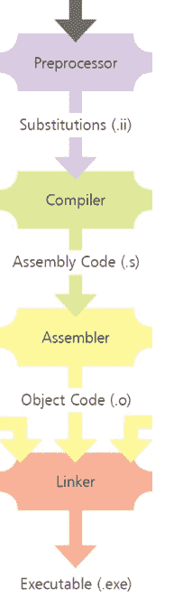

编译器指令对预处理器所做的更改创建了通常不可见的新的临时文件。正是这些临时文件被用于创建二进制对象文件文件：

- 编译期间创建的第一个临时文件通过将原始源代码中的编译器指令替换为实现这些指令的库代码来扩展源代码。这个文本文件命名为源文件，但扩展名为`.ii`。
- 编译期间创建的第二个临时文件是将扩展后的`.ii`文件翻译为低级汇编语言指令。这个文本文件命名为源文件，但扩展名为`.s`。
- 编译期间创建的第三个临时文件是将临时汇编`.s`文件翻译为机器码。这个二进制对象文件的命名与源文件类似，但扩展名为`.o`。

因此，编译过程利用了处理处理器来编译源代码，使用“汇编器”将其翻译为机器码，并使用“链接器”将一个或多个二进制对象转换为可执行程序。

你可以通过指示编译器使用`-save-temps`编译器选项来保存它们，从而查看这些临时文件。然后，可以通过在纯文本编辑器中打开这两个临时文本文件进行检查。

最重要的是，你可以看到带有`.ii`扩展名的临时文件包含了任何已包含库的完整函数定义。例如，它将`#include <iostream>`指令替换为`cin`、`cout`、`cerr`函数的定义以及可以将错误消息重定向到文件的`clog`函数的定义。`.ii`文件的结尾显示定义的函数是“std”命名空间的一部分 —— 因此它们可以在没有`std::`前缀的情况下出现。


- 创建一个名为“prog.cpp”的简单程序，它在执行时将输出一条消息：

```cpp
#include <iostream>
using namespace std;

int main()
{
    cout << "Hello, World!" << endl;
    return 0;
}
```

- 使用`-save-temps`编译器选项让编译器保存临时文件。然后可以通过在纯文本编辑器中打开这两个临时文本文件进行检查。
- 最为重要的是，你可以看到带有`.ii`扩展名的临时文件包含了任何已包含库的完整函数定义。例如，它将`#include <iostream>`指令替换为`cin`、`cout`、`cerr`函数的定义以及可以将错误消息重定向到文件的`clog`函数的定义。`.ii`文件的结尾显示定义的函数是“std”命名空间的一部分 —— 因此它们可以在没有`std::`前缀的情况下出现。


- 创建一个名为“prog.cpp”的简单程序，它在执行时将输出一条消息：

```cpp
#include <iostream>
using namespace std;

int main()
{
    cout << "Hello, World!" << endl;
    return 0;
}
```

- 使用`-save-temps`编译器选项让编译器保存临时文件。然后可以通过在纯文本编辑器中打开这两个临时文本文件进行检查。
- 最为重要的是，你可以看到带有`.ii`扩展名的临时文件包含了任何已包含库的完整函数定义。例如，它将`#include <iostream>`指令替换为`cin`、`cout`、`cerr`函数的定义以及可以将错误消息重定向到文件的`clog`函数的定义。`.ii`文件的结尾显示定义的函数是“std”命名空间的一部分 —— 因此它们可以在没有`std::`前缀的情况下出现。


- 创建一个名为“prog.cpp”的简单程序，它在执行时将输出一条消息：

```cpp
#include <iostream>
using namespace std;

int main()
{
    cout << "Hello, World!" << endl;
    return 0;
}
```

- 使用`-save-temps`编译器选项让编译器保存临时文件。然后可以通过在纯文本编辑器中打开这两个临时文本文件进行检查。
- 最为重要的是，你可以看到带有`.ii`扩展名的临时文件包含了任何已包含库的完整函数定义。例如，它将`#include <iostream>`指令替换为`cin`、`cout`、`cerr`函数的定义以及可以将错误消息重定向到文件的`clog`函数的定义。`.ii`文件的结尾显示定义的函数是“std”命名空间的一部分 —— 因此它们可以在没有`std::`前缀的情况下出现。


- 创建一个名为“prog.cpp”的简单程序，它在执行时将输出一条消息：

```cpp
#include <iostream>
using namespace std;

int main()
{
    cout << "Hello, World!" << endl;
    return 0;
}
```


## 总结

- 面向对象编程的三大基石是封装、继承和多态。
- 多态实体根据其语境具有不同的含义或用途。
- 基类指针可用于显式地调用其绑定的派生类中继承的方法。
- 基类指针可以使用`::`作用域解析运算符显式地调用基类方法。
- 虚拟基类方法旨在在派生类中被重写。
- 多态允许将同名方法的调用定向到相应的重写方法。
- 能力类通常不包含数据，仅声明了可以在派生类中重写的虚拟方法。
- 返回`-1`值的虚拟方法会发出错误信号，表示它们不应被直接调用。
- 抽象数据类型（ADT）代表一个概念，并且总是其他类的基类。
- 声明纯虚拟方法（使用赋值`=0`）表示该类是一个 ADT。
- 类可以派自 ADT，但你无法创建 ADT 的实例。
- 一个 ADT 可以派自另一个 ADT，以创建复杂的类层次结构。
- 程序可以分离为头文件、实现文件和客户端文件，以帮助移植性并简化代码维护。
- 被`#include`指令引用的头文件将在编译期间由编译器自动包含。

# 9 预宏

本章演示了如何让 C++ 编译器在编译程序之前执行实用的任务。

- 探索编译
- 定义替换符
- 定义条件
- 提供备选方案
- 保护包含
- 使用宏函数
- 构建字符串
- 调试断言
- 总结

## 探索编译

每当 C++ 编译器运行时，它会首先调用其预处理器，以寻找源代码中可能包含的任何编译器指令。这些指令中的每一条都以`#`哈希字符开头，并将首先被实现，以便在汇编和编译之前有效地修改源代码。

源代码 (.cpp)


编译器指令对预处理器所做的更改创建了通常不可见的新的临时文件。正是这些临时文件被用于创建二进制对象文件：

- 编译期间创建的第一个临时文件通过将原始源代码中的编译器指令替换为实现这些指令的库代码来扩展源代码。这个文本文件命名为源文件，但扩展名为`.ii`。
- 编译期间创建的第二个临时文件是将扩展后的`.ii`文件翻译为低级汇编语言指令。这个文本文件命名为源文件，但扩展名为`.s`。
- 编译期间创建的第三个临时文件是将临时汇编`.s`文件翻译为机器码。这个二进制对象文件的命名与源文件类似，但扩展名为`.o`。

因此，编译过程利用了处理处理器来编译源代码，使用“汇编器”将其翻译为机器码，并使用“链接器”将一个或多个二进制对象转换为可执行程序。

你可以通过指示编译器使用`-save-temps`编译器选项来保存它们，从而查看这些临时文件。然后，可以通过在纯文本编辑器中打开这两个临时文本文件进行检查。

最重要的是，你可以看到带有`.ii`扩展名的临时文件包含了任何已包含库的完整函数定义。例如，它将`#include <iostream>`指令替换为`cin`、`cout`、`cerr`函数的定义以及可以将错误消息重定向到文件的`clog`函数的定义。`.ii`文件的结尾显示定义的函数是“std”命名空间的一部分——因此它们可以在没有`std::`前缀的情况下出现。


- 创建一个名为“prog.cpp”的简单程序，它在执行时将输出一条消息

```cpp
#include <iostream>
using namespace std;
int main()
{
    cout << "Hello, World!" << endl;
    return 0;
}
```

- 使用`-save-temps`编译器选项让编译器保存临时文件。然后可以通过在纯文本编辑器中打开这两个临时文本文件进行检查。
- 最为重要的是，你可以看到带有`.ii`扩展名的临时文件包含了任何已包含库的完整函数定义。例如，它将`#include <iostream>`指令替换为`cin`、`cout`、`cerr`函数的定义以及可以将错误消息重定向到文件的`clog`函数的定义。`.ii`文件的结尾显示定义的函数是“std”命名空间的一部分——因此它们可以在没有`std::`前缀的情况下出现。


## 定义替换符

正如预处理器替换`#include`指令一样，其他处理器指令可以在编译之前替换文本或数值。

- 开始一个新程序并声明三个指令：

```cpp
#define BOOK "C++ Programming in easy steps"
#define NUM 200
#define RULE "################################"
```

- 指定要包含的类和命名空间：

```cpp
#include <iostream>
using namespace std;
```

- 添加一个包含最终返回语句和三个输出替换值的 main 函数：

```cpp
int main()
{
    cout << RULE << endl << BOOK << endl << RULE;
    cout << "NUM is: " << NUM << endl;
    cout << "Double NUM: " << ((NUM) * 2) << endl;
    return 0;
}
```

- 保存、编译并运行程序以查看输出

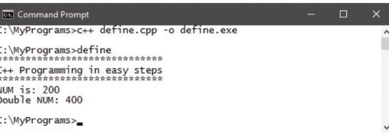


注意，常量最好被声明为`const`变量——因为预处理器替换的值不经过类型检查。

- 5. 重新编译程序并保存临时文件：`c++ define.cpp -save-temps -o define.exe`
- 6. 在纯文本编辑器中打开临的“define.ii”文件并滚动到文件结尾以查看替换

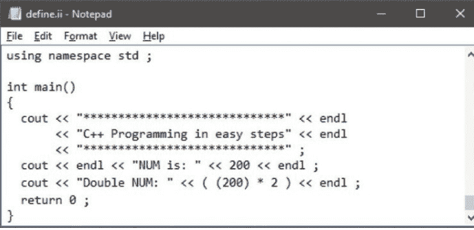


替换也可以改为从命令行进行，使用`-Dname`选项用值替换宏。注意，双引号内的字符串值在命令行中也必须用转义的双引号包含——这样替换将包含双引号字符。

- 删除或注释掉针对`BOOK`和`NUM`标识符的定义指令——然后保存程序文件以应用更改

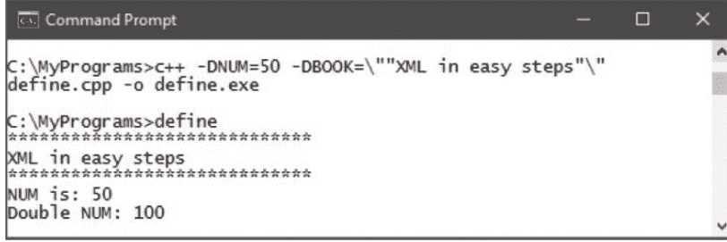

尝试编译未定义标识符的程序将产生“not declared in this scope”（在此作用范围内未声明）错误。

## 定义条件

预处理器可以通过宏函数执行条件测试，从而对程序源代码进行智能插入。`#ifdef`指令通过测试是否定义了指定的宏来执行最常见的预处理器功能。当宏被定义时，测试返回真，预处理器将插入从后续行开始直到相应的`#endif`之前的所有指令或语句。

相反，`#ifndef`指令测试指定的宏是否**未**被定义。当该测试返回真时，它将插入从后续行开始直到相应的`#endif`指令之前的所有指令或语句。

为了满足任一条件测试，需要注意的是，`#define`指令只需要指定宏名称来定义标识符——不需要指定要替换的值。

任何之前定义的宏稍后可以使用`#undef`指令移除——这样随后的`#ifdef`条件测试就会失败。然后可以通过进一步的`#define`指令重新定义宏：


ifdef.cpp

- 1. 启动一个新程序，使用条件测试在宏已定义时插入指令

```cpp
#ififndef BOOK
#define BOOK "C++ Programming in easy steps"
#endif
```

- 2. 指定要包含的库类和命名空间

```cpp
#include <iostream>
using namespace std;
```

- 3. 添加一个包含最终返回语句的`main`函数

```cpp
int main() {
  // 程序代码放在这里。
  return 0;
}
```

- 4. 在`main`函数中，添加一个条件预处理器测试以插入输出语句

```cpp
#ifdef BOOK
cout << BOOK ;
#endif
```

- 添加另一个条件预处理器测试，以定义新宏并在测试成功时插入输出语句

```cpp
#ifndef AUTHOR
#define AUTHOR "Mike McGrath"
cout << " by " << AUTHOR << endl;
#endif
```

- 接下来，添加一个条件测试，如果宏已经定义则对其进行重新定义

```cpp
#ifndef BOOK
#undef BOOK
#endif
```

- 现在，添加一个条件测试，如果宏不再被定义则重新定义它，并插入输出语句

```cpp
#ifndef BOOK
#define BOOK "Linux in easy steps"
cout << BOOK " by " << AUTHOR << endl;
#endif
```

- 保存、编译并运行程序以查看插入的结果

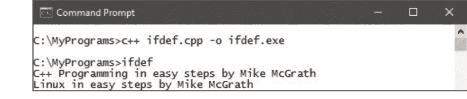

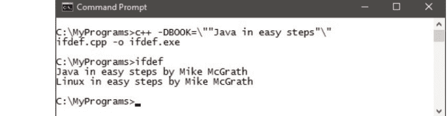


每个预处理器指令必须独占一行——你不能将多个指令放在同一行上。


在 Windows 系统上，命令中指定的字符串宏值必须用转义的双引号括起来。

## 提供替代方案

由`#ifdef`和`#ifndef`执行的条件测试可以通过添加`#else`指令进行扩展，以提供替代方案。例如：

```cpp
#ifdef WEATHER
cout << WEATHER ;
#else
#define WEATHER "Sunny"
#endif
```

同样，`#if`、`else`和`#elif`宏可以执行多个条件测试，就像普通的 C++ `if`和`else`关键字一样。

对于测试多个定义，`#ifdef`宏可以表示为`#if defined`，并通过`#elif defined`宏进行进一步测试。


`#elif`宏简单地将`else`和`if`结合起来提供替代方案。

虽然大多数宏是在源文件中通过`#define`指令或在命令行通过`-D`定义的，但某些宏是由编译器自动预定义的。通常，这些名称以双下划线开头以避免混淆。编译器的预定义宏是特定平台的，因此程序使用多个定义测试来识别主机：


- 启动纯文本编辑器并将新文件（无内容）保存为程序目录下的“empty.txt”。要查看编译器的预定义宏列表，使用带“-dM”的命令直接调用 `cpp` 预处理器：`cpp -dM empty.txt`滚动找到 Windows 上的`WIN32`宏或 Linux 上的`linux`宏。

```cpp
#define __WIN32 1
```

```cpp
#define __linux 1
```


使用`cpp`命令直接调用预处理器（而不是`c++`），确保`-dM`选项正确。

- 4. 启动一个新程序，使用条件测试查找`WIN32`和`linux`宏以识别平台

```cpp
#if defined WIN32
#define PLATFORM "Windows"
#elif defined __linux
#define PLATFORM "Linux"
#endif
```

- 5. 指定要包含的库类和命名空间

```cpp
#include <iostream>
using namespace std;
```

- 6. 现在，添加一个包含最终返回语句的`main`函数以识别主机

```cpp
int main() {


```
cout << PLATFORM << "System" << endl;

return 0;
```

- 7. 在`main`函数中，插入针对特定平台的语句

```
if (PLATFORM == "Windows")
  cout << "Performing Windows-only tasks..." << endl;

if (PLATFORM == "Linux")
  cout << "Performing Linux-only tasks..." << endl;
```

- 8. 保存、编译并运行程序以查看特定平台的输出

```
C:\MyPrograms> windows_System
Performing Windows-only tasks...
C:\MyPrograms>
```

```
user> c++ else.cpp -o else.exe
user> ./else.exe
Linux_System
Performing Linux-only tasks...
user>
```

预定义的`win32`宏有一个下划线，但`__linux`宏有两个下划线字符。

预定义宏的条件测试可以扩展到查找其他操作系统，并添加最后的`#else`指令来指定“Unknown”默认值。

## 防止包含

通常，C++ 程序会有许多`.h`文件和一个包含主程序的`.cpp`实现文件。头文件通常包含一个或多个`#include`指令，以可以使用其他头文件中的类或函数，并可能导致定义出现在两个文件中时发生重复。例如，一个头文件包含了另一个包含函数定义的头文件，编译器将认为该定义出现在每个文件中——因此编译将失败。

解决此重复定义的流行方案是使用预处理器指令确保编译器仅暴露到一个定义。这些被称为“包含保护”（inclusion guards），为每个头文件创建一个唯一的宏名称。传统上，该名称是文件名的大写版本，并将点改为下划线。例如，文件`mum.h`对应`MUM_H`。

包含保护也被称为“宏保护”（macro guards）或简单的“include guards”。

在创建用于防止重复的宏时，`#ifndef`指令首先测试该定义是否已由同一程序中包含的另一个头文件创建。如果定义已存在，编译器将忽略重复定义，否则`#define`指令将允许编译器使用该头文件中的定义：  
创建一个名为`add.h`的头文件，其中包含`add`函数的内联声明：

```
inline int add(int x, int y) { return (x + y); };
```

现在，创建一个名为`triple.h`的头文件，以便`add`函数可以在`triple`函数的内联声明中可用：

```
#include "add.h"
inline int triple(x) { return add(x, add(x, x)); };
```

使用预处理器指令开始一个新程序，使`add`函数和`triple`函数都可用：

```
#include "add.h"
#include "triple.h"
```

指定要包含在命名空间中的库类：

```
#include <iostream>
using namespace std;
```

添加一个`main`函数，其中包含调用所包含头文件中`add()`和`triple()`函数的语句：

```
int main() {
  cout << "9 + 3 = " << add(9, 3) << endl;
  cout << "9 * 3 = " << triple(9) << endl;
}
```

保存文件，然后尝试编译程序，你会发现编译失败，因为`add`函数出现了两次——分别在`"add.h"`和通过包含`"triple.h"`出现。

编辑头文件`add.h`，将内联函数声明封装在预处理器保护符中：

```
#ifndef ADD_H
#define ADD_H
inline int add(int x, int y) { return (x + y); };
#endif
```

保存修改后的文件，编译并运行程序——现在编译成功，因为包含保护符防止了`add`函数的表面重定义。

```
C:\>MyPrograms>c++ guard.cpp -o guard.exe
C:\>MyPrograms>guard
9 + 3 = 12
9 * 3 = 27
C:\>MyPrograms>_
```

使用传统的命名方案（即宏名称与文件名相似）以避免冲突。

所有头文件都应该包含头文件保护——在`triple.h`文件中添加`TRIPLE_H`宏。

## 使用宏函数

#define 指令可用于创建宏函数，这些函数会在编译前在源代码中被替换。

预处理器函数声明由一个宏名称以及紧随其后的包含函数参数的括号组成——名称和括号之间不要留有任何空格。声明之后是位于另一组括号中的函数体。例如，一个将参数减半的预处理器宏函数如下：

```
#define HALF(n) (n / 2)
```

使用宏函数时需要小心，因为与普通的 C++ 函数不同，它们不执行任何类型的类型检查——因此很容易创建一个导致错误的宏。出于这个原因，内联函数通常比宏函数更优，但由于宏会直接替换其代码，它们避免了函数调用的开销——所以程序运行得更快。这种差异可以在编译过程中创建的第一个文件中看到：

`macro.cpp`

+   1 通过定义两个处理单个参数的宏函数开始一个新程序

```
#define SQUARE(n) (n*n)
#define CUBE(n) (n*n)
```

+   2 在宏函数定义之后，指定要包含的库类以及要使用的命名空间前缀：

```
#include <iostream>
using namespace std;
```

+   3 接下来，声明两个处理单个参数的内联函数——就像上面定义的宏函数一样

```
inline int square (int n) { return (n*n); }
inline int cube (int n) { return (n*n); };
```

+   4 添加一个包含最终返回语句的`main`函数

```
int main()
{
  // 程序代码写在此处。
  return 0;
}
```

+   5 在`main`函数块的开头，声明并初始化一个整数变量

```
int num = 5;
```

现在，插入语句调用每个宏函数和每个可比的内联函数：

```
cout << "Macro SQUARE: " << SQUARE(num) << endl;
cout << "Inline square: " << square(num) << endl;
cout << "Macro CUBE: " << CUBE(num) << endl;
cout << "Inline cube: " << cube(num) << endl;
```

保存文件，然后反编译，保存临时文件并运行程序：

```
c++ macro.cpp -save-times -o macro.exe
```

用纯文本编辑器（如记事本）打开临时`.ii`文件，可以看到宏函数已直接替换到每个输出语句中。

宏名使用大写字母可以确保不会与小写字母冲突。

## 构建字符串

## 运算符被称为“字符串化”运算符，因为它将其转换为字符串。

合并运算符也被称为“标记粘贴”运算符，因为它将标记粘贴在一起。

## 调试断言

有时使用预处理器指令来辅助调试很有帮助——通过定义一个`ASSERT`函数来评估指定的条件。

要评估的条件将作为`ASSERT`参数从调用者传递。然后该函数可以根据结果执行相应的语句。通过在每行末尾添加反斜杠，可以在函数定义中包含多个语句，允许定义延续到下一行。

调试时，可以使用 C 风格的`/* */`注释运算符注释代码部分。

可以在程序代码中添加许多调用`ASSERT`函数的语句，以便程序执行期间监控条件。例如，检查变量随变化的值。

有用的是，`ASSERT`函数可以由`DEBUG`宏控制。这允许通过简单更改`DEBUG`控制宏的值来轻松开启或关闭调试。

+   通过定义一个值为 1 的`DEBUG`宏开始一个新程序——以控制`ASSERT`函数

+   接下来，添加一个宏 if-elif 语句，根据控制值定义`ASSERT`函数：

```
#if (DEBUG == 1)
    // “开启”状态的定义在此处。
#elif (DEBUG == 0)
    // “关闭”状态的定义在此处。
#endif
```

+   在`ASSERT`语句块的上部插入一个当调试控制设置为“开启”时的定义——以从预定义宏输出失败详细：

```
#define ASSERT(expr)

cout << #expr << " ..." << num;
if (expr != true)
{
    cout << " Fails in file: " << __FILE__ <<;
    cout << " at line: " << __LINE__ << endl;
}
else cout << " Succeeds" << endl;
```

不要在定义的最后一行使用反斜杠续行符，并记住使用`#`字符串化操作符将表达式输出为字符串。

- 4 在`ASSERT`函数语句块的底部，插入一个用于当调试控制设置为“off”时的定义——仅简单输出当前变量值：

```
#define ASSERT(result)

cout << "Number is " << num << endl;
```

- 5 在宏定义之后，指定要包含的库类和要使用的命名空间前缀

```
#include <iostream>
using namespace std;
```

- 6 添加一个包含最终返回语句的`main`函数

```
int main()
{
    // Program code goes here.
    return 0;
}
```

- 7 在`main`函数块开头，声明并初始化一个整数变量，然后调用`ASSERT`函数检查其递增时的值

```
int num = 9; ASSERT(num < 10);
num++; ASSERT(num < 10);
```

```
Command Prompt
C:\MyPrograms\c++ assert.cpp -o assert.exe
C:\MyPrograms\assert
num < 10 ...9 Succeeds
num < 10 ...10 Fails in file: assert.cpp at line: 30
```

- 8 保存、编译并运行程序以查看输出。

- 9 修改程序通过更改控制值来关闭调试，然后重新编译并运行程序

```
#define DEBUG 0
```

预定义宏名以双下划线开头并以双下划线结尾。

此外，可以从`__DATE__`和`__TIME__`预定义宏输出当前日期和时间。

## 总结

- C++ 编译器的`-save-temps`选项保存编译过程中创建的临时文件供检查。
- 编译首先将程序代码和包含的库代码写入单个`.ii`文件，然后将其翻译成低级汇编语言`.s`文件。
- 汇编语言`.s`文件被转换为机器码`.o`对象文件，用于创建可执行程序。
- `#define`指令定义了一个宏名和一个值，预处理器应该在程序代码中将其替换为该值。
- 预处理器可以使用`#ifdef`、`#ifndef`和`#endif`指令执行条件测试。
- 可以使用`#if`、`#else`和`#elif`指令提供预处理器替代方案，并可以使用`#undef`移除定义。
- 每个头文件应使用包含保护（inclusion guards）防止相同类或函数的意外重复定义。
- 包含保护的宏名是文件名的大写版本，但将点替换为下划线。
- `#define`指令还可以定义一个宏函数，该函数将在程序代码中替换宏名。
- 内联函数通常比宏函数更好，因为与宏函数不同，它们执行类型检查。
- 预处理器`#`字符串化操作符将作为宏参数传递的一系列字符转换为字符串值。
- 两个术语可以通过预处理器`##`合并操作符合并为一个术语。
- `ASSERT`宏函数对于调试代码很有用，可以通过`DEBUG`宏控制以便于开启或关闭调试。

# 10

# 可视化编程

本章结合了之前章节的元素，在视觉化编程环境中构建完整的 C++ 应用程序。

- 启动 Universal 项目
- 插入页面组件
- 导入程序资源
- 设计布局
- 添加运行时功能
- 测试程序
- 调整界面
- 部署应用程序
- 总结

## 启动 Universal 项目

Windows 10 引入了通用 Windows 平台 (UWP)，它允许创建一个运行在任何现代 Windows 设备（手机、平板电脑或 PC）上的单个应用程序。

UWP 应用程序的界面布局使用可扩展应用程序标记语言 (XAML) 来指定组件。

本章示例适用于 Windows 10 上的 Visual Studio 2015 ——不支持之前的版本。

为了为 UWP 开发应用，你应该运行最新版本的 Windows 10，并且你的 Visual Studio IDE 必须包含通用 Windows 应用开发工具。

打开控制面板、程序和功能，然后右键点击 Visual Studio 并选择更改——以启动 Visual Studio 安装程序

| 名称 | 发行者 |
| :--- | :--- |
| Visual Studio 2015 Update 3 (KB3033596) | Microsoft Corporation |
| Visual Studio Community 2015 Update 2 | Microsoft Corporation |
| MyVC++ Redistributable 1.4 | Microsoft Corporation |
| VS2 C++ 11.0 | Florian Heidenberg |

- 选择通用 Windows 应用工具类别中的所有选项，然后点击下一步——下载并安装

工具安装完成后，打开 Visual Studio IDE

UWP 应用程序也称为“UWA”——通用 应用程序。

根据你的选择，Visual Studio 可能会显示你安装了下一步、文件、新建、空白应用（通用）创建一个新项目。

现在，看到默认情况下，**XAML** 视图显示`<Grid></Grid>`标签——这是可以添加组件元素的画布根元素。

- 组件元素嵌套在`<StackPanel>`元素中，因为它可以被赋予`x:Name`以便在功能代码中引用，并使用`Orientation`属性指定嵌套元素出现的方向。常见元素包括`<image>`、`<TextBox>`、`<TextBlock>`（标签）和`<Button>`。多个`<StackPanel>`元素可以相互嵌套以确定组件的**水平**和**垂直**布局：

- 在根标签`<Grid></Grid>`之间插入元素，使 **XAML** 视图看起来完全如下所示：

## 插入页面组件

Visual Studio 提供了一个双部分窗口向 UWP 应用中插入组件。这包含组件的视图视图和 XAML 视图：

- 1 打开解决方案管理器，然后双击`MainPage.xaml`——以启动双部分

- 2 看到默认情况下，设计视图以竖屏模式显示空白画布

- 3 点击 **Design** 视图中的相邻按钮，将空白画布更改为横屏

```xml
<Grid Background="{ThemeResource ApplicationPageBackgroundBrush}">
    <StackPanel Orientation="Horizontal">
        <Image Source="icon.png" Width="100" Height="100"/>
        <StackPanel Orientation="Vertical" VerticalAlignment="Center">
            <StackPanel Name="Labels">
                <TextBlock Text="text1" />
                <TextBlock Text="text2" />
                <TextBlock Text="text3" />
            </StackPanel>
            <StackPanel Name="Buttons" Orientation="Horizontal">
```


```xml
<Grid>
    <StackPanel>
        <StackPanel>
            <StackPanel>
                <Button Content="Button" />
                <Button Content="Button" />
            </StackPanel>
        </StackPanel>
    </StackPanel>
</Grid>
```

当你在 XAML 中添加组件元素时，它们会显示在设计视图中，直到呈现如下所示：

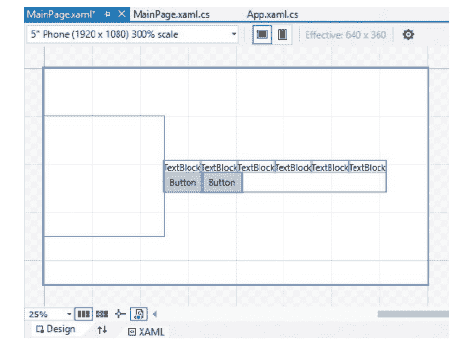

`Name` 属性之前的 `x:` 前缀引用了 UWP 应用所使用的 XAML 架构。


外部的 `<StackPanel>` 是一个水平布局，包含一个 `<Image>` 和嵌套的 `<StackPanel>`。嵌套的 `<StackPanel>` 是一个垂直布局，包含两个额外的 `<StackPanel>` 元素，每个元素水平显示其组件。


注意每个 `<TextBlock>` 元素都有一个 `Text` 属性，可以在功能代码中引用它。例如 `textBlock1->Text`。

## 导入程序资源

为了让 XAML `<Image>` 组件显示图形，首先需要将图像文件添加到项目的 `Assets` 文件夹中。然后可以将其分配给 `<Image>` 标签的 `Source` 属性：


### 通用

1. 打开解决方案管理器，然后右键点击 `Assets` 文件夹，并从右键菜单中选择“添加”。
2. 现在，从下一个右键菜单中选择“现有项”——打开“添加现有项”对话框。

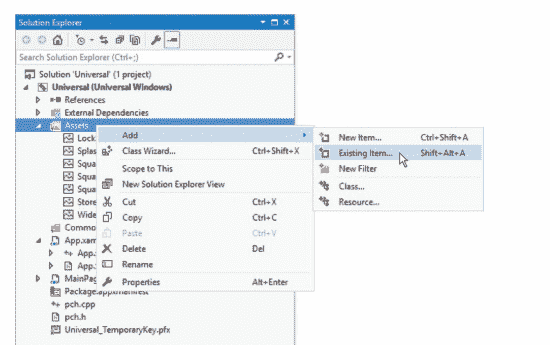

3. 在“添加现有项”中，浏览到图像的位置，然后选择文件并点击“添加”按钮。

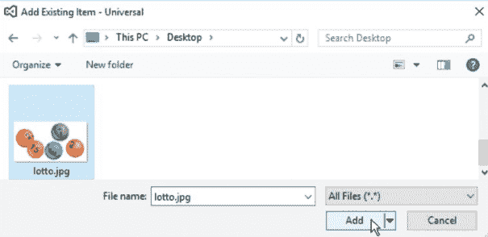

显示的图像可以是任何常用的文件格式——例如 `.bmp`、`.gif`、`.jpg`、`png` 或 `.tif`。

4. 在解决方案管理器中，所选的图像文件现在出现在项目的 `Asset` 文件夹中。

5. 在设计器视图中选择 `Image` 组件，并点击“查看，属性”以显示其属性。

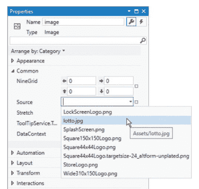

在属性窗口中，展开“Common”（常用）类别，然后点击 `Source` 项的箭头按钮并从下拉列表中选择图像。

图像现在显示在设计视图中，它的路径被添加到 XAML 视图代码和 `Source` 属性中。

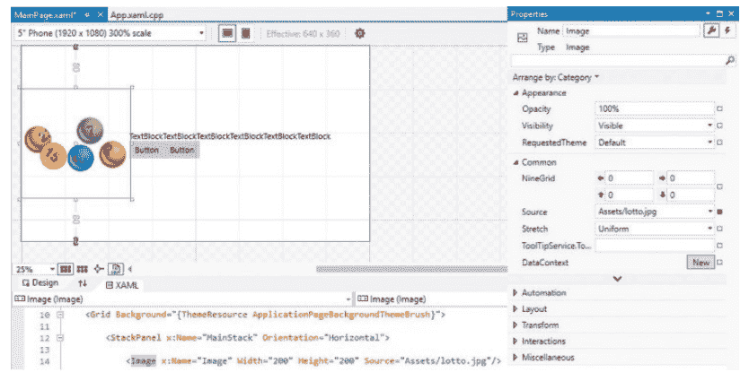


探索图像 **属性** 窗口中的 **Appearance**（外观）和 **Transform**（变换）选项，以发现如何修改它的显示方式。

## 设计布局

为了完成应用程序的布局，可以向 XAML 元素标签添加设计属性，以指定它们将显示的内容以及在界面中的精确位置：


### 通用

1. 打开 `MainPage.xaml`，然后为外部 `<StackPanel>` 元素添加两个属性以固定其位置 `HorizontalAlignment = "Left"`、`VerticalAlignment = "Top"`。
2. 接下来，通过修改初始分配值 `200` 来编辑 `<Image>` 元素以增加宽度 `Width = "300"`。
3. 现在，为嵌套的 `<StackPanel>` 元素添加属性以固定其位置 `VerticalAlignment = "Center"`。
4. 然后，同样编辑所有六个 `<TextBlock>` 元素，指定它们的初始内容、宽度和四周的边距：`Text = ""`、`Width = "20"`、`Margin = "15"`（重复此操作六次）。
5. 编辑第一个 `<Button>` 元素进行重命名，指定其标签内容和四周的边距：`x:Name = "BtnPin"`、`Content = "Get Lucky Numbers"`、`Margin = "15"`。
6. 编辑第二个 `<Button>` 元素进行重命名并指定其标签内容：`x:Name = "BtnReset"`、`Content = "Reset"`。
7. 最后，为每个 `<Button>` 元素添加属性以指定它们的初始状态：`IsEnabled = "True"`、`IsEnabled = "False"`。


单个 `Margin` 值会设置组件周围的所有四个边距。你可以指定两个值作为左/右和上下的边距，例如 `Margin = "10,30"`。或者，你可以单独为左、右、下设置值，例如 `Margin = "10,30,10,50"`。

每个元素中属性的顺序很重要，但 XAML 文件中的元素可能如下：

```xml
<StackPanel Orientation="Horizontal">
    <Image Source="icon.png" Width="100" Height="100"/>
    <StackPanel Orientation="Vertical" VerticalAlignment="Center">
        <StackPanel Name="Labels">
            <TextBlock Text="text1" />
            <TextBlock Text="text2" />
            <TextBlock Text="text3" />
        </StackPanel>
        <StackPanel Name="Buttons" Orientation="Horizontal">
            <Button Content="Button" />
            <Button Content="Button" />
        </StackPanel>
    </StackPanel>
</StackPanel>
```

注意每个 `<TextBlock>` 元素都有一个 `Text` 属性，可以在功能代码中引用它。例如 `textBlock1->Text`。

## 导入程序资源

为了让 XAML `<Image>` 组件显示图形，首先需要将图像文件添加到项目的 `Assets` 文件夹中。然后可以将其分配给 `<Image>` 标签的 `Source` 属性：


### 通用

1. 打开解决方案管理器，然后右键点击 `Assets` 文件夹，并从右键菜单中选择“添加”。
2. 现在，从下一个右键菜单中选择“现有项”——打开“添加现有项”对话框。


3. 在“添加现有项”中，浏览到图像的位置，然后选择文件并点击“添加”按钮。


显示的图像可以是任何常用的文件格式——例如 `.bmp`、`.gif`、`.jpg`、`png` 或 `.tif`。

4. 在解决方案管理器中，所选的图像文件现在出现在项目的 `Asset` 文件夹中。

5. 在设计器视图中选择 `Image` 组件，并点击“查看，属性”以显示其属性。


在属性窗口中，展开“Common”（常用）类别，然后点击 `Source` 项的箭头按钮并从下拉列表中选择图像。

图像现在显示在设计视图中，它的路径被添加到 XAML 视图代码和 `Source` 属性中。


探索图像 **属性** 窗口中的 **Appearance**（外观）和 **Transform**（变换）选项，以发现如何修改它的显示方式。

## 设计布局

为了完成应用程序的布局，可以向 XAML 元素标签添加设计属性，以指定它们将显示的内容以及在界面中的精确位置：


### 通用

1. 打开 `MainPage.xaml`，然后为外部 `<StackPanel>` 元素添加两个属性以固定其位置 `HorizontalAlignment = "Left"`、`VerticalAlignment = "Top"`。
2. 接下来，通过修改初始分配值 `200` 来编辑 `<Image>` 元素以增加宽度 `Width = "300"`。
3. 现在，为嵌套的 `<StackPanel>` 元素添加属性以固定其位置 `VerticalAlignment = "Center"`。
4. 然后，同样编辑所有六个 `<TextBlock>` 元素，指定它们的初始内容、宽度和四周的边距：`Text = ""`、`Width = "20"`、`Margin = "15"`（重复此操作六次）。
5. 编辑第一个 `<Button>` 元素进行重命名，指定其标签内容和四周的边距：`x:Name = "BtnPin"`、`Content = "Get Lucky Numbers"`、`Margin = "15"`。
6. 编辑第二个 `<Button>` 元素进行重命名并指定其标签内容：`x:Name = "BtnReset"`、`Content = "Reset"`。
7. 最后，为每个 `<Button>` 元素添加属性以指定它们的初始状态：`IsEnabled = "True"`、`IsEnabled = "False"`。


单个 `Margin` 值会设置组件周围的所有四个边距。你可以指定两个值作为左/右和上下的边距，例如 `Margin = "10,30"`。或者，你可以单独为左、右、下设置值，例如 `Margin = "10,30,10,50"`。

每个元素中属性的顺序很重要，但 XAML 文件中的元素可能如下：

```xml
<StackPanel Orientation="Horizontal">
    <Image Source="icon.png" Width="100" Height="100"/>
    <StackPanel Orientation="Vertical" VerticalAlignment="Center">
        <StackPanel Name="Labels">
            <TextBlock Text="text1" />
            <TextBlock Text="text2" />
            <TextBlock Text="text3" />
        </StackPanel>
        <StackPanel Name="Buttons" Orientation="Horizontal">
            <Button Content="Button" />
            <Button Content="Button" />
        </StackPanel>
    </StackPanel>
</StackPanel>
```

注意每个 `<TextBlock>` 元素都有一个 `Text` 属性，可以在功能代码中引用它。例如 `textBlock1->Text`。

## 导入程序资源

为了让 XAML `<Image>` 组件显示图形，首先需要将图像文件添加到项目的 `Assets` 文件夹中。然后可以将其分配给 `<Image>` 标签的 `Source` 属性：


### 通用

1. 打开解决方案管理器，然后右键点击 `Assets` 文件夹，并从右键菜单中选择“添加”。
2. 现在，从下一个右键菜单中选择“现有项”——打开“添加现有项”对话框。


3. 在“添加现有项”中，浏览到图像的位置，然后选择文件并点击“添加”按钮。


显示的图像可以是任何常用的文件格式——例如 `.bmp`、`.gif`、`.jpg`、`png` 或 `.tif`。

4. 在解决方案管理器中，所选的图像文件现在出现在项目的 `Asset` 文件夹中。

5. 在设计器视图中选择 `Image` 组件，并点击“查看，属性”以显示其属性。


在属性窗口中，展开“Common”（常用）类别，然后点击 `Source` 项的箭头按钮并从下拉列表中选择图像。

图像现在显示在设计视图中，它的路径被添加到 XAML 视图代码和 `Source` 属性中。


探索图像 **属性** 窗口中的 **Appearance**（外观）和 **Transform**（变换）选项，以发现如何修改它的显示方式。

## 设计布局

为了完成应用程序的布局，可以向 XAML 元素标签添加设计属性，以指定它们将显示的内容以及在界面中的精确位置：


### 通用

1. 打开 `MainPage.xaml`，然后为外部 `<StackPanel>` 元素添加两个属性以固定其位置 `HorizontalAlignment = "Left"`、`VerticalAlignment = "Top"`。
2. 接下来，通过修改初始分配值 `200` 来编辑 `<Image>` 元素以增加宽度 `Width = "300"`。
3. 现在，为嵌套的 `<StackPanel>` 元素添加属性以固定其位置 `VerticalAlignment = "Center"`。
4. 然后，同样编辑所有六个 `<TextBlock>` 元素，指定它们的初始内容、宽度和四周的边距：`Text = ""`、`Width = "20"`、`Margin = "15"`（重复此操作六次）。
5. 编辑第一个 `<Button>` 元素进行重命名，指定其标签内容和四周的边距：`x:Name = "BtnPin"`、`Content = "Get Lucky Numbers"`、`Margin = "15"`。
6. 编辑第二个 `<Button>` 元素进行重命名并指定其标签内容：`x:Name = "BtnReset"`、`Content = "Reset"`。
7. 最后，为每个 `<Button>` 元素添加属性以指定它们的初始状态：`IsEnabled = "True"`、`IsEnabled = "False"`。


单个 `Margin` 值会设置组件周围的所有四个边距。你可以指定两个值作为左/右和上下的边距，例如 `Margin = "10,30"`。或者，你可以单独为左、右、下设置值，例如 `Margin = "10,30,10,50"`。

每个元素中属性的顺序很重要，但 XAML 文件中的元素可能如下：

```xml
<StackPanel Orientation="Horizontal">
    <Image Source="icon.png" Width="100" Height="100"/>
    <StackPanel Orientation="Vertical" VerticalAlignment="Center">
        <StackPanel Name="Labels">
            <TextBlock Text="text1" />
            <TextBlock Text="text2" />
            <TextBlock Text="text3" />
        </StackPanel>
        <StackPanel Name="Buttons" Orientation="Horizontal">
            <Button Content="Button" />
            <Button Content="Button" />
        </StackPanel>
    </StackPanel>
</StackPanel>
```

注意每个 `<TextBlock>` 元素都有一个 `Text` 属性，可以在功能代码中引用它。例如 `textBlock1->Text`。

## 导入程序资源

为了让 XAML `<Image>` 组件显示图形，首先需要将图像文件添加到项目的 `Assets` 文件夹中。然后可以将其分配给 `<Image>` 标签的 `Source` 属性：


### 通用

1. 打开解决方案管理器，然后右键点击 `Assets` 文件夹，并从右键菜单中选择“添加”。
2. 现在，从下一个右键菜单中选择“现有项”——打开“添加现有项”对话框。


3. 在“添加现有项”中，浏览到图像的位置，然后选择文件并点击“添加”按钮。


显示的图像可以是任何常用的文件格式——例如 `.bmp`、`.gif`、`.jpg`、`png` 或 `.tif`。

4. 在解决方案管理器中，所选的图像文件现在出现在项目的 `Asset` 文件夹中。

5. 在设计器视图中选择 `Image` 组件，并点击“查看，属性”以显示其属性。


在属性窗口中，展开“Common”（常用）类别，然后点击 `Source` 项的箭头按钮并从下拉列表中选择图像。

图像现在显示在设计视图中，它的路径被添加到 XAML 视图代码和 `Source` 属性中。


探索图像 **属性** 窗口中的 **Appearance**（外观）和 **Transform**（变换）选项，以发现如何修改它的显示方式。

## 设计布局

为了完成应用程序的布局，可以向 XAML 元素标签添加设计属性，以指定它们将显示的内容以及在界面中的精确位置：


### 通用

1. 打开 `MainPage.xaml`，然后为外部 `<StackPanel>` 元素添加两个属性以固定其位置 `HorizontalAlignment = "Left"`、`VerticalAlignment = "Top"`。
2. 接下来，通过修改初始分配值 `200` 来编辑 `<Image>` 元素以增加宽度 `Width = "300"`。
3. 现在，为嵌套的 `<StackPanel>` 元素添加属性以固定其位置 `VerticalAlignment = "Center"`。
4. 然后，同样编辑所有六个 `<TextBlock>` 元素，指定它们的初始内容、宽度和四周的边距：`Text = ""`、`Width = "20"`、`Margin = "15"`（重复此操作六次）。
5. 编辑第一个 `<Button>` 元素进行重命名，指定其标签内容和四周的边距：`x:Name = "BtnPin"`、`Content = "Get Lucky Numbers"`、`Margin = "15"`。
6. 编辑第二个 `<Button>` 元素进行重命名并指定其标签内容：`x:Name = "BtnReset"`、`Content = "Reset"`。
7. 最后，为每个 `<Button>` 元素添加属性以指定它们的初始状态：`IsEnabled = "True"`、`IsEnabled = "False"`。


单个 `Margin` 值会设置组件周围的所有四个边距。你可以指定两个值作为左/右和上下的边距，例如 `Margin = "10,30"`。或者，你可以单独为左、右、下设置值，例如 `Margin = "10,30,10,50"`。

每个元素中属性的顺序很重要，但 XAML 文件中的元素可能如下：

```xml
<StackPanel Orientation="Horizontal">
    <Image Source="icon.png" Width="100" Height="100"/>
    <StackPanel Orientation="Vertical" VerticalAlignment="Center">
        <StackPanel Name="Labels">
            <TextBlock Text="text1" />
            <TextBlock Text="text2" />
            <TextBlock Text="text3" />
        </StackPanel>
        <StackPanel Name="Buttons" Orientation="Horizontal">
            <Button Content="Button" />
            <Button Content="Button" />
        </StackPanel>
    </StackPanel>
</StackPanel>
```

注意每个 `<TextBlock>` 元素都有一个 `Text` 属性，可以在功能代码中引用它。例如 `textBlock1->Text`。


```xml
<StackPanel Orientation="Horizontal">
    <Image Source="icon.png" Width="100" Height="100"/>
    <StackPanel Orientation="Vertical" VerticalAlignment="Center">
        <StackPanel Name="Labels">
            <TextBlock Text="text1" />
            <TextBlock Text="text2" />
            <TextBlock Text="text3" />
        </StackPanel>
        <StackPanel Name="Buttons" Orientation="Horizontal">
            <Button Content="Button" />
            <Button Content="Button" />
        </StackPanel>
    </StackPanel>
</StackPanel>
```

注意每个`<TextBlock>`元素都有一个`Text`属性，可以在功能代码中引用它。例如`textBlock1->Text`。

## 导入程序资源

为了让 XAML `<Image>`组件显示图形，首先需要将图像文件添加到项目的`Assets`文件夹中。然后可以将其分配给`<Image>`标签的`Source`属性：


通用

- 1. 打开解决方案管理器，然后右键点击`Assets`文件夹，并从右键菜单中选择“添加”
- 2. 现在，从下一个右键菜单中选择“现有项”——打开“添加现有项”对话框


- 在“添加现有项”中，浏览到图像的位置，然后选择文件并点击“添加”按钮


显示的图像可以是任何常用的文件格式——例如`.bmp`、`.gif`、`.jpg`、`png`或`.tif`。

## 4 在解决方案管理器中，所选的图像文件现在出现在项目的`Asset`文件夹中

## 5 在设计器视图中选择`Image`组件，并点击“查看，属性”以显示其属性


在属性窗口中，展开“Common”（常用）类别，然后点击`Source`项的箭头按钮并从下拉列表中选择图像

图像现在显示在设计视图中，它的路径被添加到 XAML 视图代码和`Source`属性中


探索图像`属性`窗口中的`Appearance`（外观）和`Transform`（变换）选项，以发现如何修改它的显示方式。

## 设计布局

为了完成应用程序的布局，可以向 XAML 元素标签添加设计属性，以指定它们将显示的内容以及在界面中的精确位置：


通用

- 1. 打开`MainPage.xaml`，然后为外部`<StackPanel>`元素添加两个属性以固定其位置`HorizontalAlignment = "Left"` `VerticalAlignment = "Top"`
- 2. 接下来，通过修改初始分配值 200 来编辑`<image>`元素以增加宽度`Width = "300"`
- 3. 现在，为嵌套的`<StackPanel>`元素添加属性以固定其位置`VerticalAlignment = "Center"`
- 4. 然后，同样编辑所有六`<TextBlock>`元素，指定它们的初始内容、宽度和四周的边距`Text = ""`, `Width = "20"` `Margin = "15"` `Text = ""`, `Width = "20"` `Margin = "15"` `Text = ""`, `Width = "20"` `Margin = "15"` `Text = ""`, `Width = "20"` `Margin = "15"` `Text = ""`, `Width = "20"` `Margin = "15"` `Text = ""`, `Width = "20"` `Margin = "15"`
- 5. 编辑第一个`<Button>`元素进行重命名，指定其标签内容和四周的边距`x:Name = "BtnPin"` `Content = "Get Lucky Numbers"` `Margin = "15"`
- 6. 编辑第二个`<Button>`元素进行重命名并指定其标签内容`x:Name = "BtnReset"` `Content = "Reset"`
- 7. 最后，为每个`<Button>`元素添加属性以指定它们的初始状态`IsEnabled = "True"` `IsEnabled = "False"`


单个`Margin`值会设置组件周围的所有四个边距。你可以指定两个值作为左/右和上下的边距，例如`Margin = "10,30"`。或者，你可以单独为左、右、下设置值，例如`Margin = "10,30,10,50"`。

每个元素中属性的顺序很重要，但 XAML 文件中的元素可能如下：

```xml
<StackPanel Orientation="Horizontal">
    <Image Source="icon.png" Width="100" Height="100"/>
    <StackPanel Orientation="Vertical" VerticalAlignment="Center">
        <StackPanel Name="Labels">
            <TextBlock Text="text1" />
            <TextBlock Text="text2" />
            <TextBlock Text="text3" />
        </StackPanel>
        <StackPanel Name="Buttons" Orientation="Horizontal">
            <Button Content="Button" />
            <Button Content="Button" />
        </StackPanel>
    </StackPanel>
</StackPanel>
```

注意每个`<TextBlock>`元素都有一个`Text`属性，可以在功能代码中引用它。例如`textBlock1->Text`。

## 导入程序资源

为了让 XAML `<Image>`组件显示图形，首先需要将图像文件添加到项目的`Assets`文件夹中。然后可以将其分配给`<Image>`标签的`Source`属性：


通用

- 1. 打开解决方案管理器，然后右键点击`Assets`文件夹，并从右键菜单中选择“添加”
- 2. 现在，从下一个右键菜单中选择“现有项”——打开“添加现有项”对话框


- 在“添加现有项”中，浏览到图像的位置，然后选择文件并点击“添加”按钮


显示的图像可以是任何常用的文件格式——例如`.bmp`、`.gif`、`.jpg`、`png`或`.tif`。

## 4 在解决方案管理器中，所选的图像文件现在出现在项目的`Asset`文件夹中

## 5 在设计器视图中选择`Image`组件，并点击“查看，属性”以显示其属性


在属性窗口中，展开“Common”（常用）类别，然后点击`Source`项的箭头按钮并从下拉列表中选择图像

图像现在显示在设计视图中，它的路径被添加到 XAML 视图代码和`Source`属性中


探索图像`属性`窗口中的`Appearance`（外观）和`Transform`（变换）选项，以发现如何修改它的显示方式。

## 设计布局

为了完成应用程序的布局，可以向 XAML 元素标签添加设计属性，以指定它们将显示的内容以及在界面中的精确位置：


通用

- 1. 打开`MainPage.xaml`，然后为外部`<StackPanel>`元素添加两个属性以固定其位置`HorizontalAlignment = "Left"` `VerticalAlignment = "Top"`
- 2. 接下来，通过修改初始分配值 200 来编辑`<image>`元素以增加宽度`Width = "300"`
- 3. 现在，为嵌套的`<StackPanel>`元素添加属性以固定其位置`VerticalAlignment = "Center"`
- 4. 然后，同样编辑所有六`<TextBlock>`元素，指定它们的初始内容、宽度和四周的边距`Text = ""`, `Width = "20"` `Margin = "15"` `Text = ""`, `Width = "20"` `Margin = "15"` `Text = ""`, `Width = "20"` `Margin = "15"` `Text = ""`, `Width = "20"` `Margin = "15"` `Text = ""`, `Width = "20"` `Margin = "15"` `Text = ""`, `Width = "20"` `Margin = "15"`
- 5. 编辑第一个`<Button>`元素进行重命名，指定其标签内容和四周的边距`x:Name = "BtnPin"` `Content = "Get Lucky Numbers"` `Margin = "15"`
- 6. 编辑第二个`<Button>`元素进行重命名并指定其标签内容`x:Name = "BtnReset"` `Content = "Reset"`
- 7. 最后，为每个`<Button>`元素添加属性以指定它们的初始状态`IsEnabled = "True"` `IsEnabled = "False"`


单个`Margin`值会设置组件周围的所有四个边距。你可以指定两个值作为左/右和上下的边距，例如`Margin = "10,30"`。或者，你可以单独为左、右、下设置值，例如`Margin = "10,30,10,50"`。

每个元素中属性的顺序很重要，但 XAML 文件中的元素可能如下：

```xml
<StackPanel Orientation="Horizontal">
    <Image Source="icon.png" Width="100" Height="100"/>
    <StackPanel Orientation="Vertical" VerticalAlignment="Center">
        <StackPanel Name="Labels">
            <TextBlock Text="text1" />
            <TextBlock Text="text2" />
            <TextBlock Text="text3" />
        </StackPanel>
        <StackPanel Name="Buttons" Orientation="Horizontal">
            <Button Content="Button" />
            <Button Content="Button" />
        </StackPanel>
    </StackPanel>
</StackPanel>
```


# 设计布局

为了完成应用程序的布局，可以向 XAML 元素标签添加设计属性，以指定它们将显示的内容以及在界面中的精确位置：


## 操作步骤

- 1. 打开 `MainPage.xaml`，然后为外部 `<StackPanel>` 元素添加两个属性以固定其位置：`HorizontalAlignment = "Left"`、`VerticalAlignment = "Top"`。
- 2. 接下来，通过修改初始分配值 200 来编辑 `<image>` 元素以增加宽度：`Width = "300"`。
- 3. 现在，为嵌套的 `<StackPanel>` 元素添加属性以固定其位置：`VerticalAlignment = "Center"`。
- 4. 然后，同样编辑所有六个 `<TextBlock>` 元素，指定它们的初始内容、宽度和四周的边距：`Text = ""`、`Width = "20"`、`Margin = "15"`。
- 5. 编辑第一个 `<Button>` 元素进行重命名，指定其标签内容和四周的边距：`x:Name = "BtnPin"`、`Content = "Get Lucky Numbers"`、`Margin = "15"`。
- 6. 编辑第二个 `<Button>` 元素进行重命名并指定其标签内容：`x:Name = "BtnReset"`、`Content = "Reset"`。
- 7. 最后，为每个 `<Button>` 元素添加属性以指定它们的初始状态：`IsEnabled = "True"`、`IsEnabled = "False"`。


单个 `Margin` 值会设置组件周围的所有四个边距。你可以指定两个值作为左/右和上下的边距，例如 `Margin = "10,30"`。或者，你可以单独为左、右、上、下设置值，例如 `Margin = "10,30,10,50"`。

每个元素中属性的顺序很重要，但 XAML 文件中的元素可能如下：

```xml
<StackPanel Orientation="Horizontal">
    <Image Source="icon.png" Width="100" Height="100"/>
    <StackPanel Orientation="Vertical" VerticalAlignment="Center">
        <StackPanel Name="Labels">
            <TextBlock Text="text1" />
            <TextBlock Text="text2" />
            <TextBlock Text="text3" />
        </StackPanel>
        <StackPanel Name="Buttons" Orientation="Horizontal">
            <Button Content="Button" />
            <Button Content="Button" />
        </StackPanel>
    </StackPanel>
</StackPanel>
```

注意每个 `<TextBlock>` 元素都有一个 `Text` 属性，可以在功能代码中引用它。例如 `textBlock1->Text`。

# 导入程序资源

为了让 XAML `<Image>` 组件显示图形，首先需要将图像文件添加到项目的 `Assets` 文件夹中。然后可以将其分配给 `<Image>` 标签的 `Source` 属性：


## 操作步骤

- 1. 打开解决方案管理器，然后右键点击 `Assets` 文件夹，并从右键菜单中选择“添加”。
- 2. 现在，从下一个右键菜单中选择“现有项”——打开“添加现有项”对话框。


- 在“添加现有项”中，浏览到图像的位置，然后选择文件并点击“添加”按钮。


显示的图像可以是任何常用的文件格式——例如 `.bmp`、`.gif`、`.jpg`、`.png` 或 `.tif`。

## 后续操作

- 4. 在解决方案管理器中，所选的图像文件现在出现在项目的 `Assets` 文件夹中。
- 5. 在设计器视图中选择 `Image` 组件，并点击“查看，属性”以显示其属性。


在属性窗口中，展开“Common”（常用）类别，然后点击 `Source` 项的箭头按钮并从下拉列表中选择图像。

图像现在显示在设计视图中，它的路径被添加到 XAML 视图代码和 `Source` 属性中。


探索图像**属性**窗口中的 **Appearance**（外观）和 **Transform**（变换）选项，以发现如何修改它的显示方式。


注意每个`<TextBlock>`元素都有一个`Text`属性，可以在功能代码中引用它。例如`textBlock1->Text`。

## 导入程序资源

为了让 XAML `<Image>`组件显示图形，首先需要将图像文件添加到项目的`Assets`文件夹中。然后可以将其分配给`<Image>`标签的`Source`属性：


**通用**

1. 打开解决方案管理器，然后右键点击`Assets`文件夹，并从右键菜单中选择“添加”。
2. 现在，从下一个右键菜单中选择“现有项”——打开“添加现有项”对话框。


- 在“添加现有项”中，浏览到图像的位置，然后选择文件并点击“添加”按钮。


显示的图像可以是任何常用的文件格式——例如`.bmp`、`.gif`、`.jpg`、`.png`或`.tif`。

## 4. 在解决方案管理器中，所选的图像文件现在出现在项目的`Asset`文件夹中

## 5. 在设计器视图中选择`Image`组件，并点击“查看，属性”以显示其属性


在属性窗口中，展开“Common”（常用）类别，然后点击`Source`项的箭头按钮并从下拉列表中选择图像。

图像现在显示在设计视图中，它的路径被添加到 XAML 视图代码和`Source`属性中。


探索图像**属性**窗口中的**Appearance**（外观）和**Transform**（变换）选项，以发现如何修改它的显示方式。

## 设计布局

为了完成应用程序的布局，可以向 XAML 元素标签添加设计属性，以指定它们将显示的内容以及在界面中的精确位置：


**通用**

1. 打开`MainPage.xaml`，然后为外部`<StackPanel>`元素添加两个属性以固定其位置：`HorizontalAlignment = "Left"`、`VerticalAlignment = "Top"`。
2. 接下来，通过修改初始分配值 200 来编辑`<image>`元素以增加宽度：`Width = "300"`。
3. 现在，为嵌套的`<StackPanel>`元素添加属性以固定其位置：`VerticalAlignment = "Center"`。
4. 然后，同样编辑所有六个`<TextBlock>`元素，指定它们的初始内容、宽度和四周的边距：`Text = ""`、`Width = "20"`、`Margin = "15"`（重复六次）。
5. 编辑第一个`<Button>`元素进行重命名，指定其标签内容和四周的边距：`x:Name = "BtnPin"`、`Content = "Get Lucky Numbers"`、`Margin = "15"`。
6. 编辑第二个`<Button>`元素进行重命名并指定其标签内容：`x:Name = "BtnReset"`、`Content = "Reset"`。
7. 最后，为每个`<Button>`元素添加属性以指定它们的初始状态：`IsEnabled = "True"`、`IsEnabled = "False"`。


单个`Margin`值会设置组件周围的所有四个边距。你可以指定两个值作为左/右和上下的边距，例如`Margin = "10,30"`。或者，你可以单独为左、右、下设置值，例如`Margin = "10,30,10,50"`。

每个元素中属性的顺序很重要，但 XAML 文件中的元素可能如下：

```xml
<StackPanel Orientation="Horizontal">
    <Image Source="icon.png" Width="100" Height="100"/>
    <StackPanel Orientation="Vertical" VerticalAlignment="Center">
        <StackPanel Name="Labels">
            <TextBlock Text="text1" />
            <TextBlock Text="text2" />
            <TextBlock Text="text3" />
        </StackPanel>
        <StackPanel Name="Buttons" Orientation="Horizontal">
            <Button Content="Button" />
            <Button Content="Button" />
        </StackPanel>
    </StackPanel>
</StackPanel>
```

注意每个`<TextBlock>`元素都有一个`Text`属性，可以在功能代码中引用它。例如`textBlock1->Text`。

## 导入程序资源

为了让 XAML `<Image>`组件显示图形，首先需要将图像文件添加到项目的`Assets`文件夹中。然后可以将其分配给`<Image>`标签的`Source`属性：


**通用**

1. 打开解决方案管理器，然后右键点击`Assets`文件夹，并从右键菜单中选择“添加”。
2. 现在，从下一个右键菜单中选择“现有项”——打开“添加现有项”对话框。


- 在“添加现有项”中，浏览到图像的位置，然后选择文件并点击“添加”按钮。


显示的图像可以是任何常用的文件格式——例如`.bmp`、`.gif`、`.jpg`、`.png`或`.tif`。

## 4. 在解决方案管理器中，所选的图像文件现在出现在项目的`Asset`文件夹中

## 5. 在设计器视图中选择`Image`组件，并点击“查看，属性”以显示其属性


在属性窗口中，展开“Common”（常用）类别，然后点击`Source`项的箭头按钮并从下拉列表中选择图像。

图像现在显示在设计视图中，它的路径被添加到 XAML 视图代码和`Source`属性中。


探索图像**属性**窗口中的**Appearance**（外观）和**Transform**（变换）选项，以发现如何修改它的显示方式。

## 设计布局

为了完成应用程序的布局，可以向 XAML 元素标签添加设计属性，以指定它们将显示的内容以及在界面中的精确位置：


**通用**

1. 打开`MainPage.xaml`，然后为外部`<StackPanel>`元素添加两个属性以固定其位置：`HorizontalAlignment = "Left"`、`VerticalAlignment = "Top"`。
2. 接下来，通过修改初始分配值 200 来编辑`<image>`元素以增加宽度：`Width = "300"`。
3. 现在，为嵌套的`<StackPanel>`元素添加属性以固定其位置：`VerticalAlignment = "Center"`。
4. 然后，同样编辑所有六个`<TextBlock>`元素，指定它们的初始内容、宽度和四周的边距：`Text = ""`、`Width = "20"`、`Margin = "15"`（重复六次）。
5. 编辑第一个`<Button>`元素进行重命名，指定其标签内容和四周的边距：`x:Name = "BtnPin"`、`Content = "Get Lucky Numbers"`、`Margin = "15"`。
6. 编辑第二个`<Button>`元素进行重命名并指定其标签内容：`x:Name = "BtnReset"`、`Content = "Reset"`。
7. 最后，为每个`<Button>`元素添加属性以指定它们的初始状态：`IsEnabled = "True"`、`IsEnabled = "False"`。


单个`Margin`值会设置组件周围的所有四个边距。你可以指定两个值作为左/右和上下的边距，例如`Margin = "10,30"`。或者，你可以单独为左、右、下设置值，例如`Margin = "10,30,10,50"`。

每个元素中属性的顺序很重要，但 XAML 文件中的元素可能如下：

```xml
<StackPanel Orientation="Horizontal">
    <Image Source="icon.png" Width="100" Height="100"/>
    <StackPanel Orientation="Vertical" VerticalAlignment="Center">
        <StackPanel Name="Labels">
            <TextBlock Text="text1" />
            <TextBlock Text="text2" />
            <TextBlock Text="text3" />
        </StackPanel>
        <StackPanel Name="Buttons" Orientation="Horizontal">
            <Button Content="Button" />
            <Button Content="Button" />
        </StackPanel>
    </StackPanel>
</StackPanel>
```

注意每个`<TextBlock>`元素都有一个`Text`属性，可以在功能代码中引用它。例如`textBlock1->Text`。

## 导入程序资源

为了让 XAML `<Image>`组件显示图形，首先需要将图像文件添加到项目的`Assets`文件夹中。然后可以将其分配给`<Image>`标签的`Source`属性：


**通用**

1. 打开解决方案管理器，然后右键点击`Assets`文件夹，并从右键菜单中选择“添加”。
2. 现在，从下一个右键菜单中选择“现有项”——打开“添加现有项”对话框。


- 在“添加现有项”中，浏览到图像的位置，然后选择文件并点击“添加”按钮。


显示的图像可以是任何常用的文件格式——例如`.bmp`、`.gif`、`.jpg`、`.png`或`.tif`。

## 4. 在解决方案管理器中，所选的图像文件现在出现在项目的`Asset`文件夹中

## 5. 在设计器视图中选择`Image`组件，并点击“查看，属性”以显示其属性


在属性窗口中，展开“Common”（常用）类别，然后点击`Source`项的箭头按钮并从下拉列表中选择图像。

图像现在显示在设计视图中，它的路径被添加到 XAML 视图代码和`Source`属性中。


探索图像**属性**窗口中的**Appearance**（外观）和**Transform**（变换）选项，以发现如何修改它的显示方式。

## 设计布局

为了完成应用程序的布局，可以向 XAML 元素标签添加设计属性，以指定它们将显示的内容以及在界面中的精确位置：


**通用**

1. 打开`MainPage.xaml`，然后为外部`<StackPanel>`元素添加两个属性以固定其位置：`HorizontalAlignment = "Left"`、`VerticalAlignment = "Top"`。
2. 接下来，通过修改初始分配值 200 来编辑`<image>`元素以增加宽度：`Width = "300"`。
3. 现在，为嵌套的`<StackPanel>`元素添加属性以固定其位置：`VerticalAlignment = "Center"`。
4. 然后，同样编辑所有六个`<TextBlock>`元素，指定它们的初始内容、宽度和四周的边距：`Text = ""`、`Width = "20"`、`Margin = "15"`（重复六次）。
5. 编辑第一个`<Button>`元素进行重命名，指定其标签内容和四周的边距：`x:Name = "BtnPin"`、`Content = "Get Lucky Numbers"`、`Margin = "15"`。
6. 编辑第二个`<Button>`元素进行重命名并指定其标签内容：`x:Name = "BtnReset"`、`Content = "Reset"`。
7. 最后，为每个`<Button>`元素添加属性以指定它们的初始状态：`IsEnabled = "True"`、`IsEnabled = "False"`。


单个`Margin`值会设置组件周围的所有四个边距。你可以指定两个值作为左/右和上下的边距，例如`Margin = "10,30"`。或者，你可以单独为左、右、下设置值，例如`Margin = "10,30,10,50"`。

每个元素中属性的顺序很重要，但 XAML 文件中的元素可能如下：

```xml
<StackPanel Orientation="Horizontal">
    <Image Source="icon.png" Width="100" Height="100"/>
    <StackPanel Orientation="Vertical" VerticalAlignment="Center">
        <StackPanel Name="Labels">
            <TextBlock Text="text1" />
            <TextBlock Text="text2" />
            <TextBlock Text="text3" />
        </StackPanel>
        <StackPanel Name="Buttons" Orientation="Horizontal">
            <Button Content="Button" />
            <Button Content="Button" />
        </StackPanel>
    </StackPanel>
</StackPanel>
```


注意每个 `<TextBlock>` 元素都有一个 `Text` 属性，可以在功能代码中引用它。例如 `textBlock1->Text`。

## 导入程序资源

为了让 XAML `<Image>` 组件显示图形，首先需要将图像文件添加到项目的 `Assets` 文件夹中。然后可以将其分配给 `<Image>` 标签的 `Source` 属性：


### 通用

- 1. 打开解决方案管理器，然后右键点击 `Assets` 文件夹，并从右键菜单中选择“添加”
- 2. 现在，从下一个右键菜单中选择“现有项”——打开“添加现有项”对话框


- 在“添加现有项”中，浏览到图像的位置，然后选择文件并点击“添加”按钮


显示的图像可以是任何常用的文件格式——例如 `.bmp`、`.gif`、`.jpg`、`png` 或 `.tif`。

### 4. 在解决方案管理器中，所选的图像文件现在出现在项目的 `Asset` 文件夹中

### 5. 在设计器视图中选择 `Image` 组件，并点击“查看，属性”以显示其属性


在属性窗口中，展开“Common”（常用）类别，然后点击 `Source` 项的箭头按钮并从下拉列表中选择图像

图像现在显示在设计视图中，它的路径被添加到 `XAML` 视图代码和 `Source` 属性中


探索图像`属性`窗口中的 `Appearance`（外观）和 `Transform`（变换）选项，以发现如何修改它的显示方式。

## 设计布局

为了完成应用程序的布局，可以向 XAML 元素标签添加设计属性，以指定它们将显示的内容以及在界面中的精确位置：


### 通用

- 1. 打开 `MainPage.xaml`，然后为外部 `<StackPanel>` 元素添加两个属性以固定其位置 `HorizontalAlignment = "Left"` `VerticalAlignment = "Top"`
- 2. 接下来，通过修改初始分配值 `200` 来编辑 `<image>` 元素以增加宽度 `Width = "300"`
- 3. 现在，为嵌套的 `<StackPanel>` 元素添加属性以固定其位置 `VerticalAlignment = "Center"`
- 4. 然后，同样编辑所有六 `<TextBlock>` 元素，指定它们的初始内容、宽度和四周的边距 `Text = ""`, `Width = "20"` `Margin = "15"` `Text = ""`, `Width = "20"` `Margin = "15"` `Text = ""`, `Width = "20"` `Margin = "15"` `Text = ""`, `Width = "20"` `Margin = "15"` `Text = ""`, `Width = "20"` `Margin = "15"` `Text = ""`, `Width = "20"` `Margin = "15"`
- 5. 编辑第一个 `<Button>` 元素进行重命名，指定其标签内容和四周的边距 `x:Name = "BtnPin"` `Content = "Get Lucky Numbers"` `Margin = "15"`
- 6. 编辑第二个 `<Button>` 元素进行重命名并指定其标签内容 `x:Name = "BtnReset"` `Content = "Reset"`
- 7. 最后，为每个 `<Button>` 元素添加属性以指定它们的初始状态 `IsEnabled = "True"` `IsEnabled = "False"`


单个 `Margin` 值会设置组件周围的所有四个边距。你可以指定两个值作为左/右和上下的边距，例如 `Margin = "10,30"`。或者，你可以单独为左、右、下设置值，例如 `Margin = "10,30,10,50"`。

每个元素中属性的顺序很重要，但 XAML 文件中的元素可能如下：

```xml
<StackPanel Orientation="Horizontal">

    <Image Source="icon.png" Width="100" Height="100"/>

    <StackPanel Orientation="Vertical" VerticalAlignment="Center">

        <StackPanel Name="Labels">

            <TextBlock Text="text1" />

            <TextBlock Text="text2" />

            <TextBlock Text="text3" />

        </StackPanel>

        <StackPanel Name="Buttons" Orientation="Horizontal">

            <Button Content="Button" />

            <Button Content="Button" />

        </StackPanel>

    </StackPanel>

</StackPanel>
```


注意每个`<TextBlock>`元素都有一个`Text`属性，可以在功能代码中引用它。例如`textBlock1->Text`。

## 导入程序资源

为了让 XAML `<Image>` 组件显示图形，首先需要将图像文件添加到项目的`Assets`文件夹中。然后可以将其分配给`<Image>`标签的`Source`属性：


**通用**

1. 打开解决方案管理器，然后右键点击`Assets`文件夹，并从右键菜单中选择“添加”。
2. 现在，从下一个右键菜单中选择“现有项”——打开“添加现有项”对话框。


- 在“添加现有项”中，浏览到图像的位置，然后选择文件并点击“添加”按钮。


显示的图像可以是任何常用的文件格式——例如`.bmp`、`.gif`、`.jpg`、`png`或`.tif`。

4. 在解决方案管理器中，所选的图像文件现在出现在项目的`Asset`文件夹中。
5. 在设计器视图中选择`Image`组件，并点击“查看，属性”以显示其属性。


在属性窗口中，展开“Common”（常用）类别，然后点击`Source`项的箭头按钮并从下拉列表中选择图像。

图像现在显示在设计视图中，它的路径被添加到 XAML 视图代码和`Source`属性中。


探索图像`属性`窗口中的`Appearance`（外观）和`Transform`（变换）选项，以发现如何修改它的显示方式。

## 设计布局

为了完成应用程序的布局，可以向 XAML 元素标签添加设计属性，以指定它们将显示的内容以及在界面中的精确位置：


**通用**

1. 打开`MainPage.xaml`，然后为外部`<StackPanel>`元素添加两个属性以固定其位置：`HorizontalAlignment = "Left"`，`VerticalAlignment = "Top"`。
2. 接下来，通过修改初始分配值`200`来编辑`<image>`元素以增加宽度：`Width = "300"`。
3. 现在，为嵌套的`<StackPanel>`元素添加属性以固定其位置：`VerticalAlignment = "Center"`。
4. 然后，同样编辑所有六个`<TextBlock>`元素，指定它们的初始内容、宽度和四周的边距：`Text = ""`，`Width = "20"`，`Margin = "15"`（重复六次）。
5. 编辑第一个`<Button>`元素进行重命名，指定其标签内容和四周的边距：`x:Name = "BtnPin"`，`Content = "Get Lucky Numbers"`，`Margin = "15"`。
6. 编辑第二个`<Button>`元素进行重命名并指定其标签内容：`x:Name = "BtnReset"`，`Content = "Reset"`。
7. 最后，为每个`<Button>`元素添加属性以指定它们的初始状态：`IsEnabled = "True"`，`IsEnabled = "False"`。


单个`Margin`值会设置组件周围的所有四个边距。你可以指定两个值作为左/右和上下的边距，例如`Margin = "10,30"`。或者，你可以单独为左、右、下设置值，例如`Margin = "10,30,10,50"`。

每个元素中属性的顺序很重要，但 XAML 文件中的元素可能如下：

```xml
<StackPanel Orientation="Horizontal">
    <Image Source="icon.png" Width="100" Height="100"/>
    <StackPanel Orientation="Vertical" VerticalAlignment="Center">
        <StackPanel Name="Labels">
            <TextBlock Text="text1" />
            <TextBlock Text="text2" />
            <TextBlock Text="text3" />
        </StackPanel>
        <StackPanel Name="Buttons" Orientation="Horizontal">
            <Button Content="Button" />
            <Button Content="Button" />
        </StackPanel>
    </StackPanel>
</StackPanel>
```

注意每个`<TextBlock>`元素都有一个`Text`属性，可以在功能代码中引用它。例如`textBlock1->Text`。

## 导入程序资源

为了让 XAML `<Image>` 组件显示图形，首先需要将图像文件添加到项目的`Assets`文件夹中。然后可以将其分配给`<Image>`标签的`Source`属性：


**通用**

1. 打开解决方案管理器，然后右键点击`Assets`文件夹，并从右键菜单中选择“添加”。
2. 现在，从下一个右键菜单中选择“现有项”——打开“添加现有项”对话框。


- 在“添加现有项”中，浏览到图像的位置，然后选择文件并点击“添加”按钮。


显示的图像可以是任何常用的文件格式——例如`.bmp`、`.gif`、`.jpg`、`png`或`.tif`。

4. 在解决方案管理器中，所选的图像文件现在出现在项目的`Asset`文件夹中。
5. 在设计器视图中选择`Image`组件，并点击“查看，属性”以显示其属性。


在属性窗口中，展开“Common”（常用）类别，然后点击`Source`项的箭头按钮并从下拉列表中选择图像。

图像现在显示在设计视图中，它的路径被添加到 XAML 视图代码和`Source`属性中。


探索图像`属性`窗口中的`Appearance`（外观）和`Transform`（变换）选项，以发现如何修改它的显示方式。

## 设计布局

为了完成应用程序的布局，可以向 XAML 元素标签添加设计属性，以指定它们将显示的内容以及在界面中的精确位置：


**通用**

1. 打开`MainPage.xaml`，然后为外部`<StackPanel>`元素添加两个属性以固定其位置：`HorizontalAlignment = "Left"`，`VerticalAlignment = "Top"`。
2. 接下来，通过修改初始分配值`200`来编辑`<image>`元素以增加宽度：`Width = "300"`。
3. 现在，为嵌套的`<StackPanel>`元素添加属性以固定其位置：`VerticalAlignment = "Center"`。
4. 然后，同样编辑所有六个`<TextBlock>`元素，指定它们的初始内容、宽度和四周的边距：`Text = ""`，`Width = "20"`，`Margin = "15"`（重复六次）。
5. 编辑第一个`<Button>`元素进行重命名，指定其标签内容和四周的边距：`x:Name = "BtnPin"`，`Content = "Get Lucky Numbers"`，`Margin = "15"`。
6. 编辑第二个`<Button>`元素进行重命名并指定其标签内容：`x:Name = "BtnReset"`，`Content = "Reset"`。
7. 最后，为每个`<Button>`元素添加属性以指定它们的初始状态：`IsEnabled = "True"`，`IsEnabled = "False"`。


单个`Margin`值会设置组件周围的所有四个边距。你可以指定两个值作为左/右和上下的边距，例如`Margin = "10,30"`。或者，你可以单独为左、右、下设置值，例如`Margin = "10,30,10,50"`。

每个元素中属性的顺序很重要，但 XAML 文件中的元素可能如下：

```xml
<StackPanel Orientation="Horizontal">
    <Image Source="icon.png" Width="100" Height="100"/>
    <StackPanel Orientation="Vertical" VerticalAlignment="Center">
        <StackPanel Name="Labels">
            <TextBlock Text="text1" />
            <TextBlock Text="text2" />
            <TextBlock Text="text3" />
        </StackPanel>
        <StackPanel Name="Buttons" Orientation="Horizontal">
            <Button Content="Button" />
            <Button Content="Button" />
        </StackPanel>
    </StackPanel>
</StackPanel>
```

注意每个`<TextBlock>`元素都有一个`Text`属性，可以在功能代码中引用它。例如`textBlock1->Text`。

## 导入程序资源

为了让 XAML `<Image>` 组件显示图形，首先需要将图像文件添加到项目的`Assets`文件夹中。然后可以将其分配给`<Image>`标签的`Source`属性：


**通用**

1. 打开解决方案管理器，然后右键点击`Assets`文件夹，并从右键菜单中选择“添加”。
2. 现在，从下一个右键菜单中选择“现有项”——打开“添加现有项”对话框。


- 在“添加现有项”中，浏览到图像的位置，然后选择文件并点击“添加”按钮。


显示的图像可以是任何常用的文件格式——例如`.bmp`、`.gif`、`.jpg`、`png`或`.tif`。

4. 在解决方案管理器中，所选的图像文件现在出现在项目的`Asset`文件夹中。
5. 在设计器视图中选择`Image`组件，并点击“查看，属性”以显示其属性。


在属性窗口中，展开“Common”（常用）类别，然后点击`Source`项的箭头按钮并从下拉列表中选择图像。

图像现在显示在设计视图中，它的路径被添加到 XAML 视图代码和`Source`属性中。


探索图像`属性`窗口中的`Appearance`（外观）和`Transform`（变换）选项，以发现如何修改它的显示方式。

## 设计布局

为了完成应用程序的布局，可以向 XAML 元素标签添加设计属性，以指定它们将显示的内容以及在界面中的精确位置：


**通用**

1. 打开`MainPage.xaml`，然后为外部`<StackPanel>`元素添加两个属性以固定其位置：`HorizontalAlignment = "Left"`，`VerticalAlignment = "Top"`。
2. 接下来，通过修改初始分配值`200`来编辑`<image>`元素以增加宽度：`Width = "300"`。
3. 现在，为嵌套的`<StackPanel>`元素添加属性以固定其位置：`VerticalAlignment = "Center"`。
4. 然后，同样编辑所有六个`<TextBlock>`元素，指定它们的初始内容、宽度和四周的边距：`Text = ""`，`Width = "20"`，`Margin = "15"`（重复六次）。
5. 编辑第一个`<Button>`元素进行重命名，指定其标签内容和四周的边距：`x:Name = "BtnPin"`，`Content = "Get Lucky Numbers"`，`Margin = "15"`。
6. 编辑第二个`<Button>`元素进行重命名并指定其标签内容：`x:Name = "BtnReset"`，`Content = "Reset"`。
7. 最后，为每个`<Button>`元素添加属性以指定它们的初始状态：`IsEnabled = "True"`，`IsEnabled = "False"`。


单个`Margin`值会设置组件周围的所有四个边距。你可以指定两个值作为左/右和上下的边距，例如`Margin = "10,30"`。或者，你可以单独为左、右、下设置值，例如`Margin = "10,30,10,50"`。

每个元素中属性的顺序很重要，但 XAML 文件中的元素可能如下：

```xml
<StackPanel Orientation="Horizontal">
    <Image Source="icon.png" Width="100" Height="100"/>
    <StackPanel Orientation="Vertical" VerticalAlignment="Center">
        <StackPanel Name="Labels">
            <TextBlock Text="text1" />
            <TextBlock Text="text2" />
            <TextBlock Text="text3" />
        </StackPanel>
        <StackPanel Name="Buttons" Orientation="Horizontal">
            <Button Content="Button" />
            <Button Content="Button" />
        </StackPanel>
    </StackPanel>
</StackPanel>
```


注意每个 `<TextBlock>` 元素都有一个 `Text` 属性，可以在功能代码中引用它。例如 `textBlock1->Text`。

## 导入程序资源

为了让 XAML `<Image>` 组件显示图形，首先需要将图像文件添加到项目的 `Assets` 文件夹中。然后可以将其分配给 `<Image>` 标签的 `Source` 属性：


通用

1. 打开解决方案管理器，然后右键点击 `Assets` 文件夹，并从右键菜单中选择“添加”。
2. 现在，从下一个右键菜单中选择“现有项”——打开“添加现有项”对话框。


在“添加现有项”中，浏览到图像的位置，然后选择文件并点击“添加”按钮。


显示的图像可以是任何常用的文件格式——例如 `.bmp`、`.gif`、`.jpg`、`.png` 或 `.tif`。

4. 在解决方案管理器中，所选的图像文件现在出现在项目的 `Asset` 文件夹中。
5. 在设计器视图中选择 `Image` 组件，并点击“查看，属性”以显示其属性。


在属性窗口中，展开“Common”（常用）类别，然后点击 `Source` 项的箭头按钮并从下拉列表中选择图像。

图像现在显示在设计视图中，它的路径被添加到 XAML 视图代码和 `Source` 属性中。


探索图像`属性`窗口中的`Appearance`（外观）和`Transform`（变换）选项，以发现如何修改它的显示方式。

## 设计布局

为了完成应用程序的布局，可以向 XAML 元素标签添加设计属性，以指定它们将显示的内容以及在界面中的精确位置：


通用

1. 打开 `MainPage.xaml`，然后为外部 `<StackPanel>` 元素添加两个属性以固定其位置：`HorizontalAlignment = "Left"`、`VerticalAlignment = "Top"`。
2. 接下来，通过修改初始分配值 `200` 来编辑 `<image>` 元素以增加宽度：`Width = "300"`。
3. 现在，为嵌套的 `<StackPanel>` 元素添加属性以固定其位置：`VerticalAlignment = "Center"`。
4. 然后，同样编辑所有六个 `<TextBlock>` 元素，指定它们的初始内容、宽度和四周的边距：`Text = ""`、`Width = "20"`、`Margin = "15"`（重复六次）。
5. 编辑第一个 `<Button>` 元素进行重命名，指定其标签内容和四周的边距：`x:Name = "BtnPin"`、`Content = "Get Lucky Numbers"`、`Margin = "15"`。
6. 编辑第二个 `<Button>` 元素进行重命名并指定其标签内容：`x:Name = "BtnReset"`、`Content = "Reset"`。
7. 最后，为每个 `<Button>` 元素添加属性以指定它们的初始状态：`IsEnabled = "True"`、`IsEnabled = "False"`。


单个 `Margin` 值会设置组件周围的所有四个边距。你可以指定两个值作为左/右和上下的边距，例如 `Margin = "10,30"`。或者，你可以单独为左、右、下设置值，例如 `Margin = "10,30,10,50"`。

每个元素中属性的顺序很重要，但 XAML 文件中的元素可能如下：

```xml
<StackPanel Orientation="Horizontal">
    <Image Source="icon.png" Width="100" Height="100"/>
    <StackPanel Orientation="Vertical" VerticalAlignment="Center">
        <StackPanel Name="Labels">
            <TextBlock Text="text1" />
            <TextBlock Text="text2" />
            <TextBlock Text="text3" />
        </StackPanel>
        <StackPanel Name="Buttons" Orientation="Horizontal">
            <Button Content="Button" />
            <Button Content="Button" />
        </StackPanel>
    </StackPanel>
</StackPanel>
```


## 设计布局

为了完成应用程序的布局，可以向 XAML 元素标签添加设计属性，以指定它们将显示的内容以及在界面中的精确位置：


**通用**

- 1. 打开 `MainPage.xaml`，然后为外部 `<StackPanel>` 元素添加两个属性以固定其位置：`HorizontalAlignment = "Left"` 和 `VerticalAlignment = "Top"`。
- 2. 接下来，通过修改初始分配值 `200` 来编辑 `<image>` 元素以增加宽度：`Width = "300"`。
- 3. 现在，为嵌套的 `<StackPanel>` 元素添加属性以固定其位置：`VerticalAlignment = "Center"`。
- 4. 然后，同样编辑所有六个 `<TextBlock>` 元素，指定它们的初始内容、宽度和四周的边距：`Text = "", Width = "20" Margin = "15"`（重复六次）。
- 5. 编辑第一个 `<Button>` 元素进行重命名，指定其标签内容和四周的边距：`x:Name = "BtnPin" Content = "Get Lucky Numbers" Margin = "15"`。
- 6. 编辑第二个 `<Button>` 元素进行重命名并指定其标签内容：`x:Name = "BtnReset" Content = "Reset"`。
- 7. 最后，为每个 `<Button>` 元素添加属性以指定它们的初始状态：`IsEnabled = "True"` 和 `IsEnabled = "False"`。


单个`Margin`值会设置组件周围的所有四个边距。你可以指定两个值作为左/右和上下的边距，例如`Margin = "10,30"`。或者，你可以单独为左、右、下设置值，例如`Margin = "10,30,10,50"`。

每个元素中属性的顺序很重要，但 XAML 文件中的元素可能如下：

```xml
<StackPanel Orientation="Horizontal">
    <Image Source="icon.png" Width="100" Height="100"/>
    <StackPanel Orientation="Vertical" VerticalAlignment="Center">
        <StackPanel Name="Labels">
            <TextBlock Text="text1" />
            <TextBlock Text="text2" />
            <TextBlock Text="text3" />
        </StackPanel>
        <StackPanel Name="Buttons" Orientation="Horizontal">
            <Button Content="Button" />
            <Button Content="Button" />
        </StackPanel>
    </StackPanel>
</StackPanel>
```

注意每个`<TextBlock>`元素都有一个`Text`属性，可以在功能代码中引用它。例如`textblock1->Text`。

## 导入程序资源

为了让 XAML `<Image>` 组件显示图形，首先需要将图像文件添加到项目的`Assets`文件夹中。然后可以将其分配给`<Image>`标签的`Source`属性：


**通用**

- 1. 打开解决方案管理器，然后右键点击`Assets`文件夹，并从右键菜单中选择“添加”。
- 2. 现在，从下一个右键菜单中选择“现有项”——打开“添加现有项”对话框。


- 在“添加现有项”中，浏览到图像的位置，然后选择文件并点击“添加”按钮。


显示的图像可以是任何常用的文件格式——例如`.bmp`、`.gif`、`.jpg`、`png`或`.tif`。

4. 在解决方案管理器中，所选的图像文件现在出现在项目的`Asset`文件夹中。

5. 在设计器视图中选择`Image`组件，并点击“查看，属性”以显示其属性。


在属性窗口中，展开“Common”（常用）类别，然后点击`Source`项的箭头按钮并从下拉列表中选择图像。

图像现在显示在设计视图中，它的路径被添加到 XAML 视图代码和`Source`属性中。


探索图像**属性**窗口中的**Appearance**（外观）和**Transform**（变换）选项，以发现如何修改它的显示方式。


注意每个`<TextBlock>`元素都有一个`Text`属性，可以在功能代码中引用它。例如`textblock1->Text`。

## 导入程序资源

为了让 XAML `<Image>` 组件显示图形，首先需要将图像文件添加到项目的`Assets`文件夹中。然后可以将其分配给`<Image>`标签的`Source`属性：


通用

- 1. 打开解决方案管理器，然后右键点击`Assets`文件夹，并从右键菜单中选择“添加”
- 2. 现在，从下一个右键菜单中选择“现有项”——打开“添加现有项”对话框


- 在“添加现有项”中，浏览到图像的位置，然后选择文件并点击“添加”按钮


显示的图像可以是任何常用的文件格式——例如`.bmp`、`.gif`、`.jpg`、`png`或`.tif`。

## 4 在解决方案管理器中，所选的图像文件现在出现在项目的`Asset`文件夹中

## 5 在设计器视图中选择`Image`组件，并点击“查看，属性”以显示其属性


在属性窗口中，展开“Common”（常用）类别，然后点击`Source`项的箭头按钮并从下拉列表中选择图像

图像现在显示在设计视图中，它的路径被添加到 XAML 视图代码和`Source`属性中


探索图像属性窗口中的“Appearance”（外观）和“Transform”（变换）选项，以发现如何修改它的显示方式。

## 设计布局

为了完成应用程序的布局，可以向 XAML 元素标签添加设计属性，以指定它们将显示的内容以及在界面中的精确位置：


通用

- 1. 打开`MainPage.xaml`，然后为外部`<StackPanel>`元素添加两个属性以固定其位置`HorizontalAlignment = "Left"` `VerticalAlignment = "Top"`
- 2. 接下来，通过修改初始分配值 200 来编辑`<image>`元素以增加宽度`Width = "300"`
- 3. 现在，为嵌套的`<StackPanel>`元素添加属性以固定其位置`VerticalAlignment = "Center"`
- 4. 然后，同样编辑所有六`<TextBlock>`元素，指定它们的初始内容、宽度和四周的边距`Text = ""`, `Width = "20"`, `Margin = "15"` `Text = ""`, `Width = "20"`, `Margin = "15"` `Text = ""`, `Width = "20"`, `Margin = "15"` `Text = ""`, `Width = "20"`, `Margin = "15"` `Text = ""`, `Width = "20"`, `Margin = "15"` `Text = ""`, `Width = "20"`, `Margin = "15"`
- 5. 编辑第一个`<Button>`元素进行重命名，指定其标签内容和四周的边距`x:Name = "BtnPin"` `Content = "Get Lucky Numbers"` `Margin = "15"`
- 6. 编辑第二个`<Button>`元素进行重命名并指定其标签内容`x:Name = "BtnReset"` `Content = "Reset"`
- 7. 最后，为每个`<Button>`元素添加属性以指定它们的初始状态`IsEnabled = "True"` `IsEnabled = "False"`


单个`Margin`值会设置组件周围的所有四个边距。你可以指定两个值作为左/右和上下的边距，例如`Margin = "10,30"`。或者，你可以单独为左、右、下设置值，例如`Margin = "10,30,10,50"`。

每个元素中属性的顺序很重要，但 XAML 文件中的元素可能如下：

```xml
<StackPanel Orientation="Horizontal">
    <Image Source="icon.png" Width="100" Height="100"/>    
    <StackPanel Orientation="Vertical" VerticalAlignment="Center">
        <StackPanel Name="Labels">
            <TextBlock Text="text1" />
            <TextBlock Text="text2" />
            <TextBlock Text="text3" />
        </StackPanel>
        <StackPanel Name="Buttons" Orientation="Horizontal">
            <Button Content="Button" />    
            <Button Content="Button" />
        </StackPanel>
    </StackPanel>
</StackPanel>
```


当你在 XAML 中添加组件元素时，它们会出现在设计视图中，直到呈现如下所示：


`Name` 属性之前的 `x:` 前缀引用了 UWP 应用所使用的 XAML 架构。


外部的 `<StackPanel>` 是一个水平布局，包含一个 `<Image>` 和嵌套的 `<StackPanel>`。嵌套的 `<StackPanel>` 是一个垂直布局，包含两个额外的 `<StackPanel>` 元素，每个元素水平显示其组件。


注意每个 `<TextBlock>` 元素都有一个 `Text` 属性，可以在功能代码中引用它。例如 `textBlock1->Text`。

## 导入程序资源

为了让 XAML `<Image>` 组件显示图形，首先需要将图像文件添加到项目的 `Assets` 文件夹中。然后可以将其分配给 `<Image>` 标签的 `Source` 属性：


通用

1. 打开解决方案管理器，然后右键点击 `Assets` 文件夹，并从右键菜单中选择“添加”
2. 现在，从下一个右键菜单中选择“现有项”——打开“添加现有项”对话框


- 在“添加现有项”中，浏览到图像的位置，然后选择文件并点击“添加”按钮


显示的图像可以是任何常用的文件格式——例如 `.bmp`、`.gif`、`.jpg`、`png` 或 `.tif`。

4. 在解决方案管理器中，所选的图像文件现在出现在项目的 `Asset` 文件夹中

5. 在设计器视图中选择 `Image` 组件，并点击“查看，属性”以显示其属性


回到 `MainPage.xaml` 文件，然后在 XAML 视图中，可以看到 `<Button>` 元素已自动添加了属性以调用事件处理程序代码

```xml
<StackPanel x:Name="Buttons" Orientation="Horizontal">
  <Button x:Name="BtnPick" Content="Get My Lucky Numbers" Margin="15" IsEnabled="True" Click="BtnPick_Click"/>
  <Button x:Name="BtnReset" Content="Reset" IsEnabled="False" Click="BtnReset_Click"/>
</StackPanel>
```

注意，第一个 `for` 循环每次迭代只包含一条执行语句，因此不需要括号。

## 测试程序

在通过上述 C++ 代码添加了功能后，你现在准备好为两个设备测试程序了：

1. 在 Visual Studio 标准工具栏上，选择 `x64` 架构的 `Debug` 和 `Local Machine`（本地机）选项，然后点击 `Start`（开始）在 PC 设备上运行应用。

2. 等待应用程序生成并加载，然后点击按钮尝试其功能。

- 你必须在“设置 > 更新和安全 > 开发者人员”中将 PC 设置为“开发者模式”。

该应用在 PC 设备上看起来良好——数字正在随机化，按钮状态正在根据需要更改。

3. 现在，在 Visual Studio 标准工具栏上，选择 `Debug`，`Stop Debugging`（停止调试）以退出运行中的程序。

- 你可以安全地忽略黑框中出现的 `DEBUG` 数字，如果你不想看到它们，可以选择 `Project`（项目）、`ProjectName Properties`（项目名称属性）、`Build`（生成），然后取消勾选 `Define DEBUG`（定义 DEBUG 常量）选项。

4. 在 Visual Studio 标准工具栏上，选择 `x86` 架构的 `Debug` 和 `small Mobile Emulator`（小型移动模拟器）选项，然后点击 `Start` 按钮在移动设备上运行应用。

等待模拟器启动——这需要一些时间。

当应用程序生成并加载后，你会发现控件不可见——所以你无法尝试它们的功能！

这里发生了什么？点击模拟器上的任意一个 `Rotate`（旋转）按钮将其翻转到横屏（Landscape）模式并寻找线索。

啊！有些控件现在是可见的，但这并不如人意——需要调整界面布局，以便应用在移动设备上看起来良好。

再次，在 Visual Studio 标准工具栏上，选择 `Debug`，`Stop Debugging` 以退出运行中的程序。

| | |
|---|---|
| Windows | | |
| Graphics | | |
| Continue | F5 |
| Break All | Ctrl+Alt+Break |
| Stop Debugging | Shift+F5 |

在内存最低、屏幕最小的模拟器上进行测试，它在具有更好功能的模拟器上运行应该是没有问题的。

不要点击模拟器窗口上的 `X` 按钮来停止运行的程序，因为这将关闭模拟器。

## 调整界面

上述移动设备应用测试未能满意地展示控件，因为界面对于小屏幕设备来说太宽了。幸运的是，界面可以适应不同的屏幕大小，使其在移动设备上也能良好显示。这种适应依赖于识别屏幕大小，并为窄屏设备更改 XAML 中 `<StackPanel>` 元素的方向：

- 打开 `MainPage.xml`，然后在 XAML 视图中，在起始 `<Grid>` 元素下方、组件 `<VisualStateManager.StateGroups>` 之前添加这些元素（在此处插入元素的第 2-3 步）：

```xml
<VisualStateManager.StateGroups>
  <VisualStateGroup>
    <State x:Name="wideState">
      <VisualState.Triggers>
        <AdaptiveTrigger Target="Grid.Width" Value="641" />
      </VisualState.Triggers>
    </State>
    <State x:Name="narrowState">
      <VisualState.Triggers>
        <AdaptiveTrigger Target="StackPanel.Orientation" Value="Vertical" />
      </VisualState.Triggers>
    </State>
  </VisualStateGroup>
</VisualStateManager.StateGroups>
```

- 接下来，插入识别宽屏的元素
- 接下来，插入识别窄屏的元素并更改外部 `<StackPanel>` 的方向

`MainPage.xml` 文件的开头现在应该如下所示：

XAML 代码识别与 HTML 代码中相同的标签。请记住，此应用中的外部 `<StackPanel>` 包含一个 `<Image>` 和一个水平并排显示的嵌套 `<StackPanel>`。如果垂直显示，它们将一个一个堆叠在另一个上方。

```xml
<Grid Background="{ThemeResource PageBackgroundBrush}">
  <VisualStateManager.StateGroups>
    <VisualStateGroup>
      <State x:Name="WideState">
        <VisualState.Setters>
          <Setter Target="Grid.Width" Value="641" />
        </VisualState.Setters>
      </State>
      <State x:Name="NarrowState">
        <VisualState.Setters>
          <Setter Target="StackPanel.Orientation" Value="Vertical" />
        </VisualState.Setters>
      </State>
    </VisualStateGroup>
  </VisualStateManager.StateGroups>
```


再次选择 **x64** 和 **Local Machine** 在 PC 设备上运行应用——它仍然看起来良好且功能正常。

现在选择 **x86** 和 **Mobile Emulator** 在移动设备上运行应用——它看起来和功能也良好。

你可以通过 **Ctrl + K, Ctrl + D** 让 Visual Studio 漂亮地格式化 XAML 代码。

尽管应用在模拟器上运行良好，但建议在部署之前始终在实际设备上进行测试。

## 部署应用

在上述移动模拟器中测试应用后，现在可以在部署前在真实设备上进行测试：

- 在 Windows 10 设备上，从“设置 > 更新和安全 > 开发者人员”菜单中选择开发者模式

- 接下来，通过 USB 接口连接设备到 PC

- 在 Visual Studio 工具栏上，选择 ARM 架构的 Debug 和 Device 选项，然后点击 Start 按钮在连接的设备上运行应用

- 等待应用程序生成并加载，然后点击按钮尝试其功能

你可以选择 Remote Machine（远程机）选项通过网络连接进行测试。

应用看起来良好，数字正在随机化，按钮状态正在根据需要更改——应用可以部署了。

- 从设备上移除调试版本的应用

在解决方案管理器中，将图像添加到 Assets 文件夹，然后双击 Package.appmanifest 将它们添加到 Visual Assets。在 Assets 文件夹中添加所需尺寸的三个图像，然后点击这些按钮选择它们作为应用磁贴。你还可以添加磁贴图像、启动屏幕图像，或者选择 Application 选项卡更改应用的显示名称——例如可以改为“Lucky Numbers”。

在 Visual Studio 工具栏上，选择 ARM 架构的 Release 和 Device 选项，然后点击 Build, Deploy Solution（生成并部署解决方案）来生成并安装 Release 版本。

## 摘要

- 通用 Windows (UWP) 允许应用程序运行在任何现代基于 Windows 的设备上。
- 可扩展应用程序标记语言 (XAML) 用于指定 UWP 应用的组件和布局。
- 开发 UWP 应用需要通用 Windows 应用开发工具。
- 可以使用“空白应用（通用 Windows)”模板来创建新的 UWP 项目。
- Visual Studio 为 MainPage.xaml 文件提供了图形化设计视图和文本代码 XAML 视图。
- 组件元素可以放置在 XAML `<StackPanel>` 元素中以排列它们的方向。
- 图像文件可以添加到 Assets 文件夹中，并分配给 XAML `<image>` 元素以便在界面上显示。
- 通过在元素标签内添加 Margin 属性并赋值，可以在组件周围留出空间。
- 可以将功能性 C++ 编程代码添加到 MainPage.xaml.cpp 后置代码中以开发和测试 UWP 应用。
- 必须在 Windows 10 选项中启用“开发者模式”设置以便开发和测试 UWP 应用。
- 可以在本地、手机模拟器和连接的设备上以 Debug 模式测试 UWP 应用。
- 通过更改 `<StackPanel>` 元素的方向，UWP 应用的界面可以适应不同的屏幕尺寸。
- 图像文件可以添加到 Assets 文件夹，并在 Package.appmanifest 窗口中分配为标志。
- 可以通过选择目标配置，然后使用“生成”、“部署解决方案”菜单来部署发布版本。

## C++ 编程基础

关键字：

| auto | break | case | catch | delete |
| :--- | :--- | :--- | :--- | :--- |
| char | class | const | continue | default |
| do | double | else | enum | float |
| for | friend | goto | if | long |
| mutable | new | operator | private | public |
| register | short | signed | sizeof | static |
| struct | switch | template | this | typedef |
| union | unsigned | virtual | void | volatile | while |

数据类型：

| 类型 | 说明 |
| :--- | :--- |
| char | 单个字符 |
| int | 整数 |
| float | 浮点数，精确到六位小数 |
| double | 浮点数，精确到十位小数 |
| bool | 布尔值，真 (1) 或假 (0) |
| string | 字符字符串 |

库类：

| 类 | 说明 |
| :--- | :--- |
| `<iostream>` | 向控制台读写 |
| `<fstream>` | 对文件读写 |
| `<string>` | 存储和处理文本字符串 |
| `<sstream>` | 将字符串转换为其他数据类型 |
| `<vector>` | 在向量数组元素中存储和处理数据 |
| `<stdexcept>` | 报告逻辑错误和运行时错误 |
| `<ctime>` | 报告日期和时间 |

## 喜欢这本书吗？更多书籍助你轻松领先

- 敏捷项目管理
- Android 平板
- Arduino
- 组装 PC
- 开发 Android 应用
- C 语言编程
- C# 编程
- 初学者编程
- 酷炫的 Scratch 项目
- CSS3
- 有效沟通
- 有效营销
- 有效项目管理
- HTML5
- iMac
- InDesign
- iPad
- Java
- JavaScript
- jQuery
- Linux
- MacBook
- Mac 基础
- Mac OS X
- Microsoft Excel
- Microsoft Office
- Microsoft PowerPoint
- Microsoft Project
- Microsoft Word
- 在线营销
- Photoshop
- Photoshop Elements
- PHP 7
- PHP & MySQL
- 公众演讲
- Python
- 树莓派
- Samsung Galaxy 平板
- Scratch 编程
- SQL
- 开启在线业务
- 成功销售
- Unix
- Visual Basic
- Web 设计
- Windows 10
- Windows 10 技巧、技巧与快捷键
- Windows 10 特别版
- WordPress
- XML

Easy Steps 现在可以通过 www.ineasteps.com 下载到您的电脑、平板和智能手机

kobo | amazon | kindle | nook

访问 www.ineasteps.com 获取更多信息

## 为什么选择这本书？

它使用简单的英语编写。被术语吓跑了吗？别担心，我们保持内容简单。

《轻松上手 C++ 编程》现已出版第 5 版，适合任何开始学习 C++ 的人。它首先向你展示如何安装免费的 C++ 编译器，提供完整的示例，通过彩色源代码说明 C++ 的每个方面。

它易于遵循。清晰、逐步的指令让学习变得简单。

- 掌握 C++ 基础知识，包括创建和使用变量、声明常量、进行算术运算、制作条件语句、使用文本字符串以及存储和检索数据。
- 掌握面向对象编程 (OOP) 的核心原理。
- 整合一切，在视觉编程环境中构建一个完整的 C++。

它有丰富的插图。我们不仅告诉你如何做，还向你演示给你。

高效、有效且经济地学习 C++ 编程——这才是明智的学习！

它是全彩的。这本书采用彩色印刷，使其更易于使用且更护眼。

让这些图标让你的学习变得更加轻松

高亮值得记住的内容

警惕潜在危险！

类别：计算机/编程

www.ineasteps.com
