# C 语言编程轻松入门：更新至 GNU 编译器 6.3.0 和 Windows 10

## C 编程精要

下表列出的 32 个单词是 C 编程语言的关键字。它们在 C 程序中具有特殊意义，不得用于其他用途。

| auto | break | case | char |
|---|---|---|---|
| const | continue | default | do |
| double | else | enum | extern |
| float | for | goto | if |
| int | long | register | return |
| short | signed | sizeof | static |
| struct | switch | typedef | union |
| unsigned | void | volatile | while |

下表列出了可在 C 程序中使用的 14 个转义序列，用于包含具有特殊意义的特殊非文本字符，这些字符对 C 编程代码编译器具有特殊意义。

| 序列： | 意义： | 序列： | 意义： |
|---|---|---|---|
| \n | 换行 | \\ | 反斜杠 |
| \t | 制表符 | \? | 问号 |
| \v | 垂直制表符 | \' | 单引号 |
| \b | 退格 | \" | 双引号 |
| \r | 回车 | \xhh | 十六进制数字 |
| \f | 换页 | \000 | 八进制数字 |
| \a | 可听警报 | \0 | 空字符 |

## 索引 187

## 前言

创作本书让我 Mike McGrath 有机会用最新的技术更新我之前关于 C 编程的书籍。本书中给出的所有示例都展示了当前 Windows 和 Linux 操作系统上编译器支持的功能，并且本书的屏幕截图说明了编译和执行所列代码实际产生的结果。

### 本书中的惯例

为了澄清每个示例中步骤所列代码，我采用了某些着色惯例。C 语言本身的组件为蓝色着色；数值和字符串值为红色；程序员指定的名称为黑色；注释为绿色，如下所示：

/* Store then output a text string value. */
char *myMessage = "Hello from C";
printf(myMessage);

此外，为了标识步骤旁描述的每个源代码文件，彩色图标和文件名会出现在页边距中：


### 获取源代码

为方便起见，我已将本书示例中的源代码文件放入单个 ZIP 归档中，您可以通过以下简单步骤获取：

- 1. 浏览至 www.ineasysteps.com 然后导航到 Free Resources 并选择 Downloads 部分
- 2. 在列表中找到 C Programming in easy steps, 5th edition，然后点击标题为 All Code Examples 的超链接下载归档
- 3. 现在，将归档内容提取到计算机上的任何方便位置

我衷心希望您能享受发现 C 编程强大表达可能性的过程，并在撰写本书时我所体验到的乐趣。

Mike McGrath


## 1 入门

*欢迎来到 C 的世界。本章演示如何在文本中创建 C 程序，然后如何将其编译为可执行的字节形式。*

- 8 介绍 C 语言
- 10 安装 C 编译器
- 12 编写 C 程序
- 14 编译 C 程序
- 16 理解编译
- 18 小结

### 介绍 C 语言

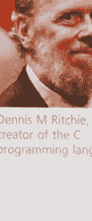

丹尼斯·M·里奇，C 编程语言的创造者。

C 是一种紧凑的通用计算机编程语言，最初由丹尼斯·麦卡利斯泰尔·里奇为 Unix 操作系统开发。它于 1972 年首次在数字设备公司（Digital Equipment Corporation）的 PDP-11 计算机上实现。

这种新编程语言被命名为“C”，因为它接替了大约 1970 年推出的名为“B”的早期编程语言。

Unix 操作系统以及几乎所有 Unix 应用程序都是用 C 语言编写的。然而，C 并不限于特定平台，程序可以在任何支持 C 的机器上创建，包括运行 Windows 平台的机器。

C 的灵活性和可移植性使其非常流行，该语言于 1989 年由美国国家标准学会（ANSI）正式标准化。ANSI 标准明确规定了 C 的各个方面，从而消除了此前关于该语言精确语法的不确定性。

ANSI C 已成为 C 语言公认的标准，本书对其进行了描述并通过示例进行了演示。

### 为什么要学习 C 编程？

C 语言已经存在相当长的时间，并见证了 Java、C++ 和 C# 等更新编程语言的出现。这些新语言中有许多至少部分源自 C——但规模要大得多。更紧凑的 C 更适合作为编程入门，因为它更简单易学。

一旦掌握了 C 编程原理，继续学习更新的语言就会更容易。例如，C++ 是 C 的扩展，除非你先精通 C 编程，否则可能很难学习。

尽管更新的语言提供了额外特性，C 仍然很受欢迎，因为它用途广泛且高效。如今它被用于大量平台，从微控制器到最先进的科学系统，无所不包。世界各地的程序员青睐 C，因为它使他们能在程序中获得最大的控制力和效率。


20 年前用 C 编写的程序在今天依然与当时一样有效。

### 标准 C 库

ANSI C 定义了许多标准库，其中包含久经考验的函数，可在你自己的 C 程序中使用。

这些库包含在“头文件”中，每个头文件的扩展名都是“.h”。下表列出了标准 C 库头文件的名称及其用途说明：

| 库 | 描述 |
|---|---|
| stdio.h | 包含输入和输出函数、类型及宏定义。大多数 C 程序都使用该库，它几乎占整个 C 库的三分之一 |
| ctype.h | 包含用于测试字符的函数 |
| string.h | 包含用于操作字符串的函数 |
| math.h | 包含数学函数 |
| stdlib.h | 包含用于数字转换、存储分配等的实用函数 |
| assert.h | 包含一个可用于向程序添加诊断信息的函数 |
| stdarg.h | 包含一个可用于遍历函数参数列表的函数 |
| setjmp.h | 包含一个可用于避免正常调用和返回序列的函数 |
| signal.h | 包含用于处理程序中可能出现的异常情况的函数 |
| time.h | 包含用于操作日期和时间组成部分的函数 |
| limits.h | 包含 C 数据类型大小的常量定义 |
| float.h | 包含与浮点运算相关的常量定义 |


函数是一段可以在 C 程序中反复复用的代码。C 库中每个函数的说明见从第 161 页开始的参考章节。

- 1. 在打开互联网连接的情况下，启动 Web 浏览器，然后访问 sourceforge.net/projects/mingw，并单击“下载”按钮以获取 MinGW 安装程序
- 2. 启动安装程序，并在“安装管理器”对话框中接受建议的位置 C:\MinGW
- 3. 选择“基本”和“C++ 编译器”项，然后单击“安装”中的“应用更改”以完成安装
- 4. 在 Windows 的“控制面板”中，单击“系统”图标，然后选择“高级系统设置”项，以打开“系统属性”对话框
- 5. 在“系统属性”对话框中，单击“环境变量”按钮，选择 Path 系统变量，然后单击“编辑”按钮，并添加位置 C:\MinGW\bin;
- 6. 单击“确定”关闭每个对话框，然后打开“命令提示符”窗口，并输入命令 gcc -v，以查看编译器返回版本信息

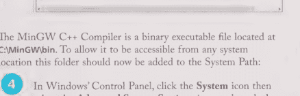

MinGW C++ 编译器是位于 C:\MinGW\bin 的二进制可执行文件。为了让它可以从任何系统位置访问，现在应将此文件夹添加到系统 Path 中：

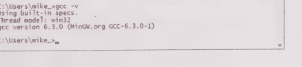

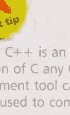

由于 C++ 是 C 的扩展，任何 C++ 开发工具也可以用来编译 C 程序。


Path 语句中的位置地址必须以 ; 分号结尾。


MinGW 安装过程可能会发生变化，但当前指南可在 mingw.org/wiki/Getting_Started 找到。


### 编写 C 程序

在 C 程序中，要执行的代码语句包含在“函数”中，函数使用以下语法格式定义：

*数据类型 函数名* ( ) { *要执行的语句* }

函数被调用以执行其包含的语句后，可以向调用者返回一个值。该值必须是函数名之前指定的数据类型。

一个程序可以包含一个或多个函数，但必须始终有一个名为“main”的函数。**main()** 函数是所有 C 程序的起点，除非在程序中找到 **main()** 函数，否则 C 编译器不会编译该代码。

程序中的其他函数可以使用字母、数字和下划线字符任意命名，但名称不能以数字开头。此外，必须避免使用本书封面前内页表格中列出的 C 关键字。

函数名后面的 ( ) 圆括号可以选择性地包含该函数要使用的值。这些值采用逗号分隔列表的形式，称为函数的“实参”或“形参”。

{ } 花括号（大括号）包含每当调用该函数时要执行的语句。每条语句都必须以分号结尾，就像英语句子必须以句号/句点结尾一样。

传统上，学习任何编程语言时尝试的第一个程序都是简单生成“Hello World”消息的程序。

- 1. 打开纯文本编辑器（例如记事本），然后在页面开头完全按所列内容输入这一行代码 `#include <stdio.h>`

程序开头是一条给 C 编译器的指令，要求包含来自标准输入/输出 **stdio.h** 库文件的信息。这使得该库中包含的函数可供此程序使用。这条指令更准确地称为“预处理指令”或“预处理指示符”，并且必须始终出现在页面开头，在真正处理程序代码之前。


不要使用文字处理应用程序创建程序代码，因为它们会存储额外的格式信息，从而阻止代码编译。


预处理指令以 # 井号字符开头，并且必须将标准库名称括在 < > 尖括号内。


hello.c

……（续）

2 在预处理器指令下方两行处，添加一个空的 main 函数

int main()
{ 
}

此函数声明指定：函数完成后应返回一个 int 数据类型的整数值。

小贴士
代码与 C 编译器之间的空白会被忽略，但程序代码应始终以换行字符结尾。

3 在花括号之间插入一行代码，调用标准输入/输出库中定义的某个函数——该库由预处理器指令提供
printf ( "Hello World!\n" ) ;

这里，printf() 函数在其圆括号之间指定了一个字符串参数。在 C 编程中，字符串必须始终用双引号括起来。该字符串包含文本 Hello World 和 \n“换行”转义序列，后者会将打印头移到下一行的左边界。

4 在花括号之间插入最后一行代码，按函数声明的要求返回零整数值
return 0 ;

传统上，程序执行后返回零值会向操作系统表明程序已正确执行。

不要忘记
每条语句都必须以分号字符结尾。

5 检查程序代码是否与下面的清单完全一致，然后添加最后一个换行字符（在右花括号后按回车），并将程序保存为 "hello.c"

```c
#include <stdio.h>

int main()
{
    printf( "Hello World!\n" );
    return 0 ;
}
```

文本格式的完整程序现在已准备好编译为机器可读的字节格式，作为可执行文件。

### 编译 C 程序

本书示例的 C 源代码文件存储在一个专门为此创建的目录中。该目录名为“MyPrograms”，其在 Windows 上的绝对地址为 C:\MyPrograms，而在 Linux 上为 /home/user/MyPrograms。按照第 12-13 页的步骤创建的 hello.c 源代码文件就保存在此目录中，等待编译以生成可执行字节码格式的版本。

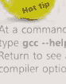

在命令提示符下，输入 gcc --help，然后按回车，即可查看所有编译器选项的列表。

1. 在命令提示符下，发出带有 MyPrograms 目录路径的 cd 命令，以导航到该目录

2. 在 MyPrograms 目录中的命令提示符下，输入 gcc hello.c，然后按回车编译程序

编译成功后，编译器会在原始源代码文件旁边创建一个可执行文件。默认情况下，该文件在 Linux 系统上命名为 a.out，在 Windows 系统上命名为 a.exe。现在在 MyPrograms 目录中编译另一个 C 源代码文件，将在没有警告的情况下覆盖第一个可执行文件。这显然不理想，因此在编译 hello.c 时必须为可执行文件指定自定义名称。这可以通过在编译器命令中包含 -o 选项，后跟自定义名称来实现。

3. 在 MyPrograms 目录中的命令提示符下，输入 gcc hello.c -o hello.exe，然后按回车再次编译程序

在 Linux 和 Windows 系统上，现在都会在 C 源代码文件旁边创建一个名为 hello.exe 的可执行文件：


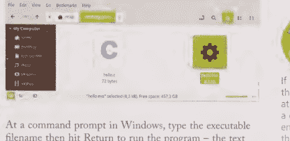

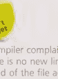

如果编译器提示文件末尾没有换行，请在源代码末尾添加一个回车，然后保存并重试。

4 在 Windows 的命令提示符下，输入可执行文件名，然后按回车运行程序——文本字符串会被输出，打印头移到下一行

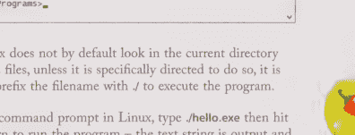

由于 Linux 默认不会在当前目录中查找可执行文件，除非特别指定这样做，因此必须在文件名前加上 ./ 才能执行程序。

5 在 Linux 的命令提示符下，输入 ./hello.exe，然后按回车运行程序——文本字符串会被输出，打印头移到下一行

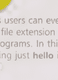

Windows 用户甚至可以省略文件扩展名来运行程序。在这种情况下，只需输入 hello 即可。

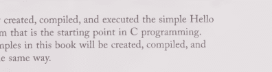

你现在已经创建、编译并执行了简单的 Hello World 程序，这是 C 编程的起点。本书中的所有其他示例都将以相同的方式创建、编译和执行。

### 理解编译

在从原始 C 源代码文件生成可执行文件的过程中，编译过程实际上经历四个独立阶段，每个阶段都会生成一个新文件：

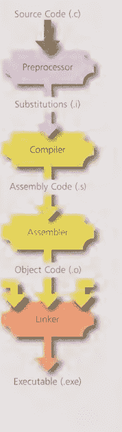

- **预处理** – 预处理器将原始源代码 `.c` 文件中的所有预处理器指令替换为实际实现这些指令的库代码。例如，为 `#include` 指令替换库代码。生成的包含替换内容的文件为文本格式，通常具有 `.i` 文件扩展名。
- **翻译** – 编译器将 `.i` 文件中的高级指令翻译为低级汇编语言指令。生成的包含翻译内容的文件为文本格式，通常具有 `.s` 文件扩展名。
- **汇编** – 汇编器将 `.s` 文件中的汇编语言文本指令转换为机器码。生成的包含转换内容的目标文件为二进制格式，通常具有 `.o` 文件扩展名。
- **链接** – 链接器将一个或多个二进制目标 `.o` 文件合并为单个可执行文件。生成的文件为二进制格式，通常具有 `.exe` 文件扩展名。

严格来说，“编译”描述的是上述前三个阶段，它们处理单个源代码文本文件，并最终生成单个二进制目标文件。如果程序源代码包含语法错误，例如缺少分号语句终止符或缺少圆括号，编译器将报告这些错误，编译将失败。

另一方面，链接器可以处理多个目标文件，并最终生成单个可执行文件。这允许从模块化目标文件创建大型程序，而每个目标文件可能包含可复用函数。如果链接器发现多个目标文件中定义了同名函数，它会报告错误，并且不会创建可执行文件。

通常，编译过程中间阶段创建的临时文件会自动删除，但可以通过在编译器命令中包含 -save-temps 选项来保留它们以供检查：

1. 在 MyPrograms 目录中的命令提示符下，输入 `gcc hello.c -save-temps -o hello.exe`，然后按回车重新编译程序并保存临时文件
2. 在 Windows 记事本之类的纯文本编辑器中打开 hello.i 文件，查看文件最末尾的源代码，其前面是替换后的 stdio.h 库代码
3. 现在，在纯文本编辑器中打开 hello.s 文件，查看转换为低级汇编代码的结果，并注意与 C 代码版本相比它显得多么不友好

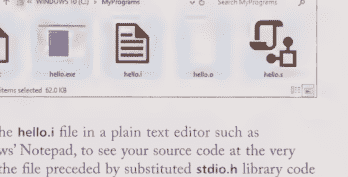

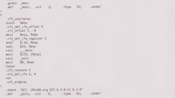

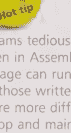

用汇编语言繁琐编写的程序可以比用 C 编写的程序运行得更快，但更难开发和维护。对于传统计算机编程，C 几乎总是首选。

### 总结

- 美国国家标准协会（ANSI）制定了 C 编程语言公认的标准。
- 其他编程语言，例如 C++ 和 C#，部分源自 C 语言。
- C 语言拥有许多标准库，其中包含久经考验的函数，可用于任何程序。
- C 库包含在名称具有 .h 文件扩展名的头文件中。
- C 程序创建为名称具有 .c 文件扩展名的纯文本文件。
- 流行的 GNU C 编译器（GCC）包含在 Minimalist GNU for Windows（MinGW）包中。
- 将编译器所在目录添加到系统路径，可以方便地从任何目录运行编译器。
- 程序具有一个或多个函数，其中包含在函数被调用时要执行的语句。
- 每个 C 程序都必须有一个 main() 函数。
- 函数声明首先指定函数执行后要返回的值的数据类型。
- 要执行的语句包含在 { } 花括号内，每条语句必须以 ; 分号终止符结尾。
- 预处理器指令在程序编译的第一阶段实现，通常会替换为库代码。
- GNU C 编译器通过 gcc 命令运行，并且可以包含 -o 选项来命名可执行输出文件。
- 编译过程中创建的临时文件可以使用 -save-temps 编译器命令选项保留。


## 2 存储变量值

本章演示如何使用 C 程序中的变量容器存储、检索和操作各种类型的数据。

- 20 创建程序变量
- 22 显示变量值
- 24 输入变量值
- 26 限定数据类型
- 28 使用全局变量
- 30 注册变量
- 32 转换数据类型
- 34 创建数组变量
- 36 描述维度
- 38 摘要

### 创建程序变量


变量是 C 程序中的一个容器，可在计算机内存中存储数据值。存储的值可使用变量名引用。程序员可以为变量选择任何名称，只要它遵守下表中列出的命名约定即可：

| 命名规则 | 示例 |
|---|---|
| 不能包含任何 C 关键字 | volatile |
| 不能包含算术运算符 | a+b*c |
| 不能包含标点字符 | %$#@! |
| 不能包含任何空格 | no spaces |
| 不能以数字开头 | 2bad |
| 可以在其他位置包含数字 | good1 |
| 可以包含大小写混合 | UPdown |
| 可以包含下划线 | is_ok |


变量名在 C 中区分大小写——因此名为 "VAR"、"Var" 和 "var" 的变量将被视为三个不同的变量。

选择有意义的变量名是良好的做法，以便使程序代码更易于理解。要在程序中创建变量，只需将其“声明”即可。变量声明的语法如下：

```
data-type variable-name ;
```

首先，声明指定变量被允许包含的数据类型。这将是下一页所述的四种数据类型之一。数据类型后跟一个空格，然后是所选的变量名，遵守上表中的命名约定。与 C 程序中的所有语句一样，声明必须以分号结束符结尾。同一数据类型的多个变量可以在单个声明中作为逗号分隔的列表创建，如下所示：

```
data-type variable-name-1 , variable-name-2 , variable-name-3 ;
```


C 关键字列在本书内侧封面上的表格中。

C 语言中有四种基本数据类型。它们使用下表中列出的 C 关键字定义，并附带对每种数据类型的描述：

| 数据类型： | 描述： | 示例： |
|---|---|---|
| char | 单个字节，只能存储一个字符 | 'A' |
| int | 整数 | 100 |
| float | 浮点数，精确到六位小数 | 0.123456 |
| double | 浮点数，精确到 10 位小数 | 0.0123456789 |

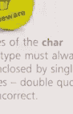

char 数据类型的值必须始终用单引号括起来——双引号是不正确的。

四种数据类型为存储数据分配不同的机器内存量。最小的是 char 数据类型，只分配一个字节的内存；最大的是 double 数据类型，通常分配八个字节的内存。这是 float 数据类型分配的内存量的两倍，因此 double 数据类型只有在需要较长、精确的浮点数时才应使用。

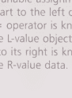

在变量赋值中，= 运算符左侧的部分称为 L 值对象，其右侧称为 R 值数据。

变量声明应在程序中出现任何可执行代码之前进行。当给变量赋值时，该变量被称为已“初始化”。可选地，变量可以在声明时初始化。

下面的示例代码片段声明并初始化了各种变量，其适当的值如代码注释所述——描述性注释位于 /* 和 */ 之间，由编译器忽略：

```
int num1 , num2 ;    /* Declares two integer variables. */
char letter ;        /* Declares a character variable. */
float decimal = 7.5 ; /* Declares and initializes a floating-point variable. */

num1 = 100 ;         /* Initializes the integer variables. */
num2 = 200 ;
letter = 'A' ;       /* Initializes the character variable. */
```

使用预处理器指令开始一个新程序以包含标准输入/输出库函数

```
#include <stdio.h>
```

添加一个 main 函数声明并初始化两个变量

```
int main()
{
    int num = 100 ;
    double pi = 3.1415926536 ;
}
```

在 main 函数中，在变量声明之后，插入语句以各种格式输出变量值

```
printf("Integer is %d \n", num );
printf("Values are %d and %f \n", num, pi );
printf("%%7d displays %7d \n", num );
printf("%%07d displays %07d \n", num );
printf("Pi is approximately %1.10f \n", pi );
printf("Right-aligned %20.3f rounded pi \n", pi );
printf("Left-aligned %-20.3f rounded pi \n", pi );
```


要使用 printf() 函数显示 "%" 字符，请用另一个 "%" 字符作为前缀，如此处所示。

在 main 函数块末尾，插入最后一条语句以返回零整数值，如函数声明所要求

```
return 0 ;
```

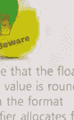

请注意，当格式说明符分配的小数位数较少时，浮点值会被四舍五入——并非简单地截断。

保存程序文件，然后在命令提示符下编译并执行程序以查看变量值按指定格式输出

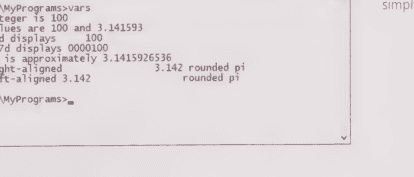

### 输入变量值

标准输入/输出库 stdio.h 提供了一个 scanf() 函数，可用于将用户输入获取到程序中。scanf() 函数在其括号内需要两个参数，以指定要输入的数据类型和输入应存储的位置。

scanf() 函数的第一个参数必须是第 22 页表格中用双引号括起来的格式说明符之一——例如，“%d”，其中输入为整数值。scanf() 函数的第二个参数必须是一个变量名，其前面加上 & 字符，除非输入数据是文本字符串。& 字符在 C 编程中有多种用途，但在这种上下文中是“addressof”运算符，这意味着输入数据应存储在为该变量保留的内存位置。

当声明变量时，会在机器内存中为存储分配给该变量的数据预留空间。保留的字节数取决于变量的数据类型。分配的内存由唯一的变量名引用。

将计算机的内存想象成一排很长的槽。每个槽都有一个唯一的地址，以十六进制格式表示。这就像一条很长的房屋道路——每栋房子都包含人们并具有唯一的数字地址。在 C 程序中，房子是槽，人们是这些地址中包含的数据。

scanf() 函数也可以同时为多个变量赋值。其第一个参数必须然后包含格式说明符列表，每个说明符由空格分隔，并且整个列表必须用双引号括起来。第二个参数必须包含变量名以逗号分隔的列表，每个变量名前都加上 & addressof 运算符，对应每个指定的格式。

& addressof 运算符也可以用来返回变量数据存储的十六进制内存地址。

将 printf() 函数的输出与 scanf() 函数的输入结合起来可在用户和程序之间创建基本的交互性。


字符串是特例，并在第 34 页的数组主题中演示。

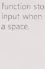

请注意，scanf() 函数在遇到空格时停止读取输入。


- 1. 使用预处理指令开始一个新程序，以包含标准输入/输出库函数

~~~c
#include <stdio.h>
~~~


- 2. 添加一个 main 函数，声明三个变量

~~~c
int main()
{
  char letter ;
  int num1, num2 ;
}
~~~

- 3. 在 main 函数中，在变量声明之后，插入语句以获取用户输入

~~~c
printf( "Enter any one keyboard character: " ) ;
scanf( "%c", &letter ) ;
printf( "Enter two integers separated by a space: " ) ;
scanf( "%d %d" , &num1, &num2 ) ;
~~~

- 4. 接下来，插入语句以输出已存储数据的详细信息

~~~c
printf( "Numbers input: %d and %d \n", num1, num2 ) ;
printf( "Letter input: %c ", letter ) ;
printf( " Stored at: %p \n", &letter ) ;
~~~

- 5. 在 main 函数块末尾，插入最后一条语句以返回零整数值，这是函数声明所要求的

~~~c
return 0 ;
~~~

> > **别忘了！**
> >
> > 机器地址的格式说明符是 `%p`。

- 6. 保存程序文件；编译并执行程序；在要求时输入数据；然后查看已存储数据的输出

```
~~~
Command Prompt
C:\MyPrograms>gcc setvars.c -o setvars.exe
C:\MyPrograms>setvars
Enter any one keyboard character: M
Enter two integers separated by a space: 100 200
Numbers input: 100 and 200
Letter input: M  Stored at: 0061FF2F
C:\MyPrograms>_
~~~
```

### 限定数据类型

创建 int 数据类型的整数变量时，默认情况下它既可以包含正值，也可以包含负值。这些值称为“有符号”值。可能值的范围由系统决定为“long”还是“short”。

如果 int 变量默认创建为 long 类型（很可能如此），则其可能值的范围通常为从最大值 +2,147,483,647 到最小值 -2,147,483,648。

另一方面，如果 int 变量默认创建为 short 类型（不太可能），则其可能值的范围通常为从最大值 +32,767 到最小值 -32,768。

不过，可以使用变量声明中的 short 和 long 限定符关键字来显式指定范围大小，如下所示：

```
short int num1 ;   /* Saves memory space. */
long int num2 ;   /* Allows bigger range. */
```

limits.h C 库头文件包含每种数据类型大小的实现定义限值。对于未指定大小的 int 变量声明，可以通过名为 INT_MAX 和 INT_MIN 的常量值访问这些限值。类似地，SHRT_MAX 和 SHRT_MIN 包含 short int 变量声明的限值，LONG_MAX 和 LONG_MIN 包含 long int 变量声明的限值。

当变量永远不会被赋予负值时，可以使用 unsigned 限定符关键字声明非负的“无符号”int 变量。无符号 short int 变量的可能范围通常为 0 到 65,535，但只占用与常规 short int 变量相同的内存空间。无符号 long int 变量的可能范围通常为 0 到 4,294,967,295，但只占用与常规 long int 变量相同的内存空间。

C 的 sizeof 运算符可用于显示不同数据类型的变量所保留的内存量。使用尽可能少的内存是良好的编程实践。例如，如果某个变量只会包含低于 65,535 的正整数值，则最好使用仅保留 2 字节内存的无符号 short int 变量，而不是保留 4 字节内存的 long int 变量。


常量始终完全使用大写字母命名，以便与变量区分开。

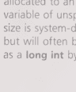

分配给未指定大小的 int 变量的内存空间取决于系统，但通常默认会被当作 long int 处理。

- 1. 使用预处理指令开始一个新程序，以包含标准输入/输出函数和常量

```c
#include <stdio.h>
#include <limits.h>
```

- 2. 添加一个 main 函数，其中包含输出 short int 数据类型的大小和范围的语句

```c
int main()
{
printf("short int... \t size: %d bytes \t", sizeof( short int ));
printf("%d to %d \n", SHRT_MAX, SHRT_MIN );
}
```

- 3. 接下来，插入语句以输出 long int 数据类型的大小和范围

```c
printf("long int... \t size: %d bytes \t", sizeof( long int ));
printf("%ld to %ld \n", LONG_MAX, LONG_MIN );
```

- 4. 现在，插入语句以输出其他数据的大小

```c
printf("char... \t size: %d byte \n", sizeof( char ));
printf("float... \t size: %d bytes \n", sizeof( float ));
printf("double... \t size: %d bytes \n", sizeof( double ));
```

- 5. 插入最后一条语句以返回零整数值，这是函数声明所要求的

```c
return 0;
```

- 6. 保存程序文件，然后编译并执行程序，以查看数据类型的大小和范围


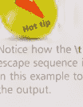

注意本示例中如何使用 \t 制表符转义序列来为输出添加间距。

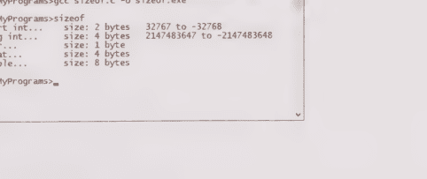

### 使用全局变量

变量在程序中的可访问程度称为“变量作用域”。在函数内声明的变量称为“局部”变量，而在任何函数块之外声明的变量称为“全局”变量。

局部变量只能从其声明所在的函数内部访问。这是默认的隐式行为，也可以通过变量声明中很少使用的 auto 关键字来显式指定。它们在函数被调用时存在，并通常在函数结束时消失。

另一方面，全局变量可以从程序中的任何函数内部访问。它们在程序执行时存在，并一直存在到程序结束。

外部全局变量必须在程序开头恰好定义一次。它还必须在每个需要访问它的函数开头声明。该声明应以 extern 关键字开头，以表示它引用的是外部变量，而不是常规的局部变量声明。这些声明不应用于初始化全局变量。

较大的 C 程序通常由多个源代码文件组成，这些文件一起编译以创建单个可执行文件。全局变量通常可以从一起编译的任何文件中的任何函数访问。所有函数通常也可以全局访问，但函数以及——更常见的是——全局变量可以通过在其声明中使用 static 关键字，将其可访问性限制为仅在创建它们的文件中。

通常，一个程序不能使用多个同名变量，但如果每个变量都声明为 static 变量，并且在该源代码文件中唯一，则可以这样做。使用多个源代码文件编程时，可能会发现一个常见的全局变量名在两个不同文件中重复。将这些变量声明为 static 可以避免在源代码中每次出现时重命名其中一个变量。

内部局部变量也可以声明为 static。与通常情况一样，它们只能从其声明所在的函数内部访问，但它们在函数结束时不会消失。这允许在函数内进行永久私有存储，直到程序结束。


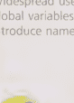

广泛使用全局变量可能会引入名称冲突。

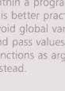

尽量只使用局部变量。全局变量允许方便地从程序中的任何函数访问值，但更好的做法是避免使用全局变量，而是在函数之间作为参数传递值。


- 1. 开始一个新程序，使用预处理指令包含标准输入/输出库函数。

```c
#include <stdio.h>
```

- 2. 定义并初始化一个全局静态变量，该变量只能从当前源代码文件内部访问。

```c
static int sum = 100;
```

- 3. 添加一个 main 函数，声明它要使用该全局静态变量并输出其值。

```c
int main()
{
    extern int sum;
    printf("Sum is %d \n", sum);
}
```

- 4. 现在，插入一个声明以使用第二个全局变量并输出其值。

```c
extern int num;
printf("Num is %d \n", num);
```

- 5. 插入一条最终语句，按函数声明的要求返回零整数值，然后保存文件。

```c
return 0;
```

- 6. 在另一个文件中定义第二个全局变量，然后保存该文件。

```c
int num = 200;
```

- 7. 在命令中提供每个源代码文件名，将两个源文件编译成一个可执行程序，然后执行该程序以查看输出的全局值。


在第二个文件的 num 变量定义中添加 static 关键字会将其可访问性限制为仅该文件——因此编译就会失败。


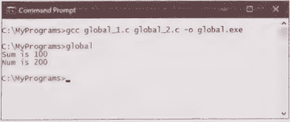

```text
C:\MyProgram>gcc global_1.c global_2.c -o global.exe
C:\MyProgram>global
Sum is 100
Num is 200
C:\MyProgram>
```

### 寄存器变量

包含 register 关键字的变量声明会告知编译器，指定的变量将被程序频繁使用。其意图是让编译器将寄存器变量放入计算机的机器寄存器中，以加快访问速度。不过，它们的用处可能值得怀疑，因为编译器可以自由忽略这一建议。

只有局部内部变量才能声明为寄存器变量。无论如何，只有少数变量能保存在机器寄存器中，而且它们可能只能是某些类型。具体限制因机器而异。

尽管有这些可能的缺点，register 声明是无害的，因为当编译器实际上无法使用机器寄存器存储该变量时，register 关键字会被忽略。相反，该变量会像没有 register 关键字一样被创建。

与寄存器变量完全相反的效果，可通过包含 volatile 关键字的变量声明实现。这意味着该变量不得存储在机器寄存器中，因为它的值可能在任何时候发生变化，而无需编译器在附近发现的任何代码采取行动。这对大型程序中可能被多个线程并发修改的全局变量尤其重要。

可能受益于成为寄存器变量的一种变量，是用于存储循环控制值的局部变量。在循环的每次迭代中，该值都必须进行比较和更改，因此该变量会被反复访问。将该值存储在机器寄存器中，就可以加快循环的执行。

另一方面，如果全局变量用于存储循环的控制值，并且也可能从循环外部更改，那么该全局变量可能受益于成为 volatile 变量。

循环结构在第 5 章中有完整描述，但旁边列出的示例是为了说明对寄存器变量的重复访问。


这里为完整起见介绍了 register 和 volatile 关键字，但现实中很少见到，因为大多数程序只是使用普通变量来存储数据。

……续


- 1. 开始一个新程序，使用预处理指令包含标准输入/输出库函数
  #include <stdio.h>
- 2. 添加一个 main 函数，声明并初始化一个包含循环控制值零的局部寄存器变量
  int main()
  {
    register int num = 0 ;
  }
- 3. 现在，插入一个条件测试，检查控制值是否小于五，后面跟一对花括号
  while ( num < 5 )
  {
  }
- 4. 在循环结构的花括号之间，插入语句以递增控制值，并在循环的每次迭代中输出其当前值
  ++num ;
  printf( "Pass %d \n", num ) ;
- 5. 在函数块末尾，按函数声明的要求返回零整数值
  return 0 ;
- 6. 保存程序文件，然后编译并执行程序，以查看循环每次迭代时从寄存器变量中取出的值

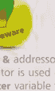

如果对寄存器变量使用 & 取地址运算符，编译器会将该变量放在内存位置，而不是寄存器中。

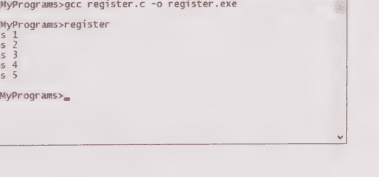

### 转换数据类型

如果看起来合乎逻辑，编译器会隐式地将一种数据类型转换为另一种。例如，当把整数赋给 **float** 变量时，编译器会将整数转换为浮点值。

通过称为“强制类型转换”的过程，可以将存储在变量中的任何数据显式强制（coerce）转换为另一种数据类型的变量。强制类型转换只是在存储原始数据类型数据的变量名之前的圆括号中说明应转换为的数据类型。圆括号中还应包括任何修饰符，例如 *unsigned*（在适用时）——因此强制类型转换的语法如下所示：

```
`variable-name2 = ( modifiers data-type ) variable-name1 ;`
```

注意，强制类型转换不会改变变量的原始数据类型，而只是将该值作为不同数据类型复制。

将 **float** 变量转换为 **int** 变量时，值只是在十进制小数点处被截断。不会四舍五入到最接近的整数。例如，对于 `float num = 5.75`，用 `(int)num` 转换为整数会得到整数 5，而不是 6。

将 **char** 变量转换为 **int** 变量时，得到的整数值是表示该字符的 ASCII 码数值。大写字母的 ASCII 数值为 65-90，而小写字母为 97-122。例如，对于 `char letter = 'A'`，用 `(int) letter` 转换为整数会得到整数 65。将这些范围内的整数值转换为 **char** 数据类型会得到对应的字母。

通常需要将整数值转换为其浮点等价值，以执行精确算术。否则除法可能产生截断的整数结果。例如，对于 `int x=7,y=5`，语句 `float z = x / y` 会赋值为 1.000000。精确算术要求该语句使用强制类型转换，因为 `(float)x / (float)y` 会产生浮点值 1.400000。

将长而精确的浮点数从 **double** 数据类型转换为较短的 **float** 数据类型时，并不是简单地在第六位小数处截断较长值，而是向上或向下舍入到最接近的数字。例如，对于 `double decimal = 0.1234569`，用 `(float)decimal` 转换为 float 会产生 0.123457。


ASCII（读作“as-kee”）是“American Standard Code for Information Interchange”（美国信息交换标准代码）的缩写，是公认的纯文本标准。你可以在第 162—163 页找到完整的标准 ASCII 码范围。


正斜杠字符 / 是 C 语言中的除法运算符

- 1 开始一个新程序，使用预处理指令包含标准输入/输出库函数 #include <stdio.h>


- 2 添加一个 main 函数，声明并初始化各种数据类型的变量

```c
int main()
{
    float num = 5.75 ;
    char letter = 'A' ;
    int zee = 90 ;
    int x = 7 , y = 5 ;
    double decimal = 0.12345678 ;
}
```

- 3 接下来，插入语句以输出每个变量值转换后的等价结果

```c
printf("Float cast to int: %d \n", (int)num) ;
printf("Char cast to int: %d \n", (int)letter) ;
printf("Int cast to char: %c \n", (char)zee) ;
printf("Float arithmetic: %f \n", (float)x / (float)y) ;
printf("Double cast to float: %f \n", (float)decimal) ;
```

- 4 在函数块末尾，按函数声明的要求返回零整数值
return 0 ;


从 float 转换为 int 的值会被截断，而从 double 转换为 float 的值会被舍入。

- 5 保存程序文件，然后编译并执行程序，以查看每次强制类型转换得到的等价结果

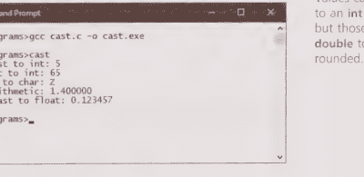


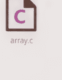

- 1. 使用预处理器指令开始一个新程序，以包含标准输入/输出库函数

```
#include <stdio.h>
```

- 2. 添加一个 main 函数，声明一个包含三个元素的整数数组

```
int main()
{
    int arr[3];
}
```

- 3. 接下来，插入语句通过分别给每个元素赋值来初始化整数数组元素

```
arr[0] = 100 ;
arr[1] = 200 ;
arr[2] = 300 ;
```

- 4. 现在，插入一条语句来创建并初始化一个字符数组以保存文本字符串

```
char str[10] = {'C','/','P','r','o','g','r','a','m','\0'};
```

- 5. 插入语句以输出整数数组的所有元素值以及字符数组中的字符串

```
printf("1st element value: %d \n", arr[0]);
printf("2nd element value: %d \n", arr[1]);
printf("3rd element value: %d \n", arr[2]);
printf("String: %s \n", str);
```

- 6. 在函数块末尾，返回零整数值，如函数声明所要求

```
return 0;
```

- 7. 保存程序文件，然后编译并执行程序以查看数组变量中存储的值


数组的创建会根据数据类型为每个元素分配内存——对于字符数组，每个元素一个字节。因此，数组不能动态调整大小。

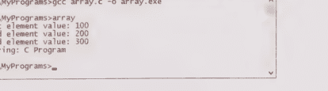

### 描述维度

数组元素的编号更准确地称为“数组索引”，并且由于元素编号从零开始，有时也称为“零基索引”。使用单个索引创建的数组是一维数组，其元素出现在单行中：

| 元素内容... | A | B | C | D | E |
| 索引编号... | [0] | [1] | [2] | [3] | [4] |

数组也可以有多个索引——用于表示多个维度。使用两个索引创建的数组是二维数组，其元素出现在多行中：

| 第一索引 | [0] | A | B | C | D | E |
|  | [1] | F | G | H | I | J |
| 第二索引 | [0] | [1] | [2] | [3] | [4] |

对于多维数组，每个元素包含的值是通过说明每个索引的编号来引用的。例如，对于上面的二维数组，元素 [1][2] 包含字母 H。

二维数组用于存储基于网格的信息，例如 XY 坐标。创建具有三个索引的三维数组将允许存储 XYZ 坐标：

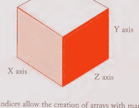


具有两个以上索引的多维数组会产生难以阅读的源代码并可能导致错误。

额外的索引允许创建具有多个维度的数组，但实际上，多于三个索引的多维数组并不常见，因为它们难以想象。

- 1. 使用预处理器指令开始一个新程序，以包含标准输入/输出库函数

```
#include <stdio.h>
```

- 2. 添加一个 main 函数，声明并初始化一个二维整数数组

```c
int main()
{
  int matrix[2][3] = { {'A', 'B', 'C'}, {1, 2, 3} };
}
```

- 3. 接下来，插入语句以显示第一个索引中的所有元素内容

```c
printf("Element [0][0] contains %c \n", matrix[0][0]);
printf("Element [0][1] contains %c \n", matrix[0][1]);
printf("Element [0][2] contains %c \n", matrix[0][2]);
```

- 4. 现在，插入语句以显示第二个索引中的所有元素内容

```c
printf("Element [1][0] contains %d \n", matrix[1][0]);
printf("Element [1][1] contains %d \n", matrix[1][1]);
printf("Element [1][2] contains %d \n", matrix[1][2]);
```

- 5. 在函数块末尾，返回零整数值，如函数声明所要求

```c
return 0;
```

- 6. 保存程序文件，然后编译并执行程序以查看二维数组元素中存储的所有值

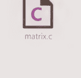


这里可以看到隐式类型转换如何将字母的 ASCII 代码值存储在整数数组中，但 %c 格式说明符再次将它们显示为字母。

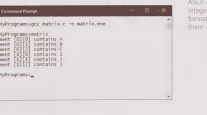

### 总结

- 一个变量是 C 程序中的一个容器，可以在计算机内存中存储数据值。
- 变量名必须遵守 C 命名约定。
- C 中的四种基本数据类型是 **char**、**int**、**float** 和 **double**。
- 格式说明符 %d、%f、%c、%s 和 %p 可以与 **printf()** 函数一起使用以显示不同类型变量的值。
- 用户输入可以通过 **scanf()** 函数分配给变量。
- **int** 变量的允许范围可以使用 **short** 和 **long** 关键字显式限定。
- 永远不会保存负值的变量可以限定为 **unsigned** 以扩展其正值范围。
- 任何变量保留的内存字节数都可以使用 **sizeof** 运算符揭示。
- 变量作用域描述了对变量的可访问程度，可能是局部或全局的。
- **extern** 关键字指定外部定义的变量，而 **static** 关键字将可访问性限制为同一源文件。
- 使用 **register** 关键字将变量放置在机器寄存器中可以提高使用频繁的变量的性能。
- 不适合寄存器的变量可以标记为 **volatile**。
- 编译器可能会在逻辑上隐式更改数据类型，或通过强制转换显式更改。
- 数组变量在单独的元素中存储多项数据，这些元素按顺序编号——从零开始。
- 数组元素中的值通过数组变量名后跟方括号内的元素编号来引用。
- 数组变量可以有多个索引以创建多维数组。

## 3 常量

如果程序需要使用永远不会更改的固定常量数据值，则应以与变量相同的方式声明它，但在声明中包含 `const` 关键字。例如，表示不变的整数值一百万的常量可以像这样声明并初始化：

```
const int MILLION = 1000000;
```

常量声明必须始终使用它们将包含的数据值初始化常量对象。程序永远不能从其初始值更改常量的值。这可以防止常量值被意外更改，因为如果程序尝试随后更改初始值，编译器将报告错误。

常量名受与变量名相同的命名约定约束（所述于第 20 页），但传统上使用大写字符为常量命名——以便在阅读源代码时轻松将其与变量名区分开。

如果数组的所有初始元素值永远不会被程序更改，则 `const` 关键字也可以在数组声明中使用。

- 1. 使用预处理器指令开始一个新程序，以包含标准输入/输出库函数

```c
#include <stdio.h>
```

- 2. 添加一个 main 函数，声明一个近似数学值 Pi 的常量值

```c
int main()
{
    const float PI = 3.141593;
}
```

- 3. 接下来，在 main 函数块中，插入声明四个变量的语句

```c
float diameter;
float radius;
float circ;
float area;
```


### ... 继续

4. 现在，插入语句请求用户输入并将其分配给变量。

   ```c
   printf("Enter the diameter of a circle in millimeters: ");
   scanf("%f", &diameter);
   ```

5. 接下来，添加语句使用常量值和用户输入计算其他三个变量的值。

   ```c
   circ = PI * diameter;
   radius = diameter / 2;
   area = PI * (radius * radius);
   ```


这里 `*` 星号字符是算术乘法运算符，而 `/` 正斜杠字符是除法运算符。算术运算符将在下一章中完整演示。

6. 现在，插入语句以两位小数格式输出计算得到的值。

   ```c
   printf("\n\tCircumference is %.2f mm", circ);
   printf("\n\tAnd the area is %.2f sq.mm\n", area);
   ```

7. 在 main 函数块的末尾，返回零整数值，如函数声明所要求。

   ```c
   return 0;
   ```

8. 保存程序文件，然后编译并执行程序，在需要时输入数据，以查看计算结果。

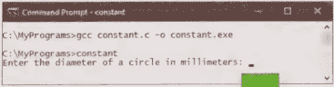


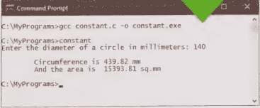


请记住，在 scanf() 中，`&` 取地址运算符必须置于变量名前，以便将输入分配给该变量。

### 枚举常量值

enum 关键字提供了一种简洁的方式来创建整数常量的序列。可选地，声明可以在 enum 关键字之后包含序列的名称。常量名称作为逗号分隔的列表放在大括号内。

默认情况下，每个常量的值都比列表中在其前面的常量大一。除非指定，否则第一个常量的值为零；下一个值为 1；以此类推。

例如，可以使用 `enum {MON,TUE,WED,THU,FRI};` 为命名的星期常量指定从零开始的整数值序列——在这种情况下，常量 WED 的整数值为 2。

常量可以在声明中被赋予任意单个整数值，但列表中的下一个常量将始终使前一个值递增一，除非它也被赋予了值。例如，要使序列从 1 而不是零开始，将 1 分配给第一个常量，使用 `enum {MON=1,TUE,WED,THU,FRI};` ——在这种情况下，常量 WED 的整数值为 3。

枚举常量的列表也称为“枚举集合”，可能包含重复的常量值。例如，值零可以分配给名为 NIL 和 NONE 的常量。

在下面的示例中，枚举集合表示斯诺克游戏中球的分数值，并包含一个可选名称，该名称以大写形式出现，因为它也是常量。


1. 使用预处理器指令开始一个新程序，以包含标准输入/输出库函数

   `#include <stdio.h>`

2. 添加一个 main 函数，该函数声明并初始化从 1 开始的枚举常量集合

   ```c
   int main()
   {
     enum SNOOKER
     { RED=1,YELLOW, GREEN, BROWN, BLUE, PINK, BLACK };
   }
   ```

3. 接下来，在 main 函数块中，声明一个整数变量来存储某些常量值的总和

   `int total ;`

### 创建常量类型

一旦枚举序列被声明，它就可以被视为一种新的数据类型，具有其指定的常量名称及其相关值的属性。

这种 **enum** 数据类型的变量可以像声明其他数据类型的变量一样声明——使用以下语法：

```c
data-type variable-name ;
```

第 42-43 页的示例创建了一个名为 **SNOOKER** 的枚举序列，可视为 **enum SNOOKER** 的数据类型。因此，可以使用声明 **enum SNOOKER pair ;** 创建该数据类型的名为“pair”的变量，并且可以存储该类型定义的枚举集合的值。

要显式地将整数值分配给枚举数据类型的变量，C 标准建议使用强制转换将 **int** 数据类型转换为 **enum** 数据类型，如下所示：

```c
pair = ( enum SNOOKER ) 7 ;
```

然而在实践中这并非必需，因为枚举值始终是整数，因此等同于 **int** 数据类型。

**enum** 声明可选择性地通过在最后一个大括号后指定变量名来创建变量。例如，声明 **enum BOOLEAN { FALSE , TRUE } flag ;** 定义了一个 **enum** 数据类型并创建了该类型的名为“flag”的变量。

可以使用 **typedef** 关键字和以下语法定义自定义数据类型：

```c
typedef definition type-name ;
```

声明自定义数据类型可以帮助使程序代码更简洁。例如，如果程序使用多个 **unsigned short int** 变量，则最好先使用以下声明创建具有这些修饰符的自定义数据类型：

```c
typedef unsigned short int USINT ;
```

然后，每个 **unsigned short int** 变量声明只需使用自定义数据类型名称 **USINT** 代替 **unsigned short int**。


> 虽然不是必需的，但使用推荐的强制转换显式地为枚举类型变量赋值可作为其类型的提醒。

1. 使用预处理器指令开始一个新程序，以包含标准输入/输出库函数

   ```c
   #include <stdio.h>
   ```

2. 添加一个 main 函数，该函数声明并初始化从 1 开始的枚举常量集合

   ```c
   int main()
   {
       enum SNOOKER
       { RED=1,YELLOW, GREEN, BROWN, BLUE, PINK, BLACK };
   }
   ```

3. 接下来，在 main 函数块中，声明并初始化一个已定义 enum 类型变量，然后显示其值

   ```c
   enum SNOOKER pair = RED + BLACK ;
   printf( "Pair value: %d \n", pair );
   ```

4. 现在，添加语句创建自定义数据类型

   ```c
   typedef unsigned short int USINT ;
   ```

5. 然后，声明并初始化自定义数据类型的变量并显示其值

   ```c
   USINT num = 16 ;
   printf( "Unsigned short int value: %d \n", num );
   ```

6. 在 main 函数块的末尾，返回零整数值，如函数声明所要求

   ```c
   return 0 ;
   ```

7. 保存程序文件，然后编译并执行程序，以查看分配给枚举类型变量和自定义数据类型的数值


```text
C:\MyPrograms>gcc constype.c -o constype.exe
C:\MyPrograms>constype
Pair value: 8
Unsigned short int value: 16
C:\MyPrograms>
```

### 定义常量

预处理器 `#define` 指令可用于指定可在程序中使用的常量文本值，语法如下：

```c
#define CONSTANT-NAME "text-string"
```

与 `#include` 指令类似，这些指令应出现在程序代码的最开始。程序代码中指定的常量名称的任何出现都将在编译前由预处理器替换为相关的文本字符串。

条件预处理器 `#ifdef` 指令也可以用来评估定义是否当前存在。根据评估结果，其后可能跟随 `#define` 指令以指定常量文本值。此预处理器例程称为“宏”，每个宏必须以 `#endif` 指令结束。

有用的是，预处理器宏可以检查编译器定义的常量以确定主机操作系统。这些常量因机器而异，但在 Windows 平台上通常会有一个名为 `__WIN32` 的常量，而在 Linux 平台上通常会有一个 `linux` 常量。`#ifdef` 预处理器指令可以应用适当的文本字符串来标识主机平台。


1. 使用预处理器指令开始一个新程序，以包含标准输入/输出库函数

   ```c
   #include <stdio.h>
   ```

2. 添加三个进一步的预处理器指令，指定用于在源代码中替换的文本字符串

   ```c
   #define LINE ""
   #define TITLE "C Programming in easy steps"
   #define AUTHOR "Mike McGrath"
   ```

3. 接下来，添加一个条件宏，指定用于标识 Windows 主机平台的文本字符串

   ```c
   #ifdef __WIN32
   #define SYSTEM "Windows"
   #endif
   ```


- 4. 现在，添加一个条件宏，用于指定一个文本字符串来标识 Linux 主机平台

```c
#ifdef linux
#define SYSTEM "Linux"
#endif
```

- 5. 接下来，添加一个 main 函数，用于输出由预处理器替换后的文本字符串值

```c
int main()
{
    printf("\n\t%s \n\t%s \n", LINE, TITLE);
    printf("\t by %s \n\t %s \n", AUTHOR, LINE);
    printf("\n Operating System: %s \n", SYSTEM);
}
```

- 6. 在 main 函数块的末尾，按照函数声明的要求返回零整数值

```c
return 0;
```

- 7. 保存程序文件，然后编译并执行程序，以查看字符串常量的输出

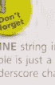

此示例中的 LINE 字符串只是一系列下划线字符。

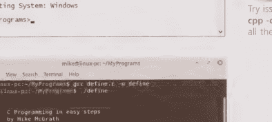


尝试执行命令 `cpp -dM define.c` 以查看所有已定义的常量。

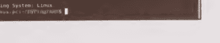

### 调试定义

可以使用 `#if`、`#else` 和 `#elif`（else if）预处理指令来提供替代方案。这些指令允许根据求值结果进行条件分支，以执行代码段。

最初由预处理 `#define` 指令定义的常量，随后可以用 `#undef` 指令取消定义。还可以使用 `#ifndef`（如果未定义）预处理指令进行求值，以考虑某个常量是否未定义。

所有求值都可以在函数块中进行，并与常规 C 语句混合使用，而且可以相互嵌套。这类宏对于调试源代码特别有用，因为只需更改 **DEBUG** 宏的状态，就可以轻松隐藏或显示整段代码。


此示例中使用的 `==` 相等运算符表示“等于”。

- 1. 使用预处理指令包含标准输入/输出库函数 `#include <stdio.h>` 来开始一个新程序

- 2. 再添加一个预处理指令来建立宏 `#define DEBUG 1`

- 3. 接下来，添加一个包含预处理指令的 main 函数，用于求值并报告宏状态

```c
#if DEBUG == 1
    printf("Debug status is 1\n");
#elif DEBUG == 2
    printf("Debug status is 2\n");
#else
    #ifdef DEBUG
        printf("Debug is defined!\n");
    #endif
    #ifndef DEBUG
        printf("Debug is not defined!\n");
    #endif
#endif
```

- 4. 在 main 函数块的末尾，按照函数声明 `return 0;` 的要求返回零整数值

- 5. 保存程序文件，然后编译并执行程序，以查看报告的宏状态。

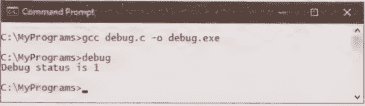

```text
C:\MyPrograms>gcc debug.c -o debug.exe
C:\MyPrograms>debug
Debug status is 1
C:\MyPrograms>
```

- 6. 修改宏值，然后保存、重新编译并再次执行程序，以查看报告的新宏状态

```c
#define DEBUG 2
```

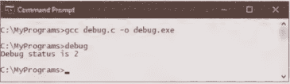

```text
C:\MyPrograms>gcc debug.c -o debug.exe
C:\MyPrograms>debug
Debug status is 2
C:\MyPrograms>
```

- 7. 再次修改宏值，然后保存、重新编译并再次执行程序，以查看变化

```c
#define DEBUG 3
```

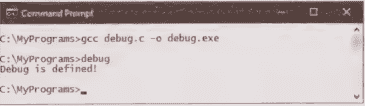

```text
C:\MyPrograms>gcc debug.c -o debug.exe
C:\MyPrograms>debug
Debug is defined!
C:\MyPrograms>
```

- 8. 在函数块的开头插入另一个预处理指令，然后保存、重新编译并再次执行程序，以查看报告的宏状态

```c
#undef DEBUG
```

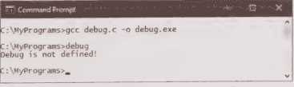

```text
C:\MyPrograms>gcc debug.c -o debug.exe
C:\MyPrograms>debug
Debug is not defined!
C:\MyPrograms>
```


每个预处理器条件测试都必须以 **#endif** 指令结束。

### 小结

- 永远不变的固定数据值应存储为常量，并使用 const 关键字声明。
- 声明常量时，声明必须始终用其固定数据值初始化该常量。
- enum 关键字会创建一系列按顺序编号的整数常量，默认从零开始。
- 枚举系列中的任何常量都可以显式赋予一个整数值，该系列中后续常量将在此基础上递增。
- 枚举常量系列可以被视为一种新数据类型，可以基于它创建变量，以存储该类型所定义枚举集合中的值。
- 可以使用 typedef 关键字定义自定义数据类型，然后使用与声明常规变量相同的语法创建该类型的变量。
- 预处理 #define 指令可用于指定在编译前要替换的常量文本值。
- 条件预处理 #ifdef 指令用于求值当前是否存在某个定义。
- 宏是一种预处理例程，必须以 #endif 指令结束。
- 编译器定义的常量（例如 _WIN32 和 linux）可以确定主机操作系统。
- 可以使用 #if、#else 和 #elif 预处理指令提供宏替代方案。
- 常量宏定义可以用 #undef 指令取消定义，并用 #ifndef 指令求值其是否未定义。
- 宏可以通过轻松隐藏或显示代码段来帮助调试源代码。

## 4 执行运算

本章演示如何使用 C 运算符在 C 程序中操作数据。

- 52 执行算术运算
- 54 赋值
- 56 比较值
- 58 评估逻辑
- 60 检查条件
- 62 测量大小
- 64 比较位值
- 66 标记位
- 68 理解优先级
- 70 小结

### 执行算术运算

C 程序中常用的算术运算符及其执行的操作如下表所示：

| 运算符： | 操作： |
|---|---|
| + | 加法 |
| - | 减法 |
| * | 乘法 |
| / | 除法 |
| % | 取模 |
| ++ | 自增 |
| -- | 自减 |

加法、减法、乘法和除法运算符的作用与预期一致。但是，当使用多个运算符时，必须注意用括号括起表达式以使其清晰：

```c
a = b * c - d % e / f;        /* This is unclear. */
a = (b * c) - ((d % e) / f);  /* This is clearer. */
```


与运算符一起构成表达式的数字称为“操作数”——在表达式 2 + 3 中，数字 2 和 3 是操作数。

% 取模运算符将第一个给定数字除以第二个给定数字，并返回运算的余数。这对于判断一个数字是奇数还是偶数很有用。

++ 自增运算符和 -- 自减运算符将给定数字改变一，并返回得到的新值。它们最常用于统计循环中的迭代次数。自增运算符将值增加一，自减运算符将值减少一。

自增和自减运算符可以放在操作数之前或之后，从而产生不同效果。如果放在操作数之前（前缀），其值会立即改变；如果放在操作数之后（后缀），则先记录其值，然后再改变。

- 1. 使用预处理指令包含标准输入/输出库函数来开始一个新程序

```c
#include <stdio.h>
```


- 2. 添加一个 main 函数，声明并初始化几个整数变量

```c
int main()
{
    int a = 4, b = 8, c = 1, d = 1;
}
```

- 3. 接下来，在 main 函数块中，输出对变量值执行算术运算的结果

```c
printf("Addition: %d \n", a + b);
printf("Subtraction: %d \n", b - a);
printf("Multiplication: %d \n", a * b);
printf("Division: %d \n", b / a);
printf("Modulus: %d \n", a % b);
```

- 4. 现在，在 main 函数块中，输出后缀和前缀自增运算的结果

```c
printf("Postfix increment: %d \n", c++);
printf("Postfix now: %d \n", c);
printf("Prefix increment: %d \n", ++d);
printf("Prefix now: %d \n", d);
```

- 5. 在 main 函数块的末尾，按照函数声明的要求返回零整数值

```c
return 0;
```

- 6. 保存程序文件，然后编译并执行程序，以查看算术运算的结果

```text
Command Prompt
C:\MyPrograms>gcc arithmetic.c -o arithmetic.exe
C:\MyPrograms>arithmetic
Addition: 12
Subtraction: 4
Multiplication: 32
Division: 2
Modulus: 4
Postfix increment: 1
Postfix now: 2
Prefix increment: 2
Prefix now: 2
C:\MyPrograms>
```

> **注意**
>
> 请注意，只有使用前缀自增运算符时变量值才会立即增加——使用后缀运算符时，变量值会在下次被引用时增加。


### 赋值


C 程序中用于赋值的运算符列于下表。除简单的 = 赋值运算符外，其余都是较长表达式的简写形式，因此为清晰起见，给出了每种等价形式。

| 运算符： | 示例： | 等价形式： |
|---|---|---|
| = | a = b | a = b |
| += | a += b | a = ( a + b ) |
| -= | a -= b | a = ( a - b ) |
| *= | a *= b | a = ( a * b ) |
| /= | a /= b | a = ( a / b ) |
| %= | a %= b | a = ( a % b ) |

重要的是要将 = 运算符理解为“赋值”而不是“等于”，以避免与 == 相等运算符混淆。

在上面的示例中，名为 a 的变量被赋予名为 b 的变量中包含的值——因此该值成为存储在 a 变量中的新值。

+= 运算符可用于将一个值加到 a 变量中存储的现有值上。在表格示例中，+= 运算符首先将变量 a 中存储的值与变量 b 中存储的值相加。然后将结果赋为存储在 a 变量中的新值。

表中的所有其他运算符都以相同方式工作：先对两个值执行算术运算，然后将结果赋给第一个变量，使其成为该变量存储的新值。

使用 %= 运算符时，第一个操作数 a 除以第二个操作数 b，然后将该运算的余数赋给 a 变量。


> == 相等运算符比较操作数的值。第 56 页对此进行了描述。

- 新建一个程序，使用预处理指令包含标准输入/输出库函数 #include <stdio.h>

- 添加一个 main 函数，声明两个整型变量

```
int main()
{
  int a , b;
}
```

- 接下来，在 main 函数块中，输出对变量执行的赋值运算的结果

```
printf("Assigned:\n");
printf("\tVariable a = %d\n", a = 8);
printf("\tVariable b = %d\n", b = 4);
printf("Added & assigned:\n");
printf("\tVariable a += b (8+=4) a = %d\n", a += b);
printf("Subtracted & assigned:\n");
printf("\tVariable a-=b (12-=4) a = %d\n", a -= b);
printf("Multiplied & assigned:\n");
printf("\tVariable a*=b (8*=4) a = %d\n", a *= b);
printf("Divided & assigned:\n");
printf("\tVariable a/=b (32/=4) a = %d\n", a /= b);
printf("Modulo & assigned:\n");
printf("\tVariable a%%=b (8%%=4) a = %d\n", a %= b);
```

- 在 main 函数块末尾，按照函数声明的要求返回整数值零

```
return 0;
```

- 保存程序文件，然后编译并执行程序，以查看赋值运算的结果


请注意，要使用 printf() 函数显示 % 字符，必须使用 %%。

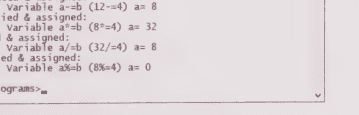

### 比较值

C 编程中常用于比较两个数值的运算符列于下表：

| 运算符： | 比较测试 |
|---|---|
| == | 相等 |
| != | 不等 |
| > | 大于 |
| < | 小于 |
| >= | 大于或等于 |
| <= | 小于或等于 |

== 相等运算符比较两个操作数，如果两者的值相等，则返回 1（真），否则返回 0（假）。如果两者是相同的数字，则它们相等；或者如果两者都是字符，则按数值比较它们的 ASCII 码值。

相反，!= 不等运算符在两个操作数不相等时返回 1（真），使用与 == 相等运算符相同的规则；否则返回 0（假）。

相等和不等运算符可用于测试两个变量的状态，以便在程序中执行条件分支。

> “大于”运算符比较两个操作数，如果第一个的值大于第二个，则返回 1（真）；如果相等或更小，则返回 0（假）。> “大于”运算符常用于在循环中测试倒计数值。

< “小于”运算符进行相同的比较，但如果第一个操作数的值小于第二个，则返回 1（真），否则返回 0（假）。

在 > “大于”或 < “小于”运算符后加上 = 运算符，使其在两个操作数的值完全相等时也返回 1（真）。

有关 ASCII 码值的更多信息，可在第 162-163 页的参考部分找到。


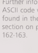

- 新建一个程序，使用预处理指令包含标准输入/输出库函数

```c
#include <stdio.h>
```

- 添加一个 main 函数，声明并初始化三个整型变量和两个字符变量

```c
int main()
{
    int zero = 0 , nil = 0 , one = 1 ;
    char upr = 'A' , lwr = 'a' ;
}
```

- 接下来，在 main 函数块中，输出对变量执行的比较运算的结果

```c
printf( "Equality (0==0): %d \n" , zero == nil );
printf( "Equality (0==1): %d \n" , zero == one );
printf( "Equality (A==a): %d \n" , upr == lwr );
printf( "Inequality (A!=a): %d \n" , upr != lwr );
printf( "Greater than (1>0): %d \n" , one > nil );
printf( "Less than (1<0): %d \n" , one < nil );
printf( "Greater or equal (0>=0): %d \n" , zero >= nil );
printf( "Less or equal (1<=0): %d \n" , one <= nil );
```

- 在 main 函数块末尾，按照函数声明的要求返回整数值零

```c
return 0 ;
```

- 保存程序文件，然后编译并执行程序，以查看比较运算的结果


> **不要忘记：** 在数值上，1 表示真结果，0 表示假结果。

> **提示：** 大写 'A' 的 ASCII 码值是 65，小写 'a' 的 ASCII 码值是 97——因此它们在此处的比较返回 0（假）。

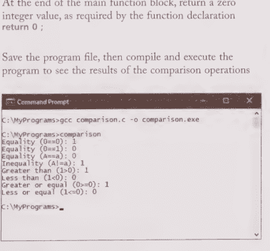

### 评估逻辑

C 编程中最常用的逻辑运算符列于下表：

| 运算符： | 运算： |
|---|---|
| && | 逻辑与 |
| || | 逻辑或 |
| ! | 逻辑非 |

逻辑运算符与具有真或假布尔值的操作数一起使用，或与可转换为真或假的表达式一起使用。

逻辑 && 与运算符将评估两个操作数，仅当两个操作数本身都为真时才返回真。否则，&& 与运算符将返回假。

这用于条件分支，其中 C 程序的方向通过测试两个条件来确定。如果两个条件都满足，程序将朝某个方向执行，否则将采取不同的方向。

与需要两个操作数都为真的 && 与运算符不同，|| 或运算符将评估两个操作数，如果其中一个操作数本身为真，则返回真。如果两个操作数都不为真，则 || 或运算符将返回假。这在 C 编程中很有用，可在两个测试条件中任一满足时执行某个操作。


“布尔”一词指的是英国数学家乔治·布尔（George Boole，1815-1864）开发的一种逻辑思想体系。

第三个逻辑 ! 非运算符是“一元”运算符——用于单个操作数之前。它返回给定操作数的相反值，因此如果变量 var 为真值，则 !var 将返回假值。! 非运算符在 C 编程中很有用，可在连续的循环迭代中使用类似 var = !var 的语句切换变量的值。这确保每次传递时值都会反转，就像拨动电灯开关一样。

在 C 编程中，零表示布尔假值；任何非零值（例如 1）表示布尔真值。


...续

- 1 开始一个新程序，使用预处理指令包含标准输入/输出库函数

```
#include <stdio.h>
```

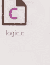

- 2 添加一个 main 函数，声明并初始化两个整型变量

```
int main()
{
    int yes = 1, no = 0;
}
```

- 3 接下来，在 main 函数块中，输出对变量执行逻辑运算的结果

```
printf("AND (no&&no): %d \n", no && no );
printf("AND (yes&&no): %d \n", yes && no );
printf("AND (yes&&yes): %d \n", yes && yes );
printf("OR (no||no): %d \n", no || no );
printf("OR (yes||no): %d \n", yes || no );
printf("OR (yes||yes): %d \n", yes || yes );
printf("NOT (yes !yes): %d %d\n", yes , !yes );
printf("NOT (no !no): %d %d\n", no , !no );
```

- 4 在 main 函数块末尾，按照函数声明的要求返回整数值零

```
return 0;
```

- 5 保存程序文件，然后编译并执行程序，以查看逻辑运算的结果

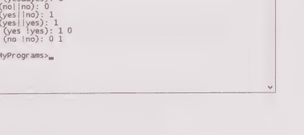

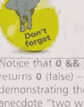

请注意，0 && 0 返回 0（假）——这印证了“两个错误并不能凑成一个正确”这一说法。

### 检查条件


C 程序员最喜欢的测试运算符可能就是 `?:` 条件运算符，也称为“三元”运算符。这个运算符首先对一个表达式求值，得到真或假的布尔值，然后根据求值结果执行两个给定语句之一。

条件运算符具有以下语法：

```
~~~c
( test-expression ) ? if-true-do-this : if-false-do-this ;
~~~
```

例如，这个运算符可用于通过检查一个数除以二后是否有余数，来判断给定数字是奇数还是偶数，然后输出相应的字符串，如下所示：

```
~~~c
( 7 % 2 != 0 ) ? printf( "Odd Number" ) : printf( "Even Number" ) ;
~~~
```

在本例中，7 除以 2 不会留下零余数——因此该表达式的求值结果为真；所以执行第一条语句，正确地将该数字描述为奇数值。

条件运算符还可用于确保输出中关于单数和复数项目的语法正确，从而避免出现“There is 5”这类别扭表达。只需在 `printf()` 语句中进行判断，即可使用合适的版本：

```
~~~c
printf( "There %s %d" , ( num == 1 ) ? "is" : "are" , num ) ;
~~~
```

在本例中，当 `num` 变量的值确实为 1 时，将使用“is”版本，否则将使用“are”版本。

条件运算符还可用于根据求值结果向变量赋予适当的值。这样使用时，其语法如下所示：

```
~~~c
variable = ( test-expression ) ? if-true-assign-this : if-false-assign-this ;
~~~
```

例如，这个运算符可用于判断一个给定数字是否大于另一个数字，然后将较大的数字赋给变量，如下所示：

```
~~~c
int num , a = 5 , b = 2 ;
num = ( a > b ) ? a : b ;
~~~
```

在本例中，变量 `a` 的值大于变量 `b` 的值，因此将较大的值 `5` 赋给 `num` 变量。


尽管条件运算符使用起来快速简便，但它可能降低代码可读性。

- 1. 开始一个新程序，使用预处理指令包含标准输入/输出库函数。

```c
#include <stdio.h>
```

- 2. 添加一个 main 函数，声明并初始化一个整型变量。

```c
int main()
{
    int num = 7;
}
```

- 3. 接下来，在 main 函数块中，插入一条条件语句以输出变量值的奇偶性。

```c
(num % 2 != 0) ? printf("%d is odd\n", num) : printf("%d is even\n", num);
```

- 4. 现在，插入条件语句，以使用正确的复数语法输出一个短语。

```c
printf("There %s ", (num == 1) ? "is" : "are");
printf("%d %s\n", num, (num == 1) ? "apple" : "apples");
```

- 5. 减小变量值，然后插入条件语句，以输出一个符合单数语法的短语。

```c
num -= 1;
printf("There %s ", (num == 1) ? "is" : "are");
printf("%d %s\n", num, (num == 1) ? "apple" : "apples");
```

- 6. 在 main 函数块末尾，按照函数声明的要求返回整数值零。

```c
return 0;
```

- 7. 保存程序文件，然后编译并执行程序，以查看条件运算的结果。


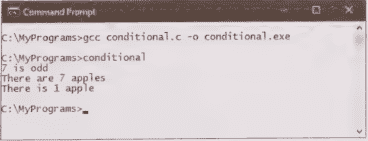


条件运算符最适合用于仅提供两个简单备选方案来实现的简洁语句。

...续

- 1. 开始一个新程序，使用预处理指令包含标准输入/输出库函数 `#include <stdio.h>`
- 2. 添加一个 main 函数，声明并初始化一个整型变量

```c
int main()
{
    int num = 1234567890 ;
}
```

- 3. 接下来，在 main 函数块中，插入语句，以按类型名和对象名显示分配给 int 数据类型（在此实现中）的内存

```c
printf("Size of int data type is %d bytes\n" , sizeof( int ) ) ;
printf("Size of int variable is %d bytes\n" , sizeof( num ) ) ;
```

- 4. 现在，插入一条语句，以显示数组为其每个元素分配相同的内存

```c
printf("Size of an int array is %d bytes\n" , sizeof( int[3]) ) ;
```

- 5. 定义一个包含一个 char 变量和一个 int 变量的结构体，然后显示其总内存分配——包括任何填充

```c
struct { int score ; char grade ; } result ;
printf("Size of a structure is %d bytes\n" , sizeof( result ) ) ;
```

- 6. 在 main 函数块末尾，按照函数声明的要求返回整数值零

```c
return 0 ;
```

- 7. 保存程序文件，然后编译并执行程序，以查看 sizeof 运算的输出

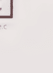


此示例包含一个 struct 对象的代码，该对象是不同变量的列表。结构体将在第 9 章演示，但这里包含一个 struct，是为了演示 sizeof 运算符如何测量其内存大小。


### 比较位值

一个字节由 8 位组成，每一位可以包含 1 或 0，用于存储表示 0 到 255 十进制值的二进制数。只有当某一位包含 1 时，该位才贡献一个十进制分量。这些位从右到左依次称为“最低有效位”（LSB）到“最高有效位”（MSB）。下面位模式中的二进制数表示十进制 50。


许多 C 程序员从不使用按位运算符，但了解它们是什么以及可以如何使用是有用的。

| 位编号 | 7 MSB | 6 | 5 | 4 | 3 | 2 | 1 | 0 LSB |
|---|---|---|---|---|---|---|---|---|
| 十进制 | 128 | 64 | 32 | 16 | 8 | 4 | 2 | 1 |
| 二进制 | 0 | 0 | 1 | 1 | 0 | 0 | 1 | 0 |

尽管 char 数据类型是 C 编程中的基本 1 字节存储单元（如第 62 页所述），但可以使用“按位”运算符操作一个字节的各个部分。

| 运算符： | 名称： | 二进制数运算： |
|---|---|---|
| &#124; | 或（OR） | 当两个相比较的位中任意一位为 1 时，在每一位返回 1<br>示例：1010 &#124; 0101 = 1111 |
| &amp; | 与（AND） | 当两个相比较的位都为 1 时，在每一位返回 1<br>示例：1010 &amp; 1100 = 1000 |
| ~ | 非（NOT） | 在不为 1 的每一位返回 1，在值为 1 的每一位返回 0<br>示例：~ 1010 = 0101 |
| ^ | 异或（XOR） | 当两个相比较的位中只有一位为 1 时，在每一位返回 1<br>示例：1010 ^ 0100 = 1110 |
| &lt;&lt; | 左移（Shift left） | 将每个为 1 的位向左移动指定的位数<br>示例：0010 &lt;&lt; 2 = 1000 |
| &gt;&gt; | 右移（Shift right） | 将每个为 1 的位向右移动指定的位数<br>示例：1000 &gt;&gt; 2 = 0010 |


一个字节的每一半称为一个“半字节”（nibble，4 位）。表中示例中的二进制数描述的是存储在一个半字节中的值。


除非是为资源受限的设备编程，否则很少需要用到按位运算符，但它们可能很有用。例如，XOR（异或）运算符让你无需第三个变量即可交换两个变量的值。

- 1. 开始一个新程序，使用预处理指令包含标准输入/输出库函数
```c
#include <stdio.h>
```
- 2. 添加一个 main 函数，声明并初始化两个整型变量，然后输出它们的初始值
```c
int main()
{
 int x = 10, y = 5;
 printf("\nx=%d y=%d\n", x, y);
}
```
- 3. 接下来，在 main 函数块中，插入三次 XOR 语句，通过二进制位操作交换变量值
```c
x = x ^ y; /* 1010 ^ 0101 = 1111 (decimal 15) */
y = x ^ y; /* 1111 ^ 0101 = 1010 (decimal 10) */
x = x ^ y; /* 1111 ^ 1010 = 0101 (decimal 5) */
```
- 4. 现在，插入一条语句以输出交换后的值
```c
printf("\nx=%d y=%d\n", x, y);
```
- 5. 在 main 函数块末尾，按照函数声明的要求返回整数零值
```c
return 0;
```
- 6. 保存程序文件，然后编译并执行程序，看看 XOR 按位操作的魔力


不要将按位运算符与逻辑运算符混淆。按位运算符比较二进制数，而逻辑运算符评估布尔值。


### 标志位

迄今为止，按位运算符最常见的用途是操作一个紧凑的“位域”，其中包含一组布尔“标志”。与将布尔标志值存储在单独变量中相比，这种方式对内存的利用效率高得多——仅 1 字节的 char 数据类型可以容纳一个包含八个标志的位域，每位一个标志，而八个单独的 char 变量将需要整整 8 字节内存。

可以通过向变量赋予一个十进制值来设置初始位标志，该值的二进制等价值中，每个要作为布尔标志“打开”的位都为 1。例如，十进制 8 的二进制等价值为 1000（1x8 0x4 0x2 0x1），因此会打开第四个标志，从最低有效位从右向左读取。

随后，可以使用按位 NOT ~ 运算符反转位标志值，但必须注意在标志位之前用零进行掩码，否则它们都会返回为 1。例如，要反转一个字节右侧四位中的四个标志的位域，必须对左侧四位进行掩码。十进制 15 是二进制 00001111（0x128 0x64 0x32 0x16 1x8 1x4 1x2 1x1），可以通过按位 AND & 运算符将其作为该掩码应用。

还可以使用按位左移 << 和右移 >> 运算符，将已打开的标志位移指定的位数，从而操作位标志模式。


- 1. 开始一个新程序，使用预处理指令包含标准输入/输出库函数
```c
#include <stdio.h>
```
- 2. 添加一个 main 函数，声明一个字符变量，并用一个打开一个位标志的十进制值初始化
```c
int main()
{
 int flags = 8; /* Binary 1000 (1x8 0x4 0x2 0x1) */
}
```
- 3. 接下来，在 main 函数块中，为变量赋予一个新值，以同时打开另一个标志
```c
flags = flags | 2; /* 1000 | 0010 = 1010 (decimal 10) */
```
- 4. 现在，插入语句输出所有位标志设置

 printf( "Flag 1: %s\n", ( (flags & 1) > 0 ) ? "ON" : "OFF" );
 printf( "Flag 2: %s\n", ( (flags & 2) > 0 ) ? "ON" : "OFF" );
 printf( "Flag 3: %s\n", ( (flags & 4) > 0 ) ? "ON" : "OFF" );
 printf( "Flag 4: %s\n", ( (flags & 8) > 0 ) ? "ON" : "OFF" );


### 小技巧
通常可以预先定义常量来表示每个位标志，这会很方便。例如：
 #define FLAG1 1
 #define FLAG2 2
 #define FLAG3 4
 #define FLAG4 8

- 5. 接下来，插入语句对字节的前四位进行掩码，然后翻转所有位标志设置

 char mask = 15 ; /* Binary 00001111 */
 flags = ~flags & mask ; /* ~(1010 & 1111=1010) = 0101 */

- 6. 现在，插入语句输出反转后的位标志设置以及表示该模式的十进制值

 printf( "Flag 1: %s\n", ( (flags & 1) > 0 ) ? "ON" : "OFF" );
 printf( "Flag 2: %s\n", ( (flags & 2) > 0 ) ? "ON" : "OFF" );
 printf( "Flag 3: %s\n", ( (flags & 4) > 0 ) ? "ON" : "OFF" );
 printf( "Flag 4: %s\n", ( (flags & 8) > 0 ) ? "ON" : "OFF" );
 printf( "Flags decimal value is %d\n", flags );

- 7. 添加一条语句，将“打开”的位标志向左移一位，然后输出新模式对应的十进制值

 flags = flags << 1 ; /* 0101 << 1 = 1010. */
 printf( "Flags decimal value is now %d\n", flags );

- 8. 在 main 函数块末尾，按照函数声明的要求返回整数零值
 return 0 ;

- 9. 保存程序文件，然后编译并执行程序，查看位标志操作

```
Command Prompt
C:\MyPrograms>gcc bitFlag.c -o bitFlag.exe
C:\MyPrograms>bitFlag
Flag 1: OFF
Flag 2: ON
Flag 3: OFF
Flag 4: ON

Flag 1: ON
Flag 2: OFF
Flag 3: ON
Flag 4: OFF

Flags decimal value is 5
Flags decimal value is now 10

C:\MyPrograms>_
```


### 不要忘记
使用占用更多内存的变量可以创建具有更多位标志的更大位域——4 字节的 int 数据类型有 32 位。

### 理解优先级

运算符优先级定义了 C 计算表达式的顺序。例如，在表达式 `a=6+b*3` 中，优先级顺序决定先完成加法还是乘法。


`*` 乘法运算符所在的行高于 `+` 加法运算符——因此在表达式 `a=6+b*3` 中，乘法会在加法运算之前完成。

下表按优先级递减顺序列出运算符，其中较高行上的运算符优先于较低行上的运算符，因此它们的运算会先完成。同一行上的运算符具有相同优先级，但完成顺序由结合性方向决定。例如，对于“从左到右”结合性，左侧的运算会先完成。

| 运算符 | 结合性 |
|---|---|
| `( )` 函数调用 &nbsp; `[ ]` 数组索引<br>`->` 结构体指针 &nbsp;`.` 结构体成员 | 从左到右 |
| `!` 逻辑非 &nbsp; `~` 按位非 &nbsp; `++` 自增<br>`--` 自减 &nbsp;`+` 正号 &nbsp;`sizeof`<br>`-` 负号 &nbsp;`*` 指针 &nbsp;`&` 取地址 | 从右到左 |
| `*` 乘法 / 除法 `%` 取模 | 从左到右 |
| `+` 加 - 减 | 从左到右 |
| `<<` 左移 &nbsp;`>>` 右移 | 从左到右 |
| `<` 小于 &nbsp;`<=` 小于或等于<br>`>` 大于 &nbsp;`>=` 大于或等于 | 从左到右 |
| `==` 等于 `!=` 不等于 | 从左到右 |
| `&` 按位与 | 从左到右 |
| `^` 按位异或 | 从左到右 |
| `|` 按位或 | 从左到右 |
| `&&` 逻辑与 | 从左到右 |
| `||` 逻辑或 | 从左到右 |
| `?:` 条件 | 从右到左 |
| `=` `+=` `-=` `*=` `/=` `%=` `&=` `^=` `|=`<br>`<<=` `>>=` 赋值运算符 | 从右到左 |
| `,` 逗号 | 从左到右 |


`->` 和 `.` 结构体运算符将在本书后面描述，但此处列出它们是为了提供所有运算符的完整优先级表。

- 1. 开始一个新程序，使用预处理指令包含标准输入/输出库函数

 `#include <stdio.h>`


- 2. 添加一个 main 函数，输出一个遵循行级优先级规则的表达式得到的整数，以及另一个遵循显式确定优先级的表达式得到的整数

 int main()
 {
 printf("\nDefault precedence ((2*3)+4)-5 : %d\n", 2*3+4-5 );
 printf("Explicit precedence 2*((3+4)-5) : %d\n", 2*((3+4)-5) );
 }

- 3. 接下来，在 main 函数块中，输出一个遵循从左到右结合性优先级规则的整数，然后输出另一个遵循显式确定优先级的整数

 printf( "\nDefault precedence (7*3) %% 2 : %d\n" , 7*3%2 );
 printf( "Explicit precedence 7* (3%%2) : %d\n" , 7*(3%2) );

- 4. 现在，输出一个遵循从右到左结合性优先级规则的整数，然后输出另一个来自显式优先级的整数

 int num = 9 ;
 printf("\nDefault precedence(8/2)*4:%d\n", --num/2*sizeof(int));
 num = 9 ;
 printf("Explicit precedence 8/(2*4):%d\n", --num/(2*sizeof(int)));

- 5. 在 main 函数块末尾，按照函数声明的要求返回整数零值

 `return 0 ;`

- 6. 保存程序文件，然后编译并执行程序，查看遵循优先级规则的输出

### 注意

为了输出 % 字符，printf() 语句需要使用 %%。

```
C:\MyPrograms>gcc precedence.c -o precedence.exe
C:\MyPrograms>precedence
Default precedence ((2*3)+4)-5 : 5
Explicit precedence 2*((3+4)-5) : 4
Default precedence (7*3) % 2 : 1
Explicit precedence 7* (3%2) : 7
Default precedence (8/2)*4:16
Explicit precedence 8/(2*4):1
C:\MyPrograms>
```


### 总结

- 算术运算符可以使用两个操作数构成表达式，用于加法 +、减法 -、乘法 *、除法 / 和取模 %。
- 自增 ++ 和自减 -- 运算符使单个操作数增加或减少 1。
- 赋值 = 运算符可以与算术运算符组合，先执行算术计算，然后将其结果赋值。
- 比较运算符可以构成表达式，用于比较两个操作数的值：相等 ==、不相等 !=、大于 >、小于 <、大于或等于 >= 以及小于或等于 <=。
- 逻辑与 && 和逻辑或 || 运算符构成表达式，对两个操作数求值以返回布尔值 true 或 false，而逻辑非 ! 运算符返回单个操作数的反向布尔值。
- 条件 ?: 运算符对给定的布尔表达式求值，然后根据其结果返回两个操作数之一。
- sizeof 运算符返回数据类型或数据对象的内存字节大小。
- 单个内存字节由八个位组成，每个位可以包含值一（1）或零（0）。
- 按位或 |、按位与 &、按位非 ~ 和按位异或 ^ 运算符在对两个位中的值进行比较后返回一个值，而左移 << 和右移 >> 运算符按指定数量的位沿其方向移动位值。
- 按位运算符最常见的用途是操作包含一组布尔标志的紧凑位字段。
- 包含多个运算符的表达式将按照默认优先级规则执行其运算，除非通过添加括号明确指定。

### 测试表达式


当要执行的代码只是单条语句时，可以选择省略花括号。


通过将 if 和 else 语句组合为 if() { ... } else if () { ... }，可以对多个表达式求值。

if 关键字用于执行基本条件测试，该测试对给定表达式求值以得到布尔值 true 或 false。只有发现表达式为 true 时，才会执行求值之后花括号内的语句。因此，if 测试语句的语法如下所示：

```
if ( test-expression ) { statements-to-execute-when-true }
```

当测试为 true 时，可能要执行多条语句，但每条语句都必须以分号结尾。

有时可能需要对多个表达式求值，以确定是否应执行后续语句，这可以通过两种方式实现。逻辑与 && 运算符可用于确保仅当两个表达式都被发现为 true 时才执行这些语句，语法如下：

```
if ( ( test-expression ) && ( test-expression ) ) { statements-to-execute }
```

或者，可以将多个 if 语句“嵌套”，一个放在另一个内部，以确保仅当两个求值表达式都被发现为 true 时才执行后续语句，如下所示：

```
if ( test-expression )
{
if ( test-expression ) { statements-to-execute }
}
```

当 if 测试语句求值的一个或多个表达式被发现为 false 时，其后面花括号内的语句不会执行，程序将继续执行后续代码。

通常更可取的是扩展 if 语句，附加一个 else 语句，指定当 if 语句求值的表达式被发现为 false 时要执行的花括号内语句，语法如下：

```
if ( test-expression )
{ statements-to-execute-when-true }
else
{ statements-to-execute-when-false }
```

这是一种基本编程技术，根据求值结果向程序提供两个可继续执行的方向，称为“条件分支”。

- 1. 使用预处理指令开始一个新程序，以包含标准输入/输出库函数

    ```c
    #include <stdio.h>
    ```

    

- 2. 添加一个 main 函数，当被测表达式被发现为 true 时输出一条语句

    ```c
    int main()
    {
        if( 5 > 1 ) { printf( "Yes, 5 is greater than 1\n" ) ; }
    }
    ```

- 3. 接着，在 main 函数块中，当两个被测表达式都被发现为 true 时输出一条语句

    ```c
    if( 5 > 1 )
    {
        if( 7 > 2 )
        { printf("5 is greater than 1 and 7 is greater than 2\n") ; }
    }
    ```

- 4. 现在，在两个被测表达式都被发现为 false 后输出一条默认语句

    ```c
    if( 1 > 2 )
    { printf("1st expression is true\n") ; }
    else if( 1 > 3 )
    { printf("2nd expression is true\n") ; }
    else
    { printf("Both expressions are false\n") ; }
    ```

    

- 5. 在 main 函数块末尾，按照函数声明的要求返回零整数值

    ```c
    return 0 ;
    ```

在 C 中，布尔 true 在数值上表示为 1，布尔 false 表示为 0（零）。因此，表达式 ( 5 > 1 ) 是 ( 5 > 1 == 1 ) 的简写。

- 6. 保存程序文件，然后编译并执行程序，以查看条件测试后的输出

    ```
    C:\MyPrograms>gcc ifelse.c -o ifelse.exe
    C:\MyPrograms>ifelse
    Yes, 5 is greater than 1
    5 is greater than 1 and 7 is greater than 2
    Both expressions are false
    C:\MyPrograms>_
    ```

### 分支 switch 语句

当测试表达式仅求值单个条件时，由多个 **if else** 语句执行的条件分支通常可以通过 **switch** 语句更高效地执行。

**switch** 语句的工作方式不寻常。它将给定值作为参数实参，然后从多个 **case** 语句中寻找与该值匹配的语句。每个 **case** 语句中都包含找到匹配时要执行的代码。


始终最好包含一个 **default** 语句——即使它只是在 **switch** 语句失败时输出错误消息。

重要的是，用 **break** 关键字语句结束每个 **case** 语句，这样 **switch** 语句在找到匹配后就会退出，而不会继续寻找更多匹配——除非这是有意要求。

可选地，**case** 语句列表后面可以跟一个最终的 **default** 语句，用于指定在任何 **case** 语句中都未找到匹配时要执行的代码。因此，switch 语句的语法通常如下所示：

```c
switch ( test-value )
{
  case match-value : statements-to-execute-when-matched ; break ;
  case match-value : statements-to-execute-when-matched ; break ;
  case match-value : statements-to-execute-when-matched ; break ;
  default : statements-to-execute-when-no-match-found ;
}
```

根据 ANSI C 标准，一个 **switch** 语句最多可以至少有 257 个 **case** 语句，但其中任意两个 **case** 语句都不能尝试匹配相同的值。


**default** 语句不必出现在 switch 块的末尾，但将其放在那里是合乎逻辑的，因为那里不需要 **break** 语句。

当多个匹配值各自要执行相同的语句时，只有最后一个 **case** 语句需要包含要执行的语句以及用于退出 **switch** 语句块的 **break** 语句。例如，要为匹配值 0、1 和 2 输出同一条消息：

```c
switch ( num )
{
  case 0 :
  case 1 :
  case 2 : printf( "Less than 3\n" ) ; break ;
  case 3 : printf( "Exactly 3\n" ) ; break ;
  default : printf( "Greater than 3 or less than zero\n" ) ;
}
```

- 1. 使用预处理指令开始一个新程序，以包含标准输入/输出库函数

    ```c
    #include <stdio.h>
    ```

    

- 2. 添加一个 main 函数，声明并初始化一个整数变量和一个字符变量

    ```c
    int main()
    {
        int num = 2 ; char letter = 'b' ;
    }
    ```

- 3. 接着，在 main 函数块中，插入一个尝试匹配整数值的 switch 语句

    ```c
    switch( num )
    {
        case 1 : printf( "Number is one\n" ) ; break ;
        case 2 : printf( "Number is two\n" ) ; break ;
        case 3 : printf( "Number is three\n" ) ; break ;
        default : printf( "Number is unrecognized\n" ) ;
    }
    ```

- 4. 现在，插入一个尝试匹配字符值的 switch 语句

    ```c
    switch( letter )
    {
        case 'a' : case 'b' : case 'c' :
            printf( "Letter is %c\n" , letter ) ; break ;
        default : printf( "Letter is unrecognized\n" ) ;
    }
    ```

    

    > 在 switch 语句中，case 关键字、匹配值和冒号字符被视为一个唯一的“标签”。

- 5. 在 main 函数块末尾，按照函数声明的要求返回零整数值

    ```c
    return 0 ;
    ```

- 6. 保存程序文件，然后编译并执行程序，以查看 switch 语句的输出

    ```
    Command Prompt

    C:\MyPrograms>gcc switch.c -o switch.exe
    C:\MyPrograms>switch
    Number is two
    Letter is b
    C:\MyPrograms>_
    ```


### 按次数循环

循环是程序中自动重复执行的一段代码。循环中所有语句的一次完整执行称为一次“迭代”，或一“轮”。循环的长度由循环内进行的条件测试控制。只要被测试表达式为真，循环就会继续；直到被测试表达式为假，此时循环结束。

在 C 编程中，有三种循环结构：for 循环、while 循环和 do while 循环。其中最常见的也许是 for 循环，其典型语法如下：

```
for ( initializer ; test-expression ; incrementer ) { statements }
```

初始化器用于为循环已执行迭代次数的计数器设置起始值。为此使用一个整型变量，传统上命名为“i”。

在循环的每次迭代中，都会对测试表达式求值，并且仅当该表达式为真时，该次迭代才会继续。当测试表达式变为假时，循环立即结束，不再执行这些语句。每次迭代时，计数器先递增，然后执行语句。

循环可以嵌套，一个循环位于另一个循环内，从而在外层循环的每次迭代中完整执行内层嵌套循环的所有迭代。


- 1. 使用预处理指令包含标准输入/输出库函数，开始一个新程序
  
  ```c
  #include <stdio.h>
  ```

- 2. 添加一个 main 函数，声明两个整型变量，稍后用作循环迭代计数器
  
  ```c
  int main()
  {
      int i , j ;
  }
  ```

- 3. 接下来，在 main 函数块中插入一个 for 循环，在三次迭代的每一次中输出循环计数器的值
  
  ```c
  for( i = 1 ; i < 4 ; i++ )
  {
      printf( "Outer loop iteration %d\n" , i ) ;
  }
  ```

- 4. 在 main 函数块末尾，按照函数声明的要求返回整数值零
  
  ```c
  return 0 ;
  ```

- 5. 保存程序文件，然后编译并执行程序，查看 for 循环的输出
  
  ```
  C:\MyPrograms>gcc forloop.c -o forloop.exe
  C:\MyPrograms>forloop
  Outer loop iteration 1
  Outer loop iteration 2
  Outer loop iteration 3
  C:\MyPrograms>
  ```

- 6. 现在，在循环块中，紧接现有输出语句之后插入一个嵌套循环，在三次内层循环迭代的每一次中输出循环计数器的值
  
  ```c
  for(j = 1 ; j < 4 ; j++)
  {
      printf( "\tInner loop iteration %d\n" , j ) ;
  }
  ```

- 7. 再次保存程序文件，然后编译并执行程序，查看两个循环的输出
  
  > **实用提示**
  >
  > for 循环计数器也可以倒计数——每次迭代使用 `i--` 而不是 `i++` 来递减计数器值。
  
  ```
  C:\MyPrograms>gcc forloop.c -o forloop.exe
  C:\MyPrograms>forloop
  Outer loop iteration 1
    Inner loop iteration 1
    Inner loop iteration 2
    Inner loop iteration 3
  Outer loop iteration 2
    Inner loop iteration 1
    Inner loop iteration 2
    Inner loop iteration 3
  Outer loop iteration 3
    Inner loop iteration 1
    Inner loop iteration 2
    Inner loop iteration 3
  C:\MyPrograms>
  ```

### 当条件为真时循环

while 循环是上一示例中所述 for 循环的替代方案。**while** 循环也需要初始化器、测试表达式和递增器，但它们不像 **for** 循环那样整齐地列在一对括号内。相反，初始化器必须出现在循环块开始之前，测试表达式必须出现在 **while** 关键字之后的括号内，随后是花括号，其中包含递增器以及每次迭代要执行的语句。

```
initializer
while ( test-expression )
{ statements-to-be-executed ; incrementer }
```


注意，在 do while 循环中，while 语句之后需要分号终止符。

do while 循环对上述语法做了细微变化：将 do 关键字放在循环块之前，并将 while 语句移到循环块之后。

```
initializer
do { statements-to-be-executed ; incrementer }
while ( test-expression ) ;
```

while 循环和 do while 循环都会继续迭代，直到测试表达式被判定为假，此时循环将退出。因此，循环体必须包含在某个时刻改变测试表达式求值结果的代码；否则就会创建无限循环，导致系统锁死。

while 循环与 do while 循环的显著区别在于：如果测试表达式在第一次求值时为假，while 循环一次迭代都不会执行。相反，do while 循环始终至少执行一次迭代，因为其语句在求值之前执行。如果希望如此，do while 循环显然是最佳选择；否则，在 for 循环和 while 循环之间选择主要取决于个人偏好。一条经验法则是：for 循环最适合执行特定次数的迭代，而 while 循环最适合迭代直到满足某个条件。


如果程序运行无限循环，在 Windows 或 Linux 系统上按 Ctrl + C 键来停止循环执行。

循环与数组是完美搭档，因为每次迭代都可以轻松读取或写入连续的数组元素。

- 1. 使用预处理指令包含标准输入/输出库函数，开始一个新程序
  
  ```c
  #include <stdio.h>
  ```


- 2. 添加一个 main 函数，声明一个计数器变量，然后声明并初始化一个包含三个元素的数组变量
  
  ```c
  int main()
  {
      int i , arr[3] = { 10 , 20 , 30 } ;
  }
  ```

- 3. 接下来，在 main 函数块中插入一个 while 循环，输出每个元素的编号及其包含的值
  
  ```c
  i = 0 ;
  while( i < 3 )
  {
      printf( "While: arr[%d] = %d\n" , i, arr[i] ) ;  i++ ;
  }
  ```

- 4. 现在，插入一个 do while 循环，同样输出每个元素的编号及其包含的值
  
  ```c
  i = 0 ;
  do
  {
      printf( "\nDo while: arr[%d] = %d" , i, arr[i] ) ; i++ ;
  }
  while( i < 3 ) ;
  ```

- 5. 在 main 函数块末尾，按照函数声明的要求返回整数值零
  
  ```c
  return 0 ;
  ```

> **别忘了！**
>
> 将此测试表达式中的值改为零——即两个循环中都使用 `while (i<0)`——然后重新编译并再次运行程序，以看到只有 **do while** 循环的第一次迭代被执行。

- 6. 保存程序文件，然后编译并执行程序，查看循环产生的看似相同的输出
  
  ```
  C:\MyPrograms>gcc dowhile.c -o dowhile.exe
  
  C:\MyPrograms>dowhile
  While: arr[0] = 10
  While: arr[1] = 20
  While: arr[2] = 30
  
  Do while: arr[0] = 10
  Do while: arr[1] = 20
  Do while: arr[2] = 30
  
  C:\MyPrograms>
  ```

### 跳出循环

break 关键字可用于在满足指定条件时提前终止循环。break 语句位于循环语句块内，并且前面有一个测试表达式。当测试返回真时，循环立即结束，程序继续执行下一个任务。例如，在嵌套的内层循环中，它会继续执行外层循环的下一次迭代。


- 1. 使用预处理指令包含标准输入/输出库函数，开始一个新程序
  
  ```c
  #include <stdio.h>
  ```

- 2. 添加一个 main 函数，声明两个整型变量，稍后用作循环迭代计数器
  
  ```c
  int main()
  {
      int i, j;
  }
  ```

- 3. 接下来，在 main 函数块中插入两个嵌套循环，在三次迭代的每一次中输出各自的计数器值
  
  ```c
  for(i = 1; i < 4; i++)
  {
      for(j = 1; j < 4; j++)
      {
          printf("Running i=%d j=%d\n", i, j);
      }
  }
  ```

- 4. 在 main 函数块末尾，按照函数声明的要求返回整数值零
  
  ```c
  return 0;
  ```

- 5. 保存程序文件，然后编译并执行程序，查看嵌套循环的输出


6 现在，将这个 break 语句插入到内层循环块的最开始处，以跳出内层循环——然后保存、编译并再次运行程序

```
if ( i == 2 && j == 1 )
{
    printf( "Breaks inner loop when i=%d and j=%d\n", i, j );
    break ;
}
```


这里，当外层循环第二次尝试运行内层循环时，break 语句会中止内层循环的全部三次迭代。


当满足指定条件时，continue 关键字可用于跳过循环的某一次迭代。continue 语句位于循环语句块内部，并且其前面有一个测试表达式。当测试返回 true 时，该次迭代就会结束。

7 将这个 continue 语句插入到内层循环块的开头，以跳过内层循环的第一次迭代——然后保存、编译并再次运行程序

```
if ( i == 1 && j == 1 )
{
    printf( "Continues inner loop when i=%d and j=%d\n", i, j );
    continue;
}
```


这里，当外层循环第一次尝试运行内层循环时，continue 语句只是跳过了内层循环的第一次迭代。


### 跳转到标签

goto 关键字据说允许程序流程跳转到程序代码中其他位置的标签，就像网页上的超链接一样。然而，实际上这可能导致错误；它的使用不受欢迎；并且它被认为是不良的编程实践。

goto 关键字跳转是一种强大的特性，它已在计算机程序中存在了数十年，但许多早期程序员滥用了它的能力，他们编写的程序以令人费解的方式到处跳转。这产生了难以阅读的程序代码，因此 goto 的使用变得非常不受欢迎。

goto 关键字的一种可能有效用法是：通过跳转到紧接在外层循环块结束之后的标签，干净地跳出内层嵌套循环。这会立即退出两个循环，因此两个循环都不会再执行后续迭代。


请注意，goto 语句仅按名称指定标签，但标签本身必须带有一个结尾的冒号 :。

- 1. 使用一条预处理指令开始一个新程序，以包含标准输入/输出库函数。

```c
#include <stdio.h>
```

- 2. 添加一个 main 函数，其中声明两个整型变量，稍后将用作循环迭代计数器。

```c
int main()
{
    int i, j;
}
```

- 3. 接下来，在 main 函数块中插入两个嵌套循环，在三次迭代中的每一次输出其计数器值。

```c
for( i = 1; i < 4; i++ )
{
    for( j = 1; j < 4; j++ )
    {
        printf( "Running i=%d j=%d\n", i, j );
    }
}
```

- 4. 在内层嵌套循环的第一行插入一条语句，以便在指定计数器值时跳转到名为“end”的标签。

```c
if( i == 2 && j == 1 ) { goto end; }
```

- 5. 现在，在外层循环的右花括号之后添加该标签。

```c
} end:
```

- 6. 在 main 函数块的末尾，按照函数声明的要求返回整数零值 return 0 ;

- 7. 保存程序文件，然后编译并执行程序，以查看跳转后循环退出

在 C 中，布尔值以数字 1（true）和 0（false）表示

```
```
Command Prompt
C:\MyPrograms>gcc jump.c -o jump.exe
C:\MyPrograms>jump
Running i=1 j=1
Running i=1 j=2
Running i=1 j=3
```
```

一种替代方案是避免使用 **goto** 关键字，改为在每次循环的每一次迭代中检查某个变量是否为布尔真值 (1)：

- 8. 在现有变量声明中添加另一个变量，并用真值 1 初始化 int i , j , flag = 1 ;

- 9. 在外层循环块的开头以及内层循环块中紧挨输出语句之前，都插入对新变量值的条件测试 if ( flag )

避免创建名为 "goto.exe" 的程序可执行文件，因为这会与 Windows 内部的 **GOTO** 命令冲突。

- 10. 修改内层循环的第一行，将 goto 语句替换为将假值零赋给变量的语句 if ( i == 2 && j == 1 ) { flag = 0 ; }

- 11. 删除右花括号之后现已过时的 end; 标签，然后保存、编译并再次执行程序，以查看与之前相同的结果输出

```
```
Command Prompt
C:\MyPrograms>gcc jump.c -o jump.exe
C:\MyPrograms>jump
Running i=1 j=1
Running i=1 j=2
Running i=1 j=3
C:\MyPrograms>_
```
```

### 总结

- **if** 关键字执行基本条件测试，以评估给定表达式的布尔值为 true 还是 false。
- **else** 关键字可用于提供替代语句，以便在 **if** 语句将表达式评估为 false 时执行。
- 在评估之后为程序提供可继续执行的替代方向，称为“条件分支”。
- 由多个 **if else** 语句执行的条件分支，通常可以通过 **switch** 语句更高效地执行。
- 通常，**switch** 块中的每个 **case** 语句都必须以 **break** 语句终止。
- 可选地，**switch** 块可以包含一个 **default** 语句，用于指定未找到匹配项时要执行的语句。
- **for** 关键字后面跟括号，其中指定初始化器、测试表达式和增量器，以控制循环。
- **while** 关键字后面跟括号，其中指定测试表达式，以确定循环是否应继续。
- **while** 循环块之前必须有初始化器，并且其语句块内必须包含增量器。
- **do** 关键字后面跟一个语句块，之后必须有一个以分号终止的 **while** 语句。
- **do while** 循环之前必须有初始化器，并且其语句块内必须包含增量器。
- 与 **for** 循环和 **while** 循环不同，**do while** 循环中的语句将始终至少执行一次。
- **break** 关键字可用于终止循环，而 **continue** 关键字可用于跳过单次迭代。
- 循环可以嵌套，**goto** 关键字可用于退出到指定标签，尽管不建议使用它。

## 6 使用函数

本章演示如何将语句包含在“函数”中，以便每当 C 程序调用时执行。

- 86 声明函数
- 88 提供参数
- 90 递归调用
- 92 将函数放入头文件
- 94 限制可访问性
- 96 总结

添加一个 main 函数，其中声明一个整型变量

```c
int main()
{
    int num ;
}
```


请注意，每个函数原型都必须以分号结尾。

在 main 函数之后，定义自定义函数

```c
void first()
{
    printf( "Hello from the first function\n" ) ;
}
```

```c
int square5()
{
    int square = 5 * 5 ;
    return square ;
}
```

```c
int cube5()
{
    int cube = (5 * 5) * 5 ;
    return cube ;
}
```

现在，在 main 函数块中插入对自定义函数的调用

```c
first() ;
num = square5() ;
printf( "5x5= %d\n", num ) ;
printf( "5x5x5= %d\n", cube5() ) ;
```


从技术上讲，自定义函数定义可以出现在 main() 函数之前——但惯例是包含原型，并将 main() 函数保留在程序代码的开头。

在 main 函数块的末尾，按照该函数声明的要求返回整数零值

```c
return 0 ;
```

保存程序文件，然后编译并执行程序，以查看自定义函数的输出


### 提供参数

数据可以作为“参数”传递给自定义函数，然后函数可以使用这些数据来执行其语句。函数原型必须包含每个参数的名称和数据类型。

重要的是要认识到，在C编程中，数据是“按值”传递给指定为函数参数的变量。这与一些其他编程语言（如Pascal）不同，后者的参数是“按引用”传递的——函数操作的是原始值，而不仅仅是局部副本。

函数原型中的参数称为函数的“形式参数”。它们可以具有不同的数据类型，并且如果以逗号分隔，可以为单个函数指定多个参数。例如，包含四种数据类型各自参数的一个函数原型可能如下所示：

```c
void action( char c , int i , float f , double d ) ;
```

编译器会检查函数原型中指定的形式参数是否与函数定义中的形式参数匹配，如果不匹配，则会报告错误。


“按值”传递数据会将值赋给被调用函数中的一个变量。然后函数可以操作该副本，但不会影响原始数据。


- 1. 使用预处理指令包含标准输入/输出库函数来开始一个新程序
```c
#include <stdio.h>
```
- 2. 声明三个自定义函数原型，每个原型在被调用时都有一个参数要传递
```c
void display( char str[] ) ;
int square( int x ) ;
int cube( int y ) ;
```
- 3. 添加一个 main 函数，该函数声明一个整数变量和一个用文本字符串初始化的字符数组变量
```c
int main()
{
    int num ;
    char msg[50] = "String to be passed to a function" ;
}
```

### 4
在 main 函数之后，定义自定义函数

```c
void display( char str[] )
{
    printf( "%s\n", str );
}

int square( int x )
{
    return ( x * x );
}

int cube( int y )
{
    return ( y * y ) * y;
}
```


函数定义中使用的参数名可以与函数原型中使用的参数名不同，但参数的数据类型、数量和顺序必须相同。不过，在两者中采用相同的名称会更清晰。

### 5
现在，在 main 函数中，插入调用每个自定义函数并传递参数值的语句

```
display( msg );
num = square( 4 );
printf( "4x4= %d\n", num );
printf( "4x4x4= %d\n", cube( 4 ) );
```

### 6
在 main 函数块的末尾，按照函数声明的要求返回一个零整数值

```
return 0 ;
```

### 7
保存程序文件，然后编译并执行程序，以查看使用传递的参数值从自定义函数得到的输出


函数不必返回任何值，但仍然可以包含 return 关键字而不带任何后续值，以表示将控制权返回给调用者。

### 递归调用

自定义函数中的语句可以自由地调用其他自定义函数，就像它们可以轻松调用标准库函数（如 `printf()`）一样。

此外，函数可以调用自身，这些函数称为“递归函数”。与循环一样，重要的是递归函数必须修改被测试的表达式以避免持续执行——因此函数调用会在某个时刻结束。


- 1. 使用预处理指令包含标准输入/输出库函数来开始一个新程序
```c
#include <stdio.h>
```
- 2. 声明一个自定义函数原型，该原型在被调用时有一个参数要传递
```c
void count_down_from( int num );
```
- 3. 添加一个 main 函数，该函数声明一个整数变量
```c
int main()
{
    int start ;
}
```
- 4. 接下来，在 main 函数块中，添加一条语句，请求用户输入一个要赋给该变量的整数值
```c
printf( "Enter a positive integer to count down from: " );
scanf( "%d", &start );
```
- 5. 现在，在 main 函数块中，添加对自定义函数的调用，并将用户输入的值传递给它
```c
count_down_from( start );
```
- 6. 在 main 函数块中，添加一条语句，在控制权从自定义函数返回时输出一条消息
```c
printf( "Lift Off!\n" );
```
- 7. 在 main 函数块的末尾，按照函数声明的要求返回一个零整数值
```c
return 0;
```


在 `scanf()` 函数中，变量名前面必须加上 & 取地址运算符，如第24页所述。

在 main 函数块之后，开始自定义函数定义，其中包含一条语句来输出函数调用期间传递的参数值

```c
void count_down_from( int num )
{
    printf( "%d\n", num );
}
```

接下来，在自定义函数块中，将作为参数传递的值递减

```c
--num ;
```

现在，在自定义函数块中，添加一个条件测试：如果递减后的值小于零，则将控制权返回给 main 函数；否则将该值作为参数递归调用此函数

```c
if( num < 0 ) return ;
else
    count_down_from( num ) ;
```

保存程序文件，然后编译并执行程序，在请求时输入一个整数，以查看递归函数调用的输出


递归函数可能比使用循环效率更低。


### 将函数放在头文件中

由于篇幅考虑，本书中列出的示例程序必然很小，但实际上，大多数C程序会包含多得多的代码。

在开发较大的程序时，应该考虑程序结构。随着程序增长，将整个程序代码维护在单个文件中可能会变得难以管理。

为了简化程序结构，可以创建一个自定义头文件来包含可能重复使用的函数。该文件应使用“.h”文件扩展名命名，就像C库中的标准头文件一样。

通过在以 `main()` 函数所在的文件开头添加 `#include` 预处理指令，可以使自定义头文件中的函数对程序可用。不过，在预处理指令中，自定义头文件名应使用双引号括起来，而不是使用用于包含标准头文件的 < 和 > 尖括号。


- 1. 创建一个名为“utils.h”的自定义头文件，其中包含单个函数的定义
```c
int square( int num )
{
 return ( num * num ) ;
}
```
- 2. 使用预处理指令包含标准输入/输出库函数和自定义头文件来开始一个新程序
```c
#include <stdio.h>
#include "utils.h"
```
- 3. 声明一个没有参数的自定义函数原型
```c
void getnum() ;
```
- 4. 添加一个 main 函数来调用另一个函数，然后按照声明的要求返回一个零整数
```c
int main()
{
 getnum() ;
 return 0 ;
}
```

- 5. 在 main 函数块之后，通过声明两个变量来开始第二个函数定义
```c
void getnum()
{
    int num ;
    char again ;
}
```
- 6. 接下来，在此函数定义中，添加语句以请求用户输入并将其值赋给一个变量
```
printf("Enter an integer to be squared: ");
scanf("%d", &num );
```
- 7. 现在，通过调用自定义头文件中的函数并传入输入值作为其参数来输出结果
```
printf("%d squared is %d\n", num, square(num) );
```
- 8. 添加一条语句，请求进一步的用户输入并将其值赋给一个变量
```
printf("Square another number? Y or N: ");
scanf("%1s", &again );
```
- 9. 最后，添加一个条件测试，以再次执行此函数或将控制权返回给 main 函数
```
if( again == 'Y' || ( again == 'y' ) ) getnum();
else return ;
```
- 10. 保存程序文件，然后编译并执行程序，在请求时输入一个整数和字符，以查看函数调用的输出


程序文件和自定义头文件必须位于同一目录中，但使用常规命令进行编译——由于 `#include` 指令，编译器会自动读取头文件。


注意本示例中使用了 %1s 格式说明符——用于读取用户输入的下一个字符。


### 限制可访问性

static 关键字可用于将函数的可访问性限制在其创建所在的文件中，这与 static 变量限制可访问性的方式完全相同。在散布于多个“c”文件中的大型程序中，建议采用这种做法，以防止意外误用函数。例如，在此示例中，square() 和 multiply() 函数无法从 main() 函数直接调用。


- 1. 使用一条预处理指令开始一个新程序，以包含标准输入/输出库函数

```c
#include <stdio.h>
```

- 2. 声明两个自定义函数原型

```c
void menu();
void action( int option );
```

- 3. 添加一个 main 函数，用于调用第一个自定义函数，然后按声明要求返回一个零整数

```c
int main()
{
    menu();
    return 0;
}
```

- 4. 在主代码块之后，定义第一个自定义函数，将一个菜单选项作为参数传递给另一个函数

```c
void menu()
{
    int option;
    printf( "\nWhat would you like to do?" );
    printf( "\n1. Square a number" );
    printf( "\n2. Multiply two numbers" );
    printf( "\n3. Exit\n" );
    scanf( "%d", &option );
    action( option );
}
```

- 5. 使用一个预处理指令开始第二个程序文件，以包含标准输入/输出函数，并再次声明自定义函数原型

```c
#include <stdio.h>

void menu();
void action( int option );
```


请注意，这里为每个包含对这些函数调用的文件都声明了原型——以防止出现“隐式函数声明”编译器警告。


- 6 现在，定义两个简单的 static 函数

```c
static int square( int a ) { return (a * a); }
static int multiply( int a, int b ) { return a * b; }
```


演示 static 变量的示例可见于第 28 页。

- 7 最后，定义接收来自 main 函数调用中的菜单选项的函数，以执行相应操作——在需要时调用本文件中创建的 static 函数

```c
void action( int option )
{
    int n1, n2;
    if( option == 1 )
    {
        printf( "Enter an integer to be squared: " );
        scanf( "%d", &n1 );
        printf( "%d x %d = %d \n", n1, n1, square(n1) );
        menu();
    }
    else if( option == 2 )
    {
        printf( "Enter two integers to multiply " );
        printf( "separated by a space: " );
        scanf( "%d", &n1 ); scanf( "%d", &n2 );
        printf( "%d x %d = %d\n", n1, n2, multiply( n1, n2 ) );
        menu();
    }
    else return ;
}
```

- 8 保存两个程序文件，然后编译并运行程序，以查看 static 函数返回的输出


请注意，编译器命令指定了两个 .c 源代码文件名，以生成一个可执行文件。

### 总结

-   自定义函数的声明方式是：先写函数的返回值数据类型，然后是函数名和括号，最后以分号结尾。
-   函数声明也称为“函数原型”，应出现在 main 函数之前——这样编译器在读取 main() 函数时就能知道它们的存在。
-   函数定义包含该函数被调用时要执行的实际语句，应出现在 main() 函数代码块之后。
-   函数声明可在其括号内可选地包含一个逗号分隔的参数列表，这些参数由调用者传递给函数，每个参数都声明了数据类型和名称。
-   函数定义中指定的参数必须与其声明中的参数一致，因为这些就是其形式参数。
-   在 C 语言编程中，参数是按值传递的——因此函数操作的是原始值的一个副本。
-   函数可以递归地调用自身，但必须包含一条用于修改被测试表达式的语句，以便在某个时刻退出。
-   自定义头文件具有 ".h" 文件扩展名。
-   用于 #include 自定义头文件的预处理指令必须指定其文件名，且文件名需用双引号括起来。
-   static 关键字可用于函数声明和定义中，通过将其作用域缩小到所在文件来限制可访问性。
-   较大的程序应将函数声明为 static，除非有特定原因需要在其文件外部可见。
-   对于包含 main() 函数的文件之外的函数，不需要函数原型。

## 7 指向数据

本章演示了如何通过指向变量存储所在的地址来表示 C 程序中的数据。

-   98 — 通过指针访问数据
-   100 — 执行指针算术
-   102 — 将指针传递给函数
-   104 — 创建指针数组
-   106 — 指向函数
-   108 — 总结

### 执行指针算术

一旦指针被创建并分配了内存地址，就可以重新分配另一个地址，或通过算术运算移动指针。

++ 递增运算符和 -- 递减运算符会将指针向前或向后移动到该数据类型的其他内存地址——数据类型越大，跳跃也越大。

使用 += 和 -= 运算符可以指定跳跃多少个位置，从而实现更大的跳跃。

指针算术在数组中使用尤其有用，因为数组中的元素占用连续的内存位置。

仅将数组名称赋给指针，就会自动将数组中第一个元素的内存地址赋给它。然后将指针递增 1，即可将指针移动到下一个元素的地址。


*= 和 /= 运算符不能用于移动指针。

- 1. 使用一条预处理指令开始一个新程序，以包含标准输入/输出库函数

```c
#include <stdio.h>
```

- 2. 添加一个 main 函数，声明一个整型变量，然后声明并初始化一个整型数组变量

```c
int main()
{
  int i ;
  int nums[10] = { 1, 2, 3, 4, 5, 6, 7, 8, 9, 10 } ;
}
```

- 3. 接下来，在 main 函数代码块中，声明一个指向第一个数组元素的指针变量并初始化，然后输出该地址以及该指针解引用后的值

```c
int *ptr = nums ;
printf("\nAt Address: %p is Value: %d\n", ptr , *ptr ) ;
```

- 4. 现在，在 main 函数代码块中，递增指针以逐个移动遍历数组元素

- 5 现在，向后跳两个内存位置，回到第一个数组元素的地址

```c
ptr -= 2;
printf("At Address: %p is Value: %d\n\n", ptr , *ptr);
```

- 6 接下来，添加一个循环，输出每个数组元素的下标编号及其包含的值

```c
for( i = 0 ; i < 10 ; i++ )
{
printf( "Element %d Contains Value: %d\n" , i , *ptr );
ptr++ ;
}
```

- 7 在 main 函数代码块末尾，按函数声明要求返回一个零整数

```c
return 0;
```

- 8 保存程序文件，然后编译并运行程序，查看指针在数组元素之间移动时输出的值


数组名称的作用类似于指向其第一个元素的指针。

### 将指针传递给函数

在 C 程序中，函数参数将其数据“按值”传递给被调用函数内部的局部变量。这意味着函数操作的不是原始值，而是它的一个副本。

改为传递指向原始值的指针可以克服这一问题，使被调用函数能够对原始值进行操作。这种技术将数据“按引用”传递，是指针提供的一个根本性优势。


- 1. 使用一条预处理指令开始一个新程序，以包含标准输入/输出库函数 `#include <stdio.h>`
- 2. 声明两个自定义函数原型，每个原型都向函数传递一个整型指针变量 `void twice( int *ptr );` `void thrice( int *ptr );`
- 3. 添加一个 main 函数，声明一个普通整型变量并用数值初始化，同时声明一个整型指针变量并用该普通变量的地址初始化

```c
int main()
{
    int num = 5 ;
    int *ptr = &num ;
}
```

- 4. 接下来，在 main 函数代码块中，输出指针变量存储的地址和解引用后的值

```c
printf( "ptr stores address: %p\n" , ptr ) ;
printf( "ptr dereferences value: %d\n\n" , *ptr ) ;
```

- 5. 现在，输出普通整型变量的原始值

```c
printf( "The num value is %d\n" , num ) ;
```


请注意，指针参数必须包含在函数原型声明中。


- 6. 在主函数块之后，定义由原型声明的两个自定义函数；调用时，每个函数都接收一个整数指针作为参数

```c
void twice( int *number )
{
  *number = ( *number * 2 );
}

void thrice( int *number )
{
  *number = ( *number * 3 );
}
```

> > **别忘了！**
> >
> > 定义括号中的 * 字符表示该参数是一个指针；而在语句中，当它出现在参数名之前时，会对该参数进行解引用，在算术语句中则表示乘法运算符。

- 7. 回到主函数块，添加对每个自定义函数的调用，将普通变量的地址作为引用传入，并输出该普通变量修改后的值

```c
twice( ptr );
printf( "The num value is now %d\n", num );
thrice( ptr );
printf( "And now the num value is %d\n", num );
```

- 8. 在主函数块末尾，按照函数声明的要求返回整数零值

```c
return 0 ;
```

- 9. 保存程序文件，然后编译并执行程序，查看传递引用后输出的值

```text
C:\MyPrograms>gcc passtr.c -o passtr.exe
C:\MyPrograms>passtr
ptr stores address: 0061FF28
*ptr dereferences value: 5
The num value is 5
The num value is now 10
And now the num value is 30
C:\MyPrograms>
```

### 创建指针数组

C 程序可以包含指针数组，其中数组的每个元素存储其他变量的地址。

这种能力在处理字符串时特别有用。以 \0 空字符结尾的字符数组具有字符串状态，因此可以赋给指针变量。字符串字符数组的名称的作用类似于指向其第一个元素的指针，因此在将字符串赋给指针变量时不需要 & 取地址运算符。

- 1. 开始一个新程序，使用一条预处理指令包含标准输入/输出库函数
`#include <stdio.h>`

- 2. 添加一个 main 函数，声明一个整数变量，然后声明并初始化一个整数数组变量
```c
int main()
{
    int i;
    int nums[5] = { 1, 2, 3, 4, 5 };
}
```

- 3. 接着，在主函数块中，用每个元素的地址声明并初始化整数指针变量
```c
int *ptr0 = &nums[0];
int *ptr1 = &nums[1];
int *ptr2 = &nums[2];
int *ptr3 = &nums[3];
int *ptr4 = &nums[4];
```

- 4. 现在，声明并初始化一个整数指针数组，其中每个元素包含一个整数指针
```c
int *ptrs[5] = { ptr0 , ptr1 , ptr2 , ptr3 , ptr4 };
```

- 5. 接着，声明并初始化一个字符数组、一个指向该数组的指针，以及一个字符指针数组，其中每个元素都包含一个字符串
```c
char str[9] = { 'C', ',', 'i', 's', ',', 'F', 'u', 'n', '\0' };
char *string = str;
char *strings[3] = { "Alpha", "Bravo", "Charlie" };
```


注意在循环的每次迭代中，计数器 i 的值是如何替换元素索引号的。

- 6. 添加一个循环，输出每个整数指针数组元素的地址及其解引用后的值

~~~c
for(i = 0; i < 5; i++ )
{
    printf( "The value at %p is: %d\n" , ptrs[i], *ptrs[i] );
}
~~~


> > **别忘了**
> > 字符数组中的整个字符串仅通过指针名来引用——无需使用 * 解引用运算符。

- 7. 添加一条语句，输出存储在字符数组中的值

~~~c
printf( "\nString is: %s\n\n" , string );
~~~

- 8. 添加一个循环，输出存储在每个字符指针数组元素中的字符串

~~~c
for( i = 0 ; i < 3 ; i++ )
{
    printf( "String %d is: %s\n" , i , strings[i] );
}
~~~

- 9. 在主函数块末尾，按照函数声明的要求返回整数零值

~~~c
return 0 ;
~~~

- 10. 保存程序文件，然后编译并执行程序，查看从指针数组元素输出的值

~~~
Command Prompt

C:\MyPrograms>gcc arprtr.c -o arprtr.exe

C:\MyPrograms>arprtr
The value at 0061FF00 is: 1
The value at 0061FF04 is: 2
The value at 0061FF08 is: 3
The value at 0061FF0C is: 4
The value at 0061FF10 is: 5

String is: C is Fun

String 0 is: Alpha
String 1 is: Bravo
String 2 is: Charlie

C:\MyPrograms>
~~~


> > **注意**
> > 要在字符串中包含空格，单引号之间必须确实有一个空格，就像这样 ' '——两个单引号紧挨在一起（例如 ''）会被视为空元素，并导致编译器错误。

### 指向函数

可以创建指向函数的指针，尽管这种能力比指向数据值的指针使用得少。

函数指针类似于数据指针，但在使用 * 解引用运算符时必须始终用括号括起来，以避免编译器错误。这种指针后面还要跟另一对括号，括号中包含要传递给该指针所指向函数的任何参数。

函数指针包含其指向的函数在内存中的起始地址。当函数指针被解引用时，它所指向的函数会被调用，而指定给该函数指针的任何参数都会传递给被调用的函数。

函数指针甚至可以作为一个参数传递给另一个函数——这样接收函数随后就可以调用该函数指针所指向的函数。


- 1. 开始一个新程序，使用一条预处理指令包含标准输入/输出库函数
`#include <stdio.h>`

- 2. 声明一个带整数参数的自定义函数原型，以及另一个同时带函数指针参数和整数参数的自定义函数原型
`int bounce(int a);`
`int caller(int (*function)(int), int b);`

- 3. 添加一个 main 函数，声明一个整数变量，然后声明并初始化一个函数指针变量
`int main()`
`{`
`  int num;`
`  int (*fptr)(int) = bounce;`
`}`

- 4. 在主函数块之后，定义第一个自定义函数，以输出接收到的值并返回一个整数
`int bounce(int a)`
`{`
`  printf("\nReceived Value: %d\n", a);`
`  return ((3 * a) + 3);`
`}`

...续

- 5. 接着，定义第二个自定义函数，从接收到的函数指针调用一个普通函数，并向其传递接收到的整数值

```c
int caller( int (*function)(int), int b )
{
    (*function)(b);
}
```


本例中 caller() 函数的第一个参数可以是指向任何接收一个整数参数并返回整数值的函数的指针——正如原型声明中所指定的。

- 6. 回到主函数块，通过函数指针调用普通函数来为整数变量赋值，并输出它返回的值

```c
num = (*fptr)(10);
printf( "Returned Value: %d\n", num );
```

- 7. 现在，通过将函数指针和一个整数传递给另一个函数来为整数变量赋新值，该函数随后会调用普通函数，然后输出它返回的值

```c
num = caller( fptr, 5 );
printf( "Returned Value: %d\n", num );
```

- 8. 在主函数块末尾，按照函数声明的要求返回整数零值

```c
return 0 ;
```

- 9. 保存程序文件，然后编译并执行程序，查看通过函数指针输出的值


与 C 编程中的其他指针一样，函数指针只是存储一个内存地址。当使用 * 解引用函数指针时，该指针所指向的地址处的函数会被调用。


### 总结

- 一个指针是一个变量，它存储另一个变量的内存地址，以十六进制表示。
- * 解引用运算符* 用于引用指针所指向的变量中包含的值。
- 在指针变量声明中，变量名前面加上 * 字符以表示该变量将是一个指针。
- 指针变量可以使用 & 取地址运算符为其分配另一个变量的地址。
- 指针算术允许指针在连续的内存位置之间移动，尤其适用于在数组元素之间移动。
- 当整数变量数组名被赋给一个指针时，该指针会自动存储数组第一个元素的内存地址。
- 指针可以作为参数传递给其他函数。
- 将指针作为函数参数传递是按引用传递，允许该函数对原始值进行操作。
- 指针数组中的每个元素都可以存储另一个变量的地址。
- 指针数组特别适用于处理字符字符串。
- 当字符字符串变量数组名被赋给一个指针时，该指针会自动存储整个字符串。
- 使用 * 解引用运算符* 时，指向函数的指针必须始终用括号括起来，以避免编译器错误。
- 解引用函数指针会调用其指向的函数并传递指定给该指针的任何参数。

## 8 操作字符串

- 110 读取字符串
- 112 复制字符串
- 114 连接字符串
- 116 查找子字符串
- 118 验证字符串
- 120 转换字符串
- 121 摘要

### 操作字符串


### 读取字符串

在 C 编程中，字符串是一个字符数组，其最后一个元素具有特殊的 \0 空字符。每个字符，包括标点符号和换行等不可打印字符，都有一个唯一的数值 ASCII 码。这意味着字符可以通过算术运算进行更改。例如，其中 **char letter = 'S'**，则 **letter++** 会将值更改为 'T'。小写字母的 ASCII 码值总是比大写字母高 32，因此可以通过加减 32 的值来更改任何字符的大小写。例如，其中 **char letter = 'M'**，则 **letter += 32** 会将值更改为 'm'。由于 C 没有专门的字符串数据类型，字符串变量必须作为字符数组创建，记得为 \0 空字符添加一个最终元素，以使数组获得字符串常量状态。这意味着数组的名称随后就像指向整个字符字符串的隐式指针。**sizeof** 运算符在将字符串名称作为其参数提供时，将返回字符串的数组长度。字符串可以分配给 char 数据类型的数组或指针，如下所示：

```c
char arr[6] = { 'A', 'l', 'p', 'h', 'a' };
char *ptr = "Beta";
printf( "%s", arr );    /* Outputs "Alpha"    */
printf( "%s", ptr );    /* Outputs "Beta"     */
```


您可以在第 162–163 页找到标准 ASCII 字符代码表。

字符串值可以通过用户输入引入 C 程序，使用第 24 页所述的 **scanf()** 函数。该函数适用于单个字符或构成单个单词的多个字符，但 **scanf()** 有一个严重的限制，即在遇到空格时停止读取。这意味着用户无法通过 **scanf()** 输入句子，因为字符串会在第一个单词后的空格处被截断。**scanf()** 问题的解决方案由位于 **stdio.h** 头文件中的两个替代函数提供。其中第一个名为 **fgets()**，可用于从用户读取输入。它接受所有字符，包括空格，并将字符串分配给作为其第一个参数指定的字符数组。其第二个参数必须指定要读取的字符数，其第三个参数必须指定从何处读取，例如 **stdin** 以读取标准输入。**fgets()** 函数在用户按下回车键时自动在字符串末尾添加 \0 空字符——以确保输入具有字符串常量状态。**fgets()** 的配套函数是 **puts()** 函数，它将输出作为其参数指定的字符串并自动在末尾添加换行符。


在 C 中，字符值必须用单引号括起来，字符串必须用双引号括起来。


- 1. 使用预处理器指令开始一个新程序，以包含标准输入/输出库函数。

```c
#include <stdio.h>
```


- 2. 添加一个 main 函数，声明一个字符数组。

```c
int main()
{
    char str[51];
}
```

- 3. 接下来，在 main 函数块中，从用户请求输入并将其分配给数组变量。

```c
printf( "\nEnter up to 50 characters with spaces:\n" );
fgets( str, sizeof( str ), stdin );
```

- 4. 现在，在 main 函数块中，输出存储在数组变量中的字符串。

```c
printf( "fgets() read: " );
puts( str );
```

- 5. 重复该过程以查看 scanf() 的限制。

```c
printf( "\nEnter up to 50 characters with spaces:\n" );
scanf( "%s", str );
printf( "scanf() read: %s\n", str );
```

- 6. 在 main 函数块的末尾，返回零整数值，如函数声明所要求。

```c
return 0;
```

- 7. 保存程序文件，然后编译并执行程序以查看字符串结果。


如果您不希望在输出后添加换行符，请使用 printf() 而不是 puts()。

### 复制字符串


确保目标数组足够大，可以容纳正在复制的字符串的所有字符——包括终止的 \0 空字符。

标准 C 库包含一个名为 string.h 的头文件，其中包含特殊的字符串处理函数。为了使这些函数可供程序使用，必须在程序开始时使用 #include 指令添加 string.h 头文件。

string.h 文件中的一个函数是 strlen()，可用于查找作为其参数提供的字符串的长度。strlen() 函数返回一个整数，即字符串中的字符总数——包括空格“字符”，但不包括最终的 \0 空字符。

string.h 头文件还提供了两个有用的函数，用于从一个数组复制字符串到另一个数组。其中第一个是 strcpy()，它需要指定两个参数。第一个参数指定要将字符串复制到的目标数组的名称，第二个参数指定应从其中复制字符串的源数组的名称。因此，其语法如下所示：

```c
strcpy( target-array , source-array ) ;
```

源数组中的所有字符都复制到目标数组中，包括 \0 终止空字符。如果空字符之后还有其他元素，这些元素也将用 \0 填充。这确保了当较短的字符串复制到数组中时，较长原始字符串的残余部分被删除。

第二个字符串复制函数是名称相似的 strncpy() 函数（多了一个“n”）。它与 strcpy() 函数的使用方式类似，但接受第三个参数来指定要复制的字符串的多少。因此，其语法如下所示：

```c
strncpy( target-array , source-array , length ) ;
```

正在复制的字符串将从源数组的第一个字符开始，但将在第三个参数指定的位置结束——因此最终的 \0 空字符不会自动复制。复制字符后，目标数组中的下一个元素必须分配一个终止的 \0 空字符，以使数组获得常量字符串状态。因此，有必要确保目标数组始终比实际复制到其中的字符数大一个元素，包括空格“字符”，以容纳最终的 \0 空字符。


### 连接字符串

将两个字符串合并成一个字符串，更准确的说法是字符串“拼接”。

标准 C 库的 string.h 头文件包含两个可用于拼接字符串的函数。要在程序中使用这些函数，必须在程序开头用 #include 指令添加 string.h 头文件。

第一个字符串拼接函数是 strcat()，它要求指定两个参数，分别说明要拼接的两个字符串的名称。作为第二个参数指定的字符串会被追加到作为第一个参数指定的字符串之后，然后该函数返回拼接后的完整第一个字符串。因此，该函数的语法如下所示：

```
strcat( first-string , string-to-add-to-first-string ) ;
```

需要注意的是，第一个字符串数组必须足够大，以容纳拼接后字符串的所有字符，从而避免出错。

第二个字符串拼接函数是名称相似的 strncat() 函数（多了一个“n”）。它的用法与 strcat() 函数类似，但接受第三个参数，用于指定应将第二个字符串的多少个字符追加到第一个字符串上。因此，它的语法如下所示：

```
strncat( first-string , string-to-add-to-first-string , length ) ;
```


这些函数在添加字符时会改变原字符串的长度。

默认情况下，被追加的字符串将从第二个参数所指定字符串的第一个字符开始，并在第三个参数指定的位置结束。但由于字符串名是指向其第一个字符的隐含指针，因此可以使用指针运算来指定开始追加的不同位置，语法如下：

```
strncat( first-string , (string-to-add-to-first-string+places) , length ) ;
```

同样，与 strcat() 函数一样，使用 strncat() 函数时，第一个字符串数组必须足够大，以容纳拼接后字符串的所有字符，从而避免出错。

- 1. 使用预处理指令开始一个新程序，以包含标准输入/输出函数和字符串函数

```c
#include <stdio.h>
#include <string.h>
```

- 2. 添加一个 main 函数，声明并初始化四个字符数组变量，并用字符串赋值

```c
int main()
{
  char s1[100];
  char s2[];
  char s3[100];
  char s4[];
}
```

- 3. 接下来，在 main 函数块中，将第二个字符串追加到第一个字符串上，并输出拼接后的字符串

```c
strcat( s1, s2 );
```

- 4. 将第四个字符串的前 17 个字符追加到第三个字符串上，并输出拼接后的字符串

```c
strncat( s3, s4, 17 );
```

- 5. 将第四个字符串的最后 14 个字符追加到第三个字符串上，并输出拼接后的字符串

```c
strncat( s3, ( s4 + 17 ), 14 );
```

- 6. 在 main 函数块末尾，按照函数声明的要求返回整数值零

```c
return 0;
```

- 7. 保存程序文件，然后编译并执行程序，以查看拼接后的字符串


被加长的字符串必须具有足够大的数组大小，以容纳合并后字符串的所有字符。


### 查找子字符串

可以使用名为 strstr() 的函数搜索字符串，以确定它是否包含指定的“子字符串”字符序列。该函数是标准库 string.h 头文件的一部分，必须在程序开头用 #include 指令添加该头文件，才能使用 strstr()。

strstr() 函数接受两个参数——第一个参数指定要搜索的字符串，第二个参数指定要查找的子字符串。如果未找到该子字符串，函数返回 NULL 值。找到该子字符串时，函数返回一个指针，指向该子字符串第一次出现处的第一个字符。

通过指针运算可以轻松计算包含已定位子字符串第一个字符的元素的数组索引号。用被搜索字符串第一个字符的地址（字符数组名所指向的地址）减去 strstr() 函数返回的子字符串第一个字符的地址，可以得到一个整数值，即该子字符串第一个字符在被搜索字符串中的索引号。

在 C 编程中，== 和 != 比较运算符可用于将结果与 NULL 值进行比较，但不能用于比较两个字符串。为此，string.h 标准库头文件提供了一个名为 strcmp() 的函数。该函数接受两个参数，即要比较的字符串。比较依据是每个字符的 ASCII 码数值及其位置。当两个字符串在每个方面都相同（包括大小写匹配）时，strcmp() 函数返回零。否则，该函数会根据字符串值返回一个正整数或负整数。

strstr() 函数在找到子字符串的第一次出现时就会停止搜索。该子字符串在被搜索字符串中的后续出现将不会被识别。


- 1. 使用预处理指令开始一个新程序，以包含标准输入/输出函数和字符串函数

```c
#include <stdio.h>
#include <string.h>
```

- 2. 添加一个 main 函数，声明并初始化两个字符数组变量，并用字符串赋值

```c
int main()
{
  char str[] = "No Time Like the Present.";
  char sub[] = "Time";
}
```

- 3. 接下来，在 main 函数块中，如果无法在第一个字符串中找到第二个字符串值，则输出一条消息

```c
if( strstr( str, sub ) == NULL )
{
    printf( "Substring \"Time\" Not Found\n" ) ;
}
```

请注意，此示例中的 \ 字符用于转义双引号字符——以避免输出字符串过早终止。

- 4. 现在，添加语句以输出已定位子字符串的第一个字符在第一个字符串中出现的内存地址和元素索引号

```c
else
{
    printf( "Substring \"Time\" Found at %p\n" , strstr( str, sub) ) ;
    printf( "Element Index Number %d\n\n" , strstr(str,sub) - str ) ;
}
```

- 5. 输出针对第二个字符串值进行的三次比较的结果

```c
printf("%s Versus \"Time\": %d\n",sub, strcmp(sub,"Time"));
printf("%s Versus \"time\": %d\n",sub, strcmp(sub,"time"));
printf("%s Versus \"TIME\": %d\n",sub, strcmp(sub,"TIME"));
```

- 6. 在 main 函数块末尾，按照函数声明的要求返回整数值零

```c
return 0 ;
```

- 7. 保存程序文件，然后编译并执行程序，以查看查找子字符串以及比较三个字符串值的结果


string.h 头文件还包含两个字符搜索函数：strchr() 查找字符在字符串中的第一次出现，strrchr() 查找最后一次出现——如果未找到该字符，两者都返回 NULL。

### 验证字符串

名为 `ctype.h` 的标准库头文件包含许多可用于对字符执行测试的函数。要在程序中使用这些函数，必须在程序开头用 `#include` 指令添加 `ctype.h` 头文件。

在 `ctype.h` 头文件中，`isalpha()` 函数测试字符是否为字母字符，而 `isdigit()` 测试字符是否为数字字符。类似地，`ispunct()` 函数测试字符是否为任何其他可打印符号，而 `isspace()` 函数测试“字符”是否实际上是空格。

此外，`ctype.h` 头文件还提供 `isupper()` 和 `islower()` 函数来测试字符大小写，以及 `toupper()` 和 `tolower()` 函数来更改字符大小写。

当被测试字符符合预期时，每个测试函数都会返回一个非零值（不一定是 1）；如果不符合预期，则总是返回零。

这些测试函数可用于验证用户输入的字符串：通过循环遍历字符串中的字符，逐一检查每个字符。当某个字符不满足所需条件时，可以设置一个“标志”变量，以告知用户输入无效。


- 1. 使用预处理指令开始一个新程序，以包含标准输入/输出函数和字符串函数

```c
#include <stdio.h>
#include <string.h>
```

- 2. 添加一个 main 函数，声明三个变量，并将标志变量初始化为数值真值（1）

```c
int main()
{
    char str[7] ;
    int i ;
    int flag = 1 ;
}
```

- 3. 接下来，在 main 函数中，请求用户输入，然后将该输入作为字符串赋给数组变量

```c
puts( "Enter six digits without any spaces..." );
gets( str );
```


4. 现在，在主函数块中，添加一个循环来检查数组变量中的每个字符

   ```c
   for( i = 0 ; i < 6 ; i++ ) { }
   ```

5. 在循环块内，如果任何字符不是数字，则将标志变量更改为 false（0）

   ```c
   if( !isdigit( str[i] ) )
   {
       flag = 0 ;
   }
   ```

> **不要忘记！**
>
> `isdigit()` 测试也可以这样表达：
>
> ```c
> isdigit() == 0
> ```

6. 接下来，在 if 块中，描述任何非数字字符

   ```c
   if( isalpha( str[i] ) )
   {
       printf( "Letter %c Found\n" , toupper(str[i]) ) ;
   }
   else if( ispunct( str[i] ) )
   {
       printf( "Punctuation Found\n" ) ;
   }
   else if( isspace( str[i] ) )
   {
       printf( "Space Found\n" ) ;
   }
   ```

7. 在循环块之后，输出描述标志变量状态的消息

   ```c
   ( flag ) ? puts("Entry Valid") : puts("Entry Invalid") ;
   ```

8. 在主函数块的末尾，返回零整数值，如函数声明所要求

   ```c
   return 0 ;
   ```

9. 保存程序文件，然后编译并执行程序以查看输入字符串的验证

> **热提示**
>
> 字符测试函数的完整范围可以在第 173 页的参考部分找到。

```text
Command Prompt
C:\MyPrograms>gcc isval.c -o isval.exe
C:\MyPrograms>isval
Enter six digits without any spaces...
123456
Entry Valid
C:\MyPrograms>isval
Enter six digits without any spaces...
12345M
Letter M Found
Entry Invalid
C:\MyPrograms>isval
Enter six digits without any spaces...
1 3456
Space Found
Entry Invalid
C:\MyPrograms>
```

### 转换字符串

标准 C 库文件 stdlib.h 包含一个有用的函数名为 atoi()，可用于将字符串转换为整数。要使此函数可用于程序，必须在程序开始时使用 #include 指令添加 stdlib.h 文件。

atoi() 函数，alpha-to-integer，以要转换的字符串作为其唯一参数。如果字符串为空，或者字符串的第一个字符不是数字或减号，则 atoi() 将返回零。否则，字符串或至少字符串的数字开头将被转换为 int 数据类型，直到 atoi() 在字符串中遇到非数字字符为止。当 atoi() 在字符串中遇到非数字字符时，它会返回迄今为止转换的数字作为 int 数据类型。

还有一个 itoa() 函数，integer-to-alpha，可用于将 int 数据类型值转换为字符串。这被广泛使用，但不是标准 ANSI C 规范的一部分。itoa() 函数需要三个参数来指定要转换的数字；要分配转换后数字的字符串；最后，用于转换的基数。例如，指定的基数为 2 将把指定数值参数的二进制等价物分配给指定的字符串参数。

ANSI 兼容的 itoa() 函数替代方案是 stdlib.h 头文件中的 sprintf() 函数。它功能较弱，因为无法指定基数值。sprintf() 函数也接受三个参数——要分配转换后数字的字符串、格式说明符和要转换的数字。此函数返回一个整数，即转换后字符串中的字符数。


1. 使用预处理器指令开始一个新程序，以包含标准输入/输出和转换函数

   ```c
   #include <stdio.h>
   #include <stdlib.h>
   ```

2. 添加一个 main 函数，声明三个整数变量，然后声明并初始化三个字符数组

   ```c
   int main()
   {
    int n1, n2, n3 ;
    char s1[10]= "12eight", s2[10]= "-65.8", s3[10]= "x13" ;
   }
   ```

3. 现在，在主函数块中，尝试将每个字符串转换为整数值并输出结果

   ```c
   n1 = atoi( s1 );
   printf( "String %s converts to Integer: %d\n" , s1 , n1 );

   n2 = atoi( s2 );
   printf( "String %s converts to Integer: %d\n" , s2 , n2 );

   n3 = atoi( s3 );
   printf( "String %s converts to Integer: %d\n" , s3 , n3 );
   ```

4. 接下来，在函数块中，使用非标准函数将第一个整数变量值转换为包含其二进制等价的字符串并输出结果

   ```c
   itoa( n1, s1, 2 );
   printf( "Decimal %d is Binary: %s\n" , n1 , s1 );
   ```

5. 然后，使用标准库函数将第一个整数变量值转换为包含其八进制和十六进制等价的字符串，并存储其字符长度

   ```c
   n2 = sprintf( s3, "%o", n1 );
   printf( "Decimal %d is Octal: %s chars: %d\n", n1, s3, n2 );

   n3 = sprintf( s3, "%x", n1 );
   printf("Decimal %d is Hexadecimal: %s chars: %d\n",n1,s3,n3);
   ```

6. 在主函数块的末尾，返回零整数值，如函数声明所要求

   ```c
   return 0 ;
   ```

7. 保存程序文件，然后编译并执行程序以查看转换结果

```text
Command Prompt

C:\MyPrograms>gcc conv.c -o conv.exe

C:\MyPrograms>conv
String 12eight converts to Integer: 12
String -65.8 converts to Integer: -65
String x13 converts to Integer: 0

Decimal 12 is Binary: 1100
Decimal 12 is Octal: 14 chars: 2
Decimal 12 is Hexadecimal: c chars: 1

C:\MyPrograms>_
```


> itoa() 函数非常有用，但由于它不是 ANSI 标准的一部分，并非所有编译器都支持它——然而，本书中介绍的 GNU C 编译器支持它。


> 与 itoa() 函数不同，sprintf() 无法转换为二进制，因为没有用于二进制数字的格式说明符。

### 总结

- 在 C 编程中，字符串是一个字符数组，其最后一个元素具有特殊的 `\0` 空字符。
- 每个字符也都有一个数值 ASCII 码值。
- 字符数组名就像指向整个字符串的指针。
- scanf() 函数在遇到第一个空格字符时停止读取输入，而 gets() 函数接受空格并自动添加最终的 `\0` 空字符。
- puts() 函数输出作为其参数指定的字符串，并在字符串末尾自动添加换行符。
- 标准 C 库 string.h 头文件提供了特殊的字符串处理函数，例如返回指定字符串长度的 strlen() 函数，或可以复制字符串的 strcpy() 和 strncpy() 函数。
- string.h 头文件还提供了 strcat() 和 strncat() 函数，可用于将字符串连接在一起。
- 此外，string.h 提供了搜索字符串中指定子字符串的 strstr() 函数，以及比较两个指定字符串的 strcmp() 函数。
- 当 strstr() 找不到它寻找的子字符串时，函数返回 NULL 值。
- 标准 C 库 ctype.h 头文件提供了用于测试字符类型的函数，例如 isalpha()、isdigit() 和 ispunct()。
- ctype.h 头文件还提供了测试和设置字符大小写的 islower()、isupper() 和 tolower()、toupper() 函数。
- 标准库 stdlib.h 头文件提供了可以将字符串转换为整数的 atoi() 函数。
- 标准库 stdlib.h 头文件提供了 sprintf() 函数，可以将整数转换为字符串，其方式与功能更强大的非标准 itoa() 函数类似。

## 9 构建结构

本章介绍 "struct" 结构和 "union" 抽象数据类型，并演示它们如何在 C 程序中用于将不同类型的多个变量组合在一起。

- 124 在结构中分组
- 126 定义类型结构
- 128 在结构中使用指针
- 130 指向结构
- 132 将结构传递给函数
- 134 在联合中分组
- 136 分配内存
- 138 摘要


### 结构中的分组


结构体的变量成员不能在结构体声明中立即初始化。


通常，结构体声明会出现在 C 程序的 main() 函数之前。

C 程序中的结构体可以包含一个或多个相同或不同数据类型的变量。这些变量被组合在单个结构体中，可以通过其名称方便地引用。结构体内的变量称为其“成员”。

将相关变量组合在结构体中有助于组织复杂的数据，尤其是在较大的程序中。例如，可以创建一个结构体来描述工资记录，其中包含变量来存储员工姓名、地址、薪水、税等。

在 C 程序中，结构体使用 struct 关键字声明，后跟给定名称和包含变量成员的大括号。最后，结构体声明必须在闭合大括号后以分号终止；因此，包含用于描述图表中点 x 和 y 坐标的成员的结构体可能如下所示：

```c
struct coords
{
    int x ;
    int y ;
} ;
```

可选地，“标签”名称可以在终止分号之前作为逗号分隔的列表包含。在效果上，结构体声明定义了一种新的数据类型，而标签名称就像该数据类型的变量。例如，可以像这样声明数据类型为“coords”的名为“point”的变量：

```c
struct coords
{
    int x ;
    int y ;
} point ;
```

然后可以通过将“.”运算符和成员名称附加到标签名称来引用每个结构体成员，例如 point.x。

此外，可以使用现有结构体的名称声明新的结构体变量，该新变量将继承原始成员属性。例如，使用以下声明基于名为“coords”的结构体创建名为“top”的新结构体变量，其成员为 top.x 和 top.y：

```c
struct coords top ;
```

- 1. 使用预处理器指令开始一个新程序，以包含标准输入/输出库函数

  `#include <stdio.h>`

- 2. 声明一个具有两个成员和一个标签的结构体

  ```c
  struct coords
  {
    int x;
    int y;
  } point;
  ```

- 3. 然后，创建该结构体的另一个实例

  `struct coords top ;`

- 4. 接下来，添加一个 main 函数来初始化每个结构体的两个成员

  ```c
  int main()
  {
    point.x = 5 ; point.y = 8 ;
    top.x = 15 ; top.y = 24 ;
  }
  ```

- 5. 现在，输出存储在每个结构体成员中的值

  ```c
  printf("\npoint x: %d, point y: %d\n", point.x , point.y );
  printf("\ntop x: %d, top y: %d\n" , top.x , top.y );
  ```

- 6. 在 main 函数块的末尾，返回零整数值，如函数声明所要求

  `return 0 ;`

- 7. 保存程序文件，然后编译并执行程序以查看存储在结构体成员中的值


```c
struct coords
{
  int x;
  int y;
} point;
```

```c
int main()
{
  point.x = 5 ; point.y = 8 ;
  top.x = 15 ; top.y = 24 ;
}
```

```c
printf("\npoint x: %d, point y: %d\n", point.x , point.y );
printf("\ntop x: %d, top y: %d\n" , top.x , top.y );
```

```c
return 0 ;
```

### 定义类型结构体

由结构体定义的数据类型可以通过在结构体声明的最开头添加 **typedef** 关键字来声明为实际的数据类型定义。这将标识该结构体为原型，可以仅使用其标签名称而不使用 **struct** 关键字来声明其他结构体。

使用 **typedef** 通常有助于简化代码，因为在声明由结构体定义的数据类型的变量时不需要 **struct** 关键字。然而，将标签名称大写是有帮助的，这样可以很容易地识别为结构体定义的数据类型。

由结构体定义的数据类型的变量声明可以可选地通过在变量声明中用大括号内的逗号分隔列表为其所有成员分配值来初始化所有成员。

结构体也可以嵌套在其他结构体中。在这种情况下，使用两个“.”点运算符引用单个成员，语法为 *outer-structure.inner-structure.member*。

- 1. 使用预处理器指令开始一个新程序，以包含标准输入/输出库函数

  ```c
  #include <stdio.h>
  ```

- 2. 声明一个未命名结构体，定义具有两个成员和一个标签的数据类型

  ```c
  typedef struct
  {
      int x ;
      int y ;
  } Point ;
  ```

- 3. 然后，创建两个结构体定义数据类型的变量，初始化其中一个变量的两个成员

  ```c
  Point top = { 15, 24 } ;
  Point btm ;
  ```

- 4. 接下来，添加一个 main 函数来初始化结构体定义数据类型的另一个变量的两个成员

  ```c
  int main()
  {
      btm.x = 5 ;
      btm.y = 8 ;
  }
  ```


- 5. 现在，输出两个点的坐标

  ```c
  printf("Top x: %d, y: %d\n", top.x, top.y);
  printf("Bottom x: %d, y: %d\n", btm.x, btm.y);
  ```

- 6. 在 main 函数块之前，插入第二个结构体，定义具有两个嵌套结构体成员的数据类型

  ```c
  typedef struct
  {
      Point a;
      Point b;
  } Box;
  ```


请注意，结构体本身不必命名，因为标签名称才是重要的。

- 7. 接下来，声明第二个结构体定义数据类型的变量，初始化其所有成员

  ```c
  Box rect = { 6, 12, 30, 20 };
  ```

- 8. 回到 main 函数块，输出嵌套结构体成员中包含的所有点的坐标

  ```c
  printf("Point a x: %d", rect.a.x);
  printf("Point a y: %d", rect.a.y);
  printf("Point b x: %d", rect.b.x);
  printf("Point b y: %d\n", rect.b.y);
  ```

- 9. 在 main 函数块的末尾，返回零整数值，如函数声明所要求

  ```c
  return 0;
  ```

- 10. 保存程序文件，然后编译并执行程序以查看存储在结构体成员中的值


结构体成员只能在变量声明中使用逗号分隔列表进行初始化——它们必须稍后单独初始化。

### 在结构体中使用指针

在结构体中使用字符指针作为字符串容器比为同一目的使用字符数组具有优势。

整个字符串只能在声明时分配给 char 数组。随后使用 = 运算符将字符串分配给结构体的 char 数组的唯一方法是一次将单个字符分配给一个元素。

在每次赋值中，= 运算符左侧的值称为“L-value”，代表内存位置，而 = 运算符右侧的值称为“R-value”，代表要读入该位置的数据。

C 编程中的一条重要规则是 R-value 不能出现在 = 运算符的左侧。另一方面，L-value 可以出现在 = 运算符的两侧。

char 数组的每个单独元素都是可以分配单个字符的 L-value，但 char 指针也是一个 L-value，可以在该指针声明后将整个字符串分配给它。


L-value 是对象，而 R-value 是数据。


- 1. 使用预处理器指令开始一个新程序，以包含标准输入/输出库函数

  ```c
  #include <stdio.h>
  ```

- 2. 接下来，声明一个未命名结构体，定义具有单个字符数组成员和一个标签名称的数据类型

  ```c
  typedef struct {
    char str[5];
  } ArrType;
  ```

- 3. 现在，声明一个未命名结构体，定义具有单个字符指针成员和一个标签名称的数据类型

  ```c
  typedef struct {
    char *str;
  } PtrType;
  ```

- 4. 然后，声明每个结构体定义数据类型的变量一个，初始化每个变量的单个成员

  ```c
  ArrType arr = { 'B', 'a', 'd', ',', '0' };
  PtrType ptr = { "Good" };
  ```

### 指向结构体

指向结构体数据类型的指针可以像指向常规数据类型的指针一样创建。在这种情况下，指针保存用于存储成员数据的内存区域的起始地址。

在 C 程序中使用指向结构体的指针非常普遍，因此甚至有一个专门的操作符来描述它。在结构体指针中，“.”点操作符可以被 "->" 替换，后者是一个连字符后跟大于号操作符。这种组合被称为箭头操作符。例如，指向结构体成员的指针 ptr->member 等价于 (*ptr).member。


- 1. 使用预处理器指令包含标准输入/输出库函数开始一个新程序

```c
#include <stdio.h>
```

- 2. 接下来，声明一个未命名的结构体，定义一个包含两个字符指针成员和一个标签名的数据类型

```c
typedef struct {
  char *name; char *popn ;
} City ;
```

- 3. 现在，添加一个 main 函数，声明三个常规变量和一个指针变量，全部为结构体数据类型

```c
int main()
{
  City ny , la , ch , *ptr ;
}
```

- 4. 在 main 函数块内，为第一个变量的成员赋值然后显示存储的值，使用点操作符同时存储和检索值

```c
ny.name = "New York City" ;
ny.popn = "8,274,527" ;
printf( "\n%s , Population: %s\n", ny.name , ny.popn ) ;
```

- 5. 将第二个变量的地址赋给指针变量

```c
ptr = &la ;
```


箭头操作符在 C 编程中很有用，可用于区分结构体指针和其他指针。

- 6. 现在，为第二个变量的成员赋值，然后显示存储的值，使用箭头操作符存储值并使用点操作符检索值

```c
ptr->name = "Los Angeles";
ptr->popn = "3,834,340";
printf( "\n%s, Population: %s\n" , la.name, la.popn );
```

- 7. 接下来，将第三个变量的地址赋给指针变量

```c
ptr = &ch ;
```

- 8. 现在，为第三个变量的成员赋值，然后显示存储的值，使用箭头操作符同时存储和检索值

```c
ptr->name = "Chicago";
ptr->popn = "2,836,658";
printf( "\n%s, Population: %s\n" , ptr->name, ptr->popn );
```

- 9. 在 main 函数块结束时，返回零整数值，如函数声明所要求

```c
return 0;
```

- 10. 保存程序文件，然后编译并执行程序以查看结构体成员中存储的值

本示例中的人口值被指定为字符串以保留逗号分隔。


### 向函数传递结构体

结构体成员值可以像任何其他数据类型的数值一样存储在数组中。数组按通常方式声明，但为其元素赋值的方法略有不同。每个由逗号分隔的成员值列表必须用一对大括号括起来。

同样，结构体可以像任何其他变量一样作为参数传递给函数。结构体的 数据类型必须在函数原型声明及其定义中同时指定，并附带一个变量名，以便函数寻址其成员值。

但请记住，按值传递，仅使用常规变量，意味着函数将对结构体的副本进行操作——其原始成员值将保持不变。另一方面，按引用传递结构体，使用指针变量，意味着函数将对原始结构体成员进行操作——因此原始成员值将被更改。


> 简单地将所有值作为逗号分隔列表赋值是无效的——每组值必须用自己的大括号对括起来。


- 1. 使用预处理器指令包含标准输入/输出库函数开始一个新程序

```c
#include <stdio.h>
```

- 2. 接下来，声明一个未命名的结构体，定义一个包含两个成员和一个标签名的数据类型

```c
typedef struct
{
  char *name ;
  int quantity ;
} Item ;
```

- 3. 现在，声明一个结构体数据类型的数组，初始化三个结构体的每个成员

```c
Item fruits[3] =
{ { "Apple", 10 }, { "Orange", 20 }, { "Pear", 30 } };
```

- 4. 添加一个函数原型，该原型将传递一个结构体变量和一个指向结构体的指针变量作为参数

```c
void display( Item val , Item *ref );
```

### 联合中的分组

在 C 编程中，“union”允许在程序进行时将不同类型、任意数据类型的不同数据片段存储在同一内存位置——为联合赋值会覆盖之前存储在其中的内容。这允许高效使用内存。

联合类似于结构体，但使用 union 关键字声明，并且由于其特性，其成员只能在程序进行时单独赋予值。

联合数组可以像前一个示例中创建结构体数组的方式一样创建，但联合成员只能在声明时初始化，如果它们全部是相同的数据类型。指向联合的指针可以以与指向结构体的指针完全相同的方式创建，并且联合可以像任何其他变量一样传递给函数。


- 1. 使用预处理器指令包含标准输入/输出库函数开始一个新程序

```c
#include <stdio.h>
```

- 2. 接下来，声明一个未命名的结构体，定义一个包含三个成员和一个标签名的数据类型

```c
typedef struct { int num ; char ltr , *str } Distinct ;
```

- 3. 现在，声明一个未命名的联合，定义一个包含三个成员和一个标签名的数据类型

```c
typedef union { int num ; char ltr , *str ; } Unified ;
```

- 4. 添加一个 main 函数，声明结构体数据类型的变量并初始化其每个成员

```c
int main()
{
Distinct sdata = { 10 , 'C' , "Program" } ;
}
```

- 5. 现在，在 main 函数块中，声明联合数据类型的变量

```c
Unified udata ;
```


> 程序员有责任了解在程序执行过程中的任何时刻联合中存储的是哪种类型的数据。

- 6. 在变量声明之后，输出每个结构体成员的值和内存地址

```c
printf("\nStructure:\nNumber: %d", sdata.num );
printf("\tStored at: %p\n", &sdata.num );
printf("Letter: %c", sdata.ltr );
printf("\tStored at: %p\n", &sdata.ltr );
printf("String: %s", sdata.str );
printf("\tStored at: %p\n", &sdata.str );
```


- 7. 现在，为第一个联合成员赋值然后输出其值和内存地址

```c
udata.num = 16 ;
printf( "\nUnion:\nNumber: %d" , udata.num );
printf( "\tStored at: %p\n" , &udata.num );
```

- 8. 接下来，为第二个联合成员赋值然后输出其值和内存地址

```c
udata.ltr = 'A' ;
printf( "Letter: %c" , udata.ltr );
printf( "\tStored at: %p\n" , &udata.ltr );
```

- 9. 最后，为第三个联合成员赋值然后输出其值和内存地址

```c
udata.str = "Union" ;
printf( "String: %s" , udata.str );
printf( "\tStored at: %p\n" , &udata.str );
```

- 10. 在 main 函数块结束时，返回零整数值，如函数声明所要求

```c
return 0 ;
```

- 11. 保存程序文件，然后编译并执行程序以查看结构体和联合成员中存储的值以及它们存储的地址

```text
C:\MyPrograms>gcc union.c -o union.exe
C:\MyPrograms>union
Structure:
Number: 10    Stored at: 0061FF24
Letter: C     Stored at: 0061FF28
String: Program Stored at: 0061FF2C

Union:
Number: 16    Stored at: 0061FF20
Letter: A     Stored at: 0061FF20
String: Union Stored at: 0061FF20
```


### 分配内存

标准 C stdlib.h 库头文件提供了内存管理函数，通过这些函数程序可以在执行时显式请求内存可用。malloc() 函数需要一个整数参数来指定要分配的内存字节数，而 calloc() 函数需要两个整数参数相乘来指定要分配的内存字节数。这两个函数在成功时都返回内存块开始处的指针，失败时返回 NULL 值。

使用 malloc() 或 calloc() 先前分配的内存可以用 realloc() 函数增加。这需要将已分配内存块的指针作为第一个参数，将新的块大小作为第二个参数的整数。它在成功时返回扩大的内存块开始处的指针，失败时返回 NULL 值。

使用这些函数分配的所有内存在使用完毕后都应通过将内存块指针指定为 free() 函数的参数来释放。

没有标准 C 函数可以确定动态分配内存块的大小，但可以用特定于平台的函数发现。在 Windows 上有 _msize()，在 Linux 上有 malloc_usable_size()。这两个函数都需要内存块指针作为其参数。


calloc() 函数将所有分配的内存空间清零为零，但 malloc() 保留已有的值。


在 Linux 系统上，用替代的 malloc_usable_size 替换 _msize 原型声明和函数调用。

- 1. 使用预处理器指令开始一个新程序，以包含标准库输入/输出函数和内存管理函数
- 2. 声明一个 Windows 特定的函数原型
- 3. 添加一个 main 函数，声明一个整数变量和一个整数指针变量

```
#include <stdio.h>
#include <stdlib.h>
```

```
int _msize( int *bytes );
```

```
int main()
{
    int size, *mem;
}
```

- 4. 请求内存以容纳 100 个整数
mem = malloc( 100 * sizeof( int ) );


即使 int 通常占用 4 字节，使用 sizeof() 运算符指定大小以防变化也是良好的实践。

- 5. 接下来，输出已分配内存块的详细信息，或在请求失败时输出 advisory 消息
if( mem != NULL )
{
size = _msize( mem );
printf( "\nSize of block for 100 ints: %d bytes\n", size );
printf( "Beginning at %p\n", mem );
}
else { printf( "!!! Insufficient memory\n"); return 1; }


realloc() 函数的实现在不同平台上可能有所不同。

- 6. 现在，尝试扩大已分配的内存块并输出其详细信息，或在请求失败时输出 advisory 消息
mem = realloc( mem , size + ( 100 * sizeof( int ) ) );
if( mem != NULL )
{
size = _msize( mem );
printf( "\nSize of block for 200 ints: %d bytes\n", size );
printf( "Beginning at %p\n", mem );
}
else { printf( "!!! Insufficient memory\n"); return 1; }

- 7. 在 main 函数块结束时，记得释放已分配的内存，然后返回所需的零整数值
free( mem );
return 0 ;

- 8. 保存程序文件，然后编译并执行程序以在请求成功时查看已分配的内存块


内存请求语句也可以选择使用 calloc( 100 , sizeof(int) )。

### 总结

- struct 可以包含一个或多个任意数据类型的变量，称为 struct 成员。
- 每个 struct 成员都可以通过将成员名附加到标签名后，使用 `.` 点运算符来引用。
- struct 的进一步实例将继承其派生自的原始结构的成员属性。
- struct 关键字前面可以加上 typedef 关键字，以声明 struct 为数据类型。
- 将标签名大写有助于快速识别结构定义的数据类型。
- 变量声明可以可选地通过分配逗号分隔的值列表来初始化每个 struct 成员。
- 指向 struct 的指针保存用于存储成员数据的内存区域开头的内存地址。
- 在 struct 指针中，`.` 点运算符可以用 `->` 箭头运算符替换。
- 结构数组中的成员可以在声明时可选地初始化——但每个成员值列表必须用一对大括号括起来。
- struct 可以作为参数传递给函数，就像任何其他变量一样。
- 将 struct 变量传递给函数意味着它将对 struct 成员的副本进行操作，但传递 struct 指针变量意味着函数对原始成员进行操作。
- union 类似于 struct，其中不同的数据块在程序进行时存储在同一内存位置。
- 标准 C 库 `stdlib.h` 头文件提供了 `malloc()`、`calloc()` 和 `realloc()` 函数，可用于分配内存，以及 `free()` 函数用于释放已分配内存。

## 10 生成结果

本章演示了 C 程序如何利用文件、系统时间、随机数以及简单的 Windows 对话框。

- 140 创建文件
- 142 读取和写入字符
- 144 读取和写入行
- 146 读取和写入整个文件
- 148 扫描文件流
- 150 报告错误
- 152 获取日期和时间
- 154 运行计时器
- 156 生成随机数
- 158 显示对话框
- 160 Summary

### 创建文件

用于处理文件的特殊数据类型在 stdio.h 头文件中定义。它称为“文件指针”，语法为 FILE *fp。文件指针用于打开、读取、写入和关闭文件。在 C 程序中，可以使用声明 FILE *file_ptr ; 创建一个名为“file_ptr”的文件指针。

文件指针指向 stdio.h 头文件中定义的结构，该结构包含有关文件的信息。这包括有关当前字符以及文件是被读取还是被写入的详细信息。

在文件可以被读取或写入之前，它必须首先始终使用 fopen() 函数打开。这需要两个参数来指定文件的名称和位置，以及打开文件的“模式”。fopen() 函数在成功时返回文件指针，失败时返回 NULL 值。

一旦文件成功打开，就可以在指定的模式下读取文件、追加到文件或在文件中写入新文本，取决于对 fopen() 函数的调用中指定的模式。之后，打开的文件必须始终通过调用 fclose() 函数并指定文件指针作为其唯一参数来关闭。

下表列出了可以作为 fopen() 函数的第二个参数指定的所有可能的文件模式：

所有标准文件输入/输出函数都包含在 stdio.h 头文件中。

为方便起见，本章示例中的所有文本文件都位于也包含 C 源代码文件的 MyPrograms 文件夹中。在 Windows 上目录为 C:\MyPrograms，在 Linux 系统上为 /home/MyPrograms。

| 文件模式 | 操作 |
|---|---|
| r | 打开现有文件以读取 |
| w | 打开现有文件以写入。如果不存在则创建新文件，或打开现有文件并丢弃其所有先前内容 |
| a | 追加文本。打开或创建文本文件以在文件末尾写入 |
| r+ | 打开文本文件以便读取或写入 |
| w+ | 打开文本文件以便写入或读取 |
| a+ | 打开或创建文本文件以便在文件末尾读取或写入 |

注意：当模式在上述任何文件模式之后包含 b 时，操作涉及二进制文件而不是文本文件——例如，rb 或 w+b


- 1. 在程序开头使用预处理指令引入标准输入/输出库函数

  ```c
  #include <stdio.h>
  ```

- 2. 添加一个声明文件指针的主函数

  ```c
  int main()
  {
      FILE *file_ptr ;
  }
  ```

- 3. 接下来，在主函数代码块中尝试创建一个用于写入的文件

  ```c
  file_ptr = fopen( "data.txt", "w" ) ;
  ```

- 4. 现在，输出一条消息以确认尝试成功，然后关闭文件并按照函数声明的要求返回整数值 0

  ```c
  if( file_ptr != NULL )
  {
      printf( "File created\n" ) ;
      fclose( file_ptr ) ;
      return 0 ;
  }
  ```

- 5. 最后，如果尝试失败，则输出另一条消息

  ```c
  else
  {
      printf( "Unable to create file\n" ) ;
      return 1 ;
  }
  ```

- 6. 保存程序文件，然后编译并执行程序，尝试创建一个文本文件


请注意，文件名和文件模式参数都必须用双引号括起来。


请注意，当尝试打开文件失败时，此程序向系统返回一个值 1——这告诉系统一切并非顺利。

## 读取与写入字符

### 标准输入

`scanf()` 函数在前面示例中使用过，它是名为 `fscanf()` 的函数的简化版本，后者需要将输入文件流作为第一个参数。这表示从某个来源将一系列字符引入程序中。

在 C 编程中，名为 `stdin` 的文件流代表键盘，它是 `scanf()` 函数的默认来源。函数调用 `scanf(...)` 等同于 `fscanf( stdin, ... )`。

### 标准输出

类似地，`printf()` 函数是名为 `fprintf()` 的函数的简化版本，后者需要将输出文件流作为第一个参数。这表示从程序输出一系列字符的目的地。

名为 `stdout` 的文件流代表显示器，它是 `printf()` 函数的默认目的地。函数调用 `printf(...)` 等同于 `fprintf( stdout, ... )`。

其他以 `stdin` 或 `stdout` 作为默认文件流的标准函数，也都有相应的可以指定其他文件流的版本。通过指定文件指针替代从 `stdin` 文件流读取，可以将这些函数用于读取文件。通过指定替代 `stdout` 文件流的其他文件流，也可以将它们用于写入文件：

- `fputc()` 函数可用于一次一个字符地写入文件流——通常通过循环遍历 `char` 数组实现。其配套函数 `fgetc()` 可用于一次一个字符地从文件流读取。
- `fputs()` 函数可用于一次一行地写入文件流，其配套函数 `fgets()` 可用于一次一行地从文件流读取。
- `fread()` 函数可用于读取整个文件流，其搭档 `fwrite()` 可以写入整个文件流。
- `fscanf()` 函数和 `fprintf()` 函数可用于以字符串和数字的形式读写文件流。


另一个名为 `stderr` 的标准输出文件流用于输出错误消息。

- 1. 在程序开头使用预处理指令引入标准输入/输出库函数

  ```c
  #include <stdio.h>
  ```

- 2. 添加一个主函数，声明一个文件指针、一个循环计数器变量和一个已初始化的字符数组

  ```c
  int main()
  {
      FILE *file_ptr ; int i ;
      char text[50] = { "Text, one character at a time." } ;
  }
  ```

- 3. 接下来，在主函数代码块中尝试创建一个用于写入的文件

  ```c
  file_ptr = fopen( "chars.txt", "w" ) ;
  ```

- 4. 现在，输出一条消息以确认尝试成功，逐个写入数组中的每个字符，然后关闭文件并返回所需的整数值 0

  ```c
  if( file_ptr != NULL )
  {
      printf( "File chars.txt created\n" ) ;
      for( i = 0 ; text[i] ; i++ ) { fputc( text[i] , file_ptr ) ; }
      fclose( file_ptr ) ;
      return 0 ;
  }
  ```

- 5. 最后，如果尝试失败，则输出另一条消息

  ```c
  else
  {
      printf( "Unable to create file\n" ) ;
      return 1 ;
  }
  ```

- 6. 保存程序文件，然后编译并执行程序，尝试写入一个文本文件


writechars.c


fputc() 函数返回当前字符的 ASCII 码，或者返回一个名为 EOF 的常量，表示已到达文件末尾。


## 读取与写入行

fgetc() 函数并不是将文本读入程序的最有效方式，因为必须反复调用它来读取每个字符。更好的做法是使用 fgets() 函数，它一次读取一整行文本。

fgets() 函数需要三个参数。第一个参数指定一个 char 指针或 char 数组，用于接收文本。第二个参数必须是一个整数，指定每行最多读取的字符数。第三个参数是一个文件指针，指定从何处读取。

类似地，一次写入一个字符的 fputc() 函数不如逐行写入文本的 fputs() 函数高效。fputs() 函数需要两个参数，分别指定要写入的文本和表示目标文件的文件指针。fputs() 在写入一行后会添加一个换行符。此函数成功时返回零，发生错误或到达文件末尾时返回 EOF 常量。

- 1. 在程序开头使用预处理指令引入标准输入/输出和字符串函数

  ```c
  #include <stdio.h>
  #include <string.h>
  ```

- 2. 添加一个主函数，声明一个文件指针和一个未初始化的字符数组

  ```c
  int main()
  {
      FILE *file_ptr;
      char text[50];
  }
  ```

- 3. 接下来，在主函数代码块中尝试打开一个本地文本文件，用于读取和追加

  ```c
  file_ptr = fopen("farewell.txt", "a+");
  ```


## 读取与写入整个文件

可以使用 fread() 函数读取整个文件，并使用 fwrite() 函数写入整个文件。这两个函数都接受相同的四个参数。第一个参数是一个 char 变量，用于存储文本。第二个参数指定每次读取或写入的文本块大小——通常为 1。第三个参数指定要读取或写入的字符总数，第四个参数是指向要处理的文件的文件指针。

fread() 函数返回它已读取的对象数量，将字符、空格和换行符各计为一个对象。类似地，fwrite() 返回它已写入的对象数量。

- 1. 在程序开头使用预处理指令引入标准输入/输出库函数

  ```c
  #include <stdio.h>
  ```

- 2. 添加一个主函数，声明两个文件指针、一个字符数组变量和一个整型变量

  ```c
  int main()
  {
      FILE *orig_ptr;
      FILE *copy_ptr;
      char buffer[1000];
      int num;
  }
  ```

- 3. 接下来，在主函数代码块中尝试打开一个现有的本地文件用于读取，以及另一个文件用于写入

  ```c
  orig_ptr = fopen("original.txt", "r");
  copy_ptr = fopen("copy.txt", "w");
  ```

- 4. 现在，测试两个文件是否都成功打开

  ```c
  if ( orig_ptr != NULL && copy_ptr != NULL )
  {
  }
  ```


用于存储文本的字符数组必须足够大，以容纳整个内容。


## 扫描文件流

scanf() 函数用于获取用户输入，是 fscanf() 函数的简化版本，其文件流固定设置为 stdin。fscanf() 函数允许你将要读取的文件流指定为它的第一个参数。它在读取仅包含数字的文件时还有一个优势——文本文件中的数字只是被看作一串字符，但由 fscanf() 读取时，它们可以转换为相应的数值类型。

同样，printf() 函数用于输出，是 fprintf() 函数的简化版本，其文件流固定设置为 stdout。fprintf() 函数允许你将要写入的文件流指定为它的第一个参数。

因此，fscanf() 和 fprintf() 在选择从 stdin 还是文件读取、以及写入 stdout 还是文件方面提供了很大的灵活性。


- 1. 新建一个程序，使用预处理指令包含标准输入/输出库函数
  `#include <stdio.h>`

- 2. 添加一个 main 函数，声明两个文件指针、一个整数数组变量和两个普通整数变量
  ```c
  int main()
  {
  FILE *nums_ptr , *hint_ptr ;
  int nums[20] , i , j ;
  }
  ```

- 3. 接下来，在 main 函数块中，尝试打开一个现有的本地文件用于读取，并打开另一个文件用于写入
  ```c
  nums_ptr = fopen ( "nums.txt" , "r" ) ;
  hint_ptr = fopen( "hint.txt" , "w" ) ;
  ```


- 4. 现在，测试两个文件是否都已成功打开
  ```c
  if( nums_ptr != NULL && hint_ptr != NULL )
  {
  }
  ```

- 5. 在 if 块中，从文件中扫描整数并存入整数数组的元素中
```
for( i = 0 ; !feof( nums_ptr ) ; i++ )
{
    fscanf( nums_ptr , "%d" , &nums[i] ) ;
}
```


请注意，此示例中使用 feof() 函数来测试是否已到达文件末尾——到达时退出循环。

- 6. 接下来，在 if 块中，输出数组元素的值
```
fprintf( stdout , "\nTotal numbers found: %d\n" , i ) ;
for( j=0 ; j<i ; j++ ) { fprintf( stdout , "%d " , nums[j] ) ; }
```

- 7. 现在，将数组元素的值写入一个文件
```
fprintf( hint_ptr , "fscanf and fprintf are flexible\n" ) ;
for( j=0 ; j<i ; j++ ) { fprintf( hint_ptr , "%d " , nums[j] ) ; }
```

- 8. 最后，在 if 块中，完成后关闭两个文件
```
fclose( nums_ptr ) ;
fclose( hint_ptr ) ;
```

- 9. 添加一条备用消息，用于尝试失败时显示
```
else
{
    fprintf( stdout , "Unable to open a file\n" ) ; return 1 ;
}
```

- 10. 保存程序文件，然后编译并执行该程序，以打开文件并输出和写入其内容


fscanf() 和 fprintf() 函数接受的参数与 scanf() 和 printf() 相同，另外还多一个位于首位的流参数。


## 报告错误

C 语言在 stdio.h 头文件中提供了一个名为 perror() 的函数，可用于打印描述性错误消息。它需要一个字符串作为唯一参数，perror() 会在该字符串后添加一个冒号，然后添加当前错误的描述。

此外，errno.h 头文件定义了一个名为“errno”的整数表达式，当发生错误时会被赋予一个错误代码编号。这个错误代码编号可以作为 string.h 头文件中 strerror() 函数的参数，以输出其关联的错误消息。


- 1. 新建一个程序，使用预处理指令包含标准输入/输出函数、错误消息处理和字符串函数
  ```c
  #include <stdio.h>
  #include <errno.h>
  #include <string.h>
  ```

- 2. 添加一个 main 函数，声明一个文件指针和一个整数变量
  ```c
  int main()
  {
    FILE *f_ptr ;
    int i ;
  }
  ```

- 3. 接下来，在 main 函数块中，尝试打开一个实际不存在的文件
  ```c
  f_ptr = fopen( "nosuch.file", "r" ) ;
  ```

- 4. 输出确认信息，或者在尝试失败时输出错误消息
  ```c
  if( f_ptr != NULL ) { printf( "File opened\n" ) ; }
  else { perror( "Error" ) ; }
  ```

- 5. 现在，添加一个循环，输出与每个已定义的数值 errno 错误代码关联的错误消息
  ```c
  for( i = 0 ; i < 44 ; i++ )
  {
    printf( "Error %d : %s\n", i , strerror(i) ) ;
  }
  ```

- 6. 在 main 函数块末尾，按照函数声明的要求返回整数值零 return 0 ;

- 7. 保存程序文件，然后编译并执行该程序以查看错误消息


```
C:\MyPrograms>gcc errno.c -o errno.exe
C:\MyPrograms>errno
Error: No such file or directory
Error 0 : No error
Error 1 : Operation not permitted
Error 2 : No such file or directory
Error 3 : No such process
Error 4 : Interrupted function call
Error 5 : Input/output error
Error 6 : No such device or address
Error 7 : Arg list too long
Error 8 : Exec format error
Error 9 : Bad file descriptor
Error 10 : No child processes
Error 11 : Resource temporarily unavailable
Error 12 : Not enough space
Error 13 : Permission denied
Error 14 : Bad address
Error 15 : Unknown error
Error 16 : Resource device
Error 17 : File exists
Error 18 : Improper link
Error 19 : No such device
Error 20 : Not a directory
Error 21 : Is a directory
Error 22 : Invalid argument
Error 23 : Too many open files in system
Error 24 : Too many open files
Error 25 : Inappropriate I/O control operation
Error 26 : Unknown error
Error 27 : File too large
Error 28 : No space left on device
Error 29 : Invalid seek
Error 30 : Read-only file system
Error 31 : Too many links
Error 32 : Broken pipe
Error 33 : Domain error
Error 34 : Result too large
Error 35 : Unknown error
Error 36 : Resource deadlock avoided
Error 37 : Unknown error
Error 38 : Filename too long
Error 39 : No locks available
Error 40 : Function not implemented
Error 41 : Directory not empty
Error 42 : Illegal byte sequence
Error 43 : Unknown error
C:\MyPrograms>_
```

错误代码消息的范围由实现定义。Linux 系统上的范围比 Windows 平台更大。

## 获取日期和时间

当前系统时间通常按自 1970 年 1 月 1 日 GMT 00:00:00（纪元）以来经过的秒数计算。该总计数表示根据公历的当前日期和时间，被称为“日历时间”。time.h 头文件中提供了处理日期和时间的特殊函数，还提供了一个名为 tm 的数据类型结构体，用于存储日期和时间组成部分，如下所示：

| 组件： | 说明： |
|---|---|
| int tm_sec | 分钟之后的秒数，通常为 0-59 |
| int tm_min | 小时之后的分钟数，0-59 |
| int tm_hour | 自午夜起的小时数，0-23 |
| int tm_mday | 月中的第几天，1-31 |
| int tm_mon | 自一月起的月份数，0-11 |
| int tm_year | 自 1900 年起的年数 |
| int tm_wday | 自星期日起的天数，0-6 |
| int tm_yday | 自 1 月 1 日起的天数，0-365 |
| int tm_isdst | 是否实行夏令时 |

当前经过的秒数由 time( NULL ) 函数以 time_t 数据类型返回。然后可以将其指定为 localtime() 函数的参数，以转换为 tm 结构体的各个组成部分。

可以使用 asctime() 函数以标准日期和时间格式输出该结构体的各个组成部分。或者，可以使用 strftime() 函数以及特殊的时间格式说明符来输出各个组成部分。该函数需要四个参数，分别指定用于存储格式化日期字符串的 char 数组、字符串最大长度、用于提取所需组成部分的文本和格式说明符，以及要使用的 tm 结构体。


如果夏令时生效，夏令时组件 tm_isdst 为正数；如果未生效，则为零；如果该信息不可用，则为负数。

所有时间格式说明符的完整列表包含在第 183 页的参考部分中。


- 1. 使用预处理器指令开始一个新程序，以包含标准输入/输出库函数和日期时间函数
```c
#include <stdio.h>
#include <time.h>
```
- 2. 添加一个 main 函数，声明一个字符数组变量、一个 time_t 变量和一个 tm 结构体
```c
int main()
{
  char buffer[100];
  time_t elapsed;
  struct tm *now;
}
```
- 3. 接下来，在 main 函数块中，获取自 Epoch 以来经过的当前秒数
```c
elapsed = time(NULL);
```
- 4. 现在，将计数转换为本地时间组件
```c
now = localtime(&elapsed);
```
- 5. 以标准格式输出日期和时间
```c
printf("%s\n", asctime(now));
```
- 6. 然后，输出单独的日期和时间组件
```c
strftime(buffer, 100, "Today is %A, %B %d.\n", now);
printf("%s", buffer);
strftime(buffer, 100, "The time is %I:%M %p.\n", now);
printf("%s", buffer);
```
- 7. 最后，返回所需的零整数，然后保存程序文件；编译并执行程序以查看当前日期和时间信息
```c
return 0;
```

注意，在转换为本地时间时使用了 `&` 取地址运算符，以便从 time_t 数据类型获取日历时间。


## 运行计时器

在事件发生前后获取当前时间意味着可以通过它们的差值计算事件的持续时间。time.h 头文件包含一个用于此目的的 difftime() 函数。该函数需要两个参数，两者均为 time_t 数据类型。它用第一个参数减去第二个参数，并返回以秒为单位的差值，但作为 double 数据类型。

time.h 头文件中的 clock() 函数提供了另一种处理时间的方法。它返回自程序开始以来使用的处理器时间，以 clock “ticks” 表示。该函数可通过运行空循环直到达到未来的时间点来“暂停”程序的执行。


- 1. 使用预处理器指令开始一个新程序，以包含标准输入/输出库函数和日期时间函数
```c
#include <stdio.h>
#include <time.h>
```
- 2. 接下来，声明一个用于暂停程序的函数原型
```c
void wait( int seconds );
```
- 3. 添加一个 main 函数，声明两个 time_t 变量和一个整数变量
```c
int main()
{
    time_t go , stop ;
    int i ;
}
```
- 4. 接下来，在 main 函数块中，获取当前时间并输出一条消息
```c
go = time( NULL );
printf ( "\nStarting countdown...\n\n" );
```
- 5. 添加一个循环，在每次迭代中输出倒计时值并调用另一个函数
```c
for( i = 10 ; i > -1 ; i-- )
{
    printf ( "  %d", i );
    wait(1);
}
```
- 6. 接下来，在 main 函数块中再次获取当前时间，然后输出运行循环所花费的时间
```
stop = time( NULL );
printf("\nRuntime: %.0f seconds\n" , difftime( stop, go ) );
```
- 7. 最后，在 main 函数块中，返回零整数值，如函数声明所要求
```
return 0 ;
```
- 8. 在 main 函数块之后，开始函数定义，通过在当前经过的运行时间之外的未来点初始化一个 clock_t 变量
```
void wait( int seconds )
{
    clock_t end_wait =
        ( clock() ) + ( seconds * CLOCKS_PER_SEC );
}
```
- 9. 最后，在 wait 函数块中，添加一个空循环，当当前时间达到未来点时终止，将控制权返回到 main 函数中的循环
```
while ( clock() < end_wait ) { }
```
- 10. 保存程序文件，然后编译并执行程序以查看倒计时器和运行时间


每秒的时钟滴答数取决于实现，但在 time.h 中由 CLOCKS_PER_SEC 常量定义。


你可以通过将 clock() 函数返回的值除以 CLOCKS_PER_SEC 值来得到以秒表示的经过运行时间。


- 3. 在 main 函数块中，首先使用当前经过的秒数值对随机数生成器进行种子设置
```c
srand( time(NULL) );
```
- 4. 接下来，按顺序用数字 0-59 填充一个数组
```c
for( i = 0 ; i < 60 ; i++ ) { nums[i] = i ; }
```
- 5. 现在，将序列洗牌为随机顺序
```c
for( i = 1 ; i < 60 ; i++ )
{
 r = ( rand() % 59 ) + 1 ;
 temp = nums[i] ; nums[i]=nums[r] ; nums[r] = temp ;
}
```
- 6. 将六个数组元素中的数字添加到一个字符串中
```c
for( i = 1 ; i < 7 ; i++ )
{
 sprintf( buf , "%d " , nums[i] ) ;
 strcat( buf , " " ) ; strcat( str , buf ) ;
}
```
- 7. 然后，输出该字符串
```c
printf( "\n%6s\n\n" , str ) ;
```
- 8. 在 main 函数块结束时，返回零整数值，如函数声明所要求
```c
return 0 ;
```
- 9. 保存程序文件，然后反复编译并执行程序，以在每次执行时看到 1-59 范围内的六个不同随机数的选择

**不要忘记**
数组元素 nums[0] 被赋值为零，但这不包含在洗牌中，因为只有元素 1-59 才有资格被选择。

**热提示**
注意这里是如何使用 sprintf() 函数将 int 值转换为 char 值，然后再将其连接到更大的文本字符串。


## 显示对话框


请注意，WinMain() 函数在完成时需要返回一个整数，就像通常的 main() 函数一样。

在 Windows 操作系统中，C 程序可以通过 Windows 应用程序编程接口（WINAPI）提供的特殊函数轻松生成图形组件。这是通过添加编译器指令来包含 Windows 特定的 windows.h 头文件而使程序可用的。

在 Windows 的 C 程序中，通常的 main() 函数程序入口点被这个特殊的 WinMain() 函数取代：

```
int WINAPI WinMain( HINSTANCE hInstance,
    HINSTANCE hPrevInstance, LPSTR lpCmdLine, int nCmdShow )
```

这些参数始终是必需的，以便程序与操作系统通信。hInstance 参数是对程序的“句柄”引用；并且 hPrevInstance 参数在早期的 Windows 编程中使用，如今可以安全地忽略。lpCmdLine 参数是一个字符串，表示用于编译应用程序的命令行上使用的所有项，而 nCmdShow 参数控制窗口的显示方式。

在 Windows 中创建的最简单的图形组件是仅带一个“OK”按钮的基本对话框。这是通过调用此 MessageBox() 函数创建的：

```
int MessageBox( HWND hWnd, LPCTSTR lpText,
    LPCTSTR lpCaption, UINT uType );
```


其他 MessageBox 图标常量包括 MB_ICONERROR、MB_ICONQUESTION 和 MB_ICONINFORMATION。

hWnd 参数是对父窗口（如果有）的“句柄”引用——如果没有父窗口，则此值指定为 NULL。lpText 参数是要显示的消息字符串，而 lpCaption 参数是要在对话框上显示的标题。最后，uType 参数可以使用管道分隔列表中的特殊常量值指定图标和按钮。例如，常量 MB_OK 添加一个 OK 按钮，并且可以使用常量 MB_ICONEXCLAMATION 添加一个感叹号图标。

编译后，创建对话框的 C 程序可以像往常一样从命令行运行。此外，它可以通过在其可执行文件图标上双击来运行——但这将同时打开命令提示符窗口和对话框。但是 GNU C 编译器有一个特殊的 -mwindows 选项，可以在编译命令的最后添加，以在通过双击运行程序时抑制命令提示符窗口。


...续

- 1. 复制前一个示例 lotto.c 并将其重命名为 winlotto.c
- 2. 在重命名的程序文件开头，插入另一个预处理器指令以使 WINAPI 可用
  `#include <windows.h>`
- 3. 接下来，将包含 `int main()` 的行替换为与 Windows 操作系统通信的行
  `int WINAPI WinMain(HINSTANCE hInstance, HINSTANCE hPrevInstance, LPSTR lpCmdLine, int nCmdShow)`
- 4. 现在，将输出所选数字的 `printf()` 调用替换为在对话框中显示它们的调用
  `MessageBox(NULL, str, "Lotto Number Picker", MB_OK | MB_ICONEXCLAMATION);`
- 5. 保存程序文件，使用特殊编译器选项编译程序，然后运行程序——既可以从命令行运行，也可以双击运行


## 参考部分

本书的这一部分列出了标准 ASCII 键码和标准 C 库中包含的每个函数，按其头文件分组，以及所有标准常量的描述。

- 162 ASCII 字符代码
- 164 输入和输出函数 <stdio.h>
- 173 字符测试函数 <ctype.h>
- 174 字符串函数 <string.h>
- 176 数学函数 <math.h>
- 178 实用函数 <stdlib.h>
- 180 诊断函数 <assert.h>
- 180 参数函数 <stdarg.h>
- 181 日期和时间函数 <time.h>
- 184 跳转函数 <setjmp.h>
- 184 信号函数 <signal.h>
- 185 限制常量 <limits.h>
- 186 浮点常量 <float.h>

## ASCII 字符代码

ASCII（American Standard Code for Information Interchange）是以数字代码表示字符的标准表示形式。非打印字符代码最初为电传打字机开发，现在很少用于其最初的预期用途。

还有从 128-255 的扩展 ASCII 代码集（未列出），包含带重音字符和符号，但这些集合各不相同。

请注意，字符代码 32 所表示的字符并未缺失——事实上，它是非打印的空格字符。此外，字符代码 127 所表示的字符是删除字符。

| 代码 | 字符 | 描述 |
|---|---|---|
| 0 | NUL | null |
| 1 | SOH | 开始标题 |
| 2 | STX | 开始文本 |
| 3 | ETX | 文本结束 |
| 4 | EOT | 传输结束 |
| 5 | ENQ | 询问 |
| 6 | ACK | 确认 |
| 7 | BEL | 铃 |
| 8 | BS | 退格 |
| 9 | TAB | 水平制表符 |
| 10 | NL | 换行 |
| 11 | VT | 垂直制表符 |
| 12 | FF | 走纸 |
| 13 | CR | 回车 |
| 14 | SO | 移出 |
| 15 | SI | 移入 |

| 代码 | 字符 | 描述 |
|---|---|---|
| 16 | DLE | 数据链路转义 |
| 17 | DC1 | 设备控制 1 |
| 18 | DC2 | 设备控制 2 |
| 19 | DC3 | 设备控制 3 |
| 20 | DC4 | 设备控制 4 |
| 21 | NAK | 负确认 |
| 22 | SYN | 同步空闲 |
| 23 | ETB | 传输块结束 |
| 24 | CAN | 取消 |
| 25 | EM | 介质结束 |
| 26 | SUB | 替换 |
| 27 | ESC | 转义 |
| 28 | FS | 文件分隔符 |
| 29 | GS | 组分隔符 |
| 30 | RS | 记录分隔符 |
| 31 | US | 单元分隔符 |

| 代码： | 字符。 | 代码： | 字符。 | 代码： | 字符。 | 代码： | 字符。 |
|---|---|---|---|---|---|---|---|
| 32 |  | 56 | 8 | 80 | P | 104 | h |
| 33 | ! | 57 | 9 | 81 | Q | 105 | i |
| 34 | " | 58 | : | 82 | R | 106 | j |
| 35 | # | 59 | ; | 83 | S | 107 | k |
| 36 | $ | 60 | < | 84 | T | 108 | l |
| 37 | % | 61 | = | 85 | U | 109 | m |
| 38 | & | 62 | > | 86 | V | 110 | n |
| 39 | ' | 63 | ? | 87 | W | 111 | o |
| 40 | ( | 64 | @ | 88 | X | 112 | p |
| 41 | ) | 65 | A | 89 | Y | 113 | q |
| 42 | * | 66 | B | 90 | Z | 114 | r |
| 43 | + | 67 | C | 91 | [ | 115 | s |
| 44 | , | 68 | D | 92 | \ | 116 | t |
| 45 | - | 69 | E | 93 | ] | 117 | u |
| 46 | . | 70 | F | 94 | ^ | 118 | v |
| 47 | / | 71 | G | 95 | _ | 119 | w |
| 48 | 0 | 72 | H | 96 | ` | 120 | x |
| 49 | 1 | 73 | I | 97 | a | 121 | y |
| 50 | 2 | 74 | J | 98 | b | 122 | z |
| 51 | 3 | 75 | K | 99 | c | 123 | { |
| 52 | 4 | 76 | L | 100 | d | 124 | | |
| 53 | 5 | 77 | M | 101 | e | 125 | } |
| 54 | 6 | 78 | N | 102 | f | 126 | ~ |
| 55 | 7 | 79 | O | 103 | g | 127 | del |


要了解更多关于扩展 ASCII 集的信息，请尝试访问 ascitable.com 网站，或在线搜索“ASCII”。


术语“ASCII 文件”仅指纯文本文件，例如 Windows 的记事本应用程序生成的那些文件。

## 输入和输出函数

在 stdio.h 头文件中定义的功能和类型约占 C 语言库的三分之一。它用于向程序引入数据并从程序生成输出。

“流”是以 \n 换行符终止的数据源。它可以通过“打开”流来读取或写入，并通过“关闭”它来终止。打开流会返回一个 FILE 类型指针，其中存储了控制流所需的信息。

以下表格中列出的函数执行文件操作：

### 文件处理函数

```
FILE fopen( const char *filename , const char mode )
```

fopen() 函数返回一个 FILE 指针，如果文件无法打开则返回 NULL。函数调用中可以指定以下任何模式：

- r 仅用于只读打开文本文件
- w 创建文本文件用于写入，并丢弃任何先前内容
- a 追加 – 打开或创建文本文件以在文件末尾写入
- r+ 打开文本文件以更新（读和写）
- w+ 打开文本文件以更新（读和写，丢弃任何先前内容）
- a+ 追加 – 打开或创建文本文件以更新，在文件末尾写入

如果打开的文件是二进制文件，则应在文件模式后添加 b ——例如，wb+

```
FILE freopen( const char *filename , const char mode , FILE *stream )
```

freopen() 函数使用指定的模式打开文件并将其与流关联。它返回流，如果发生错误则返回 NULL。此函数通常用于更改与 stdin、stdout 或 stderr 关联的文件

```
int fflush( FILE *stream )
```

在输出流上，此函数会导致任何缓冲数据立即写入。它在写入错误时返回 EOF 常量，否则返回零。对 fflush( NULL ) 的调用会刷新所有输出流

### int fclose( FILE *stream )

对 fclose() 的调用会刷新流中未写入的数据然后关闭流。它在发生错误时返回 EOF 常量，否则返回零

### int remove( const char *filename )

此函数删除指定的文件——因此任何后续尝试打开该文件都将失败。如果无法删除文件，则返回非零值

### int rename( const char *old-name , const char *new-name )

rename() 函数更改指定文件的名称，如果无法重命名文件，则返回非零值

### FILE *tmpfile( void )

调用 tmpfile() 会创建一个临时文件，文件模式为 wb+，在程序结束时会被删除。此函数返回一个流，如果文件无法创建则返回 NULL

### char *tmpnam( char arr[ L_tmpnam ] )

此函数将字符串存储在数组中并返回指向该数组的唯一有效名称指针。arr 数组必须至少有 L_tmpnam 个字符。tmpnam() 函数每次调用时都会生成不同的名称

### int setvbuf( FILE *stream , char *buffer , int mode , size_t size )

对 setvbuf() 的调用为指定流设置缓冲。它应在打开流后但在对其执行任何操作之前调用。有效模式为 _IOFBF 以实现完全缓冲，_IOLBF 用于行缓冲，_IONBF 用于无缓冲。size 设置缓冲区大小。此函数在发生错误时返回非零值

### void setbuf( FILE *stream , char *buffer )

setbuf() 函数定义流应如何缓冲。它应在打开流后但在对其执行任何操作之前调用。参数 buffer 指向用作缓冲区的数组


## 输出格式化函数

```c
int fprintf( FILE *stream, const char *format, ... )
```

fprintf() 函数在格式说明符的控制下将输出转换并写入指定的文件流。它返回写入的字符数，如果发生错误则返回负值。

```c
int printf( const char *format, ... )
```

printf() 函数将输出写入并转换到 stdout。它等价于 fprintf( stdout, format, ... )。

```c
int sprintf( char *s, const char *format, ... )
```

sprintf() 函数与 printf() 相同，只是输出写入指定的字符串并以 \0 空字符终止。

```c
vprintf( const char *format, va_list arg )
vfprintf( FILE *stream, const char *format, va_list arg )
vsprintf( char *s, const char *format, va_list arg )
```

这三个函数等价于相应的 printf() 函数，只是其可变参数列表被 va_list 类型的参数取代。有关更多详细信息，请参阅第 180 页的 stdarg.h 头文件函数。

## 输入格式化函数

```c
int fscanf( FILE *stream, const char *format, ... )
```

fscanf() 函数在格式说明符的控制下从指定流读取，并将转换后的值赋给后续参数。它返回转换的输入项数，如果到达文件末尾或发生错误则返回 EOF 常量。

```c
int scanf( const char *format, ... )
```

scanf() 函数从 stdin 读取并转换输入。它等价于 fscanf( stdin, format, ... )。

```c
int sscanf( char *s, const char *format, ... )
```

sscanf() 函数与 scanf() 相同，只是输入从指定的字符串读取。

## 输出格式说明符

在 C 语言中，% 前缀表示格式说明符。下面列出了所有 printf() 格式说明符，以及第 168 页的 scanf() 说明符。

| Character | printf() converts to |
|---|---|
| d, i | int 数据类型，有符号十进制 |
| o | int 数据类型，无前导零的无符号八进制 |
| x, X | int 数据类型，无符号十六进制。0x 使用小写，例如 0xff，0X 使用大写，例如 0XFF |
| u | int 数据类型，无符号十进制 |
| c | int 单个字符，转换后为 char 数据类型 |
| s | char 指向字符串的指针，以 \0 空字符结束 |
| f | double 数据类型，形式为 xxx.yyyyy，小数点后数字位数由精度设置。默认精度为 6 位 |
| e, E | double 数据类型，形式为 xx.yyyyyye±zz 或 xx.yyyyyyE±zz，小数点后数字位数由精度设置。默认精度为 6 位 |
| g, G | double 数据类型，按 %e 或 %E 转换或 %f 转换输出，以较短者为准 |
| p | 指针的内存地址 |
| n | 不是转换，而是将 printf() 函数调用迄今为止写入的字符数存储在 int 指针参数中 |
| % | 不是转换；打印一个 % |

## 字符输入输出函数

**int fgetc( FILE *stream )**

返回指定流的下一个字符作为 char，如果到达文件末尾或发生错误则返回 EOF 常量。

**char *fgets( char *s , int n , FILE *stream )**

从指定流读取下一个 n-1 个字符到 s，然后在数组末尾添加 \0 空字符。此函数返回 s，如果到达文件末尾或发生错误则返回 NULL。

**int fputc( int c , FILE *stream )**

将字符 c 写入指定流并返回写入的字符，如果发生错误则返回 EOF。

**int fputs( const char *s , FILE *stream )**

将字符串 s 写入指定流并返回非负值，如果发生错误则返回 EOF。

**int getc( FILE *stream )**

getc() 函数是 fgetc() 的宏等价物。

**int getchar( void )**

getchar() 函数等价于 getc( stdin )。

**char *gets( char *s )**

读取下一行输入到数组中，用 \0 空字符替换其最后的换行符。它返回 s，如果到达文件末尾或发生错误则返回 NULL。

**int putc( int c , FILE *stream )**

putc() 函数是 fputc() 的宏等价物。

**int putchar( int c )**

putchar() 函数等价于 putc( c , stdout )。

**int puts( const char *s )**

将字符串 s 和换行符写入 stdout。它返回非负值，如果发生错误则返回 EOF。

**int ungetc( int c , FILE *stream )**

将字符 c 推回指定流，在下一次读取时返回。每个流保证只有一个推回字符，且不能推回 EOF。此函数返回推回的字符，如果发生错误则返回 EOF。

## 直接流输入输出函数

stdio.h 头文件中的 fread() 和 fwrite() 函数最适合读取和写入整个文本文件：

```c
size_t fread( void *ptr , size_t size , size_t nobj , FILE *stream )
```

fread() 函数从指定流读取最多 nobj 个大小为 size 的对象到 ptr 指向的数组中。此函数返回已读取的对象数，可能少于函数调用中请求的数量。

可以使用 feof() 和 ferror() 函数在 fread() 执行过程中测试其状态——请参阅对面页列出的错误函数。

```c
size_t fwrite(const void *ptr, size_t size, size_t nobj, FILE *stream)
```

fwrite() 函数将 ptr 指向的数组中的 nobj 个大小为 size 的对象写入指定流。它返回已写入的对象数。如果发生错误，返回的值将小于函数调用中 nobj 请求的数量。

## 错误函数

C 库中的许多标准函数在发生错误或到达文件末尾时设置状态指示器。这些指示器可以使用下表中列出的错误函数进行测试。此外，在 errno.h 头文件中定义的整数表达式 errno 可能包含错误代码，提供有关最近错误的更多信息。

| Function | Description |
|---|---|
| `void clearerr( FILE *stream )` | clearerr() 函数清除指定流的文件结束和错误指示器。 |
| `int feof( FILE *stream )` | feof() 函数如果指定流的文件结束指示器已设置则返回非零值。 |
| `int ferror( FILE *stream )` | ferror() 函数如果指定流的错误指示器已设置则返回非零值。 |
| `void perror( const char *s )` | perror() 函数打印与 errno 表达式中包含的整数值相关联的实现定义错误消息。另请参阅 string.h 头文件中的 strerror() 函数。 |

文件流是通过逐个移动其包含的字符来处理的。下表中列出的函数可用于操作文件流中的位置：

| Function | Description |
|---|---|
| `int fseek(FILE *stream , long offset , int original )` | fseek() 函数设置指定流中的文件位置。后续的读取或写入从新位置开始。新位置通过指定位置相对于其原始位置的偏移量来确定。可选地，此函数的第三个参数可以指定为 SEEK_SET（开头）、SEEK_CUR（当前位置）或 SEEK_END（文件末尾）。对于文本流，偏移量必须为零或由 ftell() 函数返回的值，且原始位置指定为 SEEK_SET。fseek() 函数如果发生错误则返回非零值。 |
| `long ftell(FILE *stream )` | ftell() 函数返回指定流的当前文件位置，如果发生错误则返回 -1。 |
| `int fgetpos(FILE *stream , fpos_t *ptr )` | fgetpos() 函数将指定流的当前文件位置记录在指定的 ptr 指针中，作为特殊的 fpos_t 类型。此函数如果发生错误则返回非零值。 |
| `int fsetpos(FILE *stream , const fpos_t *ptr )` | fsetpos() 函数将指定流中的文件指针定位到 ptr 指针中由 fgetpos() 记录的位置。此函数如果发生错误则返回非零值。 |


## 字符测试函数

`ctype.h` 头文件包含用于测试字符的函数。在每种情况下，必须将字符指定为函数的参数。函数在测试条件满足时返回非零值（真），如果不满足则返回零（假）。此外，该头文件还包含两个用于转换字母大小写的函数。`ctype.h` 头文件中的所有函数都列在下表中，并附有其用途的描述：

| 函数 | 描述 |
|---|---|
| `isalpha(c)` | 是字符字母吗？ |
| `isalnum(c)` | 是字符字母或数字吗？ |
| `iscntrl(c)` | 是字符控制字符吗？ |
| `isdigit(c)` | 是字符十进制数字吗？ |
| `isgraph(c)` | 是字符除空格外的任何可打印字符吗？ |
| `islower(c)` | 是字符小写字母吗？ |
| `isprint(c)` | 是字符包括空格在内的任何可打印字符吗？ |
| `ispunct(c)` | 是字符除空格、字母或数字外的任何可打印字符吗？ |
| `isspace(c)` | 是字符空格、换页、换行、回车、水平制表符或垂直制表符吗？ |
| `isupper(c)` | 是字符大写字母吗？ |
| `isxdigit(c)` | 是字符十六进制数字吗？ |
| `int tolower(int c)` | 将字符转换为小写 |
| `int toupper(int c)` | 将字符转换为大写 |

## 字符串函数

`string.h` 头文件包含以下可用于比较和操作文本字符串的函数：

| 函数 | 描述 |
|---|---|
| `char *strcpy(s1, s2)` | 将 `s2` 复制到 `s1`，然后返回 `s1` |
| `char *strncpy(s1, s2, n)` | 将 `s2` 的 `n` 个字符复制到 `s1`，然后返回 `s1` |
| `char *strcat(s1, s2)` | 将 `s2` 拼接到 `s1` 的末尾，然后返回 `s1` |
| `char *strncat(s1, s2, n)` | 将 `s2` 的 `n` 个字符拼接到 `s1` 的末尾，然后返回 `s1` |
| `int strcmp(s1, s2)` | 比较 `s1` 和 `s2`，然后如果 `s1` < `s2` 则返回 < 0，或如果 `s1` == `s2` 则返回 0，或如果 `s1` > `s2` 则返回 > 0 |
| `int strncmp(s1, s2, n)` | 比较 `s1` 和 `s2` 的 `n` 个字符，然后如果 `s1` < `s2` 则返回 < 0，或如果 `s1` == `s2` 则返回 0，或如果 `s1` > `s2` 则返回 > 0 |
| `char *strchr(s, c)` | 返回 `s` 中 `c` 的首次出现的指针，如果不存在则返回 `NULL` |
| `char *strrchr(s, c)` | 返回 `s` 中 `c` 的最后一次出现的指针，如果不存在则返回 `NULL` |
| `size_t strspn(s1, s2)` | 返回由 `s2` 中的字符组成的 `s1` 前缀的长度 |
| `size_t strcspn(s1, s2)` | 返回由不在 `s2` 中的字符组成的 `s1` 前缀的长度 |
| `char *strpbrk(s1, s2)` | 返回 `s1` 中 `s2` 的任一字符的首次出现的指针，如果没有则返回 `NULL` |
| `char *strstr(s1, s2)` | 返回 `s1` 中 `s2` 的首次出现的指针，如果不存在则返回 `NULL` |
| `size_t strlen(s)` | 返回 `s` 的长度 |
| `char *strerror(n)` | 返回与错误代码 `n` 关联的实现定义字符串的指针 |
| `char *strtok(s1, s2)` | 在 `s1` 中搜索由 `s2` 中的字符分隔的标记 |
| `void *memcpy(s1, s2, n)` | 从 `s2` 复制 `n` 个字符到 `s1`，然后返回 `s1` |
| `void *memmove(s1, s2, n)` | 与 `memcpy()` 相同，但即使对象重叠时也能工作 |
| `int memcmp(s1, s2, n)` | 比较 `s1` 和 `s2` 的前 `n` 个字符；返回值与 `strcmp()` 函数相同 |
| `void *memchr(s, c, n)` | 返回 `s` 中字符 `c` 的首次出现的指针，如果在前 `n` 个字符中不存在则返回 `NULL` |
| `void *memset(s, c, n)` | 将字符 `c` 放入 `s` 的前 `n` 个字符中，然后返回 `s` |

## 数学函数

`math.h` 头文件包含执行数学计算的函数。所有函数都列在下表中，并附有其执行的计算描述。在表中 `x` 和 `y` 为 `double` 数据类型，`n` 为 `int` 数据类型。所有函数都以 `double` 数据类型返回其计算结果：

| 函数 | 描述 |
|---|---|
| `sin(x)` | 返回 `x` 的正弦 |
| `cos(x)` | 返回 `x` 的余弦 |
| `tan(x)` | 返回 `x` 的正切 |
| `asin(x)` | 返回 `x` 的反正弦 |
| `acos(x)` | 返回 `x` 的反余弦 |
| `atan(x)` | 返回 `x` 的反正切 |
| `atan2(y, x)` | 返回从 x 轴到点 `y` 的角度（以弧度为单位） |
| `sinh(x)` | 返回 `x` 的双曲正弦 |
| `cosh(x)` | 返回 `x` 的双曲余弦 |
| `tanh(x)` | 返回 `x` 的双曲正切 |
| `exp(x)` | 返回 `e`（自然对数的底）的 `x` 次幂 |
| `log(x)` | 返回 `x` 的自然对数 |
| `log10(x)` | 返回 `x` 的以 10 为底的对数 |
| `pow(x, y)` | 返回 `x` 的 `y` 次幂 |
| `sqrt(x)` | 返回 `x` 的平方根 |
| `ceil(x)` | 返回不小于 `x` 的最小整数，作为 `double` |
| `floor(x)` | 返回不大于 `x` 的最大整数，作为 `double` |
| `fabs(x)` | 返回 `x` 的绝对值 |
| `ldexp(x, n)` | 返回 `x` 乘以 2 的 `n` 次幂 |
| `frexp(x, int *exp)` | 将 `x` 分解为两部分——返回介于 0.5 和 1 之间的尾数，并将指数存储在 `exp` 中 |
| `modf(x, double *ip)` | 将 `x` 分为整数部分和分数部分，返回分数部分，并将整数部分存储在 `ip` 中 |
| `fmod(x, y)` | 返回 `x` 除以 `y` 的余数 |

## 实用函数

`<stdlib.h>`

执行各种有用任务的函数

- `double atof(const char *s)` — 将 `s` 转换为 `double`
- `int atoi(const char *s)` — 将 `s` 转换为 `int`
- `long atol(const char *s)` — 将 `s` 转换为 `long`
- `double strtod(const char *s, char **endp)` — 将 `s` 的初始部分转换为 `double`，忽略前导空白。`s` 的其余部分的指针存储在 `*endp` 中
- `long strtol(const char *s, char **endp, int b)` — 使用基数 `b` 将 `s` 的初始部分转换为 `long`。`s` 的其余部分的指针存储在 `*endp` 中
- `unsigned long strtoul(const char *s, char **endp, int b)` — 此函数与 `strtol()` 函数相同，只是返回结果为 `unsigned long`
- `int rand(void)` — 返回介于零和实现定义的至少为 32,767 的最大值之间的伪随机数
- `void srand(unsigned int seed)` — 为 `rand()` 提供的新的随机数序列设置种子。初始种子为 1
- `void *calloc(size_t nobj, size_t size)` — 返回 `nobj` 个大小为 `size` 的对象的数组的内存空间指针，如果请求无法满足则返回 `NULL`。该空间初始化为零字节
- `void *malloc(size_t size)` — 返回大小为 `size` 的对象的内存空间指针，如果请求失败则返回 `NULL`。此空间未初始化
- `void *realloc(void *p, size_t size)` — 将指针 `p` 指向的对象的大小更改为 `size`。此函数返回指向新空间的指针，如果请求失败则返回 `NULL`
- `void free(void *p)` — `free()` 函数释放指针 `p` 指向的内存空间。请注意，`p` 必须是先前由 `calloc()`、`malloc()` 或 `realloc()` 分配的内存空间的指针
- `void abort(void)` — 导致程序异常结束
- `void exit(int status)` — 导致程序正常结束。`status` 的值返回给系统。可选地，可使用 `EXIT_SUCCESS` 和 `EXIT_FAILURE` 指定状态值
- `int atexit(void (*fcn)(void))` — 注册 `fcn` 函数以在程序终止时调用。`atexit()` 在不成功时返回非零值
- `int system(const char *s)` — 将字符串 `s` 传递给环境进行处理。返回值取决于实现
- `char *getenv(const char *name)` — 返回与 `name` 关联的环境字符串，如果在该环境中没有与 `name` 关联的字符串则返回 `NULL`。细节取决于实现
- `void *bsearch(const void *key, const void *base, size_t n, size_t size, int (*cmp)(const void *keyval, const void *datum))` — 在 `base[0]...base[n-1]` 中搜索与 `key` 匹配的项。如果成功，则返回指向匹配项的指针，否则返回 `NULL` 值。`base` 数组中的项必须按升序排列
- `void qsort(void *base, size_t n, size_t size, int (*cmp)(const void *, const void *))` — 将大小为 `size` 的对象数组 `base[0]...base[n-1]` 按升序排序。比较函数 `cmp()` 与 `bsearch` 函数中的相同
- `int abs(int n)` — 返回 `int n` 的绝对值
- `long labs(long n)` — 返回 `long n` 的绝对值
- `ldiv_t ldiv(long num, long denom)` — 将 `num` 除以 `denom` 并将结果存储为类型为 `ldiv_t` 的结构体的成员。其 `quot` 成员存储商结果，其 `rem` 成员存储余数结果

```
`<assert.h>`
```

## 诊断函数

assert() 函数包含在 `assert.h` 头文件中，可用于向程序添加诊断信息：

```
void assert( int expression );
```

如果在执行 `assert( expression )` 时 `expression` 为零，该函数将在 `stderr` 上打印一条消息，例如：

```
Assertion failed: expression, file filename, line n
```

assert() 函数随后尝试终止程序。

```
`<stdarg.h>`
```

## 参数函数

`stdarg.h` 头文件包含可用于在事先不知道其数量和类型的情况下遍历函数参数列表的函数。由于这些函数的性质，它们必须在函数体内作为“宏”实现。

参数列表被分配给一个名为 `va_list` 的特殊数据类型。以下表格中列出的函数操作名为 “args” 的 `va_list` 类型变量：

| 函数 | 描述 |
|---|---|
| `va_start( va_list args, lastarg )` | 必须调用一次以在最后一个已知参数 `lastarg` 在列表中的位置初始化名为 `args` 的 `va_list`。 |
| `va_arg( va_list args, data-type )` | 在 `va_list args` 由 `va_start()` 初始化后，对 `va_arg()` 的每次后续调用都将以指定的 `data-type` 返回 `args` 列表中下一个参数的值。 |
| `va_end( va_list args )` | 必须在处理完 `va_list args` 中的参数后、在退出函数之前调用一次。 |

## 日期和时间函数

`time.h` 头文件包含用于操作日期和时间的函数。其中一些函数处理“日历时间”，它基于格里高利历。以自纪元（1970 年 1 月 1 日 00:00:00 GMT）以来的秒数表示。

`time.h` 中包含的其他函数处理“本地时间”，它是考虑时区的日历时间的转换。

数据类型 `time_t` 用于描述日历时间和本地时间。

一个名为 `tm` 的结构体包含日历时间的组成部分，列于下表：

| 组件 | 描述 |
|---|---|
| `int tm_sec` | 秒数，分钟后，0-61 |
| `int tm_min` | 分钟数，小时后，0-59 |
| `int tm_hour` | 自午夜以来的小时数，0-23 |
| `int tm_mday` | 月中的日期，1-31 |
| `int tm_mon` | 自一月以来的月份，0-11 |
| `int tm_year` | 自 1900 年以来的年数 |
| `int tm_wday` | 自星期日以来的天数，0-6 |
| `int tm_yday` | 自 1 月 1 日以来的天数，0-365 |
| `int tm_isdst` | 夏令时标志 |

`tm_isdst` 组件如果启用夏令时为正数；如果未启用则为零；如果信息不可用则为负数。

`time.h` 头文件中包含的函数列于第 182 页的表格中。

`time.h` 头文件包含以下可用于操作日期和时间的函数：

| 函数 | 描述 |
|---|---|
| `clock_t clock( void )` | 返回程序启动以来使用的处理器时间，如果不可用则返回 -1 |
| `time_t time( time_t *tp )` | 返回当前日历时间，如果不可用则返回 -1 |
| `double difftime( time_t time2, time_t time1 )` | 返回 time2 减去 time1，以秒表示 |
| `time_t mktime( struct tm *tp )` | 将结构 `*tp` 中的本地时间转换为日历时间 |
| `char *asctime( const struct tm *tp )` | 将 struct `*tp` 中的时间转换为标准字符串 |
| `char *ctime( const time_t *tp )` | 将日历时间转换为本地时间 |
| `struct tm *gmtime( const time_t *tp )` | 将日历时间转换为协调世界时（UTC 或 GMT） |
| `struct tm *localtime( const time_t *tp )` | 将日历时间 `*tp` 转换为本地时间 |
| `size_t strftime( char *s, size_t smax, const char *fmt, const struct tm *tp )` | 将时间 `*tp` 格式化为所选格式 `*fmt` |

`strftime()` 函数根据指定的格式说明符格式化 `tm` 结构体的选定组件。所有可能的格式说明符列于对面页的表格中。

| 说明符 | 描述 |
|---|---|
| `%a` | 星期几的缩写名称 |
| `%A` | 星期几的全称 |
| `%b` | 月份的缩写名称 |
| `%B` | 月份的全称 |
| `%c` | 本地日期和时间表示 |
| `%d` | 月中的日期，01-31 |
| `%H` | 小时（24 小时制），00-23 |
| `%I` | 小时（12 小时制），01-12 |
| `%j` | 一年中的天数，001-366 |
| `%m` | 一年中的月份，01-12 |
| `%M` | 分钟，00-59 |
| `%p` | AM 或 PM 的本地等效表示 |
| `%S` | 秒，00-61（考虑闰秒） |
| `%U` | 一年中的周数（以星期日为一周的第一天），00-53 |
| `%w` | 星期几编号，0-6（星期日为 0） |
| `%W` | 一年中的周数（以星期一为一周的第一天），00-53 |
| `%x` | 本地日期表示 |
| `%X` | 本地时间表示 |
| `%y` | 不带世纪的年份，00-99 |
| `%Y` | 带世纪的年份 |
| `%Z` | 时区名称，如有 |

## 跳转函数

`setjmp.h` 头文件用于控制低级调用，并提供一种避免正常调用和返回序列的方法。

```
int setjmp( jmp_buf env )
Low-level function used in conditional tests to save the environment in the env variable, then return zero

void longjmp( jmp_buf env, int value )
Restores an environment that has been saved in the env variable by setjmp(), as if setjmp() had returned the value
```

## 信号函数

`signal.h` 头文件包含用于处理程序执行期间可能出现的异常情况的函数：

```
void ( *signal( int sig, void ( *handler )( int ) ) )( int )
The signal() function specifies how subsequent signals will be handled. The handler can be SIG_DFL, an implementation-defined default; or SIG_IGN, to ignore the signal. Valid sig signals include:
```

- `SIGABRT`: 中止终止
- `SIGFPE`: 算术错误
- `SIGILL`: 非法指令
- `SIGINT`: 外部中断
- `SIGSEGV`: 访问超出内存限制
- `SIGTERM`: 发送给程序的终止请求

该函数返回该特定信号的处理程序的先前值，如果发生错误则返回 `SIG_ERR`。当下一次出现 `sig` 信号时，信号会恢复为其默认行为，然后调用信号处理程序。如果处理程序返回，执行将从信号发生的位置恢复。

```
int raise( int sig )
Attempts to send the sig signal to the program and returns a non-zero value if the attempt is unsuccessful
```

## 限制常量

下表列出了与最大和最小数值限制相关的常量。它们的值根据实现而变化。如果在括号中给出值，则表示该常量的最小大小——但实际上可能强制执行更大的值。程序不应假设任何实现相关的常量具有特定值。

| 常量 | 值 |
|---|---|
| CHAR_BIT | char 中的位数（8） |
| CHAR_MAX | char 的最大值（UCHAR_MAX 或 SCHAR_MAX） |
| CHAR_MIN | char 的最小值（零或 SCHAR_MIN） |
| INT_MAX | int 的最大值（+32,767） |
| INT_MIN | int 的最小值（-32,767） |
| LONG_MAX | long 的最大值（+2,147,483,647） |
| LONG_MIN | long 的最小值（-2,147,483,647） |
| SCHAR_MAX | signed char 的最大值（+127） |
| SCHAR_MIN | signed char 的最小值（-127） |
| SHRT_MAX | short 的最大值（+32,767） |
| SHRT_MIN | short 的最小值（-32,767） |
| UCHAR_MAX | unsigned char 的最大值（+255） |
| UINT_MAX | unsigned int 的最大值（+65,535） |
| ULONG_MAX | unsigned long 的最大值（+4,294,967,295） |
| USHRT_MAX | unsigned short 的最大值（+65,535） |

## 浮点常量

下表列出了与浮点运算相关的常量。它们的值根据实现而变化。如果在括号中给出值，则表示该常量的最小大小。

| 常量 | 值 |
|---|---|
| `FLT_RADIX` | 浮点指数表示的基数（2） |
| `FLT_ROUNDS` | 四舍五入到最接近的数字 |
| `FLT_DIG` | 精确位数（5） |
| `FLT_EPSILON` | 最小的数 x，使得 1.0 + x != 1.0（1E-5） |
| `FLT_MANT_DIG` | `FLT_RADIX` 尾数位数 |
| `FLT_MAX` | 最大浮点数（1E+37） |
| `FLT_MAX_EXP` | 最大数 n，使得 `FLT_RADIX^(n-1)` 为有效数 |
| `FLT_MIN` | 最小浮点数（1E-37） |
| `FLT_MIN_EXP` | 最小数 n，使得 `FLT_RADIX^(n-1)` 为有效数 |
| `DBL_DIG` | 双精度位数（10） |
| `DBL_EPSILON` | 最小的数 x，使得 1.0 + x != 1.0（1E-9） |
| `DBL_MANT_DIG` | `FLT_RADIX` 尾数位数 |
| `DBL_MAX` | 最大双精度浮点数（1E+37） |
| `DBL_MAX_EXP` | 最大数 n，使得 `FLT_RADIX^(n-1)` 为有效数 |
| `DBL_MIN` | 最小双精度浮点数（1E-37） |
| `DBL_MIN_EXP` | 最小数 n，使得 `FLT_RADIX^(n-1)` 为有效数 |


## A
- abort() 函数 179
- abs() 函数 179
- 可访问性 28
  - 限制 94
- 访问时间 30
- acos() 函数 176
- 加法运算符 + 52
- 取地址运算符 & 24, 98
- 美国国家标准学会 (ANSI) 8
- AND 运算符 && 58
- 尖括号 < > 12
- 向文件追加文本 144
- 参数 88
- 算术运算符 52
  - +/-, *, %, 52
- 数组
  - 索引 36
  - 指针 104
  - 变量 34
- 箭头运算符 -> 130
- ASCII 码值 32, 162-163
- asctime() 函数 152, 182
- asin() 函数 176
- 汇编器转换 16
- 汇编语言文件 .s 16
- assert() 函数 180
- assert.h 头文件 9, 180
- 赋值运算符 54
  - =, +=, -=, *=, /=, %=
- 结合性优先级 68
- 星号字符 * 41
- atan2() 函数 176
- atan() 函数 176
- atexit() 函数 179
- atoi() 函数 178
- atol() 函数 120, 178
- atoll() 函数 178
- auto 关键字 28

## B
- 二进制数 64
- 位标志操作 66-67
- 按位运算符
  - & AND、| OR、~ NOT、^ XOR
  - << 左移、>> 右移 64
- 布尔值 58
  - 真 (1)、假 (0)
- 花括号 {} 12
- break 关键字 74, 80
- bsearch() 函数 179
- 字节，8 位 64

## C
- 日历时间 152
- calloc() 函数 136, 178
- case 关键字 74
- 数据类型强制转换 32
- ceil() 函数 177
- 字符数组 110
- 字符格式说明符 %c 22
- 字符指针 128
- char 数据类型
  - char 关键字 21
- clearerr() 函数 171
- C 库 9
- clock() 函数 154, 182
- 注释 21
- 比较运算符 56
  - ==, !=, >, <, >=, <=
- 编译器过程 14-17
- 编译器 10-11
  - -mwindows 选项 158
  - -o 选项 14
  - -save-temps 选项 17
  - 翻译 16
- 条件分支
  - case、break、default、switch 关键字 74
  - if、else 关键字 72
- 条件运算符 ?: 60
- 常量
  - const 关键字 40
- continue 关键字 81
- 正确的单数/复数语法 60
- cos() 函数 176
- cosh() 函数 176
- ctime() 函数 182
- ctype.h 头文件 9, 118, 173
- 自定义数据类型 44
- 错误
  - 报告 150
- exit() 函数 179
- exp() 函数 176
- 外部全局变量
  - extern 关键字 28

## D
- 数据类型转换
  - 强制转换 32
- 数据类型
  - char、int、float、double 21
  - int 13
- 日期和时间
  - tm 结构体组件 152
- 日期和时间格式说明符 183
- 调试源代码 48
- 自减运算符 -- 52
- default 语句 74
- default 关键字 98
- 解引用运算符 * 98
- 解引用指针 98
- 对话框 158
- difftime() 函数 154, 182
- 除法运算符 / 52
- 点运算符 . 124, 126
- double 数据类型
  - double 关键字 21
- do while 循环 76, 78
- do、while 关键字 76, 78

## E
- 数组元素 34
- else 关键字 72
- enum 数据类型
  - enum 关键字 44
- 枚举常量
  - enum 关键字 42
- EOF 常量 143, 144
- 纪元 152
- 相等运算符 == 56, 116
- errno.h 头文件 150

## F
- fabs() 函数 177
- 假值 (0) 58
- fclose() 函数 140, 165
- feof() 函数 149, 170, 171
- ferror() 函数 170, 171
- fflush() 函数 164
- fgetc() 函数 142, 169
- fgetpos() 函数 172
- fgets() 函数 110, 142, 144, 169
- 文件 140
  - 模式
    - r, w, a, r+, w+, a+ 140
  - 打开、读取、写入、关闭 140
  - 指针 140
  - 读写整个文件流 142, 146
  - 读写字符 142
  - 读写行 142, 144
- FILE 数据类型 140
- 文件流 142
- 命名 148
- 标志值 66
- 浮点常量 186
- float 数据类型
  - float 关键字 21
- float.h 头文件 9, 186
- 浮点运算 32
- 浮点格式说明符 %f 22
- floor() 函数 177
- fmod() 函数 177
- fopen() 函数 140, 164
- for 循环
  - for 关键字 76
- 形参 88
- 格式说明符
  - %d, %i, %o, %x, %s, %p 22
  - 用于输入 168
  - 用于输出 167
- fprintf() 函数 142, 148, 166
- fputc() 函数 142, 169
- fputs() 函数 142, 144, 169
- fread() 函数 142, 146, 170
- free() 函数 136, 178
- freopen() 函数 164
- frexp() 函数 177
- fscanf() 函数 142, 148, 166
- fseek() 函数 172
- fsetpos() 函数 172
- ftell() 函数 172
- 函数 12, 86
  - 参数 12, 88
  - 声明、原型 86
  - 定义 86
  - 头文件 92
  - 指针 106
  - 递归 90
  - 静态 94
  - 语法 12
- fwrite() 函数 142, 146, 170
- 间接寻址运算符 * 98
- 不等运算符 != 56, 116
- 初始化数组 34
- 初始化变量 21
- 输入 24
- int 数据类型
  - int 关键字 13, 21
- 整数格式说明符 %d 22
- isalnum() 函数 173
- isalpha() 函数 118, 173
- iscntrl() 函数 173
- isdigit() 函数 118, 173
- isgraph() 函数 173
- islower() 函数 118, 173
- isprint() 函数 173
- ispunct() 函数 118, 173
- isspace() 函数 118, 173
- isupper() 函数 118, 173
- isxdigit() 函数 173
- 迭代循环 76
- itoa() 函数 120

## G
- 通用公共许可证 (GPL) 10
- getc() 函数 169
- getchar() 函数 169
- getenv() 函数 179
- 全局变量 28
- gmtime() 函数 182
- GNU C 编译器 (GCC) 10
- goto 关键字 82
- 大于运算符
  - >, >= 56

## H
- 井号字符 # 12
- 头文件 9
  - 自定义 92
- Hello World 程序 12

## I
- if else 语句
  - if 关键字 72
- 自增运算符 ++ 52

## L
- labs() 函数 179
- ldexp() 函数 177
- ldiv() 函数 179
- 最低有效位 (LSB) 64
- 小于运算符
  - <, <= 56
- 限制常量 185
- limits.h 头文件 9, 26, 185
- 链接器组合 16
- Linux 平台
  - linux 常量 46
- malloc、usable_size() 函数 136
- localtime() 函数 152, 182
- 局部变量 28
- log10() 函数 176
- log() 函数 176
- 逻辑运算符
  - && AND、|| OR、! NOT 58
- longjmp() 函数 184
- long 关键字 26
- 循环结构
  - break 语句 80
  - continue 语句 81
  - for、while、do while 循环 76
  - goto 语句 82
- 左值 128

## M
- 宏预处理例程 46
- main() 函数 12
- malloc() 函数 136, 178
- math.h 头文件 9, 176
- 成员 124
- memchr() 函数 175
- memcmp() 函数 175
- memcpy() 函数 175
- memmove() 函数 175
- 内存 24
- 内存地址 98
- 内存地址格式说明符 %p 22
- 内存分配 136
- 内存大小 62
- memset() 函数 175
- 面向 Windows 的极简 GNU (MinGW) 10
- mktime() 函数 182
- modf() 函数 177
- 取模运算符 % 52
- 最高有效位 (MSB) 64
- 多维数组 36
- 乘法运算符 * 52

## N
- 命名约定 20
- 嵌套循环 77
- 换行符 144
- 换行转义序列 \n 13
- NOT 运算符 ! 58
- 空字符 \0 34, 110
- NULL 值 116, 136, 140

## O
- 目标文件 .o 16
- 操作数 52
- 运算符优先级 68
- 运算符
  - 算术运算符 +、-、*、/、%、++、-- 52
  - 赋值运算符 =、+=、-=、*=、/=、%= 54
  - 按位运算符 &、|、~、^、<<、>> 64
  - 比较运算符 ==、!=、>、<、>=、<= 56
  - 条件运算符 ? : 60
  - 逻辑运算符 &&、||、! 58
  - 优先级规则 68
  - sizeof 62
- OR 运算符 || 58

## P
- 圆括号 () 12, 32, 62, 106
- 奇偶性求值 61
- 传递数据
  - 按值、按引用 88, 132
- perror() 函数 150, 171
- 指针
  - 参数 102
  - 算术 100
  - 数组 104
  - 在结构体中 128
  - 指向函数 106
  - 指向结构体成员 -> 130
  - 指向结构体 130
  - 指向联合体 134
  - 变量 98
- 后缀位置 52
- pow() 函数 176
- 优先级 68
- 精度说明符 22
- 前缀位置 52
- 预处理指令
  - #define 46
  - #elif 48
  - #else 48
  - #endif 46
  - #if 48
  - #ifdef 46
  - #ifndef 48
  - #include 12, 16, 92
  - #undef 48
- 预处理替换 16
- printf() 函数 13, 22, 166
- putc() 函数 169
- putchar() 函数 169
- puts() 函数 110, 169


## Q

- qsort() 函数 — 179
- 限定符
  - long、short、unsigned — 26
  - 引号 — 110
- 右值 — 128

## R

- raise() 函数 — 184
- rand() 函数 — 156, 178
- 随机数 — 156
- realloc() 函数 — 136, 178
- 递归函数 — 90
- 寄存器变量
  - register 关键字 — 30
- remove() 函数 — 165
- rename() 函数 — 165
- 返回值 — 86
  - return 关键字 — 13
- 右值 — 128

## S

- scanf() 函数 — 24, 110, 166
- 分号终止符 — 12
- setbuf() 函数 — 165
- setjmp() 函数 — 184
- setjmp.h 头文件 — 9, 184
- setvbuf() 函数 — 165
- short 限定符
  - short 关键字 — 26
- signal() 函数 — 184
- signal.h 头文件 — 9, 184
- 有符号值
  - signed 关键字 — 26
- sin() 函数 — 176
- sinh() 函数 — 176
- sizeof 运算符 — 62, 110
  - sizeof 关键字 — 26
- sprintf() 函数 — 120, 166
- sqrt() 函数 — 176
- srand() 函数 — 156, 178
- sscanf() 函数 — 166
- 标准 C 库 — 9
- static 关键字 — 28, 94
- stdlib.h 头文件 — 9, 180
- stderr 消息 — 142
- stdin，键盘 — 142, 148
- stdio.h 头文件 — 9, 140, 164
- stdout，显示器 — 9, 140, 164
- strcat() 函数 — 114, 174
- strchr() 函数 — 117, 174
- strcmp() 函数 — 116, 174
- strcpy() 函数 — 112, 174
- strcspn() 函数 — 174
- strerror() 函数 — 150, 175
- strftime() 函数 — 152, 182
- 字符串
  - 比较 — 116
  - 长度 — 112
- 字符串格式说明符 %s — 22
- string.h 头文件 — 9, 112, 174
- 字符串 — 34, 104
  - 拼接、连接 — 114
  - 转换 — 120
  - 复制 — 112
  - 查找子串 — 116
  - 读取 — 110
  - 验证 — 118
- 字符串 " " — 13
- strlen() 函数 — 112, 175
- strncat() 函数 — 114, 174
- strncmp() 函数 — 174
- strncpy() 函数 — 112, 174
- strpbrk() 函数 — 117, 174
- strrchr() 函数 — 117, 174
- strspn() 函数 — 174
- strstr() 函数 — 116, 175
- strtod() 函数 — 178
- strtok() 函数 — 175
- strtol() 函数 — 178
- strtoul() 函数 — 178
- 结构体
  - 作为数据类型 — 126
  - 作为参数传递 — 132
  - struct 关键字 — 63, 124
- 减法运算符 - — 52
- switch 语句 — 74
  - switch 关键字 — 74
- system() 函数 — 179

## T

- 制表符转义序列 \t — 27
- 标记名 — 124
  - 大写 — 126
- tan() 函数 — 176
- tanh() 函数 — 176
- 临时文件 — 17
- 三元运算符 ?: — 60
- time() 函数 — 182
- time.h 头文件 — 9, 152, 154, 181
- time(NULL) 函数 — 152
- 定时器 — 154
- time_t 数据类型 — 152, 154
- tmpfile() 函数 — 165
- tmpnam() 函数 — 165
- tm 结构体 — 152
- tm 结构体组件 — 181
- tolower() 函数 — 118, 173
- toupper() 函数 — 118, 173
- 真值 (1) — 58
- 类型定义 — 58
  - typedef 关键字 — 44, 126

## U

- 一元运算符 — 58
- ungetc() 函数 — 169
- union 关键字 — 134
- unsigned 限定符
  - unsigned 关键字 — 26
- 大写常量名 — 40

## V

- va_arg() 函数 — 180
- va_end() 函数 — 180
- 变量 — 20
- 变长数组 — 34
- 变量作用域 — 28
- va_start() 函数 — 180
- void 关键字 — 86
- volatile 关键字 — 30
- vprintf()、vfprintf()、vsprintf() 函数 — 166

## W

- while 循环 — 76, 78
- Windows 应用程序编程接口 (WINAPI) — 158
- Windows 平台 — 158
- MessageBox() 函数 — 158
- __msize() 函数 — 136
- __WIN32 常量 — 46
- windows.h 头文件 — 158
- WinMain() 函数 — 158

## Z

- 从零开始的索引 — 36

## 喜欢这本书？更多让你在 easy steps 系列中保持领先的书目

- 会计与簿记
- 敏捷项目管理
- 老年人用 Android 手机
- Arduino
- 组装 PC
- C# 编程
- C++ 编程
- 初学者编程
- 酷炫 Scratch 项目
- CSS3
- 挣值管理
- 有效沟通
- 有效项目管理
- 有效时间管理
- Excel VBA
- Facebook 入门
- HTML5
- 工作用 iPad
- 老年人用 iPad
- iPhone
- iPhone 与 Apple Watch 健康与健身
- Java
- JavaScript
- jQuery
- Linux
- Mac 基础
- MacBook
- macOS/Mac OS X
- 管理基础
- Microsoft Access
- Microsoft Excel
- Microsoft Office
- Microsoft Word
- 网络营销
- Photoshop
- Photoshop Elements
- PHP & MySQL
- PHP 7
- Python
- 用 R 进行数据分析
- Raspberry Pi
- Scratch 编程
- Scrum
- SQL
- Unix
- Visual Basic
- 网页设计
- Windows 10
- Windows 10 提示、技巧与快捷方式
- Windows 10 – 特别版
- WordPress


## In Easy Steps 电子书

现可从 www.ineasysteps.com 下载到你的电脑、平板电脑和智能手机。


## 7 岁以上儿童新书


本书以引人入胜的故事情节，用有趣的方式、以轻松的步骤，教有志成为小程序员的孩子如何构建他们的第一个网站。

## 这本书？

### 用通俗英语写成

被术语吓到了？别担心，我们让内容保持简单明了。

### 简单易学

清晰的逐步说明让学习变得简单。

### 图文并茂

我们不仅告诉你如何做，还向你展示如何做。

### 全彩印刷

本书采用彩色印刷，使其更易于使用，也更护眼。

### 而且物超所值

还需要多说吗？

£11.99 英国 / $15.99 美国

《C 编程轻松学》是一本简洁而全面的指南，帮助你创建自己的 C 程序。现已推出第五版，并针对 GNU 编译器 6.3.0 版和 Windows 10 更新，这本广受欢迎的入门书让学习 C 变得轻松：

- 安装并操作免费的 GNU 编译器。
- 掌握 C 语言的关键方面：用颜色标记的示例程序，连同展示程序执行后输出的截图，使学习更加容易。
- 下载免费示例代码，用来对照检查自己的作品。

所有示例演示了当前编译器在 Windows 和 Linux 操作系统上支持的 C 特性。

非常适合需要基本理解过程式编程的程序员、学生以及希望进入计算机行业的新手。

### 让这些图标让学习更轻松


为你的学习增添趣味


突出值得记住的内容


提醒你注意潜在危险！

类别：计算机/编程

