# Linux C 编程（第2版）


## 关于作者，David Haskins

我出生于 1950 年伦敦切尔西，但在新西兰长大，1966 年返回英格兰。1975 年起我在计算机行业工作，此前曾担任职业鼓手几年。

我的第一份工作是在 Sperry Univac（现 Unisys）担任大型机硬件工程师五年，随后在伦敦的英国电信担任分析程序员 14 年。

在从事将大量地理数据（地图坐标参考）转换的复杂任务时，我发现了 C 的乐趣——它的速度和效率。那是在 1985 年，从那时起我一直是 C 的粉丝。

自 1994 年以来，我一直是伦敦金斯顿大学计算、信息系统与数学学院的高级讲师。这是一所主要以技术为主的大学，由一所前理工学院发展而来，拥有悠久的航空工程传统。

我主要从事为众多多元文化学生群体教授多种计算机语言和互联网系统设计的工作。

我大部分的学术研究和商业咨询都涉及空间系统设计，而庞大的数据量和必要的处理效率问题促使我专注于 C 和 C++。我的教学网站在 [www.ubiubi.org](http://www.ubiubi.org)，上面展示了一些这些材料。

作为一名热衷于开放系统的爱好者，自 2002 年以来我将所有教学完全集中在 Linux 平台上，金斯顿大学在为所有学生实验室提供双启动设施方面也取得了很大进展。


我是一名热衷游泳的人，2009 年完成了澳大利亚维多利亚州洛恩的年度 Lorne *Pier-to-Pub* 赛，这是世界上最大的公开水域游泳比赛，每年一月有 4500 名各年龄段的人参加，鲨鱼侦察飞机在上空飞行。

在不教学时，我是一名热衷的蔬菜园艺爱好者和业余音乐家，参加爵士乐队和苏格兰风笛乐队。我演奏鼓、苏格兰高地风笛、单簧管、吉他和钢琴。

## 引言

### 为什么学习 C 语言？

因为 C 语言就像拉丁语——它是有限的，多年来没有变化。C 简洁而精炼，在当前经济环境下，我们需要大量了解 C 的年轻人来维持现有关键系统的运行。

C 深深植入 Linux 和 Unix 的核心。Unix 背后的设计理念是用 C 编写操作系统，这样移植到新架构所需的一切只是一个 C 编译器。Linux 本质上是此前一系列尝试制作 PC 版 Unix 的成功故事。

了解 C 现在以及多年来一直是严肃软件专业人士的先决条件，随着开放系统最近的流行和成熟，这一点甚至更加正确。C 的简洁性和 perceived 难度导致它在 20 世纪 90 年代末被 Java 取代而退出大学教学，但一些教学社区中日益增长的观点认为 Java 真的不是一个很好的入门起点。

学生们矛盾地进入大学时，对计算的了解比十年前更少，因为编程被认为对学校来说太难教授。与此同时，合格的 IT 专业人员所期望的知识体系每隔几年就会不可避免地翻倍。

Java 通常被教授为第一语言，但会引起学生困惑，因为它不断变化，非常抽象且功能强大，并且变得太大，有太多不同的方法来做同一件事。它也有一点“安全”，使学生免受可怕的经历，就像戴着安全气囊开车和戴着耳机听音乐让你更少注意。核心活动是在方法中编写过程式代码，对于从类和对象开始的人来说似乎难以理解。

那么我们从哪里开始？一个明智的地方是“从开始”开始，而 C 是我们大多数人需要去的地方，除非我们要成为硬件设计师。即使对于这些学生来说，从 C 开始并深入机器也是一个好主意。

C 就像拥有一把非常锋利的刀，可能很危险，但如果你在学习成为一名厨师，你需要一把，而且在发现它的能力时可能割伤自己。同样，C 要求你知道自己在做什么，如果你不知道，它不会在崩溃前警告你。

了解 C 将使你深入了解像 Java 这样的高级语言表面之下发生的事情。C 的语法几乎可以保证你很容易理解之后出现的其他语言，如 C++、Java、Javascript 和 C#。

C 使你能够在细粒度的位级别访问机器的核心和所有资源。

C 被描述为“像驾驶一辆没有刹车的保时捷”——而且因为它也很快，这可能令人兴奋。当速度和效率至关重要时，C 通常是唯一的选择。

C 被称为“危险”，因为它允许对机器进行低级访问，但这种可怕正是你需要理解的，因为它让你尊重你将使用的高级语言。

许多嵌入式微型系统仍然用 C 编写，用于监控和过程控制的机器到机器的隐形互联网世界也经常使用 C。

希望这个原因列表能让你开始了解现代集成开发环境（IDEs）如 Developer Studio、Netbeans 和 Eclipse 的日益复杂性，它们让学生产生他们知道自己在做什么的错觉，但会产生混淆。

我的目标是让学生在没有配置复杂工具链相关噩梦的情况下快速建立信心并跟上进度。它本质上也是免许可的方法，并且可以在任何地方运行。

凭借这种关于真正发生的事情的基本理解，你可以继续使用并真正理解职业生涯中所需的任何工具。

为了给人一种做真正、有用且最新的事情的感觉，重点是开发可见且有效的高质量专业级 Web 服务器和客户端项目以在线发布，使用：

- Apache Web 服务器和开发库。
- C 语言 CGI 程序（使用“make”工具的 C 编程）。


- C 语言 Apache 模块。
- 带有 C 客户端库接口的 MySQL 服务器。
- 带有 C 接口的 GD 图形库。
- 附带使用 CSS、(X)HTML、XML、JavaScript、Ajax。

本课程专为英国伦敦金斯顿大学计算机科学专业一、二年级学生设计，并由他们进行了实验室测试。

## 设置你的系统

本书假定你使用的是带有 KDE 或 Gnome 桌面的 Linux 操作系统。常见架构的具体设置说明见 http://www.ubiubi.org/CProgrammingInLinux/

如果你使用 KDE 桌面，你的文件管理器将是 Konqueror 或 Dolphin，编辑器是 kate 或 kedit。

在 Gnome 中，你可能会使用 Nautilus 和 gedit。

你需要熟悉以“超级用户”身份执行某些操作的概念，这样你才有复制或编辑某些文件的访问权限。通常的做法是在 Linux 命令前加上“sudo”并提供密码，如下例所示：

```
sudo cp hello3 /srv/www/cgi-bin/hello3
```

该命令将文件“hello3”复制到 Apache 服务器存放公共网关接口（cgi）程序的区域。

在 KDE 中，“kdesu konqueror”会以超级用户身份打开文件管理器。

在 Gnome 中，“gnomesu nautilus”会以超级用户身份打开文件管理器。

你需要安装以下软件包：

| 软件包 | Ubuntu | Open Suse |
|---|---|---|
| C 开发库 | build-essential | Base Development (pattern) |
| Apache Web 服务器 | apache2 | Web and LAMP Server (pattern) |
| Apache 开发库 | apache2-prefork-dev | apache2-devel |
| MySQL 服务器、客户端和开发库 | mysql-server libmysqlclient-dev | libmysqlclient-devel |
| GD 及开发库 | libgd2-xpm libgd2-xpm-dev | gd gd-devel |

在全文你会看到对文件夹 **cgi-bin** 的引用。该文件夹的位置因 Linux 发行版而异。默认情况下，用于 Web 程序的该文件夹是：

- OpenSuse：**/srv/www/cgi-bin**
- Ubuntu：**/usr/lib/cgi-bin**

要将程序放到那里，你需要超级用户权限，因此更好的做法可能是在你自己的 `home/*******/public_html/cgi-bin` 目录中创建一个文件夹，并修改 Apache 配置文件（OpenSuse）**/etc/apache2/default-server.conf** 或（Ubuntu）**/etc/apache2/sites-available/default.** 中的 **ScriptAlias** 及相关 **Directory** 引用。

## 1 你好，世界

### 1.1 HELLO 程序 1

使用文件管理器（KDE 中为 Konqueror，Gnome 中为 Nautilus）在主目录中的某个位置创建一个新目录，名称要适合本书中的所有示例，或许可以叫“Programming_In_Linux”，名称中不要有任何空格。

打开一个编辑器（KDE 中为 kate，Gnome 中为 gedit），输入（或从提供的源代码 zip 包中复制）以下内容：

```c
/************************************************
C Programming in Linux (c) David Haskins 2008
chapter1_1.c
************************************************/

#include <stdio.h>

int main(int argc, char *argv[])
{
    printf("Hello, you are learning C!\n");
    return 0;
}
```

将文本保存为 **chapter1_1.c**，放在你在主目录中创建的新文件夹里。

打开终端窗口并输入：**gcc -o hello chapter1_1.c**，将程序编译成可执行形式。

现在输入“ls -l”列出该目录中所有文件的详细信息。你应该会看到 chapter1_1.c 在那里，还有一个名为“hello”的文件，它就是刚刚编写的 C 程序编译后的结果。

现在输入：**./hello** 来执行或运行该程序，它应返回以下文本：

> “你好，你正在学习 C!!”。

如果这成功了，恭喜你，你现在是一名程序员了！

#### 程序剖析：

/*... ...*/ 中的部分是注释，不会被编译，仅供信息和参考。

“#include...”部分告诉编译器需要哪些系统库，以及此程序引用了哪些头文件。在我们的例子中使用了“printf”，它定义在 stdio.h 头文件中。

“int main(int argc, char \*argv[])”部分是实际程序的开始。这是一个入口点，大多数 C 程序都有一个 main 函数。

“int argc”是函数“main”的一个参数，它是一个整数，表示在“char \*argv[]”（一个指向字符串的指针列表）中传入的字符串参数数量，这些参数可能是在命令行运行程序时传入的。

指向某物的指针是赋予此类数据类型的内存地址的名称。我们可以有指向整数的指针：int \*ptr，或指向浮点数的指针：float \*fPtr。任何事物列表都用 [] 描述，如果我们确切知道列表有多大，可以将其声明为 [200]。在本例中，我们知道第二个参数是一个指向字符串的指针列表。

花括号内的其他所有内容都是 main 函数，在本例中就是按行表达的整个程序。

每一行或每条语句都以分号“;”结束。

我们有像“printf(...)”这样的函数调用，它是对定义在头文件 stdio.h 中的标准输入/输出库的调用。

在程序末尾，“return 0”通过向系统返回零来结束程序。

返回值通常用于在程序未能正确运行时指示成功或状态。

### 1.2 HELLO 程序 2

把这个示例再推进一步，检查程序开头处入口点函数的声明：int main(int argc, char \*argv[])。用通俗的话说，这意味着：名为“main”的函数返回一个整数，接受两个参数：一个名为“argc”的整数，它是命令行参数数量的计数；然后是 \*argv[]，它是一个指向字符串的指针列表或数组，这些字符串是你在命令行运行程序时实际输入的参数。

#### 一些定义：

- **函数**：一段程序代码块，具有**返回数据类型**、一个名称、一些由逗号分隔的不同数据类型的参数，这些参数括在**括号**中，然后是括在**花括号**中的函数体，每条语句以**分号**结尾。
- **整数符号 int**：像 0,1,2,3,4,5 这样的计数数字。
- **列表、数组符号 []**：按编号顺序排列的同类事物的序列。
- **指针符号 \***：定位某一类型数据起始位置的内存地址。
- **字符串或 char \***：指向字符序列的指针，例如由 'c'、'a'、't' 组成的“cat”。字符串以特殊字符 NULL 或 `'\0'`（ASCII 值 0 或十六进制 00）结尾。

在我们开始慌乱之前，让我们重写这个程序，看看这一切意味着什么。

```c
/**********************************************************************
C Programming in Linux (c) David Haskins 2008
chapter1_2.c
**********************************************************************/
#include <stdio.h>

int main(int argc, char *argv[])
{
    int i=0;
    printf("Hello, you are learning C!\n");
    printf("Number of arguments to the main function:%d\n", argc);
    for(i=0; i<argc; i++)
    {
        printf("argument number %d is %s\n", i, argv[i]);
    }
    return 0;
}
```

将文本保存为 **chapter1_2.c**，放在同一文件夹中。

打开终端窗口并输入：**gcc -o hello2 chapter1_2.c**，将程序编译成可执行形式。

现在输入 **ls -l** 列出该目录中所有文件的详细信息。你应该会看到 chapter1_2.c 在那里，还有一个名为 **hello2** 的文件，它就是刚刚编写的 C 程序编译后的结果。

现在输入 **./hello2** 来执行或运行该程序，它应返回以下文本：

```
Hello, you are still learning C!!
Number of arguments to the main function:1
argument number 0 is ./hello2
```

我们可以看到，程序本身的名称也被计为一个命令行参数，而且参数列表或数组中事物的计数从零开始，而不是从一开始。

现在输入 **./hello2 my name is David** 来执行该程序，它应返回以下文本：

```
Hello, you are still learning C!!
Number of arguments to the main function:5
argument number 0 is ./hello2
argument number 1 is my
argument number 2 is name
argument number 3 is is
argument number 4 is David
```

那么，这里发生了什么？看起来我们正在回读为运行程序而输入的每个字符串（单词）。


#### 程序剖析：

```c
printf("Hello, you are learning C!\n");
```

库函数 `printf` 被调用时带有一个参数，即一个以 `\n` 或换行符结尾的字符串。

```c
printf("Number of arguments to the main function: %d\n", argc);
```

库函数 `printf` 被调用时带有两个参数：一个以 `\n` 结尾的字符串，其中包含 `%d`，作为第二个参数 `argc` 的占位符，而 `argc` 是一个 int。

```c
for(i=0; i<argc; i++)
```

是一个“for 循环”，其中我们使用计数器整数 `i` 反复做某事，`i` 在每次迭代（通过表达式 `i++`）递增，只要 `i` 小于 `argc` 的值，循环就继续。

```c
printf("argument number %d is %s\n", i, argv[i]);
```

库函数 `printf` 被调用时带有三个参数：一个以 `\n` 结尾的字符串，其中包含 `%d`，作为第二个参数 `i` 的占位符，而 `i` 是一个 int；还包含 `%s`，作为第三个参数 `argv[i]` 的占位符，`argv[i]` 是名为 `argv[]` 的指向字符串的指针数组中的第 `i` 个成员。

### 1.3 HELLO 程序 3

让我们来实际运行一下，在网页中运行它。做一处额外修改，添加第一个输出 `printf` 语句“Content-type:text/plain\n\n”，它告诉服务器将要传输的是哪种 MIME 类型。

使用 `gcc -o hello3 chapter1_3.c` 编译，并将编译后的文件 `hello3` 复制到你的 `public_html/cgi-bin` 目录（或者在你自己的机器上以超级用户身份将程序复制到 `/srv/www/cgi-bin`（openSUSE）或 `/usr/lib/cgi-bin`（Ubuntu））。

```c
/*****************************************************
 * C Programming in Linux (c) David Haskins 2008
 * chapter1_3.c                      *
 *****************************************************/
#include <stdio.h>

int main(int argc, char *argv[])
{
    int i=0;

    printf("Content-type:text/plain\n\n");
    printf("Hello, you are still learning C!\n");
    printf("Number of arguments to the main function:%d\n", argc);
    for(i=0;i<argc;i++)
    {
        printf("argument number %d is %s\n", i, argv[i]);
    }
    return 0;
}
```

打开 Web 浏览器并输入 URL http://localhost/cgi-bin/hello3?david+haskins，你应该会看到 Web 内容可以由 C 程序生成。

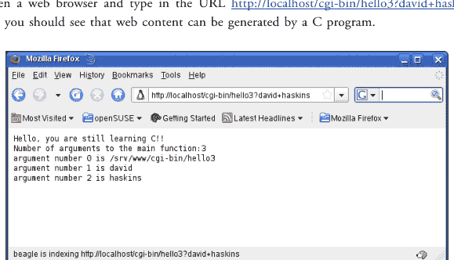

### 1.4 HELLO 程序 4

“main”的函数签名中有一个鲜有文档记载的特性：它可以接受**三**个参数，而我们现在要看的最后一个参数是 `char *env[]`，它同样是一个指向字符串的指针列表，但在这里，这些字符串是程序运行时可供其使用的**系统环境变量**。

```c
/* *****************************************
 * C Programming in Linux (c) David Haskins 2008
 * chapter1_4.c                           *
 *****************************************/
#include <stdio.h>

int main(int argc, char *argv[], char *env[])
{
    int i=0;

    printf("Content-type:text/plain\n\n");
    printf("Hello, you are still learning C!\n");
    printf("Number of arguments to the main function:%d\n", argc);
    for(i=0;i<argc;i++)
    {
        printf("argument number %d is %s\n", i, argv[i]);
    }
    i = 0;
    printf("Environment variables:\n");
    while(env[i])
    {
        printf("env[%d] = %s\n", i, env[i]);
        i++;
    }
    return 0;
}
```

使用 `gcc -o hello4 chapter1_4.c` 编译，并以超级用户身份将程序复制到 `/srv/www/cgi-bin`（openSUSE）或 `/usr/lib/cgi-bin`（Ubuntu）。你可以在编译它的终端中使用 `./hello4` 运行它，你会看到一长串环境变量。在浏览器中输入 http://localhost/cgi-bin/hello4 时，你会看到完全不同的一组环境变量。

> 维基百科这样定义**环境变量**：
> 
> “在所有 Unix 和类 Unix 系统中，每个进程都有自己私有的环境变量集合。默认情况下，当一个进程被创建时，它会继承其父进程环境的副本，除非父进程在创建子进程时做出了显式更改……所有 Unix 操作系统变体以及 DOS 和 Microsoft Windows 都有环境变量；不过，它们并不都使用相同的变量名。运行中的程序可以访问环境变量的值，用于配置目的。环境变量的示例包括……PATH、HOME……”

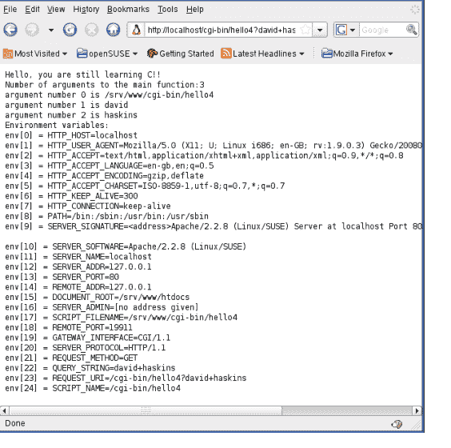

我们很快就会明白，**QUERY_STRING** 是我们在与程序通信时一个重要的环境变量，在这个例子中，我们看到它的值为“david+haskins”，也就是我们输入的 URL 中“?”之后的所有内容。这是向像 hello4 这样的**公共网关接口**（CGI）程序发送信息的一种有效方式，但我们应该将其限制为仅一个字符串。在我们的例子中，我们使用“+”连接了两个字符串。如果我们输入：“david haskins”，浏览器会对其进行转换，因此我们会看到：

```c
QUERY_STRING=david%20haskins
```

稍后我们将学习如何将复杂的输入值集合传输到我们的程序。

### 1.5 HELLO WORLD 结论

我们已经看到，一个只有少量输入和一些输出的简单程序实际上极其强大，因为它揭示并暴露了我们计算机中大量内部运作机制。

尽管我们才刚刚开始，但已经遇到了许多我们将反复使用的关键概念：

- 函数和参数
- 作为数据类型的数字（整数）和字符串
- 列表或数组
- 使用“for”和“while”的循环

我们有意迈出了一大步：从编写一个只在“终端屏幕”中运行的程序，转向编写一个可在互联网浏览器中看到的程序。

原因在于，在 Windows、Gnome 或 KDE 等窗口系统中编写与用户交互的程序的过程极其复杂，而且这并不是你经常会被要求做的事情。

如今，互联网浏览器几乎已成为我们做任何事情时事实上的界面模式，因此我们不妨从一开始就理解如何使用它。

在所有后续章节中，我们都将遵循这一模式：先介绍一些基本技术，然后将其应用到基于 Web 的系统中。

在实践中，现实世界中的 C 公共网关接口编程并不多，但有大量基于 C 和 C++ 的代码作为 Apache 模块和 Microsoft IIS ISAPI DLL 运行。也许没有多少人知道 eBay 的许多部分是用 C/C++ 编写的。

为什么？它已经快到极致，而他们在全球实时市场中与抢购者打交道的业务需要这种闪电般快速的核心，因此没有其他办法可以获得那样的性能。

## 2 数据与内存

### 2.1 简单数据类型？

当我们编写程序时，在声明和描述变量以表示我们希望在信息处理中纳入的事物类型时，我们必须对世界的本质做出决定或断言。

这个过程具有深刻的哲学性；我们做出本体论断言，认为这种或那种事物存在；当我们选择特定的数据类型或数据类型集合来描述这些事物的属性时，我们做出认识论断言。这是沉重的内容，责任重大，不可轻率对待。

作为一个实际示例，我们可能会声明一些看起来像是地理数据库记录开头的内容。

```c
/*.......................................................
C Programming in Linux (c) David Haskins 2008
chapter2_1.c
.......................................................*/

#include <stdio.h>
#define STRINGSIZE 256

int main(int argc, char *argv[])
{
    char town[STRINGSIZE] = "Guildford";
    char county[STRINGSIZE] = "Surrey";
    char country[STRINGSIZE] = "Great Britain";
    int population = 66773;
    float latitude = 51.238599;
    float longitude = -0.566257;
    printf("Town name: %s population:%d\n",town,population);
    printf("County: %s\n",county);
    printf("Country: %s\n",country);
    printf("Location latitude: %f longitude: %f\n",latitude,longitude);
    printf("char = %d byte int = %d bytes float = %d bytes\n",
    sizeof(char),sizeof(int),sizeof(float));
    printf("memory used:%d bytes\n",
        ((STRINGSIZE * 3) * sizeof(char)) + sizeof(int) + (2 * sizeof(float)));
    return 0;
}
```


这里我们要做以下事情：

- 断言我们在此应用程序中将遇到的所有字符串都将限制为 255 个字符，因此我们通过**预处理器**语句**定义**这一点——这些语句以 # 开头。
- 断言城镇与县（counties）关联，并且县以某种层次结构与国家关联。
- 断言人口以整数计算——没有半个人。
- 断言位置将采用以纬度和经度描述地球表面地点的约定的一种特定变体（WGS84）来记录，该变体对度、分、秒使用小数部分。

这些语句中的每一条都会在声明它的函数的**作用域**内分配**内存**。每个**数据声明**将占用一定数量的**字节**内存，并为该内存提供一个标签，即**变量名**。每种数据类型都有指定的大小，**sizeof()** 库函数会以整数形式返回该大小。在这种情况下，有 3 × 256 个字符、一个整数和两个浮点数。确切大小取决于机器，但很可能为 780 字节。

在声明数据的函数之外，该数据是不可访问的——这就是声明的**作用域**。如果我们是在 main() 函数之外声明的，那么它的作用域将是**全局**的，其他函数也可以访问它。如果你愿意，C 允许你做这种危险的事情，所以要小心。

通常我们会密切关注数据的作用域，并向程序中可能需要对数据进行处理甚至修改的部分传递**只读副本**或数据的**带标签的内存地址**。这些带标签的内存地址称为**指针**。

我们使用 **printf** 库函数族进行输出（**sprintf** 用于创建字符串，**fprintf** 用于写入文件等），它们都使用一个共同的**格式字符串**参数来指定数据的表示方式。

- %c 字符
- %s 字符串
- %d 整数
- %f 浮点数等

参数中其余的一系列变量会按照指定顺序依次放入格式字符串中。

在 C 语言中，最好对你声明的任何数据进行初始化，因为分配给它们的内存内容不会被清除，可能包含任何旧的垃圾数据。

使用以下命令编译： `gcc -o data1 chapter2_1.c -lc`

使用 ./data1 调用程序时的输出：

> 城镇名称：Guildford 人口：66773
> 县：Surrey
> 国家：Great Britain
> 位置纬度：51.238598 经度：-0.566257
> char = 1 字节 int = 4 字节 float = 4 字节
> 内存使用：780 字节

#### 关于 make 这一实用工具的说明

到目前为止，你可能已经厌倦了输入所有这些编译器命令，因此有一个名为 **make** 的实用工具，它会在代码所在文件夹中运行一个名为 **Makefile** 的文件。以下是到目前为止示例的 Makefile：

```makefile
#Makefile
all:chap1 chap2
chap1: 1-1 1-2 1-3 1-4
1-1:
	gcc -o hello1 chapter1_1.c -lc
1-2:
	gcc -o hello2 chapter1_2.c -lc
1-3:
	gcc -o hello3 chapter1_3.c -lc
1-4:
	gcc -o hello4 chapter1_4.c -lc
chap2: 2-1 2-2
2-1:
	gcc -o data1 chapter2_1.c -lc
2-2:
	gcc -o data2 chapter2_2.c -lc
clean:
	rm hello* data* *~
```

要编译所有内容，请键入 **make all**  
要编译 chapter2_1.c 的目标 2-1，请键入 **make 2-1**  
每个 make 目标后面的制表符对 make 的语法至关重要

在代码包中，有一份针对整本书的 Makefile。

### 2.2 什么是字符串？

一些编程语言（如 Java 和 C++）具有**字符串数据类型**，它隐藏了在看似简单的事物之下的一些复杂性。

字符串的一个基本属性是：它是一系列长度不确定的单个字符元素。

我们通过键盘输入的大多数单个字符都由简单的数字 ASCII 码表示，C 语言数据类型 **char** 用于存储字符数据。

字符串以字符**数组**的形式存储，并以 NULL 结尾，因此数组必须足够大，以容纳字符序列加一个结束符。请记住，数组成员始终从零开始计数。

在这个例子中，我们可以看到 5 个单独的字符被声明并初始化为值，以及一个被设置为“”的空字符数组。

请注意字符周围使用的单引号‘和字符串周围使用的双引号“之间的区别。

```c
/************************************************
* C Programming in Linux (c) David Haskins 2008
* chapter2_2.c                                 *
************************************************/
#include <stdio.h>

int main(int argc, char *argv[], char *env[])
{
        char c1 = 'd';
        char c2 = 'a';
        char c3 = 'v';
        char c4 = 'i';
        char c5 = 'd';
        char name[6] = "";

        sprintf(name,"%c%c%c%c%c",c1,c2,c3,c4,c5);
        printf("%s\n",name);
        return 0;
}
```

使用以下命令编译： `gcc -o data2 chapter2_2.c -lc`

使用 ./data2 调用程序时的输出：

> david

### 2.3 字符串可能“意味着”什么

什么都可以——赋予变量的名称及其含义或用途完全取决于观察者的想法。试试这个

```c
/*------------------------------------------------------------
* C Programming in Linux (c) David Haskins 2008
* chapter2_3.c
*------------------------------------------------------------*/
#include <stdio.h>
#include <string.h>

int main(int argc, char *argv[], char *env[])
{
    printf("Content-type:text/html\n\n");
    printf("<html>\n");
    printf("<body bgcolor=\"%s\">\n",argv[1]);
    printf("<body>\n");
    printf("</html>\n");
    return 0;
}
```

使用以下命令编译： gcc -o data3 chapter2_3.c -lc

以超级用户身份将程序复制到你的 public_html/cgi-bin 目录（或 /srv/www/cgi-bin（OpenSuse）或 /usr/lib/cgi-bin（Ubuntu））。

在浏览器中输入：http://localhost/cgi-bin/data3?red  
你应该看到的是：

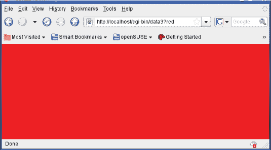

或者，如果你发送任何参数，你会得到令人惊讶的结果：

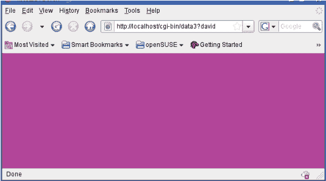

我们在这里所做的是**使用**字符串参数**argv[1]**作为 **HTML** body 标签内的背景颜色代码。我们将 Content-type 规范更改为 text/html，于是奇迹般地，我们的程序现在正在生成 HTML 内容。一种语言在另一种语言中表达。Web 浏览器理解有限的颜色术语，颜色也可以通过十六进制代码定义，例如 #FFFFFF（白色）、#FF0000（红色）、#00FF00（绿色）、#0000FF（蓝色）。

这个有趣的练习不仅仅是一个小技巧，一个程序可以用另一种语言生成另一个程序的想法非常强大，并且是整个互联网力量背后的关键。当我们从这样一个**公共网关接口程序**生成 HTML（或 XML 或其他任何东西）时，我们是在创建**动态内容**，它可以链接到实时的、变化的数据，而不是**静态**的预编辑网页。实际上，大多数网站都混合了动态和静态内容，但在这里我们看到了如何在非常简单的层面上实现这一点。

在整本书中，我们将浏览器作为程序的首选界面，因此我们将生成 HTML 和二进制图像流 Web 内容，纯粹是为了即时展示程序的能力。在终端屏幕上查看代码并不令人印象深刻，而编写窗口类型的应用程序也不是那么简单直接。

实际上，你可能被要求编写的大多数软件都会在 Web 上运行，所以我们不妨马上从这个想法开始。大多数 Web 应用程序也涉及**多种语言**，如 CSS、(X)HTML、XML、JavaScript、PHP、JAVA、JSP、ASP、.NET、SQL。如果这听起来令人恐惧，请不要惊慌。对 C 的了解将向你展示，这些执行不同功能的语言中，有许多在语法上都是以 C 为基础的。

### 2.4 解析字符串

从某种输入字符串中提取含义或有价值信息的工作称为“解析”。现在，我们将构建另一个有趣的、可通过互联网调用的 CGI 程序，以展示我们手中的力量。


```c
/* C Programming in Linux (c) David Haskins 2008
 * chapter2_4.c
 * ================================ */

#include <stdio.h>
#include <string.h>

int main(int argc, char *argv[], char *env[])
{
    char *token = NULL;
    char colour1[256] = "";
    char colour2[256] = "";
    int wide = 0;
    int high = 0;
    int columns = 0;
    int rows = 0;

    token = (char *) strtok(argv[1],":");
    strcpy(colour1,token);
    token = (char *) strtok(NULL,":");
    strcpy(colour2,token);
    token = (char *) strtok(NULL,":");
    wide = atoi(token);
    token = (char *) strtok(NULL,":");
    high = atoi(token);
    printf("Content-type:text/html\n\n");
    printf("<html>\n");
    printf("<body bgcolor=\"%s\">\n",colour1);
    printf("<center>\n");
    printf("<table bgcolor=\"%s\" border=2>\n",colour2);
    for(rows=1;rows<=high;rows++)
    {
        printf("<tr>\n");
        for(columns=1;columns<=wide;columns++)
        {
            printf("<td><h6>row=%d cell=%d</h6></td>\n",rows,columns);
        }
        printf("</tr>\n");
    }
    printf("</table>\n");
    printf("</body>\n");
    printf("</html>\n");
    return 0;
}
```

编译方法：`gcc -o data4 chapter2_4.c -lc`

以超级用户身份将程序复制到 `/srv/www/cgi-bin`（OpenSuse）或 `/usr/lib/cgi-bin`（Ubuntu）。

在浏览器中输入：

`http://localhost/cgi-bin/data4?red:blue:5:5:`

你应该看到的是这个：

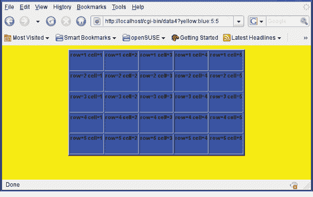

| row=1 cell=1 | row=1 cell=2 | row=1 cell=3 | row=1 cell=4 | row=1 cell=5 |
|---|---|---|---|---|
| row=2 cell=1 | row=2 cell=2 | row=2 cell=3 | row=2 cell=4 | row=2 cell=5 |
| row=3 cell=1 | row=3 cell=2 | row=3 cell=3 | row=3 cell=4 | row=3 cell=5 |
| row=4 cell=1 | row=4 cell=2 | row=4 cell=3 | row=4 cell=4 | row=4 cell=5 |
| row=5 cell=1 | row=5 cell=2 | row=5 cell=3 | row=5 cell=4 | row=5 cell=5 |

在此程序中，我们取 **argv[1]**，这里是 **yellow:blue:5:5**，并使用库函数 **strtok** 对其进行解析，该函数将字符串按任意字符 ‘:’ 切分为标记，并使用这些标记作为字符串来指定颜色，以及作为整数来指定表格的行数和单元格数。

函数 **atoi** 将整数的字符串表示形式转换为整数（"1" to 1）。

函数 **strtok** 有点奇怪，因为第一次调用时使用要解析的字符串名称，然后在后续调用中第一个参数改为 NULL。

**for(...)** 循环机制用于重复执行某项操作固定次数。

引入的 HTML 术语有：

- `<html>`
- `<body>`
- `<table>`
- `<tr>` 表格行
- `<td>` 表格数据单元格

### 2.5 数据和内存 – 结论

我们使用了一些简单的数据类型来表示信息并将输入传输到程序中，以及组织和显示一些视觉输出。我们在输出字符串中嵌入了 HTML，使输出在 Web 浏览器中可见。

作为练习，请尝试以下操作：

编写一个程序放入你的 `/public_html/cgi-bin` 文件夹中，该程序可以在浏览器中通过运动队名称或国家名称以及一系列颜色调用，这些颜色可能以十六进制指定，例如 `ff0000` = red（`rrggbb`）用于球队颜色或地图颜色，并显示一些有意义的内容。我的版本如下所示：

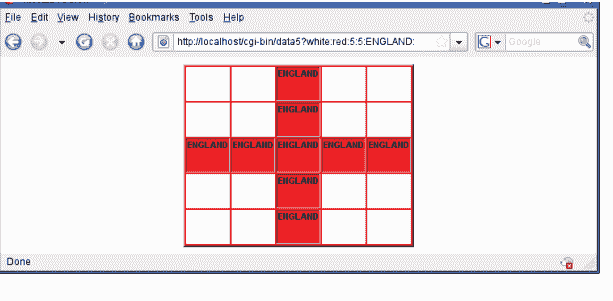

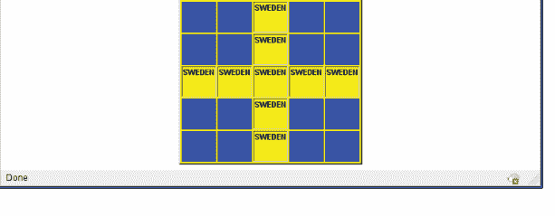

## 3 函数、指针和结构体

### 3.1 函数

我们所有程序的入口点称为 main()，这是一个 **函数**，或一段 **代码片段**，它执行某些操作，通常会返回某个值。我们将程序结构化为函数，以防止它们变成长而不可读的代码块，无法在一屏或一页中显示，同时确保不会在各处重复相同的代码片段。我们可以调用 **库函数**，如 printf 或 strtok，它们是 C 语言的一部分，也可以调用我们自己的或他人的函数和函数库。我们必须确保适当的头文件存在并且可以被预处理器读取，并且源代码或编译后的库也存在并且可访问。

正如我们之前学到的，数据的 **作用域** 限制在声明它的 **函数** 中，因此我们使用 **指针** 来指向数据和数据块，以便将它们传递给函数，以便对数据进行一些操作。我们已经看到字符串被处理为以 NULL 字符结尾的单个字符数组的指针。

```c
/**************************************************************
* C Programming in Linux (c) David Haskins 2008
* chapter3_1.c                                           *
**************************************************************/

#include <stdio.h>
#include <string.h>
#include <math.h>

double doit(int number1, int number2)
{
    return sqrt((double)(number1 + number2) );
}

int main(int argc, char *argv[], char *env[])
{
    int n1 = 0, n2 = 0, i=0;
    n1 = atoi((char *) strtok(argv[1],":"));
    n2 = atoi((char *) strtok(NULL,":"));
    printf("Content-type:text/html\n\n<html><body>\n");
    for(i=1;i<=100;i++)
        printf("%f ",doit(n1,n2));
    printf("</body></html>\n");
    return 0;
}
```

在此示例中，我们可以重复调用函数“doit”，它接受两个整数参数并返回某些数学计算的结果。

**编译：** `gcc -o func1 chapter3_1.c -lm`

**复制到 cgi-bin：** `cp func1 /home/david/public_html/cgi-bin/func1`

（你应该使用提供的 Makefile，或者在进展过程中维护一个 Makefile，逐步添加编译示例的目标。）

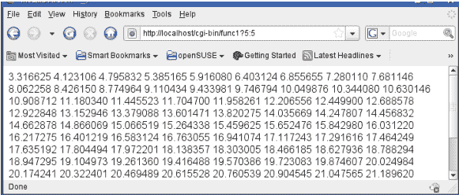

当使用“func1?5:5”调用时，浏览器中的结果如下所示。

在这种情况下，我们函数的参数作为副本发送，在函数中不会被修改而是被使用。

如果我们想要真正修改一个变量，就必须将其指针发送给函数。

```c
/*
 * C Programming in Linux (c) David Haskins 2008
 * chapter3_2.c
 *
 */
#include <stdio.h>
#include <string.h>
#include <math.h>
void doit(int number1, int number2, double *result)
{
    *result = sqrt((double)(number1 + number2));
}
int main(int argc, char *argv[], char *env[])
{
    int n1 = 0, n2 = 0, i=0;
    double result = 0;
    n1 = atoi((char *) strtok(argv[1],":"));
    n2 = atoi((char *) strtok(NULL,":"));
    printf("Content-type:text/html\n\n<html>\n<body>\n");
    for(i=1;i<=100;i++)
    {
        doit(n1 + i, n2, &result);
        printf("%g\n", result);
    }
    printf("</body></html>\n");
    return 0;
}
```

我们使用 &result 发送变量‘result’的地址，并在函数 doit 中使用 *result 解引用指针以访问浮点数并更改其值，该值在 main 内部超出其作用域。这与 chapter3_1.c 的输出相同。

### 3.2 库函数

C 包含许多用于执行常用任务的内置函数。到目前为止，我们使用过 atoi、printf、sizeof、strtok 和 sqrt。要获取任何内置库函数的完整详细信息，我们只需例如输入：

```
#### man 3 atoi
```

就会看到所有这些内容：

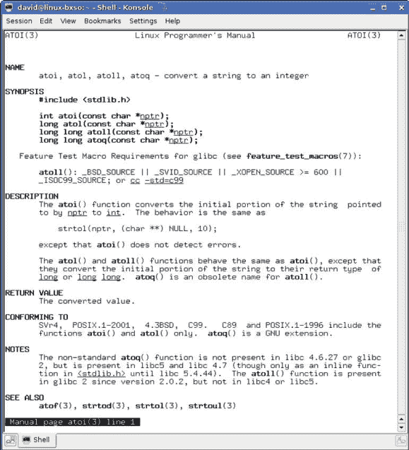

这几乎告诉了你关于此函数及其使用方式和变体的所有需要了解的信息。最重要的是，它告诉你应包含哪个 **头文件**。

### 3.3 简短的库函数参考

所有可用函数的完整详细信息可以在以下位置找到：

按头文件分类的常用库函数：

- **math.h**
  - 三角函数 例如：
    - `cos` `sin` `tan`
  - 指数、对数和幂函数 例如：
    - `exp` `log` `pow` `sqrt`
  - 其他数学函数 例如：
    - `ceil` `fabs` `floor` `fmod`

- **stdio.h**
  - 文件函数 例如：
    - `fclose` `feof` `fgetpos` `fopen` `fread` `fseek`
  - 格式化输入/输出函数 例如：
    - `printf` `scanf`
  - 字符输入/输出函数 例如：
    - `fgetc` `fgets` `fputc` `fputs` `getc` `getchar` `gets`
    - `putc` `putchar` `puts`

- **stdlib.h**
  - 字符串函数 例如：
    - `atof` `atoi` `atol`
  - 内存函数 例如：
    - `calloc` `free` `malloc`
  - 环境函数 例如：
    - `abort` `exit` `getenv` `system`
  - 数学函数 例如：
    - `abs` `div` `rand`

- **string.h**
  - 字符串函数 例如：
    - `strcat` `strchr` `strcmp` `strncmp` `strcpy`
    - `strncpy` `strcspn` `strlen` `strstr` `strtok`

- **time.h**
  - 时间函数 例如：
    - `asctime` `clock` `difftime` `time`

在你发现需要做某事然后才去寻找为此目的编写的函数或函数库之前，学习库函数是没有意义的。你需要理解函数签名——即参数列表的含义以及如何使用它，以及函数将返回什么或对作为指针传递给函数的变量执行什么操作。


### 3.4 数据结构

有时我们希望将一组变量作为一个整体来管理，也许是从数据库记录中取出所有值，并将整条记录在程序中传递以进行处理。为此，我们可以将数据分组到结构体中。

这个程序使用一个结构体为称为 player 的对象定义一组属性。main 函数包含一个由 5 个 player 组成的数组的声明和实例化。我们依次将指向每个数组成员的指针传递给一个函数，以便为每个成员排名。该函数使用 switch 语句检查每个 player 名字的首字母，以进行任意排名。然后我们依次将指向每个数组成员的指针传递给一个打印详细信息的函数。

```
/* **************************************************************
 * C Programming in Linux (c) David Haskins 2008
 * chapter3_3.c
 * **************************************************************/
#include <stdio.h>
#include <string.h>
struct player
{
    char name[255];
    char role[255];
    int ranking;
};
void rank(struct player *p)
{
    switch(p->name[0])
    {
        case 'P': p->ranking = 4;break;
        case 'H': p->ranking = 1;break;
        case 'R': p->ranking = 2;break;
        case 'J': p->ranking = 5;break;
        case 'B': p->ranking = 3;break;
    }
}
void show(struct player *p)
{
    printf("Name:%s Role:%s Ranking:%d<br>\n", p->name,p->role,p->ranking);
}
int main(int argc, char *argv[], char *env[])
{
    struct player myteam[5] = { {"Pele","striker",0},
        {"Beckham","male model",0},
        {"Roddick","tennis man",0},
        {"Haskins","swimmer",0},
        {"Jagger","singer",0}};
    int i=0;
    printf("Content-type:text/html\n\n");
    for(i=0;i<5;i++) rank ( &myteam[i] );
    for(i=0;i<5;i++) show ( myteam[i] );
    return 0;
}
```

结果如下所示，一如既往地显示在浏览器中：

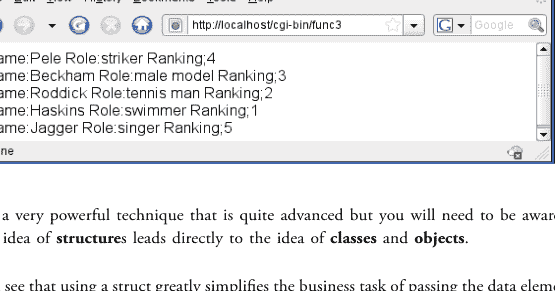

这是一种非常强大且相当高级的技术，但你需要了解它。结构体的思想直接引出了类和对象的思想。

我们可以看到，使用结构体极大地简化了在程序中传递数据元素以完成不同工作的业务任务。如果我们更改结构体的定义，它仍然可以工作，我们只需添加代码来处理新属性，而不必更改执行工作的函数的参数列表或签名。

结构体的定义实际上并不创建任何数据，而只是规定我们可以实例化的内容的形式结构。在 main 函数中，我们可以用所示的形式表达这种实例化：创建一个由符合我们所做定义的数据元素序列组成的列表。

你大概可以看出，带有附加函数或方法的结构体本质上就是 Java 中的类，C++ 中也是如此。面向对象语言从这里开始；事实上，许多早期被称为“面向对象”的系统实际上只是用 C 语言结构体构建的。

例如，如果你看一下 Apache 服务器开发的头文件，你会看到很多结构体，例如在 httpd.h 的这个片段中：

```c
struct server_addr_rec {
    /** The next server in the list */
    server_addr_rec *next;
    /** The bound address, for this server */
    apr_sockaddr_t *host_addr;
    /** The bound port, for this server */
    apr_port_t host_port;
    /** The name given in <VirtualHost> */
    char *vhost;
};
```

不必担心这一切意味着什么——只需注意，这是一种非常常见且非常强大的技术；而数据结构的设计，就像与之密切相关的数据库表设计一样，是作为程序员的你需要理解的核心、关键且至关重要的任务。

你要做出哲学上的决定：**世界就是这样**，并且可以用这种方式建模。这是一项沉重的责任——在哲学中，这项工作被称为**本体论**（存在什么？）和**认识论**（我们如何认识它？）。我敢打赌，你从未想过自己正在做的就是这件事！

### 3.5 函数、指针与结构体——结论

我们已经使用一些简单的数据类型来表示某些信息、向程序传递输入，并组织和显示某些可视化输出。

我们已经使用嵌入在输出字符串中的 HTML，使输出能在 Web 浏览器中显示。

我们已经学习了如何创建可复用的函数库。

我们已经学习了数据结构，以及使用指针在程序中传递它们。

### 练习：

使用 C 库函数创建一个程序，该程序：

- 以写模式打开文件，
- 将命令行参数写入该文件
- 关闭文件
- 以读模式打开文件
- 读取内容
- 关闭文件
- 将其打印到屏幕上

这将让你获得查找信息、寻找合适的库函数，以及从网上或书中查找示例的经验。

## 4 逻辑、循环与流程控制

### 4.1 C 流程控制的语法

我们可以使用以下 C 构造来控制程序执行。

当我们可以按计数方式遍历一个序列或一系列内容时：

```
for( initial value; keep on until ; incremental change )
{ do this; and this; and this; }
```

当我们等待某个条件发生变化时：

```
while( this is true )
{ do this; and this; and this; }
```

或者如果我们想至少做一次再测试：

```
do { do this; and this; and this; }
while( this is true )
```

当我们只有一个选项要测试时：

```
if( this is true )
{ do this; and this; and this; }
else
{ do this; and this; and this; }
```

当我们有更多选项要测试时：

```
if( this is true )
{ do this; and this; and this; }
else if ( this is true )
{ do this; and this; and this; }
else
{ do this; and this; and this; }
```

当我们有更多基于整数或单个字符值要测试的选项时：

```
switch( on an integer or character value )
{
    case 0: do this; and this; and this; break;
    case n: do this; and this; and this; break;
    default:do this; and this; and this; break;
}
```

### 4.2 控制发生什么以及以何种顺序发生

这一部分全都围绕 if、then、else 以及 true 和 false——即我们如何表达和控制程序执行的基本构件。这可能是一份非常枯燥乏味的材料，因此为了让它更易懂，我们将解决一个你在做任何有一定复杂度的交互式 Web 工作时都需要解决的问题。

我们将构建一个可供使用的东西，以提供类似于 Java servlet 中典型的 getParameter("ITEM1") 方法或 PHP 中 $_REQUEST["ITEM1"] 函数所能获得的功能。

在第 1 章中我们看到，可以通过 main 函数的隐式参数访问环境变量。我们还可以使用库函数 getenv() 来请求任何指定名称的环境变量的值。

```
/* ********************************************************
 * C Programming in Linux (c) David Haskins 2008
 * chapter4_1.c
 ******************************************************** */
#include <stdio.h>
#include <string.h>

int main(int argc, char *argv[], char *env[])
{
    printf("Content-type:text/html\n\n<html><body bgcolor=#23abe2>\n");
    char value[256] = "";
    strncpy(value,(char *) getenv("QUERY_STRING"),255);
    printf("QUERY_STRING : %s<BR>\n", value );
    printf("<form>\n");
    printf("<input type='TEXT' name='ITEM1'\n");
    printf("<input type='TEXT' name='ITEM2'\n");
    printf("<input type='SUBMIT'>\n");
    printf("</form></body></html>\n");
    return 0;
}
```

可能需要一遍又一遍地做，因此有一段可以反复调用的代码是合理的。

在下一个示例中，我们添加这个函数，输出中一个明显的区别是：在解析提取出的值之后，我们可以将这些值插入 HTML 输入框。我们似乎已经成功创建了类似 Java getParameter() 函数的东西——但真是这样吗？

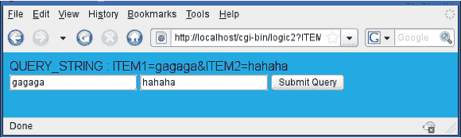

好好仔细看看 chapter4_2.c，并用 A-Z、a-z 或数字之外的字符试一试，你就会发现有些地方不太对劲。这里发生了某种编码！

如果我在第一个字段中输入 **DAVID !!!**：

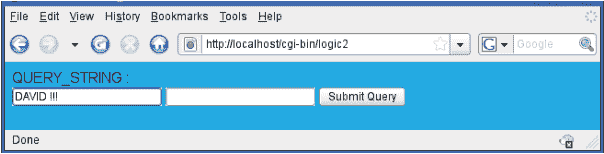

我得到这样的结果：

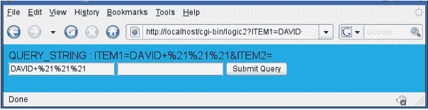


A **space** character has become a **+** and ! has become **%21**.

这种编码发生是因为某些字符在传输协议本身中被明确使用。例如 **&** 用于分隔 `QUERY_STRING` 的各部分，而空格根本无法按原样发送。

任何希望使用来自 HTML 表单信息的程序都必须能够解码所有这些内容，而我们现在将尝试做到这一点。

程序 `chapter4_2.c` 实现了我们目前看到的功能。它在同一个文件中包含 main 函数和 `decode_value` 函数。

`decode_value` 函数接受三个参数：

-   我们要查找的值的名称 “`ITEM1=`” 或 “`ITEM2=`”。
-   如果找到，将要放入值的变量的地址
-   要复制的最大字符数

该函数在 `QUERY_STRING` 中查找值的开始和结束位置，然后逐个将找到的字符复制到 value 变量中，并添加一个 `NULL` 字符来终止字符串。

```
/* **************************************************
 * C Programming in Linux (c) David Haskins 2008
 * chapter4_2.c
 * **************************************************/
#include <stdio.h>
#include <string.h>

void decode_value(const char *key, char *value, int size)
{
    int length = 0, i = 0, j = 0;
    char *pos1 = "0", *pos2 = "0";
    //if the string key is in the query string
    if ( (pos1 = strstr(getenv("QUERY_STRING"), key)) != NULL )
    {
        //find start of value for this key
        for(i=0; i<strlen(key); i++) pos1++;
        //find length of the value
        if ( (pos2 = strstr(pos1,"&") ) != NULL )
            length = pos2 - pos1;
        else length = strlen(pos1);
        //character by character, copy value from query string
        for(i = 0, j = 0; i < length ; i++, j++)
        {
            if(i < size) value[j] = pos1[i];
        }
        //add NULL character to end of the value
        if(j < size) value[j] = '\0';
        else value[size-1] = '\0';
    }
}
int main(int argc, char *argv[], char *env[])
{
    printf("Content-type:text/html\n\n<html><body bgcolor=#23abe2>\n");
    char value[255] = "";
    strncpy(value,(char *) getenv("QUERY_STRING"),255);
    printf("QUERY_STRING : %s<BR>\n", value );
    printf("<form>\n");
    //call the decode_value function to get value of "ITEM1"
    decode_value("ITEM1=", (char *) &value, 255);
    if(strlen(value) > 0)
        printf("<input type=\"TEXT\" name=\"ITEM1\" value=\"%s\">\n",value);
    else
        printf("<input type=\"TEXT\" name=\"ITEM1\">\n");
    //call the decode_value function to get value of "ITEM2"
    decode_value("ITEM2=", (char *) &value, 255);
    if(strlen(value) > 0)
        printf("<input type=\"TEXT\" name=\"ITEM2\" value=\"%s\">\n",value);
    else
        printf("<input type=\"TEXT\" name=\"ITEM2\">\n");
    printf("<input type=\"SUBMIT\">");
    printf("</form></body></html>\n");
    return 0;
}
```

看起来我们需要对这个 decode_value 包进行一些认真的工作，因为这是我们预计会反复做的工作，所以编写一个可重用的 **function** 是有意义的。

首先我们可以将此函数放入名为 decode_value.c 的单独文件中，并为我们可能编写的所有函数创建一个名为 c_in_linux.h 的文件，然后将所有这些编译成一个库。在 Makefile 中我们可以添加：

```
SRC_CIL = decode_value.c
OBJ_CIL = decode_value.o
#CIL_INCLUDES = -I/usr/include/apache2 -I -I/usr/include/apache2 -I/usr/include/apr-I
#CIL_LIBS = -L/usr/lib/mysql -lmysqlclient -L/usr/lib -lgd -L/home/david/public_html/Ventus/code

all: lib_cil 4-4

lib_cil:
    gcc -c -s $(SRC_CIL)
    ar rcs c_in_linux.a $(OBJ_CIL)
    $(RM) *.o

4-4:
    gcc -o logic4 chapter4_3.c c_in_linux.a -lc
    cp logic4 /home/david/public_html/cgi-bin/logic4
```

这看起来很糟糕且复杂，但其含义如下：

输入 “make all” 将会：

-   编译列表 SRC_CIL 中列出的所有 *.c 文件并生成对象文件 *.o
-   将所有对象文件编译成名为 lib_c_in_linux.a 的库归档文件
-   使用这个新归档编译 4-4。

这是我们将使用的模型，以使我们的文件尽可能小，并使代码的可共享性达到最大。

我们现在可以拥有一个更简单的 “main” 函数文件，以及一些文件，用于我们可能想要编写的内容，这些内容可以作为可从任何地方调用的函数，实际上我们还不知道。所有这些都组织在一个库文件 (*.a 代表 archive 归档) 中——这些也可以编译为动态可加载的共享对象 *.so，它们很像 Windows DLL。这正是所有 Linux 软件的编写和交付方式。

例如 MySQL C 应用程序编程接口 (API) 包括：

-   /usr/include/mysql 中的所有头文件
-   库文件 /usr/lib/mysql/libmysqlclient.a

我们真正做的事情就是 Linux 的组装方式——我们只是以同样的方式添加内容。

我们现在的主文件如下所示：

```
/*************************************************************************
 * C Programming in Linux (c) David Haskins 2008
 * chapter4_3.c
 *************************************************************************/

#include <stdio.h>
#include <string.h>
#include "c_in_linux.h"

int main(int argc, char *argv[], char *env[])
{
    printf("Content-type:text/html\n\n<html><body bgcolor=#23abe2>\n");
    char value[255] = "";
    strncpy(value,(char *) getenv("QUERY_STRING"),255);
    printf("QUERY_STRING : %s<BR>\n", value );
    printf("<form>\n");
    //call the decode_value function to get value of "ITEM1"
    decode_value("ITEM1=", (char *) &value, 255);
    if(strlen(value) > 0 )
        printf("<input type=\"TEXT\" name=\"ITEM1\"\nvalue=\"%s\">\n",value);
    else
        printf("<input type=\"TEXT\" name=\"ITEM1\">\n");
    //call the decode_value function to get value of "ITEM2"
    decode_value("ITEM2=", (char *) &value, 255);
    if(strlen(value) > 0 )
        printf("<input type=\"TEXT\" name=\"ITEM2\"\nvalue=\"%s\">\n",value);
    else
        printf("<input type=\"TEXT\" name=\"ITEM2\">\n");
    printf("<input type=\"SUBMIT\">");
    printf("</form></body></html>\n");
    return 0;
}
```

这段代码以相同的方式调用 decode_value 函数，但由于库 c_in_linux.a 在编译时被链接，并且它可以访问列出库中所有函数的头文件 c_in_linux.h，因此一切都能正常工作。

尝试用 **pseudocode** 描述解码此 QUERY STRING 的过程：

    get the QUERY_STRING
    find the search string “ITEM1=” inside it
    look for the end of the value of “ITEM1=”
    copy the value to our “value” variable, translating funny codes such as:
        %21 is ! %23 is #

这些特殊代码由浏览器生成，这样无论你在 HTML 表单中输入什么，都能安全地传输并且不会干扰 HTTP 协议。它们有很多，而本章的任务是 **finish this task off**，以便键盘上的每个键都能按你认为的方式工作！！

程序 chapter4_3.c 调用这个未完成的函数 **decode_value**，到目前为止它只能处理 **space** 字符和 ! ——它使用 **if** 和 **else** 和 **for** 以及库函数 **getenv, strcpy, strlen, strstr**，在一个 **conditional logic** 中，字符串被分析以找到特定项，然后该项被复制到名为 **value** 的内存块中，该内存块已传递给它。

结果显示解码后的值被粘贴到第一个字段中；

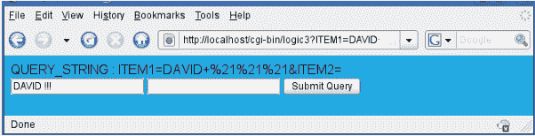

```
/* **************************************************
 * program: decode_value.c           *
 * version: 0.1                      *
 * author: david haskins February 2008 *
 * **************************************************/
#include <stdlib.h>
#include <string.h>
void decode_value(const char *key, char *value, int size)
{
    unsigned int length = 0;
    unsigned int i = 0;
    int j = 0;
    char *pos1 = '\0',*pos2 = '\0',code1 = '\0',code2 = '\0';

    strcpy(value,"");
    if( ( pos1 = strstr(getenv("QUERY_STRING"), key)) != NULL )
    {
        for(i=0; i<strlen(key); i++) pos1++;
        if( (pos2 = strstr(pos1,"&")) != NULL )
        {
            length = pos2 - pos1;
        }
        else length = strlen(pos1);
        for(i=0, j=0; i < length ;i++,j++)
        {
            if(j < size)
            {
                if(pos1[i] == '%')
                {
                    i++;   code1 = pos1[i];
                    i++;   code2 = pos1[i];
                    if(code1 == '2' && code2=='0')
                        value[j] = ' '; //0x20
                    else if(code1 == '2' && code2=='1')
                        value[j] = '!';//0x21
                }
                else value[j] = pos1[i];
            }
        }
        if(j < size)
        {
            value[j] = '\0';
        }
        else value[size-1] = '\0';
    }
}
```


### 4.3 逻辑、循环与流程结论

控制程序流程最重要的部分，是清楚知道自己想要做什么。我们还学会了将代码拆分成可管理的块，并开始构建和使用我们自己的库和头文件。

能够用普通文字或**伪代码**表达一个过程很有用，有助于你将代码分解为步骤。

- 使用 **for 循环**显式遍历你知道有终点的事物。
- 使用 **while** 和 **do…while** 循环来做事情，直到某个条件发生变化。
- 当整数或单个字符决定接下来发生什么时，使用 **switch** 语句。
- 当可以按顺序测试互斥事项时，使用 **if**、**else if** 和 **else**。
- 复杂的 **if**、**else** 和 **not (!)** 条件组合最终可能变得不可读。
- 使用花括号（{ }）将其全部拆分成块。

**练习：**

现在一项有用的**任务**是**完成函数 decode_value**，这样你就有一个有用的工具，可以从 HTML 表单中抓取 Web 内容，并解码键盘上所有非字母数字键。你会反复使用这个练习，所以值得把它做对。

## 5 使用 MySQL 处理数据库

### 5.1 关于不要重复造轮子

每个项目都不从零开始是相当明智的，因此我们建立在其他人已经完成的工作之上。我们使用的所有 C 库都是由某人用更底层的零碎部件编写而成，如果需要，我们可以访问并修改这些代码。这就是开放系统的全部意义所在。

在实践中，我们只是想使用可靠的服务，而我们要使用的头两项服务无处不在——数据库访问和图形图像生成。

### 5.2 MySQL C API

为了访问 MySQL 函数集，我们确保编译器能够访问 MySQL 的头文件和库，然后只需调用一些我们不必自己编写的 mysql 函数。

在下一个示例中，我们将数据库代码与我们上一项工作连接起来，将解码后的数据插入数据库，并读出我们目前存储在那里的内容。

在一个新的终端窗口中，我们输入：

```sh
mysql test
```

然后：

```sql
create table CIL (ITEM1 varchar(255),ITEM2 varchar(255));
```

这会创建一个表，供程序写入 test 数据库；该数据库应该已经在你的 MySQL 设置中创建好了。

如果一切顺利，它看起来像这样。

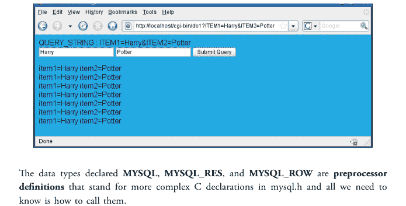

声明的数据类型 **MYSQL**、**MYSQL_RES** 和 **MYSQL_ROW** 是**预处理器定义**，它们代表 mysql.h 中更复杂的 C 声明，而我们只需要知道如何调用它们。

MySQL 的文档提供了执行更复杂操作所需的全部信息。

```c
/***************************************************
* C Programming in Linux (c) David Haskins 2008
* chapter5_1.c
*****************************************************/

#include <stdio.h>
#include <string.h>
#include <mysql.h>
#include "c_in_linux.h"

int main(int argc, char *argv[], char *env[])
{
    char value1[255] = "", value2[255] = "", SQL[1024]="";
    int rc = 0;

    MYSQL *conn = NULL;
    MYSQL_RES *result = NULL;
    MYSQL_ROW row;

    printf("Content-type:text/html\r\n\r\n<body bgcolor=#23abe2>\r\n");
    strncpy(value1,(char *) getenv("QUERY_STRING"),255);
    printf("QUERY_STRING : %s<BR>\n", value1 );
    printf("<form>\r\n");
    //call the decode_value function to get value of "ITEM1"
    decode_value ("ITEM1=?", (char *) &value1, 255);
    if(strlen(value1) > 0 )
    {
        printf("<input type=\"TEXT\" name=\"ITEM1\" value=\"%s\">\n",value1);
    }
    else
    {
        printf("<input type=\"TEXT\" name=\"ITEM1\">\n");
    }
    //call the decode_value function to get value of "ITEM2"
    decode_value ("ITEM2=?", (char *) &value2, 255);
    if(strlen(value2) > 0 )
    {
        printf("<input type=\"TEXT\" name=\"ITEM2\"    value=\"%s\">\n",value2);
    }
    else
    {
        printf("<input type=\"TEXT\" name=\"ITEM2\">\n");
    }
    printf("<input type=\"SUBMIT\">\n");
    printf("</form>\n</body>\r\n</html>\r\n");

    //OPEN DATABASE
    conn = mysql_init(NULL);
    mysql_options(conn,MYSQL_READ_DEFAULT_GROUP,"mygroup");
    mysql_real_connect(conn, "localhost", "", "test", 0, NULL, 0);
    //INSERT IF THERE IS ANY DATA
    if(strlen(value1) > 0 || strlen(value2) > 0)
    {
        sprintf(SQL,"insert into CIL values ('%s','%s')",value1,value2);
        rc = mysql_query(conn,SQL);
    }
    //READ
    rc = mysql_query(conn,"select * from CIL");
    result = mysql_use_result(conn);
    while ((row = mysql_fetch_row(result)) != NULL)
    {
        printf("item1=%s    item2=%s<br>",row[0],row[1]);
    }
    mysql_free_result(result);
    mysql_close(conn);
    return 0; }
```

都理解了吗？

我们只用了不到 10 行 C 代码（高亮部分）就将数据插入数据库表，并且可以再次读出，这相当轻松。通过 **mysql_init**，我们获得一个指向 MYSQL 类型数据结构的指针，然后可以使用它通过 **mysql_options** 和 **mysql_real_connect** 连接到 test 数据库，接着就可以像在终端会话中一样执行 SQL 语句。查询结果可以通过 **mysql_use_result** 以一系列字符串 MYSQL_ROW 数组的形式检索。我们用 **mysql_free_result** 释放已使用的内存，并用 **mysql_close** 关闭数据库。

与 C 库的通常情况一样，你需要能够理解通常很稀疏的文档，才能理解函数调用；对于 MySQL 5.1，我们可以在以下地址找到所有这些信息：

http://dev.mysql.com/doc/refman/5.1/en/index.html

#### MySQL 5.1 参考手册 / 连接器与 API / MySQL C API 包括：

| 函数 | 函数 |
|---|---|
| mysql_affected_rows() | mysql_insert_id() |
| mysql_autocommit() | mysql_kill() |
| mysql_change_user() | mysql_library_end() |
| mysql_character_set_name() | mysql_library_init() mysql_list_dbs() |
| mysql_close() | mysql_list_fields() |
| mysql_commit() | mysql_list_processes() |
| mysql_connect() | mysql_list_tables() |
| mysql_create_db() | mysql_more_results() |
| mysql_data_seek() | mysql_next_result() |
| mysql_debug() | mysql_num_fields() |
| mysql_drop_db() | mysql_num_rows() |
| mysql_dump_debug_info() | mysql_options() |
| mysql_eof() | mysql_ping() |
| mysql_errno() | mysql_query() |
| mysql_error() | mysql_real_connect() |
| mysql_escape_string() | mysql_real_escape_string() |
| mysql_fetch_field() | mysql_real_query() |
| mysql_fetch_field_direct() | mysql_refresh() |
| mysql_fetch_fields() | mysql_reload() |
| mysql_fetch_lengths() | mysql_rollback() |
| mysql_fetch_row() | mysql_row_seek() |
| mysql_field_count() | mysql_row_tell() |
| mysql_field_seek() | mysql_select_db() |
| mysql_field_tell() | mysql_set_character_set() |
| mysql_free_result() | mysql_set_local_infile_default() |
| mysql_get_character_set_info() | mysql_set_local_infile_handler() |
| mysql_get_client_info() | mysql_set_server_option() |
| mysql_get_client_version() | mysql_shutdown() |
| mysql_get_host_info() | mysql_sqlstate() |
| mysql_get_proto_info() | mysql_ssl_set() |
| mysql_get_server_info() | mysql_stat() |
| mysql_get_server_version() | mysql_store_result() |
| mysql_get_ssl_cipher() | mysql_thread_id() |
| mysql_hex_string() | mysql_use_result() |
| mysql_info() | mysql_warning_count() |
| mysql_init() |  |

## 6 使用 GD 库进行图形处理

### 6.1 生成二进制内容

能够根据情况动态生成有趣的图像，是一种令人愉快、富有挑战且很有回报的编程工作。我们将使用 Thomas Boutell 的 GD C 库，它作为开放系统项目已经存在多年。

这里我们创建一个图像，并将 QUERY STRING 中 TEXT= 部分的值打印到其中，同时将内容类型设置为 image/gif。**gdImageGif** 函数将二进制图像写入 **stdout**，即输出流而不是文件，因此二进制图像数据会发送回浏览器。

```c
/***************************************************
* C Programming in Linux (c) David Haskins 2008
* chapter6_1.c
***************************************************/

#include <stdio.h>
#include <stdlib.h>
#include <string.h>
#include <gd.h>
#include <gdfonts.h>
#include "c_in_linux.h"

int main(int argc, char *argv[], char *env[])
{
    int text=0,background=0,height=50,width=0;
    char value[255] = "";
    gdImagePtr im_out = NULL;

    decode_value("TEXT=", (char *) &value, 255);
    width = ( strlen(value) * 10 ) + 5;
    im_out = gdImageCreate(width,height);
    background = gdImageColorAllocate(im_out, 255,0,255);
    text = gdImageColorAllocate(im_out,0,0,255);
    gdImageFilledRectangle(im_out, 0,0, width-1, height-1, background);
    gdImageString(im_out,gdFontGetSmall(),10,5,(unsigned char *)value,     text);
    printf("Content-type: image/gif\n\n");
    gdImageGif(im_out,stdout);
    gdImageDestroy(im_out);
    return 0;
}
```

程序在调用 **cgi-bin/gdgraph1?TEXT=DavidHaskins** 时产生此输出

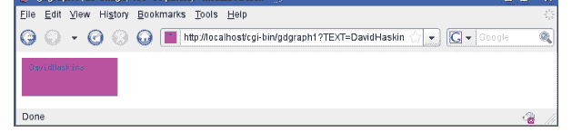

虽然这并不是最精美或最具吸引力的练习，但至少演示了生成图形输出所涉及的关键原理。使用 GD 库，你可以加载现有图像并以多种格式生成它们，例如 **GIF、JPEG、PNG、WBMP**，甚至创建 **animated GIFs**。

如果你使用过 PHP 开发工具，你会认识到 GD 库函数，因为它们几乎完全相同，这表明在这种情况下 PHP 是围绕同一 C 库的包装器。

此处显示的文本使用的是内部字体之一，Tiny、Small、Medium Bold、Large 和 Giant，它们足以用于简单标注，但你也可以使用 TrueType 字体以获得更具吸引力的输出。

可以创建几何绘图，包括线条或特定样式、填充和开放多边形，以及圆弧。需要记住的主要一点是，图像的原点是 **TOP left hand corner**，这对于学习过数学的人来说可能显得违反直觉——为什么会这样我从未弄清，只能想象第一个在该领域做事的程序员碰巧不知道关于图形的知识，在图形中我们认为原点 x=0、y=0 位于左下角。

颜色以 0 到 255 范围内的 RGB 值指定，因此白色为 255,255,255，红色为 255,0,0。要计算精细的色调，请使用像 GNU GIMP 这样的图形工具，它具有颜色选择器，可以让你找到细微的 RGB 值。一个图像的颜色调色板可以在另一个图像中使用，并且如果有空间分配，调色板中请求的最接近的颜色将被创建。

### 6.2 使用 TrueType 字体

在本示例中，我们修改之前的程序以使用 TrueType 字体生成标签。

```c
/* *******************************
 * C Programming in Linux (c) David Haskins 2008 * chapter6_2.c
 * *******************************/

#include <stdio.h>
#include <stdlib.h>
#include <string.h>
#include <gd.h>
#include <gdfonts.h>
#include "c_in_linux.h"

int main(int argc, char *argv[], char *env[]) {
    int text=0,background=0,height=50,width=0,x=0,y=0,size=30,string_rectangle[8];
    double angle=0.0;
    char value[255] = "";
    //OpenSuse TrueType Font
    char font[256] = "/usr/share/fonts/truetype/DejaVuSans.ttf";
    //Ubuntu TrueType Font
    //char font[256] =
    //"/usr/share/fonts/truetype/ttf-dejavu/DejaVuSans.ttf";
    char *err = NULL;
    gdImagePtr im_out = NULL;

    decode_value("TEXT=", (char *) &value, 255);
    //call gdImageStringFT with NULL image to obtain size
    err = gdImageStringFT(NULL,&string_rectangle[0],
        font,size,angle,0,0,value);
    x = string_rectangle[2]-string_rectangle[6] + 6;
    y = string_rectangle[3]-string_rectangle[7] + 6;
    // create an image big enough for the string plus a little space
    im_out = gdImageCreate(x,y);
    //allocate colours
    background = gdImageColorAllocate(im_out,0,0,0);
    text = gdImageColorAllocate(im_out,255,0,255);
    //get starting position
    x = 3 - string_rectangle[6];
    y = 3 - string_rectangle[7];
    //draw the string
    err = gdImageStringFT(im_out,&string_rectangle[0],
        text,font,size,angle,x,y,value);
    //output
    printf("Content-type: image/gif\n\n");
    gdImageGif(im_out,stdout);
    gdImageDestroy(im_out);
    return 0; }
```

我们像之前一样调用此程序，参数为 **cgi-bin/gdgraph1?TEXT=C+PROGRAMMING+IN+LINUX**，以获得这种类型的输出，你可能会认为这更可能是一种有用的工具。系统字体的位置和内容会有所不同，但代码给出了一个示例：

- OpenSuse `/usr/share/fonts/truetype/*.ttf`
- Ubuntu `/usr/share/fonts/truetype/ttf-dejavu/*.ttf`

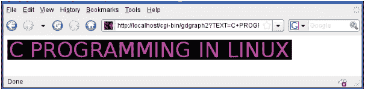

要想熟练使用像 GD 这样的库，你必须准备好进行实验并花费大量时间来理解函数参数，详细查看可用的文档：

[http://www.boutell.com/gd](http://www.boutell.com/gd)

### 6.3 GD 函数参考

完整的详细文档维护在：[http://www.boutell.com/gd](http://www.boutell.com/gd)

GD 包含丰富的用于各种绘图和多种格式的功能，以及 TrueType 字体和动画 GIF 图像。以下是分类的函数列表：

#### 图像创建、销毁、加载和保存：

```c
gdImageCreate(int sx, int sy)
gdImageCreateFromJpeg(FILE *in)
gdImageCreateFromPng(FILE *in)
gdImageCreateFromGif(FILE *in)
gdImageCreateFromGd(FILE *in)
gdImageCreateFromWBMP(FILE *in)
gdImageDestroy(gdImagePtr im)

void gdImageJpeg(gdImagePtr im, FILE *out, int quality)
void gdImageGif(gdImagePtr im, FILE *out)
void gdImagePng(gdImagePtr im, FILE *out)
void gdImageWBMP(gdImagePtr im, int fg, FILE *out)
void gdImageGd(gdImagePtr im, FILE *out)
```

#### 绘图函数：

```c
void gdImageSetPixel(gdImagePtr im, int x, int y, int color)
void gdImageLine(gdImagePtr im, int x1, int y1, int x2, int y2, int color)
void gdImageDashedLine(gdImagePtr im, int x1, int y1, int x2, int y2, int color)
void gdImagePolygon(gdImagePtr im, gdPointPtr points, int pointsTotal, int color)
void gdImageOpenPolygon(gdImagePtr im, gdPointPtr points, int pointsTotal, int color)
void gdImageRectangle(gdImagePtr im, int x1, int y1, int x2, int y2, int color)
void gdImageFilledPolygon(gdImagePtr im, gdPointPtr points, int pointsTotal, int color)
void gdImageFilledRectangle(gdImagePtr im, int x1, int y1, int x2, int y2, int color)
void gdImageArc(gdImagePtr im, int cx, int cy, int w, int h, int s, int e, int color)
void gdImageFilledArc(gdImagePtr im, int cx, int cy, int w, int h, int s, int e, int color, int style)
void gdImageFilledEllipse(gdImagePtr im, int cx, int cy, int w, int h, int color)
void gdImageFillToBorder(gdImagePtr im, int x, int y, int border, int color)
void gdImageFill(gdImagePtr im, int x, int y, int color)
void gdImageSetAntiAliased(gdImagePtr im, int c)
void gdImageSetAntiAliasedDontBlend(gdImagePtr im, int c)
void gdImageSetBrush(gdImagePtr im, gdImagePtr brush)
void gdImageSetTile(gdImagePtr im, gdImagePtr tile)
void gdImageSetStyle(gdImagePtr im, int *style, int styleLength)
void gdImageSetThickness(gdImagePtr im, int thickness)
void gdImageAlphaBlending(gdImagePtr im, int blending)
void gdImageSaveAlpha(gdImagePtr im, int saveFlag)
void gdImageSetClip(gdImagePtr im, int x1, int y1, int x2, int y2)
void gdImageGetClip(gdImagePtr im, int *x1P, int *y1P, int *x2P, int *y2P)
```

#### 查询函数：

```c
int gdImageAlpha(gdImagePtr im, int color)(MACRO)
int gdImageGetPixel(gdImagePtr im, int x, int y)
int gdImageBoundsSafe(gdImagePtr im, int x, int y)
int gdImageGreen(gdImagePtr im, int color)(MACRO)
int gdImageRed(gdImagePtr im, int color)(MACRO)
int gdImageSX(gdImagePtr im)(MACRO)
int gdImageSY(gdImagePtr im)(MACRO)
int gdImageTrueColor(gdImagePtr im)(MACRO)
```

#### 文本处理函数：

```c
gdFontPtr gdFontGetSmall(void)
gdFontPtr gdFontGetLarge(void)
gdFontPtr gdFontGetMediumBold(void)
gdFontPtr gdFontGetGiant(void)
gdFontPtr gdFontGetTiny(void)
void gdImageChar(gdImagePtr im, gdFontPtr font, int x, int y, int c, int color)
void gdImageCharUp(gdImagePtr im, gdFontPtr font, int x, int y, int c, int color)
void gdImageString(gdImagePtr im, gdFontPtr font, int x, int y, unsigned char *s, int color)
void gdImageString16(gdImagePtr im, gdFontPtr font, int x, int y, unsigned short *s, int color)
void gdImageStringUp(gdImagePtr im, gdFontPtr font, int x, int y, unsigned char *s, int color)
void gdImageStringUp16(gdImagePtr im, gdFontPtr font, int x, int y, unsigned short *s, int color)

char *gdImageStringFT(gdImagePtr im, int *brect, int fg, char *fontname, double ptsize, double angle, int x, int y, char *string)
char *gdImageStringFTEx(gdImagePtr im, int *brect, int fg, char *fontname, double ptsize, double angle, int x, int y, gdFTStringExtraPtr strex)
char *gdImageStringFTCircle(gdImagePtr im, int cx, int cy, double radius, double textRadius, double fillPortion, char *font, double points, char *top, char *bottom, int fgcolor)
char *gdImageStringTTT(gdImagePtr im, int *brect, int fg, char *fontname, double ptsize, double angle, int x, int y, char *string)
```


#### 颜色处理函数：

```c
int gdImageColorAllocate(gdImagePtr im, int r, int g, int b)
int gdImageColorAllocateAlpha(gdImagePtr im, int r, int g, int b, int a)
int gdImageColorClosest(gdImagePtr im, int r, int g, int b)
int gdImageColorClosestAlpha(gdImagePtr im, int r, int g, int b, int a)
int gdImageColorClosestHWB(gdImagePtr im, int r, int g, int b)
int gdImageColorExact(gdImagePtr im, int r, int g, int b)
int gdImageColorResolve(gdImagePtr im, int r, int g, int b)
int gdImageColorResolveAlpha(gdImagePtr im, int r, int g, int b, int a)
int gdImageColorsTotal(gdImagePtr im)(MACRO)
int gdImageRed(gdImagePtr im, int c)(MACRO)
int gdImageGreen(gdImagePtr im, int c)(MACRO)
int gdImageBlue(gdImagePtr im, int c)(MACRO)
int gdImageGetInterlaced(gdImagePtr im)(MACRO)
int gdImageGetTransparent(gdImagePtr im)(MACRO)
void gdImageColorDeallocate(gdImagePtr im, int color)
void gdImageColorTransparent(gdImagePtr im, int color)
void gdTrueColor(int red, int green, int blue)(MACRO)
void gdTrueColorAlpha(int red, int green, int blue, int alpha)(MACRO)
```

#### 图像缩放函数：

```c
void gdImageCopy(gdImagePtr dst, gdImagePtr src, int dstX, int dstY, int srcX, int srcY, int w, int h)
void gdImageCopyResized(gdImagePtr dst, gdImagePtr src, int dstX, int dstY, int srcX, int srcY, int destW, int destH, int srcW, int srcH)
void gdImageCopyResampled(gdImagePtr dst, gdImagePtr src, int dstX, int dstY, int srcX, int srcY, int destW, int destH, int srcW, int srcH)
void gdImageCopyRotated(gdImagePtr dst, gdImagePtr src, double dstX, double dstY, int srcX, int srcY, int srcW, int srcH, int angle)
void gdImageCopyMerge(gdImagePtr dst, gdImagePtr src, int dstX, int dstY, int srcX, int srcY, int w, int h, int pct)
void gdImageCopyMergeGray(gdImagePtr dst, gdImagePtr src, int dstX, int dstY, int srcX, int srcY, int w, int h, int pct)
void gdImagePaletteCopy(gdImagePtr dst, gdImagePtr src)
void gdImageSquareToCircle(gdImagePtr im, int radius)
void gdImageSharpen(gdImagePtr im, int pct)
```

#### 杂项函数：

```c
int gdImageCompare(gdImagePtr im1, gdImagePtr im2)
void gdImageInterlace(gdImagePtr im, int interlace)
void gdFree(void *ptr)
```

要使用这样的库，你需要熟悉这些参数，它们通常是库自身定义的数据类型，例如 `gdImagePtr`，它是一个指向某种结构的指针，该结构包含了待处理或存储图像的所有数据。这些内容起初可能看起来有些陌生，但过一段时间后，你就会开始习惯这种语法和在线文档，并逐渐从这种复杂性中看出规律。

## 7 Apache C 模块

### 7.1 更安全的 C Web 应用程序

在现实生活中，很少有Web管理员会愿意让任何人把C程序作为CGI内容生成器来运行，因为存在崩溃和核心转储的风险。然而，Apache服务器本身就是用C编写的，并且其开发工具附带了一些简单的实用程序，允许你创建代码存根，将你的C程序放入其中，并在它们作为服务器的一部分加载、在一种“沙箱”中安全管理时，以Apache模块的形式运行。这里我们将采用之前的一个示例，将其转化为一个Apache模块。

一个名为 `apxs2` 的实用程序包含在 Apache2 开发库中，可以调用它为一个程序生成代码存根，该程序可编译成模块，由 Apache Web 服务器加载和管理。这些模块可用于执行各种各样的任务，但在我们的例子中，我们将做的事情类似于 IIS 服务器中的 ISAPI DLL。`apxs2` 实用程序的确切位置因你使用的Linux发行版而异，但在OpenSuse中，它的运行方式如下。

在终端中输入：`apxs2 -n labelmaker -g`

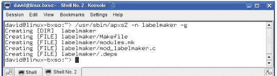

这会创建一个你指定名称的文件夹（labelmaker），以及一个 **Makefile**、一个可供 Make 工具使用的 **modules.mk** 文件，还有一个名为 **mod_labelmaker.c** 的文件。

生成的C文件有点像Apache的“Hello World”。它看起来可能很复杂，但确实提供了一个很长的解释性注释头，值得一读。其思想是，当Apache启动时，位于指定位置且配置为需在服务器配置文件中加载的任何模块都会被加载。`*_register_hooks` 函数列出了在Apache服务器进程的特定阶段可调用的函数名称和签名。在本例中，如果调用了 http://localhost/labelmaker 这个名称，该模块将被要求处理 `*_handler` 函数中发生的任何事情。

服务器的配置可能有点繁琐，但在OpenSuse中，我们必须将其添加到文件 **/etc/apache2/sites-available/default** 中。

```apache
<Location /labelmaker>
    SetHandler labelmaker
</Location>
```

并在 **/etc/sysconfig/apache2** 中，我们**添加**模块 labelmaker 的名称到以下行开头的那一长串逗号分隔的列表中：

```apache
APACHE_MODULES=".....,labelmaker"
```

现在进入labelmaker文件夹并输入：

```bash
sudo apxs2 -c -i mod_labelmaker.c
sudo /etc/init.d/apache2 restart
```

在浏览器中这样调用：

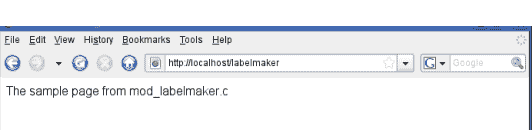

```c
#include "httpd.h"
#include "http_config.h"
#include "http_protocol.h"
#include "ap_config.h"

/* The sample content handler */
static int labelmaker_handler(request_rec *r)
{
    if (strcmp(r->handler, "labelmaker")) {
        return DECLINED;
    }
    r->content_type = "text/html";

    if (!r->header_only) {
        ap_rputs("The sample page from mod_labelmaker.cgi", r);
    }
    return OK;
}

static void labelmaker_register_hooks(apr_pool_t *p)
{
    ap_hook_handler(labelmaker_handler, NULL, NULL, APR_HOOK_MIDDLE);
}

/* Dispatch list for API hooks */
module AP_MODULE_DECLARE_DATA labelmaker_module = {
    STANDARD20_MODULE_STUFF,
    NULL,           /* create per-dir   config structures */
    NULL,           /* merge per-dir    config structures */
    NULL,           /* create per-server config structures */
    NULL,           /* merge per-server config structures */
    NULL,           /* table of config file commands    */
    labelmaker_register_hooks /* register hooks             */
};
```

### 7.2 添加一些功能

现在，我们可以将在第6章中为图形库所做的工作作为替换的处理器函数插入（在代码 Chapter7_1.c 中同时存在两个处理器，其中一个被注释掉了）。注意（高亮的）对修改后的 `decode_value` 函数的调用，它使用 `r->args` 指针来获取QUERY_STRING，而不是 `getenv()`。此外，Apache处理输出的方式也略有不同——你通过调用 `gdImageGifPtr` 获得图像字节数组的指针，然后由 `ap_rwrite` 函数输出数据。在输出调用之后，我们必须使用 `gdFree` 释放该指针。

```c
static int labelmaker_handler(request_rec *r)
{
    void    *iptr;
    int sz = 0;

    if (strcmp(r->handler, "labelmaker")){
        return DECLINED;
    }

    r->content_type = "Content-type: image/gif";

    if (!r->header_only){
        int text=0,background=0, x=0,y=0,size=30,string_rectangle[8];
        double angle=0.0;
        char value[255] = "Hello";
        char font[256] = "/usr/share/fonts/truetype/DejaVuSans.ttf";
        char *err = NULL;
        gdImagePtr im_out = NULL;
        decode_value(r->args, (char *) &value, 255);
        err=gdImageStringFT(NULL,&string_rectangle[0],0,
            font,size,angle,0,0,value);
        x = string_rectangle[2]+string_rectangle[6] + 6;
        y = string_rectangle[3]+string_rectangle[7] + 6;
        im_out = gdImageCreate(x,y);
        background = gdImageColorAllocate(im_out,0,0,0);
        text = gdImageColorAllocate(im_out,255,0,255);
        x = 3 - string_rectangle[6];
        y = 3 - string_rectangle[7];
        err = gdImageStringFT(im_out,&string_rectangle[0],text,
            font,size,angle,x,y,value);
        iptr = gdImageGifPtr(im_out,&sz);
        ap_rwrite(iptr, sz, r);
        gdFree(iptr);
        gdImageDestroy(im_out);
    }
    return OK;
}
```

文件 编辑 查看 历史 书签 工具 帮助

http://localhost/labelmaker?TEXT=The+End+

全书完


### 7.3 Apache 模块结论

虽然编写和调试起来很棘手，但这可能是最有回报且最晦涩的领域之一，你可以在此进行真正、具有商业价值且可安全部署的网页内容生成。可以很容易看出，这个示例可以通过添加颜色和字体参数来扩展，从而制作出有用的网页内容工具。

关于 Apache 模块的清晰、简单的资料很少，但可以从在线文档开始：[http://httpd.apache.org/docs/2.2/developer/](http://httpd.apache.org/docs/2.2/developer/)

值得一看的近期书籍是 *《Apache 模块书》*，作者 Nick Kew，Prentice Hall 出版。

## 8 Ghost 项目

### 8.1 一个 PHP 网站生成器项目

能够用 C 语言编写简短程序来自动化繁琐任务，或完成否则需要花费数小时用笨重的工具（如邮件合并）来折腾的事情，是你会最庆幸学会的事情之一。这个项目就是这样一个省时工具。Ghost 是一个轻量级的 PHP 生成器，供你自定义。

如果你发现自己总是在构建 PHP 网站，那么一种能够一步生成所有参数传递、解码、表单构建和数据库管理代码的快速方法会很有用。像 Ruby on Rails 这样的工具提供了此类功能，但设置和运行起来复杂得多，而且你最终需要学习另一种语言才能更进一步。

使用此工具的最佳入门方式可能是编译并运行它。将 `ghost.zip` 源码解压到你的 `public_html` 文件夹中，这会创建一个名为 `ghost` 的文件夹。Makefile 包含一个目标 `g1`，用于编译和链接 `ghost`。因此进入 `public_html/ghost` 并输入：`make g1`。

运行站点生成器，输入：

- `./ghost testwebsite data1 data2 data1 data3 data4 data6 data6`
- 这将创建：
  - 一个文件夹 `public_html/testwebsite`
  - 一个名为 `testwebsite` 的 MySQL 数据库表，包含文本字段 `data1 data2 data1 data3 data4 data6 data6`
  - 一个 `testwebsite.css` 文件
  - 空的 `header.html` 和 `footer.html` 页面
  - `index.php`，演示了对指定数据项的数据库表进行表单处理、录入、编辑、更新和删除。

在浏览器中，你在 [http://localhost/~yourname/testwebsite](http://localhost/~yourname/testwebsite) 看到的内容如下

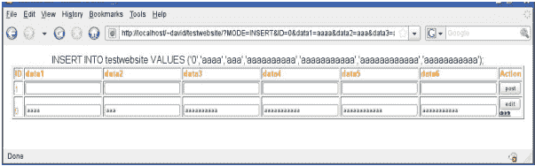

其背后的想法是，创建和管理表单内容的所有机械性部分都已完成并且可以自定义。此截图显示了提交一条记录后的结果。顶部行用于输入新数据，下方行允许编辑或删除记录。它是一个框架，允许你将部分内容取用并用于自己的网站设计。

让我们分段检查这段代码。

第一部分声明所需数据并创建文件夹和 CSS 文件。

```c
int main(int argc, char *argv[])
{
    FILE *out = NULL;
    MYSQL *conn = NULL;
    MYSQL_RES *result = NULL;
    MYSQL_ROW row;
    MYSQL_FIELD *field;
    char SQL[STRINGSIZE]="";
    char BIT[STRINGSIZE]="";
    char SQLINSERT[STRINGSIZE]="";
    char SQLUPDATE[STRINGSIZE]="";
    char SQLDELETE[STRINGSIZE]="";
    int rc=0, i=0, num_fields=0;

    //CREATE DIRECTORY////////////////////
    sprintf(BIT,"mkdir -p ./public_html/%s", argv[1]);
    system(BIT);
    //BUILD CSS////////////////////////////
    sprintf(BIT,"./public_html/%s/%s.css", argv[1],argv[1]);
    out = fopen(BIT,"w");
    fprintf(out,"table {width:800;vertical-align:top;}\n");
    fprintf(out,"th {font-size:80%;color:#ffd208;vertical-align:bottom;text-align:left;}\n");
    fprintf(out,"td {font-size:80%;color:#ffd208;vertical-align:bottom;text-align:left;}\n");
    fprintf(out,"input {font-size:80%;color:#196419;}\n");
    fprintf(out,"a {font-size:65%;color:#000000;}\n");
    fclose(out);
```

接下来生成 `header.html` 和 `footer.html` 文件。这些文件由 PHP 文件加载，可用作通用的公共页眉和页脚。CSS 文件在 `header.html` 文件中引用。

```c
//BUILD HEADER HTML////////////////////////
sprintf(BIT,"./public_html/%s/header.html",argv[1]);
out = fopen(BIT,"w");
fprintf(out,"<html>\n");
fprintf(out,"<head>\n");
fprintf(out,"<link rel=\"stylesheet\" type=\"text/css\" href=\"%s.css\" />\n",argv[1]);
fprintf(out,"<title>%s</title>\n",argv[1]);
fprintf(out,"</head>\n");
fprintf(out,"<body>\n");
fprintf(out,"<center>\n");
fprintf(out,"<table><tr><td>\n");
fprintf(out,"<td><tr><table>\n");
fclose(out);
//BUILD FOOT HTML//////////////////////////
sprintf(BIT,"./public_html/%s/footer.html",argv[1]);
out = fopen(BIT,"w");
fprintf(out,"</body></html>\n");
fclose(out);
```

接下来我们创建数据库。

```c
//OPEN DATABASE///////////////////////////
conn = mysql_init((MYSQL *)0);
mysql_options(conn,MYSQL_READ_DEFAULT_GROUP,"mysqlcapi");
mysql_real_connect(conn,"localhost","","","test",0,NULL,0);
//CREATE TABLE///////////////////////////
sprintf(SQL,"drop table if exists %s",argv[1]);
rc = mysql_query(conn,SQL);
sprintf(SQL,"create table %s (ID varchar(255)",argv[1]);
for(i=2; i < argc; i++)
{
    sprintf(BIT," %s varchar(255)",argv[i]);
    strcat(SQL,BIT);
}
strcat(SQL,")");
rc = mysql_query(conn,SQL);
```

现在开始复杂的部分：生成 PHP 脚本。理解它的最佳方式是在浏览器中查看页面源代码时检查程序的实际输出。

顶部行是一个表单，为 ghost 程序生成的表中定义的每一列提供一个文本框。

```html
<tr>
<form><input type='hidden' name='MODE' value='INSERT'>
<td><input type='hidden' name='ID' value='1'></td>
<td><input type='text' name='data1'></td>
<td><input type='text' name='data2'></td>
<td><input type='text' name='data3'></td>
<td><input type='text' name='data4'></td>
<td><input type='text' name='data5'></td>
<td><input type='text' name='data6'></td>
<td><input type='submit' value='post'></td>
</form>
</tr>
```

对于表中的每一行，我们现在生成一个表单以允许编辑数据，并提供一个锚链接来执行删除操作。

```html
<tr>
<form><input type='hidden' name='MODE' value='UPDATE'>
<td><input type='hidden' name='ID' value='0'></td>
<td><input type='text' name='data1' value='aaaaaaaaaa'></td>
<td><input type='text' name='data2' value='aaaaaaaaaaaa'></td>
<td><input type='text' name='data3' value='aaaaaaaaaaaaa'></td>
<td><input type='text' name='data4' value='aaaaaaaaaaaa'></td>
<td><input type='text' name='data5' value='aaaaaaaaaaaaa'></td>
<td><input type='text' name='data6' value='aaaaaaaaaaaa'></td>
<td><input type='submit' value='edit'></form>
<a href='?ID=0&MODE=DELETE'>delete</a></td>
</tr>
```

仔细检查文件 `index.php` 将使你能够看到所有这些发生的位置，并倒推在 `ghost.c` 源码中的哪个位置生成了此 PHP 代码。一个好主意是在打印件上使用荧光笔，因为我们将一种语言（HTML）嵌入到另一种语言（PHP）中，而 PHP 又嵌入到另一种语言中，因此对转义字符 `\'` 的使用非常、非常谨慎，以在必要时表达单引号和双引号，使其全部正常工作。这看起来可能很复杂——但 ghost 允许的快速原型设计使得花时间自定义 C 代码是值得的，这样你想要的 PHP 和你想要的数据库就能按你想要的方式生成。

以下是 PHP 文件 `index.php` 中生成编辑或删除行的部分。静态 HTML 已高亮显示，其他部分由 MySQL PHP 函数调用插入。

```php
$result = mysql_query("select * from testwebsite");
while($row = mysql_fetch_array($result))
{
    echo "<tr>";
    echo "<form><input type='hidden' name='MODE' value='UPDATE'>";
    for($i=0;$i < mysql_num_fields($result); $i++)
    if($i==0)
        echo "<td><input type='hidden' name='".mysql_field_name($result,$i)."' value='".
        $row[ mysql_field_name($result,$i)] .
        "'>";
        $row[ mysql_field_name($result,$i)] .
        "</td>";
    else
        echo "<td><input type='text' name='".mysql_field_name($result,$i)."' value='".
        $row[ mysql_field_name($result,$i)] .
        "'>";
        "</td>";
    echo "<td><input type='submit' value='edit'></form>";
    echo "<a href='?ID=".$row[ mysql_field_name($result,0)] . "&MODE=DELETE'>delete</a>";
    echo "</td></tr>";
}
mysql_free_result($result);
mysql_close($con);
```

正如你所见，大量的繁琐重复工作已被自动化。你可以通过修改 PHP 代码继续进行，或深入自定义生成所有内容的 C 程序。

我个人经常使用 ghost 来节省建站时间，这也是我编写它的原因。我厌倦了在编写几乎相同的代码来解码 HTML 表单并填充或更新数据库时犯错。


## 9 结论

现在你已经完成了这些简单的示例，我希望你能明白为什么掌握 C 语言始终是一项有用且持续实用的技能。

25 年过去了，我仍然经常编写 C 程序来快速有效地完成日常工作；一旦写成，它们就成为一套耐用工具的一部分，适合我使用，而且可移植。

这本小书包含多年来我学到的一些“技巧”，关于这些技巧几乎没有明确的文档资料；而且坦率地说，它预设了读者熟悉 Linux。在让经验水平各异的学生测试这些材料之后，我相信，一个专注细心的学生能让所有这些材料运行起来，并能从那里开始发现 C 的乐趣。我的许多学生说：“这比 Java 有趣多了，我能看到真正发生了什么！”这令人非常欣慰，也让我相信你会发现这些材料很有用。

有兴趣的人可以请出版商委托我写一本配套书：

*Linux 下的 C++ 标准模板库编程*

祝你好运，编程愉快。

大卫
2009 年 3 月 31 日
