# Linux C 编程


### 加速你的职业发展

请点击广告

### 管理学硕士


伦敦商学院  
摄政公园  
London NW1 4SA  
英国  
电话 +44 (0)20 7000 7573  
邮箱 mim@london.edu  
www.london.edu/mim/

### 脱颖而出

伦敦商学院管理学硕士专为拥有不到一年全职研究生工作经验的毕业生设计，将拓展你的思维，并为你成功的商业职业生涯奠定基础。

该项目与招聘人员协商开发，为你提供顶级雇主所需的关键技能。通过 11 个月的全日制学习，你将获得商业知识和能力，以增加职业选择并在人群中脱颖而出。

**现已开放申请，2011 年 9 月入学。**

**欲了解更多信息，请访问 www.london.edu/mim/**  
**发送邮件至 mim@london.edu 或致电 +44 (0)20 7000 7573**


### 你充满*活力与创意。* 这正是我们要寻找的。

在寻找一份能让你的想法真正发挥作用的职业吗？瑞银的毕业生项目和实习机会让你亲身体验成为全球团队一员的感觉，这个团队会奖励你的贡献并相信共同成功。

无论你处于学术生涯的哪个阶段，访问 www.ubs.com/graduates，让你的未来成为我们未来的一部分。

**www.ubs.com/graduates**


请点击广告

© UBS 2010。保留所有权利。


请点击广告


## 关于作者：大卫·哈斯金斯

我 1950 年出生于伦敦切尔西，但在新西兰长大，1966 年返回英国。在做了几年职业鼓手后，我自 1975 年起一直在计算机行业工作。

我的第一段经历是在斯佩里·尤尼瓦克（现为 Unisys）做了五年大型机硬件工程师，随后在伦敦的英国电信做了 14 年分析程序员。

在从事转换大量地理数据（地图坐标参考）的复杂任务时，我发现了 C 的乐趣——它的速度和效率。那是在 1985 年，从那以后我一直是 C 的粉丝。

自 1994 年以来，我一直是伦敦金斯顿大学计算、信息系统与数学学院的高级讲师。这主要是一所技术大学，由一所前理工学院发展而来，拥有悠久的航空工程传统。

我主要从事向庞大且多元文化的学生群体教授多种计算机语言和互联网系统设计。

我的大多数学术研究和商业咨询都涉及空间系统设计，而大数据量和必要的处理效率问题促使我专注于 C 和 C++。我的教学网站是 www.ubiubi.org，其中展示了部分材料。

作为开放系统的热心爱好者，自 2002 年以来我一直将所有教学完全集中在 Linux 平台上，而金斯顿大学在为所有学生实验室提供双启动设施方面已相当先进。

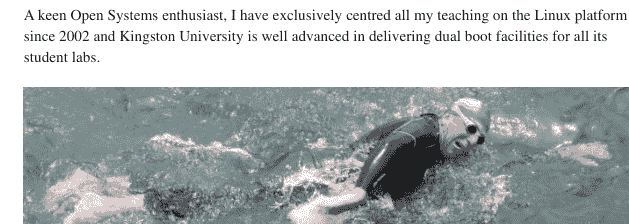

我热爱游泳，2009 年完成了在澳大利亚维多利亚州举行的年度洛恩*码头到酒吧*游泳赛；这是世界上最大的公开海域游泳比赛，每年一月，4500 名各年龄段的人都会游泳，鲨鱼侦察机从头顶飞过。

不教学时，我热衷于种菜，也是一名业余音乐人，在爵士乐队和苏格兰风笛乐队中演奏。我会打鼓、演奏高地大风笛、单簧管、吉他和钢琴。

## 引言

### 为什么要学习 C 语言？

因为 C 语言就像拉丁语——它是有限的，而且多年没有变化。C 紧凑而精简，在当前经济环境下，我们将需要一大批懂 C 的年轻人来维持现有重要系统的运行。

C 直接内置于 Linux 和 Unix 的核心。Unix 背后的设计理念是用 C 编写操作系统，因此将其移植到新架构所需的只是一个 C 编译器。Linux 本质上是一系列早期尝试制作 PC 版 Unix 的成功故事。

懂 C 现在是、而且多年来一直是严肃软件专业人员的先决条件；随着开放系统近来的流行和成熟，这一点更加正确。C 的简洁性和被认为的难度使其在 20 世纪 90 年代末被 Java 取代而退出大学教学，但一些教学群体中日益有一种感觉：Java 其实并不是开始教初学者的好选择。

矛盾的是，学生进入大学时对计算的了解比十年前更少，因为编程被认为对学校来说太难教。与此同时，对合格 IT 专业人员所期望的知识体系每几年就不可阻挡地翻一番。

Java 通常作为第一门语言教授，但可能会让学生困惑，因为它不断变化、非常抽象而强大，并且变得过于庞大，做同一件事有太多不同方法。它还有点“安全”，使学生与可怕的体验隔离开来，比如开车时有安全气囊、戴着耳机听音乐，所以你会不那么小心。对于从类和对象开始学习的人来说，在方法内编写过程式代码的核心活动似乎难以理解。

那么我们从哪里开始？一个明智的地方是“从头开始”，而 C 已经接近我们大多数人需要达到的底层程度，除非我们要成为硬件设计师。即使对这些学生来说，从 C 开始并进一步深入机器底层也是一个好主意。

C 就像拥有一把非常锋利的刀，它可能很危险，但如果你要学做厨师，你会需要一把，并且可能在探索它能做什么时割伤自己。同样，C 期望你知道自己在做什么；如果你不知道，它不会在崩溃前警告你。

掌握 C 会让你深入了解 Java 等高级语言表面之下发生的事情。C 的语法几乎可以保证你会轻松理解后来出现的其他语言，如 C++、Java、Javascript 和 C#。

C 让你能够在细粒度的位级别访问机器核心及其所有资源。


C 被描述为就像“驾驶一辆没有刹车的保时捷”——而且由于它也很快，这可能令人兴奋不已。当速度和效率至关重要时，C 往往是唯一的选择。

C 被称为“危险”的语言，因为它允许对机器进行底层访问，但这种可怕之处正是你需要理解的，因为它会让你对你将使用的高级语言心存敬畏。

许多嵌入式微型系统仍然全部用 C 编写，而用于监控和过程控制的隐形互联网的机器对机器世界也经常使用 C。

希望这一系列理由能引导你认识现代集成开发环境（IDE）日益增长的复杂性，例如 Developer Studio、Netbeans 和 Eclipse；这些 IDE 让学生产生一种错觉，以为自己知道在做什么，但实际上却造成了混淆。

我的目标是让学生建立信心并快速上手，而不必经历配置复杂工具链带来的种种噩梦。它本质上也是一种免许可证的方法，并且可在任何平台上运行。

有了对实际发生情况的基本理解，你就可以继续使用并真正理解职业生涯中需要的任何工具。

为了给人一种在做真实、有用且与时俱进的事情的感觉，重点在于开发可见且实际上具有专业质量的 Web 服务器和客户端项目并将其上线，使用：

-   Apache Web 服务器和开发库。
-   C 语言 CGI 程序（使用“make”实用程序进行 C 编程）。
-   C 语言 Apache 模块。
-   带有 C 客户端库接口的 MySQL 服务器。
-   带有 C 接口的 GD 图形库。
-   附带使用 CSS、(X)HTML、XML、JavaScript、Ajax。

本课程是为英国伦敦金斯顿大学计算机科学专业一、二年级学生设计的，并由他们进行了实验室测试。

## 设置你的系统

本书假定你使用的是 Linux 操作系统，并采用 KDE3.5、KDE4 或 Gnome 桌面。书中包含针对 Ubuntu（以及 Kubuntu）和 OpenSuse 11 的具体说明。

如果你使用 KDE 桌面，你将拥有 Konqueror 或 Dolphin 作为文件管理器，以及 kate 或 kedit 作为编辑器。

在 Gnome 中，你可能会使用 Nautilus 和 gedit。

你需要熟悉以“超级用户”身份执行某些操作的理念，这样你才有权限复制或编辑某些文件。通常的做法是在 Linux 命令前加上“sudo”并提供密码，如下例所示：

```
sudo cp hello3 /srv/www/cgi-bin/hello3
```

该命令将文件“hello3”复制到 Apache 服务器存放公共网关接口（CGI）程序的区域。

在 KDE 中，“kdesu konqueror”会以超级用户身份打开文件管理器。

在 Gnome 中，“gnomesu nautilus”会以超级用户身份打开文件管理器。

你需要安装以下软件包：

| 软件包 | Ubuntu | Open Suse |
|---|---|---|
| C 开发库 | build-essential | 基础开发（模式） |
| Apache Web 服务器 | apache2 | Web 和 LAMP 服务器（模式） |
| Apache 开发库 | apache2-prefork-dev | apache2-devel |
| MySQL 服务器、客户端和开发库 | mysql-server libmysqlclient15-dev | libmysqlclient-devel |
| GD 和开发库 | libgd2-xpm | gd<br>gd-devel |

在整本书中，你会看到对文件夹 **cgi-bin** 的引用。该文件夹的位置会因 Linux 发行版而异。默认情况下，用于 Web 程序的此文件夹是：

-   OpenSuse：**/srv/www/cgi-bin**
-   Ubuntu：**/usr/lib/cgi-bin**

要把程序放到那里，你需要超级用户权限，因此更好的做法可能是在你自己的 `home/*****/public_html/cgi-bin` 目录中创建一个文件夹，并更改 Apache 配置文件（OpenSuse）`/etc/apache2/default-server.conf` 或（Ubuntu）`/etc/apache2/default-server.conf` 中的 **ScriptAlias** 及相关 **Directory** 引用。

## 你改变世界的机会

在爱立信，我们根深蒂固地相信，我们每天所做的创新能够产生深远影响，让世界对人们、商业和社会变得更美好。加入我们吧。

在德国，我们特别寻找毕业生担任集成工程师，负责：

-   无线接入和 IP 网络
-   IMS 和 IPTV

我们期待收到你的申请！如需申请以及查看所有当前职位空缺，请访问我们的网页：www.ericsson.com/careers


## 1. 第一章：Hello World

### 1.1 Hello 程序 1

使用文件管理器（在 KDE 中为 Konqueror，在 Gnome 中为 Nautilus），在你的主目录中某处创建一个新目录，名称要适合本书中的所有示例，也许可以叫“Programming_In_Linux”，名称中不要包含任何空格。

打开一个编辑器（在 KDE 中为 kate，在 Gnome 中为 gedit），输入（或从提供的源代码 zip 压缩包中复制）以下内容：

```
/*
C Programming in Linux (c) David Haskins 2008
chapter1_1.c
*/

#include <stdio.h>

int main(int argc, char *argv[])
{
    printf("Hello, you are learning C!!\n");
    return 0;
}
```

将文本保存为 chapter1_1.c，放在你在主目录中创建的新文件夹中。

打开终端窗口并输入：`gcc -o hello chapter1_1.c`，将程序编译成可执行的形式。

现在输入 `ls -l` 列出该目录中所有文件的详细信息。你应该会看到 chapter1_1.c 在那里，以及一个名为 `hello` 的文件，它就是刚刚编写的编译后的 C 程序。

现在输入：`./hello` 来执行或运行该程序，它应该返回文本：

"Hello, you are learning C!!"

如果这成功了，恭喜你，你现在是一名程序员了！

#### 程序剖析：

`/* ... */` 中的部分是注释，不会被编译，仅供参考和说明。

`#include` 部分告诉编译器需要哪些系统库，以及此程序引用了哪些头文件。在我们的例子中使用了 `printf`，它定义在 stdio.h 头文件中。

`int main(int argc, char *argv[])` 部分是实际程序的开始。这是一个入口点，大多数 C 程序都有一个 main 函数。

`int argc` 是函数 `main` 的一个参数，它是一个整数计数，表示在 `char *argv[]`（指向字符串的指针列表）中传入的字符串参数数量，这些参数可能在我们运行程序时从命令行传入。

指向某物的指针是为这类数据类型指定的一个内存地址名称。我们可以有一个指向整数的指针：`int *iptr`，或者一个指向浮点数的指针：`float *fPtr`。任何事物的列表都用 `[]` 描述，如果我们确切知道这个列表有多大，我们可以将其声明为 `[200]`。在本例中，我们知道第二个参数是一个指向字符串的指针列表。

花括号中的所有其他内容都是 main 函数，而在本例中，整个程序以多行表示。

每一行或每条语句都以分号 `;` 结尾。

我们有像 `printf(...)` 这样的函数调用，它是对定义在头文件 stdio.h 中的标准输入/输出库的调用。

在程序末尾，`return 0` 通过向系统返回零来结束程序。

返回值通常用于在程序未能正确运行时指示成功或状态。

### 1.2 Hello 程序 2

进一步扩展这个示例，检查程序开头处入口点函数的声明：`int main(int argc, char *argv[])`。

用通俗的话说，这意味着：

The function called “main”, which returns an integer, takes two arguments, an integer called “argc” which is a count of the number of command arguments and *argv[]* which is a list or array of pointers to strings which are the actual arguments typed in when you run the program from the command line.

#### 一些定义：

- **函数**：一段程序代码，具有返回数据类型、名称、一些用逗号分隔的不同数据类型的参数，用括号括起来，然后是函数体用大括号括起来，每个语句以分号结束。
- **整数符号 `int`**：像 0,1,2,3,4,5 这样的计数数字。
- **列表、数组符号 `[]`**：按编号顺序排列的一系列同类事物。
- **指针符号 `*`**：定位某类数据起始位置的内存地址。
- **字符串或 `char *`**：指向字符序列的指针，如 'c','a','t' 组成 "cat"。一个字符字符串以特殊字符 NULL 或 '\0' 结束，ASCII 值为 0 或十六进制 00


让我们重写程序，在开始恐慌之前看看这一切意味着什么。

```c
/*
C Programming in Linux (c) David Haskins 2008
chapter1_2.c
*/
#include <stdio.h>

int main(int argc, char *argv[])
{
    int i=0;
    printf("Hello, you are learning C!!\n");
    printf("Number of arguments to the main function:%d\n", argc);
    for(i=0; i<argc; i++)
    {
        printf("argument number %d is %s\n", i, argv[i]);
    }
    return 0;
}
```

保存文本为 **chapter1_2.c**，放在同一文件夹中。

打开一个终端窗口并输入：  
**gcc -o hello2 chapter1_2.c** 将程序编译成可执行的形式。

现在输入 **ls -l** 列出此目录中所有文件的详细信息。你应该会看到 chapter1_2.c 在那里，以及一个名为 **hello2** 的文件，它是你刚刚编写的编译后的 C 程序。

现在输入 **./hello2** 执行，或运行程序，它应返回以下文本：

```text
Hello, you are still learning C!!
Number of arguments to the main function:1
argument number 0 is ./hello2
```

我们可以看到程序本身的名称被计为命令行参数，并且参数列表或数组中事物的计数是从零开始而不是从一开始。

现在输入 **./hello2 my name is David** 执行程序，它应返回以下文本：

```text
Hello, you are still learning C!!
Number of arguments to the main function:5
argument number 0 is ./hello2
argument number 1 is my
argument number 2 is name
argument number 3 is is
argument number 4 is David
```

那么，这里发生了什么？看起来我们正在读回运行程序时输入的每个字符字符串（单词）。

#### 程序结构：

```c
printf("Hello, you are learning C!\n");
```

库函数 printf 被调用，带有一个参数，即以 \n 或换行字符结尾的字符字符串。

```c
printf("Number of arguments to the main function: %d\n", argc);
```

库函数 printf 被调用，带两个参数，一个以 \n 结尾的字符字符串，其中包含 %d 作为第二个参数 argc 的占位符，argc 是一个 int。

```c
for(i=0; i<argc; i++)
```

这是一个“for 循环”，我们使用计数器整数 i 反复执行某事，i 在每次迭代时递增（通过表达式 i++），循环在 i 保持小于 argc 的值时继续。

```c
printf("argument number %d is %s\n", i, argv[i]);
```

库函数 printf 被调用，带三个参数，一个以 \n 结尾的字符字符串，其中包含 %d 作为第二个参数 i 的占位符，i 是一个 int，以及 %s 作为第三个参数 argv[i] 的占位符，argv[i] 是名为 argv[] 的字符字符串指针数组的第 i 个成员。

### 1.3 Hello 程序 3

让我们实际操作并在网页中运行它。做一个额外的更改，添加第一个输出 printf 语句 “Content-type:text/plain\n\n”，它告诉服务器将要传输的 MIME 类型。

使用 **gcc -o hello3 chapter1_3.c** 编译，并将编译后的文件 hello3 复制到你的 public_html/cgi-bin 目录（或在自己的机器上以超级用户身份将程序复制到 /usr/www/cgi-bin（OpenSuse）或 /usr/lib/cgi-bin（Ubuntu））。

```c
/*************************************************************
 * C Programming in Linux (c) David Haskins 2008
 * chapter1_3.c                    *
 *************************************************************/
#include <stdio.h>

int main(int argc, char *argv[])
{
    int i=0;
    printf("Content-type:text/plain\n\n");
    printf("Hello, you are still learning C!!\n");
    printf("Number of arguments to the main function:%d\n", argc);
    for(i=0;i<argc;i++)
    {
        printf("argument number %d is %s\n", i, argv[i]);
    }
    return 0;
}
```

打开一个网页浏览器并在 URL 中输入 http://localhost/cgi-bin/hello3?david+haskins，你应该会看到网页内容可以由 C 程序生成。

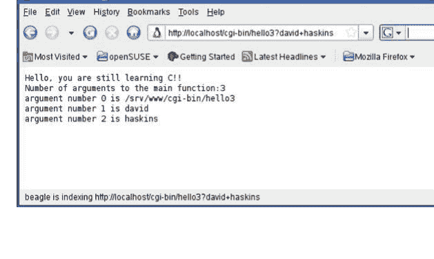

### 1.4 Hello 程序 4

“main” 函数签名的鲜少被记录的特性是它可以接受 **三个** 参数，我们现在要查看的最后一个参数是 char *env[ ]，它也是一个指针列表，但在此情况下，这些是指程序运行时可用的 **系统环境变量**。

```c
/*..........................................................................
 * C Programming in Linux (c) David Haskins 2008
 * chapter1_4.c                                    *
 *..........................................................................*/
#include <stdio.h>


int main(int argc, char *argv[], char *env[])
{
    int i=0;

    printf("Content-type:text/plain\n\n");
    printf("Hello, you are still learning C!\n");
    printf("Number of arguments to the main function:%d\n", argc);
    for(i=0;i<argc;i++)
    {
        printf("argument number %d is %s\n", i, argv[i]);
    }
    i = 0;
    printf("Environment variables:\n");
    while(env[i])
    {
        printf("env[%d] = %s\n", i, env[i]);
        i++;
    }
    return 0;
}
```

使用 **gcc -o hello4 chapter1_4.c** 编译，并以超级用户身份将程序复制到 **/srv/www/cgi-bin**（OpenSuse）或 **/usr/lib/cgi-bin**（Ubuntu）。你可以在编译它的终端中使用 **./hello4** 运行它，你会看到一长串环境变量。在浏览器中输入 **http://localhost/cgi-bin/hello4** 时，你会看到完全不同的集合。

> Wikipedia 对环境变量的定义如下：
> 
> “在所有 Unix 和类 Unix 系统中，每个进程都有自己私有的环境变量集合。默认情况下，进程创建时它会继承其父进程的重复环境，除非父进程在创建子进程时做了明确更改........ 所有 Unix 操作系统变种以及 DOS 和 Microsoft Windows 都有环境变量；然而，它们并不都使用相同的变量名。运行中的程序可以访问环境变量的值以进行配置。环境变量的例子包括...... PATH, HOME... “


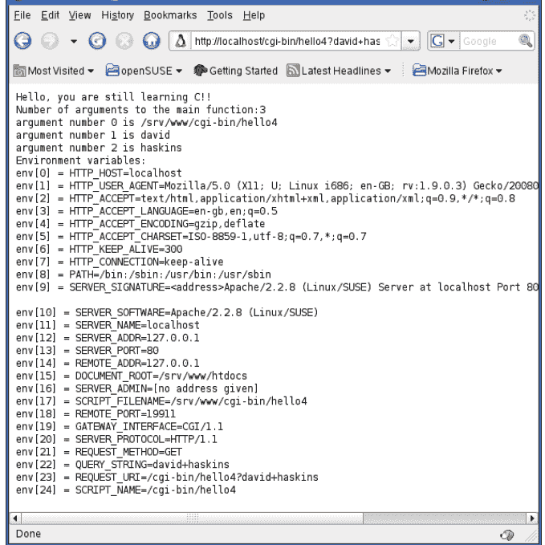

我们很快会发现 **QUERY_STRING** 是我们在与程序通信时一个重要的环境变量，在此情况下我们看到它的值是 “david+haskins”，即我们在 URL 中输入的 “?” 之后的所有内容。这是一种向 **通用网关接口 (CGI)** 程序（如 hello4）发送信息的有效方式，但我们应将其限制为仅一个字符串。在我们的例子中，我们使用了 “+” 来连接两个字符串。如果我们输入：“david haskins”，浏览器会将其转换，因此我们会看到：

```text
QUERY_STRING=david%20haskins
```

我们稍后将学习如何将复杂的输入值集合传输到我们的程序中。


### 1.5 Hello World 结论

我们已经看到，一个包含少量输入和一些输出的简单程序实际上极其强大，因为它揭示并暴露了我们计算机内部的大量运作方式。

尽管我们才刚刚开始，但已经遇到了许多我们将反复使用的关键概念：

- 函数与参数
- 作为数据类型的数字（整数）和字符串
- 列表或数组
- 使用 “for” 和 “while” 的循环

我们有意迈出了一大步：从编写只在“终端屏幕”中运行的程序，转向编写可通过互联网在浏览器中看到的程序。

原因在于，编写在 Windows、GNOME 或 KDE 等窗口系统中与用户交互的程序极其复杂，并不是经常要求你去做的事情。

如今，互联网浏览器已成为我们几乎一切活动事实上的界面模式，所以我们不妨从一开始就理解如何使用它。

在接下来的所有章节中，我们都将遵循这一模式：先介绍一些基本技术，然后将其应用到基于 Web 的系统中。

在实践中，现实世界里并没有多少 C 公共网关接口编程，但作为 Apache 模块和 Microsoft IIS ISAPI DLL 运行的 C 和 C++ 代码却很多。也许没有多少人知道 eBay 的很大一部分是用 C/C++ 编写的。

为什么？它能达到极快的速度，而他们与全球实时市场中的抢便宜货者之间的业务需要这个闪电般快速的核心，因此没有其他办法获得那种性能。

## 2. 数据与内存

### 2.1 简单数据类型？

当我们编写程序时，在声明和描述变量以表示我们想要纳入信息处理的各种事物时，我们必须对世界的本质做出决定或断言。

这个过程具有深刻的哲学性；我们做出**本体论**断言，即这个或那个事物存在；当我们选择特定的数据类型或数据类型集合来描述这些事物的属性时，我们做出**认识论**断言。这是沉重的事情，责任重大，不可轻率对待。

作为一个实际例子，我们可能声明一些看起来像地理数据库记录开头的内容。


```c
/******************************************************
C Programming in Linux (c) David Haskins 2008
chapter2_1.c
******************************************************/
#include <stdio.h>
#define STRINGSIZE 256

int main(int argc, char *argv[])
{
        char town[STRINGSIZE] = "Guildford";
        char county[STRINGSIZE] = "Surrey";
        char country[STRINGSIZE] = "Great Britain";
        int population = 66773;
        float latitude = 51.238599;
        float longitude = -0.566257;
        printf("Town name: %s  population:%d\n",town,population);
        printf("County: %s\n",county);
        printf("Country: %s\n",country);
        printf("Location latitude: %f longitude: %f\n",latitude,longitude);
        printf("char = %d byte int = %d bytes float = %d bytes\n",
        sizeof(char),sizeof(int),sizeof(float) );
        printf("memory used:%d bytes\n", ((STRINGSIZE * 3) * sizeof(char) + sizeof(int) + (2 * sizeof(float))));
        return 0;
}
```

这里我们做了以下事情：

- 断言我们在此应用程序中会遇到的所有字符串都将限制为 255 个字符，因此我们用**预处理器**语句来**定义**这一点——这些语句以 # 开头。
- 断言城镇与郡相关联，而郡又以某种层级方式与国家相关联。
- 断言人口按整数计数——没有半个人。
- 断言位置将按照一种特定变体（WGS84）记录，该约定用纬度和经度描述地球表面上的点，并对度、分和秒使用小数。

这些语句中的每一条都会在声明它的函数的**作用域**内分配**内存**。每个**数据声明**都会占用一定数量的**字节**内存，并为那块内存赋予一个标签，即**变量名**。每种数据类型都有指定的大小，**sizeof()** 库函数会将其作为整数返回。在本例中，是 3 x 256 个字符、一个整数和两个浮点数。确切大小取决于机器，但很可能是 780 字节。

在声明数据的函数之外，该数据不可访问——这就是声明的**作用域**。如果我们声明在 main() 函数之外，它就会具有**全局**作用域，其他函数可以访问它。C 允许你愿意的话做这种危险的事情，所以要小心。

通常我们会密切关注数据的作用域，并把**只读副本**或**带标签的内存地址**传递给程序中可能需要处理甚至修改数据的那部分。这些带标签的内存地址称为**指针**。

我们使用 **printf** 系列库函数进行输出（**sprintf** 用于创建字符串，**fprintf** 用于写入文件等），它们都使用一个共同的**格式字符串**参数来指定数据应如何表示。

- %c 字符
- %s 字符串
- %d 整数
- %f 浮点数 等。

参数中剩余的一系列变量会按指定顺序放入格式字符串中。

在 C 中，最好**初始化**你声明的任何数据，因为为它们分配的内存内容不会被清除，而可能包含任意旧垃圾。

使用以下命令编译：**gcc -o data1 chapter2_1.c -lc**

使用以下命令调用时程序的输出：**./data1**

```
Town name: Guildford  population:66773
County: Surrey
Country: Great Britain
Location latitude: 51.238598 longitude: -0.566257
char = 1 byte int = 4 bytes float = 4 bytes
memory used:780 bytes
```

#### 关于 make 的说明：一个有用的工具

到现在为止，你可能已经厌倦了输入所有这些编译器命令，因此有一个名为 **make** 的实用工具，它会运行代码所在文件夹中名为 **Makefile** 的文件。以下是目前为止示例的 Makefile：

```makefile
#Makefile

all:chap1 chap2

chap1: 1-1 1-2 1-3 1-4

1-1:
	gcc -o hello1 chapter1_1.c -lc

1-2:
	gcc -o hello2 chapter1_2.c -lc

1-3:
	gcc -o hello3 chapter1_3.c -lc

1-4:
	gcc -o hello4 chapter1_4.c -lc

chap2: 2-1 2-2

2-1:
	gcc -o data1 chapter2_1.c -lc

2-2:
	gcc -o data2 chapter2_2.c -lc

clean:
	rm hello* data* *~
```

要编译所有内容，请输入 **make all**

要为 chapter2_1.c 编译目标 2-1，请输入 **make 2-1**

每个 make 目标后的制表符对 make 的语法至关重要。

代码包中有一份用于整本书的 Makefile。

### 2.2 什么是字符串？

一些编程语言（如 Java 和 C++）具有**字符串数据类型**，它隐藏了看似简单的事物背后的一些复杂性。

字符串的一个基本属性是，它是由长度不确定的单个字符元素组成的序列。

我们可以在键盘上输入的大多数字符都由简单的数字 ASCII 码表示，而 C 数据类型 **char** 用于存储字符数据。

字符串存储为以 `NULL` 结尾的字符**数组**，因此数组必须足够大，以容纳字符序列再加一个字符。记住，数组成员始终从零开始计数。

在此示例中，我们可以看到声明并初始化为相应值的 5 个单独字符，以及一个设置为“”的空字符数组。

请点击广告


### 你正在考虑欧洲的商科学位吗？

哥本哈根商学院

在大学阶段**学习商业**。我们将案例与前沿研究相结合，可单独或团队工作，而且每个人都讲英语。带回宝贵的知识和经验，以促进你的职业发展。

**遇见一种**由新食物、音乐和传统构成的文化，以及在安全、清洁的环境中学习商业的新方式——就在丹麦哥本哈根市中心。

**参与**案例竞赛、体育运动等课外活动——在 cbs 来自 80 多个国家的 18,000 名学生中结交新朋友。

cbs; EQUIS; Accredited Association of MBAs; CEMS; PRME

**在 cbs.dk 上了解我们的样貌和工作方式**


请注意用于字符的单引号 ' 与用于字符串的双引号 " 之间的区别。

```c
/*****************************************************
 * C Programming in Linux (c) David Haskins 2008
 * chapter2_2.c
 *****************************************************/
#include <stdio.h>

int main(int argc, char *argv[], char *env[])
{
        char c1 = 'd';
        char c2 = 'a';
        char c3 = 'v';
        char c4 = 'i';
        char c5 = 'd';
        char name[6] = "";

        sprintf(name,"%c%c%c%c%c",c1,c2,c3,c4,c5);
        printf("%s\n",name);
        return 0;
}
```

编译命令：**gcc -o data2 chapter2_2.c -lc**  
使用以下命令调用程序时的输出：**./data2**

*大卫*

### 2.3 字符串能“意味着”什么

任何东西——赋予**变量**的**名称**及其**含义**或**用途**完全取决于观察者的理解。试试这个

```c
/*************************************************************
 * C Programming in Linux (c) David Haskins 2008
 * chapter2_3.c
 *************************************************************/
#include <stdio.h>
#include <string.h>

int main(int argc, char *argv[], char *env[])
{
    printf("Content-type:text/html\n\n");
    printf("<html>\n");
    printf("<body bgcolor=\"%s\">\n",argv[1]);
    printf("</body>\n");
    printf("</html>\n");
    return 0;
}
```

编译命令：gcc -o data3 chapter2_3.c -lc

以超级用户身份将程序复制到你的 public_html/cgi-bin 目录（或 /srv/www/cgi-bin（OpenSuse）或 /usr/lib/cgi-bin（Ubuntu））。

在浏览器中输入：http://localhost/cgi-bin/data3?red

你应该看到如下内容：

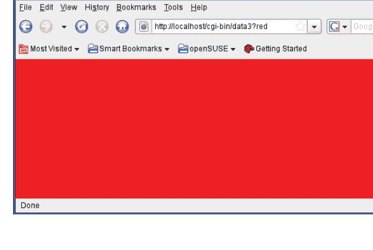

或者，如果你发送任意参数，你会得到令人惊讶的结果：

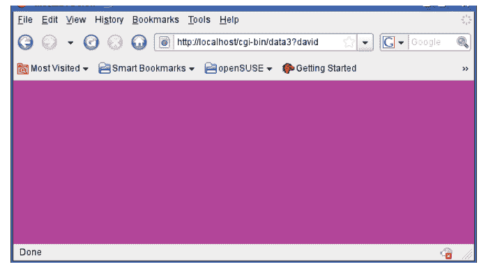

我们在这里所做的是使用字符串参数 argv[1] 作为 HTML body 标签内的背景颜色代码。我们将 Content-type 规范改为 text/html，于是奇迹般地，我们的程序现在正在生成 HTML 内容。一种语言在另一种语言中被表达。Web 浏览器理解有限的颜色词集合，颜色也可以通过十六进制代码定义，例如 #FFFFFF（白色）、#FF0000（红色）、#00FF00（绿色）、#0000FF（蓝色）。

这个有趣的练习并不只是一个轻量级的小把戏；一个程序能够用另一种语言生成另一个程序，这一想法非常强大，并且支撑着整个互联网的力量。当我们从这样的通用网关接口程序生成 HTML（或 XML 或其他任何内容）时，我们是在创建动态内容，这些内容可以链接到实时变化的数据，而不是预先编辑好的静态网页。在实践中，大多数网站都混合了动态内容和静态内容，但在这里我们看到的是在非常简单的层面上如何做到这一点。

在本书中，我们将把浏览器作为程序的首选界面，因此我们将生成 HTML 和二进制图像流形式的 Web 内容，纯粹作为让程序威力立即可见的一种手段。在终端屏幕上盯着看的代码并不太令人印象深刻，而编写窗口式应用程序也远没有那么简单直接。

在实践中，你可能被要求编写的大多数软件都会在 Web 上运行，因此我们不妨直接从这一理念开始。大多数 Web 应用也会涉及多种语言，例如 CSS、(X)HTML、XML、JavaScript、PHP、JAVA、JSP、ASP、.NET、SQL。如果这听起来很吓人，不要慌张。C 语言知识会让你看到，这些语言虽然各自执行不同功能，但其中许多语言的语法都以 C 为基础。

### 2.4 解析字符串

从某种输入字符串中提取含义或有价值信息的工作称为“解析”。现在我们将构建另一个有趣的、可通过互联网调用的 CGI 程序，来展示我们手中掌握的能力。

请点击广告


```c
/************************************************
 * C Programming in Linux (c) David Haskins 2008
 * chapter2_4.c
 ************************************************/
#include <stdio.h>
#include <string.h>

int main(int argc, char *argv[], char *env[])
{
    char *token = NULL;
    char colour1[256] = "";
    char colour2[256] = "";
    int wide = 0;
    int high = 0;
    int columns = 0;
    int rows = 0;

    token = (char *) strtok(argv[1],":");
    strcpy(colour1,token);
    token = (char *) strtok(NULL,":");
    strcpy(colour2,token);
    token = (char *) strtok(NULL,":");
    wide = atoi(token);
    token = (char *) strtok(NULL,":");
    high = atoi(token);
    printf("Content-type:text/html\n\n");
    printf("<html>\n");
    printf("<body bgcolor=\"%s\">\n",colour1);
    printf("<center>\n");
    printf("<table bgcolor=\"%s\" border=2>\n",colour2);
    for(rows=1;rows<=high;rows++)
    {
        printf("<tr>\n");
        for(columns=1;columns<=wide;columns++)
        {
            printf("<td><h6>row=%d cell=%d</h6></td>\n",rows,columns);
        }
        printf("</tr>\n");
    }
    printf("</table>\n");
    printf("</body>\n");
    printf("</html>\n");
    return 0;
}
```

编译命令：`gcc -o data4 chapter2_4.c -lc`

以超级用户身份将程序复制到 `/srv/www/cgi-bin`（OpenSuse）或 `/usr/lib/cgi-bin`（Ubuntu）。

在浏览器中输入：**http://localhost/cgi-bin/data4?red:blue:5:5:**

你应该看到如下内容：

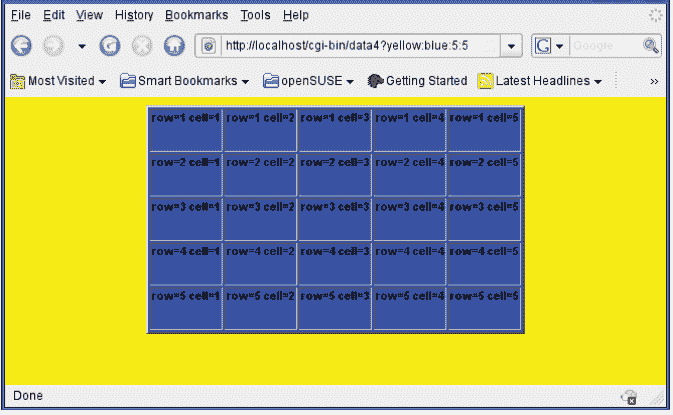

在这个程序中，我们取 argv[1]（此处为 *yellow:blue:5:5:*），并使用库函数 **strtok** 对其进行**解析**，该函数将字符串切分为由任意字符 ':' 分隔的标记；然后我们将这些标记用作字符串来指定颜色，并用整数来指定表格的行数和单元格数。

函数 **atoi** 将整数的字符串表示转换为整数（"1" 转换为 1）。

函数 **strtok** 有点奇特：第一次调用时传入要解析的字符串名称，而后继调用中第一个参数会改为 NULL。

**for(...)** 循环机制用于执行固定次数的操作。

引入的 HTML 术语有：

- `<html>`
- `<body>`
- `<table>`
- `<tr>` 表格行
- `<td>` 表格数据单元格

### 2.5 数据与内存——结论

我们使用了一些简单的数据类型来表示某些信息，向程序传递输入，并组织和显示一些可视化输出。

我们使用了嵌入在输出字符串中的 HTML，使输出能在 Web 浏览器中可见。

作为练习，试试这个：

编写一个程序，放入你的 **/public_html/cgi-bin** 文件夹；该程序可以在浏览器中通过**运动队**或**国家**的**名称**以及一系列**颜色**来调用，这些颜色或许以十六进制指定，例如 ff0000 = 红色（rrggbb），用于队伍颜色或地图颜色，并显示一些合理的内容。我的版本如下：

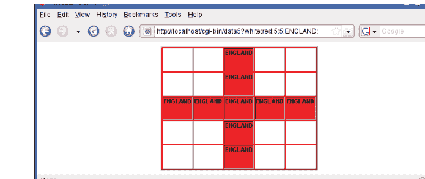

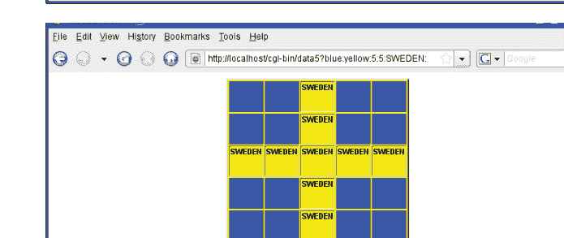

## 3. 函数、指针和结构体

### 3.1 函数

所有程序的入口点称为 main()，它是一个**函数**，或**一段代码**，会做某些事情，通常返回某个值。我们将程序组织成函数，以防止它们变成无法在一屏或一页中看全的冗长难读代码块，同时也确保不会到处出现重复相同的代码片段。我们可以调用属于 C 语言一部分的**库函数**，如 printf 或 strtok，也可以调用自己或他人的函数及函数库。我们必须确保相应的头文件存在并能被预处理器读取，同时确保源代码或编译后的库也存在且可访问。

正如之前所学，数据的**作用域**限制在声明它的**函数**内，因此我们使用指向数据和数据块的**指针**，将其传递给希望处理我们数据的函数。我们已经看到，字符串被当作指向以 NULL 字符结尾的单个字符数组的指针来处理。


```
/**********************************************************
 * C Programming in Linux (c) David Haskins 2008
 * chapter3_1.c
 **********************************************************/

#include <stdio.h>
#include <string.h>
#include <math.h>

double doit(int number1, int number2)
{
        return sqrt((double)(number1 + number2));
}

int main(int argc, char *argv[], char *env[])
{
        int n1 = 0, n2 = 0, i=0;
        n1 = atoi((char *) strtok(argv[1],","));
        n2 = atoi((char *) strtok(NULL,","));
        printf("Content-type:text/html\n\n<html><body>\n");
        for(i=1;i<100;i++)
                printf("%f ",doit(n1+i,n2*i));
        printf("</body></html>\n");
        return 0;
}
```

在这个示例中，我们可以重复调用函数“doit”，它接收两个整数参数，并返回某个数学计算的结果。

**编译：** gcc -o func1 chapter3_1.c -lm
**复制到 cgi-bin：** cp func1 /home/david/public_html/cgi-bin/func1

（到目前为止，你应该随着进展维护一个 Makefile，并在过程中不断添加用于编译示例的目标。）

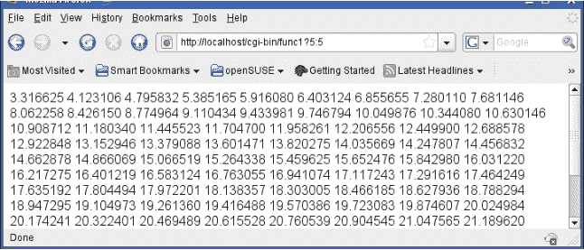

在浏览器中，以“func1?5:5”调用时，结果如下所示。

在这种情况下，我们函数的参数是作为**副本**传递的，它们在函数中不会被修改，而是被使用。

如果我们想真正修改变量，就必须将其指针传递给函数。


请点击广告

在 bookboon.com 下载免费电子书

```
/* ********************************************************
 * C Programming in Linux (c) David Haskins 2008
 * chapter3_2.c                                    *
 *********************************************************/

#include <stdio.h>
#include <string.h>
#include <math.h>
void doit(int number1, int number2, double *result)
{
    *result = sqrt((double)(number1 + number2));
}
int main(int argc, char *argv[], char *env[])
{
    int n1 = 0, n2 = 0, i=0;
    double result = 0;
    n1 = atoi((char *) strtok(argv[1],":"));
    n2 = atoi((char *) strtok(NULL, ":"));
    printf("Content-type:text/html\n\n<html><body>\n");
    for(i=1;i<=100;i++)
    {
        doit(n1+i,n2*i,&result);
        printf("%f ", result);
    }
    printf("</body></html>\n");
    return 0;
}
```

我们通过 &result 发送变量 'result' 的地址，而在函数 doit 中，我们用 *result 对指针进行*解引用*，以访问该 float 并修改其值，尽管它位于 main 内部的作用域之外。这与 chapter3_1.c 产生相同的输出。

### 3.2 库函数

C 包含许多用于执行常用任务的内置函数。到目前为止，我们已经使用了 atoi、printf、sizeof、strtok 和 sqrt。要获取任何内置库函数的完整详情，我们只需输入例如：

```
man 3 atoi
```

然后我们就会看到以下全部内容：

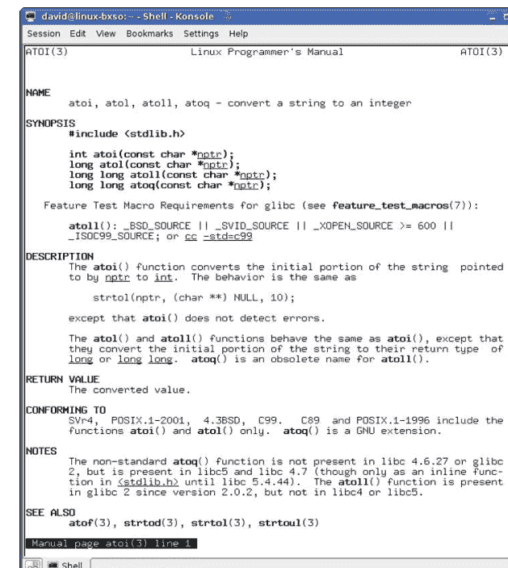

这相当完整地告诉了你关于这个函数及其变体你需要知道的一切，以及如何使用它们。最重要的是，它会告诉你需要包含哪个**头文件**。

### 3.3 库函数简要参考

所有可用函数的完整详情可在以下网址找到：
**http://www.gnu.org/software/libc/manual/**

#### 按头文件分类的常用库函数：

#### math.h
- 三角函数，例如：  
  `cos` `sin` `tan`
- 指数、对数和幂函数，例如：  
  `exp` `log` `pow` `sqrt`
- 其他数学函数，例如：  
  `ceil` `fabs` `floor` `fmod`

#### stdio.h
- 文件函数，例如：  
  `fclose` `feof` `fgetpos` `fopen` `fread` `fseek`
- 格式化 I/O 函数，例如：  
  `printf` `scanf` 函数
- 字符 I/O 函数，例如：  
  `fgetc` `fgets` `fputc` `fputs` `getc` `getchar` `gets`  
  `putc` `putchar` `puts`

#### stdlib.h
- 字符串函数，例如：  
  `atof` `atoi` `atol`
- 内存函数，例如：  
  `calloc` `free` `malloc`
- 环境函数，例如：  
  `abort` `exit` `getenv` `system`
- 数学函数，例如：  
  `abs` `div` `rand`

#### string.h
- 字符串函数，例如：  
  `strcat` `strchr` `strcmp` `strncmp` `strcpy`  
  `strncpy` `strcspn` `strlen` `strstr` `strtok`

#### time.h
- 时间函数，例如：  
  `asctime` `clock` `difftime` `time`

在你发现自己需要做某件事，并因此去寻找为此目的编写的某个函数或函数库之前，学习库函数是没有意义的。你需要理解函数签名——也就是参数列表的含义、如何使用它，以及函数将返回什么，或者对作为指针传递给函数的变量做了什么。

### 3.4 数据结构

有时我们希望将一组变量作为一个整体来管理，也许是从一条数据库记录中取出所有值，并在整个程序中传递整条记录来处理它。为此，我们可以将数据分组到结构体中。

这个程序使用 struct 来为一个称为 player 的对象定义一组属性。main 函数包含一个包含 5 名 player 的数组的声明和实例化。我们依次将指向每个数组成员的指针传递给一个函数，来为每个成员排名。该函数使用 switch 语句检查每个 player 名称的首字母，以进行任意排名。然后，我们依次将指向每个数组成员的指针传递给一个打印详细信息的函数。

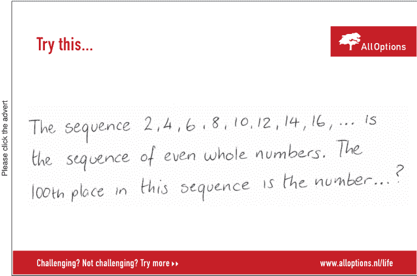

```c
/****************************************
* C Programming in Linux (c) David Haskins 2008
* chapter3_3.c
****************************************/

#include <stdio.h>
#include <string.h>
struct player
{
        char name[255];
        char role[255];
        int ranking;
};
void rank(struct player *p)
{
        switch(p->name[0])
        {
            case 'P': p->ranking = 4;break;
            case 'H': p->ranking = 1;break;
            case 'R': p->ranking = 2;break;
            case 'J': p->ranking = 5;break;
            case 'B': p->ranking = 3;break;
        }
}
void show(struct player *p)
{
        printf("Name:%s Role:%s Ranking:%d<br>\n",
                p->name,p->role,p->ranking);
}
int main(int argc, char *argv[], char *env[])
{
        struct player myteam[5] = { {"Pele","striker",0 },
                                    {"Beckham","male model",0 },
                                    {"Roddick","tennis man",0 },
                                    {"Haskins","swimmer",0 },
                                    {"Jagger","singer",0 } };
        int i=0;
        printf("Content-type:text/html\n");
        for(i=0;i<5;i++) rank (&myteam[i]);
        for(i=0;i<5;i++) show (&myteam[i]);
        return 0;
}
```

结果如下所示，照例是在浏览器中：

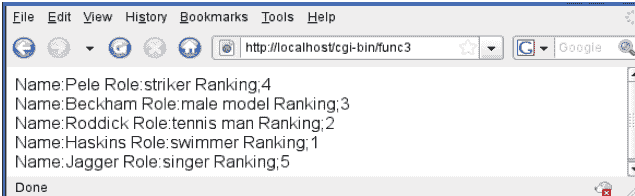

这是一种非常强大且相当高级的技术，但你需要了解它。**结构体**的概念直接引出了**类**和**对象**的概念。

我们可以看到，使用 struct 极大地简化了在程序中传递数据元素以完成不同工作的业务任务。如果我们修改结构体的定义，它仍然可以工作，我们只需添加代码来处理新属性，而不必更改执行工作的函数的参数列表或签名。

请点击广告


结构的定义实际上并不创建任何数据，而只是规定我们可以实例化的对象的形式结构。在 main 函数中，我们可以用所示的形式表达这种实例化，创建一组符合我们所做定义的数据元素序列的列表。

你大概可以看出，带有附加函数或方法的结构体本质上就是 Java 中的类，在 C++ 中也是如此。**面向对象语言**从这里开始，事实上，许多早期被称为“面向对象”的系统实际上只是用 C 语言的结构体构建的。

例如，如果你查看 Apache 服务器开发头文件，你会看到大量结构体，例如在 httpd.h 的这个片段中：

```
struct server_addr_rec {
  /** The next server in the list */
  server_addr_rec *next;
  /** The bound address, for this server */
  apr_sockaddr_t *host_addr;
  /** The bound port, for this server */
  apr_port_t host_port;
  /** The name given in "<VirtualHost>" */
  char *vhost;
};
```

不要担心这一切意味着什么——只需注意，这是一种非常常见且非常强大的技术，而数据结构的设计，就像与之密切相关的数据库表的设计一样，是作为一名程序员需要理解的核心、关键、至关重要的任务。

你做出了哲学上的决定：世界就是这样的，并且可以用这种方式建模。这是一项沉重的责任——在哲学中，这项工作被称为**本体论**（存在什么？）和**认识论**（我们如何知道它？）。我敢打赌，你从未想过这就是你正在做的事情！

### 3.5 函数、指针和结构体——结论

我们使用了一些简单的数据类型来表示一些信息，将输入传递给程序，并组织与显示一些可视化输出。
我们使用了嵌入在输出字符串中的 HTML，使输出能在 Web 浏览器中可见。
我们学习了如何创建可复用的函数库。
我们学习了数据结构以及使用指针在程序中传递它们。


### 练习

使用 C 库函数创建一个程序，该程序：

- *以写入模式打开一个文件，*
- *将一个命令行参数写入该文件*
- *关闭该文件*
- *以读取模式打开该文件*
- *读取内容*
- *关闭该文件*
- *将其打印到屏幕上*

这将让你获得以下经验：查找信息、寻找合适的库函数，以及从网上或书中查找示例。

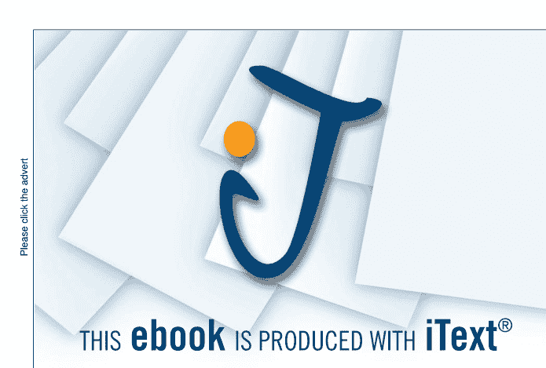

## 4. 逻辑、循环与流程控制

### 4.1 C 控制流语法

我们可以使用以下 C 结构来控制程序执行。
当我们可以按计数方式遍历一个序列或一系列内容时：

```c
for( initial value;  keep on until  ; incremental change )
{  do this; and this; and this;  }
```

当我们等待某个条件发生变化时：

```c
while( this is true )
{  do this; and this; and this;  }
```

或者如果我们想至少执行一次然后再测试：

```c
do {  do this; and this; and this;  }
while( this is true )
```

当我们有一个选项需要测试时：

```c
if(  this is true )
        {  do this; and this; and this;  }
else
        {  do this; and this; and this; }
```

当我们有更多选项需要测试时：

```c
if(  this is true )
        {  do this; and this; and this;  }
else if (  this is true )
        {  do this; and this; and this;  }
else
        {  do this; and this; and this;  }
```

当我们基于一个整数或单个字符值有更多选项需要测试时：

```c
switch( on an integer or character value )
{
        case 0: do this; and this; and this; break;
        case n: do this; and this; and this; break;
        default: do this; and this; and this; break;
}
```

### 4.2 控制流：发生的内容及其顺序

这一部分完全关于 if、then、else 以及 true 和 false——这是我们表达和控制程序执行方式的基本构件。这可能是非常枯燥乏味的材料，因此为了让它更易懂，我们将解决一个你需要解决的问题，以便完成任何具有一定复杂度的交互式 Web 工作。

我们将构建一些可用的东西，以提供类似于 Java servlet 中典型的 getParameter("ITEM1") 方法或 PHP 中 $_REQUEST['ITEM1'] 函数所能获得的功能。

在第 1 章中，我们看到可以通过 main 函数的隐式参数访问环境变量。我们还可以使用库函数 getenv() 来请求任何指定名称的环境变量的值。

```c
/**********************************************************
 * C Programming in Linux (c) David Haskins 2008
 * chapter4_1.c
 **********************************************************/
#include <stdio.h>
#include <string.h>

int main(int argc, char *argv[], char *env[])
{
    printf("Content-type:text/html\n\n<html><body bgcolor=#23abe2>\n");
    char value[256] = "";
    strncpy(value,(char *) getenv("QUERY_STRING"),255);
    printf("QUERY_STRING : %s<BR>\n", value );
    printf("<form>\n");
    printf("<input type=\"TEXT\" name=\"ITEM1\">\n");
    printf("<input type=\"TEXT\" name=\"ITEM2\">\n");
    printf("<input type=\"SUBMIT\">");
    printf("</form></body></html>\n");
    return 0;
}
```

这里我们显示 QUERY_STRING，它是程序收到的 HTML 表单的全部内容，其中包含所有已命名表单元素的 NAME=VALUE 对。

HTML 表单默认使用 GET 方法，除非在 action 属性中另有指定，否则该方法会将所有表单数据发送回包含该表单的程序或页面。这些数据以一系列由 & 字符分隔的变量 = 值对的形式包含在 QUERY_STRING 中。

> 注意，在 HTML 中，事物的值用引号括起来，因此要将这些内容嵌入 C 字符串中，我们必须使用特殊符号 `\` 对字符进行“转义”，如下所示：`\"ITEM1\"`。此外，我们在每段 HTML 输出的末尾使用 `"\n"` 或显式换行符，这样当我们在浏览器中选择“查看源代码”时，会看到格式合理的文本，而不是整个页面显示为一条很长的单行。

在浏览器中调用此程序时，我们会看到一个表单，并可以在框中输入一些数据：

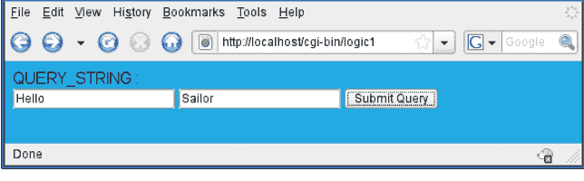


### 加速你的职业生涯

请点击广告

### 管理学硕士


伦敦商学院  
Dean's Park  
London NW1 4SA  
英国  
电话 +44 (0)20 7000 7573  
电子邮箱 mim@london.edu  
www.london.edu/mim/

### 脱颖而出

伦敦商学院管理学硕士专为拥有不到一年全职研究生工作经验的毕业生设计，将拓展你的思维，并为你提供在商业领域取得成功的职业基础。

该课程在与招聘人员协商后开发，旨在为你提供顶尖雇主所需的关键技能。通过 11 个月的全日制学习，你将获得商业知识和能力，以增加职业选择并在人群中脱颖而出。

现已开放 2011 年 9 月入学的申请。

欲了解更多信息，请访问 www.london.edu/mim/  
发送电子邮件至 mim@london.edu，或致电 +44 (0)20 7000 7573

提交表单后，我们会看到：

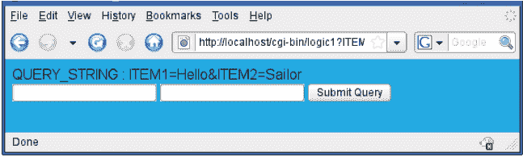

要充分理解 QUERY_STRING 并在其中找到特定值，我们将不得不**解析**它，把它切分成各个组成部分，为此我们需要一些**条件逻辑**（if、else 等）以及一些**循环**来遍历变量中的字符。理想情况下，应该创建一个用于此目的的基本函数，因为这是你可能需要反复执行的任务，所以拥有一段可以重复调用的代码是合理的。

在下一个示例中，我们添加了这个函数，输出中明显的区别是，在解析出提取的值之后，我们可以将它们插入 HTML 框中。我们似乎已经成功创建了类似 Java getParameter() 函数的东西——真的是这样吗？

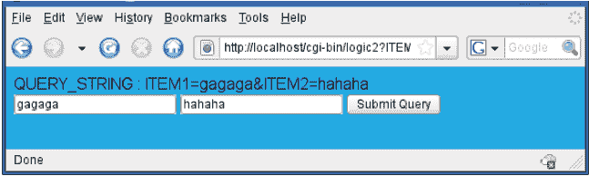

仔细查看 chapter4_2.c，并用 A-Z、a-z 或数字以外的字符进行尝试，你会发现有些地方不太对劲。这里发生了某种编码！

如果我在第一个字段中输入 **DAVID !!!**：

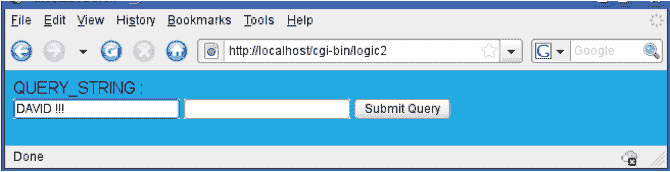

我得到这个结果：

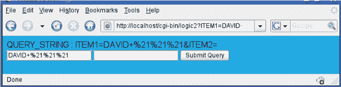

**空格字符变成了 +，而 ! 变成了 %21。**

出现这种编码是因为某些字符在传输协议本身中被显式使用。
例如，& 用于分隔 QUERY_STRING 的各个部分，而空格不能按原样发送。

任何希望使用 HTML 表单信息的程序都必须能够解码所有这些内容，
我们现在将尝试这样做。

程序 chapter4_2.c 完成了我们目前看到的功能。它在同一个文件中包含一个 main 函数和一个 decode_value 函数。

decode_value 函数接受三个参数：

1. 我们要查找的值的名称，"ITEM1=" 或 "ITEM2="。
2. 如果找到该值，我们将把值放入其中的变量的地址
3. 要复制的最大字符数

该函数在 QUERY_STRING 中查找值的起始位置和结束位置，然后将找到的字符逐个复制到 value 变量中，并添加一个 NULL 字符来终止字符串。


```c
/********************************************************
 * C Programming in Linux (c) David Haskins 2008
 * chapter4_2.c
 ********************************************************/
#include <stdio.h>
#include <string.h>

void decode_value(const char *key, char *value, int size)
{
    int length = 0, i = 0, j = 0;
    char *pos1 = NULL, *pos2 = NULL;
    //if the string key is in the query string
    if ( (pos1 = strstr((char *) getenv("QUERY_STRING"), key)) != NULL )
    {
        //find start of value for this key
        for(i=0; i<strlen(key); i++) pos1++;
        //find length of the value
        if( (pos2 = strstr(pos1, "&")) != NULL )
            length = pos2 - pos1;
        else length = strlen(pos1);
        //character by character, copy value from query string
        for(i = 0, j = 0; i < length ; i++, j++)
        {
            if(j < size) value[j] = pos1[i];
        }
        //add NULL character to end of the value
        if(j < size) value[j] = '\0';
        else value[size-1] = '\0';
    }
}
int main(int argc, char *argv[], char *env[])
{
    printf("Content-type:text/html\n\n<html><body bgcolor=#23abe2>\n");
    char value[255] = "";
    strncpy(value,(char *) getenv("QUERY_STRING"),255);
    printf("QUERY_STRING : %s<BR>\n", value );
    printf("<form>\n");
    //call the decode_value function to get value of "ITEM1"
    decode_value( "ITEM1=", (char *) &value, 255);
    if(strlen(value) > 0 )
        printf("<input type=\"TEXT\" name=\"ITEM1\" value=\"%s\">\n",value);
    else
        printf("<input type=\"TEXT\" name=\"ITEM1\">\n");
    //call the decode_value function to get value of "ITEM2"
    decode_value( "ITEM2=", (char *) &value, 255);
    if(strlen(value) > 0 )
        printf("<input type=\"TEXT\" name=\"ITEM2\" value=\"%s\">\n",value);
    else
        printf("<input type=\"TEXT\" name=\"ITEM2\">\n");
    printf("<input type=\"SUBMIT\">");
    printf("</form></body></html>\n");
    return 0;
}
```


看来我们必须对 `decode_value` 这个包进行一番认真的工作，由于这种工作预计会反复进行，所以编写一个可复用的函数是明智之举。

首先，我们可以将该函数放入一个单独的文件 `decode_value.c` 中，并创建一个文件 `c_in_linux.h` 来存放我们可能编写的所有函数，然后将所有这些编译成一个库。在 Makefile 中，我们可以添加：

```
SRC_CIL = decode_value.c
OBJ_CIL = decode_value.o
#CIL_INCLUDES = -I/usr/include/apache2 -I. -I/usr/include/apache2 -I/usr/include/apr-1
#CIL_LIBS = -L/usr/lib/mysql -lmysqlclient -L/usr/lib -lgd -L/home/david/public_html/Ventus/code

all: lib_cil 4-4

lib_cil:
    gcc -c $(SRC_CIL)
    ar rcs c_in_linux.a $(OBJ_CIL)
    $(RM) *.o

4-4:
    gcc -o logic4 chapter4_3.c c_in_linux.a -lc
    cp logic4 /home/david/public_html/cgi-bin/logic4
```

这看起来既可怕又复杂，但它的意思仅仅是：键入“make all”将会：

-   编译 `SRC_CIL` 列表中列出的所有 `*.c` 文件，并生成目标文件 `*.o`
-   将所有目标文件编译成一个名为 `c_in_linux.a` 的库归档文件
-   使用这个新的归档文件编译 `4-4`

这就是我们将采用的模型，以保持文件尽可能小，并让代码的可共享性最大化。

现在我们可以有一个更简单的“main”函数文件，以及一些我们可能想编写成可从任何地方调用的函数的文件，尽管目前还不知道具体需要什么。所有内容都被组织到一个库文件（`*.a` 归档文件）中——这些也可以编译为动态加载的共享对象 `*.so`，这与 Windows DLL 非常相似。这正是所有 Linux 软件编写和交付的方式。

例如，MySQL C 应用程序编程接口（API）包括：

-   `/usr/include/mysql` 中的所有头文件
-   库文件 `/usr/lib/mysql/libmysqlclient.a`

我们实际所做的正是所有 Linux 组合在一起的方式——我们只是以同样的方式向其添加内容。

我们的 **main** 文件现在看起来像这样：

```c
/********************************************************************
* C Programming in Linux (c) David Haskins 2008
* chapter4_3.c                            *
********************************************************************/
#include <stdio.h>
#include <string.h>
#include "c_in_linux.h"

int main(int argc, char *argv[], char *env[])
{
    printf("Content-type:text/html\n\n<html><body bgcolor=#23abe2>\n");
    char value[255] = "";
    strncpy(value,(char *) getenv("QUERY_STRING"),255);
    printf("QUERY_STRING : %s<BR>\n", value );
    printf("<form>\n");
    //call the decode_value function to get value of "ITEM1"
    decode_value("ITEM1=", (char *) &value, 255);
    if(strlen(value) > 0 )
        printf("<input type=\"TEXT\" name=\"ITEM1\" value=\"%s\">\n",value);
    else
        printf("<input type=\"TEXT\" name=\"ITEM1\">\n");
    //call the decode_value function to get value of "ITEM2"
    decode_value("ITEM2=", (char *) &value, 255);
    if(strlen(value) > 0 )
        printf("<input type=\"TEXT\" name=\"ITEM2\" value=\"%s\">\n",value);
    else
        printf("<input type=\"TEXT\" name=\"ITEM2\">\n");
    printf("<input type=\"SUBMIT\">");
    printf("</form></body></html>\n");
    return 0;
}
```

这段代码以同样的方式调用 `decode_value` 函数，但由于库 **c_in_linux.a** 在编译时被链接进来，并且它可以访问列出库中所有函数的头文件 **c_in_linux.h**，所以一切正常。

尝试用**伪代码**描述解码这个 QUERY STRING 的过程：

```
get the QUERY_STRING
find the search string "ITEM1=" inside it
look for the end of the value of "ITEM1="
copy the value to our "value" variable, translating funny codes such as:
    %21 is !
    %23 is #
```

这些特殊代码由浏览器生成，以便你在 HTML 表单中输入的任何内容都能安全传输，并且不会干扰 HTTP 协议。这类代码有很多，而本章的任务就是**完成这项工作**，让你键盘上的**每个**键都按你所想的那样工作！！

`chapter4_3.c` 程序调用了这个未完成的 `decode_value` 函数，该函数目前只能处理**空格**字符和 `!`——它在**条件逻辑**中使用了 **if**、**else** 和 **for**，以及库函数 **getenv、strcpy、strlen、strstr**，该逻辑分析一个字符串以找到特定项，然后将该项复制到一块名为 **value** 的内存中，该内存被传给了它。

结果显示解码后的值被粘贴到第一个字段中；


```c
/************************************************************
 * program: decode_value.c                  *
 * version: 0.1                             *
 * author: david haskins February 2008      *
 ************************************************************/
#include <stdlib.h>
#include <string.h>
void decode_value(const char *key, char *value, int size)
{
    unsigned int length = 0;
    unsigned int i = 0;
    int j = 0;
    char *pos1 = '\0', *pos2 = '\0', code1 = '\0', code2 = '\0';
    strcpy(value,"");
    if( ( pos1 = strstr(getenv("QUERY_STRING"), key)) != NULL )
    {
        for(i=0; i<strlen(key); i++) pos1++;
        if( (pos2 = strstr(pos1,"&")) != NULL )
        {
            length = pos2 - pos1;
        }
        else length = strlen(pos1);
        for(i = 0, j = 0; i < length ; i++, j++)
        {
            if(j < size)
            {
                if(pos1[i] == '%')
                {
                    i++;    code1 = pos1[i];
                    i++;    code2 = pos1[i];
                    if(code1 == '2' && code2== '0')
                        value[j] = ' ';//0x20
                    else if(code1 == '2' && code2== '1')
                        value[j] = '!';//0x21
                }
                else value[j] = pos1[i];
            }
        }
        if(j < size)
        {
            value[j] = '\0';
        }
        else value[size-1] = '\0';
    }
}
```

### 4.3 逻辑、循环与流程控制总结

控制程序流程最重要的部分，是要清楚地知道自己想做什么。我们还学会了将代码分解成易于管理的块，并开始构建和使用我们自己的库和头文件。

能够用普通语言或**伪代码**来表达一个过程是很有用的，它有助于你逐步分解代码。

-   使用 **for** 循环来显式计数遍历你知道有结束点的事物。
-   使用 **while** 和 **do...while** 循环来重复操作，直到某个条件改变。
-   使用 **switch** 语句，当整数或单个字符决定接下来发生什么时。
-   使用 **if**、**else if** 和 **else**，当互斥的条件可以按顺序测试时。
-   复杂的 **if** 和 **else** 以及 `not (!)` 条件组合可能最终变得难以阅读。
-   使用花括号（`{ }`）将一切都分解成块。

### 练习：

现在一个有用的任务是**完成 `decode_value` 函数**，这样你就有了一个有用的工具，可以从 HTML 表单中获取网页内容，并解码键盘上所有非字母数字的键。你会反复用到这个练习，所以值得把它做对。


## 5. 使用 MySQL 处理数据库

### 5.1 关于不重复造轮子

每个项目都不从零开始是很明智的，我们建立在前人已经做过的工作之上。我们使用的所有 C 库都是由某人从更底层的零碎部分编写的，如果需要，我们可以访问和修改这些代码。这就是开放系统的全部意义。

实际上，我们只是想使用可靠的服务，而我们要使用的前两个服务无处不在——数据库访问和图形图像生成。

### 5.2 MySQL C API

要访问 MySQL 函数集，我们确保编译器能够访问 MySQL 的头文件和库，然后直接调用一些我们无需自己编写的 MySQL 函数。

在接下来的例子中，我们将数据库代码与上次所做的工作结合起来，把解码后的数据插入数据库，并读出目前存储的内容。

在一个新的终端窗口中，输入：

```
mysql test
```

然后：

```
create table CIL (ITEM1 varchar(255),ITEM2 varchar(255));
```

这将为程序在 `test` 数据库中创建一个可写入的表，该数据库应该已经在你的 MySQL 设置中创建好了。

如果一切正常，看起来会是这样。

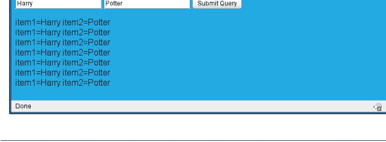


The data types declared **MYSQL**, **MYSQL_RES**, and **MYSQL_ROW** are **preprocessor definitions** that stand for more complex C declarations in mysql.h and all we need to know is how to call them.

The documentation at MySQL provides all the information you will need to do more complex operations.

## 改变世界的机会

Here at Ericsson we have a deep rooted belief that the innovations we make on a daily basis can have a profound effect on making the world a better place for people, business and society. Join us.

In Germany we are especially looking for graduates as Integration Engineers for

- 无线接入和 IP 网络
- IMS 和 IPT

We are looking forward to getting your application! To apply and for all current job openings please visit our web page: **www.ericsson.com/careers**


```c
/********************************************************
 * C Programming in Linux (c) David Haskins 2008
 * chapter5_1.c
 ********************************************************/
#include <stdio.h>
#include <string.h>
#include <mysql/mysql.h>
#include "c_in_linux.h"

int main(int argc, char *argv[], char *env[])
{
    char value1[255] = "",value2[255] = "",SQL[1024]="";
    int rc = 0;

    MYSQL *conn = NULL;
    MYSQL_RES *result = NULL;
    MYSQL_ROW row;

    printf("Content-type:text/html\n\n<html><body bgcolor=#23abe2>\n");
    strncpy(value1,(char *) getenv("QUERY_STRING"),255);
    printf("QUERY_STRING : %s<BR>\n", value1 );
    printf("<form>\n");
    //call the decode_value function to get value of "ITEM1"
    decode_value( "ITEM1=", (char *) &value1, 255);
    if(strlen(value1) > 0 )
        printf("<input type=\"TEXT\" name=\"ITEM1\" value=\"%s\">\n",value1);
    else
        printf("<input type=\"TEXT\" name=\"ITEM1\">\n");
    //call the decode_value function to get value of "ITEM2"
    decode_value( "ITEM2=", (char *) &value2, 255);
    if(strlen(value2) > 0 )
        printf("<input type=\"TEXT\" name=\"ITEM2\" value=\"%s\">\n",value2);
    else
        printf("<input type=\"TEXT\" name=\"ITEM2\">\n");
    printf("<input type=\"SUBMIT\">");
    printf("</form></body></html>\n");
    //OPEN DATABASE
    conn = mysql_init((MYSQL *) 0);
    mysql_options(conn,MYSQL_READ_DEFAULT_GROUP,"mysqlcapi");
    mysql_real_connect(conn, "localhost", "", "", "test",0, NULL, 0);
    //INSERT IF THERE IS ANY DATA
    if(strlen(value1) > 0 || strlen(value2) > 0)
    {
        sprintf(SQL,"insert into CIL values ('%s','%s')",value1,value2);
        rc = mysql_query(conn,SQL);
    }
    //READ
    rc = mysql_query(conn,"select * from CIL");
    result = mysql_use_result(conn);
    while( (row = mysql_fetch_row(result)) != NULL )
    {
        printf("item1=%s item2=%s<br>",row[0],row[1]);
    }
    mysql_free_result(result);
    mysql_close(conn);
    return 0;
}
```

都明白了吗？

In barely 10 lines (highlighted) of C we have inserted our data into a database table and can read it out again, which is pretty painless. With mysql_init we obtain a pointer to a data structure of type MYSQL, we can then set this to connect to the test database with mysql_options and mysql_real_connect, then we execute SQL statements just as we would in a terminal session. The results of a query can be retrieved as a sequence of MYSQL_ROW arrays of strings with mysql_use_result. We free up the memory used with mysql_free_result and close the database with mysql_close.

As is usual with C libraries, you need to be able to understand the usually sparse documentation to understand the function calls, and for MySQL 5.1 we can find all this information at: http://dev.mysql.com/doc/refman/5.1/en/index.html


#### MySQL 5.1 参考手册 / 连接器和 API / MySQL C API 包含：

| mysql_affected_rows() | mysql_insert_id() |
|---|---|
| mysql_autocommit() | mysql_kill() |
| mysql_change_user() | mysql_library_end() |
| mysql_character_set_name() | mysql_library_init() |
| mysql_close() | mysql_list_dbs() |
| mysql_commit() | mysql_list_fields() |
| mysql_connect() | mysql_list_processes() |
| mysql_create_db() | mysql_list_tables() |
| mysql_data_seek() | mysql_more_results() |
| mysql_debug() | mysql_next_result() |
| mysql_drop_db() | mysql_num_fields() |
| mysql_dump_debug_info() | mysql_num_rows() |
| mysql_eof() | mysql_options() |
| mysql_errno() | mysql_ping() |
| mysql_error() | mysql_query() |
| mysql_escape_string() | mysql_real_connect() |
| mysql_fetch_field() | mysql_real_escape_string() |
| mysql_fetch_field_direct() | mysql_real_query() |
| mysql_fetch_fields() | mysql_refresh() |
| mysql_fetch_lengths() | mysql_reload() |
| mysql_fetch_row() | mysql_rollback() |
| mysql_field_count() | mysql_row_seek() |
| mysql_field_seek() | mysql_row_tell() |
| mysql_field_tell() | mysql_select_db() |
| mysql_free_result() | mysql_set_character_set() |
| mysql_get_character_set_info() | mysql_set_local_infile_default() |
| mysql_get_client_info() | mysql_set_local_infile_handler() |
| mysql_get_client_version() | mysql_set_server_option() |
| mysql_get_host_info() | mysql_shutdown() |
| mysql_get_proto_info() | mysql_sqlstate() |
| mysql_get_server_info() | mysql_ssl_set() |
| mysql_get_server_version() | mysql_stat() |
| mysql_get_ssl_cipher() | mysql_store_result() |
| mysql_hex_string() | mysql_thread_id() |
| mysql_info() | mysql_use_result() |
| mysql_init() | mysql_warning_count() |

## 6. 使用 GD 库进行图形处理

The ability to generate interesting images dynamically to suit the situation is an enjoyable, challenging, and rewarding type of programming. We will be using Thomas Boutell's GD C library which has been around for many years as an open systems project.

### 6.1 生成二进制内容

Here we create an image and print into it the value of the TEXT= part of the QUERY STRING and set our content type to image/gif. The gdImageGif function writes the binary image out to stdout which is the output stream instead of to a file, so binary image data is sent back to the browser.


```c
/*
* C Programming in Linux (c) David Haskins 2008
* chapter6_1.c                         *
******************************************************/
#include <stdio.h>
#include <stdlib.h>
#include <string.h>
#include <gd.h>
#include <gdfonts.h>
#include "c_in_linux.h"

int main(int argc, char *argv[], char *env[])
{
    int text=0,background=0,height=50,width=0;
    char value[255] = "";
    gdImagePtr im_out = NULL;

    decode_value("TEXT=", (char *) &value, 255);
    width = ( strlen(value) * 10 ) + 5;
    im_out = gdImageCreate(width,height);
    background = gdImageColorAllocate(im_out, 255,0,255);
    text = gdImageColorAllocate(im_out,0,0,255);
    gdImageFilledRectangle(im_out, 0,0, width-1, height-1, background);
    gdImageString(im_out,gdFontGetSmall(),10,5,(unsigned char *)value,        text);
    printf("Content-type: image/gif\n\n");
    gdImageGif(im_out,stdout);
    gdImageDestroy(im_out);
    return 0;
}
```

The program produces this output when called with ***cgi-bin/gdgraph1?TEXT=DavidHaskins***

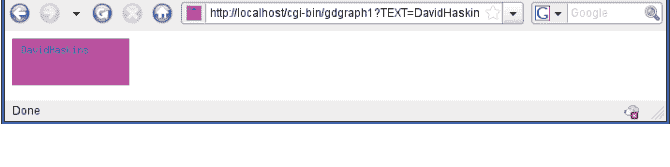

While this is not the most fancy or attractive exercise but does at least demonstrate the key principles involved in generating graphical output. With the GD library you can load existing images and generate them in many **formats** such as **GIF**, **JPEG**, **PNG**, **WBMP** and even create **animated GIFS**.

If you have used PHP development tools you will recognise the GD library functions as they are pretty well identical showing that PHP is a wrapper in this case around the same C library.

The text displayed here is using one of the internal fonts. Tiny, Small, Medium Bold, Large and Giant which are adequate for simple labelling but you can also use TrueType fonts for more attractive output.

Geometric drawing with lines or certain styles, filled and open polygons, and circles, arcs can be created. The main thing to remember is that the origin of an image is the **TOP left hand corner** which might seem unintuitive to anyone who has studied mathematics – quite why this is I have never discovered but can only imagine that the first programmer to do anything in this area happened to not know about graphs in which we think of the origin x=0, y=0 as being at the bottom left hand.

Colours are specified as RGB values in the range 0 to 255 so that white is 255,255,255 and red is 255,0,0. To work out fine-grained hues use a graphics tool like GNU GIMP which has colour pickers so you can find out subtle RGB values. Palettes of colours from one image can be used in another and the closest colour in a palette requested or created if there is space for it to be allocated.

Please click the advert


### 6.2 使用 TrueType 字体

在这个示例中，我们修改之前的程序，以使用 TrueType 字体生成标签。

```c
/*******************************************************
 * C Programming in Linux (c) David Haskins 2008       *
 * chapter6_2.c                                        *
 *******************************************************/
#include <stdio.h>
#include <stdlib.h>
#include <string.h>
#include <gd.h>
#include <gdfonts.h>
#include "c_in_linux.h"

int main(int argc, char *argv[], char *env[]) {
    int text=0, background=0, height=50, width=0, x=0, y=0, size=30, string_rectangle[8];
    double angle=0.0;
    char value[255] = "";
    // OpenSuse TrueType Font
    char font[256] = "/usr/share/fonts/truetype/DejaVuSans.ttf";
    // Ubuntu TrueType Font
    // char font[256] = "/usr/share/fonts/truetype/ttf-dejavu/DejaVuSans.ttf";
    char *err = NULL;
    gdImagePtr im_out = NULL;

    decode_value("TEXT=", (char *) &value, 255);
    // call gdImageStringFT with NULL image to obtain size
    err = gdImageStringFT(NULL,&string_rectangle[0],0,
            font,size,angle,0,0,value);

    x = string_rectangle[2]-string_rectangle[6] + 6;
    y = string_rectangle[3]-string_rectangle[7] + 6;
    // create an image big enough for the string plus a little space
    im_out = gdImageCreate(x,y);
    // allocate colours
    background = gdImageColorAllocate(im_out, 0,0,0);
    text = gdImageColorAllocate(im_out,255,0,255);
    // get starting position
    x = 3 - string_rectangle[6];
    y = 3 - string_rectangle[7];
    // draw the string
    err = gdImageStringFT(im_out,&string_rectangle[0],
            text,font,size,angle,x,y,value);
    // output
    printf("Content-type: image/gif\n\n");
    gdImageGif(im_out,stdout);
    gdImageDestroy(im_out);
    return 0;
}
```

和之前一样，我们使用 `cgi-bin/gdgraph1?TEXT=C+PROGRAMMING+IN+LINUX` 调用这个程序，以得到这类输出；你很可能也会发现，这种输出更像是一种有用的工具。你系统字体的位置和内容会有所不同，但代码给出了一个示例：

- OpenSuse `/usr/share/fonts/truetype/*.ttf`
- Ubuntu `/usr/share/fonts/truetype/ttf-dejavu/*.ttf`

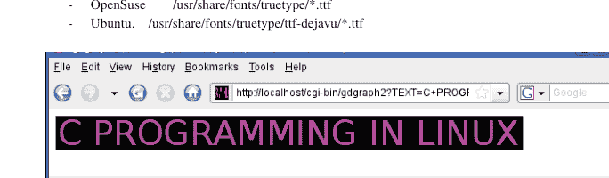

要想熟练使用像 GD 这样的库，你必须准备进行实验，并花大量时间理解函数参数，还要非常仔细地查阅以下网址提供的文档：http://www.libgd.org/Documentation


### 6.3 GD 函数参考

完整详细的文档维护在：http://www.libgd.org

GD 包含丰富的功能，可用于各种绘图和多种格式，还支持 TrueType 字体和动画 GIF 图像。以下是按类别列出的函数：

```c
gdImagePtr gdImageCreate(int sx, int sy)
gdImagePtr gdImageCreateFromJpeg(FILE *in)
gdImagePtr gdImageCreateFromPng(FILE *in)
gdImagePtr gdImageCreateFromGif(FILE *in)
gdImagePtr gdImageCreateFromGd(FILE *in)
gdImagePtr gdImageCreateFromWBMP(FILE *in)
void gdImageDestroy(gdImagePtr im)
void gdImageJpeg(gdImagePtr im, FILE *out, int quality)
void gdImageGif(gdImagePtr im, FILE *out)
void gdImagePng(gdImagePtr im, FILE *out)
void gdImageWBMP(gdImagePtr im, int fg, FILE *out)
void gdImageGd(gdImagePtr im, FILE *out)
```

```c
void gdImageSetPixel(gdImagePtr im, int x, int y, int color)
void gdImageLine(gdImagePtr im, int x1, int y1, int x2, int y2, int color)
void gdImageDashedLine(gdImagePtr im, int x1, int y1, int x2, int y2, int color)
void gdImagePolygon(gdImagePtr im, gdPointPtr points, int pointsTotal, int color)
void gdImageOpenPolygon(gdImagePtr im, gdPointPtr points, int pointsTotal, int color)
void gdImageRectangle(gdImagePtr im, int x1, int y1, int x2, int y2, int color)
void gdImageFilledPolygon(gdImagePtr im, gdPointPtr points, int pointsTotal, int color)
void gdImageFilledRectangle(gdImagePtr im, int x1, int y1, int x2, int y2, int color)
void gdImageArc(gdImagePtr im, int cx, int cy, int w, int h, int s, int e, int color)
void gdImageFilledArc(gdImagePtr im, int cx, int cy, int w, int h, int s, int e, int color, int style)
void gdImageFilledEllipse(gdImagePtr im, int cx, int cy, int w, int h, int color)
void gdImageFillToBorder(gdImagePtr im, int x, int y, int border, int color)
void gdImageFill(gdImagePtr im, int x, int y, int color)
void gdImageSetAntiAliased(gdImagePtr im, int c)
void gdImageSetAntiAliasedDontBlend(gdImagePtr im, int c)
void gdImageSetBrush(gdImagePtr im, gdImagePtr brush)
void gdImageSetTile(gdImagePtr im, gdImagePtr tile)
```

```c
void gdImageSetStyle(gdImagePtr im, int *style, int styleLength)
void gdImageSetThickness(gdImagePtr im, int thickness)
void gdImageAlphaBlending(gdImagePtr im, int blending)
void gdImageSaveAlpha(gdImagePtr im, int saveFlag)
void gdImageSetClip(gdImagePtr im, int x1, int y1, int x2, int y2)
void gdImageGetClip(gdImagePtr im, int *x1P, int *y1P, int *x2P, int *y2P)
```

#### 查询函数：

```c
int gdImageAlpha(gdImagePtr im, int color)(MACRO)
int gdImageGetPixel(gdImagePtr im, int x, int y)
int gdImageBoundsSafe(gdImagePtr im, int x, int y)
int gdImageGreen(gdImagePtr im, int color)(MACRO)
int gdImageRed(gdImagePtr im, int color)(MACRO)
int gdImageSX(gdImagePtr im)(MACRO)
int gdImageSY(gdImagePtr im)(MACRO)
int gdImageTrueColor(gdImagePtr im)(MACRO)
```

请点击广告


```c
gdFontPtr gdFontGetSmall(void)
gdFontPtr gdFontGetLarge(void)
gdFontPtr gdFontGetMediumBold(void)
gdFontPtr gdFontGetGiant(void)
gdFontPtr gdFontGetTiny(void)
void gdImageChar(gdImagePtr im, gdFontPtr font, int x, int y, int c, int color)
void gdImageCharUp(gdImagePtr im, gdFontPtr font, int x, int y, int c, int color)
void gdImageString(gdImagePtr im, gdFontPtr font, int x, int y, unsigned char *s, int color)
void gdImageString16(gdImagePtr im, gdFontPtr font, int x, int y, unsigned short *s, int color)
void gdImageStringUp(gdImagePtr im, gdFontPtr font, int x, int y, unsigned char *s, int color)
void gdImageStringUp16(gdImagePtr im, gdFontPtr font, int x, int y, unsigned short *s, int color)

char *gdImageStringFT(gdImagePtr im, int *brect, int fg, char *fontname, double ptsize, double angle, int x, int y, char *string)
char *gdImageStringFTEx(gdImagePtr im, int *brect, int fg, char *fontname, double ptsize, double angle, int x, int y, gdFTStringExtraPtr strex)
char *gdImageStringFTCircle(gdImagePtr im, int cx, int cy, double radius, double textRadius, double fillPortion, char *font, double points, char *top, char *bottom, int fgcolor)
char *gdImageStringTTF(gdImagePtr im, int *brect, int fg, char *fontname, double ptsize, double angle, int x, int y, char *string)
```

```c
int gdImageColorAllocate(gdImagePtr im, int r, int g, int b)
int gdImageColorAllocateAlpha(gdImagePtr im, int r, int g, int b, int a)
int gdImageColorClosest(gdImagePtr im, int r, int g, int b)
int gdImageColorClosestAlpha(gdImagePtr im, int r, int g, int b, int a)
int gdImageColorClosestHWB(gdImagePtr im, int r, int g, int b)
int gdImageColorExact(gdImagePtr im, int r, int g, int b)
int gdImageColorResolve(gdImagePtr im, int r, int g, int b)
int gdImageColorResolveAlpha(gdImagePtr im, int r, int g, int b, int a)
int gdImageColorsTotal(gdImagePtr im)(MACRO)
int gdImageRed(gdImagePtr im, int c)(MACRO)
int gdImageGreen(gdImagePtr im, int c)(MACRO)
int gdImageBlue(gdImagePtr im, int c)(MACRO)
int gdImageGetInterlaced(gdImagePtr im)(MACRO)
int gdImageGetTransparent(gdImagePtr im)(MACRO)
```

```c
void gdImageColorDeallocate(gdImagePtr im, int color)
void gdImageColorTransparent(gdImagePtr im, int color)
void gdTrueColor(int red, int green, int blue)(MACRO)
void gdTrueColorAlpha(int red, int green, int blue, int alpha)(MACRO)
```

#### 调整大小函数：

```c
void gdImageCopy(gdImagePtr dst, gdImagePtr src, int dstX, int dstY, int srcX, int srcY, int w, int h)
void gdImageCopyResized(gdImagePtr dst, gdImagePtr src, int dstX, int dstY, int srcX, int srcY, int destW, int destH, int srcW, int srcH)
void gdImageCopyResampled(gdImagePtr dst, gdImagePtr src, int dstX, int dstY, int srcX, int srcY, int destW, int destH, int srcW, int srcH)
void gdImageCopyRotated(gdImagePtr dst, gdImagePtr src, double dstX, double dstY, int srcX, int srcY, int srcW, int srcH, int angle)
void gdImageCopyMerge(gdImagePtr dst, gdImagePtr src, int dstX, int dstY, int srcX, int srcY, int w, int h, int pct)
```

请点击广告


```
void gdImageCopyMergeGray(gdImagePtr dst, gdImagePtr src, int dstX, int dstY, int srcX,
    int srcY, int w, int h, int pct)
void gdImagePaletteCopy(gdImagePtr dst, gdImagePtr src)
void gdImageSquareToCircle(gdImagePtr im, int radius)
void gdImageSharpen(gdImagePtr im, int pct)
```

#### 其他函数：

```
int gdImageCompare(gdImagePtr im1, gdImagePtr im2)
gdImageInterlace(gdImagePtr im, int interlace)
gdFree(void *ptr)
```

为了使用这样的库，你需要熟悉其参数，这些参数通常是库本身定义的数据类型，例如 gdImagePtr，它是指向某种结构的指针，该结构包含要处理或存储的图像的所有数据。这些可能看起来都很不寻常，但过一段时间你就会开始习惯这种语法和在线文档，并开始看出复杂之中的模式。

## 7. Apache C 模块

### 7.1 更安全的 C Web 应用

在现实生活中，很少有 Web 管理员会梦想让任何人运行 C 程序作为 CGI 内容生成器，因为存在崩溃和核心转储的风险。然而，Apache 服务器本身是用 C 编写的，其开发工具附带一些简单实用程序，允许你创建代码桩，将 C 程序放入其中，并在它们作为服务器的一部分加载时作为 Apache 模块运行，并在一种“沙盒”中安全管理。这里我们将拿一个较早的示例，把它变成一个 Apache 模块。

Apache2 开发库中包含一个名为 apxs2 的实用程序，可以调用它为一个程序生成代码桩，该程序可编译成由 Apache Web 服务器加载和管理的模块。这些模块可用于执行种类繁多的任务，但在我们的例子中，我们将做类似于 IIS 服务器中 ISAPI DLL 的事情。apxs2 实用程序的确切位置会因你使用的 Linux 发行版而异，但在 OpenSuse 上它是这样运行的。

在终端中输入：`/usr/sbin/apxs2 -n labelmaker -g`

```
david@linux-bxs:~> /usr/sbin/apxs2 -n labelmaker -g
Creating [DIR]  labelmaker
Creating [FILE] labelmaker/Makefile
Creating [FILE] labelmaker/modules.mk
Creating [FILE] labelmaker/mod_labelmaker.c
Creating [FILE] labelmaker/.deps
david@linux-bxs:~>
```

这会创建一个以你给它的名称命名的文件夹（labelmaker），以及一个 **Makefile**、一个可供 Make 实用程序使用的 **modules.mk** 文件，还有一个名为 **mod_labelmaker.c** 的文件。

生成的 C 文件有点像 Apache 的 Hello World。它可能看起来复杂，但它确实提供了一个很长的解释性注释头，值得一读。其思路是，当 Apache 启动时，指定位置中任何被配置为需要在服务器配置文件中加载的模块都会被加载。`*_register_hooks` 函数列出了可在 Apache 服务器进程特定阶段调用的函数名称和签名。在这种情况下，如果调用 http://localhost/labelmaker 这个名称，就会要求此模块处理 `*_handler` 函数中发生的任何事情。

服务器配置可能有点繁琐，但在 OpenSuse 中，我们必须将以下内容添加到文件

**/etc/apache2/default-server.conf**

```
<Location /labelmaker>
    SetHandler labelmaker
</Location>
```

并在 **/etc/config.sys/apache2** 中，将我们的模块名 labelmaker **添加**到以下行开头的那一长串逗号分隔列表中

```
APACHE_MODULES=".....labelmaker"
```

现在转到 labelmaker 文件夹并输入：

```
sudo /usr/sbin/apxs2 -c -i mod_labelmaker.c
sudo /etc/init.d/apache2 restart
```

请点击广告


在浏览器中这样调用：

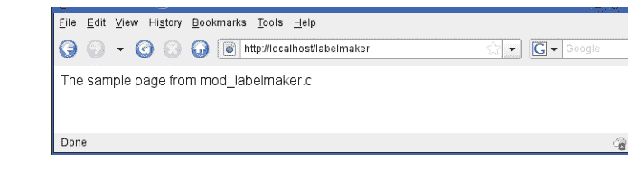

```c
#include "httpd.h"
#include "http_config.h"
#include "http_protocol.h"
#include "ap_config.h"

/* The sample content handler */
static int labelmaker_handler(request_rec *r)
{
    if (strcmp(r->handler, "labelmaker")) {
        return DECLINED;
    }
    r->content_type = "text/html";

    if (!r->header_only)
        ap_rputs("The sample page from mod_labelmaker.c\n", r);
    return OK;
}

static void labelmaker_register_hooks(apr_pool_t *p)
{
    ap_hook_handler(labelmaker_handler, NULL, NULL, APR_HOOK_MIDDLE);
}

/* Dispatch list for API hooks */
module AP_MODULE_DECLARE_DATA labelmaker_module = {
    STANDARD20_MODULE_STUFF,
    NULL,                  /* create per-dir    config structures */
    NULL,                  /* merge  per-dir    config structures */
    NULL,                  /* create per-server config structures */
    NULL,                  /* merge  per-server config structures */
    NULL,                  /* table of config file commands       */
    labelmaker_register_hooks /* register hooks                   */
};
```

### 7.2 添加一些功能

现在我们可以把第 6 章为图形库所做的工作作为替换处理函数插入（在代码 Chapter7_1.c 中两个处理函数都在，其中一个被注释掉了）。注意（高亮显示的）对修改后的 decode_value 函数的调用，它使用 r->args 指针来获取 QUERY_STRING，而不是 getenv()。另外，Apache 处理输出的方式也略有不同——调用 gdImageGifPtr 获取图像中字节数组的指针，然后由 ap_rwrite 函数输出数据。在输出调用之后，我们必须用 gdFree 释放该指针。

```c
static int labelmaker_handler(request_rec *r)
{
    void    *iptr;
    int sz = 0;

    if (strcmp(r->handler, "labelmaker")) {
        return DECLINED;
    }
    r->content_type = "Content-type: image/gif";
    if (!r->header_only){
        int text=0,background=0, x=0,y=0,size=30,string_rectangle[8];
        double angle=0.0;
        char value[255] = "Hello";
        char font[256] = "/usr/share/fonts/truetype/DejaVuSans.ttf";
        char *err = NULL;
        gdImagePtr im_out = NULL;
        decode_value(r,"TEXT=", (char *) &value, 255);
        err=gdImageStringFT(NULL,&string_rectangle[0],0,
            font,size,angle,0,0,value);
        x = string_rectangle[2]-string_rectangle[6] + 6;
        y = string_rectangle[3]-string_rectangle[7] + 6;
        im_out = gdImageCreate(x,y);
        background = gdImageColorAllocate(im_out, 0,0,0);
        text  = gdImageColorAllocate(im_out,255,0,255);
        x = 3 - string_rectangle[6];
        y = 3 - string_rectangle[7];
        err = gdImageStringFT(im_out,&string_rectangle[0],text,
            font,size,angle,x,y,value);
        iptr = gdImageGifPtr(im_out,&sz);
        ap_rwrite(iptr, sz, r);
        gdFree(iptr);
        gdImageDestroy(im_out);
    }
    return OK;
}
```


### 7.3 Apache 模块总结

虽然编写和调试很棘手，但这可能是最有回报、最玄妙的领域，在这里你可以进行真正有商业价值且可安全部署的 Web 内容生成。很容易看出，这个示例如何通过颜色和字体参数进行扩展，从而成为一个有用的 Web 内容工具。

关于 Apache 模块的清晰简单资料很少，但可以从 http://httpd.apache.org/docs/2.2/developer/ 的在线文档开始。

最近值得一看的一本书是 Nick Kew 著、Prentice Hall 出版的《The Apache Modules Book》。

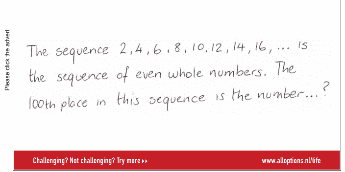

## 8. Ghost 项目

### 8.1 一个 PHP 网站生成器项目

能够用 C 编写简短程序来自动化繁琐任务，或完成那些否则要花数小时摆弄笨重工具（例如做邮件合并）才能完成的事情，这会是你会最庆幸自己学会做的事情之一。这个项目就是这样的省时工具。Ghost 是一个轻量级 PHP 生成器，供你定制。

如果你发现自己总是要构建 PHP 网站，那么一步生成所有参数传递、解码、表单构建和数据库管理代码的快捷方法会很有用。像 Ruby on Rails 这样的工具提供了此类功能，但设置和运行起来要复杂得多，而且你最终还需要学习另一种语言才能继续深入。

开始使用这个工具的最好方法可能就是编译并运行它。将 ghost.zip 源码解压到你的 public_html 文件夹中，这会创建一个名为 ghost 的文件夹。Makefile 包含一个目标 g1，用于编译并链接 ghost。因此转到 public_html/ghost 并输入：`make g1`。

要运行网站生成器，请输入：

- ./ghost testwebsite data1 data2 data1 data3 data4 data6 data6
- 这将创建：
- 一个文件夹 public_html/testwebsite
- 一个名为 testwebsite 的 MySQL 数据库表，包含文本字段 data1 data2 data1 data3 data4 data6 data6
- 一个 testwebsite.css 文件
- 空的 header.html 和 footer.html 页面
- index.php，演示对指定数据项进行表单处理录入、编辑与更新、删除数据库表的操作。

在浏览器中访问 http://localhost/~yourname/testwebsite 时，你会看到如下内容

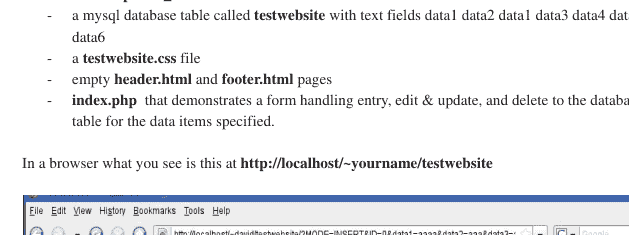


这背后的想法是，创建和管理表单内容的所有机械性细节都已完成，并且可以自定义。这张截图显示了提交一条记录后的结果。顶行用于输入新数据，下面的一行或多行允许编辑或删除记录。它是一个框架，允许你在自己的网站设计中取用其中的各部分。

让我们分节检查这段代码。

第一部分声明所需数据，并创建文件夹和 CSS 文件。

```c
int main(int argc, char *argv[])
{
        FILE *out = NULL;
        MYSQL *conn = NULL;
        MYSQL_RES *result = NULL;
        MYSQL_ROW row;
        MYSQL_FIELD *field;
        char SQLSTRING[SIZESIZE]="";
        char BIT[STRINGSIZE]="";
        char SQLINSERT[STRINGSIZE]="";
        char SQLUPDATE[STRINGSIZE]="";
        char SQLDELETE[STRINGSIZE]="";
        int rc=0, i=0, num_fields=0;

        //CREATE DIRECTORY////////////////////
        sprintf(BIT,"mkdir ~/public_html/%s",argv[1]);
        system(BIT);
        //BUILD CSS//////////////////////////
        sprintf(BIT,"../%s/%s.css",argv[1],argv[1]);
        out = fopen(BIT,"w");
        fprintf(out,"table {width:800;vertical-align:top;}\n");
        fprintf(out,"th {font-size:80%;color:#d92080;vertical-align:bottom;text-align:left;}\n");
        fprintf(out,"td {font-size:80%;color:#d92080;vertical-align:bottom;text-align:left;}\n");
        fprintf(out,"input {font-size:80%;color:#196419;}\n");
        fprintf(out,"a {font-size:65%;color:#000000;}\n");
        fclose(out);
}
```

接下来生成 header.html 和 footer.html 文件。这些文件由 PHP 文件加载，并可用作通用的公共页眉和页脚。CSS 文件从 header.html 文件中引用。

```c
//BUILD HEADER HTML////////////////////////////////
sprintf(BIT,"../%s/head.html",argv[1]);
out = fopen(BIT,"w");
fprintf(out,"<html>\n");
fprintf(out,"<head>\n");
fprintf(out,"<link rel=\"stylesheet\" type=\"text/css\" href=\"%s.css\" />\n",argv[1]);
fprintf(out,"<title>%s</title>\n",argv[1]);
fprintf(out,"</head>\n");
fprintf(out,"<body>\n");
fprintf(out,"<center>\n");
fprintf(out,"<table><tr><td>\n");
fprintf(out,"</td></tr></table>\n");
fclose(out);
//BUILD FOOT HTML////////////////////////////////
sprintf(BIT,"../%s/foot.html",argv[1]);
out = fopen(BIT,"w");
fprintf(out,"</body></html>\n");
fclose(out);
```


接下来我们创建数据库。

```c
//OPEN DATABASE////////////////////////////////////
conn = mysql_init((MYSQL *) 0);
mysql_options(conn,MYSQL_READ_DEFAULT_GROUP,"mysqlcapi");
mysql_real_connect(conn, "localhost", "", "", "test",0, NULL, 0);
//CREATE TABLE////////////////////////////////////
sprintf(SQL,"drop table if exists %s",argv[1]);
rc = mysql_query(conn,SQL);
sprintf(SQL,"create table %s (ID varchar(255)",argv[1]);
for(i=2; i < argc; i++)
{
	sprintf(BIT,",%s varchar(255)",argv[i]);
	strcat(SQL,BIT);
}
strcat(SQL,");");
rc = mysql_query(conn,SQL);
```

现在开始进入复杂部分：生成 PHP 脚本。理解这一点的最佳方式，是在浏览器中查看页面源代码时检查程序的实际输出。

顶行是一个表单，其中为通过运行 ghost 程序生成的表中定义的每一列都提供一个文本框。

```html
<tr>
<form><input type='hidden' name='MODE' value='INSERT'>
<td><input type=hidden name='ID' value='1'>1 </td>
<td><input type=text name='data1'></td>
<td><input type=text name='data2'></td>
<td><input type=text name='data3'></td>
<td><input type=text name='data4'></td>
<td><input type=text name='data5'></td>
<td><input type=text name='data6'></td>
<td><input type='submit' value='post'></td>
</form>
</tr>
```

现在我们为表中的每一行生成一个表单，允许编辑数据，并生成一个用于执行删除操作的锚链接。

```html
<tr>
<form><input type='hidden' name='MODE' value='UPDATE'>
<td><input type=hidden name='ID' value='0'></td>
<td><input type=text name='data1' value='aaaaaaaaaaaaaa'></td>
<td><input type=text name='data2' value='aaaaaaaaaaaaaaa'></td>
<td><input type=text name='data3' value='aaaaaaaaaaaaaaa'></td>
<td><input type=text name='data4' value='aaaaaaaaaaaaaa'></td>
<td><input type=text name='data5' value='aaaaaaaaaaaaaaa'></td>
<td><input type=text name='data6' value='aaaaaaaaaaaaaa'></td>
<td><input type='submit' value='edit'></form>
<a href='?ID=0&MODE=DELETE'>delete</a></td>
</tr>
```

仔细检查 index.php 文件，你就能看到这一切发生在哪里，并反向追溯，找到这段 PHP 代码在 ghost.c 源代码中生成的位置。一个好主意是在打印稿上使用荧光笔，因为我们是在把一种语言（HTML）嵌入另一种语言（PHP），而后者又嵌入另一种语言，因此要非常非常小心地使用转义字符 '\'，以便在必要时表示单引号和双引号，使一切正常工作。这看起来可能很复杂——但 ghost 所提供的快速原型开发能力，使得花时间自定义 C 代码是值得的，这样你想要的 PHP 和你想要的数据库就会以你想要的方式生成。


下面是 PHP 文件 index.php 中生成编辑或删除行的部分。静态 HTML 已高亮显示，其他部分由 MySQL PHP 函数调用插入。

```php
$result = mysql_query("select * from testwebsite");
while($row = mysql_fetch_array($result))
{
        echo '<tr>';
        echo '<form><input type=hidden name="MODE" value="UPDATE">';
        for($i=0;$i < mysql_num_fields($result); $i++)
        if($i==0){
                echo '<td><input type=hidden name="';
                        mysql_field_name($result, $i) . '" value="'.
                $row[mysql_field_name($result,$i)] .
                '">';
                $row[mysql_field_name($result,$i)] .
                '</td>';
        }else
                echo '<td><input type=text name="';
                        mysql_field_name($result, $i) .
                        '" value="'.
                        $row[mysql_field_name($result,$i)] .
                        '"></td>';
        echo '<td><input type=submit value="edit"></form>';
        echo '<a href="?ID=' .
                $row[mysql_field_name($result,0)] .
                '&MODE=DELETE">delete</a>';
        echo '<td></tr>';
}
mysql_free_result($result);
mysql_close($con);
```

如你所见，大量繁琐且重复的工作已经自动化。你可以继续修改 PHP 代码，或更深入地自定义生成所有这些内容的 C 程序。

我个人经常使用 ghost 来节省建站时间，这也是我编写它的原因。我厌倦了在编写几乎相同的代码时犯错，这些代码用于解码 HTML 表单并填充或更新数据库。

## 结论

现在你已经完成这些简单示例，我希望你能明白为什么 C 语言知识始终是一项有用且持续实用的技能。

25 年之后，我仍然经常编写 C 程序来快速有效地完成日常工作；一旦写成，它们就成为一套适合我且可移植的持久工具的一部分。

这本小书包含了我多年来学到的一些“技巧”，关于这些技巧的明确文档很少；并且它坦率地预设读者熟悉 Linux。在让各种经验水平的学生测试这些材料之后，我确信，一个认真细心的学生能够把所有这些材料运行起来，并可以从那里开始发现 C 的乐趣。我的许多学生说：“这比 Java 有趣多了，我能看到真正发生了什么！”这让我非常欣慰，也让我确信你会发现这些材料很有用。

感兴趣的人可以请出版商委托我编写一本配套书：

*Linux 下的 C++ 标准模板库编程*

祝你好运，编程愉快。

大卫
2009年3月31日

