# C 编程实验室：初学者指南

## 序言

我非常高兴，来自贝尔高姆 KLE Dr. M.S. Sheshgiri 工程技术学院计算机科学与工程系的一支青年教师团队编写了这本精美的书《*C 语言编程实验室初学者手册*》。这一集体成果基于作者们长期从事“C 语言”编程教学的经验，不仅出色地讲解了“C 语言”，还传达了使用“C 语言”解决问题的精神！

作者运用一系列团队练习，向读者展示了“C 语言”的不同特性以及如何使用“C 语言”解决问题。这些章节结构良好。问题定义之后是目标、编写解决方案的前置条件、相关理论、具体算法、对应流程图、实际程序，然后是示例输出和结果。在适当的地方，还会附上一组相关程序和练习程序。这种结构使学生能够深入理解所涉及的问题！书末有一个极其有用的部分介绍了常见编程错误，这部分清楚地表明作者对初学者及其常犯的错误类型非常熟悉。本书另一个有趣的特点是，作者在可能的情况下提供了解决问题的替代方法。这种教学技巧必将帮助读者正确认识编程艺术！

我祝贺各位老师编写出这本精美的书，并祝愿他们一切顺利。

我相信学生们会发现这本书非常有用。

Dr. K. Rajinikanth  
前校长，M.S. Ramaiah 技术学院  
班加罗尔

## 前言

本手册本质上体现了“将问题转化为逻辑”的艺术与科学，帮助学习者编写计算机程序，而不只是学习编程结构的语义。手册中的编程练习按照大学规定的一年级工程学课程大纲编排。配套的理论使内容以学习者为中心。

本手册的深度聚焦于初学者容易遇到的问题类型。手册中的每个程序均已针对各种输入成功编译和执行。与每个实验课相关的示例程序和练习问题定义，帮助学习者循序渐进地加强编程技能。

特别感谢我所有的青年同事，他们不仅为本手册提供了素材，还成功编译并执行了所有程序。我衷心感谢系里的资深教师，他们分享了知识、想法，提供了大量建议，并重新修改了整个手册，最终促成了本手册的完成。我由衷感谢 KLE 大家庭。特别感谢我们敬爱的校长 Dr. S. C. Pilli 和我的研究导师 Dr. S. S. Manvi 一直以来的精神支持。手册中的任何错误均由我一人承担。

Dr. Nandini Sidnal

## 致谢

> > “团队合作分解任务，倍增成功”


亨利·福特的名言：“聚在一起是开始，保持在一起是进步，合作共事是成功。”我们证明了这句话。我要感谢所有为这本手册的顺利完成而辛勤工作的人。

这本手册是 Sushma Chougule、Uttam Patil、S.M. Patil、Soumya Melmathi、Manisha Tarle、Savita Bakare、Arundhati Nelli、Roopa Patil 和 Rashmi Patil 共同努力的成果。

## 引言

### “C”程序设计语言

C（发音像字母C）是一种通用计算机编程语言，由丹尼斯·里奇于1969年至1973年间在贝尔电话实验室开发，用于UNIX操作系统。尽管C是为实现系统软件而设计的，但它被广泛用于开发可移植的应用软件。

C是一种命令式（过程式）系统实现语言。它是一种中级语言，提供了低级语言和高级语言的最佳结合。由于这一特点，“C”在当今不断变化的编程世界中并未失去其重要性和流行度。“C”中的所有概念都有助于理解诸如OOPs、VB、Java等课程以及大多数系统软件。

### 目标

- 培养基于逻辑的推理能力。
- 处理给定问题陈述并将其转换为流程图和算法。
- 培养使用适当编程构造（如不同的循环和分支语句、数组和字符串处理函数、各种输入和输出操作方式等）的决策能力。
- 教授使用用户定义函数的自底向上软件开发方法。
- 最终，学生应能够独立地用C语言实现程序。

### 硬件和软件要求

| 要求 | 详情 |
|---|---|
| 硬件 | Core 2 duo，RAM 最低 256 MB |
| 操作系统 | Windows XP/Windows 7/LINUX |
| 软件 | Microsoft Visual Studio 2005 |

## 学期作业定义

- 1. 设计、开发并执行一个C程序，求并输出给定二次方程（系数非零）的所有根。
- 2. 设计、开发并执行一个C程序，实现欧几里得算法，求两个整数的最大公约数和最小公倍数，并输出结果及给定整数。
- 3. 设计、开发并执行一个C程序，反转给定的四位整数，并检查它是否为回文数。输出给定数字并附上适当消息。
- 4. 设计、开发并执行一个C程序，使用霍纳方法对给定$x$值和系数求给定多项式$f(x)=a_4x^4+a_3x^3+a_2x^2+a_1x+a_0$的值。
- 5. 编写程序将输入复制/粘贴到输出，并将一个或多个空白的每个字符串替换为单个空白。
- 6. 设计、开发并执行一个C程序，将$N$个整数按升序输入一维数组，然后对给定关键字整数执行二分查找，并以适当消息形式报告成功或失败。
- 7. 设计、开发并执行一个C程序，将$N$个整数输入一维数组，使用冒泡排序技术将它们按升序排序，然后以适当标题打印给定数组和排序后的数组。
- 8. 设计、开发并执行一个C程序，计算并打印主机上的字长。
- 9. 设计、开发并执行一个C程序，使用指数函数的泰勒级数展开计算exp(0.5)的近似值。使用展开式中的各项，直到最后一项小于头文件`<float.h>`中定义为`FLT_EPSILON`的机器 epsilon。还要打印数学函数`exp()`返回的值。
- 10. 设计、开发并执行一个C程序，读取两个矩阵$A$（$M \times N$）和$B$（$P \times Q$），如果矩阵可乘，则计算$A$与$B$的乘积。如果矩阵可乘，程序要以适当的标题和格式打印输入矩阵和结果矩阵；否则，程序必须打印适当消息。（为演示目的，数组大小$M$、$N$、$P$和$Q$可以小于或等于3。）
- 11. 设计、开发并执行一个C并行程序，将两个具有$N$个整数元素的一维数组$A$和$B$逐元素相加，并将结果存储到另一个具有$N$个整数元素的一维数组$C$中。
- 12. 在C中设计并开发函数`rightrot(x, n)`，该函数将整数`x`向右旋转`n`个位位置后的值作为无符号整数返回。在main中用不同的`x`和`n`值调用该函数，并以适当标题打印结果。
- 13. 设计并开发函数`isprime(x)`，它接受一个整数参数，如果参数为素数则返回1，否则返回0。该函数要使用普通的除法检查方法判断给定数字是否为素数。在main中用从用户获得的不同值调用此函数，并打印适当消息。
- 14. 设计、开发并执行一个C并行程序，利用埃拉托斯特尼筛法算法确定并打印小于100的素数。
- 15. 在C中设计并开发函数`reverse(s)`，就地反转字符串`s`。在main中对不同字符串调用此函数，并打印原始字符串和反转后的字符串。
- 16. 设计并开发函数`matchany(s1, s2)`，它返回字符串`s1`中第一个出现字符串`s2`中任意字符的位置；如果`s1`不包含`s2`中的任何字符，则返回−1。不要使用完成类似工作的标准库函数！在main中对不同字符串调用函数`matchany(s1, s2)`，并打印这两个字符串以及函数`matchany(s1, s2)`的返回值。

## 如何开始使用 Visual Studio

- **步骤 1：** *这是创建一个新项目：*
  点击开始菜单 → 转到所有程序 → 点击 Microsoft Visual Studio 2005 → 点击文件 → 点击新建项目 → 在新建项目窗口中的 Visual C++ 下，选择 Win32 → Win32 控制台应用程序，然后输入项目名称并选择新项目将打开的位置，点击确定 → 然后点击应用程序设置/下一步 → 在附加选项中选择空项目 → 然后点击完成。
- **步骤 2：** *这是在已创建的项目中创建一个新文件：*
  点击视图并选择解决方案资源管理器 → 在解决方案资源管理器中右键单击源文件并选择添加 → 新建项 → 在 Visual C++ 下选择代码 → 在右侧选择 C++ 文件 (.cpp) → 然后给出一个扩展名为“.c”的文件名 → 然后点击添加 → 将打开一个编辑器，现在输入程序并保存。
- **步骤 3：** *这是生成一个程序：*
  点击生成并选择生成解决方案。（每次修改都必须保存并重新生成。）
- **步骤 4：** *这是运行一个程序：*
  点击生成并选择配置文件引导优化，然后点击运行插桩/优化应用程序 (Ctrl + F5)。

## C程序入门

编写一个C程序显示消息 Hello World。

```
/* This program prints one-line message */
#include<stdio.h>
int main()
{
    printf("Hello World\n");
    return 0;
}
```

/* This program ... */ 符号 /* 和 */ 界定注释。

注释被编译器忽略，用于为程序读者提供有用信息。

- **main( )** – C程序由一个或多个函数组成。其中一个且*只有*一个函数必须称为main。单词main后面的括号表明它是一个函数而不是变量。
- **{ }** – 花括号包围函数体，函数体由一个或多个指令（*语句*）组成。
- **printf( )** – 是一个库函数，用于在标准输出流（通常是屏幕）上打印。
- **“Hello World\n”** – 是一个字符串常量。
- **\n** – 是换行字符。
- **;** – 分号终止一条语句。
- **return 0;** – 将值零返回给操作系统。

C区分大小写，因此函数名（main和printf）必须像上面那样以小写形式输入。

```
Hello World
```

编写一个C程序，展示加法运算并附上适当注释。


```c
#include<stdio.h>
void main()
{
    /*------------Declarations------------*/
    int number;
    float amount;
    /*------------Assignment Statement------------*/
    number=100;
    /*------------Computational Statements------------*/
    amount=30.75+75.35;
    printf("%d", number);
    printf("\n%5.2f\n", amount);
}
```

### 示例输出

```text
100
106.10
```

### 程序 3

编写一个C程序，将华氏温度值转换为摄氏度。

```c
#include<stdio.h>
void main()
{
    float f, c;
    printf("\n Enter the temperature value in Fahrenheit: ");
    scanf("%f", &f);
    c= (f-32.0)/1.8;
    printf("\n The equivalent temperature value in degrees Celsius is: %.2f\n", c);
}
```

### 示例输出

```text
Enter the temperature value in Fahrenheit: 0
The equivalent temperature value in degrees Celsius is: -17.78
```

### 程序 4

编写一个C程序，读取一个整数并检查它是奇数还是偶数。

```c
#include<stdio.h>
void main()
{
    int num=0, remainder=0;
    while(num!=-1)      /* while -1 not entered*/
    {
        printf("Enter an integer (-1 to stop): ");
        scanf("%d", &num);
        if(num!=-1) /* ready to stop if -1 else...*/
        {
            remainder=num % 2;
            /* test for even/odd. If the modulus yields 0,it is even */
            if(remainder==0)
                printf("%d is an even number.\n", num);
            else
                printf("%d is an odd number.\n", num);
        }
        /* -1 was entered */
        printf("%d is an odd number.\n", num);
        printf("You ask to stop! Thank you.\n");
    }
}
```

### 程序 5

编写一个C程序，使用函数求两个数中的最小值。

```c
double minimum(double, double);       /* prototype of minimum() */
#include<stdio.h>
int main()
{
    printf("%f\n", minimum(1.23, 4.56));
    return 0;
}
double minimum(double x, double y)    /* definition of minimum() */
{
    if (x<y)
        return x;
    else
        return y;
}
```

### 程序 6

编写一个C程序，可以从用户处读取三个整数，然后确定这三个整数中的最小值。

```c
#include<stdio.h>
void main()
{
    int i, num[3], smallest=0;
    printf("Enter 3 integers separated by a space: ");
    for(i=0; i<3; i++)
        scanf("%d", &num[i]);
    smallest=num[0];  /* assign the 1st element to smallest */
    for(i=1; i<3; i++)
        if(num[i]<smallest)  /* compare the others and keep storing the smallest */
            smallest=num[i];
    printf("The smallest number among ");
    for(i=0; i<3; i++)  /* print the element */
        printf("%d%d ", num[i], smallest);
}
```

### 程序 7

编写一个C程序，给定半径，求圆的面积。

```c
#include<stdio.h>
#define PI 3.142
void main()
{
    float radius, area;
    printf("\n Enter the radius of a circle: ");
    scanf("%f", &radius);
    area=PI*radius*radius;
    printf("\n Area of a circle=%f\n", area);
}
```

### 输出

```text
Enter the radius of a circle: 10
Area of a circle = 314.200012
Enter the radius of a circle: 0
Area of a circle = 0.000000
```

### 程序 8

编写一个C程序，读取成绩，计算百分比并显示结果。

```c
#include<stdio.h>
void main()
{
    float mark1, mark2, percentage;
    printf("\n Enter the marks of first subject: \n\t");
    scanf("%f", &mark1);
    printf("\n Enter the marks of second subject: \n\t");
    scanf("%f", &mark2);
    percentage=((mark1+mark2)/200)*100;
    if(percentage>40)
        printf("\n Passed \n");
    else
        printf("\n Failed \n");
}
```

### 验证输出


### 程序 9

编写一个C程序解决投资问题。

```c
#define PERIOD 3
#define PRINCIPLE 5000.00
#include<stdio.h>
void main()
{
    int year;
    float amount, value, inrate;
    amount=PRINCIPLE, inrate=0.11, year=0;
    while(year < PERIOD)
    {
        printf("%2d\t%8.2f\n", year, amount);
        value=amount+inrate*amount;
        year=year+1;
        amount=value;
    }
}
```

### 验证输出


### 程序 10

编写一个C程序，打印给定数字是正数、负数还是零。

```c
#include<stdio.h>
void main()
{
    int n;
    printf("\n Enter the number: ");
    scanf("%d",&n);
    if(n>0)
        printf("\n Number is positive");
    else if(n==0)
        printf("\n Number is zero");
    else
        printf("\n Number is negative");

}
```

### 输出

```text
Enter the number: 10
Number is positive
--------------------------------
Enter the number: 0
Number is zero
--------------------------------
Enter the number: -10
Number is negative
```

## 学期作业 1

设计、开发并执行一个C程序，以求出并输出给定二次方程（系数非零）的所有根。

- 将求二次方程根的纸笔方法映射为流程图/算法，并为此编写一个C程序。
- 理解适当编程构造的用法。
- 针对所有可能的输入测试该程序。

- if…else 语句

```c
if(test expression)
{
    True block statement(s)
}
else
{
    False block statement(s)
}
Statement x;
```

如果测试表达式为真，则执行真块语句；否则执行假块语句。无论哪种情况，都会执行真块或假块，但不会两者都执行。在两种情况下，控制随后都会转移到语句 x。

### 示例程序

### 程序 1

本程序将展示以各种不同形式使用 if 语句的思路，即带 else 和不带 else 的形式。

```c
#include<stdio.h>
void main()
{
    int cows=6;
    if (cows>1)
        printf("We have cows\n");
    if(cows>10)
        printf("loads of them!\n");
    else
        printf("Executing else part...!\n");
    if(cows==5)
    {
        printf("We have 5 cows\n");
    }
    else if( cows==6)
    {
        printf("We have 6 cows\n");
    }
}
```

### 示例输出

```text
We have cows
Executing else part...!
We have 6 cows
Press any key to continue . . .
```

### 相关理论

二次方程是等价于 \(ax^2 + bx + c = 0\) 形式之一（其中 \(a, b\) 和 \(c\) 为实数，且 \(a \neq 0\)）的方程。因此，如果我们有一个关于 \(x\) 的方程且最高次幂为 2，那么它就是二次方程。

### 示例：\(x^2 = 5x - 6\)

$$
\begin{aligned}
x^2 &= 5x - 6 \\
-5x + 6 &= -5x + 6 \\
\hline
x^2 - 5x + 6 &= 0 \\
(x-3)(x-2) &= 0 \\
&\swarrow\qquad\searrow \\
x-3 &= 0 \quad \text{或} \quad x-2 = 0
\end{aligned}
$$

通过从两边减去 \(5x\) 并加上 6，使右侧为 0，从而得到 \(x = 3\) 或 \(x = 2\)。  
使用零因子定律，令每个因式 = 0 并求解。

### 示例：\(2x^2 - 3x = 0\)

$$
\begin{aligned}
2x^2 - 3x &= 0 \\
x(2x-3) &= 0 \\
\downarrow\qquad &\searrow \\
x=0 &\quad \text{或} \quad 2x-3=0 \\
x=0 &\quad \text{或} \quad x=\frac{3}{2}
\end{aligned}
$$

二次方程 \(ax^2 + bx + c = 0\) 的根可以使用以下公式计算

$$x = \frac{-b \pm \sqrt{b^2 - 4ac}}{2a}$$

首先计算 \(r = \sqrt{b^2 - 4ac}\)。根据 \(d = b^2 - 4ac\) 的值，根可以是实数或复数。

- 1. 如果 \(d > 0\)，即 \(d\) 值为正，那么根是实数且互不相同。两个根计算如下：

  $$
  \begin{aligned}
  x1 &= (-b + r)/(2.0*a) \\
  x2 &= (-b - r)/(2.0*a)
  \end{aligned}
  $$

  如果 \(a = 6\)、\(b = 11\) 且 \(c = -35\)，那么 \(d = (b^2 - 4ac)\)。这里

  $$
  \begin{aligned}
  d &= ((11*11) - (4*6*(-35))) \\
    &= 961
  \end{aligned}
  $$

  由于 \(d > 0\)，根是实数且互不相同。

- 2. 如果 \(d = 0\)，那么根是实数且相等。

  $$
  x1 = x2 = -b/(2.0*a)
  $$

- 3. 如果 \(d < 0\)，那么根是复数。

  $$
  \begin{aligned}
  x1 &= -b/(2.0*a) \\
  x2 &= r/(2.0*a)
  \end{aligned}
  $$


## 算法

开始

- **步骤 1：** 输入二次方程的系数 (a, b, c)。
- **步骤 2：** 如果第一个系数为零
    输出“无效输入”
    否则
    d ← b² – 4ac
    r ← √|d|
    如果 d 的值等于零
        输出“根相等”
        r1 ← r2 ← – b/(2a)
        输出 r1, r2
    否则如果 d 的值大于零
        输出“根为实数且互异”
        r1 ← (–b + r)/(2a)
        r2 ← (–b – r)/(2a)
        输出 r1, r2
    否则
        输出“根为复数”
        r1 ← – b/(2a)
        r2 ← r/(2a)
        打印根
    结束如果
    结束如果

结束

## 流程图

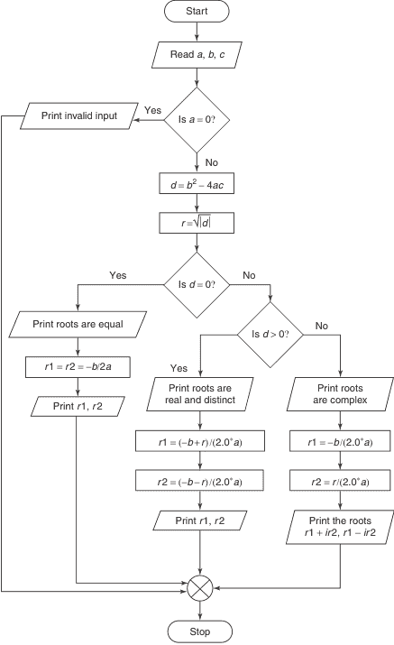

## 程序

```c
#include<stdio.h>
#include<math.h>
void main()
{
    int a, b, c;
    float d, r, r1, r2;
    printf("\n Enter the three co-efficients:\n");
    scanf("%d%d%d", &a, &b, &c);
    if(a==0) /*-------------check for valid input-----------*/
        printf("\nInvalid Input\n");
    else
    {
        d=(b*b) - (4*a*c);
        r=sqrt(fabs(d));
        if(d==0) /*-------------check if roots are
        equal-------------*/
        {
            printf("\nThe roots are real and equal\n");
            r1=r2=-b/(2.0*a);
            printf("\nThe roots are \n\tr1=\t%f\n\tr2=\t%f\n",
            r1, r2);
        }
        else if(d>0) /*----------------check if roots are real-------
        -------*/
        {
            printf("\nThe roots are real and distinct\n");
            r1=(-b+r)/(2.0*a);
            r2=(-b-r)/(2.0*a);
            printf("\nThe roots are \n\tr1=\t%f\n\tr2=\t%f\n",
            r1, r2);
        }
        else /*-----------------roots are complex----------------*/
        {
            printf("\nThe roots are complex\n");
            r1=-b/(2.0*a);
            r2=r/(2.0*a);
            printf("\nThe roots are:\n\tr1=%f + i %f\n\tr2=%f-i%f\n", r1, r2, r1, r2);
        }
    }
}
```

## 输出

示例 1：

```text
Enter the three co-efficients:
0 1 2
Invalid Input
```

*结论：* 第一个系数不能为零。

示例 2：

```text
Enter the three co-efficients:
2 3 0
The roots are real and distinct
The roots are
   r1=0.000000
   r2=-1.500000
```

示例 3：

```text
Enter the three co-efficients:
1 5 6
The roots are real and distinct
The roots are
   r1=-2.000000
   r2=-3.000000
```

示例 4：

```text
Enter the three co-efficients:
1 2 2
The roots are complex
The roots are:
   r1=-1.000000+i1.000000
   r2=-1.000000-i1.000000
```

## 学习成果

- 能够编写一个“C”程序来求二次方程的根。
- 能够成功执行该程序，并针对所有可能的输入组合进行测试。

## 相关程序

### 程序 1

用 C 语言编写程序，求并输出给定二次方程（系数非零）的所有根，**使用 Switch 语句。**

```c
#include<stdio.h>
#include<math.h>
#include<process.h>
void main()
{
    int option;
    double a, b, c, d;
    double r,r1,r2;
    printf(" Quadratic Equation ax^2+bx+c=0 \n");
    printf("*******************************\n");

    /* Get a, b, and c from user */
    printf("\n a=");
    scanf("%lf", &a);
    printf("b=");
    scanf("%lf", &b);
    printf("c=");
    scanf("%lf", &c);

    if(a==0) /* check for valid input */
    {
        printf("\n Invalid Input \n");
        exit(0);
    }

    /* Calculate determinant */
    d=(b*b)-(4*a*c);
    r=sqrt(abs(d));
    if(d==0)
       option=1;
    else if(d>0)
       option=2;
    else
       option=3;
    /* Use switch statement */
    switch(option)
    {
        case 1: printf("\nThe roots are real and equal\n");
            r1=r2=-b/(2.0*a);
            printf("\nThe roots are \nr1 =\t%f\n\tr2 =\t%f\n", r1, r2);
            break;
        case 2: printf("\nThe roots are real and distinct\n");
            r1=(-b+r)/(2.0*a);
            r2=(-b-r)/(2.0*a);
            printf("\nThe roots are \n\tr1 =\t%f\n\tr2 =\t%f\n",
            r1, r2);
            break;
        case 3: printf("\nThe roots are complex\n");
            r1=-b/(2.0*a);
            r2=r/(2.0*a);
            printf("\nThe roots are:\n\tr1=%f +i %f\n\tr2=%f -i%f\n", r1, r2, r1, r2);
            break;
    }/* End Switch */
}/* End program */
```

### 输出

1.

```text
Quadratic Equation ax^2+bx+c=0
**************************************
a=0
b=1
c=2
Invalid Input
```

2.

```text
Quadratic Equation ax^2+bx+c=0
**************************************
a=1
b=2
c=1
The roots are real and equal
The roots are
    r1=-1.000000
    r2=-1.000000
```

3.

```text
Quadratic Equation ax^2+bx+c=0
************************************
a=1
b=3
c=2
The roots are real and distinct
The roots are
    r1=-1.000000
    r2=-2.000000
```

4.

```text
Quadratic Equation ax^2+bx+c=0
************************************
a=1
b=2
c=1
The roots are complex
The roots are:
    r1=-1.000000+i1.000000
    r2=-1.000000-i1.000000
```

## 学期作业 2

设计、开发并执行一个 C 程序，以实现欧几里得算法，求两个整数的 GCD 和 LCM，并输出结果以及给定的整数。

- 学习欧几里得算法。
- 编写一个 C 程序，对任意给定的一组两个整数执行欧几里得算法。
- 学习将纸笔方法与所开发的算法联系起来，并针对所有可能的输入类型进行测试。

有些情况下，你可能想多次做同一件事。例如，你想把同一个单词打印 10 次。你可以输入 10 个 printf 函数，但使用循环更容易。你唯一需要做的就是设置一个循环，让同一个 printf 函数执行 10 次。循环有三种基本类型，如下所示：

- 1. “for 循环”
- 2. “while 循环”
- 3. “do while 循环”

```c
while (condition)
{
    Action1 /* until condition is true action1 is executed*/
}
Action2 /* if condition fails action2 is executed*/
```

在编程语言中，while 循环是一种*控制流语句*，它允许代码基于给定的*布尔*条件重复执行。while 循环可以看作是一个重复的 *if 语句*。一个 *while* 结构由一块代码和一个条件组成。条件会被求值，如果条件为 *true*，则执行该块内的代码。这一过程会重复，直到条件变为 *false*。因为 *while* 循环在执行代码块之前检查条件，所以这种控制结构称为前置测试循环（入口控制循环）。

### 示例程序：While 循环

### 程序 1

打印消息“Hello”10 次的程序。该程序将让你了解 while 循环如何工作。

```c
#include <stdio.h>
void main()
{
    int i=10;
    while (i > 0)
    {
        printf("Hello\n");
            i=i - 1;
    }
}
```

### 示例输出

```text
Hello
Hello
Hello
Hello
Hello
Hello
Hello
Hello
Hello
Hello
```

### 相关理论

**欧几里得算法**（也称为 **Euclid's algorithm**）是一种计算最大公约数（GCD）的高效方法，最大公约数也称为最大公因数（GCF）或最高公因数（HCF）。它以希腊数学家欧几里得命名。

两个数的 GCD 是能同时整除这两个数且不留余数的最大数。

### 示例

计算 18 和 48 的 GCD：
18 的除数/因数是 1、2、3、6、9 和 18。
48 的除数/因数是 1、2、3、4、6、8、12、16、24 和 48。
因此，18 和 48 的公除数/公因数是 1、2、3 和 6。
于是 GCD(18, 48) = 6。

然而，由于这种方法耗时，通常不用于大数；因此我们使用欧几里得算法。

### 示例

计算 142 和 38 的 GCD

```text
142 = 38 × 3 + 28
38 = 28 × 1 + 10
28 = 10 × 2 + 8
10 = 8 × 1 + 2
8 = 2 × 4 + 0
GCD(142, 38) = 2
```

该算法基于以下两个观察：

- 如果 b 整除 a，则 GCD(a, b) = b。
- 确实如此，因为任何数（尤其是 b）的除数都不会大于该数本身。
- 如果对于整数 t 和 r 有 a = bt + r，则 GCD(a, b) = GCD(b, r)。

### 欧几里得算法

- 1. 用第二个数除第一个数。
- 2. 如果余数为零，则第二个数就是 GCD。
- 3. 否则，重复步骤 1 和 2，其中第二个数变为第一个数，余数变为第二个数。

让我们看一个求 40 和 64 的 GCD 的示例。

- 第一个数 = 40，第二个数 = 64，余数 = 40
- 第一个数 = 64，第二个数 = 40，余数 = 24


- 第一个数 = 40，第二个数 = 24，余数 = 16
- 第一个数 = 24，第二个数 = 16，余数 = 8
- 第一个数 = 16，第二个数 = 8，余数 = 0

因此 GCD = 8。

LCM 可通过 GCD 获得，即 **LCM = 给定两数的乘积/GCD**。

使用上面给出的同一示例，我们可以按如下方式求 LCM (40, 64)：

LCM = (40 * 64)/8 = 320

## 算法

```text
    Start
    Step 1: Read m, n [two numbers], p←m, q←n
    Step 2: WHILE n != 0 DO
        temp ← m mod n
        m ← n
        n ← temp
        END WHILE
    Step 3: gcd ← m
        lcm ← (p*q)/gcd
    Step 4: Print gcd, lcm
    Stop
```

## 流程图

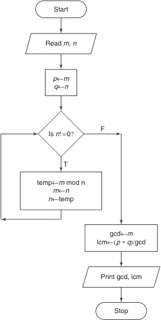

## 程序

```c
#include<stdio.h>
void main()
{
    int m, n, p, q, temp; //declaration of variables
    int gcd, lcm;
    printf("Enter the Value of m & n:  ");
    scanf("%d%d", &m, &n);
    //copying values of m & n to variables p & q
    p=m;
    q=n;
    while(n!=0)  // computing gcd using division method
    {
        temp=m%n;
        m=n;
        n=temp;
    }
    gcd=m;
    lcm=(p*q)/gcd; //computing lcm using gcd value
    printf("\nThe GCD of two Numbers %d and %d=%d\n",p,q,gcd);
    printf("\nThe LCM of two Numbers %d and %d=%d\n",p,q,lcm);
}
```

## 输出

```text
Enter the Value of m & n: 18 48
The GCD of two Numbers 18 and 48=6
The LCM of two Numbers 18 and 48=144

Enter the Value of m & n: 142 38
The GCD of two Numbers 142 and 38=2
The LCM of two Numbers 142 and 38=2698

Enter the Value of m & n: 5 0
The GCD of two Numbers 5 and 0=5
The LCM of two Numbers 5 and 0=0
```

注意：如果两个数中有一个为 0，则另一个数本身就是 GCD。由于 (5*0) 为 0，所以 LCM 为 0。

```text
Enter the Value of m & n: 40 64
The GCD of two Numbers 40 and 64=8
The LCM of two Numbers 40 and 64=320
```

## 学习成果

- 验证欧几里得算法逻辑的效率。
- 能够编写一个“C”程序来执行该算法，并针对所有可能的输入进行测试。

## 练习程序

- 1. 编写一个 C 程序来确定三角形的面积。
- 2. 编写一个 C 程序来确定三个数 a、b、c 中的最大数。
- 3. 编写一个 C 程序，求输入的三个数 a、b、c 中两个最大数的平均值。
- 4. 编写一个 C 程序，判断给定年份是否为闰年。
- 5. 编写一个 C 程序，判断给定字符是元音还是辅音。

例如，`a < 10 || a > 100`。这种将两个或多个关系表达式组合起来的表达式称为逻辑表达式。这些表达式会产生真值或假值，如下所示：

| *操作数1* | *操作数2* | *操作数1 \|\| 操作数2* |
|---|---|---|
| 真 | 真 | 真 |
| 真 | 假 | 真 |
| 假 | 真 | 真 |
| 假 | 假 | 假 |

## 相关理论：所用逻辑

***回文***是指正读和倒读都相同的单词或句子。“palindrome”一词由英国作家本·琼森在 17 世纪从希腊词根 *palin*（πάλιν：“再次”）和 *dromos*（δρόμος：“方式、方向”）创造而来。在构造回文句子时，通常不考虑空格和标点——最著名的回文之一是“A man, a plan, a canal, Panama”——但如果空格也排列得当，那就更好了。另一个例子是同样著名的回文“Able was I ere I saw Elba”，据称是拿破仑所说，指的是他第一次看到厄尔巴岛，即英国人将他流放到的岛屿。

回文是一种称为***字母回文***的回文类型。***回文***是一种句子，其中字母、音节或*单词*倒读与*正读*相同。句子“He was, was he?”是单词回文，因为单词可以按相反顺序排列而仍然读起来相同。句子“I did, did I?”不仅是单词回文，也是字母回文（或回文）。同样，整数也可以是回文。例如，1221、3333、……。

## 示例程序

### 程序 1

求三个数中最大数的程序。该程序将给出逻辑运算符的概念。

```c
#include<stdio.h>
void main()
{
  int a, b, c;
  int big;
  printf("Enter any three numbers: ");
  scanf("%d%d%d", &a, &b, &c);
  if(a>b && a>c)
    big=a;
else if (b>c)
    big=b;
else
    big=c;
printf("Largest number is: %d", big);
}
```

### 示例输出

- 1. 输入任意三个数：345 56 2  
  最大数是：345
- 2. 输入任意三个数：13 25 6  
  最大数是：25

## 算法

- 开始
- **步骤 1：** 读取一个数 $n$
- **步骤 2：** 如果 $n$ 是四位数，转到步骤 3  
  否则输入错误。
- **步骤 3：** 反转该数
- **步骤 4：** 如果反转后的数等于原数  
  打印“该数是回文”  
  否则打印“该数不是回文”
- 停止

## 反转数字的算法

- 开始
- **步骤 1：** rev ← 0
- **步骤 2：** rem ← $n$ mod 10
- **步骤 3：** rev ← rev * 10 + rem
- **步骤 4：** $n$ ← $n$/10
- **步骤 5：** 重复步骤 2–4，直到 $n$ 变为零。
- 停止

## 流程图

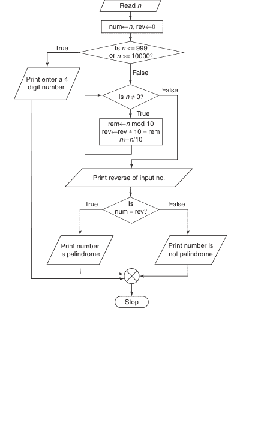

## 程序

```c
#include<stdio.h>
#include<process.h>
void main()
{
    int n, num,rev=0, rem;
    printf("Enter a number: \n");
    scanf("%d", &n);
    num = n;
    if(n<=999 || n>=10000) /* check if the input is a 4 digit
    number */
    {
        printf("\nEnter four digit number\n");
        exit(0);
    }
    while(n!=0)  /* reverse the input number */
    {
        rem=n%10;
        rev=rev*10+rem;
        n=n/10;
    }
    printf("\nReverse of the input is: \n\t%d", rev);
    if(num==rev) /*  check if the input and the reversed numbers
    are same */
        printf("\nThe Number is Palindrome\n");
    else
        printf("\nThe Number is not Palindrome\n");
}
```

## 输出

```text
Enter a number:
121
Enter four digit number

Enter a number:
12221
Enter four digit number
```

***注意：*** 从上面两个示例输出可以得出结论：该程序只接受四位数。

```text
Enter a number:
4578
Reverse of the input is: 8754
The Number is not Palindrome
```

***结论：***“该数不是回文”。

```text
Enter a number:
0001
Enter four digit number
```

```text
Enter a number:
1000
Reverse of the input is: 1
The Number is not Palindrome
```

```text
Enter a number:
01001
Reverse of the input is: 1001
The Number is Palindrome
```

## 学习成果

- 能够求任意给定整数的回文。
- 理解回文在娱乐数学、基因组学中的用途，并识别特定的核苷酸序列以在 DNA 中产生双链切口。

## 练习程序

- 1. 编写一个 C 程序，读取一个整数并判断它是奇数还是偶数。
- 2. 编写一个用于交换两个数的 C 程序。
- 3. 编写一个 C 程序，求 *n* 个数中的最大数。
- 4. 编写一个 C 程序，在 C 编程中将一个数拆分为各位数字。
- 5. 编写一个 C 程序，统计一个数中的位数。

## 学期作业 4

设计、开发并执行一个 C 程序，使用霍纳法对给定的 $x$ 值及系数求给定多项式 $f(x)=a_4x^4+a_3x^3+a_2x^2+a_1x+a_0$ 的值。

- 理解霍纳法的底层逻辑。
- 将数学逻辑转换为算法并编写 C 代码。
- 使用有效和无效输入测试程序的工作情况。

for 循环是另一种入口控制循环，它提供了更简洁的循环控制结构。for 循环的语法如下：

```c
for(initialization; test-condition; expression)
{
    Body of the loop;
}
```

“for 循环”的执行过程如下：

- 1. 首先使用赋值语句对循环控制变量进行初始化。
- 2. 使用测试条件检查控制变量的值，该条件是一个关系表达式，用于确定循环何时退出。如果条件为真，则执行循环体；否则循环终止，并继续执行紧跟在循环之后的语句。
- 3. 当循环体执行完毕后，在求值循环中的最后一条语句之后，控制权会转回 for 语句。此时，对表达式求值并测试条件。这个过程持续进行，直到控制变量的值不再满足测试条件。


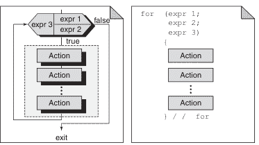

### 示例程序

用 C 编写的程序，用于反转给定的四位整数，并检查它是否为回文数*使用 for 循环*。输出给定数字并附带合适的消息。

```c
#include<stdio.h>
#include<process.h>
void main()
{
    int n, num, rev=0, rem, i;
    printf("Enter a number: \n");
    scanf("%d", &n);
    num=n;

    /* check if the input is a 4 digit number */
    if(n<=999||n>=10000)
    {
        printf("\nEnter four digit number\n");
        exit(0);
    }

    for(i=n; i!=0;)
    {
        rem=i%10;
        rev=rev*10+rem;
        i=i/10;
    }

    printf("\nReverse of the input is: \n\t%d", rev);

    /* check if the input and the reversed numbers are same */
    if(num==rev)
        printf("\nThe Number is Palindrome\n");
    else
        printf("\nThe Number is not Palindrome\n");
}
```

#### 示例输出

```text
Enter a number:
121
Enter four digit number

Enter a number:
12221
Enter four digit number

Enter a number:
4578
Reverse of the input is: 8754
The Number is not Palindrome

Enter a number:
1221
Reverse of the input is: 1221
The Number is Palindrome

Enter a number:
1000
Reverse of the input is: 1
The Number is not Palindrome
```

# 数组

数组是相同类型元素的集合，这些元素位于同一标识符下，并通过索引号引用。数组对于执行排序、搜索等操作既高效又有用。

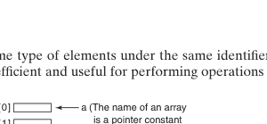

## 数组声明

数组在程序中使用之前必须先声明。

*语法：* `type identifier[size];`

这里的 type 指定要存储在数组中的元素类型。例如，

```c
double height[10];
float width[20];
int min[9];
char name[20];
```

在 C 语言中，数组从位置 0 开始。数组元素在内存中占据相邻位置。数组中的任何项都可以通过其索引访问。例如，

$m = \text{height}[0];$

变量 $m$ 将被赋值为 height 数组第一项的值。

下面的程序段声明一个包含五个整数的数组，并打印该数组的所有元素。

```c
int myArray[5] = {1, 2, 3, 4, 5};
```

```c
/* To print all the elements of the array */
for (int i=0; i<5; i++)
{
    printf("%d", myArray[i]);
}
```

## 相关理论：所用逻辑

多项式的一般形式为

$p(x) = a_nx^n + a_{n-1}x^{n-1} + a_{n-2}x^{n-2} + \cdots + a_1x + a_0$

考虑一个例子

$3x^3 + 4x^2 + 7x + 8$

通常多项式的求值方式为

$3 * x * x * x + 4 * x * x + 7 * x + 8$

因此

乘法次数 = 6

加法次数 = 3

## 霍纳方法

- 多项式表达式

  P(x) = aₙxⁿ + aₙ₋₁xⁿ⁻¹ + aₙ₋₂xⁿ⁻² + … + a₁x + a₀

  可写成另一种形式：

  P(x) = (a₀ + x(a₁ + x(a₂ + … + x(aₙ₋₁ + x·aₙ))))

- 在带括号的表达式中，总是先计算内层括号，因此先计算 (aₙ₋₁ + x·aₙ)。
- 因此，我们可以将常量 aₙ 作为 “result” 变量的初始值。

  result = aₙ

  然后，P(x) = (a₀ + x(a₁ + x(a₂ + … + x(aₙ₋₁ + x·result))))

  内部项作为 result = (aₙ₋₁ + x·result)

  下一项作为 result = (aₙ₋₂ + x·result)

  下一项作为 result = (aₙ₋₃ + x·result)

  .

  .

  .

  外部项作为 result = (a₀ + x·result)

  通常 result = aᵢ + x·result，其中 i 从 n−1 到 0。

### 示例

以如下式子为例

3x³ + 4x² + 7x + 8

它可写成另一种形式：

(8 + x * (7 + x * (4 + x * 3)))

因此

乘法次数 = 3
加法次数 = 3。

传统方法中的乘法次数多于霍纳方法中的乘法次数。因此，霍纳方法更高效。

多项式求值的重要步骤如下：

- 将所有系数读入数组，例如 a。将类似 result 的变量初始化为 a_n。
- 然后重复执行语句

  result = result * x + a[i],

  对于从 n − 1 到 0 的所有 i 值，以步长 −1 执行。

## 示例程序

### 程序 1

在一列中打印 8 的乘法表的程序。此程序将展示如何使用 for 循环，以及如何使用转义序列实现正确的缩进。

```c
#include<stdio.h>
void main()
{
    int i, j=8;
    printf("Times 8 Table\n");
    for(i=0; i<=12; i=i+1)
    {
        printf("%d x %d=%d\n", j, i, j*i);
    }
    printf("\n");
}
```

#### 示例输出

```text
Times 8 Table
8 x 0=0
8 x 1=8
8 x 2=16
8 x 3=24
8 x 4=32
8 x 5=40
8 x 6=48
8 x 7=56
8 x 8=64
8 x 9=72
8 x 10=80
8 x 11=88
8 x 12=96
```

```c
iMarks[1] = 64;
iMarks[2] = 66;
iMarks[3] = 74;
for (i = 0; i < 4; i++)
  newMarks[i] = iMarks[i];
for (j = 0; j < 4; j++)
  printf("%d\n", newMarks[j]);
}
```

## 示例输出

78
64
66
74

## 算法

开始
**步骤 1：** 输入一个数 n
**步骤 2：** 以步长 1 对 i ← 0 到 n 执行 FOR 循环
  输入数组 a[i] 的元素
  结束 FOR
**步骤 3：** 输入 x 的值
**步骤 4：** res ← a[n]
**步骤 5：** 以步长 -1 对 i ← n-1 到 0 执行 FOR 循环
  res ← res * x + a[i]
  结束 FOR
**步骤 6：** 输出 res 的值
停止

## 流程图

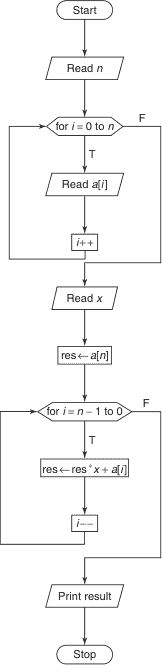

## 程序

```c
#include<stdio.h>
void main()
{
    int a[40];
    int x, n, i, res;
    printf("\nEnter maximum power of x:\n\t");
    scanf("%d", &n); /* Read the maximum size of array */
    printf("\nEnter the coefficients of the polynomial:\n");
    /*----------------read elements of the array----------------*/
    for(i=0; i<=n; i++)
    {
        printf("\nEnter coefficient of X^%d=\t", i);
        scanf("%d", &a[i]);
    }
    printf("\nEnter the value of X=\t");
    scanf("%d", &x);
    /*----------------Compute the value of the polynomial----------------*/
    res=a[n];
    for(i=n-1; i>=0; i--)
        res=res*x+a[i];
    printf("Value of polynomial=\t%d\n", res); /* print the result of the polynomial */
}
```

## 输出

```text
Enter maximum power of x: 2
Enter the coefficients of the polynomial:
Enter coefficient of X^0=1
Enter coefficient of X^1=2
Enter coefficient of X^2=3
Enter the value of X=2
Value of polynomial=17

Enter maximum power of x: 5
Enter the coefficients of the polynomial:
Enter coefficient of X^0=4
Enter coefficient of X^1=2
Enter coefficient of X^2=6
Enter coefficient of X^3=1
Enter coefficient of X^4=7
Enter coefficient of X^5=8
Enter the value of X=4
Value of polynomial=10156

Enter maximum power of x: 1
Enter the coefficients of the polynomial:
Enter coefficient of X^0=2
Enter coefficient of X^1=3
Enter the value of X=1
Value of polynomial=5
```

## 学习成果

- 验证给定多项式求值的效率。
- 能够使用合适的循环结构。
- 能够使用有效和无效输入执行程序。

## 练习程序

- 1. 编写一个 C 程序，打印从 5 到 −5 的所有整数。
- 2. 编写一个 C 程序，打印前 10 个整数的平方。向用户询问两个整数，先询问较小的一个，再询问较大的一个。通过重复加法将这两个整数相乘。例如，如果从用户处获得 3 和 5，那么我们可以通过将较大的数 (5) 相加三次来求它们的乘积。
- 3. 编写一个简单的 C 程序，使用数组打印出工资超过 3000 的员工人数。
- 4. 编写一个 C 程序，演示如何读取、写入和遍历整数数组。
- 5. 编写一个 C 程序，向用户询问一个整数，并打印该整数的乘法表。

# 学期作业 5

## 问题定义

设计、开发并执行一个 C 程序，将其输入复制到输出，并将每个由一个或多个空白组成的字符串替换为单个空白。

## 目标

- 使用内置函数 getchar() 和 putchar() 处理输入、输出操作。
- 格式化文本。

## 相关理论

*什么是字符串？*

在 C 中，字符串由字符数组表示。字符串的结尾用一个特殊字符标记，即空字符，它只是值为 0 的字符。在 ASCII 字符集中，空字符命名为 NULL。空字符或字符串终止字符由另一个字符转义序列 '\0' 表示。

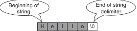

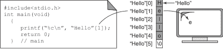


## 编程先决条件

### getchar 函数：getchar();

getchar 函数从标准输入读取单个字符。它不接受参数，并返回输入的字符。通常，对 getchar 函数的引用写法如下

```
variable = getchar();
```

例如，

```c
char c;
c = getchar();
```

第二行会从标准输入设备输入一个字符，然后将其赋给 c。如果使用 getchar 函数读取字符时遇到文件结束条件，将自动返回符号常量 EOF 的值。

该函数还可用于读取多字符字符串，方法是在多趟循环中一次读取一个字符。

### putchar 函数：putchar(variable | constant);

通过将单个字符发送到标准输出来打印或显示该字符的标准 C 函数称为 putchar。该函数接受一个参数，即要显示的字符。

例如，

- 1. putchar ('N'); 显示字符 N。
- 2. char var = '*';
  putchar(var); 显示字符 *。

## 算法

开始

- **步骤 1：** 输入一个字符。
- **步骤 2：** 如果输入的字符非空白，则打印它。
- **步骤 3：** 否则打印第一个空白字符，并跳过所有连续空白。
- **步骤 4：** 重复步骤 1 到 3，直到输入的字符为换行符。

停止

## 流程图

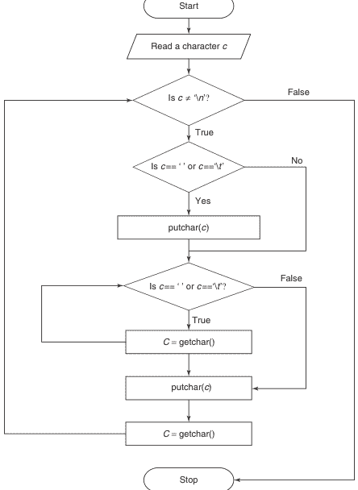

## 程序

```c
#include<stdio.h>
#include<string.h>
void main()
{
    char c;
    printf("Enter the text\n");
    c=getchar();
    printf("The output text is\n");
    while(c!='\n')
    {
        if(c==' '||c=='\t')
        {
            c=' ';
            putchar(c);
        }
        while(c==' '||c=='\t')
        {
            c=getchar();
            putchar(c);
            c=getchar();
        }
    }
    printf("\n");
}
```

### 示例输出

- 1. 输入文本

  ```text
  Hello    World
  The output text is:
  Hello World
  ```

- 2. 输入文本

  ```text
  C    is    a    middle    level    language
  The output text is:
  C is a middle level language
  ```

## 成果

- 能够使用内置的标准字符串函数。
- 应能够应用该逻辑编辑大量文本。
- 能够编写用于其他编辑形式的 C 代码。

### 3.1.1 随机事件的概率

在初中，我们已经初步了解了随机事件的概念，并列举了在下列具体情境中的一些随机事件：

- 抛掷一枚硬币，结果出现正面;
- 篮球运动员投篮一次，结果命中;
- 从一副扑克牌中抽出一张牌，结果抽出的是红桃;

随机事件在一次试验中是否发生是不确定的，但在同一条件下进行大量重复试验时，随机事件的发生是否具有规律性呢？我们来做一个试验：

#### 试验

把全班同学分成10个小组，每小组抛掷一枚硬币20次，记录“正面向上”的次数，然后统计"正面向上"的频数和频率，并填写下表：

| 投掷次数 | 出现正面的次数 | 出现正面的频率 |
| --- | --- | --- |
| 20 | | |
| 40 | | |
| 60 | | |
| 80 | | |
| 100 | | |
| 120 | | |
| 140 | | |
| 160 | | |
| 180 | | |
| 200 | | |

观察上表，你能发现什么规律？

历史上，有些数学家曾经做过成千上万次抛掷硬币的试验。

| 试验者 | 抛掷次数(n) | 出现正面的次数(m) | 出现正面的频率(m/n) |
| --- | --- | --- | --- |
| 棣莫弗 | 2048 | 1061 | 0.5181 |
| 布丰 | 4040 | 2048 | 0.5069 |
| 费勒 | 10000 | 4979 | 0.4979 |
| 皮尔逊 | 12000 | 6019 | 0.5016 |
| 皮尔逊 | 24000 | 12012 | 0.5005 |

在抛掷硬币的试验中，随着试验次数的增加，“正面向上”的频率稳定在0.5附近。

对于随机事件，从概率的定义可知：随机事件A的概率P(A)满足0≤P(A)≤1。当A是必然事件时，P(A)=1；当A是不可能事件时，P(A)=0。

一般地，在大量重复进行同一试验时，事件A发生的频率m/n总是接近于某个常数，在它附近摆动，这时就把这个常数叫做事件A的概率，记作P(A)。

## 不成功的二分查找示例

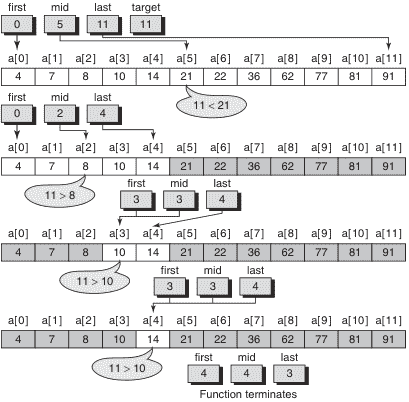

### 算法

```text
Start
Step 1: Read the array size.
Step 2: Read the array elements.
Step 3: Read the key element to be searched.
Step 4: If the key element is equal to the middle element of the array,
            Print search is successful.
         Else if the element is greater than the middle element,
            Perform binary search in the second half of the array
         Else
            Perform binary search in the first half of the array.
Stop
```

### 流程图

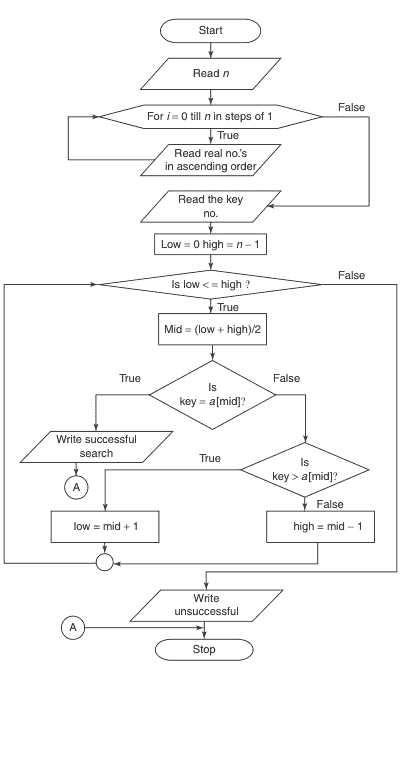

### 程序

```c
#include<stdio.h>
#include<process.h>
void main()
{
  int n,i,a[10],key,low,high,mid;
  printf("\n Enter the no. of elements:");
  scanf("%d",&n);
  printf("\n Enter %d elements in ascending order",n);
  for(i=0 ; i<n ; i++)
    scanf("%d",&a[i]);
  printf("\n Enter the key element to search: ");
  scanf("%d",&key);
  low=0;
  high=n-1;
  while(low<=high)
  {
    mid=(low+high)/2;
    if(key==a[mid])
    {
      printf("\nSearch Successful");
      exit(0);
    }
    else if(key>a[mid])
      low=mid+1;
    else
      high=mid-1;
  }
  printf("\n Unsuccessful Search");
}
```

### 结果

### 示例输出 1

```text
Enter the no. of elements: 5
Enter 5 elements in ascending order
2
3
4
5
6
Enter the key element to search: 5
Search Successful
```

### 示例输出 2

```text
Enter the no. of elements: 8
Enter 8 elements in ascending order
1
12
23
34
56
63
64
88
Enter the key element to search: 66
Unsuccessful Search
```

### 示例输出 3

```text
Enter the no. of elements: 6
Enter 6 elements in ascending order
11234
12234
23441
23453
26090
3000
Enter the key element to search: 26090
Search Successful
```

### 成果

- 应能够理解数组中数字的存储和检索。
- 能够识别使用二分查找的应用，例如递归程序、猜数字游戏等。

### 相关程序

### 程序 1

编写一个 C 程序，按升序将 *N* 个整数输入一维数组，然后对给定的关键字整数执行二分查找，并以合适的消息形式报告成功或失败，*使用递归函数。*

```c
#include <stdio.h>
#define MAX_LEN 10

/* Recursive function*/
int bsearch_recursive(int l[],int arrayStart,int arrayEnd,int a)
{
    int m,pos;
    if(arrayStart<=arrayEnd)
    {
        m=(arrayStart+arrayEnd)/2;
        if (l[m]==a)
            return m;
        else if (a<l[m])
            return bsearch_recursive(l,arrayStart,m-1,a);
        else
            return bsearch_recursive(l,m+1,arrayEnd,a);
    }
    return -1;
}

void read_list(int l[],int n)
{
    int i;
    printf("\nEnter the elements:\n");
    for(i=0;i<n;i++)
        scanf("%d",&l[i]);
}

void print_list(int l[],int n)
{
    int i;
    for(i=0;i<n;i++)
        printf("%d\t",l[i]);
}
/*main function*/

void main()
{
    int l[MAX_LEN], num, ele,f,ll,a;
    int ch,pos;
    printf("\n Binary Search using Recursion method");
    printf("\n=============================================");
    printf("\nEnter the number of elements: ");
    scanf("%d",&num);
    read_list(l,num);
    printf("\nElements present in the list are:\n\n");
    print_list(l,num);
    printf("\n\nEnter the element you want to search:\n\n");
    scanf("%d",&ele);
    pos=bsearch_recursive(l,0,num,ele);
    if(pos==-1)
    {
        printf("Element is not found");
    }
    else
    {
        printf("Element is found at %d position",pos);
    }
}
```

### 输出

```text
1.
Binary Search using Recursion method
=============================================
Enter the number of elements: 5
Elements present in the list are:
1
2
3
4
5
Enter the element you want to search: 5
Element is found at 4 position

2.
Binary Search using Recursion method
=============================================
Enter the number of elements: 8
Elements present in the list are:
10
20
30
40
50
60
70
80
Enter the element you want to search: 100
Element is not found
```

## 学期作业 7

### 问题定义

设计、开发并执行一个 C 程序，将 *N* 个整数输入一维数组，使用冒泡排序技术按升序对它们排序，并在合适的标题下打印给定数组和排序后的数组。

### 目标

- 接受一组随机数字的输入并将其存储在数组中。
- 理解冒泡排序技术的逻辑并编写代码。

### 相关理论：所用逻辑

排序方法：

- 冒泡排序，也称为沉底排序，是一种简单的排序算法，其工作方式是反复遍历待排序列表，比较每对相邻项，如果顺序错误则交换它们。
- 重复遍历列表，直到不需要交换为止，这表明列表已排序。
- 该算法因较小元素“冒泡”到列表顶部的方式而得名。它仅使用比较来操作元素，因此是一种比较排序。

### 排序：将无序集合转换为有序集合

| 1 | 2 | 3 | 4 | 5 | 6 |
| --- | --- | --- | --- | --- | --- |
| 77 | 42 | 35 | 12 | 101 | 5 |


| 1 | 2 | 3 | 4 | 5 | 6 |
| --- | --- | --- | --- | --- | --- |
| 5 | 12 | 35 | 42 | 77 | 101 |


### 为什么排序很重要？

- 排序能够实现高效搜索。
- 例如：电话簿、字典。
- 如果数据需要被多次搜索，这一点很重要。

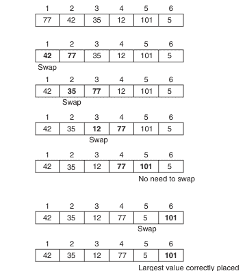

- 注意，只有最大值被正确放置。
- 其他所有值仍处于无序状态。
- 因此，我们需要对未排序的元素重复此过程。


- 如果有 N 个元素。
- 每次将一个元素冒泡到其正确位置。

### 流程图

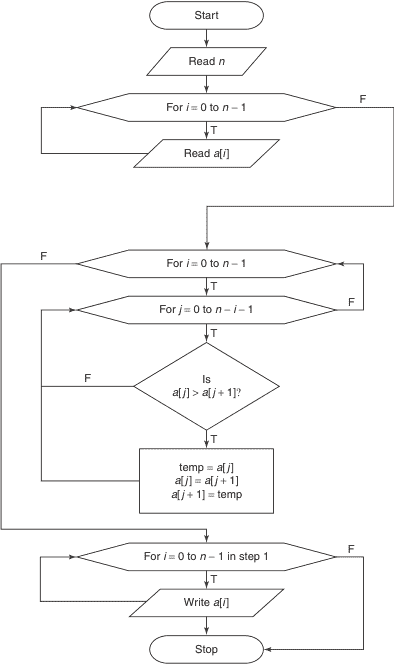

### 程序

```c
#include<stdio.h>
void main()
{
    int  i, j, n, a[20],temp;
    printf(" \n Enter the value of n\n");   /*Read array size*/
    scanf("%d",&n);
    printf("Enter the elements of an array\n");
    for (i=0;i<n;i++)
    scanf("%d",&a[i]);                      /*reading the array elements*/
    for (i=0;i<n-1;i++)                     /*counts number of passes*/
    {
        for(j=0;j<n-i-1;j++)
        {
            if (a[j]>a[j+1])
            /*Compare first no. with its adjacent number*/
            {
                temp=a[j];                  /*Perform swapping*/
                a[j]=a[j+1];
                a[j+1]=temp;
            }
        }
    }
    printf("The sorted elements are:\n");
    /*Print sorted array elements*/
    for(i=0;i<n;i++)
    printf("%d\n",a[i]);
}
```

### 示例输出

输入 n 的值：5
输入数组的元素
3
6
1
0
9

排序后的元素为
0

### 学习成果

- 应能够针对各种输入数据测试该程序。
- 找出在实现冒泡排序技术时进行代码优化的可能性。

### 相关程序

#### 程序 1

编写一个 C 程序，将 N 个整数输入到一维数组中，使用冒泡排序技术按升序排序，并在适当的标题下打印给定数组和排序后的数组，*使用函数*。

```c
#include<stdio.h>
void Bubble_sort(int a[],int n); //Function header.

void main()
{
    int i, j, n, a[20],temp;
    printf(" \n Enter the value of n\n");
    scanf("%d",&n);
    printf("Enter the elements of an array\n");

    /*reading the array elements*/
    for (i=0; i<n; i++)
        scanf("%d",&a[i]);

    Bubble_sort(a,n); //Function call.

    printf("The sorted elements are:\n");

    /*Print sorted array elements*/
    for(i=0;i<n;i++)
        printf("%d\n",a[i]);
}

void Bubble_sort(int a[],int n) //Function definition.
{
    int i,j,temp;
    /*counts number of passes*/
    for (i=0;i<n-1;i++)
    {
        for(j=0;j<n-i-1;j++)
        {
            /*Compare first no. with its adjacent number*/
            if (a[j]>a[j+1])
            {
                /*Perform swapping*/
                temp=a[j];
                a[j]=a[j+1];
                a[j+1]=temp;
            }
        }
    }
}
```

#### 输出

1.

```text
Enter the value of n: 5
Enter the elements of an array
3
6
1
0
9
The Sorted elements are
0
1
3
6
9
```

2.

```text
Enter the value of n: 7
Enter the elements of an array
30
62
11
45
78
21
24
The Sorted elements are
11
21
24
30
45
62
78
```

## 学期作业 8

### 问题定义

设计、开发并执行一个 C 程序，以计算并打印主机上的字长。

### 目标

计算存储给定整数所用的位数。

### 编码前提条件

#### Do While 循环语法

```text
Initialization statement
do
{
    executable statements;
    increment/decrement statement;
} while(condition);
```

#### 循环和位运算符知识

移位运算符 →

- 1. 左移 (<<)
- 2. 右移 (>>)

#### 语法


```text
int a = 23, b = 1;
a = 23 is represented in binary form as

                  0001 0111
          a << b   →  is to shift a left b times

After executing this statement,
          a = 0010 1110 (46 – decimal value)
```

#### 取反运算符 (~)

**按位取反运算符**

对每一位取反。

例如，`int n = 0;` /* 将在内存位置存储二进制零*/

如果 int 数据类型占用 32 位，则，

```text
n = 0000 0000 0000 0000 0000 0000 0000 0000
```

`n = ~n;` /*将在内存位置存储全 1*/

然后

```text
~n = 1111 1111 1111 1111 1111 1111 1111 1111
```

### 相关理论

要找出字长，我们需要知道实际用于存储给定整数的位数。为此，采用以下逻辑。

#### 程序逻辑

- **步骤 1：** 将整数变量的所有位位置都置为 1。这通过将数字 0 取反并将结果赋给程序变量 `N = ~0;` 来实现。

|   |   |   |   |   |   |   |   |
|---|---|---|---|---|---|---|---|
| 1 | 1 | 1 | 1 | 1 | 1 | 1 | 1 |

这将在该数字的所有位位置存储全 1。

- **步骤 2：** 对该数字重复执行左移操作，并检查它是否变为零；每次移位时，递增一个计数器。

#### 查找主机字长的逻辑

使用给定的逻辑，

```c
n = ~0; count = 0;
do
{
    n = n << 1;
    count++;
} while (n != 0);
```

### 算法

```text
Start
Step 1: [Initialize n to complement of zero and count to zero]
        word = ~0 and count = 0
Step 2: [Count no of 1's in n]
        Repeat
            word = word << 1
            increment count
        until word = 0
Step 3: [Print count]
        Print count as word length of host machine
Stop
```

### 流程图

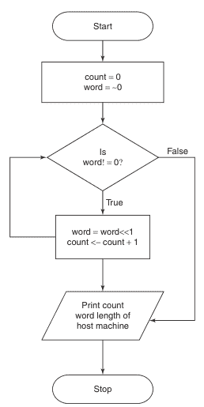

### 程序

```c
#include<stdio.h>
void main()
{
    int count=0;
    int unsigned word;
    /*All bits of the word are set to one by taking one’s
    complement of zero*/
    word=~0;

    /*Counting Word Length using bitwise shift operator*/
    while(word!=0)
    {
        word=word<<1;
        ++count;
    }
    printf("The word length of this Host Machine is %d Bits \n",count);
}
```

### 示例输出

此主机的字长为 32 位

### 学习成果

- 应能够理解随着字长增加，CPU 性能会得到提升。
- 应能够识别字长为 16、32、64 等的机器。

### 相关程序

#### 程序 1

编写一个 C 程序，以计算并打印主机上的字长，*使用 do…while 循环。*

```c
#include<stdio.h>
void main()
{
    int count=0;
    int unsigned word;
    /*All bits of the word are set to one by taking one's
    complement of zero*/
    word=~0;
    /*Counting Word Length using bitwise shift operator*/
    do
    {
        word=word<<1;
        ++count;
    }while(word!=0);
    printf("\n The word length of this Host Machine is %d Bits \n",count);
}
```

### 输出

此主机的字长为 32 位

## 学期作业 9

### 问题定义

设计、开发并执行一个 C 程序，使用指数函数的泰勒级数展开计算 exp(0.5) 的近似值。使用展开式中的各项，直到最后一项小于头文件 <float.h> 中定义为 FLT_EPSILON 的机器 epsilon。打印数学函数 exp( ) 返回的值。

### 目标

- 理解泰勒级数并使用 C 程序实现它。
- 识别标准内置库函数以及需要包含的对应头文件。
- 将计算结果与标准内置函数返回的值进行比较以检验准确性。

### 相关理论

泰勒级数是一种将函数表示为简单但无限多项之和的方法。例如，假设你想求 exp(3.654)。泰勒级数展开允许你将该值表示为简单项之和。exp(x) 的泰勒级数形式为

exp(x) = 1 + (x/1!) + (x²/2!) + (x³/3!) + …

（1! 表示阶乘）。如果知道 x 的值，你可以非常容易地计算各项，并将它们相加到所需精度。在统计学和数学中，泰勒级数用于简化和近似。

- 应添加展开式中的各项，直到最后一项小于机器 epsilon  
  表示为 FLT_EPSILON
- FLT_EPSILON 宏定义在 float.h 中，应在 C 程序中以 `#include <float.h>` 包含。
- FLT_EPSILON 是 float 类型的最小正浮点数。它应不大于 1E-5。
- exp 函数返回 *e*（自然对数的底）的 *x* 次幂的值。


### 算法

```text
Start
**Step 1:** Input x
**Step 2:** Initialize i←1, sum←0, term←1, fact←1
**Step 3:** While term >= FLT_EPSILON
  fact ← fact*i
  sum ← sum+term
  term ← pow(x, i)/fact
  Increment i by 1
**Step 4:** Output the calculated value
**Step 5:** Output Library function value
Stop
```

### 流程图

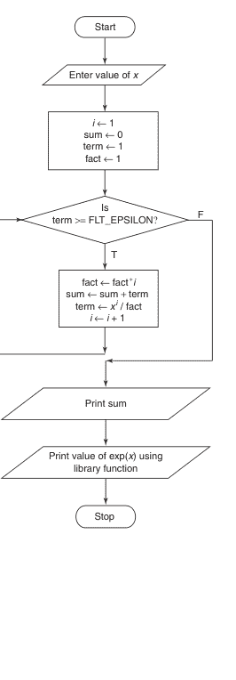

### 程序

```c
#include<stdio.h>
#include<float.h>
#include<math.h>
void main()
{
    int i;
    float x,sum,fact,term;
    printf("\n You have this series : 1+x/1!+x^2/2!+x^3/3!+x^4/4!+..... x^n/n!");
    printf("\n\n Enter the value for X:");
    scanf("%f",&x);
    i=1;
    sum=0;
    term=1;
    fact=1;
    while(term>=FLT_EPSILON)
    {
        fact*=i;
        sum+=term;
        term=pow(x,i)/fact;
        i++;
    }
    printf("\n\n The Calculated value of e^%.3f = %f",x,sum);
    printf("\n\n The Library Function Value of e^%.3f = %f",x,
    exp(x));
}
```

### 示例输出

```text
You have this series: 1+x/1!+x^2/2!+x^3/3!+x^4/4!+.....x^n/n!
Enter the value for X: 0.5
The Calculated value of e^0.500=1.648721
The Library Function Value of e^0.500=1.648721
```

### 预期成果

- 应能够为任意**统计与数学函数**编写 C 程序。
- 能够不断完善程序，直至达到所需精度。

## 学期作业 10

设计、开发和执行一个 C 程序，读取两个矩阵 A(M × N) 和 B(P × Q)，并在矩阵满足乘法兼容条件时计算 A 与 B 的乘积。如果矩阵满足乘法兼容条件，程序应以合适的标题和格式打印输入矩阵和结果矩阵。否则，程序必须打印合适的提示信息。（为演示目的，数组大小 M、N、P 和 Q 均可小于或等于 3。）

- 读取数据并存储到二维数组（矩阵形式）中。
- 判断矩阵是否满足乘法兼容性，并打印合适的消息。
- 编写一个 C 程序，对数组执行矩阵乘法运算。

两个矩阵相乘，即 A (m × n) 和 B (p × q)，应检查一个条件，即 A 的列数 = B 的行数。如果满足该条件，则乘法可行，否则不可行。因此，结果矩阵将为 C (m × q)。如果 A 是 4 × 5 矩阵，B 是 5 × 3 矩阵，若 AB 有定义，则其尺寸是多少？

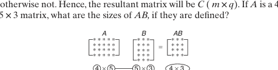

考虑这个 A (2 × 2) 与 B (2 × 2) 的矩阵乘法，结果存储在 C (2 × 2) 中。

$C_{00} = A_{00}*B_{00} + A_{01}*B_{10}$

$C_{01} = A_{01}*B_{11} + A_{00}*B_{01}$

$C_{11} = A_{10}*B_{01} + A_{11}*B_{11}$

$C_{10} = A_{10}*B_{00} + A_{11}*B_{10}$

$A = \begin{pmatrix} 3 & 0 \\ 1 & 1 \end{pmatrix}$ (2 × 2)

$B = \begin{pmatrix} 4 & 7 \\ 6 & 8 \end{pmatrix}$ (2 × 2)

A × B =

$3(4) + 0(6) = 12$

$3(7) + 0(8) = 21$

$1(4) + 1(6) = 10$

$1(7) + 1(8) = 15$

### 算法

```text
Start
**Step 1:** Input order m, n
**Step 2:** FOR i ← 0 to m-1 in steps of 1
    FOR j ← 0 to n-1 in steps of 1
        Input a[i][j]
    END FOR
END FOR
**Step 3:** Input order p, q
**Step 4:** FOR i ← 0 to p-1 in steps of 1
    FOR j ← 0 to q-1 in steps of 1
        Input b[i][j]
    END FOR
END FOR
**Step 5:** IF n = p THEN
    FOR i ← 0 to m-1 in steps of 1
        FOR j ← 0 to q-1 in steps of 1
            c[i][j] = 0
            FOR k ← 0 to n-1 in steps of 1
                c[i][j] = c[i][j] + a[i][k] * b[k][j]
            END FOR
        END FOR
    END FOR
**Step 6:** FOR i ← 0 to m-1 in steps of 1
    FOR j ← 0 to n-1 in steps of 1
        output a[i][j]
    END FOR
END FOR
**Step 7:** FOR i ← 0 to p-1 in steps of 1
    FOR j ← 0 to q-1 in steps of 1
        output b[i][j]
    END FOR
END FOR
**Step 8:** FOR i ← 0 to m-1 in steps of 1
    FOR j ← 0 to q-1 in steps of 1
        output c[i][j]
    END FOR
END FOR
ELSE
    Output "Multiplication not possible"
Stop
```

### 流程图

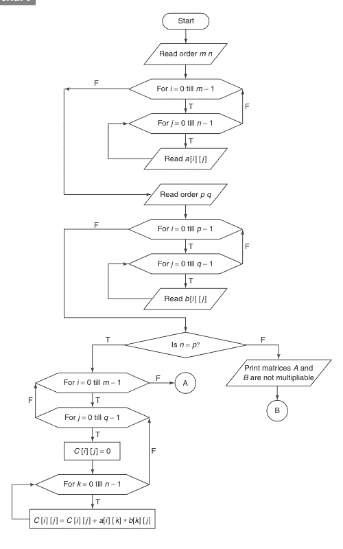

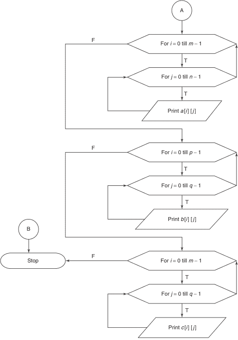

### 程序

```c
#include <stdio.h>
void main()
{
    int a[10][10], b[10][10], c[10][10];
    int m, n, p, q, i, j, k;
    printf("\n Enter the order of the matrix A :");
    scanf("%d%d", &m, &n);
    printf("\n Enter the order of the matrix B :");
    scanf("%d%d", &p, &q);
    if (n == p)
    {
        printf("\n Enter the elements of matrix A \n");
        for(i = 0; i < m; i++)
            for(j = 0; j < n; j++)
                scanf("%d", &a[i][j]);
        printf("\n Enter the elements of matrix B \n");
        for(i = 0; i < p; i++)
            for(j = 0; j < q; j++)
                scanf("%d", &b[i][j]);
        for(i = 0; i < m; i++)
            for(j = 0; j < q; j++)
            {
                c[i][j] = 0;
                for(k = 0; k < n; k++)
                    c[i][j] += a[i][k] * b[k][j];
            }
        printf("\n MATRIX A \n");
        for(i = 0; i < m; i++)
        {
            for(j = 0; j < n; j++)
                printf("%d", a[i][j]);
            printf("\n");
        }
        printf("\n MATRIX B \n");
        for(i = 0; i < p; i++)
        {
            for(j = 0; j < q; j++)
                printf("%d", b[i][j]);
            printf("\n");
        }
        printf("\n MATRIX C \n");
        for(i = 0; i < m; i++)
        {
            for(j = 0; j < q; j++)
                printf(" %d ", c[i][j]);
            printf("\n");
        }
    }
    else
        printf("\n Matrix A & B is not multipliable");
}
```

### 示例输出

```text
Enter the order of the matrix A: 2 2
Enter the order of the matrix B: 2 2
Enter the elements of matrix A
1  2
3  4
Enter the elements of matrix B
2  3
4  5
MATRIX A
1  2
3  4
MATRIX B
2  3
4  5
MATRIX C
10   13
22   29
------------------------------------------------------------
Enter the order of the matrix A: 3 2
Enter the order of the matrix B: 3 4
Matrix A & B is not multipliable
```

### 预期成果

- 能够以矩阵形式表示数据。
- 能够编写代码对矩阵执行各种操作。

### 相关程序

#### 程序 1

编写一个 C 程序，求 3*3 矩阵主对角线元素之和。

```c
#include<stdio.h>
void main()
{
    int a[3][3], sum, i, j;
    printf("\n Enter 9 elements of matrix\n");
    for(i = 0; i < 3; i++)
        for(j = 0; j < 3; j++)
            scanf("%d", &a[i][j]);
    /*printing in matrix form*/
    printf("Given input matrix is...\n");
    for(i = 0; i < 3; i++)
    {
        for(j = 0; j < 3; j++)
            printf("%d", a[i][j]);
        printf("\n");
    }
    /*to find sum of principal diagonal elements*/
    sum = 0;
    for(i = 0; i < 3; i++)
        for(j = 0; j < 3; j++)
            if(i == j)
                sum = sum + a[i][j];
    printf("sum of principal diagonal elements =%d\n", sum);
}
```

#### 程序 2

编写一个 C 程序，求两个 m × n 阶矩阵 A 和 B 的和。

```c
#include<stdio.h>
void main()
{
    int m, n, a[10][10], i, j, b[10][10], c[10][10];
    printf("what is order of matrixes a & b \n");
    scanf("%d%d", &m, &n);
    printf("enter %d elements of matrix a \n", m * n);
    for(i = 0; i < m; i++)
        for(j = 0; j < n; j++)
            scanf("%d", &a[i][j]);
    printf("given input in matrix form of a \n");
    for(i = 0; i < m; i++)
    {
        for(j = 0; j < n; j++)
            printf("%d", a[i][j]);
        printf("\n");
    }
    printf("enter %d elements of matrix b \n", m * n);
    for(i = 0; i < m; i++)
        for(j = 0; j < n; j++)
            scanf("%d", &b[i][j]);
    printf("given input in matrix form of b \n");
    for(i = 0; i < m; i++)
    {
        for(j = 0; j < n; j++)
            printf("%d", b[i][j]);
        printf("\n");
    }
    for(i = 0; i < m; i++)
        for(j = 0; j < n; j++)
            c[i][j] = a[i][j] + b[i][j]; /*addition */
    printf("sum matrix c is....\n");
    for(i = 0; i < m; i++)
    {
        for(j = 0; j < n; j++)
            printf("%d", c[i][j]);
        printf("\n");
    }
}
```

## 学期作业 11

### 问题定义

设计、开发和执行一个 C 并行程序，将两个各含 *N* 个整数元素的一维数组 *A* 和 *B* 按元素相加，并将结果存储到另一个含 *N* 个整数元素的一维数组 *C* 中。

### 目标

- 并行执行两个一维数组的加法。
- 理解线程基础知识和 OpenMP 指令的概念与用法。

### 编程先决条件

- 编写此程序的基本要求是具备并行计算知识。
- *线程基础、OpenMP（开放多处理）、数组和循环结构。*

### 相关理论：所用逻辑

### 顺序编程与并行编程的区别

| 顺序编程 | 并行编程 |
|---|---|
| 顺序编程涉及进程一个接一个地连续且有序执行<br>在顺序编程中，进程一个接一个地依次运行 | 并行编程涉及进程或线程的并发计算或同时执行<br>在并行计算中，多个进程同时执行 |

### 并行计算

并行计算是在计算机系统中并发执行多个任务。例如，一个待解决的大型问题可以分解为多个小型问题，然后并行求解这些小问题以得到最终解。


### 线程

A thread is the smallest processing unit in a system. In parallel programming, several different threads are created corresponding to different computational elements and are then executed in parallel.

### OpenMP (Open Multi-Processing)

It is an API that supports directive-based programming. It provides a number of built-in directives and library functions that facilitate the development of parallel computing applications.

在 C 中，OpenMP 指令借助 **#pragma** 指令指定，如下所示：

```c
#pragma omp directive [clause 1] [clause 2] ...
```

- **#pragma omp** 告诉编译器 OpenMP 指令的规范
- **directive** 是有效的 OpenMP 指令名称。
- **clause** 列表包含与指令相关的一组子句。

### 并行指令

它是 OpenMP 指令，有助于指定通过多个线程并行执行的代码块。

```c
#pragma omp parallel
```

- 对于 C 中的并行编程，我们使用在 *"omp.h"* 头文件中定义的 **#pragma omp parallel** 表达式。
- 因此，当编译器遇到 **#pragma omp parallel** 时，以下语句块将作为单独的线程并行执行。

### for 指令

for 指令指定在 for 循环之前，并指定 for 循环的迭代将被分配到多个线程中。

```c
#pragma omp parallel for
```

### 算法

```text
Start
Step 1: Read the number of elements
Step 2: Read the elements of first array
        for i ← 0 to n − 1
          Read a[i]
Step 3: Read the elements of second array
        for i ← 0 to n − 1
          Read b[i]
```

#### 步骤 4

打印第一个数组的内容

```text
for i ← 0 to n − 1
    print a[i]
```

#### 步骤 5

打印第二个数组的内容

```text
for i ← 0 to n − 1
    print b[i]
```

#### 步骤 6

```text
#pragma omp parallel for
begin
for i ← 0 to n − 1
tid ← omp_get_thread_num()
c[i] ← a[i] + b[i]
print c[i], tid    //Printing the array C
end
```

#### 步骤 7

打印数组 C 的内容

```text
for i ← 0 to n − 1
    print c[i]
```

停止

### 流程图

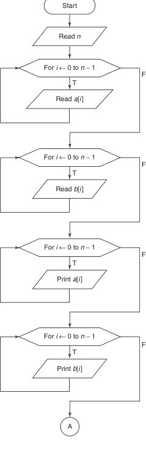

### 程序

```c
#include<stdio.h>
#include<omp.h>
void main()
{
int a[10],b[10],c[10],i, n;
int tid;
printf("\n Enter the number of elements");
scanf("%d",&n);
printf("\n Enter the elements of 1st array");
for(i=0;i<n;i++)
    scanf("%d",&a[i]);
printf("Enter the elements of 2nd array");
for(i=0;i<n;i++)
    scanf("%d",&b[i]);
printf("\n Array A\n");
for(i=0;i<n;i++)
{
printf("a[%d]=%d\n",i,a[i]);
}
printf("\n Array B\n");
for(i=0;i<n;i++)
{
printf("b[%d]=%d\n",i,b[i]);
}
#pragma omp parallel for
for(i=0;i<n;i++)
{
tid=omp_get_thread_num();
c[i]=a[i]+b[i]; /* addition of array A and array B in parallel */
printf("\nc[%d]=%d,thread id=%d\n",i,c[i],tid);
}
printf("\n===the new Array C is===\n");
for(i=0;i<n;i++)
{
printf("%d",c[i]);  /* print resultant array C */
}
}
```

### 示例输出 1

```text
Enter the number of elements 5
Enter the elements of 1st array 1 2 3 4 5
Enter the elements of 2nd array 5 6 7 8 9

Array A
a[0]=1
a[1]=2
a[2]=3
a[3]=4
a[4]=5

Array B
b[0]=5
b[1]=6
b[2]=7
b[3]=8
b[4]=9

c[0]=6,thread id=0
c[1]=8,thread id=0
c[2]=10,thread id=0
c[3]=12,thread id=1

c[4]=14,thread id=1
====the new Array C is====
6   8   10   12   14

Enter the number of elements 6
Enter the elements of 1st array 10 20 30 40 50 60
Enter the elements of 2nd array 1 2 3 4 5 6

Array A
a[0]=10
a[1]=20
a[2]=30
a[3]=40
a[4]=50
a[5]=60

Array B
b[0]=1
b[1]=2
b[2]=3
b[3]=4
b[4]=5
b[5]=6

c[0]=11,thread id=0
c[1]=22,thread id=0
c[2]=33,thread id=0
c[3]=44,thread id=1
c[4]=55,thread id=1
c[5]=66,thread id=1
=====the new Array C is===
11   22   33   44   55   66   77   88
```

### 成果

- 能够区分顺序编程和并行编程。
- 能够识别可以应用并行性的应用。

### 练习程序

- 1. 编写一个 C 程序在程序中创建多个线程并打印它们的线程 ID。
- 2. 编写一个并行程序来乘以两个方矩阵。

## 课程作业 12

### 问题定义

设计并开发一个 C 函数 `rightrot(x, n)`，它以无符号整数的形式返回整数 x 右移 n 位后的值。从 main 中使用不同的 x 和 n 值调用该函数并打印结果，附带合适的标题。

### 目标

- 开发一个函数 rightrot 将数字向右旋转给定数量的位并将旋转后的数字返回给主函数。
- 了解使用函数和参数传递的概念。
- 对所有可能的输入情况测试程序。

### 编码前提

编写此程序的基本要求是了解位运算符的知识。

### C 中的函数

我们迄今为止介绍的程序都很简单。它们解决的问题无需太多努力即可理解。 自顶向下设计和结构化编程的原则规定，程序应分为主模块和相关模块。每个模块还应根据软件工程原则细分为子模块。

在 C 中，自顶向下设计的思想是使用函数实现的。 C 程序由一个或多个函数组成，其中一个且只有一个必须命名为 main。通常，函数的目的就是接收零个或多个数据，对其进行操作，并返回最多一个数据。

C 中的函数是一个独立的模块，将被调用以执行特定任务。当它被调用时，它接收零个或多个数据，对其进行操作并将最多一个数据返回给调用函数。

> **注意：** 在 C 中，程序由一个或多个函数组成，其中一个且只有一个必须称为 main。

程序的执行总是从 main 开始，但它可以调用其他函数来完成部分工作。

### 用户定义函数

像 C 中的其他任何对象一样，函数必须同时声明和定义。函数声明给出了稍后需要定义的功能的整体情况。函数定义包含函数的代码。

函数名使用三次：用于声明、在调用中以及用于定义。

### 函数设计策略

基本上，有四种函数设计策略，即

- 1. 无参数的 void 函数。
- 2. 带参数的 void 函数。
- 3. 无参数的非 void 函数。
- 4. 带参数的非 void 函数。

### 示例程序

用 C 编写程序求两个整数的最大公约数并输出结果，***使用函数。***

```c
#include<stdio.h>
#include<process.h>
int GCD(int a, int b)
{
    if (a<0) a = -a;
    if (b<0) b = -b;
    if (b>a)
    {
        printf("\n Invalid Input");
        exit(0);
    }
    else
    {
        if (a==0 || b==1 || a==b) return b;
        if (a==1 || b==0) return a;
        if (a%b) return GCD(b, a%b);
        else return GCD(a, b%a);
    }
}
void main()
{
  int x,y;
  printf("\n Enter 1st number:");
  scanf("%d",&x);
  printf("\n Enter 2nd number:");
  scanf("%d",&y);
  printf("\n GCD is:%d", GCD(x,y));
}
```

### 对于三个数

```c
int GCD3 (int x, int y, int z)
{
  return GCD(x, GCD(y, z));
}
```

### 输出

```text
Enter 1st number: 10
Enter 2nd number: 5
GCD is: 5

Enter 1st number: 20
Enter 2nd number: 15
GCD is: 5

Enter 1st number: 8
Enter 2nd number: 20
Invalid Input
```

### 相关理论：使用的逻辑

### 什么是旋转？

旋转是一种与移位类似的操作，只是从一端掉落的位会被放回另一端。在 C 中没有旋转运算符。相反，旋转操作是通过使用位移运算符（`<<` 和 `>>`）和 OR 运算符（`|`）来执行的。

### 左移

在表达式 `n << d` 中，数字 n 向左移动 d 位。在向左移动时，最左边的位将被丢失，并在右侧填充 0。


#### 示例

0100 1001（十进制数 73）  
将上述二进制数左移 4 位，得到数字  
1001 0000（十进制数 144）

### 右移

在表达式 `n >> d` 中，数字 *n* 向右移动 *d* 位。向右移位时，最右边的位将丢失，并在左侧填充 0。

#### 示例

0100 1001（十进制数 73）  
将上述二进制数右移 4 位，得到数字  
0000 0100（十进制数 4）

### 4 位字长的右旋转

将以下数字 13 右旋转 1 位  
13 的二进制形式为：1101

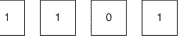

右旋转 1 位后

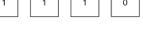

### 右旋转的主要逻辑

- 1. 将数字右移 *n* 位
- 2. 将数字左移 32 - *n* 位
- 3. 对上述结果进行按位或

### 算法

开始

- **步骤 1：** 读取一个数字 *x*
- **步骤 2：** 读取要旋转的位数 *n*
- **步骤 3：** 调用 `rightrot` 函数  
  `result ← rightrot(x, n)`
- **步骤 4：** 打印结果

停止

### 将 x 旋转 n 位的算法

开始

- **步骤 1：** 将 *x* 右旋转 *n* 位  
  `a ← x >> n;`  
  `b ← x << (32 - n); /* assuming 32-bit machine */`
- **步骤 2：** 返回 `(a | b)`

停止

### 程序

```c
#include<stdio.h>
unsigned int rightrot(int, int); /* prototype declaration */
void main()
{
    int x, n;
    unsigned int result;
    printf("Enter the number to be right rotated \n");
    scanf("%d",&x);
    printf("Enter the number of bits to be right rotated \n");
    scanf("%d",&n);
    result=rightrot(x,n); /* call to function rightrot(x,n) */
    printf("The number %d after right rotation by %d bit positions is %u",x,n,result);
}

unsigned int rightrot(int x, int n)
{
    unsigned int a,b;
    a=x >> n;       /* right shift by n bits */
    b=x << (32-n);      /* left shift by 32-n bits */
    return (a | b);        /* bitwise OR a and b */
}
```

#### 示例输出 1

```text
Enter the number to be right rotated
8
Enter the number of bits to be right rotated
2
The number 8 after right rotation by 2-bit positions is 2
```

#### 结论

数字 8 的 32 位二进制形式表示为

```text
0000 0000   0000 0000   0000 0000   0000 1000
After rotating 2 bits
0000 0000   0000 0000   0000 0000   0000 0010
```

#### 示例输出 2

```text
Enter the number to be right rotated
9
Enter the number of bits to be right rotated
31
The number 9 after right rotation by 31-bit positions is 18
```

#### 结论

数字 9 的 32 位二进制形式表示为

```text
0000 0000    0000 0000    0000 0000    0000 1001
After rotating 31 bits
0000 0000    0000 0000    0000 0000    0001 0010
```

#### 示例输出 3

```text
Enter the number to be right rotated
16
Enter the number of bits to be right rotated
5
The number 16 after right rotation by 5-bit positions is
2147483648
```

### 学习成果

- 能够处理函数和参数传递。
- 能够识别旋转函数的重要性并找到可能的应用。

## 学期作业 13

### 问题定义

设计并开发一个函数 `isprime(x)`，它接受一个整数参数，如果该参数是素数则返回 1，否则返回 0。该函数将使用简单的除法检查方法来确定给定数字是否为素数。在 main 中根据用户输入的不同值调用此函数，并打印适当的消息。

### 目标

- 能够将寻找素数的纸笔方法映射为算法，然后编写 C 代码。
- 理解函数的用法。
- 理解如何优化逻辑进而优化处理时间。

### 相关理论

### 素数

只能被 1 和自身整除的数称为素数。例如 2、3、5、7、11 等不能被除 1 和自身以外的任何数整除，因此它们都是素数。但 4、6、8、16 等数可以被 2 整除，因此它们是非素数。

### 程序逻辑

现在让我们看看如何检查一个数是否为素数。

- 考虑数字 16，它不能被 9、10、11、12、13、14 整除——这些数都大于 16/2。但 16 能被 2、4、8 整除，而这些数小于或等于 16/2。
- 因此要记住的第一点是：一个数 $n$ 不能被大于 $n/2$ 的数整除。
- 因此，要检查给定数字 $n$ 是否为素数，只需用 2、3、4、5、…、$n/2$ 去除 $n$ 即可。

### 算法

```text
Step 1: [Start of algorithm]
Step 2: [Read the value of n]
    Read n
Step 3: [Check for validation]
    Check n = 0 or n = 1 then
    print n is neither prime nor composite goto step 6
Step 4: [Call the function]
    j = isprime(n)
Step 5: Check j = 1 then
    print the number n is prime
        otherwise print the number n is not prime
Step 6: [End of Algorithm]
    Stop
```

#### 被调用函数 `int isprime(int x)` 的算法

```text
Step 4.1: Repeat for i = 2 to x/2
        check x % i = 0 then
            return 0
            otherwise
                continue next i
Step 4.2: Return 1
```

### 流程图

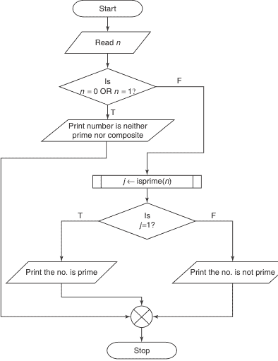

#### 函数的流程图

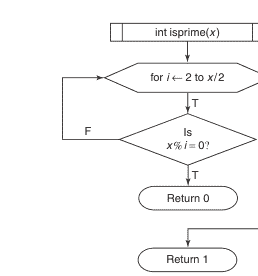

### 程序

```c
#include<stdio.h>
#include<process.h>
void main()
{
    int j,n;
    int isprime(int x);  /* Function prototype */
    printf("Enter the number:\n");
    scanf("%d",&n);
    if(n==0||n==1)
    {
        printf("The number %d is neither prime nor composite\n",n);
        exit(0);
    }
    j = isprime(n);
    if(j==1)
        printf("The given number is prime\n");
    else
        printf("Number is not prime\n");
}

// Function to check whether the given value is prime or not

int isprime(int x)  /* Function definition */
{
    int i;  /* Local declaration */
    for(i=2;i<=x/2;i++)
    {
        if(x%i==0)
        {
            return 0;  /* Number is not a prime */
        }
    }
    return 1;  /* Number is prime */
}
```

#### 示例输出

- 1. 输入数字：  
  7  
  给定的数是素数
- 2. 输入数字：  
  10  
  给定的数不是素数
- 3. 输入数字：  
  16  
  给定的数不是素数
- 4. 输入数字：  
  0  
  数字 0 既不是素数也不是合数
- 5. 输入数字：  
  1  
  数字 1 既不是素数也不是合数

### 学习成果

- 能够处理函数和传递参数。
- 能够优化逻辑和代码。

## 学期作业 14

### 问题定义

设计、开发并执行一个 C 并行程序，利用埃拉托色尼筛法算法确定并打印小于 100 的素数。

### 目标

- 学习并行编程和函数的概念。
- 理解使用埃拉托色尼筛法算法寻找素数的底层逻辑，并为此编写程序。

### 编码前提条件

### OpenMP（Open Multi-Processing）

**OpenMP**（Open Multi-Processing）是一个 API（应用程序编程接口），在大多数处理器架构和操作系统上支持 C、C++ 和 Fortran 的多平台共享内存多处理编程，包括 Linux、Unix、AIX、Solaris、Mac OS X 和 Microsoft Windows 平台。它由一组影响运行时行为的编译器指令、库例程和环境变量组成。OpenMP 使用可移植、可扩展的模型，为程序员提供简单灵活的接口，用于开发从标准台式计算机到超级计算机等平台上的并行应用。

### 指令

- `#pragma omp parallel for`
- 并行构造形成一组线程并开始并行执行。
- `#pragma omp parallel for [clause[[,] clause] ...]` 换行
- for 循环

OpenMP 可执行指令应用于其后的结构化块或一个 OpenMP 构造。“结构化块”是顶部只有一个入口、底部只有一个出口的单个语句或复合语句。


### omp_get_thread_num 函数

omp_get_thread_num 函数返回执行该函数的线程在其线程组中的线程编号。线程编号介于 0 和 omp_get_num_threads() - 1 之间（含边界）。线程组的主线程是线程 0。

格式如下：

```cpp
#include <omp.h>
int omp_get_thread_num(void);
```

如果从串行区域调用，omp_get_thread_num 返回 0。如果从被串行化的嵌套并行区域中调用，此函数返回 0。

### 理论

#### 并行计算

- 传统上，软件是为串行计算编写的。
- 并行计算是同时使用多个计算资源来解决一个计算问题。
- 在这种技术中，一个大问题可以被划分为更小的段，这些段可以独立且同时求解；支持并行编码的计算机称为并行计算机。

#### 质数

- 质数（例如 2、3 或 5）是自然数（正整数），它只能被自身和 1 整除（不能被其他自然数整除）。
- 小于 100 的质数是：

    2 3 5 7 11 13 17 19 23 29 31 37 41 43 47 53 59 61 67 71 73 79 83 89 97.

#### 埃拉托斯特尼筛法算法

这个过程被称为埃拉托斯特尼筛法，得名于发明它的亚历山大希腊数学家。他也是第一个测量地球周长的人。这种列出质数的方法被称为“筛子”，因为它就像取出所有数（直到某个最大值），让它们通过筛子，以筛出所有质数。

#### 埃拉托斯特尼筛法

- 有一种相当简单的方法来列出质数。我们将从 2 到 100 的所有数字的列表开始：

    0 1 2 3 4 5 6 7 8 9 10 11 12 13 14 15 16 17 18 19 20 21 22 23 24 25 26 27 28 29 30 31 32 33 34
    35 36 37 38 39 40 41 42 43 44 45 46 47 48 49 50 51 52 53 54 55 56 57 58 59 60 61 62 63 64 65
    66 67 68 69 70 71 72 73 74 75 76 77 78 79 80 81 82 83 84 85 86 87 88 89 90 91 92 93 94 95 96
    97 98 99 100

- 我们现在将 2 加粗（你可以把它圈出来），将其标记为质数（它不能被更小的质数整除），并划掉 2 之后的每第二个数：

    0 1 2 3 0 5 0 7 0 9 0 11 0 13 0 15 0 17 0 19 0 21 0 23 0 25 0 27 0 29 0 31 0 33 0 35 0 37 0 39 0
    41 0 43 0 45 0 47 0 49 0 51 0 53 0 55 0 57 0 59 0 61 0 63 0 65 0 67 0 69 0 71 0 73 0 75 0 77 0
    79 0 81 0 83 0 85 0 87 0 89 0 91 0 93 0 95 0 97 0 99 0

- 我们现在已确定 3 是质数。它不能被更小的质数整除。然后我们划掉 3 之后的每第三个数。其中一些已经被划掉。跳过这些即可：

    0 1 2 3 0 5 0 7 0 0 0 11 0 13 0 0 0 17 0 19 0 0 0 23 0 25 0 0 0 29 0 31 0 0 0 35 0 37 0 0 0 41 0 43
    0 0 0 47 0 49 0 0 0 53 0 55 0 0 0 59 0 61 0 0 0 65 0 67 0 0 0 71 0 73 0 0 0 77 0 79 0 0 0 83 0 85
    0 0 0 89 0 91 0 0 0 95 0 97 0 0 0

- 我们对 5 和 7 做同样的处理：

    0 1 2 3 0 5 0 7 0 0 0 11 0 13 0 0 0 17 0 19 0 0 0 23 0 0 0 0 0 29 0 0 0 0 0 0 37 0 0 0 41 0 43 0 0
    0 47 0 0 0 0 0 53 0 0 0 0 0 59 0 0 0 0 0 0 67 0 0 0 0 73 0 0 0 0 0 79 0 0 0 83 0 0 0 0 0 89 0 0 0 0
    0 0 0 97 0 0 0

- 现在我们可以停止了！你可能想继续尝试 11。但没有必要。2 到 100 之间不会再有数字被划掉。

- 我们可以停在 100 的平方根，即 10。原因在于，任何小于 100 的数（例如 91），如果它能被大于 100 的平方根的数（本例中为 13）整除，那么它也一定能被小于 100 的平方根的数（本例中为 7）整除。因此，我们已经划掉了所有这样的数。

- 去掉 0，我们得到这个质数列表：

    2 3 5 7 11 13 17 19 23 29 31 37 41 43 47 53 59 61 67 71 73 79 83 89 97

### 算法

```text
Start
Step 1: Read n
Step 2: For i ← 1 to 99 in steps of 1
        Store in array num[i]
        END FOR
Step 3: For i ← 2 to 99 in steps of 1
        IF num[i] != 0
            For j ← i+1 to 99 in steps of 1
                IF num[j] != 0
                    IF num[j] mod num[i] == 0
                        num[j] = 0
                    END IF
                END IF
            END FOR
        END IF
        END FOR
Step 4: For i ← 1 to 99 in steps of 1
        Output non-zero numbers
        END FOR
Stop
```

### 程序

```c
#include<stdio.h>
#include<omp.h>
void main()
{
    int num[100], i, j, n;
    printf("Enter the Range of numbers:\n");
    scanf("%d",&n);
#pragma omp parallel for
    for(i=1;i<=n;i++)  /*Fill num with the first 100 numbers*/
    {
        num[i]=i;
        printf("\nnum[%d]=%d,threadid=%d\n",i,num[i],omp_get_thread_num());
    }
#pragma omp parallel for
    for(i=1;i<=n;i++)
    {
        if(num[i]!=0)
        {
            #pragma omp parallel for
            for(j=(i+1);j<=n;j++)
            {
                if(num[j]!=0)
                {
                    if((num[j]%num[i])==0)    /*check if num[j]*/
                        num[j]=0;    /*is a multiple of num[i]*/
                    /*if it is a multiple then set it to 0*/
                }
            }
        }
    }
    for(i=1;i<n;i++)
    {
        if(num[i]!=0) /*Print all non zero numbers (prime numbers)*/
            printf("%d",num[i]);
    }
}
```

#### 示例输出：1

```text
Enter the Range of numbers:
10
num[0]=1,threadid=0
num[6]=7,threadid=1
num[7]=8,threadid=1
num[8]=9,threadid=1
num[9]=10,threadid=1
num[10]=11,threadid=1
num[1]=2,threadid=0
num[2]=3,threadid=0
num[3]=4,threadid=0
num[4]=5,threadid=0
num[5]=6,threadid=0
  2   3   5   7
```

#### 示例输出：2

```text
Enter the Range of numbers:
100
num[51]=52,threadid=1
num[0]=1,threadid=0
num[52]=53,threadid=1
num[1]=2,threadid=0
num[53]=54,threadid=1
num[2]=3,threadid=0
num[54]=55,threadid=1
num[3]=4,threadid=0
num[55]=56,threadid=1
num[4]=5,threadid=0
num[56]=57,threadid=1
num[5]=6,threadid=0
num[57]=58,threadid=1
num[6]=7,threadid=0
num[58]=59,threadid=1
num[7]=8,threadid=0
num[59]=60,threadid=1
num[8]=9,threadid=0
num[26]=27,threadid=0
num[78]=79,threadid=1
num[27]=28,threadid=0
num[79]=80,threadid=1
num[28]=29,threadid=0
num[80]=81,threadid=1
num[29]=30,threadid=0
num[81]=82,threadid=1
num[30]=31,threadid=0
num[82]=83,threadid=1
num[31]=32,threadid=0
num[83]=84,threadid=1
num[32]=33,threadid=0
num[84]=85,threadid=1
num[33]=34,threadid=0
num[85]=86,threadid=1
num[34]=35,threadid=0
num[86]=87,threadid=1
num[35]=36,threadid=0
num[87]=88,threadid=1
num[36]=37,threadid=0
num[88]=89,threadid=1
num[37]=38,threadid=0
num[89]=90,threadid=1
num[38]=39,threadid=0
num[90]=91,threadid=1
num[39]=40,threadid=0
num[91]=92,threadid=1
num[40]=41,threadid=0
num[92]=93,threadid=1
num[41]=42,threadid=0
num[93]=94,threadid=1
num[42]=43,threadid=0
num[94]=95,threadid=1
num[43]=44,threadid=0
num[95]=96,threadid=1
num[44]=45,threadid=0
num[96]=97,threadid=1
num[45]=46,threadid=0
num[97]=98,threadid=1
num[46]=47,threadid=0
num[98]=99,threadid=1
num[47]=48,threadid=0
num[99]=100,threadid=1
num[48]=49,threadid=0
num[100]=101,threadid=1
num[49]=50,threadid=0
num[50]=51,threadid=0
  2   3   5   7  11  13  17  19  23  29  31  37  41  43  47  53  59
 61  67  71  73  79  83  89  97
```

### 学习成果

- 能够认识到线程在操作系统中的重要性。
- 能够识别可以并行处理的程序。

## 学期作业 15

### 问题定义

在 C 语言中设计并开发一个函数 reverse(s)，用于就地反转字符串 *s*。在 main 中针对不同字符串调用此函数，并打印原始字符串和反转后的字符串。

### 目标

- 理解字符串和字符的基础知识。
- 理解并使用预定义函数。
- 使用预定义函数操作字符和字符串。
- 使用函数 reverse 反转给定字符串。

### 编码前提条件

### 字符串

字符串是字符的集合。字符串总是用双引号括起来，如“string_constant”。

以下是部分字符串处理操作：

- 查找字符串的长度。
- 比较两个字符串。
- 将一个字符串复制到另一个字符串。
- 将小写转换为大写，反之亦然。
- 连接两个字符串。
- 反转字符串。

### 声明

字符串可以如下声明：

**语法：** `char string_name[size];`

**示例：** `char name[50];`


### 字符串结构

当编译器将字符串赋给字符数组时，它会自动在字符串末尾追加**空字符（'\0'）**。因此，字符串大小 = 字符串原始长度 + 1。

```
char name[7];
name = "TECHNO";
```

| 'T' | 'E' | 'C' | 'H' | 'N' | 'O' | '\0' |
| :---: | :---: | :---: | :---: | :---: | :---: | :---: |
| 1 | 2 | 3 | 4 | 5 | 6 | 7 |

### 读取字符串

要读取字符串，我们可以使用带格式说明符 `%s` 的 *scanf()* 函数。

```
char name[50];
scanf("%s", name);
```

上述格式只允许接受不含任何空格、制表符、换行符、换页符或回车符的字符串。

然而，C 支持一个名为 *gets* 的库函数，它允许读取包含空白字符的文本字符串。这是一个带一个字符串参数的简单函数。

```
gets(name);
```

其中 name 是字符串变量。

### 写入字符串

要写入字符串，我们可以使用带格式说明符 `%s` 的 *printf()* 函数。

```
char name[50];
scanf("%s", name);
printf("%s", name);
```

另一种更方便的打印字符串的方法是使用 *puts* 函数。这是一个带一个字符串参数的简单函数。

```
puts(name);
```

其中 name 是字符串变量。

### 字符串函数

“*string.h*”是一个头文件，包含字符串处理工具的声明、函数和常量。这些字符串函数如今被许多程序员广泛用于处理字符串操作。

*string.h* 头文件的一些标准成员函数如下：

| 函数名 | 描述 |
| --- | --- |
| strlen() | 返回字符串的长度。 |
| strlwr() | 将大写字母转换为小写。 |
| strupr() | 将小写字母转换为大写。 |
| strcat() | 连接两个字符串。 |
| strcmp() | 比较两个字符串。 |
| strrev() | 返回字符串的反转。 |
| strcpy() | 将字符串从源复制到目标。 |

### 描述

这里，函数 main( ) 通过传递字符串的值调用函数 reverse (str)。函数 reverse(str) 使用其局部变量处理字符串数组，以反转内容。完成后，函数 reverse(str) 显示结果，即给定字符串的反转。

### 算法

开始  
**步骤 1：** 输入字符串  
**步骤 2：** 打印字符串  
**步骤 3：** 调用函数 reverse ()  
停止

反转字符串的算法。

- 1. 计算长度
  - 对于 *i* = 0 到 str1[*i*] ≠ 空字符，步长为 1
  - 结束 For
- 2. len = *i*
- 3. 初始化 *j* = 0，*i* = len-1
- 4. 交换(str1[*j*], str1[*i*])
- 5. *j* = *j* + 1，*i* = *i* -1
- 6. 重复步骤 4 到 5，直到 *i* > *j*
- 7. 打印“反转后的字符串”

### 流程图

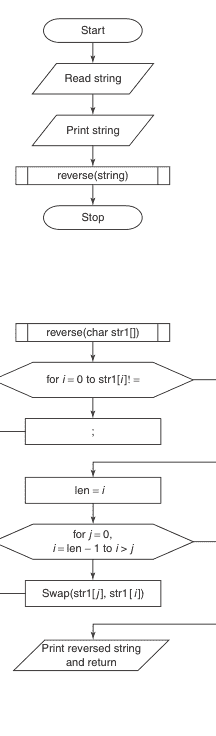

### 程序

```c
#include<stdio.h>
void main()
{
  char str1[20];
  void reverse(char str1[]);
  printf("\n Enter the string to be reversed: ");
  gets(str1);
  printf("\n\n User Entered String: ");
  printf("%s\n",str1);
  reverse(str1); // Function call
}
void reverse(char str1[])
{
  int i,j,len,temp;
  // This loop finds the length of the string.
  for(i=0;str1[i]!='\0';i++)
  {
    ;
  }
  len=i;
  //This loop reverses the string str1 in place.
  for(j=0,i=len-1; i>j; i--,j++)
  {
    temp=str1[i];
    str1[i]=str1[j];
    str1[j]=temp;
  }
  printf("\n Reversed String: ");
  puts(str1);
}
```

#### 输出

- 1. 输入要反转的字符串：KLECET Belgaum  
  用户输入的字符串：KLECET Belgaum  
  反转后的字符串：muagleB TECELK
- 2. 输入要反转的字符串：hello  
  用户输入的字符串：hello  
  反转后的字符串：olleh
- 3. 输入要反转的字符串：Good morning  
  用户输入的字符串：Good morning  
  反转后的字符串：gninrom dooG

### 学习成果

- 能够在不使用额外变量的情况下以最优方式反转字符串。
- 能够为大多数标准字符串库函数编写用户自定义函数。

### 相关程序

#### 程序 1

不使用 strcmp 比较两个字符串的 C 程序。

```c
#include<stdio.h>
#include<string.h>
void main()
{
  char a[100], b[100];
  int result;
  printf("\n Enter the first string: ");
  gets(a);
  printf("\n Enter the second string: ");
  gets(b);
  result=compare(a,b);
  if(result==0)
  printf("\n Entered strings are equal....\n");
  else
  printf("\n Entered strings are not equal.....\n");
}
int compare(char a[],char b[])
{
  int c=0;
  while(a[c]==b[c])
  {
    if(a[c]=='\0'||b[c]=='\0')
    break;
    c++;
  }
  if(a[c]=='\0'&&b[c]=='\0')
  return 0;
  else
  return -1;
}
```

#### 输出

- 1. 输入第一个字符串：welcome  
  输入第二个字符串：welcome  
  输入的字符串相等....  
  按任意键继续 . . .
- 2. 输入第一个字符串：computer concepts  
  输入第二个字符串：c programming  
  输入的字符串不相等.....  
  按任意键继续 . . .
- 3. 输入第一个字符串：good morning  
  输入第二个字符串：good morning  
  输入的字符串相等....  
  按任意键继续 . . .
- 4. 输入第一个字符串：good bad  
  输入第二个字符串：good  
  输入的字符串不相等.....  
  按任意键继续 . . .

#### 程序 2

检查给定字符串是否为回文的 C 程序。

```c
#include<stdio.h>
#include<string.h>
main()
{
char text[100];
int begin, middle, end, length=0;
printf("\n Enter string: ");
gets(text);
    while(text[length]!='\0')
        length++;
        end=length-1;
        middle=length/2;
        for(begin=0;begin<middle;begin++ )
        {
            if(text[begin]!=text[end])
            {
                printf("\n\n String Is Not palindrome....\n\n");
                break;
            }
            end--;
        }
        if (begin==middle)
            printf("\n\n String Is Palindrome...\n\n");
            return 0;
}
```

#### 输出

- 1. 输入字符串：madam  
  字符串是回文...  
  按任意键继续 . . .
- 2. 输入字符串：programming  
  字符串不是回文....  
  按任意键继续 . . .

#### 程序 3

不使用任何内置函数求字符串长度的 C 程序。

```c
#include<stdio.h>
void main()
{
    char str1[20];
    int i,count=0;
    printf("\n Enter the string: ");
    gets(str1);
    for(i=0;str1[i]!='\0';i++)
    {
        count++;
    }
        printf("\n The length of a string is:%d\n",count);
}
```

#### 输出

- 1. 输入字符串：welcome to ccp lab  
  字符串的长度为：18  
  按任意键继续 . . .
- 2. 输入字符串：work is worship  
  字符串的长度为：15  
  按任意键继续 . . .

### 练习程序

- 1. 设计并开发一个交换两个字符串的 C 程序。
- 2. 设计并开发一个从字符串中删除空格、空白的 C 程序。
- 3. 设计并开发一个从字符串中删除元音字母的 C 程序。

## 学期作业 16

设计并开发一个函数 matchany (s1, s2)，它返回字符串 s1 中第一个出现字符串 s2 中任意字符的位置；如果 s1 不包含 s2 中的任何字符，则返回 –1。不要使用完成类似工作的标准库函数！在 main 中针对不同字符串调用函数 matchany (s1, s2)，并打印两个字符串以及函数 matchany (s1, s2) 的返回值。

- 具备使用函数的能力。
- 理解字符串操作。

这里，函数 main( ) 通过传递两个字符串的值调用函数 matchany(s1, s2)。函数 matchany(s1, s2) 使用局部变量处理字符串数组，以查找字符串 s2 中与字符串 s1 中任意字符匹配的字符。如果找到任何匹配字符，则函数 matchany(s1, s2) 将显示匹配字符在 s1 中的位置；否则显示 –1。

开始  
**步骤 1：** 输入 string1  
**步骤 2：** 输入 string2  
**步骤 3：** 调用函数 matchany (str1, str2)  
**步骤 4：** 如果 j = –1，则  
  打印“未找到匹配字符”  
  否则  
  打印“在位置 j 找到匹配”  
  结束 IF  
停止


### matchany 函数的算法

```text
1. FOR i = 0 to str1[i] ≠ Null in steps of 1
   FOR j = 0 to str2[j] ≠ Null in steps of 1
       IF str1[i] = str2[j] then
           Return i + 1
       End IF
   End For
End For
2. Return -1
```

### 流程图

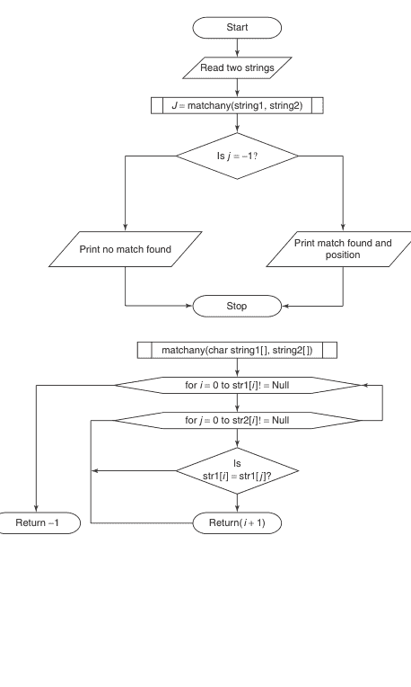

### 程序

```c
#include<stdio.h>
void main()
{
    char str1[20],str2[20];
    int j;
    int matchany(char str1[40],char str2[40]);
    printf("\n Enter The First String : ");
    gets(str1);
    printf("\n Enter The Second String : ");
    gets(str2);
    j=matchany(str1,str2);
    if(j==-1)
    printf("\n No Match Found...\n");
    else
    printf("\n Match Found At Position %d  in str1 And The Character Is : %c\n",j,str1[j-1]);
}
int matchany(char str1[40],char str2[40])
{
    int i,j;
    for(i=0;str1[i]!='\0';i++)
    {
        for(j=0;str2[j]!='\0';j++)
        {
            if(str1[i]==str2[j])
            {
                return(i+1);
            }
        }
    }
    return -1;
}
```

#### 输出

```text
1.
Enter The First String : computer
Enter The Second String : game
Match Found At Position 3 in str1 And The Character Is : m

2.
Enter The First String : book
Enter The Second String : pen
No Match Found...
```

### 成果

- 能够处理字符串和函数。
- 能够编辑并查找给定文本中子字符串出现的频率。
- 能够将此逻辑应用于文本格式和编辑。

### 相关程序

#### 程序 1

C 程序用于检查字符在给定字符串中出现的频率。

```c
#include<stdio.h>
#include<string.h>
main()
{
    char str[100],ch;
    int i,count=0,length;
    printf("\n Enter The String : ");
    gets(str);
    printf("\n Enter the character to be searched : ");
    scanf("%c",&ch);
    length=strlen(str);
    for(i=0;i<length;i++)
    {
        if(str[i]==ch)
            count++;
    }
    printf("\n The frequency of the occurrence of %c is %d\n\n", ch,count);
}
```

#### 输出

```text
1.
Enter The String : computer is an electronic device
Enter the character to be searched : e
The frequency of the occurrence of e is 5

2.
Enter The String : A string is a collection of characters
Enter the character to be searched : a
The frequency of the occurrence of a is 3
```

### 练习程序

1. 设计并开发一个 C 程序，在找到指定字符后显示结果字符串。
2. 设计并开发一个 C 程序，从给定字符串中找到子字符串。
3. 设计并开发一个 C 程序，按字母顺序对名称列表进行排序。

## 常见的 C 编程错误

1. *缺少分号*

   每个 C 语句必须以分号结束。缺少分号可能会导致错误信息。

   **示例：** `a = x + y`

2. *分号误用*

   另一个常见错误是在错误的位置放置分号。

   **示例：**

   ```c
   for (i = 1; i <= 10; i++);
   sum = sum + i;
   ```

3. *未声明的变量*

   C 要求在使用变量之前必须为其类型声明。

4. *scanf 参数中缺少 & 运算符*

   `scanf` 调用中的所有变量都应以 `&` 运算符为前缀。如果变量 code 被声明为整数，则语句：`scanf ("%d",code);` 是错误的。

   正确的是：`scanf ("%d",&code);`

5. *缺少/不匹配的大括号*

   编码深度嵌套循环时，经常会忘记关闭大括号。打开大括号的数量应与关闭大括号的数量相匹配。

6. *使用单个等号检查相等性*

   如果使用单个等号来检查相等性，程序将改为将右侧表达式的值赋给左侧变量。因此，使用 `==` 来检查相等性。

7. *未声明的函数*

   每个被调用的函数都应在调用函数中为其返回的值的类型声明。

8. *缺少引号*

   每个字符串必须用双引号括起来，而单字符常量必须用单引号括起来。

   **示例：** `char ch = 'X' /* X is a character constant */`

   ```c
   char ch = "hello" /* hello is a string */
   ```

9. *越界数组*

   C 中的数组总是从索引 0 开始。这意味着定义为 **示例：** `int a[10]` 的 10 个整数的数组的有效索引是从 0 到 9 而不是 10！

10. *不正确的注释字符*

    每个注释都应以 `/*` 开始并以 `*/` 结束。它们之间的任何内容都会被编译器忽略。

    **示例：**

    ```c
    /* comment line 1
            Statement 1;
            Statement 2;
    /* comment line 2 */
            Statement 3;
            Statement 4;
            ............
    ```

    由于注释行 1 中缺少结束的 `*/`，所有后续语句直到注释 2 中的结束注释 `*/` 都会被忽略。

## 注意事项

1. `int x = 2;`

   ```c
   switch(x)
   {
           case 2: printf("Two\n");
           case 3: printf("Three\n");
   }
   ```

   打印输出：

   ```
   Two
   Three
   ```

   在每个 case 之后放置一个 break 以退出 switch。

2. C 编译器在 `=` 被使用而实际想要 `==` 时通常不会标记错误。

   C 的 `=` 运算符专门用于赋值并返回所赋的值。`==` 运算符专门用于比较并返回一个整数值（*假* 为零，*真* 为非零）。

   **示例：** `int x = 5;`

   ```c
   if (x = 6)
       printf("x equals 6\n");
   ```

   此代码打印出 `x equals 6`。`if` 中的赋值将 x 设置为 6 并返回值为 6 给 `if`。由于 6 不是 0，因此被解释为真。

3. C 中的数组总是从索引 0 开始。这意味着定义为 `int a[10]` 的 10 个整数的数组的有效索引是从 0 到 9 而不是 10！

   学生中非常常见的是使用 `a[10]` 来引用最后一个元素，这可能导致段错误/不可预测的错误。

4. 如果两个操作数都是整数类型，则默认使用整数除法。例如：

   ```c
   double half = 1/2;
   ```

   此代码将 half 设置为 0 而不是 0.5！为什么？因为 1 和 2 是整数常量。

   为修复此问题，将其中至少一个更改为实数常量。

   ```c
   double half = 1.0/2;
   ```

   如果两个操作数都是整数变量并且需要实数除法，则将其中一个变量强制转换为 double（或 float）。

   ```c
   int x = 5, y = 2;
   double d = ((double) x)/y;
   ```

5. 在 C 中，如果没有大括号，循环会重复循环语句之后紧跟的下一个语句。代码：

   ```c
   int x = 5;
   while(x > 0);
   x--;
   ```

   是一个无限循环。为什么？`while` 后的分号将要重复的语句定义为空语句（什么都不做）。删除分号，循环按预期工作。

6. 另一个常见的循环错误是迭代次数过多或过少。仔细检查循环条件！

   ```c
   for(i = 0; i < 10; i++);
   ```

   输出：10

7. 原型告诉编译器函数的重要特征：返回类型和函数的参数。如果没有提供原型，编译器 *假设* 函数返回一个 int 并且可以接受任意数量的任意类型的参数。

8. 在使用标准库函数之前，在程序中包含适当的头文件。

   **示例：** `double x = sqrt(2);` 包含头文件 `math.h`。

## C 编程实验室

### 初学者手册

**Wiley India Pvt. Ltd.**  
4435-36/7, Ansari Road, Daryaganj,  
New Delhi-110 002  
Tel: 91-11-43630000  
Fax: 91-11-23275895  
E-mail: csupport@wiley.com  
Website: www.wileyindia.com

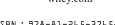

wiley.com

ISBN : 978-81-265-3745-5


