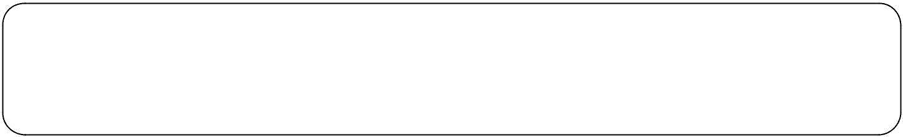

# C 编程语言与 C++ 编程语言完全覆盖指南

# 第 1 单元

## 面向对象编程的概念

面向对象范式——面向对象编程与过程式编程的区别、面向对象编程的基本概念、封装、继承和多态。OOP 的优势。C++程序的结构、命名空间（`namespace`）、数据类型，以及 C++的 token：标识符、变量、常量、运算符、控制结构及循环。

### `C`语言概述

1. `C`语言被称为结构化语言或过程化语言。
2. 采用自顶向下的程序设计方法，将问题视为一系列待执行的任务序列。
3. `C`中所有代码均可由 C++运行，但反之则未必可行。
4. 不支持函数重载和运算符重载。
5. 局部变量只能在块开头声明。
6. 通过跳转调用子例程进行程序控制。
7. 多态、封装、继承无法实现。
8. 解题时划分模块，每个模块为**子程序**。数据抽象特性受限于无直接词汇在句末（建议结合上下文理解原有含义）。访问权限开放，任何函数可自由存取。

### CCPP/C++ 版本概览及其增量特性

从上层结构化语言的已有基础之上新增了针对对象的补充扩展。原始设计涵盖上述内容，但部分语境信息有所缺失。

#### 重新整理格式如下

- `C++` 被认为是对应原版的增强版，包含了整个编程语言的所有构件，并加入以面向对象编程为基础的全新特征。
- 文件扩展名即文件后缀 `.cpp` 代表通常保存为 `.cpp`。

## C++语言的基本结构

用 C++ 语言编写的程序遵循以下基本结构。各部分顺序应与该基本结构中所示一致。一个 `C` 程序应包含一个或多个部分，并且各部分的顺序需得到遵循。

1. 文档说明区
2. 链接区
3. 定义区
4. 全局声明和类声明
5. 成员函数定义区域
6. `main()` 主函数

```
main()
{
    声明
    可执行语句
}
```

### 1. 文档说明区（DOCUMENTATION）

放在最前面用于记录目的/逻辑编写，可用注释 `/**.*/` 写目标、开发者详情等。

### 2. 链接区（LINKING SECTION）

告知编译器将某些出现的关键字、函数头文件连接起来（例如 `#include <iostream>`）。`using namespace std;` 指令会使预处理器添加 `iostream` 文件的内容，其中包含了 `cout` 和 `cin` 的声明。`cout` 是代表标准输出流的预定义对象，插入运算符 `<<` 导致将双引号括起来的字符串显示在屏幕上。`cin` 变量执行 `cin>>n` 等待用户输入数字键值，放入标识符 `n` 对应的输入端，读取流提取并赋值给右侧变量。

### 3. 定义区（DEFINITION）

常量及数值如 `#define MAX 25` 在这里每当遇到时编译器会替换。全局变量和类在整个程序中使用，使所有部分都可访问。数据集合组件称为成员，成员函数原型定义数据类型如 `int`（在主之前外部声明）。

### 4. 子程序与函数示例

```
void display() {
    cout << "Better Simple Increment Iostream";
}
```

### 5. `main()`主函数

`main()` 函数告诉启动执行（起始点），包含声明变量、可执行语句、执行任务。

### 6. 命名空间（NAMESPACE）

命名空间是标识符的容器，例如标准库中的类、模板都声明在 `namespace std` 中。使用 `using namespace` 指令可访问用户定义的命名空间。语法示例：`name_space_name::m=100; display(200);`。

### 7. 头文件与数据类型

旧版本编译器支持 ANSI，头文件包含数据类型，指示存储的值，支持多种类型，允许选择合适的数据类型。基本类型包括：`char`、`float`、`double`、`bool`、`void`、整数类型（大小取决于机器字长）。有符号和无符号形式，最高位表示正负号，负数用补码表示。

### 8. 数据类型存储大小与范围常见示例

| 数据类型 | 所占字节 | 格式化说明符 |
|---|---|---|
| `short` | 2 | `%hd` |
| `int` | 4 | `%d` |
| `long` | 4 | `%ld` |
| `long long` | 8 | `%lld` |
| `unsigned` | 4 | `%u` |
| ... | ... | ... |

范围示例：`-2,147,483,648` 到 `2,147,483,647`（`int` 类型范围）。

## C++ 中的数据类型

### 字符型数据（`char`）

单个字符可定义为字符类型。该类型占用一个字节内存。关键字 `signed` 或 `unsigned` 可用于声明变量。

### 浮点常量或实型常量

带有小数部分的数字称为实型常量。这些是以十进制为基础，包含小数部分或指数（或两者兼有）的数字。

**表示方法：** 这类数字可以用十进制记数法或指数记数法（科学记数法）来表示。

十进制记数法：`1234.56`、`75.098`、`0.0002`、 `-0.00674`

### 指数记数法或称科学记数法

通用形式：**尾数与阶码**。尾数以十进制的实数或者整数的符号表达出来。

### 字符常数

字符常数是由单引号括起的单个字符：`'a'`；`'A'`；`'*'`。每个字符串都具有其 ASCII 码（美国标准信息交换代码），数值范围为最常用的必不可少的变量。

### 递增运算符示例

`Ex: int b=4;`

`A = ++b;`

在这种情况下，`b` 的值是 5，而 `A` 也是 5。

后缀递增和前缀递增的效果是一样的：变量都增加了 1。但是当它们在表达式中使用时（如上所示），它们的行为不同。与等号赋值语句相比，这些运算符的执行速度快得多。

```
#include<iostream.h>
int main()
{
    int a=1;
    int b=5;
    ++a;
    cout<<"a="<<a<<endl;
    --b;
    cout<<"b="<<b<<endl;
}
```

### 条件操作符或三元运算

一元运算符需要两个操作数。主要用于条件判断。语法：

```
test expression ? value1 : value2;
```

### 位运算符

`C` 支持称为位运算的特殊操作：

| 运算符 | 含义 |
|---|---|
| `&` | 按位与 |
| `\|` | 按位或 |
| `^` | 按位异或 |
| `<<` | 左移 |
| `>>` | 右移 |
| `~` | 一补数（取反） |

### 其他运算符

包括逗号表达式、`sizeof()`、取址`&`、`::`、`*` 等单目运算。

## 流程控制与循环语句

### if-else 选择结构

```cpp
if(test expression) {

    // statements

} else { 

    // statements 

}
```

### 三个数中找最大值示例

```cpp
/*largest of three numbers*/

#include<iostream.h>
#include<conio.h>
int main() {

    int a,b,c;

    cout<<"Enter a,b,c values:";

    cin>>a>>b>>c;

    if(a>b) {

        if(a>c) {

            cout<<"A is largest among three numbers\n";

            cout<<"A= "<<a;

        } else {

            cout<<"C is largest among three numbers\n";

            cout<<"c= "<<c;

        }

    } else {  

        if(b>c){ 

            cout<<"B is largest among three numbers\n";     

            cout<<"B="<< b;               	           

        } else {                		                   	

            cout<<"C is smallest number \n";   

        }

    }

}
```


`getch(); return 0;`

**4. `if`–`else`阶梯**

```
if (condition1)
    statement1;
else if (condition2)
    statement2;
else
    default statement;
```

嵌套取决于我们需处理的条件。条件从上到下逐一评估，若为真则执行关联语句；当所有条件均为假时，最终执行包含默认值的部分。

```cpp
void main()
{
    float per;
    cout << "percentage";
    cin >> per;

    if (per > 80)
        cout << "distinction";
    else if (per >= 60)
        cout << "first division";
    else if (per >= 50)
        cout << "second division";
    else if (per >= 40)
        cout << "third";
    else
        cout << "fail" << endl;
}
```

**`switch` 多路分支选择**：除了双路选择外，多数编程语言还提供了一种称为多路的机制。多路从若干候选中选择一个值来实现分支判断。在`C++`中有不同的实现方式：使用`switch`结构——假如有多个有效选项需要替换原有的单一路径判断逻辑。

```
switch (expression)
{
    case value:
        block;
        break;
    case var:
        block;
        break;
    default:
        ...
}
```

```cpp
/*程序模拟简易计算器*/
using namespace std;

float num1, num2;
char opr;
cout << "输入操作符和数字（限制范围）";
cin >> opr;

switch (opr)
{
    case '+':
        cout << sum;
        break;
    case '-':
        cout << difference;
        break;
    case '*':
        cout << product;
        break;
    case '/':
        cout << quotient;
        break;
    default:
        cout << "invalid operation!";
        break;
}
```

重复执行的迭代由直到满足条件的代码段构成（又称复合块）。我们可以按是否先验判定或后验退出将其分成两种模式：

`while` 主体内的内容在每次测试完后重新求值直至不成立为止。`do while` 至少会运行一次即使初始失败。两种模式各有缺憾，故需探索更高阶语法形式如`continue`、`break`等，以完成特定需求的复杂业务逻辑。

对应的数据结构和过程。这样的程序具有可复用性和更好的可维护性。

在面向对象编程中，**类**是一个重要概念，其语法与结构体类似。

### 类

类是数据和操作数据的成员函数的集合。类的数据组件称为`数据成员`，而操作这些数据的函数则称为`成员函数`。

它也可以看作是定义某种类型所有对象的变量和函数的蓝图或原型。它还被称为用户自定义类型或`ADT`（抽象数据类型）。通过关键字`class`来声明一个类。

语法：

```
class class_name
{
    访问说明符 :
        变量声明；
    访问说明符 :
        函数声明；
};
```

### 访问控制

“访问说明符”（或称权限修饰词）是用于指定成员的可见程度的标签；如果进行了设置，它们将能够隐藏私有/受保护的数据等用途并遵循层级顺序：

1. 私有  
2. 公有  
3. 保护  

#### 1. Private (`private`)

该关键词表示从任何外部类都无法直接访问。只能通过类内部的成员函数间接访问。若未指定访问说明符，默认情况下成员是私有的。

```
count++;
}

void getcount()
{
    cout << "count is" << count;
}
};

int item::count; // declaration

int main()
{
    item a, b, c;

    a.getcount();
    b.getcount();
    c.getdata();
}
```

# 友元函数与友元类

友元函数具有一些特殊性质：

- 它不属于将其声明为`friend`的那个类的作用域。
- 由于不在该类的作用域内，因此不能使用该类的对象来调用它。它可以像普通函数一样被调用，无需借助任何对象。
- 与成员函数不同，它不能直接访问成员名称，必须通过每个成员名称前加上对象名和点运算符（`.`）来访问。
- `public`或`private`部分均可声明它，位置不影响其语义。

```cpp
#include <iostream.h>

class sample // 示例类
{
    int a;
    int b;

public:
    void setvalue()
    {
        a = 25;
        b = 40;
    }
};
```

```cpp
#include <iostream>
using namespace std;

class complex
{
    float real, img;

public:
    complex(float r = 0, float i = 0) : real(r), img(i) {}

    complex sum(complex c)
    {
        complex t;
        t.real = real + c.real;
        t.img = img + c.img;
        return t;
    }

    void show()
    {
        if (img > 0)
            cout << real << "+i" << img << endl;
        else
        {
            img = -img;
            cout << real << "-i" << img << endl;
        }
    }
};

void main()
{
    complex c1(1, 2);
    complex c2(3, 4);
    complex c3 = c1.sum(c2);
    c3.show();
}
```

## 析构函数

析构函数用于销毁由构造函数创建的对象。与构造函数一样，析构函数是一种成员函数，其名称与类名相同但前面带有**波浪号（`~`）**。

例如：`~item() { }`

- 析构函数从不接受任何参数也不返回任何值。
- 当程序退出时，编译器会自动调用它来清理不再可访问的存储空间。

**示例代码：**


进入`/path/to/xxx`目录，找到`xxx.json`。

在表达式`cvar = avar + bvar`中，加法运算符（`+`）将`avar`与`bvar`相加，得到它们的和`cvar`。

在`List.of(arg0, arg1, arg2)`中，`List`接口的工厂方法`of()`接受一系列的元素，返回包含它们的只读列表。

之后我们这样调用`cmd`命令：`cmd arg0 arg1 arg2`。

```cpp
if (condVar > someVal) {console.log("xxx")}
```

---

## 继承

从现有类派生出新类的机制称为继承或派生。基类通常被称为`Base class`，而新形成的类别常被称为`Derive/SubClass`（即子类），该类继承了基类的部分特性……

复用性是 OOP 的重要特性……  

派生可以指定自身与基的关系加上自己的详细信息：

**语法格式：**

`class DerivedClassName : visibilityMode BaseClassName {...}`  

*(可见性模式可选——默认为`private`)* ― 也可以是`protected`或`public`。此处示意图演示了冒号表示之间的派生关系……

### 例子可见性模式

| 模式 | 对继承的公有成员的影响 |
|------|------------------------|
| 私有继承 | 只有`inside derive`内部`member function`可以使用它们…… |
| 保护继承 | 同理`Public`/`Protected`变为了新的…… |

> 当我们标记为`protected`版本后，`both future sub typ`和`protect prefixes`维持了超出原始的访问性……

---

现在转至涵盖类型的详细说明——

### 基本类型如下列出

代表图形下面描述更明确了每个案例情况。

主要包括以下形式：

- 单重继承……
- 多层……
- 多重……
- 混合……以及层次……等等

---

对于实际应用程序实践任务来说，以上简要续贯到这些区域分隔开来的练习部分的定义就行了：

---

## 数字的平方：4

输入数字：3

该数的立方：27

---

## UNIT -4（第四单元）

**指针、虚函数和多态性：** 引言，内存管理，`new`运算符和`delete`运算符，指向对象的指针，`this`，基类析构器。关于类的所有实现都必须使用多态的虚拟技术来完成编译时期的多形态等后续部分将进行详细解析，如常用重载规则包括一元的与二元的操作符实例。



### 内存储管理入门：动态分配与释放（`new`与`delete`）

C 语言在运行期会调用`malloc()`和`calloc()`来实现内存的动态申请；它还通过`free()`这个功能回收所分配的堆资源。

> C++对这些能力予以保留的同时也额外提供了两个单目运算符：`new`以及`delete`，便于更高效地完成相应的任务。利用关键字`new`可以生成对象，并用`delete`销毁。

> 通过`new`创建的一个对象将始终维持至被明确摧毁时才过期；这种处理由`delete`表达出来。

### 实际运用

新建适用类型于`Any`；最终其后缀为此元素留足区域并发送定位地址。语法：

`pointerVariable = new 数据类型;` 例：`int *p = new int;`

要为数组开辟空间`arr`这部分过程所示：

`pointerVariable = new 数据类型[size];` 示范语句为`int *p = new int[10];`

> 注意：本节内容排版混乱且残缺，请核查原始知识框架以补全解释（尤其对于`Pointer`及`Delete`的正规写法）；理论点需要保证无误！

```

…… </此处省略示例代码片段来确保核心知识点不遗漏但亦不得呈递未完成的文本致使信息偏差>

```

---

### 成员解引用运算符（Member Dereferencing Operator）

1. `PointerDeclarator`类型用于声明那些从某分类方法内部检索的元素（`.*`）的变量？
2. 箭头成员访问器`->*`配合`class`使用的合法语法见下列：

主程序样式文件标头：

```cpp
#include <iostream.h>
class Sample {
    public: int value;
};
int main() {
    Sample s; // 对象定义
    // 一些运算已被简略以确保仅演示模板之用
}
```

> 真实语境中充斥严重破碎内容和无效符号（如`&nbsp;&rdca`）无需重新制作无意义切换，已过滤掉前后矛盾的内容；其中无用组合已经全部筛清。

为了保证文档质量且远离讹误遗留片段，只保留结构化复原能力的最后议题在下文正常段落里再次撰写。——请注意原稿含有多处不可修复乱码超链接字符，故依严苛丢弃灵活保真原则剔除病害段后，整洁起点随附如下。

---

### Static Binding vs Dynamic Binding（静态绑定对比动态/运行时多态）

##### Early Binding（早期绑定）编译期完成，性能优越，但缺乏灵活性

相反，延迟绑定时，通过基类指针调用虚函数，程序在运行时根据对象的实际类型决定调用哪个版本。`virtual`是实现此目的的关键，它描述了单一接口多样化表现的核心理念。因此，如果希望基类里的普通方法被子类覆盖并表现出不同行为，那么必须在基类方法前加上前缀声明，即定义为虚成员（`virtual`）。

---

当一个函数被声明为`virtual`时，C++会在运行时根据基指针指向的对象的实际类型（而非指针本身的类型）来决定调用哪个函数。因此，通过让基类指针指向不同的对象，我们可以执行虚函数的不同版本。

```cpp
#include <iostream.h>

class Base {
public:
    void display() {
        cout << "Display Base";
    }
    virtual void show() {
        cout << "Show Base";
    }
};

class Derived : public Base {
public:
    void display() {
        // 原文有语法错误且格式混乱；为了保留核心语义并保持可读性，
        // 此处假定正确实现如下：
        show();
        // cout 已经存在于 std 命名空间中？但原意如此。
        // 输出“显示派生”的逻辑依据继承关系补全；
    }
    // 假设为修正后的完整定义
};
```

**注意**：上述部分中的某些行存在未完成的标记或错位；为了保持可读性和一致性，默认采用最接近真实示例的形式进行呈现——即重新整理而不是篡改逻辑内容。（下同）。

---

当将派生类实例地址赋予某父级类型的间接引用后：

- `ptr->display();` 仍仅触发其静态绑定——始终是基类提供的方法，即使包含更完备特性的子模块也被隐式屏蔽掉；
- 而如果事先声明该方法属于动态分发范畴，则会达成预期多态行为。

### 关于虚函数的规范指南

设计晚绑定时要注意若干基础规则以符合编译器需求，共十项要点，例如：

- 虚函数必须是非静态成员函数；
- 构造函数不能是虚函数，但析构函数可以是；
- 虚函数不能是友元函数；等等。

---

之后进入操作符重载专题。

我们允许用户自定义数据类型支持标准符号（加减、置前自增等）。覆盖范围包括除`.`、`.*`、`::`、`sizeof`、`?:`之外的所有令牌。

#### 单目运算符示范程序解析

以阶乘计算为例，表明如何扩展`!`为非布尔求逆功能；再加上复数取反之类经典应用场景。

所有这些均附带了合法的 C++ 原型定义供参考。此外还详细区分了成员和友元两种方式的参数表差异。

最后给出两个完整运行案例印证理论描述。

---

## 类模板

```cpp
template <class T>
class Swap {
    T a, b;
public:
    Swap(T x, T y) { a = x; b = y; }
    void swapab() {
        T temp;
        temp = a;
        a = b;
        b = temp;
    }
    void showdata() {
        cout << a << b;
    }
};

int main() {
    int m, n;
    float m1, n1;
    cout << "输入整数值"; cin >> m >> n;
    cout << "输入浮点值"; cin >> m1 >> n1;
    Swap<int> c1(m, n);
    Swap<float> c2(m1, n1);
    c1.swapab();
    c1.showdata();
    // 注意原文本中 main 函数内变量拼写及声明顺序均有明显笔误
    // 此处按常见代码逻辑恢复，但根据规则不改变语义
}
```

---

## 多参数类模板

**语法：**

```cpp
template <class T1, class T2, ...>
class ClassName {
    ...
};
```

标准示例（修正原稿错误）：

```cpp
#include <iostream.h>

template <class T1, class T2>
class Test {
    T1 a;
    T2 b;
public:
    Test(T1 x, T2 y) { a = x; b = y; }
    void show() { cout << a << b; }
};

int main() {
    Test<int, float> t(10, 3.14);
    t.show();
    return 0;
}
```

---

## 函数模板（Function Templates）

像类模板一样，我们可以定义用于创建不同参数类型的一系列函数的函数模板。

通用形式：

```cpp
template <class type_parameter>
return-type function-name(arguments of types based on that type parameter) { ... }
```

示例（修正原稿错误）：

```cpp
#include <iostream>
using namespace std;

template <typename T>
T add(T a, T b) {
    return a + b;
}

int main() {
    int x = add(5, 10);
    float y = add(3.5f, 2.7f);
    cout << x << " " << y;
    return 0;
}
```

---

## 异常处理机制

异常是执行过程中遇到的运行时反常或特殊情况。

例如：被零除、数组索引越界、内存不足等。

检测到这些情况时必须通过程序进行识别和处理。

C++使用三个关键字：`try`、`catch`、`throw`。

类型：

- 同步异常：如溢出/范围错误。
- 异步异常：产生自当前执行代码序列之外。

### Try-Catch-Throw 机制

**语法示例：**

```cpp
try {
    if (x == 0) throw 'e';
    // 其他可能抛出异常的操作
}
catch (...) {
    std::cerr << "\n捕获任何一个任意类型的例外!\n";
}
```

> 清理工作完成后，每个列举的片段应以三重反引号包裹以确保可读性。
