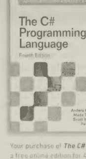

# C# 编程语言（涵盖 C# 4.0）


由 Internet Archive 于 2023 年数字化，资金来自
Kahle/Austin Foundation

## 序言

自 2000 年夏季 .NET 发布以来，已过去十年。对我而言，.NET 的意义在于托管代码用于本地执行与 XML 消息用于程序间通信的二合一组合。当时我并没有意识到 C# 会变得多么重要。

自 .NET 诞生以来，C# 就为开发者理解和交互 .NET 提供了主要视角。问一个普通的 .NET 开发者值类型和引用类型有什么区别，他或她会很快说“结构体 vs 类”，而不是“派生自 System.ValueType 的类型 vs 不派生的类型”。为什么？因为人们使用语言——而不是 API——来向运行时以及更重要的是彼此传达自己的想法和意图。

很难夸大一个优秀的语言对整个平台成功的重要性。C# 最初很重要，因为它确立了人们思考 .NET 的基准。随着 .NET 的演进，它变得更加重要，因为诸如迭代器和真正的闭包（也称为匿名方法）等特性是以 C# 编译器实现的纯语言特性形式引入给开发者的，而不是平台原生特性。C# 是 .NET 创新核心的事实在 C# 3.0 中变得更加明显，引入了标准化的查询运算符、紧凑的 lambda 表达式、扩展方法和对表达式树的运行时访问——同样，所有这些都由语言和编译器的开发驱动。C# 4.0 中最重要的特性动态调用，也在很大程度上是语言和编译器的特性，而非对 CLR 本身的更改。

谈论 C# 而不谈论其发明者兼常驻守护者 Anders Hejlsberg 是困难的。在 C# 3.0 设计周期期间，我有幸参加了为期几个月的定期 C# 设计会议，观看 Anders 工作令人大开眼界。他对开发者会喜欢什么、不喜欢什么的直觉堪称世界级——与此同时，Anders 对其设计团队极具包容性，并能实现最佳设计。

尤其是在 C# 3.0 中，Anders 拥有一种近乎不可思议的能力，能将函数式语言社区的关键思想变得易于大众理解。这绝非易事。Guy Steele 曾说过关于 Java 的话：“我们不是要赢得 Lisp 程序员；我们瞄准的是 C++ 程序员。我们成功地把他们中的很多人拉到了 Lisp 的半路上。”当我看 C# 3.0 时，我认为 C# 已经成功地把至少一名 C++ 开发者（我）拉到了剩下的大部分路程。C# 4.0 通过增加无需依赖静态类型定义即可干净地编写程序的能力，向 Lisp（以及 JavaScript、Python、Ruby 等）迈出了下一步。

C# 再好，人们仍然需要一份用自然语言（本例中为英语）和某种形式化方法（BNF）写成的文档来理解其细微之处，并确保我们都在说同一种 C#。你手中的这本书就是那份文档。根据我自己的经验，我可以肯定地说，每一位阅读它的 .NET 开发者都会至少有一次“恍然大悟”的时刻，并因此成为更好的开发者。

祝阅读愉快。

Don Box
*雷德蒙，华盛顿*
*2010 年 5 月*

## 前言

C# 项目始于 12 多年前，1998 年 12 月，目标是为当时全新且尚未命名的 .NET 平台创建一个简单、现代、面向对象且类型安全的编程语言。此后，C# 取得了长足的发展。该语言现在被超过一百万名程序员使用，并已发布了四个版本，每个版本都增加了若干主要新特性。

本书也已出版至第四版。它提供了 C# 编程语言的完整技术规范。本最新版包含前几版中未出现过的两种新材料。最显著的是，当然，它已更新以涵盖 C# 4.0 的新特性，包括动态绑定、命名参数和可选参数，以及协变和逆变泛型类型。本次修订的总体主题是让 C# 更开放地与 .NET 环境之外的对象进行交互。正如 C# 3.0 中的 LINQ 让用于访问外部数据源的代码具有语言集成感一样，C# 4.0 的动态绑定使得与例如 Python、Ruby 和 JavaScript 等动态编程语言中的对象的交互感觉像是 C# 的原生特性。

本书前一版引入了知名 C# 专家撰写的注释的概念。我们对这一特性收到了持续热情的反馈，我们非常高兴能够在全书中提供来自新老注释者深入而有趣的见解、指导、背景和视角的新一轮内容。我们很高兴看到注释继续补充核心内容并帮助 C# 特性栩栩如生。

许多人参与了 C# 语言的创建。C# 1.0 的语言设计团队由 Anders Hejlsberg、Scott Wiltamuth、Peter Golde、Peter Sollich 和 Eric Gunnerson 组成。对于 C# 2.0，语言设计团队由 Anders Hejlsberg、Peter Golde、Peter Hallam、Shon Katzenberger、Todd Proebsting 和 Anson Horton 组成。

此外，C# 和 .NET 通用语言运行时中泛型的设计和实现基于 Microsoft Research 的 Don Syme 和 Andrew Kennedy 构建的“Gyro”原型。C# 3.0 由 Anders Hejlsberg、Erik Meijer、Matt Warren、Mads Torgersen、Peter Hallam 和 Dinesh Kulkarni 设计。C# 4.0 的设计团队包括 Anders Hejlsberg、Matt Warren、Mads Torgersen、Eric Lippert、Jim Hugunin、Lucian Wischik 和 Neal Gafter。

无法一一感谢所有影响 C# 设计的人，但我们依然对他们所有人表示感激。没有好东西是在真空中设计的，我们从庞大而热情的开发者社区收到的持续反馈是无价的。

C# 曾是也是我们工作过的最具挑战性和最令人兴奋的项目之一。我们希望你使用 C# 的乐趣与我们创造它时的乐趣一样多。

Anders Hejlsberg  
Mads Torgersen  
Scott Wiltamuth  
Peter Golde  

*西雅图，华盛顿*
*2010 年 9 月*

## 关于作者

**Anders Hejlsberg** 是编程界的传奇人物。他是 C# 语言的架构师，也是微软技术院士。他于 1996 年加入微软公司，此前在 Borland 拥有 13 年职业生涯，曾担任 Delphi 和 Turbo Pascal 的首席架构师。

**Mads Torgersen** 是微软公司的 C# 语言项目经理，负责日常语言设计流程并维护语言规范。

**Scott Wiltamuth** 是微软公司 Visual Studio Professional 团队的项目管理总监。在微软，他曾参与广泛的开发工具工作，包括 OLE 自动化、Visual Basic、Visual Basic for Applications、VBScript、JScript、Visual J++ 和 Visual C#。

**Peter Golde** 是原微软 C# 编译器的主要开发者。作为标准化 C# 的 ECMA 委员会中主要的微软代表，他领导了编译器的实现并参与了语言设计。他目前是微软公司的架构师，从事编译器工作。


## 关于注释者

**Brad Abrams** 是 Microsoft Corporation 公共语言运行时（Common Language Runtime）和 .NET Framework 两个团队的创始成员，最近担任 WCF 和 WF 的项目管理总监。Brad 自 1998 年起一直参与 .NET Framework 的部分设计工作，当时他通过构建作为 .NET Framework 核心部分发布的 BCL（基类库）开启了自己的框架设计生涯。Brad 于 1997 年毕业于北卡罗来纳州立大学，获得计算机科学学士学位。Brad 的著作包括：*框架设计指南（第二版）*（Addison-Wesley，2009）和 *.NET Framework 标准库注释参考*（第 1、2 卷）（Addison-Wesley，2006）。

**Joseph Albahari** 是 *C# 4.0 技术手册*（O’Reilly，2007）、*C# 3.0 袖珍参考*（O’Reilly，2008）和 *LINQ 袖珍参考*（O’Reilly，2008）的合著者。他在医疗、教育和电信行业拥有 17 年作为高级开发人员和软件架构师的经验，并且是 LINQPad 的作者，该工具用于以 LINQ 交互式查询数据库。

**Krzysztof Cwalina** 是 Microsoft .NET Framework 团队的首席架构师。他在 Microsoft 开始职业生涯，为 Framework 的第一个版本设计 API。目前，他领导制定、推广并将设计与架构标准应用于 .NET Framework 开发的工作。他是 *框架设计指南*（Addison-Wesley，2005）的合著者。可通过其博客 http://blogs.msdn.com/kcwalina 联系他。

**Jesse Liberty**（“Silverlight 极客”）是 Microsoft 的高级项目经理，也是多本畅销编程书籍和数十篇热门文章的作者。他还是全球活动的常邀演讲者。他的博客 http://JesseLiberty.com 是 Silverlight、WPF 和 Windows Phone 7 开发者的必读内容。Jesse 拥有二十多年实际编程经验，包括在花旗银行担任副总裁以及在 AT&T 担任杰出软件工程师的经历。可通过其博客联系他，并在 @JesseLiberty 关注他。

**Eric Lippert** 是 Microsoft C# 编译器团队的高级开发人员。他参与过 Visual Basic、VBScript、JScript 和 C# 语言以及 Visual Studio Tools For Office 的设计与实现。他关于所有这些主题及更多内容的博客见 http://blogs.msdn.com/EricLippert。

**Christian Nagel** 是 Microsoft 区域总监和 MVP。他著有数本书，包括 Professional C# 4 with .NET 4（Wrox，2010）和 Enterprise Services with the .NET Framework（Addison-Wesley，2005）。作为 CN innovation 的创始人和 thinktecture 的合伙人，他就各种 Microsoft .NET 技术对软件开发人员进行培训和指导。可通过 http://www.cninnovation.com 联系 Christian。

**Vladimir Reshetnikov** 是 Visual C# 的 Microsoft MVP。他拥有八年多软件开发经验，以及约六年的 Microsoft .NET 和 C# 经验。可通过其博客 http://nikov-thoughts.blogspot.com 联系他。

**Marek Safar** 是 Novell C# 编译器团队的首席开发人员。过去五年中，他一直致力于 Mono C# 编译器的大部分功能。可通过其博客 http://mareksafar.blogspot.com 联系他。

**Chris Sells** 是 Microsoft Corporation 业务平台部门（即 SQL Server 部门）的项目经理。他写过数本书，包括 Programming WPF（O'Reilly，2007）、Windows Forms 2.0 Programming（Addison-Wesley，2006）和 ATL Internals（Addison-Wesley，1999）。闲暇时，Chris 主持各种会议，并在 Microsoft 内部产品团队讨论列表中频频发言，颇有点招人烦。有关 Chris 及其各种项目的更多信息，请访问 http://www.sellsbrothers.com。

**Peter Sestoft** 是丹麦哥本哈根信息技术大学的软件开发教授。他于 2003 年至 2006 年担任 ECMA International C# 标准化委员会成员，并著有 C# Precisely（MIT Press，2004）和 Java Precisely（MIT Press，2005）。可在 http://www.itu.dk/people/sestoft 找到他。

**Jon Skeet** 是 C# in Depth（Manning，2010）的作者，也是一名 C# MVP。他在伦敦的 Google 工作，闲暇时撰写和演讲有关 C# 的内容。他的博客位于 http://msmvps.com/jon.skeet——或者你大多数日子都能在 Stack Overflow（http://stackoverflow.com）上找到他回答问题。

**Bill Wagner** 是 SRT Solutions 的创始人、Microsoft 区域总监和 C# MVP。他职业生涯的绝大多数时间都在花括号之间度过。他著有 Effective C#（Addison-Wesley，2005）和 More Effective C#（Addison-Wesley，2009），曾担任 Visual Studio Magazine 的 C# 专栏作家，并为 MSDN 的 C# 开发者中心撰稿。可在 http://srtsolutions.com/blogs/billwagner 了解他在 C# 及其他主题上不断发展的想法。

## 1. 引言

C#（读作“See Sharp”）是一种简单、现代、面向对象且类型安全的编程语言。C# 源于 C 语言家族，C、C++ 和 Java 程序员会立即感到熟悉。C# 由 ECMA International 标准化为 *ECMA-334* 标准，并由 ISO/IEC 标准化为 *ISO/IEC 23270* 标准。Microsoft 的 .NET Framework C# 编译器是这两个标准的符合性实现。

C# 是一种面向对象语言，但 C# 进一步包含对*面向组件*编程的支持。当代软件设计越来越依赖以自包含、自描述的功能包形式出现的软件组件。此类组件的关键在于：它们提供包含属性、方法和事件的编程模型；它们具有提供组件声明性信息的特性；并且它们包含自己的文档。C# 提供直接支持这些概念的语言构造，使 C# 成为创建和使用软件组件的非常自然的语言。

若干 C# 特性有助于构建健壮且持久的应用：*垃圾回收*会自动回收未使用对象占用的内存；*异常处理*提供了一种结构化且可扩展的错误检测与恢复方法；而语言的*类型安全*设计使以下情况不可能发生：从尚未初始化的变量读取、索引超出数组边界，或执行未检查的类型转换。

C# 具有*统一类型系统*。所有 C# 类型（包括 int 和 double 等基元类型）都继承自单一的根对象类型。因此，所有类型共享一组公共操作，任何类型的值都能以一致的方式存储、传输和操作。此外，C# 同时支持用户定义的引用类型和值类型，既允许动态分配对象，也允许内联存储轻量级结构。

为确保 C# 程序和库能够以兼容方式随时间演进，C# 设计非常重视*版本控制*。许多编程语言很少关注这一问题。因此，当引入依赖库的较新版本时，用这些语言编写的程序会比必要情况下更频繁地中断。C# 设计中直接受版本控制考虑影响的方面包括：单独的 virtual 和 override 修饰符、方法重载解析规则，以及对显式接口成员声明的支持。

本章其余部分介绍 C# 语言的基本特性。尽管后续章节会以注重细节、有时偏数学化的方式描述规则和例外情况，本章则力求清晰简洁，并以牺牲完整性为代价。其目的是向读者提供该语言的入门介绍，以帮助编写早期程序并阅读后续章节。

> **CHRIS SELLS** 我完全愿意接受“现代、面向对象且类型安全”的说法，但 C# 已经远不如从前那么简单了。不过，鉴于该语言在 C# 2.0 中获得了泛型和匿名委托等功能，在 C# 3.0 中获得了 LINQ 相关特性，在 C# 4.0 中获得了动态值，程序本身变得更简单、更易读、更易维护——这应当是任何编程语言的目标。

> **ERIC LIPPERT** C# 也日益成为一种函数式编程语言。类型推断、lambda 表达式和单子查询推导等功能，使传统的面向对象开发人员能够运用函数式语言中的这些思想来增强语言的表达力。

> **CHRISTIAN NAGEL** C# 并非纯面向对象语言，而是一种随时间不断扩展、以便在 C# 的主要应用领域提高生产力的语言。用 C# 3.0 编写的程序可能看起来与用 C# 1.0 编写的程序完全不同，前者带有函数式编程构造。

> **JON SKEET** C# 的某些方面确实随着时间推移使这门语言更具函数式特征——但与此同时，C# 3.0 中的自动实现属性和对象初始值设定项都在鼓励可变性。未来版本是否会引入鼓励不可变性的特性，并支持元组、模式匹配和尾递归等其他领域，将很值得关注。

> **BILL WAGNER** 自 C# 规范第一版以来，本节内容一直没有变化。显然，这门语言已经发展壮大并增加了新的惯用法——但 C# 仍然是一门平易近人的语言。这些高级特性始终触手可及，但并非每个程序都需要它们。即使 C# 变得越来越强大，对于经验不足的开发人员来说，它仍然容易上手。


### 1.1 Hello, World

“Hello, World”程序传统上用于介绍一种编程语言。下面是 C# 中的版本：

```csharp
using System;
class Hello
{
    static void Main() {
        Console.WriteLine("Hello, World");
    }
}
```

C# 源文件通常具有 .cs 文件扩展名。假设“Hello, World”程序存储在文件 hello.cs 中，则可以使用 Microsoft C# 编译器通过以下命令行编译该程序

```
csc hello.cs
```

这会生成名为 hello.exe 的可执行程序集。此应用程序运行时的输出为

```
Hello, World
```

“Hello, World”程序以一个引用 System 命名空间的 using 指令开头。命名空间提供了一种分层方式来组织 C# 程序和库。命名空间包含类型和其他命名空间——例如，System 命名空间包含许多类型，例如程序中引用的 Console 类，还包含许多其他命名空间，例如 IO 和 Collections。引用给定命名空间的 using 指令允许在不加限定的情况下使用该命名空间中的成员类型。由于有 using 指令，程序可以使用 Console.WriteLine 作为 System.Console.WriteLine 的简写。

“Hello, World”程序声明的 Hello 类只有一个成员，即名为 Main 的方法。Main 方法使用 static 修饰符声明。虽然实例方法可以使用关键字 this 引用特定的封闭对象实例，但静态方法运行时不引用特定对象。按照约定，名为 Main 的静态方法充当程序的入口点。

程序输出由 System 命名空间中 Console 类的 WriteLine 方法产生。该类由 .NET Framework 类库提供，默认情况下，Microsoft C# 编译器会自动引用这些类库。请注意，C# 本身没有单独的运行时库。相反，.NET Framework 就是 C# 的运行时库。

> **布拉德·艾布拉姆斯** 有趣的是，Console.WriteLine() 只是 Console.Out.WriteLine 的快捷方式。Console.Out 是一个属性，它返回 System.IO.TextWriter 基类的一个实现，该实现旨在向控制台输出。前面的示例可以同样正确地写成如下形式：
>
> ```csharp
> using System;
> class Hello
> {
>     static void Main() {
>         Console.Out.WriteLine("Hello, World");
>     }
> }
> ```
>
> 在框架设计的早期，我们密切关注 C# 语言规范的这一节究竟要如何编写，以此作为语言复杂度的风向标。我们选择在 Console 上添加这个便利重载，使“Hello, World”更容易编写。从各方面看，这似乎已经取得了成效。事实上，如今几乎看不到对 Console.Out.WriteLine() 的调用。

### 1.2 程序结构

C# 中的关键组织概念是程序、命名空间、类型、成员和程序集。C# 程序由一个或多个源文件组成。程序声明类型，类型包含成员，并且可以组织到命名空间中。类和接口是类型的示例。字段、方法、属性和事件是成员的示例。C# 程序编译时，会被物理打包为程序集。程序集通常具有 .exe 或 .dll 文件扩展名，具体取决于它们实现的是应用程序还是库。

示例

```csharp
using System;
namespace Acme.Collections
{
    public class Stack
    {
        Entry top;
        public void Push(object data) {
            top = new Entry(top, data);
        }
        public object Pop() {
            if (top == null) throw new InvalidOperationException();
            object result = top.data;
            top = top.next;
            return result;
        }
        class Entry
        {
            public Entry next;
            public object data;
            public Entry(Entry next, object data) {
                this.next = next;
                this.data = data;
            }
        }
    }
}
```

在名为 Acme.Collections 的命名空间中声明一个名为 Stack 的类。此类的完全限定名是 Acme.Collections.Stack。该类包含若干成员：名为 top 的字段、两个名为 Push 和 Pop 的方法，以及名为 Entry 的嵌套类。Entry 类还包含三个成员：名为 next 的字段、名为 data 的字段和一个构造函数。假设示例的源代码存储在文件 acme.cs 中，则命令行

```
csc /t:library acme.cs
```

将示例编译为库（没有 Main 入口点的代码），并生成名为 acme.dll 的程序集。

程序集包含以中间语言 (IL) 指令形式表示的可执行代码，以及以元数据形式表示的符号信息。在执行之前，程序集中的 IL 代码会由 .NET 公共语言运行时的即时 (JIT) 编译器自动转换为处理器特定的代码。

由于程序集是包含代码和元数据的自描述功能单元，因此 C# 中不需要 #include 指令和头文件。特定程序集中包含的公共类型和成员，只需在编译程序时引用该程序集，便可在 C# 程序中使用。例如，此程序使用 acme.dll 程序集中的 Acme.Collections.Stack 类：

```csharp
using System;
using Acme.Collections;

class Test
{
    static void Main() {
        Stack s = new Stack();
        s.Push(1);
        s.Push(10);
        s.Push(100);
        Console.WriteLine(s.Pop());
        Console.WriteLine(s.Pop());
        Console.WriteLine(s.Pop());
    }
}
```

如果程序存储在文件 test.cs 中，那么编译 test.cs 时，可以使用编译器的 /r 选项引用 acme.dll 程序集：

```
csc /r:acme.dll test.cs
```

这会创建一个名为 test.exe 的可执行程序集，运行时将产生以下输出：

```
100
10
1
```

C# 允许将程序的源文本存储在多个源文件中。编译多文件 C# 程序时，所有源文件会一起处理，并且源文件可以自由地相互引用——从概念上讲，就好像所有源文件在处理之前被连接成一个大文件。C# 中永远不需要前向声明，因为除极少数例外，声明顺序无关紧要。C# 不限制一个源文件只能声明一个公共类型，也不要求源文件的名称与源文件中声明的类型匹配。

> 埃里克·利珀特 这与 Java 语言不同。此外，C# 中声明顺序无关紧要这一事实也与 C++ 语言不同。

> 克里斯·塞尔斯 请注意，前一个示例中的 using Acme.Collections 语句看起来像 C 风格的 #include 指令，但其实不是。它只是为了命名方便，以便编译器遇到 Stack 时，有一组命名空间可供查找该类。如果此示例使用完全限定名，编译器也会采取相同的操作：
>
> ```
> Acme.Collections.Stack s = new Acme.Collections.Stack();
> ```

### 1.3 类型和变量

C# 中有两种类型：值类型和引用类型。值类型的变量直接包含其数据，而引用类型的变量存储对其数据的引用，后者称为对象。对于引用类型，两个变量可以引用同一个对象，因此对一个变量的操作可能会影响另一个变量所引用的对象。对于值类型，每个变量都有自己独立的数据副本，对一个变量的操作不可能影响另一个变量（ref 和 out 参数变量除外）。

> **乔恩·斯基特** 为引用类型选择“reference”这个词也许并不妥当。在考虑参数传递中按引用传递和按值传递语义的区别时，它导致了大量混淆（或者至少是沟通不畅）。
>
> 值类型和引用类型之间的区别可能是教 C# 初学者时最重要的一点：在理解这一点之前，几乎其他所有内容都说不通。

> **埃里克·利珀特** 关于值类型最常见的误解可能是：它们“存储在栈上”，而引用类型“存储在堆上”。首先，这种行为是运行时的实现细节，而不是语言本身的事实。其次，它对初学者没有任何解释作用。第三，这种说法是错误的：是的，与引用类型实例关联的数据存储在堆上，但这些数据可以包含值类型的实例，因此值类型有时也存储在堆上。第四，如果值类型和引用类型的区别在于它们的存储细节，那么 CLR 团队就会把它们称为“栈类型”和“堆类型”。真正的区别在于：值类型按值复制，引用类型按引用复制；运行时如何分配存储来实现生存期规则，在绝大多数主流编程场景中并不重要。

> **比尔·瓦格纳** C# 迫使你为类型做出重要决定：采用值语义还是引用语义。使用你的类型的开发人员无法在每次使用时做出该决定（就像他们在 C++ 中那样）。你需要考虑类型的用法模式，并在这两种类型之间做出谨慎决定。

> **弗拉基米尔·列舍特尼科夫** C# 还支持不安全指针类型，本规范末尾将对此进行描述。它们被称为“不安全”，是因为疏忽使用它们可能以编译器无法捕获的方式破坏类型安全。


## 1. 引言

C# 的值类型进一步分为*简单类型*、*枚举类型*、*结构类型*和*可空类型*。C# 的引用类型进一步分为*类类型*、*接口类型*、*数组类型*和*委托类型*。

下表概述了 C# 的类型系统。

| 类别 | 类型 | 说明 |
|---|---|---|
| 值类型 | 简单类型 | 有符号整型：`sbyte`、`short`、`int`、`long` |
|  |  | 无符号整型：`byte`、`ushort`、`uint`、`ulong` |
|  |  | Unicode 字符：`char` |
|  |  | IEEE 浮点数：`float`、`double` |
|  |  | 高精度十进制数：`decimal` |
|  |  | 布尔：`bool` |
|  | 枚举类型 | 形式为 `enum E { ... }` 的用户定义类型 |
|  | 结构类型 | 形式为 `struct S { ... }` 的用户定义类型 |
|  | 可空类型 | 所有其他值类型的扩展，可包含 null 值 |
| 引用类型 | 类类型 | 所有其他类型的最终基类：`object` |
|  |  | Unicode 字符串：`string` |
|  |  | 形式为 `class C { ... }` 的用户定义类型 |
|  | 接口类型 | 形式为 `interface I { ... }` 的用户定义类型 |
|  | 数组类型 | 一维和多维；例如 `int[]` 和 `int[,]` |
|  | 委托类型 | 例如形式为 `delegate int D(...)` 的用户定义类型 |

八种整型支持 8 位、16 位、32 位和 64 位的有符号或无符号值。

> JON SKEET 为 byte 是无符号类型而欢呼！在 Java 中，byte 是有符号的（而且没有无符号等价物），这一事实使得许多位操作毫无必要地容易出错。
> 
> 请注意，我们完全可能都应该比现在更多地使用 uint：我确信许多开发者在需要整数类型时默认会选择 int。当然，框架设计者也属于这一类：为什么 String.Length 应该是有符号的呢？

> ERIC LIPPERT 对 Jon 的问题的回答是，框架的设计目标是很好地配合公共语言规范（CLS）。CLS 定义了一组基本语言特性，所有符合 CLS 的语言都应能够使用这些特性；无符号整数不在 CLS 子集中。

两种浮点类型 float 和 double 分别使用 32 位单精度和 64 位双精度 IEEE 754 格式表示。

decimal 类型是一种 128 位数据类型，适用于财务和货币计算。

> JON SKEET 这两段暗示 decimal 不是浮点类型。它是——它只是浮点十进制类型，而 float 和 double 是浮点二进制类型。

C# 的 bool 类型用于表示布尔值——即 true 或 false 的值。

C# 中的字符和字符串处理使用 Unicode 编码。char 类型表示一个 UTF-16 代码单元，string 类型表示 UTF-16 代码单元序列。

下表总结了 C# 的数值类型。

| 类别 | 位数 | 类型 | 范围/精度 |
|---|---|---|---|
| 有符号整型 | 8 | sbyte | -128...127 |
|  | 16 | short | -32,768...32,767 |
|  | 32 | int | -2,147,483,648...2,147,483,647 |
|  | 64 | long | -9,223,372,036,854,775,808...9,223,372,036,854,775,807 |
| 无符号整型 | 8 | byte | 0...255 |
|  | 16 | ushort | 0...65,535 |
|  | 32 | uint | 0...4,294,967,295 |
|  | 64 | ulong | 0...18,446,744,073,709,551,615 |
| 浮点 | 32 | float | 1.5 × 10⁻⁴⁵ 到 3.4 × 10³⁸，7 位精度 |
|  | 64 | double | 5.0 × 10⁻³²⁴ 到 1.7 × 10³⁰⁸，15 位精度 |
| 十进制 | 128 | decimal | 1.0 × 10⁻²⁸ 到 7.9 × 10²⁸，28 位精度 |

> **CHRISTIAN NAGEL** 我们在不同平台上使用 C++ 时遇到的问题之一是，标准没有定义 short、int 和 long 所使用的位数。标准只定义了 short <= int <= long，这导致在 16 位、32 位和 64 位平台上大小不同。使用 C# 时，无论使用哪个平台，数值类型的长度都有明确定义。

C# 程序使用类型声明来创建新类型。类型声明指定新类型的名称和成员。C# 的五类类型可由用户定义：类类型、结构类型、枚举类型、接口类型和委托类型。

类类型定义一种数据结构，其中包含数据成员（字段）和函数成员（方法、属性及其他成员）。类类型支持单继承和多态，这些机制使派生类能够扩展和特化基类。

> **ERIC LIPPERT** 选择在类上支持单继承而非多重继承，一举消除了多重继承语言中存在的许多复杂边界情况。

结构类型与类类型相似，因为它表示包含数据成员和函数成员的结构。然而，与类不同，结构是值类型，不需要堆分配。结构类型不支持用户指定的继承，并且所有结构类型都隐式继承自 object 类型。

> **VLADIMIR RESHETNIKOV** 结构间接继承自 object。它们的隐式直接基类是 System.ValueType，而后者又直接继承自 object。

接口类型将契约定义为一组命名的公共函数成员。实现接口的类或结构必须提供该接口函数成员的实现。接口可以继承多个基接口，类或结构可以实现多个接口。

委托类型表示对具有特定参数列表和返回类型的方法的引用。委托使得可以将方法视为可赋值给变量并作为参数传递的实体。委托类似于其他一些语言中的函数指针概念，但与函数指针不同，委托是面向对象的且类型安全的。

类、结构、接口和委托类型都支持泛型，由此可以用其他类型对它们进行参数化。

枚举类型是一种包含命名常量的独特类型。每个枚举类型都有一个基础类型，该类型必须是八种整型之一。枚举类型的值集与其基础类型的值集相同。

> **VLADIMIR RESHETNIKOV** 枚举类型不能在其声明中包含类型参数。即便如此，如果嵌套在泛型类或结构类型中，它们也可以是泛型的。此外，C# 在不安全代码中支持指向泛型枚举类型的指针。
> 
> 在本规范中，枚举类型有时被称为“enumeration types”。这两个名称完全可以互换。

C# 支持任意类型的一维和多维数组。与上面列出的类型不同，数组类型在使用前不必声明。相反，数组类型通过在类型名后跟方括号来构造。例如，int[] 是 int 的一维数组，int[,] 是 int 的二维数组，而 int[][] 是 int 的一维数组的一维数组。

可空类型同样在使用前不必声明。对于每个不可空值类型 T，都有一个对应的可空类型 T?，它可以额外保存 null 值。例如，int? 是一种可以保存任何 32 位整数或 null 值的类型。

> **CHRISTIAN NAGEL** T? 是 Nullable<T> 结构的 C# 简写表示法。

> **ERIC LIPPERT** 在 C# 1.0 中，我们有可空引用类型和不可空值类型。在 C# 2.0 中，我们添加了可空值类型。但没有不可空引用类型。如果必须重新来过，我们可能从一开始就会把可空性和不可空性融入类型系统。不幸的是，不可空引用类型很难添加到并非为它们设计的现有类型系统中。我们一直收到对不可空引用类型的功能请求；那将是一个很棒的功能。然而，代码契约在解决不可空引用类型所解决的问题方面大有帮助；如果你想在程序中强制实现不可空性，可以考虑使用它们。如果你对这个主题感兴趣，可能还想看看 Spec#，这是 Microsoft Research 的 C# 版本，它确实支持不可空引用类型。

C# 的类型系统是统一的，因此任何类型的值都可以当作对象处理。C# 中的每个类型都直接或间接派生自 object 类类型，而 object 是所有类型的最终基类。引用类型的值只需被视为 object 类型，即可当作对象处理。值类型的值通过执行装箱和拆箱操作被当作对象处理。在下面的示例中，一个 int 值被转换为 object，然后再转换回 int。

```
using System;

class Test
{
    static void Main() {
        int i = 123;
        object o = i;    // Boxing
        int j = (int)o;  // Unboxing
    }
}
```

当值类型的值转换为 object 类型时，会分配一个对象实例（也称为“箱”）来保存该值，并将该值复制到该箱中。相反，当对象引用强制转换为值类型时，会检查所引用的对象是否是正确值类型的箱，如果检查成功，则将箱中的值复制出来。

C# 的统一类型系统实际上意味着值类型可以“按需”成为对象。由于这种统一性，使用 object 类型的通用库可以同时用于引用类型和值类型。

C# 中有几种变量，包括字段、数组元素、局部变量和参数。变量表示存储位置，每个变量都有一个类型，该类型决定可以存储在变量中的值，如下表所示。


## 1. 引言

| 变量类型 | 可能的内容 |
| --- | --- |
| 不可为 null 的值类型 | 该确切类型的值 |
| 可为 null 的值类型 | null 值或该确切类型的值 |
| object | null 引用、对任意引用类型对象的引用，或对任意值类型的装箱值的引用 |
| 类类型 | null 引用、对该类类型的实例的引用，或对该类类型派生类的实例的引用 |
| 接口类型 | null 引用、对实现该接口类型的类类型的实例的引用，或对实现该接口类型的值类型的装箱值的引用 |
| 数组类型 | null 引用、对该数组类型的实例的引用，或对兼容数组类型的实例的引用 |
| 委托类型 | null 引用或对该委托类型的实例的引用 |

### 1.4 表达式

*表达式*由*操作数*和*运算符*构成。表达式的*运算符*指示要对操作数应用哪些运算。运算符的示例包括 +、-、*、/ 和 new。操作数的示例包括字面量、字段、局部变量和表达式。

当表达式包含多个运算符时，运算符的*优先级*控制各个运算符的求值顺序。例如，表达式 x + y * z 按 x + (y * z) 求值，因为 * 运算符的优先级高于 + 运算符。

> **ERIC LIPPERT** *优先级*控制运算符的执行顺序，但不控制操作数的求值顺序。操作数从左到右求值，绝无例外。在前面的示例中，会先求值 x，然后 y，然后 z，接着执行乘法，然后执行加法。操作数 x 的求值先于 y，因为 x 位于 y 的左侧；乘法的求值先于加法，因为乘法具有更高的优先级。

大多数运算符可以*重载*。运算符重载允许为一个或两个操作数属于用户定义的类或结构体类型的运算指定用户定义的运算符实现。

下表汇总了 C# 的运算符，并按优先级从高到低列出运算符类别。同一类别中的运算符具有相同的优先级。

| 类别 | 表达式 | 描述 |
| --- | --- | --- |
| 主要 | x.m | 成员访问 |
| 主要 | x(...) | 方法和委托调用 |
| 主要 | x[...] | 数组和索引器访问 |
| 主要 | x++ | 后递增 |
| 主要 | x-- | 后递减 |
| 主要 | new T(...) | 对象和委托创建 |
| 主要 | new T(...) {...} | 带初始值设定项的对象创建 |
| 主要 | new {...} | 匿名对象初始值设定项 |
| 主要 | new T[...] | 数组创建 |
| 主要 | typeof(T) | 获取 T 的 System.Type 对象 |
| 主要 | checked(x) | 在 checked 上下文中计算表达式 |
| 主要 | unchecked(x) | 在 unchecked 上下文中计算表达式 |
| 主要 | default(T) | 获取类型 T 的默认值 |
| 主要 | delegate {...} | 匿名函数（匿名方法） |
| 一元 | +x | 恒等 |
| 一元 | -x | 求反 |
| 一元 | !x | 逻辑求反 |
| 一元 | ~x | 按位求反 |
| 一元 | ++x | 前递增 |
| 一元 | --x | 前递减 |
| 一元 | (T)x | 将 x 显式转换为类型 T |
| 乘法 | x * y | 乘法 |
| 乘法 | x / y | 除法 |
| 乘法 | x % y | 余数 |
| 加法 | x + y | 加法、字符串串联、委托组合 |
| 加法 | x - y | 减法、委托移除 |
| 移位 | x << y | 左移 |
| 移位 | x >> y | 右移 |
| 关系和类型测试 | x < y | 小于 |
| 关系和类型测试 | x > y | 大于 |
| 关系和类型测试 | x <= y | 小于或等于 |
| 关系和类型测试 | x >= y | 大于或等于 |
| 关系和类型测试 | x is T | 如果 x 是 T，则返回 true；否则返回 false |
| 关系和类型测试 | x as T | 返回类型为 T 的 x；如果 x 不是 T，则返回 null |
| 相等 | x == y | 等于 |
| 相等 | x != y | 不等于 |
| 逻辑 AND | x & y | 整数按位 AND、布尔逻辑 AND |
| 逻辑 XOR | x ^ y | 整数按位 XOR、布尔逻辑 XOR |
| 逻辑 OR | x \| y | 整数按位 OR、布尔逻辑 OR |
| 条件 AND | x && y | 仅当 x 为 true 时计算 y |
| 条件 OR | x \|\| y | 仅当 x 为 false 时计算 y |
| null 合并 | x ?? y | 如果 x 为 null，则计算为 y；否则计算为 x |
| 条件 | x ? y : z | 如果 x 为 true，则计算 y；如果 x 为 false，则计算 z |
| 赋值或匿名函数 | x = y | 赋值 |
| 赋值或匿名函数 | x op= y | 复合赋值；支持的运算符为 *= /= %= += -= <<= >>= &= ^= \|= |
| 赋值或匿名函数 | (T x) => y | 匿名函数（lambda 表达式） |

> **ERIC LIPPERT** 人们常常感到惊讶的是，lambda 和匿名方法语法被描述为运算符。它们是不寻常的运算符。更典型地，你会认为运算符将表达式作为操作数，而不是形参声明。然而，从语法上讲，lambda 和匿名方法语法与其他任何运算符一样。

### 1.5 语句

程序的操作使用语句来表示。C# 支持多种语句，其中一些是依据嵌入式语句定义的。

块允许在只允许单个语句的上下文中编写多个语句。块由写在分隔符 { 和 } 之间的一系列语句组成。

声明语句用于声明局部变量和常量。

表达式语句用于计算表达式。可用作语句的表达式包括方法调用、使用 new 运算符的对象分配、使用 = 和复合赋值运算符的赋值，以及使用 ++ 和 -- 运算符的递增和递减运算。

选择语句用于根据某个表达式的值，从多个可能执行的语句中选择一个执行。此组中包括 if 和 switch 语句。

迭代语句用于重复执行嵌入式语句。此组中包括 while、do、for 和 foreach 语句。

跳转语句用于转移控制。此组中包括 break、continue、goto、throw、return 和 yield 语句。

try...catch 语句用于捕获块执行期间发生的异常，try...finally 语句用于指定始终执行的终结代码，无论是否发生异常。

> **ERIC LIPPERT** 这有点不准确；当然，finally 块并不总是执行。try 块中的代码可能进入无限循环，异常可能触发“快速失败”（这会在不运行任何 finally 块的情况下终止进程），或者有人可能把电源线从墙上拔掉。

checked 和 unchecked 语句用于控制整型算术运算和转换的溢出检查上下文。

lock 语句用于获取给定对象的互斥锁，执行一个语句，然后释放该锁。

using 语句用于获取资源，执行一个语句，然后释放该资源。

下表列出了 C# 的语句，并为每种语句提供了一个示例。

| 语句 | 示例 |
| --- | --- |
| 局部变量声明 | `static void Main() {`<br>`    int a;`<br>`    int b = 2, c = 3;`<br>`    a = 1;`<br>`    Console.WriteLine(a + b + c);`<br>`}` |
| 局部常量声明 | `static void Main() {`<br>`    const float pi = 3.1415927f;`<br>`    const int r = 25;`<br>`    Console.WriteLine(pi * r * r);`<br>`}` |
| 表达式语句 | `static void Main() {`<br>`    int i;`<br>`    i = 123;           // Expression statement`<br>`    Console.WriteLine(i);   // Expression statement`<br>`    i++;                // Expression statement`<br>`    Console.WriteLine(i);   // Expression statement`<br>`}` |


| 语句 | 示例 |
| --- | --- |
| if 语句 | `static void Main(string[] args) { if (args.Length == 0) { Console.WriteLine("No arguments"); } else { Console.WriteLine("One or more arguments"); } }` |
| switch 语句 | `static void Main(string[] args) { int n = args.Length; switch (n) { case 0: Console.WriteLine("No arguments"); break; case 1: Console.WriteLine("One argument"); break; default: Console.WriteLine("{0} arguments", n); break; } }` |
| while 语句 | `static void Main(string[] args) { int i = 0; while (i < args.Length) { Console.WriteLine(args[i]); i++; } }` |
| do 语句 | `static void Main() { string s; do { s = Console.ReadLine(); if (s != null) Console.WriteLine(s); } while (s != null); }` |
| for 语句 | `static void Main(string[] args) { for (int i = 0; i < args.Length; i++) { Console.WriteLine(args[i]); } }` |
| foreach 语句 | `static void Main(string[] args) { foreach (string s in args) { Console.WriteLine(s); } }` |
| break 语句 | `static void Main() { while (true) { string s = Console.ReadLine(); if (s == null) break; Console.WriteLine(s); } }` |
| continue 语句 | `static void Main(string[] args) { for (int i = 0; i < args.Length; i++) { if (args[i].StartsWith("//")) continue; Console.WriteLine(args[i]); } }` |
| goto 语句 | `static void Main(string[] args) { int i = 0; goto check; loop: Console.WriteLine(args[i++]); check: if (i < args.Length) goto loop; }` |
| return 语句 | `static int Add(int a, int b) { return a + b; } static void Main() { Console.WriteLine(Add(1, 2)); return; }` |
| yield 语句 | `static IEnumerable<int> Range(int from, int to) { for (int i = from; i < to; i++) { yield return i; } } static void Main() { foreach (int x in Range(-10,10)) { Console.WriteLine(x); } }` |
| throw 和 try 语句 | `static double Divide(double x, double y) { if (y == 0) throw new DivideByZeroException(); return x / y; } static void Main(string[] args) { try { if (args.Length != 2) throw new Exception("Two numbers required"); double x = double.Parse(args[0]); double y = double.Parse(args[1]); Console.WriteLine(Divide(x, y)); } catch (Exception e) { Console.WriteLine(e.Message); } finally { Console.WriteLine("Good bye!"); } }` |
| checked 和 unchecked 语句 | `static void Main() { int i = int.MaxValue; checked { Console.WriteLine(i + 1); // Exception } unchecked { Console.WriteLine(i + 1); // Overflow } }` |
| lock 语句 | `class Account { decimal balance; public void Withdraw(decimal amount) { lock (this) { if (amount > balance) { throw new Exception("Insufficient funds"); } balance -= amount; } } }` |
| using 语句 | `static void Main() { using (TextWriter w = File.CreateText("test.txt")) { w.WriteLine("Line one"); w.WriteLine("Line two"); w.WriteLine("Line three"); } }` |

## 1.6 类和对象

**类**是 C# 最基本的类型。类是一种数据结构，它将状态（字段）和操作（方法及其他函数成员）组合在一个单元中。类为动态创建的类*实例*（也称为*对象*）提供定义。类支持*继承*和*多态*，借助这些机制，*派生类*可以扩展并特化*基类*。

新类使用类声明创建。类声明以标头开始，标头指定类的特性和修饰符、类名、基类（如果有）以及类实现的接口。标头之后是类体，类体由分隔符 { 和 } 之间编写的一系列成员声明组成。

以下是一个名为 Point 的简单类的声明：

```
public class Point
{
    public int x, y;

    public Point(int x, int y)
    {
        this.x = x;
        this.y = y;
    }
}
```

类的实例使用 *new* 运算符创建，该运算符为新实例分配内存，调用构造函数初始化该实例，并返回对该实例的引用。以下语句创建两个 *Point* 对象，并将对这些对象的引用存储在两个变量中：

```
Point p1 = new Point(0, 0);
Point p2 = new Point(10, 20);
```

当对象不再使用时，对象占用的内存会自动回收。在 C# 中，既没有必要也不可能显式释放对象。

#### 1.6.1 成员

类的成员要么是*静态成员*，要么是*实例成员*。静态成员属于类，实例成员属于对象（类的实例）。

> **ERIC LIPPERT** 选择“static”这个术语，是因为它对类似语言的使用者来说很熟悉，而不是因为它是一个特别合理或描述性的术语，用来表示“由类的所有实例共享”。
>
> **JON SKEET** 我认为“shared”（Visual Basic 中使用的说法）也会给人错误的印象。“共享”感觉像需要一方或多方参与，而静态成员不需要该类型的任何实例。对于这种情况，我有完美的术语，但现在把“static”改成“associated-with-the-type-rather-than-with-any-specific-instance-of-the-type”（连字符可选）已经太晚了。

下表概述类可以包含的成员种类：

| 成员 | 描述 |
| --- | --- |
| 常量 | 与类关联的常量值 |
| 字段 | 类的变量 |
| 方法 | 类可以执行的计算和操作 |
| 属性 | 与读取和写入类的命名属性关联的操作 |
| 索引器 | 与像数组一样索引类的实例关联的操作 |
| 事件 | 类可以生成的通知 |
| 运算符 | 类支持的转换和表达式运算符 |
| 构造函数 | 初始化类的实例或类本身所需的操作 |
| 析构函数 | 在类的实例被永久丢弃之前执行的操作 |
| 类型 | 类声明的嵌套类型 |

#### 1.6.2 可访问性

类的每个成员都有一个关联的可访问性，它控制程序文本中能够访问该成员的区域。下表总结了五种可能的可访问性形式。

| 可访问性 | 含义 |
| --- | --- |
| public | 访问不受限制 |
| protected | 访问限于此类或从此类派生的类 |
| internal | 访问限于此程序 |
| protected internal | 访问限于此程序或从此类派生的类 |
| private | 访问限于此类 |

> **KRZYSZTOF CWALINA** 人们需要小心 public 关键字。C# 中的 public 不等同于 C++ 中的 public！在 C++ 中，它的意思是“在我的编译单元内部”。在 C# 中，它的意思是 C++ 中 extern 的意思（即，每个人都可以调用它）。这是一个巨大的差异！

> **CHRISTIAN NAGEL** 我会把 internal 访问修饰符描述为“访问限于此程序集”，而不是“访问限于此程序”。如果 internal 访问修饰符用在 DLL 中，引用该 DLL 的 EXE 无法访问它。
>
> **ERIC LIPPERT** protected internal 已被证明是一个有争议且有点不幸的选择。许多使用此功能的人错误地认为 protected internal 意味着“访问限于此程序中的派生类”。也就是说，他们认为它意味着限制更严格的组合，而事实上它意味着限制更宽松的组合。记住这种关系的方法是记住成员的“自然”状态是“private”，并且每个可访问性修饰符都会使可访问域更大。
>
> 如果未来某个假想的 C# 语言版本为“protected 和 internal 中限制更严格的组合”提供语法，那么问题就会是哪种关键字组合具有该含义。我一直期待着“proternal”或“intucted”，但我怀疑我不得不接受失望。
>
> **CHRISTIAN NAGEL** C# 定义 protected internal 以将访问限于此程序集或从此类派生的类。CLR 也允许将访问限于此程序集和从此类派生的类。C++/CLI 使用 public private 访问修饰符（或 private public——顺序无关）提供此 CLR 功能。实际上，这个访问修饰符很少使用。

#### 1.6.3 类型参数

类定义可以指定一组类型参数：在类名后使用尖括号括住类型参数名称列表。然后可以在类声明的主体中使用这些类型参数来定义类的成员。在以下示例中，Pair 的类型参数是 TFirst 和 TSecond：

```
public class Pair<TFirst, TSecond>
{
    public TFirst First;
    public TSecond Second;
}
```

声明为接受类型参数的类类型称为泛型类类型。结构、接口和委托类型也可以是泛型的。


> **ERIC LIPPERT** 如果你需要二元组、三元组等等，框架 CLR 4 版本中定义的通用“tuple”类型是非常方便的类型。

当使用泛型类时，必须为每个类型参数提供类型参数：

```csharp
Pair<int,string> pair = new Pair<int,string> { First = 1, Second = "two" };
int i = pair.First;    // TFirst is int
string s = pair.Second; // TSecond is string
```

已提供类型参数的泛型类型，如上文中的 `Pair<int,string>`，称为构造类型。

#### 1.6.4 基类

类声明可以通过在类名和类型参数后加上冒号及基类名称来指定基类。省略基类指定等同于从类型 object 派生。在下面的示例中，Point3D 的基类是 Point，而 Point 的基类是 object：

```csharp
public class Point
{
    public int x, y;

    public Point(int x, int y)
    {
        this.x = x;
        this.y = y;
    }
}

public class Point3D : Point
{
    public int z;

    public Point3D(int x, int y, int z) : base(x, y)
    {
        this.z = z;
    }
}
```

类继承其基类的成员。继承意味着类隐式包含其基类的所有成员，除了基类的实例构造函数和静态构造函数，以及析构函数。派生类可以向继承的成员添加新成员，但不能移除继承成员的定义。在前面的示例中，Point3D 从 Point 继承了 x 和 y 字段，并且每个 Point3D 实例都包含三个字段 x、y 和 z。

> **JESSE LIBERTY** 没有什么比理解 C# 中的继承和多态更重要的了。这些概念是该语言的核心，也是面向对象编程的灵魂。阅读本节直到它讲得通为止，或者寻求帮助或补充额外阅读，但不要跳过它——这些问题是 C# 的 sine qua non。

从类类型到其任何基类类型存在隐式转换。因此，类类型的变量可以引用该类的实例或任何派生类的实例。例如，给定之前的类声明，Point 类型的变量可以引用 Point 或 Point3D：

```csharp
Point a = new Point(10, 20);
Point b = new Point3D(10, 20, 30);
```

#### 1.6.5 字段

字段是与类或类的实例相关联的变量。

使用 static 修饰符声明的字段定义静态字段。静态字段标识唯一的存储位置。无论创建了多少个类的实例，静态字段永远只有一个副本。

> **ERIC LIPPERT** 静态字段对于泛型类型而言是按构造类型划分的。也就是说，如果你有
>
> ```csharp
> class Stack<T> {
>     public readonly static Stack<T> empty = whatever; ...
> }
> ```
>
> 那么 `Stack<int>.empty` 与 `Stack<string>.empty` 是不同的字段。

未使用 static 修饰符声明的字段定义实例字段。类的每个实例都包含其所有实例字段的单独副本。

在下面的示例中，Color 类的每个实例都有 r、g 和 b 实例字段的单独副本，但 Black、White、Red、Green 和 Blue 静态字段只有一个副本：

```csharp
public class Color
{
    public static readonly Color Black = new Color(0, 0, 0);
    public static readonly Color White = new Color(255, 255, 255);
    public static readonly Color Red = new Color(255, 0, 0);
    public static readonly Color Green = new Color(0, 255, 0);
    public static readonly Color Blue = new Color(0, 0, 255);

    private byte r, g, b;

    public Color(byte r, byte g, byte b)
    {
        this.r = r;
        this.g = g;
        this.b = b;
    }
}
```

如前例所示，只读字段可以用 readonly 修饰符声明。对只读字段的赋值只能作为字段声明的一部分或在同一类中的构造函数中进行。

> **BRAD ABRAMS** readonly 保护字段的位置不被在类型构造函数外部更改，但不保护该位置的值。例如，考虑以下类型：
>
> ```csharp
> public class Names
> {
>     public static readonly StringBuilder FirstBorn = new StringBuilder("Joe");
>     public static readonly StringBuilder SecondBorn = new StringBuilder("Sue");
> }
> ```
>
> 在构造函数之外，直接更改 FirstBorn 实例会导致编译错误：
>
> ```csharp
> Names.FirstBorn = new StringBuilder("Biff");
> // Compile error
> ```
>
> 然而，我可以通过修改 StringBuilder 实例来实现完全相同的结果：
>
> ```csharp
> Names.FirstBorn.Remove(0, 6).Append("Biff");
> Console.WriteLine(Names.FirstBorn);    // Outputs "Biff"
> ```
>
> 正因如此，我们强烈建议只读字段仅限于不可变类型。不可变类型没有任何公开的 setter，例如 int、double 或 String。

> **BILL WAGNER** 几种众所周知的设计模式使用了可变类型的只读字段。Adapter、Decorator、Façade 和 Proxy 模式是最明显的例子。当你通过组合较小的结构来创建更大的结构时，你通常会使用只读字段来表示这些较小结构的实例。可变类型的只读字段应表示正在使用其中一种结构模式。

#### 1.6.6 方法

方法是实现对象或类可以执行计算或操作的成员。静态方法通过类访问。实例方法通过类的实例访问。

方法有一个（可能为空的）参数列表，表示传递给方法的值或变量引用，以及一个返回类型，指定由方法计算并返回的值的类型。如果方法不返回值，则其返回类型为 void。

与类型一样，方法也可能有一组类型参数，在调用方法时必须为其指定类型参数。与类型不同，类型参数通常可以从方法调用的参数推断出来，无需显式给出。

方法的签名在其声明的类中必须是唯一的。方法的签名由方法名、类型参数的数量以及其参数的数量、修饰符和类型组成。方法的签名不包括返回类型。

> **ERIC LIPPERT** 泛型类型的一个不幸后果是，构造类型可能具有两个签名相同的方法。例如，类 `C<T> { void M(T t){} void M(int t){} ... }` 完全合法，但 `C<int>` 具有两个签名相同的方法 M。正如我们稍后会看到的，这种可能性会导致一些涉及重载解析和显式接口实现的有趣场景。一个好的指导原则：不要创建在构造时可能产生这种歧义的泛型类型；此类类型极其令人困惑，可能产生意外的行为。

##### 1.6.6.1 *参数*

参数用于向方法传递值或变量引用。方法的参数从方法调用时指定的 *参数* 获取其实际值。参数有四种类型：值参数、引用参数、out 参数和参数数组。

*值参数* 用于输入参数传递。*值参数* 对应于一个局部变量，其初始值来自为该参数传递的参数。对值参数的修改不会影响为该参数传递的参数。

> **BILL WAGNER** 关于对值参数的修改不影响参数的说法可能具有误导性，因为变更器方法可能会更改引用类型参数的内容。值参数本身不会改变，但被引用对象的内容会改变。

值参数可以是可选的，通过指定默认值使得对应的参数可以省略。

*引用参数* 用于输入和输出参数传递。为引用参数传递的参数必须是变量，并且在方法执行期间，引用参数表示与参数变量相同的存储位置。引用参数使用 `ref` 修饰符声明。下面的示例展示了 `ref` 参数的使用。

```csharp
using System;

class Test
{
    static void Swap(ref int x, ref int y) {
        int temp = x;
        x = y;
        y = temp;
    }
    static void Main() {
        int i = 1, j = 2;
        Swap(ref i, ref j);
        Console.WriteLine("{0} {1}", i, j); // Outputs "2 1"
    }
}
```


> **埃里克·利珀特** 这种语法应有助于澄清两种都称为“按引用传递”的事物之间的混淆。引用类型在 C# 中之所以叫这个名字，是因为它们是“按引用传递”的；你把一个对象实例传递给方法，方法就获得对该对象实例的引用。其他一些代码也可能持有对同一对象实例的引用。

> **埃里克·利珀特** 引用参数是“按引用传递”的一种略有不同的形式。在这种情况下，引用指向变量本身，而不是某个对象实例。如果该变量恰好包含值类型（如上一示例所示），这完全合法。按引用传递的不是值，而是持有该值的变量。

> **埃里克·利珀特** 理解引用参数的一个好方法是，引用参数成为作为实参传入的变量的别名。在前一示例中，x 和 i 本质上是同一个变量。它们指向同一存储位置。

输出参数用于输出参数传递。输出参数与引用参数类似，区别在于调用方提供的实参的初始值无关紧要。输出参数用 out 修饰符声明。以下示例展示 out 参数的用法。

```csharp
using System;
class Test
{
    static void Divide(int x, int y, out int result, out int remainder) {
        result = x / y;
        remainder = x % y;
    }
    static void Main() {
        int res, rem;
        Divide(10, 3, out res, out rem);
        Console.WriteLine("{0} {1}", res, rem);    // Outputs "3 1"
    }
}
```

> **埃里克·利珀特** CLR 直接支持的只有 ref 参数。out 参数在元数据中表示为带有特殊特性的 ref 参数，该特性向 C# 编译器表明这个 ref 参数应被视为 out 参数。这解释了为什么仅“out/ref 性”不同的两个方法是不合法的；从 CLR 的角度看，它们会是两个完全相同的方法。

参数数组允许向方法传递可变数量的实参。参数数组用 params 修饰符声明。只有方法的最后一个参数可以是参数数组，且参数数组的类型必须是单维数组类型。System.Console 类的 Write 和 WriteLine 方法是使用参数数组的好例子。它们声明如下。

```csharp
public class Console
{
    public static void Write(string fmt, params object[] args) {...}
    public static void WriteLine(string fmt, params object[] args) {...}
    ...
}
```

在使用参数数组的方法内部，参数数组的行为完全像数组类型的常规参数。然而，在调用带参数数组的方法时，可以传递一个参数数组类型的实参，或传递任意数量的参数数组元素类型的实参。在后一种情况下，会自动创建一个数组实例，并用给定实参初始化。此示例

```csharp
Console.WriteLine("x={0} y={1} z={2}", x, y, z);
```

与以下写法等效。

```csharp
string s = "x={0} y={1} z={2}";
object[] args = new object[3];
args[0] = x;
args[1] = y;
args[2] = z;
Console.WriteLine(s, args);
```

> **布拉德·艾布拉姆斯** 你或许能看出 params 与 C 语言 varargs 概念的相似之处。为了贯彻让 C# 非常易于理解的目标，params 修饰符不需要特殊的调用约定或特殊的库支持。因此，事实证明它比 varargs 更不容易出错。

但请注意，C# 模型确实会在每次调用时隐式创建额外的对象分配（即包含参数的数组）。这很少成为问题，但在可能变得低效的内层循环类场景中，我们建议为主流情况提供重载，只在边缘情况使用 params 重载。例如 StringBuilder.AppendFormat() 重载家族：

```csharp
public StringBuilder AppendFormat(string format, object arg0);
public StringBuilder AppendFormat(string format, object arg0, object arg1);
public StringBuilder AppendFormat(string format, object arg0, object arg1, object arg2);
public StringBuilder AppendFormat(string format, params object[] args);
```

> **克里斯·塞尔斯** params 实际上只是一个可选快捷方式，这一事实的一个不错副作用是，我不必编写像下面这样古怪的代码：

```csharp
static object[] GetArgs() { ... }

static void Main() {
    object[] args = GetArgs();
    object x = args[0];
    object y = args[1];
    object z = args[2];
    Console.WriteLine("x={0} y={1} z={2}", x, y, z);
}
```

这里我调用方法并把参数拆出来，只是为了让编译器再次围绕它们创建数组。当然，我其实应该这样写：

```csharp
static object[] GetArgs() { ... }

static void Main() {
    Console.WriteLine("x={0} y={1} z={2}", GetArgs());
}
```

然而，如今在 .NET 中返回数组的方法越来越少，因为大多数人更喜欢使用 IEnumerable<T> 的灵活性。这意味着你可能要编写这样的代码：

```csharp
static IEnumerable<object> GetArgs() { ... }

static void Main() {
    Console.WriteLine("x={0} y={1} z={2}", GetArgs().ToArray());
}
```

如果 params 能直接“理解” IEnumerable，那会很方便。也许下次吧。

##### 1.6.6.2 方法体与局部变量

方法体指定调用方法时要执行的语句。

方法体可以声明特定于该方法调用的变量。此类变量称为局部变量。局部变量声明指定类型名、变量名，还可能指定初始值。以下示例声明初始值为零的局部变量 i 和没有初始值的局部变量 j。

```csharp
using System;

class Squares
{
    static void Main() {
        int i = 0;
        int j;
        while (i < 10) {
            j = i * i;
            Console.WriteLine("{0} x {0} = {1}", i, j);
            i = i + 1;
        }
    }
}
```

C# 要求局部变量在获取其值之前必须被明确赋值。例如，如果前面对 i 的声明不包含初始值，编译器会针对 i 的后续使用报告错误，因为在程序中的那些位置 i 不会被明确赋值。

方法可以使用 return 语句将控制权返回给调用方。在返回 void 的方法中，return 语句不能指定表达式。在返回非 void 的方法中，return 语句必须包含计算返回值的表达式。

##### 1.6.6.3 静态方法与实例方法

用 static 修饰符声明的方法是静态方法。静态方法不作用于特定实例，并且只能直接访问静态成员。

> **埃里克·利珀特** 当然，如果静态方法碰巧有可用的实例，那么它访问实例成员是完全合法的。

未用 static 修饰符声明的方法是实例方法。实例方法作用于特定实例，并且可以访问静态成员和实例成员。调用实例方法时所针对的实例可以通过 this 显式访问。在静态方法中引用 this 是错误的。

以下 Entity 类同时具有静态成员和实例成员。

```csharp
class Entity
{
    static int nextSerialNo;
    int serialNo;
    public Entity()
    {
        serialNo = nextSerialNo++;
    }
    public int GetSerialNo()
    {
        return serialNo;
    }
    public static int GetNextSerialNo()
    {
        return nextSerialNo;
    }
    public static void SetNextSerialNo(int value)
    {
        nextSerialNo = value;
    }
}
```

每个 Entity 实例都包含一个序列号（并且大概还包含此处未显示的其他一些信息）。Entity 构造函数（类似于实例方法）用下一个可用序列号初始化新实例。由于构造函数是实例成员，因此允许它访问 serialNo 实例字段和 nextSerialNo 静态字段。

GetNextSerialNo 和 SetNextSerialNo 静态方法可以访问 nextSerialNo 静态字段，但它们直接访问 serialNo 实例字段会出错。

以下示例展示 Entity 类的使用。

```csharp
using System;
class Test
{
    static void Main() {
        Entity.SetNextSerialNo(1000);
        Entity e1 = new Entity();
        Entity e2 = new Entity();
        Console.WriteLine(e1.GetSerialNo());        // Outputs "1000"
        Console.WriteLine(e2.GetSerialNo());        // Outputs "1001"
        Console.WriteLine(Entity.GetNextSerialNo());   // Outputs "1002"
    }
}
```

请注意，SetNextSerialNo 和 GetNextSerialNo 静态方法是在类上调用，而 GetSerialNo 实例方法是在该类的实例上调用。


## 1. 引言

##### 1.6.6.4 虚拟方法、重写方法和抽象方法

当实例方法声明包含 virtual 修饰符时，称该方法为虚拟方法。当不存在 virtual 修饰符时，称该方法为非虚拟方法。

调用虚拟方法时，发生调用的实例的运行时类型决定要调用的实际方法实现。在非虚拟方法调用中，实例的编译时类型是决定因素。

虚拟方法可以在派生类中重写。当实例方法声明包含 override 修饰符时，该方法重写具有相同签名的继承虚拟方法。虚拟方法声明引入一个新方法，而重写方法声明通过提供该方法的新实现来特化一个现有的继承虚拟方法。

> **ERIC LIPPERT** 这里有一个微妙之处：被重写的虚拟方法仍然被视为引入它的类的方法，而不是重写它的类的方法。在某些情况下，重载决策规则更偏好派生程度更高的类型的成员，而不是基类型中的成员；重写方法并不会“移动”该方法在此层次结构中的归属位置。
>
> 在本节开头，我们提到 C# 在设计时考虑了版本控制。这正是有助于防止“脆弱的基类综合征”导致版本控制问题的特性之一。

抽象方法是没有实现的虚拟方法。抽象方法用 abstract 修饰符声明，并且只允许在同样声明为 abstract 的类中声明。抽象方法必须在每个非抽象派生类中重写。

下面的示例声明了一个抽象类 Expression，它表示表达式树节点，以及三个派生类 Constant、VariableReference 和 Operation，它们分别实现常量、变量引用和算术运算的表达式树节点。（这类似于 §4.6 中引入的表达式树类型，但不要混淆。）

```csharp
using System;
using System.Collections;

public abstract class Expression
{
    public abstract double Evaluate(Hashtable vars);
}

public class Constant: Expression
{
    double value;
    public Constant(double value) {
        this.value = value;
    }
    public override double Evaluate(Hashtable vars) {
        return value;
    }
}
public class VariableReference: Expression
{
    string name;
    public VariableReference(string name) {
        this.name = name;
    }
    public override double Evaluate(Hashtable vars) {
        object value = vars[name];
        if (value == null) {
            throw new Exception("Unknown variable: " + name);
        }
        return Convert.ToDouble(value);
    }
}
public class Operation: Expression
{
    Expression left;
    char op;
    Expression right;
    public Operation(Expression left, char op, Expression right) {
        this.left = left;
        this.op = op;
        this.right = right;
    }
    public override double Evaluate(Hashtable vars) {
        double x = left.Evaluate(vars);
        double y = right.Evaluate(vars);
        switch (op) {
            case '+': return x + y;
            case '-': return x - y;
            case '*': return x * y;
            case '/': return x / y;
        }
        throw new Exception("Unknown operator");
    }
}
```

前面的四个类可用于为算术表达式建模。例如，使用这些类的实例，表达式 x + 3 可以表示如下。

```csharp
Expression e = new Operation(
    new VariableReference("x"),
    '+',
    new Constant(3));
```

调用 Expression 实例的 Evaluate 方法来计算给定表达式并生成 double 值。该方法接受一个 Hashtable 作为参数，其中包含变量名（作为项的键）和值（作为项的值）。Evaluate 方法是虚拟抽象方法，这意味着非抽象派生类必须重写它才能提供实际实现。

Constant 的 Evaluate 实现只返回存储的常量。VariableReference 的实现会在哈希表中查找变量名并返回结果值。Operation 的实现首先计算左操作数和右操作数（通过递归调用它们的 Evaluate 方法），然后执行给定的算术运算。

下面的程序使用 Expression 类为不同的 x 和 y 值计算表达式 x * (y + 2)。

```csharp
using System;
using System.Collections;

class Test
{
    static void Main() {
        Expression e = new Operation(
            new VariableReference("x"),
            '*',
            new Operation(
                new VariableReference("y"),
                '+',
                new Constant(2)
            )
        );

        Hashtable vars = new Hashtable();

        vars["x"] = 3;
        vars["y"] = 5;
        Console.WriteLine(e.Evaluate(vars));    // Outputs "21"

        vars["x"] = 1.5;
        vars["y"] = 9;
        Console.WriteLine(e.Evaluate(vars));    // Outputs "16.5"
    }
}
```

> **CHRIS SELLS** 虚函数是面向对象编程的一项主要特性，它使面向对象编程区别于其他类型的编程。例如，如果你发现自己写出类似这样的代码：
>
> ```csharp
> double GetHourlyRate(Person p) {
>     if (p is Student) { return 1.0; }
>     else if (p is Employee) { return 10.0; }
>     return 0.0;
> }
> ```
>
> 那么你几乎总是应该改用虚拟方法：
>
> ```csharp
> class Person {
>     public virtual double GetHourlyRate() {
>         return 0.0;
>     }
> }
> class Student {
>     public override double GetHourlyRate() {
>         return 1.0;
>     }
> }
> class Employee {
>     public override double GetHourlyRate() {
>         return 10.0;
>     }
> }
> ```

##### 1.6.6.5 方法重载

方法重载允许同一个类中的多个方法具有相同名称，只要它们具有唯一签名。在编译重载方法的调用时，编译器使用重载决策来确定要调用的具体方法。重载决策会找到与参数最匹配的一个方法，如果找不到单个最佳匹配，则报告错误。下面的示例展示了实际生效的重载决策。Main 方法中每次调用的注释说明了实际调用的是哪个方法。

```csharp
class Test
{
    static void F() {
        Console.WriteLine("F()");
    }

    static void F(object x) {
        Console.WriteLine("F(object)");
    }

    static void F(int x) {
        Console.WriteLine("F(int)");
    }

    static void F(double x) {
        Console.WriteLine("F(double)");
    }

    static void F<T>(T x) {
        Console.WriteLine($"F<T>(T)");
    }

    static void F(double x, double y) {
        Console.WriteLine($"F(double, double)");
    }

    static void Main() {
        F();                         // Invokes F()
        F(1);                        // Invokes F(int)
        F(1.0);                      // Invokes F(double)
        F("abc");                   // Invokes F(object)
        F((double)1);                // Invokes F(double)
        F((object)1);                // Invokes F(object)
        F<int>(1);                   // Invokes F<T>(T)
        F(1, 1);                     // Invokes F(double, double)
    }
}
```

如示例所示，始终可以通过将参数显式强制转换为精确的参数类型和/或显式提供类型实参来选择特定方法。

> **BRAD ABRAMS** 方法重载特性可能被滥用。一般来说，只有当所有方法在语义上表示同一件事时，才最好使用方法重载。在使用端，许多开发者对方法重载的理解是：单个方法接受多种参数。事实上，更改局部变量、参数或属性的类型可能会导致不明显差异。开发者当然不应该看到使用重载这一决定带来的副作用。然而，对用户来说，同名方法做不同的事情可能会令人意外。例如，在 .NET Framework 的早期（在版本 1 发布之前），string 类上曾有这样一组重载：
>
> ```csharp
> public class String {
>     public int IndexOf (string value);
>         // Returns the index of value with this instance
>     public int IndexOf (char value);
>         // Returns the index of value with this instance
>     public int IndexOf (char [] value);
>         // Returns the first index of any of the
>         // characters in value within the current instance
> }
> ```

最后一个重载引发了问题，因为它做的事情不同。例如，

```
"Joshua, Hannah, Joseph".IndexOf("Hannah");// Returns 7
```

但是

```
"Joshua, Hannah, Joseph".IndexOf(new char [] {'H','a','n','n','a','h'});
// Returns 3
```

在这种情况下，最好给那个做不同事情的重载起一个不同的名字：

```
public class String {
    public int IndexOf (string value);
    // Returns the index of value within this instance
    public int IndexOf (char value);
    // Returns the index of value within this instance
    public int IndexOfAny(char [] value);
    // Returns the first index of any of the
    // characters in value within the current instance
}
```

> **BILL WAGNER** 方法重载和继承不太能很好地结合。因为重载解析规则有时会偏向于在最派生类中声明的方法，这有时意味着可能会选择派生类中声明的方法，而不是基类中看起来更匹配的方法。因此，我建议不要重载在基类中声明的成员。

### 1.6.7 其他函数成员

包含可执行代码的成员统称为类的函数成员。上一节介绍了方法，它是函数成员的主要类型。本节介绍 C# 支持的其他类型的函数成员：构造函数、属性、索引器、事件、运算符和析构函数。

下表展示了一个名为 List<T> 的泛型类，它实现了一个可增长的对象列表。该类包含了几种最常见的函数成员类型的示例。

| 代码 | 类别 |
|---|---|
| `public class List<T>`<br>`{` | |
| `const int defaultCapacity = 4;` | 常量 |
| `T[] items;`<br>`int count;` | 字段 |
| `public List(int capacity = defaultCapacity) {`<br>`    items = new T[capacity];`<br>`}` | 构造函数 |
| `public int Count {`<br>`    get { return count; }`<br>`}`<br>`public int Capacity {`<br>`    get {`<br>`        return items.Length;`<br>`    }`<br>`    set {`<br>`        if (value < count) value = count;`<br>`        if (value != items.Length) {`<br>`            T[] newItems = new T[value];`<br>`            Array.Copy(items, 0, newItems, 0, count);`<br>`            items = newItems;`<br>`        }`<br>`    }`<br>`}` | 属性 |
| `public T this[int index] {`<br>`    get {`<br>`        return items[index];`<br>`    }`<br>`    set {`<br>`        items[index] = value;`<br>`        OnChanged();`<br>`    }`<br>`}` | 索引器 |

```csharp
public void Add(T item) {
    if (count == Capacity) Capacity = count * 2;
    items[count] = item;
    count++;
    OnChanged();
}
protected virtual void OnChanged() {
    if (Changed != null) Changed(this, EventArgs.Empty);
}
public override bool Equals(object other) {
    return Equals(this, other as List<T>);
}
static bool Equals(List<T> a, List<T> b) {
    if (a == null) return b == null;
    if (b == null || a.count != b.count) return false;
    for (int i = 0; i < a.count; i++) {
        if (!object.Equals(a.items[i], b.items[i])) {
            return false;
        }
    }
    return true;
}
public event EventHandler Changed;
public static bool operator ==(List<T> a, List<T> b) {
    return Equals(a, b);
}
public static bool operator !=(List<T> a, List<T> b) {
    return !Equals(a, b);
}
```

#### 1.6.7.1 构造函数

C# 同时支持实例构造函数和静态构造函数。实例构造函数是一种成员，它实现初始化类实例所需的各种操作。静态构造函数是一种成员，它实现首次加载时初始化类本身所需的各种操作。

构造函数的声明方式类似于方法，但没有返回类型，并且名称与包含它的类相同。如果构造函数声明包含 static 修饰符，则声明的是静态构造函数。否则，声明的是实例构造函数。

实例构造函数可以重载。例如，List<T> 类声明了两个实例构造函数，一个不带参数，另一个接受 int 参数。实例构造函数使用 new 运算符调用。以下语句分别使用 List 类的每个构造函数分配两个 List<string> 实例。

```
List<string> list1 = new List<string>();
List<string> list2 = new List<string>(10);
```

与其他成员不同，实例构造函数不会被继承，并且一个类除了实际在该类中声明的实例构造函数外，没有其他实例构造函数。如果没有为类提供实例构造函数，则会自动提供一个不带参数的空构造函数。

> **BRAD ABRAMS** 构造函数应该懒一些！最佳实践是在构造函数中做最少的工作——也就是说，只是捕获参数以供后续使用。例如，你可能会捕获文件名或数据库路径，但不到绝对必要时不要打开那些外部资源。这种做法有助于确保可能稀缺的资源只在尽可能短的时间内被分配。
> 
> 我最近在 Linq to Entities 的 DataContext 类上亲身遇到了这个问题。它会打开所提供连接字符串中的数据库，而不是等到需要时才执行该操作。对于我的测试用例，我直接提供测试可疑数据，而且实际上从不想打开数据库。这种不必要的活动不仅会导致性能损失，还会使场景更加复杂。

#### 1.6.7.2 属性

属性是字段的自然扩展。两者都是具有关联类型的命名成员，并且访问字段和属性的语法相同。然而，与字段不同，属性不表示存储位置。相反，属性具有访问器，用于指定在读取或写入其值时执行的语句。

> **JESSE LIBERTY** 对于类的创建者来说，属性看起来像方法，允许开发人员在设置或检索基础值之前添加行为。相比之下，对于类的客户端来说，属性看起来就像字段，通过赋值运算符提供直接、无阻碍的访问。

> **ERIC LIPPERT** 一个标准的“最佳实践”是始终将类似字段的数据公开为带 getter 和 setter 的属性，而不是公开字段。这样，如果你以后想为 getter 和 setter 添加功能（例如日志记录、数据绑定、安全检查），就可以轻松做到，而不会“破坏”任何可能依赖该字段始终存在的代码使用方。
> 
> 尽管在某种意义上，这种做法违反了另一条好建议（“避免过早泛化”），但新的“自动实现的属性”功能使得使用属性而不是字段作为类型公共接口的一部分变得非常容易且自然。

> **CHRIS SELLS** Eric 提出了一个很好的观点，我想展示一个示例。
> 
> 永远不要把字段设为 public：

```
class Cow
{
    public int Milk; // BAD!
}
```

如果你除了存储之外不想加入任何其他内容，就让编译器为你实现该属性：

```
class Cow
{
    public int Milk { get; set; } // Good
}
```

这样，客户端会绑定到属性的 getter 和 setter，以便你以后可以接管编译器的实现来做一些更复杂的事情：

```
class Cow {
    bool gotMilk = false;
    int milk;
    public int Milk {
        get {
            if (!gotMilk) {
                milk = ApplyMilkingMachine();
                gotMilk = true;
            }
            return milk;
        }
        set {
            ApplyReverseMilkingMachine(value); // The cow might not like this..
            milk = value;
        }
    }
...
```

另外，对于你知道计算值将在程序中使用的场景，我非常喜欢下面这种惯用写法：

```
class Cow {
    public Cow() {
        Milk = ApplyMilkingMachine();
    }

    public int Milk { get; private set; }
    ...
}
```

在这种情况下，我们预先计算该属性；如果我们不知道是否需要它，这就是一种浪费。如果我们确实知道，就可以通过消除一个标志、一些分支逻辑和存储管理，来避免代码中的一些复杂性。

> BILL WAGNER 对用户来说，属性访问看起来像字段访问——他们自然会期望属性访问在各方面都像字段访问一样，包括性能方面。如果 get 访问器需要执行大量工作（例如读取文件或查询数据库），则应将其公开为方法，而不是属性。调用方会预期方法可能执行更多工作。
> 
> 出于同样的原因，重复调用属性访问器（中间没有其他代码）应返回相同的值。DateTime.Now 是框架中极少数不遵循此建议的示例之一。

属性的声明方式类似于字段，不同之处在于声明以 get 访问器和/或 set 访问器结尾，这些访问器写在分隔符 { 和 } 之间，而不是以分号结尾。同时具有 get 访问器和 set 访问器的属性是读写属性，只有 get 访问器的属性是只读属性，只有 set 访问器的属性是只写属性。

get 访问器对应于一个无参数方法，其返回值为该属性的类型。除了作为赋值目标的情况外，当在表达式中引用属性时，会调用该属性的 get 访问器来计算属性的值。


设置访问器对应于一个具有名为 value 的单个参数且没有返回值类型的方法。当属性作为赋值目标或作为 ++ 或 -- 的操作数被引用时，会用一个提供新值的参数调用设置访问器。

`List<T>` 类声明了两个属性：`Count` 和 `Capacity`，它们分别是只读和读写的。下面是如何使用这些属性的示例。

```
    List<string> names = new List<string>();
    names.Capacity = 100;          // Invokes set accessor
    int i = names.Count;           // Invokes get accessor
    int j = names.Capacity;        // Invokes get accessor
```

与字段和方法类似，C# 既支持实例属性，也支持静态属性。静态属性使用 static 修饰符声明，实例属性则不带该修饰符声明。

属性的访问器可以是虚的。当属性声明包含 virtual、abstract 或 override 修饰符时，该修饰符应用于该属性的访问器。

> **VLADIMIR RESHETNIKOV** 如果虚属性恰好具有私有访问器，则该访问器在 CLR 中实现为非虚方法，并且不能在派生类中重写。

#### 1.6.7.3 索引器

索引器是一种成员，它使对象能够像数组一样被索引。索引器的声明类似于属性，不同之处在于成员名是 *this*，后面跟着写在分隔符 [ 和 ] 之间的参数列表。这些参数在索引器的访问器中可用。与属性类似，索引器可以是读写、只读和只写的，并且索引器的访问器可以是虚的。

List 类声明了一个接受 int 参数的读写索引器。该索引器使得可以用 int 值对 List 实例进行索引。例如：

```
    List<string> names = new List<string>();
    names.Add("Liz");
    names.Add("Martha");
    names.Add("Beth");
    for (int i = 0; i < names.Count; i++) {
        string s = names[i];
        names[i] = s.ToUpper();
    }
```

索引器可以重载，这意味着只要参数的数量或类型不同，一个类就可以声明多个索引器。

#### 1.6.7.4 事件

事件是一种成员，它使类或对象能够提供通知。事件的声明类似于字段，不同之处在于声明中包含 event 关键字，并且类型必须是委托类型。

> **JESSE LIBERTY** 实际上，event 只是一个关键字，它指示 C# 限制委托的使用方式，从而防止客户端直接调用事件，或通过赋值处理程序而不是添加处理程序来劫持事件。简而言之，event 关键字使委托以你期望事件表现的方式行事。

> **CHRIS SELLS** 如果没有 event 关键字，你可以这样做：

```
delegate void WorkCompleted();

class Worker {
    public WorkCompleted Completed; // Delegate field, not event
    ...
}

class Boss {
    public void WorkCompleted() { ... }
}

class Program {
    static void Main() {
        Worker peter = new Worker();
        Boss boss = new Boss();
        peter.Completed += boss.WorkCompleted; // This is what you want to happen
        peter.Completed = boss.WorkCompleted; // This is what the compiler allows
        ...
    }
}
```

遗憾的是，使用 event 关键字时，Completed 只是一个委托类型的公共字段，任何想这么做的人都可以随意覆盖它——而编译器对此并不反对。通过添加 event 关键字，你可以像下面这样将操作限制为 += 和 -=：

```
class Worker {
    public event WorkCompleted Completed;
    ...
}

peter.Completed += boss.WorkCompleted; // Compiler still okay
peter.Completed = boss.WorkCompleted;  // Compiler error
```

使用 event 关键字是唯一一次可以放心地将字段设为公共的情况，因为编译器会将使用范围缩小到安全操作。此外，如果你想接管事件的 += 和 -= 的实现，也可以这样做。

在声明事件成员的类中，可以像访问委托类型的字段一样访问该事件（前提是该事件不是抽象的，并且没有声明访问器）。该字段存储对某个委托的引用，该委托表示已添加到事件的事件处理程序。如果不存在事件处理程序，则该字段为 null。

`List<T>` 类声明了一个名为 `Changed` 的事件成员，它指示已向列表添加了新项。`Changed` 事件由 `OnChanged` 虚方法引发，该方法首先检查事件是否为 `null`（意味着不存在处理程序）。引发事件的概念完全等同于调用由该事件表示的委托——因此，引发事件没有特殊的语言构造。

客户端通过事件处理程序对事件作出反应。事件处理程序使用 += 运算符附加，并使用 -= 运算符移除。下面的示例将事件处理程序附加到 List<string> 的 Changed 事件。

```
using System;
class Test
{
    static int changeCount;
    static void ListChanged(object sender, EventArgs e) {
        changeCount++;
    }
    static void Main() {
        List<string> names = new List<string>();
        names.Changed += new EventHandler(ListChanged);
        names.Add("Liz");
        names.Add("Martha");
        names.Add("Beth");
        Console.WriteLine(changeCount);    // Outputs "3"
    }
}
```

对于需要控制事件底层存储的高级场景，事件声明可以显式提供 add 和 remove 访问器，它们与属性的设置访问器有些类似。

> **CHRIS SELLS** 从 C# 2.0 开始，不再需要显式创建委托实例来包装方法。因此，代码
> 
> `names.Changed += new EventHandler(ListChanged);`
> 
> 可以更简洁地写为
> 
> `names.Changed += ListChanged;`
> 
> 这种简写形式不仅需要更少的输入，而且也更易于阅读。

#### 1.6.7.5 运算符

*运算符*是一种成员，它定义将特定表达式运算符应用于类实例时的含义。可以定义三种运算符：一元运算符、二元运算符和转换运算符。所有运算符都必须声明为 public 和 static。

`List<T>` 类声明了两个运算符：operator == 和 operator !=，从而为将这些运算符应用于 List 实例的表达式赋予了新含义。具体而言，这些运算符将两个 List<T> 实例的相等性定义为使用所包含对象的 Equals 方法比较每个对象。下面的示例使用 == 运算符比较两个 List<int> 实例。

```
using System;
class Test
{
    static void Main() {
        List<int> a = new List<int>();
        a.Add(1);
        a.Add(2);
        List<int> b = new List<int>();
        b.Add(1);
        b.Add(2);
        Console.WriteLine(a == b);    // Outputs "True"
        b.Add(3);
        Console.WriteLine(a == b);    // Outputs "False"
    }
}
```

第一个 Console.WriteLine 输出 True，因为两个列表包含相同数量的对象，且这些对象的值相同、顺序相同。如果 List<T> 没有定义 operator ==，则第一个 Console.WriteLine 将输出 False，因为 a 和 b 引用不同的 List<int> 实例。

#### 1.6.7.6 析构函数

析构函数是一种成员，它实现销毁类实例所需的操作。析构函数不能有参数，不能有可访问性修饰符，也不能被显式调用。实例的析构函数在垃圾回收期间自动调用。

垃圾回收器在决定何时收集对象和运行析构函数方面有很大的自由度。具体而言，析构函数调用的时机是不确定的，并且析构函数可能在任何线程上执行。由于这些原因和其他原因，类应仅在没有其他可行解决方案时才实现析构函数。

> **VLADIMIR RESHETNIKOV** 析构函数有时被称为“终结器”。这个名称也出现在垃圾回收器 API 中——例如 GC.WaitForPendingFinalizers。

using 语句提供了一种更好的对象销毁方法。

### 1.7 结构

与类一样，结构是可以包含数据成员和函数成员的数据结构；但与类不同，结构是值类型，不需要堆分配。结构类型的变量直接存储结构的数据，而类类型的变量存储对动态分配对象的引用。结构类型不支持用户指定的继承，并且所有结构类型都隐式继承自 object 类型。


> 埃里克·利珀特：结构体不*要求*进行堆分配，并不意味着它们*从不*在堆上分配。有关更多详细信息，请参见§1.3的注释。

对于具有值语义的小型数据结构，结构体特别有用。复数、坐标系中的点或字典中的键值对都是结构体的良好示例。对于小型数据结构，使用结构体而不是类，可以显著影响应用程序执行的内存分配次数。例如，以下程序创建并初始化一个包含 100 个点的数组。如果 Point 实现为类，则会实例化 101 个独立对象——一个用于数组，另外每个元素各一个。

```
class Point
{
    public int x, y;

    public Point(int x, int y)
    {
        this.x = x;
        this.y = y;
    }
}

class Test
{
    static void Main()
    {
        Point[] points = new Point[100];
        for (int i = 0; i < 100; i++) points[i] = new Point(i, i);
    }
}
```

另一种方法是让 Point 成为结构体。

```
struct Point
{
    public int x, y;
    public Point(int x, int y)
    {
        this.x = x;
        this.y = y;
    }
}
```

现在只实例化一个对象——用于数组的那个——并且 Point 实例直接内联存储在数组中。

> 埃里克·利珀特：这里的要点是，某些特定的数据密集型应用程序本来会受到堆分配性能的限制，而使用结构体可以让它们大为受益。要点绝对*不是*“始终使用结构体，因为它们能让你的程序更快。”
> 
> 这里的性能优势是一种权衡：在某些场景下，结构体的分配和释放耗时可能更少，但由于每次对结构体的赋值都是值复制，它们复制时可能比引用复制花费更多时间。
> 
> 始终记住，除了最慢的部分之外，优化其他任何东西都没有太大意义。如果你的程序不受堆分配的限制，那么为了性能原因而纠结该使用结构体还是类，并不是有效利用时间的方式。找到最慢的部分，然后优化它。

结构体构造函数通过 new 运算符调用，但这并不意味着正在分配内存。结构体构造函数不是动态分配对象并返回对其的引用，而是直接返回结构体值本身（通常位于栈上的临时位置），然后根据需要复制该值。

使用类时，两个变量可以引用同一个对象，因此对一个变量执行的操作可能影响另一个变量所引用的对象。使用结构体时，每个变量都拥有自己的数据副本，对一个变量执行的操作不可能影响另一个变量。例如，以下代码片段产生的输出取决于 Point 是类还是结构体。

```
Point a = new Point(10, 10);
Point b = a;
a.x = 20;
Console.WriteLine(b.x);
```

如果 Point 是类，则输出为 20，因为 a 和 b 引用同一个对象。如果 Point 是结构体，则输出为 10，因为将 a 赋值给 b 会创建值的副本，而这个副本不受随后对 a.x 赋值的影响。

前面的示例突出了结构体的两个限制：第一，复制整个结构体通常比复制对象引用效率更低，因此使用结构体时，赋值和按值传递参数可能比使用引用类型开销更大。第二，除了 ref 和 out 参数之外，不可能创建对结构体的引用，这排除了它们在许多情况下的使用。

> 比尔·瓦格纳：再读一遍最后两段。它们描述了结构体和类之间最重要的设计差异。如果你并不希望在所有情况下都使用值语义，就必须使用类。类在某些情况下可以实现值语义（字符串就是一个很好的例子），但默认情况下它们遵循引用语义。对于你的设计而言，这种差异比大小或栈分配与堆分配之间的差异更重要。

### 1.8 数组

数组是一种数据结构，包含若干通过计算得到的索引来访问的变量。数组中包含的变量也称为数组元素，它们全都属于同一类型，这种类型称为数组的元素类型。

数组类型是引用类型，声明数组变量只是为指向数组实例的引用预留空间。实际的数组实例在运行时使用 new 运算符动态创建。new 操作指定新数组实例的长度，该长度随后在实例的生存期内固定不变。数组元素的索引范围为 0 到 Length - 1。new 运算符会自动将数组元素初始化为其默认值，例如，对于所有数值类型，默认值为零；对于所有引用类型，默认值为 null。

> 埃里克·利珀特：有些语言从 1 开始索引数组，另一些语言从 0 开始，由此产生的困惑曾让一代又一代新手程序员感到迷茫。数组“索引”从 0 开始的观念，源于对 C 语言数组语法的一种微妙误解。
> 
> 在 C 中，当你写 myArray[x] 时，它的意思是“从数组开头开始，引用距离开头 x 步的那个元素”。因此，myArray[1] 引用第二个元素，因为从第一个元素开始移动一步得到的就是它。
> 
> 实际上，这些引用应该称为数组偏移量，而不是索引。但由于一代代程序员已经把数组从 0 开始“索引”的观念内化了，我们只能沿用这个术语。

## 1. 引言

以下示例创建一个包含 int 元素的数组，初始化该数组，并打印出数组的内容。

```
using System;
class Test
{
    static void Main() {
        int[] a = new int[10];
        for (int i = 0; i < a.Length; i++) {
            a[i] = 1 + i;
        }
        for (int i = 0; i < a.Length; i++) {
            Console.WriteLine("a[{0}] = {1}", i, a[i]);
        }
    }
}
```

此示例创建并操作一个一维数组。C# 还支持多维数组。数组类型的维数，也称为数组类型的秩，等于数组类型方括号中写入的逗号数加一。以下示例分配一维、二维和三维数组。

```
int[] a1 = new int[10];
int[,] a2 = new int[10, 5];
int[,,] a3 = new int[10, 5, 2];
```

a1 数组包含 10 个元素，a2 数组包含 50（10 × 5）个元素，a3 数组包含 100（10 × 5 × 2）个元素。

> 比尔·瓦格纳：有一条 FxCop 规则建议不要使用多维数组；它主要是建议不要将多维数组用作稀疏数组。如果你知道自己确实会填充数组中的所有元素，那么使用多维数组是没有问题的。

数组的元素类型可以是任何类型，包括数组类型。元素类型为数组类型的数组有时称为交错数组，因为元素数组的长度不必全都相同。以下示例分配一个由 int 数组组成的数组：

```
int[][] a = new int[3][];
a[0] = new int[10];
a[1] = new int[5];
a[2] = new int[20];
```

第一行创建一个包含三个元素的数组，每个元素的类型都是 int[]，且每个元素的初始值都是 null。随后几行用对长度各异的各个数组实例的引用来初始化这三个元素。

new 运算符允许使用*数组初始值设定项*来指定数组元素的初始值，它是在分隔符 { 和 } 之间写入的表达式列表。以下示例分配并初始化一个包含三个元素的 int[]。

```
int[] a = new int[] { 1, 2, 3 };
```

请注意，数组的长度根据 { 和 } 之间的表达式数量推断出来。局部变量和字段声明可以进一步缩短，从而不必重新写明数组类型。

```
int[] a = { 1, 2, 3 };
```

前面的两个示例都等效于以下代码：

```
int[] t = new int[3];
t[0] = 1;
t[1] = 2;
t[2] = 3;
int[] a = t;
```

> **埃里克·利珀特**：到目前为止，规范在多个地方指出，某种特定的局部初始化等效于“将某个值赋给临时变量，对临时变量执行某些操作，声明一个局部变量，并将临时变量赋给该局部变量。”你可能会想，为什么规范要指出这种看似不必要的间接做法。为什么不直接说此初始化等效于：
> 
> ```
> int[] a = new int[3];
> a[0] = 1; a[1] = 2; a[2] = 3;
> ```
> 
> 在这种情况下，这种必要性来自明确赋值分析。我们希望确保所有局部变量在使用前都已明确赋值。特别是，我们希望诸如 `object[] arr = {arr};` 这样的表达式是非法的，因为它似乎在 arr 被明确赋值之前就使用了 arr。如果它等效于
> 
> ```
> object[] arr = new object[1];
> arr[0] = arr;
> ```
> 
> 那么它就是合法的。但是，如果说明该表达式等效于
> 
> ```
> object[] temp = new object[1];
> temp[0] = arr;
> object[] arr = temp;
> ```
> 
> 那么就可以清楚地看出，arr 在被赋值之前就被使用了。


### 1.9 接口

接口定义一种契约，可由类和结构实现。接口可以包含方法、属性、事件和索引器。接口不提供其定义成员的实现——它只指定实现该接口的类或结构必须提供的成员。

接口可以采用多重继承。在以下示例中，接口 IComboBox 同时继承自 ITextBox 和 IListBox。

```
interface IControl
{
    void Paint();
}

interface ITextBox : IControl
{
    void SetText(string text);
}

interface IListBox : IControl
{
    void SetItems(string[] items);
}

interface IComboBox : ITextBox, IListBox { }
```

类和结构可以实现多个接口。在以下示例中，类 EditBox 同时实现 IControl 和 IDataBound。

```
interface IDataBound
{
    void Bind(Binder b);
}

public class EditBox : IControl, IDataBound
{
    public void Paint() {...}
    public void Bind(Binder b) {...}
}
```

> **克里斯托夫·茨瓦利纳** 也许我这番话会引发不少争议，但我认为，我们的类型系统不支持多重继承，是造成 .NET Framework 复杂性的最大单一因素。设计类型系统时，我们明确决定不添加多重继承支持，以提供简单性。事后看来，这一决定产生了完全相反的效果。缺少多重继承迫使我们添加接口概念，而接口又导致了框架演化方面的问题、更深的继承层次以及许多其他问题。

当类或结构实现某个特定接口时，该类或结构的实例可以隐式转换为该接口类型。例如：

```
EditBox editBox = new EditBox();
IControl control = editBox;
IDataBound dataBound = editBox;
```

在无法静态确定某个实例是否实现特定接口的情况下，可以使用动态类型转换。例如，以下语句使用动态类型转换来获取对象的 IControl 和 IDataBound 接口实现。由于对象的实际类型是 EditBox，这些转换会成功。

```
object obj = new EditBox();
IControl control = (IControl)obj;
IDataBound dataBound = (IDataBound)obj;
```

在前面的 EditBox 类中，IControl 接口的 Paint 方法和 IDataBound 接口的 Bind 方法都是使用公共成员实现的。C# 还支持显式接口成员实现，使用这种方式，类或结构可以避免将这些成员设为公共。显式接口成员实现使用完全限定的接口成员名来编写。例如，EditBox 类可以如下使用显式接口成员实现来实现 IControl.Paint 和 IDataBound.Bind 方法。

```
public class EditBox : IControl, IDataBound
{
    void IControl.Paint() {...}
    void IDataBound.Bind(Binder b) {...}
}
```

显式接口成员只能通过接口类型访问。例如，前面的 EditBox 类所提供的 IControl.Paint 实现只能先通过将 EditBox 引用转换为 IControl 接口类型来调用。

```
EditBox editBox = new EditBox();
editBox.Paint();        // Error; no such method
IControl control = editBox;
control.Paint();        // Okay
```

> 弗拉基米尔·列舍特尼科夫 实际上，显式实现的接口成员也可以通过类型参数访问，只要该类型参数受约束于该接口类型。

### 1.10 枚举

枚举类型是一种具有一组命名常量的独特值类型。以下示例声明并使用名为 Color 的枚举类型，它有三个常量值：Red、Green 和 Blue。

```
```csharp
using System;

enum Color
{
    Red,
    Green,
    Blue
}

class Test
{
    static void PrintColor(Color color) {
        switch (color) {
            case Color.Red:
                Console.WriteLine("Red");
                break;
            case Color.Green:
                Console.WriteLine("Green");
                break;
            case Color.Blue:
                Console.WriteLine("Blue");
                break;
            default:
                Console.WriteLine("Unknown color");
                break;
        }
    }

    static void Main() {
        Color c = Color.Red;
        PrintColor(c);
        PrintColor(Color.Blue);
    }
}
```

每个枚举类型都有一个对应的整型，称为该枚举类型的基础类型。未显式声明基础类型的枚举类型，其基础类型为 int。枚举类型的存储格式和可能值的范围由其基础类型决定。枚举类型可采用的值的集合并不受其枚举成员限制。特别是，枚举基础类型的任何值都可以转换为该枚举类型，并且是该枚举类型的一个独特有效值。

以下示例声明一个名为 Alignment 的枚举类型，其基础类型为 sbyte。

```
```csharp
enum Alignment : sbyte
{
    Left = -1,
    Center = 0,
    Right = 1
}
```

> 弗拉基米尔·列舍特尼科夫 尽管这种语法看起来像基类型说明，但含义不同。Alignment 的基类型不是 sbyte，而是 System.Enum，并且不存在从 Alignment 到 sbyte 的隐式转换。

如前面的示例所示，枚举成员声明可以包含一个常量表达式，用于指定该成员的值。每个枚举成员的常量值必须位于该枚举基础类型的范围内。当枚举成员声明未显式指定值时，该成员会被赋予零值（如果它是枚举类型中的第一个成员）或文本上位于其前面的枚举成员的值加一。

枚举值可以使用类型转换转换为整型值，反之亦然。例如：

```
int i = (int)Color.Blue;    // int i = 2;
Color c = (Color)2;         // Color c = Color.Blue;
```

> 比尔·瓦格纳 枚举类型变量的默认值为零，这一事实意味着你应始终确保零是任何枚举类型的有效成员。

任何枚举类型的默认值都是整型值零转换为该枚举类型后的值。在变量自动初始化为默认值的情况下，这就是赋给枚举类型变量的值。为了让枚举类型的默认值易于使用，字面量 0 会隐式转换为任何枚举类型。因此，以下写法是允许的。

```
Color c = 0;
```

> 布拉德·艾布拉姆斯 我高中第一门编程课用的是 Turbo Pascal（谢谢，安德斯！）。在我最初的一次作业发回来后，我看到源代码中的数字 65 被一个大红圈圈出，旁边还有潦草写下的批注：“不要魔法常量！！”老师当时在向我灌输使用常量 RetirementAge 以实现可读性和可维护性的优点。枚举让这个决定变得极其容易。与某些编程语言不同，在 C# 中使用枚举不会带来任何运行时性能开销。虽然我在 API 评审中听过许多借口，但实在没有充分理由使用魔法常量而不是枚举！

### 1.11 委托

委托类型表示对具有特定参数列表和返回类型的方法的引用。委托使方法可以像实体一样被处理，能够赋值给变量并作为参数传递。委托类似于其他一些语言中的函数指针概念，但与函数指针不同，委托是面向对象且类型安全的。

以下示例声明并使用名为 Function 的委托类型。

```
```csharp
using System;

delegate double Function(double x);

class Multiplier
{
    double factor;

    public Multiplier(double factor) {
        this.factor = factor;
    }

    public double Multiply(double x) {
        return x * factor;
    }
}

class Test
{
    static double Square(double x) {
        return x * x;
    }

    static double[] Apply(double[] a, Function f) {
        double[] result = new double[a.Length];
        for (int i = 0; i < a.Length; i++) result[i] = f(a[i]);
        return result;
    }

    static void Main() {
        double[] a = {0.0, 0.5, 1.0};

        double[] squares = Apply(a, Square);

        double[] sines = Apply(a, Math.Sin);
        Multiplier m = new Multiplier(2.0);
        double[] doubles = Apply(a, m.Multiply);
    }
}
```

Function 委托类型的实例可以引用任何接受 double 参数并返回 double 值的方法。Apply 方法将给定的 Function 应用于 double[] 的元素，返回包含结果的 double[]。在 Main 方法中，Apply 用于将三个不同的函数应用于一个 double[]。


A delegate can reference either a static method (such as Square or Math.Sin in the previous example) or an instance method (such as m.Multiply in the previous example). A delegate that references an instance method also references a particular object, and when the instance method is invoked through the delegate, that object becomes this in the invocation.

Delegates can also be created using anonymous functions, which are “内联方法” that are created on the fly. Anonymous functions can see the local variables of the surrounding methods. Thus the multiplier example above can be written more easily without using a Multiplier class:

```
double[] doubles = Apply(a, (double x) => x * 2.0);
```

An interesting and useful property of a delegate is that it does not know or care about the class of the method it references; all that matters is that the referenced method has the same parameters and return type as the delegate.

> BILL WAGNER  委托的这一特性使它们成为提供组件之间接口的优秀工具，且耦合度尽可能低。

### 1.12 属性

Types, members, and other entities in a C# program support modifiers that control certain aspects of their behavior. For example, the accessibility of a method is controlled using the public, protected, internal, and private modifiers. C# generalizes this capability such that user-defined types of declarative information can be attached to program entities and retrieved at runtime. Programs specify this additional declarative information by defining and using attributes.

The following example declares a HelpAttribute attribute that can be placed on program entities to provide links to their associated documentation.

```
using System;
public class HelpAttribute: Attribute
{
    string url;
    string topic;
    public HelpAttribute(string url) {
        this.url = url;
    }
    public string Url {
        get { return url; }
    }
}
```

```
public string Topic {
    get { return topic; }
    set { topic = value; }
}
```

All attribute classes derive from the System.Attribute base class provided by the .NET Framework. Attributes can be applied by giving their name, along with any arguments, inside square brackets just before the associated declaration. If an attribute's name ends in Attribute, that part of the name can be omitted when the attribute is referenced. For example, the HelpAttribute attribute can be used as follows:

```
[Help("http://msdn.microsoft.com/.../MyClass.htm")]
public class Widget
{
    [Help("http://msdn.microsoft.com/.../MyClass.htm", Topic = "Display")]
    public void Display(string text) { }
}
```

This example attaches a HelpAttribute to the Widget class and another HelpAttribute to the Display method in the class. The public constructors of an attribute class control the information that must be provided when the attribute is attached to a program entity. Additional information can be provided by referencing public read-write properties of the attribute class (such as the reference to the Topic property previously).

The following example shows how attribute information for a given program entity can be retrieved at runtime using reflection.

```
using System;
using System.Reflection;

class Test
{
    static void ShowHelp(MemberInfo member) {
        HelpAttribute a = Attribute.GetCustomAttribute(member,
            typeof(HelpAttribute)) as HelpAttribute;
        if (a == null) {
            Console.WriteLine("No help for {0}", member);
        }
        else {
            Console.WriteLine("Help for {0}:", member);
            Console.WriteLine(" Url={0}, Topic={1}",
                a.Url, a.Topic);
        }
    }

    static void Main() {
        ShowHelp(typeof(Widget));
        ShowHelp(typeof(Widget).GetMethod("Display"));
    }
}
```

When a particular attribute is requested through reflection, the constructor for the attribute class is invoked with the information provided in the program source, and the resulting attribute instance is returned. If additional information was provided through properties, those properties are set to the given values before the attribute instance is returned.

> BILL WAGNER 属性的全部潜力将在 C# 编译器的某个未来版本实现时得以发挥，该版本使开发人员能够读取属性并在编译器创建 IL 之前使用它们修改代码模型。自 C# 首次发布以来，我一直希望能够使用属性来改变代码的行为。

## 2. 词法结构

### 2.1 程序

A C# program consists of one or more source files, known formally as compilation units (§9.1). A source file is an ordered sequence of Unicode characters. Source files typically have a one-to-one correspondence with files in a file system, but this correspondence is not required. For maximal portability, it is recommended that files in a file system be encoded with the UTF-8 encoding.

C# 程序由一个或多个源文件组成，正式称为编译单元（§9.1）。源文件是有序的 Unicode 字符序列。源文件通常与文件系统中的文件一一对应，但这种对应关系不是必需的。为了最大化可移植性，建议文件系统中的文件使用 UTF-8 编码。

Conceptually speaking, a program is compiled using three steps:

从概念上讲，程序的编译使用三个步骤：

- 1. Transformation, which converts a file from a particular character repertoire and encoding scheme into a sequence of Unicode characters.
- 1. 转换，将文件从特定的字符集和编码方案转换为 Unicode 字符序列。
- 2. Lexical analysis, which translates a stream of Unicode input characters into a stream of tokens.
- 2. 词法分析，将 Unicode 输入字符流翻译成标记流。
- 3. Syntactic analysis, which translates the stream of tokens into executable code.
- 3. 语法分析，将标记流翻译成可执行代码。

### 2.2 语法

This specification presents the syntax of the C# programming language using two grammars. The lexical grammar (§2.2.2) defines how Unicode characters are combined to form line terminators, white space, comments, tokens, and preprocessing directives. The syntactic grammar (§2.2.3) defines how the tokens resulting from the lexical grammar are combined to form C# programs.

本规范使用两种语法来呈现 C# 编程语言的语法。词法语法（§2.2.2）定义了 Unicode 字符如何组合形成行终止符、空白、注释、标记和预处理指令。语法语法（§2.2.3）定义了词法语法产生的标记如何组合形成 C# 程序。

#### 2.2.1 语法记法

The lexical and syntactic grammars are presented using grammar productions. Each grammar production defines a nonterminal symbol and the possible expansions of that nonterminal symbol into sequences of nonterminal or terminal symbols. In grammar productions, nonterminal symbols are shown in italic type, and terminal symbols are shown in a fixed-width font.

词法和语法语法使用语法产生式呈现。每个语法产生式定义一个非终结符以及该非终结符可能扩展为非终结符或终结符序列的方式。在语法产生式中，非终结符以斜体显示，终结符以等宽字体显示。

The first line of a grammar production is the name of the nonterminal symbol being defined, followed by a colon. Each successive indented line contains a possible expansion of the nonterminal given as a sequence of nonterminal or terminal symbols. For example, the production

语法产生式的第一行是非终结符的名称，后跟冒号。每个后续缩进的行包含非终结符的可能扩展，表示为非终结符或终结符序列。例如，产生式

```
while-statement:
    while ( boolean-expression ) embedded-statement
```

defines a while-statement to consist of the token while, followed by the token "(", followed by a boolean-expression, followed by the token ")", followed by an embedded-statement.

定义 while-statement 由标记 while 组成，后跟标记 "("，后跟 boolean-expression，后跟标记 ")"，后跟 embedded-statement。

When there is more than one possible expansion of a nonterminal symbol, the alternatives are listed on separate lines. For example, the production

当非终结符有多个可能扩展时，备选方案列在单独的行上。例如，产生式

```
statement-list:
    statement
    statement-list statement
```

defines a statement-list to either consist of a statement or consist of a statement-list followed by a statement. In other words, the definition is recursive and specifies that a statement list consists of one or more statements.

定义 statement-list 要么由一个 statement 组成，要么由一个 statement-list 后跟一个 statement 组成。换句话说，该定义是递归的，并规定语句列表由一个或多个语句组成。

A subscripted suffix "opt" is used to indicate an optional symbol. The production

下标后缀 "opt" 用于表示可选符号。产生式

```
block:
    { statement-list_opt }
```

is shorthand for

是以下内容的简写

```
block:
    { }
    { statement-list }
```

and defines a block to consist of an optional statement-list enclosed in "{" and "}" tokens.

并定义 block 由 "{" 和 "}" 标记包围的可选 statement-list 组成。

Alternatives are normally listed on separate lines, though in cases where there are many alternatives, the phrase "one of" may precede a list of expansions given on a single line. This is simply shorthand for listing each of the alternatives on a separate line. For example, the production

备选方案通常列在单独的行上，尽管在备选方案很多的情况下，短语 "one of" 可能会在单行给出的扩展列表前出现。这只是逐行列出每个备选方案的简写。例如，产生式

```
real-type-suffix: one of
    F f D d M m
```

is shorthand for

是以下内容的简写

```
real-type-suffix:
    F
    f
    D
    d
    M
    m
```

#### 2.2.2 词法语法

The lexical grammar of C# is presented in §2.3, §2.4, and §2.5. The terminal symbols of the lexical grammar are the characters of the Unicode character set, and the lexical grammar specifies how characters are combined to form tokens (§2.4), white space (§2.3.3), comments (§2.3.2), and preprocessing directives (§2.5).

C# 的词法语法在 §2.3、§2.4 和 §2.5 中呈现。词法语法的终结符是 Unicode 字符集的字符，词法语法规定字符如何组合形成标记（§2.4）、空白（§2.3.3）、注释（§2.3.2）和预处理指令（§2.5）。

Every source file in a C# program must conform to the *input* production of the lexical grammar (§2.3).

C# 程序中的每个源文件必须符合词法语法（§2.3）的 *输入* 产生式。

#### 2.2.3 语法语法

The syntactic grammar of C# is presented in the chapters and appendices that follow this chapter. The terminal symbols of the syntactic grammar are the tokens defined by the lexical grammar, and the syntactic grammar specifies how tokens are combined to form C# programs.

C# 的语法语法在随后本章的章节和附录中呈现。语法语法的终结符是由词法语法定义的标记，语法语法规定标记如何组合形成 C# 程序。

Every source file in a C# program must conform to the *compilation-unit* production of the syntactic grammar (§9.1).

C# 程序中的每个源文件必须符合语法语法（§9.1）的 *编译单元* 产生式。

### 2.3 词法分析

The *input* production defines the lexical structure of a C# source file. Each source file in a C# program must conform to this lexical grammar production.

*输入* 产生式定义了 C# 源文件的词法结构。C# 程序中的每个源文件必须符合此词法语法产生式。

```
input:
    input-section_opt

input-section:
    input-section-part
    input-section input-section-part

input-section-part:
    input-elements_opt new-line
    pp-directive
```


```
input-elements:
  input-element
  input-elements input-element
```

```
input-element:
  whitespace
  comment
  token
```

C# 源文件的词法结构由五种基本元素构成：行终止符（§2.3.1）、空白（§2.3.3）、注释（§2.3.2）、标记（§2.4）和预处理指令（§2.5）。在这些基本元素中，只有标记在 C# 程序的句法语法（§2.2.3）中是有意义的。

C# 源文件的词法处理包括将该文件归约为一个标记序列，该序列随后成为句法分析的输入。行终止符、空白和注释可用于分隔标记，预处理指令可以使源文件的某些部分被跳过，但除此之外，这些词法元素对 C# 程序的句法结构没有影响。

当多个词法文法产生式与源文件中的某个字符序列匹配时，词法处理总是形成尽可能长的词法元素。例如，字符序列 // 会被处理为单行注释的开头，因为该词法元素比单个 / 标记更长。

#### 2.3.1 行终止符

行终止符将 C# 源文件中的字符划分为若干行。

```
new-line:
  Carriage return character (U+000D)
  Line feed character (U+000A)
  Carriage return character (U+000D) followed by line feed character (U+000A)
  Next line character (U+0085)
  Line separator character (U+2028)
  Paragraph separator character (U+2029)
```

为了与添加文件结束标记的源代码编辑工具兼容，并使源文件能够被视为由正确终止的行组成的序列，会按顺序对 C# 程序中的每个源文件应用以下转换：

- 如果源文件的最后一个字符是 Control-Z 字符（U+001A），则删除该字符。

如果源文件非空，且源文件的最后一个字符不是回车字符（U+000D）、换行（U+000A）、行分隔符（U+2028）或段落分隔符（U+2029），则在源文件末尾添加一个回车字符（U+000D）。

#### 2.3.2 注释

支持两种形式的注释：单行注释和分隔注释。单行注释以字符 // 开头，并延伸到源代码行的末尾。分隔注释以字符 /* 开头，并以字符 */ 结束。分隔注释可以跨越多行。

```
comment:
    single-line-comment
    delimited-comment

single-line-comment:
    // input-characters_opt

input-characters:
    input-character
    input-characters input-character

input-character:
    Any Unicode character except a new-line-character

new-line-character:
    Carriage return character (U+000D)
    Line feed character (U+000A)
    Next line character (U+0085)
    Line separator character (U+2028)
    Paragraph separator character (U+2029)

delimited-comment:
    /* delimited-comment-text_opt asterisks /

delimited-comment-text:
    delimited-comment-section
    delimited-comment-text delimited-comment-section

delimited-comment-section:
    /
    asterisks_opt not-slash-or-asterisk
```

asterisks:
*
asterisks *

not-slash-or-asterisk:
除 / 或 * 之外的任何 Unicode 字符

注释不嵌套。字符序列 /* 和 */ 在 // 注释中没有特殊含义，字符序列 // 和 /* 在分隔注释中也没有特殊含义。

注释不会在字符字面量和字符串字面量中处理。

### 示例

```
/* Hello, world program
This program writes "hello, world" to the console
*/
class Hello
{
    static void Main() {
        System.Console.WriteLine("hello, world");
    }
}
```

包含一个分隔注释。

### 示例

```
// Hello, world program
// This program writes "hello, world" to the console
//
// class Hello // any name will do for this class
{
    static void Main() { // this method must be named "Main"
        System.Console.WriteLine("hello, world");
    }
}
```

展示了若干单行注释。

### 2.3.3 空白

空白定义为 Unicode 类 Zs 的任何字符（包括空格字符），以及水平制表符、垂直制表符和换页符。

whitespace:
- Unicode 类 Zs 的任何字符
- 水平制表符（U+0009）
- 垂直制表符（U+000B）
- 换页符（U+000C）

### 2.4 标记

标记有多种类型：标识符、关键字、字面量、运算符和标点符号。空白和注释不是标记，尽管它们充当标记的分隔符。

token:
- identifier
- keyword
- integer-literal
- real-literal
- character-literal
- string-literal
- operator-or-punctuator

#### 2.4.1 Unicode 字符转义序列

Unicode 字符转义序列表示一个 Unicode 字符。Unicode 字符转义序列会在标识符（§2.4.2）、字符字面量（§2.4.4.4）和常规字符串字面量（§2.4.4.5）中进行处理。Unicode 字符转义不会在任何其他位置处理（例如，用于构成运算符、标点符号或关键字）。

unicode-escape-sequence:
- \u hex-digit hex-digit hex-digit hex-digit
- \U hex-digit hex-digit hex-digit hex-digit hex-digit hex-digit hex-digit hex-digit

> > **ERIC LIPPERT** 这一做法与 Java 不同，在 Java 中 Unicode 转义序列几乎可以出现在任何位置。

Unicode 转义序列表示由“\u”或“\U”字符后面的十六进制数字形成的单个 Unicode 字符。由于 C# 在字符和字符串值中使用 Unicode 码点的 16 位编码，因此 U+10000 到 U+10FFFF 范围内的 Unicode 字符不允许出现在字符字面量中，并且在字符串字面量中使用

Unicode 代理项对表示。不支持码点高于 0x10FFFF 的 Unicode 字符。

不会执行多重转换。例如，字符串字面量 “\u005C\u005C” 等价于 “\u005C”，而不是 “\”。Unicode 值 \u005C 是字符 “\”。

示例

```
class Class1
{
    static void Test(bool \u0066) {
        char c = '\u0066';
        if (\u0066)
            System.Console.WriteLine(c.ToString());
    }
}
```

展示了 \u0066 的若干用法，它是字母“f”的转义序列。该程序等价于

```
class Class1
{
    static void Test(bool f) {
        char c = 'f';
        if (f)
            System.Console.WriteLine(c.ToString());
    }
}
```

#### 2.4.2 标识符

本节给出的标识符规则完全对应 Unicode 标准附件 31 所推荐的规则，不同之处在于允许下划线作为起始字符（这是 C 编程语言的传统），允许在标识符中使用 Unicode 转义序列，并且允许“@”字符作为前缀，以便将关键字用作标识符：

identifier:
  available-identifier
  @ identifier-or-keyword

available-identifier:
  一个不是关键字的 identifier-or-keyword

identifier-or-keyword:
  identifier-start-character identifier-part-characters

identifier-start-character:
letter-character
_（下划线字符 U+005F）

identifier-part-characters:
identifier-part-character
identifier-part-characters identifier-part-character

identifier-part-character:
letter-character
decimal-digit-character
connecting-character
combining-character
formatting-character

letter-character:
Unicode 类 Lu、Ll、Lt、Lm、Lo 或 Nl 的字符
表示 Unicode 类 Lu、Ll、Lt、Lm、Lo 或 Nl 的字符的 unicode-escape-sequence

combining-character:
Unicode 类 Mn 或 Mc 的字符
表示 Unicode 类 Mn 或 Mc 的字符的 unicode-escape-sequence

decimal-digit-character:
Unicode 类 Nd 的字符
表示 Unicode 类 Nd 的字符的 unicode-escape-sequence

connecting-character:
Unicode 类 Pc 的字符
表示 Unicode 类 Pc 的字符的 unicode-escape-sequence

formatting-character:
Unicode 类 Cf 的字符
表示 Unicode 类 Cf 的字符的 unicode-escape-sequence

关于上述 Unicode 字符类的信息，请参见《Unicode 标准，版本 3.0》第 4.5 节。

有效标识符的示例包括 “identifier1”、“_identifier2” 和 “@if”。

符合规范的程序中的标识符必须采用 Unicode 规范化形式 C 所定义的规范格式，该格式由 Unicode 标准附件 15 定义。遇到不在规范化形式 C 中的标识符时的行为是实现定义的；但是，不需要诊断。


前缀“@”允许将关键字用作标识符，这在与其他编程语言交互时很有用。字符 @ 实际上不是标识符的一部分，因此在其他语言中，该标识符可能被视为不带前缀的普通标识符。带 @ 前缀的标识符称为逐字标识符。对于不是关键字的标识符，允许使用 @ 前缀，但作为风格问题，强烈不建议这样做。

示例

```
class @class
{
    public static void @static(bool @bool) {
        if (@bool)
            System.Console.WriteLine("true");
        else
            System.Console.WriteLine("false");
    }
}

class Class1
{
    static void M() {
        cl\u0061ss.st\u0061tic(true);
    }
}
```

定义了一个名为“class”的类，其中有一个名为“static”的静态方法，该方法接受一个名为“bool”的参数。注意，由于关键字中不允许使用 Unicode 转义，因此标记“cl\u0061ss”是一个标识符，并且与“@class”是同一个标识符。

如果两个标识符在按顺序应用以下变换后相同，则认为它们是同一个标识符：

- 如果使用了前缀“@”，则将其移除。
- 将每个 unicode-escape-sequence 转换为对应的 Unicode 字符。
- 移除任何格式字符。

包含两个连续下划线字符（U+005F）的标识符保留给实现使用。例如，实现可能提供以两个下划线开头的扩展关键字。

#### 2.4.3 关键字

关键字是一种类似标识符的字符序列，它是保留的，除非以 @ 字符开头，否则不能用作标识符。

*关键字：以下之一*

| abstract | as | base | bool | break |
|---|---|---|---|---|
| byte | case | catch | char | checked |
| class | const | continue | decimal | default |
| delegate | do | double | else | enum |
| event | explicit | extern | false | finally |
| fixed | float | for | foreach | goto |
| if | implicit | in | int | interface |
| internal | is | lock | long | namespace |
| new | null | object | operator | out |
| override | params | private | protected | public |
| readonly | ref | return | sbyte | sealed |
| short | sizeof | stackalloc | static | string |
| struct | switch | this | throw | true |
| try | typeof | uint | ulong | unchecked |
| unsafe | ushort | using | virtual | void |
| volatile | while |  |  |  |

在语法的某些位置，特定标识符具有特殊含义，但它们不是关键字。此类标识符有时称为“上下文关键字”。例如，在属性声明中，“get”和“set”标识符具有特殊含义（§10.7.2）。在这些位置绝不允许使用 get 或 set 以外的标识符，因此这种用法不会与这些词作为标识符的用法冲突。在其他情况下，例如隐式类型局部变量声明（§8.5.1）中的标识符“var”，上下文关键字可能与已声明名称冲突。在这种情况下，已声明的名称优先于将该标识符用作上下文关键字。

> **ERIC LIPPERT** C# 自最初发布以来没有添加任何新的保留关键字。所有需要新关键字的新语言特性（yield、select 等）都使用“上下文关键字”，这些关键字不是保留的，仅在上下文中具有特殊含义。这一决定有助于保持与现有程序的向后兼容性。

> **VLADIMIR RESHETNIKOV** 如果你需要这些上下文关键字的完整列表（包括支持的特性目标），如下所示：
> 
> ```
> add alias ascending assembly by descending dynamic equals field from get global group into join let method module on orderby param partial property
> remove select set type typevar value var where yield
> ```

#### 2.4.4 字面量

字面量是值的源代码表示形式。

```
literal:
    boolean-literal
    integer-literal
    real-literal
    character-literal
    string-literal
    null-literal
```

##### 2.4.4.1 布尔字面量

有两个布尔字面量值：true 和 false。

```
boolean-literal:
    true
    false
```

布尔字面量的类型是 bool。

##### 2.4.4.2 整数字面量

整数字面量用于书写 int、uint、long 和 ulong 类型的值。整数字面量有两种可能形式：十进制和十六进制。

```
integer-literal:
    decimal-integer-literal
    hexadecimal-integer-literal
```

```
decimal-integer-literal:
    decimal-digits   integer-type-suffix_opt
```

```
decimal-digits:
    decimal-digit
    decimal-digits   decimal-digit
```

```
decimal-digit: one of
    0 1 2 3 4 5 6 7 8 9
```

```
integer-type-suffix: one of
    U u L l UL Ul uL ul LU Lu lU lu
```

hexadecimal-integer-literal:
0x hex-digits integer-type-suffix_opt
0X hex-digits integer-type-suffix_opt

hex-digits:
hex-digit
hex-digits hex-digit

hex-digit: one of
0 1 2 3 4 5 6 7 8 9 A B C D E F a b c d e f

> **ERIC LIPPERT** C# 不支持八进制字面量，原因有二。首先，如今几乎没有人使用八进制字面量。其次，如果 C# 支持标准“前导零表示八进制”格式的八进制，那么它将成为潜在的错误来源。考虑以下代码：
> 
> `FlightNumber = 0541;`
> 
> 显然，这个表达式意图作为十进制字面量，而不是八进制字面量。

整数字面量的类型按如下方式确定：

- 如果字面量没有后缀，则其类型为下列类型中第一个能够表示其值的类型：int、uint、long、ulong。
- 如果字面量带有 U 或 u 后缀，则其类型为下列类型中第一个能够表示其值的类型：uint、ulong。
- 如果字面量带有 L 或 l 后缀，则其类型为下列类型中第一个能够表示其值的类型：long、ulong。
- 如果字面量带有 UL、Ul、uL、ul、LU、Lu、lU 或 lu 后缀，则其类型为 ulong。

如果整数字面量表示的值超出 ulong 类型的范围，则发生编译时错误。

作为风格问题，建议在书写 long 类型字面量时使用“L”而不是“l”，因为很容易将字母“l”与数字“1”混淆。

为了允许将尽可能小的 int 和 long 值写成十进制整数字面量，存在以下两条规则：

- 当值为 2147483648（2^31）且没有 integer-type-suffix 的 decimal-integer-literal 作为紧跟在一元减运算符标记（§7.7.2）之后的标记出现时，结果是类型为 int、值为 -2147483648（-2^31）的常量。在所有其他情况下，此类 decimal-integer-literal 属于 uint 类型。
- 当值为 9223372036854775808（2^63）且没有 integer-type-suffix 或带有 integer-type-suffix L 或 l 的 decimal-integer-literal 作为紧跟在一元减运算符标记（§7.7.2）之后的标记出现时，结果是类型为 long、值为 -9223372036854775808（-2^63）的常量。在所有其他情况下，此类 decimal-integer-literal 属于 ulong 类型。

> **JOSEPH ALBAHARI** 得益于隐式常量表达式转换（§6.1.8），整数字面量可以直接赋给 uint、long 和 ulong 类型（以及 short、ushort、byte 和 sbyte）：
> 
> ```
> uint x = 3; long y = 3; ulong z = 3;
> ```
> 
> 因此，U 和 L 后缀很少有必要。它们仍然有用的一个示例是，对否则会采用 32 位算术的字面量强制进行 64 位计算：
> 
> ```
> long error = 1000000 * 1000000; // Compile-time error (32-bit overflow)
> long trillion = 1000000L * 1000000L; // Okay -- no overflow
> ```

##### 2.4.4.3 实数字面量

实数字面量用于书写 float、double 和 decimal 类型的值。

real-literal:
  decimal-digits . decimal-digits exponent-part_opt real-type-suffix_opt
  . decimal-digits exponent-part_opt real-type-suffix_opt
  decimal-digits exponent-part_opt real-type-suffix_opt
  decimal-digits real-type-suffix

exponent-part:
  e sign_opt decimal-digits
  E sign_opt decimal-digits

sign: one of
  + -

real-type-suffix: one of
  F f D d M m


如果未指定实数类型后缀，则实数文字的类型为 double。否则，实数类型后缀决定实数文字的类型，如下所示：

- 以 F 或 f 为后缀的实数文字类型为 float。例如，文字 1f、1.5f、1e10f 和 123.456F 均为 float 类型。
- 以 D 或 d 为后缀的实数文字类型为 double。例如，文字 1d、1.5d、1e10d 和 123.456D 均为 double 类型。
- 以 M 或 m 为后缀的实数文字类型为 decimal。例如，文字 1m、1.5m、1e10m 和 123.456M 均为 decimal 类型。该文字通过取精确值并在必要时使用银行家舍入（§4.1.7）舍入到最接近的可表示值来转换为 decimal 值。任何在文字中明显的标度在值被舍入或值为零时（后一种情况下，符号和标度将为 0）除外，否则会被保留。因此文字 2.900m 将被解析为符号为 0、系数为 2900、标度为 3 的 decimal。

如果指定的文字无法在指示的类型中表示，则会发生编译时错误。

float 或 double 类型的实数文字的值是通过使用 IEEE “round to nearest” 模式确定的。

请注意，在实数文字中，小数点后始终需要十进制数字。例如，1.3F 是一个实数文字但 1.F 不是。

> **JOSEPH ALBAHARI** 在所有数字后缀中，m 和 f 是最有用的。没有这些后缀，分数 float 或 decimal 文字如果不进行强制转换就无法指定。例如，以下代码无法编译，因为文字 1.5 将被解析为 double 类型：
>
> ```csharp
> float x = 1.5; // Error: no implicit conversion from double to float
> decimal y = 1.5; // Error: no implicit conversion from double to decimal
> ```
>
> 有趣的是，以下代码可以编译，因为 C# 定义了从 int 到 decimal 的隐式转换：
>
> ```csharp
> decimal z = 123; // Okay: parsed as int, and then implicitly converted
> // to decimal
> ```
>
> d 后缀在技术上是冗余的，因为小数点的存在就起到了同样的作用：
>
> ```csharp
> Console.WriteLine ((123.0).GetType() == typeof (double));// True
> ```

##### 2.4.4.4 字符文字

字符文字表示单个字符，通常由引号中的字符组成，如 'a'。

```
character-literal:
' character '
```

```
character:
  single-character
  simple-escape-sequence
  hexadecimal-escape-sequence
  unicode-escape-sequence
```

```
single-character:
  Any character except ' (U+0027), \ (U+005C), and new-line-character
```

```
simple-escape-sequence: one of
  \' \" \\ \0 \a \b \f \n \r \t \v
```

```
hexadecimal-escape-sequence:
  \x hex-digit hex-digit_opt hex-digit_opt hex-digit_opt
```

在字符中跟在反斜杠字符（\\）后面的字符必须是以下字符之一：'、\、0、a、b、f、n、r、t、u、U、x、v。否则会发生编译时错误。

十六进制转义序列表示单个 Unicode 字符，其值由 "\x" 后的十六进制数字形成。

如果字符文字表示的值大于 U+FFFF，则会发生编译时错误。

字符文字中的 Unicode 字符转义序列（§2.4.1）必须在 U+0000 到 U+FFFF 范围内。

简单转义序列表示 Unicode 字符编码，如下表所述。

| 转义序列 | 字符名称 | Unicode 编码 |
|---|---|---|
| `\'` | 单引号 | 0x0027 |
| `\"` | 双引号 | 0x0022 |
| `\\` | 反斜杠 | 0x005C |
| `\0` | 空 | 0x0000 |
| `\a` | 警报 | 0x0007 |
| `\b` | 退格 | 0x0008 |
| `\f` | 换页 | 0x000C |
| `\n` | 新行 | 0x000A |
| `\r` | 回车 | 0x000D |
| `\t` | 水平制表符 | 0x0009 |
| `\v` | 垂直制表符 | 0x000B |

character-literal 的类型是 char。

##### 2.4.4.5 字符串文字

C# 支持两种形式的字符串文字：常规字符串文字和逐字字符串文字。

常规字符串文字由双引号括起来的零个或多个字符组成，如 "hello"，并且可以包含简单转义序列（如 \t 表示制表符字符）以及十六进制和 Unicode 转义序列。

逐字字符串文字由 @ 字符、双引号字符、零个或多个字符以及闭合的双引号字符组成。简单示例是 @"hello"。在逐字字符串文字中，定界符之间的字符按字面解释，唯一的例外是 quote-escape-sequence。特别是，简单转义序列以及十六进制和 Unicode 转义序列在逐字字符串文字中不会被处理。逐字字符串文字可以跨越多行。

> JON SKEET 使我感到不安的逐字字符串文字的一个方面是换行会采用其在文件中出现的形式。当然这是自然的选择，但这意味着在 "\r\n" 和 "\n" 换行之间切换文件并不是纯粹的装饰性更改：它也可能影响行为。

```
string-literal:
  regular-string-literal
  verbatim-string-literal

regular-string-literal:
  " regular-string-literal-characters_opt "

regular-string-literal-characters:
  regular-string-literal-character
  regular-string-literal-character regular-string-literal-character

regular-string-literal-character:
  single-regular-string-literal-character
  simple-escape-sequence
  hexadecimal-escape-sequence
  unicode-escape-sequence

single-regular-string-literal-character:
  Any character except " (U+0022), \ (U+005C), and new-line-character

verbatim-string-literal:
  @" verbatim-string-literal-characters_opt "

verbatim-string-literal-characters:
  verbatim-string-literal-character
  verbatim-string-literal-character verbatim-string-literal-character

verbatim-string-literal-character:
  single-verbatim-string-literal-character
  quote-escape-sequence

single-verbatim-string-literal-character:
  Any character except "

quote-escape-sequence:
  ""
```

在 regular-string-literal-character 中跟在反斜杠字符（\\）后面的字符必须是以下字符之一：'、\"、\\、0、a、b、f、n、r、t、u、U、x、v。否则会发生编译时错误。

示例

```csharp
string a = "hello, world";              // hello, world
string b = @"hello, world";             // hello, world
string c = "hello \t world";            // hello    world
string d = @"hello \t world";           // hello \t world
string e = "Joe said \"Hello\" to me";  // Joe said "Hello" to me
string f = @"Joe said ""Hello"" to me"; // Joe said "Hello" to me
string g = "\\\\server\\share\\file.txt"; // \\server\share\file.txt
string h = @"\\server\share\file.txt";   // \\server\share\file.txt
string i = "one\r\ntwo\r\nthree";
string j = @"one
two
three";
```

显示了各种字符串文字。最后一个字符串文字 j 是一个跨越多行的逐字字符串文字。引号之间的字符，包括换行符等空白字符，都被原样保留。

> BRAD ABRAMS 在 C# 语言设计的早期，我们尝试过使用反引号（`）字符。个人而言，我非常喜欢这个选择：反引号属于引号家族，是一个严重被低估的字符。事实上，它被低估到有些国际键盘甚至没有为它提供一个键。我们很幸运地在 C# 早期就拥有了良好的国际关注，这使我们能够在语言设计早期就修复这个潜在错误。

由于十六进制转义序列可以有可变数量的十六进制数字，字符串文字 `"\x123"` 包含一个十六进制值为 123 的单个字符。要创建包含十六进制值为 12 的字符后跟字符 3 的字符串，可以改写为 `"\x00123"` 或 `"\x12" + "3"`。

> JON SKEET 十六进制转义序列不仅罕见——而且很危险。虽然像 `"\x9Tabbed"` 这样的字符串相当清晰，但 `"\x9Badly tabbed"` 实际上以 Unicode 字符 U+9BAD 开头却并不那么明显。

string-literal 的类型是 string。

每个字符串文字不一定会产生一个新的字符串实例。当两个或多个根据字符串相等运算符（§7.10.7）等价的字符串文字出现

在同一程序中，这些字符串字面量引用同一个字符串实例。例如，以下代码产生的输出

```
class Test
{
    static void Main() {
        object a = "hello";
        object b = "hello";
        System.Console.WriteLine(a == b);
    }
}
```

为 True，因为这两个字面量引用同一个字符串实例。

> 约瑟夫·阿尔巴哈里 这种优化称为驻留（interning）。驻留的好处之一是，由于重复的字符串字面量被提取出来，它减小了编译后程序集的大小。

> 在前面的示例中，a 和 b 声明为 object 类型，这迫使后续比较使用 object 的引用类型相等语义。如果 a 和 b 声明为 string 类型，则比较将绑定到 string 的 == 运算符；如果字符串内容相同——即使它们引用不同的基础对象——该运算符也会求值为 true。

##### 2.4.4.6 null 字面量

null-literal:
null

null 字面量可以隐式转换为引用类型或可空类型。

> 埃里克·利珀特 null 字面量表达式本身没有类型。

#### 2.4.5 运算符和标点符号

运算符和标点符号有若干种。运算符用于表达式中，描述涉及一个或多个操作数的运算。例如，表达式 a + b 使用 + 运算符将两个操作数 a 和 b 相加。标点符号用于分组和分隔。

```
operator-or-punctuator: one of
{ } [ ] ( ) . \ : ; ~
+ - * / % & | , ! ^
= < > ? ?? :: ++ -- && ||
-> == != <= >= += -= *= /= %=
&= |= ^= << <<= =>
```

### right-shift（右移）：

```
>|>
```

### right-shift-assignment（右移赋值）：

```
>|=>
```

right-shift 和 right-shift-assignment 产生式中的竖线用于表示：与语法文法中的其他产生式不同，标记之间不允许出现任何字符（甚至不允许空白）。这些产生式受到特殊处理，以便正确处理类型参数列表（§10.1.3）。

### 2.5 预处理指令

> **比尔·瓦格纳** 本节展示了 C 的传承如何如此深刻地影响现代开发的许多方面。我很少（如果有过的话）使用任何预处理指令——但我只能想象，如果 C# 没有包含一套强大的预处理指令，会招致怎样的批评风暴。

预处理指令提供了有条件地跳过源文件各部分、报告错误和警告条件，以及划分源代码不同区域的能力。“预处理指令”这个术语仅为了与 C 和 C++ 编程语言保持一致而使用。在 C# 中，没有单独的预处理步骤；预处理指令作为词法分析阶段的一部分被处理。

pp-directive:
- pp-declaration
- pp-conditional
- pp-line
- pp-diagnostic
- pp-region
- pp-pragma

以下预处理指令可用：

- #define 和 #undef，分别用于定义和取消定义条件编译符号（§2.5.3）。
- #if、#elif、#else 和 #endif，用于有条件地跳过源代码各部分（§2.5.4）。
- #line，用于控制为错误和警告发出的行号（§2.5.7）。
- #error 和 #warning，分别用于发出错误和警告（§2.5.5）。
- #region 和 #endregion，用于显式标记源代码区域（§2.5.6）。
- #pragma，用于向编译器指定可选的上下文信息（§2.5.8）。

预处理指令始终占据源代码的单独一行，并且始终以 # 字符和预处理指令名称开头。# 字符之前以及 # 字符与指令名称之间可以出现空白。

包含 #define、#undef、#if、#elif、#else、#endif 或 #line 指令的源代码行可以以单行注释结尾。包含预处理指令的源代码行不允许使用分隔注释（即 /* */ 风格的注释）。

预处理指令不是标记，也不属于 C# 的语法文法。然而，预处理指令可用于包含或排除标记序列，并因此影响 C# 程序的含义。例如，编译时，程序

```
#define A
#undef B
class C
{
#if A
void F() {}
#else
void G() {}
#endif
#if B
void H() {}
#else
void I() {}
#endif
}
```

产生的标记序列与程序

```
class C
{
    void F() {}
    void I() {}
}
```

完全相同。

因此，尽管这两个程序在词法上差别很大，但在语法上它们是相同的。

#### 2.5.1 条件编译符号

由 #if、#elif、#else 和 #endif 指令提供的条件编译功能，通过预处理表达式（§2.5.2）和条件编译符号来控制。

conditional-symbol:
除 true 或 false 外的任何 identifier-or-keyword

条件编译符号有两种可能状态：已定义或未定义。在源文件词法处理开始时，条件编译符号是未定义的，除非它已通过外部机制（例如命令行编译器选项）显式定义。处理 #define 指令时，该指令中指定的条件编译符号会在该源文件中变为已定义。该符号保持已定义状态，直到处理针对同一符号的 #undef 指令，或到达源文件末尾。这意味着，一个源文件中的 #define 和 #undef 指令对同一程序中的其他源文件没有影响。

在预处理表达式中引用时，已定义的条件编译符号具有布尔值 true，未定义的条件编译符号具有布尔值 false。不要求条件编译符号在预处理表达式中引用之前显式声明。相反，未声明的符号只是未定义，因此值为 false。

条件编译符号的命名空间与 C# 程序中所有其他命名实体是不同且分离的。条件编译符号只能在 #define 和 #undef 指令以及预处理表达式中引用。

#### 2.5.2 预处理表达式

预处理表达式可以出现在 #if 和 #elif 指令中。预处理表达式中允许使用 !、==、!=、&& 和 || 运算符，并且可以使用括号进行分组。

```
pp-expression:
  whitespace_opt pp-or-expression whitespace_opt

pp-or-expression:
  pp-and-expression
  pp-or-expression whitespace_opt || whitespace_opt pp-and-expression

pp-and-expression:
  pp-equality-expression
  pp-and-expression whitespace_opt && whitespace_opt pp-equality-expression

pp-equality-expression:
  pp-unary-expression
  pp-equality-expression whitespace_opt == whitespace_opt pp-unary-expression
  pp-equality-expression whitespace_opt != whitespace_opt pp-unary-expression

pp-unary-expression:
  pp-primary-expression
  ! whitespace_opt pp-unary-expression

pp-primary-expression:
  true
  false
  conditional-symbol
  ( whitespace_opt pp-expression whitespace_opt )
```

在预处理表达式中引用时，已定义的条件编译符号具有布尔值 true，未定义的条件编译符号具有布尔值 false。

预处理表达式的求值始终产生布尔值。预处理表达式的求值规则与常量表达式（§7.19）的规则相同，区别在于唯一可以引用的用户定义实体是条件编译符号。

#### 2.5.3 声明指令

声明指令用于定义或取消定义条件编译符号。

```
pp-declaration:
  whitespace_opt # whitespace_opt define whitespace conditional-symbol pp-new-line
  whitespace_opt # whitespace_opt undef whitespace conditional-symbol pp-new-line

pp-new-line:
  whitespace_opt single-line-comment_opt new-line
```

处理 `#define` 指令会使给定的条件编译符号变为已定义，从该指令后面的源代码行开始。同样，处理 `#undef` 指令会使给定的条件编译符号变为未定义，从该指令后面的源代码行开始。

源文件中的任何 `#define` 和 `#undef` 指令都必须出现在该源文件的第一个标记（§2.4）之前；否则会发生编译时错误。直观地说，`#define` 和 `#undef` 指令必须位于源文件中任何“真实代码”之前。

示例

```csharp
#define Enterprise
#if Professional || Enterprise
    #define Advanced
#endif

namespace Megacorp.Data
{
    #if Advanced
    class PivotTable {...}
    #endif
}
```

是有效的，因为 `#define` 指令位于源文件中第一个标记（`namespace` 关键字）之前。

以下示例会导致编译时错误，因为 `#define` 跟在真实代码之后：

```csharp
#define A
namespace N
{
    #define B
    #if B
    class Class1 {}
    #endif
}
```

`#define` 可以定义已经定义的条件编译符号，而无需在该符号之前有任何中间的 `#undef`。下面的示例定义条件编译符号 `A`，然后再次定义它。

```csharp
#define A
#define A
```

`#undef` 可以“取消定义”一个尚未定义的条件编译符号。下面的示例定义条件编译符号 `A`，然后两次取消定义它；尽管第二个 `#undef` 没有效果，但它仍然有效。

```csharp
#define A
#undef A
#undef A
```

#### 2.5.4 条件编译指令

条件编译指令用于有条件地包含或排除源文件的部分内容。

```text
pp-conditional:
  pp-if-section pp-elif-sections_opt pp-else-section_opt pp-endif

pp-if-section:
  whitespace_opt # whitespace_opt if whitespace pp-expression pp-new-line
  conditional-section_opt

pp-elif-sections
  pp-elif-section
  pp-elif-sections pp-elif-section

pp-elif-section:
  whitespace_opt # whitespace_opt elif whitespace pp-expression pp-new-line
  conditional-section_opt

pp-else-section:
  whitespace_opt # whitespace_opt else pp-new-line conditional-section_opt

pp-endif:
  whitespace_opt # whitespace_opt endif pp-new-line

conditional-section:
  input-section
  skipped-section

skipped-section:
  skipped-section-part
  skipped-section skipped-section-part

skipped-section-part:
  skipped-characters_opt new-line
  pp-directive

skipped-characters:
  whitespace_opt not-number-sign input-characters_opt

not-number-sign:
  Any input-character except #
```

如语法所示，条件编译指令必须写成集合，按顺序由一条 `#if` 指令、零条或多条 `#elif` 指令、零条或一条 `#else` 指令以及一条 `#endif` 指令组成。各指令之间是源代码的条件节。每个节由紧邻其前的指令控制。条件节本身可以包含嵌套的条件编译指令，前提是这些指令构成完整的集合。

> **克里斯·塞尔斯** 我能看到 `#if` 和 `#endif`，但 `#elif`？这是圣诞老人那个口齿不清的助手吗？还是某种又大、又灰、又皱的动物的潮人缩写？我宁愿多花两个字符写成 `#elseif`，就为了我能真正记住它……

一个 pp-conditional 最多选择其所包含的一个条件节进行正常的词法处理：

- `#if` 和 `#elif` 指令的 pp-expressions 按顺序求值，直到其中一个结果为 true。如果某个表达式结果为 true，则选择对应指令的条件节。
- 如果所有 pp-expressions 的结果均为 false，并且存在 `#else` 指令，则选择 `#else` 指令的条件节。
- 否则，不选择任何条件节。

选中的条件节（如果有）作为普通输入节处理：该节中包含的源代码必须遵循词法语法；会根据该节中的源代码生成标记；该节中的预处理指令具有规定的效果。

其余条件节（如果有）作为跳过节处理：除预处理指令外，该节中的源代码不必遵循词法语法；不会根据该节中的源代码生成标记；该节中的预处理指令必须在词法上正确，但不会进行其他处理。在作为跳过节处理的条件节内，任何嵌套的条件节（包含在嵌套的 `#if…#endif` 和 `#region…#endregion` 构造中）也作为跳过节处理。

以下示例说明条件编译指令如何嵌套：

```csharp
#define Debug    // Debugging on
#undef Trace    // Tracing off
class PurchaseTransaction
{
    void Commit() {
        #if Debug
        CheckConsistency();
        #if Trace
        WriteToLog(this.ToString());
        #endif
        #endif
        CommitHelper();
    }
}
```

除预处理指令外，跳过的源代码不进行词法分析。例如，尽管 `#else` 节中有未终止的注释，以下内容仍然有效：

```csharp
#define Debug    // Debugging on
class PurchaseTransaction
{
    void Commit() {
        #if Debug
        CheckConsistency();
        #else
        // Do something else
        #endif
    }
}
```

但请注意，即使在源代码的跳过节中，预处理指令也必须在词法上正确。

> **克里斯·塞尔斯** 尽可能避免使用嵌套的预处理指令，原因很简单：默认情况下，地球上最流行的 C# 编辑器 Visual Studio 会把它们沿文本文件左边缘排列，使得嵌套关系很难跟踪。例如，

```csharp
#define Debug    // Debugging on
#undef Trace    // Tracing off
class PurchaseTransaction
    void Commit() {
#if Debug
    CheckConsistency();
#if Trace
    WriteToLog(this.ToString());
#endif
#endif
    CommitHelper();
}
```

当预处理指令出现在多行输入元素内部时，不会处理这些指令。例如，程序

```csharp
class Hello
{
    static void Main() {
        System.Console.WriteLine(@"hello,
#if Debug
        World
#else
        Nebraska
#endif
        ");
    }
}
```

会产生以下输出：

```text
hello,
#if Debug
world
#else
Nebraska
#endif
```

在特殊情况下，所处理的预处理指令集可能取决于 pp-expression 的求值结果。示例

```csharp
#if X
/*
#else
/* */ class Q { }
#endif
```

无论 `X` 是否定义，始终生成相同的标记流（`class Q { }`）。如果定义了 `X`，由于多行注释，只有 `#if` 和 `#endif` 会被处理。如果未定义 `X`，则有三条指令（`#if`、`#else`、`#endif`）属于该指令集。

#### 2.5.5 诊断指令

诊断指令用于显式生成错误和警告消息，这些消息的报告方式与其他编译时错误和警告相同。

```text
pp-diagnostic:
    whitespace_opt # whitespace_opt error pp-message
    whitespace_opt # whitespace_opt warning pp-message
```

```text
pp-message:
    new-line
    whitespace input-characters_opt new-line
```

## 示例

```csharp
#warning Code review needed before check-in
#if Debug && Retail
#error A build can't be both debug and retail
#endif
class Test (...)
```

始终产生一条警告（“代码签入前需要审查”），并且如果条件符号 `Debug` 和 `Retail` 都定义了，则产生编译时错误（“构建不能同时为调试版和零售版”）。请注意，pp-message 可以包含任意文本；具体来说，它不必包含格式良好的标记，正如单词 `can't` 中的单引号所示。

#### 2.5.6 区域指令

区域指令用于显式标记源代码区域。

```text
pp-region:
    pp-start-region conditional-section_opt pp-end-region

pp-start-region:
    whitespace_opt # whitespace_opt region pp-message

pp-end-region:
    whitespace_opt # whitespace_opt endregion pp-message
```

区域不附带任何语义含义；区域旨在供程序员或自动化工具用来标记源代码的某一部分。在 `#region` 或 `#endregion` 指令中指定的消息同样没有语义含义；它仅用于标识该区域。匹配的 `#region` 和 `#endregion` 指令可以具有不同的 pp-messages。

### 区域的词法处理

```csharp
#region
...
#endregion
```

完全对应于以下形式的条件编译指令的词法处理：

```csharp
#if true
...
#endif
```


#### 2.5.7 行指令

行指令可用于更改编译器在警告和错误等输出中报告的行号和源文件名。

行指令最常用于从其他文本输入生成 C# 源代码的元编程工具中。

```
pp-line:
    whitespace_opt # whitespace_opt line whitespace line-indicator pp-new-line
```

```
line-indicator:
    decimal-digits whitespace file-name
    decimal-digits
    default
    hidden
```

```
file-name:
    " file-name-characters "
```

```
file-name-characters:
    file-name-character
    file-name-characters file-name-character
```

```
file-name-character:
    Any input-character except "
```

当不存在 #line 指令时，编译器在其输出中报告真实的行号和源文件名。当处理包含非 default 的行指示符的 #line 指令时，编译器将指令后的行视为具有给定的行号（以及文件名，如果指定了的话）。

> **JON SKEET** 如果你正在编写一个从其他源生成代码的工具，你可能会认为最简单的方法就是为输出的每一行都包含一条 #line 指令。然而，事情并没有那么简单：逐字字符串字面量中的 #line 指令最终会成为字符串的一部分，而不是被当作指令处理。因此，下面的代码几乎肯定无法按预期工作：
>
> ```
> #line 5
> Console.WriteLine(@"First line
> #line 6
> Second line");
> ```

#line default 指令会逆转所有前面的 #line 指令的效果。编译器会为后续行报告真实的行信息，就好像没有处理过任何 #line 指令一样。

#line hidden 指令对错误消息中报告的文件和行号没有影响，但会影响源代码级调试。调试时，在 #line hidden 指令与后续 #line 指令（不是 #line hidden）之间的所有行都没有行号信息。在调试器中单步执行代码时，这些行将被完全跳过。

注意，文件名与常规字符串字面量的不同之处在于不处理转义字符；`\` 字符在文件名中仅表示普通的反斜杠字符。

#### 2.5.8 Pragma 指令

#pragma 预处理指令用于向编译器指定可选的上下文信息。#pragma 指令中提供的信息永远不会改变程序语义。

```
pp-pragma:
    whitespace_opt # whitespace_opt pragma whitespace pragma-body pp-new-line

pragma-body:
    pragma-warning-body
```

C# 提供 #pragma 指令来控制编译器警告。该语言的未来版本可能会包含额外的 #pragma 指令。为确保与其他 C# 编译器的互操作性，Microsoft C# 编译器不会对未知的 #pragma 指令发出编译错误；不过，此类指令会生成警告。

##### 2.5.8.1 Pragma 警告

#pragma warning 指令用于在编译后续程序文本期间禁用或恢复全部或特定的一组警告消息。

```
pragma-warning-body:
    warning whitespace warning-action
    warning whitespace warning-action whitespace warning-list

warning-action:
    disable
    restore
```

```
warning-list:
    decimal-digits
    warning-list whitespace_opt , whitespace_opt decimal-digits
```

省略警告列表的 #pragma warning 指令会影响所有警告。包含警告列表的 #pragma warning 指令只影响该列表中指定的那些警告。

> **JON SKEET** 我不确定默认影响所有警告是否是个好主意。要求使用显式的 "all" 作为另一种警告列表不会与任何其他警告冲突（因为单个警告必须是数字），而且会让含义清晰得多。话虽如此，我从未见过有人禁用所有警告——我希望永远不要这样做。

#pragma warning disable 指令禁用全部或给定的一组警告。

#pragma warning restore 指令将全部或给定的一组警告恢复到编译单元开始时生效的状态。注意，如果某个特定警告已在外部被禁用，则 #pragma warning restore（无论是针对全部警告还是特定警告）都不会重新启用该警告。

下面的示例演示如何使用 #pragma warning 临时禁用引用过时成员时报告的警告，其中使用 Microsoft C# 编译器的警告编号。

```
using System;
class Program
{
    [Obsolete]
    static void Foo() {}
    static void Main() {
        #pragma warning disable 612
        Foo();
        #pragma warning restore 612
    }
}
```

> **JOSEPH ALBAHARI** 当编译器检测到可能指示代码中错误的状况时，会生成警告。由于存在误报的可能，在选定的代码行上禁用某些警告的能力对于保持良好的信噪比很重要——这样真正的错误才会被注意到。如果你想让编译器将警告视为错误，这也是必不可少的——我在自己的项目中就是这样做的。

## 3. 基本概念

### 3.1 应用程序启动

具有入口点的程序集称为应用程序。运行应用程序时，会创建一个新的应用程序域。同一台机器上可以同时存在应用程序的多个不同实例化，并且每个实例化都有自己的应用程序域。

应用程序域通过充当应用程序状态的容器来实现应用程序隔离。应用程序域充当应用程序及其使用的类库中定义的类型的容器和边界。加载到一个应用程序域中的类型与加载到另一个应用程序域中的同一类型不同，并且对象实例不会在应用程序域之间直接共享。例如，每个应用程序域都有这些类型的静态变量副本，并且类型的静态构造函数在每个应用程序域中最多运行一次。实现可以自由地提供特定于实现的策略或机制来创建和销毁应用程序域。

*应用程序启动*发生在执行环境调用指定方法时，该方法称为应用程序的入口点。此入口点方法始终命名为 Main，并且可以具有以下签名之一：

```
static void Main() { ... }
static void Main(string[] args) { ... }
static int Main() { ... }
static int Main(string[] args) { ... }
```

如所示，入口点可以选择性地返回 int 值。此返回值用于应用程序终止（§3.2）。

入口点可以选择性地有一个形参。该参数可以具有任意名称，但参数类型必须是 string[]。如果存在该形参，执行环境会创建并传递一个 string[] 实参，其中包含启动应用程序时指定的命令行参数。string[] 实参永远不会为 null，但如果没有指定命令行参数，其长度可以为零。

由于 C# 支持方法重载，一个类或结构可以包含某个方法的多个定义，前提是每个定义具有不同的签名。但是，在单个程序中，任何类或结构都不能包含多个名为 `Main` 的方法，且其定义有资格用作应用程序入口点。不过，允许 `Main` 的其他重载版本，前提是它们具有多个参数，或者它们唯一的参数不是 `type string[]`。

一个应用程序可以由多个类或结构组成。这些类或结构中的多个可能包含名为 `Main` 的方法，且其定义有资格用作应用程序入口点。在这种情况下，必须使用外部机制（例如命令行编译器选项）来选择这些 `Main` 方法之一作为入口点。

> **ERIC LIPPERT**："csc" 命令行编译器为此提供了 /main: 开关。

在 C# 中，每个方法都必须定义为类或结构的成员。通常，方法的声明的可访问性（§3.5.1）由其声明中指定的访问修饰符（§10.3.5）决定，类似地，类型的声明的可访问性由其声明中指定的访问修饰符决定。要使给定类型的给定方法可调用，类型和成员都必须可访问。但是，应用程序入口点是一个特殊情况。具体而言，无论其声明的可访问性如何，也无论其外层类型声明的声明的可访问性如何，执行环境都可以访问应用程序的入口点。

应用程序入口点方法不能位于泛型类声明中。

在所有其他方面，入口点方法的行为与不是入口点的方法相同。

### 3.2 应用程序终止

*应用程序终止*将控制权返回给执行环境。

如果应用程序的*入口点*方法的返回类型是 `int`，则返回的值用作应用程序的*终止状态码*。此代码的用途是允许向执行环境传达成功或失败。

如果入口点方法的返回类型是 `void`，则到达终止该方法的右大括号（`}`），或执行不带表达式的 `return` 语句，都会导致终止状态码为 `0`。


> **比尔·瓦格纳** 以下规则是 C# 与其他托管环境之间的一个重要区别。

在应用程序终止之前，会调用其所有尚未被垃圾回收的对象的析构函数，除非此类清理已被抑制（例如，通过调用库方法 GC.SuppressFinalize）。

### 3.3 声明

C# 程序中的声明定义程序的构成元素。C# 程序使用命名空间（§9）组织，命名空间可以包含类型声明和嵌套命名空间声明。类型声明（§9.6）用于定义类（§10）、结构（§10.14）、接口（§13）、枚举（§14）和委托（§15）。类型声明中允许的成员种类取决于类型声明的形式。例如，类声明可以包含常量（§10.4）、字段（§10.5）、方法（§10.6）、属性（§10.7）、事件（§10.8）、索引器（§10.9）、运算符（§10.10）、实例构造函数（§10.11）、静态构造函数（§10.12）、析构函数（§10.13）和嵌套类型（§10.3.8）的声明。

声明在其所属的声明空间中定义一个名称。除重载成员（§3.6）外，在同一个声明空间中引入同名成员的两个或多个声明会导致编译时错误。声明空间绝不可能包含同名的不同种类成员。例如，声明空间绝不能包含同名的字段和方法。

> **埃里克·利珀特** “声明空间”经常与“作用域”混淆。尽管概念上相关，但两者的目的完全不同。命名元素的作用域是程序文本中可以在不额外限定的情况下通过名称引用该元素的区域。相比之下，元素的声明空间是任何两个元素都不能同名的区域。（嗯，几乎如此——如果方法签名不同，它们可以同名；如果类型的泛型参数个数不同，它们可以同名。）

声明空间有几种不同类型。

- 在程序的所有源文件中，没有外层 *命名空间声明* 的 *命名空间成员声明* 是一个名为 *全局声明空间* 的单一合并声明空间的成员。

- 在程序的所有源文件中，具有相同完全限定命名空间名称的命名空间声明内的命名空间成员声明，是一个单一合并声明空间的成员。

- 每个类、结构或接口声明都会创建一个新的声明空间。名称通过类成员声明、结构成员声明、接口成员声明或类型参数引入此声明空间。除了重载实例构造函数声明和静态构造函数声明外，类或结构不能包含与类或结构同名的成员声明。类、结构或接口允许声明重载方法和索引器。此外，类或结构允许声明重载实例构造函数和运算符。例如，类、结构或接口可以包含多个同名方法声明，前提是这些方法声明在签名（§3.6）上不同。请注意，基类不参与类的声明空间，基接口不参与接口的声明空间。因此，派生类或接口可以声明与继承成员同名的成员。这种成员被称为隐藏继承成员。

- 每个委托声明创建一个新的声明空间。名称通过形参（固定参数和参数数组）和类型参数引入此声明空间。

- 每个枚举声明创建一个新的声明空间。名称通过枚举成员声明引入此声明空间。

- 每个方法声明、索引器声明、运算符声明、实例构造函数声明和匿名函数都会创建一个新的声明空间，称为局部变量声明空间。名称通过形参（固定参数和参数数组）和类型参数引入此声明空间。函数成员或匿名函数的主体（如果有）被视为嵌套在局部变量声明空间内。局部变量声明空间和嵌套局部变量声明空间包含同名元素是错误的。因此，在嵌套声明空间内，不能声明与外围声明空间中的局部变量或常量同名的局部变量或常量。两个声明空间可以包含同名元素，只要两个声明空间互不包含。

- 每个块或 switch 块，以及每个 for、foreach 和 using 语句，都会为局部变量和局部常量创建一个局部变量声明空间。名称通过局部变量声明和局部常量声明引入此声明空间。请注意，作为函数成员或匿名函数主体出现或位于其内的块，嵌套在这些函数为其参数声明的局部变量声明空间内。因此，例如，方法具有同名的局部变量和参数是错误的。

- 每个块或 switch 块为标签创建一个单独的声明空间。名称通过带标签语句引入此声明空间，并通过 goto 语句引用这些名称。块的标签声明空间包括任何嵌套块。因此，在嵌套块内，不能声明与外围块中的标签同名的标签。

名称声明的文本顺序通常无关紧要。特别是，文本顺序对于命名空间、常量、方法、属性、事件、索引器、运算符、实例构造函数、析构函数、静态构造函数和类型的声明与使用并不重要。声明顺序在以下方面很重要：

- 字段声明和局部变量声明的声明顺序决定其初始化器（如果有）的执行顺序。

- 局部变量必须先定义后使用（§3.7）。

- 当省略常量表达式值时，枚举成员声明（§14.3）的声明顺序很重要。

命名空间的声明空间是“开放式”的，具有相同完全限定名称的两个命名空间声明会贡献到同一个声明空间。例如：

```
namespace Megacorp.Data
{
    class Customer
    {
        ...
    }
}

namespace Megacorp.Data
{
    class Order
    {
        ...
    }
}
```

上面的两个命名空间声明贡献到同一个声明空间，在本例中声明了两个类，其完全限定名分别为 Megacorp.Data.Customer 和 Megacorp.Data.Order。由于这两个声明贡献到同一个声明空间，如果每个声明都包含一个同名类的声明，就会导致编译时错误。

> **比尔·瓦格纳** 把命名空间看作管理代码逻辑组织的工具。相比之下，程序集管理代码的物理组织。

如上所述，块的声明空间包括任何嵌套块。因此，在以下示例中，F 和 G 方法会导致编译时错误，因为名称 i 在外层块中声明，不能在内部块中重新声明。但是，H 和 I 方法是有效的，因为两个 i 声明在分开的非嵌套块中。

```csharp
class A
{
    void F()
    {
        int i = 0;
        if (true)
        {
            int i = 1;
        }
    }

    void G()
    {
        if (true)
        {
            int i = 0;
        }
        int i = 1;
    }

    void H()
    {
        if (true)
        {
            int i = 0;
        }
        if (true)
        {
            int i = 1;
        }
    }

    void I()
    {
        for (int i = 0; i < 10; i++)
            H();
        for (int i = 0; i < 10; i++)
            H();
    }
}
```


### 3.4 成员

命名空间和类型具有成员。实体的成员通常可以通过使用限定名来获取，该限定名以对该实体的引用开头，后跟一个“.”标记，再跟成员名称。

类型的成员要么在类型声明中声明，要么从该类型的基类继承。当类型从基类继承时，基类的所有成员（实例构造函数、析构函数和静态构造函数除外）都会成为派生类型的成员。基类成员的声明可访问性并不控制该成员是否被继承——继承会扩展到任何不是实例构造函数、静态构造函数或析构函数的成员。但是，继承的成员在派生类型中可能不可访问，原因可能是其声明可访问性（§3.5.1），也可能是它被该类型自身中的声明隐藏（§3.7.1.2）。

#### 3.4.1 命名空间成员

没有封闭命名空间的命名空间和类型是全局命名空间的成员。这直接对应于全局声明空间中声明的名称。

在命名空间中声明的命名空间和类型是该命名空间的成员。这直接对应于该命名空间的声明空间中声明的名称。

命名空间没有访问限制。不能声明私有、受保护或内部命名空间，并且命名空间名称始终可公开访问。

#### 3.4.2 结构体成员

结构体的成员是在结构体中声明的成员，以及从该结构体的直接基类 System.ValueType 和间接基类 object 继承的成员。

简单类型的成员直接对应于该简单类型所别名的结构体类型的成员：

- sbyte 的成员是 System.SByte 结构体的成员。
- byte 的成员是 System.Byte 结构体的成员。
- short 的成员是 System.Int16 结构体的成员。
- ushort 的成员是 System.UInt16 结构体的成员。
- int 的成员是 System.Int32 结构体的成员。
- uint 的成员是 System.UInt32 结构体的成员。
- long 的成员是 System.Int64 结构体的成员。
- `ulong` 的成员是 System.UInt64 结构体的成员。
- `char` 的成员是 System.Char 结构体的成员。
- `float` 的成员是 System.Single 结构体的成员。
- `double` 的成员是 System.Double 结构体的成员。
- `decimal` 的成员是 System.Decimal 结构体的成员。
- `bool` 的成员是 System.Boolean 结构体的成员。

#### 3.4.3 枚举成员

枚举的成员是在枚举中声明的常量，以及从该枚举的直接基类 System.Enum 和间接基类 System.ValueType 和 object 继承的成员。

#### 3.4.4 类成员

类的成员是在类中声明的成员，以及从基类继承的成员（类 object 除外，它没有基类）。从基类继承的成员包括基类的常量、字段、方法、属性、事件、索引器、运算符和类型，但不包括基类的实例构造函数、析构函数和静态构造函数。基类成员被继承时不受其可访问性影响。

类声明可以包含常量、字段、方法、属性、事件、索引器、运算符、实例构造函数、析构函数、静态构造函数和类型的声明。

object 和 string 的成员直接对应于它们所别名的类类型的成员：

- `object` 的成员是 System.Object 类的成员。
- `string` 的成员是 System.String 类的成员。

#### 3.4.5 接口成员

接口的成员是在接口中以及该接口的所有基接口中声明的成员。严格来说，类 object 中的成员不是任何接口的成员（§13.2）。但是，类 object 中的成员可通过在任何接口类型中进行成员查找来使用（§7.4）。

#### 3.4.6 数组成员

数组的成员是从类 System.Array 继承的成员。

#### 3.4.7 委托成员

委托的成员是从类 System.Delegate 继承的成员。

> 弗拉基米尔·列舍特尼科夫 在 Microsoft 的 C# 实现中，委托的成员还包括实例方法 Invoke、BeginInvoke 和 EndInvoke，以及从类 System.MulticastDelegate 继承的成员。

> 乔恩·斯基特 弗拉基米尔提到的 Invoke、BeginInvoke 和 EndInvoke 方法无法在 Delegate 或 MulticastDelegate 类型中指定，因为它们取决于委托的参数和返回类型。这是一个参数化类型的例子，即使泛型从 C# 第一个版本就存在，也无法完全处理它。

### 3.5 成员访问

成员声明允许控制成员访问。成员的可访问性由该成员的声明可访问性（§3.5.1）与直接包含类型（如果有）的可访问性共同确定。

当允许访问特定成员时，称该成员可访问。相反，当不允许访问特定成员时，称该成员不可访问。当进行访问的文本位置包含在该成员的可访问域（§3.5.2）中时，就允许访问该成员。

#### 3.5.1 声明可访问性

成员的可访问性可以是以下之一：

- 公共（Public），通过在成员声明中包含 public 修饰符来选择。公共的直观含义是“访问不受限制”。
- 受保护（Protected），通过在成员声明中包含 protected 修饰符来选择。受保护的直观含义是“访问限于包含类或从包含类派生的类型”。
- 内部（Internal），通过在成员声明中包含 internal 修饰符来选择。内部的直观含义是“访问限于此程序”。
- 受保护内部（Protected internal，意为受保护或内部），通过在成员声明中同时包含 protected 和 internal 修饰符来选择。受保护内部的直观含义是“访问限于此程序或从包含类派生的类型”。
- 私有（Private），通过在成员声明中包含 private 修饰符来选择。私有的直观含义是“访问限于包含类型”。

> > **杰西·利伯蒂** 虽然始终存在默认可访问性，但显式声明可访问性是良好的编程实践。这使代码更易于阅读，也更容易维护。

> > **乔恩·斯基特** C# 中的默认可访问性选择得很好：它始终是可用级别中最严格的，但属性 getter/setter 比整个属性声明更严格的情况除外。我以前更倾向于将可访问性保留为隐式值，但随着时间的推移，我接受了杰西的观点。将任何内容显式化表明你知道存在选择，并且你有意选择了这个特定选项。如果你将选择保留为隐式，可能是因为你想要那个选项——也可能是因为你一开始就忘了需要做出选择。

根据成员声明发生的上下文，只允许某些类型的声明可访问性。此外，当成员声明不包含任何访问修饰符时，声明发生的上下文决定默认的声明可访问性。

- 命名空间隐式具有公共声明可访问性。命名空间声明上不允许使用访问修饰符。
- 在编译单元或命名空间中声明的类型可以具有公共或内部声明可访问性，并且默认为内部声明可访问性。
- 类成员可以具有五种声明可访问性中的任意一种，并且默认为私有声明可访问性。（请注意，声明为类成员的类型可以具有五种声明可访问性中的任意一种，而声明为命名空间成员的类型只能具有公共或内部声明可访问性。）

> > **弗拉基米尔·列舍特尼科夫** 如果密封类声明受保护或受保护内部成员，则会发出警告。如果静态类声明受保护或受保护内部成员，则会发生编译时错误（CS1057）。


- 结构成员可以声明为 public、internal 或 private 可访问性，并且默认声明为 private 可访问性，因为结构会隐式密封。结构中引入的结构成员（即不是由该结构继承的成员）不能声明为 protected 或 protected internal 可访问性。（请注意，声明为结构成员的类型可以声明为 public、internal 或 private 可访问性，而声明为命名空间成员的类型只能声明为 public 或 internal 可访问性。）
- 接口成员隐式具有 public 声明可访问性。接口成员声明不允许使用访问修饰符。
- 枚举成员隐式具有 public 声明可访问性。枚举成员声明不允许使用访问修饰符。

> **VLADIMIR RESHETNIKOV** 此处“枚举成员”一词的含义是“在枚举中声明的成员”。枚举还从其基类 System.Enum、System.ValueType 和 System.Object 继承成员，而这些成员可以是非 public 的。

> **JOSEPH ALBAHARI** 这些规则背后的依据是：任何构造的默认声明可访问性，都是使其具有实用性所需的最低可访问性。降低可访问性是有益的，因为这有助于实现封装。

> **JESSE LIBERTY** 话虽如此，明确指定可访问性是一种良好的编程实践，这会使代码更易于维护。

> **ERIC LIPPERT** “声明的”可访问性与实际有效的可访问性之间存在差异。例如，在声明为 internal 的类中声明为 public 的方法，在大多数实际情况下是一个 internal 方法。
>
> 理解这一问题的一个好方法是认识到：public 类成员只对能够访问该类的实体公开。

> **JON SKEET** Eric 的说明有一个值得注意的例外：在 internal（甚至 private）类中重写 public 方法时，包括实现接口的情况。许多接口实现都位于 internal 类中，但其他程序集仍可能通过该接口访问这些类的实例。

#### 3.5.2 可访问性域

成员的可访问性域由程序文本中允许访问该成员的各个（可能不连续的）部分组成。为了定义成员的可访问性域，如果成员未在类型内声明，则称该成员为顶级成员；如果成员在另一个类型内声明，则称该成员为嵌套成员。此外，程序的程序文本定义为该程序所有源文件中包含的全部程序文本；类型的程序文本定义为该类型的类型声明中包含的全部程序文本（其中可能包括嵌套在该类型中的类型）。

预定义类型（例如 object、int 或 double）的可访问性域是无限的。

在程序 P 中声明的顶级未绑定类型 T（§4.4.3）的可访问性域定义如下：

- 如果 T 的声明可访问性为 public，则 T 的可访问性域是 P 的程序文本以及引用 P 的任何程序的程序文本。
- 如果 T 的声明可访问性为 internal，则 T 的可访问性域是 P 的程序文本。

根据这些定义可知，顶级未绑定类型的可访问性域始终至少包含声明该类型的程序的程序文本。

构造类型 `T<A1, ..., An>` 的可访问性域，是未绑定泛型类型 T 的可访问性域与类型参数 A1、...、An 的可访问性域的交集。

在程序 P 中、类型 T 内声明的嵌套成员 M 的可访问性域定义如下（注意，M 本身也可能是一个类型）：

- 如果 M 的声明可访问性为 public，则 M 的可访问性域是 T 的可访问性域。
- 如果 M 的声明可访问性为 protected internal，则令 D 为 P 的程序文本与 T 的任何派生类型的程序文本的并集，其中这些派生类型声明在 P 外部。M 的可访问性域是 T 的可访问性域与 D 的交集。
- 如果 M 的声明可访问性为 protected，则令 D 为 T 的程序文本与 T 的任何派生类型的程序文本的并集。M 的可访问性域是 T 的可访问性域与 D 的交集。
- 如果 M 的声明可访问性为 internal，则 M 的可访问性域是 T 的可访问性域与 P 的程序文本的交集。
- 如果 M 的声明可访问性为 private，则 M 的可访问性域是 T 的程序文本。

根据这些定义可知，嵌套成员的可访问性域始终至少包含声明该成员的类型的程序文本。此外，还可以得出结论：成员的可访问性域从不会比声明该成员的类型的可访问性域更广。

从直观上说，访问类型或成员 M 时，将执行以下步骤以确保允许进行访问：

- 首先，如果 M 在类型内声明（而不是在编译单元或命名空间中声明），则如果该类型不可访问，会发生编译时错误。
- 然后，如果 M 是 public，则允许访问。
- 否则，如果 M 是 protected internal，则当访问发生在声明 M 的程序中，或者发生在从声明 M 的类派生的类中，并且通过派生类类型进行访问时，允许访问（§3.5.3）。
- 否则，如果 M 是 protected，则当访问发生在声明 M 的类中，或者发生在从声明 M 的类派生的类中，并且通过派生类类型进行访问时，允许访问（§3.5.3）。
- 否则，如果 M 是 internal，则当访问发生在声明 M 的程序中时，允许访问。
- 否则，如果 M 是 private，则当访问发生在声明 M 的类型中时，允许访问。
- 否则，该类型或成员不可访问，并且会发生编译时错误。

在以下示例中：

```
public class A
{
    public static int X;
    internal static int Y;
    private static int Z;
}

internal class B
{
    public static int X;
    internal static int Y;
    private static int Z;
    public class C
    {
        public static int X;
        internal static int Y;
        private static int Z;
    }
    private class D
    {
        public static int X;
        internal static int Y;
        private static int Z;
    }
}
```


这些类和成员具有以下可访问性域：

- A 和 A.X 的可访问性域是无限的。
- A.Y、B、B.X、B.Y、B.C、B.C.X 和 B.C.Y 的可访问性域是包含它们的程序的程序文本。
- A.Z 的可访问性域是 A 的程序文本。
- B.Z 和 B.D 的可访问性域是 B 的程序文本，其中包括 B.C 和 B.D 的程序文本。
- B.C.Z 的可访问性域是 B.C 的程序文本。
- B.D.X 和 B.D.Y 的可访问性域是 B 的程序文本，其中包括 B.C 和 B.D 的程序文本。
- B.D.Z 的可访问性域是 B.D 的程序文本。

如示例所示，成员的可访问性域从不会大于包含该成员的类型的可访问性域。例如，尽管所有 X 成员都具有 public 声明可访问性，但除 A.X 外，其他所有 X 成员的可访问性域都受到包含它们的类型的限制。

> **JOSEPH ALBAHARI** 在 internal 类型中声明 public 成员似乎没有意义，因为该成员的可见性上限将是 internal。不过，如果将 public 成员修饰符理解为“具有与包含类型相同的可见性”，那么这样做也可能有意义。
>
> 在决定是否将 internal 类型的成员声明为 public 或 internal 时，可以思考这样一个问题：如果该类型后来被提升为 public，我是否也希望该成员变为 public？如果答案是肯定的，那么从一开始就将该成员声明为 public 是有理由的。

> **JESSE LIBERTY** 尽管上述每种情况都有合理的示例，但良好的编程实践强烈倾向于使用最简单且最明显的可访问性，以减少困惑并使代码更易于维护。我编写过数百个具有商业可行性的应用程序，使用的仅仅是 public、private 和 protected。


如 §3.4 所述，基类的所有成员（实例构造函数、析构函数和静态构造函数除外）都由派生类型继承。这甚至包括基类的私有成员。然而，私有成员的可访问域仅包括声明该成员的类型的程序文本。在以下示例中

```csharp
class A
{
    int x;

    static void F(B b)
    {
        b.x = 1;    // Ok
    }
}

class B : A
{
    static void F(B b)
    {
        b.x = 1;    // Error: x not accessible
    }
}
```

B 类从 A 类继承私有成员 x。由于该成员是私有的，它只能在 A 的类体内访问。因此，在 A.F 方法中访问 b.x 成功，但在 B.F 方法中失败。

> **比尔·瓦格纳** 注意，不可访问的方法也消除了在 B.F() 上使用 new 修饰符的必要。

#### 3.5.3 实例成员的受保护访问

当在声明受保护实例成员的类的程序文本之外访问该成员时，以及当在声明受保护的内部实例成员的程序文本之外访问该成员时，访问必须在派生自声明该成员的类的类声明中进行。此外，访问必须通过该派生类类型的实例或由它构造的类类型的实例进行。此限制防止一个派生类访问其他派生类的受保护成员，即使这些成员继承自同一基类。

> **埃里克·利珀特** 例如，假设有一个基类 Animal 和两个派生类 Mammal 和 Reptile，并且 Animal 有一个受保护的方法 Feed()。那么 Mammal 代码可以在 Mammal 或 Mammal 的任何子类（比如 Tiger）上调用 Feed()。
>
> Mammal 代码不能在类型为 Reptile 的表达式上调用 Feed()，因为 Mammal 和 Reptile 之间没有继承关系。
>
> 此外，因为类型为 Animal 的表达式在运行时实际上可能是 Reptile，所以 Mammal 代码也不能在类型为 Animal 的表达式上调用 Feed()。

设 B 为声明受保护实例成员 M 的基类，D 为派生自 B 的类。在 D 的类体内，对 M 的访问可以采用以下形式之一：

- 形式为 M 的非限定类型名或主表达式。
- 形式为 E.M 的主表达式，前提是 E 的类型为 T 或派生自 T 的类，其中 T 是类类型 D，或由 D 构造的类类型。
- 形式为 base.M 的主表达式。

除这些访问形式外，派生类还可以在构造函数初始值设定项（§10.11.1）中访问基类的受保护实例构造函数。

> **弗拉基米尔·列舍特尼科夫** 简而言之，不允许其他访问形式。例如，派生类不能在 new 运算符中调用其基类的受保护构造函数：

```csharp
class Base
{
    protected Base() { }
}

class Derived : Base
{
    static void Main()
    {
        new Base();    // Error CS0122: 'Base.Base()' is
                       // inaccessible due to its
                       // protection level
    }
}
```

在以下示例中

```csharp
public class A
{
    protected int x;

    static void F(A a, B b)
    {
        a.x = 1;        // Okay
        b.x = 1;        // Okay
    }
}

public class B : A
{
    static void F(A a, B b)
    {
        a.x = 1;        // Error: must access through instance of B
        b.x = 1;        // Okay
    }
}
```

在 A 内部，可以通过 A 和 B 两者的实例访问 x，因为在两种情况下，访问都是*通过* A 的实例或派生自 A 的类的实例进行的。然而，在 B 内部，不能通过 A 的实例访问 x，因为 A 不派生自 B。

在以下示例中

```csharp
class C<T>
{
    protected T x;
}

class D<T> : C<T>
{
    static void F()
    {
        D<T> dt = new D<T>();
        D<int> di = new D<int>();
        D<string> ds = new D<string>();
        dt.x = default(T);
        di.x = 123;
        ds.x = "test";
    }
}
```

对 x 的三次赋值是允许的，因为它们都通过由该泛型类型构造的类类型的实例进行。

> **克里斯·塞尔斯** 为了最小化类或命名空间的暴露面，我建议将内容保持为 private/internal，直到证明它们在更广的作用域中确有必要。在这里，重构是你的好帮手。

> **比尔·瓦格纳** 这些规则的存在是为了允许不同程序集中的组件独立演化。你不应将这些规则纳入常规设计模式。

#### 3.5.4 可访问性约束

C# 语言中的若干构造要求某个类型至少与某个成员或另一个类型一样可访问。如果 T 的可访问域是 M 的可访问域的超集，则称类型 T 至少与成员或类型 M 一样可访问。换言之，如果 T 在 M 可访问的所有上下文中都可访问，则 T 至少与 M 一样可访问。

> **弗拉基米尔·列舍特尼科夫** 就本段而言，仅考虑可访问性修饰符。例如，如果某个受保护成员声明在公共密封类中，则不考虑该类不能有后代（因此，该成员的可访问域不包括任何后代）这一事实。

存在以下可访问性约束：

- 类类型的直接基类必须至少与该类类型本身一样可访问。
- 接口类型的显式基接口必须至少与该接口类型本身一样可访问。
- 委托类型的返回类型和参数类型必须至少与该委托类型本身一样可访问。
- 常量的类型必须至少与常量本身一样可访问。
- 字段的类型必须至少与字段本身一样可访问。
- 方法的返回类型和参数类型必须至少与方法本身一样可访问。
- 属性的类型必须至少与属性本身一样可访问。
- 事件的类型必须至少与事件本身一样可访问。
- 索引器的类型和参数类型必须至少与索引器本身一样可访问。
- 运算符的返回类型和参数类型必须至少与运算符本身一样可访问。
- 实例构造函数的参数类型必须至少与该实例构造函数本身一样可访问。

在以下示例中

```csharp
class A {...}
public class B : A {...}
```

B 类会导致编译时错误，因为 A 并非至少与 B 一样可访问。

同样，在以下示例中

```csharp
class A {...}
public class B
{
    A F() {...}
    internal A G() {...}
    public A H() {...}
}
```

B 中的 H 方法会导致编译时错误，因为返回类型 A 并非至少与该方法一样可访问。

### 3.6 签名与重载

方法、实例构造函数、索引器和运算符由它们的签名来表征：

- 方法的签名由方法名称、类型参数数量以及每个形参的类型和种类（值、引用或输出）组成，按从左到右的顺序考虑。为此，方法中出现在形参类型中的任何类型参数不是由其名称标识，而是由其在方法类型实参列表中的序号位置标识。方法的签名明确不包括返回类型、可为最右侧参数指定的 params 修饰符，或可选类型参数约束。

> **乔恩·斯基特** 按类型参数数量进行重载的用法很有趣——它也发生在类型级别（例如，考虑 .NET 类型 System.Nullable 和 System.Nullable<T>）。不考虑约束这一事实偶尔会令人恼火。在某些情况下，能够编写以下代码会很方便：
>
> ```csharp
> void Process<T>(T reference) where T : class { ... }
> void Process<T>(T value) where T : struct { ... }
> ```
>
> 但这会给一个本就非常难以推理的领域引入更多复杂性。众所周知，当重载和类型推断相遇时，开发者的大脑会自发燃烧。

实例构造函数的签名由每个形参的类型和种类（值、引用或输出）组成，按从左到右的顺序考虑。实例构造函数的签名明确不包括可为最右侧参数指定的 params 修饰符。

索引器的签名由每个形参的类型组成，按从左到右的顺序考虑。索引器的签名明确不包括元素类型，也不包括可为最右侧参数指定的 params 修饰符。

运算符的签名由运算符名称及其每个形参的类型组成，按从左到右的顺序考虑。运算符的签名明确不包括结果类型。

签名是类、结构和接口中成员重载的支持机制：

- 方法重载允许类、结构或接口声明多个同名方法，只要它们的签名在该类、结构或接口中唯一。
- 实例构造函数重载允许类或结构声明多个实例构造函数，只要它们的签名在该类或结构中唯一。
- 索引器重载允许类、结构或接口声明多个索引器，只要它们的签名在该类、结构或接口中唯一。


## 弗拉基米尔·列舍特尼科夫

索引器签名唯一性要求的一个例外：如果索引器是接口的显式实现，则仅在该接口显式实现的索引器范围内检查其签名的唯一性：

```csharp
class A : IIndexable
{
    int IIndexable.this[int x]
    {
        get { /* ... */ }
    }

    public int this[int x] // Okay
    {
        get { /* ... */ }
    }
}
```

-   运算符重载允许一个 *类或结构体* 声明多个同名运算符，前提是它们的签名在该 *类或结构体* 内是唯一的。

尽管 *out* 和 *ref* 参数修饰符被视为签名的一部分，但在单个类型中声明的成员不能仅因 *ref* 和 *out* 而在签名上不同。如果在同一类型中声明两个成员，且将两个方法中所有带 *out* 修饰符的参数改为 *ref* 修饰符后它们的签名相同，则会发生编译时错误。对于签名匹配的其他目的（*例如，隐藏或重写*），*ref* 和 *out* 被视为签名的一部分，并且彼此不匹配。（此限制是为了让 C# 程序能够轻松转换为在公共语言基础设施 [CLI] 上运行，CLI 不提供定义仅因 *ref* 和 *out* 而不同的方法的方式。）

就签名而言，类型 *object* 和 *dynamic* 被视为相同。因此，在单个类型中声明的成员不能仅因 *object* 和 *dynamic* 而在签名上不同。

以下示例展示了一组重载方法声明及其签名。

```csharp
interface ITest
{
    void F();                // F()
    void F(int x);           // F(int)
    void F(ref int x);       // F(ref int)
    void F(out int x);       // F(out int)   error
    void F(int x, int y);    // F(int, int)
    int F(string s);         // F(string)
    int F(int x);            // F(int)        error
    void F(string[] a);      // F(string[])
    void F(params string[] a); // F(string[])   error
}
```

请注意，任何 ref 和 out 参数修饰符（§10.6.1）都是签名的一部分。因此 F(int) 和 F(ref int) 是唯一的签名。然而，F(ref int) 和 F(out int) 不能在同一接口中声明，因为它们的签名仅因 ref 和 out 而不同。另外，请注意返回类型和 params 修饰符不是签名的一部分，因此不可能仅基于返回类型或基于是否包含 params 修饰符来进行重载。因此，上面标识的方法 F(int) 和 F(params string[]) 的声明会导致编译时错误。

### 3.7 作用域

名称的作用域是程序文本中的一个区域，在该区域内可以不加限定地引用由该名称声明的实体。作用域可以嵌套，内部作用域可以重新声明外部作用域中名称的含义（但是，这并不解除 §3.3 施加的限制，即在嵌套块中不能声明与外围块中的局部变量同名的局部变量）。此时，外部作用域中的名称被称为在内部作用域所覆盖的程序文本区域中被隐藏，只有通过限定该名称才能访问外部名称。

-   由没有外围命名空间声明的命名空间成员声明（§9.5）所声明的命名空间成员，其作用域是整个程序文本。
-   在完全限定名为 N 的命名空间声明内，由命名空间成员声明所声明的命名空间成员，其作用域是完全限定名为 N 或以 N 后跟一个句点开头的每个命名空间声明的命名空间体。
-   由 extern 别名指令定义的名称，其作用域扩展到紧包含它的编译单元或命名空间体的 using 指令、全局特性和命名空间成员声明。extern 别名指令不会向基础声明空间贡献任何新成员。换句话说，extern 别名指令不是传递性的，而只影响其所在的编译单元或命名空间体。
-   由 using 指令（§9.4）定义或导入的名称，其作用域扩展到该 using 指令所在的编译单元或命名空间体的命名空间成员声明。using 指令可以在特定编译单元或命名空间体内提供零个或多个命名空间或类型名称，但不会向基础声明空间贡献任何新成员。换句话说，using 指令不是传递性的，而只影响其所在的编译单元或命名空间体。
-   由类声明（§10.1）上的类型参数列表所声明的类型参数，其作用域是该类声明的类基、类型参数约束子句和类体。
-   由结构体声明（§11.1）上的类型参数列表所声明的类型参数，其作用域是该结构体声明的结构体接口、类型参数约束子句和结构体体。
-   由接口声明（§13.1）上的类型参数列表所声明的类型参数，其作用域是该接口声明的接口基、类型参数约束子句和接口体。
-   由委托声明（§15.1）上的类型参数列表所声明的类型参数，其作用域是该委托声明的返回类型、形参列表和类型参数约束子句。
-   由类成员声明（§10.1.6）所声明的成员，其作用域是声明所在的类体。此外，类成员的作用域扩展到包含在该成员的可访问域（§3.5.2）中的那些派生类的类体。
-   由结构体成员声明（§11.2）所声明的成员，其作用域是声明所在的结构体体。
-   由枚举成员声明（§14.3）所声明的成员，其作用域是声明所在的枚举体。
-   在方法声明（§10.6）中声明的参数，其作用域是该方法声明的方法体。
-   在索引器声明（§10.9）中声明的参数，其作用域是该索引器声明的访问器声明。
-   在运算符声明（§10.10）中声明的参数，其作用域是该运算符声明的块。
-   在构造函数声明（§10.11）中声明的参数，其作用域是该构造函数声明的构造函数初始化器和块。
-   在 lambda 表达式（§7.15）中声明的参数，其作用域是该 lambda 表达式的 lambda 表达式体。
-   在匿名方法表达式（§7.15）中声明的参数，其作用域是该匿名方法表达式的块。
-   在带标签语句（§8.4）中声明的标签，其作用域是声明所在的块。
-   在局部变量声明（§8.5.1）中声明的局部变量，其作用域是声明所在的块。
-   在 switch 语句（§8.7.2）的 switch 块中声明的局部变量，其作用域是该 switch 块。
-   在 for 语句（§8.8.3）的 for 初始化器中声明的局部变量，其作用域是该 for 语句的 for 初始化器、for 条件、for 迭代器和包含的语句。
-   在局部常量声明（§8.5.2）中声明的局部常量，其作用域是声明所在的块。在其常量声明符之前的文本位置引用局部常量是编译时错误。
-   作为 foreach 语句、using 语句、lock 语句或查询表达式的一部分声明的变量，其作用域由给定构造的展开确定。

> **杰西·利伯蒂** 这个列表是一个经典、近乎标志性的例子，说明了什么是可能的与什么是可取的之间的区别。作用域，像方法名以及程序中几乎其他所有内容一样，应该尽可能自我揭示且无歧义——但也不要过度！

在命名空间、类、结构体或枚举成员的作用域内，可以在成员声明之前的文本位置引用该成员。例如，在

```csharp
class A
{
    void F()
    {
        i = 1;
    }
    int i = 0;
}
```

F 在 i 声明之前引用 i 是有效的。

在局部变量的作用域内，在局部变量声明符之前的文本位置引用该局部变量是编译时错误。例如：

```csharp
class A
{
    int i = 0;
```


```csharp
void F()
{
    i = 1;            // Error: use precedes declaration
    int i;
    i = 2;
}
void G()
{
    int j = (j = 1);    // Valid
}
void H()
{
    int a = 1, b = ++a;  // Valid
}
```

在上面的 F 方法中，对 i 的第一次赋值特指并不引用在外部作用域中声明的字段。相反，它引用的是局部变量，并且由于它在文本上先于变量的声明，因此会导致编译时错误。在 G 方法中，在 j 的声明的初始化器中使用 j 是有效的，因为该使用并未先于局部变量声明符。在 H 方法中，后续的局部变量声明符正确地引用了在同一局部变量声明中较早的局部变量声明符所声明的局部变量。

局部变量的作用域规则旨在保证在块内在表达式上下文中使用的名称的含义始终相同。如果局部变量的作用域仅从其声明延伸到块的末尾，那么在上面的示例中，第一次赋值将赋值给实例变量，而第二次赋值将赋值给局部变量，如果块中的语句后来被重新排列，可能导致编译时错误。

块内名称的含义可能根据名称使用的上下文而有所不同。在示例

```csharp
using System;
class A { }
class Test
{
    static void Main()
    {
        string A = "hello, world";
        string s = A;                     // Expression context
        Type t = typeof(A);               // Type context
        Console.WriteLine(s);             // Writes "hello, world"
        Console.WriteLine(t);             // Writes "A"
    }
}
```

名称 A 在表达式上下文中用于引用局部变量 A，而在类型上下文中用于引用类 A。

#### 3.7.1 名称隐藏

实体的作用域通常涵盖的程序文本比实体的声明空间更多。特别是，实体的作用域可能包括引入包含同名实体的新声明空间的声明。此类声明会导致原始实体被隐藏。反之，当实体未被隐藏时，称其为可见。

名称隐藏发生在作用域通过嵌套重叠以及作用域通过继承重叠时。两种隐藏类型的特征在以下各节中描述。

> **JESSE LIBERTY** 我认为名称隐藏始终应被视为一种错误，因为它使得代码难以维护，而且总是可以避免的。

##### 3.7.1.1 通过嵌套隐藏

通过嵌套进行名称隐藏可能由于在命名空间内嵌套命名空间或类型、由于在类或结构中嵌套类型，以及由于参数和局部变量声明而发生。

在示例

```csharp
class A
{
    int i = 0;
    void F()
    {
        int i = 1;
    }
    void G()
    {
        i = 1;
    }
}
```

在 F 方法内，实例变量 i 被局部变量 i 隐藏，但在 G 方法内，i 仍然引用实例变量。

当内部作用域中的名称隐藏外部作用域中的名称时，它会隐藏该名称的所有重载出现。在示例

```csharp
class Outer
{
    static void F(int i) { }
    static void F(string s) { }

    class Inner
    {
        void G()
        {
            F(1);          // Invokes Outer.Inner.F
            F("Hello");    // Error
        }
        static void F(long l) { }
    }
}
```

调用 F(1) 引发在 Inner 中声明的 F，因为所有外部出现的 F 都被内部声明隐藏。出于同样的原因，调用 F("Hello") 会导致编译时错误。

> **Vladimir Reshetnikov**
>
> 如果嵌套作用域包含一个与外部作用域成员同名的成员，则外部作用域的成员并不总是被隐藏，原因如下规则：如果成员被调用，则所有不可调用的成员都会从集合中移除（参见 §7.3）。
>
> ```csharp
> class A
> {
>     static void Foo() { }
>     class B
>     {
>         const int Foo = 1;
>         void Bar()
>         {
>             Foo(); // Okay
>         }
>     }
> }
> ```

##### 3.7.1.2 通过继承隐藏

通过继承进行名称隐藏发生在类或结构重新声明从基类继承的名称时。这种类型的名称隐藏采用以下形式之一：

- 在类或结构中引入的常量、字段、属性、事件或类型会隐藏基类中所有同名的成员。
- 在类或结构中引入的方法会隐藏基类中所有同名非方法成员，以及所有具有相同签名（方法名和参数个数、修饰符和类型）的基类方法。
- 在类或结构中引入的索引器会隐藏基类中所有具有相同签名（参数个数和类型）的索引器。

管理运算符声明的规则（§10.10）使得派生类无法声明与基类运算符具有相同签名的运算符。因此运算符永远不会相互隐藏。

与从外部作用域隐藏名称相反，从继承作用域隐藏可访问名称会导致报告警告。在示例

```csharp
class Base
{
    public void F() { }
}
class Derived : Base
{
    public void F() { }        // Warning: hiding an inherited name
}
```

在 Derived 中声明 F 会导致报告警告。隐藏继承的名称特指不是错误，因为那样会阻止基类的独立演进。例如，上面的情况可能是因为 Base 的较新版本引入了 F 方法，而该方法在类的早期版本中不存在。如果上述情况是错误，那么在单独版本化的类库中对基类所做的任何更改都可能导致派生类变得无效。

通过使用 new 修饰符可以消除隐藏继承名称引起的警告：

```csharp
class Base
{
    public void F() { }
}
class Derived : Base
{
    new public void F() { }
}
```

new 修饰符表示 Derived 中的 F 是“新的”，并且确实有意隐藏继承的成员。

新成员的声明仅在新成员的作用域内隐藏继承的成员。

```csharp
class Base
{
    public static void F() { }
}
class Derived : Base
{
    new private static void F() { }    // Hides Base.F in Derived only
}
class MoreDerived : Derived
{
    static void G() { F(); }    // Invokes Base.F
}
```

在上面的示例中，Derived 中 F 的声明隐藏了从 Base 继承的 F，但由于 Derived 中的新 F 具有私有访问权限，其作用域不会延伸到 MoreDerived。因此，MoreDerived.G 中对 F() 的调用是有效的，并且将调用 Base.F。

> **CHRIS SELLS** 如果你发现自己使用 new 来隐藏基类上的实例方法，你几乎总是会失望，如果没有其他原因，调用者只需将基类强制转换为基类即可访问“隐藏”的方法。例如：
>
> ```csharp
> class Base { public void F() {} }
> class Derived : Base { new public void F() {} }
> Derived d = new Derived();
> ((Base)d).F();    // Base.F not so hidden as you would like
> ```
>
> 如果你改在派生类中为方法选择一个新名称，你会更满意。

### 3.8 命名空间和类型名称

在 C# 程序的多个上下文中需要指定 namespace-name 或 type-name。

```
namespace-name:
    namespace-or-type-name

type-name:
    namespace-or-type-name

namespace-or-type-name:
    identifier type-argument-list_opt
    namespace-or-type-name . identifier type-argument-list_opt
    qualified-alias-member
```

namespace-name 是引用命名空间的 namespace-or-type-name。按照下面描述的解析，namespace-name 的 namespace-or-type-name 必须引用命名空间；否则会发生编译时错误。namespace-name 中不能存在类型参数（§4.4.1）（只有类型可以具有类型参数）。

type-name 是引用类型的 namespace-or-type-name。按照下面描述的解析，type-name 的 namespace-or-type-name 必须引用类型；否则会发生编译时错误。

如果 namespace-or-type-name 是 qualified-alias-member，则其含义如 §9.7 中所述。否则，namespace-or-type-name 有四种形式之一：

- `I`
- `I<A1, ..., Ak>`
- `N.I`
- `N.I<A1, ..., Ak>`

其中 I 是一个标识符，N 是一个 namespace-or-type-name，而 `<A1, ..., Ak>` 是一个可选的类型参数列表。当未指定类型参数列表时，将 k 视为零。

namespace-or-type-name 的含义确定如下：

- 如果 namespace-or-type-name 的形式为 `I` 或形式为 `I<A1, ..., Ak>`：
  - 如果 k 为零且 namespace-or-type-name 出现在泛型方法声明（§10.6）中，并且该声明包含名称为 I 的类型参数（§10.1.3），则 namespace-or-type-name 引用该类型参数。
  - 否则，如果 namespace-or-type-name 出现在类型声明中，则对于每个实例类型 T（§10.3.1），从该类型声明的实例类型开始，继续到每个封闭的类或结构声明（如果有）的实例类型：
    - 如果 k 为零且 T 的声明包含名称为 I 的类型参数，则 namespace-or-type-name 引用该类型参数。
    - 否则，如果 namespace-or-type-name 出现在类型声明的主体中，并且 T 或其任何基类型包含具有名称 I 且 k 个类型参数的嵌套可访问类型，则 namespace-or-type-name 引用使用给定类型参数构造的该类型。如果存在多个此类类型，则选择在更派生的类型中声明的类型。请注意，非类型成员（常量、字段、方法、属性、索引器、运算符、实例构造函数、析构函数和静态构造函数）以及类型参数数量不同的类型成员在确定 namespace-or-type-name 的含义时会被忽略。


- 如果前面的步骤未能成功，则对于每个命名空间 N，从出现命名空间或类型名的命名空间开始，依次处理其每个外层命名空间（如果有），直到全局命名空间为止；在找到某个实体之前，按以下步骤进行求值：
  - 如果 K 为零，并且 I 是 N 中某个命名空间的名称，则：
    - 如果命名空间或类型名出现的位置包含在针对 N 的命名空间声明中，且该命名空间声明包含一个外部别名指令或 using 别名指令，将名称 I 与某个命名空间或类型关联，则该命名空间或类型名存在歧义，并发生编译时错误。
    - 否则，该命名空间或类型名引用 N 中名为 I 的命名空间。
  - 否则，如果 N 包含一个可访问的类型，该类型的名称为 I 且具有 K 个类型参数，则：
    - 如果 K 为零，并且命名空间或类型名出现的位置包含在针对 N 的命名空间声明中，且该命名空间声明包含一个外部别名指令或 using 别名指令，将名称 I 与某个命名空间或类型关联，则该命名空间或类型名存在歧义，并发生编译时错误。
    - 否则，该命名空间或类型名引用使用给定类型实参构造的类型。
  - 否则，如果命名空间或类型名出现的位置包含在针对 N 的命名空间声明中：
    - 如果 K 为零，并且该命名空间声明包含一个外部别名指令或 using 别名指令，将名称 I 与某个导入的命名空间或类型关联，则该命名空间或类型名引用该命名空间或类型。
    - 否则，如果该命名空间声明的 using 命名空间指令所导入的命名空间中恰好包含一个名称为 I 且具有 K 个类型参数的类型，则该命名空间或类型名引用使用给定类型实参构造的类型。
    - 否则，如果该命名空间声明的 using 命名空间指令所导入的命名空间中包含多个名称为 I 且具有 K 个类型参数的类型，则该命名空间或类型名存在歧义，并发生错误。
- 否则，该命名空间或类型名未定义，并发生编译时错误。

- 否则，命名空间或类型名的形式为 N.I，或形式为 N.I\<A1, ..., A<sub>K</sub>>。首先将 N 解析为命名空间或类型名。如果 N 的解析未成功，则发生编译时错误。否则，按如下方式解析 N.I 或 N.I\<A1, ..., A<sub>K</sub>>：

  如果 K 为零，且 N 引用一个命名空间，而 N 包含一个名称为 I 的嵌套命名空间，则该命名空间或类型名引用该嵌套命名空间。

  否则，如果 N 引用一个命名空间，而 N 包含一个可访问的类型，该类型的名称为 I 且具有 K 个类型参数，则该命名空间或类型名引用使用给定类型实参构造的类型。

  否则，如果 N 引用一个（可能是构造的）类或结构类型，并且 N 或其任意基类包含一个名称为 I、具有 K 个类型参数的嵌套可访问类型，则该命名空间或类型名引用使用给定类型实参构造的类型。如果存在多个这样的类型，则选择在派生程度更高的类型中声明的类型。请注意，如果 N.I 的含义是在解析 N 的基类规范时确定的，则 N 的直接基类被视为 object（§10.1.4.1）。

  否则，N.I 是无效的命名空间或类型名，并发生编译时错误。

> **弗拉基米尔·雷谢特尼科夫** 此算法不同于（尽管与之相似）简单名称所对应的算法（参见 §7.6.2）。这意味着在一些人为构造的情况下，同一个标识符在类型名和简单名的上下文中可能具有不同的含义：

```csharp
class T
{
    public const int X = 1;
}
class C
{
    void Foo<T>(int x = T.X /* global::T */,
        T y = default(T) /* type parameter */ ) { }
}
```

只有在以下情况下，才允许命名空间或类型名引用静态类（§10.1.1.3）：

- 命名空间或类型名是 T.I 形式的命名空间或类型名中的 T；或者
- 命名空间或类型名是 typeof(T) 形式的 typeof 表达式（§7.5.11）中的 T。

#### 3.8.1 完全限定名

每个命名空间和类型都有一个完全限定名，用于在所有其他命名空间和类型中唯一标识该命名空间或类型。命名空间或类型 N 的完全限定名按如下方式确定：

- 如果 N 是全局命名空间的成员，则其完全限定名为 N。
- 否则，其完全限定名为 S::N，其中 S 是声明 N 的命名空间或类型的完全限定名。

换句话说，N 的完全限定名是从全局命名空间开始、指向 N 的标识符的完整层次路径。由于命名空间或类型的每个成员都必须具有唯一名称，因此命名空间或类型的完全限定名始终是唯一的。

下面的示例展示了多个命名空间和类型声明，以及与它们对应的完全限定名。

```csharp
class A { }          // A
namespace X          // X
{
    class B
    {
        class C { }    // X::B::C
    }
    namespace Y       // X::Y
    {
        class D { }    // X::Y::D
    }
}
namespace X::Y       // X::Y
{
    class E { }       // X::Y::E
}
```

> **约瑟夫·阿尔巴哈里** 如果完全限定名与部分限定名或非限定名（例如嵌套的可访问类型）发生冲突，则后者优先。使用 `global::` 为名称添加前缀可以强制完全限定名优先（§9.7）。在人类编写的代码中，这种冲突发生的可能性很小；然而，在机器生成的代码中，发生冲突的概率更高。因此，设计工具和 IDE 中的一些代码生成器会在所有完全限定的类型名称前添加 `global::` 前缀，以消除任何冲突的可能性。

### 3.9 自动内存管理

C# 采用自动内存管理，使开发人员无需手动分配和释放对象占用的内存。自动内存管理策略由垃圾回收器实现。对象的内存管理生命周期如下：

1. 创建对象时，会为其分配内存、运行构造函数，并将该对象视为存活状态。
2. 如果对象或对象的任何部分无法通过执行的任何可能后续过程进行访问（析构函数的运行除外），则认为该对象不再使用，并有资格被销毁。C# 编译器和垃圾回收器可以选择分析代码，以确定将来可能使用哪些对象引用。例如，如果一个处于作用域内的局部变量是某个对象唯一现有的引用，但从过程当前执行点开始的任何可能执行后续过程中都不会再引用该局部变量，则垃圾回收器可以（但不是必须）将该对象视为不再使用。

> **克里斯蒂安·纳格尔** 对于析构函数，C# 编译器会生成代码来重写基类的 `Finalize` 方法。重写 `Finalize` 方法不仅会带来对象实例化方面的开销，还会使对象保持存活更长时间，直到终结过程运行完毕。在 C++/CLI 中，由析构函数生成的代码实现了 `IDisposable` 接口，而该接口更适合确定性清理。

> **乔恩·斯基特** 对象有资格被销毁的时间点比你可能预期的更早。特别是，当另一个线程仍在同一个对象中执行实例方法时，该对象的析构函数可能已经运行——只要该实例方法在当前执行点之后的任何可能代码路径中都不再引用任何实例变量。

幸运的是，只有包含析构函数的类型才可能明显受到此行为的影响；自 SafeHandle 出现以来，这类类型在 .NET 代码中相对少见。

3. 一旦对象有资格被销毁，析构函数（§10.13）（如果有）将在之后某个未指定的时间运行。除非通过显式调用进行重写，否则对象的析构函数只运行一次。


> **克里斯蒂安·纳格尔** “析构是在某个未指定的稍后时刻被调用的……” 创建析构函数时，通常也最好实现 IDisposable 接口。借助 IDisposable 接口，调用方就有机会在不再需要该对象时提前调用清理代码。

> **克里斯蒂安·纳格尔** 若要多次调用析构函数，GC.ReRegisterForFinalize 会使对象保持存活，并允许再次调用析构函数。与其采用这种做法，不如考虑更改应用程序架构。

- 4. 一旦对象的析构函数运行完毕，如果该对象或其任何部分无法通过任何可能的后续执行（包括析构函数的运行）访问，则该对象被视为不可访问，并成为可回收对象。
- 5. 最后，在对象成为可回收对象之后的某个时刻，垃圾回收器会释放与该对象关联的内存。

垃圾回收器维护有关对象使用情况的信息，并利用这些信息做出内存管理决策，例如在内存中的何处放置新创建的对象、何时重新定位对象，以及何时对象不再被使用或不可访问。

与其他假定存在垃圾回收器的语言一样，C# 的设计使垃圾回收器可以实现广泛的内存管理策略。例如，C# 不要求析构函数必须运行，也不要求对象一符合回收条件就立即被回收，也不要求析构函数按任何特定顺序或在任何特定线程上运行。

垃圾回收器的行为在某种程度上可以通过 System.GC 类上的静态方法进行控制。该类可用于请求执行回收、运行（或不运行）析构函数等。

> **埃里克·利珀特** 使用这些静态方法来控制垃圾回收器的行为几乎从来都不是好主意。在生产代码中，垃圾回收器很可能比你的程序更清楚什么时候适合执行回收。
>
> 在运行时显式调整垃圾回收器行为通常应仅限于诸如出于测试目的强制回收之类的用途。

由于垃圾回收器在决定何时回收对象和运行析构函数方面拥有很大的自由度，符合规范的实现可能产生与以下代码所示不同的输出。下面的程序

```csharp
using System;
class A
{
    ~A()
    {
        Console.WriteLine("Destruct instance of A");
    }
}
class B
{
    object Ref;
    public B(object o)
    {
        Ref = o;
    }
    ~B()
    {
        Console.WriteLine("Destruct instance of B");
    }
}
class Test
{
    static void Main()
    {
        B b = new B(new A());
        b = null;
        GC.Collect();
        GC.WaitForPendingFinalizers();
    }
}
```

创建类 A 的一个实例和类 B 的一个实例。当变量 b 被赋值为 null 时，这些对象便成为可垃圾回收的对象，因为在此之后，任何用户编写的代码都不可能再访问它们。输出可能是

Destruct instance of A
Destruct instance of B

或

Destruct instance of B
Destruct instance of A

因为语言对对象被垃圾回收的顺序没有施加任何约束。

在微妙的情况下，“可析构”与“可回收”之间的区别可能很重要。例如：

```csharp
using System;
class A
{
    ~A() {
        Console.WriteLine("Destruct instance of A");
    }
    public void F() {
        Console.WriteLine("A.F");
        Test.RefA = this;
    }
}
class B
{
    public A Ref;
    ~B() {
        Console.WriteLine("Destruct instance of B");
        Ref.F();
    }
}
class Test
{
    public static A RefA;
    public static B RefB;
    static void Main() {
        RefB = new B();
        RefA = new A();
        RefB.Ref = RefA;
        RefB = null;
        RefA = null;
        // A and B now eligible for destruction
        GC.Collect();
        GC.WaitForPendingFinalizers();
        // B now eligible for collection, but A is not
        if (RefA != null)
            Console.WriteLine("RefA is not null");
    }
}
```

在上面的程序中，如果垃圾回收器选择在 B 的析构函数之前运行 A 的析构函数，那么该程序的输出可能是

```
Destruct instance of A
Destruct instance of B
A.F
RefA is not null
```

请注意，尽管 A 的实例已不再使用且 A 的析构函数已运行，仍然可能从另一个析构函数中调用 A 的方法（本例中为 F）。另外请注意，运行析构函数可能使对象再次可供主程序使用。在本例中，运行 B 的析构函数导致先前未使用的 A 实例可以通过活动引用 Test.RefA 访问。调用 WaitForPendingFinalizers 之后，B 的实例可回收，但 A 的实例不可回收，因为存在引用 Test.RefA。

为避免混淆和意外行为，通常最好让析构函数仅对存储在其对象自身字段中的数据进行清理，而不对引用的对象或静态字段执行任何操作。

> **埃里克·利珀特** 更好的做法是，析构函数只清理那些包含表示非托管对象（例如操作系统句柄）数据的字段。由于你不知道析构函数将在哪个线程上运行或何时运行，因此析构函数尽可能少产生副作用尤为重要。
>
> 示例中对 Console.WriteLine 的调用显然违反了“只做清理、不执行其他操作”这一良好建议。这段代码仅用作教学辅助。真实生产代码的析构函数绝不应尝试执行任何会产生复杂副作用（例如控制台输出）的操作。

使用析构函数的替代方案是让类实现 System.IDisposable 接口。这允许对象的客户端决定何时释放对象的资源，通常是通过在 using 语句（§8.13）中将该对象作为资源访问。

> **布拉德·艾布拉姆斯** 十有八九，使用 GC.Collect() 是个错误。这通常表明设计不佳，只是被勉强拼凑起来。垃圾回收器是一个经过精细调校的仪器，就像保时捷。正如你不会开着一辆新保时捷玩碰碰车一样，通常也应避免干扰垃圾回收器的算法。垃圾回收器的设计目标是能在正确的时间不引人注意地介入，并回收最重要的未使用内存。用 GC.Collect() 调用去踢它一下，可能会破坏平衡和调校。在采用这种解决方案之前，请花几分钟弄清楚为什么需要它。你是否已释放所有实例？你是否已在可以丢弃引用的地方丢弃了引用？你是否在正确的位置使用了弱引用？

> > **克日什托夫·茨瓦利纳** 有些人将现代基于 VM 的系统的性能问题归因于它们使用了垃圾回收。事实上，现代垃圾回收器效率极高，以至于很少有软件会因垃圾回收器本身的性能而出现问题。最大的性能罪魁祸首是应用程序的过度工程化，可悲的是，许多框架库也是如此。

> > **克里斯·塞尔斯** 在通常使用 .NET 构建的现代业务系统中，垃圾回收提供了惊人的稳健性。直到现在，我们才开始在实时应用（例如游戏（如用于 Xbox 的 XNA）和 Windows Phone 7 平台）中使用托管代码，这才使得仔细考虑垃圾回收器的行为变得重要。即使在这些情况下，高效设计也更关乎在紧张操作开始之前预先分配资源，而不是直接胡乱摆弄垃圾回收器。

> > **克里斯蒂安·纳格尔** 为了再次强调克日什托夫提出的观点，关于垃圾回收器性能的讨论通常类似于多年前将 C 代码与汇编代码进行比较的讨论，或若干年后认为 C++ 性能相比 C 值得怀疑的讨论。当然，汇编代码和 C 仍然有其用武之地，但大多数应用对托管运行时感到满意。

> > **比尔·瓦格纳** 综合来看，这些注记指出了在析构函数的语境下，你通常的假设中有多少是无效的。成员变量可能已经执行了它们的析构函数。析构函数在不同的线程上被调用，因此线程本地存储可能无效。它们由系统调用，所以你的应用程序不会看到析构函数通过异常报告的错误。你需要以多么防御性的方式编写析构函数，这一点再怎么强调也不为过。幸运的是，很少需要它们。

### 3.10 执行顺序

C# 程序的执行过程中，每个执行线程的副作用都会在关键执行点得到保留。*副作用*定义为对 volatile 字段的读取或写入、对非 volatile 变量的写入、对外部资源的写入以及引发异常。必须保留这些副作用顺序的关键执行点包括：对 volatile 字段的引用（§10.5.3）、lock 语句（§8.12）以及线程

创建和终止。执行环境可以自由改变 C# 程序的执行顺序，但须遵循以下约束：

- 在执行线程内保留数据依赖关系。也就是说，每个变量的值都按该线程中所有语句按原始程序顺序执行来计算。
- 保留初始化顺序规则（§10.5.4 和 §10.5.5）。
- 对于易失性读写，保留副作用顺序（§10.5.3）。此外，如果执行环境能够推断出某个表达式的值未被使用且不会产生所需的副作用（包括由调用方法或访问易失性字段引起的任何副作用），则无需计算该表达式的一部分。当程序执行被异步事件中断时（例如另一个线程引发的异常），不能保证可观察到的副作用会按原始程序顺序可见。

## 4. 类型

C# 语言的类型分为两大类：*值类型*和*引用类型*。值类型和引用类型都可能是*泛型类型*，泛型类型接受一个或多个*类型参数*。类型参数可以指定值类型和引用类型。

类型：
- 值类型
- 引用类型
- 类型参数

第三类类型是指针，仅在 unsafe 代码中可用。此问题将在 §18.2 中进一步讨论。

值类型与引用类型的不同之处在于：值类型的变量直接包含其数据，而引用类型的变量存储对其数据的*引用*，后者称为*对象*。使用引用类型时，两个变量可以引用同一个对象，因此对一个变量执行的操作可能影响另一个变量所引用的对象。使用值类型时，每个变量都有自己的数据副本，因此对一个变量执行的操作不可能影响另一个变量。

C# 的类型系统是统一的，因此*任何类型的值都可以当作对象处理*。C# 中的每个类型都直接或间接派生自 *object* 类类型，而 *object* 是所有类型的最终基类。引用类型的值只需将这些值视为 *object* 类型即可当作对象处理。值类型的值通过执行装箱和拆箱操作（§4.3）当作对象处理。

> > **ERIC LIPPERT** 我们通常不认为接口类型或与类型参数关联的类型本身具有“基类”。这段讨论想说明的是，每个具体对象——无论你在编译时如何对待它——在运行时都可以当作 object 的实例处理。

#### 4.1 值类型

值类型要么是结构类型，要么是枚举类型。C# 提供了一组预定义的结构类型，称为简单类型。简单类型通过保留字标识。

```
value-type:
    struct-type
    enum-type

struct-type:
    type-name
    simple-type
    nullable-type

simple-type:
    numeric-type
    bool

numeric-type:
    integral-type
    floating-point-type
    decimal

integral-type:
    sbyte
    byte
    short
    ushort
    int
    uint
    long
    ulong
    char

floating-point-type:
    float
    double

nullable-type:
    non-nullable-value-type ?

non-nullable-value-type:
    type

enum-type:
    type-name
```

与引用类型的变量不同，值类型的变量只有在值类型为可空类型时才能包含值 null。对于每个不可空值类型，都有一个对应的可空值类型，表示同一组值再加上值 null。

对值类型变量赋值会创建所赋值的一个副本。这与对引用类型变量赋值不同，后者复制的是引用，而不是该引用所标识的对象。

##### 4.1.1 System.ValueType 类型

所有值类型都隐式继承自 System.ValueType 类，而该类又继承自 object 类。任何类型都不可能从值类型派生，因此值类型隐式密封（§10.1.1.2）。

请注意，System.ValueType 本身不是值类型。相反，它是所有值类型都自动派生自的类类型。

> > **ERIC LIPPERT** 这一点常常让初学者困惑。经常有人问我：“但值类型怎么可能派生自引用类型呢？”我认为这种困惑源于对“派生自”含义的误解。派生并不意味着基类型的位布局会出现在派生类型的位布局中的某个位置。它仅仅意味着存在某种机制，使得可以从派生类型访问基类型的成员。

##### 4.1.2 默认构造函数

所有值类型都隐式声明一个公共无参数实例构造函数，称为默认构造函数。默认构造函数返回一个零初始化的实例，称为该值类型的默认值：

- 对于所有简单类型，默认值是由全零位模式产生的值：
  - 对于 sbyte、byte、short、ushort、int、uint、long 和 ulong，默认值为 0。
  - 对于 char，默认值为 '\x0000'。
  - 对于 float，默认值为 0.0f。
  - 对于 double，默认值为 0.0d。
  - 对于 decimal，默认值为 0.0m。
  - 对于 bool，默认值为 false。
- 对于枚举类型 E，默认值为 0，并转换为类型 E。
- 对于结构类型，默认值是将所有值类型字段设置为其默认值并将所有引用类型字段设置为 null 后产生的值。

> **VLADIMIR RESHETNIKOV** 显然，这里的“所有字段”措辞仅指实例字段（而不是静态字段）。它还包括类似字段的实例事件（如果存在的话）。

- 对于可空类型，默认值是一个实例，其 HasValue 属性为 false，而 Value 属性未定义。默认值也称为可空类型的 null 值。

与任何其他实例构造函数一样，值类型的默认构造函数使用 new 运算符调用。出于效率原因，此要求并非旨在让实现实际生成构造函数调用。在下面的示例中，变量 i 和 j 都初始化为零。

```
class A
{
    void F() {
        int i = 0;
        int j = new int();
    }
}
```

由于每个值类型都隐式具有公共无参数实例构造函数，因此结构类型不可能包含无参数构造函数的显式声明。但是，允许结构类型声明带参数的实例构造函数（§11.3.8）。

> **ERIC LIPPERT** 获取类型默认值的另一种好方法是使用 default(type) 表达式。

> **JON SKEET** 这是 C# 语言与底层平台可能存在不同理解的一个例子。如果你向 .NET 平台询问值类型的构造函数，通常找不到无参数构造函数。相反，.NET 有一条特定指令用于初始化值类型的默认值。通常，这些小的不匹配对开发人员没有影响，但了解它们可能存在——并且它们并不表示任一规范存在缺陷——是件好事。

##### 4.1.3 结构类型

结构类型是一种值类型，可以声明常量、字段、方法、属性、索引器、运算符、实例构造函数、静态构造函数和嵌套类型。结构类型的声明在 §11.1 中描述。

##### 4.1.4 简单类型

C# 提供了一组预定义的结构类型，称为简单类型。简单类型通过保留字标识，但这些保留字只是 System 命名空间中预定义结构类型的别名，如下表所述。

| 保留字 | 别名类型 |
|---|---|
| sbyte | System.SByte |
| byte | System.Byte |
| short | System.Int16 |
| ushort | System.UInt16 |
| int | System.Int32 |
| uint | System.UInt32 |
| long | System.Int64 |
| ulong | System.UInt64 |
| char | System.Char |
| float | System.Single |
| double | System.Double |
| bool | System.Boolean |
| decimal | System.Decimal |

由于简单类型是结构类型的别名，每个简单类型都有成员。例如，int 具有 System.Int32 中声明的成员以及从 System.Object 继承的成员，因此允许以下语句：

```
int i = int.MaxValue;    // System.Int32.MaxValue constant
string s = i.ToString();    // System.Int32.ToString() instance method
string t = 123.ToString();  // System.Int32.ToString() instance method
```


简单类型与其他结构类型的区别在于，它们允许某些附加操作：

-   大多数简单类型允许通过书写字面量（§2.4.4）来创建值。例如，123 是 `int` 类型的字面量，`'a'` 是 `char` 类型的字面量。一般而言，C# 不为结构类型提供字面量，其他结构类型的非默认值最终总是通过这些结构类型的实例构造函数创建。

> > **ERIC LIPPERT** “大多数简单类型”这一说法中的“大多数”指的是某些简单类型（例如 `short`）没有字面量形式。实际上，任何小到足以放入 `short` 的整数字面量在用作 `short` 时都会隐式转换为 `short`，因此从这个意义上说，所有简单类型都有字面量值。
> >
> > 简单类型中存在少数没有字面量形式的可能值。例如，浮点类型的 NaN（非数）值就没有字面量形式。

-   当表达式的操作数均为简单类型常量时，编译器可以在编译时对该表达式求值。这样的表达式称为*常量表达式*（§7.19）。涉及其他结构类型所定义运算符的表达式不被视为常量表达式。

> > **VLADIMIR RESHETNIKOV** 这不仅仅是“可能”：编译器始终会在编译时对*常量表达式*进行完全求值。

-   通过 const 声明，可以声明简单类型的常量（§10.4）。不能拥有其他结构类型的常量，但静态只读字段可提供类似的效果。

-   涉及简单类型的转换可以参与其他结构类型所定义转换运算符的求值，但用户定义的转换运算符永远不能参与另一个用户定义运算符的求值（§6.4.3）。

> > **JOSEPH ALBAHARI** 简单类型还提供了一种方式，使编译器能够利用 IL（并最终利用处理器）中对整数和浮点值计算的直接支持。该方案允许对具有处理器支持的简单类型（通常是 `float`、`double` 和整型）进行算术运算时以本机速度运行。

##### 4.1.5 整型

C# 支持九种整型：sbyte、byte、short、ushort、int、uint、long、ulong 和 char。这些整型具有以下大小和值范围：

-   sbyte 类型表示有符号 8 位整数，值介于 −128 和 127 之间。
-   byte 类型表示无符号 8 位整数，值介于 0 和 255 之间。
-   short 类型表示有符号 16 位整数，值介于 −32768 和 32767 之间。
-   ushort 类型表示无符号 16 位整数，值介于 0 和 65535 之间。
-   int 类型表示有符号 32 位整数，值介于 −2147483648 和 2147483647 之间。
-   uint 类型表示无符号 32 位整数，值介于 0 和 4294967295 之间。
-   long 类型表示有符号 64 位整数，值介于 −9223372036854775808 和 9223372036854775807 之间。
-   ulong 类型表示无符号 64 位整数，值介于 0 和 18446744073709551615 之间。
-   char 类型表示无符号 16 位整数，值介于 0 和 65535 之间。char 类型的可能值集合对应 Unicode 字符集。尽管 char 与 ushort 具有相同的表示形式，但并非允许对其中一种类型执行的所有操作都允许对另一种类型执行。

> > **JESSE LIBERTY** 我必须承认，凭借现代 PC 的强大性能，以及程序员时间相对于内存成本的更高成本，我倾向于对几乎任何整型（非小数）值使用 int，对任何小数值使用 double。其余类型我基本忽略。

整型的一元和二元运算符始终以有符号 32 位精度、无符号 32 位精度、有符号 64 位精度或无符号 64 位精度运行。

-   对于一元 + 和 ~ 运算符，操作数会转换为类型 T，其中 T 是 int、uint、long 和 ulong 中第一个能够完全表示该操作数所有可能值的类型。然后使用类型 T 的精度执行运算，结果的类型为 T。
-   对于一元 − 运算符，操作数会转换为类型 T，其中 T 是 int 和 long 中第一个能够完全表示该操作数所有可能值的类型。然后使用类型 T 的精度执行运算，结果的类型为 T。一元 - 运算符不能应用于 ulong 类型的操作数。
-   对于二元 +、-、*、/、%、&、^、|、==、!=、>、<、>= 和 <= 运算符，操作数会转换为类型 T，其中 T 是 int、uint、long 和 ulong 中第一个能够完全表示两个操作数所有可能值的类型。然后使用类型 T 的精度执行运算，结果的类型为 T（对于关系运算符则为 bool）。对于这些二元运算符，不允许一个操作数为 long 类型而另一个为 ulong 类型。
-   对于二元 << 和 >> 运算符，左操作数会转换为类型 T，其中 T 是 int、uint、long 和 ulong 中第一个能够完全表示该操作数所有可能值的类型。然后使用类型 T 的精度执行运算，结果的类型为 T。

char 类型被归类为整型，但它与其他整型有两点不同：

-   不存在从其他类型到 char 类型的隐式转换。特别地，尽管 sbyte、byte 和 ushort 类型的值范围可以完全用 char 类型表示，但并不存在从 sbyte、byte 或 ushort 到 char 的隐式转换。
-   char 类型的常量必须写为字符字面量，或写为整数字面量并强制转换为 char 类型。例如，(char)10 与 '\x000A' 相同。

checked 和 unchecked 运算符及语句用于控制整型算术运算和转换的溢出检查（§7.6.12）。在 checked 上下文中，溢出会产生编译时错误，或导致抛出 System.OverflowException。在 unchecked 上下文中，溢出会被忽略，任何不适合目标类型的高位都会被丢弃。

##### 4.1.6 浮点类型

C# 支持两种浮点类型：float 和 double。float 和 double 类型使用 32 位单精度和 64 位双精度 IEEE 754 格式表示，这些格式提供以下值集合：

-   正零和负零。在大多数情况下，正零和负零作为简单值零的行为完全相同，但某些操作会区分二者（§7.8.2）。

> **VLADIMIR RESHETNIKOV** 请注意，值类型中 Equals 方法的默认实现有时会使用按位比较来提升性能。如果你的值类型的两个实例的字段分别包含正零和负零，它们可能比较为不相等。你可以重写 Equals 方法来更改默认行为。

```csharp
using System;
struct S
{
    double X;
    static void Main()
    {
        var a = new S { X = 0.0 };
        var b = new S { X = -0.0 };
        Console.WriteLine(a.X.Equals(b.X)); // True
        Console.WriteLine(a.Equals(b)); // False
    }
}
```

> **PETER SESTOFT** 对负零的一些困惑可能源于以下事实：C# 的当前实现会以相同方式将正零和负零打印为 0.0，而且似乎没有任何格式参数组合会影响这种显示。尽管这可能是出于最良好的意图，但令人遗憾。要显示负零，你必须求助于类似下面这样看起来奇怪的代码，它能奏效是因为 1/(-0.0) = -Infinity < 0：

```csharp
public static string DoubleToString(double d) {
    if (d == 0.0 && 1/d < 0)
        return "-0.0";
    else
        return d.ToString();
}
```

-   正无穷大和负无穷大。无穷大由诸如将非零数除以零之类的运算产生。例如，1.0 / 0.0 得到正无穷大，-1.0 / 0.0 得到负无穷大。
-   非数（Not-a-Number）值，通常缩写为 NaN。NaN 由无效的浮点运算产生，例如零除以零。

> **PETER SESTOFT** 存在大量不同的 NaN，每个都有不同的“有效载荷”。参见 §7.8.1 的注释。


- 形式为 s × m × 2^e 的非零值的有限集合，其中 s 为 1 或 -1，m 和 e 由具体的浮点类型决定：对于 float，0 < m < 2^24 且 -149 ≤ e ≤ 104；对于 double，0 < m < 2^53 且 -1075 ≤ e ≤ 970。非规格化浮点数被视为有效的非零值。

float 类型可表示大约从 1.5 × 10^-45 到 3.4 × 10^38 的值，精度为 7 位数字。

double 类型可表示大约从 5.0 × 10^-324 到 1.7 × 10^308 的值，精度为 15 或 16 位数字。

如果二元运算符的一个操作数为浮点类型，则另一个操作数必须是整型或浮点类型，并且按如下方式计算该运算：

- 如果一个操作数为整型，则该操作数转换为另一个操作数的浮点类型。
- 然后，如果任一操作数为 double 类型，则将另一个操作数转换为 double，使用至少 double 的范围和精度执行运算，结果类型为 double（对于关系运算符为 bool）。
- 否则，使用至少 float 的范围和精度执行运算，结果类型为 float（对于关系运算符为 bool）。

浮点运算符（包括赋值运算符）从不产生异常。相反，在异常情况下，浮点运算会产生零、无穷大或 NaN，如下所述：

- 如果浮点运算的结果对于目标格式而言太小，则运算结果变为正零或负零。
- 如果浮点运算的结果对于目标格式而言太大，则运算结果变为正无穷大或负无穷大。
- 如果浮点运算无效，则运算结果变为 NaN。
- 如果一个或两个操作数为 NaN，则运算结果变为 NaN。

浮点运算可能以高于该运算结果类型的精度执行。例如，某些硬件架构支持“扩展”或“long double”浮点类型，其范围和精度大于 double 类型，并隐式使用这种更高精度的类型执行所有浮点运算。只有付出过高的性能代价，才能让此类硬件架构以较低精度执行浮点运算。C# 并没有要求实现同时牺牲性能和精度，而是允许所有浮点运算使用更高精度的类型。除了提供更精确的结果之外，这很少有任何可测量的影响。然而，在形式为 x * y / z 的表达式中，乘法产生的结果超出 double 范围，但随后的除法将临时结果带回 double 范围，此时表达式以更高范围格式求值这一事实，可能导致产生有限结果而不是无穷大。

> > **约瑟夫·阿尔巴哈里** NaN 有时用于表示特殊值。在 Microsoft 的 Windows Presentation Foundation 中，double.NaN 表示一种测量值，其值为“自动”。表示此类值的另一种方式是使用可空类型；还有一种方式是使用自定义结构，该结构包装一个数值类型并添加另一个字段。

##### 4.1.7 decimal 类型

decimal 类型是适合财务和货币计算的 128 位数据类型。decimal 类型可表示从 1.0 × 10^-28 到大约 7.9 × 10^28 的值，具有 28 或 29 位有效数字。

decimal 类型的值组成的有限集合具有 (-1)^s × c × 10^e 的形式，其中符号 s 为 0 或 1，系数 c 满足 0 ≤ c < 2^96，标度 e 满足 0 ≤ e ≤ 28。decimal 类型不支持带符号零、无穷大或 NaN。decimal 表示为按 10 的幂缩放的 96 位整数。对于绝对值小于 1.0m 的 decimal，其值精确到小数点后第 28 位，但不能更精确。对于绝对值大于或等于 1.0m 的 decimal，其值精确到 28 或 29 位数字。与 float 和 double 数据类型不同，像 0.1 这样的十进制小数可以在 decimal 表示中精确表示。在 float 和 double 表示中，此类数字通常是无限小数，使得这些表示更容易产生舍入误差。

> > **彼得·塞斯托夫特** IEEE 754-2008 标准描述了一种称为 decimal128 的十进制浮点类型。它与此处描述的 decimal 类型类似，但在相同的 128 位内提供了强大得多的能力。它具有 34 位有效十进制数字，范围从 10^-6144 到 10^6144，并支持 NaN。它由 IBM UK 的 Mike Cowlishaw 设计。由于它在所有方面扩展了当前的 decimal，因此 C# 在将来某个版本中改用 IEEE decimal128 似乎是可行的。

如果二元运算符的一个操作数为 decimal 类型，则另一个操作数必须是整型或 decimal 类型。如果存在整型操作数，则在执行运算之前将其转换为 decimal。

> **比尔·瓦格纳** 不能混合使用 `decimal` 和浮点类型（`float`、`double`）。存在此规则是因为在这些类型之间混合计算会丢失精度。在混合 `decimal` 和浮点类型时，必须应用显式转换。

对 `decimal` 类型的值进行运算的结果，等同于先计算精确结果（保留标度，按每个运算符的定义），然后舍入以适合表示形式所得到的结果。结果舍入到最接近的可表示值；当结果与两个可表示值同样接近时，舍入到最低有效数字位为偶数的值（这称为“银行家舍入”）。零结果始终具有符号 0 和标度 0。

> **埃里克·利珀特** 这种方法有一个吸引人的特性：当两种可能性之间出现“平局”时，与总是向下或向上舍入的方法相比，它通常引入更少的偏差。
> 奇怪的是，尽管有这样一个昵称，却几乎没有证据表明这种舍入方法曾在银行业中广泛使用。

如果 `decimal` 算术运算产生的值的绝对值小于或等于 5 × 10⁻²⁸，则运算结果变为零。如果 `decimal` 算术运算产生的结果对于 `decimal` 格式而言太大，则引发 `System.OverflowException`。

`decimal` 类型比浮点类型精度更高，但范围更小。因此，从浮点类型转换为 `decimal` 可能产生溢出异常，而从 `decimal` 转换为浮点类型可能导致精度损失。由于这些原因，浮点类型与 `decimal` 之间不存在隐式转换；如果没有显式强制转换，就不可能在同一表达式中混合使用浮点和 `decimal` 操作数。

> **埃里克·利珀特** C# 不支持 Visual Basic 用户以及其他基于 OLE 自动化的编程语言用户所熟悉的 Currency 数据类型。由于 `decimal` 的范围和精度都高于 Currency，因此原本可以用 Currency 完成的任何事情，都可以同样用 `decimal` 完成。

##### 4.1.8 bool 类型

`bool` 类型表示布尔逻辑量。`bool` 类型的可能值为 true 和 false。

bool 与其他类型之间不存在标准转换。特别地，bool 类型与整型不同且相互分离；bool 值不能用于代替整型值，反之亦然。

在 C 和 C++ 语言中，值为零的整型或浮点值或空指针可转换为布尔值 false，非零的整型或浮点值或非空指针可转换为布尔值 true。在 C# 中，此类转换通过将整型或浮点值与零进行显式比较，或将对象引用与 null 进行显式比较来完成。

> **克里斯·塞尔斯** 非 bool 值无法转换为 bool，这一点最常在我进行 null 比较时让我吃亏。例如：

```
object obj = null;
if( obj ) { ... } // Okay in C/C++, error in C#
if( obj != null ) { ... } // Okay in C++/C#
```

##### 4.1.9 枚举类型

枚举类型是一种具有命名常量的不同（独特）类型。每个枚举类型都有一个基础类型，该类型必须是 byte、sbyte、short、ushort、int、uint、long 或 ulong。枚举类型的值集与基础类型的值集相同。枚举类型的值不限于命名常量的值。枚举类型通过枚举声明（§14.1）定义。

> **埃里克·利珀特** 这是一个重要点：没有任何机制阻止你将不在该枚举类型中的值放入该类型的变量。不要依赖语言或运行时环境来验证枚举类型的实例处于你预期的范围内。

> **弗拉基米尔·列舍特尼科夫** CLR 还支持将 char 作为枚举的基础类型。如果你在应用程序中碰巧引用了包含此类类型的程序集，C# 编译器将不会把该类型识别为枚举，并且例如不会允许你在它和整型之间进行转换。

##### 4.1.10 可空类型

可空类型可以表示其基础类型的所有值，外加一个额外的 null 值。可空类型写作 T?，其中 T 是基础类型。此语法是 System.Nullable<T> 的简写，两种形式可以互换使用。


反过来，*非可空值类型*是指除 `System.Nullable<T>` 及其简写 `T?`（对于任意 `T`）之外的任何值类型，再加上被约束为非可空值类型的任何类型参数（即任何带有 `struct` 约束的类型参数）。`System.Nullable<T>` 类型指定 `T` 的值类型约束（§10.1.5），这意味着可空类型的底层类型可以是任何非可空值类型。可空类型的底层类型不能是可空类型或引用类型。例如，`int??` 和 `string?` 是无效类型。

可空类型 `T?` 的实例具有两个公共只读属性：

- 一个类型为 `bool` 的 `HasValue` 属性
- 一个类型为 `T` 的 `Value` 属性

`HasValue` 为 true 的实例称为非空实例。非空实例包含一个已知值，并且 `Value` 返回该值。

`HasValue` 为 false 的实例称为空实例。空实例具有未定义的值。尝试读取空实例的 `Value` 会导致抛出 `System.InvalidOperationException`。访问可空实例的 `Value` 属性的过程称为*解包*。

除了默认构造函数之外，每个可空类型 `T?` 都有一个接受单个 `T` 类型参数的公共构造函数。给定类型为 `T` 的值 `x`，形式如下的构造函数调用

```
    new T?(x)
```

会创建 `T?` 的一个非空实例，其 `Value` 属性为 `x`。为给定值创建可空类型的非空实例的过程称为*包装*。

存在从 `null` 字面量到 `T?` 的隐式转换（§6.1.5），以及从 `T` 到 `T?` 的隐式转换（§6.1.4）。

#### 4.2 引用类型

引用类型是类类型、接口类型、数组类型或委托类型。

```
    reference-type:
        class-type
        interface-type
        array-type
        delegate-type

class-type:
    type-name
    object
    dynamic
    string

interface-type:
    type-name

array-type:
    non-array-type rank-specifiers

non-array-type:
    type

rank-specifiers:
    rank-specifier
    rank-specifiers rank-specifier

rank-specifier:
    [ dim-separators_opt ]

dim-separators:
    ,
    dim-separators ,

delegate-type:
    type-name
```

引用类型的值是对该类型实例的引用，后者称为对象。特殊值 null 与所有引用类型兼容，并指示实例不存在。

##### 4.2.1 类类型

类类型定义了一种数据结构，其中包含数据成员（常量和字段）、函数成员（方法、属性、事件、索引器、运算符、实例构造函数、析构函数和静态构造函数）以及嵌套类型。类类型支持继承，这是一种派生类可以扩展和特化基类的机制。类类型的实例使用对象创建表达式（§7.6.10.1）创建。

类类型在 §10 中描述。

某些预定义的类类型在 C# 语言中具有特殊含义，如下表所述。

| 类类型 | 描述 |
|---|---|
| System.Object | 所有其他类型的最终基类。（参见 §4.2.2。） |
| System.String | C# 语言的字符串类型。（参见 §4.2.3。） |
| System.ValueType | 所有值类型的基类。（参见 §4.1.1。） |
| System.Enum | 所有枚举类型的基类。（参见 §14。） |
| System.Array | 所有数组类型的基类。（参见 §12。） |
| System.Delegate | 所有委托类型的基类。（参见 §15。） |
| System.Exception | 所有异常类型的基类。（参见 §16。） |

##### 4.2.2 object 类型

object 类类型是所有其他类型的最终基类。C# 中的每个类型都直接或间接派生自 object 类类型。

关键字 object 只是预定义类 System.Object 的别名。

##### 4.2.3 dynamic 类型

dynamic 类型与 object 一样，可以引用任何对象。当运算符应用于 dynamic 类型的表达式时，其解析会推迟到程序运行时。因此，如果运算符不能合法地应用于所引用的对象，编译期间不会给出错误。相反，当运算符的解析在运行时失败时，将抛出异常。

dynamic 类型在 §4.7 中进一步描述，动态绑定在 §7.2.2 中描述。

##### 4.2.4 string 类型

string 类型是一个密封类类型，直接继承自 object。string 类的实例表示 Unicode 字符串。

string 类型的值可以写成字符串字面量（§2.4.4.5）。

关键字 string 只是预定义类 System.String 的别名。

##### 4.2.5 接口类型

接口定义一种契约。实现接口的类或结构必须遵守其契约。接口可以继承多个基接口，类或结构可以实现多个接口。

接口类型在 §13 中描述。

##### 4.2.6 数组类型

数组是一种数据结构，包含零个或多个通过计算索引访问的变量。数组中包含的变量也称为数组元素，它们都具有相同的类型，这种类型称为数组的元素类型。

数组类型在 §12 中描述。

##### 4.2.7 委托类型

委托是一种数据结构，引用一个或多个方法。对于实例方法，它还引用其对应的对象实例。

委托在 C 或 C++ 中最接近的等价物是函数指针，但函数指针只能引用静态函数，而委托既可以引用静态方法也可以引用实例方法。在后一种情况下，委托不仅存储对方法入口点的引用，还存储对调用该方法所针对的对象实例的引用。

委托类型在 §15 中描述。

> 克里斯·塞尔斯 尽管 C++ 可以通过成员函数指针引用实例成员函数，但要正确做到这一点非常困难，以至于该特性简直可以视为非法！

### 4.3 装箱与拆箱

装箱和拆箱的概念是 C# 类型系统的核心。它通过在值类型的任何值与 object 类型之间允许相互转换，在值类型和引用类型之间提供了一座桥梁。装箱和拆箱实现了类型系统的统一视图，其中任何类型的值最终都可以被视为对象。

> **约瑟夫·阿尔巴哈里** 在 C# 2.0 之前，装箱和拆箱是编写通用集合（如列表、堆栈或队列）的主要手段。自 C# 2.0 引入泛型以来，泛型为这些情况提供了替代解决方案，从而带来更好的静态类型安全性和性能。装箱/拆箱必然需要少量的性能开销，因为它意味着复制值、处理间接寻址以及在堆上分配内存。

> **杰西·利伯蒂** 我更进一步认为，就所有实际目的而言，泛型的引入已将装箱和拆箱从核心关注点降为边缘关注点，只有在将值类型作为 out 或 ref 参数传递时才值得关注。

> **克里斯蒂安·纳格尔** 如果遍历大型集合，与装箱和拆箱相关的通常很小的性能开销可能会变得巨大。泛型集合类有助于解决这个问题。

#### 4.3.1 装箱转换

装箱转换允许将值类型隐式转换为引用类型。存在以下装箱转换：

- 从任何值类型到 object 类型。
- 从任何值类型到 System.ValueType 类型。
- 从任何非可空值类型到该值类型实现的任何接口类型。
- 从任何可空类型到该可空类型的底层类型实现的任何接口类型。

> **弗拉基米尔·列舍特尼科夫** 可空类型并不实现其底层类型的接口；它只是可以转换为这些接口。这种区别在某些上下文中很重要——例如，在检查泛型约束时。

- 从任何枚举类型到 System.Enum 类型。
- 从任何底层类型为枚举类型的可空类型到 System.Enum 类型。


> **BILL WAGNER** 这里使用“转换”一词的选择说明了这些情况下所见的行为。你并不是将同一存储重新解释为不同类型；你是在进行转换。也就是说，你是在检查不同的存储，而不是通过两种不同的变量类型来看待同一存储。

请注意，从类型参数的隐式转换如果在运行时最终是从值类型转换为引用类型，则会作为装箱转换执行（§6.1.10）。

装箱一个非可空值类型的值包括分配一个对象实例并将该非可空值类型的值复制到该实例中。

装箱一个可空类型的值如果它是空值（HasValue 为 false），则产生空引用，否则产生解包并装箱底层值的结果。

装箱非可空值类型值的实际过程最好通过想象存在一个泛型装箱类来解释，该类表现得好像按如下方式声明：

```
sealed class Box<T>: System.ValueType
{
    T value;
    public Box(T t) {
        value = t;
    }
}
```

装箱类型为 T 的值 v 现在包括执行表达式 new Box<T>(v) 并将结果实例作为 object 类型的值返回。因此以下语句

```
int i = 123;
object box = i;
```

在概念上对应于

```
int i = 123;
object box = new Box<int>(i);
```

像上面 Box<T> 这样的装箱类实际上并不存在，并且装箱值的动态类型实际上不是类类型。相反，类型为 T 的装箱值的动态类型为 T，并且使用 is 运算符进行的动态类型检查可以直接引用类型 T。例如，

```
int i = 123;
object box = i;
if (box is int) {
    Console.Write("Box contains an int");
}
```

将在控制台输出字符串“Box contains an int”。

装箱转换意味着复制被装箱的值。这与将引用类型转换为 object 类型不同，在后者中，值继续引用同一实例，只是被视为派生程度较低的 object 类型。例如，给定声明

```
struct Point
{
    public int x, y;
    public Point(int x, int y) {
        this.x = x;
        this.y = y;
    }
}
```

以下语句

```
Point p = new Point(10, 10);
object box = p;
p.x = 20;
Console.Write(((Point)box).x);
```

将在控制台输出值 10，因为将 p 分配给 box 时发生的隐式装箱操作导致 p 的值被复制。如果 Point 被声明为类，则会输出值 20，因为 p 和 box 将引用同一实例。

> ERIC LIPPERT  这种可能性只是将结构体设计为不可变的一个良好实践的原因之一。如果结构体不能发生变异，那么装箱会产生副本这一事实就无关紧要：两个副本将永远相同。

#### 4.3.2 解箱转换

解箱转换允许将引用类型显式转换为值类型。存在以下解箱转换：

- 从类型 object 到任何值类型。
- 从类型 System.ValueType 到任何值类型。
- 从任何接口类型到实现该接口类型的任何非可空值类型。
- 从任何接口类型到其底层类型实现该接口类型的任何可空类型。
- 从类型 System.Enum 到任何枚举类型。
- 从类型 System.Enum 到具有底层枚举类型的任何可空类型。

> **BILL WAGNER** 与装箱一样，解箱也涉及转换。如果你装箱一个结构体然后再解箱，可能就会产生三个不同的存储位置。你绝对不会有三个变量检查同一存储。

请注意，如果在运行时最终是从引用类型转换为值类型，则对类型参数的显式转换将作为解箱转换执行（§6.2.6）。

对非可空值类型的解箱操作首先检查对象实例是否为给定非可空值类型的装箱值，然后将值从实例中复制出来。

> **ERIC LIPPERT** 尽管将未装箱的 int 转换为未装箱的 double 是合法的，但将装箱的 int 转换为未装箱的 double 是不合法的——只能转换为未装箱的 int。这种限制存在是因为解箱指令随后必须知道编译器通常执行的类型转换的所有规则。如果需要在运行时执行这类转换，请改用 Convert 类而不是解箱转换。

解箱到可空类型如果源操作数为 null，则产生可空类型的空值，否则产生将对象实例解箱到可空类型的底层类型的包装结果。

参考上一节描述的想象中的装箱类，将对象 box 解箱转换为值类型 T 包括执行表达式 ((Box<T>) box).value。因此以下语句

```
object box = 123;
int i = (int)box;
```

在概念上对应于

```
object box = new Box<int>(123);
int i = ((Box<int>)box).value;
```

对于到给定非可空值类型的解箱转换，源操作数的值必须是该非可空值类型的装箱值的引用。如果源操作数为 null，则抛出 System.NullReferenceException。如果源操作数是对不兼容对象的引用，则抛出 System.InvalidCastException。

> > **JON SKEET** 某些解箱转换不被 C# 规范保证能工作，但在 CLI 规范下是合法的。例如，先前给出的描述排除了从枚举值解箱到其底层类型，反之亦然：
> > ```
> > object o = System.DayOfWeek.Sunday;
> > int i = (int) o;
> > ```
> > 此转换在 .NET 中会成功，但在不同的 C# 实现中不被保证成功。

```
object o = System.DayOfWeek.Sunday;
int i = (int) o;
```

对于到给定可空类型的解箱转换要在运行时成功，源操作数的值必须是 null 或对该可空类型的底层非可空值类型的装箱值的引用。如果源操作数是对不兼容对象的引用，则抛出 System.InvalidCastException。

> > **CHRIS SELLS** 装箱和解箱的设计使得你几乎不必考虑它们，除非你试图减少内存使用（在这种情况下，分析是你的朋友！）。然而，如果你看到 out 或 ref 值在调用方处的值似乎没有正确设置，请怀疑装箱。

### 4.4 构造类型

泛型类型声明本身表示一个未绑定泛型类型，该类型用作“蓝图”，通过应用类型参数形成许多不同的类型。类型参数写在尖括号（< 和 >）内，紧跟在泛型类型名称之后。包含至少一个类型参数的类型称为构造类型。构造类型可以在语言中类型名称可以出现的大多数位置中使用。未绑定泛型类型只能在 typeof 表达式中使用（§7.6.11）。

构造类型也可以在表达式中作为简单名称使用（§7.6.2）或在访问成员时使用（§7.6.4）。

当评估命名空间或类型名称时，仅考虑具有正确数量类型参数的泛型类型。因此，可以使用相同的标识符来标识不同的类型，只要这些类型具有不同数量的类型参数即可。这在同一程序中混合使用泛型和非泛型类时很有用：

```
namespace Widgets
{
    class Queue {...}
    class Queue<TElement> {...}
}

namespace MyApplication
{
    using Widgets;
    class X
    {
        Queue q1;        // Nongeneric Widgets.Queue
        Queue<int> q2;   // Generic Widgets.Queue
    }
}
```

类型名称可能标识一个构造类型，即使它没有直接指定类型参数。这可能发生在类型嵌套在泛型类声明中时，并且包含声明的实例类型被隐式用于名称查找（§10.3.8.6）：

```
class Outer<T>
{
    public class Inner {...}
    public Inner i;        // Type of i is Outer<T>.Inner
}
```

在不安全代码中，构造类型不能用作非托管类型（§18.2）。

#### 4.4.1 类型参数

类型参数列表中的每个参数只是一个类型。

```
type-argument-list:
    < type-arguments >

type-arguments:
    type-argument
    type-arguments , type-argument

type-argument:
    type
```

在不安全代码（§18）中，类型参数可能不是指针类型。每个类型参数必须满足对应类型参数上的任何约束（§10.1.5）。


#### 4.4.2 开放类型和封闭类型

所有类型都可以归类为开放类型或封闭类型。开放类型是指涉及类型参数的类型。更具体地说：

- 类型参数定义了一个开放类型。
- 数组类型当且仅当其元素类型是开放类型时才是开放类型。
- 构造类型当且仅当其一个或多个类型参数是开放类型时才是开放类型。构造的嵌套类型当且仅当其一个或多个类型参数或其包含类型(们)的类型参数是开放类型时才是开放类型。

封闭类型是指不是开放类型的类型。

在运行时，泛型类型声明内的所有代码都在通过将类型参数应用于泛型声明而创建的封闭构造类型的上下文中执行。泛型类型中的每个类型参数都绑定到特定的运行时类型。所有语句和表达式的运行时处理始终使用封闭类型进行，而开放类型仅在编译时处理期间出现。

每个封闭构造类型都有自己的一组静态变量，这些变量不会与其他任何封闭构造类型共享。由于开放类型在运行时不存在，因此开放类型没有关联的静态变量。如果两个封闭构造类型是由相同的未绑定泛型类型构造而成，并且它们对应的类型参数是相同的类型，则它们是同一类型。

#### 4.4.3 绑定类型和未绑定类型

术语“未绑定类型”指的是非泛型类型或未绑定泛型类型。术语“绑定类型”指的是非泛型类型或构造类型。

> > **ERIC LIPPERT** 是的，非泛型类型被认为既是绑定类型也是未绑定类型。

未绑定类型指的是由类型声明声明的实体。未绑定泛型类型本身不是一种类型，不能用作变量、参数或返回值的类型，也不能用作基类型。唯一可以引用未绑定泛型类型的构造是 typeof 表达式 (§7.6.11)。

#### 4.4.4 满足约束

每当引用构造类型或泛型方法时，所提供的类型参数都会与在泛型类型或方法上声明的类型参数约束进行检查 (§10.1.5)。对于每个 where 子句，对应命名类型参数的类型参数 A 会按如下方式与每个约束进行检查：

- 如果约束是类类型、接口类型或类型参数，则令 C 表示该约束，并将提供的类型参数替换约束中出现的任何类型参数。要满足约束，必须满足类型 A 可以通过以下其中一种方式转换为类型 C：
  - 身份转换 (§6.1.1)。
  - 隐式引用转换 (§6.1.6)。
  - 装箱转换 (§6.1.7)，前提是类型 A 是非可空值类型。
  - 从类型参数 A 到 C 的隐式引用、装箱或类型参数转换。
- 如果约束是引用类型约束 (class)，则类型 A 必须满足以下其中之一：
  - A 是接口类型、类类型、委托类型或数组类型。System.ValueType 和 System.Enum 都是满足此约束的引用类型。
  - A 是已知为引用类型的类型参数 (§10.1.5)。
- 如果约束是值类型约束 (struct)，则类型 A 必须满足以下其中之一：
  - A 是结构体类型或枚举类型，但不是可空类型。System.ValueType 和 System.Enum 都是不满足此约束的引用类型。
  - A 是具有值类型约束的类型参数 (§10.1.5)。
- 如果约束是构造函数约束 new()，则类型 A 必须不是抽象的并且必须具有公共无参数构造函数。如果以下任一条件为真，则满足此约束：
  - A 是值类型，因为所有值类型都有公共默认构造函数 (§4.1.2)。
  - A 是具有构造函数约束的类型参数 (§10.1.5)。
  - A 是具有值类型约束的类型参数 (§10.1.5)。
  - A 是非抽象的类并且包含显式声明的无参数公共构造函数。
  - A 不是抽象的并且具有默认构造函数 (§10.11.4)。

如果一个或多个类型参数的约束未被给定的类型参数满足，则会发生编译时错误。

由于类型参数不会被继承，约束也不会被继承。在下面的示例中，D 需要在其类型参数 T 上指定约束，以便 T 满足基类 B<T> 施加的约束。相反，类 E 无需指定约束，因为 List<T> 对任何 T 都实现 IEnumerable<T>。

```
class B<T> where T: IEnumerable {...}
class D<T>: B<T> where T: IEnumerable {...}
class E<T>: B<List<T>> {...}
```

### 4.5 类型参数

类型参数是标识符，表示在运行时参数绑定到的值类型或引用类型。

```
type-parameter:
    identifier
```

由于类型参数可以用许多不同的实际类型参数实例化，因此类型参数与其他类型相比具有略有不同的操作和限制：

- 类型参数不能直接用于声明基类 (§10.2.4) 或接口 (§13.1.3)。
- 类型参数上的成员查找规则取决于应用于类型参数的约束（如果有）。详见 §7.4。
- 类型参数可用的转换取决于应用于类型参数的约束（如果有）。详见 §6.1.10 和 §6.2.6。
- 字面量 null 不能转换为由类型参数给出的类型，除非类型参数已知为引用类型 (§6.1.10)。然而，可以改用默认值表达式 (§7.6.13)。此外，具有由类型参数给出的类型的值可以使用 == 和 != 与 null 进行比较 (§7.10.6)，除非类型参数具有值类型约束。
- new 表达式 (§7.6.10.1) 只能在类型参数受构造函数约束或值类型约束 (§10.1.5) 约束时与类型参数一起使用。
- 类型参数不能在属性的任何位置使用。
- 类型参数不能在成员访问 (§7.6.4) 或类型名 (§3.8) 中用于标识静态成员或嵌套类型。
- 在不安全代码中，类型参数不能用作非托管类型 (§18.2)。

作为一种类型，类型参数纯粹是编译时构造。在运行时，每个类型参数都绑定到通过向泛型类型声明提供类型参数而指定的运行时类型。因此，使用类型参数声明的变量的类型在运行时将是封闭构造类型 (§4.4.2)。涉及类型参数的所有语句和表达式的运行时执行使用为该参数提供的实际类型作为类型参数。

### 4.6 表达式树类型

表达式树允许匿名函数作为数据结构表示，而不是可执行代码。表达式树是表达式树类型的值，其形式为 System.Linq.Expressions.Expression<D>，其中 D 是任何委托类型。在本规范的其余部分，我们将使用简写 Expression<D> 引用这些类型。

如果匿名函数到委托类型 D 存在转换，则到表达式树类型 Expression<D> 也存在转换。而匿名函数到委托类型的转换会生成一个引用匿名函数可执行代码的委托，转换为表达式树类型则会创建匿名函数的表达式树表示。

表达式树是匿名函数的有效内存数据表示，并使匿名函数的结构变得透明和明确。

就像委托类型 D 一样，Expression<D> 据说具有参数类型和返回类型，它们与 D 相同。

以下示例将匿名函数同时表示为可执行代码和表达式树。由于存在到 Func<int, int> 的转换，因此也存在到 Expression<Func<int, int>> 的转换：

```
Func<int, int> del = x => x + 1;    // Code
Expression<Func<int, int>> exp = x => x + 1;    // Data
```

执行这些赋值后，委托 del 引用返回 x + 1 的方法，而表达式树 exp 引用描述表达式 x => x + 1 的数据结构。

泛型类型 Expression<D> 的确切定义以及将匿名函数转换为表达式树类型时构造表达式树的精确规则由实现定义。


有两点需要明确说明：

- 并非所有匿名函数都能表示为表达式树。例如，具有语句体的匿名函数以及包含赋值表达式的匿名函数不能表示。在这些情况下，转换仍然存在，但会在编译时失败。
- Expression<D> 提供了一个实例方法 Compile，用于生成类型为 D 的委托：

```
Func<int,int> del2 = exp.Compile();
```

调用此委托会导致执行表达式树所表示的代码。因此，根据上面的定义，del1 和 del2 是等价的，并且下面两条语句将具有相同的效果：

```
int i1 = del1(1);
int i2 = del2(1);
```

执行这段代码后，i1 和 i2 都将具有值 2。

### 4.7 dynamic 类型

dynamic 类型在 C# 中具有特殊含义。其目的是允许动态绑定，§7.2.2 对此有详细描述。

dynamic 类型被视为与 object 类型相同，但以下方面除外：

- 对 dynamic 类型表达式的操作可以进行动态绑定（§7.2.2）。
- 如果 dynamic 和 object 都是候选，类型推断（§7.5.2）将优先选择 dynamic 而不是 object。

由于这种等价关系，以下陈述成立：

- object 与 dynamic 之间存在隐式恒等转换；在用 object 替换 dynamic 后相同的构造类型之间也存在隐式恒等转换。
- 与 object 之间的隐式和显式转换也适用于与 dynamic 之间的转换。
- 在用 object 替换 dynamic 后相同的方法签名被视为相同签名。

在运行时，dynamic 类型与 object 无法区分。

*类型为 dynamic 的表达式称为动态表达式。*

> **ERIC LIPPERT** dynamic 类型是一种奇特的类型，但需要注意的是，从编译器的角度来看，它是一种类型。与 var 不同，你可以在大多数需要类型的情形中使用它：返回类型、参数类型、类型实参等。

> **PETER SESTOFT** 实际上，var 是保留字，而不是编译时类型，而 dynamic 是编译时类型。var 关键字告诉编译器：“请根据这个变量的初始化表达式推断它的编译时类型。”dynamic 类型本质上告诉编译器：“不要担心这个变量出现的表达式在编译时的类型检查；运行时系统会根据变量值的运行时类型做正确的事情（或者在编译器本应报告类型错误的地方抛出异常）。”dynamic 类型不能用作扩展方法的接收者（this），不能用作类的基类型，也不能用作泛型类型参数的类型约束，但除此之外，它几乎可以像任何其他类型一样使用。

> **MAREK SAFAR** 使用 dynamic 和 object 类型时，方法签名被视为相同。这允许使用一个巧妙的技巧：用 object 类型声明的接口方法可以直接用具有 dynamic 类型的方法实现。

> **CHRIS SELLS** 我开始怀疑，是否存在这样一种语言：下面这串字符既有效又有意义：

```
class Foo {
  public static dynamic DoFoo() {...}
}
```

> 当然，这意味着 DoFoo 方法是一个类型方法（而不是实例方法），并且返回值的类型直到运行时才可知，但很难不把 DoFoo 同时读作 static 和 dynamic，并担心会出现奇点。

## 5. 变量

变量表示存储位置。每个变量都有一个类型，该类型决定可以在此变量中存储哪些值。C# 是一种类型安全的语言，C# 编译器保证存储在变量中的值始终具有适当的类型。变量的值可以通过赋值或使用 ++ 和 -- 运算符来更改。

在获取变量的值之前，该变量必须被*明确赋值*（§5.3）。

如下文各节所述，变量要么是*初始已赋值*，要么是*初始未赋值*。初始已赋值的变量具有定义明确的初始值，并且始终被视为已明确赋值。初始未赋值的变量没有初始值。要使初始未赋值的变量在某个位置被视为已明确赋值，在通往该位置的每一条可能的执行路径上都必须对该变量进行赋值。

#### 5.1 变量类别

C# 定义了七类变量：静态变量、实例变量、数组元素、值参数、引用参数、输出参数和局部变量。后续各节将逐一描述这些类别。

在以下示例中

```csharp
class A
{
    public static int x;
    int y;

    void F(int[] v, int a, ref int b, out int c)
    {
        int i = 1;
        c = a + b++;
    }
}
```

x 是静态变量，y 是实例变量，v[0] 是数组元素，a 是值参数，b 是引用参数，c 是输出参数，i 是局部变量。

> > **JESSE LIBERTY** 不可避免但遗憾的是，*x* 被用作我们所有书中描述的第一个变量的名称。变量名应当能够自我说明；除了可能作为 *for* 循环中的计数器外，绝不应使用单字母名称。我更希望看到这个示例被写成（为了强调这一点）如下形式：

```
~~~csharp
class ASimpleExampleClass
{
    public static int staticMember;
    int memberVariable;
    void ExampleFunction(
        int[] arrayOfIntsParam,
        int simpleParam,
        ref int refParam,
        out int outParam)
    {
        int tempVariable = 1;
        outParam = simpleParam + refParam ++;
    }
}
~~~
```

> > 虽然在这个简单示例中，这种命名方案可能显得繁琐，但正在发生什么以及为什么发生都没有歧义——后面的解释几乎是多余的。

##### 5.1.1 静态变量

使用 static 修饰符声明的字段称为*静态变量*。静态变量在其包含类型的静态构造函数（§10.12）执行之前存在，并在关联的应用程序域不再存在时不再存在。

静态变量的初始值是该变量类型的默认值（§5.2）。

就明确赋值检查而言，静态变量被视为初始已赋值。

##### 5.1.2 实例变量

未使用 static 修饰符声明的字段称为*实例变量*。

###### 5.1.2.1 类中的实例变量

类的实例变量在该类的新实例创建时存在，并在不再有对该实例的引用且该实例的析构函数（如果有）已执行时不再存在。

类的实例变量的初始值是该变量类型的默认值（§5.2）。

就明确赋值检查而言，类的实例变量被视为初始已赋值。

###### 5.1.2.2 结构体中的实例变量

结构体的实例变量与其所属的结构体变量具有完全相同的生存期。换句话说，当结构体类型的变量存在或不再存在时，该结构体的实例变量也同样存在或不再存在。

结构体的实例变量的初始赋值状态与包含它的结构体变量相同。换句话说，当结构体变量被视为初始已赋值时，其各实例变量也同样如此。当结构体变量被视为初始未赋值时，其各实例变量也同样未赋值。

> BILL WAGNER 当包含实例变量的结构体不再存在时，引用类型结构体中的实例变量可能不符合垃圾回收条件。如果该对象可通过另一条路径到达，那么即使结构体的实例变量已不存在，该对象仍然存活。数组元素也是如此。

##### 5.1.3 数组元素

数组的元素在数组实例创建时存在，并在不再有对该数组实例的引用时不再存在。

数组的每个元素的初始值是数组元素类型的默认值（§5.2）。

就明确赋值检查而言，数组元素被视为初始已赋值。

##### 5.1.4 值参数

未使用 ref 或 out 修饰符声明的参数是值参数。

值参数在调用该参数所属的函数成员（方法、实例构造函数、访问器或运算符）或匿名函数时存在，并使用调用中提供的实参值进行初始化。值参数通常在该函数成员和匿名函数返回时不再存在。但是，如果该值参数被匿名函数捕获（§7.15），则其生存期至少延长到从该匿名函数创建的委托或表达式树符合垃圾回收条件为止。

就明确赋值检查而言，值参数被视为初始已赋值。


##### 5.1.5 引用参数

使用ref修饰符声明的参数是引用参数。

引用参数不会创建新的存储位置。相反，引用参数表示与函数成员或匿名函数调用中作为实参给出的变量相同的存储位置。因此，引用参数的值始终与基础变量相同。

以下确定赋值规则适用于引用参数。请注意§5.1.6中描述的输出参数的不同规则。

- 在函数成员或委托调用中，变量在作为引用参数传递之前必须被确定赋值（§5.3）。
- 在函数成员或匿名函数内，引用参数被视为初始已赋值。

在结构类型的实例方法或实例访问器中，this关键字的行为与结构类型的引用参数完全相同（§7.6.7）。

> **埃里克·利珀特** 更非正式地说，引用参数和输出参数的区别：引用参数表示“输入和输出”参数：方法开始时它必须被初始化，方法可以选择性地更改内容。相比之下，输出参数用于输出：方法必须填写内容，并且在填写之前不能查看内容。

> **乔恩·斯基特** 即使输出参数也不必仅用于输出。特别是，在方法为输出参数赋值之后，它可以随后从中读取。然而，由于该参数将与另一个变量共享存储位置，因此不能保证在方法中赋值后该值不会再次更改。这种方法阻止了输出参数被协变使用。

> **埃里克·利珀特** 一些其他编程语言支持另一种参数传递方式：“仅输入”引用。也就是说，对变量的引用被传递给方法，但与C#引用参数不同，方法不能写入它——只能从它读取。这种方法对于高效地传递大型值类型很有用；如果值很大，传递对变量的引用可能比传递值的副本带来更好的性能。C#不支持这种引用传递。

##### 5.1.6 输出参数

使用out修饰符声明的参数是输出参数。

输出参数不会创建新的存储位置。相反，输出参数表示与函数成员或委托调用中作为实参给出的变量相同的存储位置。因此，输出参数的值始终与基础变量相同。

以下确定赋值规则适用于输出参数。请注意§5.1.5中描述的引用参数的不同规则。

- 在函数成员或委托调用中，变量在作为输出参数传递之前不需要被确定赋值。
- 在函数成员或委托调用正常完成后，每个作为输出参数传递的变量在该执行路径中被视为已赋值。
- 在函数成员或匿名函数内，输出参数被视为初始未赋值。
- 函数成员或匿名函数的每个输出参数在函数成员或匿名函数正常返回之前必须被确定赋值（§5.3）。

在结构类型的实例构造函数中，this关键字的行为与结构类型的输出参数完全相同（§7.6.7）。

> 克里斯蒂安·纳格尔 可以使用元组类型来代替使用输出参数从函数返回多个值。此类型是.NET 4新增的。

##### 5.1.7 局部变量

局部变量可以通过局部变量声明来声明，该声明可以出现在块、for语句、switch语句或using语句中；也可以通过foreach语句声明；或通过try语句的特定catch子句声明。

局部变量的生存期是程序执行期间保证为其保留存储的那部分时间。此生存期至少从进入与其关联的块、for语句、switch语句、using语句、foreach语句或特定catch子句开始，直到该块、for语句、switch语句、using语句、foreach语句或特定catch子句以任何方式结束执行。（进入封闭块或调用方法会暂停但不结束当前块、for语句、switch语句、using语句、foreach语句或特定catch子句的执行。）如果局部变量被匿名函数捕获（§7.15.5.1），其生存期至少延长到从匿名函数创建的委托或表达式树，以及任何引用所捕获变量的其他对象，有资格进行垃圾回收为止。

> 比尔·瓦格纳 最后这句话对匿名函数中捕获的局部变量的可能成本具有重要影响。这些变量的生存期可能长得多，这意味着这些局部变量引用的任何其他对象也将存活更长时间。

如果递归进入父块、for语句、switch语句、using语句、foreach语句或特定catch子句，则每次都会创建局部变量的新实例，并且每次都会计算其局部变量初始化器（如果有）。

由局部变量声明引入的局部变量不会自动初始化，因此没有默认值。为了确定赋值检查的目的，由局部变量声明引入的局部变量被视为初始未赋值。局部变量声明可以包括局部变量初始化器，在这种情况下，变量仅在初始化表达式（§5.3.3.4）之后才被视为确定赋值。

> 埃里克·利珀特 要求局部变量被确定赋值而不是自动将它们赋值为默认值，似乎会带来性能优势；毕竟，编译器不必生成冗余地将默认值赋给该位置的代码。实际上，这不是该特性的动机。在实践中，CLR确实会将局部变量初始化为其默认值，这通常发生得非常快。确定赋值检查的动机因素是它防止了常见的错误原因。C#不会猜测你打算初始化局部变量并隐藏你的错误；它要求局部变量在使用之前被显式初始化。

在由局部变量声明引入的局部变量的作用域内，在位于其局部变量声明符之前的文本位置引用该局部变量是编译时错误。如果局部变量声明是隐式的（§8.5.1），则在其局部变量声明符内引用该变量也是错误。

由foreach语句或特定catch子句引入的局部变量在其整个作用域内被视为确定赋值。

局部变量的实际生存期取决于实现。例如，编译器可以静态确定块中的局部变量仅在该块的一小部分中使用。使用此分析，编译器可以生成代码，使变量的存储生存期比其包含块更短。

局部引用变量所引用的存储独立于该局部引用变量的生存期进行回收（§3.9）。

> **克里斯·塞尔斯** C要求变量在作用域顶部声明：
> ```
> void F() {
>     int x = ...;
>     ...
>     Foo(x); // what was x again?
>     ...
> }
> ```
> 在C#中，通常认为在远离使用位置的地方声明变量是不好的做法。相反，更倾向于以下形式：
> ```
> void F() {
>     ...
>     int x = ...;
>     Foo(x); // Oh, right, I see x...
>     ...
> }
> ```
> 考虑这一原则（称为“引用局部性”）可使程序更易读、更易维护。

### 5.2 默认值

以下类别的变量会自动初始化为其默认值：

- 静态变量。
- 类实例的实例变量。
- 数组元素。

变量的默认值取决于变量的类型，并按如下方式确定：

- 对于值类型的变量，默认值与值类型的默认构造函数（§4.1.2）计算的值相同。
- 对于引用类型的变量，默认值为null。


默认值初始化通常由内存管理器或垃圾回收器在内存分配使用之前将其初始化为全零位来完成。因此，使用全零位表示空引用很方便。

### 5.3 明确赋值

在函数成员可执行代码中的给定位置，如果编译器能够通过特定的静态流分析（§5.3.3）证明该变量已被自动初始化或至少已成为一次赋值的目标，则称该变量是明确赋值的。非正式地说，明确赋值规则如下：

- 初始已赋值变量（§5.3.1）始终被视为明确赋值。
- 初始未赋值变量（§5.3.2）在给定位置被视为明确赋值，如果通向该位置的所有可能执行路径都至少包含以下之一：
  - 一个简单赋值（§7.17.1），其中该变量是左操作数。
  - 一个调用表达式（§7.6.5）或对象创建表达式（§7.6.10.1），其将该变量作为输出参数传递。
  - 对于局部变量，一个包含变量初始值设定项的局部变量声明（§8.5.1）。

上述非正式规则背后的正式规范在 §5.3.1、§5.3.2 和 §5.3.3 中描述。

结构类型变量的实例变量的明确赋值状态既单独跟踪，也整体跟踪。除上述规则外，以下规则适用于结构类型变量及其实例变量：

- 如果包含某实例变量的结构类型变量被视为明确赋值，则该实例变量被视为明确赋值。
- 如果结构类型变量的每个实例变量都被视为明确赋值，则该结构类型变量被视为明确赋值。

明确赋值在以下上下文中是一项要求：

- 在获取变量值的每个位置，该变量都必须明确赋值。这确保不会出现未定义的值。变量在表达式中的出现被视为获取该变量的值，但以下情况除外：
  - 该变量是简单赋值的左操作数，
  - 该变量作为输出参数传递，或
  - 该变量是结构类型变量，并作为成员访问的左操作数出现。
- 在变量作为引用参数传递的每个位置，该变量都必须明确赋值。这确保被调用的函数成员可以将该引用参数视为初始已赋值。
- 函数成员的所有输出参数在函数成员返回的每个位置（通过 return 语句返回，或通过执行到达函数成员主体的末尾）都必须明确赋值。这确保函数成员不会在输出参数中返回未定义的值，从而使编译器能够将以变量作为输出参数的函数成员调用视为对该变量的赋值。
- 结构类型实例构造函数的 this 变量在该实例构造函数返回的每个位置都必须明确赋值。

#### 5.3.1 初始已赋值变量

以下类别的变量被归类为初始已赋值：

- 静态变量。
- 类实例的实例变量。
- 初始已赋值的结构变量的实例变量。
- 数组元素。
- 值参数。
- 引用参数。
- 在 catch 子句或 foreach 语句中声明的变量。

#### 5.3.2 初始未赋值变量

以下类别的变量被归类为初始未赋值：

- 初始未赋值的结构变量的实例变量。
- 输出参数，包括结构实例构造函数的 this 变量。
- 局部变量，但在 catch 子句或 foreach 语句中声明的局部变量除外。

#### 5.3.3 确定明确赋值的精确规则

为了确定每个使用的变量都是明确赋值的，编译器必须使用与本部分所述过程等价的过程。

编译器处理具有一个或多个初始未赋值变量的每个函数成员的主体。对于每个初始未赋值变量 *v*，编译器在函数成员中的以下每个点确定 *v* 的*明确赋值状态*：

- 每个语句的开头。
- 每个语句的结束点（§8.1）。
- 每条将控制转移到另一个语句或某语句结束点的弧上。
- 每个表达式的开头。
- 每个表达式的末尾。

*v* 的明确赋值状态可以是以下之一：

- **明确赋值。** 这表示在通向此点的所有可能控制流上，*v* 都已被赋值。
- **未明确赋值。** 对于 `bool` 类型表达式末尾的变量状态，未明确赋值的变量状态可能（但不一定）属于以下子状态之一：
  - true 表达式之后明确赋值。此状态表示：如果布尔表达式求值为 true，则 *v* 明确赋值；但如果布尔表达式求值为 false，则 *v* 不一定已赋值。
  - false 表达式之后明确赋值。此状态表示：如果布尔表达式求值为 false，则 *v* 明确赋值；但如果布尔表达式求值为 true，则 *v* 不一定已赋值。

以下规则规定如何在每个位置确定变量 *v* 的状态。

##### 5.3.3.1 语句的一般规则

- 在函数成员主体的开头，*v* 未明确赋值。
- 在任何不可达语句的开头，*v* 都明确赋值。

> **ERIC LIPPERT** 这条规则可能会让你觉得不同寻常。为什么不可达语句中的每个变量都应被视为明确赋值？这里讨论了一些原因。
>
> 如果该语句不可达，那么它就不会执行。如果它不会执行，那么它就不会从未赋值的变量中读取。因此，这不是问题；编译器寻找的是潜在问题，而这不是潜在问题。
>
> 此外，不可达语句几乎肯定是错误。一旦编译器识别出一个错误，很可能有一大批相关错误聚集在它周围。与其报告大量相关问题，通常更好的做法是只报告一个问题并让用户修复它，而不是试图报告每一处可能的规范违反。

- 对于任何其他语句，*v* 在该语句开头的明确赋值状态通过检查所有目标为该语句开头的控制流转移上 *v* 的明确赋值状态来确定。当且仅当 *v* 在所有此类控制流转移上均明确赋值时，*v* 才在该语句开头明确赋值。可能的控制流转移集合的确定方式与检查语句可达性（§8.1）时相同。
- 对于块、checked、unchecked、if、while、do、for、foreach、lock、using 或 switch 语句，*v* 在该语句结束点的明确赋值状态通过检查所有目标为该语句结束点的控制流转移上 *v* 的明确赋值状态来确定。如果 *v* 在所有此类控制流转移上均明确赋值，则 *v* 在该语句结束点明确赋值。否则，*v* 在该语句结束点未明确赋值。可能的控制流转移集合的确定方式与检查语句可达性（§8.1）时相同。

##### 5.3.3.2 块语句、checked 语句和 unchecked 语句

在控制转移到块中语句列表的第一个语句（如果语句列表为空，则转移到块的结束点）时，*v* 的明确赋值状态与在该块、checked 或 unchecked 语句之前 *v* 的明确赋值状态相同。

##### 5.3.3.3 表达式语句

对于由表达式 expr 组成的表达式语句 stmt：

- 在 expr 开头，*v* 的明确赋值状态与在 stmt 开头相同。
- 如果 *v* 在 expr 末尾明确赋值，则它在 stmt 结束点明确赋值；否则，它在 stmt 结束点未明确赋值。


##### 5.3.3.4 声明语句

- 如果 stmt 是不带初始化器的声明语句，则 v 在 stmt 结束点的明确赋值状态与在 stmt 开始处相同。
- 如果 stmt 是带有初始化器的声明语句，则 v 的明确赋值状态按如下方式确定：就像 stmt 是一个语句列表，其中每个带初始化器的声明对应一个赋值语句（按声明顺序）。

##### 5.3.3.5 if 语句

对于形式如下的 if 语句 stmt：

```
if ( expr ) then-stmt else else-stmt
```

- v 在 expr 开始处的明确赋值状态与在 stmt 开始处相同。
- 如果 v 在 expr 结束处已明确赋值，则在控制流转移到 then-stmt 以及转移到 else-stmt（如果没有 else 子句，则转移到 stmt 的结束点）时，v 都已明确赋值。
- 如果 v 在 expr 结束处具有“真表达式之后明确赋值”状态，则在控制流转移到 then-stmt 时，v 已明确赋值；而在控制流转移到 else-stmt 或（如果没有 else 子句）stmt 的结束点时，v 未明确赋值。
- 如果 v 在 expr 结束处具有“假表达式之后明确赋值”状态，则在控制流转移到 else-stmt 时，v 已明确赋值；而在控制流转移到 then-stmt 时，v 未明确赋值。当且仅当 v 在 then-stmt 的结束点已明确赋值时，v 才在 stmt 的结束点已明确赋值。
- 否则，在控制流转移到 then-stmt 或 else-stmt，或（如果没有 else 子句）转移到 stmt 的结束点时，v 被视为未明确赋值。

##### 5.3.3.6 switch 语句

在以 expr 为控制表达式的 switch 语句 stmt 中：

- v 在 expr 开始处的明确赋值状态与 v 在 stmt 开始处的状态相同。
- 在控制流转移到可到达的 switch 块语句列表时，v 的明确赋值状态与 v 在 expr 结束处的明确赋值状态相同。

> **埃里克·利珀特** 不幸的是，在少数情况下，可以在没有默认 switch 标签的情况下对整个控制表达式的范围进行穷举 switch（即 bool、字节类型及其对应的可空类型），此时明确赋值检查不会考虑以下可能性：如果变量在每个 switch 节结束时都已明确赋值，那么它在 switch 结束时也可能已明确赋值。例如：
>
> ```
> int x;
> bool b = B();
> switch(b) {
> case true : x = 1; break;
> case false: x = 2; break;
> }
> Console.WriteLine(x); // Error: x is not definitely assigned
> ```
>
> 在这些罕见情况下，你总是可以在某个 switch 节上放置一个不必要的默认 switch 标签，以使明确赋值检查器满意。

##### 5.3.3.7 while 语句

对于形式如下的 while 语句 stmt：

```
while ( expr ) while-body
```

- v 在 expr 开始处的明确赋值状态与在 stmt 开始处相同。
- 如果 v 在 expr 结束处已明确赋值，则在控制流转移到 while-body 以及转移到 stmt 的结束点时，v 都已明确赋值。
- 如果 v 在 expr 结束处具有“真表达式之后明确赋值”状态，则在控制流转移到 while-body 时，v 已明确赋值，但在 stmt 的结束点未明确赋值。
- 如果 v 在 expr 结束处具有“假表达式之后明确赋值”状态，则在控制流转移到 stmt 的结束点时，v 已明确赋值，但在控制流转移到 while-body 时，v 未明确赋值。

##### 5.3.3.8 do 语句

对于形式如下的 do 语句 stmt：

```
do do-body while ( expr ) ;
```

- 在控制流从 stmt 开始处转移到 do-body 时，v 的明确赋值状态与在 stmt 开始处相同。
- v 在 expr 开始处的明确赋值状态与在 do-body 的结束点相同。
- 如果 v 在 expr 结束处已明确赋值，则在控制流转移到 stmt 的结束点时，v 已明确赋值。
- 如果 v 在 expr 结束处具有“假表达式之后明确赋值”状态，则在控制流转移到 stmt 的结束点时，v 已明确赋值。

##### 5.3.3.9 for 语句

对于形式如下的 for 语句：

```
for ( for-initializer ; for-condition ; for-iterator ) embedded-statement
```

其明确赋值检查按如下方式完成：就像该语句写成：

```
{
    for-initializer ;
    while ( for-condition ) {
        embedded-statement ;
        for-iterator ;
    }
}
```

如果 for 语句中省略了 for-condition，则明确赋值的计算按如下方式进行：就像在上述展开中用 true 替换了 for-condition。

##### 5.3.3.10 break、continue 和 goto 语句

由 break、continue 或 goto 语句引起的控制流转移中，v 的明确赋值状态与 v 在语句开始处的明确赋值状态相同。

##### 5.3.3.11 throw 语句

对于形式如下的语句 stmt：

```
throw expr ;
```

##### 5.3.3.12 return 语句

对于形式如下的语句 stmt：

```
return expr ;
```

- v 在 expr 开始处的明确赋值状态与 v 在 stmt 开始处的明确赋值状态相同。
- 如果 v 是输出参数，则它必须在以下位置之一已明确赋值：
  - 在 expr 之后；或
  - 在包含该 return 语句的 try-finally 或 try-catch-finally 的 finally 块结束处。

对于形式如下的语句 stmt：

```
return ;
```

- 如果 v 是输出参数，则它必须在以下位置之一已明确赋值：
  - 在 stmt 之前；或
  - 在包含该 return 语句的 try-finally 或 try-catch-finally 的 finally 块结束处。

##### 5.3.3.13 try-catch 语句

> **比尔·瓦格纳** 从这里开始，你会看到任何非结构化语句（例如 throw、catch、goto、finally）如何使编译器的分析和你自己的理解都变得复杂。在日常逻辑中使用这些语句时要小心。try/finally 语句是一个简化的特殊情况，但一般情况会大大降低程序的可读性。

对于形式如下的语句 stmt：

```
try try-block
catch(...) catch-block-1
...
catch(...) catch-block-n
```

- v 在 try-block 开始处的明确赋值状态与 v 在 stmt 开始处的明确赋值状态相同。
- v 在 catch-block-i 开始处（对于任意 i）的明确赋值状态与 v 在 stmt 开始处的明确赋值状态相同。
- v 在 stmt 结束点的明确赋值状态为已明确赋值，当且仅当 v 在 try-block 的结束点以及每个 catch-block-i（对于从 1 到 n 的每个 i）的结束点都已明确赋值。

##### 5.3.3.14 try-finally 语句

对于形式如下的 try 语句 stmt：

```
try try-block finally finally-block
```

- v 在 try-block 开始处的明确赋值状态与 v 在 stmt 开始处的明确赋值状态相同。
- v 在 finally-block 开始处的明确赋值状态与 v 在 stmt 开始处的明确赋值状态相同。
- v 在 stmt 结束点的明确赋值状态为已明确赋值，当且仅当以下至少一项为真：
  - v 在 try-block 的结束点已明确赋值。
  - v 在 finally-block 的结束点已明确赋值。

如果发生控制流转移（例如 goto 语句），该转移从 try-block 内开始并在 try-block 外结束，那么如果 v 在 finally-block 的结束点已明确赋值，则 v 在该控制流转移上也被视为已明确赋值。（这不是“仅当”：如果 v 由于其他原因在该控制流转移上已明确赋值，则它仍被视为已明确赋值。）

##### 5.3.3.15 try-catch-finally 语句

对于形式如下的 try-catch-finally 语句，其明确赋值分析按如下方式完成：就像该语句是包含 try-catch 语句的 try-finally 语句：

```
try {
  try try-block
  catch(...) catch-block-1
  ...
  catch(...) catch-block-n
}
finally finally-block
```

下面的示例演示了 try 语句（§8.10）的不同块如何影响明确赋值。


```
class A
{
    static void f()
    {
        int i, j;
        try
        {
            goto LABEL;
            // Neither i nor j definitely assigned
            i = 1;
            // i definitely assigned
        }
        catch
        {
            // Neither i nor j definitely assigned
            i = 3;
            // i definitely assigned
        }
        finally
        {
            // Neither i nor j definitely assigned
            j = 5;
            // j definitely assigned
        }
        // i and j definitely assigned
        LABEL: ;
        // j definitely assigned
    }
}
```

##### 5.3.3.16 foreach 语句

对于形式为 的 foreach 语句 stmt：

foreach ( type identifier in expr ) embedded-statement

- v 在 expr 开始时的确定性赋值状态与 v 在 stmt 开始时的状态相同。
- v 在控制流转移到 embedded-statement 或 stmt 的终点时的确定性赋值状态与 v 在 expr 结束时的状态相同。

##### 5.3.3.17 using 语句

对于形式为 的 using 语句 stmt：

using ( resource-acquisition ) embedded-statement

- v 在 resource-acquisition 开始时的确定性赋值状态与 v 在 stmt 开始时的状态相同。

v 在控制流转移到 embedded-statement 时的确定性赋值状态与 v 在 resource-acquisition 结束时的状态相同。

##### 5.3.3.18 lock 语句

对于形式为 的 lock 语句 stmt：

```
lock ( expr ) embedded-statement
```

- v 在 expr 开始时的确定性赋值状态与 v 在 stmt 开始时的状态相同。
- v 在控制流转移到 embedded-statement 时的确定性赋值状态与 v 在 expr 结束时的状态相同。

##### 5.3.3.19 yield 语句

对于形式为 的 yield return 语句 stmt：

```
yield return expr ;
```

- v 在 expr 开始时的确定性赋值状态与 v 在 stmt 开始时的状态相同。
- v 在 stmt 结束时的确定性赋值状态与 v 在 expr 结束时的状态相同。

yield break 语句对确定性赋值状态没有影响。

##### 5.3.3.20 简单表达式的一般规则

以下规则适用于这些类型的表达式：字面量 (§7.6.1)、简单名称 (§7.6.2)、成员访问表达式 (§7.6.4)、非索引基访问表达式 (§7.6.8)、typeof 表达式 (§7.6.11) 和默认值表达式 (§7.6.13)。

- 这种表达式结束时 v 的确定性赋值状态与该表达式开始时 v 的确定性赋值状态相同。

##### 5.3.3.21 包含嵌入表达式的表达式的一般规则

以下规则适用于这些类型的表达式：带括号的表达式 (§7.6.3)；元素访问表达式 (§7.6.6)；带索引的基访问表达式 (§7.6.8)；增量和减量表达式 (§7.6.9, §7.7.5)；转换表达式 (§7.7.6)；一元 +、-、~、* 表达式；二元 +、-、*、/、%、<<、>>、<、<=、>、>=、==、!=、is、as、&、|、^ 表达式 (§7.8, §7.9, §7.10, §7.11)；复合赋值表达式 (§7.17.2)；checked 和 unchecked 表达式 (§7.6.12)；以及数组和委托创建表达式 (§7.6.10)。

这些表达式中的每一个都有一个或多个子表达式，这些子表达式会无条件地按固定顺序求值。例如，二元 % 运算符先求值运算符的左操作数，然后求值右操作数。索引操作先求值被索引的表达式，然后按从左到右的顺序求值每个索引表达式。对于具有按该顺序求值的子表达式 expr₁、expr₂、...、exprₙ 的表达式 expr：

- v 在 expr₁ 开始时的确定性赋值状态与 v 在 expr 开始时的确定性赋值状态相同。
- v 在 exprᵢ 开始时的确定性赋值状态（i 大于 1）与 v 在 exprᵢ₋₁ 结束时的确定性赋值状态相同。
- v 在 expr 结束时的确定性赋值状态与 v 在 exprₙ 结束时的确定性赋值状态相同。

##### 5.3.3.22 调用表达式和对象创建表达式

对于形式为 的调用表达式 expr：

```
primary-expression ( arg₁ , arg₂ , ... , argₙ )
```

或形式为 的对象创建表达式：

```
new type ( arg₁ , arg₂ , ... , argₙ )
```

- 对于调用表达式，v 在 primary-expression 之前的确定性赋值状态与 v 在 expr 之前的状态相同。
- 对于调用表达式，v 在 arg₁ 之前的确定性赋值状态与 v 在 primary-expression 之后的状态相同。
- 对于对象创建表达式，v 在 arg₁ 之前的确定性赋值状态与 v 在 expr 之前的状态相同。
- 对于每个参数 argᵢ，v 在 argᵢ 之后的确定性赋值状态由正常表达式规则确定，忽略任何 ref 或 out 修饰符。
- 对于每个参数 argᵢ，其中 i 大于 1，v 在 argᵢ 之前的确定性赋值状态与 v 在 argᵢ₋₁ 之后的状态相同。
- 如果变量 v 作为 out 参数（即形式为“out v”的参数）在任一参数中传递，则 v 在 expr 之后的状态为确定赋值。否则，v 在 expr 之后的状态与 v 在 argₙ 之后的状态相同。
- 对于数组初始值设定项 (§7.6.10.4)、对象初始值设定项 (§7.6.10.2)、集合初始值设定项 (§7.6.10.3) 和匿名对象初始值设定项 (§7.6.10.6)，确定性赋值状态由这些构造所定义的展开式确定。

##### 5.3.3.23 简单赋值表达式

对于形式为 v = expr-rhs 的表达式 expr：

- v 在 expr-rhs 之前的确定性赋值状态与 v 在 expr 之前的确定性赋值状态相同。
- 如果 w 与 v 是同一变量，则 v 在 expr 之后的确定性赋值状态为确定赋值。否则，v 在 expr 之后的确定性赋值状态与 v 在 expr-rhs 之后的确定性赋值状态相同。

##### 5.3.3.24 && 表达式

对于形式为 expr-first && expr-second 的表达式 expr：

- v 在 expr-first 之前的确定性赋值状态与 v 在 expr 之前的确定性赋值状态相同。
- v 在 expr-second 之前的确定性赋值状态如果 v 在 expr-first 之后的状态为确定赋值或“在真表达式后确定赋值”，则为确定赋值。否则，不为确定赋值。
- v 在 expr 之后的确定性赋值状态由以下确定：
  - 如果 v 在 expr-first 之后的状态为确定赋值，则 v 在 expr 之后的状态为确定赋值。
  - 否则，如果 v 在 expr-second 之后的状态为确定赋值，且 v 在 expr-first 之后的状态为“在假表达式后确定赋值”，则 v 在 expr 之后的状态为确定赋值。
  - 否则，如果 v 在 expr-second 之后的状态为确定赋值或“在真表达式后确定赋值”，则 v 在 expr 之后的状态为“在真表达式后确定赋值”。
  - 否则，如果 v 在 expr-first 之后的状态为“在假表达式后确定赋值”，且 v 在 expr-second 之后的状态为“在假表达式后确定赋值”，则 v 在 expr 之后的状态为“在假表达式后确定赋值”。
  - 否则，v 在 expr 之后的状态不为确定赋值。

在示例中

```
class A
{
    static void f(int x, int y)
    {
        int i;
        if (x >= 0 && (i = y) >= 0)
        {
            // i definitely assigned
        }
        else
        {
            // i not definitely assigned
        }
        // i not definitely assigned
    }
}
```

变量 i 在 if 语句的一个嵌入语句中被认为已确定赋值，但在另一个中未被确定赋值。在方法 F 中的 if 语句中，变量 i 在第一个嵌入语句中为确定赋值，因为表达式 (i = y) 的执行总是在该嵌入语句执行之前。相比之下，变量 i 在第二个嵌入语句中未被确定赋值，因为 x >= 0 可能测试为假，导致变量 i 未赋值。

##### 5.3.3.25 || 表达式

对于形式为 expr-first || expr-second 的表达式 expr：

- v 在 expr-first 之前的确定性赋值状态与 v 在 expr 之前的确定性赋值状态相同。
- v 在 expr-second 之前的确定性赋值状态如果 v 在 expr-first 之后的状态为确定赋值或“在假表达式后确定赋值”，则为确定赋值。否则，不为确定赋值。
- v 在 expr 之后的确定性赋值状态由以下确定：
  - 如果 v 在 expr-first 之后的状态为确定赋值，则 v 在 expr 之后的状态为确定赋值。
  - 否则，如果 v 在 expr-second 之后的状态为确定赋值，且 v 在 expr-first 之后的状态为“在真表达式后确定赋值”，则 v 在 expr 之后的状态为确定赋值。
  - 否则，如果 v 在 expr-second 之后的状态为确定赋值或“在假表达式后确定赋值”，则 v 在 expr 之后的状态为“在假表达式后确定赋值”。
  - 否则，如果 v 在 expr-first 之后的状态为“在真表达式后确定赋值”，且 v 在 expr-second 之后的状态为“在真表达式后确定赋值”，则 v 在 expr 之后的状态为“在真表达式后确定赋值”。
  - 否则，v 在 expr 之后的状态不为确定赋值。


在下面的示例中

```
class A
{
    static void G(int x, int y)
    {
        int i;
        if (x >= 0 || (i = y) >= 0)
        {
            // i not definitely assigned
        }
        else
        {
            // i definitely assigned
        }
        // i not definitely assigned
    }
}
```

变量 i 在 if 语句的一个嵌入语句中被视为已明确赋值，但在另一个嵌入语句中则不是。在方法 G 的 if 语句中，变量 i 在第二个嵌入语句中已明确赋值，因为表达式 (i = y) 的执行总是先于该嵌入语句的执行。相比之下，变量 i 在第一个嵌入语句中未明确赋值，因为 x >= 0 的测试结果可能为 true，从而导致变量 i 未被赋值。

##### 5.3.3.26 ! 表达式

对于形如 ! expr-operand 的表达式 expr：

- 在 expr-operand 之前，v 的明确赋值状态与在 expr 之前 v 的明确赋值状态相同。
- expr 之后 v 的明确赋值状态由以下规则确定：
  - 如果 expr-operand 之后 v 的状态为已明确赋值，则 expr 之后 v 的状态为已明确赋值。
  - 如果 expr-operand 之后 v 的状态为未明确赋值，则 expr 之后 v 的状态为未明确赋值。
  - 如果 expr-operand 之后 v 的状态为“false 表达式后明确赋值”，则 expr 之后 v 的状态为“true 表达式后明确赋值”。
  - 如果 expr-operand 之后 v 的状态为“true 表达式后明确赋值”，则 expr 之后 v 的状态为“false 表达式后明确赋值”。

##### 5.3.3.27 ?? 表达式

对于形如 expr-first ?? expr-second 的表达式 expr：

- 在 expr-first 之前，v 的明确赋值状态与在 expr 之前 v 的明确赋值状态相同。
- 在 expr-second 之前，v 的明确赋值状态与在 expr-first 之后 v 的明确赋值状态相同。
- expr 之后 v 的明确赋值状态由以下规则确定：
  - 如果 expr-first 是值为 null 的常量表达式（§7.19），则 expr 之后 v 的状态与 expr-second 之后 v 的状态相同。
- 否则，expr 之后 v 的状态与 expr-first 之后 v 的明确赋值状态相同。

##### 5.3.3.28 ?: 表达式

对于形如 expr-cond ? expr-true : expr-false 的表达式 expr：

- 在 expr-cond 之前，v 的明确赋值状态与在 expr 之前 v 的状态相同。
- 在 expr-true 之前，v 的明确赋值状态为已明确赋值，当且仅当 expr-cond 之后 v 的状态为已明确赋值或“true 表达式后明确赋值”。
- 在 expr-false 之前，v 的明确赋值状态为已明确赋值，当且仅当 expr-cond 之后 v 的状态为已明确赋值或“false 表达式后明确赋值”。
- expr 之后 v 的明确赋值状态由以下规则确定：
  - 如果 expr-cond 是值为 true 的常量表达式（§7.19），则 expr 之后 v 的状态与 expr-true 之后 v 的状态相同。
  - 否则，如果 expr-cond 是值为 false 的常量表达式（§7.19），则 expr 之后 v 的状态与 expr-false 之后 v 的状态相同。
  - 否则，如果 expr-true 之后 v 的状态为已明确赋值且 expr-false 之后 v 的状态为已明确赋值，则 expr 之后 v 的状态为已明确赋值。
  - 否则，expr 之后 v 的状态为未明确赋值。

##### 5.3.3.29 *匿名函数*

对于带有主体（*块*或*表达式*）*body* 的 *lambda 表达式*或*匿名方法表达式* *expr*：

- 在 *body* 之前，外部变量 *v* 的明确赋值状态与在 *expr* 之前 *v* 的状态相同。也就是说，外部变量的明确赋值状态继承自匿名函数的上下文。
- 在 *expr* 之后，外部变量 *v* 的明确赋值状态与在 *expr* 之前 *v* 的状态相同。

示例

```csharp
delegate bool Filter(int i);

void F()
{
    int max;

    // Error: max is not definitely assigned
    Filter f = (int n) => n < max;

    max = 5;
    DoWork(f);
}
```

会生成编译时错误，因为 *max* 在声明匿名函数的位置未明确赋值。示例

```csharp
delegate void D();
void F() {
    int n;
    D d = () => { n = 1; };

    d();

    // Error: n is not definitely assigned
    Console.WriteLine(n);
}
```

也会生成编译时错误，因为匿名函数中对 *n* 的赋值对匿名函数外部 *n* 的明确赋值状态没有影响。

### 5.4 变量引用

*变量引用*是分类为变量的表达式。*变量引用*表示一个存储位置，既可以访问它以获取当前值，也可以访问它以存储新值。

variable-reference:
 expression

在 C 和 C++ 中，变量引用称为左值。

### 5.5 变量引用的原子性

以下数据类型的读取和写入是原子性的：bool、char、byte、sbyte、short、ushort、uint、int、float 和引用类型。此外，对于基础类型在前述列表中的枚举类型，其读取和写入也是原子性的。其他类型（包括 long、ulong、double 和 decimal）以及用户定义类型的读取和写入不保证是原子性的。除了为此目的设计的库函数之外，不保证原子性的读-修改-写，例如递增操作。

> ERIC LIPPERT 规范作者对他们的读者做了某些假设——例如，关心原子性的读者已经知道原子性是什么。如果你不是这类读者，这里的问题在于：如果一个线程正在把 long 值 0x0123456776543210 写入当前持有零的变量，那么可能存在某一时刻，另一个线程会从该变量读到 0x0123456700000000。这个赋值不是“原子性的”，因为它可能分两个不同阶段发生：先写高 32 位，再写低 32 位（或相反顺序）。C# 语言向你保证，对于 32 位数据类型这绝不会发生，但对更大的任何类型不作保证。

> JON SKEET 人们常常混淆原子性与内存模型的其他复杂方面。特别是，仅仅因为某个赋值是原子性的，并不意味着其他线程会立即看到它（或者实际上根本看不到它），除非涉及诸如 volatile 变量、锁或显式内存屏障等同步技术。

## 6. 转换

转换使表达式能够被视为具有特定类型。转换可以使给定类型的表达式被视为具有不同的类型，也可以使没有类型的表达式获得类型。转换可以是隐式的或显式的，这决定了是否需要显式强制转换。例如，从 int 类型到 long 类型的转换是隐式的，因此 int 类型的表达式可以隐式地被视为 long 类型。相反的转换，即从 long 类型到 int 类型，是显式的，因此需要显式强制转换。

```
int a = 123;
long b = a;    // Implicit conversion from int to long
int c = (int) b; // Explicit conversion from long to int
```

某些转换由语言定义。程序也可以定义自己的转换（§6.4）。

> ERIC LIPPERT 当开发者需要知道某个给定转换是否可能在运行时失败时，将转换分为“显式”和“隐式”会很方便。隐式转换从不会失败，但显式转换可能失败。
> 
> 本规范没有深入考虑的另一种转换划分方式，是将其分为保留表示的转换和改变表示的转换。例如，从基类（Animal）到派生类（Giraffe）的显式转换，如果被转换的表达式不是 Giraffe 的实例，则可能在运行时失败。如果它确实成功，至少我们知道该转换将得到完全相同的对象。然而，从 int 到 double 的隐式转换总是成功，但总是改变表示；会创建一个全新的 double 值，其表示与整数完全不同。
> 
> 当我们讨论协变数组转换时，这种转换划分将变得重要。


### 6.1 隐式转换

以下转换归类为隐式转换：

- 标识转换。
- 隐式数值转换。
- 隐式枚举转换。
- 隐式可空转换。
- null 字面量转换。
- 隐式引用转换。
- 装箱转换。
- 隐式动态转换。
- 隐式常量表达式转换。
- 用户定义的隐式转换。
- 匿名函数转换。
- 方法组转换。

隐式转换可出现在各种情形中，包括函数成员调用（§7.5.4）、强制转换表达式（§7.7.6）和赋值（§7.17）。

预定义的隐式转换总是成功，且从不会导致引发异常。设计良好的用户定义隐式转换也应具备这些特征。

为转换之目的，类型 object 和 dynamic 被视为等效。但是，动态转换（§6.1.8 和 §6.2.6）仅适用于类型为 dynamic 的表达式（§4.7）。

#### 6.1.1 标识转换

标识转换从任何类型转换为同一类型。存在此转换，是为了使已经具有所需类型的实体可以被称为可转换为该类型。

因为 object 和 dynamic 被视为等效，所以 object 与 dynamic 之间存在标识转换，并且在将所有出现的 dynamic 替换为 object 后相同的构造类型之间也存在标识转换。

> **VLADIMIR RESHETNIKOV** 因此，标识转换是对称的：如果类型 T 具有到类型 S 的标识转换，那么类型 S 也具有到类型 T 的标识转换。如果两个类型之间存在标识转换，则它们在运行时始终具有相同的表示形式。例如，`List<object[]>` 和 `List<dynamic[]>` 在运行时都表示为 `List<object[]>`。

> **BILL WAGNER** 这是 dynamic 类型的一个重要属性。它意味着 `List<object>` 和 `List<dynamic>` 之类的类型具有标识转换。你可以将对象类型的集合转换为动态类型的集合。此外，dynamic 与任何派生自 object 的类型之间不存在这种标识关系。也就是说，`List<string>` 和 `List<dynamic>` 不具有标识转换。

#### 6.1.2 隐式数值转换

隐式数值转换为：

- 从 `sbyte` 到 `short`、`int`、`long`、`float`、`double` 或 `decimal`。
- 从 `byte` 到 `short`、`ushort`、`int`、`uint`、`long`、`ulong`、`float`、`double` 或 `decimal`。
- 从 `short` 到 `int`、`long`、`float`、`double` 或 `decimal`。
- 从 `ushort` 到 `int`、`uint`、`long`、`ulong`、`float`、`double` 或 `decimal`。
- 从 `int` 到 `long`、`float`、`double` 或 `decimal`。
- 从 `uint` 到 `long`、`ulong`、`float`、`double` 或 `decimal`。
- 从 `long` 到 `float`、`double` 或 `decimal`。
- 从 `ulong` 到 `float`、`double` 或 `decimal`。
- 从 `char` 到 `ushort`、`int`、`uint`、`long`、`ulong`、`float`、`double` 或 `decimal`。
- 从 `float` 到 `double`。

从 `int`、`uint`、`long` 或 `ulong` 到 `float` 的转换，以及从 `long` 或 `ulong` 到 `double` 的转换，可能造成精度损失，但绝不会造成数量级损失。其他隐式数值转换绝不会丢失任何信息。

不存在到 `char` 类型的隐式转换，因此其他整型类型的值不会自动转换为 `char` 类型。

#### 6.1.3 隐式枚举转换

隐式枚举转换允许将十进制整数字面量 0 转换为任何枚举类型，以及转换为任何基础类型为枚举类型的可空类型。在后一种情况下，转换的求值方式是：先转换为基础枚举类型，再包装结果（§4.1.10）。

> **ERIC LIPPERT** 对于表示一组标志的枚举，这个问题尤其重要。为符合 CLR 准则，打算用作标志的枚举类型最好标记 [Flags] 特性，并具有设置为零的“None”值。但对于不满足这些条件的枚举，能够在不进行强制转换的情况下赋值零是件好事。
>
> 关于枚举类型的正确用法，还有许多注意事项和禁忌。有关详细信息，请参阅“Framework Design Guidelines”的第 4.8 节。
>
> Microsoft 的 C# 实现允许任何常量零转换为任何枚举，而不仅仅是字面量常量零。这一轻微的规范违反是出于历史原因而存在的。

> **JOSEPH ALBAHARI** 枚举类型的默认值为 0，因此赋值字面量 0 提供了一种将枚举变量重置为其默认值的一致方法。对于可组合的基于标志的枚举，0 表示“无标志”。

#### 6.1.4 隐式可空转换

作用于不可空值类型的预定义隐式转换也可用于这些类型的可空形式。对于将不可空值类型 S 转换为不可空值类型 T 的每个预定义隐式标识转换和数值转换，存在以下隐式可空转换：

- 从 S? 到 T? 的隐式转换。
- 从 S 到 T? 的隐式转换。

基于从 S 到 T 的基础转换来求值隐式可空转换的过程如下：

- 如果可空转换是从 S? 到 T?：
  - 如果源值为 null（HasValue 属性为 false），则结果为类型 T? 的 null 值。
  - 否则，该转换的求值方式为：从 S? 解包到 S，然后执行从 S 到 T 的基础转换，再执行从 T 到 T? 的包装（§4.1.10）。
- 如果可空转换是从 S 到 T?，则该转换的求值方式为：执行从 S 到 T 的基础转换，然后执行从 T 到 T? 的包装。

#### 6.1.5 Null 字面量转换

存在从 null 字面量到任何可空类型的隐式转换。此转换生成给定可空类型的 null 值（§4.1.10）。

#### 6.1.6 隐式引用转换

隐式引用转换为：

- 从任何引用类型到 object 和 dynamic。
- 从任何类类型 S 到任何类类型 T，前提是 S 派生自 T。
- 从任何类类型 S 到任何接口类型 T，前提是 S 实现 T。
- 从任何接口类型 S 到任何接口类型 T，前提是 S 派生自 T。
- 从元素类型为 `S_E` 的数组类型 S 到元素类型为 `T_E` 的数组类型 T，前提是以下所有条件均为真：
  - S 和 T 仅在元素类型上不同。换言之，S 和 T 具有相同的维数。
  - `S_E` 和 `T_E` 都是引用类型。
  - 存在从 `S_E` 到 `T_E` 的隐式引用转换。

> **BILL WAGNER** `S_E` 和 `T_E` 都必须是引用类型这一事实意味着，对于数值类型的数组，数组转换是非法的。

> **VLADIMIR RESHETNIKOV** 实际上，Microsoft C# 编译器并不检查 `S_E` 和 `T_E` 是否为引用类型；它只检查从 `S_E` 到 `T_E` 的隐式转换是否归类为隐式引用转换。这一区别相当微妙，但它允许类型参数数组之间的隐式转换。请注意，在下面的示例中，类型参数 T 甚至并未在形式上已知为引用类型（§10.1.5），尽管它在运行时始终是引用类型：
>
> ```
> T[] Foo<T,S>(S[] x) where S: class, T
> {
>     return x;
> }
> ```

> **ERIC LIPPERT** 协变数组转换是 CLI 和 C# 中一个有争议的新增功能。这种转换破坏了数组的类型安全。你可能以为可以将一只 Turtle 放入 Animals 数组中，但将 Giraffes 数组隐式转换为类型为 Animals 数组的表达式是合法的。当你尝试将 Turtle 添加到那个东西时，运行时会禁止从 Turtle 到 Giraffe 的转换。因此，有时将 Turtle 放入 Animals 数组是*不合法的*，而且直到运行时你才会知道这一事实。编译器无法捕获此类错误。
>
> 在这种情况下，将转换描述为保持表示或改变表示，而不是隐式或显式，会很有用。CLI 关于协变数组转换的规则要求从源类型到目标类型的转换在运行时保持表示。例如，将 10 个整数的数组转换为 10 个 double 的数组最终会为每个 double 分配内存，因此无法廉价地“就地”完成。相比之下，将 Giraffes 数组转换为 Animals 数组会在运行时保持数组中每个元素的表示，从而保持数组本身的表示。
>
> 因为引用转换始终保持表示，所以 C# 语言将显式和隐式协变数组转换限制为元素类型之间的转换是引用转换的那些转换。CLR 还允许其他保持表示的转换，例如 int[] 到 uint[]。

- 从任何数组类型到 System.Array 及其实现的接口。
- 从一维数组类型 S[] 到 System.Collections.Generic.IList<T> 及其基接口，前提是存在从 S 到 T 的隐式标识转换或引用转换。
- 从任何委托类型到 System.Delegate 及其实现的接口。
- 从 null 字面量到任何引用类型。
- 从任何引用类型到引用类型 T，前提是它具有到引用类型 T0 的隐式标识转换或引用转换，并且 T0 具有到 T 的标识转换。

> **VLADIMIR RESHETNIKOV** 例如，存在从 List<object> 到 ICollection<dynamic> 的隐式引用转换。

- 从任何引用类型到接口或委托类型 T，前提是它具有到接口或委托类型 T0 的隐式标识转换或引用转换，并且 T0 可变体转换为（§13.1.3.2）T。


> VLADIMIR RESHETNIKOV 例如，存在从 List<string> 到 IEnumerable<object> 的隐式引用转换。

- 涉及已知为引用类型的类型参数的隐式转换。有关涉及类型参数的隐式转换的更多详细信息，请参见 §6.1.10。

隐式引用转换是指那些可证明总是成功的引用类型之间的转换，因此不需要在运行时进行检查。

引用转换（无论是隐式还是显式）永远不会更改被转换对象的引用标识。换言之，虽然引用转换可能会更改引用的类型，但它永远不会更改被引用对象的类型或值。

#### 6.1.7 装箱转换

装箱转换允许将值类型隐式转换为引用类型。从任何不可空值类型到 object 和 dynamic、到 System.ValueType 以及到由该不可空值类型实现的任何接口类型，都存在装箱转换。此外，枚举类型可以转换为 System.Enum 类型。

当且仅当从底层不可空值类型到该引用类型存在装箱转换时，从可空类型到该引用类型才存在装箱转换。

如果值类型具有到接口类型 I0 的装箱转换，并且 I0 具有到 I 的标识转换，则该值类型具有到接口类型 I 的装箱转换。

如果值类型具有到接口类型或委托类型 I0 的装箱转换，并且 I0 可变性可转换为 I（§13.1.3.2），则该值类型具有到接口类型 I 的装箱转换。

对不可空值类型的值进行装箱包括分配一个对象实例并将该值类型的值复制到该实例中。结构可以装箱到 System.ValueType 类型，因为该类型是所有结构的基类（§11.3.2）。

对可空类型的值进行装箱的过程如下：

- 如果源值为 null（HasValue 属性为 false），则结果是目标类型的 null 引用。
- 否则，结果是对已装箱 T 的引用，该 T 通过解包并装箱源值而生成。

装箱转换在 §4.3.1 中进一步描述。

#### 6.1.8 隐式动态转换

存在从 dynamic 类型的表达式到任何类型 T 的隐式动态转换。该转换是动态绑定的（§7.2.2），这意味着将在运行时从表达式的运行时类型到 T 寻求隐式转换。如果未找到转换，则引发运行时异常。

> VLADIMIR RESHETNIKOV 这并不意味着存在从 dynamic 类型到任何类型 T 的隐式转换——这是某些重载决策场景中的一个重要区别：

```
class A
{
    static void Foo(string x) { }
    static void Foo(dynamic x) { }

    static void Main()
    {
        Foo(null);
    }
}
```

重载的 Foo(string x) 比 Foo(dynamic x) 更好，因为存在从 string 到 dynamic 的隐式转换，但不存在从 dynamic 到 string 的隐式转换。

请注意，此隐式转换似乎违反了 §6.1 开头处的建议，即隐式转换绝不应引发异常。但是，引发异常的不是转换本身，而是转换的查找。运行时异常的风险是使用动态绑定所固有的。如果不希望对该操作进行动态绑定，可以先将该表达式转换为 object，然后再转换为所需类型。

以下示例演示了隐式动态转换：

```
object o = "object";
dynamic d = "dynamic";

string s1 = o; // Fails at compile time: no conversion exists
string s2 = d; // Compiles and succeeds at runtime
int i = d; // Compiles but fails at runtime
```

对 s2 和 i 的赋值都采用隐式动态转换，其中操作的绑定被推迟到运行时。在运行时，会从 d 的运行时类型（即 string）到目标类型寻求隐式转换。找到了到 string 的转换，但未找到到 int 的转换。

#### 6.1.9 隐式常量表达式转换

隐式常量表达式转换允许以下转换：

- 如果常量表达式（§7.19）的值在目标类型的范围内，则可将 int 类型的常量表达式转换为 sbyte、byte、short、ushort、uint 或 ulong 类型。
- 如果 long 类型的常量表达式的值不为负，则可将其转换为 ulong 类型。

> > **JON SKEET** C# 在这里的做法比 Java 更灵活。Java 仅允许隐式常量表达式转换作为赋值转换。例如，以下代码在 C# 中是合法的，但等效的 Java 代码将无法编译，因为整数表达式 10 不会被转换为 byte：
> >
> > ```
> > void MethodTakingByte(byte b) { ... }
> > ...
> > // In another method
> > MethodTakingByte(10);
> > ```

#### 6.1.10 涉及类型参数的隐式转换

对于给定的类型参数 T，存在以下隐式转换：

- 从 T 到其有效基类 C，从 T 到 C 的任何基类，以及从 T 到由 C 实现的任何接口。在运行时，如果 T 是值类型，则该转换作为装箱转换执行。否则，该转换作为隐式引用转换或标识转换执行。
- 从 T 到 T 的有效接口集中的接口类型 I，以及从 T 到 I 的任何基接口。在运行时，如果 T 是值类型，则该转换作为装箱转换执行。否则，该转换作为隐式引用转换或标识转换执行。
- 从 T 到类型参数 U，前提是 T 依赖于 U（§10.1.5）。在运行时，如果 U 是值类型，则 T 和 U 必然是同一类型，并且不执行任何转换。否则，如果 T 是值类型，则该转换作为装箱转换执行。否则，该转换作为隐式引用转换或标识转换执行。
- 从 null 字面量到 T，前提是已知 T 为引用类型。
- 从 T 到引用类型 I，前提是它具有到引用类型 S₀ 的隐式转换，并且 S₀ 具有到 S 的标识转换。在运行时，该转换的执行方式与到 S₀ 的转换相同。
- 从 T 到接口类型 I，前提是它具有到接口或委托类型 I₀ 的隐式转换，并且 I₀ 可变性可转换为 I（§13.1.3.2）。在运行时，如果 T 是值类型，则该转换作为装箱转换执行。否则，该转换作为隐式引用转换或标识转换执行。

如果已知 T 为引用类型（§10.1.5），则上述转换全部归类为隐式引用转换（§6.1.6）。如果 T *不* 已知为引用类型，则上述转换归类为装箱转换（§6.1.7）。

#### 6.1.11 用户定义的隐式转换

用户定义的隐式转换由可选的标准隐式转换、随后执行用户定义的隐式转换运算符、再随后另一个可选的标准隐式转换组成。计算用户定义的隐式转换的准确规则在 §6.4.4 中描述。

#### 6.1.12 匿名函数转换和方法组转换

匿名函数和方法组本身没有类型，但可以隐式转换为委托类型或表达式树类型。匿名函数转换在 §6.5 中有更详细的描述，方法组转换在 §6.6 中有更详细的描述。

### 6.2 显式转换

以下转换归类为显式转换：

- 所有隐式转换。
- 显式数值转换。
- 显式枚举转换。
- 显式可空转换。
- 显式引用转换。
- 显式接口转换。
- 拆箱转换。
- 显式动态转换。
- 用户定义的显式转换。

显式转换可以出现在强制转换表达式（§7.7.6）中。

显式转换的集合包括所有隐式转换。这意味着允许冗余的强制转换表达式。


非隐式转换的显式转换是指无法证明总是会成功的转换、已知可能丢失信息的转换，以及跨越类型域足够不同以至于需要显式表示法的转换。

#### 6.2.1 显式数值转换

显式数值转换是从一种数值类型到另一种数值类型的转换，对于这些转换，隐式数值转换 (§6.1.2) 并不存在：

- 从 sbyte 到 byte、ushort、uint、ulong 或 char。
- 从 byte 到 sbyte 和 char。
- 从 short 到 sbyte、byte、ushort、uint、ulong 或 char。
- 从 ushort 到 sbyte、byte、short 或 char。
- 从 int 到 sbyte、byte、short、ushort、uint、ulong 或 char。
- 从 uint 到 sbyte、byte、short、ushort、int 或 char。
- 从 long 到 sbyte、byte、short、ushort、int、uint、ulong 或 char。
- 从 ulong 到 sbyte、byte、short、ushort、int、uint、long 或 char。
- 从 char 到 sbyte、byte 或 short。
- 从 float 到 sbyte、byte、short、ushort、int、uint、long、ulong、char 或 decimal。
- 从 double 到 sbyte、byte、short、ushort、int、uint、long、ulong、char、float 或 decimal。
- 从 decimal 到 sbyte、byte、short、ushort、int、uint、long、ulong、char、float 或 double。

由于显式转换包括所有隐式和显式数值转换，因此始终可以使用强制转换表达式 (§7.7.6) 将任何数值类型转换为任何其他数值类型。

显式数值转换可能丢失信息或可能引发异常。显式数值转换的处理如下：

- 对于从一种整型到另一种整型的转换，处理取决于转换发生的溢出检查上下文 (§7.6.12)：
  - 在已检查上下文中，如果源操作数的值在目标类型的范围内，则转换成功，但如果源操作数的值超出目标类型的范围，则会抛出 System.OverflowException。
  - 在未检查上下文中，转换总是成功，并按如下方式进行：
    - 如果源类型大于目标类型，则源值通过丢弃其“extra”最显著位来截断。然后将结果视为目标类型的值。
    - 如果源类型小于目标类型，则源值会被符号扩展或零扩展，使其与目标类型大小相同。如果源类型是有符号的，则使用符号扩展；如果源类型是无符号的，则使用零扩展。然后将结果视为目标类型的值。
    - 如果源类型与目标类型大小相同，则源值被视为目标类型的值。
- 对于从 decimal 到整型的转换，源值向零舍入到最接近的整数值，此整数值成为转换的结果。如果所得整数值超出目标类型的范围，则会抛出 System.OverflowException。
- 对于从 float 或 double 到整型的转换，处理取决于转换发生的溢出检查上下文 (§7.6.12)：
  - 在已检查上下文中，转换按如下方式进行：
    - 如果操作数的值为 NaN 或无穷大，则会抛出 System.OverflowException。
    - 否则，源操作数向零舍入到最接近的整数值。如果此整数值在目标类型的范围内，则此值是转换的结果。
    - 否则，会抛出 System.OverflowException。
  - 在未检查上下文中，转换总是成功，并按如下方式进行：
    - 如果操作数的值为 NaN 或无穷大，则转换的结果是目标类型的未指定值。
    - 否则，源操作数向零舍入到最接近的整数值。如果此整数值在目标类型的范围内，则此值是转换的结果。
    - 否则，转换的结果是目标类型的未指定值。
- 对于从 double 到 float 的转换，double 值被舍入为最接近的 float 值。如果 double 值太小而无法表示为 float，则结果变为正零或负零。如果 double 值太大而无法表示为 float，则结果变为正无穷大或负无穷大。如果 double 值为 NaN，则结果也是 NaN。
- 对于从 float 或 double 到 decimal 的转换，源值被转换为十进制表示，并在需要时舍入到第 28 位小数之后的最接近数字 (§4.1.7)。如果源值太小而无法表示为 decimal，则结果变为零。如果源值为 NaN、无穷大或太大而无法表示为 decimal，则会抛出 System.OverflowException。
- 对于从 decimal 到 float 或 double 的转换，decimal 值被舍入为最接近的 double 或 float 值。虽然此转换可能会丢失精度，但它永远不会导致异常被抛出。

> **JOSEPH ALBAHARI** 实数到整数转换中的向零舍入行为是高效的，但并不总是更有用的方法。例如，在此方案下，(int) 3.9 的计算结果为 3，而不是 4。C# 没有内置的转换为最接近整数的机制；此功能留给外部库。在 Microsoft 的 .NET Framework 中，静态 Convert 类通过诸如 ToInt32 之类的方法提供此功能。

#### 6.2.2 显式枚举转换

显式枚举转换是：

- 从 sbyte、byte、short、ushort、int、uint、long、ulong、char、float、double 或 decimal 到任何 enum-type。
- 从任何 enum-type 到 sbyte、byte、short、ushort、int、uint、long、ulong、char、float、double 或 decimal。
- 从任何 enum-type 到任何其他 enum-type。

两个类型之间的显式枚举转换是通过将参与的任何 enum-type 视为该 enum-type 的基础类型，然后在所得类型之间执行隐式或显式数值转换来处理的。例如，给定基础类型为 int 的 enum-type E，从 E 到 byte 的转换被处理为从 int 到 byte 的显式数值转换 (§6.2.1)，而从 byte 到 E 的转换被处理为从 byte 到 int 的隐式数值转换 (§6.1.2)。

#### 6.2.3 显式可空转换

显式可空转换允许在非可空值类型上操作的预定义显式转换也与这些类型的可空形式一起使用。对于将非可空值类型 S 转换为非可空值类型 T 的每个预定义显式转换 (§6.1.1、§6.1.2、§6.1.3、§6.2.1 和 §6.2.2)，存在以下可空转换：

- 从 S? 到 T? 的显式转换。
- 从 S 到 T? 的显式转换。
- 从 S? 到 T 的显式转换。

基于从 S 到 T 的底层转换的可空转换的求值如下进行：

- 如果可空转换是从 S? 到 T?：如果源值为 null（HasValue 属性为 false），则结果是类型 T? 的 null 值。否则，转换被求值为空包从 S? 到 S，然后是 S 到 T 的底层转换，然后是从 T 到 T? 的包装。
- 如果可空转换是从 S 到 T?，则转换被求值 S 到 T 的底层转换，然后是从 T 到 T? 的包装。
- 如果可空转换是从 S? 到 T，则转换被求值为空包从 S? 到 S，然后是 S 到 T 的底层转换。

请注意，尝试解包可空值如果该值为 null 将会抛出异常。

#### 6.2.4 显式引用转换

显式引用转换是：

- 从 object 和 dynamic 到任何其他引用类型。
- 从任何类类型 S 到任何类类型 T，前提是 S 是 T 的基类。
- 从任何类类型 S 到任何接口类型 T，前提是 S 未被密封并且 S 未实现 T。
- 从任何接口类型 S 到任何类类型 T，前提是 T 未被密封或 T 实现了 S。
- 从任何接口类型 S 到任何接口类型 T，前提是 S 未派生自 T。
- 从元素类型为 S₁ 的数组类型 S 到元素类型为 T₁ 的数组类型 T，前提是以下所有条件为真：
  - S 和 T 仅在元素类型上不同。换句话说，S 和 T 具有相同的维度数。
  - S₁ 和 T₁ 都是引用类型。
  - 从 S₁ 到 T₁ 存在显式引用转换。


> **弗拉基米尔·列舍特尼科夫** Microsoft C# 编译器不检查 SE 和 TE 是否为引用类型；它只检查从 SE 到 TE 的显式转换是否被归类为显式引用转换。详情请参阅 §6.1.6 中的相应注释。

-   从 System.Array 及其实现的接口到任意数组类型。
-   从一维数组类型 S[] 到 System.Collections.Generic.IList<T> 及其基接口，前提是存在从 S 到 T 的显式引用转换。
-   从 System.Collections.Generic.IList<S> 及其基接口到一维数组类型 T[]，前提是存在从 S 到 T 的显式恒等转换或引用转换。
-   从 System.Delegate 及其实现的接口到任意委托类型。
-   从引用类型到引用类型 T，前提是该引用类型具有到引用类型 T₀ 的显式引用转换，并且 T₀ 与 T 之间存在恒等转换。
-   从引用类型到接口或委托类型 T，前提是该引用类型具有到接口或委托类型 T₀ 的显式引用转换，并且 T₀ 可方差转换为 T，或 T 可方差转换为 T₀（§13.1.3.2）。
-   从 D<S₁...Sₙ> 到 D<T₁...Tₙ>，其中 D<X₁...Xₙ> 是泛型委托类型，D<S₁...Sₙ> 与 D<T₁...Tₙ> 不兼容且不等同，并且对于 D 的每个类型参数 Xᵢ，以下条件成立：
    -   如果 Xᵢ 是不变的，则 Sᵢ 与 Tᵢ 等同。
    -   如果 Xᵢ 是协变的，则存在从 Sᵢ 到 Tᵢ 的隐式或显式恒等转换或引用转换。
    -   如果 Xᵢ 是逆变的，则 Sᵢ 和 Tᵢ 要么等同，要么均为引用类型。

> **埃里克·利珀特** 最后一点的理由是：你可能有一个类型为 Action<S> 的变量，其中 S 是包含 Action<object> 实例的引用类型。你可以将 Action<object> 隐式转换为 Action<T>，其中 T 是任意引用类型，因此对于任意引用类型 S 和 T，你应当能够将 Action<S> 显式转换为 Action<T>。

-   涉及已知为引用类型的类型参数的显式转换。有关涉及类型参数的显式转换的更多详细信息，请参阅 §6.2.6。

显式引用转换是那些需要在运行时检查以确保正确的引用类型之间的转换。

为使显式引用转换在运行时成功，源操作数的值必须为 null，或者源操作数所引用对象的实际类型必须是通过隐式引用转换（§6.1.6）或装箱转换（§6.1.7）可转换为目标类型的类型。如果显式引用转换失败，则抛出 System.InvalidCastException。

引用转换（无论隐式还是显式）从不改变被转换对象的引用标识。换言之，引用转换可以改变引用的类型，但从不改变被引用对象的类型或值。

#### 6.2.5 拆箱转换

拆箱转换允许将引用类型显式转换为值类型。

存在从 object、dynamic 和 System.ValueType 类型到任意不可空值类型的拆箱转换，以及从任意接口类型到实现该接口类型的任意不可空值类型的拆箱转换。此外，System.Enum 类型可拆箱为任意枚举类型。

如果存在从引用类型到可空类型的基础不可空值类型的拆箱转换，则存在从该引用类型到该可空类型的拆箱转换。

如果值类型 S 具有从接口类型 Iₐ 的拆箱转换，并且 Iₐ 与 I 之间存在恒等转换，则 S 具有从接口类型 I 的拆箱转换。

如果值类型 S 具有从接口类型 Iₐ 的拆箱转换，并且 Iₐ 可方差转换为 I，或 I 可方差转换为 Iₐ（§13.1.3.2），则 S 具有从接口类型 I 的拆箱转换。

拆箱操作包括：首先检查对象实例是否为给定值类型的装箱值，然后从该实例中复制出值。将 null 引用拆箱为可空类型会生成该可空类型的 null 值。结构可从 System.ValueType 类型拆箱，因为它是所有结构的基类（§11.3.2）。

拆箱转换在 §4.3.2 中进一步描述。

#### 6.2.6 显式动态转换

存在从 dynamic 类型的表达式到任意类型 T 的显式动态转换。该转换采用动态绑定（§7.2.2），这意味着将在运行时从表达式的运行时类型到 T 查找显式转换。如果找不到转换，则抛出运行时异常。

如果不希望该转换采用动态绑定，可以先将表达式转换为 object，然后再转换为所需类型。

假设定义了以下类：

```csharp
class C
{
    int i;
    public C(int i) { this.i = i; }
    public static explicit operator C(string s)
    {
        return new C(int.Parse(s));
    }
}
```

以下示例演示显式动态转换：

```csharp
object o = "1";
dynamic d = "2";
var c1 = (C)o; // Compiles, but explicit reference conversion fails
var c2 = (C)d; // Compiles and user-defined conversion succeeds
```

在编译时，o 到 C 的最佳转换被发现是显式引用转换。这在运行时失败，因为 "1" 实际上并不是 C。然而，d 到 C 的转换作为显式动态转换会延迟到运行时，在运行时找到从 d 的运行时类型 string 到 C 的用户定义转换，并成功执行。

#### 6.2.7 涉及类型参数的显式转换

对于给定的类型参数 T，存在以下显式转换：

-   从 T 的有效基类 C 到 T，以及从 C 的任意基类到 T。在运行时，如果 T 是值类型，则按拆箱转换执行该转换。否则，按显式引用转换或恒等转换执行该转换。
-   从任意接口类型到 T。在运行时，如果 T 是值类型，则按拆箱转换执行该转换。否则，按显式引用转换或恒等转换执行该转换。
-   从 T 到任意接口类型 I，前提是尚不存在从 T 到 I 的隐式转换。在运行时，如果 T 是值类型，则按先装箱转换再显式引用转换执行该转换。否则，按显式引用转换或恒等转换执行该转换。
-   从类型参数 U 到 T，前提是 T 依赖于 U（§10.1.5）。在运行时，如果 U 是值类型，则 T 和 U 必然是同一类型，并且不执行转换。否则，如果 T 是值类型，则按拆箱转换执行该转换。否则，按显式引用转换或恒等转换执行该转换。

如果已知 T 是引用类型，则所有这些转换都被归类为显式引用转换（§6.2.4）。如果未知 T 是引用类型，则这些转换被归类为拆箱转换（§6.2.5）。

> **约瑟夫·阿尔巴哈里** 涉及类型参数的转换行为可以通过以下方法进一步说明：
>
> ```csharp
> static T Cast<T>(object value) { return (T)value; }
> ```
>
> 此方法可以执行引用转换或拆箱，但绝不会执行数值转换或用户定义转换：
>
> ```csharp
> string s = Cast<string>("s");
> // Okay - reference conversion
> int i = Cast<int>(3);
> // Okay - unboxing
> long l = Cast<long>(3);
> // InvalidCastException: attempts
> // an unboxing instead of an
> // int -> long numeric conversion
> ```
>
> 在 System.Linq.Enumerable.Cast 方法中也会出现相同情况，该方法是 Microsoft 的 LINQ 实现中的标准查询运算符。

上述规则不允许从不受约束的类型参数到非接口类型的直接显式转换，这可能令人意外。此规则的原因是为了防止混淆，并使此类转换的语义清晰。例如，考虑以下声明：

```csharp
class X<T>
{
    public static long F(T t) {
        return (long)t; // Error
    }
}
```

如果允许将 t 直接显式转换为 long，人们可能很容易期望 X<int>.F(7) 会返回 7L。然而，它不会这样，因为只有在绑定时间已知类型为数值类型时，才会考虑标准数值转换。为使语义清晰，上述示例必须改为如下写法：

```csharp
class X<T>
{
    public static long F(T t) {
        return (long)(object)t; // Okay, but works only when T is long
    }
}
```

此代码现在可以编译，但执行 X<int>.F(7) 时会在运行时抛出异常，因为装箱的 int 不能直接转换为 long。


#### 6.2.8 用户定义的显式转换

用户定义的显式转换由可选的标准显式转换、用户定义的隐式或显式转换运算符的执行，以及另一个可选的标准显式转换组成。求值用户定义显式转换的精确规则在 §6.4.5 中描述。

> ERIC LIPPERT “夹在”用户定义转换两侧的转换是显式转换，因此它们本身也可能失败。所以，用户定义的显式转换在运行时具有三个潜在失败点，而不只是一个。
> 
> 即便如此，至少这些夹在两侧的转换本身绝不会是用户定义转换。例如，如果存在从 X 到 Y 的用户定义显式转换，以及从 Y 到 Z 的用户定义显式转换，那么尝试将 X 强制转换为 Z 也不会成功。
> 
> 话虽如此，在刻意构造的场景中，显式转换链可能变得相当长。例如，考虑一个结构体 Foo，它具有从 Foo? 到 decimal 的用户定义显式转换。对类型为 Foo 的表达式执行到类型 int? 的强制转换时，会先将 Foo 转换为 Foo?，然后将 Foo? 转换为 decimal，再将 decimal 转换为 int，最后将 int 转换为 int?。

### 6.3 标准转换

标准转换是那些可以作为用户定义转换的一部分发生的预定义转换。

#### 6.3.1 标准隐式转换

以下隐式转换被归类为标准隐式转换：

- 恒等转换（§6.1.1）。
- 隐式数值转换（§6.1.2）。
- 隐式可空转换（§6.1.4）。
- 隐式引用转换（§6.1.6）。
- 装箱转换（§6.1.7）。
- 隐式常量表达式转换（§6.1.8）。
- 涉及类型参数的隐式转换（§6.1.10）。

标准隐式转换特别排除了用户定义的隐式转换。

#### 6.3.2 标准显式转换

标准显式转换包括所有标准隐式转换，再加上存在相反标准隐式转换的那部分显式转换。换言之，如果存在从类型 A 到类型 B 的标准隐式转换，那么存在从类型 A 到类型 B 以及从类型 B 到类型 A 的标准显式转换。

> VLADIMIR RESHETNIKOV 例如，从 double 到 decimal 以及从 decimal 到 double 的预定义显式数值转换不是标准显式转换。

### 6.4 用户定义转换

C# 允许通过用户定义转换来扩充预定义的隐式转换和显式转换。用户定义转换通过在类和结构体类型中声明转换运算符（§10.10.3）引入。

> BILL WAGNER 一般来说，转换意味着多个类型在某种程度上可以互换。这一概念反过来意味着，其中一个或多个类型可能并非必要。随着你编写更多转换方法，请考虑你是否可能已经创建了服务于同一目的的多个类型。
> 
> 当你为引用类型编写转换时，务必保留以下性质：引用转换的结果始终引用与源相同的对象。

#### 6.4.1 允许的用户定义转换

C# 只允许声明某些用户定义转换：特别是，不可能重新定义已经存在的隐式或显式转换。

对于给定的源类型 S 和目标类型 T，如果 S 或 T 是可空类型，则令 S₀ 和 T₀ 指代它们的底层类型；否则，S₀ 和 T₀ 分别等于 S 和 T。仅当以下所有条件都为真时，才允许类或结构体声明从源类型 S 到目标类型 T 的转换：

- S₀ 和 T₀ 是不同的类型。
- S₀ 或 T₀ 是进行运算符声明的类或结构体类型。
- S₀ 和 T₀ 都不是接口类型。
- 除用户定义转换外，不存在从 S 到 T 或从 T 到 S 的转换。

适用于用户定义转换的限制在 §10.10.3 中进一步讨论。

#### 6.4.2 提升转换运算符

给定一个从非可空值类型 S 转换为非可空值类型 T 的用户定义转换运算符，存在一个从 S? 转换为 T? 的提升转换运算符。此提升转换运算符执行从 S? 到 S 的解包，然后执行从 S 到 T 的用户定义转换，再执行从 T 到 T? 的包装，但值为 null 的 S? 会直接转换为值为 null 的 T?。

提升转换运算符具有与其底层用户定义转换运算符相同的隐式或显式分类。术语“用户定义转换”适用于用户定义转换运算符和提升转换运算符的使用。

#### 6.4.3 用户定义转换的求值

用户定义转换将值从其类型（称为源类型）转换为另一种类型（称为目标类型）。用户定义转换的求值核心在于为特定的源类型和目标类型找到最具体的用户定义转换运算符。此确定过程分为几个步骤：

- 找到将从中考虑用户定义转换运算符的类和结构体集合。此集合由源类型及其基类、目标类型及其基类组成（隐含假设：只有类和结构体可以声明用户定义运算符，非类类型没有基类）。就本步骤而言，如果源类型或目标类型是可空类型，则改为使用其底层类型。
- 从该类型集合中，确定哪些用户定义转换运算符和提升转换运算符适用。要使转换运算符适用，必须能够执行从源类型到该运算符操作数类型的标准转换（§6.3），并且必须能够执行从该运算符结果类型到目标类型的标准转换。
- 从适用的用户定义运算符集合中，确定哪个运算符明确地是最具体的。一般而言，最具体的运算符是其操作数类型“最接近”源类型且结果类型“最接近”目标类型的运算符。用户定义转换运算符优先于提升转换运算符。确定最具体用户定义转换运算符的精确规则在以下各节中定义。

一旦确定了最具体的用户定义转换运算符，用户定义转换的实际执行最多涉及三个步骤：

- 首先，如果需要，执行从源类型到该用户定义转换运算符或提升转换运算符的操作数类型的标准转换。
- 接下来，调用该用户定义转换运算符或提升转换运算符来执行转换。
- 最后，如果需要，执行从该用户定义转换运算符或提升转换运算符的结果类型到目标类型的标准转换。

用户定义转换的求值绝不会涉及多于一个用户定义转换运算符或提升转换运算符。换言之，从类型 S 到类型 T 的转换绝不会先执行从 S 到 X 的用户定义转换，然后执行从 X 到 T 的用户定义转换。

用户定义隐式转换或显式转换求值的精确定义在以下各节中给出。这些定义使用以下术语：

- 如果存在从类型 A 到类型 B 的标准隐式转换（§6.3.1），并且 A 和 B 都不是接口类型，则称 A 被 B 涵盖，并称 B 涵盖 A。
- 一组类型中最具涵盖性的类型是涵盖该集合中所有其他类型的那一个类型。如果没有单个类型涵盖所有其他类型，则该集合没有最具涵盖性的类型。更直观地说，最具涵盖性的类型是该集合中“最大”的类型——即其他每个类型都可以隐式转换为的那一个类型。
- 一组类型中最受涵盖的类型是被该集合中所有其他类型涵盖的那一个类型。如果没有单个类型被所有其他类型涵盖，则该集合没有最受涵盖的类型。更直观地说，最受涵盖的类型是该集合中“最小”的类型——即可以隐式转换为其他每个类型的那一个类型。

> BILL WAGNER 你编写的转换运算符越多，就越有可能在转换之间引入歧义。这些歧义会使你的类更难以使用。


#### 6.4.4 用户定义的隐式转换

从类型 S 到类型 T 的用户定义隐式转换按如下方式处理：

- 确定类型 S_e 和 T_e。如果 S 和 T 是可空类型，则 S_e 和 T_e 是它们的基础类型；否则，S_e 和 T_e 分别等于 S 和 T。
- 查找将从中考虑用户定义转换运算符的类型集合 D。该集合由 S_e（如果 S_e 是类或结构）、S_e 的基类（如果 S_e 是类）以及 T_e（如果 T_e 是类或结构）组成。
- 查找适用的用户定义转换运算符和提升转换运算符的集合 U。该集合由 D 中的类或结构声明的、从涵盖 S 的类型转换为被 T 涵盖的类型的用户定义隐式转换运算符和提升隐式转换运算符组成。如果 U 为空，则转换未定义，并发生编译时错误。
- 查找 U 中运算符的最具体源类型 S_x：
  - 如果 U 中的任一运算符从 S 转换，则 S_x 为 S。
  - 否则，S_x 是 U 中运算符的源类型合并集合中最被涵盖的类型。如果无法找到唯一的最被涵盖类型，则转换有歧义，并发生编译时错误。
- 查找 U 中运算符的最具体目标类型 T_x：
  - 如果 U 中的任一运算符转换为 T，则 T_x 为 T。
  - 否则，T_x 是 U 中运算符的目标类型合并集合中最被涵盖的类型。如果无法找到唯一的最被涵盖类型，则转换有歧义，并发生编译时错误。
- 查找最具体的转换运算符：
  - 如果 U 恰好包含一个从 S_x 转换为 T_x 的用户定义转换运算符，则这就是最具体的转换运算符。
  - 否则，如果 U 恰好包含一个从 S_x 转换为 T_x 的提升转换运算符，则这就是最具体的转换运算符。
  - 否则，转换有歧义，并发生编译时错误。
- 最后，应用转换：
  - 如果 S 不是 S_x，则执行从 S 到 S_x 的标准隐式转换。
  - 调用最具体的转换运算符，将 S_x 转换为 T_x。
  - 如果 T_x 不是 T，则执行从 T_x 到 T 的标准隐式转换。

#### 6.4.5 用户定义的显式转换

从类型 S 到类型 T 的用户定义显式转换按如下方式处理：

- 确定类型 S₀ 和 T₀。如果 S 或 T 是可空类型，则 S₀ 和 T₀ 是它们各自的基础类型；否则，S₀ 和 T₀ 分别等于 S 和 T。
- 查找将从中考虑用户定义转换运算符的类型集合 D：该集合由 S₀（如果 S₀ 是类或结构）、S₀ 的基类（如果 S₀ 是类）、T₀（如果 T₀ 是类或结构）以及 T₀ 的基类（如果 T₀ 是类）组成。
- 查找适用的用户定义转换运算符和提升转换运算符的集合 U。该集合由 D 中的类或结构声明的、从涵盖 S 或由 S 涵盖的类型转换为涵盖 T 或由 T 涵盖的类型的用户定义隐式或显式转换运算符以及提升隐式或显式转换运算符组成。如果 U 为空，则转换未定义，并发生编译时错误。
- 查找 U 中运算符的最具体源类型 S_x：
  - 如果 U 中的任一运算符从 S 转换，则 S_x 为 S。
  - 否则，如果 U 中的任一运算符从涵盖 S 的类型转换，则 S_x 是这些运算符的源类型合并集合中最被涵盖的类型。如果找不到最被涵盖的类型，则转换有歧义，并发生编译时错误。
  - 否则，S_x 是 U 中运算符的源类型合并集合中最涵盖的类型。如果无法找到唯一的最涵盖类型，则转换有歧义，并发生编译时错误。
- 查找 U 中运算符的最具体目标类型 T_x：
  - 如果 U 中的任一运算符转换为 T，则 T_x 为 T。
  - 否则，如果 U 中的任一运算符转换为由 T 涵盖的类型，则 T_x 是这些运算符的目标类型合并集合中最涵盖的类型。如果无法找到唯一的最涵盖类型，则转换有歧义，并发生编译时错误。
  - 否则，T_x 是 U 中运算符的目标类型合并集合中最被涵盖的类型。如果找不到最被涵盖的类型，则转换有歧义，并发生编译时错误。
- 查找最具体的转换运算符：
  - 如果 U 恰好包含一个从 S_x 转换为 T_x 的用户定义转换运算符，则这就是最具体的转换运算符。
  - 否则，如果 U 恰好包含一个从 S_x 转换为 T_x 的提升转换运算符，则这就是最具体的转换运算符。
  - 否则，转换有歧义，并发生编译时错误。
- 最后，应用转换：
  - 如果 S 不是 S_x，则执行从 S 到 S_x 的标准显式转换。
  - 调用最具体的用户定义转换运算符，将 S_x 转换为 T_x。
  - 如果 T_x 不是 T，则执行从 T_x 到 T 的标准显式转换。

### 6.5 匿名函数转换

*匿名方法表达式*或 *lambda 表达式* 归类为匿名函数（§7.15）。该表达式没有类型，但可以隐式转换为兼容的委托类型或表达式树类型。具体而言，委托类型 D 与匿名函数 F 兼容，前提是：

- 如果 F 包含 *匿名函数签名*，则 D 和 F 具有相同数量的参数。
- 如果 F 不包含 *匿名函数签名*，则 D 可以具有任意类型的零个或多个参数，只要 D 的任何参数都不带 out 参数修饰符。
- 如果 F 具有显式类型参数列表，则 D 中的每个参数与 F 中对应参数具有相同的类型和修饰符。

  > **VLADIMIR RESHETNIKOV** 此规则有一个例外：如果委托类型 D 具有带 params 修饰符的参数，则允许（且要求）F 中的对应参数不带任何修饰符。

- 如果 F 具有隐式类型参数列表，则 D 没有 ref 或 out 参数。
- 如果 D 具有 void 返回类型，且 F 的主体是表达式，则当 F 的每个参数被赋予 D 中对应参数的类型时，F 的主体是有效表达式（相对于 §7），可作为 *语句表达式*（§8.6）使用。
- 如果 D 具有 void 返回类型，且 F 的主体是语句块，则当 F 的每个参数被赋予 D 中对应参数的类型时，F 的主体是有效语句块（相对于 §8.2），其中没有任何 return 语句指定表达式。
- 如果 D 具有非 void 返回类型，且 F 的主体是表达式，则当 F 的每个参数被赋予 D 中对应参数的类型时，F 的主体是有效表达式（相对于 §7），可隐式转换为 D 的返回类型。
- 如果 D 具有非 void 返回类型，且 F 的主体是语句块，则当 F 的每个参数被赋予 D 中对应参数的类型时，F 的主体是有效语句块（相对于 §8.2），其结束点不可达，并且其中每个 return 语句都指定一个可隐式转换为 D 的返回类型的表达式。

如果委托类型 D 与匿名函数 F 兼容，则表达式树类型 `Expression<D>` 与匿名函数 F 兼容。

> **VLADIMIR RESHETNIKOV** 只有 *lambda 表达式* 形式的匿名函数才能隐式转换为表达式树类型（*匿名方法表达式* 永远不能转换为这些类型）。但即使是 *lambda 表达式* 的现有转换，也可能在编译时失败。

某些匿名函数不能转换为表达式树类型：即使转换存在，也会在编译时失败。如果匿名表达式包含以下一个或多个构造，就属于这种情况：

- 简单或复合赋值运算符。
- 动态绑定的表达式。

> **VLADIMIR RESHETNIKOV** 当前实现不支持的其他构造包括嵌套的 *匿名方法表达式*、带语句体的 *lambda 表达式*、带 ref 或 out 参数的 *lambda 表达式*、*base 访问*、多维数组初始值设定项、命名参数和可选参数、隐式引用以及指针操作。
>
> 如果需要在表达式树中将 dynamic 类型的表达式强制转换为另一种类型，可以使用 as 运算符，或者先将该表达式强制转换为 object。

以下示例使用泛型委托类型 `Func<A,R>`，它表示接受类型 A 的参数并返回类型 R 的值的函数：

```
delegate R Func<A,R>(A arg);
```

在以下赋值中

```
Func<int,int> f1 = x => x + 1;    // Okay
Func<int,double> f2 = x => x + 1;    // Okay
Func<double,int> f3 = x => x + 1;    // Error
```

每个匿名函数的参数类型和返回类型由该匿名函数所赋值到的变量的类型确定。


第一个赋值成功地将匿名函数转换为委托类型 Func<int, int>，因为当 x 被赋予类型 int 时，x + 1 是一个可隐式转换为类型 int 的有效表达式。

同样，第二个赋值成功地将匿名函数转换为委托类型 Func<int, double>，因为 x + 1 的结果（类型为 int）可隐式转换为类型 double。

然而，第三个赋值会生成编译时错误，因为当 x 被赋予类型 double 时，x + 1 的结果（类型为 double）不能隐式转换为类型 int。

匿名函数可能影响重载决策，并且可能参与类型推断。更多细节参见 §7.5。

#### 6.5.1 匿名函数转换为委托类型的求值

将匿名函数转换为委托类型会生成一个委托实例，该实例引用该匿名函数以及在求值时处于活动状态的（可能为空的）捕获外部变量集合。当调用该委托时，将执行匿名函数的主体。主体中的代码使用该委托所引用的捕获外部变量集合来执行。

由匿名函数生成的委托的调用列表包含单个条目。该委托的确切目标对象和目标方法是未指定的。特别地，委托的目标对象是 null、外围函数成员的 this 值，还是其他某个对象，这是未指定的。

对于具有相同（可能为空）捕获外部变量实例集合的语义相同的匿名函数，允许（但不要求）在转换为相同委托类型时返回同一个委托实例。这里的术语“语义相同”是指，在给定相同参数的所有情况下，匿名函数的执行都会产生相同的效果。此规则允许对如下代码进行优化。

```csharp
delegate double Function(double x);
class Test
{
    static double[] Apply(double[] a, Function f) {
        double[] result = new double[a.Length];
        for (int i = 0; i < a.Length; i++) result[i] = f(a[i]);
        return result;
    }

    static void F(double[] a, double[] b) {
        a = Apply(a, (double x) => Math.Sin(x));
        b = Apply(b, (double y) => Math.Sin(y));
        ...
    }
}
```

由于这两个匿名函数委托具有相同（空）的捕获外部变量集合，并且由于这些匿名函数语义相同，因此允许编译器让这些委托引用同一个目标方法。事实上，允许编译器从两个匿名函数表达式返回完全相同的委托实例。

> > **乔恩·斯基特** 当考虑合并和移除委托时，这种潜在优化有些危险——这在事件方面尤其重要。考虑这段代码：
> > ```csharp
> > button.Click += (sender, args) => Console.WriteLine("clicked");
> > button.Click -= (sender, args) => Console.WriteLine("clicked");
> > ```
> > 假设采用简单的事件实现，结果会是什么？要么按钮的单击事件将拥有与之前相同的事件处理程序，要么它将多出一个事件处理程序。当心那些会显著改变行为的“优化”。

> > **弗拉基米尔·列舍特尼科夫** Microsoft C# 编译器不会在泛型方法内缓存委托实例。

#### 6.5.2 匿名函数转换为表达式树类型的求值

将匿名函数转换为表达式树类型会生成表达式树（§4.6）。更准确地说，匿名函数转换的求值会导致构造一个表示匿名函数本身结构的对象结构。表达式树的确切结构以及创建它的确切过程由实现定义。

> > **弗拉基米尔·列舍特尼科夫** 与委托一样，表达式树可以拥有一组捕获的外部变量。

#### 6.5.3 实现示例

本节描述一种基于其他 C# 构造的匿名函数转换的可能实现。这里描述的实现基于 Microsoft C# 编译器所使用的相同原理，但它绝不是强制规定的实现，也不是唯一可能的实现。这里仅简要提及到表达式树的转换，因为其确切语义不在本规范的范围内。

本节剩余部分给出几个包含具有不同特征的匿名函数的代码示例。对于每个示例，都会提供仅使用其他 C# 构造的对应转换代码。在这些示例中，假定标识符 D 表示以下委托类型：

```
public delegate void D();
```

匿名函数的最简单形式是不捕获任何外部变量的形式：

```
class Test
{
    static void F() {
        D d = () => { Console.WriteLine("test"); };
    }
}
```

这可以转换为一个委托实例化，该委托引用编译器生成的静态方法，匿名函数的代码就放在该方法中：

```
class Test
{
    static void F() {
        D d = new D(__Method1);
    }
    static void __Method1() {
        Console.WriteLine("test");
    }
}
```

在以下示例中，匿名函数引用 this 的实例成员：

```
class Test
{
    int x;
    void F() {
        D d = () => { Console.WriteLine(x); };
    }
}
```

这可以转换为一个包含匿名函数代码的编译器生成的实例方法：

```
class Test
{
    int x;
    void F() {
        D d = new D(__Method1);
    }
    void __Method1() {
        Console.WriteLine(x);
    }
}
```

在此示例中，匿名函数捕获一个局部变量：

```csharp
class Test
{
    void F() {
        int y = 123;
        D d = () => { Console.WriteLine(y); };
    }
}
```

现在，该局部变量的生存期必须至少延长到匿名函数委托的生存期。这可以通过将局部变量“提升”到编译器生成的类的字段中来实现。于是，局部变量的实例化（§7.15.5.2）对应于创建编译器生成的类的实例，而访问该局部变量对应于访问编译器生成的类实例中的字段。此外，匿名函数会成为编译器生成的类的实例方法：

```csharp
class Test
{
    void F() {
        __locals1 __locals1 = new __locals1();
        __locals1.y = 123;
        D d = new D(__locals1.__Method1);
    }

    class __Locals1
    {
        public int y;
        public void __Method1() {
            Console.WriteLine(y);
        }
    }
}
```

最后，以下匿名函数捕获 this 以及两个具有不同生存期的局部变量：

```csharp
class Test
{
    int x;
    void F() {
        int y = 123;
        for (int i = 0; i < 10; i++) {
            int z = i * 2;
            D d = () => { Console.WriteLine(x + y + z); };
        }
    }
}
```

这里，对于每个捕获局部变量的语句块，都会创建一个编译器生成的类，以便不同块中的局部变量可以具有独立的生存期。内部语句块的编译器生成类 `__locals2` 的实例包含局部变量 z 以及一个引用 `__locals1` 实例的字段。外部语句块的编译器生成类 `__locals1` 的实例包含局部变量 y 以及一个引用外围函数成员的 `this` 的字段。借助这些数据结构，可以通过 `__locals2` 的实例访问所有捕获的外部变量，因此匿名函数的代码可以实现为该类的实例方法。

> > **比尔·瓦格纳** 如果 `F()` 返回 `D` 的实例，那么这个函数捕获的所有变量的生存期都将被延长。

```
    class Test
    {
        void F() {
            __locals1 __locals1 = new __locals1();
            __locals1.__this = this;
            __locals1.y = 123;
            for (int i = 0; i < 10; i++) {
                __locals2 __locals2 = new __locals2();
                __locals2.__locals1 = __locals1;
                __locals2.z = i * 2;
                D d = new D(__locals2.__Method1);
            }
        }

        class __locals1
        {
            public Test __this;
            public int y;
        }

        class __locals2
        {
            public __locals1 __locals1;
            public int z;

            public void __Method1() {
                Console.WriteLine(__locals1.__this.x + __locals1.y + z);
            }
        }
    }
```

这里用于捕获局部变量的相同技术也可在将匿名函数转换为表达式树时使用：对编译器生成的对象的引用可以存储在表达式树中，而对局部变量的访问可以表示为对这些对象的字段访问。这种方法的优点是，它允许“提升的”局部变量在委托和表达式树之间共享。


> **ERIC LIPPERT** 这种实现技术的缺点（也是许多具有类似闭包语义的语言实现的共同缺点）是，同一个方法中闭包了两个不同局部变量的两个不同匿名函数会导致这两个变量的生命周期都被延长至最长存活的委托的生命周期相匹配。

假设你有两个局部变量，expensive 和 cheap，以及两个委托，每个闭包一个变量：

```csharp
D longlived = () => cheap;
D shortlived = () => expensive;
```

expensive 的生命周期至少与 longlived 所引用的对象的生命周期一样长，即使 expensive 实际上并未被 longlived 使用。更精细的实现会将闭包的变量划分到单独的编译器生成的类中，从而避免此问题。

### 6.6 方法组转换

存在从方法组 (§7.1) 到兼容的委托类型的隐式转换 (§6.1)。给定一个委托类型 D 和一个被分类为方法组的表达式 E，如果 E 包含至少一个方法，该方法在其常规形式 (§7.5.3.1) 下适用于由 D 的参数类型和修饰符构造的参数列表，则存在从 E 到 D 的隐式转换，如下所述。

从方法组 E 到委托类型 D 的转换的编译时应用如下所述。请注意，从 E 到 D 的隐式转换的存在并不保证转换的编译时应用能够在没有错误的情况下成功。

> **VLADIMIR RESHETNIKOV** 具体来说，重载解析可能会选择其签名中包含委托类型的最佳函数成员，而作为相应参数提供的从方法组到该委托类型的隐式转换会导致编译时错误。这种情况例如可能发生，因为重载解析无法在该组中找到唯一最佳方法。即使找到了最佳方法，其类型参数的约束也可能被违反，或者该方法可能与委托类型不兼容，或者它可能是在静态上下文中引用的实例方法。

- 选择一个方法 M，对应于形式为 E(A) 的方法调用 (§7.6.5.1)，并进行以下修改：
  - 参数列表 A 是一个表达式列表，每个表达式都被分类为变量，并且具有 D 的形式参数列表中对应参数的类型和修饰符（ref 或 out）。
  - 考虑的候选方法仅限于在其常规形式 (§7.5.3.1) 下适用的方法，而不是仅在其扩展形式下适用的方法。
- 如果 §7.6.5.1 的算法产生错误，则会发生编译时错误。否则，算法会产生一个具有与 D 相同数量参数的单一最佳方法 M，并且认为转换存在。
- 所选方法 M 必须与委托类型 D 兼容 (§15.2)；否则，会发生编译时错误。
- 如果所选方法 M 是实例方法，则与 E 关联的实例表达式决定委托的目标对象。
- 如果所选方法 M 是扩展方法，该扩展方法通过实例表达式上的成员访问表示，则该实例表达式决定委托的目标对象。
- 转换的结果是类型为 D 的值——即一个新创建的委托，它引用所选方法和目标对象。

请注意，如果 §7.6.5.1 的算法找不到实例方法，但成功将 E(A) 的调用作为扩展方法调用 (§7.6.5.2) 处理，则此过程可能导致创建指向扩展方法的委托。这样创建的委托会捕获扩展方法及其第一个参数。

> **VLADIMIR RESHETNIKOV** 如果转换到委托类型的扩展方法的第一个参数是值类型或已知不是引用类型 (§10.1.5) 的类型参数，则会发生编译时错误。
>
> 如果 System.Nullable<T> 中声明的实例方法被转换为委托类型，也会发生编译时错误。

以下示例演示了方法组转换：

```csharp
delegate string D1(object o);
delegate object D2(string s);
delegate object D3();
delegate string D4(object o, params object[] a);
delegate string D5(int i);
class Test
{
    static string F(object o) {...}

    static void G() {
        D1 d1 = F;       // Okay
        D2 d2 = F;       // Okay
        D3 d3 = F;       // Error: not applicable
        D4 d4 = F;       // Error: not applicable in normal form
        D5 d5 = F;       // Error: applicable but not compatible
    }
}
```

对 d1 的赋值会隐式地将方法组 F 转换为类型为 D1 的值。

对 d2 的赋值展示了如何创建一个指向具有更少派生（逆变）参数类型和更派生（协变）返回类型的方法的委托。

对 d3 的赋值展示了如果方法不适用则不存在转换的情况。

对 d4 的赋值展示了方法必须在其常规形式下适用。

对 d5 的赋值展示了委托和方法 的参数和返回类型仅允许对引用类型不同。

与所有其他隐式和显式转换一样，转换运算符可用于显式执行方法组转换。因此示例

```csharp
object obj = new EventHandler(myDialog.OkClick);
```

可以改写为

```csharp
object obj = (EventHandler)myDialog.OkClick;
```

方法组可能会影响重载解析，并参与类型推断。有关更多详细信息，请参阅 §7.5。

方法组转换的运行时求值按如下方式进行：

- 如果在编译时选择的方法是实例方法，或者它是作为实例方法访问的扩展方法，则委托的目标对象由与 E 关联的实例表达式确定：

  实例表达式会被求值。如果此求值导致异常，则不会执行后续步骤。

  如果实例表达式是 *引用类型*，则实例表达式计算得到的值成为目标对象。如果所选方法是实例方法且目标对象为 null，则会抛出 System.NullReferenceException，并且不会执行后续步骤。

- 如果实例表达式是值类型，则会执行装箱操作 (§4.3.1) 将值转换为对象，并且该对象成为目标对象。
- 否则，所选方法属于静态方法调用，委托的目标对象为 null。
- 分配委托类型 D 的新实例。如果没有足够的内存分配新实例，则会抛出 System.OutOfMemoryException，并且不会执行后续步骤。

> **JON SKEET** 规范明确说明在此处创建新实例的事实阻止了潜在的优化。Microsoft C# 编译器能够缓存通过匿名函数创建的委托（如果它们不捕获任何变量（包括 this））。对于通过任何选择静态方法的方法组转换创建的委托，也可行进行同类缓存——但规范禁止这样做。

- 新的委托实例使用在编译时确定的方法的引用以及上面计算得到的目标对象的引用进行初始化。

## 7. 表达式

表达式是一系列运算符和操作数。本章定义了表达式的语法、操作数和运算符的求值顺序以及表达式的含义。

### 7.1 表达式分类

表达式被分类为以下之一：

- 一个值。每个值都有一个关联的类型。
- 一个变量。每个变量都有一个关联的类型——即变量的声明类型。

> **VLADIMIR RESHETNIKOV** 局部变量和 lambda 表达式参数的类型在许多情况下可以由编译器推断，并不总是需要在声明中显式指定。

- 一个命名空间。此分类的表达式只能作为成员访问 (§7.6.4) 的左侧出现。在任何其他上下文中，被分类为命名空间的表达式会导致编译时错误。
- 一个类型。此分类的表达式只能作为成员访问 (§7.6.4) 的左侧出现，或作为 as 运算符 (§7.10.11)、is 运算符 (§7.10.10) 或 typeof 运算符 (§7.6.11) 的操作数。在任何其他上下文中，被分类为类型的表达式会导致编译时错误。

> **VLADIMIR RESHETNIKOV** 如果表达式被分类为类型并作为成员访问的左侧出现，它永远不会表示数组或指针类型。如果表达式表示类型参数，它总是会导致稍后的编译时错误。


- 方法组，即成员查找（§7.4）产生的一组重载方法。方法组可能具有关联的实例表达式和关联的类型参数列表。当调用实例方法时，实例表达式的求值结果将成为由 this（§7.6.7）表示的实例。方法组允许出现在调用表达式（§7.6.5）、委托创建表达式（§7.6.10.5）中，以及作为 is 运算符的左侧，并且可以隐式转换为兼容的委托类型（§6.6）。在任何其他上下文中，分类为方法组的表达式会导致编译时错误。
  
  > ERIC LIPPERT 方法组位于 is 运算符左侧是合法的，这一特性有点误导性。即使方法组可转换为右侧的类型，is 求值的结果也始终为 false。
  
  > VLADIMIR RESHETNIKOV is 运算符左侧的方法组不能在表达式树中使用。

- null 字面量。具有此分类的表达式可以隐式转换为引用类型或可空类型。

- 匿名函数。具有此分类的表达式可以隐式转换为兼容的委托类型或表达式树类型。
  
  > ERIC LIPPERT 方法组、匿名函数和 null 字面量都是没有类型的表达式。这些不寻常的表达式只能在可以从上下文推断出类型时使用。

- 属性访问。每个属性访问都具有关联的类型——即属性的类型。此外，属性访问可能具有关联的实例表达式。当调用实例属性访问的访问器（get 或 set 块）时，实例表达式的求值结果将成为由 this（§7.6.7）表示的实例。

- 事件访问。每个事件访问都具有关联的类型——即事件的类型。此外，事件访问可能具有关联的实例表达式。事件访问可以出现在 += 和 -= 运算符（§7.17.3）的左侧操作数位置。在任何其他上下文中，分类为事件访问的表达式会导致编译时错误。

- 索引器访问。每个索引器访问都具有关联的类型——即索引器的元素类型。此外，索引器访问具有关联的实例表达式和关联的参数列表。当调用索引器访问的访问器（get 或 set 块）时，实例表达式的求值结果将成为由 this（§7.6.7）表示的实例，而参数列表的求值结果将成为调用的参数列表。

- 无。当表达式是返回类型为 void 的方法调用时，会出现这种情况。分类为无的表达式仅在语句表达式（§8.6）的上下文中有效。

表达式的最终结果绝不是命名空间、类型、方法组或事件访问。相反，如上所述，这些类别的表达式是仅在某些上下文中允许的中间构造。

属性访问或索引器访问总是通过执行 get 访问器或 set 访问器的调用来重新分类为值。具体访问器由属性或索引器访问的上下文决定：如果访问是赋值的目标，则调用 set 访问器来分配新值（§7.17.1）。否则，调用 get 访问器来获取当前值（§7.1.1）。

### 7.1.1 表达式的值

大多数涉及表达式的构造最终都要求表达式表示一个值。在这种情况下，如果实际表达式表示命名空间、类型、方法组或无，则会发生编译时错误。然而，如果表达式表示属性访问、索引器访问或变量，则隐式替换属性、索引器或变量的值：

- 变量的值就是当前存储在由该变量标识的存储位置中的值。在获取变量的值之前，必须认为该变量已明确赋值（§5.3）；否则，会发生编译时错误。

- 属性访问表达式的值通过调用属性的 get 访问器获得。如果属性没有 get 访问器，则会发生编译时错误。否则，执行函数成员调用（§7.5.4），调用的结果成为属性访问表达式的值。

- 索引器访问表达式的值通过调用索引器的 get 访问器获得。如果索引器没有 get 访问器，则会发生编译时错误。否则，使用与索引器访问表达式关联的参数列表执行函数成员调用（§7.5.4），调用的结果成为索引器访问表达式的值。

> **VLADIMIR RESHETNIKOV** 如果属性或索引器具有 *get 访问器*，但该访问器具有可访问性修饰符并且在当前上下文中不可访问，则会发生编译时错误。

## 7.2 静态绑定和动态绑定

根据构成表达式（参数、操作数、接收者）的类型或值来确定操作含义的过程通常称为*绑定*。例如，方法调用的含义根据接收者和参数的类型确定。运算符的含义根据其操作数的类型确定。

在 C# 中，操作的含义通常在编译时根据其构成表达式的编译时类型确定。同样，如果表达式包含错误，编译器会检测并报告该错误。这种方法称为*静态绑定*。

然而，如果表达式是*动态表达式*（即具有 dynamic 类型），则表明它参与的任何绑定都应基于其运行时类型（即它在运行时表示的对象*实际类型*），而不是它在编译时具有的类型。因此，这种操作的绑定被推迟到程序运行期间执行该操作的时候。这称为*动态绑定*。

当操作被动态绑定时，编译器执行的检查很少或根本不执行。相反，如果运行时绑定失败，错误会在运行时作为异常报告。

C# 中的以下操作受绑定影响：

- 成员访问：`e.M`
- 方法调用：`e.M(e_1,...,e_n)`
- 委托调用：`e(e_1,...,e_n)`
- 元素访问：`e[e_1,...,e_n]`
- 对象创建：`new C(e_1,...,e_n)`
- 重载一元运算符：`+, -, !, ~, ++, --, true, false`
- 重载二元运算符：`+, -, *, /, %, &, |, ^, <<, >>, ==, !=, >, <, >=, <=`
- 赋值运算符：`=, +=, -=, *=, /=, %=, &=, |=, ^=, <<=, >>=`
- 隐式和显式转换

当不涉及动态表达式时，C# 默认使用静态绑定，这意味着在选择过程中使用构成表达式的编译时类型。然而，当上述操作中的某个构成表达式是动态表达式时，该操作则改为动态绑定。

### 7.2.1 绑定时间

静态绑定发生在编译时，而动态绑定发生在运行时。在以下各节中，术语绑定时间指编译时或运行时，具体取决于绑定发生的时间。

以下示例说明了静态绑定和动态绑定的概念以及绑定时间：

```
object o = 5;
dynamic d = 5;

Console.WriteLine(5); // Static binding to Console.WriteLine(int)
Console.WriteLine(o); // Static binding to Console.WriteLine(object)
Console.WriteLine(d); // Dynamic binding to Console.WriteLine(int)
```

前两个调用是静态绑定的：Console.WriteLine 的重载根据其参数的编译时类型来选择。因此绑定时间是编译时。

第三个调用是动态绑定的：Console.WriteLine 的重载根据其参数的运行时类型来选择。发生这种情况是因为参数是动态表达式——其编译时类型是 dynamic。因此第三个调用的绑定时间是运行时。

> **BILL WAGNER** 许多人将动态绑定与类型推断混淆。类型推断是静态绑定的。编译器在编译时确定类型。例如：

```
var i = 5;    // i is an int (Compiler performs type inference)
Console.WriteLine(i);  // Static binding to Console.WriteLine(int)
```

编译器推断出 i 是整数。对变量 i 的所有绑定都使用静态绑定。

### 7.2.2 动态绑定

动态绑定的目的是允许 C# 程序与动态对象交互——即不遵循 C# 类型系统常规规则的对象。动态对象可能是来自具有不同类型系统的其他编程语言的对象，也可能是通过编程方式设置以实现其自身针对不同操作的绑定语义的对象。


> > **ERIC LIPPERT** 这种对象的首要动机示例是（1）来自动态语言的对象，例如 IronPython、IronRuby、JScript 等；（2）来自强调在运行时添加新属性的“扩展”对象模型的对象，例如 Internet Explorer 文档对象模型和其他基于标记的对象模型；以及（3）遗留的 COM 对象，例如 Microsoft Office 对象模型。此处的意图是使专业 C# 开发者更容易与这些系统互操作；我们的意图*绝不*是使 C# 成为像 JScript 那样的动态语言。

动态对象实现其自身语义的方式是实现定义的。动态对象实现的一个给定接口——同样是实现定义的——用于向 C# 运行时发出信号，表明它们具有特殊的语义。因此，只要对动态对象的操作是动态绑定的，其自身的绑定语义，而不是本文档中指定的 C# 的语义，就会接管。

> > **ERIC LIPPERT** 微软对该功能实现实际选用的机制与 IronPython 和其他 DLR 语言为使动态分析和分派高效而使用的机制相同。动态操作会被编译成对 DLR 对象的方法的调用，这些方法随后使用 C# 表达式绑定器的特殊运行时版本来构建表示动态操作的表达式树。这些表达式树随后会被编译、缓存，并在下一次调用站点执行时重用。

虽然动态绑定的目的是允许与动态对象互操作，但 C# 允许对所有对象进行动态绑定，无论它们是否动态。这使得动态对象的集成更加顺畅，因为对其执行的操作的结果本身可能不是动态对象，但仍是编译时程序员未知类型的。同样，动态绑定即使在涉及的对象都不是动态对象时，也有助于消除易出错的基于反射的代码。

> > **ERIC LIPPERT** C# 已经支持一种形式的动态方法分派：虚拟方法在技术上是一种动态分派形式，因为接收者的运行时类型用于精确确定要调用哪个方法。虽然我们不打算使 C# 成为动态语言（如我之前所述），但至少有一个编程问题中动态分派很有用：“多重虚拟分派”问题。当你想根据许多参数的运行时类型，而不仅仅是接收者，来选择调用哪个方法时，就会产生此问题。（使用访问者模式实现“双重虚拟”分派并不困难，但在具有许多参数类型的方法上实现运行时分派会变得笨拙。）

## 7.2.3 构成表达式的类型

当操作是静态绑定时，构成表达式的类型（例如接收者、参数、索引或操作数）始终被视为该表达式的编译时类型。

当操作是动态绑定时，构成表达式的类型根据构成表达式的编译时类型以不同方式确定：

- 编译时类型为 dynamic 的构成表达式被认为具有该表达式在运行时求值时的实际值的类型。

> **BILL WAGNER** 表达式的编译时类型为 dynamic 时使用实际运行时类型的规则会导致令人惊讶的行为，例如以下编译器错误：
> 
> ```csharp
> public class Base
> {
>     public Base(dynamic parameter)
>     {
>     }
> }
> 
> public class Derived : Base
> {
>     public Derived(dynamic parameter) : base(parameter)
>     {
>     }
> }
> ```
> 
> 在构造期间不允许动态分派，因此你必须强制对基构造函数调用进行静态分派。

- 编译时类型为类型参数的构成表达式被认为具有该类型参数在运行时绑定的类型。

- 否则，构成表达式被认为具有其编译时类型。

## 7.3 运算符

表达式由操作数和运算符构造。表达式的运算符指示要对操作数应用哪些操作。运算符的示例包括 +、-、*、/ 和 new。操作数的示例包括字面量、字段、局部变量和表达式。

有三种运算符：

- 一元运算符。一元运算符取一个操作数，并使用前缀表示法（例如 -x）或后缀表示法（例如 x++）。
- 二元运算符。二元运算符取两个操作数，并且全部使用中缀表示法（例如 x + y）。
- 三元运算符。只有一个三元运算符 ?:；它取三个操作数并使用中缀表示法（c ? x : y）。

表达式中运算符的求值顺序由运算符的优先级和结合性决定（§7.3.1）。

表达式中的操作数按从左到右的顺序求值。例如，在 F(i) + G(i++) * H(i) 中，使用 i 的旧值调用方法 F，然后使用 i 的旧值调用方法 G，最后使用 i 的新值调用方法 H。这与运算符优先级无关。

某些运算符可以重载。运算符重载允许为一个或两个操作数属于用户定义类或结构类型的操作指定用户定义的运算符实现（§7.3.2）。

## 7.3.1 运算符优先级和结合性

当表达式包含多个运算符时，运算符的优先级控制各个运算符求值的顺序。例如，表达式 x + y * z 被求值为 x + (y * z)，因为 * 运算符的优先级高于二元 + 运算符。运算符的优先级由其相关语法生成式的定义确定。例如，加法表达式由一序列乘法表达式组成，这些乘法表达式由 + 或 - 运算符分隔，从而使 + 和 - 运算符的优先级低于 *、/ 和 % 运算符。

下表按从高到低的优先级总结了所有运算符：

| 章节 | 类别 | 运算符 |
|---|---|---|
| 7.6 | 主 | x.y f(x) a[x] x++ x-- new typeof default checked unchecked delegate |
| 7.7 | 一元 | + - ! ~ ++x --x (T)x |
| 7.8 | 乘法 | * / % |
| 7.8 | 加法 | + - |
| 7.9 | 移位 | << >> |
| 7.10 | 关系和类型测试 | < > <= >= is as |
| 7.10 | 相等 | == != |
| 7.11 | 逻辑与 | & |
| 7.11 | 逻辑异或 | ^ |
| 7.11 | 逻辑或 | \| |
| 7.11 | 条件与 | && |
| 7.12 | 条件或 | || |
| 7.12 | 空合并 | ?? |
| 7.14 | 条件 | ?: |
| 7.17, 7.15 | 赋值和 lambda 表达式 | = *= /= %= += -= <<= >>= &= ^= |= => |

当一个操作数位于具有相同优先级的两个运算符之间时，运算符的结合性控制操作的执行顺序：

- 除赋值运算符外，所有二元运算符都是左结合的，这意味着操作从左到右执行。例如，x + y + z 被求值为 (x + y) + z。
- 赋值运算符和条件运算符（?:）是右结合的，这意味着操作从右到左执行。例如，x = y = z 被求值为 x = (y = z)。

可以使用括号控制优先级和结合性。例如，x + y * z 首先将 y 乘以 z 然后将结果加到 x，但 (x + y) * z 首先将 x 和 y 相加然后将结果乘以 z。

> CHRIS SELLS 我不太喜欢依赖运算符优先级来正确执行的程序。当执行顺序不确定时，请用括号将表达式括起来。括号不会影响编译输出（除非你修复了一个错误），但它们使代码对人类读者更容易理解。

> JESSE LIBERTY 我认为甚至更进一步，始终用括号将表达式括起来也没有害处。你可能很清楚意图，但维护你代码的可怜程序员不应该查阅优先级来理解代码。如果括号数量本身变得令人困惑，请考虑使用中间临时变量将语句拆分为多个语句。

> ERIC LIPPERT 优先级、结合性、括号和执行顺序之间的关系可能令人困惑。操作数始终严格按从左到右的顺序求值。这些求值结果的组合方式受优先级、结合性和括号的影响。y 和 z 在 x 之前被求值的情况绝对不是真的。是的，乘法在加法之前计算，但 x 的求值发生在乘法之前。

## 7.3.2 运算符重载

所有一元和二元运算符都有预定义实现，这些实现在任何表达式中都自动可用。除了预定义实现之外，还可以通过在类和结构中包含运算符声明来引入用户定义实现（§10.10）。用户定义的运算符实现始终优先于预定义的运算符实现：只有在不存在适用的用户定义运算符实现时，才会考虑预定义的运算符实现，如 §7.3.3 和 §7.3.4 中所述。

可重载的一元运算符为：

```
+ - ! ~ ++ -- true false
```


尽管 true 和 false 没有在表达式中显式使用（因此未包含在 §7.3.1 的优先级表中），但它们被视为运算符，因为它们会在若干表达式上下文中被调用：布尔表达式（§7.20）、涉及条件运算符的表达式（§7.14）以及条件逻辑运算符（§7.12）。

*可重载二元运算符*包括：

```
+    -    *    /    %    &    |    ^    <<    >>    ==    !=    >    <    >=    <=
```

只有上面列出的运算符可以被重载。特别是，不能重载成员访问、方法调用，或 =、&&、||、??、?:、=>、checked、unchecked、new、typeof、default、as 和 is 运算符。

当重载二元运算符时，对应的赋值运算符（如果有）也会被隐式重载。例如，重载运算符 * 也会重载运算符 *=。§7.17.2 对此有进一步描述。注意，赋值运算符本身（=）不能重载。赋值始终执行将值简单按位复制到变量中。

强制转换操作（如 `(T)x`）通过提供用户定义转换（§6.4）来重载。

元素访问（如 `a[x]`）不被视为可重载运算符。相反，用户定义索引通过索引器（§10.9）支持。

在表达式中，运算符使用运算符表示法引用；在声明中，运算符使用函数表示法引用。下表展示了一元运算符和二元运算符的运算符表示法与函数表示法之间的关系。第一项中，*op* 表示任何可重载的一元前缀运算符。第二项中，*op* 表示一元后缀 `++` 和 `--` 运算符。第三项中，*op* 表示任何可重载二元运算符。

| 运算符表示法 | 函数表示法 |
| --- | --- |
| *op* x | operator *op*(x) |
| x *op* | operator *op*(x) |
| x *op* y | operator *op*(x, y) |

用户定义运算符声明始终要求至少一个参数为包含该运算符声明的类或结构类型。因此，用户定义运算符不可能具有与预定义运算符相同的签名。

用户定义运算符声明不能修改运算符的语法、优先级或结合性。例如，/ 运算符始终是二元运算符，始终具有 §7.3.1 中指定的优先级，并且始终是左结合。

尽管用户定义运算符可以执行其想要的任何计算，但强烈不鼓励产生不符合直觉预期结果的实现。例如，运算符 == 的实现应比较两个操作数是否相等，并返回适当的 bool 结果。

> **比尔·瓦格纳** 除了遵循这条规则之外，你还应将用户定义运算符的使用限制在操作对使用你代码的绝大多数开发人员来说都显而易见的时候。

> **埃里克·利珀特** 可重载运算符本质上都是数学或逻辑运算符。如果你正在构建矩阵、向量等数学对象库，当然可以创建用户定义运算符。但请抵制制造“可爱”运算符的诱惑，例如“一个 Customer 加上一个 Order 会生成一个 Invoice”。

§7.6 至 §7.12 中对各个运算符的描述规定了运算符的预定义实现以及适用于每个运算符的任何附加规则。这些描述使用了术语一元运算符重载决策、二元运算符重载决策和数值提升，其定义见后续各节。

## 7.3.3 一元运算符重载决策

形式为 op x 或 x op 的运算，其中 op 是可重载一元运算符，x 是类型 X 的表达式，按如下方式处理：

- 使用 §7.3.5 的规则确定 X 为运算 operator op(x) 提供的候选用户定义运算符集合。
- 如果候选用户定义运算符集合非空，则该集合成为该运算的候选运算符集合。否则，预定义一元运算符 op 实现（包括其提升形式）成为该运算的候选运算符集合。给定运算符的预定义实现在该运算符的描述中指定（§7.6 和 §7.7）。
- 将 §7.5.3 的重载决策规则应用于候选运算符集合，以针对参数列表 (x) 选择最佳运算符，该运算符成为重载决策过程的结果。如果重载决策未能选择单个最佳运算符，则发生绑定期错误。

## 7.3.4 二元运算符重载决策

形式为 x op y 的运算，其中 op 是可重载二元运算符，x 是类型 X 的表达式，y 是类型 Y 的表达式，按如下方式处理：

- 确定 X 和 Y 为运算 operator op(x, y) 提供的候选用户定义运算符集合。该集合由 X 提供的候选运算符与 Y 提供的候选运算符的并集组成，二者均使用 §7.3.5 的规则确定。如果 X 和 Y 是同一类型，或者 X 和 Y 派生自公共基类型，则共享的候选运算符在合并集合中只出现一次。
- 如果候选用户定义运算符集合非空，则该集合成为该运算的候选运算符集合。否则，预定义二元运算符 op 实现（包括其提升形式）成为该运算的候选运算符集合。给定运算符的预定义实现在该运算符的描述中指定（§7.8 至 §7.12）。
- 将 §7.5.3 的重载决策规则应用于候选运算符集合，以针对参数列表 (x, y) 选择最佳运算符，该运算符成为重载决策过程的结果。如果重载决策未能选择单个最佳运算符，则发生绑定期错误。

## 7.3.5 候选用户定义运算符

给定类型 T 和运算 operator op(A)，其中 op 是可重载运算符，A 是参数列表，T 为运算符 op(A) 提供的候选用户定义运算符集合按如下方式确定：

- 确定类型 T₀。如果 T 是可空类型，则 T₀ 是其基础类型；否则，T₀ 等于 T。
- 对于 T₀ 中所有 operator op 声明以及此类运算符的所有提升形式，如果至少有一个运算符相对于参数列表 A 是适用的（§7.5.3.1），则候选运算符集合由 T₀ 中所有此类适用运算符组成。
- 否则，如果 T₀ 是 object，则候选运算符集合为空。
- 否则，T₀ 提供的候选运算符集合是 T₀ 的直接基类提供的候选运算符集合；如果 T₀ 是类型参数，则是 T₀ 的有效基类提供的候选运算符集合。

## 7.3.6 数值提升

数值提升包括自动对预定义一元和二元数值运算符的操作数执行某些隐式转换。数值提升并不是一种独立机制，而是对预定义运算符应用重载决策所产生的一种效果。数值提升特别不会影响用户定义运算符的求值，尽管用户定义运算符可以实现为表现出类似效果。

作为数值提升的示例，请考虑二元 * 运算符的预定义实现：

```
int operator *(int x, int y);
uint operator *(uint x, uint y);
long operator *(long x, long y);
ulong operator *(ulong x, ulong y);
float operator *(float x, float y);
double operator *(double x, double y);
decimal operator *(decimal x, decimal y);
```

当将重载决策规则（§7.5.3）应用于这组运算符时，其效果是选择第一个存在从操作数类型进行隐式转换的运算符。例如，对于运算 b * s，其中 b 是 byte，s 是 short，重载决策选择 operator *(int, int) 作为最佳运算符。因此，效果是 b 和 s 转换为 int，并且结果的类型为 int。同样，对于运算 i * d，其中 i 是 int，d 是 double，重载决策选择 operator *(double, double) 作为最佳运算符。

### 7.3.6.1 一元数值提升

一元数值提升发生于预定义 +、- 和 ~ 一元运算符的操作数。一元数值提升只是将 sbyte、byte、short、ushort 或 char 类型的操作数转换为 int 类型。此外，对于一元 - 运算符，一元数值提升将 uint 类型的操作数转换为 long 类型。

### 7.3.6.2 二元数值提升

二元数值提升发生于预定义 +、-、*、/、%、&、|、^、==、!=、>、<、>= 和 <= 二元运算符的操作数。二元数值提升将两个操作数隐式转换为公共类型；对于非关系运算符，该公共类型也会成为运算的结果类型。二元数值提升按以下规则出现的顺序应用这些规则：

- 如果任一操作数为 decimal 类型，则将另一操作数转换为 decimal 类型；如果另一操作数为 float 或 double 类型，则发生绑定期错误。


- 否则，如果任一操作数为 double 类型，则将另一个操作数转换为 double 类型。
- 否则，如果任一操作数为 float 类型，则将另一个操作数转换为 float 类型。
- 否则，如果任一操作数为 ulong 类型，则将另一个操作数转换为 ulong 类型；如果另一个操作数为 sbyte、short、int 或 long 类型，则发生绑定期错误。
- 否则，如果任一操作数为 long 类型，则将另一个操作数转换为 long 类型。
- 否则，如果任一操作数为 uint 类型，而另一个操作数为 sbyte、short 或 int 类型，则将两个操作数都转换为 long 类型。
- 否则，如果任一操作数为 uint 类型，则将另一个操作数转换为 uint 类型。
- 否则，将两个操作数都转换为 int 类型。

注意，第一条规则不允许将 decimal 类型与 double 和 float 类型混合的任何操作。该规则源于以下事实：decimal 类型与 double 和 float 类型之间不存在隐式转换。

另请注意，当一个操作数为有符号整型时，另一个操作数不可能为 ulong 类型。原因是没有任何整型既能表示 ulong 的完整范围，又能表示有符号整型。

在上述两种情况下，可以使用强制转换表达式将一个操作数显式转换为与另一个操作数兼容的类型。

在下面的示例中

```
decimal AddPercent(decimal x, double percent)
{
    return x * (1.0 + percent / 100.0);
}
```

会发生绑定期错误，因为 decimal 不能与 double 相乘。通过将第二个操作数显式转换为 decimal 可解决该错误，如下所示：

```
decimal AddPercent(decimal x, double percent)
{
    return x * (decimal)(1.0 + percent / 100.0);
}
```

> JOSEPH ALBAHARI 本节描述的预定义运算符总是提升 8 位和 16 位整型——即 short、ushort、sbyte 和 byte。一个常见的陷阱是将这些类型上的计算结果赋回 8 位或 16 位整型：

```
byte a = 1, b = 2;
byte c = a + b;    // Compile-time error
```

在这种情况下，变量 a 和 b 被提升为 int，这要求代码显式强制转换为 byte 才能编译：

```
byte a = 1, b = 2;
byte c = (byte)(a + b);
```

## 7.7.3 提升运算符

提升运算符允许对不可空值类型进行操作的预定义运算符和用户定义运算符，也可用于这些类型的可空形式。提升运算符由满足特定要求的预定义运算符和用户定义运算符构造而成，如下面的列表所述：

- 对于一元运算符
  - + - ++ -- ! ~
  - 如果操作数和结果类型都是不可空值类型，则存在该运算符的提升形式。提升形式通过向操作数和结果类型添加单个 ? 修饰符来构造。如果操作数为 null，则提升运算符生成 null 值。否则，提升运算符解包操作数，应用基础运算符，并包装结果。
- 对于二元运算符
  - - * / % & | ^ << >>
  - 如果操作数和结果类型都是不可空值类型，则存在该运算符的提升形式。提升形式通过向每个操作数和结果类型添加单个 ? 修饰符来构造。如果一个或两个操作数为 null，则提升运算符生成 null 值（例外是 bool? 类型的 & 和 | 运算符，如 §7.11.3 所述）。否则，提升运算符解包操作数，应用基础运算符，并包装结果。
- 对于相等运算符
  - == !=
  - 如果操作数类型都是不可空值类型且结果类型为 bool，则存在该运算符的提升形式。提升形式通过向每个操作数类型添加单个 ? 修饰符来构造。提升运算符认为两个 null 值相等，并且 null 值与任何非 null 值不相等。如果两个操作数都非 null，则提升运算符解包操作数并应用基础运算符以产生 bool 结果。
- 对于关系运算符
  - < > <= >=
  - 如果操作数类型都是不可空值类型且结果类型为 bool，则存在该运算符的提升形式。提升形式通过向每个操作数类型添加单个 ? 修饰符来构造。如果一个或两个操作数为 null，则提升运算符生成值 false。否则，提升运算符解包操作数并应用基础运算符以产生 bool 结果。

> BILL WAGNER 任何可空类型的默认值既不大于也不小于任何包含值的可空类型。

## 7.4 成员查找

成员查找是确定类型上下文中名称含义的过程。成员查找可作为计算表达式中简单名称（§7.6.2）或成员访问（§7.6.4）的一部分发生。如果简单名称或成员访问作为调用表达式（§7.6.5.1）的主表达式出现，则称该成员被调用。

如果成员是方法或事件，或者它是委托类型（§15）或 dynamic 类型（§4.7）的常量、字段或属性，则称该成员可调用。

成员查找不仅考虑成员的名称，还考虑该成员具有的类型参数数目以及该成员是否可访问。就成员查找而言，泛型方法和嵌套泛型类型具有其各自声明中所指示的类型参数数目，而所有其他成员的类型参数数目为零。

> VLADIMIR RESHETNIKOV 成员查找的结果从不包含运算符、索引器、显式实现的接口成员、静态构造函数、实例构造函数、析构函数（终结器）或编译器生成的成员。尽管类型参数参与其声明类型的声明空间，但它不是该类型的成员，因此不能成为成员查找的结果。
>
> 成员查找返回静态成员和实例成员，无论访问形式如何。

在类型 T 中查找具有 K 个类型参数的名称为 N 的成员时，处理过程如下：

- 首先，确定一组名为 N 的可访问成员：
  - 如果 T 是类型参数，则该集合是以下各项的并集：在作为 T 的主约束或次约束（§10.1.5）指定的每个类型中名为 N 的可访问成员集合，以及 object 中名为 N 的可访问成员集合。
  - 否则，该集合由 T 中所有名为 N 的可访问（§3.5）成员组成，包括继承成员和 object 中名为 N 的可访问成员。如果 T 是构造类型，则成员集合通过替换类型实参获得，如 §10.3.2 所述。包含 override 修饰符的成员会从集合中排除。
- 接下来，如果 K 为零，则移除所有声明中包含类型参数的嵌套类型。如果 K 不为零，则移除所有类型参数数目不同的成员。注意，当 K 为零时，具有类型参数的方法不会被移除，因为类型推断过程（§7.5.2）可能能够推断出类型实参。
- 接下来，如果该成员被调用，则从集合中移除所有不可调用的成员。

> VLADIMIR RESHETNIKOV 此规则允许你调用扩展方法，即使类型 T 中存在同名的不可调用实例成员。例如，即使集合具有 int 类型的实例属性 Count，你也可以对集合调用扩展方法 Count()。

接下来，从集合中移除被其他成员隐藏的成员。对于集合中的每个成员 S.M，其中 S 是声明成员 M 的类型，应用以下规则：

如果 M 是常量、字段、属性、事件或枚举成员，则从集合中移除 S 的基类型中声明的所有成员。

如果 M 是类型声明，则从集合中移除 S 的基类型中声明的所有非类型，并且从集合中移除 S 的基类型中声明的、与 M 具有相同类型参数数目的所有类型声明。

如果 M 是方法，则从集合中移除 S 的基类型中声明的所有非方法成员。

> VLADIMIR RESHETNIKOV 在此步骤中从集合中移除的任何成员仍可能导致其他成员从集合中移除。因此，处理成员的顺序并不重要。


- 接下来，被类成员隐藏的接口成员将从集合中移除。此步骤仅在 T 为类型参数且 T 具有除 object 外的有效基类以及非空的有效接口集合 (§10.1.5) 时才有影响。对于集合中的每个成员 S.M，其中 S 为声明成员 M 的类型，如果 S 是 object 以外的类声明，则应用以下规则：
  - 如果 M 是常量、字段、属性、事件、枚举成员或类型声明，则将从集合中移除所有在接口声明中声明的成员。
  - 如果 M 是方法，则将从集合中移除所有在接口声明中声明的非方法成员，并且将从集合中移除所有在接口声明中声明的与 M 具有相同签名的 方法。

- 最后，在移除隐藏成员后，确定查找的结果：
  - 如果集合仅由一个非方法成员组成，则该成员即为查找结果。
  - 否则，如果集合仅包含方法，则该组方法即为查找结果。
  - 否则，查找不明确，并发生绑定时错误。

> VLADIMIR RESHETNIKOV 在最后一种情况下，Microsoft C# 编译器更为宽松。如果集合同时包含方法和非方法，则会发出警告 CS0467，所有非方法都被丢弃，剩余方法的组成为查找结果。这种行为在某些 COM 互操作场景中很有用。

对于类型参数和接口之外的类型中的成员查找，以及对于严格单继承的接口中的成员查找（继承链中的每个接口恰好有零个或一个直接基接口），查找规则的效果仅仅是派生成员隐藏具有相同名称或签名的基成员。此类单继承查找永远不会产生歧义。可能由多继承接口中的成员查找产生的歧义在 §13.2.5 中描述。

## 7.4.1 基类型

为了成员查找的目的，类型 T 被认为具有以下基类型：
- 如果 T 是 object，则 T 没有基类型。
- 如果 T 是枚举类型，则 T 的基类型为类类型 System.Enum、System.ValueType 和 object。
- 如果 T 是结构体类型，则 T 的基类型为类类型 System.ValueType 和 object。
- 如果 T 是类类型，则 T 的基类型为 T 的基类，包括类类型 object。
- 如果 T 是接口类型，则 T 的基类型为 T 的基接口以及类类型 object。

> > ERIC LIPPERT 这一点确保了对接口类型的值调用 ToString() 以及 System.Object 的其他成员是合法的。在运行时，接口类型的任何值要么为 null，要么继承自 System.Object，因此这是一个合理的选择。

- 如果 T 是数组类型，则 T 的基类型为类类型 System.Array 和 object。
- 如果 T 是委托类型，则 T 的基类型为类类型 System.Delegate 和 object。

## 7.5 函数成员

函数成员是包含可执行语句的成员。函数成员始终是类型的成员，不能是命名空间的成员。C# 定义了以下类别的函数成员：
- 方法
- 属性
- 事件
- 索引器
- 用户定义运算符
- 实例构造函数
- 静态构造函数
- 析构函数

除析构函数和静态构造函数（不能显式调用）外，函数成员中包含的语句通过函数成员调用执行。编写函数成员调用的实际语法取决于特定的函数成员类别。

函数成员调用的参数列表 (§7.5.1) 为函数成员的参数提供实际值或变量引用。

泛型方法的调用可能会使用类型推断来确定要传递给该方法的类型参数集合。此过程在 §7.5.2 中描述。

方法、索引器、运算符和实例构造函数的调用采用重载解析来确定要调用的候选函数成员集合中的哪一个。此过程在 §7.5.3 中描述。

一旦在绑定时（可能通过重载解析）识别出特定的函数成员，则调用该函数成员的实际运行时过程在 §7.5.4 中描述。

下表总结了涉及可显式调用的六类函数成员的构造中发生的处理。在下表中，e、x、y 和 value 表示被归类为变量或值的表达式，T 表示被归类为类型的表达式，F 是方法的简单名称，P 是属性的简单名称。

| 构造 | 示例 | 描述 |
|---|---|---|
| 方法调用 | F(x, y) | 对包含类或结构体中最佳方法 F 进行重载解析选择。方法使用参数列表 (x, y) 被调用。如果方法不是静态的，则实例表达式为 this。 |
| 方法调用 | T.F(x, y) | 对类或结构体 T 中最佳方法 F 进行重载解析选择。如果方法不是静态的，则发生绑定时错误。方法使用参数列表 (x, y) 被调用。 |
| 方法调用 | e.F(x, y) | 对 e 的类型给出的类、结构体或接口中最佳方法 F 进行重载解析选择。如果方法是静态的，则发生绑定时错误。方法使用实例表达式 e 和参数列表 (x, y) 被调用。 |
| 属性访问 | P | 调用包含类或结构体中属性 P 的 get 访问器。如果 P 为仅写，则发生编译时错误。如果 P 不是静态的，则实例表达式为 this。 |
|  | P = value | 使用参数列表 (value) 调用包含类或结构体中属性 P 的 set 访问器。如果 P 为只读，则发生编译时错误。如果 P 不是静态的，则实例表达式为 this。 |
|  | T.P | 调用类或结构体 T 中属性 P 的 get 访问器。如果 P 不是静态的或 P 为仅写，则发生编译时错误。 |
|  | T.P = value | 使用参数列表 (value) 调用类或结构体 T 中属性 P 的 set 访问器。如果 P 不是静态的或 P 为只读，则发生编译时错误。 |
|  | e.P | 使用实例表达式 e 调用 e 的类型给出的类、结构体或接口中属性 P 的 get 访问器。如果 P 是静态的或 P 为仅写，则发生绑定时错误。 |
|  | e.P = value | 使用实例表达式 e 和参数列表 (value) 调用 e 的类型给出的类、结构体或接口中属性 P 的 set 访问器。如果 P 是静态的或 P 为只读，则发生绑定时错误。 |
| 事件访问 | E += value | 调用包含类或结构体中事件 E 的 add 访问器。如果 E 不是静态的，则实例表达式为 this。 |
|  | E -= value | 调用包含类或结构体中事件 E 的 remove 访问器。如果 E 不是静态的，则实例表达式为 this。 |
|  | T.E += value | 调用类或结构体 T 中事件 E 的 add 访问器。如果 E 不是静态的，则发生绑定时错误。 |
|  | T.E -= value | 调用类或结构体 T 中事件 E 的 remove 访问器。如果 E 不是静态的，则发生绑定时错误。 |
|  | e.E += value | 使用实例表达式 e 调用 e 的类型给出的类、结构体或接口中事件 E 的 add 访问器。如果 E 是静态的，则发生绑定时错误。 |
|  | e.E -= value | 使用实例表达式 e 调用 e 的类型给出的类、结构体或接口中事件 E 的 remove 访问器。如果 E 是静态的，则发生绑定时错误。 |
| 索引器访问 | e[x, y] | 对 e 的类型给出的类、结构体或接口中最佳索引器进行重载解析选择。使用实例表达式 e 和参数列表 (x, y) 调用索引器的 get 访问器。如果索引器为仅写，则发生绑定时错误。 |
|  | e[x, y] = value | 对 e 的类型给出的类、结构体或接口中最佳索引器进行重载解析选择。使用实例表达式 e 和参数列表 (x, y, value) 调用索引器的 set 访问器。如果索引器为只读，则发生绑定时错误。 |


| 构造 | 示例 | 描述 |
|---|---|---|
| 操作符调用 | -x | 重载解析应用于在由 x 的类型给出的类或结构中选择最佳一元运算符。所选运算符使用参数列表 (x) 进行调用。 |
| 操作符调用 | x + y | 重载解析应用于在由 x 和 y 的类型给出的类或结构中选择最佳二元运算符。所选运算符使用参数列表 (x, y) 进行调用。 |
| 实例构造函数调用 | new T(x, y) | 重载解析应用于在类或结构 T 中选择最佳实例构造函数。实例构造函数使用参数列表 (x, y) 进行调用。 |

## 7.5.1 参数列表

每个函数成员和委托调用都包含一个参数列表，该列表为函数成员的参数提供实际值或变量引用。指定函数成员调用的参数列表的语法取决于函数成员的类别：

- 对于实例构造函数、方法、索引器和委托，参数指定为参数列表，如下所述。对于索引器，在调用 set 访问器时，参数列表还包括赋值运算符右操作数指定的表达式。

> VLADIMIR RESHETNIKOV 此附加参数不参与索引器的重载解析。

- 对于属性，调用 get 访问器时参数列表为空，而调用 set 访问器时参数列表由赋值运算符右操作数指定的表达式组成。
- 对于事件，参数列表由 += 或 -= 运算符右操作数指定的表达式组成。
- 对于用户定义的操作符，参数列表由一元操作符的单个操作数或二元操作符的两个操作数组成。

属性 (§10.7)、事件 (§10.8) 和用户定义操作符 (§10.10) 的参数始终作为值参数 (§10.6.1.1) 传递。索引器 (§10.9) 的参数始终作为值参数 (§10.6.1.1) 或参数数组 (§10.6.1.4) 传递。对于这些类别的函数成员，不支持引用参数和输出参数。

实例构造函数、方法、索引器或委托调用的参数指定为参数列表：

```
argument-list:
    argument
    argument-list , argument

argument:
    argument-name_opt argument-value

argument-name:
    identifier :

argument-value:
    expression
    ref variable-reference
    out variable-reference
```

参数列表由一个或多个参数组成，以逗号分隔。每个参数由可选的参数名后跟参数值组成。带有参数名的参数称为命名参数，而不带参数名的参数为位置参数。在参数列表中，位置参数出现在命名参数之后是错误。

参数值可以采用以下形式之一：

- 表达式，表示参数作为值参数 (§10.6.1.1) 传递。
- 关键字 ref 后跟变量引用 (§5.4)，表示参数作为引用参数 (§10.6.1.2) 传递。变量在作为引用参数传递之前必须被明确赋值 (§5.3)。
- 关键字 out 后跟变量引用 (§5.4)，表示参数作为输出参数 (§10.6.1.3) 传递。在变量作为输出参数传递的函数成员调用之后，变量被视为已明确赋值 (§5.3)。

### 7.5.1.1 对应参数

对于参数列表中的每个参数，被调用的函数成员或委托中必须有一个对应的参数。

以下使用的参数列表确定如下：

- 对于在类中定义的虚方法和索引器，参数列表取自函数成员的最具体声明或重写，从接收者的静态类型开始，并在其基类中搜索。

> ERIC LIPPERT 这些规则解决了不幸的（并且希望不太可能）情况，即你有一个虚方法——比如 void M(int x, int y)——以及一个重写方法——比如 void M(int y, int x)。方法调用 M(y:1, x:2) 实际上是调用 M(1, 2) 还是 M(2, 1)？参数名不是方法签名的一部分，因此在重载时可以更改。

- 对于接口方法和索引器，参数列表取自成员的最具体定义，从接口类型开始，并在基接口中搜索。如果找不到唯一的参数列表，则构造一个具有不可访问名称且没有可选参数的参数列表，以便调用不能使用命名参数或省略可选参数。
- 对于部分方法，使用定义的部分方法声明的参数列表。
- 对于所有其他函数成员和委托，只有一个参数列表，即所使用的参数列表。

参数或参数的位置定义为在参数列表或参数列表中在其之前出现的参数或参数的数量。

函数成员参数的对应参数确定如下：

- 实例构造函数、方法、索引器和委托的参数列表中的参数：
  - 位置参数在参数列表中同一位置出现固定参数时，对应于该参数。
  - 以其常规形式调用的参数数组的函数成员的位置参数对应于参数数组，该参数数组必须在参数列表中处于同一位置。
  - 以其扩展形式调用的参数数组的函数成员的位置参数，其中在参数列表中同一位置没有固定参数，对应于参数数组中的一个元素。
- 命名参数对应于参数列表中同名的参数。
- 对于索引器，在调用 set 访问器时，赋值运算符右操作数指定的表达式对应于 set 访问器声明的隐式值参数。
- 对于属性，调用 get 访问器时没有参数。调用 set 访问器时，赋值运算符右操作数指定的表达式对应于 set 访问器声明的隐式值参数。
- 对于用户定义的一元运算符（包括转换），单个操作数对应于运算符声明的单个参数。
- 对于用户定义的二元运算符，左操作数对应于运算符声明的第一个参数，右操作数对应于第二个参数。

### 7.5.1.2 参数列表的运行时求值

在函数成员调用 (§7.5.4) 的运行时处理期间，参数列表的表达式或变量引用按从左到右的顺序求值，如下所示：

- 对于值参数，参数表达式被求值并执行到对应参数类型的隐式转换 (§6.1)。所得值成为函数成员调用中值参数的初始值。
- 对于引用或输出参数，变量引用被求值，所得存储位置成为函数成员调用中参数所表示的存储位置。如果作为引用或输出参数给出的变量引用是 *引用类型* 的数组元素，则会执行运行时检查以确保数组的元素类型与参数的类型相同。如果此检查失败，则抛出 `System.ArrayTypeMismatchException`。

方法、索引器和实例构造函数可以将最右边的参数声明为参数数组 (§10.6.1.4)。此类函数成员根据适用情况以其常规形式或扩展形式调用 (§7.5.3.1)：

- 当带参数数组的函数成员以其常规形式调用时，为参数数组提供的参数必须是可隐式转换为 (§6.1) 参数数组类型的单个表达式。在这种情况下，参数数组完全像值参数一样作用。
- 当带参数数组的函数成员以其扩展形式调用时，调用必须为参数数组指定零个或多个位置参数，

其中每个参数都是一个表达式，该表达式可隐式转换为参数数组的元素类型 (§6.1)。在这种情况下，调用会创建一个参数数组类型的实例，其长度对应于参数的数量，用给定的参数值初始化数组实例的元素，并将新创建的数组实例用作实际参数。

参数列表中的表达式总是按其书写顺序求值。因此示例

```
class Test
{
    static void F(int x, int y = -1, int z = -2)
    {
        System.Console.WriteLine("x = {0}, y = {1}, z = {2}", x, y, z);
    }
    static void Main()
    {
        int i = 0;
        F(i++, i++, i++);
        F(z: i++, x: i++);
    }
}
```

生成输出

```
x = 0, y = 1, z = 2
x = 4, y = -1, z = 3
```

数组协变规则 (§12.5) 允许类型为 A[] 的数组的值引用类型为 B[] 的数组的实例，前提是从 B 到 A 存在隐式引用转换。由于这些规则，当引用类型的数组元素作为引用或输出参数传递时，需要进行运行时检查以确保数组的实际元素类型与参数的类型相同。在示例中

```
class Test
{
    static void F(ref object x) {...}
    static void Main()
    {
        object[] a = new object[10];
        object[] b = new string[10];
        F(ref a[0]);    // Okay
        F(ref b[1]);    // ArrayTypeMismatchException
    }
}
```

第二次调用 F 会导致抛出 System.ArrayTypeMismatchException，因为 b 的实际元素类型是 string 而不是 object。

当具有参数数组的函数成员以其展开形式被调用时，调用的处理方式就好像在展开的参数周围插入了一个带有数组初始值设定项的数组创建表达式 (§7.6.10.4)。例如，给定声明

```
void F(int x, int y, params object[] args);
```

以下是对该方法展开形式的调用

```
F(10, 20);
F(10, 20, 30, 40);
F(10, 20, 1, "hello", 3.0);
```

完全对应于

```
F(10, 20, new object[] { });
F(10, 20, new object[] { 30, 40 });
F(10, 20, new object[] { 1, "hello", 3.0 });
```

特别注意，当为参数数组提供的参数为零时，会创建一个空数组。

当省略具有对应可选参数的函数成员的参数时，函数成员声明的默认值会被隐式传递。因为这些值始终是常量，所以它们的求值不会影响剩余参数的求值顺序。

### 7.5.2 类型推断

当在不指定类型参数的情况下调用泛型方法时，类型推断过程会尝试为该调用推断类型参数。类型推断的存在允许使用更方便的语法来调用泛型方法，并允许程序员避免指定冗余的类型信息。例如，给定方法声明

```
class Chooser
{
    static Random rand = new Random();
    public static T Choose<T>(T first, T second)
    {
        return (rand.Next(2) == 0) ? first : second;
    }
}
```

可以在不显式指定类型参数的情况下调用 Choose 方法：

```
int i = Chooser.Choose(5, 213); // Calls Choose<int>
string s = Chooser.Choose("foo", "bar"); // Calls Choose<string>
```

通过类型推断，类型参数 int 和 string 是从方法参数中确定的。

> **JON SKEET** 偶尔，我曾尝试逐步推演类型推断算法在某些不符合我预期行为的特定情况下。几乎每次我都后悔这样做，过程结束后比之前更加困惑。这感觉有点像进入迷宫，希望在中心找到宝藏（合适的类型参数），但通常在途中会遇到弥诺陶洛斯。我对那些不仅能通过算法，而且还能在编译器中实现它的人感到敬畏。

> **CHRIS SELLS** 如果理解你的代码感觉像是在迷宫中导航，那你做错了什么。

类型推断是方法调用绑定时处理的一部分 (§7.6.5.1)，并且在调用的重载解析步骤之前进行。当在方法调用中指定了特定的方法组，并且调用中未指定类型参数时，会对该方法组中的每个泛型方法应用类型推断。如果类型推断成功，则推断出的类型参数用于确定后续重载解析的参数类型。如果重载解析选择了一个泛型方法作为要调用的方法，则推断出的类型参数用作调用的实际类型参数。如果特定方法的类型推断失败，则该方法不参与重载解析。类型推断本身的失败不会导致绑定时错误。然而，当重载解析随后找不到任何适用方法时，它通常会导致绑定时错误。

> **ERIC LIPPERT** 类型推断算法不保证能产生适用的候选。 （当然，重载解析会剔除不适用的候选。）类型推断算法旨在回答一个问题：仅给定参数和形式参数类型，对于每个类型参数可以推断出什么最佳可能的类型参数？如果最佳可能的推断产生了一个不适用的候选，那么我们不会回溯并尝试猜测用户“真正”想要的意思，以便推断可以选择不同的值。

> **MAREK SAFAR** 当类型推断成功但重载解析失败时，罪魁祸首可能是使用了约束的推断类型参数。类型推断算法忽略类型参数约束，将验证最佳候选的工作留给重载解析。

如果提供的参数数量与方法中的参数数量不同，则推断立即失败。否则，假设泛型方法具有以下签名：

T M<X₁...Xₖ>(T₁ X₁, ..., Tₖ Xₖ)

对于形式为 M(E₁ ... Eₖ) 的方法调用，类型推断的任务是为每个类型参数 X₁ ... Xₖ 找到唯一的类型参数 S₁ ... Sₖ，使得调用 M<S₁ ... Sₖ>(E₁ ... Eₖ) 变得有效。

> **VLADIMIR RESHETNIKOV** 虽然这里没有明确指出，但签名可以具有 ref/out 参数。

在推断过程中，每个类型参数 Xᵢ 要么被固定为特定类型 Sᵢ，要么未固定并带有相关的一组边界。每个边界都是某种类型 T。最初每个类型变量 Xᵢ 都是未固定的，边界集合为空。

类型推断分阶段进行。每个阶段会根据前一阶段的发现尝试为更多类型变量推断类型参数。第一阶段进行一些边界的初始推断，而第二阶段将类型变量固定为特定类型并推断进一步的边界。第二阶段可能需要重复多次。

注：类型推断发生的情形不仅仅是在调用泛型方法时。方法组转换的类型推断描述在 §7.5.2.13 中，而查找一组表达式的最佳公共类型则描述在 §7.5.2.14 中。

> **ERIC LIPPERT** 语言设计团队偶尔会被问到，“为什么你们要发明自己的类型推断算法，而不是使用 Hindley–Milner 风格的算法？”简短的回答是：（1）Hindley–Milner 风格的算法很难适应具有基于类的继承和协变类型的语言，并且（2）回溯算法可能需要非常长的时间来执行。
>
> 我们的类型推断算法旨在处理继承和类型方差。由于第二阶段的每次迭代要么将额外的类型参数“固定”为其推断类型，要么如果无法做到则失败，很明显类型推断过程会在相当短的时间内终止。


> PETER SESTOFT 尽管很可能并非有意，前面的注释可能给人留下这样的印象：Hindley-Milner 风格类型系统（即 ML let 多态）的类型推断算法必须使用回溯。特别是，Damas-Milner 算法（1978）并不使用回溯。话虽如此，对 C# 类型推断来说，使用回溯会小题大做，因为在 C# 中所有类型参数都必须显式指定。相比之下，Damas-Milner 算法会引入足够多的类型参数，以找到给定表达式的最一般（“主”）类型。该问题已知是指数时间完全的。

## 7.5.2.1 第一阶段

对于每个方法参数 E_i：

- 如果 E_i 是匿名函数，则从 E_i 到 T_i 进行显式参数类型推断（§7.5.2.7）。
- 否则，如果 E_i 具有类型 U，且 x_i 是值参数，则从 U 到 T_i 进行下限推断。
- 否则，如果 E_i 具有类型 U，且 x_i 是 ref 或 out 参数，则从 U 到 T_i 进行精确推断。
- 否则，不对该参数进行推断。

## 7.5.2.2 第二阶段

第二阶段按如下方式进行：

- 所有不依赖（§7.5.2.5）任何 X_j 的未固定类型变量 X_i 都被固定（§7.5.2.10）。
- 如果不存在这样的类型变量，则固定所有满足以下两个条件的未固定类型变量 X_i：
  - 至少存在一个依赖 X_i 的类型变量 X_j。
  - X_i 具有非空的边界集合。
- 如果不存在这样的类型变量，且仍有未固定类型变量，则类型推断失败。
- 否则，如果不再有未固定类型变量，则类型推断成功。
- 否则，对于所有对应参数类型为 T_i 的参数 E_i，如果输出类型（§7.5.2.4）包含未固定类型变量 X_i，但输入类型（§7.5.2.3）不包含，则从 E_i 到 T_i 进行输出类型推断（§7.5.2.6）。然后重复第二阶段。

## 7.5.2.3 输入类型

如果 E 是方法组或隐式类型匿名函数，且 T 是委托类型或表达式树类型，则 T 的所有参数类型都是 E 在类型 T 下的输入类型。

## 7.5.2.4 输出类型

如果 E 是方法组或匿名函数，且 T 是委托类型或表达式树类型，则 T 的返回类型是 E 在类型 T 下的输出类型。

## 7.5.2.5 依赖

如果对于某个类型为 T_k 的参数 E_k，X_j 出现在 E_k 在类型 T_k 下的输入类型中，而 X_i 出现在 E_k 在类型 T_k 下的输出类型中，则未固定类型变量 X_i 直接依赖未固定类型变量 X_j。

如果 X_i 直接依赖 X_j，或者 X_i 直接依赖 X_k 且 X_k 依赖 X_j，则 X_i 依赖 X_j。因此，“依赖”是“直接依赖”的传递但非自反闭包。

> VLADIMIR RESHETNIKOV 类型参数可能直接或间接依赖自身。

## 7.5.2.6 输出类型推断

从表达式 E 到类型 T 的输出类型推断按如下方式进行：

- 如果 E 是推断返回类型为 U（§7.5.2.12）的匿名函数，且 T 是返回类型为 T_r 的委托类型或表达式树类型，则从 U 到 T_r 进行下限推断（§7.5.2.9）。
- 否则，如果 E 是方法组，且 T 是参数类型为 T_1...T_n、返回类型为 T_r 的委托类型或表达式树类型，并且 E 在类型 T_1...T_n 下的重载解析产生一个返回类型为 U 的单一方法，则从 U 到 T_r 进行下限推断。

> VLADIMIR RESHETNIKOV 此步骤仅当委托参数类型中出现的所有方法类型参数都已固定时才适用。重载解析不会尝试基于不完整的类型信息选择最佳方法。

- 否则，如果 E 是类型为 U 的表达式，则从 U 到 T 进行下限推断。
- 否则，不进行任何推断。

## 7.5.2.7 显式参数类型推断

从表达式 E 到类型 T 的显式参数类型推断按如下方式进行：

- 如果 E 是参数类型为 U₁...Uₙ 的显式类型匿名函数，且 T 是参数类型为 V₁...Vₙ 的委托类型或表达式树类型，则对于每个 Uᵢ，从 Uᵢ 到对应的 Vᵢ 进行精确推断（§7.5.2.8）。

## 7.5.2.8 精确推断

从类型 U 到类型 V 的精确推断按如下方式进行：

- 如果 V 是未固定 Xⱼ 之一，则将 U 添加到 Xⱼ 的精确边界集合中。
- 否则，通过检查以下任一情况是否适用来确定集合 V₁...Vₙ 和 U₁...Uₘ：
  - V 是数组类型 V₁[...]，且 U 是相同秩的数组类型 U₁[...]。
  - V 是类型 V?，且 U 是类型 U₁?。
  - V 是构造类型 C<V₁...Vₙ>，且 U 是构造类型 C<U₁...Uₘ>。
如果这些情况中的任一情况适用，则从每个 Uᵢ 到对应的 Vᵢ 进行精确推断。
- 否则，不进行任何推断。

## 7.5.2.9 下限推断

从类型 U 到类型 V 的下限推断按如下方式进行：

- 如果 V 是未固定 Xⱼ 之一，则将 U 添加到 Xⱼ 的下限集合中，
- 否则，通过检查以下任一情况是否适用来确定集合 U₁...Uₘ 和 V₁...Vₙ：
  - V 是数组类型 V₁[...]，且 U 是相同秩的数组类型 U₁[...]（或有效基类型为 U₁[...] 的类型参数）。
  - V 是 IEnumerable<V>、ICollection<V> 或 IList<V> 之一，且 U 是一维数组类型 U₁[]（或有效基类型为 U₁[] 的类型参数）。

> * VLADIMIR RESHETNIKOV 当然，此项目符号（以及下一段中对应的项目符号）提到了命名空间 System.Collections.Generic 中的接口。

- V 是类型 V_i?，且 U 是类型 U_i?。
- V 是构造的类、结构、接口或委托类型 C<V₁…Vₙ>，并且存在唯一类型 C<U₁…Uₙ>，使得 U（或者，如果 U 是类型参数，则为其有效基类或其有效接口集中的任一成员）与 C<U₁…Uₙ> 相同、从 C<U₁…Uₙ> 继承（直接或间接），或实现 C<U₁…Uₙ>（直接或间接）。

（“唯一性”限制意味着，在接口 C<T>{} class U: C<X>, C<Y>{} 的情况下，从 U 推断到 C<T> 时不进行任何推断，因为 U₁ 可能是 X 或 Y。）

> **VLADIMIR RESHETNIKOV** 相同的推断规则适用于构造的枚举类型。尽管枚举类型在其声明中不能具有类型参数；但如果嵌套在泛型类或结构类型中，它们仍然可以是泛型的。

如果这些情况中的任一情况适用，则从每个 U_i 到对应的 V_i 进行推断，如下所示：

- 如果 U_i 未知为引用类型，则进行*精确推断*。
- 否则，如果 U 是数组类型，则进行*下限推断*。
- 否则，如果 U 是 C<V₁…Vₙ>，则推断取决于 C 的第 i 个类型参数：
  - 如果它是协变的，则进行*下限推断*。
  - 如果它是逆变的，则进行*上限推断*。
  - 如果它是不变的，则进行*精确推断*。
- 否则，不进行任何推断。

## 7.5.2.10 上限推断

从类型 U 到类型 V 的上限推断按如下方式进行：

- 如果 V 是*未固定* X_i 之一，则将 U 添加到 X_i 的上限集合中，
- 否则，通过检查以下任一情况是否适用来确定集合 V₁…Vₙ 和 U₁…Uₙ：
  - U 是数组类型 U_i[...]，且 V 是相同秩的数组类型 V_i[...]。
  - U 是 IEnumerable<U>、ICollection<U> 或 IList<U> 之一，且 V 是一维数组类型 V₁[]。
  - U 是类型 U_i?，且 V 是类型 V_i?。

U 是构造的类、结构、接口或委托类型 C<U1 ... Un>，且 V 是类、结构、接口或委托类型，该类型与唯一类型 C<V1 ... Vn> 相同、从该类型继承（直接或间接），或实现该类型（直接或间接）。

（“唯一性”限制意味着，如果我们有接口 C<T>{} class V<Z>: C<X,Z>{}, C<Y,Z>{}，则从 U 推断到 V<Q> 时不进行任何推断。不会从 U_i 推断到 X<Q> 或 Y<Q>。）

如果这些情况中的任一情况适用，则从每个 U_i 到对应的 V_i 进行推断，如下所示：

- 如果 U_i 未知为引用类型，则进行精确推断。
- 否则，如果 V 是数组类型，则进行上限推断。
- 否则，如果 U 是 C<U1 ... Un>，则推断取决于 C 的第 i 个类型参数：
  - 如果它是协变的，则进行上限推断。
  - 如果它是逆变的，则进行下限推断。
  - 如果它是不变的，则进行精确推断。
- 否则，不进行任何推断。

> > **VLADIMIR RESHETNIKOV** 因此，对于未出现在泛型方法参数类型中的方法类型参数，永远不会进行任何推断。例如，对于仅出现在约束中的参数，不进行任何推断：

```csharp
using System.Collections.Generic;

class C
{
    static void Foo<T,U>(T x) where T : IEnumerable<U> { }
    static void Main()
    {
        Foo(new List<int>());
        // Error CS0411: The type arguments for method
        // '.C.Foo<T,U>(T)' cannot be inferred from the
        // usage.
    }
}
```

## 7.5.2.11 固定

具有边界集合的未固定类型变量 X_i 按如下方式固定：

- 候选类型集合 U_i 最初为 X_i 的边界集合中的所有类型，


> > **ERIC LIPPERT** 此条件说明了 C# 的一个微妙设计要点。面对给定一组类型时需要选择“最佳类型”的需求时，我们总是从该集合中选择一种类型。也就是说，如果要求在 {Cat, Dog, Goldfish} 中选择最佳类型，我们将找不到最佳类型；我们永远不会说，“共同基类型 Animal 是在给定这三个选择的情况下我们能做到的最好”，因为 Animal 首先就不是选择之一。

- 然后我们依次检查 X_i 的每个边界：对于 X_i 的每个边界 U，所有不与 U 相同的类型 U_i 都从候选集合中移除。对于 X_i 的每个下界 U，所有不存在从 U 到其的隐式转换的类型 U_i 都从候选集合中移除。对于 X_i 的每个上界 U，所有不存在从其到 U 的隐式转换的类型 U_i 都从候选集合中移除。
- 如果在剩余的候选类型 U_i 中存在唯一的类型 V，可以隐式转换为所有其他候选类型，则将 X_i 固定为 V。
- 否则，类型推断失败。

> > **ERIC LIPPERT** 在 C# 2.0 中，如果为同一个类型参数计算出两个不同的边界，则泛型方法类型推断算法会失败。在 C# 3.0 中，我们有 Join 方法等情况，该方法必须推断两个集合进行连接的“键”的类型。如果一个集合中的键是 int，而另一个集合中对应的键是 int?，那么我们就有两种不同的类型。然而，由于每个 int 都可以转换为 int?，我们可以在允许歧义的同时通过选择两者中更通用的类型来解决它。C# 4.0 支持泛型协变，这进一步使情况复杂化；现在我们可能对类型参数具有上界、下界和精确边界。

## 7.5.2.12 推断的返回类型

匿名函数 F 的推断返回类型在类型推断和重载解析期间使用。推断返回类型只能针对所有参数类型已知的匿名函数确定，无论是因为它们是显式给出的、通过匿名函数转换提供的，还是在封闭的泛型方法调用上的类型推断期间推断出来的。推断返回类型按如下方式确定：

- 如果 F 的主体是一个表达式，则 F 的推断返回类型是该表达式的类型。
- 如果 F 的主体是一个块，并且块的 return 语句中表达式的集合具有最佳公共类型 T (§7.5.2.14)，则 F 的推断返回类型为 T。

> **VLADIMIR RESHETNIKOV** 即使在不可达代码中的 return 语句也被包含在集合中，并参与推断返回类型的计算。这有一个令人惊讶的后果，即删除不可达代码可能会改变程序行为。

- 否则，无法为 F 推断返回类型。

作为涉及匿名函数的类型推断的示例，请考虑在 System.Linq.Enumerable 类中声明的 Select 扩展方法：

```
namespace System.Linq
{
    public static class Enumerable
    {
        public static IEnumerable<TResult> Select<TSource, TResult>(
            this IEnumerable<TSource> source,
            Func<TSource, TResult> selector)
        {
            foreach (TSource element in source)
                yield return selector(element);
        }
    }
}
```

假设已通过 using 子句导入 System.Linq 命名空间，并且给定一个 Name 属性类型为 string 的 Customer 类，Select 方法可用于选择客户列表的名称：

```
List<Customer> customers = GetCustomerList();
IEnumerable<string> names = customers.Select(c => c.Name);
```

Select 的扩展方法调用 (§7.6.5.2)通过将调用重写为静态方法调用来处理：

```
IEnumerable<string> names = Enumerable.Select(customers, c => c.Name);
```

由于未显式指定类型参数，因此使用类型推断来推断类型参数。首先，customers 参数与 source 参数相关联，推断 T 为 Customer。然后，使用上面描述的匿名函数类型推断过程，c 被赋予 Customer 类型，并且表达式 c.Name 与 selector 参数的返回类型相关联，推断 S 为 string。因此该调用等价于

```
Sequence.Select<Customer,string>(customers, (Customer c) => c.Name)
```

并且结果的类型为 IEnumerable<string>。

以下示例演示了匿名函数类型推断如何允许类型信息在泛型方法调用的参数之间“流动”。给定方法

```
static Z F<X,Y,Z>(X value, Func<X,Y> f1, Func<Y,Z> f2) {
    return f2(f1(value));
}
```

对调用的类型推断

```
double seconds = F("1:15:30", s => TimeSpan.Parse(s), t => t.TotalSeconds);
```

如下进行：首先，参数 “1:15:30” 与 value 参数相关联，推断 X 为 string。然后，第一个匿名函数的参数 s 被赋予推断的类型 string，并且表达式 TimeSpan.Parse(s) 与 f1 的返回类型相关联，推断 Y 为 System.TimeSpan。最后，第二个匿名函数的参数 t 被赋予推断的类型 System.TimeSpan，并且表达式 t.TotalSeconds 与 f2 的返回类型相关联，推断 Z 为 double。因此该调用的结果类型为 double。

## 7.5.2.13 方法组转换的类型推断

类似于泛型方法的调用，当包含泛型方法的 方法组 M 转换为给定的委托类型 D (§6.6) 时，也必须应用类型推断。给定方法

T_r M<X_1...X_n>(T_1 x_1 ... T_n x_n)

并且方法组 M 被赋给委托类型 D，类型推断的任务是找到类型参数 S_1...S_n，使得表达式

M<S_1...S_n>

与 D 兼容 (§15.1)。

与泛型方法调用的类型推断算法不同，在这种情况下只有参数类型——没有参数表达式。特别是，没有匿名函数，因此不需要多阶段推断。

相反，所有 X_i 都被视为未固定，并且从 D 的每个参数类型 U_i 到 M 的相应参数类型 T_i 进行下界推断。如果对于任何 X_i 未找到边界，则类型推断失败。否则，所有 X_i 都被固定为相应的 S_i，即类型推断的结果。

## 7.5.2.14 查找一组表达式的最佳公共类型

在某些情况下，需要为一组表达式推断一个公共类型。特别是，隐式类型化数组的元素类型和具有块主体的匿名函数的返回类型就是以这种方式找到的。

直观地说，给定一组表达式 E1 ... En，此推断应等价于调用方法

T M<X>(X x1, ... X xn)

并以 E1 作为参数。

更精确地说，推断从一个未固定的类型变量 X 开始。然后从每个 E1 对 X 进行输出类型推断。最后，X 被固定，如果成功，则 resulting type S 是表达式的 resulting 最佳公共类型。如果不存在这样的 S，则表达式没有最佳公共类型。

## 7.5.3 重载解析

重载解析是一种绑定时机制，用于在给定参数列表和一组候选函数成员的情况下选择要调用的最佳函数成员。重载解析在 C# 中的以下不同上下文中选择要调用的函数成员：

- 在调用表达式 (§7.6.5.1) 中命名的方法的调用。
- 在对象创建表达式 (§7.6.10.1) 中命名的实例构造函数的调用。
- 通过元素访问 (§7.6.6) 调用索引器访问器。
- 在表达式中引用的预定义或用户定义运算符的调用 (§7.3.3 和 §7.3.4)。

> **VLADIMIR RESHETNIKOV** 相同的规则也适用于在属性规范中选择属性实例构造函数、在构造函数初始值设定项中调用实例构造函数，以及通过 base 访问调用索引器。

这些上下文中的每一个都以其独特的方式定义候选函数成员的集合和参数列表，如上面列出的各节所述。例如，方法调用的候选集合不包括标记为 override (§7.4) 的方法，并且如果派生类中的任何方法适用，则基类中的方法不是候选 (§7.6.5.1)。


一旦确定了候选函数成员和参数列表，在所有情况下，最佳函数成员的选择方式都是相同的：

- 在适用的候选函数成员集合中，确定该集合中的最佳函数成员。如果集合中只包含一个函数成员，则该函数成员就是最佳函数成员。否则，最佳函数成员是相对于给定参数列表而言优于其他所有函数成员的那个函数成员，前提是使用 §7.5.3.2 中的规则将每个函数成员与所有其他函数成员进行比较。如果不存在恰好一个优于其他所有函数成员的函数成员，则函数成员调用存在歧义，并发生绑定时错误。

以下各节将定义术语“适用的函数成员”和“更佳的函数成员”的确切含义。

> > **比尔·瓦格纳** 本节内容非常复杂。阅读时请记住，你创建的每个额外重载都可能增加重载解析中出现歧义的可能性。应将重载数量限制在确实能让用户更易于使用的范围内。这种做法可以使类的使用尽可能简单，并帮助用户确保调用的是正确的方法。

## 7.5.3.1 适用的函数成员

> > **弗拉基米尔·列舍特尼科夫** 本节还规定了委托（§7.6.5.3）的适用性。

如果满足以下所有条件，则称函数成员相对于参数列表 A 是适用的函数成员：

- A 中的每个参数都按照 §7.5.1.1 中所述对应于函数成员声明中的一个参数，并且没有对应参数的任何参数都是可选参数。
- 对于 A 中的每个参数，该参数的参数传递模式（即值、`ref` 或 `out`）与对应参数的参数传递模式相同，并且
  - 对于值参数或参数数组，存在从该参数到对应参数类型的隐式转换（§6.1）；或者
  - 对于 `ref` 或 `out` 参数，该参数的类型与对应参数的类型相同。毕竟，`ref` 或 `out` 参数是所传递参数的别名。

如果函数成员包含参数数组，并且根据上述规则该函数成员适用，则称该函数成员以其正常形式适用。如果包含参数数组的函数成员不以其正常形式适用，则该函数成员可能以其展开形式适用：

- 展开形式是通过将函数成员声明中的参数数组替换为零个或多个参数数组元素类型的值参数来构造的，使参数列表 A 中的参数数量与参数总数相匹配。如果 A 中的参数少于函数成员声明中的固定参数数量，则无法构造该函数成员的展开形式，因此该函数成员不适用。
- 否则，如果对于 A 中的每个参数，该参数的参数传递模式与对应参数的参数传递模式相同，并且满足以下条件，则展开形式适用：
  - 对于固定值参数或通过展开创建的值参数，存在从该参数的类型到对应参数类型的隐式转换（§6.1）；或者
  - 对于 `ref` 或 `out` 参数，该参数的类型与对应参数的类型相同。

## 7.5.3.2 更佳的函数成员

为确定更佳的函数成员，将构造一个简化的参数列表 A，其中仅包含参数表达式本身，并按照其在原始参数列表中的出现顺序排列。

按照以下方式构造每个候选函数成员的参数列表：

- 如果函数成员仅以展开形式适用，则使用展开形式。
- 从参数列表中移除没有对应参数的可选参数。
- 对参数重新排序，使其在参数列表中的位置与对应参数在参数列表中的位置相同。

给定参数列表 A，其中包含参数表达式集合 { E1, E2, ..., En }，以及两个适用的函数成员 M1 和 M2，其参数类型分别为 { P1, P2, ..., Pn } 和 { Q1, Q2, ..., Qn }，如果满足以下条件，则定义 M1 比 M2 是更佳的函数成员：

- 对于每个参数，从 E_x 到 Q_x 的隐式转换不优于从 E_x 到 P_x 的隐式转换；并且
- 对于至少一个参数，从 E_x 到 P_x 的转换优于从 E_x 到 Q_x 的转换。

执行此评估时，如果 M_x 或 M_y 以其展开形式适用，则 P_x 或 Q_x 指参数列表展开形式中的参数。

如果参数类型序列 {P1, P2, ..., Pn} 和 {Q1, Q2, ..., Qn} 等价（即每个 P_i 到对应 Q_i 都存在恒等转换），则按以下顺序应用以下决胜规则，以确定更佳的函数成员：

- 如果 M_x 是非泛型方法，而 M_y 是泛型方法，则 M_x 优于 M_y。
- 否则，如果 M_x 以其正常形式适用，而 M_y 具有 `params` 数组且仅以其展开形式适用，则 M_x 优于 M_y。
- 否则，如果 M_x 声明的参数多于 M_y，则 M_x 优于 M_y。当两个方法都具有 `params` 数组且仅以其展开形式适用时，可能出现这种情况。
- 否则，如果 M_x 的所有参数都有对应的参数，而 M_y 至少有一个可选参数需要替换为默认参数，则 M_x 优于 M_y。
- 否则，如果 M_x 的参数类型比 M_y 的更具体，则 M_x 优于 M_y。令 {R_1, R_2, ..., R_k} 和 {S_1, S_2, ..., S_k} 分别表示 M_x 和 M_y 未实例化且未展开的参数类型。如果对于每个参数，R_i 不低于 S_i 的具体性，并且至少有一个参数的 R_i 比 S_i 更具体，则 M_x 的参数类型比 M_y 的更具体：
  - 类型参数的具体性低于非类型参数。
  - 递归地，如果两个构造类型具有相同数量的类型参数，则当至少一个类型参数更具体，且没有任何类型参数的具体性低于另一个类型中对应的类型参数时，一个构造类型比另一个构造类型更具体。
  - 如果两个数组类型具有相同的维数，则当第一个数组的元素类型比第二个数组的元素类型更具体时，第一个数组类型比第二个数组类型更具体。
- 否则，如果一个成员是非提升运算符，而另一个成员是提升运算符，则非提升运算符更佳。
- 否则，两个函数成员均不优于另一个。

## 7.5.3.3 从表达式进行的更佳转换

给定从表达式 E 转换到类型 T₁ 的隐式转换 C₁，以及从表达式 E 转换到类型 T₂ 的隐式转换 C₂，如果满足以下至少一个条件，则 C₁ 比 C₂ 是更佳的转换：

- E 具有类型 S，并且存在从 S 到 T₁ 的恒等转换，但不存在从 S 到 T₂ 的恒等转换。
- E 不是匿名函数，并且 T₁ 是比 T₂ 更佳的转换目标（§7.5.3.5）。
- E 是匿名函数，T₁ 是委托类型 D₁ 或表达式树类型 Expression<D₁>，T₂ 是委托类型 D₂ 或表达式树类型 Expression<D₂>，并且满足以下条件之一：
  - D₁ 是比 D₂ 更佳的转换目标。
  - D₁ 和 D₂ 具有相同的参数列表，并且满足以下条件之一：
    - D₁ 具有返回类型 Y₁，D₂ 具有返回类型 Y₂，在该参数列表的上下文中存在 E 的推断返回类型 X（§7.5.2.12），并且从 X 到 Y₁ 的转换优于从 X 到 Y₂ 的转换。
    - D₁ 具有返回类型 Y，而 D₂ 返回 `void`。

## 7.5.3.4 从类型进行的更佳转换

给定从类型 S 转换到类型 T₁ 的转换 C₁，以及从类型 S 转换到类型 T₂ 的转换 C₂，如果满足以下至少一个条件，则 C₁ 比 C₂ 是更佳的转换：

- 存在从 S 到 T₁ 的恒等转换，但不存在从 S 到 T₂ 的恒等转换。
- T₁ 是比 T₂ 更佳的转换目标（§7.5.3.5）。

## 7.5.3.5 更佳的转换目标

给定两个不同的类型 T₁ 和 T₂，如果满足以下至少一个条件，则 T₁ 是比 T₂ 更佳的转换目标：

- 存在从 T₁ 到 T₂ 的隐式转换，但不存在从 T₂ 到 T₁ 的隐式转换。
- T₁ 是有符号整数类型，而 T₂ 是无符号整数类型。具体而言：
  - T₁ 是 `sbyte`，而 T₂ 是 `byte`、`ushort`、`uint` 或 `ulong`。
  - T₁ 是 `short`，而 T₂ 是 `ushort`、`uint` 或 `ulong`。


- T₁ 为 int，且 T₂ 为 uint 或 ulong。
- T₁ 为 long，且 T₂ 为 ulong。

### 7.5.3.6 泛型类中的重载

虽然所声明的签名必须唯一，但类型实参的替换可能导致相同的签名。在这种情况下，上述重载解析的决胜规则将选择最具体的成员。

以下示例展示了根据此规则有效和无效的重载：

```
interface I1<T> { ... }
interface I2<T> { ... }
class G1<U>
{
    int F1(U u);          // Overload resolution for G<int>.F1
    int F1(int i);        // will pick nongeneric
    void F2(I1<U> a);     // Valid overload
    void F2(I2<U> a);
}
class G2<U,V>
{
    void F3(U u, V v);    // Valid, but overload resolution for
    void F3(V u, U u);    // G2<int,int>.F3 will fail
    void F4(U u, I1<V> v); // Valid, but overload resolution for
    void F4(I1<V> v, U u); // G2<int,int>.F4 will fail
    void F5(U u1, I1<V> v2); // Valid overload
    void F5(V v1, U u2);
    void F6(ref U u);     // Valid overload
    void F6(out V v);
}
```

### 7.5.4 动态重载解析的编译时检查

对于大多数动态绑定的操作，解析的可能候选集在编译时是未知的。然而，在某些情况下，候选集在编译时是已知的：

- 带有动态实参的静态方法调用。
- 接收者不是动态表达式的实例方法调用。
- 接收者不是动态表达式的索引器调用。
- 带有动态实参的构造函数调用。

在这些情况下，会对每个候选执行有限的编译时检查，以确定其中是否有任何候选可能在运行时适用。此检查包括以下步骤：

- 部分类型推断：任何不直接或间接依赖于类型为 dynamic 的实参的类型实参，都使用 §7.5.2 的规则进行推断。其余类型实参是未知的。

- 部分适用性检查。适用性根据 §7.5.3.1 检查，但忽略类型未知的参数。

如果没有候选通过此测试，则发生编译时错误。

### 7.5.5 函数成员调用

本节描述在运行时调用特定函数成员所发生的过程。假定绑定时间过程已经确定了要调用的特定成员，可能是通过对一组候选函数成员应用重载解析来确定的。

为了描述调用过程，函数成员分为两类：

- 静态函数成员。这些是实例构造函数、静态方法、静态属性访问器和用户定义运算符。静态函数成员始终是非虚的。

- 实例函数成员。这些是实例方法、实例属性访问器和索引器访问器。实例函数成员要么是非虚的，要么是虚的，并且始终在特定实例上调用。该实例由实例表达式计算，并在函数成员内以 this 的形式可访问（§7.6.7）。

函数成员调用的运行时处理包括以下步骤，其中 M 是函数成员，并且如果 M 是实例成员，则 E 是实例表达式：

- 如果 M 是静态函数成员：

  - 实参列表按 §7.5.1 所述进行求值。

  - 调用 M。

- 如果 M 是声明在值类型中的实例函数成员：

  - 对 E 进行求值。如果此求值导致异常，则不执行后续步骤。

  - 如果 E 未被分类为变量，则创建 E 的类型的临时局部变量，并将 E 的值赋给该变量。然后 E 被重新分类为对该临时局部变量的引用。该临时变量在 M 内可作为 this 访问，但不能以任何其他方式访问。因此，只有当 E 是真正的变量时，调用方才可能观察到 M 对 this 所做的更改。

> **埃里克·利珀特** 这一点说明了可变性与按值复制语义的组合可能导致问题的另一种方式。例如，readonly 字段在构造函数运行后不会被分类为变量。因此，尝试调用一个会修改值类型 readonly 字段内容的方法会成功，但实际上修改的是副本！通过完全避免可变值类型来避免这些问题。

- 实参列表按 §7.5.1 所述进行求值。
- 调用 M。由 E 引用的变量成为由 this 引用的变量。
- 如果 M 是声明在引用类型中的实例函数成员：
  - 对 E 进行求值。如果此求值导致异常，则不执行后续步骤。
  - 实参列表按 §7.5.1 所述进行求值。
  - 如果 E 的类型是值类型，则执行装箱转换（§4.3.1）将 E 转换为 object 类型，并且在后续步骤中 E 被视为 object 类型。在这种情况下，M 只能是 System.Object 的成员。
  - 检查 E 的值以确定其是否有效。如果 E 的值为 null，则抛出 System.NullReferenceException，并且不执行后续步骤。
  - 确定要调用的函数成员实现：
    - 如果 E 的绑定时间类型是接口，则要调用的函数成员是由 E 引用的实例的运行时类型所提供的 M 的实现。通过应用接口映射规则（§13.4.4）来确定由 E 引用的实例的运行时类型所提供的 M 的实现，从而确定该函数成员。
    - 否则，如果 M 是虚函数成员，则要调用的函数成员是由 E 引用的实例的运行时类型所提供的 M 的实现。通过应用确定 M 相对于 E 引用的实例的运行时类型的最派生实现（§10.6.3）的规则，来确定该函数成员。
    - 否则，M 是非虚函数成员，要调用的函数成员就是 M 本身。
  - 调用上述步骤中确定的函数成员实现。由 E 引用的对象成为由 this 引用的对象。

### 7.5.5.1 对装箱实例的调用

在以下情况下，可以通过该*值类型*的装箱实例调用在该*值类型*中实现的函数成员：

- 当该函数成员是对从 object 类型继承的方法的重写，并且通过 object 类型的实例表达式调用时。
- 当该函数成员是接口函数成员的实现，并且通过*接口类型*的实例表达式调用时。
- 当该函数成员通过委托调用时。

在这些情况下，装箱实例被视为包含该*值类型*的变量，并且此变量成为函数成员调用内由*this*引用的变量。特别地，当在装箱实例上调用函数成员时，该函数成员可能修改装箱实例中包含的值。

## 7.6 主表达式

主表达式包括最简单的表达式形式。

```
primary-expression:
    primary-no-array-creation-expression
    array-creation-expression

primary-no-array-creation-expression:
    literal
    simple-name
    parenthesized-expression
    member-access
    invocation-expression
    element-access
    this-access
    base-access
    post-increment-expression
    post-decrement-expression
    object-creation-expression
    delegate-creation-expression
    anonymous-object-creation-expression
    typeof-expression
    checked-expression
    unchecked-expression
    default-value-expression
    anonymous-method-expression
```

主表达式分为数组创建表达式（array-creation-expression）和 primary-no-array-creation-expression。以这种方式处理 array-creation-expression，而不是将其与其他简单表达式形式一起列出，使文法能够禁止可能造成混淆的代码，例如

```
object o = new int[3][1];
```

否则它将被解释为

```
object o = (new int[3])[1];
```

### 7.6.1 字面量

由字面量（§2.4.4）组成的主表达式被分类为值。

### 7.6.2 简单名称

简单名称由一个标识符组成，后面可选地跟一个类型实参列表：

```
simple-name:
identifier type-argument-list_opt
```

简单名称要么采用 I 的形式，要么采用 I<A1, ..., Ak> 的形式，其中 I 是单个标识符，而 <A1, ..., Ak> 是可选类型实参列表。当未指定类型实参列表时，将 k 视为零。简单名称的求值和分类如下：

- 如果 k 为零且简单名称出现在某个块内，并且该块（或封闭块）的局部变量声明空间（§3.3）包含名为 I 的局部变量、参数或常量，则该简单名称引用该局部变量、参数或常量，并被分类为变量或值。

> 弗拉基米尔·列舍特尼科夫 如果简单名称出现在构造函数初始化器中，并且与包含它的构造函数的参数名称匹配，则此规则也适用。

- 如果 k 为零且简单名称出现在泛型方法声明的体内，并且该声明包含名为 I 的类型参数，则该简单名称引用该类型参数。

> 弗拉基米尔·列舍特尼科夫 此条件稍后总是导致编译时错误。


否则，对于每个实例类型 T（§10.3.1），从直接封闭类型声明的实例类型开始，继续处理每个封闭类或结构声明（如果有）的实例类型：

- 如果 K 为零且 T 的声明包含名为 I 的类型参数，则该简单名称引用该类型参数。
  
  > **弗拉基米尔·列舍特尼科夫** 此条件总会在后续导致编译时错误。

否则，如果在 T 中对 I 使用 K 个类型实参进行成员查找（§7.4）产生匹配：

- 如果 T 是直接封闭类或结构类型的实例类型，并且该查找标识出一个或多个方法，则结果是一个方法组，其关联的实例表达式为 this。如果指定了类型实参列表，则它用于调用泛型方法（§7.6.5.1）。
- 否则，如果 T 是直接封闭类或结构类型的实例类型，如果该查找标识出实例成员，并且如果该引用出现在实例构造函数、实例方法或实例访问器的块内，则结果与形式为 this.I 的成员访问（§7.6.4）相同。这仅在 K 为零时才会发生。
- 否则，结果与形式为 T.I 或 T.I<A1, ..., AK> 的成员访问（§7.6.4）相同。在这种情况下，简单名称引用实例成员会导致绑定期错误。

否则，对于每个命名空间 N，从简单名称所在的命名空间开始，继续处理每个封闭命名空间（如果有），直到全局命名空间，按以下步骤求值，直到定位到某个实体：

- 如果 K 为零且 I 是 N 中某个命名空间的名称，则：
  - 如果简单名称出现的位置被 N 的命名空间声明所封闭，并且该命名空间声明包含将名称 I 与某个命名空间或类型关联的 extern-alias-directive 或 using-alias-directive，则该简单名称有歧义，并发生编译时错误。
  - 否则，该简单名称引用 N 中名为 I 的命名空间。

否则，如果 N 包含具有名称 I 和 K 个类型参数的可访问类型，则：

- 如果 K 为零且简单名称出现的位置被 N 的命名空间声明所封闭，并且该命名空间声明包含将名称 I 与某个命名空间或类型关联的 extern-alias-directive 或 using-alias-directive，则该简单名称有歧义，并发生编译时错误。
- 否则，该命名空间或类型名引用使用给定类型实参构造的类型。

否则，如果简单名称出现的位置被 N 的命名空间声明所封闭：

- 如果 K 为零且该命名空间声明包含将名称 I 与导入的命名空间或类型关联的 extern-alias-directive 或 using-alias-directive，则该简单名称引用该命名空间或类型。
- 否则，如果该命名空间声明的 using-namespace-directive 所导入的命名空间中恰好包含一个具有名称 I 和 K 个类型参数的类型，则该简单名称引用使用给定类型实参构造的该类型。
- 否则，如果该命名空间声明的 using-namespace-directive 所导入的命名空间中包含多于一个具有名称 I 和 K 个类型参数的类型，则该简单名称有歧义，并发生错误。

注意，这整个步骤与处理命名空间或类型名（§3.8）时的对应步骤完全对应。

- 否则，该简单名称未定义，并发生编译时错误。

### 7.6.2.1 块中的不变含义

对于给定标识符在表达式或声明符中作为简单名称的每次出现，在直接封闭该出现的局部变量声明空间（§3.3）内，同一标识符在表达式或声明符中作为简单名称的所有其他出现都必须引用同一实体。此规则确保在给定块、for 语句、foreach 语句、using 语句或匿名函数内，名称的含义始终相同。

> **埃里克·利珀特** 这条规则较为微妙的一个理想结果是，进行涉及移动局部变量声明的重构会变得更安全。任何会导致简单名称改变语义的此类重构都会被编译器捕获。

示例

```
class Test
{
    double x;
    void F(bool b) {
        x = 1.0;
        if (b) {
            int x;
            x = 1;
        }
    }
}
```

会导致编译时错误，因为 x 在外层块内引用了不同的实体（该块的范围包括 if 语句中的嵌套块）。相比之下，示例

```
class Test
{
    double x;
    void F(bool b) {
        if (b) {
            x = 1.0;
        }
        else {
            int x;
            x = 1;
        }
    }
}
```

是允许的，因为名称 x 从未在外层块中使用。

注意，不变含义规则仅适用于简单名称。同一标识符作为简单名称具有一种含义，而作为成员访问（§7.6.4）的右操作数具有另一种含义，这完全有效。例如：

```
struct Point
{
    int x, y;
    public Point(int x, int y) {
        this.x = x;
        this.y = y;
    }
}
```

上面的示例展示了在实例构造函数中将字段名称用作参数名称的常见模式。在该示例中，简单名称 `x` 和 `y` 引用参数，但这并不妨碍成员访问表达式 `this.x` 和 `this.y` 访问字段。

## 7.6.3 带括号表达式

*带括号表达式*由括在括号中的*表达式*组成。

```
parenthesized-expression:
    ( expression )
```

*带括号表达式*的求值方式是：对括号内的*表达式*求值。如果括号内的*表达式*表示命名空间或类型，则发生编译时错误。否则，*带括号表达式*的结果就是所包含的*表达式*的求值结果。

## 7.6.4 成员访问

*成员访问*由*基本表达式*、*预定义类型*或*限定别名成员*组成，后跟一个“.”标记，再后跟一个*标识符*，并可选择后跟一个*类型实参列表*。

```
member-access:
    primary-expression . identifier type-argument-list_opt
    predefined-type . identifier type-argument-list_opt
    qualified-alias-member . identifier type-argument-list_opt

predefined-type: one of
    bool    byte    char    decimal    double    float    int    long
    object  sbyte   short   string     uint      ulong    ushort
```

*限定别名成员*产生式定义在 §9.7 中。

*成员访问*的形式为 `E.I` 或 `E.I<A₁, ..., Aₖ>`，其中 `E` 是*基本表达式*，`I` 是单个*标识符*，而 `<A₁, ..., Aₖ>` 是可选的*类型实参列表*。如果未指定*类型实参列表*，则将 K 视为零。

带有类型为 `dynamic` 的*基本表达式*的*成员访问*是动态绑定的（§7.2.2）。在这种情况下，编译器将该*成员访问*归类为类型为 `dynamic` 的属性访问。随后在运行时应用下面用于确定*成员访问*含义的规则，并使用*基本表达式*的运行时类型而不是编译时类型。如果此运行时分类产生方法组，则该成员访问必须是*调用表达式*的*基本表达式*。

成员访问的求值和分类如下：

- 如果 K 为零，E 是命名空间，并且 E 包含名为 I 的嵌套命名空间，则结果是该命名空间。
- 否则，如果 E 是命名空间，并且 E 包含具有名称 I 和 K 个类型参数的可访问类型，则结果是使用给定类型实参构造的该类型。
- 如果 E 是预定义类型或归类为类型的基本表达式，如果 E 不是类型参数，并且如果在 E 中对 I 使用 K 个类型参数进行成员查找（§7.4）产生匹配，则对 E.I 进行求值并分类如下：
  - 如果 I 标识一个类型，则结果是使用给定类型实参构造的该类型。
  - 如果 I 标识一个或多个方法，则结果是一个没有关联实例表达式的方法组。如果指定了类型实参列表，则它用于调用泛型方法（§7.6.5.1）。
  - 如果 I 标识静态属性，则结果是一个没有关联实例表达式的属性访问。
  - 如果 I 标识静态字段：
    - 如果该字段是只读的，并且该引用发生在声明该字段的类或结构的静态构造函数之外，则结果是一个值——即 E 中静态字段 I 的值。
    - 否则，结果是一个变量——即 E 中的静态字段 I。
  - 如果 I 标识静态事件：
    - 如果该引用发生在声明该事件的类或结构内，并且该事件声明时没有事件访问器声明（§10.8），则 E.I 的处理方式完全如同 I 是静态字段一样。
    - 否则，结果是一个没有关联实例表达式的事件访问。
  - 如果 I 标识常量，则结果是一个值——即该常量的值。
  - 如果 I 标识枚举成员，则结果是一个值——即该枚举成员的值。
  - 否则，E.I 是无效的成员引用，并发生编译时错误。


- 如果 E 是属性访问、索引器访问、变量或值，其类型为 T，并且在 I 中对 T 进行带 K 个类型实参的成员查找（§7.4）产生匹配，则对 E.I 求值并分类如下：
  - 首先，如果 E 是属性访问或索引器访问，则获取该属性访问或索引器访问的值（§7.1.1），并将 E 重新分类为值。
  - 如果 I 标识一个或多个方法，则结果是一个方法组，其关联的实例表达式为 E。如果指定了类型实参列表，则在调用泛型方法（§7.6.5.1）时使用它。
  - 如果 I 标识实例属性，则结果是一个属性访问，其关联的实例表达式为 E。
  - 如果 T 是*类类型*，并且 I 标识该*类类型*的实例字段：
    - 如果 E 的值为 null，则引发 `System.NullReferenceException`。
    - 否则，如果该字段是只读的，并且引用发生在声明该字段的类的实例构造函数之外，则结果是一个值——即 E 所引用对象中字段 I 的值。
    - 否则，结果是一个变量——即 E 所引用对象中字段 I。
  - 如果 T 是*结构类型*，并且 I 标识该*结构类型*的实例字段：
    - 如果 E 是值，或者该字段是只读的并且引用发生在声明该字段的结构的实例构造函数之外，则结果是一个值——即 E 所给出的结构实例中字段 I 的值。
    - 否则，结果是一个变量——即 E 所给出的结构实例中字段 I。
  - 如果 I 标识实例事件：
    - 如果引用发生在声明该事件的类或结构内，并且该事件声明时没有事件访问器声明（§10.8），并且引用不是作为 += 或 -= 运算符的左侧出现，则完全按照 I 是实例字段来处理 E.I。
    - 否则，结果是一个事件访问，其关联的实例表达式为 E。
  - 否则，尝试将 E.I 作为扩展方法调用（§7.6.5.2）来处理。如果失败，则 E.I 是无效成员引用，并发生绑定阶段错误。

**PETER SESTOFT** 当字段具有结构类型，而该结构具有可变字段时（不推荐这种组合——参见关于此点的其他注释），那两个项目符号所述“如果字段是只读的……那么结果是一个值”会产生略微令人意外的效果。考虑以下示例：

```
struct S {
  public int x;
  public void SetX() { x = 2; }
}
class C {
  static S s;
  public static void M() { s.SetX(); }
}
```

如预期，在调用 s.SetX() 之后，结构体的字段 s.x 将具有值 2。现在，如果给字段 s 的声明添加 readonly 修饰符，那么突然之间调用 s.SetX() 就没有效果了！也就是说，根据前面给出的规则，方法调用中的 s 现在是一个值，而不是变量；因此 SetX() 是在字段 s 的副本上执行，而不是在字段 s 本身上执行。有点奇怪的是，如果相反，s 是在 using 语句（§8.13）中声明的结构类型局部变量，这同样会使 s 不可变，那么 s.SetX() 会如预期那样更新 s.x。

## 7.6.4.1 相同的简单名称和类型名称

在形式为 E.I 的成员访问中，如果 E 是单个标识符，并且 E 作为简单名称（§7.6.2）的含义是一个常量、字段、属性、局部变量或参数，其类型与 E 作为类型名称（§3.8）的含义相同，则 E 的两种可能含义都被允许。E.I 的两种可能含义从不会产生歧义，因为在两种情况下 I 都必然是类型 E 的成员。换言之，该规则只是允许访问 E 的静态成员和嵌套类型，而否则会发生编译时错误。例如：

```
struct Color
{
  public static readonly Color White = new Color(...);
  public static readonly Color Black = new Color(...);
  public Color Complement() {...}
}

class A
{
  public Color Color;  // Field Color of type Color
  void F() {
    Color = Color.Black;  // References Color.Black static member
    Color = Color.Complement(); // Invokes Complement() on Color field
  }
  static void G() {
    Color c = Color.White;    // References Color.White static member
  }
}
```

在 A 类中，那些引用 Color 类型的 Color 标识符出现处带下划线，而那些引用 Color 字段的出现处不带下划线。

## 7.6.4.2 语法歧义

简单名称（§7.6.2）和成员访问（§7.6.4）的产生式可能导致表达式语法出现歧义。例如，语句

```
F(G<A,B>(7));
```

可以被解释为对 F 的调用，带有两个实参：G < A 和 B > (7)。或者，也可以解释为对 F 的调用，带有一个实参，该实参是对泛型方法 G 的调用，带有两个类型实参和一个普通实参。

如果某个标记序列可以（在上下文中）解析为以类型实参列表（§4.4.1）结尾的简单名称（§7.6.2）、成员访问（§7.6.4）或指针成员访问（§18.5.2），则检查紧跟在右尖括号 > 标记之后的标记。如果它是下列之一：

```
( ) ] } ; , . ? == != | ^
```

则类型实参列表保留为简单名称、成员访问或指针成员访问的一部分，并丢弃该标记序列的任何其他可能解析。否则，即使该标记序列没有其他可能的解析，类型实参列表也不被视为简单名称、成员访问或指针成员访问的一部分。注意，在解析命名空间或类型名称（§3.8）中的类型实参列表时，不应用这些规则。根据此规则，语句

```
F(G<A,B>(7));
```

将被解释为对 F 的调用，带有一个实参，该实参是对泛型方法 G 的调用，带有两个类型实参和一个普通实参。语句

```
F(G < A, B > 7);
F(G < A, B >> 7);
```

每个都将被解释为对 F 的调用，带有两个实参。

语句

`x = F<A> + y;`

将被解释为包含小于运算符、大于运算符和一元加运算符，就好像该语句写成 `x = (F < A) > (+y)`，而不是解释为带*类型实参列表*的*简单名称*后跟二元加运算符。在语句

`x = y is C<T> + z;`

中，标记 `C<T>` 被解释为带*类型实参列表*的*命名空间或类型名称*。

## 7.6.5 调用表达式

*调用表达式*用于调用方法。

```
invocation-expression:
    primary-expression ( argument-list<sub>opt</sub> )
```

如果至少满足下列条件之一，则*调用表达式*是动态绑定的（§7.2.2）：
- 主表达式的编译时类型为 dynamic。
- 可选实参列表中至少有一个实参的编译时类型为 dynamic，并且主表达式不具有委托类型。

> **VLADIMIR RESHETNIKOV** 此规则有一个例外：类型为 dynamic 的 `ref`/`out` 实参不会导致动态绑定。
> 
> 如果*调用表达式*是动态绑定的，并且其*主表达式*表示由*基访问*得到的方法组，则发生编译时错误（CS1971）。

在这种情况下，编译器将*调用表达式*归类为 dynamic 类型的值。然后，下面用于确定*调用表达式*含义的规则在运行时应用，对于编译时类型为 dynamic 的*主表达式*和实参，使用运行时类型而不是其编译时类型。如果*主表达式*不具有编译时类型 dynamic，则方法调用会经历 §7.5.4 所述的有限编译时检查。

*调用表达式*的*主表达式*必须是方法组或*委托类型*的值。如果*主表达式*是方法组，则*调用表达式*是方法调用（§7.6.5.1）。如果*主表达式*是*委托类型*的值，则*调用表达式*是委托调用（§7.6.5.3）。如果*主表达式*既不是方法组也不是*委托类型*的值，则发生绑定阶段错误。


可选实参列表（§7.5.1）为方法的参数提供值或变量引用。

调用表达式的求值结果分类如下：

- 如果调用表达式调用的是返回 void 的方法或委托，则结果为 nothing。分类为 nothing 的表达式只允许出现在语句表达式（§8.6）的上下文中，或作为 lambda 表达式（§7.15）的主体。否则，发生绑定期错误。
- 否则，结果为该方法或委托返回的类型的一个值。

## 7.6.5.1 方法调用

对于方法调用，调用表达式的主表达式必须是方法组。方法组标识要调用的一个方法，或标识可从中选择要调用的特定方法的重载方法集。在后一种情况下，确定要调用的特定方法基于实参列表中实参类型提供的上下文。

对形式为 M(A) 的方法调用的绑定期处理，其中 M 是方法组（可能包含类型实参列表），A 是可选实参列表，包括以下步骤：

- 构造该方法调用的候选方法集。对于与方法组 M 关联的每个方法 F：
  - 如果 F 是非泛型的，则当以下条件成立时 F 是候选方法：
    - M 没有类型实参列表，并且
    - F 相对于 A 是适用的（§7.5.3.1）。
  - 如果 F 是泛型的且 M 没有类型实参列表，则当以下条件成立时 F 是候选方法：
    - 类型推断（§7.5.2）成功，推断出该调用的类型实参列表，并且
    - 一旦将推断出的类型实参替换对应的方法类型参数，F 的参数列表中的所有构造类型都满足其约束（§4.4.4），并且 F 的参数列表相对于 A 是适用的（§7.5.3.1）。

    > **弗拉基米尔·列舍特尼科夫** 注意，此步骤仅检查出现在参数列表中的构造类型上的约束。泛型方法本身的约束稍后在最终验证期间检查。

  - 如果 F 是泛型的且 M 包含类型实参列表，则当以下条件成立时 F 是候选方法：
    - F 的方法类型参数数目与类型实参列表中提供的数目相同，并且
    - 一旦将类型实参替换对应的方法类型参数，F 的参数列表中的所有构造类型都满足其约束（§4.4.4），并且 F 的参数列表相对于 A 是适用的（§7.5.3.1）。

候选方法集被缩减为只包含来自最派生类型的方法：对于该集合中的每个方法 C.F，其中 C 是声明方法 F 的类型，从集合中移除在 C 的基类型中声明的所有方法。此外，如果 C 是除 object 之外的类类型，则从集合中移除在接口类型中声明的所有方法。（后一规则仅在方法组是对具有有效基类（不是 object）且有效接口集非空的类型参数进行成员查找的结果时生效。）

> **弗拉基米尔·列舍特尼科夫：** 此规则意味着会选择最派生类型中的适用方法，即使基类型中存在参数类型更好的方法，也即使从最派生类型中选择的方法将无法通过最终验证。还要记住，在此步骤之前，所有重写方法都已在成员查找（§7.4）期间被移除。

```csharp
class Base
{
    public virtual void Foo(int x) { }
}

class Derived : Base
{
    public override void Foo(int x) { }

    static void Foo(object x) { }

    static void Main()
    {
        var d = new Derived();
        d.Foo(1);
        // Error CS0176: Member 'Derived.Foo(object)'
        // cannot be accessed with an instance reference;
        // qualify it with a type name instead
    }
}
```

如果得到的候选方法集为空，则放弃沿以下步骤的进一步处理，改为尝试将调用作为扩展方法调用（§7.6.5.2）处理。如果此尝试失败，则不存在适用方法，并发生绑定期错误。

使用 §7.5.3 的重载决策规则标识候选方法集中的最佳方法。如果无法标识单个最佳方法，则该方法调用有歧义，并发生绑定期错误。执行重载决策时，泛型方法的参数在将类型实参（提供的或推断的）替换对应的方法类型参数之后予以考虑。

对所选择的最佳方法执行最终验证：

在方法组的上下文中验证该方法：如果最佳方法是静态方法，则方法组必须由简单名称或通过类型的成员访问产生。如果最佳方法是实例方法，则方法组必须由简单名称、通过变量或值的成员访问，或基访问产生。如果这两个要求都不成立，则发生绑定期错误。

> **弗拉基米尔·列舍特尼科夫** 如果最佳方法是实例方法，并且方法组由简单名称产生，则该简单名称不得出现在静态上下文中（即，在静态成员、嵌套类型、实例字段，或类似字段的事件初始值设定项或构造函数初始值设定项中）；否则，发生绑定期错误。

如果最佳方法是泛型方法，则根据泛型方法上声明的约束（§4.4.4）检查类型实参（提供的或推断的）。如果任何类型实参不满足类型参数上的对应约束，则发生绑定期错误。

> **弗拉基米尔·列舍特尼科夫** 如果此检查成功，它会自动保证方法的返回类型和方法体中所有构造类型上的所有约束也都得到满足。

> **埃里克·利珀特** 上述规则引发了诸多争论：为什么编译器要完成类型推断、重载决策和消除不适用候选方法的所有工作，然后才说“我选择了一个终究不可行的方法”？为什么不直接说，不满足其约束的方法甚至不是候选方法？原因微妙但重要：C# 的一个基本设计原则是，语言不会对用户进行二次猜测。如果实参和参数类型所暗示的最佳可能选择无效，那么要么用户本打算使用最佳选择但犯了某种错误，要么用户本打算让编译器选择其他方法。最安全的做法是假定前者，而不是冒险猜错。

一旦方法已在绑定期通过上述步骤选择并验证，实际的运行时调用将按照 §7.5.4 中描述的函数成员调用规则处理。

> **比尔·瓦格纳** 以下段落是关键：扩展方法不能替换类型作者定义的行为。

上述解析规则的直观效果如下：要定位方法调用所调用的特定方法，从方法调用所指示的类型开始，沿继承链向上，直到找到至少一个适用、可访问、非重写的方法声明。然后对该类型中声明的适用、可访问、非重写方法集执行类型推断和重载决策，并调用由此选择的方法。如果未找到任何方法，则改为尝试将调用作为扩展方法调用处理。

> **埃里克·利珀特** 在此设计下，即使可能在基类中找到“更好”的方法，派生类中的任何适用方法都会获得优先权。此设计的原因有两方面。
>
> 第一，派生类的实现者推测比基类的实现者更了解此操作在其类上所需语义的信息；派生类之所以存在，是因为它向基类添加了某些功能或特化。
>
> 第二，此设计避免了“脆弱的基类”系列问题之一。假设你的代码依赖于对派生类中某方法的调用。如果重载决策今天选择的是该方法，那么明天对基类的更改不应导致重载决策在重新编译时悄然且突然地开始选择基类方法。
>
> 当然，此方案也引入了相反的情景：如果你依赖重载决策选择基类的方法，那么某人在更派生类中添加方法也可能在重新编译时悄然改变重载决策的选择。然而，这种“脆弱的派生类”问题在实际生产代码中很少成为问题；大多数时候，由于上述原因，你希望选择更派生类的方法。


> **乔恩·斯基特** 我大体上认同 Eric 的推理，但这个设计会导致一种不幸的情况发生。如果派生类引入基类方法的新重载并重写基类方法，那么显然该派生类知道基类方法——然而在选择方法时，直到算法到达基类，该重写方法仍不被考虑。例如，考虑派生类中的以下方法，其中基类声明了显然的虚方法：

```
public void Foo(object x) { ... }
public override void Foo(int y) { ... }
```

对派生类型表达式调用 Foo(10) 将选择第一个方法——这与我曾向其展示过这个设计的每一位非微软开发者的预期相反。

## 7.6.5.2 扩展方法调用

在形式如下的方法调用（§7.5.5.1）中：

- `expr . identifier ( )`
- `expr . identifier ( args )`
- `expr . identifier < typeargs > ( )`
- `expr . identifier < typeargs > ( args )`

如果调用的正常处理找不到适用的方法，则尝试将该构造作为扩展方法调用来处理。如果 expr 或任何 args 的编译时类型为 dynamic，则扩展方法将不适用。

> **弗拉基米尔·列舍特尼科夫** 最后一条规则不适用于类型为 dynamic 的 ref/out 参数。

目标是找到最佳类型名 C，以便可以执行相应的静态方法调用：

- `C . identifier ( expr )`
- `C . identifier ( expr , args )`
- `C . identifier < typeargs > ( expr )`
- `C . identifier < typeargs > ( expr , args )`

扩展方法 C₁.M₁ 在以下情况下符合条件：

- C₁ 是非泛型、非嵌套类。
- M₁ 的名称是 identifier。
- 当如上所述作为静态方法应用于这些参数时，M₁ 是可访问且适用的。
- 存在从 expr 到 M₁ 第一个参数类型的隐式恒等转换、引用转换或装箱转换。

> 埃里克·利珀特  这条规则确保，使一个方法扩展 double 并不会同时扩展 int。它还确保不会在匿名函数或方法组上定义扩展方法。

对 C 的搜索按如下方式进行：

- 从最内层的封闭命名空间声明开始，继续处理每个封闭命名空间声明以及包含它的编译单元，依次尝试查找候选扩展方法集：
- 如果给定命名空间或编译单元直接包含带有合格扩展方法 M₁ 的非泛型类型声明 C₁，那么这些扩展方法的集合就是候选集。
- 如果给定命名空间或编译单元中通过 using namespace 指令导入的命名空间直接包含带有合格扩展方法 M₁ 的非泛型类型声明 C₁，那么这些扩展方法的集合就是候选集。
- 如果在任何封闭命名空间声明或编译单元中都找不到候选集，则发生编译时错误。
- 否则，按（§7.5.3）所述对候选集应用重载决策。如果找不到唯一最佳方法，则发生编译时错误。
- C 是其中将最佳方法声明为扩展方法的类型。

然后以 C 为目标，将该方法调用作为静态方法调用（§7.5.4）处理。

> 比尔·瓦格纳  这个处理过程有些复杂，它进一步强化了以下建议：不应在不同命名空间中创建重复的扩展方法。

> **彼得·塞斯托夫特** 人们很容易把扩展方法仅仅看作一种奇怪的非虚实例方法，只有当没有合适的普通实例方法可用时才会被调用。遗憾的是，结构体类型 S 上的扩展方法 SetX(this S s) 与 S 上的实例方法并不完全相同，因为调用 s.SetX() 会被转换为调用 SetX(s)，而该调用按值传递结构体 s，因此会复制它。任何副作用都会发生在副本上，而不是原始结构体 s 上——这也是永远不要在结构体类型中拥有可变字段的又一个理由。

> **乔恩·斯基特** 扩展方法的问题之一是，意外导入超出你预期或需要的内容实在太容易了。我更希望这个过程更明确，例如使用一种新的 using 指令：

```csharp
using static System.Linq.Enumerable;
```

这将允许类库公开扩展方法，而不会给那些不想使用它们的用户增加 IntelliSense 混乱。此外，它还会向代码维护者提供一条提示，警告他们应预期在此编译单元中使用某些扩展方法。

前面的规则意味着实例方法优先于扩展方法，内层命名空间声明中可用的扩展方法优先于外层命名空间声明中可用的扩展方法，并且直接在某个命名空间中声明的扩展方法优先于通过 using namespace 指令导入同一命名空间的扩展方法。例如：

```csharp
public static class E
{
    public static void F(this object obj, int i) { }
    public static void F(this object obj, string s) { }
}

class A { }

class B
{
    public void F(int i) { }
}

class C
{
    public void F(object obj) { }
}
```

```csharp
class X
{
    static void Test(A a, B b, C c) {
        a.F(1);        // E.F(object, int)
        a.F("hello");  // E.F(object, string)
        b.F(1);        // B.F(int)
        b.F("hello");  // E.F(object, string)
        c.F(1);        // C.F(object)
        c.F("hello");  // C.F(object)
    }
}
```

在此示例中，B 的方法优先于第一个扩展方法，C 的方法优先于这两个扩展方法。

```csharp
public static class C
{
    public static void F(this int i) {
        Console.WriteLine("C.F({0})", i);
    }
    public static void G(this int i) {
        Console.WriteLine("C.G({0})", i);
    }
    public static void H(this int i) {
        Console.WriteLine("C.H({0})", i);
    }
}

namespace N1
{
    public static class D
    {
        public static void F(this int i) {
            Console.WriteLine("D.F({0})", i);
        }
        public static void G(this int i) {
            Console.WriteLine("D.G({0})", i);
        }
    }
}

namespace N2
{
    using N1;
    public static class E
    {
        public static void F(this int i) {
            Console.WriteLine("E.F({0})", i);
        }
    }
}
```

```csharp
class Test
{
    static void Main(string[] args)
    {
        1.F();
        2.G();
        3.H();
    }
}
```

此示例的输出为

- E.F(1)
- D.G(2)
- C.H(3)

D.G 优先于 C.G，E.F 优先于 D.F 和 C.F。

> **约瑟夫·阿尔巴哈里** 实例方法优先于扩展方法的一个原因，是确保将扩展方法引入程序或框架不会破坏现有代码。

> **埃里克·利珀特** C# 查找扩展方法的方式，导致前面提到的“脆弱的派生类”问题产生一种变体。如果你依赖调用处理来选择扩展方法，但有人在类上引入了一个同名的实例方法，那么重新编译时就不会再调用该扩展方法。

这种行为其实并不是问题——它通常正是你想要的。类上的方法比静态扩展方法拥有更多关于类内部结构的信息，因此应赋予它优先权。

Microsoft C# 编译器不会发出警告说存在某个扩展方法可作为所选实例方法的替代。如果编译器发出这样的警告，除了在其周围放置一个 #pragma 指令来关闭该警告之外，就没有简单的方法来“修复”该警告。


> **JON SKEET** 我认为在这种情况下发出警告实际上是最合适的处理方式，以便提醒开发者存在一种可能性，即名称相同但含义不同的方法的调用会在客户端代码没有任何更改（除重新编译之外）的情况下发生。在许多情况下——如果依赖扩展方法的整个代码库都可以重新编译，因此不需要二进制兼容性——该方法可以完全删除或重命名。在其他情况下，它可以转换为非扩展方法，从而与旧代码保持二进制兼容。完全忽略成员查找结果的这种变化感觉是不对的。

## 7.6.5.3 委托调用

对于委托调用，调用表达式的主表达式必须是委托类型的值。此外，将委托类型视为具有与委托类型相同的参数列表的函数成员，委托类型相对于调用表达式的参数列表必须是适用的 (§7.5.3.1)。

委托调用的形式为 D(A) 的运行时处理，其中 D 是委托类型的主表达式，A 是可选的参数列表，包括以下步骤：

- D 被求值。如果此求值导致异常，则不再执行后续步骤。
- 检查 D 的值是否有效。如果 D 的值为 null，则抛出 System.NullReferenceException 且不再执行后续步骤。
- 否则，D 是对委托实例的引用。对委托的调用列表中的每个可调用实体执行函数成员调用 (§7.5.4)。对于由实例和实例方法组成的可调用实体，调用的实例是可调用实体中包含的实例。

## 7.6.6 元素访问

元素访问由非数组创建主表达式、后跟 "[" 标记、后跟参数列表、后跟 "]" 标记组成。参数列表由一个或多个参数组成，以逗号分隔。

```
element-access:
    primary-no-array-creation-expression [ argument-list ]
```

元素访问的参数列表不允许包含 ref 或 out 参数。

如果满足以下任一条件，则元素访问是动态绑定的 (§7.2.2)：

- 非数组创建主表达式的编译时类型为 dynamic。
- 参数列表中的至少一个表达式的编译时类型为 dynamic 且非数组创建主表达式不具有数组类型。

在这种情况下，编译器将元素访问分类为类型为 dynamic 的值。然后在运行时应用下面用于确定元素访问含义的规则，使用运行时类型代替具有编译时类型 dynamic 的非数组创建主表达式和参数列表表达式的编译时类型。如果非数组创建主表达式不具有编译时类型 dynamic，则元素访问会进行如 §7.5.4 中所述的有限编译时检查。

如果元素访问的非数组创建主表达式是数组类型的值，则元素访问是数组访问 (§7.6.6.1)。否则，非数组创建主表达式必须是具有一个或多个索引器成员的类、结构或接口类型的变量或值，在这种情况下元素访问是索引器访问 (§7.6.6.2)。

### 7.6.6.1 数组访问

对于数组访问，元素访问的非数组创建主表达式必须是数组类型的值。此外，数组访问的参数列表不允许包含命名参数。参数列表中表达式的数量必须与数组类型的秩相同，并且每个表达式必须是 int、uint、long 或 ulong 类型，或必须可隐式转换为其中一种或多种类型。

求值数组访问的结果是数组元素类型的变量——即参数列表中表达式的值所选定的数组元素。

> JON SKEET 这里结果是一个变量很重要：这意味着你可以在方法调用中使用数组元素作为 ref 或 out 参数。面对数组协变，方法被调用之前会验证存储位置的实际类型。

数组访问的形式为 P[A] 的运行时处理，其中 P 是数组类型的非数组创建主表达式，A 是参数列表，包括以下步骤：

- P 被求值。如果此求值导致异常，则不再执行后续步骤。
- 参数列表的索引表达式按从左到右的顺序求值。求值每个索引表达式后，执行一次到以下类型之一的隐式转换 (§6.1)：int、uint、long、ulong。选择存在隐式转换的第一个类型。例如，如果索引表达式的类型为 short，则执行到 int 的隐式转换，因为 short 到 int 和 short 到 long 的隐式转换都是可能的。如果索引表达式的求值或随后的隐式转换导致异常，则不再求值后续索引表达式且不再执行后续步骤。
- 检查 P 的值是否有效。如果 P 的值为 null，则抛出 System.NullReferenceException 且不再执行后续步骤。
- 检查参数列表中每个表达式的值是否在 P 引用的数组实例的每个维度的实际边界内。如果一个或多个值超出范围，则抛出 System.IndexOutOfRangeException 且不再执行后续步骤。
- 计算由索引表达式给出的数组元素的位置，该位置成为数组访问的结果。

### 7.6.6.2 索引器访问

对于索引器访问，元素访问的非数组创建主表达式必须是类、结构或接口类型的变量或值，并且该类型必须实现一个或多个相对于元素访问的参数列表适用的索引器。

形式为 P[A] 的索引器访问的绑定时处理，其中 P 是类、结构或接口类型 T 的非数组创建主表达式，A 是参数列表，包括以下步骤：

- 构造 T 提供的索引器集合。该集合由在 T 或 T 的基类型中声明的、不是重写声明且在当前上下文中可访问 (§3.5) 的所有索引器组成。
- 将集合缩小为适用且未被其他索引器隐藏的索引器。对集合中的每个索引器 I 应用以下规则，其中 S 是声明索引器 I 的类型：
  - 如果 I 相对于 A 不适用 (§7.5.3.1)，则从集合中移除 I。
  - 如果 I 相对于 A 适用 (§7.5.3.1)，则从集合中移除在 S 的基类型中声明的所有索引器。
  - 如果 I 相对于 A 适用 (§7.5.3.1) 且 S 是除 object 之外的类类型，则从集合中移除在接口中声明的所有索引器。
- 如果候选索引器集合为空，则不存在适用的索引器，且发生绑定时错误。
- 使用 §7.5.3 的重载解析规则识别候选索引器集合的最佳索引器。如果无法识别单一最佳索引器，则索引器访问不明确，且发生绑定时错误。
- 参数列表的索引表达式按从左到右的顺序求值。处理索引器访问的结果是被分类为索引器访问的表达式。该索引器访问表达式引用上述步骤中确定的索引器，并具有关联的实例表达式 P 和关联的参数列表 A。

根据使用上下文，索引器访问会调用索引器的 get 访问器或 set 访问器。如果索引器访问是赋值的目标，则调用 set 访问器以分配新值 (§7.17.1)。在所有其他情况下，调用 get 访问器以获取当前值 (§7.1.1)。

> **VLADIMIR RESHETNIKOV** 如果相应的访问器缺失或不可访问，则会发生编译时错误。

## 7.6.7 this 访问

this 访问由保留字 this 组成。

```
this-access:
    this
```

this 访问仅允许在实例构造函数、实例方法或实例访问器的块中出现。它具有以下一种含义：

- 当 this 在类的实例构造函数中的主表达式中使用时，它被分类为值。该值类型是使用该用法发生的类的实例类型 (§10.3.1)，并且该值是对正在构造的对象的引用。
- 当 this 在类的实例方法或实例访问器中的主表达式中使用时，它被分类为值。该值类型是使用该用法发生的类的实例类型 (§10.3.1)，并且该值是对调用该方法或访问器的对象的引用。
- 当 this 在结构的实例构造函数中的主表达式中使用时，它被分类为变量。该变量类型是使用该用法发生的结构的实例类型 (§10.3.1)，并且该变量表示正在构造的结构。结构实例构造函数的 this 变量的行为与结构类型的 out 参数完全相同——特别是，这意味着该变量必须在实例构造函数的每条执行路径中都被明确赋值。


当 `this` 在结构的实例方法或实例访问器中的主表达式内使用时，它被归类为变量。该变量的类型是使用所在结构的实例类型（§10.3.1）。

如果该方法或访问器不是迭代器（§10.14），则 `this` 变量表示调用该方法或访问器时所针对的结构，并且其行为与结构类型的 ref 参数完全相同。

如果该方法或访问器是迭代器，则 `this` 变量表示调用该方法或访问器时所针对的结构的副本，并且其行为与结构类型的值参数完全相同。

> 乔恩·斯基特 能够编写
>
> ```csharp
> this = new CustomStruct(...);
> ```
>
> 在值类型的方法中，这种能力对我来说总感觉非常不对。考虑到结构体几乎总是应该首先不可变，我想知道这种用法在全球 C# 代码库中找到了多少合理的用途。

在上述所列上下文之外的主表达式中使用 `this` 是编译时错误。特别地，不能在静态方法、静态属性访问器或字段声明的变量初始化器中引用 `this`。

## 7.6.8 基访问

基访问由保留字 `base` 后跟一个 `.` 标记和一个标识符，或后跟括在方括号中的参数列表组成：

```text
base-access:
  base . identifier
  base [ argument-list ]
```

基访问用于访问被当前类或结构中同名成员隐藏的基类成员。基访问只允许在实例构造函数、实例方法或实例访问器的块中使用。当 `base.I` 出现在类或结构中时，它必须表示该类或结构的基类的成员。同样，当 `base[E]` 出现在类中时，基类中必须存在适用的索引器。

在绑定时，形式为 `base.I` 和 `base[E]` 的基访问表达式的求值方式与它们写成 `((B)this).I` 和 `((B)this)[E]` 时完全相同，其中 B 是出现该构造的类或结构的基类。因此，`base.I` 和 `base[E]` 对应于 `this.I` 和 `this[E]`，只是 `this` 被视为基类的实例。

> 弗拉基米尔·列舍特尼科夫 如果后一种形式的基访问是动态分派的（即，如果它具有 `dynamic` 类型的参数），则会发生编译时错误（CS1972）。

当基访问引用虚函数成员（方法、属性或索引器）时，在运行时确定要调用哪个函数成员（§7.5.4）的方式会改变。所调用的函数成员是通过查找该函数成员相对于 B 的最派生实现（§10.6.3）来确定的（而不是像非基访问中通常那样相对于 `this` 的运行时类型）。因此，在虚函数成员的重写中，可以使用基访问来调用该函数成员的继承实现。如果基访问引用的函数成员是抽象的，则会发生绑定时间错误。

> 埃里克·利珀特 在 Microsoft C# 2.0 及更高版本的编译器中，对虚方法的基调用被代码生成为对编译时已知位于基类上的特定方法的非虚调用。如果你通过换入一个库的新版本来绕过编译器，而该版本“在中间”有一个新的虚重写，并且不重新编译进行基调用的代码，那么该代码将继续调用编译时标识的特定方法。简而言之，基调用不使用虚分派。
>
> 转换为表达式树类型的 lambda 表达式包含基访问是不合法的。

## 7.6.9 后缀递增和递减运算符

```text
post-increment-expression:
    primary-expression ++

post-decrement-expression:
    primary-expression --
```

后缀递增或递减运算的操作数必须是归类为变量、属性访问或索引器访问的表达式。该运算的结果是与操作数类型相同的值。

如果主表达式具有编译时类型 `dynamic`，则该运算符被动态绑定（§7.2.2），后缀递增表达式或后缀递减表达式具有编译时类型 `dynamic`，并且以下规则在运行时使用主表达式的运行时类型来应用。

如果后缀递增或递减运算的操作数是属性访问或索引器访问，则该属性或索引器必须同时具有 get 和 set 访问器。如果不是这种情况，则会发生绑定时间错误。

应用一元运算符重载决策（§7.3.3）来选择特定的运算符实现。预定义的 `++` 和 `--` 运算符适用于以下类型：`sbyte`、`byte`、`short`、`ushort`、`int`、`uint`、`long`、`ulong`、`char`、`float`、`double`、`decimal` 以及任何枚举类型。预定义的 `++` 运算符返回将操作数加 1 后产生的值，预定义的 `--` 运算符返回从操作数减 1 后产生的值。在受检查上下文中，如果该加法或减法的结果超出结果类型的范围，且结果类型为整型或枚举类型，则引发 `System.OverflowException`。

形式为 `x++` 或 `x--` 的后缀递增或递减运算的运行时处理包括以下步骤：

- 如果 `x` 被归类为变量：
  - 对 `x` 求值以产生该变量。
  - 保存 `x` 的值。
  - 以保存的 `x` 值作为参数调用所选运算符。
  - 将运算符返回的值存储到对 `x` 求值所给出的位置中。
  - 保存的 `x` 值成为该运算的结果。
- 如果 `x` 被归类为属性访问或索引器访问：
  - 对与 `x` 关联的实例表达式（如果 `x` 不是静态的）和参数列表（如果 `x` 是索引器访问）求值，并将结果用于后续的 get 和 set 访问器调用。
  - 调用 `x` 的 get 访问器并保存返回的值。
  - 以保存的 `x` 值作为参数调用所选运算符。
  - 以运算符返回的值作为 value 参数调用 `x` 的 set 访问器。

> 弗拉基米尔·列舍特尼科夫 如果 get 访问器或 set 访问器缺失或不可访问，则会发生编译时错误。

保存的 `x` 值成为该运算的结果。

`++` 和 `--` 运算符还支持前缀表示法（§7.7.5）。通常，`x++` 或 `x--` 的结果是运算前 `x` 的值，而 `++x` 或 `--x` 的结果是运算后 `x` 的值。无论哪种情况，运算后 `x` 本身都具有相同的值。

运算符 `++` 或运算符 `--` 实现可以使用后缀或前缀表示法调用。不可能为这两种表示法分别提供独立的运算符实现。

## 7.6.10 new 运算符

`new` 运算符用于创建类型的新实例。

new 表达式有三种形式：

- 对象创建表达式用于创建类类型和值类型的新实例。
- 数组创建表达式用于创建数组类型的新实例。
- 委托创建表达式用于创建委托类型的新实例。

`new` 运算符意味着创建类型的实例，但不一定意味着动态分配内存。特别地，值类型的实例除了它们所在的变量之外不需要额外内存，并且当 `new` 用于创建值类型的实例时不会发生动态分配。

### 7.6.10.1 对象创建表达式

对象创建表达式用于创建类类型或值类型的新实例。

```text
object-creation-expression:
    new type ( argument-list_opt ) object-or-collection-initializer_opt
    new type object-or-collection-initializer

object-or-collection-initializer:
    object-initializer
    collection-initializer
```

对象创建表达式的类型必须是类类型、值类型或类型参数。该类型不能是抽象类类型。仅当类型是类类型或结构类型时才允许使用可选参数列表（§7.5.1）。对象创建表达式可以省略构造函数参数列表和封闭括号，前提是它包含对象初始化器或集合初始化器。省略构造函数参数列表和封闭括号等同于指定空参数列表。


对包含*对象初始值设定项*或*集合初始值设定项*的*对象创建表达式*的处理，包括先处理实例构造函数，然后处理由*对象初始值设定项*（§7.6.10.2）或*集合初始值设定项*（§7.6.10.3）指定的成员初始化或元素初始化。

如果可选*实参列表*中的任何实参具有编译时类型 *dynamic*，则该*对象创建表达式*是动态绑定的（§7.2.2），并且在运行时使用*实参列表*中那些具有编译时类型 *dynamic* 的实参的运行时类型来应用以下规则。但是，对象创建会经历有限的编译时检查，如 §7.5.4 所述。

对形式为 `new T(A)` 的*对象创建表达式*的绑定时间处理，其中 *T* 是*类类型*或*值类型*，*A* 是可选*实参列表*，包括以下步骤：

- 如果 *T* 是*值类型*且 *A* 不存在：

  该*对象创建表达式*是默认构造函数调用。该*对象创建表达式*的结果是类型 *T* 的值——即 §4.1.1 中定义的 *T* 的默认值。

- 否则，如果 *T* 是*类型参数*且 *A* 不存在：

  如果没有为 *T* 指定值类型约束或构造函数约束（§10.1.5），则发生绑定时间错误。

  该*对象创建表达式*的结果是类型参数所绑定到的运行时类型的值——即调用该类型的默认构造函数的结果。运行时类型可以是引用类型或值类型。

- 否则，如果 *T* 是*类类型*或*结构类型*：
  - 如果 *T* 是抽象*类类型*，则发生编译时错误。
  - 要调用的实例构造函数使用 §7.5.3 的重载决策规则确定。候选实例构造函数集由 *T* 中声明的、相对于 *A* 适用的所有可访问实例构造函数组成（§7.5.3.1）。如果候选实例构造函数集为空，或无法标识单个最佳实例构造函数，则发生绑定时间错误。
  - 该*对象创建表达式*的结果是类型 *T* 的值——即通过调用上一步确定的实例构造函数而生成的值。

- 否则，该*对象创建表达式*无效，并发生绑定时间错误。

即使该*对象创建表达式*是动态绑定的，其编译时类型仍然是 *T*。

对形式为 `new T(A)` 的*对象创建表达式*的运行时处理，其中 *T* 是*类类型*或*结构类型*，*A* 是可选*实参列表*，包括以下步骤：

- 如果 *T* 是*类类型*：
  - 分配类 *T* 的新实例。如果没有足够内存可用于分配新实例，则引发 `System.OutOfMemoryException`，并且不执行后续步骤。
  - 新实例的所有字段都初始化为其默认值（§5.2）。
  - 根据函数成员调用规则（§7.5.4）调用实例构造函数。对新分配实例的引用会自动传递给实例构造函数，并且可以在该构造函数内以 `this` 访问该实例。

- 如果 *T* 是*结构类型*：
  - 通过分配临时局部变量创建类型 *T* 的实例。由于*结构类型*的实例构造函数必须为所创建实例的每个字段明确赋值，因此无需初始化临时变量。
  - 根据函数成员调用规则（§7.5.4）调用实例构造函数。对新分配实例的引用会自动传递给实例构造函数，并且可以在该构造函数内以 `this` 访问该实例。

### 7.6.10.2 对象初始值设定项

对象初始值设定项为对象的零个或多个字段或属性指定值。

```
object-initializer:
  { }
  { member-initializer-list }
  { member-initializer-list , }

member-initializer-list:
  member-initializer
  member-initializer-list , member-initializer

member-initializer:
  identifier = initializer-value

initializer-value:
  expression
  object-or-collection-initializer
```

对象初始值设定项由一系列成员初始值设定项组成，这些成员初始值设定项括在 `{` 和 `}` 标记中并用逗号分隔。每个成员初始值设定项必须命名正在初始化的对象的一个可访问字段或属性，后跟一个等号以及一个表达式、对象初始值设定项或集合初始值设定项。对象初始值设定项为同一字段或属性包含多个成员初始值设定项是错误的。对象初始值设定项不可能引用它正在初始化的新创建对象。

在等号后指定表达式的成员初始值设定项，其处理方式与对字段或属性的赋值（§7.17.1）相同。

在等号后指定对象初始值设定项的成员初始值设定项是*嵌套对象初始值设定项*——即嵌入对象的初始化。嵌套对象初始值设定项中的赋值不会向字段或属性赋新值，而是被视为对字段或属性的成员进行赋值。嵌套对象初始值设定项不能应用于具有值类型的属性，也不能应用于具有值类型的只读字段。

在等号后指定集合初始值设定项的成员初始值设定项是嵌入集合的初始化。该初始值设定项不会向字段或属性分配新集合，而是将初始值设定项中给定的元素添加到该字段或属性引用的集合中。该字段或属性必须是满足 §7.6.10.3 中指定要求的集合类型。

以下类表示具有两个坐标的点：

```csharp
public class Point
{
    int x, y;

    public int X { get { return x; } set { x = value; } }
    public int Y { get { return y; } set { y = value; } }
}
```

可以按如下方式创建并初始化 Point 的实例：

```csharp
Point a = new Point { X = 0, Y = 1 };
```

其效果与以下代码相同：

```csharp
Point __a = new Point();
__a.X = 0;
__a.Y = 1;
Point a = __a;
```

其中 `__a` 是一个在其他情况下不可见且不可访问的临时变量。以下类表示由两个点创建的矩形：

```csharp
public class Rectangle
{
    Point p1, p2;

    public Point P1 { get { return p1; } set { p1 = value; } }
    public Point P2 { get { return p2; } set { p2 = value; } }
}
```

可以按如下方式创建并初始化 Rectangle 的实例：

```csharp
Rectangle r = new Rectangle {
    P1 = new Point { X = 0, Y = 1 },
    P2 = new Point { X = 2, Y = 3 }
};
```

其效果与以下代码相同：

```csharp
Rectangle __r = new Rectangle();
Point __p1 = new Point();
__p1.X = 0;
__p1.Y = 1;
__r.P1 = __p1;
Point __p2 = new Point();
__p2.X = 2;
__p2.Y = 3;
__r.P2 = __p2;
Rectangle r = __r;
```

其中 `__r`、`__p1` 和 `__p2` 是在其他情况下不可见且不可访问的临时变量。

> JOSEPH ALBAHARI  使用隐藏的临时变量可以消除在初始化期间引发异常时最终得到部分初始化对象的可能性。相反，新构造的对象会被完全放弃：

```csharp
Point p = null;
int zero = 0;
try { p = new Point { X = 3, Y = 4 / zero }; } // Throws DivideByZeroException
catch { Console.WriteLine(p == null); } // True
```

> ERIC LIPPERT  使用隐藏的临时变量还清楚地说明了明确赋值规则是什么。这里的第二行与第一行并不等效：

```csharp
Point p1 = new Point(); p1.Y = p1.X; // Legal
Point p2 = new Point() { Y = p2.X }; // Not legal; p2 is not assigned yet
```

如果 Rectangle 的构造函数分配两个嵌入的 Point 实例：

```csharp
public class Rectangle
{
    Point p1 = new Point();
    Point p2 = new Point();
    public Point P1 { get { return p1; } }
    public Point P2 { get { return p2; } }
}
```


## 7. 表达式

以下构造可用于初始化嵌入的 Point 实例，而非分配新的实例：

```
Rectangle r = new Rectangle {
    P1 = { X = 0, Y = 1 },
    P2 = { X = 2, Y = 3 }
};
```

其效果与以下相同

```
Rectangle __r = new Rectangle();
__r.P1.X = 0;
__r.P1.Y = 1;
__r.P2.X = 2;
__r.P2.Y = 3;
Rectangle r = __r;
```

### 7.6.10.3 集合初始化器

集合初始化器指定集合的元素。

```
collection-initializer:
    { element-initializer-list }
    { element-initializer-list , }

element-initializer-list:
    element-initializer
    element-initializer-list , element-initializer

element-initializer:
    non-assignment-expression
    { expression-list }

expression-list:
    expression
    expression-list , expression
```

集合初始化器由一系列元素初始化器组成，这些初始化器用 { 和 } 标记括起来并以逗号分隔。每个元素初始化器指定要添加到正在初始化的集合对象中的一个元素，并由用 { 和 } 标记括起来并以逗号分隔的表达式列表组成。单表达式元素初始化器可以不使用大括号书写，但此时不能是赋值表达式，以避免与成员初始化器的歧义。非赋值表达式产生式在 §7.18 中定义。

下面是一个包含集合初始化器的对象创建表达式的示例：

```
List<int> digits = new List<int> { 0, 1, 2, 3, 4, 5, 6, 7, 8, 9 };
```

应用集合初始化器的集合对象必须是实现 System.Collections.IEnumerable 的类型，否则会发生编译时错误。对于每个指定的元素，按顺序，集合初始化器会在目标对象上调用 Add 方法，并将元素初始化器的表达式列表作为参数列表，使用正常的重载解析进行每次调用。因此，集合对象必须为每个元素初始化器包含一个适用的 Add 方法。

> ERIC LIPPERT  这里的规则有点奇怪：只有当对象实现 IEnumerable 且具有 Add 方法时，集合初始化器才是有效的。请注意，我们在集合初始化器中从不调用 IEnumerable 的任何方法！那么为什么我们要求它呢？C# 设计团队对现有对象进行了调查并得出了以下发现。首先，几乎所有具有 Add 方法的对象要么是集合，要么在实现某种算术运算。我们明确不希望这种设计成为算术运算的语法糖——只是集合创建。其次，在那些是集合的对象中，没有一个通用的接口被它们全部实现 Add 方法。第三，所有集合都实现了 IEnumerable，但算术对象则没有。由于所有这些原因，我们决定使用 IEnumerable 的存在加上 Add 方法作为判断集合初始化器是否有效的试金石。

下面的类表示具有姓名和电话号码列表的联系人：

```
public class Contact
{
    string name;
    List<string> phoneNumbers = new List<string>();
    public string Name { get { return name; } set { name = value; } }
    public List<string> PhoneNumbers { get { return phoneNumbers; } }
}
```

可以按如下方式创建并初始化 List<Contact>：

```
var contacts = new List<Contact> {
    new Contact {
        Name = "Chris Smith",
        PhoneNumbers = { "206-555-0101", "425-882-8088" }
    },
    new Contact {
        Name = "Bob Harris",
        PhoneNumbers = { "650-555-0199" }
    }
};
```

其效果与以下相同

```
var __clist = new List<Contact>();
Contact __c1 = new Contact();
__c1.Name = "Chris Smith";
__c1.PhoneNumbers.Add("206-555-0101");
__c1.PhoneNumbers.Add("425-882-8088");
__clist.Add(__c1);
Contact __c2 = new Contact();
__c2.Name = "Bob Harris";
__c2.PhoneNumbers.Add("650-555-0199");
__clist.Add(__c2);
var contacts = __clist
```

其中 __clist、__c1 和 __c2 是临时变量，否则不可见且无法访问。

### 7.6.10.4 数组创建表达式

数组创建表达式用于创建数组类型的新的实例。

```
array-creation-expression:
new non-array-type [ expression-list ] rank-specifiers_opt array-initializer_opt
new array-type array-initializer
new rank-specifier array-initializer
```

第一种形式的数组创建表达式分配一个数组实例，其类型是从表达式列表中删除每个单独表达式后得到的类型。例如，数组创建表达式 new int[10, 20] 生成类型为 int[,] 的数组实例，而数组创建表达式 new int[10][,] 生成类型为 int[][,] 的数组。表达式列表中的每个表达式必须是 int、uint、long 或 ulong 类型，或可隐式转换为其中一种或多种类型。每个表达式的值决定了新分配的数组实例中相应维度的长度。由于数组维度的长度必须为非负，因此在表达式列表中出现负值的常量表达式是编译时错误。

除在不安全上下文 (§18.1) 中外，数组的布局是未指定的。

如果第一种形式的数组创建表达式包含数组初始化器，则表达式列表中的每个表达式必须是常量，并且表达式列表指定的秩和维度长度必须与数组初始化器的相匹配。

在第二种或第三种形式的数组创建表达式中，指定的数组类型或秩说明符的秩必须与数组初始化器的秩匹配。各个维度长度是从数组初始化器的相应嵌套层级中的元素数量推断出来的。因此表达式

```
new int[,] {{0, 1}, {2, 3}, {4, 5}}
```

完全对应于

```
new int[3, 2] {{0, 1}, {2, 3}, {4, 5}}
```

第三种形式的数组创建表达式被称为 *隐式类型化数组创建表达式*。它与第二种形式类似，只是数组的元素类型没有明确给出，而是根据数组初始化器中表达式集合的最佳公共类型 (§7.5.2.14) 确定。对于多维数组——即 *秩说明符* 包含至少一个逗号的数组——该集合包含嵌套 *数组初始化器* 中找到的所有 *表达式*。

数组初始化器在 §12.6 中进一步描述。

求值数组创建表达式的结果被归类为值——即对新分配的数组实例的引用。数组创建表达式的运行时处理包括以下步骤：

- 表达式列表的维度长度表达式按从左到右的顺序求值。在求值每个表达式后，执行一次到以下类型之一的隐式转换 (§6.1)：int、uint、long、ulong。选择列表中存在隐式转换的第一个类型。如果表达式的求值或随后的隐式转换导致异常，则不再求值任何进一步的表达式且不再执行后续步骤。
- 计算得到的维度长度值按如下方式验证。如果一个或多个值小于零，则抛出 System.OverflowException 且不再执行后续步骤。
- 分配具有给定维度长度的数组实例。如果没有足够的内存分配新实例，则抛出 System.OutOfMemoryException 且不再执行后续步骤。
- 新数组实例的所有元素都初始化为其默认值 (§5.2)。
- 如果数组创建表达式包含数组初始化器，则数组初始化器中的每个表达式都会被求值并赋给其对应的数组元素。求值和赋值按照表达式在数组初始化器中书写的顺序执行——换句话说，元素按递增的索引顺序初始化，最右边的维度最先递增。如果给定表达式的求值或随后对其对应数组元素的赋值导致异常，则不再初始化任何进一步的元素（因此剩余元素将保持其默认值）。


数组创建表达式允许实例化一个元素类型为数组类型的数组，但此类数组的元素必须手动初始化。例如，该语句

```
int[][] a = new int[100][];
```

创建一个具有 100 个类型为 int[] 的元素的一维数组。每个元素的初始值为 null。相同的数组创建表达式不可能同时实例化子数组，并且该语句

```
int[][] a = new int[100][5];    // Error
```

会导致编译时错误。子数组的实例化必须改为手动执行，如下所示

```
int[][] a = new int[100][];
for (int i = 0; i < 100; i++) a[i] = new int[5];
```

> BILL WAGNER 下面的注释违反了 FxCop 规则，但确实解释了在什么条件下应该违反该规则。

当数组的数组具有“矩形”形状时——也就是说，当子数组都具有相同的长度时——使用多维数组更高效。在上面的示例中，数组的数组的实例化创建了 101 个对象——一个外部数组和 100 个子数组。相比之下，

```
int[,] a = new int[100, 5];
```

只创建单个对象——即二维数组——并在一个语句中完成分配。

> PETER SESTOFT 在语言规范中包含关于效率的陈述有些可疑，因为效率是与实现相关的问题，而不是语义。事实上，虽然分配（随后管理）单个包含 500 个整数的块可能比分配 100 个包含 5 个整数的块更快，但作用于“慢速”数组-数组表示的矩阵乘法算法可能比作用于“高效”矩形数组表示的算法更快——这可能得益于 JIT 编译器技巧和现代 CPU 架构的结合。

以下是对隐式类型数组创建表达式的示例：

```
var a = new[] { 1, 10, 100, 1000 };          // int[]
var b = new[] { 1, 1.5, 2, 2.5 };            // double[]
var c = new[,] { { "hello", null }, { "world", "!" } }; // string[,]
var d = new[] { 1, "one", 2, "two" };        // Error
```

最后一个表达式导致编译时错误，因为 int 和 string 都不能隐式相互转换，因此没有最佳公共类型。在这种情况下必须使用显式类型数组创建表达式——例如，指定类型为 object[]。或者，可以将其中一个元素强制转换为公共基类型，这将成为推断的元素类型。

隐式类型数组创建表达式可以与匿名对象初始化器 (§7.6.10.6) 结合使用以创建匿名类型的数据结构。例如：

```
var contacts = new[] {
    new {
        Name = "Chris Smith",
        PhoneNumbers = new[] { "206-555-0181", "425-882-8088" }
    },
    new {
        Name = "Bob Harris",
        PhoneNumbers = new[] { "650-555-0199" }
    }
};
```

## 7.6.10.5 委托创建表达式

delegate-creation-expression 用于创建 delegate-type 的新实例。

```
delegate-creation-expression:
    new delegate-type ( expression )
```

委托创建表达式的参数必须是方法组、匿名函数，或编译时类型为 dynamic 或 delegate-type 的值。如果参数是方法组，则它标识该方法，并且对于实例方法，标识为其创建委托的对象。如果参数是匿名函数，则它直接定义委托目标的参数和方法体。如果参数是值，则它标识要创建副本的委托实例。

如果表达式具有编译时类型 dynamic，则 delegate-creation-expression 动态绑定 (§7.2.2)，并且以下规则使用表达式的运行时类型在运行时应用。否则，规则在编译时应用。

形式为 new D(E) 的 delegate-creation-expression 的绑定时处理，其中 D 是 delegate-type，E 是表达式，包括以下步骤：

- 如果 E 是方法组，则委托创建表达式的处理方式与从 E 到 D 的方法组转换 (§6.6) 相同。
- 如果 E 是匿名函数，则委托创建表达式的处理方式与从 E 到 D 的匿名函数转换 (§6.5) 相同。

如果 E 是值，则 E 必须与 D 兼容 (§15.1)，并且结果是对新创建的类型为 D 的委托的引用，该委托引用与 E 相同的调用列表。如果 E 与 D 不兼容，则会发生编译时错误。

形式为 new D(E) 的 delegate-creation-expression 的运行时处理，其中 D 是 delegate-type，E 是表达式，包括以下步骤：

- 如果 E 是方法组，则委托创建表达式被评估为从 E 到 D 的方法组转换 (§6.6)。
- 如果 E 是匿名函数，则委托创建被评估为从 E 到 D 的匿名函数转换 (§6.5)。
- 如果 E 是 delegate-type 的值：
  - 对 E 进行求值。如果此求值导致异常，则不执行后续步骤。
  - 如果 E 的值为 null，则抛出 System.NullReferenceException 并且不执行后续步骤。
  - 分配委托类型 D 的新实例。如果没有足够的内存来分配新实例，则抛出 System.OutOfMemoryException 并且不执行后续步骤。
  - 新的委托实例使用由 E 给出的委托实例相同的调用列表进行初始化。

委托的调用列表在委托实例化时确定，然后在委托的整个生命周期内保持不变。换句话说，一旦委托被创建，就不可能更改其目标可调用实体。当两个委托组合在一起或一个从另一个中移除时 (§15.1)，会产生新的委托；现有委托的内容不会被更改。

不可能创建引用属性、索引器、用户定义运算符、实例构造函数、析构函数或静态构造函数的委托。

如上所述，当从方法组创建委托时，委托的形式参数列表和返回类型决定选择哪个重载方法。在示例中

```
delegate double DoubleFunc(double x);
class A
{
    DoubleFunc f = new DoubleFunc(Square);
    static float Square(float x) {
        return x * x;
    }
}
static double Square(double x) {
    return x * x;
}
```

a.f 字段被初始化为引用第二个 Square 方法的委托，因为该方法与 DoubleFunc 的形式参数列表和返回类型完全匹配。如果没有第二个 Square 方法，则会发生编译时错误。

## 7.6.10.6 匿名对象创建表达式

anonymous-object-creation-expression 用于创建匿名类型对象。

```
anonymous-object-creation-expression:
    new anonymous-object-initializer

anonymous-object-initializer:
    { member-declarator-list_opt }
    { member-declarator-list , }

member-declarator-list:
    member-declarator
    member-declarator-list , member-declarator

member-declarator:
    simple-name
    member-access
    base-access
    identifier = expression
```

> VLADIMIR RESHETNIKOV base-access 只有在形式为 base.identifier 时才能是 member-declarator；也就是说，这里不允许使用 base 索引器访问。

匿名对象初始化器声明一个匿名类型并返回该类型的实例。匿名类型是一个无名的类类型，直接继承自 object。匿名类型的成员是从用于创建该类型实例的匿名对象初始化器推断的一系列只读属性。具体来说，形式为

```
new { p1 = e1 , p2 = e2 , ... pn = en }
```

的匿名对象初始化器声明形式为的匿名类型

```
class __Anonymous1
{
    private readonly T1 f1;
    private readonly T2 f2;
    ...
    private readonly Tn fn;
    public __Anonymous1(T1 a1, T2 a2, ..., Tn an) {
        f1 = a1;
        f2 = a2;
        ...
        fn = an;
    }
    public T1 p1 { get { return f1; } }
    public T2 p2 { get { return f2; } }
    ...
    public Tn pn { get { return fn; } }
    public override bool Equals(object o) { ... }
    public override int GetHashCode() { ... }
}
```

其中每个 Ti 是对应表达式 ei 的类型。member-declarator 中使用的表达式必须具有类型。因此，member-declarator 中的表达式为 null 或匿名函数是编译时错误。表达式具有不安全类型也是编译时错误。

> ERIC LIPPERT 微软实现为匿名类型生成的实际代码比本讨论所暗示的更为复杂，因为希望（后面提到）结构上等价的匿名类型在整个程序中由同一类型表示。由于字段类型可能是受保护的嵌套类型，因此很难确定在何处生成匿名类以便在不同派生类型之间有效共享。出于这个原因，微软的实现实际上生成一个泛型类，然后用适当的类型参数构造它。

匿名类型的名称由编译器自动生成，不能在程序文本中引用。

> JON SKEET 听起来自相矛盾，但我非常希望看到命名匿名类型：类，其表达方式与匿名类型一样简单，并且具有不可变性、自然相等性以及属性的类型和名称安全性——但带有名称。尽管许多工具可以将匿名类型“展开”为等效的普通类，但此时类型的简洁表达就丢失了。


在同一程序中，两个匿名对象初始化器如果指定了属性名称相同、编译时类型相同且顺序相同的属性序列，则会生成相同匿名类型的实例。

在示例中

```
var p1 = new { Name = "Lawnmower", Price = 495.00 };
var p2 = new { Name = "Shovel", Price = 26.95 };
p1 = p2;
```

最后一条赋值语句是允许的，因为 p1 和 p2 是同一匿名类型。

匿名类型上的 Equals 和 GetHashCode 方法重写了从 object 继承的方法，并根据属性的 Equals 和 GetHashCode 定义，因此同一匿名类型的两个实例相等当且仅当它们的所有属性都相等。

成员声明符可以缩写为简单名称 (§7.5.2)、成员访问 (§7.5.4) 或基访问 (§7.6.8)。这称为投影初始化器，是对具有相同名称的属性的声明和赋值的简写。具体而言，形式为

```
identifier

expr . identifier
```

的成员声明符分别精确等价于以下内容：

```
identifier = identifier
identifier = expr . identifier
```

因此，在投影初始化器中，标识符同时选择值以及要将值赋给的字段或属性。直观上，投影初始化器不仅投影值，还投影值的名称。

## 7.6.11 typeof 运算符

typeof 运算符用于获取类型的 System.Type 对象。

```
typeof-expression:
    typeof ( type )
    typeof ( unbound-type-name )
    typeof ( void )
```

```
unbound-type-name:
    identifier generic-dimension-specifier_opt
    identifier :: identifier generic-dimension-specifier_opt
    unbound-type-name . identifier generic-dimension-specifier_opt
```

```
generic-dimension-specifier:
    < commas_opt >

commas:
    ,
    commas ,
```

typeof-expression 的第一种形式由 typeof 关键字后跟带括号的类型组成。此类表达式的结果是所指示类型的 System.Type 对象。任何给定类型只有一个 System.Type 对象。这意味着对于类型 T，typeof(T) == typeof(T) 始终为 true。该类型不能为 dynamic。

typeof-expression 的第二种形式由 typeof 关键字后跟带括号的 unbound-type-name 组成。unbound-type-name 与 type-name (§3.8) 非常相似，只是 unbound-type-name 包含 generic-dimension-specifiers，而 type-name 包含 type-argument-lists。当 typeof-expression 的操作数是同时满足 unbound-type-name 和 type-name 文法的标记序列时——即当它既不包含 generic-dimension-specifier 也不包含 type-argument-list 时——该标记序列被视为 type-name。unbound-type-name 的含义确定如下：

- 将标记序列转换为 type-name，用具有相同数量逗号且每个类型参数均为关键字 object 的 type-argument-list 替换每个 generic-dimension-specifier。
- 在忽略所有类型参数约束的情况下计算 resulting type-name。
- unbound-type-name 解析为与 resulting constructed type (§4.4.3) 关联的未绑定泛型类型。

typeof-expression 的结果是 resulting 未绑定泛型类型的 System.Type 对象。

typeof-expression 的第三种形式由 typeof 关键字后跟带括号的 void 关键字组成。此类表达式的结果是表示类型缺失的 System.Type 对象。typeof(void) 返回的类型对象与任何类型的返回类型对象不同。此特殊类型对象在允许对语言中的方法进行反射的类库中很有用，其中这些方法希望以 System.Type 的实例来表示任何方法的返回类型，包括 void 方法。

typeof 运算符可用于类型参数。结果是绑定到类型参数的运行时类型的 System.Type 对象。typeof 运算符也可用于构造类型或未绑定泛型类型 (§4.4.3)。未绑定泛型类型的 System.Type 对象与实例类型的 System.Type 对象不同。

实例类型在运行时始终是封闭的构造类型，因此其 System.Type 对象取决于正在使用的运行时类型参数，而未绑定泛型类型没有类型参数。

## 示例

```
using System;
class X<T>
{
    public static void PrintTypes() {
        Type[] t = {
            typeof(int),
            typeof(System.Int32),
            typeof(string),
            typeof(double[]),
            typeof(void),
            typeof(T),
            typeof(X<T>),
            typeof(X<X<T>>),
            typeof(X<>)
        };
        for (int i = 0; i < t.Length; i++) {
            Console.WriteLine(t[i]);
        }
    }
}
class Test
{
    static void Main() {
        X<int>.PrintTypes();
    }
}
```

生成以下输出：

System.Int32
System.Int32
System.String
System.Double[]
System.Void
System.Int32
X`1[System.Int32]
X`1[X`1[System.Int32]]
X`1[T]

请注意 int 和 System.Int32 是同一类型。

还请注意 typeof(X<>) 的结果不依赖于类型参数，但 typeof(X<T>) 的结果会依赖。

## 7.6.12 checked 和 unchecked 运算符

checked 和 unchecked 运算符用于控制整数类型算术运算和转换的 *溢出检查上下文*。

```
checked-expression:
    checked   (  expression  )

unchecked-expression:
    unchecked   (  expression  )
```

checked 运算符在 checked 上下文中计算包含的表达式，而 unchecked 运算符在 unchecked 上下文中计算包含的表达式。*checked 表达式* 或 *unchecked 表达式* 精确对应于 *带括号的表达式* (§7.6.3)，只是包含的表达式在给定的溢出检查上下文中进行求值。

> > **JON SKEET**  在大多数情况下，溢出表示错误——但在我经验中，大多数开发人员（包括我自己）通常默认情况下不开启检查功能。显然，这种方法有性能损失，但这通常比静默损坏的数据更可取。也许让 `/checked+` 成为 debug 构建的默认值而 `/checked-` 成为 release 构建的默认值是有意义的——尽管我通常对 debug 和 release 之间的行为变化持谨慎态度。这有点像 Windows Forms 中跨线程异常的行为。
> >
> > GetHashCode 实现中 unchecked 溢出行为几乎总是合适的一种情况，在那里生成的值的大小并不重要；本质上，它只是一个任意的位模式。

溢出检查上下文也可以通过 checked 和 unchecked 语句 (§8.11) 控制。

以下操作受 checked 和 unchecked 运算符和语句建立的溢出检查上下文影响：

- 预定义的 `++` 和 `--` 一元运算符 (§7.6.9 和 §7.7.5)，当操作数为整数类型时。
- 预定义的 `-` 一元运算符 (§7.7.2)，当操作数为整数类型时。
- 预定义的 `+`、`-`、`*` 和 `/` 二元运算符 (§7.8)，当两个操作数均为整数类型时。
- 从一种整数类型到另一种整数类型的显式数值转换 (§6.2.1)，或从 float 或 double 到整数类型的转换。

当上述任一操作产生无法在目标类型中表示的结果时，执行操作的上下文控制 resulting 行为：

- 在 checked 上下文中，如果操作是常量表达式 (§7.19)，则会发生编译时错误。否则，当操作在运行时执行时，会抛出 System.OverflowException。
- 在 unchecked 上下文中，结果通过丢弃不适合目标类型的任何高位位来截断。

对于未被任何 checked 或 unchecked 运算符或语句包围的非常量表达式（在运行时求值的表达式），默认溢出检查上下文为 unchecked，除非外部因素（如编译器开关和执行环境配置）要求 checked 求值。

对于常量表达式（可在编译时完全求值的表达式），默认溢出检查上下文始终为 checked。除非常量表达式明确置于 unchecked 上下文中，否则在表达式编译时求值期间发生的溢出始终会导致编译时错误。

匿名函数的函数体不受匿名函数出现的 checked 或 unchecked 上下文的影响。

在示例中

```
    class Test
    {
        static readonly int x = 1000000;
        static readonly int y = 1000000;

        static int F() {
            return checked(x * y);      // Throws OverflowException
        }

        static int G() {
            return unchecked(x * y);    // Returns -727379968
        }

        static int H() {
            return x * y;               // Depends on default
        }
    }
```

未报告编译时错误，因为这两个表达式都无法在编译时求值。在运行时，F 方法抛出 System.OverflowException 且 G

G 方法返回 -727379968（超出范围结果的最低 32 位）。H 方法的行为取决于编译时默认的溢出检查上下文，但它要么与 F 相同，要么与 G 相同。

在示例中

```csharp
class Test
{
    const int x = 1000000;
    const int y = 1000000;
    static int F() {
        return checked(x * y);    // Compile error, overflow
    }
    static int G() {
        return unchecked(x * y);  // Returns -727379968
    }
    static int H() {
        return x * y;             // Compile error, overflow
    }
}
```

在 F 和 H 中求值常量表达式时发生的溢出会导致报告编译时错误，因为这些表达式是在 checked 上下文中求值的。在 G 中求值常量表达式时也会发生溢出，但由于求值发生在 unchecked 上下文中，因此不会报告溢出。

checked 和 unchecked 运算符仅对文本上包含在 `(` 和 `)` 标记内的那些操作影响溢出检查上下文。这些运算符对因求值所包含表达式而调用的函数成员没有影响。在示例中

```csharp
class Test
{
    static int Multiply(int x, int y) {
        return x * y;
    }
    static int F() {
        return checked(Multiply(1000000, 1000000));
    }
}
```

在 F 中使用 checked 不会影响 Multiply 中 `x * y` 的求值，因此 `x * y` 是在默认溢出检查上下文中求值的。

当以十六进制记法书写有符号整型类型的常量时，unchecked 运算符很方便。例如：

```csharp
class Test
{
    public const int AllBits = unchecked((int)0xFFFFFFFF);
    public const int HighBit = unchecked((int)0x80000000);
}
```

上面的两个十六进制常量都是 uint 类型。由于这些常量超出 int 范围，如果没有 unchecked 运算符，强制转换为 int 会产生编译时错误。

checked 和 unchecked 运算符及语句允许程序员控制某些数值计算的某些方面。然而，某些数值运算符的行为取决于其操作数的数据类型。例如，两个 decimal 相乘在溢出时总是会导致异常，即使是在显式 unchecked 构造中也是如此。类似地，两个 float 相乘在溢出时从不会导致异常，即使是在显式 checked 构造中也是如此。此外，其他运算符从不受检查模式的影响，无论是默认还是显式。

## 7.6.13 默认值表达式

默认值表达式用于获取某个类型的默认值（§5.2）。默认值表达式通常用于类型参数，因为可能无法知道该类型参数是值类型还是引用类型。（除非已知类型参数是引用类型，否则不存在从 null 字面量到类型参数的转换。）

```
default-value-expression:
    default ( type )
```

如果 default-value-expression 中的类型在运行时求值为引用类型，则结果为转换为该类型的 null。如果 default-value-expression 中的类型在运行时求值为值类型，则结果为该值类型的默认值（§4.1.2）。

如果类型是引用类型或已知为引用类型的类型参数（§10.1.5），则 default-value-expression 是常量表达式（§7.19）。此外，如果类型是以下值类型之一，则 default-value-expression 也是常量表达式：sbyte、byte、short、ushort、int、uint、long、ulong、char、float、double、decimal、bool 或任何枚举类型。

> **JOSEPH ALBAHARI** 默认值表达式在泛型类型参数中特别有用。Microsoft 的 LINQ 实现大量使用了此构造，例如在 FirstOrDefault、SingleOrDefault 和 DefaultIfEmpty 等运算符中。

## 7.6.14 匿名方法表达式

anonymous-method-expression 是定义匿名函数的两种方式之一。这些内容在 §7.15 中进一步描述。

## 7.7 一元运算符

`+`、`-`、`!`、`~`、`++`、`--` 和强制转换运算符称为一元运算符。

```
unary-expression:
  primary-expression
  + unary-expression
  - unary-expression
  ! unary-expression
  ~ unary-expression
  pre-increment-expression
  pre-decrement-expression
  cast-expression
```

如果 unary-expression 的操作数具有编译时类型 dynamic，则它是动态绑定的（§7.2.2）。在这种情况下，unary-expression 的编译时类型是 dynamic，并且下面描述的重载决策将在运行时使用操作数的运行时类型进行。

### 7.7.1 一元加运算符

对于形式为 `+x` 的操作，应用一元运算符重载决策（§7.3.3）来选择特定的运算符实现。操作数会转换为所选运算符的参数类型，而结果的类型是该运算符的返回类型。预定义的一元加运算符如下所示：

```
int operator +(int x);
uint operator +(uint x);
long operator +(long x);
ulong operator +(ulong x);
float operator +(float x);
double operator +(double x);
decimal operator +(decimal x);
```

对于这些运算符中的每一个，结果就是操作数的值。

> **ERIC LIPPERT** 一元加运算符是世界上最没用的运算符。它被包含在内是为了完整性，这样如果你想为了可读性而强调值为正，就可以编写 `int x = -30; int y = +40;`。

### 7.7.2 一元减运算符

对于形式为 `-x` 的操作，应用一元运算符重载决策（§7.3.3）来选择特定的运算符实现。操作数会转换为所选运算符的参数类型，而结果的类型是该运算符的返回类型。预定义的求反运算符如下所示：

整数求反：

```
int operator -(int x);
long operator -(long x);
```

结果通过从零中减去 x 来计算。如果 x 的值是操作数类型可表示的最小值（对于 int 是 −2³¹，对于 long 是 −2⁶³），那么 x 的数学求反值无法在操作数类型中表示。如果这发生在 checked 上下文中，则引发 System.OverflowException；如果发生在 unchecked 上下文中，则结果为操作数的值，并且不会报告溢出。

如果求反运算符的操作数是 uint 类型，则将其转换为 long 类型。例外是允许将 int 值 −2147483648（−2³¹）写为十进制整数字面量的规则（§2.4.4.2）。

如果求反运算符的操作数是 ulong 类型，则发生编译时错误。例外是允许将 long 值 −9223372036854775808（−2⁶³）写为十进制整数字面量的规则（§2.4.4.2）。

浮点求反：

```
float operator -(float x);
double operator -(double x);
```

结果是符号反转后的 x 值。如果 x 是 NaN，则结果也是 NaN。

decimal 求反：

```
decimal operator -(decimal x);
```

结果通过从零中减去 x 来计算。decimal 求反等效于使用 System.Decimal 类型的一元减运算符。

### 7.7.3 逻辑非运算符

对于形式为 `!x` 的操作，应用一元运算符重载决策（§7.3.3）来选择特定的运算符实现。操作数会转换为所选运算符的参数类型，而结果的类型是该运算符的返回类型。只存在一个预定义的逻辑非运算符：

```
bool operator !(bool x);
```

此运算符计算操作数的逻辑非：如果操作数为 true，则结果为 false。如果操作数为 false，则结果为 true。

### 7.7.4 按位求补运算符

对于形式为 `~x` 的操作，应用一元运算符重载决策（§7.3.3）来选择特定的运算符实现。操作数会转换为所选运算符的参数类型，而结果的类型是该运算符的返回类型。预定义的按位求补运算符如下所示：

```
int operator ~(int x);
uint operator ~(uint x);
long operator ~(long x);
ulong operator ~(ulong x);
```

对于这些运算符中的每一个，操作的结果都是 x 的按位求补。

每个枚举类型 E 都隐式提供以下按位求补运算符：

```
E operator ~(E x);
```

> **BILL WAGNER** 此运算符常常会为枚举创建无效值。

求值 `~x` 的结果（其中 x 是基础类型为 U 的枚举类型 E 的表达式）与求值 `(E)(~(U)x)` 完全相同。

### 7.7.5 前缀递增和递减运算符

```
pre-increment-expression:
++ unary-expression

pre-decrement-expression:
-- unary-expression
```

前缀递增或递减操作的操作数必须是分类为变量、属性访问或索引器访问的表达式。操作的结果是与操作数相同类型的值。

如果前缀递增或递减操作的操作数是属性或索引器访问，则该属性或索引器必须同时具有 get 和 set 访问器。如果不是这样，则发生绑定期错误。


一元运算符重载解析 (§7.3.3) 用于选择特定的运算符实现。预定义的 ++ 和 -- 运算符存在于以下类型：sbyte、byte、short、ushort、int、uint、long、ulong、char、float、double、decimal 以及任何枚举类型。预定义的 ++ 运算符返回将 1 加到操作数后得到的值，而预定义的 -- 运算符返回将 1 从操作数减去后得到的值。在检查上下文中，如果此加法或减法的结果超出结果类型的范围，并且结果类型是整型或枚举类型，则会抛出 System.OverflowException。

前缀递增或递减操作 ++x 或 --x 的运行时处理包含以下步骤：

- 如果 x 被归类为变量：
  - 对 x 求值以生成该变量。
  - 使用 x 的值作为其参数调用所选运算符。
  - 运算符返回的值存储在由 x 的求值给出的位置中。
  - 运算符返回的值成为该操作的结果。
- 如果 x 被归类为属性或索引器访问：
  - 与 x 关联的实例表达式（如果 x 不是静态的）以及参数列表（如果 x 是索引器访问）会被求值，其结果用于后续的 get 和 set 访问器调用。
  - 调用 x 的 get 访问器。
  - 使用 get 访问器返回的值作为其参数调用所选运算符。
  - 使用运算符返回的值作为其值参数调用 x 的 set 访问器。
  - 运算符返回的值成为该操作的结果。

> VLADIMIR RESHETNIKOV 如果 get 访问器或 set 访问器缺失或无法访问，则会发生编译时错误。

++ 和 -- 运算符也支持后缀记法 (§7.6.9)。通常，x++ 或 x-- 的结果是操作前 x 的值，而 ++x 或 --x 的结果是操作后 x 的值。在任何情况下，操作后 x 本身的值都相同。

> **ERIC LIPPERT** 请注意规范中“typically”这个模棱两可的词。事实上这几乎总是如此，但规范并不要求必须如此。操作后 x 的值可能是什么都行；x 可能在另一个线程上被修改，x 也可能是一个属性，其 getter 在调用时返回随机值，等等。

请考虑以下代码：

```
index = 0; value = this.arr[index++];
```

我经常听到这段代码被描述如下：“这会获取索引为零的元素，然后将 index 递增到一；递增发生在数组查找之后，因为 ++ 在 index 之后。” 如果你仔细阅读规范，你会发现这个说法完全错误。正确的事件顺序是（1）记住 index 的当前值，（2）递增 index，（3）使用记住的值进行数组查找。递增发生在查找之前，而不是之后。

operator ++ 或 operator -- 的实现可以使用后缀或前缀记法调用。不可能为这两种记法提供单独的运算符实现。

## 7.7.6 强制转换表达式

强制转换表达式用于将表达式显式转换为给定类型。

```
cast-expression:
    ( type ) unary-expression
```

形式为 (T)E 的强制转换表达式，其中 T 是类型，E 是 unary-expression，对 E 的值执行显式转换 (§6.2) 到类型 T。如果从 E 到 T 不存在显式转换，则会发生绑定时错误。否则，结果是由显式转换产生的值。结果始终被归类为值，即使 E 表示一个变量。

> **ERIC LIPPERT** 强制转换运算符有点奇怪，既因为其不寻常的语法，也因为其语义。强制转换运算符通常用于表示以下两种含义之一：（1）我断言运行时值不会是强制转换的类型；做任何必要的事情给我一个所需类型的新值；或（2）我断言运行时值将是强制转换的类型；通过在错误时抛出异常来验证我的断言。细心的读者会注意到这两种说法是相反的。虽然让一个运算符做两件相反的事情是个巧妙的技巧，但因此很容易对强制转换运算符实际在做什么感到困惑。

cast-expression (x) 的语法会导致某些语法歧义。例如，表达式 (x)-y 可以被解释为强制转换表达式（将 -y 强制转换为类型 x），也可以被解释为与带括号表达式组合的加法表达式（计算值 x - y）。

为了解决强制转换表达式的歧义，存在以下规则：用括号括起来的一个或多个标记 (§2.3.3) 的序列只有在满足以下条件之一时才被视为强制转换表达式的开始：

- 标记序列是类型的正确语法，但不是表达式的。
- 标记序列是类型的正确语法，并且紧跟在闭合括号后的标记是标记“-”、标记“!”、标记“(”、标识符 (§2.4.1)、字面量 (§2.4.4)，或除 as 和 is 之外的任何关键字 (§2.4.3)。

上述“正确语法”一词仅意味着标记序列必须符合特定的语法生成。它特别不考虑任何组成标识符的实际含义。例如，如果 x 和 y 是标识符，则 x.y 是类型的正确语法，即使 x.y 实际上并不表示一个类型。

从消歧规则可以得出，如果 x 和 y 是标识符，(x) y、(x)(y) 和 (x)(-y) 是强制转换表达式，但 (x)-y 不是，即使 x 标识一个类型。然而，如果 x 是标识预定义类型（如 int）的关键字，则四种形式都是强制转换表达式（因为此类关键字本身不可能是一个表达式）。

## 7.8 算术运算符

*, /、% 、+ 和 - 运算符称为算术运算符。

```
multiplicative-expression:
    unary-expression
    multiplicative-expression * unary-expression
    multiplicative-expression / unary-expression
    multiplicative-expression % unary-expression

additive-expression:
    multiplicative-expression
    additive-expression + multiplicative-expression
    additive-expression - multiplicative-expression
```

如果算术运算符的操作数具有编译时类型 dynamic，则表达式是动态绑定的 (§7.2.2)。在这种情况下，表达式的编译时类型为 dynamic，下面描述的解析将在运行时使用具有编译时类型 dynamic 的那些操作数的运行时类型进行。

> **PETER SESTOFT** 当 double 等简单类型的值被赋给 dynamic 类型的变量时，它通常必须在运行时被装箱（存储为堆中的对象）。因此，使用 dynamic 类型操作数的算术计算可能比使用简单编译时类型的计算慢。例如，这个循环大约慢六倍（在 Microsoft .NET 4.0 上），如果 sum 被声明为 double 类型则不会如此：

```csharp
dynamic sum = 0;
for (int i=0; i<count; i++)
    sum += (1.0 * i);
```

实际上，与某些其他动态类型语言中的算术运算相比，这非常快。

### 7.8.1 乘法运算符

对于形式为 x * y 的操作，二元运算符重载解析 (§7.3.4) 用于选择特定的运算符实现。操作数被转换为所选运算符的参数类型，结果的类型是运算符的返回类型。

预定义的乘法运算符列在下面。所有运算符都计算 x 和 y 的乘积。

- 整数乘法：

```
int operator *(int x, int y);
uint operator *(uint x, uint y);
long operator *(long x, long y);
ulong operator *(ulong x, ulong y);
```

在检查上下文中，如果乘积超出结果类型的范围，则会抛出 System.OverflowException。在未检查上下文中，不报告溢出，并且超出结果类型范围的任何有意义的高位都被丢弃。

- 浮点乘法：

```
float operator *(float x, float y);
double operator *(double x, double y);
```

乘积是根据 IEEE 754 算术规则计算的。下表列出了所有非零有限值、零、无穷大和 NaN 的可能组合的结果。在表中，x 和 y 是正有限值；z 是 x * y 的结果。如果结果对于目标类型来说太大，则 z 为无穷大。如果结果对于目标类型来说太小，则 z 为零。


|  | +y | -y | +0 | -0 | +∞ | -∞ | NaN |
|---|---|---|---|---|---|---|---|
| +x | +z | -z | +0 | -0 | +∞ | -∞ | NaN |
| -x | -z | +z | -0 | +0 | -∞ | +∞ | NaN |
| +0 | +0 | -0 | +0 | -0 | NaN | NaN | NaN |
| -0 | -0 | +0 | -0 | +0 | NaN | NaN | NaN |
| +∞ | +∞ | -∞ | NaN | NaN | +∞ | -∞ | NaN |
| -∞ | -∞ | +∞ | NaN | NaN | -∞ | +∞ | NaN |
| NaN | NaN | NaN | NaN | NaN | NaN | NaN | NaN |

- 十进制乘法：

```
decimal operator *(decimal x, decimal y);
```

如果结果值太大而无法以十进制格式表示，则会抛出 System.OverflowException。如果结果值太小而无法以十进制格式表示，则结果为零。结果的精度，在任何舍入之前，是两个操作数精度的总和。

十进制乘法等价于使用类型 System.Decimal 的乘法运算符。

> PETER SESTOFT 文本在此处以及本章其他地方提到“IEEE 754 浮点”时，更精确的说法应为“IEEE 754 二进制浮点”，因为该 IEEE 标准的 2008 版本描述了二进制和十进制浮点，而这两者是非常不同的东西！
> 
> 此外，以下规则由 IEEE 754 二进制浮点标准规定，并被当前 Microsoft 和 Mono C# 实现所遵守：每当一个或多个操作数为 NaN 时，结果为 NaN，且结果的 NaN 有效载荷等于其中一个 NaN 操作数的有效载荷。64 位 double 的 NaN 有效载荷由其 51 个最低有效位组成（因此 double 可以表示 2^51——大约 2*10^15——个不同的 NaN）。32 位 float 的 NaN 有效载荷由其 22 个最低有效位组成（因此 float 可以表示 2^22——大约 4*10^6——个不同的 NaN）。

NaN 有效载荷的保留对于高效的科学计算非常重要。为了使这种方法真正有效，除了算术运算符之外，System.Math 中的数学函数也应遵守 IEEE 二进制浮点。在当前实现中，它们大多如此。

.NET 库提供方法 System.Double.IsNaN(d) 来测试一个 double 是否为 NaN。

对于类型 double，它还提供了 DoubleToInt64Bits 和 Int64BitsToDouble 方法，可用于获取和设置 NaN 有效载荷位：

```
public static long GetNanPayload(double d) {
    return System.BitConverter.DoubleToInt64Bits(d) & 0x0007FFFFFFFFFFFF;
}
```

```
public static double MakeNanPayload(long nanbits) {
    nanbits &= 0x0007FFFFFFFFFFFF;
    nanbits |= System.BitConverter.DoubleToInt64Bits(Double.NaN);
    return System.BitConverter.Int64BitsToDouble(nanbits);
}
```

奇怪的是，.NET 库没有为类型 float 提供相应的方法，但可以使用不安全指针转换来实现相同的效果。有关详细内容，请参阅对 §18.4 的注释。

## 7.8.2 除法运算符

对于形式为 x / y 的操作，将应用二进制运算符重载解析 (§7.3.4) 来选择特定的运算符实现。操作数将被转换为所选运算符的参数类型，结果的类型为运算符的返回类型。

下面列出了预定义的除法运算符。运算符都计算 x 和 y 的商。

- 整数除法：
```
int operator /(int x, int y);
uint operator /(uint x, uint y);
long operator /(long x, long y);
ulong operator /(ulong x, ulong y);
```

如果右操作数的值为零，则会抛出 System.DivideByZeroException。

除法向零舍入。因此结果的绝对值是小于或等于两个操作数商的绝对值的最大可能整数。结果为零或正数，当两个操作数符号相同时；结果为零或负数，当两个操作数符号相反时。

如果左操作数是最小的可表示 int 或 long 值且右操作数为 -1，则会发生溢出。在 checked 上下文中，这会导致抛出 System.OverflowException（或其子类）。在 unchecked 上下文中，是否抛出 System.OverflowException（或其子类）或溢出未报告且结果值为左操作数的值，是实现定义的。

- 浮点除法：

```
float operator /(float x, float y);
double operator /(double x, double y);
```

商是根据 IEEE 754 算术规则计算的。下表列出了非零有限值、零、无穷大和 NaN 的所有可能组合的结果。在表中，x 和 y 为正有限值；z 是 x / y 的结果。如果结果对于目标类型来说太大，则 z 为无穷大。如果结果对于目标类型来说太小，则 z 为零。

|  | +y | -y | +0 | -0 | +∞ | -∞ | NaN |
|---|---|---|---|---|---|---|---|
| +x | +z | -z | +∞ | -∞ | +0 | -0 | NaN |
| -x | -z | +z | -∞ | +∞ | -0 | +0 | NaN |
| +0 | +0 | -0 | NaN | NaN | +0 | -0 | NaN |
| -0 | -0 | +0 | NaN | NaN | -0 | +0 | NaN |
| +∞ | +∞ | -∞ | +∞ | -∞ | NaN | NaN | NaN |
| -∞ | -∞ | +∞ | -∞ | +∞ | NaN | NaN | NaN |
| NaN | NaN | NaN | NaN | NaN | NaN | NaN | NaN |

- 十进制除法：

```
decimal operator /(decimal x, decimal y);
```

如果右操作数的值为零，则会抛出 System.DivideByZeroException。如果结果值太大而无法以十进制格式表示，则会抛出 System.OverflowException。如果结果值太小而无法以十进制格式表示，则结果为零。结果的精度是能保留等于真实数学结果最近可表示十进制值的最小精度。

十进制除法等价于使用类型 System.Decimal 的除法运算符。

## 7.8.3 余数运算符

对于形式为 x % y 的操作，将应用二进制运算符重载解析 (§7.3.4) 来选择特定的运算符实现。操作数将被转换为所选运算符的参数类型，结果的类型为运算符的返回类型。

下面列出了预定义的余数运算符。运算符都计算 x 和 y 之间除法的余数。

- 整数余数：
```
int operator %(int x, int y);
uint operator %(uint x, uint y);
long operator %(long x, long y);
ulong operator %(ulong x, ulong y);
```

x % y 的结果是由 x - (x / y) * y 产生的值。如果 y 为零，则会抛出 System.DivideByZeroException。

> ERIC LIPPERT 请考虑以下代码：
> 
> ```csharp
> static bool IsOdd(int x) { return x%2 == 1; }
> ```
> 它正确吗？不正确！根据上面的句子，这等同于
> 
> ```csharp
> static bool IsOdd(int x) { return x-(x/2)*2 == 1; }
> ```
> 当 x 为 -1 时为假。正确的代码是
> 
> ```csharp
> static bool IsOdd(int x) { return x%2 != 0; }
> ```

如果左操作数是最小的 int 或 long 值且右操作数为 -1，则会抛出 System.OverflowException。在任何情况下，x % y 抛出异常时，x / y 也会抛出异常。

- 浮点余数：
```
float operator %(float x, float y);
double operator %(double x, double y);
```

下表列出了非零有限值、零、无穷大和 NaN 的所有可能组合的结果。在表中，x 和 y 为正有限值；z 是 x % y 的结果，计算为 x - n * y，其中 n 是小于或等于 x / y 的最大可能整数。这种计算余数的方法类似于对整数操作数使用的方法，但与 IEEE 754 定义不同（其中 n 是最接近 x / y 的整数）。

|  | +y | -y | +0 | -0 | +∞ | -∞ | NaN |
|---|---|---|---|---|---|---|---|
| +x | +z | +z | NaN | NaN | x | x | NaN |
| -x | -z | -z | NaN | NaN | -x | -x | NaN |
| +0 | +0 | +0 | NaN | NaN | +0 | +0 | NaN |
| -0 | -0 | -0 | NaN | NaN | -0 | -0 | NaN |
| +∞ | NaN | NaN | NaN | NaN | NaN | NaN | NaN |
| -∞ | NaN | NaN | NaN | NaN | NaN | NaN | NaN |
| NaN | NaN | NaN | NaN | NaN | NaN | NaN | NaN |

- 十进制余数：
`decimal operator %(decimal x, decimal y);`

如果右操作数的值为零，则会抛出 System.DivideByZeroException。结果的精度，在任何舍入之前，是两个操作数精度中的较大者，且结果的符号，如果非零，则与 x 相同。

十进制余数等价于使用类型 System.Decimal 的余数运算符。

> > CHRIS SELLS “余数”运算符在其他计算机语言中也称为“modulo”，有时表示为“mod”。如果你真是个极客，你会发现自己在（松散地）人类句子中使用“modulo”来代替短语“除……之外”，例如“Modulo 测试、调试和文档，我们准备好发布了！”

## 7.8.4 加法运算符

对于形式为 x + y 的操作，将应用二进制运算符重载解析 (§7.3.4) 来选择特定的运算符实现。操作数将被转换为所选运算符的参数类型，结果的类型为运算符的返回类型。

下面列出了预定义的加法运算符。对于数值类型和枚举类型，预定义的加法运算符计算两个操作数的和。当其中一个或


两个操作数的类型均为 `string` 时，预定义的加法运算符会连接操作数的字符串表示形式。

- 整数加法：

```csharp
int operator +(int x, int y);
uint operator +(uint x, uint y);
long operator +(long x, long y);
ulong operator +(ulong x, ulong y);
```

在已检查上下文中，如果和超出结果类型的范围，则会引发 `System.OverflowException`。在未检查上下文中，不会报告溢出，结果类型范围之外的任何有效高位都会被丢弃。

- 浮点加法：

```csharp
float operator +(float x, float y);
double operator +(double x, double y);
```

和将按照 IEEE 754 算术规则计算。下表列出了非零有限值、零、无穷大和 NaN 的所有可能组合的结果。在表中，x 和 y 是非零有限值；z 是 x + y 的结果。如果 x 和 y 的绝对值相同但符号相反，则 z 为正零。如果 x + y 太大而无法用目标类型表示，则 z 是一个与 x + y 符号相同的无穷大值。

|   | y | +0 | -0 | +∞ | -∞ | NaN |
|---|---|---|---|---|---|---|
| x | z | x | x | +∞ | -∞ | NaN |
| +0 | y | +0 | +0 | +∞ | -∞ | NaN |
| -0 | y | +0 | -0 | +∞ | -∞ | NaN |
| +∞ | +∞ | +∞ | +∞ | +∞ | NaN | NaN |
| -∞ | -∞ | -∞ | -∞ | NaN | -∞ | NaN |
| NaN | NaN | NaN | NaN | NaN | NaN | NaN |

- 十进制定点数加法：

```csharp
decimal operator +(decimal x, decimal y);
```

如果结果值太大而无法用十进制格式表示，则会引发 `System.OverflowException`。在进行任何舍入之前，结果的小数位数是两个操作数小数位数中的较大值。

十进制定点数加法等价于使用 `System.Decimal` 类型的加法运算符。

- 枚举加法。每个枚举类型都会隐式提供以下预定义运算符，其中 E 是枚举类型，U 是 E 的基础类型：

```csharp
E operator +(E x, U y);
E operator +(U x, E y);
```

在运行时，这些运算符的求值方式与 `(E)((U)x + (U)y)` 完全相同。

> **BILL WAGNER** 枚举上的加法再次可能不会产生有效的枚举成员。所有算术运算符也都是如此。

- 字符串连接：

```csharp
string operator +(string x, string y);
string operator +(string x, object y);
string operator +(object x, string y);
```

二元 `+` 运算符的这些重载用于执行字符串连接。如果字符串连接的某个操作数为 null，则会使用空字符串替代。否则，任何非字符串参数都会通过调用从 `object` 类型继承的虚拟 `ToString` 方法，转换为其字符串表示形式。如果 `ToString` 返回 null，则会使用空字符串替代。

```csharp
using System;

class Test
{
    static void Main() {
        string s = null;
        Console.WriteLine("s = >" + s + "<");    // Displays s = ><
        int i = 1;
        Console.WriteLine("i = " + i);           // Displays i = 1
        float f = 1.2300E+15F;
        Console.WriteLine("f = " + f);           // Displays f = 1.23E+15
        decimal d = 2.900m;
        Console.WriteLine("d = " + d);           // Displays d = 2.900
    }
}
```

字符串连接运算符的结果是一个字符串，由左操作数的字符后跟右操作数的字符组成。字符串连接运算符绝不会返回 null 值。如果没有足够的可用内存来分配结果字符串，则可能会引发 `System.OutOfMemoryException`。

> **JON SKEET** .NET 的 `System.String` 类型没有为这种情况提供 `+` 重载，这一点稍微有些令人意外；不过，考虑到编译器能够看见更多代码，因此可以进行相应的优化，这就不难理解了。像 `a+b+c+d` 这样的表达式不必产生三个中间字符串：对 `String.Concat(a, b, c, d)` 的单次调用可以更高效地执行连接操作。

- 委托组合。每个委托类型都会隐式提供以下预定义运算符，其中 D 是委托类型：

```csharp
D operator +(D x, D y);
```

当两个操作数都属于某个委托类型 D 时，二元 `+` 运算符会执行委托组合。（如果操作数属于不同的委托类型，则会发生绑定时错误。）如果第一个操作数为 null，则运算结果为第二个操作数的值（即使第二个操作数也为 null）。否则，如果第二个操作数为 null，则运算结果为第一个操作数的值。除此之外，结果是一个新的委托实例；调用该实例时，会先调用第一个操作数，然后调用第二个操作数。有关委托组合的示例，请参见 §7.8.5 和 §15.4。由于 `System.Delegate` 不是委托类型，因此未为其定义 `+` 运算符。

## 7.8.5 减法运算符

对于形式为 x - y 的操作，会应用二元运算符重载决策（§7.3.4）来选择特定的运算符实现。操作数会转换为所选运算符的参数类型，结果的类型则是运算符的返回类型。

下面列出了预定义的减法运算符。这些运算符都会用 x 减去 y。

- 整数减法：

```csharp
int operator -(int x, int y);
uint operator -(uint x, uint y);
long operator -(long x, long y);
ulong operator -(ulong x, ulong y);
```

在已检查上下文中，如果差超出结果类型的范围，则会引发 `System.OverflowException`。在未检查上下文中，不会报告溢出，结果类型范围之外的任何有效高位都会被丢弃。

- 浮点减法：

```csharp
float operator -(float x, float y);
double operator -(double x, double y);
```

差将按照 IEEE 754 算术规则计算。下表列出了非零有限值、无穷大和 NaN 的所有可能组合的结果。在表中，x 和 y 是非零有限值；z 是 x - y 的结果。如果 x 和 y 相等，则 z 为正零。如果 x - y 太大而无法用目标类型表示，则 z 是一个与 x - y 符号相同的无穷大值。

|   | y | +0 | -0 | +∞ | -∞ | NaN |
|---|---|---|---|---|---|---|
| x | z | x | x | -∞ | +∞ | NaN |
| +0 | -y | +0 | +0 | -∞ | +∞ | NaN |
| -0 | -y | -0 | +0 | -∞ | +∞ | NaN |
| +∞ | +∞ | +∞ | +∞ | NaN | +∞ | NaN |
| -∞ | -∞ | -∞ | -∞ | -∞ | NaN | NaN |
| NaN | NaN | NaN | NaN | NaN | NaN | NaN |

- 十进制定点数减法：

```csharp
decimal operator -(decimal x, decimal y);
```

如果结果值太大而无法用十进制格式表示，则会引发 `System.OverflowException`。在进行任何舍入之前，结果的小数位数是两个操作数小数位数中的较大值。

十进制定点数减法等价于使用 `System.Decimal` 类型的减法运算符。

- 枚举减法。每个枚举类型都会隐式提供以下预定义运算符，其中 E 是枚举类型，U 是 E 的基础类型：

```csharp
U operator -(E x, E y);
```

该运算符的求值方式与 `(U)((U)x - (U)y)` 完全相同。换句话说，该运算符计算 x 和 y 的序数值之差，结果的类型是该枚举的基础类型。

```csharp
E operator -(E x, U y);
```

- 委托移除。每个委托类型都会隐式提供以下预定义运算符，其中 D 是委托类型：

```csharp
D operator -(D x, D y);
```

当两个操作数都属于某个委托类型 D 时，二元 `-` 运算符会执行委托移除。如果操作数属于不同的委托类型，则会发生绑定时错误。如果第一个操作数为 null，则运算结果为 null。否则，如果第二个操作数为 null，则运算结果为第一个操作数的值。除此之外，两个操作数都表示包含一个或多个条目的调用列表（§15.1），结果是一个新的调用列表：如果第二个操作数的列表是第一个操作数列表的正确连续子列表，则从第一个操作数的列表中移除第二个操作数的条目。（为了确定子列表是否相等，会按照委托相等运算符（§7.10.8）的规则比较对应条目。）否则，结果为左操作数的值。在此过程中，两个操作数的列表都不会发生更改。如果第二个操作数的列表与第一个操作数列表中的多个连续条目子列表匹配，则会移除最右侧的匹配连续条目子列表。如果移除后列表为空，则结果为 null。例如：

```csharp
delegate void D(int x);

class C
{
    public static void M1(int i) { /* ... */ }
    public static void M2(int i) { /* ... */ }
}

class Test
{
    static void Main() {
        D cd1 = new D(C.M1);
        D cd2 = new D(C.M2);
        D cd3 = cd1 + cd2 + cd2 + cd1; // M1 + M2 + M2 + M1
        cd3 -= cd1; // => M1 + M2 + M2
        cd3 = cd1 + cd2 + cd2 + cd1; // M1 + M2 + M2 + M1
        cd3 -= cd1 + cd2; // => M2 + M1
        cd3 = cd1 + cd2 + cd2 + cd1; // M1 + M2 + M2 + M1
        cd3 -= cd2 + cd2; // => M1 + M1
        cd3 = cd1 + cd2 + cd2 + cd1; // M1 + M2 + M2 + M1
        cd3 -= cd2 + cd1; // => M1 + M2
        cd3 = cd1 + cd2 + cd2 + cd1; // M1 + M2 + M2 + M1
        cd3 -= cd1 + cd1; // => M1 + M2 + M2 + M1
    }
}
```


## 7.9 移位运算符

<< 和 >> 运算符用于执行位移操作。

```
shift-expression:
    additive-expression
    shift-expression << additive-expression
    shift-expression right-shift additive-expression
```

如果移位表达式的某个操作数具有编译时类型 dynamic，则该表达式将被动态绑定（§7.2.2）。在这种情况下，表达式的编译时类型为 dynamic，下面描述的解析将在运行时使用那些具有编译时类型 dynamic 的操作数的运行时类型来进行。

对于形式为 x << count 或 x >> count 的运算，会应用二元运算符重载决策（§7.3.4）来选择特定的运算符实现。操作数将转换为所选运算符的参数类型，结果的类型为该运算符的返回类型。

声明重载移位运算符时，第一个操作数的类型必须始终是包含该运算符声明的类或结构，第二个操作数的类型必须始终是 int。

下面列出了预定义的移位运算符。

- 左移：
```
int operator <<(int x, int count);
uint operator <<(uint x, int count);
long operator <<(long x, int count);
ulong operator <<(ulong x, int count);
```
<< 运算符将 x 左移一定数量的位，该数量按下面所述计算。
x 的结果类型范围之外的高位将被丢弃，其余位向左移位，低序空位被设置为零。

- 右移：
```
int operator >>(int x, int count);
uint operator >>(uint x, int count);
long operator >>(long x, int count);
ulong operator >>(ulong x, int count);
```
>> 运算符将 x 右移一定数量的位，该数量按下面所述计算。

当 x 的类型为 int 或 long 时，x 的低位将被丢弃，其余位向右移位；如果 x 为非负，则高序空位被设置为零，如果 x 为负，则设置为 1。

当 x 的类型为 uint 或 ulong 时，x 的低位将被丢弃，其余位向右移位，高序空位被设置为零。

对于预定义运算符，要移位的位数按如下方式计算：

- 当 x 的类型为 int 或 uint 时，移位计数由 count 的低序五位给出。换句话说，移位计数根据 count & 0x1F 计算。
- 当 x 的类型为 long 或 ulong 时，移位计数由 count 的低序六位给出。换句话说，移位计数根据 count & 0x3F 计算。

如果得到的移位计数为零，则移位运算符直接返回 x 的值。

> **JON SKEET** 对移位计数进行掩码可能很高效，但会导致一些非常令人困惑的行为：
> 
> ```csharp
> for (int i = 0; i < 48; i++)
> {
>     Console.WriteLine(int.MaxValue >> i);
> }
> ```
> 
> 这段代码在每次迭代时打印的值都会减半——直到它们在达到 0 后循环回 int.MaxValue。

移位运算从不会导致溢出，并且在 checked 和 unchecked 上下文中产生相同的结果。

当 >> 运算符的左操作数为有符号整型时，该运算符执行算术右移，其中操作数的最高有效位（符号位）的值会传播到高序空位。当 >> 运算符的左操作数为无符号整型时，该运算符执行逻辑右移，其中高序空位始终设置为零。要执行与从操作数类型推断出的运算相反的运算，可以使用显式强制转换。例如，如果 x 是 int 类型的变量，则运算 unchecked((int)((uint)x >> y)) 会对 x 执行逻辑右移。

## 7.10 关系运算符和类型测试运算符

==、!=、<、>、<=、>=、is 和 as 运算符称为关系运算符和类型测试运算符。

```
relational-expression:
  shift-expression
  relational-expression < shift-expression
  relational-expression > shift-expression
  relational-expression <= shift-expression
  relational-expression >= shift-expression
  relational-expression is type
  relational-expression as type
```

```
equality-expression:
  relational-expression
  equality-expression == relational-expression
  equality-expression != relational-expression
```

is 运算符在 §7.10.10 中描述，as 运算符在 §7.10.11 中描述。

==、!=、<、>、<= 和 >= 运算符是比较运算符。

如果比较运算符的某个操作数具有编译时类型 dynamic，则该表达式将被动态绑定（§7.2.2）。在这种情况下，表达式的编译时类型为 dynamic，下面描述的解析将在运行时使用那些具有编译时类型 dynamic 的操作数的运行时类型来进行。

对于形式为 x op y 的运算，其中 op 是比较运算符，会应用重载决策（§7.3.4）来选择特定的运算符实现。操作数将转换为所选运算符的参数类型，结果的类型为该运算符的返回类型。

以下各节描述预定义的比较运算符。所有预定义的比较运算符都返回 bool 类型的结果，如下表所述。

| 运算 | 结果 |
|---|---|
| x == y | 如果 x 等于 y 则为 true，否则为 false |
| x != y | 如果 x 不等于 y 则为 true，否则为 false |
| x < y | 如果 x 小于 y 则为 true，否则为 false |
| x > y | 如果 x 大于 y 则为 true，否则为 false |
| x <= y | 如果 x 小于或等于 y 则为 true，否则为 false |
| x >= y | 如果 x 大于或等于 y 则为 true，否则为 false |

### 7.10.1 整数比较运算符

预定义的整数比较运算符如下所示：

```text
bool operator ==(int x, int y);
bool operator ==(uint x, uint y);
bool operator ==(long x, long y);
bool operator ==(ulong x, ulong y);

bool operator !=(int x, int y);
bool operator !=(uint x, uint y);
bool operator !=(long x, long y);
bool operator !=(ulong x, ulong y);

bool operator <(int x, int y);
bool operator <(uint x, uint y);
bool operator <(long x, long y);
bool operator <(ulong x, ulong y);

bool operator >(int x, int y);
bool operator >(uint x, uint y);
bool operator >(long x, long y);
bool operator >(ulong x, ulong y);

bool operator <=(int x, int y);
bool operator <=(uint x, uint y);
bool operator <=(long x, long y);
bool operator <=(ulong x, ulong y);

bool operator >=(int x, int y);
bool operator >=(uint x, uint y);
bool operator >=(long x, long y);
bool operator >=(ulong x, ulong y);
```

这些运算符各自比较两个整数操作数的数值，并返回一个 bool 值，指示特定关系为 true 还是 false。

### 7.10.2 浮点比较运算符

预定义的浮点比较运算符如下所示：

```text
bool operator ==(float x, float y);
bool operator ==(double x, double y);

bool operator !=(float x, float y);
bool operator !=(double x, double y);

bool operator <(float x, float y);
bool operator <(double x, double y);

bool operator >(float x, float y);
bool operator >(double x, double y);

bool operator <=(float x, float y);
bool operator <=(double x, double y);

bool operator >=(float x, float y);
bool operator >=(double x, double y);
```

这些运算符根据 IEEE 754 标准的规则比较操作数：

- 如果任一操作数为 NaN，则对于除 != 之外的所有运算符，结果均为 false，而对于 !=，结果为 true。对于任意两个操作数，x != y 始终产生与 !(x == y) 相同的结果。然而，当一个或两个操作数为 NaN 时，<、>、<= 和 >= 运算符产生的结果并不等同于相反对应运算符的逻辑否定。例如，如果 x 和 y 中任一为 NaN，则 x < y 为 false，但 !(x >= y) 为 true。
- 当两个操作数都不是 NaN 时，这些运算符按照以下顺序比较两个浮点操作数的值：
  `-∞ < -max < ... < -min < -0.0 == +0.0 < +min < ... < +max < +∞`

其中 min 和 max 分别是在给定浮点格式中可表示的最小和最大正有限值。这种顺序的显著效果如下：

- 负零和正零被视为相等。
- 负无穷被视为小于所有其他值，但与另一个负无穷相等。
- 正无穷被视为大于所有其他值，但与另一个正无穷相等。

> **PETER SESTOFT** 同样成立的是，正零和负零通过 `Object.Equals` 比较是相等的，因此由 `Object.GetHashCode` 计算出的它们的哈希码也应当相等。不幸的是，在当前所有实现中并非如此。

> **JOSEPH ALBAHARI** 两个 NaN 值虽然根据 == 运算符不相等，但根据 Equals 方法却相等：
> 
> ```csharp
> double x = double.NaN;
> Console.WriteLine(x == x);      // False
> Console.WriteLine(x != x);      // True
> Console.WriteLine(x.Equals(x)); // True
> ```
> 
> 一般来说，类型的 Equals 方法遵循这样的原则：对象必须等于其自身。如果没有这个假设，列表和字典就无法运作，因为将没有办法测试元素成员资格。然而，== 和 != 运算符并不一定要遵循这个原则。

> **PETER SESTOFT** 即使具有不同负载（参见 §7.8.1 的注释）的 NaN，通过 Object.Equals 比较也是相等的。


## 7.10.3 十进制比较运算符

预定义的十进制比较运算符列于此处：

```
bool operator ==(decimal x, decimal y);
bool operator !=(decimal x, decimal y);
bool operator <(decimal x, decimal y);
bool operator >(decimal x, decimal y);
bool operator <=(decimal x, decimal y);
bool operator >=(decimal x, decimal y);
```

这些运算符比较两个十进制操作数的数值并返回一个 bool 值，表示特定关系为真或假。每个十进制比较等价于使用类型 System.Decimal 的相应关系或相等运算符。

## 7.10.4 布尔相等运算符

预定义的布尔相等运算符列于此处：

```
bool operator ==(bool x, bool y);
bool operator !=(bool x, bool y);
```

== 的结果为 true 当 x 和 y 均为 true 或 x 和 y 均为 false 时。否则，结果为 false。

!= 的结果为 false 当 x 和 y 均为 true 或 x 和 y 均为 false 时。否则，结果为 true。当操作数为 bool 类型时，!= 运算符产生的结果与 ^ 运算符相同。

## 7.10.5 枚举比较运算符

每个枚举类型隐式提供以下预定义比较运算符：

```
bool operator ==(E x, E y);
bool operator !=(E x, E y);
bool operator <(E x, E y);
bool operator >(E x, E y);
bool operator <=(E x, E y);
bool operator >=(E x, E y);
```

计算 x op y 的结果，其中 x 和 y 是具有底层类型 U 的枚举类型 E 的表达式，且 op 是比较运算符之一，其结果与计算 ((U)x) op ((U)y) 完全相同。换句话说，枚举类型比较运算符仅比较两个操作数的底层整数值。

## 7.10.6 引用类型相等运算符

预定义的引用类型相等运算符列于此处：

```csharp
bool operator ==(object x, object y);
bool operator !=(object x, object y);
```

这些运算符返回比较两个引用是否相等或不相等的結果。

由于预定义的引用类型相等运算符接受类型为 object 的操作数，因此它们适用于未声明适用的 operator == 和 operator != 成员的所有类型。相反，任何适用的用户定义相等运算符实际上会隐藏预定义的引用类型相等运算符。

预定义的引用类型相等运算符要求以下条件之一：

- 两个操作数都是已知为 *引用类型* 的类型的值或字面量 `null`。此外，从任一操作数的类型到另一操作数的类型存在显式的引用转换 (§6.2.4)。
- 一个操作数是类型为 `T` 的值，其中 `T` 是 *类型参数*，另一个操作数是字面量 `null`。此外，`T` 没有值类型约束。

除非其中一个条件为真，否则会发生绑定时错误。这些规则的显著含义如下：

- 在绑定时已知不同的两个引用使用预定义的引用类型相等运算符进行比较是绑定时错误。例如，如果操作数的绑定时类型是两个类类型 `A` 和 `B`，并且 `A` 和 `B` 互不派生，则两个操作数不可能引用同一对象。因此该操作被视为绑定时错误。
- 预定义的引用类型相等运算符不允许比较值类型操作数。因此，除非结构体类型声明了自己的相等运算符，否则无法比较该结构体类型的值。
- 预定义的引用类型相等运算符永远不会对其操作数造成装箱操作。因为对新分配的装箱实例的引用必然与所有其他引用不同，所以执行此类装箱操作毫无意义。
- 如果将类型参数类型 `T` 的操作数与 `null` 进行比较，并且 `T` 的运行时类型是值类型，则比较结果为 `false`。

以下示例检查无约束类型参数类型的参数是否为 null。

```
class C<T>
{
    void F(T x) {
        if (x == null) throw new ArgumentNullException();
        ...
    }
}
```

x == null 构造是允许的，即使 T 可能表示值类型，并且当 T 为值类型时结果简单地定义为 false。

> BILL WAGNER 如果使用 default(int) 调用 C.F()，它将抛出异常。如果 HasValue 为 false，则可空类型被认为等于 null。

对于形式为 x == y 或 x != y 的操作，如果存在任何适用的 operator == 或 operator !=，则运算符重载解析 (§7.3.4) 规则将选择该运算符而不是预定义的引用类型相等运算符。然而，通过显式将一个或两个操作数强制转换为 object 类型，始终可以选定预定义的引用类型相等运算符。示例

```
using System;
class Test
{
    static void Main()
    {
        string s = "Test";
        string t = string.Copy(s);
        Console.WriteLine(s == t);
        Console.WriteLine((object)s == t);
        Console.WriteLine(s == (object)t);
        Console.WriteLine((object)s == (object)t);
    }
}
```

输出为

True
False
False
False

s 和 t 变量引用包含相同字符的两个不同的字符串实例。第一次比较输出 True，因为当两个操作数均为 string 类型时，选择了预定义的字符串相等运算符 (§7.10.7)。其余比较均输出 False，因为当一个或两个操作数为 object 类型时，选择了预定义的引用类型相等运算符。

请注意，上述技术对于值类型没有意义。示例

```
class Test
{
    static void Main()
    {
        int i = 123;
        int j = 123;
        System.Console.WriteLine((object)i == (object)j);
    }
}
```

输出 False，因为强制转换创建了指向两个单独的装箱 int 值实例的引用。

## 7.10.7 字符串相等运算符

预定义的字符串相等运算符列于此处：

```
bool operator ==(string x, string y);
bool operator !=(string x, string y);
```

当满足以下任一条件时，两个字符串值被认为相等：

- 两个值均为 null。
- 两个值均为非空引用，指向字符串实例，其长度相同且每个字符位置的字符相同。

字符串相等运算符比较字符串值而不是字符串引用。当两个单独的字符串实例包含完全相同的字符序列时，字符串的值相等，但引用不同。如 §7.10.6 所述，引用类型相等运算符可用于比较字符串引用而不是字符串值。

## 7.10.8 委托相等运算符

每个委托类型隐式提供以下预定义比较运算符：

```
bool operator ==(System.Delegate x, System.Delegate y);
bool operator !=(System.Delegate x, System.Delegate y);
```

在以下情况下，两个委托实例被认为相等：

- 如果任一委托实例为 null，则它们相等当且仅当两者均为 null。
- 如果委托具有不同的运行时类型，则它们永远不相等。
- 如果两个委托实例都有调用列表 (§15.1)，则这些实例相等当且仅当它们的调用列表长度相同，并且一个调用列表中的每个条目（按如下定义）等于另一个调用列表中按顺序对应的条目。

以下规则管理调用列表条目的相等性：

- 如果两个调用列表条目都引用同一个静态方法，则这些条目相等。
- 如果两个调用列表条目都引用同一个目标对象上的同一个非静态方法（按引用相等运算符定义），则这些条目相等。
- 由语义相同的匿名函数表达式求值产生的调用列表条目，如果捕获的外层变量实例集合相同（可能为空），则允许（但不要求）相等。

## 7.10.9 相等运算符与 null

== 和 != 运算符允许一个操作数为可空类型的值，另一个操作数为 null 字面量，即使对于该操作不存在预定义或用户定义的运算符（未提升或提升形式）。

对于以下形式之一的操作

```
x == null    null == x    x != null    null != x
```

其中 x 是可空类型的表达式，如果运算符重载解析 (§7.2.4) 找不到适用的运算符，则结果改为从 x 的 HasValue 属性计算。具体来说，前两种形式被转换为 !x.HasValue，最后两种形式为

## 7.10.10 is 运算符

is 运算符用于动态检查对象的运行时类型是否与给定类型兼容。操作 E is T 的结果，其中 E 是表达式，T 是类型，是一个布尔值，表示 E 是否可以通过引用转换、装箱转换或拆箱转换成功转换为类型 T。在为所有类型参数替换类型参数之后，该操作按如下方式求值：

-   如果 E 是匿名函数，则发生编译时错误。
-   如果 E 是方法组或 null 字面量，或者如果 E 的类型是引用类型或可空类型且 E 的值为 null，则结果为 false。
-   否则，令 D 表示 E 的动态类型，如下所示：
    -   如果 E 的类型是引用类型，则 D 是 E 所引用实例的运行时类型。
    -   如果 E 的类型是可空类型，则 D 是该可空类型的基础类型。
    -   如果 E 的类型是不可空值类型，则 D 是 E 的类型。
-   运算结果取决于 D 和 T，如下所示：
    -   如果 T 是引用类型，则当 D 和 T 是同一类型时，或当 D 是引用类型且存在从 D 到 T 的隐式引用转换时，或当 D 是值类型且存在从 D 到 T 的装箱转换时，结果为 true。
    -   如果 T 是可空类型，则当 D 是 T 的基础类型时，结果为 true。
    -   如果 T 是不可空值类型，则当 D 和 T 是同一类型时，结果为 true。
    -   否则，结果为 false。

请注意，is 运算符不考虑用户定义转换。

## 7.10.11 as 运算符

as 运算符用于将值显式转换为给定的引用类型或可空类型。与强制转换表达式（§7.7.6）不同，as 运算符从不引发异常。相反，如果无法进行指定的转换，则结果值为 null。

在形式为 E as T 的运算中，E 必须是表达式，T 必须是引用类型、已知为引用类型的类型参数或可空类型。此外，下列条件中至少有一个必须为 true，否则会发生编译时错误：

-   存在从 E 到 T 的标识转换（§6.1.1）、隐式可空转换（§6.1.4）、隐式引用转换（§6.1.6）、装箱转换（§6.1.7）、显式可空转换（§6.2.3）、显式引用转换（§6.2.4）或拆箱转换（§6.2.5）。
-   E 或 T 的类型是开放类型。
-   E 是 null 字面量。

如果 E 的编译时类型不是 dynamic，则运算 E as T 产生的结果与

```
E is T ? T(E) : (T)null
```

相同，只不过 E 只计算一次。可以预期编译器会将 E as T 优化为至多执行一次动态类型检查，而不是上述展开式所隐含的两次动态类型检查。

如果 E 的编译时类型是 dynamic，与强制转换运算符不同，as 运算符不进行动态绑定（§7.2.2）。因此，这种情况下的展开式为

```
E is T ? (T)(object)E : (T)null
```

请注意，有些转换（例如用户定义转换）无法通过 as 运算符进行，而应改用强制转换表达式来执行。

在示例

```
class X
{
    public string F(object o) {
        return o as string;
        //Okay: string is a reference type
    }
    public T G<T>(object o) where T: Attribute {
        return o as T;
        // Okay: T has a class constraint
    }
    public U H<U>(object o) {
        return o as U;
        // Error: U is unconstrained
    }
}
```

中，G 的类型参数 T 已知为引用类型，因为它具有 class 约束。然而，H 的类型参数 U 未知；因此，不允许在 H 中使用 as 运算符。

> CHRIS SELLS 如果你开箱即用地使用 FxCop（而且你应该使用它！），它不喜欢你这样做：
> 
> if( x is Foo ) { ((Foo)x).DoFoo(); }
> 
> 相反，它更希望你这样做：
> 
> Foo foo = x as Foo;
> if( foo != null ) { foo.DoFoo(); }
> 
> 为什么？因为 is、as 和强制转换本质上都是相同的底层 .NET 操作，所以与其执行两次操作，不如执行一次操作、检查结果是否为 null，然后对非 null 结果执行某些操作。

> **JOSEPH ALBAHARI** 尽管 Chris 在技术上是正确的，但这是一种微优化。引用转换的代价很低。

> **CHRIS SELLS** 尽管 Joseph 完全正确，但我更多是在说让 FxCop 不要找我的麻烦，而不是为了性能优化。

> **JOSEPH ALBAHARI** 有些人出于风格偏好，更喜欢 as 运算符而不是强制转换运算符。as 运算符的一个优点是，使用它能够明确表明该转换不是数值转换或用户定义转换。然而，普遍倾向于对引用转换使用 as 运算符的问题在于，让失败的转换求值为 null 并不总是可取的。为了说明这一点，考虑如果 s 引用的对象不是 string，以下代码的结果：
> 
> ```csharp
> int length1 = ((string) s).Length; // Throws InvalidCastException
> int length2 = (s as string).Length; // Throws NullReferenceException
> ```
> 
> 第一行会抛出包含有用信息的 InvalidCastException，而第二行会抛出（含义不明确的）NullReferenceException。（s 是 null 还是类型错误？）

> **JON SKEET** as 运算符几乎总是随后配合 null 检查使用——以至于它几乎值得拥有自己的语句类型：
> 
> ```csharp
> // Would be equivalent to the code in Chris's annotation
> asif (Foo foo = x)
> {
>     foo.DoFoo();
> }
> ```
> 
> 增加一整套额外的语句类型可能有些过度——但当前模式的笨拙令人恼火。

## 7.11 逻辑运算符

&、^ 和 | 运算符称为逻辑运算符。

and-expression：
-   equality-expression
-   and-expression & equality-expression

exclusive-or-expression：
and-expression
exclusive-or-expression ^ and-expression

inclusive-or-expression：
exclusive-or-expression
inclusive-or-expression | exclusive-or-expression

如果逻辑运算符的操作数具有编译时类型 dynamic，则该表达式进行动态绑定（§7.2.2）。在这种情况下，表达式的编译时类型是 dynamic，并且下面描述的重载决策将在运行时使用那些具有编译时类型 dynamic 的操作数的运行时类型来进行。

对于形式为 x op y 的运算，其中 op 是逻辑运算符之一，应用重载决策（§7.3.4）来选择特定的运算符实现。操作数会转换为所选运算符的参数类型，结果的类型是该运算符的返回类型。

以下各节描述预定义的逻辑运算符。

### 7.11.1 整数逻辑运算符

预定义的整数逻辑运算符如下所示：

```
int operator &(int x, int y);
uint operator &(uint x, uint y);
long operator &(long x, long y);
ulong operator &(ulong x, ulong y);

int operator |(int x, int y);
uint operator |(uint x, uint y);
long operator |(long x, long y);
ulong operator |(ulong x, ulong y);

int operator ^(int x, int y);
uint operator ^(uint x, uint y);
long operator ^(long x, long y);
ulong operator ^(ulong x, ulong y);
```

& 运算符计算两个操作数的按位逻辑 AND，| 运算符计算两个操作数的按位逻辑 OR，^ 运算符计算两个操作数的按位逻辑 XOR。这些运算不可能发生溢出。

### 7.11.2 枚举逻辑运算符

每个枚举类型 E 都隐式提供以下预定义逻辑运算符：

```
E operator &(E x, E y);
E operator |(E x, E y);
E operator ^(E x, E y);
```

计算 x op y 的结果（其中 x 和 y 是枚举类型 E 的表达式，E 的基础类型为 U，op 是逻辑运算符之一）与计算 (E)((U)x op (U)y) 完全相同。换句话说，枚举类型逻辑运算符只是对两个操作数的基础类型执行逻辑运算。

### 7.11.3 布尔逻辑运算符

预定义的布尔逻辑运算符如下所示：

```
bool operator &(bool x, bool y);
bool operator |(bool x, bool y);
bool operator ^(bool x, bool y);
```

如果 x 和 y 都为 true，则 x & y 的结果为 true。否则，结果为 false。

如果 x 或 y 中有一个为 true，则 x | y 的结果为 true。否则，结果为 false。

如果 x 为 true 且 y 为 false，或者 x 为 false 且 y 为 true，则 x ^ y 的结果为 true。否则，结果为 false。当操作数的类型为 bool 时，^ 运算符计算的结果与 != 运算符相同。

### 7.11.4 可空布尔逻辑运算符

可空布尔类型 bool? 可以表示三个值：true、false 和 null。它在概念上类似于 SQL 中用于布尔表达式的三值类型。为确保 & 和 | 运算符对 bool? 操作数产生的结果与 SQL 的三值逻辑一致，提供了以下预定义运算符：

```
bool? operator &(bool? x, bool? y);
bool? operator |(bool? x, bool? y);
```

下表列出了这些运算符对 true、false 和 null 值的所有组合所产生的结果。

| x | y | x & y | x \| y |
|---|---|---|---|
| true | true | true | true |
| true | false | false | true |
| true | null | null | true |
| false | true | false | true |
| false | false | false | false |
| false | null | false | null |
| null | true | null | true |
| null | false | false | null |
| null | null | null | null |


## 7.12 条件逻辑运算符

The && and || operators are called the conditional logical operators. They are also called the “short-circuiting” logical operators.

conditional-and-expression:
  inclusive-or-expression
  conditional-and-expression && inclusive-or-expression

conditional-or-expression:
  conditional-and-expression
  conditional-and-expression || conditional-and-expression

The && and || operators are conditional versions of the & and | operators:

- The operation x && y corresponds to the operation x & y, except that y is evaluated only if x is not false.
- The operation x || y corresponds to the operation x | y, except that y is evaluated only if x is not true.

If an operand of a conditional logical operator has the compile-time type dynamic, then the expression is dynamically bound (§7.2.2). In this case, the compile-time type of the expression is dynamic, and the resolution described below will take place at runtime using the runtime type of those operands that have the compile-time type dynamic.

An operation of the form x && y or x || y is processed by applying overload resolution (§7.3.4) as if the operation was written x & y or x | y. Then,

- If overload resolution fails to find a single best operator, or if overload resolution selects one of the predefined integer logical operators, a binding-time error occurs.
- Otherwise, if the selected operator is one of the predefined boolean logical operators (§7.11.3) or nullable boolean logical operators (§7.11.4), the operation is processed as described in §7.12.1.
- Otherwise, the selected operator is a user-defined operator, and the operation is processed as described in §7.12.2.

It is not possible to directly overload the conditional logical operators. However, because the conditional logical operators are evaluated in terms of the regular logical operators, overloads of the regular logical operators are, with certain restrictions, also considered overloads of the conditional logical operators. This situation is described further in §7.12.2.

### 7.12.1 布尔条件逻辑运算符

When the operands of && or || are of type bool, or when the operands are of types that do not define an applicable operator & or operator | but do define implicit conversions to bool, the operation is processed as follows:

- The operation x && y is evaluated as x ? y : false. In other words, x is first evaluated and converted to type bool. Then, if x is true, y is evaluated and converted to type bool, and this becomes the result of the operation. Otherwise, the result of the operation is false.
- The operation x || y is evaluated as x ? true : y. In other words, x is first evaluated and converted to type bool. Then, if x is true, the result of the operation is true. Otherwise, y is evaluated and converted to type bool, and this becomes the result of the operation.

### 7.12.2 用户定义的条件逻辑运算符

When the operands of && or || are of types that declare an applicable user-defined operator & or operator |, both of the following must be true, where T is the type in which the selected operator is declared:

- The return type and the type of each parameter of the selected operator must be T. In other words, the operator must compute the logical AND or the logical OR of two operands of type T, and must return a result of type T.
- T must contain declarations of operator true and operator false.

A binding-time error occurs if either of these requirements is not satisfied. Otherwise, the && or || operation is evaluated by combining the user-defined operator true or operator false with the selected user-defined operator:

- The operation x && y is evaluated as T.false(x) ? x : T.&(x, y), where T.false(x) is an invocation of the operator false declared in T, and T.&(x, y) is an invocation of the selected operator &. In other words, x is first evaluated and operator false is invoked on the result to determine if x is definitely false. Then, if x is definitely false, the result of the operation is the value previously computed for x. Otherwise, y is evaluated, and the selected operator & is invoked on the value previously computed for x and the value computed for y to produce the result of the operation.
- The operation x || y is evaluated as T.true(x) ? x : T.|(x, y), where T.true(x) is an invocation of the operator true declared in T, and T.|(x, y) is an invocation of the selected operator |. In other words, x is first evaluated and operator true is invoked on the result to determine if x is definitely true. Then, if x is definitely true, the result of the operation is the value previously computed for x. Otherwise, y is evaluated, and the selected operator | is invoked on the value previously computed for x and the value computed for y to produce the result of the operation.

In either of these operations, the expression given by x is evaluated only once, and the expression given by y is either not evaluated or evaluated exactly once.

For an example of a type that implements operator true and operator false, see §11.4.2.

## 7.13 空合并运算符

The ?? operator is called the null coalescing operator.

```
null-coalescing-expression:
    conditional-or-expression
    conditional-or-expression ?? null-coalescing-expression
```

A null coalescing expression of the form a ?? b requires a to be of a nullable type or reference type. If a is non-null, the result of a ?? b is a; otherwise, the result is b. The operation evaluates b only if a is null.

The null coalescing operator is right-associative, meaning that operations are grouped from right to left. For example, an expression of the form a ?? b ?? c is evaluated as a ?? (b ?? c). In general terms, an expression of the form E1 ?? E2 ?? ... ?? En returns the first of the operands that is non-null, or returns null if all operands are null.

The type of the expression a ?? b depends on which implicit conversions are available on the operands. In order of preference, the type of a ?? b is A0, A, or B, where A is the type of a (provided that a has a type), B is the type of b (provided that b has a type), and A0 is the underlying type of A if A is a nullable type, or A otherwise. Specifically, a ?? b is processed as follows:

- If A exists and is not a nullable type or a reference type, a compile-time error occurs.
- If b is a dynamic expression, the result type is dynamic. At runtime, a is first evaluated. If a is not null, a is converted to a dynamic type, and this becomes the result. Otherwise, b is evaluated and the outcome becomes the result.
- Otherwise, if A exists and is a nullable type and an implicit conversion exists from b to A0, the result type is A0. At runtime, a is first evaluated. If a is not null, a is unwrapped to type A0, and it becomes the result. Otherwise, b is evaluated and converted to type A0, and it becomes the result.
- Otherwise, if A exists and an implicit conversion exists from b to A, the result type is A. At runtime, a is first evaluated. If a is not null, a becomes the result. Otherwise, b is evaluated and converted to type A, and it becomes the result.
- Otherwise, if b has a type B and an implicit conversion exists from a to B, the result type is B. At runtime, a is first evaluated. If a is not null, a is unwrapped to type A0 (if A exists and is nullable) and converted to type B, and it becomes the result. Otherwise, b is evaluated and becomes the result.
- Otherwise, a and b are incompatible, and a compile-time error occurs.

> > **ERIC LIPPERT** These conversion rules considerably complicate the transformation of a null coalescing operator into an expression tree. In some cases, the compiler must emit an additional expression tree lambda specifically to handle the conversion logic.

> > **CHRIS SELLS** The ?? operator is useful for setting default values for reference types or nullable value types. For example:
> > ```
> > Foo f1 = ...;
> > Foo f2 = f1 ?? new Foo(...);
> > int? i1 = ...;
> > int i2 = i1 ?? 452;
> > ```

## 7.14 条件运算符

The ?: operator is called the conditional operator or, sometimes, the ternary operator.

```
conditional-expression:
    null-coalescing-expression
    null-coalescing-expression ? expression : expression
```

A conditional expression of the form b ? x : y first evaluates the condition b. Then, if b is true, x is evaluated and becomes the result of the operation. Otherwise, y is evaluated and becomes the result of the operation. A conditional expression never evaluates both x and y.

The conditional operator is right-associative, meaning that operations are grouped from right to left. For example, an expression of the form a ? b : c ? d : e is evaluated as a ? b : (c ? d : e).


> **乔恩·斯基特** 我发现自己偶尔会使用多个条件运算符。乍看之下有些奇怪，但如果排版得当，可读性会很好。在某些方面，这是 C# 最接近 F# 等语言模式匹配的做法。

```
return firstCondition ? firstValue :
    secondCondition ? secondValue :
    thirdCondition ? thirdValue :
    fallbackValue;
```

?: 运算符的第一个操作数必须是可隐式转换为 bool 的表达式，或者是某个实现了 operator true 的类型的表达式。如果这两个要求都不满足，则会发生编译时错误。

> **彼得·塞斯托夫特** 特别是，由于不存在从可空类型 bool? 到 bool 的隐式转换，条件运算符的第一个操作数不能具有 bool? 类型。

?: 运算符的第二个和第三个操作数 x 和 y 控制条件表达式的类型。

- 如果 x 的类型为 X，y 的类型为 Y，则
  - 如果存在从 X 到 Y 的隐式转换（§6.1），但不存在从 Y 到 X 的隐式转换，则 Y 是条件表达式的类型。
  - 如果存在从 Y 到 X 的隐式转换（§6.1），但不存在从 X 到 Y 的隐式转换，则 X 是条件表达式的类型。
  - 否则，无法确定表达式类型，并且会发生编译时错误。
- 如果 x 和 y 中只有一个具有类型，并且 x 和 y 都可隐式转换为该类型，则该类型就是条件表达式的类型。
- 否则，无法确定表达式类型，并且会发生编译时错误。

> **埃里克·利珀特** Microsoft C# 编译器实际上实现了一种略有不同的算法：它检查从表达式到类型的转换，而不是从类型到类型的转换。在大多数情况下，这种差异无关紧要，而且现在更改它会破坏现有代码。

> **彼得·塞斯托夫特** 尽管 Eric 的批注中提出了这一点，但 Microsoft 的 C# 4.0 编译器与之前的版本之间仍存在一个小小不兼容：编译器无法推断下面右侧条件表达式的类型，并报错称“在 '<null>' 和 '<null>' 之间不存在隐式转换：”

```
int? x = args.Length>0 ? null : null;
```

C# 2.0 编译器会接受此表达式。C# 4.0 编译器的消息暗示编译器内部可能存在一种“null 类型”，或者至少编写该错误消息的人认为可能存在。考虑到这段极其刻意构造的代码，这一不兼容性不值得让人辗转反侧。

> **弗拉基米尔·列舍特尼科夫** 在早期版本的 C# 规范中曾存在“null 类型”的概念，但它在 C# 3.0 中被移除，这导致在边界情况下行为略有不同。目前，null 字面量是一个没有类型的表达式。

形式为 b ? x : y 的条件表达式的运行时处理包括以下步骤：

- 首先，对 b 求值，并确定 b 的 bool 值：
  - 如果存在从 b 的类型到 bool 的隐式转换，则执行该隐式转换以生成一个 bool 值。
  - 否则，调用由 b 的类型定义的 operator true 运算符以生成一个 bool 值。
- 如果上述步骤生成的 bool 值为 true，则对 x 求值并将其转换为条件表达式的类型，这将成为条件表达式的结果。
- 否则，对 y 求值并将其转换为条件表达式的类型，这将成为条件表达式的结果。

> **比尔·瓦格纳** 在我看来，空合并运算符和条件运算符都像浓烈的香料：少量使用时，它们是极好的增味剂。Chris 指出，在某些用法中，空合并运算符能比等效的 if-then-else 语句创建更清晰的代码。就像浓烈的香料一样，过度使用会令人痛苦，并毁掉原本可能非常宜人的东西。

## 7.15 匿名函数表达式

匿名函数是一种表示“内联”方法定义的表达式。匿名函数本身没有值或类型，但可以转换为兼容的委托或表达式树类型。匿名函数转换的求值取决于转换的目标类型：如果它是委托类型，则该转换求值为一个引用该匿名函数所定义方法的委托值。如果它是表达式树类型，则该转换求值为一个表达式树，该表达式树以对象结构表示该方法的结构。

由于历史原因，匿名函数有两种语法形式——即 lambda 表达式和匿名方法表达式。几乎在所有用途中，lambda 表达式都比匿名方法表达式更简洁、更具表现力，而后者保留在语言中是为了确保向后兼容性。

```
lambda-expression:
    anonymous-function-signature => anonymous-function-body

anonymous-method-expression:
    delegate explicit-anonymous-function-signature_opt block

anonymous-function-signature:
    explicit-anonymous-function-signature
    implicit-anonymous-function-signature

explicit-anonymous-function-signature:
    ( explicit-anonymous-function-parameter-list_opt )

explicit-anonymous-function-parameter-list:
    explicit-anonymous-function-parameter
    explicit-anonymous-function-parameter-list , explicit-anonymous-function-parameter

explicit-anonymous-function-parameter:
    anonymous-function-parameter-modifier_opt type identifier

anonymous-function-parameter-modifier:
    ref
    out

implicit-anonymous-function-signature:
    ( implicit-anonymous-function-parameter-list_opt )
    implicit-anonymous-function-parameter

implicit-anonymous-function-parameter-list:
    implicit-anonymous-function-parameter
    implicit-anonymous-function-parameter-list , implicit-anonymous-function-parameter

implicit-anonymous-function-parameter:
    identifier

anonymous-function-body:
    expression
    block
```

=> 运算符与赋值运算符（=）具有相同的优先级，并且是右结合的。

lambda 表达式形式的匿名函数的参数可以显式类型化或隐式类型化。在显式类型化的参数列表中，每个参数的类型都会被显式声明。在隐式类型化的参数列表中，参数的类型根据匿名函数出现的上下文推断——具体来说，当匿名函数转换为兼容的委托类型或表达式树类型时，该类型提供参数类型（§6.5）。

> 比尔·瓦格纳 一般来说，如果依赖隐式类型化，你的匿名函数会更稳健。

在具有单个隐式类型化参数的匿名函数中，可以省略参数列表中的括号。换句话说，形式为

```
( param ) => expr
```

可缩写为

```
param => expr
```

匿名方法表达式形式的匿名函数的参数列表是可选的。如果提供，参数必须显式类型化。如果不提供，则该匿名函数可转换为具有任意不包含 out 参数的参数列表的委托。

```
Some examples of anonymous functions follow below:

x => x + 1                     // Implicitly typed, expression body
x => { return x + 1; }         // Implicitly typed, statement body
(int x) => x + 1               // Explicitly typed, expression body
(int x) => { return x + 1; }   // Explicitly typed, statement body
(x, y) => x * y                // Multiple parameters
() => Console.WriteLine()      // No parameters
delegate (int x) { return x + 1; } // Anonymous method expression
delegate { return 1 + 1; }     // Parameter list omitted
```

lambda 表达式和匿名方法表达式的行为相同，但以下几点除外：

- 匿名方法表达式允许完全省略参数列表，从而可转换为具有任意值参数列表的委托类型。
- lambda 表达式允许省略并推断参数类型，而匿名方法表达式要求显式声明参数类型。
- lambda 表达式的主体可以是表达式或语句块，而匿名方法表达式的主体必须是语句块。
- 由于只有 lambda 表达式可以具有表达式主体，因此任何匿名方法表达式都无法成功转换为表达式树类型（§4.6）。

> 比尔·瓦格纳 对于构建依赖表达式树的查询（例如 Linq2SQL 和 Entity Framework 中的查询），这一点很重要。

### 7.15.1 匿名函数签名

匿名函数的可选匿名函数签名定义该匿名函数的形式参数的名称，并可选地定义其类型。匿名函数参数的作用域是匿名函数体（§3.7）。参数列表（如果提供）与匿名方法体一起构成一个声明空间（§3.3）。因此，如果匿名函数的参数名称与某个局部变量、局部常量或参数的名称匹配，而该局部变量、局部常量或参数的作用域包含该匿名方法表达式或 lambda 表达式，则会导致编译时错误。

如果匿名函数具有显式匿名函数签名，则兼容的委托类型和表达式树类型的集合仅限于那些具有相同参数类型和修饰符且顺序相同的类型。与方法组转换（§6.6）不同，不支持匿名函数参数类型的逆变。如果匿名函数没有匿名函数签名，则兼容的委托类型和表达式树类型的集合仅限于那些没有 out 参数的类型。

注意，匿名函数签名不能包含特性或参数数组。不过，匿名函数签名仍可能与参数列表包含参数数组的委托类型兼容。

另请注意，即使兼容，转换为表达式树类型仍可能在编译时失败（§4.6）。


> ERIC LIPPERT 这是一个微妙的点。如果有两个重载——比如 `void M(Expression<Func<Giraffe>> f)` 和 `void M(Func<Animal> f)`——并调用 `M(() => myGiraffes[++i])`，那么表达式树重载会被选为更合适的重载。在这种情况下，会发生编译时错误，因为递增运算符在表达式树中是非法的。

## 7.15.2 匿名函数体

匿名函数的主体（表达式或块）遵循以下规则：

- 如果匿名函数包含签名，则签名中指定的参数在主体中可用。如果匿名函数没有签名，它可以转换为带参数的委托类型或表达式类型（§6.5），但无法在主体中访问这些参数。
- 除了最近的封闭匿名函数的签名中指定的 `ref` 或 `out` 参数（如果有）之外，主体访问 `ref` 或 `out` 参数会导致编译时错误。
- 当 `this` 的类型为结构类型时，主体访问 `this` 会导致编译时错误。无论访问是显式的（如 `this.x` 中）还是隐式的（如 `x` 中，其中 `x` 是结构体的实例成员），都是如此。此规则只是禁止此类访问，并不影响成员查找是否解析为结构体的成员。
- 主体可以访问匿名函数的外部变量（§7.15.5）。对外部变量的访问将引用在求值 lambda 表达式或匿名方法表达式时处于活动状态的变量实例（§7.15.6）。
- 如果主体包含 `goto` 语句、`break` 语句或 `continue` 语句，且其目标在主体之外或位于所包含的匿名函数的主体之内，则会导致编译时错误。
- 主体中的 `return` 语句会从最近封闭匿名函数的调用中返回控制权，而不是从封闭的函数成员中返回。`return` 语句中指定的表达式必须可隐式转换为最近的封闭 lambda 表达式或匿名方法表达式所转换到的委托类型或表达式树类型的返回类型（§6.5）。

除了通过对 lambda 表达式或匿名方法表达式进行求值和调用之外，是否存在任何其他方式执行匿名函数的块，这一点明确未作规定。特别是，编译器可以选择通过合成一个或多个命名方法或类型来实现匿名函数。任何此类合成元素的名称必须采用保留供编译器使用的形式。

## 7.15.3 重载解析

参数列表中的匿名函数参与类型推断和重载解析。确切规则请参阅 §7.4.2.3。

以下示例说明匿名函数对重载解析的影响。

```csharp
class ItemList<T> : List<T>
{
    public int Sum(Func<T, int> selector) {
        int sum = 0;
        foreach (T item in this) sum += selector(item);
        return sum;
    }

    public double Sum(Func<T, double> selector) {
        double sum = 0;
        foreach (T item in this) sum += selector(item);
        return sum;
    }
}
```

`ItemList<T>` 类有两个 `Sum` 方法。每个方法都接受一个选择器参数，该参数从列表项中提取要汇总的值。提取的值可以是 `int` 或 `double`，所得的汇总值同样也是 `int` 或 `double`。

例如，可以使用 `Sum` 方法从订单中的明细行列表计算总和。

```csharp
class Detail
{
    public int UnitCount;
    public double UnitPrice;
    ...
}

void ComputeSums() {
    ItemList<Detail> orderDetails = GetOrderDetails(...);
    int totalUnits = orderDetails.Sum(d => d.UnitCount);
    double orderTotal = orderDetails.Sum(d => d.UnitPrice * d.UnitCount);
    ...
}
```

在 `orderDetails.Sum` 的第一次调用中，两个 `Sum` 方法都适用，因为匿名函数 `d => d.UnitCount` 与 `Func<Detail, int>` 和 `Func<Detail, double>` 都兼容。然而，重载解析会选择第一个 `Sum` 方法，因为转换为 `Func<Detail, int>` 比转换为 `Func<Detail, double>` 更好。

在 `orderDetails.Sum` 的第二次调用中，只有第二个 `Sum` 方法适用，因为匿名函数 `d => d.UnitPrice * d.UnitCount` 生成 `double` 类型的值。因此，重载解析会为该调用选择第二个 `Sum` 方法。

## 7.15.4 匿名函数与动态绑定

匿名函数不能作为动态绑定操作的接收者、参数或操作数。

## 7.15.5 外部变量

任何作用域包含该 lambda 表达式或匿名方法表达式的局部变量、值参数或参数数组，都称为匿名函数的外部变量。在类的实例函数成员中，`this` 值被视为值参数，并且是该函数成员内包含的任何匿名函数的外部变量。

> BILL WAGNER 这是 C# 中闭包实现方式的形式定义。这是一个很好的补充。

### 7.15.5.1 捕获的外部变量

当匿名函数引用某个外部变量时，称该外部变量已被匿名函数捕获。通常，局部变量的生存期仅限于执行与之关联的块或语句（§5.1.7）。然而，捕获的外部变量的生存期会延长，至少延长到从匿名函数创建的委托或表达式树可进行垃圾回收为止。

> BILL WAGNER 在下一个示例中，请注意 x 的生存期比您预期的更长，因为它被匿名方法结果捕获。如果 x 是昂贵的资源，则应通过限制匿名方法的生存期来避免这种行为。

在示例中

```csharp
using System;
delegate int D();
class Test
{
    static D F() {
        int x = 0;
        D result = () => ++x;
        return result;
    }
}
```

```csharp
static void Main() {
    D d = F();
    Console.WriteLine(d());
    Console.WriteLine(d());
    Console.WriteLine(d());
}
```

局部变量 `x` 被匿名函数捕获，`x` 的生存期会延长，至少延长到从 `F` 返回的委托可进行垃圾回收为止（这要到程序结束时才会发生）。由于匿名函数的每次调用都操作同一个 `x` 实例，因此该示例的输出为

```text
1
2
3
```

当局部变量或值参数被匿名函数捕获时，该局部变量或参数不再被视为固定变量（§18.3），而是被视为可移动变量。因此，任何获取捕获的外部变量地址的不安全代码都必须先使用 `fixed` 语句固定该变量。

请注意，与未捕获的变量不同，捕获的局部变量可以同时暴露给多个执行线程。

### 7.15.5.2 局部变量的实例化

当执行进入变量的作用域时，局部变量被视为已实例化。例如，调用以下方法时，局部变量 `x` 会被实例化并初始化三次——循环的每次迭代一次：

```csharp
static void F() {
    for (int i = 0; i < 3; i++) {
        int x = i * 2 + 1;
    }
    ...
}
```

然而，将 `x` 的声明移到循环外部会导致 `x` 只实例化一次：

```csharp
static void F() {
    int x;
    for (int i = 0; i < 3; i++) {
        x = i * 2 + 1;
    }
    ...
}
```

当未被捕获时，无法确切观察局部变量被实例化的频率：由于各次实例化的生存期不相交，每次实例化完全可能只是使用相同的存储位置。然而，当匿名函数捕获局部变量时，实例化的影响就会变得明显。

## 示例

```csharp
using System;
delegate void D();
class Test
{
    static D[] F() {
        D[] result = new D[3];
        for (int i = 0; i < 3; i++) {
            int x = i * 2 + 1;
            result[i] = () => { Console.WriteLine(x); };
        }
        return result;
    }

    static void Main() {
        foreach (D d in F()) d();
    }
}
```

生成以下输出：

```text
1
3
5
```

然而，当 `x` 的声明移到循环外部时

```csharp
static D[] F() {
    D[] result = new D[3];
    int x;
    for (int i = 0; i < 3; i++) {
        x = i * 2 + 1;
        result[i] = () => { Console.WriteLine(x); };
    }
    return result;
}
```

输出为

```text
5
5
5
```

如果 `for` 循环声明了迭代变量，则该变量本身被视为在循环外部声明。因此，如果将示例改为捕获迭代变量本身，


```
static D[] F() {
    D[] result = new D[3];
    for (int i = 0; i < 3; i++) {
        result[i] = () => { Console.WriteLine(i); };
    }
    return result;
}
```

只捕获了迭代变量的一个实例，这会产生以下输出：

3
3
3

> ERIC LIPPERT 这种行为——匿名函数捕获的是循环变量，而不是该变量的当前值——是我们收到的“我认为我在编译器中发现了一个 bug”这类错误报告中最常见的原因。对于本规范的未来版本，我们正在考虑将 foreach 循环变量的形式定义移至循环内部，这样循环内的匿名函数每次循环都会捕获一个新的变量。这在技术上会是一个破坏性变更，但它会使语言与大多数人认为其行为应该一致的情况保持一致。很难想象有一种情况，你希望将循环变量作为变量捕获，而不是作为值捕获。

匿名函数委托可以共享某些捕获的变量，同时对其他变量有各自的实例。例如，如果将 F 改为

```
D[] result = new D[3];
int x = 0;
for (int i = 0; i < 3; i++) {
    int y = 0;
    result[i] = () => { Console.WriteLine("{0} {1}", ++x, ++y); };
}
return result;
```

这三个委托捕获的是 x 的同一个实例，但 y 的各自实例，并且输出为

1 1
2 1
3 1

单独的匿名函数可以捕获外部变量的同一个实例。在下面的示例中

```
using System;
delegate void Setter(int value);
delegate int Getter();
class Test
{
    static void Main() {
        int x = 0;
        Setter s = (int value) => { x = value; };
        Getter g = () => { return x; };
        s(5);
        Console.WriteLine(g());
        s(10);
        Console.WriteLine(g());
    }
}
```

这两个匿名函数捕获了局部变量 x 的同一个实例，并且可以通过该变量进行“通信”。示例的输出为

5
10

## 7.15.6 匿名函数表达式的求值

匿名函数 F 必须始终转换为委托类型 D 或表达式树类型 E，要么直接转换，要么通过执行委托创建表达式 new D(F)。此转换决定了匿名函数的结果，如 §6.5 中所述。

## 7.16 查询表达式

查询表达式提供了一种语言集成的查询语法，其类似于 SQL 和 XQuery 等关系型和层次型查询语言。

```
query-expression:
    from-clause query-body

from-clause:
    from type_opt identifier in expression

query-body:
    query-body-clauses_opt select-or-group-clause query-continuation_opt

query-body-clauses:
    query-body-clause
    query-body-clauses query-body-clause
```

```
query-body-clause:
  from-clause
  let-clause
  where-clause
  join-clause
  join-into-clause
  orderby-clause

let-clause:
  let identifier = expression

where-clause:
  where boolean-expression

join-clause:
  join type_opt identifier in expression on expression equals expression

join-into-clause:
  join type_opt identifier in expression on expression equals expression into identifier

orderby-clause:
  orderby orderings

orderings:
  ordering
  orderings , ordering

ordering:
  expression ordering-direction_opt

ordering-direction:
  ascending
  descending

select-or-group-clause:
  select-clause
  group-clause

select-clause:
  select expression
```

```
group-clause:
    group expression by expression
```

```
query-continuation:
    into identifier query-body
```

查询表达式以 from 子句开始，以 select 或 group 子句结束。初始的 from 子句可以跟随零个或多个 from、let、where、join 或 orderby 子句。每个 from 子句都是一个生成器，引入一个范围变量，该变量遍历序列的元素。每个 let 子句引入一个范围变量，表示通过先前的范围变量计算得到的值。每个 where 子句都是一个过滤器，排除结果中的项。每个 join 子句将源序列的指定键与另一个序列的键进行比较，产生匹配的对。每个 orderby 子句根据指定的标准重新排序项。最后的 select 或 group 子句根据范围变量指定结果的形状。最后，可以使用 into 子句来“拼接”查询，将一个查询的结果作为后续查询中的生成器来处理。

> > **ERIC LIPPERT** 为什么 C# 中的查询语法是 "from...where...select"，而不是 SQL 开发者更熟悉的顺序："select...from...where"？虽然 SQL 的顺序对 SQL 开发者来说很熟悉，对英语使用者也很自然，但它给语言和 IDE 设计者带来了许多问题，而这些问题在 C# 的顺序中并不存在。
> >
> > 首先，由于作用域规则，使用 SQL 顺序的 IntelliSense 很困难。想象你在为“select 优先”语法设计 IDE。用户刚刚输入了 "select"。接下来呢？你不知道用户是从哪个数据源进行投影，因此无法提供合理的帮助选项列表。同样也无法为 "where" 提供任何帮助。在 C# 系统中，"from" 在 "select" 之前；因此，当用户输入 "where" 或 "select" 时，IDE 已知道数据源的类型信息。
> >
> > 其次，C# 的顺序是代码实际执行操作的顺序：首先确定一个集合，然后对集合运行过滤器，然后对过滤器的结果进行投影。此顺序有助于让人了解数据如何在系统中流动。

> > **CHRIS SELLS** 现在我见过 SQL 中的 "select-from" 顺序和 LINQ 中的 "from-select" 顺序后，LINQ 对我来说更有意义了，我很沮丧 SQL 不允许 "from-select" 风格。

### 7.16.1 查询表达式中的歧义

查询表达式包含许多“上下文关键字”——即在给定上下文中具有特殊含义的标识符。具体来说，这些是 from、where、join、on、equals、into、let、orderby、ascending、descending、select、group 和 by。为了避免因这些标识符作为关键字或简单名称的混合使用而在查询表达式中产生的歧义，这些标识符在查询表达式内的任何位置出现时都被视为关键字。

为此目的，查询表达式是任何以“from identifier”开头，后跟除“;”、“}”或“,”之外的任何标记的表达式。

要在查询表达式中使用这些词作为标识符，可以在前面加上“@”（§2.4.2）。

### 7.16.2 查询表达式翻译

C# 语言并未指定查询表达式的执行语义。相反，查询表达式被翻译成遵循查询表达式模式（§7.16.3）的方法的调用。具体来说，查询表达式被翻译成名为 where、Select、SelectMany、Join、GroupJoin、OrderBy、OrderByDescending、ThenBy、ThenByDescending、GroupBy 和 Cast 的方法的调用。这些方法预计具有特定的签名和结果类型，如 §7.16.3 中所述。这些方法可以是被查询对象的实例方法，也可以是对象外部的扩展方法，并且它们实现了查询的实际执行。

从查询表达式到方法调用的翻译是在进行任何类型绑定或重载解析之前发生的语法映射。翻译保证在语法上是正确的，但不保证产生语义上正确的 C# 代码。在查询表达式翻译之后，得到的方法调用作为常规方法调用进行处理，这可能会进一步发现错误——例如，如果方法不存在，如果参数类型错误，或者如果方法为泛型且类型推断失败。

> **BILL WAGNER** 本节是理解查询表达式如何被翻译成方法调用以及可能的扩展方法调用的绝佳方式。

> **JON SKEET** 查询表达式能够以如此小的规范增量引入到 C# 中，对我来说是令人惊叹的。相比之下，像泛型这样的一些特性影响了语言的几乎每个方面，而查询表达式却出奇地自成一体——尤其是考虑到它们提供的表达能力。


查询表达式是通过反复应用以下转换进行处理的，直到无法再进行进一步的简化为止。转换按应用顺序列出：每个部分都假设前一节中的转换已彻底执行；一旦耗尽，该部分在同一查询表达式的处理中将不会被再次访问。

赋值给范围变量在查询表达式中是不允许的。然而，C# 实现被允许并不总是强制执行此限制，因为使用本文介绍的语法转换方案有时可能无法实现。

某些转换会注入用 * 表示的透明标识符的范围变量。透明标识符的特殊属性在 §7.16.2.7 中进一步讨论。

> > **CHRIS SELLS** 尽管我很喜欢 C# 3.0 查询语法，有时很难记住这些转换。如果偶尔觉得需要使用方法调用语法来写出查询，请不要感到不好意思。此外，你自己实现的任何查询方法都不会有语言结构，因此有时你别无选择，只能使用方法调用语法。
> >
> > 此外，如果你的同事写查询像这样，完全没问题：
> >
> > ```
> > var duluthians = from c in Customers
> >                   where c.City == "Duluth" select c;
> > ```
> >
> > 而你写查询像这样：
> >
> > ```
> > var duluthians = Customers.Where(c => c.City == "Duluth");
> > ```
> >
> > 第二种语法不需要心理转换，并且适用于所有扩展方法，而不仅仅是被翻译成关键字的那些。例如：
> >
> > ```
> > var tenDuluthites = Customers.Where(c => c.City == "Duluth").Take(10);
> > ```
> >
> > 与之相比
> >
> > ```
> > var tenDuluthites = (from c in Customers where c.City ==
> >                     "Duluth" select c).Take(10);
> > ```
> >
> > 我是个简单的人，所以我更喜欢总是有效的语法风格，而不是现在酷孩子们正在做的。

> JON SKEET 虽然不太可能在查询表达式中支持 IEnumerable<T> 上的额外查询方法，但其定义中涉及的中立性是其美妙之处之一：规范中没有任何内容规定类型应该是什么。这使得其他框架（如 Reactive Extensions 和 Parallel Extensions）能够针对新类型编写查询方法，同时仍然利用查询表达式语法。

## 7.16.2.1 select 和 GroupBy 子句中的延续

带有一个延续的查询表达式

```
from ... into x ...
```

被翻译成

```
from x in ( from ... ) ...
```

以下各节中的转换假设查询中没有 into 延续。

示例

```
from c in customers
group c by c.Country into g
select new { Country = g.Key, CustCount = g.Count() }
```

被翻译成

```
from g in
    from c in customers
    group c by c.Country into g
    select new { Country = g.Key, CustCount = g.Count() }
```

其最终转换是

```
customers.
GroupBy(c => c.Country).
Select(g => new { Country = g.Key, CustCount = g.Count() })
```

> JOSEPH ALBAHARI 查询延续的目的是允许在 select 或 group 子句之后继续使用其他子句（否则查询会终止）。在查询延续之后，前一个范围变量以及通过 join 或 let 子句引入的任何变量都超出作用域。相比之下，let 子句的行为类似于非破坏性 select：它保留前一个范围变量和其他查询变量的作用域。查询延续引入的标识符可以与前一个范围变量相同。

## 7.16.2.2 显式范围变量类型

显式指定范围变量类型的 from 子句

```
from T x in e
```

被翻译成

```
from x in ( e ) . Cast < T > ( )
```

显式指定范围变量类型的 join 子句

```
join T x in e on k₁ equals k₂
```

被翻译成

```
join x in ( e ) . Cast < T > ( ) on k₁ equals k₂
```

以下各节中的转换假设查询中没有显式的范围变量类型。

示例

```
from Customer c in customers
where c.City == "London"
select c
```

被翻译成

```
from c in customers.Cast<Customer>()
where c.City == "London"
select c
```

其最终转换是

```
customers.
Cast<Customer>().
Where(c => c.City == "London")
```

显式范围变量类型对于查询实现非泛型 IEnumerable 接口但未实现泛型 IEnumerable<T> 接口的集合非常有用。在上面的示例中，如果 customers 的类型为 ArrayList，则会是这种情况。

## 7.16.2.3 退化查询表达式

形式为的查询表达式

```
from x in e select x
```

被翻译成

```
( e ) . Select ( x => x )
```

示例

```
from c in customers
select c
```

被翻译成

```
customers.Select(c => c)
```

退化查询表达式是指仅平凡地选择源元素的表达式。转换的后续阶段通过将其替换为其源来删除由其他转换步骤引入的退化查询。然而，必须确保查询表达式的结果永远不是源对象本身，因为这会向查询的客户端揭示源的类型和标识。因此，此步骤通过显式在源上调用 Select 来保护直接在源代码中编写的退化查询。然后，Select 和其他查询运算符的实现者有责任确保这些方法永远不会返回源对象本身。

## 7.16.2.4 from、let、where、join 和 orderby 子句

> JOSEPH ALBAHARI 本节中看起来繁琐的转换正是使查询语法非常有用的原因：它们消除了手工编写繁琐查询的需要。鉴于 lambda 表达式和扩展方法的功能，如果没有这个问题，可能很难为 C# 3.0 引入查询表达式语法提供正当理由。
> 
> 更复杂转换中的共同主题是将数据投影到临时匿名类型中，以便在 let、from 或 join 子句之后保持前一个范围变量的作用域。

带有一个第二个 from 子句后跟 select 子句的查询表达式

```
from x1 in e1
from x2 in e2
select o
```

被翻译成

```
from * in ( e₁ ) . SelectMany( x₁ => e₂ , ( x₁ , x₂ ) => new { x₁ , x₂ } )
```

### 带有一个 let 子句的查询表达式

```
from x in e
let y = f
...
```

被翻译成

```
from * in ( e ) . Select ( x => new { x , y = f } )
...
```

### 带有一个 where 子句的查询表达式

```
from x in e
where f
...
```

被翻译成

```
from x in ( e ) . Where ( x => f )
...
```

### 带有一个没有 into 的 join 子句后跟 select 子句的查询表达式

```
from x₁ in e₁
join x₂ in e₂ on k₁ equals k₂
select v
```

被翻译成

```
( e₁ ) . Join( e₂ , x₁ => k₁ , x₂ => k₂ , ( x₁ , x₂ ) => v )
```

### 带有一个没有 into 的 join 子句后跟除 select 子句之外的其他内容的查询表达式

```
from x₁ in e₁
join x₂ in e₂ on k₁ equals k₂
...
```

被翻译成

```
from * in ( e₁ ) . Join( e₂ , x₁ => k₁ , x₂ => k₂ , ( x₁ , x₂ ) => new { x₁ , x₂ } )
...
```

带有一个 into 的 join 子句后跟 select 子句的查询表达式

```
from x1 in e1
join x2 in e2 on k1 equals k2 into g
select v
```

被翻译成

```
( e1 ) . GroupJoin( e2 , x1 => k1 , x2 => k2 , ( x1 , g ) => v )
```

带有一个 into 的 join 子句后跟除 select 子句之外的其他内容的查询表达式

```
from x1 in e1
join x2 in e2 on k1 equals k2 into g
...
```

被翻译成

```
from * in ( e1 ) . GroupJoin( e2 , x1 => k1 , x2 => k2 , ( x1 , g ) => new { x1 , g } )
```

带有一个 orderby 子句的查询表达式

```
from x in e
orderby k1 , k2 , ... , kn
...
```

被翻译成

```
from x in ( e ) .
OrderBy ( x => k1 ) .
ThenBy ( x => k2 ) .
...
ThenBy ( x => kn )
...
```

如果排序子句指定了降序方向指示符，则会生成 OrderByDescending 或 ThenByDescending 的调用。

以下转换假设没有 let、where、join 或 orderby 子句，并且每个查询表达式中最多只有一个初始 from 子句。

示例

```
from c in customers
from o in c.Orders
select new { c.Name, o.OrderID, o.Total }
```

被翻译成

```
customers.
SelectMany(c => c.Orders, (c,o) => new { c.Name, o.OrderID, o.Total })
```


### 示例

```
from c in customers
from o in c.Orders
orderby o.Total descending
select new { c.Name, o.OrderID, o.Total }
```

转换为

```
from * in customers.
    SelectMany(c => c.Orders, (c,o) => new { c, o })
orderby o.Total descending
select new { c.Name, o.OrderID, o.Total }
```

其最终转换结果为

```
customers.
SelectMany(c => c.Orders, (c,o) => new { c, o }).
OrderByDescending(x => x.o.Total).
Select(x => new { x.c.Name, x.o.OrderID, x.o.Total })
```

其中 x 是编译器生成的标识符，在其他情况下不可见且不可访问。

### 示例

```
from o in orders
let t = o.Details.Sum(d => d.UnitPrice * d.Quantity)
where t >= 1000
select new { o.OrderID, Total = t }
```

转换为

```
from * in orders.
    Select(o => new { o, t = o.Details.Sum(d => d.UnitPrice * d.Quantity) })
where t >= 1000
select new { o.OrderID, Total = t }
```

其最终转换结果为

```
orders.
Select(o => new { o, t = o.Details.Sum(d => d.UnitPrice * d.Quantity) }).
Where(x => x.t >= 1000).
Select(x => new { x.o.OrderID, Total = x.t })
```

### 示例

```
from c in customers
join o in orders on c.CustomerID equals o.CustomerID
select new { c.Name, o.OrderDate, o.Total }
```

转换为

```
customers.Join(orders, c => c.CustomerID, o => o.CustomerID,
    (c, o) => new { c.Name, o.OrderDate, o.Total })
```

### 示例

```
from c in customers
join o in orders on c.CustomerID equals o.CustomerID into co
let n = co.Count()
where n >= 10
select new { c.Name, OrderCount = n }
```

转换为

```
from * in customers.
    GroupJoin(orders, c => c.CustomerID, o => o.CustomerID,
        (c, co) => new { c, co })
    let n = co.Count()
    where n >= 10
    select new { c.Name, OrderCount = n }
```

其最终转换结果为

```
customers.
GroupJoin(orders, c => c.CustomerID, o => o.CustomerID, (c, co) => new { c, co }).
Select(x => new { x, n = x.co.Count() }).
Where(y => y.n >= 10).
Select(y => new { y.x.c.Name, OrderCount = y.n })
```

其中 x 和 y 是编译器生成的标识符，在其他情况下不可见且不可访问。

### 示例

```
from o in orders
orderby o.Customer.Name, o.Total descending
select o
```

最终转换为

```
orders.
OrderBy(o => o.Customer.Name).
ThenByDescending(o => o.Total)
```

## 7.16.2.5 select 子句

形式如下的查询表达式

```
from x in e select v
```

转换为

```
( e ) . Select ( x => v )
```

除非 v 是标识符 x，此时转换结果就是

```
( e )
```

例如，

```
from c in customers.Where(c => c.City == "London")
select c
```

直接转换为

```
customers.Where(c => c.City == "London")
```

## 7.16.2.6 GroupBy 子句

形式如下的查询表达式

```
from x in e group v by k
```

转换为

```
( e ) . GroupBy ( x => k , x => v )
```

除非 v 是标识符 x，此时转换结果为

```
( e ) . GroupBy ( x => k )
```

### 示例

```
from c in customers
group c.Name by c.Country
```

转换为

```
customers.
GroupBy(c => c.Country, c => c.Name)
```

## 7.16.2.7 透明标识符

某些转换会注入带有由 * 表示的透明标识符的范围变量。透明标识符并不是正式的语言功能；它们仅作为查询表达式转换过程中的中间步骤存在。

当查询转换注入透明标识符时，后续转换步骤会将透明标识符传播到匿名函数和匿名对象初始值设定项中。在这些上下文中，透明标识符具有以下行为：

- 当透明标识符作为匿名函数中的参数出现时，关联匿名类型的成员会自动在匿名函数体中处于作用域内。

  - 当带有透明标识符的成员处于作用域内时，该成员的成员也处于作用域内。
  - 当透明标识符作为匿名对象初始值设定项中的成员声明符出现时，它会引入一个带有透明标识符的成员。

在上述转换步骤中，透明标识符总是与匿名类型一起引入，目的是将多个范围变量捕获为单个对象的成员。C# 的实现允许使用不同于匿名类型的机制来组合多个范围变量。以下转换示例假设使用匿名类型，并展示如何将透明标识符转换掉。

### 示例

```
from c in customers
from o in c.Orders
orderby o.Total descending
select new { c.Name, o.Total }
```

转换为

```
from * in customers.
    SelectMany(c => c.Orders, (c,o) => new { c, o })
orderby o.Total descending
select new { c.Name, o.Total }
```

进一步转换为

```
customers.
SelectMany(c => c.Orders, (c,o) => new { c, o }).
OrderByDescending(* => o.Total).
Select(* => new { c.Name, o.Total })
```

其中，当透明标识符被消除后，等价于

```
customers.
SelectMany(c => c.Orders, (c,o) => new { c, o }).
OrderByDescending(x => x.o.Total).
Select(x => new { x.c.Name, x.o.Total })
```

其中 x 是编译器生成的标识符，在其他情况下不可见且不可访问。

### 示例

```
from c in customers
join o in orders on c.CustomerID equals o.CustomerID
join d in details on o.OrderID equals d.OrderID
join p in products on d.ProductID equals p.ProductID
select new { c.Name, o.OrderDate, p.ProductName }
```

转换为

```
from * in customers.Join(orders, c => c.CustomerID, o => o.CustomerID, (c, o) => new { c, o })
join d in details on o.OrderID equals d.OrderID
join p in products on d.ProductID equals p.ProductID
select new { c.Name, o.OrderDate, p.ProductName }
```

进一步简化为

```
customers.
Join(orders, c => c.CustomerID, o => o.CustomerID, (c, o) => new { c, o }).
Join(details, * => o.OrderID, d => d.OrderID, (*, d) => new { *, d }).
Join(products, * => d.ProductID, p => p.ProductID, (*, p) => new { *, p }).
Select(* => new { c.Name, o.OrderDate, p.ProductName })
```

其最终转换结果为

```
customers.
Join(orders, c => c.CustomerID, o => o.CustomerID, (c, o) => new { c, o }).
Join(details, x => x.o.OrderID, d => d.OrderID, (x, d) => new { x, d }).
Join(products, y => y.d.ProductID, p => p.ProductID, (y, p) => new { y, p }).
Select(z => new { z.y.x.c.Name, z.y.x.o.OrderDate, z.p.ProductName })
```

其中 x、y 和 z 是编译器生成的标识符，在其他情况下不可见且不可访问。

## 7.16.3 查询表达式模式

查询表达式模式建立了一种方法模式，类型可以实现该模式以支持查询表达式。由于查询表达式通过语法映射转换为方法调用，因此类型在如何实现查询表达式模式方面具有相当大的灵活性。例如，该模式的方法可以实现为实例方法或扩展方法，因为二者具有相同的调用语法；并且这些方法可以要求委托或表达式树，因为匿名函数可转换为二者。

下面展示了支持查询表达式模式的泛型类型 C<T> 的建议形式。使用泛型类型是为了说明参数类型与结果类型之间的正确关系，但也可以为非泛型类型实现该模式。

```
class C<T> : C
{
    public C<T> Where(Func<T,bool> predicate);
    public C<U> Select<U>(Func<T,U> selector);
}
```

```
public C<V> SelectMany<U,V>(Func<T,U> selector,
Func<U,V> resultSelector);
public C<V> Join<U,K,V>(C<U> inner, Func<T,K> outerKeySelector,
Func<U,K> innerKeySelector, Func<T,U,V> resultSelector);
public C<V> GroupJoin<U,K,V>(C<U> inner, Func<T,K> outerKeySelector,
Func<U,K> innerKeySelector, Func<T,U,V> resultSelector);
public O<T> OrderBy<K>(Func<T,K> keySelector);
public O<T> OrderByDescending<K>(Func<T,K> keySelector);
public C<G<K,T>> GroupBy<K>(Func<T,K> keySelector);
public C<G<K,E>> GroupBy<K,E>(Func<T,K> keySelector,
Func<T,E> elementSelector);
}
class O<T> : C<T>
{
public O<T> ThenBy<K>(Func<T,K> keySelector);
public O<T> ThenByDescending<K>(Func<T,K> keySelector);
}
class G<K,T> : C<T>
{
public K Key { get; }
}
```

上述方法使用泛型委托类型 Func<T1, R> 和 Func<T1, T2, R>，但它们同样可以使用其他在参数类型和结果类型关系上相同的委托或表达式树类型。

请注意 C<T> 与 O<T> 之间的建议关系，这种关系确保 ThenBy 和 ThenByDescending 方法仅可用于 OrderBy 或 OrderByDescending 的结果。还要注意 GroupBy 结果的建议形式——序列的序列，其中每个内部序列都有一个额外的 Key 属性。

> BILL WAGNER ThenBy 的性能通常优于 OrderBy，因为它只需对包含多个值的内部序列进行排序。

System.Linq 命名空间为任何实现 System.Collections.Generic.IEnumerable<T> 接口的类型提供了查询运算符模式的实现。

> BILL WAGNER 对于任何实现 IQueryable<T> 的类型，也有一个实现。


> ERIC LIPPERT 这个 Join 的签名是方法类型推断算法中“先累积边界，再修正到最佳边界”这一部分的主要动因之一。假设内层键的类型为 int，外层键的类型为 int?，那么与其让类型推断因“矛盾”而失败，不如直接选择两种类型中更通用的那个。因为每个 int 都是 int?，所以类型推断算法会为 K 选择 int?。

## 7.17 赋值运算符

赋值运算符将新值赋给变量、属性、事件或索引器元素。

```
assignment:
    unary-expression assignment-operator expression
```

assignment-operator:
- =
- +=
- -=
- *=
- /=
- %=
- &=
- |=
- ^=
- <<=
- >>= 

赋值运算的左操作数必须是一个被归类为变量、属性访问、索引器访问或事件访问的表达式。

= 运算符称为简单赋值运算符。它将右操作数的值赋给左操作数所指定的变量、属性或索引器元素。简单赋值运算符的左操作数不能是事件访问（除非如 §10.8.1 所述）。简单赋值运算符在 §7.17.1 中描述。

除 = 运算符之外的赋值运算符称为复合赋值运算符。这些运算符对两个操作数执行指定的运算，然后将结果值赋给左操作数所指定的变量、属性或索引器元素。复合赋值运算符在 §7.17.2 中描述。

以事件访问表达式作为左操作数的 += 和 -= 运算符称为事件赋值运算符。其他任何赋值运算符都不能以事件访问作为左操作数。事件赋值运算符在 §7.17.3 中描述。

赋值运算符是右结合的，这意味着运算从右向左分组。例如，形式为 a = b = c 的表达式会按 a = (b = c) 求值。

### 7.17.1 简单赋值

= 运算符称为简单赋值运算符。

如果简单赋值的左操作数形式为 E.P 或 E[E]，其中 E 的编译时类型为 dynamic，则该赋值采用动态绑定（§7.2.2）。在这种情况下，赋值表达式的编译时类型为 dynamic，并且下面描述的解析将在运行时基于 E 的运行时类型进行。

在简单赋值中，右操作数必须是一个可隐式转换为左操作数类型的表达式。该运算将右操作数的值赋给左操作数所指定的变量、属性或索引器元素。

简单赋值表达式的结果是赋给左操作数的值。结果与左操作数具有相同的类型，并且始终归类为值。

如果左操作数是属性或索引器访问，则该属性或索引器必须具有 set 访问器。如果不是这样，则发生绑定期错误。

形式为 x = y 的简单赋值的运行时处理包括以下步骤：

- 如果 x 归类为变量：
  - 对 x 求值以产生该变量。
  - 对 y 求值，并在需要时通过隐式转换（§6.1）转换为 x 的类型。

如果 x 给出的变量是引用类型的数组元素，则执行运行时检查，以确保为 y 计算的值与 x 作为其元素的数组实例兼容。如果 y 为 null，或者存在从 y 所引用实例的实际类型到包含 x 的数组实例的实际元素类型的隐式引用转换（§6.1.6），则检查成功。否则，将引发 System.ArrayTypeMismatchException。

对 y 求值和转换所得的值存储到对 x 求值所给出的位置中。

如果 x 归类为属性或索引器访问：
- 对与 x 关联的实例表达式（如果 x 不是 static）和参数列表（如果 x 是索引器访问）求值，并将结果用于后续的 set 访问器调用。
- 对 y 求值，并在需要时通过隐式转换（§6.1）转换为 x 的类型。
- 调用 x 的 set 访问器，并将为 y 计算的值作为其 value 参数。

数组协变规则（§12.5）允许数组类型 A[] 的值成为对数组类型 B[] 实例的引用，前提是存在从 B 到 A 的隐式引用转换。由于这些规则，对引用类型的数组元素赋值需要运行时检查，以确保被赋的值与数组实例兼容。在示例中

```
string[] sa = new string[10];
object[] oa = sa;

oa[0] = null;            // Okay
oa[1] = "Hello";       // Okay
oa[2] = new ArrayList(); // ArrayTypeMismatchException
```

最后一个赋值会导致引发 System.ArrayTypeMismatchException，因为 ArrayList 的实例不能存储在 string[] 的元素中。

> BILL WAGNER 这一点意味着数组赋值不会复制数组，而是向同一存储添加一个新引用。

当在结构类型中声明的属性或索引器是赋值目标时，与该属性或索引器访问关联的实例表达式必须归类为变量。如果实例表达式归类为值，则发生绑定期错误。由于 §7.6.4，同样的规则也适用于字段。

给定以下声明：

```
struct Point
{
    int x, y;
    public Point(int x, int y)
    {
        this.x = x;
        this.y = y;
    }
    public int X
    {
        get { return x; }
        set { x = value; }
    }
    public int Y
    {
        get { return y; }
        set { y = value; }
    }
}
struct Rectangle
{
    Point a, b;
    public Rectangle(Point a, Point b)
    {
        this.a = a;
        this.b = b;
    }
    public Point A
    {
        get { return a; }
        set { a = value; }
    }
    public Point B
    {
        get { return b; }
        set { b = value; }
    }
}
```

在示例中

```
Point p = new Point();
p.X = 100;
p.Y = 100;
Rectangle r = new Rectangle();
r.A = new Point(10, 10);
r.B = p;
```

对 p.X、p.Y、r.A 和 r.B 的赋值是允许的，因为 p 和 r 是变量。然而，在示例中

```
Rectangle r = new Rectangle();
r.A.X = 10;
r.A.Y = 10;
r.B.X = 100;
r.B.Y = 100;
```

这些赋值全都无效，因为 r.A 和 r.B 不是变量。

> JOSEPH ALBAHARI C# 1.0 编译器的早期版本允许诸如 r.A.X = 10 这样的赋值——但它们会静默失败，因为 r.A 返回的是 Point 的副本（即值），而不是变量。人们发现这种行为令人困惑，因此检测到该情况并将其报告为错误。

> BILL WAGNER 这一讨论突出了结构体应不可变的又一个原因。

### 7.17.2 复合赋值

如果复合赋值的左操作数形式为 E.P 或 E[E_i]，其中 E 的编译时类型为 dynamic，则该赋值采用动态绑定（§7.3.2）。在这种情况下，赋值表达式的编译时类型为 dynamic，并且下面描述的解析将在运行时基于 E 的运行时类型进行。

形式为 x op= y 的运算按如下方式处理：应用二元运算符重载解析（§7.3.4），就像该运算写为 x op y 一样。然后，

- 如果所选运算符的返回类型可隐式转换为 x 的类型，则该运算按 x = x op y 求值，只是 x 仅求值一次。
- 否则，如果所选运算符是预定义运算符，如果所选运算符的返回类型可显式转换为 x 的类型，并且 y 可隐式转换为 x 的类型，或者该运算符是移位运算符，则该运算按 x = T(x op y) 求值，其中 T 是 x 的类型，只是 x 仅求值一次。
- 否则，复合赋值无效，并发生绑定期错误。

> PETER SESTOFT 第二项中 y 可隐式转换为 x 的类型的条件意味着，复合运算符在 C# 中比在 C、C++ 和 Java 编程语言中限制更严格。在那些语言中，即使变量 x 为整数类型，赋值 x+=0.9 也是合法的。当 x 非负时，该赋值没有效果；当 x 为负时，它会将 x 加 1。在 C# 中，该赋值会被拒绝——我认为这是明智的。

> VLADIMIR RESHETNIKOV 这些规则的一个奇怪结果是，如果变量 x 的类型为 int，则表达式 x <<= null 是合法的。当然，它在运行时将始终引发异常。


“仅求值一次”是指，在对 `x op= y` 求值时，`x` 的任何组成表达式的结果都会被暂时保存，并在对 `x` 执行赋值时重新使用。例如，在赋值 `A()[B()] += C()` 中，假设 `A` 是一个返回 `int[]` 的方法，而 `B` 和 `C` 是返回 `int` 的方法，则这些方法只调用一次，调用顺序为 A、B、C。

当复合赋值左操作数是属性访问或索引器访问时，该属性或索引器必须同时具有 get 访问器和 set 访问器。如果不满足此条件，则会发生绑定时错误。

上述第二条规则允许在某些上下文中将 `x op= y` 求值为 `x = (T)(x op y)`。该规则的存在使预定义运算符能够作为复合运算符使用，即使左操作数的类型是 `sbyte`、`byte`、`short`、`ushort` 或 `char`。即使两个参数都是这些类型之一，预定义运算符产生的结果类型仍为 `int`，如 §7.3.6.2 所述。因此，如果不进行强制转换，就无法将结果赋值给左操作数。

对于预定义运算符而言，该规则的直观效果是：只要 `x op y` 和 `x = y` 都是有效的，就允许使用 `x op= y`。例如：

```
byte b = 0;
char ch = '\0';
int i = 8;

b += 1;            // Okay
b += 1000;         // Error: b = 1000 not permitted
b += i;            // Error: b = i not permitted
b += (byte)i;      // Okay
ch += 1;           // Error: ch = 1 not permitted
ch += (char)1;     // Okay
```

每个错误的直观原因是：相应的简单赋值同样会产生错误。

这也意味着复合赋值运算支持提升运算。在下面的示例中：

```
int? i = 0;
i += 1;            // Ok
```

使用的是提升运算符 `+(int?,int?)`。

### 7.17.3 事件赋值

如果 `+=` 或 `-=` 运算符的左操作数被归类为事件访问，则表达式按以下方式求值：

- 对事件访问中的实例表达式（如果有）求值。
- 对 `+=` 或 `-=` 运算符的右操作数求值，并在需要时通过隐式转换（§6.1）将其转换为左操作数的类型。
- 调用该事件的事件访问器，参数列表由求值并在必要时完成转换后的右操作数组成。如果运算符是 `+=`，则调用 add 访问器；如果运算符是 `-=`，则调用 remove 访问器。

事件赋值表达式不产生值。因此，事件赋值表达式仅在语句表达式（§8.6）的上下文中有效。

## 7.18 表达式

表达式可以是非赋值表达式，也可以是赋值。

```
expression:
    non-assignment-expression
    assignment
```

```
non-assignment-expression:
    conditional-expression
    lambda-expression
    query-expression
```

## 7.19 常量表达式

常量表达式是指可以在编译时完全求值的表达式。

```
constant-expression:
    expression
```

常量表达式必须是 null 字面量，或具有以下类型之一的值：`sbyte`、`byte`、`short`、`ushort`、`int`、`uint`、`long`、`ulong`、`char`、`float`、`double`、`decimal`、`bool`、`string`，或任意枚举类型。常量表达式中只允许使用以下构造：

- 字面量（包括 null 字面量）。
- 对类类型和结构类型的 const 成员的引用。
- 对枚举类型成员的引用。
- 对 const 参数或局部变量的引用。
- 括号括起来的子表达式，且这些子表达式本身也是常量表达式。
- 强制转换表达式，前提是目标类型是上述类型之一。
- `checked` 和 `unchecked` 表达式。
- 默认值表达式。
- 预定义的一元 `+`、`-`、`!` 和 `~` 运算符。
- 预定义的二元 `+`、`-`、`*`、`/`、`%`、`<<`、`>>`、`&`、`|`、`^`、`&&`、`||`、`==`、`!=`、`<`、`>`、`<=` 和 `>=` 运算符，前提是每个操作数的类型都属于上述类型。
- `?:` 条件运算符。

常量表达式中允许使用以下转换：

- 标识转换。
- 数值转换。
- 枚举转换。
- 常量表达式转换。
- 隐式引用转换和显式引用转换，前提是转换的源是一个求值结果为 null 值的常量表达式。

其他转换（包括装箱、拆箱，以及对非 null 值执行的隐式引用转换）不允许出现在常量表达式中。例如：

```
class C {
    const object i = 5;       // Error: boxing conversion not permitted
    const object str = "hello"; // Error: implicit reference conversion
}
```

在此示例中，`i` 的初始化会产生错误，因为需要进行装箱转换。`str` 的初始化也会产生错误，因为需要对非 null 值执行隐式引用转换。

只要表达式满足上述要求，就会在编译时对其求值。即使该表达式是包含非常量构造的更大表达式的子表达式，这一规则仍然适用。

常量表达式的编译时求值使用与非常量表达式运行时求值相同的规则，唯一的区别是：在运行时求值会引发异常的情况下，编译时求值会导致编译时错误。

除非常量表达式被显式置于 `unchecked` 上下文中，否则在表达式的编译时求值期间，整型算术运算和转换中发生的溢出始终会导致编译时错误（§7.19）。

常量表达式出现在以下上下文中。在这些上下文中，如果表达式无法在编译时完全求值，则会发生编译时错误。

- 常量声明（§10.4）。
- 枚举成员声明（§14.3）。
- `switch` 语句的 `case` 标签（§8.7.2）。
- `goto case` 语句（§8.9.3）。
- 包含初始化表达式的数组创建表达式中的维度长度（§7.6.10.4）。
- 特性（§17）。

隐式常量表达式转换（§6.1.8）允许将 `int` 类型的常量表达式转换为 `sbyte`、`byte`、`short`、`ushort`、`uint` 或 `ulong`，前提是常量表达式的值处于目标类型的取值范围内。

## 7.20 布尔表达式

布尔表达式是直接产生 `bool` 类型结果，或在下述特定上下文中通过应用 `true` 运算符产生该结果的表达式。

```
boolean-expression:
    expression
```

`if` 语句（§8.7.1）、`while` 语句（§8.8.1）、`do` 语句（§8.8.2）或 `for` 语句（§8.8.3）的控制条件表达式必须是布尔表达式。`?:` 运算符（§7.14）的控制条件表达式遵循与布尔表达式相同的规则，但出于运算符优先级的原因，它被归类为条件或表达式。

布尔表达式必须能够隐式转换为 `bool`，或者其类型必须实现 `true` 运算符。如果两个条件都不满足，则会发生绑定时错误。

当布尔表达式无法隐式转换为 `bool`，但其类型实现了 `true` 运算符时，在对表达式求值后，会调用该类型提供的 `true` 运算符实现，以产生一个 `bool` 值。

## 8. 语句

C# 提供了多种语句。其中大多数语句对于使用 C 和 C++ 编程的开发人员来说都很熟悉。

+   statement:
+     - labeled-statement
+     - declaration-statement
+     - embedded-statement

+   embedded-statement:
+     - block
+     - empty-statement
+     - expression-statement
+     - selection-statement
+     - iteration-statement
+     - jump-statement
+     - try-statement
+     - checked-statement
+     - unchecked-statement
+     - lock-statement
+     - using-statement
+     - yield-statement

`embedded-statement` 非终结符用于表示出现在其他语句中的语句。在这些上下文中使用 `embedded-statement` 而不是 `statement`，排除了使用声明语句和带标签语句的可能性。示例：

```
void F(bool b) {
    if (b)
        int i = 44;
}
```

会导致编译时错误，因为 `if` 语句要求其 `if` 分支使用 `embedded-statement`，而不是 `statement`。如果允许这段代码，那么变量 `i`


将会被声明，但它永远无法被使用。然而，请注意，通过将 i 的声明放在一个块中，该示例是有效的。

## 8.1 终点和可达性

每个语句都有一个 *终点*。直观地说，语句的终点是紧跟在该语句之后的位置。复合语句（包含嵌入语句的语句）的执行规则指定了当控制流到达嵌入语句的终点时采取的操作。例如，当控制流到达块中语句的终点时，控制流会转移到块中的下一条语句。

如果一条语句有可能通过执行到达，则称该语句为 *可达*。相反，如果一条语句不可能被执行，则称该语句为 *不可达*。

在示例

```
void F() {
    Console.WriteLine("reachable");
    goto label;
    Console.WriteLine("unreachable");
    label:
    Console.WriteLine("reachable");
}
```

中，第二次调用 Console.WriteLine 是不可达的，因为该语句不可能被执行。

如果编译器确定某条语句不可达，则会报告警告。特别地，语句不可达并不是错误。

为了确定特定语句或终点是否可达，编译器会根据为每个语句定义的可达性规则执行流分析。流分析会考虑控制语句行为的常量表达式 (§7.19) 的值，但不考虑非常量表达式的可能值。换句话说，就控制流分析而言，给定类型的非常量表达式被认为具有该类型的任何可能值。

在示例

```
void F() {
    const int i = 1;
    if (i == 2) Console.WriteLine("unreachable");
}
```

中，if 语句的布尔表达式是常量表达式，因为 == 运算符的两个操作数都是常量。由于常量表达式在编译时求值，产生值 false，因此 Console.WriteLine 调用被认为不可达。然而，如果将 i 改为局部变量

```
void F() {
    int i = 1;
    if (i == 2) Console.WriteLine("reachable");
}
```

则 Console.WriteLine 调用被认为可达，即使实际上它永远不会被执行。

> **ERIC LIPPERT** 人们知道永远为假的许多其他表达式，流分析器并不认为它们为假。例如，如果我们用 (i * 0 == 0) 替换上面 if 语句的条件，那么根据规范，后果将是可达的——即使你我都知道实际上它将不可达。

函数成员的块始终被认为可达。通过依次评估块中每条语句的可达性规则，可以确定任何给定语句的可达性。

在示例

```
void F(int x) {
    Console.WriteLine("start");
    if (x < 0) Console.WriteLine("negative");
}
```

中，第二个 Console.WriteLine 的可达性确定如下：

- 第一个 Console.WriteLine 表达式语句是可达的，因为 F 方法的块是可达的。
- 第一个 Console.WriteLine 表达式语句的终点是可达的，因为该语句是可达的。
- if 语句是可达的，因为第一个 Console.WriteLine 表达式语句的终点是可达的。
- 第二个 Console.WriteLine 表达式语句是可达的，因为 if 语句的布尔表达式不具有常量值 false。

有两种情况，语句的终点可达会导致编译时错误：

- 由于 switch 语句不允许 switch 部分“贯穿”到下一个 switch 部分，因此 switch 部分的语句列表的终点可达是编译时错误。如果发生此错误，通常表示缺少 break 语句。
- 对于计算值的函数成员的块的终点可达是编译时错误。如果发生此错误，通常表示缺少 return 语句。

> **BILL WAGNER** 可达代码的规则设计为倾向于假设代码可达。例如，以下示例不会为不可达代码生成任何警告：
>
> 很明显，人类读者可以看到“weird”永远不会出现在你的控制台上。语言规则并不遵循同样的推理。

```
public class Program
{
    public static int counter = 5;

    static void Main(string[] args)
    {
        if (counter == 6)
            Console.WriteLine("weird");
        else
            Console.WriteLine("normal");
    }
}
```

## 8.2 块

块允许在只允许单个语句的上下文中编写多个语句。

```
block:
    { statement-list_opt }
```

块由大括号括起来的可选语句列表 (§8.2.1) 组成。如果省略语句列表，则该块称为空块。

块可以包含声明语句 (§8.5)。在块中声明的局部变量或常量的作用域是该块。

在块内，在表达式上下文中使用的名称的含义必须始终相同 (§7.6.2.1)。

块的执行如下：

- 如果块为空，则控制流转移到块的终点。
- 如果块不为空，则控制流转移到语句列表。当且仅当控制流到达语句列表的终点时，控制流转移到块的终点。

如果块本身可达，则块的语句列表可达。

如果块为空或语句列表的终点可达，则块的终点可达。

包含一个或多个 yield 语句 (§8.14) 的块称为迭代器块。迭代器块用于将函数成员实现为迭代器 (§10.14)。迭代器块适用一些额外的限制：

- 在迭代器块中出现 return 语句是编译时错误（但 yield return 语句是允许的）。
- 迭代器块包含不安全上下文 (§18.1) 是编译时错误。迭代器块始终定义安全上下文，即使其声明嵌套在不安全上下文中。

### 8.2.1 语句列表

语句列表由按顺序编写的一个或多个语句组成。语句列表出现在块 (§8.2) 和 switch 块 (§8.7.2) 中。

```
statement-list:
  statement
  statement-list statement
```

语句列表的执行是通过将控制流转移到第一个语句。当且仅当控制流到达某条语句的终点时，控制流转移到下一条语句。当且仅当控制流到达最后一条语句的终点时，控制流转移到语句列表的终点。

语句列表中的语句在以下任一条件为真时可达：

- 该语句是第一个语句且语句列表本身可达。
- 前一条语句的终点可达。
- 该语句是有标签的语句且标签被可达的 goto 语句引用。

> **VLADIMIR RESHETNIKOV** 当 goto 语句放置在包含 finally 块的 try 语句的 try 或 catch 块内，且有标签的语句位于 try 语句之外，且 finally 块的终点不可达时，不适用此规则。例如：

```
class C
{
    static void Main()
    {
        int x;
        try
        {
            goto A; // Reachable statement
        }
        finally
        {
            throw new System.Exception();
        }
        A: x.ToString(); // Unreachable statement
    }
}
```

如果列表中最后一条语句的终点可达，则语句列表的终点可达。

## 8.3 空语句

空语句不执行任何操作。

```
empty-statement:
;
```

当在需要语句的上下文中没有操作要执行时，使用空语句。


> **乔恩·斯基特** 考虑到阅读代码时很容易漏掉空语句，我想知道对于这种相对少见的需求，是否有更大的语法结构会更有用。例如，下面的代码合法，但很可能不是本意：
> 
> ```csharp
> while (text.IndexOf("xx") != -1);
> {
>     text = text.Replace("xx", "x");
> }
> ```
> 
> while 循环的空语句被相当好地伪装起来了。如果实际想要空语句时必须写成类似 "void;" 这样的形式，编译器就可以把像上一个例子中那样“意外为空”的语句标记为错误。

> **杰西·利伯蒂** 乔恩的例子说明了为什么空语句应当少见，并且应当被明确指出（不一定通过注释）。他示例代码中的问题可以通过遵循以下最佳实践来纠正：空语句要么单独占一行，要么——更好的是——放在完整的大括号内：
> 
> ```csharp
> while (text.IndexOf("xx") != -1)
> {
>     ;
> }
> 
> {
>     text = text.Replace("xx", "x");
> }
> ```
> 
> 现在任何程序员都不会漏掉这个 while 循环有一个空语句。下一组大括号的用途并不比之前更含糊（也不更明确），但空白有助于避免混淆。

空语句的执行只是将控制转移到该语句的结束点。因此，如果空语句可到达，那么空语句的结束点就可到达。

在编写循环体为 null 的 while 语句时，可以使用空语句：

```
bool ProcessMessage() {...}
void ProcessMessages() {
    while (ProcessMessage())
    ;
}
```

此外，空语句可用于在块的右大括号 "}" 之前声明一个标签：

```
void F() {
...
if (done) goto exit;
...
exit: ;
}
```

## 8.4 带标签语句

带标签语句允许在语句前加一个标签。带标签语句允许出现在块中，但不允许作为嵌入语句。

```
labeled-statement:
identifier : statement
```

带标签语句声明一个标签，其名称由标识符给出。标签的作用域是声明该标签的整个块，包括任何嵌套块。两个同名标签的作用域重叠属于编译时错误。

可以从该标签作用域内的 goto 语句（§8.9.3）引用标签。这意味着 goto 语句可以在块内转移控制，也可以从块内转移到块外，但绝不能转入块内。

标签有自己的声明空间，不会与其他标识符冲突。下面的示例

```
int F(int x) {
if (x >= 0) goto x;
x = -x;
x: return x;
}
```

是有效的，并且把名称 x 同时用作参数和标签。

带标签语句的执行完全对应于执行该标签后面的语句。

除了正常控制流提供的可到达性之外，如果某个标签被可到达的 goto 语句引用，则该带标签语句也是可到达的。（例外：如果 goto 语句位于包含 finally 块的 try 中，而带标签语句位于该 try 之外，并且 finally 块的结束点不可到达，那么该带标签语句无法从该 goto 语句到达。）

> > **埃里克·利珀特** 例如，finally 块可能总是抛出异常，在这种情况下，就会有一个可到达的 goto 指向一个可能不可到达的标签。

> > **彼得·塞斯托夫特** 另请参见 §8.9.3 中 goto 语句讨论中的注释。

## 8.5 声明语句

声明语句声明局部变量或常量。声明语句允许出现在块中，但不允许作为嵌入语句。

```
declaration-statement:
  local-variable-declaration ;
  local-constant-declaration ;
```

### 8.5.1 局部变量声明

局部变量声明声明一个或多个局部变量。

```
local-variable-declaration:
  local-variable-type local-variable-declarators

local-variable-type:
  type
  var

local-variable-declarators:
  local-variable-declarator
  local-variable-declarators , local-variable-declarator

local-variable-declarator:
  identifier
  identifier = local-variable-initializer

local-variable-initializer:
  expression
  array-initializer
```

局部变量声明的局部变量类型要么直接指定该声明引入的变量的类型，要么用标识符 var 表示应根据初始化器推断类型。类型后面跟着一个局部变量声明符列表，每个声明符引入一个新变量。局部变量声明符由一个命名该变量的标识符组成，后面可选地跟一个 "=" 标记和一个局部变量初始化器，用于给出该变量的初始值。

在局部变量声明的上下文中，标识符 var 充当上下文关键字（§2.4.3。）当局部变量类型指定为 var，并且作用域内没有名为 var 的类型时，该声明就是隐式类型局部变量声明，其类型根据关联的初始化器表达式的类型推断。隐式类型局部变量声明受以下限制：

- 局部变量声明不能包含多个局部变量声明符。
- 局部变量声明符必须包含局部变量初始化器。
- 局部变量初始化器必须是表达式。
- 初始化器表达式必须具有编译时类型。
- 初始化器表达式不能引用所声明的变量本身。

> 埃里克·利珀特 在此功能的早期设计中，允许有多个声明符。
> 
> ```
> var a = 1, b = 2.5;
> ```
> 
> 当向 C# 开发者展示这段代码时，大约一半的人说它应该具有与
> 
> ```
> double a = 1, b = 2.5;
> ```
> 
> 相同的语义。
> 
> 另一半人说它应该具有与
> 
> ```
> int a = 1; double b = 2.5;
> ```
> 
> 相同的语义。
> 
> 双方都认为自己的解释是“显然正确”的。
> 
> 当面对一种允许两种互不兼容的“显然正确”解释的语法时，最好的做法通常是完全禁止这种语法，而不是滋生混乱。

> 克里斯·塞尔斯 我认为，仅仅为了复用类型名而在同一条语句中声明多个变量，也应该是不合法的。

> **埃里克·利珀特** 这一约束与显式类型局部变量声明形成对比，后者确实允许初始化器引用自身。
> 
> 例如，int j = M(out j); 很奇怪，但合法。如果这个表达式写成 var j = M(out j)，那么重载决策在参数类型已知之前，无法确定 M 返回的类型，因而也无法确定 j 的类型。当然，参数的类型正是我们试图确定的东西。
> 
> 语言规范没有尝试解决这个“先有鸡还是先有蛋”的问题，而只是简单地将这种情况规定为不合法。

以下是错误的隐式类型局部变量声明示例：

```
var x; // Error: no initializer to infer type from
var y = {1, 2, 3}; // Error: array initializer not permitted
var z = null; // Error: null does not have a type
var u = x => x + 1; // Error: anonymous functions do not have a type
var v = v++; // Error: initializer cannot refer to variable itself
```

局部变量的值在表达式中通过简单名称（§7.6.2）获取，局部变量的值通过赋值（§7.17）修改。在获取局部变量值的每个位置，该局部变量都必须明确赋值（§5.3）。

> **克里斯·塞尔斯** 我非常喜欢在类型为匿名类型时（这种情况下必须使用它们），或者在变量的类型作为初始化该变量的语句的一部分而被显式说明时，使用隐式类型局部变量声明，但不是因为你懒得打字！
> 
> 例如：

```
var a = new { Name = "Bob", Age = 42 }; // Good
var b = 1; // Good
var v = new Person(); // Good
var d = GetPerson(); // BAD!
```

编译器完全乐于把 d 当作隐式类型变量，但请可怜可怜可怜的人类读者吧！


> **埃里克·利珀特** 我基本同意上面的注释，但还想补充一点：当代码编写者试图表达“这个变量的存储类型并不重要；重要的是变量的含义，而不是它的实现细节”时，使用 `var` 很合适。例如，我经常会编写如下代码：`var attributes = ParseMethodAttributes();`——我在这里表达的是，返回的结果究竟是 `AttributeSyntax[]` 还是 `List<AttributeSyntax>` 并不重要。重要的是，属性集合已经完成了解析。

> **比尔·瓦格纳** 我坦率承认，自己大量使用 `var`。事实上，除了简单类型以外，我几乎在所有情况下都会使用隐式类型变量。我认为，对变量具有语义上的理解，比具有语法上的理解重要得多。在 Chris 的示例中，`GetPerson()` 从逻辑上讲会返回 `Person`、`IPerson`，或者某个派生自 `Person` 或实现了 `IPerson` 的类型。在所有这些情况下，我都能接受这种程度的模糊性。即使不知道变量的确切类型，我也能理解“一个表示某种类似人员的对象的变量”这一概念。

在局部变量声明中声明的局部变量，其作用域是包含该声明的代码块。若在文本位置上先于该局部变量的局部变量声明符引用该局部变量，则会发生错误。在局部变量的作用域内，声明另一个具有相同名称的局部变量或常量属于编译时错误。

声明多个变量的局部变量声明，等价于使用相同类型声明多个单独变量。此外，局部变量声明中的变量初始化器，与紧接在声明之后插入的一条赋值语句完全对应。

### 示例

```
void f() {
    int x = 1, y, z = x * 2;
}
```

与以下代码完全对应：

```
void f() {
    int x; x = 1;
    int y;
    int z; z = x * 2;
}
```

在隐式类型的局部变量声明中，被声明的局部变量的类型被视为与用于初始化该变量的表达式类型相同。例如：

```
var i = 5;
var s = "Hello";
var d = 1.0;
var numbers = new int[] {1, 2, 3};
var orders = new Dictionary<int,Order>();
```

上述隐式类型局部变量声明与以下显式类型声明完全等价：

```
int i = 5;
string s = "Hello";
double d = 1.0;
int[] numbers = new int[] {1, 2, 3};
Dictionary<int,Order> orders = new Dictionary<int,Order>();
```

> **彼得·塞斯托夫特** 虽然可以声明局部的（编译时）常量，但在 C# 中不能声明只读的局部变量或只读的方法参数；而 Standard ML 和 Scala 有 `val`，F# 有 `let`，Java 有 `final`。作为一名老派的函数式程序员，我对此感到有些遗憾；很多时候，我只是想给一个值命名，而不是声明一个可变变量。`using` 语句（§8.13）确实允许我声明不可变的局部变量，但这种方式既繁琐又不符合惯用写法（因此会让大多数 C# 开发人员感到困惑），而且它只能用于局部变量，不能用于方法参数。

## 8.5.2 局部常量声明

局部常量声明用于声明一个或多个局部常量。

```
local-constant-declaration:
    const type constant-declarators

constant-declarators:
    constant-declarator
    constant-declarators , constant-declarator

constant-declarator:
    identifier = constant-expression
```

局部常量声明的类型指定了该声明所引入常量的类型。类型后面跟着一个常量声明符列表，其中每个常量声明符都会引入一个新常量。常量声明符由以下部分组成：用于命名常量的标识符、一个 `"="` 标记，以及用于给出常量值的常量表达式（§7.19）。

局部常量声明的类型和常量表达式必须遵循常量成员声明（§10.4）的相同规则。

局部常量的值可以在表达式中通过简单名称（§7.6.2）获取。

局部常量的作用域是包含该声明的代码块。若在文本位置上先于该常量声明符引用局部常量，则会发生错误。在局部常量的作用域内，声明另一个具有相同名称的局部变量或常量属于编译时错误。

声明多个常量的局部常量声明，等价于使用相同类型声明多个单独的常量。

## 8.6 表达式语句

表达式语句计算给定的表达式。表达式计算出的值（如果有）将被丢弃。

```
expression-statement:
    statement-expression ;
```

- statement-expression:
- invocation-expression
- object-creation-expression
- assignment
- post-increment-expression
- post-decrement-expression
- pre-increment-expression
- pre-decrement-expression

并非所有表达式都允许作为语句。尤其是，诸如 x + y 和 x == 1 这类仅计算一个值（该值随后会被丢弃）的表达式，不允许作为语句。

表达式语句的执行过程如下：计算其中包含的表达式，然后将控制权转移到表达式语句的终点。如果表达式语句可达，则其终点也是可达的。

> **乔恩·斯基特** 偶尔会有人建议，应该允许方法声明自己永不结束，也就是说，它们永远不会正常返回。按照这种方案，它们唯一可能终止的方式就是通过异常。单元测试库中的 `Assert.Fail` 就是这类方法的一个明显例子。

如果这种特性真的出现，那么调用这类方法的表达式语法的终点将不可达。只是偶尔地，这种语法可以避免编写一个你明知永远不会执行的“占位”返回语句或 `throw` 语句。我猜想，从语言和实现两方面来看，由此增加的复杂性，都超过了它所带来的那一点微小收益。

> **埃里克·利珀特** 过去，负责标准化 ECMAScript 语言的委员会曾提出过一种“never”类型，其语义正如 Jon 所描述的那样。我同意在 C# 中拥有这种类型会很好，但在目前看来，其成本可能超过相对有限的收益。

## 8.7 选择语句

选择语句根据某个表达式的值，从多个可能的语句中选择一个执行。

```
selection-statement:
  if-statement
  switch-statement
```

### 8.7.1 if 语句

if 语句根据布尔表达式的值选择一个语句执行。

```
if-statement:
    if ( boolean-expression ) embedded-statement
    if ( boolean-expression ) embedded-statement else embedded-statement
```

`else` 部分与语法所允许的、在文本上最近的前一个 `if` 相关联。因此，以下形式的 if 语句：

```
if (x) if (y) F(); else G();
```

等价于：

```
if (x) {
    if (y) {
        F();
    }
    else {
        G();
    }
}
```

if 语句的执行过程如下：

- 计算布尔表达式（§7.20）。
- 如果布尔表达式的结果为 `true`，则将控制权转移到第一个嵌入语句。当且如果控制权到达该语句的终点时，控制权将转移到 if 语句的终点。
- 如果布尔表达式的结果为 `false`，并且存在 `else` 部分，则将控制权转移到第二个嵌入语句。当且如果控制权到达该语句的终点时，控制权将转移到 if 语句的终点。
- 如果布尔表达式的结果为 `false`，且不存在 `else` 部分，则将控制权转移到 if 语句的终点。

如果 if 语句可达，并且布尔表达式不具有常量值 `false`，则 if 语句的第一个嵌入语句可达。

如果存在第二个嵌入语句，则当 if 语句可达且布尔表达式不具有常量值 `true` 时，该嵌入语句可达。

如果其至少一个嵌入语句的终点可达，则 if 语句的终点可达。此外，对于不带 `else` 部分的 if 语句，如果该 if 语句可达且布尔表达式不具有常量值 `true`，则其终点也可达。

### 8.7.2 switch 语句

switch 语句选择一个带有关联 switch 标签的语句列表来执行，该 switch 标签与 switch 表达式的值相对应。

```
switch-statement:
    switch ( expression ) switch-block

switch-block:
    { switch-sections_opt }
```


```
switch-sections:
  switch-section
  switch-sections switch-section

switch-section:
  switch-labels statement-list

switch-labels:
  switch-label
  switch-labels switch-label

switch-label:
  case constant-expression :
  default :
```

一个 switch 语句由关键字 switch 后跟一个括号表达式（称为 switch 表达式），再后跟一个 switch 块组成。switch 块由零个或多个 switch 节组成，并括在大括号中。每个 switch 节由一个或多个 switch 标签后跟一个语句列表（§8.2.1）组成。

switch 语句的控制类型由 switch 表达式确定。

- 如果 switch 表达式的类型是 sbyte、byte、short、ushort、int、uint、long、ulong、bool、char、string 或枚举类型，或者它是与这些类型之一对应的可空类型，那么该类型就是 switch 语句的控制类型。
- 否则，必须存在恰好一个从 switch 表达式的类型到以下可能控制类型之一的用户定义隐式转换（§6.4）：sbyte、byte、short、ushort、int、uint、long、ulong、char、string，或与这些类型之一对应的可空类型。
- 否则，如果不存在这样的隐式转换，或者存在多个这样的隐式转换，则发生编译时错误。

每个 case 标签的常量表达式必须表示一个可隐式转换（§6.1）为 switch 语句控制类型的值。如果同一个 switch 语句中的两个或多个 case 标签指定了相同的常量值，则发生编译时错误。

一个 switch 语句中最多只能有一个 default 标签。

switch 语句的执行方式如下：

- 计算 switch 表达式并将其转换为控制类型。
- 如果同一个 switch 语句中的某个 case 标签指定的常量之一等于 switch 表达式的值，则控制转移到匹配的 case 标签之后的语句列表。
- 如果同一个 switch 语句中的 case 标签指定的常量没有一个等于 switch 表达式的值，并且存在 default 标签，则控制转移到 default 标签之后的语句列表。
- 如果同一个 switch 语句中的 case 标签指定的常量没有一个等于 switch 表达式的值，并且不存在 default 标签，则控制转移到 switch 语句的结束点。

如果某个 switch 节的语句列表的结束点可到达，则发生编译时错误。这称为“不允许贯穿”规则。示例

```
switch (i) {
case 0:
    CaseZero();
    break;
case 1:
    CaseOne();
    break;
default:
    CaseOthers();
    break;
}
```

是有效的，因为没有任何 switch 节具有可到达的结束点。与 C 和 C++ 不同，不允许一个 switch 节的执行“贯穿”到下一个 switch 节，而示例

```
switch (i) {
case 0:
    CaseZero();
case 1:
    CaseZeroOrOne();
default:
    CaseAny();
}
```

会导致编译时错误。当执行一个 switch 节之后要执行另一个 switch 节时，必须使用显式的 goto case 或 goto default 语句：

```
switch (i) {
case 0:
    CaseZero();
    goto case 1;
case 1:
    CaseZeroOrOne();
    goto default;
default:
    CaseAny();
    break;
}
```

一个 switch 节中允许有多个标签。示例

```
switch (i) {
case 0:
    caseZero();
    break;
case 1:
    caseOne();
    break;
case 2:
default:
    caseTwo();
    break;
}
```

是有效的。该示例不违反“不允许贯穿”规则，因为标签 case 2: 和 default: 属于同一个 switch 节。

“不允许贯穿”规则可防止 C 和 C++ 中因意外省略 break 语句而发生的一类常见错误。此外，由于此规则，switch 语句的各 switch 节可以任意重新排列，而不会影响该语句的行为。例如，上面 switch 语句的各节可以反转，而不会影响该语句的行为：

```
switch (i) {
    default:
        caseAny();
        break;
    case 1:
        caseZeroOrOne();
        goto default;
    case 0:
        caseZero();
        goto case 1;
}
```

switch 节的语句列表通常以 break、goto case 或 goto default 语句结束，但任何使该语句列表的结束点不可到达的构造都是允许的。例如，由布尔表达式 true 控制的 while 语句已知永远不会到达其结束点。同样，throw 或 return 语句总是将控制转移到别处，并且永远不会到达其结束点。因此以下示例是有效的：

```
switch (i) {
    case 0:
        while (true) F();
    case 1:
        throw new ArgumentException();
    case 2:
        return;
}
```

> > **乔恩·斯基特** 我想知道，C# 设计者从头重新设计 switch/case 是否可能更明智。case 中引入的变量的作用域规则有些令人意外，break 语句也让人觉得不对劲。我相信开发者把 case 视为块——那么为什么不强制这样做呢？
> >
> > ~~~csharp
> >     case 0:
> >     {
> >         // Code for case 0 goes here, with no need for a break
> >     }
> > ~~~
> >
> > 同样，允许多个 case 使用逗号分隔的表达式列表来匹配单个块，而不是重复整个 case 标签，可能会更具可读性。

switch 语句的控制类型可以是类型 string。例如：

~~~csharp
void DoCommand(string command) {
    switch (command.ToLower()) {
    case "run":
        DoRun();
        break;
    case "save":
        DoSave();
        break;
    case "quit":
        DoQuit();
        break;
    default:
        InvalidCommand(command);
        break;
    }
}
~~~

与字符串相等运算符（§7.10.7）一样，switch 语句区分大小写，并且仅当 switch 表达式字符串与某个 case 标签常量完全匹配时，才会执行给定的 switch 节。

当 switch 语句的控制类型为 string 时，允许将值 null 作为 case 标签常量。

switch 块的语句列表可以包含声明语句（§8.5）。在 switch 块中声明的局部变量或常量的作用域是该 switch 块。

> > **比尔·瓦格纳** 这个想法暗示每个 switch 块周围都有隐式大括号。

在 switch 块内，在表达式上下文中使用的名称的含义必须始终相同（§7.6.2.1）。

如果 switch 语句可到达，并且以下至少一项为真，则给定 switch 节的语句列表可到达：

- switch 表达式是非常量值。
- switch 表达式是与该 switch 节中的某个 case 标签匹配的常量值。
- switch 表达式是不匹配任何 case 标签的常量值，并且该 switch 节包含 default 标签。
- 该 switch 节的某个 switch 标签被可到达的 goto case 或 goto default 语句引用。

> 弗拉基米尔·列舍特尼科夫 当 goto case 或 goto default 语句位于包含 finally 块的 try 语句的 try 或 catch 块内，而 switch 标签位于该 try 语句之外，并且 finally 块的结束点不可到达时，此规则不适用。

如果以下至少一项为真，则 switch 语句的结束点可到达：

- switch 语句包含一个可到达的 break 语句，该语句退出 switch 语句。

> 弗拉基米尔·列舍特尼科夫 当 break 语句位于包含 finally 块的 try 语句的 try 或 catch 块内，而 break 语句的目标位于该 try 语句之外，并且 finally 块的结束点不可到达时，此规则不适用。

- switch 语句可到达，switch 表达式是非常量值，并且不存在 default 标签。
- switch 语句可到达，switch 表达式是不匹配任何 case 标签的常量值，并且不存在 default 标签。


## 8.8 迭代语句

迭代语句重复执行嵌入语句。

```
iteration-statement:
  while-statement
  do-statement
  for-statement
  foreach-statement
```

### 8.8.1 while 语句

while 语句有条件地执行嵌入语句零次或多次。

```
while-statement:
  while ( boolean-expression ) embedded-statement
```

while 语句按如下方式执行：

- 对布尔表达式（§7.20）进行求值。
- 如果布尔表达式的结果为 true，则控制转移到嵌入语句。当控制到达嵌入语句的结束点（可能是在执行 continue 语句之后）时，控制转移到 while 语句的开头。
- 如果布尔表达式的结果为 false，则控制转移到 while 语句的结束点。

在 while 语句的嵌入语句内，可以使用 break 语句（§8.9.1）将控制转移到 while 语句的结束点（从而结束嵌入语句的迭代），也可以使用 continue 语句（§8.9.2）将控制转移到嵌入语句的结束点（从而执行 while 语句的另一次迭代）。

如果 while 语句可到达，且布尔表达式不具有常量值 false，则 while 语句的嵌入语句可到达。

如果以下至少一项为真，则 while 语句的结束点可到达：

- while 语句包含一个可到达的 break 语句，该语句退出 while 语句。

> **弗拉基米尔·列舍特尼科夫** 当 break 语句位于包含 finally 块的 try 语句的 try 块或 catch 块内，且 break 语句的目标位于该 try 语句之外，并且 finally 块的结束点不可到达时，此规则不适用。

- while 语句可到达，且布尔表达式不具有常量值 true。

### 8.8.2 do 语句

do 语句有条件地执行嵌入语句一次或多次。

```
do-statement:
    do embedded-statement while ( boolean-expression ) ;
```

do 语句按如下方式执行：

- 控制转移到嵌入语句。
- 当控制到达嵌入语句的结束点（可能是在执行 continue 语句之后）时，对布尔表达式（§7.20）进行求值。如果布尔表达式的结果为 true，则控制转移到 do 语句的开头。否则，控制转移到 do 语句的结束点。

在 do 语句的嵌入语句内，可以使用 break 语句（§8.9.1）将控制转移到 do 语句的结束点（从而结束嵌入语句的迭代），也可以使用 continue 语句（§8.9.2）将控制转移到嵌入语句的结束点。

如果 do 语句可到达，则 do 语句的嵌入语句可到达。

如果以下至少一项为真，则 do 语句的结束点可到达：

- do 语句包含一个可到达的 break 语句，该语句退出 do 语句。

> **弗拉基米尔·列舍特尼科夫** 当 break 语句位于包含 finally 块的 try 语句的 try 块或 catch 块内，且 break 语句的目标位于该 try 语句之外，并且 finally 块的结束点不可到达时，此规则不适用。

- 嵌入语句的结束点可到达，且布尔表达式不具有常量值 true。

### 8.8.3 for 语句

for 语句会求值一系列初始化表达式，然后当条件为 true 时，重复执行嵌入语句并求值一系列迭代表达式。

```
for-statement:
  for ( for-initializer_opt ; for-condition_opt ; for-iterator_opt ) embedded-statement

for-initializer:
  local-variable-declaration
  statement-expression-list

for-condition:
  boolean-expression

for-iterator:
  statement-expression-list

statement-expression-list:
  statement-expression
  statement-expression-list , statement-expression
```

for 初始值设定项（如果存在）由一个局部变量声明（§8.5.1）或以逗号分隔的语句表达式列表（§8.6）组成。由 for 初始值设定项声明的局部变量的作用域从该变量的局部变量声明符开始，一直延伸到嵌入语句的结束点。该作用域包括 for 条件和 for 迭代器。

for 条件（如果存在）必须是布尔表达式（§7.20）。

for 迭代器（如果存在）由以逗号分隔的语句表达式列表（§8.6）组成。

for 语句按如下方式执行：

- 如果存在 for 初始值设定项，则按书写顺序执行变量初始值设定项或语句表达式。此步骤只执行一次。
- 如果存在 for 条件，则对其进行求值。
- 如果不存在 for 条件，或者求值结果为 true，则控制转移到嵌入语句。当控制到达嵌入语句的结束点（可能是在执行 continue 语句之后）时，按顺序对 for 迭代器的表达式（如果有）进行求值，然后执行另一次迭代，并从上述步骤中对 for 条件求值开始。
- 如果存在 for 条件且求值结果为 false，则控制转移到 for 语句的结束点。

在 for 语句的嵌入语句内，可以使用 break 语句（§8.9.1）将控制转移到 for 语句的结束点（从而结束嵌入语句的迭代），也可以使用 continue 语句（§8.9.2）将控制转移到嵌入语句的结束点（从而执行 for 迭代器，并从 for 条件开始执行 for 语句的另一次迭代）。

如果以下一项为真，则 for 语句的嵌入语句可到达：

- for 语句可到达，且不存在 for 条件。
- for 语句可到达，且存在 for 条件，并且该条件不具有常量值 false。

如果以下至少一项为真，则 for 语句的结束点可到达：

- for 语句包含一个可到达的 break 语句，该语句退出 for 语句。

> **弗拉基米尔·列舍特尼科夫** 当 break 语句位于包含 finally 块的 try 语句的 try 块或 catch 块内，且 break 语句的目标位于该 try 语句之外，并且 finally 块的结束点不可到达时，此规则不适用。

- for 语句可到达，且存在 for 条件，并且该条件不具有常量值 true。

### 8.8.4 foreach 语句

foreach 语句枚举集合的元素，并为集合中的每个元素执行嵌入语句。

```
foreach-statement:
    foreach ( local-variable-type identifier in expression ) embedded-statement
```

foreach 语句的类型和标识符声明该语句的迭代变量。如果给定 var 标识符作为局部变量类型，且作用域中不存在名为 var 的类型，则称该迭代变量为隐式类型化迭代变量，并且其类型按下面指定被视为 foreach 语句的元素类型。该迭代变量对应于一个只读局部变量，其作用域覆盖嵌入语句。在执行 foreach 语句期间，迭代变量表示当前正在对其进行迭代的集合元素。如果嵌入语句试图修改迭代变量（通过赋值或 ++ 和 -- 运算符），或者将迭代变量作为 ref 或 out 参数传递，则发生编译时错误。

> **克里斯·塞尔斯** 为了可读性，应优先使用 foreach 语句而不是 for 语句。

> **乔恩·斯基特** 只有一个迭代变量（它是只读的，却会在每次迭代时神奇地改变其值）这一事实，导致了捕获变量最常见的问题之一。下面的代码看起来会打印 "a"、"b"、"c"、"d"，但实际上会打印四次 "d"。

```
List<Action> actions = new List<Action>();
foreach (string value in new[] { "a", "b", "c", "d" })
{
    actions.Add(() => Console.WriteLine(value));
}
foreach (Action action in actions)
{
    action();
}
```

> 通常的解决方案是在 foreach 语句体内引入一个额外变量，用于保存迭代变量当前值的副本。这样，每个委托将捕获不同的变量。在这种情况下，第一个循环将变为

```
foreach (string value in new[] { "a", "b", "c", "d" })
{
    String copy = value;
    actions.Add(() => Console.WriteLine(copy));
}
```

> **彼得·塞斯托夫特** foreach 语句本可以用不同方式定义，以避免乔恩·斯基特的评论中讨论的变量捕获问题：只需在本节后面展示的 try-while-finally 展开中，将声明 v 移到 while 循环内部。确实，在最初的 C# 语言规范中，该声明出现在 while 循环内部，但在 C# 2.0 标准化期间，人们发现将 v 声明在循环外部更接近事实，至少在微软的实现中如此，因此标准也相应更改。

foreach 语句的编译时处理首先确定表达式的集合类型、枚举器类型和元素类型。此确定过程如下：


- 如果*表达式*的类型 X 是数组类型，则存在从 X 到 System.Collections.IEnumerable 接口的隐式引用转换（因为 System.Array 实现了该接口）。*集合类型*是 System.Collections.IEnumerable 接口，*枚举器类型*是 System.Collections.IEnumerator 接口，*元素类型*是数组类型 X 的元素类型。
- 如果*表达式*的类型 X 是 dynamic，则存在从*表达式*到 System.Collections.IEnumerable 接口的隐式转换（§6.1.8）。*集合类型*是 System.Collections.IEnumerable 接口，*枚举器类型*是 System.Collections.IEnumerator 接口。如果以 var 标识符作为局部变量类型，则*元素类型*是 dynamic；否则，它是 object。
- 否则，确定类型 X 是否具有合适的 GetEnumerator 方法：
  - 在类型 X 上使用标识符 GetEnumerator 且不带类型实参执行成员查找。如果成员查找未产生匹配，或者产生歧义，或者产生的匹配不是方法组，则按下文所述检查可枚举接口。建议在成员查找产生的结果既不是方法组也不是无匹配时发出警告。
  - 使用得到的方法组和空参数列表执行重载决策。如果重载决策未得到适用方法、产生歧义，或者得到单个最佳方法但该方法为静态或非公共方法，则按下文所述检查可枚举接口。建议在重载决策产生的结果既不是无歧义的公共实例方法也不是无适用方法时发出警告。
  - 如果 GetEnumerator 方法的返回类型 E 不是类、结构或接口类型，则产生错误，并且不再执行后续步骤。

> **ERIC LIPPERT** “这种基于‘模式’的方法之所以被规定，是为了在泛型 IEnumerable<T> 尚不可用的年代，集合作者能够为其枚举器对象提供更强的类型批注。
> 
> 非泛型 IEnumerable 的实现最终总是会对整数集合的每个成员进行装箱，因为 Current 属性的返回类型是 object。整数集合的提供方可以提供不基于接口的 GetEnumerator、MoveNext 和 Current 实现，使 Current 返回未装箱的整数。
> 
> 当然，在拥有泛型 IEnumerable<T> 的世界里，所有这些努力都变得没有必要。绝大多数被迭代的集合都会实现此接口。”

在 E 上使用标识符 Current 且不带类型实参执行成员查找。如果成员查找未产生匹配、结果是一个错误，或者结果不是允许读取的公共实例属性，则产生错误，并且不再执行后续步骤。

在 E 上使用标识符 MoveNext 且不带类型实参执行成员查找。如果成员查找未产生匹配、结果是一个错误，或者结果不是方法组，则产生错误，并且不再执行后续步骤。

使用空参数列表对该方法组执行重载决策。如果重载决策未得到适用方法、产生歧义，或者得到单个最佳方法但该方法为静态或非公共方法，或其返回类型不是 bool，则产生错误，并且不再执行后续步骤。

集合类型是 X，枚举器类型是 E，元素类型是 Current 属性的类型。

- 否则，检查可枚举接口：
  如果恰好有一个类型 T，使得存在从 X 到接口 System.Collections.Generic.IEnumerable<T> 的隐式转换，则集合类型为此接口，枚举器类型为接口 System.Collections.Generic.IEnumerator<T>，元素类型为 T。
  否则，如果这样的类型 T 不止一个，则产生错误，并且不再执行后续步骤。
  - 否则，如果存在从 X 到 System.Collections.IEnumerable 接口的隐式转换，则集合类型为此接口，枚举器类型为接口 System.Collections.IEnumerator，元素类型为 object。
  - 否则，产生错误，并且不再执行后续步骤。

> **PETER SESTOFT** 遗憾的是，foreach 语句的编译时处理意味着它相当于是动态类型的。例如，对于任意非密封类 C 和接口 I，以下代码在类型上是正确的，并且不会导致编译器警告或错误：

```
C[] xs = ...;
foreach (I x in xs)
...
```

> 事实上，就在最近，当我从一个类 C 的接口列表中移除一个看似无关的接口 I 时，就掉进了这个陷阱。项目顺利通过了构建阶段且没有错误，但运行时应用程序因 InvalidCastException 而崩溃，因为我忽略了好几条 foreach 语句。实际上，这种行为应当是预料之中的，因为可能存在某个 C 的子类实现了接口 I。也许更令人惊讶的是，在前面的代码中交换 I 和 C 也能得到相同结果。

如果上述步骤成功，将明确地产生集合类型 C、枚举器类型 E 和元素类型 T。形式为

```
foreach (V v in x) embedded-statement
```

的 foreach 语句随后扩展为：

```
{
  E e = ((C)(x)).GetEnumerator();
  try {
    V v;
    while (e.MoveNext()) {
      v = (V)(T)e.Current;
      embedded-statement
    }
  }
  finally { ... // Dispose of e }
}
```

变量 e 对表达式 x、嵌入语句或程序的任何其他源代码不可见也不可访问。变量 v 在嵌入语句中是只读的。如果不存在从 T（元素类型）到 V（foreach 语句中的局部变量类型）的显式转换（§6.2），则产生错误，并且不再执行后续步骤。如果 x 的值为 null，则在运行时抛出 System.NullReferenceException。

> **MAREK SAFAR** foreach 语句是语言演化的经典示例。C# 1.0 没有泛型 IEnumerable<T>，必须从元素类型到局部变量使用显式转换。C# 2.0 引入了 foreach 语句的泛型版本，其元素为泛型类型。C# 3.0 通过引入隐式类型化迭代变量，使这一结构回归到它一开始本应处于的位置；该变量将显式转换变为隐式转换，并避免执行期间出现任何 InvalidCastException。

## 8. 语句

允许实现以不同方式实现给定的 foreach 语句——例如出于性能原因——只要行为与上述展开一致。

finally 块的主体按以下步骤构造：

- 如果存在从 E 到 System.IDisposable 接口的隐式转换，则
  - 如果 E 是非可空值类型，则 finally 子句展开为以下语义等价形式
    ```
    finally {
        ((System.IDisposable)e).Dispose();
    }
    ```
  - 否则，finally 子句展开为以下语义等价形式
    ```
    finally {
        if (e != null) ((System.IDisposable)e).Dispose();
    }
    ```
    但前提是，如果 E 是值类型，或者实例化为值类型的类型参数，那么将 e 强制转换为 System.IDisposable 不会导致装箱发生。
- 否则，如果 E 是密封类型，则 finally 子句展开为空块：
  ```
  finally {
  }
  ```
- 否则，finally 子句展开为
  ```
  finally {
      System.IDisposable d = e as System.IDisposable;
      if (d != null) d.Dispose();
  }
  ```

局部变量 d 对任何用户代码不可见也不可访问。特别是，它不会与任何作用域包含 finally 块的其他变量冲突。

> **JON SKEET** foreach 语句会释放其迭代器，这一事实使得 C# 2.0 中的迭代器块比原本有用得多：获取一个要迭代的资源，然后在迭代器耗尽或调用方因某种原因跳出循环时释放该资源，是完全合理的。


foreach 遍历数组元素的顺序如下：对于单维数组，元素按递增的索引顺序遍历，从索引 0 开始，到索引 Length - 1 结束。对于多维数组，元素是这样遍历的：最右边的维度的索引先递增，然后是下一个左边的维度，以此类推向左。

以下示例按元素顺序打印出二维数组中的每个值：

```
using System;
class Test
{
    static void Main()
    {
        double[,] values = {
            {1.2, 2.3, 3.4, 4.5},
            {5.6, 6.7, 7.8, 8.9}
        };
        foreach (double elementValue in values)
            Console.Write("{0} ", elementValue);
        Console.WriteLine();
    }
}
```

产生的输出如下：

1.2 2.3 3.4 4.5 5.6 6.7 7.8 8.9

在示例中
int[] numbers = { 1, 3, 5, 7, 9 };
foreach (var n in numbers) Console.WriteLine(n);
n 的类型被推断为 int，即 numbers 的元素类型。

## 8.9 跳转语句

跳转语句无条件地转移控制。

jump-statement:
- break-statement
- continue-statement
- goto-statement
- return-statement
- throw-statement

跳转语句转移控制到的位置称为该跳转语句的目标。

当跳转语句出现在一个块内，且该跳转语句的目标位于该块之外时，称该跳转语句退出该块。虽然跳转语句可以从块中转移控制，但它永远不能将控制转移到块中。

跳转语句的执行因存在 intervening try 语句而变得复杂。在没有此类 try 语句的情况下，跳转语句无条件地将控制从跳转语句转移到其目标。在存在此类 intervening try 语句的情况下，执行更为复杂。如果跳转语句退出一个或多个带有相关 finally 块的 try 块，则控制最初转移到最内层 try 语句的 finally 块。当且仅当控制到达 finally 块的终点时，控制会转移到下一个封闭 try 语句的 finally 块。此过程重复进行，直到所有 intervening try 语句的 finally 块都已执行。

在示例中

```csharp
using System;
class Test
{
    static void Main()
    {
        while (true)
        {
            try
            {
                try
                {
                    Console.WriteLine("Before break");
                    break;
                }
                finally
                {
                    Console.WriteLine("Innermost finally block");
                }
            }
            finally
            {
                Console.WriteLine("Outermost finally block");
            }
        }
        Console.WriteLine("After break");
    }
}
```

与两个 try 语句关联的 finally 块在控制转移到跳转语句的目标之前执行。

产生的输出如下：

```
Before break
Innermost finally block
Outermost finally block
After break
```

### 8.9.1 break 语句

break 语句退出最近的封闭 switch、while、do、for 或 foreach 语句。

```
break-statement:
    break ;
```

break 语句的目标是最近的封闭 switch、while、do、for 或 foreach 语句的终点。如果 break 语句未被 switch、while、do、for 或 foreach 语句封闭，则会发生编译时错误。

当多个 switch、while、do、for 或 foreach 语句相互嵌套时，break 语句仅适用于最内层的语句。要跨越多个嵌套层级转移控制，必须使用 goto 语句（§8.9.3）。

break 语句不能退出 finally 块（§8.10）。当 break 语句出现在 finally 块内时，break 语句的目标必须位于同一 finally 块内；否则会发生编译时错误。

break 语句的执行如下：

- 如果 break 语句退出一个或多个带有相关 finally 块的 try 块，则控制最初转移到最内层 try 语句的 finally 块。当且仅当控制到达 finally 块的终点时，控制会转移到下一个封闭 try 语句的 finally 块。此过程重复进行，直到所有 intervening try 语句的 finally 块都已执行。
- 控制转移到 break 语句的目标。

由于 break 语句无条件地将控制转移到别处，因此 break 语句的终点永远不可达。

> **JESSE LIBERTY** 每当你在方法流程内部看到无条件转移或（尤其是）从中退出时，就把它当作易爆物对待（也就是说，尖叫着逃离房间）。

虽然可以为 break、continue 和 goto 语句辩护，但很少有你不能重写或重构掉它们的情况。 resulting 代码很可能更容易阅读、理解和维护。

### 8.9.2 continue 语句

continue 语句开始最近的封闭 while、do、for 或 foreach 语句的新迭代。

```
continue-statement:
    continue ;
```

continue 语句的目标是最近的封闭 while、do、for 或 foreach 语句的嵌入语句的终点。如果 continue 语句未被 while、do、for 或 foreach 语句封闭，则会发生编译时错误。

当多个 while、do、for 或 foreach 语句相互嵌套时，continue 语句仅适用于最内层的语句。要跨越多个嵌套层级转移控制，必须使用 goto 语句（§8.9.3）。

continue 语句不能退出 finally 块（§8.10）。当 continue 语句出现在 finally 块内时，continue 语句的目标必须位于同一 finally 块内；否则会发生编译时错误。

continue 语句的执行如下：

- 如果 continue 语句退出一个或多个带有相关 finally 块的 try 块，则控制最初转移到最内层 try 语句的 finally 块。当且仅当控制到达 finally 块的终点时，控制会转移到下一个封闭 try 语句的 finally 块。此过程重复进行，直到所有 intervening try 语句的 finally 块都已执行。
- 控制转移到 continue 语句的目标。

由于 continue 语句无条件地将控制转移到别处，因此 continue 语句的终点永远不可达。

> **PETER SESTOFT** 一些语言——尤其是 Java 编程语言——具有 break 和 continue 语句的广义版本，其中目标标签指定应退出或恢复的多个封闭循环中的哪一个。相同的效果可以在 C# 中使用 goto 语句获得。此外，虽然广义的 break 和 continue 语句是 goto 的有纪律版本，但它们几乎和 goto 语句一样难以理解，在我看来，即使在短程序中也会损害可读性。参见我的书 *Java Precisely* 第二版中的示例 78 和 79。

### 8.9.3 goto 语句

goto 语句将控制转移到由标签标记的语句。

```
goto-statement:
    goto identifier ;
    goto case constant-expression ;
    goto default ;
```

goto *identifier* 语句的目标是具有给定标签的带标签语句。如果当前函数成员中不存在具有给定名称的标签，或者 goto 语句不在标签的作用域内，则会发生编译时错误。此规则允许使用 goto 语句将控制转移 *out of* 嵌套作用域，但不允许转移 *into* 嵌套作用域。在示例中

```csharp
using System;

class Test
{
    static void Main(string[] args) {
        string[,] table = {
            {"Red", "Blue", "Green"},
            {"Monday", "Wednesday", "Friday"}
        };

        foreach (string str in args) {
            int row, colm;
            for (row = 0; row <= 1; ++row)
                for (colm = 0; colm <= 2; ++colm)
                    if (str == table[row,colm])
                        goto done;

            Console.WriteLine("{0} not found", str);
            continue;
        done:
            Console.WriteLine("Found {0} at [{1}][{2}]", str, row, colm);
        }
    }
}
```

goto 语句用于将控制转移出嵌套作用域。

goto *case* 语句的目标是立即封闭的 switch 语句（§8.7.2）中的语句列表，其中包含具有给定常量值的 case 标签。如果 goto case 语句未被 switch 语句封闭，如果 *constant-expression* 不能隐式转换为（§6.1）最近封闭 switch 语句的控制类型，或者最近封闭的 switch 语句不包含具有给定常量值的 case 标签，则会发生编译时错误。

goto *default* 语句的目标是立即封闭的 switch 语句（§8.7.2）中的语句列表，其中包含 default 标签。如果 goto default 语句是

未被 switch 语句包围，或者如果最近的包围 switch 语句不包含 default 标签，则会发生编译时错误。

goto 语句不能退出 finally 块（§8.10）。当 goto 语句出现在 finally 块内时，goto 语句的目标必须在同一个 finally 块内；否则会发生编译时错误。

> BILL WAGNER 这些规则让 goto 在 C# 中不那么纯粹邪恶，但我至今还没见过它的好用例。

goto 语句的执行方式如下：

- 如果 goto 语句退出一个或多个带有关联 finally 块的 try 块，则控制最初转移到最内层 try 语句的 finally 块。当且仅当控制到达 finally 块的终点时，控制会转移到下一个包围 try 语句的 finally 块。此过程重复进行，直到所有中间 try 语句的 finally 块都已执行完毕。
- 控制转移到 goto 语句的目标。

由于 goto 语句无条件地将控制转移到别处，goto 语句的终点永远无法到达。

> CHRIS SELLS 请不要使用标签或 goto 语句。我从未读过不用它们就更难读懂的代码。

> CHRISTIAN NAGEL 虽然 goto 语句在 switch 语句中作为显式的贯穿选项是有意义的，但在其他场景中不应使用它们。

> PETER SESTOFT Don Knuth 于 1974 年发表的论文“Structured Programming with go to Statements”对 goto 语句的替代方案阐明了很多，并指出了 goto 语句的合理用法。最终，Knuth 还是得出结论：“we should, indeed, abolish go to . . . at least as an experiment in training people to formulate their abstractions more carefully.” 仅这篇论文的致谢名单就呈现出编程语言先驱的“who's who”。

将 goto 包含在 C# 中的最佳理由可能是你可能想要生成使用 goto 的代码——例如解析器、词法分析器、自动机、状态图、虚拟机和类似程序。

## 8.9.4 返回语句

返回语句将控制返回给包含该返回语句的函数成员的调用者。

```
return-statement:
    return expression_opt ;
```

没有表达式的返回语句只能用于不计算值的函数成员——即返回类型为 void 的方法、属性或索引器的 set 访问器、事件的 add 和 remove 访问器、实例构造函数、静态构造函数或析构函数。

带表达式的返回语句只能用于计算值的函数成员——即返回类型为非 void 的方法、属性或索引器的 get 访问器，或用户定义的运算符。从表达式的类型到包含函数成员的返回类型的隐式转换（§6.1）必须存在。

> VLADIMIR RESHETNIKOV 如果返回语句位于匿名函数内，则适用 §6.5 中的规则。

在 finally 块（§8.10）中出现返回语句是编译时错误。

返回语句的执行方式如下：

- 如果返回语句指定了表达式，则会计算该表达式，并通过隐式转换将其结果值转换为包含函数成员的返回类型。转换的结果成为返回给调用者的值。
- 如果返回语句被一个或多个带有关联 finally 块的 try 块包围，则控制最初转移到最内层 try 语句的 finally 块。当且仅当控制到达 finally 块的终点时，控制会转移到下一个包围 try 语句的 finally 块。此过程重复进行，直到所有包围 try 语句的 finally 块都已执行完毕。
- 控制返回给包含函数成员的调用者。

由于返回语句无条件地将控制转移到别处，返回语句的终点永远无法到达。

## 8.9.5 抛出语句

抛出语句抛出异常。

*抛出语句:*

    *throw expression<sub>opt</sub> ;*

带表达式的抛出语句抛出通过计算表达式产生的值。表达式必须表示类类型 System.Exception 的值、派生自 System.Exception 的类类型的值，或其有效基类为 System.Exception（或其子类）的类型参数类型的值。如果表达式的计算结果为 null，则会改为抛出 System.NullReferenceException。

> > **PETER SESTOFT**  
> > 因此，在 C# 中抛出的异常永远不会为 null，因此 §8.10 中描述的异常的 try-catch 匹配（基于其类）是有意义的。事实上，.NET/CLI 中间语言指令 called throw 在这方面表现得像 C# 的 throw 语句。因此，即使异常是由用另一种 .NET/CLI 语言编写的代码抛出的，在 try-catch 语句处理时它也将是非 null 的。

没有表达式的抛出语句只能在 catch 块中使用，在这种情况下该语句会重新抛出当前由该 catch 块处理的异常。

> > **VLADIMIR RESHETNIKOV**  
> > 没有表达式的抛出语句不允许在 finally 块或嵌套在最近包围的 catch 块内部的匿名函数中使用：

```csharp
delegate void F();
class Program
{
    static void Main()
    {
        try
        {
        }
        catch
        {
            F f = () => { throw; }; // Error CS0156
            try
            {
            }
            finally
            {
                throw;        // Error CS0724
            }
        }
    }
}
```

由于抛出语句无条件地将控制转移到别处，抛出语句的终点永远无法到达。

当抛出异常时，控制会转移到可以处理该异常的包围 try 语句中的第一个 catch 子句。从异常被抛出的点到将控制转移到合适的异常处理程序的点所发生的过程称为异常传播。异常的传播包括重复评估以下步骤，直到找到匹配异常的 catch 子句为止。在此描述中，抛出点最初是异常被抛出的位置。

- 在当前函数成员中，检查每个包围抛出点的 try 语句。对于每个语句 S，从最内层的 try 语句开始，到最外层的 try 语句结束，评估以下步骤：
  - 如果 S 的 try 块包围抛出点并且 S 有一个或多个 catch 子句，则按出现顺序检查 catch 子句以找到适合处理异常的处理程序。第一个指定异常类型或异常类型的基类型的 catch 子句被视为匹配。一般 catch 子句（§8.10）被视为与任何异常类型匹配。如果找到匹配的 catch 子句，则通过将控制转移到该 catch 子句的块来完成异常传播。
  - 否则，如果 S 的 try 块或 catch 块包围抛出点并且 S 有 finally 块，则控制转移到 finally 块。如果 finally 块抛出另一个异常，则当前异常的处理终止。否则，当控制到达 finally 块的终点时，当前异常的处理继续。
- 如果在当前函数成员调用中未找到异常处理程序，则函数成员调用终止。然后对函数成员的调用者重复上述步骤，抛出点对应于从中调用该函数成员的语句。
- 如果异常处理终止了当前线程中的所有函数成员调用，表明该线程没有处理异常的处理程序，则线程本身将被终止。此类终止的影响是实现定义的。

> **BILL WAGNER** 此过程意味着你应该为所有线程的最顶层方法做一些基本清理。否则，在会导致线程终止的异常面前，你的应用程序的行为将是未定义的。


## 8.10 try 语句

try 语句提供了一种机制，用于捕获在块执行期间发生的异常。此外，try 语句还提供了一种能力，可以指定一个代码块，当控制流离开 try 语句时始终执行该代码块。

```
try-statement:
    try block catch-clauses
    try block finally-clause
    try block catch-clauses finally-clause
```

```
catch-clauses:
    specific-catch-clauses general-catch-clause_opt
    specific-catch-clauses_opt general-catch-clause
```

```
specific-catch-clauses:
    specific-catch-clause
    specific-catch-clauses specific-catch-clause
```

```
specific-catch-clause:
    catch ( class-type identifier_opt ) block
```

```
general-catch-clause:
    catch block
```

```
finally-clause:
    finally block
```

try 语句有三种可能的形式：

- 一个 try 块后跟一个或多个 catch 块。
- 一个 try 块后跟一个 finally 块。
- 一个 try 块后跟一个或多个 catch 块，再后跟一个 finally 块。

当 catch 子句指定类类型时，该类型必须是 System.Exception、派生自 System.Exception 的类型，或以 System.Exception（或其子类）作为有效基类的类型参数类型。

当 catch 子句同时指定类类型和标识符时，将声明一个具有给定名称和类型的异常变量。该异常变量对应于一个局部变量，其作用域覆盖 catch 块。在执行 catch 块期间，异常变量表示当前正在处理的异常。为了进行明确赋值检查，该异常变量在其整个作用域内被视为已明确赋值。

除非 catch 子句包含异常变量名，否则无法在 catch 块中访问异常对象。

既不指定异常类型也不指定异常变量名的 catch 子句称为通用 catch 子句。try 语句只能有一个通用 catch 子句，如果存在，它必须是最后一个 catch 子句。

某些编程语言可能支持无法表示为派生自 System.Exception 的对象的异常，尽管此类异常永远不可能由 C# 代码生成。可以使用通用 catch 子句来捕获此类异常。因此，通用 catch 子句在语义上不同于指定 System.Exception 类型的 catch 子句，因为前者还可以捕获来自其他语言的异常。

> ERIC LIPPERT 在当前的 Microsoft C# 和 CLR 实现中，默认情况下，不派生自 Exception 的已引发对象会被转换为 RuntimeWrappedException 对象。因此，catch(Exception e) 会捕获所有异常。
>
> 如果希望禁用此行为并使用 C# 1.0 语义，即其他语言引发的非 Exception 对象不会以这种方式被捕获，则使用以下程序集特性：

```
[assembly:System.Runtime.CompilerServices.RuntimeCompatibility(WrapNonExceptionThrows = false)]
```

为了定位异常的处理程序，catch 子句按词法顺序检查。如果某个 catch 子句指定的类型与同一 try 块中较早的 catch 子句所指定的类型相同，或派生自该类型，则发生编译时错误。如果没有此限制，就可能编写出不可达的 catch 子句。

在 catch 块内，可以使用不带表达式的 throw 语句（§8.9.5）重新引发该 catch 块捕获的异常。对异常变量赋值不会改变重新引发的异常。

在下面的示例中

```
using System;
class Test
{
    static void F() {
        try {
            G();
        }
        catch (Exception e) {
            Console.WriteLine("Exception in F: " + e.Message);
            e = new Exception("F");
            throw;    // Rethrow
        }
    }

    static void G() {
        throw new Exception("G");
    }

    static void Main() {
        try {
            F();
        }
        catch (Exception e) {
            Console.WriteLine("Exception in Main: " + e.Message);
        }
    }
}
```

方法 F 捕获一个异常，向控制台写入一些诊断信息，修改异常变量，然后重新引发该异常。重新引发的是原始异常，因此产生的输出为

```
Exception in F: G
Exception in Main: G
```

如果第一个 catch 块抛出的是 e，而不是重新引发当前异常，则产生的输出将如下所示：

```
Exception in F: G
Exception in Main: F
```

break、continue 或 goto 语句将控制转移出 finally 块属于编译时错误。当 break、continue 或 goto 语句出现在 finally 块中时，该语句的目标必须位于同一个 finally 块内；否则会发生编译时错误。

return 语句出现在 finally 块中属于编译时错误。

try 语句的执行方式如下：

- 控制转移到 try 块。
- 当控制流到达 try 块的结束点时（如果会到达）：
  - 如果 try 语句有 finally 块，则执行 finally 块。
  - 控制转移到 try 语句的结束点。
- 如果在执行 try 块期间有异常传播到 try 语句：
  - 按出现顺序检查 catch 子句（如果有），以定位适合该异常的处理程序。第一个指定该异常类型或该异常类型的基类型的 catch 子句被视为匹配。通用 catch 子句被视为与任何异常类型匹配。如果找到匹配的 catch 子句：
    - 如果匹配的 catch 子句声明了异常变量，则将异常对象赋给该异常变量。
    - 控制转移到匹配的 catch 块。
    - 当控制流到达 catch 块的结束点时（如果会到达）：
      - 如果 try 语句有 finally 块，则执行 finally 块。
      - 控制转移到 try 语句的结束点。
    - 如果在执行 catch 块期间有异常传播到 try 语句：
      - 如果 try 语句有 finally 块，则执行 finally 块。
      - 该异常传播到下一个外层 try 语句。
  - 如果 try 语句没有 catch 子句，或者没有 catch 子句与该异常匹配：
    - 如果 try 语句有 finally 块，则执行 finally 块。
    - 该异常传播到下一个外层 try 语句。

> ERIC LIPPERT 如果调用堆栈包含由其他语言（如 Visual Basic）编写的 try-catch 块保护的代码，则运行时环境可能会执行“异常筛选器”，以确定给定的 catch 块是否适合所引发的异常。因此，用户代码可能会在异常引发之后、关联的 finally 块执行之前执行。如果你的异常处理代码依赖于在任何其他用户代码运行之前由 finally 块使全局状态保持一致，则应采取适当措施，确保你的代码在运行时环境执行可能位于堆栈上的用户定义异常筛选器之前捕获异常。

当控制流离开 try 语句时，finally 块的语句始终会执行。无论控制转移是由于正常执行而发生，还是由于执行 break、continue、goto 或 return 语句而发生，抑或是由于将异常传播出 try 语句而发生，都是如此。

如果在 finally 块执行期间引发异常，且未在同一 finally 块内捕获，则该异常会传播到下一个外层 try 语句。如果另一个异常正在传播过程中，则该异常会丢失。异常传播过程将在 throw 语句（§8.9.5）的说明中进一步讨论。

> BILL WAGNER 这种行为使得以防御性方式编写 finally 子句非常重要，以避免引发第二个异常。

> JON SKEET 当然，如果我们不必以防御性方式编写 finally 子句，那会很好。一个错误由另一个错误引起的概念，已经通过“内部异常”这一思想成为 .NET Framework 的一部分。即便如此，对于两个异常可能相关、但尚不知道其中任何一个由另一个引起的想法，目前还没有一种通用的表示方式。同样，方法可能引发哪些异常，通常也是一个棘手的问题。Java 试图用“受检异常”来解决这个问题——在我看来，这大多并不成功。
>
> 有时感觉我们（作为一个行业）在成功场景方面已经相当擅长，但在错误处理方面仍有很长的路要走。


try 语句的 try 块在 try 语句可到达时是可到达的。

try 语句的 catch 块在 try 语句可到达时是可到达的。

try 语句的 finally 块在 try 语句可到达时是可到达的。

try 语句的结束点在以下两个条件均为真时是可到达的：

- try 块的结束点可到达，或者至少一个 catch 块的结束点可到达。
- 如果存在 finally 块，则 finally 块的结束点可到达。

## 8.11 checked 和 unchecked 语句

checked 和 unchecked 语句用于控制整型算术运算和转换的溢出检查上下文。

```
checked-statement:
    checked block

unchecked-statement:
    unchecked block
```

checked 语句使块中的所有表达式在 checked 上下文中求值。unchecked 语句使块中的所有表达式在 unchecked 上下文中求值。

checked 和 unchecked 语句与 checked 和 unchecked 运算符（§7.6.12）完全等效，不同之处在于它们作用于块而不是表达式。

## 8.12 lock 语句

lock 语句获取给定对象的互斥锁，执行一条语句，然后释放该锁。

```
lock-statement:
    lock ( expression ) embedded-statement
```

lock 语句的表达式必须表示已知为引用类型的类型的值。lock 语句的表达式绝不会执行隐式装箱转换（§6.1.7），因此该表达式表示值类型的值会导致编译时错误。

形式为

```
lock (x) ...
```

的 lock 语句，其中 x 是引用类型的表达式，完全等效于

```
bool __lockWasTaken = false;
try {
    System.Threading.Monitor.Enter(x, __lockWasTaken);
    ...
}
finally {
    if (__lockWasTaken) System.Threading.Monitor.Exit(x);
}
```

不同之处在于 x 只求值一次。

> BILL WAGNER lock() 语句提供了额外的编译器检查，以防止尝试锁定值类型。

当持有互斥锁时，在同一执行线程中执行的代码也可以获取和释放该锁。但是，在其他线程中执行的代码在锁释放之前无法获取该锁。

不建议锁定 System.Type 对象来同步对静态数据的访问。其他代码可能会锁定同一类型，从而导致死锁。更好的方法是通过锁定私有静态对象来同步对静态数据的访问。例如：

```
class Cache
{
    private static readonly object synchronizationObject = new object();
    public static void Add(object x) {
        lock (Cache.synchronizationObject) {
            ...
        }
    }
    public static void Remove(object x) {
        lock (Cache.synchronizationObject) {
            ...
        }
    }
}
```

> **JOSEPH ALBAHARI** 在编写供公众使用的库时，一个好的策略是从一开始就使静态函数线程安全（通常通过在你的函数内实现锁定，如本示例所示）。对于使用者来说，在调用你的静态方法或属性时进行锁定要困难得多（甚至不可能），因为他们不知道你的函数还会从哪些其他位置被调用。

## 8.13 using 语句

using 语句获取一个或多个资源，执行一条语句，然后释放该资源。

> **ERIC LIPPERT** 正如规范在此明确指出的，using 语句的要点是确保资源的获取和及时释放。通常，这会包含操作系统中的某些非托管资源，例如文件句柄。尽快停止使用资源是有礼貌的；当你用完该文件后，其他程序可能想读取它。我建议不要使用 using 语句来强制实施程序不变量。例如，有时会看到这样的代码：
> 
> `using(new TemporarilyStopReportingErrors()) AttemptsSomething();`
> 
> 这里 TemporarilyStopReportingErrors 是一个类型，其构造函数作为副作用关闭错误报告，而其释放方法会重新开启错误报告。我认为这种（不幸的是很普遍的）做法是对 using 语句的滥用；程序副作用不是资源，在构造函数和释放方法中造成全局副作用似乎是个坏主意。我会改用 try-finally 构造来编写此代码。

```
using-statement:
    using ( resource-acquisition ) embedded-statement

resource-acquisition:
    local-variable-declaration
    expression
```

资源是实现 System.IDisposable 的类或结构，其中包含一个名为 Dispose 的单个无参数方法。正在使用资源的代码可以调用 Dispose 来指示不再需要该资源。如果未调用 Dispose，则最终会因垃圾回收而自动释放。

> **JOSEPH ALBAHARI** 调用 Dispose 不会以任何方式影响垃圾回收：只有当（且仅当）没有其他对象引用某个对象时，该对象才变为可自动垃圾回收。同样，垃圾回收也不会影响释放：除非你编写一个显式进行此调用的终结器（析构函数），否则垃圾回收器不会调用 Dispose。

在 Dispose 方法中最常执行的两项活动是释放非托管资源，以及对其他被引用或“拥有”的对象调用 Dispose。也可以从终结器内部释放非托管资源，不过这种操作意味着要等待垃圾回收器触发的未知时长。这就是 IDisposable 存在的原因。

如果 resource-acquisition 的形式是 local-variable-declaration，则 local-variable-declaration 的类型必须是 dynamic 或可隐式转换为 System.IDisposable 的类型。如果 resource-acquisition 的形式是 expression，则此表达式必须可隐式转换为 System.IDisposable。

在 resource-acquisition 中声明的局部变量是只读的，并且必须包含初始值设定项。如果嵌入语句尝试修改这些局部变量（通过赋值或 ++ 和 -- 运算符）、获取它们的地址，或将它们作为 ref 或 out 参数传递，则会发生编译时错误。

using 语句被转换为三个部分：获取、使用和释放。资源的使用隐式包含在包含 finally 子句的 try 语句中。此 finally 子句释放资源。如果获取的资源为 null，则不会调用 Dispose，也不会引发异常。如果资源是 dynamic 类型，则在获取期间通过隐式动态转换（§6.1.8）将其动态转换为 IDisposable，以确保在使用和释放发生之前转换成功。

形式为

```
using (ResourceType resource = expression) statement
```

的 using 语句对应三种可能展开之一。当 ResourceType 是不可为空的值类型时，展开为

```
{
    ResourceType resource = expression;
    try {
        statement;
    }
    finally {
        ((IDisposable)resource).Dispose();
    }
}
```

否则，当 ResourceType 是可空值类型或除 dynamic 之外的引用类型时，展开为

```
{
    ResourceType resource = expression;
    try {
        statement;
    }
    finally {
        if (resource != null) ((IDisposable)resource).Dispose();
    }
}
```

否则，当 ResourceType 是 dynamic 时，展开为

```
{
    ResourceType resource = expression;
    IDisposable d = (IDisposable)resource;
    try {
        statement;
    }
    finally {
        if (d != null) d.Dispose();
    }
}
```

在任一展开中，resource 变量在嵌入语句中是只读的，而 d 变量在嵌入语句中不可访问且不可见。

> **PETER SESTOFT** 由于上述规则，using 语句也可以被（滥）用于声明只读局部变量，采用这种风格：
> 
> ```csharp
> using (MyClass v = ...)
> using (MyStruct s = ...) {
> ...
> }
> ```
> 
> 事实上，这是在 C# 中声明不可变局部变量的唯一方式，但它既丑陋又奇怪。此外，它仅适用于实现 IDisposable 接口的类型 MyClass 和 MyStruct，而不适用于例如 int 和 string。从语言设计的角度来看，也许令人困惑的是，与结构类型的只读字段（§10.5.2 和 §7.6.4）不同，结构类型 MyStruct 的不可变资源变量 s 被视为变量，而不是值。因此，方法调用 s.SetX() 作用于存储在 s 中的结构，而不是其副本。总而言之，此行为表明 C# 中用于声明不可变局部变量和参数的机制是存在的，但遗憾的是，它并非以可用的形式存在。


允许实现以不同方式实现给定的 using 语句——例如，出于性能原因——只要行为与上面的展开一致。

形式如下的 using 语句

```
using (expression) statement
```

具有相同的三种可能展开，但在这种情况下，ResourceType 隐式地是表达式的编译时类型，并且资源变量在嵌入语句中不可访问，对其也不可见。

> 乔恩·斯基特：我通常坚持在一切内容周围加上花括号——这种偏好通常也延伸到 using 语句。然而，如果你获取不同类型多个资源（需要多个 using 语句），你可以只用一组花括号将它们嵌套：
> 
> ```
> using (TextWriter output = File.CreateText("log.txt"))
> using (TextReader input = File.OpenText("log.txt")) {
>     // Copy contents from one to the other
> }
> ```
> 
> 这可以显著减少所需的缩进层级，使代码可读性大大提高。

当资源获取采用局部变量声明的形式时，可以获取给定类型的多个资源。形式如下的 using 语句

```
using (ResourceType r1 = e1, r2 = e2, ..., rN = eN) statement
```

完全等价于一系列嵌套的 using 语句：

```
using (ResourceType r1 = e1)
    using (ResourceType r2 = e2)
        ...
            using (ResourceType rN = eN)
                statement
```

下面的示例创建一个名为 log.txt 的文件，并向该文件写入两行文本。然后，该示例打开同一个文件进行读取，并将其中包含的文本行复制到控制台。

```csharp
using System;
using System.IO;

class Test
{
    static void Main() {
        using (TextWriter w = File.CreateText("log.txt")) {
            w.WriteLine("This is line one");
            w.WriteLine("This is line two");
        }

        using (TextReader r = File.OpenText("log.txt")) {
            string s;
            while ((s = r.ReadLine()) != null) {
                Console.WriteLine(s);
            }
        }
    }
}
```

由于 TextWriter 和 TextReader 类实现了 IDisposable 接口，该示例可以使用 using 语句来确保在写入或读取操作之后正确关闭底层文件。

> **克里斯·塞尔斯** 你几乎应该总是将 using 块包裹在你获取的任何实现 IDisposable 的资源周围（除非你在方法调用之间保留该对象）。尽管 .NET 垃圾回收器在释放内存资源方面做得很好，但所有其他资源都需要你自行管理。同样，编译器在为你生成正确的释放代码方面做得很好，但仅当你将资源分配包裹在 using 块中时才会如此。

## 8.14 yield 语句

> **比尔·瓦格纳** yield return 和 yield break 语句似乎是 C# 语言中最未受到充分重视的两个语句。每当你编写处理数据序列的算法时，它们都非常有用。生成序列、筛选序列、合并序列以及其他算法都是使用这些语句构建的。事实上，大多数 LINQ to Objects 都是使用 yield 语句构建的。
> 
> 如果你还不熟悉这些技术，你应该花时间让这种技术成为你日常开发实践的一部分。

> **克里斯·塞尔斯** “我同意比尔的说法。直到我看到有人写出这样的代码，我才意识到 yield return 有多么有用：
> 
> ```csharp
> IEnumerable<int> GetSomeNumbers() {
>   yield return 1;
>   yield return 2;
>   yield return 3;
> }
> ```
> 
> 如果你能理解这一点，以及编译器为了做到这一点而为你做了什么，你会发现自己会更多地使用这个特性。”

yield 语句用于迭代器块（§8.2）中，以向迭代器的枚举器对象（§10.14.4）或可枚举对象（§10.14.5）产出值，或发出迭代结束的信号。

```text
yield-statement:
  yield return expression ;
  yield break ;
```

请注意，yield 不是保留字；仅当紧邻 return 或 break 关键字之前使用时，它才具有特殊含义。在其他上下文中，yield 可用作标识符。

关于 yield 语句可以出现在何处，存在若干限制，如下列列表所述：

- yield 语句（任一形式）出现在方法体、运算符体或访问器体之外，属于编译时错误。
- yield 语句（任一形式）出现在匿名函数内部，属于编译时错误。
- yield 语句（任一形式）出现在 try 语句的 finally 子句中，属于编译时错误。
- yield return 语句出现在包含任何 catch 子句的 try 语句中的任何位置，属于编译时错误。

下面的示例展示了 yield 语句的一些有效和无效用法。

```csharp
delegate IEnumerable<int> D();

IEnumerable<int> GetEnumerator() {
  try {
    yield return 1;  // Okay
    yield break;     // Okay
  }
  finally {
    yield return 2;  // Error: yield in finally
    yield break;     // Error: yield in finally
  }
  try {
    yield return 3;  // Error: yield return in try...catch
    yield break;     // Okay
  }
  catch {
    yield return 4;  // Error: yield return in try...catch
    yield break;     // Okay
  }
}

D d = delegate {
  yield return 5;  // Error: yield in an anonymous function
};

int MyMethod() {
  yield return 1;
  // Error: wrong return type for an
  // iterator block
}
```

必须存在从 yield return 语句中表达式的类型到迭代器的 yield 类型（§10.14.3）的隐式转换（§6.1）。

### yield return 语句的执行方式如下：

- 对语句中给定的表达式求值，隐式转换为 yield 类型，并赋值给枚举器对象的 Current 属性。
- 迭代器块的执行被挂起。如果 yield return 语句位于一个或多个 try 块内，则此时不会执行关联的 finally 块。
- 枚举器对象的 MoveNext 方法向调用方返回 true，表明枚举器对象已成功前进到下一项。

下一次调用枚举器对象的 MoveNext 方法时，将从上次挂起的位置恢复迭代器块的执行。

### yield break 语句的执行方式如下：

- 如果 yield break 语句被一个或多个带有相关 finally 块的 try 块包围，控制权最初转移到最内层 try 语句的 finally 块。当控制权到达 finally 块的结束点（如果会到达）时，控制权转移到下一个外层 try 语句的 finally 块。重复此过程，直到所有外层 try 语句的 finally 块都已执行。
- 控制权返回给迭代器块的调用方。这可以是枚举器对象的 MoveNext 方法或 Dispose 方法。

由于 yield break 语句无条件地将控制权转移到其他位置，yield break 语句的结束点永远不可到达。

> **克里斯·塞尔斯** 我有时会忘记 yield return 与 return 并不相同，因为 yield return 之后的代码可以执行。例如，第一个 return 之后的代码永远无法执行：
> 
> ```csharp
> int F() {
>     return 1;
>     return 2; // Can never be executed
> }
> ```
> 
> 相比之下，这里第一个 yield return 之后的代码可以执行：
> 
> ```csharp
> IEnumerable<int> F() {
>     yield return 1;
>     yield return 2; // Can be executed
> }
> ```
> 
> 这经常在 if 语句中让我吃亏：
> 
> ```csharp
> IEnumerable<int> F() {
>     if(...) { yield return 1; } // I mean this to be the only
>                                // thing returned
>     yield return 2;           // Oops!
> }
> ```
> 
> 在这些情况下，记住 yield return 不像 return 那样是“最终的”会很有帮助。

> **克里斯蒂安·纳格尔** 自 C# 1.0 起，使用迭代器（foreach 语句）一直很容易。自 C# 2.0 起，创建迭代器（yield 语句）一直很容易。


## 9. 命名空间

C# 程序使用命名空间进行组织。命名空间既可作为程序的“内部”组织系统，也可作为一种“外部”组织系统，即一种向其他程序呈现所公开程序元素的方式。

提供 using 指令（§9.4）是为了便于使用命名空间。

> BILL WAGNER 阅读本节时，请记住，命名空间是一种逻辑组织方式：一个程序集可以包含多个命名空间，而且通常确实如此；单个命名空间也可以在多个不同的程序集中声明。

### 9.1 编译单元

编译单元定义源文件的总体结构。一个编译单元由零个或多个 using 指令、零个或多个全局特性以及零个或多个命名空间成员声明组成。

```
compilation-unit:
  extern-alias-directives_opt using-directives_opt global-attributes_opt
  namespace-member-declarations_opt
```

C# 程序由一个或多个编译单元组成，每个编译单元包含在一个单独的源文件中。编译 C# 程序时，所有编译单元会被一起处理。因此，编译单元可以相互依赖，并且这种依赖关系可能是循环的。

> CHRIS SELLS 仅凭这一项特性，C# 就比 C 或 C++ 更易于使用，大约容易十倍。

编译单元中的 using 指令会影响该编译单元中的全局特性和命名空间成员声明，但不会影响其他编译单元。

> JON SKEET 大多数时候，我想我喜欢这一特性——但偶尔，当我想快速编写一个程序来测试几行代码时，我宁愿不必导入一堆命名空间。在另一个现实中，如果存在“项目级”的 using 指令（类似程序集引用），那会产生什么影响，这一点倒是很有意思。

> ERIC LIPPERT Jon 的观点很有道理：如果程序非常短，编写任何 C# 程序所需的“仪式性代码”就显得格外庞大。虽然 C# 本身并不打算成为一种“脚本”语言，但“一行程序”确实就是一行代码（例如在 JScript 中），这种特性还是很不错的。

编译单元的全局特性（§17）允许为目标程序集和模块指定特性。程序集和模块充当类型的物理容器。一个程序集可以由多个物理上相互分离的模块组成。

程序中每个编译单元的命名空间成员声明都会向一个称为全局命名空间的单一声明空间贡献成员。例如：

文件 A.cs：

```
class A {}
```

文件 B.cs：

```
class B {}
```

这两个编译单元共同贡献给同一个全局命名空间——在本例中，它们声明了两个完全限定名称分别为 A 和 B 的类。由于这两个编译单元贡献给同一个声明空间，因此如果它们各自包含一个同名成员的声明，就会产生错误。

### 9.2 命名空间声明

命名空间声明由关键字 namespace、命名空间名称和主体组成，后面可以选择性地跟一个分号。

```
namespace-declaration:
  namespace qualified-identifier namespace-body ;opt
```

qualified-identifier:
  identifier
  qualified-identifier . identifier

namespace-body:
{ extern-alias-directives_opt using-directives_opt namespace-member-declarations_opt }

命名空间声明可以作为编译单元中的顶级声明出现，也可以作为另一个命名空间声明中的成员声明出现。当命名空间声明作为编译单元中的顶级声明出现时，该命名空间就成为全局命名空间的成员。当命名空间声明出现在另一个命名空间声明中时，内部命名空间就成为外部命名空间的成员。无论哪种情况，命名空间的名称在其包含命名空间中都必须是唯一的。

命名空间隐式具有 public 访问级别，命名空间声明不能包含任何访问修饰符。

在命名空间主体中，可选的 using 指令会导入其他命名空间和类型的名称，使它们可以直接通过名称引用，而不必使用限定名称。可选的命名空间成员声明会向该命名空间的声明空间贡献成员。请注意，所有 using 指令都必须出现在任何成员声明之前。

命名空间声明中的限定标识符可以是单个标识符，也可以是由“.”标记分隔的一系列标识符。后一种形式允许程序定义嵌套命名空间，而不必在词法上嵌套多个命名空间声明。例如，

```
namespace N1.N2
{
    class A { }
    class B { }
}
```

在语义上等价于：

```
namespace N1
{
    namespace N2
    {
        class A { }
        class B { }
    }
}
```

命名空间是开放式的，具有相同完全限定名称的两个命名空间声明会贡献给同一个声明空间（§3.3）。在下面的示例中：

```
namespace N1.N2
{
    class A { }
}
namespace N1.N2
{
    class B { }
}
```

这两个命名空间声明会贡献给同一个声明空间——在本例中，它们声明了两个完全限定名称分别为 N1.N2.A 和 N1.N2.B 的类。由于这两个声明贡献给同一个声明空间，因此如果它们各自包含一个同名成员的声明，就会产生错误。

### 9.3 外部别名

外部别名指令引入一个标识符，该标识符充当某个命名空间的别名。别名命名空间的规范位于程序源代码之外，并且同样适用于该别名命名空间中的嵌套命名空间。

```
extern-alias-directives:
    extern-alias-directive
    extern-alias-directives extern-alias-directive

extern-alias-directive:
    extern alias identifier ;
```

外部别名指令的作用域覆盖其直接包含的编译单元或命名空间主体中的 using 指令、全局特性和命名空间成员声明。

在包含外部别名指令的编译单元或命名空间主体中，可以使用外部别名指令引入的标识符来引用别名命名空间。如果该标识符是单词 global，则会产生编译时错误。

外部别名指令使别名在特定编译单元或命名空间主体中可用，但不会向底层声明空间贡献任何新成员。换句话说，外部别名指令不是传递性的，而只会影响它所在的编译单元或命名空间主体。

下面的程序声明并使用了两个外部别名 X 和 Y，它们分别表示两个不同命名空间层次结构的根：

```csharp
extern alias X;
extern alias Y;

class Test
{
    X::N.A a;
    X::N.B b1;
    Y::N.B b2;
    Y::N.C c;
}
```

该程序声明了外部别名 X 和 Y 的存在，但这些别名的实际定义位于程序之外。现在，可以将名称相同的 N.B 类分别引用为 X.N.B 和 Y.N.B，或者使用命名空间别名限定符引用为 X::N.B 和 Y::N.B。如果程序声明了一个外部别名，却没有提供相应的外部定义，就会发生错误。

### 9.4 Using 指令

*Using 指令*便于使用在其他命名空间中定义的命名空间和类型。Using 指令会影响*命名空间或类型名称*（§3.8）和*简单名称*（§7.6.2）的名称解析过程，但与声明不同，using 指令不会向使用它们的编译单元或命名空间的底层声明空间贡献新成员。

```text
using-directives:
    using-directive
    using-directives  using-directive

using-directive:
    using-alias-directive
    using-namespace-directive
```

*Using 别名指令*（§9.4.1）为命名空间或类型引入别名。

*Using 命名空间指令*（§9.4.2）导入命名空间的类型成员。

*Using 指令*的作用域覆盖其直接包含的编译单元或命名空间主体中的*命名空间成员声明*。*Using 指令*的作用域明确不包括其同级的*using 指令*。因此，同级的*using 指令*不会相互影响，并且它们的书写顺序无关紧要。


## 9.4.1 使用别名指令

使用别名指令引入一个标识符，该标识符在直接包含它的编译单元或命名空间体内充当命名空间或类型的别名。

```
using-alias-directive:
    using identifier = namespace-or-type-name ;
```

在包含使用别名指令的编译单元或命名空间体中的成员声明内，可以使用由使用别名指令引入的标识符来引用给定的命名空间或类型。例如：

```
namespace N1.N2
{
    class A { }
}
namespace N3
{
    using A = N1.N2.A;
    class B : A { }
}
```

在此示例中，在 N3 命名空间的成员声明内，A 是 N1.N2.A 的别名，因此类 N3.B 派生自类 N1.N2.A。通过为 N1.N2 创建别名 R，然后引用 R.A，可以获得相同的效果：

```
namespace N3
{
    using R = N1.N2;
    class B : R.A { }
}
```

使用别名指令的标识符在直接包含该使用别名指令的编译单元或命名空间的声明空间中必须唯一。例如：

```
namespace N3
{
    class A { }
}
namespace N3
{
    using A = N1.N2.A;    // Error: A already exists
}
```

在此示例中，N3 已包含成员 A，因此使用别名指令使用该标识符会导致编译时错误。同样，同一编译单元或命名空间体中的两个或多个使用别名指令用同一名称声明别名，也会导致编译时错误。

使用别名指令使别名在特定编译单元或命名空间体内可用，但它不会向基础声明空间贡献任何新成员。换句话说，使用别名指令不是传递性的，而只影响其所在的那个编译单元或命名空间体。在示例

```
namespace N3
{
    using R = N1.N2;
}

namespace N3
{
    class B : R.A {}        // Error: R unknown
}
```

中，引入 R 的使用别名指令的作用域仅扩展到包含它的命名空间体中的成员声明，因此在第二个命名空间声明中 R 是未知的。然而，将使用别名指令放在包含它的编译单元中，会使该别名在两个命名空间声明中都可用：

```
using R = N1.N2;

namespace N3
{
    class B: R.A {}
}

namespace N3
{
    class C: R.A {}
}
```

与常规成员一样，由使用别名指令引入的名称会被嵌套作用域中同名的成员隐藏。在示例

```
using R = N1.N2;

namespace N3
{
    class R {}
    class B: R.A {}        // Error: R has no member A
}
```

中，B 的声明中对 R.A 的引用导致编译时错误，因为 R 引用的是 N3.R，而不是 N1.N2。

使用别名指令的书写顺序无关紧要，并且使用别名指令所引用的命名空间或类型名的解析不受该使用别名指令本身或直接包含它的编译单元或命名空间体中其他使用指令的影响。换句话说，使用别名指令的命名空间或类型名会像直接包含它的编译单元或命名空间体没有任何使用指令那样进行解析。然而，使用别名指令可能受直接包含它的编译单元或命名空间体中的外部别名指令影响。在示例

```
namespace N1.N2 { }
namespace N3
{
    extern alias E;
    using R1 = E::N;      // Okay
    using R2 = N1;       // Okay
    using R3 = N1.N2;    // Okay
    using R4 = R2.N2;    // Error: R2 unknown
}
```

中，最后一个使用别名指令导致编译时错误，因为它不受第一个使用别名指令的影响。第一个使用别名指令不会导致错误，因为外部别名 E 的作用域包含该使用别名指令。

使用别名指令可以为任何命名空间或类型创建别名，包括该指令所在的命名空间以及该命名空间内嵌套的任何命名空间或类型。

通过别名访问命名空间或类型，与通过其声明名称访问该命名空间或类型所得的结果完全相同。例如，给定

```
namespace N1.N2
{
    class A { }
}
namespace N3
{
    using R1 = N1;
    using R2 = N1.N2;
    class B
    {
        N1.N2.A a;      // Refers to N1.N2.A
        R1.N2.A b;      // Refers to N1.N2.A
        R2.A c;         // Refers to N1.N2.A
    }
}
```

名称 N1.N2.A、R1.N2.A 和 R2.A 是等价的，并且都引用完全限定名为 N1.N2.A 的类。

使用别名可以命名封闭构造类型，但在不提供类型参数的情况下不能命名未绑定泛型类型声明。例如：

```
namespace N1
{
    class A<T>
    {
        class B {}
    }
}

namespace N2
{
    using W = N1.A;      // Error: cannot name unbound generic type
    using X = N1.A.B;    // Error, cannot name unbound generic type
    using Y = N1.A<int>; // Okay: can name closed constructed type
    using Z<T> = N1.A<T>; // Error: using alias cannot have type parameters
}
```

## 9.4.2 使用命名空间指令

使用命名空间指令将命名空间中包含的类型导入直接包含它的编译单元或命名空间体，使每个类型的标识符无需限定即可使用。

```
using-namespace-directive:
    using namespace-name ;
```

在包含使用命名空间指令的编译单元或命名空间体中的成员声明内，可以直接引用给定命名空间中包含的类型。例如：

```
namespace N1.N2
{
    class A { }
}
namespace N3
{
    using N1.N2;
    class B : A { }
}
```

在此示例中，在 N3 命名空间的成员声明内，N1.N2 的类型成员可直接使用，因此类 N3.B 派生自类 N1.N2.A。

使用命名空间指令导入给定命名空间中包含的类型，但明确不导入嵌套命名空间。在示例

```
namespace N1.N2
{
    class A { }
}
namespace N3
{
    using N1;
    class B : N2.A { }    // Error: N2 unknown
}
```

中，使用命名空间指令导入 N1 中包含的类型，但不导入 N1 中嵌套的命名空间。因此，B 的声明中对 N2.A 的引用导致编译时错误，因为作用域中不存在名为 N2 的成员。

与使用别名指令不同，使用命名空间指令可以导入其标识符已在包含它的编译单元或命名空间体中定义的类型。实际上，由使用命名空间指令导入的名称会被包含它的编译单元或命名空间体中同名的成员隐藏。例如：

```
namespace N1.N2
{
    class A { }
    class B { }
}
namespace N3
{
    using N1.N2;
    class A { }
}
```

这里，在 N3 命名空间的成员声明内，A 引用的是 N3.A，而不是 N1.N2.A

当同一编译单元或命名空间体中由使用命名空间指令导入的多个命名空间包含同名类型时，对该名称的引用会被视为有歧义。在示例

```
namespace N1
{
    class A { }
}
namespace N2
{
    class A { }
}
```

```
namespace N3
{
    using N1;
    using N2;
    class B : A { }        // Error: A is ambiguous
}
```

中，N1 和 N2 都包含成员 A，并且由于 N3 同时导入二者，因此在 N3 中引用 A 会导致编译时错误。在这种情况下，可以通过限定对 A 的引用，或通过引入选择特定 A 的使用别名指令来解决冲突。例如：

```
namespace N3
{
    using N1;
    using N2;
    using A = N1.A;
    class B : A { }        // A means N1.A
}
```

与使用别名指令一样，使用命名空间指令不会向编译单元或命名空间的基础声明空间贡献任何新成员，而只影响其所在的那个编译单元或命名空间体。

使用命名空间指令所引用的命名空间名，其解析方式与使用别名指令所引用的命名空间或类型名相同。因此，同一编译单元或命名空间体中的使用命名空间指令互不影响，并且可以按任意顺序书写。

## 9.5 命名空间成员

命名空间成员声明是命名空间声明（§9.2）或类型声明（§9.6）。

```
namespace-member-declarations:
    namespace-member-declaration
    namespace-member-declarations namespace-member-declaration

namespace-member-declaration:
    namespace-declaration
    type-declaration
```


编译单元或命名空间体可以包含命名空间成员声明，并且此类声明会向包含它的编译单元或命名空间体的基础声明空间贡献新成员。

### 9.6 类型声明

类型声明是类声明（§10.1）、结构声明（§11.1）、接口声明（§13.1）、枚举声明（§14.1）或委托声明（§15.1）。

```
type-declaration:
    class-declaration
    struct-declaration
    interface-declaration
    enum-declaration
    delegate-declaration
```

类型声明可以作为编译单元中的顶层声明出现，也可以作为命名空间、类或结构中的成员声明出现。

当类型 T 的类型声明作为编译单元中的顶层声明出现时，新声明类型的完全限定名就是 T。当类型 T 的类型声明出现在命名空间、类或结构中时，新声明类型的完全限定名是 N.T，其中 N 是包含该声明的命名空间、类或结构的完全限定名。

在类或结构内声明的类型称为嵌套类型（§10.3.8）。

类型声明允许的访问修饰符和默认访问权限取决于声明发生的上下文（§3.5.1）：

- 在编译单元或命名空间中声明的类型可以具有 public 或 internal 访问权限。默认是 internal 访问权限。
- 在类中声明的类型可以具有 public、protected internal、protected、internal 或 private 访问权限。默认是 private 访问权限。
- 在结构中声明的类型可以具有 public、internal 或 private 访问权限。默认是 private 访问权限。

### 9.7 命名空间别名限定符

命名空间别名限定符 :: 使得可以保证类型名称查找不受新类型和成员引入的影响。命名空间别名限定符总是出现在两个标识符之间，这两个标识符分别称为左侧标识符和右侧标识符。与常规的 . 限定符不同，:: 限定符的左侧标识符仅作为 extern 别名或 using 别名进行查找。

限定别名成员定义如下：

```
qualified-alias-member:
    identifier :: identifier type-argument-list_opt
```

限定别名成员可以用作命名空间或类型名（§3.8），也可以用作成员访问（§7.6.4）中的左操作数。

限定别名成员具有以下两种形式之一：

- N :: I <A₁, ..., Aₖ>，其中 N 和 I 表示标识符，而 <A₁, ..., Aₖ> 是类型实参列表。（K 始终至少为 1。）
- N :: I，其中 N 和 I 表示标识符。（在这种情况下，K 被视为 0。）

使用这种表示法，限定别名成员的含义按如下方式确定：

- 如果 N 是标识符 global，则在全局命名空间中搜索 I：
  - 如果全局命名空间包含名为 I 的命名空间且 K 为零，则限定别名成员引用该命名空间。
  - 否则，如果全局命名空间包含名为 I 的非泛型类型且 K 为零，则限定别名成员引用该类型。
  - 否则，如果全局命名空间包含名为 I 且具有 K 个类型参数的类型，则限定别名成员引用用给定类型实参构造的该类型。
  - 否则，限定别名成员未定义，并发生编译时错误。

- 否则，从紧包含该限定别名成员的命名空间声明（§9.2）（如果有）开始，到包含该限定别名成员的编译单元结束，按以下步骤进行求值，直到定位到某个实体：
  - 如果命名空间声明或编译单元包含将 N 与某个类型关联的 using 别名指令，则限定别名成员未定义，并发生编译时错误。
  - 否则，如果命名空间声明或编译单元包含将 N 与某个命名空间关联的 extern 别名指令或 using 别名指令，则：
    - 如果与 N 关联的命名空间包含名为 I 的命名空间且 K 为零，则限定别名成员引用该命名空间。
    - 否则，如果与 N 关联的命名空间包含名为 I 的非泛型类型且 K 为零，则限定别名成员引用该类型。
    - 否则，如果与 N 关联的命名空间包含名为 I 且具有 K 个类型参数的类型，则限定别名成员引用用给定类型实参构造的该类型。
    - 否则，限定别名成员未定义，并发生编译时错误。
  - 否则，限定别名成员未定义，并发生编译时错误。

请注意，将命名空间别名限定符与引用类型的别名一起使用会导致编译时错误。另请注意，如果标识符 N 是 global，则查找在全局命名空间中执行，即使存在将 global 与某个类型或命名空间关联的 using 别名也是如此。

### 9.7.1 别名的唯一性

每个编译单元和命名空间体都有用于 extern 别名和 using 别名的独立声明空间。因此，虽然 extern 别名或 using 别名的名称在紧包含它的编译单元或命名空间体中声明的 extern 别名和 using 别名集合内必须唯一，但允许别名与某个类型或命名空间同名，只要它仅与 :: 限定符一起使用即可。

在示例中

```
namespace N
{
    public class A { }
    public class B { }
}

namespace N
{
    using A = System.IO;
    class X
    {
        A.Stream s1;        // Error: A is ambiguous
        A::Stream s2;       // Okay
    }
}
```

名称 A 在第二个命名空间体中有两种可能的含义，因为类 A 和 using 别名 A 都在作用域内。因此，在限定名 A.Stream 中使用 A 会产生歧义，并导致编译时错误。然而，将 A 与 :: 限定符一起使用不会出错，因为 A 仅作为命名空间别名进行查找。

## 10. 类

类是一种数据结构，可以包含数据成员（常量和字段）、函数成员（方法、属性、事件、索引器、运算符、实例构造函数、析构函数和静态构造函数）以及嵌套类型。类类型支持继承，这是一种使派生类能够扩展和特化基类的机制。

### 10.1 类声明

类声明是声明新类的类型声明（§9.6）。

```
class-declaration:
    attributes_opt class-modifiers_opt partial_opt class identifier type-parameter-list_opt
        class-base_opt type-parameter-constraints-clauses_opt class-body ;_opt
```

类声明由可选的一组特性（§17）、可选的一组类修饰符（§10.1.1）、可选的 partial 修饰符、关键字 class 和命名该类的标识符、可选的类型形参列表（§10.1.3）、可选的类基规范（§10.1.4）、可选的一组类型形参约束子句（§10.1.5）、类体（§10.1.6）以及可选的分号依次组成。

类声明只有在同时提供类型形参列表时才能提供类型形参约束子句。

提供类型形参列表的类声明是泛型类声明。此外，嵌套在泛型类声明或泛型结构声明内部的任何类本身也是泛型类声明，因为创建构造类型时必须提供包含类型的类型参数。

### 10.1.1 类修饰符

类声明可以选择性地包含一系列类修饰符：

```
class-modifiers:
    class-modifier
    class-modifiers class-modifier
```

```
class-modifier:
    new
    public
    protected
    internal
    private
    abstract
    sealed
    static
```

同一个修饰符在类声明中出现多次会导致编译时错误。

new 修饰符允许用于嵌套类。它指定该类隐藏同名的继承成员，如 §10.3.4 所述。new 修饰符出现在非嵌套类声明的类声明上会导致编译时错误。

public、protected、internal 和 private 修饰符控制类的可访问性。根据类声明发生的上下文，其中某些修饰符可能不被允许（§3.5.1）。

abstract、sealed 和 static 修饰符将在以下各节中讨论。

### 10.1.1.1 抽象类

abstract 修饰符用于指示类是不完整的，并且旨在仅用作基类。抽象类与非抽象类的区别如下：

- 抽象类不能直接实例化，对抽象类使用 new 运算符会导致编译时错误。虽然可以具有编译时类型为抽象类型的变量和值，但此类变量和值必然要么为 null，要么包含对派生自该抽象类型的非抽象类实例的引用。
- 允许（但不要求）抽象类包含抽象成员。
- 抽象类不能是 sealed 的。

当非抽象类派生自抽象类时，该非抽象类必须包含所有继承的抽象成员的实际实现，从而重写这些抽象成员。在示例中

```
abstract class A
{
    public abstract void F();
}

abstract class B: A


```
{
    public void G() {}
}
class C: B
{
    public override void F() {
        // Actual implementation of F
    }
}
```

抽象类 A 引入抽象方法 F。类 B 引入额外的方法 G，但由于它没有提供 F 的实现，B 也必须声明为抽象。类 C 重写 F 并提供实际实现。由于 C 中没有抽象成员，C 允许（但不是必须）为非抽象。

## 10.1.1.2 密封类

sealed 修饰符用于阻止从类派生。如果将密封类指定为另一个类的基类，则会发生编译时错误。

密封类也不能是抽象类。

sealed 修饰符主要用于防止意外派生，但它也支持某些运行时优化。特别是，由于已知密封类永远不会有任何派生类，因此可以将对密封类实例的虚函数成员调用转换为非虚调用。

> 乔恩·斯基特  默认让类非密封（但方法非虚）的选择一直备受争议。我同意“要么为继承而设计，要么禁止继承”这一格言，但双方都有理由。奇怪的一点是默认设置有多么强大：尽管我通常会在考虑之后选择密封类，但完全忽略这个选择实在太容易了。这显然不会影响可以表达的内容，但我确信它会影响实际生成的代码。

> 杰西·利伯蒂  我愿意冒与乔恩意见相左的风险。
> 
> 可以证明，即使提前几个月，你也不可能准确预知将会需要什么。因此，良好的编程实践会要求让你的设计自然浮现，在明确需要之前尽量少构建甚至不构建，并避免封闭你认为永远不需要的途径。
> 
> sealed 就像一片雷区，它宣告：“你永远不需要走到这里。”我不认为你能知道这一点，也不应该自以为可以尝试去知道。

## 10.1.1.3 静态类

static 修饰符用于将正在声明的类标记为静态类。静态类不能实例化，不能用作类型，并且只能包含静态成员。只有静态类才能包含扩展方法的声明（§10.6.9）。

静态类声明受以下限制：

- 静态类不能包含 sealed 或 abstract 修饰符。但请注意，由于静态类不能实例化，也不能被派生，因此它的行为就好像同时是密封的和抽象的。
- 静态类不能包含类基规范（§10.1.4），也不能显式指定基类或所实现接口的列表。静态类隐式继承自 object 类型。
- 静态类只能包含静态成员（§10.3.7）。请注意，常量和嵌套类型被归类为静态成员。
- 静态类不能包含声明可访问性为 protected 或 protected internal 的成员。

违反上述任何限制都会产生编译时错误。

静态类没有实例构造函数：不能在静态类中声明实例构造函数，也不会为静态类提供默认实例构造函数（§10.11.4）。

静态类的成员不会自动成为静态成员，成员声明必须显式包含 static 修饰符（常量和嵌套类型除外）。当一个类嵌套在静态外部类中时，除非该嵌套类显式包含 static 修饰符，否则它不是静态类。

> 马雷克·萨法尔 在 C# 1.0 中，必须使用带私有构造函数的密封类来模拟静态类。现在不再需要这样做，因为静态类提供了更优雅的方式来表达这一意图，并且还带来了许多编译器检查，用于检查静态上下文中不允许的操作。

### 10.1.1.3.1 引用静态类类型

如果满足以下条件，则允许命名空间或类型名（§3.8）引用静态类：

- 该命名空间或类型名是形式为 T.I 的命名空间或类型名中的 T；或者
- 该命名空间或类型名是形式为 typeof(T) 的 typeof 表达式（§7.5.11）中的 T。

如果满足以下条件，则允许主表达式（§7.5）引用静态类：

- 该主表达式是形式为 E.I 的成员访问（§7.5.4）中的 E。

在任何其他上下文中，引用静态类都会产生编译时错误。例如，将静态类用作基类、成员的构成类型（§10.3.8）、泛型类型实参或类型参数约束都是错误的。同样，静态类不能用于数组类型、指针类型、new 表达式、强制转换表达式、is 表达式、as 表达式、sizeof 表达式或默认值表达式。

## 10.1.2 partial 修饰符

partial 修饰符用于指示此类声明是分部类型声明。在封闭命名空间或类型声明中，具有相同名称的多个分部类型声明会按照 §10.2 中指定的规则合并为一个类型声明。

如果类的声明分布在程序文本的不同段中，并且这些段是在不同上下文中生成或维护的，那么这种做法可能很有用。例如，类声明的一部分可能由机器生成，而另一部分由人工编写。将两者在文本上分开，可以防止其中一方的更新与另一方的更新发生冲突。

> > **克里斯·塞尔斯**  我喜欢分部类能够将机器生成的部分与人工生成的部分分开。不幸的是，你可以通过将一个类拆分到两个以上文件来滥用分部类。作为代码阅读者，我发现这种做法极难理解，并且我强烈不建议这样做。

## 10.1.3 类型参数

类型参数是一个简单标识符，表示用于创建构造类型时所提供的类型实参的占位符。类型参数是将来会提供的类型的形式占位符。相比之下，类型实参（§4.4.1）是在创建构造类型时替换类型参数的实际类型。

```
type-parameter-list:
< type-parameters >

type-parameters:
    attributes_opt type-parameter
    type-parameters , attributes_opt type-parameter

type-parameter:
    identifier
```

类声明中的每个类型参数都会在该类的声明空间（§3.3）中定义一个名称。因此，它不能与该类中声明的另一个类型参数或成员同名。类型参数也不能与类型本身同名。

## 10.1.4 类基规范

类声明可以包含类基规范，它定义该类的直接基类以及该类直接实现的接口（§13）。

```
class-base:
    :    class-type
    :    interface-type-list
    :    class-type    ,    interface-type-list

interface-type-list:
    interface-type
    interface-type-list    ,    interface-type
```

类声明中指定的基类可以是构造类类型（§4.4）。基类本身不能是类型参数，尽管它可以涉及作用域内的类型参数。

```
class Extend<V> : V { }        // Error: type parameter used as base class
```

> > **比尔·瓦格纳** | 我希望这个限制可以被移除。这将是创建混入的一种绝佳方式。我意识到这是一个非常困难的问题，因为 My 可能包含任意方法和属性。取决于封闭泛型类型中为 V 使用的具体类型，Extend<V> 可能无法编译。

### 10.1.4.1 基类

当 class-base 中包含 class-type 时，它指定正在声明的类的直接基类。如果类声明没有 class-base，或者 class-base 仅列出接口类型，则假定直接基类为 object。类从其直接基类继承成员，如 §10.3.3 所述。

在示例中

```
class A { }

class B : A { }
```

类 A 被称为 B 的直接基类，B 被称为派生自 A。由于 A 没有显式指定直接基类，它的直接基类隐式为 object。

对于构造类类型，如果在泛型类声明中指定了基类，则构造类型的基类是通过将每个类型参数替换为


基类声明，即构造类型对应的类型实参。给定泛型类声明

```csharp
class B<U,V> { ... }
class G<T> : B<string,T[]> { ... }
```

构造类型 G<int> 的基类将是 B<string,int[]>。

类类型的直接基类必须至少与类类型本身具有相同的可访问性（§3.5.2）。例如，公共类派生自私有类或内部类会导致编译时错误。

类类型的直接基类不得为以下任何类型：System.Array、System.Delegate、System.MulticastDelegate、System.Enum 或 System.ValueType。此外，泛型类声明不能将 System.Attribute 用作直接或间接基类。

在确定类 B 的直接基类规范 A 的含义时，B 的直接基类暂时被假定为 object。直观地说，这确保基类规范的含义不能递归地依赖于自身。示例

```csharp
class A<T> {
    public class B{}
}
class C : A<C,B> {}
```

是错误的，因为在基类规范 A<C,B> 中，C 的直接基类被视为 object；因此（根据 §3.8 的规则），C 不被认为具有成员 B。

类类型的基类包括直接基类及其基类。换句话说，基类集合是直接基类关系的传递闭包。参考上面的示例，B 的基类是 A 和 object。在示例

```csharp
class A { ... }
class B<T> : A { ... }
class C<T> : B<IComparable<T>> { ... }
class D<T> : C<T[]> { ... }
```

中，D<int> 的基类是 C<int[]>、B<IComparable<int[]>>、A 和 object。

除 object 类以外，每个类类型都恰好有一个直接基类。object 类没有直接基类，并且是所有其他类的最终基类。

当类 B 派生自类 A 时，若 A 依赖于 B，则会导致编译时错误。类直接依赖于其直接基类（如果有）并直接依赖于立即嵌套它的类（如果有）。根据此定义，一个类所依赖的完整类集合是*直接依赖关系*的自反传递闭包。

> **VLADIMIR RESHETNIKOV** 出于此规则的目的，类型实参（如果有）将被忽略。例如，尽管 A<T> 和 A<A<T>> 是不同类型，以下声明仍然无效：
>
> ```csharp
> class A<T> : A<A<T>> { }
> ```
>
> 相反，类出现在指定为其基类的构造类型的类型实参中是完全有效的：
>
> ```csharp
> class A<T> { }
> class B : A<B[]> { } // Okay
> ```

示例

```csharp
class A: A { }
```

是错误的，因为该类依赖于自身。同样，示例

```csharp
class A: B { }
class B: C { }
class C: A { }
```

是错误的，因为这些类循环依赖于自身。最后，示例

```csharp
class A: B.C { }
class B: A
{
    public class C { }
}
```

会导致编译时错误，因为 A 依赖于 B.C（其直接基类），而 B.C 依赖于 B（其立即嵌套类），B 又循环依赖于 A。

请注意，类不依赖于嵌套在其内部的类。在示例

```csharp
class A
{
    class B: A { }
}
```

中，B 依赖于 A（因为 A 既是其直接基类又是其立即嵌套类），但 A 不依赖于 B（因为 B 既不是 A 的基类也不是 A 的嵌套类）。因此该示例有效。

不可能从密封类派生。在示例

```csharp
sealed class A {}
class B: A {}    // Error: cannot derive from a sealed class
```

中，类 B 是错误的，因为它试图从密封类 A 派生。

## 10.1.4.2 接口实现

类基规范可以包含接口类型列表，在这种情况下，称该类直接实现给定的接口类型。接口实现在 §13.4 中进一步讨论。

## 10.1.5 类型参数约束

泛型类型和方法声明可以通过包含类型参数约束子句来选择性地指定类型参数约束。

```text
type-parameter-constraints-clauses:
  type-parameter-constraints-clause
  type-parameter-constraints-clauses type-parameter-constraints-clause

type-parameter-constraints-clause:
  where type-parameter : type-parameter-constraints

type-parameter-constraints:
  primary-constraint
  secondary-constraints
  constructor-constraint
  primary-constraint , secondary-constraints
  primary-constraint , constructor-constraint
  secondary-constraints , constructor-constraint
  primary-constraint , secondary-constraints , constructor-constraint

primary-constraint:
  class-type
  class
  struct

secondary-constraints:
  interface-type
  type-parameter
  secondary-constraints , interface-type
  secondary-constraints , type-parameter

constructor-constraint:
  new ( )
```

每个类型参数约束子句由 where 标记组成，后跟类型参数的名称，再跟一个冒号和该类型参数的约束列表。每个类型参数最多只能有一个 where 子句，并且 where 子句可以按任意顺序列出。与属性访问器中的 get 和 set 标记一样，where 标记不是关键字。

where 子句中给出的约束列表可以按以下顺序包含以下任何组件：单个主要约束、一个或多个次要约束以及构造函数约束 new()。

主要约束可以是类类型，也可以是引用类型约束 class 或值类型约束 struct。次要约束可以是类型参数或接口类型。

引用类型约束指定用于类型参数的类型实参必须是引用类型。所有类类型、接口类型、委托类型、数组类型以及已知为引用类型的类型参数（如下定义）都满足此约束。

值类型约束指定用于类型参数的类型实参必须是非空值类型。所有非空结构类型、枚举类型以及具有值类型约束的类型参数都满足此约束。尽管可为 null 的类型（§4.1.10）被归类为值类型，但它不满足值类型约束。具有值类型约束的类型参数也不能同时具有构造函数约束。

> **BILL WAGNER** 曾经，我觉得这组约束非常受限。我想用泛型进行元编程，能够将任意一组成员指定为约束——例如其他构造函数签名或运算符。现在 C# 3.0 有了 lambda，并且更自然地支持将方法用作参数，那种感觉已经消失了。通过将委托签名指定为类型参数或方法的参数，C# 程序员几乎可以实现任何事情。

指针类型永远不允许作为类型实参，并且不被视为满足引用类型或值类型约束。

如果约束是类类型、接口类型或类型参数，则该类型指定一个最小“基类型”，用于该类型参数的每个类型实参都必须支持该基类型。每当使用构造类型或泛型方法时，类型实参都会在编译时根据类型参数上的约束进行检查。提供的类型实参必须满足 §4.4.4 中描述的条件。

类类型约束必须满足以下规则：

- 该类型必须是类类型。
- 该类型不能是密封的。
- 该类型不能是以下类型之一：System.Array、System.Delegate、System.Enum 或 System.ValueType。

> **JON SKEET** 我不知道有什么理由在这里禁止将 System.Enum 或 System.Delegate 作为类型——尽管能够写 "where T : enum" 比写 "where T : struct, Enum" 肯定更友好，后者将是最常见的用法。尽管 C# 是与 CLI 分开指定的，你可能会怀疑这是 CLI 的限制——但并不是。实际上，ECMA-335 明确列出了此约束以及 C# 中禁止的其他约束。也许这一限制将在该语言的未来版本中移除；有很多情况它会很有用。

- 该类型不能是 object。因为所有类型都派生自 object，如果允许此类约束，它将没有效果。
- 对于给定的类型参数，最多只能有一个约束是类类型。

指定为接口类型约束的类型必须满足以下规则：

- 该类型必须是接口类型。
- 在给定的 where 子句中，类型不能指定多次。

在任一情况下，约束都可以涉及关联类型或方法声明的任何类型参数作为构造类型的一部分，并且可以涉及正在声明的类型。

指定为类型参数约束的任何类或接口类型必须至少与正在声明的泛型类型或方法具有相同的可访问性（§3.5.4）。

指定为类型参数约束的类型必须满足以下规则：

- 该类型必须是类型参数。
- 在给定的 where 子句中，类型不能指定多次。

此外，类型参数的依赖图中不得存在循环，其中依赖关系是按如下定义的可传递关系：

- 如果类型参数 T 用作类型参数 S 的约束，则 S 依赖于 T。
- 如果类型参数 S 依赖于类型参数 T，而 T 依赖于类型参数 U，则 S 依赖于 U。

根据此关系，类型参数依赖于自身（直接或间接）会导致编译时错误。


任何约束在依赖的类型参数之间必须保持一致。如果类型参数 *S* 依赖于类型参数 *T*，则

- *T* 必须不具有值类型约束。否则，*T* 实际上被密封，因此 *S* 将被强制为与 *T* 相同的类型，从而消除了使用两个类型参数的必要性。
- 如果 *S* 具有值类型约束，则 *T* 必须不具有 *class-type* 约束。
- 如果 *S* 具有 *class-type* 约束 *A* 且 *T* 具有 *class-type* 约束 *B*，则必须存在从 *A* 到 *B* 的标识转换或隐式引用转换，或从 *B* 到 *A* 的隐式引用转换。
- 如果 *S* 还依赖于类型参数 *U* 且 *U* 具有 *class-type* 约束 *A* 且 *T* 具有 *class-type* 约束 *B*，则必须存在从 *A* 到 *B* 的标识转换或隐式引用转换，或从 *B* 到 *A* 的隐式引用转换。

*S* 具有值类型约束而 *T* 具有引用类型约束是有效的。实际上，这将 *T* 限制为类型 System.Object、System.ValueType、System.Enum 以及任何接口类型。

如果类型参数的 *where* 子句包含构造函数约束（其形式为 new()），则可以使用 new 运算符创建该类型的实例（§7.6.10.1）。对于具有构造函数约束的类型参数所使用的任何类型参数，必须具有公共无参数构造函数（此构造函数对任何值类型隐式存在）或为具有值类型约束或构造函数约束的类型参数（详见 §10.1.5）。

以下是约束的示例：

```csharp
interface IPrintable
{
    void Print();
}

interface IComparable<T>
{
    int CompareTo(T value);
}

interface IKeyProvider<T>
{
    T GetKey();
}

class Printer<T> where T: IPrintable {...}
class SortedList<T> where T: IComparable<T> {...}

class Dictionary<K,V>
    where K: IComparable<K>
    where V: IPrintable, IKeyProvider<K>, new()
{
    ...
}
```

下面的示例因在类型参数的依赖关系图中造成循环而出错：

```csharp
class Circular<S,T>
    where S: T
    where T: S        // Error: circularity in dependency graph
{
    ...
}
```

下面的示例说明了额外的无效情况：

```csharp
class Sealed<S,T>
    where S: T
    where T: struct   // Error: T is sealed
{
    ...
}

class A {...}
class B {...}
class Incompat<S,T>
    where S: A, T
    where T: B        // Error: incompatible class-type constraints
{
    ...
}

class StructWithClass<S,T,U>
    where S: struct, T
    where T: U
    where U: A        // Error: A incompatible with struct
{
    ...
}
```

类型参数 T 的有效基类定义如下：

- 如果 T 没有主约束或类型参数约束，则其有效基类为 object。
- 如果 T 具有值类型约束，则其有效基类为 System.ValueType。
- 如果 T 具有 class-type 约束 C 但没有类型参数约束，则其有效基类为 C。
- 如果 T 没有 class-type 约束但具有一个或多个类型参数约束，则其有效基类是其类型参数约束的有效基类集合中涵盖最广的类型（§6.4.2）。一致性规则确保此类涵盖最广的类型存在。
- 如果 T 同时具有 class-type 约束和一个或多个类型参数约束，则其有效基类是包含 T 的 class-type 约束及其类型参数约束的有效基类的集合中涵盖最广的类型（§6.4.2）。一致性规则确保此类涵盖最广的类型存在。
- 如果 T 具有引用类型约束但没有 class-type 约束，则其有效基类为 object。

为这些规则的目的，如果 T 具有值为 value-type 的约束 V，则改用 V 的最具体的基类型，该基类型为 class-type。这在显式给出的约束中永远不会发生，但在泛型方法的约束被重写的方法声明或接口方法的显式实现隐式继承时可能会发生。

这些规则确保有效基类始终为 class-type。

> **ERIC LIPPERT** 例如，假设你有
>
> ```csharp
> class B<T> { public virtual void M<U>() where U : T { } }
> class D : B<DateTime> { public override void M<V>() { } }
> ```
>
> 那么 V 的有效基类是类类型 System.ValueType，而不是结构体类型 DateTime。类似地，如果不是 DateTime，而是 DateTime[]，则有效基类将是类类型 System.Array，而不是数组类型 DateTime[]。

类型参数 T 的有效接口集定义如下：

- 如果 T 没有 secondary-constraints，则其有效接口集为空。
- 如果 T 具有接口类型约束但没有类型参数约束，则其有效接口集为其接口类型约束的集合。
- 如果 T 没有接口类型约束但具有类型参数约束，则其有效接口集为其类型参数约束的有效接口集的并集。
- 如果 T 同时具有接口类型约束和类型参数约束，则其有效接口集为其接口类型约束的集合与其类型参数约束的有效接口集的并集。

如果类型参数具有引用类型约束或其有效基类不是 object 或 System.ValueType，则已知该类型参数为引用类型。

受约束的类型参数类型的取值可用于访问约束所暗示的实例成员。在下面的示例中

```csharp
interface IPrintable
{
    void Print();
}

class Printer<T> where T: IPrintable
{
    void PrintOne(T x) {
        x.Print();
    }
}
```

可以直接在 x 上调用 IPrintable 的方法，因为 T 被约束为始终实现 IPrintable。

## 10.1.6 类主体

类的主体定义了该类的成员。

```text
class-body:
{ class-member-declarations_opt }
```

## 10.2 部分类型

类型声明可以跨多个部分类型声明进行拆分。类型声明通过遵循本节中的规则从其各部分构造，随后在程序的编译时和运行时的其余处理过程中被视为单个声明。

如果 class-declaration、struct-declaration 或 interface-declaration 包含 partial 修饰符，则表示部分类型声明。请注意，partial 不是关键字，仅在类型声明中紧跟 class、struct 或 interface 关键字之前，或在方法声明中紧跟类型 void 之前时才作为修饰符起作用。在其他上下文中，它可作为普通标识符使用。

部分类型声明的每个部分必须包含 partial 修饰符。它必须具有相同的名称并在与其它部分相同的命名空间或类型声明中声明。partial 修饰符表示类型声明的额外部分可能存在于其他位置，但此类额外部分的 存在 并不是必需的；对于仅有一个声明的类型，包含 partial 修饰符是有效的。

部分类型的所有部分必须一起编译，以便在编译时可以将各部分合并为单个类型声明。部分类型明确不允许扩展已编译的类型。

嵌套类型可通过使用 partial 修饰符在多个部分中声明。通常，包含类型也使用 partial 声明，并且嵌套类型的每个部分在包含类型的不同部分中声明。

partial 修饰符不允许用于委托或枚举声明。

> **BILL WAGNER** 该功能显然是为了支持代码生成器而添加的，但它还有许多其他用途。我已将嵌套类放在单独的编译单元中，并在其他逻辑边界上拆分了类。然而，在一般情况下，仅为让多个开发人员同时处理同一类而拆分类是不建议的。

> **BRAD ABRAMS** 视觉软件设计工具采用的传统模型是提供一些用户界面供开发人员表达其意图；工具随后基于该意图生成源代码。这种方法是一种经时间考验且广泛适用的模型。例如，数据设计时、ASP.NET 设计时和 WinForms 设计时都使用这种基本模型。然而，该模型确实存在一些挑战——即开发人员通常需要调整、修改或扩展工具生成的代码。直接编辑生成的代码是一种流行的方法，但它有很大的缺点，即使视觉设计工具无法使用。从生成的代码派生子类是另一种方法，但通常会因类型问题而变得复杂。部分类型和方法允许一个类部分由设计工具生成，部分根据给定场景进行自定义。

### 10.2.1 属性

部分类型的属性是通过以未指定顺序组合各部分的属性来确定的。如果一个属性放置在多个部分上，则等同于在该类型上多次指定该属性。例如，这两个部分

```csharp
[Attr1, Attr2("hello")]
partial class A {}

[Attr3, Attr2("goodbye")]
partial class A {}
```

are equivalent to the following declaration:

```
[Attr1, Attr2("hello"), Attr3, Attr2("goodbye")]
class A {}
```

Attributes on type parameters may be combined in a similar fashion.

### 10.2.2 Modifiers

When a partial type declaration includes an accessibility specification (the public, protected, internal, and private modifiers), it must agree with all other parts that include an accessibility specification. If no part of a partial type includes an accessibility specification, the type is given the appropriate default accessibility (§3.5.1).

当部分类型声明包含可访问性说明（public、protected、internal 和 private 修饰符）时，它必须与包含可访问性说明的所有其他部分一致。如果部分类型的任何部分都不包含可访问性说明，则该类型将被赋予适当的默认可访问性（§3.5.1）。

If one or more partial declarations of a nested type include a new modifier, no warning is reported if the nested type hides an inherited member (§3.7.1.2).

如果嵌套类型的一个或多个部分声明包含 new 修饰符，则当嵌套类型隐藏继承的成员时（§3.7.1.2），不会报告警告。

If one or more partial declarations of a class include an abstract modifier, the class is considered abstract (§10.1.1.1). Otherwise, the class is considered nonabstract.

如果一个或多个类的部分声明包含 abstract 修饰符，则该类被视为抽象类（§10.1.1.1）。否则，该类被视为非抽象类。

If one or more partial declarations of a class include a sealed modifier, the class is considered sealed (§10.1.1.2). Otherwise, the class is considered unsealed.

如果一个或多个类的部分声明包含 sealed 修饰符，则该类被视为密封类（§10.1.1.2）。否则，该类被视为非密封类。

Note that a class cannot be both abstract and sealed.

请注意，一个类不能同时是抽象的和密封的。

When the unsafe modifier is used on a partial type declaration, only that particular part is considered an unsafe context (§18.1).

当在部分类型声明上使用 unsafe 修饰符时，只有该特定部分被视为不安全上下文（§18.1）。

### 10.2.3 Type Parameters and Constraints

If a generic type is declared in multiple parts, each part must state the type parameters. Each part must have the same number of type parameters, and the same name for each type parameter, in order.

如果泛型类型在多个部分中声明，则每个部分必须声明类型参数。每个部分必须具有相同数量的类型参数，并且每个类型参数的名称相同，顺序一致。

When a partial generic type declaration includes constraints (where clauses), the constraints must agree with all other parts that include constraints. Specifically, each part that includes constraints must have constraints for the same set of type parameters, and for each type parameter the sets of primary, secondary, and constructor constraints must be equivalent. Two sets of constraints are equivalent if they contain the same members. If no part of a partial generic type specifies type parameter constraints, the type parameters are considered unconstrained.

当部分泛型类型声明包含约束（where 子句）时，约束必须与包含约束的所有其他部分一致。具体来说，包含约束的每个部分必须对同一组类型参数具有约束，并且对于每个类型参数，主要、次要和构造函数约束的集合必须等价。两个约束集合等价，如果它们包含相同的成员。如果部分泛型类型的任何部分均未指定类型参数约束，则类型参数被视为无约束。

The example

```csharp
partial class Dictionary<K,V>
  where K: IComparable<K>
  where V: IKeyProvider<K>, IPersistable
{
  ...
}
```

```csharp
partial class Dictionary<K,V>
  where V: IPersistable, IKeyProvider<K>
  where K: IComparable<K>
{
  ...
}
```

```csharp
partial class Dictionary<K,V>
{
  ...
}
```

is correct because those parts that include constraints (the first two) effectively specify the same set of primary, secondary, and constructor constraints for the same set of type parameters, respectively.

是正确的，因为包含约束的那些部分（前两个）有效地为同一组类型参数分别指定了相同的一组主要、次要和构造函数约束。

> BILL WAGNER  When possible, I prefer specifying the type parameters and constraints on all copies. This technique improves readability.

> BILL WAGNER  在可能的情况下，我更喜欢在所有副本上指定类型参数和约束。这种技术提高了可读性。

### 10.2.4 Base Class

When a partial class declaration includes a base class specification, it must agree with all other parts that include a base class specification. If no part of a partial class includes a base class specification, the base class becomes System.Object (§10.1.4.1).

当部分类声明包含基类说明时，它必须与包含基类说明的所有其他部分一致。如果部分类的任何部分都不包含基类说明，则基类变为 System.Object（§10.1.4.1）。

### 10.2.5 Base Interfaces

The set of base interfaces for a type declared in multiple parts is the union of the base interfaces specified on each part. A particular base interface may be named only once on each part, but it is permitted for multiple parts to name the same base interface(s). There must be only one implementation of the members of any given base interface.

声明在多个部分中的类型的基接口集合是每个部分上指定的基接口的并集。特定的基接口在每个部分上只能命名一次，但允许多个部分命名相同的基接口。任何给定基接口的成员只能有一个实现。

In the example

```csharp
partial class C: IA, IB {...}
partial class C: IC {...}
partial class C: IA, IB {...}
```

the set of base interfaces for class C is IA, IB, and IC.

类 C 的基接口集合为 IA、IB 和 IC。

Typically, each part provides an implementation of the interface(s) declared on that part; however, this is not a requirement. A part may provide the implementation for an interface declared on a different part:

通常，每个部分都提供在其上声明的接口的实现；然而，这不是必需的。一个部分可以为在不同部分声明的接口提供实现：

```
partial class X
{
    int IComparable.CompareTo(object o) {...}
}
partial class X: IComparable
{
    ...
}
```

### 10.2.6 Members

With the exception of partial methods (§10.2.7), the set of members of a type declared in multiple parts is simply the union of the set of members declared in each part. The bodies of all parts of the type declaration share the same declaration space (§3.3), and the scope of each member (§3.7) extends to the bodies of all the parts. The accessibility domain of any member always includes all the parts of the enclosing type; a private member declared in one part is freely accessible from another part. It is a compile-time error to declare the same member in more than one part of the type, unless that member is a type with the partial modifier.

除部分方法（§10.2.7）外，声明在多个部分中的类型的成员集合只是每个部分中声明的成员集合的并集。类型声明所有部分的主体共享相同的声明空间（§3.3），并且每个成员的范围（§3.7）扩展到所有部分的主体。任何成员的可访问性域始终包括封闭类型的所有部分；在一个部分中声明的私有成员可以自由地从另一个部分访问。在类型的多个部分中声明同一个成员是编译时错误，除非该成员是具有 partial 修饰符的类型。

> **BILL WAGNER** Logically, you can think of the following example as one long source file, except you don't know the order in which the class contents are combined.

> **BILL WAGNER** 从逻辑上讲，你可以将以下示例视为一个长源文件，只是你不知道类内容合并的顺序。

```
partial class A
{
    int x;            // Error: cannot declare x more than once
    partial class Inner  // Okay: Inner is a partial type
    {
        int y;
    }
}
partial class A
{
    int x;            // Error: cannot declare x more than once
    partial class Inner  // Okay: Inner is a partial type
    {
        int z;
    }
}
```

The ordering of members within a type is rarely significant to C# code, but may be significant when interfacing with other languages and environments. In these cases, the ordering of members within a type declared in multiple parts is undefined.

在类型内成员的排序对 C# 代码很少重要，但在与其他语言和环境交互时可能很重要。在这些情况下，声明在多个部分中的类型的成员排序是未定义的。

> **JON SKEET** One area where ordering is important in C# is static and instance variable initializers: They are guaranteed to be executed in the “textual order” (§10.5.5) in which they appear in the class. This is no great loss, as relying on such ordering is usually a bad idea: A class that breaks when you just reorder declarations is too brittle to start with.

> **JON SKEET** 在 C# 中排序很重要的一项是静态和实例变量初始化器：它们保证按照它们在类中出现的“文本顺序”（§10.5.5）执行。这损失不大，因为依赖这种排序通常是个坏主意：仅仅重新排序声明就会破坏的类从一开始就太脆弱了。

> It wouldn’t be unreasonable to expect that members declared *within the same part* are handled in the obvious order, although the specification doesn’t explicitly guarantee it.

> 尽管规范没有明确保证，但期望 *在同一部分* 声明的成员按明显顺序处理并不 unreasonable。

### 10.2.7 Partial Methods

Partial methods can be defined in one part of a type declaration and implemented in another. The implementation is optional; if no part implements the partial method, the partial method declaration and all calls to it are removed from the type declaration resulting from the combination of the parts.

部分方法可以在类型声明的一个部分中定义，并在另一个部分中实现。实现是可选的；如果没有任何部分实现部分方法，则部分方法声明及其所有调用都将从组合各部分得到的类型声明中移除。

> **VLADIMIR RESHETNIKOV** A partial method can be declared only in a partial class or partial struct. It cannot be declared in a nonpartial type or in an interface.

> **VLADIMIR RESHETNIKOV** 部分方法只能在 partial class 或 partial struct 中声明。它不能在非 partial 类型或接口中声明。

Partial methods cannot define access modifiers, but are implicitly private. Their return type must be void, and their parameters cannot have the out modifier. The identifier partial is recognized as a special keyword in a method declaration only if it appears right before the void type; otherwise, it can be used as a normal identifier. A partial method cannot explicitly implement interface methods.

部分方法不能定义访问修饰符，但隐式为 private。它们的返回类型必须是 void，并且其参数不能具有 out 修饰符。标识符 partial 仅在方法声明中紧跟在 void 类型之前时才被识别为特殊关键字；否则，它可以作为普通标识符使用。部分方法不能显式实现接口方法。

There are two kinds of partial method declarations: If the body of the method declaration is a semicolon, the declaration is said to be a *defining partial method declaration*. If the body is given as a *block*, the declaration is said to be an *implementing partial method declaration*. Across the parts of a type declaration, there can be only one defining partial method declaration with a given signature, and there can be only one implementing partial method declaration with a given signature. If an implementing partial method declaration is given, a corresponding defining partial method declaration must exist, and the declarations must match as specified in the following:

有两种部分方法声明：如果方法声明的主体是一个分号，则该声明称为 *定义部分方法声明*。如果主体以 *块* 给出，则该声明称为 *实现部分方法声明*。在类型声明的各部分中，对于给定的签名只能有一个定义部分方法声明，并且对于给定的签名只能有一个实现部分方法声明。如果给出了实现部分方法声明，则必须存在相应的定义部分方法声明，并且声明必须按以下指定匹配：

- The declarations must have the same modifiers (although not necessarily in the same order), method name, number of type parameters, and number of parameters.
- 声明必须具有相同的修饰符（尽管不一定按相同顺序）、方法名、类型参数数量和参数数量。
- Corresponding parameters in the declarations must have the same modifiers (although not necessarily in the same order) and the same types (modulo differences in type parameter names).
- 声明中对应的参数必须具有相同的修饰符（尽管不一定按相同顺序）以及相同的类型（忽略类型参数名称的差异）。
- Corresponding type parameters in the declarations must have the same constraints (modulo differences in type parameter names).
- 声明中对应的类型参数必须具有相同的约束（忽略类型参数名称的差异）。

An implementing partial method declaration can appear in the same part as the corresponding defining partial method declaration.

实现部分方法声明可以与相应的定义部分方法声明出现在同一部分中。

Only a defining partial method participates in overload resolution. Thus, whether or not an implementing declaration is given, invocation expressions may resolve to invocations of the partial method. Because a partial method always returns void, such invocation expressions will always be expression statements. Furthermore, because a partial method is implicitly private, such statements will always occur within one of the parts of the type declaration within which the partial method is declared.

只有定义部分方法参与重载解析。因此，无论是否给出实现声明，调用表达式都可能解析为对部分方法的调用。因为部分方法始终返回 void，所以此类调用表达式将始终是表达式语句。此外，因为部分方法隐式为 private，所以此类语句将始终发生在声明部分方法的类型声明的各部分之一之内。

If no part of a partial type declaration contains an implementing declaration for a given partial method, any expression statement invoking it is simply removed from the combined type declaration. Thus the invocation expression, including any constituent expressions, has no effect at runtime. The partial method itself is also removed and will not be a member of the combined type declaration.

如果部分类型声明的任何部分都不包含给定部分方法的实现声明，则调用它的任何表达式语句都将简单地从组合的类型声明中移除。因此，调用表达式，包括任何构成表达式，在运行时没有任何效果。部分方法本身也被移除，并且不会成为组合类型声明的成员。

If an implementing declaration exists for a given partial method, the invocations of the partial methods are retained. The partial method gives rise to a method declaration similar to the implementing partial method declaration except for the following:

如果给定部分方法存在实现声明，则保留对部分方法的调用。部分方法会产生一个类似于实现部分方法声明的方法声明，但以下情况除外：

- The partial modifier is not included.
- 不包含 partial 修饰符。
- The attributes in the resulting method declaration are the combined attributes of the defining and the implementing partial method declaration in unspecified order. Duplicates are not removed.
- 结果方法声明中的特性是定义和实现部分方法声明的特性的组合，顺序未指定。重复项不会被移除。
- The attributes on the parameters of the resulting method declaration are the combined attributes of the corresponding parameters of the defining and the implementing partial method declaration in unspecified order. Duplicates are not removed.
- 结果方法声明的参数上的特性是定义和实现部分方法声明的对应参数的特性的组合，顺序未指定。重复项不会被移除。

If a defining declaration but not an implementing declaration is given for a partial method M, the following restrictions apply:

如果为部分方法 M 给出了定义声明但未给出实现声明，则适用以下限制：

- It is a compile-time error to create a delegate to method (§7.6.10.5).
- 创建对方法的委托（§7.6.10.5）是编译时错误。
- It is a compile-time error to refer to M inside an anonymous function that is converted to an expression tree type (§6.5.2).
- 在转换为表达式树类型的匿名函数内部引用 M（§6.5.2）是编译时错误。
- Expressions occurring as part of an invocation of M do not affect the definite assignment state (§5.3), which can potentially lead to compile-time errors.
- 作为 M 调用的一部分出现的表达式不影响明确赋值状态（§5.3），这可能导致编译时错误。
- M cannot be the entry point for an application (§3.1).
- M 不能是应用程序的入口点（§3.1）。


部分方法可用于让类型声明的一部分自定义另一部分的行为——例如，自定义由工具生成的部分。请考虑下面的分部类声明：

```csharp
partial class Customer
{
    string name;
    public string Name {
        get { return name; }
        set {
            OnNameChanging(value);
            name = value;
            OnNameChanged();
        }
    }
    partial void OnNameChanging(string newName);
    partial void OnNameChanged();
}
```

如果在没有其他部分的情况下编译此类，则定义部分方法的声明及其调用将被移除，生成的合并类声明将等效于以下代码：

```csharp
class Customer
{
    string name;
    public string Name {
        get { return name; }
        set { name = value; }
    }
}
```

不过，假设还提供了另一部分，其中包含部分方法的实现声明：

```csharp
partial class Customer
{
    partial void OnNameChanging(string newName)
    {
        Console.WriteLine("Changing " + name + " to " + newName);
    }
    partial void OnNameChanged()
    {
        Console.WriteLine("Changed to " + name);
    }
}
```

那么生成的合并类声明将等效于以下代码：

```csharp
class Customer
{
    string name;
    public string Name {
        get { return name; }
        set {
            OnNameChanging(value);
            name = value;
            OnNameChanged();
        }
    }
    void OnNameChanging(string newName)
    {
        Console.WriteLine("Changing " + name + " to " + newName);
    }
    void OnNameChanged()
    {
        Console.WriteLine("Changed to " + name);
    }
}
```

> **克里斯·塞尔斯** 在引入部分方法之前，通常采用如下使用虚方法的模式：
>
> ```csharp
> class Base {
>     public void Foo() { HelpWithFoo(); ... }
>     // Dynamically bound
>     protected virtual void HelpWithFoo() {}
>     // Do nothing in the base
> }
> class Derived : Base {
>     protected override void HelpWithFoo() { ... }
> }
> ```
>
> 这种方法要求机器生成的代码使用效率较低的动态绑定虚方法，以便“调用”分部类的另一部分，即使实现代码在编译时已经可用。使用部分方法后，该模式变得更加高效：
>
> ```csharp
> partial class MyClass {    // Machine generated
>     public void Foo() { HelpWithFoo(); ... }
>     // Statically bound
>     partial void HelpWithFoo();
>     // Declare the partial method
> }
> partial class MyClass {    // Human generated
>     partial void HelpWithFoo() { ... }
>     // Implement the partial method
> }
> ```

> **埃里克·利珀特** 克里斯的观点很有道理。我还想补充一点：需要考虑的成本不只是执行虚调用所需的额外几纳秒。假设有一个机器生成的类，其中可能包含数百个可扩展点，而机器生成的代码需要调用用户生成部分中定义的辅助方法。如果用户生成部分的作者只想实现其中一个扩展点，那么调用点的所有代码以及这些方法的全部元数据仍然会被生成。部分方法真正实现了“按需付费”。只有在实际使用某个扩展点时，才需要承担该扩展点带来的额外代码大小。

## 10.2.8 名称绑定

尽管分部类型的每一部分都必须在同一命名空间内声明，但这些部分通常写在不同的命名空间声明中。因此，每个部分可能存在不同的 using 指令（§9.4）。在解释某一部分中的简单名称（§7.5.2）时，只考虑包含该部分的命名空间声明中的 using 指令。这可能导致同一个标识符在不同部分具有不同的含义：

```csharp
namespace N
{
    using List = System.Collections.ArrayList;

    partial class A
    {
        List x;  // x has type System.Collections.ArrayList
    }
}

namespace N
{
    using List = Widgets.LinkedList;
    partial class A
    {
        List y;  // y has type Widgets.LinkedList
    }
}
```

## 10.3 类成员

类的成员由其类成员声明引入的成员，以及从直接基类继承的成员组成。

```
class-member-declarations:
    class-member-declaration
    class-member-declarations class-member-declaration

class-member-declaration:
    constant-declaration
    field-declaration
    method-declaration
    property-declaration
    event-declaration
    indexer-declaration
    operator-declaration
    constructor-declaration
    destructor-declaration
    static-constructor-declaration
    type-declaration
```

类类型的成员分为以下类别：

- *常量*，表示与类关联的常量值（§10.4）。
- *字段*，即类的变量（§10.5）。
- *方法*，实现类可以执行的计算和操作（§10.6）。
- *属性*，定义命名特征以及读取和写入这些特征时所执行的操作（§10.7）。
- *事件*，定义类可以生成的通知（§10.8）。
- *索引器*，允许以与数组相同的方式（在语法上）对类的实例进行索引（§10.9）。
- *运算符*，定义可应用于类实例的表达式运算符（§10.10）。
- *实例构造函数*，实现初始化类实例所需的操作（§10.11）。
- *析构函数*，实现类实例被永久丢弃之前需要执行的操作（§10.13）。
- *静态构造函数*，实现初始化类本身所需的操作（§10.12）。
- *类型*，表示类的局部类型（§10.3.8）。

能够包含可执行代码的成员统称为类类型的*函数成员*。类类型的函数成员包括该类类型的方法、属性、事件、索引器、运算符、实例构造函数、析构函数和静态构造函数。

*类声明*创建一个新的声明空间（§3.3），而由*类声明*直接包含的*类成员声明*则向该声明空间引入新的成员。以下规则适用于*类成员声明*：

- 实例构造函数、析构函数和静态构造函数必须与直接包含它们的类具有相同的名称。所有其他成员的名称都必须不同于直接包含它们的类的名称。
- 常量、字段、属性、事件或类型的名称必须不同于同一个类中声明的所有其他成员的名称。
- 方法的名称必须不同于同一个类中声明的所有其他非方法成员的名称。此外，方法的签名（§3.6）必须不同于同一个类中声明的所有其他方法的签名，并且同一个类中声明的两个方法不能仅因 `ref` 和 `out` 的不同而具有不同的签名。
- 实例构造函数的签名必须不同于同一个类中声明的所有其他实例构造函数的签名，并且同一个类中声明的两个构造函数不能仅因 `ref` 和 `out` 的不同而具有不同的签名。
- 索引器的签名必须不同于同一个类中声明的所有其他索引器的签名。
- 运算符的签名必须不同于同一个类中声明的所有其他运算符的签名。

类类型的继承成员（§10.3.3）不属于类的声明空间。因此，派生类可以声明一个与继承成员具有相同名称或签名的成员（实际上，这会隐藏继承成员）。

### 10.3.1 实例类型

每个类声明都具有关联的绑定类型（§4.4.3），称为*实例类型*。对于泛型类声明，实例类型通过从类型声明创建构造类型（§4.4）来形成，其中每个提供的类型实参分别对应相应的类型参数。由于实例类型使用了类型参数，因此只能在类型参数处于作用域内的位置使用它——也就是说，只能在类声明内部使用。实例类型就是在类声明内部编写的代码中 `this` 的类型。对于非泛型类，实例类型就是所声明的类。下面展示了几个类声明及其对应的实例类型：

```csharp
class A<T>                  // Instance type: A<T>
{
    class B {}              // Instance type: A<T>.B
    class C<U> {}           // Instance type: A<T>.C<U>
}
class D {}                  // Instance type: D
```


## 10.3.2 构造类型的成员

构造类型的非继承成员，是通过对成员声明中的每个类型参数替换为构造类型对应的类型实参而获得的。替换过程基于类型声明的语义含义，而不是简单的文本替换。

例如，给定以下泛型类声明：

```
class Gen<T,U>
{
    public T[,] a;
    public void G(int i, T t, Gen<U,T> gt) {...}
    public U Prop { get {...} set {...} }
    public int H(double d) {...}
}
```

构造类型 Gen<int[],IComparable<string>> 具有以下成员：

```
public int[,][] a;
public void G(int i, int[] t, Gen<IComparable<string>,int[]> gt) {...}
public IComparable<string> Prop { get {...} set {...} }
public int H(double d) {...}
```

泛型类声明 Gen 中成员 a 的类型是“T 的二维数组”，因此上述构造类型中成员 a 的类型是“int 的一维数组的二维数组”，即 int[,][]。

在实例函数成员中，this 的类型是包含声明的实例类型（§10.3.1）。

> **乔恩·斯基特** 这种通过替换处理泛型的方式会导致明显的棘手情况。以下代码会做什么？
> 
> ```csharp
> public class Puzzle<T> {
>     public void Method(int i) {}
>     public void Method(T t) {}
> }
> ...
> new Puzzle<int>().Method(10);
> ```
> 
> “替换”会导致两个签名完全相同的方法——那么 Method(10) 表达式调用哪一个？我坦然承认，如果不查阅或尝试，我不会知道答案。我强烈建议尽可能避免这种歧义。根据我的经验，这种情况最可能出现在一对索引器中：它们可以按位置（int）或按键（类型参数）查找项。

> **埃里克·利珀特** 在 C# 2.0 泛型的早期设计中，语言设计者曾考虑甚至将声明这样的类定为非法：该类可能被构造出来，从而产生像乔恩所描述的那种签名歧义。不幸的是，这种限制随后会使某些显然可取的模式变为非法：
> 
> ```csharp
> class C<T> { public C(T t) { ... } public C(Stream serializedState) { ... } }
> ```
> 
> 难道仅仅因为有人将来可能构造 C<Stream>，声明 C<T> 就应当非法吗？这似乎有些过度。
> 
> 即便如此，创建在构造时可能具有歧义签名的类型，然后实际进行这种构造，是极其糟糕的编程实践。这样做在某些人为构造的情况下，可能会暴露 CLR 中实现定义的行为。

泛型类的所有成员都可以使用任何外层类的类型参数，无论是直接使用，还是作为构造类型的一部分使用。当在运行时使用某个特定的封闭构造类型（§4.4.2）时，每次使用类型参数都会替换为提供给该构造类型的实际类型实参。例如：

```
class C<V>
{
    public V f1;
    public C<V> f2 = null;
    public C(V x) {
        this.f1 = x;
        this.f2 = this;
    }
}

class Application
{
    static void Main() {
        C<int> x1 = new C<int>(1);
        Console.WriteLine(x1.f1);        // Prints 1
        C<double> x2 = new C<double>(3.1415);
        Console.WriteLine(x2.f1);        // Prints 3.1415
    }
}
```

## 10.3.3 继承

类继承其直接基类类型的成员。继承意味着类隐式包含其直接基类类型的所有成员，但基类的实例构造函数、析构函数和静态构造函数除外。下面概述继承的一些重要方面：

- 继承具有传递性。如果 C 派生自 B，而 B 派生自 A，那么 C 既继承 B 中声明的成员，也继承 A 中声明的成员。
- 派生类扩展其直接基类。派生类可以向其继承的成员中添加新成员，但不能删除继承成员的定义。
- 实例构造函数、析构函数和静态构造函数不会被继承，但所有其他成员都会被继承，无论其声明的可访问性如何（§3.5）。然而，根据其声明的可访问性，继承成员在派生类中可能不可访问。

> **乔恩·斯基特** 有时开发者会问，为什么实例构造函数不被继承。我的观点是，只有特定类自己知道它需要哪些信息来创建有效实例。例如，如果实例构造函数被继承，那么所有类都必须具有无参构造函数（因为 object 就有）。创建一个未指定文件名或句柄的新 FileStream 会意味着什么？

- 派生类可以通过声明具有相同名称或签名的新成员来隐藏（§3.7.1.2）继承成员。但请注意，隐藏继承成员并不会删除该成员——它只是使该成员无法通过派生类直接访问。
- 类的实例包含该类及其基类中声明的所有实例字段的集合，并且存在从派生类类型到其任何基类类型的隐式转换（§6.1.6）。因此，对某个派生类实例的引用可以视为对其任何基类实例的引用。
- 类可以声明虚方法、属性和索引器，派生类可以重写这些函数成员的实现。这使类能够表现出多态行为，其中函数成员调用所执行的操作会随调用该函数成员的实例的运行时类型而变化。

构造类类型的继承成员是直接基类类型（§10.1.4.1）的成员，该直接基类类型是通过将构造类型的类型实参替换基类规范中相应类型参数的每次出现而得到的。这些成员又通过以下方式转换：对于成员声明中的每个类型参数，用基类规范中对应的类型实参进行替换。

```
class B<U>
{
    public U F(long index) {...}
}
class D<T>: B<T[]>
{
    public T G(string s) {...}
}
```

在上面的示例中，构造类型 D<int> 具有一个非继承成员 public int G(string s)，它是通过将类型参数 T 替换为类型实参 int 而获得的。D<int> 还通过将基类规范 B<T[]> 中的 T 替换为 int，从 D<int> 的类声明 B<int[]> 中获得一个继承成员。然后，作为 B 的类型实参，int[] 替换 public U F(long index) 中的 U，从而得到继承成员 public int[] F(long index)。

## 10.3.4 new 修饰符

类成员声明允许声明与继承成员具有相同名称或签名的成员。发生这种情况时，称派生类成员隐藏基类成员。隐藏继承成员不被视为错误，但确实会导致编译器发出警告。若要抑制该警告，派生类成员的声明可以包含 new 修饰符，以表明派生成员意图隐藏基成员。本主题在 §3.7.1.2 中进一步讨论。

如果在不隐藏继承成员的声明中包含 new 修饰符，则会发出相应警告。通过移除 new 修饰符可抑制此警告。

## 10.3.5 访问修饰符

类成员声明可以具有五种可能的声明可访问性（§3.5.1）中的任意一种：public、protected internal、protected、internal 或 private。除 protected internal 组合外，指定多个访问修饰符是编译时错误。当类成员声明不包含任何访问修饰符时，假定为 private。

## 10.3.6 构成类型

在成员声明中使用的类型称为该成员的构成类型。可能的构成类型包括：常量、字段、属性、事件或索引器的类型；方法或运算符的返回类型；以及方法、索引器、运算符或实例构造函数的参数类型。成员的构成类型必须至少与该成员本身一样可访问（§3.5.4）。

## 10.3.7 静态成员和实例成员

类的成员要么是静态成员，要么是实例成员。一般来说，将静态成员视为属于类类型，将实例成员视为属于对象（类类型的实例）是有用的。


## 10.3 类成员

当字段、方法、属性、事件、运算符或构造函数声明包含 static 修饰符时，它声明一个静态成员。此外，常量或类型声明会隐式声明一个静态成员。静态成员具有以下特征：

-   当静态成员 M 在形式为 E.M 的 *成员访问* (§7.6.4) 中被引用时，E 必须表示包含 M 的类型。E 表示实例是编译时错误。
-   静态字段标识一个存储位置，由给定封闭类类型的所有实例共享。不管创建了多少个给定封闭类类型的实例，静态字段永远只有一个副本。
-   静态函数成员（方法、属性、事件、运算符或构造函数）不作用于特定实例，并且在这种函数成员中引用 `this` 是编译时错误。

当字段、方法、属性、事件、索引器、构造函数或析构函数声明不包含 static 修饰符时，它声明一个实例成员。（实例成员有时称为非静态成员。）实例成员具有以下特征：

-   当实例成员 M 在形式为 E.M 的 *成员访问* (§7.6.4) 中被引用时，E 必须表示包含 M 的类型的实例。E 表示类型是绑定时错误。
-   类的每个实例都包含该类的所有实例字段的单独集合。
-   实例函数成员（方法、属性、索引器、实例构造函数或析构函数）作用于类的给定实例，并且该实例可以作为 `this` (§7.6.7) 访问。

下面的示例说明了访问静态成员和实例成员的规则：

```csharp
class Test
{
    int x;
    static int y;

    void F() {
        x = 1;                 // Okay: same as this.x = 1
        y = 1;                 // Okay: same as Test.y = 1
    }

    static void G() {
        x = 1;                 // Error: cannot access this.x
        y = 1;                 // Okay: same as Test.y = 1
    }
}
```

## 10. 类

```csharp
static void Main() {
    Test t = new Test();    // Okay
    t.x = 1;                // Error: cannot access static member through instance
    t.y = 1;                // Error: cannot access instance member through type
    Test.x = 1;             // Okay
    Test.y = 1;
}
```

F 方法显示，在实例函数成员中，可以使用简单名称 (§7.6.2) 访问实例成员和静态成员。G 方法显示，在静态函数成员中，通过简单名称访问实例成员是编译时错误。Main 方法显示，在成员访问 (§7.6.4) 中，实例成员必须通过实例访问，而静态成员必须通过类型访问。

## 10.3.8 嵌套类型

在类或结构声明内声明的类型称为嵌套类型。在编译单元或命名空间内声明的类型称为非嵌套类型。

> JON SKEET 我听说“顶层类型”这个短语比“非嵌套类型”使用得更频繁——我毫不怀疑我自己也传播了这种非标准术语。考虑到绝大多数类型都是非嵌套的，描述性术语感觉应该是积极的，而不是仅仅是嵌套的缺失。这就是我的借口，顺便说一下，其他人也可以借用。

在示例

```csharp
using System;
class A
{
    class B
    {
        static void F() {
            Console.WriteLine("A.B.F");
        }
    }
}
```

中，class B 是嵌套类型，因为它是在 class A 内声明的，而 class A 是非嵌套类型，因为它是在编译单元内声明的。

> BRAD ABRAMS 我不太喜欢在可重用的库中公开可访问的嵌套类型。嵌套类型的可发现性不是很好。更重要的是，我们已经有一个分组机制——命名空间——应该用来表示相关的类型。

## 10.3.8.1 完全限定名

嵌套类型的完全限定名 (§3.8.1) 为 S.N，其中 S 是声明类型 N 的类型的完全限定名。

## 10.3.8.2 声明的可访问性

非嵌套类型可以具有 public 或 internal 声明的可访问性，并且默认具有 internal 声明的可访问性。嵌套类型也可以具有这些形式的声明可访问性，另外还取决于包含类型是类还是结构，还可以有一种或多种额外的声明可访问性形式：

-   在类中声明的嵌套类型可以具有五种声明的可访问性形式中的任意一种（public、protected internal、protected、internal 或 private），并且与其它类成员一样，默认为 private 声明的可访问性。
-   在结构中声明的嵌套类型可以具有三种声明的可访问性形式中的任意一种（public、internal 或 private），并且与其它结构成员一样，默认为 private 声明的可访问性。

示例

```csharp
public class List
{
    // Private data structure
    private class Node
    {
        public object Data;
        public Node Next;
        public Node(object data, Node next) {
            this.Data = data;
            this.Next = next;
        }
    }

    private Node first = null;
    private Node last = null;
    // Public interface
    public void AddToFront(object o) {...}
    public void AddToBack(object o) {...}
    public object RemoveFromFront() {...}
    public object RemoveFromBack() {...}
    public int Count { get {...} }
}
```

声明了一个私有嵌套类 Node。

## 10.3.8.3 隐藏

嵌套类型可能会隐藏 (§3.7.1) 基成员。new 修饰符允许在嵌套类型声明上使用，以便可以显式表达隐藏。示例

```csharp
class Base
{
    public static void M() {
        Console.WriteLine("Base.M");
    }
}
class Derived: Base
{
    new public class M
    {
        public static void F() {
            Console.WriteLine("Derived.M.F");
        }
    }
}
class Test
{
    static void Main() {
        Derived.M.F();
    }
}
```

显示了一个嵌套类 M，它隐藏了在 Base 中定义的方法 M。

## 10.3.8.4 this 访问

嵌套类型与其包含类型在 this 访问 (§7.6.7) 方面没有特殊关系。具体来说，嵌套类型中的 this 不能用于引用包含类型的实例成员。在嵌套类型需要访问其包含类型的实例成员的情况下，可以通过将包含类型实例的 this 作为嵌套类型的构造函数参数提供来提供访问。下面的示例

```csharp
using System;
class C
{
    int i = 123;
    public void F() {
        Nested n = new Nested(this);
        n.G();
    }
    public class Nested
    {
        C this_c;
        public Nested(C c) {
            this_c = c;
        }
        public void G() {
            Console.WriteLine(this_c.i);
        }
    }
}
class Test
{
    static void Main() {
        C c = new C();
        c.F();
    }
}
```

显示了这种技术。C 的一个实例创建 Nested 的一个实例并将其自己的 this 传递给 Nested 的构造函数，以提供随后对 C 的实例成员的访问。

> JON SKEET  本规范的这一部分乍一看可能很奇怪：为什么要指定你不能做什么？为什么任何人会期望能够从嵌套类型的实例访问包含类型的实例？好吧，在 Java 中，这正是内部类的工作方式。要实现类似 C# 的嵌套类型行为，你需要将嵌套类型声明为 static——这与 C# 中的 static 类完全不同！

## 10.3.8.5 访问包含类型的私有和受保护成员

嵌套类型可以访问其包含类型可访问的所有成员，包括具有 private 和 protected 声明可访问性的包含类型的成员。示例

```csharp
using System;

class C
{
    private static void F() {
        Console.WriteLine("C.F");
    }

    public class Nested
    {
        public static void G() {
            F();
        }
    }
}

class Test
{
    static void Main() {
        C.Nested.G();
    }
}
```

显示了一个包含嵌套类 Nested 的类 C。在 Nested 内部，方法 G 调用在 C 中定义的静态方法 F，而 F 具有 private 声明的可访问性。

> > **JON SKEET** 再次，这与 Java 中的行为不同，在 Java 中，外层类型可以访问嵌套类型的私有成员，但反之则不行。我认为 C# 的方法更合理。它还允许一些不错的模式，例如创建一个具有私有构造函数的抽象类。所有派生类都必须嵌套在抽象类内。奇怪的是，我发现这种行为的主要用例是模拟 Java 枚举。

嵌套类型还可能访问其包含类型的基类型中定义的 protected 成员。在示例

```csharp
using System;

class Base
{
    protected void F() {
        Console.WriteLine("Base.F");
    }
}
```


```csharp
class Derived: Base
{
    public class Nested
    {
        public void G() {
            Derived d = new Derived();
            d.F();        // Okay
        }
    }
}
class Test
{
    static void Main() {
        Derived.Nested n = new Derived.Nested();
        n.G();
    }
}
```

嵌套类 Derived.Nested 通过 Derived 的实例进行调用，访问 Derived 的基类 Base 中定义的受保护方法 F。

### 10.3.8.6 泛型类中的嵌套类型

泛型类声明可以包含嵌套类型声明。封闭类的类型参数可以在嵌套类型内使用。嵌套类型声明可以包含仅适用于该嵌套类型的附加类型参数。

泛型类声明中包含的每个类型声明都隐式地是泛型类型声明。当编写对泛型类型中嵌套类型的引用时，必须指定包含它的构造类型，包括其类型实参。不过，在外层类内部，嵌套类型可以不带限定地使用；构造嵌套类型时，可以隐式使用外层类的实例类型。下面的示例展示了引用由 Inner 创建的构造类型的三种不同且正确的方式；前两种是等价的：

```csharp
class Outer<T>
{
    class Inner<U>
    {
        public static void F(T t, U u) {...}
    }
    static void F(T t) {
        Outer<T>.Inner<String>.F(t, "abc");  // These two statements
        Inner<String>.F(t, "abc");           // have the same effect
        Outer<int>.Inner<string>.F(3, "abc"); // This type is different
        Outer.Inner<string>.F(t, "abc");      // Error: Outer needs type arg
    }
}
```

尽管这是糟糕的编程风格，但嵌套类型中的类型参数可以隐藏外层类型中声明的成员或类型参数：

```csharp
class Outer<T>
{
    class Inner<T>                    // Valid: hides Outer's T
    {
        public T t;                    // Refers to Inner's T
    }
}
```

## 10.3.9 保留成员名称

为便于底层 C# 运行时实现，对于每个作为属性、事件或索引器的源成员声明，实现必须根据成员声明的种类、名称和类型保留两个方法签名。如果程序声明了签名与这些保留签名之一匹配的成员，则属于编译时错误，即使底层运行时实现并未使用这些保留项。

保留名称不会引入声明；因此它们不参与成员查找。不过，声明所关联的保留方法签名确实参与继承（§10.3.3），并且可以使用 new 修饰符（§10.3.4）隐藏。

保留这些名称有三个目的：

- 它允许底层实现使用普通标识符作为方法名，以对 C# 语言功能进行 get 或 set 访问。
- 它允许其他语言使用普通标识符作为方法名，以对 C# 语言功能进行 get 或 set 访问，从而实现互操作。
- 它通过使保留成员名称的具体细节在所有 C# 实现中保持一致，帮助确保一个符合规范的编译器所接受的源代码也能被另一个编译器接受。

析构函数（§10.13）的声明也会导致保留一个签名（§10.3.9.4）。

### 10.3.9.1 为属性保留的成员名称

对于类型为 T 的属性 P（§10.7），保留以下签名：

```csharp
T get_P();
void set_P(T value);
```

即使该属性是只读或只写的，这两个签名也都会被保留。

> **比尔·瓦格纳** 即使你可以编写名为 `get_<something>` 和 `set_<something>` 的方法，但如果 `<something>` 不是属性名，也不建议使用这种技术。避免这样做可以最大限度地减少将来更新代码的需要。

在下面的示例中

```csharp
using System;
class A
{
    public int P {
        get { return 123; }
    }
}
class B: A
{
    new public int get_P() {
        return 456;
    }
    new public void set_P(int value) {
    }
}
class Test
{
    static void Main() {
        B b = new B();
        A a = b;
        Console.WriteLine(a.P);
        Console.WriteLine(b.P);
        Console.WriteLine(b.get_P());
    }
}
```

类 A 定义了一个只读属性 P，因此保留了 get_P 和 set_P 方法的签名。类 B 从 A 派生，并隐藏了这两个保留签名。该示例产生以下输出：

```text
123
123
456
```

### 10.3.9.2 为事件保留的成员名称

对于委托类型为 T 的事件 E（§10.8），保留以下签名：

```csharp
void add_E(T handler);
void remove_E(T handler);
```

### 10.3.9.3 为索引器保留的成员名称

对于类型为 T、参数列表为 L 的索引器（§10.9），保留以下签名：

```csharp
T get_Item(L);
void set_Item(L, T value);
```

即使该索引器是只读或只写的，这两个签名也都会被保留。此外，成员名称 Item 也会被保留。

### 10.3.9.4 为析构函数保留的成员名称

对于包含析构函数（§10.13）的类，保留以下签名：

```csharp
void Finalize();
```

## 10.4 常量

常量是一种类成员，表示常量值——一种可在编译时计算的值。常量声明引入一个或多个给定类型的常量。

```text
constant-declaration:
attributes_opt constant-modifiers_opt const type constant-declarators ;

constant-modifiers:
constant-modifier
constant-modifiers constant-modifier

constant-modifier:
new
public
protected
internal
private

constant-declarators:
constant-declarator
constant-declarators , constant-declarator
```

```text
constant-declarator:
    identifier  =  constant-expression
```

一个*常量声明符*可以包含一组*特性*（§17）、一个 new 修饰符（§10.3.4），以及四个访问修饰符（§10.3.5）的有效组合。这些特性和修饰符适用于该*常量声明符*所声明的所有成员。尽管常量被视为静态成员，但*常量声明*既不要求也不允许 static 修饰符。同一修饰符在常量声明中出现多次是错误的。

一个*常量声明符*的*类型*指定该声明所引入成员的类型。类型之后是*常量声明符*的列表，其中每个*常量声明符*引入一个新成员。一个*常量声明符*由命名该成员的*标识符*、后跟一个“=”标记、再后跟一个给出该成员值的*常量表达式*（§7.19）组成。

常量声明中指定的类型必须是 `sbyte`、`byte`、`short`、`ushort`、`int`、`uint`、`long`、`ulong`、`char`、`float`、`double`、`decimal`、`bool`、`string`、一个*枚举类型*或一个*引用类型*。每个*常量表达式*必须生成目标类型的值，或者生成可通过隐式转换（§6.1）转换为目标类型的值。

> **乔恩·斯基特** 当面向公共语言基础结构（Common Language Infrastructure）时，这里包含 `decimal` 很有意思。所有其他类型在 CLI 中都有字面量表示，而 `decimal` 没有。Microsoft C# 编译器通过创建一个静态只读字段声明来实现适当的行为，尽管该声明会使用 `DecimalConstantAttribute` 进行修饰。`DateTime` 也有类似的特性，但 C# 不允许 `DateTime` 常量。

常量的*类型*必须至少与常量本身具有相同的可访问性（§3.5.4）。

常量的值通过*简单名称*（§7.6.2）或*成员访问*（§7.6.4）在表达式中获取。

常量本身可以参与*常量表达式*。因此，常量可用于任何需要*常量表达式*的构造。此类构造的示例包括 case 标签、goto case 语句、枚举成员声明、特性以及其他常量声明。

如 §7.19 所述，*常量表达式*是可在编译时完全求值的表达式。由于创建除 `string` 以外的*引用类型*的非 null 值的唯一方式是应用 `new` 运算符，并且由于在*常量表达式*中不允许使用 `new` 运算符，因此除 `string` 以外的*引用类型*常量唯一可能的值是 null。


当需要为某个常量值使用符号名称，但该值的类型不允许在常量声明中使用，或者该值无法由常量表达式在编译时计算时，可以改用 readonly 字段（§10.5.2）。

声明多个常量的一个常量声明，等价于多个具有相同特性、修饰符和类型的单常量声明。例如，

```
class A
{
    public const double X = 1.0, Y = 2.0, Z = 3.0;
}
```

等价于

```
class A
{
    public const double X = 1.0;
    public const double Y = 2.0;
    public const double Z = 3.0;
}
```

> **克里斯·塞尔斯** 从可读性的角度来看，我认为在同一行中进行多个声明——无论是常量还是非常量、静态还是实例、字段还是局部变量——都难以解读。我倾向于每行只放一个声明，最好牢记引用的局部性。

只要依赖关系不是循环性质的，常量就允许依赖于同一程序内的其他常量。编译器会自动安排以适当的顺序计算常量声明。在示例

```
class A
{
    public const int X = B.Z + 1;
    public const int Y = 10;
}

class B
{
    public const int Z = A.Y + 1;
}
```

中，编译器首先计算 A.Y，然后计算 B.Z，最后计算 A.X，并按该顺序生成值 10、11 和 12。常量声明可以依赖于其他程序中的常量，但这种依赖只能在一个方向上进行。参考上面的示例，如果 A 和 B 声明在单独的程序中，则 A.X 可以依赖于 B.Z，但 B.Z 就不能同时依赖于 A.Y。

## 10.5 字段

字段是表示与对象或类关联的变量的成员。字段声明引入一个或多个给定类型的字段。

```
field-declaration:
    attributes_opt field-modifiers_opt type variable-declarators ;
```

```
field-modifiers:
    field-modifier
    field-modifiers field-modifier
```

```
field-modifier:
    new
    public
    protected
    internal
    private
    static
    readonly
    volatile
```

```
variable-declarators:
    variable-declarator
    variable-declarators , variable-declarator
```

```
variable-declarator:
    identifier
    identifier = variable-initializer
```

```
variable-initializer:
    expression
    array-initializer
```

字段声明可以包含一组特性（§17）、new 修饰符（§10.3.4）、四个访问修饰符的有效组合（§10.3.5）以及 static 修饰符（§10.5.1）。此外，字段声明可以包含 readonly 修饰符（§10.5.2）或 volatile 修饰符（§10.5.3），但不能同时包含两者。特性和修饰符应用于该字段声明所声明的所有成员。同一修饰符在字段声明中多次出现是错误的。

字段声明的类型指定该声明所引入成员的类型。类型后面是变量声明符列表，其中每个变量声明符引入一个新成员。变量声明符由一个为该成员命名的标识符组成，后面可选地跟一个“=”标记和一个变量初始值设定项（§10.5.5），后者给出该成员的初始值。

字段的类型必须至少与字段本身具有相同的可访问性（§3.5.4）。

在表达式中，字段的值通过简单名称（§7.6.2）或成员访问（§7.6.4）获取。非只读字段的值可以使用赋值（§7.17）修改。非只读字段的值既可以使用后缀递增和递减运算符（§7.6.9）获取和修改，也可以使用前缀递增和递减运算符（§7.7.5）获取和修改。

声明多个字段的一个字段声明，等价于多个具有相同特性、修饰符和类型的单字段声明。例如，

```
class A
{
    public static int X = 1, Y, Z = 100;
}
```

等价于

```
class A
{
    public static int X = 1;
    public static int Y;
    public static int Z = 100;
}
```

### 10.5.1 静态字段和实例字段

当字段声明包含 static 修饰符时，该声明引入的字段是静态字段。当不存在 static 修饰符时，该声明引入的字段是实例字段。静态字段和实例字段是 C# 支持的若干种变量（§5）中的两种。有时它们分别被称为静态变量和实例变量。

静态字段不属于特定实例；相反，它在封闭类型（§4.4.2）的所有实例之间共享。无论创建多少个封闭类类型的实例，对于关联的应用程序域，静态字段始终只有一个副本。

例如：

```
class C<T>
{
    static int count = 0;
    public C() {
        count++;
    }
    public static int Count {
        get { return count; }
    }
}
```

```
class Application
{
    static void Main() {
        C<int> x1 = new C<int>();
        Console.WriteLine(C<int>.Count);        // Prints 1
        C<double> x2 = new C<double>();
        Console.WriteLine(C<int>.Count);        // Prints 1
        C<int> x3 = new C<int>();
        Console.WriteLine(C<int>.Count);        // Prints 2
    }
}
```

实例字段属于实例。具体来说，类的每个实例都包含该类所有实例字段的单独一组。

当在形式为 E.M 的成员访问（§7.6.4）中引用字段时，如果 M 是静态字段，则 E 必须表示包含 M 的类型；如果 M 是实例字段，则 E 必须表示包含 M 的类型的实例。

静态成员和实例成员之间的差异将在 §10.3.7 中进一步讨论。

### 10.5.2 只读字段

当字段声明包含 readonly 修饰符时，该声明引入的字段是只读字段。对只读字段的直接赋值只能作为该声明的一部分，或在同一个类的实例构造函数或静态构造函数中进行。（在这些上下文中，可以对只读字段多次赋值。）具体来说，只允许在以下上下文中对只读字段进行直接赋值：

- 在引入该字段的变量声明符中（通过在声明中包含变量初始值设定项）。
- 对于实例字段，在包含该字段声明的类的实例构造函数中；对于静态字段，在包含该字段声明的类的静态构造函数中。这些也是唯一可以将只读字段作为 out 或 ref 参数传递的有效上下文。

在任何其他上下文中尝试对只读字段赋值或将其作为 out 或 ref 参数传递，都是编译时错误。

> **弗拉基米尔·列舍特尼科夫** 在实例构造函数中，只能对 this 对象的实例只读字段赋值，而不能对同一类型的任何其他对象的字段赋值：

```csharp
class A
{
    readonly int x;

    A(A a)
    {
        this.x = 1;    // Okay
        a.x = 1;       // Error CS0191: A read-only field
                       // cannot be assigned to
    }
}
```

此外，在匿名函数中不能对只读字段赋值（也不能将其作为 ref 或 out 参数传递），即使该函数位于构造函数内。

### 10.5.2.1 使用静态只读字段表示常量

当需要为某个常量值使用符号名称，但该值的类型不允许在 const 声明中使用，或者该值无法在编译时计算时，静态只读字段很有用。在示例

```
public class Color
{
    public static readonly Color Black = new Color(0, 0, 0);
    public static readonly Color White = new Color(255, 255, 255);
    public static readonly Color Red = new Color(255, 0, 0);
    public static readonly Color Green = new Color(0, 255, 0);
    public static readonly Color Blue = new Color(0, 0, 255);

    private byte red, green, blue;

    public Color(byte r, byte g, byte b) {
        red = r;
        green = g;
        blue = b;
    }
}
```

中，Black、White、Red、Green 和 Blue 成员不能声明为 const 成员，因为它们的值无法在编译时计算。改为将它们声明为 static readonly 具有大致相同的效果。

### 10.5.2.2 常量和静态只读字段的版本管理

常量和只读字段具有不同的二进制版本管理语义。当表达式引用常量时，常量的值在编译时获取，但当

当表达式引用一个只读字段时，该字段的值要到运行时才会被获取。请考虑一个由两个独立程序组成的应用程序：

```csharp
using System;
namespace Program1
{
    public class Utils
    {
        public static readonly int X = 1;
    }
}

namespace Program2
{
    class Test
    {
        static void Main() {
            Console.WriteLine(Program1.Utils.X);
        }
    }
}
```

Program1 和 Program2 命名空间表示两个分别编译的程序。由于 Program1.Utils.X 被声明为静态只读字段，Console.WriteLine 语句输出的值在编译时是未知的，而是在运行时获取。因此，如果 X 的值被更改并且 Program1 被重新编译，即使 Program2 未被重新编译，Console.WriteLine 语句也会输出新值。然而，如果 X 是一个常量，则 X 的值会在 Program2 编译时获取，并且在 Program2 重新编译之前不会受到 Program1 更改的影响。

> **BILL WAGNER** 这一讨论证明了为何只读字段通常应优先于 const。

> **JON SKEET** 我 largely 同意 Bill 的观点，即只读字段通常应优先使用，但在某些情况下 const 也有好处。由常量构成的表达式可以在编译时求值，而不是在每次访问时重新计算。对于计算字符串常量的情况，这种做法还可以避免每次求值表达式时都创建新的字符串。有些数字确实是自然常量，例如一秒中的毫秒数，或 int 的最小值。例如。当绝对没有值会 ever 改变的可能时，const 才有意义。当有任何疑问时，只读更安全。

## 10.5.3 易失字段

当字段声明包含 volatile 修饰符时，该声明引入的字段为易失字段。

对于非易失字段，重新排序指令的优化技术可能导致在多线程程序中出现意外且不可预测的结果，这些程序在没有同步的情况下访问字段，例如 lock 语句 (§8.12) 提供的同步。这些优化可以由编译器、运行时系统或硬件执行。对于易失字段，此类重新排序优化受到限制：

- 对易失字段的读取称为易失读取。易失读取具有“获取语义”；也就是说，它保证在指令序列中其后出现的任何内存引用之前发生。
- 对易失字段的写入称为易失写入。易失写入具有“释放语义”；也就是说，它保证在指令序列中写入指令之前的任何内存引用之后发生。

这些限制确保所有线程都会按执行顺序观察任何其他线程执行的易失写入。符合规范的实现不需要为所有执行线程所见的易失写入提供单一的总排序。易失字段的类型必须是以下之一：

- 引用类型。
- 类型 byte、sbyte、short、ushort、int、uint、char、float、bool、System.IntPtr 或 System.UIntPtr。
- 枚举类型，其枚举基类型为 byte、sbyte、short、ushort、int 或 uint。

示例

```csharp
using System;
using System.Threading;
class Test
{
    public static int result;
    public static volatile bool finished;
    static void Thread2() {
        result = 143;
        finished = true;
    }
    static void Main() {
        finished = false;
        // Run Thread2() in a new thread
        new Thread(new ThreadStart(Thread2)).Start();
    }
}
```

```
// Wait for Thread2 to signal that it has a
// result by setting finished to true
for (;;) {
    if (finished) {
        Console.WriteLine("result = {0}", result);
        return;
    }
}
}
```

产生以下输出：

result = 143

在此示例中，方法 Main 启动一个新线程运行方法 Thread2。此方法将值存储到名为 result 的非易失字段中，然后将 true 存储到易失字段 finished 中。主线程等待字段 finished 被设置为 true，然后读取字段 result。由于 finished 已被声明为易失，因此主线程必须从字段 result 读取值 143。如果字段 finished 未被声明为易失，则允许对 result 的存储在主线程中对 finished 的存储之后才可见，从而导致主线程从字段 result 读取值 0。将 finished 声明为易失字段可防止任何此类不一致。

> JOSEPH ALBAHARI 始终在 lock 语句 (§8.12) 内访问的字段无需使用 volatile 关键字声明。因此，运行时必须确保 Monitor.Enter 和 Monitor.Exit 之间使用的字段的任何排序优化不会扩展到这些语句的范围之外。

> JON SKEET 无锁并发代码很难写对。易失性的精确保证很难推理，使得在阅读代码时很难明显看出代码是否真正正确。我倾向于将低级无锁代码的细节留给专家，而更喜欢基于专家编写的高级库构建。当然，规范详细说明行为对这些专家是有益的。

## 10.5.4 字段初始化

字段的初始值，无论是静态字段还是实例字段，都是该字段类型默认值 (§5.2)。在该默认初始化发生之前，不可能观察到字段的值；因此字段永远不会“未初始化”。示例

```csharp
using System;

class Test
{
    static bool b;
    int i;

    static void Main() {
        Test t = new Test();
        Console.WriteLine("b = {0}, i = {1}", b, t.i);
    }
}
```

产生输出

```
b = False, i = 0
```

因为 b 和 i 都自动初始化为默认值。

## 10.5.5 变量初始化器

字段声明可以包含变量初始化器。对于静态字段，变量初始化器对应于在类初始化期间执行的赋值语句。对于实例字段，变量初始化器对应于在创建类的实例时执行的赋值语句。

示例

```csharp
using System;

class Test
{
    static double x = Math.Sqrt(2.0);
    int i = 100;
    string s = "Hello";

    static void Main() {
        Test a = new Test();
        Console.WriteLine("x = {0}, i = {1}, s = {2}", x, a.i, a.s);
    }
}
```

产生输出

```
x = 1.4142135623731, i = 100, s = Hello
```

因为当静态字段初始化器执行时会对 x 进行赋值，而当实例字段初始化器执行时会对 i 和 s 进行赋值。

§10.5.4 中描述的默认值初始化适用于所有字段，包括具有变量初始化器的字段。因此，在类初始化时，该类中的所有静态字段首先初始化为其默认值，然后按文本顺序执行静态字段初始化器。同样，在创建类的实例时，该实例中的所有实例字段首先初始化为其默认值，然后按文本顺序执行实例字段初始化器。

可以观察到具有变量初始化器的静态字段处于其默认值状态，但这作为风格强烈不鼓励。示例

```csharp
using System;
class Test
{
    static int a = b + 1;
    static int b = a + 1;
    static void Main() {
        Console.WriteLine("a = {0}, b = {1}", a, b);
    }
}
```

表现出这种行为。尽管 a 和 b 的定义是循环的，但程序是有效的。它产生输出

```
a = 1, b = 2
```

因为在执行其初始化器之前，静态字段 a 和 b 被初始化为 0（int 的默认值）。当 a 的初始化器运行时，b 的值为零，因此 a 被初始化为 1。当 b 的初始化器运行时，a 的值已经是 1，因此 b 被初始化为 2。

> BILL WAGNER  当静态变量在多个源单元的部分类中声明时，此情况更容易理解。此外，由于您不知道源单元的包含顺序，因此您无法知道哪个变量会先初始化。

### 10.5.5.1 静态字段初始化

类的静态字段变量初始化器对应于按其在类声明中出现的文本顺序执行的赋值序列。如果类中存在静态构造函数 (§10.12)，则静态字段初始化器的执行发生在执行该静态构造函数之前。否则，静态字段初始化器是


### 10.5.5.2 实例字段初始化

类的实例字段变量初始值设定项对应于一系列赋值，这些赋值会在进入该类的任一实例构造函数（§10.11.1）时立即执行。变量初始值设定项按照它们在类声明中出现的文本顺序执行。类实例的创建和初始化过程将在 §10.11 中进一步描述。

实例字段的变量初始值设定项不能引用正在创建的实例。因此，在变量初始值设定项中引用 `this` 会导致编译时错误，因为变量初始值设定项通过简单名称引用任何实例成员也会导致编译时错误。

在以下示例中：

```
class A
{
    int x = 1;
    int y = x + 1; // Error: reference to instance member of this
}
```

`y` 的变量初始值设定项引用了正在创建的实例的成员，因此会导致编译时错误。

## 10.6 方法

*方法*是实现可由对象或类执行的计算或操作的成员。方法使用*方法声明*进行声明：

```
method-declaration:
    method-header  method-body

method-header:
    attributes_opt  method-modifiers_opt  partial_opt  return-type  member-name
        type-parameter-list_opt  (  formal-parameter-list_opt  )
        type-parameter-constraints-clauses_opt

method-modifiers:
    method-modifier
    method-modifiers  method-modifier

method-modifier:
    new
    public
    protected
    internal
    private
    static
    virtual
    sealed
    override
    abstract
    extern

return-type:
    type
    void

member-name:
    identifier
    interface-type  .  identifier

method-body:
    block
    ;
```

*方法声明*可以包含一组特性（§17），以及四种访问修饰符（§10.3.5）和 `new`（§10.3.4）、`static`（§10.6.2）、`virtual`（§10.6.3）、`override`（§10.6.4）、`sealed`（§10.6.5）、`abstract`（§10.6.6）和 `extern`（§10.6.7）修饰符的有效组合。

如果满足以下所有条件，则声明中的修饰符组合有效：

- 声明包含有效的访问修饰符组合（§10.3.5）。
- 声明不包含多次相同的修饰符。
- 声明至多包含以下修饰符中的一个：`static`、`virtual` 和 `override`。
- 声明至多包含以下修饰符中的一个：`new` 和 `override`。
- 如果声明包含 `abstract` 修饰符，则声明不包含以下任何修饰符：`static`、`virtual`、`sealed` 或 `extern`。
- 如果声明包含 `private` 修饰符，则声明不包含以下任何修饰符：`virtual`、`override` 或 `abstract`。
- 如果声明包含 `sealed` 修饰符，则声明也包含 `override` 修饰符。
- 如果声明包含 `partial` 修饰符，则声明不包含以下任何修饰符：`new`、`public`、`protected`、`internal`、`private`、`virtual`、`sealed`、`override`、`abstract` 或 `extern`。

方法声明的*返回类型*指定方法计算并返回的值的类型。如果方法不返回值，则*返回类型*为 `void`。如果声明包含 `partial` 修饰符，则返回类型必须为 `void`。

*成员名称*指定方法的名称。除非方法是显式接口成员实现（§13.4.1），否则*成员名称*就是一个*标识符*。对于显式接口成员实现，*成员名称*由一个*接口类型*、一个“.”和一个*标识符*组成。

可选的*类型参数列表*指定方法的类型参数（§10.1.3）。如果指定了*类型参数列表*，则该方法是*泛型方法*。如果方法包含 `extern` 修饰符，则不能指定*类型参数列表*。

可选的*形式参数列表*指定方法的参数（§10.6.1）。

可选的*类型参数约束子句*指定对各个类型参数的约束（§10.1.5），且只有在同时提供*类型参数列表*并且方法不具有 `override` 修饰符时才能指定。

方法的返回类型以及其形式参数列表中引用的每一种类型，都必须至少具有与方法本身相同的可访问性（§3.5.4）。

对于抽象方法和外部方法，方法体仅由一个分号组成。对于分部方法，方法体可以由一个分号或一个代码块组成。对于所有其他方法，方法体由一个代码块组成，该代码块指定方法被调用时要执行的语句。

方法的名称、类型参数列表和形式参数列表定义了方法的签名（§3.6）。具体而言，方法的签名由其名称、类型参数的数量，以及其形式参数的数量、修饰符和类型组成。就此而言，方法类型中出现的任何方法类型参数，不根据其名称进行标识，而是根据其在方法类型实参列表中的序号位置进行标识。返回类型不属于方法签名，类型参数的名称和形式参数的名称也不属于方法签名。

方法的名称必须不同于同一个类中声明的所有其他非方法的名称。此外，方法的签名必须不同于同一个类中声明的所有其他方法的签名，并且同一个类中声明的两个方法不能仅通过 `ref` 和 `out` 使其签名产生差异。

方法的类型参数在整个*方法声明*中都处于作用域内，并且可以在该作用域内的返回类型、方法体和类型参数约束子句中用于构造类型，但不能在特性中使用。

所有形式参数和类型参数都必须具有不同的名称。

### 10.6.1 方法参数

方法的参数（如果有）通过方法的形式参数列表进行声明。

```
formal-parameter-list:
  fixed-parameters
  fixed-parameters , parameter-array
  parameter-array

fixed-parameters:
  fixed-parameter
  fixed-parameters , fixed-parameter

fixed-parameter:
  attributes_opt parameter-modifier_opt type identifier default-argument_opt

default-argument:
  = expression

parameter-modifier:
  ref
  out
  this

parameter-array:
  attributes_opt params array-type identifier
```

形式参数列表由一个或多个以逗号分隔的参数组成，其中只有最后一个参数可以是参数数组。

固定参数由以下部分组成：可选的一组特性（§17）、可选的 `ref`、`out` 或 `this` 修饰符、一个类型、一个标识符，以及可选的默认实参。每个固定参数都声明一个具有给定类型和名称的参数。`this` 修饰符将方法标记为扩展方法，并且只能用于静态方法的第一个参数。扩展方法将在 §10.6.9 中进一步介绍。

带有默认实参的固定参数称为可选参数，而不带默认实参的固定参数称为必需参数。在形式参数列表中，必需参数不能出现在可选参数之后。

> **克里斯蒂安·纳格尔** 关于版本控制，必须注意可选参数。编译器会获取默认实参，并将其添加到调用方的程序集中。如果默认实参在新版本代码中更改为新值，而调用方代码未重新编译，则调用方仍然包含旧值。

`ref` 或 `out` 参数不能具有默认实参。默认实参中的表达式必须是以下形式之一：

- 常量表达式。
- 形式为 `new S()` 的表达式，其中 `S` 是值类型。
- 形式为 `default(S)` 的表达式，其中 `S` 是值类型。

该表达式必须通过标识转换或可空转换隐式转换为参数的类型。

如果可选参数出现在实现分部方法声明（§10.2.7）、显式接口成员实现（§13.4.1）或单参数索引器声明（§10.9）中，则编译器应发出警告，因为这些成员永远无法以允许省略实参的方式调用。


参数数组由一组可选的特性（§17）、一个 params 修饰符、一个数组类型和一个标识符组成。参数数组声明一个具有给定数组类型和给定名称的单个参数。参数数组的数组类型必须是单维数组类型（§12.1）。在方法调用中，参数数组允许指定一个给定数组类型的单个实参，或者零个或多个数组元素类型的实参。参数数组在 §10.6.1.4 中进一步描述。

参数数组可以出现在可选参数之后，但不能有默认值——省略参数数组的实参会转而导致创建一个空数组。

以下示例说明了不同类型的参数：

```csharp
public void M(
    ref int      i,
    decimal      d,
    bool         b = false,
    bool?        n = false,
    string       s = "Hello",
    object       o = null,
    T            t = default(T),
    params int[] a
) { }
```

在 M 的形参列表中，i 是必需的 ref 参数；d 是必需的值参数；b、s、o 和 t 是可选值参数；a 是参数数组。

方法声明为形参、类型形参和局部变量创建单独的声明空间。名称由方法的类型形参列表和形参列表以及方法块中的局部变量声明引入此声明空间。方法声明空间的两个成员具有相同名称是错误的。方法声明空间和嵌套声明空间的局部变量声明空间包含具有相同名称的元素是错误的。

方法调用（§7.6.5.1）会创建该方法形参和局部变量的、特定于该调用的副本，并且调用的实参列表会向新创建的形参赋值或赋予变量引用。在方法块内，形参可以通过其标识符在简单名称表达式（§7.6.2）中引用。

形参有四种：

- 值参数，声明时不带任何修饰符。
- 引用参数，使用 ref 修饰符声明。
- 输出参数，使用 out 修饰符声明。
- 参数数组，使用 params 修饰符声明。

如 §3.6 所述，ref 和 out 修饰符是方法签名的一部分，但 params 修饰符不是。

## 10.6.1.1 值参数

不带任何修饰符声明的参数是值参数。值参数对应于一个局部变量，该局部变量从方法调用中提供的相应实参获取其初始值。

当形参是值参数时，方法调用中的相应实参必须是可隐式转换（§6.1）为形参类型的表达式。

允许方法向值参数赋予新值。此类赋值只影响该值参数所表示的局部存储位置；它们对方法调用中给定的实际实参没有影响。

## 10.6.1.2 引用参数

使用 ref 修饰符声明的参数是引用参数。与值参数不同，引用参数不会创建新的存储位置。相反，引用参数表示与方法调用中作为实参给出的变量相同的存储位置。

当形参是引用参数时，方法调用中的相应实参必须由关键字 ref 后跟一个与形参类型相同的变量引用（§5.3.3）组成。变量在作为引用参数传递之前必须明确赋值。

在方法内，引用参数始终被视为明确赋值。

声明为迭代器（§10.14）的方法不能有引用参数。

示例

```csharp
using System;
class Test
{
    static void Swap(ref int x, ref int y) {
        int temp = x;
        x = y;
        y = temp;
    }

    static void Main() {
        int i = 1, j = 2;
        Swap(ref i, ref j);
        Console.WriteLine("i = {0}, j = {1}", i, j);
    }
}
```

产生以下输出：

```
i = 2, j = 1
```

对于 `Main` 中对 `Swap` 的调用，`x` 表示 `i`，`y` 表示 `j`。因此，该调用具有交换 `i` 和 `j` 的值的效果。

在采用引用参数的方法中，多个名称可能表示同一存储位置。在示例

```
class A
{
    string s;

    void F(ref string a, ref string b) {
        s = "One";
        a = "Two";
        b = "Three";
    }

    void G() {
        F(ref s, ref s);
    }
}
```

中，`G` 中对 `F` 的调用为 `a` 和 `b` 都传递对 `s` 的引用。因此，对于该调用，名称 `s`、`a` 和 `b` 都引用同一存储位置，并且这三个赋值都修改实例字段 `s`。

## 10.6.1.3 输出参数

使用 `out` 修饰符声明的参数是输出参数。与引用参数类似，输出参数不会创建新的存储位置。相反，输出参数表示与方法调用中作为实参给出的变量相同的存储位置。

当形参是输出参数时，方法调用中的相应实参必须由关键字 `out` 后跟一个与形参类型相同的*变量引用*（§5.3.3）组成。变量在作为输出参数传递之前不必明确赋值，但在将变量作为输出参数传递的调用之后，该变量被视为明确赋值。

在方法内，就像局部变量一样，输出参数最初被视为未赋值，并且在其值被使用之前必须明确赋值。

方法的每个输出参数都必须在方法返回之前明确赋值。

声明为分部方法（§10.2.7）或迭代器（§10.14）的方法不能有输出参数。

输出参数通常用于产生多个返回值的方法中。

> **BILL WAGNER** 当然，你可以创建一个结构或类来返回多个值，这样就不需要输出参数了。此外，新的 Tuple<> 泛型类可用于返回多个值。

> **JON SKEET** Bill 观点的一个例子可以是 .NET Framework 中的 int.TryParse。它实际上返回两个值：解析后的整数和一个用于指示操作是否成功的布尔标志。C# 中的可空值类型已经正好提供了这种组合，因此，以下当前方法签名：
> 
> `bool TryParse(string s, out int result)`
> 
> 本来可以改为：
> 
> `int? TryParse(string s)`
> 
> 对于 decimal.TryParse 等类似调用也是如此。

例如：

```csharp
using System;
class Test
{
    static void SplitPath(string path, out string dir, out string name) {
        int i = path.Length;
        while (i > 0) {
            char ch = path[i - 1];
            if (ch == '\\' || ch == '/' || ch == ':') break;
            i--;
        }
        dir = path.Substring(0, i);
        name = path.Substring(i);
    }

    static void Main() {
        string dir, name;
        SplitPath("c:\\Windows\\System\\hello.txt", out dir, out name);
        Console.WriteLine(dir);
        Console.WriteLine(name);
    }
}
```

该示例产生以下输出：

```
~~~
c:\Windows\System\
hello.txt
~~~
```

请注意，dir 和 name 变量在传递给 SplitPath 之前可以未赋值，并且在调用之后它们被视为明确赋值。

## 10.6.1.4 参数数组

使用 params 修饰符声明的参数是参数数组。如果形参列表包含参数数组，则它必须是列表中的最后一个参数，并且必须是单维数组类型。例如，类型 string[] 和 string[][] 可用作参数数组的类型，但类型 string[,] 不能。不能将 params 修饰符与 ref 和 out 修饰符组合。

参数数组允许在方法调用中以两种方式之一指定实参：

- 为参数数组给定的实参可以是可隐式转换（§6.1）为参数数组类型的单个表达式。在这种情况下，参数数组的行为完全类似于值参数。
- 或者，调用可以为参数数组指定零个或多个实参，其中每个实参都是可隐式转换（§6.1）为参数数组元素类型的表达式。在这种情况下，调用会创建一个参数数组类型的实例，其长度对应于实参数量，用给定的实参值初始化该数组实例的元素，并将新创建的数组实例用作实际实参。

除了允许调用中使用可变数量的实参之外，参数数组与相同类型的值参数（§10.6.1.1）完全等价。

示例

```
~~~
using System;

class Test
{
    static void F(params int[] args) {
        Console.WriteLine("Array contains {0} elements:", args.Length);
        foreach (int i in args)
            Console.Write(" {0}", i);
        Console.WriteLine();
    }
}
~~~


```
static void Main() {
    int[] arr = {1, 2, 3};
    F(arr);
    F(10, 20, 30, 40);
    F();
}
```

生成以下输出：

Array contains 3 elements: 1 2 3
Array contains 4 elements: 10 20 30 40
Array contains 0 elements:

F 的第一次调用只是将数组 arr 作为值参数传递。F 的第二次调用自动创建了一个包含给定元素值的四元素 int[]，并将该数组实例作为值参数传递。同样，F 的第三次调用创建了一个零元素 int[]，并将该实例作为值参数传递。第二次和第三次调用与以下写法完全等价

```
F(new int[] {10, 20, 30, 40});
F(new int[] {});
```

在执行重载解析时，带有参数数组的方法可能在其常规形式或其展开形式下适用 (§7.5.3.1)。方法的展开形式仅在该方法的常规形式不适用时可用，并且仅在同一类型中尚未声明具有与展开形式相同签名的 方法时才可用。

示例

```
using System;
class Test
{
    static void F(params object[] a) {
        Console.WriteLine("F(object[])");
    }
    static void F() {
        Console.WriteLine("F()");
    }
    static void F(object a0, object a1) {
        Console.WriteLine("F(object,object)");
    }
    static void Main() {
        F();
        F(1);
        F(1, 2);
        F(1, 2, 3);
        F(1, 2, 3, 4);
    }
}
```

生成以下输出：

```
F();
F(object[]);
F(object,object);
F(object[]);
F(object[]);
```

> **BILL WAGNER** 你创建的可能成为合适方法的候选方法越多，就给你的用户带来越多麻烦。编译器歧义也会给你的客户端开发者带来更多歧义。

在示例中，带有参数数组的方法的两种可能的展开形式已作为常规方法包含在类中。因此，在执行重载解析时不会考虑这些展开形式，第一和第三次方法调用选择了常规方法。当一个类声明了带有参数数组的方法时，同时包含其中一些展开形式作为常规方法并不罕见。通过这样做，可以避免在调用带有参数数组的方法的展开形式时发生的数组实例分配。

当参数数组的类型为 object[] 时，方法常规形式与单个 object 参数的展开形式之间会出现潜在的歧义。产生歧义的原因是 object[] 本身可以隐式转换为 object 类型。然而，这种歧义不会造成问题，因为如果需要，可以通过插入强制转换来解决。

## 示例

```
using System;
class Test
{
    static void F(params object[] args) {
        foreach (object o in args) {
            Console.Write(o.GetType().FullName);
            Console.Write(" ");
        }
        Console.WriteLine();
    }

    static void Main() {
        object[] a = {1, "Hello", 123.456};
        object o = a;
F(a);
F((object)a);
F(o);
F((object[])o);
}
```

生成以下输出：

System.Int32 System.String System.Double
System.Object[]
System.Object[]
System.Int32 System.String System.Double

在 F 的第一次和最后一次调用中，F 的常规形式适用，因为从参数类型到参数类型的隐式转换存在（两者均为 object[] 类型）。因此，重载解析选择 F 的常规形式，并且参数作为常规值参数传递。在第二次和第三次调用中，F 的常规形式不适用，因为参数类型到参数类型之间不存在隐式转换（object 类型不能隐式转换为 object[] 类型）。然而，F 的展开形式适用，因此被重载解析选中。结果，调用会创建一个一元素 object[]，并且数组的单个元素被初始化为给定的参数值（该值本身是对 object[] 的引用）。

## 10.6.2 静态方法和实例方法

当方法声明包含 static 修饰符时，该方法称为静态方法。当没有 static 修饰符时，该方法称为实例方法。

静态方法不操作特定实例，在静态方法中引用 this 会导致编译时错误。

实例方法操作类的给定实例，并且该实例可以作为 this 访问 (§7.6.7)。

当方法以形式 E.M 在成员访问 (§7.6.4) 中被引用时，如果 M 是静态方法，则 E 必须表示包含 M 的类型；如果 M 是实例方法，则 E 必须表示包含 M 的类型的实例。

静态成员和实例成员之间的差异在 §10.3.7 中进一步讨论。

## 10.6.3 虚方法

当实例方法声明包含 virtual 修饰符时，该方法称为虚方法。当没有 virtual 修饰符时，该方法称为非虚方法。

> **BILL WAGNER** 你可以在非泛型类中创建虚泛型方法。如此一来，任何重写也必须是泛型的。你不能重写特定的实例化。

> **JON SKEET** 私有方法不能是虚的，即使有一个极端情况这样做是有意义的：从其自身容器类派生的嵌套类可以重写它（使用另一个私有方法）。虽然规范禁止这种可能性有点不优雅，但这意味着意外地同时声明为私有和虚的方法可以被视为错误——而这种情况更为常见。

非虚方法的实现是不变的：无论方法是在声明它的类的实例上调用，还是在派生类的实例上调用，实现都相同。相比之下，虚方法的实现可以被派生类取代。用继承的虚方法的实现来取代的过程称为重写该方法 (§10.6.4)。

在虚方法调用中，执行该调用的实例的运行时类型决定实际调用的方法实现。在非虚方法调用中，实例的编译时类型是决定因素。具体来说，当在编译时类型为 C 且运行时类型为 R（其中 R 为 C 或派生自 C 的类）的实例上，用参数列表 A 调用名为 N 的方法时，调用按如下方式处理：

- 首先，对 C、N 和 A 应用重载解析，从 C 中声明并继承的方法集中选择特定方法 M。这在 §7.6.5.1 中描述。
- 然后，如果 M 是非虚方法，则调用 M。
- 否则，M 是虚方法，并且相对于 R 的 M 的最派生实现被调用。

对于每个在类中声明或继承的虚方法，相对于该类都存在该方法的最派生实现。相对于类 R 的虚方法 M 的最派生实现按如下方式确定：

- 如果 R 包含 M 的引入虚声明，则它是 M 的最派生实现。
- 否则，如果 R 包含 M 的重写，则它是 M 的最派生实现。
- 否则，相对于 R 的 M 的最派生实现与相对于 R 的直接基类的 M 的最派生实现相同。

以下示例说明了虚方法和非虚方法之间的差异：

```
using System;

class A
{
    public void F() { Console.WriteLine("A.F"); }
    public virtual void G() { Console.WriteLine("A.G"); }
}

class B: A
{
    new public void F() { Console.WriteLine("B.F"); }
    public override void G() { Console.WriteLine("B.G"); }
}

class Test
{
    static void Main() {
        B b = new B();
        A a = b;
        a.F();
        b.F();
        a.G();
        b.G();
    }
}
```

在示例中，A 引入了一个非虚方法 F 和一个虚方法 G。类 B 引入了一个新的非虚方法 F，从而隐藏了继承的 F，同时还重写了继承的方法 G。示例生成以下输出：

- A.F
- B.F
- B.G
- B.G

请注意，语句 a.G() 调用的是 B.G，而不是 A.G。这种结果发生的原因是实例的运行时类型（为 B），而不是实例的编译时类型（为 A），决定了实际调用的方法实现。


由于方法可以隐藏继承的方法，因此一个类可能包含多个具有相同签名的虚方法。这不会造成歧义问题，因为除最派生的方法外，其他方法都会被隐藏。在下面的示例中：

```
using System;
class A
{
    public virtual void F() { Console.WriteLine("A.F"); }
}
class B: A
{
    public override void F() { Console.WriteLine("B.F"); }
}
class C: B
{
    new public virtual void F() { Console.WriteLine("C.F"); }
}
class D: C
{
    public override void F() { Console.WriteLine("D.F"); }
}
class Test
{
    static void Main() {
        D d = new D();
        A a = d;
        B b = d;
        C c = d;
        a.F();
        b.F();
        c.F();
        d.F();
    }
}
```

C 类和 D 类包含两个具有相同签名的虚方法：一个由 A 引入，另一个由 C 引入。C 引入的方法隐藏了从 A 继承的方法。因此，D 中的重写声明重写的是 C 引入的方法，而 D 无法重写 A 引入的方法。该示例产生以下输出：

```
B.F
B.F
D.F
D.F
```

请注意，可以通过以一个方法未被隐藏的较低派生类型访问 D 的实例，从而调用被隐藏的虚方法。

## 10.6.4 重写方法

当实例方法声明包含 `override` 修饰符时，该方法称为重写方法。重写方法重写具有相同签名的继承虚方法。虚方法声明会引入一个新方法，而重写方法声明则通过提供该方法的新实现来特化现有的继承虚方法。

被重写声明重写的方法称为被重写的基方法。对于在类 C 中声明的重写方法 M，被重写的基方法通过检查 C 的每个基类类型来确定：从 C 的直接基类类型开始，依次检查每个后续的直接基类类型，直到在某个基类类型中找到至少一个可访问的方法。该方法在替换类型参数后，必须与 M 具有相同的签名。为了定位被重写的基方法，如果某个方法是公共方法、受保护方法、受保护内部方法，或者是与 C 在同一程序中声明的内部方法，则认为该方法是可访问的。

除非重写声明满足以下所有条件，否则会发生编译时错误：

- 可以按照上述说明找到被重写的基方法。
- 恰好存在一个这样的被重写基方法。仅当基类类型是构造类型，并且类型参数的替换使两个方法具有相同签名时，此限制才有效。
- 被重写的基方法是虚方法、抽象方法或重写方法。换言之，被重写的基方法不能是静态方法或非虚方法。
- 被重写的基方法不是密封方法。
- 重写方法与被重写的基方法具有相同的返回类型。
- 重写声明与被重写的基方法具有相同的声明可访问性。换言之，重写声明不能更改虚方法的可访问性。但是，如果被重写的基方法是受保护内部方法，且它声明所在的程序集不同于包含重写方法的程序集，则重写方法的声明可访问性必须是受保护。
- 重写声明不指定类型参数约束子句。相反，约束会从被重写的基方法继承。在被重写的方法中作为类型参数的约束，可能会在继承的约束中被类型实参替换。这可能导致出现显式指定时不合法的约束，例如值类型或密封类型。

以下示例演示了泛型类中的重写规则：

```
abstract class C<T>
{
    public virtual T F() {...}
    public virtual C<T> G() {...}
    public virtual void H(C<T> x) {...}
}

class D: C<string>
{
    public override string F() {...}      // 正确
    public override C<string> G() {...}   // 正确
    public override void H(C<T> x) {...}  // 错误：应为 C<string>
}

class E<T,U>: C<U>
{
    public override U F() {...}           // 正确
    public override C<U> G() {...}        // 正确
    public override void H(C<T> x) {...}  // 错误：应为 C<U>
}
```

重写声明可以使用基访问（§7.6.8）访问被重写的基方法。在下面的示例中：

```
class A
{
    int x;
    public virtual void PrintFields() {
        Console.WriteLine("x = {0}", x);
    }
}

class B: A
{
    int y;
    public override void PrintFields() {
        base.PrintFields();
        Console.WriteLine("y = {0}", y);
    }
}
```

B 中的 `base.PrintFields()` 调用会调用 A 中声明的 PrintFields 方法。基访问会禁用虚调用机制，并将基方法简单地视为非虚方法。如果 B 中的调用写成 `((A)this).PrintFields()`，则它会递归调用 B 中声明的 PrintFields 方法，而不是 A 中声明的方法，因为 PrintFields 是虚方法，并且 `((A)this)` 的运行时类型是 B。

只有包含 `override` 修饰符的方法才能重写另一个方法。在其他所有情况下，与继承方法具有相同签名的方法只会隐藏继承的方法。在下面的示例中：

```
class A
{
    public virtual void F() {}
}
class B: A
{
    public virtual void F() {}    // 警告：隐藏了继承的 F()
}
```

B 中的 F 方法不包含 `override` 修饰符，因此不会重写 A 中的 F 方法。相反，B 中的 F 方法会隐藏 A 中的方法，并且由于该声明不包含 `new` 修饰符，因此会报告警告。

在下面的示例中：

```
class A
{
    public virtual void F() {}
}
class B: A
{
    new private void F() {}    // 在 B 的主体中隐藏 A.F
}
class C: B
{
    public override void F() {}    // 正确：重写 A.F
}
```

B 中的 F 方法隐藏了从 A 继承的虚 F 方法。由于 B 中新的 F 具有私有访问权限，因此其作用域仅包括 B 的类主体，并不会扩展到 C。因此，C 中的 F 声明可以重写从 A 继承的 F。

## 10.6.5 密封方法

当实例方法声明包含 `sealed` 修饰符时，该方法称为密封方法。如果实例方法声明包含 `sealed` 修饰符，则它还必须包含 `override` 修饰符。使用 `sealed` 修饰符可以防止派生类进一步重写该方法。

在下面的示例中：

```
using System;
class A
{
    public virtual void F() {
        Console.WriteLine("A.F");
    }

    public virtual void G() {
        Console.WriteLine("A.G");
    }
}
class B: A
{
    sealed override public void F() {
        Console.WriteLine("B.F");
    }

    override public void G() {
        Console.WriteLine("B.G");
    }
}
class C: B
{
    override public void G() {
        Console.WriteLine("C.G");
    }
}
```

B 类提供了两个重写方法：一个带有 `sealed` 修饰符的 F 方法，以及一个不带该修饰符的 G 方法。B 类使用 `sealed` 修饰符，阻止了 C 类进一步重写 F。

> **CHRIS SELLS** 当我想从一个类派生时，如果该类是密封的，或者其中某个方法是密封的，就会让我非常抓狂，因为这些限制会限制我使用该类的方式。
>
> 当我想构建一个基类时，我希望它尽可能受到限制，这样我就可以测试自己希望支持的各种派生场景。我不想被迫支持某些客户做出的、而我从未打算支持的疯狂用法。
>
> 与软件设计中的所有事情一样，使用 `sealed` 修饰符需要权衡。我通常会避免使用 `sealed` 关键字，除非确实必须使用它。如果客户做出疯狂的事情，那也正是让一切变得有趣的地方。


## 10.6.6 抽象方法

当实例方法声明包含 abstract 修饰符时，该方法称为抽象方法。尽管抽象方法隐式也是虚方法，但它不能带有 virtual 修饰符。

抽象方法声明引入一个新的虚方法，但不提供该方法的实现。相反，非抽象派生类必须通过重写该方法来提供自己的实现。由于抽象方法不提供实际实现，抽象方法的方法体仅由一个分号组成。

抽象方法声明只允许出现在抽象类中（§10.1.1.1）。

在下面的示例中

```
public abstract class Shape
{
    public abstract void Paint(Graphics g, Rectangle r);
}

public class Ellipse: Shape
{
    public override void Paint(Graphics g, Rectangle r) {
        g.DrawEllipse(r);
    }
}

public class Box: Shape
{
    public override void Paint(Graphics g, Rectangle r) {
        g.DrawRect(r);
    }
}
```

Shape 类定义了一个能够绘制自身的几何形状对象的抽象概念。Paint 方法是抽象的，因为没有有意义的默认实现。Ellipse 和 Box 类是具体的 Shape 实现。由于这些类是非抽象的，它们必须重写 Paint 方法并提供实际实现。

基类访问（§7.6.8）引用抽象方法会导致编译时错误。在下面的示例中

```
abstract class A
{
    public abstract void F();
}
```

```csharp
class B: A
{
    public override void F() {    // Error: base.F is abstract
        base.F();
    }
}
```

对 base.F() 的调用会报告编译时错误，因为它引用了抽象方法。

允许抽象方法声明重写虚方法。这允许抽象类强制派生类重新实现该方法，并使该方法的原始实现不可用。在下面的示例中

```csharp
using System;
class A
{
    public virtual void F() {
        Console.WriteLine("A.F");
    }
}

abstract class B: A
{
    public abstract override void F();
}

class C: B
{
    public override void F() {
        Console.WriteLine("C.F");
    }
}
```

类 A 声明一个虚方法，类 B 用抽象方法重写此方法，类 C 重写该抽象方法以提供自己的实现。

> > **马雷克·萨法尔** 抽象方法没有可见性限制，唯一例外是它们不能是 private。当有人意外地在公共抽象类中声明 internal 抽象方法时，这种访问选择可能带来麻烦；这样的类即使声明为 public，也不能在类程序集之外使用。

## 10.6.7 外部方法

当方法声明包含 extern 修饰符时，该方法称为外部方法。外部方法在外部实现，通常使用 C# 以外的语言。由于外部方法声明不提供实际实现，外部方法的方法体仅由一个分号组成。外部方法不能是泛型的。

extern 修饰符通常与 DllImport 特性（§17.5.1）一起使用，使外部方法能够由动态链接库（DLL）实现。执行环境可能支持其他机制来提供外部方法的实现。

当外部方法包含 DllImport 特性时，方法声明还必须包含 static 修饰符。下面的示例演示 extern 修饰符和 DllImport 特性的用法：

```
using System.Text;
using System.Security.Permissions;
using System.Runtime.InteropServices;

class Path
{
    [DllImport("kernel32", SetLastError=true)]
    static extern bool CreateDirectory(string name, SecurityAttribute sa);
    [DllImport("kernel32", SetLastError=true)]
    static extern bool RemoveDirectory(string name);
    [DllImport("kernel32", SetLastError=true)]
    static extern int GetCurrentDirectory(int bufSize, StringBuilder buf);
    [DllImport("kernel32", SetLastError=true)]
    static extern bool SetCurrentDirectory(string name);
}
```

## 10.6.8 分部方法

当方法声明包含 partial 修饰符时，该方法称为分部方法。分部方法只能声明为分部类型（§10.2）的成员，并受若干限制。分部方法在 §10.2.7 中进一步描述。

## 10.6.9 扩展方法

当方法的第一个参数包含 this 修饰符时，该方法称为扩展方法。扩展方法只能声明在非泛型、非嵌套的静态类中。扩展方法的第一个参数除 this 外不能有其他修饰符，并且参数类型不能是指针类型。

> **彼得·塞斯托夫特** 参数类型也不能是 dynamic（尽管那实际上只意味着 object）。但它可以是 T，其中 T 是扩展方法的类型参数，如下所示：
> 
> public static void Foo<T>(this T x) { ... }
> 
> 这可能有用，特别是当 T 有类型约束，并且还有更多参数的类型涉及 T 时。

下面是一个声明两个扩展方法的静态类示例：

```
using System;
public static class Extensions
{
    public static int ToInt32(this string s) {
        return Int32.Parse(s);
    }
    public static T[] Slice<T>(this T[] source, int index, int count) {
        if (index < 0 || count < 0 || source.Length - index < count)
            throw new ArgumentException();
        T[] result = new T[count];
        Array.Copy(source, index, result, 0, count);
        return result;
    }
}
```

扩展方法是一个普通静态方法。此外，当其外围静态类在作用域内时，可以使用实例方法调用语法（§7.6.5.2）调用扩展方法，并将接收方表达式作为第一个参数。

下面的程序使用上面声明的扩展方法：

```
static class Program
{
    static void Main() {
        string[] strings = { "1", "22", "333", "4444" };
        foreach (string s in strings.Slice(1, 2)) {
            Console.WriteLine(s.ToInt32());
        }
    }
}
```

Slice 方法可用于 string[]，ToInt32 方法可用于 string，因为它们已被声明为扩展方法。该程序的含义与下面使用普通静态方法调用的版本相同：

```
static class Program
{
    static void Main() {
string[] strings = { "1", "22", "333", "4444" };
foreach (string s in Extensions.Slice(strings, 1, 2)) {
    Console.WriteLine(Extensions.ToInt32(s));
}
}
}
```

> **彼得·塞斯托夫特** Slice 扩展方法是泛型的：它适用于任意 T 的数组，无论类型参数 T 是什么。你也可以定义涉及类型边界（下面的 IsSorted 方法）的泛型扩展方法，以及适用于泛型类型的特定类型实例的扩展方法（ConcatWith 方法）。后者还表明，扩展方法当然可以有默认参数（§10.6.1）：
> 
> ```csharp
> public static bool IsSorted<T>(this IEnumerable<T> xs)
>     where T : IComparable<T>
> { ... }
> ```
> 
> ```csharp
> public static string ConcatWith(this IEnumerable<string> xs, string glue = ", ")
> { ... }
> ```

> **克里斯·塞尔斯** 一方面，扩展方法是添加类型设计者遗漏的方法的好方法，同时仍保持语法，就好像设计者考虑到了你的每一个奇思妙想。另一方面，这些方法很容易被滥用。我曾经在一个实验系统中看到过一个针对 object 的扩展方法，后来它成了我们小组中一个持续的笑话：看看我们能否在令人困惑的设计上超过它。

> **彼得·塞斯托夫特** 这里尝试给出一个适用最广泛的扩展方法。任何试图在任何对象上调用不存在的、小写 t 的 toString 方法，并传入任意数量、任意类型的参数，都会改为调用这个方法：
> 
> ```csharp
> public static string toString(this object x, params object[] args) {
>     return "Make that ToString(), mate!";
> }
> ```
> 
> 扩展方法是非虚的，并且不会重写任何内容；因此，不能通过声明扩展方法来替换现有类型 YourType 的 ToString 方法（大写 T）。下面的声明合法但没有效果。调用 o.ToString() 会选中 Object.ToString() 或某个重写或隐藏它的方法，而不是这个方法：
> 
> ```csharp
> public static string ToString(this YourType x) { ... }
> ```

## 10.6.10 方法体

方法声明的方法体由块或分号组成。

抽象和外部方法声明不提供方法实现，因此它们的方法体仅由分号组成。对于任何其他方法，方法体是一个块（§8.2），其中包含调用该方法时要执行的语句。

当方法的返回类型为 void 时，该方法体中的返回语句（§8.9.4）不允许指定表达式。如果 void 方法的方法体执行正常完成（即，如果控制流离开方法体的末尾），该方法只是返回到其调用方。

当方法的返回类型不是 void 时，该方法体中的每个返回语句都必须指定一个可隐式转换为返回类型的表达式。有返回值的方法的方法体结束点必须不可达。换句话说，在有返回值的方法中，不允许控制流离开方法体的末尾。

在示例中

```
class A
{
    public int F() {}    // Error: return value required
    public int G() {
        return 1;
    }
    public int H(bool b) {
        if (b) {
            return 1;
        } else {
            return 0;
        }
    }
}
```

有返回值的 F 方法会导致编译时错误，因为控制流可能离开方法体的末尾。G 和 H 方法正确，因为所有可能的执行路径都以指定返回值的返回语句结束。

## 10.6.11 方法重载

方法重载解析规则在 §7.5.2 中描述。

## 10.7 属性

属性是提供对对象或类的特征进行访问的成员。属性的示例包括字符串的长度、字体的大小、窗口的标题、客户的名称等。属性是字段的自然扩展——两者都是具有关联类型的命名成员，并且访问字段和属性的语法相同。但是，与字段不同，属性不表示存储位置。相反，属性具有访问器，这些访问器指定在读取或写入其值时执行的语句。因此，属性提供了一种将操作与对象特性的读取和写入相关联的机制；此外，它们允许计算这些特性。

属性使用属性声明来声明：

```
property-declaration:
    attributes_opt property-modifiers_opt type member-name { accessor-declarations }

property-modifiers:
    property-modifier
    property-modifiers property-modifier

property-modifier:
    new
    public
    protected
    internal
    private
    static
    virtual
    sealed
    override
    abstract
    extern

member-name:
    identifier
    interface-type . identifier
```

属性声明可以包括一组特性（§17）、四个访问修饰符的有效组合（§10.3.5），以及 new（§10.3.4）、static（§10.6.2）、virtual（§10.6.3）、override（§10.6.4）、sealed（§10.6.5）、abstract（§10.6.6）和 extern（§10.6.7）修饰符。

属性声明在修饰符的有效组合方面遵循与方法声明（§10.6）相同的规则。

属性声明的*类型*指定该声明所引入属性的类型，而*成员名*指定属性的名称。除非属性是显式接口成员实现，否则*成员名*只是一个标识符。对于显式接口成员实现（§13.4.1），*成员名*由*接口类型*后跟一个“.”和一个标识符组成。

属性的*类型*必须至少与属性本身一样可访问（§3.5.4）。

*访问器声明*必须用“{”和“}”标记括起来，声明属性的访问器（§10.7.2）。访问器指定与读取和写入属性相关联的可执行语句。

尽管访问属性的语法与访问字段的语法相同，但属性不归类为变量。因此，不能将属性作为 ref 或 out 实参传递。

当属性声明包含 extern 修饰符时，称该属性为*外部属性*。由于外部属性声明不提供实际实现，其每个访问器声明都由一个分号组成。

### 10.7.1 静态和实例属性

当属性声明包含 static 修饰符时，称该属性为*静态属性*。当不存在 static 修饰符时，称该属性为*实例属性*。

静态属性不与特定实例关联，在静态属性的访问器中引用 this 是编译时错误。

实例属性与类的给定实例关联，并且可以在该属性的访问器中作为 this（§7.6.7）访问该实例。

当在形式为 E.M 的*成员访问*（§7.6.4）中引用属性时，如果 M 是静态属性，则 E 必须表示包含 M 的类型；如果 M 是实例属性，则 E 必须表示包含 M 的类型的实例。

静态成员和实例成员之间的差异在 §10.3.7 中进一步讨论。

### 10.7.2 访问器

属性的访问器声明指定与读取和写入该属性相关联的可执行语句。

```
accessor-declarations:
    get-accessor-declaration  set-accessor-declaration_opt
    set-accessor-declaration  get-accessor-declaration_opt

get-accessor-declaration:
    attributes_opt  accessor-modifier_opt  get  accessor-body

set-accessor-declaration:
    attributes_opt  accessor-modifier_opt  set  accessor-body

accessor-modifier:
    protected
    internal
    private
    protected  internal
    internal  protected

accessor-body:
    block
    ;
```

访问器声明由 get 访问器声明、set 访问器声明或两者组成。每个访问器声明由标记 get 或 set 后跟可选的访问器修饰符和访问器体组成。

访问器修饰符的使用受以下限制约束：

- 访问器修饰符不得在接口或显式接口成员实现中使用。
- 对于没有 override 修饰符的属性或索引器，仅当该属性或索引器同时具有 get 和 set 访问器时才允许使用访问器修饰符，并且此时只允许在其中之一访问器上使用。
- 对于包含 override 修饰符的属性或索引器，访问器必须与被重写访问器的访问器修饰符（如果有）匹配。
- 访问器修饰符必须声明比属性或索引器本身声明的可访问性更严格限制的可访问性。确切地说：
- 如果属性或索引器声明的可访问性为 public，则访问器修饰符可以是 protected internal、internal、protected 或 private。
- 如果属性或索引器声明的可访问性为 protected internal，则访问器修饰符可以是 internal、protected 或 private。
- 如果属性或索引器声明的可访问性为 internal 或 protected，则访问器修饰符必须是 private。
- 如果属性或索引器声明的可访问性为 private，则不得使用访问器修饰符。

对于抽象属性和外部属性，所指定的每个访问器的访问器体只是一个分号。非抽象、非外部属性可以是自动实现的属性，在这种情况下必须同时给出 get 和 set 访问器，两者都具有分号体（§10.7.3）。对于任何其他非抽象、非外部属性的访问器，访问器体是一个块，指定调用相应访问器时要执行的语句。

get 访问器对应于一个无参数方法，其返回值为属性类型。除作为赋值目标外，当在表达式中引用属性时，将调用该属性的 get 访问器来计算属性的值（§7.1.1）。get 访问器体必须符合 §10.6.10 中描述的有返回值方法的规则。特别是，get 访问器体中的所有返回语句都必须指定一个可隐式转换为属性类型的表达式。此外，get 访问器的结束点必须不可达。

set 访问器对应于一个方法，该方法具有一个属性类型的值参数和 void 返回类型。set 访问器的隐式参数始终命名为 value。当属性作为赋值目标（§7.17）或作为 ++ 或 -- 的操作数（§7.6.9、§7.7.5）被引用时，将调用 set 访问器，并传入一个实参（其值为赋值右侧的值或 ++ 或 -- 运算符的操作数），该实参提供新值（§7.17.1）。set 访问器体必须符合 §10.6.10 中描述的 void 方法规则。特别是，set 访问器体中的返回语句不允许指定表达式。由于 set 访问器隐式具有名为 value 的参数，因此 set 访问器中的局部变量或常量声明使用该名称是编译时错误。

根据 get 和 set 访问器的存在与否，属性分类如下：

- 同时包含 get 访问器和 set 访问器的属性称为读写属性。
- 只有 get 访问器的属性称为只读属性。只读属性作为赋值目标会导致编译时错误。
- 只有 set 访问器的属性称为只写属性。除作为赋值目标外，在表达式中引用只写属性会导致编译时错误。

在下面的示例中

```
public class Button: Control
{
    private string caption;
    public string Caption {
        get {
            return caption;
        }
        set {
            if (caption != value) {
                caption = value;
                Repaint();
            }
        }
    }
    public override void Paint(Graphics g, Rectangle r) {
        // Painting code goes here
    }
}
```

Button 控件声明了一个公共的 Caption 属性。Caption 属性的 get 访问器返回存储在私有 caption 字段中的字符串。set 访问器检查新值是否与当前值不同；如果不同，则存储新值并重绘控件。属性通常遵循上面所示的模式：get 访问器只返回存储在私有字段中的值，而 set 访问器修改该私有字段，然后执行完全更新对象状态所需的任何附加操作。

给定上面的 Button 类，下面是 Caption 属性用法的一个示例：

```
Button okButton = new Button();
okButton.Caption = "OK";    // Invokes set accessor
string s = okButton.Caption;    // Invokes get accessor
```

在这里，通过向属性赋值来调用 set 访问器，通过在表达式中引用属性来调用 get 访问器。

属性的 get 和 set 访问器不是不同的成员，并且不能分别声明属性的访问器。因此，读写属性的两个访问器不可能具有不同的可访问性。下面的示例

```csharp
class A
{
    private string name;
    public string Name {          // Error: duplicate member name
        get { return name; }
    }
    public string Name {          // Error: duplicate member name
        set { name = value; }
    }
}
```

并未声明一个读写属性。相反，它声明了两个同名属性，一个只读，一个只写。由于同一个类中声明的两个成员不能同名，因此该示例会导致编译时错误。

当派生类声明一个与继承属性同名的属性时，该派生属性在读取和写入两方面都会隐藏继承属性。在下面的示例中

```csharp
class A
{
    public int P {
        set {...}
    }
}
class B: A
{
    new public int P {
        get {...}
    }
}
```

B 中的 P 属性在读取和写入两方面隐藏了 A 中的 P 属性。因此，在下面的语句中

```csharp
B b = new B();
b.P = 1;          // Error: B.P is read-only
((A)b).P = 1;     // Okay: reference to A.P
```

对 b.P 的赋值会导致报告编译时错误，因为 B 中的只读 P 属性隐藏了 A 中的只写 P 属性。但请注意，可以使用强制转换来访问被隐藏的 P 属性。

与公共字段不同，属性在对象的内部状态与其公共接口之间提供了一种分离。请考虑下面的示例：

```
class Label
{
    private int x, y;
    private string caption;

    public Label(int x, int y, string caption) {
        this.x = x;
        this.y = y;
        this.caption = caption;
    }

    public int X {
        get { return x; }
    }

    public int Y {
        get { return y; }
    }

    public Point Location {
        get { return new Point(x, y); }
    }

    public string Caption {
        get { return caption; }
    }
}
```

在这里，Label 类使用两个 int 字段 x 和 y 来存储其位置。该位置通过 X 和 Y 属性以及 Point 类型的 Location 属性公开。如果在 Label 的未来版本中，在内部将位置存储为 Point 更方便，则可以在不影响该类公共接口的情况下进行此更改：

```
class Label
{
    private Point location;
    private string caption;

    public Label(int x, int y, string caption) {
        this.location = new Point(x, y);
        this.caption = caption;
    }

    public int X {
        get { return location.x; }
    }

    public int Y {
        get { return location.y; }
    }

    public Point Location {
        get { return location; }
    }

    public string Caption {
        get { return caption; }
    }
}
```

如果 x 和 y 改为公共 readonly 字段，就不可能对 Label 类做出这样的更改。

通过属性公开状态不一定比直接公开字段效率低。特别是，当属性是非虚属性且只包含少量代码时，执行环境可以用访问器的实际代码替换对访问器的调用。此过程称为内联，它使属性访问与字段访问一样高效，同时保留属性更高的灵活性。

由于调用 get 访问器在概念上等同于读取字段的值，因此 get 访问器具有可观察的副作用被认为是不良的编程风格。在下面的示例中

```
class Counter
{
    private int next;
    public int Next {
        get { return next++; }
    }
}
```

Next 属性的值取决于该属性先前被访问的次数。因此，访问该属性会产生可观察的副作用，该属性应改为作为方法实现。

get 访问器的“无副作用”约定并不意味着 get 访问器应始终编写为仅返回存储在字段中的值。实际上，get 访问器经常通过访问多个字段或调用方法来计算属性的值。但是，设计良好的 get 访问器不会执行任何会导致对象状态发生可观察变化的操作。

属性可用于将资源的初始化延迟到首次引用该资源的时刻。例如：

```
using System.IO;
public class Console
{
    private static TextReader reader;
    private static TextWriter writer;
    private static TextWriter error;

    public static TextReader In {
        get {
            if (reader == null) {
                reader = new StreamReader(Console.OpenStandardInput());
            }
            return reader;
        }
    }

    public static TextWriter Out {
        get {
            if (writer == null) {
                writer = new StreamWriter(Console.OpenStandardOutput());
            }
            return writer;
        }
    }

    public static TextWriter Error {
        get {
            if (error == null) {
                error = new StreamWriter(Console.OpenStandardError());
            }
            return error;
        }
    }
}
```

Console 类包含三个属性——In、Out 和 Error——分别表示标准输入、输出和错误设备。通过将这些成员公开为属性，Console 类可以将它们的初始化延迟到实际使用时。例如，在首次引用 Out 属性时，如下所示

`Console.Out.WriteLine("hello, world");`

就会为输出设备创建基础 TextWriter。但如果应用程序未引用 In 和 Error 属性，则不会为这些设备创建任何对象。

## 10.7.3 自动实现的属性

> JON SKEET C# 3.0 规范的一份早期草案将这些属性称为“自动属性”。这个名称存在的时间刚好长到足以流传下来，如今在社区中的使用范围已比全名广泛得多。

当属性被指定为自动实现的属性时，会自动为该属性提供一个隐藏的后备字段，并且访问器实现为从该后备字段读取并写入该后备字段。


示例

```
public class Point {
    public int X { get; set; } // Automatically implemented
    public int Y { get; set; } // Automatically implemented
}
```

等价于以下声明：

```
public class Point {
    private int x;
    private int y;
    public int X { get { return x; } set { x = value; } }
    public int Y { get { return y; } set { y = value; } }
}
```

由于支持字段无法访问，即使在包含的类型内部，它也只能通过属性访问器进行读写。这意味着自动实现的只读或只写属性没有意义，因此不允许。可以为每个访问器设置不同的访问级别。因此，可以通过以下方式模拟具有私有支持字段的只读属性的效果：

```
public class ReadOnlyPoint {
    public int X { get; private set; }
    public int Y { get; private set; }
    public ReadOnlyPoint(int x, int y) { X = x; Y = y; }
}
```

> BILL WAGNER  虽然属性是只读的，但其底层的支持存储并不是。ReadOnlyPoint 内部的代码不必遵守不可变性的规则。

> JON SKEET  虽然这种行为对其他类型模拟了只读属性的效果，但它与属性（或确实是支持字段）真正只读并不相同。我希望能够指定只读属性，也许采用以下形式：
> 
> ```
> public int X { get; readonly set; }
> ```
> 
> 这段代码将产生一个只读字段；setter 的使用仅在构造函数内允许，在那里它将被编译为对支持字段的直接写入。遗憾的是，创建真正不可变类型的过程目前比创建可变类型更为冗长。

> PETER SESTOFT  自动实现的属性非常好，因为属性可以在对象初始值设定项中使用（§7.6.10.2）。对象初始值设定项对于坐标对和三元组、复数以及类似的项目——即结构体值——尤其有用。然而，通常我们更希望结构体具有不可变字段，因为它们在赋值和参数传递期间会被复制。因此，我完全支持 Jon 希望为具有自动实现访问器的只读字段提供简洁表示法的愿望，前提是 set 访问器可以在构造函数和对象初始值设定项中使用。

此限制还意味着，具有自动实现属性的结构类型的确定性赋值只能使用结构体的标准构造函数实现，因为对属性本身的赋值要求结构体已被确定性赋值。这意味着用户定义的构造函数必须调用默认构造函数。

## 10.7.4 可访问性

如果访问器具有访问器修饰符，则访问器的可访问性域（§3.5.2）使用访问器修饰符声明的可访问性确定。如果访问器没有访问器修饰符，则访问器的可访问性域由属性或索引器的声明可访问性确定。

访问器修饰符的存在永远不会影响成员查找（§7.3）或重载解析（§7.5.3）。无论访问的上下文如何，属性或索引器上的修饰符始终决定绑定到哪个属性或索引器。

一旦选择了特定的属性或索引器，就使用所涉及的特定访问器的可访问性域来确定该使用是否有效：

- 如果用作值（§7.1.1），则 get 访问器必须存在且可访问。
- 如果用作简单赋值（§7.17.1）的目标，则 set 访问器必须存在且可访问。
- 如果用作复合赋值（§7.17.2）的目标，或用作 ++ 或 -- 运算符（§7.5.9、§7.6.5）的目标，则 get 访问器和 set 访问器都必须存在且可访问。

在下面的示例中，属性 A.Text 被属性 B.Text 隐藏，即使在仅调用 set 访问器的上下文中也是如此。相比之下，属性 B.Count 对类 M 不可访问，因此改用可访问的属性 A.Count。

```
class A
{
    public string Text {
        get { return "hello"; }
        set { }
    }
    public int Count {
        get { return 5; }
        set { }
    }
}
class B : A
{
    private string text = "goodbye";
    private int count = 0;
    new public string Text {
        get { return text; }
        protected set { text = value; }
    }
    new protected int Count {
        get { return count; }
        set { count = value; }
    }
}
class M
{
    static void Main() {
        B b = new B();
        b.Count = 12;        // Calls A.Count set accessor
        int i = b.Count;     // Calls A.Count get accessor
        b.Text = "howdy";    // Error: B.Text set accessor is not accessible
        string s = b.Text;   // Calls B.Text get accessor
    }
}
```

用于实现接口的访问器不得具有访问器修饰符。如果仅使用一个访问器来实现接口，则另一个访问器可以用访问器修饰符声明：

```
public interface I
{
    string Prop { get; }
}
public class C : I
{
    public string Prop {
        get { return "April"; } // Must not have a modifier here
        internal set (...)    // Okay, because I.Prop has no set accessor
    }
}
```

## 10.7.5 虚拟、密封、重写和抽象访问器

虚拟属性声明指定属性的访问器是虚拟的。virtual 修饰符适用于读写属性的两个访问器——不可能让读写属性的仅一个访问器为虚拟。

抽象属性声明指定属性的访问器是虚拟的，但不提供访问器的实际实现。相反，非抽象派生类必须通过重写属性为访问器提供自己的实现。由于抽象属性声明的访问器不提供实际实现，其访问器体仅由一个分号组成。

包含 abstract 和 override 修饰符的属性声明指定该属性是抽象的并且重写了基属性。此类属性的访问器也是抽象的。

抽象属性声明仅允许在抽象类中（§10.1.1.1）。继承的虚拟属性的访问器可以通过包含指定 override 指令的属性声明在派生类中被重写。这称为重写属性声明。重写属性声明不会声明新属性。相反，它只是专门化现有虚拟属性的访问器的实现。

重写属性声明必须指定与继承属性完全相同的可访问性修饰符、类型和名称。如果继承的属性只有一个访问器（即继承的属性是只读或只写），则重写属性必须仅包含该访问器。如果继承的属性包含两个访问器（即继承的属性是读写），则重写属性可以包含单个访问器或两个访问器。

重写属性声明可以包含 sealed 修饰符。使用此修饰符可防止派生类进一步重写该属性。密封属性的访问器也是密封的。

除了声明和调用语法上的差异外，虚拟、密封、重写和抽象访问器的行为与虚拟、密封、重写和抽象方法完全相同。具体来说，§10.6.3、§10.6.4、§10.6.5 和 §10.6.6 中描述的规则适用于访问器作为相应形式的方法：

- get 访问器对应于一个无参数的方法，其返回值为属性类型，并且具有与包含属性相同的修饰符。
- set 访问器对应于一个具有属性类型单个值参数、void 返回类型并且具有与包含属性相同的修饰符的方法。


在下面的示例中

```
abstract class A
{
    int y;
    public virtual int X {
        get { return 0; }
    }
    public virtual int Y {
        get { return y; }
        set { y = value; }
    }
    public abstract int Z { get; set; }
}
```

X 是虚只读属性，Y 是虚读写属性，Z 是抽象读写属性。由于 Z 是抽象的，包含它的类 A 也必须声明为抽象类。

从 A 派生的类如下所示：

```
class B : A
{
    int z;
    public override int X {
        get { return base.X + 1; }
    }
    public override int Y {
        set { base.Y = value < 0 ? 0 : value; }
    }
    public override int Z {
        get { return z; }
        set { z = value; }
    }
}
```

这里，X、Y 和 Z 的声明是重写属性声明。每个属性声明都与其对应继承属性的可访问性修饰符、类型和名称完全匹配。X 的 get 访问器和 Y 的 set 访问器使用 base 关键字来访问继承的访问器。Z 的声明重写了两个抽象访问器——因此 B 中不再有未实现的抽象函数成员，B 可以是非抽象类。

当属性声明为 override 时，任何被重写的访问器都必须可由重写代码访问。此外，属性或索引器本身以及各访问器的声明可访问性，必须与被重写成员和访问器的声明可访问性匹配。例如：

```csharp
public class B
{
    public virtual int P {
        protected set {...}
        get {...}
    }
}

public class D: B
{
    public override int P {
        protected set {...}      // Must specify protected here
        get {...}                // Must not have a modifier here
    }
}
```

## 10.8 事件

*事件*是一种成员，它使对象或类能够提供通知。客户端可以通过提供*事件处理程序*来为事件附加可执行代码。

事件使用*事件声明*来声明：

```
event-declaration:
    attributes_opt event-modifiers_opt event type variable-declarators ;
    attributes_opt event-modifiers_opt event type member-name
        { event-accessor-declarations }

event-modifiers:
    event-modifier
    event-modifiers event-modifier

event-modifier:
    new
    public
    protected
    internal
    private
    static
    virtual
    sealed
    override
    abstract
    extern
```

```
event-accessor-declarations:
add-accessor-declaration remove-accessor-declaration
remove-accessor-declaration add-accessor-declaration
```

```
add-accessor-declaration:
attributes_opt add block
```

```
remove-accessor-declaration:
attributes_opt remove block
```

事件声明可以包含一组特性（§17）、四个访问修饰符的合法组合（§10.3.5），以及 new（§10.3.4）、static（§10.6.2）、virtual（§10.6.3）、override（§10.6.4）、sealed（§10.6.5）、abstract（§10.6.6）和 extern（§10.6.7）修饰符。

在修饰符的合法组合方面，事件声明遵循与方法声明（§10.6）相同的规则。

事件声明的类型必须是委托类型（§4.2），并且该委托类型的可访问性必须至少与事件本身相同（§3.5.4）。

事件声明可以包含事件访问器声明。但是，如果事件声明不包含它们，那么对于非 extern、非 abstract 事件，编译器会自动提供这些访问器（§10.8.1）；对于 extern 事件，访问器由外部提供。

省略事件访问器声明的事件声明会定义一个或多个事件——每个变量声明符对应一个事件。特性和修饰符适用于此类事件声明所声明的所有成员。

事件声明同时包含 abstract 修饰符和用大括号分隔的事件访问器声明，是编译时错误。

当事件声明包含 extern 修饰符时，该事件称为外部事件。由于外部事件声明不提供实际实现，因此它同时包含 extern 修饰符和事件访问器声明是错误的。

事件可以用作 += 和 -= 运算符（§7.17.3）的左操作数。这两个运算符分别用于将事件处理程序附加到事件或从事件中移除事件处理程序，而事件的访问修饰符控制允许执行此类操作的上下文。

由于 += 和 -= 是声明事件的类型之外唯一允许对事件执行的操作，外部代码可以为事件添加和移除处理程序，但不能以任何其他方式获取或修改底层的事件处理程序列表。

在 x += y 或 x -= y 形式的操作中，当 x 是事件且该引用发生在包含 x 声明的类型之外时，操作的结果具有 void 类型（而不是具有 x 的类型并携带赋值后 x 的值）。此规则禁止外部代码间接检查事件的底层委托。

下面的示例展示了如何将事件处理程序附加到 Button 类的实例：

```csharp
public delegate void EventHandler(object sender, EventArgs e);
public class Button: Control
{
    public event EventHandler Click;
}
public class LoginDialog: Form
{
    Button OkButton;
    Button CancelButton;
    public LoginDialog() {
        OkButton = new Button(...);
        OkButton.Click += new EventHandler(OkButtonClick);
        CancelButton = new Button(...);
        CancelButton.Click += new EventHandler(CancelButtonClick);
    }
    void OkButtonClick(object sender, EventArgs e) {
        // Handle OkButton.Click event
    }
    void CancelButtonClick(object sender, EventArgs e) {
        // Handle CancelButton.Click event
    }
}
```

这里，LoginDialog 实例构造函数创建两个 Button 实例，并将事件处理程序附加到 Click 事件。

> > **CHRISTIAN NAGEL** 内存泄漏常常源于错误使用事件。如果客户端对象订阅了事件但不取消订阅，并且对该客户端对象的引用不再使用，那么由于发布者仍保留引用，该客户端对象仍然无法被垃圾回收器回收。可以通过以下方式避免：(1) 当客户端对象不再使用时取消事件订阅；(2) 使用持有委托的 WeakReference 类自定义实现 add 和 remove 访问器；或 (3) 使用 WPF 中配合 IWeakEventListener 接口的弱事件模式。

> > **JON SKEET**  我倾向于把事件看作（并向别人解释成）类似于属性。它们是一对方法（add 和 remove），编译器知道如何用简写（`+=` 和 `-=`）调用它们。事件比属性限制更多，因为其类型必须是委托类型，而且必须始终同时有 add 和 remove 方法；不存在“只读属性”那样的“只添加”事件。除了这些点之外，相似性很强——然而属性通常被理解得很好，而事件却会造成大量混淆。我推测，字段式事件是这一问题的根源。

### 10.8.1 字段式事件

在包含事件声明的类或结构的程序文本中，某些事件可以像字段一样使用。要以这种方式使用，事件不能是 abstract 或 extern，并且不能显式包含事件访问器声明。此类事件可用于任何允许字段的上下文。该字段包含一个委托（§15），它引用已添加到该事件的事件处理程序列表。如果尚未添加任何事件处理程序，则该字段包含 null。

> > **JON SKEET**  如果自动实现属性从一开始就存在于 C# 中，我认为把字段式事件称为“自动实现事件”并采用如下语法会更有意义：
> >
> > ```csharp
> > public event EventHandler Click { add; remove; }
> > ```
> >
> > 这也许能减少人们对事件究竟是什么的困惑。

```
public event EventHandler Click { add; remove; }
```

在下面的示例中

```
public delegate void EventHandler(object sender, EventArgs e);
public class Button: Control
{
    public event EventHandler Click;
    protected void OnClick(EventArgs e) {
        if (Click != null) Click(this, e);
    }

    public void Reset() {
        Click = null;
    }
}
```


Click 用作 Button 类中的一个字段。如示例所示，可以检查、修改该字段，并在委托调用表达式中使用它。Button 类中的 OnClick 方法“引发”Click 事件。引发事件的概念完全等同于调用该事件所表示的委托——因此，引发事件没有特殊的语言构造。请注意，在调用委托之前，会先进行检查以确保该委托非 null。

在 Button 类的声明之外，Click 成员只能用于 += 和 -= 运算符的左侧，如下所示

```csharp
b.Click += new EventHandler(...);
```

这会向 Click 事件的调用列表追加一个委托；以及

```csharp
b.Click -= new EventHandler(...);
```

这会从 Click 事件的调用列表中移除一个委托。

编译类似字段的事件时，编译器会自动创建存储来保存委托，并为该事件创建访问器，用于向委托字段添加或移除事件处理程序。添加和移除操作是线程安全的，并且可以（但不要求）在以下情况下执行：对于实例事件，持有包含对象的锁（§8.12）；对于静态事件，持有类型对象（§7.6.10.6）的锁。

因此，形式如下的实例事件声明

```csharp
class X
{
    public event D Ev;
}
```

将被编译为与以下内容等效的代码

```csharp
class X
{
    private D __Ev; // Field to hold the delegate
    public event D Ev {
        add {
            /* Add the delegate in a thread-safe way */
        }
        remove {
            /* Remove the delegate in a thread-safe way */
        }
    }
}
```

在类 X 内部，位于 += 和 -= 运算符左侧的对 Ev 的引用会导致调用 add 和 remove 访问器。对 Ev 的所有其他引用则被编译为引用隐藏字段 _Ev。名称“_Ev”是任意的；隐藏字段可以具有任何名称，也可以完全没有名称。

### 10.8.2 事件访问器

事件声明通常会省略事件访问器声明，如上面的 Button 示例所示。这样做的一种情形是，每个事件一个字段的存储开销不可接受。在这种情况下，类可以包含事件访问器声明，并使用私有机制来存储事件处理程序列表。

事件的事件访问器声明指定与添加和移除事件处理程序关联的可执行语句。

访问器声明由一个添加访问器声明和一个移除访问器声明组成。每个访问器声明由标记 add 或 remove 后跟一个块组成。与添加访问器声明关联的块指定在添加事件处理程序时要执行的语句，而与移除访问器声明关联的块指定在移除事件处理程序时要执行的语句。

每个添加访问器声明和移除访问器声明都对应于一个方法，该方法具有一个事件类型的值参数和 void 返回类型。事件访问器的隐式参数名为 value。在事件赋值中使用事件时，会使用相应的事件访问器。具体而言，如果赋值运算符为 +=，则使用 add 访问器；如果赋值运算符为 -=，则使用 remove 访问器。无论哪种情况，赋值运算符的右侧操作数都用作事件访问器的参数。添加访问器声明或移除访问器声明的块必须符合 §10.6.10 中描述的 void 方法规则。特别地，此类块中的 return 语句不允许指定表达式。

由于事件访问器隐式具有名为 value 的参数，因此在事件访问器中声明的局部变量或常量如果使用该名称，就会产生编译时错误。

在示例中

```csharp
class Control: Component
{
    // Unique keys for events
    static readonly object mouseDownEventKey = new object();
    static readonly object mouseUpEventKey = new object();

    // Return event handler associated with key
    protected Delegate GetEventHandler(object key) {...}

    // Add event handler associated with key
    protected void AddEventHandler(object key, Delegate handler) {...}

    // Remove event handler associated with key
    protected void RemoveEventHandler(object key, Delegate handler) {...}

    // MouseDown event
    public event MouseEventHandler MouseDown {
      add { AddEventHandler(mouseDownEventKey, value); }
      remove { RemoveEventHandler(mouseDownEventKey, value); }
    }

    // MouseUp event
    public event MouseEventHandler MouseUp {
      add { AddEventHandler(mouseUpEventKey, value); }
      remove { RemoveEventHandler(mouseUpEventKey, value); }
    }

    // Invoke the MouseUp event
    protected void OnMouseUp(MouseEventArgs args) {
      MouseEventHandler handler;
      handler = (MouseEventHandler)GetEventHandler(mouseUpEventKey);
      if (handler != null)
        handler(this, args);
    }
}
```

Control 类实现了一种用于事件的内部存储机制。AddEventHandler 方法将委托值与键关联，GetEventHandler 方法返回当前与某个键关联的委托，RemoveEventHandler 方法将委托作为指定事件的事件处理程序移除。据推测，底层存储机制的设计使得将 null 委托值与键关联不会产生开销，因此未处理的事件不占用存储空间。

### 10.8.3 静态事件和实例事件

当事件声明包含 static 修饰符时，该事件称为静态事件。当不存在 static 修饰符时，该事件称为实例事件。

静态事件不与特定实例关联，并且在静态事件的访问器中引用 this 会产生编译时错误。

实例事件与类的给定实例关联，并且可以在该事件的访问器中通过 this（§7.6.7）访问此实例。

当在形式为 E.M 的成员访问（§7.6.4）中引用事件时，如果 M 是静态事件，则 E 必须表示包含 M 的类型；如果 M 是实例事件，则 E 必须表示包含 M 的类型的实例。

静态成员和实例成员之间的差异在 §10.3.7 中进一步讨论。

### 10.8.4 虚拟、密封、重写和抽象访问器

虚拟事件声明指定该事件的访问器是虚拟的。virtual 修饰符适用于事件的两个访问器。

抽象事件声明指定该事件的访问器是虚拟的，但不提供访问器的实际实现。相反，非抽象派生类必须通过重写该事件来为访问器提供自己的实现。由于抽象事件声明不提供实际实现，因此它不能提供由花括号分隔的*事件访问器声明*。

同时包含 abstract 和 override 修饰符的事件声明指定该事件是抽象的，并且重写一个基事件。此类事件的访问器也是抽象的。

抽象事件声明仅允许在抽象类（§10.1.1.1）中。

继承的虚拟事件的访问器可以在派生类中通过包含指定 override 修饰符的事件声明来重写。这称为*重写事件声明*。重写事件声明不声明新事件。相反，它只是对现有虚拟事件的访问器实现进行特殊化。

重写事件声明必须指定与被重写事件完全相同的可访问性修饰符、类型和名称。

重写事件声明可以包含 sealed 修饰符。使用此修饰符可防止派生类进一步重写该事件。密封事件的访问器也是密封的。

重写事件声明包含 new 修饰符会产生编译时错误。

除了声明和调用语法上的差异外，虚拟、密封、重写和抽象访问器的行为与虚拟、密封、重写和抽象方法完全相同。具体而言，如果访问器是相应形式的方法，则 §10.6.3、§10.6.4、§10.6.5 和 §10.6.6 中描述的规则适用。每个访问器对应于一个方法，该方法具有一个事件类型的值参数、void 返回类型，以及与包含事件相同的修饰符。

## 10.9 索引器

*索引器*是一种成员，它使对象能够像数组一样被索引。索引器使用*索引器声明*来声明：


```
indexer-declaration:
    attributes_opt indexer-modifiers_opt indexer-declarator { accessor-declarations }
```

```
indexer-modifiers:
    indexer-modifier
    indexer-modifiers indexer-modifier
```

```
indexer-modifier:
    new
    public
    protected
    internal
    private
    virtual
    sealed
    override
    abstract
    extern
```

```
indexer-declarator:
    type this [ formal-parameter-list ]
    type interface-type . this [ formal-parameter-list ]
```

indexer-declaration 可以包含一组属性（§17）、四个访问修饰符（§10.3.5）的有效组合，以及 new（§10.3.4）、virtual（§10.6.3）、override（§10.6.4）、sealed（§10.6.5）、abstract（§10.6.6）和 extern（§10.6.7）修饰符。

索引器声明在修饰符的有效组合方面受与方法声明（§10.6）相同的规则约束，唯一例外是不允许在索引器声明上使用 static 修饰符。

virtual、override 和 abstract 修饰符是互斥的，但有一种情况例外。abstract 和 override 修饰符可以一起使用，以便抽象索引器可以重写虚索引器。

索引器声明的类型指定该声明所引入索引器的元素类型。除非索引器是显式接口成员实现，否则类型后面跟着关键字 this。对于显式接口成员实现，类型后面跟着一个 interface-type、一个“.”和关键字 this。与其他成员不同，索引器没有用户定义的名称。

formal-parameter-list 指定索引器的参数。索引器的形参列表与方法（§10.6.1）的形参列表对应，但必须至少指定一个参数，并且不允许 ref 和 out 参数修饰符。

索引器的类型以及 formal-parameter-list 中引用的每个类型必须至少与索引器本身具有相同的可访问性（§3.5.4）。

accessor-declarations（§10.7.2）必须括在“{”和“}”标记中，声明索引器的访问器。访问器指定与读取和写入索引器元素关联的可执行语句。

尽管访问索引器元素的语法与访问数组元素的语法相同，但索引器元素不被归类为变量。因此，不可能将索引器元素作为 ref 或 out 实参传递。

索引器的形参列表定义索引器的签名（§3.6）。具体而言，索引器的签名由其形参的数量和类型组成。元素类型和形参名称不是索引器签名的一部分。

索引器的签名必须不同于同一类中声明的所有其他索引器的签名。

索引器和属性在概念上非常相似，但在以下方面不同：

- 属性由其名称标识，而索引器由其签名标识。
- 属性通过 simple-name（§7.6.2）或 member-access（§7.6.4）访问，而索引器元素通过 element-access（§7.6.6.2）访问。
- 属性可以是静态成员，而索引器始终是实例成员。
- 属性的 get 访问器对应于无参数的方法，而索引器的 get 访问器对应于与索引器具有相同形参列表的方法。
- 属性的 set 访问器对应于一个名为 value 的单个参数的方法，而索引器的 set 访问器对应于与索引器具有相同形参列表的方法，外加一个名为 value 的附加参数。
- 索引器访问器声明与索引器参数同名的局部变量是编译时错误。
- 在重写属性声明中，继承的属性使用语法 base.P 访问，其中 P 是属性名。在重写索引器声明中，继承的索引器使用语法 base[E] 访问，其中 E 是以逗号分隔的表达式列表。

除了这些差异外，§10.7.2 和 §10.7.3 中定义的所有规则同样适用于索引器访问器和属性访问器。

> **乔恩·斯基特** 我觉得很奇怪：事件可以是静态的（但几乎从来不是），而索引器却不能。例如，将 Encoding.GetEncoding(string) 作为静态索引器提供也许是有意义的。确实，我期望静态索引器主要充当其声明类型的工厂成员。在大多数地方，方法是完全足够的替代方案，但这种禁止有点奇怪。

当索引器声明包含 extern 修饰符时，该索引器称为外部索引器。由于外部索引器声明不提供实际实现，其每个 accessor-declarations 都由一个分号组成。

下面的示例声明一个 BitArray 类，该类实现一个索引器，用于访问位数组中的各个位。

```
using System;
class BitArray
{
    int[] bits;
    int length;
    public BitArray(int length) {
        if (length < 0) throw new ArgumentException();
        bits = new int[((length - 1) >> 5) + 1];
        this.length = length;
    }
    public int Length {
        get { return length; }
    }
    public bool this[int index] {
        get {
            if (index < 0 || index >= length) {
                throw new IndexOutOfRangeException();
            }
            return (bits[index >> 5] & 1 << index) != 0;
        }
        set {
            if (index < 0 || index >= length) {
                throw new IndexOutOfRangeException();
            }
            if (value) {
                bits[index >> 5] |= 1 << index;
            } else {
                bits[index >> 5] &= ~(1 << index);
            }
        }
    }
}
```

BitArray 类的实例消耗的内存远少于对应的 bool[]（因为前者的每个值只占一位，而不是后者的一字节），但它允许与 bool[] 相同的操作。

下面的 CountPrimes 类使用 BitArray 和经典的“筛法”算法来计算 1 与给定最大值之间的素数个数：

```csharp
class CountPrimes
{
    static int Count(int max) {
        BitArray flags = new BitArray(max + 1);
        int count = 1;
        for (int i = 2; i <= max; i++) {
            if (!flags[i]) {
                for (int j = i * 2; j <= max; j += i) flags[j] = true;
                count++;
            }
        }
        return count;
    }

    static void Main(string[] args) {
        int max = int.Parse(args[0]);
        int count = Count(max);
        Console.WriteLine("Found {0} primes between 1 and {1}", count, max);
    }
}
```

注意，访问 BitArray 元素的语法与访问 bool[] 的语法完全相同。

下面的示例展示一个 26 × 10 的网格类，它有一个带两个参数的索引器。第一个参数必须是大写或小写字母，范围为 A–Z；第二个参数必须是整数，范围为 0–9。

```csharp
using System;

class Grid
{
    const int NumRows = 26;
    const int NumCols = 10;

    int[,] cells = new int[NumRows, NumCols];

    public int this[char c, int col] {
        get {
            c = Char.ToUpper(c);
            if (c < 'A' || c > 'Z') {
                throw new ArgumentException();
            }
            if (col < 0 || col >= NumCols) {
                throw new IndexOutOfRangeException();
            }
            return cells[c - 'A', col];
        }
        set {
            c = Char.ToUpper(c);
            if (c < 'A' || c > 'Z') {
                throw new ArgumentException();
            }
            if (col < 0 || col >= NumCols) {
                throw new IndexOutOfRangeException();
            }
            cells[c - 'A', col] = value;
        }
    }
}
```

### 10.9.1 索引器重载

索引器重载决策规则在 §7.5.2 中描述。

## 10.10 运算符

*运算符* 是一种成员，它定义可应用于类实例的表达式运算符的含义。运算符使用 *运算符声明* 声明：

```
~~~
operator-declaration:
    attributes_opt operator-modifiers operator-declarator operator-body

operator-modifiers:
    operator-modifier
    operator-modifiers operator-modifier

operator-modifier:
    public
    static
    extern

operator-declarator:
    unary-operator-declarator
    binary-operator-declarator
    conversion-operator-declarator
~~~
```


```
unary-operator-declarator:
    type operator overloadable-unary-operator ( type identifier )

overloadable-unary-operator: one of
    +  -  !  ~  ++  --  true  false

binary-operator-declarator:
    type operator overloadable-binary-operator ( type identifier , type identifier )

overloadable-binary-operator:
    +
    -
    *
    /
    %
    &
    |
    ^
    <<
    >>
    ==
    !=
    >
    <
    >=
    <=

conversion-operator-declarator:
    implicit operator type ( type identifier )
    explicit operator type ( type identifier )

operator-body:
    block
    ;
```

存在三类可重载运算符：单目运算符 (§10.10.1)、双目运算符 (§10.10.2) 和转换运算符 (§10.10.3)。

当运算符声明包含 extern 修饰符时，该运算符被称为 *外部运算符*。由于外部运算符不提供实际实现，其 *运算符体* 由分号组成。对于所有其他运算符，*运算符体* 由 *块* 组成，该 *块* 指定在调用运算符时执行的语句。运算符的 *块* 必须符合 §10.6.10 中描述的值返回方法规则。

以下规则适用于所有运算符声明：

-   运算符声明必须同时包含 public 和 static 修饰符。
-   运算符的参数必须是值参数。对于运算符声明指定 ref 或 out 参数是编译时错误。
-   运算符的签名 (§10.10.1, §10.10.2, §10.10.3) 必须与同一类中声明的所有其他运算符的签名不同。
-   运算符声明中引用的所有类型必须至少与运算符本身一样可访问 (§3.5.4)。
-   运算符声明中同一修饰符出现多次是错误。

每个运算符类别都施加额外的限制，如以下各节所述。

与其它成员一样，在基类中声明的运算符会被派生类继承。因为运算符声明总是要求声明运算符的类或结构体参与运算符的签名，所以派生类中声明的运算符不可能隐藏基类中声明的运算符。因此，new 修饰符在运算符声明中永远不需要，也因此永远不允许。

有关单目运算符和双目运算符的附加信息可在 §7.3 中找到。

有关转换运算符的附加信息可在 §6.4 中找到。

### 10.10.1 单目运算符

以下规则适用于单目运算符声明，其中 T 表示包含运算符声明的类或结构体的实例类型：

-   单目 +, -, ! 或 ~ 运算符必须接受单个类型为 T 或 T? 的参数，并且可以返回任意类型。
-   单目 ++ 或 -- 运算符必须接受单个类型为 T 或 T? 的参数，并且必须返回该相同类型或其派生类型。
-   单目 true 或 false 运算符必须接受单个类型为 T 或 T? 的参数，并且必须返回类型 bool。

单目运算符的签名由运算符标记 (+, -, !, ~, ++, --, true 或 false) 和单个形式参数的类型组成。返回类型不是单目运算符签名的一部分，形式参数的名称也不是。

true 和 false 单目运算符需要成对声明。如果类声明了其中一个运算符而未同时声明另一个，则会发生编译时错误。true 和 false 运算符在 §7.12.2 和 §7.20 中进一步描述。

以下示例展示了整数向量类的 operator ++ 的实现及后续使用：

```csharp
public class IntVector
{
    public IntVector(int length) {...}

    public int Length {...}            // Read-only property

    public int this[int index] {...}   // Read-write indexer

    public static IntVector operator ++(IntVector iv) {
        IntVector temp = new IntVector(iv.Length);
        for (int i = 0; i < iv.Length; i++)
            temp[i] = iv[i] + 1;
        return temp;
    }
}

class Test
{
    static void Main() {
        IntVector iv1 = new IntVector(4);  // Vector of 4 x 0
        IntVector iv2;
        iv2 = iv1++;                       // iv2 contains 4 x 0, iv1 contains 4 x 1
        iv2 = ++iv1;                       // iv2 contains 4 x 2, iv1 contains 4 x 2
    }
}
```

注意运算符方法返回的值是通过对操作数加 1 产生的，就像后缀递增和递减运算符 (§7.6.9) 以及前缀递增和递减运算符 (§7.7.5) 一样。与 C++ 不同，此方法不必直接修改其操作数的值。事实上，修改操作数的值将违反后缀递增运算符的标准语义。

### 10.10.2 双目运算符

以下规则适用于双目运算符声明，其中 T 表示包含运算符声明的类或结构体的实例类型：

-   双目非移位运算符必须接受两个参数，其中至少一个必须是类型 T 或 T?，并且可以返回任意类型。
-   双目 << 或 >> 运算符必须接受两个参数，其中第一个必须是类型 T 或 T?，第二个必须是类型 int 或 int?，并且可以返回任意类型。

双目运算符的签名由运算符标记 (+, -, *, /, %, &, |, ^, <<, >>, ==, !=, >, <, >= 或 <=) 和两个形式参数的类型组成。返回类型和形式参数的名称不是双目运算符签名的一部分。

某些双目运算符需要成对声明。对于一对运算符中任一运算符的每次声明，都必须有另一运算符的匹配声明。两个运算符声明匹配时，它们具有相同的返回类型和每个参数的相同类型。以下运算符需要成对声明：

-   operator == 和 operator !=
-   operator > 和 operator <
-   operator >= 和 operator <=

> **ERIC LIPPERT** 在 Clothing 类上创建比较运算符来表示 Socks、Shoes、Shirt、Tie 和 Hat，然后定义一个用户自定义比较，使 Socks < Shoes、Shirt < Tie，并且其他所有项相等，这很诱人。希望对这些项目的数组进行排序会产生合理的顺序——Socks 总是在 Shoes 之前，Shirts 总是在 Ties 之前，但其他所有项可以按任意顺序排列。但这种比较在逻辑上是不一致的：如果 Hat 等于 Socks，Hat 等于 Shoes，而 Socks 小于 Shoes，那么逻辑上 Hat 必须小于 Hat，这是不合逻辑的。大多数排序算法都是在假设比较运算符定义了全序的情况下编写的；一些算法在给定损坏的比较运算符时会崩溃、无限运行或给出无意义的结果。如果你想实现偏序排序，明智的做法是通过除重载比较运算符之外的某种机制来实现。

### 10.10.3 转换运算符

转换运算符声明引入用户定义的转换 (§6.4)，它扩展了预定义的隐式和显式转换。

包含 implicit 关键字的转换运算符声明引入用户定义的隐式转换。隐式转换可以在多种情况下发生，包括函数成员调用、强制转换表达式和赋值。这在 §6.1 中进一步描述。

> **BILL WAGNER** 隐式转换应始终成功并且永不丢失信息，因为它们会在客户端程序员不知情的情况下自动调用。出于同样的原因，隐式转换绝不应涉及昂贵的操作。

> **JON SKEET** 如 §6.1.2 所述，从整型到 `float` 或 `double` 的某些隐式转换可能会丢失信息。尽管如此，这种可能性不应成为你自己的用户定义隐式转换丢失信息的借口。

包含 explicit 关键字的转换运算符声明引入用户定义的显式转换。显式转换可以在强制转换表达式中发生，并在 §6.2 中进一步描述。

> **BILL WAGNER** 与隐式转换相反，显式转换可能会失败或丢失信息，因为用户必须显式请求转换。

转换运算符从源类型转换，源类型由转换运算符的参数类型指示，到目标类型，目标类型由转换运算符的返回类型指示。

对于给定的源类型 S 和目标类型 T，如果 S 或 T 是可空类型，则令 S₀ 和 T₀ 指代其底层类型；否则，S₀ 和 T₀ 分别等于 S 和 T。类或结构体仅在以下所有条件为真时才允许声明从源类型 S 到目标类型 T 的转换：

-   S₀ 和 T₀ 是不同的类型。
-   S₀ 或 T₀ 是运算符声明所在的类或结构体类型。
-   S₀ 和 T₀ 都不是接口类型。
-   除用户定义的转换外，从 S 到 T 或从 T 到 S 的转换不存在。

就这些规则而言，与 S 或 T 关联的任何类型参数都被视为具有与其他类型无继承关系的唯一类型，并且对这些类型参数的任何约束都被忽略。

在示例中

```csharp
class C<T> { ... }
class D<T> : C<T>
{
    public static implicit operator C<int>(D<T> value) {...}  // Okay
    public static implicit operator C<string>(D<T> value) {...} // Okay
    public static implicit operator C<T>(D<T> value) {...}  // Error
}
```


前两个运算符声明是允许的，因为就 §10.9.3 而言，T 分别与 int 和 string 没有关系；在这两种情况下，它们被视为唯一类型。但是，第三个运算符是错误的，因为 C<T> 是 D<T> 的基类。

由第二条规则可知，转换运算符必须转换为声明该运算符的类或结构类型，或者从该类型转换。例如，类或结构类型 C 可以定义从 C 到 int 以及从 int 到 C 的转换，但不能定义从 int 到 bool 的转换。

不能直接重新定义预定义转换。因此，不允许转换运算符从 object 转换或转换为 object，因为 object 与所有其他类型之间已经存在隐式转换和显式转换。同样，转换的源类型和目标类型都不能是对方的基类型，因为此时转换已经存在。

但是，可以在泛型类型上声明运算符，这些运算符在特定类型实参下指定已作为预定义转换存在的转换。在示例

```csharp
struct Convertible<T>
{
    public static implicit operator Convertible<T>(T value) {...}
    public static explicit operator T(Convertible<T> value) {...}
}
```

当将类型 object 指定为 T 的类型实参时，第二个运算符声明了一个已存在的转换（从任何类型到类型 object 存在隐式转换，因此也存在显式转换）。

如果两个类型之间存在预定义转换，则忽略这些类型之间的任何用户定义转换。具体而言：

- 如果存在从类型 S 到类型 T 的预定义隐式转换（§6.1），则忽略从 S 到 T 的所有用户定义转换（隐式或显式）。
- 如果存在从类型 S 到类型 T 的预定义显式转换（§6.2），则忽略从 S 到 T 的任何用户定义显式转换。此外：
  - 如果 T 是接口类型，则忽略从 S 到 T 的用户定义隐式转换。
  - 否则，仍考虑从 S 到 T 的用户定义隐式转换。

对于除 object 之外的所有类型，上面由 Convertible<T> 类型声明的运算符不会与预定义转换冲突。例如：

```csharp
void F(int i, Convertible<int> n) {
    i = n;          // Error
    i = (int)n;     // User-defined explicit conversion
    n = i;          // User-defined implicit conversion
    n = (Convertible<int>)i; // User-defined implicit conversion
}
```

但是，对于类型 object，预定义转换在除一种情况外的所有情况下都隐藏用户定义转换：

```csharp
void f(object o, Convertible<object> n) {
    o = n;        // Predefined boxing conversion
    o = (object)n; // Predefined boxing conversion
    n = o;        // User-defined implicit conversion
    n = (Convertible<object>)o; // Predefined unboxing conversion
}
```

不允许用户定义转换从接口类型转换或转换为接口类型。具体而言，此限制确保在转换为接口类型时不发生用户定义转换，并且仅当被转换的对象实际实现指定接口类型时，到接口类型的转换才会成功。

转换运算符的签名由源类型和目标类型组成。（请注意，这是返回类型参与签名的唯一成员形式。）转换运算符的隐式或显式分类不属于运算符的签名。因此，类或结构不能声明具有相同源类型和目标类型的隐式转换运算符和显式转换运算符。

通常，用户定义隐式转换应设计为从不引发异常且从不丢失信息。如果用户定义转换可能引发异常（例如，因为源参数超出范围）或丢失信息（例如丢弃高位），则该转换应定义为显式转换。

在示例

```csharp
using System;
public struct Digit
{
    byte value;

    public Digit(byte value) {
        if (value < 0 || value > 9) throw new ArgumentException();
        this.value = value;
    }
    public static implicit operator byte(Digit d) {
        return d.value;
    }
    public static explicit operator Digit(byte b) {
        return new Digit(b);
    }
}
```

从 Digit 到 byte 的转换是隐式的，因为它从不引发异常或丢失信息，但从 byte 到 Digit 的转换是显式的，因为 Digit 只能表示 byte 可能值的一个子集。

## 10.11 实例构造函数

实例构造函数是实现初始化类实例所需操作的成员。实例构造函数使用构造函数声明来声明：

```
constructor-declaration:
    attributes_opt constructor-modifiers_opt constructor-declarator constructor-body

constructor-modifiers:
    constructor-modifier
    constructor-modifiers constructor-modifier

constructor-modifier:
    public
    protected
    internal
    private
    extern

constructor-declarator:
    identifier ( formal-parameter-list_opt ) constructor-initializer_opt

constructor-initializer:
    : base ( argument-list_opt )
    : this ( argument-list_opt )

constructor-body:
    block
    ;
```

构造函数声明可以包含一组特性（§17）、四个访问修饰符（§10.3.5）的有效组合以及 extern（§10.6.7）修饰符。不允许构造函数声明多次包含同一修饰符。

构造函数声明符的标识符必须命名声明该实例构造函数的类。如果指定任何其他名称，则发生编译时错误。

实例构造函数的可选*形参列表*遵循与方法（§10.6）的*形参列表*相同的规则。形参列表定义实例构造函数的签名（§3.6），并控制重载决策（§7.5.2）在调用中选择特定实例构造函数的过程。

实例构造函数的*形参列表*中引用的每个类型都必须至少与构造函数本身一样可访问（§3.5.4）。

可选的*构造函数初始值设定项*指定要在此实例构造函数的*构造函数体*中给出的语句执行之前调用的另一个实例构造函数。这在 §10.11.1 中进一步描述。

当构造函数声明包含 extern 修饰符时，该构造函数称为*外部构造函数*。由于外部构造函数声明不提供实际实现，其*构造函数体*由分号组成。对于所有其他构造函数，*构造函数体*由一个*块*组成，该块指定用于初始化类的新实例的语句。这完全对应于具有 void 返回类型的实例方法的*块*（§10.6.10）。

实例构造函数不被继承。因此，类除了实际在该类中声明的实例构造函数外，没有其他实例构造函数。如果类不包含实例构造函数声明，则自动提供默认实例构造函数（§10.11.4）。

实例构造函数由*对象创建表达式*（§7.6.10.1）以及通过*构造函数初始值设定项*调用。

### 10.11.1 构造函数初始值设定项

所有实例构造函数（类 object 的构造函数除外）都隐式包含在*构造函数体*之前立即调用另一个实例构造函数。要隐式调用的构造函数由*构造函数初始值设定项*确定：

- 形式为 *base*(*参数列表*<sub>opt</sub>) 的实例构造函数初始值设定项会导致调用直接基类中的实例构造函数。该构造函数使用*参数列表*和 §7.5.3 的重载决策规则来选择。候选实例构造函数集合由直接基类中包含的所有可访问实例构造函数组成；如果直接基类中未声明实例构造函数，则由默认构造函数（§10.11.4）组成。如果此集合为空，或无法标识单个最佳实例构造函数，则发生编译时错误。
- 形式为 *this*(*参数列表*<sub>opt</sub>) 的实例构造函数初始值设定项会导致调用该类自身的实例构造函数。该构造函数使用*参数列表*和 §7.5.3 的重载决策规则来选择。候选实例构造函数集合由所有可访问的实例

构造函数由类本身声明的所有可访问实例构造函数组成。如果该集合为空，或者无法识别出唯一的最佳实例构造函数，则会发生编译时错误。如果实例构造函数声明包含调用自身构造函数的构造函数初始化器，则会发生编译时错误。

> > **VLADIMIR RESHETNIKOV**  构造函数初始化器中的参数只有在参数具有 ref 或 out 修饰符时才可以是 dynamic 类型；否则会发生编译时错误（CS1975）。因此构造函数初始化器永远不会被动态分派。

如果实例构造函数没有构造函数初始化器，则会隐式提供形式为 `base()` 的构造函数初始化器。因此形式为

```
    c(...) {...}
```

完全等价于

```
    c(...): base() {...}
```

实例构造函数声明的 *formal-parameter-list* 提供的参数的作用域包括该声明的构造函数初始化器。因此构造函数初始化器允许访问构造函数的参数。例如：

```
    class A
    {
        public A(int x, int y) {}
    }

    class B: A
    {
        public B(int x, int y): base(x + y, x - y) {}
    }
```

实例构造函数初始化器无法访问正在创建的实例。因此，在构造函数初始化器的参数表达式中引用 `this` 会导致编译时错误，同样，参数表达式通过 *simple-name* 引用任何实例成员也会导致编译时错误。

### 10.11.2 实例变量初始化器

当实例构造函数没有构造函数初始化器，或其具有形式为 `base(...)` 的构造函数初始化器时，该构造函数会隐式执行其类中声明的实例字段的 *variable-initializers* 指定的初始化。这对应于一系列赋值操作，这些赋值操作在进入构造函数后立即执行，并在隐式调用直接基类构造函数之前执行。变量初始化器的执行顺序与其在类声明中出现的文本顺序相同。

### 10.11.3 构造函数执行

变量初始化器被转换为赋值语句，并且这些赋值语句在调用基类实例构造函数之前执行。这种顺序确保在任何可以访问该实例的语句执行之前，所有实例字段都已由其变量初始化器初始化。

给定示例

```
using System;
class A
{
  public A() {
    PrintFields();
  }

  public virtual void PrintFields() {}
}
class B: A
{
  int x = 1;
  int y;

  public B() {
    y = -1;
  }

  public override void PrintFields() {
    Console.WriteLine("x = {0}, y = {1}", x, y);
  }
}
```

当使用 new B() 创建 B 的实例时，产生的输出如下：

x = 1, y = 0

x 的值为 1，因为变量初始化器在调用基类实例构造函数之前执行。然而，y 的值为 0（int 的默认值），因为对 y 的赋值要等到基类构造函数返回后才执行。

将实例变量初始化器和构造函数初始化器视为在构造函数体之前自动插入的语句是有用的。示例

```
using System;
using System.Collections;
class A
{
  int x = 1, y = -1, count;

  public A() {
    count = 0;
  }
}
```

```
public A(int n) {
    count = n;
}

class B: A
{
    double sqrt2 = Math.Sqrt(2.0);
    ArrayList items = new ArrayList(100);
    int max;
    public B(): this(100) {
        items.Add("default");
    }
    public B(int n): base(n - 1) {
        max = n;
    }
}
```

包含多个变量初始化器；它还包含两种形式的构造函数初始化器（base 和 this）。该示例对应于下面所示的代码，其中每个注释都表示一个自动插入的语句（用于自动插入的构造函数调用的语法无效，但仅用于说明机制）。

```
using System.Collections;
class A
{
    int x, y, count;
    public A() {
        x = 1;    // Variable initializer
        y = -1;   // Variable initializer
        object(); // Invoke object() constructor
        count = 0;
    }
    public A(int n) {
        x = 1;    // Variable initializer
        y = -1;   // Variable initializer
        object(); // Invoke object() constructor
        count = n;
    }
}

class B: A
{
    double sqrt2;
    ArrayList items;
    int max;
    public B(): this(100) {
        B(100);   // Invoke B(int) constructor
        items.Add("default");
    }
}
```

```
public B(int n): base(n - 1) {
    sqrt2 = Math.Sqrt(2.0);    // Variable initializer
    items = new ArrayList(100); // Variable initializer
    A(n - 1);                   // Invoke A(int) constructor
    max = n;
}
```

### 10.11.4 默认构造函数

如果类不包含实例构造函数声明，则会自动提供默认实例构造函数。该默认构造函数只是调用直接基类的无参数构造函数。如果直接基类没有可访问的无参数实例构造函数，则会发生编译时错误。如果类是抽象的，则默认构造函数的声明可访问性为 protected。否则，默认构造函数的声明可访问性为 public。因此默认构造函数始终具有以下形式

```
protected C(): base() {}
```

或

```
public C(): base() {}
```

其中 C 是类的名称。

在示例中

```
class Message
{
    object sender;
    string text;
}
```

会提供默认构造函数，因为类不包含实例构造函数声明。因此该示例与以下内容完全等价

```
class Message
{
    object sender;
    string text;
    public Message(): base() {}
}
```

### 10.11.5 私有构造函数

当类 T 仅声明私有实例构造函数时，T 的程序文本之外的类无法从 T 派生，也无法直接创建 T 的实例。因此，如果类仅包含静态成员且不打算被实例化，则添加一个空的私有实例构造函数将阻止实例化。例如：

```
public class Trig
{
    private Trig() {}    // Prevent instantiation
    public const double PI = 3.14159265358979323846;
    public static double Sin(double x) {...}
    public static double Cos(double x) {...}
    public static double Tan(double x) {...}
}
```

Trig 类对相关方法和常量进行分组，但不打算被实例化。因此它声明了一个单个空的私有实例构造函数。必须声明至少一个实例构造函数以抑制默认构造函数的自动生成。

> BILL WAGNER 如果一个类不打算被实例化，最好将其设为静态类。但是，如果你正在实现单例模式，私有构造函数可确保只有你的工厂方法可以创建单例对象。

> JOSEPH ALBAHARI 如果目标只是防止实例化，更简单的方法是声明该类为静态。

私有构造函数还有一个更微妙的目的，这依赖于私有构造函数仍可从同一类的静态成员中调用的事实。有时将静态方法作为实例化类的唯一公共手段会带来某些优势。例如，对于不可变对象，可以使用这种方法实现透明的对象缓存系统。

### 10.11.6 可选实例构造函数参数

this(...) 形式的构造函数初始化器通常与重载结合使用以实现可选实例构造函数参数。在示例中

```
class Text
{
    public Text(): this(0, 0, null) {}
    public Text(int x, int y): this(x, y, null) {}
    public Text(int x, int y, string s) {
        // Actual constructor implementation
    }
}
```


前两个实例构造函数仅为缺失的参数提供默认值。两者都使用 `this(...)` 构造函数初始值设定项来调用第三个实例构造函数，后者实际执行初始化新实例的工作。其效果等同于可选的构造函数参数：

```
Text t1 = new Text();            // Same as Text(5, 0, null)
Text t2 = new Text(5, 10);       // Same as Text(5, 10, null)
Text t3 = new Text(5, 20, "Hello");
```

## 10.12 静态构造函数

一个 *静态构造函数* 是实现初始化封闭类类型所需操作的成员。静态构造函数使用 *静态构造函数声明* 声明：

```
static-constructor-declaration:
    attributes? static-constructor-modifiers identifier ( ) static-constructor-body

static-constructor-modifiers:
    extern? static
    static extern?

static-constructor-body:
    block
    ;
```

一个 *静态构造函数声明* 可以包含一组属性 (§17) 和一个 extern 修饰符 (§10.6.7)。

*静态构造函数声明* 的标识符必须命名声明静态构造函数的类。如果指定了其他名称，则会发生编译时错误。

当静态构造函数声明包含 extern 修饰符时，该静态构造函数被称为 *外部静态构造函数*。由于外部静态构造函数声明不提供实际实现，其 *静态构造函数体* 由分号组成。对于所有其他静态构造函数声明，*静态构造函数体* 由一个块组成，该块指定用于初始化类的语句要执行的语句。这与返回类型为 void 的静态方法的 *方法体* 完全对应 (§10.6.10)。

静态构造函数不会被继承，也不能直接调用。

封闭类类型的静态构造函数在给定的应用程序域中最多执行一次。静态构造函数的执行由应用程序域内首先发生的以下事件触发：

- 创建了该类类型的实例。
- 引用了该类类型的任何静态成员。

> JON SKEET 空静态构造函数的存在非常可能影响代码的行为，因为它可以改变静态字段初始值设定项执行的时机。如果你选择利用这种行为，我强烈建议你至少在静态构造函数中包含一条注释，解释为什么以及如何依赖其存在，以避免日后被急于求成的维护者移除。

如果一个类包含执行开始的 Main 方法 (§3.1)，则该类的静态构造函数在调用 Main 方法之前执行。

为了初始化新的封闭类类型，首先为该特定封闭类型创建一组新的静态字段 (§10.5.1)。每个静态字段都初始化为其默认值 (§5.2)。接下来，为这些静态字段执行静态字段初始值设定项 (§10.4.5.1)。最后，执行静态构造函数。

### 示例

```
using System;
class Test
{
    static void Main()
    {
        A.F();
        B.F();
    }
}
class A
{
    static A()
    {
        Console.WriteLine("Init A");
    }
    public static void F()
    {
        Console.WriteLine("A.F");
    }
}
class B
{
    static B()
    {
        Console.WriteLine("Init B");
    }
}
public static void F()
{
    Console.WriteLine("B.F");
}
```

必须产生输出

```
Init A
A.F
Init B
B.F
```

因为 A 的静态构造函数的执行由对 A.F 的调用触发，而 B 的静态构造函数的执行由对 B.F 的调用触发。

可以构造循环依赖，使得具有变量初始值设定项的静态字段在其默认值状态下被观察到。

### 示例

```
using System;

class A
{
    public static int X;
    static A()
    {
        X = B.Y + 1;
    }
}

class B
{
    public static int Y = A.X + 1;
    static B() { }
    static void Main()
    {
        Console.WriteLine("X = {0}, Y = {1}", A.X, B.Y);
    }
}
```

产生以下输出：

```
X = 1, Y = 2
```

为了执行 Main 方法，系统首先在类 B 的静态构造函数之前运行 B.Y 的初始值设定项。Y 的初始值设定项导致 A 的静态构造函数被运行，因为引用了 A.X 的值。A 的静态构造函数随后继续计算 X 的值，在此过程中获取 Y 的默认值，即零。因此 A.X 被初始化为 1。运行 A 的静态字段初始值设定项和静态构造函数的过程随后完成，返回到 Y 初始值的计算，其结果变为 2。

由于静态构造函数对每个封闭构造类类型恰好执行一次，因此它是强制执行在编译时无法通过约束 (§10.1.5) 检查的类型参数运行时检查的方便位置。例如，以下类型使用静态构造函数来强制类型参数为枚举：

```
class Gen<T> where T : struct
{
    static Gen()
    {
        if (typeof(T).IsEnum)
        {
            throw new ArgumentException("T must be an enum");
        }
    }
}
```

## 10.13 析构函数

析构函数是实现销毁类实例所需操作的成员。析构函数使用 *析构函数声明* 声明：

```
destructor-declaration:
    attributes_opt extern_opt ~ identifier ( ) destructor-body

destructor-body:
    block
    ;
```

*析构函数声明* 可以包含一组属性 (§17)。

*析构函数声明* 的标识符必须命名声明析构函数的类。如果指定了其他名称，则会发生编译时错误。

当析构函数声明包含 extern 修饰符时，该析构函数被称为外部析构函数。由于外部析构函数声明不提供实际实现，其 destructor-body 由分号组成。对于所有其他析构函数，destructor-body 由一个块组成，该块指定用于销毁类实例的语句要执行的语句。destructor-body 与返回类型为 void 的实例方法的 *方法体* 完全对应 (§10.6.10)。

析构函数不会被继承。因此，一个类没有除其自身声明的析构函数之外的其他析构函数。

由于析构函数要求没有参数，因此它不能被重载，所以一个类最多只能有一个析构函数。

析构函数会自动调用，不能显式调用。当不再可能有任何代码使用该实例时，实例变得有资格被销毁。实例有资格被销毁后，其析构函数的执行可能在任何时间发生。当一个实例被销毁时，该实例继承链中的析构函数会按顺序调用，从最派生到最不派生。析构函数可能在任何线程上执行。有关管理析构函数何时以及如何执行的规则的进一步讨论，请参阅 §3.9。

> ERIC LIPPERT 显然，在析构函数中运行的代码与程序中其他任何地方的代码运行的环境可能非常不同。在析构函数中做任何复杂、危险、产生副作用或冗长的操作都是一个非常糟糕的主意。特别是，以下代码会产生向控制台写入的复杂副作用，仅用于教学目的，并不是你在实际析构函数中应该做的事情的例子。

### 示例

```
using System;
class A
{
    ~A()
    {
        Console.WriteLine("A's destructor");
    }
}
class B : A
{
    ~B()
    {
        Console.WriteLine("B's destructor");
    }
}
class Test
{
    static void Main()
    {
        B b = new B();
        b = null;
        GC.Collect();
        GC.WaitForPendingFinalizers();
    }
}
```

产生输出

B's destructor
A's destructor

因为继承链中的析构函数按顺序调用，从最派生到最不派生。

> ERIC LIPPERT 传统上，“析构函数”一词指的是确定性的清理方法，而“终结器”指的是由垃圾收集器调用的非确定性清理方法。“析构函数”在 C# 中有点不幸的误称；理想情况下，这些方法应称为“终结器”，而 IDisposable 的 Dispose 方法应称为“析构函数”。

析构函数通过重写 System.Object 上的虚方法 Finalize 来实现。C# 程序不允许重写此方法或直接调用它（或它的重写）。例如，程序

```
class A
{
    override protected void Finalize() { }    // Error
    public void F()
    {
        this.Finalize();    // Error
    }
}
```

包含两个错误。

编译器表现得好像此方法及其重写根本不存在。因此程序

```
class A
{
    void Finalize() { }    // Permitted
}
```

是有效的，并且所示方法隐藏了 System.Object 的 Finalize 方法。

有关从析构函数抛出异常时的行为讨论，请参阅 §16.3。


## 10.14 迭代器

使用迭代器块（§8.2）实现的函数成员（§7.5）称为迭代器。

只要相应函数成员的返回类型是枚举器接口（§10.14.1）之一或可枚举接口（§10.14.2）之一，就可以使用迭代器块作为该函数成员的主体。迭代器块可以出现在方法主体、运算符主体或访问器主体中，而事件、实例构造函数、静态构造函数和析构函数不能实现为迭代器。

当函数成员使用迭代器块实现时，如果该函数成员的形参列表指定了任何 `ref` 或 `out` 参数，则会产生编译时错误。

### 10.14.1 枚举器接口

枚举器接口包括非泛型接口 `System.Collections.IEnumerator`，以及泛型接口 `System.Collections.Generic.IEnumerator<T>` 的所有构造类型。为简洁起见，本章分别将这些接口称为 `IEnumerator` 和 `IEnumerator<T>`。

> > **JON SKEET** 我真希望“可枚举”（enumerable）和“枚举器”（enumerator）这两个术语使用的是“可迭代”（iterable）和“迭代器”（iterator），包括 `IIterable<T>` 和 `IIterator<T>` 接口。诚然，双 I 开头看起来很难看，但这样可以在词汇层面更清楚地区分迭代器和枚举。在枚举上进行枚举的说法实在是奇怪而冗长。

### 10.14.2 可枚举接口

可枚举接口包括非泛型接口 `System.Collections.IEnumerable`，以及泛型接口 `System.Collections.Generic.IEnumerable<T>` 的所有构造类型。为简洁起见，本章分别将这些接口称为 `IEnumerable` 和 `IEnumerable<T>`。

### 10.14.3 产出类型

迭代器会产生一个值序列，所有值的类型都相同。该类型称为迭代器的产出类型。

- 返回 `IEnumerator` 或 `IEnumerable` 的迭代器的产出类型是 `object`。
- 返回 `IEnumerator<T>` 或 `IEnumerable<T>` 的迭代器的产出类型是 `T`。

### 10.14.4 枚举器对象

当返回枚举器接口类型的函数成员使用迭代器块实现时，调用该函数成员不会立即执行迭代器块中的代码。相反，系统会创建并返回一个枚举器对象。该对象封装了迭代器块中指定的代码，并且只有在调用枚举器对象的 `MoveNext` 方法时，迭代器块中的代码才会执行。枚举器对象具有以下特征：

- 它实现 `IEnumerable` 和 `IEnumerable<T>`，其中 `T` 是迭代器的产出类型。
- 它实现 `System.IDisposable`。
- 它使用传递给函数成员的参数值（如果有）和实例值的副本进行初始化。
- 它有四种可能的状态——之前、运行中、已挂起和之后——并且初始状态为之前。

> > **JON SKEET** 迭代器块中的任何代码都要等到第一次调用 `MoveNext()` 时才会运行，这一点令人恼火。这意味着，如果需要检查任何参数值，实际上应该使用两个方法：一个普通方法负责执行适当的验证并调用第二个方法，而第二个方法再使用迭代器块实现。理想情况下，应该提供某种构造，用于指示迭代器块中某一部分代码应在构造状态机之前立即执行。

枚举器对象通常是编译器生成的枚举器类的实例，该类封装迭代器块中的代码并实现枚举器接口，但也可以采用其他实现方式。如果枚举器类由编译器生成，则该类将直接或间接嵌套在包含该函数成员的类中；它将具有私有可访问性；并且其名称将保留供编译器使用（§2.4.2）。

枚举器对象可以实现上述接口之外的其他接口。

以下各节描述枚举器对象所提供的 `IEnumerable` 和 `IEnumerable<T>` 接口实现中 `MoveNext`、`Current` 和 `Dispose` 成员的确切行为。

请注意，枚举器对象不支持 `IEnumerator.Reset` 方法。调用此方法会导致抛出 `System.NotSupportedException`。

### 10.14.4.1 `MoveNext` 方法

枚举器对象的 `MoveNext` 方法封装了迭代器块中的代码。调用 `MoveNext` 方法会执行迭代器块中的代码，并根据需要设置枚举器对象的 `Current` 属性。`MoveNext` 执行的具体操作取决于调用 `MoveNext` 时枚举器对象所处的状态：

- 如果枚举器对象的状态为之前，调用 `MoveNext` 将：
  - 将状态更改为运行中。
  - 使用枚举器对象初始化时保存的参数值和实例值，初始化迭代器块的参数（包括 `this`）。
  - 从头开始执行迭代器块，直到执行被中断（如下所述）。
- 如果枚举器对象的状态为运行中，则调用 `MoveNext` 的结果未指定。
- 如果枚举器对象的状态为已挂起，调用 `MoveNext` 将：
  - 将状态更改为运行中。
  - 将所有局部变量和参数（包括 `this`）的值恢复为迭代器块上次挂起执行时所保存的值。请注意，这些变量所引用的任何对象的内容都可能在上次调用 `MoveNext` 后发生变化。
  - 从导致执行挂起的 `yield return` 语句之后立即恢复迭代器块的执行，并继续执行，直到执行被中断（如下所述）。
- 如果枚举器对象的状态为之后，调用 `MoveNext` 将返回 `false`。

当 `MoveNext` 执行迭代器块时，执行可能以四种方式被中断：遇到 `yield return` 语句、遇到 `yield break` 语句、遇到迭代器块的末尾，或者有异常被抛出并传播到迭代器块之外。

- 当遇到 `yield return` 语句时（§8.14）：
  - 计算该语句中给出的表达式，将其隐式转换为产出类型，并将结果赋给枚举器对象的 `Current` 属性。
  - 挂起迭代器主体的执行。保存所有局部变量和参数（包括 `this`）的值，同时保存该 `yield return` 语句的位置。

如果 `yield return` 语句位于一个或多个 `try` 块中，则关联的 `finally` 块不会在此时执行。

- 将枚举器对象的状态更改为已挂起。
- `MoveNext` 方法向其调用方返回 `true`，表示迭代已成功前进到下一个值。

当遇到 `yield break` 语句时（§8.14）：

- 如果 `yield break` 语句位于一个或多个 `try` 块中，则执行关联的 `finally` 块。
- 将枚举器对象的状态更改为之后。
- `MoveNext` 方法向其调用方返回 `false`，表示迭代已完成。

当遇到迭代器主体的末尾时：

- 将枚举器对象的状态更改为之后。
- `MoveNext` 方法向其调用方返回 `false`，表示迭代已完成。

当异常被抛出并传播到迭代器块之外时：

- 迭代器主体中适当的 `finally` 块将由异常传播过程执行。
- 将枚举器对象的状态更改为之后。
- 异常继续传播到 `MoveNext` 方法的调用方。

### 10.14.4.2 `Current` 属性

枚举器对象的 `Current` 属性会受到迭代器块中 `yield return` 语句的影响。

当枚举器对象处于已挂起状态时，`Current` 的值就是上一次调用 `MoveNext` 所设置的值。当枚举器对象处于之前、运行中或之后状态时，访问 `Current` 所得到的结果未指定。

对于产出类型不是 `object` 的迭代器，通过枚举器对象的 `IEnumerable` 实现访问 `Current`，其结果等同于通过枚举器对象的 `IEnumerator<T>` 实现访问 `Current`，然后将结果转换为 `object`。


## 10.14.4.3 Dispose 方法

Dispose 方法用于通过将枚举器对象带到 after 状态来清理迭代。

- 如果枚举器对象的状态为 before，调用 Dispose 会将状态更改为 after。
- 如果枚举器对象的状态为 running，调用 Dispose 的结果是不确定的。
- 如果枚举器对象的状态为 suspended，调用 Dispose：
  - 将状态更改为 running。
  - 执行任何 finally 块，就好像最后执行的 yield return 语句是 yield break 语句一样。如果这导致异常被抛出并传播出迭代器体，则枚举器对象的状态将被设置为 after，并且异常将被传播给 Dispose 方法的调用者。
  - 将状态更改为 after。
- 如果枚举器对象的状态为 after，调用 Dispose 没有任何效果。

## 10.14.5 可枚举对象

当使用迭代器块实现返回可枚举接口类型的函数成员时，调用该函数成员不会立即执行迭代器块中的代码。相反，会创建并返回一个可枚举对象。可枚举对象的 GetEnumerator 方法返回一个封装了迭代器块中指定代码的枚举器对象，并且迭代器块中代码的执行发生在调用枚举器对象的 MoveNext 方法时。可枚举对象具有以下特征：

- 它实现 IEnumerable 和 IEnumerable<T>，其中 T 是迭代器的 yield 类型。
- 它使用传递给函数成员的参数值（如果有）和实例值的副本进行初始化。

可枚举对象通常是编译器生成的可枚举类的实例，该类封装了迭代器块中的代码并实现了可枚举接口，但其他实现方法也是可能的。如果可枚举类由编译器生成，则该类将在包含函数成员的类中直接或间接嵌套，它将具有私有访问权限，并且它将具有为编译器使用保留的名称 (§2.4.2)。

可枚举对象可能实现比上述指定的更多接口。特别是，可枚举对象还可能实现 IEnumerator 和 IEnumerator<T>，使其既可作为可枚举对象又可作为枚举器。在这种类型的实现中，第一次调用可枚举对象的 GetEnumerator 方法时，会返回可枚举对象本身。对可枚举对象的 GetEnumerator 的后续调用（如果有）将返回可枚举对象的副本。因此，每个返回的枚举器都有自己的状态，一个枚举器的更改不会影响另一个枚举器。

## 10.14.5.1 GetEnumerator 方法

可枚举对象提供了 IEnumerable 和 IEnumerable<T> 接口的 GetEnumerator 方法的实现。两个 GetEnumerator 方法共享一个公共实现，该实现获取并返回一个可用的枚举器对象。枚举器对象使用在可枚举对象初始化时保存的参数值和实例值进行初始化，但除此之外，枚举器对象按 §10.14.4 中所述运行。

## 10.14.6 实现示例

本节描述了迭代器在标准 C# 构造方面的可能实现。这里描述的实现基于 Microsoft C# 编译器使用的相同原理，但它绝不是强制性的实现，也不是唯一可能的实现。

> **BILL WAGNER** 当你查看此示例时，请注意编译器只是创建了你如果要创建自己的嵌套枚举器类将生成的全部代码。迭代器方法为你节省了大量重复工作，并提高了代码的可读性。

下面的 Stack<T> 类使用迭代器实现其 GetEnumerator 方法。迭代器按从上到下的顺序枚举堆栈中的元素。

```csharp
using System;
using System.Collections;
using System.Collections.Generic;

class Stack<T> : IEnumerable<T>
{
    T[] items;
    int count;

public void Push(T item)
{
    if (items == null)
    {
        items = new T[4];
    }
    else if (items.Length == count)
    {
        T[] newItems = new T[count * 2];
        Array.Copy(items, 0, newItems, 0, count);
        items = newItems;
    }
    items[count++] = item;
}

public T Pop()
{
    T result = items[--count];
    items[count] = default(T);
    return result;
}

public IEnumerator<T> GetEnumerator()
{
    for (int i = count - 1; i >= 0; --i) yield return items[i];
}
```

GetEnumerator 方法可以被翻译成编译器生成的枚举器类的实例化，该类封装了迭代器块中的代码，如以下示例所示：

```csharp
class Stack<T>: IEnumerable<T>
{
    ...

    public IEnumerator<T> GetEnumerator() {
        return new __Enumerator1(this);
    }

    class __Enumerator1: IEnumerator<T>, IEnumerator
    {
        int __state;
        T __current;
        Stack<T> __this;
        int i;
        public __Enumerator1(Stack<T> __this) {
            this.__this = __this;
        }

        public T Current {
            get { return __current; }
        }
    }
```

## 10. Classes

```csharp
object IEnumerator.Current {
    get { return __current; }
}

public bool MoveNext() {
    switch (__state) {
        case 1: goto __state1;
        case 2: goto __state2;
    }
    i = __this.count - 1;
__loop:
    if (i < 0) goto __state2;
    __current = __this.items[i];
    __state = 1;
    return true;
__state1:
    --i;
    goto __loop;
__state2:
    __state = 2;
    return false;
}

public void Dispose() {
    __state = 2;
}

void IEnumerator.Reset() {
    throw new NotSupportedException();
}
}
}
```

在前面的转换中，迭代器块中的代码被转换为状态机并放置在枚举器类的 MoveNext 方法中。此外，局部变量 i 被转换为枚举器对象中的字段，以便它可以在 MoveNext 的多次调用之间继续存在。

下面的示例打印 1 到 10 的整数的简单乘法表。示例中的 FromTo 方法返回一个可枚举对象，并使用迭代器实现。

```csharp
using System;
using System.Collections.Generic;

class Test
{
    static IEnumerable<int> FromTo(int from, int to)
    {
        while (from <= to) yield return from++;
    }
}
```

```csharp
static void Main()
{
    IEnumerable<int> e = FromTo(1, 10);
    foreach (int x in e)
    {
        foreach (int y in e)
        {
            Console.Write("{0,3} ", x * y);
        }
        Console.WriteLine();
    }
}
```

FromTo 方法可以被翻译成编译器生成的可枚举类的实例化，该类封装了迭代器块中的代码，如以下示例所示：

```csharp
using System;
using System.Threading;
using System.Collections;
using System.Collections.Generic;

class Test
{
    ...
    static IEnumerable<int> FromTo(int from, int to) {
        return new __Enumerable1(from, to);
    }

    class __Enumerable1:
        IEnumerable<int>, IEnumerable,
        IEnumerator<int>, IEnumerator
    {
        int __state;
        int __current;
        int __from;
        int from;
        int to;
        int i;

        public __Enumerable1(int __from, int to) {
            this.__from = __from;
            this.to = to;
        }

        public IEnumerator<int> GetEnumerator() {
            __Enumerable1 result = this;
            if (Interlocked.CompareExchange(ref __state, 1, 0) != 0) {
                result = new __Enumerable1(__from, to);
                result.__state = 1;
            }
            result.from = __from;
            return result;
        }
```

## 10. Classes

```csharp
IEnumerator IEnumerable.GetEnumerator() {
    return (IEnumerator)GetEnumerator();
}

public int Current {
    get { return __current; }
}

object IEnumerator.Current {
    get { return __current; }
}

public bool MoveNext() {
    switch (__state) {
    case 1:
        if (from != to) goto case 2;
        __current = from++;
        __state = 1;
        return true;
    case 2:
        __state = 2;
        return false;
    default:
        throw new InvalidOperationException();
    }
}

public void Dispose() {
    __state = 2;
}

void IEnumerator.Reset() {
    throw new NotSupportedException();
}
}
}
```

可枚举类同时实现了可枚举接口和枚举器接口，使其既可作为可枚举对象又可作为枚举器。第一次调用 GetEnumerator 方法时，会返回可枚举对象本身。对可枚举对象的 GetEnumerator 的后续调用（如果有）将返回可枚举对象的副本。因此，每个返回的枚举器都有自己的状态，一个可枚举对象的更改不会影响另一个。可枚举类同时实现了可枚举接口和枚举器接口，使其既可作为可枚举对象又可作为枚举器。第一次调用 GetEnumerator 方法时，会返回可枚举对象本身。对可枚举对象的 GetEnumerator 的后续调用（如果有）将返回可枚举对象的副本。因此，每个返回的枚举器都有自己的状态，一个可枚举对象的更改不会影响另一个。Interlocked.CompareExchange 方法用于确保线程安全操作。

from 和 to 参数被转换为可枚举类中的字段。因为 from 在迭代器块中被修改，所以引入了额外的 __from 字段来保存为每个枚举器给 from 的初始值。

MoveNext 方法如果在 __state 为 0 时被调用会抛出 InvalidOperationException。这可防止在不先调用 GetEnumerator 的情况下将可枚举对象用作枚举器对象。


下面的示例展示了一个简单的树类。Tree<T> 类使用迭代器实现其 GetEnumerator 方法。迭代器以中序遍历树中的元素。

```csharp
using System;
using System.Collections.Generic;

class Tree<T> : IEnumerable<T>
{
    T value;
    Tree<T> left;
    Tree<T> right;

    public Tree(T value, Tree<T> left, Tree<T> right)
    {
        this.value = value;
        this.left = left;
        this.right = right;
    }

    public IEnumerator<T> GetEnumerator() {
        if (left != null) foreach (T x in left) yield x;
        yield value;
        if (right != null) foreach (T x in right) yield x;
    }
}

class Program
{
    static Tree<T> MakeTree<T>(T[] items, int left, int right)
    {
        if (left > right) return null;
        int i = (left + right) / 2;
        return new Tree<T>(items[i],
            MakeTree(items, left, i - 1),
            MakeTree(items, i + 1, right));
    }

    static Tree<T> MakeTree<T>(params T[] items)
    {
        return MakeTree(items, 0, items.Length - 1);
    }

    // The output of the program is:
    // 1 2 3 4 5 6 7 8 9
    // Mon Tue Wed Thu Fri Sat Sun

    static void Main()
    {
        Tree<int> ints = MakeTree(1, 2, 3, 4, 5, 6, 7, 8, 9);
        foreach (int i in ints) Console.Write("{0} ", i);
        Console.WriteLine();
    }
}
```

```csharp
Tree<string> strings = MakeTree(
    "Mon", "Tue", "Wed", "Thu", "Fri", "Sat", "Sun");
foreach (string s in strings) Console.Write("{0} ", s);
Console.WriteLine();
}
```

GetEnumerator 方法可以被翻译成编译器生成的枚举器类的实例化，该类封装了迭代器块中的代码，如以下示例所示：

```csharp
class Tree<T>: IEnumerable<T>
{
    ...
    public IEnumerator<T> GetEnumerator() {
        return new __Enumerator1(this);
    }
    class __Enumerator1 : IEnumerator<T>, IEnumerator
    {
        Node<T> __this;
        IEnumerator<T> __left, __right;
        int __state;
        T __current;
        public __Enumerator1(Node<T> __this) {
            this.__this = __this;
        }
        public T Current {
            get { return __current; }
        }
        object IEnumerator.Current {
            get { return __current; }
        }
        public bool MoveNext() {
            try {
                switch (__state) {
                case 0:
                    __state = -1;
                    if (__this.left == null)
                        goto __yield_value;
                    __left = __this.left.GetEnumerator();
                    goto case 1;
                case 1:
                    __state = -2;
                    if (!(__left.MoveNext()))
                        goto __left_dispose;
                    __current = __left.Current;
                    __state = 1;
                    return true;
```

```
__left_dispose:
    __state = -1;
    __left.Dispose();

__yield_value:
    __current = __this.value;
    __state = 2;
    return true;

case 2:
    __state = -1;
    if (__this.right == null) goto __end;
    __right = __this.right.GetEnumerator();
    goto case 3;

case 3:
    __state = -3;
    if (!__right.MoveNext()) goto __right_dispose;
    __current = __right.Current;
    __state = 3;
    return true;

__right_dispose:
    __state = -1;
    __right.Dispose();

__end:
    __state = 4;
    break;
}
finally {
    if (__state < 0) Dispose();
}
return false;
}
public void Dispose() {
try {
    switch (__state) {
    case 1:
    case -2:
        __left.Dispose();
        break;
    case 3:
    case -3:
        __right.Dispose();
        break;
    }
}
finally {
    __state = 4;
}
}
```

```csharp
void IEnumerator.Reset() {
    throw new NotSupportedException();
}
}
```

在 foreach 语句中使用的编译器生成的临时变量被提升到枚举器对象的 __left 和 __right 字段中。枚举器对象的 __state 字段被仔细更新，以确保在抛出异常时 Dispose() 方法能被正确调用。请注意，不可能用简单的 foreach 语句编写翻译后的代码。

## 11. 结构体

结构体与类相似，因为它们表示可包含数据成员和函数成员的数据结构。然而，与类不同，结构体是值类型并且不需要堆分配。结构体类型变量直接包含结构体的数据，而类类型变量包含对数据的引用，后者称为对象。

> > **ERIC LIPPERT**  “结构体不需要堆分配”这一说法并不是“所有结构体的所有实例都始终分配在栈上”这一说法。首先，第二种说法是不正确的：Customer 类的 DateTime 字段的内存将与 Customer 类的其余内存一起分配在堆上。其次，值类型局部变量是否通过更改 CPU 中的栈寄存器来分配，是特定框架版本的实现细节。规范在这里指出的是优化的机会，而不是规定特定的分配模式。

结构体对于具有值语义的小型数据结构特别有用。复数、坐标系中的点或字典中的键值对都是结构体的良好示例。这些数据结构的关键在于它们具有少量数据成员，不需要使用继承或引用标识，并且可以方便地使用值语义实现，其中赋值复制值而不是引用。

如 §4.1.4 中所述，C# 提供的简单类型，如 int、double 和 bool，实际上都是结构体类型。既然这些预定义类型是结构体，那么也可以使用结构体和运算符重载在 C# 语言中实现新的“原始”类型。本章末尾 (§11.4) 给出了此类类型的两个示例。

> > **BILL WAGNER**  所有简单类型都是不可变的。你创建的任何结构体也应该是不可变的。

> > **JON SKEET** 虽然我一直欣赏创建用户定义值类型的能力，但我几乎从未发现自己需要这样做。不过在合适的情况下，它可以非常有用。例如，我目前参与将 Java 的日期/时间 API 移植过来，我们有三种不同的值类型都只是包装了一个 long。在 Java 代码中，这些通常为了效率而表示为普通的 long 值——但使用不同的类型并提供不同的操作（和运算符）使 C# 代码变得清晰得多。

### 11.1 结构体声明

struct-declaration 是一种类型声明 (§9.6)，用于声明新的结构体：

```
struct-declaration:
    attributes_opt struct-modifiers_opt partial_opt struct identifier type-parameter-list_opt
    struct-interfaces_opt type-parameter-constraints-clauses_opt struct-body ;_opt
```

struct-declaration 由一组可选的属性 (§17) 组成，其后是可选的一组结构体修饰符 (§11.1.1)，其后是可选的 partial 修饰符，其后是关键字 struct 和标识结构体名称的标识符，其后是可选的类型参数列表规范 (§10.1.3)，其后是可选的结构体接口规范 (§11.1.2)，其后是可选的类型参数约束子句规范 (§10.1.5)，其后是结构体体 (§11.1.4)，可选地跟随一个分号。

### 11.1.1 结构体修饰符

struct-declaration 可选择性地包含一系列结构体修饰符：

```
struct-modifiers:
    struct-modifier
    struct-modifiers struct-modifier

struct-modifier:
    new
    public
    protected
    internal
    private
```

在结构体声明中，同一个修饰符出现多次是编译时错误。

结构体声明的修饰符与类声明 (§10.1) 的修饰符具有相同的含义。


### 11.1.2 partial 修饰符

partial 修饰符表示此 struct-declaration 是一个 partial 类型声明。同一封闭命名空间或类型声明内具有相同名称的多个 partial 结构体声明会合并形成一个结构体声明，其规则在 §10.2 中指定。

### 11.1.3 结构体接口

结构体声明可以包含一个 struct-interfaces 规范，在这种情况下，结构体被认为直接实现了给定的接口类型。

```
struct-interfaces:
  : interface-type-list
```

接口实现在 §13.4 中进一步讨论。

### 11.1.4 结构体体

结构体的 struct-body 定义了结构体的成员。

```
struct-body:
  { struct-member-declarations_opt }
```

## 11.2 结构体成员

结构体的成员由其 struct-member-declarations 引入的成员以及从类型 System.ValueType 继承的成员组成。

```
struct-member-declarations:
  struct-member-declaration
  struct-member-declarations struct-member-declaration
```

```
struct-member-declaration:
  constant-declaration
  field-declaration
  method-declaration
  property-declaration
  event-declaration
  indexer-declaration
  operator-declaration
  constructor-declaration
  static-constructor-declaration
  type-declaration
```

除 §11.3 中所述的差异外，§10.3 至 §10.14 中提供的类成员描述同样适用于结构体成员。

## 11.3 类与结构体的差异

结构体与类在多个重要方面存在差异：

- 结构体是值类型（§11.3.1）。
- 所有结构体类型都隐式继承自类 System.ValueType（§11.3.2）。
- 向结构体类型变量赋值会创建被赋值值的副本（§11.3.3）。
- 结构体的默认值是通过将所有值类型字段设置为其默认值以及所有引用类型字段设置为 null 所产生的值（§11.3.4）。
- 使用装箱和拆箱操作在结构体类型与 object 之间进行转换（§11.3.5）。
- this 的含义对结构体不同（§7.6.7）。
- 结构体的实例字段声明不允许包含变量初始值设定项（§11.3.7）。
- 结构体不允许声明无参数实例构造函数（§11.3.8）。
- 结构体不允许声明析构函数（§11.3.9）。

> **JESSE LIBERTY** 请注意，这些差异在语义上是重要的，而不像 C++ 中结构体与类之间的微不足道差异。

### 11.3.1 值语义

结构体是值类型（§4.1），据说具有值语义。相比之下，类是引用类型（§4.2），据说具有引用语义。

> **BILL WAGNER** 下文中关于结构体类型变量直接包含结构体数据的陈述是那些正确但具有误导性的规范陈述之一。结构体可能包含引用类型的成员。结构体的 数据是对类类型的引用。例如：

```
struct Message
{
    int code;
    string message;
    // message contains a reference to a string
    // object, not the characters in the message
}
```

赋值复制的是 message 的引用，而不是其字符本身。

结构体类型变量直接包含结构体的 数据，而类类型变量包含对数据的引用，后者称为对象。当结构体 B 包含类型为 A 的实例字段且 A 是结构体类型时，A 依赖于 B 会导致编译时错误。如果结构体 X 包含类型为 Y 的实例字段，则结构体 X 直接依赖于结构体 Y。给定此定义，结构体所依赖的结构体的完整集合是直接依赖关系的传递闭包。例如，

```
struct Node
{
    int data;
    Node next; // Error: Node directly depends on itself
}
```

这是错误，因为 Node 包含其自身类型的实例字段。另一个例子

```
struct A { B b; }
struct B { C c; }
struct C { A a; }
```

这是错误，因为类型 A、B 和 C 彼此相互依赖。

对于类，两个变量可能引用同一个对象，因此对一个变量的操作可能影响另一个变量引用的对象。对于结构体，每个变量都有自己数据的副本（ref 和 out 参数变量的情况除外），因此一个变量上的操作不可能影响其他变量。此外，由于结构体不是引用类型，结构体类型的值不可能为 null。

给定声明

```
struct Point
{
    public int x, y;
    public Point(int x, int y) {
        this.x = x;
        this.y = y;
    }
}
```

代码片段

```
Point a = new Point(10, 10);
Point b = a;
a.x = 100;
System.Console.WriteLine(b.x);
```

输出值为 10。a 赋给 b 时会创建值的副本，因此 b 不受 a.x 赋值的影響。如果 Point 改为声明为类，则输出将为 100，因为 a 和 b 将引用同一个对象。

### 11.3.2 继承

所有结构体类型都隐式继承自类 System.ValueType，而后者又继承自类 object。结构体声明可以指定已实现的接口列表，但结构体声明无法指定基类。

结构体类型永远不是抽象的，并且始终隐式密封。因此，abstract 和 sealed 修饰符不允许出现在结构体声明中。

由于结构体不支持继承，结构体成员声明的访问性不能为 protected 或 protected internal。

结构体中的函数成员不能为 abstract 或 virtual，并且 override 修饰符仅允许重写从 System.ValueType 继承的方法。

### 11.3.3 赋值

向结构体类型变量赋值会创建被赋值值的副本。这与向类类型变量赋值不同，后者复制引用但不复制引用所标识的对象。

类似于赋值，当结构体作为值参数传递或作为函数成员的结果返回时，会创建结构体的副本。结构体可使用 ref 或 out 参数按引用传递给函数成员。

> ERIC LIPPERT 另一种看待此问题的方式是 ref 和 out 参数为变量创建别名。与其想“我将使用 ref 参数按引用传递此结构体”，我更喜欢想“我将使用 ref 参数使此参数成为包含此结构体的变量的别名”。

当结构体的属性或索引器是赋值的目标时，与属性或索引器访问关联的实例表达式必须被分类为变量。如果实例表达式被分类为值，则会发生编译时错误。这在 §7.17.1 中有更详细的描述。

### 11.3.4 默认值

如 §5.2 所述，在创建时，几种类型的变量会自动初始化为其默认值。对于类类型和其他引用类型的变量，此默认值是 null。然而，由于结构体是不能为 null 的值类型，结构体的默认值是通过将所有值类型字段设置为其默认值以及所有引用类型字段设置为 null 所产生的值。

参考上面声明的 Point 结构体，示例

```
Point[] a = new Point[100];
```

将数组中的每个 Point 初始化为将 x 和 y 字段设置为零所产生的值。

结构体的默认值对应于结构体默认构造函数返回的值（§4.1.2）。与类不同，结构体不允许声明无参数实例构造函数。相反，每个结构体都隐式具有一个无参数实例构造函数，它始终返回将所有值类型字段设置为其默认值以及所有引用类型字段设置为 null 所产生的值。

结构体应设计为将默认初始化状态视为有效状态。在示例中

```
using System;
struct KeyValuePair
{
    string key;
    string value;
    public KeyValuePair(string key, string value) {
        if (key == null || value == null)
            throw new ArgumentException();
        this.key = key;
        this.value = value;
    }
}
```

用户定义的实例构造函数仅在显式调用时才防止 null 值。在 KeyValuePair 变量受默认值初始化的情况中，key 和 value 字段将为 null，结构体必须准备好处理此状态。

### 11.3.5 装箱与拆箱

> BILL WAGNER 自 C# 2.0 引入以来，你通常可以通过使用泛型来避免装箱和拆箱。

类类型的值可以通过在编译时将引用视为另一种类型，简单地转换为 object 类型或由该类实现的接口类型。


同样，object 类型的值或接口类型的值可以转换回类类型，而无需更改引用（当然，在这种情况下需要进行运行时类型检查）。

由于结构体不是引用类型，因此对于结构体类型，这些操作的实现方式有所不同。当结构体类型的值转换为 object 类型或转换为该结构体所实现的接口类型时，会发生装箱操作。同样，当 object 类型的值或接口类型的值转换回结构体类型时，会发生拆箱操作。与对类类型执行相同操作的关键区别在于，装箱和拆箱会将结构体值复制到装箱实例中，或从装箱实例中复制出来。因此，在执行装箱或拆箱操作之后，对未装箱结构体所做的更改不会反映在装箱结构体中。

> **埃里克·利珀特** 这也是值类型应当不可变的又一个原因：如果更改是不可能的，那么对未装箱结构体所做的更改不会反映在装箱结构体中这一事实也就无关紧要了。与其处理这些意外且令人困惑的语义，不如完全避免它们。

当结构体类型重写从 System.Object 继承的虚方法（例如 Equals、GetHashCode 或 ToString()）时，通过该结构体类型的实例调用该虚方法不会导致发生装箱。即使将该结构体用作类型参数，并且通过该类型参数类型的实例进行调用，也是如此。例如：

```csharp
using System;
struct Counter
{
    int value;

    public override string ToString() {
        value++;
        return value.ToString();
    }
}
class Program
{
    static void Test<T>() where T: new() {
        T x = new T();
        Console.WriteLine(x.ToString());
        Console.WriteLine(x.ToString());
        Console.WriteLine(x.ToString());
    }

    static void Main() {
        Test<Counter>();
    }
}
```

该程序的输出为

1
2
3

尽管让 ToString 产生副作用是一种糟糕的风格，但该示例表明，对 x.ToString() 的三次调用都没有发生装箱。

同样，在访问受约束的类型参数上的成员时，绝不会隐式发生装箱。例如，假设接口 ICounter 包含一个可用于修改值的 Increment 方法。如果将 ICounter 用作约束，则调用 Increment 方法的实现时，会传递对调用 Increment 时所针对的变量的引用——绝不会传递装箱副本。

```csharp
using System;
interface ICounter
{
    void Increment();
}
struct Counter: ICounter
{
    int value;
    public override string ToString() {
        return value.ToString();
    }
    void ICounter.Increment() {
        value++;
    }
}
class Program
{
    static void Test<T>() where T: ICounter, new() {
        T x = new T();
        Console.WriteLine(x);
        x.Increment();
        // Modify x
        Console.WriteLine(x);
        ((ICounter)x).Increment();
        // Modify boxed copy of x
        Console.WriteLine(x);
    }
    static void Main() {
        Test<Counter>();
    }
}
```

第一次调用 Increment 会修改变量 x 中的值。这与第二次调用 Increment 不等价，后者修改的是 x 的装箱副本中的值。因此，该程序的输出为

```
0
1
1
```

有关装箱和拆箱的更多详细信息，请参见 §4.3。

### 11.3.6 this 的含义

在类的实例构造函数或实例函数成员中，this 被归类为值。因此，虽然 this 可用于引用调用该函数成员时所针对的实例，但在类的函数成员中不能对 this 赋值。

在结构体的实例构造函数中，this 对应于该结构体类型的 out 参数；在结构体的实例函数成员中，this 对应于该结构体类型的 ref 参数。在这两种情况下，this 都被归类为变量，并且可以通过对 this 赋值或将 this 作为 ref 或 out 参数传递，来修改调用该函数成员时所针对的整个结构体。

> > **弗拉基米尔·列舍特尼科夫** 结构体内部的匿名函数和查询表达式不能访问 this 或 this 的实例成员。

### 11.3.7 字段初始值设定项

如 §11.3.4 所述，结构体的默认值由以下结果构成：将所有值类型字段设置为其默认值，并将所有引用类型字段设置为 null。因此，结构体不允许实例字段声明包含变量初始值设定项。此限制仅适用于实例字段。结构体的静态字段允许包含变量初始值设定项。

以下示例

```csharp
struct Point
{
    public int x = 1;   // Error: initializer not permitted
    public int y = 1;   // Error: initializer not permitted
}
```

是错误的，因为实例字段声明包含变量初始值设定项。

约瑟夫·阿尔巴哈里 以下模式提供了一种变通方法，为 X 提供默认值 1：

```csharp
struct Point
{
    bool initialized;  // Default value false
    int x;
    public int X {
        get {
            if (!initialized) { x = 1; initialized = true; }
            return x;
        }
    }
}
```

埃里克·利珀特 约瑟夫的技术的一种更简洁的版本是将该标志隐藏在一个可空类型中，并使用 null 合并运算符：

```csharp
struct Point
{
    private int? x; // Default value is null
    public int X { get { return x ?? 1; } }
}
```

由于可空 int 实际上是实现为一个包含 int 和 bool 的结构体，因此这本质上相同，只是稍微更简洁一些。

### 11.3.8 构造函数

与类不同，结构体不允许声明无参数的实例构造函数。相反，每个结构体都隐式具有一个无参数的实例构造函数，该构造函数始终返回以下结果：将所有值类型字段设置为其默认值，并将所有引用类型字段设置为 null（§4.1.2）。结构体可以声明带参数的实例构造函数。例如：

```csharp
struct Point
{
    int x, y;
    public Point(int x, int y) {
        this.x = x;
        this.y = y;
    }
}
```

给定上述声明，以下语句

```
Point p1 = new Point();
Point p2 = new Point(0, 0);
```

都会创建一个 Point，其 x 和 y 均初始化为零。

结构体实例构造函数不允许包含形式为 base(...) 的构造函数初始值设定项。

如果结构体实例构造函数未指定构造函数初始值设定项，则 this 变量对应于该结构体类型的 out 参数；与 out 参数类似，在构造函数返回的每个位置，this 都必须明确赋值（§5.3）。如果结构体实例构造函数指定了构造函数初始值设定项，则 this 变量对应于该结构体类型的 ref 参数；与 ref 参数类似，this 在进入构造函数体时被视为已明确赋值。考虑下面的实例构造函数实现：

```csharp
struct Point
{
    int x, y;
    public int X {
        set { x = value; }
    }
    public int Y {
        set { y = value; }
    }
    public Point(int x, int y) {
        X = x; // Error: this is not yet definitely assigned
        Y = y; // Error: this is not yet definitely assigned
    }
}
```

在正在构造的结构体的所有字段都明确赋值之前，不能调用任何实例成员函数（包括属性 X 和 Y 的 set 访问器）。但请注意，如果 Point 是类而不是结构体，则该实例构造函数实现是允许的。

> > **埃里克·利珀特** 规范没有提到，使此方法生效的方式是直接强制调用默认构造函数，以确保字段已初始化：
> > ```csharp
> > public Point(int x, int y) : this() { // Struct is guaranteed to be initialized
> > ```

## 11.3.9 析构函数

结构不允许声明析构函数。

## 11.3.10 静态构造函数

结构的静态构造函数遵循与类的大多数相同规则。结构类型的静态构造函数的执行由应用程序域中发生的以下第一个事件触发：

- 引用结构类型的静态成员。
- 调用结构类型的显式声明的构造函数。

创建结构类型的默认值（§11.3.4）不会触发静态构造函数。（这方面的一个示例是数组中元素的初始值。）

## 11.4 结构示例

下面展示了两个重要示例，说明如何使用结构类型创建可与该语言内置类型类似使用、但具有修改后语义的类型。

> > **比尔·瓦格纳** 由于语言和框架中已添加可空类型，这些示例现在不再那么有说服力。即便如此，我发现，当我创建非常大的数据值集合时，我仍然会创建用于保存类型实例的结构类型。

### 11.4.1 数据库整数类型

下面的 DBInt 结构实现了一个整数类型，它可以表示 int 类型的完整值集，外加一个表示未知值的附加状态。具有这些特征的类型通常用于数据库中。

```csharp
using System;
public struct DBInt
{
    // The Null member represents an unknown DBInt value.
    public static readonly DBInt Null = new DBInt();
    // When the defined field is true, this DBInt represents a
    // known value that is stored in the value field. When
    // the defined field is false, this DBInt represents an
    // unknown value, and the value field is 0.
int value;
bool defined;
// Private instance constructor.
// Creates a DBInt with a known value.
DBInt(int value) {
    this.value = value;
    this.defined = true;
}

// The IsNull property is true if this
// DBInt represents an unknown value.
public bool IsNull { get { return !defined; } }
// The Value property is the known value of this DBInt,
// or 0 if this DBInt represents an unknown value.
public int Value { get { return value; } }
// Implicit conversion from int to DBInt.
public static implicit operator DBInt(int x) {
    return new DBInt(x);
}
// Explicit conversion from DBInt to int. Throws an
// exception if the given DBInt represents an unknown value.
public static explicit operator int(DBInt x) {
    if (!x.defined) throw new InvalidOperationException();
    return x.value;
}
public static DBInt operator +(DBInt x) {
    return x;
}
public static DBInt operator -(DBInt x) {
    return x.defined ? -x.value : Null;
}
public static DBInt operator +(DBInt x, DBInt y) {
    return x.defined && y.defined? x.value + y.value: Null;
}
public static DBInt operator -(DBInt x, DBInt y) {
    return x.defined && y.defined? x.value - y.value: Null;
}
public static DBInt operator *(DBInt x, DBInt y) {
    return x.defined && y.defined? x.value * y.value: Null;
}
public static DBInt operator /(DBInt x, DBInt y) {
    return x.defined && y.defined? x.value / y.value: Null;
}
public static DBInt operator %(DBInt x, DBInt y) {
    return x.defined && y.defined? x.value % y.value: Null;
}
public static DBBool operator ==(DBInt x, DBInt y) {
    return x.defined &&
        y.defined? x.value == y.value: DBBool.Null;
}
public static DBBool operator !=(DBInt x, DBInt y) {
    return x.defined &&
        y.defined? x.value != y.value: DBBool.Null;
}
public static DBBool operator >(DBInt x, DBInt y) {
    return x.defined &&
        y.defined? x.value > y.value: DBBool.Null;
}
public static DBBool operator <(DBInt x, DBInt y) {
    return x.defined &&
        y.defined? x.value < y.value: DBBool.Null;
}
public static DBBool operator >=(DBInt x, DBInt y) {
    return x.defined &&
        y.defined? x.value >= y.value: DBBool.Null;
}
public static DBBool operator <=(DBInt x, DBInt y) {
    return x.defined &&
        y.defined? x.value <= y.value: DBBool.Null;
}
public override bool Equals(object obj) {
    if (!(obj is DBInt)) return false;
    DBInt x = (DBInt)obj;
    return value == x.value && defined == x.defined;
}
public override int GetHashCode() {
    return value;
}
public override string ToString() {
    return defined? value.ToString():"DBInt.Null";
}
}
```

> **克里斯蒂安·纳格尔** 在 System.Data.SqlTypes 命名空间中，.NET 包含诸如 SqlBoolean 和 SqlInt32 之类的映射结构，它们与这里的 DBInt 和 DBBool 示例有些相似。这些类型自 .NET 1.0 起就可用，创建它们是为了允许空值，就像原生数据库类型可以做到的那样。鉴于可空类型自 .NET 2.0 起就可用，可以避免创建自定义类型，而改用 int? 和 bool?。

### 11.4.2 数据库布尔类型

下面的 DBBool 结构实现了一个三值逻辑类型。该类型的可能值为 DBBool.True、DBBool.False 和 DBBool.Null，其中 Null 成员表示未知值。此类三值逻辑类型通常用于数据库中。

```csharp
using System;
public struct DBBool
{
    // The three possible DBBool values.
    public static readonly DBBool Null = new DBBool(0);
    public static readonly DBBool False = new DBBool(-1);
    public static readonly DBBool True = new DBBool(1);
    // Private field that stores -1, 0, 1 for False, Null, True.
    sbyte value;
    // Private instance constructor.
    // The value parameter must be -1, 0, or 1.
    DBBool(int value) {
        this.value = (sbyte)value;
    }
    // Properties to examine the value of a DBBool. Return true
    // if this DBBool has the given value, false otherwise.
    public bool IsNull { get { return value == 0; } }
    public bool IsFalse { get { return value < 0; } }
    public bool IsTrue { get { return value > 0; } }
    // Implicit conversion from bool to DBBool. Maps true to
    // DBBool.True and false to DBBool.False.
    public static implicit operator DBBool(bool x) {
        return x ? True : False;
    }
    // Explicit conversion from DBBool to bool.
    // Throws an exception if the given DBBool
    // is Null; otherwise, returns true or false.
    public static explicit operator bool(DBBool x) {
        if (x.value == 0) throw new InvalidOperationException();
        return x.value > 0;
    }
    // Equality operator. Returns Null if either operand is Null;
    // otherwise, returns True or False.
    public static DBBool operator ==(DBBool x, DBBool y) {
        if (x.value == 0 || y.value == 0) return Null;
        return x.value == y.value? True: False;
    }
    // Inequality operator. Returns Null if either operand is Null;
    // otherwise, returns True or False.
    public static DBBool operator !=(DBBool x, DBBool y) {
        if (x.value == 0 || y.value == 0) return Null;
        return x.value != y.value? True: False;
    }

    // Logical negation operator. Returns True if the operand is
    // False, Null if the operand is Null,
    // or False if the operand is True.
    public static DBBool operator !(DBBool x) {
        return new DBBool(-x.value);
    }

    // Logical AND operator. Returns False if either operand is False,
    // otherwise, Null if either operand is Null; otherwise, True.
    public static DBBool operator &(DBBool x, DBBool y) {
        return new DBBool(x.value < y.value? x.value: y.value);
    }

    // Logical OR operator. Returns True if either operand is True;
    // otherwise, Null if either operand is Null; otherwise, False.
    public static DBBool operator |(DBBool x, DBBool y) {
        return new DBBool(x.value > y.value? x.value: y.value);
    }

    // Definitely true operator. Returns true if the
    // operand is True, false otherwise.
    public static bool operator true(DBBool x) {
        return x.value > 0;
    }
    // Definitely false operator. Returns true if the
    // operand is False, false otherwise.
    public static bool operator false(DBBool x) {
        return x.value < 0;
    }

    public override bool Equals(object obj) {
        if (!(obj is DBBool)) return false;
        return value == ((DBBool)obj).value;
    }

    public override int GetHashCode() {
        return value;
    }

    public override string ToString() {
        if (value > 0) return "DBBool.True";
        if (value < 0) return "DBBool.False";
        return "DBBool.Null";
    }
}
```


> **克里斯·塞尔斯** 当 .NET 最初引入时，用户定义值类型是该系统与 Java 的一个重要区别特征。在实践中，我发现这些类型大多是在性能分析显示垃圾回收器正徒劳地过度工作之后，被用作一种优化。

> **埃里克·利珀特** 某些值类型的局部变量可以廉价地分配在栈上，这一事实并不会自动使它们比引用类型“性能更高”。堆分配比栈分配略贵，但仍然相当便宜。真正的成本节省通常来自释放：在堆上分配的对象越少，垃圾回收器需要识别和压缩的潜在垃圾就越少。即便如此，分配和释放方面的任何成本节省，往往会被按值复制值类型的需要所抵消。处理器针对复制大小接近引用大小的内容进行了优化。值类型可以具有任意奇特的大小，并且会被大量复制，这在某些情况下可能增加总成本。
>
> 我的建议是，根据按值复制还是按引用复制更有意义来选择值类型还是引用类型，然后使用性能分析器进行性能测试。只有在拥有良好、基于经验、可重复的数据表明这样做会带来可衡量且重要的差异时，才将引用类型改为值类型（或反之）。

## 12. 数组

数组是一种数据结构，包含若干通过计算索引访问的变量。数组中包含的变量也称为数组元素，它们全部具有相同类型，该类型称为数组的元素类型。

数组具有秩，用于确定与每个数组元素关联的索引数量。数组的秩也称为数组的维度。秩为 1 的数组称为一维数组。秩大于 1 的数组称为多维数组。特定大小的多维数组通常称为二维数组、三维数组等。

数组的每个维度都有一个关联长度，该长度是大于或等于零的整数。维度长度不是数组类型的一部分，而是在运行时创建数组类型实例时确定。维度的长度决定该维度的有效索引范围：对于长度为 N 的维度，索引范围可以从 0 到 N - 1（含）。数组中元素的总数是数组中各维度长度的乘积。如果数组的一个或多个维度的长度为零，则称该数组为空。

数组的元素类型可以是任何类型，包括数组类型。

### 12.1 数组类型

数组类型写作非数组类型后跟一个或多个秩说明符：

```
array-type:
    non-array-type rank-specifiers

non-array-type:
    type

rank-specifiers:
    rank-specifier
    rank-specifiers rank-specifier

rank-specifier:
    [ dim-separators_opt ]

dim-separators:
    ,
    dim-separators ,
```

非数组类型是本身不是数组类型的任何类型。

数组类型的秩由数组类型中最左侧的秩说明符给出：秩说明符指示该数组是一个秩为 1 加上该秩说明符中 ',' 标记数量的数组。

数组类型的元素类型是删除最左侧秩说明符后得到的类型：

- 形式为 T[R] 的数组类型是秩为 R、元素类型为非数组类型 T 的数组。
- 形式为 T[R][R1]...[Rn] 的数组类型是秩为 R、元素类型为 T[R1]...[Rn] 的数组。

实际上，秩说明符是在最终的非数组元素类型之前从左到右读取的。类型 `int[][,][,]` 是一个一维数组，其元素是二维数组的三维数组。

> **埃里克·利珀特** 数组的数组的秩说明符按“反向”读取，这一点经常令人困惑。实际上，这种方案有一个很好的性质：索引操作的顺序与声明顺序相同；你会按 arr[a][b,c,d][e,f] 来索引那个复杂数组。

在运行时，数组类型的值可以是 null，也可以是对该数组类型实例的引用。

#### 12.1.1 System.Array 类型

System.Array 类型是所有数组类型的抽象基类型。存在从任何数组类型到 System.Array 的隐式引用转换（§6.1.6），也存在从 System.Array 到任何数组类型的显式引用转换（§6.2.4）。注意，System.Array 本身不是数组类型。相反，它是一个类类型，所有数组类型均从该类类型派生。

#### 12.1.2 数组与泛型 IList 接口

一维数组 T[] 实现接口 System.Collections.Generic.IList<T>（简称 IList<T>）及其基接口。因此，存在从 T[] 到 IList<T> 及其基接口的隐式转换。此外，如果存在从 S 到 T 的隐式引用转换，则 S[] 实现 IList<T>，并且存在从 S[] 到 IList<T> 及其基接口的隐式引用转换（§6.1.6）。如果存在从 S 到 T 的显式引用转换，则存在从 S[] 到 IList<T> 及其基接口的显式引用转换（§6.2.4）。例如：

```
using System.Collections.Generic;

class Test
{
    static void Main() {
        string[] sa = new string[5];
        object[] oa1 = new object[5];
        object[] oa2 = sa;

        IList<string> lst1 = sa;                 // Okay
        IList<string> lst2 = oa1;                // Error: cast needed
        IList<object> lst3 = sa;                 // Okay
        IList<object> lst4 = oa1;                // Okay

        IList<string> lst5 = (IList<string>)oa1; // Exception
        IList<string> lst6 = (IList<string>)oa2; // Okay
    }
}
```

赋值 lst2 = oa1 会产生编译时错误，因为从 object[] 到 IList<string> 的转换是显式转换，而不是隐式转换。强制转换 (IList<string>) oa1 将在运行时引发异常，因为 oa1 引用的是 object[] 而不是 string[]。但是，强制转换 (IList<string>)oa2 不会引发异常，因为 oa2 引用的是 string[]。

每当存在从 S[] 到 IList<T> 的隐式或显式引用转换时，也存在从 IList<T> 及其基接口到 S[] 的显式引用转换（§6.2.4）。

当数组类型 S[] 实现 IList<T> 时，所实现接口的某些成员可能抛出异常。接口实现的确切行为超出本规范的范围。

> **埃里克·利珀特** 考虑一个反事实世界很有意思：CLR 在版本 1 中就有了泛型类型。在那个反事实世界中，可能会有泛型数组类型 Array<T>、Array2<T> 等。在那个世界中，复杂数组类型的声明会变得更清晰：Array<Array2<int>> 是一个一维数组，其中每个元素都是整数的二维数组。

> **比尔·瓦格纳** 数组 T[] 通过为某些方法抛出异常来实现 IList<T>，这一事实是现实世界中令人困扰且没有良好解决方案的问题之一。IList<T> 有添加或移除元素的方法。然而，数组具有固定大小，无法支持其中一些方法。即便如此，你仍想使用 IList<T> 接口中存在的元素随机访问。

### 12.2 数组创建

数组实例由数组创建表达式（§7.6.10.4）创建，或由包含数组初始值设定项（§12.6）的字段或局部变量声明创建。

创建数组实例时，会确定秩和每个维度的长度，然后这些值在实例的整个生存期内保持不变。换言之，不可能更改现有数组实例的秩，也不可能调整其维度大小。

数组实例始终属于数组类型。System.Array 类型是抽象类型，无法实例化。

由数组创建表达式创建的数组元素始终初始化为其默认值（§5.2）。

### 12.3 数组元素访问

数组元素使用元素访问表达式（§7.6.6.1）访问，形式为 A[I₁, I₂, …, Iₙ]，其中 A 是数组类型的表达式，每个 Iᵢ 是 int、uint、long 或 ulong 类型的表达式，或者可以隐式转换为这些类型中的一个或多个。数组元素访问的结果是一个变量，即由索引选择的数组元素。

可以使用 foreach 语句（§8.8.4）枚举数组的元素。

### 12.4 数组成员

每个数组类型都继承 System.Array 类型声明的成员。


## 12.5 数组协变

对于任意两个引用类型 A 和 B，如果存在从 A 到 B 的隐式引用转换（§6.1.6）或显式引用转换（§6.2.4），那么也存在从数组类型 A[R] 到数组类型 B[R] 的相同引用转换，其中 R 是任意给定的秩说明符（但两个数组类型中的 R 相同）。这种关系称为数组协变。具体而言，数组协变意味着数组类型 A[R] 的值实际上可能是对数组类型 B[R] 的实例的引用，前提是存在从 B 到 A 的隐式引用转换。

由于数组协变，对引用类型数组元素的赋值包含一项运行时检查，以确保要赋给数组元素的值实际上是允许的类型（§7.17.1）。例如：

```
class Test
{
    static void Fill(object[] array, int index, int count, object value) {
        for (int i = index; i < index + count; i++)
            array[i] = value;
    }

    static void Main() {
        string[] strings = new string[100];
        Fill(strings, 0, 100, "Undefined");
        Fill(strings, 0, 10, null);
        Fill(strings, 90, 10, 0);
    }
}
```

Fill 方法中对 array[i] 的赋值隐式包含一项运行时检查，以确保 value 引用的对象要么为 null，要么是与 array 的实际元素类型兼容的实例。在 Main 中，前两次调用 Fill 成功，但第三次调用在执行对 array[i] 的第一次赋值时会导致引发 System.ArrayTypeMismatchException。发生该异常是因为装箱的 int 不能存储在 string 数组中。

> ERIC LIPPERT  这是我心目中 C# 的“最差特性”候选。它允许赋值在运行时失败，而源代码中没有任何迹象表明这种失败是可能的。它给极其常见的代码带来了性能开销，却让罕见场景得以快速执行；安全地访问非密封引用类型的数组远比协变数组转换更常发生。我更喜欢已添加到 IEnumerable<T> 中的类型安全协变。

> CHRIS SELLS 我发现自己很少使用数组——甚至一维数组都很少用，更不用说多维数组或交错数组了——因此那些奇怪的边角情况通常不太重要。鉴于有 List<T>、Dictionary<K, V> 和 IEnumerable<T> 可用，即使完全没有数组，我也会是个快乐的人。

> PETER SESTOFT Eric 所哀叹的运行时检查的必要性源于数组类型在元素类型上是协变的（当 Student 是 Person 的子类型时，Student[] 是 Person[] 的子类型）。这种数组协变设计缺陷在 Java 编程语言中也存在，而且那里的情况更糟：因为 Java 通过擦除实现泛型，运行时没有表示泛型类型参数的类型对象，所以如果数组是通过某个类型参数 T 的 new T[...] 创建的，或是通过 new Stack<Person>[...] 创建的，就无法执行该检查。因此，Java 必须禁止创建元素类型为类型参数或为作为泛型类型的类型实例构造的类型的数组。在 C# 中，类型参数和构造类型在运行时会被如实表示，因此不存在这些对数组创建的限制。

> 在 Scala 语言中，它天生具有泛型类型，数组类型在元素类型上是不变的，因此不需要运行时检查（但当 Scala 编译为 Java 字节码时，很可能仍会执行该检查）。

> BILL WAGNER Eric 的评论在很大程度上解释了为什么 C# 4.0 中为泛型添加的安全协变和逆变如此重要。通过同一项更改同时提高速度和正确性通常是罕见的。

数组协变具体不扩展到值类型的数组。例如，不存在允许将 int[] 视为 object[] 的转换。

## 12.6 数组初始值设定项

数组初始值设定项可以在字段声明（§10.5）、局部变量声明（§8.5.1）和数组创建表达式（§7.6.10.4）中指定：

```
array-initializer:
{ variable-initializer-list_opt }
{ variable-initializer-list , }
```

variable-initializer-list:
  variable-initializer
  variable-initializer-list , variable-initializer

variable-initializer:
  expression
  array-initializer

数组初始值设定项由一系列变量初始值设定项组成，这些变量初始值设定项由“{”和“}”标记括起，并由“,”标记分隔。每个变量初始值设定项是一个表达式，或者对于多维数组而言，是一个嵌套数组初始值设定项。

使用数组初始值设定项的上下文决定了要初始化的数组的类型。在数组创建表达式中，数组类型紧邻初始值设定项之前，或者从数组初始值设定项中的表达式推断得出。在字段或变量声明中，数组类型是所声明的字段或变量的类型。当在字段或变量声明中使用数组初始值设定项时，例如

```
int[] a = {0, 2, 4, 6, 8};
```

它只是等效数组创建表达式的简写：

```
int[] a = new int[] {0, 2, 4, 6, 8};
```

对于一维数组，数组初始值设定项必须由一系列与数组元素类型赋值兼容的表达式组成。这些表达式按递增顺序初始化数组元素，从索引 0 处的元素开始。数组初始值设定项中的表达式数量决定所创建的数组实例的长度。例如，上面的数组初始值设定项创建一个长度为 5 的 int[] 实例，然后用以下值初始化该实例：

```
a[0] = 0; a[1] = 2; a[2] = 4; a[3] = 6; a[4] = 8;
```

对于多维数组，数组初始值设定项的嵌套层数必须与数组的维数相同。最外层嵌套层对应最左侧维度，最内层嵌套层对应最右侧维度。数组每个维度的长度由数组初始值设定项中相应嵌套层的元素数量决定。对于每个嵌套数组初始值设定项，其元素数量必须与同一层级的其他数组初始值设定项相同。例如

```
int[,] b = {{0, 1}, {2, 3}, {4, 5}, {6, 7}, {8, 9}};
```

创建一个二维数组，其最左侧维度长度为 5，最右侧维度长度为 2：

```
int[,] b = new int[5, 2];
```

然后用以下值初始化该数组实例：

```
b[0, 0] = 0; b[0, 1] = 1;
b[1, 0] = 2; b[1, 1] = 3;
b[2, 0] = 4; b[2, 1] = 5;
b[3, 0] = 6; b[3, 1] = 7;
b[4, 0] = 8; b[4, 1] = 9;
```

如果除最右侧维度之外的某个维度被指定为长度 0，则后续维度也假定长度为 0。例如

```
int[] [,] c = {};
```

创建一个二维数组，其最左侧和最右侧维度的长度均为 0：

```
int[] [,] c = new int[0, 0];
```

当数组创建表达式同时包含显式维度长度和数组初始值设定项时，这些长度必须是常量表达式，并且每个嵌套层级的元素数量必须与对应的维度长度匹配。以下是一些示例：

```
int i = 3;
int[] x = new int[3] {0, 1, 2};    // Okay
int[] y = new int[i] {0, 1, 2};    // Error: i not a constant
int[] z = new int[3] {0, 1, 2, 3}; // Error: length/initializer mismatch
```

这里，y 的初始值设定项会导致编译时错误，因为维度长度表达式不是常量；z 的初始值设定项会导致编译时错误，因为长度与初始值设定项中的元素数量不一致。

## 13. 接口

接口定义契约。实现接口的类或结构必须遵守其契约。接口可以继承多个基接口，类或结构可以实现多个接口。

> **BILL WAGNER** 接口在范围小且数量少时效果最好。较大的接口会给实现者带来更多工作。较多的接口会提供更多产生歧义和冲突的机会。

> **ERIC LIPPERT** “接口是契约”这一说法无疑既有用又常被提及。值得指出的是，接口实际上是一种相当弱的契约表示方式。接口只告诉你哪些方法可用、它们的名称是什么、它们接受哪些类型以及返回哪些类型。关于操作语义的内容完全没有在契约中表示：符合此契约的对象必须被积极释放，Drive() 如果在 StartEngine() 之后未被调用就会引发异常，第一个参数必须为 null 且第二个参数必须非零，等等。所有这些内容都写进了文档，而不是分析工具可以深入分析的地方。随 CLR 4.0 版提供的新代码契约系统使你能够比仅用接口更详细地指定契约，并在编译时对这些契约进行有趣的分析。

接口可以包含方法、属性、事件和索引器。接口本身不为其定义的成员提供实现。接口仅指定实现该接口的类或结构必须提供的成员。

### 13.1 接口声明

*接口声明是一种类型声明（§9.6），它声明一个新的接口类型。*


```
interface-declaration:
    attributes_opt interface-modifiers_opt partial_opt interface
    identifier variant-type-parameter-list_opt interface-base_opt
    type-parameter-constraints-clauses_opt interface-body ;_opt
```

接口声明由以下部分组成：可选的一组特性（§17），后跟可选的一组接口修饰符（§13.1.1），后跟可选的 partial 修饰符，后跟关键字 interface 和命名该接口的标识符，后跟可选的变体类型参数列表规范（§13.1.3），后跟可选的接口基规范（§13.1.4），后跟可选的类型参数约束子句规范（§10.5），后跟接口体（§13.1.5），以及可选的分号。

## 13.1.1 接口修饰符

接口声明可以选择性地包含一系列接口修饰符：

```
interface-modifiers:
    interface-modifier
    interface-modifiers interface-modifier

interface-modifier:
    new
    public
    protected
    internal
    private
```

同一修饰符在接口声明中多次出现是编译时错误。

new 修饰符只允许用于在类中定义的接口。它指定该接口隐藏同名的继承成员，如 §10.3.4 所述。

public、protected、internal 和 private 修饰符控制接口的可访问性。根据接口声明发生的上下文，可能只允许其中一些修饰符（§3.5.1）。

## 13.1.2 partial 修饰符

partial 修饰符指示此接口声明是分部类型声明。根据 §10.2 中指定的规则，包含命名空间或类型声明中具有相同名称的多个分部接口声明会合并构成一个接口声明。

## 13.1.3 变体类型参数列表

变体类型参数列表只能出现在接口和委托类型上。与普通*类型参数列表*的区别在于每个类型参数上可选的*变体注释*。

```
variant-type-parameter-list:
    < variance-type-parameters >

variance-type-parameters:
    attributes_opt variance-annotation_opt type-parameter
    variance-type-parameters , attributes_opt variance-annotation_opt type-parameter

variance-annotation:
    in
    out
```

如果变体注释为 out，则称该类型参数为*协变*。如果变体注释为 in，则称该类型参数为*逆变*。如果没有变体注释，则称该类型参数为*不变*。

> **埃里克·利珀特** 协变是这样一种性质：从类型实参到泛型类型的映射会保持赋值兼容性。例如，可以将 string 赋给 object 类型的变量。从 T 到 IEnumerable<T> 的映射会保持赋值兼容性；可以将 IEnumerable<string> 赋给 IEnumerable<object> 类型的变量。因此，“该类型参数是协变的”这种说法是一种简写；实际上协变的是类型实参与构造类型之间的关系。严格来说，我们应当说“从任意引用类型 T 到 IEnumerable<T> 的映射在 T 上是协变的”，但与简单地说“T 是协变的”并理解其含义就是那段更长的陈述相比，这种说法相当拗口。

在示例

```csharp
interface C<out X, in Y, Z>
{
    X M(Y y);

    Z P { get; set; }
}
```

中，X 是协变的，Y 是逆变的，Z 是不变的。

### 13.1.3.1 *变体安全*

类型参数列表中的变体注释会限制类型声明中类型可以出现的位置。

如果下列任一条件成立，则类型 T 是*输出不安全*的：

- T 是逆变类型参数。
- T 是元素类型为*输出不安全*的数组类型。
- T 是由泛型类型 S<X₁, ..., Xₙ> 构造的接口或委托类型 S<A₁, ..., Aₙ>，其中对于至少一个 Aᵢ，下列任一条件成立：
  - Xᵢ 是协变或不变的，并且 Aᵢ 是*输出不安全*的。
  - Xᵢ 是逆变或不变的，并且 Aᵢ 是*输入安全*的。

如果下列任一条件成立，则类型 T 是*输入不安全*的：

- T 是协变类型参数。
- T 是元素类型为*输入不安全*的数组类型。
- T 是由泛型类型 S<X₁, ..., Xₙ> 构造的接口或委托类型 S<A₁, ..., Aₙ>，其中对于至少一个 Aᵢ，下列任一条件成立：
  - Xᵢ 是协变或不变的，并且 Aᵢ 是*输入不安全*的。
  - Xᵢ 是逆变或不变的，并且 Aᵢ 是*输出不安全*的。

直观地说，*输出不安全*的类型禁止出现在输出位置，*输入不安全*的类型禁止出现在输入位置。

如果类型不是*输出不安全*的，则它是*输出安全*的；如果类型不是*输入不安全*的，则它是*输入安全*的。

### 13.1.3.2 *变体转换*

变体注释的目的是提供更宽松（但仍类型安全）的到接口和委托类型的转换。为此，隐式转换（§6.1）和显式转换（§6.2）的定义使用了变体可转换性的概念，其定义如下：

如果 T 是用变体类型参数 T<X₁, ..., Xₙ> 声明的接口或委托类型，并且对于每个变体类型参数 Xᵢ，下列任一条件成立，则类型 T<A₁, ..., Aₙ> *变体可转换*为类型 T<B₁, ..., Bₙ>：

- Xᵢ 是协变的，并且存在从 Aᵢ 到 Bᵢ 的隐式引用转换或标识转换。
- Xᵢ 是逆变的，并且存在从 Bᵢ 到 Aᵢ 的隐式引用转换或标识转换。
- Xᵢ 是不变的，并且存在从 Aᵢ 到 Bᵢ 的标识转换。

> **乔恩·斯基特** 我怀疑许多开发者永远不需要声明自己的变体接口或委托。事实上，我猜很多时候我们甚至不会注意到自己在使用变体——它只意味着，我们凭直觉期望能正常工作的代码现在会正常工作，即使这些代码在 C# 3.0 中会编译失败。

## 13.1.4 基接口

接口可以从零个或多个接口类型继承，这些接口类型称为该接口的显式基接口。当接口有一个或多个显式基接口时，在该接口的声明中，接口标识符后跟一个冒号以及以逗号分隔的基接口类型列表。

```
interface-base:
    : interface-type-list
```

对于构造接口类型，其显式基接口由泛型类型声明上的显式基接口声明构成，并对基接口声明中的每个类型参数替换为构造类型的对应类型实参。

接口的显式基接口必须至少与该接口本身具有相同的可访问性（§3.5.4）。例如，在公共接口的接口基中指定私有或内部接口是编译时错误。

接口直接或间接继承自身是编译时错误。

> **弗拉基米尔·列舍特尼科夫** 就本规则而言，类型实参（如果有）会被忽略。例如，尽管 I<T> 和 I<I<T>> 是不同的类型，以下声明仍然无效：
> 
> interface I<T> : I<I<T>> { }
> 
> 反过来，接口出现在其基接口的类型实参中是完全有效的：
> 
> interface IA<T> { }
> interface IB : IA<IB> { }    // Okay

接口的基接口包括显式基接口及其基接口。换句话说，基接口集合是显式基接口、它们的显式基接口等等的完整传递闭包。接口继承其基接口的所有成员。在示例

```
interface IControl
{
    void Paint();
}

interface ITextBox : IControl
{
    void SetText(string text);
}

interface IListBox : IControl
{
    void SetItems(string[] items);
}

interface IComboBox : ITextBox, IListBox { }
```

中，IComboBox 的基接口是 IControl、ITextBox 和 IListBox。

换句话说，上面的 IComboBox 接口继承了 SetText 和 SetItems 成员，以及 Paint。

接口的每个基接口都必须是输出安全的（§13.1.3.1）。实现接口的类或结构也隐式实现该接口的所有基接口。

> **埃里克·利珀特** 对接口而言，“继承”是一个糟糕的用词选择。人们通常认为从基类继承就是共享实现，而接口显然不这样做。我更愿意把接口看作契约，这些契约可以指定还必须履行的其他契约，而不是把接口看作“继承”其他契约的契约。

> **杰西·利伯蒂** 已经出现了一种命名约定，即给所有接口加上字母“I”前缀（IControl、IWritable、IClaudius）。这样做并没有令人信服的理由，但它作为“匈牙利”命名法的最后残留，至少已经延续了十年。最终，去掉“I”会使代码更具可读性。

## 13.1.5 接口体

接口的接口体定义接口的成员。

```
interface-body:
{ interface-member-declarations_opt }
```


## 13.2 接口成员

接口的成员包括从基接口继承的成员以及接口本身声明的成员。

```text
interface-member-declarations:
    interface-member-declaration
    interface-member-declarations   interface-member-declaration

interface-member-declaration:
    interface-method-declaration
    interface-property-declaration
    interface-event-declaration
    interface-indexer-declaration
```

接口声明可以声明零个或多个成员。接口的成员必须是方法、属性、事件或索引器。接口不能包含常量、字段、运算符、实例构造函数、析构函数或类型，也不能包含任何种类的静态成员。

所有接口成员隐式具有 public 访问权限。接口成员声明包含任何修饰符是编译时错误。特别是，接口成员不能使用 abstract、public、protected、internal、private、virtual、override 或 static 修饰符声明。

> > **JON SKEET** 有时能够创建一个具有内部成员的内部接口会很不错，这些成员可以由内部方法隐式实现。目前，内部接口迫使实现类型要么公开公共方法，要么使用显式接口实现；在某些情况下，这两种选择都不太令人愉快。

示例

```csharp
public delegate void StringListEvent(IStringList sender);

public interface IStringList
{
    void Add(string s);

    int Count { get; }

    event StringListEvent Changed;

    string this[int index] { get; set; }
}
```

声明了一个接口，其中包含每种可能的成员各一个：方法、属性、事件和索引器。

*接口声明* 创建一个新的声明空间 (§3.3)，并且 *接口声明* 直接包含的 *接口成员声明* 在此声明空间中引入新成员。以下规则适用于 *接口成员声明*：

- 方法的名称必须与同一接口中声明的所有属性和事件的名称不同。此外，方法的签名 (§3.6) 必须与同一接口中声明的所有其他方法的签名不同，并且同一接口中声明的两个方法不能仅因 ref 和 out 而签名不同。
- 属性或事件的名称必须与同一接口中声明的所有其他成员的名称不同。
- 索引器的签名必须与同一接口中声明的所有其他索引器的签名不同。

接口的继承成员明确不属于接口的声明空间。因此，接口允许声明与继承成员具有相同名称或签名的成员。当这种情况发生时，派生接口成员被称为 *隐藏* 基接口成员。隐藏继承成员不被视为错误，但会导致编译器发出警告。为了抑制警告，派生接口成员的声明必须包含一个 *new* 修饰符，以表明派生成员旨在隐藏基成员。本主题在 §3.7.1.2 中进一步讨论。

如果在不隐藏继承成员的声明中包含 *new* 修饰符，则会发出相应警告。通过移除 *new* 修饰符可以抑制此警告。

请注意，class object 中的成员严格来说不是任何接口的成员 (§13.2)。然而，class object 中的成员可通过任何接口类型的成员查找获得 (§7.4)。

### 13.2.1 接口方法

接口方法使用 *接口方法声明* 声明：<sup>7</sup>

```
interface-method-declaration:
    attributes_opt new_opt return-type identifier type-parameter-list
        ( formal-parameter-list_opt ) type-parameter-constraints-clauses_opt ;
```

接口方法声明的 *属性*、*返回类型*、*标识符* 和 *形式参数列表* 与类 (§10.6) 中的方法声明具有相同的含义。接口方法声明不允许指定方法体，因此声明始终以分号结束。

> VLADIMIR RESHETNIKOV 与类或结构方法声明不同，*接口方法声明* 的标识符可以与封闭接口声明的名称相同。*接口属性声明* 和 *接口事件声明* 也是如此。

接口方法的每个形式参数类型必须是 input-safe (§13.1.3.1)，并且返回类型必须是 void 或 output-safe。此外，方法任何类型参数上的每个类类型约束、接口类型约束和类型参数约束都必须是 input-safe。

这些规则确保接口的任何协变或逆变使用仍然是类型安全的。例如，

```
interface ICout<T> { void M<U>() where U : T; }
```

是非法的，因为 T 作为 U 的类型参数约束上的使用不是 input-safe。

如果没有此限制，就可能以以下方式违反类型安全：

```
class B {}
class D : B {}
class E : B {}
class C : I<D> { public void M<U>() {...} }
...
I<B> b = new C();
b.M<E>();
```

这实际上是对 C.M<E> 的调用。然而，该调用要求 E 派生自 D，因此此处类型安全将被违反。

### 13.2.2 接口属性

接口属性使用 interface-property-declarations 声明：

```
interface-property-declaration:
    attributes_opt new_opt type identifier { interface-accessors }

interface-accessors:
    attributes_opt get ;
    attributes_opt set ;
    attributes_opt get ; attributes_opt set ;
    attributes_opt set ; attributes_opt get ;
```

接口属性声明的 attributes、type 和 identifier 与类 (§10.7) 中的属性声明具有相同的含义。

接口属性声明的访问器对应于类属性声明 (§10.7.2) 的访问器，只是访问器体必须始终为分号。因此，访问器仅指示属性是读写、只读还是只写。

如果存在 get 访问器，则接口属性的类型必须是 output-safe；如果存在 set 访问器，则必须是 input-safe。

### 13.2.3 接口事件

接口事件使用 interface-event-declarations 声明：

```
interface-event-declaration:
    attributes_opt new_opt event type identifier ;
```

接口事件声明的 attributes、type 和 identifier 与类 (§10.8) 中的事件声明具有相同的含义。

接口事件的类型必须是 input-safe。

### 13.2.4 接口索引器

接口索引器使用 interface-indexer-declarations 声明：

```
interface-indexer-declaration:
    attributes_opt new_opt type this [ formal-parameter-list ] { interface-accessors }
```

接口索引器声明的 attributes、type 和 formal-parameter-list 与类 (§10.9) 中的索引器声明具有相同的含义。

接口索引器声明的访问器对应于类索引器声明 (§10.9) 的访问器，只是访问器体必须始终为分号。因此，访问器仅指示索引器是读写、只读还是只写。

接口索引器的所有形式参数类型必须是 input-safe。此外，任何 out 或 ref 形式参数类型也必须是 output-safe。请注意，即使是 out 参数也要求是 input-safe，这是由于底层执行平台的限制。

如果存在 get 访问器，则接口索引器的类型必须是 output-safe；如果存在 set 访问器，则必须是 input-safe。

### 13.2.5 接口成员访问

接口成员通过形式为 I.M 和 I[A] 的成员访问 (§7.6.4) 和索引器访问 (§7.6.6.2) 表达式访问，其中 I 是接口类型；M 是该接口类型的方法、属性或事件；A 是索引器参数列表。


对于严格单继承的接口（继承链中的每个接口都恰好有零个或一个直接基接口），成员查找（§7.4）、方法调用（§7.6.1）和索引器访问（§7.6.6.2）规则的效果与类和结构体完全相同：更派生的成员会隐藏具有相同名称或签名的较不派生成员。然而，对于多继承接口，当两个或多个不相关的基接口声明具有相同名称或签名的成员时，可能会出现二义性。本节展示了此类情况的几个示例。在所有情况下，都可以使用显式强制转换来解决二义性。

### 在示例中

```
interface IList
{
    int Count { get; set; }
}
interface ICounter
{
    void Count(int i);
}
interface IListCounter : IList, ICounter { }
class C
{
    void Test(IListCounter x)
    {
        x.Count(1);            // Error
        x.Count = 1;           // Error
        ((IList)x).Count = 1;  // Okay: invokes IList.Count.set
        ((ICounter)x).Count(1); // Okay: invokes ICounter.Count
    }
}
```

前两个语句会导致编译时错误，因为在 IListCounter 中对 Count 的成员查找（§7.4）存在二义性。如示例所示，通过将 x 强制转换为适当的基接口类型可以解决该二义性。此类强制转换没有运行时开销——它们仅仅是在编译时将该实例视为较不派生的类型。

### 在示例中

```
interface IInteger
{
    void Add(int i);
}
interface IDouble
{
    void Add(double d);
}
interface INumber : IInteger, IDouble { }
```

```
class C
{
    void Test(INumber n)
    {
        n.Add(1);        // Invokes IInteger.Add
        n.Add(1.0);      // Only IDouble.Add is applicable
        ((IInteger)n).Add(1);  // Only IInteger.Add is a candidate
        ((IDouble)n).Add(1);   // Only IDouble.Add is a candidate
    }
}
```

调用 n.Add(1) 通过应用 §7.5.3 的重载决策规则选择 IInteger.Add。类似地，调用 n.Add(1.0) 选择 IDouble.Add。当插入显式强制转换时，只有一个候选方法，因此没有二义性。

### 在示例中

```
interface IBase
{
    void F(int i);
}

interface ILeft: IBase
{
    new void F(int i);
}

interface IRight: IBase
{
    void G();
}

interface IDerived: ILeft, IRight {}

class A
{
    void Test(IDerived d) {
        d.F(1);               // Invokes ILeft.F
        ((IBase)d).F(1);      // Invokes IBase.F
        ((ILeft)d).F(1);      // Invokes ILeft.F
        ((IRight)d).F(1);     // Invokes IBase.F
    }
}
```

IBase.F 成员被 ILeft.F 成员隐藏。因此，调用 d.F(1) 选择 ILeft.F，即使 IBase.F 在通过 IRight 的访问路径中似乎未被隐藏。

多继承接口中隐藏的直观规则很简单：如果某个成员在任何访问路径中被隐藏，那么它在所有访问路径中都被隐藏。由于从 IDerived 到 ILeft 再到 IBase 的访问路径隐藏了 IBase.F，该成员在从 IDerived 到 IRight 再到 IBase 的访问路径中也被隐藏。

## 13.3 完全限定接口成员名

接口成员有时通过其完全限定名来引用。接口成员的完全限定名由声明该成员的接口名、后跟一个点、再后跟该成员名组成。成员的完全限定名引用声明该成员的接口。例如，给定以下声明

```
```csharp
interface IControl
{
    void Paint();
}
interface ITextBox : IControl
{
    void SetText(string text);
}
```
```

Paint 的完全限定名是 IControl.Paint，SetText 的完全限定名是 ITextBox.SetText。

在上面的示例中，无法将 Paint 引用为 ITextBox.Paint。

当接口是命名空间的一部分时，接口成员的完全限定名包括命名空间名。例如：

```
```csharp
namespace System
{
    public interface ICloneable
    {
        object Clone();
    }
}
```
```

此处，Clone 方法的完全限定名是 System.ICloneable.Clone。

## 13.4 接口实现

接口可以由类和结构体实现。为了指示某个类或结构体直接实现某个接口，将该接口标识符包含在该类或结构体的基类列表中。例如：

```
```csharp
interface ICloneable
{
    object Clone();
}
```
```

## 13. 接口

```
```csharp
interface IComparable
{
    int CompareTo(object other);
}

class ListEntry : ICloneable, IComparable
{
    public object Clone() {...}
    public int CompareTo(object other) {...}
}
```
```

> **JON SKEET**  接口实现通常如此完全隐式，这让我感到困扰。没有任何迹象表明 `CompareTo` 和 `Clone` 方法与它们正在为其提供实现的接口有任何关系。当重写从基类继承的虚方法时，`override` 修饰符使这种行为显而易见：任何重构类并希望重命名方法的人都会被告知该方法与别处的方法相关联。对于接口，没有给出这样的指示。
> 
> 不幸的是，接口实现的设计与向声明添加修饰符并不完全一致。声明方法的代码甚至不一定知道它可能被用于实现某个接口：
> 
> ```csharp
> interface IFoo { void Foo(); }
> class Base
> {
>     public void Foo();
> }
> // IFoo.Foo is implemented by Base.Foo
> class Derived : Base, IFoo { }
> ```
> 
> 这可能是处理接口最务实的方法，但从纯粹性（或控制狂）的角度来看，感觉略有不当。

直接实现某个接口的类或结构体也隐式地直接实现该接口的所有基接口。即使该类或结构体未在基类列表中显式列出所有基接口，也是如此。例如：

```
```csharp
interface IControl
{
    void Paint();
}

interface ITextBox : IControl
{
    void SetText(string text);
}
```
```

## 13. 接口

```
class TextBox : ITextBox
{
    public void Paint() {...}
    public void SetText(string text) {...}
}
```

此处，类 TextBox 同时实现 IControl 和 ITextBox。

当类 C 直接实现某个接口时，所有派生自 C 的类也隐式地实现该接口。类声明中指定的基接口可以是构造接口类型（§4.4）。基接口本身不能是类型参数，但可以涉及作用域内的类型参数。以下代码说明了类如何实现和扩展构造类型：

```
class C<U, V> { }
interface II<V> { }
class D : C<string, int>, II<string> { }
class E<T> : C<int, T>, II<T> { }
```

泛型类声明的基接口必须满足 §13.4.2 中描述的唯一性规则。

### 13.4.1 显式接口成员实现

为了实现接口，类或结构体可以声明显式接口成员实现。显式接口成员实现是引用完全限定接口成员名的方法、属性、事件或索引器声明。例如：

```
interface IList<T>
{
    T[] GetElements();
}
interface IDictionary<K,V>
{
    V this[K key];
    void Add(K key, V value);
}
class List<T> : IList<T>, IDictionary<int,T>
{
    T[] IList<T>.GetElements() {...}
    T IDictionary<int,T>.this[int index] {...}
    void IDictionary<int,T>.Add(int index, T value) {...}
}
```

## 13. 接口

此处 IDictionary<int,T>.this 和 IDictionary<int,T>.Add 是显式接口成员实现。

在某些情况下，接口成员的名称可能不适合实现类，此时可以使用显式接口成员实现来实现该接口成员。例如，实现文件抽象的类可能会实现一个具有释放文件资源效果的 Close 成员函数，并使用显式接口成员实现来实现 IDisposable 接口的 Dispose 方法：

```
interface IDisposable
{
    void Dispose();
}

class MyFile : IDisposable
{
    void IDisposable.Dispose()
    {
        Close();
    }

    public void Close()
    {
        // Do what's necessary to close the file
        System.GC.SuppressFinalize(this);
    }
}
```

无法在方法调用、属性访问或索引器访问中通过显式接口成员实现的完全限定名来访问该实现。显式接口成员实现只能通过接口实例访问，并且在那种情况下只需通过其成员名来引用。

显式接口成员实现包含访问修饰符是编译时错误，包含 abstract、virtual、override 或 static 修饰符也是编译时错误。

显式接口成员实现具有与其他成员不同的可访问性特征。由于显式接口成员实现永远无法在方法调用或属性访问中通过其完全限定名访问，因此从某种意义上说，它们是私有的。然而，由于它们可以通过接口实例访问，因此从某种意义上说，它们也是公共的。

> VLADIMIR RESHETNIKOV  出于可访问性约束检查（参见 §3.4）的目的，显式接口实现被视为私有。


显式接口成员实现主要有两个用途：

- 由于无法通过类或结构的实例访问显式接口成员实现，因此可以将接口实现排除在类或结构的公共接口之外。当类或结构实现某个对该类或结构的使用者并不重要的内部接口时，这一点尤其有用。
- 显式接口成员实现允许对具有相同签名的接口成员进行消歧。如果没有显式接口成员实现，那么类或结构将无法为具有相同签名和返回类型的接口成员提供不同的实现；同样，类或结构也无法为具有相同签名但返回类型不同的接口成员提供任何实现。

> **JON SKEET** 第二种情况中一个多少算是经典的示例是 `IEnumerable<T>`，它扩展了 `IEnumerable` 的契约。这意味着实现必须提供两个方法：
>
> ```
> IEnumerator GetEnumerator()
> IEnumerator<T> GetEnumerator()
> ```
>
> 通常的做法是显式实现非泛型的 `IEnumerable.GetEnumerator()`，使其调用泛型版本——之所以可行，是因为 `IEnumerable<T>` 和 `IEnumerable` 之间具有相同类型的关系。

若要使显式接口成员实现有效，类或结构必须在其基类列表中命名一个接口，该接口包含一个成员，并且该成员的完全限定名称、类型和参数类型必须与显式接口成员实现的完全匹配。因此，在下面的类中：

```
class Shape: ICloneable
{
    object ICloneable.Clone() {...}
    int IComparable.CompareTo(object other) {...} // Invalid
}
```

`IComparable.CompareTo` 的声明会导致编译时错误，因为 `IComparable` 未列在 `Shape` 的基类列表中，也不是 `ICloneable` 的基接口。同样，在以下声明中：

```
class Shape: ICloneable
{
    object ICloneable.Clone() {...}
}
```

```csharp
class Ellipse: Shape
{
    object ICloneable.Clone() {...}    // Invalid
}
```

`Ellipse` 中 `ICloneable.Clone` 的声明会导致编译时错误，因为 `ICloneable` 未被显式列在 `Ellipse` 的基类列表中。

接口成员的完全限定名称必须引用声明该成员的接口。因此，在以下声明中：

```csharp
interface IControl
{
    void Paint();
}

interface ITextBox: IControl
{
    void SetText(string text);
}

class TextBox: ITextBox
{
    void IControl.Paint() {...}

    void ITextBox.SetText(string text) {...}
}
```

`Paint` 的显式接口成员实现必须写作 `IControl.Paint`。

## 13.4.2 已实现接口的唯一性

泛型类型声明所实现的接口，对于所有可能的构造类型都必须保持唯一。如果没有这条规则，就无法确定对于某些构造类型应调用哪个正确的方法。例如，假设允许泛型类声明写成如下形式：

```csharp
interface I<T>
{
    void F();
}

class X<U,V>: I<U>, I<V>    // Error: I<U> and I<V> conflict
{
    void I<U>.F() {...}
    void I<V>.F() {...}
}
```

如果允许这样做，就无法确定以下情况下应执行哪段代码：

```
I<int> x = new X<int,int>();
x.F();
```

为了确定泛型类型声明的接口列表是否有效，需要执行以下步骤：

- 令 L 为泛型类、结构或接口声明 C 中直接指定的接口列表。
- 将 L 中已有接口的所有基接口添加到 L。
- 从 L 中移除所有重复项。
- 如果从 C 创建的任何可能构造类型，在将类型实参替换到 L 中后，会导致 L 中的两个接口相同，则 C 的声明无效。在确定所有可能的构造类型时，不考虑约束声明。

在上面的类声明 X 中，接口列表 L 由 I<U> 和 I<V> 组成。该声明无效，因为当 U 和 V 为同一类型时，任何这样的构造类型都会导致这两个接口成为相同的类型。

在不同继承层级指定的接口可以统一：

```csharp
interface I<T>
{
    void F();
}

class Base<U>: I<U>
{
    void I<U>.F() {...}
}

class Derived<U,V>: Base<U>, I<V>  // Okay
{
    void I<V>.F() {...}
}
```

这段代码有效，即使 `Derived<U,V>` 同时实现了 `I<U>` 和 `I<V>`。以下代码：

```
I<int> x = new Derived<int,int>();
x.F();
```

会调用 `Derived` 中的方法，因为 `Derived<int,int>` 实际上重新实现了 `I<int>`（§13.4.6）。

> **ERIC LIPPERT**
>
> 尽管不能合法地创建出在构造后使两个接口变得相同的类，但在 C# 4.0 中，借助泛型协变和逆变，可以创建出在各种更微妙的情况下产生歧义的类。例如，设想一个实现了 `IEnumerable<object>` 的基类，以及一个实现了 `IEnumerable<string>` 的派生类。在 C# 3.0 中，这些类型是不兼容的，但现在情况已经不同。由于 `IEnumerable<string>` 现在可以转换为 `IEnumerable<object>`，因此，当在派生类上调用 `IEnumerable<object>` 的方法时，究竟调用哪个实现并不完全明确。这类奇怪的场景往往会暴露出运行时中由实现定义的行为，因此应尽可能避免。

## 13.4.3 泛型方法的实现

当泛型方法隐式实现接口方法时，在两个声明中，为每个方法类型参数指定的约束必须等价（将接口类型参数替换为相应的类型实参之后），其中，方法类型参数按照从左到右的序号位置进行对应。

但是，当泛型方法显式实现接口方法时，实现方法上不允许存在任何约束。相反，约束会从接口方法继承：

```csharp
interface I<A, B, C>
{
    void F<T>(T t) where T : A;
    void G<T>(T t) where T : B;
    void H<T>(T t) where T : C;
}

class C : I<object, C, string>
{
    public void F<T>(T t) {...}                    // Okay
    public void G<T>(T t) where T : C {...}        // Okay
    public void H<T>(T t) where T : string {...}   // Error
}
```

方法 `C.F<T>` 隐式实现了 `I<object,C,string>.F<T>`。在这种情况下，`C.F<T>` 不需要（也不允许）指定约束 `T : object`，因为 `object` 是所有类型参数的隐式约束。方法 `C.G<T>` 隐式实现了 `I<object,C,string>.G<T>`，因为在将接口类型参数替换为相应的类型实参后，其约束与接口中的约束相匹配。方法 `C.H<T>` 的约束会产生错误，因为密封类型（本例中为 `string`）不能用作约束。省略该约束同样会产生错误，因为隐式接口方法实现的约束必须匹配。因此，不可能隐式实现 `I<object,C,string>.H<T>`。此接口方法只能使用显式接口成员实现来实现：

```csharp
class C: I<object,C,string>
{
    ...
    public void H<U>(U u) where U: class {...}
    void I<object,C,string>.H<T>(T t) {
        string s = t;  // Okay
        H<T>(t);
    }
}
```

在此示例中，显式接口成员实现调用了一个约束严格更弱的公共方法。请注意，从 `t` 到 `s` 的赋值是有效的，因为 `T` 继承了 `T: string` 这一约束，即使该约束无法在源代码中表达。

## 13.4.4 接口映射

类或结构必须为其基类列表中列出的接口的所有成员提供实现。在实现类或结构中定位接口成员实现的过程称为接口映射。

类或结构 C 的接口映射会为 C 的基类列表中指定的每个接口的每个成员定位一个实现。特定接口成员 I.M 的实现（其中 I 是声明成员 M 的接口）通过检查每个类或结构 S 来确定：从 C 开始，并依次检查 C 的每个基类，直到找到匹配项为止：

- 如果 S 包含与 I 和 M 匹配的显式接口成员实现声明，则该成员就是 I.M 的实现。
- 否则，如果 S 包含与 M 匹配的非静态公共成员声明，则该成员就是 I.M 的实现。如果有多个成员匹配，则未指定哪个成员是 I.M 的实现。只有当 S 是一个构造类型，并且泛型类型中声明的两个成员具有不同的签名、但类型实参使它们的签名相同时，才可能出现这种情况。

如果无法为 C 的基类列表中指定的所有接口的所有成员找到实现，则会发生编译时错误。请注意，接口的成员包括从基接口继承的成员。


出于接口映射的目的，当以下条件成立时，类成员 A 与接口成员 B 匹配：

- A 和 B 是方法，并且 A 和 B 的名称、类型和形参列表完全相同。
- A 和 B 是属性，A 和 B 的名称和类型完全相同，并且 A 与 B 具有相同的访问器（如果 A 不是显式接口成员实现，则允许 A 具有额外的访问器）。
- A 和 B 是事件，并且 A 和 B 的名称和类型完全相同。
- A 和 B 是索引器，A 和 B 的类型和形参列表完全相同，并且 A 与 B 具有相同的访问器（如果 A 不是显式接口成员实现，则允许 A 具有额外的访问器）。

接口映射算法的值得注意的推论如下：

- 在确定实现某个接口成员的类或结构成员时，显式接口成员实现优先于同一类或结构中的其他成员。
- 非公共成员和静态成员都不参与接口映射。

在示例中

```
interface ICloneable
{
    object Clone();
}

class C : ICloneable
{
    object ICloneable.Clone() {...}

    public object Clone() {...}
}
```

C 的 ICloneable.Clone 成员成为 ICloneable 中 Clone 的实现，因为显式接口成员实现优先于其他成员。

如果类或结构实现两个或更多接口，这些接口包含具有相同名称、类型和参数类型的成员，则可以将每个接口成员映射到单个类或结构成员上。例如：

```
interface IControl
{
    void Paint();
}
```

```
interface IForm
{
    void Paint();
}

class Page : IControl, IForm
{
    public void Paint() {...}
}
```

这里，IControl 和 IForm 的 Paint 方法都映射到 Page 中的 Paint 方法。当然，也可以为这两个方法提供单独的显式接口成员实现。

如果类或结构实现包含隐藏成员的接口，则有些成员必然只能通过显式接口成员实现来实现。例如：

```
interface IBase
{
    int P { get; }
}

interface IDerived : IBase
{
    new int P();
}
```

此接口的实现至少需要一个显式接口成员实现，并采用以下形式之一：

```
class C : IDerived
{
    int IBase.P { get {...} }
    int IDerived.P() {...}
}

class C : IDerived
{
    public int P { get {...} }
    int IDerived.P() {...}
}

class C : IDerived
{
    int IBase.P { get {...} }
    public int P() {...}
}
```

当一个类实现多个具有相同基接口的接口时，基接口只能有一个实现。在示例中

```
interface IControl
{
    void Paint();
}
interface ITextBox : IControl
{
    void SetText(string text);
}
interface IListBox : IControl
{
    void SetItems(string[] items);
}
class ComboBox : IControl, ITextBox, IListBox
{
    void IControl.Paint() {...}
    void ITextBox.SetText(string text) {...}
    void IListBox.SetItems(string[] items) {...}
}
```

无法为基类列表中命名的 IControl、由 ITextBox 继承的 IControl 以及由 IListBox 继承的 IControl 分别提供实现。实际上，这些接口没有单独标识的概念。相反，ITextBox 和 IListBox 的实现共享同一个 IControl 实现，而 ComboBox 仅被视为实现三个接口：IControl、ITextBox 和 IListBox。

基类的成员参与接口映射。在示例中

```
interface Interface1
{
    void F();
}
class Class1
{
    public void F() { }
    public void G() { }
}
class Class2 : Class1, Interface1
{
    new public void G() { }
}
```

Class1 中的方法 F 用于 Class2 对 Interface1 的实现。

## 13.4.5 接口实现继承

类继承其基类提供的所有接口实现。

> **比尔·瓦格纳** 埃里克早先关于“继承”是一个不幸用词的评论在本节中更加正确。接口方法的行为不同于基类中声明的虚方法或非虚方法。当层次结构中的多个类声明接口实现时，要弄清楚究竟哪个方法是最佳选择可能需要一些时间。阅读本节时，你将看到许多不同的规则，用于在该方法定义于接口中时选择最佳方法。

如果不显式*重新实现*接口，派生类无法以任何方式更改它从基类继承的接口映射。例如，在以下声明中

```
interface IControl
{
    void Paint();
}

class Control : IControl
{
    public void Paint() {...}
}

class TextBox : Control
{
    new public void Paint() {...}
}
```

TextBox 中的 Paint 方法隐藏了 Control 中的 Paint 方法，但它不会更改 Control.Paint 到 IControl.Paint 的映射，并且通过类实例和接口实例进行的 Paint 调用将产生以下效果：

```
Control c = new Control();
TextBox t = new TextBox();
IControl ic = c;
IControl it = t;
c.Paint();    // Invokes Control.Paint();
t.Paint();    // Invokes TextBox.Paint();
ic.Paint();   // Invokes Control.Paint();
it.Paint();   // Invokes Control.Paint();
```

然而，当接口方法映射到类中的虚方法时，派生类可以重写该虚方法并更改接口的实现。例如，将上述声明改写为

```csharp
interface IControl
{
    void Paint();
}

class Control: IControl
{
    public virtual void Paint() {...}
}

class TextBox: Control
{
    public override void Paint() {...}
}
```

之后，将观察到以下效果：

```csharp
Control c = new Control();
TextBox t = new TextBox();
IControl ic = c;
IControl it = t;
c.Paint();                    // Invokes Control.Paint();
t.Paint();                    // Invokes TextBox.Paint();
ic.Paint();                   // Invokes Control.Paint();
it.Paint();                   // Invokes TextBox.Paint();
```

由于显式接口成员实现不能声明为 virtual，因此无法重写显式接口成员实现。但是，显式接口成员实现调用另一个方法完全有效，并且该另一个方法可以声明为 virtual，以允许派生类重写它。例如：

```csharp
interface IControl
{
    void Paint();
}

class Control: IControl
{
    void IControl.Paint() { PaintControl(); }
    protected virtual void PaintControl() {...}
}

class TextBox: Control
{
    protected override void PaintControl() {...}
}
```

这里，从 Control 派生的类可以通过重写 PaintControl 方法来特化 IControl.Paint 的实现。

## 13.4.6 接口重新实现

继承接口实现的类允许通过在基类列表中包含该接口来重新实现该接口。

重新实现接口遵循与接口初始实现完全相同的接口映射规则。因此，继承的接口映射对为重新实现接口而建立的接口映射没有任何影响。

例如，在以下声明中

```
interface IControl
{
    void Paint();
}

class Control: IControl
{
    void IControl.Paint() {...}
}

class MyControl: Control, IControl
{
    public void Paint() {}
}
```

Control 将 IControl.Paint 映射到 Control.IControl.Paint 这一事实不影响 MyControl 中的重新实现，后者将 IControl.Paint 映射到 MyControl.Paint。

继承的公共成员声明和继承的显式接口成员声明参与重新实现接口的接口映射过程。例如：

```
interface IMethods
{
    void F();
    void G();
    void H();
    void I();
}

class Base: IMethods
{
    void IMethods.F() {}
    void IMethods.G() {}
    public void H() {}
    public void I() {}
}
```


```csharp
class Derived: Base, IMethods
{
    public void F() {}
    void IMethods.H() {}
}
```

这里，Derived 中 IMethods 的实现将接口方法映射到 Derived.F、Base.IMethods.G、Derived.IMethods.H 和 Base.I。

当一个类实现接口时，它隐式地也实现了该接口的所有基接口。同样，接口的重实现也隐式地是对该接口所有基接口的重实现。例如：

```csharp
interface IBase
{
    void F();
}

interface IDerived: IBase
{
    void G();
}

class C: IDerived
{
    void IBase.F() {...}
    void IDerived.G() {...}
}

class D: C, IDerived
{
    public void F() {...}
    public void G() {...}
}
```

这里，IDerived 的重实现也重实现了 IBase，将 IBase.F 映射到 D.F。

> JON SKEET 虽然这种做法在某些情况下确实很有用，但通常应避免使用，因为它会造成极大的混淆。通常，对同一对象使用相同的方法名和相同参数列表的每次调用都应导致调用相同的方法。有许多方法可以偏离这种理想情况，它们都应极其谨慎地使用，并且仅在绝对必要时才使用。

## 13.4.7 抽象类和接口

与非抽象类一样，抽象类必须为类基类列表中列出的接口的所有成员提供实现。然而，抽象类允许将接口方法映射到抽象方法。例如：

```csharp
interface IMethods
{
    void F();
    void G();
}

abstract class C: IMethods
{
    public abstract void F();
    public abstract void G();
}
```

这里，IMethods 的实现将 F 和 G 映射到抽象方法，这些方法必须在派生自 C 的非抽象类中被重写。

请注意，显式接口成员实现不能是抽象的，但显式接口成员实现当然可以调用抽象方法。例如：

```csharp
interface IMethods
{
    void F();
    void G();
}

abstract class C: IMethods
{
    void IMethods.F() { FF(); }
    void IMethods.G() { GG(); }
    protected abstract void FF();
    protected abstract void GG();
}
```

这里，派生自 C 的非抽象类将被要求重写 FF 和 GG，从而提供 IMethods 的实际实现。

## 14. 枚举

枚举类型是一种不同的值类型（§4.1），它声明了一组命名常量。

> JON SKEET 值得注意的是，这些“命名常量”本质上只是数字。它们无法表达行为，这与 C# 中的几乎所有其他内容相反。这是 Java 比 C# 更具表达力的极少数领域之一。在 Java 中，枚举具有更大的功能：例如，枚举可以声明方法然后为特定值重写它们。虽然可以在 C# 中模拟 Java 枚举的一些功能，但未来版本中语言（和框架）的支持将非常受欢迎。

示例

```csharp
enum Color
{
    Red,
    Green,
    Blue
}
```

声明了一个名为 Color 的枚举类型，其成员为 Red、Green 和 Blue。

### 14.1 枚举声明

枚举声明声明一个新的枚举类型。枚举声明以关键字 enum 开始，并定义枚举的名称、可访问性、底层类型和成员。

```
enum-declaration:
    attributes_opt enum-modifiers_opt enum identifier enum-base_opt enum-body ;_opt

enum-base:
    : integral-type

enum-body:
    { enum-member-declarations_opt }
    { enum-member-declarations , }
```

每个枚举类型都有一个对应的整型，称为该枚举类型的底层类型。此底层类型必须能够表示枚举中定义的所有枚举值。枚举声明可以显式声明 byte、sbyte、short、ushort、int、uint、long 或 ulong 的底层类型。请注意，char 不能用作底层类型。未显式声明底层类型的枚举声明的底层类型为 int。

> JON SKEET 这是语言中唯一几个地方之一，你不能用其完整等价类型替换类型的“简写”版本。例如，你不能按如下方式声明 Color 枚举：
> enum Color: System.Int64 { ... }

示例

```csharp
enum Color : long
{
    Red,
    Green,
    Blue
}
```

声明了一个底层类型为 long 的枚举。开发人员可能会选择使用 long 作为底层类型，如示例所示，以便使用在 long 范围内但不在 int 范围内的值，或为将来保留此选项。

### 14.2 枚举修饰符

enum-declaration 可选择包含一系列枚举修饰符：

```
enum-modifiers:
    enum-modifier
    enum-modifiers enum-modifier

enum-modifier:
    new
    public
    protected
    internal
    private
```

在枚举声明中，同一个修饰符出现多次是编译时错误。

枚举声明的修饰符与类声明（§10.1.1）的修饰符具有相同的含义。然而，请注意，abstract 和 sealed 修饰符不允许出现在枚举声明中。枚举不能是抽象的，也不允许派生。

### 14.3 枚举成员

枚举类型声明的主体定义零个或多个枚举成员，它们是枚举类型的命名常量。两个枚举成员不能具有相同的名称。

```
enum-member-declarations:
  enum-member-declaration
  enum-member-declarations , enum-member-declaration

enum-member-declaration:
  attributes_opt identifier
  attributes_opt identifier = constant-expression
```

> **弗拉基米尔·雷舍特尼科夫** 在 Microsoft 对 C# 的实现中，枚举成员不能命名为 value__，因为此名称保留用于枚举的内部表示。

每个枚举成员都有一个关联的常量值。此值的类型是包含枚举的底层类型。每个枚举成员的常量值必须在枚举的底层类型范围内。示例

```csharp
enum Color : uint
{
  Red = -1,
  Green = -2,
  Blue = -3
}
```

导致编译时错误，因为常量值 -1、-2 和 -3 不在底层整型 uint 的范围内。

多个枚举成员可以共享相同的关联值。示例

```csharp
enum Color
{
  Red,
  Green,
  Blue,
  Max = Blue
}
```

显示了一个枚举，其中两个枚举成员——Blue 和 Max——具有相同的关联值。

枚举成员的关联值是隐式或显式赋值的。如果枚举成员的声明具有常量表达式初始值设定项，则该常量表达式的值隐式转换为枚举的底层类型，即为该枚举成员的关联值。如果枚举成员的声明没有初始值设定项，则其关联值按如下方式隐式设置：

- 如果枚举成员是枚举类型中声明的第一个枚举成员，则其关联值为 0。
- 否则，枚举成员的关联值是通过将文本上前一个枚举成员的关联值增加 1 得到。此增加后的值必须在底层类型可以表示的值范围内；否则，会发生编译时错误。

> JON SKEET 对于 [Flags] 枚举，使用默认值几乎总是错误的做法，其中值通常应为 1、2、4、8 等——通常还有一个值为 0 的“None”。语言本可以帮助避免开发人员意外使用不适当的值，但很难判断在不增加超过应有复杂性的情况下能否很好地实现这一目标。

> BILL WAGNER 我更希望看到以下示例使用扩展方法实现。“Color.Red.StringFromColor()”在我看来比“StringFromColor(Color.Red)”读起来更好。
>
> 这种技术也开始解决了 Jon 关于无法表达行为的评论。

## 示例

```csharp
using System;
enum Color
{
    Red,
    Green = 10,
    Blue
}
```


```
class Test
{
    static void Main()
    {
        Console.WriteLine(StringFromColor(Color.Red));
        Console.WriteLine(StringFromColor(Color.Green));
        Console.WriteLine(StringFromColor(Color.Blue));
    }

    static string StringFromColor(Color c)
    {
        switch (c)
        {
            case Color.Red:
                return String.Format("Red = {0}", (int)c);
            case Color.Green:
                return String.Format("Green = {0}", (int)c);
            case Color.Blue:
                return String.Format("Blue = {0}", (int)c);
            default:
                return "Invalid color";
        }
    }
}
```

会打印出枚举成员名称及其关联值。输出为

Red = 0
Green = 10
Blue = 11

原因如下：

- 枚举成员 Red 被自动赋予值零（因为它没有初始值设定项，并且是第一个枚举成员）。
- 枚举成员 Green 被显式赋予值 10。
- 枚举成员 Blue 被自动赋予比在文本上位于它之前的成员大 1 的值。

枚举成员的关联值不得直接或间接使用其自身关联枚举成员的值。除了这一循环性限制外，枚举成员初始值设定项可以自由引用其他枚举成员初始值设定项，而不论它们在文本中的位置如何。在枚举成员初始值设定项内，其他枚举成员的值始终被视为具有其基础类型，因此在引用其他枚举成员时不需要强制转换。

示例

```
enum Circular
{
    A = B,
    B
}
```

会导致编译时错误，因为 A 和 B 的声明是循环的。A 显式依赖于 B，而 B 隐式依赖于 A。

枚举成员的命名和作用域方式与类中的字段完全类似。枚举成员的作用域是其包含枚举类型的正文。在该作用域内，枚举成员可以通过其简单名称来引用。在所有其他代码中，枚举成员的名称必须用其枚举类型的名称限定。枚举成员没有任何声明的可访问性——如果其包含枚举类型可访问，则该枚举成员可访问。

## 14.4 System.Enum 类型

System.Enum 类型是所有枚举类型的抽象基类（这与枚举类型的基础类型不同且有所区别），并且从 System.Enum 继承的成员在任何枚举类型中都可用。存在从任何枚举类型到 System.Enum 的装箱转换（§4.3.1），以及从 System.Enum 到任何枚举类型的拆箱转换（§4.3.2）。

注意，System.Enum 本身不是枚举类型。相反，它是所有枚举类型派生自的类类型。System.Enum 类型继承自 System.ValueType 类型（§4.1.1），后者又继承自 object 类型。在运行时，System.Enum 类型的值可以为 null，也可以是对任何枚举类型的装箱值的引用。

## 14.5 枚举值与操作

每个枚举类型都定义一种不同的类型；在枚举类型与整型之间，或在两个枚举类型之间进行转换，需要显式枚举转换（§6.2.2）。枚举类型可以采用的值的集合不受其枚举成员限制。特别是，枚举的基础类型的任何值都可以强制转换为该枚举类型，并且是该枚举类型的一个不同的有效值。

枚举成员具有其包含枚举类型的类型（其他枚举成员初始值设定项内除外；参见 §14.3）。在枚举类型 E 中声明的关联值为 v 的枚举成员，其值为 (E)v。

以下运算符可用于枚举类型的值：==、!=、<、>、<=、>=（§7.10.5）、二元 +（§7.8.4）、二元 -（§7.8.5）、^、&、|（§7.11.2）、~（§7.7.4），以及 ++ 和 --（§7.6.9 和 §7.7.5）。

> > **JON SKEET** 其中一些运算符实际上只对用 [Flags] 修饰的枚举有意义，但语言在任何意义上都不强制执行这一限制。

每个枚举类型都自动派生自类 System.Enum（后者又派生自 System.ValueType 和 object）。因此，该类继承的方法和属性可用于枚举类型的值。

## 14. 枚举

## 15. 委托

委托支持其他语言（如 C++、Pascal 和 Modula）用函数指针解决的场景。然而，与 C++ 函数指针不同，委托是完全面向对象的。另外，与 C++ 指向成员函数的指针不同，委托同时封装对象实例和方法。

> > **BILL WAGNER** 读到语言规范中的这一小章时，我体验到一种奇怪的惊叹感。自 1.0 版本发布以来，委托就一直是 C# 的一部分。当时，大多数 C# 社区成员（包括我）都把委托看作围绕事件的一点点额外仪式。十年后，我无法想象没有委托的 C# 语言。它们是我们大多数人每天在 LINQ 查询、函数组合、闭包等中使用的东西。委托以及将代码视为数据的概念，是现代 .NET 生态系统中如此多部分不可或缺的组成部分，以至于我无法想象用一种不允许我将函数（和操作）的概念表达为数据的语言来编程。

委托声明定义一个派生自 System.Delegate 类的类。委托实例封装一个调用列表，该列表由一个或多个方法组成，其中每个方法称为可调用实体。对于实例方法，可调用实体由实例和该实例上的方法组成。对于静态方法，可调用实体仅由一个方法组成。用适当的一组参数调用委托实例，会导致该委托的每个可调用实体都用给定的一组参数被调用。

委托实例的一个有趣且有用的属性是，它不知道也不关心它所封装的方法的类；唯一重要的是那些方法与委托类型兼容（§15.1）。这使得委托非常适合“匿名”调用。

> ERIC LIPPERT 开发人员第一次遇到委托时，通常相当困惑。我喜欢把委托类型看作类似于一个恰好有一个方法的接口；委托类型的实例是实现该方法的对象。

### 15.1 委托声明

委托声明是一种类型声明（§9.6），它声明一个新的委托类型。

```
delegate-declaration:
    attributes_opt delegate-modifiers_opt delegate return-type
    identifier variant-type-parameter-list_opt
    ( formal-parameter-list_opt ) type-parameter-constraints-clauses_opt ;
```

```
delegate-modifiers:
    delegate-modifier
    delegate-modifiers delegate-modifier
```

delegate-modifier:
- new
- public
- protected
- internal
- private

同一修饰符在委托声明中出现多次是编译时错误。

new 修饰符只允许用于在另一个类型内声明的委托，在这种情况下，它指定此类委托隐藏同名的继承成员，如 §10.3.4 所述。

public、protected、internal 和 private 修饰符控制委托类型的可访问性。根据委托声明发生的上下文，其中一些修饰符可能不被允许（§3.5.1）。

委托的类型名是 identifier。可选的 formal-parameter-list 指定委托的参数，return-type 指示委托的返回类型。

可选的 variant-type-parameter-list（§13.1.3）指定委托自身的类型参数。

委托类型的返回类型必须是 void 或输出安全的（§13.1.3.1）。

委托类型的所有形参类型必须是输入安全的。此外，任何 out 或 ref 参数类型必须是输出安全的。注意，由于底层执行平台的限制，甚至 out 参数也要求是输入安全的。

> > **ERIC LIPPERT** 这里提到的限制是，out 参数在幕后实际上被实现为 ref 参数：你可以读取和写入 out 参数。编译器强制执行的规则是，out 参数必须先写入再读取，但这是 C# 语言的规则，而不是运行时的规则。如果 out 参数真正是“只写”的，并且这一限制由运行时强制执行，那么从理论上讲，它们就可以被做成协变的。下次设计新的类型系统时，请记住这一点。

C# 中的委托类型是名称等价的，而不是结构等价的。具体来说，具有相同参数列表和返回类型的两个不同委托类型被视为不同的委托类型。然而，两个不同但结构等价的委托类型的实例可以比较为相等（§7.9.8）。

例如：

```csharp
delegate int D1(int i, double d);
class A
{
    public static int M1(int a, double b) {...}
}
class B
{
    delegate int D2(int c, double d);
    public static int M1(int f, double g) {...}
    public static void M2(int k, double l) {...}
    public static int M3(int g) {...}
    public static void M4(int g) {...}
}
```

委托类型 D1 和 D2 都与方法 A.M1 和 B.M1 兼容，因为它们具有相同的返回类型和参数列表；但是，这些委托类型是两个不同的类型，因此它们不能互换。委托类型 D1 和 D2 是


与 B.M2、B.M3 和 B.M4 方法不兼容，因为它们的返回类型或参数列表不同。

> **ERIC LIPPERT** 当你在设计新的类型系统时，你无法确切知道它将来会如何被使用。可以想象未来会出现涉及不同类别委托的场景（例如“指向具有可观察副作用的方法的委托”或“指向可并发调用的方法的委托”）。那时，禁止这些类别之间的赋值可能是有意义的。但实践证明，委托上的结构类型化非常有用；Predicate<int> 和 Func<int, bool> 之间实际上并不存在需要运行时强制执行的语义差异。如果让我们重新来过，委托类型将比今天在结构上更加兼容。

与其他泛型类型声明一样，必须提供类型实参才能创建构造委托类型。构造委托类型的参数类型和返回类型，是通过将委托声明中的每个类型参数替换为构造委托类型对应的类型实参而创建的。得到的返回类型和参数类型用于确定哪些方法与构造委托类型兼容。例如：

```csharp
delegate bool Predicate<T>(T value);

class X
{
    static bool F(int i) {...}
    static bool G(string s) {...}
}
```

委托类型 Predicate<int> 与方法 X.F 兼容，委托类型 Predicate<string> 与方法 X.G 兼容。

声明委托类型的唯一方式是通过 delegate-declaration（委托声明）。委托类型是派生自 System.Delegate 的类类型。委托类型是隐式密封的，因此不允许从委托类型派生任何类型。也不允许从 System.Delegate 派生非委托类类型。注意，System.Delegate 本身不是委托类型；它是所有委托类型都派生自的类类型。

C# 为委托的实例化和调用提供了特殊语法。除实例化之外，任何可应用于类或类实例的操作，也可以分别应用于委托类或委托实例。特别是，可以通过通常的成员访问语法访问 System.Delegate 类型的成员。

委托实例所封装的方法集合称为调用列表。当从单个方法创建委托实例（§15.2）时，它封装该方法，其调用列表只包含一个条目。然而，当两个非 null 委托实例组合时，它们的调用列表会连接起来——按左操作数然后右操作数的顺序——形成一个新的调用列表，其中包含两个或更多条目。

> **JON SKEET** 这种单播/多播的双重性在某些方面极其别扭——而在另一些方面又极其有用。例如，谈论单播委托的“目标”是合理的，而多播委托的调用列表中的每个条目可能都有各自独立的目标。这很少造成实际问题，但会使既简单又准确地描述委托变得困难。

委托使用二元 +（§7.8.4）和 += 运算符（§7.17.2）进行组合。可以使用二元 -（§7.8.5）和 -= 运算符（§7.17.2）从委托组合中移除某个委托。委托也可以进行相等性比较（§7.10.8）。

以下示例展示若干委托的实例化及其对应的调用列表：

```csharp
delegate void D(int x);
class C
{
    public static void M1(int i) {...}
    public static void M2(int i) {...}
}

class Test
{
    static void Main()
    {
        D cd1 = new D(C.M1);    // M1
        D cd2 = new D(C.M2);    // M2
        D cd3 = cd1 + cd2;      // M1 + M2
        D cd4 = cd3 + cd1;      // M1 + M2 + M1
        D cd5 = cd4 + cd3;      // M1 + M2 + M1 + M1 + M2
    }
}
```

当 cd1 和 cd2 实例化时，它们各自封装一个方法。当 cd3 实例化时，它有一个包含两个方法 M1 和 M2 的调用列表，顺序如此。cd4 的调用列表按顺序包含 M1、M2 和 M1。最后，cd5 的调用列表按顺序包含 M1、M2、M1、M1 和 M2。有关组合（以及移除）委托的更多示例，请参见 §15.4。

## 15.2 委托兼容性

当以下所有条件都为真时，方法或委托 M 与委托类型 D 兼容：

- D 和 M 具有相同数量的参数，并且 D 中的每个参数与 M 中对应参数具有相同的 ref 或 out 修饰符。
- 对于每个值参数（没有 ref 或 out 修饰符的参数），存在从 D 中的参数类型到 M 中对应参数类型的恒等转换（§6.1.1）或隐式引用转换（§6.1.6）。
- 对于每个 ref 或 out 参数，D 中的参数类型与 M 中的参数类型相同。
- 存在从 M 的返回类型到 D 的返回类型的恒等转换或隐式引用转换。

## 15.3 委托实例化

委托实例由 delegate-creation-expression（委托创建表达式）（§7.6.10.5）或到委托类型的转换创建。然后，新创建的委托实例引用以下之一：

- 委托创建表达式中引用的静态方法，或
- 委托创建表达式中引用的目标对象（不能为 null）和实例方法，或
- 另一个委托。

例如：

```csharp
delegate void D(int x);
class C
{
    public static void M1(int i) {...}
    public void M2(int i) {...}
}
class Test
{
    static void Main()
    {
        D cd1 = new D(C.M1);    // Static method
        C t = new C();
        D cd2 = new D(t.M2);    // Instance method
        D cd3 = new D(cd2);     // Another delegate
    }
}
```

一旦实例化，委托实例始终引用相同的目标对象和方法。请记住，当两个委托组合，或从一个委托中移除另一个委托时，会生成一个具有自己的调用列表的新委托；被组合或移除的委托的调用列表保持不变。

## 15.4 委托调用

C# 为调用委托提供了特殊语法。当调用一个非 null 且其调用列表只包含一个条目的委托实例时，它会用所接收的相同实参调用那一个方法，并返回与被引用方法相同的值。（有关委托调用的详细信息，请参见 §7.6.5.3。）如果在此类委托的调用过程中发生异常，并且该异常未在被调用的方法内捕获，则会在调用该委托的方法中继续搜索异常 catch 子句，就好像该方法直接调用了该委托所引用的方法一样。

调用其调用列表包含多个条目的委托实例时，会按顺序同步调用调用列表中的每个方法。如此调用的每个方法都会接收与传给委托实例的相同一组实参。如果此类委托调用包含引用参数（§10.6.1.2），则每次方法调用都会使用对同一变量的引用；调用列表中某个方法对该变量所做的更改，对于调用列表中更靠后的方法可见。如果委托调用包含输出参数或返回值，则它们的最终值将来自对列表中最后一个委托的调用。

如果在此类委托调用的处理过程中发生异常，并且该异常未在被调用的方法内捕获，则会在调用该委托的方法中继续搜索异常 catch 子句，并且调用列表中更靠后的任何方法都不会被调用。

> **BILL WAGNER** 这种行为正是为什么在一般情况下，你应努力创建实现委托的方法，使其在任何情况下都不引发异常。它会引入你很可能无法安全恢复的错误。当你确定委托只会在单播场景中使用时，这一考虑就不那么重要了。

> **CHRISTIAN NAGEL** 有一种方法可以处理由委托引用的处理程序方法所引发的异常。可以不直接调用委托实例，而是使用委托的 GetInvocationList 方法分别调用调用列表中的每个委托。这种调用可以用 try-catch 块进行保护。在发生异常的情况下，处理失败的处理程序方法的一种方式是将其从调用列表中移除。


尝试调用值为 null 的委托实例会引发 System.NullReferenceException 类型的异常。

> **乔恩·斯基特** 在某些方面，这一结果完全合理；但在另一些方面，它与 null 引用作为空调用列表常规表示形式的地位不一致。如果每个委托类型都有一个静态 Invoke 方法——甚至可能是一个扩展方法——来执行适当的空值检查，或许本可以避免这种混淆。这种解决方案会比 C# 编译器自动对每个调用表达式执行空值检查更优雅。诚然，当委托类型具有非 void 返回类型或使用 out 参数时，事情会变得更复杂。
>
> 无论最佳解决方案本应是什么，不可否认的是，凡是想调用委托的地方都必须检查空值，这很麻烦。

> **埃里克·利珀特** “线程安全”委托的一种常见模式是这样做：
>
> var temp = this.mydelegate;
> if (temp != null) temp();
>
> 而不是更显而易见的解决方案：
>
> if (this.mydelegate != null) this.mydelegate();
>
> 前者更安全，因为如果 mydelegate 可能在另一个线程上被更改，那么它可能在测试与调用之间被改为 null。此外，这种方法只消除了一种竞态。假设我们使用的是前一种代码。临时变量缓存了 mydelegate 的当前值。在另一个线程上，mydelegate 被设置为 null，而 mydelegate 先前内容要成功执行所需的全局状态被破坏。但即将被调用的正是先前的内容！如果你的委托（尤其是与事件关联的委托）容易受到此问题影响，那么必须实现某种其他机制，以确保如果发生这种竞态，不会出现糟糕的情况。也许最好的做法是编写代码，确保即使调用了“过期的”委托，也不会发生糟糕的事情。

以下示例演示如何实例化、合并、移除和调用委托：

```csharp
using System;
delegate void D(int x);

class C
{
    public static void M1(int i)
    {
        Console.WriteLine("C.M1: " + i);
    }

    public static void M2(int i)
    {
        Console.WriteLine("C.M2: " + i);
    }

    public void M3(int i)
    {
        Console.WriteLine("C.M3: " + i);
    }
}

class Test
{
    static void Main()
    {
        D cd1 = new D(C.M1);
        cd1(-1);                    // Call M1

        D cd2 = new D(C.M2);
        cd2(-2);                    // Call M2

        D cd3 = cd1 + cd2;
        cd3(10);                    // Call M1 then M2

        cd3 += cd1;
        cd3(20);                    // Call M1, M2, then M1

        C c = new C();
        D cd4 = new D(c.M3);
        cd3 += cd4;
        cd3(30);                    // Call M1, M2, M1, then M3

        cd3 -= cd1;                 // Remove last M1
        cd3(40);                    // Call M1, M2, then M3

        cd3 -= cd4;
        cd3(50);                    // Call M1 then M2

        cd3 -= cd2;
        cd3(60);                    // Call M1

        cd3 -= cd2;                 // Impossible removal is benign
        cd3(60);                    // Call M1

        cd3 -= cd1;                 // Invocation list is empty so cd3 is null

        //      cd3(70);            // System.NullReferenceException thrown

        cd3 -= cd1;                 // Impossible removal is benign
    }
}
```

如语句 cd3 += cd1; 所示，一个委托可以多次出现在调用列表中。在这种情况下，它每出现一次就会被调用一次。在这样的调用列表中，当移除该委托时，实际移除的是调用列表中最后一次出现。在执行最后一条语句 cd3 -= cd1; 之前，委托 cd3 引用的是一个空调用列表。尝试从空列表中移除委托（或从非空列表中移除不存在的委托）并不是错误。

产生的输出为

```
C.M1: -1
C.M2: -2
C.M1: 10
C.M2: 10
C.M1: 20
C.M2: 20
C.M1: 20
C.M2: 20
C.M1: 30
C.M2: 30
C.M1: 30
C.M3: 30
C.M1: 40
C.M2: 40
C.M3: 40
C.M1: 50
C.M2: 50
C.M1: 60
C.M1: 60
```

## 16. 异常

C# 中的异常提供了一种结构化、统一且类型安全的方式来处理系统级和应用程序级错误条件。C# 中的异常机制与 C++ 非常相似，但有几个重要差异。

> **埃里克·利珀特** 过去关于系统级和应用程序级异常的指导原则是：所有应用程序异常都应派生自 ApplicationException。事实证明这是个坏主意，我们不再推荐这种做法：异常来自应用程序还是框架类库几乎总是无关紧要的。

- 在 C# 中，所有异常都必须由派生自 System.Exception 的类类型的实例表示。在 C++ 中，任何类型的任何值都可以用来表示异常。

> **埃里克·利珀特** 在 CLR 的第一个版本中，可以抛出非异常对象，并在 C# 中使用空 catch 子句捕获它。这使得一些需要捕获非异常异常的 C# 程序出现了令人困惑的异常处理代码。在较新版本的 CLR 中，抛出的非异常对象会自动包装在可正常捕获的异常对象中。

- 在 C# 中，finally 块（§8.10）可用于编写在正常执行和异常条件下都会执行的终止代码。在 C++ 中，如果不重复代码，这样的代码很难编写。

> **埃里克·利珀特** 偶尔会听到“finally 块总会执行”的谬论。当然，它并不会。在以下情况下，finally 块不会执行：(1) try 保护区域进入无限循环；(2) 程序在 finally 块运行之前，因“快速失败”条件或管理员终止进程而终止；或 (3) 有人把电源线从墙上踢掉。确实，有时你并不希望 finally 块运行。如果该异常表明程序状态已经混乱到运行 finally 块会让情况更糟，那么有时正确的做法就是直接快速失败，并在造成更多伤害之前终止进程。

- 在 C# 中，溢出、除零和空引用解引用等系统级异常都有定义良好的异常类，并且与应用程序级错误条件同等对待。

> **比尔·瓦格纳** 这一点突出了一个重要优势——即 C# 异常与 C++ 异常有很多共同之处。这种共同性使 C# 社区能够利用 C++ 社区（尤其是戴夫·艾布拉姆斯和赫伯·萨特）所做的全部工作，定义一套使代码在面对异常时更健壮的实践。
>
> **克里斯·塞尔斯** 拥有单一统一的方式来传达和处理错误，是 .NET 提供的重大优势之一，但这一点有时会被遗忘。当我看到某个 .NET 设计以其他方式传达错误时，我会假设它是错的，直到有人能证明并非如此。我只能想到一个这样的场合——而且那是我自己设计的东西，所以我很难算是公正的评判者。
>
> **彼得·塞斯托夫特** 克里斯的规则有一个重大例外（抱歉），那就是数值代码：其中 NaN 用于报告和传播错误，并将有关错误的信息编码到 NaN 有效载荷位中（参见 §7.8.1 中的注释）。抛出异常可能比传播 NaN 慢三到四个数量级。当然，如果程序即使在只抛出一个异常时也必须以错误报告终止，那么速度就无关紧要。然而，在某些上下文中，数值“错误”可能仅仅表示缺少输入，因此一次计算过程中可能发生数百万或数十亿次“错误”；在这种情况下，成本就很重要。


## 16.1 异常的原因

异常可以通过两种不同方式引发。

- throw 语句（§8.9.5）会立即且无条件地引发异常。控制流永远不会到达紧跟在 throw 之后的语句。
- 在处理 C# 语句和表达式期间出现的某些异常条件，会在操作无法正常完成时于特定情况下引发异常。例如，整数除法运算（§7.8.2）在分母为零时会引发 System.DivideByZeroException。有关可通过这种方式发生的各种异常的列表，请参见 §16.4。

> > **CHRISTIAN NAGEL** 引发异常时，不应引发 Exception 类型的异常，而应引发派生自 Exception 类的类型的异常。

## 16.2 System.Exception 类

`System.Exception` 类是所有异常的基类型。此类有一些所有异常共有的值得注意的属性：

- Message 是 string 类型的只读属性，包含对异常原因的人类可读描述。
- InnerException 是 Exception 类型的只读属性。如果它的值非 null，则它指的是导致当前异常的异常——也就是说，当前异常是在处理 InnerException 的 catch 块中引发的。否则，它的值为 null，表示此异常不是由另一个异常导致的。以这种方式链接在一起的异常对象数量可以是任意的。

这些属性的值可以在调用 `System.Exception` 的实例构造函数时指定。

> > **ERIC LIPPERT** 从这段描述听起来，异常似乎是不变对象，但它们并不是。每次引发异常对象的特定实例时，该异常捕获的调用堆栈都会被重置。例如，如果创建一个异常实例，然后从多个线程引发它，那么在所有处理它的线程上都会观察到该异常的调用堆栈发生变化，这很可能令人困惑。每次需要异常时都创建一个新异常。

### 16.3 如何处理异常

异常由 *try* 语句（§8.10）处理。

当异常发生时，系统会搜索最近的、能够处理该异常的 *catch* 子句，具体取决于异常的运行时类型。首先，在当前方法中搜索词法上包围的 *try* 语句，并按顺序考虑该 *try* 语句关联的 *catch* 子句。如果失败，则在调用当前方法的方法中搜索词法上包围当前方法调用点的 *try* 语句。此搜索会继续，直到找到一个能够处理当前异常的 *catch* 子句：该子句命名一个异常类，该类与所引发异常的运行时类型相同，或是其基类。不命名异常类的 *catch* 子句可以处理任何异常。

一旦找到匹配的 *catch* 子句，系统就准备将控制转移到该 *catch* 子句的第一条语句。在该 *catch* 子句开始执行之前，系统首先按顺序执行与比捕获异常的那个 *try* 语句嵌套更深的 *try* 语句关联的任何 *finally* 子句。

如果未找到匹配的 *catch* 子句，则发生以下两种情况之一：

- 如果对匹配 *catch* 子句的搜索到达静态构造函数（§10.12）或静态字段初始值设定项，则在触发静态构造函数调用的位置引发 `System.TypeInitializationException`。`System.TypeInitializationException` 的内部异常包含最初引发的异常。
- 如果对匹配 *catch* 子句的搜索到达最初启动该线程的代码，则终止该线程的执行。这种终止的影响由实现定义。

> > **ERIC LIPPERT** 在 CLR 的早期版本中，实现定义的行为是：如果未处理的异常发生在主线程上，则终止应用程序。如果它出现在工作线程上，则策略是终止工作线程但让主线程继续运行。事实证明这是一个糟糕的策略，因为工作线程上存在错误代码的应用程序会逐渐失去所有工作线程，最终留下一个正在运行却不做任何工作的应用程序，令用户困惑。新策略更激进：*任何*线程上的未处理异常都会终止应用程序。灾难性地失败通常比当作什么都没发生一样继续运行更好；如果你足够多次地大声失败，那么最终会有人发现问题并修复它。

析构函数执行期间发生的异常值得特别提及。如果在析构函数执行期间发生异常且该异常未被捕获，则终止该析构函数的执行，并调用基类的析构函数（如果有）。如果没有基类（如 object 类型的情况），或者没有基类析构函数，则丢弃该异常。

> > **CHRISTIAN NAGEL** C# 编译器从析构函数创建终结器。在终结器内会添加一个 try-finally 块，其中在 finally 块中调用基类的终结器。

## 16.4 常见异常类

以下异常由某些 C# 操作引发。

| 异常 | 描述 |
|---|---|
| System.ArithmeticException | 算术运算期间发生的异常的基类，例如 System.DivideByZeroException 和 System.OverflowException。 |
| System.ArrayTypeMismatchException | 当向数组存储失败，因为所存储元素的实际类型与数组的实际类型不兼容时引发。 |
| System.DivideByZeroException | 当尝试将整数值除以零时引发。 |
| System.IndexOutOfRangeException | 当尝试通过小于零或超出数组边界的索引访问数组时引发。 |
| System.InvalidCastException | 当从基类型或接口到派生类型的显式转换在运行时失败时引发。 |
| System.NullReferenceException | 当以需要所引用对象的方式使用 null 引用时引发。 |
| System.OutOfMemoryException | 当尝试分配内存（通过 new）失败时引发。 |
| System.OverflowException | 当检查上下文中的算术运算溢出时引发。 |
| System.StackOverflowException | 当挂起的方法调用过多导致执行堆栈耗尽时引发；通常表示递归非常深或无界递归。 |
| System.TypeInitializationException | 当静态构造函数引发异常，并且不存在捕获它的 catch 子句时引发。 |

> > **JON SKEET** 此表并未列出最常遇到的异常，而是列出执行环境中因 C# 操作而自然发生的异常。你自己应极少（如果有过的话）显式引发这些异常。相比之下，更常见的异常（如 System.ArgumentException 及其子类）不在此列出——它们由更高层代码引发，无论是系统库还是应用程序代码。

> > **ERIC LIPPERT** 我将异常分为*致命*、*低级错误*、*恼人*和*外源*。
> >
> > *致命*异常你既不引发也不捕获；它们包括内存不足、线程中止等。问题不是由你引起的，你也无法修复；异常只是通知你世界即将终结的机制。
> >
> > *低级错误*异常是可以避免的，因此只会由有缺陷的程序引发；它们包括 null 解引用、无效参数等。永远不要捕获它们；捕获低级错误异常是在掩盖某人的 bug。相反，应修复该 bug。
> >
> > *恼人*异常是你必须处理的异常，因为 API 被设计为通过异常来传达事实。例如，框架的早期版本缺少“此字符串是否是合法 GUID？”的方法；为了回答这个问题，你可能会尝试调用 GUID 构造函数并捕获恼人异常，以查看它是成功还是失败。尽量不要编写会引发恼人异常的代码。
> >
> > *外源*异常是你必须捕获的异常，因为它们表明现实世界中的意外事实：CD 已从驱动器中取出、网络路由器已拔掉，等等。


## 17. 特性

C# 语言的许多部分使程序员能够指定关于程序中定义的实体的声明性信息。例如，类中方法的可访问性通过使用*方法修饰符* *public*、*protected*、*internal* 和 *private* 修饰它来指定。

C# 使程序员能够发明新种类的声明性信息，称为*特性*。然后，程序员可以将特性附加到各种程序实体，并在运行时环境中检索特性信息。例如，框架可能定义一个 HelpAttribute 特性，该特性可以放在某些程序元素（如类和方法）上，以提供从这些程序元素到其文档的映射。

> > **JESSE LIBERTY** 特性的一个常见而强大的用法可以在 Silverlight 和 WPF 中看到，其中特性用于指示与某个类关联的可用*视图状态*。
> >
> > 同样，测试库使用特性将测试方法与支持方法区分开来。Web 服务使用特性指定哪些方法暴露给客户端。

特性通过声明*特性类*（§17.1）来定义，特性类可以具有位置参数和命名参数（§17.1.2）。在 C# 程序中使用*特性说明*（§17.2）将特性附加到实体，并且可以在运行时作为*特性实例*（§17.3）检索。

> > **ERIC LIPPERT** 尽量只使用特性来谈论*类型本身*，而不是表示该类型*语义*的细节。例如，假设你有一个类 *Book*，它有一个属性 *Author*。这是该类语义的一部分：该类表示书籍，而书籍有作者。如果你把 *AuthorAttribute* 放在类 *Book* 上，那并不表示*书籍*的作者，而是表示*类*的作者。类 *Television* 可能有一个属性 *Obsolete*，用于指示某个特定型号是否已停产。如果你把 *ObsoleteAttribute* 放在该类上，这意味着*类本身*已过时，而不是它表示一个过时的产品。

### 17.1 特性类

直接或间接从抽象类 System.Attribute 派生的类都是特性类。特性类的声明定义了一种可以放在声明上的新特性。按照约定，特性类的名称带有 Attribute 后缀。特性的使用可以包含或省略此后缀。

### 17.1.1 特性用法

特性 AttributeUsage（§17.4.1）用于描述特性类可以如何被使用。

AttributeUsage 有一个位置参数（§17.1.2），使特性类能够指定它可用于哪些种类的声明。示例

```
using System;
[AttributeUsage(AttributeTargets.Class | AttributeTargets.Interface)]
public class SimpleAttribute: Attribute
{
    ...
}
```

定义了一个名为 SimpleAttribute 的特性类，它只能放在类声明和接口声明上。示例

```
[Simple] class Class1 {...}
[Simple] interface Interface1 {...}
```

展示了 Simple 特性的若干用法。尽管该特性定义时名称为 SimpleAttribute，但在使用该特性时，可以省略 Attribute 后缀，从而得到短名称 Simple。因此，上面的示例在语义上等价于以下内容：

```
[SimpleAttribute] class Class1 {...}
[SimpleAttribute] interface Interface1 {...}
```

AttributeUsage 有一个名为 AllowMultiple 的命名参数（§17.1.2），它指示该特性是否可以为一个给定实体指定多次。如果某个特性类的 AllowMultiple 为 true，则该特性类是多次使用特性类，可以在一个实体上指定多次。如果某个特性类的 AllowMultiple 为 false 或未指定，则该特性类是单次使用特性类，在一个实体上最多只能指定一次。

示例

```
using System;
[AttributeUsage(AttributeTargets.Class, AllowMultiple = true)]
public class AuthorAttribute: Attribute
{
    private string name;
    public AuthorAttribute(string name) {
        this.name = name;
    }
    public string Name {
        get { return name; }
    }
}
```

定义了一个名为 AuthorAttribute 的多次使用特性类。示例

```
[Author("Brian Kernighan"), Author("Dennis Ritchie")]
class Class1
{
    ...
}
```

展示了一个类声明，其中使用了两次 Author 特性。

> CHRIS SELLS 对于正在阅读此示例却不知道 Brian Kernighan 或 Dennis Ritchie 是谁的读者：真可耻！他们是真正的软件传奇。

> JON SKEET 虽然我同意 Chris 的看法，但我当然希望所涉及的两位可敬绅士都不会编写一个名为 Class1 的类。

AttributeUsage 还有另一个名为 Inherited 的命名参数，它指示当特性在基类上指定时，是否也由派生自该基类的类继承。如果某个特性类的 Inherited 为 true，则该特性会被继承。如果某个特性类的 Inherited 为 false，则该特性不会被继承。如果未指定，则其默认值为 true。

一个未附加 AttributeUsage 特性的特性类 X，如下所示：

```
using System;
class X: Attribute {...}
```

等价于以下内容：

```
using System;
[AttributeUsage(
    AttributeTargets.All,
    AllowMultiple = false,
    Inherited = true
)]
class X: Attribute {...}
```

### 17.1.2 位置参数和命名参数

> **BILL WAGNER** 在大多数情况下，使用命名参数会得到更清晰、更易于理解的程序。位置参数应仅用于只有一个属性的特性，且该属性由特性名称明确表示，例如 AuthorAttribute。

特性类可以具有*位置参数*和*命名参数*。特性类的每个公共实例构造函数都为该特性类定义有效的位置参数序列。特性类的每个非静态公共读写字段和属性都为该特性类定义命名参数。

示例

```
using System;
[AttributeUsage(AttributeTargets.Class)]
public class HelpAttribute: Attribute
{
    public HelpAttribute(string url) { // Positional parameter
        ...
    }

    public string Topic {
        get {...}
        set {...}
    }

    public string Url {
        get {...}
    }
}
```

定义了一个名为 HelpAttribute 的特性类，它有一个位置参数 url 和一个命名参数 Topic。尽管属性 Url 是非静态且公共的，但它并不定义命名参数，因为它不是读写的。

该特性类可能按如下方式使用：

```
[Help("http://www.mycompany.com/.../Class1.htm")]
class Class1
{
    ...
}
[Help("http://www.mycompany.com/.../Misc.htm", Topic = "Class2")]
class Class2
{
    ...
}
```

### 17.1.3 特性参数类型

特性类的位置参数和命名参数的类型限于特性参数类型：

- 以下类型之一：bool、byte、char、double、float、int、long、sbyte、short、string、uint、ulong、ushort。
- 类型 object。
- 类型 System.Type。
- 枚举类型，前提是它具有公共可访问性，并且嵌套它的类型（如果有）也具有公共可访问性（§17.2）。
- 上述类型的一维数组。

> JON SKEET 请注意，decimal 不能用作参数类型，即使你可以声明 decimal 常量。这是 CLI 规则渗入 C# 的一个例子。

> MAREK SAFAR 尽管支持数组，但引用类型的特性不允许数组协变。同样，在需要类型 object 的地方不能使用 C# 4.0 的 dynamic 类型。

不具有这些类型之一的构造函数参数或公共字段不能用作特性说明中的位置参数或命名参数。


## 17.2 特性规范

特性规范是将先前定义的特性应用于声明。特性是为声明指定的一条附加声明性信息。特性可以在全局作用域中指定（用于指定包含程序集或模块上的特性），也可以为类型声明（§9.6）、类成员声明（§10.1.5）、接口成员声明（§13.2）、结构成员声明（§11.2）、枚举成员声明（§14.3）、访问器声明（§10.7.2）、事件访问器声明（§10.8.1）和形参列表（§10.6.1）指定。

特性在特性节中指定。特性节由一对方括号组成，方括号内包含一个以逗号分隔的一个或多个特性的列表。在此类列表中指定特性的顺序，以及附加到同一程序实体的节的排列顺序，都不重要。例如，特性规范 [A][B]、[B][A]、[A, B] 和 [B, A] 都是等效的。

```
global-attributes:
    global-attribute-sections

global-attribute-sections:
    global-attribute-section
    global-attribute-section global-attribute-section

global-attribute-section:
    [ global-attribute-target-specifier attribute-list ]
    [ global-attribute-target-specifier attribute-list , ]

global-attribute-target-specifier:
    global-attribute-target :

global-attribute-target:
    assembly
    module

attributes:
    attribute-sections

attribute-sections:
    attribute-section
    attribute-sections attribute-section

attribute-section:
    [ attribute-target-specifier_opt attribute-list ]
    [ attribute-target-specifier_opt attribute-list , ]

attribute-target-specifier:
    attribute-target :

attribute-target:
    field
    event
    method
    param
    property
    return
    type

attribute-list:
    attribute
    attribute-list , attribute

attribute:
    attribute-name attribute-arguments_opt

attribute-name:
    type-name

attribute-arguments:
    ( positional-argument-list_opt )
    ( positional-argument-list , named-argument-list )
    ( named-argument-list )

positional-argument-list:
    positional-argument
    positional-argument-list , positional-argument

positional-argument:
    argument-name attribute-argument-expression_opt

named-argument-list:
    named-argument
    named-argument-list , named-argument

named-argument:
    identifier = attribute-argument-expression

attribute-argument-expression:
    expression
```

特性由一个特性名以及可选的位置实参和命名实参列表组成。位置实参（如果有）位于命名实参之前。位置实参由特性实参表达式组成；命名实参由名称、等号以及特性实参表达式依次组成，它们共同受与简单赋值相同的规则约束。命名实参的顺序不重要。

特性名标识一个特性类。如果特性名的形式为 type-name，则该名称必须引用一个特性类。否则，会发生编译时错误。示例

```
class Class1 {}
[Class1] class Class2 {}  // Error
```

会导致编译时错误，因为它试图将 Class1 用作特性类，而 Class1 并不是特性类。

某些上下文允许在多个目标上指定特性。程序可以通过包含特性目标说明符来显式指定目标。当特性放在全局级别时，需要全局特性目标说明符。在所有其他位置，会应用合理的默认值，但在某些有歧义的情况下，可以使用特性目标说明符来确认或重写默认值（或者在无歧义的情况下仅用于确认默认值）。因此，通常可以省略特性目标说明符，全局级别除外。可能有歧义的上下文按如下方式解决：

- 在全局作用域中指定的特性既可以应用于目标程序集，也可以应用于目标模块。此上下文不存在默认值，因此此上下文中始终需要特性目标说明符。存在 assembly 特性目标说明符表示该特性应用于目标程序集；存在 module 特性目标说明符表示该特性应用于目标模块。
- 在委托声明上指定的特性既可以应用于所声明的委托，也可以应用于其返回值。在没有特性目标说明符的情况下，该特性应用于委托。存在 type 特性目标说明符表示该特性应用于委托；存在 return 特性目标说明符表示该特性应用于返回值。
- 在方法声明上指定的特性既可以应用于所声明的方法，也可以应用于其返回值。在没有特性目标说明符的情况下，该特性应用于方法。存在 method 特性目标说明符表示该特性应用于方法；存在 return 特性目标说明符表示该特性应用于返回值。
- 在运算符声明上指定的特性既可以应用于所声明的运算符，也可以应用于其返回值。在没有特性目标说明符的情况下，该特性应用于运算符。存在 method 特性目标说明符表示该特性应用于运算符；存在 return 特性目标说明符表示该特性应用于返回值。
- 在省略事件访问器的事件声明上指定的特性可以应用于所声明的事件、关联字段（如果事件不是抽象的）或关联的 add 和 remove 方法。在没有特性目标说明符的情况下，该特性应用于事件。存在 event 特性目标说明符表示该特性应用于事件；存在 field 特性目标说明符表示该特性应用于字段；存在 method 特性目标说明符表示该特性应用于方法。
- 在属性或索引器声明的 get 访问器声明上指定的特性既可以应用于关联的方法，也可以应用于其返回值。在没有特性目标说明符的情况下，该特性应用于方法。存在 method 特性目标说明符表示该特性应用于方法；存在 return 特性目标说明符表示该特性应用于返回值。
- 在属性或索引器声明的 set 访问器上指定的特性既可以应用于关联的方法，也可以应用于其唯一的隐式参数。在没有特性目标说明符的情况下，该特性应用于方法。存在 method 特性目标说明符表示该特性应用于方法；存在 param 特性目标说明符表示该特性应用于参数；存在 return 特性目标说明符表示该特性应用于返回值。
- 在事件声明的 add 或 remove 访问器声明上指定的特性既可以应用于关联的方法，也可以应用于其唯一参数。在没有特性目标说明符的情况下，该特性应用于方法。存在 method 特性目标说明符表示该特性应用于方法；存在 param 特性目标说明符表示该特性应用于参数；存在 return 特性目标说明符表示该特性应用于返回值。

在其他上下文中，允许包含特性目标说明符，但不是必需的。例如，类声明可以包含或省略说明符 type：

```
[type: Author("Brian Kernighan")]
class Class1 {}

[Author("Dennis Ritchie")]
class Class2 {}
```


指定无效的属性目标说明符是错误。例如，说明符 param 不能用于类声明：

```
[param: Author("Brian Kernighan")]    // Error
class Class1 {}
```

按惯例，属性类以 Attribute 为后缀命名。形式为 type-name 的属性名可以包含或省略此后缀。如果同时存在带后缀和不带后缀的属性类，则会产生歧义，并导致编译时错误。如果属性名拼写使其最右边的标识符为逐字标识符（§2.4.2），则仅匹配不带后缀的属性，从而能够解决此类歧义。示例

```
using System;
[AttributeUsage(AttributeTargets.All)]
public class X : Attribute
{}
[AttributeUsage(AttributeTargets.All)]
public class XAttribute : Attribute
{}
[X]
class Class1 {}                 // Error: ambiguity
[XAttribute]                    // Refers to XAttribute
class Class2 {}
[@X]                            // Refers to X
class Class3 {}
[@XAttribute]                   // Refers to XAttribute
class Class4 {}
```

显示了两个名为 X 和 XAttribute 的属性类。属性 [X] 是模棱两可的，因为它可能指 X 或 XAttribute。使用逐字标识符允许在这种罕见情况下指定确切的意图。属性 [XAttribute] 不存在歧义（尽管如果存在名为 XAttributeAttribute 的属性类则会存在歧义！）。如果删除类 X 的声明，则两个属性都引用名为 XAttribute 的属性类，如下所示：

```
using System;
[AttributeUsage(AttributeTargets.All)]
public class XAttribute : Attribute
{}
[X]
class Class1 {}                 // Refers to XAttribute
[XAttribute]                    // Refers to XAttribute
class Class2 {}
[@X]                            // Error: no attribute named "X"
class Class3 {}
```

对同一实体多次使用单次使用的属性类是编译时错误。示例

```
using System;
[AttributeUsage(AttributeTargets.Class)]
public class HelpStringAttribute: Attribute
{
    string value;
    public HelpStringAttribute(string value) {
        this.value = value;
    }
    public string Value {
        get {...}
    }
}
[HelpString("Description of Class1")]
[HelpString("Another description of Class1")]
public class Class1 {}
```

因为它尝试在 Class1 的声明上多次使用 HelpString，而 HelpString 是一个单次使用的属性类，因此导致编译时错误。

表达式 E 是属性参数表达式，当且仅当满足以下所有条件时：

- E 的类型是属性参数类型（§17.1.3）。
- 在编译时，E 的值可以解析为以下之一：
  - 常量值。
  - System.Type 对象。
  - 属性参数表达式的一维数组。

例如：

```
using System;
[AttributeUsage(AttributeTargets.Class)]
public class TestAttribute: Attribute
{
    public int P1 {
        get {...}
        set {...}
    }
    public Type P2 {
        get {...}
        set {...}
    }
    public object P3 {
        get {...}
        set {...}
    }
}
[Test(P1 = 1234, P3 = new int[] {1, 3, 5}, P2 = typeof(float))]
class MyClass {}
```

作为属性参数表达式使用的 typeof 表达式（§7.6.11）可以引用非泛型类型、封闭构造类型或无界泛型类型，但不能引用开放类型。这是为了确保表达式可以在编译时解析。

```
class A: Attribute
{
    public A(Type t) {...}
}

class G<T>
{
    [A(typeof(T))] T t;                 // error: open type in attribute
}

class X
{
    [A(typeof(List<int>))] int x;       // Okay: closed constructed type
    [A(typeof(List<>))] int y;           // Okay: unbound generic type
}
```

## 17.3 属性实例

属性实例是在运行时表示属性的实例。属性由属性类、位置参数和命名参数定义。属性实例是使用位置参数和命名参数初始化的属性类的实例。

属性实例的检索涉及编译时和运行时的处理，如以下各节所述。

### 17.3.1 属性的编译

具有属性类 T、位置参数列表 P 和命名参数列表 N 的属性的编译包括以下步骤：

- 遵循编译对象创建表达式 new T(P) 形式的编译时处理步骤。这些步骤要么导致编译时错误，要么确定可在运行时调用的 T 上的实例构造函数 C。
- 如果 C 没有公共可访问性，则会发生编译时错误。
- 对于 N 中的每个命名参数 Arg：
  - 将 Name 设为命名参数 Arg 的标识符。
  - Name 必须标识 T 上的非静态可读写公共字段或属性。如果 T 没有这样的字段或属性，则会发生编译时错误。
- 为属性的运行时实例化保留以下信息：属性类 T、T 上的实例构造函数 C、位置参数列表 P 和命名参数列表 N。

> > **MAREK SAFAR** 在这种情况下，公共可访问性限制有点令人困惑。例如，类属性在类外部按词法声明，但它们仍可以使用同一类中声明的私有常量。

### 17.3.2 属性实例的运行时检索

属性的编译会产生属性类 T、T 上的实例构造函数 C、位置参数列表 P 和命名参数列表 N。给定这些信息，可以使用以下步骤在运行时检索属性实例：

- 遵循执行对象创建表达式 new T(P) 形式的运行时处理步骤，使用编译时确定的实例构造函数 C。这些步骤要么导致异常，要么产生 T 的实例 O。
- 对于 N 中的每个命名参数 Arg，按顺序：
  - 将 Name 设为命名参数 Arg 的标识符。如果 Name 未标识 O 上的非静态公共可读写字段或属性，则会抛出异常。
  - 将 Value 设为 Arg 的属性参数表达式求值的结果。
  - 如果 Name 标识 O 上的字段，则将该字段设为 Value。
  - 否则，Name 标识 O 上的属性。将该属性设为 Value。
  - 结果是 O，即使用位置参数列表 P 和命名参数列表 N 初始化的属性类 T 的实例。

## 17.4 保留的属性

少数属性以某种方式影响语言。这些属性包括：

- System.AttributeUsageAttribute (§17.4.1)，用于描述属性类可以使用的方式。
- `System.Diagnostics.ConditionalAttribute` (§17.4.2)，用于定义条件方法。
- `System.ObsoleteAttribute` (§17.4.3)，用于将成员标记为已过时。

### 17.4.1 AttributeUsage 属性

AttributeUsage 属性用于描述属性类可以使用的方式。

用 AttributeUsage 属性装饰的类必须直接或间接派生自 System.Attribute。否则会发生编译时错误。

```
namespace System
{
    [AttributeUsage(AttributeTargets.Class)]
    public class AttributeUsageAttribute : Attribute
    {
        public AttributeUsageAttribute(AttributeTargets validOn) {
            ...
        }

        public virtual bool AllowMultiple { get {...} set {...} }
        public virtual bool Inherited { get {...} set {...} }
        public virtual AttributeTargets ValidOn { get {...} }
    }

    public enum AttributeTargets
    {
        Assembly     = 0x0001,
        Module       = 0x0002,
        Class        = 0x0004,
        Struct       = 0x0008,
        Enum         = 0x0010,
        Constructor  = 0x0020,
        Method       = 0x0040,
        Property     = 0x0080,
        Field        = 0x0100,
        Event        = 0x0200,
        Interface    = 0x0400,
        Parameter    = 0x0800,
        Delegate     = 0x1000,
        ReturnValue  = 0x2000,

        All = Assembly | Module | Class | Struct | Enum |
              Constructor | Method | Property | Field | Event |
              Interface | Parameter | Delegate | ReturnValue
    }
}
```


## 17.4.2 条件属性

属性 Conditional 使能够定义条件方法以及条件属性类。

```
namespace System.Diagnostics
{
    [AttributeUsage(AttributeTargets.Method | AttributeTargets.Class,
        AllowMultiple = true)]
    public class ConditionalAttribute: Attribute
    {
        public ConditionalAttribute(string conditionString) {...}
        public string ConditionString { get {...} }
    }
}
```

### 17.4.2.1 条件方法

用 Conditional 属性装饰的方法是条件方法。Conditional 属性通过测试条件编译符号来指示一个条件。对条件方法的调用是否包含或省略取决于该符号在调用点是否被定义。如果该符号已定义，则包含该调用；否则，省略该调用（包括对接收者和调用参数的求值）。

条件方法受以下限制：

- 条件方法必须是类声明或结构体声明中的方法。如果在接口声明中的方法上指定 Conditional 属性，则会发生编译时错误。
- 条件方法必须返回 void 类型。
- 条件方法不得标记为 override 修饰符。然而，条件方法可以标记为 virtual 修饰符。此类方法的重写隐式为条件方法，且不得显式标记为 Conditional 属性。
- 条件方法不得是接口方法的实现。否则会发生编译时错误。

此外，如果在委托创建表达式中使用条件方法，则会发生编译时错误。示例

```
#define DEBUG
using System;
using System.Diagnostics;
class Class1
{ [Conditional("DEBUG")] public static void M() { Console.WriteLine("Executed Class1.M"); } }
class Class2 { public static void Test() { Class1.M(); } }
```

声明 Class1.M 为条件方法。Class2 的 Test 方法调用此方法。由于条件编译符号 DEBUG 已定义，如果调用 Class2.Test，则会调用 M。如果符号 DEBUG 未被定义，则 Class2.Test 不会调用 Class1.M。

需要注意的是，对条件方法的调用的包含或排除由调用点的条件编译符号控制。在示例中

文件 class1.cs:

```
using System.Diagnostics; class Class1 { [Conditional("DEBUG")] public static void F() { Console.WriteLine("Executed Class1.F"); } }
```

文件 class2.cs:

```
#define DEBUG class Class2 { public static void G() { Class1.F(); // F is called } }
```

文件 class3.cs:

```
#undef DEBUG class Class3 { public static void H() { Class1.F(); // F is not called } }
```

类 Class2 和 Class3 各自包含对条件方法 Class1.F 的调用，该方法取决于 DEBUG 是否定义而为条件。由于该符号在 Class2 的上下文中定义，但在 Class3 中未定义，因此 Class2 中的对 F 的调用被包含，而 Class3 中的对 F 的调用被省略。

在继承链中使用条件方法可能会令人困惑。通过 base 形式为 base.M 对条件方法的调用受正常条件方法调用规则约束。在示例中

文件 class1.cs:

```
using System;
using System.Diagnostics;

class Class1
{
    [Conditional("DEBUG")]
    public virtual void M() {
        Console.WriteLine("Class1.M executed");
    }
}
```

文件 class2.cs:

```
using System;
class Class2: Class1
{
    public override void M() {
        Console.WriteLine("Class2.M executed");
        base.M();    // base.M is not called!
    }
}
```

文件 class3.cs:

```
#define DEBUG
using System;
class Class3
{
    public static void Test() {
        Class2 c = new Class2();
        c.M();    // M is called
    }
}
```

Class2 包含对其基类中定义的 M 的调用。此调用被省略，因为基方法取决于符号 DEBUG 的存在而为条件，而该符号未定义。因此该方法仅向控制台写入 "Class2.M executed"。谨慎使用预处理声明可以消除此类问题。

### 17.4.2.2 条件属性类

用一个或多个 Conditional 属性装饰的属性类（§17.1）是条件属性类。因此条件属性类与在其 Conditional 属性中声明的条件编译符号相关联。示例

```
using System;
using System.Diagnostics;
[Conditional("ALPHA")]
[Conditional("BETA")]
public class TestAttribute : Attribute {}
```

声明 TestAttribute 为与条件编译符号 ALPHA 和 BETA 相关联的条件属性类。

如果在指定点定义了其相关联的一个或多个条件编译符号，则条件属性的属性规范（§17.2）将被包含；否则，属性规范将被省略。

需要注意的是，条件属性类的属性规范的包含或排除由规范点的条件编译符号控制。在示例中

文件 test.cs:

```
using System;
using System.Diagnostics;
[Conditional("DEBUG")]
public class TestAttribute : Attribute {}
```

文件 class1.cs:

```
#define DEBUG
[Test]
class Class1 {}    // TestAttribute is specified
```

文件 class2.cs:

```
#undef DEBUG
[Test]
class Class2 {}    // TestAttribute is not specified
```

类 Class1 和 Class2 各自用属性 Test 装饰，该属性取决于 DEBUG 是否定义而为条件。由于该符号在 Class1 的上下文中定义，但在 Class2 中未定义，因此 Class1 上的 Test 属性的规范被包含，而 Class2 上的 Test 属性的规范被省略。

> ERIC LIPPERT 条件属性与条件编译符号有很强的联系——但重要的是要记住它们非常不同。常见错误是写成如下形式：
> 
> #if DEBUG
> int counter;
> #endif
> [Conditional("DEBUG")] void DoIt(int x) { ... }
> ...
> DoIt(this.counter);
> 
> 如果未定义 DEBUG 符号，则字段 counter 的定义将完全从程序中移除。编译器如何知道要移除对 DoIt 的调用？因为 DoIt(int) 是条件性的且 DEBUG 未定义。但编译器如何知道正在调用 DoIt(int)，而不是其他重载？因为 this counter 被声明为 int——哦，等一下，该字段定义已被移除。没有这样的字段，因此在非调试构建中编译将失败。

## 17.4.3 Obsolete 属性

属性 Obsolete 用于标记不应再使用的类型和类型的成员。

```csharp
namespace System
{
    [AttributeUsage(
        AttributeTargets.Class |
        AttributeTargets.Struct |
        AttributeTargets.Enum |
        AttributeTargets.Interface |
        AttributeTargets.Delegate |
        AttributeTargets.Method |
        AttributeTargets.Constructor |
        AttributeTargets.Property |
        AttributeTargets.Field |
        AttributeTargets.Event,
        Inherited = false)
    ]
    public class ObsoleteAttribute : Attribute
    {
        public ObsoleteAttribute() {...}
        public ObsoleteAttribute(string message) {...}
        public ObsoleteAttribute(string message, bool error) {...}
        public string Message { get {...} }
        public bool IsError { get {...} }
    }
}
```

如果程序使用用 Obsolete 属性装饰的类型或成员，编译器会发出警告或错误。具体来说，如果未提供 error 参数，或提供了 error 参数且其值为 false，则编译器发出警告。如果指定了 error 参数且其值为 true，则编译器发出错误。

在示例中

```
[Obsolete("This class is obsolete; use class B instead")]
class A
{
    public void F() { }
}
class B
{
    public void F() { }
}
class Test
{
    static void Main()
    {
        A a = new A();    // Warning
        a.F();
    }
}
```

类 A 用 Obsolete 属性装饰。Main 中对 A 的每次使用都会导致包含指定消息的警告，"This class is obsolete; use class B instead."。

> JON SKEET 这个示例有一个重要的教训：当你使某物过时时，始终提供实现类似效果的新首选方式的指导。理想情况下，还应提供一些说明（可能在文档中而不是属性消息中），说明为何将“旧”代码声明为过时。代码工作了很长时间后突然开始发出没有任何合理解释的警告，这极其令人恼火。

> MAREK SAFAR 编译器不会自动使虚拟方法的重写过时。因此，当虚拟方法被标记为 Obsolete 时，每个重写它的方法也必须手动用 Obsolete 属性装饰。


## 17.5 互操作属性

注意：本节仅适用于 Microsoft .NET 的 C# 实现。

### 17.5.1 与 COM 和 Win32 组件的互操作

.NET 运行时提供了大量属性，使 C# 程序能够与使用 COM 和 Win32 DLL 编写的组件进行互操作。例如，可以将 DllImport 属性应用于静态 extern 方法，以指示该方法的实现位于 Win32 DLL 中。这些属性位于 `System.Runtime.InteropServices` 命名空间中，关于这些属性的详细文档可参阅 .NET 运行时文档。

### 17.5.2 与其他 .NET 语言的互操作

### 17.5.2.1 IndexerName 属性

索引器在 .NET 中使用带索引的属性实现，并且在 .NET 元数据中具有名称。如果索引器没有指定 IndexerName 属性，则默认使用名称 Item。IndexerName 属性允许开发人员覆盖此默认名称并指定其他名称。

```
namespace System.Runtime.CompilerServices.CSharp
{
    [AttributeUsage(AttributeTargets.Property)]
    public class IndexerNameAttribute : Attribute
    {
        public IndexerNameAttribute(string indexerName) {...}
        public string Value { get {...} }
    }
}
```

## 18. 不安全代码

前面各章定义的核心 C# 语言与 C 和 C++ 有一个显著区别，即省略了作为数据类型的指针。相反，C# 提供了引用，以及创建由垃圾回收器管理的对象的能力。这种设计与其他特性相结合，使 C# 成为一种比 C 或 C++ 安全得多的语言。在核心 C# 语言中，不可能存在未初始化的变量、“悬空”指针，或索引超出数组边界的表达式。因此，C 和 C++ 程序中经常出现的整类错误都被消除了。

虽然 C 或 C++ 中几乎每一种指针类型构造在 C# 中都有对应的引用类型，但在某些情况下，访问指针类型仍然是必要的。例如，如果没有对指针的访问，可能无法或不适合与底层操作系统进行交互、访问内存映射设备，或实现时间关键型算法。为满足这一需求，C# 提供了编写不安全代码的能力。

> > **CHRIS SELLS**  自从我开始编写 .NET 程序以来（早于 1.0 的 RTM），我从未发现有必要编写不安全代码。一次也没有。

在不安全代码中，可以声明和操作指针，在指针与整型之间执行转换，获取变量的地址，等等。从某种意义上说，在 C# 程序中编写不安全代码很像编写 C 代码。

事实上，从开发人员和用户的角度来看，不安全代码是一项“安全”的特性。不安全代码必须使用 unsafe 修饰符进行明确标记，因此开发人员不可能意外使用不安全特性；同时，执行引擎会确保不安全代码无法在不受信任的环境中执行。

### 18.1 不安全上下文

C# 的不安全特性仅在不安全上下文中可用。通过在类型或成员的声明中包含 unsafe 修饰符，或使用 unsafe 语句，可以引入不安全上下文：

- 类、结构、接口或委托的声明可以包含 unsafe 修饰符；此时，该类型声明的整个文本范围（包括类、结构或接口的主体）都被视为不安全上下文。
- 字段、方法、属性、事件、索引器、运算符、实例构造函数、析构函数或静态构造函数的声明可以包含 unsafe 修饰符；此时，该成员声明的整个文本范围都被视为不安全上下文。
- unsafe 语句允许在代码块中使用不安全上下文。与之关联的代码块的整个文本范围都被视为不安全上下文。

下面给出了相应的语法扩展。为简洁起见，使用省略号（...）表示前面章节中出现的产生式。

```
class-modifier:
  ...
  unsafe

struct-modifier:
  ...
  unsafe

interface-modifier:
  ...
  unsafe

delegate-modifier:
  ...
  unsafe

field-modifier:
  ...
  unsafe

method-modifier:
  ...
  unsafe

property-modifier:
  ...
  unsafe
```

event-modifier:
...
unsafe

indexer-modifier:
...
unsafe

operator-modifier:
...
unsafe

constructor-modifier:
...
unsafe

destructor-declaration:
attributes_opt extern_opt unsafe_opt ~ identifier ( ) destructor-body
attributes_opt unsafe_opt extern_opt ~ identifier ( ) destructor-body

static-constructor-modifiers:
extern_opt unsafe_opt static
unsafe_opt extern_opt static
extern_opt static unsafe_opt
unsafe_opt static extern_opt
static extern_opt unsafe_opt
static unsafe_opt extern_opt

embedded-statement:
...
unsafe-statement

unsafe-statement:
unsafe block

在下面的示例中：

```
public unsafe struct Node
{
    public int Value;
    public Node* Left;
    public Node* Right;
}
```

结构声明中指定的 unsafe 修饰符使该结构声明的整个文本范围成为不安全上下文。因此，可以将 Left 和 Right 字段声明为指针类型。上面的示例也可以写成如下形式：

```
public struct Node
{
    public int Value;
    public unsafe Node* Left;
    public unsafe Node* Right;
}
```

这里，字段声明中的 unsafe 修饰符使这些声明被视为不安全上下文。

除了建立不安全上下文，从而允许使用指针类型之外，unsafe 修饰符不会对类型或成员产生任何影响。在下面的示例中：

```
public class A
{
    public unsafe virtual void F() {
        char* p;
        ...
    }
}

public class B : A
{
    public override void F() {
        base.F();
        ...
    }
}
```

A 中 F 方法上的 unsafe 修饰符只会使 F 的文本范围成为不安全上下文，在该上下文中可以使用语言的不安全特性。在 B 中重写 F 时，无需重新指定 unsafe 修饰符——当然，除非 B 中的 F 方法本身需要访问不安全特性。

当指针类型属于方法签名的一部分时，情况略有不同：

```
public unsafe class A
{
    public virtual void F(char* p) {...}
}

public class B : A
{
    public unsafe override void F(char* p) {...}
}
```

这里，由于 F 的签名包含指针类型，因此只能在不安全上下文中编写它。不过，可以通过以下任一方式引入不安全上下文：将整个类声明为 unsafe（如 A 中所示），或在方法声明中包含 unsafe 修饰符（如 B 中所示）。

### 18.2 指针类型

在不安全上下文中，类型（§4）除了可以是值类型或引用类型之外，也可以是指针类型。不过，在不安全上下文之外，指针类型也可以用于 typeof 表达式（§7.6.10.6），因为这种用法并不不安全。

```
type:
    ...
    pointer-type
```

指针类型由非托管类型或关键字 void 后跟一个 `*` 标记构成：

```
pointer-type:
    unmanaged-type *
    void *
```

```
unmanaged-type:
    type
```

指针类型中 `*` 前指定的类型称为该指针类型的所指类型。它表示指针类型值所指向的变量的类型。

与引用（引用类型的值）不同，指针不会受到垃圾回收器的跟踪——垃圾回收器不知道指针及其所指向的数据。因此，指针不能指向引用或包含引用的结构，并且指针的所指类型必须是非托管类型。

非托管类型是指任何不是引用类型或构造类型、且在任意嵌套层级中都不包含引用类型字段或构造类型字段的类型。换句话说，非托管类型包括以下类型之一：

- sbyte、byte、short、ushort、int、uint、long、ulong、char、float、double、decimal 或 bool。
- 任意枚举类型。
- 任意指针类型。
- 任意用户定义的结构类型，只要它不是构造类型，并且只包含非托管类型的字段。


The intuitive rule for mixing of pointers and references is that referents of references (objects) are permitted to contain pointers, but referents of pointers are not permitted to contain references.

指针和引用混合的直观规则是，引用（对象）的引用对象允许包含指针，但指针的引用对象不允许包含引用。

Some examples of pointer types are given in the table below:

一些指针类型的示例在下表中给出：

| Example | Description |
|---|---|
| `byte*` | Pointer to byte |
| `char*` | Pointer to char |
| `int**` | Pointer to pointer to int |
| `int*[]` | Single-dimensional array of pointers to int |
| `void*` | Pointer to unknown type |

| 示例 | 描述 |
|---|---|
| `byte*` | 指向 byte 的指针 |
| `char*` | 指向 char 的指针 |
| `int**` | 指向 int 指针的指针 |
| `int*[]` | int 指针的一维数组 |
| `void*` | 指向未知类型的指针 |

For a given implementation, all pointer types must have the same size and representation.

对于给定的实现，所有指针类型必须具有相同的大小和表示形式。

Unlike C and C++, when multiple pointers are declared in the same declaration, in C# the `*` is written along with the underlying type only, not as a prefix punctuation on each pointer name. For example:

与 C 和 C++ 不同，当在同一声明中声明多个指针时，在 C# 中 `*` 仅与底层类型一起书写，而不是作为每个指针名称的前缀标点。例如：

```
int* pi, pj;    // NOT as int *pi, *pj;
```

The value of a pointer having type `T*` represents the address of a variable of type T. The pointer indirection operator `*` (§18.5.1) may be used to access this variable. For example, given a variable P of type `int*`, the expression `*P` denotes the int variable found at the address contained in P.

具有类型 `T*` 的指针的值表示类型为 T 的变量的地址。指针间接运算符 `*` (§18.5.1) 可用于访问此变量。例如，给定类型为 `int*` 的变量 P，表达式 `*P` 表示在 P 中包含的地址处找到的 int 变量。

Like an object reference, a pointer may be null. Applying the indirection operator to a null pointer results in implementation-defined behavior. A pointer with value null is represented by all-bits-zero.

与对象引用类似，指针可以为空。对空指针应用间接运算符会导致实现定义的行为。值为 null 的指针由全位为零表示。

The `void*` type represents a pointer to an unknown type. Because the referent type is unknown, the indirection operator cannot be applied to a pointer of type `void*`, nor can any arithmetic be performed on such a pointer. However, a pointer of type `void*` can be cast to any other pointer type (and vice versa).

类型 `void*` 表示指向未知类型的指针。由于引用类型未知，不能对类型为 `void*` 的指针应用间接运算符，也不能对这类指针执行任何算术运算。然而，类型为 `void*` 的指针可以强制转换为任何其他指针类型（反之亦然）。

Pointer types are a separate category of types. Unlike reference types and value types, pointer types do not inherit from object and no conversions exist between pointer types and object. In particular, boxing and unboxing (§4.3) are not supported for pointers. However, conversions are permitted between different pointer types and between pointer types and the integral types. This is described in §18.4.

指针类型是类型的一个独立类别。与引用类型和值类型不同，指针类型不继承自 object，且指针类型与 object 之间不存在转换。特别是，不支持指针的装箱和拆箱（§4.3）。然而，不同指针类型之间以及指针类型与整型之间允许进行转换。这在 §18.4 中有描述。

A pointer-type cannot be used as a type argument (§4.4), and type inference (§7.5.2) fails on generic method calls that would have inferred a type argument to be a pointer type.

pointer-type 不能用作类型参数（§4.4），并且类型推断（§7.5.2）在会推断出类型参数为指针类型的泛型方法调用上会失败。

A pointer-type may be used as the type of a volatile field (§10.5.3).

pointer-type 可用作易失字段的类型（§10.5.3）。

Although pointers can be passed as ref or out parameters, doing so can cause undefined behavior, since the pointer may well be set to point to a local variable that no longer exists when the called method returns, or when the fixed object to which it used to point is no longer fixed. For example:

尽管指针可以作为 ref 或 out 参数传递，但这样做可能导致未定义行为，因为指针可能被设置为指向在被调用方法返回时已不再存在的局部变量，或指向其曾经指向的固定对象不再被固定时。例如：

```
using System;
class Test
{
    static int value = 20;
    unsafe static void F(out int* p1, ref int* p2)
    {
        int i = 10;
        p1 = &i;
        fixed (int* pj = &value)
        {
            // ...
            p2 = pj;
        }
    }
    static void Main()
    {
        int i = 10;
        unsafe
        {
            int* px1;
            int* px2 = &i;
            F(out px1, ref px2);
            Console.WriteLine("px1 = {0}, px2 = {1}", *px1, *px2);
            // Undefined behavior
        }
    }
}
```

A method can return a value of some type, and that type can be a pointer. For example, when given a pointer to a contiguous sequence of ints, that sequence's element count, and some other int value, the following method returns the address of that value in that sequence, if a match occurs; otherwise, it returns null:

方法可以返回某种类型的值，而该类型可以是指针。例如，给定指向连续的 int 序列的指针、该序列的元素计数以及另一个 int 值，以下方法如果匹配则返回该值在该序列中的地址；否则返回 null：

```
unsafe static int* Find(int* p1, int size, int value) {
    for (int i = 0; i < size; ++i) {
        if (*p1 == value)
            return p1;
        ++p1;
    }
    return null;
}
```

In an unsafe context, several constructs are available for operating on pointers:

在不安全上下文中，有多个构造可用于操作指针：

- The * operator may be used to perform pointer indirection (§18.5.1).
- The -> operator may be used to access a member of a struct through a pointer (§18.5.2).
- The [] operator may be used to index a pointer (§18.5.3).
- The & operator may be used to obtain the address of a variable (§18.5.4).
- The ++ and -- operators may be used to increment and decrement pointers (§18.5.5).
- The + and - operators may be used to perform pointer arithmetic (§18.5.6).
- The ==, !=, <, >, <=, and >= operators may be used to compare pointers (§18.5.7).
- The stackalloc operator may be used to allocate memory from the call stack (§18.7).
- The fixed statement may be used to temporarily fix a variable so its address can be obtained (§18.6).

- * 运算符可用于执行指针间接引用（§18.5.1）。
- -> 运算符可用于通过指针访问结构体的成员（§18.5.2）。
- [] 运算符可用于索引指针（§18.5.3）。
- & 运算符可用于获取变量的地址（§18.5.4）。
- ++ 和 -- 运算符可用于递增和递减指针（§18.5.5）。
- + 和 - 运算符可用于执行指针算术（§18.5.6）。
- ==、!=、<、>、<= 和 >= 运算符可用于比较指针（§18.5.7）。
- stackalloc 运算符可用于从调用栈分配内存（§18.7）。
- fixed 语句可用于临时固定变量以便获取其地址（§18.6）。

## 18.3 Fixed and Moveable Variables

## 18.3 固定变量和可移动变量

The address-of operator (§18.5.4) and the fixed statement (§18.6) divide variables into two categories: fixed variables and moveable variables.

取地址运算符（§18.5.4）和 fixed 语句（§18.6）将变量分为两类：固定变量和可移动变量。

Fixed variables reside in storage locations that are unaffected by operation of the garbage collector. (Examples of fixed variables include local variables, value parameters, and variables created by dereferencing pointers.) In contrast, moveable variables reside in storage locations that are subject to relocation or disposal by the garbage collector. (Examples of moveable variables include fields in objects and elements of arrays.)

固定变量驻留在不受垃圾回收器操作影响的存储位置。（固定变量的示例包括局部变量、值参数以及通过解引用指针创建的变量。）相比之下，可移动变量驻留在可能被垃圾回收器重新定位或释放的存储位置。（可移动变量的示例包括对象中的字段和数组的元素。）

The & operator (§18.5.4) permits the address of a fixed variable to be obtained without restrictions. However, because a moveable variable is subject to relocation or disposal by the garbage collector, the address of a moveable variable can be obtained only by using a fixed statement (§18.6), and that address remains valid only for the duration of that fixed statement.

& 运算符（§18.5.4）允许在无限制的情况下获取固定变量的地址。然而，由于可移动变量可能被垃圾回收器重新定位或释放，可移动变量的地址只能通过使用 fixed 语句（§18.6）获取，并且该地址仅在该 fixed 语句的持续时间内有效。

In precise terms, a fixed variable is one of the following:

严格来说，固定变量是以下之一：

- A variable resulting from a simple-name (§7.6.2) that refers to a local variable or a value parameter, unless the variable is captured by an anonymous function.
- A variable resulting from a member-access (§7.6.4) of the form V.I, where V is a fixed variable of a struct-type.
- A variable resulting from a pointer-indirection-expression (§18.5.1) of the form *P, a pointer-member-access (§18.5.2) of the form P->I, or a pointer-element-access (§18.5.3) of the form P[E].

- 由简单名称（§7.6.2）产生的变量，该名称引用局部变量或值参数，除非该变量被匿名函数捕获。
- 由成员访问（§7.6.4）产生的变量，其形式为 V.I，其中 V 是结构体类型的固定变量。
- 由指针间接表达式（§18.5.1）产生的变量，其形式为 *P、指针成员访问（§18.5.2）形式为 P->I，或指针元素访问（§18.5.3）形式为 P[E]。

All other variables are classified as moveable variables.

所有其他变量均被归类为可移动变量。

Note that a static field is classified as a moveable variable. Also note that a ref or out parameter is classified as a moveable variable, even if the argument given for the parameter is a fixed variable. Finally, note that a variable produced by dereferencing a pointer is always classified as a fixed variable.

请注意，静态字段被归类为可移动变量。另请注意，ref 或 out 参数被归类为可移动变量，即使为该参数提供的参数是固定变量。最后请注意，通过解引用指针产生的变量始终被归类为固定变量。

## 18.4 Pointer Conversions

## 18.4 指针转换

In an unsafe context, the set of available implicit conversions (§6.1) is extended to include the following implicit pointer conversions:

在不安全上下文中，可用的隐式转换（§6.1）集合扩展为包括以下隐式指针转换：

- From any pointer-type to the type void*.
- From the null literal to any pointer-type.

- 从任意 pointer-type 到类型 void*。
- 从 null 字面量到任意 pointer-type。

Additionally, in an unsafe context, the set of available explicit conversions (§6.2) is extended to include the following explicit pointer conversions:

此外，在不安全上下文中，可用的显式转换（§6.2）集合扩展为包括以下显式指针转换：

- From any pointer-type to any other pointer-type.
- From sbyte, byte, short, ushort, int, uint, long, or ulong to any pointer-type.
- From any pointer-type to sbyte, byte, short, ushort, int, uint, long, or ulong.

- 从任意 pointer-type 到任意其他 pointer-type。
- 从 sbyte、byte、short、ushort、int、uint、long 或 ulong 到任意 pointer-type。
- 从任意 pointer-type 到 sbyte、byte、short、ushort、int、uint、long 或 ulong。

Finally, in an unsafe context, the set of standard implicit conversions (§6.3.1) includes the following pointer conversion:

最后，在不安全上下文中，标准隐式转换（§6.3.1）集合包括以下指针转换：

- From any pointer-type to the type void*.

- 从任意 pointer-type 到类型 void*。

Conversions between two pointer types never change the actual pointer value. In other words, a conversion from one pointer type to another has no effect on the underlying address given by the pointer.

两个指针类型之间的转换永远不会改变实际的指针值。换句话说，从一种指针类型到另一种指针类型的转换对指针给出的底层地址没有影响。

When one pointer type is converted to another, if the resulting pointer is not correctly aligned for the pointed-to type, the behavior is undefined if the result is dereferenced. In general, the concept “correctly aligned” is transitive: If a pointer to type A is correctly aligned for a pointer to type B, which in turn is correctly aligned for a pointer to type C, then a pointer to type A is correctly aligned for a pointer to type C.

当一种指针类型转换为另一种指针类型时，如果 resulting 指针对于被指向的类型没有正确对齐，则如果对结果进行解引用，行为是未定义的。通常，“正确对齐”的概念是传递的：如果指向类型 A 的指针对于指向类型 B 的指针正确对齐，而后者又对于指向类型 C 的指针正确对齐，则指向类型 A 的指针对于指向类型 C 的指针正确对齐。

Consider the following case in which a variable having one type is accessed via a pointer to a different type:

考虑以下情况，其中具有一种类型的变量通过指向不同类型的指针进行访问：

```
char c = 'A';
char* pc = &c;
void* pv = pc;
int* pi = (int*)pv;    // Undefined
int i = *pi;           // Undefined
*pi = 123456;          // Undefined
```

When a pointer type is converted to a pointer to byte, the result points to the lowest addressed byte of the variable. Successive increments of the result, up to the size of the variable, yield pointers to the remaining bytes of that variable. For example, the following method displays each of the eight bytes in a double as a hexadecimal value:

当指针类型转换为指向 byte 的指针时，结果指向变量的最低地址字节。对结果的连续递增，直到变量的大小，会产生指向该变量剩余字节的指针。例如，以下方法以十六进制值显示 double 中的每个字节：

```
using System;
class Test
{
    unsafe static void Main()
    {
        double d = 123.456e23;
        unsafe
        {
            byte* pb = (byte*)&d;
            for (int i = 0; i < sizeof(double); ++i)
                Console.Write("{0:X2} ", *pb++);
            Console.WriteLine();
        }
    }
}
```

Of course, the output produced depends on endianness.

当然，产生的输出取决于字节序。


**彼得·塞斯托夫** 不安全代码的一种用途是通过不安全地进行指针类型转换来通过重新解释表示原始数据、结构体或引用的位模式执行转换。在大多数情况下，结果将不可移植或毫无意义。然而，这种重新解释可用于可移植地获取和设置 IEEE 浮点数的 NaN 有效负载位（参见 §7.8.1 中的注释）：

```
unsafe static int GetNaNPayload(float f) {
    float* p = &f;
    return *((int*)p) & 0x03FFFFF;
}
```

```
unsafe static float MakeNaNPayload(int nanbits) {
    float nan = Single.NaN;
    float* p = &nan;
    *((int*)p) |= (nanbits & 0x03FFFFF);
    return nan;
}
```

不安全代码不必如此晦涩，但它很可能出错，因为标准的安全检查被关闭了。

指针与整数之间的映射是实现定义的。然而，在具有线性地址空间的 32 位和 64 位 CPU 架构上，指针与整数类型之间的转换通常表现得与 uint 或 ulong 值分别与这些整数类型之间的转换完全相同。

## 18.4.1 指针数组

在不安全上下文中，可以构造指针数组。仅允许对指针数组应用适用于其他数组类型的部分转换：

- 从任何数组类型到 System.Array 及其实现的接口的隐式引用转换 (§6.1.6)也适用于指针数组。然而，任何通过 System.Array 或其实现的接口访问数组元素的尝试都将在运行时导致异常，因为指针类型不能转换为 object。
- 从单维数组类型 S[] 到 System.Collections.Generic.IList<T> 及其基接口的隐式和显式引用转换 (§6.1.6, §6.2.4)永远不适用于指针数组，因为指针类型不能用作类型参数，并且不存在从指针类型到非指针类型的转换。
- 从 System.Array 及其实现的接口到任何数组类型的显式引用转换 (§6.2.4)适用于指针数组。
- 从 System.Collections.Generic.IList<S> 及其基接口到单维数组类型 T[] 的显式引用转换 (§6.2.4)永远不适用于指针数组，因为指针类型不能用作类型参数，并且不存在从指针类型到非指针类型的转换。

这些限制意味着 §8.8.4 中描述的对数组的 foreach 语句展开不能应用于指针数组。相反，形式为 的 foreach 语句

```
foreach (V v in x) embedded-statement
```

其中 x 的类型是形式为 T[, ..., ] 的数组类型，n 为维度数减 1，且 T 或 V 为指针类型，按如下方式使用嵌套 for 循环展开：

```
{
  T[, ..., ] a = x;
  V v;
  for (int i0 = a.GetLowerBound(0); i0 <= a.GetUpperBound(0); i0++)
  for (int i1 = a.GetLowerBound(1); i1 <= a.GetUpperBound(1); i1++)
  ...
  for (int in = a.GetLowerBound(n); in <= a.GetUpperBound(n); in++) {
    v = (V)a.GetValue(i0,i1,...,in);
    embedded-statement
  }
}
```

变量 a、i0、i1、... in 对 x 或嵌入语句或程序的任何其他源代码不可见或不可访问。变量 v 在嵌入语句中为只读。如果不存在从 T（元素类型）到 V 的显式转换 (§18.4)，则会产生错误且不执行后续步骤。如果 x 的值为 null，则在运行时抛出 System.NullReferenceException。

## 18.5 表达式中的指针

在不安全上下文中，表达式可能产生指针类型的结果。在不安全上下文之外，表达式为指针类型是编译时错误。精确地说，在不安全上下文之外，如果任何 simple-name (§7.6.2)、member-access (§7.6.4)、invocation-expression (§7.6.5) 或 element-access (§7.6.6) 为指针类型，则会发生编译时错误。

在不安全上下文中，primary-no-array-creation-expression (§7.6) 和 unary-expression (§7.7) 产生式允许以下附加构造：

```
primary-no-array-creation-expression:
  pointer-member-access
  pointer-element-access
  sizeof-expression
```

```
unary-expression:
  ...
  pointer-indirection-expression
  addressof-expression
```

这些构造在以下各节中描述。不安全运算符的优先级和结合性由语法隐含。

### 18.5.1 指针间接引用

指针间接引用表达式由一个星号 (*) 后跟一个一元表达式组成。

```
pointer-indirection-expression:
  * unary-expression
```

一元 * 运算符表示指针间接引用，用于获取指针指向的变量。计算 *P 的结果，其中 P 是指针类型 T* 的表达式，是类型为 T 的变量。对类型为 void* 的表达式或非指针类型的表达式应用一元 * 运算符是编译时错误。

对空指针应用一元 * 运算符的效果是实现定义的。特别是，不能保证此操作会抛出 System.NullReferenceException。

如果指针被赋予了无效值，则一元 * 运算符的行为是未定义的。通过一元 * 运算符解引用指针的无效值包括为指向的类型不当对齐的地址（参见 §18.4 中的示例），以及变量生命周期结束后的地址。

对于确定性赋值分析，通过计算形式为 *P 的表达式产生的变量被视为初始已赋值 (§5.3.1)。

### 18.5.2 指针成员访问

指针成员访问由 primary-expression、后跟 "->" 标记、后跟标识符组成。

```
pointer-member-access:
  primary-expression -> identifier type-argument-list_opt
```

在形式为 P->I 的指针成员访问中，P 必须是除 void* 之外的指针类型的表达式，且 I 必须表示 P 所指向类型的可访问成员。

> VLADIMIR RESHETNIKOV 你不能将 pointer-member-access 应用于指针到指针类型（如 int**），因为指针没有成员。

形式为 P->I 的指针成员访问精确地等价于 (*P).I。有关指针间接引用运算符 (*) 的描述，请参见 §18.5.1。有关成员访问运算符 (.) 的描述，请参见 §7.6.4。

在示例中

~~~csharp
using System;

struct Point
{
    public int x;
    public int y;

    public override string ToString()
    {
        return "(" + x + "," + y + ")";
    }
}

class Test
{
    static void Main()
    {
        Point point;
        unsafe
        {
            Point* p = &point;
            p->x = 10;
            p->y = 20;
            Console.WriteLine(p->ToString());
        }
    }
}
~~~

-> 运算符用于通过指针访问结构体的字段并调用方法。因为操作 P->I 精确等价于 (*P).I，Main 方法同样可以这样写：

~~~csharp
class Test
{
    static void Main()
    {
        Point point;
        unsafe
        {
            Point* p = &point;
            (*p).x = 10;
            (*p).y = 20;
            Console.WriteLine((*p).ToString());
        }
    }
}
~~~

### 18.5.3 指针元素访问

指针元素访问由 primary-no-array-creation-expression 后跟用 “[” 和 “]” 括起来的表达式组成。

```
pointer-element-access:
    primary-no-array-creation-expression [ expression ]
```

在形式为 P[E] 的指针元素访问中，P 必须是除 void* 之外的指针类型的表达式，且 E 必须是可隐式转换为 int、uint、long 或 ulong 的表达式。

形式为 P[E] 的指针元素访问精确地等价于 *(P + E)。有关指针间接引用运算符 (*) 的描述，请参见 §18.5.1。有关指针加法运算符 (+) 的描述，请参见 §18.5.6。

在示例中

```
class Test
{
    static void Main()
    {
        unsafe
        {
            char* p = stackalloc char[256];
            for (int i = 0; i < 256; i++) p[i] = (char)i;
        }
    }
}
```

指针元素访问用于在 for 循环中初始化字符缓冲区。因为操作 P[E] 精确等价于 *(P + E)，示例同样可以这样写：

```
class Test
{
    static void Main()
    {
        unsafe
        {
            char* p = stackalloc char[256];
            for (int i = 0; i < 256; i++) *(p + i) = (char)i;
        }
    }
}
```

指针元素访问运算符不检查越界错误，访问越界元素时的行为是未定义的。这与 C 和 C++ 中使用的方法相同。


## 18.5.4 取地址运算符

取地址表达式由一个与号（&）后跟一个一元表达式组成。

addressof-expression:
    & unary-expression

给定一个表达式 E，其类型为 T 且被归类为固定变量（§18.3），构造 &E 计算 E 所给定变量的地址。结果类型为 T*，并被归类为值。如果 E 未被归类为变量、E 被归类为只读局部变量，或 E 表示可移动变量，则发生编译时错误。在最后一种情况下，可以使用 fixed 语句（§18.6）在获取变量地址之前临时“固定”该变量。如 §7.6.4 所述，在定义 readonly 字段的结构或类的实例构造函数或静态构造函数之外，该字段被视为值，而不是变量。因此，不能获取其地址。同样，不能获取常量的地址。

& 运算符不要求其参数明确赋值，但在 & 运算之后，在发生该运算的执行路径中，应用该运算符的变量被视为明确赋值。程序员有责任确保在这种情况下确实对该变量进行了正确的初始化。

在下面的示例中

```
using System;
class Test
{
    static void Main()
    {
        int i;
        unsafe
        {
            int* p = &i;
            *p = 123;
        }
        Console.WriteLine(i);
    }
}
```

在用于初始化 p 的 &i 运算之后，i 被视为明确赋值。对 *p 的赋值实际上初始化了 i，但包含此初始化是程序员的责任；如果移除该赋值，不会发生编译时错误。

& 运算符的明确赋值规则的存在，使得可以避免局部变量的冗余初始化。例如，许多外部 API 接受一个指向由该 API 填充的结构的指针。对此类 API 的调用通常传递局部结构变量的地址；如果没有该规则，就需要对该结构变量进行冗余初始化。

## 18.5.5 指针递增和递减

在不安全上下文中，++ 和 -- 运算符（§7.6.9 和 §7.7.5）可应用于除 void* 之外所有类型的指针变量。因此，对于每个指针类型 T*，以下运算符被隐式定义：

```
T* operator ++(T* x);
T* operator --(T* x);
```

这些运算符分别产生与 x + 1 和 x - 1 相同的结果（§18.5.6）。换言之，对于类型为 T* 的指针变量，++ 运算符将 sizeof(T) 加到该变量包含的地址上，而 -- 运算符从该变量包含的地址中减去 sizeof(T)。

如果指针递增或递减运算溢出指针类型的域，则结果为实现定义的，但不会产生异常。

## 18.5.6 指针算术

在不安全上下文中，+ 和 - 运算符（§7.8.4 和 §7.8.5）可应用于除 void* 之外所有指针类型的值。因此，对于每个指针类型 T*，以下运算符被隐式定义：

```
T* operator +(T* x, int y);
T* operator +(T* x, uint y);
T* operator +(T* x, long y);
T* operator +(T* x, ulong y);
T* operator +(int x, T* y);
T* operator +(uint x, T* y);
T* operator +(long x, T* y);
T* operator +(ulong x, T* y);
T* operator -(T* x, int y);
T* operator -(T* x, uint y);
T* operator -(T* x, long y);
T* operator -(T* x, ulong y);
long operator -(T* x, T* y);
```

给定一个指针类型 T* 的表达式 P 和一个类型为 int、uint、long 或 ulong 的表达式 N，表达式 P + N 和 N + P 计算将 N * sizeof(T) 加到 P 所给定地址后得到的类型 T* 的指针值。同样，表达式 P - N 计算从 P 所给定地址中减去 N * sizeof(T) 后得到的类型 T* 的指针值。

给定两个指针类型 T* 的表达式 P 和 Q，表达式 P - Q 计算 P 和 Q 所给定地址之间的差，然后将该差除以 sizeof(T)。结果的类型始终为 long。实际上，P - Q 按 ((long)(P) - (long)(Q)) / sizeof(T) 计算。

例如，

```
using System;
class Test
{
    static void Main()
    {
        unsafe
        {
            int* values = stackalloc int[20];
            int* p = &values[1];
            int* q = &values[15];
            Console.WriteLine("p - q = {0}", p - q);
            Console.WriteLine("q - p = {0}", q - p);
        }
    }
}
```

产生以下输出：

p - q = -14
q - p = 14

如果指针算术运算溢出指针类型的域，则结果以实现定义的方式截断，但不会产生异常。

## 18.5.7 指针比较

在不安全上下文中，==、!=、<、<=、> 和 >= 运算符（§7.10）可应用于所有指针类型的值。指针比较运算符为：

```
bool operator ==(void* x, void* y);
bool operator !=(void* x, void* y);
bool operator <(void* x, void* y);
bool operator >(void* x, void* y);
bool operator <=(void* x, void* y);
bool operator >=(void* x, void* y);
```

由于存在从任何指针类型到 void* 类型的隐式转换，因此可以使用这些运算符比较任何指针的操作数。比较运算符将两个操作数所给定的地址当作无符号整数进行比较。

## 18.5.8 sizeof 运算符

sizeof 运算符返回给定类型的变量所占用的字节数。
指定为 sizeof 操作数的类型必须是非托管类型（§18.2）。

```
sizeof-expression:
    sizeof ( unmanaged-type )
```

sizeof 运算符的结果是类型为 int 的值。对于某些预定义类型，sizeof 运算符产生如下表所示的常量值。

| 表达式 | 结果 |
|---|---|
| sizeof(sbyte) | 1 |
| sizeof(byte) | 1 |
| sizeof(short) | 2 |
| sizeof(ushort) | 2 |
| sizeof(int) | 4 |
| sizeof(uint) | 4 |
| sizeof(long) | 8 |
| sizeof(ulong) | 8 |
| sizeof(char) | 2 |
| sizeof(float) | 4 |
| sizeof(double) | 8 |
| sizeof(bool) | 1 |

对于所有其他类型，sizeof 运算符的结果为实现定义的，并被归类为值，而不是常量。

成员打包到结构中的顺序是未指定的。

出于对齐目的，结构开头、结构内部和结构末尾可能存在未命名的填充。用作填充的位的内容是不确定的。

当应用于具有结构类型的操作数时，结果是该类型变量中的总字节数，包括任何填充。

## 18.6 fixed 语句

在不安全上下文中，embedded-statement（§8）产生式允许一个附加构造，即 fixed 语句，用于“固定”可移动变量，使其地址在语句持续期间保持不变。

```
    embedded-statement:
        ...
        fixed-statement

    fixed-statement:
        fixed ( pointer-type fixed-pointer-declarators ) embedded-statement

    fixed-pointer-declarators:
        fixed-pointer-declarator
        fixed-pointer-declarators , fixed-pointer-declarator

    fixed-pointer-declarator:
        identifier = fixed-pointer-initializer

    fixed-pointer-initializer:
        & variable-reference
        expression
```

每个 fixed-pointer-declarator 声明一个具有给定 pointer-type 的局部变量，并使用相应 fixed-pointer-initializer 计算出的地址初始化该局部变量。在 fixed 语句中声明的局部变量，可在该变量声明右侧出现的任何 fixed-pointer-initializer 中访问，也可在 fixed 语句的 embedded-statement 中访问。由 fixed 语句声明的局部变量被视为只读。如果 embedded 语句尝试修改此局部变量（通过赋值或 ++ 和 -- 运算符），或将其作为 ref 或 out 参数传递，则发生编译时错误。

fixed-pointer-initializer 可以是以下之一：

- 标记“&”后跟一个对非托管类型 T 的可移动变量（§18.3）的变量引用（§5.3.3），前提是类型 T* 可隐式转换为 fixed 语句中给定的指针类型。在这种情况下，初始化器计算给定变量的地址，并保证该变量在 fixed 语句持续期间保持在固定地址。
- 一个数组类型的表达式，其元素为非托管类型 T，前提是类型 T* 可隐式转换为 fixed 语句中给定的指针类型。在这种情况下，初始化器计算数组中第一个元素的地址，并保证整个数组在 fixed 语句持续期间保持在固定地址。该

如果数组表达式为 null 或数组具有零个元素，则 fixed 语句的行为是实现定义的。

- 类型为 string 的表达式，前提是类型 char* 可隐式转换为 fixed 语句中给定的指针类型。在这种情况下，初始化器计算字符串中第一个字符的地址，并保证整个字符串在 fixed 语句执行期间保持在固定地址。如果字符串表达式为 null，则 fixed 语句的行为是实现定义的
- 引用可移动变量的固定大小缓冲区成员的简单名称或成员访问，前提是该固定大小缓冲区成员的类型可隐式转换为 fixed 语句中给定的指针类型。在这种情况下，初始化器计算指向固定大小缓冲区（§18.7.2）第一个元素的指针，并保证该固定大小缓冲区在 fixed 语句执行期间保持在固定地址。

> ERIC LIPPERT 这一点展示了一种可能令人困惑的混淆：关键字 fixed 既用于表示“位置固定”，也用于表示“大小固定”。更令人困惑的是，大小固定的数组成员必须位置固定才能使用。请尽量记住，大小固定的块并不会自动就地固定。

对于由固定指针初始化器计算的每个地址，fixed 语句确保该地址所引用的变量在 fixed 语句执行期间不会被垃圾回收器重定位或处置。例如，如果由固定指针初始化器计算的地址引用对象的字段或数组实例的元素，则 fixed 语句保证包含该字段或元素的对象实例在语句生存期内不会被重定位或处置。

程序员有责任确保由 fixed 语句创建的指针不会在这些语句执行结束后继续存在。例如，当由 fixed 语句创建的指针传递给外部 API 时，程序员有责任确保这些 API 不保留这些指针的任何记录。

> ERIC LIPPERT 如果你不幸处于必须将托管内存块就地固定超过 fixed 语句持续时间的位置，那么可以通过 GCHandle 类型做到这一点。话虽如此，最好一开始就避免陷入这种情况。

固定对象可能导致堆碎片（因为它们无法移动）。因此，只有在绝对必要时才应固定对象，并且只应固定尽可能短的时间。

示例

```csharp
class Test
{
    static int x;
    int y;

    unsafe static void F(int* p)
    {
        *p = 1;
    }

    static void Main()
    {
        Test t = new Test();
        int[] a = new int[10];
        unsafe
        {
            fixed (int* p = &x) F(p);
            fixed (int* p = &t.y) F(p);
            fixed (int* p = &a[0]) F(p);
            fixed (int* p = a) F(p);
        }
    }
}
```

演示了 fixed 语句的几种用法。第一条语句固定并获取静态字段的地址，第二条语句固定并获取实例字段的地址，第三条语句固定并获取数组元素的地址。在每种情况下，使用常规 & 运算符都会是错误的，因为这些变量都被归类为可移动变量。

上述示例中的第四条 fixed 语句产生与第三条类似的结果。

这个 fixed 语句示例使用字符串：

```csharp
class Test
{
    static string name = "xx";

    unsafe static void F(char* p)
    {
        for (int i = 0; p[i] != '\0'; ++i)
            Console.WriteLine(p[i]);
    }

    static void Main()
    {
        unsafe
        {
            fixed (char* p = name) F(p);
            fixed (char* p = "xx") F(p);
        }
    }
}
```

在不安全上下文中，单维数组的数组元素按索引递增顺序存储，从索引 0 开始，到索引 Length - 1 结束。对于多维数组，数组元素的存储方式是先递增最右侧维度的索引，然后递增下一个左侧维度，依此类推向左。在获取指向数组实例 a 的指针 p 的 fixed 语句中，从 p 到 p + a.Length - 1 的指针值表示数组中元素的地址。同样，从 p[0] 到 p[a.Length - 1] 的变量表示实际的数组元素。鉴于数组的存储方式，我们可以将任意维度的数组视为线性的。

例如，

```csharp
using System;
class Test
{
    static void Main()
    {
        int[, ,] a = new int[2, 3, 4];
        unsafe
        {
            fixed (int* p = a)
            {
                for (int i = 0; i < a.Length; ++i)  // Treat as linear
                    p[i] = i;
            }
        }
        for (int i = 0; i < 2; ++i)
            for (int j = 0; j < 3; ++j)
            {
                for (int k = 0; k < 4; ++k)
                    Console.Write("[{0},{1},{2}] = {3}, ", i, j, k, a[i, j, k]);
                Console.WriteLine();
            }
    }
}
```

产生以下输出：

[0,0,0] = 0 [0,0,1] = 1 [0,0,2] = 2 [0,0,3] = 3
[0,1,0] = 4 [0,1,1] = 5 [0,1,2] = 6 [0,1,3] = 7
[0,2,0] = 8 [0,2,1] = 9 [0,2,2] = 10 [0,2,3] = 11
[1,0,0] = 12 [1,0,1] = 13 [1,0,2] = 14 [1,0,3] = 15
[1,1,0] = 16 [1,1,1] = 17 [1,1,2] = 18 [1,1,3] = 19
[1,2,0] = 20 [1,2,1] = 21 [1,2,2] = 22 [1,2,3] = 23

## 18. 不安全代码

18 不安全代码

在示例

```csharp
class Test
{
    unsafe static void Fill(int* p, int count, int value)
    {
        for (; count != 0; count--) *p++ = value;
    }
    static void Main()
    {
        int[] a = new int[100];
        unsafe
        {
            fixed (int* p = a) Fill(p, 100, -1);
        }
    }
}
```

中，使用 fixed 语句固定数组，以便将其地址传递给接受指针的方法。

在示例

```csharp
unsafe struct Font
{
    public int size;
    public fixed char name[32];
}
class Test
{
    unsafe static void PutString(string s, char* buffer, int bufSize)
    {
        int len = s.Length;
        if (len > bufSize) len = bufSize;
        for (int i = 0; i < len; i++) buffer[i] = s[i];
        for (int i = len; i < bufSize; i++) buffer[i] = (char)0;
    }
    Font f;
    unsafe static void Main()
    {
        Test test = new Test();
        test.f.size = 10;
        fixed (char* p = test.f.name)
        {
            PutString("Times New Roman", p, 32);
        }
    }
}
```

中，使用 fixed 语句固定结构的固定大小缓冲区，以便其地址可用作指针。

通过固定字符串实例产生的 char* 值始终指向以 null 结尾的字符串。在获取指向字符串实例 s 的指针 p 的 fixed 语句中，从 p 到 p + s.Length - 1 的指针值表示字符串中字符的地址，而指针值 p + s.Length 始终指向 null 字符（值为 '\0' 的字符）。

通过固定指针修改托管类型的对象可能导致未定义行为。例如，由于字符串是不可变的，程序员有责任确保指向固定字符串的指针所引用的字符不会被修改。

当调用期望“C 风格”字符串的外部 API 时，字符串的自动 null 终止特别方便。但请注意，允许字符串实例包含 null 字符。如果存在此类 null 字符，则当该字符串被当作以 null 结尾的 char* 处理时，将显得被截断。

## 18.7 固定大小缓冲区

固定大小缓冲区用于将“C 风格”内联数组声明为结构的成员，主要用于与非托管 API 交互。

### 18.7.1 固定大小缓冲区声明

固定大小缓冲区是一种成员，表示用于存储给定类型变量的固定长度缓冲区的存储。固定大小缓冲区声明引入一个或多个具有给定元素类型的固定大小缓冲区。固定大小缓冲区仅允许在结构声明中使用，并且只能出现在不安全上下文中（§18.1）。

```
struct-member-declaration:
...
fixed-size-buffer-declaration

fixed-size-buffer-declaration:
attributes_opt fixed-size-buffer-modifiers_opt fixed buffer-element-type
fixed-size-buffer-declarators ;

fixed-size-buffer-modifiers:
fixed-size-buffer-modifier
fixed-size-buffer-modifier fixed-size-buffer-modifiers
```


```
fixed-size-buffer-modifier:
  new
  public
  protected
  internal
  private
  unsafe
```

```
buffer-element-type:
  type
```

```
fixed-size-buffer-declarators:
  fixed-size-buffer-declarator
  fixed-size-buffer-declarator , fixed-size-buffer-declarators
```

```
fixed-size-buffer-declarator:
  identifier [ constant-expression ]
```

固定大小缓冲区声明可以包含一组特性 (§17)、new 修饰符 (§10.2.2)、四个访问修饰符 (§10.2.3) 的有效组合，以及 unsafe 修饰符 (§18.1)。特性与修饰符适用于固定大小缓冲区声明所声明的所有成员。同一修饰符在固定大小缓冲区声明中出现多次是错误。

固定大小缓冲区声明不允许包含 static 修饰符。

固定大小缓冲区声明的缓冲区元素类型指定由该声明引入的缓冲区(们)的元素类型。缓冲区元素类型必须是预定义类型之一 sbyte、byte、short、ushort、int、uint、long、ulong、char、float、double 或 bool。

缓冲区元素类型后面跟随一个固定大小缓冲区声明符列表，每个声明符引入一个新的成员。固定大小缓冲区声明符由一个标识符组成，该标识符命名成员，后跟用 "[" 和 "]" 标记括起来的常量表达式。常量表达式表示由该固定大小缓冲区声明符引入的成员中的元素数。常量表达式的类型必须能够隐式转换为 int 类型，且值必须为非零正整数。

固定大小缓冲区的元素保证在内存中顺序布局。

声明多个固定大小缓冲区的固定大小缓冲区声明等价于使用相同特性和元素类型的单个固定大小缓冲区的多个声明。例如，

```
unsafe struct A
{
    public fixed int x[5], y[10], z[100];
}
```

等价于

```
unsafe struct A
{
    public fixed int x[5];
    public fixed int y[10];
    public fixed int z[100];
}
```

## 18.7.2 表达式中的固定大小缓冲区

固定大小缓冲区成员的成员查找 (§7.3) 与字段的成员查找完全相同。

固定大小缓冲区可以通过简单名称 (§7.5.2) 或成员访问 (§7.5.4) 在表达式中引用。

当固定大小缓冲区成员作为简单名称引用时，其效果与形式为 this.I 的成员访问相同，其中 I 是固定大小缓冲区成员。

在形式为 E.I 的成员访问中，如果 E 是结构体类型，并且在该结构体类型中对 I 的成员查找识别出一个固定大小成员，则 E.I 的求值和分类如下：

- 如果表达式 E.I 未出现在 unsafe 上下文中，则会发生编译时错误。
- 如果 E 被分类为值，则会发生编译时错误。
- 否则，如果 E 是可移动变量 (§18.3) 且表达式 E.I 不是固定指针初始化器 (§18.6)，则会发生编译时错误。
- 否则，E 引用一个固定变量，表达式的结果是指向 E 中固定大小缓冲区成员 I 的第一个元素的指针。结果的类型为 S*，其中 S 是 I 的元素类型，并被分类为值。

固定大小缓冲区的后续元素可以使用从第一个元素开始的指针操作进行访问。与数组访问不同，固定大小缓冲区元素的访问是不安全操作且不进行范围检查。

以下示例声明并使用包含固定大小缓冲区成员的结构体：

```
unsafe struct Font
{
    public int size;
    public fixed char name[32];
}
```

```
class Test
{
    unsafe static void PutString(string s, char* buffer, int bufSize)
    {
        int len = s.Length;
        if (len > bufSize) len = bufSize;
        for (int i = 0; i < len; i++) buffer[i] = s[i];
        for (int i = len; i < bufSize; i++) buffer[i] = (char)0;
    }
    unsafe static void Main()
    {
        Font f;
        f.size = 10;
        PutString("Times New Roman", f.name, 32);
    }
}
```

## 18.7.3 确定性赋值检查

固定大小缓冲区不受确定性赋值检查 (§5.3) 约束，且固定大小缓冲区成员在结构体类型变量的确定性赋值检查中被忽略。

当固定大小缓冲区成员的最外层包含的结构体变量是静态变量、类实例的实例变量或数组元素时，固定大小缓冲区的元素会自动初始化为其默认值 (§5.2)。在所有其他情况下，固定大小缓冲区的初始内容是未定义的。

## 18.8 栈分配

在 unsafe 上下文中，局部变量声明 (§8.5.1) 可以包含栈分配初始化器，该初始化器从调用栈分配内存。

> ERIC LIPPERT  这有点过于具体；并不要求特定 CPU 允许在其调用栈上分配任意内存。例如，CLR 可以实现在一种 CPU 架构上，该架构保留两个栈——一个用于存储局部变量，一个用于跟踪返回地址。(此类架构可防止困扰 x86 架构的栈重写攻击。) 实际上，我们在这里应该简单地说，每个方法调用都关联一个不可移动的局部内存存储，而 stackalloc 从该存储中分配内存。在典型的实现中，该存储将是调用栈，但这是一个实现细节。

local-variable-initializer:
...
stackalloc-initializer

stackalloc-initializer:
stackalloc unmanaged-type [ expression ]

unmanaged-type 指示将存储在新分配位置中的项目的类型，而 expression 指示这些项目的数量。合在一起，它们指定所需的分配大小。由于栈分配的大小不能为负，因此将项目数量指定为求值为负值的常量表达式是编译时错误。

形式为 stackalloc T[E] 的栈分配初始化器要求 T 为非托管类型 (§18.2)，E 为类型为 int 的表达式。该构造从调用栈分配 E * sizeof(T) 字节并返回指向新分配内存的指针，其类型为 T*。如果 E 为负值，则行为未定义。如果 E 为零，则不进行分配，返回的指针是实现定义的。如果没有足够的内存来分配给定大小的块，则会抛出 System.StackOverflowException。

新分配内存的内容是未定义的。

栈分配初始化器不允许出现在 catch 或 finally 块 (§8.10) 中。

没有办法显式释放使用 stackalloc 分配的内存。在函数成员执行期间创建的所有栈分配内存块在该函数成员返回时自动丢弃。这对应于 alloca 函数，这是在 C 和 C++ 实现中常见的扩展。

在示例

```
using System;
class Test
{
    static string IntToString(int value)
    {
        int n = value >= 0 ? value : -value;
        unsafe
        {
            char* buffer = stackalloc char[16];
            char* p = buffer + 16;
            do
            {
                *--p = (char)(n % 10 + '0');
                n /= 10;
            } while (n != 0);
        }
        if (value < 0) *--p = '-';
        return new string(p, 0, (int)(buffer + 16 - p));
    }
    static void Main()
    {
        Console.WriteLine(IntToString(12345));
        Console.WriteLine(IntToString(-999));
    }
}
```

中，stackalloc 初始化器在 IntToString 方法中用于在栈上分配 16 个字符的缓冲区。缓冲区在方法返回时自动丢弃。

## 18.9 动态内存分配

除 stackalloc 操作符外，C# 未提供用于管理非垃圾回收内存的预定义构造。此类服务通常由支持的类库提供或直接从底层操作系统导入。例如，下面的 Memory 类说明了如何从 C# 访问底层操作系统的堆函数：

```
using System;
using System.Runtime.InteropServices;

public unsafe class Memory
{
    // Handle for the process heap. This handle is used
    // in all calls to the
    // HeapXXX APIs in the methods below.
    static int ph = GetProcessHeap();
    // Private instance constructor to prevent instantiation.
    private Memory() { }
    // Allocates a memory block of the given size.
    // The allocated memory is
    // automatically initialized to zero.
    public static void* Alloc(int size)
    {
        void* result = HeapAlloc(ph, HEAP_ZERO_MEMORY, size);
        if (result == null) throw new OutOfMemoryException();
        return result;
    }
    // Copies count bytes from src to dst. The source and destination
    // blocks are permitted to overlap.
```


```csharp
public static void Copy(void* src, void* dst, int count)
{
    byte* ps = (byte*)src;
    byte* pd = (byte*)dst;
    if (ps > pd)
    {
        for (; count != 0; count--) *pd++ = *ps++;
    }
    else if (ps < pd)
    {
        for (ps += count, pd += count; count != 0; count--) *--pd = *--ps;
    }
}

// Frees a memory block.
public static void Free(void* block)
{
    if (!HeapFree(ph, 0, block)) throw new InvalidOperationException();
}

// Reallocates a memory block. If the reallocation
// request is for a larger size, the additional region of
// memory is automatically initialized to zero.
public static void* ReAlloc(void* block, int size)
{
    void* result = HeapReAlloc(ph, HEAP_ZERO_MEMORY, block, size);
    if (result == null) throw new OutOfMemoryException();
    return result;
}

// Returns the size of a memory block.
public static int SizeOf(void* block)
{
    int result = HeapSize(ph, 0, block);
    if (result == -1) throw new InvalidOperationException();
    return result;
}

// Heap API flags
const int HEAP_ZERO_MEMORY = 0x00000008;
// Heap API functions
[DllImport("kernel32")]
static extern int GetProcessHeap();
[DllImport("kernel32")]
static extern void* HeapAlloc(int hHeap, int flags, int size);
[DllImport("kernel32")]
static extern bool HeapFree(int hHeap, int flags, void* block);
[DllImport("kernel32")]
static extern void* HeapReAlloc(int hHeap, int flags,
void* block, int size);
[DllImport("kernel32")]
static extern int HeapSize(int hHeap, int flags, void* block);
}
```

下面给出一个使用 Memory 类的示例：

```csharp
class Test
{
    static void Main()
    {
        unsafe
        {
            byte* buffer = (byte*)Memory.Alloc(256);
            try
            {
                for (int i = 0; i < 256; i++) buffer[i] = (byte)i;
                byte[] array = new byte[256];
                fixed (byte* p = array) Memory.Copy(buffer, p, 256);
            }
            finally
            {
                Memory.Free(buffer);
            }
        }
        for (int i = 0; i < 256; i++) Console.WriteLine(array[i]);
    }
}
```

此示例通过 Memory.Alloc 分配 256 字节内存，并用从 0 到 255 递增的值初始化该内存块。然后它分配一个包含 256 个元素的字节数组，并使用 Memory.Copy 将内存块的内容复制到该字节数组中。最后，使用 Memory.Free 释放该内存块，并将字节数组的内容输出到控制台。

## A. 文档注释

C# 为程序员提供了一种机制，使他们可以使用包含 XML 文本的特殊注释语法来为其代码编写文档。在源代码文件中，具有特定形式的注释可用于指示工具根据这些注释及其所前置的源代码元素生成 XML。使用此类语法的注释称为文档注释。它们必须紧邻用户定义类型（例如类、委托或接口）或成员（例如字段、事件、属性或方法）之前。XML 生成工具称为文档生成器。（该生成器可以是 C# 编译器本身，但不必是。）文档生成器生成的输出称为文档文件。文档文件用作文档查看器的输入——文档查看器是一种旨在以某种可视化方式显示类型信息及其关联文档的工具。

本规范建议在文档注释中使用一组标记。并不要求使用这些标记；如果需要，也可以使用其他标记，只要遵循格式良好的 XML 规则即可。

### A.1 简介

具有特殊形式的注释可用于指示工具根据这些注释及其所前置的源代码元素生成 XML。此类注释是以三个斜杠（///）开头的单行注释，或以一个斜杠和两个星号（/**）开头的分隔注释。它们必须紧邻其所注释的用户定义类型（例如类、委托或接口）或成员（例如字段、事件、属性或方法）之前。特性节（§17.2）被视为声明的一部分，因此文档注释必须位于应用于类型或成员的特性之前。

### 语法：

```
single-line-doc-comment:
    /// input-characters_opt

delimited-doc-comment:
    /** delimited-comment-text_opt */
```

## A. 文档注释

在单行文档注释中，如果与当前单行文档注释相邻的每个单行文档注释中，`///` 字符之后都有一个空白字符，则该空白字符不会包含在 XML 输出中。

在分隔文档注释中，如果第二行第一个非空白字符是星号，并且在分隔文档注释内的每一行开头都重复相同的可选空白字符加星号字符的模式，则该重复模式的字符不会包含在 XML 输出中。该模式可以包括星号字符之后以及之前的空白字符。

### 示例：

```csharp
/// <summary>Class <c>Point</c> models a point in a two-dimensional
/// plane.</summary>
///
public class Point
{
    /// <summary>method <c>draw</c> renders the point.</summary>
    void draw() { ... }
}
```

文档注释中的文本必须根据 XML 规则（http://www.w3.org/TR/REC-xml）格式良好。如果 XML 格式不良，则会生成警告，并且文档文件将包含一条注释，说明遇到了错误。

尽管开发者可以自由创建自己的标记集，但 §A.2 定义了一组建议的标记。其中一些建议标记具有特殊含义：

- `<param>` 标记用于描述参数。如果使用了此类标记，文档生成器必须验证指定的参数存在，并且所有参数都在文档注释中进行了描述。如果此类验证失败，文档生成器将发出警告。
- `cref` 特性可附加到任何标记，以提供对代码元素的引用。文档生成器必须验证该代码元素存在。如果验证失败，文档生成器将发出警告。在查找 `cref` 特性中描述的名称时，文档生成器必须根据源代码中出现的 using 语句遵守命名空间可见性。对于泛型代码元素，不能使用常规泛型语法（即 `List<T>`），因为它会产生无效的 XML。可以使用花括号代替方括号（即 `List{T}`），也可以使用 XML 转义语法（即 `&lt;List&lt;T&gt;&gt;`）。
- `<summary>` 标记旨在供文档查看器用于显示有关类型或成员的附加信息。
- `<include>` 标记包含来自外部 XML 文件的信息。

请注意，文档文件不提供有关类型和成员的完整信息（例如，它不包含任何类型信息）。要获取有关类型或成员的此类信息，必须将文档文件与对实际类型或成员的反射结合使用。

### A.2 建议的标记

文档生成器必须接受并处理任何根据 XML 规则有效的标记。以下标记提供了用户文档中常用的功能。（当然，也可以使用其他标记。）

| 标记 | 小节 | 用途 |
|---|---|---|
| <c> | A.2.1 | 以类似代码的字体设置文本 |
| <code> | A.2.2 | 设置一行或多行源代码或程序输出 |
| <example> | A.2.3 | 指示示例 |
| <exception> | A.2.4 | 标识方法可引发的异常 |
| <include> | A.2.5 | 包含来自外部文件的 XML |
| <list> | A.2.6 | 创建列表或表格 |
| <para> | A.2.7 | 允许向文本添加结构 |
| <param> | A.2.8 | 描述方法或构造函数的参数 |
| <paramref> | A.2.9 | 标识某个词是参数名 |
| <permission> | A.2.10 | 记录成员的安全可访问性 |
| <remark> | A.2.11 | 描述有关类型的附加信息 |
| <returns> | A.2.12 | 描述方法的返回值 |
| <see> | A.2.13 | 指定链接 |
| <seealso> | A.2.14 | 生成“另请参阅”项 |
| <summary> | A.2.15 | 描述类型或类型的成员 |
| <value> | A.2.16 | 描述属性 |


| 标记 | 小节 | 用途 |
| --- | --- | --- |
| <typeparam> | A.2.17 | 描述泛型类型参数 |
| <typeparamref> | A.2.18 | 标识某个词是类型参数名称 |

## A.2.1 <c>

此标记提供了一种机制，用于指示描述中的一段文本应采用特殊字体，例如用于代码块的字体。对于实际代码行，请使用 <code>（§A.2.2）。

**语法：**

```
    <c>text</c>
```

**示例：**

```
    /// <summary>Class <c>Point</c> models a point in a two-dimensional
    /// plane.</summary>
    public class Point
    {
        // ...
    }
```

## A.2.2 <code>

此标记用于以一种特殊字体设置一行或多行源代码或程序输出。对于叙述中的小型代码片段，请使用 <c>（§A.2.1）。

**语法：**

```
    <code>source code or program output</code>
```

**示例：**

```
    /// <summary>This method changes the point's location by
    ///     the given x- and y-offsets.
    /// <example>For example:
    /// <code>
    /// Point p = new Point(3,5);
    /// p.Translate(-1,3);
    /// </code>
    /// results in <c>p</c>'s having the value (2,8).
    /// </example>
    /// </summary>

    public void Translate(int xor, int yor) {
        X += xor;
        Y += yor;
    }
```

## A.2.3 <example>

此标记允许在注释中包含示例代码，以说明方法或其他库成员可以如何使用。通常，这还会涉及使用 <code> 标记（§A.2.2）。

**语法：**

```
<example>description</example>
```

**示例：**

有关示例，请参见 <code>（§A.2.2）。

## A.2.4 <exception>

此标记提供了一种记录方法可抛出的异常的方式。

**语法：**

```
<exception cref="member">description</exception>
```

其中

```
cref="member"
```

成员名称。文档生成器会检查给定成员是否存在，并将 member 转换为文档文件中的规范元素名称。

description

对抛出异常的情形的描述。

**示例：**

```
public class DataBaseOperations
{
    // <exception cref="MasterFileFormatCorruptException"></exception>
    // <exception cref="MasterFileLockedOpenException"></exception>
    public static void ReadRecord(int flag) {
        if (flag == 1)
            throw new MasterFileFormatCorruptException();
        else if (flag == 2)
            throw new MasterFileLockedOpenException();
        // ...
    }
}
```

## A.2.5 <include>

此标记允许包含来自源代码文件外部 XML 文档的信息。外部文件必须是格式良好的 XML 文档，并且会对该文档应用 XPath 表达式，以指定要包含该文档中的哪些 XML。随后，<include> 标记会被替换为来自外部文档的选定 XML。

**语法：**

```
<include file="filename" path="xpath" />
```

其中

file="filename"

外部 XML 文件的文件名。该文件名相对于包含 include 标记的文件进行解释。

path="xpath"

一个 XPath 表达式，用于选择外部 XML 文件中的部分 XML。

**示例：**

如果源代码包含如下声明：

```
/// <include file="docs.xml" path="extradoc/class[@name="IntList"]/*" />
public class IntList { ... }
```

并且外部文件 "docs.xml" 具有以下内容：

```
<?xml version="1.0"?>
<extradoc>
<class name="IntList">
<summary>
Contains a list of integers.
</summary>
</class>
<class name="StringList">
<summary>
Contains a list of integers.
</summary>
</class>
</extradoc>
```

则输出的文档与源代码包含以下内容时相同：

```
/// <summary>
/// Contains a list of integers.
/// </summary>
public class IntList { ... }
```

## A.2.6 <list>

此标记用于创建项目列表或表。它可以包含 <listheader> 块，以定义表或定义列表的标题行。（定义表时，只需提供标题中 term 的条目。）

列表中的每一项都用 <item> 块指定。创建定义列表时，必须同时指定 term 和 description。但是，对于表、项目符号列表或编号列表，只需指定 description。

**语法：**

```
<list type="bullet" | "number" | "table">
  <listheader>
    <term>term</term>
    <description>description</description>
  </listheader>
  <item>
    <term>term</term>
    <description>description</description>
  </item>
  ...
  <item>
    <term>term</term>
    <description>description</description>
  </item>
</list>
```

其中

term

要定义的术语，其定义在 description 中。

description

项目符号列表或编号列表中的一项，或者某个术语的定义。

**示例：**

```
public class MyClass
{
    // <summary>Here is an example of a bulleted list:
    // <list type="bullet">
    // <item>
    // <description>Item 1.</description>
    // </item>
    // <item>
    // <description>Item 2.</description>
    // </item>
    // </list>
    // </summary>
    public static void Main () {
        // ...
    }
}
```

## A.2.7 <para>

此标记用于其他标记内部，例如 <summary>（§A.2.11）或 <returns>（§A.2.12），并允许向文本添加结构。

**语法：**

```
<para>content</para>
```

其中

content

段落的文本。

**示例：**

```
/// <summary>This is the entry point of the Point class testing program.
/// <para>This program tests each method and operator, and
/// is intended to be run after any nontrivial maintenance has
/// been performed on the Point class.</para></summary>
public static void Main() {
    // ...
}
```

## A.2.8 <param>

此标记用于描述方法、构造函数或索引器的参数。

**语法：**

```
<param name="name">description</param>
```

## A.2.9 <paramref>

此标记用于指示某个词是参数。可以处理文档文件，以某种独特方式格式化此参数。

**语法：**

```
<paramref name="name"/>
```

其中

name

参数名称。

**示例：**

```
/// <summary>This constructor initializes the new point to
/// (<paramref name="x"/> ,<paramref name="y"/>.)</summary>
/// <param name="x">the new point's x-coordinate.</param>
/// <param name="y">the new point's y-coordinate.</param>
public Point(int x, int y) {
    X = x;
    Y = y;
}
```

## A.2.10 <permission>

此标记允许记录成员的安全可访问性。

**语法：**

```
<permission cref="member">description</permission>
```

其中

cref="member"

成员名称。文档生成器会检查给定代码元素是否存在，并将 member 转换为文档文件中的规范元素名称。

description

对成员访问权限的描述。

**示例：**

```
/// <permission cref="System.Security.PermissionSet">Everyone can
/// access this method.</permission>
public static void Test() {
    // ...
}
```

## A.2.11 <remark>

此标记用于指定关于类型的额外信息。（使用 <summary>（§A.2.15）描述类型本身以及类型的成员。）

**语法：**

```
<remark>description</remark>
```

其中

description

备注文本。

**示例：**

```
/// <summary>Class <c>Point</c> models a point in a
/// two-dimensional plane.</summary>
/// <remark>Uses polar coordinates</remark>
public class Point
{
    // ...
}
```

## A.2.12 <returns>

此标记用于描述方法的返回值。

**语法：**

```
<returns>description</returns>
```

其中

description

返回值的描述。

**示例：**

```
/// <summary>Report a point's location as a string.</summary>
/// <returns>A string representing a point's location, in the form (x,y),
///  without any leading, trailing, or embedded whitespace.</returns>
public override string ToString() {
    return "(" + X + "," + Y + ")";
}
```

## A.2.13 <see>

此标记允许在文本中指定链接。使用 <seealso>（§A.2.14）指示要出现在“另请参阅”部分中的文本。

**语法：**

```
<see cref="member"/>
```

其中

```
cref="member"
```

成员名称。文档生成器会检查给定代码元素是否存在，并将 member 更改为生成的文档文件中的元素名称。

**示例：**

```
/// <summary>This method changes the point's location to
/// the given coordinates.</summary>
/// <see cref="Translate"/>
public void Move(int xor, int yor) {
    X = xor;
    Y = yor;
}
/// <summary>This method changes the point's location by
/// the given x- and y-offsets.
/// </summary>
/// <see cref="Move"/>
public void Translate(int xor, int yor) {
    X += xor;
    Y += yor;
}
```

## A.2.14 <seealso>

此标记允许为“另请参阅”部分生成一个条目。使用 <see>（§A.2.13）从文本内部指定链接。

**语法：**

```
<seealso cref="member"/>
```

其中

```
cref="member"
```

成员名称。文档生成器会检查给定代码元素是否存在，并将 member 更改为生成的文档文件中的元素名称。


### 示例：

```
// <summary>This method determines whether two points have the same
// location.</summary>
// <seealso cref="operator=="/>
// <seealso cref="operator!="/>
public override bool Equals(object o) {
  // ...
}
```

## A.2.15 <summary>

此标记可用于描述类型或类型的成员。使用 <remark>（§A.2.11）描述类型本身。

### 语法：

```
<summary>description</summary>
```

其中

*描述*

类型或成员的摘要。

### 示例：

```
// <summary>This constructor initializes the new point to (0,0).</summary>
public Point() : this(0,0) {
}
```

## A.2.16 <value>

此标记允许描述属性。

### 语法：

```
<value>property description</value>
```

其中

*属性描述*

属性的描述。

### 示例：

```
// <value>Property <c>X</c> represents the point's x-coordinate.</value>
public int X
{
  get { return x; }
  set { x = value; }
}
```

## A.2.17 <typeparam>

此标记用于描述类、结构、接口、委托或方法的泛型类型参数。

### 语法：

```
<typeparam name="name">description</typeparam>
```

其中

名称

类型参数的名称。

描述

类型参数的描述。

### 示例：

```
// <summary>A generic list class.</summary>
// <typeparam name="T">The type stored by the list.</typeparam>
public class MyList<T> {
    ...
}
```

## A.2.18 <typeparamref>

此标记用于指示某个单词是类型参数。可以处理文档文件，以某种独特方式格式化此类型参数。

### 语法：

```
<typeparamref name="name"/>
```

其中

名称

类型参数的名称。

### 示例：

```
// <summary>This method fetches data and returns a
// list of <typeparamref name="T" />.</summary>
// <param name="string">query to execute</param>
public List<T> FetchData<T>(string query) {
    ...
}
```

## A.3 处理文档文件

文档生成器为源代码中每个带有文档注释标记的元素生成一个 ID 字符串。此 ID 字符串唯一标识一个源元素。文档查看器可以使用 ID 字符串来标识文档所应用的相应元数据或反射项。

文档文件不是源代码的层次结构表示；相反，它是一个平面列表，其中为每个元素生成一个 ID 字符串。

### A.3.1 ID 字符串格式

文档生成器在生成 ID 字符串时遵循以下规则：

- 字符串中不放置空白字符。
- 字符串的第一部分通过一个字符后跟冒号来标识正在记录文档的成员种类。下表列出了定义的成员种类。

| 字符 | 描述 |
|---|---|
| E | 事件 |
| F | 字段 |
| M | 方法（包括构造函数、析构函数和运算符） |
| N | 命名空间 |
| P | 属性（包括索引器） |
| T | 类型（如类、委托、枚举、接口和结构） |
| ! | 错误字符串；字符串的其余部分提供有关错误的信息。例如，文档生成器为无法解析的链接生成错误信息。 |

- 字符串的第二部分是元素的完全限定名，从命名空间的根开始。元素名称、其封闭类型和命名空间用句点分隔。如果项本身的名称包含句点，则将其替换为 #（U+0023）字符。（假定没有元素的名称包含此字符。）

对于带参数的方法和属性，后面是参数列表，括在括号中。对于不带参数的项，省略括号。参数用逗号分隔。每个参数的编码与 CLI 签名相同，如下所示：

- 参数由它们的文档名称表示，该名称基于其完全限定名，并按如下方式修改：
  - 表示泛型类型的参数会附加一个 "`" 字符，后跟类型参数的数量。
  - 具有 out 或 ref 修饰符的参数在其类型名后有一个 @。按值传递或通过 params 传递的参数没有特殊表示法。
  - 数组参数表示为 [ lowerbound : size , ... , lowerbound : size ]，其中逗号的数量为秩减 1，每个维度的下界和大小（如果已知）用十进制表示。如果未指定下界或大小，则省略它。如果省略特定维度的下界和大小，则也省略 ':'。交错数组用每层一个 "[]" 表示。
  - 具有除 void 以外的指针类型的参数使用类型名后的 * 表示。void 指针使用类型名 System.Void 表示。
  - 引用类型上定义的泛型类型参数的参数使用 "`" 字符编码，后跟类型参数的从零开始的索引。
  - 使用方法中定义的泛型类型参数的参数使用双反引号 "``"，而不是类型使用的 "`"。
  - 引用构造泛型类型的参数使用泛型类型编码，后跟 "("，再后跟逗号分隔的类型参数列表，最后跟 ")"。

### A.3.2 ID 字符串示例

以下每个示例展示一段 C# 代码片段，以及由每个能够具有文档注释的源元素生成的 ID 字符串：

- 类型使用其完全限定名表示，并附加泛型信息：

```
enum Color { Red, Blue, Green }
namespace Acme
{
    interface IProcess {...}
    struct ValueType {...}
}
```

```
class Widget: IProcess
{
    public class NestedClass {...}
    public interface IMenuItem {...}
    public delegate void Del(int i);
    public enum Direction { North, South, East, West }
}
class MyList<T>
{
    class Helper<U,V> {...}
}
```

"T:Color"
"T:Acme.IProcess"
"T:Acme.ValueType"
"T:Acme.Widget"
"T:Acme.Widget.NestedClass"
"T:Acme.Widget.IMenuItem"
"T:Acme.Widget.Del"
"T:Acme.Widget.Direction"
"T:Acme.MyList`1"
"T:Acme.MyList`1.Helper`2"

- 字段使用其完全限定命名空间表示：

```
namespace Acme
{
    struct ValueType
    {
        private int total;
    }
    class Widget: IProcess
    {
        public class NestedClass
        {
            private int value;
        }
        private string message;
        private static Color defaultColor;
        private const double PI = 3.14159;
        protected readonly double monthlyAverage;
        private long[] array1;
        private Widget[,] array2;
        private unsafe int *pCount;
        private unsafe float **ppValues;
    }
}
```

"F:Acme.ValueType.total"
"F:Acme.Widget.NestedClass.value"
"F:Acme.Widget.message"
"F:Acme.Widget.defaultColor"
"F:Acme.Widget.PI"
"F:Acme.Widget.monthlyAverage"
"F:Acme.Widget.array1"
"F:Acme.Widget.array2"
"F:Acme.Widget.pCount"
"F:Acme.Widget.ppValues"

### 构造函数。

```
namespace Acme
{
    class Widget : IProcess
    {
        static Widget() {...}
        public Widget() {...}
        public Widget(string s) {...}
    }
}
```

"M:Acme.Widget.#ctor"
"M:Acme.Widget.#ctor"
"M:Acme.Widget.#ctor(System.String)"

### 析构函数。

```
namespace Acme
{
    class Widget : IProcess
    {
        ~Widget() {...}
    }
}
```

"M:Acme.Widget.Finalize"

### 方法。

```
namespace Acme
{
    struct ValueType
    {
        public void M(int i) {...}
    }
    class Widget : IProcess
    {
        public class NestedClass
        {
            public void M(int i) {...}
        }
    }
}
```

## A. 文档注释

```
public static void M0() {...}
public void M1(char c, out float f, ref ValueType v) {...}
public void M2(short[] x1, int[,] x2, long[][] x3) {...}
public void M3(long[][] x3, Widget[,][,] x4) {...}
public unsafe void M4(char *pc, Color **pf) {...}
public unsafe void M5(void *pv, double *[][,] pd) {...}
public void M6(int i, params object[] args) {...}
```

```
class MyList<T>
{
    public void Test(T t) { }
}
```

```
class UseList
{
    public void Process(MyList<int> list) { }
    public MyList<T> GetValues<T>(T inputValue) { return null; }
}
```

"M:Acme.ValueType.M(System.Int32)"
"M:Acme.Widget.NestedClass.M(System.Int32)"
"M:Acme.Widget.M0"
"M:Acme.Widget.M1(System.Char,System.Single@,Acme.ValueType@)"
"M:Acme.Widget.M2(System.Int16[],System.Int32[,],System.Int64[][])"
"M:Acme.Widget.M3(System.Int64[][],Acme.Widget[0:,0:,0:])"
"M:Acme.Widget.M4(System.Char*,Color**)"
"M:Acme.Widget.M5(System.Void*,System.Double*[0:,0:])"
"M:Acme.Widget.M6(System.Int32,System.Object[])"
"M:Acme.MyList`1.Test(`0)"
"M:Acme.UseList.Process(Acme.MyList`1(System.Int32))"
"M:Acme.UseList.GetValues``1(`0)"

- 属性和索引器。

```
namespace Acme
{
    class Widget: IProcess
    {
        public int Width { get {...} set {...} }
        public int this[int i] { get {...} set {...} }
        public int this[string s, int i] { get {...} set {...} }
    }
}
```

```
"P:Acme.Widget.Width"
"P:Acme.Widget.Item(System.Int32)"
"P:Acme.Widget.Item(System.String,System.Int32)"
```

- 事件。

```
namespace Acme
{
    class Widget: IProcess
    {
```


```
    public event Del AnEvent;
}
```

```
"E:Acme.Widget.AnEvent"
```

- 一元运算符。

```
namespace Acme
{
    class Widget: IProcess
    {
        public static Widget operator+(Widget x) {...}
    }
}
```

```
"M:Acme.Widget.op_UnaryPlus(Acme.Widget)"
```

所使用的完整一元运算符函数名集合如下：op_UnaryPlus、op_UnaryNegation、op_LogicalNot、op_OnesComplement、op_Increment、op_Decrement、op_True 和 op_False。

- 二元运算符。

```
namespace Acme
{
    class Widget: IProcess
    {
        public static Widget operator+(Widget x1, Widget x2) {...}
    }
}
```

```
"M:Acme.Widget.op_Addition(Acme.Widget,Acme.Widget)"
```

所使用的完整二元运算符函数名集合如下：op_Addition、op_Subtraction、op_Multiply、op_Division、op_Modulus、op_BitwiseAnd、op_BitwiseOr、op_ExclusiveOr、op_LeftShift、op_RightShift、op_Equality、op_Inequality、op_LessThan、op_LessThanOrEqual、op_GreaterThan 和 op_GreaterThanOrEqual。

- 转换运算符带有尾随的 "~"，后跟返回类型。

```
namespace Acme
{
    class Widget: IProcess
    {
        public static explicit operator int(Widget x) {...}
        public static implicit operator long(Widget x) {...}
    }
}
```

```
"M:Acme.Widget.op_Explicit(Acme.Widget)->System.Int32"
"M:Acme.Widget.op_Implicit(Acme.Widget)->System.Int64"
```

## A.4 示例

### A.4.1 C# 源代码

以下示例展示了 Point 类的源代码：

```
```csharp
namespace Graphics
{
    /// <summary>Class <<Point>> models a point in a two-dimensional plane.
    /// </summary>
    public class Point
    {
        /// <summary>Instance variable <<x>> represents the point's
        /// x-coordinate.</summary>
        private int x;
        /// <summary>Instance variable <<y>> represents the point's
        /// y-coordinate.</summary>
        private int y;
        /// <value>Property <<X>> represents the point's x-coordinate.</value>
        public int X
        {
            get { return x; }
            set { x = value; }
        }
        /// <value>Property <<Y>> represents the point's y-coordinate.</value>
        public int Y
        {
            get { return y; }
            set { y = value; }
        }
        /// <summary>This constructor initializes the new point to
        /// (0,0).</summary>
        public Point() : this(0, 0) { }
        /// <summary>This constructor initializes the new point to
        /// <paramref name="x0"/><paramref name="y0"/>.</summary>
        /// <param name="x0"><c>x0</c> is the new point's x-coordinate.</param>
        /// <param name="y0"><c>y0</c> is the new point's y-coordinate.</param>
        public Point(int x0, int y0)
        {
            X = x0;
            Y = y0;
        }
        /// <summary>This method changes the point's location to
        /// the given coordinates.</summary>
        /// <param name="x0"><c>x0</c> is the new x-coordinate.</param>
        /// <param name="y0"><c>y0</c> is the new y-coordinate.</param>
        /// <see cref="Translate"/>
        public void Move(int x0, int y0)
        {
            X = x0;
            Y = y0;
        }
    }
}
```
```

```
/// <summary>This method changes the point's location by
/// the given x- and y-offsets.
/// <example>For example:
/// <code>
/// Point p = new Point(3,5);
/// p.Translate(-1,3);
/// </code>
/// results in <c>p</c>'s having the value (2,8).
/// </example>
/// </summary>
/// <param name="x"><c>x</c> is the relative x-offset.</param>
/// <param name="y"><c>y</c> is the relative y-offset.</param>
/// <see cref="Move"/>
public void Translate(int x, int y)
{
    X += x;
    Y += y;
}
/// <summary>This method determines whether two points have the same
/// location.</summary>
/// <param name="o"><c>o</c> is the object to be compared to the current object.</param>
/// <returns>True if the points have the same location and they have
/// the exact same type; otherwise, false.</returns>
/// <seealso cref="operator=="/>
/// <seealso cref="operator!="/>
public override bool Equals(object o)
{
    if (o == null)
    {
        return false;
    }
    if (this == o)
    {
        return true;
    }
    if (GetType() == o.GetType())
    {
        Point p = (Point)o;
        return (X == p.X) && (Y == p.Y);
    }
    return false;
}
/// <summary>Report a point's location as a string.</summary>
/// <returns>A string representing a point's location, in the form (x,y),
/// without any leading, trailing, or embedded whitespace.</returns>
public override string ToString()
{
    return "(" + X + "," + Y + ")";
}
/// <summary>This operator determines whether two points have the same
/// location.</summary>
/// <param name="p1"><c>p1</c> is the first point to be compared.</param>
```

## A. 文档注释

```
```csharp
/// <param name="p2"><c>p2</c> is the second point to be compared.</param>
/// <returns>true if the points have the same location and they have
/// the exact same type; otherwise, false.</returns>
/// <seealso cref="Equals"/>
/// <seealso cref="operator==" />
public static bool operator ==(Point p1, Point p2)
{
    if ((object)p1 == null || (object)p2 == null)
    {
        return false;
    }

    if (p1.GetType() == p2.GetType())
    {
        return (p1.X == p2.X) && (p1.Y == p2.Y);
    }

    return false;
}
/// <summary>This operator determines whether two points have the same
/// location.</summary>
/// <param name="p1"><c>p1</c> is the first point to be compared.</param>
/// <param name="p2"><c>p2</c> is the second point to be compared.</param>
/// <returns>true if the points do not have the same location and the
/// exact same type; otherwise, false.</returns>
/// <seealso cref="Equals"/>
/// <seealso cref="operator==" />
public static bool operator !=(Point p1, Point p2)
{
    return !(p1 == p2);
}
/// <summary>This is the entry point of the Point class testing
/// program.</summary>
/// <para>This program tests each method and operator, and
/// is intended to be run after any nontrivial maintenance has
/// been performed on the Point class.</para></summary>
public static void Main()
{
    // Class test code goes here
}
}
```
```

### A.4.2 生成的 XML

以下是某个文档生成器在获得上面显示的 Point 类源代码后生成的输出：

```
```xml
<?xml version="1.0"?>
<doc>
    <assembly>
        <name>Point</name>
    </assembly>
```
```

```
<members>
    <member name="T:Graphics.Point">
        <summary>
        Class <<Point>> models a point in a two-dimensional
        plane.
        </summary>
    </member>
    <member name="F:Graphics.Point.x">
        <summary>
        Instance variable <<x>> represents the point's
        x-coordinate.
        </summary>
    </member>
    <member name="F:Graphics.Point.y">
        <summary>
        Instance variable <<y>> represents the point's
        y-coordinate.
        </summary>
    </member>
    <member name="M:Graphics.Point.#ctor">
        <summary>
        This constructor initializes the new point to
        (0,0).
        </summary>
    </member>
    <member name="M:Graphics.Point.#ctor(System.Int32,System.Int32)">
        <summary>
        This constructor initializes the new point to
        <paramref name="x0"/>,<paramref name="y0"/>.
        </summary>
        <param name="x0">
        <<x0>> is the new point's x-coordinate.
        </param>
        <param name="y0">
        <<y0>> is the new point's y-coordinate.
        </param>
    </member>
    <member name="M:Graphics.Point.Move(System.Int32,System.Int32)">
        <summary>
        This method changes the point's location to
        the given coordinates.
        </summary>
        <param name="x0">
        <<x0>> is the new x-coordinate.
        </param>
        <param name="y0">
        <<y0>> is the new y-coordinate.
        </param>
        <see cref="M:Graphics.Point.Translate(System.Int32,System.Int32)"/>
    </member>
</members>
```

## A. 文档注释

```
<member name="M:Graphics.Point.Translate(System.Int32,System.Int32)">
<summary>
This method changes the point's location by
the given x- and y-offsets.
<example>
For example:
<code>
Point p = new Point(3,5);
p.Translate(-1,3);
</code>
results in <c>p</c>'s having the value (2,8).
</example>
</summary>
<param name="x">
<c>x</c> is the relative x-offset.
</param>
<param name="y">
<c>y</c> is the relative y-offset.
</param>
<see cref="M:Graphics.Point.Move(System.Int32,System.Int32)"/>
</member>
<member name="M:Graphics.Point.Equals(System.Object)">
<summary>
This method determines whether two points have the same
location.
</summary>
<param name="obj">
<c>obj</c> is the object to be compared to the current object.
</param>
<returns>
True if the points have the same location and they have the exact same type; otherwise, false.
</returns>
<seealso cref="M:Graphics.Point.op_Equality(Graphics.Point,Graphics.Point)"/>
<seealso cref="M:Graphics.Point.op_Inequality(Graphics.Point,Graphics.Point)"/>
</member>
<member name="M:Graphics.Point.ToString">
<summary>Report a point's location as a string.</summary>
<returns>
A string representing a point's location, in the form (x,y),
without any leading, trailing, or embedded whitespace.
</returns>
</member>
<member name="M:Graphics.Point.op_Equality(Graphics.Point,Graphics.Point)">
<summary>
This operator determines whether two points have the same location.
</summary>
```


</summary>
<param>
<c>p1</c> 是要比较的第一个点。
</param>
<param>
<c>p2</c> 是要比较的第二个点。
</param>
<returns>
如果这些点具有相同的位置并且它们具有
完全相同的类型，则为 True；否则为 false。
</returns>
<seealso cref="M:Graphics.Point.Equals(System.Object)"/>
<seealso cref="M:Graphics.Point.op_Inequality(Graphics.Point,Graphics.Point)"/>
</member>
<member name="M:Graphics.Point.op_Inequality(Graphics.Point,Graphics.Point)">
<summary>
此运算符确定两个点是否具有
相同
位置。
</summary>
<param>
<c>p1</c> 是要比较的第一个点。
</param>
<param>
<c>p2</c> 是要比较的第二个点。
</param>
<returns>
如果这些点不具有相同的位置和
完全相同的类型，则为 True；否则为 false。
</returns>
<seealso cref="M:Graphics.Point.Equals(System.Object)"/>
<seealso cref="M:Graphics.Point.op_Equality(Graphics.Point,Graphics.Point)"/>
</member>
<member name="M:Graphics.Point.Main">
<summary>
这是 Point 类测试
程序的入口点。
<para>
此程序测试每个方法和运算符，并且
旨在在对 Point 类执行任何非平凡维护
之后运行。
</para>
</summary>
</member>
<member name="P:Graphics.Point.X">
<value>
属性 <c>X</c> 表示点的
x 坐标。
</value>
</member>

## A. 文档注释

```
<member name="P:Graphics.Point.Y">
    <value>
        Property <c>Y</c> represents the point's
        y-coordinate.
    </value>
</member>
</members>
</doc>
```

## B. 语法

本附录包含主文档中出现的词法语法和句法语法，以及不安全代码的语法扩展的摘要。语法产生式在此处按其在主文档中出现的相同顺序排列。

### B.1 词法语法

```
input:
  input-section_opt

input-section:
  input-section-part
  input-section input-section-part

input-section-part:
  input-elements_opt new-line
  pp-directive

input-elements:
  input-element
  input-elements input-element

input-element:
  whitespace
  comment
  token
```

### B.1.1 行终止符

new-line:
- 回车字符（U+000D）
- 换行字符（U+000A）
- 回车字符（U+000D）后跟换行字符（U+000A）
- 下一行字符（U+0085）
- 行分隔符字符（U+2028）
- 段落分隔符字符（U+2029）

### B.1.2 注释

comment:
  single-line-comment
  delimited-comment

single-line-comment:
  // input-characters_opt

input-characters:
  input-character
  input-characters input-character

input-character:
  Any Unicode character except a new-line-character

new-line-character:
  Carriage return character (U+000D)
  Line feed character (U+000A)
  Next line character (U+0085)
  Line separator character (U+2028)
  Paragraph separator character (U+2029)

delimited-comment:
  /* delimited-comment-text_opt asterisks */

delimited-comment-text:
  delimited-comment-section
  delimited-comment-text delimited-comment-section

delimited-comment-section:
  /
  asterisks_opt not-slash-or-asterisk

asterisks:
  *
  asterisks *

not-slash-or-asterisk:
  Any Unicode character except / or *

### B.1.3 空白

whitespace:

- 具有 Unicode 类 Zs 的任何字符
- 水平制表字符（U+0009）
- 垂直制表字符（U+000B）
- 换页字符（U+000C）

### B.1.4 标记

token:

- identifier
- keyword
- integer-literal
- real-literal
- character-literal
- string-literal
- operator-or-punctuator

### B.1.5 Unicode 字符转义序列

unicode-escape-sequence:

- \u hex-digit hex-digit hex-digit hex-digit
- \U hex-digit hex-digit hex-digit hex-digit hex-digit hex-digit hex-digit hex-digit

### B.1.6 标识符

identifier:
  available-identifier
  @ identifier-or-keyword

available-identifier:
  An identifier-or-keyword that is not a keyword

identifier-or-keyword:
  identifier-start-character identifier-part-characters_opt

identifier-start-character:
  letter-character
  _ (the underscore character U+005F)

identifier-part-characters:
  identifier-part-character
  identifier-part-characters identifier-part-character

identifier-part-character:
  letter-character
  decimal-digit-character
  connecting-character
  combining-character
  formatting-character

letter-character:
  A Unicode character of classes Lu, Ll, Lt, Lm, Lo, or Nl
  A unicode-escape-sequence representing a character of classes Lu, Ll, Lt, Lm, Lo, or Nl

combining-character:
  A Unicode character of classes Mn or Mc
  A unicode-escape-sequence representing a character of class Mn or Mc

decimal-digit-character:
  A Unicode character of the class Nd
  A unicode-escape-sequence representing a character of the class Nd

connecting-character:
  A Unicode character of the class Pc
  A unicode-escape-sequence representing a character of the class Pc

formatting-character:
  A Unicode character of the class Cf
  A unicode-escape-sequence representing a character of the class Cf

### B.1.7 关键字

keyword: one of

- abstract as base bool break
- byte case catch char checked
- class const continue decimal default
- delegate do double else enum
- event explicit extern false finally
- fixed float for foreach goto
- if implicit in int interface
- internal is lock long namespace
- new null object operator out
- override params private protected public
- readonly ref return sbyte sealed
- short sizeof stackalloc static string
- struct switch this throw true
- try typeof uint ulong unchecked
- unsafe ushort using virtual void
- volatile while

### B.1.8 字面量

```
literal:
  boolean-literal
  integer-literal
  real-literal
  character-literal
  string-literal
  null-literal

boolean-literal:
  true
  false

integer-literal:
  decimal-integer-literal
  hexadecimal-integer-literal

decimal-integer-literal:
  decimal-digits integer-type-suffix_opt

decimal-digits:
  decimal-digit
  decimal-digits decimal-digit

decimal-digit: one of
  0 1 2 3 4 5 6 7 8 9

integer-type-suffix: one of
  U u L l UL U1 uL u1 LU Lu 1U 1u

hexadecimal-integer-literal:
  0x hex-digits integer-type-suffix_opt
  0X hex-digits integer-type-suffix_opt

hex-digits:
  hex-digit
  hex-digits hex-digit

hex-digit: one of
  0 1 2 3 4 5 6 7 8 9 A B C D E F a b c d e f
```

real-literal:
decimal-digits . decimal-digits exponent-part_opt real-type-suffix_opt
. decimal-digits exponent-part_opt real-type-suffix_opt
decimal-digits exponent-part_opt real-type-suffix_opt
decimal-digits real-type-suffix

exponent-part:
e sign_opt decimal-digits
E sign_opt decimal-digits

sign: one of
- +
- -

real-type-suffix: one of
- F f D d M m

character-literal:
' character '

character:
- single-character
- simple-escape-sequence
- hexadecimal-escape-sequence
- unicode-escape-sequence

single-character:
除 '（U+0027）、\（U+005C）和换行字符之外的任何字符

simple-escape-sequence: one of
\' \" \\ \0 \a \b \f \n \r \t \v

hexadecimal-escape-sequence:
\x hex-digit hex-digit_opt hex-digit_opt hex-digit_opt

regular-string-literal-character:
    single-regular-string-literal-character
    simple-escape-sequence
    hexadecimal-escape-sequence
    unicode-escape-sequence

single-regular-string-literal-character:
除 "（U+0022）、\（U+005C）和换行字符之外的任何字符

verbatim-string-literal:
@" verbatim-string-literal-characters_opt "

verbatim-string-literal-characters:
verbatim-string-literal-character
verbatim-string-literal-characters verbatim-string-literal-character

verbatim-string-literal-character:
    single-verbatim-string-literal-character
    quote-escape-sequence

single-verbatim-string-literal-character:
除 " 之外的任何字符

quote-escape-sequence:
""

null-literal:
null

### B.1.9 运算符和标点符号

operator-or-punctuator: one of
{ } [ ] ( ) . , : ;
+ - * / % & | ^ ! ~
= < > ? ?? :: ++ -- && ||
-= >= <= != <> ?
&= |= ^= <<= >>= += -= *= /= %=

right-shift:
>>

right-shift-assignment:
>>=


## B.1.10 预处理指令
pp-directive:
    pp-declaration
    pp-conditional
    pp-line
    pp-diagnostic
    pp-region
    pp-pragma

conditional-symbol:
    任意标识符或关键字，除了 true 或 false

pp-expression:
    whitespace_opt pp-or-expression whitespace_opt

pp-or-expression:
    pp-and-expression
    pp-or-expression whitespace_opt || whitespace_opt pp-and-expression

pp-and-expression:
    pp-equality-expression
    pp-and-expression whitespace_opt && whitespace_opt pp-equality-expression

pp-equality-expression:
    pp-unary-expression
    pp-equality-expression whitespace_opt == whitespace_opt pp-unary-expression
    pp-equality-expression whitespace_opt != whitespace_opt pp-unary-expression

pp-unary-expression:
    pp-primary-expression
    ! whitespace_opt pp-unary-expression

pp-primary-expression:
    true
    false
    conditional-symbol
    ( whitespace_opt pp-expression whitespace_opt )

pp-declaration:
    whitespace_opt # whitespace_opt define whitespace conditional-symbol pp-new-line
    whitespace_opt # whitespace_opt undef whitespace conditional-symbol pp-new-line

pp-new-line:
    whitespace_opt single-line-comment_opt new-line

pp-conditional:
    pp-if-section pp-elif-sections_opt pp-else-section_opt pp-endif

pp-if-section:
    whitespace_opt # whitespace_opt if whitespace pp-expression pp-new-line
    conditional-section_opt

pp-elif-sections:
    pp-elif-section
    pp-elif-sections pp-elif-section

pp-elif-section:
    whitespace_opt # whitespace_opt elif whitespace pp-expression pp-new-line
    conditional-section_opt

pp-else-section:
    whitespace_opt # whitespace_opt else pp-new-line conditional-section_opt

pp-endif:
    whitespace_opt # whitespace_opt endif pp-new-line

conditional-section:
    input-section
    skipped-section

skipped-section:
    skipped-section-part
    skipped-section skipped-section-part

skipped-section-part:
    skipped-characters_opt new-line
    pp-directive

skipped-characters:
    whitespace_opt not-number-sign input-characters_opt

not-number-sign:
    任意输入字符，除了 #

pp-diagnostic:
    whitespace_opt # whitespace_opt error pp-message
    whitespace_opt # whitespace_opt warning pp-message

pp-message:
    new-line
    whitespace input-characters_opt new-line

pp-region:
    pp-start-region conditional-section_opt pp-end-region

pp-start-region:
    whitespace_opt # whitespace_opt region pp-message

pp-end-region:
    whitespace_opt # whitespace_opt endregion pp-message

pp-line:
    whitespace_opt # whitespace_opt line whitespace line-indicator pp-new-line

line-indicator:
    decimal-digits whitespace file-name
    decimal-digits
    default
    hidden

file-name:
    " file-name-characters "

file-name-characters:
    file-name-character
    file-name-characters file-name-character

file-name-character:
    任意输入字符，除了 "

pp-pragma:
    whitespace_opt # whitespace_opt pragma whitespace pragma-body pp-new-line

pragma-body:
    pragma-warning-body

pragma-warning-body:
    warning whitespace warning-action
    warning whitespace warning-action whitespace warning-list

warning-action:
  disable
  restore

warning-list:
  decimal-digits
  warning-list whitespace_opt , whitespace_opt decimal-digits

## B.2 语法结构
### B.2.1 基本概念
namespace-name:
  namespace-or-type-name

type-name:
  namespace-or-type-name

namespace-or-type-name:
  identifier type-argument-list_opt
  namespace-or-type-name . identifier type-argument-list_opt
  qualified-alias-member

### B.2.2 类型
type:
  value-type
  reference-type
  type-parameter

value-type:
  struct-type
  enum-type

struct-type:
  type-name
  simple-type
  nullable-type

simple-type:
  numeric-type
  bool

numeric-type:
  integral-type
  floating-point-type
  decimal

integral-type:
  sbyte
  byte
  short
  ushort
  int
  uint
  long
  ulong
  char

floating-point-type:
  float
  double

nullable-type:
  non-nullable-value-type ?

non-nullable-value-type:
  type

enum-type:
  type-name

reference-type:
  class-type
  interface-type
  array-type
  delegate-type

class-type:
  type-name
  object
  dynamic
  string

interface-type:
  type-name

array-type:
  non-array-type rank-specifiers

non-array-type:
  type

rank-specifiers:
  rank-specifier
  rank-specifiers rank-specifier

rank-specifier:
  [ dim-separators_opt ]

dim-separators:
  ,
  dim-separators ,

delegate-type:
  type-name

type-argument-list:
  < type-arguments >

type-arguments:
  type-argument
  type-arguments , type-argument

type-argument:
  type

type-parameter:
  identifier

### B.2.3 变量
variable-reference:
  expression

### B.2.4 表达式
argument-list:
  argument
  argument-list , argument

## B. 语法
argument:
    argument-name_opt   argument-value

argument-name:
    identifier_opt

argument-value:
    expression
    ref  variable-reference
    out  variable-reference

primary-expression:
    primary-no-array-creation-expression
    array-creation-expression

primary-no-array-creation-expression:
    literal
    simple-name
    parenthesized-expression
    member-access
    invocation-expression
    element-access
    this-access
    base-access
    post-increment-expression
    post-decrement-expression
    object-creation-expression
    delegate-creation-expression
    anonymous-object-creation-expression
    typeof-expression
    checked-expression
    unchecked-expression
    default-value-expression
    anonymous-method-expression

simple-name:
    identifier   type-argument-list_opt

parenthesized-expression:
    ( expression )

member-access:
  primary-expression . identifier type-argument-list_opt
  predefined-type . identifier type-argument-list_opt
  qualified-alias-member . identifier type-argument-list_opt

predefined-type: 以下之一
  bool byte char decimal double float int long
  object sbyte short string uint ulong ushort

invocation-expression:
  primary-expression ( argument-list_opt )

element-access:
  primary-no-array-creation-expression [ argument-list ]

this-access:
  this

base-access:
  base . identifier
  base [ argument-list ]

post-increment-expression:
  primary-expression ++

post-decrement-expression:
  primary-expression --

object-creation-expression:
  new type ( argument-list_opt ) object-or-collection-initializer_opt
  new type object-or-collection-initializer

object-or-collection-initializer:
  object-initializer
  collection-initializer

object-initializer:
  { member-initializer-list_opt }
  { member-initializer-list , }

member-initializer-list:
  member-initializer
  member-initializer-list , member-initializer

member-initializer:
    identifier = initializer-value

initializer-value:
    expression
    object-or-collection-initializer

collection-initializer:
    { element-initializer-list }
    { element-initializer-list , }

element-initializer-list:
    element-initializer
    element-initializer-list , element-initializer

element-initializer:
    non-assignment-expression
    { expression-list }

expression-list:
    expression
    expression-list , expression

array-creation-expression:
    new non-array-type [ expression-list ] rank-specifiers_opt array-initializer_opt
    new array-type array-initializer
    new rank-specifier array-initializer

delegate-creation-expression:
    new delegate-type ( expression )

anonymous-object-creation-expression:
    new anonymous-object-initializer

anonymous-object-initializer:
    { member-declarator-list_opt }
    { member-declarator-list , }

member-declarator-list:
    member-declarator
    member-declarator-list , member-declarator

member-declarator:
    simple-name
    member-access
    base-access
    identifier = expression

typeof-expression:
    typeof ( type )
    typeof ( unbound-type-name )
    typeof ( void )

unbound-type-name:
    identifier generic-dimension-specifier_opt
    identifier :: identifier generic-dimension-specifier_opt
    unbound-type-name . identifier generic-dimension-specifier_opt

generic-dimension-specifier:
    < commas_opt >

commas:
    ,
    commas ,

checked-expression:
    checked ( expression )

unchecked-expression:
    unchecked ( expression )

default-value-expression:
    default ( type )

unary-expression:
    primary-expression
    + unary-expression
    - unary-expression
    ! unary-expression
    ~ unary-expression
    pre-increment-expression
    pre-decrement-expression
    cast-expression


前置递增表达式：
    ++ 一元表达式

前置递减表达式：
    -- 一元表达式

强制转换表达式：
    ( 类型 ) 一元表达式

乘法表达式：
    一元表达式
    乘法表达式 * 一元表达式
    乘法表达式 / 一元表达式
    乘法表达式 % 一元表达式

加法表达式：
    乘法表达式
    加法表达式 + 乘法表达式
    加法表达式 - 乘法表达式

移位表达式：
    加法表达式
    移位表达式 << 加法表达式
    移位表达式 right-shift 加法表达式

关系表达式：
    移位表达式
    关系表达式 < 移位表达式
    关系表达式 > 移位表达式
    关系表达式 <= 移位表达式
    关系表达式 >= 移位表达式
    关系表达式 is 类型
    关系表达式 as 类型

相等表达式：
    关系表达式
    相等表达式 == 关系表达式
    相等表达式 != 关系表达式

与表达式：
    相等表达式
    与表达式 & 相等表达式

异或表达式：
  与表达式
  异或表达式 ^ 与表达式

或表达式：
  异或表达式
  或表达式 | 异或表达式

条件与表达式：
  或表达式
  条件与表达式 && 或表达式

条件或表达式：
  条件与表达式
  条件或表达式 || 条件与表达式

null 合并表达式：
  条件或表达式
  条件或表达式 ?? null 合并表达式

条件表达式：
  null 合并表达式
  null 合并表达式 ? 表达式 : 表达式

lambda 表达式：
  匿名函数签名 => 匿名函数体

匿名方法表达式：
  delegate 显式匿名函数签名_opt 块

匿名函数签名：
  显式匿名函数签名
  隐式匿名函数签名

显式匿名函数签名：
  ( 显式匿名函数参数列表_opt )

显式匿名函数参数列表：
  显式匿名函数参数
  显式匿名函数参数列表 , 显式匿名函数参数

显式匿名函数参数：
  匿名函数参数修饰符_opt 类型 标识符

匿名函数参数修饰符：
  ref
  out

隐式匿名函数签名：
  ( 隐式匿名函数参数列表 )_opt
  隐式匿名函数参数

隐式匿名函数参数列表：
  隐式匿名函数参数
  隐式匿名函数参数列表 , 隐式匿名函数参数

隐式匿名函数参数：
  标识符

匿名函数体：
  表达式
  块

查询表达式：
  from 子句 查询体

from 子句：
  from 类型_opt 标识符 in 表达式

查询体：
  查询体子句列表_opt select 或 group 子句 查询延续_opt

查询体子句列表：
  查询体子句
  查询体子句列表 查询体子句

查询体子句：
  from 子句
  let 子句
  where 子句
  join 子句
  join-into 子句
  orderby 子句

let 子句：
  let 标识符 = 表达式

where 子句：
  where 布尔表达式

join 子句：
  join 类型_opt 标识符 in 表达式 on 表达式 equals 表达式

join-into 子句：
    join 类型_opt 标识符 in 表达式 on 表达式 equals 表达式
        into 标识符

orderby 子句：
    orderby 排序列表

排序列表：
    排序
    排序列表 , 排序

排序：
    表达式 排序方向_opt

排序方向：
    ascending
    descending

select 或 group 子句：
    select 子句
    group 子句

select 子句：
    select 表达式

group 子句：
    group 表达式 by 表达式

查询延续：
    into 标识符 查询体

赋值：
    一元表达式 赋值运算符 表达式

赋值运算符：
    =
    +=
    -=
    *=
    /=
    %=
    &=
    |=
    ^=
    <<=
    right-shift-assignment

表达式：
  非赋值表达式
  赋值

非赋值表达式：
  条件表达式
  lambda 表达式
  查询表达式

常量表达式：
  表达式

布尔表达式：
  表达式

## B.2.5 语句

语句：
  带标签语句
  声明语句
  嵌入语句

嵌入语句：
  块
  空语句
  表达式语句
  选择语句
  迭代语句
  跳转语句
  try 语句
  checked 语句
  unchecked 语句
  lock 语句
  using 语句
  yield 语句

块：
  { 语句列表_opt }

语句列表：
  语句
  语句列表 语句

空语句：
;

带标签语句：
  标识符 : 语句

声明语句：
  局部变量声明 ;
  局部常量声明 ;

局部变量声明：
  局部变量类型 局部变量声明符列表

局部变量类型：
  类型
  var

局部变量声明符列表：
  局部变量声明符
  局部变量声明符列表 , 局部变量声明符

局部变量声明符：
  标识符
  标识符 = 局部变量初始值设定项

局部变量初始值设定项：
  表达式
  数组初始值设定项

局部常量声明：
  const 类型 常量声明符列表

常量声明符列表：
  常量声明符
  常量声明符列表 , 常量声明符

常量声明符：
  标识符 = 常量表达式

表达式语句：
  语句表达式 ;

语句表达式：
  调用表达式
  对象创建表达式
  赋值
  后置递增表达式
  后置递减表达式
  前置递增表达式
  前置递减表达式

选择语句：
  if 语句
  switch 语句

if 语句：
  if ( 布尔表达式 ) 嵌入语句
  if ( 布尔表达式 ) 嵌入语句 else 嵌入语句

switch 语句：
  switch ( 表达式 ) switch 块

switch 块：
  { switch 节列表_opt }

switch 节列表：
  switch 节
  switch 节列表 switch 节

switch 节：
  switch 标签列表 语句列表

switch 标签列表：
  switch 标签
  switch 标签列表 switch 标签

switch 标签：
  case 常量表达式 :
  default :

迭代语句：
  while 语句
  do 语句
  for 语句
  foreach 语句

while 语句：
    while ( 布尔表达式 ) 嵌入语句

do 语句：
    do 嵌入语句 while ( 布尔表达式 ) ;

for 语句：
    for ( for 初始值设定项_opt ; for 条件_opt ; for 迭代器_opt ) 嵌入语句

for 初始值设定项：
    局部变量声明
    语句表达式列表

for 条件：
    布尔表达式

for 迭代器：
    语句表达式列表

语句表达式列表：
    语句表达式
    语句表达式列表 , 语句表达式

foreach 语句：
    foreach ( 局部变量类型 标识符 in 表达式 ) 嵌入语句

跳转语句：
    break 语句
    continue 语句
    goto 语句
    return 语句
    throw 语句

break 语句：
    break ;

continue 语句：
    continue ;

goto 语句：
    goto 标识符 ;
    goto case 常量表达式 ;
    goto default ;

return 语句：
    return 表达式_opt ;

throw 语句：
    throw 表达式_opt ;

try 语句：
    try 块 catch 子句列表
    try 块 finally 子句
    try 块 catch 子句列表 finally 子句

catch 子句列表：
    特定 catch 子句列表 通用 catch 子句_opt
    特定 catch 子句列表_opt 通用 catch 子句

特定 catch 子句列表：
    特定 catch 子句
    特定 catch 子句列表 特定 catch 子句

特定 catch 子句：
    catch ( 类类型 标识符_opt ) 块

通用 catch 子句：
    catch 块

finally 子句：
    finally 块

checked 语句：
    checked 块

unchecked 语句：
    unchecked 块

lock 语句：
    lock ( 表达式 ) 嵌入语句

using 语句：
    using ( 资源获取 ) 嵌入语句

资源获取：
    局部变量声明
    表达式


## B.2.6 命名空间

```text
yield-statement:
    yield return expression ;
    yield break ;

compilation-unit:
    extern-alias-directives_opt using-directives_opt global-attributes_opt
    namespace-member-declarations_opt

namespace-declaration:
    namespace qualified-identifier namespace-body ;_opt

qualified-identifier:
    identifier
    qualified-identifier . identifier

namespace-body:
    { extern-alias-directives_opt using-directives_opt namespace-member-declarations_opt }

extern-alias-directives:
    extern-alias-directive
    extern-alias-directives extern-alias-directive

extern-alias-directive:
    extern alias identifier ;

using-directives:
    using-directive
    using-directives using-directive

using-directive:
    using-alias-directive
    using-namespace-directive

using-alias-directive:
    using identifier = namespace-or-type-name ;

using-namespace-directive:
    using namespace-name ;

namespace-member-declarations:
    namespace-member-declaration
    namespace-member-declarations namespace-member-declaration

namespace-member-declaration:
    namespace-declaration
    type-declaration

type-declaration:
    class-declaration
    struct-declaration
    interface-declaration
    enum-declaration
    delegate-declaration

qualified-alias-member:
    identifier :: identifier type-argument-list_opt
```

## B.2.7 类

```text
class-declaration:
    attributes_opt class-modifiers_opt partial_opt class identifier type-parameter-list_opt
    class-base_opt type-parameter-constraints-clauses_opt class-body ;_opt

class-modifiers:
    class-modifier
    class-modifiers class-modifier

class-modifier:
    new
    public
    protected
    internal
    private
    abstract
    sealed
    static

type-parameter-list:
    < type-parameters >

type-parameters:
    attributes_opt type-parameter
    type-parameters , attributes_opt type-parameter

type-parameter:
    identifier

class-base:
    : class-type
    : interface-type-list
    : class-type , interface-type-list

interface-type-list:
    interface-type
    interface-type-list , interface-type

type-parameter-constraints-clauses:
    type-parameter-constraints-clause
    type-parameter-constraints-clauses type-parameter-constraints-clause

type-parameter-constraints-clause:
    where type-parameter : type-parameter-constraints

type-parameter-constraints:
    primary-constraint
    secondary-constraints
    constructor-constraint
    primary-constraint , secondary-constraints
    primary-constraint , constructor-constraint
    secondary-constraints , constructor-constraint
    primary-constraint , secondary-constraints , constructor-constraint

primary-constraint:
    class-type
    class
    struct

secondary-constraints:
    interface-type
    type-parameter
    secondary-constraints , interface-type
    secondary-constraints , type-parameter

constructor-constraint:
    new ( )

class-body:
    { class-member-declarations_opt }

class-member-declarations:
    class-member-declaration
    class-member-declarations class-member-declaration

class-member-declaration:
    constant-declaration
    field-declaration
    method-declaration
    property-declaration
    event-declaration
    indexer-declaration
    operator-declaration
    constructor-declaration
    destructor-declaration
    static-constructor-declaration
    type-declaration

constant-declaration:
    attributes_opt constant-modifiers_opt const type constant-declarators ;

constant-modifiers:
    constant-modifier
    constant-modifiers constant-modifier

constant-modifier:
    new
    public
    protected
    internal
    private

constant-declarators:
    constant-declarator
    constant-declarators , constant-declarator

constant-declarator:
    identifier = constant-expression

field-declaration:
    attributes_opt field-modifiers_opt type variable-declarators ;

field-modifiers:
    field-modifier
    field-modifiers field-modifier

field-modifier:
    new
    public
    protected
    internal
    private
    static
    readonly
    volatile

variable-declarators:
    variable-declarator
    variable-declarators , variable-declarator

variable-declarator:
    identifier
    identifier = variable-initializer

variable-initializer:
    expression
    array-initializer

method-declaration:
    method-header method-body

method-header:
    attributes_opt method-modifiers_opt partial_opt return-type member-name
    type-parameter-list_opt ( formal-parameter-list_opt ) type-parameter-constraints-clauses_opt

method-modifiers:
    method-modifier
    method-modifiers method-modifier

method-modifier:
    new
    public
    protected
    internal
    private
    static
    virtual
    sealed
    override
    abstract
    extern

return-type:
    type
    void

member-name:
    identifier
    interface-type . identifier

method-body:
    block
    ;

formal-parameter-list:
    fixed-parameters
    fixed-parameters , parameter-array
    parameter-array

fixed-parameters:
    fixed-parameter
    fixed-parameters , fixed-parameter

fixed-parameter:
    attributes_opt parameter-modifier_opt type identifier default-argument_opt

default-argument:
    = expression

parameter-modifier:
    ref
    out
    this

parameter-array:
    attributes_opt params array-type identifier

property-declaration:
    attributes_opt property-modifiers_opt type member-name { accessor-declarations }

property-modifiers:
    property-modifier
    property-modifiers property-modifier

property-modifier:
    new
    public
    protected
    internal
    private
    static
    virtual
    sealed
    override
    abstract
    extern

member-name:
    identifier
    interface-type . identifier

accessor-declarations:
    get-accessor-declaration set-accessor-declaration_opt
    set-accessor-declaration get-accessor-declaration_opt

get-accessor-declaration:
    attributes_opt accessor-modifier_opt get accessor-body

set-accessor-declaration:
    attributes_opt accessor-modifier_opt set accessor-body

accessor-modifier:
    protected
    internal
    private
    protected internal
    internal protected

accessor-body:
    block
    ;

event-declaration:
    attributes_opt event-modifiers_opt event type variable-declarators ;
    attributes_opt event-modifiers_opt event type member-name
    { event-accessor-declarations }

event-modifiers:
    event-modifier
    event-modifiers event-modifier

event-modifier:
    new
    public
    protected
    internal
    private
    static
    virtual
    sealed
    override
    abstract
    extern

event-accessor-declarations:
    add-accessor-declaration remove-accessor-declaration
    remove-accessor-declaration add-accessor-declaration

add-accessor-declaration:
    attributes_opt add block

remove-accessor-declaration:
    attributes_opt remove block

indexer-declaration:
    attributes_opt indexer-modifiers_opt indexer-declarator { accessor-declarations }

indexer-modifiers:
    indexer-modifier
    indexer-modifiers indexer-modifier

indexer-modifier:
    new
    public
    protected
    internal
    private
    virtual
    sealed
    override
    abstract
    extern

indexer-declarator:
    type this [ formal-parameter-list ]
    type interface-type . this [ formal-parameter-list ]

operator-declaration:
    attributes_opt operator-modifiers operator-declarator operator-body

operator-modifiers:
    operator-modifier
    operator-modifiers operator-modifier

operator-modifier:
    public
    static
    extern

operator-declarator:
    unary-operator-declarator
    binary-operator-declarator
    conversion-operator-declarator

unary-operator-declarator:
    type operator overloadable-unary-operator ( type identifier )

overloadable-unary-operator: one of
    + - ! ~ ++ -- true false

binary-operator-declarator:
    type operator overloadable-binary-operator ( type identifier , type identifier )

overloadable-binary-operator: one of
    + - * / % & | ^ << right-shift == != > < >= <=

conversion-operator-declarator:
    implicit operator type ( type identifier )
    explicit operator type ( type identifier )

operator-body:
    block
    ;

constructor-declaration:
    attributes_opt constructor-modifiers_opt constructor-declarator constructor-body

constructor-modifiers:
    constructor-modifier
    constructor-modifiers constructor-modifier

constructor-modifier:
    public
    protected
    internal
    private
    extern
```


```
constructor-declarator:
    identifier ( formal-parameter-list_opt ) constructor-initializer_opt

constructor-initializer:
    : base ( argument-list_opt )
    : this ( argument-list_opt )

constructor-body:
    block
    ;

static-constructor-declaration:
    attributes_opt static-constructor-modifiers identifier ( ) static-constructor-body

static-constructor-modifiers:
    extern_opt static
    static extern_opt

static-constructor-body:
    block
    ;

destructor-declaration:
    attributes_opt extern_opt ~ identifier ( ) destructor-body

destructor-body:
    block
    ;
```

### B.2.8 结构体

```
struct-declaration:
    attributes_opt struct-modifiers_opt partial_opt struct identifier type-parameter-list_opt
    struct-interfaces_opt type-parameter-constraints-clauses_opt struct-body ;_opt

struct-modifiers:
    struct-modifier
    struct-modifiers struct-modifier

struct-modifier:
    new
    public
    protected
    internal
    private

struct-interfaces:
    : interface-type-list

struct-body:
    { struct-member-declarations_opt }

struct-member-declarations:
    struct-member-declaration
    struct-member-declarations struct-member-declaration

struct-member-declaration:
    constant-declaration
    field-declaration
    method-declaration
    property-declaration
    event-declaration
    indexer-declaration
    operator-declaration
    constructor-declaration
    static-constructor-declaration
    type-declaration
```

### B.2.9 数组

```
array-type:
    non-array-type rank-specifiers

non-array-type:
    type

rank-specifiers:
    rank-specifier
    rank-specifiers rank-specifier

rank-specifier:
    [ dim-separators_opt ]

dim-separators:
    ,
    dim-separators ,

array-initializer:
    { variable-initializer-list_opt }
    { variable-initializer-list , }

variable-initializer-list:
    variable-initializer
    variable-initializer-list , variable-initializer

variable-initializer:
    expression
    array-initializer
```

### B.2.10 接口

```
interface-declaration:
    attributes_opt interface-modifiers_opt partial_opt interface
    identifier variant-type-parameter-list_opt interface-base_opt
    type-parameter-constraints-clauses_opt interface-body ;_opt

interface-modifiers:
    interface-modifier
    interface-modifiers interface-modifier

interface-modifier:
    new
    public
    protected
    internal
    private

variant-type-parameter-list:
    < variant-type-parameters >

variant-type-parameters:
    attributes_opt variance-annotation_opt type-parameter
    variant-type-parameters , attributes_opt variance-annotation_opt type-parameter

variance-annotation:
    in
    out

interface-base:
    : interface-type-list

interface-body:
    { interface-member-declarations_opt }

interface-member-declarations:
    interface-member-declaration
    interface-member-declarations interface-member-declaration

interface-member-declaration:
    interface-method-declaration
    interface-property-declaration
    interface-event-declaration
    interface-indexer-declaration

interface-method-declaration:
    attributes_opt new_opt return-type identifier type-parameter-list
    ( formal-parameter-list_opt ) type-parameter-constraints-clauses_opt ;

interface-property-declaration:
    attributes_opt new_opt type identifier { interface-accessors }

interface-accessors:
    attributes_opt get ;
    attributes_opt set ;
    attributes_opt get ; attributes_opt set ;
    attributes_opt set ; attributes_opt get ;

interface-event-declaration:
    attributes_opt new_opt event type identifier ;

interface-indexer-declaration:
    attributes_opt new_opt type this [ formal-parameter-list ] { interface-accessors }
```

### B.2.11 枚举

```
enum-declaration:
    attributes_opt enum-modifiers_opt enum identifier enum-base_opt enum-body ;_opt

enum-base:
    : integral-type

enum-body:
    { enum-member-declarations_opt }
    { enum-member-declarations , }

enum-modifiers:
    enum-modifier
    enum-modifiers enum-modifier

enum-modifier:
    new
    public
    protected
    internal
    private

enum-member-declarations:
    enum-member-declaration
    enum-member-declarations , enum-member-declaration

enum-member-declaration:
    attributes_opt identifier
    attributes_opt identifier = constant-expression
```

### B.2.12 委托

```
delegate-declaration:
    attributes_opt delegate-modifiers_opt delegate return-type
    identifier variant-type-parameter-list_opt
        ( formal-parameter-list_opt ) type-parameter-constraints-clauses_opt ;

delegate-modifiers:
    delegate-modifier
    delegate-modifiers delegate-modifier

delegate-modifier:
    new
    public
    protected
    internal
    private
```

### B.2.13 特性

```
global-attributes:
    global-attribute-sections

global-attribute-sections:
    global-attribute-section
    global-attribute-sections global-attribute-section

global-attribute-section:
    [ global-attribute-target-specifier attribute-list ]
    [ global-attribute-target-specifier attribute-list , ]

global-attribute-target-specifier:
    global-attribute-target :

global-attribute-target:
    assembly
    module

attributes:
    attribute-sections

attribute-sections:
    attribute-section
    attribute-sections attribute-section

attribute-section:
    [ attribute-target-specifier_opt attribute-list ]
    [ attribute-target-specifier_opt attribute-list , ]

attribute-target-specifier:
    attribute-target :

attribute-target:
    field
    event
    method
    param
    property
    return
    type

attribute-list:
    attribute
    attribute-list , attribute

attribute:
    attribute-name attribute-arguments_opt

attribute-name:
    type-name

attribute-arguments:
    ( positional-argument-list )
    ( positional-argument-list , named-argument-list )
    ( named-argument-list )

positional-argument-list:
    positional-argument
    positional-argument-list , positional-argument

positional-argument:
    argument-name_opt attribute-argument-expression

named-argument-list:
    named-argument
    named-argument-list , named-argument

named-argument:
    identifier = attribute-argument-expression

attribute-argument-expression:
    expression
```

## B.3 不安全代码的语法扩展

```
class-modifier:
    ...
    unsafe

struct-modifier:
    ...
    unsafe

interface-modifier:
    ...
    unsafe

delegate-modifier:
    ...
    unsafe

field-modifier:
    ...
    unsafe

method-modifier:
    ...
    unsafe

property-modifier:
    ...
    unsafe

event-modifier:
    ...
    unsafe

indexer-modifier:
    ...
    unsafe

operator-modifier:
    ...
    unsafe

constructor-modifier:
    ...
    unsafe

destructor-declaration:
    attributes_opt extern_opt unsafe_opt ~ identifier ( ) destructor-body
    attributes_opt unsafe_opt extern_opt ~ identifier ( ) destructor-body

static-constructor-modifiers:
    extern_opt unsafe_opt static
    unsafe_opt extern_opt static
    extern_opt static unsafe_opt
    unsafe_opt static extern_opt
    static extern_opt unsafe_opt
    static unsafe_opt extern_opt

embedded-statement:
    ...
    unsafe-statement
    fixed-statement

unsafe-statement:
    unsafe block

type:
    ...
    pointer-type

pointer-type:
    unmanaged-type *
    void *

unmanaged-type:
    type

primary-no-array-creation-expression:
    ...
    pointer-member-access
    pointer-element-access
    sizeof-expression

unary-expression:
    ...
    pointer-indirection-expression
    addressof-expression

pointer-indirection-expression:
    * unary-expression

pointer-member-access:
    primary-expression -> identifier type-argument-list_opt

pointer-element-access:
    primary-no-array-creation-expression [ expression ]

addressof-expression:
    & unary-expression

sizeof-expression:
    sizeof ( unmanaged-type )

fixed-statement:
    fixed ( pointer-type fixed-pointer-declarators ) embedded-statement

fixed-pointer-declarators:
    fixed-pointer-declarator
    fixed-pointer-declarators , fixed-pointer-declarator

fixed-pointer-declarator:
    identifier = fixed-pointer-initializer
```


fixed-pointer-initializer:
  & variable-reference
  expression

struct-member-declaration:
  ...
  fixed-size-buffer-declaration

fixed-size-buffer-declaration:
  attributes_opt fixed-size-buffer-modifiers_opt fixed buffer-element-type
  fixed-size-buffer-declarators ;

fixed-size-buffer-modifiers:
  fixed-size-buffer-modifier
  fixed-size-buffer-modifier fixed-size-buffer-modifiers

fixed-size-buffer-modifier:
  new
  public
  protected
  internal
  private
  unsafe

buffer-element-type:
  type

fixed-size-buffer-declarators:
  fixed-size-buffer-declarator
  fixed-size-buffer-declarator , fixed-size-buffer-declarators

fixed-size-buffer-declarator:
  identifier [ constant-expression ]

local-variable-initializer:
  ...
  stackalloc-initializer

stackalloc-initializer:
  stackalloc unmanaged-type [ expression ]

## C. 参考文献

IEEE。IEEE 二进制浮点算术标准。ANSI/IEEE 标准 754-1985。可从 http://www.ieee.org 获取。

ISO/IEC。C++。ANSI/ISO/IEC 14882:1998。

Unicode 联盟。《Unicode 标准 3.0 版》。Addison-Wesley，马萨诸塞州雷丁，2000，ISBN 0-201-61633-5。

## 索引

A
\a 转义序列，81
抽象访问器，46，557-558
抽象类
  与接口，661
  概述，468-469
抽象事件，566
抽象索引器，567
抽象方法，35，539-540
访问与可访问性
  数组元素，628
  包含类型，502-503
  事件，253
  索引器，253，300-301
  成员，23-24，107，496
  可访问性域，110-113
  约束，116-117
  声明的可访问性，107-109
  接口，642-644
  指针，721-722
  在主要表达式中，283-288
  受保护，113-116
  嵌套类型，499-503
  指针元素，723
  主要表达式元素，298-301
  属性，252，555-556
访问器
  抽象，46，557-558
  特性，695
  事件，564-565
  属性，43，46，547-553
获取语义，514
using 语句中的获取，445-446
add 访问器
  特性，695
  事件，49，564
Add 方法
  IEnumerable，311
  List，42
AddEventHandler 方法，565
加法运算符
  描述，15
  用法，337-340
取地址运算符，724-725
地址
  固定变量，728-733
  用于指针，714，724-725
枚举器对象的 after 状态，593-596
警报转义序列，81
别名
  用于命名空间和类型，456-461
  限定符，464-466
  唯一性，466
对齐枚举，58-59
Alloc 方法，738
分配，堆栈，736-738
AllowMultiple 参数，688
- 歧义
- 语法，287–288
- 在查询表达式中，376
- 与号 (&)
- 用于地址，716
- 在赋值运算符中，389
- 明确赋值规则，188–189
- 用于逻辑运算符，355–359
- 用于指针，724–725
- 在预处理表达式中，87
- AND 运算符，15
- 尖括号 (<>)，用于类型实参，160
- 匿名函数
- 主体，367
- 转换，219–221
- 到委托类型的求值，165–166
- 221–222
- 到表达式树类型的求值，222
- 实现示例，222–226
- 隐式，204
- 明确赋值规则，192
- 委托创建，61
- 动态绑定，369
- 的求值，373
- 表达式，165–166，326，364–366
- 外部变量，369–373
- 重载，368
- 签名，365–366
- 匿名对象，317–319
- AppendFormat 方法，31
- 适用函数成员，271–272
- 应用程序域，99
- ApplicationException 类，681
- 应用程序，4
- 启动，99–100
- 终止，100–101
- Apply 方法，60
- 实参，28。另请参见参数
- 命令行，99
- 用于函数成员，254–259
- 类型，161–162
- 类型推断，259–270
- 算术运算符，331–332
- 加法，337–340
- 除法，334–335
- 乘法，332–333
- 指针，725–726
- 求余，336–337
- 移位，344
- 减法，340–342
- ArithmeticException 类，335，685
- 数组与数组类型，625
- 对数组的访问，299–300，628
- 内容，13
- 转换，200
- 协变，200，629–630
- 创建，628
- 描述，8，155
- 元素，53，171，628
- 与 foreach 一起使用，429
- IList 接口，627–628
- 初始值设定项，55，630–632
- 成员，106，628
- 用于数组的 new 运算符，53，55，312–315
- 概述，53–55
- 参数，31，528–531
- 与指针，719–720，730–731
- 秩说明符，625–626
- 句法语法，804–805
- ArrayTypeMismatchException 类
- 描述，685
- 类型不匹配，390–391，629
- as 运算符，353–355
- 程序集，4–5
- Assembly
- 在类与结构中，612
- 明确的。参见明确赋值
- 固定大小缓冲区，736
- 赋值运算符，16
- 复合，393–394
- 事件，394–395
- 概述，389–390
- 简单，390–393
- 运算符的结合性，238–240
- 星号 (*)
- 赋值运算符，389
- 注释，69–70，741–742
- 乘法，332–333
- 指针，713–716，721
- 透明标识符，385
标识符的 @ 符号，72-74
变量引用的原子性，193
Attribute 类，62，688
特性，687
  类，688-691，704-705
  的编译，698-699
  编译单元，454
  实例，698-699
  用于互操作，707
  概述，61-63
  用于特性的参数，690-691
  分部类型，482-483
  保留，699-700
AttributeUsage，700
  Conditional，701-705
  Obsolete，705-706
  的节，692
  规范，692-698
  句法语法，807-809
AttributeUsage 特性，688-690，700
自动内存管理，132-137
自动实现的属性，548，553-555

B
\b 转义序列，81
反斜杠字符 (\\)
  用于字符，80-81
  转义序列，80-81
  用于字符串，82
退格转义序列，81
反引号字符 (`)，83
银行家舍入，150
基访问，302-303
基类，22，25-26
  分部类型，484
  的规范，472-475
  类型参数约束，476
基接口
  继承自，637-638
  分部类型，484-485
基类型，249-250
枚举器对象的 before 状态，593-596
更好的转换，274-275
更好的函数成员，272-273
二元运算符，238
  声明，574-575
  在 ID 字符串格式中，759
  提升，246
  数值提升，244-245
  重载决策，243
  可重载，241
二进制小数点类型，9
Bind 方法，56
绑定
  组成表达式，237
  动态，166，234-237
  名称，490
  静态，234-235
  时间，235
BitArray 类，569-570
按位求补运算符，328
块
  在声明中，102-104
  明确赋值规则，179
  退出，430
  在语法表示法中，66
  中的不变含义，281-283
  在方法中，544
  的可达性，401
  在语句中，402-404
  用于不安全代码，710
主体
  类，481
  接口，638
  方法，32-33，544
  结构，609
愚蠢异常，686
布尔值
  bool 类型，8-9，150-151
  表达式，397
  字面量，76
  运算符
    条件逻辑，359
    相等，348
    逻辑，357
  在结构示例中，622-623
Boss 类，47
绑定类型，162
Box 类，539
装箱实例上的调用，278
装箱，12，155–156
  在类与结构中，613–616
  转换，156–158，201
break 语句
  明确赋值规则，182
  示例，19
  用于 for 语句，423
  概述，431
  用于 switch，416–417
  用于 while，420
  yield break，449–452，594–595
脆弱的基类综合征，35，292
脆弱的派生类综合征，292，297
缓冲区，固定大小
  声明，733–735
  明确赋值，736
  在表达式中，735–736
Button 类，549，561
byte 类型，10

C
<<? 标记，744
Cache 类，444
可调用实体，671
候选用户定义运算符，243
捕获的外部变量，369–370
脱字符 (^)
  在赋值运算符中，389
  用于逻辑运算符，355–357
回车字符
  转义序列，81
  作为行终止符，68–69
case 标签，415–419
强制转换表达式，330–331
强制转换运算符与 as 运算符，355
catch 块
  明确赋值规则，183–185
  用于异常，684–685
  throw 语句，436–437
  try 语句，438–443
char 类型，146
字符字面量，80–81
字符，9
checked 语句
  明确赋值规则，179
  示例，20
  概述，443
  在主要表达式中，322–325
Chooser 类，259–260
类
  可访问性，23
  特性，688–691，704–705
  基，25–26，472–475
  主体，481
  常量，506–508
  构造函数，42–43
  实例，579–586
  静态，586–589
  声明，467
    基规范，472–475
    主体，481
    修饰符，467–471
    分部类型，471
    类型参数约束，475–481
    类型参数，471–472
  定义，467
  析构函数，50，589–591
  中的事件，47–49
    访问器，564–565
    声明，559–562
    类似字段，562–564
    实例和静态，565
  中的字段，26–27
    声明，509–510
    初始化，515–516
    只读，511–513
    静态和实例，510–511
    变量初始值设定项，516–519
    volatile，514–515
  中的函数成员，40–50
  中的索引器，46–47，566–571
  中的实例变量，170–171
  由类实现的接口，57
  迭代器。参见迭代器


成员，22–23、106、490–492
访问修饰符，496
构成类型，496
构造类型，493–494
继承，494–496
实例类型，492
嵌套类型，498–504
new 修饰符，496
保留名称，504–506
静态和实例，496–498
方法，28–40
抽象，539–540
主体，544
声明，520–522
扩展，541–543
外部，539–540
参数，522–531
分部，541
密封，537–538
静态和实例，531
虚方法，532–534
运算符，49–50
二元，574–575
转换，575–578
声明，571–573
一元，573–574
概述，21–22
分部类型。参见程序结构中的分部类型，4–5
属性，43–46
可访问性，555–556
访问器，547–553
自动实现的，553–555
声明，545–546
静态和实例，546
与结构体的比较，610–619
句法语法，794–803
类型参数，24–25
类型，6、13、153–154
分类，表达式，231–234
Click 事件，562–563
封闭类型，162
CLS（公共语言规范），9
<code> 标记，744

集合
用于 foreach，425
初始化器，310–312
冒号（:）
别名限定符，464–465
语法产生式，66
接口标识符，637
三元运算符，191、361–362
类型参数约束，476
Color 类，27、512
Color 枚举，58、664–666
Color 结构体，286
COM，互操作，707
合并委托，340、675
命令行参数，99
逗号（,）
数组，54
特性，692
集合初始化器，310
ID 字符串格式，755
接口标识符，637
方法参数列表，522
对象初始化器，307
注释，741
文档文件处理，754–759
示例，760–766
词法语法，69、670、768
概述，741–743
标记，743–753
用于注释的 XML，741–742、762–765
Commit 方法，92
公共语言规范（CLS），9
类型推断的公共类型，270
CompareExchange 方法，600
比较运算符，49
布尔值，348
十进制数，348
委托，351–352
枚举，348
浮点数，346–347
整数，346
概述，344–345
指针，726
引用类型，349–351
字符串，351

委托与方法的兼容性，676
编译
特性，698–699
绑定，235
动态重载决策检查，275–276
实时编译，5
编译指令，90–93
编译符号，87
编译单元产生式，67
编译单元，65、453–454
实例的编译时类型，35、532
求补运算符，328
面向组件的编程，1–2
复合赋值
运算符，389
过程，393–394
串联，字符串，339
条件特性，701–705
条件类，704–705
条件编译指令，90–93
条件编译符号，87
条件逻辑运算符，15、358–360
条件方法，701–703
条件运算符，15、361–363
Console 类，31、552–553
Constant 类，35–36
常量，41
声明，411–412、506–508
用于常量的枚举。参见枚举和枚举类型
表达式，203、395–397
静态字段，512–513
版本控制，512–513
构成表达式，237
构成类型，496
约束
可访问性，116–117
构造类型，162–164
分部类型，483–484
类型参数，475–481
构造类型，160–161
绑定和非绑定，162
约束，162–164
成员，493–494
开放和封闭，162
类型实参，161
构造函数，41
用于类，42–43
类与结构体，617–618
默认，141–142、584
在 ID 字符串格式中，757
实例。参见实例构造函数
调用，254
静态，42、586–589
Contact 类，311
上下文
用于特性，694–696
不安全，710–713
上下文关键字，75
continue 语句
明确赋值规则，182
用于 do，421
示例，19
用于 for 语句，423
概述，432
用于 while，420
接口作为契约，633
逆变类型参数，635
Control 类，564–565
Control-Z 字符，68
转换，195
匿名函数，165–166、219–226、365–366
装箱，156–158、201
常量表达式，203
动态，202、210
枚举，198、207
显式，204–213
表达式，330–331
函数成员，274–275
恒等，196–197
隐式，195–204
标准，213
用户定义，217–219
方法组，226–229
null 字面量，199
可空，198–199、207–208、360–361
数值，197、205–207
用于转换的 as 运算符，353–355
运算符，575–578、759
用于指针，717–720
引用，199–201、208–210
标准，213–214
类型参数，203–204、211–212
拆箱，158–160、210
用户定义
转换
变体，636
Convert 类，207
Copy 方法，739
Counter 类，552
Counter 结构体，614
CountPrimes 类，570
协变
数组，200、629–630
类型参数，635
cref 特性，742
关键执行点，137
.cs 扩展名，3
花括号（{}）
数组，55
集合初始化器，310
语法表示法，66
对象初始化器，307
Currency 类型，150
Current 属性，595
Customer 类，488–489
D
数据库结构示例
布尔类型，622–623
整数类型，619–621
DBBool 结构体，622–623
DBInt 结构体，619–621
十进制数和类型，9–10
加法，338–339
比较运算符，348
除法，335
乘法，333
求负，327
余数运算符，337
减法，341
使用，149–150
decimal128 类型，149
声明指令，88–89
声明空间，101
声明语句，407–412
声明
类，467
基类规范，472–475
主体，481
修饰符，467–471
分部类型，471
类型参数约束，475–481
类型参数，471–472
常量，411–412、506–508
明确赋值规则，180
委托，672–675
枚举，59、663–664
事件，559–562
字段，509–510
固定大小缓冲区，733–735
索引器，566–571
实例构造函数，579–580
接口，633–638
方法，520–522
命名空间，103、454–456
运算符，571–573
顺序，6、103
概述，101–104
参数，522–525
指针，714
属性，545–546
属性访问器，547
静态构造函数，586–589
结构体成员，609
结构体，608–609
类型，10、464
变量，175、407–411
声明的可访问性
嵌套类型，499–500
概述，107–109
递减运算符
指针，725
后缀，303–305
前缀，328–330
default 表达式，142
默认值
构造函数，141–142、584
switch 语句标签，415–416
值，141、175–176
类与结构体，612–613
表达式，325
#define 指令，87、89
定义分部方法声明，486
明确赋值，33、169、176–177
固定大小缓冲区，736
初始已赋值变量，177
初始未赋值变量，177
规则，178–192
退化查询表达式，379–380
Delegate 类，671
委托和委托类型，671–672
合并，340、675
兼容，676
内容，13
转换，165–166、221–222
声明，672–675
说明，8、11、155
相等性，351–352
实例化，676–677
调用，298、677–680
成员，107
用于委托的 new 运算符，315–317
概述，60–61
移除，342
句法语法，807
分隔注释，69–70、741–742
依赖
对基类的依赖，473–474
结构体中的依赖，611
类型推断，263
依赖关系，473–474、611
派生类，22、25–26
析构函数
用于类，50、589–591
类与结构体，619
异常，685
垃圾回收，132–137
在 ID 字符串格式中，757
保留的成员名称，506
成员，23
诊断指令，93–94
Digit 结构体，578
数组维度，11、54、625、631–632
直接基类，472–473
指令
预处理。参见预处理指令
using。参见 using 指令
直接依赖关系，473–474、611
using 语句中的释放，446
Dispose 方法，591
用于枚举器对象，596、604–605
用于资源，445–446
Divide 方法，30
DivideByZeroException 类，333–334、683、685
除法运算符，334–335
DllImport 特性，541
DLL（动态链接库），541
do 语句
明确赋值规则，181–182
示例，18
概述，421
文档注释，741
文档文件，741、754
ID 字符串示例，755–759
ID 字符串格式，754–756
示例，760–766
概述，741–743
标记，743–753
XML 文件，741–742、762–765
文档生成器，741
文档查看器，741
域
可访问性，110–113
应用程序，99
双引号（"）
字符，80
字符串，80
double 类型，9–10、146–149
DoubleToInt64Bits 方法，334


动态绑定
- 匿名函数，369
- 概述，234–237

动态链接库（DLLs），541

动态内存分配，738–740

动态重载解析，275–276

动态类型，154
- 转换，202，210
- 恒等转换，197
- 概述，166–167

## E

ECMA-334 标准，1

EditBox 类，56–57

有效基类，480

有效接口集，480

元素
- 数组，53，171，628
- foreach，425–427
- 指针，723
- 主表达式，298–301

#elif 指令，87，88，91

Ellipse 类，539

#else 指令，87，90–93

嵌入语句和表达式
- 一般规则，186–187
- 在语法记法中，66

空语句，404–406

被包含的类型，216

包含的类型，216

文件结束标记，68

端点，400–402

#endif 指令，91

#endregion 指令，94

Entity 类，33–34

Entry 类，5

入口点，99

可枚举接口，592

用于迭代器的可枚举对象，596–597

枚举和枚举类型
- 相加，339
- 比较运算符，348
- 转换
  - 显式，207
  - 隐式，198
- 声明，663–664
- 描述，8，11，663，668
- 逻辑运算符，336–357
- 成员，106，665–668
- 修饰符，664–665
- 概述，58–59
- 相减，341
- 语法，806–807
- 类型，151
- 值和操作，668–669

枚举器接口，592

用于迭代器的枚举器对象，593–596

用于 foreach 的枚举器类型，425–426

等号（=）
- 赋值运算符，389
- 比较，345
- 运算符 ==，49–50
- 指针，726
- 预处理表达式，87

相等运算符，15
- 布尔值，348
- 委托，351–352
- 提升的，246–247
- 与 null，352
- 引用类型，349–351
- 字符串，351

Equals 方法
- 在匿名类型上，319
- DBBool，623
- DBInt，621
- List，42
- 使用 NaN 值，347
- Point，761

#error 指令，94

Error 属性，553

ID 字符串格式中的错误字符串，754

转义序列
- 字符，81
- 词法语法，769
- 字符串，81
- Unicode 字符，71–72

Evaluate 方法，37

用户定义转换的求值，215–216

事件处理程序，48，559，562

事件，4
- 访问，253
- 访问器，564–565
- 赋值运算符，394–395
- 声明，559–562
- 示例，42
- 类似字段的，562–564
- 在 ID 字符串格式中，754，758–759
- 实例和静态，565
- 接口，642
- 为其保留的成员名称，506
- 概述，47–49

精确参数类型推断，264

<example> 标签，745

Exception 类，436，438，682–684

异常传播，437

<exception> 标签，745

异常变量，438

异常
- 原因，683
- 类，685–686
- 用于委托，677
- 处理，1，684–685
- 概述，681–682
- 抛出，436–437
- try 语句，438–443

感叹号（！）
- 比较，345
- 确定性赋值规则，190
- 逻辑否定，327
- 运算符 !=，49
- 指针，726
- 预处理表达式，87

执行
- 实例构造函数，582–584
- 顺序，137–138

退出块，430

外源异常，686

展开形式函数成员，272

显式基接口，637

显式转换，204–205
- 动态，210
- 枚举，207
- 可空类型，207–208
- 数字，205–207
- 引用，208–210
- 标准，214
- 类型参数，211–212
- 解装箱，210
- 用户定义，213，218–219

显式接口成员实现，57，647–650

explicit 关键字，576–578

显式参数类型推断，264

Expression 类，35–37

表达式语句，17，179，412–413

表达式，231
- 匿名函数。参见 匿名函数
- 绑定，234–237
- 布尔，397
- 强制转换，330–331
- 分类，231–234
- 常量，203，395–397
- 构成部分，237
- 确定性赋值规则，186–191
- 动态，166
- 固定大小缓冲区，735–736
- 函数成员
  - 参数列表，254–259
  - 类别，250–254
  - 调用，276–278
  - 重载解析，270–275
  - 类型推断，259–270
- 成员查找，247–250
- 运算符，238
  - 算术。参见 算术运算符
  - 赋值，389–395
  - 逻辑，355–357
  - 数字提升，244–246
  - 重载，240–243
  - 优先级和结合性，238–240
  - 关系，345
  - 移位，343–344
  - 一元，326–331
- 概述，13–16
- 指针，720–727
- 预处理，87–88
- 主。参见 主表达式
- 查询，373–375
  - 歧义，376
  - 模式，387–389
  - 翻译，376–387
  - 语法，779–788
- 树类型，165–166，222
- 值，233

可扩展标记语言（XML），741–742，762–765

扩展方法
- 示例，541–543
- 调用，293–297

Extensions 类，542

extern 别名，456–457

外部构造函数，580，586

外部析构函数，589

外部事件，560

外部索引器，569

外部方法，539–540

外部运算符，572

外部属性，546

## F

\f 转义序列，81

False 值，76

致命异常，686

类似字段的事件，562–564

字段，4
- 声明，509–510
- 示例，41
- 在 ID 字符串格式中，754，756–757
- 初始化，515–516，616–617
- 实例，26–27，510–511
- 概述，26–27
- 只读，27–28，511–513
- 静态，510–511
- 变量初始化器，516–519
- volatile，514–515

Fill 方法，629

过滤器，442

Finalize 方法，591

析构终结器，50

finally 块
- 确定性赋值规则，184–185
- 用于异常，684
- 执行，682
- 与 goto，434
- 与 try，438–443

固定大小缓冲区
- 声明，733–735
- 确定性赋值，736
- 在表达式中，735–736
- fixed 语句，716，728–733

固定变量，716–717

修复类型推断，266–267

float 类型，9–10，146–149

浮点数
- 加法，338
- 比较运算符，346–347
- 除法，334–335
- 乘法，332
- NaN 有效载荷，333–334
- 否定，327
- 余数运算符，336
- 减法，340–341
- 类型，9–10，146–149

for 语句
- 确定性赋值规则，182
- 示例，19
- 概述，422–423

foreach 语句
- 确定性赋值规则，185
- 示例，19
- 概述，423–429

换页转义序列，81

前向声明，6

堆碎片，729

Free 方法，739

from 子句，375，379–387

FromTo 方法，599–600

完全限定名
- 描述，131
- 接口成员，645
- 嵌套类型，499

函数成员
- 参数列表，254–259
- 在类中，40–50
- 动态重载解析检查，275–276
- 重载解析，270–275
- 概述，250–254
- 类型推断，259–270

+ 函数指针，671

+ 函数式记法，241

+ 函数，匿名。参见 匿名函数

## G

垃圾回收，1
- 在分配终止时，101
- 用于析构函数，50
- 在内存管理中，132–137，176
- 与指针，713
- 用于变量，716

GC 类，133，136

泛型类和类型，25，139
- 匿名对象，318
- 装箱，156，613
- 约束，162，475–477，483
- 声明，467，473
- 委托，220
- 实例类型，492
- 接口，650–651
- 成员查找，247
- 方法，521，532，652–653
- 嵌套，247，503
- 重载，275
- 重写，536
- 查询表达式模式，387
- 签名，28
- 静态字段，26
- 类型推断，259–261，267
- 未绑定，160

泛型接口，627–628

get 访问器
- 用于属性，695
- 定义，45
- 描述，557
- 使用，547–553

GetEnumerator 方法
- 用于 foreach，425
- 用于迭代器，596–603

GetEventHandler 方法，565

GetHashCode 方法
- 在匿名类型上，319
- 比较，347
- DBBool，623
- DBInt，621

GetHourlyRate 方法，38

GetInvocationList 方法，677

GetNextSerialNo 方法，34

GetProcessHeap 方法，739

全局声明空间，101

全局命名空间，105

goto 语句
- 确定性赋值规则，182
- 示例，19
- 用于 switch，416–417，419
- 使用，433–434

switch 语句的控制类型，415，418

语法，65
- 歧义，287–288
- 词法。参见 词法语法
- 记法，65–67
- 语法。参见 语法
- 用于不安全代码，809–812

大于号（>）
- 赋值运算符，389
- 比较，345
- 指针，716，721–722，726
- 移位运算符，343–344

Grid 类，570–571

group 子句，375，378，385

## H

事件处理程序，48，559，562

HasValue 属性，152

堆，7
- 访问其函数，738–740
- 碎片，729

HeapAlloc 方法，739

HeapFree 方法，739

HeapReAlloc 方法，740

HeapSize 方法，740

Hello, World 程序，3


Hello 类，93
HelpAttribute 类，61–62，690
HelpStringAttribute 类，697
十六进制转义序列
  用于字符，80
  用于字符串，83
隐藏
  继承成员，102，125–127，495
  在多继承接口中，644
  在嵌套中，124–127，500
  属性，550
  在作用域中，120
Hindley-Milner 风格算法，261
水平制表符转义序列，81

## I
IBase 接口，644，655，660
ICloneable 接口，645–646，649，654
IComboBox 接口，56，638
IComparable 接口，646
IControl 接口，56–57，638
  实现，646
  继承，657–659
  映射，654–656
  成员实现，650
  成员名称，645
  重新实现，659–660
ICounter 接口，643
ICounter 结构，615
ID 字符串格式
  用于文档文件，754–756
  示例，755–759
IDataBound 接口，56–57
相同的简单名称和类型名称，286–287
标识符
  接口，634
  词法语法，769–770
  规则，72–74
标识转换，196–197
IDerived 接口，655
IDictionary 接口，648
IDisposable 接口，136，428，445–447，591，648
IDouble 接口，644
IEnumerable 接口，311，427–428，596–597
IEnumerator 接口，592
#if 指令，87–88，90–93
if 语句
  明确赋值规则，180
  示例，18
  使用，413–414
IForm 接口，655
Integer 接口，643–644
IL（中间语言）指令，5
IList 接口，627–628，643，647
IListBox 接口，56，638，656
IListCounter 接口，643
IMethods 接口，659–661
实现分部方法声明，486
隐式转换，195–196
  匿名函数和方法组，204
  装箱，201
  常量表达式，203
  动态，202
  枚举，198
  标识，196
  null 字面量，199
  可空，198–199
  数值，197
  运算符，575–578
  标准，213
  类型参数，203–204
  用户定义，204，217
implicit 关键字，575–578
隐式类型化数组创建表达式，313
隐式类型化迭代变量，423，427
隐式类型化局部变量声明，408–409
导入类型，461–463
内联方法，61
In 属性，553
不可访问成员，107
<include> 标签，742，745-746
递增运算符
  用于指针，725
  后缀，303-305
  前缀，328-330
IndexerName 特性，707
索引器
  访问，253，300-301
  声明，566-571
  示例，42
  在 ID 字符串格式中，758
  接口，642
  为其保留的成员名称，506
  概述，46-47
  中的签名，119
IndexOf 方法，39-40
IndexOutOfRangeException 类，300，685
索引，数组，53
间接寻址，指针，716，721
推断，类型，259-270
无穷大值，147-148
继承，22
  从基接口，637-638
  在类中，25-26，105，494-496
  在类中与在结构中，612
  通过继承隐藏，102，125-127，495
  接口，640，657-659
  参数，689
  属性，550
初始化器
  数组，55，630-632
  字段，515-516，616-617
  在 for 语句中，422
  实例构造函数，580-581
  堆栈分配，736-738
  变量，516-519，581
初始已赋值变量，169，177
初始未赋值变量，169，177
内联过程，552
InnerException 属性，683
输入产生式，67
输入安全类型，636
类型推断中的输入类型，263
输入不安全类型，636
实例构造函数
  声明，579-580
  默认，584
  描述，42
  执行，582-584
  初始化器，580-581
  调用，254
  可选参数，585-586
  私有，584-585
实例事件，565
实例字段
  类，510-511
  示例，26-27
  初始化，515-516，519
  只读，511-513
实例成员
  类，496-498
  描述，22
  受保护访问，113-116
实例方法，28，33-34，531
实例属性，546
实例变量，170-171，510-511
实例，21-22
  特性，698-699
  类型，153
实例化
  委托，676-677
  局部变量，370-373
int 类型，9-10
Int64BitsToDouble 方法，334
整数
  加法，338
  比较运算符，346
  除法，334
  字面量，76-78
  逻辑运算符，356
  乘法，332
  求反，327
  余数，336
  在结构示例中，619-621
  减法，340
整型类型，9-10，145-146
interface 关键字，634
接口集，480
接口，4，633
  基接口，637–638
  主体，638
  声明，633–638
  可枚举，592
  枚举器，592
  泛型，650–651
  实现，645–647
    抽象类，661
    基类，475
    显式成员，647–650
    泛型方法，652–653
    继承，657–659
    映射，653–656
    重新实现，659–660
    唯一性，650–652
  从接口继承，637–638
  成员，106，639–640
    访问，642–644
    事件，642
    完全限定名称，645
    索引器，642
    方法，640–641
    属性，641–642
  修饰符，634
  概述，56–57
  分部类型，484–485
  结构，609
  句法语法，805–806
  类型，8，11–13，155
  变体类型参数列表，635–637
中间语言（IL）指令，5
内部可访问性，23，107
字符串驻留，84
互操作特性，707
IntToString 方法，737–738
IntVector 类，574
InvalidCastException 类，159，210，355，685
InvalidOperationException 类，152，600
块中的不变含义，281–283
不变类型参数，635
可调用成员，247–248
调用
  委托，298，677–680
  函数成员，276–278
  实例构造函数，254
  方法，251
  运算符，254
调用表达式，187，288–298
调用列表，675，677
被调用成员，247–248
IronPython，236
is 运算符，352–353
isFalse 属性，622
IsNan 方法，334
isNull 属性
  DBBool，622
  DBInt，620
ISO/IEC 23270 标准，1
IStringList 接口，639
isTrue 属性，622
迭代语句，420
  do，421
  for，422–423
  foreach，423–429
  while，420–421
foreach 中的迭代变量，423–424
迭代器，592
  块，403
  可枚举接口，592
  用于迭代器的可枚举对象，596–597
  枚举器接口，592
  用于迭代器的枚举器对象，593–596
  实现示例，597–603
  yield 类型，592
IText 接口，119–120
ITextBox 接口，56，638，645–647，650，656

## J
交错数组，54
JIT（即时）编译器，5
join 子句，380–384
跳转语句
  break，431
  continue，432
  goto，433–434
  概述，429–431
  return，435
  throw，436–437
即时（JIT）编译器，5

## K
KeyValuePair 结构，613
关键字
  词法语法，770
  列表，74-75

## L
Label 类，551-552
标签声明空间，102-103
带标签语句
  用于 goto，433-434
  概述，406-407
  用于 switch，181，415-419
左结合运算符，239
左移运算符，343-344
数组长度，53，625，631-632
小于号（<）
  赋值运算符，389
  比较，345
  指针，726
  移位运算符，343-344
let 子句，380-384
词法语法，67，767
  注释，69-70，768
  标识符，769-770
  关键字，770
  行终止符，68-69，767
  字面量，771-773
  运算符和标点符号，773
  预处理指令，774-777
  标记，769
  Unicode 字符转义序列，769
  空白，70-71，769
词法结构，65
  语法，65-67
词法的。参见词法语法
语法的。参见句法语法
词法分析，67-71
预处理指令，85-87
  条件编译，87，90-93
  声明，88-89
  诊断，93-94
  行，95-96
  pragma，96-97
预处理表达式，87-88
区域，94
程序，65
标记，71
  标识符，72-74
  关键字，74-75
  字面量，76-84
  运算符，84-85
  Unicode 字符转义序列，71-72
库，4，541
提升转换，215
提升运算符，246-247
#line 指令，94
#line default 指令，96
行指令，95-96
换行字符，69
#line hidden 指令，96
行分隔符字符，69
行终止符，68-69，767
List 类，40-50
<list> 标签，746-747
ListChanged 方法，48
语句列表，403-404
字面量
  布尔，76
  字符，80-81
  在常量表达式中，395
  转换，199
  定义，76
  整数，76-78
  词法语法，771-773
  null，84
  在主要表达式中，279
  实数，78-79
  简单值，144
  字符串，81-84
局部常量声明，17，411-412
局部变量声明空间，103
局部变量
  声明，17，407-411
  实例化，370-373
  在方法中，32-33
  作用域，124-125
  使用，173-175


- lock 语句
  - 明确赋值规则，186
  - 示例，21
  - 概述，443–445
- 逻辑运算符
  - AND，15
  - 用于布尔值，357
  - 条件，358–360
  - 用于枚举，356–357
  - 用于整数，356
  - 求反，327–328
  - OR，15
  - 概述，356–357
  - 移位，344
  - XOR，15
- LoginDialog 类，561
- long 类型，9–10
- 查找，成员，247–250
- 下界类型推断，264–265
- 左值，193

## M

- Main 方法
  - 用于启动，99–100
  - 用于静态构造函数，587–588
- 映射
  - 接口，653–656
  - 指针和整数，719
- Math 类，334
- 成员，4，22–23，105
  - 对成员的访问，23，107，496
  - 可访问性域，110–113
  - 约束，116–117
  - 声明的可访问性，107–109
  - 接口成员，642–644
  - 指针成员，721–722
  - 在主表达式中，283–288
  - 受保护成员，113–116
  - 成员的可访问性，23–24
  - 数组成员，106，628
  - 类成员，106，490–492
    - 类成员的访问修饰符，496
    - 构成类型，496
    - 构造类型，493–494
    - 类的继承，494–496
    - 实例类型，492
    - 嵌套类型，498–504
    - 类的 new 修饰符，496
    - 类的保留名称，504–506
    - 静态和实例，496–498
  - 委托成员，107
  - 枚举成员，106，665–668
  - 函数。参见“函数成员”
  - 继承成员，102，105，125–127，494–496
  - 接口成员，106，639–640
    - 对接口成员的访问，642–644
    - 事件，642
    - 显式实现，57，647–650
    - 完全限定名，645
    - 索引器，642
    - 方法，640–641
    - 属性，641–642
  - 查找，247–250
  - 命名空间，105，463–464
  - 分部类型，485
  - 指针成员，721–722
  - 结构成员，105–106，609
- 内存
  - 内存的自动管理，132–137，176
  - 内存的动态分配，738–740
- Memory 类，738–740
- 事件导致的内存泄漏，561
- Message 属性，683
- 元数据，5
- 方法组转换
  - 隐式，204
  - 概述，226–229
  - 类型推断，269
- 方法，4，28
  - 抽象，35，539–540
  - 方法体，32–33，544
  - 条件，701–703
  - 声明，520–522
  - 扩展，541–543
  - 外部，539–540
  - 采用 ID 字符串格式，754，757–758
  - 实例，28，33–34，531
  - 接口，640–641
  - 调用，251，288–298
  - 在 List 中，42
  - 重载，38–40
  - 重写，35，535–537
  - 参数，29–32
    - 数组，528–531
    - 声明，522–525
    - 输出，526–527
    - 引用，525–526
    - 值，525
  - 分部，486–490，541
  - 密封，537–538
  - 静态，28，33–34，531
  - 虚拟，35–38，532–534
- 减号 (-) 运算符，327
- 负号 (-)
  - 赋值运算符，389
  - 递减运算符，303–305，328–330
  - 指针，716，721–722，725
  - 减法，340–342
- 修饰符
  - 类，467–471
  - 枚举，664–665
  - 接口，634
  - 分部类型，483
  - 结构，609
- 模运算符，336–337
- 最派生方法实现，532–533
- 最包容类型，216
- 最具体运算符，215
- Move 方法，760–761
- 可移动变量
  - 描述，716–717
  - 可移动变量的固定地址，728–733
- MoveNext 方法，426
  - 枚举器对象，451，593–595
  - Stack，599
  - Tree，603–604
- 多维数组，11，54，625，631–632
- 多用途特性类，688
- 多重继承，56–57，644
- 多条语句，402–403
- 乘法运算符，15，332–333
- 乘法运算符，15
- Multiplier 类，60–61
- Multiply 方法，60
- 互斥锁，443–445

## N

- \n 转义序列，81
- 命名常量。参见“枚举和枚举类型”
- 命名参数，690–691
- 名称
  - 匿名类型，318–319
  - 绑定，490
  - 完全限定，131
  - 接口成员，645
  - 嵌套类型，499
  - 隐藏，124–127
  - 方法，521
  - 保留，504–506
  - 简单
    - 在主表达式中，279–283
    - 和类型名，286–287
    - 变量，170
- namespace 关键字，454
- 命名空间，3–4，453
  - 别名，456–461，464–466
  - 编译单元，453–454
  - 声明，103，454–456
  - 中的 using 指令，457–463
  - 中的完全限定名，131
  - 采用 ID 字符串格式，754
  - 成员，105，463–464
  - 概述，127–130
  - 用途，104
  - 语法文法，793–794
  - 类型声明，464
- NaN（非数字）值
  - 原因，147，149
  - 异常，682
  - 在浮点比较中，347
  - 有效载荷结果，333–334
- 求反
  - 逻辑，327–328
  - 数值，327
- 嵌套数组初始值设定项，631–632
- 嵌套块，104
- 嵌套类，468
- 嵌套成员，110–111
- 嵌套作用域，120
- 嵌套类型，498–499
  - 可访问性，499–503
  - 描述，464
  - 嵌套类型的完全限定名，499
  - 在泛型类中，503
  - 由嵌套类型包含的成员访问，502–503
  - 分部，482
  - 对嵌套类型的 this 访问，500–501
- 嵌套
  - 别名，460
  - 与 break 一起，431
  - 注释，70
  - 通过嵌套隐藏，124–125，500
  - 对象初始值设定项，308
- 换行转义序列，81
- new 修饰符
  - 类成员，496
  - 类，468
  - 委托，672
  - 接口成员，640
  - 接口，634
- new 运算符
  - 匿名对象，317–319
  - 数组，53，55，312–315
  - 集合初始值设定项，310–312
  - 构造函数，43
  - 委托，315–317
  - 隐藏方法，126
  - 对象初始值设定项，307–310
  - 对象，305
  - 结构，52
- 不允许贯穿规则，416–417
- 无副作用约定，552
- 非嵌套类型，498
- 不可空值类型，152
- 非虚方法，35
- 非终结符，65–66
- 普通形式函数成员，272
- 规范化形式 C，73
- 非数字 (NaN) 值
  - 原因，147，149
  - 异常，682
  - 在浮点比较中，347
  - 有效载荷结果，333–334
- 文法表示法，65–67
- NotSupportedException 类，593
- null 合并运算符，360–361
- 事件的 null 字段，48
- null 字面量，84，152，199
- null 指针，714
- 字符串的 null 终止，733
- null 值
  - 用于数组元素，54
  - 在类与结构中，613
  - null 值的转义序列，81
  - 用于 null 值的垃圾回收器，134
- 可空布尔逻辑运算符，357
- 可空类型，11–12
  - 内容，13
  - 转换
    - 显式，207–208
    - 隐式，198–199
    - 运算符，353–355
  - 描述，8
  - 与可空类型一起使用的相等运算符，352
  - 概述，151–152
- NullReferenceException 类
  - 数组访问，300
  - 与 as 运算符一起，355
  - 委托创建，316
  - 委托调用，678
  - 描述，685
  - foreach 语句，427
  - throw 语句，436
  - 拆箱转换，159
- 数值转换
  - 显式，205–207
  - 隐式，197
- 数值提升，244–246

## O

- object 类，141，154
- 对象变量，12–13
- 对象
  - 用于对象的创建表达式
    - 明确赋值规则，187
    - new 运算符，305–307
  - 释放，22
  - 描述，139
  - 初始值设定项，307–310
  - 作为实例类型，153
- Obsolete 特性，705–706
- 八进制字面量，77
- OnChanged 方法，42，48
- 一维数组，54
- 开放类型，162
- 操作数，13，238
- Operation 类，35–36
- 运算符表示法，241
- 运算符，13，42，49，84–85
  - 算术。参见“算术运算符”
  - 赋值运算符，16，389
    - 复合，393–394
    - 事件，394–395
    - 简单，390–393
  - 二元。参见“二元运算符”
  - 条件，361–363
  - 转换，575–578，759
  - 声明，571–573
  - 枚举，668–669
  - 采用 ID 字符串格式，759
  - 调用，254
  - 词法文法，773
  - 提升，246–247
  - 逻辑，355–357
  - null 合并，360–361
  - 数值提升，244–246
  - != 运算符，49
  - == 运算符，49–50
  - 重载，240–243
  - 概述，238
  - 优先级和结合性，238–240
  - 关系。参见“关系运算符”
  - 移位，343–344
  - 类型测试，352–353
  - 一元。参见“一元运算符”
- 可选参数，522，585–586
- 文法表示法中的可选符号，66
- OR 运算符，15
- 顺序
  - 声明，103
  - 执行，137–138
- orderby 子句，375，380–384
- Out 属性，553
- 外部变量，369–373
- OutOfMemoryException 类，313，316，339，685
- 输出参数，30，173，526–527
- 输出安全类型，636
- 类型推断中的输出类型，263
- 输出不安全类型，636
- 溢出检查上下文，322–325，443
- OverflowException 类
  - 加法，338
  - 数组，313
  - checked 运算符，323–324
  - decimal 类型，150
  - 描述，686
  - 除法，335
  - 递增和递减运算符，329
  - 乘法，332–333
  - 余数运算符，336
- 重载决策
  - 匿名函数，368
  - 函数成员，270–275
- 重载运算符，13
  - 用途，238
  - 移位，343
- 重载
  - 索引器，47
  - 方法，38–40
  - 运算符，240–243
  - 中的签名，38，117–120
- 被重写的基方法，535
- 重写事件，566
- 重写索引器，567
- 重写方法，535–537
- 重写
  - 事件声明，566
  - 方法，35
  - 属性访问器，46，557
  - 属性声明，557–558

## P

- 指针填充，727
- Paint 方法，56，539
- Pair 类，24
- 成对声明，575
- <para> 标记，748
- 段落分隔符字符，69


- `<param>` 标签，742，748
- 参数列表，变体类型，635–637
- 参数
    - 匿名函数，365
    - 数组，528–531
    - 特性，690–691
    - 入口点，99
    - 函数成员调用，255–256
    - 索引器，46–47，567–568
    - 实例构造函数，581，585–586
    - 方法，29–32
        - 声明，522–525
        - 类型，524–531
    - 可选参数，585–586
    - 输出参数，173，526–527
    - 重载中的参数，117–118
    - 引用参数，172，525–526
    - 类型。参见类型参数
    - 值参数，171，525
- `<paramref>` 标签，749
- params 修饰符，31–32，528–531
- 圆括号 ()
    - 匿名函数，365
    - 语法表示法中，66
    - ID 字符串格式中，755
    - 用于运算符优先级，240
- 括号表达式，283
- 分部方法，541
- partial 修饰符，471
    - 接口，634
    - 结构，609
- 分部类型，471
    - 类型，481–482
    - 特性，482–483
    - 基类，484
    - 基接口，484
    - 成员，485
    - 方法，486–490
    - 修饰符，483
    - 名称绑定，490
    - 概述，481–482
    - 类型参数和约束，483–484
- 模式，查询表达式，387–389
- 百分号 (%)
    - 赋值运算符，389
    - 求余运算符，336–337
- 句点 (.)
    - 基访问，302
    - 成员，105
- `<permission>` 标签，749
- 允许的用户定义转换，214–215
- 阶段，类型推断，262
- 加 (+) 运算符，326
- 加号 (+)
    - 加法，337–340
    - 赋值运算符，389
    - 递增运算符，303–305，328–330
    - 指针，725
- Point 类
    - 基类，25
    - 坐标，308
    - 声明，22
    - 实例化对象，51
    - 属性，554
    - 源代码，760–762
- Point 结构，611–612
    - 赋值运算符，391–392
    - 默认值，613
    - 字段初始值设定项，616–618
    - 实例化对象，51–52
- Point3D 类，25
- 指针
    - 算术，725–726
    - 数组，719–720
    - 转换，717–720
    - 元素访问，723
    - 表达式中，720–727
    - 固定变量，728–733
    - 函数，671
    - 间接寻址，716，721
    - 成员访问，721–722
    - 运算符
        - 取地址，724–725
        - 比较，726
        - 递增和递减，725
        - sizeof，727
    - 类型，713–716
    - 不安全，7，709
    - 带指针的变量，716–717
- 多态性，22，26
- Pop 方法，4–5
- 位置参数，690–691
- 后缀递增和递减运算符，303–305
- `#pragma` 指令，96
- `#pragma warning` 指令，96–97
- 运算符的优先级，13，238–240
- 前缀递增和递减运算符，328–330
- 预处理指令
    - 条件编译，87，90–93
    - 声明，88–89
    - 诊断，93–94
    - 词法语法，774–777
    - 行，95–96
    - 概述，85–87
    - pragma，96–97
    - 预处理表达式，87–88
    - 区域，94
- 预处理表达式，87–88
- 基本表达式
    - 匿名方法，326
    - checked 和 unchecked 运算符，322–325
    - 默认值，325
    - 元素访问，298–301
    - 形式，278–279
    - 调用，288–298
    - 中的字面量，279
    - 成员访问，283–288
    - 中的 new 运算符
        - 匿名对象，317–319
        - 数组，312–315
        - 集合初始值设定项，310–312
        - 委托，315–317
        - 对象初始值设定项，307–310
        - 对象，305–307
    - 括号，283
    - 后缀递增和递减运算符，303–305
    - 中的简单名称，279–283
    - 中的 this 访问，301–302
    - typeof 运算符，319–322
- 基本运算符，14
- PrintColor 方法，58
- 私有可访问性，23–24，107
- 私有构造函数，584–585
- 产生式，语法，65
- Program 类，47，602–603，614–615
- 程序结构，4–6
- 程序，4，65
- 投影初始值设定项，319
- 提升，数值，244–246
- 传播，异常，437
- 属性，4
    - 访问，252
    - 可访问性，555–556
    - 自动实现的，553–555
    - 声明，545–546
    - 示例，42
    - ID 字符串格式中，754，758
    - 索引器，568
    - 接口，641–642
    - 为其保留的成员名称，504–505
    - 概述，43–46
    - 静态和实例，546
- 属性访问器，46
    - 声明，547
    - 概述，547–553
    - 类型，553
- 受保护可访问性，23–24
    - 已声明，107
    - 实例成员，113–116
- 受保护内部可访问性，23–24，107
- 公共可访问性，23–24，107
- 标点符号
    - 词法语法，773
    - 列表，84–85
- PurchaseTransaction 类，92
- Push 方法，4

## Q

- 限定符，别名，464–466
- 查询表达式
    - 中的歧义，376
    - 概述，373–375
    - 模式，387–389
    - 中的转换，376–387
- 问号 (?)
    - null 合并运算符，360–361
    - 三元运算符，191，361–362
- 字符的单引号 (' ')，80–81

## R

- `\r` 转义序列，81
- 范围变量，375，379
- 数组的秩，54，625–626
- 可达性
    - 块，401
    - do 语句，421
    - for 语句，424
    - 带标签的语句，406–407
    - 概述，400–402
    - return 语句，435
    - 语句列表，403
    - throw 语句，437
    - while 语句，420–421
- 只读字段，27–28，511–513
- 只读属性，45，549–550，554
- 读写属性，45，549–550
- readonly 修饰符，27，511
- ReadOnlyPoint 类，554
- 读取，volatile，514
- 实数字面量，78–79
- ReAlloc 方法，739
- 建议的注释标签，743–753
- Rectangle 类，308–309
- Rectangle 结构，392
- ref 修饰符，30
- 引用转换
    - 显式，208–210
    - 隐式，199–201
- 引用参数，29–30，172，525–526
- 引用类型，6–8，152–153
    - 数组，53，155
    - 类，153–154
    - 约束，476
    - 委托，155
    - 动态，154
    - 相等运算符，349–351
    - 接口，155
    - 对象，154
    - 字符串，154
- 引用，139
    - 按引用传递参数，29–30
    - 变量，192–193
- 引用静态类类型，470–471
- 所指类型，指针，713
- 区域指令，94
- 常规字符串字面量，81–82
- 重新实现，接口，659–660
- 关系运算符
    - 布尔值，348
    - 十进制数，348
    - 委托，351–352
    - 描述，15
    - 枚举，348
    - 整数，346
    - 提升的，247
    - 概述，344–345
    - 引用类型，349–351
    - 字符串，351
- 释放语义，514
- 求余运算符，336–337
- `<remarks>` 标签，750
- remove 访问器
    - 特性，695
    - 事件，49，564
- RemoveEventHandler 方法，565
- 移除委托，342
- 必需参数，522
- 保留特性，699–700
    - AttributeUsage，700
    - Conditional，701–705
    - Obsolete，705–706
- 类成员的保留名称，304–306
- Reset 方法，604
- 解析
    - 函数成员，270–275
    - 运算符重载，38，243
- 资源，using 语句，445–449
- return 语句
    - 明确赋值规则，182–183
    - 示例，19
    - 方法，33
    - 概述，435
    - 与 yield 一起使用，449–452
- 返回类型
    - 入口点，100
    - 推断的，267–269
    - 方法，28，521–522
- `<returns>` 标签，750
- 右结合运算符，239
- 右移运算符，343–344
- 舍入，150
- 明确赋值规则，178–192
- 枚举器对象的运行状态，593–596
- 运行时进程
    - 参数列表计算，257–259
    - 数组创建，313
    - 特性实例检索，699
    - 绑定，235
    - 委托创建，316
    - 函数成员调用，276–277
    - 递增和递减运算符，304
    - 对象创建，306–307
    - 前缀递增和递减操作，329
    - 拆箱转换，160
- 运行时类型，35，532
- RuntimeWrappedException 类，439

## S

- sbyte 类型，9
- 范围
    - 别名，459–460
    - 特性，694
    - 与声明空间，101
    - 局部变量，410
    - 用于名称隐藏，124–127
    - 概述，120–124
- 密封访问器，557
- 密封类，469，474–475
- 密封事件，566
- 密封索引器，567
- 密封方法，537–538
- sealed 修饰符，469，537–538
- 特性的节，692
- `<see>` 标签，751
- `<seealso>` 标签，751–752
- select 子句，375，378，384–385
- 选择语句，413
    - if，413–414
    - switch，414–419
- 分号 (;)
    - 访问器，548
    - 初始值设定项，642
    - 方法体，544
    - 命名空间声明，454
- 查询表达式中的序列，375
- set 访问器
    - 用于特性，695
    - 定义，45
    - 描述，557
    - 使用，547–550
- SetItems 方法，56
- SetNextSerialNo 方法，34
- SetText 方法，56
- Shape 类，539
- 移位运算符
    - 描述，15
    - 概述，343–344
- 短路逻辑运算符，358
- short 类型，9–10，144
- ShowHelp 方法，62
- 副作用
    - 与访问器一起，552
    - 与执行顺序，137–138
- 签名
    - 匿名函数，365–366
    - 索引器，568
    - 方法，28，521
    - 运算符
        - 二元，575
        - 转换，578
        - 一元，573
    - 重载中的，38，117–120
- 有符号整数，8–9
- 简单赋值
    - 明确赋值规则，188
    - 运算符，389
    - 概述，390–393
- 简单表达式赋值规则，186
- 简单名称
    - 基本表达式中，279–283
    - 与类型名称，286–287
- 简单类型，8，140–144
- 一维数组
    - 定义，625
    - 示例，54
    - 初始值设定项，631
- 单行注释，69–70，741–742
- 字符的单引号 (')，80–81
- 单次使用特性类，688


SizeOf 方法，739
sizeof 运算符，727
斜杠 (/)
  赋值运算符，389
  注释，69–70，741–742
  除法，334–335
Slice 方法，542–543
源文件
  编译，6
  描述，65
Point 类，760–762
转换中的源类型，215
SplitPath 方法，527
SqlBoolean 结构，621
SqlInt32 结构，621
方括号 ([])
  数组，11，54
  特性，692
  索引器，46
  指针，716，723
Square 方法，60
Squares 类，33
堆栈
  分配，736–738
  上的值，7
Stack 类，4–5，597–598
stackalloc 运算符，716，736–738
StackOverflowException 类，686，737
标准转换，213–214
启动，应用程序，99–100
语句列表，403–404
语句，399–400
  中的块，402–404
  checked 和 unchecked，443
  声明，407–412
  明确赋值规则，179
  空，404–406
  结束点和可达性，400–402
  表达式，17，179，412–413
  在语法表示法中，66
  迭代，420
    do，421
    for，422–423
    foreach，423–429
    while，420–421
跳转，429–431
break，431
continue，432
goto，433–434
return，435
throw，436–437
带标签的，406–407
lock，443–445
概述，16–21
选择，413
if，413–414
switch，414–419
句法语法，788–793
try，438–443
using，445–449
yield，449–452
状态，明确赋值，178
静态绑定，234–235
静态类，470–471
静态构造函数，42
  在类与结构中，619
  概述，586–589
静态事件，565
静态字段，26，510–511
  用于常量，512–513
  初始化，515–519
  只读，511–513
静态成员，22，496–498
静态方法，28
  垃圾回收，133
  与实例，33–34，531
static 修饰符，470–471
静态属性，546
静态变量，170，510–511
状态代码，终止，100
String 类，39–40，154
string 类型，9，154
StringFromColor 方法，667
StringListEvent 方法，639
字符串
  串联，339
  相等运算符，351
  字面量，81–84
  null 终止，733
  switch 主导类型，418

结构
  赋值，612
  装箱和拆箱，613–616
  与类，610–619
  构造函数，617–618
  声明，608–609
  默认值，612–613
  析构函数，619
  示例
    数据库布尔类型，622–623
    数据库整数类型，619–621
  中的字段初始值设定项，616–617
  继承，612
  实例变量，171
  由结构实现的接口，57
  成员，105–106，609
  概述，50–53，607
  句法语法，803–804
  中的 this 访问，616
  类型，6，8，10–11，143
  值语义，610–612
减法运算符，340–342
后缀，数值，76–79
<summary> 标记，742，752
SuppressFinalize 方法，101
挂起状态，593–596
Swap 方法，29
switch 语句
  明确赋值规则，180
  示例，18
  概述，414–419
  可达性，402
句法语法，67
  数组，804–805
  特性，807–809
  基本概念，777
  类，794–803
  委托，807
  枚举，806–807
  表达式，779–788
  接口，805–806
  命名空间，793–794
  语句，788–793
  结构，803–804
  类型，777–779
  变量，779
系统级异常，682
System 命名空间，143
## T
\t 转义序列，81
Tab 转义序列，81
注释标记，743–753
转换中的目标类型，215
目标
  goto，433–434
  跳转，430
终止符，65–66
终止，应用程序，100–101
终止符，行，68–69，767
三元运算符，238，361–363
TextReader 类，449
TextWriter 类，449
this 访问
  类与结构，616
  索引器，46
  实例构造函数，585–586
  嵌套类型，500–501
  概述，301–302
  属性，546
  静态方法，33
线程安全委托，677
三维数组，54
抛出点，437
throw 语句
  明确赋值规则，182
  示例，20
  用于异常，683
  概述，436–437
波浪号 (~)
  按位求补，328
  转换，759
时间，绑定，235
ToInt32 方法，542
标记，71
  标识符，72–74
  关键字，74–75
  词法语法，769
  字面量，76–84
  运算符，84–85
  Unicode 字符转义序列，71–72
ToString 方法，339
  与装箱，614–615
  DBBool，623
  DBInt，621
  Point，761–762
Translate 方法，761
查询表达式中的转换，376–387
查询表达式中的透明标识符，377，385–387
Tree 类，602–603
树类型，表达式，165–166
Trig 类，585
true 值，76
try 语句
  明确赋值规则，183–185
  示例，20
  用于异常，684–685
  与 goto 一起使用，434
  概述，438–443
TryParse 方法，527
二维数组
  分配，54
  初始值设定项，631
类型强制转换，59
类型推断，259–270
类型名称，127–130
  完全限定，131
  相同，286–287
类型参数，139
  类声明，24–25，471–472
  约束，475–481
  转换，211–212
  隐式转换，203–204
  概述，164–165
  分部类型，483–484
类型安全设计，1
类型测试运算符
  as，353–355
  描述，15
  is，352–353
TypeInitializationException 类，684，686
typeof 运算符
  与指针一起使用，713
  主要表达式，319–322
typeparam> 标记，753
typeparamref 标记，753
类型
  的别名，456–461
  特性参数，691
  装箱和拆箱，156–158
  构造的，160–164，493–494
  声明，10，464
  动态，166–167
  在 ID 字符串格式中，754–756
  导入，461–463
  实例，492
  嵌套，464，498–504
  可为 null。参见 Nullable 类型
  概述，6–13，139
  分部。参见分部类型
  指针。参见指针
  引用。参见引用类型
  句法语法，777–779
  基础，58–59，151
  值。参见值类型
## U
uint 类型，10
ulong 类型，10
一元运算符，326
  强制转换表达式，330–331
  描述，14，238
  在 ID 字符串格式中，759
  提升的，246
  减号，327
  数值提升，244
  重载解析，242–243
  可重载的，240–241
  概述，573–574
  加号，326
  前缀递增和递减，328–330
未赋值变量，177
未绑定类型，160，162
拆箱转换
  描述，210
  概述，158–160
拆箱操作
  在类与结构中，613–616
  示例，12
unchecked 语句
  明确赋值规则，179
  示例，20
  概述，443
  在主要表达式中，322–325
#undef 指令，87–89
未定义的条件编译符号，87
基础类型
  枚举，58–59，664
  可为 null，151
标识符的下划线字符 (_)，72–74
Unicode 字符
  转义序列，71–72
  词法语法，67，769
  用于字符串，9
Unicode 规范化形式 C，73
统一类型系统，1
唯一性
  别名，466
  接口实现，650–652
非托管类型，713
不可达语句，400
不安全代码，709
  中的上下文，710–713
  动态内存分配，738–740
  固定大小缓冲区，733–736
  fixed 语句，728–733
  的语法扩展，809–812
  指针
    数组，719–720
    转换，717–720
    在表达式中，720–727
    支持，7
    类型，713–716
  堆栈分配，736–738
  unsafe 修饰符，710–713
无符号整型，8–10
解包非 null 值类型，152
上界类型推断，265–266
用户定义转换，214
  计算，215–216
  显式，213，218–219
  隐式，204，217
  提升运算符，215
  概述，575–578
  允许的，214–215
用户定义运算符
  候选，243
  条件逻辑，359–360
ushort 类型，10
using 指令
  用于别名，458–461
  明确赋值规则，185–186
  示例，21
  用于导入类型，461–463
  概述，445–449，457
  用途，3
## V
\v 转义序列，81
Value 方法，620
值参数，29，171，525
Value 属性，152
<value> 标记，752
值类型
  bool，150–151
  约束，476
  内容，13
  decimal，149–150
  默认构造函数，141–142
  描述，8
  枚举，151
  浮点，146–149
  整型，145–146
  可为 null，151–152
  概述，140–141
  简单，143–144
  存储，7
  结构，143


## 值
- 数组类型，626
- 类与结构，610–612
- 默认值，141
  - 类与结构，612–613
  - 初始化，175–176
- 枚举，668–669
- 表达式，233
- 字段，510–511
- 局部常量，412
- 变量，169, 175–176, 408–409
- ValueType 类，141, 612
- VariableReference 类，35–36
- 变量，169
  - 匿名函数，369–373
  - 数组元素，171
  - 声明，175, 407–411
  - 默认值，175–176
  - 明确赋值。参见“明确赋值”
  - 固定地址，728–733
  - 固定和可移动，716–717
  - 初始值设定项，516–519, 581
  - 实例，170, 171, 510–511
  - 局部，173–175
  - 在方法中，32–33
  - 名称，170
  - 输出参数，173
  - 概述，12–13
  - 查询表达式，375, 379
  - 引用参数，172
  - 引用，192–193
  - 作用域，124–125, 410
  - 静态，170, 510–511
  - 句法语法，779
  - 值参数，171
- 变体类型参数列表，635–637
- 逐字标识符，74
- 逐字字符串字面量，81–83
- 版本控制
  - 常量的，512–513
  - 描述，1
- 竖线（|）
  - 赋值运算符，389
  - 明确赋值规则，189–190
- 逻辑运算符，355–359
- 预处理表达式，87
- 垂直制表符转义序列，81
- 烦人异常，686
- 查看器，文档，741
- 虚拟访问器，46, 557–559
- 虚拟事件，566
- 虚拟索引器，567
- 虚拟方法
  - 描述，236
  - 概述，35–38
  - 使用，532–534
- 作用域中的可见性，120, 124
- void 类型和值
  - 入口点方法，100
  - 事件，564
  - 指针，714
  - 返回，28, 33
  - 与 typeof 一起使用，320
- volatile 字段，514–515

## W
- WaitForPendingFinalizers 方法，136
- #warning 指令，94
- 警告，预处理指令，96–97
- where 子句
  - 查询表达式，380–384
  - 类型参数约束，163, 476
- while 语句
  - 明确赋值规则，181
  - 示例，18
  - 概述，420–421
- 空白
  - 注释中的，742
  - 定义，70–71
  - ID 字符串格式中的，754
  - 词法语法，769
- Win32 组件互操作性，707
- workCompleted 方法，47
- Worker 类，47–48
- 包装不可为空的值类型，152
- Write 方法，31
- 只写属性，45, 549-550, 554
- WriteLine 方法，3, 31, 136
- 写入，volatile，514

## X
- \x 转义序列，80
- XAttribute 类，696-697
- XML（可扩展标记语言），741-742, 762-765
- XOR 运算符，15

## Y
- yield 语句
  - 明确赋值规则，186
  - 示例，20
  - 概述，449-452
- yield break，594-595
- yield return，594-595
- yield 类型迭代器，592

## Z
- 零值，146-148

InformIT 是 Pearson 旗下品牌，也是全球领先技术出版商的在线平台。它是您获取可靠且优质内容与知识的来源，让您接触技术社区中的顶级品牌、作者和贡献者。

Addison-Wesley Cisco Press EXAM CRAM IBM Press QUE PRENTICE HALL SAMS Safari

## 在 InformIT 学习（LearnIT）
正在寻找关于新技术的图书、电子书或培训视频？想要及时且相关的信息和教程？需要专家意见、建议和技巧？InformIT 能提供解决方案。

- 订阅各种新闻简报，了解新书发布和特别促销活动。请访问 informit.com/newsletters。
- 在 informit.com/podcasts 获取专家的免费播客。
- 在 informit.com/articles 阅读作者的最新文章和样章。
- 在 safari.informit.com 访问 Safari Books Online 数字图书馆中的数千种图书和视频。
- 在 informit.com/blogs 从专家博客获取技巧。

请访问 informit.com/learn，了解获取最热门技术内容的所有方式。

## 你是 IT 人群的一员吗？
通过 RSS 源、Facebook、Twitter、YouTube 等与 Pearson 作者和编辑建立联系！请访问 informit.com/socialconnect。




## 免费在线版
购买《C# 编程语言（第四版）》后，您可以通过 Safari Books Online 订阅服务免费访问在线版 45 天。几乎所有 Addison-Wesley Professional 图书都可通过 Safari Books Online 在线获取，此外还有来自 Cisco Press、Exam Cram、IBM Press、O'Reilly、Prentice Hall、Que 和 Sams 等出版商的 5,000 多种其他技术图书和视频。

SAFARI BOOKS ONLINE 让您可以搜索特定答案、剪切和粘贴代码、下载章节，并随时了解新兴技术。

在 www.informit.com/safarifree 激活您的免费在线版

- 第 1 步：输入优惠券代码：GZ KXAZG。
- 第 2 步：新的 Safari 用户请填写简要注册表。Safari 订阅者只需登录。


> “根据我自己的经验，我可以肯定地说，每一位阅读本书的 .NET 开发者都会至少有一次‘啊哈’时刻，并因此成为更优秀的开发者。”
> 
> ——摘自 Don Box 所撰前言

## 开发系列
广受欢迎的 C# 编程语言将快速应用程序开发语言的高生产力与 C 和 C++ 的原始能力相结合。本版经过更新，涵盖 C# 4.0 的新特性，包括动态绑定、命名参数和可选参数，以及协变和逆变泛型类型；它通过新增清晰编写不依赖静态类型定义的程序的能力，将该语言提升到新水平。这使得 Python、Ruby 和 JavaScript 等动态编程语言在 C# 中显得自然。《C# 编程语言（第四版）》继续作为 C# 4.0 的权威且带注释的技术参考。

本书由该语言架构师 Anders Hejlsberg 及其同事 Mads Torgersen、Scott Wiltamuth 和 Peter Golde 编写，已针对 C# 4.0 全面更新。本书提供了该语言的完整规范，以及十二位知名 C# 专家的描述、参考资料、代码示例和注释。

大量注释带来了任何编程书中都罕见的理解深度和广度。当本书正文介绍 C# 语言的概念时，精辟的注释解释了这些概念为何重要、如何使用、与其他语言的关系，甚至它们是如何演变的。

> “本系列得到 Microsoft 核心技术领导者和主要权威的支持，其作者阵容汇集了业界一些最有洞见的作者，以及 Microsoft 的首席软件架构师和开发者，乃至广大开发者社区。”
> 
> ——Don Box
> Microsoft 杰出工程师

> “对于专业 .NET 开发者来说，这是一个极好的资源。它涵盖了从专家视角到参考和操作指南的方方面面。本系列图书对于希望明智地扩展知识库和专业技能的人来说是必读之作。”
> 
> ——John Montgomery
> Microsoft 开发者部门
> 首席集团项目经理

对于任何想要理解 C# 的开发者来说，本书都是权威且必备的参考书。注释作者包括：Brad Abrams、Joseph Albahari、Krzysztof Cwalina、Jesse Liberty、Eric Lippert、Christian Nagel、Vladimir Reshetnikov、Marek Safar、Chris Sells、Peter Sestoft、Jon Skeet 和 Bill Wagner。

Anders Hejlsberg 是编程界的传奇人物。他是 C# 语言的架构师，也是 Microsoft 技术院士。他在 Borland 工作十三年后，于 1996 年加入 Microsoft Corporation，期间曾任 Delphi 和 Turbo Pascal 的首席架构师。

Mads Torgersen 是 Microsoft 的 C# 语言项目经理，负责日常语言设计流程并维护语言规范。

Scott Wiltamuth 是 Microsoft Corporation 的 Visual Studio Professional 团队项目管理总监。在 Microsoft，他参与过多种开发工具，包括 OLE Automation、Visual Basic、Visual Basic for Applications、VBScript、JScript、Visual J++ 和 Visual C++。

Peter Golde 是原始 Microsoft C# 编译器的首席开发者。作为 ECMA C# 标准化委员会中的 Microsoft 主要代表，他领导了编译器的实现并参与了语言设计。他目前是 Microsoft 的架构师，从事编译器相关工作。

