# C 编程语言快速启动指南：初学者的简化 C 编程（C 编程，C 编程语言，绝对初学者的 C 编程，... 初学者，C 编程）


## 引言

你是在寻找一本简单、完整且快速的 C 编程参考书吗？如果是，你会发现本书比市面上任何其他书都更有用。本书逐步介绍这种通用语言。本书按照程序员的方法编写，因此非常适合作为快速指南和参考书。

强烈推荐学生将本书作为其第一门或第二门编程课程。它详细涵盖了编程的所有基本概念，如运算符、函数、决策语句、指针、数组和字符串。本书最大的优点是在书的前期部分提供了源代码及输出结果。除了学生，本书对专业人士也很有帮助，因为它对每章主题进行了全面详细的索引。

本书通过降低主题之间的相互关联性，使读者可以有选择地阅读。我们先概述整个语言，包括简要历史、C 的基本特征、与其他语言的比较和对比。

然后让读者熟悉 C 程序和语法。我们逐一详细讨论语法的重要组成部分。本节包含源代码，有助于激发读者兴趣并促进学习。

我们详细学习 C 中的函数。本书讨论内置函数，并描述编写自定义函数的规则和基础知识。本章还包括编程示例。

数组、指针和字符串是 C 语言的优势所在，因此单独在一章中讨论。这些主题密切相关，因此值得进行比较和对比讨论。

由于二叉树的重要性，我们用一整章专门讨论二叉树。我们讨论了抽象数据类型，并研究了栈、队列和链表的示例。


## 第1章：开始学 C

本章概述 C 编程语言。我们先介绍简要背景，并讨论这种通用语言的优缺点。之后是一系列程序，并对每个程序的元素逐行仔细解释。我们重点介绍如何使用 C 的基本输入/输出函数。由于我们详细讨论了 C 与 C++ 之间的相似之处，你可以相当有把握地认为，所编写的程序在两种语言中语法都正确，所阐述的概念也是共通的。当然，C++ 程序员利用面向对象编程概念可以拥有更多能力。

我们建议每个人都读完本章，以便了解 C 和 C 编程的基础知识。即使不能理解所有内容，每个人也都应该阅读本章，因为所有内容都会在本书后面详细解释，但本章的引言很重要。

### 1.1 背景：

C 是一种过程式编程语言，最初由 Dennis Ritchie 于 1972 年在贝尔实验室设计。UNIX 操作系统将其用作系统语言。C 的设计是为了克服编程语言 B 的缺点，B 是 K. Thompson 在开发早期版本的 UNIX 时设计的。B 是一种基于 BCPL 的编程语言，BCPL 是由 Martin Richards 于 1967 年开发的一种无类型系统编程语言。它的基本数据类型是机器字，并且大量使用指针和地址算术。它与涉及使用带类型命令的传统结构化编程完全不同。尽管 C 最初由 B 和 BCPL 演化而来，但它包含了类型化。

到 20 世纪 80 年代初，该语言已经转变为我们今天所看到的样子，通常称为传统 C。ANSI 标准 C 在同一个十年的后期被引入。委员会增加了 void、函数原型、新的函数定义语法，以及预处理器更多功能，并且总体上使语言定义更加精确。

ANSI C 以惊人的方式保持了其标准，至今仍作为系统语言用于许多程序中。它是世界上使用最广泛的编程语言之一，并被高校用于教学目的。它通常是面向任何 IT 学生开设的第一门编程课程。C++ 是 ANSI 标准 C 的扩展，融合了面向对象编程范式，这在某种程度上彻底改变了编程世界。本书介绍 ANSI 版本的 C 语言，同时也涉及 C++ 的一些主题。

### 1.2 ANSI 标准 C：

ANSI 代表“美国国家标准学会”。该学会参与


为包括编程语言在内的不同系统制定标准。从某种意义上说，标准很重要，因为每个人都可以有自己的视角。例如，在火车上旅行时，对你来说似乎是静止的东西，对火车外的人而言可能正在移动。ANSI 的 X3J11 委员会负责制定 C 编程语言的标准。20 世纪 80 年代后期，该委员会为所谓的 ANSI C 或标准 C 制定了标准草案。1990 年，国际标准化组织（ISO）也批准了 ANSI C 的标准。因此，ANSI C 或 ANSI/ISO C 是国际公认的 C 编程标准。该标准规定了用 C 编写程序的形式，并定义了这些程序应如何被解释的标准。标准化带来了更好的可移植性、可靠性、可维护性，以及 C 语言程序在不同机器上的高效执行。所有编译器都遵循这一标准，因此代码的解释具有一致性。

### 1.3 C 语言的优点

当今使用的编程语言如此强大，以至于没有什么是不可能的。但这种能力直接取决于一门语言的规模有多大，而语言规模由保留关键字的数量决定。C 的关键字比 Pascal 少，但比 Pascal 更强大。C 的强大之处在于其不受限制的编程结构。尽管 C 像其他任何语言一样有其局限性，但在其能力范围内仍是最佳选择。由于 C 是一门小型语言，因此非常适合作为编程生涯的起点。与其他语言相比，它易于掌握。一旦掌握了 C，你就可以轻松转向更强大、更庞大的语言。

现在我们将简要讨论 C 的强大特性，这些特性将激励读者使用 C 进行编程。

- UNIX 是工作站、服务器和大型机上主要的交互式操作系统。C 是 UNIX 平台上使用的基础语言。许多窗口软件包、数据库程序、图形库和其他大型应用程序包都是用 C 编写的。
- C 是可移植的。在一台机器上编写的代码可以轻松迁移到另一台机器。程序员可以使用独立于机器工作的标准函数库。即使存在依赖系统的代码，程序员也可以利用 C 提供的预处理器将其单独识别出来。
- 个人计算机将 C 作为其编程语言。
- C 很小，但拥有一组非常强大的运算符。其中一些运算符允许程序员在位级别访问机器。例如，强大的自增运算符“++”可以像机器码一样操作机器。这带来了更高的效率，因为其他语言需要多条语句才能完成等效任务。
- C 是模块化的。C 使用外部函数，其参数通过按值传递技术传递。指针用于通过按引用传递技术传递参数。不允许函数嵌套。在文件内使用 static 存储类可提供有限形式的私有性。这些特性，连同操作系统提供的工具，很容易支持用户定义的函数库和模块化编程。
- C 为 C++ 和 Java 奠定了基础。通过分析这些语言的共同属性和功能，可以清楚地看到这一点。C++ 和 Java 支持 C++ 或 Java 中函数、方法或例程的基本结构。基本数据类型也被保留下来。因此，在学习 C++ 或 Java 之前先学习 C 是一件好事。
- C 中的某些构造依赖于机器；这些构造的实现由程序员负责，以支持目标机器。因此，C 可以支持多种机器。

### 1.4 C 语言编程

程序是由计算机处理器执行的一组指令。在最底层，程序是 0 和 1 的组合。这些组合通常称为机器码。0 和 1 通常称为位或二进制数字。

机器语言最接近机器，但离人类较远，因为很难记住 0 和 1 的序列。因此，我们使用像汇编语言这样的低级语言，以及像 C、C++ 和 Java 这样的高级语言。

汇编语言为执行某些任务的特定命令使用简短标签，例如 ADD、MOV 等。高级语言是程序员与机器通信的最简单方式。

C 是一门高级语言。重要的是要知道，计算机只理解机器语言。汇编语言和高级语言用于帮助程序员，而不是计算机。人类用汇编语言和高级语言编写的代码会被翻译成二进制形式，以便计算机能够理解。

C 的源代码在某种文本编辑器中编写并编译。此类编辑器的常见示例有 Turbo C++、Borland C++ 等。在本书中，我们将全程使用 Visual Studio 2012 进行编码。

#### 1.4.1 第一个 C 程序

首先，你需要设置你的 IDE（集成开发环境）。我们推荐 Borland C++。Visual Studio 适合专业人士，但由于其辅助性太强，对学生来说并不是好选择。从这里开始，我们假设你的计算机系统上已安装 IDE，并且能够编译 C 源代码。

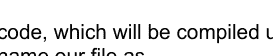

你需要创建一个扩展名为 .c 或 .cpp 的新文件。该文件将包含你的源代码，这些代码将使用相应的编译器进行编译。我们将文件命名为“myFirstProgram.c”。

在“myFirstProgram.c”中：

```c
#include <iostream>

void main(void)
{

printf("This is my first Program in C\n");

}
```

在继续之前，让我们先尝试编译并执行这段代码。这样做时，你会发现一个黑屏出现一毫秒后便消失了。

实际发生的是，计算机运行程序，并在源代码结束时退出。因此，它在我们看到任何输出之前就退出了。为了阻止程序这样做，我们需要在代码末尾添加一行额外内容。

```c
#include <iostream>

void main(void)
{
printf("This is my first Program in C\n");
system("pause");
}
```

如果没有错误，输出将如下所示：

程序的第一行在程序中包含一个库。这个库包含 printf、system 以及类似的其他函数，我们可以在程序中使用它们。

下一行声明我们的 main 方法。任何程序中的 main 方法都是我们逻辑的入口点。程序从执行这个函数开始。单词“void”用于表示所考虑的参数为空且无效。第一个 void 表示 main 函数不返回任何内容。括号内的下一个 void 表示 main 函数在开始时没有传入任何内容。我们将看到，根据程序逻辑的需求，这两种 void 类型如何被其他数据类型替换。

需要注意的是，花括号用于表示代码中的块。现在，你需要知道 main 函数的主体位于花括号内。任何让程序员访问机器的内容。有些人可能认为取消限制是一种不完美，但我个人认为利大于弊。C 正是因为这些“不完美”而吸引程序员。源代码中的模块化通常被认为是关键。在 C 中，这实际上取决于程序员，他们总是更希望函数之间的依赖最小。C 程序员也欢迎实验和交互，具体取决于某些情况。


## 第2章：标记与语法

在本章中，我们解释 C 编程语言的语法和词法元素。C 是一门高级编程语言。像其他高级语言一样，它有将不同组件组合起来以创建合法且可工作程序的规则和原则。这些规则和原则定义了该语言的语法。

检查 C 代码合法性的程序称为编译器。编译器将每一行代码翻译成机器语言，以查看是否有任何错误。如果存在错误，编译器将打印错误消息并停止。如果编译器没有发现错误，那么源代码就是正确的，代码会被翻译成目标代码。目标代码由加载器用来创建可执行文件。

正如我们之前所讨论的，预处理器在其余代码执行之前被处理。我们可以认为预处理器内置于编译器中。在某些系统上实际就是如此，而在另一些系统上，预处理器是独立的。这

这在当前阶段可能与我们无关，但我们必须意识到，预处理器和编译器都可能在我们的程序中引发各种错误。现在让我们详细讨论一下预处理器。

### 2.1 预处理器

C 编译器内置了预处理器。以 # 开头的行称为预处理器。我们迄今为止使用过 `#define` 和 `#include`。编译器在实际编译代码之前会先处理这些预处理器。例如，当我们在 2.2 节中使用 `#define` 定义常量时，编译器会在编译代码之前用开始时指定的值替换 PI 的所有实例。这类常量通常被称为符号常量。

我们在文件的顶部写下所有的 `#define` 语句。惯例是将常量的所有字母都写成大写。遵循此惯例使程序员能够轻松识别符号常量或其他常量。需要注意的是，预处理器永远不会更改引号字符串的内容。例如，在下面的语句中，只有第二个 PI 会被预处理器定义的 PI 值替换。

```c
printf("PI == %f\n", PI);
```

使用预处理器可以使程序更易读。它使程序流程更易于跟随。更重要的是，如果常量是通过 `#define` 设施符号化定义并在整个程序中使用，则在必要时以后很容易更改它。例如，字母 c 被普遍接受用来表示光速，大约为 299792.458 km/秒。如果我们编写以下预处理器，然后在数万行代码中用字母 C 符号化地表示常量 299792.458，那么当新的物理实验产生更精确的光速值时，更改代码将变得容易。只需更改 `#define` 行中的常量即可更新所有代码。这就是使用预处理器的优点。

```c
#define C 299792.458
```

`#include "filename.h"` 是一个预处理指令，它会导致在编译文件时将文件 filename.h 的副本包含在文件中的该点。`#include` 行可以在文件的任何位置出现，尽管按惯例通常位于文件的开头。有必要用引号指定文件名，因为它表示这是一个预定义文件。此类指令中指定的文件也称为头文件。这些头文件可以包含 `#define` 行和其他 `#include` 行。头文件的名称以 .h 扩展名结尾。

C 系统提供了许多标准头文件。一些例子是 stdio.h、string.h 和 math.h。这些文件包含标准库中函数的声明、宏、结构模板和其他常用编程元素。此类头文件的常见示例有 conio.h、stdio.h、stdafx.h、math.h 等。这些文件包含某些系统函数，例如 stdio 为编码者提供 printf 和 scanf 等函数。我们必须在程序中使用这些函数之前包含此头文件。我们迄今为止使用过 iostream，它是使用 `#include` 指令包含的输入/输出流的简写。

让我们看一个演示头文件使用方式的示例。以下是写入名为 "myFirstHeaderFile.h" 的头文件中的代码。

```cpp
#include "iostream"

#define PI 3.14159265359

#define LENGTH 200

#define WIDTH 300

#define HEIGHT 400

#define PERIMETER 2400

#define OWNER "EMMA WATSON"
```

以下是要写入 .cpp 文件中的代码，该文件包含我们的头文件。如果你使用的是 Visual Studio，只需将头文件添加到与 .c 或 .cpp 文件相同的项目中即可。

```cpp
#include "myFirstHeaderFile.h"

void main(void)
{
    float Area=PI*LENGTH*HEIGHT*HEIGHT*WIDTH;

    printf("This is a Program to demonstrate use of Header Files in C\n");
    printf("List of Constants to follow\n");
    printf("Owner: %s\n", OWNER);
    printf("Length: %d\n", LENGTH);
    printf("Width: %d\n", WIDTH);
    printf("Height: %d\n", HEIGHT);
    printf("PI: %f\n", PI);
    printf("Area of whatever shape it becomes is: %f\n", Area);
    system("pause");
}
```

上述程序的输出如下：

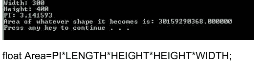

如你所见，程序的工作方式就好像头文件中的代码已写入我们的 c 文件中一样。这只是一个简单的示例，用于演示头文件的使用。我们实际上使用头文件是因为程序变得过于复杂，最好在更小、复杂度更低的文件中处理它们。我们将功能划分为不同的类别，并为每个类别在单独的文件中编写代码和函数。这样，每个代码的较小部分就更容易消化。

C 程序是一串字符。编译器将这串字符转换为目标代码。目标代码根据机器的不同被翻译成目标语言。在大多数系统上，目标语言是可以执行的机器语言。程序在语法上必须正确。编译器将每个字符作为标记。标记被认为是语言中词汇的基本单位。

在 ANSI C 中，有六种标记：关键字、标识符、常量、字符串常量、运算符和标点符号。我们将在本章讨论这些标记中的每一个。编译器的作用是检查所有标记是否能根据编译器的要求被翻译成适当的、可理解的字符串。大多数编译器对其要求非常精确。

计算机很笨。我们人类如果在句子中使用额外的标点符号，就能更有效地理解一行，但另一方面，如果句子中有一个不熟悉的称为标记的额外标点符号，计算机就无法理解该句子。因此，程序员必须熟悉哪些标记可以使用，哪些不能使用。

在本章的剩余部分，我们将介绍任何 C 程序的基本结构元素。宇宙中的每个庞大事物都由更小的组件组成。这些较小的组件单独可能并不那么有效，但以正确的方式组装它们肯定会带来更大的成功。

上述情况对 C 语言也是如此。C 由称为函数的单个组件组成。函数被认为是 C 编程中的基本结构元素。函数本身也由变量、常量、运算符和其他函数等更小的组件组成。我们将在另一章详细研究函数。在本章中，我们将逐一讨论这些单个组件。

### 2.2 变量

变量名，也称为标识符，由字母、数字和下划线的序列组成，但不能以数字开头。这些变量通常在程序开始时声明，但你可以在使用它之前在程序的任何位置声明一个。你可以根据它们的数据类型在这些变量中存储值，并在程序的任何阶段“改变”它们。标识符应根据其在程序中的用途进行选择。这样，它们就充当文档，使程序更易读。

我们生活中所做的一切都有代码。同样，我们在 C 中编写变量名也有规则。变量名可以由大写和/或小写字母、数字和仅一个特殊字符 '_' 组成。变量的首字母必须是字母或下划线。但是，尽管合法，但不鼓励变量名以下划线开头，因为以下划线开头的变量名可能与系统名称冲突，编译器可能会报错。变量名的长度没有限制。然而，编译器只区分变量的前 31 个字符。因此，程序中两个变量的前 31 个字母应至少有一个字符不同。

让我们通过引用一些实际应用来了解变量的使用。以下是计算两个数字之和的程序：

```c
#include <iostream>

void main(void)
{
    int firstNumber=10;
    int secondNumber=5;
    int sum=firstNumber+secondNumber;

    printf("This is a Program to demonstrate use of variables in C\n");
    printf("First number is: %d\n", firstNumber);
    printf("Second number is: %d\n", secondNumber);
    printf("Their sum is: %d\n", sum);
    system("pause");
}
```

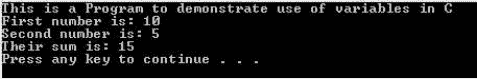


```c
}
```

上面程序的输出如下：

你们中的一些人可能想知道，为什么这里要使用变量，而不是直接使用数字。直接使用数字虽然容易，但用途有限，而且是一种糟糕的编程方式。

让我们在上面的代码中再添加几行，以证明这两点：

```c
#include <iostream>

void main(void)
{

int firstNumber=10;

int secondNumber=5;

int sum=firstNumber+secondNumber;

printf("This is a Program to demonstrate use of variables in C\n");

printf("First number is: %d\n", firstNumber);

printf("Second number is: %d\n", secondNumber);

printf("Their sum is: %d\n", sum);

firstNumber=3;

secondNumber=4;

sum=firstNumber+secondNumber;
```

```c
printf("First number is: %d\n", firstNumber);
```

```c
printf("Second number is: %d\n", secondNumber);
```

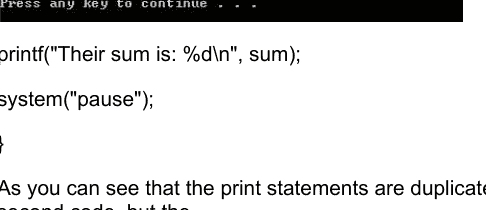

```c
printf("Their sum is: %d\n", sum);
```

```c
system("pause");
```

```c
}
```

可以看到，第二段代码中的打印语句是重复的，但只需更改变量即可改变输出值。因此，我们可以通过更改变量来使用同一段代码获得不同的输出。这给我们带来了巨大的优势。例如，假设你有一个包含 300 名学生在一次统一的 C 语言编程测试中所得分数的列表。用什么方式来表示这个列表的总分最好呢？你会建议在每个条目中都写上总分吗？当然不会，但请稍微想想，如果你那样做了，然后发现总分是 50 而不是 100，你将不得不改动每一个条目。为了避免这一切，你可以将一个值赋值给一个变量，然后在每个条目中使用该变量。这正是变量的实际用途。变量是任何程序的关键组成部分。

### 2.3 常量

常量是在整个程序执行过程中其值不会改变的量。不过，它们是出于某种目的而固定下来的。例如，为某些实体使用标准值，避免输入像 3.141517... 这样的长数字或值，或者通过将所有常量值集中在一个地方，使程序更易于阅读。

让我们来看一个使用常量的 C 程序：

```c
#include <iostream>

#define PI 3.14159265359

void main(void)
{

int radius=10;

float Area=PI*radius*radius;

printf("This is a Program to demonstrate use of Constants in C\n");

printf("Radius of circle is: %d\n", radius);

printf("Area of circle is: %f\n", Area);
```

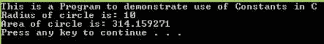

```c
system("pause");
}
```

在这个程序中，我们使用预处理指令 #define 声明了一个常量 PI。这是在 C 中使用常量的一种灵活且推荐的方式。还有另一种使用常量的方式，即使用关键字 ‘const’。让我们也看看它是如何工作的：

```c
#include <iostream>
void main(void)
{
int radius=10;
const float PI=3.14159265359;
float Area=PI*radius*radius;
printf("This is a Program to demonstrate use of Constants in C\n");
printf("Radius of circle is: %d\n", radius);
printf("Area of circle is: %f\n", Area);
system("pause");
}
```

### 2.4 关键字

关键字是任何语言中的保留字。这些词已经被保留用于特定的功能，因此程序员不能使用它们。这些关键字表示基本数据类型、内置函数和其他编程组件。

以下是 ANSI 预定义的 C 关键字列表：

#### 关键字

#### 功能

- **auto**：定义一个具有局部生命周期的局部变量。
- **break**：将控制传递出复合语句。
- **case**：用于通过 Switch 根据输入进行逻辑决策编程。
- **char**：用于定义字符类型变量。
- **const**：使变量值或指针参数不可修改。
- **continue**：将控制传递到循环的开始。

#### default
用于在 switch-case 语句中定义默认操作。

#### do
该关键字与 ‘while’ 一起用于一种特殊的循环。

#### double
该关键字用于定义类型为 ‘double’ 的变量。

#### else
与 ‘if’ 一起使用，用于为某个条件定义替代分支。

#### enum
定义一组整数类型的常量。

#### extern
用于表示变量在当前程序之外定义。

#### float
用于定义浮点类型变量。

#### for
用于编写 ‘for’ 循环。

#### goto
用于在程序中无条件地转移控制。

#### if
定义一个决策语句。

#### int
定义整数类型变量。

#### long
定义所需类型的 long 类型变量，例如 int。

#### register
将变量中的值存储到 CPU 寄存器中。

#### return
将控制权返回到上一个程序块。

#### short
用于修饰带有 ‘short’ 的数据类型变量。

#### signed
用作数据类型修饰符。

#### sizeof
返回表达式或类型的大小。

#### static
用于在变量的作用域结束后仍然保留该变量。

#### struct
根据需求定义自定义数据结构。

#### switch
用作决策语句，即 switch-case。

#### typedef
定义一个新的数据类型。

#### union
将共享同一存储空间的变量分组。

#### unsigned
用作数据类型修饰符。

#### void
空数据类型。

#### volatile
与关键字 ‘const’ 相反。

#### while
用于定义循环。

### 2.5 字符常量

本节讨论在特定情况下具有特定含义的字符常量。字符字面量用单引号括起来，例如 'a'，可以存储在简单的 char 类型变量中。

字符字面量可以是普通字符、转义序列或通用字符。

一个紧密相关的话题是字符串常量，也叫字符串字面量，它是由一对双引号括起来的字符序列，例如 “Khan”。有趣的是，字符串常量由多个字符组成，但编译器会将其视为一个单独的标记（token）。字符串以字符数组的形式存储。不过，务必要注意字符串常量与字符常量是不同的。例如，'a' 和 "a" 并不相同。实际上，“a” 包含两个字符：第一个是 ‘a’，下一个是 '\0'，后者表示 NULL。

C 语言提供了一些含义预定义的字符常量，例如我们多次使用过的 “\n” 来表示新行的开始。这类字符被称为转义序列。请记住，这些字符及其含义适用于写在双引号内作为字符串的情况。以下是常见的转义序列字符列表：

#### 转义序列

| 序列 | 含义 |
|---|---|
| \\ | 反斜杠字符 |
| \' | 单引号字符 |
| \" | 双引号字符 |
| \? | 问号字符 |
| \a | 警报或响铃 |
| \b | 退格 |
| \f | 换页 |
| \n | 换行 |
| \r | 回车 |
| \t | 水平制表符 |
| \v | 垂直制表符 |
| \ooo | 一位到三位的八进制数 |
| \xhh | 一位或多位的十六进制数 |

接下来是 ASCII 字符，如下所示：

| 字符 | 十进制 | 作用 |
|---|---:|---|
| NUL | 0 | 空字符 |
| SOH | 1 | 标题开始，= 控制台中断 |
| STX | 2 | 文本开始，HP 控制台上的维护模式 |
| ETX | 3 | 文本结束 |
| EOT | 4 | 传输结束，与 ETB 不同 |
| ENQ | 5 | 询问，与 ACK 配合使用；旧 HP 流量控制 |
| ACK | 6 | 确认，清除 ENQ 登录握手 |
| BEL | 7 | 响铃，响起铃声... |
| BS | 8 | 退格，适用于 HP 终端/计算机 |
| HT | 9 | 水平制表，移动到下一个制表位 |
| LF | 10 | 换行 |
| VT | 11 | 垂直制表 |
| FF | 12 | 换页，页面弹出 |
| CR | 13 | 回车 |
| SO | 14 | 移出，备用字符集 |
| SI | 15 | 移入，恢复默认字符集 |
| DLE | 16 |  |


| 十进制 | 缩写 | 描述 |
|---:|---|---|
| 16 | DLE | 数据链路转义 |
| 17 | DC1 | XON，XOFF 用于暂停列表 |
| 18 | DC2 | 设备控制 2，块模式流控制 |
| 19 | DC3 | XOFF，XON 为 TERM=18 流控制 |
| 20 | DC4 | 设备控制 4 |
| 21 | NAK | 否定确认 |
| 22 | SYN | 同步空闲 |
| 23 | ETB | 结束传输块，与 EOT 不同 |
| 24 | CAN | 取消行，MPE 回显！ |
| 25 | EM | 介质结束，Control-Y 中断 |
| 26 | SUB | 替换 |
| 27 | ESC | 转义，下一个字符不回显 |
| 28 | FS | 文件分隔符 |
| 29 | GS | 组分隔符 |
| 30 | RS | 记录分隔符，块模式终止符 |
| 31 | US | 单元分隔符 |

上面是所有控制 ASCII 字符的列表。以下是 ASCII 中可打印 ASCII 字符的列表。

| 字符 | 十进制 | 描述 |
|---|---:|---|
| SP | 32 | 空格 |
| ! | 33 | 感叹号 |
| " | 34 | 引号 |
| # | 35 | 十字网格（井号） |
| $ | 36 | 美元符号 |
| % | 37 | 百分号 |
| & | 38 | 和号 |
| ' | 39 | 关闭单引号（撇号） |
| ( | 40 | 开括号 |
| ) | 41 | 闭括号 |
| * | 42 | 星号（星号，乘） |
| + | 43 | 加号 |
| , | 44 | 逗号 |
| - | 45 | 连字符、破折号、减号 |
| . | 46 | 句点 |
| / | 47 | 斜线（正斜杠，除） |
| 0 | 48 | 零 |
| 1 | 49 | 一 |
| 2 | 50 | 二 |
| 3 | 51 | 三 |
| 4 | 52 | 四 |
| 5 | 53 | 五 |
| 6 | 54 | 六 |
| 7 | 55 | 七 |
| 8 | 56 | 八 |
| 9 | 57 | 九 |
| : | 58 | 冒号 |
| ; | 59 | 分号 |
| < | 60 | 小于号 |
| = | 61 | 等号 |
| > | 62 | 大于号 |
| ? | 63 | 问号 |
| @ | 64 | at 符号 |
| A | 65 | 大写 A |
| B | 66 | 大写 B |
| C | 67 | 大写 C |
| D | 68 | 大写 D |
| E | 69 | 大写 E |
| F | 70 | 大写 F |
| G | 71 | 大写 G |
| H | 72 | 大写 H |
| I | 73 | 大写 I |
| J | 74 | 大写 J |
| K | 75 | 大写 K |
| L | 76 | 大写 L |
| M | 77 | 大写 M |
| N | 78 | 大写 N |
| O | 79 | 大写 O |
| P | 80 | 大写 P |
| Q | 81 | 大写 Q |
| R | 82 | 大写 R |
| S | 83 | 大写 S |
| T | 84 | 大写 T |
| U | 85 | 大写 U |
| V | 86 | 大写 V |
| W | 87 | 大写 W |
| X | 88 | 大写 X |
| Y | 89 | 大写 Y |
| Z | 90 | 大写 Z |
| [ | 91 | 开方括号 |
| \\ | 92 | 反斜线（反斜杠） |
| ] | 93 | 闭方括号 |
| ^ | 94 | 插入符号（抑扬符） |
| _ | 95 | 下划线 |
| \` | 96 | 开单引号 |
| a | 97 | 小写 a |
| b | 98 | 小写 b |
| c | 99 | 小写 c |
| d | 100 | 小写 d |
| e | 101 | 小写 e |
| f | 102 | 小写 f |
| g | 103 | 小写 g |
| h | 104 | 小写 h |
| i | 105 | 小写 i |
| j | 106 | 小写 j |
| k | 107 | 小写 k |
| l | 108 | 小写 l |
| m | 109 | 小写 m |
| n | 110 | 小写 n |
| o | 111 | 小写 o |
| p | 112 | 小写 p |
| q | 113 | 小写 q |
| r | 114 | 小写 r |
| s | 115 | 小写 s |
| t | 116 | 小写 t |
| u | 117 | 小写 u |
| v | 118 | 小写 v |
| w | 119 | 小写 w |
| x | 120 | 小写 x |
| y | 121 | 小写 y |
| z | 122 | 小写 z |
| { | 123 | 开花括号 |
| \| | 124 | 竖线 |
| } | 125 | 闭花括号 |
| ~ | 126 | 波浪号（近似） |
| DEL | 127 | 删除（退格），十字网格框 |

### 2.6 运算符和标点符号

像其他编程语言一样，C 有许多具有特定含义的字符。

示例包括算术运算符，它们分别代表通常的算术运算：加法、减法、乘法、除法和取模。

在数学中，取模返回一个数除以另一个数后的余数。例如，“a 取模 b”的值是通过将 a 除以 b 后的余数得到的。% 是 C 中用于取模运算的字符。因此，15%7 的答案是 1，而 7 % 5 的结果是 2。

在程序中，运算符可用于分隔表达式中涉及的标识符。记住，表达式是以分号结束的语句。给标识符和运算符之间加上空白以提高可读性是良好的实践，但不是必需的。编译器会忽略空白，除非它们在代码中被引用。因此，以下语句对编译器来说是相同的，

```
X=A+B;

X = A + B ;
```

上下文在几乎所有事情中都很重要。符号的含义取决于它们的使用位置和方式。例如，考虑以下两个使用 % 符号在不同上下文中的语句。

```
printf("Owner: %s\n", OWNER);

int x = 15 % 4 ;
```

第一个 % 符号是转换规范或格式的开始，该格式与表达式后面部分的标识符相关，而第二个 % 符号代表数学中的取模运算符。

标点符号的示例包括括号、花括号、逗号和分号。

考虑以下代码：

```
void main(void)
{
int a, b = 2, c = 3;
a = (b * (b + c));
}
```

main 后面立即使用的括号用作运算符。根据规则，它们用于表示 main 是一个函数。在括号之后，符号“{”、“,”、“,”、“,”、“(”、“(”、“)”、”)”和“,”都是标点符号。运算符和标点符号都由编译器收集为标记（字符），并与空白一起，用于分隔标识符、常量、函数、关键字、运算符等语言元素。

标记在很大程度上取决于其上下文。例如，如前一段所述，括号有时用于表示函数名，同时也可以用作标点符号。另一个示例由以下表达式给出

```
C = a + b ;
++ a ;
a += b ;
```

它们都使用 + 作为字符，但 ++ 和 += 分别是递增和赋值运算符，而第一个是简单的算术运算符。符号含义对上下文的这种依赖性导致了简洁但更有效的编程语言 C。

C 语言在运算符中具有优先级和结合性规则。它本质上是关键的，因为我们不希望一条语句产生两个不同的输出。这些规则并不能完全确定求值，因为我们赋予用户通过掌握这些规则来实现期望结果的能力。由于括号内的表达式先求值，因此可以使用括号来澄清或改变操作的执行顺序。

考虑表达式：

`Answer = 30 + ( 4 * 10 / 5 -20 ) ;`

运算符“(”在此表达式中具有最高优先级，因此我们首先对其进行拆分。然后括号内有三个运算符。乘法和除法具有相同的优先级，因此我们执行表达式中先出现的运算。在这种情况下，我们执行 4 * 10，结果为 40。我们将 40 除以 5，结果为 8。我们用 8 减去 20，结果为 -12。现在括号已关闭，我们计算括号外的运算。我们将 -12 加到 30 上，结果为 18。

| 运算符 | 名称 | 描述 |
|---|---|---|
| / | Divide | 用于两个数字的除法 |
| % | Modulus | 用于查找两个数字相除后的余数 |
| ~ | Negation | 二进制运算符，用于反转布尔值 |
| & | Bitwise AND | 用于对每一位执行逻辑与 |
| \| | Bitwise OR | 用于对每一位执行逻辑或 |
| ^ | Power | 用于计算数字的幂 |
| << | Left Shift | 用于将位向左移动 |
| >> | Right Shift | 用于将位向右移动 |

让我们现在看一个在程序中使用这些运算符的示例：

```
#include "iostream"

void main(void)
{

int A = 50, B = 17;

bool Alive =false;

printf("This is a Program to demonstrate use of Arithmetic Operators in C\n");

printf("Sum: %d\n", A + B);

printf("Difference: %d\n", A - B);

printf("Product: %d\n", A * B);

printf("Division: %d\n", A / B);

printf("Modulus: %d\n", A % B);

printf("Negation: %s\n", ~Alive? "true":"false");

printf("Bitwise AND: %d\n", A & B);

printf("Bitwise OR: %d\n", A | B);

printf("Bitwise XOR: %d\n", A^B);

printf("Left Shift: %d\n", A<<2);

printf("Right Shift: %d\n", A>>2);

system("pause");
}
```

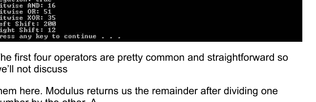

前四个运算符相当常见且直观，因此我们在这里不讨论它们。取模返回一个数除以另一个数后的余数。A % B 返回 A 除以 B 后的余数。例如，我们代码中的示例将 50 除以 17，商为 2，而余数为 16。余数被返回并打印。记住，我们始终可以使用赋值运算符为此值赋值。在这里，我们只是使用返回的值打印一次。

否定运算符用于使用 2 的补码形式反转二进制数。如果输入是布尔值，如我们的程序中所示，结果将被反转。

然后我们有 5 个按位运算符，从按位与操作开始。它对提供的数字的每一位执行逻辑与。例如，在我们的程序中，我们有

50 和 17。这两个数的二进制转换分别为 00110010 和 00010001。

```text
00110010
00010001
00010000
```

转换为十进制后，答案是 16。

同样地，按位或运算对所提供的数字的每一位执行或运算。例如，在我们的程序中对 50 和 17 进行运算，结果为 51，解释如下。

```text
00110010
00010001
00110011
```

同样地，按位异或运算对所提供的数字的每一位执行异或运算。在异或中，只有当运算中值为 1 的位数为奇数时，结果对应位才为 1。例如，在我们的程序中对 50 和 17 进行运算，结果为 35，解释如下。

```text
00110010
00010001
00100011
```

转换为十进制后，结果为 35。

移位运算符用于将二进制位向左或向右移动。使用左移运算符时，左操作数的值会按右操作数指定的位数向左移动。例如，在我们的程序中使用了 `A<<2`。这意味着 A 中的位必须向左移动两位：

```text
00110010
00110010<<2
11001000
```

左移运算符将位向左移动，并在右侧添加 2 个零，因此如上述说明所示，值变为 200。

使用右移运算符时，左操作数的值会按右操作数指定的位数向右移动。例如，在我们的程序中使用了 `A>>2`。这意味着 A 中的位必须向右移动两位：

```text
00110010
00110010>>2
00001100
```

右移运算符将位向右移动，并在左侧添加 2 个零，因此如上述说明所示，值变为 12。

#### 2.6.2 赋值运算符

| 运算符 | 等价形式 | 操作 |
| --- | --- | --- |
| `a = b` | 等于 | 将 b 中存储的值赋给 a |
| `a += b` | `a = a + b` | 将 b 加到 a 中，并将结果存入 a |
| `a -= b` | `a = a - b` | 从 a 中减去 b，并将结果存入 a |
| `a *= b` | `a = a * b` | 将 a 与 b 的乘积存入 a |
| `a /= b` | `a = a / b` | 用 a 除以 b，并将结果存入 a |
| `a %= b` | `a = a % b` | 取 a % b，并将结果存入 a |
| `a &= b` | `a = a & b` | 对 a 和 b 执行按位与，并将结果存入 a |
| a \|= b | a = a \| b | 对 a 和 b 执行按位或，并将结果存入 a |
| `a ^= b` | `a = a ^ b` | 对 a 和 b 执行按位异或，并将结果存入 a |

以下程序展示这些赋值运算符的用法及输出：

```c
#include "iostream"

void main(void)
{
    int A = 10, B = 3, simpleAssignment = 0;

    simpleAssignment = A + B;

    printf("This is a Program to demonstrate use of Assignment Operators in C\n");

    printf("Simple assignment: %d\n", simpleAssignment);

    A += B;

    printf("Plus and Equal to: %d\n", A);

    A = 10, B = 3;

    A -= B;

    printf("Minus and Equal to: %d\n", A);

    A = 10, B = 3;

    A *= B;

    printf("Multiply and Equal to: %d\n", A);

    A = 10, B = 3;

    A /= B;

    printf("Divide and equal to: %d\n", A);

    A = 10, B = 3;

    A %= B;

    printf("Modulus and equal to: %d\n", A);

    A = 10, B = 3;

    A &= B;

    printf("Bitwise AND and equal to: %d\n", A);

    A = 10, B = 3;

    A |= B;

    printf("Bitwise OR and equal to: %d\n", A);

    A = 10, B = 3;

    A ^= B;

    printf("Bitwise XOR and equal to: %d\n", A);

    system("pause");
}
```

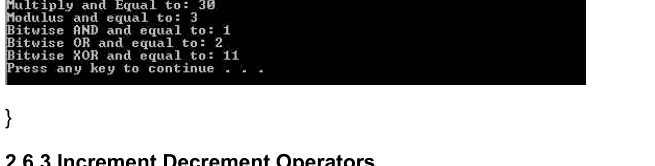

#### 2.6.3 递增递减运算符

| 运算符 | 名称 | 操作 |
| --- | --- | --- |
| `++a` | 前缀递增 | 在任何赋值之前将 a 的值加 1 |
| `--a` | 前缀递减 | 在任何赋值之前将 a 的值减 1 |
| `a++` | 后缀递增 | 在任何赋值之后将 a 的值加 1 |
| `a--` | 后缀递减 | 在任何赋值之后将 a 的值减 1 |

递增运算符 `++` 和递减运算符 `--` 是一元运算符。`++` 和 `--` 可应用于标识符，但不能应用于常量或普通表达式。此外，根据运算符出现在前缀还是后缀位置，可能会产生不同的效果。

显然，递增和递减运算符使用起来可能有些棘手。在简单情况下，可以将 `++` 和 `--` 视为为变量的递增和递减提供简洁记法的运算符。在其他情况下，必须仔细注意需要前缀还是后缀位置。一旦了解了每个运算符的用途和用法，它们就相当简单，而让你熟悉每个运算符用途的最佳方式就是实践。因此，下面这个程序描述了这些运算符的用法：

```c
#include "iostream"

void main(void)
{
    int A = 10;

    printf("This is a Program to demonstrate use of Increment Decrement Operators in C\n");

    printf("Before Prefix Increment, A = %d\n", A);

    printf("Prefix Increment, A = %d\n", ++A);

    printf("After Prefix Increment, A = %d\n", A);

    printf("Before Postfix Increment, A = %d\n", A);

    printf("Postfix Increment, A = %d\n", A++);

    printf("After Postfix Increment, A = %d\n", A);

    printf("Before Prefix Decrement, A = %d\n", A);

    printf("Prefix Decrement, A = %d\n", --A);

    printf("After Prefix Decrement, A = %d\n", A);

    printf("Before Postfix Decrement, A = %d\n", A);

    printf("Postfix Decrement, A = %d\n", A--);

    printf("After Postfix Decrement, A = %d\n", A);

    system("pause");
}
```

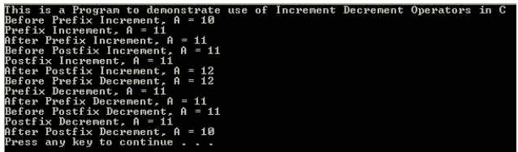

因此，A 的初始值为 10。前缀递增在任何赋值之前将值递增到 11，因此在输出的第 3 行打印 11。第 4 行只是打印并显示 A 已被赋值为 11。输出的第 6 行包含后缀递增，这意味着 A 将在表达式中的任何赋值之后递增。因此，打印的还是同一个值 11，然后 A 递增到 12，这可以在下一行看到。前缀递减在任何赋值之前将值递减到 11，因此在输出的第 9 行打印 11。下一行只是打印并显示 A 已被赋值为 11。输出的第 12 行包含后缀递减，这意味着 A 将在表达式中的任何赋值之后递减。因此，打印的还是同一个值 11，然后 A 递减到 10，这可以在下一行看到。

#### 2.6.4 逻辑运算符

逻辑运算符用于根据一个或多个操作数之间的特定运算获得二进制输出。它们在编写决策语句时很方便。

```c
printf((A && C) ? "True\n" : "False\n");
printf((A || B) ? "True\n" : "False\n");
system("pause");
}
```

#### 2.6.5 比较运算符

比较运算符用于比较两个数字或字符。对于二进制和字符串比较，我们有单独的运算符和函数，因此请避免使用这些运算符来比较两个字符串或二进制数。不建议这样做。

| 运算符 | 名称 | 操作 |
| --- | --- | --- |
| `a == b` | 等于 | 如果 a 的内容等于 b 的内容，则返回 true |
| `a != b` | 不等于 | 如果 a 不等于 b，则返回 true |
| `a < b` | 小于 | 如果 a 小于 b，则返回 true |
| `a > b` | 大于 | 如果 a 大于 b，则返回 true |
| `a <= b` | 小于或等于 | 如果 a 小于或等于 b，则返回 true |
| `a >= b` | 大于或等于 | 如果 a 大于或等于 b，则返回 true |

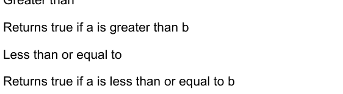

以下是在 C 中使用比较运算符的示例及输出。

```c
#include "iostream"

void main(void)
{
    int a = 10, b = 5;

    printf((a == b) ? "True\n" : "False\n");

    printf((a != b) ? "True\n" : "False\n");

    printf((a < b) ? "True\n" : "False\n");

    printf((a > b) ? "True\n" : "False\n");

    printf((a <= b) ? "True\n" : "False\n");

    printf((a >= b) ? "True\n" : "False\n");

    system("pause");
}
```

输出相当直观，因此我们相信读者能够理解。

#### 2.6.6 特殊运算符

三元运算符（我们在前面的示例中一直使用）非常有用。其语法如下：

条件 ? （为真时） : （为假时）

因此，三元运算符检查某个条件，并根据布尔输出选择其中一个备选情况。

另一个有用的运算符是类型转换运算符。它接受一个操作数并将其转换为所需的数据类型。其语法如下：

（类型）操作数;

例如，(int) 3.14 得到 3。

C 提供一元运算符 sizeof，用于查找存储一个所需字节数

() [] -> . ++ --
从左到右

一元
+ - ! ~ ++ -- (type)* & sizeof
从右到左

乘法
* / %
从左到右

加法
+ -
从左到右

移位
<< >>
从左到右

关系
< <= > >=
从左到右

相等
== !=
从左到右

按位与

| 操作符 | 符号 | 结合性 |
|---|---|---|
| 按位与 | & | 从左到右 |
| 按位异或 | ^ | 从左到右 |
| 按位或 | \| | 从左到右 |
| 逻辑与 | && | 从左到右 |
| 逻辑或 | \|\| | 从左到右 |
| 条件 | ?: | 从右到左 |
| 赋值 | = += -= *= /= %= >>= <<= &= ^= \|= | 从右到左 |

#### 逗号

,
从左到右

请考虑以下代码并尝试计算结果。我们将讨论输出结果，但最好在对照我们的结果之前先自己尝试。

```
#include "iostream"

void main(void)
{

int a = 20, b = 10, c = 5;

a = b = c += 2;

printf("a= %d\n",a);

printf("b= %d\n",b);

printf("c= %d\n",c);

a = 20, b = 10, c = 5;

a = ++b -= c = 2;

printf("a= %d\n",a);

printf("b= %d\n",b);

printf("c= %d\n",c);

system("pause");

}
```

## 第3章：数据类型

- 第一章 围棋基础知识
- 第二章 围棋基本规则
- 第三章 围棋基本技巧
- 第四章 围棋实战策略

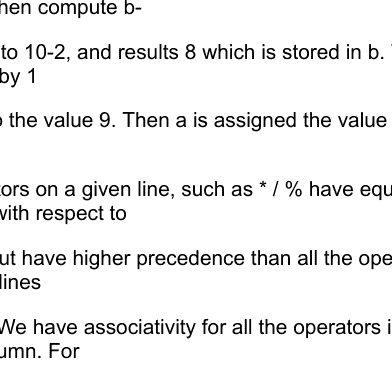

对于每个操作符，我们将声明其优先级和结合性，以便有一个标准来计算数学表达式。这些规则是每个 C 程序员为了高效编程必须记住的。

在传统的 C 中，自增和自减运算符与一元运算符具有相同的优先级。然而在 ANSI C 中，它们作为后缀运算符具有最高的优先级且结合性为从左到右，而作为前缀运算符时，它们与其它一元运算符具有相同优先级且结合性为从右到左。


然而 char 类型在这方面是特殊的，正如我们将在本章后面部分看到的那样

假设我们把类型类别定义为前一段中给出的类型之一。使用这个类别，我们可以提供声明任意类型变量的语法：

type identifier;

例如，这可以表示 int x 或 double a 或 char alphabet 等。

当事物被分组时（除了猫）总是更容易理解。默认数据类型也可以根据其功能进行分组。整型类型可用于保存整数值；浮点和双精度类型是可用于保存实数值。 这两类结合起来形成算术数据类型。

### 整型数据类型

### 浮点数据类型

- char
- float
- signed char
- double

- unsigned char
- long double
- short
- int
- long
- unsigned short
- unsigned
- unsigned long

### 3.1 整型数据类型

数据类型 int，即 integer 的缩写，是 C 中使用最广泛的整型数据类型。这个类型，连同其它整型类型如 char、short 和 long，被设计用于处理机器上可表示的整数值。数学中定义整数为正负整数，如 -11、13、66 等。

由于机器设计有界限，我们只能拥有一定限度的整数。通常，整数存储在 16 位或 32 位中。还有其它可能性，但在大多数 C 系统中就是这样。在旧的 PC 上，整数通常存储在 16 位，而较新的 PC、工作站和大型机支持 32 位整数。

为了计算范围，我们使用幂规则。在 16 位系统上，我们可以有 2^16 = 65536 个不同的值，其中一半为负数，如果我们处理的是有符号数。同样在 32 位系统上，我们可以有 2^32 = 4294967296 个不同的值，其中一半为负数，如果我们处理的是有符号数。

在 C 中，数据类型 integer 被认为是处理整数的“自然”或“通常”类型。还有其它整型类型如 char、short 和 long。例如，数据类型 short 可用于需要使用较少字节来存储整数的情况，虽然在今天先进的世界中并不需要这样做，因为我们现在没有存储问题。类似地，类型 long 可能在需要大整数值时使用。编译器可能会提供大于自然整数所需的存储。通常，short 存储在 2 字节中，long 存储在 4 字节中。具有 4 字节系统的机器具有相同大小的 short 和 long 数据类型。

小数部分，以及指数部分（如果有）。浮点类型数字必须包含

要么是小数点或指数部分或两者。如果小数点存在，

要么是整数部分或小数部分或两者必须存在。如果没有

小数点存在，则必须有整数部分以及指数

部分来指示

小数点可能的位置。

浮点常量的一些例子是 3.14159、314.15e-2、1333e-3 等。

### 3.3 使用“typedef”

C 语言允许程序员使用现有数据类型但使用自己自定义的名称来定义数据类型

但使用他自己的自定义名称。这是通过

typedef 机制实现的，

它允许程序员使用他自己选择的标识符来

表示某些数据类型。一些例子是

```c
typedef int numberOfStudents ;
typedef double percentage ;
typedef short int age;
```

在每个这些类型定义中，命名标识符可以稍后用于声明

变量或函数的方式与普通类型相同。

```
numberOfStudents Strength;
```

上述语句声明变量 Strength 为 numberOfStudents 类型，根据我们的定义，它与整数同义。

使用 typedef 定义自定义数据类型的优点在于缩写长声明。另一个优点是具有反映预期用途的名称，如 numberOfStudents。

### 3.4 存储类

C 中的变量和函数有两个属性：类型和存储类。你到目前为止应该已经了解了第一个属性。现在让我们讨论存储类属性。

存储类用于变量和函数的某些用途。最常见的存储类是 auto。还有三个其它存储类由这些关键字定义：

- auto
- extern
- register
- static

#### 3.4.1 存储类 auto

默认情况下，在函数定义内声明的 C 变量是自动的。因此，自动是最常用的四个存储类之一。如果复合语句以变量声明开始，则这些变量可以在封闭复合语句的作用域内操作。为了区分以声明开始的复合语句和不以变量声明开始的复合语句，我们使用块术语。块是带声明的复合语句。

块内的声明自动属于存储类 auto。我们不需要显式声明 auto 用于这些变量。关键字 auto 很少使用。当程序控制进入一个块时，系统为块中包含的所有自动变量分配内存。变量在该块内具有“局部”性质。当程序控制退出一个块时，系统释放为自动变量预留的内存。一旦块消失，变量也就消失了。

这就是为什么这些变量被称为局部变量。

#### 3.4.2 存储类 extern

块之间的通信至关重要。一种在作用域间传输信息的方法是使用方法将参数传递到另一个作用域。但这种方法在某些情况下不适用。存储类 extern 为我们提供了在不同环境或作用域之间通信的另一种机制。

extern 类变量的声明与普通变量声明非常相似，只是变量在任何块之外声明。这些变量对在其声明之后编写的所有函数都作为全局变量起作用。以下示例有助于更好地理解：

```c
int globalVariable = 10;

void printMe()

{

printf("Value of globalVariable = %d\n", globalVariable);

}

void main(void)
```


```
{
printf("Value of globalVariable = %d\n", globalVariable);
globalVariable+=10;
printMe();
}
```

```
extern int globalVariable = 10;
```

请注意，以下语句在传统 C 中是不允许的，但现代 ANSI 编译器不会对这种格式提出异议，并且即使未使用 extern 关键字，也会将变量视为在任何作用域之外属于 extern 类：
此类变量不能是自动或寄存器类，但如果需要，它们可以是静态的，如存储类 static 部分所述。关键字 extern 用于使编译器在该文件或任何其他文件中查找此变量的定义和使用。

另一个需要记住的重要点是，外部变量在整个程序中不会被完全释放，但如果在作用域内重新定义了相似的标识符，它们可能会被隐藏。如果发生这种情况，则在该作用域中访问的是局部变量，而不是全局变量。

正如我们开始时提到的，信息可以通过两种方式传递给函数：使用外部变量和使用参数机制。虽然有例外，但出于此目的，优先使用第二种方法，因为它能带来更好的模块化和代码简洁性。随意使用外部变量往往会导致意外和难以捉摸的问题。全局变量会将其变化在整个程序中传播，这显然可能对你的逻辑造成危害。消息或参数传递技术则免于这些风险，因为更改是局部的。因此，程序更容易编写和维护。所有函数都具有外部存储类。这意味着我们可以在函数定义和函数原型中使用关键字 extern。例如：

```
extern double sum(double a, b);
```

#### 3.4.3 Storage Class register

register 存储类使变量作为高速寄存器工作。显然，它可能存在基于硬件的限制，因为物理空间中的寄存器数量有限。由于物理限制，当编译器发现无法将变量用作内存寄存器时，此类的变量会自动转换为 auto 类型。

register 类在快速执行至关重要时使用。当速度是关注点时，程序员可以选择几个频繁访问的变量并将其声明为存储类 register。寄存器在被访问以供使用或修改时所需的时钟周期数少于普通内存位置。由于寄存器存储整数值，因此 register 变量默认也是整数。因此以下两个声明是等价的：

```
extern int variable;
extern variable;
```

#### 3.4.4 Storage Class static

Static 指的是保持其状态恒定的东西。Static 类有两个基本用途。

主要用途与 static 这个词的含义相似：用于声明在频繁进入和退出块时仍保留其状态的变量。请记住，普通变量在块关闭后立即被释放。第二种用途是与 external 类声明一起使用。

这里有一个例子：

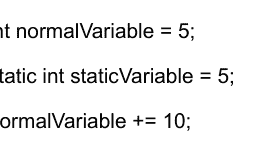

```
void demo()
{
int normalVariable = 5;
static int staticVariable = 5;
normalVariable += 10;
staticVariable += 10;
printf("Normal: %d\n", normalVariable);
printf("Static: %d\n", staticVariable);
}
void main(void)
{
demo();
}
```

```
demo();

demo();

system("pause");

}
```

正如你在上面程序的输出中看到的，static 变量在第二次和第三次函数调用中也保留其先前的值。变量的 static 声明仅在函数第一次被调用时执行。之后，编译器会忽略它。下一次，static 变量的值为 15，再加上 10 并打印出 25。第三次函数调用使用保留的 25 作为 static 变量的值并加上 10。另一方面，normal 变量一次又一次地重新初始化为 5 并加上 10。三个函数调用中的每一个都创建了自己的 normal 变量，而 static 变量只在第一次生成，然后保留供将来引用。

现在让我们讨论 static 外部变量。Extern 和 static 结合使用为程序员提供了更好的隐私选项。正如你所知，全局或外部变量只能被其声明之后定义的函数访问。另一方面，static 变量取决于它们的块，可以由程序员塑造使用。

让我们利用这一功能提供一个对一组函数而言是全局的变量，同时对文件而言是私有的。

static 的另一种用途是作为存储类来指定函数定义和原型。这种用法会导致函数的作用域受限。Static 函数仅在其被定义的文件内可见。与可以从其他文件访问的普通函数不同，static 函数在其自己的文件中可用，但其他文件不可用。

### 3.5 Default Initializations

在 C 中，未在声明时赋值的外部变量和静态变量都会自动初始化为 0。这种默认初始化适用于数组、字符串、指针、结构体和联合体。

与此相反，自动变量和寄存器变量不会由系统自动初始化。这意味着如果你在未初始化自动变量或寄存器变量的情况下访问它们，编译器要么生成错误，要么使用垃圾值。

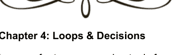

## Chapter 4: Loops & Decisions

循环是指用于重复执行的编程工具。这非常有用，因为它允许程序员编写简洁的代码。例如，假设我们想打印一条语句一千次。无需写一千次该语句，我们只需编写一个循环。这就是使用循环的好处。

C 支持其他高级语言提供的所有基本循环。这些包括 for 循环、while 循环和 do while 循环。我们将在本章中通过示例讨论这些循环。

计算机基于人类设计的逻辑运行，并由程序员使用编程语言将其输入。逻辑基于决策。需要决策语句来定义这些决策。我们将在本章中讨论两种类型的决策语句。

### 4.1 If else statement

在任何编程语言中最基本且最常用的决策语句是 if else 语句。该语句可用于多种场景。可用于一个或任意数量的场景。以下是一个仅包含一个 if 语句的程序：

```c
void main(void)

{

printf("Program starts\n");

int x=0;

printf("Enter a number and press enter: ");

scanf("%d", &x);

if(x==0)

{

printf("If executes\n");

}

printf("Program ends\n");

system("pause");

}
```

此程序使用 scanf 函数从用户获取整数输入。如果用户输入 0，则 if 语句中的逻辑运算为真，因此执行 if 语句的主体。如果输入其他任何数字，则 if 语句的主体不执行。

现在让我们看另一个涉及 if else 语句的示例：

```c
void main(void)
{
printf("Program starts\n");
int x=0;
printf("Enter a number and press enter: ");
scanf("%d", &x);
if(x==0)
{
printf("If executes\n");
}
else
{
printf("Else executes\n");
}
printf("Program ends\n");
system("pause");
}
```

此程序在 else 语句覆盖的块中有一个替代条件。Else 语句始终与 if 语句一起使用。在 if 语句为真时，编译器只是忽略 else 语句。否则，当 if 语句为假时，else 块的主体将被执行。

以下是一个涉及多个 if else 语句的示例：

```c
void main(void)
{

printf("Program starts\n");

int x=0;

printf("Enter a number and press enter: ");

scanf("%d", &x);

if(x==0)
{

printf("1st If executes\n");
```


```
    }
    else if(x<10)
    {
    printf("2nd If executes\n");
    }
    else if(x<20)
    {
    printf("3rd If executes\n");
    }
    else
    {
    printf("Else executes\n");
    }
    printf("Program ends\n");
    system("pause");
    }
```

### 4.2 Switch Case 语句

Switch case 是 C 编程语言中另一种常用的决策语句。

其用法与 if else 语句非常相似，但该决策语句不是使用结果为布尔值的条件，而是针对不同值设置特定的 case。

让我们看一个示例以便更好地理解：

```c
void main(void)

{

printf("Program starts\n");

char x;

printf("Enter a small alphabet and press enter: ");
x=getchar();

switch(x)

{

case 'a': printf("You entered a..\n"); break;

case 'b': printf("You entered b..\n"); break;

case 'c': printf("You entered c..\n"); break;

case 'd': printf("You entered d..\n"); break;

default: printf("You entered something else..\n");

}

printf("Program ends\n");

system("pause");

}
```

根据用户输入（该输入作为参数传入 switch 语句），程序会执行特定的 case。如果找不到任何 case，则执行 default case。

需要注意的一点是每个 case 末尾的 break 语句。break 语句用于在任何情况下离开当前块。例如，如果你处于 for 循环中，break 语句之后的 for 循环内代码将被忽略。在这里，如果我们不希望多个 case 与同一个输入相关联，break 语句就是必要的。

例如，请看以下程序：

```c
void main(void)
{
printf("Program starts\n");

char x;

printf("Enter a small alphabet and press enter: ");

x=getchar();

switch(x)
{

case 'a': printf("You entered a..!\n"); break;
```

```c
void main(void)
{
printf("Program starts\n");
char x;
for(int i=0 ; i<5 ; i++)
{
printf("Enter a small alphabet and press enter: ");
x=getchar();
switch(x)
{
case 'a': printf("You entered a..!\n"); break;
case 'b': printf("You entered b..!\n"); break;
case 'c': printf("You entered c..!\n"); break;
case 'd': printf("You entered d..!\n"); break;
default: printf("You entered something else..!\n");
}
}
printf("Program ends\n");
system("pause");
}
```

上述程序会执行 for 循环内的语句五次。当编译器到达 for 循环时，它首先初始化所涉及的变量。之后，检查条件。如果条件为真，则继续；否则停止。因此，在第一次执行循环时，i 被初始化为 0，由于 0 小于 5，条件为真。第一次执行循环后，执行 for 循环末尾的递增或递减语句并检查条件。此时，递增运算符使 i 的值为 1，它仍然小于 5，因此循环继续。类似地，循环再继续三次。总共五轮循环后，i 的值将为 5。对于第 6 次可能的循环，将 i 的值与 5 比较，答案将为假，因为 5 不小于 5。因此，第 6 次循环不会执行，循环终止。

### 4.4 While 循环

此循环仅使用一个条件来确定要计算多少次迭代。变量的初始化以及值的递增变化并不是（必须的）。如果程序逻辑需要，while 循环中也可以有初始化和变化。

while 循环的一般语法如下：

```
while(condition){...}
```

以下示例有助于更好地理解 while 循环：

```
void main(void)
{
printf("Program starts\n");
char x='a';
printf("Enter a small alphabet and press enter: ");
x=getchar();
while(x!='e')
{
switch(x)
{
case 'a': printf("You entered a..!\n"); break;
case 'b': printf("You entered b..!\n"); break;
case 'c': printf("You entered c..!\n"); break;
case 'd': printf("You entered d..!\n"); break;
default: printf("You entered something else..!\n");
}
printf("Enter e to exit. Else, enter another small alphabet and press enter: ");
```

```c
x=getchar ();
}
printf ("Program ends\n");
system ("pause");
}
```

该程序会一直重复，直到用户输入 ‘e’。因此，用户通过使用 while 循环来控制进行多少次迭代。这也可以用 for 循环完成，但 while 正是为此目的而设计的。如果所需的迭代次数未知，强烈推荐使用 while 循环。

### 4.5 Do While 循环

Do while 循环与 while 循环几乎相似，不同之处在于 do while 总是执行其第一轮循环而不测试任何条件。另一方面，while 循环即使在第一轮执行时也总是检查给定条件是否为真。

考虑以下示例，并将其与 while 循环示例进行比较：

```c
void main(void)
{
printf ("Program starts\n");
```

```c
char x='a';
do
{
printf ("Enter a small alphabet and press enter: ");
x=getchar();
switch(x)
{
case 'a': printf("You entered a..!\n"); break;
case 'b': printf ("You entered b..!\n"); break;
case 'c': printf ("You entered c..!\n"); break;
case 'd': printf ("You entered d..!\n"); break;
default: printf ("You entered something else..!\n");
}
} while(x!='e');
printf ("Program ends\n");
system ("pause");
}
```

### 4.6 嵌套循环

嵌套循环指循环中的循环。它们通常在处理二维数组时很有用。以下示例使用嵌套 for 循环初始化一个二维数组：

```
void main (void)
{
int Two_D[10][10];
for (int i = 0; i < 10; i++)
{
for (int j = 0; j<10; j++)
{
Two_D[i][j] = i+j;
}
}
for(int i = 0; i < 10; i++)
{
for(int j = 0; j<10; j++)
{
printf("%d, ", Two_D[i][j]);
}
}
system ("pause");
}
```

同样，我们可以对 while 和 do while 使用嵌套循环。你也可以将不同的循环嵌套在一起。

决策语句和循环为程序员提供了灵活性，使其能够根据自己的理解开发程序。这有助于改进开发技术，并鼓励程序员思考新的解决方案，而不是仅仅遵循已有的解决方案。


## 第 5 章：函数

函数（也称为方法或例程）就是这样的编程单元：它对可能的输入执行操作，并在需要时返回输出。

函数是执行特定任务的一组语句。C 是一种面向函数的语言，因此每个 C 程序都基于一个或多个函数。任何 C 程序中至少有一个方法，称为 main 函数。main 函数是任何程序的入口点。

函数的概念源于将大型复杂任务划分为更小、更简单问题的需求。管理较小的任务总是更容易。函数完全取决于程序员的意愿，但建议每个函数都有特定且唯一的任务。每个单独函数的组合解决了基本问题。例如，在计算器应用中，每个操作都应该有一个函数，以便于编码和调试。

使用函数给我们带来许多优势，例如可重用性、模块化、可读性、简单性和可维护性。

C 程序的基本结构元素是函数。标准 C 库本身提供了许多内置函数，例如 sqrt、abs 等。我们将在本章中看到其中一些函数。

在 C 中，关于函数有两个术语。一个是函数声明（Function-Declaration），另一个是函数定义（Function Definition）。函数声明意味着该函数已向编译器注册，而函数定义实际包含函数的主体和功能。

### 5.1 函数定义

函数定义是每当执行该特定函数时实际执行的代码。

函数定义以函数提供的输出类型开始。如果不返回任何值，则类型应为 void。默认返回类型是 int。如果类型不是 void，则要返回该类型的值。如果……之间存在不匹配

所需类型与实际返回类型之间，可能需要进行一些转换。之后是函数名。参数括在圆括号内，充当调用函数时随函数一起传入的输入列表。函数体包含功能核心，即对输入执行实际操作以生成输出。

请记住，函数声明是另一回事，我们稍后会讨论。函数定义具有以下一般形式：

```
type functionName (parameter list)
{body}
```

第一行表示函数的头部。这里的第二行表示按照惯例括在花括号中的函数体。参数列表指的是可能存在的多个输入。functionName 是函数名，而 type 表示函数的输出。

函数定义的一个示例如下：

```c
int sum (int a, int b)
{
    sum = a + b;
    return sum;
}
```

在上面的程序中，有两个整数输入，它们的和作为输出返回。

第一个 int 表示返回类型。然后，“sum”是函数名。传入的参数或输入列表（两者都是整数类型）括在圆括号内。接着，函数体括在花括号内。最后一条语句包含关键字“return”，用于以指定格式返回输出，同时程序控制权也会返回到调用 sum(a, b) 的位置。

以下是计算两个数之和的两种方法。一种使用函数，另一种不使用函数。请查看差异，以理解函数的作用：

- **1. 不使用函数：**

```c
void main (void)
{
    int a = 20, b = 10, c = 5;
    a = b = c += 2;
    printf ("a= %d\n", a);
    printf ("b= %d\n", b);
    printf ("c= %d\n", c);
    a = 20, b = 10, c = 5;
    a = ++b -= c = 2;
    printf ("a= %d\n", a);
    printf("b= %d\n", b);
    printf("c= %d\n", c);
    a = 20, b = 10, c = 5;
    printf("%d", (a = ((b = b + 1) = b - (c = 2))));
    a = 20, b = 10, c = 5;
    printf("%d", ((b = b + 1) = b - (c = 2)));
    system("pause");
}
```

- **2. 使用函数：**

```c
int sumAndPrint(int a, int b)
{
    int answer = a + b;
    printf("Answer = %d\n", answer);
    return answer;
}

void main(void)
{
    int a = 10, b = 20, c = 30, d = 10, e = 30, f = 30, answer;
    answer = sumAndPrint(a, b);
    answer = sumAndPrint(c, d);
    answer = sumAndPrint(e, f);
    system("pause");
}
```

传统 C 与 ANSI C 的差异之一是函数定义的格式。传统 C 在右括号之后声明输入参数的类型，而参数的标识符写在括号内。示例如下：

```c
void functionANSI(a, b, c, d, e)
int a, b, c;
double d, e;
{
    function body
}
```

参数声明中的顺序无关紧要。由于 ANSI 标准允许传统 C 提供的大部分特性，因此如今的 C 编译器接受这两种函数定义格式。

#### 5.1.1 return 语句

当执行 return 语句时，当前函数结束执行，并返回到调用它的环境。如果 return 语句后面跟着一个表达式（例如 ++b; 或 a;），则会向调用环境返回一个值，该值可以被存储并用于进一步处理。此外，如有必要，该值将被转换为函数定义中指定的函数类型。

一个函数可以有零个或多个 return 语句。如果函数中没有 return 语句，它会在右花括号处完成执行，然后返回之前的环境。为便于理解，下面给出一个示例：

```c
void sumAndPrint(int a, int b)
{
    int answer = a + b;
    printf("Answer = %d\n", answer);
    return;
    printf("Again Answer = %d\n", answer);
}
```

现在，上述函数只打印一次和，并且不执行最后一条语句就返回之前的环境。如果代码中没有 return 语句，答案就会被打印两次。当然，这个示例只是为了说明 return 语句的用法，但在实际问题中，你经常会遇到不需要完整执行一个函数的情况。

### 5.2 函数原型

函数原型指的是函数声明。函数应在使用之前声明。ANSI C 提供了一种称为函数原型的新函数声明语法。函数原型通常写在主程序顶部。

函数原型通过指定函数名、输入参数列表及其数据类型和返回类型，声明了函数应如何使用。输入参数列表可以包含标识符，也可以不包含标识符。示例如下：

```c
int sum(int, int);
```

如果有人理解这些原型，就可以在自己的程序中使用该函数。例如，上面的函数原型告诉我们，需要输入两个数，并且（很可能）会返回它们的和。因此，即使我自己还没有编写 sum 函数，也可以写出以下语句：

```c
Answer = sum(a, b);
```

函数原型通过指定程序中使用的所有函数，使编译器能够更详细地检查代码。如前所述，参数的类型可能需要进行转换。函数原型使编译器更容易实现这些转换。例如，如果我们这样调用 sum 函数：

```c
Answer = sum(2.5, 4.3);
```

如果我们使用了原型，编译器就知道 sum 函数需要两个整数而不是 double，因此要么将输入参数转换为整数，要么生成输入类型不匹配的错误。

#### 5.2.1 C++ 中的函数原型

在 C++ 函数原型中，无论在函数原型还是函数定义里，参数类型列表中使用 void 都是可选的。这与传统 C 不同。例如：

程序由一个或多个函数构成，其中之一是 main 函数。main 函数是程序的入口点，因此执行从 main 函数开始。当函数被调用或唤起时，程序控制权从主程序转移到

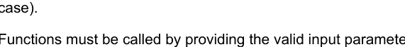

被调用函数的函数体。一旦被调用函数执行完成，程序控制权就会返回到之前的环境（此处为主程序）。

调用函数时必须提供由函数声明和定义所定义的有效输入参数。如果传入的参数与所需参数不匹配，编译器会生成错误。使用函数原型时，编译器会强制实施类型兼容性。

“按值传递”（Call-by-value）是 C 中与传递参数相关的一个术语。它意味着，当你调用函数并向其传递参数时，实参并不会被直接传递给被调用函数。相反，它们的值会被复制，并在被调用函数的函数体中创建另一个变量。这意味着每个实参都会被求值，并且其值会在各自的环境中局部使用。因此，如果将变量传递给函数，该变量在调用环境中的存储值不会改变，因为调用环境和被调用环境拥有各自的实参副本。

下面是一个示例，用于演示“按值传递”的概念：

```c
void changeValue(int a)
{
    a = a + 10;
    printf("Inside changeValue function: Value of a = %d\n", a);
}

void main(void)
{
    int a = 10;
    printf("Inside main function, before changeValue is called: Value of a = %d\n", a);
    changeValue(a);
    printf("Inside main function, after changeValue is called: Value of a = %d\n", a);
    system("pause");
}
```

因此，如你所见，changeValue 函数会给传入参数的值加 10，但这一更改在 main 程序中的变量 a 上不可见。更改只作用于局部变量，该局部变量是通过在 changeValue 函数中复制 main 函数里的变量来初始化的。

C 中另一种常用技术是使用指针的按引用传递。我们将在后续章节之一详细讨论指针和这一机制。

### 5.5 环境

在团队中工作的理想方式是什么？在团队中工作的理想方式是在一定的限制和边界内扮演被分配的角色。每个人都有其特权和某些限制。如果每个人都毫无必要地干涉他人的工作，就会把团队引向灾难。C 的结构遵循这些基本原则，以确保每个程序成功。正如我们之前讨论的，C 提供了变量的局部性，在

函数。同时，C 允许程序员自行选择变量的作用域。如果程序员希望某些内容由多个函数共享，C 提供了多种方式来实现。例如，使用指针或全局变量。

作用域的基本规则是：变量只能在其声明所在的块内访问。除非使用特殊技术另行指定，否则在该块边界之外，这些变量是不可知的。这是一条容易遵循的规则，但程序员似乎会在不同环境中使用相同的标识符。例如，参见本章末尾“示例”部分中的第二个示例。程序员使用标识符 ‘a’ 来表示不同作用域中的多个变量。如果没有作用域规则，编译器就无法区分这些标识符。让我们看另一个示例：

```c
int globalVariable = 10;

void changeValue (int a)
{
    a = a + 10;
    printf ("Inside changeValue function: Value of localVariable = %d\n", a);
    printf ("Inside changeValue function: Value of globalVariable = %d\n", globalVariable);
}

void main(void)
{
    int localVariable=20;
    changeValue(localVariable);
    printf("Inside changeValue function: Value of localVariable = %d\n", localVariable);
    for(int x=1; x<=5; x++)
    {
        printf ("%d,", x);
    }
    printf("\n");
    printf ("%d,", x);
    system ("pause");
}
```

上面的程序使用了四个作用域。第一个是全局作用域，这意味着它可以在任何地方被访问，并且在一个地方对它所做的更改对其他所有地方都可见。所有其他作用域都是局部作用域，这意味着它们只对其所在的作用域可见。标识符“local Variable”、“a”和“x”都是局部作用域中定义的变量。前两个变量遵循一般的作用域规则，但 x 违反了该规则。该程序无法编译，因为在“for”循环中声明的变量 x 在其作用域之外被访问。编译器无法在 for 循环之外将 x 识别为标识符。要使该程序正常工作，只需删除主程序中的倒数第二条语句。

### 5.6 递归

递归是一种函数调用自身以实现特定目标的技术。递归非常重要，因为它为困难程序提供了一种更高效、更简洁的编码方式。

如果函数通常根据决策语句在其函数体内调用自身，则称该函数为递归函数。下面是一个示例，以便更好地说明：

```c
void main(void)
{
    printf("This program is never going to end..!\n");
    main ();
    system ("pause");
}
```

下面是另一个示例，除非满足特定条件（n<=1），否则它会不断调用自身。

```c
int factorial (int n)
{
    if (n <= 1)
        return 1;
    else
        return (n * factorial(n - 1));
}
```

```c
void main(void)
{
    int f=factorial(5);
    printf("Factorial = %d\n", f);
    system("pause");
}
```

### 5.7 示例

#### 5.7.1 等值表

```c
void printTable( int );
void printHeading();
void main(void)
{
    printHeading();
    int x = 1;
    for(x=1;x<=10;x++)
    {
        printTable(x);
    }
    system("pause");
}
void printTable(int a)
{
    for(int x=1; x<=10; x++)
    {
        printf("%d\t",x*a);
    }
    printf("\n");
}
void printHeading()
{
    printf("----------------------------------Table of Tables----------------------------------\n\n");
}
```

#### 5.7.2 多文件

在文件 header.h 中：

```c
void func(int a);
void funcSquare(int a);
void funcCube(int a);
```

在文件 Implementation1.c 中：

```c
void func(int a)
{
    printf("I am func. I have to print: a = %d\n", a);
}
```

在文件 Implementation2.c 中：

```c
void funcSquare(int a)
{
    printf("I am funcSquare. I have to print: a = %d\n", a*a);
}
void funcCube(int a)
{
    printf("I am funcCube. I have to print: a = %d\n", a*a*a);
}
```

在文件 main.c 中：

```c
#include "header.h"

void main(void)
{
    printf("This is our main Program. Let's start...\n");
    func(5);
    funcSquare(5);
    funcCube(5);
    printf("This is our main Program. Let's finish...\n");
    system("pause");
}
```

#### 5.7.3 静态变量

```c
void demo()
{
    int normalVariable = 5;
    static int staticVariable = 5;
```

```c
printf("a = %d, b = %d\n", a, b);
swap(&a, &b);
printf("a = %d, b = %d\n", a, b);
system("pause");
}
```

#### 5.7.5 冒泡排序

```c
void bubble(int a[], int n)
{
    int i, j;
    for (i = 0; i < n; ++i)
        for (j = n - 1; j > i; --j)
            if (a[j-1] > a[j])
                swap(&a[j-1], &a[j]);
}
```

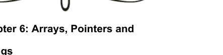

## 第 6 章：数组、指针和字符串

C 提供了一种数据结构，它通过将每个值与一个下标关联，从而可以在其中存储多个相同类型的值。它在常见编程中极其有用。例如，你需要存储 50 名学生的成绩，不必声明 50 个单独的变量，只需使用一个大小为 50 的数组即可。通过指定其索引或下标即可访问每个元素。

数组是一种随机访问数据结构，其中每个元素都可以在常数时间内直接访问。随机访问的一个典型例子是书——书的每一页都可以独立于其他页打开。

C 中的数组由连续的内存位置组成，这意味着它们在内存中放在一起。数组的最低成员（首元素）具有最低地址，数组的最后一个成员被分配最高的内存地址。

在 C 中，数组和指针是密切相关的概念。有趣的是，数组名本身就像指针一样起作用，而指针和数组一样可以被索引。“按引用传递”机制基于指针。该机制允许程序员从一个作用域更改另一个作用域中局部变量的值。C 通过在函数定义中指定指针参数来实现这一点。字符串也是字符的一维数组。它们将在下一章讨论。

### 6.1 一维数组

一维数组指一维数组。此类数组可以看作包含固定数量元素的单行或单列。它们只有一个索引。数组除了有索引之外，就像普通变量一样。索引始终从 0 开始，到 (arraySize-1) 结束。

C 中数组声明的一般格式如下：

```c
Type arrayName [arraySize];
```

Type 指数组的数据类型，后面是标识符，最后是括在方括号中的数组大小。

数组的存储类可以是 automatic、static 或 extern，但不能是 register。ANSI C 支持使用初始化器初始化所有三种类型的数组，但传统 C 只允许对 static 或 extern 寄存器这样做。

初始化一维数组的一般格式如下：

```c
Type identifier [size] = {list of elements separated by commas}
```

下面是使用初始化器使用一维数组的示例：

```c
void main(void)
{
    int table[10] = { 5, 10, 15, 20, 25, 30, 35, 40, 45, 50 };

    //printing elements of array
    for(int i = 0; i < 10 ; i++)
    {
        printf("5 x %d = %d\n",i+1,table[i]);
    }
    system("pause");
}
```

下面是使用循环而非常见初始化器来初始化一维数组的示例：

```c
void main(void)
{
    int table[10];

    //initialization of array
    for(int i = 1; i <= 10 ; i++)
    {
        table[i-1] = i * 5;
    }
    //printing elements of array
    for(int i = 0; i < 10 ; i++)
    {
        printf("5 x %d = %d\n",i+1,table[i]);
    }
    system("pause");
}
```

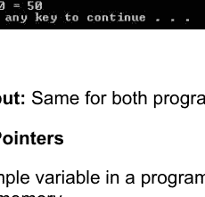

输出：两个程序相同。

### 6.2 指针

程序中的简单变量存储在机器中某个内存位置（或地址）的一定数量的字节中。指针本质上是保存这些地址而非实际值的变量。这些地址可以被访问，因此实际值也可以通过指针的“引用”来访问。指针在程序中用于

内存并操作地址。如果 i 是变量，那么 &i 就是存储 i 的值的地址或内存位置。这个地址可以存入同类型的指针变量中。取地址运算符 & 是一元运算符，具有与其他一元运算符相同的优先级和从右到左的结合性。

指针变量可以在程序中声明，然后用于获取地址以进行初始化。声明如下：

```c
int *p;
int x = 5;
p = &x;
```

下面是一个使用指针访问其他变量的程序：

```c
void main(void)
{
    int *p;
    int x = 5;
    p = &x;

    printf("Value of x: %d\n", x);
    printf("Address of x: %d\n", &x);
    printf("Value of p: %d\n", p);

    printf("Address of p: %d\n", &p);
    printf("p points to value via reference: %d\n", *p);
    system("pause");
}
```

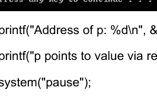

普通变量关联着两个数：变量的地址，以及存储在该地址上的值。变量名访问值，而变量名前的 & 访问地址。指针变量关联着三个数：指针变量本身的地址、初始化后存储在其中的值，以及由指针变量中存储的值所指向的值。前两个可以像普通变量一样，通过变量名和变量名前的 & 来访问。与指针关联的第三个值则通过标识符前的 * 号来访问。

下面是一个示例，它使用指针在两个函数之间访问数组，同时也阐明了“按引用调用”机制：

```c
void printMe(int *p)
{
    int arr[10];
    for(int i = 1; i <= 10 ; i++)
    {
        arr[i-1] = *(p+i-1);
    }
    //printing elements of array
    for(int i = 0; i < 10 ; i++)
    {
        printf("5 x %d = %d\n",i+1,arr[i]);
    }
}

void main(void)
{
    int table[10];
    //initialization of array
    for(int i = 1; i <= 10 ; i++)
    {
        table[i-1] = i * 5;
    }

    printMe(table);
    system("pause");
}
```

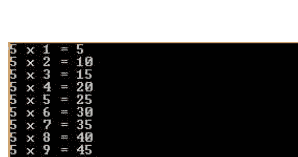

因此，我们只是将数组的起始地址作为指针传递给另一个方法，就能够访问在另一个函数中定义的数组。注意，表示数组的标识符如果省略下标，就等价于数组的起始地址（&identifier[0]）。*(p+i) 用于索引。如果 i 的值为 1，而整数占 4 个字节，那么程序访问的是下一个整数，而不只是下一个字节。

现在，我们来看一个示例：将指针传递给另一个函数后，主函数中定义的标识符的值会被改变。

```c
void changeMe(int *p)
{
    for(int i = 0; i < 10 ; i++)
    {
        p[i]=10;
    }
}

void main(void)
{
    int table[10];

    //initialization of array
    for(int i = 1; i <= 10 ; i++)
    {
        table[i-1] = i * 5;
    }

    printf("---Before Function call---\n");
    for(int i = 0; i < 10 ; i++)
    {
        printf("5 x %d = %d\n",i+1,table[i]);
    }

    changeMe(table);

    printf("---After Function call---\n");
    for(int i = 0; i < 10 ; i++)
    {
        printf("5 x %d = %d\n",i+1,table[i]);
    }

    system("pause");
}
```

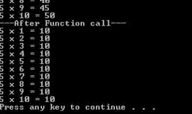

于是，我们在另一个函数中访问了主函数中定义的数组，并将其所有值改为 10。这一改变在主程序中可见。这正是“按引用调用”机制的用途。显然，之所以能实现这种机制，完全是因为指针。

尽管就访问内存的方式而言，指针和数组几乎同义——从上面的示例也可以看出这一点——但它们之间存在差异，而且这些差异细微却重要。指针变量可以取不同地址作为值，这意味着它们可以在任何时候被重新定义。数组则不是这样。数组名是一个地址，或者说一个指针，而且是固定的。

### 6.3 字符串

字符串是 char 类型的一维数组。你可能会想，既然字符串是 char 类型的数组，为什么还需要单独讨论它们。字符串与字符数组的主要区别在于：字符串可以具有可变长度，而 char 数组具有固定大小。

由于字符串可以具有可变长度，我们需要一种机制来标识字符串的结尾。每个字符串默认以空字符 \0 结尾。字符串的大小也必须包含存储字符串结束字符所需的空间。程序员的责任是绝不访问字符串中超出字符串大小的字符。

字符常量用单引号表示，而字符串则用双引号初始化。例如，"abc" 是一个大小为 4 的字符串，最后一个元素是空字符 \0。

尽管 char 常量和字符串看起来密切相关，但它们并不相同。例如，"a" 和 'a' 并不相同。"a" 有两个字符，其中一个是 'a'，另一个是 \0。

编译器将字符串视为指针。它的值是字符串的基地址。考虑以下代码：

```c
char *pointer = "abc";
printf("%s %s\n", pointer, pointer + 1);
```

指针变量被赋予字符串的起始值。第一个字符串从‘a’开始打印。第二个字符串将其地址移动一个单位（通常 char 为 1 个字节），因此从‘b’开始。所以，上述代码行的输出将是：

abc bc

由于字符串可以被视为指针，像 `*("abc"+2)` 和 `"abc"[2]` 这样的语句在编译器中是合法的。

现在我们来看一个同时使用 char 数组和字符串的示例。你可以看到使用字符串的便利性：

```c
void main(void)
{
    char *s = "aString";
    char characters[10] = {'c', 'h', 'a', 'r', 'a', 'c', 't', 'e', 'r', 's'};
    for(int i=0;i<10;i++)
    {
        printf("%c", characters[i]);
    }
    printf("\n%s\n", s);
    system("pause");
}
```

出于技术原因，最好不要打印空字符。除非我们使用指针访问字符串的最后一个字符，否则字符串不会打印空字符。

现在，我们编写一个程序来统计字符串中的单词数，以便更好地理解字符串。该程序使用宏 isspace()，当指定字符是空格时返回 true，否则返回 false。

```c
int numberOfWords(const char *str)
{
    int count = 0;
    while (*str != '\0')
    {
        while (isspace(*str))
        {
            ++str;
            if (*str != '\0')
            {
                count++;
            }
        }
    }
    return ++count;
}
```

字符串或指向字符数组的指针作为参数传入。我们将空格视为单词分隔符。对于由空格分隔的所有单词，我们递增单词计数变量。最后再递增一次，以便最后一个单词也被计入。

ANSI C 为程序员提供了处理字符串的预定义函数。本节演示如何使用其中一些函数。字符串处理函数的函数原型在标准头文件 `string.h` 中给出。这些原型在某些参数中使用字符指针和字符串。请记住，它们可以互换使用。

| 函数名 | 描述 |
|---|---|
| `char *strcat(char *s1, const char *s2);` | 将第二个字符串连接到第一个字符串末尾，并返回第一个字符串。 |
| `int strcmp(const char *s1, const char *s2);` | 比较两个字符串。如果第一个字符串小于第二个，返回小于 0 的值；如果第一个字符串大于第二个，返回大于 0 的值；如果两者相等，返回 0。 |
| `char *strcpy(char *s1, const char *s2);` | 字符串 s1 被字符串 s2 覆盖，并返回 s1。 |
| `size_t strlen(const char *s);` | 返回字符串 s 中的字符数，不包括结尾的空字符。 |

这些函数也可以由程序员自行编写。建议使用这些函数，因为它们使用寄存器类变量，因此更高效。

### 6.4 二维数组

尽管数组元素是一个接一个连续存储的，但通常方便将二维数组视为具有行和列的元素表。这有助于更好地理解二维数组。例如，要

要声明一个包含二十个元素、五行四列的数组，我们使用以下语句：

```c
int Two_D[5][4];
```

嵌套循环通常用于处理二维数组。

这些元素可以表示为：

- Two_D[0][0]
- Two_D[0][1]
- Two_D[0][2]
- Two_D[0][3]
- Two_D[1][0]
- Two_D[1][1]
- Two_D[1][2]
- Two_D[1][3]
- Two_D[2][0]
- Two_D[2][1]
- Two_D[2][2]
- Two_D[2][3]
- Two_D[3][0]
- Two_D[3][1]
- Two_D[3][2]
- Two_D[3][3]
- Two_D[4][0]
- Two_D[4][1]
- Two_D[4][2]
- Two_D[4][3]

### 6.5 三维数组

维度高于二的数组的工作方式类似。让我们描述一下三维数组的工作方式。如果我们声明

```c
int Three_D[5][3][2];
```

编译器为整型分配 5*3*2 个内存地址。基地址是 Three_D[0][0][0]。

下面是一个函数，它将三维数组的元素相加并返回总和。

```c
int sum(int Three_D[5][3][2])
{
    int i, j, k, sum = 0;
    for (i = 0; i < 5; ++i)
        for (j = 0; j < 3; ++j)
            for (k = 0; k < 2; ++k)
                sum += Three_D[i][j][k];

    return sum;
}
```


## 第7章：结构体

C 是一种易于扩展的语言。它可以使用头文件和标准库来使用某些函数和宏进行扩展。它也可以通过定义由基本类型构造的数据类型来扩展，例如数组，它是一组默认数据类型变量。

结构类型用于表示异构数据。结构体具有称为成员的组件。结构体是为程序员的方便而设计的，以便他们可以定义自己的数据类型，该类型可能包含多个成员。每个成员可以是默认数据类型或另一个结构体。由于结构体的组件可以是各种类型，程序员可以根据自己的需求设计它们。

### 7.1 声明

结构体允许程序员将不同类型的变量集成在一起。

数组用于存储相同类型的变量。作为一个简单的例子，让我们定义一个描述学生的结构体。学生具有各种不同类型的属性，如 Name、Course、Section、CGPA 和 ID。学生可以用 C 中的结构体来定义。我们可以使用关键字 struct 如下声明学生的结构体类型：

```c
struct Student
{
    char *Name;
    int Course, ID;
    char Section;
    double CGPA;
};
```

此声明创建派生数据类型 struct Student。它是一个用户定义的数据类型。已定义的结构体可用于定义此用户定义类型的标识符。标签名或标识符连同关键字 struct 用于声明 Student 类型的变量：

```c
struct Student s1, s2, s3;
```

上述对结构体变量的声明为标识符分配存储空间，这些标识符现在代表一个 Student。声明这些标识符的另一种方式如下：

```c
struct Student
{
    char *Name;
    int Course, ID;
    char Section;
    double CGPA;
} s1, s2, s3;
```

另一种声明方式，强烈推荐，因为它缩短了结构体标识符的声明，如下所示：

```c
typedef struct
{
    char *Name;
    int Course, ID;
    char Section;
    double CGPA;
} Student;
```

### 7.2 内存分配

尽管在声明时已为这些变量分配了内存，但这些变量尚未被赋值。没有学生类型变量保存了详细信息。

以下是结构体类型变量的每个组件如何初始化：

```c
s1.Name = "R Khan";
s1.Course = 18;
s1.ID = 786;
s1.Section = 'A';
s1.CGPA = 3.74;
```

### 7.3 成员访问运算符

我们可以通过两种方式访问结构体变量的成员。上面的示例使用了成员访问运算符“.”。我们现在将进一步举例说明其用法并介绍另一个成员访问运算符“->”。这两个运算符用于相同的目的。区别在于调用者。点运算符由结构体变量使用，而箭头由指向结构体变量的指针使用。

```c
typedef struct
{
    char *Name;
    int Course, ID;
    char Section;
    double CGPA;
} Student;

void printUsingPointer(Student *s)
{
    printf("%s %d %d %c %f\n", s->Name, s->ID, s->Course, s->Section, s->CGPA);
}

void main(void)
{
    Student s1, s2;

    s1.Name = "R Khan";
    s1.Course = 18;
    s1.ID = 786;
    s1.Section = 'A';
    s1.CGPA = 3.74;

    s2.Name = "Ali Khan";
    s2.Course = 18;
    s2.ID = 890;
    s2.Section = 'A';
    s2.CGPA = 3.14;

    printf("%s %d %d %c %f\n", s1.Name, s1.ID, s1.Course, s1.Section, s1.CGPA);

    printUsingPointer(&s2);

    system("pause");
}
```

以下是一些语句以及等效的访问方法也列出：

```c
struct Student s, *p = &s;

s.Section == 'A';

s.Name = "Khan";

s.ID = 786;
```

| 表达式 | 等价表达式 | 值 |
|---|---|---|
| s.grade | p->grade | ‘A’ |
| s.Name | p->Name | "Khan" |
| (*p).ID | p->ID | 786 |
| *p->Name + 1 | (*(p->Name)) + 1 | D |
| *(p->Name + 2) | (p->Name)[2] | S |

### 7.4 定义

所有由程序员初始化的外部和静态变量，包括结构体变量，除非另有指定，否则系统会自动将其初始化为零。在传统的 C 中，只有外部和静态变量可以被初始化。ANSI C 也允许自动变量，包括结构体，进行初始化。初始化结构体的语法与初始化数组的语法非常相似，因为结构体也使用大括号取值。声明中的结构体变量可以通过在其后加上等号进行初始化

ADT 栈是一种遵循后进先出（LIFO）原则的对象容器。这意味着你只能访问最近输入的元素。栈是一种受限访问的数据结构 - 元素只能在栈顶添加和移除。要访问其他元素，需要移除它们上面的对象。栈实现只需要两个主要操作：push 和 pop。Push 指的是在栈顶添加一个元素，而 pop 则移除栈顶的项目。一个有用的类比是想象一根钢杆上的哑铃堆；你只能移除最上面的哑铃，也可以在顶部添加新的哑铃。

我们现在开发并实现 ADT 栈，这是最有用的标准数据结构之一。可以为栈实现的典型操作有 push、pop、top、empty、full 和 reset。push 和 pop 操作前面已讨论过。empty 运算符测试栈是否为空，并返回布尔值。full 运算符测试栈是否已满，也返回布尔值。reset 运算符移除栈的所有元素并对其进行初始化。

我们将使用固定长度的 char 数组来存储栈的内容。栈顶将是一个名为 top 的整数值成员。上一段讨论的各种栈操作将作为函数实现，每个函数的参数列表都包括一个指向栈的指针类型的参数。使用指针可以避免复制大的栈值，从而提高效率。

下面是一个完整的 C 程序，它实现了栈的各种函数：

```c
#define MAX_SIZE 50

int stack[MAX_SIZE];

void push();

int pop();

int is_empty();

int peek();

int TOP = -1;

int main()
{
    int element, choice;

    while(1)
    {
        printf("Stack Operations.\n");
        printf("1. Insert into stack (Push operation).\n");
        printf("2. Delete from stack (Pop operation).\n");
        printf("3. Print top element of stack.\n");
        printf("4. Check if stack is empty.\n");
        printf("5. Exit.\n");
        printf("Enter your choice.\n");
        scanf("%d",&choice);
        switch (choice)
        {
        case 1:
            if (TOP == MAX_SIZE - 1)
                printf("Error: Overflow\n\n");
            else {
                printf("Enter the value to insert.\n");
                scanf("%d", &element);
                push(element);
            }
        }
```


```c
break;

case 2:
    if (TOP == -1)
        printf("Error: Underflow.\n\n");
    else
    {
        element = pop();
        printf("Element removed from stack is %d.\n", element);
    }
    break;

case 3:
    if (!is_empty())
    {
        element = peek();
        printf("Element at the top of stack is %d\n\n", element);
    }
    else
        printf("Stack is empty.\n\n");
    break;

case 4:
    if (is_empty())
        printf("Stack is empty.\n\n");
    else
        printf("Stack is not empty.\n\n");
    break;

case 5:
    exit(0);
}
}
}

void push(int value)
{
    TOP++;
    stack[TOP] = value;
}

int pop()
{
    int element;
    if (TOP == -1)
        return TOP;
    element = stack[TOP];
    TOP--;
    return element;
}

int is_empty()
{
    if (TOP == -1)
        return 1;
    else
        return 0;
}

int peek()
{
    return stack[TOP];
}
```

#### 7.5.2 队列

队列是遵循先进先出（FIFO）原则的对象容器（线性集合）。队列的例子包括现实生活中的任何队列，例如银行、ATM 或机场中的队列。新元素或对象被添加到队列尾部，而移除（或服务）发生在队列前端。队列中只允许两种操作，即入队和出队函数。前者表示将一项插入队列尾部，出队则指从队列前端移除一项。

栈与队列的区别在于移除操作。在栈中，我们移除最后添加的项；而在队列中，我们移除在队列中停留时间最长的那一项。

下面是一个演示队列使用的完整程序：

```c
#define MAX_SIZE 50

int queue_array[MAX_SIZE];

int rear = -1;

int front = -1;

void main(void)
{
    int choice;

    while (1)
    {
        printf("1.Insert element to queue \n");
        printf("2.Delete element from queue \n");
        printf("3.Display all elements of queue \n");
        printf("4.Quit \n");
        printf("Enter your choice : ");
        scanf("%d", &choice);
        switch (choice)
        {
        case 1:
            insert();
            break;
        case 2:
            delete();
            break;
        case 3:
            display();
            break;
        case 4:
            exit(1);
        default:
            printf("Wrong choice \n");
        }
    }
}

void insert()
{
    int add_item;
    if (rear == MAX_SIZE - 1)
        printf("Queue Overflow \n");
    else
    {
        if (front == -1)
            front = 0;
        printf("Insert the element in queue : ");
        scanf("%d", &add_item);
        rear = rear + 1;
        queue_array[rear] = add_item;
    }
}

void delete()
{
    if (front == -1 || front > rear)
    {
        printf("Queue Underflow \n");
        return;
    }
    else
    {
        printf("Element deleted from queue is : %d\n", queue_array[front]);
        front = front + 1;
    }
}

void display()
{
    int i;
    if (front == -1)
        printf("Queue is empty \n");
    else
    {
        printf("Queue is : \n");
        for (i = front; i <= rear; i++)
            printf("%d ", queue_array[i]);
        printf("\n");
    }
}
```

#### 7.5.3 链表

链表是一种顺序访问数据结构，其中每个元素只能按特定顺序访问。顺序访问的一个典型例子是从未整理的文件堆中查找某个特定文件。它就像一根晾衣绳，数据结构按顺序挂在其上。头指针指向链表的第一个元素，每个元素指向其后继元素，最后一个元素的值为 NULL。

下面是一段实现链表的代码。链表由相邻节点组成，每个节点都保存下一个节点的地址。从头节点开始，我们可以利用每个节点中的 next 指针遍历整个链表。我们还可以在节点中增加另一个指针，用来保存前一个节点的地址。

```c
struct Node
{
    int val;
    struct Node *next;
};
typedef struct Node element;

void main()
{
    element *curr, *head;
    int i;
    head = NULL;
    for (i = 1; i <= 10; i++)
    {
        curr = (element *)malloc(sizeof(element));
        curr->val = i;
        curr->next = head;
        head = curr;
    }
    curr = head;
    while (curr)
    {
        printf("%d\n", curr->val);
        curr = curr->next;
    }
}
```

## 第 8 章：二叉树

树是元素的有限集合，这些元素通常称为节点。每棵树都有一个唯一的起始节点，称为根节点，而其余节点是此根节点的互不相交的子树集合。每个节点记录其父节点和/或子节点，以便能够进行遍历。没有子节点的节点称为叶节点或终端节点。

二叉树是这样一种树：其节点最多可以有两个子节点。二叉树是一种数据结构，其中每个节点包含两个可能的子元素，分别称为左子节点和右子节点。如果节点没有左子节点或右子节点，则将其赋值为 NULL。每个链接必须指向一个尚未被指向的新对象，或者为 NULL。

二叉树中节点的一般形式如下：

```c
struct node
{
    char value;
    struct node *left, *right;
};
```

二叉树是一种有用的数据结构，可用于快速存储有序数据和快速检索已存储数据。这极大地提高了搜索和排序的效率。

### 8.1 组成

二叉树由父节点（或叶节点）组成，每个节点存储数据，并且最多链接到两个子节点。正是被链接的叶节点与进行链接的叶节点（也称为父节点）之间的关系，使二叉树成为如此高效的数据结构。

通常，左子节点的值小于父节点，而右子节点的键值大于其父节点。由于这两条简单规则，树的效率非常高。

因此，树最左侧的叶节点具有最小值；既然我们已经知道这一点，那么若要获取最小值，只需遍历到最左侧的最低叶节点，而不必遍历树中的每个元素。

同样，树右侧的叶节点具有最大值；因此，如果我们需要查找最大数，只需遍历到树的某一侧，就能比使用排序和搜索算法完成此任务的程序更快地到达目标。

更重要的是，由于每个叶节点连接到另外两个叶节点，它便是一棵新的更小二叉树的起点。因此，可以随时轻松访问和插入任意类型的数据到二叉树中，方法是递归调用作用于后续叶节点的搜索和插入函数，同时保持树的顺序。新插入的节点总是到达正确的位置。

### 8.2 插入函数

下面的插入函数将元素插入树中。如果树尚未创建，该元素也会创建树。它使用指向指针的指针来处理树可能不存在的情况。通过接收指向指针的指针，如果根指针为 NULL，就可以分配内存。

```c
void insert(int key, struct node **terminal)
{
    if (*terminal == 0)
    {
        *terminal = (struct node *)malloc(sizeof(struct node));
        (*terminal)->key_value = key;
        (*terminal)->left = 0;
        (*terminal)->right = 0;
    }
    else if (key < (*terminal)->key_value)
    {
        insert(key, &(*terminal)->left);
    }
    else if (key > (*terminal)->key_value)
    {
        insert(key, &(*terminal)->right);
    }
}
```

插入函数遵循二叉树的两条基本规则。对于任意当前节点，如果要插入的值较小则向左移动，如果值较大则向右移动，直到到达一个 NULL 节点；然后为该节点分配内存并用新的键值初始化。指向倒数第二个节点的指针会被更新，而新初始化节点的指针被设置为 NULL。一旦元素添加完毕，插入函数将停止调用自身，并将程序控制权返回正常环境以继续执行。

### 8.3 搜索函数

下面是二叉树的搜索函数。它接收一个键值和一个起始节点，并递归地在树中搜索该键值。如果找到叶节点，则返回该节点；否则返回 0。

```c
struct node *search(int key, struct node *terminal)
{
    if (terminal != 0)
    {
        if (key == terminal->key_value)
        {
            return terminal;
        }
        else if (key < terminal->key_value)
```

```c
{
    return search(key, troot->left);
}
else
{
    return search(key, troot->right);
}
}
else return 0;
}
```

上述所示的 search 函数会递归地向下遍历树，直到到达一个节点，其键值等于函数正在搜索的值。所搜索的值可能未存储在二叉树中，因此我们维护一个条件：当 search 到达值为 NULL 的节点时，就判定该键值不存在于二叉树中。它将指针返回给调用它的上一层函数实例。

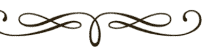

## 结论

本书是 C 编程的简单、完整且快速的参考资料。本书逐步介绍通用编程语言。它采用程序员的视角编写，因此非常适合作为希望用 C 编程的人的快速指南和参考。

本书详细涵盖了编程的所有基本概念，如运算符、函数、指针、数组、字符串和决策语句。本书具有灵活性，可帮助读者进行选择性学习。各章节在相互依赖性上保持最小化。

读完本书后，读者应成为 C 语言的高效程序员，并熟悉以下 C 语言概念：

- 语言概述
- C 的词法元素
- 循环
- 决策语句
- 数组
- 字符串
- 指针
- 函数
- 抽象数据类型
- 栈
- 队列
- 链表
- 二叉树

如果本书对你有帮助，请现在为它留下评论。也可以在 Kindle 上查看我的其他书籍。

R.J. Khan


## 查看我的其他书籍：

**C 语言编程快速入门指南：初学者的简化指南**

**SCRUM：Scrum 快速简化指南 – 敏捷项目管理** (即将推出)

