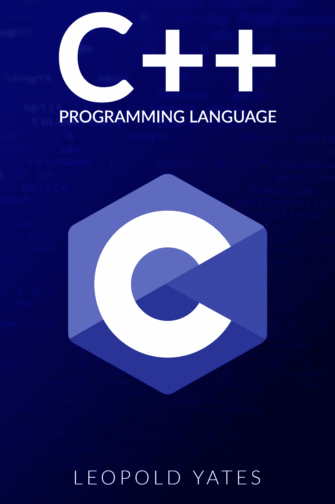
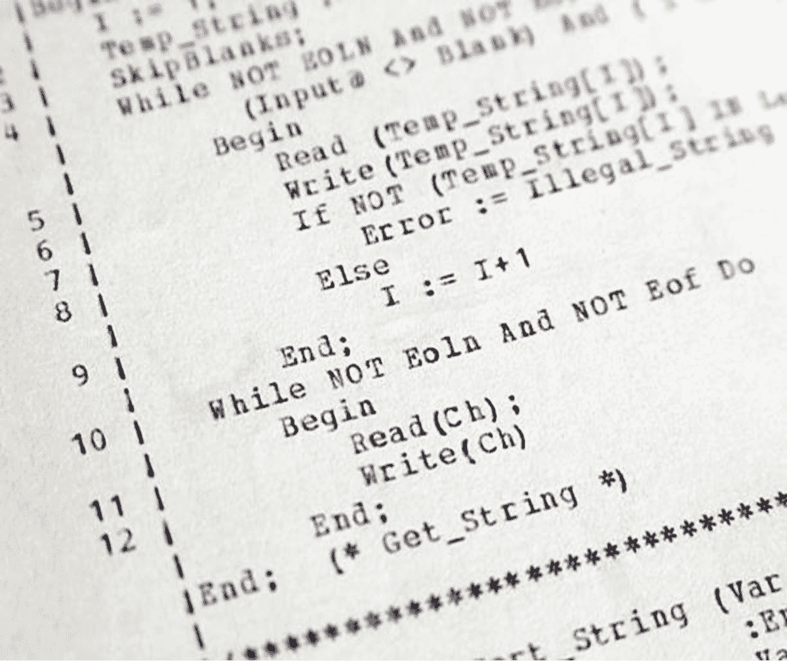

# C++ 语言编程：有效设计、开发与实现健壮系统的分步指南



- 结语

#  引言

1979 年开始，比雅恩·斯特拉斯鲁普（Bjarne Stroustrup）在贝尔实验室作为 `C` 语言的扩展开发了 `C++`。`C++` 为 `C` 语言增加了许多新功能，可以被视为 `C` 的超集，但这种说法并不完全准确（因为 `C99` 增加了一些 `C++` 并不具备的能力）。`C++` 的声誉主要源于它是一门面向对象的编程语言。我们将在第八章（简单的项目导向编程）中讨论什么是对象，以及它与传统的编程技术有何不同。

7. `C++` 中的变量可以在程序的任何地方定义，但在使用它们之前必须进行声明。


本笔记介绍了一些简单的 `C++` 原则，并描述了这部分比其他语言更容易学习和应用的 `C++` 子集。尽管本笔记最初是为了解释在 `Nachos` 挑战中使用的 `C++`，但它对任何学习 `C++` 的人来说都极具价值。大多数人已经熟悉 `C` 语言的概念，如过程、`for` 循环和指针；这些内容通过阅读 `Kernighan` 和 `Ritchie` 的《`C` 编程语言》可以轻松掌握。

有少数几个 `C++` 纯主义者（这可能是一个自矛盾的词？）。他们强烈反对此处处列出的某些规定；大多数的论点都是之类的："你怎么可能排除函数 `X` 呢？"

本公告的核心思想是，虽然面向对象编程是简化程序的一种棒方法，但 `C++` 是一种极其复杂的语言，拥有许多本应该非常、非常少使用的功能。说 `C++` 提供了人们想象过的每一个编程语言功能甚至更多，也并不夸张。当面对一个全新的语言功能时，人的本能是尝试使用它，但在 `C++` 中，这种策略会导致灾难。因此，用户必须仔细区分：

1. 每个人都应该理解并使用的基础概念（例如 `classes`、`member functions`、`constructors`）。

2. 那些虽然很有用但并不频繁使用的功能（例如 `single inheritance`、`templates`），新手程序员应该能够掌握这些功能（以防遇到它们），但在一段时间内应避免在自己的程序包中使用它们。

3. 那些完全是坏主意且应该像避瘟疫一样避免的功能（例如 `multiple inheritance`、`exceptions`、`overloading`、`references` 以及许多其他）。

当然，最后一个类别中的所有对象都有支持者，人们必须承认，就像备受讨厌的 `goto` 一样，确实可能出现程序从使用 `goto` 或多重继承中获益的情况。然而，常识是，大多数程序员永远不会遇到这种情况，即使他们遇到了，用户也更有可能误用该功能而不是正确地使用它。

利用 `C++` 的一些优势包括：

1. **可维护性**：修改代码的难度较低，因为只需要少量文本内容的更改，而不需要重新排列大量的处理器指令。`C++` 是面向对象的，这进一步增强了可维护性。

2. **移植性**：不同的处理器提供不同的指令。用文本编写的包可以转换为许多不同处理器的指令；`C++` 的优点之一是它可以用于为几乎任何 `CPU` 编写应用程序。

3. **简洁性**：编程语言允许我们以更简洁的方式表达典型的命令序列。`C++` 有一些特别有效的快捷方法。

`C++` 是一种编译型编程语言：

```
C++
The Source Code
1001100100
Machine code.
COMPILE
```

`C++` 包含字母 `C`。

`C++` 在很大程度上是 `C` 的语言超集，大多数编写正确的 `ANSI C` 都会编译为 `C++`。然而，有一些重要的注意事项：

1. 所有的函数和定义头文件声明应该使用新风格声明，例如 `extern int foo(int X, char* Y);`。

2. 不要使用默认类型 `int`，所有函数必须在使用之前进行声明。

3. 如果你想将 `C` 对象与 `C++` 链接，在为 `C++` 声明 `C` 能力时必须执行以下操作：

```
int foo(int X, char* Y); extern "C"
```

在任何其他情况下，`C++` 编译器将以一种异常的方式更改名称。

4. `extern int foo();` 这种形式允许 `foo` 优先采用不确定类型和多种参数。事实上，有些人建议即使在日常 `C` 代码中也使用 `C++` 编译器，因为它可以捕获普通 `C` 编译器会忽略的滥用函数等问题。

5. 有许多新术语不再可以作为标识符；一些常见的词汇是如 `delete`、`const` 和 `class` 等新词。

# 第一章

## **：这些是种视为项目成员的函数，并在类声明中定义。它们通常被称为函数成员。与成员函数类似，类别的行为由以下内容指定：

   a. 在创建新对象时做什么（该对象的函数 `Object() { [native code] }`），换句话说，如何初始化对象的记录。

   b. 在删除项目时做什么（该项目的析构函数）。

2. **对象和类 (Objects and classes)**：类类似于 `C`，不同在于数据结构定义和所有操作该数据结构的 `Function` 能力都聚集在一个部分。作为一个类别（数据结构实例）的例子，相同类的对象在类内部具有相同的函数，但每个对象（每个实例）都有自己的自己私人的数据结构克隆。因此，一个类定义了两个组件：它们包含的对象以及它们拥有的数据。

3. **私有成员与公共成员 (Private vs. Public members)**：类的公共成员是可以公开研究或发表的（如数据成员），或者是众所皆知的（如成员函数）。私有成员最好通过类成员特征进行研究、编写或调用。

类的使用主要出于两个原因：

1. 私有个体的使用允许你这样做，让你对程序数据所有权的方式更有信心，以及

2. 如果能将数据与管理该数据的函数分组在一起，组织你的程序将变得容易得多。

面向对象编程结合了额外的思想，如抽象、封装、多态、继承、模块化等。

### 封装 (Encapsulation)

面向对象编程的核心原则之一是封装（`OOP`）。它定义了在单个单元内对数据打包以及操作该数据的功能的概念，例如 `C++` 中的 `class`。

这种思想也被广泛用于将对象的内部内容（或状态）与其边界隔离开。这被称为数据隐藏。这种机制的整体概念非常简单。如果你有一个从对象外部不可见的的属性，并将其与提供读取或写入访问权限的方法打包，你就可以屏蔽特定信息并管理对对象内部状态的访问。

任何面向对象编程语言中都有 `getter` 和 `setter` 方法。`getter` 方法获取特征，而 `setter` 方法修改它。根据程序员实现的技巧，用户可以选择某个特征是否可以被读取和更改、是否是只读的或者完全不可见。

### 抽象 (Abstraction)

抽象是一种从外部世界隐藏应用程序内部信息的方法。使用简单的句子通过抽象描述事物。它被用于在工具和客户端程序之间设置障碍。

抽象存在于生活的几乎每一个方面：

你的汽车是抽象的一个极佳例子。你可能通过转钥匙或按下启动按钮来启动汽车。你不想知道引擎如何启动或汽车包含哪些组件。汽车的内部实现和复杂逻辑对消费者是完全隐藏的。

我们会在微波炉中加热食物。我们按下几个按钮来设置定时器晚餐类型。最后，我们享用了一份热腾又美味的午餐。我们并不知道微波炉内部有什么。我们以一种非常直接的方式获得了对容量的访问。

对象是面向对象编程的主要构建模块。一个对象由属性和方法组成。通过访问修饰符，抽象将它们与外部全局隔离开。我们可以在其他包中提供对重要功能和属性的访问。在 `OOP` 中，这是强制抽象的完整技术。

**继承**：面向对象编程最重要的方面之一是继承（`OOP`）。理解继承的关键在于它促进了代码的重用。我们不需要重复相同的代码，而是真正可以将一个父类的属性继承到另一个子类中。

**多态**：多态一词被用于各种场合，用来描述事物以多种不同形式出现的情况。它描述了了在编程语言中，可以通过相同的接口访问不同类型的设备的理念。每种类型都可以为该接口提供其自己的、无偏见的实现。这是一个基础概念，也是面向对象编程（`OOP`）的基础。

# 第 2 章

## 2.1 如何开始 C++

### 2.1.1 编写 Hello World

```cpp
#include <iostream>
int main() {
    std::cout << "Hello World";
    return 0;
}
```

代码分析：

这是一个包含 `<iostream>` 的预处理器指令。头文件被包含在源代码中。`iostream` 包含了用于输出流和输入流的双向的函数。

当执行源代码时，会调用 `main` 函数。当程序执行时，`main` 函数应该是独一无二的。

`main` 函数中的关键字 `int` 表示它应该返回一个整数类型的数字。

`Hello, World`：它是一个字面量字符串。它是将要打印的文本。文本始终放在引号内。

分号（`;`）：它是通知编译器语句已结束的标记。

### 2.1.2 文件包含指令

文件包含指令 `#include` 允许我们在源代码中包含各种文件。在我们的代码中，我们应该包含任何提供若干预设功能定义的头文件记录。可以使用以下语法在程序中包含头文件：

`<FILENAME>` 应该被包含。

随着我们的包尺寸扩大或功能变得更加复杂，我们可能需要将软件拆分为不同的文件，或从其他文件导入功能。在这种情况下，我们采用程序员定义的文件。若要在我们的软件中包含程序员定义的文件，我们可以使用以下 `#include` 指令语法。

`"FILENAME"` 必须被包含。

这是我们打算整合到代码中的用户定义文件，以获取其功能。

## 2.2 宏定义指令

`#define`：此命令用于定义符号常量。创建一个宏名称 `code`。

`#undef`：使用 `#undef` 指令，程序中通过 `#define` 指令定义的宏将被关闭，直到它们不再定义。当程序遇到 `#undef` 时，使用宏（通过 `#undef` 未定义的宏）将导致编译失败。

### 2.2.1 条件指令编译

在编码中，使用了如 `if` 和 `else` 等指令。一些 `C++` 条件编译指令如下：

`#elif`

`#ifdef`

`#if`

`#endif`

`#ifndef`

`#else`

`#` 和双符号 `##` 运算符用于将文本标记转换为字符串。

### 2.2.2 附加目录

`#error`：当编译器发现源代码中存在错误时，错误指令会导致编译器产生错误消息。

`#line`：此指令指示编译器将存储的文件名和行号替换为给定的文件名和行号。

`#pragma`：它为实现提供了指令。

## 2.3 注释

良好的注释是对程序员的极佳锻炼。它提高了代码的可读性并使更容易发现错误。注释是有效文档不可或缺的一部分。

注释是计算机程序源代码中程序员可读的理由或注解。注释是编译器或解释器未完成的语句。在 `C/C++` 中有几种类型的反馈：

- 单行注释

- 多行注释

`// single-line or solo comment`

`/* Comment on many lines */`

### 单行注释

`//` 双正斜杠是它的写法方式。它是用于表示单行注释的标记。它仅将注释应用到单行。它被称为 `C++` 风格注释，因为它是 `C++` 编程中非常早期的组件。

例如：

```cpp
int main() {
    std::cout << "Hello World"; //single line remark
}
```

### 多行注释

`/* any text */` 以正斜杠和星号（`/*`）开头，以星号和正斜杠（`*/`）结束。它用于表示多行注释。它可以观察以上的注释。因为它是在 `C` 语言中提供的，所以它被称为 `C` 风格注释。

```cpp
/* How to Begin Sentene1
Sentence2 Sentence3 Sentence4
.
.
*Commentary concludes */
```

### 代码

```cpp
#include <iostream>
using namespace std;

int main() {
    cout << "Hello, World";
    return 0;
}
```

### 注释的优点：

注释像任何其他编程语言一样，提供了许多好处：

- 代码应该被显式注释，以便阅读。

- 代码的原因和用处的合理化。

- 在代码背后，你可以找到关于代码的历史信息。

- 版权信息、项目说明、贡献者致谢等。无需中断源代码的运行。

然而，注释也有某些缺点：

- 它们必须随着代码的任何更改保持更新。

- 通常，过多的注释会使代码更难理解。

通过编写清晰、自解释的代码，可以减少对注释的需求。一个简单的例子是函数、变量等使用解释性名称。

### 使用标记注释禁用代码

注释也可以用于在开发期间某些时候快速禁用部分代码而不将其删除。这在测试或调试期间非常有用，但不适用于除临时修改以外的任何情况。这通常被称为"注释掉"。

同样，在注释中保留代码的旧版本作为参考是不被鼓励的，因为这会弄乱文件，而且与使用版本控制方法调查代码历史相比，提供的价值很小。

## 2.4 C++ 编译过程

编译器通常用于生成可执行的 `C++` 代码。

编译器是一种将代码从一种计算机语言转换为另一种（额外的）的软件，计算机可以一次执行。编译是使用编译器转换代码。

`C++` 的编译技术基于其"父级"语言 `C`。以下是 `C++` 编译的四个基本步骤：

1. `C++` 预处理器将任何包含的头文件的内容插入源代码记录，创建宏代码，并将通过 `#define` 定义的符号常量的值替换为它们的值。

2. `C++` 预处理器生成的改进源代码文件被编译成平台相应的汇编语言。

3. 编译器生成汇编代码，然后将其汇编成平台相应的对象代码。

## Functions

函数是代码的单元，表示构建可执行程序所需的一系列语句。需要注意的是，少量的编译代码被链接在一起但并未形成最终的应用程序。许多 `C++` 编译器还可以使用专门工具对函数进行合并或拆分，这些工具涉及了 `Images/image0010.jpeg` 的创建。

### 5. Function

函数是一个表示系列语句的单元。函数可以接受参数，也可以只返回一个值（或不返回）。函数调用用于执行函数。许多 `C++` 程序员使用专门的工具，但所有工具通常都遵循程序的创建规则。

函数名通过其返回类型进行修饰。每个函数都有签名，包括它的参数和返回类型。在程序的其他地方调用函数之前，必须对其进行声明和定义。需要注意的是，`C++` 函数本质上是方法，而不是法律。

### 函数声明

函数实现了代码的模块化并有助于理解。使用函数使得捕获错误等变得变得于许多。声明函数的根本语法如下：

```cpp
functionName(parameter1, parameter2)
{
    // function body
}
```

### 返回类型

这指示函数在被调用时将返回的内容。它可以是 `char`、指针或 `int`。可能存在不返回任何内容的函数；这些函数具有 `void` 返回类型。函数通过其名称被引用。参数是存储在调用函数时提供的参数值的变量。函数可能包含也不包含参数列表。

```cpp
int sum2(int a);
```

### 调用函数

函数通过其名称识别。如果在不带参数的情况下调用函数，可以立即识别。然而，对于带有参数的函数，我们有两种选择：

*   按值传递

*   按引用传递

### 按值传递

我们将已存储或复制的参数值传递给函数的形式参数以执行此调用过程。结果是，原始值保持不变；只有参数内部的值发生了变化。

```cpp
void total(int a)
int main()
{
    cout << a;
    int a = 10;
    total(a);
}

void total(int a)
{
    a = a + 10;
}
```

Result: 10

由于我们通过值提供参数，在这种情况下实际变量 `a` 没有被修改；相反，`a` 的副本被修改，并且该副本值在函数终止（超出作用域）时被销毁。因此，`main()` 的变量 `a` 仍然为 10。

然而，我们将修改此应用程序，通过让过程 `sum()` 返回一个值并将该值放入 `x` 来改变唯一的 `a`。

```cpp
int total(int a)
int main()
{
    cout << a;
    int a = 10;
    total(a);
}

int total(int a)
{
    return a + 10;
}
```

Result: 20

### 按引用传递

在这里，我们将变量的地址作为参数传递。在这种情况下，形式参数可以使用引用或指针；无论何种情况，真实变量的值将被交换。

```cpp
void sum(int *b)
int main()
{
    cout << a;
    int a = 10;
    sum(&a);
}

void sum(int *b)
{
    *b + 10 = *b;
}
```

Result: 20

### 函数定义

函数定义与函数声明相似。以下是一个函数声明的示例：

```cpp
int sum2(int a)
{
    int b = a + 2;
    return b;
}
```

### 函数重载

面向对象的编程允许重载。当在函数中使用两个名称相同但参数数量不同的函数时，就会发生重载。

```cpp
int summaries(int a)
{
    int b = a + 2;
    return b;
}

int summaries(int a, int b)
{
    int c = a + b + 2;
    return c;
}
```


这两个函数都具有相同的名称，但在 C++ 中，它们通过参数列表进行区分。每个函数都有一个类型，包括它的参数和返回类型。`int sum2(int a)` 是 `int` 类型。返回类型是 `int`。`sum2` 是函数的名称。该函数只接受一个参数。

由于 `#else`、`#if` 和 `#ifdef` 指令，这非常有用。以下是这些指令可能的布局：

```cpp
If smth == true, then
/ a bit of code #else
/a little more code #endif

#ifdef some thing want to know if ifis defined
/a little more code #endif
```

这些指令会插入包含在真部分的代码，并移除假部分。这可以用于在特定的工作结构上保护需要保护的代码部分，而无需重写完整代码。

# 第 3 章

## 3.1 字面量

字面量（Literal）传统上是指一个类型和值从其拼写中显而易见的术语。例如，`62` 是字面量，而 `x` 则并不一定，因为需要查看它的声明才能理解其类型，并读取之前的代码行才知道它的开销。

另一方面，C++11 引入了用户定义字面量，它们并不是传统意义上的字面量，但可以作为函数调用的快捷方式。

### 整数字面量

它是初始表达式。

- 十六进制字面量
- 八进制字面量
- 十进制字面量
- 二进制字面量
- 长无符号后缀
- 短无符号后缀

#### 八进制字面量：

数字 0 后跟更多八进制数字（`0, 1, 2, 3, 4, 5, 6, 7`）

```cpp
Integer oct = 062;
```

#### 十进制字面量

非零十进制数或数字后跟更多的十进制数字（`0, 1, 2, 3, 4, 5, 6, 7, 8, 9`）

```cpp
Integer dec = 12;
```

#### 二进制字面量：

由字符 `OB` 或 `ob` 后跟二进制数字（`0, 1`）组成。

从 C++14 开始，`int bin = 0B100101;`

#### 十六进制字面量

字符序列 `0X` 或字符序列 `0x` 后跟以下十六进制数字（`0, 1, 2, 3, 4, 5, 6, 7, 8, 9, a, A, b, B, c, C, d, D, e, E, f, F`）。

```cpp
0x4a int hex x; 0x4a int hex X; 0x4a int hex X; 0x4a int hex_
```

#### 长无符号后缀

字符 `l` 或 `L`，在长 `long long` 后缀的情况下，是一系列字符 `ll` 和 `LL`。

```cpp
1789634579363263738u11 = unsigned long long long 1;
```

后缀是无符号的。它是字母 `u` 或 `U`。

```cpp
u 1 (unsigned int) = 52u;
```

#### 注意：

- 在整数字面量内部，字母不区分大小写：`0xdeadbabeu` 和 `0xdeadbabeU` 表示相同的种类（一个例外是长长度后缀，它必须是 `ll` 或 `LL`，绝不可能是 `lL` 或 `Ll`）。

- 没有负的整数字面量。像 `-1` 这样的表达式将一元减法运算符应用于字面量所表示的值，这可能潜在包含隐式类型转换。

- 在 C99 之前的 C 中，允许无法容纳在 `long int` 中的无符号十进制值具有无符号 `long int` 类型（但在 C++ 中不再这样支持）。

- 当用于 `#if` 或 `#elif` 的控制表达式时，所有有符号整数常量的行为就像它们的类型是 `std::intmax_t`，所有无符号整数常量的行为就像它们的类型是 `std::uintmax_t`。

#### True (真)

`True` 是 `bool` 类型，是两个可能值之一。`Bool` 中的 `Fine = true` ；

```cpp
If (!F()) then
{
    False = fine;
    Continue to the end;
}
```

### False (假)

`False` 是 `bool` 类型，是两个可能值之一。`bool` 中的 `Fine = false` ；

```cpp
If (!F()) then
{
    Fine = correct;
    Continue to the end;
}
```

### This (this)

它是指向调用函数时的类实例的指针。`this` 关键字永远不能与静态成员函数一起。

应该包含 `<iostream>`。使用了 `std` 命名空间；

#### 类中的学生

```cpp
class Student {
public:
    int id;
    string name;
    string college;

    student (int id, string name, string college )
    {
        id = this->id;
        name = this->name;
        College = this->college;
    }

    void display () 
    {
        cout << "id" << "name" << "college" << endl;
    }
};
```

#### main(void) 整数

```cpp
S1.display(); 
S2.display(); 
Student S1 = Student(01, "Elsa", "AIC"); 
Student S2 = Student(04, "John", AIC); 
S1.display();
S2.display();
return 0;
```

#### 空指针 (null pointer)

它被用常量表示空指针。它可以转换为指针，或者可以转换为成员类型的指针，这将导致最后产生指针。

```cpp
Point* Widget = new widget () ; 
delete Widget;
Widget = nullptr; / 在删除指针后，始终将其设置为空。
```

# 第 4 章

## 4.1 运算符优先级

### 4.1.1 一元运算符

它们的优先级高于它们所引用的项目。如果你使用后置，操作只会在整个操作求值后发生。

```cpp
Integer x = 10;
output = 9 x--;
++x; / result = 10
int a = -x; / output = -10
bool y = true;
!y; / 结果: true
x = 6;
Int a = x++/2; / 等于: (x = 6) 6 / 2 输出: 3 ('x' 增后置) cout << x << endl; // 打印 7
Int b = ++x/2; / 结果将是 (x + 1) = 8 / 2 = 4
```

```cpp
Integer array[] = {1, 2, 3, 4};
Int *ptr1 = &array[0]; /*它是指向数组 [0] 的指针，它根据数组索引获取值 */
cout << *ptr1 << endl; 
Int *ptr2 = ptr1++; / 指针 2 指向 array[0]
cout << *ptr1 << endl;
Int f = array[0];
```

### 4.1.2 短路 (Short circuit)

```cpp
从 C++ 14 开始，int bin = 0B100101;
```

### 4.1.3 逻辑运算符

```cpp
0x4a int hex x; 0x4a int hex X; 0x4a int hex X; 0x4a int hex_
```

### 4.1.4 算术运算符

算术运算符的处理方式与数学中的处理方式类似，括号优先级最高。

```cpp
加法:
Int a = 10 + 20;

乘法:
Int a = 2 * 2;

除法:
Int a = 2 / 2;

取模:
Int a = 2 % 2;
```

# 第 5 章

## 5.1 位运算符

### 5.1.1 OR (按位或)

```cpp
Integer x = 6; // 0110b
Integer y = 11; // 1011b
Integer z = x | y; // 1111b
cout << "x = " << x << ", y = " << y << ", and z = " << z << endl;
// 结果: x = 6, y = 11, z = 15.
```

位或运算符的真值表

真 OR 假 = 真

真 OR 假 = 真

假 OR 真 = 真

假 OR 真 = 真

```cpp
Integer x = 0110b
1011 | Int y = 1011b
1111 1 int z = 1111 int
```

### 5.1.2 XOR (按位异或)

```cpp
Integer x = 6; // 0110b
Integer y = 11; // 1011b
Integer z = x ^ y; // 1101b
// 结果: x = 6, y = 11, z = 13.
```

位异或运算符的真值表

真 异或 假 = 真

假 异或 假 = 假

假 异或 真 = 假

假 异或 假 = 假

```cpp
Integer x = 0110b
1011 ^ Int y = 1011b
1101 Integer z = 1101
```

### 5.1.3 AND (按位与)

```cpp
Integer x = 6; / 0110b (0x06) Integer y = 11; / 1011b (0x0b) Integer z = x & y; / 0010 (0x02)

Cout "x = " c ", y = " y ", and z = " z endl;

x = 6, y = 11, and z = 2 are the results.
```

### 位 OR 运算符的真值表

True AND False = False

False AND true = False

False AND false = False

True AND true = true

```
Integer x = 0 1 1 0
& int y = 1 0 1 1
Int z = 0 1 0 0
```

### 5.1.4 右移 >>

```cpp
/ 0010b Int x = 2
/0001b Int y = x >> 1
```

结果: a = 2, y = 1.

### 5.1.5 移位

```cpp
/ 0010b Int x = 2
/0100b Int y = x 1;
```

结果: a = 2, y = 4

# 第 6 章

## 6.1 数组

数组是存储在相邻内存区域的相同类型元素组。数组的元素可以使用唯一标识和索引来引用。

这允许你定义多个具有相同类型的变量值，并单独访问它们，而无需为每个值声明一个变量。

### 6.1.1 数组初始化

数组只是针对特定类型变量的连续内存位置集合。数组的赋值方式与普通变量相同，但在名称后附加了方括号 `[]`，括号内包含匹配数组内存的因素数量。

以下示例中的数组使用了 `int` 类型、整数变量 `array` 以及数组可能容纳的元素数量 `[10]`：

```cpp
array of integers [10];
```

当你声明数组时，可以同时对其进行初始化。

```cpp
Int array of integers [10] = 1, 2, 3, 4, 5, 6, 7, 8, 9, 10;
```

在通过列出所有贡献成员来初始化数组时，不一定需要提供括号内的项目数量。编译器将自动计算它。在下面的示例中为 10：

```cpp
; Int array of integers [] = 1, 2, 3, 4, 5, 6, 7, 8, 9, 10;
```

在分配更多空间时，也可以优先考虑前面的因素。在这种情况下，必须在括号中定义周期。以下内容将分配一个五维数组并进行部分初始化；编译器会将所有最终因素初始化为类型的典型代价，在此例中为零。

```cpp
Int array of integers [10] = 1, 2, 3, 4, 5, 0, 0, 0, 0, 0; / 1, 2, 3, 4, 5, 0, 0, 0, 0, 0
```

不同基础数据类型的数组可以以相同的方式初始化。

```cpp
array of characters [];
```

```cpp
a, e, I o, u; char array of characters [5] = a, e, I o, u;
```

```cpp
String array of strings [5] = Amazon, Apple, Google, Safari, and Firefox; Double arrayof doubles [4] = 1.1456, 2.3456, 3.532, and 4.678;
```

同样重要的是，在访问数组项之后，数组的元素索引（或位置）从 0 开始。

```cpp
2 /*元素编号 0*/, 4 /*元素编号 1*/, 6, 8, 10 /*元素编号 4*/; array[4] cout; / 输出 = 4
array [0] cout; / 输出 = 2
```

### 6.1.2 二维原始数组（固定大小的数组矩阵）

```cpp
main int ( )
{
Int const number of rows = 4; int const number of cols = 5;
m int const [no of rows] [number of cols] =
{
,,,,,,,,,,,,,,,,,,,,,,,,,,
,,,,,,,,,,,,,,,,,,,,,,,,,,,,,,,,
15, 16, 17, 18, 19, 20
20, 21, 22, 23, 24, 25
};
For(int y = 0; y number of rows; ++y)
{
For(int x = 0; x number of cols; ++x)
{
Cout m[y][x] m[y][x] m[y][x] m[y][x
}
Cout ' ''
}
}
```

C++ 没有为多维数组索引指定特定的语法。相反，这种数组被视为数组的数组（可能是数组的数组，依此类推），每个维度都由标准的单索引符号 `[I]` 表示。在前面的示例中，`m[y]` 指 `m` 的第 `y` 行，其中 `y` 是从零开始的全索引。该行随后可以被索引，例如 `M[y][x]`，它指的是第 `y` 行的第 `x` 个项目或列。换句话说，最后的索引波动最快，而在断言中，该索引的范围（这里是每行的列数）是最后一个且“最内层”的不同尺寸。

由于 C++ 没有对动态长度数组的集成支持，除了动态分配外，通常使用动态大小矩阵作为一个类别。原始数组矩阵索引表示 `m[y][x]` 有几个值，要么通过揭示实现（例如，查看转置矩阵在实际上变得非常困难），要么在通过从 `operator[]` 返回代理对象执行时包含一些开销和相当大的不便。因此，这种抽象的索引表示在外观和索引顺序上都可以可以且应该是不同的，例如 `M(x,y)` 或 `m.at(x,y)` 或 `m.item(x,y)`。

# 第 7 章

## 7.1 循环

### 7.1.1 范围循环的应用

`for` 循环可以用于遍历基于迭代器的各种因素，而无需使用数字索引或延迟对迭代器的访问：

```cpp
float>vec= 0.4.1f, 12.1f, 11.23f; For (auto value: vec)
{
value " " ; Std::cout ;
}
cout
```

这可能对 `vec` 中的每个元素重复，其中 `value` 代表当前细节的代价。以下陈述：

语句 `for (for range declaration: for range initializer)`

等同于：

`range = for range initializ; auto&& range = for range initializ;`

`For (;—start! = —terminate; ++ start): Auto begin = terminate expression,—end = terminate expression`

语句：`for range declaration = * start;`

C++17 在其版本中具有以下特性：

```cpp
Auto range = for range initializer; Auto start = start -expression;
```

```cpp
Rand num gen = 0.456f, 11.522f, 10.234f, 6.56f; For(auto value: rand num gen)
{
value of cout " ";
}
```

任何带有非成员 `begin(type)` 和 `end(type)` 函数的类型都可以通过基于参数的查询看到。这对于生成范围类型非常方便，而不需要调整宏大的种类：

我作为一个命名空间

```cpp
float array[4] Struct rand no Generator;;
```

迭代器是提示。


`begin(const rand no Generator & rand num gen) return & rand num gen.array[0];`

`end(const rand no Generator &rand num gen) return & rand num gen.array[3];`

`Float* begin(rand num gen &rand no Generator) return &rand num gen.array[0];`

`end(rand no Generator &rand num gen) float* return &rand num gen.array [4];`

```cpp
main int ()
{
rand no Generator rand num gen = 0.456f, 11.522f, 10.234f, and 6.56f;
rand num gen = for(auto value: rand num gen)
{
value of cout " ";
}
}
```



## 7.2 for 循环

当循环情况为真时，`for`循环会执行循环体内的语句。在循环初始化断言完成之前会精确地执行一次。生成执行执行元素在每个循环结束时执行。

以下是`for`循环的定义：

```cpp
For (/*initialization*/, /*conditional statement*/, and /*iteration increment */),
{
/主体
}
```

对占位符语句的修正：

- **初始化**：该语句最容易在`for`循环开始时完成。你可以输入一个带有多个相同类型变量的语句，例如`int I = 0, x = 1, y = 2`。这些变量仅在循环上下文中有效。与循环前描述同名的变量在整个循环执行期间是隐藏的。

- **条件语句**：该声明在执行每个循环体之前求值，如果求结果为假，则中止循环。

- **迭代增量**：该断言在循环体之后、下一次场景评估之前完成，除非`for`循环在框架内中止（通过`break`、`goto`、`return`或抛出异常）。你可以在生成执行组件中输入几个语句，例如`x++`、`y+=10`和`z = x + y`。

`for`循环的等价形式重写为`while`循环是：

```cpp
While (/*conditional statement*/) /*initialization of the while loop*/
/* while 循环体; 使用 continue 关键字跳过下面剩余代码的增量 */
/*迭代增量的条件*/
}
```

`for`循环最典型的用法是执行指定次数的语句。考虑以下示例：

```cpp
For(i = 0; I = 9; i++)
{
Cout << i << endl;
}
```

同样，一个合法的循环是：

```cpp
For(x = 0, y = 5, z = 10; (x + y + z 100); z—, y++, x+= z) Cout x'y'z endl;
```

这是一个在循环之前声明变量并隐藏它们的示例：

```cpp
j = 100 int; / j = 100 int
For(int j = 0; j ten; j++) /我们声明了一个新变量 j
/ 几次操作，在循环执行期间，j 的层级范围从 0 到 9
}
```

/一旦循环完成，我们可以获得值为 100 的`j`的入口。

然而，如果你想在不隐藏它的情况下使用之前声明的变量，请省略声明组件：

```cpp
j = 100 int; / j = 100 int
For(j = 0; j 10; j++) /我们正在使用之前指定的变量 j。
/ 在某些操作期间，j 的值在整个循环执行期间范围从 0 到 9。
}
```

/一旦循环完成，我们可以以十美元的费用访问`I`。

注意：

- 如果你愿意，初始化和增量语句可以执行与条件断言无关的活动，或者什么都不做。然而，出于清晰性考虑，只执行与循环直接相关的活动是一项满意的练习。

- 在初始化声明中声明的变量仅在`for`循环的作用范围内可见，并在循环终止时启动。

- 记住，初始化声明中声明的变量以及在场景内验证的变量可能会在循环的某处被修改。

## 7.3 一个从 0 计数到 10 的循环示例

```cpp
{
Cout count 'n'; for (int count = 0; count 10; ++count)
}
```

/ 计数在这里没有用处（结束时的值为 10 作为输出）

以下是代码片段的解释：

- `Int count = 0`导致变量`count`被重置为零。（该变量在此时最有用）

- `count 10`是判断`count`是否小于 10 的条件。如果为假，则中止循环。

- `++count`是在每次迭代后增加`count`的操作。

## 7.4 While 循环

当循环情况为真时，`while`循环执行循环体内的语句。在循环初始化断言完成之前会精确地执行一次。生成执行元素在每个循环结束时执行。

```cpp
Integer a = 1;
whereas (a = 10)
{
A++; Cout " "
```

## 7.5 Do while 循环

`do-while`循环与`while`循环相似，但它是在结束后验证场景而不是开始时。结果是循环保证至少运行一次。

由于场景在第一次迭代结束时评估为假，以下代码将打印 0：

```cpp
Do int a = 0;
{
a Cout ;
++a; / 这是计数器。
}
while (a 0)
```

## 7.6 循环控制语句：短暂 break

循环控制语句用于修改其正常执行流。当退出作用范围时，该范围内的计算机对象将被销毁。循环控制语句是`break`和`continue`。

**break**：使用`break`语句，你可以立即退出循环。控制从循环中移除。

```cpp
Using std Int main as a namespace ()
{
While (number = 200) Int number = 20
{
Cout "number's value is: " number endl; If (number == 15)
{
Break;
}
"going out of the loop," Cout Return zero;
}
}
```

**continue**：C++ 中的`continue`语句用于跳过当前迭代并将控制转移到下一次迭代，跳过当前的并移动到下一个。

```cpp
main int ()
{
(int a = 0, a 5; i++)
{
If (a == 2), then
{
Continue;
}
Cout << a;
Cout << endl;
}
Return zero;
}
```

# 第 8 章

## 8.1 流管理

### 8.1.1 情况 (switch)

当我们有许多条件并需要根据条件执行某些操作时，我们使用 statemen。当我们有几个场景并希望在满足其中一个时执行一个语句块时。在这种情况下，可以使用扩展的`if`、`else-if`断言，或者`switch`情况。长`if...else-if`语句的问题是，当有多种情况时它们会变得混乱。转换情况是处理此类情况的一种简单且环保的方法。

`switch`关键字后跟着一个带括号的条件和一个代码块，该代码块可能包含`case`标签和一个可选的`default`标签。当执行`switch`语句时，控制将转移到与条件值相同的`case`标签（如果有的话），或者转移到`default`标签（如果有的话）。

条件必须是整数或枚举类型的表达式或声明，或者是一个包含转换到整数或枚举类型转换函数的`class`类型。

备选方案（条件）

{

在这种情况下，常量表达式 1：

`/statement`

`Break`: 是可选的。

在这种情况下，常量表达式 2：

`/statement`

`Break`: 是可选的。

在这种情况下，常量表达式 3：

`/statement`

`Break`: 是可选的。

.

.

.

.

在 case 常量表达式 n 中的语句 (s) ；

`Break;` / 这是可选的。

`Default:` / 这是一个可选的语句 (s)；

}

### 8.1.2 Catch

`catch`关键字建立了一个异常处理器，当抛出兼容类型的异常时，控制将移动到该代码块。`catch`关键字后跟着一个带括号的异常声明，其格式与函数参数声明相同：参数名称可以省略，并且允许省略号`...`，它可以匹配任何类型。只有当异常处理器的声明与异常类型兼容时，异常处理器才会处理该异常。更多信息请参见捕获异常。

```cpp
Using the std namespace; #include iiostream>

int main()
{
    try {
        vector<int> vec(V); / something has to be done
    } catch (const std::bad_alloc&) {
        cout << " Unable to allocate memory for the vector!" << endl;
    } catch (const std::runtime_error& err) {
        cout << "There is a Runtime Error: " << err.what() << endl;
    } catch (...) {
        cout << "there is an unexpected exception!" << endl;
    }
    return 0;
}
```

### 8.1.3 default

如果`switch`case 语句中有许多`case`语句，则使用此标签跳转到下一个 case。

备选方案（条件）

{

在这种情况下，常量表达式 1：

`/statement`

`Break`: 是可选的。

在这种情况下，常量表达式 2：

`/statement`

`Break`: 是可选的。

在这种情况下，常量表达式 3：

`/statement`

`Break`: 是可选的。

.

.

.

.

在这种情况下，常量表达式 n：

语句 (s) ; `Break;` / 这是可选的。

`Default:` / 这是一个可选的语句 (s)；

}

### 8.1.4 if

C++ 中提供了以下条件语句：如果满足特殊条件，使用`if`指定一个必须执行的代码块。如果相同的场景或条件语句不为真，则使用`else`指定一个要执行的代码块。如果第一个条件为假，则使用`else if`定义一个新的要进行检查的条件。

```cpp
Using the std namespace; #include iiostream>

int main()
{
    int a;
    cout << "Enter any positive number" << endl;
    cin >> a;
    if (a <= 0) {
        cout << "You did not enter a positive number!" << endl;
        return 0;
    }
}
```

### 8.1.5 else

如果未满足第一个语句，将执行第二个`else`块。

```cpp
Using the std namespace; #include iiostream>

int main()
{
    int x;
    x = std::cin;
    if (x % 2 == 0) {
        cout << "The number is even" << endl;
    } else {
        cout << "The number is odd" << endl;
    }
}
```

### 8.1.6 goto

它直接跳转到标签语句；然而，标签应该只定义在函数作用域内。

```cpp
Using the std namespace; #include iiostream>

bool f(int argument) {
    bool output = true;
    if (!G()) {
        Widget* widg = get_widget(argument);
        goto End;
    }
    output = false;
End:
    release_widget(widg);
    return output;
}
```

# 第 9 章

## 9.1 关键字类型

### 9.1.1 class

`class`是项目的蓝图。编程中的对象是赋予此项目的名称。

```cpp
class Name
{
    // information
    // procedures
};
```

大括号定义了类的体，并以分号结束。

引入了一种扩展的类型说明符，指定后续的调用为类类型的名称。如果该优雅的名称已经陈述，即使它被另一个调用隐藏，也可以看到。如果该优雅调用尚未宣布，它很快就会宣布。

/ 此软件演示了 C++ 和 C++ 类中支持`private`和`public`访问修饰符的操作。

```cpp
Using the std namespace; #include iiostream>

class building {
private:
    double length, double breadth, and double height;

public:
    // 创建私有变量的函数
    void getData(double length, double width, double height) {
        length = length; breadth = width; height = height;
    }

    double calculateArea() {
        return length * breadth;
    }

    double calculateVolume() {
        return length * breadth * height;
    }
};

int main() {
    building building1;
    building1.getData(423.5, 303.8, 193.2); / 提供值作为参数
    cout << "Area of the building = " << building1.calculateArea() << endl;
    cout << "Building Volume = " << building1.calculateVolume() << endl;
    return 0;
}
```

### 9.1.2 Struct

除以下版本外，可与`class`：

如果使用`struct`关键字指定类别类型，则基类和成员的默认访问权限是公有的，而不是私有的。

`struct`不能用于声明模板类型或模板参数；然而，简单的`class`可以。

# 第 10 章

## 10.1 备注

### 10.1.1 指针的使用

指针是指向内存位置的地址。它们通常用于允许函数或数据结构访问并修改内存，而不需要复制指定的内存。建议可以用于原始类型（集成或内置）或用户定义类型。

为了处理“解引用”`*`、“取地址”`&`和“箭头”`->`运算符，指针使用了三种。`*`和`->`运算符用于访问内存位置；它们直接引用指针指向的变量的分配内存位置，而`&`运算符返回内存地址。

对于指针，有两个运算符：用于获取内存地址的取地址运算符(`&`）：返回其操作数的内存地址。内容运算符（解引用）(`*`)：使用该运算符，精确地返回位于内存地址处的变量值。

```cpp
Using the std namespace; #include iiostream>

int variable = 10;
int *ptr;
ptr = &variable;
cout << variable << endl;
cout << ptr << endl;
cout << *ptr << endl;
```

星号 (`*`) 用于确认指针，因为它是一个指针。这不应与解引用运算符混淆，后者用于获取特定区域的精确内存地址。它们可以是等号符号的各种项目。

### 10.1.2 另一个变量的地址

指针可以像普通变量一样赋值给另一个；在这种情况下，内存地址从一个指针拷贝到另一个，而不是指针包含或指向的实际信息。

它们也可以取`nullptr`值，这表示空内存区域。等于`nullptr`的指针包含错误的内存区域，结果不与合法数据交互。

通过在变量前加上内存地址运算符`&`，你可以获取特定类型变量的内存地址。`&`产生的值指向底层类型的指针，它包含了变量的内存地址（只要变量不再超出作用域，该地址就是有效的）。

### 10.1.3 指针算术的增/减

指针可以增加或减少（前缀和后置）。增加指针会将指针移动到数组中当前指向元素之后的一个细节。当指针递减时，它移动到数组的前一个细节。不完全类型为`void`。

```cpp
char* str = new char [5];
++str;
```

```cpp
array int* = new int [5];
```

`++array;`

```cpp
(void*) new char[5]; Void* pointer = (void*) new char[5];
```

`++ptr; / The type void is always an unfinished type.`

### 10.1.4 使用指针进行算术加减


当将整数值赋值给指针时，它们的操作方式就像在递增，但增加的是特定的数值而不是 `1`。值也可以从指针中减去，这被称为指针递减。指针像递增/递减一样，必须指向一个完整类型。

```cpp
String += 2; Char* string = new character [5];
```

```cpp
Array += 2; Int* array= new integer [5];
```

### 10.1.5 箭头指针 (`this` pointer)

所有非静态成员功能都包含一个隐藏参数`this`，它是一个指向类实例的指针；`this`参数被微妙地放置在参数列表的开头，并完全由编译器处理。当类的成员在成员功能内部可访问时，它是静默访问的；这允许编译器为所有实例使用单一非静态成员功能，并允许成员功能以多态方式调用不同的成员函数。

```cpp
This Pointer(int aa); Struct This Pointer(int aa);

Int get a() const; Virtual void function 1 ();

set a(int aa); void

};
```

```cpp
This Pointer:: This Pointer(int aa): a(aa) a(aa) a(aa) a(aa) a(aa) a(aa) a(aa) a(aa) a(aa) a(aa) a(aa) a(aa) a(aa) a(aa) ( )
{
```

```cpp
If (some_ condition) is met
{
Set a(192);
Otherwise, A = 228;
}
```

```cpp
if (some condition) This->set a(192); Void This Pointer::func(This Pointer* this)
otherwise
a = 228 in this case;
}
}
```

```cpp
get a () const return a; Int This Pointer:: get a () const return a;

Void This Pointer:: set a (int aa) a = aa; Int This Pointer:: get a (const This Pointer* this) return this->a;

Void This Pointer:: set a (This Pointer* this, int aa) = aa;
```

# 第 11 章

## 11.1 函数

代码的模块化是通过函数提供的。在创建工具类时，函数的使用使其更便于理解、修改和检查问题等其他操作。

C++ 函数的基础语法：

```cpp
function name type returen ( parameter1, parameter1,.., parameter)
{
/ the function's body
}
```

### 11.1.1 函数重载

重载是在相同作用域内声明多个具有相同名称的功能，它们存在于同一区域（称为作用域），唯一的区别在于它们的签名，即它们接收的参数。假设你正在为通用打印构建一组能力，从`std::string`开始。

```cpp
#include iostream> with namespace std; print Data class

Public:

print(int a) void

Cout "Printing an integer value: " a; Cout endl;

}

print(double float f) void

f loat f; Cout endl; Cout "Printing float value: " f loat f; Cout endl;

}

print(char* character) void

character ; Cout "Printing the character: "

Cout endl;

}

};
```

```cpp
Print Data pd 1; Pd 1.print(500); Pd 1.print(500.20063); Int main(void)

Pd. 1.print("Hello, C++ students"); return 0;
}
```

### 11.1.2 运算符重载

C++ 中大多数内置运算符都可以重定义或重载。因此，程序员也可以对用户自定义类型使用运算符。

重载的运算符具有独特的名称：关键字`"operator"`后面跟着正在定义的运算符符号。重载的运算符像任何其他功能一样，都有返回值和参数列表。

声明加法运算符，它可以用于相容器对象并返回最近的容器项。大多数重载的运算符可以归类为普通的非成员功能或类成员功能。如果我们将上述特性定义为类别的非成员功能，我们可能需要为每个操作数跳过两个参数，如下所示。在这里，一个项作为参数传递，通过该项访问其属性，而用于命名此运算符的对象可以通过下文定义的此运算符进行访问。

```cpp
#include iostream> with the namespace std;

Class Box_1{

Public:

Double get_Volume(void) {

Return length_l* breadth_b * height_h;
}

Void set_Length( double len_l ) {

 Length_l = len_l;

}

Void set_Breadth( double bre_b ) {

 Breadth_b = bre_b;
}

Void set_Height( double hei_h ) {

Height_h = hei_h;

}

Box_1 operator+(const Box_1& b) {

Box_1 box_b;

 Box_b;.length = this->length_l + b.length_l;

 Box_b;.breadth = this->breadth_b + b.breadth_l;

 Box_b;.height = this->height_h + b.height_l;

Return box_b;
}

Private:

Double length_l; // Length_l

Double breadth_b; // Breadth_b

Double height_h; // Height_h
};

Int main() {

Box_1 Box1; // Declare Box1 of type

Box_1 Box2; // Declare Box2 of type

Box_1 Box3; // Declare Box3 of type
}
```

## 11.2 虚函数

虚函数是在基类中定义的成员功能，在调用派生类时可以引用。

```cpp
#include <iostream>

Using namespace std;

Class base_b { Public:

Virtual void print_p( ) // virtual function

{

Cout << "print the base class";

Cout << endl;
}

Void show_s() // a method

{

Cout << "show the base class";

Cout << endl;
}
};
```

```cpp
Class derived_d : public base_b { Public:

Void print_p(){

{

Cout << "print the derived class";

Cout << endl;
}

Void show_s()

{

Cout << "show the derived class";

Cout << endl;
}
};
```

```cpp
Int main(){

Base* bpointer; // Declare bpointer of type

Derived der; // Declare der of type

Bpointer = &der;

Bpointer -> print_p( ); Bpointer -> show_s();

}
```

## 11.3 内联函数

C++ 内联函数是一个强大的概念，通常与指令一起使用。如果函数被内联，编译器会在已知函数的每个点处放置函数代码的副本。

要内联一个功能，请在功能名称之前放置关键字`inline`并在任何调用它的地方定义该函数。如果定义的函数长于一行，编译器可以忽略内联限定符。

即使未使用内联指定符，类定义中的函数定义也是内联函数定义。

以下是如何使用内联函数返回两个数最大示例。

```cpp
#include <iostream>

Using namespace std;

inline int Maxim(int a, int b) {

Return (a > b) ? a : b;
}

/ Int main() 是程序内联函数的主函数。

"Maxim(200,100): " Cout << "Maxim(200,100): " << Maxim(200,100);

Cout << endl;

"Maxim (0,300): " Cout << "Maxim (0,300): " << Maxim(0,300);

Cout << endl;

"Maxim(1000,1010): " Cout << "Maxim(100,11110): " << Maxim(100,11110);

Cout << endl;

Return zero;
}
```

**脆弱性 (Fragility)**：当软件程序产生不可预见的副作用，或者实现细节暴露的程度以至于机器上表面不相关的组件依赖于机器其他部分的内部实现时，程序就会变得脆弱。结果，对系统至少一个区域的修改可能会在代码中看似无关的部分产生意外错误。因此，工程师害怕触碰代码，代码将成为维护的负担。

**僵性 (Rigidity)**：缺乏灵活性的软件是指抵抗变化的软件。结果是布局变得脆弱，以至于即使是微小的变化也必须付出巨大的努力才能实现，这通常需要大量、耗时且不稳定的重构。最终结果是一个粘稠的代码库，它显著减慢了进行新改进的努力。

**不动性 (Immobility)**：聪明的工程师会识别出可以复用`code`来提高软件可维护性和稳定性的实例。静态代码是指不受这些努力影响软件，使其难以在其他地方复用。例如，实现可能与其周围代码过度纠缠，或者可能硬编码了特定领域的知识。

**不可迁移性 (Non-transferability)**：如果你的公司只有一名工程师能够处理代码的优秀部分，则称它是不可迁移的。所有者通常是最初编写代码的开发者，或者是试图简化代码的倒霉个人。对于许多大型代码库来说，让每个工程师都彻底理解代码的每一个元素已不再可行，因此，拥有工程师无法轻松深入并有效处理的区域，对于你的任务来说是一个糟糕的状况。

由于这些问题，组件之间形成了依赖关系，导致概念无关的代码组件相互依赖它们的内部实现细节。随着时间的推移，这导致软件的大部分逻辑变成了全局性的或被复制。这被称为面条代码（spaghetti code）或巨大的大尘球。

## 12.2 长期规划

替换退化代码库的大型下一代工程可能耗费一家公司数百万美元。例如，支付一个由 20 名开发人员、测试人员、作者和经理组成的团队一年的工资（平均工资 100,000 美元）需要 2,000,000 美元。另一方面，遵循卓越的设计原则有助于防止这种极端的行动。让我们先列出导致这种困境的一些可能原因。

a. 公司从初根本没有构建稳固的软件设计，因为它认为这会浪费大量的时间和金。

b. 项目工程师要么不知道良好的设计技术，要么认为这些技术不适用于他们的项目。

c. 代码从未打算长期存在，例如，它是为了演示或作为丢弃型原型代码而快速开发的。

d. 因为软件开发过程没有让技术债可见化，所有需要修正的系统元素的知识随着时间的推移而丢失或遗忘。（敏捷流程，如`Scrum`，尝试通过产品待办列表来保持债务可见。）

e. 起初系统构建得很好，但其布局由于不受控的扩展随时间逐渐侵蚀。允许对代码进行错误的更改（即使这些更改危害了设备的设计）就是一个例子。根据弗雷德·布鲁克斯的话，系统失去了概念完整性。

f. 变化的需求要求设计也随之调整，但组织始终刻意或无意地推迟这项重构工作，转而采用短期修复、补丁和胶水代码。

g. 允许 Bug 长期存在。这通常是因为倾向于不断增加更多功能，而不关注最终产品的整体质量。

h. 因为代码中没有检查，当工程师限制功能时，回归会侵入系统，代码库的某些区域最终恶化为工程师害怕进行更改的恐怖荒野。

这解决了这些问题中的几个。首先，有一种误解认为顶层布局会让你过度变慢。实际上，开发设计松散的软件可能是最便宜的通用方案，可以让你更快进入市场，一旦你在市场上立足，再完全重新设计代码。此外，构建适当软件程序的许多组件可能看起来更耗时，例如编写额外的代码来完善你的指令，或编写单元测试来验证你的`APIs`的性能。另一方面，顶层设计并不像你想的那么长时间，而且从长期来看是有回报的。接口和实现之间保持强分离即使在短期内也能在代码维护性方面带来回报，开发自动化测试带给你快速切换功能而不影响现有行为的信心。值得注意的是，Michael Feathers 将遗留代码定义为未经测试的代码，使得这一因素相关。

遗留并不意味着古老；你今天就可以编写遗留代码。`APIs`的美丽之处在于，底层实现可以像你希望那样简单肮脏，也可以像你想要那样复杂时尚。良好的`API`设计意味着创建一个稳定的逻辑接口来解决问题。然而，该`API`底层的代码最初可以是简单且低效的。之后，你可以在不破坏逻辑布局的情况下增加更多的实现复杂度。类似，`APIs`允许你将问题缩小到特定的添加。通过管理组件之间的依赖关系，你可以减少问题的数量。而在面条代码中，每个方面都依赖于其他组件的内部，行为是非正交的，一个项目中的错误可能会以不明显的方式影响其他元素。因此，核心信息是花时间建立适当的高层布局，以识别添加之间的依赖和关系。这是这种破产最重要的认知。另一个问题是，如果你不对代码质量保持高标准，独特的布局随着代码的演变逐渐化。为了截止日期而走捷是可以的，只要你下次正确这样做即可。考虑尽快偿还技术债。代码倾向于比你预期的寿命长得多。在削弱`API`时记住这一点至关重要，因为你可能需要在未来长时间协助效果。因此，理解近期需求对 API 设计的影响并更改代码以保持一致且更新的架构至关重要。对你的`API`执行控制也是重要的，以防止它以不受监控或混乱的方式进化。我将在第 8 章讨论 API 版本时讨论如何实现这些目标。

## 12.3 有用案例

使用领域特定术语。对于 API 消费者，用例应该以自然语言句子呈现。客户必须熟悉可以使用的术语，并且这些术语必须来自所关注的领域。因此，消费者必须能够毫不费力地检查用例并理解场景。

用例不应过度细节化。实例必须解释系统的黑盒功能；也就是说，不应指定任何实现细节信息。你还应该避免在用例中包含过多的元素。Alistair Cockburn 使用了向糖果机投入硬币的例子。与其尝试指定插入相应金额的独特组合，例如“角色插入三枚四角币，或 15 枚镍币，或一枚四角币后跟 10 枚镍币”，不如简单地写“人员插入硬币”。

并不是所有的需求都通过用例示例来定义。用例并不包含所有可能积累的需求类型。例如，它们不描述系统结构、功能列表、规则集规范或任何其他不以客户为中心的机器元素。用例强调的是消费者必须与`API`交互的行为准则。你可能仍然希望构建实际的非功能性需求，以便应用示例。

实例不用于勾勒布局。虽然用例通常可以用于生成高层次的初步布局，但你不应该掉入“认为用例会自动定义满意布局”的陷阱。其中一个原因是它们没有定义所有的需求。例如，它们没有描述`API`的性能、安全或网络元素，这些元素会对特定设计产生重大影响。此外，用例是从客户的角度产出的。与其过于严肃地对待它们，在出现冲突或模糊的愿景时，你应该重新解读它们的反馈（Meyer, 1997）。

在用例中，不要指定设计。人们普遍认为，你应该避免在用例中指定用户界面，因为`UI`是一种设计而非需求，而且`UI`设计是特别容易改变的（Cockburn, 2000）。虽然这一概念并不总是能立即适用于`UI`，更不用说`API`设计了，但它可以通过声明“你应该将`API`布局的细节排除在用例之外”来将其应用于我们的情况。用户也可能尝试提交一个特定的解决方案，希望它能被实现，然而针对该问题可能存在更好的答案。`API`。

根据你对用例的评估，你的布局必须遵循它。换句话说，用例定义了用户想要如何实现目标，无论实际布局如何。

用例可以指导测试。因为用例没有提供唯一的输入和输出值，所以执行实例本身并不是检查计划。然而，它们勾勒了消费者期望获得的关键工作流。因此，它们是引导自动化测试针对你的`API`的极佳来源。编写一组验证这些核心工作流的测试，将让你确保你已经满足了客户的预期，并且在未来演进`API`时不会破坏这些功能。

预期的迭代。不要过度担心第一次就写对所有的用例。用例分析是一个发现过程，让你更多地了解你想要设计的设备。因此，将其视为一个迭代过程，随着你对整个机器的知识的增加，你可以修改当前的用例（alexander, 2003）。然而，通常人们公认的是，需求上的偏差可能对任务产生重大影响，导致大量的重新设计和重新实现工作。这就是为什么我的第一条建议变成了“避免让你的用例实例过于具体”。

不要期望完全覆盖。你不应该再期望你的用例能传达`API`的所有组件，这与用例不包含所有类型的需求的原因是一致的。然而，你可能并不要求它们覆盖所有内容。机器的某些组件可能已经得到了很好的理解，或者不需要以用户为导向的视角。还有一个实际问题是，由于你没有无限的时间资源来编写详尽的用例，你必须将精力集中在最重要的面向用户的目标和工作流上。

## 12.4 架构限制


架构并不是在真空中创建的。几乎总会有影响并约束结构的元素。在正式开始设计过程之前，你必须识别并适应这些元素。Christine Hofmeister 和她的同事将这一部分称为“全局分析”（Hofmeister et al., 2009）。在此语境下，“国际（international）”意味着这些方面对设备具有全面影响，并且它们作为一个整体经常相互关联且相互冲突。这些元素可以分为三类。

1. **组织因素，以及财务**

   - 议程
   - 团队规模和专业知识
   - 增强软件程序的流程
   - 子系统的构建与购买的决策
   - 控制识别（例如：日期而非功能，而非异常）。

2. **环境因素**，例如：

   - 计算机硬件（例如：`set` 峰场或单元工具）
   - 平台（例如：家用 Windows、Mac 和 Linux）
   - 软件限制（例如：使用其他 `api`）
   - 客户/服务器限制（例如：构建 Web 载体）
   - 协议限制（例如：邮件客户端的 POP 与 IMAP）
   - 记录格式限制（例如：必须支持 GIF 和 JPEG）
   - 数据库需求（例如：应该连接到远程数据库）
   - 在子系统上，使用“披露”而非“封装”。
   - 开发和改进的工具。

3. **影响操作的因素**，例如：

   - 性能
   - 脚本能力
   - 可定制性
   - 国际化
   - 并发
   - 可靠性
   - 可扩展性
   - 内存利用
   - 安全性
   - 可用性
   - 网络带宽（K）

软件架构师的责任是结合性需求中包含的客户限制，对这些元素进行排序，并找到最佳折中方案，以获得灵活且绿色的布局。考虑到预期目标受众来设计 `API` 只会提高其可用性和完成度。

# 第 13 章

## 13.1 模板

由于 C++ 同时支持模板和动态分发，它们可以以相当复杂的方式混合。或者，一个迷人的问题是：C++ 中模板日益增长的力量是否使得继承没有 20 世纪 90 年代认为的那么重要？C++ 标准库目前被称为标准模板库（`STL`），模板对其设计的影响似乎比复杂的深层层次结构更相关。

C++ 可以被视为具有两层语言结构。底层是一个简单的过程化语言，旨在设计主要由 `structs` 和类（class）构建的低级统计结构。“C++”中的“C”层就是这种语言。而“++”层则提供了抽象方法，旨在以一种依赖且类型安全的方式开发复杂的软件。由于 C++ 在 C 之上添加的这种高级语言层具有众公认的卓越能力，C++ 有时被错误地定性为“面向对象的语言”。虽然 C++ 在历史上是从“带有类的 C”演变而来的，但当前的标准 C++ 11 定义了一个更广为人知的语言。`C++ 11` 支持多种编程范式，包括面向对象编程。需要注意的是，在 C++ 中使用类（class）本身并不反映面向对象编程。相反，在 C++ 中，“类（class）”一词指的是用户定义的类型，并与 `struct` 交叉使用。如果没有使用继承，特别是泛型，那么此类指令或系统可能并没有特定的面向对象特性。例如，我们可以利用一个仅具有静态成员特征的类，作为 C++ 为（元组）函数提供的一等近似，而结构体可以是简单的信息元组。

在这些笔记中，我们可以关注 C++11 的一个子集，被称为“带有模板的 C”。模板到为止是 C++ 最复杂的方面，而且令人惊讶的是，它是 C++ 最接近函数式编程和 lambda 演算的部分。模板创建了一种排序更好、类型化，且用通俗的话来说更有用的语言，这种语言在编译时进行评估。然而，我们不再再假装 C++ 是或需要成为一种实用的编程语言。低级语言阶段（内部特性和系统）仍然可以是常规且地道的 C，带有赋值、指针以及其他内容；只有高级别的抽象过程才像是刻意的编程。

一些模板的介绍侧重于它们在汇装时执行任意计算的能力。例如，你可以创建一个模板，在 C++ 编译期间计算阶乘特征，并为了增加奇异感将结果在编译器错误消息中输出。然而，当前 C++ 11 标准中的 `constexpr` 特性已经提供了编译时的实际计算。在这里，我们可以强调模板与泛型参数化的关系，而不是它们的编译时计算组件（后者有时被称为元编程）。

# 第 14 章

## 14.1 C++ 编译器

### 14.1.2 程序编译、链接与构建

将包含 C++ 代码的一系列文本文档转换为可执行报告的过程被称为“构建”。由于代码可能分散在许多 C++ 代码文件和头文件中，创建一个赋值任务由许多较小的步骤组成。最常见的是编译（将单个 C++ 文件转换为设备指令）。然而，还有其他需要考虑的过程，例如预处理和链接。本节总结了每个步骤中发生的情况。

编译器是一种软件，它将用特定编程语言编写的语句转换为计算机处理器可以使用并理解的机器语言或“代码”。通常情况下，程序员使用编辑器在某种语言（如 C++）中编写语言语句。生成的文档（C++ 语言中为 `filename.cpp`）包含了所谓的源文件或高级编程语句。然后，程序员调用相应的语言编译器（包括 C++），指定包含源语句的文档名称。编译器的工作是获取该源报告（C++ 文档），逐行检查可能存在的语法错误，然后将其重构为一系列相应的设备级指令。值得注意的是，每种类型的计算机处理器都有自己的一套机器指令。因此，没有统一的 C++ 编译器，而是针对每个目标硬件平台的编译器。

编译 C++ 记录不会直接生成可执行文件。C++ 文件中描述的程序可能包含了对操作系统 `API`（应用程序编程接口）的调用（例如 I/O 函数），或对内置函数以及数学能力的调用。编译器创建的文件被称为“对象文件”。它包含了对这些各种外部指定能力的引用，外加上与（转换后的）C++ 代码行对应的设备指令。它本身是不可执行的，但必须将那些外部声明的元素提供给它，或将其“链接”到它上面。

除了包含可执行语句的源文件（`.cpp`）外，还有头文件（`.h`）。头文件通常只包含最基本的声明。在“编译”之前，必须完成进一步步骤：“预处理”。预处理器程序读取文本格式的源文件并输出另一个文本记录。以特殊字符 `#` 开头的源代码行现在是用预处理器语言编写的，而不是 C++。预处理器会将一个字符串替换为另一个字符串，将头文件的内容替换为一组 `#include` 语句，甚至完全根据这些语句将某些特征调用扩展为其他文本。

大多数项目的代码都包含在 C++ 文件和头文件中。这使得文档保持在可管理的长度，并允许代码被“模块化”，即分成较小的部分，每个阶段仅包含精确连接的代码，例如一个类的实现或一组固定的链接软件函数。要构建任何此类项目，每个 C++ 文件都必须编译，然后将对象文件与库能力共同链接在一起。当然，每个编译阶段都包含一个准备步骤，在该步骤中使用 `#` 指令来修改文档的文本。`make` 表示多文档项目的构建技术。

## 14.2 C++ 的语言特性

C++ 具有以下引人入胜的能力：

- **面向对象**：C++ 是一种面向对象的计算机语言。也就是说，重点是“对象”以及对这些项目的操作。关于这些操作如何运作的统计数据是从产品的那里提取的。
- **丰富的库支持**：通过 C++ 标准模板库（`STL`）可以使用许多函数，有助于快速创建代码。对于多种容器（如集合、映射、哈希表等许多其他）都有首选库。
- **性能**：C++ 是首选语言，延迟是一个重要的指标。C++ 程序的编译和执行时间明显快于大多数其他流行的编程语言。
- **编译**：与不需要编译的解释型语言不同，C++ 代码必须先编译成低级代码，然后完成。
- **指针支持**：C++ 还支持指针，指针在编程中很常用，但在其他编程语言中并不总是可用。

它是到目前为止最重要的编程语言之一，因为你使用的几乎所有程序/结构都有部分或全部用 C/C++ 编写的代码库。C++ 在我们使用的几乎所有程序都至关重要，无论是 Windows、照片编辑软件、你最喜欢的游戏还是你的内核浏览器。

### C++ 语言的用途

在探索 C++ 特性之后，以下是 C++ 常用的一些兴奋领域。

操作系统，无论是 Microsoft Windows、Mac OSX 还是 Linux，都是用 `C++` 编写的。`C`/`C++` 是所有知名操作系统的骨干，因为它是一种强类型且运行快速的编程语言，使其成为开发运行设备的极选择。此外，`C` 与汇编语言非常相似，这使得创建底层运行模块成为可能。

### 浏览器

由于其提供的速度，多个网络浏览器的渲染引擎实际上是用 `C++` 编写的。渲染引擎需要更快的执行速度，以确保用户无需等待内容显示在屏幕上。因此，`C++` 被选为此类延迟系统的编程语言。

`C++` 是许多高级库所使用的中间编程语言。由于其速度快，`C++` 被用于许多设备学习库的后端。`TensorFlow` 作为最流行的机器学习库之一，采用 `C++` 作为其后端编程语言。由于这些库在训练机器学习模型时涉及巨型矩阵的乘法，因此需要极高的整体性能计算。因此，性能变得至关重要。在这些库中，`C++` 发挥了关键作用。

### 图形

所有的图形软件包都需要快速渲染，而 `C++` 像网络浏览器一样，在这里也能降低延迟。`C++` 是采用计算机想象与预测、数字图像处理以及过度停止图形处理的软件程序的后端编程语言。即使是具有大量像素的知名视频游戏也使用 `C++` 作为它们的主编程语言。`C++` 在此类情况下提供的速度有助于开发者扩大其目标市场，因为优化的工具甚至可以在没有多少可用计算能力的低端设备上运行。

### 银行程序

`Infosys Finacle` 是最广泛使用的银行系统之一，它采用 `C++` 作为其后端编程语言之一。银行应用程序每天处理数千万次交易，需要高并发和低延迟支持。由于 `C++` 的速度优势和多线程支持（这些支持通过作为 `C++` 编程包一部分的知名模板库提供），`C++` 经常是此类软件包的首选。

### 云/分布式结构

扩展云存储结构和各种分配结构的大型公司使用 `C++`，因为它与硬件的连接得非常好，并且兼容广泛的机器。云存储解决方案利用了接近硬件的可扩展文档结构。在这种情况下，`C++` 成为受青睐的选择，因为它接近硬件，而且 `C++` 中的多线程库提供了高并发和容错性，这在这些情况下非常重要。

### 数据库

最广泛使用的数据库 `Postgres` 和 `MySQL` 是用 `C++` 和 `C`（`C++` 的前身）编写的。这些数据库被用于我们每天使用的几乎所有知名应用程序——`Quora`、`YouTube` 等。

### 嵌入式系统

嵌入式系统包括广泛的类型，如临床机器、智能手表等。使用 `C++` 作为首选编程语言，因为它比其他高级编程语言更接近硬件层。

### 手机交换机

由于 `C++` 是最快的编程语言之一，它被广泛用于手机交换机、路由器和区域探头。

### 编译器

许多编程语言的编译器使用 `C` 和 `C++` 作为后端编程语言。这是由于 `C` 和 `C++` 是面向硬件的极底层语言，因此是此类编译系统的最佳选择。这些是 `C++` 编程语言应用和软件包的一些示例。现在，让我们了解 `C++` 相比不同编程语言的额外优势。

## C++ 的优势

`C++` 具有以下两个特征，使其成为大多数软件包的流行选择：

1. `C++` 比大多数其他编程语言都快，并提供出的并发支持。这使得它对性能至关重要且延迟极低的领域非常有用。此类需求在高负载服务器中很常见，如 Web 服务器、应用服务器、数据库服务器等。`C++` 在此类服务器中是必不可少的。
2. **面向硬件**：`C++` 比大多数其他编程语言（如 `Python`）更面向硬件。这使得在软件程序与硬件紧密连接且在软件层面需要低阶段支持的情况下是有益的。

## 结论

`C++` 是一种著名的面向对象编程（OOP）语言，它是 `C` 语言的扩展。在继承了训练后，该语言被称为 `C++`。它是一种编译语言，可以在多种平台上运行。面向对象的编程能力允许进行底层的内存操作。它是一组预配置的训练，即可以多次使用的记录类型。`C++` 编程语言还有助于验证用户描述的训练。类（Classes）可以支持额外的成员能力以实现关键功能。为了优雅地创建函数，可以定义特定类的几个对象。

`C++` 为软件包提供了清晰的模块化结构，使其成为定义抽象记录类型的理想选择，其中实现信息被隐藏，且单元具有清晰描述的接口。`C++` 使得维护和管理现有代码变得简单，因为可以根据现有对象的细微变化创建新对象。`C++` 为代码库提供了一个极佳的框架，提供的软件程序插件可以被程序员轻松地适配和修改。这在创建图形用户界面时特别有用。用于对象通信的消息传递方法极大地简化了与外部设备的接口描述。

# 结论

尽管有很多内容需要学习，但 SQL 在数据库中仍然是一种非常简单的语言。只要使用书中的必要工具，你就可以成功地处理任何数据库。

在不断前进的同时保持开放且简单的心态，你将能够防止任何问题变得比必要的更加复杂。

正如前述，`SQL` 是一项容易学习的技能。你只需要花时间充分理解每一个部分的含义即可。如果有任何结果不符合预期，请回溯你的步骤，以确定你可能在无意间添加了公式或某些信息。如果你培养并维持良好的解决问题能力，你的成功将不受任何限制。
