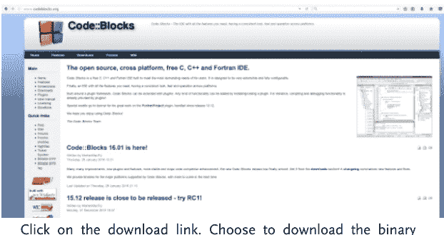
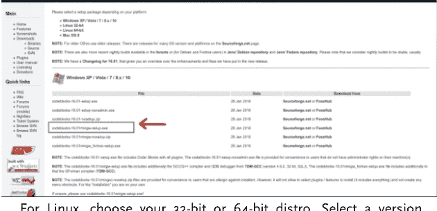
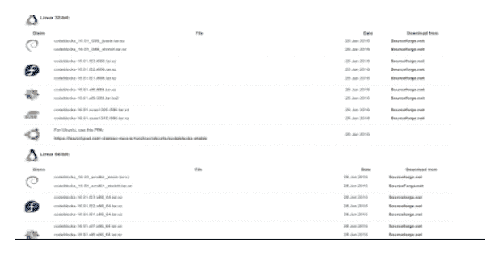
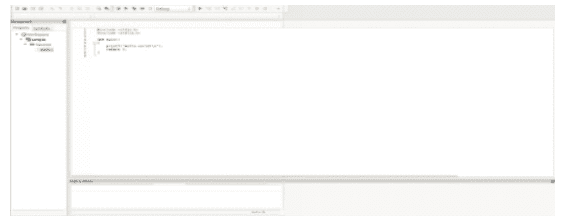
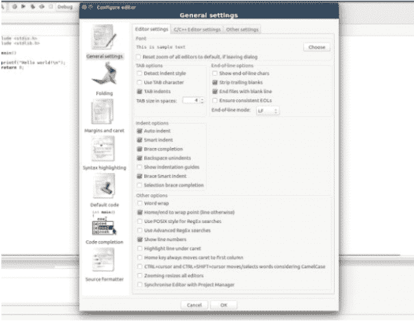
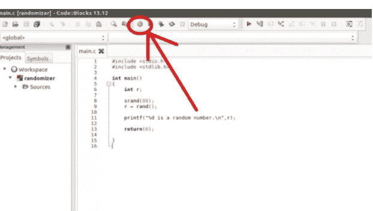
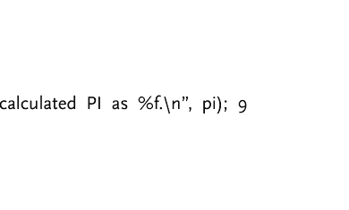
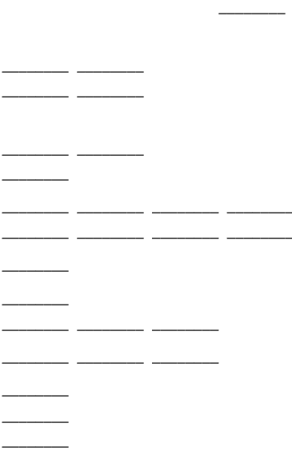

# C 编程语言 初学者指南


## 引言

感谢你购买本书：《C 编程语言——初学者指南》。在本书中，我们将概述在你真正开始用 C 语言编程之前必须理解的概念。我们将向你解释在着手为不同操作系统开发更复杂的程序之前，你应该了解的各种要素。

C 编程语言有许多优点。然而，它也有许多可能让你困惑的小细节。无法理解这些细节，肯定会在将来给你带来问题。

在本书中，我们将讨论这些要素是什么。我们还将讨论 C 是什么、它从何而来，以及在你真正开始编程之前必须理解的所有基本概念。此外，我们还会教你如何安装和使用 Code Blocks IDE，这将在你用 C 语言编程时大有帮助。

希望你喜欢本书。

## 第 1 章：C 编程语言简介

就像你开始做任何新事情一样，当你着手编程时，会发现自己被陌生、甚至可能古怪的术语以及花哨的行话所包围。在本书中，我们将回顾这些术语，并概述整个编程过程。你很可能已经迫不及待地想要开始编写代码，甚至可能已经翻看过本书后面的章节。了解一些关键术语和编程概念很重要。

### C 编程语言的历史

1972 年，AT&T 贝尔实验室的一位计算机科学家开始开发一些他自己需要使用的程序。丹尼斯·里奇当时开始开发的东西，后来演变成了 C 编程语言，如今它已在世界各地广泛使用。

他试图让计算尽可能简单。丹尼斯·里奇意识到，当时的汇编语言过于复杂。他们试图通过在一台小型计算机上构建一种小巧、简单的编程语言来扭转这一趋势。

丹尼斯·里奇想要维护的不仅是一种用于创建程序的高效计算机编程语言，还是一种能够围绕其形成编程社区——即同行情谊——的计算机编程语言。根据以往经验，他们知道，分时、远程访问系统所提供的联合计算的真正本质，不仅仅是把计算机代码输入终端，还要促进编程后的交流。

C 编程语言是一种通用且结构化的编程语言。它也被称为面向过程的编程语言。

C 并非专为特定应用领域而设计。然而，它非常适合商业和科学应用。它具有应用程序所需的各种特性，如控制结构、循环语句和宏。C 语言具有以下特性：

- 可移植性
- 灵活性
- 有效性与效率
- 可靠性
- 交互性

### 什么是编程？

编程就是创建软件。软件控制硬件，硬件是电子设备的物理部分，例如计算机、手机、平板电脑、游戏主机、微控制器或其他小装置。这些指令以编程语言的形式呈现。对于本书而言，这种语言就是 C 编程语言，它早在 20 世纪 70 年代初就被开发出来了。

它非常古老。事实上，随着时间的推移，C 编程语言一直被认为是编程语言中的拉丁语。与拉丁语不同，C 并没有消亡。尽管出现了更新、更花哨的编程语言，仍有大量 C 编程在进行。但就像拉丁语一样，C 是许多其他编程语言赖以建立的基础。如果你懂 C，就能更容易地学习那些其他语言。

在后面的章节中，我们将讨论这种编程语言的语法和其他规则。但现在，你要知道，你编写的代码被称为源代码。

### 什么是源代码？

源代码是一个纯文本文件，其中包含编程语言代码，格式规整、美观且书写正确。在 C 中，文件以 .c 文件名扩展名保存。要创建源代码，你可以使用文本编辑器。任何文本编辑器都可以，不过有些编辑器提供有用的功能，如颜色编码、行号、语法检查和其他工具。

然后，源代码被编译成目标代码。创建目标代码的程序称为编译器。C 语言编译器的传统名称是 cc，代表 C 编译器。编译器读取源代码文件并生成目标代码文件。

目标代码文件使用 .o 文件名扩展名，并且使用与原始源代码文件相同的文件名。下一步称为链接。这一步常常被遗忘，因为现代编译器既编译又链接，但链接实际上是一个单独的步骤。

链接器取来目标代码文件，并将其与 C 语言库合并。库是这种语言的主力。它们包含控制你正在编程的设备的例程和函数。如果一切顺利，最终结果就是一个程序文件。然后你可以试运行该程序，以确保它按你希望的方式工作。如果不行，你就重新开始整个循环：编辑、编译和链接（或称“构建”），然后试运行。

所有这些工具——编辑器、编译器、链接器——都起源于命令提示符或终端。你仍然可以在那里找到它们。程序员会在命令提示符下进行大量编码，因为这样很快。然而，更常见的是使用 IDE，即集成开发环境。

### 什么是 IDE？

IDE，即集成开发环境，集成了用于编辑、编译、链接和运行的工具。它还增加了用于调试、创建复杂程序的工具、图形工具和其他功能。

然而，在这一切之下，是朴素无华的命令行编译器和链接器。过程是一样的：编辑、编译和链接、运行。在你把一切做对之前，你会进行大量重复和返工。

好消息是，开始编程之旅所需的所有工具都可以在互联网上免费找到。坏消息是，你必须找到合适的工具并正确安装它们。这对你来说在这里不是问题，因为在本书中，我们将向你展示如何做到。

你将看到如何找到一个好的 IDE（即集成开发环境）、一个 C 语言编译器，并完成所有设置和配置。你会在互联网上找到大量 IDE。微软提供 Visual Studio 作为其 IDE，苹果则有 Xcode。

欢迎你使用那些工具，尤其是如果你对它们感到顺手。但本书选择了 Code Blocks IDE。Code Blocks 的一大优点是它自带你需要的一切。与其他 IDE 不同，安装 IDE 后你不必再四处寻找这个或那个。你只需下载、配置，就可以开始了。访问开发者网站获取 Code Blocks：


将你最喜欢的浏览器——Chrome、Firefox、Internet Explorer——指向那个网站。在页面上找到下载链接。请记住，你下面看到的页面可能会有所不同，因为网页时常会更新。



点击下载链接。选择下载二进制发行版。在下一页，点击代表你电脑操作系统的链接：Windows、Linux 或 Mac OS X。对于 Windows，请查找包含 MinGW 编译器的 setup.exe 文件。例如，在下面的屏幕上显示的是“codeblocks-16.01mingw-setup.exe”。数字可能会变化，但这就是你需要的链接。



对于 Linux，请选择你的 32 位或 64 位发行版。选择一个不是 testing 或 debuginfo 版本的 Code Blocks。尽量通过选择下载链接来匹配你特定的 Linux 发行版。



对于 Mac，只显示一个选项。点击所选选项右侧的链接。我们建议你使用 sourceforge.net 作为下载链接。下载会立即开始。等待下载完成。

下一步是找到下载的文件并安装 Code Blocks。打开包含该文件的文件夹，通常就是“下载”文件夹。你也可以从网络浏览器中访问该文件夹。

在 Windows 中，双击该文件以打开并开始安装。按照安装向导操作。不用担心任何选项，它们都没问题。最终，Code Blocks 将安装完成，并在桌面上出现快捷方式图标。如果你愿意，可以点击“是”按钮启动 Code Blocks，不过并不是必须马上这样做。

在 Mac 和 Linux 上，你需要解压下载的归档文件。在文件夹窗口中双击该图标以解压归档文件。在 Mac 上，你会得到一个 Code Blocks 应用程序文件，它实际上是一个文件夹。我们建议将该图标移动到“应用程序”文件夹中。

对于 Linux，双击打开归档文件。此时，你需要根据你的 Linux 发行版如何处理归档中的内容来运行安装程序。例如，如果是 RPM 文件，打开它即可开始安装软件包。Code Blocks 安装完成后，你需要对其进行配置。这个主题将在另一章中介绍。

### 运行 Code Blocks

主窗口将如下图所示：



这就是所谓的工作区。在左侧，你会看到管理面板，其中列出了你在 Code Blocks 中正在处理的项目。中间是编辑器所在的位置，你将在那里编写代码。在底部，你会看到一系列选项卡，它们可以显示消息或其他有用信息。

你现在应该花点时间配置一些 Code Blocks 设置，这将帮助你使用本书中的 IDE。首先，选择“设置”>“编辑器”。确保“显示行号”选项前有勾选标记。下面显示的所有其他选项都应该已设置，这是默认状态。



点击字体区域的“选择”按钮来设置字体。建议你使用等宽字体以获得清晰的显示。将编辑器设置为 12 号字体，以便在屏幕上显示得更好。点击“确定”关闭常规设置窗口。

其次，调整构建消息的文本大小。选择“设置”>“环境”。接下来，点击“视图”图标。将消息日志的字体大小设置为 10 或 12，这样更便于查看。完成后，点击“确定”。恭喜！Code Blocks 现在已配置好，可以配合本书使用了。

如果你愿意，现在可以退出 Code Blocks。如果退出，你可能会收到提示说视角已更改。继续保存视角即可，并点击小方框，这样就不会再收到该消息的打扰了。

创建程序，或者说“编程”，通常涉及使用编程语言输入程序的源代码——即指令——然后将源代码编译并链接在一起以创建程序。如果程序面向 Windows 操作系统，创建的程序通常以 .exe 文件形式存在；如果面向基于 UNIX 的操作系统（如 Linux 或 Mac），则可能以 .sh 文件形式存在。

然后你试运行程序，看看它是否按预期工作。换句话说，运行它来检查是否正常。在下一章中，我们将演示如何在 Code Blocks 中完成这一过程。我们将讨论如何创建并执行一个用 C 语言编写的示例程序。此外，我们还会教你如何使用 IDE 查找并修复程序中的错误。

在你的电脑上安装完 Code Blocks 后，启动它。你会看到 Code Blocks 的起始页。如果你碰巧在已安装 Code Blocks 且以前用它创建过程序的电脑上工作，请点击 Code Blocks 菜单中的“视图”>“起始页”来查看起始页。

在 Code Blocks IDE 中完成的大部分工作都是以项目为导向的。Code Blocks 的 C 语言项目可以是一个小而简单的程序，也可以是一个庞大而复杂的在线电脑游戏。通常，Code Blocks 项目是通过点击起始页上的“创建新项目”链接来创建的。请注意，当你查看和处理来自其他来源（而非自己电脑）的 C 语言项目文件时，并不需要执行这一步。

但如果你需要在 Code Blocks IDE 中创建一个新的 C 语言项目，尤其是本书中将使用的控制台程序/应用程序，那么在开始新项目时，请选择“控制台应用程序”选项。

编写源代码后的下一步是编译和链接。在 Code Blocks 中，这一步合并为一个称为“构建”的操作。要构建你的项目，请点击这里的“构建”图标：



该操作会在屏幕底部的“构建日志”和“构建消息”选项卡中显示。如果源代码中有错误，Code Blocks 会在错误所在行号旁边显示一个红色小方框。点击“构建日志”选项卡查看与错误相关的具体消息。

错误消息还会指出错误所在的行。如果你发现代码中有错误，请修正它们，然后再次点击“构建”按钮。一旦没有更多错误，保存文件并重新构建项目，以确保一切正常。

另外，在 Macintosh 上，你可能会看到关于 -s 选项的警告。那是一个链接器错误，可以忽略它。点击“运行”按钮来见证程序的精彩表现。在 Windows 中，程序在命令提示符窗口中运行。在 Mac 和 Linux 上，会出现一个终端窗口。在该窗口中，你还可以看到你编写的任何启动脚本。请忽略输出的那一部分。除此之外，你看到的就是程序的输出。

关闭输出窗口并返回 Code Blocks。在 Windows 中，按 Enter 键。如果在 UNIX 中终端窗口没有关闭，只需输入“Exit”然后按 Enter 键。建议你这样做，否则终端窗口会堆积起来。你现在已经准备好创建第一个项目了。如果你关闭 Code Blocks，它会询问你是否要保存视角。直接点击“是”即可。

## 第 2 章：开始你的第一个 C 项目

人类的自然语言有两大组成部分：语法和言语。同样，C 编程语言也有自己的语法和表达方式。一个没有计算机编程背景的人看计算机源代码时，很可能会一头雾水。然而，一旦他们学会了编程语言的语法和表达方式，一切就会开始变得有意义。

在本书中，我们将向你介绍 C 编程语言的语法和表达方式。我们将教你它的结构是怎样的，main 函数实际上做了什么，并让你熟悉它的各种函数、关键字、值、变量和运算符。

在 Code Blocks IDE 中，点击“新建”按钮，然后点击“空文件”。此时，你将在 Code Blocks IDE 的编辑器窗格中输入 C 编程语言代码。不要害怕，你只需要输入一行。

输入单词“main”，后面跟一对圆括号和一个空格，最后再跟一对花括号或大括号。输入完成后，按键盘上的 Enter 键。你的 Code Blocks 编辑器现在应该看起来像这样：

```
1 main() {}
2
```

现在，点击“保存”按钮保存源代码文件。如果需要，可以选择要保存到的特定文件夹。


你的 C 语言源代码文件。在文件处输入文件名“dummy.c”。源代码文件现已创建并保存。接下来，单击“构建”按钮。

代码确实能编译。你看到的是被称为“The dummy”的最简 C 程序。所有 C 源代码都必须有一个 main 函数。程序执行从这里开始。main 函数的内容用花括号括起来。

在我们的 dummy 源代码中，一切都是空的，这没问题。但是，你可能会看到编译器警告，这并不严重。程序已创建。单击“运行”按钮来运行该 dummy 程序。你会注意到没有输出。这在意料之中，因为程序代码什么都没做。

与任何语言一样，C 编程语言有几个组成部分：

- 关键字
- 函数
- 运算符
- 值和变量
- 结构

### 关键字

关键字是 C 语言的语言组成部分。它们完成非常基本的任务。好消息是，与拥有数万个单词的英语不同，C 语言中只有 44 个单词。实际上，你可能只会用到这些关键字中的一半左右。

### 函数

函数是 C 语言中真正的主力军。关键字所做的事情非常基础。要在 C 中做更多事情，你需要依赖函数。函数保存在库中。链接器的任务是将库与程序的目标代码结合起来；将两者编织在一起以生成程序。

要在程序中使用函数，你必须包含一个定义该函数的头文件。你将在后面的章节中看到如何做到这一点。

### 运算符

运算符是用于操作程序中数据的符号。
这些包括传统的数学运算符，以及许多其他特殊符号。

- 数学：+-/*%++--
- 比较：== != > <
- 赋值：= += + *= /=
- 逻辑：&& || !
- 按位：& | ^ << >>
- 一元 + - ~ ! *

### 值和变量

值和变量类似。值包括字符和数值。数值分为整数或整型数，以及包含小数部分或分数的浮点值。所有这些值都可以非常非常大，也可以非常非常小。

另一方面，变量是值的容器。其内容可以改变或变化，这就是它们被称为变量的原因。放入变量中的值与在程序中直接使用的值类型相同。

接下来，整理一下花括号，大多数资深程序员更喜欢让每个花括号单独占一行。

```c
int main()
{
}
```

现在，让我们向 main 函数中添加一条语句。注意编辑器如何自动缩进该行。这是 C 代码格式化的传统方式。接下来，输入单词“return”和一个数字。随便选一个数字，但它必须是整数。在我们的示例中，我们将输入数字 3。

```c
int main()
{
    return(3);
}
```

你可以像上面示例那样将数字放在括号中，也可以直接指定值。如果这样做，你需要在 return 和值之间加一个空格，如下所示：

```c
int main()
{
    return 3;
}
```

别忘了输入分号来结束语句。保存文件，然后点击“构建”。只要你的代码看起来与上面的示例一样，就不会出现错误或警告。继续点击“运行”。

在 Mac 或 Linux 上，你可能看不到除构建日志之外的任何输出，并且日志显示程序以状态零终止。在 PC 上，终端窗口会显示返回值为 3，即 return 语句中指定的整数值。

要为 dummy 程序添加输出，你需要使用一个输出函数。C 语言关键字不会输出任何内容。它们只是基本词汇，如 return 和 int。作为输出函数的一个示例，你可以使用 *puts*，它会将文本发送到标准输出设备。在这种情况下，就是终端窗口。

C 语言中的程序代码是自上而下读取的，因为 return 语句结束了 main 函数。通过在编辑器中插入一个新行，将 *puts* 函数添加到我们的 dummy 程序的第 3 行。

在 *puts* 函数的括号中，你放置一个字符串，该字符串由双引号内的字符组成。请随意输入你想要的任何字符串。

同样，不要忘记在 *puts* 函数行的末尾添加分号。保存源代码，然后点击“构建”。此时，你可能看到警告，也可能没有。即使没有，你也需要知道 *puts* 函数在使用前需要定义。否则，编译器就会困惑。

该定义位于标准 I/O 头文件中。你必须使用 include 预处理指令将该头文件包含到源代码中。为此，首先必须在源代码顶部插入一行。然后输入“#”、单词“include”、左尖括号、单词“stdio.h”和右尖括号。

为了可读性，再添加一行。你的代码现在应如下所示：

```c
#include <stdio.h>

int main()
{
    puts("I am the King of the C Programming world");
    return 3;
}
```

该预处理指令包含了 puts 函数的定义。保存文件，但这次点击编辑器右上角附近的“构建并运行”按钮，这会一步完成两步。如果你输入正确，就不会有警告或错误。在输出终端窗口中，你将看到为 puts 函数指定的字符串以及返回值 3。

## 第 3 章：传统 I/O

开始编程之旅的最佳方式是编写一些易于理解和更改的简单程序。为了完成此任务，了解输入和输出（或 I/O）的基础知识会有所帮助。

在本章中，我们向你介绍 I/O 的概念，以及它如何在编程中发挥作用。你将探索一些基本的 I/O 函数，并使用其中一个函数来创建输出有趣文本的小型程序。

程序必须做点什么。这件事涉及接收输入并生成输出。这就是典型 C 程序的工作方式：它是一个对输入执行某种操作，然后生成输出的机器。


如果程序不做任何事情，那么它基本上就是管道；进来的东西原样出去。C 库提供了许多输出函数。其中，这三个是最常用的。它们是：

- `printf()`
- `putchar()`
- `puts()`

### puts 函数

每个函数都设计为向标准输出设备（即屏幕或终端窗口）发送一个或多个字符。puts 函数将字符串放入或发送到标准输出。“Puts” 是 put string 的意思，字符串是包含在双引号中的字符集合。此函数在 STDIO.H 头文件中定义，该头文件包含在你的 dummy 程序的第一行中。

在下面的源代码中，我们指定了 puts 函数，但省略了字符串。你的任务是在编辑器中输入此源代码，并提供字符串。

```c
#include <stdio.h>

int main()
{
    puts();

    return(0);
}
```

在括号内单击，为“puts”函数输入字符串参数。输入一个双引号。编辑器会自动提供结束引号。输入你选择的文本。如果编辑器没有提供结束引号，你必须输入它。否则，编译器将看不到字符串的结尾，并会生成一个糟糕的错误。

```c
#include <stdio.h>

int main()
```


```c
4 {
5 puts("This is just an example");
6
7 return(0);
8 }
9
10
```

你甚至可以手动输入引号，即使编辑器已经提供了。代码块编辑器足够智能，不会重复添加。你输入的字符串会以蓝色高亮显示。点击保存、构建并运行。正如你在输出中所看到的，它会完全按照你输入的内容显示该字符串。

在源代码中使用多个 puts 函数时，不需要添加多个 stdio.h 头文件。一个就足够了。此外，你可以在双引号内输入单引号，这完全没有问题。再次提醒，记得用分号结束语句。

接下来，让我们尝试为之前的源代码示例添加注释。正如我们之前提到的，注释是不会被编译的文本。相反，它是为程序员准备的提醒，或只是一般性信息。

首先，在源代码文件顶部插入一行新行。输入一个斜杠“/”，然后输入一个星号“*”符号。传统的 C 注释以斜杠-星号字符组合开始，以星号和斜杠字符结束。

```c
1 /*
2 #include <stdio.h>
3
4 int main()
5 {
6 puts("Hello Mr. Programmer");
7 puts("I'm thrilled to meet you");
8
9 return(0);
10 }
11
```

此时，编辑器会高亮显示代码中的所有文本，但由于我们上面的示例代码中没有写入结束注释字符，这些文本实际上并不是一个长注释。接下来，像这样输入你的姓名和日期：

```c
1 /* Charles Xavier October 10, 2016 */
2 #include <stdio.h>
3
4 int main()
5 {
6 puts("Hello Mr. Programmer");
7 puts("I'm thrilled to meet you");
8
9 return(0);
10 }
11
```

输入姓名和日期后，输入一个星号和一个斜杠来结束注释。如前所述，注释不会被编译，你可以亲自验证这一点。继续保存对源代码所做的更改，点击“构建并运行”，你会看到输出只显示你为 puts 函数指定的字符串参数。

第二种注释类型在行首使用两个斜杠符号“//”。你可以使用这种注释来禁用代码中的某条语句，这在排查错误或尝试修复问题时经常发生。让我们在前一个示例的第 6 行试试：

```c
1 /* Charles Xavier October 10, 2016 */
2 #include <stdio.h>
3
4 int main()
5 {
6 // puts("Hello Mr. Programmer");
7 puts("I'm thrilled to meet you");
8
9 return(0);
10 }
11
```

保存代码，然后点击“构建并运行”。看到输出没有出现了吗？这是因为编译器将其视为注释。如果你想恢复该行，请移除 // 注释，然后保存，再次构建并运行代码。在结束本节之前，我们希望你看看在 C 语言中构建程序时生成的文件。

打开你保存 C 语言源代码文件的文件夹。对于每个源代码文件，你都会找到一个目标代码文件。它与源代码文件同名，但扩展名为 .o。这就是编译器创建的文件。目标代码文件包含已编译的源代码以及来自头文件的信息。

链接器获取该目标代码文件，并混入 C 库文件。结果是一个程序文件，其名称也与源代码文件相同。在 Windows 中，你可能会看到扩展名 .exe，它表示可执行文件。在其他操作系统中，则不需要扩展名。

程序文件也可能被命名为 a.exe 或 a.out。这是链接器的默认名称。虽然在 Code Blocks 中，程序名称与源代码文件名称相同。

### printf 函数

如果说 C 语言中有一个程序员最喜欢使用的函数，那就是 *printf* 函数。*printf* 函数是每个新手程序员学习的第一个函数，因为它是传统“Hello World”计算机程序的一部分。然而，*printf* 函数不仅能显示或输出屏幕上的文本。在本节中，我们将讨论 *printf* 函数。

你们大多数人都已经知道，*printf* 函数是 C 语言众多文本输出函数之一。然而，它比 *puts* 函数强大得多。此外，我们还将讨论如何在代码中使用各种转义序列。将字符数组——字符串——发送到标准输出是 *printf* 函数最基本的形式。换句话说，它会在计算机屏幕上向用户/程序员显示一堆文本。

与 *puts* 函数一样，*printf* 函数也定义在头文件中。如果你查看下面的代码，你会看到 *printf* 函数被使用了两次，具体在第 5 行和第 6 行：

```c
1 #include <stdio.h>
2
3 int main()
4 {
5 printf("This the way the world ends");
6 printf("Not with a bang but a whimper");
7
8 return(0);
9 }
```

在这种模式下，printf 的工作方式与 puts 函数非常类似。printf 的参数是位于函数括号之间的单个字符串。字符串用双引号括起来。如果你跟随着操作，请保存并运行此代码。如你所见，程序并没有按预期显示输出。这是因为与 puts 函数不同，printf 函数不会在字符串末尾添加换行符。

是的，尽管两行代码中使用了两个语句，输出却是一个长字符串。要添加换行——就像在一行末尾按 Enter 键——你必须指定一个转义字符。

在上面之前的代码中，编辑第 5 行，在结尾双引号之前插入一个反斜杠和小写字母‘n’。在某些编辑器中，反斜杠‘n’会以不同颜色显示，表明它是特殊的。保存更改，然后构建并运行代码。现在，你将看到两行输出。

```c
#include <stdio.h>

int main()
{
    printf("This the way the world ends\n");
    printf("Not with a bang but a whimper");
    return(0);
}
```

### 转义字符

有些字符你就是无法放入字符串中。为了绕过这个限制，你可以使用转义字符。在 C 语言中，字符串是放在两个双引号之间的一串字符。双引号之间的所有内容都算数。但有时你无法输入诸如 Enter 键这样的字符。

例如，如果你想在字符串中的两个单词之间按下 Enter 键来创建新的一行文本，结果只会是编辑器中的两行，而不是输出中的两行。解决办法是在字符串中使用 '\n' 字符。它是一个转义字符，意思是以反斜杠开头，后跟字母 'n' 表示换行。看看下面的例子：

“Behold! \n I am a string of text.”

总的来说，'\n' 被解释为一个字符——换行——并在字符串输出时生成。C 语言使用了大约十几种转义字符，也称为转义序列。最常见的有：

- `\n` – 换行，用于开始新的一行文本
- `\t` – 制表符，用于跳过多格空格
- `\'` – 转义的单引号
- `\"` – 转义的双引号
- `\\` – 显示反斜杠字符

现在，假设你想打印一个字符串，分成两行，并用双引号标出你的名字。你会怎么做？如何确保包围你名字的双引号显示为字符串的一部分，而不是源代码的一部分？嗯，方法如下：

```c
1 #include <stdio.h>
2
3 int main()
4 {
5 printf("Hello!\nMy name is \"Hector.\"");
6
7 return(0);
8 }
9
10
```

从上面的示例代码可以看出，我们在“Hello!”之后立即插入了一个‘\n’字符，以便将后面的字符串放到新的一行，然后将名字‘Hector’放在两个转义的双引号之间，这样双引号就会被当作字符串的一部分。

你也可以选择去掉转义的双引号，改用单引号。为什么？因为字符串中的单引号不需要转义。许多程序员发现这种方法更容易使用。

另一方面，值通常是数字，尽管不一定非得是数字。在你的代码中，你可以指定诸如三、五，甚至 100,000,000 之类的值。只要你知道一种叫做占位符的东西，就可以使用 *printf* 函数来输出这些值。在下一节中，我们将继续探索 *printf* 函数。我们将向你展示如何使用占位符来显示值，不仅包括数字，还包括字符串和单个字符。

要实际查看这些值，你可以使用 *printf* 函数。但你需要更进一步使用该函数。看看下面的示例代码：

```c
1 #include <stdio.h>
2
3 int main()
4 {
```


```c
5  printf("Here is a value: 27\\n");
6

7  return(0);
8 }
9

10

```

The *printf* function in line 5 of our sample code above generates an output that would have you believe that the number 27 was a value, but it is not. It is part of a string—just the characters 2 and 7. To specify a value, you need to do two things. First, you must place a value into the code—in this case the number
*printf* 函数在我们上面示例代码的第 5 行生成的输出会让你相信数字 27 是一个值，但它不是。它是字符串的一部分——只是字符 2 和 7。要指定一个值，你需要做两件事。首先，你必须将一个值放入代码中——在这种情况下是数字

- Second, you must direct the *printf* function to display that value.
- 其次，你必须指示 *printf* 函数显示该值。

Edit line five to replace the characters 2 and 7 with ‘%d.’ In some editors, you may see the %d highlighted. That is because it is a special symbol for the *printf* function. It is a placeholder. In this case, it is a placeholder for an integer value—a whole number. Place a comma after the string and add a second argument to the *printf* function: the value 27.
编辑第五行，用 ‘%d’ 替换字符 2 和 7。在某些编辑器中，你可能会看到 %d 被高亮显示。这是因为它是 *printf* 函数的一个特殊符号。它是一个占位符。在这种情况下，它是整数值——一个整数——的占位符。在字符串后加上一个逗号，并在 *printf* 函数中添加第二个参数：值 27。

Note how a value is shown in its own color in the Code Blocks editor. The printf function now has two arguments. The first is called the formatting string. It contains one placeholder, which is %d. Matching that placeholder is the second argument: the integer value 27. Your code should now look like this:
注意在 Code Blocks 编辑器中值是如何以自己的颜色显示的。printf 函数现在有两个参数。第一个称为格式化字符串。它包含一个占位符，即 %d。与该占位符匹配的是第二个参数：整数值 27。你的代码现在应该如下所示：

```c
1 #include <stdio.h>
3 int main()
4 {
5 printf("Here is a value: %d\\n", 27); 6
```

```c
7 return(0);
8 }
9

10

```

Now save, build and run the code. In the output, 27 represent the value 27. Its output is text, of course. But inside the program, it is a number and not text. Now, copy line five of our sample code in line 6 and then change the number to 29. Save, build and run your code.
现在保存、构建并运行代码。在输出中，27 代表值 27。当然，它的输出是文本。但在程序内部，它是一个数字而不是文本。现在，将我们示例代码的第五行复制到第 6 行，然后将数字改为 29。保存、构建并运行你的代码。

```c
1 #include <stdio.h>
3 int main()
4 {
```

- printf("Here is a value: %d\n", 27);
- printf("Here is a value: %d\n", 29); 7

```c
8 return(0);
9 }
10

11

```

As you can see, two lines are output. The same placeholder is used in both *printf* functions. However, because a different value is specified, the new value is output for the second statement. The %d placeholder is just that—it holds the place of another argument. In fact, you can specify multiple placeholders providing that you have arguments to match, just like in line 7 of the code below:
如你所见，输出了两行。两个 *printf* 函数都使用了相同的占位符。然而，由于指定了不同的值，第二条语句会输出新的值。%d 占位符就是这样——它为另一个参数占位。事实上，只要你有匹配的参数，你就可以指定多个占位符，就像下面代码第 7 行那样：

```
1 #include <stdio.h>

3 int main()
4 {
```

- `printf("Here is a value: %d\n", 27);`
- `printf("Here is a value: %d\n", 29);`
- `printf("Here are the values %d, %d, and %d\n", 51,52,53); 7`
- `return(0);`

```
9 }
```

You can even do math in a printf function. Although, it is the C language that does the math, not the printf function. Take a look at the code below:
你甚至可以在 printf 函数中进行数学运算。虽然进行数学运算的是 C 语言，而不是 printf 函数。看一下下面的代码：

```
1 #include <stdio.h>
3 int main()
4 {
5 printf("Everyone knows that 2+2=%d\n", 4); 6
7 return(0);
8 }
9

10

```

The *printf* statement employs a swath of placeholders, each for a specific type of value. Below is a partial list showing some of the more common placeholders:
*printf* 语句使用了一系列占位符，每个占位符对应一种特定的值类型。下面是一个部分列表，展示了一些更常见的占位符：

- `%d` Integer (whole number) values
- `%d` 整数值
- `%s` Strings
- `%s` 字符串
- `%f` Floating-point values or fractions
- `%f` 浮点值或分数
- `%c` Single characters
- `%c` 单个字符
- `%%` The percent sign
- `%%` 百分号

It helps to know about the different types of values in the C language before you can use each of these, as well as understand the whole lot of them that are not shown. Also, the placeholders have options that we’ll get into in the later chapters.
在你使用这些之前，了解 C 语言中不同类型的值是有帮助的，以及理解未显示的全部内容。此外，占位符还有选项，我们将在后面的章节中介绍。

The %s placeholder is used to display strings. It may look a little odd. However it does come in handy. Take a look at the code below:
%s 占位符用于显示字符串。它看起来可能有点奇怪。然而它确实很有用。看一下下面的代码：

```
1  #include <stdio.h>
3  int main()
4  {
5  printf("You are a %s\n", "programmer"); 6
7  return(0);
8  }
9

10

```

In this code, the %s placeholder represents the string "programmer," which is the second argument of the *printf* function. If you are following along, build and run the code above. Now, modify line five of the code above to add another placeholder and another argument to the *printf* function. Place %c before %s and squeeze a space between the two like so:
在这段代码中，%s 占位符代表字符串 "programmer"，它是 *printf* 函数的第二个参数。如果你跟着操作，构建并运行上面的代码。现在，修改上面的代码第五行，为 *printf* 函数添加另一个占位符和另一个参数。像这样在 %s 之前放置 %c 并在两者之间挤一个空格：

```
1  #include <stdio.h>
```

One final thing, because the percent character is used as a placeholder, you must specify two of them when you use a percent symbol in the *printf* statement’s formatting string. Take a look at the code below:
最后一点，因为百分号被用作占位符，当你在 *printf* 语句的格式化字符串中使用百分号时，你必须指定两个百分号。看一下下面的代码：

```c
1  #include <stdio.h>
3  int main()
4  {
5  printf("I got %d% on my C exam!\\n", 98);
7  return(0);
8  }
9

10

```

Read the *printf* statement in the code above. The %d placeholder should match up with the second argument, which is 98. It is followed by a percent sign, which indicates actual percentage, not a placeholder. Build and run this code. Now, if you don’t see any warnings, that’s okay. The output is still going to look weird. In some compilers, you will see warnings that indicate trouble.
阅读上面的代码中的 *printf* 语句。%d 占位符应与第二个参数 98 匹配。它的后面跟着一个百分号，表示实际的百分比，而不是占位符。构建并运行此代码。现在，如果你没有看到任何警告，那也没关系。输出仍然会看起来很奇怪。在某些编译器中，你会看到指示问题的警告。

The compiler believes that a second placeholder is desired. It does not understand the placeholder as presented. Plus, it can’t find a matching argument. If you don’t see the warning, try to run the code and see what happens.
编译器认为需要第二个占位符。它不理解所呈现的占位符。此外，它找不到匹配的参数。如果你没有看到警告，尝试运行代码看看会发生什么。

The solution is to edit line five and stick in another percent sign. It looks odd, and it is cryptic. It is the cryptic side of the C language, in fact, that enthralls so many of the nerds. However, it is going to work.
解决方案是编辑第五行并插入另一个百分号。它看起来很奇怪，而且很晦涩。事实上，正是 C 语言的这种晦涩之处吸引了许多极客。然而，它会起作用。

```c
1  #include <stdio.h>
3  int main()
4  {
```

```
5 printf("I got %d%% on my C exam!\n", 98); 6
7 return(0);
8 }
9

10

```

Save the changes, build and run. Now, the output looks more sensible.
保存更改，构建并运行。现在，输出看起来更合理了。

## 
## 第 4 章：C 语言变量

Programs work fine with immediate values. But oftentimes, you don’t know what the value is. Say the value comes from input, the user types it. It is read from a file or the Internet. To store such values, you need a specific cubby-hole or container. In programming, that container is known as a variable. In this chapter, we introduce you to the concept of the variable. It is a container into which you can store values—values that are unknown or values that can change.
程序使用立即值工作得很好。但通常情况下，你不知道值是什么。假设值来自输入，用户输入它。它是从文件或互联网读取的。为了存储此类值，你需要一个特定的小隔间或容器。在编程中，该容器被称为变量。在本章中，我们向你介绍变量的概念。它是一个容器，你可以存储值——未知的值或可以改变的值。

You’ll see how to declare a variable in the C language, and how a variable is used in the code. A variable is a container for a value. Because C deals with different types of values, a variable must be declared as a specific type. It is given a name—a name that’s used in the code.
你将看到如何在 C 语言中声明变量，以及变量在代码中的使用方式。变量是值的容器。因为 C 处理不同类型的值，所以变量必须声明为特定类型。它有一个名称——在代码中使用的名称。

In C, the variable type matches the variable’s content—the type of value being stored. Integer variables can hold only integer values or whole numbers. Float variables hold floating-point values, which are very large numbers, very small numbers, or numbers with a fractional part.
在 C 中，变量类型与变量的内容相匹配——即存储的值的类型。整数变量只能保存整数值或整数。浮点变量保存浮点值，即非常大的数字、非常小的数字或带小数部分的数字。

Character variables hold single values such as the letter ‘x.’ The C language lacks a string variable type. Instead, a character array is used. We’ll discuss how that works in a later chapter.
字符变量保存单个值，例如字母 ‘x’。C 语言缺少字符串变量类型。相反，使用字符数组。我们将在后面的章节中讨论其工作原理。

int and char are all C language keywords. Additional keywords are also used to declare variables. These include double, long, short, signed, and unsigned. These are all C language keywords that are used to declare different types of variables. Take a look at the code below:
int 和 char 都是 C 语言关键字。声明变量还使用其他关键字。这些包括 double、long、short、signed 和 unsigned。这些都是用于声明不同类型变量的 C 语言关键字。看一下下面的代码：

```
1  #include  <stdio.h>
```

```c
3  int main()
4  {
5  int age;
6

7  age = 30;
8  printf("The C language is over %d years old!\n", age); 9
10 return(0);
11 }
```

This code declares an integer variable at line five. First comes the keyword int which is used to declare an integer variable. Next come the variable name: age. As this is a statement, it ends with a semi-colon. Variable names can include numbers, letters, and some symbols. They must begin with a letter, or an underline. The name must be unique, with no two variables having the same name, nor should variables have the same name as functions or C language keywords.
此代码在第五行声明了一个整数变量。首先是关键字 int，用于声明整数变量。接下来是变量名：age。由于这是一个语句，它以分号结束。变量名可以包含数字、字母和一些符号。它们必须以字母或下划线开头。名称必须是唯一的，不能有两个变量具有相同的名称，也不应将变量命名为与函数或 C 语言关键字相同。

At line seven, the variable *age* is assigned the value 30. In C, values or equations go on the right side of the assignment operator, the equal sign. The value or results of the equation is then assigned to the variable on the left. Because 30 is an integer value, it fits nicely into the integer variable
在第 7 行，变量 *age* 被赋值为 30。在 C 中，值或方程位于赋值运算符等号的右侧。然后将值或方程的结果赋给左边的变量。因为 30 是一个整数值，所以它很适合放入整数变量中

The statement at line nine displays the variable’s value by using the *printf* function. The %d placeholder is used, and the variable *age* is specified as the second argument. Now go ahead and build and run the code. The whole idea behind the variable is that its value can change. Edit the source code so that the value of the *age* variable is changed to 34. Make this modification at line seven.
第 9 行的语句使用 *printf* 函数显示变量的值。使用 %d 占位符，并将变量 *age* 指定为第二个参数。现在继续构建并运行代码。变量背后的整个思想是它的值可以改变。编辑源代码，将 *age* 变量的值改为 34。在第 7 行进行此修改。

```c
1  #include <stdio.h>
```


```c
3 int main()
4 {
5 int age;
6
7 age = 34;
8 printf("The C language is over %d years old!\n", age);
9
10 return(0);
11 }
12
```

保存修改后的内容，然后构建并运行它。如你所见，程序的输出反映了新的值。

现在，在第 8 行之后添加两行，为代码中的变量赋一个新值。首先，将值 50 赋给 age 变量：

```c
1 #include <stdio.h>
2
3 int main()
4 {
5 int age;
6
7 age = 34;
8 printf("The C language is over %d years old!\n", age);
9 age = 50;
10
11
12
13 return(0);
14 }
15
```

其次，输入另一个 printf 函数：

```c
1 #include <stdio.h>
2
3 int main()
4 {
5 int age;
6
7 age = 34;
8 printf("The C language is over %d years old!\n", age);
9 age = 50;
10 printf("The programmer is over %d years old\n", age);
11
12 return(0);
13 }
14
```

保存上述更改，然后构建并运行代码。看看 *age* 变量是如何被使用两次的，但它保存了两个不同的整数值。你可以自行再次修改这段代码。这一次，你可以将自己的年龄赋给 age 变量，并只需添加一条 printf 语句来说明你多大。

也可以使用变量进行数学运算。看看下面的代码：

```c
1 #include <stdio.h>
2
3 int main()
4 {
5 int age;
6
7 age = 32;
8 printf("%s is %d years old!\n", "James", age);
9 printf("That's %d months!\n", age*12);
10
11 return(0);
12 }
13
```

在第 7 行，值 32 被赋给整数变量。编辑该值，以反映你自己的年龄（以年为单位）。第 8 行中的 *printf* 函数使用了两个项：一个字符串和一个整数变量。该字符串是一个立即值。将名字 "James" 改为你自己的名字，除非你的名字也是 James。

你不需要猜测自己有多少个月大，因为该值会作为第 9 行 *printf* 函数中的参数计算出来。保存代码，构建并运行。当然，显示的月份值是一个近似值，除非今天正好是你的生日。如果是那样的话，生日快乐！

*int* 实际上是一种变量类型。另一种常见类型是 char 或字符变量。看看下面的代码：

```c
1 #include <stdio.h>
2
3 int main()
```

这里声明了三个字符变量：`x`、`y` 和 `z`。你可以在同一行声明多个相同类型的变量，只要每个变量名之间用逗号分隔即可。第 7～9 行给这些变量分配字符——使用单引号。然后这些值由第 11 行的 *printf* 函数显示。保存、构建并运行代码。

正如你可以更改整数变量一样，你也可以更改字符变量。你甚至可以进行数学运算。将第 8 行编辑为：

```c
1 #include <stdio.h>
2
3 int main()
4 {
5 char x, y, z;
6
7 x = 'A';
8 y = x+1;
9 z = 'C';
10
11 printf("It's as easy as %c%c%c\n", x,y,z);
12
13 return(0);
14 }
15
```

然后，将第 9 行编辑为：

```c
1 #include <stdio.h>
2
3 int main()
4 {
5 char x, y, z;
6
7 x = 'A';
```

“互操作性”和“共存性”这两个术语有时会被用来代替迁移，但它们是不同的概念：

互操作性是指两个系统能够相互理解，并因此能够交换信息的能力。例如，两个不同的电子邮件服务器可以借助简单邮件传输协议（SMTP）交换邮件消息。

共存性是指两个系统能够在同一资源上运行的能力。例如，两个不同的文件系统可以都安装在同一台计算机上，但它们无法读取彼此的文件。一个能够从两个文件系统读取或向两者写入的系统提供了一条迁移路径。

迁移策略应考虑：

- 数据迁移
- 应用程序迁移
- 用户迁移



不应将迁移与新开发混淆。在迁移路线图中还应考虑其他概念和原则：

- 保持简单
- 方法论
- 简单性、开放性、可扩展性（SOS）

注意：该图展示了通过迁移工厂从遗留基础设施到目标基础设施的流程。

占位符用于在 *printf* 语句中表示浮点值。构建并运行代码。

为 pi 生成的值精确到百位，这对古代的许多事情来说还算可以，但对现代计算来说不可接受。

## 第 5 章：C 语言中的字符 I/O 函数

程序以输入和输出著称。输出发送到标准输出设备，通常是屏幕或终端窗口。输入来自标准输入设备，通常是键盘。在本章中，我们将探讨 C 语言中的输入和输出概念。这些涉及字符 I/O，即读取单个字符以及输出单个字符。我们还会涉及流输入和输出的概念。

C 语言中最常见的两个字符 I/O 函数是 *getchar()* 和 *putchar()*。*getchar()* 获取标准输入。*putchar()* 将一个字符发送到标准输出。这两个函数都需要包含 stdio.h 头文件以获取它们的原型等。

尽管它们是字符函数，但它们处理的是整数值。是的，这很奇怪，但 C 语言中的许多东西也是如此。事实上，你可能会发现自己经常将这些函数与 *char* 变量一起使用。这样做时，编译器可能会温和地警告你这个错误。最后，这些函数是面向流的，这一点我们将在后面的章节中讨论。

看看下面的代码：

```c
1 #include <stdio.h>
2
3 int main()
4 {
5 int c;
6
7 printf("Type a letter: ");
8 c = getchar();
9 printf("You typed '%c':\n", c);
10
11 return(0);
12 }
13
```

整数变量 `c` 在第 5 行声明。它在第 8 行与 *getchar()* 函数一起使用，存储来自输入流的一个字符。在这个示例中，那将是在键盘上输入的一个字符。该字符在第 9 行显示。这里使用了 int 变量 `c`，但指定了字符占位符 %c。这确保显示的是字符，而不是它的代码值。构建并运行代码。

请注意，输出中的提示符会让光标停留在同一行，并且我们添加了一个空格以使其更易读。输入一个字母，例如大写字母 'Z'，然后按 Enter 键。如你在输出中所见，它会立即指明你输入的字母。

现在，修改代码，使 *putchar()* 函数输出你输入的字符。为此，你需要将 *printf* 函数拆分为两部分，如下所示：

```c
1 #include <stdio.h>
2
3 int main()
4 {
5 int c;
printf("Type a letter: ");
c = getchar();
printf("You typed '");
putchar(c);
printf("'.\n");
return(0);
}
```

将其编辑到显示 "You typed" 的位置，并注意我们如何在该字符串后保留那个单引号。在括号中闭合该字符串，并用分号结束语句。然后在第 10 行添加 *putchar()*，接着使用 `printf()` 显示字符串的其余部分。不再需要参数 `c`。相反，它出现在第 10 行，与 *putchar()* 函数一起直接输出。保存、构建并运行源代码文件。

该解决方案通过 putchar() 函数生成输出。但它也使代码更长、可读性更差。在 C 语言中这实际上没问题，而且你会发现输出没有变化。保存、构建并运行代码。

你也可以将 putchar() 函数与立即值一起使用。在代码的此处，第 11 行的语句实际上只输出三个字符：单引号、句点和换行。我们可以将第 11 行改为：

```c
1 #include <stdio.h>
2
3 int main()
4 {
5 int c;
6
7 printf("Type a letter: ");
8 c = getchar();
9 printf("You typed ");
10 putchar(c);
11 putchar('\'');
12 printf(".\n");
13
14 return(0);
15 }
16
```

在第 11 行，输入一个单引号、一个反斜杠、一个单引号，然后再输入一个单引号。这看起来很奇怪，但你必须转义单引号字符。否则，编译器会感到困惑。第二个 putchar() 函数将显示句点。最后的 putchar() 函数将显示转义序列，它在原来的 printf 函数中被指定为换行。

```c
1 #include <stdio.h>
2
3 int main()
4 {
```


```c
5     int c;
6
7     printf("Type a letter: ");
8     c = getchar();
9     printf("You typed '");
10    putchar(c);
11    putchar('\'');
12    putchar('.');
13    putchar('\n');
14
15    return(0);
16 }
```

我们使用三个 *putchar()* 函数而不是单个 *printf* 函数来显示一个三字符字符串。保存更改，构建并运行。如你所见，输出是相同的。现在来看下面的代码：

```c
1 #include <stdio.h>
2
3 int main()
4 {
5     int a, b;
6
7     printf("Type two letters: ");
8     a = getchar();
9     b = getchar();
10    printf("You typed '");
11    putchar(a);
12    printf(" ");
13    putchar(b);
14    printf("\n");
15
16    return(0);
17 }
```

这里，两个 *getchar()* 函数获取两个字符。这些字符随后使用一系列 *printf* 和 *putchar()* 函数显示。构建并运行代码。输入你喜欢的任意两个字母。你输入的两个字符存储在变量 *a* 和 *b* 中，然后显示出来。

请注意，*getchar()* 函数不会暂停并等待输入。它只是查找来自标准输入设备的所有输入，就像字符流从软管流出一样。为了演示这一现象，再次运行之前的代码。但这次，只输入字母 'z' 并按下回车键。

你会看到的奇怪输出是代码显示了换行字符，而该字符存储在变量 *b* 中。再次运行代码。但这次，输入几个字母然后按下回车键。为了举例，假设你分别输入了字母 a、b、c、d 和 e。

你屏幕上看到的整个字符流——从 a 到 e——都是通过标准输入馈送到程序中的。*getchar()* 函数只读取前两个。但我们的输入一直持续到我们按下回车键为止。流输入也可以通过检查下面的代码来演示：

```c
1 #include <stdio.h>
2
3 int main()
4 {
5     int a, b, c;
6
7     printf("Type three letters: ");
8     a = getchar();
9     putchar(a);
10    b = getchar();
11    putchar(b);
12    c = getchar();
13    putchar(c);
14
15    return(0);
16 }
```

这里看起来 *getchar()* 获取一个字符，然后立即由 *putchar()* 显示。这很合理，因为 C 程序自上而下运行，而且确实如此。这正是该程序中发生的情况，但运行时你看到的并非如此。构建并运行代码。输入 a、b、c 或其他任意三个字母并按下回车键。

由于流的存在，输出是一次性完成的。你输入的字符实际上在你输入时就被发送到输出，这就是代码的运行方式。然而，流输出是缓冲的。这意味着计算机会在缓冲区填满或刷新之前等待，然后再发送字符。在这种情况下，缓冲区在程序结束时刷新。我们将在后面的章节中进一步探讨流输入和输出。但现在，请记住标准 C I/O 库函数是面向流的。

### 字符串

一个字符是一个单个字母或符号。把两个字符放在一起你就有了字符串。但在 C 编程语言中，字符串是很奇怪的东西。它们不是一种变量类型，只是一组或字符数组，所有字符一起排成一行。

在本节中，我们将向你介绍字符串。你将看到字符串在 C 中是如何创建的——如何通过使用字符串输入函数来填充它们。你还将认识 scanf() 函数，它用于获取各种输入。看看下面的代码：

```c
1 #include <stdio.h>
2
3 int main()
4 {
5     char password[] = "spatula";
6
7     printf("The password is \"%s\"\n", password);
8
9     return(0);
10 }
```

第 5 行可能看起来有点奇怪。它是一个变量声明。创建了一个名为 password 的 char 变量，然后字符串“spatula”被赋给 password 变量。这被称为立即赋值，这对其他变量也是可能的。在声明字符串时，立即赋值是绝对必要的。

顺便说一下，代码第 5 行是一个数组声明，这是一个稍后章节的主题。方括号表示存在多个 char 变量。有多少个？编译器根据字符串的大小来确定。否则，值会出现在括号之间。

在第 7 行，printf 函数显示字符串的值。使用了 %s 占位符——由于转义的双引号和换行，很难看到。构建并运行此代码。输出正确显示了字符串的内容。在编辑器中将单词“spatula”更改为“fuzzy wuzzy”。

```c
1 #include <stdio.h>
2
3 int main()
4 {
5     char password[] = "fuzzy wuzzy";
6
7     printf("The password is \"%s\"\n", password);
8
9     return(0);
10 }
```

确保在每个单词之间加上空格，因为在某些系统上空格是有效字符。保存更改，然后构建并运行代码以查看更改的显示。

请记住，字符串中某些字符必须转义。其中包括双引号、换行、制表符等等。

### `scanf()` 函数

要从标准输入获取字符串，请使用 *scanf()* 函数。作为输入函数，*scanf()* 在 *stdio.h* 头文件中声明，你必须在代码中包含它，否则编译器会感到困惑。

*scanf()* 使用占位符将特定值读入变量，并且该变量通常以与号符号为前缀。以下是 *scanf()* 函数的格式：

```c
scanf("format", &variable);
```

它包含两个参数：一个格式字符串和一个变量。格式字符串指示 *scanf()* 查找特定类型的值。为此，你在格式字符串中指定与 *printf* 函数一起使用的相同占位符。%d 用于整数，%c 用于字符，等等。格式字符串几乎总是由这些占位符组成，什么都没有。

要分配一个值，请指定代码中已声明的变量。变量类型必须与占位符匹配。你需要在变量名前面加上与号符号，这是你必须记住要做的事情。你不需要对字符串或数组加上与号前缀，这是你会忘记做的事情。这里使用的与号是内存位置运算符，这将在后面的章节中介绍。

下面的代码演示了如何从标准输入读取整数值：

```c
1 #include <stdio.h>
2
3 int main()
4 {
5     int x;
6
7     printf("Type an integer: ");
8     scanf("%d", &x);
9     printf("Integer %d\n", x);
10
11    return(0);
12 }
```

第 8 行的 scanf() 函数使用 %d 占位符获取整数值。它被赋给变量 x。看到与号了吗；不要忘记它。构建并运行此代码。输入一个整数，即任何整数。程序将该值赋给变量 x，然后显示结果。

现在，如果你要修改我们的示例代码以读取浮点值，你需要做一些更改。首先，当然是要将第 5 行的变量类型更改为浮点值。只需将 int 改为 float。突然间，变量 x 变成了一个浮点值。

在第 7 行，显然我们需要更改单词 integer。在第 8 行，将 %d 改为 %f 以用于浮点值。最后在第 9 行，更改单词 integer 以及占位符。

```c
1 #include <stdio.h>
2
3 int main()
4 {
5     float x;
6
7     printf("Type a floating point value: ");
8     scanf("%f", &x);
9     printf("Floating point value %f\n", x);
10
11    return(0);
12 }
```

保存、构建并运行代码。输入一个实数，例如 45.6。如你所见，值被读取并显示。如果看到的值不完全是 45.6，不要惊慌。如果你看到类似 45.599998 的值，请知道这被称为精度误差。计算机近似实数，这是可以接受的。在后面的章节中，我们将向你展示如何修复输出，使其看起来更顺眼。

你也可以修改代码，使其读取单个字符值。更改是相同的。首先，你在第 5 行将变量类型从 float 改为单个字符变量。在第 7 行，更改提示，使其显示“Type a character.”在第 8 行，将 *scanf()* 函数中的百分号占位符从 ‘f’ 改为 ‘c’，以读取单个字符值。不要忘记在第 9 行更改提示和占位符。

当变量 x 为字符变量时，你需要 %c 占位符来读取正确的值。

```c
1 #include <stdio.h>
2
3 int main()
4 {
5     char x;
6
7     printf("Type a character: ");
```

```c
8  scanf("%c", &x);
9  printf("Character %c\n", x);
10
11 return(0);
12 }
13
```

保存更改，然后构建并运行代码。你也可以使用 *scanf()* 函数来读取字符串，但你会发现此操作存在一些特殊之处。看下面的代码：

```c
1  #include <stdio.h>
2
3  int main()
4  {
5  char name[15];
6
7  printf("Your name? ");
8  scanf("%s", name);
9  printf("You are %s.\n", name);
10
11 return(0);
12 }
13
```

第 5 行创建了 name 变量。它有空间存储 14 个字符，外加一个用于字符串末尾空字符的额外字符。第 8 行的 scanf() 函数使用 %s 占位符来读取字符串。变量 name 在使用时没有 &。这是因为 *name* 是一个字符数组，而数组不需要 & 运算符。构建并运行此代码。

在出现的终端窗口中，输入你的名字并按回车键。如你所见，字符串被读取并显示。现在来看特殊之处。再次运行程序。这次，假设你的名字是 Jerry Bob，这包含两个词。`scanf()` 函数会在第一个空白字符处停止读取——空格、制表符或换行符。你无法强制 `scanf()` 读取这些字符。这就是它的工作方式。基本上，`scanf()` 实际上是一个字符串输入函数，其中字符串仅限于一个词长。

用于读取字符串的更好函数是 *fgets*。Fgets 是一个文件输入函数，也可用于读取标准输入。看下面的代码：

```c
#include <stdio.h>
int main()
{
char input[64];

printf("Instructions: ");
fgets(input,64,stdin);
puts("Thank you! Here are your instructions:");
puts(input);

return(0);
}
```

## 第 6 章：数学运算符

关于数学和编程，重要的是要记住计算机来做工作。你只需要正确地抄下等式。为此，你需要了解一些数学运算符，以及一些其他 C 语言规则和流程。在本章中，我们将回顾基本数学运算符及其用法。还将探讨增量和减量运算符，以及关于运算顺序的几点说明，运算顺序决定了等式中哪一部分先被求值。

C 语言使用四个基本符号表示四种基本数学运算符：加法、减法、乘法和除法。如果你使用过电子表格，这些应该很熟悉。乘法使用星号 *，这是因为键盘上没有 × 符号；请不要使用字母 x。

同样，除法符号也不在标准计算机键盘上，因此改用斜杠 /。还有两个额外的运算符是增量和减量。尽管使用两个字符，它们仍是单个运算符。这些运算符在处理循环时非常有用，而循环是后面章节的主题。

### 数学运算符

- + 加法
- - 减法
- * 乘法
- / 除法

### 其他数学运算符

- ++ 增量，向变量加一
- -- 减量，向变量减一

### 记住

- 使用 * 而不是 x
- 使用 / 而不是 ÷

在 C 语言中，计算在右边进行。然后结果被赋给左边的变量。或者结果可以立即使用，就像下面所示的 printf 函数：

```c
var = 888 + 111;
printf("That's %d months!\n", age * 12);
```

看下面的代码：

```c
1  #include <stdio.h>
2
3  int main()
4  {
5  int a;
6  int b = 5;
7
8  printf("Input an integer: ");
9  scanf("%d", &a);
10 printf("%d + %d = %d\n", a,b,a+b);
11
12 return(0);
13 }
14
```

声明了两个变量：a 和 b。第 6 行，我们预设变量 b 的值为 5。第 9 行的 scanf 函数读取一个整数值并将其存储到变量 a 中。然后，第 10 行的 printf 函数显示 a 和 b 以及它们的和。数学等式是 printf 函数的第三个参数。现在，构建并运行此代码。

输入一个值来查看该值与 5 的和。要将加法改为减法，你只需要做一个修改。看一下上面的代码，看看能否找到可以修改的地方。

要将加法改为减法，只需更改第 10 行 a 和 b 之间的数学运算符。还要更改显示字符串之间的运算符——两者之间——使其与运行代码时的输出相匹配。现在，构建并运行代码。

你会注意到负值也会被计算。如果想尝试乘法，同样需要更改数学运算符。看下面的代码示例，看看更改在哪里：

```c
1  #include <stdio.h>
2
3  int main()
4  {
5  int a;
6  int b = 5;
7
8  printf("Input an integer: ");
9  scanf("%d", &a);
10 printf("%d * %d = %d\n",a,b,a*b);
11
12 return(0);
13 }
14
15
```

如你所见，更改发生在第 10 行两个 %d 占位符之间以及变量 *a* 和 *b* 之间。现在保存代码，构建，然后运行。

最后的修改，如你所猜测，是除法。除法有点棘手，尤其是在整数值的情况下。我们来看一下。继续更改第 10 行 *printf* 语句中的数学运算符。这是我们要做的唯一更改：

```c
1  #include <stdio.h>
2
3  int main()
4
{
5  int a;
6  int b = 5;
7
8  printf("Input an integer: ");
9  scanf("%d", &a);
10 printf("%d / %d = %d\n", a, b, a / b);
11 return(0);
12 }
```

保存、构建并运行代码。输入一个整数值，例如 9。显示的结果是 1，这很可疑。要正确进行除法，你需要使用浮点值。看下面的代码：

```c
#include <stdio.h>

int main()
{
    float a;
    float b = 5.0;

    printf("Input an integer: ");
    scanf("%f", &a);
    printf("%f / %f = %f\n", a, b, a / b);
    return(0);
}
```

这基本上是对现有代码的修改，将值从 *int* 切换到 *float*，以及相关的占位符。第 6 行将值 5.0 分配给变量 *b*。记住，浮点数有小数部分。当你写一个整数时，需要在值后指定 “.0”。现在构建并运行代码。再试一次值 9。结果更合理，但很丑陋。在后面的章节中，我们将讨论如何清理浮点值的输出。现在看下面的代码：

```c
1  #include <stdio.h>
2
3  int main()
4  {
5  int x = 10;
6
7  printf("%d\n",x);
8  x = x + 1;
9  printf("%d\n",x);
10
11 return(0);
12 }
13
```

第 8 行有数学运算。它将 1 加到变量 x 的值上。这个等式看起来可能有点奇怪，但就是这样工作的。编译器先计算等式的右边。1 被加到变量 x 的值上。然后该结果被存储回变量 x 的值。为了证明其工作原理，构建并运行代码。

原始值是 10，修改后的值是 11。你可以用这种方式操作每一个变量。常见的操作是给变量的值加 1 或减 1。例如，如果你想将变量 *x* 的值增加 1，你使用增量运算符，即两个加号 “++” 连在一起。将代码第 8 行改为：

```c
8 x++
```

上面的代码本身就是一个语句；它是一个数学运算。保存并运行代码。减量运算符是两个减号 “--”。再次编辑代码，用减量运算符替换增量运算符。现在保存、构建并运行。如输出所示，它会显示原始值 10，以及修改后的减量值 9。

我们想向你展示的最后一个数学小技巧涉及所谓的运算顺序。它涉及具有多个运算符的数学等式。看下面的代码：

```c
1  #include <stdio.h>
2
3  int main()
4  {
5  int a;
6
7  a = 6 + 6 * 6 - 6 / 6;
8  printf("%d\n", a);
9  return(0);
10 }
```

仅通过查看第 7 行，你能猜出变量 *a* 的值吗？运行代码看看计算机怎么想。计算机认为答案是 41。其原因是除法和乘法优先于减法和加法。此外，

等式从左到右依次执行。
因此，25 除以 5 得 5，5 乘以 2 得 10，10 加 3 得 13。

你可以使用括号改变优先级顺序。例如，我们把 2 + 3 放在括号里。这意味着等式中的这一部分会先被计算。

```c
#include <stdio.h>

int main()
{
    int a;

    a = 25 / 5 * (2 + 3);
    printf("The answer is %d\n", a);
    return(0);
}
```

保存、构建并运行代码。现在结果是：2 加 3 得 5，25 除以 5 得 5，5 乘以 5 得 25。现在，我们再添加更多括号。记得让括号配对。

```c
#include <stdio.h>

int main()
{
    int a;

    a = 25 / (5 * (2 + 3));
    printf("The answer is %d\n", a);
    return(0);
}
```

现在，结果是 1。这是因为 2 加 3 得 5，5 乘以 5 得 25，25 除以 25 得 1。记住，在 C 语言中，乘法和除法会先计算，然后才是加法和减法。等式就是这样求值的，除非你使用括号来修改优先级顺序。

### 数学库函数

当你找不到可用于数学运算的运算符时，就需要求助于 C 库。在那里，你会找到有趣而友好的函数，满足你的数学奇想。在本节中，我们将介绍两个典型的 C 语言数学库函数：平方根函数和幂函数。我们还会讨论随机数生成函数，它并不是真正的数学函数，但你可能会发现它相当方便。

要计算一个值的平方根，可以使用 *sqrt* 函数。它读起来像“sqrt”，但实际表示的是“平方根”。下面的代码在第 8 行展示了平方根函数：

```c
#include <stdio.h>
#include <math.h>

int main()
{
    float r;

    r = sqrt(2.0);

    printf("The square root of 2 is %f\n", r);

    return(0);
}
```

如第 2 行所示，它需要 math.h 头文件。该函数接收一个指定为 2.0 的浮点值。它返回一个浮点值作为平方根，并保存到 float 变量 r 中。第 10 行的 *printf* 函数显示结果。构建并运行这段代码。

现在，你知道了 2 的平方根，或者你在代码中指定的任何其他值的平方根。另一个值得注意的数学函数是 *pow* 函数，它是“power”（幂）的缩写。C 语言缺少其他编程语言中常见的幂运算符，但 *pow* 函数要通用得多。看看下面的代码：

```c
#include <stdio.h>
#include <math.h>

int main()
{
    float p;

    p = pow(2.0, 8.0);

    printf("%f\n", p);
    return(0);
}
```

pow 函数出现在第 8 行。它同样需要 math.h 头文件，如第 2 行所示。pow 函数使用两个参数，二者都是浮点值。第一个值是底数，第二个值是指数。所以这里是将 2.0 提升到 8 次幂。结果保存到浮点变量 p 中，然后在第 10 行打印出来。构建并运行这段代码。

2 的 8 次幂是 256。一般来说，所有 C 语言数学函数都需要包含 math.h 头文件。它们都处理实数。我们在前面的示例中使用了浮点数，但正式来说它们应该是 double 类型变量。double 的精度是 float 的两倍。这意味着它更准确。但只有在需要更高精度时，才真正应该使用它。

另一个常用函数是 *rand*，尽管它并不是真正的数学函数。它生成伪随机数。之所以称为“伪”，是因为这些数可以被预测。不过，从一般意义上说，它们仍然足够随机。*rand* 函数需要 stdlib.h（即标准库头文件）来提供其定义。这是仅次于 stdio.h 的最常见头文件。看看下面的代码：

```c
#include <stdio.h>
#include <stdlib.h>

int main()
{
    int r;

    r = rand();

    printf("%d is a random number.\n", r);
    return(0);
}
```

该函数本身不需要参数。它只是生成一个随机整数值。这个值保存在上面代码第 8 行的变量 r 中。第 10 行的 printf 函数显示结果。构建并运行这段代码。

为了让 rand 函数发挥最佳效果，你必须为随机数生成器“播种”。那是一个生成随机数的软件机制。随机播种函数称为 *srand*，它也定义在 stdlib.h 头文件中。在代码中，把 srand 函数插入到 rand 上一行，如下所示：

```c
#include <stdio.h>
#include <stdlib.h>

int main()
{
    int r;

    srand(66);
    r = rand();

    printf("%d is a random number.\n", r);
    return(0);
}
```

*srand* 函数需要一个正整数参数来为随机数生成器播种。在我们的示例中，我们使用数字 66。保存更改，然后构建并运行代码。这一次会出现一个新的随机数。但是，当你第二次运行代码时，会出现相同的值吗？继续试试看。

最可能的情况是，你会看到相同的数字。别慌，你的代码没有问题。你有几种工具可以重新为随机数生成器播种。一种方法是在程序启动时要求用户输入一个正整数值。大多数程序员的做法是借用计算机内部时钟当前的滴答值。我们将在后面的章节中介绍时间函数。现在，我们需要修改代码第 8 行，把值 66 替换为一个时间函数。

我们需要在括号中输入单词“unsigned”，然后是 time 函数，接着在其括号中放入全大写的单词“NULL”，如下所示：

```c
#include <stdio.h>
#include <stdlib.h>
#include <time.h>

int main()
{
    int r;

    srand((unsigned)time(NULL));
    r = rand();

    printf("%d is a random number.\n", r);
    return(0);
}
```

确保所有括号都配对。是的，这看起来很奇怪。但括号配对很重要：一对括号括住“unsigned”，一对括号括住“NULL”，然后再用一对括号括住整个内容，也就是 *srand* 函数。

这个函数的作用是从计算机时钟获取当前的滴答值。它是一个不断变化的数字。保存代码并运行。现在你会看到一个不同的值。再次运行代码。这一次你会看到另一个新值。如果结果值彼此接近，不要感到惊讶。请记住，它基于计算机时钟的“秒”值，而这个值全天都在递增。

为什么随机数如此重要？因为随机数是让所有计算机游戏变得有趣的关键。

## 第7章：C语言比较

通常，程序会按照语句在源代码中出现的顺序逐行执行。改变这个顺序就是改变程序的流程。C 语言中最常见的流程控制词之一是 *if*，它类似于人类语言中同样称为 *if* 的对应词。在本章中，我们将向你介绍 if 关键字。你还会了解 C 语言中如何进行 比较，以及如何处理多个决策。

### if 语句

在使用 *if* 关键字之前，你必须了解 C 语言中的比较是如何进行的。程序会对两个值或表达式进行求值。要进行这种求值，你需要使用 C 语言的一种比较运算符。以下是最常见的比较运算符：

- `==` “等于”
- `>` “大于”
- `<` “小于”
- `<=` “小于或等于”
- `>=` “大于或等于”
- `!=` “不等于”

看看下面的代码：

```c
#include <stdio.h>

int main()
{
    int a;

    printf("Type an integer: ");
    scanf("%d", &a);
    printf("You typed %d.\n", a);
    if (a > 10)
        printf("%d is greater than 10.\n", a);

    return(0);
}
```

程序会提示用户输入一个整数值。该值在第 9 行显示。在第 10 行，if 语句会对该值进行求值。如果该值大于 10，则执行第 11 行。否则，跳过第 11 行。现在构建并运行这段代码。

输入任意整数值。为了这个示例，我们输入数字 12。如你所见，它奏效了。输出显示了第 11 行所指示的 printf 语句。现在尝试输入一个小于 10 的值。如你所见，程序会终止，并且第 11 行被忽略。

传统上，if 语句的格式与其他语句不同。它会拆分到两行或多行中。第一行在括号中设置 if 条件。如果该条件求值为真，则执行下一行。实际上，它只是一条语句拆分到了两行中。请注意，分号位于第 11 行末尾，而不是第 10 行末尾。

你也可以把它写成一行，但这并不常见。更常见的做法是把属于 if 的语句用花括号括起来，如下所示：

```c
#include <stdio.h>

int main()
{
    int a;

    printf("Type an integer: ");
    scanf("%d", &a);
    printf("You typed %d.\n", a);
    if (a > 10)
    {
        printf("%d is greater than 10.\n", a);
    }

    return(0);
}
```


```c
14
15 return(0);
16 }
17
```

当基于 if 条件执行多条语句时，实际上需要这种格式。例如，我们将代码的第 9 行下移到第 12 行。保存、构建并运行代码。

```c
1 #include 2
3 int main();
4 {
5 int a;
6

7 printf("Type an integer: ");
8 scanf("%d",&a);
9 if(a > 10)
10) 10) 10)
10) 10) 10) 10) 10)
15 return(0);
16 }
17
```

例如，输入数字 25。现在，由于该数字大于 10，两行内容都会显示出来。看看下面的代码：

```c
1 #include 2

3 int main();
```

```c
4 {
5 int a;
6

7 printf("Type an integer: ");
8 scanf("%d",&a);
9 printf("You typed %d.\n",a);
10 if(a > 10)
11 {
12  printf("%d is greater than 10.\n",a); 13 }
14 if(a < 10)
15 {
16  printf("%d is less than 10.\n",a); 17 }
18

19 return(0);
20 }
```

这段代码连续展示了两个 *if* 比较。每个比较都有自己的花括号组。会评估两个条件：第 10 行的“大于”和第 14 行的“小于”。构建并运行代码。

运行代码后可以看到，对于你输入的、小于或大于 10 的值，都会显示相应的输出。不过请注意，当你输入 10 本身时，看不到相应的输出。

编辑第 14 行，将运算符改为“小于或等于”。编辑第 16 行以体现相同的结果，如下所示：

```c
1 #include <stdio.h>
2

3 int main();
```

```c
4 {
4 { 4 {
4 { 4 { 4 { 4 {
4 {
4 { 4 { 4 {
4 { 4 { 4 {
4 {

4 { 4 { 4 { 4 {
4 {
4 { 4 { 4 {
4 {

4 { 4 { 4 { 4 { 4 { 4 {
4 {
4 {
```

---

保存、构建并运行代码。

### Else 语句

处理二选一决策的另一种方法是使用关键字 *else*。看看下面的代码：

````c
1 #include <stdio.h>
3 int main()
4 {
5 int a;
6

7 printf("Type an integer: ");
8 scanf("%d", &a);
9 printf("You typed %d.\n",a);
10 if(a > 10)
11 {
12  printf("%d is greater than 10.\n",a); 13 }
14 else
15 {
16  printf("%d is less than or equal to 10.\n",a); 17 }
18

19 return(0);
20 }
21

````

这段代码是对前面代码的重写，但它使用了 *else* 关键字。第 10 行的 *if* 条件会进行一次判断。当该条件为真时，其语句会被执行。如果条件为假，则改为执行属于 *else* 的语句。构建并运行这段代码。

注意，else 没有分号。相反，它带有花括号。所有这些语句都可以不写花括号，因为它后面只跟一条语句。

### Else if 语句

当存在三个或更多条件时，可以使用 *else if* 结构来评估它们。看看下面的代码：

```c
#include <stdio.h>
int main()
{
    int a;

    printf("Type an integer: ");
    scanf("%d", &a);
    printf("You typed %d.\n", a);
    if(a > 10)
    {
        printf("%d is greater than 10.\n", a);
    }
    else if(a < 10)
    {
        printf("%d is less than or equal to 10.\n", a);
    }
    else
    {
        printf("%d is 10.\n", a);
    }
    return(0);
}
```

该结构从第 10 行的 *if* 语句开始。当该条件为真时，属于该条件的语句会被执行，其余部分则被跳过。否则，会在第 14 行检查第二个条件。如果该条件为真，则执行其语句，并跳过其余部分。结构的末尾是一个单独的 *else*。当前面的条件都不满足时，会执行它的语句。构建并运行这段代码。

结果与前面的示例类似。只不过这一次，当输入值为 10 时，会执行 *else* 语句下的 *printf* 语句。你可以按需堆叠任意多个 *else if* 语句，这有助于评估复杂情况。

提醒一下：*else* 和 *else* 关键字后面通常不会紧跟分号。在 C 语言中，分号本身就是一个语句。当分号留在 *if* 判断之后时，编译器会认为该分号就是语句，后面不再有任何内容。这是新手程序员常犯的错误。看看下面的代码：

```
1 #include 2
3 int main()
4 {
5 int a = -5;
6

7 if(a > 0);
8 printf("%d is a positive number.\n",a); 9
10 return(0);
```

### Switch/Case 语句

C 语言允许你通过堆叠一系列 *if/else* 条件来处理复杂决策。有时，这种结构会变得有些丑陋。作为替代方案，你可以使用 *switch/case* 结构，这是 C 语言中的另一种决策工具。

在本节中，我们将讨论这种结构。你将看到它是如何构造的、如何应对多个决策，此外我们还会讨论一些技巧。看看下面的代码：

```c
#include <stdio.h>

int main()
{
    char a;

    printf("Your choice (1,2,3): ");
    scanf("%c", &a);

    switch(a)
    {
        case '1':
            puts("Excellent choice!");
            break;
        case '2':
```

```
• puts("This is the most common choice: ");
• break;
• case '3':

• puts("I question your judgement.");
• break;
• default:

• puts("That's not a valid choice."); 23 }
24

25 return(0);
26 }
27

28
```

这段代码的主体是一个结构。它从第 10 行的 *switch* 开始。后面跟着一系列 *case* 语句，每个 *case* 都有自己的语句。最后一部分是 default。它后面也跟有自己的语句，然后是一个右花括号。这些就是该结构的要素。

该结构还使用了 *break* 关键字。总而言之，这个结构包含四个 C 语言关键字：…… 构建并运行上面的代码，看看它的作用。多运行几次，尝试各种选项。该代码接受字符输入，不过它本来也很容易改为接受整数。

它的工作方式如下：Switch 处理的是单个值，而不是比较。它可以是一个数学表达式，但结果必须是单个值。该值由……指定，随后会与每个 *case* 语句的值进行比较。如果比较结果为真，则执行被标记为真的 *case* 语句所属的语句。否则，它们会被跳过。

在第 12 行，如果输入字符 1，则执行第 13 行的 *puts* 语句。第 14 行的 *break* 会结束 switch case 的评估，将控制权返回到 switch 结构最终右花括号之后的那一行，即第 23 行。否则，如果没有匹配项，执行会落到下一个 *case* 语句，然后再下一个，依此类推。

最后，当没有任何 *case* 条件匹配时，会执行 *default* 条件。它不需要 *break* 语句，因为它位于结构的末尾。通过注释掉所有 *break* 语句来修改代码。在第 14、17 和 20 行插入双斜杠。

~~~
1 #include <stdio.h>
3 int main()
4 {
5 char a;
6

7 printf("Your choice (1,2,3): ");
8 scanf("%c", &a);
9

10 switch(a)
11 {
~~~

+   - case '1':
+   - puts("Excellent choice!");

~~~
14// break;
~~~

+   - puts("B – Hotel");
+   - puts("C – Rental Car");

```
11  scanf("%c", &a);
12

13  switch(a)
14  {

- case 'A':
- puts("You have selected the airfare");
- break;
- case 'B':
- puts("You have selected Hotel");
- break;
- case 'C':
- puts("You have selected Rental Car");
- break;
- default:

- puts("That is an invalid choice"); 26 }
27

28  return(0);
29

30  }
31

32
```

下面是另一个结构，它将输入作为菜单系统来评估。构建并运行代码。这些选项的问题在于，你可能输入了小写 ‘a’ 而不是大写 ‘A’。在这种情况下，程序似乎不能正确运行。通过调整 case 语句以同时兼顾大小写输入来解决该问题。

编辑源代码，为小写字母添加重复的 *case* 语句，如下所示：

```c
1 #include 2
3 int main()
4 {
5 char a;
6

• puts("Vacation options: ");
• puts("A — Airfare");
• puts("B — Hotel");
• puts("C — Rental Car");

11 scanf("%c", &a);
12

13 switch(a)
14 {

• case 'A':
• puts("You have selected the airfare");
• break;
```


```c
case 'a':
    puts("You have selected the airfare");
    break;
case 'B':
    puts("You have selected Hotel");
    break;
case 'b':
    puts("You have selected Hotel");
    break;
case 'C':
    puts("You have selected Rental Car");
    break;
case 'c':
    puts("You have selected Rental Car");
    break;
default:
    puts("That is an invalid choice");
}

return(0);
}
```

保存更改后编译并运行代码。现在评估应能同时处理大小写字母。如你所见，代码行数显著增加。这里还有另一种写法，可以同时接受大小写字母，并稍微减少代码行数。

```c
puts("That is an invalid choice");
}

return(0);
}
```

你也可以通过使用修改字符大小写的 C 语言函数来解决这个问题。该主题在另一章中介绍。另一种可以改变程序流程的方式是当一个或多个语句被反复重复执行时。这个过程被称为循环。

### While 循环

C 语言提供了多种循环方式。在本节中我们将讨论 *while* 类型的循环。你将学习如何设置循环、确定何时停止循环，以及如何在循环完成前跳出循环。

循环是控制程序执行的一种重复方式。你必须指定使循环重复的条件、重复执行的语句集合，以及循环停止的方式。下面代码中的 *while* 循环从 1 数到 10。

```c
#include <stdio.h>

int main()
{
    int x;

    x = 1;
    while(x <= 10)
    {
        printf("%d\n",x);
        x++;
    }

    return(0);
}
```

循环条件在第 8 行指定。它表示只要变量 x 的值小于或等于 10——只要该条件为真——第 9 行到第 12 行大括号之间的循环语句就会重复。变量 x 的值在第 7 行初始化。

在第 11 行，变量 x 的值被递增。因此只要 x 不断增加，循环就会重复，直到 x 大于 10。编译并运行代码，你会看到从 1 到 10 的值被显示。

现在，假设你想数到 20。你能想象在源代码的哪个位置需要做这个改动吗？很简单：将 *while* 循环中的条件改为 20，而不是 10。保存该更改，然后编译并运行代码。

```c
#include <stdio.h>

int main()
{
    int x;
```

保存、编译并运行代码。你会看到 2 到 10 之间的偶数。循环也可以倒着计数。如果要倒着数，比如从 10 到 1，你能想到如何修改代码来实现吗？显然，需要做一些改动。

如果要从 10 开始，你需要将初始值改为 10。然后条件也需要改变，因为否则循环不会重复。条件应为：只要 x 大于零。随后第 11 行的语句也需要改变。每次循环时，x 的值应递减。

```c
#include <stdio.h>

int main()
{
    int x;

    x = 10;
    while (x > 0)
    {
        printf("%d\n", x);
        x--;
    }

    return(0);
}
```

保存、编译并运行代码。此时循环从 10 数到 1。看下面的代码：

这段代码使用了上一章介绍的 *srand* 和 *rand* 函数。这些函数生成随机数。在此情况下，*while* 循环显示十个随机数。编译并运行代码。现在让我们讨论几个整理数字的技巧。

第一个是取模运算符，即百分号‘%’。取模计算值的余数，就像剩下的部分一样。事实上，请看下面的代码示例：

```c
#include <stdio.h>

int main()
{
    int a, b;

    a = 7;
    while(a < 30)
    {
        b = a % 7; /* b equals a mod 7 */
        printf("%d %% 7 = %d\n", a, b);
        a++;
    }
    return(0);
}
```

这里我们利用一个 C 程序来教你 C 语言。while 循环遍历 7 到 30 的值。它展示了取模运算符如何影响这些值。编译并运行代码。

取模运算符给出余数。例如，10 % 7 的结果是 3。因为 7 除 10 一次，余 3。你可以看到，对于 mod 7，无论初始值是什么，结果总是在 0 到 6 之间。

现在在代码中编辑第 15 行的值，使 printf 显示 `a % 6` 的值。

这一改动将输出限制在 0 到 5 之间。保存、编译并运行代码。你可能会看到一些个位数。

个位数看起来格式不太对齐。为了使数字对齐，你可以再次编辑 *printf* 语句。这次在 `%d` 占位符中插入一个‘2’。

‘2’ 将整数输出宽度设置为两个字符，右对齐。保存、编译并运行代码。现在你会看到个位数，但它已右对齐，看起来更美观。

### Do/While 循环

另一种循环是 Do/While 循环。它是一种倒置的 *while* 循环，但它保证循环至少执行一次。看下面的代码：

```c
#include <stdio.h>

int main()
{
    char ch;

    ch = 'A';

    do
    {
        putchar(ch);
        ch++;
    }
    while (ch != 'Z');
    putchar('\n');

    return(0);
}
```

循环从第 9 行的 *Do* 语句开始。它没有条件。相反，语句按顺序执行。while 条件出现在第 14 行。循环依赖变量 *ch* 作为条件。该变量在第 7 行初始化，然后在第 12 行被操作。编译并运行代码。

‘Z’ 没有被打印，因为它是退出条件。如果你想看到‘Z’，需要将退出条件保存为‘Z + 1’，如下所示：

```c
#include <stdio.h>

int main()
{
    char ch;

    ch = 'A';
```

保存并运行代码。下面这段代码演示了一个无限循环。因为 while 循环的求值始终为一，所以没有退出条件。

```c
#include <stdio.h>

int main()
{
    while(1)
    {
        printf("I'm endlessly looping! ");
    }

    return(0);
}
```

编译并运行代码。按 *Ctrl + C* 取消程序并停止运行。现在，无限循环确实有其用途，但大多数都是无意的。不过，你可以使用 *break* 语句修复循环。像这样在上面的代码第 8 行插入一个 *break* 语句：

```c
#include <stdio.h>

int main()
{
    while(1)
    {
        printf("I'm endlessly looping! ");
        break;
    }

    return(0);
}
```

不要忘记 *break* 语句末尾的分号。保存、编译并运行代码。循环只旋转一次，因为 *break* 语句使它跳出。你甚至可以使用 break 提前跳出循环。看下面的代码：

```c
#include <stdio.h>

int main()
{
    int a = 0;

    while(1)
    {
        puts("Here I go...!");
        a++;
        if(a > 10)
            break;
    }

    return(0);
}
```

### For 关键字

for 关键字用于在 C 代码中创建循环。与 while 循环不同，for 循环在一行内设置，这使其更晦涩。但它仍然是一种更流行，或许更传统的循环类型。

```c
#include <stdio.h>

int main()
{
    int x;

    for(x=0;x<10;x++)
        printf("%d\n",x);

    return(0);
}
```

在本节中，我们讨论 for 循环。我们将了解如何设置循环并理解其各部分。第 7 行展示了一个 for 循环。循环语句包含三个部分，各部分由分号分隔。

首先是初始化。语句为 `x=0`，这是在循环开始时进行的赋值。其次是循环条件。只要该条件为真，循环就会重复：`x<10`。最后，`x++` 是迭代语句。每次循环重复时，该语句都会执行。这里 x 的值被递增。


分号并不跟在 *for* 语句的括号后面。相反，分号跟在单条循环语句后面，如第 8 行所示，或者一系列语句被包含在花括号中。构建并运行代码。输出值为 0 到 9。这实际上对 C 循环来说很典型。在 C 编程中，你从 0 开始计数，而不是从 1 开始。人类从 1 开始计数。为了让循环符合人的阅读习惯，将第 8 行的 *printf* 语句改成如下形式：

```c
1  #include <stdio.h>
2
3  int main()
4  {
5  int x;
6
7  for(x=0;x<10;x++)
8  printf("%d\n",x+1);
9
10 return(0);
11 }
12
13
```

此修改不会改变值，只会改变输出。保存、构建并运行代码。

### 嵌套循环

*for* 循环的一大优点是，你可以利用嵌套循环的概念。在 C 语言中，这比使用 *while* 循环更容易。在本节中，我们将讨论如何创建嵌套循环，以及如何避免程序员在 C 语言中遇到的常见循环陷阱。

看看下面的代码：

```text
       _______

_______  _______
_______  _______
_______  _______
_______

_______  _______  _______
_______  _______  _______  _______

       _______
```

我们现有的示例代码会输出十个随机选择的数字。构建并运行这段代码。从输出中可以看到，现在有一行十个随机选择的值。每个值之间的间距是通过使用制表符 `\t` 实现的，它位于代码的第 14 行。

现在，让我们继续尝试制作一个 100 个值的网格。除了我们已经拥有的单行十个值之外，我们还需要再创建九行、每行十个值。为了完成这个任务，大多数 C 程序员使用嵌套循环，或者使用第二个 *for* 循环将输出再重复十次。看看下面的代码：



上面的代码是我们之前使用的代码的修改版本。它现在多了一个循环。原来的列循环现在嵌套在一个称为行循环的新循环中。你在代码中看到的缩进是为了可读性——它有助于对应每个语句的花括号。构建并运行这段代码。如你所见，你现在有一个包含 100 个随机选择值的网格。看看下面的代码：

```c
    1 #include <stdio.h>
    2
    3 int main()
    4 {
    5     int alpha, numeric;
    6
    7
    8     for(alpha='A';alpha<'K';alpha++)
    9     {
    10        for(numeric=0;numeric<10;numeric++)
    11            printf("%c%d\t",alpha,numeric);
    12        putchar('\n');
    13    }
    14
    15    return(0);
    16 }
    17
    18
```

你看到上面的嵌套循环可能读起来更容易一些。外层 alpha 循环遍历字母 A 到 K，其中 K 是上限。内层循环从 0 循环到 9。你还会注意到，这个内层循环没有使用任何花括号，因为它只包含一条语句。在第 11 行，显示了循环变量。构建并运行这段代码。

你可以从输出中更好地观察嵌套循环是如何执行的。首先，外层循环执行。然后，内层循环输出 0 到 9 的值。接着是下一个循环，它也输出 0 到 9，依此类推。看看下面的代码：

```c
1  #include <stdio.h>
2
3  int main()
4  {
5  char ch, t;
6
7  printf("Type a letter ‘a’ to ‘z’: ");
8  scanf("%c",&ch);
9
10 for(t='a';t<='z';t++)
11 {
12 putchar(t);
13 }
14 putchar('\n');
15
16 return(0);
17 }
18
19
```

系统会提示输入，然后显示字母表。我们希望你思考的是：当输入的字母等于循环中的变量 t 时，如何停止循环。你不需要修改这四条语句来实现这一点。相反，你需要在循环中放置一些语句，在输入该字符时跳出循环。

关键在于使用 if 测试，并在其后跟一个 break 语句。看看下面的解决方案：

```c
1 #include <stdio.h>
2
3 int main()
4 {
5 char ch, t;
6
7 printf("Type a letter ‘a’ to ‘z’: ");
8 scanf("%c",&ch);
9
10 for(t='a';t<='z';t++)
11 {
12 putchar(t);
13 if( t == ch )
14 break;
15 }
16 putchar('\n');
```

在第 13 行，添加 *if (t == ch)*，然后添加 *break*。如果你没有在那里写上两个等号，得到的就是赋值。在 C 中，赋值总是求值为真。不要忘记 break 语句后面的分号。保存、构建并运行代码。

记住检查 *for* 语句中的这两项：循环条件和迭代。如果其中任何一项有误，循环就会永远运行下去。编译器不检查逻辑缺陷。那是你的工作。一个好建议是读一读 *for* 语句。将 *t* 设为该字符；当 *t* 小于或等于该字符时，递增。

例如，如果你将条件改为仅 *t='z'*，它会求值为真，循环将永远运行。因此要注意你的条件和迭代。

## 第8章：函数剖析

C 库中充满了函数。这些函数能做很多事情，但也许并不能满足你程序所需的一切。因此，在必要时，你可以自己编写 C 语言函数。事实上，大多数程序员都有几十个甚至几百个自己的函数。

在本章中，我们向你介绍函数。你将了解如何设置函数并为其声明原型，如何调用或访问函数，以及如何提前退出函数。就像 C 语言中的一切一样，函数有特定的风格，并且必须遵循各种约定才能将函数添加到代码中。

函数有一个类型、一个名称，以及括号中的参数。*类型* 是函数返回的值——它的输出。*名称* 是标识函数的唯一名称。*参数* 是传递给函数的零个、一个或多个值——它的输入。下面，alpha 函数没有输入或输出，这在 C 语言中是有效的。因此，它是一个 void 函数。

`void alpha(void)`

Void 是一种变量类型，意思是“我没有变量类型”。函数 count 是一个整数函数。它生成或返回整数值。它不需要输入，因此没有参数。

`int count(void)`

函数 hangUp 不返回任何值，因此它是一个 void 函数。不过，它接受单个字符作为输入。该字符是一个参数。它由变量引用。在使用函数之前，必须先将其引入给编译器。这样编译器就可以通过检查原型来检查函数。此外，原型是一条语句。它以分号结尾。

第 8 行调用该函数。它没有参数，因此括号为空。函数本身位于第 14 行。这实际上是对原型的重复，只是去掉了分号。属于该函数的语句包含在花括号中。现在构建并运行代码。

要再次调用该函数，只需再次指定它。将第 8 行复制到第 9 行。

```c
1 #include <stdio.h>
2
3 void blorf(void);
4
5 int main ()
6 {
7     puts("The main () function always runs first");
8     blorf();
9     blorf();
10    puts("Thanks, blorf()");
11
12    return(0);
13 }
14
```

保存、构建并运行代码。如你所见，输出出现了两次。原型的作用类似于函数的定义，在函数出现在代码中之前描述如何使用它。你可以省略指定原型，但前提是在使用函数之前先编写该函数。要看一个例子，看看下面的代码：

```c
1 #include <stdio.h>
2
3 void soup(void)
4 {
5 puts("Pea green soup!");
6 }
7
8 int main()
9 {
10 printf("For breakfast I had ");
11 soup();
12 printf("For lunch I had ");
13 ");
14 ");
```

*soup* 函数出现在 *main* 函数上方。这没问题，因为编译器仍然会把它们当作函数来查看，而它始终是程序中第一个被执行的函数。这里缺少的是 *soup* 函数的原型。构建并运行代码。

如你所见，代码按预期输出文本。但请试试这样做：将 *soup* 函数移到 *main* 函数之后，如下所示：

```c
1 #include <stdio.h>
2
3
```

```
    4 {
    5   puts("Pea green soup!"); 6 }
    7
```

- int main()
- void soup(void);

```
    10 {
```

- printf("For breakfast I had ");
- soup();
- printf("For lunch I had ");
- soup();

```
    15
    16 return(0);
    17 }
    18
    19
```

保存并构建代码。在大多数计算机上，你会看到一个警告。你的编译器可能会以不同方式报告这些错误行为。无论哪种方式，都不好。你必须添加函数原型。继续把 *void soup(void)* 移到 main 上方

```
    1 #include <stdio.h>
    3
    4 {
    5   puts("Pea green soup!"); 6 }
    7
```

```
```c
8 void soup(void);
soup(void);
soup(void); soup(void); soup(void); soup(void); soup(void);

soup(void);
soup(void); soup(void); soup(void); soup(void); soup(void);
soup(void);
soup(void);
```
```

现在没有警告了，输出与最初相同。看看下面的代码：

```
```c
1 #include <stdio.h>
  3 void cheers(void); 4
  5 int main()
  6 {
```
```

- puts("Everyone gets free dinner!");
- cheers();
- puts("Everyone gets free dessert!");
- cheers();
- puts("Everyone pays higher taxes!"); 12

```
```c
13 return(0);
14 }
```
```

```
15
16 void cheers(void);
17 {
18 int x;
19
20 for(x=0;x<3;x++)
23 }
24
25
```

- printf("Huzzah! ");
- putchar('\n');

在这段代码中，cheers 函数在第 18 行包含自己的变量。这个变量只在此函数中使用，用来把字符串重复三次。构建并运行代码。你不能在函数外部引用变量 x。为了证明这一点，在第 11 行上方插入一行显示它的值。

```
1 #include <stdio.h>
3 void cheers(void); 4
5 int main()
6 {
```

- puts("Everyone gets free dinner!");
- cheers();
- puts("Everyone gets free dessert!");
- cheers();
- printf("%d\n", x);

```
puts("Everyone pays higher taxes!"); 13
14 return(0);
15 }
16
```

```
17 void cheers(void);
18 {
19 int x;
20
21 for(x=0;x<3;x++)
```

- printf("Huzzah! ");
- putchar('\n');

```
24 }
25
26
```

保存修改并构建。甚至不用费心尝试运行它，因为你根本运行不了。编译器基本上是在说：“这到底是什么？”现在，尝试在 main 函数中定义 x 并设置它的值。

```
1 #include <stdio.h>
3 void cheers(void); 4
5 int main()
6 {
7 int x;
8
9 x=21;
```

- puts("Everyone gets free dinner!");

- cheers();
- puts("Everyone gets free dessert!");
- cheers();
- printf("%d\n", x);
- puts("Everyone pays higher taxes!"); 16

```
    17 return(0);
    18 }
    19
    20 void cheers(void);
    21 {
    22 int x;
    23
    24 for(x=0;x<3;x++)
```

- printf("Huzzah! ");
- putchar('\n');

```
    27 }
    28
    29
```

现在保存、构建并运行代码。main 函数中 *x* 的值不受 *cheers* 函数中 *x* 变量的影响。它们被视为两个不同的变量。还有一点要记住：函数在执行完最后一条语句时结束运行。在 *cheers* 函数中，那就是第 26 行的 *putchar*。

你可以使用 *return* 关键字提前退出函数。在第 26 行输入 *return;*。

```
~~~c
1 #include <stdio.h>
3 void cheers(void); 4
5 int main()
6 {
7 int x;

8
9 x=21;

• puts("Everyone gets free dinner!");
• cheers();
• puts("Everyone gets free dessert!");
• cheers();
• printf("%d\n", x);

• puts("Everyone pays higher taxes!"); 16
17 return(0);
18 }
19
20 void cheers(void);
21 {
22 int x;
23
24 for(x=0;x<3;x++)

• printf("Huzzah! ");
~~~
```

- return;
- putchar('\n');

```
```
28 }
29
30
```
```

这里不需要指定值，因为 *cheers* 函数是 *void* 函数——它不返回任何内容。在 main 函数中，*return* 必须像第 17 行那样指定一个值，因为 *main* 是 *int* 函数。保存修改，然后构建并运行代码。

输出会很乱，因为 *putchar* 语句被跳过了。由于它正上方的 *return* 语句，那段代码永远不会被执行。更常见的情况是，你会看到函数根据条件提前返回，这通常涉及 *if* 语句或循环。否则，*return* 出现的位置就是函数退出的位置，控制权会返回给调用函数。或者，对于 main 函数而言，控制权会返回给操作系统。

函数还必须处理输入/输出这件事。当然，void 函数是必要的，而且显然是合法的，但大多数函数会处理输入，并基于该输入执行操作。

本节将讨论函数如何处理传递给它的参数或值。你将看到如何声明这样的函数、它如何处理值，以及如何向函数传递多个值。下面的代码包含 repeat 函数，它接受一个参数——一个整数。

```
```
1 #include <stdio.h>
```
```

```
```c
3  void repeat(int count); 4
5  int main()
6  {

•  puts("At first the raven was like:");
•  repeat(1);
•  puts("But then he was all:");
•  repeat(5);

11
12 return(0);

13 }
14
15 void repeat(int count)
16 {
17 int x;
18

•  for(x=0;x
•  puts("Nevermore!");

21 }
22
23
```
```

在该函数内部，这个整数变量有名称。函数在第 8 行和第 10 行被调用，每次传入不同的参数。函数内部声明了一个局部变量 *x*。它与 *count* 变量一起用于 *for* 语句。构建并运行代码。

函数也可以接受整数变量作为参数。对代码做以下修改：

- 在 main 函数中，声明整数变量 *a* 和 *b*。
- 将值 1 赋给 *a*，将值 5 赋给 *b*。
- 在两个 *repeat* 函数调用中使用 *a* 和 *b*。

```
```c
#include <stdio.h>

void repeat(int count);

int main()
{
    int a, b;

    a = 1;
    b = 5;

    puts("At first the raven was like:");
    repeat(a);
    puts("But then he was all:");
    repeat(b);

    return(0);
}

void repeat(int count)
```

```
16 void product(float a, float b, float c) 17 {
18 float p;
19
20 p = a * b * c;
21 printf("%f * %f *%f = %f\n",a,b,c,p); 22 }
23
```

在这段代码中，你会看到一个接受三个参数的函数。这里是三个浮点值。第 10 行的 scanf 函数读取这三个值。只要将输入格式化为与格式字符串匹配，就可以做到这一点。在 product 函数中，计算并显示这三个值的乘积。构建并运行代码。

函数可接受的参数数量没有限制。不过参数越多，越有可能弄乱格式。函数也不一定只能接受相同类型的参数。看看下面的代码：

```
1 #include <stdio.h>
3 void bar(char c, int count); 4
5 int main()
6 {
7 int x;
8
9 for(x=1;x<11;x++)
```

```
```c
10  bar('*',x*2);
11
12  return(0);
13 }
14
15 void bar(char c, int count)
16 {
17 int x;
18

•   for(x=0;x
•   putchar(c);
•   putchar('\n');

22 }
23
24
```
```

*bar* 函数接受两个参数：一个字符和一个整数值。构建并运行代码。*bar* 函数使用它的两个参数在屏幕上输出由特定字符组成的条。

C 库中的大多数函数都会返回一个值。即使该值未被使用，它也是可用的。返回值使函数能够生成输出。大多数情况下，该输出基于传递给函数的输入或参数。本节将解释函数如何返回值。它们可以简单地生成信息，也可以操作参数以产生特定输出。

我们还将介绍 C 语言中有关函数的一些规则和规定。下面的代码包含一个名为 gimmeAnA 的函数。它是一个返回 `char` 值的字符函数。根据第 3 行的原型，该函数没有输入。

```
```c
1 #include <stdio.h>
3 char gimmeAnA(void); 4
5 int main()
6 {
7 char grade;
8

• grade = gimmeAnA();

• printf("On this test your received an %c.\n",grade); 11
12 return(0);
13 }
14
15 char gimmeAnA(void)

16 {
17 return('A');
18 }
19
```
```


该函数在第 9 行被调用，其返回值被赋给 *grade* 变量。第 15 行的函数本身仅仅返回单个字符 'A'。

构建并运行这段代码。

当函数返回值时，该值可以立即使用。你可以编辑代码，以移除 *grade* 变量。首先删除赋值，然后将 *printf* 中的变量替换为 *gimmeAnA* 函数。

```c
#include <stdio.h>
char gimmeAnA(void);
int main()
{
printf("On this test you received an %c.\n",gimmeAnA());
return(0);
}

char gimmeAnA(void)
{
return('A');
}
```

保存更改，然后构建并运行代码。如你所见，你仍然能得到输出。看看下面的代码：

```c
#include <stdio.h>
float product(float a, float b, float c);
int main()
{
float a,x,y,z;

printf("Type three numbers, separated by spaces: ");
scanf("%f %f %f",&x,&y,&z);
a = product(x,y,z);
printf("%f * %f * %f == %f\n",x,y,z,a);
return(0);
}

float product(float a, float b, float c)
```

在这段代码中，product 函数已经升级，因此它会返回传入值的乘积，这更合理。构建并运行代码。输入三个值，然后按 Enter 查看它们的乘积。

可以稍微清理一下代码。例如，*product* 函数中的变量 *p* 其实并不需要。你可以删掉它，直接返回乘积。

```c
#include <stdio.h>
float product(float a, float b, float c);
int main()
{
float a,x,y,z;

printf("Type three numbers, separated by spaces: ");
scanf("%f %f %f",&x,&y,&z);
a = product(x,y,z);
printf("%f * %f * %f = %f\n",x,y,z,a);
return(0);
}
float product(float a, float b, float c)
{
return(a * b * c);
}
```

保存这些更改，然后构建并运行代码。如你所见，结果相同。下面代码展示了一个更贴近实际的示例：

```c
#include <stdio.h>
int max(int x, int y);
void isLarger(int big);
int main()
{
int a,b,larger;

printf("Type two integers separated by a space: ");
scanf("%d %d",&a,&b);
larger = max(a,b);
if(a == larger)
isLarger(a);
else
isLarger(b);
return(0);
}

int max(int x, int y)
{
if(x > y)
return(x);
return(y);
}

void isLarger(int big)
{
printf("Value %d is larger.\n",big);
}
```

max 函数可以说是学习 C 语言时的经典常客。它接收两个值，并返回其中较大的一个。我们还添加了 *isLarger* 函数，它不返回任何值，但我们想展示如何在代码中声明多个函数。构建并运行代码。

输入两个用空格分隔的不同值。如你所见，代码会显示两个值中较大的那个。现在，我们来谈谈限制。

在 C 语言中，一个函数只能返回一个值。你不能返回多个值，我们也想不出你为什么会想这样做。你可以从函数返回数组或结构体变量。这些变量类型会在后面的章节中介绍。但它们仍然是单个变量。我们想解释一下 *main* 函数。

如你在前面的源代码中所见，main 是一个整数函数。return 语句是必需的，并且必须指定一个整数值。main 函数的圆括号是空的。这是一种捷径——一种取巧做法。

编译器知道 main 函数的参数。它们存在两个，但如果用不到，就不需要指定它们。*main* 函数中的圆括号保持为空。然而，对于你声明和使用的其他函数，你不能这样做。

### 字符操作函数

字符相关的操作非常多，因此 C 库提供了大量字符操作函数。在本节中，我们介绍其中一些函数，并展示如何在代码中使用它们。作为额外内容，我们还会介绍逻辑表达式，它在处理字符时也可能派上用场。

在 C 代码中，字符要么单独出现，要么沿着一个称为字符串的数组排列。你可以一次操作一个字符，或者更常见地，在字符串中操作字符。下面的代码包含了 ctype.h 头文件，它声明了字符测试和操作函数的原型：

```c
#include <ctype.h>
#include <stdio.h>

int main()
{
    int ch = 'a';

    printf("Big %c\n", toupper(ch));
    printf("Little %c\n", tolower(ch));

    printf("What begins with %c?\n", ch);
    return(0);
}
```

在第 8 行和第 9 行，你会看到 *toupper* 和 *tolower* 函数。*toupper* 函数生成字母的大写形式。*tolower* 函数生成字母的小写形式。结果会立即用于 *printf* 函数中。注意，这些函数需要整数值，而不是字符。即使它们是整数变量，你也可以在 *printf* 函数中使用 `%c` 来显示结果。构建并运行代码。

```c
#include <stdio.h>
#include <ctype.h>
while (c != '\n');
```

同样，*toupper* 函数中使用的是整数变量。输入会在第 11 行被处理并转换为大写，然后输出。由于 C 语言是面向流的，你要按下 Enter 键后才能看到输出。构建并运行代码。

继续输入一些文本。按 Enter 键。输出全是大写，但请注意标点符号和空格不受 *toupper* 函数影响。ctype.h 头文件中定义的大多数函数都是测试函数。它们用于评估字符的类型，例如它是字母、数字、空格，还是大写或小写。这些函数返回真值和假值，你可以在代码中使用它们来查看输入了什么。

例如，下面的代码使用 *isalpha* 函数来判断一个字符是字母表中的字母，还是其他字符。

```c
#include <stdio.h>
#include <ctype.h>
int main()
{
int ch;

do
{
ch = getchar();
if(isalpha(ch))
putchar(ch);
}
while( ch != '\n');
```

如果是字母，该函数返回 'true'，否则返回 'false'。在 do/while 循环中，接收并检查输入。第 11 行的 if 语句在字符是字母表中的字母时返回 true。如果是，就显示它。构建并运行代码。输入一串包含符号和数字的文本。按 Enter 键，只会显示字母字符——包括大写和小写。

你可以修改源代码来尝试许多字符操作函数。例如，将第 11 行的 isalpha 改为 isupper。现在，只会显示大写字母。保存、构建并运行以测试更改。

ctype.h 头文件中定义的其他函数包括：
- islower —— 仅检测小写字母
- isdigit —— 对 0 到 9 的任意数字字符返回 true
- isblank —— 检测空白字符——空格、制表符或换行符

你也可以自己编写字符操作函数，但了解 C 逻辑运算符会有帮助。

### 逻辑运算符

C 语言的逻辑运算符用于比较两个或多个表达式。这些运算符决定结果是真还是假。可用的运算符有三个：
- `&&` 逻辑与
- `||` 逻辑或
- `!` 逻辑非

这些运算符通常全部大写书写，以免与普通单词混淆。要使 AND 运算为真，两个条件都必须为 AND。对于 OR 运算符，任一条件都必须为 OR。而对于 NOT 运算符，条件必须为假，这有点反直觉，但 NOT 就是这样工作的——取反。

例如，下面的 AND 运算符会评估两个条件：

```
a = 7;
if( a > 0 && a < 10 )
TRUE && TRUE == TRUE
```


这里，两个条件都为真。因此，*if* 语句会被执行。在下面的例子中，其中一个条件为假。因此，*if* 语句会被跳过。

```
a = 7;
if( a > 0 && a < 5)
```

```
TRUE && FALSE == FALSE
```

在逻辑或运算符中，只需要其中一个条件为真即可。下面，*if* 语句将被执行。

```
a = 50;
if( a < 10 || a > 25) FALSE || TRUE == TRUE
```

当两个条件都为假时，*if* 语句将不会被执行。a = 50;

```
if( a < 10 || a > 75 )
```

```
FALSE || FALSE == FALSE
```

而对于 NOT 运算符，它会对条件取反。这里，两个条件都为假。a = 50:

```
if( !(a!=50)) TRUE
```

变量 *a* 等于 50。然而，NOT 运算符将其反转，使其为真。最后，在 C 语言中，所有值都被视为真，除了零被视为假。通常情况下，使用值 1 表示真。但它也可以是 -1 或任何非零值。作为构建你自己的字符测试的一个例子，请看下面的代码：


```
1  #include 2
3  int iscaps(int ch); 4
5  int main()
```

在第 22 行进行了一次逻辑比较。要理解其工作原理，请阅读条件：如果变量 *ch* 的值小于 A，或变量 *ch* 的值大于 Z。当这两个条件中的任何一个为假（即该字符不是大写字母）时，函数返回假。否则，函数返回真。

假设你想将 *iscaps* 函数改为 *isLowerCase*，并让它基于该条件返回真或假。你会怎么做呢？首先，你需要将函数名改为更贴切的名字。

```
#include

int isLowerCase(int ch);

int main()
{
    int c;

do
{
c = getchar();
if(isLowerCase(c))
putchar(c);
}
while (c != '\n');

return(0);
}

int isLowerCase(int ch)
21 {
22 if( ch < 'a' || ch > 'z')
23 return(0);
```

在适当修改函数调用之后，还要将‘A’改为‘a’，将‘Z’改为‘z’。保存、构建并运行代码。从输出中可以看到，只会出现小写字母。通过使用逻辑运算符，你可以创建几乎任何字符测试。在本书后续章节中，你还会看到更多使用逻辑运算符的例子。

## 第9章：字符串处理

字符串是一种有趣的东西。它并不是真正的 C 语言变量，但却被当作变量来使用。在代码中处理字符串时，由于其不寻常的特性，你必须格外小心。本节将讨论如何处理字符串。

我们将向你展示如何获取字符串信息、拼接字符串、比较字符串，以及在一个字符串中查找另一个字符串。这些任务代表了 C 语言中更常用的字符串处理函数。请看下面的代码：

```
#include
#include 3
4 int main()
5 {
char string[] = "Just how long am I?";
int len;
8
len = strlen(string);
printf("The following string:\n");
puts(string);
printf("is %d characters long.\n",len); 13
14 return(0);
15 }
16
17
```

### strlen()

第 6 行声明了一个字符串。它是一个字符数组，因此指定了 *char* 变量类型。变量名后面是空方括号。字符串长度函数 *strlen* 出现在第 9 行。它返回字符串中的字符数，该值存储在 *len* 变量中。构建并运行代码。

这个字符串长度为 19 个字符。你也可以在源代码中数一数字符，但你并不总能知道确切的字符数。例如，如果用户输入一个字符串呢。请看下面的代码：

```
#include
#include

3
4 int main()
5 {

char input[64]; /* 63 characters plus null */
int len;

8

printf("Instructions: ");
fgets(input,64,stdin);
len = strlen(input);
printf("You typed %d characters of instructions.\n",len); 13
14 return(0);
15 }
```

输入通过 *fgets* 函数获取，然后存储到输入缓冲区中。之后，*strlen* 函数获取字符串的长度。下一条语句显示结果。构建并运行代码。

请记住，C 语言中的字符串以空字符结尾。必须为这个额外的字符分配存储空间。程序会生成该字符，但你必须在输入缓冲区中为其预留空间。*strlen* 函数在测量字符串长度时不会计算这个空字符。现在请看下面的代码示例：

```
1 #include 2
3 int main()
4 {
char first[] = "I would like to go ";
char second[] = "from here to there\n"; 7
8 return(0);
9 }
10
```

### strcat() / 字符串拼接

这只是部分代码。我们将研究如何将这两个字符串粘合在一起，形成一个新的字符串。在许多编程语言中，加法运算符就能实现这个功能。例如，某些编程语言可能会这样编写代码，将两个字符串连接起来形成一个新的字符串：

```
#include

int main()
{
    char first[] = "I would like to go ";
    char second[] = "from here to there\n";
    printf("%s\n", first+second);
    return(0);
}
```

然而，在 C 编程语言中，这种做法行不通。你可以将两个字符串连续显示出来，但这不是我们想要的解决方案。你需要做的是将字符串粘合在一起。与其说“把字符串粘在一起”，C 程序员更常说“拼接（concatenate）”，这个词源自拉丁语，意思是把两个字符串粘在一起。

但在那之前，先修正代码。首先，为产生的两个字符串创建一个存储位置，即缓冲区。

```
#include
```

此外，你需要为 strcpy 函数创建原型。所有字符串函数都声明在 string.h 头文件中。

```
#include
#include 3
4 int main()
5 {
char first[] = "I would like to go ";
char second[] = "from here to there\n";
char storage[64]; 9
10 strcpy(storage,first); 11
12 return(0);
13 }
14
```

接下来，你需要将字符串‘second’粘到存储缓冲区的末尾。strcat 语句，也就是字符串拼接语句，会将字符串‘second’附加到存储缓冲区中已有内容的末尾——这就是拼接。最后，显示结果。

```
#include
#include 3
4 int main()
5 {
char first[] = "I would like to go ";
char second[] = "from here to there\n";

char storage[64];

strcpy(storage,first);
strcat(storage,second);

printf("Here is your string:\n%s",storage);

return(0);

14  }
15
```

保存、构建并运行代码。从输出中可以看到，它成功了。

### strcmp() / 字符串比较

另一个常用的字符串函数是比较两个字符串。下面的代码使用 *strcmp*（字符串比较函数）来比较两个字符串：

```
#include
#include 3
4 int main()
5 {
char password[9];
int compare;
8
printf("Enter your password: ");
scanf("%s",password);
compare = strcmp(password,"secret");
if( compare == 0 )
puts("You have been granted access!");
else
puts("Intruder alert!");
return(0);
}
```

当两个字符串相同时，返回值为零。这是零实际上表示“真”的那些奇怪情况之一。小于或大于零的值表示匹配不正确。你还会注意到，*scanf* 函数将输入限制为最多八个字符。输入符合缓冲区的八个字符限制。缓冲区为九个字符，是为了容纳字符串末尾的空字符。构建并运行代码。

现在，在尝试真正的密码 `secret` 之前，先试几个密码。另外，这段代码并不需要 compare 变量。你可以删除它。在代码中删除它（共两处），并直接用函数替换。将 strcmp 函数放到 if 语句中，如下所示：

```
#include
#include
int main()
{
{
{
```


5 { 5 { 5 { 5 {
5 {
5 { 5 { 5 { 5 { 5 {
5 { 5 { 5 { 5 { 5 {

5 {
5 { 5 {
5 {

This code uses the *strstr* function. It is a little weird because you really need to know a little more about pointers to effectively use this function. That knowledge is gleaned in a later chapter. But for now, the *strstr* function is included as part of the *if* statement at line 9.

It returns a pointer, or the location of the string *find_me* in the string If no match is made, then the value NULL is *returned*. Again, NULL is a pointer thing. Build and run the code. As you can see from the output, the string is found.

You can alter the text for the string *find_me* to prove that the function actually works. Until you've reached the rocky shoals of pointer land, that's about the best that can be done with the *strstr* function.

## 第 10 章：C 语言常量

Occasionally, when learning something new, you need to pause and reflect. That's the topic of this section: pausing and reflecting specifically, with regards to variables and values. We'll also introduce a few new concepts—things we feel it's about time you knew, especially if you're new to learning the C programming language. In this section we cover creating and using constants. Plus, we'll also discuss some of the printf function's placeholders.

A constant in the C language is different from an immediate value and a variable. It is more like a universal value that doesn't change throughout the code. Constants are values used consistently throughout your source code.

There are things that do not change. They are created by the preprocessor #define directive. Normally the constant is written in all caps, one word, or with underlines only. Now when the compiler encounters a constant, it expands it out to its assigned value.

In the example below, the constant version is created and it is assigned to the value The compiler converts the word version into the immediate value 3 throughout the code.

```
#define VERSION 3
```

- Constant is named VERSION
- Has a value of 3
- Does not end with a semi-colon

Remember, preprocessor directives are not C language statements. Do not put a semi-colon after the assignment, unless you need the semi-colon to be a part of whatever is being defined, which hardly ever happens. Just don’t add a semi-colon.

Below is a string constant defined as The string must be enclosed in double quotes. This is an example of one constant that uses two other constants to calculate its value.

```
#define AUTHOR "Adolf Hitler"
```

- The constant is named AUTHOR
- The value is the string "Adolf Hitler."
- No semi-colon is used.

Below, the constant GAME_GRID would equal 120, unless either the ROWS or COLUMNS constants are changed. They wouldn’t be changed in the code. They would be changed in the define statement that you see below:

```
#define ROWS 20
#define COLUMNS 60
#define GAME_GRID ROWS*COLUMNS
```

- Three constants are created: ROWS, COLUMNS, and GAME_GRID
- The value of GAME_GRID is based on the product of constants ROWS and COLUMNS.

Take a look at the code below:

This code is based on the previous example that we've used in an earlier chapter. We've cleaned it up a bit and we've set up some constants in the code, specifically two #define directives to set the numbers of rows and columns in a grid.

- `#include`
- `#include`
- `#include 4`
- `#define ROWS 10`
- `#define COLUMNS 10 7`

```
```c
int main()
{
    int row, column;

    srand((unsigned)time(NULL));

    for(row=0;row<10;row++)
    {
        for(column=0;column<10;column++)
            printf("%2d\t",rand() % 100);
        putchar('\n');
    }

    return(0);
}
```
```

- #include
- #include
- #include 4
- #define ROWS 20
- #define COLUMNS 7 7

```
8 int main()
9 {
10 int row, column; 11
12 srand((unsigned)time(NULL)); 13
14 for(row=0;row
15 {
16 for(column=0;column17    printf("%2d\t",rand() % 100);
18 putchar('\n');
19 }
20
21 return(0);
22 }
23
24
```

You do not have to hunt through the code to find those proper values. That is how constants can save you time. Save, build and run the code. As you can see from the output, you now have

seven columns of twenty rows. Another example of using constants can be seen in the sample code below:

```
```c
1 #include
2
3 #define INPUT_MAX 64 4
5 int main()
6 {
7 char input[INPUT_MAX]; 8
```
```

- printf("Instructions: ");
- fgets(input,INPUT_MAX,stdin);
- puts("Thank you! Here are your instructions:");
- puts(input);

```
```
13
14 return(0);
15 }
16
17
```
```

This code is an update to an example from an earlier chapter. The number of characters to be input is set by the *INPUT_MAX* constant defined at line 3. The constant is then used to set the buffer size at line 7, and again with the fgets function at line 10.

The advantage here is that you can change both values at once simply by modifying the *INPUT_MAX*

constant. You do not have to hunt through the code. Now take a look at the code below:

```
```c
1  #include
2
3  int main()
4  {

-  float a;
-  float b = 5.0;

7
8  printf("Input a number: ");

9  scanf("%f",&a);
10 printf("%f / %f = %f\n",a,b,a/b); 11
12 return(0);
13 }
14
15
```
```

This is also a modification to an earlier example used in an earlier chapter. Build and run the code to help you remember what the problem was. You can fix this problem by adjusting the placeholders in the *printf* statement. Modify each %f placeholder at line 10 by inserting .1 inside each one so that they read:

```
```c
1  #include
2
3  int main()
4  {

-  float a;
-  float b = 5.0;
```
```

```
7
8 printf("Input a number: ");
9 scanf("%f",&a);
10 printf("%.1f / %.1f = %.1f\n",a,b,a/b); 11
12 return(0);
13 }
14
15
```

Save the changes, and then build and run the code. The .1 format limits floating point output to only one digit after the decimal point. Edit it again and type .3 for the format in the printf statement.

```
1 #include 2
3 int main()
4 {
```

- float a;
- float b = 5.0;

```
7
8 printf("Input a number: ");
9 scanf("%f",&a);
10 printf("%.3f / %.3f = %.3f\n",a,b,a/b); 11
12 return(0);
13 }
14
15
```

Save, build and run the code. Now, three digits appear after the decimal point. Now let’s return again to our previous CONSTANT example:

- `#include`
- `#include`
- `#include 4`
- `#define ROWS 20`
  - `#define COLUMNS 7 7`

```
8 int main()
9 {
10 int row, column;

column;
column;
column;

column;

column; column; column;

column;
column;
column;
```

At line 17, you see at 2 between the percent and letter What the 2 does is set an output width to two characters minimum. When a single digit appears in the output, they'll write a line.

Build and run the code. See how singular digits are lined up in the output.

Now edit the code again and remove the Save, build and run the code. Now, the single digits do not look right. No one expects them to line up in the tens column. The placeholders have lots of options. These can be sandwiched between the percent sign and their letter. We could dedicate thousands of chapters to write them all, but another one to look at is %s found in the code below:

```
```
1 #include 2
3 int main()
4 {

- char right[] = "right";

- char left[] = "left"; 7

- printf("%20s\n",right);

- printf("%-20s\n",left); 10
11 return(0);
12 }
13
14
```
```

The two strings, RIGHT and LEFT, are displayed by using %s placeholders. But there are extra characters between the percent and the The 20 specifies an output width, just like the 2 in between %d in the previous example.

In line 8, the %20s right justifies the output—adjusting the string’s location based on its length inside that width. In line 9, the negative sign before the 20 left justifies the string, which is how text is normally displayed. Build and run this code to see how it works.

The width argument in the %s placeholder, sets the width to twenty characters. This placeholder is ideal for displaying lists and tables. Many more placeholder width, precision, padding, and other options are available. The documentation for the printf function lists the variety, plus a few examples.


## 第11章：C语言数组

数组就是多个相同类型变量的集合。例如，一份高分列表就是一种数组；你每天跑多少英里也可以构成数组，即使这个列表里有很多零。当然，C语言中的字符串就是由单个字符变量组成的数组。

在本节中，我们将介绍数组的概念。你将了解如何创建数组、如何用数据填充它、如何访问其中的数据，我们还会揭示一些关于字符数组（也就是字符串）的秘密。下面展示了在代码中处理多个值的错误方式——创建了四个独立的 float 变量并填入数据：

```c
#include <stdio.h>

int main()
{
    float temp1, temp2, temp3, temp4;

    temp1 = 84.9;
    temp2 = 83.7;
    temp3 = 85.8;
    temp4 = 88.2;

    printf("Local temperatures:\n");
    printf("Station 1: %.1f\n", temp1);
    printf("Station 2: %.1f\n", temp2);
    printf("Station 3: %.1f\n", temp3);
    printf("Station 4: %.1f\n", temp4);

    return(0);
}
```

然后用四个单独的 printf 语句显示它们。每个变量都需要自己重复的语句。你可以构建并运行这段代码，但何必费这个劲呢。相反，我们将向你展示一种处理多个相同类型变量的更好方法。这种方法就是数组。看看下面的代码：

```c
#include <stdio.h>

int main()
{
    float temps[4] = { 84.9, 83.7, 85.8, 88.2 };
    int x;

    for (x = 0; x < 4; x++)
        printf("Station %d: %.1f\n", x + 1, temps[x]);

    return(0);
}
```

这是前一个示例的数组版本。数组 *temps* 在第5行创建。它包含四个元素，每个元素都在其后的花括号中赋值。第9行的循环使用单个 *printf* 函数显示所有四个元素的值。

### 数组的构成

数组就是多个相同类型变量的集合。它的声明与任何其他变量类似，但变量名后面带有方括号。方括号中存放数组的元素个数。如果在声明数组时已经指定了元素，方括号内可以留空。下面，整数数组 DELIVERIES 有容纳十五个元素的空间。

```c
int deliveries[15];
```

整数数组 TOTALS 有三个元素，它们在大括号中赋值。

```c
int totals[] = { 5, 13, 6 };
```

最后一个元素后面没有逗号。如果你在那里放了逗号，编译器会认为你忘记了什么。你也可以让数组元素各自单独占一行。除了最后一个元素，不要忘记加逗号。记得闭合大括号并加上分号。

数组中的每个元素都是它自己的变量。你在方括号中指定元素。第一个元素是元素0。你也可以使用整数变量来指定数组元素。下面，变量 n 表示 totals 数组中的某个特定元素：

```c
printf("%d\n", totals[n]);
```

元素的使用方式与其他变量一样。它可以出现在 printf 函数中，也可以与赋值运算符一起使用，如下所示：

```c
totals[n] = 14;
```

数组声明之后，你不能改变数组中元素的数量。有一些技巧可以绕过这个限制。但就目前而言，只需把它当作一条规则接受。另外，不要忘记数组中的第一个元素是0，而不是1。

人类从1开始计数。C语言从0开始计数。下面的代码在第7行声明了一个整数数组 CALORIES：

```c
#include <stdio.h>

#define MEALS 3

int main()
{
    int calories[MEALS];
    int x, total;
    total = 0;
    puts("Calorie Counter");
    for (x = 0; x < MEALS; x++)
    {
        printf("Calories at meal %d: ", x + 1);
        scanf("%d", &calories[x]);
        total = total + calories[x];
    }
    printf("You had a total of %d calories.\n", total);

    return(0);
}
```

它有 MEALS 个元素，而 MEALS 常量在第3行被设为3。第12行的 for 循环读入三个值。注意这个 for 循环是如何从0开始的。在处理数组时这很方便，因为第一个元素是0。

不过，在第14行，循环变量被加上了1，这让编号对运行程序的人来说更友好。第15行的 scanf 语句把值读入每个数组元素。数组元素是一个独立的变量，所以需要加 & 符号。

在第16行，输入的值被加到 total 变量中。现在构建并运行代码。输入一些简单的数字来确认计算机的计算。你会看到变量 total 在第10行被初始化。这是必需的。否则，该变量可能包含垃圾值。在C语言中，变量在被赋值之前不会初始化。

把第10行注释掉来验证这一点。保存、构建并运行代码，看看是否有影响。当然，数字会出错，因为 total 变量没有正确初始化。也有极小可能它恰好是正确的，因为其中可能有一个随机数，这种情况下会显示600。

字符串是字符数组。通常，它们通过使用双引号来声明。看看下面的代码：

```c
#include <stdio.h>

int main()
{
    char text[] = "I am a string!";

    puts(text);

    return(0);
}
```

字符数组 TEXT 在第5行声明。这非常简单，也是声明字符串或字符数组的最佳方式之一。现在看看下面的代码：

```c
#include <stdio.h>

int main()
{
    char text[] = {
    'I', ' ', 'a', 'm', ' ', 'a', ' ',
    's', 't', 'r', 'i', 'n', 'g', '!', '\0'
    };

    puts(text);

    return(0);
}
```

这段代码与前一个练习的作用相同，但字符数组是逐字符声明的，这极其浪费时间。构建并运行代码。它能工作，但实在太费劲了。

不过，这段代码确实指出了所有C语言字符串中都必须指定的最后一个字符：空字符。它在前面的代码中显示为转义序列 '\0'。当你使用双引号声明字符串时，编译器会自动为你添加空字符。但当你一次指定一个字符时，必须记得添加空字符。

当你一次显示一个字符来输出字符串时，空字符就会派上用场。看看下面的代码：

```c
#include <stdio.h>

int main()
{
    char hello[] = "Greetings, human!\n";
    int n;

    n = 0;
    while (hello[n] != '\0')
    {
        putchar(hello[n]);
        n++;
    }

    return(0);
}
```

对你的代码做这个修改，然后保存、构建并运行它。如你所见，生成的输出相同，尽管对初学者来说源代码的可读性稍差。C语言中的典型数组只是一系列相同类型的变量整齐地排列在一起。但并非每种数据都是单行排列的。有时你必须处理网格。在这种情况下，你就进入了多维数组的领域。

### 多维数组

本节将揭开多维数组的神秘面纱。你将学习如何配置这样的数组并访问其值。你还会看到多维数组如何应用于字符串。要想象多维数组，可以把它想成一个网格——有行和列。看看下面的代码：

```c
#include <stdio.h>

#define ROWS 4
#define COLUMNS 4

int main()
{
    int grid[ROWS][COLUMNS];
    int x, y;

    /* initialize the array */
    for (x = 0; x < ROWS; x++)
        for (y = 0; y < COLUMNS; y++)
            grid[x][y] = 0;

    /* display the grid */
    for (x = 0; x < ROWS; x++)
    {
        for (y = 0; y < COLUMNS; y++)
            printf("%d.%d: %d\t", x, y, grid[x][y]);
        putchar('\n');
    }

    return(0);
}
```

数组在第8行声明。使用了两组方括号——数组的每个维度一组。所以 grid 是一个整数数组。它实际上是一个二维数组。第12行到第14行使用嵌套循环填充每个数组元素，并用值0初始化数组。

在第14行，你会看到单个数组元素需要两个方括号来引用。再次把它们想成行和列。然后，从第17行开始的嵌套循环按行和列打印数组。构建并运行代码。

输出显示了每个数组元素被引用时的样子。第一个是元素0.0。那是两个方向上的第一个元素。作为一个思维实验，你会如何修改代码，把两个维度上的第三个元素的值设为1？

我们希望你还记得数组从元素0开始。第三个元素实际上被引用为 grid[2][2]。我们将添加一行内容为 ‘grid[2][2] = 1.’ 的代码。

```c
#include <stdio.h>

#define ROWS 4
```


```c
#define ROWS 4
#define COLUMNS 5

int main()
{
    int grid[ROWS][COLUMNS];
    int x, y;

    /* initialize the array */
    for (x = 0; x < ROWS; x++)
        for (y = 0; y < COLUMNS; y++)
            grid[x][y] = 0;

    grid[2][2] = 1;

    /* display the grid */
    for (x = 0; x < ROWS; x++)
    {
        for (y = 0; y < COLUMNS; y++)
            printf("%d.%d: %d\t", x, y, grid[x][y]);
        putchar('\n');
    }

    return(0);
}
```

一个二维字符数组实际上就是一组字符串的集合，但有一个重要的注意事项：数组的维度必须足以容纳最长的字符串。记住，二维数组就是一个网格。这里，最长的字符串是六个字母长，加上一个用于空字符的元素。这样每个字符串就有七个元素。

当从二维字符数组打印字符串时，你只需要指定第一个维度，这在第14行完成。构建并运行代码。C语言还提供三维数组，甚至更多维的数组。当你创建这样的数组时，每个维度都需要一组方括号。事情很快就会变得相当复杂。现在，专注于练习二维数组。

作为思考，无论你信不信，如果你从头开始阅读这本书，你已经具备了编写一个基础井字棋电脑游戏所需的一切知识。试试吧。

## 第12章：C语言结构体

C语言中的另一种变量类型是结构体。它实际上是多种现有变量类型组合而成的单一单元。结构体变量就像数据库中的一条记录，包含许多部分。本章介绍结构体的概念。你将看到如何设置结构体、创建结构体变量，以及如何访问结构体成员。

我们将讨论如何向结构体中填充数据，以及将一个结构体放入另一个结构体中的有趣想法。下面的代码当然不是完整代码，但它展示了如何在C语言中创建结构体。

```c
#include <stdio.h>

int main()
{
    struct record {
        int account;
        float balance;
    };

    return(0);
}
```

关键字*struct*后面跟着结构体的名称。在这个例子中，名称是`record`。结构体成员包含在花括号中，每个成员以分号结尾，因为整个声明是一条语句。结构体成员是变量声明。在这个结构体内部，你会找到一个*int*成员和一个*float*成员。*int*成员名为`account`，*float*成员名为`balance`。

结构体声明本身只是创建了一种结构体类型，就像代码中的一种新变量类型。要使用结构体，你需要声明一个结构体类型的变量。在第9行，我们将输入以下内容：

```c
#include <stdio.h>

int main()
{
    struct record {
        int account;
        float balance;
    };

    struct record my_bank;

    return(0);
}
```

这条语句创建了一个名为*my_bank*的变量，类型为*record*结构体类型。要访问结构体的成员，你需要同时引用变量名和成员名。让我们添加两行新代码。结构体变量名在前，然后是一个点，再是成员名。它们必须被赋值为与变量类型匹配的值。在本例中，是一个整数和一个浮点值。

```c
#include <stdio.h>

int main()
{
    struct record {
        int account;
        float balance;
    };

    struct record my_bank;

    my_bank.account = 123456;
    my_bank.balance = 6543.21;

    return(0);
}
```

保存这些更改，然后构建并运行代码。要创建另一个名为*your_bank*的记录结构体变量，你只需复制现有的语句。你也可以通过复制之前的语句并将*my_bank*替换为*your_bank*来填充该结构体中的成员。

```c
#include <stdio.h>

int main()
{
    struct record {
        int account;
        float balance;
    };

    struct record my_bank;
    struct record your_bank;

    my_bank.account = 123456;
    my_bank.balance = 6543.21;
    printf("In account %d I have %.2f\n", my_bank.account, my_bank.balance);

    return(0);
}
```

你也可以预先设置结构体中的信息。请看下面的代码：

```c
#include <stdio.h>

int main()
{
    struct person {
        char name[32];
        int age;
    };

    struct person president = {
        "George Washington",
        67
    };

    printf("%s was %d years old\n", president.name, president.age);

    return(0);
}
```

在这段代码中，声明了一个名为*person*的结构体。第9行声明了一个person类型的变量，它被命名为`president`。president结构体变量立即被赋值为相应的值。这些值与结构体成员类型匹配，并包含在花括号中。运行这段代码以确保它工作正常。

在结构体中需要注意的一点是，如何将一个字符串赋给结构体成员。请看下面的代码：

```c
#include <stdio.h>

int main()
{
    struct person {
        char name[32];
        int age;
    };

    struct person president;

    president.name = "George Washington";
    president.age = 67;

    return(0);
}
```

如果你能看出哪里有问题，那很好。否则，构建代码并检查构建日志以查看具体的错误。正如你看到的，这是不兼容的。你不能对字符串使用赋值运算符。这是因为字符串不是变量，它们是数组。解决方法如下：

```c
#include <stdio.h>
#include <string.h>

int main()
{
    struct person {
        char name[32];
        int age;
    };

    struct person president;

    strcpy(president.name, "George Washington");
    president.age = 67;

    printf("%s was %d years old\n", president.name, president.age);

    return(0);
}
```

现在，它工作了。你可以将任何变量类型插入到C语言结构体中——甚至是另一个结构体。请看下面的代码：

```c
#include <stdio.h>
#include <string.h>

int main()
{
    struct date {
        int year;
        int month;
        int day;
    };

    struct person {
        char name[32];
        struct date birthday;
    };

    struct person friend;

    strcpy(friend.name, "George Washington");
    friend.birthday.year = 1732;
    friend.birthday.month = 2;
    friend.birthday.day = 22;

    return(0);
}
```

在这段代码中，你看到了两个结构体的定义。第一个`date`在第6行定义，它包含year、month和day成员。第二个结构体`person`在第11行声明，它包含一个name数组，以及一个以*birthday*变量形式出现的date结构体。

第15行声明了一个person结构体变量*friend*。第17行到第20行构建了一个friend变量，并使用*strcpy*来赋值字符串。对于结构体成员*birthday*，请注意在第18、19和20行中如何使用两个点来填充子结构体成员。这就是它的工作方式。这就是结构体中嵌套结构体被引用的方式。构建并运行这段代码。

顺便说一下，大多数程序员会在同一条语句中声明一个结构体并创建一个结构体变量。你可以在这里第14行做到这一点。在第14行末尾指定变量名friend，然后删除第15行。

```c
#include <stdio.h>
#include <string.h>

int main()
{
    struct date {
        int year;
        int month;
        int day;
    };

    struct person {
        char name[32];
        struct date birthday;
    } friend;

    strcpy(friend.name, "George Washington");
    friend.birthday.year = 1732;
    friend.birthday.month = 2;
    friend.birthday.day = 22;

    return(0);
}
```

## 

随着互联网和移动设备的普及，人们的阅读习惯正在发生深刻变化。纸质书读者逐渐转向电子屏幕，信息的获取方式也从深度阅读转向碎片化浏览。

这一转变不仅是媒介形态的更替，更涉及认知方式的改变。研究表明，长时间的数字阅读可能会弱化读者的专注力和批判性思维。

- 阅读载体的变化：从纸张到屏幕
- 阅读时间的碎片化：通勤、等待、休息间隙
- 阅读深度的下降：浅层浏览与快速切换

> 媒介即讯息——麦克卢汉

面对这样的趋势，教育者与出版机构需要重新思考如何引导读者进行深度阅读，在数字环境中重建专注与反思的空间。


## 第13章：C语言时间函数

我们还没有遇到过没有某种内部时钟的可编程设备。计算机有时钟，而且由于互联网的存在，现代计算机能够精确地跟踪时间。当你的代码需要访问这些信息时，你可以使用C语言库中的各种时间函数。

在本章中，你将看到C语言中时间函数是如何工作的。你将学习如何检查时间、读取时间值，以及如何收集有关当前日期的信息。下面的代码使用了time函数直接生成的值，如第6行printf函数中的第二个参数所示：

```c
#include <stdio.h>
#include <time.h>

int main()
{
    printf("The current time is %ld\n", time(NULL));

    return(0);
}
```

你会看到占位符是`%ld`，它是一个长整型值，或者说一个非常大的整数。这就是time函数返回值的类型。time函数本身需要一个参数。在我们的示例中，我们使用NULL指针常量来让函数满意。同样让编译器满意的是


第 2 行包含了 `time.h` 头文件。构建并运行这段代码。

它实际上就是所谓的 Unix 纪元时间，即自 1970 年 1 月 1 日以来经过的秒数。要让它对人类有意义，这个数字还需要做些处理。通常，time 函数返回的值会被保存下来。它是一个长整数值，但变量类型称为 `time_t`。

在代码中插入一行，将变量 `now` 声明为 `time_t` 类型。要给 `now` 变量赋值，必须把它指定为 time 函数的参数。是的，这看起来是反过来的。但有几个函数就是这样工作的，包括 time。必须在变量前加上 & 符号。修改 printf 语句，使变量 `now` 作为第二个参数出现。

```c
#include <stdio.h>
#include <time.h>

int main()
{
    time_t now;

    time(&now);
    printf("The current time is %ld\n", now);
    return(0);
}
```

保存这些更改，然后构建并运行代码。时间仍然显示为一个大数字，但这也表明你还有时间完成本章。继续往下，C 库提供了一个将 *time_t* 值转换为字符串的函数。它称为 *ctime* 函数。

修改前面代码中的 *printf* 函数，使第二个参数现在为 `ctime(&now)`。将 `%ld` 占位符改为 `%s`。这样做是因为 *ctime* 函数生成的是字符串。

```c
#include <stdio.h>
#include <time.h>

int main()
{
    time_t now;

    time(&now);
    printf("The current time is %s\n", ctime(&now));
    return(0);
}
```

保存、构建并运行代码。你看到的是当前日期和时间。除非你此刻正在阅读本章，否则你会看到不同的时间。如果你想获取特定的时间值，那么需要使用 localtime 函数。该函数返回一个结构的地址，该结构保存各个时间值，例如日、月、周、小时等。看看下面的代码：

语句。C 语言不会让其中多余的空格造成影响。从 right_now 结构中访问四个值：月份、月中的日、小时和分钟。它们都是 right_now 结构的成员。

你会看到这里没有使用句点结构成员运算符。' -> ' 是用于结构指针变量的成员运算符。构建并运行代码。现在你可能会注意到月份值不对。这是因为 C 从 0 开始计数，一年中的第一个月——一月——是月份 0。

你可以通过给 right_now 结构返回的值加 1 来修复这段代码。也可以做其他调整。例如，如果当前时间在整点后不到 10 分钟，那么它会显示为一位数。通过在 `%d` 占位符中添加 02 来修复。这个参数将整数的输出宽度增加到两位。此外，当输出只有一位数时，它还会在前面补一个零。

```c
#include <stdio.h>
#include <time.h>

int main()
{
    time_t now;
    struct tm *right_now;

    time(&now);
    right_now = localtime(&now);
```

## 第14章：C 语言变量

变量是某种类型数据的容器。在 C 语言中，该容器保存整数、浮点数、字符或其他值。但从哲学上讲，变量究竟是什么？在本章中，我们将帮助你探索变量的概念。你将看到描述变量的各种方式、如何确定其大小以及它的存储位置。

在典型的 C 语言变量声明中，你了解了关于变量的两条信息：它的类型和名称。下面，你会看到一个已声明的整数变量：

```c
#include <stdio.h>

int main()
{
    int a;

    printf("The value of a is %d\n", a);
    return(0);
}
```

它是一个整数变量，名称是 `a`。该变量未初始化，或者说从未被赋值。即便如此，你仍然可以在代码中使用它，如第 7 行所示。构建并运行这个程序。在你那边，可能会看到任意随机值。与其他编程语言不同，C 不会在声明变量时初始化它们。在内部，程序会分配一块内存来存储该变量的信息。

那块内存没有被初始化，也没有被设为零。它只是内存中的某个位置。那里已经存在的任何值，都会立即被你的变量吸收，正如你的输出所显示的那样。这个故事的寓意是：在使用变量之前始终初始化它们。你可以通过添加如下一行来修复前面的代码：

```c
#include <stdio.h>

int main()
{
    int a;

    a = 65;
    printf("The value of a is %d\n", a);

    return(0);
}
```

保存更改，然后构建并运行程序。现在，输出是可预测的。你还知道了关于该变量的另一件事：它的值。使用特殊的 C 语言运算符还可以获得关于变量的另外两条信息。第一个是 *sizeof* 运算符。

*Sizeof* 是一个关键字，但它被视为运算符。它的作用是返回特定变量使用了多少字节的存储空间。这个信息似乎微不足道，但它在 C 语言中确实经常发挥作用。看看下面的代码：

```c
#include <stdio.h>

int main()
{
    int a;

    printf("An int variable occupies %lu bytes of storage\n", sizeof(a));
    return(0);
}
```

这里的变量 a 没有初始化。但这不是问题，因为它没有被使用。sizeof 运算符用于 printf 语句中。sizeof 运算符只是将变量 a 作为 int 变量求值，以返回它占用的存储空间。sizeof 运算符返回一个长无符号整数值。该值所需的占位符是 `%lu`。构建并运行代码。

在这个系统上，一个整数占用 4 字节存储空间。这在今天是典型的。但在 20 年前，一个整数只使用 2 字节存储空间。将代码第 5 行以及 printf 函数第 7 行中的 int 改为 char。保存、构建并运行代码。

```c
#include <stdio.h>

int main()
{
    char a;

    printf("A char variable occupies %lu bytes of storage\n", sizeof(a));
    return(0);
}
```

一个字符只占用 1 字节存储空间。现在，改为 *float*，看看这种变量类型有多大。

```c
#include <stdio.h>

int main()
{
    float a;
    printf("A float variable occupies %lu bytes of storage\n", sizeof(a));
    return(0);
}
```

保存、构建并运行代码。在这个系统上，一个浮点变量占用 4 字节存储空间。长整数，即 long *int* 值，旨在存储真正巨大的整数。要查看它有多大，请在代码中将 *float* 改为 *long*。

```c
#include <stdio.h>

int main()
{
    long a;
    printf("A long variable occupies %lu bytes of storage\n", sizeof(a));
    return(0);
}
```

保存、构建并运行代码。在这个系统上，一个长整数占用 4 字节存储空间，与普通整数相同。但在某些系统上，你实际上可能会看到长整数值使用 8 字节存储空间。同样，double 值的精度是 float 的两倍。在代码中将 long 改为 double。

```c
#include <stdio.h>

int main()
{
    double a;

    printf("A double variable occupies %lu bytes of storage\n", sizeof(a));
    return(0);
}
```

保存、构建并运行代码。在这里，你实际上会看到 double 变量占用 8 字节存储空间。顺便说一句，对于这些重新声明中的任何一个，你都不需要更改占位符。这是因为返回长无符号整数值的是 sizeof 运算符，而不是变量本身。

你可以收集的关于变量的其他信息包括它的内存位置。这会具体告诉你变量的数据——那 1、4 或 8 字节的存储空间——位于何处。要获取变量的内存位置，请使用 & 运算符。

你已经在前面章节的 scanf 和 time 函数中看到过这个运算符的使用。看看下面的代码：

```c
#include <stdio.h>
```


```c
3  int main()
4  {
5      int a;
6      char b;
7      float c;
8
9      puts("Memory location:");
10     printf("A is at %p\n",&a);
11     printf("B is at %p\n",&b);
12
13     printf("C is at %p\n",&c);
14     return(0);
15 }
16
17
```

这段代码声明了三个变量：一个整数、一个字符和一个浮点值。这些变量没有被初始化，因为它们没有被使用。但程序确实在内存中的不同位置为它们分配了空间。要访问这些位置，需要在变量名前加上 & 符号。要显示地址，请在 `printf` 语句中使用 %p 占位符，如第10、11和12行所示。构建并运行这段代码。

地址输出值会因机器而异。甚至它们的格式在不同计算机和不同操作系统上也会有所不同。此时，这些信息可能看起来微不足道。但在涉及指针时，它确实起着重要作用，而指针也许是整个C语言中最可怕、最令人畏惧的东西。

有许多C程序员在职业生涯中巧妙地避开指针，这是可行的，但并不明智。

## 第15章：C语言指针

指针很可怕。不过，我们希望这一节能为你澄清疑惑。我们将讨论什么是指针以及如何使用指针。我们保证会循序渐进，因为这是学习C语言的一个非常重要的主题。

指针最糟糕的地方在于它们的名字。指针。这个名字很形象，但选得不好，因为你最终会这样解释指针：“指针，就是指向。”这毫无意义。但我们无法改变这个名字，所以请允许我们通过给出这个定义来解释指针：指针是一个保存内存位置——地址——的变量。

它不只是一个任意地址。例如，你不能说：“让我们看看内存位置96里有什么。”指针不是这样工作的。该地址必须是另一个变量的位置。指针变量的声明方式与其他变量类似，只不过变量名前要加上指针运算符星号‘*’。

指针变量的类型与它所引用的变量类型相匹配。例如，一个 *int* 变量需要一个 *int* 指针。指针变量在使用前必须初始化。C语言中的所有变量都是如此，但指针尤其如此。指针未初始化时会发生许多奇怪的错误。

我们再怎么强调也不为过：指针在使用前必须初始化。下面的代码类似于前面章节中的一个示例：

```c
1  #include <stdio.h>
2
3  int main()
4  {
5      int pokey;
6
7      printf("The address of 'pokey' is %p\n",&pokey);
8
9      return(0);
10 }
11
12
```

& 运算符获取变量的地址。%p 占位符显示该地址。添加一个整型指针变量。记住，指针是一个保存内存地址的变量。要获取该地址，需要使用 & 运算符。这段代码中已经使用了它，所以你本可以自己弄明白。但以防万一，我们将在第8行为你初始化变量 p。

```c
1  #include <stdio.h>
2
3  int main()
4  {
5      int pokey;
6      int *p;
7
8      p = &pokey;
9      return(0);
10 }
```

第8行的语句将变量 pokey 的地址赋给指针变量 p。此时，你可能会感到困惑。你可能会说：“p 前面的星号在哪里？”我们稍后会回答这个问题。但现在请记住，指针是一个保存内存位置的变量。在这里，该内存位置是变量 pokey 的位置。

现在，复制 *printf* 语句。这一次，用指针变量 p 替换 *&pokey*。

```c
1  #include <stdio.h>
2
3  int main()
4  {
5      int pokey;
6      int *p;
7
8      p = &pokey;
9      printf("The address of 'pokey' is %p\n",&pokey);
10
11     printf("The address of 'pokey' is %p\n",p);
12     return(0);
13 }
14
15
```

保存这些更改，然后构建并运行代码。如你所见，两行输出相同的地址。一个是使用 & 符号获取的变量 *pokey* 的地址。另一个是保存在指针变量 *p* 中的值，也就是那个

### 指针的双重性质

虽然指针变量是通过使用星号来声明的，但并非总是那样使用。没有星号时，指针变量表示一个内存位置。有星号时，指针表示该位置处的值。这就是指针变量的双重性质。这一点可能会让人无休止地困惑。下面的代码类似于前面的示例，但我们将变量 pokey 初始化为值 987：

```c
1  #include <stdio.h>
2
3  int main()
4  {
5      int pokey;
6      int *p;
7
8      pokey = 987;
9      p = &pokey;
10
11     printf("The address of 'pokey' is %p\n",&pokey);
12
13     printf("The contents of 'pokey' are %d\n",pokey);
14     printf("The address of 'pokey' is %p\n",p);
15     printf("The contents of 'pokey' are %d\n",*p);
16
17     return(0);
18 }
19
20
```

两组 *printf* 语句显示该变量的地址和值。第一组直接使用‘pokey’。第二组使用指针变量 p。在第14行中，*p* 使用时没有星号，所以它表示一个内存位置。在第15行中，*p* 使用时带有星号，所以它会查看该内存位置的内容。构建并运行这段代码。

如你所见，指针变量 *p* 忠实地报告了正确的值：地址和内容。此时一个合乎逻辑的问题是：“为什么要费这个劲？”在这个层面上，使用指针相当“没有意义”。在C语言中，你可以做很多事情而不必理会指针，但它们确实有其用途。许多函数期望你理解并知道指针如何工作。

### 使用指针操作数组

处理数组正是指针真正发挥作用的地方。毕竟，在C语言中并不存在数组这种东西。所有数组都只是指针的简写。为了证明这一点，在本节中我们将剖析常见的C语言数组。我们将向你展示如何使用指针来操作数组，从而提供其他编程语言只能梦想的灵活性和强大功能。

```c
1  #include <stdio.h>
2
3  int main()
4  {
5      int array[] = { 11, 13, 17, 19 };
6      int x;
7
8      for(x=0;x<4;x++)
9      {
10         printf("Element %d: %d\n",x+1,array[x]);
11     }
12
13     return(0);
14 }
```

上面的代码相当基础。声明了一个数组，并为其赋值。一个 *for* 循环遍历每个元素，显示该元素的值。现在看看下面的代码：

```c
1  #include <stdio.h>
2
3  int main()
4  {
5      int array[] = { 11, 13, 17, 19 };
6      int x;
7      int *aptr;
8
9      aptr = array; /*no & needed for an array */
10
11     for(x=0;x<4;x++)
12     {
13         printf("Element %d: %d\n",x+1,*aptr);
14         aptr++;
15     }
16
17     return(0);
18 }
19
20
```

这几乎是相同的代码，但使用指针来显示数组的值。aptr 变量在第7行声明。它在第9行初始化。这里不需要 & 符号，因为数组都是指针的简写。数组名实际上是一个内存位置。

在 for 循环中，aptr 变量与星号一起使用，以便获取内存位置处的值。在循环的第一次迭代中，该值与数组中的第0个元素相同。现在，看第14行。指针变量 aptr 被递增。

在第6行下面添加一行以创建指针变量，然后初始化该变量。

```c
1  #include <stdio.h>
2
3  int main()
4  {
5      int array[] = { 11, 13, 17, 19 };
6      int x;
7      int *aptr;
8
9      aptr = array;
10     for(x=0;x<4;x++)
11     {
12         printf("Element %d: %d\n",x+1,array[x]);
13     }
14
15     return(0);
16 }
17
18
```

使用指针变量将第3个元素的值设置为零。该指针变量在第9行已经引用了第一个元素。要引用第3个元素，需要给它的值加2。要给该内存位置——即值——赋值，请使用星号运算符。

```c
1  #include <stdio.h>
2
```


```c
3 int main()
4 {
5 int array[] = { 11, 13, 17, 19 };
6 int x;
7 int *aptr;
8
9 aptr = array;
10 aptr = aptr + 2;
11 *aptr = 0;
12 for(x=0;x<4;x++)
13 {
14  printf("Element %d: %d\n",x+1,array[x]);
15 }
16
17 return(0);
18 }
19
20
```

代码的其余部分可以保持不变。保存、构建并运行代码。如你所见，第 3 个元素现在是 0。它已经通过使用指针被操作了。

大多数 C 语言程序员会将第 10 行和第 11 行的语句合并为一行。看起来像这样：

```c
1 #include <stdio.h>
2
3 int main()
4 {
5 int array[] = { 11, 13, 17, 19 };
6 int x;
7 int *aptr;
8
9 aptr = array;
10 *(aptr+2) = 0;
11
12 for(x=0;x<4;x++)
13 {
14 printf("Element %d: %d\n",x+1,array[x]);
```

你需要使用括号，因为必须先进行指针定位，星号才能引用该值。保存更改，然后构建并运行代码。如你所见，输出是相同的。你会发现这种简写表示法被大量使用。主要原因是它不会影响 *aptr* 指针变量的值，该变量仍然引用数组的基地址。

也许演示指针和数组操作的最佳方式是使用字符串，而不是数值数组。看看下面的代码：

```c
1  #include <stdio.h>
2
3  int main()
4  {
5  char *string = "I'm just a normal string.\n";
6
7  puts(string);
8
9  return(0);
10 }
11
12
```

除了将字符串声明为字符数组之外，你还可以将字符串声明为 *char* 指针变量。编译器会完成赋值，但创建的变量是一个指针。在上面的代码中，这个指针变量在 *puts* 函数中的用法就像数组名一样。构建并运行，以确认这种方法并不疯狂。

现在，这就引出一个问题：如果你害怕指针，你会如何一次一个字符地显示这个字符串呢？看看下面的代码：

```c
1  #include <stdio.h>
2
3  int main()
4  {
10 {
11    putchar(string[x]);
12    x++;
13 }
14
15    return(0);
16 }
17
18
```

这里不需要 & 符号，因为 string 已经是一个指针——它保存着一个内存位置。要检查某个内存位置上的字符，需要使用星号运算符。对于 *putchar* 函数，*while* 循环的条件也同样适用。

```c
1  #include <stdio.h>
2
3  int main()
4  {
5  char *string = "I'm just a normal string.\n";
6  char *ptr;
7
```

然后递增内存位置。保存更改，然后构建并运行代码。如你所见，输出仍然相同。现在，如果你愿意，还可以更进一步，甚至不使用这个变量。让我们在代码中进行必要的修改。

```c
1  #include <stdio.h>
2
3  int main()
4  {
5  char *string = "I'm just a normal string.\n";
6
7
8
9  while(*string)
10 {
11    putchar(*string);
12    string++;
13 }
14
15 return(0);
16 }
17
18
```

保存、构建并运行代码。这里的问题在于，一旦你改变了 string 变量，就会丢失它在内存中的基位置。对于这段代码来说，这不是问题。但在其他情况下，这可能会带来问题。

### 指针函数

在你的 C 编程生涯中，你会经常看到：只要函数需要指针值或返回指针值，就会使用指针。你会惊讶于这种情况在 C 编程中出现的频率。在本节中，我们将讨论如何处理指针函数，甚至自定义一个指针函数。我们还将讨论在函数中使用指针的多种方式、如何将指针传递给函数，最后是如何从函数返回指针。

在本书中，我们已经无数次使用过函数。你可能只是没有意识到这一点。看看下面的代码：

```c
1 #include <stdio.h>
2
3 int main()
4 {
5 char x;
6
7 printf("Type a character: ");
8 scanf("%c",&x);
9 printf("Character %c\n",x);
10
11 return(0);
12 }
13
14
```

从上面的代码可以看出，*scanf* 函数使用了指针值，特别是它扫描的变量及其对应的内存位置。在代码第 8 行，& 符号扫描变量 *x* 的内存位置，并将其传回

你可能已经注意到，被返回给返回值的那个值——并未在函数本身中使用。实际发生的是，该函数利用指针直接将值赋给变量 x。很聪明，不是吗？

在下面的代码中，变量名不需要 & 符号。为什么？原因在于变量 *name* 基本上就是一个数组。你可以把数组看作伪装的指针：不需要 & 符号。你可以自定义自己的、使用指针的 C 语言函数。你只需要将一个特定的指针指定为返回值或参数即可。注意下面的代码：

```c
1  #include <stdio.h>
2
3  void minus10(int *y);
4
5  int main()
6  {
7  int value = 100;
8
9  printf("Value is %d\n",value);
10  minus10(&value);
11
12 printf("Value is %d\n",value);
13 return(0);
14 }
15
16 void minus10(int *v)
17 {
18 *v = *v - 10;
19 }
20
21
```

从上面代码的第 3 行可以看到，minus10 函数声明了原型。它还接收一个参数：一个指针变量。指针变量本质上是一个内存地址，因此该函数本质上接受一个内存地址作为参数。变量 value 的内存位置/地址随后被传给函数，你可以在第 10 行看到这一点。和往常一样，& 符号会获取该地址。

在函数内部，传入变量的值通过星号运算符被修改。由于变量的值是在内存中直接访问的，因此不需要返回值。构建并运行这段代码。

如你所见，该函数对变量的值有直接影响。即使传递给函数的唯一内容就是内存地址，而且没有返回值，情况也是如此。现在看看下面的代码：

```c
1 #include <stdio.h>
2 #include <string.h>
3
4 char *longer(char *s1, char *s2);
5
6 int main()
```

在上面的代码中，你可以看到声明了一个指针函数。`longer` 函数基本上返回存储在内存中的字符串起始位置的内存地址——即字符指针。从第 18 行开始的函数对两个字符串进行比较。具体来说，它使用字符串的长度进行比较。返回的是长度最长的字符串的内存地址。

```c
20 {
21 while(*input)
22 {
23    *input = toupper(*input);
24    input++;
25 }
26 }
27
28
```

上面的代码是一个示例，演示如何在函数中利用指针操作字符串，而该函数不需要返回任何值。在第 19 行，该函数接收一个字符串，并逐个字符地处理它。扫描到的每一个字符随后都会被送入 toupper 函数。

如果你还记得前几章的讨论，toupper 函数会将任何小写字母转换为大写，其名称也由此而来。构建并运行这段代码。如你所见，程序运行得非常顺利。它完全不需要从函数返回任何值就能工作。现在看看下面的代码：

```c
1 #include <stdio.h>
2 #include <string.h>
3
4 char *encrypt(char *input);
5
6 int main()
7 {
```


```c
char *instructions = "Deliver the package to Berlin";

printf("Here are your secret instructions:\n%s\n", encrypt(instructions));

return(0);
}

char *encrypt(char *input)
{
```

在上面显示的示例代码中，加密函数返回一个字符串。函数接收一个字符数组——一个字符串，对其进行操作，然后返回一个新的字符串，同时保持原始字符串不变。这能工作吗？让我们来看看。构建并运行这段代码。

运行代码后，你很可能会看到一个编译器警告。这是一个严重的警告，解释了为什么代码的输出是可疑的。与你可能想到的相反，指针并不是这里的罪魁祸首。发生的事情基本上是我们之前在关于函数的章节中讨论过的一个旧实例，即在使用函数内部时，所有变量都被视为“局部”。

一旦函数的执行结束，所有使用的变量都会被丢弃。对于包含数组的函数也是如此。

为了解决这个问题，你需要使用关键字。在代码的第 17 行，在变量声明的开头插入 *静态* 关键字。

```c
#include <stdio.h>
#include <string.h>

char *encrypt(char *input);

int main()
{
    char *instructions = "Deliver the package to Berlin";
    printf("Here are your secret instructions:\n%s\n", encrypt(instructions));
    return(0);
}

char *encrypt(char *input)
{
```

有了 *静态* 关键字，程序现在能够在函数执行结束时保留数组的内容。变量保持静态。换句话说，它保持不变。保存、构建并运行此代码。*加密* 函数仅返回字符串的内存地址/位置。其他字符仍然驻留在内存中，并被 *printf* 函数引用。请记住，所有这些只有在确保返回的字符串是静态的情况下才有效。

请注意，然而，这条特定规则不适用于单个值。C 语言函数设计为返回单个值，其中也包括指针。对于其他数组、字符串或函数内的任何类型的变量，你必须确保它们是静态的。否则，一旦函数执行结束，值就不会被保留。

### 指针数组

正如我们之前提到的，指针是变量。它是一种存储特定内存位置的特殊类型的变量。作为一种变量，也可以将指针设置在数组内部——这对某些人来说是一个非常可怕的想法。本节的主要主题是如何以及为什么要在数组内部放置指针。在这里，我们将讨论如何在 C 语言中设置指针数组。

为了简单起见，我们将使用字符串作为示例。你将学习如何检索字符串，如何将其从一种表示法转换为另一种表示法，以及如何评估字符串。指针数组基本上是内存位置的储备。当以及为什么你需要一个内存位置的数组——储备呢？嗯，一个典型的例子是使用字符串数组。

看下面的代码：

```c
#include <stdio.h>

int main()
{
    char *gang[5] = {
        "Spanky",
        "Buckwheat",
        "Alfalfa",
        "Darla",
        "Pete the Pup"
    };
    int x;

    for(x=0;x<5;x++)
        printf("%p\n",gang[x]);

    return(0);
}
```

保存更改，然后构建并运行代码。现在你会看到一系列内存位置。因为编译器为字符串分配了空间并在末尾添加了空字符，所以每个内存位置确实引用了一个字符串。顺便说一下，这种存储多个字符串的方法比声明二维数组高效得多。

在这种情况下，你必须声明数组，以便每个字符串占用与最长字符串一样多的字符存储空间。在我们代码的指针数组声明中，这不是问题。看下面的代码：

```c
#include <stdio.h>

int main()
{
    char *gang[5] = {
        "Spanky",
        "Buckwheat",
        "Alfalfa",
        "Darla",
        "Pete the Pup"
    };
    int x;
    char *cptr;

    for(x=0;x<5;x++)
    {
        cptr = gang[x];
        while(*cptr)
        {
            putchar(*cptr);
            cptr++;
        }
        putchar('\n');
    }

    return(0);
}
```

这段代码是前一个示例的另一个版本。这里，for 循环遍历数组中的每个指针。每次迭代时，指针变量 cptr 被赋值为每个字符串的基地址。然后 while 循环逐个字符地处理字符串。构建并运行此代码。

输出是相同的，尽管打印每个字符串的方法不同。指针变量 cptr 用于通过遍历字符存储的内存位置来显示每个字符。现在这段代码可能让你感到困扰。那就是第 17 行，如果你还没有注意到。它使用了数组表示法。

更好的解决方案是将这种令人厌恶的表示法转换为指针表示法。为此，对代码进行以下更改：

```c
#include <stdio.h>

int main()
{
    char *gang[5] = {
        "Spanky",
        "Buckwheat",
        "Alfalfa",
        "Darla",
        "Pete the Pup"
    };
    int x;
    char *cptr;

    for(x=0;x<5;x++)
    {
        cptr = *(gang+x);
        while(*cptr)
        {
            putchar(*cptr);
            cptr++;
        }
        putchar('\n');
    }

    return(0);
}
```

这种表示法使用存储在 gang 变量中的内存地址。使用的不是字符串，而是内存位置。然后将值 x 加到每个地址上，每次循环引用下一个数组元素，即字符串的基地址。它必须用括号括起来，因为内存位置首先被操作。然后该位置的内容——星号获取字符串——稍后才被引用。保存更改，然后构建并运行代码。

正如你所见，输出是相同的。这里可以用指针做更多的事情，我们可以涉及指针到指针以及所有双星号表示法的主题。但这更是一个高级主题。事实上，这里有一个提示：当你看到令人恐惧的双星号指针表示法时，它几乎总是意味着你正在处理一个字符串数组，或者更具体地说，是每个字符串的内存位置数组。

## 结论

就是这样。这就是 C 编程基础的全部内容。所有这些可怕的唯一原因，以及任何人对 C 编程感到紧张的唯一原因，是因为他们没有扎实的 C 编程语言基础。一旦你理解了 C 的基本语法和各种元素，一切都会变得异常简单。

本书涵盖的主题，虽然在你看来可能很复杂，但其实相当基础。我们相信，本书中涵盖的所有内容将帮助你牢牢掌握 C 的基础。此外，本书将帮助你完全理解 C 语言的更高级层面，例如面向对象的 C 编程。

我们感谢你购买这本书。我们希望你对 C 编程语言学到了很多。随意将这本书作为你在探索这种奇妙编程语言的复杂性时的初学者快速指南。

此时，我们鼓励你动手尝试并玩弄 C 编程语言。尝试自己编写程序，看看它会带你走向何方。

C 语言确实是一种令人惊叹的编程语言。我们希望这本书成为你成为一名全面型程序员的垫脚石。
