# C 语言：学习编程，第 1 版

```c
#include <stdio.h>
#include <stdlib.h>
void main()
{
    int x;
    FILE *fp; /* 定义文件指针 */
    fp=fopen("Sample.txt","r");
    if(fp==NULL)
    {
        printf("Error opening file!\n");
        exit(0);
    }
    printf("Enter a number: ");
    scanf("%d",&x);
    fprintf(fp,"%d\n",x); /* 将数据写入文件 */
    if(close(fp)!=0)
    {
        printf("Error in closing file!\n");
        exit(0);
    }
}
```

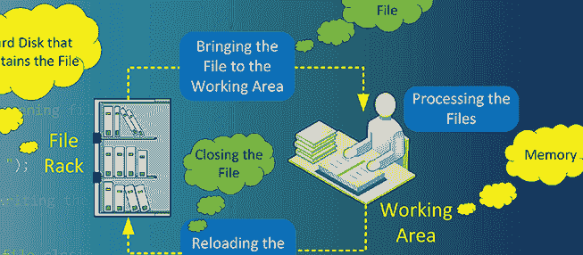


Palatino 字体排版

由 SPI Technologies India Pvt Ltd (Traine) 制作

纪念我的父亲，我的导师，Baikuntha Nath Jena


序言................................................................................................vii

致谢 ............................................................................xix

本书的结构 ................................................................xxi

作者简介 .................................................................xiii

参考文献...............................................16

viii

C 语言对于学生、研究人员和软件专业人士来说是一种非常重要的通用语言。TIOBE 编程社区指数是编程语言流行程度的指标。C 语言在 2021 年 3 月曾位列首。专家认为，C 语言是渴望学习 Java 和 Python 等其他高级语言的人士的准备步骤。自 1989 年发明和标准化以来，它在嵌入式系统和操作系统开发者中最为受欢迎。目前开发者正在使用该语言的几个新标准，被称为 C99 和 C11。本书是为那些没有编程语言知识或仅有一些基础知识的人编写的。


# 致谢

写一本关于 C 编程的书是我一直以来的老想法。我在教授这门课程的同时一直在编写草稿。在为我的学生制作了一些讲义并得到他们的赞赏后，这激发了我写书的动力。我想感谢我的学生，他们不断建议我写这本书。其他人也激励并支持我完成了它的工作。

衷心感谢我的妻子 Priya Arundhati 和我的儿子 Kritansh，他们的鼓励、照顾和爱。没有他们，我的生活将失去快乐。我的父母和家人始终是我的力量，也是我极大的动力。

诚挚感谢 CRC Press – Taylor & Francis Group 的高级编辑 Atha Sharma，感谢她在写本书期间理解我的想法，并就最终提议建议了必要的补充内容。我同样感谢 CRC Press – Taylor & Francis Group 的高级编辑助理 Shikha Garg，她帮助我制作了手稿。最后，我诚心感谢那些直接或间接帮助我完成这项工作的朋友和同事。


# 本书结构

学习任何编程语言（初级、中级或专家）如果按照顺序学习，将获得最大的收益。如所述，第 1 章简述了计算机基础：输入、输出、内存和处理。任何了解计算机基础的人都可以跳过这两章。第 4 章介绍了常量、变量和数据类型等标记。C 语言拥有丰富的运算符，在第 5 章中进行了描述。该章解释了表达式以及如何根据运算符的优先级和结合性执行它们。第 6 章介绍了程序员用于从用户读取输入并在屏幕上输出输入输出函数。第 7 章描述了控制语句，包括所有的决策和循环结构。第 8 章介绍了通过函数实现的模块化编程概念。函数的威力允许程序员将一个更重要的问题分解为更小的子任务并在必要时通过调用它们来执行。第 9 章解释了数组和字符串，以提供对存储和顺序检索信息的深入理解。第 10 章解释了指针。指针概念是该语言的重要组成部分，提供了一种动态访问内存内容的机制。它还增强了语言支持数据结构的功能。第 11 章讨论了结构体、联合体、位域和枚举等多个概念。所有这些概念都是 C 语言特有的并增强了其特性。第 12 章涉及了用于动态分配内存和优化内存使用的内存分配。在文件中永久存储信息并对其处理是任何编程语言都需要的功能。在第 13 章中，我们探索了 C 语言中函数处理的概念。其他概念如预处理器和命令行参数从第 14 章开始描述。本书包含了 270 多幅插图，以解释 C 语言的特性。每一章都从讨论一个现实场景开始，以解释该章的重要性，然后描述 C 支持的解决该问题的机制。

我们随时欢迎改进内容的建议。我们请求所有读者发送他们的发现、错误、意见、观点和反馈，使其成为该领域更好的书籍。请将您的建议发送至：siriitg@gmail.com。


# 作者简介

Sisir Kumar Jena 目前任于德哈拉德迪特大学（DIT University）计算机科学与工程系（CSE）助理教授。2007年至2015年期间，他曾担任印度比斯巴斯瓦尔纳兰达技术学院（Nalanda Institute of Technology）计算机科学与工程系的主任及助理教授。他拥有十余年的教学经验以及在古尔哈蒂印度理工学院（IIT Guwahati）五年的研究学者经历。在撰写此本书期间，他正在古尔哈蒂印度理工学院攻读计算机科学与工程博士学位。他已在经过同行评审的国际会议和期刊上展示并发表了许多研究论文和书籍章节。他的兴趣领域包括数字 VLSI 设计与测试、近似计算、物联网（IoT）以及硬件安全。


# 1 计算机简介

## 1.1 引言

或许人类创造的最强大且资源丰富的工具莫过于计算机。“计算机”一词可以指一种计算设备。但现在，计算机可以执行各种工作。无论你选择哪个领域——工程、医疗保健、汽车设备、游戏还是娱乐——计算机都被用于完成任务。本章介绍了计算机是如何产生的，并描述了与计算设备相关的不同组件。完成本章后，读者将学习到：

- 1. 什么是计算机，以及如何定义它。
- 2. 计算机的历史以及它是如何产生的。
- 3. 计算机系统的不同组件是什么，它们是如何组织的。
- 4. 能够定义内存子系统、其分类及其组织。
- 5. 理解操作系统（OS）的重要性及其功能。

本章内容纯属初级，不适用于那些已经了解计算机系统基础的人。对任何计算机语言有中等知识的人可以跳过本章。我们将从介绍计算机系统的定义及其特征开始本章。

## 1.2 计算机系统的定义与特征

计算机系统的发展有着悠久的历史，其中包括几位巨者的贡献。在现代，我们可以将计算机视为处理数据并产生有用信息的系统。虽然没有正式的定义来界定计算机，我们将尝试提出一个定义：

> 计算机是一种电子设备，它通过输入设备接收输入，将其存储在存储设备（内存）中，并通过输出设备操纵或处理数据以产生信息（输出）。

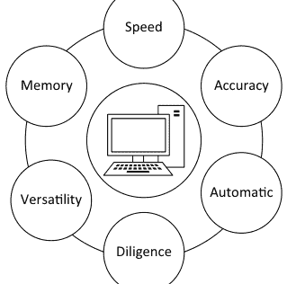

图 1.1 计算机的特征。

通过分析该定义，你可能会注意到计算机系统的四个关键组件：(1) 输入设备，(2) 输出设备，(3) 存储设备和 (4) 处理设备。所有这些组件的整体组织将在本章稍后部分讨论。上述定义将计算机系统定义为数据处理机。但它不仅仅是一个数据处理单元。相反，它具有几种需要在此处以特征的形式进行讨论的能力。如果不了解计算机系统的特征，我们就无法完成定义。图 1.1 显示了从 [1] 收集的计算机基本特征。

- *速度*：计算机是一种高速电子设备，与任何人的速度相比，执行任何任务所需的时间都可以忽略不计。
- *准确性*：计算机在产生正确输出方面非常准确。计算机只有在出错时才会产生错误的结果。
- *自动性*：计算机在没有人工干预的情况下执行分配的任务。
- *勤快性*：计算机不会疲劳。它们可以持续工作并产生正确的结果。
- *多功能性*：计算机能够执行不同的任务，无处不在。
- *记忆*：计算机擅长记住事物，并且永远不会遗忘。

## 1.3 计算机的历史

计算机系统的发展历史悠久，包含了几位伟大思想者的工作。在现代，我们可以将计算机视为一个处理数据并产生有用信息的系统。虽然没有正式的定义来界定计算机，我们将尝试提出一个定义：

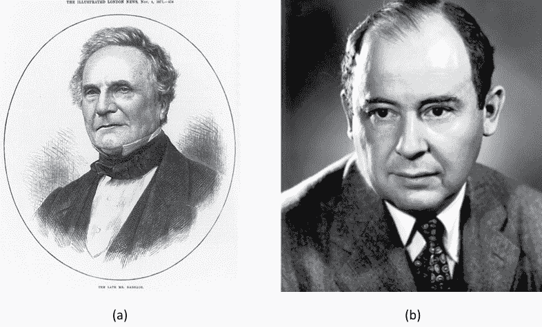

图 1.2 (a) 巴巴贝尔；(b) 冯·诺依曼。

在计算机内部可以看到 (a) 巴巴贝尔；(b) 冯·诺依曼的贡献。

在本节中，我们将概述计算机是如何通过一些发明的：

- 德国哲学家和数学家，莱布尼茨（1646–1716），用于乘法和除法的计算。
- 英国发明者巴巴贝尔（1792–1872）在 1822 年设计了差分机，并构思了包含内存输入输出的思想。
- 哈华德·艾肯（1900–73），一位在 IBM 支持的哈佛大学教授，在 1944 年制造了哈佛马克一型（长 51 英尺）。
- 约翰·文森·阿塔纳索夫在 1941 年制造了专用计算机，马奇利访问了它的电子积分器。
- J. 普斯克·埃克特和马奇利在 1946 年设计并制造了IAC。它使用真空管（并以微秒级运行），而不是电磁继电器。
- 冯·诺依曼是一位科学天才，也是IAC 项目的顾问。1950 年他与马奇利、埃克特制定了新型计算机——电子离散自动计算机（EDVAC），它也被用于存储程序和数据。
- 与此同时（1950 年），莫里斯·威尔克斯在英国剑桥大学开发了另一种名为电子延迟存储计算器（EDSAC）的计算机。

此后制造的计算机都遵循冯·诺依曼架构。计算机了几代，整体架构保持不变。

## 1.4 基本计算机组织

在理解基本计算机组织之前，请看图 1.3 的台式计算机系统及其组件。我们通常可以看到五个组件：(1) 键盘；(2) 鼠标；(3) 显示器；(4) 机箱；(5) 声器。我们还能看到其他组件，如不间电源（UPS）和摇杆。并不是每个组件都是必要的，但我们为了方便连接了它们。

让我们看看机箱内部。图 1.4 显示了我们在内部可以看到什么，并揭示了有助于解释计算机系统基本组织的组件：

- 中央处理器（CPU）
- 两种内存（主存和外存）
- 开关模式电源（SMPS）
- 提供连接所有其他组件端口的主板。

# 计算机简介

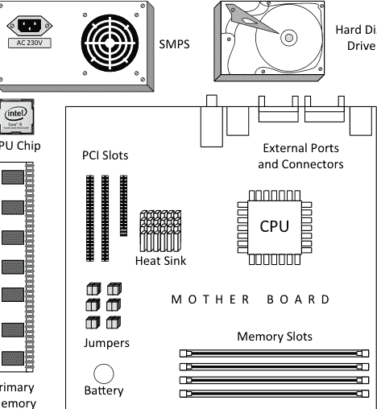

图 1.4 机箱内部的主要组件。

我们鼓励进一步探索这些组件，并撰写文章来增强对计算机系统的认知。

根据 [4]，一个简单的数字计算机应该包含五个基本部分：(1) 内存，(2) 算术逻辑单元 (ALU)，(3) 控制单元 (CU)，(4) 输入设备和 (5) 输出设备。在这些组件中，ALU 和 CU 属于 CPU。CPU 的 CU 在执行用户任务中起着重要作用。CU 控制计算机系统的整体活动并管理其他组件之间的通信。要理解任务的整体执行过程，请看图 1.5，它展示了这些组件的基本组织结构。每个组件的描述见所示。

### 1.4.1 输入设备

该单元帮助向计算机系统提供数据和指令。例如，如果我们想指示计算机播放一首歌，我们就搜索某特定的歌曲并使用鼠标点击按钮。在这种情况下，鼠标充当输入单元。

同样，如果我们想编写计算机程序，我们就使用键盘作为输入设备。我们的计算机连接了多个输入设备，我们通过它们发送命令：鼠标、键盘、摇杆等。

> 输入设备从用户处读取数据或指令，并将其发送到计算机系统进行进一步处理。

## CPU

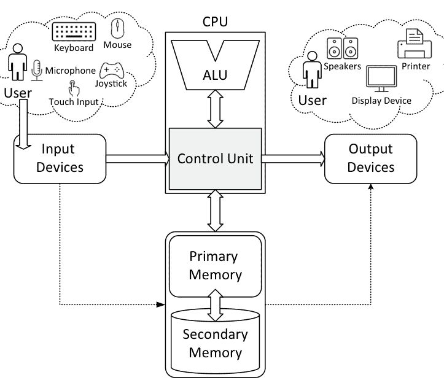

图 1.5 计算机系统的基本组织。

### 1.4.2 内存

每台计算机都有一个内存单元，主要分为两种类型：主存和辅存。我们将在 1.5 节进一步讨论这些内存单元的分类和描述。该单元的主要工作是存储所有内容，包括输入单元读取的数据或指令、处理器产生的中间结果以及最终结果。

> 内存用于存储输入数据或指令、处理过程中产生的中间结果以及处理器产生的最终结果。

### 1.4.3 中央处理器

CPU 被认为是计算机系统的大脑。它有两个主要组件：ALU 和 CU。它从存储单元读取数据，根据用户指令进行计算，将最终结果存储在存储设备中，并将结果显示给用户。ALU 用于执行所有的逻辑和算术运算。CU 用于控制计算机系统的整体活动并管理不同组件之间的交互。

# 计算机简介

CPU 是计算机系统的大脑。它控制并协调不同组件之间的交互，并处理所有的算术和逻辑运算。

### 1.4.4 输出设备

这些有助于显示计算结果。例如，当我们执行程序时，输出显示显示器屏幕上。因此，在这种情况下，显示器充当输出设备。同样，扬声器也是输出设备。

输出设备获取 CPU 产生的结果，将其转换为人类可读的形式，并显示给计算机系统的用户。

程序员需要理解指令在 CPU 内部是如何执行的。这需要对内存单元进行详细探索。下一节介绍了内存-处理器集成的概念及其通信技术。

## 1.5 计算机内存

现代数字计算机具有多个按层次结构组织的内存子系统，从最小的高速寄存器到大容量硬盘驱动。计算机具有以下主内存子系统：

- 寄存器；
- 缓存内存；
- 主存；
- 辅存。

图 1.6 显示了这些内存如何与 CPU 排列，以便于通信和程序执行。内存分类如此多的主要原因在于两个需求：速度和容量。CPU 需要高速内存，因为与任何内存的数据供给能力（从内存读取内容并提交给 CPU 处理）相比，CPU 的执行速度相对很高。另一方面，用户总是需要大容量内存来永久保存所有数据和程序。与内存、缓存和寄存器相比，辅存的容量相对较高。相比之下，从寄存器获取数据比任何其他内存子系统都快。显而易见，构建高速内存的成本比低温内存更高。

程序员需要理解内存组织以编写高效程序。让我们描述每类内存类型的几点。

## 中央处理器

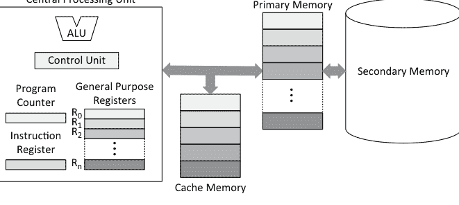

图 1.6 内存组织。

### 1.5.1 寄存器

这些是 CPU 内部提供的最小、高速、易失性内存，以便在处理或执行任务时快速访问。CPU 内部寄存器的总数随架构而异。最常见的是通用寄存器、程序计数器和指令寄存器。通用寄存器存储已执行指令的当前和中间数据。CPU 内部可能有多个专用寄存器。程序计数器保留有关即将运行的指令的信息。它像一个计数器，保存一个在执行当前指令后不断增加的地址。指令寄存器包含当前执行的指令。CPU 从主存中提取指令，将其放入指令寄存器中，进行解码，最后执行它。

### 1.5.2 缓存内存

缓存内存是主存中的易失性内存，速度比主存快但比 CPU 慢。每当 CPU 请求指令时，都会从主内存调取一组相邻的指令并放入缓存中。

### 1.5.3 主存

主存（通常称为主内存）是辅存和 CPU 之间的重要组件。根据需要，CPU 从主存加载应用程序。当程序员完成程序编写后，将其存储在辅存中。为了执行该程序，CPU 正在与主存直接交互。

# 计算机简介

## 表 1.1 计算机存储单位

| 序号 | 单位 | 描述 |
| :--- | :--- | :--- |
| 1 | 比特 (bit) | 指 0 或 1 |
| 2 | 字节 (nibble) | 4 位 |
| 3 | 字节 (byte) | 8 位 |
| 4 | 千字节 (KB) | 1024 字节 |
| 5 | 兆字节 (MB) | 1024 千字节 |
| 6 | 吉字节 (GB) | 1024 兆字节 |
| 7 | 太字节 (TB) | 1024 吉字节 |
| 8 | 品字节 (PB) | 1024 太字节 |
| 9 | 艾字节 (EB) | 1024 品字节 |
| 10 | 泽字节 (ZB) | 1024 艾字节 |

主存由多个位置组成，我们可以通过地址来识别每个位置。位置以字的形式存储数据或指令，字大小（字长度）取决于计算机架构。现代计算机系统可以具有 16 位（2字）、32 位（4字）或 64 位（8字）的字大小。图 1.7 显示了一个简单主存的示例。字长为 2 字节，有 64 个位置。因此，为了唯一标识每个位置，我们需要 6 位（2⁶ = 64），地址从 000000 到 111111。

计算机系统中存在两种主存：随机存存储器 (RAM) 和只读存储器 (ROM)。ROM 有几种变体：可擦除编程只读存储器 (EPROM)、电学可擦除编程只读存储器 (PROM)、可擦除编程只读存储器 (PROM)，ROM（EEPROM）等；每种类型的描述未包含在本书的范围内。同样，RAM 也有两种：静态 RAM（SRAM）和动态 RAM（DRAM）。

### 1.5.4 随机访问存储

RAM 也称为计算机系统的主内存。在 RAM 中，我们可以从任何位置随机地检索和存储信息：

- 1. RAM 是计算机的读写存储；
- 2. RAM 是易失性存储：当我们关闭计算机系统时，RAM 中的内容会被擦除；
- 3. 在 RAM 中，可以随机选择任何内存位置来存储和检索信息。

### 1.5.5 只读存储

此存储器中存在的信息是永久的，我们无法修改其内容。因此，它是只读存储：

- 1. 信息仅可读取。
- 2. 它是非易失性存储：此存储器中存在的数据是永久的。


# 计算机导论

# 1

## 1.5.6 二级存储

在执行程序之前，你应该将其编写并存储在计算机内部某处。主内存不会永久存储你的程序；它通过提供内存空间来帮助你的 CPU 执行程序。当你的程序运行结束，分配的内存将被回收——这就是为什么你需要永久存储器来存储你的程序。二级存储就为你完成这项工作。

你的计算机中有两种类型的二级存储：硬盘驱动器（HDD）和固态硬盘（SSD）。与 HDD 相比，SSD 快得多。SSD 没有机械运动部件，但 HDD 有内置的称为磁磁盘的盘片以及在盘片之间往回移动以访问数据的活动头。另一方面，与 HDD 相比，SSD 昂贵得多且存储容量有限。

### 1.5.7 硬盘驱动器

图 1.8 显示了可用 HDD 的内部结构。如你所见，HDD 有一个机械读写头，可以在盘片上往回移动。图中显示了读写头的结构及其移动方向。每个盘片都涂有一层薄的磁性材料，用于记录数据。如图 1.8 所示。在访问记录在每个盘片表面的数据时，读写头前后移动，盘片旋转以将所需的扇区带到读写头下方。

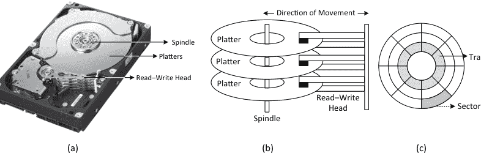

图 1.8 HDD 的内部结构。

### 1.5.8 固态硬盘

图 1.9 显示了一个典型的 SSD 及其框图 [5–7]。SSD 使用固态存储存储数据。SSD 的主要组件是 NAND 闪存、一个控制器、一个 RAM 和主机接口。图 1.9b 显示了这些组件的结构及其通信路径。NAND 闪存（有时称为闪存）是一种用于存储数据的非易失性半导体器件。它有若干所谓的块，由 64 到 128 个页组成，用于记录用户数据。这些进一步细分为子页，其大小等于典型的扇区大小。每个子页还有两个区域：数据区和备用区。数据区存储用户数据，备用区存储管理信息，例如坏道和纠错码。闪存以封装的形式排列，共享一个 8 位宽的通用输入/输出（I/O）总线。主机接口提供与主机接口的连接，例如串行高级附件（SATA）、并行高级附件（PATA）或通用串行总（USB）。SSD 控制器在 RAM（临时缓冲区）的帮助下处理来自用户的读写请求。RAM 在实际从闪存读取/写入之前，通过读写请求对数据进行缓冲。

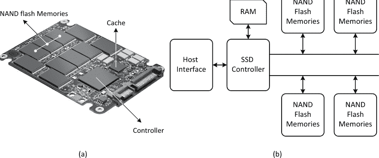

图 1.9 (a) 一个典型的 SSD；(b) SSD 的框图。

## 1.6 操作系统导论

### 1.6.1 硬件与软件

在介绍什么是操作系统之前，我想讨论软件（s/w）和硬件（h/w）的概念。h/w 是连接到你计算机的物理设备。s/w 是程序集合，我们将它们安装在计算机系统上，以指示 h/w 执行某些操作。这意味着，为了与 h/w 交互，我们需要 s/w 的帮助。从市场购买计算机并连接到电源并不能帮助你与计算机交互。你指示计算机执行任何操作唯一方法是安装 s/w 并通过它发出命令。因此，s/w 将充当用户与计算机系统之间的接口。图 1.10 显示了用户通过 s/w 与 h/w 交互：h/w 层、s/w 层和用户层。用户层向 s/w 提供指令，而 s/w 反而

s 主要是两种类型：应用软件和系统软件（图 1.10）。应用软件是为特定任务或特定应用构建的。例如。

## 1.6.2 操作系统

操作系统（OS）是一种作为用户与计算机硬件之间接口的程序。它管理硬件资源并为应用程序的运行提供环境。操作系统处理内存管理、进程调度、文件存储和输入输出操作等任务。

## 1.6.3 操作系统的功能

OS 管理资源并处理来自用户的所有请求。功能的粗分类包括：

- 1. 资源管理；
- 2. 内存管理；
- 3. 进程管理；
- 4. 文件管理。

这些功能的详细描述超出了本书的范围。鼓励读者进一步探索这些功能。

# 计算机简介

- 3. ENIAC、EDSAC 和 EDVAC 的全称是什么？哪一个是先开发的？
- 4. 什么是 SMPS 和 UPS？它们为什么是必须的？
- 5. 什么是控制单元？它位于哪里？它执行哪些操作？
- 6. ALU（算术逻辑单元）的作用是什么？它执行哪些操作？
- 7. 请举一些输入设备和输出设备的例子。
- 8. 局部性（locality-of-reference）什么含义？
- 9. 请解释几个子系统在容量、成本和速度方面的存储层次结构。
- 10. 什么是位（bit）？多少个位组成一个字节（byte）？
- 11. 列出只读存储器（ROM）的不同类型。
- 12. 易失性内存和非易失内存的区别是什么？
- 13. 什么是闪存（NAND-flash memory）？它在哪里使用？
- 14. 什么是字长（word size or word length）？
- 15. 什么是程序计数器？
- 16. 什么是指令寄存器？
- 17. 什么是通用寄存器？
- 18. SATA 和 PATA 的全称是什么？它们之间的区别是什么？
- 19. 什么是引导加载程序（bootstrap loader）？
- 20. 现代计算机系统中硬盘的典型转速是多少？

## 1.7.3 实践练习

- 1. 在市场上购买电脑（无论是台式机还是笔记本电脑）之前，你应该了解哪些知识？
- 2. 你认为更大的 RAM 容量会提高计算机系统的速度吗？请探索并解释。
- 3. 什么是 x64 和 x86 操作系统？它们之间有什么区别？尝试找出你的电脑安装的是哪种操作系统。
- 4. 探索你的系统并查找关于你电脑的以下信息：
  - a. RAM 容量是多少？
  - b. 你正在使用什么操作系统？
  - c. 你的次级存储有多大？
  - d. 次级存储是连接到电脑的 HDD 还是 SSD？
  - e. 你如何发现系统在任何时刻上运行了多少个进程？
  - f. 你的处理器的速度是多少？
  - g. 你的处理器有多少个核心？
  - h. 你的 CPU 寄存器大小有多大？
- 5. 研究不同的操作系统及其类型，并考虑哪种是最好的以及为什么。
- 6. 操作系统设计的三个主要参与者是 Microsoft Windows、Linux 和 Apple iOS。准备一份关于这些操作系统的报告，并学习它们如何不同。
- 7. 什么是优盘（pen drive）？它属于内存系统的哪一类，主存还是次存？
- 8. 探索你电脑的几个快捷键，包括创建新文件、保存文件、最小化打开的窗口、切换窗口以及其他方便操作的快捷键。
- 9. 当你关闭电脑时，Windows 机器显示三个选项：关机、重启和睡眠。睡眠的作用是什么？
- 10. 进入你的电脑设置，探索几个组件的细节，如系统、个性化、账户以及网络和 Internet。

# 数字系统

## 2.2.3 十进制系统

十六进制制使用 16 个符号（称为十六进制数字）来表示一个数字：

0, 1, 2, 3, 4, 5, 6, 7, 8, 9, A, B, C, D, E, F

十六进制数字 A, B, C, D, E, F 分别代表数值 10, 11, 12, 13, 14, 15。基数为 16，因为它使用了 16 个数字。使用十六进制制相比二进制制的优势在于它表示数字的长度较短。正如我们很快看到的，一个四位二进制数只需要一个十六进制数字就可以表示相同的数字。

我们遵循相同的规则为十六进制数的每个数字分配位置，从右向左、从 0 开始。图 2.7 显示了一个分配了位置号的十六进制数。我们可以使用上述讨论的其他数字系统中遵循的原理来计算该十六进制数的十进制等值数。我们首先将每个数字乘以其基的相应位置幂，最后相加。计算过程如图 2.7 所示。因此，我们可以说十六进制数 24B4 等于十进制数 9396。

带有小数点的十六进制数并不常见，但我们可以像处理带有小数点的二进制数一样表示和处理它们。我们将在本章后后的部分讨论转换过程。

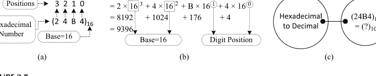

图 2.7 十六进制系统及其相关运算。

## 2.2.4 八进制系统

八进制制使用八个符号（八进制数字）来表示一个数字：

0, 1, 2, 3, 4, 5, 6, 7

*基数*是 8，因为它在八进制系统中使用八个八进制数字来表示数字。使用八进制制相比二进制制的优势在于其表示数字的长度较短。正如我们很快看到的，三位二进制数只需要一个八进制数字就可以表示相同的数字。

我们遵循规则为八进制数的每个数字分配位置，从右向左、从 0 开始。图 2.8 显示了一个分配了数字的八进制数。我们可以使用上述讨论的其他系统中遵循的原理来计算该八进制数的十进制等值数。我们首先将每个数字乘以其相应位置的幂并相加。计算过程如图 2.8 所示。然而，我们可以说八进制数 435 等于十进制 285。

带有小数点的八进制数不常见，但我们可以像处理带有小数点的二进制数一样表示并处理它。从上面的描述中，我们可以得出：

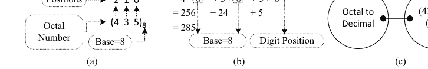

图 2.8 八进制系统及其相关运算。

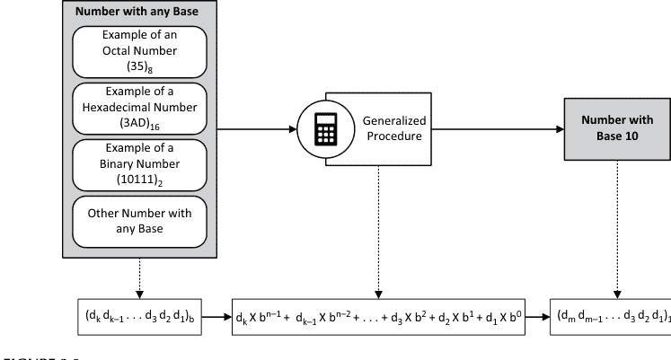

图 2.9 转换为十进制的通用步骤。

## 2.3 转换

了解如何从一个基转换为另一个基至关重要。在本节中我们将讨论二进制：

### 2.3.1 二进制转十进制

二进制转十进制有两种方法。第一种方法已经在 2.2.2 中讨论过。对于这种方法，我们从右向左、从 0 开始为每个数字分配位置号。然后，将数字乘以位置的幂。最后相加得到其十进制等值数。

#### 2.3.1.1 方法 1

给定数字：$(10011)_2$。该方法如图 2.10 所示。这是一个三步骤过程：

- 为每个数字分配位置号；
- 将数字乘以基的位置幂；
- 相加结果找到十进制等值数。

#### 2.3.1.2 方法 2

要用这种方法找到十进制等值，我们需要记住一个公式。公式通过列出从 0 开始的 2 的幂构建，即 $2^0, 2^1, 2^2, \dots$。当我们写出它们的值时，它们是 $1, 2, 4, 8, 16, \dots$，每写下一个项时数字都会翻倍。项取决于二进制数中存在的数字数量。例如，如果你想找出 $(10011)_2$ 的十进制等值，则四项，因为二进制数中有四个数字，这些项是 $1, 2, 4$ 和 $8$。同样，如果数字是 $(110101)_2$，我们需要七个项，它们将是 $1, 2, 4, 8, 16, 32, 64$。项必须从右向左分配以对应二进制数中的每个数字。

这种方法的下一步非常简单。我们需要相加对应 1 的项以得到其十进制等值。分配给数字 0 的项将被忽略，不参与十进制计算。图 2.11 使用示例展示了这种方法的步骤。给定数字是 $(10011)_2$。

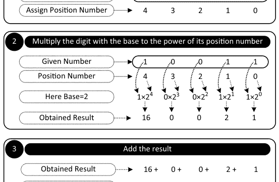

图 2.11 二进制转十进制的步骤。

| 从右向左分配公式项 | | | | | |
|---|---|---|---|---|---|
| 给定数字 | 1 | 0 | 0 | 1 |
| 分配公式项 | 16 | 8 | 2 | 1 |
| 高亮显示对应数字 1 的项 | | | | | |
| 给定数字 | 1 | 0 | 0 | 1 |
| 通过标记标记高亮 | (16) | 8 | 4 | (2) | (1) |
| 相加上述步骤获得的高亮项 | | | | | |
| 相加高亮项 | 16 + | 0 + | 0 + | 2 + | 1 |
| 十进制等值 | 19 | | | | |

图 2.11 二进制转十进制（快捷方法）。

> 二进制转十进制的快捷公式：从右向左分配项，从 1 开始，向左移动时每项的值翻一倍。

让我们再来看另一个例子。假设你想找到 (110011011)₂ 的十进制等值。快捷方法如下（见图 2.12）。

### 2.3.2 二进制分数转十进制

我们可以将二进制分数转换为其等值的十进制分数。这种方法非常直接，不需要任何解释。转换过程在上一节已经讨论过。建议学习者通过示例并尝试理解该步骤。

| 给定数字 | 1 | 0 | 0 | 1 | 1 | 0 | 1 | 1 |
|---|---|---|---|---|---|---|---|---|
| 公式 | (256) | (128) | 64 | (16) | 8 | 4 | (2) | 结果 |
| 加法 | 256 + 128 + | 16 + | 8 + | 2 + | 1 = 411 |

图 2.12 另一个二进制转十进制的示例。

# 示例

- 1. 将 (.111)₂ 转换为其十进制等值。

# 方案

给定 $(111)_2$

$=1 \times 2^{-1} + 1 \times 2^{-2} + 1 \times 2^{-3}$

$=\frac{1}{2} + \frac{1}{4} + \frac{1}{8}$

$=0.5 + 0.25 + 0.125$

$=(0.875)_{10}$

- 2. 将 (1110.1001)₂ 转换为其十进制等值。

# 方案

给定 $(1110.1001)_2$

$=1 \times 2^3 + 1 \times 2^2 + 1 \times 2^1 + 0 \times 2^0 + 1 \times 2^{-1} + 0 \times 2^{-2} + 0 \times 2^{-3} + 1 \times 2^{-4}$

$=8+4+2+0+\frac{1}{2}+0+0+\frac{1}{16}$

$=8+4+2+0+0.5+0+0+0.0625$

$=(14.5625)_{10}$

### 2.3.3 二进制转十进制

当我们想要将十进制数转换为其等值的二进制数时，我们需要将十进制数除以 2，直到商变为 0 且无法继续除。在除法过程中，我们不能忽略余数。使用自底向上的方法排列余数即可得到二进制等值。让我们通过一个例子来理解转换过程。

# 示例

将十进制数 (156)₀ 转换为其二进制等值。我们可以按照下面的步骤将任何十进制数转换为其二进制等值（参考图 2.13）。

- 步骤 1：将十进制数作为被除数写在倒置的“长除法”符号内部。将目标系统的基（在本例中，二进制为“2”）作为除数写在除法符号曲线的外部。

| | | |
|---|---|---|
| 2) 156 | | |
| 2) 78 | 0 | |
| 2) 39 | 0 | |
| 2) 19 | 1 | |
| 2) 9 | 1 | |
| 2) 4 | 1 | |
| 2) 2 | 0 | |
| 2) 1 | 0 | |
| 0 | 1 | |

2) 156 2) 156

(a) (b) (c)

图 2.13 十进制数转二进制数的过程。

- 步骤 2：将整数答案（商）写在长除法符号下方，并将余数（0 或 1）写在新除数的右侧。
- 步骤 3：继续向下，将每个数除以 2，并将余数写在每个除数的右侧。当商为 0 时停止。
- 步骤 4：从底部的 1 开始，向上读取 1 和 0 的序列。你应该得到 10011100。这就是该十进制数的二进制等值。因此，(150)₁₀ = (10011100)₂。

### 2.3.4 十进制分数转二进制

在十进制数中，小数点前的数字将按照上一节讨论的技术转换为二进制；小数点后的数字将通过重复乘以 2 来转换。在乘法过程中，小数点前的数字从上到下收集。

# 示例

- 1. 将 (0.8125)₀ 转换为二进制。给定数字没有小数点前的部分，该过程非常直接。将给定数乘以 2 并记录小数点后的数字。图 2.14 显示了整个过程。因此，(0.8125)₀ = (.1101)₂。
- 2. 将 (8.82)₀转换为二进制。给定问题有两个部分；小数点前的数字将按照上一节的方法求解。小数点后的数字将按照图 2.14 所示的方法进行。因此，(8.82)₀ = (1000.1101)₂。

## 十进制转八进制

将十进制数转换为二进制进制非常简单，唯一的区别在于你不是除以 2，而是将十进制除以 8。以下步骤解释了转换：

- 步骤 1：将十进制数除以 8 得到商和余数；
- 步骤 2：将商除以 8 得到新的商和余数；
- 步骤 3：重复步骤 2 直到商等于 0；
- 步骤 4：从底到上取余数。

> 示例

将 $(359)_{10}$ 转换为其等值的八进制数。

方案所示如图 2.15 (a)，且自解释易懂。因此，$359_{10} = 547$。

也可以将十进制分数转换为八进制。该过程与之前的方法相似。数字分开处理，小数点前的数字将按照上述过程转换，小数点后的数字将乘以 8。


将 (0.21875)₀ 转换为八进制等值。

# 方案

方案所示如图 2.15 (b)，且自解释易懂。因此，(0.21875)₀ = (0.16)₈。

### 2.3.6 八进制转十进制

我们可以通过将每个数字乘以基（此处为 8）的幂来实现。这已经讨论过了。本节将向你展示八进制分数转换为等进制数的过程。过程非常简单；观察以下示例。

# 示例

将 (0.34)₈ 转换为其等值的十进制数。

# 方案

给定数字：(0.34)₈

$=3 \times 8^{-1} + 4 \times 8^{-2}$

$=3 \times \frac{1}{8} + 4 \times \frac{1}{64}$

$=0.375 + 0.0625$

$=(0.4375)₀

### 2.3.7 八进制转二进制

将八进制数转换为二进制，我们可以遵循两种方法。

#### 2.3.7.1 方法 1

使用方法 1，我们遵循两个步骤的过程并需要两次转换：

- 步骤 1：将八进制数转换为其等值的十进制数；
- 步骤 2：将得到的十进制数转换为二进制。

上述过程相当冗长。因此，在这里我们方法 2。


### 2.3.7.2 方法 2

这是一个快捷方法。我们需要将八进制数的每个数字表示为三位二进制。为什么？因为我们知道八进制数可以用 1 到 7 的数字组成，如果你将任何数字转换为二进制等值，只需要三位。观察表 2.1 以查看这些数字的二进制等值。

让我们用一个例子来解释转换过程。我们要将 `(7263)₈` 转换为其等值的二进制；我们需要以下步骤：

- 步骤 1：如图 2.16 所示写出八进制数。
- 步骤 2：从表 2.1 提取给定八进制数每个数字的二进制等值，并如图 2.16 所示写入。
- 步骤 3：从左侧读取二进制数得到二进制等值。因此，`(7263)₈ = (11010110011)₂`。

### 2.3.8 二进制转八进制

将二进制数转换为八进制，我们可以遵循两种方法。

### 2.3.8.1 方法 1

使用方法 1，我们遵循两个步骤的过程并需要两次转换：

- 步骤 1：将二进制数转换为其等值的十进制数；
- 步骤 2：将得到的十进制数转换为八进制。

> 表 2.1 八进制数字的二进制等值

| 八进制数字 | 二进制等值 | 八进制数字 | 二进制等值 |
|---|---|---|---|
| 0 | 000 | 4 | 100 |
| 1 | 001 | 5 | 101 |
| 2 | 010 | 6 | 110 |
| 3 | 011 | 7 | 111 |


图 2.16 八进制转二进制的快捷方法。

# 数制系统

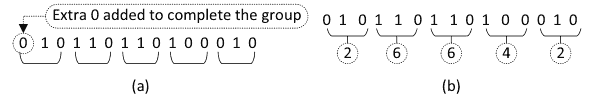

图 2.17 二进制转八进制的快速转换方法。

### 2.3.8.2 步骤 2

该步骤非常简单且易于操作。让我们通过一个例子来理解该步骤是如何运作的。

### 示例

将 `(10101010100010)₂` 转换为其八进制等值。

#### 解决方案

我们需要以下步骤来寻找八进制等值：

- 步骤 1：图 2.17 显示了第一步。将二进制数每三位分为一组（从右向左），如果需要，则添加 0 位以补全分组。
- 步骤 2：图 2.17 显示了下一步，也是获取八进制等值的最后一步。根据表 2.1 将每组替换为其对应的八进制等值。因此，`(10101010100010)₂ = (2642)₈`。

现在考虑一个二进制小数。要将其转换为八进制，我们使用以下步骤：

- 步骤 1：将二进制点前的二进制数每三位分为一组（从右向左），将二进制点后的数每三位分为一组（从左向右），如果需要，则添加 0 位以补全分组；
- 步骤 2：根据表 2.1 将每组替换为其八进制等值。

### 示例

将 `(101010011011.10100011)₂` 转换为其八进制等值。

#### 解决方案

解决方案步骤如图 2.18 所示，自言自明。因此，`(101010011011.10100011)₂ = (5233.506)₈`。

32

C语言编程

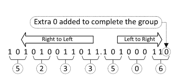

图 2.18 小数转八进制转换。

### 2.3.9 十进制转十六进制转换

从十进制数到十六进制数的转换非常简单，类似于上面讨论二进制转换。唯一的区别在于，之前是除以 2，而这里除以 16。以下步骤解释了转换过程。

- 步骤 1：将十进制数除以 16，得到商和余数；
- 步骤 2：将商除以 16，得到新的商和余数；
- 步骤 3：重复步骤 2 直商等于 0；
- 步骤 4：从下往上取余数作为答案。

> 示例

将 `(58)₁₀` 转换为其等值的十六进制。

**解决方案**

解决方案如图 2.19(a) 所示，自言自明。

因此，`58₁₀ = 3A₁₆`。

也可以将十进制小数转换为其十六进制等值。该过程与之前的方法非常相似。数字被分开处理：小数点前的数字将按上述过程进行转换，小数点后的数字将乘以 16。小数点前的数字将从上到下收集。

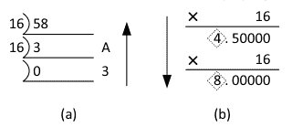

图 2.19 十进制转十六进制转换。

## 示例

将 `(0.28125)₁₀` 转换为其十六进制等值。

## 解决方案

解决方案如图 2.19 所示，自言自明。因此，`(0.28125)₁₀ = (0.48)₁₆`。

### 2.3.10 十六进制转十进制转换

我们可以通过将每个数字乘以其基数（此处为 16）的相应幂来实现。这在上一节中已经讨论过。在本节中，我们将向你展示十六进制小数转换为其等值的十进制小数。该过程非常简单；观察以下示例即可理解。

## 示例

将 `(0.48)₁₆` 转换为其十进制等值。

## 解决方案

给定数字：`(0.48)₁₆`

```
= 4 × 16⁻¹ + 8 × 16⁻²
= 4 × 1/16 + 8 × 1/256
= 4 × 0.0625 + 8 × 0.00390625
= (0.281250000)₁₀
```

### 2.3.11 十六进制转二进制转换

要将数字从十六进制转换为二进制，我们可以遵循两个步骤。

### 2.3.11.1 步骤 1

使用步骤 1，我们遵循两个步骤的过程并需要两次转换：

- 步骤 1：将给定的十六进制数转换为等值的十进制数；
- 步骤 2：将上述十进制数转换为二进制。

上面的步骤非常冗长。因此，我们在这里遵循步骤 2。

C语言编程

表 2.2 十六进制的二进制等值

| 十六进制 | 二进制等值 | 十六进制 | 二进制等值 |
| :--- | :--- | :--- | :--- |
| 0 | 0000 | 8 | 1000 |
| 1 | 0001 | 9 | 1001 |
| 2 | 0010 | A (10) | 1010 |
| 3 | 0011 | B (11) | 1011 |
| 4 | 0100 | C (12) | 1100 |
| 5 | 0101 | D (13) | 1101 |
| 6 | 0110 | E (14) | 1110 |
| 7 | 0111 | F (15) | 1111 |

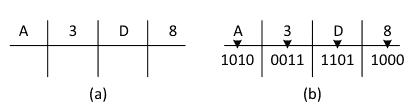

图 2.20 十六进制转二进制的快速方法。

### 2.3.11.2 步骤 2

这是一个快速步骤。我们需要将十六进制数的每个数字表示为四位二进制。因为我们知道十六进制数可以使用 1 到 9，然后是 A、B、C、E 和 F。其中 A=10, B=11, C=12, D=13, E=14, F=15。如果将任何数字转换为二进制只需要四位。观察表 2.2 查看所有数字的二进制等值。如果我们想将 `(A3D8)₁₆` 转换为其二进制等值，需要遵循以下步骤：

- 步骤 1：如图 2.20 所示写出给定的十六进制数。
- 步骤 2：从表 2.2 提取十六进制数每个数字的二进制等值并如图 2.20 所示写出。
- 步骤 3：从左到右读取二进制数以获得二进制等值。因此，`(A3D8)₁₆ = (101000111101000)₂`。

### 2.3.12 二进制转十六进制转换

遵循进制进制可以遵循两个步骤。

### 2.3.12.1 步骤 1

使用步骤 1，我们遵循两个步骤的过程并需要两次转换：

- 步骤 1：将二进制数转换为等值的十进制数；
- 步骤 2：将上述十进制数转换为十六进制。

上面的步骤非常冗长。因此，我们遵循步骤 2。

### 2.3.12.2 步骤 2

该步骤非常简单且易于操作。让我们通过一个例子来理解该步骤是如何运作的。

### 示例

将 `(1011010100001)₂` 转换为其十六进制等值。

#### 解决方案

我们需要以下步骤寻找十六进制等值：

- 步骤 1：图 2.21 显示了第一步。将二进制数每四位分为一组（从右向左），如果需要，则添加 0 位以补全。
- 步骤 2：图 2.21 显示了下一步也是获取十六进制等值的最后一步。根据表 2.2 将每组替换为其十六进制等值。因此，`(1011010100001)₂ = (2DA2)₁₆`。

现在考虑一个二进制小数。要将其转换为十六进制，使用以下步骤：

- 步骤 1：将二进制点前的二进制数每四位分为一组（从右向左），将二进制点后的数每四位分为一组（从左向右），如果需要，则添加 0 位以补全分组；
- 步骤 2：根据表 2.2 将每组替换为其十六进制等值。

### 示例

将 `(1010100111.10101)₂` 转换为其十六进制等值。

#### 解决方案

解决方案步骤如图 2.22 所示，自言自明。因此，`(1010100111.10101)₂ = (A9B.A2)₁₆`。

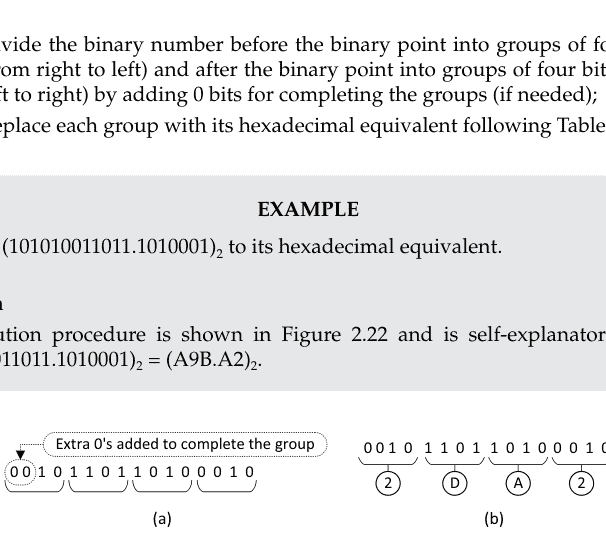

图 2.21 二进制转十六进制的快速方法。

36

C语言编程

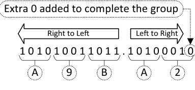

图 2.22 二进制小数转十六进制转换。

## 2.4 复习题

1. 位值制和非位值制之间有什么区别？
2. 为什么计算机需要二进制制来表示数字？
3. 如果计算机使用二进制制，为什么还需要十六进制制和八进制制？
4. 针对以下内容写简短记记：
   a. 二进制制；
   b. 八进制制；
   c. 十六进制制。
5. 描述将任何基数的数转换为其十进制等值的通用步骤。用例子说明。
6. 你能推导出一个将十进制数转换为其他不同基数的通用步骤吗？如果可以，概述该步骤并用例子说明。
7. 你能设计一个六进制制吗？该数制需要哪些不同的符号？如何进行六进制与十进制的相互转换？

### 2.4.1 转换题

1. 将以下二进制数转换为等值的十进制数。
   a. `10001001₂`
   b. `10101₂`
   c. `1101₂`
   d. `110.110₂`
   e. `11.001₂`
   f. `100.101₂`

2. 将以下十进制数转换为等值的二进制数。
   a. `78₁₀`
   b. `653₁₀`
   c. `8792₁₀`
   d. `98.23₁₀`
   e. `987.34₁₀`
   f. `9832.356₁₀`

3. 将以下二进制数转换为相应的八进制数。
   a. `1110110101111₂`
   b. `10101011100111₂`
   c. `101011100₂`
   d. `10101.1100100₂`
   e. `10101.110110₂`
   f. `11011010101110₂`

4. 将以下八进制数转换为相应的二进制数。
   a. `1324₈`
   b. `765₈`
   c. `52712₈`
   d. `43.456₈`
   e. `32.776₈`
   f. `254.366₈`

5. 将以下二进制数转换为相应的十六进制数。
   a. `101100110100₂`
   b. `1010100101₂`
   c. `110001000101₂`
   d. `1000110101₂`
   e. `1111.0110101₂`
   f. `110101010101011₂`

6. 将以下十六进制数转换为相应的二进制数。
   a. `A2B5₁₆`
   b. `D9C34₁₆`
   c. `FF2A3B9₁₆`
   d. `2FE34₁₆`
   e. `7A3.AD2₁₆`
   f. `786A.AA2E₁₆`

7. 将以下十进制数转换为相应的八进制数。
   a. `657₁₀`
   b. `7578₁₀`
   c. `543543₁₀`
   d. `987.85₁₀`
   e. `5454.2323₁₀`
   f. `4568.534₁₀`

8. 将以下八进制数转换为相应的十进制数。
   a. `3232₈`
   b. `14₈`
   c. `6453₈`
   d. `443.7564₈`
   e. `34243.75₈`
   f. `33545.3232₈`

9. 将以下十进制数转换为相应的十六进制数。
   a. `37₁₀`
   b. `7448₁₀`
   c. `94323₁₀`
   d. `977.83₁₀`
   e. `5324.232₁₀`
   f. `4348.124₁₀`

10. 将以下十六进制数转换为相应的十进制数。
    a. `A23₁₆`
    b. `FAB₁₆`
    c. `AB43₁₆`
    d. `AA.34B₁₆`
    e. `EA3.56F₁₆`
    f. `EA67.9E₁₆`

11. 将以下八进制数转换为相应的十六进制数。
    a. `323₈`
    b. `7544₈`
    c. `7263₈`
    d. `241.66₈`
    e. `644.132₈`
    f. `22.7554₈`

12. 将以下十六进制数转换为相应的八进制数。
    a. `F3A₁₆`
    b. `FEDAB₁₆`
    c. `F45BA₁₆`
    d. `FE3.45A₁₆`
    e. `BC.459A₁₆`
    f. `BBDA.456₁₆`

# 3 通过流程图和算法解决问题

## 3.1 引言

既然我们已经理解了什么是计算机，现在是时候计算机来解决问题了。我们将开始介绍通过编写算法和绘制流程图来进步的问题解决技术。学习如何解决问题总是从良好地理解问题开始，通过一种被称为算法的逐步方法在纸上对其进行草拟，最后绘制流程图来显示输入如何通过解决方案步骤并产生输出。图3.1 显示了在我们编写 C 语言代码之前所需的关键步骤。因此，我们建议读者在继续编写程序之前遵循这些步骤。

本章详细描述了算法的编写和流程图的绘制。我尝试包含足够数量示例，描述了编写算法中涉及的所有概念。一旦读者学会了如何编写算法，绘制流程图就会容易得多。完成本章后，读者将能够回答以下问题：

1. 什么是解决问题？如何处理它？
2. 什么是算法？如何编写算法来解决给定问题？
3. 什么是流程图？如何绘制它？
4. 绘制流程图时使用了哪些符号？
5. 算法和流程图之间是什么关系？


## 3.2 问题解决方法

用编程解决问题总是具有挑战性的，但计算机可以非常准确且比任何人更快地完成任务。假设给给的任务是计算一个数的阶乘。任何人类都需要一定的时间来提供答案，但如果使用计算机解决相同的任务，会产生产生。有趣的是，计算机并不知道如何计算阶乘，但为了执行加法、减法和除法等基本操作，需要程序员编写供计算机遵循的逐步指令。

从上述讨论中，我们可以看到使用问题解决技术应该充分规划给定问题的解决方案。问题解决方法由五个阶段组成。图3.2 显示了包含这些阶段的步骤，我们应该遵循这些解决问题：

1. 理解问题：清晰地描述问题。
2. 识别问题：识别给输入和预期输出。
3. 制定计划：设计算法和流程图。
4. 实现计划：将算法转换为任何语言的程序。
5. 测试和验证：执行程序并检查输出。


图3.2 问题解决阶段。

通过流程图和算法解决问题

在下一节中，我们将解释算法设计，然后是绘制流程图。在算法设计期间，阶段1和阶段2会自动进入讨论。第3.3节将介绍编程的概念以及执行它们的不同组件。

## 3.3 算法设计

在进入算法的定义之前，让我们看看图3.3所示的内容。这张图片摘自 Sanje Kapoor 的书。使用这张图片的目的是向你介绍算法的不同特征。我们不是在这里学习烹饪；相反，图片帮助你理解如何在食谱中编写清晰的语句。图中写的程序具有算法设计。

如果你分析食谱，可以很容易看到步骤编写得很好，任何遵循步骤的人都能做出美味的食物。没有操作是模糊的，程序提到了准备食谱所需的所有原料。我们可以说图中指定的方法是制作食物的逐步方法，原料被称为处理的输入。最后，食物将是过程的输出。

现在我们准备好解释算法了。通过遵循上述，可以将算法定义为：

# 原料

|  |
|---|
| 4 杯 | 乳米 (Poha) |
| 2 汤 | 酥油 (Ghee) |
| 1 杯 | 椰子（擦碎） |
| 3 个 | 辣椒（切碎） |
| 1/2 茶匙 | 孜然（粗粉） |
| 1 茶匙 | 香菜籽（粗粉） |
| 1 汤匙 | 糖 |
| 适量盐 |  |

# 香乳米 (Kurkuri Pohe)

# 方法

- 在锅中加热酥油，用小火轻轻烘烤乳米直到变脆。
- 混合擦碎的椰子、切碎的辣椒、孜然和香菜籽粉、糖和盐。
- 将这些加入过的乳米中轻轻翻炒。
- 立即上菜，因为乳米久放会变软。

图3.3 一份烹饪食谱。

算法是在有限时间内解决问题的系列清晰指令。

从程序员的角度来看，我们编写算法来解决给定的编程任务，无论使用什么编程语言，都可以轻松转换为程序语句。例如，任务是两个两个数字；如何编写算法？遵循问题解决技术，我们需要分析并识别算法的输入以及它应该产生的输出。在我们的情况下，算法需要两个数字，并将它们作为结果提供。之后，我们需要编写执行加法操作的逐步程序。每一步都必须指示计算机做某些事，并且在所有步骤完成后，机器应该产生所需的结果。解决两个数字相加完整算法将在后续节中讨论。

### 3.3.1 算法的特征

根据 [1]，每个算法必须符合以下特征：

1. 算法是有序的：每个解决方案都需要特定的执行顺序，因此算法必须在其步骤中保持这种顺序。
2. 算法具有清晰的操作：算法的每一步都执行独立的操作且是不模糊的。
3. 算法具有有效计算的操作：假设我们想为乘法操作编写步骤并假设我们的计算机没有乘法单元，那么我们不应该在步骤中使用乘法符号。可以使用重复加法来执行乘法。这意味着算法中的每一步都包含一个可以的操作。
4. 算法产生结果：这是显而易见的，因为我们正在编写一种处理输入以产生输出的算法。
5. 算法在有限时间内停止：每个算法在产生输出后最终停止执行。

每个算法必须满足以下标准：

1. 有限性：这意味着算法必须有有限数量的步骤。
2. 确定性：每一步必须清晰且不模糊。
3. 输入：算法必须为其操作接收某些输入。
4. 输出：算法至少必须产生一个输出。


5. **有效性**：这意味着算法中涉及的所有操作在本质上必须足够基础，以便在有限的时间内手动完成。

## 通过流程图和算法解决问题

## 3.4 算法基础

在编写算法时没有严格的规则遵守，两个人编写的算法往往各不相同，即使它们都是为了解决同一个问题。在本书中，我们将使用一些基本的符号和控制结构来使编写风格统一：

1. **赋值符号（`←`）**：用于给变量赋值。有时也使用 `"="` 符号来达到此目的。

2. **关系符号、算术符号和注释**：见表 3.1。

对于初学者来说，这些符号可能很陌生，但 C 语言程序员每天都会使用它们。大多数符号都是自言自语的，注意：

- 对于“双等号”，假设 `a = 5` 且 `b = 5`，那么 `a == b` 的结果为真（`true`）。这意味着 `a` 和 `b` 的值相同。

- 由于我们即将将算法转换为 C 程序，我们需要理解除法（`/`）符号和取模（`%`）符号的区别。假设 `a = 10` 且 `b = 3`，那么 `a/b` 的结果为 `3`，`a%b` 的结果为 `1`。

- 有时我们需要注释行进行文档说明，我们在 `//` 符号后面编写注释。

示例

第 1 ：`START` // 算法开始

第 2 ：`Set N ← N + 1` // 将 `N` 的值加1

### 表 3.1 算法编写使用的符号

| 符号 | 描述 | 符号 | 描述 |
| --- | --- | --- | --- |
| `<` | 小于 | `==` | 双等号（相似性检查） |
| `<=` | 小于或等于 | `+` | 加 |
| `>` | 大于 | `-` | 减 |
| `>=` | 大于或等于 | `*` | 乘法 |
| `#OR !=` | 不等于 | `/` | 除法 |
| `//` | 注释行 | `%` | 取模 |

## C 语言编程

等等，控制语句：在编写算法时，我们需要以下三个必需的控制结构。通常来说，控制结构根据某些条件控制指令执行的流向。在解决问题和编写算法的过程中，我们可能会遇到各种情况，其中特定步骤的执行取决于其他条件的满足情况。这时就需要控制结构：

- **选择结构（`if-then-else`）**：用于在当特定语句为真时执行一个语句或一组语句。图 3.4 显示了编写 `if-then-else` 控制语句的语法。

- **循环结构（`while-do`、`repeat-until`、`for`）**：用于在条件求值为真时多次执行一个语句或一组语句。编写这些语句的语法参考图 3.4。

| `if (condition) then` | 初始化 | `repeat` | `for begin to end` |
| --- | --- | --- | --- |
| 语句 | `while (condition) do` | 语句 | 语句 |
| ... | ... | ... | ... |
| `else` | 增减 | `until (condition)` | ... |
| 语句 | `end while` | `end for` | `end for` |

**图 3.4** 控制语句的语法。

### 3.4.1 使用算法的优点

1. 它为问题提供了一个分步骤的解决方案，易于理解。

2. 它提供了一种更好的解决问题的方法，并易于在解决方案中发现错误。

3. 它不依赖于任何编程语言。编写算法后，我们可以不受任何特定计算机语言限制，轻松将其转换为程序语句。

4. 它提供了更好的文档说明。

总结，算法是一系列顺序良好的计算步骤集合，它接受一个输入或一组输入，并产生一个输出或一组输出。让我们以一个问题为例，编写算法来解决它。

### 3.4.2 示例：编写一个加两个数并产生和的算法

第一步是分析问题并识别输入和可能的输出。我们的算法需要两个数作为输入。自然地，相加后它将产生它们的和。因此，输出也是另一个数。让 `a` 和 `b` 代表包含两个数的输入，`r` 是另一个存储 `a` 和 `b` 之和的变量。

输入：`a` 和 `b`

输出：`r`

因此，下面的算法展示了解决步骤。由于我们的书关注 C 语言编程，我们正尝试编写算法，以便将算法的每一步替换为相应的 C 代码。

#### 算法 3.1 ADD-TWO-NUMBERS（加两个数）

1. 开始

2. 读取 `a`, `b` // 从用户读取两个数并存储在 `a` 和 `b` 中

3. 设置 `r <- a+b` // 将 `a` 和 `b` 的值相加并存储在 `r` 中

4. 打印 `r` // 在屏幕上显示或打印结果

5. 停止

我们在编写算法时将遵循一些约定以便阅读。我们知道，稍后我们将使用此算法绘制流程图，并将每一步转换为相应的 C 代码。因此，这些约定将会有帮助。

1. 每个算法都从“开始”步骤开始，以“停止”步骤结束。

2. 在编写算法之前，我们必须识别它的输入和输出，这些稍后会被我们的 C 代码使用。

3. 我们应该以这种方式编写算法，以便轻松将其转换为相应的程序语句。

## 3.5 流程图

流程图是一种表示解决给定问题所需的流程或操作序列的图表。它提供了一种更直观的方法来理解数据如何流。

### 3.5.1 使用流程图的优点

1. **更容易理解**：流程图提供了理解逻辑更直观的方法。

2. **更好的维护性**：流程图便于后续维护。

3. **正确的文档**：像算法一样，流程图作为文档。

4. **更好的编码**：流程图在实际编码期间充当蓝图。

5. **正确的调试**：流程图有助于发现逻辑中的错误。

### 3.5.2 流程图符号

流程图 3.5 显示了流程图中使用的基本符号。所有符号的描述如下。

| 符号 | 描述 |
| --- | --- |
| 流程线 | 显示流向 |
| 处理 | 用于表示语句 |
| 输入/输出 | 当有输入或产生输出时使用此符号 |
| 开始/停止 | 用于指定开始和结束 |
| 条件 | 用于指定决策 |
| 页内连接 | 用于连接同一页上的部分 |
| 页外连接 | 用于连接不同页上的部分 |
| 子过程/子程序 | 此符号标识一个独立的流程图段（模块） |

### 3.5.3 流程图绘制指南

1. 在绘制流程图时，应按逻辑顺序列出所有要求。

2. 流程图应该清晰、整洁且易于遵循。理解流程图时不留有任何歧义。

3. 程序或系统的通常流向是从左到右或从上到下。

4. 终端符号仅配合一条流程线。

5. 如果流程图变得复杂，最好使用连接符号来减少流程线的数量。

6. 确保流程图有一个逻辑上的起点和终点。

通过向流程图传递简单的测试数据来测试有效性是有用的。现在我们理解了制作流程图的详细步骤，让我们以一个问题为例并为它绘制流程图。在下一节中，我们将通过算法和流程图解决一组潜在问题，以理解这种解决问题技术（算法和流程图）的其他特征。

## 3.6 示例题

### 示例 1

编写一个算法来计算矩形的面积，显示结果，并画出对应的流程图。

### 答案

#### 算法 3.2

输入：矩形的长度 (`l`) 和宽度 (`b`)

输出：矩形的面积 (`area`)

`AREA-RECTANGLE`

1. 开始

2. 读取 `l`, `b`

3. 设置 `area ← l * b`

4. 打印 `area`

5. 停止

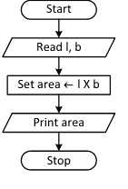

图 3.8

计算矩形面积的流程图。

3.8 显示了对应的流程图。

你可以发现上面的示例与 3.4.2 节讨论的示例非常相似。

### 示例 2

编写一个算法找到两个数中的最大数，并画出它的流程图。

### 答案

解决这类问题，我们需要像 `"<"` 或 `">"` 这样的关系运算符，以及 `if-then-else` 类型的决策语句。

通过流程图和算法解决问题

#### 算法 3.3

输入：两个数字 `a` 和 `b`

输出：显示较大的数字，`a` 或 `b`

`BIGGER-AMONG-TWO`

1. 开始

2. 读取 `a`, `b`

3. `if a > b then`

4.   打印 `"a is Big"`

5. `else`

6.   打印 `"b is Big"`

7. `end if`

8. 停止

算法的第 1 和第 2 步不需要解释。在第 3 步中，我们使用 `if-else` 结构比较 `a` 和 `b` 的值。如果语句判断为真，将执行第 4 步；否则将执行第 6 步。在这个算法中，我们使用了 `if-else` 决策控制语句，并且有一个对应的流程图符号，描述在 3.5.2 节中。图 3.9 显示了相应的流程图。

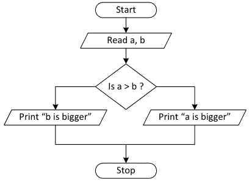

图 3.9

找到两个数中最大数的流程图。

### 示例 3

编写一个算法并画一个流程图来打印书名五次。

### 答案

解决这个问题，我们可以采用两种方法之一。在第一种方法中，我们可以写五个打印语句来打印书名；算法 3.4 显示了此方案的解决步骤。

#### 算法 3.4

输入：不需要输入

输出：显示书名五次

`PRINT-BOOK-NAME`

1. 开始

2. 打印 `"C Programming Learn to Code"`

3. 打印 `"C Programming Learn to Code"`

4. 打印 `"C Programming Learn to Code"`

5. 打印 `"C Programming Learn to Code"`

6. 打印 `"C Programming Learn to Code"`

7. 停止

算法 3.4 是正确的，并按预期产生了结果。但是，如果你被要求打印书名 100 次呢？那么我们需要写 100 次相同的步骤（`Print Programming Learn to Code`），这非常繁琐。因此，替代方案是使用如 `while-do` 或 `for` 这样的控制语句。算法 3.5 和 3.6 分别了使用 `while-do` 和 `for` 的解决方案。图 3.10 显示了正确的。

#### 算法 3.5

输入：不需要输入

输出：显示书名五次

`PRINT-BOOK-NAME`

1. 开始

2. 设置 `i ← 1` // 初始化变量 `i` 的值为 1

3. `while i <= 5 do`

4. 打印 `"C Programming Learn to Code"`

5. 设置 `i ← i + 1` // 增加 `i` 的值

6. `end while`

7. 停止

#### 算法 3.6

输入：不需要输入

输出：显示书名五次

`PRINT-BOOK-NAME`

1. 开始

2. 设置 `i ← 1` // 初始化变量 `i` 的值为 1

3. `for i ← 1 to 5`

4. 打印 `"C Programming Learn to Code"`

5. `end for`

6. 停止

### 示例 4

编写一个算法并画一个流程图计算一个数字各位数字之和。（提示：假设给定数字是 365，那么各位数字之和为 3 + 6 + 5 = 14。）

### 答案

解决上述问题，我们需要三个不同的变量：`N`、`R` 和 `Sum`。`N` 用于存储数字，变量 `Sum` 将保存加法结果。现在问题是如何从给定数字中提取数字。为了做到，我们将使用取余运算符（`%`）并将给定数字除以 10。这将提供最后一位数字。最初，我们将给定数字除以 10 并存储余数用于计算。我们将除法的商作为下一次迭代的输入。继续这样做，当商变为 0 时我们停止。我们将累每次迭代收集的余数得到答案。整个过程如图 3.11 所示。算法 3.7 显示了解决步骤，图 3.12 显示了其对应的流程图。

#### 算法 3.7

输入：一个随机数 (`N`)

输出：给定数字各位数字的相加结果 (`sum`)

`ADD-DIGIT`

1. 开始

2. 读取 `N`

3. 设置 `sum ← 0`

4. `while N != 0 do`

5. 设置 `R ← N % 10`

6. 设置 `Sum ← Sum + R`

7. 设置 `N ← N / 10`

8. `end while`

9. 打印 `sum`

10. 停止

算法需要一个数字作为输入，在这里是 `N`（算法 3.7，第 2 步）。该数字可能由一个或多个数字组成。这将产生 `N` 的所有数字之和 (`sum`)。我们在第 3 步中将 `sum` 初始化为 0，随后算法（使用 `while` 循环迭代）从 `N` 中逐个提取数字并将其加到 `sum` 中。第 4 到第 8 步执行图 3.11 所示的操作。每次迭代都通过条件检查 `N!=0`。当条件变为假时，算法的执行停止。最初，第 5 步从 `N` 中提取一个数字并赋值给 `R`（余数）。第 6 步将第 4 步获得的值加上之前为 0 的变量 `sum`。最后，第 7 步通过将 `N` 除以 10 来减少 `N` 的一个数字。如果你分析这些操作，你会发现如果 `N` 是三位数，那么就需要三次迭代来相加所有数字。同样，四位数需要四次迭代，`n` 位数需要 `n` 次迭代。当条件变为假时，算法执行第 9 步并产生结果。图 3.12 显示了数字的相加。


图 3.10

数字相加的流程图。


图 3.11

数字相加的步骤。

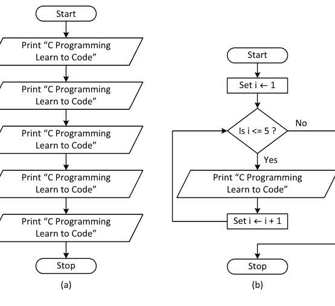

图 3.12

数字相加的流程图。

## 3.7 编程语言基础

根据问题解决阶段（3.2），在开发算法和流程图之后，下一阶段是使用编程语言实现。本节将讨论用于此目的的不同编程语言。

让我们先介绍程序。程序是一组逻辑相关的指令，引导计算机解决问题。编写程序被称为*编程*。

使用标准的编程语言编写程序。编程语言可以分为两类：

- 低级语言

- 高级语言

### 3.7.1 低级语言

计算机无法理解用高级语言给出的指令。计算机只理解 0 和 1 的语言，这正是低级语言。

低级语言有两种类型：

- 机器语言

- 汇编语言

### 3.7.1.1 机器语言

这是以二进制数（0和1）形式写的指令序列，计算机直接对其响应。机器语言是唯一被计算机理解的语言。

指令由两部分组成：

- 操作码 (`OPCODE`)

- 操作数 (`OPERANDs`)

操作码告诉计算机必须执行什么功能，例如加法。操作数是存储操作值的位置。

```
示例
0000 0111 加 A 寄存器值为7
0010 1010 加 B 寄存器值为10
1000 0010 A ← A + B
0111 0110 停止处理
```

#### 优点

执行机器语言编写的程序非常快，因为计算机直接理解指令，不需要翻译。

#### 缺点

- 依赖机器：用户必须了解计算机的内部设计

- 使用困难

- 容易出错

- 难以调试

### 3.7.1.2 汇编语言

在汇编语言的情况下，不使用二进制代码，而是使用助记码。助记码本质上是一种符号表示，或者说它是用于代替二进制代码的字母、数字或特殊字符的组合。

通过流程图和算法解决问题

# 示例

| 指令 | 操作数 | 描述 |
| :--- | :--- | :--- |
| `LDA` | `A, 7` | 将值7加载到寄存器`A` |
| `LDA` | `B, 10` | 将值10加载到寄存器`B` |
| `ADD` | `A, B` | `A ← A + B` |
| `HLT` | | 停止处理 |

机器不能直接执行汇编语言程序，因为它不是二进制形式。在某种程度上，它应该被转换为二进制形式（即机器语言），这是通过汇编器完成的。

汇编器是将汇编语言程序翻译成机器语言程序的程序。用汇编编写的程序称为源代码。汇编器将源程序转换为机器语言程序，机器代码（图3.13）。

#### 优点

1. 与机器级语言相比，更容易使用且更容易理解；

2. 易于发现并纠正错误；

3. 汇编语言的执行效率与机器语言相同，因为它是汇编语言程序与其对应的机器语言程序之间的一一翻译器。

#### 缺点

1. 汇编语言的一个显著缺点是它是依赖机器的。为一台计算机编写的程序可能无法在硬件配置不同的其他机器上运行。

2. 需要一个转换程序将汇编语言程序转换为机器语言程序。

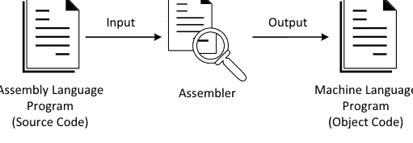

图 3.13

汇编器的工作。

### 3.7.2 高级语言

根据上面的讨论，汇编语言和机器级语言需要对计算机硬件有深入了解，且两种语言都是依赖机器的。高级语言让程序员能够专注于程序逻辑而不是计算机硬件。

56

C语言编程

高级语言简单是一种类似于英语的语言，它使用一些数学符号进行程序构建。这使得程序更容易阅读、理解和操作。高级语言也被称为面向问题的语言，因为这些指令适用于解决问题。与汇编级语言一样，高级语言需要翻译成机器级语言以便计算机理解。因此，为了将高级语言转换为机器级语言，我们需要被称为编译器或解释器的程序。

编译器是将高级语言程序翻译成机器语言程序的程序。用高级语言编写的程序称为源代码。编译器将源程序转换为机器语言程序，即机器代码（图3.14）。

我们今天使用多种高级语言。一些示例包括 C、C++、JAVA、Python、Cobol 和 Fortran。对于每种语言，都有一个编译器将高级代码翻译成机器码（图3.15）。

解释器也是一种将高级语言程序翻译成机器语言程序的程序，但它是一次翻译一行。今天有许多使用的解释型语言，例如 VB、Perl、BASIC。

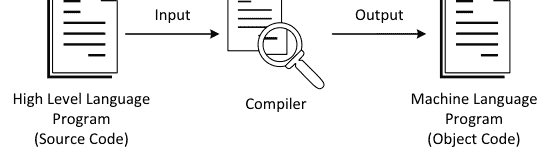

**图 3.14** 编译器的功能。

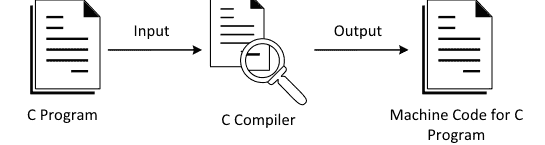

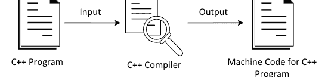

**图 3.15** 针对不同语言的不同编译器。

# 通过流程图和算法解决问题 57

### 3.7.2.1 编译器 vs 解释器

1. 编译器一次性编译整个程序，而解释器一次解释一行；

2. 编译后，编译器会生成错误列表，而解释器会在第一个错误处停止；

3. 使用编译器的程序执行更快，而使用解释器的程序执行速度较慢。

### 3.7.2.2 优点

1. 更容易学习和实现，因为它基于像英语这样的常用语言；

2. 机器无关；

3. 易于发现和修改错误。

## 3.8 复习题

### 3.8.1 选择题

1. 算法依赖于编程语言。对/错？


## 3.8 练习题

### 3.8.1 填空题

- 2. ________ 是一系列在有限时间内解决问题的无歧义指令。
- 3. ________ 是一种图形表示法，显示程序步骤、组织中的人员或演示文稿页面之间的控制流。
- 4. ________ 符号用于指定流程图中的条件。
- 5. 算法开发因人而异。对/错？
- 7. ________ 一次编译整个程序，但一个 ________ 一次解释一行。
- 8. 机器级语言中的指令由两部分组成：________ 和 ________。
- 9. ________ 是一组逻辑相关的指令，按顺序排列并引导计算机解决问题。
- 10. 编写程序的过程称为 ________。

### 3.8.2 练习题

- 1. 写一个算法求圆的面积，并画出对应的流程图。
- 2. 写一个算法计算单利，并画出对应的流程图。
- 3. 写一个算法求三角形的面积并画出对应的流程图。
- 4. 写一个算法计算矩形的面积并画出对应的流程图。
- 5. 写一个算法交换两个数值的值并画出对应的流程图。
- 6. 写一个算法判断数字是偶数还是奇数并画出对应的流程图（提示：数字除以 2，如果余数为 0 则为偶数，否则为奇数）。
- 7. 写一个算法计算三个数的平均值并画出对应的流程图。
- 8. 写一个算法判断学生通过还是不及格并画出对应的流程图。
- 9. 写一个算法找到四个数的最大值并画出对应的流程图。
- 10. 写一个算法交换两个变量的值并画出对应的流程图。
- 11. 写一个算法计算单利并画出对应的流程图。
- 12. 写一个算法判断数字是否为回文数并画出对应的流程图。
- 13. 写一个算法判断数字是否为质数并画出对应的流程图。
- 14. 写一个算法判断数字是否为水德数并画出对应的流程图。
- 15. 写一个算法反转一个数字并画出对应的流程图。
- 16. 写一个算法判断数字是否为完美数并画出对应的流程图。
- 17. 写一个算法计算一个数的平方和并画出对应的流程图。
- 18. 写一个算法计算一个数字的阶乘并画出对应的流程图。
- 19. 写一个算法计算整数的和并画出对应的流程图。
- 20. 写一个算法找到一个数字的所有约数并画出对应的流程图。

### 3.8.3 主观题

- 1. 什么是算法？
- 2. 什么是流程图？
- 3. 算法的特征有哪些？
- 4. 描述流程图中使用的符号。
- 5. 编译器和解释器有什么区别？
- 6. 高级语言和低级语言有什么区别？
- 7. 定义以下术语：
  - a. 程序；
  - b. 汇编器；
  - c. 编译器；
  - d. 解释器。

## 参考文献

- 1. Schneider, G. Michael, and Judith Gersting. Invitation to computer science. Cengage Learning, 2018.

## 4.1 C 语言简介

- C 提供了足够的低级访问，适用于嵌入式系统；
- C 是一种高级语言，允许用较少的精力构建复杂的系统；
- C 的模块化方法适用于大型、多程序员项目；
- C 对库的使用使其适应许多不同的应用领域；
- Unix 操作系统是用 C 语言编写的并支持 C 语言；
- C 诞生了 C++，它被广泛用于应用程序编程，以及最近的基于 C++ 的 Java；
- 许多其他语言借用了 C 的语法：例如 Java、JavaScript 和 Perl。

## 4.2 C 的历史

C 诞生于 1969–1973 年间，与 Unix 操作系统的早期开发并行进行；最具创造性的时期发生在 1972 年。C 语言通常被称为“白书”或“K&R” [1]。最后，在 20 世纪 80 年代中期，该语言被 ANSI X3.11 委员会正式标准化，委员会进行了进一步的修改。直到 20 世纪 80 年代初，尽管已经存在各种机器架构和操作系统的编译器，但该语言几乎专门与 Unix 关联；最近，它的使用范围已变得广泛得多，它是整个计算机行业中最常用的语言之一 [2, 3]。

到 1960 年，许多计算机语言相继问世，几乎都是为了特定目的。例如，COBOL 被用于商业应用，FORTRAN 被用于工程和科学应用。此时，人们开始考虑开发一种可以为所有可能的应用程序编程的通用语言。

在 C 语言开发之前有几种语言。1967 年，Martin Richards 开发了一门名为“基础组合编程语言”（BCPL）的语言。1970 年，Ken Thompson 开发了一门名为 B 的类似语言。最后，在 1972 年，Dennis Ritchie（图 4.1）

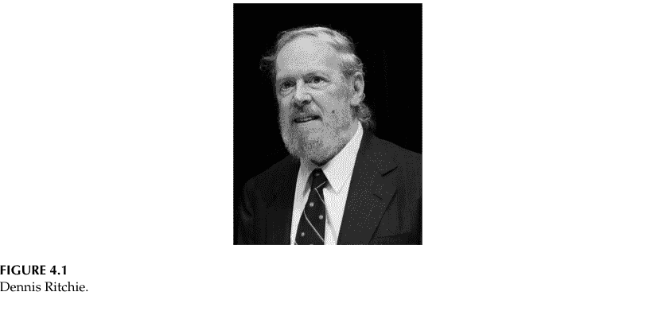

开发了 C，它吸收了 BCPL 和 B 的许多概念，并增加了数据类型概念。

BCPL、B 和 C 在许多细节上语法不同，但广义上它们是相似的。程序由一系列全局声明和函数（过程）声明组成。过程在 BCPL 中可以嵌套。B 和 C 通过实施更严厉的限制避免了这一点：完全没有嵌套过程。

关于这一发展过程的简要总结如下。

1960 年：ALGOL

- 开发者：国际委员会；
- 备注：太通用，太抽象。

1963 年：CPL（组合编程语言）

- 开发者：剑桥大学；
- 备注：难以学习，实现困难。

1967 年：BCPL（基础组合编程语言）

- 开发者：剑桥大学的 Martin Richards；
- 备注：过于特定，只能处理特定问题。

1970 年：B

- 开发者：AT&T 贝尔实验室的 Ken Thompson；
- 备注：过于特定，只能处理特定问题。

1972 年：C

- 开发者：AT&T 贝尔实验室的 Dennis Ritchie；
- 备注：BCPL 和 B 的结合体。

1983 年，美国国家标准协会（ANSI）成立了一个委员会来提供现代、全面的 C 定义。结果——ANSI 标准（或“ANSI C”）于 1989 年完成。ANSI C 有时被称为 C89 标准。1990 年，ISO（国际标准化组织）将 ANSI C 采纳为 ISO/IEC 9899:1990，有时被称为 C90。因此，C89 和 C90 指的是同一个标准。开发并没有止于此；在随后的几年里发布了几个具有新特性的标准。C 标准列表及其标准年份如表 4.1 所示 [4–6]。

| 年份 | C 标准 |
| --- | --- |
| 1972 | C 语言的诞生 |
| 1978 | K&R C |
| 1989/90 | ANSI C (C89)/ISO C (C90) |
| 1999 | C99 |
| 2011 | C11 |
| 2017 | C17 |

## 4.3 执行 C 程序

当任务被分配给程序员时，他/她需要分析该任务、准备算法并绘制流程图来解决给定的任务。下一步是将算法转换为程序并执行以检查结果。本节描述了程序的执行过程。在 C 中开发和执行程序至少需要四个步骤，如图 4.2 所示：

1. 编辑（或编写）程序；
2. 编译它；
3. 链接它（与来自 C 库所需的函数）；
4. 最后，执行它。

### 4.3.1 编辑

你用人类可以理解的词汇和符号编写计算机程序。这是开发周期中的编辑部分。你直接将程序输入到屏幕上的窗口中，并将生成的文本保存为单独的文件。这通常被称为源文件。C 程序存储在扩展名为 `.c` 的文件中。

### 4.3.2 编译

你不能直接执行源文件。要在任何计算机上运行，源文件必须翻译成二进制文件。

### 4.3.3 链接

你不能直接执行源文件。要在任何计算机上运行，源文件必须翻译成二进制文件。

### 4.3.4 执行

你不能直接执行源文件。要在任何计算机上运行，源文件必须翻译成二进制文件。

## 4.4 程序的结构

当任务被分配给程序员时，他/她需要分析该任务、准备算法并绘制流程图来解决给定的任务。下一步是将算法转换为程序并执行以检查结果。本节描述了程序的执行过程。在 C 中开发和执行程序至少需要四个步骤，如图 4.2 所示：

1. 编辑（或编写）程序；
2. 编译它；
3. 链接它（与来自 C 库所需的函数）；
4. 最后，执行它。

### 4.4.1 编辑

你用人类可以理解的词汇和符号编写计算机程序。这是开发周期中的编辑部分。你直接将程序输入到屏幕上的窗口中，并将生成的文本保存为单独的文件。这通常被称为源文件。C 程序存储在扩展名为 `.c` 的文件中。

### 4.4.2 编译

你不能直接执行源文件。要在任何计算机上运行，源文件必须翻译成二进制文件。

### 4.4.3 链接

你不能直接执行源文件。要在任何计算机上运行，源文件必须翻译成二进制文件。

### 4.4.4 执行

你不能直接执行源文件。要在任何计算机上运行，源文件必须翻译成二进制文件。

### 4.4.5 子程序

子程序部分包含在`main()`函数中调用的所有用户定义函数。用户定义函数通常放在`main()`函数之后，尽管它们也可以以任何顺序出现。

### 4.4.6 你的第一个 C 程序

我们从一个简单的 C 程序开始，该程序会在你的计算机屏幕上打印一行语句。代码如程序 4.1 所示，随后是输出结果以及对每行代码的解释。

#### 程序 4.1

```c
1. /* 写一个程序打印一个
2. 语句*/
3. #include<stdio.h> //头文件
4. void main() {
5.     printf("C Programming Learn to Code");
6. } //main函数结束
```

#### 输出

```
C Programming Learn to Code
```

第 1 行和第 2 行：

- 这一行被称为文档行（documentation line）。它也被称为注释行（comment line）。
- 注释是解释程序功能的一种方式。它们被放在 `/*` 和 `*/` 之间。
- 编译器会忽略注释，注释供用户和其他人理解代码使用。
- 你应该始终在程序的顶部放置一个注释，说明程序的功能，因为当你回来查看它时，你可能无法理解它是做什么的，但注释会告诉你。
- 你也可以在代码中使用注释来解释非常复杂的代码。例如，在第 3 行中，我们使用了以 `//` 开头的单行注释来告诉用户它是头文件。同样，在第 7 行中，我们显示了`main`函数的结束。

第 3 行：

- 我们知道 C 程序分为模块和函数。用户编写一些函数，而许多其他函数存储在 C 库中。
- 库函数按类别分组，并存储在一个名为头文件（header file）的不同文件中。
- 如果你想访问头文件的函数，有必要告诉编译器要访问的文件。
- 这是通过使用如下预处理器指令 `#include` 实现的：

```c
#include<fileName>
```

`fileName` 是包含所需函数定义的库文件的名称。例如，此语句中使用了一个名为 `stdio.h` 的头文件，让我们可以使用某些命令。`stdio` 是标准输入输出（standard input/output）的缩写，意味着它包含了输入命令（如从键盘读取）和输出命令（如在屏幕上打印字符串）。

第 4、5 和 7 行：

- `main()` 是一个特殊的函数，告诉计算机程序从哪里开始。每个程序必须恰有一个`main()`。
- 紧跟在`main` 之后的空括号 `()` 表示函数`main`没有参数。
- 左括号 `{`（第 5 行）表示函数`main`函数的开始，右括号 `}`（第 7 行）表示函数的结束。
- 这两个括号 `{}` 之间的所有语句组成了函数体。
- `main` 之前的单词 `void` 表示函数`main`不返回任何内容。
- C 允许`main`函数的多种形式：

```
o main()
o int main()
o void main()
o main(void)
o void main(void)
o int main(void)
```

- 我们在`main`之前指定类型表示函数`main`将返回一个整数值。当指定了`int`时，程序的最后语句必须是 `"return 0"`。
- 括号之间的单词 `void` 表示函数`main`不接受任何参数。

第 6 行：

- 这是 `printf` 命令，它在屏幕上打印文本。
- 要打印的数据在括号内部。
- 此外，注意单词在双引号内，因为它们被称为字符串（string）。
- 每个字母被称为一个字符（character），一组组合在一起的字符被称为字符串。
- 字符串必须始终放在双引号之间。
- 你必须在每个命令后加一个分号，表示该命令的结束。

## 4.5 执行 C 程序的编译器和编辑器

现在我们已经了解了如何使用 C 编写简单的程序，让我们看看执行程序需要什么。我们需要两种软件来在计算机上编写和运行程序。第一种是用于编写程序的编辑器，第二种是检查程序错误的编译器。

### 4.5.1 编辑器

如果你的计算机上没有安装编辑器，可以使用默认编辑器，如记事本（Windows 用户）或 `vi`/`vim` 编辑器（Linux 用户）来输入代码。为了方便起见，你可以在程序中安装任何全功能编辑器，如 MS Studio Code、CodeBlocks、SublimeText 或 Dev++。这些编辑器为你的程序提供了编译和执行的专用按钮，这样你就不需要每次执行代码时都在提示符上输入命令了。

图 4.4 显示了 MS Studio Code 编辑器及其帮助程序员编写有效代码的组件。它是一个适用于 Windows、macOS 和 Linux 的源代码编辑器。你可以在 [7] 中找到该编辑器的其他功能。

### 4.5.2 编译器

如果你是初学者并且第一次学习 C 编程语言，你的首要任务是在你的机器上运行程序 4.1。你可能在考虑使用哪种编译器。

### 4.5.3 Windows

前提条件是你已经在你的机器上安装了 MinGW 编译器，如第 16 节介绍的。你已经使用任何默认文本编辑器（记事本）输入代码并创建了一个程序，将其保存为 `prog41.c`。

- 步骤 1：打开命令提示符并进入 `prog41.c` 文件所在的目录。
- 步骤 2：输入以下命令编译你的程序：

```bash
gcc -o runfile prog41.c
```

在这里，`runfile` 指定了成功编译 `prog41.c` 后生成的可执行文件的名称。除了使用 `runfile`，你也可以使用你喜欢的任何名称。

- 步骤 3：输入以下命令执行你的代码：

```
runfile
```

现在你可以在屏幕上看到输出了。

### 4.5.4 Linux

前提条件相同；`gcc` 编译器是 Linux 机器上的默认编译器，不需要安装。创建一个 C 程序文件，输入你的代码并将其保存为 `prog41.c`。

- 步骤 1：打开终端窗口并进入 `prog41.c` 文件所在的目录。
- 步骤 2：输入以下命令编译你的程序：

```bash
gcc -o exec prog41.c
```

在这里，`exec` 指定了成功编译 `prog41.c` 后生成的可执行文件的名称。除了使用 `exec`，你也可以使用你喜欢的任何名称。

- 步骤 3：输入以下命令执行你的代码：

```bash
./exec
```

现在你可以在屏幕上看到输出了。

我建议读者安装 VS Code 作为编辑器，这样你就不需要每次运行程序时都输入命令。VS Code 适用于 Windows、Linux 或 Mac 等所有环境，且免费。

## 4.6 复习题

### 4.6.1 单选题

- 1. C 语言是在哪一年由谁开发的？
- 2. C 基本上是两种语言的结合，分别是 ________ 和 ________。
- 3. 文档部分包含一组行。
- 4. C 是一种哪种级别的编程语言。
- 5. 每个 C 程序必须有一个 `main()` 函数。对/错？
- 6. 一个程序可以有多少个 `main` 函数？
- 7. `main()` 不返回任何值。对/错？
- 8. C 是哪一年被 ANSI 标准化的？
- 9. 列举至少两个用于运行 C 程序的编辑器。
- 10. 列举至少两个在 C 程序中使用的头文件。

### 4.6.2 简答题

- 1. 对象代码什么意思？
- 2. 为什么需要链接？
- 3. 什么是预处理器指令？
- 4. C 语言中需要头文件？
- 5. `stdio.h` 头文件的用途是什么？
- 6. C 语言中可以嵌套注释吗？如果不可以，为什么？如果可以，如何？
- 7. 在预处理器语句的声明中，`#` 符号指定什么？
- 8. 什么是全局变量？
- 9. 如何在 C 中指定单行和多行注释？
- 10. 编译器和编辑器有什么区别？
- 11. 编写 C 程序时必须包含头文件吗？

### 4.6.3 编程题

- 1. 写一个 C 程序显示你的大学名称和地址。
- 2. 分析以下程序并找到这些程序中的错误。


## 5.4 变量与标识符

C 语言中的变量是命名的内存位置，我们可以在其中存储值，这些值在程序执行过程中会变化或改变。这些内存位置（变量）可以存储整数、字符和实数值。当我们在变量中存储某个值时，之前的值（如果存在）将被删除。

变量是用于存储值的命名的内存位置。

构造变量名的规则：

1. 变量名可以是数字、字符或下划线的任意组合。变量名的第一个字符必须是字母。
2. 变量名内部不允许出现逗号或空格。
3. 变量名不应是关键字（`keyword`）。
4. 我们不能在变量名中使用除下划线（`_`）以外的特殊符号。
5. 大小写区分敏感，例如，变量`Var`与`var`是不相同的。

表 5.3 显示了一些有效和无效的变量名。

什么是命名的内存位置？众所周知，每台计算机都有主内存，在执行程序之前，我们必须为程序中存在的每个变量分配空间。从程序员的角度来看，主内存看起来如图 5.2 所示。

### 表 5.3 有效与无效的变量名

| 有效 | 无效 | 说明 |
| :--- | :--- | :--- |
| `a` | `Basic Salary` | 名称之间不允许有空格 |
| `Total` | `2age` | 变量名不能以数字开头 |
| `Basic_salary` | `void` | 这是一个关键字 |
| `age1` | `sal#` | 不允许下划线外的特殊字符 |
| `sal` | `default` | 这是一个关键字 |

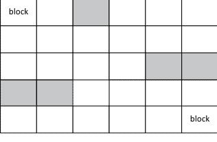

图 5.2 内存段（程序员视角）。

- 程序员假设主内存是块的集合，每个块的长度为 1 字节（8 位）。
- 每个块都有一个地址。
- 为了存储任何内容，我们可能需要连续使用一个或多个块。
- 图 5.2 中的阴影区域表示已分配的块。
- 在存储任何值之前，我们需要用某些标识符为该块命名，以便将来通过其名称来访问它。因此，变量通过其命名的内存位置来标识。

标识符是赋给程序元素的名称，例如变量、函数、数组、结构和其他用户定义对象。适用于变量声明的规则也适用于标识符。所有变量都可以标识符，但并非所有标识符都是变量。

> 标识符是赋给程序元素的名称，例如变量、函数、数组、结构和其他用户定义对象。

我们将在后续章节中看到更多关于标识符的内容。

## 5.5 数据类型

在现实世界中，我们使用不同类型的数据，例如整数、实数和字符。为了存储数据或值，我们需要变量。在上一节中，我们看到在给变量赋值之前，我们必须为它分配一些内存块。现在的问题是，存储一个值需要多少个块？这取决于你准备在那个变量中存储的数据类型。因此，我们必须使用数据类型声明变量，以指示编译器分配所需的块数并为其命名。

C 数据类型大致可分为三类，如图 5.3 所示。在本章中，我们将讨论基本数据类型（Primary）。派生数据类型和用户定义数据类型将在需要时进行讨论。

| 基本数据类型 | 派生数据类型 | 用户定义数据类型 |
| :--- | :--- | :--- |
| 字符 | 数组 | `Typedef` |
| 整数 | 指针 | 结构 |
| 浮点 | 函数 | 枚举 |
| 双精度 | | |
| `Void` | | |

图 5.3 C 语言中的数据类型。

### 5.5.1 基本数据类型

这些也被称为基础数据类型，它们是预定义的，且编译器预先已知。我们使用一些关键字来表示这些数据类型。表 5.4 显示了这些数据类型及其对应的关键字。

当我们想要存储值时，我们使用这些关键字来声明变量。每个基本数据类型都传达了两个关键信息：

1. 它定义了用户想要存储在这些变量中的数据类型；
2. 它指示编译器分配所需的空间来存储这些值。

为每个数据类型分配的空间量与其他不同，并且取决于你使用的平台。例如，如果你使用关键字`char`来声明变量，那么该变量将消耗内存中 1 字节（8 位）的空间，我们可以在其中存储单个字符。C 语言有一种名为`sizeof`的运算符，我们可以用它来获取字节为单位的精确内存分配量。在下一节，我将详细解释每种基本数据类型，并使用它们进行分配和赋值。

### 5.5.2 整数数据类型

整数是具有机器相关范围值的数字。我们使用整数数据类型声明可以存储整数的变量，正负整数没有小数部分。表 5.5 显示了一些整数和非整数的示例。

### 表 5.4 数据类型及其对应的关键字

| 序号 | 数据类型 | 关键字 |
| :--- | :--- | :--- |
| 1 | 整数 | `int` |
| 2 | 字符 | `char` |
| 3 | 浮点 | `float` |
| 4 | 双精度 | `double` |
| 5 | `Void` | `void` |

### 表 5.5 整数和非整数示例

| 整数 | 非整数 |
| :--- | :--- |
| 63 | 75 |
| -95 | 4 |

### 表 5.6 类型修饰符

| 类型 | 关键字 | 说明 |
| :--- | :--- | :--- |
| 有符号 | `signed` | 整数。 |
| 无符号 | `unsigned` | 仅允许正整数。 |
| 长型 | `long` | 取决于机器。 |
| 短型 | `short` | 取决于机器。 |

### 表 5.7 类型空间与范围

| 类型 | 空间 | 最小值 | 最大值 |
| :--- | :--- | :--- | :--- |
| 有符号 | 2 字节 (C++) | -32768 | 32767 |
| 无符号 | 4 字节 (其他) | -2147483648 | 2147483647 |
| 有符号 | 2 字节 (C++) | 0 | 65535 |
| 无符号 | 4 字节 (其他) | 0 | 4294967295 |
| 有符号 | 8 字节 | -9223372036854775808 | 9223372036854775807 |
| 无符号 | 8 字节 | 0 | 18446744073709551615 |

### 5.5.3 浮点类型

浮点数表示实数。为了表示一个浮点数，我们使用关键字`float`。当浮点精度不足时，我们使用`double`。为了扩展精度我们使用`long double`，它消耗 8 字节。表 5.8 显示了这些数据类型的详细信息。

### 表 5.8 浮点类型详细信息

| 序号 | 类型 | 大小（位） | 范围 |
| :--- | :--- | :--- | :--- |
| 1 | `float` | 32 (4 字节) | 3.4e-38 到 3.4e+38 |
| 2 | `double` | 64 (8 字节) | 1.7e-308 到 1.7e+308 |
| 3 | `long double` | 80 (10 字节) | 3.4e-4932 到 1.1e+4932 |

### 5.5.4 字符数据类型

C 语言中的字符是指单引号内的字母、数字或符号。例如，`'a'`、`'5'`、`'6'`和`'&'`表示一个字符常量。为了存储这些字符，我们需要使用`char`关键字声明变量。字符通常以位的形式存储。类型修饰符`signed`或`unsigned`可以明确应用于`char`。无符号字符的值在 0 到 255 之间，而有符号字符的值从 -128 到 127。表 5.9 显示了这些数据类型的详细信息、大小及其范围。

字符在内存中作为 ASCII 值存储。ASCII 代表美国标准信息交换。ASCII 是一种字符编码，为计算机使用的每个字符分配一个数值。例如，`'A'`的 ASCII 值是 65，而小写`'a'`是 97。整个 ASCII 表位于附录 A 中，方便查阅。

### 表 5.9 字符类型详细信息

| 序号 | 类型 | 大小（位） | 范围 |
| :--- | :--- | :--- | :--- |
| 1 | `char`或`signed char` | 8 (1 字节) | -128 到 +127 |
| 2 | `unsigned char` | 8 (1 字节) | 0 到 255 |

### 5.5.5 Void 类型

我们使用`void`类型表示空值集。通常，数据类型`void`用于指定函数的返回类型，或者定义可以持有任何变量地址的指针。这里不是进一步讨论`void`数据类型的地方。

## 5.6 变量声明

在 C 语言编程中，我们需要在程序代码中使用变量之前对其进行声明。正如我们所知，变量表示内存位置，而变量的命名是用户特定的。正如我们在上一节中讨论过的，为了声明一个变量，我们需要数据类型的帮助。语法如图 5.4 所示。

我们需要在使用变量之前声明它，然后才能在程序代码中使用它。

我们应该这样命名变量，使其传达其包含内容的含义。例如，假设我们想在一个变量中存储五个数的平均值，那么我们可以选择像`avg`、`avg_five`或`average`这样的名称。记住，选择有意义的名称并不是强制性条件，而是一种建议。让我们来看一些声明变量的示例（见图 5.5）。

多变量声明通过逗号分隔的列表来指定多个变量（图 5.5b）。变量声明传达了以下信息：

1. 变量名称；
2. 变量所持有的类型；
3. 变量的大小和范围。

现在让我们讨论编译器如何处理这一声明，以及编译器在内存分配中做了哪些更改。讨论是基于图 5.5a 所示的单变量声明语句的。

- 当执行声明行时，编译器分配一个内存块并将其命名为`avg`，如图 5.6a 所示。
- 带有模式的块指定了某些分配的内存块。

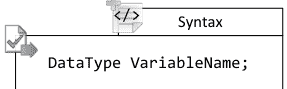

图 5.4 变量的声明。

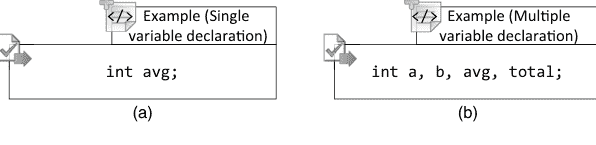

图 5.5 单多变量声明的示例。

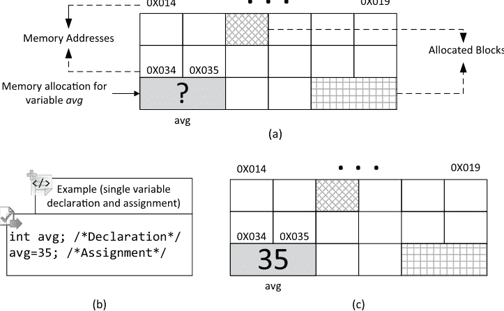

图 5.6 变量声明、赋值和内存分配。

- 每个块都有一个以`0X`开头的地址。图中显示的地址是虚构的，与实际地址不同。
- 由于一个整数占用两个字节（我们假设每个块存储一个字节的信息），因此为`avg`分配了两个块，地址为`0X34`、`0X35`。
- 分配块内部问号表示尚未给`avg`赋值。由于没有赋值，它被称为未初始化变量。

图 5.6 显示了当我们给`avg`赋值时会发生什么。要进行赋值，我们需要赋值运算符（`=`），代码如图 5.6b 所示。被`/*`和`*/`包围的行是注释行，编译器在执行执行期间会忽略这些行。我们使用这些行是为了文档记录。变量声明可以有多种形式。我们可以将声明行和赋值行合并成单行。我们也可以给变量赋值一个表达式。图 5.7 显示了变量声明和赋值可能的所有表示类型。

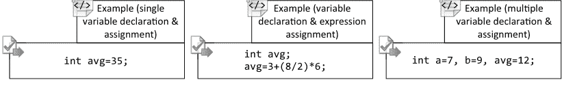

图 5.7 不同类型的变量声明和赋值。

## 5.7 常量

常量表示一个不改变的值。我们可以使用变量来存储常量，也可以直接在表达式中使用常量。注意，变量是赋予内存位置的名称。

例如，观察以下表达式：

```
3x + 2y = 38
```

这里：

- 值 3、2 和 38 是常量，而`x`和`y`是变量；
- 如果你考虑图 5.6 所示的示例，`avg`是变量，值 35 是赋值给`avg`的常量。

我们可以使用几种类型的常量，在 C 语言编程中，常量的分类如图 5.8 所示。

### 5.7.1 整数常量

这些表示包含一组数字的整数值。以下几点解释了整数常量更详细的表示：

- 整数常量必须至少有一个数字；
- 它不能有小数点；
- 它可以是正的也可以是负的；
- 如果整数常量前面没有符号，则假设它为正数；
- 整数常量内部不允许存在空格。

示例：`435`、`76`、`+98`、`-43`、`789`。

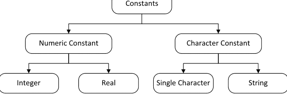

图 5.8 C 语言中的常量。

### 5.7.2 实数常量

实数常量也称为浮点常量。它们表示包含小数点的值。表示实数常量的方法有两种：

1. 分数形式；
2. 指数计数形式。

### 5.7.3 分数形式

- 实数常量必须至少有一个数字。
- 它必须有一个小数点。
- 它可以是正的也可以是负的。
- 默认符号为正。

示例：`32.46`、`-56.9`。

### 5.7.4 指数形式

在这种情况下，实数常量由两部分表示：

- `e`之前的部分称为尾数。
- `e`之后的部分是指数。

示例：`3.2e+5`。

### 5.7.5 字符常量

字符常量是用单引号括的单个字符。

示例：`'a'`、`'5'`。

### 5.7.6 字符串常量

字符串是用双引号括的字符序列。

示例：`"program"`、`"23"`。

## 5.8 示例

在本节中，我们将介绍一些在 C 中使用变量和常量的示例。第一个示例展示了如何声明变量并打印值。

```c
#include <stdio.h>

void main() {
    int code;
    code = 35;
    printf("Code = %d", code);
}
```

## 练习

1. 写一个程序打印单条语句：

```c
/* 写一个程序打印单条语句 */
#include<stdio.h> // Header File
void main() {
    printf("C Programming Learn to Code");
} // End of main function
```

2. 以下哪个程序是正确的？请分析每个选项：

- (b) 
```c
/* 写一个程序打印单条语句 */
#include<stdio.h> // Header File
void main()
{
    printf("C Programming Learn to Code")
}
```

- (c) 
```c
/* 写一个程序打印单条语句 */
#include<stdio.h> // Header File
void main()
{
    printf("C Programming Learn to Code")
} // End of main function
```

- (d) 
```c
/* 写一个程序打印单条语句 */
#include<stdio.h> // Header File
void main()
{
    //printf("C Programming Learn to Code")
} // End of main function
```

- (e) 
```c
/* 写一个程序打印单条语句 */
#include<stdio.h> // Header File
void main(void)
{
    printf("C Programming Learn to Code")
} // End of main function
```

- (f) 
```c
/* 写一个程序打印单条语句 */
#include<stdio.h> // Header File
int main()
{
    printf("C Programming Learn to Code")
    return 0;
} // End of main function
```

3. 运行以下程序时会产生什么输出？

```c
/* 写一个程序打印单条语句 */
#include<stdio.h> // Header File
void main()
{
    printf("Incredible Country")
    printf(" Great Country")
    printf(" I love my Country")
} // End of main function
```

4. 在你的计算机上执行以下两个程序并分析输出的差异。

```c
/* 写一个程序打印单条语句 */
#include<stdio.h> // Header File
void main()
{
    printf("Incredible Country")
    printf(" Great Country")
    printf(" I love my Country")
} // End of main function
```

```c
/* 写一个程序打印单条语句 */
#include<stdio.h> // Header File
void main()
{
    printf("Incredible Country")
    printf(" Great Country")
    printf(" I love my Country")
} // End of main function
```

### 4.6.4 问答题

1. 变量类型
2. 优势
3. 语言结构
4. 语法
5. 语法
6. 编译器
7. 语言
8. 语言
9. 语言
10. 语言

## 参考文献

1. Ritchie, Dennis M.
2. Ritchie, M., C.
3. Stroustrup, Bjarne.
4. ......
5. ......
6. ......
7. Ritchie, Dennis M.
8. ......
9. https://code.visualstudio.com/


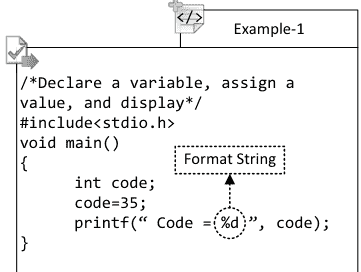

图 5.9 显示变量值的简单程序。

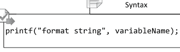

图 5.10 `printf` 函数的语法。

表 5.10 数据类型的格式字符串列表

| 序号 | 数据类型 | 格式字符串 |
|---|---|---|
| 1 | `int` | `%d` 或 `%i` |
| 2 | `char` | `%c` |
| 3 | `float` | `%f` |
| 4 | `double` | `%lf` |
| 5 | `short int` | `%hd` |
| 6 | `long int` | `%ld` 或 `%li` |
| 7 | `signed int` | `%hi` 或 `%hd` |
| 8 | `unsigned int` | `%u` |
| 9 | `signed short int` | `%hi` |
| 10 | `unsigned short int` | `%hu` |
| 11 | `unsigned long int` | `%ld` 或 `%li` |
| 12 | `unsigned long int` | `%lu` |
| 13 | `long double` | `%Lf` |
| 14 | `long` | `%lld` 或 `%lli` |
| 15 | `unsigned long long` | `%llu` |
| 16 | `Octal` | `%o` |
| 17 | `Hexadecimal` | `%x` 或 `%X` |
| 18 | `String` | `%s` |

我们正在使用的数据类型。对于每种数据类型，都有一个独立的格式字符串。所有数据类型的格式字符串如表 5.10 所示。

在上面的程序中，我们给变量 `code` 赋值了一个数字。我们也可以让用户输入任何数字。我们可以通过使用 `scanf()` 函数来实现（见图 5.11a）。

- 格式字符串包含所接收数据的格式；
- 变量名前的取地址符号 `&` 是一种用于指定变量地址的运算符。

图 5.11b 显示了一个示例。当编译器遇到此语句时，执行停止，编译器等待输入一个整数值。`%d`

90

# C语言编程

```c
/*声明变量，读取一个值并显示它*/

#include<stdio.h>

void main() {

    int code;

    printf("Enter an integer:\n");

    scanf("%d", &code);

    printf(" Code = %d ", code);

}
```

使用 `scanf()` 的示例-1

图 5.12

重写示例 1 以从用户获取输入并显示。

`%d` 表示输入的值必须是整数。当我们输入一个值时，它会自动赋值给变量 `code`。

现在我们重写上面的代码（示例 1），其中程序员必须声明一个整数类型的变量，使用 `scanf()` 函数从用户处读取数据并在屏幕上显示。图 5.13 显示了代码。

### 示例 2

让我们来看另一个两个数字的例子。程序员必须声明三个变量：两个用于存储数字的变量，第三个变量用于存储相加的结果。我们的程序必须提供输入用户任何任意数字的功能，并最终在屏幕上显示结果。图 5.13 显示了 C 代码。

```c
/*两个数相加*/

#include<stdio.h>

void main() {

    int n1, n2, Res;

    printf("Enter the first number:\n");

    scanf("%d", &n1);

    printf("Enter the second number:\n");

    scanf("%d", &n2);

    Res=n1+n2;

    printf(" Addition Result = %d ", Res);

}
```

示例-2

我们可以将这 4 行合并并写为 2 行

```c
printf("Enter the two numbers:\n");

    scanf("%d", &n1, &n2);
```

图 5.13

示例 2：两个数相加。

## 5.9 转义序列

转义序列是用于格式化的特殊字符。它们在代码中通过其特殊的反斜杠后跟一个执行特定任务的字符来被识别。特殊的打印字符用于在向屏幕、文件或其他设备上打印字符时使输出具有可读性。

让我们看一个示例来向你展示转义序列的重要性（参见代码以及图 5.14 中对应的输出）。当我们执行此代码时，输出将如下所示。如果你观察输出，所有内容显示在单行中，句子之间没有空格。

如果我们想要信息显示在多行中，那么有一个转义序列 `\n`。使用它，我们可以在多行上显示内容。我们将重写上面的代码（图 5.14），如图 5.15 所示。

C 编译器支持多种转义序列。表 5.11 显示了所有这些转义序列的列表及其含义。鼓励读者至少写一个编程示例，以理解这些转义序列的工作原理。

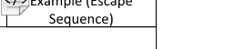

```c
/*转义序列示例*/

#include <stdio.h>

void main() 

{

    printf("C Programming");

    printf("Learn to Code");

    printf("A book for beginners");

}
```

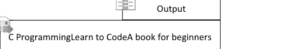

图 5.14

理解转义序列的重要性。

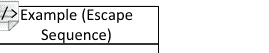

```c
/*转义序列示例*/

#include <stdio.h>

void main() 

{

    printf("\nC Programming");

    printf("\nLearn to Code");

    printf("\nA book for beginners");

}
```

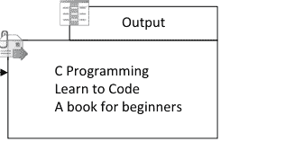

图 5.15

使用转义序列格式化输出。

92

C语言编程

## 表 5.11

转义序列及其含义

| 序号 | 转义序列 | 名称 | 含义 |
| --- | --- | --- | --- |
| 1 | `\a` | 警报 | 产生听觉或视觉上的警报 |
| 2 | `\b` | 退格 | 将光标后移动一个位置（非破坏性） |
| 3 | `\f` | 换页 | 将光标移动到下一页的第一位置 |
| 4 | `\n` | 换行 | 将光标移动到下一行的第一个位置 |
| 5 | `\r` | 回车 | 将光标移动到当前行的第一个位置 |
| 6 | `\t` | 水平制表 | 将光标移动到下一个水平制表位置 |
| 7 | `\v` | 垂直制表 | 将光标移动到下一个垂直制表位置 |
| 8 | `\'` | | 产生单引号 |
| 9 | `\"` | | 产生双引号 |
| 10 | `\?` | | 产生问号 |
| 11 | `\\` | | 产生单个反斜杠 |
| 12 | `\0` | | 产生一个空字符 |

## 5.10 复习题

### 5.10.1 单选题

1. C 语言中根据 C89 标准提供了可用的关键字。
2. 标识符是存储值的内存位置，在程序执行过程中会变化。
3. 整数变量的范围是 2 字节。
4. 字符变量占用 1 字节。
5. `%d` 用作整数变量的格式字符串。
6. 所有的标识符都是变量。

### 5.10.2 编程题

1. 写一个计算三个数平均数的程序。
2. 写一个计算矩形面积的程序。
3. 写一个计算简单利息的程序。
4. 写一个计算直角三角形面积的程序。
5. 写一个交换两个数的程序。
6. 写一个不使用第三个变量交换两个数的程序。
7. 写一个查找字符 `'g'` 的 ASCII 值的程序。
8. 写一个使用 `float` 和 `double` 变量计算两个浮点数乘积的程序。
9. 预测以下代码的输出或找出错误：

```c
#include<stdio.h>

void main() {

    int goto=25;

    printf("%d", goto);

}
```

```c
#include<stdio.h>

void main() {

    int Float=25;

    printf("%d", Float);

}
```

```c
#include<stdio.h>

void main() {

    int basic;

    printf("%d", sizeof(basic));

    printf("%d", sizeof(int));

}
```

```c
#include<stdio.h>

void main() {

    unsigned int basic=25;

    printf("%u", basic);

}
```

17 常数、变量和数据类型

```c
#include<stdio.h>

void main() {

    char symbol='p';

    printf("%d", symbol);

}
```

```c
#include<stdio.h>

void main() {

    char symbol='p';

    printf("%c", symbol+5);

}
```

```c
#include<stdio.h>

void main() {

    int x;

    x=printf("Program");

    printf("%d", x);

}
```

```c
#include<stdio.h>

void main() {

    printf("%d", printf("C Programming"));

}
```

```c
#include<stdio.h>

void main() {

    int a;

    printf("%d", a);

}
```

```c
#include<stdio.h>

void main() {

    printf("%d", printf("C Programming")+5);

}
```

118 # C语言编程

```c
#include<stdio.h>

void main() {

    int a=5;

    int a=7;

    int a=9;

    printf("%d",a);

}

#include<stdio.h>

void main() {

    int a=327;

    printf("%d",printf("%d",a));

}
```

### 5.10.3 简答题

1. 什么是变量？构造变量名的规则是什么？
2. 变量和标识符之间的区别是什么？
3. 什么是关键字？
4. 什么是常量？C 中有哪些类型的常量？
5. C 是一种强类型语言。请证明。
6. 写出 `printf()` 和 `scanf()` 函数的语法。
7. 什么是转义序列？用适当的编程示例说明转义序列的需求。
8. 声明和初始化的区别是什么？用示例说明。
9. 关于 (a) 关键字、(b) 格式字符串、(c) 标识符 写简短说明。
10. 什么是预处理器指令？预处理器指令的作用是什么？

# 6 运算符和表达式

## 6.1 引言

本章将讨论任何编程语言中最重要的部分：运算符和表达式。运算符是告诉计算机执行特定数学或逻辑操作的符号。运算符用于程序中处理数据和变量。C 语言拥有丰富的内置运算符。

| 运算符是告诉计算机执行特定数学或逻辑操作的符号。 |

运算符可以是二元的或一元的。二元运算符是作用于两个操作数的运算符。例如：

```
12+14
```

在这个示例中，运算符 `+` 作用于两个操作数 `12` 和 `14`。因此 `+` 在这里是二元运算符。同样，一元运算符有一个运算符和一个操作数。例如：

```
-25
```

在这个示例中，运算符 `–` 作用于一个操作数 `25`。因此 `–` 在这里是一元运算符。以下是 C 中使用的运算符。这些运算符可以作为二元或一元运算符。

1. 算术运算符；
2. 关系运算符；
3. 赋值运算符；
4. 逻辑运算符；
5. 自增或自减运算符；
6. 条件运算符；

# C 语言编程

7. 位运算符；
8. 特殊运算符。

在接下来的章节中，我们将讨论所有这些运算符的特征、如何构成表达式、它们如何执行以及执行顺序。最后，我们将介绍运算符的优先级。

完成本章后，学生将学习不同运算符的工作原理、运算符的优先级以及 C 编译器执行表达式的方式。一些新运算符如自增、自减、三元运算符和其他特殊运算符也是本章的一部分。

## 6.2 算术运算符

我们都知道什么是算术运算符，C 语言支持所有这些运算符，只是在除法和取模运算符上略有不同。表 6.1 显示了算术运算符的完整列表及其符号。

我们知道这些运算符产生的结果。为了完整起见，图 6.1 显示了这些算术运算符的结果。你可以观察到除法操作返回商，而取模运算符返回余数。

## 表 6.1

| 序号 | 运算符名称 | 符号 |
|---|---|---|
| 1 | 加法 | `+` |
| 2 | 减法 | `-` |
| 3 | 乘法 | `*` |
| 4 | 除法 | `/` |
| 5 | 取模（余数） | `%` |

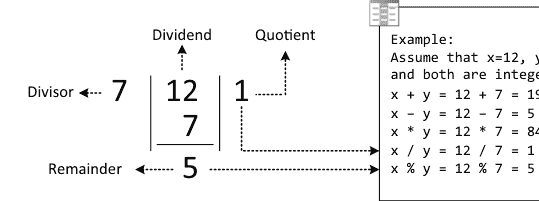

图 6.1

算术操作。

## 运算符与表达式

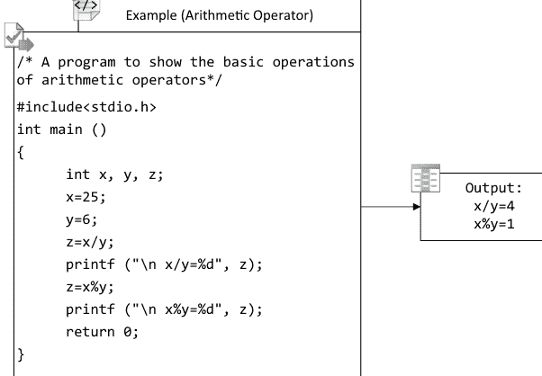

```c
/* 一个显示算术运算符基本操作的程序*/

#include<stdio.h>

int main () {

    int x, y, z;

    x=25;

    y=6;

    z=x/y;

    printf("\n x/y=%d", z);

    z=x%y;

    printf("\n x%%y=%d", z);

    return 0;

}
```

**图 6.2** 显示算术运算符的 C 程序。

让我们写一个示例程序显示除法和取模操作的结果。图 6.2 显示了 C 程序代码。你可以看到，当 25 除以 6 时，我们得到 4（商），当我们执行取模操作时，得到余数，即 1。

## 6.3 关系运算符

在某些情况下，我们需要比较两个值并做出决策。C 语言提供了几个比较运算符来实现此目的。这些运算符的作用是比较两个项目是否相等、不相等，或者一个是否大于/小于另一个。

- 这些是二元运算符，作用于两个操作数；
- 这些运算符的结果是“真”`true`或“假”`false`；
- 如果比较结果为真，则返回 1，否则返回 0。

表 6.2 显示了供参考的关系运算符完整列表及其符号。对于初学者来说，这些符号可能看起来陌生，但它们与数学运算符具有相似的含义。

双等运算符 (`==`) 检查两个操作数的相似性。例如，如果 `a=5` 且 `b=5`，那么 `a==b` 返回 1，这意味着两者都包含相同的值。同样，对于 `a` 和 `b` 的值，`a!=b` 返回 0。让我们通过一些编程示例（图 6.3）来理解这些关系运算符的使用和特征。

## 表 6.2

关系运算符

| 序号 | 关系运算符名称 | C 语言中的符号 | 相似的数学符号 |
|---|---|---|
| 1 | 小于 | `<` | `<` |
| 2 | 大于 | `>` | `>` |
| 3 | 小于等于 | `<=` | `≤` |
| 4 | 大于等于 | `>=` | `≥` |
| 5 | 不等于 | `!=` | `≠` |
| 6 | 等于（相似） | `==` | |

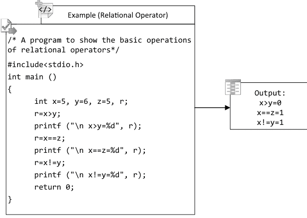

图 6.3

显示关系运算符操作的程序。

# 102

# C语言编程

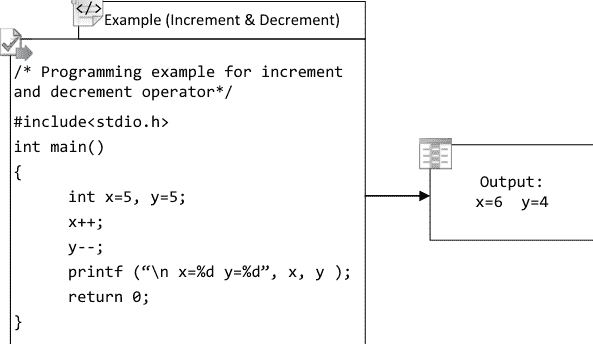

```c
/* Programming example for increment and decrement operator*/

#include<stdio.h>

int main() {

    int x=5, y=5;

    x++;

    y--;

    printf("\n x=%d y=%d", x, y );

    return 0;

}
```

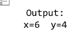

**图 6.7**
显示自增和自减运算符的程序。

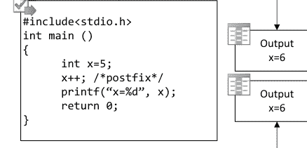

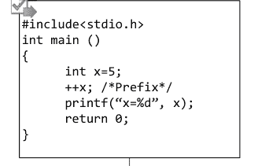

**图 6.8**
独立执行的自增或自减运算符。

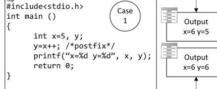

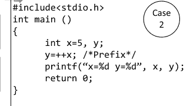

**图 6.9**
与变量 `y` 结合执行的自增和自减运算符。

# 运算符与表达式

```c
#include <stdio.h>

int main () {

    int x=5, y=5;

    printf("%d", ++x);

    printf("%d", y++);

    return 0;

}
```

```c
#include <stdio.h>

int main () {

    int x=5, y=5;

    printf("%d %d", ++x, x);

    printf("%d %d", y, y);

    return 0;

}
```


## 图 6.10 测试题

情况 1（`y=x++`）：由于它是后置运算符，首先将 `x` 的值赋给 `y`，然后 `x` 增加 1。因此 `y = 5`，`x = 6`。

情况 2（`y=++x`）：由于它是前置运算符，首先 `x` 增加 1 变为 6，然后将增加后的 `x` 的值赋给 `y`。因此，`y = 6` 且 `x = 6`。

自减运算符的使用方式类似，只不过 `x` 和 `y` 的值是减少的。

测试题：分析图 6.10 中的程序并找出输出结果。

## 6.7 条件运算符

条件运算符也称为三元运算符，因为它有两个运算符并可以接受三个操作数。条件运算符的一般形式如图 6.11(a) 所示。

在上述语法中，`?` 和 `:` 是两个运算符，`Expression1`、`Expression2` 和 `Expression3` 是操作数。通常，`Expression1` 是一个条件。如果条件为真，则执行 `Expression2`，否则执行 `Expression3`。让我们使用一些编程示例来理解条件运算符的工作原理。图 6.12 显示了第一个示例：找出两个数中较大的一个。

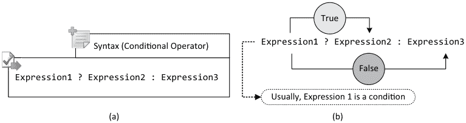

图 6.11
(a) 条件运算符的语法；(b) 条件运算符的工作原理

104

# C语言编程

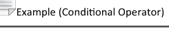

```c
/* A program to show the working of conditional
operators */
#include<stdio.h>

int main ()
{
    int a=5, b=10;
    a>b ? printf("a is big") : printf("b is big");
    return 0;
}
```

```
Output:
b is big
```

**图 6.12**
使用条件运算符寻找两个数中的较大。

在这个示例中，`a > b` 代表一个条件，因为 5 并不大于 10，所以它是假的。因此，执行了 `printf("a is big")`。因此，输出是：`b is big`。

让我们以图 6.13 所示的不同方式编写相同的程序。在这个示例中，首先执行条件 `a > b`，然后编译器做出决定。由于 `a > b` 为假，返回 `b` 的值并赋给 `c`。因此，`c` 的值为 10。在下一行中，打印 `c` 的值，即为较大的数。图 6.14 显示了工作原理。

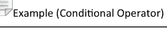

```c
/* A program to show the working of conditional
operators */
#include<stdio.h>

int main ()
{
    int a=5, b=10, c;
    c=a>b ? a : b;
    printf("The bigger number is=%d",c);
    return 0;
}
```

```
Output:
The bigger number is=10
```

**图 6.13**
使用条件运算符寻找两个数中的较大（另一种方式）。


**图 6.14**
图 13 中示例的执行。

# 运算符与表达式


```c
/* A program to show the working of conditional operator */
#include <stdio.h>

int main () {
    int a=12, b=15, c=6;
    ans=(a > b) ? (a > c ? a : c) : (b > c ? b : c);
    printf("Answer=%d);
}
```

图 6.15
嵌套条件运算符示例。


图 6.16
图 15 中示例的执行。

# 6.7.1 嵌套条件运算符

条件运算符可以嵌套，即我们可以在一个语句内声明另一个条件语句。通过编程示例很容易地看到这一点。图 6.15 显示了一个使用嵌套条件运算符的示例。根据 `a` 和 `b` 的值，变为假，因此执行图 16 所示的假部分。再次 `b > c` 为真，因此将返回 `b` 并赋给变量 `ans`。因此，输出将是 `b`。

## 6.8 位运算符

二进制系统中的每个数字被称为位（bit），即 0 或 1。正如名称所示，计算机使用位运算符对二进制数进行操作。C 语言提供了位运算符；表 6.6 显示了它们的符号和含义。

# 表 6.6
位运算符

| 序号 | 运算符符号 | 含义 |
|---|---|---|
| 1 | `&` | 位与 |
| 2 | `|` | 位或 |
| 3 | `^` | 位异或 |
| 4 | `~` | 取反 |
| 5 | `<<` | 左移 |
| 6 | `>>` | 右移 |

# 6.8.1 位与、或、异或

与逻辑运算符类似，位与遵循相同的真值表并需要两个操作数。但它们的工作方式不同——前者作用于任何值并返回 0 或 1，后者则将值转换为对应的二进制数并按位执行与操作。让我们来看一个示例（图 6.17）展示它们之间的区别。

```c
/* Example-Logical AND */
#include<stdio.h>

int main () {
    int c;
    c=12&&23;
    printf("%d", c);
    return 0;
}
```

```c
/* Example-Bitwise AND */
#include<stdio.h>

int main () {
    int c;
    c=12&23;
    printf("%d", c);
    return 0;
}
```

工作
`c=12&23`
`c=1 & 1`
在这里，12 和 23 都代表真值。事实上，非零值都被视为真值。

工作
`c=12&23`
步骤 1：将每个操作数转换为对应的二进制。
12 的二进制：1100
23 的二进制：10111

假设要求你找到以下操作的 `c` 值：
`c=12&0`
这将按如下方式执行：
`c=12&0`
`c=0`
在这里 12 被视为 0 和假，因此 `c=0`

步骤 2：按位执行与操作
01100
10111
00100

步骤 3：将结果转换为对应的整数。
对于此结果，它是 4。

# 图 6.17
显示逻辑与运算符与位与运算符区别的示例。

# 运算符与表达式

表 6.7
异或真值表

| A | B | A^B |
|---|---|---|
| 0 | 0 | 0 |
| 0 | 1 | 1 |
| 1 | 0 | 1 |
| 1 | 1 | 0 |

```c
#include<stdio.h>

int main () {
    float a=7.5, b=8.6; c=a&&b; // 修复缺失的变量 c
    printf("%f", c);
    return 0;
}
```

```c
#include<stdio.h>

int main () {
    float a=7.5, b=8.6; c=a&&b;
    printf("%f", c);
    return 0;
}
```

```c
#include<stdio.h>

int main () {
    char a='y', b='z'; c=a&b;
    printf("%c", c);
    return 0;
}
```

图 6.18
测试题。

同样，对于或和异或运算符，工作原理是相同的。鼓励学生修改上述程序并检查或和异或运算符。异或运算符按照表 6.7 所示的方式工作。当两个输入相同时，输出将为 0，否则为 1。

**测试题：**当你执行图 6.18 中的程序代码时，你会得到什么输出或结果？

# 108 C 语言编程


图 6.19 补码运算符示例。

| b1 | b2 | b1 | b0 | | 0 | 0 | 0 | =0 | 1 | 0 | 0 | =-8 |
|---|---|---|---|---|---|---|---|---|---|---|---|---|
| 符号位 | | | | | 0 | 0 | 1 | =1 | 1 | 0 | 1 | =-7 |
| (a) | | | | | 0 | 1 | 0 | =2 | 1 | 1 | 0 | =-6 |
| | 1 | 0 | 1 | +5 | 0 | 1 | 1 | =3 | 1 | 1 | 1 | =-5 |
| 反码 | | | | | 1 | 0 | 0 | =4 | 1 | 0 | 0 | =-4 |
| | 1 | 0 | 0 | | | 1 | 0 | 1 | =5 | 1 | 0 | 1 | =-3 |
| + | | | | | 1 | 1 | 0 | =6 | 1 | 1 | 1 | =-2 |
| | 0 | 1 | 0 | =-5 | 0 | 1 | 1 | =7 | 1 | 1 | 1 | =-1 |
| (b) | | | | | | (c) |

图 6.20 补码表示。

- 为了表示正数，我们只需将其转换为等效二进制数；
- 为了表示负数，我们首先将数字转换为二进制形式，然后应用补码；
- 要找到补码，在数的反码上加 1。

图 6.20b 显示了 -5 的表示。首先，我们找到 5 的二进制等效值，在四位下为 0101。然后翻转所有位（1 变 0，0 变 1）得到反码（即 1010）。最后，在反码上加 1 得到结果——补码，即 1011。因此，-5 在补码表示中表示为 1011。图 6.20c 显示了使用补码表示法四位可以表示的范围。完整范围是从 -8 到 +7，其中 0 只有一种表示。通常情况下，如果给出一个 n 位字，则范围将从 `– (2ⁿ⁻¹)` 到 `+(2ⁿ⁻¹ – 1)`。

现在我们理解了补码表示的概念，让我们看看图 6.19 所示示例的运行情况。假设我们的系统使用 16 位来表示一个数字。在示例 1 中，`d` 的值被赋值为 `~5`。因此，编译器首先将该数字转换为等效的 16 位数：

- 16 位二进制表示的 5：

```
0 0 0 0 0 0 0 0 0 0 0 1 0 0 1
```

- 然后编译器翻转按位以找到其反码，结果为：

```
1 1 1 1 1 1 1 1 1 1 1 0 1 1 0
```

通过观察符号位，我们可以很容易判断它是一个负数。如果你仔细分析，会发现它是 -6 的补码表示。因此，输出结果为 -6。

同样，对于示例 2，字符 `c` 被赋值为“A”，而 A 的 ASCII 值为 65。因此，编译器首先将 65 转换为等效的 16 位数：

- 16 位二进制表示的 65：

```
0 0 0 0 0 0 0 0 1 0 0 0 0 0 0 1
```

- 然后编译器翻转按位以找到其反码，结果为：

```
1 1 1 1 1 1 1 1 0 1 1 1 1 1 1 0
```

- 通过观察符号位，我们可以很容易判断它是一个负数。如果你对其进行分析，会发现它是 –66 的补码表示。因此，输出结果为 –66。

> 注意
要轻松找到输出结果，将操作数的值加 1 并改变符号。图 6.19 示例 1 中操作数的值为 5，因此输出将是 `-(5 + 1) = -6`。

## 6.8.4 左移运算符 (`<<`) 和右移运算符 (`>>`)

这是一个二元运算符，作用于两个操作数。右侧的操作数指定左移的位数；将从右侧填充 0。该操作非常简单。让我们举一个例子来理解。

假设 `x = 13`，我们想要执行 `x << 2`。每个位将向左移动两位，并从右侧添加两个 0。图 6.21 展示了这一操作。


图 6.21 二位左移操作。

最高位 (MSB) 将丢弃，并从右侧添加两个 0。通过将 0 位到 15 位转换为十进制等效值，计算出的结果为 52。

> 注意
左移后，MSB 会丢弃；右移后，LSB 会丢弃。用户可以通过乘以 `$2^n$` 来找到左移的结果，其中 `$n$` 是移动的位数。在上面的示例中，`x` 移动了两个位置，相当于乘以 `$2^2$`，结果为 52。为了测试上述概念，让我们写一个程序并检查结果是否正确。取另一个负数示例（图 6.23）。我们知道负数是用补码表示的。为了理解输出结果，我们需要用 16 位表示 -13：

- 16 位表示的 13：
| 0 | 0 | 0 | 0 | 0 | 0 | 0 | 0 | 0 | 0 | 0 | 1 | 0 | 0 | 1 |

- 上述表示的反码：
| 1 | 1 | 1 | 1 | 1 | 1 | 1 | 1 | 1 | 1 | 1 | 0 | 1 | 1 | 0 |

```c
/* 运算符 */
#include<stdio.h>

int main(){
	int a=13;
	printf("Output=%d",a<<2);
	return 0;
}
```


图 6.22 测试左移运算符的程序。

```c
/* 左移运算符 */
#include<stdio.h>

int main ()
{
    int a=13;
    printf("Output=%d",a<<2);
    return 0;
}
```

图 6.23 对负数应用左移的程序。

- 在结果上加 1 得到其补码：
| 1 | 1 | 1 | 1 | 1 | 1 | 1 | 1 | 1 | 0 | 1 | 1 |

最后，-13 的码是 111111110011，这是内存中的实际表示方式。我们将对上述值进行两位左移以找到输出（见图 6.24）。

同样，对于右移运算符，位向右移动。图 6.25 显示了两个编程示例及其输出，这些一目了然。

| MSB | 1 | 1 | 1 | 1 | 1 | 1 | 1 | 1 | 0 | 0 | 1 | LSB | 输入=-13 |
| 15 | 14 | 13 | 12 | 11 | 10 | 9 | 8 | 7 | 6 | 5 | 4 | 3 | 2 | 1 | 0 |
| 1 | 1 | 1 | 1 | 1 | 1 | 1 | 1 | 0 | 0 | 1 | 1 | 0 | 输出=-52 |
| 15 | 14 | 13 | 12 | 11 | 10 | 9 | 8 | 7 | 6 | 5 | 4 | 3 | 2 | 1 | 0 |
| 丢弃 | 添加了两个 0 |

图 6.24 对 -13 进行两位左移操作。

```c
/* 右移运算符 */
#include<stdio.h>

int main() {
    int a=13;
    printf("Output=%d",a>>2);
    return 0;
}
```

输出：
Output=-4

输出：
Output=3

图 6.25 显示右移运算符输出的示例程序。

```c
/* 右移运算符 */
#include<stdio.h>

int main () {
    int a=13;
    printf("Output=%d",a>>2);
    return 0;
}
```

## 6.9 特殊运算符

除了上述运算符外，C 还支持以下一些特殊运算符。这些运算符有多种用途，我们将通过描述这些运算符特征的示例进行讨论。

1. 逗号运算符；
2. `sizeof()` 运算符；
3. `&` 和 `*`；
4. `->`（箭头）和 `.`（点运算符）。

在本节中，我们将讨论逗号运算符和 `sizeof` 运算符。将在需要时讨论其他运算符。

## 6.9.1 逗号运算符

逗号运算符允许在通常只使用一个操作的地方出现两个不同的表达式。逗号分隔的操作数可以链在一起，并按照左到右的顺序求值，最右的值产生表达式的结果。让我们通过一个示例来看（图 6.26）。

如上所述，逗号分隔运算符的执行从左侧开始；最右的值产生结果。在示例 1 中，执行第 2 行时将 10 赋值给 `a`，将 20 赋值给 `b`。执行语句 `a+b`，并将结果 30 赋值给 `c`。同样，在示例 2 中，执行第 2 行时，通过将 `a` 赋值给 `c`、`b` 赋值给 `a`、`c` 赋值给 `b` 来完成交换。图 6.27 展示了玻璃类比以说明交换是如何发生的。

逗号运算符用于在声明期间分隔变量，也用于 `for` 循环。我们将在第 8 章讨论 `for` 循环。


图 6.26
显示使用逗号运算符的示例。

# 运算符与表达式

| c = a | a = b | b = c |


**图 6.27**
使用玻璃杯比喻交换两个数字。


```
Example: sizeof operator
#include<stdio.h>

int main()
{
    int s;
    printf("\n%d", sizeof(float));
    printf("\n%d", sizeof(s));
    printf("\n%d", sizeof('A'));
    return 0;
}
```


**图 6.28** 使用 `sizeof` 运算符。

## 6.9.2 `sizeof` 运算符

`sizeof` 运算符返回操作数在内存中所占用的字节数。操作数可以是变量、常量或数据类型。图 6.28 显示了程序使用 `sizeof` 运算符的方法。学生需要执行此程序并自行分析结果。

## 6.10 表达式

表达式是变量的组合。

## 表 6.8

| 代数表达式 | C 表达式 |
|---|---|
| `a * b - c` | `a * b - c` |
| `(m + n)(x + y)` | `(m + n) * (x + y)` |
| `(abc)` | `a * b/c` |
| `3x2 + 2x + 1` | `3 * x * x + 2 * x + 1` |
| `x/y` | `x/y + c` |

表 6.8 显示了一些 C 表达式的示例。

## 6.10.1 表达式的求值

表达式使用如下形式的赋值语句进行求值：

```
variable = expression
```

- 变量可以是任何有效的 C 变量名；
- 当遇到该语句时，首先对表达式的值，然后替换左侧变量的原值；
- 表达式中使用的变量在尝试求值之前必须赋值；
- 我们在 `=` 的左侧只能写一个变量；例如，表达式 `x = k * i` 是合法的，而 `k *= i` 是非法的。

## 6.10.2 表达式的求值规则

- 首先，括号内的子表达式从左到右求值；
- 如果括号有嵌套，则从最内层的子表达式开始求值；
- 在确定求值子表达式的运算符顺序时，应用优先级规则；
- 当子表达式中出现两个或多个相同优先级的运算符时，应用结合性规则；
- 算术表达式根据优先级规则从左到右进行求值；
- 使用括号时，括号内的表达式具有最高优先级。

## 6.11 类型转换

有时我们需要将表达式的值从一种数据类型转换为另一种数据类型，这被称为类型转换。让我们来看一个示例（图 6.29），它展示了类型转换的概念。

在该程序中，自动类型转换由编译器完成（即从整数到浮点数的转换），这被称为类型转换或强制转换。

C 语言中的类型转换有两种：隐式和显式。

## 6.11.1 隐式类型转换

C 允许在表达式中混合不同类型的常量和变量。C 会自动将任何中间值转换为正确的类型，以便在求值时不丢失任何有效性。这种自动类型转换被称为隐式类型转换。

图 6.30 显示了一个示例。在程序（示例 1）中，`p` 是一个 `float` 类型变量，我们给它赋值 `2.56`。这里 `x` 是一个整数。我们将 `p` 的值赋给 `x`，因此 `p` 的值（即 `2.56`）自动转换为整数 `2`。因此，输出将是 `2`。


图 6.29 类型转换。


图 6.30 隐式类型转换示例。

## C 编程


图 6.31 显式类型转换的语法。


图 6.32 显式类型转换示例。

同样，在示例 2 中，字符变量 `ch` 将 `ch` 的值赋给整数变量 `x`，然后隐式地将字符 `A` 的 ASCII 值（一个整数）赋给 `x`。因此，输出将是 `65`。

## 6.11.2 显式类型转换

经常会出现一种情况，我们希望以不同于自动转换的方式强制进行类型转换。此方法的语法见图 6.31。图 6.32 显示了如何使用该语法显式转换类型的代码。建议学生执行程序并查看结果。

## 6.12 运算符优先级与结合性

优先级帮助我们决定先执行哪个操作。例如，在下面的表达式中，存在多个乘法、除法和其他操作：

```
R=3+5*8/2-6+7/3
```

因此我们需要优先级规则。正如数学中一样，我们遵循规定运算符优先级的 `BODMAS` 规则。C 编程语言中有多种运算符；我们遵循表 6.9 所示的优先级。

## 表 6.9 优先级与结合性

| 运算符 | 类型 | 结合性 |
|---|---|---|
| `0` | 括号（函数运算符） | 从左到右 |
| `[]` | 数组下标 | |
| `->` | 通过对象选择成员 | |
| `*` | 通过指针选择成员 | |
| `++` | 后置自增 | |
| `--` | 后置自减 | |
| `++` | 前置自增 | 从右到左 |
| `--` | 前置自减 | 从右到左 |
| `+` | 一元加 | |
| `-` | 一元负 | |
| `!` | 一元取 | |
| `~` | 一元按位取反 | |
| `(type)` | 强制转换 | |
| `*` | 间接 | |
| `&` | 取地址 | |
| `sizeof` | 计算大小 | |
| `*` | 乘法 | |
| `/` | 除法 | |
| `%` | 取模 | |
| `+` | 加法 | |
| `-` | 减法 | |
| `<<` | 左移 | |
| `>>` | 右移 | |
| `<` | 小于 | |
| `<=` | 小于等于 | |
| `>` | 大于 | |
| `>=` | 大于等于 | |
| `==` | 等于 | |
| `!=` | 不等于 | |
| `&` | 按位与 | |
| `^` | 按位异或 | |
| `&&` | 逻辑与 | |
| `||` | 逻辑或 | |
| `?` | 三目运算符 | |
| `=` | 赋值 | |
| `+=` | 加赋值 | |
| `-=` | 减赋值 | |
| `*=` | 乘赋值 | |
| `/=` | 除赋值 | |
| `%=` | 取模赋值 | |
| `&=` | 与赋值 | |
| `^=` | 异或赋值 | |
| `|=` | 异或赋值 | |
| `<<=` | 左移赋值 | |
| `>>=` | 右移赋值 | |
| `,` | 逗号 | 从左到右 |

## 6.13 复习题

### 6.13.1 单选题

- 1. 在 C 语言中，除法运算返回，而取模运算符返回
- 2. C 中关系运算符的结果是真或假
- 3. 是表达式 `x=x*(y+z)` 的简写。

# 运算符与表达式

# 119

- 4. 在逻辑与（AND）操作中，当两个输入均为 1 时，输出为 _________
- 5. 在逻辑或（OR）操作中，当两个输入均为 0 时，输出为 ________。
- 6. 运算符 `++` 和 `--` 是一元运算符。对/错？
- 7. 条件运算符需要两个运算符：________ 和 ________。
- 8. C 语言中有多少种位运算符？_________
- 9. `~23` 的补码表示为 _________。
- 10. ________ 运算符用于查找任何变量的大小。
- 11. C 语言支持两种类型转换：________ 和 ________。
- 12. 当我们的表达式包含多个操作时，________ 规则有助于决定先执行哪种操作。
- 13. 当我们的表达式包含优先级相同的运算符时，________ 规则有助于决定先执行哪种操作。

## 6.13.2 编程题

- 1. 编写程序，实现摄氏度与华氏度之间的相互转换。
- 2. 编写程序，在给定三边长的情况下计算三角形面积。
  提示：使用 `sqrt()` 函数和 `#include<math.h>`
- 3. 编写程序，在给定底和高作为参数的情况下，计算三角形面积。
- 4. 编写程序，如果用户输入基本工资，津贴（DA）应为基本工资的 50%，房租补贴（HRA）为基本工资的 10%，计算该人的总工资。
- 5. 编写程序，使用条件运算符检查一个数字是偶数还是奇数。
- 6. 编写程序，使用条件运算符找到三个数中的最大。
- 7. 编写程序，从键盘输入四位数。将输入数字的第一位和第四位相加并打印结果。
- 8. 编写程序，实现弧度与角度之间的相互转换。
- 9. 编写程序，检查某年份是否为闰年。使用条件运算符。
  提示：`if year % 400 == 0 || (year % 100 != 0 && year % 4 == 0)` 则该年份为闰年。
- 10. 分析以下程序以找出错误或输出。

```c
#include<stdio.h>
void main()
{
    int a=10,b=20,c;
    c=!(b&a);
    printf("%d%d%d",a,b,c);
}
```

```c
#include<stdio.h>
void main()
{
    int a=5,b=6;
    c=(a>b) && (b==99);
    printf("%d%d%d",a,b,c);
}
```

```c
#include<stdio.h>
void main() {
    int a=5,b=6,c;
    c=(b>a) && (b==99);
    printf("%d%d%d",a,b,c);
}
```

```c
#include<stdio.h>
void main() {
    int a=5,b=6,c;
    c=(b>a) || (b==99);
    printf("%d%d%d",a,b,c);
}
```

```c
#include<stdio.h>
void main() {
    int a=5,b=6,c;
    c=(a>b) || (b==99);
    printf("%d%d%d",a,b,c);
}
```

```c
#include<stdio.h>
void main() {
    int a=5,b;
    b++ + a++ +++;
    printf("%d %d",a,b);
}
```

```c
#include<stdio.h>
void main() {
    int a=5,b;
    b++ + a++ + aaa + ++aaa;
    printf("%d %d",a,b);
}
```

```c
#include<stdio.h>
void main() {
    int a=5,b;
    b++ + a++ + aaa + ++aaa;
    printf("%d %d",a,b);
}
```

```c
#include<stdio.h>
void main() {
    int a=-25,b;
    b++--a + ++aaa - --a;
    printf("%d %d",a,b);
}
```

```c
#include<stdio.h>
void main() {
    int a=-25,b;
    b=<<3;
    printf("%d %d",a,b);
}
```

```c
#include<stdio.h>
void main() {
    int a=-25,b;
    b>>=3;
    printf("%d %d",a,b);
}
```

```c
#include<stdio.h>
void main() {
    int a=6,b=7,c=8,d;
    d=a>b?a:c:b>c?a:c;
    printf("%d",d);
}
```

```c
#include<stdio.h>
void main() {
    int a=5;
    printf("%d",a);
}
```

```c
#include<stdio.h>
void main() {
    int a=5;
    printf("%d%d",a,a);
}
```

## 6.13.3 主观题

- 1. 什么是运算符和操作数？
- 2. 什么是算术、二元和三元运算符？
- 3. C语言支持哪些关系运算符？
- 4. 什么是位运算符？
- 5. 什么是递增递减运算符？
- 6. 什么是条件运算符？
- 7. 什么是嵌套运算符？
- 8. 什么是补码表示？
- 9. 什么是逗号运算符？
- 10. `sizeof` 运算符是什么？
- 11. 什么是类型转换（隐式和显式）？
- 12. 什么是优先级？
- 13. 什么是结合性？
- 14. C 中使用了哪些运算符？

# 7 基本输入输出

## 7.1 引言

每个程序都会接收输入，进行处理并产生输出。到为止，我们遇到了两个函数：`scanf()` 和 `printf()`。本章涉及输入输出函数以及如何使用它们。

C 语言中有大量的函数。它们被分为三类：

- 1. 控制台输入输出函数：这些函数从键盘获取输入并通过显示设备产生输出。图 7.1 显示了这一过程。
- 2. 磁盘或文件输入输出函数：我们通常将文件存储在硬盘上。我们可以从文件中读取或写入数据。将在第 14 章讨论。
- 3. 端口输入输出函数：C语言还提供了其他用于端口的函数，尽管这些超出了本书的范围。

## 7.2 无格式化函数

许多函数属于这一类，我们使用它们从键盘读取单个字符或一串字符。让我们详细讨论这些函数的细节。

# 基础输入/输出

- 1. `getchar()` 函数的格式为：

```
varName=getchar();
```

`VarName` 是一个字符变量。当用户在键盘上输入一个字符时，`getchar()` 函数会扫描该字符并将其赋值给 `VarName`。

- 2. `putchar()` 函数的格式为：

```
putchar(varName);
```

这里的 `varName` 是包含一个字符的字符变量。`putchar()` 函数将变量的值发送到输出单元以便在屏幕上打印。
让我们通过一个例子来解释这两个函数的工作原理。程序 7.1 显示了一个示例，它声明了一个字符变量 `ch`，使用 `getchar()` 函数赋值一个字符，并使用 `putchar()` 函数显示该字符。

## 7.2.2 `gets()` 和 `puts()`

这些函数有助于从标准输入单元（通常是键盘）读取字符串，并将其写入标准输出单元（通常是屏幕）。

- 1. `gets()` 从标准输入设备读取字符串。它接受字符串名称作为参数，并用从键盘输入的字符填充该字符串。

# 程序 7.1

```c
1. #include <stdio.h>
2. #include <conio.h>
3. int main()
4. {
5.     char ch;
6.     printf("Type one Character: ");
7.     ch=getchar();
8.     printf("The typed character is: \ ");
9.     putchar(ch);
10.    return 0;
11. }
```

输出：
`Type one Character: p`
`The typed character is: p`

解释：
第 5 行：将 `ch` 声明为字符。
第 7 行：从键盘读取输入的字符并赋值给 `ch`。
第 9 行：在屏幕上显示 `ch` 中存在的字符。

- 2. `puts()` 将字符串写入标准输出设备。它接受字符串名称并在屏幕上显示所接受的字符串。

程序 7.2 显示了如何使用 `gets()` 和 `puts()` 函数读取和写入字符串的示例。

# 程序 7.2

```c
#include <stdio.h>
#include <conio.h>
int main()
{
    char str[50];
    printf("Type a string [less than 50 characters]: ");
```

输出：
`Type a string [less than 50 characters]: C programming Learn to Code`
`The string typed is: C programming Learn to Code`

解释：
第 5 行：创建一个字符串 `str`，它可以存储 50 个字符并为它们分配内存。`str[50]` 表示一个字符数组。我们将在第 10 章讨论字符数组的概念。现在，只需假设它是一个由 50 个内存块组成的长链，每个块可以存储一个字符。
第 6 行：提示用户输入一个 50 个字符的字符串，因为我们已经为 50 个字符分配了空间。
第 7 行：当用户输入时从键盘读取字符串并赋值给之前分配的内存。
第 8 行：显示“The string typed is:”给用户查看。
第 9 行：显示之前由 `gets()` 函数赋值的 `str` 内容。它从内存中读取整个字符串并将其显示在屏幕上。

## 7.2.3 `getch()` 和 `getche()`

这两个函数将返回最近输入的字符。`getche()` 函数中的“e”意味着它会回显（显示）你输入的字符到屏幕上。相比之下，`getch()` 仅返回你输入的字符而不进行回显。`getch()` 简单地停止程序执行以等待用户按键。实际上它是一个“暂停”并等待用户。程序 7.3 显示了一个简单的程序来说明这些函数之间的区别。

# 程序 7.3

```c
#include<stdio.h>
#include<conio.h>
int main()
{
    char ch;
    printf("\nI am using the function getche() of C");
    printf("\nPlease enter a character: ");
    ch=getche();
    printf("\nEntered character is %c",ch);
    printf("\nI am using the function getch() of C");
    printf("\nPlease enter a character: ");
    ch=getch();
    printf("\nEntered character is %c",ch);
    getch();
    return 0;
}
```


| I am using the function `getche()` of C | 在这种情况下，我们输入了一个字符 |
|---|---|
| Please enter a character:r | `'r'`, 它在屏幕上回显并显示出来。 |
| Entered character is r | |
| I am using the function `getch()` of C | |
| Please enter a character:u | 在这种情况下，我们输入了一个字符 |
| Entered character is u | `'u'` 但它没有在屏幕上回显和显示。 |

**测验：** `getchar()`, `getch()`, 和 `getche()` 之间有什么区别？编写一个程序并分析这些区别。

## 7.2.4 `putch()`

`putch()` 将屏幕上打印一个字符。它与 `putchar` 函数类似，后者也会在屏幕上打印字符。查看程序 7.4，看看它们具有相同的功能。

## 程序 7.4

```c
1. #include<stdio.h>
2. #include<conio.h>
3. void main()
4. {
5.     char ch = 'A';
6.     putchar(ch);
7.     putch(ch);
8. }
```

输出：
AA

## 7.3 格式化函数

格式化函数允许以指定的格式提供输入并获取输出。C 中有两个函数：`printf()` 和 `scanf()`。在本节中，我们将讨论这两个函数支持的不同格式。

### 7.3.1 `printf()` 函数

如所述，`printf()` 函数是 C 中最常用的函数之一。程序 7.5 将帮助你更多地学习 `printf()` 函数。它将两个数字并显示结果。

## 程序 7.5

```c
1. #include <stdio.h>
2. int main()
3. {
4.     int a, b, c;
5.     a = 5;
6.     b = 7;
7.     c = a + b;
8.     printf("%d + %d = %d\n", a, b, c);
9.     return 0;
10. }
```

输出：
5+7=12

解释：
第 4 行：声明了三个变量 `a`, `b`, `c`。
第 5 行：将 `a` 初始化为 5。
第 6 行：将 `b` 设置为 7。
第 7 行：将 `a` 和 `b` 的和赋值 `c`。
第 8 行：打印语句打印“5 + 7 = 12”。打印语句中的 `%d` 占位符充当变量 `a`、`b`、`c` 的占位符。第一个 `%d` 被 `a` 替换，第二个 `%d` 被 `b` 替换，最后一个被 `c` 替换。

## 7.3.2 使用 `printf()` 格式化

`printf()` 函数被称为格式化函数。在这一节中，我们将讨论 `printf()` 函数的一些格式原理。格式化可以应用于任何数据值并帮助我们产生更可读的输出。对于整数格式，我们需要指定如下语法：

`%wd`

在这里，
- `w` 表示输出字段的宽度。然而，如果数字大于指定的字段宽度，它将完整打印。
- `d` 指定要打印的值是一个整数。

例如，如果你想使用 8 个空格显示整数，我们会在打印语句中写 `%8d`。程序 7.6 展示了这一点：

## 程序 7.6

```c
1. #include<stdio.h>
2. int main()
3. {
4.     int x = 123;
5.     printf("Output- 1 %0d\n", x);
6.     printf("Output- 2 %1d\n", x);
7.     printf("Output- 3 %2d\n", x);
8.     printf("Output- 4 %3d\n", x);
9.     printf("Output- 5 %4d\n", x);
10.    printf("Output- 6 %5d\n", x);
11.    printf("Output- 7 %6d\n", x);
12.    printf("Output- 8 %7d\n", x);
13.    printf("Output- 9 %8d\n", x);
14.    printf("Output- 10 %9d\n", x);
15.    return 0;
16. }
```

输出：
Output- 1 123
Output- 2 123
Output- 3 123
Output- 4 0123
Output- 5 00123
Output- 6 000123
Output- 7 0000123
Output- 8 00000123
Output- 9 000000123
Output- 10 000000123

在前四种情况下，123 的显示方式与你通常使用 `%d` 时相同。为什么？123 可以显示的屏幕空格数大于或等于 3。在输出 5 中，我们使用了 `%4d`，因此编译器将创建 4 个空间并通过右对齐显示数字（见图 7.4）。

在输出 6 中，我们使用了 `%3d`，因此编译器将创建 5 个空格并通过右对齐显示数字（见图 7.5）。

与所有输出一样，编译器将根据并在内部创建空间，如图 7.6 所示。

注意：如果你写 `%09d`，程序将在数字本身显示零。在上面的示例中，使用 `%09d` 打印 123 显示为 000000123（见图 7.7）。

## 基本输入/输出

# 131

| | 1 | 2 | 3 | 4 | 5 | 6 | 7 | 8 | 9 |
|---|---|---|---|---|---|---|---|---|---|
| 输出 -1 | 123 显示 | 1 | 2 | 3 | | | | | |
| 输出 -2 | 123 显示 | 1 | 2 | 3 | | | | | |
| 输出 -3 | 123 显示 | | 1 | 2 | 3 | | | | | |
| 输出 -4 | 123 显示 | 1 | | 2 | 3 | | | | | | |
| 输出 -5 | 123 显示 | | | 1 | 2 | 3 | | | | | |
| 输出 -6 | 123 显示 | | | | | 1 | 2 | 3 | | | |
| 输出 -7 | 123 显示 | | | | | | 1 | 2 | 3 | | | |
| 输出 -8 | 123 显示 | | | | | | | 1 | 2 | 3 |
| 输出 -9 | 123 显示 | | | | | | | 1 | 2 | 3 |
| 输出 -10 | 123 显示 | | | | | | | | 1 | 2 | 3 |

图 7.6
程序 7.6 产生输出的分析。

| | 1 | 2 | 3 | 4 | 5 | 6 | 7 | 8 | 9 |
|---|---|---|---|---|---|---|---|---|---|
| 123 显示 | 0 | 0 | 0 | 0 | 0 | 1 | 2 | 3 | |

图 7.7
`%09d` 的分析。

如上所述，所有的对齐默认都是右对齐的。要使其左对齐，我们被迫使用 `-`（减号）。程序 7.7 演示了这一点。

## 程序 7.7

```c
1. #include <stdio.h>
2. int main()
3. {
4.     int x = 12;
5.     int z = 12345;
6.     printf("Output- 1 12 \t displays %%9d\n", x);
7.     printf("Output- 2 12 \t displays %%09d\n", x);
8.     printf("Output- 3 12 \t displays %%-9d\n", x);
9.     printf("Output- 4 12 \t displays %%09d\n", x);
10.    printf("Output- 5 12345 \t displays %%9d\n", z);
11.    printf("Output- 6 12345 \t displays %%09d\n", z);
12.    printf("Output- 7 12345 \t displays %%-9d\n", z);
13.    printf("Output- 8 12345 \t displays %%09d\n", z);
14.    return 0;
15. }
```

输出：

```
Output- 1 12      displays 12
Output- 2 12      displays 00000012
Output- 3 12      displays 12
Output- 4 12      displays 12
Output- 5 12345    displays 12345
Output- 6 12345    displays 000012345
Output- 7 12345    displays 12345
Output- 8 12345    displays 12345
```

对于实数格式化，我们需要按照以下方式指定语法：
`%w.vf`

在这里，
- `w` 表示用于显示值的最小位置数。
- `v` 表示小数点后要显示的数字位数。
- `f` 指定要打印的值是一个实数。

现在，让我们来看一个例子来展示我们将如何使用它（参见程序 7.8）。

## 程序 7.8

```c
1. #include<stdio.h>
2. int main ()
3. {
4.     float x = 3.141592;
5.     printf("Printing-1 3.141592 \t displays %f\n", x);
6.     printf("Printing-2 3.141592 \t displays %%1.1f\n", x);
7.     printf("Printing-3 3.141592 \t displays %%1.2f\n", x);
8.     printf("Printing-4 3.141592 \t displays %%3.3f\n", x);
9.     printf("Printing-5 3.141592 \t displays %%4.4f\n", x);
10.    printf("Printing-6 3.141592 \t displays %%4.5f\n", x);
11.    printf("Printing-7 3.141592 \t displays %%0.3f\n", x);
12.    printf("Printing-8 3.141592 \t displays %%-0.3f\n", x);
13.    printf("Printing-9 3.141592 \t displays %%9.3f\n", x);
14.    printf("Printing-10 3.141592 \t displays %%-9.3f\n", x);
15.    return 0;
16. }
```

## 基本输入/输出

输出：

| Printing-1 | 3.141592 | displays 3.141592 |
| Printing-2 | 3.141592 | displays 3.1 |
| Printing-3 | 3.141592 | displays 3.14 |
| Printing-4 | 3.141592 | displays 3.142 |
| Printing-5 | 3.141592 | displays 3.1416 |
| Printing-6 | 3.141592 | displays 3.14159 |
| Printing-7 | 3.141592 | displays 3.142 |
| Printing-8 | 3.141592 | displays 3.142 |
| Printing-9 | 3.141592 | displays 3.141592 |
| Printing-10 | 3.141592 | displays -3.141592 |

让我们将这种格式化应用于字符串。程序 7.9 和 7.10 显示了两个示例。

## 程序 7.9

```c
1. #include<stdio.h>
2. int main ()
3. {
4.     printf("%4.5s\n","C Programming to Code");
5.     printf("%10s\n","C Programming to Code");
6.     printf("%11s\n","C Programming to Code");
7.     printf("%12s\n","C Programming to Code");
8.     printf("%13s\n","C Programming to Code");
9.     return 0;
10. }
```

输出：


## 程序 7.10

```c
1. #include<stdio.h>
2. int main()
3. {
4.     printf("%31s\n","C Programming to Code");
5.     printf("%30s\n","C Programming to Code");
6.     printf("%29s\n","C Programming to Code");
7.     printf("%28s\n","C Programming to Code");
8.     printf("%27s\n","C Programming to Code");
9.     return 0;
10. }
```

输出：

```
C Programming to Code
C Programming to Code
C Programming to Code
C Programming to Code
```

上述程序的输出是不言自明的。鼓励学生花更多时间研究这类程序，并分析输出发生了什么。

## 7.3.3 `scanf()` 函数

`scanf()` 函数允许你从标准输入设备（即键盘）接受输入。`scanf()` 的简单形式如下：

`scanf("格式字符串", &变量名);`

- `scanf` 至少接受两个参数。
- 第一个是一个由格式说明符组成的字符串。
- 剩余参数应该是以地址运算符 (`&`) 前缀变量名。

## 7.3.4 `scanf` 的格式化

当我们读取一个整数时，规范为：

```
%d
```

让我们看看在 `scanf()` 中使用它会发生什么。程序 7.11 显示了这一点。在程序 7.12 中，我们将扩展这个概念并查看运行-2 中丢弃的值发生了什么。

## 程序 7.11

```c
1. #include<stdio.h>
2. int main()
3. {
4.     int x,y;
5.     printf("Enter x and y:");
6.     scanf("%4d%5d",&x, &y);
7.     printf("x=%d,y=%d",x,y);
8.     return 0;
9. }
```

输出：
Run-1:
Enterter x and y: 5434 11223
x = 5434, y = 11223
Run-2:
Enterter x and y: 23415 5
x = 2341, y = 5

- 在程序中，我们取 `%4d` 和 `%5d`。在运行-1 中，我们提供了一个四位数和一个五位数。该值被赋值给 `x` 和 `y` 并显示。
- 但在运行-2 中，我们提供了一个五位数和一个四位数，所以从数字 23415（五位数）中，只有 2341 被赋值给 `x`，而 5 被赋值给 `y`。

## 程序 7.12

```c
1. #include<stdio.h>
2. int main()
3. {
4.     int x,y;
5.     printf("Enter x and y:");
6.     scanf("%5d%4d",&x, &y);
7.     printf("x=%d,y=%d",x,y);
8.     return 0;
9. }
```

输出：
Run-1:
Enterter x and y: 5434 11223
x = 54341, y = 1223
Run-2:
Enterter x and y: 23415 5
x = 23415, y = 5

## 基本输入/输出

137

因为 `%5d`

输入一个字符串: Incredible India
String: Incre

图 7.9
程序 7.13 的执行分析。

## 程序 7.13

```c
#include<stdio.h>
int main() {
    char str[20];
    printf("Enter a string:");
    scanf("%5s",str);
    printf("String: %s",str);
    return 0;
}
```

输出：
解释：
用户输入了一个字符串“Incredible India”，其中前五个字符“Incre” 被赋值给字符串。

- 7. 列出你用于从标准输入单元读取字符串的函数。

## 7.4.2 编程题

- 1. 写一个程序显示 `getchar`、`getch` 和 `getche` 函数之间的区别。
- 2. 写一个程序，使用 `gets` 函数从用户处读取字符串并打印在屏幕上。重写该程序，使用 `scanf` 函数读取并显示字符串。这两个程序的输出是否有任何区别？
- 3. 分析下所示程序并写下它产生的输出。

```c
#include<stdio.h>
int main ()
{
    printf("%-10.1s\n", "Program");
}
```


`printf("%-10.2s\n", "Program");`

`printf("%-10.3s\n", "Program");`

`printf("%-10.5s\n", "Program");`

`printf("%-10.6s\n", "Program");`

`printf("%-10.7s\n", "Program");`

`return 0;`

}

- 4. 通过删除减负号重写问题3中的程序，并写下产生的输出。分析两个输出并解释其差异。

- 5. 给定三个整数 15、150 和 1500，写一个程序以十六进制格式打印这些整数。

- 6. 写一个程序，使用 `getchar()` 和 `putchar()` 读取用户输入的字符并将其写入屏幕。

- 7. 下列程序的输出输出什么？

| a | b | c | d | e | f |
| :--- | :--- | :--- | :--- | :--- | :--- |
| `#include<stdio.h>\nvoid main() {\n int ch;\n ch='A';\n putchar(ch);\n ch=ch+1;\n putchar(ch);\n}` | `#include<stdio.h>\nvoid main() {\n int ch;\n ch='A';\n ch=ch+1;\n putchar(ch);\n}` | `#include<stdio.h>\nvoid main() {\n int ch;\n ch='A';\n ch++;\n putchar(ch);\n putchar(ch++);\n putchar(ch);\n putchar(ch--);\n putchar(ch);\n}` | `#include<stdio.h>\nvoid main() {\n int ch;\n ch='A';\n putchar(ch++);\n}` | `#include<stdio.h>\nvoid main() {\n int ch;\n ch='A';\n putchar(ch++);\n}` | `#include<stdio.h>\nvoid main() {\n int ch;\n ch='A';\n putchar(++ch);\n putchar(ch);\n putchar(++ch);\n putchar(ch);\n putchar(ch--);\n putchar(ch);\n}` |

## 基础输入输出

```c
#include <stdio.h>

void main() {

    int ch;

    ch='A';

    putchar(ch=97);

}
```

```c
#include <stdio.h>

void main() {

    int ch;

    ch='A';

    putchar(ch=97+5);

}
```

```c
#include <stdio.h>

void main() {

    int ch;

    ch='A';

    putchar(ch=97);

}
```

## 7.4.3 主观题

- 1. `getch()` 和 `getche()` 之间的区别是什么？请用例子说明。

- 2. `getch()` 和 `putchar()` 函数的作用是什么？

- 3. `put()` 和 `putchar()` 之间的区别是什么？请用例子说明。

- 4. `getch()` 函数返回什么？

- 5. `%10.3f` 的区别在于哪部分是宽度说明符，哪部分是精度说明符？

- 6. `scanf()` 和 `gets()` 函数之间的区别是什么？

- 7. `printf()` 和 `puts()` 函数的语法是什么？哪一个更方便使用？它们有什么区别？

- 8. 列出存在于 `<conio.h>` 头文件函数。

- 9. 写出所有控制台输入输出函数的语法。

- 10. 每个函数都会返回某些值，例如 `printf()` 函数返回打印的字符数。列出你到目前为止学的所有函数及其返回值。

## 流程结构

## 8.1 引言

到目前为止讨论的所有问题都相对简单，不需要任何判断。但在现实生活中，我们会遇到许多需要决定做什么或不做什么的问题。假设我们要从一个树中收集数据，而树有很多分支。因此，我们需要以某种方式选择分支（如图8.1所示）。流程结构决定了程序中的控制流，指示了程序中各种指令执行的顺序。


**图8.1 判断问题示例。**

C语言中的控制语句分为三类（图8.2）：

- **顺序结构**：确保程序中的指令按照它们出现的顺序执行。如图8.2a所示，有九条程序语句，编译器从语句 1 开始执行，不跳过任何语句。

- **选择结构**：也称为判断结构，确保计算机对执行哪个语句做出判断。图8.2b显示了执行流。执行语句 2 后，编译器到达条件 3，如果条件满足（真），则执行语句 4、5 和 6；否则执行语句 7、8 和 9。

- **循环结构**：帮助计算机重复执行一组语句，直到条件满足。图8.2c显示了执行流。编译器重复执行语句 4 到 6，一旦条件变为假，就从语句 7 开始执行。

到目前为止讨论的所有程序都属于顺序结构。在本章中，我们将介绍若干反映选择结构和循环结构的程序。完成本章后，学生将了解：

- C语言中提供了哪些流程结构。
- 不同流程结构的语法。
- 能够区分顺序结构和选择结构。
- 什么是复合语句。

C语言为流程结构提供了几个关键字。我们根据控制类别对这些关键字进行分类。图8.3 显示了所有控制语句的详细分类并引入了几个新关键字。我们将选择语句分为两组，因为某些选择语句不需要条件；我们可以中断执行流。


**图8.3 结构分类。**

在下一节中，我们将讨论所有的控制语句、它们的语法、流程图以及显示其属性和执行过程示例程序。

## 8.2 if 语句选择

假设我们正在执行一组指令，并希望在满足特定条件时才执行某些指令。通过 `if` 选择控制语句，我们可以实现这一点。图8.4 显示了带和不带复合语句的 `if` 语法。

图8.4 显示了单一语句依赖 `if` 条件的语法。因此，我们不需要大括号来封装语句。但当多个语句依赖于条件进行执行时，我们需要将它们封装在大括号内。即使你将单个语句放在大括号内，编译器也不会报错，但对于多个语句来说，这是强制的。图8.4 中，多个语句依赖于大括号内的条件。当多个语句被封装在大括号内时，我们称之为*复合语句*。图8.5 显示了 `if` 语句的流程图，描述了执行流。


**图8.4 if 选择结构的语法 (a) 不带复合语句 (b) 带复合语句。**

以下示例显示了一个使用 `if` 语句找到三个数中最大的程序。

```c
PROGRAM 8.1

1. #include <stdio.h>

2. int main()

3. {

4.     int a, b, c, big;

5.     printf("\nenter three numbers: ");

6.     scanf("%d%d%d", &a, &b, &c);

7.     big=a;

8.     if (b > big)

9.     big=b;
```


**图8.5 if 语句流程图。**

# 控制结构

```c
10.   if (c > big)

11.     big=c;

12.   printf("\nThe greater number = %d", big);

13.   return 0;

14. }
```

输出：

输入三个数字：25 67 38
较大的数字 = 67

解释：

- 第 4 行声明了四个变量并为它们分配了内存空间。
- 第 5-6 行提示用户输入三个数字，并将它们存储在指定的 `a`, `b`, `c` 位置中。
- 第 7 行将 `a` 的值赋给 `b`，假设初始 `a` 为 `big`。
- 第 8-9 行检查 `b` 是否大于 `big`。如果是，则将 `b` 的值赋给 `big`，`big` 将保持其先的值不变。
- 类似地，第 9-10 行对 `c` 执行了相同的比较。
- 最后，第 11 行显示 `a`、`b`、`c` 中最大的数字。

## 8.2.1 一些需要记忆的点

鼓励读者记住以下几点。这些是初学者常见的错误。这些点也将帮助你更详细地理解该概念。

- 1. 在 `if (condition)` 语句末尾加上分号不会显示错误。但即使条件为假，`if` 之后的语句也会直接执行：

```c
PROGRAM 8.2

1.   #include <stdio.h>

2.   int main()

3.   {

4.     int x=5, y=6;

5.     if(x > y); {    由于这个分号，

6.                   第 7 行和第 8 行将

7.                   像普通顺序执行一样

8.                   执行

9.                   x=x+1;

10.                  y=y+1;

11.    printf("\n x=%d", x);

12.    printf("\n y=%d", y);

13.    return 0;

14.}
```

如果你分析 8.2 节讨论的 `if` 语句概念，可以很快发现当条件为真会发生什么，但它没有显示当条件为假会发生什么。`if-else` 结构将显示这两种情况。

# 控制结构

我们使用 `if-else` 语句来实现此操作。某些指令取决于程序的语句。我们需要一个条件来执行某些操作而另一些则不需要。在执行过程中，当编译器遇到这个条件时，它将决定下一步执行哪一组指令。因此，会有两条路径：一条遵循条件的真值，另一条遵循其假值。剩余的语句将顺序执行。`if-else` 的语法（包括包含和不包含复合语句的情况）以及执行流如图 8.6 所示。

在图 8.6 中，如果满足条件，则执行 `if` 之后的语句；否则（如果不满足），则执行 `else` 之后的语句。同样地，如果满足条件，则执行 `if` 块内部的语句；如果不满足，则执行 `else` 块内部的语句。流程图显示了执行流。流程图显示，如果测试表达式的求值结果真，那么 `if` 语句体内的所有语句都将被执行；而如果它（测试表达式）为假，则包含 `else` 部分体中的语句将被执行。

让我们举一些例子来展示使用 `if-else` 控制结构的灵活性，以及它们如何帮助解决现实世界的问题。我们将讨论两个基础程序。第一个程序是检查用户输入的数字是零还是非零。第二个程序是计算一个人的旅行费用。该人需要输入他旅行了多少公里。


图 8.6
(a) 不带复合语句的 `if-else` 语法；(b) 带复合语句的 `if-else` 语法；(c) 显示执行流的 `if-else` 流程图。

## 8.3.1 编写程序检查用户输入的数字是零还是非零

## PROGRAM 8.4

```c
#include <stdio.h>

int main()

{

    int input;

    printf("Enter an integer:\n");

    scanf("%d", &input);

    if (input)

        printf("\nIt is Non-Zero");

    else

        printf("\nIt is Zero");

    return 0;

}
```

输出：

运行-1
输入整数:0
是零

运行-2
输入整数:65
是非零

解释：
如我们所知，编译器将所有非零值视为真，将零值视为假，因此这里第 7 行编写的条件如下：

第 7 行：`if (input)` 表示如果输入是非零，则编译器将其视为真并打印：

是非零

但如果输入为零，则编译器将其视为假，因此执行 `else` 语句并输出：

是零

```c
PROGRAM 8.5

1. #include <stdio.h>

2. int main ()

3. {

4.     int Tkm;

5.     float Fare, mFare, tFare;

6.     printf("\n How many kilometers have you traveled: ");

7.     scanf("%d", &Tkm);

8.     if (Tkm > 20)

9.     {

10.        mFare=100;

11.        tFare=Tkm*5;

12.        Fare=mFare+tFare;

13.    }

14.    else

15.    {

16.        mFare=50;

17.        tFare=Tkm*2;

18.    }

19.    printf("Total fare is: %.2f", Fare);

20.    return 0;

21. }
```

输出：
运行-1
旅行了多少公里：25
总费用：225.000000

运行-2
旅行了多少公里：10
总费用：70.000000

## 8.4 嵌套 if-else

可以在另一个语句中编写 `if-else` 结构。这被称为嵌套 `if-else`。嵌套 `if-else` 的语法及其流程图如图 8.7 所示。

让我们写一个程序来找到三个数中最大的。有多种方法可以解决这个问题。


图 8.7
(a) 嵌套 `if-else` 语法 (b) 嵌套 `if-else` 流程图。

## 8.5 if-else 阶梯

这是 `if-else` 的另一种形式，每个 `else` 语句都与紧随其后的语句相关。

## 语法-if-else-if

```c
if (condition 1)

    statement 1;

else if (condition 2)

    statement 2;

else if (condition 3)

    statement 3;

else if (condition n)

    statement n;

else

    default statement;
```

statement x;

# 控制结构

```c
7. printf("number1 operator number2\n");

8. scanf("%f %c %f",&number1, &op, &number2);

9. if (op == '*')

10. result = number1 * number2;

11. else if (op==' '/')

12. result = number1 / number2;

13. else if (op=='+')

14. result = number1 + number2;

15. else if (op=='-')

16. result = number1 - number2;

17. else

18. printf("Please enter a correct operator");

19. printf("%f %c f = %f\n",number1, op,number2, result);

20. return 0;

21. }
```

输出：

运行-1
按以下格式输入两个数字和一个运算符
number1 operator number2
3.6 + 7.8
3.600000 = 11.400000

运行-2
按以下格式输入两个数字和一个运算符
number1 operator number2
25 * 35
25.000000 = 875.000000

运行-3
按以下格式输入两个数字和一个运算符
number1 operator number2
45 - 5.7
45.000000 - 39.299999

解释：
声明了三个浮点型变量 `number1`、`number2` 和 `result`（见第 5 行）。为了读取运算符，我们使用了一个字符变量 `op`（第 4 行）。第 6–8 行读取操作数和运算符并存储在相应的变量中。第 9–18 行表示执行实际操作的 `if-else` 链。对于任何输入，都将满足一个条件。如果用户输入了错误的输入，第 18 行将执行并提示用户更正输入。最后，第 20 行以可读的格式显示结果。

## 8.6 复合语句

复合语句是封装在一对大括号 "{" 和 "}" 内部的一组语句。它（也称为“块”）通常作为另一个语句的体，例如 `if` 语句。复合语句不是可执行语句的简单序列，但可以在开头包含变量声明。

程序 8.8 显示了描述编译器如何处理复合语句的输出。

## 程序 8.8

```c
1. #include <stdio.h>

2. int main()

3. {

4.     int i=10;

5.     

6.     int i=20;

7.     printf("\nInside compound statement i = %d", i);

8.     }

9.     printf("\nOutside compound statement i = %d", i);

10.    return 0;

11. }
```


输出：

```
Inside compound statement i = 20
Outside compound statement i = 10
```

解释：

- 复合语句内部外的`i`值不一致。
- 复合语句内部的`i`值是该复合语句块的局部的，因此输出是 20。但在复合语句外部声明的`i`是`main()`函数的局部的，因此输出是 10。
- 通常，复合语句用于控制语句，其中根据特定条件执行一组语句。该语句组封装在两个大括号`{`和`}`之间。

## 8.7 使用 switch 语句多路选择

这是一种选择控制结构，有助于在给定的多个选项中选择某些要执行的行。它从几个可用组中选择特定的语句（或一组语句）。

- 图 8.9 显示了`switch case`的语法及其流程图。首先求值关键字`switch`后的表达式`(n)`。
- 表达式`(n)`给出的值将与`case`语句后面的常量值进行逐一匹配。
- 当找到匹配项时，程序执行该匹配项随后的语句（`case`的体）。
- 当在该`case`中遇到`break`语句时，流退出`switch`语句。
- 如果在任何`case`语句中未找到匹配项，则执行`default`之后的语句（`case`的体）。

在下文中，我们展示了一个示例程序来解释`switch case`语句的概念。该程序将运行 1 到 7 的数字并显示相应的星期名称，其中 1 对应星期日，2 对应星期一，依此类推。


图 8.9
(a) `switch`语句语法；(b) `switch`语句流程图。

```c
1. #include <stdio.h>
2. int main()
3. {
4.     int x;
5.     printf("Enter an integer between 1 and 7:");
6.     scanf("%d",&x);
7.     switch(x)
8.     {
9.         case 1:
10.            printf("\nSunday");
11.            break;
12.        case 2:
13.            printf("\nMonday");
14.            break;
15.        case 3:
16.            printf("\nTuesday");
17.            break;
18.        case 4:
19.            printf("\nWednesday");
20.            break;
21.        case 5:
22.            printf("\nThursday");
23.            break;
24.        case 6:
25.            printf("\nFriday");
26.            break;
27.        case 7:
28.            printf("\nSaturday");
29.            break;
30.        default:
31.            printf("\nMatch found");
32.     }
33.     return 0;
34. }
```

输出：

运行-1
```
Enter an integer between 1 and 7:3
Tuesday
```

运行-2
```
Enter an integer between 1 and 7:9
Match found
```

### 8.7.1 注意事项

- 1. `switch`语句中最多有 25 个`case`。
- 2. `switch`语句内部`case`可以任意顺序排列。

## 程序 8.10

```c
1. #include<stdio.h>
2. void main()
3. {
4.     int x=2;
5.     switch(x)
6.     {
7.         case 3:
8.             printf("\nI am in case 3");
9.             break;
10.        case 1:
11.            printf("\nI am in case 1");
12.            break;
13.        case 2:
14.            printf("\nI am in case 2");
15.            break;
16.        default:
17.            printf("\nI am in default");
18.     }
19. }
```

输出：
```
I am in case 2
```

- 3. `default case`不是强制性的。它可以放在`switch`内部任何地方。

## 程序 8.11

```c
1. #include<stdio.h>
2. void main()
3. {
4.     int x=2;
5.     switch(x)
6.     {
7.         case 3:
8.         printf("\nI am in case 3");
9.         break;
10.    default:
11.        printf("\nI am in default");
12.    case 1:
13.        printf("\nI am in case 1");
14.        break;
15.    case 2:
16.        printf("\nI am in case 2");
17.        break;
18.    }
```

输出：
```
I am in case 2
```

- 4. 如果没有`break`语句，则`switch`内部的所有语句将从满足`case`点开始执行。

## 程序 8.12

```c
1. #include<stdio.h>
2. void main()
3. {
4.     int x=2;
5.     switch(x)
6.     {
7.         case 1:
8.         printf("\nI am in case 1");
9.         case 2:
10.    printf("\nI am in case 2");
11.    default:
12.        printf("\nI am in default");
13.    }
14. }
```

输出：
```
I am in case 2
in default
```

## 8.8 goto 语句

`goto`语句通过将控制转移到程序的其他部分来改变程序的正常执行顺序。

```
语法

goto label;
```

- `label`是标记目标语句的标识符。
- 目标语句必须标记，并且后面必须跟冒号`(:)`。

### 8.8.1 关于 goto 的说明

- 避免使用`goto`语句！它们会让 C 程序员的生活变得痛苦。
- 使用它们是程序变得不可靠、无法访问且难以调试的原因之一。
- `goto`语句可以跳转到任何地方；然而，始终有更优雅的方法使用`if`、`for`、`while`和`switch`来编写相同的程序。

考虑以下使用`goto`打印 1 到 10 数字的程序。

```c
PROGRAM 8.13

1. #include<stdio.h>
2. void main() {
3. {
4.     int i=0;
5.     loop:
6.         i=i+1;
7.         if(i<=10)
8.         {
9.             printf("%d",i);
10.        goto loop;
11.    }
12. }
```

输出：

```
1 2 3 4 5 6 7 8 9 10
```

解释：

- 在上述程序中，`i`初始化为0。`i`值的增部分存储在`label`内部；
- 在`if`语句内部打印`i`的值，`goto`语句将控制转移到`label`处，直到`if`内部的条件失效。

让我们来看另一个例子。以下程序计算一个数的阶乘。

## 程序 8.14

```c
1. #include<stdio.h>
2. void main()
3. {
4.     int x=0
```

输出：

```
Enter a number: 5
Factorial= 120
```

## 8.9 循环简介

循环无非是重复执行一个语句或一系列语句直到工作完成。为了确保它结束，我们必须有一个控制循环的条件。循环控制结构通常分为三个部分，其形式如图 8.10 所示。

# 控制结构


图 8.10
循环的组成。

- 1. **循环初始化**：初始化必须在循环体第一次执行之前完成。循环的初始化语句始终执行一次。
- 2. **循环更新**：循环的停止条件只能通过循环更新来实现。循环更新是循环体内部的一个语句，它在每次迭代中进行更新，并将停止条件从真变为假。
- 3. **停止条件**：这是一个控制循环执行的条件。整个循环体将一直执行，直到停止条件变为假。

## 8.10 while 循环

`while`循环是一种控制流语句，允许代码根据给定条件重复执行。

- `while`结构由一个代码块和一个条件组成。
- 首先评估条件——如果条件为真，则执行代码块内的代码。
- 这种过程会一直重复，直到条件变为假（`while`循环在执行代码块之前检查条件）。
- `while`循环通常被称为预测试循环或入口控制循环。

`while`循环的语法如图 8.11 所示。
你想打印十次你的名字，解决这个问题的一种方法是使用 10 个`printf()`语句来打印你的名字。但这类问题可以通过`while`循环轻松解决。

# C 语言编程


图 8.11
`while`循环语法。

# 程序 8.15

```c
1. #include<stdio.h>
2. void main()
3. {
4.     int i=0;
5.     while (i < 10)
6.     {
7.         printf("\nC Programming Learn to Code");
8.         i = i + 1;
9.     }
10. }
```

输出：
```
C Programming Learn to Code
C Programming Learn to Code
C Programming Learn to Code
C Programming Learn to Code
C Programming Learn to Code
C Programming Learn to Code
C Programming Learn to Code
C Programming Learn to Code
C Programming Learn to Code
C Programming Learn to Code
```

解释：

- 第 4 行（即`i=0`）将`i`的值初始化为 0。
- 第 5 行是我们的`while`循环，它包含条件`i<10`，这表示大括号内（6 和 9）的语句将执行，直到`i<10`变为假。
- 要使条件变为假，应该增加值，这在第 8 行（`i=i+1`）中完成。如果不包含这一行，循环将无限执行，形成死循环。
- 第 7 行是我们要执行的语句。由于该语句执行了十次，所以 "C Programming Learn to Code" 将被打印十次。

# 控制结构

```c
initialization;

while (condition) {

    Statement 1;

    Statement 2;

    ...

    Statement n;

    increment/decrement;

}
```

```c
#include<stdio.h>

void main() {

    int i=0;

    while (i < 10) {

        printf("\nC Programming Learn to Code");

        i = i + 1;

    }

}
```

**图 8.12** 语法与程序的结合。

8.12 显示了语法与程序的结合。
让我们来看另一个例子来更多地解释循环。这个程序将计算三组`p`、`n`和`r`的单利。这里`p`代表本金金额，`n`代表年数，`r`代表利率。

# 程序 8.16

输出：
```
Enter value of p, n and r: 5000 3 10
SimpleInterest=Rs. 1500.000000
Enter value of p, n and r: 7500 2 15
SimpleInterest=Rs. 2250.000000
Enter value of p, n and r: 15000 6 4
SimpleInterest=Rs. 3600.000000
```

解释：
`while`循环体将为`count` 1, 2 和 3 执行三次，因为我们的条件是`count <= 3`。每次进入循环时，它都会请求`p`、`n`、`r`的值，然后计算单利并产生结果。

# C 语言编程


图 8.13
`while`循环的流程图。

图 8.13 显示了`while`循环的流程图。增/减语句是`while`循环的一部分。只有在满足条件时才会执行体，否则将退出循环。

## 8.11 do-while 循环

与`while`循环一样，`do-while`循环也是一种控制流语句，允许代码根据给定条件重复执行。

- `do-while`结构由代码块和一个条件组成。首先执行块内的代码，然后评估条件。如果条件为真，则再次执行块内的代码。这种重复一直持续直到条件变为假。

`while`循环和`do-while`循环的语法是相似的，只是条件写在体之后。`do-while`循环的语法见图 8.14，流程图见图 8.15。
程序 8.17 显示了检查数字是否为回文数代码。回文数是指反转后保持相同的数字。例如，151 是回文数，因为反转后是 151。但如果你考虑 256，它的反转是 652。

```c
initialization;

do {

    Statement 1;

    Statement 2;

    Statement n;

    increment/decrement;

} while (condition);
```

图 8.14
`do-while`循环语法。


图 8.15
`do-while`循环的流程图。

# 程序 8.17

```c
#include <stdio.h>

void main() {

    int N,rev=0,digit,temp;

    printf("Input the number:");

    scanf("%d", &N);

    temp=N;

    do {

        digit=N%10;

        rev=rev*10+digit;

        N=N/10;

    } while (N!=0);

    if (temp==rev) {

        printf("PALINDROME NUMBER\n");

    } else {

        printf("NOT PALINDROME\n");

    }

}
```


输出：

```
Run-1
Input the number:12345
NOT PALINDROME
Run-2
Input the number:121
PALINDROME
```

解释：

要检查一个数字是否为回文数，我们必须将其反转。第 8–13 行完成了这项工作。下一步很简单；我们需要将反转后的数字与原始数字进行比较，如果相同则该数字是回文数。第 15–18 行完成了这项工作。该程序的难点在于寻找反转。要理解这一点，请看图 8.16。


**图 8.16** 执行步骤（第 8–13 行）。

在图 16 中，`N=345` 是我们 `do-while` 循环的输入，`543` 是输出，它是 `345` 的反转。在每次迭代中，数字都除以 10。迭代 3 次后，`N` 变为 0，迭代停止。反转数在每次迭代中计算；在迭代 1 中，`Rev=5`；在迭代 2 中，`Rev=54`；最后在迭代 3 中，`Rev=543`。你可以从 ① 到 ④ 读取图形以理解其执行过程。得到反转数 `Rev` 后，将其与 `temp`（`temp` 包含 `N` 的值）比较；查看第 7 行并打印它是否为回文。为什么我们将 `N` 的值保存在 `temp` 中？因为在迭代 3 次后，`N` 变成了 0。为了与 `Rev` 比较，我们将 `N` 的值保存在 `temp` 中。

## 8.11.1 `while` 和 `do-while` 循环的区别

`while` 和 `do-while` 循环的工作之间存在细微差异。

- `while` 循环在执行循环内的任何语句之前测试条件，而 `do-while` 循环在至少执行语句后测试条件。
- 如果条件为假，`do-while` 循环至少执行一次语句，但 `while` 循环在条件为假时不执行任何语句。
- `do-while` 循环通常被称为后测试循环或退出控制循环。同样，`while` 循环被称为入口控制循环或预测试循环。

图 8.17 阐释了这一概念。

| `void main()` | `void main()` |
| --- | --- |
| `{` | `{` |
| 条件为假；控制跳转到第 7 行 | 输出 `y=5` / 输出 `x=2 y=5` |
| ① `int x=2, y=5;` | ① `int x=2, y=5;` |
| ② `while(x<y)` | ② `do` |
| ③ `{` | ③ `{` |
| ④ `printf("x=%d", x);` | ④ `printf("x=%d", x);` |
| `x=1++;` | ⑤ `x=1++;` |
| ⑤ `}` | ⑤ `while(x<y);` |
| ⑥ `printf("y=%d", y);` | ⑥ `printf("y=%d", y);` |
| | (a) | (b) |

**图 8.17** `while` 循环和 `do-while` 循环的区别。

## 8.12 `for` 循环

`for` 循环是一种控制语句，允许代码重复执行。它是 C 语言中最流行的循环结构。`for` 循环将循环结构的所有部分合并到单行，尽管其执行方式与其他循环技术相同。（注意：根据提供的 `for` 循环部分的 OCR 片段，文本在此处结束）。


**图 8.18** `for` 循环语法。

# C语言编程


**图 8.19** `for` 循环的执行。

- `for` 循环内部的语句将一直执行，直到条件变为假；
- 控制流首先初始化变量，然后检查条件，并进入循环执行语句；
- 执行语句后，它会再次增加循环计数器并检查条件。

为了理解执行过程，我们需要以不同的方式来观察语法，如图 8.19 所示。为 `for` 循环的不同组件分配从 1 到 4 的数字。如你所见，初始化语句分配为 ①，条件分配为 ②，递增/递减语句分配为 ③，最后，`for` 循环体内的语句被分配为 ④。① 只执行一次，而 ② 和 ④ 将不断迭代，直到 ② 中的条件满足。标记为“true”的行表示，当 ② 中的条件满足时，控制流开始执行 ④ 中存在的所有语句。然后执行 ② 会在 ③ 中形成一个递增/递减语句并检查 ② 中的条件。这将形成一个执行周期。当 ② 中的条件变为假时，控制流退出循环。

`for` 循环可以有不同的形式。以下程序显示了打印从 1 到 10 的 `stdio.h` 数字的所有 `for` 循环形式。

```
I. #include<stdio.h>

void main()

{

  int i=1;

  for(i<=10; i++)

  printf("%d", i);

}
```

```
II. #include<stdio.h>

void main()

{

  int i;

  for(i=0; i<=10; i++)

  printf("%d", i);

}
```

```
III. #include<stdio.h>

void main()

{

  int i;

  for(i=1; i<=10; )

  {

    printf("%d", i);

    i=i+1;

  }

}
```

```
IV. #include<stdio.h>

void main()

{

  int i=1;

  for(i=1; i<=10; )

  {

    printf("%d", i);

    i=i+1;

  }

}
```

```
V. #include<stdio.h>

void main()

{

    int i;

    for(i=0; i++<10 )

        printf("%d",i);

}
```

所有这些程序将产生输出：

```
1 2345678910
```

鼓励学生使用任何 C 编译器使用上述代码并验证输出，尝试分析这些代码段的执行过程。此外，在 `for` 循环中使用两个初始化语句、两个递增/递减语句和两个条件也是可能的。但它们应该用逗号分隔。在下面的程序 8.18 中，我们使用单个 `for` 循环同时显示从 1 到 10 和 10 到 1 的数字。代码结构简单，自言易懂。

## 程序 8.18

```
1. #include<stdio.h>

2. void main()

3. {

4.     int i, j;

5.     for(i=1,j=10;i<=10,j>=1;i++,j--)

6.     {

7.         printf("\n%d\t",i);

8.         printf("%d",j);

9.     }

10. }
```

输出：

```
1 10
2 9
3 8
4 7
5 6
6 5
7 4
8 3
9 2
10 1
```


# 170

# C语言编程

在接下来的节中，我们将为一些示例程序编写代码，反映 `for` 循环的属性及其与上面讨论的其他循环控制结构相比的优势。

现在让我们写一个程序来计算数字 (`n`) 的阶乘，其计算公式为：阶乘 (`n`) = `n` × (`n` - 1) × (`n` - 2)... × 1
例如：阶乘 (4) = 4 × 3 × 2 × 1 = 24。代码如程序 8.19 所示，程序的执行如图 8.20 所示。该图显示了 `num=4` 的迭代。


**图 8.20** 程序 8.18 的执行。

## 程序 8.19

```
1. #include<stdio.h>

2. void main()

3. {

4.     int num,i,fact=1;

5.     printf("Enter the number: ");

6.     scanf("%d",&num);

7.     for(i=num;i>0; i--)

8.     {

9.         fact=fact*i;

10.    }

11.    printf("\nnumber= %d Factorial=%d",num, fact);

12. }
```

输出：

```
Enter the number:5
Number= 5 Factorial=120
```

下一个程序是检查数字是否为回文。我们已经在程序 8.1 中写了代码。让我们使用 `for` 循环重写它。

# 控制结构

## 程序 8.20

```
1. #include<stdio.h>

2. void main()

3. {

4.     int N,rev=0,digit,temp;

5.     printf("Input the number:");

6.     scanf("%d", &N);

7.     temp=N;

8.     for (N!=0; N=N/10)

9.     {

10.        digit=N%10;

11.        rev=rev*10+digit;

12.    }

13.    if(temp==rev)

14.        printf("\n PALINDROME ");

15.    else

16.        printf("\n NOT PALINDROME ");

17. }
```

输出：

```
Input the number:125
PALINDROME
Input the number:432
NOT PALINDROME
```

## 8.2.1 一解决的问题（打印图案）

```
#include<stdio.h>

void main()

{

    int n,i,k,c=1;

    printf("Enter the number of rows: ");

    scanf("%d", &n);

    for(i=1;i<=n++)

    {

        for(k=1;k<=i++)

        {

            printf("%d ", c);

            c++;

        }

    }

    printf("\n");

}
```

输出：

```
Enter the number of rows : 4
1 2 3
4 5 6
7 8 9 10
```

# C语言编程

```
#include<stdio.h>

void main() {

    int n,i,k;

    printf("Enter the number of rows: ");

    scanf("%d", &n);

    for(i=1;i<=n++) {

        for(k=1;k<=i++) {

            printf("%d ", k);

        }

    }

    printf("\n");

}
```

输出：

```
Enter the number of rows: 4
1
1 2
1 2 3
1 2 3 4
```

```
#include<stdio.h>

void main() {

    int n,i,k;

    printf("Enter the number of rows: ");

    scanf("%d", &n);

    for(i=1;i<=n++) {

        for(k=1;k<=i++) {

            printf("%d ", i);

        }

    }

    printf("\n");

}
```

输出：

```
Enter the number of rows: 4
1
2 2
3 3 3
4 4 4 4
```

```
#include<stdio.h>

void main() {

    int n,i,j;

    printf("Enter the number of rows: ");

    scanf("%d", &n);

    for(i=1;i<=n++) {

        for(j=n;j>=i--) {

            printf("%d ", j);

        }

    }

    printf("\n");

}
```

输出：

```
Enter the number of rows: 4
4 3 2 1
4 3 2
4 3
4
```

有时我们希望立即跳出循环，而无需检查条件。可以使用 `break` 语句完成。

# C语言编程

| `while(condition)` | `do` | `for(initialization;cond;inc/dec)` |
|---|---|---|
| `{` `Statement;` `Statement;` `break;` `Statement;` `}` | `{` `Statement;` `Statement;` `break;` `Statement;` `}` `while(condition);` `Statement;` ← | `{` `Statement;` `Statement;` `break;` `Statement;` `}` `Statement;` ← |

**图 8.21** 在不同类型的循环中执行 `break`。

- 在任何 C 循环中遇到 `break`，控制流会自动传递到循环后的第一个语句。图 8.21 显示了在不同循环控制结构中遇到 `break` 语句的情况。

让我们来看一个完整的示例程序来显示 `break` 语句的工作原理。

## 程序 8.21

输出：

```
12345678910
遇到 break
```

解释：

即使给定的条件是 `i=100`（第 5 行），它也会打印 1 到 10 并终止，因为一旦 `i` 变成 10，就会遇到 `break` 语句，将控制流移出 `while` 循环；最后一个 `printf` 语句（第 12 行）被打印。

## 8.13.2 `continue` 语句

有时我们希望将控制流带回循环开头，跳过循环内部尚未执行的语句。可以通过 `continue` 语句实现。

# 控制结构

| `while(condition)` | `do` | `for(initialization;cond;inc/dec)` |
|---|---|---|
| `{` `Statement;` `Statement;` `continue;` `Statement;` `}` | `{` `Statement;` `Statement;` `continue;` `Statement;` `}` `while(condition);` | `{` `Statement;` `Statement;` `continue;` `Statement;` `}` |

**图 8.22** 在不同类型的循环中执行 `continue`。

- `continue` 语句与 `break` 语句相反。它强制执行循环的下次迭代，跳过中间的任何代码。图 8.22 显示了执行 `continue` 语句时控制流如何从一个地方移动到另一个。

考虑程序 8.22，它显示了 `continue` 关键字是如何整合到循环中的。

```
PROGRAM 8.22

#include<stdio.h>

void main()

{

    int i=0;

    while(++i<=20)

    {

        if (i%3==0)

            continue;

        printf("%d ",i);

    }

}
```


输出：

```
1 2 4 5 7 8 10 11 13 14 16 17 19 20
```

## 8.14 复习题

### 8.14.1 简答

1. `continue` 语句的作用是什么？
2. `break` 语句的作用是什么？
3. ____ 是一种算术运算符，它用于给出除法题的余数。
4. `switch` 语句和 `if` 语句是 ____ 语句的示例。
5. 在 `switch` 语句中，如果没有一个 `case` 表达式匹配 `switch` 表达式，则执行给定的分支。
6. 无限循环的代码块被称为 ____。
7. 在条件语句 `if((number < 9)` 中，首先进行比较 `number < 9`，然后对 `number` 进行自增。（请在每个空处填入“first”或“second”。）
8. 嵌套循环内部的循环被称为 ____。
9. 在嵌套循环中，对于外部循环的每一次迭代，循环都会执行其所有的迭代。（请在每个空处填入“inner”或“outer”。）
10. ____ 语句用于跳过循环中的剩余语句并开始新的迭代，从而终止循环。

### 8.14.2 问答

1. 编写一个程序，检查用户输入的数字是偶数还是奇数。
2. 编写一个程序，使用 `if` 语句找到三个数中的最大值。
3. 编写一个程序，使用嵌套的 `if-else` 语句找到三个数中的最大值。
4. 编写一个程序，使用 `if` 语句和逻辑运算符找到三个数中的最大值。
5. 编写一个程序找到四个数中的最大值。
6. 在购买某些物品时，如果数量超过 1000，则提供 10% 的折扣。如果通过键盘输入数量和单价，编写一个程序计算总费用。
7. 编写一个程序，检查用户输入的数字是否为零或非零。
8. 一家电力分配公司按以下标准向家庭用户收费：

| 耗量（单位） | 收费率 |
|---|------|
| 0-200 | 单位 0.50 卢比 |
| 201 到 400 | 100 卢比起 | 每超过 200 单位 0.65 卢比 |
| 401 到 600 | 230 卢比起 | 每超过 400 单位 0.80 卢比 |
| 600 以上 | 425 卢比起 | 每超过 600 单位 1.25 卢比 |

编写一个程序，如果客户输入其消耗的单位数，则计算客户支付的总金额。

## 控制结构

9. 一家公司引入了根据性别和年龄招聘员工的政策。政策如下：

- 对于女性类别，入职标准是年龄必须大于 24 岁。
- 对于男性类别，年龄必须大于 28 岁。

通过键盘输入人的年龄和性别，编写一个程序判断该人员是否可以雇用。

10. 根据销售额为销售代表计算佣金：

- 如果 `sales <= 5000`，佣金为 5%。
- 如果 `sales > 500` 且 `<= 5000`，佣金为 35 卢比加上超过 500 卢比部分的 10%。
- 如果 `sales > 2000` 且 `<= 5000`，佣金为 185 卢比加上超过 2000 卢比部分的 12%。
- 如果 `sales > 5000`，佣金为 12.5%。

11. 一公司在以下情况下为司机购买保险：

- 如果司机已婚；
- 如果司机未婚且年龄大于 30 岁；
- 如果司机未婚、女性且年龄大于 25 岁。

在所有其他情况下，司机不享受保险。司机的婚姻状况、性别和年龄为输入，编写一个程序确定司机是否需要保险。

12. 通过键盘输入学生在五个不同科目中的成绩。根据以下规则授予学生等级。编写一个接受五门科目成绩作为输入并输出学生等级的程序。

| 百分比大于或等于 60 | 一等奖 |
|---|---|
| 百分比在 50 到 59 之间 | 二等奖 |
| 百分比在 40 到 49 之间 | 三等奖 |
| 百分比小于 40 | 不及 |

13. 在一家公司，根据以下条件计算员工的毛薪：

- 如果 `basic salary < 1500`，则房补 (HRA) = 基本工资的 10%，津贴 (DA) = 基本工资的 25%；
- 如果 `basic salary >= 1500`，HRA = 500 卢比，DA = 基本工资的 50%；
- 员工工资通过键盘输入。

14. 绘制求任意三个数最大值的流程图。
15. C 语言中用于决策的两个分支语句是什么？给出它们的语法。
16. 使用你提到的两个分支语句，编写两个 C 程序解决以下问题：

- 如果 `0 <= X <= 100`，则读取成绩 X；
- 如果 `80 <= X`，打印 "A"；
- 如果 `60 <= X < 80`，打印 "B"；
- 如果 `40 <= X < 60`，打印 "C"；
- 如果 `30 <= X < 40`，打印 "D"；

17. C 语言中用于决策的两个分支语句是什么？
18. 什么是 `if-else` 语句？
19. 什么是控制语句？
20. 什么是循环？
21. 什么是无限循环？
22. 什么是嵌套循环？
23. 在嵌套循环中，对于外部循环的每一次迭代，循环都会执行其所有的迭代。
24. `continue` 语句的作用是什么？
25. `break` 语句的作用是什么？
26. ____ 是一种算术运算符，它用于给出除法题的余数。
27. `switch` 语句和 `if` 语句是 ____ 语句的示例。
28. 在 `switch` 语句中，如果没有一个 `case` 表达式匹配 `switch` 表达式，则执行给定的分支。

## 9.2 函数的必要

函数有多种用途。我们将通过一个示例来向你展示为什么需要函数。假设你是一个木工，制作不同类型的木质家具。一天，你收到一个订单，要求以锯字形切割 10,000 块木头，如图 9.3 所示。假设目前还没有开发出能按锯字形切割木块的机器。由于订单非常重要，你必须准时完成，因此你需要一台切割机来进行工作。于是，你决定制造一台切割机。你的问题解决了，并且拥有一台将来可以用于同类工作的机器。

我们从上面的示例中学习到了什么？一个执行特定任务的机器。它可以重复用于相同类型的工作。它将木头作为输入，并生成两块锯字形状的木头。在这里，机器就是一个旨在解决问题的函数，可以重复使用任意次数。同样，在程序开发过程中，我们可以为解决特定任务创建函数，然后在整个代码中多次使用该函数。

我们已经使用了一些诸如 `printf()` 和 `scanf()` 等预定义函数来进行控制台输入输出操作。我们在每个程序中都会使用这些函数。事实上，我们编写的任何程序现在至少包含一个函数，即 `main()` 函数。这意味着某些函数已经作为预定义函数存在；而我们为了自身目的编写的函数则是用户自定义函数。

让我们换一种方式思考。假设你有一个大任务要完成。通常的是将任务分成更小的任务，分别解决每个任务，然后将它们组合起来解决更大的问题。这个过程就是模块化编程，编程使用了函数的概念。在我们将整个任务分为子问题后，每个子问题都可以用函数来实现。通过组合所有函数的结果，我们可以解决更大的问题。考虑设计计算器的问题。计算器执行加法、减法、乘法和平方根等任务。我们可以使用单独函数为每个任务编写代码，并在 `main()` 函数中调用它们来解决更大的任务。图 9.4 显示了任务的模块化划分。

使用函数的优点是：

- 模块化编程；
- 减少工作量和开发时间；
- 程序和调试变得更简单；


图 9.3
锯字形切割木头。


图 9.4
任务的模块化设计以及每个任务使用的函数。

- 减少程序体积；
- 代码复用。

## 9.3 类的类型

C 语言支持两种类型的函数：

1. 库函数或预定义函数；
2. 用户自定义函数。

我们在之前的程序中遇到过许多如 `printf()` 和 `scanf()` 类的库函数，这些函数的定义是预定义的。在接下来的章节中，我们将讨论用户自定义函数。

这两类函数之间的基本区别在于，我们不编写库函数，只使用它们；而我们为特定问题编写用户自定义函数。

## 9.4 用户自定义函数

函数可以定义为封装在具有有效标识符的块中的一组语句，并可以执行特定任务。通常，函数会处理从程序调用部分传递给它的信息，并返回一个单一值。信息通过称为参数（也称为形式）的特殊标识符传递给函数，并通过 `return` 语句返回。用户自定义函数只有在被调用时才会执行。

> 函数可以定义为封装在具有有效标识符的块中的一组语句，并可以执行特定任务。


| 返回类型 函数名 (参数列表) | 函数体 |
| :--- | :--- |
| { 语句1; | |
| 语句2; | |
| 语句 n; | } |

**图 9.5**
用户自定义函数的语法。

用户自定义函数的通用语法如图 9.5 所示。因此，为了开始讨论，我们使用上述语法写一个简单的函数。在这个函数中，我们包含了一个单一语句体。该函数的作用是打印一行语句。


- 在上面的函数中，明确提到函数不返回任何内容，因此返回类型为 `void`；
- 该函数不接受任何参数，因此参数列表为空；
- 函数的名称是 `println`，当此函数被调用时，它会执行函数体中的单行代码。

如之前所述，用户自定义函数不能自行执行。它应该在需要的时候由 `main()` 函数调用。

## 程序 9.1

```c
1. #include<stdio.h>

2. void println()

3. {

4.     printf("\n C Programming Learn to Code");

5. }

6. void main()

7. {

8.     println();

9. }
```

输出：

```
C Programming Learn to Code
```

## 函数

# 187

| 返回类型 | 函数名 | 形式参数（参数列表） |
| --- | --- | --- |
| int | max(int x, int y) | (x<y) |

```c
#include<stdio.h>

int max(int,int); -> Function Prototype

void main() {

    int a,b,big;

    printf("\nEnter two numbers: %d%d\n");

    scanf("%d%d", &a,&b);

    big=max(a,b);

    printf("\nBigger number=%d\n", big);

}
```

| 函数调用 | | |
| --- | --- | --- |
| | 实际参数（参数列表） | |
| | 函数体 |


### 9.5.3 函数原型

函数原型被称为函数的声明。我们知道，任何变量或标识符在程序内部之前之前必须先声明。由于函数也是一种标识符，因此它在使用之前也应该被声明。因此，函数的声明被称为函数原型。

函数原型为编译器提供了以下信息：

- 函数名；
- 函数返回值的类型；
- 在调用函数时传递的参数的数量和类型。

原型声明应该定义在 `main()` 函数之前，并且并以分号结束。通过在调用函数之前定义函数，可以消除原型声明。在上面的示例（图 9.6）中，我们在 `main()` 函数原型声明之后编写 `max()` 函数是不需要要求的。

> 注意

函数可以定义在 `main()` 函数之前，也可以在之后。如果函数定义出现在 `main()` 函数之前，则不需要原型。在程序 9.4 中，我们没有使用原型，因为 `cube()` 函数被定义在 `main()` 函数之前。

### 9.5.4 函数定义

函数本身被称为函数定义。函数定义的第一行被称为函数声明符，后面是函数体。

### 9.5.5 函数调用

函数是一个休眠的实体，只有在进行函数调用时才会变得活跃。
调用通过函数名后跟括号括起来的参数并以分号结束来指定。
在 9.6 中，`c= max (a, b);` 调用了函数 `max()`。

### 9.5.6 实际参数

在函数调用中指定的参数被称为实际参数。在这个示例（图 9.6）中，`a` 和 `b` 是实际参数。

### 9.5.7 形式参数

在函数定义中指定的参数被称为形式参数。在这个示例（图 9.6）中，`x` 和 `y` 是形式参数。

### 9.5.8 返回类型

函数可以返回整数、字符、浮点等。当函数不返回任何内容时，我们使用 `void` 关键字。在这个示例（图 9.6）中，函数返回一个整数。调用用的函数必须能够接收被调用函数返回的值。在程序中，变量 `c` 用于接收函数 `max()` 返回的值。

为了更深入地了解函数，让我们写一个使用函数和不使用函数的程序，并分析它们的区别。我们将编写一个程序来检查一个数字是否为质数，以及它是否为完全数。

质数：这是一个大于 1 且不能通过其他整数相乘得到的数字。我们也可以将质数定义为只能被 1 和自身整除的数字。例如，5 是质数，因为不能不能被 2、3 和 4 整除。

完全数：这是一个等于其因数之和的正整数。例如，6 是一个完全数，因为 6 的完美因数是 1、2 和 3；1 + 2 + 3 = 6。

上面的问题需要解决两个任务：

1. 我们应该编写代码来检查该数字是否为质数；
2. 以及该数字是否为完全数。

## 程序 9.5

```c
1. #include<stdio.h>

2. void main()

3. {

4.     int N, i, sum=0, count=0;

5.     printf("\nEnter a number: ");

6.     scanf("%d", &N);

7.

8.   /*检查该数字是否为质数的代码*/

9.   for(i=1;i<=N;i++)

10.  {

11.      if(N%i==0)

12.      count=count+1;

13.  }

14.  if(count==2)

15.    printf("\nTHE NUMBER IS A PRIME NUMBER");

16.  else

17.    printf("\nTHE NUMBER IS NOT A PRIME NUMBER");

18.  /*检查该数字是否为完全数的代码*/

19.

20.   for(i=1;i<=N/2;i++)

21.  {

22.      if(N%i==0)

23.      sum=sum+i;

24.  }

25.  if(sum==N)

26.    printf("\nTHE NUMBER IS A PERFECT NUMBER");

27.  else

28.    printf("\nTHE NUMBER IS NOT A PERFECT NUMBER");

29. }
```

输出：

运行-1：
输入一个数字: 7
THE NUMBER IS A PRIME NUMBER
THE NUMBER IS NOT A PERFECT NUMBER

运行-2：
输入一个数字: 6
THE NUMBER IS NOT A PRIME NUMBER
THE NUMBER IS A PERFECT NUMBER

通过分析上面的程序，我们发现如果使用函数，代码会变得更复杂；如果不使用函数，代码会更清晰。为了更好地理解函数，让我们写一个使用函数和不使用函数的程序，并分析它们的区别。我们将编写一个程序来检查一个数字是否为质数，以及它是否为完全数。

质数：这是一个大于 1 且不能通过其他整数相乘得到的数字。我们也可以将质数定义为只能被 1 和自身整除的数字。例如，5 是质数，因为不能被 2、3 和 4 整除。

完全数：这是一个等于其因数之和的正整数。例如，6 是一个完全数，因为 6 的完美因数是 1、2 和 3；1 + 2 + 3 = 6。

上面的问题需要解决两个任务：

1. 我们应该编写代码来检查该数字是否为质数；
2. 以及该数字是否为完全数。

程序 9.5

```c
1. #include<stdio.h>

2. void main()

3. {

4.     int N, i, sum=0, count=0;

5.     printf("\nEnter a number: ");

6.     scanf("%d", &N);

7.

8.   /*检查该数字是否为质数的代码*/

9.   for(i=1;i<=N;i++)

10.  {

11.      if(N%i==0)

12.      count=count+1;

13.  }

14.  if(count==2)

15.    printf("\nTHE NUMBER IS A PRIME NUMBER");

16.  else

17.    printf("\nTHE NUMBER IS NOT A PRIME NUMBER");

18.  /*检查该数字是否为完全数的代码*/

19.

20.   for(i=1;i<=N/2;i++)

21.  {

22.      if(N%i==0)

23.      sum=sum+i;

24.  }

25.  if(sum==N)

26.    printf("\nTHE NUMBER IS A PERFECT NUMBER");

27.  else

28.    printf("\nTHE NUMBER IS NOT A PERFECT NUMBER");

29. }
```


# 函数

# 187

| 返回类型 | 函数名 | 形式参数（参数列表） |
| --- | --- | --- |
| `int` | `max(int x, int y)` | `(x<y)` |

```c
#include<stdio.h>

int max(int,int); -> Function Prototype

void main() {

    int a,b,big;

    printf("\nEnter two numbers: %d%d\n");

    scanf("%d%d", &a,&b);

    big=max(a,b);

    printf("\nBigger number=%d\n", big);

}
```

| 函数调用 | | |
| --- | --- | --- |
| | 实际参数（参数列表） | |
| | 函数体 |


## 9.5.3 函数原型

函数原型被称为函数的声明。我们知道，任何变量或标识符在程序内部之前必须先声明。由于函数也是一种标识符，因此它在使用之前也应该被声明。因此，函数的声明被称为函数原型。

函数原型为编译器提供了以下信息：

- 函数名；
- 函数返回值的类型；
- 在调用函数时传递的参数的数量和类型。

原型声明应该定义在 `main()` 函数之前，并且以分号结束。通过在调用函数之前定义函数，可以消除原型声明。在上面的示例（图 9.6）中，我们在 `main()` 函数原型声明之后编写 `max()` 函数是不需要要求的。

> 注意

函数可以定义在 `main()` 函数之前，也可以在之后。如果函数定义出现在 `main()` 函数之前，则不需要原型。在程序 9.4 中，我们没有使用原型，因为 `cube()` 函数被定义在 `main()` 函数之前。

## 9.5.4 函数定义

函数本身被称为函数定义。函数定义的第一行被称为函数声明符，后面是函数体。

## 9.5.5 函数调用

函数是一个休眠的实体，只有在进行函数调用时才会变得活跃。调用通过函数名后跟括号括起来的参数并以分号结束来指定。在 9.6 中，`c= max (a, b);` 调用了函数 `max()`。

## 9.5.6 实际参数

在函数调用中指定的参数被称为实际参数。在这个示例（图 9.6）中，`a` 和 `b` 是实际参数。

## 9.5.7 形式参数

在函数定义中指定的参数被称为形式参数。在这个示例（图 9.6）中，`x` 和 `y` 是形式参数。

## 9.5.8 返回类型

函数可以返回整数、字符、浮点等。当函数不返回任何内容时，我们使用 `void` 关键字。在这个示例（图 9.6）中，函数返回一个整数。调用用的函数必须能够接收被调用函数返回的值。在程序中，变量 `c` 用于接收函数 `max()` 返回的值。

为了更深入地了解函数，让我们写一个使用函数和不使用函数的程序，并分析它们的区别。我们将编写一个程序来检查一个数字是否为质数，以及它是否为完全数。

质数：这是一个大于 1 且不能通过其他整数相乘得到的数字。我们也可以将质数定义为只能被 1 和自身整除的数字。例如，5 是质数，因为不能被 2、3 和 4 整除。

完全数：这是一个等于其因数之和的正整数。例如，6 是一个完全数，因为 6 的完美因数是 1、2 和 3；`1 + 2 + 3 = 6`。

上面的问题需要解决两个任务：

- 1. 我们应该编写代码来检查该数字是否为质数；
- 2. 以及该数字是否为完全数。

程序 9.5

```c
1. #include<stdio.h>

2. void main()

3. {

4.     int N, i, sum=0, count=0;

5.     printf("\nEnter a number: ");

6.     scanf("%d", &N);

7.

8.   /*检查该数字是否为质数的代码*/

9.   for(i=1;i<=N;i++)

10.  {

11.      if(N%i==0)

12.      count=count+1;

13.  }

14.  if(count==2)

15.    printf("\nTHE NUMBER IS A PRIME NUMBER");

16.  else

17.    printf("\nTHE NUMBER IS NOT A PRIME NUMBER");

18.  /*检查该数字是否为完全数的代码*/

19.

20.   for(i=1;i<=N/2;i++)

21.  {

22.      if(N%i==0)

23.      sum=sum+i;

24.  }

25.  if(sum==N)

26.    printf("\nTHE NUMBER IS A PERFECT NUMBER");

27.  else

28.    printf("\nTHE NUMBER IS NOT A PERFECT NUMBER");

29. }
```

输出：

运行-1：
输入一个数字: 7
THE NUMBER IS A PRIME NUMBER
THE NUMBER IS NOT A PERFECT NUMBER

运行-2：
输入一个数字: 6
THE NUMBER IS NOT A PRIME NUMBER
THE NUMBER IS A PERFECT NUMBER

通过分析上面的程序，我们发现如果使用函数，代码会变得更复杂；如果不使用函数，代码会更清晰。为了更好地理解函数，让我们写一个使用函数和不使用函数的程序，并分析它们的区别。我们将编写一个程序来检查一个数字是否为质数，以及它是否为完全数。

# 194

# C 语言编程

实际函数并不需要来自 `main()` 函数的值。鼓励读者测试每个程序并观察产生的输出。

| 程序 9.8 (a) | 程序 9.8 (b) |
|---|---|
| 1. `#include<stdio.h>` | 1. `#include<stdio.h>` |
| 2. `int add(int x, int y)` | 2. `void add(int x, int y)` |
| 3. `{` | 3. `{` |
| 4. `int z;` | 4. `int z;` |
| 5. `z=x+y;` | 5. `z=x+y;` |
| 6. `return z;` | 6. `printf("\nResult= %d", z);` |
| 7. `}` | 7. `}` |
| 8. `void main()` | 8. `void main()` |
| 9. `{` | 9. `{` |
| 10. `int a,b,c;` | 10. `int a,b;` |
| 11. `printf("\nEnter two\nnumbers: %d");` | 11. `printf("\nEnter two\nnumbers: %d");` |
| 12. `scanf("%d %d", &a, &b);` | 12. `scanf("%d %d", &a, &b);` |
| 13. `c=add(a,b);` | 13. `add(a,b);` |
| 14. `printf("\nResult = %d", c);` | 14. `}` |
| 15. `}` | 15. |
| 带参数且带返回类型 | 带参数不带返回类型 |

| 程序 9.8 (c) | 程序 9.8 (d) |
|---|---|
| 1. `#include<stdio.h>` | 1. `#include<stdio.h>` |
| 2. `int add()` | 2. `void add()` |
| 3. `{` | 3. `{` |
| 4. `int x,y,z;` | 4. `int x,y,z;` |
| 5. `printf("\nEnter two\nnumbers: %d");` | 5. `printf("\nEnter two\nnumbers: %d");` |
| 6. `scanf("%d %d", &x, &y);` | 6. `scanf("%d %d", &x, &y);` |
| 7. `z=x+y;` | 7. `z=x+y;` |
| 8. `return z;` | 8. `printf("\nResult = %d", z);` |
| 9. | 9. |
| 10. `}` | 10. `}` |
| 11. `void main()` | 12. `void main()` |
| 12. `{` | 13. `{` |
| 13. `int c;` | 14. `add();` |
| 14. `c=add();` | 15. |
| 15. `printf("\nResult = %d", c);` | |
| 16. `}` | |
| 不带参数且带返回类型 | 不带参数不带返回类型 |

## 9.7 递归

通常，我们可以通过两种方法解决问题。一种方法使用循环，另一种方法使用递归。递归是一个函数调用自身的重复过程。一些旧的语言（如 COBOL）不支持递归。为了解释这两种方法，让我们先取一个问题，然后用每种方法来解决。问题是数字的阶乘。

迭代定义：给定数字的阶乘是从 1 到该数字的所有整数的乘积。定义如下：

```
factorial(n) = { 1,if n = 0

 n*(n-1)*(n-2)...x2×1,Otherwise
```

根据这个定义，我们可以计算阶乘 (3) 的值如下：

`Factorial(3) = 3×2×1=6`

该问题的解决通常涉及循环。我们已经在程序 8.19 中写了一个寻找数字阶乘的程序。在这里，我们同样使用函数以及递归函数来解决它。程序 9.9 显示了使用函数编写的代码。

```
PROGRAM 9.9: 使用函数计算数字阶乘

1. #include<stdio.h>

2. int factorial(int n)

3. {

4.     int f = 1, i;

5.     for(i=1;i<=n;i++)

6.     f = f * i;

7.     return(f);

8. }

9. void main()

10. {

11.     int a, fact;

12.     printf("nenter a number: ");

13.     scanf("%d",&a);

14.     fact = factorial(a);

15.     printf("Factorial value = %d", fact);

16. }
```

输出：
Enter a number: 5
Factorial value = 120


递归定义：每当函数在函数定义内部出现时，就是通过递归定义的重复函数。阶乘函数可以递归地定义，如下公式所示：

```
f(x) = \begin{cases} 1, & \text{if } n=0

 n*(n-1)*(n-2)...x2×1,Otherwise

\end{cases}
```

# 200

# C语言编程

```c
#include<stdio.h>

void main() {

    int p;

    p=power(4, 3);

    printf("Result=%d", p);

}
```

```c
#include<stdio.h>

void main() {

    int p;

    p=power(4, 3);

    printf("Result=%d", p);

}
```


```c
int power(int x, int y) {

    if(y==0)

        return 1;

    else

        return x*power(4, 2);

}
```

```c
int power(int x, int y) {

    if(y==0)

        return 1;

    else

        return 4*16;

}
```


```c
int power(int x, int y) {

    if(y==0)

        return 1;

    else

        return x*power(4, 1);

}
```

```c
int power(int x, int y) {

    if(y==0)

        return 1;

    else

        return 4*4;

}
```


```c
int power(int x, int y) {

    if(y==0)

        return 1;

    else

        return x*power(4, 0);

}
```

```c
int power(int x, int y) {

    if(y==0)

        return 1;

    else

        return 4*1;

}
```


```c
int power(int x, int y) {

    if(y==0)

        return 1;

    else

        return x*power(4, 1);

}
```


图 9.14

程序 9.12的执行。

# 程序 9.12：使用递归函数计算 X^Y 的值

```c
#include<stdio.h>

int power(int x, int y)

{

    if (y==0)

        return 1;

    else

        return x*power(x,y-1);

}

void main()

{

    int x,y,p;

    printf("Enter x and y value: ");

    scanf("%d%d", &x,&y);

    p=power(x,y);

    printf("Result=%d ", p);

}
```

输出：
Enter x and y value: 4 3
Result = 64

# 9.7.2 编程示例

在本节中，我们将向你展示一些使用递归概念的编程示例。目的不是解释代码的每一行；而是学生可以将其视为练习程序并执行它，以观察递归是如何工作的。

| 程序 9.13 | 程序 9.14 |
|--- |--- |
| 写一个递归函数计算一个数字所有数字位之和。 | 写一个递归函数检查一个数字是否为回文。 |

```c
#include<stdio.h>

int add_digit(int n)

{

    static int r,s;

    if(n==0)

        return 0;

    else

    {

        r=n%10;

        s=s+r;

        add_digit(n/10);

    }

    return s;

}
```

```c
#include<stdio.h>

int add_digit(int n)

{

    static int r,s;

    if(n==0)

        return 0;

    else

    {

        r=n%10;

        s=s*10+r;

        add_digit(n/10);

    }

    return s;

}
```

```c
void main()

{

  int n,res;

  printf("Enter a number ");

  scanf("%d",&n);

  res=add_digit(n);

  if(res==n)

    printf("pallindrome");

  else

    printf("Not Palindrome");

}
```

# 程序 9.15

# 程序 9.16

写一个递归函数反转一个数字。

写一个递归函数求从 1 到 n 的数字和。

```c
#include<stdio.h>

int rev_digit(int n)

{

  static r,s;

  if(n==0)

    return 0;

  else {

    r=n%10;

    s=s*10+r;

    rev_digit(n/10);

  }

}

void main()

{

  int n,res;

  printf("Enter a number ");

  scanf("%d",&n);

  res=rev_digit(n);

  printf("Reverse number=%d",res);

}
```

```c
#include<stdio.h>

int add(int n)

{

  if(n==0)

    return 0;

  else
```


# 程序 917

# 程序 18

写一个递归函数打印从 1 到 n 的数字。

写一个递归函数打印从 n 到 1 的数字。

```c
#include<stdio.h>

void print(int n)
{
    static int i=1;
    if (i>n)
        return;
    else
    {
        printf("%d ", i);
        i++;
        print(n);
    }
}
```

```c
#include<stdio.h>

void rev_print(int n)
{
    if (n==0)
        return;
    else
    {
        printf("%d ", n);
        rev_print(n-1);
    }
}
```

```c
void main()
{
    int n;
    printf("Enter a number ");
    scanf("%d",&n);
    print(n);
}
```

```c
void main()
{
    int n;
    printf("Enter a number ");
    scanf("%d",&n);
    rev_print(n);
}
```

# 程序 19

# 程序 20

写一个递归函数检查一个数字是否为质数。

写一个递归函数生成斐波那契数列。

```c
#include<stdio.h>

int prime(int n)
{
    static int i=1,c=0;
    if (i>n)
        return 0;
    else
    {
        if(n%i==0)
            c=c+1;
        i=i+1;
        prime(n);
    }
    return c;
}
```

```c
#include<stdio.h>

void fibonacci(int a, int b, int n)
{
    static int c;
    if (c<n)
        return;
    else
    {
        c=a+b;
        printf("%d ", c);
        a=b;
        b=c;
        fibonacci(a,b,n);
    }
}
```

```c
void main()
{
    int n,count;
    printf("Enter a number ");
    scanf("%d",&n);
    count=prime(n);
    if(count==2)
        printf("Prime Number");
    else
        printf("Not Prime Number");
}

void main()
{
    int a=0,b=1;
    printf("%d ",a);
    printf("%d ",b);
    fibonacci(a,b,10);
}
```

# 9.8 存储类型

从编译器的角度来看，变量名标识了计算机内部某个存储变量值位串的物理位置。计算机中基本上有两种可以存放此类值的地方——内存和CPU寄存器。通常，存储在CPU寄存器中的值执行更快。存储类型决定了值存储在这些位置中的哪一个。

变量的存储类型告诉我们：

- 存储在哪里；
- 如果没有指定初始值，变量的初始值是多少（即默认初始值）；
- 变量的作用域是什么（即变量的值在哪些函数可用）；
- 变量的生命周期是多少（即变量存在多久）。

C语言中有四种存储类型：

| 序号 | 名称 | 关键字 |
|---|---|---|
| 1 | 自动存储类型 | `auto` |
| 2 | 寄存器存储类型 | `register` |
| 3 | 静态存储类型 | `static` |
| 4 | 外部存储类型 | `extern` |

# 函数

上述所有存储类型都被分类，并可以通过以下特征进行区分：

| 分类特征 | 自动 (`auto`) | 寄存器 (`register`) | 静态 (`static`) | 外部 (`extern`) |
| :--- | :--- | :--- | :--- | :--- |
| 变量存储在哪里？ | 内存 | CPU寄存器 | 内存 | 内存 |
| 初始值是多少？ | 垃圾值 | 垃圾值 | 0 (零) | 0 (零) |
| 作用域是什么？ | 变量定义的块内局部 | 变量定义的块内局部 | 变量定义的块内局部 | 全局 |
| 生命周期是多少？ | 变量定义的块内局部 | 变量定义的块内局部 | 变量的值在不同函数调用之间持续 | 直到程序结束 |

# 9.8.1 自动存储类型

程序 9.21 显示了如何声明一个存储类型，并且如果变量没有初始化，它将包含垃圾值。

```c
#include<stdio.h>

void main()
{
  auto x;
  printf("\n%d", x);
}
```

9.21 的输出可能是：
`9152`
`9152` 是`x`的一个垃圾值。当你运行此程序可能会得到不同的值，因为垃圾值是不可预测的。所以一定要初始化自动变量。注意这种存储类型的关键字是`auto`，而不是`automatic`。

# 9.8.2 寄存器存储类型

存储在CPU寄存器中的值访问总是比存储在内存中的值快。因此，如果一个变量在程序的许多地方使用，最好将其存储类型声明为`register`。

需要记住：

- 如果我们将变量声明为寄存器变量，我们无法确定变量的值一定存储在CPU寄存器中，因为CPU寄存器的数量是有限的，它们可能正在执行其他任务。在这种情况下，变量的作用就像它的存储类型是`auto`一样。
- 将变量声明为寄存器存储类型是对编译器的请求，而不是命令。
- 不是所有类型的变量都能存储在CPU寄存器中，如果微处理器有16位寄存器，那么它们无法存放浮点值或双精度值，这些值分别需要4和8字节。

# 9.8.3 静态存储类型

比较程序9.23a和9.23b。它们的输出显示了自动存储类型和静态存储类型之间的区别。

# 函数

与自动变量（`auto` variables）不同，静态变量也局限于它们被声明的块。它们之间的区别在于，静态变量在函数不再活动时不会消失。它们的值会持久存在。如果控制再次返回同一个函数，静态变量将保持与上一次相同的值。

在示例中，当`x`是自动变量时，每次调用`increment()`，它都会被初始化为 1。当函数终止时，`x`消失，其新值 2 也会丢失。结果是：无论我们调用多少次`increment()`，`x`每次都会初始化为 1。

相反，如果`x`是静态的，它只会被初始化为 1 次。它不再被初始化。在第一次调用`increment()`时，`x`加到 2。因为`x`是静态的，这种变化会持续。下一次调用`increment()`时，`x`不会初始化为 1；相反，它的旧值 2 仍然可用。`x`的当前值（即 2）被打印出来，然后`x = x+1`加 1 得到 3。当第三次调用`increment()`时，`x`的当前值（即 3）被打印出来，`x`再次增加。简而言之，如果存储类是静态的，那么语句`int x = 1`只执行一次，无论函数被调用多少次。

## 9.8.4 外部存储类

外部变量与我们讨论过的变量不同，它们的范围是全局的，而不是局部的。外部变量在所有函数之外声明。任何函数都可以更改全局变量的值，其他函数可以访问更新后的值。分析程序 9.24a 和 9.24b 来说明这一事实。

## 程序 9.24 (a)

## 程序 9.24 (b)

```c
1. #include<stdio.h>
2. int x=5;
3. void change ()
4. {
5.     x=x+7;
6.     printf("%d ",x);
7. }
8. void main ()
9. {
10.    printf("%d ",x);
11.    change();
12. }
```

```c
1. #include<stdio.h>
2. int x=5;
3. void change ()
4. {
5.     x=x+7;
6.     printf("%d ",x);
7. }
8. void main ()
9. {
10.    change();
11.    printf("%d ",x);
12. }
```

输出
`5 12`

输出
`12 12`

在第一个程序中，`main()`函数包含两个语句。首先执行`printf()`函数并寻找`x`的值进行打印。由于`main()`函数没有局部`x`，因此它访问全局`x`进行打印，结果为 5。在执行完第一条语句后，执行`change()`函数。`change()`函数也没有局部`x`，因此它访问全局`x`的并将其加 7。在对全局`x`增加后，其值为 12。因此，输出是 12。

第二个程序在`main()`函数内部也包含两个语句，但输出不同。因为先调用`change()`函数，全局`x`的值被改为 12。因此，输出将是 12。在执行`change()`函数后，控制返回`main()`函数并执行`printf()`语句。由于`x`的值已经被`change()`函数修改，因此该语句的输出变为 12。

看程序 9.25：

## 程序 9.25

```c
1. #include<stdio.h>
2. int x = 21;
3. void main ( )
4. {
5.     extern int y;
6.     printf ( "\n%d %d", x, y ) );
7.     int y = 31;
8. }
```

输出：
`21 31`

在这里，`x`和`y`都是全局变量。由于它们都在所有函数之外定义，因此它们都具有外部存储类。注意以下之间的区别：

```
extern int y;
int y = 31;
```

在这里，第一个语句是声明，而第二个是定义。当我们声明一个变量时，不会为它预留空间，而当我们定义它时，内存中为其预留空间。我们必须声明`y`，因为它在遇到其定义之前就在`printf()`中使用了。我们不需要声明`x`，因为它的定义在用法之前就已经完成了。

## 9.9 复习题

### 9.9.1 选题

- 1. 我们可以将一个大问题分成若干较小的问题，所有较小的问题都可以单独开发并在需要时使用。这个描述指的是编程概念。
- 2. C 编程语言支持两种类型的函数：________ 和
- 3. ________ 可以定义为一组位于带有有效标识符的块中的语句，并可以执行特定任务。
- 4. 函数可以同时返回多个值。对/错？________ 。
- 5. 如果你的函数不返回任何内容，那么其返回类型将是 ________。
- 6. 函数名后的空括号指定了 ________。
- 7. 调用其他函数的被称为 ________。
- 8. 被其他函数调用的函数被称为 ________。
- 9. 调用其他函数的被称为 ________。
- 10. 被其他函数调用的函数被称为 ________。
- 11. 调用其他函数的被称为 ________。
- 12. 被其他函数调用的函数被称为 ________。
- 13. 调用其他函数的被称为 ________。
- 14. 被其他函数调用的函数被称为 ________。
- 15. 调用其他函数的被称为 ________。
- 16. 被其他函数调用的函数被称为 ________。
- 17. 调用其他函数的被称为 ________。
- 18. 被其他函数调用的函数被称为 ________。
- 19. 调用其他函数的被称为 ________。
- 20. 被其他函数调用的函数被称为 ________。

### 9.9.2 简答题

- 1. 编写一个计算三个数平均值的函数。
- 2. 编写一个寻找三个数最大值的函数。
- 3. 编写一个计算阶乘的函数。
- 4. 编写一个检查数字是否为质数的函数。
- 5. 编写一个求两个数最大公约数 (GCD) 的函数。
- 6. 编写一个求两个数最小公倍数 (LCM) 的函数。
- 7. 编写一个通过引用交换两个数的函数。
- 8. 编写一个反转字符串的函数。
- 9. 编写一个检查字符串是否为回文的函数。
- 10. 编写一个计算数组所有元素和的函数。
- 11. 编写一个寻找数组中最大元素的函数。
- 12. 编写一个按升序排序数组的函数。
- 13. 编写一个打印数组所有元素的函数。
- 14. 编写一个计算数字幂的函数。
- 15. 编写一个计算圆面积的函数。
- 16. 编写一个将十进制数转换为二进制的函数。
- 17. 编写一个将二进制数转换为十进制的函数。
- 18. 编写一个计算数字各位之和的函数。
- 19. 编写一个计算数字位数的函数。
- 20. 编写一个检查数字是否为完全平方数的函数。

# 212
# C语言编程

```c
#include<stdio.h>

int test(int x)
{
    return ++x;
}

void main()
{
    int x=5,y;
    y=test(x);
    printf("%d",y);
}
```

```c
#include<stdio.h>

int test(int x)
{
    return ++x + ++x;
}

void main()
{
    int x=5,y;
    y=test(x);
    printf("%d",y);
}
```


# 10 数组与字符串

## 10.1 引言

很多时候，我们都会遇到使用一组数据而不是单条数据的情况。例如，假设你是一名老师，正在教授 C 语言编程。你想存储学生的成绩，并在稍后对这些成绩进行不同类型的操作，例如找到表现优异者，或者知道有多少学生的分低于 50 分。在这种情况下，仅使用一个变量是不够的；你需要多个变量来存储学生的数据。同样，如果你在程序中使用许多变量，那么记住这些变量名将变得困难。所以，解决方案是数组——例如，图 10.1 显示了 C 语言提供的油画棒概念，它可以同时处理大量条目。

在日常生活中，我们也会遇到需要将项目分组并按顺序存储以便于访问的情况。例如，一列用来用于存储水彩颜料、水彩笔、画笔、铅笔和油画棒的玩具火车。我们将其命名为“画家的火车”。我们将箱子从 1 到 5 编号，并在其中存储了许多物品。这种排列相似数据并使用通用名称来调用它们概念有时被称为项目的数组。

数组是一系列具有相同类型的元素，放置在连续的内存位置中，可以通过为每个位置添加索引号来单独引用。其他定义还包括：

- 数组是一个具有多个“隔间”的单一编程变量。每个隔间可以存储一个值。
- 一组相同类型的项目集合，其中每个项目的位置由离散类型唯一指定。


图 10.1 引入数组的概念。

DOI: 10.1201/9781003188254-10

本章专门讨论数组。完成本章后，读者将学习以下内容：

- 如何定义数组及其类型；
- 如何编写代码来声明不同类型的数组（如 1D 数组和 2D 数组），并使用它们解决问题；
- 字符串（也称为字符数组）的声明、处理和操作。

## 10.2 数组的性

变量一次只能存储一个值。在某些情况下，我们希望一次存储多个值。假设我们想存储 100 个人的年龄并对它们进行排序。这种类型的问题可以通过取 100 个变量来解决，其中每个变量包含一个人的年龄。但这种解决该问题的方法是不方便的。一种更优雅的方法是使用*数组*。因此，在解决不同类型的问题之前，我们应该了解*数组*的基本概念。

## 10.3 数组的类型

根据定义，数组是隔间的集合。此外，我们可以说数组的元素可以存储在一排隔间中，也可以以表格的形式存储。根据表示风格和其包含的数据类型，数组可以分类如图 10.2 所示。

字符数组（字符串）是 1D 数组类型（即只包含字符数据的数组）。


图 10.2 数组的分类。

## 10.4 1D 数组

1D 数组是具有相同数据类型的项目集合，存储在连续的内存位置中，通过单个名称及其索引号进行标识。更通地说，假设我们在一个连续的内存位置中用通用名称存储了五个不同的整数。我们可以通过数组的名称和它的索引号来访问每个整数——那么整个场景被称为整数数组。

一维数组是具有相同数据类型的项目集合，存储在连续的内存位置中，通过单个名称及其索引号进行标识。

### 10.4.1 1D 数组的声明

正如我们所知，在任何任何变量之前，我们必须对其进行声明。同样，在程序代码中使用数组之前，我们必须声明数组。让我们回想变量是如何声明的，因为变量的声明和数组的声明之间存在微的区别（见图 10.3）。

在这个示例中，`x` 代表变量名，`int` 代表 `x` 可以存储的数据类型以及 `x` 的大小（以字节为单位）（见图 10.4）。
同样，我们可以声明一个数组。图 10.5 显示了语法。

- 数据类型指示我们可以在内部存储的数据的类型；
- 数组名称可以是有效的；


图 10.3 变量的声明。


图 10.4 描述 `x`。


图 10.5 数组的声明。

# 216 C语言编程

| 数组名称 | 内存 |
| :--- | :--- |
| `age` | 5 个整数 |


图 10.6 数组的插图。

- 数据类型指示我们可以在内部存储的数据的类型；
- 数组名称可以是有效的；
- 大小（括号内）指示元素的数量；
- 数组的大小必须是常量。

### 10.4.2 数组的初始化

一旦我们声明了数组，就可以用某些值对其进行初始化。数组的初始化如图 10.7 所示。从概念上讲，数组可以如图 10.8 所示。


图 10.7 数组的初始化。

图 10.8 数组的表示表示。

# 1 数组与字符串 217


图 10.9 初始化数组的另一种方式。


图 10.10 数组在内存中的表示。

- 初始化也可以采取图 10.9 所示的形式。
- 大小（括号内）可以假设等于数组中元素的数量（在这种情况下为五个）。

### 10.4.3 访问数组元素

要访问数组中的特定元素，指定数组名称，后跟包含索引或下标的方括号。数组也被称为下标变量，因为访问每个元素都需要下标或索引号。

- 索引将从 0 到 `size-1` 变化。`size` 表示数组中元素的总数。对于上面的数组声明，如果我们写下以下 C 代码语句，它将打印 50。

# C语言编程

```c
printf("%d", age[3]);
```

- 我们可以使用以下代码语句初始化数组 `age` 中索引为 0 和 3 的元素。

```c
age[0]=4;
age[3]=50;
```

### 10.4.4 数组的特性

1. 数组是相似类型元素的集合，可以是 `int`、`float` 或 `char`。
2. 数组中的第一个元素编号为 0，因此最后一个元素的索引是数组大小减去 1。
3. 数组也被称为下标变量。
4. 在使用数组之前，必须声明其类型和维度。
5. 无论数组多大，其元素始终存储在连续的内存位置中。
6. 如果数组变量没有赋予任何值，则它们将包含垃圾值。
7. 通常，字符数组被称为“字符串”。
8. 如果数组名没有关联任何下标，则它代表数组的地址。因此，数组名 `age` 等价于 `&age[0]`。

## 程序 10.1

```c
#include<stdio.h>

void main() {
    int age[3]={4,5,6};
    printf("%u",&age[0]);
    printf("\n%u", age);
}
```

输出：
程序将打印如下两个地址：

```
235338376
235338376
```

## 10.4.5 在数组中输入数据

让我们先讨论如何为单个元素输入数据。要为单个变量输入数据，我们可以像程序 10.2 所示编写代码。

```c
程序 10.2

#include <stdio.h>

void main() {
    int x;
    printf("Enter the value:");
    scanf("%d",&x);
}

输出:
Enter the value: 25
```

在数组中输入数据，我们可以执行相同的操作。但在这里我们必须对每个元素使用 `scanf()`，因为数组不包含单个元素。这意味着 `scanf()` 函数的数量等于数组中存在的元素数量。程序 10.3 显示了为此目的的代码。

```c
程序 10.3

#include <stdio.h>

void main() {
    int array[5];
    printf("Enter the element for the array:");
    scanf("%d",&array[0]);
    scanf("%d",&array[1]);
    scanf("%d",&array[2]);
    scanf("%d",&array[3]);
    scanf("%d",&array[4]);
}

输出:
Enter the element for the array:
```

随着数组中元素数量的增加，上述代码将相应增加 `scanf()` 语句。因此，我们不需要为每个元素写一个 `scanf()` 函数，可以使用循环来编写，如程序 10.4 所示。此代码的循环有助于对每个输入元素重复执行 `scanf()` 函数。

## 程序 10.4

```c
1. #include<stdio.h>
2. void main()
3. {
4.     int age[5] , i ;
5.     printf("Enter the element for the array:");
6.     for(i=0 ; i<5; i++)
7.     scanf("%d",&age[i]);
8. }
```

## 10.4.6 显示数组的内容

为了显示数组的元素，我们可以对每个元素使用 `printf()` 函数，或者可以使用循环对每个输出元素重复执行 `printf()` 函数。循环的 C 代码段如下所示：


```c
printf("The elements in the array are:");
for(i=0 ; i<5; i++)
printf("%d",age[i]);
```

如代码所示，`printf()` 函数将执行五次，并打印 `array[5]` 中存在的元素。

现在，让我们写一个完整的程序，声明一个包含五个元素的数组，要求用户输入五个元素，并最后显示这些元素。程序 10.5 显示了完整程序。

## 程序 10.5

```c
1. #include<stdio.h>
2. void main()
3. {
4.     int age[5] , i ;
5.     printf("Enter the element for the array:");
6.     for(i=0 ; i<5; i++)
7.     scanf("%d",&age[i]);
8.     printf("The elements in the array are:");
9.     for(i=0 ; i<5; i++)
10.    printf("%d " ,age[i]);
11. }
```

输出:
```
Enter the element for the array: 24 34 65 21 15
The elements in the array are: 24 34 65 21 15
```

# 数组与字符串 221

用户可能不知道数组的大小。因此，当你使用数组概念时，建议取一个最大尺寸的数组，并使用一些编程技术从用户处获取特定问题的输入。为了采用这一概念，程序 10.5 需要修改如下：

## 程序 10.6

```c
1. #include<stdio.h>
2. void main()
3. {
4.     int age[50] , i ;
5.     printf("Enter the element for the array:");
6.     for(i=0 ; i<5; i++)
7.     scanf("%d",&age[i]);
8.     printf("The elements in the array are:");
9.     for(i=0 ; i<5; i++)
10.    printf("%d " ,age[i]);
11. }
```

输出:
```
Enter the element for the array: 24 34 65 21 15
The elements in the array are: 24 34 65 21 15
```


`printf("%d", age[i]);`

如代码所示，`printf()` 函数将执行五次，并打印 `array[5]` 中存在的元素。

现在，让我们写一个完整的程序，声明一个包含五个元素的数组，要求用户输入五个元素，并最后显示这些元素。程序 10.5 显示了完整程序。

## 程序 10.5

```c
#include<stdio.h>

void main()
{
    int age[5], i;
    printf("Enter the element for the array:");
    for(i=0; i<5; i++)
        scanf("%d", &age[i]);
    printf("The elements in the array are:");
    for(i=0; i<5; i++)
        printf("%d ", age[i]);
}
```

输出：

```
Enter the element for the array: 24 34 65 21 15
The elements in the array are: 24 34 65 21 15
```

### 10.4.7 示例

#### 10.4.7.1 创建一个 N 个元素的数组并找到数组中的最大和最小数

```c
#include<stdio.h>

void main()
{
    int arr[100];
    int large, small, i, N;
    printf("Enter the number of elements: ");
    scanf("%d", &N);
    printf("Enter elements:\n");
    for(i=0; i<N; i++)
        scanf("%d", &arr[i]);
    large = arr[0];
    small = arr[0];
    for(i=1; i<N; i++)
    {
        if(arr[i] > large)
            large = arr[i];
        if(arr[i] < small)
            small = arr[i];
    }
    printf("Largest element: %d\n", large);
    printf("Smallest element: %d\n", small);
}
```

#### 10.4.7.2 在数组中搜索元素、其出现次数及其位置

```c
#include<stdio.h>

void main()
{
    int a[100], i, n;
    int ele, count = 0;
    printf("Enter the number of elements: ");
    scanf("%d", &n);
    printf("Enter elements:\n");
    for(i=0; i<n; i++)
        scanf("%d", &a[i]);
    printf("Enter the element to search: ");
    scanf("%d", &ele);
    for(i=0; i<n; i++)
    {
        if(a[i] == ele)
        {
            printf("Element %d found in position=%d\n", ele, i+1);
            count = count + 1;
        }
    }
    if(count == 0)
        printf("\nelement not found\n");
    else
        printf("\nthe element is found %d times\n", count);
}
```

#### 10.4.7.3 使用数组打印十进制数的二进制形式

```c
#include<stdio.h>

void main()
{
    int binary[20], i, m, n, r;
    printf("Enter the number....");
    scanf("%d", &n);
    m = n;
    for(i=0; n>0; i++)
    {
        r = n % 2;
        binary[i] = r;
        n = n / 2; // 修正：原文此处为 n=n，逻辑上应为除 2
    }
    printf("Binary equivalent of %d is ", m);
    for(i=m-1; i>=0; i--)
        printf("%d", binary[i]);
}
```

# 数组与字符串

## 10.5 二维数组

图 10.11 展示了具有两个下标的二维数组元素，图 10.12 展示了一个矩阵，图 10.13 展示了二维数组声明的语法和示例。

### 10.5.2 二维数组的声明

我们使用图 10.13a 中所示的通用形式来声明二维数组。示例代码（图 10.13b）将创建一个名为 `Mat` 的整数数组，并可以存储 4x3=12 个整数类型的元素。可以通过 `Mat[0][0]`、`Mat[0][1]`...`Mat[2][3]` 等访问数组元素。根据其特性，矩阵的所有元素将存储在连续的内存位置中。

### 10.5.3 二维数组在内存中的表示

由于我们知道数组元素将存储在连续的内存位置，因此二维数组也存储在连续的内存位置中。在内存中，无论是一维数组还是二维数组，数组元素都存储在一个连续的链中。

在内存中表示二维数组有两种方法：

1. 行优先顺序（Row major order）
2. 列优先顺序（Column major order）

| | 0 | 1 | 2 |
|---|---|---|---|
| 0 | `Mat[0][0]` | `Mat[0][1]` | `Mat[0][2]` |
| 1 | `Mat[1][0]` | `Mat[1][1]` | `Mat[1][2]` |
| 2 | `Mat[2][0]` | `Mat[2][1]` | `Mat[2][2]` |

**图 10.14** 二维数组在内存中的行优先表示。

#### 10.5.3.1 行优先顺序

在行优先顺序中，第一行占据第一组内存位置，第二行占据下一组，依此类推（见图 10.14）。上述二维数组中元素的地址可以通过以下公式计算：

> `Address(A[i][j]) = Base + W(C × i + j)`

其中，`W` = 每个元素的大小；`Base` = 数组的基地址；`C` = 数组的列数。

**测验：** 假设一个 3 × 3 的二维数组以行优先顺序表示，并存储整数。假设整数在内存中占用 4 个字节。基地址为 2000。找到 `A[1][2]` 的地址。

**答案：**

> `Address(A[i][j]) = Base + W(C × i + j)`
> `Address(A[1][2]) = 2000 + 4(3 × 1 + 2)`
> `Address(A[1][2]) = 2000 + 20 = 2020`

#### 10.5.3.2 列优先顺序

数组的第一列占据第一组内存位置，第二列占据下一组，依此类推（见图 10.15）。上述二维数组中元素的地址可以通过以下公式计算：

> `Address(A[i][j]) = Base + W(R × j + i)`

| | `Mat[0][0]` | `Mat[0][1]` | `Mat[0][2]` |
|---|---|---|---|
| 1 | `Mat[1][0]` | `Mat[1][1]` | `Mat[1][2]` |
| 2 | `Mat[2][0]` | `Mat[2][1]` | `Mat[2][2]` |

| `Mat[0][0]` | `Mat[1][0]` | `Mat[2][0]` | `Mat[0][1]` | `Mat[1][1]` | `Mat[2][1]` | `Mat[0][2]` | `Mat[1][2]` | `Mat[2][2]` |
|---|---|---|---|---|---|---|---|---|
| 2000 | 2004 | 2008 | 2012 | 2016 | 2020 | 2024 | 2028 | 2032 |

**图 10.15** 二维数组在内存中的列优先表示。

其中，`W` = 每个元素的大小；`Base` = 数组的基地址；`R` = 数组中的行数。

**测验：** 假设一个 3 × 3 的二维数组以列优先顺序表示，并存储整数。基地址为 2000。求 `A[1][2]` 的地址。

**答案：**

```
Address(A[i][j]) = Base + W(R × j + i)
Address(A[1][2]) = 2000 + 4(3 × 2 + 1)
Address(A[1][2]) = 2000 + 28 = 2028
```

### 10.5.4 二维数组的初始化

在初始化二维数组时，我们可以使用行优先顺序，也可以使用列优先顺序。图 10.16 展示了行优先顺序的初始化，而图 10.17 展示了列优先顺序的初始化。

```c
int Mat[3][3] = {
    {1, 2, 3},
    {4, 5, 6},
    {7, 8, 9}
};
```

```c
int Mat[3][3] = {
    {1, 4, 7},
    {2, 5, 8},
    {3, 6, 9}
};
```

### 10.5.5 访问二维数组的元素

访问二维数组中的元素可以使用两个下标，例如 `Mat[i][j]`。第一个下标 `i` 表示行索引，第二个下标 `j` 表示列索引。

```c
printf("%d", Mat[0][0]);
printf("%d", Mat[0][1]);
printf("%d", Mat[0][2]);
```

### 10.5.6 遍历二维数组

为了遍历二维数组中的所有元素，通常使用嵌套的 `for` 循环。

```c
for (i = 0; i < 3; i++) {
    for (j = 0; j < 3; j++) {
        printf("%d ", Mat[i][j]);
    }
}
```

## 程序 10.14

```c
#include<stdio.h>

void main()
{
    int i, j, r, c;
    int Mat[100][100];
    printf("Enter the row and column size: ");
    scanf("%d %d", &r, &c);
    printf("Enter %d element: ", r*c);
    for(i=0; i<r; i++)
    {
        for(j=0; j<c; j++)
        {
            scanf("%d", &Mat[i][j]);
        }
    }
    printf("The matrix is:\n");
    for(i=0; i<r; i++)
    {
        for(j=0; j<c; j++)
        {
            printf("%d ", Mat[i][j]);
        }
        printf("\n");
    }
}
```

输出：

```
Enter the row and column size: 4 5
Enter 20 element: 12 13 14 15 16 23 33 43 53 25 56 78 98 32 23 12 23 45 23 76
The matrix is:
12 13 14 15 16
23 33 43 53 23
56 78 98 32 23
12 23 45 23 76
```

解释：

我们声明了一个 100 × 100 的大矩阵（第 5 行）。使用第 6 行和第 7 行从用户处读取行和列的大小。之后，我们使用第 8 行让用户输入 `rowSize × column number` 个元素。第 9 行到第 15 行帮助从用户输入中读取元素并存储在分配的内存空间中。最后，第 17 行到第 25 行以矩阵格式打印二维数组的内容，如输出所示。

## 10.5 二维矩阵的探索

从之前的概念中，我们看到二维数组无非是一个数据表。我们也可以说，它的每一行都是一个一维数组（见图 10.18）。我们可以给数组起一个名字 `array name` 并加上行号（例如，我们说 `Mat[0]` 表示第一行的名称，它是一个一维数组，`Mat[1]` 可以是第二个一维数组的名称，依此类推）。

为了证明这个概念，我们将要使用一维数组的概念，即数组名称表示数组第一个元素的地址。这意味着，如果我打印 `Mat[0]` 或 `Mat[1]` 的值，它应该给出一个地址。考虑以下程序。

## 程序 10.15

```c
#include<stdio.h>

void main()
{
    int Mat[3][4] = {
        {2, 5, 7, 6},
        {3, 9, 5, 2},
        {6, 1, 3, 7}
    };
    printf("\nThe address of 1st row= %u", Mat[0]);
    printf("\nThe address of 2nd row= %u", Mat[1]);
    printf("\nThe address of 3rd row= %u", Mat[2]);
}
```

输出：

```
The address of 1st row= %u
The address of 2nd row= %u
The address of 3rd row= %u
```

（注：原文示例输出中地址为占位符，译文保留占位符）

解释：

我们通过使用数组名称配合 `%u` 格式字符串来打印每一行的地址。这说明二维数组是一维数组的集合。`%u` 格式化用于打印无符号整数。通过分析输出，你可以很容易发现第一行、第二行和第三行之间的地址差异。同样，每一行都占据 16 字节的内存空间，这证明了数组元素存储在连续的内存中。

### 10.5.8 示例

#### 10.5.8 编写一个求矩阵对角线元素和的程序

## 程序 10.16

```c
#include<stdio.h>

void main()
{
    int a[10][10], i, j, sum = 0, r, c;
    printf("\nEnter the number of rows: ");
    scanf("%d", &r);
    printf("\nEnter the number of columns: ");
    scanf("%d", &c);
    if(r == c)
    {
        printf("\nEnter the elements: ");
        for(i=0; i<r; i++)
            for(j=0; j<c; j++)
                scanf("%d", &a[i][j]);
        printf("\nMatrix is\n");
        for(i=0; i<r; i++)
        {
            for(j=0; j<c; j++)
            {
                printf("%d\t", a[i][j]);
            }
            printf("\n");
        }
    }
}
```


## 10.5.8.2 编写一个相加两个矩阵的程序

```c
PROGRAM 10.17

#include<stdio.h>

void main()
{
    int a[10][10],b[10][10],c[10][10],i,j,r1,c1,r2,c2;

    printf("\nEnter the number of rows of first matrix: ");
    scanf("%d",&r1);
    printf("\nEnter the number of columns of first matrix: ");
    scanf("%d",&c1);
    printf("\nEnter the number of rows of second matrix: ");
    scanf("%d",&r2);
    printf("\nEnter the number of columns of second matrix: ");
    scanf("%d",&c2);

    if (r1==r2 && c1==c2)
    {
        printf("\nEnter the elements of first matrix: ");
        for(i=0;i<r1;i++)
            for(j=0;j<c1;j++)
                scanf("%d",&a[i][j]);

        printf("\nEnter the elements of second matrix: ");
        for(i=0;i<r2;i++)
            for(j=0;j<c2;j++)
                scanf("%d",&b[i][j]);

        for(i=0;i<r1;i++)
            for(j=0;j<c1;j++)
                c[i][j] = a[i][j] + b[i][j];

        printf("\nResultant matrix is:\n");
        for(i=0;i<r1;i++)
        {
            for(j=0;j<c1;j++)
            {
                printf("%d\t", c[i][j]);
            }
            printf("\n");
        }
    }
    else
    {
        printf("\nRow and column size must be same for addition");
    }
}
```

输出：

```text
Enter the number of rows of first matrix: 2
Enter the number of columns of first matrix: 3
Enter the number of rows of second matrix: 2
Enter the number of columns of second matrix: 3
Enter the elements of first matrix: 1 2 3 4 5 6
Enter the elements of second matrix: 7 8 9 10 11 12
Resultant matrix is:
8	10	12	
14	16	18	
```

## 10.5.8.3 编写一个矩阵乘矩阵的程序

```c
PROGRAM 10.18

#include<stdio.h>

void main()
{
    int a[10][10],b[10][10],c[10][10],i,j,k,r1,c1,r2,c2;

    printf("\nEnter the number of rows of first matrix: ");
    scanf("%d",&r1);
    printf("\nEnter the number of columns of first matrix: ");
    scanf("%d",&c1);
    printf("\nEnter the number of rows of second matrix: ");
    scanf("%d",&r2);
    printf("\nEnter the number of columns of second matrix: ");
    scanf("%d",&c2);

    if (c1==r2)
    {
        printf("\nEnter the elements of first matrix: ");
        for(i=0;i<r1;i++)
            for(j=0;j<c1;j++)
                scanf("%d",&a[i][j]);

        printf("\nEnter the elements of second matrix: ");
        for(i=0;i<r2;i++)
            for(j=0;j<c2;j++)
                scanf("%d",&b[i][j]);

        for(i=0;i<r1;i++)
            for(j=0;j<c2;j++)
            {
                c[i][j] = 0;
                for(k=0;k<c1;k++)
                    c[i][j] = c[i][j] + (a[i][k]*b[k][j]);
            }

        printf("\nResultant matrix is:\n");
        for(i=0;i<r1;i++)
        {
            for(j=0;j<c2;j++)
            {
                printf("%d\t", c[i][j]);
            }
            printf("\n");
        }
    }
    else
    {
        printf("\nColumns of first matrix must equal rows of second matrix for multiplication");
    }
}
```

输出：

```text
Enter the number of rows of first matrix: 2
Enter the number of columns of first matrix: 3
Enter the number of rows of second matrix: 3
Enter the number of columns of second matrix: 2
Enter the elements of first matrix: 1 2 3 4 5 6
Enter the elements of second matrix: 7 8 9 10 11 12
Resultant matrix is:
58	64	
139	154	
```

# 数组与字符串

```c
for(i=0;i<r1; i++)
{
    for(j=0;j<c1; j++)
    {
      printf("%d\t", a[i][j]);
    }
    printf("\n");
}

printf("\nThe 2nd matrix is\n");
for(i=0;i<r2; i++)
{
    for(j=0;j<c2; j++)
    {
      printf("%d\t", b[i][j]);
    }
    printf("\n");
}

/* Matrix乘法代码*/
for(i=0;i<r1; i++)
{
    for(j=0;j<c2; j++)
    {
      c[i][j]=0;
      for(k=0;k<c1; k++)
        {
          c[i][j]=c[i][j]+a[i][k]*b[k][j];
        }
    }
}

printf("\nThe multiplication of the two matrices is\n");
for(i=0;i<r1; i++)
{
  printf("\n");
  for(j=0;j<c2; j++)
    {
      printf("%d\t", c[i][j]);
    }
}
else
{
    printf("MULTIPLICATION NOT POSSIBLE");
}
```

输入第一个矩阵的行和列: 3 3
输入第二个矩阵的行和列: 3 3
输入第一个矩阵的元素: 23 45 22 33 55 77 31 94 76
输入第二个矩阵的元素: 33 66 11 23 45 67 98 32 21

第一个矩阵是：

```text
23 45 22
33 55 77
31 94 76
```

第二个矩阵是：

```text
33 66 11
23 45 67
98 32 21
```

两个矩阵的乘法结果是：

```text
3950 4247 3730
9900 7117 5665
10633 8708 8235
```

## 10.6 多维数组

正如我们已经讨论过的，任何超过一个维度的数组都被称为多维数组。在 10.5 节中，我们讨论了二维数组的概念。在本节中，我们引入了三维数组的概念。在实践中，三维数组很少使用。

## 10.6.1 三维数组的声明与表示

三维数组的声明与其他数组相似；唯一的区别是它多了一个维度。语法如图 10.19 所示。

其中 `size` 代表二维数组的数量，`RowSize` 和 `ColSize` 代表每个二维数组的行和列。三维数组 `A[4][3][3]` 的概念表示如图 10.20 所示。`A[4][3][3]` 代表四个背靠放置的 3 × 3 二维数组。

```text
语法
DataType ArrayName[size][RowSize][ColSize];
```

图 10.19
三维数组的声明语法。


图 10.20
三维数组的概念表示。

正如所讨论，三维数组是二维数组的集合，元素存储在连续的内存位置中。在声明中，第一个索引代表二维数组的数量。让我们举一个例子来恰当地解释。

```c
示例
int A[2][3][4];
```

其中：

- 2 表示二维数组的数量；
- 3 代表每个二维数组的行数；
- 4 代表每个二维数组的列数。

根据上面的声明，数组 `A` 可以存储 24 个元素；每个二维数组存储 12 个元素。

# C 语言编程

## 10.6.1.1 编写一个程序声明三维数组、输入数字并显示三维数组

### 程序 10.20

```c
#include<stdio.h>

void main() {
    int A[2][3][4];
    int i,j,k;

    printf(" Enter 24 elements: ");
    for(i=0;i<2; i++) {
        for(j=0;j<3; j++) {
            for(k=0;k<4; k++) {
                scanf("%d", &A[i][j][k]);
            }
        }
    }

    printf("The multidimensional array contains:\n");
    for(i=0;i<2; i++) {
        for(j=0;j<3; j++) {
            for(k=0;k<4; k++) {
                printf("%d ", A[i][j][k]);
            }
        }
        printf("\n");
    }
}
```

输出：
输入 24 个元素：
多维数组包含：

### 程序 10.22

- `printf()` 函数；
- `puts()` 函数。

通常情况下，如果我们熟悉 `printf()` 的格式，它是非常方便的。本章中的所有程序都使用 `printf()` 函数进行输出。考虑程序 10.22，它使用 `printf()` 来打印字符串。程序 10.23 显示了使用 `puts()` 函数相同的程序。

```c
1. #include<stdio.h>
2. void main()
3. {
4.   char str[20];
5.   printf("Enter the string : ");
6.   gets(str);
7.   printf("The string entered by you : %s", str);
8. }
```

输出：

运行 1
Enter the string: ProgrammingThe string entered by you: Programming

运行 2
Enter the string: Programming LanguageThe string entered by you: Programming Language

解释：
对于两种情况（运行 1 和 运行 2），完整的输出都会出现，而不会在空格后终止字符串。

### 程序 10.23

```c
1. #include<stdio.h>
2. void main()
3. {
4.   char str[20];
5.   printf("Enter the string : ");
6.   gets(str);
7.   printf("The string entered by you : \ ");
8.   puts(str);
9. }
```

Enter the string: Programming Language
The string entered by you: Programming Language

# 数组与字符串

### 10.7.5 编程示例

### 10.7.5.1 查找字符串的长度

我们知道每个字符串都以空字符（`"\0"`）结束。我们可以通过循环计数直到 `"\0"` 之前的字符来轻松地找到字符串的长度。程序如下：

### 程序 10.24

```c
#include<stdio.h>
#include<conio.h>

void main()
{
    char name[30];
    int len=0,i=0;

    printf("Enter your name: ");
    gets(name);

    while (name[i]!='\0') {
        len=len+1;
        i=i+1;
    }

    printf("Length of the string: %d",len);
}
```

输出：
Enter your name: C Programming Learn to code
Length of the String: 27

### 10.7.5.2 统计字符串中的单词数

字符串是单词的集合，通常单词之间由空格隔开。为了统计字符串中的单词数，我们需要搜索每个单词后面存在的空白空格：

- 为了统计单词，我们需要找到单词之间的空白空格；
- 当我们有一个空白空格时，计数器将加 1；
- 如果我们找到了 n 个空白空格，那么一定有 n + 1 个单词。

考虑以下程序。

### 程序 10.25

```c
1. #include<conio.h>
2. #include<stdio.h>
3. void main()
4. {
5.     char str[30];
6.     int word=0,i=0;
7.     printf("Enter the string : ");
8.     gets(str);
9.     while (str[i]!='\0')
10.    {
11.         if (str[i]==' ')
12.         {
13.             word=word+1;
14.         }
15.         i=i+1;
16.    }
17.     printf("There are %d words present", word+1);
18. }
```


输出：

```
Enter the string: C programming learn to code
There are 5 words present
```

解释：

第 11-14 行在找到空白空格时增加变量`word`的值。`word`变量在第 6 行初始化为 0。第 9 行的循环扫描每个字符直到字符串结束。如输出所示，有四个空白空格；因此单词数将是 5。

### 10.7.5.3 反转字符串

有几种方法可以实现。在我们的示例中，我们取两个字符串。第一个字符串存储原始字符串，另一个存储它的反转字符串。过程非常简单：

- 首先，找到给定字符串的长度。需要长度是因为我们需要以反向访问给定字符串的字符。长度将作为给定字符串的最后一个索引。
- 使用循环，从最后一个索引的字符开始，向字符串开头移动。在此过程中，将字符复制到第二个字符串中。
- 最后，打印第二个字符串，它将包含给定字符串的反转。

考虑以下程序。

## 数组与字符串

### 程序 10.26

```c
#include <stdio.h>
#include <conio.h>

void main() {
    char str[30], copy[30];
    int len = 0, i, j;

    printf("Enter a string: ");
    gets(str);

    i = 0;
    while (str[i] != '\0') {
        len = len + 1;
        i = i + 1;
    }

    for (i = 0, j = len - 1; i < len; i--) {
        copy[i] = str[j];
    }

    copy[i] = '\0';
    printf("\nThe original string is: %s", str);
    printf("\nThe reverse of the string is: %s", copy);
}
```

输出：

```
Enter a string: C Programming Learn to Code
The original string is: C Programming Learn to Code
The reverse of the string is: edoC
```

解释：

第 9-14 行用于找到字符串的长度。从最后一个索引 (`len-1`) 将原始字符串`str`复制到第二个字符串。第 19 行在字符串末尾添加空字符 (`\0`)。最后，第 20 和 21 行分别打印原始和反转字符串。

### 10.7.5.4 回文

这是检查字符串与其反转之间相似性的过程。例如，"MADAM"是一个字符串，如果你发现它的反转保持相同，那么"MADAM"就是回文。考虑以下程序。

### 程序 10.27

```c
1. #include <stdio.h>
2. #include <conio.h>
3. void main()
4. {
5.     char str[30];
6.     int len = 0, i, j;
7.     printf("Enter your name: ");
8.     gets(str);
9.     i = 0;
10.    while (str[i] != '\0')
11.    {
12.        len = len + 1;
13.        i = i + 1;
14.    }
15.    
16.    for (i = 0, j = len - 1; i < len; i++)
17.    {
18.        if (str[i] != str[j])
19.            break;
20.    }
21.    if (i == j || i == j + 1)
22.        printf("STRING PALINDROME");
23.    else
24.        printf("NOT PALINDROME");
25. }
```

输出：

```
运行 1
Enter your name: MADAM
STRING PALINDROME

运行 2
Enter your name: Programming
NOT PALINDROME
```

## 10.8 字符串函数

为了方便操作字符串，C 编译器提供了一组定义在`string.h`头文件中的函数。使用这些函数必须在程序中包含`<string.h>`。在下面的节中，我们将讨论一些常用的字符串函数。

## 数组与字符串

### 10.8.1 `strcpy(目标, 源)`

在 C 中不能使用`string1 = string2`。你必须使用`strcpy()`函数将一个字符串复制到另一个字符串。

示例：

```c
S1 = "abc";
S2 = "xyz";
strcpy(S1, S2); /* S1 = "xyz" */
```

### 10.8.2 `strcat(目标, 源)`

它将目标和源字符串连接并将连接后的字符串放入目标字符串。

示例：

```c
S1 = "abc";
S2 = "xyz";
strcat(S1, S2); /* S1 = "abcxyz" */
```

### 10.8.3 `strcmp(第一, 第二)`

比较第一个和第二个字符串：

- 如果第一个字符串大于第二个，返回大于 0 的数；
- 如果第一个字符串小于第二个，返回小于 0 的数；
- 如果字符串相等，返回 0。

除了上述函数，`<string.h>`还定义了许多其他函数，如表 10.1 所示。

### 表 10.1 字符串函数列表

| 序号 | 函数 | 描述 |
| --- | --- | --- |
| 1 | `strlen(s1)` | 返回字符串`s1`的长度 |
| 2 | `strtolower(s1)` | 将字符串转换为小写 |
| 3 | `toupper(s1)` | 将字符串转换为大写 |
| 4 | `strcat(s1, s2, n)` | 将`s2`的`n`个字符追加到`s1` |
| 5 | `strncpy(s1, s2, n)` | 将`s2`的`n`个字符复制到`s1` |
| 6 | `strrev(s1)` | 将字符串反转 |
| 7 | `strncmp(s1, s2, n)` | 比较`s1`和`s2`的前`n`个字符 |

### 10.8.4 使用字符串函数的示例

输出：

```
运行 1
Enter string 1: Program
Enter string 2: Language
1 大于 2

运行 2
Enter string 1: Program
Enter string 2: Program
1 和 2 相等

运行 3
Enter string 1: Language
Enter string 2: Program
1 小于 2
```

### 程序 10.29: 字符串长度

```c
1. #include <stdio.h>
2. #include <string.h>
3. void main()
4. {
5.     char name[100];
6.     int length;
7.     printf("Enter the string: ");
8.     gets(name);
9.     length = strlen(name);
10.    printf("\n Length of the string is = %d", length);
11. }
```

输出：

```
Enter the string: C Programming Learn to Code
字符串中的字符数是 = 27
```

## 10.9 复习题

### 10.9.1 单选题

- 1. ________ 是相同元素的连续序列，可以通过给每个位置加上索引来单独引用。
- 2. 字符数组也被称为
- 3. ________ 是下标变量。
- 4. 数组的起始索引从 (0) 开始。对/错
- 5. 数组中的元素存储在连续的位置。对/错
- 6. 访问数组元素时，我们需要指定 ________ 后跟方括号内的元素。
- 7. 在哪种二维数组表示法中，第一行占据内存的第一组，第二行占据下一组？
- 8. 在哪种二维数组表示法中，第一列占据内存的第一组，第二列占据下一组？
- 9. ________ 是一个字符数组，并以称为空字符的转义序列结束。
- 10. 哪个函数用于将一个字符串复制到另一个字符串？
- 11. 哪个函数用于查找字符串的长度？

### 10.9.2 答题

- 1. 什么是数组？根据元素的类型和内存表示对数组进行分类。
- 2. 为什么数组被称为下标变量？数组的优缺点是什么？
- 3. 结合示例说明一维字符串和二维数组的初始化过程。
- 4. 解释二维数组元素表示的行优先（row major）和列优先（column major）顺序。结合适当的示例，说明查找任意给定元素地址的公式。
- 5. 结合适当编程示例，证明二维数组是许多一维数组的集合。
- 6. 假设一个名为`A`的 3 x 5 二维数组按行优先顺序表示，且存储的是实数。假设每个实数占用 4 个字节。基地址为 2000。求`A[3][4]`的地址。
- 7. 假设一个名为`A`的 3 x 5 二维数组按列优先顺序表示，且存储的是实数。假设每个实数占用 4 个字节。基地址为 2000。求`A[3][4]`的地址。
- 8. 什么是字符串？它是一个与字符常量不同的常量集合吗？
- 9. `gets()`函数和`scanf()`函数之间有什么区别？请举示例说明。

### 10.9.3 编程练习

- 1. 写一个程序在数组中搜索一个元素。
- 2. 写一个程序求数组中所有元素的和。
- 3. 写一个程序计算数组中所有元素的平均值。
- 4. 写一个程序找到数组中的最大和最小元素。
- 5. 写一个程序向数组中插入一个元素。
- 6. 写一个程序从数组中删除一个元素。
- 7. 写一个程序对数组中的元素进行排序。
- 8. 写一个程序将一个数组复制到另一个数组。
- 9. 写一个程序交换两个数组。
- 10. 写一个程序找出数组中所有的偶数和奇数。
- 11. 写一个程序合并两个数组。
- 12. 写一个程序删除数组中所有的重复元素并打印最终数组。
- 13. 写一个程序反转数组。
- 14. 写一个程序打印大于平均值的数字。
- 15. 写一个程序，在一个包含`n`个整数的数组中打印所有不能被 2 整除的数字。
- 16. 写一个程序打印除能被 2 整除的元素外的所有数组元素。
- 17. 写一个程序打印数组中的质数。
- 18. 写一个程序使用数组生成斐波那契数列。
- 19. 写一个程序对数组中的数字进行排序，使得奇数在前、偶数在后。
- 20. 写一个程序，在不使用第二个数组的情况下将数组反序重排。
- 21. 写一个程序交换整数数组中第`k`和第`(k+1)`个元素。`k`由用户给出。

## 数组与字符串

- 22. 写一个程序求两个数字集的交集。
- 23. 写一个程序打印与数字对应的单词。例如，如果通过键盘输入 234，则你的程序必须打印"two three four"。
- 24. 写一个程序两个矩阵相加。
- 25. 写一个程序两个矩阵相乘。
- 26. 写一个程序求矩阵的转置。
- 27. 写一个程序求矩阵所有元素的和。
- 28. 写一个程序求方阵矩阵对角线元素的和。
- 29. 写一个程序求矩阵每行的元素和，并按以下格式打印。

| 输入矩阵 | 输出 |
| :--- | :--- |
| 2 3 4 | 2 3 4 \| 9 |
| 4 6 7 | ➡ 4 6 7 \| 17 |
| 2 8 9 | 2 8 9 \| 19 |

- 30. 写一个程序求矩阵每列的元素和，并按以下格式打印。

| 输入矩阵 | 输出 |
| :--- | :--- |
| 2 3 4 | 2 3 4 |
| 4 6 7 | ➡ 4 6 7 |
| 2 8 9 | 2 8 9 |
| | ---------- |
| | 8 17 20 |

- 31. 写一个程序求主对角线以上的元素和。
- 32. 写一个程序求主对角线以下的元素和。
- 33. 写一个程序打印主对角线以上的元素。
- 34. 写一个程序打印主对角线以下的元素。
- 35. 写一个程序打印主对角线以上的元素（包括对角线元素）。
- 36. 写一个程序打印主对角线以下的元素（包括对角线元素）。
- 37. 写一个程序，假设字符串是显式以小写输入的，将其转换为大写。
- 38. 写一个程序在不使用字符串函数的情况下连接两个字符串。
- 39. 写一个程序统计一行中元音、辅音和空格的数量。
- 40. 写一个程序交替输入字符串中每个字符的大小写。例如，如果用户输入`aBcDeFGhHIkJ`，则输出将变为`AbCdEfGhIjjk`。
- 41. 写一个程序接受用户输入的单词并按以下方式打印。

例如，如果单词是`PROGRAM`，程序将打印：

```
P
P R
P R O
P R O G
P R O G R
P R O G R A
```

- 42. 写一个程序找到字符串中单词出现的所有次数。
- 43. 写一个程序找到最长的单词。
- 44. 写一个程序复制字符串。
- 45. 写一个程序删除一个单词。
- 46. 写一个程序反转字符串。
- 47. 写一个程序转换字符串中的每个字符。

## 指针

### 内存段

| 变量地址 | 2000 | 2001 | 2002 | 2003 |
|---|---|---|---|---|
| 变量值 | | 25 | | |
| 变量名 | | sample | | |

图 11.2 变量`sample`的内存分配。

## 11.3 指针变量

指针：

- 是一种特殊的变量类型；
- 它存储的是另一个变量的地址，而不是值；
- 指针变量的数据类型与它所指向的变量的数据类型相同。

### 11.3.1 指针变量的声明

当声明一个指针时，用户必须知道指针将指向的变量类型。指针的声明与变量的声明相同，唯一的区别是变量名后面必须跟一个星号（`*`）。星号表示该变量是一个指针变量。图 11.3 显示声明指针的语法及其组成部分。

示例：

```c
int *ptr;    /* *ptr 是指向整数的指针，这意味着它只能存储整数的地址 */
float *fptr; /* *fptr 是指向浮点数的指针，这意味着它只能存储浮点数的地址 */
char *cptr;  /* *cptr 是指向字符的指针，这意味着它只能存储字符的地址 */
```

### 11.3.2 使用指针

在第 11.2 节中，我们看到了用于获取变量地址的取地址运算符（`&`）。现在我们知道指针是一种可以存储另一个变量地址的特殊变量类型。因此，通过使用取地址运算符（`&`），我们可以轻松地将另一个变量的地址存储在指针变量。程序 11.2 显示了这一过程：

图 11.3 指针声明的语法。

```c
PROGRAM 11.2

void main()
{
    int sample = 25;
    int *ptr;
    ptr = &sample;
    printf("\nAddress of the variable = %u", &sample);
    printf("\nAddress of the variable = %u", ptr);
}
```

输出：

```
Address of the variable = 2000
Address of the variable = 2000
```

因此，从上述输出我们可以理解，两个输出是相同的，逻辑上的整个关系可以可视化如图 11.4 所示。

在程序 11.2 中，`sample`变量和指针变量`ptr`都是整数类型。每当指针指向任何变量时，这两个变量的数据类型（即指针变量和它所指向的变量）必须是相同的。

我们可以使用 C 语言中提供的特殊指针运算符`*`来访问被调用变量的值，即`*`是"地址处的值"运算符。它给出了存储在特定地址的值。"地址处的值"运算符也称为"间接"运算符。

仔细分析程序 11.3。

图 11.4 指针变量的说明。

### 程序 11.3

```c
#include <stdio.h>

void main()
{
    int sample = 25;
    printf("\nAddress of sample = %u", &sample);
    printf("\nValue of sample = %d", sample);
    printf("\nValue of sample = %d", *(&sample));
}
```

输出：

```
Address of sample = 2000
Value of sample = 25
Value of sample = 25
```

注意，打印`*(&sample)`的值与打印`sample`的值是相同的。表达式`&sample`给出变量`sample`的地址，而`*`运算符给出该地址的值。如果我们将程序 11.2 和 11.3 中所示的概念结合起来，我们就可以通过指针访问变量的值。

### 11.3.3 练习

在本节中，我们将看到更多示例，这些有助于加强对指针的概念。程序 11.4 显示了通过指针访问变量值的不同方法。

### 程序 11.4

```c
#include <stdio.h>

void main()
{
    int sample = 25;
    int *ptr;
    ptr = &sample;
    printf("\nAddress of the variable = %u", &sample);
    printf("\nAddress of the variable = %u", ptr);
    printf("\nValue of sample = %d", sample);
    printf("\nValue of sample = %d", *(&sample));
}
```


`printf("\nValue of sample = %d", *ptr);`

输出：
```
Address of the variable = 2000
Address of the variable = 2000
Value of sample = 25
Value of sample = 25
```

288

图 11.5
变量和指针的逻辑表示。

指针

265


图 11.6
执行行 2。


图 11.7
执行行 3。

## 11.4 指向指针的指针（二级指针）

在本节中，我们将学习指向指针的指针。在上一节中，我们看到了指向变量的指针。为了实现这一点，我们需要二级指针。二级指针的语法如下：

```c
int **pp;
```

为了进一步解释二级指针，让我们来看一个例子（程序 11.6）：

290

PROGRAM 11.6

```c
#include<stdio.h>

void main() {
    int sample = 25;
    int *ptr;
    int **pp;

    ptr = &sample;
    pp = &ptr;

    printf("\nAddress of sample = %u", &sample);
    printf("\nAddress of ptr = %u", ptr);
    printf("\nAddress of pp = %u", pp);
    printf("\nValue of sample = %d", sample);
    printf("\nValue of ptr = %d", *ptr);
    printf("\nValue of sample = %d", **pp);
}
```

输出：
```
Address of sample = 2000
Address of ptr = 2000
Address of pp = 2004
Value of sample = 25
Value of ptr = 25
Value of sample = 25
```

在这个程序中，`pp` 是一个指向 `ptr` 的指针。`*pp` 是 `ptr` 的值（即 `sample` 的地址），而 `**pp` 是 `*ptr` 的值（即 `sample` 的值）。

### 11.4.1 练习

在本节中，我们将看到一些更多示例，有助于加强二级指针的概念。

291

## 11.5 空指针

我们知道空指针可以指向任何类型的变量。空指针是一种特殊的指针，它不指向任何特定类型。空指针的声明如下：

```c
void *ptr;
```

它可以指向整数：
`int i = 10; ptr = &i;`

也可以指向浮点数：
`float f = 3.14; ptr = &f;`

在使用空指针之前，必须对其进行强制类型转换。让我们来看一个例子（程序 11.8）：

```c
#include<stdio.h>

void main() {
    int sample = 25;
    float f = 3.14;
    void *ptr;

    ptr = &sample;
    printf("\nValue of sample = %d", (int*)ptr);

    ptr = &f;
    printf("\nValue of f = %f", (float*)ptr);
}
```

输出：
```
Value of sample = 25
Value of f = 3.140000
```

## 11.6 空指针

空指针的字面意思是不指向任何地方的指针。空指针声明如下：

```c
int *p=NULL;
```

这里 `p` 指向一个初始值为 0 的整数。进一步说，`p` 是一个指向任何地方的指针。

### 11.6.1 NULL 的含义是什么

`NULL` 是一个宏常量，其定义在头文件 `stdio.h`、`alloc.h`、`mem.h`、`stddef.h` 和 `stdlib.h` 中，如下：

```c
#define NULL 0
```

测试：以下 C 程序的输出是什么？

```c
#include <stdio.h>

void main()
{
    int *p = NULL;
    printf("指针为空");
}
```

输出：
```
指针为空
```

解释：
`!NULL = !0 = 1`
在 `if` 条件中，任何非零数字表示真。

## 11.7 常量指针

常量指针的基本概念与常量变量相似。我们知道常量变量是一个值在程序执行期间不能改变的变量，且常量变量在声明时必须赋值。

```c
const int *ptr = &sample;
```

这里 `ptr` 是一个常量指针，意味着它指向的值不能改变。但指针本身仍然可以指向另一个变量：

```c
int sample = 25;
int other = 30;
const int *ptr = &sample;
ptr = &other; // 这是允许的
```

但是：

```c
*ptr = 10; // 这是不允许的，不能修改指向的值
```

常量变量的声明可以以下形式：


让我们通过程序 11.10 (a-c) 中的示例来说说明。

```c
#include<stdio.h>

void main()
{
    int const x=5;
    printf("%d", x);
}
```

```c
#include<stdio.h>

void main()
{
    int const x;
    x=5;
    printf("%d", x);
}
```

```c
#include<stdio.h>

void main()
{
    int const x=5;
    x=5+5;
    printf("%d", x);
}
```


与上述概念类似，常量指针也遵循相同的规则：

- 常量指针在声明时必须初始化。
- 常量指针的值在程序执行期间不能改变。这意味着如果一个常量指针指向一个变量（假设为 `x`），那么在整个程序范围内，该常量指针必须指向 `x`。

> 注意
> 常量指针是指不能改变其所指向地址的指针。

常量指针的声明采用以下形式：


让我们使用一些示例程序来解释上述概念：


```c
#include<stdio.h>

void main()
{
    int x=5;
    int *const p=\&x;
    printf("%d", p);
}
```

```c
#include<stdio.h>

void main()
{
    int x=5;
    int *const p;
    p=\&x;
    printf("%d", p);
}
```

```c
#include<stdio.h>

void main()
{
    int x=5, y=6;
    int *const p=\&x;
    p=\y;
    printf("%d", p);
}
```

注意
数组名是一个常量指针。这一细节将在第 11.10 节中讨论。

让我们通过一个小例子来解释上面的注释。在程序 11.12(a) 中，我们想使用重定向运算符配合数组名打印数组 `A` 的值。`A` 表示地址 `A` 处的值。数组 `A` 的实际内存表示如图 11.10 所示。根据内存表示，`A` 是一个存储第一个元素地址的指针。当我们写下 `printf("%d", *A)`（即地址 `A` 处的值），它会打印 4。同样，`printf("%d", *(A+1))` 将打印下一个元素（即 7），依此类推。

# 指针
# 271


图 11.10
数组在内存中的表示。


考虑程序 11.12(b)。该程序将显示错误“Lvalue Required”（需要左值）。这是因为在 `A=A+1` 这行中，我们尝试给 `A` 赋值一个地址。给 `A` 赋新值是不可能的，因为 `A` 是常量指针，我们无法在其生命周期内改变 `A` 的内容。

如果我们在这种情况下使用普通的整数指针，那么程序将不会显示任何错误。程序 11.12(c) 显示了相应的代码。我们在这里做的是先将 `A` 的值（这里是地址）赋给整数指针 `p`。稍后，我们使用行 `p=p+1` 增加 `p` 的值并继续打印 `p`。由于 `p` 是普通指针（不是常量指针），我们可以为其分配新地址。因此证明数组是常量指针，我们不能为该指针分配地址。

## 11.7 常量指针

当指针不能改变其指向变量的值时，被称为常量指针。假设指针 `p` 指向变量 `x`，但 `p` 不能改变 `x` 的值，则 `p` 是常量指针。常量指针的声明如下：


让我们来看一个例子：


程序 11.13(a) 不显示错误。第一个 `printf()` 语句将打印地址 `p` 处的值（因为 `p` 是 `x`）。第二个 `printf()` 语句将打印 6，因为之前的行 `x=x+1` 增加了 `x` 的值。然而，程序 11.13(b) 将显示错误。这是因为我们试图通过 `p` 修改 `x` 的内容，这是不允许的。

## 11.8 指针算术

指针算术是指应用于指针的不同算术操作。指针可以执行的算术操作有限。指针访问的字节数取决于它指向的变量类型。例如，整数指针访问 4 字节，字符指针访问 1 字节，等等。应用于指针的操作有：

- 递增和递减
- 加法和减法
- 比较

增加运算符 `++` 增加指针指向的对象的大小。例如，如果指针指向数组的第一个元素，`++` 使指针指向数组的第二个元素。这意味着如果是整数数组，指针增加 4 字节；如果是浮点数数组，指针增加 4 字节。这如图 11.11 所示。

# 程序 11.14

```c
#include<stdio.h>

void main() {
    int A[5]={10, 50, 20, 30, 90};
    int *p;

    p=&A[0];
    printf("%d ", *p);
    p++;
    printf("%d ", *p);
}
```

输出：
```
10 50
```

解释：
这如图 11.11 所示。同样，递减运算符 `--` 减少指针指向的对象的大小。例如，如果指针指向数组的第二个元素，`--` 使指针指向数组的第一个元素。你可以给指针加一个整数，但不能将两个指针相加。如果指针 `p` 指向数组的第一个元素，以下表达式会导致指针指向数组的第三个元素：


同样，如果指针 `p` 指向数组的第四个元素，以下表达式会导致指针指向数组的第一个元素：


这一概念如图 11.12 所示。

# C 编程


图 11.11 对指针应用递增操作。

如果你有两个指向同一个数组的指针，你可以用一个减去另一个。该操作产生两个指针指向地址之间的数组元素个数。程序 11.15 解释了这一点。

# 程序 11.15

```c
#include<stdio.h>

void main()
{
    float A[5]={1.4, 5.8, 2.3, 6.4, 9.1};
    float *p, *q;
    int size;
```

| 200 A | 200 p p=p-2 | 200 A | 208 p (初始条件) | 200 A p=p+2 | 216 p |
| :--- | :--- | :--- | :--- | :--- | :--- |
| 200 204 208 212 216 | 200 204 208 212 216 | 200 204 208 212 216 | |
| 10 50 20 30 90 | 10 50 20 30 90 | 10 50 20 30 90 | |
| 0 1 2 3 4 | 0 1 2 3 4 | 0 1 2 3 4 | |

11.12
应用指针算术（加法和减法）。

```c
    p=&A[2];
    q=&A[4];
    size=q-p;
    printf("%d", size);
}
```

输出：
```
2
```

你可以使用以下运算符比较两个指针：`==`, `!=`, `<`, `>`, `<=`, `>=`。指针比较仅在指针指向同一个数组的元素时有效。即使指针指向不同数组的元素，也可以执行使用 `==` 和 `!=` 运算符的指针比较。某些操作不应应用于指针，例如：

# 程序 11.16：

```c
void main()
{
    float A[5]={1.4, 5.8, 2.3, 6.4, 9.1};
    float *p, *q;
    int size;

    p=&A[2];
    q=&A[2];
    size=p==q;
    printf("%d ", size);
}
```

输出：
```
1
```

解释：
在这个程序中，由于两个指针指向同一个位置，因此比较运算符 (`==`) 返回 1，输出将为 1。

# 程序 11.17

```c
#include<stdio.h>

void main() {
    int A[5]={4, 8, 3, 64, 91};
    int B[7]={99, 66, 33, 64, 22, 66, 55};
    int *p, *q;
    int size;

    p=&A[2];
    q=&B[2];
    size=p==q;
    printf("%d ", size);
}
```

输出：
```
0
```

解释：在这个程序中，两个指针都指向第三个元素。输出为 0 是因为这两个指针指向两个不同的数组。

某些操作不应应用于指针，例如：

- 非整数值不应被加到任何指针上；
- 如果两个指针的数据类型不匹配，应避免将一个指针赋值给另一个指针；
- 两个指针无法进行加法、乘法和除法。

## 11.9 指针与函数

到此时，我们已经非常熟悉如何调用函数。每当我们调用函数并向其传递内容时，我们实际上是将变量的“值”传递给了被调用函数。与其传递变量的值，我们是否可以将变量的位置号（也称为地址）传递给函数呢？答案是肯定的。
所以最后我们可以说，向函数传递参数有两种方式：

- 按值传递；
- 按地址传递。

# 11.9.1 按值传递

在这种方法中，调用函数中每个实际参数的“值”都会被复制到被调用函数对应的形式参数中。通过这种方法，对被调用函数中形式参数所的修改不会影响调用函数中实际参数的值。以下程序演示了“按值传递”。

```c
#include<stdio.h>

void display(int p)
{
    p=p+10;
    printf("\nInside Function: %d",p);
}

void main()
{
    int x=25;
    display(x);
    printf("\nInside Main: %d",x);
}
```

在这个程序中，我将 `x` 的值传递给了函数 `display()`，该函数通过变量 `p` 接收了该值。在 `display` 函数内部，`p` 的值增加了 10，这不会影响函数中 `x` 的值，因为两个变量具有不同的作用域。控制流的全过程如图 11.13 所示，该程序的输出为：

```
Inside Function: 35
Inside Main: 25
```

现在通过检查按值传递的概念，我们可以得出结论：两个变量（`p` 和 `x`）具有不同的作用域，因此对一个变量的任何修改都不会影响另一个变量。现在让我们看看按引用传递的情况下会发生什么。

# 11.9.2 按引用或地址传递

在这种方法中，实际参数（调用函数中）的“地址”被复制到对应的形式参数（被调用函数中的参数）中。因此，对被调用函数中形式参数的修改会影响调用函数中实际参数的值。

```c
#include<stdio.h>

void display(int *p)
{
    *p=*p+10;
    printf("\nInside Function: %d",*p);
}
```


# C语言编程


图 11.13 按值传递。

```c
void main()
{
    int x=25;
    display(&x);
    printf("\nInside Main: %d", x);
}
```

通过使用这些地址，我们可以访问实际参数，从而能够操作它们。以下程序演示了这一事实。

参考图 11.14 和程序 11.19，执行从`main()`开始。第一行`int x=25`为`x`分配了内存并存储了25。第二行`display(&x)`通过传递`x`的地址来调用函数，这反过来将该地址赋值给`p`。现在，`p`指向`x`。在执行函数`display()`的第一行（`*p=p+10`）时，`x`的值通过`*p`更新为35。然后下一行`printf("\nInside Function: %d",*p)`打印出`*p`的值，这无非`x`的值，即35。现在，控制权返回`main()`函数并开始执行最后一个`printf()`函数，它改变了`x`的值，即35。因此，在按引用传递的情况下，程序的输出将是：

```
Inside function: 35
Inside Main: 35
```

如果我们比较两个输出（程序 11.18 和 11.19），可以看到它们的不同在于`main()`函数内部`x`的值。为了得到相同的输出，我们必须如下所示重写按引用传递的函数：

# 指针


图 11.14 按引用传递。

```c
#include<stdio.h>

int display(int p)
{
    p=p+10;
    printf("\nInside Function: %d",p);
    return p;
}

void main()
{
    int x=25;
    display(x);
    printf("\nInside Main: %d",x);
}
```

`display()`函数应该将`p`的值返回给`main`函数，这样`x`就会被赋予更新后的`p`。在这种情况下，输出变为：

```
Inside function: 35
Inside Main: 35
```

现在问题是，如果两种情况下都能得到相同的输出，那么按引用传递的必要性何在？为了回答这个问题我们需要解决以下简单问题。

# 11.9.2.1 问题：编写交换两个数的程序

让我们先用按值传递的方法（程序 11.21）解决这个问题。

# 程序 11.21

```c
#include<stdio.h>

void swap(int x, int y)
{
    int t;
    t = x;
    y = t;
}

void main()
{
    int a=10, b=20;
    swap(a,b);
    printf("\na=%d b=%d",a,b);
}
```

上述程序的输出将是：

```
a=10 b=20
```

（注）

注意，在交换`x`和`y`的值后，`a`和`b`的值保持不变。整个过程如图 11.15 所示，其中面板 (a) 代表每个变量的初始状态。在面板 (b) 中，`x`的值赋值给临时变量`t`，在面板 (c) 中，`y`的值赋值给`x`。在最后一个面板 (d) 中，`t`的值赋值给`y`。这意味着交换是在形式参数（`x`和`y`）上进行的，而不是实际参数（`a`和`b`）。

但我们的问题要求`a`和`b`交换。我们再次知道函数不能同时返回两个值。最后，我们可以说按值传递的方法无法解决这个问题。因此我们需要引用传递的方法来解决这个问题。让我们如程序 11.22 所示使用引用传递方法。

# 程序 11.22

```c
#include<stdio.h>

void swap(int *x, int *y)
{
    int t;
    t = *x;
    *x = *y;
    *y = t;
}

void main () {
    int a = 10, b = 20;
    swap(&a, &b);
    printf ("na = %d b = %d", a, b);
}
```


(a) Initial Condition
(b) t=x


(c) x=y
(d) y=t

图 11.15 按引用交换数字。

在这个程序中，我们传递的是两个变量的地址而不是`a`和`b`的值。为了在函数捕捉这种变化，我们在被调用函数中声明了两个指针`*x`和`*y`。现在，由于指针指向`a`和`b`，对`x`和`y`的任何修改都会影响`a`和`b`的实际值。因此，在执行语句后，实际参数（`a`和`b`）被交换了。图 11.16 显示了执行过程。


(a) Initial Condition
(b) t=*x


(c) *x=*y
(d) *y=t

图 11.16 按引用交换两个数字。

## 11.10 指针与数组

在本节中，我想向你展示数组和指针是如何相互相关的。我们知道数组名本身是一个常量指针。这意味着当我们打印第一个元素的地址，或者想要打印数组名时，两者的输出是相同的。让我们为此这一目的考虑程序 11.23。

# 程序 11.23

```c
#include<stdio.h>

void main()
{
    int A[3]={3,6,9};
    printf("\n Address of A=%u", &A[0]);
    printf("\n Address of A=%u", A);
}
```

上述程序的输出将是：

```
Address of A = 868
Address of A = 868
```

根据输出，显示数组名是数组的第一个地址。这意味着如果在上述程序中编写以下语句：

```c
printf("\n Value=%d", *A);
```

那么输出将是3，因为`*`运算符是取值运算符，显示地址`A`处的值，即3。因此，我们使用`A`来访问数组的其他元素。该概念可以可视化，如图 11.17 所示。


图 11.17 数组表示。

根据图 11.17，`A`是指向数组第一个地址的指针。现在让我们考虑程序 11.24，使用这个指针打印数组的所有元素。

```c
#include<stdio.h>

void main()
{
    int A[3]={3,6,9};
    int i;
    printf(" The elements are: ");
    for(i=0;i<3;i++)
    printf("%d ", *(A+i));
}
```

输出：

```
The elements are: 3 6 9
```

# 284

# C 语言编程

与此概念有许多令人兴奋的点，让我们来讨论其中一些。从上面可以看出，我们发现数组名是一个常量指针，我们可以将此指针的值赋值给任何其他指针。

例如：

```c
int *P;
P=A;/*假设 A 是一个整数数组*/
```

根据上述赋值，可以构建图 11.18。现在，由于`P`指向同一个数组，我们也可以使用`P`来打印数组元素。该概念的程序如程序 11.25 所示。


图 11.18 指针`P`指向数组`A`。

# 程序 11.25

```c
1. #include<stdio.h>
2. void main()
3. {
4.     int A[3]={3,6,9};
5.     int i;
6.     int *p;
7.     p=A;
8.     printf(" The elements are: ");
9.     for(i=0;i<3;i++)
10.    printf("%d ", *(P+i));
11.}
```

输出：

```
The elements are: 3 6 9
```

程序 11.25 的第 10 行可以采取不同的形式，如下所示；输出保持相同。

# 指针

285


问题是，为什么`i[p]`和`p[i]`是一样的呢？实际上，编译器将`p[i]`转换为`*(p+i)`并相应地显示输出。当我们提供`i[p]`时，编译器会自动将该语句转换为`*(i+p)`，这与`*(p+i)`是相同的。让我们重写上面的程序并查看输出。

# 程序 11.26

```c
#include<stdio.h>

void main ()
{
    int A[3]={3,6,9};
    int i;
    int *p;
    p=A;
    printf("\nThe elements are: ");
    for(i=0;i<3;i++)
    printf("%d ", p[i]);
    printf("\nThe elements are: ");
    for(i=0;i<3;i++)
    printf("%d ", i[p]);
}
```

输出：

```
The elements are: 3 6 9
The elements are: 3 6 9
```

# 11.11 将数组传递给函数

数组传递给函数的方式类似于传递变量。在这里，将整个数组传递给函数时，数组并不包含单个值。我们需要指针的帮助。我们也可以将数组的每个元素单独地传递给函数。但单独地传递每个元素会产生更多的开销和控制转换。让我们举一个例子，在不使用指针的情况下将数组的每个元素单独传递给函数并分析其结果。程序 11.27 显示了代码。

该程序说明了如何使用函数对数组所有元素求和。这种方法非常简单。我们使用一个`for`循环，在每次迭代中，我们将一个元素传递给函数。函数使用一个初始化为0的变量`sum`。当函数接收到一个元素时，将其加到`sum`值上。最后，我们返回`sum`。

286

C 语言编程


# 图 11.19

描述按值传递的类比。

我想向你展示一个与此程序相关的类比，如图 11.19 所示。假设有两个人。第二个人有一个计算器，第一个人逐个口述数字，第二个人使用计算器将它们相加并大声说出来。最后，第二个人将结果返回给第一个人。

在图 11.19 中，第一个人要求第二个人加34。第二个人将34加到0上并说答案34。然后，第一个人说出第二个数字（128）。第二个人将其加到之前的值（34）上并回答答案162。最后，第二个人将之前的值162加到325（新数字）上并回答答案487。需要注意的一个重要点是，这个人需要记住上一个结果。在编程术语中，可以使用静态变量完成。程序 11.27 显示了完整代码。根据程序 11.27 的执行，控制将反复从`main()`函数转移到`function()`函数。控制取决于数组中存在的元素数量。根据示例，数组包含三个元素，因此控制必须转移三次；执行步骤如图 11.20 所示。在`i=0`时，发生了第一次函数调用，将第一个元素34传递给`function()`，它返回34 (0+34)。在`i=1`时，发生了第二次函数调用，将128传递给`function()`，它返回162 (34+128)。在`i=2`时，发生了第三次函数调用，将325传递给`function()`，它返回487 (162+325)。

另一种方法是不使用指针将数组的每个元素单独传递给函数并分析其结果。程序 11.27 显示了代码。

该程序说明了如何使用函数对数组所有元素求和。这种方法非常简单。我们使用一个`for`循环，在每次迭代中，我们将一个元素传递给函数。函数使用一个初始化为0的变量`sum`。当函数接收到一个元素时，将其加到`sum`值上。最后，我们返回`sum`。

（注：此处原文文本似乎存在重复内容，翻译已按要求进行处理）

输出：

```
输入 12 个元素：12 23 34 45 56 67 78 89 90 88 76
12 23 34 45
56 67 78 89
90 98 87 76
```

解释：

在这个程序中，我们取了一个 3 × 4 的矩阵。第 4 到 13 行创建了二维数组并从用户处读取12个元素，存储在数组内存中。为了处理数组的内容，我们使用了指针。考虑第 14 到 17 行。这里`Mat[0]`被赋值给指针`p`。如果你还记得，`Mat[0]`是第一个一维数组名称的位置（参见第 10.5-7 节和程序 10.15）。同样，`Mat[1]`和`Mat[2]`分别是第二个和第三个一维数组的名字。再次，数组是一个常量指针。在第 14 行中，`p=Mat[0]`意味着第一行第一个元素的地址被赋值给了`p`。我们也可以用`p=&Mat[0][0]`代替`p=Mat[0]`。对于循环，第 14 行将持续到第一个一维数组的`Mat[3]`，由循环内部的条件`p<= Mat[0][3]`决定。指针遍历第一个一维数组的所有元素，并使用第 16 行打印数组中存在的项。在打印第一行后，第 18 行将光标发送到下一行。相似的过程对二维矩阵的剩余两行继续进行。

现在考虑第二个程序，它不会按行打印数组。我们使用循环直接打印二维数组的内容。

# 程序 11.31

```c
1. #include<stdio.h>
2. void main ()
3. {
4.     int i, j, *p;
5.     int Mat[3][4];
6.     printf("Enter 12 elements: ");
7.     for(i=0;i<3;i++)
8.     {
9.         for(j=0;j<4;j++)
10.            {
11.                scanf("%d",&Mat[i] [j]);
12.            }
13.    }
14.    for(p=&Mat[0] [0]; p<=Mat[2] [3];p++)
15.    {
16.            printf("%d ", *p);
17.    }
18. }
```

# 指针

输出：

```
输入 12 个元素：12 23 34 45 56 67 78 90 89 123 234 345
12 23 34 45 56 67 78 90 89 123 234 345
```

解释：

第 14-17 行打印二维数组的元素。指针`p`被赋值为二维数组的第一个地址（第 14 行），并使用条件`p=Mat [2] [3]`遍历整个数组，其中`Mat[2][3]`是二维数组的最后一个元素。`printf()`函数（第 16 行）逐个打印内容。

你可以观察到输出中的一个问题。整个内容都在同一行打印。但根据二维数组的概念，它应该以矩阵格式打印。我把这个问题留给学生来解决。

**测验：** 重写程序 11.31，使输出以矩阵形式打印。

# 11.13 指针与字符串

字符串是一个字符数组。因此，我们讨论过的关于一维数组的每一条规则也适用于字符数组。为了完整起见，我想在本节中介绍一些与字符串和指针相关的程序。

```c
#include<stdio.h>

void main()
{
    char Str[5]="C Programming Learn to code";
    printf("\Address of Str=%u", &Str[0]);
    printf("\n Address of Str=%u", Str);
}
```

上述程序的输出将是：

```
Address of Str=1148753859
Address of Str=1148753859
```

两个输出都是相同的，这意味着字符串的名字是一个指向字符数组的指针。如果我们在上面的程序中写以下语句：

```c
printf("\n First character=%c", *Str);
```

那么输出将是C，因为`*`运算符是地址运算符，并显示地址`Str`处的值，即C。所以，为了访问数组的其他元素，我们可以使用`Str`。

# 11.13.1 将字符串传递给函数

我们可以类似于传递一维数组通过传递的方法传递字符串。例如，如果你的字符串名为`Str`，那么我们要么传递`Str`，要么可以传递`&Str[0]`，这表示字符串第一个字符的地址。在函数内部，我们使用字符指针来捕获地址。接收地址后，字符指针可以遍历字符串以进行处理。程序 11.33 编写了一个反转字符串的函数。我们已经在程序 10.26 中展示了反转字符串的过程。在这里，我们将展示字符串传递的方法。

# 11.13.2 使用函数编写反转字符串的程序

```c
#include<stdio.h>
#include<conio.h>

void stringReverse(char *p)
{
    int i, j, len=0;
    char rev[50];
    i=0;
    while (p[i] !=NULL)
    {
        len=len+1;
        i++;
    }
    for (i=0,j=len-1;i<len;i++,j--)
    {
        rev[i]=p[j];
    }
    rev[i]=NULL;
```


```
printf("\nThe original string is: %s",p);
printf("\nThe reverse of string is: %s",rev);
}

void main()
{
    char str[30];
    printf("Enter a string: ");
    gets(str);
    stringReverse(str);
}
```

输出：
输入一个字符串：C Programming Learn to Code
原始字符串是：C Programming Learn to Code
字符串反转是：edOC gnargP

# 11.14 指针数组

到目前为止，我们了解字符数组、整数数组和浮点数组。在本节中，我们将引入一种可以包含许多指针的数组；我们称之为指针数组。在声明指针数组之前，我们应该知道有多少个指针以及它们的类型。图 11.21 所示了一个示例。

```c
int* aopi[5];
```

此行声明了一个名为 `aopi` 的数组，它包含 5 个指向 `int` 类型的指针。让我们写一个程序展示如何使用指针数组（程序 11.34）。

```c
#include<stdio.h>
void main()
{
    int arr[5] = {10, 20, 30, 40, 50};
    int* aopi[5];
    int i;
    for(i=0; i<5; i++)
    {
        aopi[i] = &arr[i];
    }
    for(i=0; i<5; i++)
    {
        printf("%d ", *aopi[i]);
    }
}
```

输出：
10 20 30 40 50

解释：
第 4 行声明了一个包含 5 个元素的浮点数组。编译器为之分配了内存块，如图 11.22 所示。第 5 行声明了一个指针数组，这些指针必须指向浮点变量（图 11.2b）。第 8 到 11 行将浮点数组 `F` 的地址赋值给指针数组 `aopf`。同样，`aopf[0]` 被赋值为 `&F[0]`，`aopf[1]` 被赋值为 `&F[1]`，依此类推。在每次赋值后，`aopf` 中的指针将指向 `F` 中的元素，如图 11.22 所示。最后，我们使用第 14 到 17 行通过 `aopf` 打印 `F` 的元素。


图 11.22 程序 11.34 的图。

```
int* aopi[5];

指针数组

aopi

2000 A

0 1 2 3 4 9

7 8 5 34 56 ... 23

2000 2004 2008 2012 2016 2036

3000 B

0 1 2 3 4 9

22 8 3 34 25 ... 69

3000 3000 3008 3012 3016 3036

4000 C

0 1 2 3 4 9

7 56 34 25 ... 67

4000 4000 4008 4012 4016 4036

5000 D

0 1 2 3 4 9

21 8 34 67 ... 33

5000 5004 5008 5012 5016 5036

6000 E

0 1 2 3 4 9

7 8 78 89 ... 83

6000 6004 6008 6012 6016 6036
```

图 11.23 指向不同数组的指针数组。

## 指针

## 298 C语言编程

在本节中，我们将介绍另一种指向函数的指针，它被称为函数指针。现在，上面讨论的规则如何适用于函数指针的声明呢？每个函数都有一个签名（signature）。函数的签名指定了三点：(1) 函数名，(2) 参数的类型和数量，以及 (3) 函数的返回类型。因此，声明函数指针需要知道签名。声明函数指针的通用语法如图 11.24 所示。

该语法完全取决于函数的签名。所示，返回类型和参数列表将从指针要指向的函数中获取。让我们通过一个例子来详细解释这一点。假设我们有一个寻找三个数中最大值的函数，如图 11.25 所示。


图 11.24
声明函数指针的语法。


图 11.25
寻找三个数中最大值的函数。

## 299

如上所述，上述函数的签名签名所示：


现在，我们可以很容易地声明一个该函数的指针。


在这里，`bt` 是用户定义的指针名，被声明指向一个接受三个整数参数并返回一个整数值的函数。这意味着它不仅指向上面声明的 `bigThree()` 函数，还指向任何具有相同名的函数。假设我们有另一个相加数字并返回结果的函数。函数代码所示。我们可以使用上述指针指向 `addThree()` 函数，因为它们具有相同的签名。


程序 11.35 显示了我们使用函数指针概念的方法。

```c
PROGRAM 11.35

1.#include<stdio.h>
2.int bigThree(int x, int y, int z)
3.{
4.     if (x>y)
5.     {
6.         if (x>z)
7.             return x;
8.     else
9.             return z;
10. }
11.    else
12.    {
13.        if(y>z)
14.            return y;
15.        else
16.            return z;
17.    }
18. }
19.void main()
20.{
21.    int a, b, c, big;
22.    int (*bt)(int, int, int);
23.    printf("Enter three numbers: %d%d%d", &a);
24.    scanf("%d%d%d", &a, &b, &c);
25.    bt=bigThree;
26.    big=bt(a,b,c);
27.    printf("The biggest number is: %d", big);
28. }
```

输出:

Enter three numbers: 25 46 46

The biggest number is: 46

解释：

执行从 `main()` 开始。第 22 行声明了函数指针 `bt`。第 25 行将函数的地址赋值给 `bt`，最后我们通过 `bt` 调用函数——第 26 行传递了三个参数 a, b, c。函数执行后，结果返回给 `main()` 函数并存储在变量 `big` 中。最后，第 27 行打印 `big` 的值，它是三个数中的最大值。

程序 11.36 将向你展示 `bt` 可以分配上面声明的两个函数的地址：`bigThree()` 和 `addThree()`。程序是自显明的。

## 11.16 复习题

### 11.16.1 单选题

- 1. 一种 ________ 是一种特殊的变量，用于存储另一个变量的地址。

- 2. ________ 运算符用于声明指针，而 ________ 运算符用于找到变量的地址。

- 3. 如果 p 是一个指向变量 x 的指针，那么 `*p` 代表 x 的值。对/错？

```c
#include<stdio.h>
int bigThree(int x, int y, int z)
{
    if (x > y)
    {
        if (x > z)
            return x;
        else
            return z;
    }
    else
    {
        if (y > z)
            return y;
        else
            return z;
    }
}
int addThree(int x, int y, int z)
{
    int r;
    r=x+y+z;
    return r;
}
void main()
{
    int a, b, c, big, sum;
    int (*bt)(int, int, int);
    printf("Enter three numbers: ");
    scanf("%d%d%d", &a, &b, &c);
    bt = &bigThree;
    big = bt(a, b, c);
    printf("\nThe biggest number is: %d", big);
    bt = &addThree;
    sum = bt(a, b, c);
    printf("\nThe addition result is: %d\n", sum);
}
```

输出：

Enter three numbers: 56 78 32

The biggest number is: 78

The addition result is 166

```c
#include<stdio.h>
void main()
{
    int A[3]={3,6,9};
    int i;
    int *p;
    p=A;
    for(i=0;i<3;i++)
        printf("%d ", *p[i], *(p+i));
}
```

```c
#include<stdio.h>
void main()
{
    int A[3]={3,6,9};
    int i;
    int *p;
    p=A;
    printf("%d", *p);
    p+1;
    printf("%d", *p);
    p+1;
    printf("%d", *p);
}
```

```c
#include<stdio.h>
void main()
{
    int A[3]={3,6,9};
    int i;
    int *p;
    p=A;
    printf("\n%d", *p+2);
    printf("\n%d", *(p+2));
}
```

```c
#include<stdio.h>
void main()
{
    int A[3]={3,6,9};
    int i;
    printf("\n%d", *A+2);
    printf("\n%d", *(A+2));
}
```

```c
#include<stdio.h>
void main()
{
    int A[3]={3,6,9};
    int i;
    printf("%d", *A+2);
    }
```

```c
#include<stdio.h>
void main()
{
    float A[5]={1.4, 5.8, 2.3, 6.4, 9.1};
    int *p, *q;
    int size;
    p=A[2];
    q=&A[2];
    size=p-q;
    printf("%d", size);
}
```

```c
#include<stdio.h>
void main()
{
    int A[5]={4, 8, 3, 64, 91};
    int B[7]={99, 66, 33, 64, 22, 55};
    int *p, *q;
    int size;
    p=&A[2];
    q=&B[2];
    q=p+1;
    printf("%d", *q);
}
```

- 2. 编写一个程序，通过将数组传递给函数来实现降序排序。

- 3. 编写一个程序，通过将两个字符串传递给函数来比较它们。如果两个字符串相同，函数返回1，否则返回0。

# 12 结构体与共用体

## 12.1 引言

在开始本章节之前，让我们选取一些现实问题，并思考是否可以使用为止过的编程技术解决这些问题。

**问题 1**：编写一个程序将两个时间相加。我们用小时、分钟和秒来表示时间。例如，时间 T1 = 2:35:40，时间 T2 = 5:10:35。找到时间 T3使得 T3 = T1 + T2（见图 12.1）。

**问题 2**：编写一个程序计算两个人的身高（英尺和英寸）。例如，身高 H1 = 5'10"，身高 H2 = 5'8"。找到身高 H3使得 H3 = H1 + H2（见图 12.2）。

考虑到问题 1，我们是否有可用的数据类型可以将时间表示为一个单一实体？我的意思是，我们可以写 `int t` 来同时存储小时、分钟和秒吗？答案是否。同样，问题 2 也无法使用我们一直使用的现有数据类型解决。因此，我们需要一种不同的数据类型，是的，C 语言提供了为这些特定问题定义新数据类型的特性。结构体（structure）就是帮助我们解决上述问题的技术之一。


图 12.1

问题 1 可视化。


图 12.2

问题 2 可视化。

# 结构体与联合体

- 能够描述结构体数组、嵌套结构体以及其他用户定义类型（如 `typedef`）；

- 能够理解如何使用指针访问结构体的成员；

- 能够在结构内部定义指针作为成员；

- 能够定义位域字段和枚举。

## 12.2 结构的声明

结构体可以定义为一个或多个相同或不同数据类型的变量集合，这些变量被组合在一个名称下。与其他数据类型一样，结构体在程序中使用之前必须进行声明。C语言提供了两种不同的结构声明方法：标记结构和使用 `typedef` 的结构声明。

> 结构体可以定义为一个或多个相同或不同数据类型的变量集合，这些变量被组合在一个名称下。

## 12.2.1 标记结构声明

要使用此方法声明结构体，我们使用关键字 *struct*。在类声明中，`struct` 关键字后面跟着一个结构体名称（标签），声明结构的通用语法如图 12.4 所示。


图 12.4

结构声明语法。

# C语言编程

> 注意

结构成员不应在结构声明内部进行初始化。

```
struct Employee {
    char name[30];
    int age;
    float salary;
};
```

图 12.5

结构声明示例。

图 12.5 显示了结构声明的一个示例。在这里，Employee 是一个具有三个数据成员的结构体。在此声明之后，Employee 充作为一个用户定义的数据类型，我们可以使用该数据类型声明任意数量的变量。下一节将讨论如何使用这种新类型声明变量。

## 12.2.2 使用 typedef 声明结构

要使用此方法声明结构体，我们使用关键字 `typedef` 后跟接 `struct` 关键字，结构体的名称在结构声明的大括号之后、分号之前声明。声明结构的通用语法如图 12.6 所示。

图 12.7 显示了一个使用图 12.6 中描述语法的示例。

需要记忆的点：

- 特定结构体内的所有成员名称必须是不同的；

- 结构的各个成员可以是任何常见数据类型，如 `int`、`float`、指针、数组或任何其他结构体；

- 在声明结构时不会分配内存空间。

## 12.2.3 声明结构变量

结构体变量可以通过两种方式声明：使用结构体名称，或者在结构声明的大括号之后、分号之前声明。

### 12.2.3.1 使用结构体名称声明结构变量

在此方法中，可以使用结构体名称声明结构体变量。首先声明结构，然后按照如下方式声明结构体的变量：

# 结构体与联合体

309


图 12.6

使用 `typedef` 声明结构。


### 12.2.3.2 在大括号之后声明结构变量

在此方法中，所有的结构体变量都可以像下面所示，在结构的大括号之后、分号之前指定：


一旦声明完成，我们就得到了三个不同的变量，每个变量都包含三个数据成员，即 `name`、`age` 和 `salary`。现在我们可以说 e1、e2 和 e3 是 `Employee` 类型的变量。

# C语言编程


图 12.7

使用 `typedef` 关键字的结构示例。

# 需要记忆的点：

- 在结构体声明后，会为结构体的每个变量分配内存空间。例如，为 `Employee` 类型的变量 e1、e2 和 e3 分配了独立的内存空间。

- 通常情况下，结构声明是在 `main` 函数之前进行的，而结构体变量在 `main` 函数内部声明。

- 每个结构变量的大小等于每个成员变量的大小之和。参见图 12.8。

考虑以下编程示例以查看结构变量的大小。

# 程序 12.1

```
#include<stdio.h>
struct Employee
{
    char name[30];
    int age;
    float salary;
};
void main()
{
    struct Employee e1;
    printf("Size of e1 = %d", sizeof(e1));
}
```

输出：


`Size of e1 = 38`

解释：

在上面的程序中，我们在`main`函数上方声明了结构体，并在`main`函数内部声明了结构体变量（`e1`）。同一个程序可以用许多方式编写。程序 12.2 显示了在`main()`函数内部声明结构。

# 结构体与联合体

311


图 12.8 `e1`的内存表示。

## 12.3 初始化结构

结构体是结构成员的集合，且每个成员可能是不同的数据类型。因此，为了初始化结构，我们需要为每个成员指定值。结构的初始化与数组初始化相似。

让我们考虑以下结构：


```
struct Employee
{
    char name[30];
    int age;
    float salary;
};
```

该结构变量可以在声明时如下初始化：


```
struct Employee e1 = {"Akash", 25, 50000.50};
struct Employee e2 = {"Ramesh", 30, 60000.75};
struct Employee e3 = {"Nilesh", 22, 45000.25};
```

# 结构与联合体

315

输出：

输入页数：35

输入价格：20.35

页数：35

价格：20.35

## 12.5 学习编程示例

在本节中，我们将讨论一些只有通过使用结构概念才能解决的问题。让我们从第 12.1 节中讨论过的问题 2 开始：两个人的身高相加。

写一个程序，声明一个名为`HEIGHT`的结构，其中包含两个数据成员：`feet`（英尺）和`inches`（英寸）。编写代码相加这两个身高。

### 程序 12.6

```c
#include<stdio.h>
#include<conio.h>
struct height
{
    int feet;
    int inches;
}
void main()
{
    struct height h1, h2, h3;
    printf("Enter the height in feet and inches for height1: ");
    scanf("%d%d", &h1.feet, &h1.inches);
    printf("Enter the height in feet and inches for height2: ");
    scanf("%d%d", &h2.feet, &h2.inches);
    /* Addition of the height*/
    h3.feet = h1.feet + h2.feet;
    h3.inches = h1.inches + h2.inches;
    if (h3.inches >=12)
{
        h3.feet=h3.feet+1;
        h3.inches = h3.inches-12;
    }
    printf("Addition of the Height is: %d feet %d inches",
    h3.feet, h3.inches);
}
```

输出：

`Enter the height in feet and inches for height1: 7 9`

`Enter the height in feet and inches for height2: 6 8`

`Addition of the Height is: 14 feet 5 inches`

写一个程序，声明一个名为`POINT`的结构，其中包含两个数据成员：`x`坐标和`y`坐标。编写代码计算点与点之间的距离。

### 程序 12.7

```c
#include<stdio.h>
#include<math.h>
struct point
{
    int xco;
    int yco;
};
void main()
{
    struct point p, q;
    int x, y, dist;
    printf("Enter x and y co-ordinate value for first point: %s");
    scanf("%d%d", &p.xco, &p.yco);
    printf("Enter x and y co-ordinate value for second point: %s");
    scanf("%d%d", &q.xco, &q.yco);
    x=q.xco-p.xco;
    y=q.yco-p.yco;
    dist= sqrt(x*x+y*y);
    printf("\nDistance between the points: %d", dist);
}
```

输出：

`Enter x and y co-ordinate value for first point: 4 6`

`Enter x and y co-ordinate value for second point: 2 8`

`Distance between the points: 2`

## 12.6 结构体数组

就像整数数组或浮点数数组一样，结构体数组也可以声明。当我们需要考虑存储多个实体时，就会需要结构体数组。假设我们想要存储十名员工的信息，那么我们需要一个结构体数组。

在 C 语言中，您可以通过在数组名称之前加上结构体名称来声明结构体数组。例如，给出一个标签名为`Employee`的结构，以下语句声明了一个名为`E`的`struct Employee`数组。该数组有十个元素，每个元素都是`struct`的一个实例。

```c
struct Employee E[10];
```

让我们来看一个例子：

写一个程序声明一个名为`emp_info`的结构，包含以下数据成员：`Emp_id`，`Name`。编写代码存储并显示 N 名员工详情。

### 程序 12.8

```c
#include <stdio.h>
#include <conio.h>
struct emp_info {
    int emp_id;
    char nm[50];
}
void main() {
    struct emp_info emp[10];
    int i,n;
    printf("Enter number of employee info to store: %d",);
    scanf("%d", &n);
    for(i=0;i<n;i++) {
        printf("\n\t Enter Employee ID : %d",);
        scanf("%d",&emp[i].emp_id);
        printf("\n\t Employee Name : %s",);
        scanf("%s",emp[i].nm);
    }
    printf("\nDetail of employee\n");
    printf("\n---------------------------------\n");
    for(i=0;i<n;i++) {
        printf("\n\t Employee ID : %d",emp[i].emp_id);
        printf("\n\t Employee Name : %s",emp[i].nm);
    }
}
```

输出：

`Enter no of employee infor to store: 3`

`Enter Employee ID: 100`

`Enter Employee Name: Raman`

`Enter Employee ID: 101`

`Employee Name: Swagat`

`Employee ID: 102`

`Employee Name: Aakash`

`Detail of employee`

`--------------------------------`

`----------------------`

`Employee ID: 100`

`Employee Name: Raman`

`Employee ID: 101`

`Employee Name: Swagat`

## 12.7 嵌套结构

当一个结构是另一个结构的成员时，我们称之为嵌套结构。让我们来看一个例子。假设有一个名为`Employee`的结构，包含以下数据成员：`ID`，`Salary`。其中`DOJ`本身是一个包含`Day`，`Month`和`Year`的结构。如图 12.11 所示。

### 嵌套结构的声明

嵌套结构可以有不同的形式。我们可以先声明内部结构，再在外部结构中引用它，或者直接在主结构内部声明。

### 12.7.1 嵌套结构的初始化

嵌套结构的初始化与简单结构相同，必须在大括号内。以下示例显示了`Employee`的初始化：

```c
struct Employee {
    int ID;
    float Salary;
    struct {
        int Day;
        int Month;
        int Year;
    };
```

### 12.7.2 访问成员

嵌套结构的成员可以通过结构变量和点运算符（`.`）来访问。为了获取特定的成员，我们可以连续使用点运算符。

```c
struct Employee E = {101, 3556, {6, 10, 22}};
```

程序 12.9 显示了`Employee`结构的完整程序：

```c
#include<stdio.h>
struct DOJ
{
    int Day;
    int Month;
    int Year;
};
struct Employee
{
    int ID;
    float Salary;
    struct DOJ D;
};
void main()
{
    struct Employee E;
    printf("Enter the ID, Salary and Date of join:
```

输出：

`输入 ID、工资和加入日期：101 35565 6 10 2022`

`员工 ID：101`

`工资：35565.000000`

`加入日期：6-10-22`

## 12.8 用户定义类型：typedef

类型定义（`typedef`）用于给现有数据类型赋予一个新名称，该名称可以再次作为新类型使用。我们已经使用过这个关键字来声明结构。在本节中，我们将讨论`typedef`提供的额外功能。我们可以对任何类型使用类型定义。例如，我们可以将`int`重定义为`NUMBER`。通用语法如图 12.13 所示。

### 12.8.1 typedef 的用途

- 它简化了声明，对程序员来说更具可读性。
- 它用于定义结构等的新数据类型。这在第 12.2 节中已经讨论过。

# 结构体与联合

## 12.9 指针与结构体

指针以多种方式与结构体相关。指针可以是结构体的成员；指针可以指向一个结构体；或者我们可以声明结构体指针来访问结构体的成员。在本节中，我们将讨论其中的一些关联关系。

### 12.9.1 使用指针访问结构体成员

我们知道，指针只指向数据类型与指针类型相匹配的变量。因此，为了访问结构体的成员，我们需要声明一个相同结构体类型的指针变量。同样，我们必须使用箭头运算符（`->`）配合该指针来访问结构体的成员。

整个场景如下。假设我们有一个名为`notepad`的结构体，其中包含`page`和`price`成员。


如示例所示，为了访问`Notepad`的每个成员，我们需要声明一个`Notepad`类型的指针变量，并且必须使用箭头运算符（`->`）来访问每个成员（程序 12.11）。

```
PROGRAM 12.11
#include<stdio.h>
struct notepad {
  int page;
  float price;
};
void main() {
  struct notepad S; /* 结构体变量声明*/
  struct notepad *p; /* 结构体指针声明*/
  p=&S; /* 将 S 的地址赋值给 p */
  printf("Enter the number of pages: ");
  scanf("%d", &p->page);
  printf("Enter the price: ");
scanf("%f", &p->price);
printf("Number of pages: %d", p->page);
printf("\nPrice: %f", p->price);
}
```

输出：

`Enter the number of pages: 75`

`Enter the price: 25.56`

`Number of pages: 75`

`Price: 25.56`

从图形上表示，上述概念可以如图 12.14 所示。

### 12.9.2 作为结构体成员的指针

指针也可以是结构体的成员。这些成员也可以像普通成员一样被访问。这些指针成员可以根据其数据类型指向任何其他变量。让我们考虑程序 12.12。

从概念上讲，上述结构的内存表示如图 12.16 所示。

可能存在某些情况，外部指针指向结构体的特定成员，而结构体的指针成员（结构体的一个成员）可以指向该结构体的另一个成员。这种场景可以可视化如图 12.17 和 12.18 所示。相应的程序在程序 12.13 和 12.14 所示。

### 12.9.3 自引用结构体

在计算机科学中，一直使用的概念之一被称为列表（`list`）。列表是相关数据的集合。有时这种列表被称为链表（`linked list`）。我们将链表定义为一组连接在一起的节点集合，每个节点有两个部分：第一部分存储数据，第二部分存储下一个节点的地址。这种关系如图 12.19 所示。


# 程序 12.12

```
1. #include<stdio.h>
2. struct notepad
3. {
4.     int page;
5.     float MRP;
6.     float *p;
7. };
8. void main()
9. {
10.    struct notepad S;
11.    float Selling_Price;
12.    printf("Enter the number of pages: ");
13.    scanf("%d", &S.page);
14.    printf("Enter the MRP: ");
15.    scanf("%f", &S.MRP);
16.    printf("Enter the Selling Price: ");
17.    scanf("%f", &Selling_Price);
18.    S.p=\&Selling_Price;
19.    printf("Number of pages: %d", S.page);
20.    printf("maximum Retail Price: %f", S.MRP);
21.    printf("\nSelling Price: %f", *S.p);
22. }
```

输出：

`Enter the number of pages: 75`

`Enter the MRP: 25.56`

`Enter the Selling Price: 23.50`

`Number of pages: 75`

`Maximum Retail Price: 25.560000`

`Selling Price: 23.500000`

解释：

这里，`p`是一个指针，可以通过结构体`S`和`.`运算符访问。由于`p`是一个`float`指针，它可以指向数据为`float`的变量。为了展示它是如何工作的，我们取了一个变量（第 11 行的`Selling_Price`），它不是结构体`S`的成员。在第 18 行，我们将此外部变量的地址赋值给`p`。在第 21 行，我们打印了这种关联，评估过程如图 12.15 所示。

正如我们看到的，节点是两个不同部分的集合：第一部分是任意类型的数据（`int`、`float`等），第二部分是指向另一个节点的指针。第二部分是指向另一个节点。我们可以说，这必须与结构体的类型相同。为了展示它是如何工作的，这种关联过程如图 12.15 所示。

 (注：此处根据上下文逻辑对应原图)

正如我们可以看到的，节点是两个不同部分的集合：第一部分是任意类型的数据（`int`、`float`等），第二部分是指向另一个节点的指针。我们可以说，这必须与结构体的类型相同。为了展示它是如何工作的，这种关联过程如图 12.15 所示。

 (注：此处根据上下文逻辑对应原图)

结构体成员的指针。如图 12.15 所示。

这种关联过程

如图 12.15 所示。作为结构体成员的指针。

结构体成员的指针可以指向另一个结构。

。

11111111


# 结构体与联合

## 12.9 指针与结构体

指针以多种方式与结构体相关。指针可以是结构体的成员；指针可以指向一个结构体；或者我们可以声明结构体指针来访问结构体的成员。在本节中，我们将讨论其中的一些关联关系。

### 12.9.1 使用指针访问结构体成员

我们知道，指针只指向数据类型与指针类型相匹配的变量。因此，为了访问结构体的成员，我们需要声明一个相同结构体类型的指针变量。同样，我们必须使用箭头运算符（`->`）配合该指针来访问结构体的成员。

整个场景如下。假设我们有一个名为`notepad`的结构体，其中包含`page`和`price`成员。


如示例所示，为了访问`notepad`的每个成员，我们需要声明一个`notepad`类型的指针变量，并且必须使用箭头运算符（`->`）来访问每个成员（程序 12.11）。

```c
PROGRAM 12.11
#include<stdio.h>
struct notepad {
  int page;
  float price;
};
void main() {
  struct notepad S; /* 结构体变量声明*/
  struct notepad *p; /* 结构体指针声明*/
  p=&S; /* 将 S 的地址赋值给 p */
  printf("Enter the number of pages: ");
  scanf("%d", &p->page);
  printf("Enter the price: ");
  scanf("%f", &p->price);
  printf("Number of pages: %d", p->page);
  printf("\nPrice: %f", p->price);
}
```

输出：

```
Enter the number of pages: 75
Enter the price: 25.56
Number of pages: 75
Price: 25.56
```

从图形上表示，上述概念可以如图 12.14 所示。

### 12.9.2 作为结构体成员的指针

指针也可以是结构体的成员。这些成员也可以像普通成员一样被访问。这些指针成员可以根据其数据类型指向任何其他变量。让我们考虑程序 12.12。

从概念上讲，上述结构的内存表示如图 12.16 所示。

可能存在某些情况，外部指针指向结构体的特定成员，而结构体的指针成员（结构体的一个成员）可以指向该结构体的另一个成员。这种场景可以可视化如图 12.17 和 12.18 所示。相应的程序在程序 12.13 和 12.14 所示。

### 12.9.3 自引用结构体

在计算机科学中，一个贯穿始终的概念被称为列表（`list`）。列表是相关数据的集合。有时这种列表被称为链表（`linked list`）。我们将链表定义为一组连接在一起的节点集合，每个节点有两个部分：第一部分存储数据，第二部分存储指向下一个节点的地址。这种关系如图 12.19 所示。


# 程序 12.12

```c
1. #include<stdio.h>
2. struct notepad
3. {
4.     int page;
5.     float MRP;
6.     float *p;
7. };
8. void main()
9. {
10.    struct notepad S;
11.    float Selling_Price;
12.    printf("Enter the number of pages: ");
13.    scanf("%d", &S.page);
14.    printf("Enter the MRP: ");
15.    scanf("%f", &S.MRP);
16.    printf("Enter the Selling Price: ");
17.    scanf("%f", &Selling_Price);
18.    S.p=&Selling_Price;
19.    printf("Number of pages: %d", S.page);
20.    printf("maximum Retail Price: %f", S.MRP);
21.    printf("\nSelling Price: %f", *S.p);
22. }
```

输出：

```
Enter the number of pages: 75
Enter the MRP: 25.56
Enter the Selling Price: 23.50
Number of pages: 75
Maximum Retail Price: 25.560000
Selling Price: 23.500000
```

解释：

这里，`p`是一个指针，可以通过结构体`S`和`.`运算符访问。由于`p`是一个`float`指针，它可以指向数据为`float`的变量。为了展示它是如何工作的，我们取了一个变量（第 11 行的`Selling_Price`），它不是结构体`S`的成员。在第 18 行，我们将此外部变量的地址赋值给`p`。在第 21 行，我们打印了这种关联，评估过程如图 12.15 所示。

正如我们可以看到的，节点是两个不同部分的集合：第一部分是任意类型的数据（`int`、`float`等），第二部分是指向另一个节点的指针。我们可以说，这必须与结构体的类型相同。为了展示它是如何工作的，这种关联过程如图 12.15 所示。

# C语言编程

- 9. `struct NODE node1, node2;` /*创建两个节点*/
- 10. `node1.Data=58;` /*将 58 赋值给 node1 的数据部分*/


- 11. `node1.Link=&node2;` /*将 node2 的地址赋值给 node1 的 Link 部分*/
- 11. `node2.Data=76;` /*将 76 赋值给 node2 的数据部分*/


- 11. `node2.Link=NULL;` /*将 NULL 赋值给 node2 的 Link 部分*/


FIGURE 12.20

程序 12.15（9 到 13）的执行。

在结构中。每个单独成员的值被赋值给特定的参数。例如，如果我们的结构体包含三个成员，那么我们的函数也应该包含三个参数来存储这些成员的值。但记住，参数的数据类型应该与结构体成员的数据类型匹配。让我们来看一个将结构体的单独成员传递给函数的示例（程序 12.16）。

## 12.10.2 使用值传递概念传递整个结构体

在这种情况下，可以将整个结构体传递给函数。为了理解这个概念是如何运作的，让我们先讨论一些与结构体赋值相关的问题。

## PROGRAM 12.16

```c
#include<stdio.h>
struct notepad
{
    int page;
    float price;
};
void display(int, float); /* 函数原型 */
void main()
{
    struct notepad N;
    printf("Enter page and price of notepad: ");
    scanf("%d %f", &N.page, &N.price);
    display(N.page, N.price); /* 通过传递单独成员调用函数*/
}
void display(int x, float y)
{
    printf("\nNumber of pages: %d", x);
    printf("\nPrice: %f", y);
}
```

输出：

```
Enter page and price of notepad: 75 35.50
Number of pages: 75
Price: 35.500000
```

结构体变量可以赋值给另一个结构体变量，当且仅当它们都是相同结构体的变量时。考虑以下结构体：


假设我们声明了两个上述结构体类型的变量：


现在，让我们使用以下代码为结构体`N1`赋值某些值：

```c
Example
N1.page=75;
N1.price=35.50;
```

赋值后，基础结构体如图 12.21 所示。

根据上述描述，`N1`和`N2`是`notepad`类型的变量。因此我们可以使用以下代码直接将`N1`的值赋值给`N2`，75 将自动赋值给`N2`的`page`，35.50 将赋值给`N2`的`price`：

```c
Example
N2=N1;
```

赋值后的表示形式如图 12.22 所示。

通过使用上述概念，我们可以通过值传递概念将整个结构体传递给函数。程序 12.17 显示了此目的完整程序。

## 12.10.3 使用地址传递概念传递整个结构体

这与值传递方法类似，唯一的区别在于这里传递的是结构体变量的地址。然而，函数参数应该是相同结构类型的指针。让我们重写程序 12.18 来显示它是如何运作的：


FIGURE 12.21

`N1`和`N2`的表示。


FIGURE 12.22

赋值后`N1`和`N2`的表示。

## PROGRAM 12.17

```c
#include<stdio.h>
struct notepad
{
    int page;
    float price;
};
void display(struct notepad);
void main()
{
    struct notepad N;
    printf("Enter page and price of notepad: ");
    scanf("%d %f", &N.page, &N.price);
    display(N); /* 传递整个结构体*/
    printf("\nNumber of pages: %d", N.page);
    printf("\nPrice: %f", N.price);
}
```

输出：

```
Enter page and price of notepad: 75 35.50
Number of pages: 75
Price: 35.500000
```

## 联合体（Unions）

联合体可以定义为单一名称下的一个或多个相同或不同类型的变量的集合。根据定义，联合体与结构体相似但略有不同。结构体和联合体之间的区别将在第 12.2 节介绍。主要区别在于：联合体提供了一种成员可以共享内存空间的方式。

## 联合体的声明（Declaration of a Union）

联合体的语法与结构体的声明相同。事实上，联合体在声明时使用`union`关键字而不是`struct`关键字。语法和示例如图 12.23 所示。

## PROGRAM 12.18

```c
#include<stdio.h>
struct Time
{
    int hour;
    int min;
    int sec;
};
void addTime(struct Time T3, struct Time T4)
{
    struct Time T5;
    T5.hour=T3.hour+T4.hour;
    T5.min=T3.min+T4.min;
    T5.sec=T3.sec+T4.sec;
    if(T5.sec>60)
    {
        T5.min=T5.min+1;
        T5.sec=T5.sec-60;
    }
    if(T5.min>60)
    {
        T5.hour=T5.hour+1;
        T5.min=T5.min-60;
    }
    printf("Addition of the two times=%d:%d:%d",T5.hour,T5.min,T5.sec);
}
void main()
{
    struct Time T1, T2;
    printf("Enter the time1(hour min sec): ");
    scanf("%d %d %d", &T1.hour,&T1.min,&T1.sec);
    printf("Enter the time2(hour min sec): ");
    scanf("%d %d %d", &T2.hour,&T2.min,&T2.sec);
    addTime(T1, T2);
}
```

输出：


Enter the `time1(hour min sec)`: `4 30 40`

Enter the `time2(hour min sec)`: `5 40 35`

Addition of the two times = `10 : 11 : 15`

## PROGRAM 12.19

```c
#include<stdio.h>
struct Time
{
    int hour;
    int min;
    int sec;
};
void addTime(struct Time *T3, struct Time *T4)
{
    struct Time T5;
    T5.hour=T3->hour+T4->hour;
    T5.min=T3->min+T4->min;
    T5.sec=T3->sec+T4->sec;
    if(T5.sec>60)
    {
        T5.min=T5.min+1;
        T5.sec=T5.sec-60;
    }
    if(T5.min>60)
    {
        T5.hour=T5.hour+1;
        T5.min=T5.min-60;
    }
    printf("Addition of the two times = %d:%d:%d\n", T5.hour,T5.min,T5.sec);
}
void main()
{
    struct Time T1, T2;
    printf("Enter the time1 (hour min sec): ");
    scanf("%d %d %d", &T1.hour, &T1.min, &T1.sec);
    printf("Enter the time2 (hour min sec): ");
    scanf("%d %d %d", &T2.hour, &T2.min, &T2.sec);
    addTime(&T1, &T2);
}
```

输出:

```
Enter the time1 (hour min sec): 4 30 40
Enter the time2 (hour min sec): 5 40 35
Addition of the two times = 10 : 11 : 15
```

# C 语言编程

## 联合（Union）的概念

## 结构体（Structure）的概念


3个人 1把椅子

3个人 3把椅子

(a)

(b)

图 12.25

联合与结构体内存访问的类比。

# 访问内存

```c
#include <stdio.h>
struct height {
    int feet;
    int inch;
};

int main() {
    struct height h;
    h.feet=5;
    h.inch=7;
    printf("%d feet and %d inch\n", h.feet, h.inch);
    return 0;
}
```

```c
#include <stdio.h>
union height
{
    int feet;
    int inch;
};
int main() {
    union height h;
    h.feet=5;
    h.inch=7;
    printf("%d feet and %d inch\n", h.feet, h.inch);
    return 0;
}
```


图 12.26

结构体与联合体在内存访问方面的区别。

# 12.13 位域（Bitfields）

在开始讨论位域之前，我们必须了解运行程序的系统配置大小，因为数据类型的大小在不同系统之间是不同的。到目前为止，我们认为整数是四个字节，但这并不对每个系统都适用。当我们使用 32 位计算机运行程序时，整数占用两个字节；但在 64 位计算机上运行程序时，它占用四个字节。了解你正在使用的系统是非常关重要的。对于对位域的讨论，我们使用一台为整数分配四个个字节的 64 位计算机。

请参考虑程序 12.20 以消除你对不同数据类型大小的疑问。将在带有 `c99` 编译器的 64 位计算机上运行此程序。我们建议你在继续之前，在你的计算机上运行此程序并看看你的系统显示的内容。

# 结构体与联合体


图 12.27

内存访问程序的执行步骤。

# 注意

> 对于对位域的讨论，我们使用一台为整数分配四个个字节的 64 位计算机。

编译器为结构体内部存在的所有成员分配内存。例如，假设一个结构体有两个成员：一个整数成员和一个浮点数成员，那么总共分配八个字节：四个字节用于整数，四个字节用于浮点数。假设我们想要分配任意位。例如，我们想为某些成员分配 3 位，为其他成员分配 5 位，以此此类推。我们可以这样做吗？这可能吗？是的，这是可能的。在这里标记位，我们讨论的不是字节。为结构体的成员在位级别分配内存是可能的。位域的概念提供了这种功能。我们使用位域无论其数据类型如何，为结构体的成员分配特定的比特数。

# 程序 12.20

```c
#include <stdio.h>
int main()
{
    printf("\nSize of int= %d", sizeof(int));
    printf("\nSize of short int= %d", sizeof(short int));
    printf("\nSize of long int= %d", sizeof(long int));
    printf("\nSize of char= %d", sizeof(char));
    printf("\nSize of float= %d", sizeof(float));
    printf("\nSize of double= %d", sizeof(double));
    printf("\nSize of long double= %d", sizeof(long double));
    return 0;
}
```

输出：

```
Size of int=4
Size of short int=2
Size of long int=8
Size of char=1
Size of float=4
Size of double=8
Size of long double=16
```

> 我们使用位域无论其数据类型如何，为结构体的成员分配特定的比特数。

# 12.13.1 位域的声明

位域的声明形式如图 12.28 所示的示例。

考虑图 12.29a 所示的程序。然而，编译器会加上结构体每个成员的大小，并最终打印大小为 12；参考程序 12.20 查看不同数据类型的大小。在图 12.29b 中，我们使用位域的概念，为成员 1 分配 5 位，为成员 2 分配 3 位。浮点数成员占用四个字节。你可以假设编译器会为整个结构体分配四个字节。但事实并非如此，编译器为浮点数分配四个字节（根据规则），为剩余成员分配另外四个字节。在这 4 个字节（32 位）中，只有 8 位被成员 1 和 2 使用。剩余的 24 位将被填充。为了更清晰，让我们考虑图 12.30 所示的程序。对于第一情况（程序 12.30a），我们为成员 1 分配了 16 位内存，为成员 2 分配了 16 位内存。总共 32 位（4 字节）。因此，如图 12.30b 输出所示，结构体的大小为 8 字节，这是显而易见的。在成员 3 占据了 4 字节的情况下。

```c
struct Sample {
    int Member1: 5;
    int Member2: 3;
    float Member3;
};
```

(a)

```c
struct Sample {
    int Member1: 5;
    int Member2: 3;
    float Member3;
};
```

(b)

图 12.28

位域声明的语法及示例。

```c
#include <stdio.h>
struct Sample {
    int Member1: 5;
    int Member2: 3;
    float Member3;
};
int main() {
    struct Sample s;
    printf("Bitfield size=%zu\n", sizeof(s));
    return 0;
}
```

```c
#include <stdio.h>
struct Sample {
    int Member1: 5;
    int Member2: 3;
    float Member3;
};
int main() {
    struct Sample s;
    printf("Bitfield size=%zu\n", sizeof(s));
    return 0;
}
```

输出：

```
Structure size=12 (a)
Bitfield size=8 (b)
```

图 12.29

位域与结构体的比较。结构体现在变成了 12 字节，如输出所示。从输出可以得出，编译器为成员2 分配了另一个 4 字节的适应位。**测试：**读者应该使用下面的结构体声明并了解编译器如何为结构体分配内存。

| 结构体 | 结构体 | 结构体 |
|---|---|---|
| `struct Sample` | `struct Sample` | `struct Sample` |
| `{` | `{` | `{` |
| `int Member1: 6;` | `float Member1: 6;` | `floatMember1: 6;` |
| `int Member2: 8;` | `intMember2: 6;` | `doubleMember2;` |
| `doubleMember3: 3;` | `intMember3: 8;` | `intMember3: 6;` |
| | `double Member4: 4;` | `intMember4: 8;` |
| | | `};` |
| 结构体 | 结构体 | 结构体 |
|---|---|---|
| `struct Sample` | `struct Sample` | `struct Sample` |
| `{` | `{` | `{` |
| `int Member1: 32;` | `float Member1;` | `doubleMember1;` |
| `int Member2: 32;` | `intMember2: 23;` | `floatMember2;` |
| `doubleMember3;` | `intMember3: 32;` | `intMember3: 6;` |
| | `double Member4: 4;` | `intMember4: 8;` |
| `};` | `};` | `};` |

示例

```c
#include <stdio.h>
struct Sample {
    int Member1: 16;
    int Member2: 16;
    float Member3;
};

int main() {
    struct Sample s;
    printf("Bitfield size=%d\n", sizeof(s));
    return 0;
}
```

```c
#include <stdio.h>
struct Sample {
    int Member1: 16;
    int Member2: 17;
    float Member3;
};

int main() {
    struct Sample s;
    printf("Bitfield size=%d\n", sizeof(s));
    return 0;
}
```


输出：

```
Bitfield size: 8 (a)
Bitfield size: 12 (b)
```

**图 12.30**

位域内存分配。

# 12.13.2 位域的用途

我们可以得出结论，可以使用位域按需要分配内存空间，无论数据类型如何。假设你想以日、月、年的格式存储出生日期。你可以在结构体内部为此声明三个整数变量，如图 12.31a 所示。

该结构体的大小是 12 字节。我们知道一个月最多有 31 天，一年有 12 个月。表示 31 需要 6 位，表示 12 需要 4 位。这就是我们可以使用位域的概念修改上述结构体声明，如图 12.31b 所示。该结构体的大小将是 8 字节。

```c
struct dob {
    int dd;
    int mm;
    int yy;
};
```

```c
struct dob {
    int dd: 6;
    int mm: 4;
    int yy;
};
```

**图 12.31**

位域的用途。

# 12.14 枚举

在本节中，我们将讨论另一种名为枚举的自定义定义数据类型。我们用它为字符串字面量分配数字。数字可以分配给学院的部门、星期几、一年的月份或不同国家的货币。例如，我们可以为元分配 0，为美元分配 1，为卢比分配 2，以此此类推。通过这样做，我们可以轻松地处理信息，并且程序更具可读性。声明枚举，我们使用一个名为 `enum` 的新关键字。

枚举的声明与结构体相似。唯一的区别是结构体的每个成员使用数据类型声明，但枚举的成员不需要任何数据类型。字符串是字符串字面量，编译器为每个成员分配（从 0 开始）整数。声明语法如图 12.32 所示。

这里 `VariableList` 和 `enumName` 是可选的。我们可以要么声明一个枚举。程序 12.21 显示了如何声明枚举以及打印时它给出什么值。

```c
PROGRAM 12.21
#include<stdio.h>
enum currency(yen, dollar, rupee, pound, siling, dinar);
int main()
```

# C语言编程

```c
printf("nYen= %d", yen);
printf("nDollar= %d", dollar);
printf("Rupee= %d", rupee);
printf("Pound= %d", pound);
printf("Siling= %d", siling);
printf("Dinar= %d", dinar);
```

输出:

```
Yen=0
Dollar=1
Rupee=2
Pound=3
Siling=4
Dinar=5
```

我们可以为枚举成员分配任何数字。在图 12.33 中，我们写了两个程序，用来展示如何将用户定义的数字分配给枚举成员。输出结果非常简单且自言自明。


图 12.33

使用 `enum` 关键字的示例。

# 结构体与联合体

我们可以在主声明之外声明枚举类型的成员。图 12.34 给出了一个例子。你可以观察到新成员被赋值为 0（零）。

我们还可以对成员之间进行比较或赋值并做出决策。观察图 12.35 所示的后续程序。


图 12.34

在枚举声明之外声明枚举成员。

```c
#include<stdio.h>
enum currency(yen, dollar, rupee, siling, dinar);
int main() {
    enum currency euro, rial;
    if (euro=dollar)
        printf("Euro and Dollar are same\n\n");
    else
        printf("Euro and Dollar is not same\n");

    rial=rupee;
    printf("\nRial=%d\n", rial);
    printf("\nRupee=%d\n", rupee);
    return 0;
}
```

图 12.35

枚举成员之间的比较与赋值。

# 12.15 复习题

## 12.15.1 选择题

- 1. 一个 ______ 可以定义为一组相同或不同数据类型的一个或多个变量，这些变量被归类在一个名称下。
- 2. ______ 和 ______ 是声明结构体时使用的两个关键字。
- 3. 在声明结构体时，不会为结构体成员分配内存。对/错？
- 4. 结构体变量的大小等于该结构体中每个成员长度之和。对/错？
- 5. 使用 ______ 和 ______ 运算符来访问结构体的成员。
- 6. 使用哪个关键字可以给现有数据类型取一个新名称？
- 7. 在 ____________ 中，每个变量包含至少一个指针，该指针可以指向相同结构类型的另一个变量。
- 8. 我们使用 ______ 为结构体的成员分配特定的位宽，无论它们的数据类型如何。

## 12.15.2 简答题

- 1. 定义结构体，并解释如何使用 `struct` 和 `typedef` 关键字声明结构体。
- 2. 如何初始化结构体变量？请举合适的示例进行说明。
- 3. 是否有两个成员访问运算符来访问结构体成员？请结合合适的示例解释两者。
- 4. 结构体数组是指什么？请解释其语法。
- 5. 关于枚举（enumeration）和位域（bitfields）写简短记。
- 6. 结构体和联合体有什么区别？请举示例说明。
- 7. 如何将结构体传递给函数？请举合适的示例进行说明。
- 8. 能否将结构体变量的一个成员传递给函数？如果是，请解释如何操作。

## 12.15.3 编程练习


1. 下一个程序的输出是什么？

```c
#include<stdio.h>
int main()
{
	union demo
	{
		int x;
		int y;
	};
    union demo a = 100;
    printf("%d %d",a.x,a.y);
}
```

2. 下一个程序的输出是什么？

```c
int main() {
    struct CBook {
        char *name;
        int year;
    };
    struct CBook c1 = {"Learn to Code", 2020};
    struct CBook c2 = 11;
    printf("%s %d", c2.name, c1.year);
}
```

3. 下一个程序的输出是什么？

```c
#include<stdio.h>
int main() {
    struct employee {
        int empid[5];
        int salary;
        struct employee *s;
    };
    printf("%d %d", sizeof(struct employee), sizeof(emp.empid)); // 注意：OCR识别的 'emp.empid' 可能是 's->empid' 或类似的误笔
    return 0;
}
```

4. 创建一个结构名为 `Cricket` 的结构体，包含以下字段：`Player_Name`、`Team_Name`。

5. 关于枚举和位域写简短记。

6. 结构体和联合体有什么区别？

7. 如何将结构体传递给函数？

8. 能否将结构体变量的一个成员传递给函数？

# 结构体与联合体

# 13 动态分配

## 13.1 引言

我们将通过分析以下代码开始本章。

```c
#include<stdio.h>
void main() {
    int A[100], n, i;
    printf("Enter many elements:");
    scanf("%d", &n);
    printf("Enter %d element",n);
    for (i=0;i<n;i++)
    scanf("%d", &A[i]);
}
```

图 13.1 代码段。

### 13.1.1 内存分配过程

在理解动态内存分配之前，我们需要知道 C 语言中是如何执行内存分配的。整个内存被分为四个部分：

- 代码段（Text）；
- 数据段（Data）；
- 栈（Stack）；
- 堆（Heap）。

## 动态内存分配

### 13.1.1.1 代码段

程序的编译代码存储在文本段中。文本段也被称为代码段。

### 13.1.1.2 数据段

全局变量和局部静态变量存储在此区域。通常，静态变量和全局变量可以被任何函数访问。

### 13.1.1.3 栈段

栈遵循后进先出（LIFO）的原则来存储和移除数据。向栈中插入元素称为 `PUSH` 操作，移除元素称为 `POP` 操作。当函数在局部声明一个新变量时，它会被推入栈中，当函数执行完毕时，分配的空间会被释放。

### 13.1.1.4 堆段

堆是一个用于动态内存分配的空内存池。堆的大小始终大于栈。编译器提供了一些预定义的函数，用于在堆区域分配内存。一旦分配了内存，释放该内存就是程序员的责任。释放内存的过程始终在执行完成后完成。C 语言提供了预定义的函数来释放内存。如果由于某种原因，我们无法释放已分配的内存，就会发生内存泄漏，从而降低计算机的性能。从堆中读取和写入数据需要稍微多的时间，因为需要指针来访问堆中的内存。

## 13.2 内存分配的类型

内存分配分为两种类型：静态内存分配和动态内存分配。到目前为止，在我们编写的任何程序中，分配都是通过静态分配完成的。通常，静态分配是在栈内部进行的，而动态分配是在堆内部进行的。

### 13.2.1 静态内存分配

静态内存分配指的是在编译时分配内存。分配完成后，我们无法修改其大小。在这种情况下，所有的分配都在栈内完成。

### 13.2.2 动态内存分配

动态内存分配指的是在运行时分配内存。我们可以轻松地请求用户所需的精确内存量并在执行期间进行分配。在这种情况下，所有的分配都在堆内完成。


让我们用一个类比来解释静态分配和动态分配的概念。观察图 13.3，图中两个厨师正在等待客户。

- 在第一种情况下（图 13.3a），厨师为六个人准备了饭菜并在餐桌上摆好了盘子，上面写着“准备就绪”的牌子。这种情况可以被视为静态的，可能会出现三种情况：首先，厨师恰好有六位客户，如果是这样，厨师准备的所有食物都会被吃，没有食物浪费。其次，客户少于六位，这意味着食物的浪费。第三，客户多于六位，这意味着他无法服务所有人。

- 在第二种情况下（图 13.3b），厨师在接到订单时才准备准备饭菜。这正比于动态分配。只有当厨师收到制作订单时，才会准备食物。在这里，不会有食物浪费。

## 13.3 动态内存分配过程

C 语言提供了四个内置函数来帮助我们动态分配内存：

- `malloc()`
- `calloc()`
- `realloc()`
- `free()`

这四个函数定义在头文件 `<stdlib.h>` 和 `<alloc.h>` 中。图 13.4 提供了这四个函数的总体描述，它们有自己的声明语法。


图 13.4 内存管理函数。

内存分配和访问堆中存在的数据只能通过指针来实现。

### 13.3.1 malloc() 函数

该函数在堆中分配一块内存（以字节为单位）。该函数允许用户根据需要随时分配内存。`malloc()` 的语法如图 13.5 所示。

`malloc()` 的语法分配由属性 `size` 指定的所需的内存量，并返回分配内存的起始地址。如果由于可用空间不足导致内存失败，它将返回一个 `NULL` 指针。成功分配的代码段可以如图 13.6 所示。

在分配了所需的内存空间后，`malloc()` 返回一个 `void` 指针。我们知道 `void` 指针在程序中使用之前需要进行正确的类型转换（参考第 11.5 节了解更多关于 `void` 指针以及需要什么类型转换）。因此，


图 13.5 `malloc()` 函数的语法。

```c
1. int *p;
2. p=(int*)malloc(10);
3. if(p==NULL)
4. printf("Not enough memory");
5. else
6. printf("Allocation successful");
```

图 13.6 代码段


考虑以下示例：

```c
#include <stdio.h>
#include <stdlib.h>

int main() {
    int n;
    int *p;
    printf("Enter size of memory: ");
    scanf("%d", &n);
    p = (int*)malloc(n * sizeof(int));
    if (p == NULL) {
        printf("Not enough memory");
    } else {
        printf("Allocation successful");
        free(p);
    }
    return 0;
}
```

以下示例展示了 `malloc()` 如何工作以分配内存。注意 `malloc()` 的返回类型是 `void` 指针，因此必须转换为所需的指针类型。

# 内存分配

## 程序 13.2

```c
#include <stdio.h>
#include <stdlib.h>
int main() {
    int n, i, *p;
    printf("\n How many integer allocations: ");
    scanf("%d", &n);
    p = (int*)malloc(n * sizeof(int));
    if (p != NULL) {
        printf("Allocation Successful\n");
        /*读取整数并存储在分配空间中的代码*/
        printf("\nEnter %d elements: ", n);
        for(i = 0; i < n; i++)
            scanf("%d", &p[i]);
        /*显示分配空间中存在的数字的代码*/
        printf("\nThe numbers are: \n");
        for(i = 0; i < n; i++)
            printf("%d ", p[i]);
    } else
        printf("! Allocation Unsuccessful\n");
    return 0;
}
```

输出:

运行 1

多少个整数分配: 5

分配成功

输入 5 个元素: 25 43 71 83 44

数字为: 25 43 71 83 44

运行 2

多少个整数分配: 3536346346463

! 分配失败

为了理解新分配是如何发生的，让我们从以下使用 `malloc()` 的分配开始。

| 示例 |
| --- |
| `int *p;` |
| `p = (int*) malloc (5*sizeof(int));` |

## 程序 13.3

输出:

运行 1

多少个整数分配: 5

分配成功

输入 5 个元素: 25 43 71 83 44

数字为: 25 43 71 83 44

运行 2

多少个整数分配: 3536346346463

! 分配失败

`malloc()` 函数分配内存字节（假设一个整数占用两个字节）并返回第一个地址给指针 `p`。当我们想要增加上述分配的内存块的大小时，需要使用 `realloc()` 函数。假设我们要为十个整数分配内存块。下面的代码行将使用 `realloc()` 函数来实现：

# 动态内存分配

# 359


上述代码行将分配 20 字节而不影响之前的内容，并返回第一个地址给 `p`。考虑程序 13.4。

## 程序 13.4

```c
#include <stdio.h>
#include <stdlib.h>
int main()
{
    int n, m, i, *p;
    int option;
    printf("\n How many integer allocations: ");
    scanf("%d", &n);
    p = (int*) malloc(sizeof(int)); /*仅在此行进行修改*/
    if (p == NULL)
    {
        printf("Allocation Successful!\n");
        /*读取整数并存储在分配空间中的代码*/
        printf("\nenter %d elements: ", n);
        for (i = 0; i < n; i++)
            scanf("%d", &p[i]);
        printf("\nDo you want to enter more numbers?");
        printf("\nPress 1 for YES and 0 for No: ");
        scanf("%d", &option);
        if (option == 1)//(option=='y' || option=='Y')
        {
            printf("\nHow many integer allocations: ");
            scanf("%d", &m);
            p = (int*) realloc(p, (n+m)*sizeof(int));
            if (p == NULL)
            {
                printf("Allocation Successful!\n");
                /*/读取数字并存储在重新分配的空间中**/
                printf("\nenter %d elements: ", m);
                for(i = n; i < n+m; i++)
                    scanf("%d", &p[i]);
            }
        }
    }
}
```

360 C 语言编程

输出:

多少个整数分配: 5

分配成功

输入 5 个元素: 12 34 87 35 62

你想输入更多数字吗？

按 1 为是，按 0 为否: 1

多少个整数分配: 5

分配成功

输入 5 个元素: 11 33 44 22 66

数字为: 12 34 87 35 62 11 33 44 22 66

### 13.3.4 free() 函数

在上一节中，我们涵盖了使用三个函数进行内存分配的过程。

在本节中，我们将查看在执行过程结束后如何释放它们。

释放内存对于优化内存使用是必要的。C 语言提供了 `free()` 函数来释放由 `malloc()`、`calloc()` 和 `realloc()` 分配的内存空间。`free()` 函数的一般结构如图 13.10 所示。

考虑图 13.11 所示的程序。程序使用 `malloc()` 函数分配两个字节并将地址返回给指针 `p`（第 5 行）。它读取一个整数


385

# 动态内存分配


```c
#include <stdio.h>
#include <stdlib.h>
int main() {
    int n *p;
    p = (int*)malloc(sizeof(int));
    if (p != NULL) {
        printf("Allocation Successful\n");
    } else {
        printf("Allocation Unsuccessful\n");
    }
    return 0;
}
```

输出:

多少个整数分配: 5

分配成功

输入 5 个元素: 25 43 71 83 44

数字为: 25 43 71 83 44

运行 2

多少个整数分配: 3536346346463

! 分配失败

为了理解新分配是如何发生的，让我们从以下使用 `malloc()` 的分配开始。

| 示例 |
| --- |
| `int *p;` |
| `p = (int*) malloc (5*sizeof(int));` |

## 程序 13.3

输出:

运行 1

多少个整数分配: 5

分配成功

输入 5 个元素: 25 43 71 83 44

数字为: 25 43 71 83 44

运行 2

多少个整数分配: 3536346346463

! 分配失败

`malloc()` 函数分配内存字节（假设一个整数占用两个字节）并返回第一个地址给 `p`。当我们想要增加上述分配的内存块的大小时，需要使用 `realloc()` 函数。假设我们要为十个整数分配内存块。下面的代码行将使用 `realloc()` 函数来实现：

# 动态内存分配

# 359

上述代码行将分配 20 字节而不影响之前的内容，并返回第一个地址给 `p`。考虑程序 13.4。

## 程序 13.4


```c
#include <stdio.h>
#include <stdlib.h>
int main()
{
    int n, m, i, *p;
    int option;
    printf("\n How many integer allocations: ");
    scanf("%d", &n);
    p = (int*) malloc(sizeof(int)); /*仅在此行进行修改*/
    if (p == NULL)
    {
        printf("Allocation Successful!\n");
        /*读取整数并存储在分配空间中的代码*/
        printf("\nenter %d elements: ", n);
        for (i = 0; i < n; i++)
            scanf("%d", &p[i]);
        printf("\nDo you want to enter more numbers?");
        printf("\nPress 1 for YES and 0 for No: ");
        scanf("%d", &option);
        if (option == 1)//(option=='y' || option=='Y')
        {
            printf("\nHow many integer allocations: ");
            scanf("%d", &m);
            p = (int*) realloc(p, (n+m)*sizeof(int));
            if (p == NULL)
            {
                printf("Allocation Successful!\n");
                /*/读取数字并存储在重新分配的空间中**/
                printf("\nenter %d elements: ", m);
                for(i = n; i < n+m; i++)
                    scanf("%d", &p[i]);
            }
        }
    }
}
```

输出:

多少个整数分配: 5

分配成功

输入 5 个元素: 12 34 87 35 62

你想输入更多数字吗？

按 1 为是，按 0 为否: 1

多少个整数分配: 5

分配成功

输入 5 个元素: 11 33 44 22 66

数字为: (注：根据代码逻辑 OCR 输出输出)

### 13.3.4 `free()` 函数

在上一节中，我们涵盖了使用三个函数进行内存分配的过程。

在本节中，我们将查看在执行过程结束后如何释放它们。

释放内存对于优化内存使用是必要的。C 语言提供了 `free()` 函数来释放由 `malloc()`、`calloc()` 和 `realloc()` 分配的内存空间。`free()` 函数的一般结构如图 13.10 所示。

考虑图 13.11 所示的程序。程序使用 `malloc()` 函数分配两个字节并将地址返回给指针 `p`（第 5 行）。它读取一个整数。

图 13.10 `free()` 的语法

```c
#include <stdio.h>
#include <stdlib.h>
int main() {
    int n *p;
    p = (int*)malloc(sizeof(int));
    if (p != NULL) {
        printf("Allocation Successful\n");
    } else {
        printf("Allocation Unsuccessful\n");
    }
    return 0;
}
```

输出:

多少个整数分配: 5

分配成功

输入 5 个元素: 25 43 71 83 44

数字为: 25 43 71 83 44

运行 2

多少个整数分配: 3536346346463

! 分配失败

为了理解新分配是如何发生的，让我们从以下使用 `malloc()` 的分配开始。

| 示例 |

| --- |

| `int *p;` |

| `p = (int*) malloc (5*sizeof(int));` |

## 13.4 复习题

1. 写出代码：

```c
#include <stdio.h>
#include <stdlib.h>
int main() {
    int n *p;
    p = (int*)malloc(sizeof(int));
    if (p != NULL) {
        printf("Allocation Successful\n");
    } else {
        printf("Allocation Unsuccessful\n");
    }
    return 0;
}
```

2. 写出以下代码：

```c
#include <stdio.h>
#include <stdlib.h>
int main() {
    int n *p;
    p = (int*)malloc(sizeof(int));
    if (p != NULL) {
        printf("Allocation Successful\n");
    } else {
        printf("Allocation Unsuccessful\n");
    }
    return 0;
}
```

3. 写出以下代码：

```c
#include <stdio.h>
#include <stdlib.h>
int main() {
    int n *p;
    p = (int*)malloc(sizeof(int));
    if (p != NULL) {
        printf("Allocation Successful\n");
    } else {
        printf("Allocation Unsuccessful\n");
    }
    return 0;
}
```

4. 写出以下代码：

```c
#include <stdio.h>
#include <stdlib.h>
int main() {
    int n *p;
    p = (int*)malloc(sizeof(int));
    if (p != NULL) {
        printf("Allocation Successful\n");
    } else {
        printf("Allocation Unsuccessful\n");
    }
    return 0;
}
```


# 14

# 文件处理

## 14.1 引言

我相信本书的大多数读者至少知道过一种文字处理软件。现在的每部手机都安装了文字处理器。再考虑一个记事本，我们在其中输入（写）某些内容并存储在本地驱动器中。在未来，我们可以随时访问其内容。我们可以添加（写）新内容、移除、删除现有内容、将内容从一个地方复制到另一个地方，或者从其中读取内容。记事本是一种为我们提供创建文件便利并允许我们执行上述多种操作的软件。C 语言提供了一些预定义函数，这些函数使我们能够创建文件或读取现有文件并在其中执行若干操作。在第 7 章第 7.1 节中，我们将 I/O 函数分为三类：(i) 控制台 I/O (ii) 文件 I/O 和 (iii) 端口 I/O。C 提供的文件 I/O 函数允许我们对文件进行操作。通常，文件存储在我们的硬盘驱动器上。在本章，我们将学习如何编写 C 代码来访问这些文件、读取其内容、在其中写入新内容等。文件处理的整体流程如图 14.1 所示。

文件位于我们的本地驱动器中并按需可用。输出函数提取文件内容并将其发送进行处理。处理完成后，使用输入函数将更新后的内容写入文件或显示在屏幕上。在这里，输入函数用于向文件输入（写）内容。输出函数用于提取（读取）文件内容。

本章关于编写执行对文件执行多种操作的代码。我们将这些操作分为三组，如图 14.2 所示。第一组描述了输出函数，这些函数帮助我们从文件中读取（提取）内容并使用如 `printf` 等控制台输出函数将其显示在屏幕上。第二组解释了可以通过从控制台读取文件来向其写入新内容的函数。第三组描述了如何使用 I/O 函数对文件执行读/写操作的程序代码，如上述两组所解释。完成本章后，学生将能够：

- 定义并区分文件 I/O 和控制台 I/O；

- 以不同的模式打开文件，如只读模式、写模式和追加模式；

- 使用多种输入输出函数以及它们的语法及其在程序中的用法；

- 将一个文件的内容复制到另一个文件；

- 了解文件流和文件类型。

DOI: 10.1201/9781003188254-14

365

# C语言编程


图 14.1

文件处理的流程。


图 14.2

对文件的整体操作。

在讨论文件处理之前，让我们理解控制台 I/O 和文件 I/O 之间的区别。这只是第 7 章内容的延伸。

### 14.1.1 控制台 I/O 和文件 I/O 的区别

- 控制台（键盘和显示器）始终存在，但文件可能存在也可能不存在。

- 控制台输入来自键盘并显示在屏幕上。但输入和输出可以在同一个文件进行。

# 文件处理

众我们所知，“控制台”意味着连接到我们计算机的输入输出设备。当我们编写代码通过输入设备读取内容并将其显示在输出设备上时，我们称之为控制台 I/O。当我们对文件执行相同操作时，我们称之为文件 I/O。

## 14.2 文件 I/O 基础

本节介绍了文件系统以及我们处理文件的步骤。我们将从什么是文件开始，逐渐向你展示如何使用提供的 I/O 函数处理文件。

### 14.2.1 什么是文件？

在 C 语言中，文件指的是以文本形式存储某些信息的磁盘文件，有时称为数据文件。我们可以创建一个数据文件，向其中写入一些信息，将其存储在适当的地方，并在将来访问它以读取/写入或更新其中存在的信息。

> 在 C 语言中，文件指的是以文本形式存储某些信息的磁盘文件，有时称为数据文件。

文件分两种类型：(1) 面向流的数据文件和 (2) 面向系统的数据文件。面向系统的数据文件是文件系统或低级文件，较难管理。在本章中，我们将专注于面向流型的文件。面向流型的数据文件再次分为两类：(1) 文本文件和 (2) 非格式化数据文件。文本文件以字符或数字的形式存储信息。C 语言提供了若干库函数，可以从这些文件中逐字符地读取/写信息。另一种选择是按字符串读写写。非格式化数据文件以连续块的形式存储信息。需要专门的数据结构和函数来从这种类型中存储和检索信息。像数组和结构体数组等数据结构将用于存储该类型内部的数据（见图 14.3）。

### 14.2.2 文件处理流程

在对文件执行任何操作之前，必须先将文件加载到内存中。将文件从硬盘加载到内存被称为打开文件。打开文件有多种方法。打开后，我们根据需求对其执行操作；最后关闭文件。关闭是将文件重新加载到它来源的磁盘上。因此，流程包含三个任务：

1. 打开文件；

2. 执行读/写等操作；

3. 关闭文件。

# C语言编程

368


图 14.3

文件的分类。


图 14.4

文件流程的类比。

在后续章节中我们将讨论每一个步骤。

## 14.3 打开文件

在从文件中读取或写入信息之前，我们必须打开文件。为了打开文件，我们有一个名为 `fopen()` 的函数，它返回文件指针。事实上，`fopen()` 执行三个任务：

- 首先，它在磁盘上搜索请求的文件；

- 然后将文件从磁盘加载到称为缓冲区的地方；

- 设置一个指向缓冲区第一个字符的指针。

# 文件处理

### 表 14.1 文件函数列表

| 序号 | 函数名 | 说明 |

|---|---|---|

| 1 | `fopen()` | 创建新文件或打开现有文件 |

| 2 | `fclose()` | 关闭文件 |

| 3 | `fprintf()` | 向文件写入格式化数据 |

| 4 | `fscanf()` | 从文件中读取格式化数据 |

| 5 | `fputc()` | 向文件写入字符 |

| 6 | `fgetc()` | 从文件读取字符 |

| 7 | `fputs()` | 向文件写入字符串 |

| 8 | `fgets()` | 从文件读取字符串 |

| 9 | `putw()` | 向文件写入整数 |

| 10 | `getw()` | 从文件读取整数 |

| 11 | `fseek()` | 设置文件的指定位置 |

| 12 | `ftell()` | 确定文件当前位置（相对于起始的字节数） |

我们需要建立一个缓冲区来临时存储信息。从该区域，内容将传输到数据文件。缓冲区将通过声明一个 `FILE` 类型的指针变量来创建。`FILE`（注意大写）是一种帮助我们创建缓冲区的预定义结构。创建缓冲区的语法和示例如图 14.5 所示。

创建缓冲区后，下一步是 `fopen()` 打开文件。这将使用图 14.6 所示的语法。这里文件名指定磁盘上存在或要创建的文件。如果存在该名称的文件，将打开它。如果不存在，将创建一个同名文件。但是，文件的创建取决于代码中指定的“模式”。

# 表 14.2

各种文件打开模式及其含义

| 模式 | 含义 |

|---|---|

| `r` | 以只读模式打开文件<br>- 如果文件存在，指针指向开头<br>- 如果文件不存在，则返回错误 |

| `w` | 以写模式打开文件<br>- 如果文件存在，则将其擦除<br>- 如果文件不存在，则创建文件 |

| `a` | 以追加模式打开文件<br>- 如果文件存在，指针指向末尾<br>- 如果文件不存在，则创建文件 |

| `r+` | 以更新（读写均可）模式打开文件<br>- 如果文件存在，指针指向开头<br>- 如果文件不存在，则返回错误 |

| `w+` | 以更新（读写均可）模式打开文件<br>- 如果文件存在，则将其擦除<br>- 如果文件不存在，则创建文件 |

| `a+` | 以更新（只写均可）模式打开文件<br>- 如果文件存在，指针指向末尾<br>- 如果文件不存在，则创建文件 |

模式（`Mode` 指向另一个字符串，用于指定打开文件的方式（只读模式、写模式等）。`fopen()` 函数返回一个 `FILE` 类型的指针。如果在打开过程中发生错误，`fopen()` 函数将返回 `NULL` 指针。

表 14.2 显示了所有打开文件的模式及其描述。文件打开的示例所示：


## 14.4 关闭文件

在完成对文件的所有操作后，我们需要关闭该文件。通过这种方式，我们将释放分配给该文件的资源。所需的内容将更新到文件中，并准备好以另一种模式重新打开。缓冲区会被刷新，指向该位置的指针会被断。关闭文件对于防止未经授权的访问也是必要的。要关闭文件，我们使用 `fclose()` 函数。

`fclose()` 函数的示例语法如图 14.7 所示。有时我们在打开或关闭文件时，由于许多原因会显示错误。最常见的错误之一是外部文件名与磁盘上的名称不匹配。

- 始终检查流是否已成功打开。如果成功，我们在文件指针中就有一个有效地址。如果由于任何原因失败，流指针将包含 `NULL`。

- 同样，我们可以测试 `fclose()` 的返回值以确保它已成功关闭。`fclose()` 函数返回一个整数，如果关闭成功则返回 0，如果出错则返回 `EOF`。`EOF` 代表文件结束（end of file）。

为了打开文件或检查错误，我们需要一条语句。以下程序显示了编写任何文件程序的通用结构（图 14.8）。

从下一节开始，我们将编写处理文件的代码，这意味着从文件读取或向文件写入内容。在编写代码期间，我们将引入几个文件函数并解释它们的语法。

## 14.5 文件函数示例

本节将描述 C 语言中可用于读取或写入操作的不同文件函数。每个函数都将通过几个适当的示例进行解释。让我们从 `fprintf()` 和 `fscanf()` 函数开始。

### 14.5.1 `fprintf()` 和 `fscanf()` 函数

我们在这里讨论的第一组函数是 `fprintf` 和 `fscanf()`。它们的名称与控制台 I/O 函数 `printf()` 和 `scanf()` ，但多了一个 `f`。两者的语法与控制台 I/O 函数非常相似，但多接收一个额外参数：文件指针名。`fscanf()` 提取文件内容，而 `fprintf()` 函数将给定信息写入文件。这两个函数的语法如下。


```c
#include<stdio.h>
void main() {
    . .
    . .
    FILE *fp;

    fp=fopen("Sample.txt","w");
    if(fp==NULL) {
        printf("Error in opening file");
        exit(0);
    }
    . .
    . .
    . .
    if(fclose(fp)==EOF) {
        printf("Error in file closing");
        exit(1);
    }
}
```

图 14.8

带有错误检查代码的文件程序的通用结构。

### 14.5.1.1 使用 `fprintf()` 和 `fscanf()` 写入读取整数

编写一个程序创建文件。为其写入一个整数。读取该整数并显示在屏幕上。

#### 程序 14.1

```c
#include <stdio.h>
#include <stdlib.h>
void main() {
    int x;
    FILE *fp; /* 声明文件指针*/
    fp=fopen("Sample.txt", "w");
    if (fp==NULL) {
        printf("Error in opening file");
        exit(1);
    }

    printf("Enter a number ");
    scanf("%d", &x);
    fprintf(fp, "%d", x); /* 将 x 的值写入文件*/
    if (fclose(fp)==EOF) {
        printf("Error in file closing");
        exit(1);
    }

    fp=fopen("Sample.txt", "r");
    fscanf(fp, "%d", &x); /* 读取文件内容*/
    printf("File contains=%d", x);
    if (fclose(fp)==EOF) {
        printf("Error in file closing");
        exit(1);
    }
}
```

输出：

```
Enter a number 25
File contains=25
```

解释：

7-12 行：以写模式打开文件。

14-15 行：从控制台读取整数并存入 `x`。

16 行：使用 `fprintf()` 将 `x` 的值写入文件。

17-21 行：关闭文件。

23 行：以读模式打开文件，使用 `fscanf()` 读取文件内容并赋值给 `x`。

25 行：在屏幕上打印文件内容。

26-30 行：关闭文件。

### 14.5.2 `putw()` 和 `get()` 函数

在这里我们讨论另外两个函数：`putw()` 和 `get()`。我们使用 `putw()` 向文件写入整数，`get()` 从文件中提取。这两个函数的通用语法如下所示。


### 14.5.2.1 使用 `putw()` 和 `get()` 写入读取多个整数

编写一个程序创建文件。为其写入一些整数。

#### 程序 14.2

```c
#include<stdio.h>
void main() {
    int x;
    FILE *fp;
    fp=fopen("Sample.txt","w");
    printf("Enter a number ");
    scanf("%d", &x);
    putw(x,fp);
    fclose(fp);

    fp=fopen("Sample.txt","r");
    while ((x=getw(fp))!=EOF) {
        printf("File contains=%d",x);
    }
    fclose(fp);
}
```

输出：

```
Enter a number 25
File contains=25
Enter a number 49
File contains=49
```

解释：

6 行：以写模式打开文件，创建文件。

7-8 行：从控制台输入整数并存入 `x`。

9-14 行：使用 `putw()` 函数将整数写入文件。

15 行：关闭文件。

17 行：以读模式打开文件，使用 `getw()` 函数从文件中读取并显示 `x`。

22 行：关闭文件。

## 文件处理

输出：

```
你想输入几个数字？10
输入数字：12
输入数字：34
输入数字：56
输入数字：78
输入数字：43
输入数字：23
输入数字：45
输入数字：88
输入数字：22
奇数文件包含：
| 43 | 23 | 45 | 215 |
| 12 | 34 | 56 | 78 | 88 | 22 |
偶数文件包含：
```

解释：

第 5 行：声明三个 `FILE` 指针，因为如上所述，我们需要同时打开三个文件。

第 6-15 行：打开文件 `Sample.txt`，如程序 14.2 所示从控制台读取数字并将整数存储其中，最后在第 15 行关闭文件。

第 17–19 行：打开三个文件：以读模式打开的 `Sample.txt`，以及以写模式打开的 `even.txt` 和 `odd.txt`。

第 21–27 行：使用 `getw()` 从 `Sample.txt` 读取数字直到 `EOF`，检查是偶数还是奇数，使用 `putw()` 函数将数字复制到文件 `even.txt`，并将奇数复制到文件 `odd.txt`。

第 28–29 行：关闭 `even.txt` 和 `odd.txt`。

第 31–39 行：以读模式打开文件。读取 `odd.txt` 和 `even.txt` 的内容并显示在屏幕上。

## 14.5.3 `fputc()` 和 `fgetc()` 函数

到目前为止，我们已经在文件中读写了数字。在本节中，我们将向你介绍另一个用于在文件中读写字符的函数：`fgetc()` 和 `fputc()`。`fgetc()` 从文件中读取一个字符，而 `fputc()` 向文件中写入一个字符。这两个函数的语法下所示。

### 14.5.3.1 使用 `fputc()` 和 `fgetc()` 写入和读取字符

编写一个程序创建一个文件，输入一个字符并显示该字符。

## 程序 14.4

输出：

```
输入一个字符：s
文件包含=s
```

解释：

第 5 行：声明一个文件指针。

第 6 行：以读模式打开名为 `Charfile.txt` 的文件。

第 7-8 行：使用 `getchar()` 函数通过控制台读取一个字符并存储在字符 `ch` 中。

第 9 行：使用 `fputc()` 函数将字符写入文件。

第 10 行：关闭文件。

第 12 行：以读模式读取同一个文件。

第 13 行：使用 `fgetc()` 函数从文件中读取字符并将其赋值给变量 `ch`。

第 14 行：使用 `printf()` 函数将 `ch` 的值写到屏幕。

第 15 行：关闭文件。

### 14.5.3.2 使用 `fputc()` 和 `fgetc()` 写入和读取多个字符

下一个程序将向你展示如何使用 `fputc()` 和 `fgetc()` 函数在文件中读写多个字符。这两个函数一次只能读取字符，因此我们需要一个嵌套循环来读取多个字符。

编写一个程序创建一个文件，输入一些字符并在屏幕上显示文件内容。

## 程序 14.5

```c
#include<stdio.h>
void main()
{
    char ch;
    FILE *fp;
    fp=fopen("Charfile.txt"
```

输出：

```
输入字符并按 ctrl+z 停止
C 语言学习编程
文件处理
不停止写入
继续输入
让我们看看输出^z
你的文件包含：
```

解释：

第 7–14 行：通过控制台读取字符并写入文件（第 13 行）。只有当用户按下 `ctrl+z` 时，循环才会停止。

第 18–25 行：使用 `fgets`（第 21 行）从文件读取字符直到 `EOF`，并使用 `printf()`（第 24 行）写入屏幕。

### 14.5.3.3 统计字符、行、制表符和空格的数量

使用 `getc()` 我们可以按字符读取文件内容，如果这样做，我们就可以比较每个字符是否为空格、换行或制表符。程序 14.6 显示了完整的代码且自证其明。

编写一个程序创建一个文件，输入几行字符，并统计文件中字符数、行数、制表符数和空格数。

## 程序 14.6

```c
#include<stdio.h>
void main()
{
    char ch;
    int noc=0,nol=0,not=0,nob=0;
    FILE *fp;
    fp=fopen("Charfile.txt","w");
    printf("Enter characters and press ctrl+z to stop");
    while(1) {
        ch=getchar();
        if(ch==EOF)
            break;
        fputc(ch,fp);
    }
    fclose(fp);

    fp=fopen("Charfile.txt","r");
    while ( 1 ) {
        ch = fgetc ( );
        if ( ch == EOF )
            break;
        if(ch == ' ')
            nob++;
        else if(ch == '\n')
            nol++;
        else if(ch == '\t')
            not++;
        noc++;
    }
    fclose(fp);
    printf("\nNumber of characters = %d", noc );
    printf("\nNumber of blanks = %d", nob );
    printf("\nNumber of tabs = %d", not );
    printf("\nNumber of lines = %d", nol );
}
```

输出：

```
输入字符并按 ctrl+z 停止
C 编程语言
学习编程
编码很有趣
字符数 = 8
空格数 = 4
制表符数 = 3
行数 = 5
```

## 14.5.4 `fputs()` 和 `gets()` 函数

在上一节中，我们学习了在文件中读写数字和字符。C 提供了两个用于此目的内置函数：`fputs()` 和 `gets()`。这里的名称类似于控制台函数 `puts()` 和 `gets()`，但多了一个文件指针参数。`gets()` 函数提取文件内容，`fputs()` 函数将给定信息写入文件。这两个函数的语法如下：

| 语法 |
| :--- |
| `fputs(StringVar, FilePtrName);` |

(a) `fputs()` 语法

| 语法 |
| :--- |
| `gets(StringVar, FilePtrName);` |

(a) `gets()` 语法

### 14.5.4.1 使用 `fputs()` 和 `gets()` 写入字符串

编写一个程序将字符串写入文件，然后读取文件内容显示在屏幕上。

## 程序 14.7 (A)

```c
#include<stdio.h>
void main()
{
    char str[30];
    FILE *fp;
    fp=fopen("Sample.txt","w");
    printf("Enter a string: ");
    gets(str);
    fputs(str,fp);
    fclose(fp);

    fp=fopen("Sample.txt","r");
    printf("The file contains\n");
    gets(str,30);
    puts(str);
    fclose(fp);
}
```

或

## 程序 14.7 (B)

```c
#include<stdio.h>
void main()
{
    char str[30];
    FILE *fp;
    fp=fopen("Sample.txt","w");
    fputs("Learn to Code Series C Programming",fp);
    fclose(fp);

    fp=fopen("Sample.txt","r");
    printf("The file contains\n");
    gets(str,12,fp);
    puts(str);
    fclose(fp);
}
```

输出 程序 14.7(a):

```
输入字符串：C Programming Learn to Code
文件包含
C Programming Learn to Code
```

输出 程序 14.7(b):

```
文件包含
Learn to Code Series
```

解释 程序 14.7(a):

第 8 行：使用 `gets()` 函数从控制台读取字符串。

第 9 行：使用 `fputs()` 函数将存储在 `str` 中的字符串写入文件。

第 14 行：使用 `gets()` 函数从文件中读取 30 个字符并存储在 `str` 中。

第 15 行：使用 `puts()` 函数显示 `str` 的内容。

程序 14.7(b) 自证其明。

我们已经文件中读写数字、字符和字符串。在下一节中，我们将使用文件操作编写一些程序，这些是自证其明的。我们鼓励学生编写这些代码并运行输出。

## 14.6 其他编程示例

编写一个程序创建一个 `Source.txt`，向其输入一些字符，将其内容复制到另一个名为 `Destination.txt` 的文件，并打印 `Destination.txt` 的内容。

```c
#include<stdio.h>
void main()
{
    char ch;
    FILE *fs,*fd;
    fs=fopen("Source.txt","w");
    printf("Enter characters and press ctrl+z to stop");
    while(1) {
        ch=getchar();
        if(ch==EOF)
            break;
        fputc(ch,fs);
    }
    fclose(fs);
    fs=fopen("Source.txt","r");
    fd=fopen("Destination.txt","w");
    while ( 1 ) {
      ch = fgetc ( fs );
      if ( ch == EOF )
        break;
      fputc(ch,fd);
    }
    close(fs);
    close(fd);
    fd=fopen("Destination.txt","r");
    printf("\nnew file contains:\n");
    while ( 1 ) {
      ch = fgetc (fd);
      if ( ch == EOF )
        break;
      printf("%c",ch);
    }
    close(fd);
}
```

编写一个程序将学生的姓名、学号和成绩输入到文件中，然后显示文件内容。

## 程序 14.9

```c
#include<stdio.h>
void main()
{
  FILE *fp;
  int roll;
  char name[30];
  float marks;
  fp=fopen("Student.txt","w");
  printf("\nEnter the nName, rRoll number, and marks of the student\n");
  scanf("%s%d%%f",name,roll, &marks);
  fprintf(fp,"s %d %f",name,roll,marks);
  fclose(fp);
  fp=fopen("Student.txt","r");
  printf("\nthe file contain\n");
```

## 文件处理

```c
ffprintf(fp, "%s%d%f",name, &roll, &marks);
printf("%s %d %f",name,roll,fp);
fclose(fp);
```

编写一个程序，将文件传递给另一个函数并使用该函数显示文件内容。

## 程序 14.10

```c
#include<stdio.h>
void filefun(FILE *cp)
{
    char ch;
    cp=fopen("Charfile.txt",
```

386

C 语言编程

## 14.7 复习题

1. 这个 C 程序的输出是什么？

```c
#include<stdio.h>
int main()
{
    int EOF = 0;
    printf("%d", EOF);
    return 0;
}
```

2. 这个 C 程序的输出是什么？

```c
#include<stdio.h>
int main()
{
    printf("%d", EOF);
    return 0;
}
```

3. 这个 C 程序的输出是什么？

```c
#include<stdio.h>
int main()
{
    EOF++;
    printf("%d", EOF);
    return 0;
}
```

4. 这个 C 程序的输出是什么？


```c
int main()
{
    unsigned char chr;
    FILE *fp;
    fp = fopen("data.txt", "r");
    while ((chr = fgetc(fp)) != EOF) {
        printf("%c", chr);
    }
    printf(" C Code");
    fclose(fp);
    return 0;
}
```

- 5. 这个 C 程序的输出是什么？

```c
#include<stdio.h>
int main()
{
    char ch;
    FILE *fptr1, *fptr2;
    fp = fopen("data1.txt", "w");
    fp = fopen("data2.txt", "w");
    printf("File Handling Practice");
    fclose(*fptr1, *fptr2);
    return 0;
}
```

- 6. 在 C 语言中定义文件及其用途？

- 7. 编写一个 C 程序，读取 N 个杂货物品的名称和分数并将其存储在文件中。

- 8. 编写一个 C 程序，读取一个现有文件。

- 9. 编写一个 C 程序，在文本文件中写入多行内容。

- 10. 编写一个 C 程序，在数组中创建并存储信息。

- 11. 编写一个 C 程序，读取文件并将行存储到数组中。

- 12. 编写 C 代码，为 20 名学生的班级维护记录并进行分析。每个学生的信息包含学号、姓名、性别、考试成绩（每学期两次考试）、期中成绩、期末成绩和总分。程序将提示用户从下所示菜单中选择对记录进行的操作：

  (a) 添加学生记录；

  (b) 显示所有学生记录；

  (c) 显示所选学生的平均分；

  (d) 显示最高和最低分；

  (e) 根据学号搜索学生记录。

- 13. 编写一个 C 程序，查找文本文件的行数。

- 14. 编写一个 C 程序，从文件中删除特定行。

- 15. 编写一个 C 程序，用其他文本替换文件中的特定行。

- 16. 编写一个 C 程序，统计文件的单词数和字符数。

- 17. 编写一个 C 程序，在文本文件的末尾追加多行内容。

- 18. 编写 C 代码，从用户处读取 N 个学生的姓名和分数并将其存储在文件中。如果文件存在，则向文件添加信息，否则创建它。

- 19. 编写一个 C 程序，使用 `fwrite()` 将结构体数组的所有成员写入文件。

- 20. 从文件中读取数组并在屏幕上显示。


# 15 预处理器

## 15.1 引言

正如名称所示，这是在执行实际处理之前需要被处理的内容。在 C 语言中，预处理无非是在实际编译之前执行某些特殊语句。这些特殊语句包含在指令内部，如果考虑 C 程序的通用结构（参见图 15.1）。在实际编译过程之前，预处理器会进行工作。有几种命令可以控制预处理器的活动。预处理器通常会移除程序中的注释行，并在需要的地方替换宏定义。编写代码后，预处理器进行预处理，并在实际编译过程之前生成带有扩展名的文件名。

C 语言提供了几种预处理器指令。在本章中，我们将讨论经常使用的预处理器指令。完成本章后，学生将：

- 了解什么是预处理器以及为什么需要它；

- 能够声明、定义并学习使用预处理器指令进行编码；

- 学习宏以及它在程序内部的使用方式。

## 15.2 预处理器指令

所有以 `#` 开头的内容都是预处理器指令，例如。C 中存在许多预处理器指令。以下是预处理器指令列表：

| #include | #define | #endif |

| #elif | #error | #if |

| #ifndef | #ifdef | #else |

# C 编程


FIGURE 15.1 预处理器的位置。

以 `#` 符号开头的内容被称为预处理器指令，例如。C 中还存在许多预处理器指令。以下语句显示了一个错误：

```
Error #include<stdio.h> #include<conio.h>
```

预处理器不以分号结尾；而是跨越整行。这意味着你不能单行编写。通常分为分类：

1. 宏：使用 `#define` 给常量分配符号名。

2. 文件包含：使用 `#include` 执行此操作。

3. 条件预处理器：存在许多预处理器，如 `#if`、`#else`、`#endif`、`#elif`、`#ifndef` 和 `#ifdef`。

4. 其他指令：包括 `#line`、`#pragma` 和 `#error`。

## 15.3 宏替换

根据 15.2 的讨论，我们使用 `#define` 预处理器来定义宏。首先，让我们什么是宏？正如名称所示，宏是用于用宏体替换名称的代码。

# 预处理器

## 表 15.1 预处理器指令与操作

| 序号 | 名称 | 操作 |

| --- | --- | --- |

| 1 | #define | 定义宏替换 |

| 2 | #undef | 取消宏替换 |

| 3 | #include | 文件的源代码 |

| 4 | #if | 测试常量表达式 |

| 5 | #else | #if 失败时的备选文本 |

| 6 | #endif | 结束条件语句 |

| 7 | #elif | #if 失败时的备选文本 |

| 8 | #ifndef | 检查宏是否存在 |

| 9 | #ifdef | 如果定义了宏，则包含源代码 |

| 10 | #line | 为源代码编号 |

| 11 | #pragma | 提供各种指令的实现相关指令 |

| 12 | #error | 在调试期间产生错误 |

> 宏，正如名称所示，是用于用宏体替换名称的代码。

假设你在一个大型程序的多个地方使用一个常量值。后来，由于问题陈述的变化，你的方案要求对常量值进行更改。现在，更改出现在多处的值不是非常容易吗？我们需要花费精力和努力来更新更改。这种问题使用宏可以很容易地解决。让我们通过一个程序来详细解释。在进行程序之前，让我们学习如何编写宏。编写宏的语法形式所示（图 15.2）。


FIGURE 15.2 编写宏的语法。

考虑图 15.3 所示的程序。我们定义了一个宏 `#define size 5`，其中 `size` 代表宏名 `macroName`，`5` 代表宏体 `macroBody`。该程序非常简单：它声明了一个数组，从控制台读取数字并存储在其中，最后显示这些数字。如果你观察该程序，变量 `size` 在程序中出现了四个处。由于上述讨论的宏替换概念，所有这些位置都将被替换为值 `5`。在这里你可以看到另一个重要的事实：我们声明了一个使用变量作为大小的数组（`int A[size]`），这在通常是不被允许的。根据第 9 章的讨论，我们必须提供一个整数来表示数组的大小，尽管在这里我们使用了一个变量，但编译器并没有报错，因为变量 `size` 在编译之前会被替换为 `5`。这就是宏替换的妙之处。

### 15.3 编写带参数的宏

可以通过提供参数来编写宏替换。其语法与之前的不同。我们需要在括号内提供参数，后面紧跟宏名。在程序内部任何出现带参数的宏名的地方，它都会被替换为宏体。图 15.4 显示了带参数的宏替换的语法。

考虑图 15.5 所示的后续程序。在这里我们展示了用于计算数字平方的最简单宏。在这里，`Square(a)` 代表宏名，而 `a*a` 在整个程序中代表宏体。在程序中，宏名出现了一次，并被替换为 `x*x`。相应的输出所示。

让我们再考虑一些使用宏的更多程序。第一个程序交换两个数字（图 15.6），第二个程序找到两个数字中的较大者（图 15.7）。

### 15.3 删除宏

要删除一个宏，我们使用 `#undef` 预处理器。该过程非常简单；我们只需要在 `#undef` 预处理器后面指定宏名。图 15.8 显示了通用语法和一个示例。

## 15.4 #include 预处理器

如果你想在程序中包含一个含有多个函数和宏的文件，可以通过 `#include` 预处理器指令来实现。有两种方法可以指定你想在程序中包含的文件名。这两种形式的通用形式如图 15.9 所示。文件名可以在角括号或双引号内指定，分别如图 15.9a 和 15.9b 所示。指定文件名后，预处理器会将文件中的代码插入到当前程序中。

我们已经在所有的程序中使用了这个预处理器指令，在每个程序的第一行写入 `#include<stdio.h>`，其中 `stdio.h` 是文件名；它包含了程序中使用的几个库函数的定义。

# 预处理器

```c
#include <stdio.h>
#define size 5
int main() {
    int A[size], i;
    printf("Enter %d numbers:\n ", size);
    for(i=0;i<size;i++) {
        scanf("%d", &A[i]);
    }
    printf("\nThe array contains:\n");
    for(i=0;i<size;i++) {
        printf("%d ", A[i]);
    }
    return 0;
}
```


图 15.3 显示宏替换概念的程序。

```c
#include <stdio.h>
#define size 5
int main() {
    int A[size], i;
    printf("Enter %d numbers:\n ", size);
    for(i=0;i<size;i++) {
        scanf("%d", &A[i]);
    }
    printf("\nThe array contains:\n");
    for(i=0;i<size;i++) {
        printf("%d ", A[i]);
    }
    return 0;
}
```

在此之后，我们可以创建一个包含多个自定义函数的自己的头文件。要在程序中使用该头文件，可以使用 `#include` 预处理器。我们必须将新创建的头文件存在程序所在的当前目录下。

角括号告诉预处理器在当前目录以外的地方搜索头文件。双引号告诉预处理器在当前目录中搜索。通常，头文件存储在包含的子目录。

394

C 语言


图 15.4 带参数的宏替换的语法。


图 15.5 带参数的宏语法。


图 15.6 交换两个数字的宏。

```c
#include <stdio.h>
#define Square(a) (a*a)

int main() {
    int a, b, c;
    printf("Enter two numbers: ");
    scanf("%d %d", &a, &b);
    if (a > b)
        c = Square(a);
    else
        c = Square(b);
    printf("The bigger number is: %d\n", c);
    return 0;
}
```

图 15.7 找到两个数字中较大者的宏。

# C语言编程


```c
#ifndef macroName
Statement1;
Statement2;

StatementN;
#endif
```

如果 `macroName` 之前没有定义，则只有从 1 到 N 的语句会被包含在程序中，否则会被跳过


+   1. #include<stdio.h>

2. #define Sample 1

3. int main()

4. {

5.   #ifndef Sample 4

6.   printf("C Programming Learn to Code")

7.   #endif

8.   return 0;

9. }

该宏已有定义

因此，第 6 行**不会**被包含在程序中

无输出

（空白屏幕）


+   1. #include<stdio.h>

2. /*#define Sample 1*/

3. int main()

4. {

5.   #ifndef Sample 4

6.   printf("C Programming Learn to Code")

7.   #endif

8.   return 0;

9. }

我们将其设为注释行，意味着没有定义，

因此，第 6 行将被包含在程序中

输出

C Programming Learn to

Code

图 15.12 #ifndef 指令的语法和示例。

### 15.6.2 #error 指令

该指令强制编译器停止编译，用于调试。声明 `#error` 指令的通用语法所示：


```c
#error ErrorMessage
```

# 预处理器


> 如果表达式求值为真，则只有从 1 到 N 的语句会被包含在程序中，否则会被跳过。

图 15.13 #if 指令的语法。


图 15.14 包含 #else 指令的 #if 语法


图 15.15 包含 #elif 指令的 #if 语法

当编译器遇到 `#error` 语句时，它停止编译并显示如下形式的错误：

Fatal: File Name Line Error Directive: ErrorMessage

`ErrorMessage` 是语法中指定的消息。

### 15.6.3 #pragma 指令

如前所述，`#pragma` 是一个取决于具体实现的指令。它的用法随编译器而异。这里我们讨论的是 Turbo C 编译器。我们使用 `#pragma` 向 Turbo C 编译器传递特殊消息。它采用以下通用形式：


我们可以将 Turbo C 支持的预定义指令作为消息传递。如果我们传递了支持的指令名称以外的任何内容，编译器不会显示任何错误，而是忽略它。支持两种类型的头文件：`inline` 和 `warn`。它们如何使用的细节留给读者自行发现。

## 15.7 复习题

+   1. 以下程序的输出是什么。

   (a) #include<stdio.h>

      #define set(a) a+a

      int main()

      {

      int b;

      b=set(4)*set(5);

      printf("%d", b);

      return 0;

      }

   (b) #include<stdio.h>

      #define set(a) a*a

      int main()

      {

      int b;

      b=set(4)*set(5);

      printf("%d", b);

      return 0;

      }

   (c) #include<stdio.h>

      #define set(a) a++

      int main()

      {

      int b=6;

      b=set(b)+set(b);

      printf("%d", b);

      return 0;

      }

   (d) #include<stdio.h>

      int main()

      {

          #if 1

          printf("C Programming");

          else

          printf("Learn to Code");

          #endif

          return 0;

      }

   (e) #include<stdio.h>

      int main()

      {

          #if 0

          printf("C Programming");

          else

          printf("Learn to Code");

          #endif

          return 0;

      }


(f)

```c
#include<stdio.h>

#define a 0

int main()

{

    #if a+a

    printf("C Programming");

    else

    printf("Learn to Code");

    #endif

    return 0;

}
```

(g)

```c
#include<stdio.h>

#define sum(a,b) a=a+b; b=a+b;

int main()

{

    int c=5, d=6;

    sum(c,d);

    printf("%d\n%d", c, d);

    return 0;

}
```

(h)

```c
#include<stdio.h>

#define sum(a,b) a++; b++;

int main()

{

    int c=5, d=6;

    sum(c,d);

    printf("%d\n%d", c, d);

    return 0;

}
```

(i)

```c
#include<stdio.h>

#define sum(a,b) a + b--

int main()

{

    int c=5, d=6;

    sum(c,d);

    printf("%d\n%d", c, d);

    return 0;

}
```

2. 编译器和预处理器之间有什么区别？它们之间是如何相互的？

3. 什么是预处理器指令？我们为什么需要预处理器指令？

4. 我们如何从程序中移除宏名称？

5. 请结合合适的示例，描述编写宏替换的过程。

6. 宏（macro）和函数（function）有什么区别？

7. 在程序代码中使用宏有什么优缺点？

8. `#ifdef` 和 `#ifndef` 预处理器指令之间有什么区别？请举例。

9. 描述 `#if`, `#elif`, `#else` 和 `#endif` 预处理器指令的语法。

10. `#include` 预处理器指令的作用是什么？我们如何在程序代码中使用它？

11. 我们可以使用预处理器指令跳过某些部分代码吗？

12. `#error` 指令的目的是什么？

13. 我们如何使用 `#pragma` 指令进行调试？

14. `#pragma` 有哪些不同的用途？

15. 请示例解释条件编译的概念。

16. 预处理器在编译过程中起什么作用？

# 406

# C语言编程


图 16.3

minGW 安装步骤。

所有包

| | | |

| :--- | :--- | :--- |

| minw-developer-tool-bin | 201307200 | 一个 MSYS 安装 |

| minw-gcc-bin | 201307200 | MSYS2 项目 |

| minw-gcc-ada-bin | 6.2.0-5 | GNU C++ 库 |

| minw-gcc-g++-bin | 6.2.0-5 | GNU C++ 编译器 |

| minw-gcc-gdb-bin | 6.2.0-5 | GNU 调试器 |

9. 安装完成后，点击 `Alt+f4` 退出安装程序。现在你的系统已经安装了 minGW 编译器。

安装过程结束后，我们需要通过指定 minGW 安装文件夹的路径来设置环境变量。设置环境变量非常简单。请按照下面的步骤进行设置。后续描述请参考图 16.4。

# 命令行参数


**图 16.4**

设置变量。

1. 右键点击“此电脑”并点击“属性”；将出现如图 16.4 1 所示的弹出窗口。

2. 点击“高级系统设置” ⇨ 会弹出一个新窗口，即 ② 系统属性窗口 ⇨ 点击“环境变量”。

3. 出现 ③ 环境变量弹出窗口。在“系统变量”部分，选择 `path` 并点击“编辑”按钮。

4. 将另一个另一个“编辑环境变量”的弹出窗口。粘贴路径 `C:\MinGW\bin` 并点击“确定”按钮。

## 16.2.2 编译和执行程序

执行程序的流程如下：

1. 使用示例编写程序。在我们的案例中，我们使用记事本。将程序保存到选择的任何位置。例如，我写了一个名为 `testing.c` 的程序，并将其保存在 D 盘中名为 `CProgram` 的文件夹内。我的完整文件路径看起来像：`D:\Program\testing.c`。让我们来写一个打印一行文本的程序，如下所示。

# C语言编程

```
testing - 记事本
文件 编辑 格式 帮助
#include<stdio.h>
int main()
{
    printf("C Programming Learn to Code");
    return 0;
}
Windows 行 4, 列 100
```

2. 打开命令提示符，如图 16.1 所示。进入你保存 `.c` 文件的目录。现在问题是：如何进入那里呢？我们需要知道一些简单的命令来实现这一点。

示例：

假设你的程序的完整路径为 `D:\CProgram\testing.c`

当你打开命令提示符时，可能会看到下面这一行（不同用户的显示会有不同）：

```
C:\Users\Sisir>
```

但我们的程序位于 D 盘，而目前我们处于 C 盘。要切换到 D 盘，只需输入 `D` 并按回车 (Enter)，你就会到达 D 盘。

```
C:\Users\Sisir>D:
D:\>
```

现在你需要使用 `cd` 命令在目录之间切换。`cd` 代表 change directory（更改目录）。要到达你的文件夹（存储程序的地方），你需要输入 `cd 文件夹名`。在我们的示例中，程序存储在 `CProgram` 文件夹中。因此，我们将输入以下 `cd` 并按回车 (Enter)。

```
D:\>cd CProgram
D:\CProgram>
```

大搞定！现在你处于存储 `testing.c` 文件的目录中了。以下是完整命令行的命令行窗口。

```
C:\Windows\system32\cmd.exe
Microsoft Windows [Version10.0.17763.973]
(c) 2018 Microsoft Corporation. All rights reserved.

C:\Users\Sisir>D:
D:\>cd CProgram
D:\CProgram>
```

# 409

3. 下一步是编译代码。要完成这一点，我们需要输入以下命令：

```
g++ filename.c
```

其中 `filename.c` 是你需要编译的 C 程序文件。

示例：

```
D:\CProgram>g++ testing.c
```

编译后，生成的输出文件默认名为 `a.exe`。但如果你想为输出文件指定名称，可以使用 `-o` 命令。完整的命令示例所示：

```
D:\CProgram>g++ -o output.exe
```

4. 如果你的程序没有错误，将生成 `.exe` 文件；否则，上面的命令行提示符将显示你程序中的错误。


5. 最后，要执行文件，输入输出文件名并按回车。查看下面的命令行窗口：

```
D:\CProgram-output
C Programming Learn to Code
```


## 16.3 命令行参数基础

在 16.1.1 节中，我们看到了使用 IDE（Code Blocks）执行程序的过程。由于我们需要点击不同的按钮（如编译或运行）来执行程序，我们可以说这种方式非常友好。但我们需要知道如何通过命令行传递参数。

在本节中，我们将学习如何使用命令行向程序传递参数。参数是在执行时传递给程序的值。这些参数存储在 `argv` 数组中。例如，查看下面的程序：

```c
#include <stdio.h>
int main(int argc, char *argv[])
{
    for (int i = 0; i < argc; i++)
    {
        printf("Argument %d: %s\n", i, argv[i]);
    }
    return 0;
}
```

在上述程序中，`argc` 是一个整数变量，存储传递给程序的参数数量，`argv` 是包含实际参数的字符串数组。第一个参数 `argv[0]` 始终是程序本身。现在，让我们带一些参数编译并运行此程序。

```
D:\CProgram>g++ hello.c -o hello.exe
D:\CProgram>hello.exe world from
```

输出将是：

```
Argument 0: hello.exe
Argument 1: hello
Argument 2: world
Argument 3: from
```

在上面的示例中，传递的参数是 `hello`、`world` 和 `from`。`argc` 的值为 4，因为它包含了程序名。这就是我们使用命令行向程序传递参数的方式。

# 命令行参数


图 16.6

命令行过程。

## 16.4 使用命令行参数

在 16.1.1 节中，我们看到了使用 IDE（Code Blocks）执行程序的过程。由于我们需要点击不同的按钮（如编译或运行）来执行程序，我们可以说这种方式非常友好。但我们需要知道如何通过命令行传递参数。

在本节中，我们将学习如何使用命令行向程序传递参数。参数是在执行时传递给程序的值。这些参数存储在 `argv` 数组中。例如，查看下面的程序：

```c
#include <stdio.h>
int main(int argc, char *argv[])
{
    for (int i = 0; i < argc; i++)
    {
        printf("Argument %d: %s\n", i, argv[i]);
    }
    return 0;
}
```

在上述程序中，`argc` 是一个整数变量，存储传递给程序的参数数量，`argv` 是包含实际参数的字符串数组。第一个参数 `argv[0]` 始终是程序本身。现在，让我们带一些参数编译并运行此程序。

```
D:\CProgram>g++ hello.c -o hello.exe
D:\CProgram>hello.exe world from
```

输出将是：

```
Argument 0: hello.exe
Argument 1: hello
Argument 2: world
Argument 3: from
```

# C语言编程

412


图 16.7

将 `argv` 显示为字符串指针数组。

如上述，`argv` 是一个字符串指针数组，并指向参数，如图 16.7 所示。现在，我们将在声明 `main()` 函数后不再使用空括号。`main()` 函数采用以下形式。


让我们编写 `main()` 函数的主体，接收命令行提示符提供的值并打印这些值。

图 16.8 显示了一个读取命令行提示符提供的参数并打印这些值的程序。`argc` 参数接收通过命令行提示符提供的参数数量。`argv` 参数指向所有这些参数，如图 16.7 所示。

让我们理解程序中的 `for` 循环。由于 `argc` 的值为 4，`for` 循环将执行 4 次。因此，`printf()` 语句将执行四次，打印出 `argv` 指向的参数。上述程序的输出将是：

# 命令行参数

这是我们的程序代码

```c
#include<stdio.h>

int main(int argc, char *argv[])
{
    int i;
    for(i=0;i<argc;i++)
    {
        printf("%s\n",argv[i]);
    }
    return 0;
}
```

参数总数在此 4


在此处提供参数 2

图 16.8

简单命令行参数程序的执行。

# 16.5 习习题

1. 如果从命令行执行该程序，输出将是什么？

   `cmd> Myprog Learn to Code`

   a. 

   ```c
   int main(int argc, char *argv[])
   {
       printf("%d %s", argc, argv[1]);
       return 0;
   }
   ```

   b. 

   ```c
   int main(int argc, char **argv)
   {
       printf("%c\n", **argv);
       return 0;
   }
   ```

   c. 

   ```c
   int main(int argc, char **argv)
   {
       printf("%d\n", argc);
       return 0;
   }
   ```

   d. 

   ```c
   int main(int argc, char *argv[])
   {
       printf("%c", ++argv[1]);
   }
   ```

2. 如果从命令行以 `CProg 11 12 13` 运行运行以下程序 (`Helloprog`)，输出将是什么？

```c
a. Int main (int argc, char*argv[])
{
  int i;
  i = argv[1] + argv [2] + argv [3];
  printf("%d", i);
}
```

```c
b. void main (int argc, char*argv[]){int i,j=0;for (i=0; i < argc; i++)
j = j + atoi (argv[i]);printf("%d",j);};
```

```c
c. #include<stdio.h>
int main(int argc, char *argv[])
{
  int num1 = atoi (argv[1]);
  printf("Number of arguments: %d\n", argc);
  printf("The entered number is %d", num1);
}
```

3. 命令行是做什么的？在命令行参数中 `argv` 是什么意思？

4. 写出带有命令行参数的 `main` 函数的正确形式。

5. C 语言命令行中可以提供的参数最大数量是多少？

6. `argc` 是什么数据类型？

7. 程序被调用时，`argc` 取什么值？

8. `argv` 是什么数据类型？

9. `argv[0]` 是什么数据类型？

10. 编写 C 代码，输入值为 25，检查该值是偶数还是奇数。

11. 编写 C 代码，使用命令行参数相两个数字。

13. 编写 C 代码，使用命令行打印程序执行期间的所有参数。

14. 编写 C 代码，使用命令行参数三个整数中最大的。

15. 编写 C 代码，使用命令行参数计算前 n 个波那契数字。

16. 编写 C 代码，反转从命令行参数输入的字符串。

17. 编写 C 代码，使用命令行参数检查字符串是否为回文。

18. 编写 C 代码，使用命令行参数交换数字。

# 附录 A：ASCII 字符表

对于程序员来说，记住一些 ASCII 字符编码非常重要，因为有助于解决多个编程问题。这里提供 ASCII 字符表供你参考。

| ASCII 值 | 字符 | ASCII 值 | 字符 | ASCII 值 | 字符 | ASCII 值 | 字符 |

|---|---|---|---|---|---|---|---|

| 0 | NUL | 32 | (blank) | 64 | @ | 96 | ` |

| 1 | SOH | 33 | ! | 65 | A | 97 | a |

| 2 | STX | 34 | " | 66 | B | 98 | b |

| 3 | ETX | 35 | # | 67 | C | 99 | c |

| 4 | EOT | 36 | $ | 68 | D | 100 | d |

| 5 | ENQ | 37 | % | 69 | E | 101 | e |

| 6 | ACK | 38 | & | 70 | F | 102 | f |

| 7 | BEL | 39 | ' | 71 | G | 103 | g |

| 8 | BS | 40 | ( | 72 | H | 104 | h |

| 9 | HT | 41 | ) | 73 | I | 105 | i |

| 10 | LF | 42 | + | 74 | J | 106 | j |

| 11 | VT | 43 | , | 75 | K | 107 | k |


| 12 | EF | 44 | | | 76 | L | 108 | l |
|---|---|---|---|---|---|---|---|---|
| 13 | CR | 45 | | | 77 | M | 109 | m |
|---|---|---|---|---|---|---|---|---|
| 14 | SO | 46 | | | 78 | N | 110 | n |
|---|---|---|---|---|---|---|---|---|
| 15 | SI | 47 | | | 79 | O | 111 | o |
|---|---|---|---|---|---|---|---|---|
| 16 | DLE | 48 | | | 80 | P | 112 | p |
|---|---|---|---|---|---|---|---|---|
| 17 | DC1 | 49 | 1 | 81 | Q | 113 | q |
|---|---|---|---|---|---|---|---|---|
| 18 | DC2 | 50 | 2 | 82 | R | 114 | r |
|---|---|---|---|---|---|---|---|---|
| 19 | DC3 | 51 | 3 | 83 | S | 115 | s |
|---|---|---|---|---|---|---|---|---|
| 20 | DC4 | 52 | 4 | 84 | T | 116 | t |
|---|---|---|---|---|---|---|---|---|
| 21 | NAK | 53 | 5 | 85 | U | 117 | u |
|---|---|---|---|---|---|---|---|---|
| 22 | SYN | 54 | 6 | 86 | V | 118 | v |
|---|---|---|---|---|---|---|---|---|
| 23 | ETB | 55 | 7 | 87 | W | 119 | w |
|---|---|---|---|---|---|---|---|---|
| 24 | CAN | 56 | 8 | 88 | X | 120 | x |
|---|---|---|---|---|---|---|---|---|
| 25 | EM | 57 | 9 | 89 | Y | 121 | y |
|---|---|---|---|---|---|---|---|---|
| 26 | SUB | 58 | : | 90 | Z | 122 | z |
|---|---|---|---|---|---|---|---|---|
| 27 | ESC | 59 | ; | 91 | | 123 |
|---|---|---|---|---|---|---|---|---|
| 28 | FS | 60 | < | 92 | | 124 |
|---|---|---|---|---|---|---|---|---|
| 29 | GS | 61 | = | 93 | | 125 |
|---|---|---|---|---|---|---|---|---|
| 30 | RS | 62 | > | 94 | | 126 |
|---|---|---|---|---|---|---|---|---|
| 31 | US | 63 | ? | 95 | | 127 |
|---|---|---|---|---|---|---|---|---|
| ASCII 值 | 字符 | ASCII 值 | 字符 | ASCII 值 | 字符 | ASCII 值 | 字符 |
|---|---|---|---|---|---|---|---|
| 27 | ESC | 59 | ; | 91 | | 123 |
|---|---|---|---|---|---|---|---|---|
| 28 | FS | 60 | < | 92 | | 124 |
|---|---|---|---|---|---|---|---|---|
| 29 | GS | 61 | = | 93 | | 125 |
|---|---|---|---|---|---|---|---|---|
| 30 | RS | 62 | > | 94 | | 126 |
|---|---|---|---|---|---|---|---|---|
| 31 | US | 63 | ? | 95 | | 127 |

# 附录 B：整数表示

## B.1 引言

本附录向你介绍如何在计算机中表示整数（正数）。读完本附录后，学生将能够理解负数表示以及补码表示。

如果我们想存储非负整数，表示方法是简单的。假设我想在八位字中存储 +5 到 +7，我们可以简单地转换为二进制：

- +5 → `00000101`
- +6 → `00000110`
- +7 → `00000111`

但当涉及到负数表示时，我们不能直接转换。我们需要一些特殊技术在计算机中表示负数。

## B.2 类型

整数有三种表示方法：

- 符号位表示；
- 反码表示；
- 补码表示。

### B.2.1 符号位表示

在这种技术中，最高位（左侧位）作为符号位。当左侧位（符号位）为“0”时，数字为正；为“1”时，数字为负。字的剩余位表示数值。图 B.1 显示了这种表示。

图 B.1a 显示了表示数字的四位数。左侧位 $b_3$ 留作符号位，剩余位（即 $b_2$ 到 $b_0$）用于表示数字。通过三位（$b_0$ 到 $b_2$），我们可以表示从 `000`（十进制 0）到 `111`（十进制 7）的 8 个不同的数字。图 B.1b 显示了 -5 如何表示。


图 16.8 符号位表示。

图 B.1c 显示了使用四位符号位表示表示的数字范围。完整范围是 -7 到 +7，其中 0 有两种表示。通常，如果给定 n 位字，范围将是 $-(2^{n-1}-1)$ 到 $(2^{n-1}-1)$。

# 问答

- 1. 使用符号位表示，16 位的范围是多少？

解答：对于 $n$ 位，范围为：$-(2^{n-1}-1)$ 到 $(2^{n-1}-1)$。对于 16 位，范围将是：$-(2^{15}-1)$ 到 $(2^{15}-1) = -32767$ 到 $32767$。

- 2. 使用 16 位符号位表示表示 +7。

解答：7 的二进制等价值是 `111`。使用 16 位，表示形式看起来像 `0000000000000111`（左侧添加 13 个 0）。由于它是正数，第 16 位将是 0。因此，16 位的结果将是 `0000000000000111`。

- 3. 使用 16 位符号位表示表示 -9。

解答：对于 15 位，表示形式看起来像 `000000000001001`（左侧添加 11 个 0）。由于它是负数，第 16 位将是 1。因此，16 位的结果将是 `1000000000001001`。

## B.2.1.1 符号位表示的缺点

在符号位形式中，0 有两种表示：

```
+0 = 0000
-0 = 1000
```

这是不可接受的。由于由于，计算机不使用符号位表示。

## B.2.2 反码表示

在这种技术中，最高位（左侧位）作为符号位。当左侧位（符号位）为“0”时，数字为正；为“1”时，数字为负。字的剩余位用于表示实际数字。图 B.2 显示了表示样式。

图 B.2 显示了一个表示数字的四位字。左侧位 $b_3$ 留作符号位，剩余位（即 $b_2$ 到 $b_0$）用于表示数字。

- 要表示正数，将其转换为等价的二进制数。
- 要表示负数，我们首先找到其形式的二进制等价值，然后应用反码（将位从 1 翻转为 0，从 0 翻转为 1）。

图 B.2 显示了 -5 的表示。首先我们找到 5 的二进制等价值，四位中为 `0101`。然后我们翻转位以得到 -5 的结果位。

# 问答

- 1. 使用 16 位，求出用补码表示的数值范围。

## 解决方案

对于 $n$ 位，范围为：$-(2^{n-1}-1)$ 到 $+(2^{n-1}-1)$。

对于 16 位，范围为：$-(2^{16}-1)$ 到 $+(2^{16}-1) = -32767$ 到 $32767$。

- 2. 使用 16 位用补码法表示 +75。

## 解决方案

75 的二进制等值形式是 `10010111`。

使用 16 位，表示形式为 `0000000001001111`（在左侧添加九个 0）。

由于它是正数，第 16 位将为 0。

因此，16 位的结果将为 `0000000001001111`。

- 3. 使用 16 位用补码法表示 –39。

## 解决方案

39 的二进制等值形式是 `100111`。

使用 16 位，表示形式为 `0000000000100111`（在左侧添加十个 0）。

由于它是负数，我们通过取反所有位来求它的反码。参考图 B.3。

因此，16 位的结果将为 `1111111111011000`。

## B.2.2.1 补码表示法的缺点

在反码形式中，0 有两种表示法：

```
+0 = 0000
-0 = 1000
```

这是不可接受的。因此，计算机中也不使用反码表示。

| 0 | 0 | 0 | 0 | 0 | 0 | 0 | 0 | 1 | 0 | 0 | 1 | 1 | = 39 |
|---|---|---|---|---|---|---|---|---|---|---|---|---|---|
| | | | | | | | | | 反码 | | | | | |
| 1 | 1 | 1 | 1 | 1 | 1 | 1 | 1 | 1 | 0 | 1 | 1 | 0 | 0 = –39 |

图 B.3 39 的反码。

附录 B

## B.2.3 补码表示法

使用这种技术，最高位（最左侧位）作为符号位。当最左侧位（符号位）为“0”时，该数字为正数；为“1”时，该数字为负数。字的其余位用于表示数值。图 B.4 显示了这种表示样式。

图 B.4 显示了一个表示数字的四位字。最左侧位 ($b_3$) 留作符号位，其余位（即从 $b_0$ 到 $b_2$）用于表示该数字。

- 要表示正数，我们只需将其转换为等值的二进制数。
- 要表示负数，我们首先将数字转换为二进制形式，然后应用补码。
- 要求补码；我们在该数字的反码上加 1。

图 B.4b 显示了 −5 的表示。首先，我们找到 5 的二进制等值形式是四位二进制 `0101`。然后翻转所有位（1 变 0，0 变 1）得到反码，即 `1010`。最后，我们在反码上加 1 得到补码。此处，−5 的补码表示为 `1011`。

# 索引

## 425

- 函数声明, 180, 295
- 函数原型, 187
- 函数, 179
- 参数, 188
- 被调用函数, 186
- 调用函数, 186
- 库函数, 182
- 参数, 188
- 原型, 177
- 用户定义函数, 182–363
- `getch()`, 124, 126–127
- `getchar()`, 124
- `getche()`, 124, 126–127
- `printf()`, 128
- `scanf()`, 134
- `int`, 78, 81–82
- 整数常量, 86
- 解释器, 56–57
- ISO, 63
- 迭代, 51–52, 161, 166, 140

## G

- `gcc`, 70–72, 82, 405
- `getch()`, 124, 126–127
- `getchar()`, 124
- `getche()`, 124, 126–127
- `gets()`, 124–125
- `getw()`, 374
- 吉字节, 9
- 全局变量, 66, 207
- `goto`, 78, 159
- `>` 大于等于, 98
- `>=` 大于等于, 98
- GUI, 403

## K

- 关键字, 78
- 千字节, 9

## L

- `<<` 左移运算符, 106, 109
- `<` 小于, 98
- `<=` 小于等于, 98
- 链表, 324
- 链接器, 64–65
- 局部变量, 350
- `&&` 逻辑与, 99–100
- `!` 逻辑非, 99–100
- 逻辑运算符, 95, 99
- 逻辑与, 100–101
- 逻辑非, 100
- 逻辑或, 100
- `||` 逻辑或, 99–100
- `tlong`, 78, 82, 89
- `long double`, 83, 89, 340
- `long int`, 82, 89, 340
- `long long`, 82, 89
- 循环, 44, 142, 160–170
- 低层语言, 53
- `Ivalue`, 98–297

## H

- 硬件, 12
- 哈希符号 (`#`), 389
- 头文件, 65
- 堆, 350–351
- 十六进制体系, 21
- 十六进制转二进制, 33
- 十六进制转十进制, 33
- 高层语言, 53, 55

## I

- IDE, 69, 403
- 标识符, 79
- `if`, 143
- `if-else`, 146
- `if-else-if` 链, 151
- 隐式类型转换, 115
- `include`, 65, 392
- 递增运算符, 100
- `index(substr)`, 217
- `*` 取间运算符, 262, 270
- 有限循环, 12
- 输入设备, 5
- 输入/输出函数

## M

- 机器级语言, 54
- 宏, 268, 390–395
- 参数, 392
- `#define`, 391, 393
- 函数, 394, 395
- 替换, 391
- Magnitude, 417
- `main`, 66
- `malloc()`, 352–353
- 尾数, 87
- `math.h`, 316
- 兆字节, 9
- 内存, 1–2, 4, 6–7
- 主内存, 7–8
- 次内存, 7, 10
- `minGW`, 70, 72, 82, 405
- 模块化编程, 181, 185
- 模块运算符, 96, 117
- 多维数组, 214
- `/*...*/` 多行注释, 65
- `*=` 乘赋值, 99
- 特殊, 112
- 三元的, 103
- `++` 递增运算符, 100–101
- `–` 运算符, 100–101
- OR 运算符, 100
- 输出单元, 7

## P

- 回文, 164–165, 171, 251
- 参数, 182–183, 188
- 引用传递, 277, 294
- 值传递, 276, 280
- 向函数传递参数, 188, 191–194
- 向函数传递数组, 285
- 指针, 259

## N

- 嵌套条件运算符, 105
- 嵌套 `for` 循环, 231
- 嵌套 `if-else`, 150
- 换行符 (`\n`), 91–92
- `\n` 换行, 92
- `!=` 不等于, 98
- NOT 运算符, 100
- `NULL`, 245–246, 249, 251, 268
- 空指针, 268
- 数字体系, 17
- 二进制, 20
- 十进制, 18
- 十六进制, 21
- 八进制, 22
- 算术, 272
- 常量指针, 268
- 声明, 261
- 定义, 261
- 引用传递, 277
- 指针与数组, 282
- 空指针, 266
- 函数指针, 297
- 二级指针, 265
- 后置, 101–103
- 预定义函数, 182
- 前置运算符, 101
- 处理器, 65, 68, 389
- 指令, 389

## O

- `%`, 89
- 代码, 55–56
- 八进制体系, 22
- 八进制转二进制, 29
- 八进制转十进制, 29
- 一维数组, 214–225
- 特性, 218
- 声明, 215
- 示例, 221
- 初始化, 216
- 补码, 106–107, 419
- 打开文件, 367–368, 370
- 操作数, 54, 95
- 操作系统, 12
- 运算符, 95–113
- 赋值, 96
- 位运算, 105
- 条件, 103
- 递增与递减, 160
- 逻辑, 99
- 优先级, 117
- 关系, 97
- 主内存, 7–8
- 质数, 188–190
- `printf()`, 128
- 求解, 39–40
- 单引号, 92
- 双引号, 92
- 空字符, 92
- 问号, 92（此处原文应为?）
- 单斜杠, 92
- 程序, 2, 53
- 编程, 53
- 语言, 53
- `putchar()`, 124–125
- `puts()`, 125
- `putw()`, 374

## R

- RAM, 9–10
- 回车, 92
- 从文件读取, 372, 374–375
- 实数常量, 87
- `realloc()`, 352, 356
- 递归, 195
- 寄存器, 7–8
- 寄存器变量, 206
- 关系运算符, 97
- `%=` 取模赋值, 99
- `%` 运算符, 51, 96
- 返回类型, 83, 183, 188–194
- `>>` 右移运算符, 106, 109
- ROM, 9
- 数值, 98–99

## S

- `scanf()`, 134
- 科学计数法 (指数形式), 87
- 数组中的元素, 222
- 次内存, 7, 10
- 自引用结构, 324
- 分号, 66, 69, 88
- 符号位大小, 417
- `//` 单行注释, 65
- `sizeof()`, 7, 112–113, 117, 330
- 软件, 12
- 特殊字符, 77
- 栈段, 351
- 静态内存分配, 351
- 静态变量, 207, 351
- 存储类, 204
- 自动, 205
- `extern`, 207
- 寄存器, 206
- 静态, 206
- 存储设备, 2, 10
- HDD, 10
- SSD, 11
- 字符串, 245–255
- 比较, 254
- 拼接, 253
- 拷贝, 253
- 声明, 245
- 显示, 247
- 函数, 252
- 初始化, 245
- 长度, 249
- 回文, 251
- 读取, 246–247
- 反转, 250
- `strcat()`, 253
- `strcpy()`, 253
- `strlen()`, 249
- `strtol()`, 253
- `strncpy()`, 253
- `strcmp()`, 253
- `strev()`, 250, 253
- 结构, 305
- 下标, 217
- 下标变量, 217, 224
- `~=` 减赋值, 99
- `switch`, 155
- 系统软件, 13

## T

- 兆字节, 9
- 三元运算符, 103
- 文件文本, 367
- 文本段, 351
- `\t` 水表符, 92
- 标记, 77
- 二维数组, 225–242
- 声明, 226
- 初始化, 228
- 矩阵加, 238
- 矩阵乘法, 240
- 内存表示, 226
- 向函数传递 2D 数组, 291
- 补码, 107, 421
- 类型强制转换, 115
- 显式, 116
- 隐式, 115
- `typedef`, 308, 321–322
- 类型修符, 82–83, 89
- `long`, 82
- `short`, 82, 89
- 有符号的, 82, 89
- 未赋值, 82, 89

## U

- 一元运算符, 95, 100, 107
- 下划线, 79
- 非格式化函数, 124–128
- `getch()`, 124, 126–127
- `getchar()`, 124
- `getche()`, 124, 126–127
- `gets()`, 124–125
- `putch()`, 124, 127
- `putchar()`, 124
- `puts()`, 124–125
- 联合体, 78, 80, 333
- 未赋值关键字, 78, 82–83, 89
- 未定义函数, 67, 182


## V

- 地址值运算符，262, 270–272, 283
- 变量，79, 84
- `void` 关键字，68, 78, 80–81, 83
- 空指针，266
- 易变内存，8, 10
- `\v` 垂直表符，92

## W

- `while` 循环，161
- 写入文件，371

## X

- `%X`，89
- 异或运算符（`^`），106, 117
