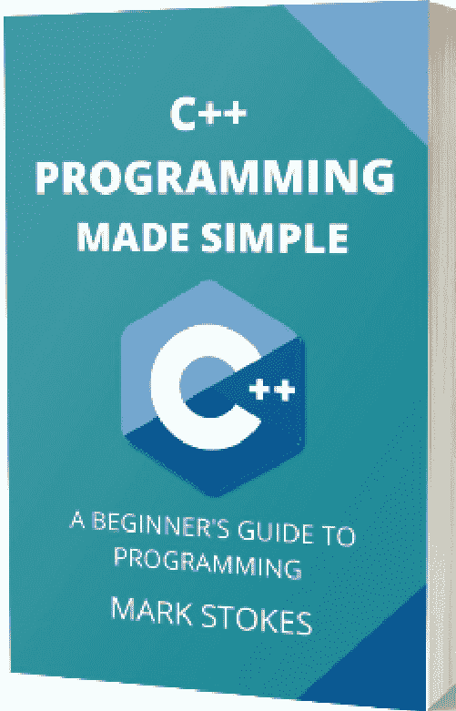

# C++ 编程简明指南：编程初学者指南



## 书籍

欢迎阅读《C++ 编程简易入门 - 编程学者指南》。本详尽的著作旨在帮助你学习并理解 C++ 编程的基础知识，即使你之前没有任何编程经验。无论你是渴望成为一名专业的软件开发者，还是仅仅想探索编程的世界，这本书都将成为你的终极指南。

在当今的数字时代，编程技能的需求量极大。C++ 是一种强大且多功能的编程语言，广泛用于开发各种应用程序，包括系统软件、游戏和高性能应用。本书旨在揭开 C++ 编程的神秘面纱，并为你提供坚实的基础以供构建。

在本书书中，你将开启一段激动心的旅程，从 C++ 的基础知识开始，逐渐过渡到更高级的概念。每一章都经过精心设计，介绍新主题，通过实践示例巩固你的理解，并提供练习题来测试你的知识。读完本书后，你将获得编写自己的 C++ 程序并应对现实世界编码挑战的信心。

因此，无论你是急于学习编程的学生、寻找扩展技能的的爱好者，还是寻求提升职业前景的专业人士，《C++ 编程简易入门》都是实现你愿景的完美资源。让我们投身 C++ 编程的世界，开启它所提供的无限可能吧！

# 第1章：C++ 编程导论

欢迎来到《C++ 编程简易入门 - 编程学者指南》的第一章。在本章中，我们将为你进入 C++ 编程的世界奠定基础。我们将首先概述什么是 C++，以及它为什么是如此强大且流行的编程语言。

### 什么是 C++？

C++ 是一种通用编程语言，是作为 C 编程语言的扩展而开发的。它由比雅尼·斯特斯特拉斯（Bjarne Stroustrup）于 20 世纪 80 年代初创建，从那时成为世界上最使用的编程语言之一。C++ 结合了高层特性和低级控制，使其适用于广泛的应用。

### C++ 的意义

由于几个原因，C++ 被认为是一门强大的语言。首先，最重要的是，它提供了高水平的效率和性能。C++ 程序可以快速运行并有效利用利用系统资源。这使其成为开发对速度和性能有要求的应用程序的热选，例如游戏引擎、操作系统和科学模拟。

C++ 的另一个重要方面是它对面向对象编程 `OOP` 的支持。面向对象编程允许开发者将代码组织成可重用的对象，从而更容易管理复杂项目并促进代码重用。C++ 还支持其他编程范式，包括过程化编程和泛型编程。

C++ 以其丰富的标准库而闻名，该库提供了大量的预写函数和类集合，用于解决常见的编程问题。标准模板库 `STL` 提供了强大的工具，帮助 C++ 开发者更高效地完成任务。

*注：原文后续部分出现了多处重复和逻辑混乱，以下翻译尽量保持逻辑连贯性：*

*在本书书中，你将开启一段激动心的旅程，从 C++ 的基础知识开始，逐渐过渡到更高级的概念。每一章都经过精心设计，介绍新主题，通过实践示例巩固你的理解，并提供练习题来测试你的知识。读完本书后，你将获得编写自己的 C++ 程序并应对现实世界编码挑战的信心。*

### 设置你的开发环境

在我们开始编写代码之前，让我们准备好开发环境。在编写 C++ 程序之前，我们需要确保开发环境已设置完毕。

1. **选择编译器**：C++ 有许多可用的编译器，例如 `GCC`、`Clang` 和 `Microsoft Visual++`。
2. **安装编译器**：根据你的操作系统，按照官方说明进行安装。
3. **选择集成开发环境 `IDE`**：流行的 `IDE` 包括 `Visual Studio`、`Code::Blocks` 和 `Eclipse`。
4. **验证安装**：安装完成后，运行一个简单的程序以确保一切工作正常。

### 编写你的第一个 C++ 程序

现在你的开发环境已准备就绪，让我们开始编写第一个 C++ 程序。我们将从经典的“Hello, World!”程序开始，这是编程中的入门示例。

打开你选择的 `IDE` 并按照以下步骤创建一个 C++ 项目或文件：

1. 在 `IDE` 中创建一个新项目或文件。给它一个有意义的名字，例如 `HelloWorld.cpp`。
2. 在新建的项目文件中编写以下代码：

```cpp
#include <iostream>

int main() {
    std::cout << "Hello, World!" << std::endl;
    return 0;
}
```

3. 保存文件。
4. 通过 `IDE` 中的相应选项编译程序。如果你使用的是命令行编译器，请导航到文件所在目录并运行编译器命令。注意处理编译过程中可能出现的任何错误或警告。
5. 程序编译完成后，在 `IDE` 内或通过运行生成的执行文件来执行它。你应该会在控制台上看到“Hello, World!”

恭喜你！你已经编写并运行了你的第一个 C++ 程序。这个简单的示例展示了 C++ 程序的基本结构，包括核心组件：

- `#include <iostream>` 指令包含了输入输出操作所需的头文件。
- `int main()` 函数是程序的入口。执行从这里开始。
- `std::cout` 语句用于将“Hello, World!”消息打印到控制台。
- `return 0` 语句表示程序执行成功，并向操作系统返回值 `0`。

你可以通过修改消息或添加额外的语句来对代码进行实验。观察结果将帮助你理解程序的行为并加强学习。

## 结

在本章中，我们介绍了 C++ 编程的基础知识。我们探索了什么是 C++，讨论了它的重要性，并强调了它的关键特性。此外，我们还引导你搭建了开发环境并编写了你的第一个 C++ 程序。

在接下来的章节中，我们将深入研究这门语言，涵盖变量、数据类型、控制流、函数和面向对象编程等主题。每一章都将在前一章知识的基础上，逐步扩展你作为 C++ 程序员的理解能力和技能。

请记住，实践对于掌握编程概念至关重要。花时间去实验、探索，并通过编程练习来挑战自己。通过这种方式，你将在 C++ 编程的世界中变得更加游刃有余。

准备好迎接精彩的旅程吧，我们将深入探索 C++ 编程迷的世界！

# 第 2 章：入门 C++

在第 1 章中，我们探索了 C++ 编程的基础并编写了第一个“Hello, World!”程序。现在，让我们深入研究这门语言，学习如何处理变量、输入/输出操作以及基础算术。

## 变量与数据类型

变量是任何编程语言（包括 C++）的重要组成部分。它们用于在程序执行期间存储和操作数据。在使用变量之前，我们必须对其进行声明，指定其数据类型和名称。

C++ 支持多种数据类型，包括整数、浮点数、字符和布尔值。

这里是一些常用的数据类型：

- `int`：表示整数（整数），例如 -3、0 和 42。
- `float` 和 `double`：表示浮点数（小数），例如 3.14 和 2.71828。
- `char`：表示单个字符，例如 'A'、'b' 和 '$'。
- `bool`：表示布尔值（`true` 或 `false`）。

要声明变量，我们需要指定其数据类型然后是名称。例如：

```cpp
int age;      // 声明一个名为 'age' 的整数变量
float pi;      // 声明一个名为 'pi' 的浮点变量
char grade;   // 声明一个名为 'grade' 的字符变量
bool isValid; // 声明一个名为 'isValid' 的布尔变量
```

声明后，我们可以使用赋值运算符（`=`）为变量赋值。例如：

```cpp
age = 25;      // 将值 25 赋值给 'age' 变量
pi = 3.14159; // 将值 3.14159 赋值给 'pi' 变量
grade = 'A'; // 将字符 'A' 赋值给 'grade' 变量
isValid = true; // 将布尔值 'true' 赋值给 'isValid' 变量
```

我们也可以在一步内完成声明和赋值：

```cpp
int score = 100; // 声明并赋值名为 'score' 的整数变量
double temperature = 98.6; // 声明并赋值名为 'temperature' 的 double 变量
char symbol = '$'; // 声明并赋值名为 'symbol' 的字符变量
bool isReady = false; // 声明并赋值名为 'isReady' 的布尔变量
```

## 输入和输出操作

输入和输出（I/O）操作对于与用户交互和显示信息至关重要。C++ 提供了 `iostream` 库，它包含了执行 I/O 操作所需的函数和对象。

要使用 `iostream` 库，我们要在程序开头包含 `<iostream>` 头文件：

```cpp
#include <iostream>
```

让我们探索两个基本的 I/O 操作：使用 `std::cout` 输出和使用 `std::cin` 输入。

### 使用 `std::cout` 输出

`std::cout` 对象用于向控制台显示输出。我们可以用它打印消息、变量值或任何其他信息。

这是一个显示问候信息的示例：

```cpp
#include <iostream>

int main() {
    std::cout << "Welcome to C++!" << std::endl;
    return 0;
}
```

### 使用 `std::cin` 输入

`std::cin` 对象用于接收来自用户的输入。我们用它将输入的值存储到变量中。这是一个提示输入的示例：

```cpp
#include <iostream>

int main() {
    int age;
    std::cout << "Enter your age: ";
    std::cin >> age;
    std::cout << "Your age is: " << age << std::endl;
    return 0;
}
```

## 基础算术

C++ 提供了几个算术运算符用于数学计算。让我们探索常用的运算符：

- `+`：相加两个值。
- `-`：从一个值减去另一个值。
- `*`：相乘两个值。
- `/`：用一个值除以另一个值。
- `%`：返回除法的余数。

这是一个演示这些运算符使用的示例：

```cpp
#include <iostream>

int main() {
    int a = 10;
    int b = 5;

    int sum = a + b;
    int difference = a - b;
    int product = a * b;
    int quotient = a / b;
    int remainder = a % b;

    std::cout << "Sum: " << sum << std::endl;
    std::cout << "Difference: " << difference << std::endl;
    std::cout << "Product: " << product << std::endl;
    std::cout << "Quotient: " << quotient << std::endl;
    std::cout << "Remainder: " << remainder << std::endl;

    return 0;
}
```

### 变量命名与规范

在选择变量名时，遵循某些规范对于确保代码的可读性和维护性至关重要。以下是一些常见的规范：

- 变量名应该是描述性且意义的。例如，与其使用 `x` 或 `a`，不如使用 `age`、`score` 或 `isValid` 等名称。
- 变量名应以小写字母开头。如果名称由多个单词组成，可以使用驼峰命名法（camel case）或下划线来分隔。例如，`studentName`、`temperatureInCelsius` 或 `is_valid`。
- 避免使用保留关键字作为变量名。C++ 有一组保留的关键字，这些关键字在语言中具有预定义的含义。保留关键字的示例包括 `int`、`float`、`char`、`bool` 等。

### 变量的作用域与寿命

变量在程序中具有作用域和寿命。变量的作用域决定了程序中可以访问该变量的部分。变量的寿命定义了变量在内存中存在的时间。

在 C++ 中，变量可以是局部作用域或全局作用域。局部变量定义在特定的块或函数内部，只能在该块或函数内部访问。相反，全局变量声明在任何函数之外，可以在程序的任何部分访问。

局部变量的寿命从声明时开始，在退出包含它的块或函数时结束。而全局变量的寿命贯穿整个程序的运行过程。

尽可能地限制变量的作用域是一个良好的习惯，可以避免潜在的命名冲突并提高代码的可读性。

## C++ 中的常用数据类型

C++ 提供了多种数据类型，允许我们处理不同类型的数据。让我们探索一些常用的数据类型：

### 整数类型

整数类型用于存储整数。C++ 提供了具有不同存储容量的整数类型。以下是一些常用的整数类型：

- `int`：用于存储整数，在大多数系统上的典型典型范围为 -2,147,483,648 到 2,147,483,647。
- `short`：用于存储较短的整数，范围约为 -32,768 到 32,767。
- `long`：用于存储较长的整数，范围约为 -2,147,483,648 到 2,147,483,647。
- `long long`：用于存储更长的整数，范围约为 -9,223,372,036,854,775,808 到 9,223,372,036,854,775,807。

示例：

```cpp
int score = 100;
short numStudents = 25;
long population = 789456123;
long long veryLargeNumber = 9876543210123456789LL;
```

### 浮点类型

浮点类型用于存储小数。C++ 提供了两种主要的浮点类型：

- `float`：用于存储单精度浮点数，约有 6-7 位有效数字。
- `double`：用于存储双精度浮点数，约有 15 位有效数字。

示例：

```cpp
float pi = 3.14159f;
double average = 85.5321;
```

### 字符类型

字符类型用于存储单个字符。C++ 提供了两种字符类型：

- `char`：用于存储单个字符。
- `wchar_t`：用于存储宽字符，它可以表示更广泛的字符，包括来自非 ASCII 字符集的字符。

示例：

```cpp
char grade = 'A';
wchar_t euroSymbol = L'€';
```

### 布尔类型

布尔类型用于表示逻辑值。它可以有两个可能的值：`true` 或 `false`。

示例：

```cpp
bool isValid = true;
bool isReady = false;
```

## 结论

在本章中，我们探索了 C++ 中的变量和数据类型。我们学习了变量的声明和初始化，以及命名规范和变量作用域。理解如何操作变量和选择合适的数据类型是编写高效 C++ 程序的基础。

我们还探索了一些常用的数据类型，包括整数、浮点数、字符和布尔值。每种数据类型都有其用途和使用场景，使我们能够有效地处理不同类型的数据。

在你继续 C++ 编程之旅时，请记住选择合适的变量名以及为你的数据选择正确数据类型的重要性。这些实践将有助于代码的清晰度和可读性。

## 逻辑运算符

逻辑运算符用于组合多个条件并执行逻辑操作。C++ 提供了以下逻辑运算符：

- 逻辑与 (`&&`)：当两个条件都为 `true` 时，返回 `true`。
- 逻辑或 (`||`)：当至少有一个条件为 `true` 时，返回 `true`。
- 逻辑非 (`!`)：反反条件的结果。

```cpp
#include <iostream>

int main() {
    int age = 25;
    bool hasLicense = true;
    bool isEligible = (age >= 18) && hasLicense; // 逻辑与
    bool canDrive = (age >= 18) || hasLicense; // 逻辑或
    bool cannotDrive = !canDrive; // 逻辑非
    std::cout << "Is eligible:" << isEligible << std::endl;
    std::cout << "Can drive: " << canDrive << std::endl;
    std::cout << "Cannot drive: " << cannotDrive << std::endl;
    return 0;
}
```

在上述代码中，变量 `age` 和 `hasLicense` 分别代表年龄以及是否持有有效执照。逻辑运算符用于组合这些条件并将结果赋值给布尔变量。然后使用 `std::cout` 显示这些布尔值。

## 赋值运算符

赋值运算符用于给变量赋值。C++ 提供了多种赋值运算符，包括基础赋值运算符 (`=`) 和复合赋值运算符 (`+=`、`-=`、`*=`、`/=` 和 `%=`）。

这是一个演示使用复合赋值运算符的示例：

```cpp
#include <iostream>

int main() {
    int a = 5;
    a += 3; // 等同于: a = a + 3
    a -= 2; // 等同于: a = a - 2
    a *= 4; // 等同于: a = a * 4
    a /= 2; // 等同于: a = a / 2
```


```cpp
    a %= 3; // 等同于: a = a % 3;

    std::cout << "Updated value of 'a': " << a << std::endl;

    return 0;

}
```

在上述代码中，变量 `a` 初始值为 5。复合赋值运算符通过执行算术运算并将结果赋值回 `a` 来修改 `a` 的值。然后使用 `std::cout` 显示更新后的 `a` 值。

## 运算符的优先级和结合性

C++ 中的运算符具有不同的优先级和结合性，这决定了当表达式中存在多个运算符时的计算顺序。理解运算符优先级对于编写产生预期结果的表达式至关重要。

下表显示了 C++ 中一些常用运算符的优先级和结合性，从高到低排序：

| 运算符 | 结合性 | 说明 |
| :--- | :--- | :--- |
| `()` | 从左到右 | 括号 |
| `++`, `--` | 从左到右 | 后置递增、递减 |
| `++`, `--` | 从右到左 | 前置递增、递减 |
| `+`, `-` | 从右到左 | 一元加、减 |
| `!`, `~` | 从右到左 | 逻辑取反和位反 |
| `*`, `/`, `%` | 从左到右 | 乘法、除法、取模 |
| `+`, `-` | 从左到右 | 加法、减法 |
| `<<`, `>>` | 从左到右 | 位左移、位右移 |
| `<`, `<= `>`, `>=` | 从左到右 | 关系运算符 |
| `==`, `!=` | 从左到右 | 等运算符 |
| `&` | 从左到右 | 位与 |
| `^` | 从左到右 | 位异异 |
| `|` | 从左到右 | 位或 |
| `&&` | 从左到右 | 逻辑与 |
| `||` | 从左到右 | 逻辑或 |
| `=` | 从左到右 | 赋值 |
| `+=`, `-=`, `*=`, `/=`, `%=` | 从左到右 | 复合赋值 |

```cpp
include <iostream>

int main() {

    for (int i = 0; i < 5; i++) {

        std::cout << "Count: " << i << std::endl;

    }

    return 0;

}
```

在这个示例中，`for` 循环将变量 `i` 初始化为 0。然后它检查 `i` 是否小于 5。如果条件为真，则执行块中的代码，然后将 `i` 加 1。这个过程会重复进行，直到条件变为假。

## 控制流语句：Break 和 Continue

除了条件语句和循环之外，`break` 和 `continue` 等控制流语句为循环内部的执行流提供了额外的控制。

`break` 语句用于终止当前循环并继续执行循环之外的下一个语句。它在某些条件下提前退出循环非常有用。这里有一个示例：

```cpp
#include <iostream>

int main() {

    for (int i = 0; i < 5; i++) {

        if (i == 3) {

            break;

        }

        std::cout << "Count: " << i << std::endl;

    }

    return 0;

}
```

在这个示例中，`for` 循环遍历 `i` 从 0 到 4 的值。然而，当 `i` 变为 3 时，遇到了 `break` 语句，终止了循环。结果是只显示了计数 0、1 和 2。

`continue` 语句用于跳过当前迭代的剩余部分并继续循环的下一次迭代。当我们想要根据特定条件跳过某些迭代时，它非常有用。这里有一个示例：

```cpp
#include <iostream>

int main() {

    for (int i = 0; i < 5; i++) {

        if (i == 2) {

            continue;

        }

        std::cout << "Count: " << i << std::endl;

    }

    return 0;

}
```

在这个示例中，当 `i` 变为 2 时，遇到了 `continue` 语句，跳过了该迭代下方的代码。结果是跳过了计数 2，并显示了剩余的计数 0、1、3 和 4。

## 结论

在本章中，我们探索了 C++ 中的控制流和决策结构。我们学习了条件语句，例如 `if-else` 语句，它允许我们根据某些条件执行不同的代码块。我们还探索了循环，包括只要条件为真就重复执行代码块的 `while` 循环，以及用于对值范围迭代或执行特定次数迭代的 `for` 循环。

此外，我们还涵盖了 `break` 和 `continue` 等控制流语句，它们为循环内部的执行流提供了额外的控制。这些语句允许我们根据特定条件提前终止循环或跳过某些迭代。

通过理解和利用控制流以及决策结构，你可以在 C++ 中创建更具动态性和交互性的程序。你可以控制执行流，根据用户输入或其他条件做出决策，并根据需要重复代码。

# 第 6 章：数组与字符串

在第 5 章中，我们探索了 C++ 中的控制流和决策结构。在本章中，我们将深入研究数组和字符串，这是是两个基础性概念，它们允许我们高效地处理元素集合。

## 数组

数组是一种数据结构，允许我们在连续的内存块中存储相同数据类型的多个元素。数组中的每个元素都通过索引访问，索引代表该元素在数组中的位置。数组为处理相关数据集合提供了一种方便的方法。

### 声明和访问数组

在 C++ 中声明数组时，我们指定元素的数据类型，紧接着是数组名和方括号中的大小。这里有一个示例：

```cpp
int numbers[5]; // 声明一个名为 'numbers' 的大小为 5 的整数数组
```

一旦声明，我们就可以使用索引访问数组的单个元素。第一个元素的索引为 0，第二个元素的索引为 1，以此此类推。这里有一个示例：

```cpp
int numbers[5]; // 声明一个名为 'numbers' 的大小为 5 的整数数组
numbers[0] = 10; // 给 'numbers' 的第一个元素赋值值 10
numbers[1] = 20; // 给 'numbers' 的第二个元素赋值值 20
numbers[2] = 30; // 给 'numbers' 的第三个元素赋值值 30
```

我们还可以在声明时使用初始化列表来初始化数组。这里有一个示例：

```cpp
int numbers[] = {10, 20, 30, 40, 50}; // 声明并初始化整数数组 'numbers'
```

### 访问数组元素

要访问数组的元素，我们使用数组名加上索引。这里有一个示例：

```cpp
int numbers[] = {10, 20, 30, 40, 50};
std::cout << numbers[0] << std::endl;
std::cout << numbers[1] << std::endl;
std::cout << numbers[2] << std::endl;
```

### 数组大小与边界

数组的大小决定了它可以包含的元素数量。注意索引从 0 开始到 size-1。访问范围之外的元素会导致未定义行为。这里有一个示例：

```cpp
int numbers[] = {10, 20, 30, 40, 50};
int size = sizeof(numbers) / sizeof(numbers[0]);
std::cout << "Array大小: " << size << std::endl;
```

### 多维数组

C++ 还支持多维数组，即数组的数组。多维数组可以用于表示矩阵、表格或任何具有多个维结构。这里有一个二维数组的示例：

```cpp
int matrix[3][3];
matrix[0][0] = 1; // 给第 0 行第 0 列赋值值 1
matrix[1][2] = 3; // 给第 1 行第 2 列赋值值 3
```

### 字符串

在 C++ 中，字符串被表示为字符数组。字符串是包含在双引号("")内的字符序列。C++ 在 `<string>` 头文件中提供了 `string` 类来高效处理字符串。这里有一个声明和初始化字符串的示例：

```cpp
#include <iostream>
#include <string>
int main() {
    std::string greeting = "Hello, world!"; // 声明并初始化字符串
    std::cout << greeting << std::endl; // 将字符串打印到控制台
    return 0;
}
```

### 字符串操作

C++ 提供了许多操作来处理字符串。以下是一些常用的字符串操作：

- 拼接：可以使用 `+` 运算符或 `+=` 复合赋值运算符拼接字符串。这里有一个示例：

```cpp
std::string firstName = "John";
std::string lastName = "Doe";
std::string fullName = firstName + " " + lastName; // 拼接字符串
std::cout << "Full name: " << fullName << std::endl;
```

- 长度：可以使用 `length()` 或 `size()` 成员函数获取字符串的长度。这里有一个示例：

```cpp
std::string message = "Hello, world!";
std::cout << "Length of message: " << message.length() << std::endl;
```

```cpp
int length = message.length();   // 获取字符串的
length
```

```cpp
std::cout << "Length of the string: " << length << std::endl;
```

- 访问字符：可以使用类似数组的索引表示法来访问字符串的单个字符。这里是一个示例：

```cpp
std::string message = "Hello, world!";
char firstCharacter = message[0]; // 访问第一个字符
```

```cpp
char lastCharacter = message[message.length() - 1]; // 访问最后一个字符
```

```cpp
std::cout << "First character: " << firstCharacter << std::endl;
std::cout << "Last character: " << lastCharacter << std::endl;
```

- 子字符串：可以使用 `substr()` 成员函数从字符串中提取子字符串。这是一个示例：

```cpp
std::string message = "Hello, world!";
std::string substring = message.substr(7, 5); // 提取从索引 7 开始长度为 5 的子字符串
```

```cpp
std::cout << "Substring:" << substring << std::endl;
```

## 结论

在本章中，我们探索了 C++ 中的数组和字符串。数组允许我们高效地存储和访问相同数据类型的多个元素，为处理相关数据集合提供了方便的方法。我们学习了如何声明数组、访问其元素以及计算它们的大小。我们还探索了用于表示多维度数据的多维数组。

此外，我们还讨论了字符串，它们在 C++ 中被表示为字符数组。我们学习了如何声明和初始化字符串，执行拼接和子字符串提取等字符串操作，以及获取字符串的长度。

数组和字符串是强大的工具，使我们能够在 C++ 中有效地处理和操作数据。通过掌握这些概念，你可以开发出高效管理和处理元素集合的程序。

# 第7 章：函数与模块化编程

在第 6 章中，我们探索了 C++ 中的数组和字符串。在本章中，我们将深入研究函数和模块化编程。函数允许我们将复杂的程序分解为更小、易于管理的代码块，使我们的程序更有组织、模块化且具复用性。

## 函数

函数是一个命名的代码块，用于执行特定任务或一组相关任务。函数通过将一系列语句封装到单个单元中，提供了一种代码模块化的方法。它们促进了代码的重用、可读性和维护性。

### 函数的声明与定义

在 C++ 中定义函数，我们需要提供函数的签名，其中包含返回类型、名称以及它接受的任何参数。函数体包含调用函数时执行的语句。这里是一个函数声明和定义的示例：

```cpp
// 函数声明
int addNumbers(int a, int b);
// 函数定义
int addNumbers(int a, int b) {
    int sum = a + b;
    return sum;
}
```

在这个示例中，我们声明并定义了一个名为 `addNumbers` 的函数，它接受两个整数参数 `a` 和 `b` 并返回一个整数值。函数计算 `a` 和 `b` 的和并使用 `return` 语句返回结果。

### 函数调用

要使用函数，我们需要通过名称调用它并提供必要的参数（如果有）。这里是调用 `addNumbers` 函数的示例：

```cpp
int result = addNumbers(5, 3);
```

在这个示例中，使用参数 5 和 3 调用了 `addNumbers` 函数。函数的返回值（两个数字之和）被存储在变量 `result` 中。

### 函数参数

函数参数允许我们将值传递到函数中。参数在函数的作用范围内充当变量，其值可以在函数执行期间使用。这里是一个示例：

```cpp
int multiplyNumbers(int a, int b) {
    int product = a * b;
    return product;
}
```

在这个示例中，`multiplyNumbers` 函数接受两个整数参数 `a` 和 `b`。它计算 `a` 和 `b` 的积并返回结果。

### 函数返回值

函数的返回类型指定了函数返回值的类型。它可以是任何有效的数据类型，包括基本类型、用户定义类型，或者如果函数不返回结果，可以是 `void`。这里是一个示例：

```cpp
void greet() {
  std::cout << "Hello, world!" << std::endl;
}
```

在这个示例中，`greet` 函数的返回类型为 `void`，表示它不返回值。它只是向控制台打印 "Hello, world!"。

### 函数重载

函数重载允许我们定义多个具有相同但参数列表不同的函数。C++ 根据调用时提供的参数来确定调用哪个函数。这里是一个示例：

```cpp
int square(int number) {
    return number * number;
}
double square(double number) {
    return number * number;
}
```

在这个示例中，我们定义了两个 `square` 函数。一个接受整数，另一个接受双精度。

## 模块化编程

模块化编程是一种强调将程序分解为称为函数的自包含单元的方法。每个函数执行特定的任务。

### 模块化编程的优势

模块化编程具有若干优点：

- **代码重用性**：函数可以在程序的多个部分被重用。
- **可读性**：将程序分解为函数使代码更易读、更容易理解。
- **易维护性**：通过模块化编程，修复程序中的错误变得更容易。
- **扩展性**：可以添加新函数或修改现有函数而不影响程序的其他部分。

### 示例：使用函数的模块化编程

让我们考虑这样一个示例：我们需要计算矩形的面积和周长。我们可以通过为每个任务定义单独的来实现程序的模块化：

```cpp
#include <iostream>
// 计算矩形面积的函数
double calculateArea(double length, double width) {
    return length * width;
}
// 计算矩形周长的函数
double calculatePerimeter(double length, double width) {
    return 2 * (length + width);
}
int main() {
    double length, width;
    std::cout << "Enter the length of the rectangle: ";
    std::cin >> length;
    std::cout << "Enter the width of the rectangle: ";
    std::cin >> width;
    double area = calculateArea(length, width);
    double perimeter = calculatePerimeter(length, width);
    std::cout << "Area: " << area << std::endl;
    std::cout << "Perimeter: " << perimeter << std::endl;
    return 0;
}
```


# 第 8 章：指针与动态内存分配

在第 7 章中，我们探索了 C++ 中的函数和模块化编程。在本章中，我们将深入研究指针和动态内存分配。指针允许我们存储内存地址并直接操作内存，而动态内存分配则允许我们在运行时分配和释放内存。

## 指针

指针是一个存储另一个变量内存地址的变量。通过指针，我们可以间接访问和操作存储在内存中的数据。指针为内存管理提供了灵活性和效率。

### 指针的声明与初始化

在 C++ 中声明指针，我们需要在指针变量名之前使用星号 (`*`)。这里有一个示例：

```cpp
int* ptr; // 声明一个整数指针
```

要初始化指针，我们使用取地址运算符 (`&`) 将另一个变量的地址赋值给它。这里有一个示例：

```cpp
int number = 10; // 整数变量的声明和初始化
int* ptr = &number; // 使用 'number' 的地址初始化指针
```

在这个示例中，指针 `ptr` 使用取地址运算符 (`&`) 初始化为 `number` 变量的内存地址。

### 访问指针值与解引用

要访问指针所指向的内存地址存储的值，我们在指针变量名之前使用解引用运算符 (`*`)。这里有一个示例：

```cpp
int number = 10;
int* ptr = &number;
std::cout << "Value of 'number': " << *ptr << std::endl; // 访问 'ptr' 指向的值
```

在这个示例中，通过指针 `ptr` 并使用解引用运算符 (`*`) 访问了 `number` 变量的值。

### 空指针

空指针是一种特殊的指针，它不指向任何有效的内存地址。它通常用于指示指针当前没有指向任何对象或内存位置。这里有一个示例：

```cpp
int* ptr = nullptr; // 空指针的声明和初始化
```

在这个示例中，指针 `ptr` 使用 `nullptr` 关键字被初始化为空指针。

### 指针算术

C++ 中的指针支持加法和减法等算术操作。这些操作是根据指针所指向的数据类型的大小执行的。这里有一个示例：

```cpp
int numbers[] = {10, 20, 30, 40, 50};
int* ptr = numbers;
std::cout << "First element: " << *ptr << std::endl; // 通过指针访问数组的第一个元素
ptr++; // 将指针移动到下一个元素
std::cout << "Second element: " << *ptr << std::endl; // 通过指针访问数组的第二个元素
```

在这个示例中，指针 `ptr` 最初被赋值为 `numbers` 数组第一个元素的地址。通过使用递增运算符 `ptr++`，指针移动到下一个元素，允许我们通过指针访问数组的第二个元素。

## 动态内存分配

动态内存分配允许我们在运行时分配和释放内存。它使我们能够创建不同大小的数据结构并高效地使用内存。

### 分配内存：new 和 delete 运算符

要动态分配内存，我们使用 `new` 运算符后跟想要分配的对象的数据类型。这里有一个示例：

```cpp
int* ptr = new int; // 动态分配一个整数变量
*ptr = 10; // 为动态分配的整数赋值
std::cout << "Value:" << *ptr << std::endl; // 通过指针访问值
delete ptr; // 释放动态分配的内存
```

在这个示例中，使用了 `new` 运算符来动态分配一个整数变量。值 10 被赋值给分配的内存，并通过指针进行访问。在使用完动态分配的内存后，使用 `delete` 运算符释放它以释放内存。

### 为数组分配内存

我们也可以为数组动态分配内存。这里有一个示例：

```cpp
int size;
std::cout << "Enter the size of the array: ";
std::cin >> size;
int* numbers = new int[size]; // 动态分配一个整数数组
```

```cpp
// 访问并操作动态分配数组的元素
for (int i = 0; i < size; i++) {
    numbers[i] = i * 10;
}
```

```cpp
// 打印动态分配数组的元素
for (int i = 0; i < size; i++) {
    std::cout << "Element at index " << i << ": " << numbers[i] << std::endl;
}
```

```cpp
delete[] numbers; // 释放数组动态分配的内存
```

在这个示例中，提示用户输入数组的大小。数组的内存使用 `new` 运算符动态分配。然后通过指针访问并操作数组的元素。

### 内存泄漏

当内存被分配但从未释放时，就会发生内存泄漏，导致内存丢失。为了避免内存泄漏，请始终确保动态分配的内存被正确释放。

## 结论

在本章中，我们探索了 C++ 中的指针和动态内存分配。指针允许我们存储内存地址并直接操作内存，为内存管理提供了灵活性和效率。我们学习了如何声明和初始化指针、通过指针访问值以及进行指针算术。我们还讨论了空指针，它表示有效内存地址的缺失。

动态内存分配允许我们在运行时分配和释放内存，从而创建不同大小的数据结构。我们学习了如何使用 `new` 运算符动态分配内存、为动态分配的内存赋值以及使用 `delete` 运算符。

# 第 9 章：面向对象编程概念

在第 8 章中，我们探索了 C++ 中的指针和动态内存分配。在本章中，我们将深入研究面向对象编程（OOP）概念。OOP 是一种基于对象的编程范式，对象是类的实例。OOP 促进了代码的可重用性、模块化和可扩展性。

## 类和对象

类是蓝图或模板，定义了对象的属性（数据）和行为（方法）。对象是类的实例，代表具有特定状态和行为的实体。类提供了将数据和相关功能封装在单元中的方法。

### 类声明与定义

在 C++ 中声明类，使用 `class` 关键字后跟类名。这里有一个示例：

```cpp
class Rectangle {
    // 类成员
};
```

定义类是在类内部提供成员的实现。成员包括属性（数据成员）和方法（成员函数）。这里有一个示例：

```cpp
class Rectangle {
public:
    // 属性
    double length;
    double width;

    // 方法
    double calculateArea() {
        return length * width;
    }
};
```

在这个示例中，我们定义了一个名为 `Rectangle` 的类。它有两个属性 `length` 和 `width`，以及一个计算矩形面积的方法 `calculateArea()`。

### 创建对象

要创建类的对象，我们使用类名后跟对象名以及可选的括号。这里有一个示例：

```cpp
Rectangle rect1; // 创建一个 Rectangle 类的对象
```

在本示例中，我们创建了一个名为 `rect1` 的 `Rectangle` 类对象。

### 访问类成员

要访问对象的成员（属性和方法），我们使用点 (`.`) 运算符。这是一个示例：

```cpp
Rectangle rect1;
rect1.length = 5.0; // 访问并为 'length' 属性赋值
rect1.width = 3.0; // 访问并为 'width' 属性赋值
```

```cpp
double area = rect1.calculateArea(); // 访问并调用 'calculateArea' 方法
std::cout << "Area: " << area << std::endl;
```

在这个示例中，我们使用点运算符访问了 `rect1` 对象的属性并为它们分配了值。我们还调用了 `calculateArea()` 方法来计算矩形的面积。

### 构造函数与析构函数

构造函数和析构函数是类中的特殊成员函数，分别在对象创建和销毁时自动调用。

构造函数用于初始化对象的属性并执行任何必要的设置。它的名称与类相同，且声明时没有返回类型。这是一个示例：

```cpp
class Rectangle {
public:
    double length;
    double width;

    // 构造函数
    Rectangle(double len, double wid) {
        length = len;
        width = wid;
    }
};
```

在这个示例中，我们为 `Rectangle` 类定义了一个构造函数，它接受两个参数 `len` 和 `wid` 来初始化 `length` 和 `width` 属性。

析构函数用于在对象销毁之前清理资源并执行任何必要的最终工作。它的名称与类相同，但前面有一个波浪号 (`~`)，且声明时没有参数。这是一个示例：

```cpp
class Rectangle {
public:
    double length;
    double width;

    // 构造函数
    Rectangle(double len, double wid) {
        length = len;
        width = wid;
    }

    // 析构函数
    ~Rectangle() {
        // 在此处编写清理代码
    }
};
```

在这个示例中，我们为 `Rectangle` 类添加了析构函数。析构函数可以释放任何动态分配的内存或执行任何其他清理任务。

### 封装与数据隐藏

面向对象编程（OOP）的核心原则之一是封装，它将数据和相关功能打包到单个单元（类）中。封装允许数据被隐藏或防止从类外部直接访问和操作。对数据的访问通过方法（如 getter 和 setter）来控制。

这是一个演示封装和数据隐藏的示例：

```cpp
class BankAccount {
private:
    std::string accountNumber;
    double balance;

public:
    // 获取账号的 getter
    std::string getAccountNumber() {
        return accountNumber;
    }

    // 设置余额的 setter
    void setBalance(double amount) {
        if (amount >= 0) {
            balance = amount;
        }
    }
};
```

在这个示例中，`accountNumber` 属性被标记为 `private`，防止从类外部直接访问它。提供了 `getAccountNumber()` 方法作为公共 getter 来访问账号。同样，`balance` 属性被标记为 `private`，并提供了 `setBalance()` 方法作为公共 setter 来控制 `balance` 属性的访问和验证。

### 继承

继承是一种允许类继承另一个类的属性和行为的机制。被继承的类被称为基类或父类，而继承它的类被称为派生类或子类。继承促进了代码复用并允许创建类层次结构。

这是一个继承的示例：

```cpp
class Shape {
public:
    virtual double calculateArea() = 0;
};

class Rectangle : public Shape {
public:
    double length;
    double width;

    double calculateArea() override {
        return length * width;
    }
};
```

在这个示例中，我们有一个名为 `Shape` 的基类，它定义了一个纯虚方法 `calculateArea()`。`Rectangle` 类使用 `public` 访问修饰符派生自 `Shape` 类。它重写了 `calculateArea()` 方法，为计算矩形面积提供了具体的实现。

### 多态

多态允许将不同类的对象视为共同基类的对象。多态允许单一接口表示多个类。它使得代码能够处理不同类型的对象，而无需知道它们的具体类型。

这是一个演示多态的示例：

```cpp
class Shape {
public:
    virtual double calculateArea() = 0;
};

class Rectangle : public Shape {
public:
    double length;
    double width;

    double calculateArea() override {
        return length * width;
    }
};

class Circle : public Shape {
public:
    double radius;

    double calculateArea() override {
        return 3.14 * radius * radius;
    }
};

void printArea(Shape* shape) {
    std::cout << "Area: " << shape->calculateArea() << std::endl;
}

int main() {
    Rectangle rect;
    rect.length = 5.0;
    rect.width = 3.0;

    Circle circle;
    circle.radius = 4.0;

    printArea(&rect);
    printArea(&circle);

    return 0;
}
```

在这个示例中，我们有一个带有纯虚方法 `calculateArea()` 的基类 `Shape`。`Rectangle` 和 `Circle` 类派生自 `Shape` 类并提供了它们各自的 `calculateArea()` 实现。`printArea()` 函数接收一个 `Shape` 对象的指针并调用它的 `calculateArea()` 方法，展示了多态行为。


```cpp
class BankAccount {
private:
    std::string accountNumber;
    double balance;
public:
    // 获取 accountNumber 的 getter
    std::string getAccountNumber() {
return accountNumber;
}

// 设置 balance 的 setter
void setBalance(double amount) {
    if (amount >= 0) {
        balance = amount;
    }
}
};
```

在这个示例中，`accountNumber` 属性被标记为 `private`，防止从类外部直接访问它。提供了 `getAccountNumber()` 方法作为公共 getter 来访问账户号码。同样，`balance` 属性被标记为 `private`，并提供了 `setBalance()` 方法作为公共 setter 来控制对余额属性的访问和验证。

### 成员函数

成员函数是在类内部定义的方法。它们封装了与类相关的行为和操作。成员函数可以访问并操作对象的属性。

### 静态成员

静态成员是类的所有实例所共享的类成员。它们独立于特定的对象，即使在没有创建类对象时也存在。可以使用类名访问静态成员，而不需要实例化。

```cpp
class Circle {
public:
    static constexpr double PI = 3.14159;
    static double calculateArea(double radius) {
        return PI * radius * radius;
    }
};
```

在这个示例中，`PI` 是 `Circle` 类的静态成员。它被类的所有对象共享，并可以使用类名 (`Circle::PI`) 进行访问。`calculateArea()` 方法也被声明为静态，可以使用类名 (`Circle::calculateArea()`) 进行调用。

### 友元函数

友元函数不是类的成员，但可以访问类的私有和保护成员。它们可以在类内部被声明为友元，以授予它们特殊的访问权限。

```cpp
class Rectangle {
private:
    double length;
    double width;

public:

Rectangle(double len, double wid) {

    length = len;
    width = wid;
}

friend double calculateDiagonal(const Rectangle& rect);

};

double calculateDiagonal(const Rectangle& rect) {
    return std::sqrt(rect.length * rect.length + rect.width * rect.width);
}
```

在这个示例中，`calculateDiagonal()` 被声明为 `Rectangle` 类的友元。它可以访问 `Rectangle` 的私有属性。

## 结论

在本章中，我们了类和对象。类作为定义属性和行为的蓝图或模板。是类的实例。我们学习了如何声明和定义类、创建对象、访问成员以及使用构造函数和析构函数。我们还讨论了封装和数据隐藏，通过 getter 和 setter 促进安全性和控访问。此外，我们还探索了类所有实例共享的静态成员，以及可以访问类私有和保护成员的友元函数。

通过掌握类和对象，你可以设计出结构良好且可复的代码。在下一章中，我们将深入更高级的主题，包括继承、多态和抽象。

- `protected`: 继承的成员在派生类中可以作为受保护成员被访问。
- `private`: 继承的成员在派生类中不可访问。

访问修符的选择取决于所需的封装程度和数据隐藏深度。

## 多态

多态是指不同类的对象可以被视为同一公共基类对象的能力。它允许我们编写在不需要了解对象具体类型的情况下即可处理不同类型对象的代码。

### 指向基类的指针和引用

多态通常通过指向基类的指针或引用来实现。这里有一个示例：

```cpp
Shape* shapePtr;
Shape& shapeRef;
Rectangle rect(5, 3);

Circle circle(4);

shapePtr = &rect;

shapeRef = circle;

int area = shapePtr->calculateArea();
```

在这个示例中，我们声明了一个类型为 `Shape` 的指针 `shapePtr` 和一个引用 `shapeRef`。然后，我们创建了来自派生类 `Rectangle` 和 `Circle` 的对象。我们可以将 `Rectangle` 对象的地址赋值给 `shapePtr`，并将 `Circle` 对象赋值给 `shapeRef`。我们可以使用指针 `shapePtr` 调用 `calculateArea()` 方法，这展示了多态行为。

### 虚函数

为了实现多态，我们在基类中使用虚函数。虚函数在基类中通过 `virtual` 关键字声明，并在派生类中可以重写。这里有一个示例：

```cpp
class Shape {
public:
    virtual int calculateArea() {
        return 0;
    }
};
```

```cpp
class Rectangle : public Shape {
public:
    int calculateArea() override {
        return width * height;
    }
};
```

```cpp
class Circle : public Shape {
public:
    int calculateArea() override {
        return 3.14 * radius * radius;
    }
};
```

在这个示例中，`Shape` 类声明了一个虚的 `calculateArea()` 方法。派生类 `Rectangle` 和 `Circle` 重写了该方法以提供它们特定的实现。当通过基类的指针或引用调用该方法时，将调用相应的派生类实现。

### 纯虚函数

纯虚函数是一种在基类中没有实现的虚函数。它使用 `virtual` 关键字后接 `= 0` 来声明。纯虚函数使基类成为抽象类，派生类必须重写它们。这里有一个示例：

```cpp
class Shape {
public:
    virtual int calculateArea() = 0;
};
```

在这个示例中，`Shape` 类声明了一个纯虚 `calculateArea()` 方法。由于它没有实现，我们无法创建 `Shape` 类的对象。然而，我们可以创建派生类的对象并使用它们对方法的特定实现。

## 结论

继承和多态是面向对象编程的强大特性。继承允许我们基于现有类创建新类，促进了代码的重用和扩展性。多态允许不同类型的对象被视为同一公共基类的对象，提供了灵活性和抽象。

通过利用继承和多态，我们可以设计并实现更模块化、可维护且灵活的代码。它们是面向对象编程中的核心概念，在构建复杂的软件系统方面起着至关重要的作用。

## 第12章：文件处理

在本章，我们将探索 C++ 中的文件处理。文件处理允许我们从文件中读取数据、向文件中写入数据以及操作文件。文件为数据提供了持久存储介质，使能够在程序执行生命周期之外存储信息。

### 打开和关闭文件

要执行文件操作，我们需要先打开文件。C++ 提供了 `fstream` 库，其中包含了 `ifstream` 和 `ofstream` 类分别用于读取和写入文件。这里有一个示例：

```cpp
#include <fstream>

int main() {
    std::ofstream outputFile;
    outputFile.open("example.txt"); // 打开文件进行写入

    // 文件操作

    outputFile.close(); // 关闭文件

    return 0;
}
```

在这个示例中，我们创建了一个名为 `outputFile` 的 `ofstream` 对象，并使用 `open()` 方法打开一个名为 `"example.txt"` 文件进行写入。在执行文件操作后，我们使用 `close()` 方法关闭文件。

### 向文件写入

要向文件中写入数据，我们使用输出文件流 (`ofstream`) 和插入运算符 (`<<`) 将数据写入文件。这里有一个示例：

```cpp
#include <fstream>

int main() {
std::ofstream outputFile;
outputFile.open("example.txt"); // 打开文件进行写入
outputFile << "Hello, World!" << std::endl; // 向文件写入数据
File.close(); // 关闭文件
return 0;
}
```

在这个示例中，我们打开 `"example.txt"` 文件进行写入，并使用 `<<` 运算符将字符串 `"Hello, World!"` 写入文件。`std::endl` 操纵符用于在文本后插入换行。最后，我们使用 `close()` 方法关闭文件。

### 从文件中读取

要从文件中读取数据，我们使用输入文件流 (`ifstream`) 和提取运算符 (`>>`) 从文件中读取数据。这里有一个示例：

```cpp
#include <fstream>
#include <iostream>

int main() {
std::ifstream inputFile;
inputFile.open("example.txt"); // 打开文件进行读取
std::string line;
while (std::getline(inputFile, line)) { // 按行从文件读取
    std::cout << line << std::endl; // 打印读取的数据
}
inputFile.close(); // 关闭文件
return 0;
}
```

### 错误处理

在处理文件时，处理潜在的错误至关重要。我们可以检查文件流的状态以确保文件操作成功。这里有一个示例：

```cpp
#include <fstream>
#include <iostream>
#include <string>

int main() {
std::ifstream inputFile;
inputFile.open("example.txt"); // 打开文件进行读取
if (inputFile.is_open()) {
    std::string line;
    while (std::getline(inputFile, line)) { // 按行从文件读取
        std::cout << line << std::endl; // 打印读取的数据
    }
    inputFile.close(); // 关闭文件
} else {
    std::cout << "Failed to open the file." << std::endl;
}
return 0;
}
```

### 文件模式

打开文件时，我们可以根据需求指定不同的文件模式。常见的文件模式包括：

- `std::ios::in`: 读取打开文件。
- `std::ios::out`: 以写入打开文件。
- `std::ios::app`: 在现有文件末尾追加数据。
- `std::ios::binary`: 以二进制模式打开文件。
- `std::ios::ate`: 将文件指针初始位置设置为文件末尾。

文件模式可以使用按位或运算符 (`|`) 组合。这里有一个示例：

```cpp
#include <fstream>

int main() {
    std::ofstream outputFile;
    outputFile.open("example.txt", std::ios::out | std::ios::app); // 打开文件进行写入并追加数据
    // 文件操作
    outFile.close(); // 关闭文件
    return 0;
}
```

### 文件指针

文件指针在读取或写入操作期间跟踪文件中的当前位置。当前的读位置决定了下一次操作发生的位置。可以使用 `seekg()` 和 `seekp()` 方法调整文件指针。这是一个示例：

```cpp
#include <fstream>
int main() {
  std::fstream file;
  file.open("example.txt", std::ios::in | std::ios::out); // 打开一个用于读取和写入的文件
  file.seekg(0, std::ios::end); // 将读指针移动到文件末尾
  // 文件操作
file.close(); // 关闭文件
return 0;
}
```

在例示例中，我们以读写模式打开了 `"example.txt"` 文件。我们使用 `seekg()` 方法并配合 `std::ios::end` 参数，将读指针移动到文件的末尾。

## 总结

在本章中，我们探索了 C++ 中的文件处理。我们学习了如何打开和关闭文件、向文件写入数据以及从文件中读取数据。我们看到了从文件中写入和读取文本、处理错误以及使用不同文件模式的示例。此外，我们还讨论了文件指针及其在文件操作中的作用。

文件处理对于各种需要数据持久化或与外部数据源交互的应用程序至关重要。理解文件处理允许我们有效地处理文件并操作存储在其中的数据。

# 第13 章：异常处理

异常处理是 C++ 中的一种强大机制，允许我们处理并从程序执行过程中发生的意外情况或错误中恢复。它提供了一种结构化的方式来捕获和处理异常，确保程序不会突然终止。

## 异常简介

在 C++ 中，异常是表示异常状况的类或值，例如运行时错误或意外事件。当发生异常状况时，可以使用 `throw` 语句将其“抛出”。`throw` 语句会将控制权转移给一个可以处理该异常的异常处理器。

处理异常的过程涉及三个关键组成部分：

- 1. 抛出异常：当发生异常状况时，我们使用 `throw` 语句抛出一个异常。
- 2. 捕获异常：我们定义异常处理器来捕获并处理特定类型的异常。这是通过 `try` 和 `catch` 块实现的。
- 3. 处理异常：在 `catch` 块中，我们指定当捕获到特定类型异常时要采取的操作。这允许我们优雅地从错误中恢复或采取适当措施。

## 异常处理的语法

C++ 异常处理的语法涉及 `try`、`catch` 和 `throw` 语句的使用：

```cpp
try {
    // 可能抛出异常的代码
} catch (ExceptionType1 ex1) {
    //针对 ExceptionType1 的处理器
} catch (ExceptionType2 ex2) {
    //  ExceptionType2 的处理器
} catch (...) {
    // 针对任何其他异常的处理器
}
```

在此语法中：

- `try` 块封装了可能抛出异常的代码。
- `catch` 块指定了针对特定类型异常的处理器。异常类型在括号内指定。
- 上一个 `catch` 块中的 `...` 代表任何未被显式捕获的其它异常类型。

当 `try` 块内抛出异常时，程序流将根据抛出的异常类型转移到相应的 `catch` 块。

## 处理标准异常

C++ 提供了一组标准异常类，表示常见的异常类型。这些类定义在 `<stdexcept>` 头文件中。以下是一些常用的标准异常类：

- `std::exception`：所有标准异常的基类。它提供了一个 `what()` 方法，返回描述性错误消息。
- `std::runtime_error`：表示在运行时发生的错误，例如逻辑错误或资源失败。
- `std::logic_error`：表示由于代码逻辑错误引起的错误，例如无效参数或函数使用不当。
- `std::out_of_range`：表示访问有效范围之外元素时发生的错误。

当访问超出有效范围的元素时会发生此类错误。这是一个演示如何处理异常的示例：

```cpp
#include <iostream>
#include <stdexcept>

int divide(int a, int b) {
    if (b == 0) {
        throw std::runtime_error("除零!");
    }
    return a / b;
}

int main() {
  try {
    int result = divide(10, 0);
    std::cout << "结果: " << result << std::endl;
  } catch (const std::exception& ex) {
    std::cout << "捕获到异常: " << ex.what() << std::endl;
  }
  return 0;
}
```

在此示例中，`divide` 函数除两个数字。如果除数 `b` 为 0，则抛出 `std::runtime_error`。在 `main` 函数中，我们使用 `try` 块来捕获异常。

## 创建自定义异常

除了使用标准异常，我们还可以通过派生 `std::exception` 来创建自定义异常。自定义异常允许我们表示应用程序特定的错误。这是一个演示自定义异常创建和使用的示例：


```cpp
#include <iostream>
#include <stdexcept>

class MyException : public std::exception {
public:
    const char* what() const override {
        return "自定义异常：发生了一些问题!";
    }
};

void process() {
    throw MyException();
}

int main() {
  try {
    process();
  } catch (const std::exception& ex) {
    std::cout << "捕获到异常: " << ex.what() << std::endl;
  }
  return 0;
}
```

在此示例中，我们定义了一个派自 `std::exception` 的自定义异常类 `MyException`。我们重写了 `what()` 方法以提供自定义消息。`process()` 函数抛出了 `MyException` 实例。在 `main()` 函数中，我们捕获任何类型的 `std::exception` 或其派生类并进行处理。

## 异常处理最佳实践

在 C++ 中处理异常处理时，请记住以下最佳实践：

- 捕获特定异常：捕获特定类型的异常以便适当处理。这允许针对性的错误处理并更好地控制程序流。
- 按引用捕获异常：通过引用捕获异常（`const std::exception&`）以确保正确的析构并避免对象切割。
- 在适当级别处理异常：在可以有效从错误中恢复或采取必要措施的级别处理异常。避免过早或过晚捕获异常。
- 谨慎使用异常规范：异常规范（`throw()` 或 `noexcept`）限制了函数可以抛出的异常类型。然而，在现代 C++ 中通常不建议这样做，因为它们会干扰灵活性错误报告。
- 清理资源：当发生异常时，确保清理任何获取的资源（例如内存、文件句柄）以避免资源泄漏。

## 结论

异常处理是 C++ 中的一种强大机制，允许我们处理并从程序执行过程中发生的意外情况或错误中恢复。通过使用 `try`、`catch` 和 `throw` 语句，我们可以创建健壮且容错的程序。在本章中，我们探索了异常处理的基础，包括抛出异常、捕获异常和处理标准异常。我们还学习了如何创建自定义异常来表示应用程序特定的错误。通过遵循最佳实践，我们可以有效地处理异常并构建更可靠的软件。

# 第 14 章：模板与标准模板库 (STL)

模板和标准模板库 (STL) 是 C++ 的强大特性，它们增强了代码的可用性，并提供了一系列有用的数据结构和算法。在本章，我们将探索模板和 STL，并学习如何在程序中使用它们。

## 模板

C++ 中的模板允许泛型编程，使得我们可以编写适用于不同数据类型的代码，而无需为每个类型重复代码。模板提供了一种定义可以在多种类型上操作的类或的方法，这些类型被称为模板参数。

### 函数模板

函数模板允许我们创建处理不同类型的泛型函数。函数模板的语法包括 `template` 关键字，后跟尖括号 (`<>`) 中的模板参数。这里是一个示例：

```cpp
template <typename T>
T add(T a, T b) {
    return a + b;
}
```

在这个示例中，我们定义了一个函数模板 `add()`，它接受两个类型为 `T` 的参数并返回它们的和。`T` 是调用函数时将使用的实际类型的占位符。

我们可以使用不同的类型调用 `add()` 函数模板，编译器会为每个类型生成相应的代码：

```cpp
int result1 = add(3, 4); // 使用 int 参数调用 add()
double result2 = add(2.5, 1.5); // 使用 double 参数调用 add()
```

### 类模板

类模板允许我们创建处理不同类型的泛型类。类模板的语法与普通类相似，在尖括号 (`< >`) 中指定模板参数。这里是一个示例：

```cpp
template <typename T>
class Stack {
private:
    std::vector<T> elements;
public:
    void push(const T& value) {
        elements.push_back(value);
    }
};
```

```cpp
void pop() {
  elements.pop_back();
}
T top() const {
  return elements.back();
}
bool empty() const {
  return elements.empty();
}
```

在这个示例中，我们定义了一个表示栈数据结构的类模板 `Stack`。栈的元素存储在 `std::vector` 容器中，它是 STL 的一部分。

我们可以为不同类型创建 `Stack` 类模板的实例：

```cpp
Stack<int> intStack; // 整数栈
Stack<double> doubleStack; // 双精度浮栈
intStack.push(42);
doubleStack.push(3.14);
```

### 模板特化

模板特化允许我们为特定类型提供专门的实现。它允许针对特定情况自定义模板的行为。这里是对 `add()` 函数模板模板特化的示例：

```cpp
template <>
std::string add(std::string a, std::string b) {
    return a + " " + b;
}
```

在这个示例中，我们为 `std::string` 类型对 `add()` 函数模板进行了特化。特化版本在两个字符串之间拼接了一个空格。

## 标准模板库 (STL)

### 容器

STL 提供了各种存储元素集合的容器类。常用的容器包括：

- `std::vector`: 随着元素添加而自动增长的动态数组。
- `std::list`: 双向链表。
- `std::deque`: 双端队列。
- `std::set`: 一个以排序顺序存储唯一元素的容器。
- `std::map`: 一个存储键值对的关联容器。

### 迭代器

迭代器提供了一种遍历容器元素的方法。它们充当广义指针，允许我们访问元素。

### 算法

STL 提供了许多在容器上操作的算法。常用的算法包括：

- `sort()`: 对容器元素进行排序。
- `find()`: 在容器中搜索某个值。
- `count()`: 计算某个值出现的次数。
- `transform()`: 对每个元素应用一个函数。
- `accumulate()`: 计算元素的和。

### 函数对象

函数对象（也称为仿函数）是行为像函数的对象。它们通常被定义为类或 lambda 表达式。

```cpp
struct Square {
  int operator()(int x) const {
    return x * x;
  }
};
```

```cpp
std::vector<int> numbers = {1, 2, 3, 4, 5};

// 使用函数对象
std::transform(numbers.begin(), numbers.end(), numbers.begin(), Square());

// 使用 lambda 表达式
std::transform(numbers.begin(), numbers.end(), numbers.begin(), [](int x) { return x * x; });
```

## 结论

模板和 STL 是 C++ 的强大特性，增强了代码的可用性并提供了有用的数据结构和算法。在本章中，我们探索了模板和 STL，并学习了如何在程序中使用它们。我们涵盖了函数模板、类模板、模板特化以及 STL 的核心组件：容器、迭代器、算法和函数对象，使得编写高效且可重用的代码变得更加容易。

```cpp
};

int main() {
    std::unique_ptr<MyClass> ptr(new MyClass());

    ptr->someFunction();

    return 0;
}
```

在这个示例中，我们创建了一个名为 `ptr` 的 `std::unique_ptr`，它拥有一个动态分配的 `MyClass` 对象。我们可以使用箭头运算符（`->`）来访问该对象的成员函数。

## 多线程

多线程是程序并发执行多个线程的能力。它允许任务并行运行，并在某些场景下可以极大提高性能和响应速度。C++ 提供了一个支持线程并发执行的多线程库。

```cpp
#include <iostream>
#include <thread>

void threadFunction() {
// 函数体
    std::cout << "Hello from thread!" << std::endl;
}

int main() {

    std::thread t(threadFunction);

    // 主线程继续执行

    t.join(); // 等待线程完成

    return 0;
}
...
```

在这个示例中，我们定义了一个函数 `threadFunction()`，它代表了要在独立线程中执行的代码。我们创建了一个 `std::thread` 对象 `t` 来执行 `threadFunction()`。当新线程运行的同时，主线程继续其执行。我们使用 `t.join()` 在退出程序之前等待该线程完成。

## Lambda 表达式

Lambda 表达式是 C++ 中定义匿名函数的简洁方式。它们允许我们即时创建函数，而无需显式地定义命名函数。在处理算法或需要将函数作为参数传递的情况下，Lambda 表达式 特别有用。

以下是一个展示 Lambda 表达式用法的示例：

```cpp
#include <iostream>
#include <vector>
#include <algorithm>

int main() {
  std::vector<int> numbers = {1, 2, 3, 4, 5};
  int count = std::count_if(numbers.begin(), numbers.end(), [](int x) {
    return x % 2 == 0;
  });
  std::cout << "Count:" << count << std::endl;

  return 0;
}
```

在这个示例中，我们使用 Lambda 表达式作为 `std::count_if()` 算法的第三个参数。该 Lambda 表达式检查数字是否为偶数（`x % 2 == 0`）并根据结果返回 `true` 或 `false`。`std::count_if()` 算法统计符合条件的元素个数。

## 移动语义

移动语义是 C++11 中引入的一种特性，允许从一个对象到另一个对象高效转移资源（如内存），而不需要不必要的拷贝。在处理大型对象或性能优化至关重要时，移动语义特别有用。

移动语义通过使用移动构造函数和移动赋值运算符来实现。

```cpp
class MyObject {
public:
    // 移动构造函数
    MyObject(MyObject&& other) {
        // 将资源从 'other' 转移到 'this'
        // ...
    }

    // 移动赋值运算符
    MyObject& operator=(MyObject&& other) {
        if (this != &other) {
            // 将资源从 'other' 转移到 'this'
            // ...
        }
        return *this;
    }
};

int main() {
    MyObject obj1;

    // 执行移动操作
    MyObject obj2 = std::move(obj1);

    return 0;
}
```

在这个示例中，我们为 `MyObject` 类定义了移动构造函数和移动赋值运算符。我们使用 `std::move()` 函数表示想要将资源从 `obj1` 移动到 `obj2`。根据上下文调用移动构造函数或移动赋值运算符。

## 总结

在本章中，我们探索了 C++ 编程的一些高级主题，这些主题可以进一步提升我们的技能，并允许我们编写更高效、复杂的代码。我们学习了提供自动内存管理的智能指针，以及三种智能指针：`std::unique_ptr`、`std::shared_ptr` 和 `std::weak_ptr`。我们还探索了多线程、Lambda 表达式和移动语义，这些都是增强程序性能和灵活性的强大特性。

通过掌握这些高级主题，我们可以编写更高效、健壮的代码，利用并发性并更有效地管理内存。

我们高级 C++ 编程主题的之旅到此结束。希望这份全面的指南为你提供了宝贵的见解和知识，帮助你成为一名精通 C++ 的程序员。记得不断练习并进一步探索，以加深你对该语言的理解和专业知识。

祝编程愉快！
