# C 编程 新版


## 关于作者


曼莫汉·辛格博士，现任印度中央邦博帕尔IES工程技术学院计算机科学与工程系教授。此前，他在多所工程学院拥有超过12年的教学经验，包括印多尔的Chameli Devi Group of Institution和A.P.J.阿卜杜勒·卡拉姆大学。他的学历包括计算机工程硕士、计算机科学与工程博士。他的研究包括数据挖掘、人工智能、数据科学。他在知名国际期刊、国际国内会议上发表论文25余篇，拥有9项专利（5项已公开，4项已注册）。他在计算机科学领域出版了10余部著作。他完成了一个DST资助项目。

拉胡尔·夏尔马先生，现任古吉拉特邦瓦多达拉帕鲁尔大学帕鲁尔理工学院计算机科学与工程系助理教授。此前，他在多所工程学院拥有超过6年的教学经验，包括印多尔的Chameli Devi Group of Institution和A.P.J.阿卜杜勒·卡拉姆大学。他在印多尔（中央邦）帕特尔科学技术学院获得计算机科学与工程学士学位（B.E.，CSE），并在印多尔（中央邦）DAVV的SCSIT学院获得网络管理与信息安全硕士学位（M.Tech，NM&IS）。目前正在中央邦博帕尔的拉宾德拉纳特·泰戈尔大学攻读计算机科学与工程博士学位。他的研究包括计算机网络、网络安全、密码学、数据挖掘和Web编程。他在知名国际期刊、国际国内会议上发表13篇研究论文，拥有6项专利（3项已公开，3项已注册）。他还在2015年通过了GATE（CSE）资格考试。他在计算机科学与工程领域出版了9余部著作。

**尼拉吉·库马尔·拉索尔博士**是一位卓有成就的专业人士，现任印度中央邦阿马尔坎塔克英迪拉·甘地国家部落大学（IGNTU——一所中央大学）计算机科学系副教授兼系主任。他于2021年3月担任副教授，随后于2022年5月出任系主任。在加入IGNTU之前，尼拉吉博士曾在多所著名院校积累了超过十三年的丰富教学经验，包括中央邦印多尔的Sri G.S.科学与技术学院、中央邦古纳的杰伊皮大学工程与技术学院以及拉贾斯坦邦的莫迪技术学院。此外，他还曾在计算机科学公司（CSC）担任软件工程师，从IT行业获得了宝贵的见解。尼拉吉博士拥有计算机科学博士学位，专攻网格计算，于2014年获得旁遮普塔帕尔大学博士学位。他还在同一所大学于2008年获得计算机工程硕士学位，并于2006年获得拉贾斯坦大学计算机科学与工程学士学位。他的专业领域和研究兴趣包括并行与分布式计算、网格计算、云计算、大数据、物联网、数据库管理系统（DBMS）和数据结构。尼拉吉博士为该领域做出了重大贡献，拥有72篇出版物，其中包括16篇SCI论文、7项专利和7部著作，发表于知名的国际/SCI期刊和会议。作为一位受人尊敬的学者，尼拉吉博士已成功指导了七篇硕士论文和两篇博士论文，目前还有多个研究项目正在他的指导下进行。他对研究和教育的奉献使他在学术界赢得了可嘉的声誉。

**乌尔米拉·S·索尼博士**，现任印度中央邦博帕尔SAM全球大学工程与技术学院教授。她在多家机构拥有超过18年的教学经验，目前在同一机构担任IQAC主任一职。她拥有超过10年的研究经验。她获得了位于贾尔冈的北马哈拉施特拉大学电子与通信工程学士学位（B.E.），以及恰蒂斯加尔邦比莱的恰蒂斯加尔·斯瓦米·维韦卡南达技术大学（CSVTU）仪器仪表与控制专业硕士学位（M.Tech）。她还在比莱的CSVTU获得了电子与通信工程博士学位。她的研究领域侧重于智能电网、微电网、可再生能源、无线通信和物联网。她在各种知名期刊和会议上发表了超过25篇研究论文，并拥有6项外观设计专利。她在认证方面拥有丰富经验，作为专家为多所大学提供NBA和NAAC准备工作方面的服务、指导和支持。
### 前言

欢迎来到 C 语言编程的世界！在编程语言的广阔天地中，C 语言是一种永恒且必不可少的工具。无论你是渴望迈出第一步的编程新手，还是希望巩固技能的经验丰富的开发者，这本书都是你掌握 C 语言编程艺术的通行证。C 语言之所以能经久不衰数十年，是因为它的简洁、多功能和高效率。它一直是构建操作系统、创建应用程序乃至开发嵌入式系统的基础。学习 C 语言，你不仅仅是在掌握一门编程语言，更是在深入计算的核心。

本书采用实践导向的方法来学习 C 语言。我们相信，编程最好通过实践来理解，因此书中包含大量示例、练习和项目，旨在巩固你的理解并激发你的创造力。无论你的兴趣在于系统编程、游戏开发、Web 应用还是其他领域，扎实的 C 语言基础都是通往成功之门。

- **初学者：** 如果你是编程新手，无需担心。我们从基础开始，一步一步地引导你，确保你在继续学习之前掌握每一个概念。
- **经验丰富的程序员：** 如果你已经精通其他语言，但希望掌握 C 语言，你将在这里发现高级主题和挑战，以提升你的技能。

### 引言

数据处理功能的主要方面是对编程元素进行逻辑控制，以确保数据被正确读取、处理并用于生成所需输出。事实上，程序内元素的逻辑控制是编程中最重要的一方面。计算机专业人员会使用各种描述性图表来表明程序将要纳入的逻辑。我们考虑以下三种在 EDP 领域最常用于表示程序逻辑的技术。

用于指定程序逻辑的工具：

- 程序流程图；
- 伪代码；
- HIPO 图。

### 1. 程序流程图

程序流程图是特定程序中数据逻辑流程的图表或图形化表示。流程图是在编写程序之前绘制的，以确保指令在逻辑上能够整合在一起。这一概念与建筑师的做法并无不同：建筑师在实际设计建筑之前，会先绘制称为蓝图的图形表示。蓝图在施工前对建筑元素进行验证和整合。同样，流程图在编码前对程序元素进行验证和整合。

程序员绘制流程图，以确保他们对程序所需逻辑的理解是准确的。

请注意，指令的编码只是程序的一部分；这些指令编写和执行的顺序代表了程序的逻辑。与排印错误类似的编码错误很容易在程序翻译过程中被计算机检测出来；然而，逻辑错误则更难发现，也更难修复。如果在事先绘制程序流程图等逻辑工具，往往可以避免这些逻辑错误。

用户和程序员通常会密切合作，对流程图进行完善。当逻辑以流程图形式呈现时，任何不一致、误解或细节缺失都会变得显而易见。因此，流程图提供了一个共同的基础，计算机专家和用户可以借此弥合沟通差距。最终，在开始详细编码之前，流程图应得到用户和程序员的批准。

绘制流程图中的符号时，需要使用一种称为模板的特殊塑料或金属工具。

使用模板上的五种基本符号，即可有效地绘制大多数流程图。请注意，这些符号符合数据处理标准，并在整个计算机行业中被普遍使用。因此，只要熟悉这些基本符号，不同领域的数据处理人员都能理解任何流程图中所使用的符号和逻辑。每个符号都用于表示特定逻辑图中应包含的指定功能。

让我们考虑下面的问题，看看程序流程图到底是什么样子的。

假设我们有一个文件，其中每条记录的格式如下所示：

| 字段名 | 数据类型 |
|---|---|
| LASTNAME | char(15) |
| FIRSTNAME | char(12) |
| CODE | char(1) |
| TELNO | char(8) |
| ' ' | ' ' |
| ' ' | ' ' |
| ' ' | ' ' |

- ii. 流程图不再是完全标准化的工具。较新的结构化编程技术需要对流程图的传统格式进行更改。
- iii. 商务人士或用户有时难以理解流程图中所描绘的逻辑。

为了弥补程序流程图的一些不足，人们引入了一种专门用于描述结构化程序逻辑流程的新工具。这个工具被称为伪代码。

如前所述，伪代码是专门为便于在结构化程序中表示逻辑而设计的一种方法。它不使用符号，只使用文字。与流程图一样，伪代码无需注明所有处理细节；允许使用缩写。

使用流程图，可以表示出一个一直执行到某个给定条件成立为止的逻辑控制序列，尽管这样做有些麻烦。以下符号用于执行一个例程，直到某个条件满足。

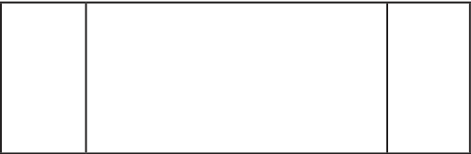

然而，使用伪代码来指定这样的序列会更加容易。

术语“伪代码”表示这种技术是一种代码，类似于程序中使用的代码。“伪”一词意味着，尽管这是一种与程序中使用的代码类似的代码，但它仅仅是代码的一种表示形式，而不是语言本身。

### 4. 程序开发过程

在任何过程中，完成任务的方法都有很多种。有些方法比其他方法更高效、更有效。例如，如果你想在后院挖一个游泳池，你可以拿出铁锹开始挖，也可以使用为这项任务设计的重型机械设备。两种方法都能完成工作，但第二种方法更高效、更有效。同样的原则也适用于编程。

程序开发过程是在开发程序时推荐遵循的一系列步骤。它包括以下六个步骤：

- 定义问题；
- 设计算法；
- 编写程序代码；
- 测试和调试程序；
- 实施程序并培训用户；以及
- 维护和升级程序。

这个列表没有将文档编写列为单独的步骤；不过，文档编写是所有步骤中的重要要求，下面将逐一讨论这些步骤。尽管每个步骤都被描述为一个独立且不同的过程，但它们都是相互关联的；在实际操作中，各步骤之间可能没有明确的界限。下面我们来讨论程序开发过程所有步骤的共同主题——文档编写。

### 5. 文档的重要性

**i. 文档**是提供有关程序中特定步骤或指令的具体说明，或记录其目的或功能的文本或图形。编程过程中的每一步都应该编写文档。文档有时是在事后才编写的，而不是作为项目持续进行中不可或缺的一部分。采用这种方式，文档工作可能会变成繁重的文书负担。如果从项目一开始就制定并遵循文档编写规范，从长远来看，这一过程将花费更少的时间和精力。

为程序开发过程编写文档有两个充分的理由。第一，文档留下清晰的记录，让其他人能够了解所做的工作。在商业环境中，这份记录极为重要，因为日后纠正错误或修改程序的人很可能不是最初设计或编写程序的人。

第二，在开发过程中记录各个步骤，会促使人们重新审视所采取的行动。这样也许能及早发现问题，避免日后进行代价高昂的修改。即使编程只是为了自己使用，文档也很重要。

文档要有价值，就必须清晰、简洁，并且可供需要的人使用。许多组织都设有文档库，授权人员可以在其中查阅所有文档的副本。


在程序开发过程中，会保留多种类型的文档。以下是其中的一些：

- 程序规格说明；
- 程序描述；
- 程序设计图表（流程图、伪代码等）；
- 所做测试及所发现错误的描述；
- 操作员手册（用户指南）；
- 维护文档。

程序规格说明描述程序预期要实现的目标：它们帮助程序员设计程序。程序描述详细说明完成的程序实际所做的事情。程序设计图表概述程序中用于产生预期结果的具体步骤。所进行的测试类型、使用的数据以及发现的错误通常记录在单独的文档中。如何操作程序的细节在操作员手册中呈现。维护文档是程序所做更改的记录，并包含对这些更改的详细解释。

所保留文档的类型取决于每个编程部门的不同需求。

请记住，程序开发过程中的每一步都应妥善记录，下面让我们逐一了解六个步骤。

## 第 1 章
### 关于 C
### 目录

- 1.1. C 语言的演变 ................................................................. 8
- 1.2. 编程语言概述 ........................................ 9
- 1.3. C 程序的结构 .......................................................... 10
- 1.4. 编译 C 程序 ............................................................... 11
- 1.5. 编译器与解释器 ........................................................... 11
- 1.6. 通过伪代码构建逻辑 ............................................ 12
- 1.7. 一个简单的 C 程序 ...................................................................... 13
- 1.8. C 语言中的字符集 .......................................................................... 16
- 1.9. C 语言中的关键字 ................................................................................ 16
- 1.10. 运算符的层次结构 ................................................................. 16
- 1.11. 应做与不应做 ............................................................................. 17
- 1.12. 小结 ....................................................................................... 17

这种一致性可归因于它是一种由单一人开发的语言。这或许解释了它可靠、简单且易于使用的原因。尽管它一直与 UNIX 操作系统联系在一起，但它并不依赖于任何特定的操作系统，而是向许多不同的环境敞开怀抱。

正如自然规律所说，所有奇妙的事物都难免有一些瑕疵，C 语言也不例外；在遇到文件处理时，它会遭遇挫折。另一个小限制是 C 语言没有用于输入和输出操作的命令，这些操作必须通过使用标准 C 函数来完成。

尽管存在这些缺陷，C 语言仍然凭借其友好的使用环境和可靠性在广大用户中广受欢迎。这就是为什么程序员第一眼就会迷恋上 C 语言，并最终深深爱上这门语言。

##### 1.2. 编程语言概述

当两个或更多的人相互交谈时，他们之间有一个共同点，那就是语言。语言就像你呼吸的空气或吃的食物一样重要，因为它是人们不可或缺的东西。同样，由于计算机是一台机器，无法理解你的方言，因此必须有某种与之交互的方式。它需要一种指令媒介，而你必须找到一种能将指令传递给它的方式。

可以用来编写计算机程序的语言有很多，其中最原始的是机器语言。机器语言是各种各样系统化的、难以理解的指令的集合，这些指令影响计算机的内部运作。简而言之，要让计算机执行特定操作，必须对一组语句进行编码。

机器语言现在已很少使用，也可以说它已经“灭绝”了，原因有很多，其中之一是使用它非常费力，另一个原因是每台计算机都有自己的指令集。那么什么取代了它呢？现在用于与计算机交流的语言被称为高级语言。

高级语言之所以比机器语言更受青睐，是因为高级语言中的一条语句相当于机器语言中的多条指令。这类程序具有高度的可移植性，即在一台计算机上运行的程序可以以极少的改动或无需改动就能在不同的计算机上运行。

在高级程序中，指令被提供给计算机。

##### 1.4. 编译 C 程序

编写、编译和执行一个 C 程序包含不同的步骤，下面将讨论这些步骤。在开始这项尝试之前，必须提醒一点：C 语言兼容多种不同的操作系统，如 DOS 和 UNIX。

在这些环境中执行程序的步骤各不相同。下面讨论这两个平台所需的不同步骤。

Turbo C 中涉及的步骤：

- 1. **步骤 1：** 打开 C 程序。当系统就绪并打开一个屏幕（文本编辑器）后，从主菜单中选择文件（ALT + F），然后选择 NEW。完成此操作后，会出现一个新屏幕。每当你第一次进入 Turbo C 文本编辑器时，默认会打开一个新文件，你就可以开始编写程序了。
- 2. **步骤 2：** 编译 C 程序。程序编写完成并准备执行后，会进行编译以检查是否有错误。（ALT + C）编译由编译器完成，它将程序指令转换为机器语言。如果程序中存在任何错误，编译会立即停止。
- 3. **步骤 3：** 错误检查。只有在编码存在错误时，此步骤才会出现。错误可能在语言的语法或语义方面，而且可能各不相同。会显示错误所在的行和错误类型。一旦错误被纠正，程序将再次编译。此过程一直持续到程序无错误为止。
- 4. **步骤 4：** 运行程序。一旦程序被声明为无错误，你必须运行程序（CTRL + F9）以显示结果。
- 5. **步骤 5：** 显示输出。只有程序编译并执行后，才能显示程序输出（ALT + F5）。

##### 1.5. 编译器与解释器

你能想象两个来自不同国家、不懂彼此方言的人开始交谈时会引起的混乱吗？那么计算机这台机器又是如何理解、响应并执行你口述的指令的呢？答案是使用编译器和解释器。

简单地说，编译器和解释器充当用户与计算机之间的翻译。有些人不了解的是，计算机只能理解机器语言，即 0 和 1。

编译器或解释器将编程语言翻译成机器语言，用机器语言进行必要的计算，一旦得到结果，再将其翻译回编程语言。

编译器或解释器本身也是一个程序，每台计算机都必须有自己的编译器或解释器。只是两者翻译程序的方法不同。编译器在翻译时，会取整个程序，进行翻译，然后将其结果输出。

另一方面，解释器将程序分解为语句，并逐条翻译这些语句。尽管每台计算机都必须拥有针对特定高级语言自己的编译器或解释器，但在开发新程序时，使用解释器比使用编译器更可取。

##### 1.6. 通过伪代码构建逻辑

俗话说，好的计划是成功的一半。类似地，在 C 语言中，在开始编写程序之前，你必须规划好打算使用的策略。

简而言之，必须组织好程序的骨架或代码框架，以便将全部注意力集中在程序的逻辑上。一旦确定了程序策略，就可以重点关注与各条语句相关的细节。这种攻击线路通常被称为自顶向下方法。对于大型程序，这一整个过程可能会多次重复。

自顶向下方法可以通过逐步形成一种非正式大纲来实现，其中包含部分用英语、部分用 C 语言书写的语句。在程序开发的初期阶段，对 C 语言的需求很小，仅限于主要程序组件。辅助细节随后用英语提供。由此产生的细节称为伪代码。

在你的例子中，你会遇到一个为计算给定本金的单利而编写的伪代码。公式为 SI = p*n*r/100，且 p、n 和 r 的值应请求用户输入。这里，'p' 代表本金，'n' 代表年数，'r' 代表利率。


现在你已经将程序拆分成零零碎碎的部分，你可以把它们组合起来并设计一个解决方案。这个粗略的解决方案帮助你创建详细的可执行格式，被称为伪代码。针对上述问题的合理伪代码可以基于以下框架。

```
/* Finding out the simple interest */
main()
{
variable declaration (p, n, r)
accept values for p, n, r from the user
calculate a value for si
display the computed value of si
}
```

上面的脚本是对给定问题需要做什么的粗略概述。但程序不能基于此制定，因此对上述语句的详细表示是必不可少的。详细的伪代码可以按下一页所示编写：

```
/*finding out the simple interest*/
void main()
{
/* declare p, n, r, sum, si as floating-point variables*/
/* request a value for p and read its value*/
/*request a value for n and read its value*/
/* request a value for r and read its value*/
/* calculate sum= p*n*r */
/* calculate si= sum/100 */ /* display the value in si */
}
```

上述伪代码是对求算简单利息涉及的不同步骤的详细描述。以上是一个逻辑，可以根据其语法用各种语言实现。

##### 1.7. 一个简单的 C 程序

在着手编写 C 程序之前，有一些经验法则必须在所有情况和环境下严格遵守。

定义以下任何一条法则都会导致一个不可执行的程序。

###### 必须遵守的规则

- 程序以 `#include <stdio.h>` 开始。稍后会对此进行更多讨论。
- 程序的代码写在名为 `main()` 的函数内。只要记住每个程序都必须以 `main()` 开始。
- 整个代码写在一对大括号 `{}` 内。
- 开括号紧跟在 `main()` 之后。闭括号放在程序末尾，表示程序已结束。
- C 有 32 个关键字不能用于任何其他目的，甚至不能作为变量名。
- C 是区分大小写的，即 `printf()` 与 `print()` 不同，但通常 C 程序以小写书写。所有关键字都必须小写。
- C 程序中的所有语句都以分号结束。

这些是解决 C 程序时必须保持的基本理念。

现在你已经熟悉了游戏规则，你可以认真对待你的业务，并查看一个基本的 C 程序，这将帮助你感受一下。

你将要进行的程序是在屏幕上显示你选择的任何语句。

```
/* This program prints a simple message. */
# include <stdio.h>
void main()
{
printf(" C Through your mind.\n ");
}
```

当上面的程序编译并执行时，输出显示如下：C Through your mind. 如果在凝视上面的程序后你感到头脑发晕，没有理由担心，因为帮助即将到来。你现在将分解上面的程序并仔细研究每个部分，从第一行开始。

###### 7.1. 注释语句

注释语句帮助你识别程序的目的。注释语句可以在程序中的任何地方使用，每当需要对特定语句进行解释或如果需要稍后引用有关该语句的信息时。

注释语句以斜杠后跟星号 (`/*`) 开头，以星号后跟斜杠 (`*/`) 结束。编译器忽略注释，并且这种类型的注释对程序没有影响。

`#include<stdio.h>` 语句是一个必须出现在每个 C 程序中的陈词滥调语句，但它不是强制性的。程序可以在没有此语句的情况下执行，但被认为是一种良好的编程实践来附加此语句。

`main()` 函数：主函数是每个 C 程序都必须的原初函数。整个 C 程序都写在这个主函数内。稍后本书将讨论更多关于函数的内容。

一对括号始终跟在 `main` 关键字之后。大括号打开和关闭程序的代码。在打开和关闭大括号之间是整个复合语句。一旦应用了闭合大括号，它就表示 C 程序的结束。

输出函数：C 中使用的格式化输出函数是 `printf()`。此函数的目的在于显示用户所需输出。为此，所需字符写在引号内。

例如，`printf("Welcome in Dr. Dharm’s World \n");` 上述函数插入 C 程序中时，会显示引号内的消息。引号内的消息按原样显示，并且不会对程序产生任何影响。`\n` 使光标跳到下一行。`printf` 语句的另一个功能是它可以用来要求用户输入程序将用于计算的数据。

假设需要相加两个数字，并且两个值需要通过键盘从用户请求。然后对两个值的请求以以下方式进行：

例如，`printf("enter the value for x:");`

`printf("enter the value for y:");`

输入的值随后以稍后在会话中讨论的方式被计算机接受。

语句终止符：分号促进了 C 编程中语句的终止。这向计算机表明语句已结束，此后的任何内容都不应被考虑。每个复合语句的末尾必须有分号。

##### 1.8. C 中的字符集

C 中的字符集具有众多创新和革命性的解决方案。字符表示用于表示信息的任何字母、数字或特殊符号。你都熟悉字母（A 到 Z 和 a 到 z）和数字（0 到 9）。特殊符号是应重点关注的。為了你更好地辨识，特殊符号列在表中。

不用担心字符的庞大，因为这些是你日常生活中遇到的符号。

| The C Character Set Table |
|---|
| `+` | `*` | `\\` | `"` | `<` | `#` | `(` | `=` | `\|` | `{` | `>` | `%` | `0` | `)` | `~` | `;` | `]` | `/` | `^` | `_` | `[` | `:` | `.` | `?` | `&` | `_` | `]` | `'` |

##### 1.9. C 中的关键字

C 中的关键字是一组预定义词，其功能已向编译器表达，并且每当被调用时它们都会以极大的舒适度完成其任务。记住关键字不能用于除其定义以外的任何功能，甚至不能作为变量名。如果你违背这种行为准则，它将导致为关键字赋予新的含义，而计算机不允许这样做。

C 中有 32 个关键字，在程序的各个点使用以推动语言的熟练程度。下面描述符是一个表，包含所有关键字，供你快速参考。

详细描述将在需要时给出。

| Keywords in C |
|---|
| auto | double | int | struct |
| break | else | long | switch |
| case | enum | register | typedef |
| char | extern | return | union |
| const | float | short | unsigned |
| continue | for | signed | void |
| default | goto | sizeof | volatile |
| do | if | static | while |

##### 1.10. 运算符的层次结构

你一生都在根据其权力和效率对人和事物进行优先排序。好吧，C 也不例外于这一传统，并将其运算符沉降到三个不同的优先级区域。

简而言之，如果一个等式中有许多运算符，C 会决定哪个运算先执行，然后是下一个。例如，表达式 `4 * x − 5 * y` 对应于 `(4x) − (5y)` 还是 `4(x − 5y)`？为了解决这些疑问，必须对下面列出的运算层次结构有深刻的了解。

| Priority | Operators |
|---:|---|
| First | `*`, `/`, `%` |
| Second | `+`, `−` |
| Third | `=` |

##### 1.11. 应该做和不应该做

要在 C 中编程受益，必须在某些规定下玩游戏，否则可能会被罚红牌。也就是说，必须安全地玩游戏以确保更好的结果。因此，要与 C 合作，必须牢记所设定的界限。下面列出了一些编程 C 时有帮助的应该做和不应该做。

- **Do’s:**
  - 主函数是第一个函数，并且对所有程序都是强制性的。
  - C 程序的主体必须用一对大括号括起来。
  - `main` 内的所有语句都必须以分号结束。
- **Don’ts:**
  - **忘记初始化变量：** 在 C 中，变量不会自动初始化，因此在使用变量之前未能初始化变量可能会导致不可预测的行为和代码中的错误。使用变量之前始终初始化变量，以避免意外结果。
  - **不要忽略编译器警告：** C 编译器通常会提供有关代码中潜在问题的警告。忽略这些警告可能导致微妙的错误甚至程序崩溃。始终注意编译器警告并解决它们，以编写健壮、无错误的代码。

##### 1.12. 总结

C 中的程序通常以小写书写。C 指定的关键字不能用作变量名，也不能用于除其指定目的之外的任何其他目的。


这些关键字必须仅以小写形式书写。通过 print 语句显示的消息不能没有引号。最初，你获得了关于 C 语言演变的简要细节。

接下来是对编程语言性质的简要概述，特别是 C 程序的结构。随后，讲解了编译 C 程序的过程，之后还简短讨论了编译器与解释器。

提到了伪代码，然后对一个示例 C 程序进行了分解与讲解，接着你了解了表格格式、字符集、关键字以及运算的优先级。最后，在本次课程结束时，你了解了游戏规则。

#### 再次回顾：

填空：

- 1. C 程序中的所有可执行语句必须以 ____________ 结尾。
- 2. C 程序是用 ____________ 大小写编写的。
- 3. C 语言中的关键字以 ____________ 大小写编写。
- 4. C 语言是由 ____________________ 开发的。
- 5. C 语言中的格式化输出函数是 ________________。

#### 判断正误：

- 1. C 语言中的关键字是一组预定义词。
- 2. C 语言是从 BPCL 演变而来的。
- 3. C 程序可以在没有 main() 函数的情况下编写。
- 4. C 语言中有 35 个关键字。
- 5. 注释语句在执行期间对程序没有影响。

#### 一句话回答：

- 1. 典型的 C 程序有哪三个主要部分？
- 2. 什么是伪代码？
- 3. 编译器和解释器之间有什么区别？

在上一节或章节中，你已经了解了 C 语言的基础知识。在本节中，你将处理构成 C 语言核心的关键问题。正是这些问题支撑起了 C 语言这座坚固的堡垒。

##### 2.1. 基本数据类型

C 语言博大精深，支持多种不同类型的数据，每种数据在内存中都以不同的方式表示。内存中的数据可以是整数类型、字符类型或带小数点的整数类型。每当程序中用到整数或字符时，计算机必须能够识别在内存中的何处存储它。试想一下，如果字符被存储到了整数的位置，那会引起怎样的混乱。为了避免这种情况，这里只包含了基本数据类型及其内存需求。为了更好地理解 C 语言编程的基础知识，下面以表格形式展示了基本数据类型。

###### 2.1.1. 数据、描述、内存范围

int 整数 2 字节 −32768 到 +32768，%d、%i；char 字符 1 字节 0 到 255，%c、%s；float 带小数的数字 4 字节 1.0E-37 到 1.0E+37，%f；double 带大范围小数的数字 8 字节 2.2E-308 到 2.2E+308。既然数据类型已经以一种非常易于理解的方式呈现，你可以逐一查看每种数据类型。int 这种数据类型仅用于存储整数，不能处理分数或带小数的数字（图 2.1）。

| 类型 | 字节 | 取值范围 |
|---|---:|---|
| int | 2 或 4 | -32,768 到 32,767 |
| unsigned int | 2 或 4 | 0 到 65,535 |
| signed int | 2 或 4 | -32,767 到 32,767 |
| short int | 2 | -32,767 到 32,767 |
| unsigned short int | 2 | 0 到 65,535 |
| signed short int | 2 | -32,767 到 32,767 |
| long int | 4 | -2,147,483,647 到 2,147,483,647 |
| signed long int | 4 | -2,147,483,647 到 2,147,483,647 |
| unsigned long int | 4 | 0 到 4,294,967,294 |

**图 2.1.** C 语言编程中的数据类型。

int 能处理的数字范围为 −32,768 到 +32,768。在大多数计算机上，int 需要 2 字节内存。char 数据类型用于存储单个字符或字母，只需要 1 字节内存。大多数编译器允许 char 数据类型的范围为 0 到 255。float 数据类型用于保存浮点数，简单来说，就是用于存储带小数的数字（例如 67.25）。float 需要 4 字节存储空间，小数精度为 6 位。double 数据类型也用于保存浮点数。区别在于精度和存储空间。double 提供更高的精度，约 15 位数字，编译器需要 8 字节来存储 double。float 可表示的取值范围分别是 2.2E-308 和 2.2E+308。

##### 2.2. 用于基本数据类型的限定符

你已经了解了基本数据类型是什么。简化地说，限定符可以看作是基本数据类型的“类固醇”，也就是说它们是增强剂。通过使用这些限定符，可以增强数据类型的效率，扩展基本数据类型的使用范围，使其更加灵活和适应性强，能够精确、准确地应对各种情况。

添加到数据类型上的限定符有 LONG、SHORT、SIGNED 和 UNSIGNED。要将任何数据类型变为限定符，需要将限定符的名称放在数据类型之前。

long 限定符，顾名思义，会扩展其前缀数据类型的取值范围。它只能应用于 int 和 double 数据类型，可将取值范围从 −2,147,483,647 扩展到最大 2,147,483,647。long int 需要比普通 int 更多的内存，因此占用 4 字节存储空间。要使整数成为 long 限定符，只需在其前面加上 long。

short 这个限定符最有趣，因为如果普通 int 与 long 具有相同的内存大小（即 4 字节），那么 short 将有 2 字节；但如果 int 有 2 字节内存，那么 short 将有相同的内存，即 2 字节。

使用 signed 数据限定符后，该数据类型可以容纳正数和负数。当变量是有符号时，其正负范围与常规 int 相同。默认情况下，int 是有符号数据类型。

unsigned 限定符主要用于 int，并且它具有与普通 int 相同的内存需求，即 2 字节。所以，你可能会问，两者之间的区别在哪里？区别在于它所提供的范围。这个限定符所拥有的范围是普通 int 的两倍。具体来说，unsigned int 的范围从 0 到 65,535。

现在可能困扰你的另一个疑问是 unsigned 和 long 之间的区别。一个需要牢记的重要事实是，与 long 不同，unsigned int 不能存储负数。unsigned int 可以应用于其他 int 限定符，例如 unsigned short int 和 unsigned long int。

##### 2.3. C 语言中的变量

假设你有一些钱，想把它存放在一个安全的地方。你能想到的最好的地方就是银行，你把钱存在你的账户里，账户有一个 ID 号码。因此，每当你想取钱时，只需出示该 ID，银行工作人员就能确认你的钱在那个特定账户中。

类似地，你有一个数字，需要把它存放在某个安全的地方，以便在需要时可以检索和使用。在这里，你把它存储在内存中（银行）。好，那么你已经把数字存储到内存中了。但是存储在哪里呢？之所以会产生这样的疑问，是因为内存非常广阔，一个小数字可以存储在任意位置。为了确定它存储在哪里，你可以为这个位置命名（账户），这个名字就叫做变量名（账户 ID）。每当需要使用这个数字时，就可以通过变量名从内存中调用它，这帮助计算机识别数字存储的位置，提取该数字并用于计算。这些位置可以容纳整数、实型常量或字符，但一次只能容纳一个。分配给整数的位置只能容纳整数，不能容纳其他任何类型。其他类型也是如此。

下面给出有效示例：

- - **示例 2.1：** 变量名的第一个字符必须始终是字母。在上面的示例中，你可以看到它们都以字母 c 开头。变量名中不要包含逗号、空格或特殊符号。只允许使用下划线。（不公平吧？）既然你已经创建了一个变量名，计算机如何理解该变量将包含整数、字符还是浮点数呢？


好吧，除非你告诉它，否则它什么都不懂，大家！那么现在你怎么告诉它呢？要指定要存储的类型，你在变量名之前指定数据类型（即整数用 `int`，带小数点的数字用 `float`，字符用 `char`）。

请看下面：

```c
int e_sal; float da; char e_name;
```

这里 `e_sal`、`da`、`e_name` 是不同的变量名。虽然程序员决定变量名，但最好始终使用有意义的变量名。例如，在上面的例子中，`e_sal` 表示员工薪水，`da` 表示生活津贴，`e_name` 表示员工姓名。

##### 2.4. 类型声明

人们可能倾向于认为类型声明只是 C 技术术语海洋中的又一滴水，并倾向于对它视而不见，但事实并非如此。你知道 C 使用变量（a、b、x、y 等）。这些变量可以被分配为任意一种数据类型，即变量可以被分配存储整数或浮点数（如果你忘了，就是带小数的数字）或字符。

将数据类型分配给变量的过程称为类型声明。类型声明必须在程序开始时在大括号打开后进行。类型声明过程使 C 编程变得非常简单，因为一旦变量在开头声明，同一个变量就可以在程序中任意多次使用，每次其数据类型都与开头声明的一样。

- **示例 2.2：** 假设 `x` 是一个变量并且已被分配数据类型 `int`。这意味着变量 `x` 在程序中无论何处被调用，都只能存储整数。`int sal;` 如果有多个变量需要分配相同的数据类型，可以让它们跟在数据类型之后，而不是在每个变量前加上数据类型名。

例如：

```c
int sno, cno, hno; float sal, id; char sname, cname;
```

在执行类型声明任务时必须遵守一些规则。

###### 2.4.1. 类型声明规则

- 所有数据类型都是关键字，它们应始终以小写书写，并且不能用作变量名或用于其他任何目的（参见规则）。
- 数据类型应按上面所示书写，而不是其全称，即 `int` 不能写成 `integer`。
- 所有声明必须在第一个可执行语句之前完成。
- 所有声明必须以分号结束。

##### 2.5. 输出函数

C 中使用的格式化输出函数是 `printf()`。此函数的目的在于显示用户期望的输出。为此，期望的字符写在反引号内。

例如：

```c
printf("Welcome in Dharm's World \n");
```

当上述函数插入 C 程序中时，会显示引号内的消息。引号内的消息按原样显示，并且不会对程序产生丝毫影响。

`\n` 使光标跳到下一行。打印语句的另一个功能是它可以用来要求用户输入程序所需的数据，该数据将在程序中用于计算。假设需要将两个数字相加，并且两个值需要通过键盘从用户处请求。那么对两个值的请求将以以下方式进行，例如：

```c
printf("enter the value for x: ");
printf("enter the value for y: ");
```

输入的值随后以稍后在本次课程中讨论的方式被计算机接受。

##### 2.6. 输入函数和格式说明符

在你第一次接触简单 C 程序时，你遇到了输出函数 `printf()`。现在你必须为输入函数让路，它被称为 `scanf()` 函数。你已经知道 `printf()` 可用于通过键盘向用户请求数据。

到目前为止一切都很好，但谁来接受输入的字符呢？`scanf()` 来做。它的做法相当引人入胜，这肯定会让你着迷（如果不是困惑的话）。发生的情况是 `scanf()` 使用了所谓的格式说明符，它们有助于输入过程。格式说明符是分配给不同数据类型的特殊符号。这些格式说明符根据变量在开头分配的数据类型提及在 `scanf()` 的括号中。此外，在括号中还提及了变量名，其前面加上 `&` 符号（图 2.2）。

| 函数 | 描述 |
|-----------|-------------|
| `scanf()` | 此函数用于从控制台读取一个或多个用户输入。 |
| `sscanf()` | 此函数用于从字符串中读取字符并将它们存储在变量中。 |
| `printf()` | 此函数用于在控制台向用户显示一个或多个输出值。 |
| `sprintf()` | 此函数用于读取存储在不同变量中的值并将这些值存储在字符数组中。 |

*图 2.2. C 编程中的基本函数。*

变量名前面加上 `&` 符号。它看起来像这样：

```c
printf("enter the customer number:");
scanf("%d", &cno);
```

这里 `%d` 是整数的格式说明符。

所有格式说明符必须用引号括起来。`&` 是强制符号，`cno` 是保存整数的变量名。一旦用户输入值，`scanf()` 就会识别输入字符属于哪种数据类型，并将其存储在内存的该位置（即在 `int`、`char` 或 `float` 中）。下面按其对应数据类型列出了一些符号：

| 格式说明符 | 描述 |
|------------------|-------------|
| `%c` | 字符 |
| `%d`, `%i` | 有符号十进制整数 |
| `%f` | 十进制浮点数 |
| `%s` | 字符字符串 |
| `%u` | 无符号十进制整数 |
| `%x` | 无符号十六进制 |
| `%p` | 显示指针 |
| `%%` | 打印 `%` 符号 |

##### 2.7. C 中的运算符

现在是学习 C 中运算符的合适时机。在你之前对 C 的探索中，你注意到 C 包含各种运算符。你将集中于运算符的基本构建块，并对其他运算符进行一些说明。

在执行除法运算时，如果商不是完美数字并且带有小数点，则除法在截断小数点后进行。你现在将进行一些量身定制的示例，这将帮助你理解运算符在不同数据类型中的作用。

- **示例 2.4：** 假设 `x` 和 `y` 是两个整数，其值分别为 9 和 4，那么对这些数字应用运算符将产生以下值。

```c
x + y = 13   x - y = 5   x * y = 36   x / y = 2   x % y = 1
```

##### 2.8. 一元运算符

如果这个名称的外观让你困惑，也不用惊慌。这只是另一个证明，看似令人困惑的事情实际上很基础的例子。有两个基本的一元运算符：自增运算符（表示为 `++`）和自减运算符（表示为 `--`）。你可能又在想两个加号或两个减号有什么作用。好吧，当自增运算符前缀于保存整数的变量时，它会使数字的值增加一。

同样，自减运算符会使值减少一。简单来说：

- **示例 2.5：** 如果你给整数 `a` 分配值 3，那么写 `++a` 就相当于写成 `a = a + 1`。因此，`a` 的修改后值为 4。同样，`--a` 意味着 `a = a - 1`，其修改后值为 2。另一个值得提及的运算符是 `sizeof` 运算符。如名称所示，每当此运算符前缀于操作数时，就会返回操作数以字节为单位的大小。

假设 `x` 是整数，`y` 是浮点数，那么 `x` 和 `y` 的大小可以按如下方式确定：

```c
#include<stdio.h>
void main()
{
    int x;
    float y;
    printf("integer: %d", sizeof x);
    printf("float: %d", sizeof y);
}
```


| < | 小于 |
| <= | 小于等于 |

图2.4 关系运算符和逻辑运算符。

##### 2.10. C语言中的常量

在你之前学习C语言的过程中，你可能已经注意到一个常见现象：所讲解的过程能帮助你对该主题有一个相当清晰的认识。你现在将要学习的这个特定概念只是帮助你创建捷径，使C语言编程变得像系鞋带一样简单。在C中创建常量是为了使它们可以在程序中任意次数地使用。例如，如果在计算中需要使用符号pi，那么你必须将pi声明为实型常量，并赋予它值3.14285714。因此，每当程序中需要用pi进行计算时，你只需用pi来指代，而不必使用完整的数字（例如，24 * pi + 35 * pi）。C常量可以分为两大类：基本常量和次级常量。

C常量的进一步划分如下所示：
C常量
基本常量
整型常量
实型常量
字符常量
次级常量
数组、指针、结构体、联合体、枚举等。

在此阶段，讨论仅限于基本常量，即整型、实型和字符常量。为了建立这些类型的常量，已经制定了一些必须付诸实践的准则。

##### 2.11. 一个C程序

既然你已经学会了这门技艺的诀窍，是时候将它们付诸实践了。简而言之，各位，表演时间到了！你现在将编写一个C程序，它将使用你所获得的大部分技能。下面的程序将充满变量、数据类型、输入/输出函数以及其他一些细节，待程序完成后这些细节将得到解释。为了方便起见，行号已标出，但这些行号不会出现在C程序中。满载着技术术语，你将通过尝试你的第一个C程序来扩展你的知识。在你真正动手之前，花点时间回顾一下上述12个要点。

这是必不可少的，因为所有你认为乏味无趣的内容实际上将在塑造你的程序时发挥关键作用。你面前的是一个非常简单的小程序，它将帮助你掌握C程序的基本功能。

```
/*示例：接受值并在屏幕上显示*/
#include<stdio.h>
void main()
{
int a,b;
printf("输入a的值：");
scanf("%d",&a);
}
```

##### 2.12. C语言中的常量

在你之前学习C语言的过程中，你可能已经注意到一个常见现象：所讲解的过程能帮助你对该主题有一个相当清晰的认识。你现在将要学习的这个特定概念只是帮助你创建捷径，使C语言编程变得像系鞋带一样简单。在C中创建常量是为了使它们可以在程序中任意次数地使用。例如，如果在计算中需要使用符号pi，那么你必须将pi声明为实型常量，并赋予它值3.14285714。

因此，每当程序中需要用pi进行计算时，你只需用pi来指代，而不必使用完整的数字（例如，24 * pi + 35 * pi）。C常量可以分为两大类：基本常量和次级常量。C常量的进一步划分如下所示：

C常量
基本常量
整型常量
实型常量
字符常量
次级常量
数组、指针、结构体、联合体、枚举等。

在此阶段，讨论仅限于基本常量，即整型、实型和字符常量。为了建立这些类型的常量，已经制定了一些必须付诸实践的准则。

##### 2.13. 一个C程序

既然你已经学会了这门技艺的诀窍，是时候将它们付诸实践了。简而言之，各位，表演时间到了！你现在将编写一个C程序，它将使用你所获得的大部分技能。下面的程序将充满变量、数据类型、输入/输出函数以及其他一些细节，待程序完成后这些细节将得到解释。为了方便起见，行号已标出，但这些行号不会出现在C程序中。满载着技术术语，你将通过尝试你的第一个C程序来扩展你的知识。在你真正动手之前，花点时间回顾一下上述12个要点。这是必不可少的，因为所有你认为乏味无趣的内容实际上将在塑造你的程序时发挥关键作用。你面前的是一个非常简单的小程序，它将帮助你掌握C程序的基本功能。

```
/*示例：接受值并在屏幕上显示*/
#include<stdio.h>
void main()
{
    int a,b;
    printf("输入a的值：");
    scanf("%d", &a);
}
```

##### 2.14. 注意事项（Do’s and Don’ts）

在构造变量名时。

变量名的最大长度为8个字符（你最好坚持8个），并且只能由字母、数字和下划线组成（没有其他字符）。

- **应当**
  - **选择正确的数据类型：** 为你的变量选择适当的数据类型，以节省内存并确保程序高效运行。例如，对于整数使用int，对于浮点数使用float或double。
  - **使用括号以保持清晰：** 在编写复杂表达式时，使用括号来明确运算顺序。这有助于防止错误并使代码更易读。
- **不应**
  - **避免不必要的数据类型转换：** 尽量减少数据类型之间的不必要转换，因为这可能

– **避免除以零：** 始终检查并避免除以零，因为这可能导致运行时错误和崩溃。

– **不要不加小心地混合数据类型：** 在表达式中混合数据类型可能导致意外结果。确保兼容性，并在必要时使用显式类型转换。

###### 再来一遍：

填空：

- 1. 用于存储整数和字符的数据类型分别是 ________ 和 ________。
- 2. 无符号整型的范围从 ________ 到 ________。
- 3. 变量名的最大长度是 ________ 个字符。
- 4. ________ 使光标在输出语句中跳到下一行。
- 5. 对于变量的递增，使用 ________ 符号。

#### 判断正误：

- 1. 所有声明都应该在第一个可执行语句之前进行。
- 2. 声明以冒号结束。
- 3. 变量名的第一个字符不一定是字母。
- 4. 变量名只能由字母、数字和下划线组成。
- 5. 整数类型的格式说明符是%d。

#### 一句话回答：

- 1. C语言中有哪些不同类型的运算符？
- 2. C语言中的四种基本数据类型是什么？
- 3. 关系运算符有哪些不同类型？

# 第3章

## 控制语句

### 目录

- 3.1. 为什么需要控制语句？ ............................................................ 34
- 3.2. If语句 .............................................................................. 35
- 3.3. If-Else语句 ........................................................................ 37
- 3.4. for语句 .............................................................................. 38
- 3.5. While循环 .................................................................................. 39
- 3.6. Do While语句 ................................................................... 40
- 3.7. Break语句 ........................................................................ 41
- 3.8. Continue语句 .................................................................... 42
- 3.9. Switch语句 .......................................................................... 43
- 3.10. Goto语句 .......................................................................... 45
- 3.11. 三元运算符 ............................................................................. 46
- 3.12. 注意事项 ................................................................................ 47
- 3.13. 总结 ........................................................................................... 48


在熟悉了 C 编程的基础知识以及该做和不该做的事项之后，我想是我们该继续前进，挖掘让 C 如此主导的原因了。可以说最后两次课程只是预告片，而冰山剩余的部分从这里开始。然后有人可能会问，在第一课学习这么多有什么乐趣，以及我们什么时候才开始实践。你现在就开始实践了。本课程涉及 C 使用其工具来控制程序运行的情况，或者说它指导其语句在特定情况下如何行动。

### 3.1. 为什么需要控制语句？

嗯，这是一个有趣的问题。有人可能会问，既然 C 是一种如此全能的语言，拥有如此多的特性和规范，为什么还需要引入单独的控制语句呢。嗯，这很难说，但正如前面课程中提到的，由于 C 执行了如此多不同的功能，它需要一种管理体系来指示计算机何时执行何种功能。控制语句充当经理。你会被不同控制语句处理的函数数量所惊讶。

例如，在一个程序中，你可能有一个语句需要执行乘法运算，下一条需要执行加法运算，下一行之后可能有一个语句希望自己重复 8 次，而另一个语句可能希望自己被跳过并在稍后处理。

所有这些条件都由控制语句管理。你在上一课中已经瞥见了不同类型的控制语句，现在是深入其中的时候了。你在上一课中看到了控制语句的广泛分类，这里是它们所拥有的各种细分，用图表表示。

Control Statement  Sequence  Decision  Loop  Case  if  ifelse  while  dowhile  switch  goto  for

顺序控制结构是基本且不复杂的控制语句之一。想法非常简单。在顺序控制指令中，待执行的语句以串行方式一个接一个地执行。

C 编译器首先执行第一行，然后依次移动到下一行，整个程序都是以这种方式执行的。例如，如果第一个语句要求计算机执行数学运算，那么当编译器遇到该语句时，它会计算该运算并将答案存储在内存中，然后才进入下一行。决定！决定！决定！在任何地方任何时间做这件事都是困难的。之所以这是我们生活中最困难的活动，是因为在做出决定之前，无论对错，都必须权衡利弊，然后才能做出决定。

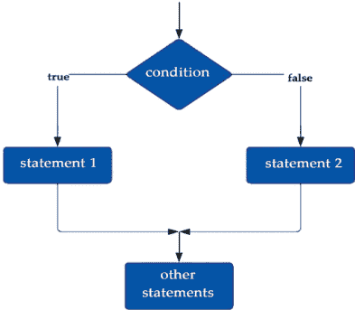

在遇到特定决策时，并没有即时公式或现成的决策可以采用。但 C 有。C 使用这些选项来应对特定情况。满足条件后即可得到结果。决策控制指令可在 C 中使用以下语句实现 The if statement The if else statement The conditional operators 现在让我们理解每个语句背后的概念（图 3.1）。

### 3.2. IF 语句

if 语句对跟随其后的特定条件做出反应。除非 if 后的条件得到满足，否则其后的语句将不会被执行。这就像一个人说“如果我被支付 100 卢比，那么工作就会由我完成。”

在上面的例子中可以注意到，如果该人被支付 100 卢比（即条件为真），那么工作才会被他完成，否则工作就不会被他完成（条件为假）。这里的条件是支付 100 卢比，如果条件为真则要执行的语句是，工作被完成。由于计算机无法辨别我们用普通英语写的内容，我们必须以计算机可理解的形式编写。一般格式如下所示：

if (此条件为真)

执行此语句；现在有人可能会问为什么只有单词 if 而不是其他单词。嗯，关键字 if 所做的是通知编译器其后跟随的是决策控制指令，如果括号中的条件为真，则执行其后的语句，但如果条件不满足，则不执行任何语句。

条件必须在括号内指定。为什么？因为一旦写下语句，括号跟随 if，编译器就会识别出这是一个条件，需要检查其真假。这是通过 C 的关系运算符（<, >, <=, >=, ==, !=）完成的。

使用这些关系运算符，我们可以比较两个值是否相等，或一个是否大于另一个，或一个是否小于另一个，等等。 x== y x 等于 y x!= y x 不等于 y x < y x 小于 y x > y x 大于 y x <= y x 小于或等于 y x >=y x 大于或等于 y 使用 if 的多条语句 上面解释的例子对于 if 之后的一条语句来说是好的。

但如果我们想在 if 之后执行多条语句，我们可以吗？以上面的例子我们可以解释说那个人说“如果我被支付 100 卢比，工作就会由我完成，我会定期工作，我会在 5 天内完成工作。”这里仅凭一个条件顺序执行了三个动作，即第一个动作是工作正在进行，第二个动作是该人会定期来，第三个是工作将在 5 天内完成。

现在出现了用 C 编写的问题。格式与上面解释的类似，只是稍有增加，即语句必须一个写在另一个下面，并且所有语句都必须用一对大括号括起来。一般格式看起来像这样：

if (此条件为真)

{

执行此语句；

执行此语句；

由用户输入并根据其数据类型存储在 Line 10 是条件检查语句，其中给定的条件被评估。这里比较两个数字并检查哪个更大。如果 a 的值大于 b，则执行第 11 行的输出函数并显示。

类似地，如果 b 的值大于 a，则执行第 13 行的输出函数并显示。嵌套 if else 在我们进入下一个概念之前，if 结构有一个小特性，有助于我们有效编程决策控制结构。简单来说，就是在 if else 中使用 if else。这就像你有两个同心圆，一个圆被包围在外圆内。

编译时首先检查外部 if 条件是否有效，如果为真则执行该语句，但如果为假则检查内部 if else 条件。也就是说，代替一个语句包含一个 if else。如果为真则执行该语句，但如果为假则执行最后一个 else 语句。嵌套 if else 的格式如下。在我们真正涉足复杂的各种循环语句之前，让我们先探究循环的更广泛方面。循环可以描绘为不断发生的事件循环。

例如，工人说罢工将继续进行直到我们的要求得到满足。以上意味着一个过程将继续进行直到满足条件。一旦条件满足，循环就终止。但在 C 编程中，它并没有看起来那么字面化。为了执行一次特定的迭代，必须分派一组语句，但幸运的是在 C 中，与其他语言相比，这些语句仅限于适量的语句。

有三种方法可以编码循环语句，并且可以有效地完成 For, While, Do while。

### 3.4. FOR 语句

for 在 C 编程世界掀起了一场叛乱。闻到 for 味道的程序员对其他品种视而不见。他们在 for 中找到了如此多的慰藉，以至于他们认为其余的只配暖棚。但是什么让 for 在大众中如此受欢迎？一个单一的循环语句。for 的特别之处在于，整个循环结构在之前的尝试中用了三行，现在被压缩成了一个孤立的语句。太棒了，不是吗？这就是 for


`for` 语句诱惑着许多对上述任何一种控制结构都已熟练的程序员。`for` 语句执行了三种功能，而此前这些功能需要在三条独立的语句中编写。它们是：

- 初始化
- 条件
- 递增

`for` 语句的一般格式为：

```text
for(initialize; condition; increment)
    execute this statement;
```

`Initialize`：此表达式将特定变量初始化为设定值，例如，`x = 0;` 或 `x = 1;`

`Condition`：此表达式为语句的执行设置条件，例如，`x < 9;` 或 `x <= 9;`

`Increment`：此表达式在每次条件满足前递增循环，例如，`x++`

在这三个表达式之间必须存在分号。

**Example 3.1:**

```c
/* program to display numbers from 0 to 10 */
#include<stdio.h>
void main()
{
    int i;
    for(i=0; i<=10; i++)
    {
        printf("%d", i);
    }
}
```

以上是一个简单的程序，用于显示 0 到 10 的数字。第 5 行看到变量 `i` 的声明，其类型为 `int`。第 6 行是我们需要集中注意的地方，因为 `for` 语句从这里开始。正如你所见，变量 `i` 被初始化为 0，`i` 的条件被提及，并且 `i` 的递增都在单个 `for` 语句中完成。当编写此语句时，`i` 被初始化为 0，条件被设定为它必须小于或等于 10，并且在执行下面的语句时每次都递增 `i`。第 8 行是输出语句，每当条件满足时就会执行。

#### 3.5. THE WHILE LOOP

现在我们对循环是什么有一个清晰的概述，我们可以逐一拆解不同的循环概念的复杂性，首先从 `while` 开始。与 `if` 语句相比，我们可以断言只有当条件为真时所需语句才会被执行；否则执行其他语句，但在 `while` 中，直到特定条件变为真，所需语句才会被执行。只要回忆一下前面提到的例子：直到我们的条件得到满足，罢工才会继续。这个概念将通过以下示例变得清晰：

```c
#include<stdio.h>
void main()
{
    int i=1;
    while (i<=20)
    {
        printf("%d", i);
        i++;
    }
}
```

由于你已经了解前几行，我们关注的重点将是循环结构。第一个循环语句，即第 4 行，是初始化语句，即它将变量设置为循环开始的特定值。Count 是变量，其初始值为 0。第 5 行是循环开始的地方。`while` 语句和条件也在这里提及。这里陈述的条件是直到 count 的值变为 10，才执行下面的语句。第 7 行是可执行语句，即直到条件满足，语句才会被执行。最后一个语句，即第 8 行，是一个新且重要的语句。使用它，我们递增循环；我们让编译器再次执行一次循环结构。每当编译器遇到此语句时，它就会被提醒它需要再次遍历循环一次。这是在条件满足之前完成的。

#### 3.6. THE DO WHILE STATEMENTS

在 `do while` 中，要执行的语句是在条件满足之前编写的。也就是说，只有当其后的条件得到满足时，特定的循环才会被执行。其格式可以如下表示：

```text
do
    this statement;
while (this condition is true);
```

`do` 和 `while` 之间可以有多个语句。以上示例可以在这里处理：

```c
/* program to display numbers from 0 to 10 */
#include<stdio.h>
void main()
{
    int i=0;
    do
    {
        printf("%d", i++);
    }
    while(i<=10);
}
```

这里除了交换语句之外，唯一的区别是变量的递增是在 `printf` 内部完成的。由于我们已经了解前几个语句，我们将继续到第 5 行，在那里像在之前的示例中一样进行初始化。这里变量 `i` 被初始化为 0 的值。来到第 6 行，`do` 语句在这里给出，后面跟着要执行的语句。`do` 语句以大括号开头。可执行语句是第 8 行的语句，即 `printf` 语句。需要注意的重要一点是递增语句包含在 `printf` 语句内。这后面跟着条件语句，即第 10 行，在那里检查条件。这里的条件是 `i` 的值应小于或等于 10。直到此条件得到满足，编译器才需要执行条件上面的语句。

#### 3.7. THE BREAK STATEMENTS

`break` 是 C 编程中一个有效的语句，因为它可用于在不满足条件的情况下退出循环。也就是说，`break` 通知控制，一旦遇到此语句，它应停止循环过程并跳转到循环后出现的第一个语句。在此，循环至少被处理一次，这意味着条件被评估并且语句至少被执行一次。

```c
#include<stdio.h>
```

```text
statement;
statement;
break;
case expression:
statement;
break;
default:
statement;
}
```

让我们分解上述格式并研究不同的部分。第一个语句是 `switch` 语句，后面跟着一对括号，其中给出单词 "choice"。它接受用户所做的选择。case 只能用整数或字符命名，其他任何东西都不行（甚至不是浮点数）。

- **Example 3.2:**
  - case 1
  - case 2
  - case 3 or
  - case a
  - case b
  - case c

根据用户所做的选择，该特定 case 中的可执行语句被激活。接下来要讨论的是 "case"。在其中每个 case 中，指定要执行的操作。每个 case 都有特定的一组要执行的语句。每当选择特定 case 时，case 中的语句就会被执行。

`break` 已经讨论过，但在 `switch` 语句中，`break` 的效率最好地体现出来。你已经注意到 `break` 语句被用在每个 case 的末尾。这是因为它通知控制，一旦 case 被执行，控制不应再继续进行。

`default` 在用户输入的选项与给定的 case 不匹配时接管。当与任何给定的 case 都找不到匹配时，`default` 中的语句将被执行。

```c
#include<stdio.h>
void main()
{
    char c;
    printf("Enter the alphabet: ");
    scanf("%c", &c);
    switch(c)
    {
        case 'a':
            printf("A is a vowel");
            break;
        case 'e':
            printf("E is a vowel");
            break;
        case 'i':
            printf("I is a vowel");
            break;
        case 'o':
            printf("O is a vowel");
            break;
        case 'u':
            printf("U is a vowel");
            break;
        default:
            printf("Is a consonant");
    }
}
```

#### 3.10. THE GOTO STATEMENT

顾名思义，`goto` 语句通过将控制重新分配到程序的另一部分来逆转程序执行的正常进展。`goto` 旁边写着一个标识符（任何字符名称），它告诉控制它应该停靠在程序后面标识符所在的位置。你应该在希望控制跳转到的位置写上相同的标识符名称。

一旦控制跳转到标识符，它就会执行标识符下面的语句。标识符也称为标签。它后面应跟一个冒号（`:`）。然而 `goto` 语句似乎很有用，但 `goto` 在编程中通常不被偏爱，因为它可能毁掉程序员的生活。

一般格式如下：

```text
goto identifier name;
```

标识符可以在 `goto` 语句之后以以下方式放置在程序的任何位置：

```text
identifier name:
executable statements;
```

```c
/* program using the goto */
#include<stdio.h>
main()
{
    int i;
    printf("enter the number");
    scanf("%d", &i);
    if(i==5)
        goto rep;
    printf("hello");
    rep:
    printf("bye");
}
```

在此程序中，一旦用户输入 `i` 的值并被计算机接受，条件即第 8 行就会被检查。如果条件，即值等于 5，变为真，则第 9 行的 `goto` 语句被执行，控制被传递到 `rep`，即第 11 行，并且由此语句被执行，即单词 `bye` 将被显示。如果条件不满足，控制会忽略 `goto` 语句并执行第 10 行和第 12 行的语句，即 `Hello` 和 `Bye` 都将被显示。

#### 3.11. TERNARY OPERATORS

在详细阐述了会话之后，还有一个小细节需要照顾。这被称为三元运算符，或它也被称为条件运算符。换句话说，可以称之为带风格的 `if else` 语句。它是一个非常简洁修改的 `if else`，可以这样说。

一般格式如下：


### 3.12. 应该做和不应该做

- **应该做：** *if* 语句仅在其后的条件为真时执行。条件应包含在一对括号内。条件后的语句应使用分号终止。在 for 语句中，初始化、条件和递增都在一对括号内完成。for 循环中各表达式之间必须使用分号。goto 中的标签后应跟一个冒号。
- **不应该做：** switch case 括号内的选择不能取浮点数。goto 应尽可能避免使用。

### 3.13. 总结

在上一节学习了 C 语言的要点之后，你在本节通过解读控制语句来[content]

### 3.12. 应该做和不应该做

- **应该做：** *if* 语句仅在其后的条件变为真时才执行。条件应包含在一对括号内。条件后的语句应使用分号终止。在 for 语句中，初始化、条件和递增都在一对括号内完成。for 循环中各表达式之间必须使用分号。goto 中的标签后应跟一个冒号。
- **不应该做：** switch case 括号内的选择不能使用浮点数。goto 应尽可能避免使用。

### 3.13. 总结

在上一节接触了 C 语言的要点之后，你在本节通过解读控制语句来提升了技能。本节从决策控制语句开始，即 if 语句，随后是 if 的变体 if-else。然后你进入了循环结构，学习了 while、do-while 和 for 语句。随后讨论了 case 控制结构，即 switch case。随后讨论了其余的语句，包括 break、continue、exit 和 goto，本节以条件运算符结束。

#### 再次回顾

**填空：**

1. 两种决策控制结构是 __________ 和 __________。
2. 为了使循环被调用，必须使用 __________ 语句。
3. 在 for 循环的表达式之间，__________ 是必须的。
4. 初始化、递增和条件都在同一语句中设置的循环结构是 __________ 循环。

#### 判断正误

1. 三元运算符也称为条件运算符。
2. 一般鼓励使用 goto 语句。
3. Break 语句用于退出循环。
4. 循环过程将一直继续直到条件满足。
5. switch case 必须有一个 default 语句。

#### 一句话回答

1. 循环控制有哪些不同类型？
2. switch case 的关键字有哪些？
3. 在 switch case 中使用 break 语句的必要性是什么？
4. for 循环相对于 while 循环的优势是什么？

# CHAPTER 4: 数组

### 目录

| 章节 | 页码 |
| --- | --- |
| 4.1. 数组简介 | 50 |
| 4.2. 数组的优点 | 50 |
| 4.3. 数组的类型 | 51 |
| 4.4. 数组声明 | 52 |
| 4.5. 数组初始化 | 52 |
| 4.6. 访问数组中的数据 | 53 |
| 4.7. 使用数组的简单程序 | 54 |
| 4.8. 内存中的数组 | 55 |
| 4.9. 多维数组 | 56 |
| 4.10. 字符数组 | 60 |
| 4.11. 数组溢出 | 61 |
| 4.12. 应该做和不应该做 | 62 |
| 4.13. 总结 | 62 |

### 4.1. 数组简介

在之前的课程中，你已经接触到使用变量在内存中存储特定数字或字符的各种方法。要实现这一功能，需要一个变量，如果使用 4 个数字，就需要 4 个变量。现在如果要存储 10 个数字呢？有人可能会说完全可能，但如果要存储 134 个数字并在需要时随时检索，这是否仍然可能？

有了数组就可以。你可能会问为什么一开始不使用数组？你需要对数据类型及其行为有基本的理解才能学习数组。此外，数组的概念依赖于其他数据类型，这些数据类型旨在在一个变量中存储大量数字。无法想象为单个数字创建数组并浪费内存中整块空间。这就像买了一打书，最终只用一本，其余的都扔进垃圾桶。

因此，数组可以定义为相似元素的集合。在此上下文中，只有当所有元素都是同一数据类型时才能形成元素数组，即它们全部都是整数或字符或浮点数，但不能存在一个容纳这些数据类型混合的数组。

### 4.2. 数组的优点

数组的使用对任何专业编程都至关重要。数组只是让程序员的生活变得轻松一些。乍一看，它免除了程序员必须为变量命名负担的烦恼。它们遵循老式的插槽架原则。数组是一个保存多个数据的单一变量。每个数据都通过其槽号引用。例如，如果你想存储一组项目，你只需将变量命名为“item”，然后通过引用 item(1)、item(2)、item(3) 等来存储数据。这听起来很简单，但使用数组可以完成的工作量是值得称赞的。

为了更好地了解数组的优点，请考虑一个简单示例：

```c
main()
{
    int a;
    a = 2;
    a = 4;
    printf("a=%d", a);
}
```

显示的值显然是 4，因为一旦给已有值的变量赋予另一个值，先前的值就会丢失。由此得出的推论是，没有数组，变量无法存储多个值。元素排列在数组后，任何位置的任何元素都可以轻松检索。使用数组，英文句子可以用你所说的字符数组存储，也称为字符串。

### 4.3. 数组的类型

在你深入使用数组的实质之前，如果对数组的分类有更多了解，了解它们分为多少种类型及其功能，对你不会有任何坏处。首先，数组大致分为两大不同类型：单维数组和多维数组。上述数组的这些分支的复杂性将在本节后面以详尽的方式处理。这里讨论的内容将纯粹是形式上的。

**单维数组：** 单维数组顾名思义，只处理一系列相似元素。也就是说，你只能有一行元素，单维数组的大小取决于程序员。

基本上，单维数组便于在一个变量中容纳许多相似元素。关于这一点将在后续章节中详细讨论，之后你将对单维数组有清晰的认识。

**多维数组：** 多维数组是两个或多个数组组合在一起。

它们可以是二维类型或三维类型或更多，但你可以将研究限制在二维和三维数组上。二维数组的一个例子是矩阵，因为与矩阵一样，二维数组有两个索引，一个表示行元素，另一个表示列元素。三维数组有所不同，因为第一个索引列出了二维数组的表数。剩下的两个索引与二维数组相似，因为一个用于行，另一个用于列。


### 4.4. 数组声明

术语声明到现在应该对你很熟悉了。正如你在之前的声明尝试中所做的那样，这里你声明一个数组，即编译器应该知道要创建什么类型的数组以及你希望它的类型和大小是什么。此外，当进行此声明时，它会指定给内存，已声明的空间量必须保留为储备以容纳该数组的元素。一般格式如下。

int sal [15]。int 如你所知指定了数据类型给编译器，而“sal”是赋予数组的变量名。直到现在一切都应该很熟悉。 [15] 是需要品味的部分。数字 15 表示需要容纳 16 个 int 类型的值，并且它们都以 sal 的名义存在。方括号 [] 表示计算机遇到了数组声明。随着数组维度的增加，方括号的数量也会增加。也就是说，二维数组将有两个对的方括号，三维数组有三个对的方括号，以此类推。

### 4.5. 数组初始化

声明数组的初始步骤已完成。你已为其命名变量并声明了其大小，但到目前为止数组是空的。它就像一个没有书的书包。同样，变量的声明已完成，但必须向其中传递一些值。你可能熟悉初始化普通变量，但如何初始化一个数组，其中一个数组变量中必须初始化多个值。输入数组数据：现在你已通过指定名称和大小声明了一个数组，你可以尝试探索数组中每个元素的个性，也就是说数组中每个元素是如何寻址的。

数组元素索引始终从 0 开始。Number[0] 第 1 个元素 Number[1] 第 2 个元素 Number[2] 第 3 个元素 Number[3] 第 4 个元素 这意味着 [0] 将保存第一个值，[1] 保存第二个，[2] 保存第三个 & 以此类推。如果你想访问数组“sal”的第四个元素，你必须写 sal [3]。你可以用下标替换数字，比如 i、a、x 等。因此，数组 sal 将写为：Sal [i] 变量 i 并非特定于任何元素，但可以一次引用数组中的各种元素。

```
for (i=0; i<=14;i++)
{
printf("enter sal");
```

```
scanf("%d, &sal[i]);
}
```

为了输入数据，你使用了一个 for 循环，通过它用户输入的元素数量被放置在数组中。当用户为 sal 输入第一个值时，它存储在 [0] 位置，然后使用 i++ 增加元素的位置，如果输入任何下一个元素，它将被放置在该位置，即 [1]。同样的过程一直持续到第 15 个元素输入后，条件不满足，循环被打破。上述初始化过程称为动态初始化，但这并不是初始化可以采用的唯一方式。

为了实现这一目标，C 描述了两种不同的方法：

- i. 静态初始化；和
- ii. 动态初始化。

### 4.6. 从数组访问数据

你已通过先初始化然后读入数组来将数据存储在数组中。如何取出它们以便使用它们。再次 for 循环出现在画面中并卸载所有元素，而不是像第一次那样加载。你已在名为 sal 的数组中输入了 15 个元素。假设你想找到数组中所有元素的总和。按照下面给出的步骤操作。

```
sum =0;
/* temporary variable */
for(i=0;i<=14;i++)
sum=sum+sal[i];
/* value of sal[i]added to sum*/ printf("sum=%f",sum);
```

for 从 [0] 开始卸载每个元素。第一次，[0] 位置的元素占据 [i] 的位置，当它与 0 相加时，其值进入 sum。接下来，[1]st 位置的元素替换 [0]th 位置的元素，它被加到已经有计算值的 sum 上并形成新的 sum。这一直持续到位置 14 的元素进入 i，最后打印出具有所有加总值之和的和。

### 4.7. 使用数组的简单程序

```
/*array program to find average marks of 5 students */
#include<stdio.h>

main()
{
    int i;
    int mar[5];
    float avg,add=0;
    for(i=0;i<=4;i++)
    {
        printf("\nenter the marks");
        scanf("%d",&mar[i]);
    }
    for(i=0;i<=4;i++)
        add=add+mar[i];
    avg=add/5;
    printf("\naverage=%f",avg);
}
```

上面的程序是一个简单的例子，用于在用户输入成绩后找到 5 名学生的平均成绩。数组名为 mar 在第 6 行声明，其下标变量也已声明 存储平均值和成绩总和的变量在第 7 行声明为 float，因为它们可以包含小数点 for 循环在第 8 行启动，用户输入的成绩将存储在数组中。 第 11 行接受用户输入的成绩。

第二个 for 循环可见于第 13 行。此 for 循环用于添加用户输入的所有值。加法过程发生在第 14 行。这和下一行被称为程序的逻辑。在此，第一个 for 循环取数组中 [0]th 位置的值并将其与 sum 相加，其当前值为 0，如初始化所示，并将其存储在变量 add 中。当这完成时，add 假设提交给它的新值并且旧值丢失。在下一次迭代中 I 的值

递增并获得 1st 位置的值，并且将其添加到已经具有计算数字的‘add’中，并且此加值附加到 add，后者丢失了先前的值。

上述过程重复直到条件不满足。总和然后除以元素数量，在第 15 行表示。并在随后的输出语句第 16 行中显示。

### 4.8. 内存中的数组

你必须对声明、初始化和检索数组的细节了如指掌。但在内存中会发生什么？元素是按串行顺序存储还是随机存储？为了解答上述疑问，考虑一个例子：

```
int sal[5];
```

当做出这样的声明时，内存中会发生什么活动？到现在你必须知道上述语句的作用。该语句表示要创建一个数组变量，它是整数数据类型，数组可以容纳 5 个元素。在内存中将保留 10 字节，因为每个整数将长 2 字节。直到数组用一些数字初始化，此数组将托管一些无关的数字。一旦数组被初始化，元素以连续的方式存储。

看下面的表格表示：

2012 2014 2016 2018 2020 10 20 30–40 50

在上面的表中，你可以看到用户输入的数字以连续模式注册，并且每个元素占用 2 字节。这正是它在计算机内存中的表示方式。元素位置下方的数字是该位置的地址，每个元素在内存中都有其唯一的地址，通过该地址进行标识（图 4.1）。

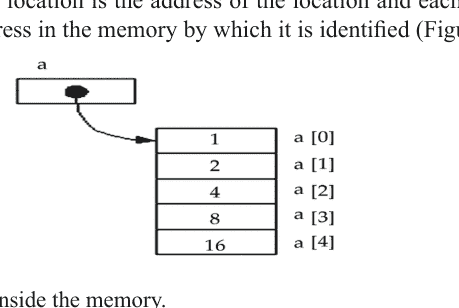

图 4.1. 内存中的数组。

### 4.9. 多维数组

到目前为止，主要关注的重点是一维数组。现在你进入模糊的领域。这句话可以争论，因为多维数组的定义模式类似于一维数组。唯一的差异在于多维数组需要为每个下标单独的方括号。也就是说，如果一维数组有一对方括号，二维数组将有两个对的方括号，三维数组有三个对的方括号，以此类推。

二维数组 二维数组可以被视为数组下的数组。如前所述，二维数组将有两个对的方括号。描述可以解释如下。

```
Data_type array_name [expression1] [expression2];
```

二维数组通常被称为矩阵。表达式一和二是在二维数组中持有的下标。因此，在上述表达式中，一将指定行，表达式，二将指定列，它们表示与每个下标关联的数组元素数量。

因此如果声明指出：

```
int arr[4][2]
```

它意味着一个名为 arr 的二维数组是整数类型并且有四行两列。其表示将如下：列号 0 列号 1 行号 0 1000 10 行号 1 2000 20 行号 2 3000 30 行号 3 4000 40。因此元素 arr[0][0] 将为 1000，元素 arr [3][2] 将为 30。其余数字可以通过查看上表来计算。在内存中，元素以顺序模式放置，使得 [0][0] 中的元素首先，后跟 [0][1] 中的元素，后跟 [1][0] 中的元素，以此类推。这里，每个整数元素也将占用两个字节。

初始化 2 维数组 初始化二维数组等同于初始化一维数组。

```
int sal[4][2]={{1000,10}, {2000,20}, {3000,30} {4000,40}}
```


```c
{
    for(j=0;j<2;j++)
    {
        printf("%d",m3[i][j]);
        printf("\n");
    }
}
```

上述程序将把存在于一个二乘二矩阵中的值与存在于另一个二乘二矩阵中的值相加。数组的声明在第 4 行完成，其中声明了三个二维数组。两个数组中需要插入值并进行相加，第三个数组中需要插入两个矩阵计算后的值。使用的下标是 i 和 j。正如你所知，二维数组有一个方括号表示行，一个方括号表示列，并且需要为它们各自插入值。

这是借助第 7 行和第 9 行所述的两个 for 循环完成的。第一个矩阵就是使用这些值形成的。对第二个矩阵执行类似的过程，for 循环位于第 15 行和第 17 行。现在你已经有了装载了值的两个矩阵，这两个矩阵需要相加并插入到第三个空数组中。为了完成这一壮举，再次召唤 for 循环，并且它们必须出现在用于相加的公式之前。这些 for 循环在第 22 行和第 24 行提到。第 26 行给出了程序的逻辑。一旦值被相加并插入到第三个数组中，该数组就需要被显示，输出语句在第 34 行解释，借助第 32 行和第 34 行的 for 语句。最后的 printf 语句带有“\n”使结果以矩阵格式出现。

你一定在想为什么程序中会充斥着大量的打开和关闭大括号。当程序中包含多个 for 循环时就会指定大括号。这表明跟随 for 循环之后的大括号内的语句仅特定于该特定 for 循环。

### 三维数组

三维数组与二维数组相似。不同之处在于它多了一对方括号，用来定义矩阵的表数。

因此，三维数组的声明如下：

### 4.10. 字符数组

这是数组的又一卓越特性，它将 C 的光辉提升到无尽的高度。到目前为止你只处理过整数数组，但这并不意味着数组的边界仅限于 int。C 如此灵活，以至于它也扩展到字符。它意味着数组也可以使用字符形成。这样的字符数组被称为字符串。字符串是一组按特定顺序排列的字符。

通过一个示例来看一下字符数组中的初始化过程：

```c
char name[10] = "MyDharm";
```

在上面的例子中，name 是一个数组，其元素容纳能力为 10，并且它保存一个名为 "MyDharm" 的字符串。第一个元素存储在数组 name 的 [0] 位。也就是说，字母 ‘M’ 将存储在 [0] 位，‘y’ 将在 [1] 位，以此类推直到 [9]。

可能会产生疑问，既然数组只能容纳 10 个值，却只输入了 7 个，剩下的会怎样？这里，由于只容纳了 7 个值，第 8 个值将是一个空字符(\0)，它表示字符串的结束。如果数组索引中有空位，这个空字符会自动放置在字符串的末尾。

在从用户处获取输入时，除非伴随特定的格式说明符，否则两个字符之间不能存在空白。为了容纳上述特性特征，初始化应该动态进行。

#### 动态字符初始化

你已经在本节早期处理过动态初始化的方法。只是为了刷新你的记忆，变量的初始化是通过用户通过动态初始化完成的，即初始化不是在程序中完成的，并且值在每次编译程序时都会刷新。

这个简单的例子解释了上述内容：

```c
/* program to accept characters from the user in an array*/
#include<stdio.h>
main()
{
char cap[10];
printf("Enter the capital of your country");
scanf("%s",cap);
printf("%s is the capital of your country",cap);
}
```

从第 5 行开始，因为前面的行必须很容易解读。第 5 行是数组的动态初始化发生的地方。它指示编译器创建一个可以容纳 10 个字符类型元素的数组。第 7 行根据第 6 行的显示语句接受用户输入的字符串。第 8 行从数组中检索存储的字符串并将其显示回屏幕。

字符数组动态初始化的另一个特性是它便于在字符串的字符之间包含空白。这可以通过以下方式更改 scanf 语句中的格式说明符来实现：

```c
scanf("%[^\n]", arrayname);
```

如果未指定上述语句，并且甚至尝试在字符串中插入空白，则字符串中存在的字符之后的内容将被无情地终止。编译器拒绝承认空白之后的任何字符。

### 4.11. 数组溢出

如果对 C 有任何批评，那也只能在这方面。数组溢出可以简单地理解为越界。用 C 的术语来说，当声明了一个特定大小的数组时，只能向该数组中插入那么多元素。

如果超过了该大小限制，就会形成错误，导致程序运行不规则，并且 C 传统上不检查数组溢出。例如，如果你声明一个数组如 sal[10] 并输入 12 个元素，则会执行非法操作，导致无法弥补的损失。不仅插入，而且访问未声明大小的元素也是非法操作。

事情不会在错误发生后就停止，程序可能会变得一团糟。这完全取决于被覆盖的那些变量的重要性以及它们在程序中后续的使用位置。瑕疵的结果可能会立即震惊你，也可能在程序的进程中逐渐显现。这种

处理了二维和三维数组。字符数组和数组的边界检查构成了本节的结尾部分。

#### 再次回顾：

##### 填空：

- 1. 两个或多个数组组合在一起称为 ________ 数组。
- 2. 数组元素索引始终从 ________ 开始。
- 3. 数组中的元素以 ________ 方式存储。
- 4. 在三维数组中，三个方括号中的两个代表行和列，第三个代表 ________。
- 5. 数组的初始化是使用 ________ 控制结构完成的。

#### 判断正误：

- 1. 随着数组维度的增加，方括号的数量会增加。
- 2. 静态初始化是在数组声明时完成的。
- 3. 在从用户处获取输入时，两个字符之间可以存在空白。
- 4. 下标值可以为负数。
- 5. 下标值可以超出范围。

#### 一句话回答：

- 1. 什么是数组？
- 2. 数组有哪些不同类型？
- 3. C 中数组初始化有哪些不同类型？

### 5.1. 函数简介

你即将提升你在 C 的又一羽毛上的技能，如果只用大约半页的介绍就会剥夺它的优点。之所以如此强调，是因为如果你认为数组无与伦比，那么函数的影子就会让数组望尘莫及，这并不是夸张，因为数组是一个概念，但函数是它自己的传奇，有着可追溯的优点。它就像吹笛人吹奏的长笛，丘比特的军械库，没有它就无法执行规定的操作。

根本无法想象在没有函数的情况下编写 C 程序。这是不可能的。一旦你采用函数，你就会意识到你从像函数这样的真朋友那里获得的安慰程度，因为它简化了你的工作。它执行你命令它执行的任务。它类似于雇佣特定的人做特定的工作。

例如你依靠电工修复烧坏的保险丝或木匠安装厨房橱柜。同样，函数以完美无瑕的精度执行分配给它们的任务。它像贝多芬的现场音乐会一样优雅完美。

#### 函数是如何执行的？

C 中的函数通常在程序执行过程中需要执行特定指令集不止一次时使用。假设一段特定的代码找出 8 年级学生的平均成绩。稍后还需要找出 10 年级的平均成绩。

没有必要再次编写相同的代码。这就像重新发明轮子。代码可以写成一个函数，并且每次只需更改值即可使用。

如何完成这一壮举是当代码写在函数中时（如何做到这一点稍后讨论），该特定函数可以通过在程序中的任何位置提及函数名后跟括号来调用，例如，sub()。这被称为调用函数。采用函数被证明是额外的资产，因为函数易于编码和理解，除了更容易调试。也就是说，由于函数的简单紧凑性质，很容易找出错误，并且错误更明显。

此外，包含函数的程序更容易维护，因为如果需要修改，则限制在某些函数中。如果你认为这太多了，听听这个。函数可以存放在一个库中


其中包含类似的函数 printf(), scanf()，它们可被任意多个程序调用。

### 5.2. 函数的优势

你上面所略读的内容，只是对函数及其所执行操作的一个大致了解。下面列出的是函数为程序员提供的几个优点；程序员通常使用函数，并发现编程的痛苦（如果有的话）得到了缓解。程序员可以充分利用下述优势，并获得实现函数的丰厚回报。

程序员可以识别出在程序各个部分中重复执行的操作，将其编写为函数，并在需要时从程序的各个部分调用该函数。这种方法避免了代码重复。无需在程序的不同部分重复相同的代码，只需编写一次函数并从程序的不同部分调用它，从而减小可执行文件大小并减少代码冗余，使代码易于维护。

在像 Unix 这样的多任务系统中，程序消耗的内存与其运行速度之间存在直接关系。你通常会看到，占用大量内存的大型程序运行缓慢。

将程序分解为子程序可以让你的程序具有结构。你可以将任务划分为多个子任务，为每个子任务开发一个函数，并将它们集成到一个程序中。一旦一个函数编写完成并经过全面测试，程序员就可以预期它能顺利地与其他程序模块配合。

一旦函数编写、测试并确认符合预期，就可以将其加载到库中，并用于完全不同的应用程序。这种方法鼓励代码复用。

### 5.3. 声明函数

读完关于函数的序言后，你一定急切地期待着开始并进入正题。不再让你等待，现在就从声明一个函数开始，它是函数结构中的基本砖块之一。

这个例子将有助于消除你心中的疑虑。为了保持简单，不包含任何参数。

```c
#include<stdio.h>
main()
{
    tips();
    /* caller */
    printf("\n Success is about hanging on after others have let go");
}
tips()
/* called */
{
    printf("\nWhen you reach the end of the rope tie a knot & hang on");
}
```

上述程序是一个简单的例子，帮助你初步了解实际情况。在这个程序中，在 main 函数之后，名为 tips 的函数被调用。一旦发生这种情况，控制权就会传递到定义 tips 函数的地方。

控制权到达被调用函数后，它会执行该函数中的语句，然后返回到调用函数，并执行其后的语句。因此，上述程序的输出将是：

当你走到绳子的尽头时，打个结，坚持下去。当别人放手时，成功在于坚持。

### 5.4. 调用函数

刚才详细解释了声明函数的复杂性，但如果你只是声明一个函数而不调用它，那有什么用呢？因此，现在你将处理调用 C 函数的过程。你已经定义了函数，但如何让编译器执行函数定义中的代码呢？很简单，只需调用它。所谓调用，就是你给出某种指示，或者更准确地说，是一种箭头标志，请求编译器转向，并从指定的位置继续执行。

对于这些问题，你应该了解 C 语言武器库中存在的不同类型的变量。变量类型包括：局部变量和全局变量。

#### 局部变量

你很清楚 main 是一个函数，你可以在其中声明任意数量的变量。那么，如果一条规则适用于一个函数，为什么不能适用于其他函数呢？当然可以。

你可以在任何函数中声明任意大小和类型的变量。因此，在函数内部声明的变量称为局部变量，它们在函数内有效并可使用。这些变量的生命周期仅限于函数内部。这正如程序中某个特定变量的值不可能对所有程序都存在一样。

任何破坏规则的尝试都会导致错误。但有时你可能需要从另一个函数访问该变量，C 语言也考虑到了这一点。可以通过参数传递从其他函数导入值。但在传递参数时，应注意传递相同数量的变量和相同的类型。因此，实际参数会被复制一份并传递给形式参数。这一切对程序员来说都是额外的负担和麻烦。此外，多个函数需要共享信息，这会导致参数的一再传递，影响程序的性能。如果在子函数中修改变量的值，不会影响主函数中该变量的值。

#### 全局变量

在你可以指责 C 语言在某些领域效率低下之前，它提出了一个替代方案。减少上述问题的替代方法是全局声明变量。在第一次会议/章节中，你已经看到了全局声明的例子。全局变量也称为外部变量，与仅限于拥有它们的函数的局部变量不同，全局变量可以在程序的任何地方使用。全局变量在 main 之外声明，即在程序开始之前声明，其值在整个程序中有效。全局变量的存储位于 C 编译器为此特定目的预留的固定内存区域中。

当程序中的许多函数使用相同的数据时，全局声明的有效性就能体现出来。将变量定义为全局变量尤其有利，因为它的值可被所有其他函数使用。但这其中唯一的风险因素是，如果某个函数操作或修改了全局变量，那么同时使用该变量的任何其他函数都会得到修改后的值。因此，考虑到上述影响，必须明智地选择使用全局变量。

### 5.6. 向函数传递参数

你之前已经了解了参数和参数传递的知识，但如果你觉得概念不清楚，那么本节的这一部分将帮你理清。在这里，你不仅会清楚什么是参数，还会熟悉基于所传递参数的不同函数类型。

在函数中传递参数的概念使其更易于使用，原因是参数充当了调用函数与被调用函数之间的通信媒介。你可能没有意识到，在处理大量的 printf 和 scanf 函数时，你已经使用了参数。在括号内指定的内容被视为参数。基于传递给它们的参数，函数类型如下所列：

-   不接受参数且不返回任何值的函数。
-   接受参数但不返回任何值的函数。
-   接受参数并返回值的函数。

以上每种类型都将逐一讨论，这样你就能不仅仅是概览 C 语言武器库中可用的函数类型。不接收参数且不返回值的函数。对于这种类型的函数，调用函数和被调用函数都不接受任何参数。

这里发生的是，当调用一个函数时，控制权直接跳转到被调用函数，并执行被调用函数中指定的语句。在被调用函数中的语句执行后，控制权返回到主程序。

示例：

```c
main()
{
    mus();
}

mus()
{
    printf("My Honey");
}
```


在上述简单程序中，当控制流遇到调用函数（此处为 main()）时，会将控制权转向被调用函数，执行其中的语句，然后执行调用处下方的 printf 语句，再返回 main。在这种情况下，程序的输出将是：

#### 5.6.1. 我的甜心

接受参数但不返回值的函数。对于这类函数，调用函数会将一些值传递给被调用函数或函数定义，这些值会用于某个特定的功能或计算；但一旦在被调用函数中计算出结果，该值不会返回给调用函数。

下面的程序应该能清楚地说明这一点。

- **示例：**

```
main()
{
int a,b; printf(“Enter a & b”);
scanf(“%d %d”, &a,&b);
add (a,b);
}
add(int x,int y)
{
int z;
z=x+y;
printf(“a+b=%d”, z);
clrscr();
}
```

在上述情况下，值被传入被调用函数后会被求和，并在函数内部显示总和。接受参数并返回值的函数。在第三种也是最后一种函数类型中，参数值被传入被调用函数，在那里完成计算，并将明确的结果返回给调用函数，值将在调用函数中打印出来。以下内容可以让你进一步理解：

```
#include<stdio.h>
```

```
main()
{
int a,b,ans;
printf("Enter a");
scanf("%d",&a);
printf("enter b");
scanf("%d",&b);
ans=add(a,b);
printf("the addition of two numbers is %d",ans);
}
add(x,y)
int x,y;
{
int z;
z=x+y;
return(z);
}
```

上述程序与前一个程序类似，区别在于该程序计算完成后会将结果返回给调用函数，并在那里打印输出。

### 5.7. 使用函数的简单程序

在了解了 C 中函数的不同方面之后，即知道如何声明函数、向函数传递参数，以及了解调用函数的过程，就可以开始编写你的第一个函数程序了，这个程序将用到本课前面各单元中涵盖的所有方面。

下面是一个计算任意给定数字阶乘的程序。

```
/*program to compute the factorial of a given number*/
#include<stdio.h>
main()
{
```

#### 5.8. 嵌套函数

“嵌套”这个词你一定很熟悉，因为之前你已经接触过嵌套的 if-else 语句和嵌套循环。嵌套函数与之前的概念并无不同，区别在于这里函数被嵌套，或者说一个函数在另一个函数内部被调用。简单来说，函数嵌套可以看作是在一个函数内部调用另一个函数。父函数调用子函数，每个子函数在计算出结果后，如果需要，会将值返回给父函数。你不能在一个函数内部定义另一个函数，但可以在一个函数内部调用另一个函数。

- **示例 5.1：**

```
#include<stdio.h>
main()
{
nest();
call();
}
nest()
{
call();
}
call()
{
printf("\n when you are at crossroads, make a fifth one of your own");
}
```

在上述程序中，这两个函数在第 4 行和第 5 行被调用。当控制流遇到函数 nest 时，它会跳转到第 7 行的函数定义；在该函数内部，它又遇到嵌套的函数调用，于是继续跳转到 call 的函数定义，并执行该函数中的语句。

#### 5.9. 向函数传递数组

处理函数中的参数传递对你来说想必是小菜一碟，所以这里有一个概念可能会让你觉得棘手。由于你在上一节中已经接触过数组，这个概念应该还记忆犹新。好，这里只是一个试金石。

现在，你将尝试把数组传入函数，或者更准确地说，将数组元素传入函数，以便在函数中使用它们。要将数组传递给函数，首先要做的是在函数使用该数组之前声明它。

正如你所知，这可以在 main 函数之后的声明区完成。要将数组传递给函数，实参（即在调用函数中）中的数组名不应带方括号或下标。在对应的被调用函数中，形参必须使用带空方括号的数组名。下面这个粗略的示例应该能说明问题。

```
main()
{
int a,sub[20];
statements;
statements;
sal(a,sub)
/*caller*/
statements statements
}
float sal(int a,int x[])
/*called*/
{
statements
}
```

- 示例：

```
#include<stdio.h>
main()
{
int i;
int sub[]={10,20,30,40,50,60,70};
for(i=0;i<=6;i++)
```

```
#include<stdio.h>
main()
{
int a,fact;
printf("\nEnter any number");
scanf("%d",&a);
fact=rec(a);
printf("Factorial value is%d",fact);
}
rec(x)
int x;
{
int f;
if(x==1)
return(1);
else
f=x*rec(x-1);
return(f);
}
```

为了更好地理解，这里用前面讨论过的阶乘示例来解释递归的概念。你必须彻底理解这个递归阶乘函数。在第一次运行时，当通过 scanf() 输入的数字为 1，请观察 rec() 会执行什么操作。a 的值（即 1）被复制到 x 中。由于 x 为 1，满足 if (x == 1) 条件，因此通过 return 语句返回 1。当通过 scanf() 输入的数字为 2 时，if (x == 1) 测试失败，于是你到达这条语句：

f= x*rec(x-1);

这就是你遇到递归的地方。如何最好地处理表达式 x*rec(x-1) 呢？你用 x 乘以 rec(x-1)。由于 x 的当前值是 2，这等价于说必须计算 2*rec(1)。你知道 rec(1) 返回的值是 1，所以表达式简化为 2*1，也就是 2。

因此，语句 x * rec(x-1);

因此，该语句的计算结果为 2，存储在变量 f 中，并返回给 main()，在那里按如下方式打印：

阶乘值为 2。

### 5.11. 按值调用与按引用调用

经过前面这些函数技术细节和方法的反复锤炼，你应该已经对如何在 C 中调用函数的概念和技术细节了然于胸。当你在脑海中反复记忆传递参数的概念时，你实际上只是把值传入了函数。无论是有意还是无意，你所做的在 C 技术术语中被称为按值调用。回顾一下，声明变量之后，你通过 sub(x, y); 这样的调用把这些变量传入函数。

你也已经知道，一旦声明变量并给它赋值，该值就会存储在内存中的某个位置。出于好奇，你可能会问：在不直接改动这些值的情况下，是否可以通过地址来传递值？答案是“可以”，这被称为按引用调用，也就是说，你借助地址的引用来传递值。因此，你有两种传递参数的方式。

按值调用 按引用调用 按值调用：在此过程中，变量在传递前会先被声明并初始化。但一旦它们被传入函数，你认定它是一个不吉利的数字，不希望它存在于子函数中，于是修改了变量的值。即使这些值在子函数内部被修改，它们在 main 中也不会受到影响：

```
/*program using functions to interchange two values*/
#include<stdio.h>

main()
{
    int x=2,y=3;
    ichange(x,y);
    printf("\nthe old value of x=%d",x);
    printf("\nthe old value of y=%d",y);
}
ichange(int i,int j)
{
```

```
int k;
k=i;
i=j;
j=k;
printf("\n the new value of x=%d",i);
printf("\n the new value of y=%d",j);
}
```

上述程序的输出如下：

x 的新值 = 3
y 的新值 = 2
x 的旧值 = 2
y 的旧值 = 3

上述程序清楚地说明，即使函数中的值被修改，main 程序中的值也不会受到影响。该程序的功能是交换两个变量的值。也就是说，变量以特定的数值初始化，但它们的值在程序中被互换。第 4 行的声明部分指定 x 和 y 的值分别为 2 和 3。然后，通过在第 5 行的调用函数中指定它们，变量被传递给被调用函数。控制流随后转到被调用函数，并在那里使用这些变量。被调用函数在第 9 行给出。在函数内部，声明了第三个变量 k，并且 x 和 y 这两个变量变成了 i 和 j。这样的操作不会导致变量值发生任何改变，是完全有效的。

第 12、13、14 行是交换两个值的逻辑。这里发生的是：i 的值（即 2）被赋给 k，j 的值（即 3）被赋给 i，因此 i 的当前值变为 3。在第 14 行，k 的值（即 2）被赋给 j，j 的新值变为 2。这样，两个值就完成了交换。i 和 j 的新值在第 15 行和第 16 行打印出来。

完成之后，控制权返回调用函数，并执行调用处下方（如果有）的语句。从输出中可以看到，x 和 y 的新值分别显示为 3 和 2，但一旦控制权返回 main 函数，旧值仍与最初初始化时相同。因此，你可以看到，虽然这些值


一旦控制权返回程序，在被调用函数中修改的新值将丢失，旧值会再次被使用。

**按引用调用** 在上面尝试一下，你会发现会丢失先前的值。为什么？因为你使用的是参数的地址，对值的任何篡改都会导致旧值从地址中擦除并安装新值。

```c
#include<stdio.h>
main()
{
int a=10,b=20;
ichange(&a,&b); printf("\na=%d b=%d",a,b);
}
ichange(int *x,int *y)
{
int t; t=*x; *x=*y; *y=t;
}
```

上面的程序和之前处理过的程序类似，即交换两个数字。区别在于之前使用的是值，而上面的程序不是使用值，而是使用内存中值的地址来交换两个值，因此一旦控制权返回程序，新值就会被保留。

### 5.12. 该做与不该做（Do’s and Don’ts）

像往常一样，在课程结束时，你应该了解游戏规则。所以，这里有一些在实现函数时必须严格遵守的该做与不该做的注意事项。

该做的（Do’s）:
-   函数可以被调用任意多次。
-   函数在程序中定义的顺序与它们被调用的顺序不一定相同。
-   函数可以调用自身。这样的过程称为递归。
-   函数可以被其他函数调用。
-   调用函数应以分号结尾。

不该做的（Don’ts）:
-   不能在另一个函数中定义函数。
-   不要改变调用函数和被调用函数之间变量的数据类型。
-   程序不能没有函数就开始。必需要有的函数是`main()`。

### 5.13. 总结

在本课程中，你学习了声明和调用函数的方法，之后讨论了函数中使用的各种类型的变量。在学习参数传递技术后，开发了一个使用函数的简单程序。通过学习如何将数组传递给函数，重新回顾了前面的课程。在最后的结论部分，讨论了按值调用和按引用调用以及函数中的递归。

#### 再次回顾：

填空：

-   1. 该声明过程是一个________步骤的过程。
-   2. 函数体所在位置的函数名称称为________函数。
-   3. 在调用函数中传递的参数称为________参数。
-   4. 在被调用函数中的语句执行完毕后，控制权返回到________。
-   5. 使用地址传递值的方法称为________。

# 第6章

## 指针

### 目录

-   6.1. 指针简介.........................................................86
-   6.2. 指针——开端.........................................................86
-   6.3. 指针的变体.........................................................88
-   6.4. 动态内存分配.........................................................90
-   6.5. 指针与数组.........................................................91
-   6.6. 指向指针的指针.........................................................92
-   6.7. 指向函数的指针.........................................................94
-   6.8. 返回指针的函数.........................................................95
-   6.9. 二维数组与指针.........................................................96
-   6.10. 指针数组.........................................................97
-   6.11. 关于指针声明的补充.........................................................97
-   6.12. 该做与不该做.........................................................98

### 6.1. 指针简介

在你学习C语言的整个旅程中，你一直享受着C语言带来的好处，现在是时候来认识这些“坏小子”了。从这里开始的旅程将非常有趣，但同时也会充满挑战。到目前为止，你一直在读漫画，但现在你将读到一些严肃的东西，它们将彻底改变你对这个游戏的整体看法。这绝不是为了吓唬你，而是为了提醒你，你的心态必须经历从孩子气到更成熟的转变，因为你将遇到大量C语言中使用的专业术语。有一个方面可以区分优秀的C程序员和新手。

那就是指针。一些程序员害怕使用指针，这就是为什么他们与“炙手可热的座位”无缘。但这时你一定会想，为什么在定义还没解释之前就感到紧张呢？这不是为了让你紧张，而只是想让你了解指针在C语言中的重要性。指针可能比其他内容略显棘手的原因在于，它们的操作完全在幕后进行，即在内存中，而理解计算机的内部运作总是很复杂的。

读完关于指针的简短序言后，你一定迫不及待地想要第一次接触指针。根据定义，指针是一种数据类型，它可以有一个表示数据项（如整数）位置的变量。指针的有效性令人钦佩，因为指针可以用来在函数及其引用点之间来回传递信息。在你真正动手使用指针之前，有一块基本砖必须理解，那就是地址。你可能会问什么地址？发生的情况是，每当任何变量被声明并存储在内存中时，它都会被分配一个特定的位置。就像你入住酒店时，你会从众多房间中被分配到一个特定的套房，该套房有一个唯一的编号。每当需要引用时，都通过该唯一编号来进行。类似地，变量存储的位置有一个唯一的编号，称为变量的地址，对变量的任何引用都通过该地址完成。注意：任何变量的地址始终是一个整数。

### 6.2. 指针——开端

谈到指针时，你脑海中浮现的第一个问题是指针到底是什么？指针，如前所述，只是C语言的另一种数据类型。也就是说，它就像`int`、`char`、`float`一样。指针是C语言中存在的最有效的数据类型，因为它们直接与内存打交道，也就是说它指向内存中的特定地址。

让我们再次考虑变量声明的内部结构，看下面的例子：`int x=5`。完成后，你知道变量关联着一个值为5的整数，并且必须在内存中留出一些空间来存储它。

内部表示可以描述如下：

```
x 3456.
```

上面你会注意到，计算机分配了编号为3456的内存位置来存储数字5。这个数字3456是x的地址，其值5存储在那里，每当程序需要从内存中回忆x的值时，它使用数字3456来识别其值存储的位置。

这里需要掌握的一点是`&`和`*`运算符。一直以来，你都在使用上述运算符用于不同目的。`&`运算符在`scanf()`语句中用来接受用户输入的数字，但这里的`&`运算符有完全不同的功能。

通过在`printf()`语句中的任何变量前使用此运算符，可以显示该特定变量的地址。

```
printf(“Address of i=%d”, &i);
```

上面的`printf()`语句打印i的地址值。

Address of i=8349. 你接触过的另一个运算符是`*`运算符，你曾将它用作乘法的算术运算符。但在指针术语中，它被称为“地址处的值”运算符。正如该术语所暗示的，当此运算符与变量及其地址符号（`&`）一起使用时，会显示该变量地址处的值。

```
printf(“value of i=%d”, *(&i));
```

输出如下：

```
Value of i= 5
```

在上面的例子中，你可以看到`*`用在括号外面，括号内包含i的地址？注意：打印`*(&i)`的值与打印`i`的值是等价的。


### 6.3. 指针变体

你现在将深入研究 C 语言提供的不同指针变体。基本上，C 描述了三种指针变体。

它们是：

- 指针声明；
- 指针算术；
- 指针比较。

以上每种变体都有其要讲述的故事，但讨论将仅限于与你指针知识升级相关的内容。指针声明 如果你认为这又是另一个声明，这与之前的声明完全无关。

指针声明或可以称为指针赋值，是将特定变量的地址分配或初始化给另一个变量。也就是说，一个变量的值将是另一个变量的地址。考虑以下示例 x=&y; 在上述描述中，y 的地址是 x 的值，即，如果 y 的地址是 2457 且赋值完成，则 x 的值也将是 2457。

但变量 x 必须在实际使用前声明。如果你的脑海中仍有疑问，下面的图形表示应该可以消除它。x、y 的地址为 8123 和 2457。

如果地址必须输入到一个变量中，该变量应在 main 之后以特定方式声明。看下面。2457 5 int *x; 这就是指针变量的声明方式。上述声明告诉编译器变量 x 用于存储另一个变量的地址，因此这种类型声明的变量只能用于存储地址，而不能用于其他用途。这些称为指针变量，每个指针变量都应在其前面加上 * 运算符以及数据类型说明。

指针算术 当谈到算术时，你关心的领域将是研究算术是否可以纳入指针的概念中，如果可以，算术在指针中在多大程度上有效。令人遗憾的是，必须声明在指针中只能执行加法和减法运算，除此之外别无他法。

#### 6.3.1. 加法

加法运算可以有效地使用指针进行，即可以对指针加上一个数字。

- 示例：
```
#include<stdio.h>
void main()
{
int i=4,*x,*y;
x=&i;
y=x+9;
printf("%d",y);
}
```

上面的示例是一个粗略的程序。你可以看到 x 和 y 被声明为指针变量，i 初始化为 4。下一步是将 i 的地址赋给 x，并将 x 的值加 9 并放入变量 y 中，在下一行打印出来。以类似的方式，也可以使用指针进行减法。y=x-9;

#### 6.3.2. 指针比较

指针变量之间的比较可以进行，前提是两个变量都指向相同数据类型的对象。这种比较在两个指针变量都指向同一数组的元素时很有用。比较可以测试相等或不相等，并且指针变量也可以与零进行比较。

下面的程序给出了其如何进行的描述。

```
#include<stdio.h>
void main()
{
static int sub[]={10,20,30,40,50,60};
int *a,*b; a=&sub[4]; b=(sub+4);
if(a==b)
printf("pointers point to the same location.");
else
```

仅当它当前指向一个数组时才跨索引。

考虑以下内容：

```
#include<stdio.h>
void main()
{
static char arr[15]="MyDharm";
char *a = "MyDharm";
printf ("%s\n", arr);
printf("%s", a);
}
```

这里尽管 arr 和 a 的声明不同，但两个 printf 语句的输出是相同的。在第一个声明中，“MyDharm”存储在数组 arr [] 中；但在第二个中，“MyDharm”存储在内存中的某个位置，基地址存储在 a 中，换句话说 a 指向字符串中的第 0 个元素。

### 6.6. 指向指针的指针

这个概念只是指针的扩展。指针如你所知是一个包含变量地址的变量。但如果一个指针变量必须存储另一个指针变量的地址。（这仅在指针中才可能。）声明模式略有改变。存储另一个变量地址的变量在其前面声明一个 *（*i），如果指针变量必须存储另一个指针变量的地址，则该变量将有两个 *，即（**）后跟变量。观察变量是如何声明的。

```
int a; int *b; int **c;
```

这里 a 是一个普通的 int，b 是指向 int 的指针，而 *c 是指向 int 指针的指针。这种指向指针的指针的声明应该对你来说很清晰。尝试理解下一页给出的示例。

```
#include<stdio.h>
void main()
{
int a =3;
int*b; 6. int**c;
```

```
```c
b=&a;
c=&b;
printf("Address of a =%d\n",&a);
printf("Address of a =%d\n",&b);
printf("Address of a =%d\n",&*c);
printf("Address of b =%d\n",&b);
printf("Address of b=%d\n",&*c);
printf("Address of c=%d\n",&c);
printf("Value of b=%d\n",b);
printf("Value of c=%d\n",c);
printf("Value of a=%d\n",a);
printf("Value of a=%d\n",*(&a));
printf("Value of a=%d\n",*b);
printf("Value of a=%d\n",**c);
}
```
```

上述程序的输出将是：Address

Address of a=9876
Address of a =9876
Address of b =8765
Address of b =8765
Address of c =7654
Value of b=9876
Value of c=8765
Value of a =5
Value of a =5
Value of a =5
Value of a =5

将帮助你追踪程序如何打印上述输出。

a b c 5 9876 8765 9876 8765 7654.

### 6.7. 指向函数的指针

在之前的课程中你对函数及其不同类型进行了大量讨论 所以这里再次出现函数。你知道变量有地址，可以显示，或转移到指针变量。但这可以用指针来完成吗？可以，因为在 C 中甚至函数也有地址，你甚至可以将该值分配给另一个指针变量，但让我们慢慢来，先讨论如何找到函数的地址。

观察并分析下面的程序。

```
```c
#include<stdio.h>
main()
{
int disp();
printf(“The address of function is %d”,disp);
disp();
}
disp()
{
printf(“Ever heard of auntie viruses?”);
}
```
```

输出将是：

The address function is 3152

Ever heard of auntie viruses.

要显示函数的地址，你只需在 printf 语句中给出函数名，并且函数应连同数据类型一起声明。现在你知道了如何调用函数的地址，让我们继续学习如何将这些地址分配给指针变量。

```
```c
#include<stdio.h>
void main()
{
int disp();
int (*fun_ptr)();
```

```
fun_ptr=disp;
printf("address is %d",fun_ptr);
(*fun_ptr());
}
disp()
{
printf("aliens are tasty");
}
```

程序的输出将是：
address is 5211
ali ens are tasty.

你在遇到声明 int(*fun-ptr)(); 后一定感到困惑。好吧，把它当作一条规则，即要将函数地址传递给的指针应这样书写。其余程序应该很容易理解。

### 6.8. 返回指针的函数

你一定在想为什么函数要重生。原因是除非指针知识足够，否则这些概念无法解释。现在指针在某种程度上已进入你的血液，请注意函数不仅可以向调用函数返回值，还可以从被调用函数返回指针。然而，必须纳入某些规则才能实现这一壮举。要使函数返回指针，必须在调用函数以及函数声明中明确提及。以下程序说明了这一点。

```
#include<stdio.h>
void main()
{
int *a; int *func();
a=func();
printf("value of A is",a);
}
int *func()
```


```c
{
int i = 13; return (&i);
}
```

在这个程序中，`i` 的地址在被调用函数中被初始化并声明，然后返回给调用函数；调用函数将该地址赋给 `p`，并使用 `printf` 语句显示 `p` 在 `i` 地址处的值。

### 6.9. 二维数组与指针

在“数组”一节中，你已经了解了二维数组，并且知道二维数组有行和列，通常是一个矩阵。在这里，你将了解二维数组相对于指针的表示方式。

二维数组实际上是一组一维数组的集合。因此，可以将二维数组定义为一个指向一组连续的一维数组的指针。

一般格式可以指定如下：

```c
data_type (*ptrvar)[size];
```

根据上述格式，`data_type` 指数组的数据类型，`ptrvar` 是指针变量的名称。请注意在每个声明的指针版本中，包围数组名的圆括号以及前面的星号。

这些圆括号必须存在。如果没有它们，你定义的将是一个指针数组，而不是指向一组数组的指针，因为这些特定符号（即方括号和星号）通常会从右到左进行求值。

- 示例 6.2：

  ```c
  int (*a)[20];
  ```

在这里，`a` 被定义为指向一组连续的、一维的、包含 20 个元素的整数数组的指针。因此，`a` 指向第一个 20 元素数组，也就是原始二维数组的第一行（即第 0 行）。

类似地，`(a + 1)` 指向第二个 20 元素数组，也就是原始二维数组的第二行（第 1 行），依此类推，如下图所示。

a (a + 1)

```c
int *p(int i);
```

这表示一个函数，它接受一个整型参数并返回一个指向整数的指针。另一方面，声明：

```c
int (*p)(int a);
```

表示一个指向函数的指针，该函数接受一个整型参数并返回一个整数。在最后一个声明中，第一对圆括号用于嵌套，第二对圆括号用于表示函数。对更复杂声明的解读可能会越来越麻烦。

例如，考虑下面的声明：

```c
int* (*p)(int (*a)[]);
```

在此声明中，`(*p)(....)` 表示一个函数指针。因此，`int *(*p)(....)` 表示一个返回整型指针的函数指针。在最后一对圆括号内（函数的参数说明部分），`(*a)[]` 表示一个指向数组的指针。因此，`int (*a)[]` 表示一个指向整数数组的指针。

综合起来，`(*p)(int (*a)[])` 表示一个函数指针，其参数是一个指向整数数组的指针。最后，整个声明：

```c
int *(*p)(int (*a)[]);
```

表示一个指向函数的指针，该函数接受一个指向整数数组的指针作为参数，并返回一个整型指针。请记住，紧跟在标识符名称之后的左圆括号表示该标识符代表一个函数。同样，紧跟在标识符名称之后的左方括号表示该标识符代表一个数组。用于标识函数的圆括号和用于标识数组的方括号的优先级高于一元间接运算符。因此，在声明函数指针或数组指针时，需要额外的圆括号。

### 6.12. 应做与不应做

- **应做的：**
  - `&` 符号用于找出内存中某个变量的地址。
  - `*` 符号用于获取地址处的值，并指示一个指针变量。
  - 变量的地址始终是一个整数。
  - 打印 `*(&i)` 的值与打印 `i` 的值是一样的。
- **不应做的：**
  - 当使用指向字符串的指针数组时，你不能通过键盘对字符串进行初始化；只能在声明时进行初始化。

在指针运算中，你不能执行乘法和除法运算。在本节开始时，你已经了解了指针的基础知识及其声明。随后讨论了不同类型的指针变体，包括指针声明、指针运算和指针比较。然后学习了两种重要的动态内存分配方式。还讨论了指针与数组之间的紧密联系。接着讨论了一个指针赋值给另一个指针。最后观察了数组与指针的关联以及指针声明的一些额外内容。

#### 再回顾一下：

##### 填空题：

1. 要找出内存中某个变量的地址，使用 __________ 符号。
2. 要获取地址处的值，使用 __________ 符号。
3. 有 ________ 种动态内存分配方法。
4. 变量的地址总是一个 __________ 数。

##### 判断对错：

1. 在指针运算中，可以执行乘法运算。
2. `calloc()` 和 `malloc()` 是标准库函数。
3. 指针变量可以存储另一个指针变量的地址。
4. 打印 `*(&i)` 的值与打印 `i` 的值相同。
5. 当两个变量都不指向同一数据类型的对象时，可以对它们进行指针比较。

##### 一句话简答题：

1. 指针的三种不同变体是什么？
2. `calloc()` 和 `malloc()` 之间有什么区别？
3. 变量的地址指的是什么？

如你在第 5 行所见，字符数组被初始化为引号中的字符串。初始化后的字符串通过第 9 行的 for 循环存入数组。除了将 `i` 的值初始化为 0 之外，for 循环中的条件被设置为 `str[i]` 的值不等于 0，也就是说，字符串会持续进入循环，直到没有更多字符可输入并遇到空字符为止。

为了打印数组中的字符串，在第 11 行给出了 `printf` 语句。你还会注意到这里的格式说明符是 `%c`，因为使用的是字符数组。

### 7.3. 字符串的内部表示

在初次接触字符串并编写了第一个使用字符串的程序之后，可以说你应该已经了解字符串的内部表示。在本节中，你将了解这些字符串在内存中是如何存储的。字符串的表示与整数数组的表示并无不同，因为构成字符串的所有字符都存储在连续的内存位置中。也就是说，第一个字符存储在第 0 个位置，第二个字符存储在第 1 个位置，依此类推。

如你所知，最后一个字符是空字符。下面你将看到字符串在内存中是如何存储的。

| 字符 | B | O | N | D | \0 |
|-----------|---|---|---|---|---|
| 地址 | 1234 | 1235 | 1236 | 1237 | 1238 |

如你所见，字符串 `"bond"` 按顺序存储，每个字符占用一个字节，但这里要注意的是，字符串以空字符结尾。

关于字符串长度还有一点：如果字符串长度是预定义的，即为该特定字符串在内存中预留的空间数量，那么空字符会紧接在最后一个字符之后放置，而预留的其余空间则空着。例如，如果字符串声明为 `char str[10] = "bond";`，上述字符串的表示形式将如下所示。


`B O N D \0`。如你所见，在空字符之后，其余空间都空着，这对程序员来说并不是一个好迹象。


### 7.4. 关于字符串的更多内容

现在你已经了解了字符串及其终止符，以及这些字符在内存中的表示方式，你可以深入了解字符串的更多细节，其中包括格式说明符的变化以及多词字符串的使用。别被这些技术术语吓到而讨厌字符串，继续阅读有关字符串的各个方面吧。

你所了解的变化是格式说明符可以改变，即在第一个程序中你使用的是 %c，当字符串在声明点初始化时这是完全有效的，但如果字符串需要在显示时从用户处接受，则会出现问题。为了应对这种情况，‘C’建议将格式说明符从 %c 改为 %s。

看看下面，事情就会变得清晰明了。

```
#include<stdio.h>
#include<conio.h>
void main()
{
char str[20];
clrscr();
printf("Enter name");
scanf("%s", str);
printf("The name entered is %s", str);
getch();
}
```

从上面的程序可以推断出，字符串大小被声明为 20，并且字符串正在从用户处请求，使用 scanf() 中的格式说明符 %s 接受。如果你仍然无法理解上述细节，就把它当作一条规则：每当从用户处接受字符串时，scanf() 中都应出现 %s。

一旦大小声明为 20，计算机就会在该数组名下预留 20 个字节，并在从键盘输入字符串后放置一个 ‘\0’。到目前为止所解释的概念中只有一个小小的障碍。那就是 scanf() 不接受多词字符串，即两个词之间的空格无效，例如 Sarah Gotfried 是不可接受的。但 C 很好地解决了这一障碍。为了实现这一壮举，‘C’使用了 gets() 和 puts() 函数。gets() 类似于 scanf，puts 类似于 printf。只是 gets() 和 puts() 为字符串提供了额外的帮助。

看看它在程序中是如何使用的。

```
#include<stdio.h>
#include<conio.h>
#include<string.h>
void main()
{
char name[20];
clrscr();
printf("Enter your name:");
gets(name); puts("Hi");
puts(name);
getch();
}
```

上面程序的输出如下：

Enter your name: prince william

Hi prince william

在上面的程序中需要注意的一点是，puts() 每次只能显示一个字符串。这就是出现两个 puts() 函数的原因。字符串函数 你觉得数字的操纵很容易。加法、比较对你来说都是小儿科。打赌你会很难对字符串做同样的事情。

原因是在 C 中绝对没有可以用于字符串的操作符。你不能通过以下语句将两个字符串相加。

```
str3=str1+str2;
```

这是亵渎。好吧，和往常一样，C 提供了一种替代方案，结果证明它是有效的。C 标准库为你提供了一整套专门用于字符串操作的函数（参见附录 – B）。有许多字符串函数可以对字符串执行各种奇特的工作。要调用这些函数，你必须进行类似 #include <stdio.h> 的特殊声明。但变化在于它将如下所示：

#include<string.h>.

由于你赶时间，实际上不可能解释每个函数，你将处理 4 个主要领导者。

- strlen();
- strcpy();
- strcat();
- strcmp();

你现在将逐一处理每个大人物并尝试理解他们的职责。

strlen ()

strlen() 可用于计算字符串的长度。要找到字符串的长度，只需将字符串作为参数传递到括号内，strlen 就会计算长度并返回它，可以将其捕获到你合适的变量中。注意

在计算字符串长度时，空字节不计入：

```
#include<stdio.h>
#include<conio.h>
#include<string.h>
main()
{
char arr[]="martin";
int len1,len2;
clrscr();
len1=strlen(arr);
len2=strlen("short");
printf("\n%s length=%d",arr,len1); printf("\
%slength=%d","short",len2);
getch();
}
```

在上面的程序中，第一个需要找到长度的字符串使用数组初始化，而第二个字符串在函数本身的括号中提及。

“Birds” 和 “Sing.” 使用 strcat() 后最终结果为 Birds Sing。看看 strcat 是如何运作的。即使在 strcat 中也必须容纳两个参数。第一个是源字符串要添加到其中的目标。目标字符串应有足够的空间来存储连接后产生的源字符串。

```
#include<stdio.h>
#include<conio.h>
void main()
{
char sour[]="sing";
char dest[15]="birds";
clrscr(); strcat(dest,sour);
printf("\n source is %s", sour);
printf("\nconcatenated string is%s", dest);
getch();
}
```

上面程序的输出将是 Source is sing Concatenated string = birds sing

### strcmp()

此函数主要用于比较两个字符串是否相等，以查看它们是否相同。两个要比较的字符串会一直比较，直到出现不匹配或到达任一字符串的末尾，以先发生者为准。如果两个字符串相同，strcmp() 返回值零。如果它们不相等，它返回不匹配字符的 ASCII 值之间的数值差，如果不匹配字符的 ASCII 值是计算机分配给字母的数字，因为它只理解数字语言。

下面设计的程序是 strcmp() 的表示。

```
#include<stdio.h>
#include<conio.h>
void main()
{
char s1[]="mad";
char s2[]="dad";
```

```
```c
int a,b;
clrscr();
a=strcmp(s1,"mad");
b=strcmp(s2,s1);
printf("\n%d\n%d",a,b);
getch();
}
```
```

上面程序的输出将是 0 —9 0 是第一次比较的结果，因为两个参数被评估为相似。—9 是第二次比较的结果，因为 m 和 d 之间的差值，m 的 ASCII 值为 77，d 的 ASCII 值为 68，它们的差值为 9。如果 b=strcmp(s1,s2) 输出将为 0 和 9。正如你可能注意到的，即使在 strcmp() 中也必须提及两个参数，它们是要相互比较的。

### 7.5. 向函数传递字符串

现在编写几个操作字符串的函数。你将要编写的第一个函数是将给定单词转换为大写。由于函数只需实现转换而无需真正返回任何内容，你可以将其设为空函数。

参见下面的函数声明：

```
```c
#include<stdio.h>
#include<conio.h>
void main()
{
int i=0;
char str[20];
clrscr();
scanf("%[^\n]",str);
while(str[i] != 0)
{
if(str[i]>='a' && str[i]<='z')
str[i]=str[i]-32;
```

```
i++;\n}\nprintf("%s",str);\ngetch();\n}
```

在上面的程序中，函数本身做得很少。从第 0 个元素开始，它逐字符扫描字符串，每当遇到小写字母时，就将其转换为大写。看看形式参数是如何声明的。声明中未指定数组的大小。当数组作为形式参数时，不要指定大小。

一方面，你并不是在尝试分配内存。字符串的内存分配已在其他地方完成。另一方面，调用者可以传递不同大小的数组。因此，当数组作为函数的形式参数时，提供大小是没有意义的。

### 7.6. 字符的二维数组

到目前为止你处理的字符串都是所有一维数组，看起来很简单和基础。但二维数组对字符串有什么影响。字符串可以有效地处理字符的二维数组。下面的程序是一个简单的例子，涉及字符的二维数组，其中包含一些将在程序后讨论的新细节。

```
#include<stdio.h>
#include<conio.h>
#include<string.h>
void main()
{
char codelist[6][10]=
{
“alpha”,
“bravo”,
“charlie”,
“delta”,
```


```
"echo",
"zulu"
};
int i,flag,a;
char code[10];
clrscr();
printf("Enter your password");
scanf("%s",code);
flag=0;
for(i=0;i<=5;i++)
{
a = strcmp(&codelist[i][0],code);
if(a==0)
{
printf("Access granted");
flag=1;
break;
}
}
if(flag==0)
{
printf("Access denied");
printf("you are a spy");
}
getch();
}
```

上述程序用于将用户指定的密码与字符串初始化时指定的列表进行比较，并根据输入的字符串执行相应的 printf 语句。在该程序中，初始化部分非常重要，在进一步学习之前需要理解清楚。在第 6 行的初始化中，声明的下标，即 6 和 10，非常重要。

下标 6 指定了数组中的名称数量，10 指定了每个名称的长度。这些名称随后在一对花括号内声明。第 22 行的字符串比较语句是在两个字符串之间进行的。使用 for 循环将带有下标的代码列表与用户指定的词进行比较。行下标初始化为 i，每次 i 递增时，下一个名称就会占据位置并与用户名进行比较。对所有名称都执行此操作，直到找到正确的匹配项。如果找到正确的匹配项，strcmp 会将值 0 赋给变量 a。

flag 用于记录控制流是否确实进入了 if 内部。如果 a 的值变为 0，flag 被重新初始化为 1，即找到了完全匹配。如果 a 的值不为 0，flag 忽略重新初始化，继续执行第 30 行的下一个 if 语句。

### 7.7. 指针数组

指针数组是二维字符数组的替代方案。原因是二维数组一旦声明，数组长度就是固定的，如果字符串远小于指定长度，剩余空间就会闲置浪费。使用指针数组可以消除这些副作用。

因此，将字符串存储在指针数组中的一个原因是为了更有效地利用可用内存。另一个原因是使用指针还可以帮助您像使用库函数一样操作字符串。下面是一个交换 printf 语句中指定的两个名称的程序。

```
#include<stdio.h>
#include<conio.h>
void main()
{
char *str[]={"bill", "croft", "jude", "nancy", "robert," "peter"};
char *temp;
clrscr();
printf("unchanged=%s %s",str[2],str[3]);
temp=str[2];
str[2]=str[3];
```

```
str[3]=temp;
printf("\n changed=%s %s",str[2],str[3]);
getch();
}
```

上述程序的输出如下：

unchanged=jade nancy changed=nancy jade

上述程序是一个示例，它使用名称的地址交换数组中两个位置的名称。名称在数组中初始化，要交换的名称在程序逻辑中指定。名称通过一个名为 temp 的临时变量进行交换，交换后的名称使用 printf 语句打印出来。

### 7.8. 该做的与不该做的

- **该做的：**
  - 空字符应该用一对单引号括起来。（`\0`）
  - 标准库函数应以分号结尾。
    例如：strcpy();
  - 当需要从用户处接受字符串时，应使用 %s。
  - clrscr() 应在变量声明完成之后声明。

- **不该做的：**
  - 字符串的长度不应超过字符数组的维度。
  - scanf() 无法接收多词字符串，除非通过 gets() 进行修改。
  - 以及格式说明符 “%[^\n]”
  - 在 strcpy() 中，目标必须是一个变量，因为覆盖已存在的字符串是不可能的。

### 7.9. 总结

在本节中，你详细了解了字符串及其特征，以及它们在内存中的表示方式。然后介绍了重要的标准字符串函数 strlen()、strcpy()、strcat() 和 strcmp()，并结合示例进行了说明。接着你学习了如何将字符串实现到函数、指针和数组中。本节最后以常规的注意事项作为结束。

#### 再复习一下：

填空：

- 1. ______________ 紧跟在最后一个字符之后。
- 2. 可以使用 ________ 函数将两个字符串相加。
- 3. 如果两个字符串相同，strcmp() 返回 ________。
- 4. 标准库函数应以 ________ 结尾。
- 5. 如果要从用户处接受字符串，必须使用 ______ 格式说明符。

#### 判断正误：

- 1. 空字符在字符串计算中不计入。
- 2. 在已有字符串上进行重写是有效的。
- 3. clrscr() 应在变量声明完成后声明。
- 4. 格式说明符 "%[^\n]" 能够接收多词字符串。
- 5. 如果 strcmp() 中的两个字符串不相同，则返回零。

#### 一句话简答：

- 1. strcpy() 函数有什么用途？
- 2. 什么是字符串？
- 3. 空字符的作用是什么？

# 第 8 章

## 结构体

### 目录

- 8.1. 结构体简介........................................................................118
- 8.2. 基本结构体 .......................................................................118
- 8.3. 声明和访问结构体.......................................................119
- 8.4. 结构体的内部表示 ....................................................121
- 8.5. 结构体数组 ...........................................................................123
- 8.6. 将结构体传递给函数.............................................................124
- 8.7. 结构体中的指针 .......................................................................125
- 8.8. 嵌套结构体.............................................................................126
- 8.9. 联合体 ...................................................................................127
- 8.10. 枚举数据类型.........................................................................128
- 8.11. typedef 语句 .......................................................................129
- 8.12. 注意事项...............................................................................129
- 8.13. 总结 .....................................................................................130

### 8.1. 结构体简介

基础知识已经成为翻越的里程碑、攻克的堡垒，但最好的还在后头，终场的哨声尚未吹响，在告别 C 语言之前还有很长的路要走。这些概念不再是黑暗污浊的云层，而是扫清了尘土与污垢，在所见与未探索、僵硬与无形之间架起了一座桥梁。在之前的学习中，你已经掌握了 C 语言的细微之处，现在是时候来见识那些灵活实用的类型了。

早期概念对于小规模的编程技巧很有用，但现在你将接触到一个可以高效且完美地应用于日常生活的概念。想象一下，在 C 程序中存储整个组织员工的个人和官方信息。用传统方式，这需要几百行代码，以及大量变量和关键字。

这些只是会遇到的几个小麻烦而已。但这种冗余能否避免，或者至少减少到最低程度？使用结构体就可以做到。从名字来看，人们可能会以为结构体是某种图示或图形。正如某位学者曾说过：名字算什么？C 语言中的结构体一点也不像图形，甚至与图示毫无相似之处。相比之下，结构体就像一名全能选手，在篮球比赛中的0度、45度和中间位置都能表现出色。它之所以如此灵活，是因为结构体可以包含所有三种数据类型，即 int、char 和 float。以前你必须分别声明变量并单独访问它们，但现在你可以将它们纳入一个称为结构体的公共屋顶下，并使用结构体的下标访问每一种数据类型。但这并不是结构体的真正出名之处。

### 8.2. 基本结构体

在简单了解结构体之后，是时候进入结构体的定义了。结构体只是 C 语言的另一种数据类型。但特别之处在于它包含了其他数据类型，也就是说，整数、字符、浮点数等数据类型都可以在这个数据类型中声明，并且可以在程序的其余部分使用。假设你想存储一位员工的姓名、社会保险号和工资。

你只需使用三个不同的变量编写一个程序，事情就这样结束了。但如果上述过程需要应用于 75 名员工，那么

事情会变得相当繁琐，尤其是当你意识到除了这些细节之外，你还想存储诸如他的地址、电话号码、驾照号码等信息时。

即使使用数组，这些事也会变得繁琐，因为需要声明那么多数组，除此之外还得声明一大堆 for 循环，程序会变得混乱不堪，代码行数也会超出预期地飙升，最后再想想找错误的过程吧。你可能会把余下的编程生涯都花在寻找错误上。呼！这时，结构体（structures）就上演了超人般的表现。

通过在一个结构体中声明这三个变量，只需使用结构体的下标，就可以任意次地访问这些变量。指针、数组以及其他结构体也可以作为元素引入到已定义的结构体中。结构体内部的各个元素，也就是在结构体中声明的 int、char 等，被称为该结构体的成员。一旦声明了结构体，就可以在程序内对其进行访问和处理。

除此之外，结构体也将触角伸向了 C 语言的其他方面，与函数、数组和指针紧密关联。本节的后续部分将详细展开更多细节，一旦你全面了解了这些概念，你就会欣赏结构体的妙处。

### 8.3. 声明和访问结构体

在了解了结构体的优点和定义之后，现在你将学习如何声明一个结构体。如前所述，结构体是一种数据类型，与其他数据类型一样，它也是一个关键字，写作“struct”。它必须被赋予一个名称，称为“标签（tag）”或简称结构体名称，在其下方列出不同的成员。

这些成员不过是指明了数据类型的变量。一般格式如下：

```c
struct tag
{
    datatype variable name;
    datatype variable name;
};
```

下面给出一个示例：

```c
struct employee
{
    int eno;
    char ename;
    float esal;
};
```

从上面的例子可以看到，关键字 struct 是必须的，后面跟着结构体名称，并为其成员打开花括号。这里的结构体成员是 eno、ename 和 esal，每个成员都以分号结尾，结构体的右花括号也以分号结尾。

#### 初始化成员

一旦声明了新的结构体数据类型，就可以根据程序员的需求定义该类型的变量。例如，可以声明结构体变量 e1、e2、e3 为 struct employee 类型，如下所示：

```c
struct employee e1, e2, e3;
```

现在问题来了：你在哪里声明上述语句？这可以在结构体的右花括号之后，以以下几种不同的方式完成。

```c
};
/* closing brace */

struct employee e1, e2, e3;
```
OR
```c
} e1, e2, e3;
```

声明完成后，你需要知道是否可以在声明的同时进行初始化，答案是肯定的。这个格式你一定很熟悉，因为它与数组使用的格式类似。请看下面的格式：

```c
struct employee
{
    char ename[10];
    float esal;
    int eno;
};

struct employee e1 = {"Johnny", 500.00, 101};
struct employee e2 = {"Davis", 1000.00, 102};
```

如果你对这种初始化方式不满意，另一种方式是借助 scanf() 向用户请求输入。这种类型将在后面处理。

#### 访问成员

既然你已经声明并初始化了结构体变量，现在是时候看看如何访问这些变量，以便在程序中使用它们（图8.1）。

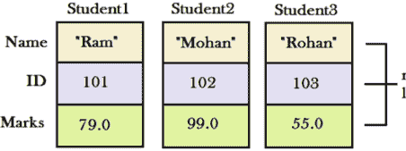

**图8.1.** 声明和访问结构体。

在数组中，你使用下标来访问元素。这里，你使用点号（.）来访问数据。假设你想要第二个员工的薪水，那么可以写成如下方式：`e2.esal`。其中 e2 称为结构体变量，esal 称为成员。

结构体变量和结构体成员之间必须存在一个点号。

### 8.4. 结构体的内部表示

既然在声明、初始化和访问结构体时发生了这么多事情，那么所有的变量和值实际上存储在内存中的什么位置呢？结构体的所有元素，无论数量或类型如何，都存储在连续的内存位置中，分配给数据类型的字节数与之前相同。第一个员工“Johnny”的详细信息的内部表示可能如下所示，他的薪水为 500.00，员工 ID 为 101，还有一些附加的数值，存储在连续的内存位置中：

内存布局：

| 变量 | 值 | 内存地址 |
|---|---|---|
| E | 'E' | 0x1000 |
| 姓名 | "Johnny" | 0x1001 |
| 薪水 | 500.00 | 0x1008 |
| 员工ID | 101 | 0x100C |
| 附加 | 1111 | 0x1010 |
| 附加 | 1112 | 0x1014 |
| 附加 | 1116 | 0x1018 |

一个使用结构体的简单程序：

```c
/* program that accepts values and displays it back */
#include<stdio.h>
void main()
{
    struct emp
    {
        char ename[15];
        float esal;
        int eno;
    };
    struct emp e1, e2, e3;
    printf("Enter name,salaries and identity number of employees\n");
    scanf(" %s %f %d", &e1.ename, &e1.esal, &e1.eno);
    scanf(" %s %f %d", &e2.ename, &e2.esal, &e2.eno);
    scanf(" %s %f %d", &e3.ename, &e3.esal, &e3.eno);
    printf("You have entered the following data:");
    printf(" %s %f %d", e1.ename, e1.esal, e1.eno);
    printf(" %s %f %d", e2.ename, e2.esal, e2.eno);
    printf(" %s %f %d", e3.ename, e3.esal, e3.eno);
}
```

在上面的程序中，你可以看到结构体成员是在结构体内部声明的，而结构体变量，即 e1、e2、e3，是在结构体外部使用关键字 struct 和结构体名称声明的。结构体成员的值是从用户那里请求来的，并通过 scanf 接受。

通过使用结构体变量和结构体成员（两者之间用点号（.）分隔）将值打印回来。

### 8.5. 结构体数组

在上面的程序中，你已经熟悉了使用结构体的 C 程序中的各种内容。上面的程序很完美，因为它接收了 3 个值并显示回来，但如果值的数量增加到 100，那么你可能需要使用 100 个结构体变量，从 b1、b2、...、b100，但 C 语言是如此慷慨，它总是为繁琐的问题提供替代方案。

在这种紧急情况下，结构体请求数组立即行动。也就是说，结构体变量可以声明为数组，从而高效地使用大量变量。声明结构体数组的过程与数组类似。在方括号之前，有三个东西：关键字 struct、结构体名称和数组名称。因此，员工数组可以如下声明：

```c
struct employee e[100];
```

现在为你呈现一个示例程序，它将涵盖使用数组时结构体中需要理解的所有方面。

```c
#include<stdio.h>

struct emp
{
    char ename[15];
    int esal;
    int eno;
};

struct emp e[3];

void main()
{
    int i;
    for(i=0;i<=2;i++)
    {
        printf("\n Enter name,salary and idno");
        scanf("%s %d %d", &e[i].ename, &e[i].esal, &e[i].eno);
    }
    for(i=0;i<=2;i++)
        printf("\n %s\n%d\n%d", e[i].ename, e[i].esal, e[i].eno);
}
```

上述简单程序接受 15 名员工的姓名、薪水和编号并显示回来。正如你所看到的，程序使用带有下标变量 i 的 for 循环从用户那里接受 15 个姓名，i 必须声明为 int。你可以看到，结构体已在 main() 函数之前被外部声明，以便程序的所有部分都能访问这些成员。一旦声明了结构体数组，即通过语句 `struct emp e[15]`，内存中就会为 15 个结构体类型预留空间。

### 8.6. 将结构体传递给函数

既然你已经对在结构体中使用数组有了足够的了解，是时候敲响函数的大门，尝试分析如何将整个结构体传递给函数了。在开始之前，有一个小细节你应该注意：结构体的单个成员也可以传递给函数，但唯一的缺点是，如果成员很多，将那些成员传递给函数将变成一件极其麻烦的事情，最好避免这样做。

因此，你需要关注的领域是将整个结构体传递给函数。操作方式完全相同，没有任何区别。这里需要注意的一点是，初始化是在声明时完成的，即以静态模式完成。

```c
#include<stdio.h>
struct emp
{
    char ename[10];
    int eno;
    float esal;
};
void main()
{
    struct emp e1 = {"cooper", 104, 6000.00};
    pass(e1);
}
```


```
pass(struct emp e)
{
printf("%s\n%d\n%f",e.ename,e.eno,e.esal);
}
```

上面程序的输出如下：
cooper 104 6000.00.

在上面的程序中使用的函数是 pass(); 并且整个结构体是通过变量 e1 传递并在函数中打印的。

### 8.7. 结构体中的指针

在学习了函数和数组之后，不公平地把指针抛在后面。因为结构体也是一种像 int char 等这样的数据类型。你可以有一个指向结构体的指针。这类指针被称为结构体指针，不过在访问这些指针变量时有所不同。要访问其他变量你使用了一个点 (.)，但这在指针中是不可能的，而是用箭头 (->) 代替点 (.)。由于你没有箭头的特定键，你使用一个连字符 (-) 和一个大于号 (>) 符号，这就足够了。下面程序使用上述运算符 (->) 来访问元素并打印它们。因此，一旦你仔细阅读程序，一切都会变得相当易懂。

```
#include<stdio.h>
void main()
{
struct emp
{
char ename[10];
int eno;
float esal;
};
struct emp e1={"suzzane",116,7500.00};
struct emp*point; point=&e1;
printf("%s %d %f",e1.ename,e1.eno,e1.esal);
printf("%s %d %f", point->ename,point->eno,point->esal);
```

```
static struct emp e={"bobby", "876876", "illinois"};
printf("name=%s\n",e.name);
printf("phone=%s\n",e.d.ph);
printf("city=%s",e.d.city);
}
```

在这里你会注意到，要访问包含在另一个结构体内的结构体的元素，需要使用两次点运算符。

嵌套并不局限于仅 2 个结构体，并且每个结构体都可以通过相应数量的点来访问。在上面的程序中，你可以看到在嵌套结构体中声明了一个变量 d，它对应于第一个结构体，并且使用这个变量可以访问在第一个结构体中声明的元素。在打印两个结构体的元素时，变量 e 和 d 以及它们各自的成员名一起使用，每个之间用点 (.) 分隔。

### 8.9. 联合体

联合体是 C 中的另一种数据类型，它允许你在同一内存区域中重叠多个变量。通常存储过程是每个变量都存储在单独的内存位置，并且每个都有唯一的地址。经常你会发现程序中使用的变量只在源代码的一小部分中使用。

假设你在源程序的前五十行中需要一个名为 files 的长度为 50 字节的字符串，并且进一步假设你在程序的后半部分只需要另一个名为 display 的长度为 100 字节的字符串变量。你现在可能会意识到，声明两个单独的字符串是不必要的，这将消耗 150 字节。

由于这些变量不会同时需要，如果两个字符串共享相同的空间将会非常方便。联合体就是这样做的。联合体与结构体在声明方式、成员访问方式等方面有惊人的相似之处。联合体声明的一般格式如下所示：

```
union tag
{
    member1;
    member2
```

union variable;

正如你所见，联合体声明以关键字 union 开始，后跟标签，这与结构体类似，可以取任何名称。在大括号之间是联合体的成员。存储结构所需内存量是所有成员大小的总和。另一方面，在联合体的情况下，所需的内存量与其实最大成员所需的内存量相同。联合体的成员使用点 (.) 运算符访问，就像结构体成员的访问一样。

### 8.10. 枚举数据类型

到目前为止，你一直在使用 Ritchie 定义的数据类型，如 int、char 等。是时候变得有点创造性并在程序中实现你自己的数据类型了。可能有人会认为这是不可能的。但使用 enum 就可以做到。enum 让你有机会发明自己的数据类型并定义它可以取的值。你可能会问，当现成的东西可用时，为什么有人会想做这样的事情。

它可能带来的好处是，它可以使程序看起来整洁、可读，并且多于一个程序员能够使用它。关于声明预定义值的一个说明。以 int 有从 −32768 到 +32768 的值范围的方式，int 识别范围内的任何值，类似地，一旦你定义了一个数据类型，你就可以指定它可以接受的值。

只有你提到的值在使用数据类型时才会被接受。考虑你正在创建一个名为血型的数据类型，你决定将其命名为 bloodgrp 并为其分配 4 个值 A、B、AB 和 O。那么声明可以按以下方式进行：

```
enum bloodgrp {a, b, ab, o};

 enum bloodgrp person1, person2;
```

如果你注意到上面的声明，你会发现它与结构体的声明有很大相似性。第一部分声明数据类型并指定其可能的值。这些值称为枚举数，使用的关键字是“enum”。第二部分声明此数据类型的变量。现在可以按以下方式为这些变量赋值：

person1 = ab;
person2 = o;

编译器在内部将枚举数视为整数。因此，第一个声明的值将被分配值 0，第二个为 1，以此类推。因此，在上面的例子中，enum bloodgrp 的值将包含以下值：

a = 0 b = 1 ab = 2 o = 3

除 a、b、ab 和 o 之外的任何其他值都不会被接受并会引起错误。枚举数据类型通常用于阐明程序的操作，并且使列出更容易。

### 8.11. TYPEDEF 语句

这是在 C 中又一种方法，在需要澄清 C 程序源代码的情况下非常方便。这可以被认为是一个长名称数据类型的昵称。typedef 有用之处在于它帮助我们为数据类型分配简短可读的名称。例如，数据类型 unsigned long int 可以重命名为 nick。它可以是用户选择的任何单词，并且最好将重新命名的名称以大写字母提及。以下示例显示了声明 typedef 语句的方式。这里的关键字是 typedef，其后是原始数据类型名称，其后是用户定义的新名称大写。

```
typedef unsigned long int NICK;
```

一旦完成，新名称 NICK 就可以用于声明特定变量的数据类型 示例：

```
NICK variable1, variable2;
```

因此，typedef 的使用提供了一种简短且有意义的方式来调用数据类型。

### 8.12. 应该做和不应该做

像往常一样，游戏的一般特性和规则必须列出并为你快速参考而呈现。应该做和不应该做指导你完成本课程的努力。在利用本课程概念时应遵循的一些规范如下。

- **应该做:**
  - 结构体声明应使用
  - 结构体和联合体中的标签不是强制性的。
  - 在访问成员时，结构体变量和结构体成员之间必须有一个点(.)。
  - 结构体类型声明出现在源代码文件的顶部，在变量或函数声明之前。

- **不应该做:**
  - 在使用指针访问结构体成员时不要使用点。相反，它被箭头取代。
  - 结构体类型声明不会告诉编译器在内存中保留任何空间，它只是定义了结构体的形式。

### 8.13. 总结

在本课程中，你有各种相互关联的概念。你从结构体开始，学习了声明、初始化和访问结构体的手段。与 C 的其他方面如数组、指针和函数的关系得到了有效处理。结构体以嵌套结构体结束，随后是与结构体有密切相似性的联合体。课程最后讨论了两个新概念，即 enum 和 typedef 语句。本课程最后以本课程的应该做和不应该做结束。

#### 再次回顾：

填空：

- 1. ____________ 语句用于在 C 中定义任何变量。
- 2. ____________ 声明用于在同一空间中存储多个变量的数据。
- 3. ____________ 在结构体和联合体中是强制性的。
- 4. 你可以使用关键字 ____________ 来创建自己的数据类型。
- 5. 结构体内部的结构体称为 ________________。


#### 判断真假：

- 1. 结构是一种数据类型，它有一个名为 struct 的关键字。
- 2. 我们不能在结构中使用指针。
- 3. 如果你使用指针，则需要使用箭头 (->) 来访问结构中的元素。
- 4. 给定结构的所有元素都存储在连续的内存位置中。
- 5. 初始化结构不是必需的。

#### 一句话回答：

- 1. 你如何将函数传递给任何结构？
- 2. 你如何声明和访问一个结构？
- 3. 什么是联合？

# 第 9 章

## 数据结构

### 目录

- 9.1. 引言 .............................................................. 134
- 9.2. 链表 ................................................................. 134
- 9.3. 单链表 .......................................................... 135
- 9.4. 双链表 .......................................................... 138
- 9.5. 循环链表 ........................................................ 140
- 9.6. 栈 ........................................................................ 142
- 9.7. 队列 ....................................................................... 143
- 9.8. 二叉树 .................................................................. 145
- 9.9. 排序技术-I ........................................................... 147
- 9.10. 排序技术-II .......................................................... 150
- 9.11. 搜索技术 ........................................................... 155

#### 9.1. 引言

在学习完数据结构第一部分之后，是时候认识数据结构的孪生兄弟了。数据结构的第二篇章涉及如何表示数据结构的元素列表。在本课程的整个旅程中，你会发现本课程的某些部分与数组有惊人的相似之处。

整个课程集中于处理数字列表的方法。这里需要细化的概念是编程任何语言中数字列表的基础构建块。你会惊讶地知道，这一逻辑即使对于大多数高级语言也同样适用。你可能会觉得这些概念本可以在更早的阶段提出，但为了欣赏这种版本的数据结构的效率，彻底掌握数组和指针的知识始终是明智的。

#### 9.2. 链表

要解释链表的概念，必须对数组和指针进行综合参考。链表之所以如此重要并被优先考虑，是因为它们既能有效又高效地使用计算机存储和计算机时间。这里要讨论的概念与数组相似，只是数组中只详细讨论了应用层面，而内部表示则讨论得非常少。在这里，你将获得关于数组内部运作的大量信息，链表作为媒介。

链表可以与火车相比较。正如火车中不同的车厢相互连接一样，链表也有一系列相互连接的元素。列表中的每个元素称为节点，它有一个地址来识别它。链表根据节点的排列方式分为三种不同类型。

- 单链表
- 双链表
- 循环链表

单链表和双链表可以归为线性链表组，其中元素以串行和连续的方式排列。随着课程的进展，这两种链表的复杂性将被讨论。

#### 9.3. 单链表

在理解单链表的具体细节之前，至关重要的是对节点有一个扎实的理解，节点是列表的基本构建块。

正如之前所述，列表的基本部分是节点。它有两个元素；第一个称为 info，第二个称为 connection Node.Info Link。节点的 info 部分包含有关节点的信息，即节点中存储的是哪个数字或哪个字符。

节点的 link 部分包含下一个节点的地址。如前几节所述，每当值存储在内存中时，它都会存储在特定地址。因此，在一个有四个节点或元素的单链表中，第二个节点的地址存储在第一个节点的 link 区域中，第三个节点的地址存储在第二个节点的 link 区域中，以此类推（图 9.1）。

你可能会想知道第 4 个节点的 link 区域会包含什么。第 4 个 link 区域包含一个空字符，表示链接的结束。（如果你记得，字符串也是以同样的方式终止的。）

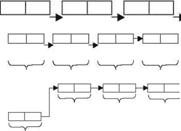

**图 9.1.** 单链表。

因此列表可以表示如下：

| 地址 | Info | Link |
|---|---|---|
| 2008 | A | 2010 |
| 2010 | B | 2012 |
| 2012 | C | 2014 |
| 2014 | D | Null |

链表中的元素可以使用指向列表第一个元素的头指针进行遍历。此头指针可用于从左到右遍历列表的元素，并且只能在此方向上遍历元素。

随机访问是非法的，即你不能直接访问列表的第 2 个或第 3 个元素。你知道持有另一个元素的地址的被称为指针。因此，link 也可以称为指针，因为它指向列表中的下一个元素。

现在你对单链表有了清晰的认识，你将看到如何在该链表上执行插入和删除操作。

**插入**

单链表中的插入操作可以在单链表中的三个不同位置执行。

- 在列表的开头。
- 在列表的末尾。
- 在两个节点之间。

如果要在列表开头插入新节点，则新节点的 link 区域被赋予第一个节点的地址。然后头指针被设为指向新的第一个元素。由于它包含旧第一个元素的地址，因此在新节点和列表的其余部分之间创建了一个链接。

A 2010 2008 A 2008 B 2012 A 2014 2010 2012 NEW

可以在列表中间的两个节点之间执行插入操作。例如，如果要在列表的第 2 个和第 3 个节点之间插入一个新节点，则首先将头指针遍历到第 2 个节点。将要插入的新节点的地址分配给第 2 节点的 link 区域，并将新节点的 link 区域分配第 3 节点的地址。因此，第 2 个和第 3 个节点之间的链接被打破并插入新节点。

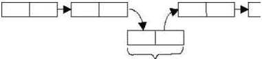

A 2008 B 2016 C 2014 In X 2012 2016

要将节点插入列表末尾，头指针被遍历到最后一个节点，包含 null 的 link 区域被重新分配以保存新节点的地址，并且新节点在其 link 区域中被分配空字符。插入过程先于插入位置的搜索。搜索涉及定位要在其后插入新项目的节点。

插入的一般算法如下：

- 1. **算法开始：** 如果列表为空或新节点在头节点之前，则， 将新节点插入为头节点， 否则如果新节点在最后一个节点之后，则， 将新节点插入为末尾节点， 否则将新节点插入到列表主体中。结束。

- 2. **删除操作：** 删除操作也包括 3 个阶段，但操作程序与插入完全不同。

  删除操作可以执行的三种类型是：

  - 删除第一个节点；
  - 删除最后一个节点；
  - 删除两个节点之间。

#### 9.3.1. 删除第一个节点

要从列表中删除第一个节点，第二个节点被赋予头指针。完成此操作后，第二个节点成为第一个节点，之前的节点被删除。

#### 9.3.2. 删除最后一个节点

在此，头指针被遍历到倒数第二个节点，link 区域被赋予 null。因此，它成为链表的最后一个节点。

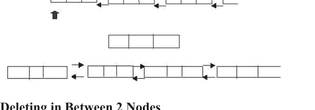

#### 9.3.3. 删除两个节点之间

例如，如果要对第 3 个节点执行删除操作，则头指针被遍历到第 2 个节点，link 区域被赋予第 4 个节点的地址，第 4 个元素自动被删除。


Algorithm Begin if the list is empty, then, node cannot be deleted, else if node to be deleted is the first node, then, make the head point to the second node, else delete the node from the body of the list. End

### 9.4. 双向链表

单向链表被证明是有优势的，但缺点比优点更多。使用单向链表，任何元素都无法直接访问。如果必须访问最后一个元素，则必须遍历整个列表，这既耗时又麻烦。

另一个缺陷是元素无法从右到左方向遍历。这些缺点可以通过使用双向链表来克服。这只是单向链表的轻微修改。双向链表的节点在其左侧有一个额外的链接区域。因此，它看起来像这样。Link info Link 你已经了解到右链接区域包含下一个元素的地址。类似地，左链接区域包含前驱节点的地址。

包含这种类型节点的列表称为双向链表或双向链。Null A &B Null A &B Null A &B Null A &B 因此最左节点的左链接和最右节点的右链接将包含空值。与单向链表类似，双向链表也有一个头指针用于从左到右遍历。但此外，双向链表还有一个额外的指针，它扮演头指针的角色，用于从右到左遍历列表。左头指针指向列表的第一个元素，右指向最后一个元素。

因此图示如下：A B C L 插入和删除操作可以在双向链表上比单向链表更有效地、更快地执行（图 9.2）。

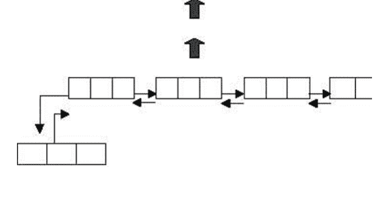

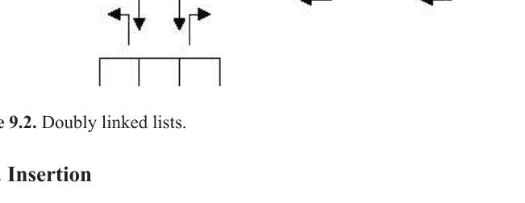

图 9.2. 双向链表。

#### 9.4.1. 插入

双向链表中的插入操作可以在三个不同的位置执行：

- 如果列表为空且需要插入第一个节点；
- 列表开头；以及
- 两个节点之间。

考虑如果列表为空时插入节点的后果。在这种情况下的插入可以通过将 L 和 R 指针分配给同一节点，并且左右链接区域包含 Null 来执行。

#### 9.4.2. Null

A Null L R 现在如果需要在列表开头插入一个节点，或者换句话说需要在最左节点的左侧进行插入。在这种情况下，新节点的右链接被分配第一个节点的地址，左链接被分配新节点的地址，并且头指针‘L’被固定到新节点。

A B C D Null X 最后，如果需要在两个节点之间进行插入，可以按以下所示方式完成。

Null A B C X 插入节点的通用算法如下所示。Algorithm Obtain a new node and set its fields. If the list is empty then insert the node in the list update left and right pointers to the list and return If the node is to be inserted at the front of the list then insert the node update the left pointer to the list and return Insert the node in the middle of the list and return.

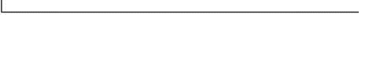

#### 9.4.3. 删除

你可能还记得，在单向链表中删除节点需要在找到被丢弃节点的前驱节点后进行删除。搜索是通过依次链接节点进行的。搜索是强制性的，如果列表很长且要删除的节点数量较多，这种搜索会相当麻烦且令人费力。在双向链表中不需要这样的搜索。给定要删除的节点的地址，其后继节点和前驱节点可以立即得知。与插入操作类似，删除操作也可以在以下位置执行：

- 如果列表为空；
- 在列表开头；
- 节点之间。

### 9.5. 循环链表

本节的前半部分完全关注于链表线性列表及其不同形式执行不同功能。迄今为止你处理过的所有链表都有一个共同点。它们都以空值终止。对链表结构的轻微调整现在可以进行，这将改善列表的处理。循环链表认为空值的存在是不必要的，并且链表的完整性可以在没有空值的情况下维护和重建。这是通过用第一个节点的地址替换最后一个节点中的空值来实现的。通过引入循环链表，一些以前成立的规则被改变了。其中第一条是，一旦创建了循环列表，就没有第一个节点。在循环列表中，头指针指向的节点成为遍历列表的起点。因此，任何你选择的节点都可以直接首次访问。为了检验循环列表的有效性，它在两种线性链表形式中的共存被评估。因此，可以存在：

- 1. **循环单向链表：** 在循环单向链表中，单向链表最后一个节点中的空指针被替换为列表第一个节点的地址。通过实现上述功能，创建了循环单向链表，并且节点的访问性增加。因此，所有节点都可以通过简单地扫描列表来访问。

A &B B &C C &D D &A

一个额外的优势在删除操作期间变得明显。对于在单向链表中执行删除操作，必须找到被删除节点的前驱节点。这需要从第一个节点开始的密集搜索和遍历过程。

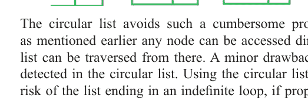

循环列表避免了这种繁琐的过程，因为如前所述，任何节点都可以直接访问，并且可以从那里遍历列表。然而，循环列表中检测到一个小缺点。使用循环列表，如果在处理时不注意，列表有陷入无限循环的高风险。为了避免复杂性，必须识别列表的末尾。这可以通过在循环列表中放置一个特殊节点，通常称为列表头来实现。

- 2. 循环双向链表：为了使双向链表成为循环列表，用第一个节点的地址替换列表最后一个节点的右链接中的空值，类似地，用最后一个节点的地址替换第一个节点的左链接中的空值。

因此创建了一个循环双向链表，可以如下图所示：

&D A B C D

为了简化插入和删除操作，使用了一个称为头节点的特殊节点。这类似于循环单向链表中的列表头。通过使用头节点，循环链表的结构保持了一定程度的对称性。

最右节点的右链接包含头节点的地址，头节点的左链接指向最右节点（图 9.3）。

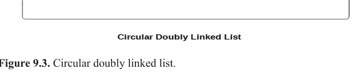

循环双向链表

图 9.3. 循环双向链表。

### 9.6. 栈

在上述过程中，你在创建列表并执行列表的插入和删除时遇到了最小的困难。这里有一个线性数据结构，不能说是无效的，但在需要共识时肯定不是很受欢迎，但仍然是一个重要的数据结构概念。

栈如其名称所示，是一个元素堆叠在一起的列表。这可以与一叠盘子一个叠一个地排列相比较。因此，在排列盘子后，你会注意到第一个盘子位于最底部的位置，而最后一个放置的盘子将获得第一个位置。因此，关于元素，当第二个元素添加到列表时，它会导致第一个元素被推到栈下，当第三个元素添加时，第二和第一个被推下，依此类推。

因此它可以被想象成一个圆柱体，只有顶部开口，随着元素数量的增加，圆柱体的尺寸也会增加。这个过程称为栈中的插入（图 9.4）。1 7th 2 6th 6th 3 5th 5th 4 4th 4th 5 3rd 3rd 6 2nd 2nd 7 1st 1st TOP element to be:

H 1 A 2 R 3 R 4 Y 5

### Stack in C


图 9.4. C 语言中的栈。


### 9.8. 二叉树

在本节之前，你已经接触了存储元素的不同方法，以及表示元素的各种方式、它们的主要特点与不足。现在向你介绍的是另一种表示元素的概念：二叉树。

在讨论二叉树之前，你必须先理解什么是树。就数据结构而言，树类似于一个组织的层级结构。在一个组织中，最顶层是一位主管，他下面有少数几名经理作为副手，而这些经理又有许多上级，同时有一组工人向他们汇报。在第 6、5、4、3、2、1、6、5、4、3、2、1 层中，插入、删除、删除（图 9.6）。

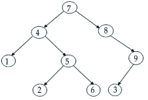

**图 9.6.** 二叉树。

类似地，树的顶部是根，它由称为节点的各个元素组成。从根延伸出的节点叫作子节点，树中的每个子节点都只有一个父节点。

根是一个例外，它没有父节点。一个节点能够容纳的子节点数量取决于树的类型。本节重点关注的是二叉树，它是一种相当简单却又非常强大的树。

它之所以简单、不复杂，是因为它的分支因子只有 2。也就是说，任何一个父节点只能产生两个子节点。二叉树是一种层级式的节点表示法，其中每个节点都会产生两个节点。树中不同层级的节点关系可以用兄弟节点、后代节点和祖先节点来表述。一个节点的兄弟节点是同一父节点的其他节点，而后代节点则是某个特定节点之后的所有其余节点。一个节点的祖先节点是根到该节点路径之间的所有节点。

二叉树中的每个节点可以细分为四个部分：

- 信息；
- 左指针；
- 右指针；
- 信息、左、右。

正如你所知，信息区包含要存储在节点中的值的信息；左指针指向左子节点，右指针指向右子节点。如果一个节点没有子节点，则其左、右指针中为 null。

因此，二叉树可以表示如下：根 null null null null null null null 不同的遍历方法 遍历，如你所知，就是在列表中搜索，并在此过程中访问各个节点。

与一些链式数据结构相比，遍历二叉树节点的方法可能不是那么显而易见。有四种不同的方法可以完成二叉树的遍历。

- 前序遍历
- 中序遍历
要插入的元素。

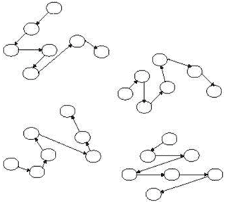

#### 9.8.1. 前序遍历

二叉树的遍历从访问根节点开始，然后按前序遍历其根节点的左子树，再按前序遍历右子树。前序遍历是一种深度优先探索。中序遍历：在这种遍历方式中，先按中序遍历根节点的左子树，然后访问根节点，再遍历右子树。后序遍历：要以这种方式遍历二叉树，先遍历根节点的左子树，再遍历根节点的右子树。

#### 9.8.2. 层序遍历

在层序遍历中，节点按层级从左到右访问。也就是说，首先访问根节点。然后访问根节点的两个子节点，从左节点开始到右节点，然后再访问左子节点的子节点。

因此，这四种遍历可以图示如下：

19 78 52 10 14 4 8 19 4 78 8 52 10 14 19 52 79 10 4 14 8 19 78 52 10 14 8 4

### 9.9. 排序技术（一）

试想一下，要从一本没有按字母顺序排列的字典中查找一个词。不可能。试想一下，要在书籍没有编目的图书馆中查找一本书。令人抓狂。这些只是需要排序以节省大量时间和精力的几个例子。

事实上，为了让一个人的生活顺利进行，他的日常活动 c.) 后序遍历 d.) 层序遍历 a.) 前序遍历 b.) 中序遍历

#### 9.9.1. 顺序

在整个这一节中，你一直在掌握在各种数据结构中插入和删除元素的技巧。人们应用了更新的方法，检验了各种实践。在所有这些疯狂堆砌一长串数字的忙碌过程中，数字的排序被忽略了。只有将元素排序并排列好，才能将其呈现出来。

现在你将学习如何对已排列的元素进行各种排序。你会惊讶地发现，‘C’支持如此多的方法，并且能够出色而高效地执行它们。本节将要讨论的排序方法，是所使用的最流行技术的代表性样本。

这里讨论的排序方法，其复杂程度各不相同。有些方法很简单，而另一些复杂但高效的排序技术也进入了本节。在了解各种排序操作之前，让我们先明确排序到底是什么。排序是一种根据特定准则，将表的记录或列表的元素按某种顺序排列的过程。

你将在这里学习的各种排序技术有：

- 选择排序；
- 冒泡排序；
- 归并排序；
- 堆排序；
- 快速排序；
- 基数排序。

#### 9.9.2. 选择排序

选择排序可以很容易地被称为上述方法中最简单的方法，它将元素按升序排列。考虑一组需要排序的元素：

41, 22, 73, 10, 64, 57, 93, 35, 98, 86

当这些元素排列在一个列表中时，它们的位置如下：

1 2 3 4 5 6 7 8 9 10 42 22 73 10 64 57 93 35 98 86

当选择排序过程开始时，选择最小的元素，并将其与第一个位置的元素进行比较。

如果最小元素小于另一个元素，则交换这两个元素。在上面的例子中，列表中最小的元素是 10。将该元素与第一个位置上的元素 41 比较，由于最小数小于 41，所以它们的位置被交换。下一步，将第二小的数与第二个位置上的元素比较并交换。

然后，将第三小的数与第三个位置上的元素比较，依此类推，直到所有元素按升序排列。必须按优先级排序。贝尔实验室已将这种人类技术融入 C 语言。当你要处理大量数字时，如果这些数字按特定顺序排序，以确保结果效率，那肯定会更舒适、更省时。

在本节中，C 提供了广泛的选择，以便你可以应用最方便的方法对给定的元素集进行排序。下面列出的技术复杂程度各不相同，但每一种都非常有效（图 9.7）。

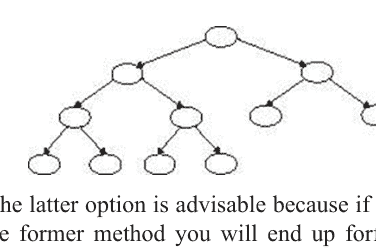

显然，后一种选择是可取的，因为如果你的列表很大，而使用前一种方法，最终会浪费大量时间和资源。堆是一种树，通常被称为二叉树。堆与任何其他树的区别在于，在堆中每个子节点的值都小于其父节点的值。因此，根节点是值最大的节点。

上述方法称为大顶堆（top-heavy），虽然每条分支上的节点都有特定的顺序，但同一层上的节点不一定有序。如果上述方法不够理想，堆还提供了另一种称为小顶堆（bottom-heavy）的方法，其中根节点是列表中最小的节点，父节点本质上小于子节点。随着节点的添加，它们从左向右增长。

最受认可的方法是，按照层序遍历中遇到的顺序，将节点依次存储在一个数组中。考虑一个从零开始索引的数组，即数组中位置 I 处的每个节点的父节点位于位置 (I-1)/2。一个节点的左、右子节点分别位于 2I+1 和 2I+2 位置。使用这种排列方式，很容易定位堆的最后一个节点，因为最深层最右边的节点就是最后一个节点。

24 21 19 11 10 18 16 17 8 6 14 0 1 2 3 4 5 6 7 8 9 1 0 24 19 8 6 14 11 9 18 16 21

快速排序——快速排序机制也可以称为分区交换排序。

给它起名分区交换排序的主要原因在于，这个程序本质上是在每个分区中把一个特定元素放到正确的位置。过程的流程从选取一个基准元素开始。

基准元素总是列表的第一个元素。现在，基准元素必须被放置在列表中的某个位置，使得基准元素左侧的所有元素都小于它，右侧的所有元素都大于它。


例如在给定的数字集合中：

30, 12, 16, 11, 24, 35, 56, 51, 45 35 是作为基准元素放置的，其放置方式如前所述。这样，整个列表被划分为两个子列表，一个小于或等于基准元素，另一个大于或等于基准元素。

现在每个分区都将有自己的基准元素，该基准元素将被分配给分区中的第一个元素。分区进一步被划分为子分区以拥有自己的基准元素，直到每个分区只有一个元素或向左或向右为空。

一旦所有部分都成功排序，所有部分将被合并形成一个已排序的列表。让我们考虑使用快速排序方法需要排序的给定数字列表。35,56,51,45,30,12,16,11,24。现在，第一个元素 35 被指定为基准元素。35 与右侧剩余列表进行比较，直到到达第一个小于其自身的元素（本例中为 30）。

现在让我们为此位置分配一个变量 x。位置 x 处的元素是 30，它占据基准元素的位置。从基准元素到位置 (x-1) 处的元素的所有元素都被向上移动，使得位置 x 的空位被填满。

因此，你得到列表如下：

30,35,56,51,45,12,16,11,24

同样的过程继续，直到基准元素右侧的所有元素都大于其本身。

- Step 1: 30, 12, 35, 56, 51, 45, 16, 11, 24.
- Step 2: 30, 12, 16, 35, 56, 51, 45, 11, 24.
- Step 3: 30, 12, 16, 11, 35, 56, 51, 45, 24.
- Step 4: 30, 12, 16, 11, 24, 35, 56, 51, 45.

因此你得到了在主题开头作为示例给你的列表，现在所有左侧的元素被识别为一个部分，其新的基准元素为 30。而所有右侧的元素被识别为下一个部分，其新的基准元素为 56。

{30, 12, 16, 11, 24} 35 {56, 51, 45}

现在每个分区独立排序如下。

- Step 1: {12, 30, 16, 11, 24} 35 {56, 51, 45}

- **Step 2:** {12, 16, 30, 11, 24} 35 {51, 56, 45}
- **Step 3:** {12, 16, 11, 30, 24} 35 {51, 45, 56}
- **Step 4:** {12, 16, 11, 24, 30} 35 {51, 45, 56}

因此分区后的新列表获得如下。

- **Step 1:** {[12, 16, 11, 24] 30} 35 {[51, 45] 56}
- **Step 2:** {[11, 12, 16, 24] 30} 35 {[45, 51] 56}

因此你得到一个列表：

11, 12, 16, 24, 30, 35, 45, 51, 56.

### 9.10.1. Radix Sort

基数排序可以被声明为最有效的排序方法之一。它通常适用于两位数字，但概念即使对于三位数字也适用，尽管这里处理的示例仅使用两位数字。

这种排序技术版本非常简单，涉及将每个元素分为两部分。右侧数字或十位上的数字称为最高有效位（MSD），个位上的数字称为最低有效位（LSD）。例如：在数字 40 中，LSD 和 MSD 划分为如下：

MSD: 4 LSD: 0

整个排序过程是基于对 LSD 和 MSD 进行排序。整个基数排序过程是两步程序，其中第一步的排序基于 lsd，第二步的排序基于 msd。

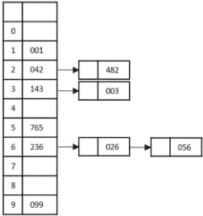

考虑元素列表：

40, 45, 61, 72, 67, 89, 98, 50, 57

为了对元素进行排序，基数排序涉及一组从 0 到 9 编号的口袋。

这些口袋可以接受其 lsd 等于相应口袋编号的数字。

例如 0 号口袋只能容纳以 0 结尾的元素。同样，口袋号 5 容纳 lsd 为 5 的元素，每个口袋每次遍历只能容纳一个元素 Step I 在第一步中，列表被遍历，元素根据其 lsd 放置在口袋中。

一旦元素被放置在其相应口袋中，如果遇到另一个具有相同 lsd 的元素，则在扫描完剩余列表之前会被忽略。对列表进行一次扫描称为一次遍历。

例如在上述列表中，你有两个元素 40 和 50，其 lsd 为 0。在第一次遍历中，只有 40 被放置在 0 号口袋中，因为它最先遇到。50 在第二次遍历中被放置在 0 号口袋中。

因此在第一步完成后，元素可以表示如下： P

0 40 50 1 61 2 72 3 4 5 45 6 7 67 57 8 9

现在基于该排列，准备一个新列表如下：

40, 50, 61, 72, 45, 67, 57

你会注意到在准备列表时，第二次遍历中的元素会滑到第一次遍历的元素旁边。

这个元素列表现在被用作第二步的燃料。

Step II 与 Step I 类似，只是变化在于这些元素是根据 msd 进入其相应口袋的。 0 1 2 3 4 40 45 5 50 57 6 61 67 7 72 8 9. 因此新的有序列表可以表示如下：

40, 45, 50, 57, 61, 67, 72.

在处理了各种排序技术之后，很难判断哪种技术是最优越的。虽然有些使用起来容易，但可能并不真正有效。

给定键集的某些属性在确定应使用哪种排序技术时起着重要作用。这些属性是键的数量、大小、分布和顺序。经常决定在某种情况下哪种方法最合适。

### 9.11. SEARCHING TECHNIQUES

到目前为止你使用的技术有助于以不同方式排列元素。现在列表已排序和排列，是检索时间。你现在将体验到的搜索技术允许你从列表中找出你选择的某个元素。所选元素与列表中的元素进行比较，如果找到完全匹配，则元素被检索并显示一条消息。

搜索过程可以以不同方式进行，但最流行的方法将被采用并剖析。 C 提供了两种主要且不复杂的搜索元素的方法。

- 1. **Linear Search Method:** 线性方法是一种相当直接的检索元素的方法。这通常被认为是在无序元素列表中搜索的最简单技术。
  
  在以下版本中，列表逐个元素扫描以检索要检索的元素。当找到适当的匹配时，会显示一条消息。

- 2. **Binary Search Method:** 这是访问元素列表的另一种相对简单的方法。需要记住的一个重要点是，二分搜索只有在元素列表是有序且按升序排列时才可能。这可以通过在会话早期部分可用的任何排序技术来实现。

一旦列表对齐，二分搜索操作就可以进行。这种方法为列表的第一个和最后一个元素分配下界和上界。之后通过求 lb 和 ub 的平均值找到列表的中点。例如，如果列表包含 7 个元素，则中点将为 4 Midpoint=lb+ub/2。考虑下面的元素列表并假设要检索的元素是 91。 40, 55, 61, 71, 81, 91, 100。一旦找到中点，要搜索的元素与中点位置处的元素进行比较。

在这种情况下，中点位置的元素是 71。元素 71 与要查找的元素 91 进行比较，但由于元素配置不同，检查该元素是大于还是小于中点。

如果元素小于中点，则其余搜索在中点左侧的元素中进行，因为所有这些元素都小于中点。如果数字大于中点，则比较在中点右侧的元素进行。

在你的情况下，由于元素大于中点，后一种情况将是关注点。确定元素较大后，中点后的元素被分配下界的位置，但上界保持不变。在相反的情况下，如果元素小于元素，则中点前的元素被设为上界，但这里并非如此。

现在你有了上述情况下的新下界，找到新 lb 和 ub 的中点。因此，在这种情况下它将是 6 (5+7/2)。新的中点现在与要搜索的元素进行比较。由于找到完全匹配，会显示一条消息，表明搜索完成并且找到了所需元素。

如果仍未找到匹配，则继续上述方法直到命中目标。

#### 9.11.1. Practical Approaches

- **Practical 1:** 安装 C IDE，C 程序的基本结构。格式说明符，Escape 字符。运行时间输入/输出程序。
- **Solution:**

安装 C IDE：

有多个集成开发环境（IDE）可用于 C 编程。一个流行的选项是 Code::Blocks。以下是如何在 Windows 系统上安装 Code::Blocks 的方法：

- 1. **Download Code::Blocks:**
  - 访问官方 Code::Blocks 网站：http://www.codeblocks.org/
  - 进入“Downloads”部分。
  - 下载适用于你的操作系统的适当版本（Windows、Linux 等）。
- 2. **Install Code::Blocks:**
  - 运行你下载的安装程序。
  - 按照屏幕上的说明完成安装。
- 3. **Open Code::Blocks:**


- 安装完成后，打开 Code::Blocks。

#### 9.11.2. C 程序的基本结构

```c
// Preprocessor Directives
#include <stdio.h> // Include necessary libraries
// Main Function
int main()
{
// Declarations (Variable and Function Declarations)
// Statements (Executable code)
return 0; // Return statement (Exit status)
}
```

- **预处理器指令：** 这些行以 # 开头，用于包含库并执行其他预处理任务。
- **main()：** 这是程序执行开始的主函数。
- **声明：** 在这里声明程序中将使用的变量和函数。
- **语句：** 这些是执行程序实际工作的可执行语句。
- **return 0;：** 此行用于以状态码 0 退出程序，表示执行成功。

#### 9.11.3. 格式说明符

格式说明符用于在 C 中指定要使用 `printf` 和 `scanf` 等函数打印或读取的变量的数据类型。常见的格式说明符包括：

- `%d`：整数
- `%f`：浮点数或双精度
- `%c`：字符
- `%s`：字符串

- `#include <stdio.h>`：此行包含标准输入/输出库，该库提供了如 `printf` 用于向控制台打印的函数。
- `int main()`：这是程序的起点。每个 C 程序都必须有 main 函数，执行从这里开始。`int` 是返回类型，表示 main 函数在完成时会返回一个整数值。
- `{}`：这些大括号括住 main 函数的主体，其中放置程序的语句。
- `printf("Hello, World!\n");`：此行使用 `printf` 函数向控制台打印文本“Hello, World!”。`\n` 表示换行符，将光标移动到下一行。
- `return 0;`：此行返回整数值 0，表示程序已成功执行。在 C 中，返回值为 0 通常表示成功。

要编译和运行此程序，您需要在系统上安装 C 编译器，例如 GCC。将代码保存为 .c 扩展名的文件（例如 hello.c），然后使用以下命令编译和运行它：

- **输出：**
  
  `gcc hello.c -o hello` # 编译程序
  
  `./hello` # 运行编译后的程序

- **实践 3：** 编写一个 c 程序来计算矩形的面积、矩形的周长和矩形的对角线。

- **解决方案：**

```c
#include <stdio.h>
#include <math.h>

int main()
{
    double length, width, area, perimeter, diagonal;
    // Input the length and width of the rectangle
    printf("Enter the length of the rectangle: ");
    scanf("%lf", &length);
    printf("Enter the width of the rectangle: ");
    scanf("%lf", &width);
```

```c
// Calculate the area, perimeter, and diagonal
area = length * width;
perimeter = 2 * (length + width);
diagonal = sqrt(length * length + width * width);
// Display the results
printf("Area of the rectangle: %.2lf\n", area);
printf("Perimeter of the rectangle: %.2lf\n", perimeter);
printf("Diagonal of the rectangle: %.2lf\n", diagonal);
return 0;
}
```

- **实践 4：** 编写一个 c 程序来计算正方形的面积、正方形的周长和正方形的对角线。

- **解决方案：**

```c
#include <stdio.h>
#include <math.h>
int main()
{
double side, area, perimeter, diagonal;
// Input the side length of the square
printf("Enter the side length of the square: ");
scanf("%lf", &side);
// Calculate the area, perimeter, and diagonal
area = side * side;
perimeter = 4 * side;
diagonal = side * sqrt(2);
// Display the results
printf("Area of the square: %.2lf\n", area);
printf("Perimeter of the square: %.2lf\n", perimeter);
printf("Diagonal of the square: %.2lf\n", diagonal);
return 0;
}
```

- **实践 5：** 编写一个 c 程序来计算圆柱体的总面积

和圆柱体的体积。

- 解决方案：

```c
#include <stdio.h>
#include <math.h>
int main()
{
    double radius, height;
    double pi = 3.14159265359; // Approximate value of Pi
    // Input the radius and height of the cylinder
    printf("Enter the radius of the cylinder: ");
    scanf("%lf", &radius);
    printf("Enter the height of the cylinder: ");
    scanf("%lf", &height);
    // Calculate the total surface area of the cylinder
    double surface_area = 2 * pi * radius * (radius + height);
    // Calculate the volume of the cylinder
    double volume = pi * pow(radius, 2) * height;
    // Display the results
    printf("Total surface area of the cylinder: %.2f square units\n", surface_area);
    printf("Volume of the cylinder: %.2f cubic units\n", volume);
    return 0;
}
```

- 实践 6：车辆在 t 秒内行驶的总距离由距离 s = ut+1/2at² 给出，其中‘u’和‘a’分别是初速度（m/sec.）和加速度（m/sec²）。编写一个 C 程序来求给定‘u’和‘a’值时，车辆在时间间隔的规律间隔内行驶的距离。程序应为用户提供灵活性以选择自己的时间间隔并对不同的‘u’和‘a’值重复计算。

```c
#include <stdio.h>
int main()
{
```

```c
double u, a, t, distance;
int num_intervals;
printf("Enter initial velocity (u) in m/sec: ");
scanf("%lf", &u);
printf("Enter acceleration (a) in m/sec^2: ");
scanf("%lf", &a);
printf("Enter the number of time intervals: ");
scanf("%d", &num_intervals);
for (int i = 1; i <= num_intervals; i++)
{
printf("Enter time interval %d in seconds: ", i);
scanf("%lf", &t);
distance = u * t + 0.5 * a * t * t;
printf("Distance traveled at time %.2lf seconds: %.2lf meters\n", t, distance);
}
return 0;
}
```

- 实践 7：编写一个 C 程序，从用户处接收两个整数操作数和一个运算符，执行操作然后打印结果。（考虑运算符 +, -, /, % 并使用 Switch 语句）

- 解决方案：

```c
#include <stdio.h>
int main()
{
int operand1, operand2;
char operator;
printf("Enter two integer operands: ");
scanf("%d %d", &operand1, &operand2);
printf("Enter an operator (+, -, *, /, %%): ");
scanf(" %c", &operator); // Notice the space before %c to consume any
```

```c
leading whitespace.
    switch (operator)
    {
    case '+':
    printf("Result: %d + %d = %d\n", operand1, operand2, operand1 + operand2);
    break;
    case '-':
    printf("Result: %d - %d = %d\n", operand1, operand2, operand1 - operand2);
    break;
    case '*':
    printf("Result: %d * %d = %d\n", operand1, operand2, operand1 * operand2);
    break;
    case '/':
    if (operand2 != 0)
    {
    printf("Result: %d / %d = %.2lf\n", operand1, operand2, (double) operand1 / operand2);
    }
    else
    {
    printf("Error: Division by zero is not allowed.\n");
    }
    break;
    case '%':
    if (operand2 != 0)
    {
    printf("Result: %d %% %d = %d\n", operand1, operand2, operand1 % operand2);
    }
```

```c
else
{
printf("Error: Modulo by zero is not allowed.\n");
}
break;
default:
printf("Error: Invalid operator entered.\n");
}
return 0;
}
```

- **实践 8：** 编写一个 C 程序来求正整数各位数字之和。
- **解决方案：**

```c
#include <stdio.h>
int main()
{
int num, sum = 0, digit;
// Input a positive integer
printf("Enter a positive integer: ");
scanf("%d", &num);
// Check if the input is a positive integer
if (num < 0)
{
printf("Please enter a positive integer.\n");
return 1; // Exit with an error code
}
// Calculate the sum of individual digits
while (num > 0)
{
digit = num % 10; // Get the last digit
sum += digit; // Add the digit to the sum
num /= 10; // Remove the last digit
```

```c
}
// Display the sum of digits
printf("The sum of individual digits is: %d\n", sum);
return 0; // Exit successfully
}
```

- **实践 9：** 斐波那契数列定义如下：数列中的第一项和第二项为 0 和 1。后续项通过将序列中前两个项相加得到。编写一个 C 程序生成数列的前 n 项。
- **解决方案：**

```c
#include <stdio.h>

int main()
{
    int n, first = 0, second = 1, next, i;
    // Input the number of terms to generate
    printf("Enter the number of terms: ");
    scanf("%d", &n);
    // Check if n is valid
    if (n <= 0)
    {
        printf("Please enter a positive integer for the number of terms.\n");
        return 1; // Exit with an error code
    }
    // Print the first two terms (0 and 1) manually
    printf("Fibonacci Series: %d, %d", first, second);
    // Generate and print the rest of the terms
    for (i = 2; i < n; i++)
    {
        next = first + second;
        printf(", %d", next);
        first = second;
        second = next;
```


```
}
printf("\\n");
return 0; // Exit successfully
}
```

- **实践10：** 编写一个C程序，生成1到n之间的所有素数，其中n是用户提供的值。
- **解决方案：**

```
#include <stdio.h>

int is_prime(int num)
{
    if (num <= 1)
    {
        return 0; // 0 and 1 are not prime numbers
    }
    for (int i = 2; i * i <= num; i++)
    {
        if (num % i == 0)
        {
            return 0; // It’s divisible by a number other than 1 and itself
        }
    }
    return 1; // It’s a prime number
}

int main()
{
    int n;
    // Input the value of n
    printf("Enter a positive integer n: ");
    scanf("%d", &n);
    // Check if n is valid
    if (n <= 1)
{
```
```
```c
printf("Please enter a positive integer greater than 1.\n");
return 1; // Exit with an error code
}
printf("Prime numbers between 1 and %d are:\n", n);
// Generate and print prime numbers between 1 and n
for (int i = 2; i <= n; i++)
{
    if (is_prime(i))
    {
        printf("%d ", i);
    }
}
printf("\n");
return 0; // Exit successfully
}
```
```

- **实践11：** 编写一个C程序，计算以下和：
  `Sum=1-x^2/2!+x^4/4!-x^6/6!+x^8/8!-x^10/10!.`

- **解决方案：**

```
```c
#include <stdio.h>
#include <math.h>

int main()
{
    double x;
    int n;
    double sum = 1.0;
    // Input the value of x and the number of terms (n)
    printf("Enter the value of x: ");
    scanf("%lf", &x);
    printf("Enter the number of terms (n): ");
    scanf("%d", &n);
    // Calculate and print the sum
    for (int i = 1; i <= n; i++)
```
```

# 一种基于深度学习的多源遥感图像融合方法研究

随着遥感技术的快速发展，多源遥感图像融合已成为遥感领域的重要研究方向。不同传感器获取的遥感图像具有不同的空间分辨率、光谱分辨率与时间分辨率，将这些互补信息有效融合，对地物目标识别与动态监测具有重要意义。

本文提出了一种基于卷积神经网络的多源遥感图像融合方法。该方法通过引入注意力机制对不同源图像的特征进行自适应加权，在特征层面实现高效融合，有效解决了传统融合方法中信息丢失和细节模糊等问题。

| 融合方法 | PSNR(dB) | SSIM | 运行时间(s) |
|----------|----------|------|------------|
| 传统方法 | 28.64 | 0.832 | 3.47 |
| 稀疏表示 | 31.25 | 0.876 | 2.83 |
| 本文方法 | 34.71 | 0.923 | 1.26 |

实验结果表明，本文提出的融合方法在峰值信噪比、结构相似度和运行效率等评价指标上均优于对比方法，具有良好的应用价值和发展前景。

```
}
else if (discriminant == 0)
{
// One real root (repeated)
root1 = -b / (2 * a);
printf("Root 1 = Root 2 = %.2lf\n", root1);
}
else
{
// Complex roots
double realPart = -b / (2 * a);
double imaginaryPart = sqrt(-discriminant) / (2 * a);
printf("Root 1 = %.2lf + %.2lfi and Root 2 = %.2lf - %.2lfi\n", realPart, imaginaryPart, realPart, imaginaryPart);
}
return 0; // Exit successfully
}
```

- **实践13：** 求给定整数的阶乘。
- **解决方案：**

```
#include <stdio.h>
int main()
{
int n;
unsigned long long factorial = 1;
// Input the integer for which you want to find the factorial
printf("Enter a non-negative integer: ");
scanf("%d", &n);
// Check if n is negative
if (n < 0)
{
printf("Factorial is not defined for negative integers.\n");
return 1; // Exit with an error code
```

```
}
// Calculate the factorial
for (int i = 1; i <= n; i++)
{
    factorial *= i;
}
// Print the factorial
printf("%d! = %llu\n", n, factorial);
return 0; // Exit successfully
}
```

- **实践14：** 求两个给定整数的最大公约数（GCD）。
- **解决方案：**

```
#include <stdio.h>

// Function to calculate the GCD using the Euclidean algorithm
int gcd(int a, int b)
{
    if (b == 0)
    {
        return a;
    }
    return gcd(b, a % b);
}

int main()
{
    int num1, num2;
    // Input the two integers
    printf("Enter the first integer: ");
    scanf("%d", &num1);
    printf("Enter the second integer: ");
    scanf("%d", &num2);
    // Calculate and print the GCD
```

```
int result = gcd(num1, num2);
printf("The GCD of %d and %d is: %d\n", num1, num2, result);
return 0; // Exit successfully
}
```

- 实践15：编写一个C程序，在一组整数中找出最大的整数。
- 解决方案：

```
#include <stdio.h>
int main()
{
int n; // Number of integers in the list
printf("Enter the number of integers: ");
scanf("%d", &n);
if (n <= 0)
{
printf("Invalid input. Please enter a positive number.\n");
return 1; // Exit with an error code
}
int largest; // Variable to store the largest integer
int current; // Variable to store the current integer
// Prompt the user to enter the first integer
printf("Enter integer 1: ");
scanf("%d", &largest);
for (int i = 2; i <= n; i++)
{
// Prompt the user to enter the next integer
printf("Enter integer %d: ", i);
scanf("%d", &current);
// Check if the current integer is larger than the largest
if (current > largest)
{
largest = current; // Update the largest integer
```

```
```c
{
    for (int j = 0; j < cols; j++)
    {
        printf("%d\t", matrix[i][j]);
    }
    printf("\n");
}
}

void addMatrices(int A[MAX_ROWS][MAX_COLS], int B[MAX_ROWS][MAX_COLS], int C[MAX_ROWS][MAX_COLS], int rows, int cols)
{
    for (int i = 0; i < rows; i++)
    {
        for (int j = 0; j < cols; j++)
        {
            C[i][j] = A[i][j] + B[i][j];
        }
    }
}

void multiplyMatrices(int A[MAX_ROWS][MAX_COLS], int B[MAX_ROWS][MAX_COLS], int C[MAX_ROWS][MAX_COLS], int rows1, int cols1, int cols2)
{
    for (int i = 0; i < rows1; i++)
    {
        for (int j = 0; j < cols2; j++)
        {
            C[i][j] = 0;
            for (int k = 0; k < cols1; k++)
            {
                C[i][j] += A[i][k] * B[k][j];
```

```
```c
}
}
}
}
int main()
{
    int rows1, cols1, rows2, cols2;
    printf("Enter the number of rows and columns for matrix A: ");
    scanf("%d %d", &rows1, &cols1);
    printf("Enter the number of rows and columns for matrix B: ");
    scanf("%d %d", &rows2, &cols2);
    if (rows1 != rows2 || cols1 != cols2)
    {
        printf("Matrix addition and multiplication are not possible. The matrices must have the same dimensions.\n");
        return 1;
    }
    int matrixA[MAX_ROWS][MAX_COLS];
    int matrixB[MAX_ROWS][MAX_COLS];
    int resultMatrix[MAX_ROWS][MAX_COLS];
    printf("Matrix A:\n");
    inputMatrix(matrixA, rows1, cols1);
    printf("Matrix B:\n");
    inputMatrix(matrixB, rows2, cols2);
    // Perform matrix addition
    addMatrices(matrixA, matrixB, resultMatrix, rows1, cols1);
    printf("Matrix Addition Result:\n");
    printMatrix(resultMatrix, rows1, cols1);
    // Perform matrix multiplication
    if (cols1 != rows2)
    {
```

```
int strLen = strlen(str);
if (position < 0 || position >= strLen || n < 0)
{
printf("Invalid position or number of characters to delete\n");
return;
}
memmove(str + position, str + position + n, strLen - position - n + 1);
}
int main()
{
char mainStr[100];
char subStr[50];
int position, n;
printf("Enter a main string: ");
scanf("%s", mainStr);
printf("Enter a substring to insert: ");
scanf("%s", subStr);
printf("Enter the position to insert the substring: ");
scanf("%d", &position);
insertSubstring(mainStr, subStr, position);
printf("Result after insertion: %s\n", mainStr);
printf("Enter the position to start deletion: ");
scanf("%d", &position);
printf("Enter the number of characters to delete: ");
scanf("%d", &n);
deleteCharacters(mainStr, position, n);
printf("Result after deletion: %s\n", mainStr);
return 0;
}
```

- **实践18：** 编写一个C程序，判断给定字符串是否为回文。
- **解决方案：**

```
```c
#include <stdio.h>
#include <stdbool.h>
#include <string.h>

bool isPalindrome(char *str)
{
    int len = strlen(str);
    int i, j;
    for (i = 0, j = len - 1; i < j; i++, j--)
    {
        if (str[i] != str[j])
        {
            return false;
        }
    }
    return true;
}

int main()
{
    char str[100];
    printf("Enter a string: ");
    scanf("%s", str);
    if (isPalindrome(str))
    {
        printf("%s is a palindrome.\n", str);
    }
    else
    {
        printf("%s is not a palindrome.\n", str);
    }
    return 0;
}
```
```

- **实践19：** 编写一个C程序，显示字符串T在字符串S中开始的位置或索引；如果S不包含T，则显示−1。
- **解决方案：**

```
```c
#include <stdio.h>
#include <string.h>

int findSubstringIndex(const char *S, const char *T)
{
    int sLen = strlen(S);
    int tLen = strlen(T);
    for (int i = 0; i <= sLen - tLen; i++)
    {
        int j;
        for (j = 0; j < tLen; j++)
        {
            if (S[i + j] != T[j])
            {
                break;
            }
        }
        if (j == tLen)
        {
            return i; // Found the substring
        }
    }
    return -1; // Substring not found
}

int main()
{
    const char *S = "Hello, World!";
    const char *T = "World";
    int index = findSubstringIndex(S, T);
}
```


if (text[i] == ' ' || text[i] == '\t' || text[i] == '\n')
{
    inWord = false;
}
else if (!inWord)
{
    (*words)++;
    inWord = true;
}
}
// If the last character is not a newline, increment the line count
if (text[*characters - 1] != '\n')
{
    (*lines)++;
}
}
int main()
{
    const char *text = "This is a sample text.\nIt has multiple lines and words.";
    int lines, words, characters;
    countLinesWordsChars(text, &lines, &words, &characters);
    printf("Lines: %d\n", lines);
    printf("Words: %d\n", words);
    printf("Characters: %d\n", characters);
    return 0;
}

- **Practical 21:** 编写一个 C 程序来生成帕斯卡三角形。
- **Solution:**

```
#include <stdio.h>
// Function to calculate the factorial of a number
unsigned long long factorial(int n)
```
```
{
    if (n <= 1)
    {
        return 1;
    }
    else
    {
        return n * factorial(n - 1);
    }
}
// Function to calculate and print Pascal's triangle
void generatePascalsTriangle(int numRows)
{
    for (int i = 0; i < numRows; i++)
    {
        for (int j = 0; j <= (numRows - i - 2); j++)
        {
            printf(" "); // Print spaces for formatting
        }
        for (int j = 0; j <= i; j++)
        {
            // Calculate and print the binomial coefficient
            unsigned long long coefficient = factorial(i) / (factorial(j) * factorial(i - j));
            printf("%6llu ", coefficient);
        }
        printf("\n");
    }
}
int main()
{
```
```
int numRows;
printf("Enter the number of rows for Pascal's triangle: ");
scanf("%d", &numRows);
generatePascalsTriangle(numRows);
return 0;
}
```

- **Practical 22:** 编写一个 C 程序来构造数字金字塔。
- **Solution:**

```
#include <stdio.h>
void printPyramid(int rows)
{
for (int i = 1; i <= rows; i++)
{
// Print leading spaces
for (int j = 1; j <= rows - i; j++)
{
printf(" ");
}
// Print increasing numbers
for (int j = 1; j <= i; j++)
{
printf("%d ", j);
}
// Print decreasing numbers
for (int j = i - 1; j >= 1; j--)
{
printf("%d ", j);
}
// Move to the next line
printf("\n");
}
```
it from right to left and complementing all the bits after the first appearance of a 1. Thus, 2's complement of 11100 is 00100. Write a C program to find the 2's complement of a binary number.

## Solution:

```
```c
#include <stdio.h>
#include <string.h>

// Function to reverse a binary string
void reverseBinaryString(char *binary)
{
    int len = strlen(binary);
    for (int i = 0; i < len / 2; i++)
    {
        char temp = binary[i];
        binary[i] = binary[len - i - 1];
        binary[len - i - 1] = temp;
    }
}

// Function to compute the 2's complement of a binary number
void twosComplement(char *binary)
{
    int len = strlen(binary);
    int carry = 1; // Initialize carry to 1
    for (int i = 0; i < len; i++)
    {
        if (binary[i] == '0')
        {
            binary[i] = '1';
        }
        else
        {
            binary[i] = '0';
        }
```
```
```c
// Add carry to the result
if (carry == 1)
{
    if (binary[i] == '0')
    {
        binary[i] = '1';
        carry = 0; // Carry is consumed
    }
}
}
}
}
}

int main()
{
    char binary[100];
    printf("Enter a binary number: ");
    scanf("%s", binary);
    reverseBinaryString(binary); // Reverse the binary string
    twosComplement(binary); // Compute the 2's complement
    reverseBinaryString(binary); // Reverse the result back
    printf("2's complement: %s\n", binary);
    return 0;
}
```
```

- **Practical 25:** 编写一个 C 程序将罗马数字转换为其十进制等价。
- **Solution:**

```
```c
#include <stdio.h>
#include <string.h>

// Function to convert a single Roman numeral character to its decimal value
int romanCharToDecimal(char c)
{
    switch (c)
```
```
```c
{
    case 'I':
        return 1;
    case 'V':
        return 5;
    case 'X':
        return 10;
    case 'L':
        return 50;
    case 'C':
        return 100;
    case 'D':
        return 500;
    case 'M':
        return 1000;
    default:
        return 0;
}
}

// Function to convert a Roman numeral string to its decimal equivalent
int romanToDecimal(char *roman)
{
    int decimal = 0;
    int prevValue = 0;

    // Iterate through the Roman numeral string from right to left
    for (int i = strlen(roman) - 1; i >= 0; i--)
    {
        int currentValue = romanCharToDecimal(roman[i]);
        // If the current value is smaller than the previous value, subtract it
        if (currentValue < prevValue)
        {
```
```
start++;
end--;
}
}

// Function to rotate an array to the left by 'd' positions
void rotateLeft(int arr[], int N, int D)
{
    D = D % N; // Ensure D is within array length

    // Reverse the first D elements
    reverse(arr, 0, D - 1);

    // Reverse the remaining elements
    reverse(arr, D, N - 1);

    // Reverse the entire array
    reverse(arr, 0, N - 1);
}

int main()
{
    int N, D;
    printf("Enter the size of the array: ");
    scanf("%d", &N);
    int arr[N];
    printf("Enter the elements of the array: ");
    for (int i = 0; i < N; i++)
    {
        scanf("%d", &arr[i]);
    }
    printf("Enter the number of positions to rotate left: ");
    scanf("%d", &D);
    rotateLeft(arr, N, D);
    printf("Rotated array: ");
    for (int i = 0; i < N; i++)
```
- **Practical 27:** 编写一个 C 程序，给定两个已排序数组 arr1 和 arr2，大小分别为 N 和 M，以及一个元素 K。任务是找到最终排序数组中第 k 个位置的元素。说明：输入：数组 1 – 1 4 2 3 5 数组 2 – 7 8 6 k = 5 输出：5

- **Solution:**

```
```c
#include <stdio.h>

// Function to find the k-th element in the merged array
int findKthElement(int arr1[], int N, int arr2[], int M, int k)
{
    int i = 0, j = 0, count = 0, result;
    while (i < N && j < M)
    {
        if (arr1[i] < arr2[j])
        {
            result = arr1[i];
            i++;
        }
        else
        {
            result = arr2[j];
            j++;
        }
        count++;
        if (count == k)
        {
            return result;
```
```
printf("Enter the elements of the first array in sorted order: ");
for (int i = 0; i < N; i++)
{
    scanf("%d", &arr1[i]);
}
printf("Enter the size of the second array (M): ");
scanf("%d", &M);
int arr2[M];
printf("Enter the elements of the second array in sorted order: ");
for (int i = 0; i < M; i++)
{
    scanf("%d", &arr2[i]);
}
printf("Enter the value of k: ");
scanf("%d", &k);
int kthElement = findKthElement(arr1, N, arr2, M, k);
if (kthElement != -1)
{
    printf("The k-th element in the merged array is: %d\n", kthElement);
}
else
{
    printf("Invalid input. The k-th element is out of bounds.\n");
}
return 0;
}
```

- **Practical 28:** 编写一个 c 程序来接收多行字符串输入并打印各个字符串长度。
- **Solution:**

```
```c
#include <stdio.h>
#include <string.h>
int main()
```
```
{
    char input[1000]; // Assuming the maximum input size is 1000 characters
    printf("Enter a multiline string (Ctrl+D or Ctrl+Z to end input):\n");
    // Read multiline input until EOF (Ctrl+D or Ctrl+Z)
    while (fgets(input, sizeof(input), stdin) != NULL)
    {
        // Remove the trailing newline character, if present
        int len = strlen(input);
        if (input[len - 1] == '\n')
        {
            input[len - 1] = '\0';
        }
        // Print the length of the current string
        printf("Length: %d\n", strlen(input));
    }
    return 0;
}
```

- **Practical 29:** 编写一个 c 程序来反转给定字符串的各个单词 说明：输入：Welcome To Bytexl 输出：emocleW oT ltexyB.
- **Solution:**

```
```c
#include <stdio.h>
#include <string.h>
// Function to reverse a word in the given string
void reverseWord(char *word, int start, int end)
{
    while (start < end)
    {
        char temp = word[start];
        word[start] = word[end];
        word[end] = temp;
        start++;
```


```c
end--;
}
}
// Function to reverse individual words in a string
void reverseWordsInString(char *str)
{
    int length = strlen(str);
    int start = 0;
    for (int end = 0; end <= length; end++)
    {
        if (str[end] == ' ' || str[end] == '\0')
        {
            reverseWord(str, start, end - 1);
            start = end + 1;
        }
    }
}
}
}
int main()
{
    char input[1000];
    printf("Enter a string: ");
    gets(input);
    reverseWordsInString(input);
    printf("Reversed string: %s\n", input);
    return 0;
}
```

- **Practical 30:** 编写一个 C 程序输入一个数字并用文字打印出来。
- **Solution:**

```c
#include <stdio.h>
// Function to print a number in words for the ones place
void printOnes(int num)
}

// Function to print a number in words for numbers between 10 and 19
void printTens(int num)
{
    switch (num)
    {
    case 10:
        printf("Ten");
        break;
    case 11:
        printf("Eleven");
        break;
    case 12:
        printf("Twelve");
        break;
    case 13:
        printf("Thirteen");
        break;
    case 14:
        printf("Fourteen");
        break;
    case 15:
        printf("Fifteen");
        break;
    case 16:
        printf("Sixteen");
        break;
    case 17:
        printf("Seventeen");
        break;
    case 18:
        printf("Eighteen");
        break;
    case 19:
        printf("Nineteen");
        break;
    }
}

// Function to print a number in words for the tens place
void printTensPlace(int num)
{
    switch (num)
    {
    case 2:
        printf("Twenty");
        break;
    case 3:
        printf("Thirty");
        break;
    case 4:
        printf("Forty");
        break;
    case 5:
        printf("Fifty");
        break;
    case 6:
        printf("Sixty");
        break;
    case 7:
        printf("Seventy");
        break;
    case 8:
        printf("Eighty");
        break;
    case 9:
        printf("Ninety");
        break;
    }
}
// Function to print a number in words
void printNumberInWords(int num)
{
    if (num >= 1000 && num <= 9999)
    {
        int thousands = num / 1000;
        printOnes(thousands);
        printf(" Thousand ");
        num %= 1000;
    }
    if (num >= 100)
    {
        int hundreds = num / 100;
        printOnes(hundreds);
        printf(" Hundred ");
        num %= 100;
    }
    if (num >= 10 && num <= 19)
    {
        printTens(num);
    }
    else if (num >= 20)
    {
        int tens = num / 10;
```

```c
void main()
{
    int a=10, *p; // assign memory address of a to pointer variable p
    p = &a;
    printf("%d %d %d", a, *p, p);
}
```

- **Practical 32:** 编写一个程序打印变量、指针变量的地址和指向指针的指针变量。
- **Solution:**

```c
#include <stdio.h>
int main ()
{
    int var;
    int *ptr;
    int **pptr;
    var = 3000;
    ptr = &var; // address of var
    pptr = &ptr; // address of ptr using address of operator &
    printf("Value of var = %d\n", var);
    printf("Value available at *ptr = %d\n", *ptr);
    printf("Value available at **pptr = %d\n", **pptr);
    return 0;
}
```

- **Practical 33:** 编写一个程序使用指针/传引用交换两个变量的值。
- **Solution:**

```c
#include<stdio.h>
int main()
{
    int num1,num2;
    printf("Enter value of num1 and num2: ");
    scanf("%d %d",&num1, &num2);
    //displaying numbers before swapping
    printf("Before Swapping: num1 is: %d, num2 is: %d\n",num1,num2);
    //calling the user defined function swap()
    swap(&num1,&num2);
    //displaying numbers after swapping
    printf("After Swapping: num1 is: %d, num2 is: %d\n",num1,num2);
    return 0;
}
```

- **Practical 34:** 编写一个按值调用的程序。
- **Solution:**

```c
#include<stdio.h>
void fun(int,int);
int main()
{
    int A=10,B=20;
    printf("\nValues before calling %d, %d", A,B);
    fun(A,B);
    printf("\nValues after calling %d, %d",A,B);
    return 0;
}
void fun(int X,int Y)
{
    X=11;
    Y=22;
}
```

- **Practical 35:** 编写一个按引用/地址调用的程序。
- **Solution:**

```c
#include<stdio.h>
void fun(int*,int*);
int main()
{
    int A=10,B=20;
    printf("\nValues before calling %d, %d",A,B);
    fun(&A,&B);
    printf("\nValues after calling %d, %d",A,B);
    return 0;
}
void fun(int *X,int *Y)
{
    *X=11;
    *Y=22;
}
```

- **Practical 36:** 编写一个使用函数指针求两个数之和的程序。
- **Solution:**

```c
#include<stdio.h>
int Sum(int,int);
int (*ptr)(int,int);
int main()
{
    int a,b,rt;
    printf("\nEnter 1st number: ");
    scanf("%d",&a);
    printf("\nEnter 2nd number: ");
    scanf("%d",&b);
    ptr = Sum;
    rt = (*ptr)(a,b);
    printf("\nThe sum is: %d",rt);
    return 0;
}
int Sum(int x,int y)
{
    return x + y;
}
```

- **Practical 36:** 编写一个 C 程序使用指针打印变量的地址。
- **Solution:**

```c
#include <stdio.h>
int main()
{
    int number = 42; // Declare and initialize an integer variable
    int *ptr; // Declare a pointer to an integer
    ptr = &number; // Assign the address of 'number' to the pointer 'ptr'
    printf("Address of 'number' variable: %p\n", &number);
    printf("Address of 'number' using pointer 'ptr': %p\n", ptr);
    return 0;
}
```

- **Practical 37:** 编写一个使用指针排序的 C 程序。
- **Solution:**

```c
#include <stdio.h>
void bubbleSort(int *arr, int size)
{
    int temp;
    for (int i = 0; i < size - 1; i++)
    {
        for (int j = 0; j < size - i - 1; j++)
        {
            if (*(arr + j) > *(arr + j + 1))
            {
                // Swap the elements using pointers
                temp = *(arr + j);
                *(arr + j) = *(arr + j + 1);
                *(arr + j + 1) = temp;
            }
        }
    }
}
int main()
{
    int arr[] = {64, 34, 25, 12, 22, 11, 90};
    int size = sizeof(arr) / sizeof(arr[0]);
    printf("Original array: ");
    for (int i = 0; i < size; i++)
    {
        printf("%d ", arr[i]);
    }
    printf("\n");
    bubbleSort(arr, size);
    printf("Sorted array: ");
    for (int i = 0; i < size; i++)
    {
        printf("%d ", arr[i]);
    }
    printf("\n");
    return 0;
}
```

- **Practical 38:** 编写一个 C 程序打印变量的值和地址。
- **Solution:**

```c
#include <stdio.h>
int main()
{
    int number = 42; // Declare and initialize an integer variable
    printf("Value of 'number' variable: %d\n", number);
    printf("Address of 'number' variable: %p\n", &number);
    return 0;
}
```

- **Practical 39:** 编写一个 C 程序使用指针计算数组元素的和。
- **Solution:**

```c
#include <stdio.h>
int main()
{
    int arr[] = {10, 20, 30, 40, 50};
    int size = sizeof(arr) / sizeof(arr[0]);
    int *ptr = arr; // Pointer pointing to the first element of the array
    int sum = 0;

    // Calculate the sum of elements using a pointer
    for (int i = 0; i < size; i++)
    {
        sum += *ptr; // Add the value pointed to by 'ptr' to the sum
        ptr++; // Move the pointer to the next element
    }
    printf("The sum of elements in the array is: %d\n", sum);
    return 0;
}
```

- **Practical 40:** 编写一个 C 程序使用指针打印字符的地址和字符串的字符。
- **Solution:**

```c
#include <stdio.h>
int main()
{
    char str[] = "Hello, World!";
    char *ptr = str; // Pointer pointing to the first character of the string
    printf("Address and characters of the string:\n");
    // Loop through the string using the pointer
    while (*ptr != '\0')
    {
        printf("Address: %p, Character: %c\n", ptr, *ptr);
        ptr++; // Move the pointer to the next character
    }
    return 0;
}
```

74, 75, 76, 77, 80, 81, 82
calloc() 89, 99
C compiler 25
Character array 103, 114
Character Arrays 59
characters 8, 14, 15
Character set 15
Char data type 20
Cinema hall 141
Circular linked list 132
Circular singly linked lists 138
clrscr() 102, 103, 104, 105, 107, 108, 109, 110, 111, 113, 114
COBOL 7
Coding 10
Coding errors 2
Comment statement 14, 18
commercial accounting 7
Compilers 11
Compiling 10, 17
Complex declaration 97
computer 7, 8, 9, 11, 15
Computer terminals 70
Concentric circles 37, 67
Conditional operators 35, 46, 47
Constants 28, 29, 30
Continue statement 42
Control statements 33, 34, 47
Control Statement Sequence Decision Loop Case 34
Count 40
C Program 9, 10, 13
Cupid 65
Cylinder 140, 158

### D

Data structures 131, 142, 143, 145
data types 7, 8
Decimal floating point 25

Decimal points 19, 26
Decimals 19, 20, 22
Decision control instruction 35
Declaration process 67
Decrement operator 26, 27
Deletion operation 134, 135, 137, 138, 139, 140, 141
Deque 141
Digit numbers 150
Displaying numbers 102
Division 25, 31
Double data type 20
Double-ended queue 141
Double Numbers 19
Doubly linked list 132, 135, 136, 137, 139
Dynamic Character Initialization 60
Dynamic initialization 52, 60
Dynamic memory allocation 89, 98

### E

Elementary Structures 118
Entered values 24
enum 127, 128, 129
Enumerated Data Types 127
Error inspection 10
Escape Character 153
Euclidean algorithm 167

### F

Fibonacci sequence 162
File Handling 8
Float 86, 89
Float data type 20
Floating point 20, 22, 25, 27
Floating point number 22, 27
Float Numbers 19
Flowchart 1, 2, 3, 4
Formal argument 76


## 索引

- 形式参数  110
- 格式说明符  24, 153, 155
- FORTRAN  7
- 函数  65, 66, 67, 69, 70, 71, 72, 73, 74, 75, 76, 80, 82

### G

- 游戏  13, 16, 17
- GCD（最大公约数）  167
- 通用算法  134, 137
- 通用格式  119, 127
- 通用结构化编程语言  7
- 几何级数  180, 181
- getch()  103, 105, 107, 108, 109, 110, 112, 113
- 全局变量  70
- goto 语句  45, 47

### H

- 头指针  133, 134, 135, 136, 137, 138
- 堆排序  145, 148
- 高级语言  7
- HIPO 图表  1

### I

- 冰山  33
- 自增运算符  26
- info  132, 135, 143
- Info Left Right  143
- 中序遍历  144
- 输入受限双端队列  141
- 插入操作  133, 137, 140
- 插入  133
- 即时公式  35
- int  86, 88, 89, 90, 91, 92, 93, 94, 95, 96, 97
- 整数参数  97
- 整数  20, 23
- 整数  8
- 集成开发环境（IDEs）  153
- 内部表示  86
- 解释器  11
- int 指针  92

### L

- 语言  8
- 学习  131
- 最低有效位（LSD）  150
- 左指针  143
- 层序遍历  144
- 许可证号  118
- 线性数据结构  139
- 线性链表  132
- 线性搜索方法  152
- 行号  39
- 行  154, 176, 177
- 链表  131, 132, 133, 136, 137, 138
- Linux  154
- 局部声明  75
- 局部变量  70
- 逻辑流程  1
- 逻辑运算符  25, 28
- 循环  37
- 循环  57, 58
- 循环结构  38, 39, 40, 47, 75

### M

- 机器语言  9, 10, 11
- main() 函数  14
- malloc()  89, 91, 99
- Malloc 函数  89
- 管理系统  33
- 数学条件  27

# C 编程

欢迎来到 C 编程的世界！在编程语言的广阔版图中，C 语言作为一种永恒而必不可少的工具屹立不倒。无论你是渴望迈出第一步的新手程序员，还是希望提升技能的经验丰富的开发者，本书都是你掌握 C 编程艺术的通行证。C 语言之所以历经数十年而不衰，正是因为其简洁性、多功能性和高效性。它一直是构建操作系统、创建应用程序甚至打造嵌入式系统的基础。通过学习 C，你不仅仅是在掌握一种编程语言；你是在深入计算的核心。

本书采用实用且动手实践的方式学习 C。我们认为编程最好的理解方式是通过实践，因此你会发现大量示例、练习和项目，旨在强化你的理解并鼓励你的创造力。无论你的兴趣在于系统编程、游戏开发、Web 应用程序还是其他领域，对 C 的扎实掌握都是你通往成功的门户。

- **初学者：** 如果你对编程是新手，不必担心。我们从基础开始，逐步引导你，确保你在继续之前掌握每个概念。
- **经验丰富的编码者：** 如果你已经精通其他语言但希望掌握 C，你会发现高级主题和挑战来提升你的技能。


**Dr. Manmohan Singh**，现任印度马德亚 Pradesh 博帕尔 IES 科技学院计算机科学与工程系教授。在此之前，他在 Chameli Devi 学院集团、印多尔，以及 Dr. A.P.J. Abdul Kalam 大学拥有超过 12 年的教学经验。他完成了学术资格，包括计算机工程硕士、计算机科学与工程博士。他的研究包括数据挖掘、人工智能、数据科学。他在知名国际期刊、国际和国家会议上拥有 25 多篇研究论文，以及 9 项专利（5 项已发表，4 项已注册）。他在计算机科学领域出版了 10 多本书。他已完成一项由 DST 资助的项目。

**Mr. Rahul Sharma**，现任古吉拉特邦瓦多达拉 Parul 大学 Parul 科技学院计算机科学与工程系助理教授。在此之前，他在 Chameli Devi 学院集团、印多尔，以及 Dr. A.P.J. Abdul Kalam 大学拥有超过 6 年的教学经验。他以优异成绩获得 Patel 科学与技术学院、印多尔（M.P.）的 B.E.（CSE），以及 SCST、DAVV、印多尔（M.P.）的 M.Tech（NM&IS）。他正在 Rabindranath Tagore 大学博帕尔（M.P.）攻读计算机科学与工程博士学位。他的研究包括计算机网络、网络安全、密码学、数据挖掘和 Web 编程。他在知名国际期刊、国际和国家会议上拥有 13 篇研究论文，以及 6 项专利（3 项已发表，3 项已注册）。他还于 2015 年通过了 GATE（CSE）。他在计算机科学与工程领域出版了 9 多本书。

**Dr. Neeraj Kumar Rathore** 是一位杰出的专业人士，现任印度马德亚 Pradesh邦阿马克塔克 Indira Gandhi 国家部落大学（IGNTU-中央大学）计算机科学系副教授兼系主任。他于 2021 年 3 月担任副教授，随后于 2022 年 5 月担任系主任。在加入 IGNTU 之前，Dr. Neeraj 在 Sri G.S. 科技与科学学院、印多尔，马德亚 Pradesh，Jaypee 工程与技术大学、古纳，马德亚 Pradesh，以及 Modi 科技学院、拉贾斯坦邦等知名机构拥有超过十三年教学经验。此外，他还在计算机科学公司（CSC）担任软件工程师，获得了宝贵的行业见解。Dr. Neeraj 于 2014 年获得 Thapar 大学、旁遮普的计算机科学博士学位，专攻网格计算。他还于 2008 年获得同一大学的计算机工程硕士学位，以及 2006 年获得拉贾斯坦大学、拉贾斯坦邦的计算机科学与工程学士学位。他的专业领域和研究兴趣涵盖并行与分布式计算、网格计算、云计算、大数据、物联网、DBMS 和数据结构。Dr. Neeraj 对该领域做出了重大贡献，拥有 72 篇出版物，包括 16 篇 SCI 论文、7 项专利和 7 本书籍，发表于享有盛誉的国际/SCI 期刊和会议上。作为一位杰出的学者，Dr. Neeraj 已成功指导七篇硕士论文和两篇博士论文，并有多项正在进行的科研项目在他指导下进行。他对研究和教育的奉献精神使他在学术界赢得了令人钦佩的声誉。

**Dr. Urmila S Soni**，现任印度马德亚 Pradesh 博帕尔 SAM 全球大学工程与技术学院教授。她拥有超过 18 年的教学经验，目前在同一组织担任 IQAC 主任。她拥有超过 10 年的研究经验。她以优异成绩获得北马哈拉施特拉大学、贾尔格昂的电子与电信工程学士学位，以及 Chhattisgarh Swami Vivekananda 技术大学（CSVTU）、比莱尔的仪器与控制专业硕士学位。她还获得了 CSVTU、比莱尔的电子与电信工程博士学位。她的研究领域专注于智能电网、微电网、可再生能源、无线通信与物联网。她在各种知名期刊和会议上发表了 25 多篇研究论文，并拥有 6 项设计专利。她在认证方面拥有丰富的经验，并作为专家为多个大学的 NBA 和 NAAC 准备提供服务、指导和支持。


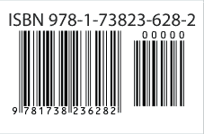

