# 树莓派上的 C 编程——用 C 开发创新的硬件项目

# 认识运动 把握规律

## 运动是物质固有的根本属性和存在方式

- 1. 哲学上所说的运动，是指宇宙间一切事物、现象的变化和过程。
- 2. 任何具体的物质形态只有在运动中才能保持自己的存在，运动是物质固有的根本属性和存在方式。世界是永恒运动着的物质世界。
- 3. 运动是物质的运动，物质是运动的承担者。脱离物质的运动是根本不存在的。

★误区警示：离开物质谈运动是唯心主义观点，离开运动谈物质是形而上学观点。

## 绝对运动和相对静止

世界上的一切事物都处于运动和变化之中，运动是无条件的、永恒的和绝对的。

辩证唯物主义所讲的静止，是运动的一种特殊状态。它主要有两方面的含义：一是说事物在它发展的一定阶段和一定时期，其根本性质没有发生变化；二是说物体相对于某一参照系来说没有发生某种运动。因此，静止是有条件的、暂时的和相对的。

★误区警示：运动是绝对的、无条件的、永恒的；静止是相对的、有条件的、暂时的。

献给我的妻子Nadire、女儿Alev和儿子Ahmet，感谢他们的爱与智慧。

# 前言

树莓派4是最新的信用卡大小的计算机，可用于许多应用，如视听媒体中心、台式计算机、工业控制、机器人以及更多家用和商业应用。除了树莓派其他版本中的许多功能外，Pi 4还提供Wi-Fi和蓝牙，使其在远程和基于互联网的控制与监控应用中非常受欢迎。

传统上，树莓派使用Python进行编程。虽然Python是一种非常强大的语言，但许多程序员可能不熟悉使用它。C语言可能是最常用的编程语言之一。如今，所有嵌入式微控制器都可以使用C语言进行编程。所有技术学院和大学都教授C语言——几乎所有工程专业的学生都熟悉在项目中使用这种语言。

本书介绍如何使用C语言与树莓派一起开发各种基于硬件的项目。使用了两个最流行的C库：wiringPi和pigpio。

本书以C语言简介开始，大多数学生和新手会发现这一章非常宝贵。书中提供了许多项目，包括使用Wi-Fi和蓝牙与智能手机建立通信。

本书包括许多传感器和基于硬件的项目。所有项目均使用wiringPi和pigpio库。提供了完整的程序清单并附有完整说明。书中给出的所有项目均已充分测试并可正常工作。项目中酌情使用以下子标题：

- 项目标题
- 项目描述
- 项目目标
- 框图
- 电路图
- 程序清单

本书中开发的所有树莓派项目的wiringPi和pigpio程序清单均可在Elektor网站上获得。读者可以在其应用中下载和使用这些程序。或者，他们可以修改所提供的程序以适应其应用。

我希望读者发现这本书有帮助并喜欢阅读。

Dogan Ibrahim教授博士
2021年1月
伦敦
# 第1章 • 在树莓派上安装操作系统

## 1.1 • 概述

在本章中，我们将学习如何在树莓派4上安装最新的操作系统（Raspbian Buster）。我们还将学习Python可用于开发应用的不同方式。请注意，除非另有说明，下面给出的安装过程适用于所有树莓派型号。

## 1.2 • 在树莓派4上安装Raspbian Buster的步骤

Raspbian Buster是树莓派的最新操作系统。本节提供了在新的空白SD卡上安装此操作系统所需的步骤，安装完成后即可用于树莓派4。在安装新操作系统之前，你需要一张容量至少为8GB（最好为16GB）的micro SD卡。

安装Raspbian Buster操作系统的步骤如下：

- 从以下链接下载Buster映像到你的PC上的某个文件夹（例如 C:\RPIBuster）：单击“Raspbian Buster with desktop and recommended software”部分下的Download ZIP（见图1.1）。在撰写本书时，该文件名为：2020-02-13-raspbian-buster-full.img。由于旧版zip软件不支持某些功能，你可能需要使用Windows 7Zip软件解压下载文件。

https://www.raspberrypi.org/downloads/raspbian/


图1.1 Raspbian Buster下载页面

- 将空白micro SD卡插入计算机的卡槽。你可能需要一个适配器来完成此操作。
- 下载Etcher到你的PC以烧录磁盘映像。链接为（见图1.2）：

https://www.balena.io/etcher/


图1.2 下载Etcher

- 双击打开Etcher，然后单击**选择镜像**。选择你下载并解压的Raspbian Buster文件。
- 单击**选择目标**并选择micro SD卡。
- 单击**烧录**（见图1.3）。这可能需要几分钟，请等待完成。然后程序将验证并卸载micro SD卡。卸载后，你可以取出micro SD卡。


图1.3 单击“Flash”以烧录磁盘映像

你的micro SD卡现在已装载树莓派操作系统。现在有以下几种选项：

### 使用直接连接

如果你使用显示器和键盘直接连接树莓派，只需将SD卡插入卡槽并为树莓派通电。稍后，系统会提示你输入登录信息。默认值为用户名：pi，密码：raspberry。

现在你可以以命令模式或桌面模式开始使用树莓派。如果你处于命令模式，请输入以下命令以启动GUI模式：

```
pi@raspberrypi:~ $ startx
```

如果你希望默认以GUI模式启动，步骤如下：

- 启动配置工具：
  `pi@raspberrypi:~ $ sudo raspi-config`
- 向下移动到Boot Options并按Enter选择（图1.4）。

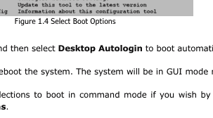

- 选择Desktop / CLI，然后选择Desktop Autologin以自动启动到GUI模式。
- 单击OK并接受以重启系统。系统下次重启时将处于GUI模式。
- 如果愿意，你可以通过在Boot Options中选择Console，将选择更改为以命令模式启动。

现在你可能希望将树莓派连接到互联网，以便从PC远程访问它或使用互联网。如果你的树莓派配有以太网端口（例如树莓派2/3/4），你可以使用以太网线直接连接到Wi-Fi路由器。你可以在命令模式下输入命令：ifconfig，以查找连接的IP地址。

或者，你可能希望将树莓派配置到Wi-Fi并远程访问它。


你需要启用 SSH。步骤如下：

- 启动配置工具：

```
pi@raspberrypi:~$ sudo raspi-config
```

- 向下移动到 **接口选项** 并选择 **SSH** 并启用它。
- 如果你处于 GUI 模式，点击屏幕右上角的 Wi-Fi 图标并启用 Wi-Fi。注意自动分配给你的树莓派的 IP 地址。
- 现在你可以使用终端仿真软件，例如 **PuTTY**（参见第 1.4 节和 1.5 节）。

## 1.3 • 使用网络连接

如果你没有合适的显示器和键盘直接连接到你的树莓派，你将不得不使用网络连接并通过 PC 远程访问你的树莓派。有两个选项：**使用以太网电缆连接**，和 **通过 Wi-Fi 连接**。

**使用以太网电缆连接：** 步骤如下：

- 从以下网站在你的 PC 上安装 **Notepad++**：

https://notepad-plus-plus.org/downloads/v7.8.5/

- 将 SD 卡重新插入你的 PC 并启动 **Notepad++**。
- 点击 **编辑 -> 行尾转换 -> UNIX/OS X 格式**。
- 使用 **Notepad++** 创建一个新空文件并将其保存到 SD 卡的启动文件夹中，名称为 **ssh**（不带任何扩展名），该文件将启用 SSH 以远程访问你的树莓派。在 Windows 中，这是你唯一能看到的文件夹，其中包含 loader.bin、start.elf、kernel.img 等项目。
- 将 SD 卡重新插入你的树莓派。
- 通过以太网电缆将你的树莓派连接到 Wi-Fi 路由器的其中一个端口并通电。
- 通过访问你的 Wi-Fi 路由器查找分配给你的树莓派的 IP 地址。或者，在你的 PC 上安装 **Advanced IP Scanner**，可在以下链接获取：

https://www.advanced-ip-scanner.com

- 运行软件并查找你的树莓派。你不需要安装软件即可运行它。点击 **运行便携版**，然后 **扫描**。如图 1.5 所示，作者的树莓派 IP 地址为 192.168.1.202。

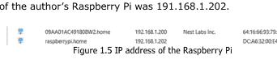

- 现在你可以使用 PuTTY 登录到你的树莓派（参见第 1.4 节和 1.5 节）

另外，你可以通过以管理员权限打开 PC 上的命令提示符（通过右键单击接受以管理员身份运行）然后输入命令：`ping raspberrypi.home` 来查找你的树莓派的 IP 地址，如图 1.6 所示。

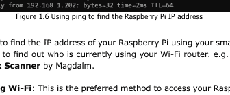

你也可以使用智能手机查找你的树莓派的 IP 地址。许多应用可用于查找当前正在使用你的 Wi-Fi 路由器的设备。例如 **Who's On My Wi-Fi – Network Scanner** 由 Magdalm 发布。

**使用 Wi-Fi 连接：** 这是访问你的树莓派的首选方法，也是作者使用的方法。在这里，如第 1 章所述，树莓派可以放置在 Wi-Fi 路由器范围内你喜欢的任何位置，并且可以轻松地从你的 PC 使用 PuTTY 访问（参见第 1.4 节和 1.5 节）。

步骤如下：

- 从以下网站在你的 PC 上安装 **Notepad++**：
https://notepad-plus-plus.org/downloads/v7.8.5/
- 将 SD 卡重新插入你的 PC 并启动 **Notepad++**。
- 点击 **编辑 -> 行尾转换 -> UNIX/OS X 格式**
- 使用 **Notepad++** 创建一个新空文件并将其保存到 SD 卡的启动文件夹中，名称为 `ssh`（不带任何扩展名），该文件将启用 SSH 以远程访问你的树莓派。在 Windows 中，这是你唯一能看到的文件夹，其中包含类似 loader.bin、start.elf、kernel.img 等项目。
- 在空白文件中输入以下语句（将 **MySSID** 和 **MyPassword** 替换为你自己的 Wi-Fi 路由器的详细信息）：

```
country=GB
update_config=1
ctrl_interface=/var/run/wpa_supplicant

network={
    scan_ssid=1
    ssid="MySSID"
    psk="MyPassword"
}
```

- 将文件（保存）复制到 SD 卡的启动文件夹中，名称为：**wpa_supplicant.conf**。
- 将 SD 卡重新插入你的树莓派并启动设备。
- 使用 **Advanced Ip Scanner** 或前面描述的方法之一查找你的树莓派的 IP 地址。
- 使用 PC 上的 **PuTTY** 远程登录到你的树莓派（参见第 1.3 节和 1.4 节）。
- 登录后，建议你出于安全原因更改密码。你还应从命令行运行 **sudo raspi-config** 以启用 VNC、I2C 和 SPI，因为它们是有用的接口工具，可在你未来的基于 GPIO 的工作中使用。

## 1.4 • 远程访问

通过互联网远程访问树莓派要容易得多：例如使用 PC 而不是连接键盘、鼠标和显示器。在能够远程访问树莓派之前，我们必须通过在终端会话中输入以下命令来启用 SSH（如果你已按照前面给出的步骤操作，SSH 已启用，可以跳过以下命令）：

```
pi@raspberrypi:~$  sudo raspi-config
```

进入配置菜单并选择 **接口选项**。向下移动到 **P2 SSH** 并启用 SSH。点击 **<完成>** 退出菜单。

你还应启用 VNC，以便通过互联网以图形方式访问 Raspberry Pi 桌面。这可以通过在终端会话中输入以下命令来完成：

```
pi@raspberrypi:~$  sudo raspi-config
```

进入配置菜单并选择 **接口选项**。向下移动到 **P3 VNC** 并启用 VNC。点击 **<完成>** 退出菜单。在此阶段，你可能希望通过在命令模式下输入以下其中一个命令来关闭或重新启动你的树莓派：

```
pi@raspberrypi:~$  sudo shutdown now
```

或

```
pi@raspberrypi:~$  sudo reboot
```

## 1.5 • 使用 PuTTY

PuTTY 是一个用于在你的 PC 和树莓派之间创建连接的通信程序。此连接使用一种称为 SSH（安全外壳）的安全协议。PuTTY 无需安装，可以存储在你选择的任何文件夹中并从那里运行。

可以从以下网站下载 PuTTY：

[https://www.putty.org/](https://www.putty.org/)

双击运行它，PuTTY 启动屏幕将显示。点击 **SSH** 并输入树莓派 IP 地址，然后点击 **打开**（参见图 1.7）。第一次访问树莓派时，将显示图 1.8 所示的消息。点击 **是** 接受此安全警告。

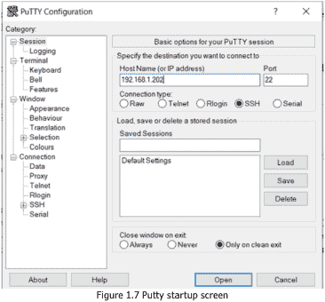

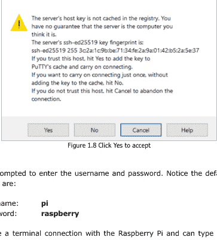

图 1.8 点击 是 以接受

系统会提示你输入用户名和密码。请注意默认用户名和密码为：

username: pi
password: raspberry

现在你已与树莓派建立了终端连接，可以输入命令，包括 sudo 特权的管理员命令。

要更改密码，请输入以下命令：

```
passwd
```

你可以使用光标键在同一会话中上下滚动之前输入的命令。你也可以运行程序，尽管不是图形程序。

### 1.5.1 ● 配置 PuTTY

默认情况下，PuTTY 屏幕背景为黑色，前景字符为白色。作者更喜欢白色背景黑色前景字符，字符大小设置为 12 磅粗体。以下是使用这些设置配置 PuTTY 的步骤。请注意，在此示例中，这些设置以名称 RPI4 保存，以便在每次重新启动 PuTTY 时都可以召回：

- 重新启动 PuTTY。
- 选择 SSH 并输入树莓派 IP 地址。
- 在窗口下点击 颜色。
- 将默认前景色和默认粗体前景色设置为黑色（红：0，绿：0，蓝：0）。
- 将 **默认背景** 和 **默认粗体背景** 设置为白色（红：255，绿：255，蓝：255）。
- 将 **光标文本** 和 **光标颜色** 设置为黑色（红：0，绿：0，蓝：0）。
- 在 **窗口** 下选择 **外观** 并在 **字体设置** 中点击 **更改**。将字体设置为 **粗体 11**。
- 选择 **会话** 并为会话命名（例如 RPI4）然后点击 **保存**。
- 点击 **打开** 以使用已保存的配置打开 PuTTY 会话。
- 下次重新启动 PuTTY 时，选择已保存的会话并点击 **加载** 然后 **打开** 以使用已保存的配置启动会话。

## 1.6 ● 桌面远程访问

你可以通过 PuTTY 控制你的树莓派，并从 Windows PC 在其上运行程序。然而，这对图形程序不起作用，因为 Windows 不知道如何表示显示。因此，例如，我们无法在桌面模式下运行任何图形程序。我们可以使用一些额外软件来解决这个问题。用于此目的的两种流行软件是：VNC（虚拟网络连接）和 Xming。在这里，我们将学习如何使用 VNC。

### 安装和使用 VNC

VNC 由两部分组成：VNC Server 和 VNC Viewer。VNC Server 在树莓派上运行，VNC Viewer 在 PC 上运行。VNC 服务器已安装在你的树莓派上，并已按照第 1.3 节中使用 raspi-config 的描述启用。

以下是安装和使用 PC 上的 VNC Viewer 的步骤：

- 有许多 VNC Viewer 可用，但推荐的是 TightVNC，可从以下网站下载：
https://www.tightvnc.com/download.php
- 为你的 PC 下载并安装 **TightVNC**。安装过程中你必须选择一个密码。
- 输入以下命令：
```
pi@raspberrypi:~$ vncserver :1
```
- 在你的 PC 上启动 **TightVNC Viewer** 并输入树莓派 IP 地址（参见图 1.9）后跟 :1。点击 **连接** 以连接到你的树莓派。


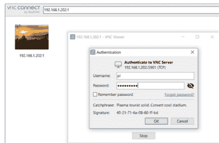

图 1.9 启动 TightVNC 并输入 IP 地址

图 1.10 显示了显示在 PC 屏幕上的树莓派桌面。


图 1.10 PC 屏幕上的树莓派桌面

## 1.7 • 静态 IP 地址

当我们通过 Wi-Fi 路由器使用树莓派时，IP 地址由路由器自动分配。每次启动树莓派时，Wi-Fi 路由器可能会给树莓派分配另一个 IP 地址。这会使得登录变得困难，因为登录前必须先找到新的 IP 地址。

我们可以为树莓派设置静态 IP 地址，这样每次启动时，Wi-Fi 路由器都会分配相同的 IP 地址。该 IP 地址由运行在 Wi-Fi 路由器上的 DHCP 协议提供。

在设置静态 IP 地址之前，我们必须确定该地址是什么，并确保网络中没有其他设备使用该地址。我们可以通过登录 Wi-Fi 路由器，或使用智能手机上的应用显示网络中的设备来检查。

分配静态 IP 地址的步骤如下：

- 首先，输入以下命令检查 **dhcpcd** 是否处于活动状态：

```
pi@raspberrypi:~$ sudo service dhcpcd status
```

你应该会看到显示 **active: (running)** 文本，如图 1.11 所示（仅显示部分内容）。输入 **Ctrl+C** 退出该显示。

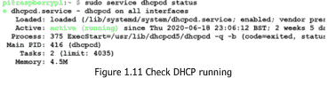

- 如果 dhcpcd 未运行，请输入以下命令以启用它：

```
pi@raspberrypi:~$ sudo service dhcpcd start
pi@raspberrypi:~$ sudo systemctl enable dhcpcd
```

- 现在我们需要找到路由器的 IP 地址（默认网关）和域名服务器地址。这些信息可以很容易地从 Wi-Fi 路由器或 PC 获取。从 PC 获取这些地址的步骤如下：
  - 在你的 Windows 10 PC 上转到 **控制面板**。
  - 单击 **网络和共享中心**。
  - 如图 1.12 所示，单击 **Internet**。


- 单击 **详细信息**。你将看到与图 1.13 类似的屏幕，其中可以看到默认网关和 DNS 服务器地址。在本例中，两者均为：192.168.1.254。

| 项目 | 值 |
|---|---|
| 已启用 DHCP | 是 |
| IPv4 地址 | 192.168.1.199 |
| IPv4 子网掩码 | 255.255.255.0 |
| 租约获取时间 | 2020 年 7 月 8 日 08:10:45 |
| 租约过期时间 | 2020 年 7 月 9 日 12:27:53 |
| IPv4 默认网关 | 192.168.1.254 |
| IPv4 DHCP 服务器 | 192.168.1.254 |
| IPv4 DNS 服务器 | 192.168.1.254 |

图 1.13 单击“详细信息”

- 你将需要使用 **nano** 等文本编辑器编辑以下文件：`/etc/dhcpcd.conf`。尽管你可能不熟悉 **nano**，请按照此处给出的说明操作（**nano** 将在后续章节中介绍。）

```
pi@raspberrypi:~ $ sudo nano /etc/dhcpcd.conf
```

- 使用向下方向键转到文件末尾，并输入以下行：

```
interface wlan0
static ip_address=192.168.1.120/24
static routers=192.168.1.254
static domain_name_servers=192.168.1.254

interface eth0
static ip_address=192.168.1.120/24
static routers=192.168.1.254
static domain_name_servers=192.168.1.254
```

在本例中，我们选择静态 IP 地址 192.168.1.120，并已确保网络中没有其他设备使用相同的 IP 地址。后缀 /24 是子网掩码 255.255.255.0 的缩写。你必须确保只更改 IP 地址的最后一位数字，即选择 192.168.1.x 形式的地址。wlan0 用于 Wi-Fi 链路，eth0 用于以太网链路。

- 现在，通过输入 Ctrl+X，然后输入 Y 来保存文件。
- 在屏幕上显示该文件，以确保所做的更改正确。输入以下命令：

```
pi@raspberrypi:~ $ cat /etc/dhcpcd.conf
```

- 重启树莓派，它应该会按设置使用所需的 IP 地址启动

## 1.8 • 小结

在本章中，我们学习了如何将最新的树莓派操作系统安装到 SD 卡上，以及如何开始远程使用树莓派。所提供的说明适用于所有版本的树莓派。此外，还演示了如何为树莓派设置静态 IP 地址。

在下一章中，我们将了解各种树莓派程序开发工具。

# 第 2 章 • 树莓派程序开发

## 2.1 • 概述

在上一章中，我们学习了如何将 Raspbian Buster 安装到树莓派 SD 卡上。在本章中，我们将学习如何使用 Raspberry Pi 4 开发程序。我们将开发一个非常简单的示例项目，并学习如何使用 Python 和 C。尽管 Python 不是本书的主题，但它将用于一个简单的项目，以便读者可以将 Python 与 C 编程进行比较。

## 2.2 • nano 文本编辑器

文本编辑器是创建程序源文件时非常有用的工具。树莓派支持多种文本编辑器，包括 vi、nano 等。在本节中，我们将介绍通常从命令行运行的 nano。

例如，假设我们希望创建一个名为 myfile.txt 的文本文件，并将以下行插入该文件：

This is a simple text file created using nano
This is the second line of the file
This is the third line of the file

步骤如下：

- 启动 nano

  ```
  pi@raspberrypi:~ $ nano myfile.txt
  ```

- 将上述文本输入文件（见图 2.1）。你应该会在屏幕底部看到若干控制代码。


图 2.1 输入编辑器的文本

- 输入 **Ctrl+X**，然后输入字母 **Y** 以保存文件。现在，如果输入以下命令，你应该会看到该文件列在你的目录中：

```
pi@raspberrypi:~$ ls myfile.txt
myfile.txt
pi@raspberrypi:~$
```

- 现在让我们编辑刚刚创建的文件，以学习一些编辑器命令。像上面一样指定文件名重新启动 **nano**。

- 让我们搜索以 **simple** 开头的文本：按 **Ctrl+W**，输入 **simple**，然后按 **Enter**（见图 2.2）。你应该会看到光标移动到 **simple** 的开头。删除 **simple** 并将其改为 **difficult**。

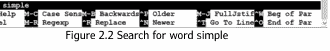

- 让我们将单词 **third** 替换为 **fourth**：按 Ctrl+\，输入 **third**，然后在显示 **Replace with:** 时输入 **fourth**。按 **Enter**。将显示消息 **Replace this instance?**。输入 **Y**。你应该会看到单词 **third** 被替换为 **fourth**。

- 让我们删除第二行文本：将光标移到第二行，然后输入 **Ctrl+K**。你应该会看到第二行上的所有文本都被删除。

- 要恢复刚刚删除的行，请输入 **Ctrl+U**。

- 要获取有关使用 **nano** 的帮助，请输入 **Ctrl+G**。图 2.3 显示了一个示例帮助屏幕。输入 **Ctrl+N** 显示下一页，输入 **Ctrl+P** 显示上一页。输入 **Ctrl+X** 关闭帮助屏幕。


- 输入 **Ctrl+X**，然后输入 **Y** 以保存并退出编辑器。

- 编辑后文件的内容如图 2.4 所示。

```
pi@raspberrypi:~ $ cat myfile.txt
This is a difficult text file created using nano
This is the second line of the file
This is the fourth line of the file

pi@raspberrypi:~ $
```

图 2.4 编辑后文件的内容

作为总结，下面给出一些更有用的 **nano** 快捷键：

- **Ctrl+W**：搜索一个单词。
- **Ctrl+V**：移到下一页。
- **Ctrl+Y**：移到上一页。
- **Ctrl+K**：剪切当前行文本。
- **Ctrl+R**：读取文件。
- **Ctrl+U**：粘贴你之前剪切的文本。
- **Ctrl+J**：对齐。
- **Ctrl+\\**：搜索并替换文本。
- **Ctrl+C**：显示当前列和行位置。
- **Ctrl+G**：获取有关使用 nano 的详细帮助。
- **Ctrl+-**：转到指定的行和列位置。
- **Ctrl+O**：保存（写出）当前打开的文件。
- **Ctrl+X**：退出 nano。

## 2.3 • 示例项目

在本章中，我们将使用 Python 和 C 开发一个简单的项目，它将在你的 PC 屏幕上显示消息 **Hello From Raspberry Pi 4**。该项目旨在展示如何创建一个项目，然后如何在树莓派上运行它。

## 2.4 • 在树莓派上创建并运行 Python 程序

如下所述，在树莓派上创建并运行 Python 程序可以采用四种方法：


**Thonny** 是一个易于使用的工具，仅适用于 Python 3。**Thonny** 的优点在于它在终端输入代码时会自动格式化代码。例如，**while** 循环体中的所有语句都会自动且正确地缩进。

使用 **Thonny** 的步骤如下：

- 点击 **应用程序菜单**，然后 **编程**，并选择 **Thonny Python 集成开发环境**，如图 2.7 所示


图 2.7 选择 Thonny Python IDE

- Thonny 启动屏幕将显示，如图 2.8 所示。屏幕分为两部分：程序在上半部分编写。下半部分是 **shell**，程序结果在此显示。我们也可以在屏幕下半部分交互式地运行 Python 3 命令。在上半部分，我们有大多数 GUI 类型显示中常见的菜单项。菜单选项 **文件** 用于创建新文件、打开现有文件、关闭、保存或打印文件。菜单选项 **编辑** 用于撤销、剪切、粘贴、选择、查找、替换等。选项 **查看** 用于让我们查看文件、堆、注释、栈、变量等。菜单选项 **运行** 用于运行或调试程序。菜单选项 **设备** 用于软重启、将当前脚本上传为主脚本等。菜单选项 **工具** 用于管理包、管理插件、配置 Thonny 等。最后，**帮助** 菜单选项用于获取有关使用 Thonny 的帮助。

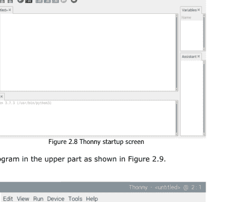

图 2.8 Thonny 启动屏幕

- 如图 2.9 所示，在上半部分输入你的程序。

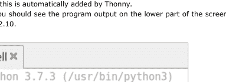

图 2.9 输入你的程序

- 点击 File 并通过命名来保存你的程序。你无需指定文件扩展名，因为 Thonny 会自动添加。
- 点击 Run，你应该会在屏幕下半部分看到程序输出，如图 2.10 所示。

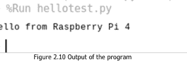

图 2.10 程序输出

Thonny 提供了调试程序的选项，我们可以在程序单步执行的同时显示变量。作为示例，让我们调试图 2.9 中给出的程序。步骤如下：

- 点击 **运行** 然后 **调试当前脚本**（更佳）。
- 你应该会看到当前程序行以黄色高亮显示。
- 我们现在有以下选项：**单步跳过**、**单步进入** 和 **单步退出**。
- 点击 **单步跳过** 将按屏幕上看到的方式逐行执行程序。点击它，你应该会在屏幕下半部分看到程序输出。
- 在调试模式下，你还可以 **恢复**（橙色和白色图标）使程序正常继续，或 **停止并重新开始**（红色和白色图标）从头开始重新运行程序。

### 方法 4 – 使用 Mu 编辑器

在此方法中，我们将使用 **Mu** 来创建和运行我们的 Python 示例程序。**Mu** 是一个非常易于使用的 Python 编辑器和面向初学者的集成开发环境（IDE）。

**Mu** 默认随 Raspbian Buster 操作系统一起安装，可以通过点击应用程序菜单，然后 **编程**，再点击 **Mu** 启动（见图 2.11）。

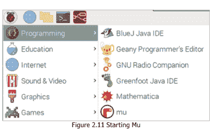

如果不可用，可以使用以下步骤安装 **Mu**：

- 点击 **应用程序菜单** -> **首选项** -> **推荐软件**（图 2.12）。

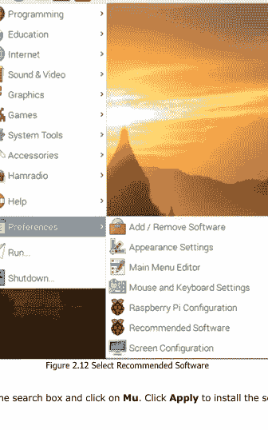

图 2.12 选择推荐软件

- 在搜索框中输入 Mu 并点击 Mu。点击 应用 以安装软件（图 2.13）。


图 2.13 安装 Mu

Mu 也可以通过命令行使用以下命令安装：

```
pi@raspberrypi:~ $ sudo apt-get install mu-editor
```

图 2.14 显示了 Mu 的启动屏幕，其中输入了显示消息 **Hello From Raspberry Pi 4** 的语句。

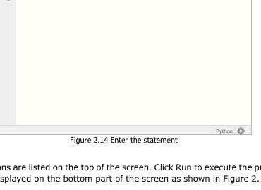

图 2.14 输入语句

菜单选项列在屏幕顶部。点击 Run 执行程序。结果将显示在屏幕底部，如图 2.15 所示。

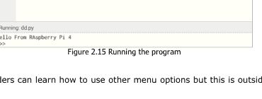

图 2.15 运行程序

感兴趣的读者可以学习如何使用其他菜单选项，但这超出了本书的范围。

### 选择哪种方法？

方法的选择取决于我们希望开发的程序的大小和复杂性。小程序可以在不创建程序文件的情况下交互运行。较大的程序可以使用命令行模式下的 nano 创建为 Python 文件。Thonny 和 Mu 可用于在桌面 GUI 模式下创建程序。Python 初学者应该会发现 Mu 易于使用。

## 2.5 ● 在 Raspberry Pi 上创建和运行 C 程序

用 C 编程 Raspberry Pi 是本书的主要主题。我们将使用 nano 来创建 C 源程序。程序应具有 .c 文件扩展名。图 2.16 显示了我们简单项目的程序列表（程序：msg.c）。

```
#include <stdio.h>

int main(void)
{
    printf("Hello From Raspberry Pi 4\n");
}
```

图 2.16 程序：msg.c

程序开始时包含头文件 stdio.h。消息使用 printf 语句打印。文本末尾使用 \n 关键字打印换行符。

程序通过输入以下命令编译。这里，gcc 是 C 编译器，-o 选项指定下一个单词（即 hello）为输出文件名：

```
pi@raspberrypi:~ $ gcc -o hello msg.c
```

程序通过输入以下命令运行：

```
pi@raspberrypi:~$ ./hello
Hello From Raspberry Pi 4
pi@raspberrypi:~ $
```

请注意 ./ 指定文件在当前目录中，默认情况下为 /home/pi。或者你也可以输入以下命令运行程序：

```
pi@raspberrypi:~ $ /home/pi/hello
Hello From Raspberry Pi 4
pi@raspberrypi:~ $
```

gcc 编译器的一些有用选项如下：

- 如果未指定输出选项 -o，编译器将在默认目录中创建名为 **a.out** 的可执行文件。例如：

```
    pi@raspberrypi:~$ gcc msg.c
```

- 选项 **-Wall** 启用所有编译器警告。例如：

```
    pi@raspberrypi:~$ gcc -Wall -o hello msg.c
```

- 选项 **-S** 生成程序的汇编代码列表。在以下示例中，汇编列表存储在文件 msg.s 中：

```
    pi@raspberrypi:~$ gcc -S msg.c>msg.s
```

- 选项 **-save-temps** 创建可执行文件（a.out）、汇编文件、编译文件和列表文件：

```
    pi@raspberrypi:~$ gcc -save-temps msg.c
    pi@raspberrypi:~$ ls msg.*
    msg.c msg.i msg.o msg.s
```

- 选项 **-l** 与指定的库链接。在以下示例中，代码与名为 **wiringPi** 的库链接：

```
    pi@raspberrypi:~$ gcc -o hello msg.c -lwiringPi
```

- 选项 **-v** 显示 gcc 编译程序时所采取的所有步骤：

```
    pi@raspberrypi:~$ gcc -v msg.c
```

- 选项 **@** 可用于从文件中读取编译器选项。例如，假设 **MyOptions** 包含以下行：

```
    -Wall -o MyOutputFile
```

然后，可以使用上述选项编译程序 **msg.c** 如下：

```
    pi@raspberrypi:~$ gcc msg.c @MyOptions
```

## 2.6 • 摘要

在本章中，我们学习了如何使用多种方法开发 Python 3 和 C 程序。Python 方法的选择完全取决于用户。在本书中，我们感兴趣的是使用 C 开发程序。因此，本书的其余部分将介绍 C 语言及其在 Raspberry Pi 上的使用。

在下一章中，我们将对 C 进行介绍。熟悉 C 的读者可以跳过大部分章节。


# 第3章 • Raspberry Pi 的 C 编程

## 3.1 • 概述

本章将介绍使用 C 编程的基本原理。关于使用 C 编程的书籍、教程和应用笔记有数百种，因此本章并不打算详细教授 C 编程。

## 3.2 • C 语言

### 3.2.1 • 变量

C 语言支持以下变量类型：

| 类型 | 描述 |
|---|---|
| `char` | 单个字符或 8 位变量（-128 到 +127） |
| `unsigned char` | 8 位无符号数（0 到 +255） |
| `int` | 32 位有符号整数（-2147483648 到 +2147483647） |
| `long` | 32 位有符号整数（-2147483648 到 +2147483647） |
| `unsigned int` | 32 位无符号整数（0 到 +4294967295） |
| `unsigned long` | 32 位无符号整数（0 到 +4294967295） |
| `short` | 16 位有符号整数（-32768 到 +32767） |
| `unsigned short` | 16 位无符号数（0 到 +65535） |
| `float` | 浮点数（±3.402823x10^38） |
| `double` | 双精度数（±1.7×10^308） |

### 3.2.2 • 屏幕输出和键盘输入

如前所述，`printf` 用于在屏幕上显示数据和文本。可以使用 `scanf` 语句从键盘输入数据。下面给出一个示例。

#### 示例 3.1

编写一个程序，读取三角形的底和高，然后计算并显示其面积。

#### 解答 3.1

所需程序清单（程序：TriangleArea.c）如图 3.1 所示。

```c
/*--------------------------------------------

            AREA OF A TRIANGLE
            ====================

This program calculates the area of a triangle, given its
base and height

Author: Dogan Ibrahim
File : TriangleArea.c
Date : December 2020
---------------------------------------------*/
#include <stdio.h>

int main(void)
{
    float Base, Height, Area;
    printf("\nArea of a Triangle\n\n");
    printf("Enter base: ");
    scanf("%f", &Base);
    printf("Enter Height: ");
    scanf("%f", &Height);
    Area = Base * Height / 2.0;
    printf("Area = %f\n", Area);
    return 0;
}
```

图 3.1 程序：TriangleArea.c

程序开始时，变量 Base、Height 和 Area 被声明为浮点变量。然后程序显示标题 Area of a Triangle。在显示此标题前后会打印换行。显示文本 Enter base:，并请求用户输入三角形的底，该值存储在变量 Base 中。请注意，`scanf` 需要变量的内存地址来存储数据。然后请求用户输入高。计算三角形的面积并显示在屏幕上。图 3.2 显示了该程序的一次示例运行。

```text
pi@raspberrypi:~ $ gcc -o Area TriangleArea.c
pi@raspberrypi:~ $ ./Area

Area of a Triangle

Enter base: 12.0
Enter Height: 10.4
Area = 62.399998
pi@raspberrypi:~ $
```

图 3.2 程序的一次示例运行

我们可以使用 `%f` 语句更改小数位数。该语句的一般格式为：

`%n.df` —— 其中 n 是要显示的数字总长度，d 是小数点后的位数。

例如，要显示小数点后一位的面积，我们可以使用以下语句：

```c
printf("Area = %4.1f\n", Area);
```

这会将图 3.2 中的结果显示为 **62.4**。

其他一些示例输出格式如下（假设要显示的数字为 62.0）：

| 格式 | 输出 |
|---|---|
| `%4.2f` | 62.40 |
| `%5.2f` | 62.40 |
| `%6.3f` | 62.400 |

要读取或显示其他变量，我们可以使用：

- `%c` —— 字符
- `%d` —— 整数
- `%s` —— 字符串
- `%u` —— 无符号十进制整数
- `%lu` —— 无符号十进制长整数
- `%o` —— 八进制数
- `%x`, `%X` —— 十六进制数
- `%e` —— 指数数

#### 示例 3.2

在此示例中，我们将再次计算三角形的面积，但其底和高将在同一行输入。

#### 解答 3.2

所需程序清单（程序：**TriangleArea2.c**）如图 3.3 所示。

```c
/*-----------------------------
        AREA OF A TRIANGLE
        =================

This program calculates the area of a triangle, given its
base and height. The base and height are entered on the same line

Author: Dogan Ibrahim
File : TriangleArea2.c
Date : December 2020
-----------------------------*/
#include <stdio.h>

int main(void)
{
    float Base, Height, Area;
    printf("\nArea of a Triangle\n\n");
    printf("Enter base and height: ");
    scanf("%f %f", &Base, &Height);
    Area = Base * Height / 2.0;
    printf("Area = %6.3f\n", Area);
    return 0;
}
```

图 3.3 程序：TriangleArea2.c

该程序与示例 3.1 中提供的程序非常相似，但使用 `scanf` 读取三角形的底和高，两个输入项之间用空格分隔。图 3.4 显示了该程序的一次示例运行。

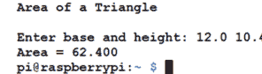

图 3.4 程序的一次示例运行

### 3.2.3 比较

我们可以在程序中使用以下比较运算符：

- `>` —— 大于
- `<` —— 小于
- `==` —— 等于
- `!=` —— 不等于
- `>=` —— 大于或等于
- `<=` —— 小于或等于

### 3.2.4 运算符

| 运算符 | 描述 |
|---|---|
| `x + y` | 加法 |
| `x - y` | 减法 |
| `x * y` | 乘法 |
| `x / y` | 除法 |
| `x % y` | x/y 的余数 |
| `x & y` | 按位与 |
| x \| y | 按位或 |
| `x ^ y` | 按位异或 |
| `~x` | 按位取反 |
| `!x` | 逻辑非 |
| `x << y` | 左移 |
| `x >> y` | 右移 |

### 3.2.5 • 自动递增/递减运算符

| 运算符 | 描述 |
|---|---|
| `x++` | 将 x 递增 1（后置） |
| `x--` | 将 x 递减 1（后置） |
| `++x` | 将 x 递增 1（前置） |
| `--x` | 将 x 递减 1（前置） |
| `x += y` | 将 x 增加 y（等同于 x = x + y） |
| `x -= y` | 将 x 减少 y（等同于 x = x - y） |
| `x *= y` | 将 x 乘以 y（等同于 x = x * y） |
| `x /= y` | 将 x 除以 y（等同于 x = x / y） |
| `x &= y` | 将 x 与 y 按位与（等同于 x = x & y） |
| x \|= y | 将 x 与 y 按位或（等同于 x = x \| y） |
| `x ^= y` | 将 x 与 y 按位异或（等同于 x = x ^ y） |

### 3.2.6 • 逻辑运算符

| 运算符 | 描述 |
|---|---|
| `&&` | 逻辑与（用于条件测试） |
| \|\| | 逻辑或（用于条件测试） |
| `!` | 逻辑非 |

### 3.2.7 • 流程控制

流程控制语句是所有编程语言中非常重要的语句。这些语句使程序员能够形成条件执行、选择和迭代（循环）。

#### 条件语句

#### if...else

`if...else` 语句块是主要的条件语句。if...else 块的一般格式为：

```c
if (condition is true)
{
    execute these statements
    ----------------
    ....................
}
else
{
    execute these statements
    ......................
    ......................
}
```

如果 `if` 块内只有一条语句，则无需使用花括号：

```c
if (condition is true)
    execute a single statement;
```

或者，`if (condition is true) execute a single statement;`

##### 示例 3.3

编写一个程序，从键盘读取两个数并计算它们的平均值。如果平均值大于 10，显示 **平均值大于 10。** 另一方面，如果平均值小于 10，显示 **平均值小于 10。** 另一方面，如果平均值等于 10，显示 **平均值是 10。**

##### 解答 3.3

图 3.5 显示了程序清单（程序：**Average.c**）。该程序读取两个浮点数到变量 **no1** 和 **no2**。计算平均值并存储在变量 **average** 中。然后根据平均值等于 10、大于 10 还是小于 10 显示一条消息。图 3.6 显示了该程序的一次示例运行。

```c
/*------------------------------------------------------------
                    AVERAGE OF 2 NUMBERS
                    ====================

This program calculates the average of two numbers read from
the keyboard and compares it with 10

Author: Dogan Ibrahim
File  : Average.c
Date  : December 2020
-------------------------------------------------------------*/
#include <stdio.h>

int main(void)
{
    float no1, no2, average;
    printf("\nAverage of two numbers\n\n");
    printf("Enter two numbers: ");


```c
scanf("%f %f", &no1, &no2);
average = (no1 + no2) / 2.0;

if(average > 10)
    printf("Average is greater than 10\n");
else if(average < 10)
    printf("Average is less than 10\n");
else
    printf("Average is 10\n");

return 0;
}
```

图 3.5 程序：Average.c

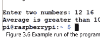

#### switch

**switch** 语句是另一种条件语句，用于针对多个条件测试一个变量，并针对每个条件执行不同的操作。**switch** 语句的一般格式如下：

```c
switch (variable)
{
    condition 1: do some statements
    condition 2: do some statements
    condition 3: do some statements
    default: do some statements
}
```

注意，**default** 是可选的；如果没有任何条件满足，则执行 **default** 下的语句。

##### 示例 3.4

编写一个计算器程序，执行加、减、乘、除运算。用户应输入第一个数字、所需运算，然后输入第二个数字。结果应显示在屏幕上。

##### 解答 3.4

图 3.7 显示了所需程序（程序：calculator.c）。scanf 函数用于在同一行读取两个数字和所需运算。switch 语句用于执行所需计算。注意，条件使用 case 语句指定，后跟条件。例如，如果用户输入 +，则将两个数字相加，和存储在变量 result 中，然后显示。break 语句确保在执行完某个条件的内容后终止 switch 块。

```c
/*---------------------------------------------------------------
                    SIMPLE CALCULATOR
                    =============

This is a simple calculator program which can perform + - * /

Author: Dogan Ibrahim
File  : calculator.c
Date  : December 2020
---------------------------------------------------*/

#include <stdio.h>

int main(void)
{
    float no1, no2, result;
    char oper;

    printf("Enter first number, operation, and second number: ");
    scanf("%f%c%f", &no1,&oper,&no2);

    switch(oper)
    {
        case '+':
            result = no1 + no2;
            break;
        case '-':
            result = no1 - no2;
            break;
        case '*':
            result = no1 * no2;
            break;
        case '/':
            result = no1 / no2;
            break;
    }
printf("\nResult = %.2f\n", result);
return 0;
}
```

图 3.7 程序：calculator.c

图 3.8 显示了程序的一次示例运行。

```text
Enter first number, operation, and second number: 12*8

Result =  96.00
pi@raspberrypi:~ $ █
```

图 3.8 程序示例运行

#### while

此流程控制语句通常用于循环（重复）。只要条件为真，就执行花括号内的语句。注意，如果条件在花括号内没有变为真，循环将永远执行。此外，如果进入循环时条件为假，则循环内的语句永远不会执行。该语句的一般格式如下：

```c
while(condition is true)
{
    execute these statements
}
```

##### 示例 3.5

要求编写一个程序，计算多个串联电阻的总电阻。编写一个程序，接受电阻数量，并输入每个电阻的值。总电阻应显示在屏幕上。

##### 解答 3.5

串联电阻的总电阻通过将所有电阻的值相加来计算。图 3.9 显示了所需程序清单（程序：SerialResistors.c）。程序开始时，要求用户输入串联电阻的数量，并将其存储在变量 no 中。然后形成一个 while 循环，在此循环内，要求用户输入每个电阻的值。总电阻存储在变量 Total 中，并显示在屏幕上。

```c
/*---------------------------------------------------------
       SERIALLY CONNECTED RESISTORS
       ==========================================
Total resistance of serially connected resistors

Author: Dogan Ibrahim
File  : SerialResistors.c
Date  : December 2020
---------------------------------------------------------*/
#include <stdio.h>

int main(void)
{
    int no, k, R, Total;

    printf("\nSerially Connected Resistors");
    printf("\n====================================\n");

    printf("How many resistors are there? ");
    scanf("%d", &no);

    k = 1;
    Total = 0;

    while(k <= no)
    {
        printf("Enter resistance (Ohms) of Resistor %d: ", k);
        scanf("%d", &R);
        Total = Total + R;
        k++;
    }

    printf("\nTotal resistance = %d Ohms\n", Total);
    return 0;
}
```

图 3.9 程序：SerialResistors.c

图 3.10 显示了三个串联电阻时程序的一次示例运行。

```text
pi@raspberrypi:~ $ gcc -o Resistors SerialResistors.c
pi@raspberrypi:~ $ ./Resistors

  Serially Connected Resistors
  ============================
  How many resistors are there? 3
  Enter resistance (Ohms) of Resistor 1: 200
  Enter resistance (Ohms) of Resistor 2: 400
  Enter resistance (Ohms) of Resistor 3: 150

  Total resistance = 750 Ohms
pi@raspberrypi:~ $
```

图 3.10 程序示例运行

#### do...while

此语句类似于 **while** 语句，但循环内的语句至少执行一次。这是因为退出循环的条件在循环末尾进行测试。该语句的一般格式如下：

```
do
{
    execute these statements
}while(condition is true)
```

##### 示例 3.6

重复示例 3.5，但这次循环使用 **do...while** 语句。

##### 解答 3.6

图 3.11 显示了程序清单（程序：**SerialResistors2.c**）。如你所见，终止循环的条件在循环末尾进行测试。程序的一次示例运行与图 3.10 相同。

```c
/*-----------------------------------------------------------------------
                SERIALLY CONNECTED RESISTORS
                ============================

Total resistance of serially connected resistors

Author: Dogan Ibrahim
File  : SerialResistors2.c
Date  : December 2020
-----------------------------------------------------------------------*/
#include <stdio.h>

int main(void)
{
    int no, k, R, Total;

    printf("\nSerially Connected Resistors");
    printf("\n==============================\n");

    printf("How many resistors are there? ");
    scanf("%d", &no);

    k = 1;
    Total = 0;

    do
    {
        printf("Enter resistance (Ohms) of Resistor %d: ", k);
        scanf("%d", &R);
        Total = Total + R;
        k++;
    }while(k <= no);

    printf("\nTotal resistance = %d Ohms\n", Total);
    return 0;
}
```

图 3.11 程序 SerialResistors2.c

#### for

for 循环可能是最常用的迭代语句之一。该语句的一般格式为：

```c
for(initial-condition; increment; termination condition)
{
    execute these statements until the condition is true
}
```

##### 示例 3.7

重复示例 3.5，但这次循环使用 for 语句。

##### 解答 3.7

图 3.12 显示了程序清单（程序：SerialResistors3.c）。如你所见，在此程序中，for 循环从 1 运行到 3（包含 3）。程序的一次示例运行与图 3.10 相同。

```c
/*----------------------------------------

SERIALLY CONNECTED RESISTORS
============================

Total resistance of serially connected resistors

Author: Dogan Ibrahim
File : SerialResistors3.c
Date : December 2020
----------------------------------------*/

#include <stdio.h>

int main(void)
{
    int no, k, R, Total;

    printf("Serially Connected Resistors");
    printf("============================");

    printf("How many resistors are there? ");
    scanf("%d", &no);

    Total = 0;

    for(k = 1; k <= no; k++)
    {
        printf("Enter resistance (Ohms) of Resistor %d: ", k);
        scanf("%d", &R);
        Total = Total + R;
    }

    printf("Total resistance = %d Ohms", Total);
    return 0;
}
```

图 3.12 程序 SerialResistors3.c

##### 示例 3.8

编写一个程序，显示 1 到 10 的整数平方表。

##### 解答 3.8

所需程序清单（程序：squares.c）如图 3.13 所示。使用 for 语句形成一个循环，在此循环内，将 1 到 10 的整数及其对应的平方列成表格。


```c
/********************************************
      TABLES OF SQUARES
      ******************

Table of squares from 1 to 10

Author: Dogan Ibrahim
File   : squares.c
Date   : December 2020
********************************************/
#include <stdio.h>

int main(void)
{
    int k;

    printf("\nTABLE OF SQUARES");
    printf("\n=================\n");

    for(k = 1; k <= 10; k++)
    {
        printf("%4d\t%d\n", k, k*k);
    }

    return 0;
}
```

图 3.13 程序 squares.c

图 3.14 显示了该程序的运行示例。

```
TABLE OF SQUARES
=================
   1       1
   2       4
   3       9
   4      16
   5      25
   6      36
   7      49
   8      64
   9      81
  10     100
pi@raspberrypi:~ $ █
```

图 3.14 程序运行示例

##### 例 3.9

编写一个程序，显示从 0° 到 20° 的正弦、余弦和正切三角函数表。

##### 解答 3.9

所需程序清单（程序：**trig.c**）如图 3.15 所示。程序开头包含了数学库头文件 **<math.h>**。使用三角函数时，角度必须以弧度输入。程序将变量 **k** 中的度数转换为变量 **rad** 中的弧度，并在三角函数中使用该变量。

```c
/**********************************************************
              TABLE OF TRIGONOMETRIC FUNCTIONS
              ===============================
List of the table of trigonometric functions 0-20 Degrees

Author: Dogan Ibrahim
File   : trig.c
Date   : December 2020
**********************************************************/
#include <stdio.h>
#include <math.h>

int main(void)
{
    int k;
    float rad,s,c,t, Pi = 3.14159;

    printf("\nTABLES OF TRIGONOMETRIC FUNCTIONS");
    printf("\n==================================\n");
    printf("DEGREES\t SINE\tCOSINE\tTANGENT\n");

    for(k = 0; k <= 20; k++)
    {
        rad = k * Pi / 180.0;
        s = sin(rad);
        c = cos(rad);
        t = tan(rad);
        printf("  %d\t%6.4f\t%6.4f\t%6.4f\n", k, s,c,t);
    }

    return 0;
}
```

图 3.15 程序 trig.c

##### 平方表

1 到 10 的平方表。程序在 5 次迭代后停止

作者：Dogan Ibrahim
文件：squares2.c
日期：2020 年 12 月

```
/*-------------------------------------------------
        TABLES OF SQUARES
        ================
Table of squares from 1 to 10. Program stops after 5 iterations

Author: Dogan Ibrahim
File  : squares2.c
Date  : December 2020
---------------------------------------------------*/

#include <stdio.h>

int main(void)
{
    int k;

    printf("\nTABLE OF SQUARES");
    printf("\n===============\n");

    for(k = 1; k <= 10; k++)
    {
        printf("%3d\t%3d\n", k, k*k);
        if(k == 5)break;
    }

    return 0;
}
```

图 3.17 程序 squares2.c

图 3.18 显示了该程序的运行示例。

```
TABLE OF SQUARES
===============
  1     1
  2     4
  3     9
  4    16
  5    25
pi@raspberrypi:~ $
```

图 3.18 程序运行示例

##### 例 3.11

编写一个程序，显示 1 到 10 的整数平方，如例 3.8 所示。跳过数字 5 的表格。

##### 解答 3.11

所需程序清单（程序：**squares3.c**）如图 3.19 所示。注意 **continue** 语句如何用于在 **for** 循环内跳过数字 5。

```c
/***********************************************
              TABLES OF SQUARES
              =================

Table of squares from 1 to 10. Number 5 is skipped in the loop

Author: Dogan Ibrahim
File  : squares3.c
Date  : December 2020
***********************************************/

#include <stdio.h>

int main(void)
{
    int k;

    printf("\nTABLE OF SQUARES");
    printf("\n================\n");

    for(k = 1; k <= 10; k++)
    {
        if(k == 5)continue;
        printf("  %d\t%d\n", k, k*k);
    }

    return 0;
}
```

图 3.19 程序：squares3.c

图 3.20 显示了该程序的运行示例。

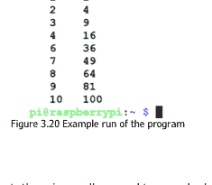

### 3.2.8 数组

在程序开发过程中，通常需要记录同一类型的相关数据项。例如，我们可能想保存教室里学生的身高。在此类应用中，使用数组存储相关数据项很方便。

数组有类型和名称。例如，一个名为 age、包含 5 个元素的整数数组可以定义如下：

```
int age[5];
```

数组的每个元素都是唯一的。数组的索引始终从 0 开始，一直到所定义值减 1。因此，在上述定义中，数组 age 有 5 个元素，每个元素可按如下方式访问：

- age[0]
- age[1]
- age[2]
- age[3]
- age[4]

可以通过指定数组元素的索引并向其分配新数据来更改该元素的内容。在以下示例中，数组的第二个元素被改为 10：

```
age[1] = 10;
```

#### 例 3.12

要求找出班级中学生的最大年龄。编写一个程序，读取学生人数及其年龄，并计算和显示教室中的最大年龄。

#### 解答 3.12

所需程序清单（程序：**ages.c**）如图 3.21 所示。程序开始时读取学生人数并将其存储在变量 **no** 中。然后程序使用 **for** 循环读取年龄并将其存储在数组 **age** 中。第二个 **for** 循环用于查找最大年龄，然后显示该最大年龄。

~~~c
/******************************************
        MAXIMUM AGE OF STUDENTS
        ========================

Find the maximum age of students in a class

Author: Dogan Ibrahim
File  : ages.c
Date  : December 2020
------------------------------------------*/
#include <stdio.h>

int main(void)
{
    int k, no, maxage = 0;
    int age[50];

    printf("\nHow many students are there?: ");
    scanf("%d", &no);

    for(k = 0; k < no; k++)
    {
        printf("Enter age of student %d :", k+1);
        scanf("%d", &age[k]);
    }

    for(k = 0; k < no; k++)
    {
        if(age[k] > maxage)maxage = age[k];
    }

    printf("Maximum age = %d\n", maxage);

    return 0;
}
~~~

图 3.21 程序 ages.c

该程序的运行示例如图 3.22 所示。

```text
How many students are there?: 4
Enter age of student 1 :23
Enter age of student 2 :35
Enter age of student 3 :32
Enter age of student 4 :28
Maximum age = 35
pi@raspberrypi:~ $
```

图 3.22 程序运行示例

### 3.2.9 ● 字符串变量

在每种编程语言中，能够操作文本和字符都很重要。在 C 中，文本字符串表示为字符数组，其中第一个字符存储在索引 0 中。数组以空字符（'\0'）结尾，该字符是 ASCII 0。字符串声明如下所示：

```c
char name[] = "John";
```

注意，不必指定字符串长度，因为这由编译器计算。上述语句创建一个包含 5 个元素的字符数组，末尾包括空字符。字符在数组中的存储方式如下所示：

| 0 | 1 | 2 | 3 | 4 |
|---|---|---|---|---|
| J | o | h | n | '\0' |

我们也可以指定数组大小如下：

```c
char name[10] = "John";
```

注意，指定的数组大小大于数组中的元素数量。这里，编译器在数组末尾分配额外空间，以便将来可以追加额外文本。如果数组长度未知，在声明数组时可以使用关键字 **BUFSIZ**。**BUFSIZ** 将数组大小设置为编译器允许的最大值。

数组的名称也是其在内存中的地址。因此，当需要输入数组的地址时，我们可以简单地输入其名称，或者通过在其第一个元素前使用 & 符号来指定其地址，例如 &name[0]。

可以使用 printf 示例中的 %s 限定符打印字符串，如下例所示。


#### 示例 3.13

编写一个程序，读取一个人的姓名并将其显示在屏幕上。

#### 解答 3.13

所需的程序清单（程序：name.c）如图 3.23 所示。用户输入的姓名由 scanf 读取，存储在字符数组 name 中，然后显示在屏幕上。

```c
/*------------------------------------------------
NAME
====
This program shows how strings can be used in a program

Author: Dogan Ibrahim
File : name.c
Date : December 2020
--------------------------------------------------*/
#include <stdio.h>

int main(void)
{
 char name[30];

 printf("\nEnter your name: ");
 scanf("%s", name);

 printf("Your name is %s\n", name);

 return 0;
}
```

图 3.23 程序 name.c

程序的一个示例运行如图 3.24 所示。

```text
Enter your name: John Smith
Your name is John
pi@raspberrypi:~ $
```

图 3.24 程序的示例运行

注意，即使我们输入的姓名是 John Smith，显示时也只有 John。这是因为 scanf 函数在读取文本时遇到空白字符就会终止。解决这个问题的方法是使用 fgets 函数读取带空白的文本，或者将 scanf 函数修改如下，使其在按下回车键之前读取文本：

```c
scanf("%[^\n]%*c", name);
```

#### 示例 3.14

编写一个程序，读取一个人的姓名和年龄，然后将其显示在屏幕上。

#### 解答 3.14

所需的程序清单（程序：**nameage.c**）如图 3.25 所示。用户输入的姓名和年龄由 **scanf** 函数读取，并分别存储在字符数组 **name** 和变量 **age** 中。然后显示在屏幕上。

```c
/*--------------------------------------------------------
                         NAME AND AGE
                         ============

This program shows how strings can be used in a program

Author: Dogan Ibrahim
File  : nameage.c
Date  : December 2020
--------------------------------------------------------*/
#include <stdio.h>

int main(void)
{
    char name[30];
    int age;

    printf("Enter your name: ");
    scanf("%[^\n]%*c", name);

    printf("Enter your age: ");
    scanf("%d", &age);

    printf("Your name is %s and you are %d years old\n", name, age);

    return 0;
}
```

图 3.25 程序 nameage.c

程序的一个示例运行如图 3.26 所示。

```text
Enter your name: John Smith
Enter your age: 24
Your name is John Smith and you are 24 years old
pi@raspberrypi:~ $
```

图 3.26 程序的示例运行

#### 示例 3.15

编写一个程序，读取一个人的姓名和年龄并将其显示在屏幕上。使用 fgets 函数读取姓名。

#### 解答 3.15

所需的程序清单（程序：**nameage2.c**）如图 3.27 所示。用户输入的姓名使用 **fgets** 函数读取。年龄由 **scanf** 函数读取。然后显示在屏幕上。

**fgets** 函数的格式为：

```c
fgets(name, size, stdin)
```

其中，name 是接收字符串数据的字符数组名称，size 是要读取的字符数，**stdin** 是标准输入端口。**fgets** 在读取到指定数量的字符或遇到回车字符时终止。在 NULL 终止符之前，**fgets** 的末尾会添加一个换行符。在大多数应用中，我们想要移除这个换行符。在图 3.27 中，换行符被替换为字符串终止符 NULL 字符。这里，**len** 给出了字符串的长度（字符数），不包括 NULL 终止符。

```c
/***********************************************
                 NAME AND AGE
                 ============

This program shows how strings can be used in a program

Author: Dogan Ibrahim
File  : nameage2.c
Date  : December 2020
***********************************************/

#include <stdio.h>
#include <string.h>

int main(void)
{
    char name[30];
    int age, len;

    printf("\nEnter your name: ");
    fgets(name, 30, stdin);
    len = strlen(name);
    if(len > 0 && name[len-1] == '\n')name[--len] = '\0';

    printf("Enter your age: ");
    scanf("%d", &age);

    printf("Your name is %s and you are %d years old\n", name, age);

    return 0;
}
```

图 3.27 程序 nameage2.c

程序的一个示例运行如图 3.26 所示。

### 3.2.10 • 算术函数

C 语言支持大量的算术函数。在使用这些函数之前，必须在程序开头包含头文件 `<math.h>`。此外，程序必须使用选项：-lm 进行编译。在本节中，我们将介绍一些常用的算术函数。

| 函数 | 描述 |
|---|---|
| `abs()` | 返回整数的绝对值 |
| `acos()` | 返回反余弦值 |
| `asin()` | 返回反正弦值 |
| `atan()` | 返回反正切值 |
| `cbrt()` | 返回传递参数的立方根 |
| `ceil()` | 返回大于或等于参数的最小整数值 |
| `cos()` | 三角余弦 |
| `cosh()` | 双曲余弦 |
| `exp()` | e 的给定次幂 |
| `floor()` | 返回小于或等于传递参数的最大整数 |
| `hypot()` | 计算两个给定数字的平方和的平方根 |
| `log()` | 自然对数 |
| `log10()` | 以 10 为底的对数 |
| `pow()` | 给定数字的幂 |
| `round()` | 返回传递参数最接近的整数值 |
| `sin()` | 三角正弦 |
| `sinh()` | 双曲正弦 |
| `srand()` | 初始化随机数生成器 |
| `sqrt()` | 返回传递参数的平方根 |
| `tan()` | 三角正切 |
| `tanh()` | 双曲正切 |
| `rand()` | 生成随机数 |
| `trunc()` | 返回大小不大于给定值的最接近整数 |

#### 示例 3.16

编写一个程序，计算并列出 2 的 0 到 16 次幂。

#### 解答 3.16

所需的程序清单（程序：powers.c）如图 3.28 所示。该程序使用内置算术函数 **pow()** 来计算 2 的幂。此函数返回一个浮点变量。将其转换为整数并显示。

```c
/*-----------------------------
         TABLE OF POWERS OF 2
         =================
Table of powers of 2 from 0 to 16

Author: Dogan Ibrahim
File  : powers.c
Date  : December 2020
-----------------------------*/

#include <stdio.h>
#include <math.h>

int main(void)
{
    int k, d;
    float p;

    printf("\nTABLE OF POWERS OF 2");
    printf("\n=====================\n");

    for(k = 0; k <= 16; k++)
    {
        p = pow(2.0, k);
        d = (int)p;
        printf(" %d\t\t%d\n", k, d);
    }

    return 0;
}
```

图 3.28 程序 powers.c

程序的一个示例运行如图 3.29 所示。

```text
pi@raspberrypi:~ $ ./powers

TABLE OF POWERS OF 2
====================
   0             1
   1             2
   2             4
   3             8
   4            16
   5            32
   6            64
   7           128
   8           256
   9           512
  10          1024
  11          2048
  12          4096
  13          8192
  14         16384
  15         32768
  16         65536
pi@raspberrypi:~ $
```

图 3.29 程序的示例运行

### 3.2.11 • 字符串函数

当需要操作字符串时，字符串函数非常有用。本节给出一些常用字符串函数的列表。在使用这些函数之前，必须在程序开头包含头文件 **<string.h>**。本节给出了一些常用字符串函数的使用示例。

- **strlen:** 此函数返回字符串的长度。
- **strcpy:** 此函数将源字符串复制到目标字符串。
- **strcmp:** 此函数比较两个字符串并返回一个整数，如下所示：

| 返回值 | 含义 |
|---:|---|
| 0 | 两个字符串相同 |
| 1 | 两个字符串不同（第一个更长或它们不同） |
| -1 | 两个字符串不同（第一个更短或它们不同） |

#### 示例 3.17

编写一个程序，展示字符串函数 **strlen**、**strcpy** 和 **strcmp** 如何在程序中使用。


#### 解决方案 3.17

图3.30显示了程序清单（程序：lencmp.c）。字符串 a 用文本 John Smith 初始化，并创建了一个名为 b 的空字符串。该程序将字符串 a 复制到字符串 b，并显示字符串 b 的内容。随后在屏幕上显示字符串 a 的长度。程序的其余部分展示了如何使用字符串比较函数。

```c
/*---------------------------------------------------------------
strlen and strcmp

This program is an example use of the strlen and strcmp

Author: Dogan Ibrahim
File : lencmp.c
Date : December 2020
-------------------------------------------------*/

#include <stdio.h>
#include <string.h>

int main(void)
{
    char a[]="John Smith";
    char b[BUFSIZ];

    strcpy(b, a);
    printf("My name is %s\n", b);
    printf("Length of my name is %d characters\n", strlen(a));

    printf("%d\n",strcmp("Smith", "Smith"));
    printf("%d\n",strcmp("Smith", "Smit"));
    printf("%d\n",strcmp("Smit", "Smith"));
    printf("%d\n",strcmp("Smith", "Smiti"));
    printf("%d\n",strcmp("Smith", "John"));

    return 0;
}
```

图3.30 程序 lencmp.c

程序的示例运行如图3.31所示。

```text
My name is John Smith
Length of my name is 10 characters
0
1
-1
-1
1
pi@raspberrypi:~ $
```

图3.31 程序的示例运行

- **strcat：** 该函数将一个字符串连接到另一个字符串的末尾。
- **strchr：** 该函数在字符串中搜索指定字符的首次出现。
- **toupper：** 该函数将字符转换为大写。
- **tolower：** 该函数将字符转换为小写。

#### 示例 3.18

编写一个程序，展示字符串函数 **strcat**、**strchr** 和 **toupper** 如何在程序中使用。

#### 解决方案 3.18

图3.32显示了程序清单（程序：**catchr.c**）。该程序将字符串 **John Smith** 连接到数组 c。函数 **strchr** 用于检查该文本是否包含字符 **S**，并显示一条消息。然后将文本转换为大写字母并显示在屏幕上。

```c
/*--------------------------------------------------------
                    strcat, strchr and toupper

This program is an example use of the strcat,strchr and toupper

Author: Dogan Ibrahim
File : catchr.c
Date : December 2020
--------------------------------------------------------*/

#include <stdio.h>
#include <string.h>
#include <ctype.h>

int main(void)
{
    char a[]="John";
    char b[] = " Smith";
    char c[BUFSIZ];
    char u[BUFSIZ];
    int i;

    //
    // Using strcat
    //
    strcat(c, a);
    strcat(c, b);
    printf("My name is %s\n", c);


    //
    // Using strchr
    //
    if(strchr(c, 'S') != 0)
            printf("S was found in string %s\n", c);
    else
            printf("String %s does not contain S\n", c);


    //
    // Using toupper
    //
    for(i = 0; i < strlen(c); i++)
    {
            u[i] = toupper(c[i]);
    }
    printf("Upper case of %s is %s\n", c, u);


    return 0;
}
```

图3.32 程序 catchr.c

程序的示例运行如图3.33所示。

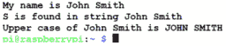

图3.33 程序的示例运行

#### 示例 3.19

编写一个程序，展示字符串函数 **strcat** 和 **strcpy** 如何在程序中使用。

#### 解决方案 3.19

图3.34显示了程序清单（程序：cpy.c）。该程序形成字符串 John-Smith 并显示在屏幕上。

```c
/*--------------------------------------------------------
                  strcpy and strcat

   This program is an example use of the strcpy and strcat

   Author: Dogan Ibrahim
   File  : cpy.c
   Date  : December 2020
----------------------------------------------------------*/

#include <stdio.h>
#include <string.h>
#include <ctype.h>

int main(void)
{
   char a[]="John";
   char b[] = "Smith";
   char c[] = "-";
   char d[BUFSIZ];


   //
   // Using strcpy
   //
   strcpy(d, a);                       // d=John
   strcat(d, c);                       // d=John-
   strcat(d, b);                       // d=John-Smith
   printf("My name is %s\n", d);

   return 0;
}
```

图3.34 程序 cpy.c

该程序显示以下文本：

My name is John-Smith

### 3.2.12 • 字符宏

有几个有用的宏可用于测试各种字符。在使用这些宏之前，必须在程序开头包含头文件 <ctype.h>。

| 函数 | 描述 |
|---|---|
| isalnum(c) | 测试是否为字母数字（a-z、A-Z、0-9） |
| isalpha(c) | 测试是否为字母（a-z、A-Z） |
| isdigit(c) | 测试是否为数字（0-9） |
| islower(c) | 测试是否为小写 |
| isupper(c) | 测试是否为大写 |
| isprint(c) | 测试是否为可打印字符 |
| ispunct(c) | 测试是否为标点字符 |
| isxdigit(c) | 测试是否为十六进制字符 |

#### 示例 3.20

编写一个程序，展示字符宏 isalpha 和 isdigit 如何在程序中使用。

#### 解决方案 3.20

图3.35显示了程序清单（程序：tmacro.c）。提示用户输入一个字符。程序检查输入的字符，并根据用户输入的字符类型显示消息“You entered a digit”或“You entered alpha character”。程序在循环中运行，用户可以在提示“Continue (y/n)?”中输入 y 或 Y 来继续：

```c
/*---------------------------------------------------------------
Character macros

This program is an example of using the isdigit and isalpha

Author: Dogan Ibrahim
File : tmacro.c
Date : December 2020
---------------------------------------------------------------*/

#include <stdio.h>
#include <string.h>
#include <ctype.h>

int main(void)
{
    char ch, yn = 'Y';

    while(yn == 'Y')
    {
        printf("\nEnter a character: ");
        scanf("%c%*c", &ch);

        if(isdigit(ch))printf("\nYou entered a digit");
        else if(isalpha(ch))printf("\nYou entered alpha character");
```

```text
How many numbers are there? : 5
Enter number 1: 12
Enter number 2: 10
Enter number 3: 18
Enter number 4: 25
Enter number 5: 20
Average = 17.000000
pi@raspberrypi:~ $
```

图3.38 程序的示例运行

### 3.2.14 • 用户函数

通过将大型程序分解为更小、更易管理的部分，开发起来会更容易。函数就是用于此目的。当程序中需要重复执行某一组操作时，也会使用函数。例如，如果需要在程序的不同位置计算一些数字的平均值，将求平均值的代码编写为函数，并在需要时从主程序调用该函数，会更容易。

用户函数的一般格式如下：

```
type name(parameter list)
{
    statements inside the function
    optional return
}
```

函数的类型可以是有效变量类型之一，例如 char、int、float 等。函数将指定类型的变量返回给调用程序。如果函数不向调用程序返回任何数据，可以使用 void 关键字。函数名是有效的 C 变量名。括号内的参数是可选的，取决于应用。return 关键字是可选的，并且必须在 return 语句之后指定要返回给主程序的数据。

从主程序调用函数时，需要指定函数名，后跟一组括号。使用的任何参数都必须在括号内指定。下面给出一些示例。

#### 示例 3.22

编写一个函数来计算三角形的面积。三角形的底和高将从键盘读取，并作为参数传递给该函数。

#### 解决方案 3.22

所需的程序清单（程序：Func1.c）如图3.39所示。三角形的底和高从键盘读取，并传递给名为 **TriangleArea** 的函数。该函数返回计算出的面积，然后由主程序显示。

```c
/*-------------------------------------------------------------

    Example use of a function

This program is an example use of a function

Author: Dogan Ibrahim
File  : Func1.c
Date  : December 2020
-------------------------------------------------------------*/

#include <stdio.h>
#include <stdlib.h>
#include <math.h>

float TriangleArea(float h, float b)
{
    float area;
    area = h * b / 2;
    return(area);
}

int main(void)
{
    float base, height, area;

    printf("\nAREA OF A TRIANGLE");
    printf("\nEnter the base and height of the triangle: ");
    scanf("%f %f", &base, &height);
    area = TriangleArea(height, base);
    printf("\nArea = %f\n", area);

    return 0;
}
```

图3.39 程序 Func1.c

程序的示例运行如图3.40所示。

```text
AREA OF A TRIANGLE
Enter the base and height of the triangle: 12 4
Area = 24.000000
pi@raspberrypi:~ $
```

图3.40 程序的示例运行


#### 例3.23
编写一个程序，使用两个函数 **Area** 和 **Circumference** 分别计算圆的面积和周长。圆的半径应从键盘读取。

#### 解答3.23
图3.41给出了程序清单（程序：**circle.c**）。主程序读取圆的半径，并调用这两个函数分别计算圆的面积和周长。这里，**#define** 被称为预处理器宏。在本例中，**Pi** 在程序中出现的位置都会在编译时被替换为值 3.14159。**#include** 是另一个预处理器宏。

```c
/*----------------------------------------------------------
                Circle and Area of a circle

calculate the area and circumference of a circle

Author: Dogan Ibrahim
File  : circle.c
Date  : December 2020
----------------------------------------------------------*/
#include <stdio.h>
#include <math.h>
#include <stdlib.h>
#define Pi 3.14159

float Area(float r)
{
    float area;
    area = Pi * r * r;
    return(area);
}

float Circumference(float r)
{
    float circ;
    circ = 2 * Pi * r;
    return(circ);
}

int main(void)
{
    float radius, area, circ;
    char buff[BUFSIZ];
```

```c
float Circumference(float);

int main(void)
{
    float radius, area, circ;
    char buff[BUFSIZ];

    printf("\nAREA AND CIRCUMFERENCE OF A CIRCLE");
    printf("\nEnter the radius of the circle: ");
    radius = atof(fgets(buff, 10, stdin));
    area = Area(radius);
    circ = Circumference(radius);

    printf("\nArea = %f, Circumference = %f\n", area, circ);

    return 0;
}

float Area(float r)
{
    float area;
    area = Pi * r * r;
    return(area);
}

float Circumference(float r)
{
    float circ;
    circ = 2 * Pi * r;
    return(circ);
}
```

图3.43 声明函数原型

#### 将数组传递给函数
在某些应用中，我们可能希望将数组作为参数传递给函数。下面给出一个示例来说明如何做到这一点。

##### 例3.24
编写一个程序，将5个整数读入一个数组。然后调用一个函数计算这些数字的和，并将和返回给调用程序，随后在调用程序中显示该和。

##### 解答3.24
图3.44给出了程序清单（程序：**arrayfunc.c**）。主程序读取5个整数，并调用函数 **Sum** 计算它们的和。函数 **Sum** 在其参数中接收数组，将所有元素相加并存储到局部变量 **Tot** 中，然后将该变量返回给调用程序。

```c
/*----------------------------------------------------------
                    Passing an Array to a Function

This example shows how an array can be passed to a function
Author: Dogan Ibrahim
File   : arrayfunc.c
Date   : December 2020
----------------------------------------------------------*/
#include <stdio.h>
#include <math.h>
#include <stdlib.h>
#define Pi 3.14159

int Sum(int x[])
{
    int k, Tot = 0;
    for(k = 0; k < 5; k++) Tot = Tot + x[k];
    return(Tot);
}

int main(void)
{
    int k, Total;
    char buff[BUFSIZ];
    int numbers[5];

    printf("\nSum of 5 numbers...\n");
    for(k = 1; k <= 5; k++)
    {
        printf("Enter number %d: ", k);
        numbers[k-1] = atoi(fgets(buff, 5, stdin));
    }

    Total = Sum(numbers);
    printf("\nSum = %d\n", Total);

    return 0;
}
```

图3.44 程序 arrayfunc.c

程序的示例运行结果如图3.45所示。

```
Sum of 5 numbers...
Enter number 1: 10
Enter number 2: 20
Enter number 3: 15
Enter number 4: 12
Enter number 5: 10

Sum = 67
```

图3.45 程序的示例运行结果

#### 将字符串传递给函数
有时我们可能需要将字符串作为参数传递给函数。下面给出一个示例来说明如何做到这一点。

##### 例3.25
编写一个程序，从键盘读取文本并将其传递给一个函数，在该函数中将其显示在屏幕上。

##### 解答3.25
图3.46给出了所需的程序（程序：strfunc.c）。主程序读取用户输入的文本，并调用函数 PrntStr 在屏幕上显示该字符串。

```c
/*-----------------------------------------------
    Passing text to a function

Pass text to a function and display it

Author: Dogan Ibrahim
File : strfunc.c
Date : December 2020
---------------------------------------------------*/

#include <stdio.h>

void PrntStr(char x[])
{
    printf("%s\n", x);
}

int main(void)
{
    char txt[BUFSIZ];
    printf("\nEnter a text: ");
    scanf("%s", txt);
    PrntStr(txt);

    return 0;
}
```

图3.46 程序 strfunc.c

### 3.2.15 ● 文件处理
文件处理函数使我们能够在 Raspberry Pi SD 卡上写入和读取数据。默认情况下，数据从默认用户文件夹写入和读取，该文件夹为：/home/pi。

以下函数可用于文件处理：

| 函数 | 描述 |
|---|---|
| fopen | 打开文件以进行读取/写入（访问文件前必须先打开文件） |
| fprintf | 将数据打印到文件 |
| fgets | 从文件读取数据 |
| fscanf | 从文件读取数据 |
| fputs | 将数据写入文件 |
| fclose | 关闭文件（处理完打开的文件后必须始终关闭它） |

文件可以按以下模式之一打开：

- r 以读取模式打开文件，并将指针设置到文件中的第一个字符。如果文件不存在，则返回 NULL。
- w 以写入模式打开文件。如果文件无法打开，则返回 NULL。如果文件不存在，则创建新文件。如果文件存在，则覆盖数据。
- a 以追加模式打开文件。如果文件不存在，则创建新文件。如果文件无法打开，则返回 NULL。
- r+ 以读写模式打开文件，并将指针设置到文件中的第一个字符。此模式也称为更新模式
- w+ 以读写模式打开文件，并将指针设置到文件中的第一个字符。如果文件不存在，则创建新文件
- a+ 以读写模式打开文件，并将指针设置到文件末尾以便追加。如果文件不存在，则创建新文件。数据可以追加到文件末尾，但现有数据不能修改。
- wb 以二进制写入模式打开文件

在读取或写入文件之前，检查文件是否可以打开始终是一种良好的编程实践。下面给出一些文件处理示例。此外，当我们完成对文件的操作后，必须始终关闭文件。

#### 例3.26
在默认目录中创建一个名为 **squares.txt** 的新文件，并将整数1到5的平方写入该文件。

#### 解答3.26
图3.47给出了程序清单（程序：**fsquares.c**）。在访问文件之前，必须声明文件指针。在本例中，文件指针名为 **fl**。程序检查以确保 **squares.txt** 可以在 SD 卡上打开。如果文件无法打开，则显示一条消息，并通过调用函数 **exit(0)** 终止程序。然后形成一个 for 循环，并使用 **fprintf** 语句将整数及其平方写入文件。

```c
/*--------------------------------------------------
                    TABLES OF SQUARES
                    ================
Write the table of squares from 1 to 5 to a file
Author: Dogan Ibrahim
File  : fsquares.c
Date  : December 2020
--------------------------------------------------*/
#include <stdio.h>
#include <stdlib.h>

int main(void)
{
    int k;
    FILE *fl;

    if((fl = fopen("squares.txt", "w")) == NULL)
    {
        printf("\nCould not open the file...\n");
        exit(0);
    }

    fprintf(fl, " \nTABLE OF SQUARES");
    fprintf(fl, " \n================\n");

    for(k = 1; k <= 5; k++)
    {
        fprintf(fl, "    %d\t%d\n", k, k*k);
    }
    fclose(fl);
    return 0;
}
```

图3.47 程序 fsquares.c

```
}
fputs(" \nTABLE OF SQUARES", fl);
fputs(" \n================\n", fl);

for(k = 1; k <= 5; k++)
{
    fprintf(fl, " %d\t%d\n", k, k*k);
}
fclose(fl);

return 0;
}
```

图 3.49 程序 fsquares2.c

#### 例 3.28

编写一个程序，读取上一示例中创建的 **squares.txt** 的内容，并将其显示在屏幕上。

#### 解答 3.28

图 3.50 显示了程序清单（程序：**fdisp.c**）。该程序以读取模式打开 **squares.txt**。使用 **while** 循环通过 **getc** 从文件中读取字符，直到到达文件末尾（EOF）。函数 **putchar** 将文件中读取的字符显示在屏幕上。

```
/*---------------------------------------------
        READING DATA FROM A FILE
        =========================

This program shows how data can be read from a file

Author: Dogan Ibrahim
File  : fdisp.c
Date  : December 2020
--------------------------------------------------*/

#include <stdio.h>
#include <stdlib.h>

int main(void)
{
    int c;
    FILE *fl;
```
```
if((fl = fopen("squares.txt", "r")) == NULL)
{
    printf("\nCould not open the file...\n");
    exit(0);
}

c = getc(fl);
while(c != EOF)
{
    putchar(c);
    c = getc(fl);
}
fclose(fl);

return 0;
}
```

图 3.50 程序 fdisp.c

图 3.51 显示了程序的一次示例运行。

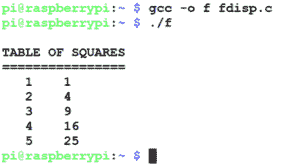

图 3.51 程序示例运行

### 3.2.16 • 结构体

结构体用于当我们想要分组并操作相关但通常不同类型的数据时。例如，我们可能想要分组某人的个人数据，如姓名、年龄、身高、体重等。结构体在此类应用中非常高效，并使编程变得容易。

结构体使用关键字 **struct** 定义，后跟结构体名称。结构体主体包含结构体的元素。下面展示了一个示例结构体，可用于存储一个人的详细信息：

```
struct person
```
```
{
    char name[20];
    char surname[20];
    int age;
    float height;
    float weight;
};
```

需要认识到，上述内容只是一个模板，不占用内存中的任何空间。可以使用如下语句定义具有上述模板的 **struct** 类型变量。这里，变量 **p1** 是 **struct** 类型，并占用内存空间（注意 **p1** 是变量，而不是 person）：

```
struct person p1;
```

我们也可以定义模板并同时定义要使用的变量。示例如下：

```
struct person
{
    char name[20];
    char surname[20];
    int age;
    float height;
    float weight;
}p1, p2, p3;
```

在上述语句中，创建了一个名为 person 的结构体，并带有三个变量 **p1**、**p2** 和 **p3**，这些变量占用内存空间。

结构体的元素可以通过指定变量名、后跟一个点以及元素名来访问。下面给出一些示例：

```
p1.age = 25;
p1.height = 162.0;
```

结构体的大小是结构体占用的字节数。关键字 sizeof 可用于查找结构体变量的大小，如下所示：

```
sizeof(p1);
```

结构体可以使用赋值运算符相互复制：

```
p1 = p2;
```

结构体的元素可以使用花括号初始化：

```
struct person p1 = {val1, val2, val3,....};
```

下面展示一个初始化示例：

```
struct person
{
    char name[20];
    char surname[20];
    int age;
    float height;
    float weight;
} p1 = {"John", "Smith", 25, 162, 62};
```

下面给出一个示例。

#### 例 3.29

编写一个程序，读取一个变量的姓名、姓氏、年龄、身高和体重，并将它们存储在结构体中。在屏幕上显示详细信息。

#### 解答 3.29

图 3.52 显示了程序清单（程序：struct.c）。使用变量 p1 创建了一个结构体。函数 scanf 用于读取个人详细信息，并将这些信息存储在结构体中。然后 printf 函数显示个人详细信息。

```
/*-----------------------------------------------
          Person Details
          =============

This example program shows how a structure can be used

Author: Dogan Ibrahim
File  : struct.c
Date  : December 2020
---------------------------------------------------*/

#include <stdio.h>

struct person
{
    char name[10];
    char surname[10];
    int age;
    float height;
    float weight;
```
```
}p1;

int main(void)
{
    printf("\nEnter name surname age height weight: ");
    scanf("%s %s %d %f %f", &p1.name,&p1.surname,&p1.age,&p1.height,&p1.weight);

    printf("\nName: %s\nSurname: %s\nAge: %d\nHeight: %f\nWeight: %f\n",
           p1.name,p1.surname,p1.age,p1.height,p1.weight);

    return 0;
}
```

图 3.52 程序 struct.c

图 3.53 显示了程序的一次示例运行。

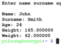

图 3.53 程序示例运行

### 3.2.17 • 联合体

联合体与结构体类似，但在联合体中，所有成员共享公共存储空间。联合体的声明与结构体类似。下面展示一个联合体声明示例。这里，相同的内存位置用于存储多种数据类型。分配给联合体的内存足以容纳联合体中最大的成员。在下面的示例中，联合体占用 20 字节的内存空间：

```
union Data
{
        int i;
        float f;
        char name[20];
}MyData;
```

与结构体一样，sizeof 函数可用于查找联合体的大小。联合体成员的访问方式与结构体中相同。

下面给出一个示例，展示如何在程序中使用联合体。

#### 例 3.30

编写一个程序，将一些数据存储在联合体中，并显示其内容。

#### 解答 3.30

图 3.54 显示了程序清单（程序：union.c）。该联合体存储一个整数、一个浮点数和一个字符串。图 3.55 显示了程序的输出。注意，整数变量和浮点变量的内容被破坏了。这是因为三个变量共享同一内存位置，向字符串加载数据破坏了另外两个变量的内容。

```
/*---------------------------------------------------------------
 Unions
 =====

This example program shows how a union can be used

Author: Dogan Ibrahim
File : union.c
Date : December 2020
--------------------------------------------------*/
#include <stdio.h>
#include <string.h>

union Data
{
 char name[20];
 int j;
 float k;
}p1;

int main(void)
{
 p1.j = 20;
 p1.k = 12.5;
 strcpy(p1.name, "Raspberry Pi");

 printf(" j: %d\n", p1.j);
 printf(" k: %f\n", p1.k);
 printf("name: %s\n", p1.name);

 return 0;
}
```

图 3.54 程序 union.c

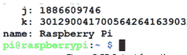

图 3.56 显示了修正后的程序（程序：**union2.c**），其输出如图 3.57 所示。

```
/*------------------------------------------------------
                         Unions
                         ======
This example program shows how a union can be used
Author: Dogan Ibrahim
File   : union2.c
Date   : December 2020
------------------------------------------------------*/
#include <stdio.h>
#include <string.h>

union Data
{
    char name[20];
    int j;
    float k;
}p1;

int main(void)
{
    p1.j = 20;
    printf("  j: %d\n", p1.j);

    p1.k = 12.5;
    printf("  k: %f\n", p1.k);

    strcpy(p1.name, "Raspberry Pi");
    printf("name: %s\n", p1.name);

    return 0;
}
```

图 3.56 程序 union2.c

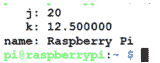

图 3.57 程序输出

### 3.2.18 • 指针

指针是 C 编程语言中非常重要的部分。指针保存内存中变量的地址，或者它指向变量的地址。指针通过指定其类型、后跟 * 字符和指针名称来定义：

```
char *ptr;
```

在上述示例中，**ptr** 是一个字符指针。类似地，我们可以有一个名为 **p** 的整数指针：

```
int *p;
```

我们可以用变量的地址初始化指针，如下所示。这里，字符变量 **c** 被赋值为 Z。**p** 被定义为字符指针，并用 **c** 的地址初始化，即 **p** 指向变量 **c** 的地址：

```
char c = 'Z';
char *p = &c;
```

上述赋值如图 3.58 所示，其中假设字符 j 位于地址 200。

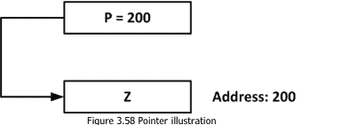

间接运算符 * 可用于向指针所指向的内存地址赋值。例如，图 3.58 中位置 200 的内容可以通过以下语句改为 'Y'：

```
*p = 'Y';
```

下面给出一些使用指针的示例：

```
int a = 10;
int b;
int *p = &a;
```


```c
b = *p;            // b = a
*p = *p + 2;       // a = a + 2
*p = *p * *p       // a = a * a
(*p)++;            // a++
```

#### 指针运算

指针可以递增、递减、相加、相减或比较，如下例所示：

- `p++` — 递增指针
- `p--;` — 递减指针
- `p = p + 10` — 给指针加上一个值
- `p1 = p1 + p2` — 两个指针相加
- `p = p - 5` — 从指针中减去一个值
- `p1 = p1 - p2` — 两个指针相减

可以使用字符指针创建字符串，如下所示。这里，指针 `p` 保存字符串第一个字符（`R`）的地址。注意，字符串会自动以 NULL 字符终止：

```c
char *p = "Raspberry Pi";
```

下面给出了在 C 程序中使用指针的示例。

##### 例 3.31

编写一个函数，使用指针从基本原理出发计算字符串的长度。

##### 解答 3.31

所需程序清单如图 3.59 所示（程序：`mystrlen.c`）。函数 `mystrlen` 有一个字符指针参数，它指向需要求长度的字符串。将字符串的内容与字符串终止符（NULL 字符）进行比较，并递增计数，直到找到字符串终止符。然后将计数返回给调用程序。主程序如图所示调用该函数。

```c
/*----------------------------------------
        STRING LENGTH
        =============

This program shows how a string length function can be
written using pointers and how this function can be used

Author: Dogan Ibrahim
File  : mystrlen.c
----------------------------------------------*/
#include <stdio.h>

int mystrlen(char *s)
{
    int cnt = 0;

    while(*s++ != '\0') cnt++;
    return(cnt);
}

int main(void)
{
    int len;

    char MyString[] = "Raspberry Pi";
    len = mystrlen(MyString);
    printf("String length = %d\n", len);

    return 0;
}
```

图 3.59 程序 mystrlen.c

##### 例 3.32

编写一个函数，使用指针从基本原理出发将一个字符串复制到另一个字符串。

##### 解答 3.32

所需程序清单如图 3.60 所示（程序：`mystrcpy.c`）。函数 `mstrcpy` 将源字符串中的字符复制到目标字符串，每次递增两个指针以指向下一个字符位置。主程序显示以下文本：

```text
Dest: Raspberry Pi
```

```c
/*--------------------------------------------------
                 STRING COPY
                 ===========

This program shows how a string can be copied to another
string using a function with pointers

Author: Dogan Ibrahim
File : mystrcpy.c
Date : December 2020
------------------------------------*/
#include <stdio.h>

void mstrcpy(char *d, char *s)
{
    while((*d++ = *s++) != '\0');
}

int main(void)
{
    int len;

    char MyString[] = "Raspberry Pi";
    char Dest[BUFSIZ];

    mstrcpy(Dest, MyString);
    printf("Dest: %s\n", Dest);

    return 0;
}
```

图 3.60 程序 mystrcpy.c

##### 例 3.33

编写一个函数，使用指针从基本原理出发将一个字符串连接到另一个字符串。

##### 解答 3.33

所需程序清单如图 3.61 所示（程序：`mystrcat.c`）。在函数 `mstrcat` 内部，指针 `p` 被设置为指向目标字符串的末尾。然后使用一个 while 循环，将源字符串追加到目标字符串的末尾。程序显示以下文本：

```text
Raspberry Pi Computer
```

```c
/*-----------------------------------------
STRING CONCATENATION
========================

This program shows how string concatenation can be done
using a function with pointers

Author: Dogan Ibrahim
```

数组 Numbers。构建一个 for 循环来显示数组的元素。注意，在循环中递增指针以访问数组的元素。运行程序时，显示以下内容：

```text
    1 3 5 7 9 11 13
```

```c
    /***********************************************************
    ARRAY ACCESS
    ===========

    This program shows how the elements of an array can be accessed
    using pointers

    Author: Dogan Ibrahim
    File   : parray.c
    Date   : December 2020
    -----------------------------------------------------------*/

    #include <stdio.h>
    #define nums 7

    int Numbers[] = {1, 3, 5, 7, 9, 11, 13};
    int *ptr = Numbers;
    int k;

    int main(void)
    {
        for(k = 0; k < nums; k++)
        {
            printf("%d ", *(ptr+k));
        }

        return 0;
    }
```

图 3.62 程序 parray.c

#### 按引用将数组传递给函数

数组元素通常按引用传递给函数，函数使用这些值。除非将变量的地址传递给函数，否则函数不能修改作为参数传递的变量。可以使用指针将变量的地址传递给函数，以便函数可以修改这些变量。下面给出一些示例。

##### 例 3.35

编写一个程序，按引用将两个变量传递给函数。该函数应递增这些变量的值。从函数返回后，主程序应显示这些变量的值。

##### 解答 3.35

图 3.63 显示了程序清单（程序：`byref.c`）。函数 `Temp` 的参数是整数指针，因此期望传入两个整数的地址。该函数递增每个参数的值。主程序将变量 `a` 和 `b` 分别初始化为 10 和 20。然后如下显示 `a` 和 `b` 的内容。注意两个变量都递增了 1：

```text
a = 11  b = 21
```

```c
/***********************************************************
        PASSING ARGUMENTS TO A FUNCTION
        ================================

This program shows how arguments can be passed to a function
by reference so that the function can modify the variables

Author: Dogan Ibrahim
File  : byref.c
Date  : December 2020
***********************************************************/

#include <stdio.h>

void Temp(int *x, int *y)
{
    *x = *x + 1;
    *y = *y + 1;
}

int main(void)
{
    int a = 10;
    int b = 20;

    Temp(&a, &b);
    printf("a = %d  b = %d\n", a, b);

    return 0;
}
```

图 3.63 程序 byref.c

##### 例 3.36

编写一个程序，将字符串转换为大写。

##### 解答 3.36

图 3.64 显示了程序清单（程序：`convupper.c`）。函数 `UpperCase` 接收字符串的地址，并通过调用内置函数 `toupper` 将其转换为大写。然后主程序如下显示该字符串：

```text
MY RASPBERRY PI COMPUTER
```

```c
/*------------------------------------------------------------------
   CONVERT A STRING TO UPPER CASE
   ==============================

   This program converts a given string to upper case using pointers

   Author: Dogan Ibrahim
   File  : convupper.c
   Date  : December 2020
-------------------------------------------------------------------*/
#include <stdio.h>
#include <ctype.h>

void UpperCase(char *s)
{
    while(*s != '\0')
    {
        *s = toupper(*s);
        ++s;
    }
}

int main(void)
{
    char MyString[] = "my Raspberry Pi computer";
    UpperCase(MyString);
    printf("%s\n", MyString);

    return 0;
}
```

图 3.64 程序 convupper.c

#### 指针数组

指针数组的一个常见用途是处理字符串。这里，数组中的每个条目都是一个字符串，并由数组索引指向。例如，考虑以下指针数组：

```c
char *names[4] = {"John", "James", "Mark", "Mary"};
```

在上面的声明中，`names[0]` 指向字符串 `John`，`names[1]` 指向字符串 `James`，`names[2]` 指向字符串 `Mark`，依此类推。下面给出一个示例。

##### 例 3.37

编写一个程序，展示如何使用指针数组。声明一个函数来更改数组元素。

##### 解答 3.37

图 3.65 显示了程序清单（程序：`apointers.c`）。主程序中声明了一个包含 5 个名字的指针数组。函数 `Chng` 将该数组的第三个元素从 `Jane` 更改为 `Susan`。程序显示以下内容：

- John
- Smith
- Susan
- Mark
- Mary

```c
/*--------------------------------------------------
                         ARRAY OF POINTERS
                         ================

This program is an example of array of pointers

Author: Dogan Ibrahim
File  : apointers.c
Date  : December 2020
--------------------------------------------------*/

#include <stdio.h>
#include <ctype.h>

void Chng(char *s[])
{
    s[2] = "Susan";
}

int main(void)
{
    char *names[5] = {"John", "Smith", "Jane", "Mark", "Mary"};
    int k;

    Chng(names);
}
```


```c
for(k = 0; k < 5; k++)
{
    printf("%s\n", names[k]);
}

return 0;
}
```

图 3.65 程序 apointers.c

##### 示例 3.38

编写一个程序来展示如何使用指针数组。

##### 解决方案 3.38

图 3.66 显示了程序清单（程序：apointers2.c）。在此程序中，名为 **numbers** 的数组被初始化为 5 个整数。指针 **ptr** 被声明为包含 5 个元素。创建了一个 **for** 循环，并将指针元素设置为指向数组元素的地址。另一个 **for** 循环用于显示数组元素的内容。程序显示以下输出：

```text
numbers[0] = 10
numbers[1] = 20
numbers[2] = 30
numbers[3] = 40
numbers[4] = 50
```

```c
/***********************************************
              ARRAY OF POINTERS
              ==================
This program is an example of array of pointers

Author: Dogan Ibrahim
File : apointers2.c
Date : December 2020
***********************************************/

#include <stdio.h>

#define max 5

int main(void)
{
    int numbers[max] = {10, 20, 30, 40, 50};
    int *ptr[max];
    int k;

    for(k = 0; k < max; k++) ptr[k] = &numbers[k];

    for(k = 0; k < max; k++) printf("numbers[%d] = %d\n", k, *ptr[k]);

    return 0;
}
```

图 3.66 程序 apointers2.c

#### 函数指针

函数指针用于指向函数而不是数据。它们可用于菜单型应用程序中。下面给出了一个示例。

##### 示例 3.39

编写一个程序对两个数字进行操作。所需操作为：加、减、乘和除。在你的程序中使用函数指针作为 MENU。

##### 解决方案 3.39

所需的程序清单显示在图 3.67 中（程序：**apointers3.c**）。在程序开始时，创建了一个名为 **ptr** 的函数指针，指向函数 **Add**、**Subtract**、**Multiply** 和 **Divide**。提示用户输入两个数字，以空格分隔。使用四个函数进行加法、减法、乘法和除法运算。然后创建一个包含四个选项的 MENU，并要求用户输入选择。然后根据用户的选择使用函数指针调用相应的函数。

```c
/*----------------------------------------------------
                    FUNCTION POINTERS
                    =================

This program is an example of using function pointers

Author: Dogan Ibrahim
File  : apointers3.c
Date  : December 2020
----------------------------------------------------*/
#include <stdio.h>

void Add(float a, float b)
{
    printf("\nThe sum is: %f\n", a + b);
}

void Subtract(float a, float b)
{
    printf("\nThe difference is: %f\n", a - b);
}

void Multiply(float a, float b)
{
    printf("\nThe product is: %f\n", a * b);
}

void Divide(float a, float b)
{
    printf("\nThe division is: %f\n", a / b);
}

int main(void)
{
    float x, y;
    void (*ptr[])(float, float) = {Add,Subtract,Multiply,Divide};
    int choice;

    printf("\nEnter two numbers: ");
    scanf("%f %f", &x, &y);

    printf("\n   MENU\n");
    printf("  =====\n");
    printf("0: Add\n");
    printf("1: Subtract\n");
    printf("2: Multiply\n");
    printf("3: Divide\n");
    printf("\n   Choice?: ");
    scanf("%d", &choice);

    (*ptr[choice])(x, y);

    return 0;
}
```

图 3.67 程序 apointers3.c

程序的示例运行显示在图 3.68 中。

```text
Enter two numbers: 12 4

MENU
====
0: Add
1: Subtract
2: Multiply
3: Divide

Choice?: 2

The product is: 48.000000
```

图 3.68 程序运行示例

## 3.3 • 摘要

在本章中，我们学习了 C 的基本编程特性。不熟悉 C 的读者可以参考互联网上提供的许多文章、书籍和教程。

在下一章中，我们将了解使用 C 编程 Raspberry Pi 的不同方法。

# 第 4 章 • 使用 C 进行硬件编程

## 4.1 • 概述

本书的主要主题是使用 C 语言在 Raspberry Pi 上开发项目。有几种 C 编译器可与 Raspberry Pi 一起使用。在本章中，我们将通过开发一个非常简单的项目来简要介绍这些编译器。在本书的剩余章节中，所选编译器将用于开发各种基于硬件的项目。

## 4.2 • 通用输入输出端口（GPIO）

在深入了解 C 编译器和硬件接口的细节之前，值得先了解一下 Raspberry Pi 4 的 GPIO 连接器。如图 4.1 所示，该连接器是一个 40 引脚、双列直插、宽 2.54mm 的连接器。其他最近的 Raspberry Pi 型号具有类似的连接器，引脚配置几乎相同。

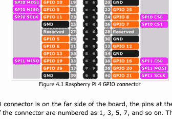

图 4.1 Raspberry Pi 4 GPIO 连接器

当 GPIO 连接器位于电路板的远端时，从连接器左侧开始，底部引脚编号为 1、3、5、7，依此类推。顶部引脚编号为 2、4、6、8，依此类推。

GPIO 提供 26 个通用双向 I/O 引脚。其中一些引脚具有多重功能。例如，引脚 3 和 5 分别是 GPIO2 和 GPIO3 输入输出引脚。这些引脚也可分别用作 I2C 总线、I2C SDA 和 I2C SCL 引脚。同样，引脚 9、10、11、19 可用作通用输入输出，或用作 SPI 总线引脚。引脚 8 和 10 保留用于 UART 串行通信。

提供了两个电源输出：+3.3V 和 +5.0V。GPIO 引脚在 +3.3V 逻辑电平下工作（不像许多其他以 +5V 工作计算机电路）。引脚可以是输入或输出。配置为输出时，引脚电压为 0V（逻辑 0）或 +3.3V（逻辑 1）。Raspberry Pi 4 通常使用外部电源（例如市电适配器）供电，输出为 +5V，电流容量至少为 2A。3.3V 输出引脚可提供高达 16mA 的电流。所有输出引脚的总电流不应超过 51mA 的限制。连接外部设备到 GPIO 引脚时应小心，因为抽取过大电流或引脚短路很容易损坏你的 Pi。5V 引脚可提供的电流取决于许多因素，例如 Pi 本身所需的电流、USB 外设消耗的电流、摄像头电流、HDMI 端口电流等。

配置为输入时，高于 +1.7V 的电压将被视为逻辑 1，低于 +1.7V 的电压将被视为逻辑 0。应注意不要向任何 I/O 引脚提供大于 +3.3V 的电压，因为大电压很容易损坏你的 Pi。例如，Arduino 的输出引脚不得直接连接到 Raspberry Pi 输入引脚，否则很容易损坏输入电路。同样，虽然将 Raspberry Pi 输出引脚连接到 Arduino 输入引脚是安全的，但当 Raspberry Pi 处于逻辑 1 时，其输出电压电平可能不足以驱动 Arduino 输入电路。在这种情况下，应使用电压电平转换电路将 5V 转换为 3.3V 逻辑电平，或将 3.3V 转换为 5V。图 4.2 显示了一个示例电压电平转换电路。


图 4.2 电压电平转换电路

## 4.3 • 与 GPIO 接口

### 4.3.1 • 需要小电流的负载

需要小电流的负载（如 LED）可通过限流电阻直接连接到 GPIO 引脚。LED 有不同尺寸。小型 LED 消耗几毫安电流，而较大 LED 需要约 15mA 才能明亮。LED 上的压降再次取决于所用 LED 的类型。在大多数情况下，我们可以假设压降约为 2V。LED 可以按如下所述以电流源或电流汇模式连接。

currents, while MOSFET transistors are more suitable for higher currents.

图 4.5 显示了一个双极晶体管开关，负载连接到集电极电路。这里，当晶体管导通时，负载被激活，即当 Raspberry Pi 的输出为逻辑 1 时（即晶体管被导通时）。1K 基极电阻适用于大多数应用。如果负载是感性的，应如 图 4.6 所示使用二极管以保护晶体管免受反电动势影响。

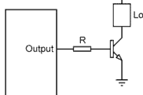

图 4.5 使用双极晶体管

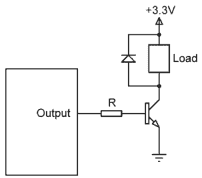

图 4.6 使用感性负载

图 4.7 显示了一个基于 MOSFET 的电路，适用于较大电流，通常在数百毫安范围内。同样，当 Raspberry Pi 的输出为逻辑 1 时，负载被激活。


### 4.3.3 使用继电器

在负载工作电压和电流较大的应用中，建议使用继电器来开启和关闭负载。电路中可以使用半导体继电器或基于触点的物理继电器。继电器也可以作为内置晶体管的模块提供，使其在微控制器应用中更易于使用。图 4.8 显示了这样一个带有 4 个板载继电器的继电器模块。或者，可以使用晶体管电路来开启和关闭继电器。

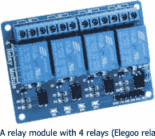

### 4.4.4 项目 1：闪烁 LED——可用的编译器

**描述：** 这是一个非常简单的项目，其中 LED 连接到端口引脚 GPIO 2（物理引脚 3）。该项目使 LED 每秒闪烁。

**目标：** 本项目旨在展示可用于树莓派的各种编译器。

**框图：** 图 4.9 显示了该项目的框图。

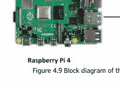

树莓派 4  
图 4.9 项目框图

电路图：项目电路图如图 4.10 所示。

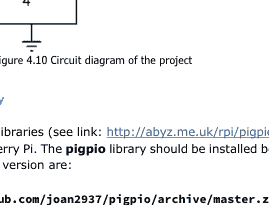

图 4.10 项目电路图

### 4.4.1 使用 pigpio 库

pigpio 是用于在树莓派上开发项目的流行库之一（见链接：http://abyz.me.uk/rpi/pigpio/）。使用 pigpio 库之前应先安装它。安装最新版本的步骤如下：

```
wget https://github.com/joan2937/pigpio/archive/master.zip
unzip master.zip
cd pigpio-master
make
sudo make install
```

程序应按如下方式编译和运行（假设程序名为 temp.c）：

```
gcc -Wall -pthread -o temp temp.c -lpigpio -lrt
sudo ./temp
```

图 4.11 显示了程序清单（程序：gpioflash.c）。程序开头在程序中包含头文件 pigpio.h，并将 led 定义为 2（即 GPIO 2）。通过调用函数 gpioInitialise 初始化 GPIO。然后配置 LED 端口

要检查 wiringPi 的版本，请输入命令：

```
gpio -v
```

要安装 wiringPi 的最新版本，请输入以下命令：

```
wget https://project-downloads.drogon.net/wiringpi-latest.deb
sudo dpkg -i wiringpi-latest.deb
```

wiringPi 程序应按如下方式编译和运行（假设程序名为 temp.c）：

```
gcc -Wall -o temp temp.c -lwiringPi
./temp
```

图 4.12 显示了程序清单（程序：blink.c）。请注意，WiringPi 中的 GPIO 编号不同，GPIO 2 对应 8。程序开头在程序中包含头文件 wiringPi.h，并将 led 定义为 8。然后通过调用函数 wiringPiSetup 初始化 WiringPi 库。使用 pinMode 函数将 LED 端口配置为 OUTPUT。熟悉 Arduino 编程的用户会注意到 wiringPi 库使用相同的函数。然后形成一个 while 循环。在此循环内，LED 闪烁，每次输出之间延迟一秒。

通过输入以下命令来编译和运行程序：

```
gcc -Wall -o blink blink.c -lwiringPi
./blink
```

```c
/*---------------------------------------------------------------

                FLASHING LED
                ===========

This program flashes the LED connected to port GPIO 2

Author: Dogan Ibrahim
File  : blink.c
Date  : December, 2020
---------------------------------------------------------------*/

#include <wiringPi.h>

#define led 8

int main(void)
{
    wiringPiSetup();
    pinMode(led, OUTPUT);
```

### 4.4.3 用于树莓派的其他 C 库/编译器

可与树莓派一起使用的其他 C 库/编译器包括：

- bcm2835
- ArduPi
- 直接寄存器控制

上述库/编译器的使用限制更多且更复杂。感兴趣的读者可以从以下链接获取更多信息：

[https://elinux.org/RPi_GPIO_Code_Samples#bcm2835_library](https://elinux.org/RPi_GPIO_Code_Samples#bcm2835_library)

本书将在适当的时候在树莓派项目中使用 **pigpio** 和 **wiringPi**。读者可自行选择希望使用的库。

## 4.5 使用 Geany 编辑器

**Geany** 是一款用户友好的 GUI 文本编辑器，使用 Scintilla 和 GTK，并具有 IDE 功能。它是使用 wiringPi 或 pigpio C 库开发程序的理想文本编辑器。Geany 随 Raspbian 免费分发。

Geany 可在桌面模式下使用，可通过单击 **应用程序菜单 -> 编程 -> Geany 程序员编辑器** 启动（见图 4.13）。

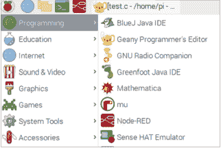

图 4.13 启动 Geany 编辑器

启动菜单包含大多数应用程序中常见的菜单项。程序在屏幕中间部分编写。底部是状态面板，显示错误和其他消息。

将图 4.12 所示的程序（**blink.c**）加载到 Geany 中（单击 **文件 -> 打开**，并确保位于主目录后选择 blink.c），以说明如何使用该 IDE。图 4.14 显示了加载到 Geany 中的程序。

```c
/*---------------------------------------------------------------
                        FLASHING LED
                        ===========

This program flashes the LED connected to port GPIO 2

Author: Dogan Ibrahim
File : blink.c
Date : December, 2020
---------------------------------------------------------------*/

#include <wiringPi.h>

#define led 8

int main(void)
{
    wiringPiSetup();
    pinMode(led, OUTPUT);

    while(1)
    {
        digitalWrite(led, LOW);
        delay(1000);
        digitalWrite(led, HIGH);
        delay(1000);
    }
}
```

图 4.14 程序 blink.c

在编译和运行程序之前，应配置 IDE 环境。通过以下步骤完成（见图 4.15）：

- 单击“构建”，然后选择“设置构建命令”。
- 在框中输入以下内容：
- 单击“确定”。

单击框 1 并输入：编译  
在 Command 框下输入：`gcc -Wall -c "%f"`

单击框 2 并输入：构建  
在 Command 框下输入：`gcc -Wall -o "%e" "%f" -lwiringPi`

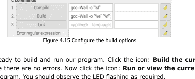

图 4.15 配置构建选项

现在可以构建并运行程序了。单击图标：构建当前文件，并确保没有错误。现在单击图标：运行或查看当前文件以执行程序。您应观察到 LED 按需闪烁。

Geany 编辑器在程序开发过程中非常有用，因为它包含许多有用的编辑功能，例如剪切、复制、粘贴、查找、查找下一个、替换、构建、放大、缩小、自动缩进、状态显示等。建议读者使用 Geany 开发 wiringPi 或 pigpio 项目。

## 4.6 硬件

在没有外部硬件的简单项目中，我们可以直接按原样使用树莓派板，只需进行软件开发。然而，大多数项目更复杂，需要额外的外部组件，例如 LED、电机、显示器、键盘等。然后，开发人员的任务是在开始任何软件开发之前确保硬件设置正确且正常工作。如果硬件设置不正确，尝试开发软件将浪费时间。硬件开发可能需要额外技能，例如熟悉接口以及在基于微控制器的系统中正确使用各种电子元件。

在树莓派上开发基于硬件的项目时，我们必须连接到 40 针公头 GPIO 连接器。使用母对公型跳线可以轻松完成。跳线的一端可连接到 GPIO 连接器，另一端可连接到面包板，从而可以轻松地将外部组件与树莓派连接。作者建议使用带 T 型连接器的 40 路排线，将所有 GPIO 引脚引到面包板以便于访问。图 4.16 显示了这样一种可在互联网上获得的连接器。


图 4.16 带扁平电缆的 T 型连接器（由 Sintron 提供）

## 4.7 • 摘要

本章中，我们学习了如何使用两种最流行的 C 库来使用 C 编程 Raspberry Pi。在下一章中，我们将使用 wiringPi 和 pigpio 开发 Raspberry Pi 项目。

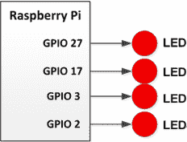

图 5.2 项目的框图

### 电路图：

项目的电路图如图 5.3 所示。LED 通过 470 欧姆限流电阻连接到端口引脚。

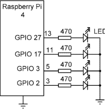

图 5.3 项目的电路图

### 程序清单：

#### wiringPi

该项目的 wiringPi 程序清单非常简单，如图 5.4 所示（程序：**RotateLEDs.c**）。

```c
/*--------------------------------------------------------------
                         ROTATE LEDS
                         ===========
In this program 4 LEDs are connected to GPIO ports 27, 17, 3 and 2
through 470 ohm resistors. The program turns ON the LEDs in a
rotating manner. The ON and OFF times are chosen as 500ms and 100ms
respectively.

Author: Dogan Ibrahim
File  : RotateLEDs.c
Date  : December 2020
--------------------------------------------------------------*/
#include <wiringPi.h>
#define ON HIGH
#define OFF LOW


int LEDs[] = {8, 9, 0, 2};                     // For GPIO 2,3,17,27


//
// Configure ports as outputs and turn OFF LEDs
//
void Configure()
{
        char k;
        for(k = 0; k < 4; k++)
        {
                pinMode(LEDs[k], OUTPUT);
                digitalWrite(LEDs[k], OFF);
        }
}


//
// Start of MAIN program
//
int main(void)
{
        char j;
        wiringPiSetup();                         // Initialize wiringPi
        Configure();                             // Configure ports
//
// Now rotate the LEDs
//

        while(1)                                 // Endless loop
        {
                for(j = 0; j < 4; j++)
                {
digitalWrite(LEDs[j], ON);    // LED ON
delay(500);
digitalWrite(LEDs[j], OFF);   // LED OFF
delay(100);
}
}
}
```

图 5.4 程序 RotateLEDs.c

GPIO 引脚 27、17、3 和 2 对应于 wiringPi 引脚 2、0、9 和 8。程序开始时，设置了一个名为 LEDs 的数组来存储项目中使用的 LED 的端口号。然后，将连接 LED 的 GPIO 端口配置为输出端口，并且 LED 最初被关闭。在主程序内部，设置了一个 for 循环来打开和关闭连接到 GPIO 端口的 LED。ON 和 OFF 时间分别选择为 500 ms 和 100 ms，以便显示令人愉悦的旋转 LED 效果。你应该按如下方式编译和运行程序（除非你使用的是 Geany IDE）：

```
gcc -o RotateLEDs RotateLEDs.c -lwiringPi
sudo ./RotateLEDs
```

#### pigpio

该项目的 pigpio 程序如图 5.5 所示（程序：RotateLEDs2.c）。该程序与 wiringPi 版本相同，只是做了一些小的修改。你应该按如下方式编译和运行程序：

```
gcc -o RotateLEDs2 RotateLEDs2.c -lpigpio -lrt
sudo ./RotateLEDs2
```

```c
/*----------------------------------------------------------------
 ROTATE LEDS
 =========
 In this program 4 LEDs are connected to GPIO ports 27, 17, 3 and 2
 through 470 Ohm resistors. The program turns ON the LEDs in a
 rotating manner. The ON and OFF times are chosen as 500ms and 100ms
 respectively.

 This is the pigpio version of the program

 Author: Dogan Ibrahim
 File : RotateLEDs2.c
 Date : December 2020
 ----------------------------------------------------------------*/
#include <pigpio.h>
#define ON 1
#define OFF 0

int LEDs[] = {2, 3, 17, 27};

//
// Configure ports as outputs and turn OFF LEDs
//
void Configure()
{
        char k;
        for(k = 0; k < 4; k++)
        {
                gpioSetMode(LEDs[k], PI_OUTPUT);
                gpioWrite(LEDs[k], OFF);
        }
}

//
// Start of MAIN program
//
int main(void)
{
        char j;
        gpioInitialise();                    // Initialize pigpio
        Configure();                         // Configure ports
        //
        // Now rotate the LEDs
        //
        while(1)                             // Endless loop
        {
                for(j = 0; j < 4; j++)
                {
                        gpioWrite(LEDs[j], ON);       // LED ON
                        time_sleep(0.5);
                        gpioWrite(LEDs[j], OFF);      // LED OFF
                        time_sleep(0.1);
                }
        }
}
```

图 5.5 程序 RotateLEDs2.c

### 建议：

你应该将 LED 数量增加到 8 并相应地修改程序 5.4。

## 5.3 ● 项目 2 – 圣诞灯

### 描述：

在本项目中，4 个 LED 如同前一个项目一样连接到 ESP32 DevKitC。LED 会随机打开和关闭，以产生令人愉悦的视觉效果。

### 目标：

本项目旨在展示如何在程序中使用随机数生成器函数。

### 框图：

该项目的框图如图 5.2 所示。

### 电路图：

该项目的电路图如图 5.3 所示。

### 程序清单：

#### wiringPi

该项目的程序清单非常简单，如图 5.6 所示（程序：Christmas.c）。

```c
/*---------------------------------------------------------------
CHRISTMAS LIGHTS
=================
In this program 4 LEDs are connected to GPIO ports 27, 17, 3 and 2
through 470 Ohm resistors. The program turns ON/OFF the LEDs in a
random manner.

Author: Dogan Ibrahim
File : Christmas.c
Date : December 2020
-------------------------------------------------------------------*/

#include <wiringPi.h>
#include <stdlib.h>

#define OFF LOW
#define ON HIGH

int LEDs[] = {8, 9, 0, 2};          // For GPIO 2,3,17,27

//
// Configure ports as outputs and turn OFF LEDs
//
void Configure()
{
    char k;
    for(k = 0; k < 4; k++)
    {
        pinMode(LEDs[k], OUTPUT);
        digitalWrite(LEDs[k], OFF);
    }
}

//
// Display the random pattern
//
void Display(unsigned int No)
{
    digitalWrite(LEDs[3], (No & 8) >> 3);
    digitalWrite(LEDs[2], (No & 4) >> 2);
    digitalWrite(LEDs[1], (No & 2) >> 1);
    digitalWrite(LEDs[0], (No & 1));
}

//
// Start of MAIN program
//
int main(void)
{
    char j;
    unsigned int ran;

    wiringPiSetup();
    Configure();

    while(1)
    {
        ran=rand() % 15;
        Display(ran);
        delay(200);
    }
}
```

图 5.6 程序 Christmas.c

程序开始时，设置了一个名为 LEDs 的数组来存储项目中使用的 LED 的端口号。调用函数 Configure 将 LED 端口配置为输出。生成一个随机数，使其介于 0 和 15 之间并存储在变量 ran 中。然后调用函数 Display 来提取该数字的位并打开或关闭相应的 LED。函数 Display 接收一个介于 1 和 15 之间的整数并提取该数字的位。例如，如果数字是 12（二进制 1100），则最左边的两个 LED（LED1 和 LED2）会被打开。

#### 修改后的程序

图 5.6 中给出的程序可以通过修改函数 Display 使其更高效。新的程序清单如图 5.7 所示（程序：Christmasmod.c）。在此，函数 Display 有两个参数：No 是要作为二进制位模式显示在 LED 上的数字，L 是数字的位宽。从数字中提取位，然后将它们发送到 LED 以打开或关闭正确的 LED。程序在无限循环中运行，其中生成一个介于 0 和 15 之间的随机数并存储在变量 ran 中。然后调用函数 Display(ran, 4) 来打开或关闭适当的 LED。请注意数字的宽度为 4 位（有 4 个 LED）。

```c
/*---------------------------------------------------------------
                    CHRISTMAS LIGHTS
                    ================
In this program 4 LEDs are connected to GPIO ports 27, 17, 3 and 2
through 470 Ohm resistors. The program turns ON/OFF the LEDs in a
random manner.

This is a more efficient version of the program: Christmas.c

Author: Dogan Ibrahim
File  : Christmasmod.c
Date  : December 2020
-----------------------------------------------------------------*/

#include <wiringPi.h>
#include <stdlib.h>
#include <math.h>

#define OFF LOW
#define ON HIGH

int LEDs[] = {8, 9, 0, 2};            // For GPIO 2,3,17,27

//
// Configure ports as outputs and turn OFF LEDs
//
void Configure()
{
    char k;
    for(k = 0; k < 4; k++)
    {
```


```c
pinMode(LEDs[k], OUTPUT);
digitalWrite(LEDs[k], OFF);
        }
}

//
// Display the random pattern
//
void Display(unsigned int No, unsigned int L)
{
        unsigned int j, i, m, p, r;
        m = L - 1;
        for(i = 0; i < L; i++)
        {
                j = 1;
                for(p = 0; p < m; p++) j = 2*j;          // Power of 2
                r = No & j;
                if(r > 0) r = 1;
                digitalWrite(LEDs[i], r);
                m--;
        }
}

//
// Start of MAIN program
//
int main(void)
{
        char j;
        unsigned int ran;

        wiringPiSetup();
        Configure();

        while(1)
        {
                ran=rand() % 15;
                Display(ran, 4);
                delay(200);
        }
}
```

图 5.7 程序 Christmasmod.c

你可以通过修改以下两条语句，在此程序中使用 GPIO 编号：

```c
int LEDs[] = {2, 3, 17, 27};
```
以及
```c
wiringPiSetupGpio();
```

#### pigpio

该项目的 pigpio 程序如图 5.8 所示（程序：Christmasmod2.c）。该程序与 wiringPi 版本相同，只有少量小修改。

```c
/*---------------------------------------------------------------
CHRISTMAS LIGHTS
================
In this program 4 LEDs are connected to GPIO ports 27, 17, 3 and 2
through 470 Ohm resistors. The program turns ON/OFF the LEDs in a
random manner.

This is the pigpio version of the program

Author: Dogan Ibrahim
File : Christmasmod2.c
Date : December 2020
---------------------------------------------------------------*/
#include <pigpio.h>
#include <stdlib.h>
#include <math.h>

#define OFF 0
#define ON 1

int LEDs[] = {2, 3, 17, 27};

// Configure ports as outputs and turn OFF LEDs
//
void Configure()
{
    char k;
    for(k = 0; k < 4; k++)
    {
        gpioSetMode(LEDs[k], PI_OUTPUT);
        gpioWrite(LEDs[k], OFF);
    }
}

// Display the random pattern
//
void Display(unsigned int No, unsigned int L)
{
        unsigned int j, i, m, p, r;
        m = L - 1;
        for(i = 0; i < L; i++)
        {
                j = 1;
                for(p = 0; p < m; p++) j = 2*j;          // Power of 2
                r = No & j;
                if(r > 0) r = 1;
                gpioWrite(LEDs[i], r);
                m--;
        }
}

//
// Start of MAIN program
//
int main(void)
{
        char j;
        unsigned int ran;

        gpioInitialise();
        Configure();

        while(1)
        {
                ran=rand() % 15;
                Display(ran, 4);
                time_sleep(0.2);
        }
}
```

图 5.8 程序 Christmasmod2.c

### 建议

可以通过串联和并联更多 LED 来增加 LED 数量，例如将它们放置在圣诞树上。

## 5.4 • 项目 3 – 带 LED 的二进制递增计数器

### 描述：

在本项目中，8 个 LED 连接到树莓派。程序从 0 计数到 255，计数以二进制格式显示在 8 个 LED 上。

### 目标：

本项目旨在展示如何将任意 8 个端口引脚分组并作为 8 位输出端口处理。

### 框图：

项目的框图如图 5.9 所示。LED 连接到以下 GPIO 端口引脚：

| GPIO 引脚 | wiringPi 引脚 | 物理引脚 |
|---|---|---|
| 11（最高有效位） | 14 | 23 |
| 9 | 13 | 21 |
| 10 | 12 | 19 |
| 22 | 3 | 15 |
| 27 | 2 | 13 |
| 17 | 0 | 11 |
| 3 | 9 | 5 |
| 2（最低有效位） | 8 | 3 |

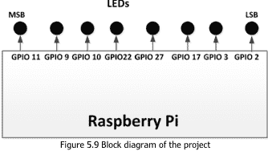

### 电路图：

项目的电路图如图 5.10 所示。8 个 LED 通过 470 欧姆限流电阻连接到 GPIO 端口。

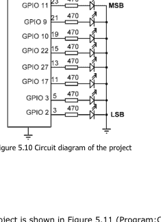

图 5.10 项目的电路图

### 程序清单：

#### wiringPi

项目的程序清单如图 5.11 所示（程序：Counter.c）。

```c
/*----------------------------------------------------------------
                        BINARY UP COUNTER
                         ==============

In this program 8 LEDs are connected to GPIO ports through current
limiting resistors. The program counts up in binary every 500ms.

Author: Dogan Ibrahim
File  : Counter.c
Date  : December 2020
----------------------------------------------------------------*/

#include <wiringPi.h>
#include <stdlib.h>

#define OFF LOW
#define ON HIGH

int LEDs[] = {14, 13, 12, 3, 2, 0, 9, 8};    // GPIO 11,9,10,22,27,17,3,2
//
// Configure ports as outputs and turn OFF LEDs
//
void Configure()
{
    char k;
    for(k = 0; k < 8; k++)
    {
        pinMode(LEDs[k], OUTPUT);
        digitalWrite(LEDs[k], OFF);
    }
}
//
// Display data on ports
//
void Display(unsigned int No, unsigned int L)
{
    unsigned int j, i, m, p, r;
    m = L - 1;
    for(i = 0; i < L; i++)
    {
        j = 1;
        for(p = 0; p < m; p++) j = 2*j;  // Power of 2
        r = No & j;
        if(r > 0) r = 1;
        digitalWrite(LEDs[i], r);
        m--;
    }
}
//
// Start of MAIN program
//
int main(void)
{
    char j, count = 0;

    wiringPiSetup();
    Configure();

    while(1)
    {
        Display(count, 8);
        if(count == 255)
            count = 0;
        else
            count++;
        delay(500);
    }
}
```

图 5.11 程序清单

在程序开头，设置一个名为 LEDs 的数组，用于存储项目中使用的 LED 的端口编号。变量 **count** 初始化为零。调用函数 **Configure** 将端口配置为输出。在主程序中，调用函数 **Display**，并将 **count** 作为参数传入。该函数提取 **count** 的各位，并使相应的 LED 点亮或熄灭。数字 8 也作为参数传给函数 **Display**，因为有 8 个 LED（即数字的宽度为 8 位）。LED 以二进制形式从 0 到 255 连续计数，每次计数之间延迟 500ms。LED 计数模式应如图 5.12 所示。


图 5.12 LED 模式

你可以通过修改以下两条语句，在此程序中使用 GPIO 编号：

```c
int LEDs[] = {11, 9, 10, 22, 27, 17, 3, 2};
```

以及

```c
wiringPiSetupGpio();
```

#### pigpio

该项目的 pigpio 程序如图 5.13 所示（程序：Counter2.c）。该程序与 wiringPi 版本相同，只有少量小修改。

```c
/*---------------------------------------------------------------
                        BINARY UP COUNTER
                        ================
In this program 8 LEDs are connected to GPIO ports through current
limiting resistors. The program counts up in binary every 500ms.

This is the pigpio version of the program.

Author: Dogan Ibrahim
File  : Counter2.c
Date  : December 2020
-------------------------------------------------------------------*/

#include <pigpio.h>
#include <stdlib.h>

#define OFF 0
#define ON 1

int LEDs[] = {11, 9, 10, 22, 27, 17, 3, 2};   // GPIO 11,9,10,22,27,17,3,2

//
// Configure ports as outputs and turn OFF LEDs
//
void Configure()
{
    char k;
    for(k = 0; k < 8; k++)
    {
        gpioSetMode(LEDs[k], PI_OUTPUT);
        gpioWrite(LEDs[k], OFF);
    }
}

//
// Display data on ports
//
void Display(unsigned int No, unsigned int L)
{
    unsigned int j, i, m, p, r;
    m = L - 1;
    for(i = 0; i < L; i++)
    {
        j = 1;
        for(p = 0; p < m; p++) j = 2*j;  // Power of 2
        r = No & j;
        if(r > 0) r = 1;
        gpioWrite(LEDs[i], r);
        m--;
    }
}

//
// Start of MAIN program
//
int main(void)
{
    char j, count = 0;
    
    gpioInitialise();
    Configure();
    
    while(1)
    {
        Display(count, 8);
        if(count == 255)
            count = 0;
        else
            count++;
        time_sleep(0.5);
    }
}
```

图 5.13 程序 Counter2.c

## 5.5 • 项目 4 – 带 LED 的二进制递增/递减计数器

### 描述：

在本项目中，与上一个项目一样，8 个 LED 连接到树莓派。此外，一个按钮开关（或简称为按钮）连接到 GPIO 引脚 14。当按钮未按下时，程序递增计数；当按钮按下时，程序递减计数。

### 目标：

本项目旨在展示如何将按钮开关连接到树莓派，以及如何将端口配置为输入。

### 框图：

项目的框图如图 5.14 所示。LED 和按钮连接到以下 GPIO 端口引脚：

| GPIO 引脚 | wiringPi 引脚 | 物理引脚 |
|---|---|---|
| 11（MSB） | 14 | 23 |
| 9 | 13 | 21 |
| 10 | 12 | 19 |
| 22 | 3 | 15 |
| 27 | 2 | 13 |
| 17 | 0 | 11 |
| 3 | 9 | 5 |
| 2（LSB） | 8 | 3 |
| 14 | 15 | 8（按钮） |

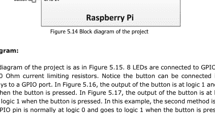

图 5.14 项目框图

### 电路图：

项目电路图如图 5.15 所示。8 个 LED 通过 470 欧姆限流电阻连接到 GPIO 端口。请注意，按钮可以通过两种不同方式连接到 GPIO 端口。在图 5.16 中，按钮输出为逻辑 1，按下按钮时变为逻辑 0。在图 5.17 中，按钮输出为逻辑 0，按下按钮时变为逻辑 1。本示例使用第二种方法。因此，GPIO 引脚通常为逻辑 0，按下按钮时变为逻辑 1。

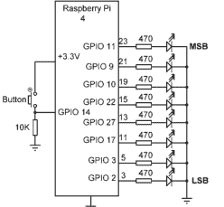

图 5.15 项目电路图

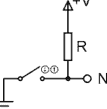

图 5.16 按钮常态为逻辑 1

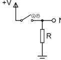

图 5.17 按钮常态为逻辑 0

### 程序清单：

#### wiringPi

项目程序清单如图 5.18 所示（程序：**UpDown.c**）。

```
/*---------------------------------------------
BINARY UP/DOWN COUNTER
======================
In this program 8 LEDs are connected to GPIO ports through current
limiting resistors. Additionally, a button is used. The program counts
up/down in binary every 500ms. By default it counts up. When the
button is pressed it counts down as long as the button is kept pressed

Author: Dogan Ibrahim
File : UpDown.c
Date : December 2020
-------------------------------------------------------------*/

#include <wiringPi.h>
#include <stdlib.h>

#define OFF LOW
#define ON HIGH
#define Button 15        // GPIO 14
#define UP 0
#define DOWN 1

int LEDs[] = {14, 13, 12, 3, 2, 0, 9, 8};     // GPIO 11,9,10,22,27,17,3,2

//
// Configure LED ports as outputs,turn OFF LEDs. Also configure the
// Button port as input
//
void Configure()
{
    char k;
    for(k = 0; k < 8; k++)
    {
        pinMode(LEDs[k], OUTPUT);
        digitalWrite(LEDs[k], OFF);
    }
    pinMode(Button, INPUT);
}

//
// Display data on ports
//
void Display(unsigned int No, unsigned int L)
{
    unsigned int j, i, m, p, r;
    m = L - 1;
    for(i = 0; i < L; i++)
    {
        j = 1;
        for(p = 0; p <= m; p++) j *= 2*j;           // Power of 2
        r = No & j;
        if(r > 0) r = 1;
        digitalWrite(LEDs[i], r);
        m--;
    }
}

//
// Start of MAIN program. When the button is not pressed, increment
// count. When the button is pressed, count down from the last value
//
int main(void)
{
        char j, count = 0;
        char Button_State;

        wiringPiSetup();
        Configure();

        while(1)
        {
                Display(count, 8);
                Button_State = digitalRead(Button);

                if(Button_State == UP)
                {
                        if(count == 255)
                                count = 0;
                        else
                                count++;
                }
                else if(Button_State == DOWN)
                {
                        if(count == 0)
                                count = 255;
                        else
                                count--;
                }
                delay(500);
        }
}
```

图 5.18 程序 UpDown.c

程序开始时，建立一个名为 LEDs 的数组，用于存储项目中使用的 LED 的端口号。名称 **Button** 分配给 GPIO 端口 14，名称 **UP** 和 **DOWN** 分别分配给 0 和 1。全局变量 **count** 初始化为零。然后，将连接 LED 的 GPIO 端口配置为输出端口，并将连接 **Button** 的 GPIO 端口配置为输入端口。在主程序中，调用函数 **Display**，并将 **count** 作为参数传入。然后读取 **Button** 的状态：如果 **Button** 未被按下（**Button_State** 等于 **UP**），则执行向上计数。另一方面，如果 **Button** 被按下（**Button_State** 等于 **DOWN**），则执行向下计数。注意，变量 **count** 在计数结束时复位。也就是说，在向上计数期间，当计数达到 255 时，在下一个周期复位为 0。类似地，在向下计数期间，当计数达到 0 时，在下一个周期复位为 255。你可以通过修改以下两条语句，在此程序中使用 GPIO 编号：

```
~~~
int LEDs[] = {11, 9, 10, 22, 27, 17, 3, 2};

and

wiringPiSetupGpio()
~~~
```

#### pigpio

项目的 pigpio 程序如图 5.19 所示（程序：UpDown2.c）。该程序与 wiringPi 版本相同，只有少量小修改。

```
~~~c
/*----------------------------------------------------------------------
                    BINARY UP/DOWN COUNTER
                    =======================
In this program 8 LEDs are connected to GPIO ports through current
limiting resistors. Additionally, a button is used. The program counts
up/down in binary every 500ms. By default it counts up. When the
button is pressed it counts down as long as the button is kept pressed

In this version of the program the pigpio library is used

Author: Dogan Ibrahim
File : UpDown2.c
Date : December 2020
----------------------------------------------------------------------*/

#include <pigpio.h>
#include <stdio.h>

#define OFF 0
#define ON 1
#define Button 14
#define UP 0
#define DOWN 1

int LEDs[] = {11, 9, 10, 22, 27, 17, 3, 2};
~~~
//
// Configure LED ports as outputs,turn OFF LEDs. Also configure the
// Button port as input
//
void Configure()
{
    char k;
    for(k = 0; k < 8; k++)
    {
        gpioSetMode(LEDs[k], PI_OUTPUT);
        gpioWrite(LEDs[k], OFF);
    }
    gpioSetMode(Button, PI_INPUT);
}

//
// Display data on ports
//
void Display(unsigned int No, unsigned int L)
{
    unsigned int j, i, m, p, r;
    m = L - 1;
    for(i = 0; i < L; i++)
    {
        j = 1;
        for(p = 0; p < m; p++)j = 2*j;
// Power of 2
        r = No & j;
        if(r > 0) r = 1;
        gpioWrite(LEDs[i], r);
        m--;
    }
}

//
// Start of MAIN program. When the button is not pressed,increment
// count. When the button is pressed, count down from the last value
//
int main(void)
{
    char j, count = 0;
    char Button_State;

    gpioInitialise();
    Configure();

while(1)
{
        Display(count, 8);
        Button_State = gpioRead(Button);

        if(Button_State == UP)
        {
                if(count == 255)
                        count = 0;
                else
                        count++;
        }
        else if(Button_State == DOWN)
        {
                if(count == 0)
                        count = 255;
                else
                        count--;
        }
        time_sleep(0.5);
}
```

图 5.19 程序 UpDown2.c

## 5.6 • 项目 5 – LED 骰子

### 描述：

这是一个基于 LED 和按钮开关的简单骰子项目。LED 的排列方式模拟真实骰子各面的外观。按下按钮开关时，会生成一个 1 到 6 之间的随机数并显示在 LED 上。通常所有 LED 均熄灭，表示系统已准备好生成新的骰子点数。3 秒后，LED 再次熄灭。

### 目标：

本项目旨在展示如何设计一个基于 LED 的骰子。

### 框图：

图 5.20 展示了项目的框图。

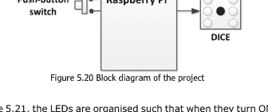

图 5.20 项目框图

如图 5.21 所示，LED 的排列方式使其点亮时能够像真实骰子一样表示数字。项目的工作过程如下：通常所有 LED 均熄灭，表示系统已准备好生成新的骰子点数。按下开关会生成一个 1 到 6 之间的随机骰子点数，并在 LED 上显示 3 秒。3 秒后，LED 再次熄灭。

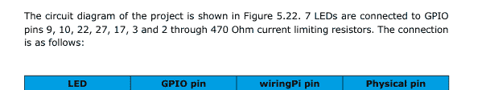

图 5.21 LED 骰子

### 电路图：

项目电路图如图 5.22 所示。7 个 LED 通过 470 欧姆限流电阻连接到 GPIO 引脚 9、10、22、27、17、3 和 2。连接如下：

| LED | GPIO 引脚 | wiringPi 引脚 | 物理引脚 |
|---|---|---|---|
| D1 | 9 | 13 | 21 |
| D2 | 10 | 12 | 19 |
| D3 | 22 | 3 | 15 |
| D4 | 27 | 2 | 13 |
| D5 | 17 | 0 | 11 |
| D6 | 3 | 9 | 5 |
| D7 | 2 | 8 | 3 |

按钮开关通过 10K 下拉电阻连接到 GPIO 引脚 14，因此按钮输出为逻辑 0，按下按钮时变为逻辑 1。


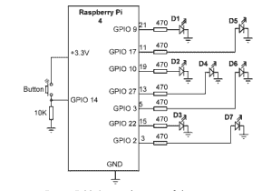

图5.22 项目电路图

### 程序清单：

所需数字与需要点亮的 LED 之间的关系如表5.1所示。例如，要显示数字1，只需点亮 LED D4。类似地，要显示数字3，必须点亮 LED D2、D4、D6，依此类推。

| 所需数字 | 需要点亮的 LED |
|---|---|
| 1 | D4 |
| 2 | D2, D6 |
| 3 | D2, D4, D6 |
| 4 | D1, D3, D5, D7 |
| 5 | D1, D3, D4, D5, D7 |
| 6 | D1, D2, D3, D5, D6, D7 |

表5.1 骰子数字与需要点亮的 LED

#### wiringPi

该项目的程序清单如图5.23所示（程序：Dice.c）。

```c
/************************************************
 DICE WITH LEDs
 ===============
In this program 7 LEDs are connected to face to
GPIO ports through current limiting resistors. Additionally, a button
is used. Pressing the button displays a dice number between 1 and 6.
The number is displayed for 3 seconds.

Author: Dogan Ibrahim
File  : Dice.c
Date  : December 2020
--------------------------------------------------------------*/
#include <wiringPi.h>
#include <stdlib.h>

#define OFF LOW
#define ON HIGH
#define Button 15                         // GPIO 14

#define D1 13
#define D5 0
#define D2 12
#define D6 9
#define D4 2
#define D3 3
#define D7 8

int LEDs[] = {13, 12, 3, 2, 0, 9, 8};         // GPIO 9,10,22,27,17,3,2

//
// Configure LED ports as outputs,turn OFF LEDs. Also configure the
// Button port as input
//
void Configure()
{
        char k;
        for(k = 0; k < 7; k++)
        {
                pinMode(LEDs[k], OUTPUT);
                digitalWrite(LEDs[k], OFF);
        }
        pinMode(Button, INPUT);
}

//
// Display data on ports
//
void All_Off()
{
        char i;
        for(i = 0; i < 7; i++)digitalWrite(LEDs[i], LOW);
}

//
// Start of MAIN program
//
int main(void)
{
    int dice;
    wiringPiSetup();
    Configure();

    while(1)
    {
        All_Off();
        while(digitalRead(Button) == 0);
        dice = (rand() % 6) + 1;    // 1 to 6
        switch(dice)
        {
        case 1:                     // Dice 1?
            digitalWrite(D4, HIGH);
            break;
        case 2:                     // Dice 2?
            digitalWrite(D2, HIGH);
            digitalWrite(D6, HIGH);
            break;
        case 3:                     // Dice 3?
            digitalWrite(D2, HIGH);
            digitalWrite(D4, HIGH);
            digitalWrite(D6, HIGH);
            break;
        case 4:                     // Dice 4?
            digitalWrite(D1, HIGH);
            digitalWrite(D3, HIGH);
            digitalWrite(D5, HIGH);
            digitalWrite(D7, HIGH);
            break;
        case 5:                     // Dice 5?
            digitalWrite(D1, HIGH);
            digitalWrite(D3, HIGH);
            digitalWrite(D4, HIGH);
            digitalWrite(D5, HIGH);
            digitalWrite(D7, HIGH);
            break;
        case 6:                     // Dice 6?
            digitalWrite(D1, HIGH);
            digitalWrite(D2, HIGH);
            digitalWrite(D3, HIGH);
            digitalWrite(D5, HIGH);
            digitalWrite(D6, HIGH);
            digitalWrite(D7, HIGH);
            break;
        }
        delay(3000);
    }
}
```

图5.23 程序Dice.c

在程序开头，Button 被分配给 GPIO 端口 14。类似地，LED D1、D2、D3、D4、D5、D6、D7 分别分配给 GPIO 端口 9、10、22、27、17、3 和 2（注意 wiringPi 端口编号有所不同）。在函数 Configure 中，所有 LED 都被配置为输出，Button 被配置为输入。函数 All_Off 会关闭所有 LED。

主程序在一个无限循环中执行。在该循环内部，首先关闭所有 LED。然后程序等待直到 Button 被按下。当按钮被按下时，会生成一个1到6之间的随机数（rand() % 6 生成0到5之间的随机整数，再给这些数加1，因此数字介于1到6之间）。随后使用 switch 语句根据生成的数字点亮相应的 LED。程序会显示生成的数字3秒钟。在此时间之后，重复上述过程。

图5.24 显示数字6的示例。

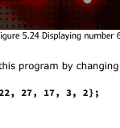

图5.24 显示数字6

通过修改以下两条语句，可以在本程序中使用 GPIO 编号：

```c
int LEDs[] = {9, 10, 22, 27, 17, 3, 2};
wiringPiSetupGpio();
```

#### 修改后的程序：

如果我们定义一个二维数组来存储显示给定骰子数字时必须点亮的 LED，那么图5.23中的程序可以变得更短、更高效。图5.25展示了修改后的程序（程序：**Dicemod.c**）。在该程序开头，创建了一个名为 **Numbers** 的二维数组，用于存储显示给定数字时必须点亮的端口编号（采用 wiringPi 格式）。这里，每一行都以99结尾，并且第一行不使用，因为其索引为0，而骰子数字介于1到6之间。

```c
int Numbers[][7] = {
        {0,99},                         // Dummy
        {2,99},                         // Display 1
        {12, 9,99},                     // Display 2
        {12, 2, 9,99},                  // Display 3
        {13, 0, 3, 8,99},               // Display 4
        {13, 0, 3, 8, 2,99},            // Display 5
        {13, 0, 12, 9, 8, 3,99}         // Display 6
        };
```

和之前一样，函数 **Configure** 将 LED 端口配置为输出，并将 **Button** 端口配置为输入。函数 **All_Off** 会关闭所有 LED。在主程序内部，形成了一个 **while** 循环，该循环一直运行，直到用户停止程序。随后生成一个1到6之间的随机整数，并将其存储在变量 **dice** 中。接着形成一个 **while** 循环，用于找出 **Numbers** 数组中对应 **row dice** 行所需的元素个数。该数字存储在变量 **nlen** 中。然后点亮数组 **Numbers** 中由 **row dice** 行指定的端口。该数字会显示3秒钟，在此时间之后，所有 LED 都被关闭，程序重复执行。

```c
/*-------------------------------------------------------------
                         DICE WITH LEDs
                         --------------

In this program 7 LEDs are connected in the form of a dice face to
GPIO ports through current limiting resistors. Additionally, a button
is used. Pressing the button displays a dice number between 1 and 6.
The number is displayed for 3 seconds.

This version of the program is more efficient

Author: Dogan Ibrahim
File  : Dicemod.c
Date  : December 2020
-------------------------------------------------------------*/
#include <wiringPi.h>
#include <stdlib.h>

#define OFF LOW
#define ON HIGH
#define Button 15                                      // GPIO 14

int LEDs[] = {13, 12, 3, 2, 0, 9, 8};                 // GPIO 9,10,22,27,17,3,2
int Numbers[][7] = {
                {0, 99},                              // Dummy
                {2, 99},                               // Display 1
                {12, 9,99},                            // Display 2
                {12, 2, 99},                          // Display 3
                {13, 0, 3, 8,99},                     // Display 4
                {13, 0, 3, 8, 2,99},                 // Display 5
                {13, 0, 12, 9, 8, 3,99}              // Display 6
                };

//
// Configure LED ports as outputs,turn OFF LEDs. Also configure the
// Button port as input
//
void Configure()
{
        char k;
        for(k = 0; k < 7; k++)
        {
                pinMode(LEDs[k], OUTPUT);
                digitalWrite(LEDs[k], OFF);
        }
        pinMode(Button, INPUT);
}

//
// Display data on ports
//
void All_Off()
{
        char j;
        for(j = 0; j < 7; j++)digitalWrite(LEDs[j], LOW);
}

//
// Start of MAIN program
//
int main(void)
{
        int dice, i, nlen;
        wiringPiSetup();
```


```c
Configure();

while(1)
{
        All_Off();                         // All OFF
        while(digitalRead(Button) == 0);   // Wait button
        dice = (rand() % 6) + 1;           // 1 to 6
        i = 0;
        nlen = 0;

        while(Numbers[dice][i] != 99)      // No of elements
        {
                nlen++;
                i++;
        }

        for(i = 0; i < nlen; i++)          // LEDs ON
                digitalWrite(Numbers[dice][i], HIGH);

        delay(3000);
}
}
```

图 5.25 程序 Dicemod.c

#### pigpio

该项目的 pigpio 程序如图 5.26 所示（程序：**Dice2.c**）。该程序与 wiringPi 版本基本相同，仅做了少量修改。

```c
/*--------------------------------------------------------------
                         DICE WITH LEDs
                         ==============
In this program 7 LEDs are connected in the form of a dice face to
GPIO ports through current limiting resistors. Additionally, a button
is used. Pressing the button displays a dice number between 1 and 6.
The number is displayed for 3 seconds.

This version of the program is for pigpio

Author: Dogan Ibrahim
File   : Dice2.c
Date   : December 2020
--------------------------------------------------------------*/
#include <pigpio.h>
#include <stdlib.h>

#define OFF 0
#define ON 1
#define Button 14

int LEDs[] = {9, 10, 22, 27, 17, 3, 2};
int Numbers[][7] = {
    {0,99},                 // Dummy
    {27,99},                // Display 1
    {10,3,99},              // Display 2
    {10, 27,3,99},          // Display 3
    {9, 17, 22, 2,99},      // Display 4
    {9, 17, 22, 2, 27,99},  // Display 5
    {9, 17, 10, 3, 2, 22,99} // Display 6
};

//
// Configure LED ports as outputs,turn OFF LEDs. Also configure the
// Button port as input
//
void Configure()
{
    char k;
    for(k = 0; k < 7; k++)
    {
        gpioSetMode(LEDs[k], PI_OUTPUT);
        gpioWrite(LEDs[k], OFF);
    }
    gpioSetMode(Button, PI_INPUT);
}

//
// Display data on ports
//
void All_Off()
{
    char j;
    for(j = 0; j < 7; j++)gpioWrite(LEDs[j], OFF);
}

//
// Start of MAIN program
//
int main(void)
{
    int dice, i,nlen;
    gpioInitialise();
    Configure();

    while(1)
    {
            All_Off();                         // All OFF
            while(gpioRead(Button) == 0);      // Wait button
            dice = (rand() % 6) + 1;           // 1 to 6
            i = 0;
            nlen = 0;
            while(Numbers[dice][i] != 99)      // No of elements
            {
                    nlen++;
                    i++;
            }

            for(i = 0; i < nlen; i++)          // LEDs ON
                    gpioWrite(Numbers[dice][i], ON);

            time_sleep(3);
    }
}
```

图 5.26 程序 Dice2.c

## 5.7 • 项目 6 – LED 彩色魔杖

### 描述：

在本项目中，使用 RGB LED 生成不同颜色的光，就像彩色魔杖一样。

### 目标：

本项目旨在展示如何在程序中使用 RGB LED 生成不同颜色。

### 框图：

项目的框图如图 5.27 所示。

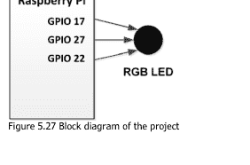

图 5.27 项目的框图

### 电路图：

项目的电路图如图 5.28 所示。R、G 和 B LED 引脚分别通过 470 欧姆限流电阻连接到树莓派的 GPIO 引脚 17、27 和 22（wiringPi 引脚 0、2、3）。


图 5.28 项目的电路图

该项目可以制成魔杖，用于游戏、花瓶或水族箱中。图 5.29 显示了一个典型的 RGB LED。请注意该元件有 4 条引脚，其中最长的引脚是公共引脚（阴极或阳极）。


图 5.29 一个典型的 RGB LED（共阴极）

### 程序清单：

#### wiringPi

项目的程序清单非常简单，如图 5.30 所示（程序：**RGB.c**）。

```c
/*--------------------------------------------------
                         RGB LED
                         -------

In this program an RGB LED is connected to the Raspberry Pi. The
LED changes colours every 200 ms which gives a nice visual effect.

Author: Dogan Ibrahim
File  : RGB.c
Date  : December 2020
-----------------------------------------------------*/
#include <wiringPi.h>
#include <stdlib.h>

#define R 0                                      // GPIO 17
#define G 2                                      // GPIO 27
#define B 3                                      // GPIO 22

//
// Configure LED ports as outputs
//
void Configure()
{
        pinMode(R, OUTPUT);                      // Red port
        pinMode(G, OUTPUT);                      // Green port
        pinMode(B, OUTPUT);                      // Blue port
}

//
// Start of MAIN program
//
int main(void)
{
        int Red, Green, Blue;

        wiringPiSetup();
        Configure();

        while(1)
        {
                Red = rand() % 2;                // Between 0,1
                Green = rand() %2;               // Between 0,1
                Blue = rand() %2;                // Between 0,1

                digitalWrite(R, Red);            // Red ON/OFF
                digitalWrite(G, Green);          // Green ON/OFF
                digitalWrite(B, Blue);           // Blue ON/OFF
                delay(200);                      // 200 ms delay
        }
}
```

图 5.30 程序 RGB.c

程序开始时，连接红、绿、蓝引脚的 GPIO 引脚分别定义为 R、G 和 B。然后这些端口引脚被配置为输出。程序其余部分在一个无限循环中运行，在该循环内部为三种颜色生成 0 到 1 之间的随机数（请注意，使用 **rand** 函数时，下限包含在内，但上限不包含）并将生成的数字发送到相应的端口。因此，例如，如果为红色端口生成数字 1，则红色被打开，以此类推。

你可以通过更改以下两个语句在此程序中使用 GPIO 编号：

```c
#define R 17
#define G 27
#define B 22
```

and

```c
wiringPiSetupGpio()
```

#### pigpio

该项目的 pigpio 程序如图 5.31 所示（程序：**RGB2.c**）。该程序与 wiringPi 版本基本相同，仅做了少量修改。

```c
/*----------------------------------------------------------------------------
                                 RGB LED
                                 =======

In this program an RGB LED is connected to the Raspberry Pi. The
LED changes colours every 200 ms which gives a nice visual effect.

This is the pigpio version of the program.

Author: Dogan Ibrahim
File  : RGB2.c
Date  : December 2020
----------------------------------------------------------------------------*/
#include <pigpio.h>
#include <stdlib.h>

#define R 17                  // GPIO 17
#define G 27                  // GPIO 27
#define B 22                  // GPIO 22

//
// Configure LED ports as outputs
//
void Configure()
{
    gpioSetMode(R, PI_OUTPUT);    // Red port
    gpioSetMode(G, PI_OUTPUT);    // Green port
    gpioSetMode(B, PI_OUTPUT);    // Blue port
}

//
// Start of MAIN program
//
int main(void)
{
    int Red, Green, Blue;

    gpioInitialise();
    Configure();

    while(1)
    {
        Red = rand() % 2;         // Between 0,1
        Green = rand() %2;        // Between 0,1
        Blue = rand() %2;         // Between 0,1

        gpioWrite(R, Red);        // Red ON/OFF
        gpioWrite(G, Green);      // Green ON/OFF
        gpioWrite(B, Blue);       // Blue ON/OFF
        time_sleep(0.2);          // 200 ms delay
    }
}
```

图 5.31 程序 RGB2.c

### 建议：

在图 5.30 和 5.31 描述的程序中，延迟时间设置为 200 ms。尝试更改此时间并观察其效果。

## 5.8 ● 项目 7 – 改变 LED 的亮度

### 描述：

在本项目中，一个 LED 连接到树莓派。程序通过使用 PWM 改变施加到其上的电压来改变 LED 的亮度。

### 目标：

本项目旨在展示如何在程序中生成 PWM 类型波形，以及如何有效地使用该波形来改变施加到 LED 上的电压。

### 电路图：

项目的电路图如图 4.10 所示。一个 LED 通过 470 欧姆限流电阻连接到 GPIO 端口 2。

### 程序清单：

#### wiringPi

LED 的渐变是通过向 LED 施加 PWM 波形并改变该波形的占空比来实现的，从而有效地改变施加到 LED 上的平均电压。图 5.32 显示了一个典型的 PWM 波形。占空比定义为导通时间与周期的比值：

Duty cycle = ON time / Period ×100%

or

Duty cycle = ON time / (ON time + OFF time) ×100%

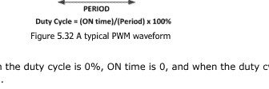

因此例如，当占空比为 0% 时，导通时间为 0，而当占空比为 100% 时，关闭时间为 0。


### wiringPi 软件 PWM

wiringPi 包含一个软件驱动的 PWM 处理程序，能够在任意树莓派 GPIO 引脚上输出 PWM 信号。

程序开头必须包含以下头文件：

```c
#include <softPwm.h>
```

此外，编译时必须包含库文件 **pthread**。例如，如果程序名为 test.c，则可以按如下方式编译该程序：

```bash
gcc -o test test.c -lwiringPi -lpthread
```

以下两个函数可用：

```c
int softPwmCreate (int pin, int initialValue, int pwmRange);
```

这会创建一个软件控制的 PWM 引脚。你可以使用任意 GPIO 引脚。引脚编号将采用 **wiringPiSetup()** 函数的编号方式。基本脉冲单位为 100 微秒。因此，例如，**softPwmCreate(LED, 0, 200)** 会创建一个周期为 T = 20 ms 的 PWM 波形（200 x 100 微秒 = 20 ms）。

以下函数用于更新指定引脚上的 PWM 值：

```c
void softPwmWrite (int pin, int value) ;
```

该值表示脉冲将保持**开启**的时长。例如，假设使用上述 **softPwmCreate** 的值，**softPwmWrite(LED, 100)** 表示 PWM **开启**时间为 100 x 100 微秒 = 10 ms。这对应于 50% 占空比（即周期为 20 ms 时，10 ms **开启**时间 + 10 ms **关闭**时间）。类似地，使用上述设置，**softPwmWrite(LED, 200)** 将对应于 20 ms **开启**时间，即 100% 占空比。

在本项目中，PWM 波形的周期设置为 50 Hz（20 ms）。波形**开启**时间从 0% 变化到 100%，同时 **softPwmWrite** 的值按上述说明从 0 变化到 200。

程序开头将 LED 分配给 8，对应 GPIO 2。程序中形成两个 for 循环。在第一个 for 循环内，PWM **开启**时间从 0 变化到 200（即 0 到 20 ms = 100% 占空比）。每次输出变化之间使用 25 ms 延迟，因此经过 200 次迭代，LED 从**关闭**到全亮需要 200 x 25 ms = 5000 ms 或 5 秒。在第二个 **for** 循环内，LED 的亮度以相同速率从全亮降低到完全**关闭**。

该项目的程序清单非常简单，如图 5.33 所示（程序：**FadeLED.c**）。程序按如下方式编译：

```bash
gcc -o FadeLED FadeLED.c -lwiringPi -lpthread
```

```c
/*-------------------------------------------------------------
                         CHANGING LED BRIGHTNESS
                         =======================
In this program an LED is connected to GPIO 2. The brightness of
the LED is changed using PWM waveform

Author : Dogan Ibrahim
File   : FadeLED.c
Date   : December 2020
-------------------------------------------------------------*/
#include <wiringPi.h>
#include <softPwm.h>

#define LED 8                              // GPIO 2

//
// Configure LED port as output
//
void Configure()
{
        pinMode(LED, OUTPUT);              // LED output
        digitalWrite(LED, LOW);            // LED OFF
}

//
// Start of MAIN program
//
int main(void)
{
        int k;

        wiringPiSetup();
        Configure();
        softPwmCreate(LED, 0, 200);        // PWM T=20ms

        while(1)
        {
                for(k = 0; k <= 200; k++)              // Increase brightness
                {
                        softPwmWrite(LED, k);
                        delay(25);                      // 25ms delay
                }

                for(k = 200; k >= 0; k--)              // Decrease brightness
                {
                        softPwmWrite(LED, k);
                        delay(25);                 // 25ms delay
                }
        }
}
```

图 5.33 程序 FadeLED.c

你可以通过修改以下两条语句，在此程序中使用 GPIO 编号：

```c
#define LED 2
```

以及

```c
wiringPiSetupGpio();
```

**注意：** 作者测量了输出波形，在高达几千赫兹时生成的 PWM 波形是正确的。高于约 4 kHz 时，生成的波形不准确，但你应该能够在许多应用中使用它。

#### pigpio

该项目的 pigpio 程序如图 5.34 所示（程序：**FadeLED2.c**）。在此程序中，PWM 频率设置为 50 Hz，占空比从 0% 变化到 100%。pigpio 提供以下函数来生成和修改 PWM 波形：

- **gpioPWM(PWM 端口, 占空比)：** 启动 PWM。占空比范围为 0（0%）到 255（100%）
- **gpioGetPWMdutycycle(PWM 端口)：** 返回 PWM 占空比
- **gpioSetPWMrange(PWM 端口, 用户范围)：** 设置占空比范围
- **gpioGetPWMrange(PWM 端口)：** 返回设置的占空比范围
- **gpioSetPWMfrequency(PWM 端口, 频率)：** 设置 PWM 频率
- **gpioGetPWMfrequency(PWM 端口)：** 返回 PWM 频率

程序中使用两个 for 循环。第一个循环每 50 ms 将占空比从 0% 增加到 100%。第二个 for 循环将占空比从 100% 降低到 0%。

```c
/*---------------------------------------------------------------
                    CHANGING LED BRIGHTNESS
                    =======================

In this program an LED is connected to GPIO 2. The brightness of
the LED is changed using PWM waveform

This is the pigpio version of the program
Author: Dogan Ibrahim
File  : FadeLED2.c
Date  : December 2020
--------------------------------------------------------------*/
#include <pigpio.h>

#define LED 2

//
// Configure LED port as output
//
void Configure()
{
        gpioSetMode(LED, PI_OUTPUT);             // LED output
        gpioWrite(LED, 0);                       // LED OFF
}

//
// Start of MAIN program
//
int main(void)
{
        int k;

        gpioInitialise();
        Configure();
        gpioSetPWMfrequency(LED, 50);             // Set to 50Hz

        while(1)
        {
                for(k = 0; k <= 255; k++)         // Increase brightness
                {
                        gpioPWM(LED, k);
                        time_sleep(0.025);        // 25ms delay
                }

                for(k = 255; k >= 0; k--)         // Decrease brightness
                {
                        gpioPWM(LED, k);
                        time_sleep(0.025);        // 25ms delay
                }
        }
}
```

图 5.34 程序 FadeLED2.c

## 5.9 • 项目 8 – 使用蜂鸣器生成随机声音

### 描述：

在本项目中，一个无源蜂鸣器连接到树莓派的 GPIO 端口引脚 2（wiringPi 引脚 8）。蜂鸣器生成频率在 100 Hz 到 1 kHz 之间随机变化的声音。

### 目标：

本项目旨在展示如何将无源蜂鸣器连接到树莓派，以及如何通过不同频率使用蜂鸣器生成声音。

### 电路图：

蜂鸣器有两种类型：无源和有源。无源蜂鸣器需要可听频率范围内的交流信号才能工作。另一方面，有源蜂鸣器具有内置振荡器，当向它们施加逻辑 1 时，会生成固定频率的声音，就像点亮 LED 一样。有源蜂鸣器的频率可以通过所施加 I/O 逻辑信号的开启/关闭频率来改变。在本项目中，使用无源蜂鸣器，并向蜂鸣器施加具有不同频率的 PWM 信号。图 5.36 展示了该项目的电路图。

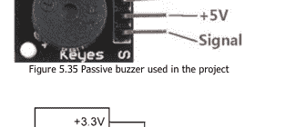

图 5.35 项目中使用的无源蜂鸣器

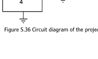

图 5.36 项目电路图

### 程序清单：

**wiringPi**

该项目的程序清单非常简单，如图 5.37 所示（程序：RandomBuzzer.c）。

```c
/*-----------------------------------------------------------------------------
                              RANDOM BUZZER
                              ==============

In this program a passive buzzer is connected to the Raspberry Pi.
The program generates random numbers between 100 and 5000 and uses
these numbers to set the frequency of a PWM waveform which is sent
to the buzzer. The duty cycle is set to 50%

Author: Dogan Ibrahim
File  : RandomBuzzer.c
Date  : December 2020
-------------------------------------------------------------------------------*/

#include <wiringPi.h>
#include <softPwm.h>
#include <stdlib.h>

#define Buzzer 2                              // GPIO 2

//
// Configure Buzzer port as output
//
void Configure()
{
    pinMode(Buzzer, OUTPUT);                  // Buzzer output
    digitalWrite(Buzzer, LOW);                // Buzzer OFF
}

//
// Start of MAIN program. Generate random numbers between 10 and 100
// which correspond to PWM periods 1 ms and 10 ms (i.e. frequencies
// 1 kHz and 100 HZ and send to the buzzer every 250 ms.
//
int main(void)
{
    int freq, duty;

    wiringPiSetupGpio();                      // Use GPIO number
    Configure();
```

while(1)
{
    freq = rand() % 91;        // Between 0-90
    freq = freq + 10;          // Between 10-100
    duty = freq / 2;           // Duty cycle
    softPwmCreate(Buzzer, 0, freq); // Frequency
    softPwmWrite(Buzzer, duty);     // Duty cycle
    delay(250);                // 250ms delay
}

图 5.37 程序 RandomBuzzer.c

在本项目中，PWM 波形的占空比设置为 50%，频率在 100 Hz 和 1 kHz 之间变化。随机数用于生成 10 到 100 之间的随机数。这些数字用于设置 PWM 波形的频率。每次输出之间使用 250 ms 的延迟。请注意，当值为 10 时，PWM 波形的周期为 10 x 100µs = 1 ms（1 kHz）。当值为 100 时，周期为 100 x 100µs = 10 ms（100 Hz）。在本程序中，使用 GPIO 编号。

#### pigpio

项目的 pigpio 程序如图 5.38 所示（程序：RandomBuzzer2.c）。在本程序中，PWM 频率与前一个程序一样在 100 Hz 和 1 kHz 之间变化。占空比设置为 50%。

/*-----------------------------------------------------------
                        RANDOM BUZZER
                        ===========
In this program a passive buzzer is connected to the Raspberry Pi
and random numbers are generated between 100 and 1000 to correspond
to frequencies. PWM waveforms are generated with these frequencies
and sent to the buzzer.

This is the pigpio version of the program

Author: Dogan Ibrahim
File  : RandomBuzzer2.c
Date  : December 2020
-----------------------------------------------------------*/

#include <pigpio.h>
#include <stdlib.h>

#define Buzzer 2

//
// Configure LED port as output
//

void Configure()
{
    gpioSetMode(Buzzer, PI_OUTPUT);     // Buzzer output
    gpioWrite(Buzzer, 0);               // Buzzer OFF
}

//
// Start of MAIN program. Generate PWM waveforms with 100 Hz to
// 1000 Hz and send to the buzzer
//
int main(void)
{
    int freq;

    gpioInitialise();
    Configure();

    while(1)
    {
        freq = rand() % 901;            // 0 - 900
        freq = 100 + freq;              // 100 - 1000
        gpioPWM(Buzzer, 128);           // Duty = 50%
        gpioSetPWMfrequency(Buzzer, freq);
        time_sleep(0.25);
    }
}

图 5.38 程序 RandomBuzzer2.c

### Suggestion:

在图 5.37 和图 5.38 中，仅频率是随机变化的。修改程序以改变占空比并观察差异。

## 5.10 • 项目 9 – 显示温度和相对湿度

### Description:

### 描述：

在本项目中，使用 DHT11 温度和相对湿度传感器芯片获取环境温度和相对湿度。读数每 5 秒在屏幕上显示一次。

### Aim:

### 目标：

本项目旨在展示如何使用 C 语言在树莓派上编程常用的 DHT11 相对湿度和温度传感器芯片。

### Block diagram:

### 框图：

图 5.39 显示了项目的框图。

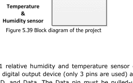

图 5.39 项目的框图

### Circuit diagram:

### 电路图：

在本项目中，使用 DHT11 相对湿度和温度传感器芯片。标准的 DHT11 是一个 4 引脚数字输出器件（如图 5.40 所示，仅使用 3 个引脚），具有 +V、GND 和 Data 引脚。Data 引脚必须通过 10K 电阻上拉至 +V。芯片使用电容式湿度传感器和热敏电阻来测量环境温度。芯片大约每秒提供一次数据输出。DHT11 的基本特性如下：

- 3 至 5V 工作。
- 2.5mA 电流消耗（转换期间）。
- 温度读数范围为 0-50°C，精度为 ±2°C。
- 湿度读数范围为 20-80%，精度为 5%。
- 兼容面包板，引脚间距为 0.1 英寸。


图 5.40 标准 DHT11 芯片

在本示例中，使用了来自 Elektor 的内置 10K 上拉电阻的 DHT11 模块。这是一个 3 引脚器件，其引脚布局如图 5.41 所示。

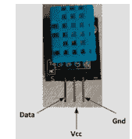

图 5.42 显示了项目的电路图。DHT11 的数据输出连接到树莓派的 GPIO 2 引脚（wiringPi 引脚 8）。


### Using the DHT11

### 使用 DHT11

DHT11 传感器芯片通过单个数据引脚工作。通过向芯片施加精确的时序脉冲来提取数据。从芯片接收 5 字节（40 位）数据，2 字节湿度数据（1 字节整数，1 字节小数），2 字节温度数据（1 字节整数，1 字节小数），1 字节校验和数据。

提取温度和湿度的方法如下（此处 MCU 为树莓派）：

- 芯片上电后，应等待一秒钟让芯片稳定下来。
- MCU 将数据引脚设置为低电平，最短 18 毫秒。
- MCU 将数据引脚设置为高电平并等待 40 微秒。
- DHT11 将数据引脚拉低 80 微秒。
- DHT11 将数据引脚设置为高电平 80 微秒（图 5.43）。
- 现在，DHT11 与 MCU 之间开始数据传输。
- 低电平数据以 50 微秒的低电平后跟 26-28 微秒的高电平来识别
- 高电平数据以 50 微秒的低电平后跟 70 微秒的高电平来识别（图 5.44）
- 数据传输在接收到 40 位数据后结束。前两个字节（字节 0 和 1）表示湿度数据。接下来两个字节（字节 2 和 3）为温度数据。最后一个字节（字节 4）为校验和数据，由数据字节 0、1、2 和 3 相加然后与 0xFF 进行逻辑与运算得到。


### Program listing:

### 程序清单：

#### wiringPi

#### wiringPi

项目的程序清单如图 5.45 所示（程序：**dht11.c**）。程序使用 GPIO 编号，而不是 wiringPi 编号。

/*----------------------------------------------------
                         DHT11 TEMPERATURE AND HUMIDITY
                         =============================

In this program a DHT11 sensor chip is connected to the Raspberry Pi.
The program reads and displays the temperature and the humidity
every 5 seconds on the PC screen

Author: Dogan Ibrahim
File  : dht11.c
Date  : December 2020
-----------------------------------------------------*/
#include <wiringPi.h>

#include <stdio.h>

#define DHT_PIN 2

//
// This function waits for an edge change. If there is no edge
// change in 255 microseconds then the function returns 1, otherwise
// it returns 0
//
int WaitEdge(int mode)
{
        int counter = 0;
        while(digitalRead(DHT_PIN) == mode)
        {
                counter++;
                delayMicroseconds(1);
                if(counter == 255)return 1;
        }
        return 0;
}

//
// This function reads the temperature and humidity from DHT11
// and returns the readings to the calling program
//
void Read_DHT11(int *T, int *H)
{
        char res, i, state, counter, indx = 0;
        int data[5];

        for(i = 0; i < 5; i++)data[i] = 0;
        pinMode(DHT_PIN, OUTPUT);
        digitalWrite(DHT_PIN, LOW);
        delay(18);
        digitalWrite(DHT_PIN, HIGH);
        delayMicroseconds(40);
        pinMode(DHT_PIN, INPUT);

        res = WaitEdge(0);
        res = res + WaitEdge(1);

        i = 0;
        while(i < 80 && res == 0)
        {
                counter = 0;
                if(WaitEdge(0) == 1)break;
                while(digitalRead(DHT_PIN) == HIGH)
                {
                    counter++;
                    delayMicroseconds(1);
                    if(counter == 255)break;
                }

                data[indx/8] <<= 1;
                if(counter > 28)data[indx/8] |= 1;
                indx++;
                i++;
        }

        // Check the Checksum
        if((indx >= 40) && (data[4] ==
            ((data[0]+data[1]+data[2]+data[3]) & 0xFF))
        {
            *T = data[2];              // T = data[2].data[3]
            *H = data[0];              // H = data[0].data[1]
        }
}

// Start of MAIN program
int main(void)
{
    int Temp, Hum;

    wiringPiSetupGpio();
    delay(1000);

    while(1)
    {
        Read_DHT11(&Temp, &Hum);
        printf("T=%d C  H=%d %%\n", Temp, Hum);
        delay(5000);          // 5s delay
    }
}

图 5.45 程序 dht11.c

函数 Read_DHT11 从 DHT11 芯片读取温度和湿度。在该函数的开始处，整数数组 data 初始化为 5 个元素。该数组用于存储温度、湿度和校验和数据。该数组被清零为 0，引脚

-   创建主程序（程序：**dht11main.c**），该程序由几行代码组成，如图 5.47 所示。
-   创建一个包含 DHT11 函数的文件（文件：**dht11func.c**），如图 5.48 所示
-   编译函数程序（这将创建编译文件 **dht11func.o**）：

  ```bash
  gcc -c dht11func.c
  ```

-   创建一个库，例如名称为 libdht11（这将创建库文件 libdht11.a）：

  ```bash
  ar -cvq libdht11.a dht11func.o
  ```

-   编译并链接主程序（这将创建可执行文件 **dht11main**）：

  ```bash
  gcc -o dht11main dht11main.c -lwiringPi libdht11.a
  ```

-   按如下方式运行程序：

  ```bash
  sudo ./dht11main
  ```

```c
/*--------------------------------------------------------------
                         MAIN PROGRAM
                         ============

Author: Dogan Ibrahim
File  : dht11main.c
Date  : December 2020
--------------------------------------------------------------*/
#include <wiringPi.h>
#include <stdio.h>

#define DHT_PIN 2
int WaitEdge(int);
void Read_DHT11(int*, int*);

//
// Start of MAIN program
//
int main(void)
{
        int Temp, Hum;

        wiringPiSetupGpio();
        delay(1000);

        while(1)
        {
            Read_DHT11(&Temp, &Hum);
            printf("T=%d C H=%d %%\n", Temp, Hum);
            delay(5000);                              // 5s delay
        }
    }
}
```

图 5.47 程序 dht11main.c

```c
/********************************************************
                DHT11 FUNCTIONS
                ===============

Author: Dogan Ibrahim
File  : dht11func.c
Date  : December 2020
--------------------------------------------------------*/

#include <wiringPi.h>
#include <stdio.h>

#define DHT_PIN 2

//
// This function waits for an edge change. If there is no edge
// change in 255 microseconds then the function returns 1, otherwise
// it returns 0
//
int WaitEdge(int mode)
{
    int counter = 0;
    while(digitalRead(DHT_PIN) == mode)
    {
        counter++;
        delayMicroseconds(1);
        if(counter == 255)return 1;
    }
    return 0;
}

//
// This function reads the temperature and humidity from DHT11
// and returns the readings to the calling program
//
void Read_DHT11(int *T, int *H)
{
    char res, i, state, counter, index = 0;
    int data[5];

    for(i = 0; i < 5; i++)data[i] = 0;
    pinMode(DHT_PIN, OUTPUT);
    digitalWrite(DHT_PIN, LOW);
    delay(18);
    digitalWrite(DHT_PIN, HIGH);
    delayMicroseconds(40);
    pinMode(DHT_PIN, INPUT);

    res = WaitEdge(0);
    res = res && WaitEdge(1);

    i = 0;
    while(i < 80 && res == 0)
    {
        counter = 0;
        if(WaitEdge(0) == 1)break;
        while(digitalRead(DHT_PIN) == HIGH)
        {
            counter++;
            delayMicroseconds(1);
            if(counter == 255)break;
        }

        data[index/8] <<= 1;
        if(counter > 28)data[index/8] |= 1;
        index++;
        i++;
    }

    //
    // Check the Checksum
    //
    if((index >= 40) && (data[4] == ((data[0]+data[1]+data[2]+data[3]) & 0xFF)))
    {
        *T = data[2];                    // T = data[2].data[3]
        *H = data[0];                    // H = data[0].data[1]
    }
}
```

图 5.48 文件 dht11func.c

注意：可以使用以下命令显示库 **libdht11.a** 的内容

```bash
ar -t libdht11.a
```

#### pigpio

项目的 pigpio 程序如图 5.49 所示（程序：**dht11-2.c**）。这与图 5.45 中给出的程序非常相似。您可以按如下方式编译并运行该程序：

```bash
gcc -o dht dht11-2.c -lpigpio
sudo ./dht
```

```c
/*--------------------------------------------------------------
                         DHT11 TEMPERATURE AND HUMIDITY
                         =============================

In this program a DHT11 sensor chip is connected to the Raspberry Pi.
The program reads and displays the temperature and the humidity
every 5 seconds on the PC screen

This is the pigpio version of the program

Author: Dogan Ibrahim
File   : dht11-2.c
Date   : December 2020
--------------------------------------------------------------*/
#include <pigpio.h>
#include <stdio.h>

#define DHT_PIN 2

//
// This function waits for an edge change. If there is no edge
// change in 255 microseconds then the function returns 1, otherwise
// it returns 0
//
int WaitEdge(int mode)
{
    int counter = 0;
    while(gpioRead(DHT_PIN) == mode)
    {
        counter++;
        gpioDelay(1);
        if(counter == 255)return 1;
    }
    return 0;
}

// This function reads the temperature and humidity from DHT11
// and returns the readings to the calling program
//
void Read_DHT11(int *T, int *H)
{
    char res, i, state, counter, index = 0;
    int data[5];

    for(i = 0; i < 5; i++)data[i] = 0;
    gpioSetMode(DHT_PIN, PI_OUTPUT);
    gpioWrite(DHT_PIN, 0);
    time_sleep(0.018);
    gpioWrite(DHT_PIN, 1);
    gpioDelay(40);
    gpioSetMode(DHT_PIN, PI_INPUT);

    res = WaitEdge(0);
    res = res && WaitEdge(1);

    i = 0;
    while(i < 80 && res == 0)
    {
        counter = 0;
        if(WaitEdge(0) == 1)break;
        while(gpioRead(DHT_PIN) == 1)
        {
            counter++;
            gpioDelay(1);
            if(counter == 255)break;
        }

        data[index/8] <<= 1;
        if(counter > 28)data[index/8] |= 1;
        index++;
        i++;
    }

    //
    // Check the Checksum
    //
    if((index >= 40) && (data[4] == ((data[0]+data[1]+data[2]+data[3]) & 0xFF)))
    {
        *T = data[2];                 // T = data[2].data[3]
        *H = data[0];                 // H = data[0].data[1]
    }
}
```

```c
//
// Start of MAIN program
//
int main(void)
{
        int Temp, Hum;

        gpioInitialise();
        time_sleep(1);

        while(1)
        {
                Read_DHT11(&Temp, &Hum);
                printf("T=%d C H=%d %%\n", Temp, Hum);
                time_sleep(5);                         // 5s delay
        }
}
```

图 5.49 程序 dht11-2.c

## 5.11 • 项目 10 – 开/关温度控制器

### 描述：

温度控制在许多工业、商业和家庭化学应用以及许多其他应用中都很重要。温度控制系统由温度传感器、加热器、风扇（可选）、用于操作加热器的执行器以及控制器组成。使用负反馈来控制加热器，使温度达到所需设定点值。精确的温度控制系统基于 PID（比例+积分+微分）算法。在本项目中，设计了一个开/关型简单控制系统。开/关温度控制系统通常使用继电器，根据设定点温度和测量温度来开启或关闭加热器。如果测量温度低于设定点值，则继电器被激活，从而开启加热器。另一方面，如果测量温度高于设定点值，则继电器被停用以关闭加热器，从而降低温度。

在本项目中，DHT11 型传感器芯片与加热器、有源蜂鸣器和 LED 一起使用，以控制一个小房间的温度。如果测量的房间温度（**RoomTemp**）低于设定点温度（**SetTemp**），则继电器将加热器**开启**。如果高于设定点值，则将其**关闭**。如果房间温度等于或大于预设危险值 **MaxTemp**，则蜂鸣器发声。**SetTemp** 和 **MaxTemp** 从键盘输入。

### 目标：

本项目旨在展示如何使用 DHT11 传感器芯片和树莓派设计开/关温度控制系统。

### 框图：

图 5.50 显示了该项目的框图。


图 5.50 项目框图

### 电路图：

该项目的电路图如图 5.51 所示。在本项目中，使用 GPIO 引脚编号。LED 通过 470 欧姆限流电阻连接。有源蜂鸣器直接连接到树莓派。当向继电器施加逻辑 1（+3.3V）时，继电器被激活。树莓派端口与各元件之间的连接如下：

| 树莓派 GPIO 引脚 | 元件 |
|---|---|
| 2 | DHT11 数据引脚 |
| 3 | 蜂鸣器 |
| 17 | LED |
| 22 | 继电器 |


> > 警告：有触电风险。使用市电电压的电路时应谨慎
> > 请在连接市电电压前咨询专业人士

图 5.51 项目的电路图

### 项目运行：

项目的运行情况在图 5.52 中以 PDL (*Program Description Language*) 的形式描述。

```
BEGIN
    Read the set temperature (**SetTemp**)
    Read the maximum temperature (**MaxTemp**)
    **DO FOREVER**
        Read the room temperature (**RoomTemp**)
        **IF** SetTemp > RoomTemp **THEN**
            Activate relay
            LED ON
        **ELSE**
            Deactivate relay
            LED OFF
            **IF** RoomTemp >= MaxTemp **THEN**
                Activate Buzzer
            **ENDIF**
        **ENDIF**
        Wait 2 seconds
    **ENDDO**
**END**
```

图 5.52 项目的 PDL

### 程序清单：

#### wiringPi

图 5.53 显示了程序清单（程序：**ONOFF.c**）。作者使用 **Putty** 通过 **SSH** 链接登录到 Raspberry Pi。程序开始时，Raspberry Pi 与 DHT11、LED、蜂鸣器和继电器之间的连接被定义。此程序使用 VT100 光标控制代码与 **Putty** 终端仿真程序来显示设定温度、室温和加热器状态。使用光标控制代码的优点是数据显示在屏幕的固定位置且不会滚动，因此更容易查看。例如，打印 `esc[2J` 会清除屏幕。`esc[H` 将光标定位到屏幕左上角。`esc[3;4H` 将光标定位到屏幕第 3 行第 4 列，依此类推。光标控制代码的完整列表可在以下链接获取：

https://gist.github.com/fnky/458719343aabd01cfb17a3a4f7296797

从 DHT11 传感器芯片读取温度和湿度的函数与之前的示例相同。在本项目中，尽管 DHT11 会返回湿度数据，但湿度数据未被使用。在主程序内部，室温被读取并存储在变量 **RoomTemp** 中。如果 **SetTemp** 大于 **RoomTemp**，则房间尚未达到期望温度，继电器和 LED 均被打开。激活继电器会打开加热器。另一方面，如果 **SetTemp** 小于 **RoomTemp**，则房间已达到期望温度，LED 和继电器均被关闭。如果室温超过指定的最大值，则蜂鸣器会发出声音以发出警报。**SetTemp**、**RoomTemp** 和警报状态如 图 5.54 所示显示。该图每 5 秒更新一次。

你可以按如下方式编译和运行程序：

```
    gcc -o ONOFF ONOFF.c -lwiringPi
    sudo ./ONOFF
```

```
/*---------------------------------------------------
                ON-OFF TEMPERATURE CONTROL
                ===================================================

    In this program a DHT11 sensor chip is connected to the Raspberry Pi.
    The program controls the temperature of a room by turning ON a heater
    connected to a relay. The set-temperature and the maximum temperature
    are read from the keyboard. A buzzer sounds if the room temperature
    goes above the maximum value.

    Author: Dogan Ibrahim
    File : ONOFF.c
    Date : December 2020
    ---------------------------------------------------*/
```

```c
#include <wiringPi.h>
#include <stdio.h>

#define ON HIGH
#define OFF LOW

#define DHT_PIN 2                     // DHT11 pin
#define LED 27                        // LED pin
#define Buzzer 3                      // Buzzer pin
#define Relay 22                      // Relay pin

char clr[] = {0x1B,'[','2','J','\0'};          // Clear screen
char home[] = {0x1B,'[','H','\0'};             // Home cursor
char to34[] = {0x1B,'[','3',';','4','H','\0'};
char to33[] = {0x1B,'[','3',';','3','H','\0'};
char to62[] = {0x1B,'[','6',';','2','0','H','\0'};

//
// This function waits for an edge change. If there is no edge
// change in 255 microseconds then the function returns 1, otherwise
// it returns 0
//
int WaitEdge(int mode)
{
    int counter = 0;
    while(digitalRead(DHT_PIN) == mode)
    {
        counter++;
        delayMicroseconds(1);
        if(counter == 255)return 1;
    }
    return 0;
}

//
// Configure ports as input/output and turn OFF output ports
//
void Configure()
{
    pinMode(LED, OUTPUT);
    pinMode(Relay, OUTPUT);
    pinMode(Buzzer, OUTPUT);
    digitalWrite(LED, OFF);
    digitalWrite(Relay,OFF);
    digitalWrite(Buzzer, OFF);
}
```

```c
//
// This function reads the temperature and humidity from DHT11
// and returns the readings to the calling program
//
void Read_DHT11(int *T, int *H)
{
        char res, i, state, counter, indx = 0;
        int data[5];

        for(i = 0; i < 5; i++)data[i] = 0;
        pinMode(DHT_PIN, OUTPUT);
        digitalWrite(DHT_PIN, LOW);
        delay(1);
        digitalWrite(DHT_PIN, HIGH);
        delayMicroseconds(40);
        pinMode(DHT_PIN, INPUT);

        res = WaitEdge(0);
        res = res +WaitEdge(1);

        i = 0;
        while(i < 80 && res == 0)
        {
                counter = 0;
                if(WaitEdge(0) == 1)break;
                while(digitalRead(DHT_PIN) == HIGH)
                {
                        counter++;
                        delayMicroseconds(1);
                        if(counter == 255)break;
                }

                data[indx/8] <<= 1;
                if(counter > 28)data[indx/8] |= 1;
                indx++;
                i++;
        }
}
//
// Check the Checksum
//
        if((indx >= 40) && (data[4] ==
                ((data[0]+data[1]+data[2]+data[3]) & 0xFF)))
        {
                *T = data[2];                     // T = data[2].data[3]
                *H = data[0];                     // H = data[0].data[1]
        }
}
```

```c
//
// Start of MAIN program
//
int main(void)
{
        int RoomTemp, Hum, SetTemp, MaxTemp;

        wiringPiSetupGpio();
        Configure();
        delay(1000);

        printf("Enter SetTemp and MaxTemp: ");
        scanf("%d %d", &SetTemp, &MaxTemp);

        while(1)
        {
                Read_DHT11(&RoomTemp, &Hum);
                if(SetTemp > RoomTemp)
                {
                        digitalWrite(Relay, ON);
                        digitalWrite(LED, ON);
                }
                else
                {
                        digitalWrite(Relay, OFF);
                        digitalWrite(LED, LOW);
                        if(RoomTemp >= MaxTemp)
                                digitalWrite(Buzzer, ON);
                }
                printf("%s%s        ON-OFF TEMPERATURE CONTROLLER\n"
                       ,clr, home);
                printf("%sSet Temperature = %d\n", to34,SetTemp);
                printf("%sRoom Temperature = %d\n", to33,RoomTemp);
                if(SetTemp > RoomTemp)
                        printf("%sHEATER = ON\n", to62);
                else
                        printf("%sHEATER = OFF\n", to62);

                delay(5000);                         // 5s delay
        }
}
```

图 5.53 程序 ONOFF.c


图 5.54 程序的示例输出

#### pigpio

项目的 pigpio 程序与图 5.2 中给出的程序非常相似。将其作为读者的练习来开发。

在 ON-OFF 型温度控制系统中，室温在设定点值附近波动，如图 5.55 所示。使用 PID 型控制器可以获得固定的稳定室温。


图 5.55 典型的 ON-OFF 控制器输出

## 5.12 • 摘要

在本章中，我们使用 C 在 Raspberry Pi 上开发了 10 个基于硬件的项目。本章涵盖了 wiringPi 和 pigpio 两个库。读者可自行选择在项目中使用哪个库。

在下一章中，我们将学习如何在 Raspberry Pi 项目中使用 LCD。


# 第6章 • LCD 项目

## 6.1 • 概述

在基于微控制器的系统中，我们通常希望与系统交互：例如输入参数、修改其值，或显示被测变量的输出。数据通常通过开关、小键盘或键盘输入系统。数据通常通过一个或多个 LED、7 段数码管或 LCD 等指示器显示。LCD 的优点是既可以显示字母数字数据，也可以显示图形数据。有些 LCD 具有 40 个或更多字符长度，并能够在多行中显示数据。其他 LCD 可用于显示图形图像（图形 LCD，或简称 GLCD），例如动画。有些显示器为单色或多色，而另一些带有背光，因此可在光线较暗的环境中观看。

LCD 可以通过并行方式或通过 I2C 连接到微控制器。并行 LCD（例如 Hitachi HD44780）使用一根以上数据线和若干控制线连接。数据以并行方式传输。通常使用 4 根或 8 根数据线以及两根或更多控制线。使用 4 线连接可以节省 I/O 引脚，但由于数据分两个阶段传输，因此速度较慢。另一方面，基于 I2C 的 LCD 仅使用 2 根线（数据线和时钟线）连接到微控制器。一般来说，基于 I2C 的 LCD 更易于使用，并且需要更少布线。然而，它们比并行类型成本更高。在本章中，我们将使用 4 线连接方式来连接 LCD。

LCD 的编程是一项复杂任务，需要充分理解 LCD 控制器的内部操作，包括了解其精确的时序要求。幸运的是，可以使用若干库来简化并行和串行 LCD 的使用。在本章中，我们将开发使用 LCD 与树莓派的项目。所有项目都将使用 C 语言。

## 6.2 • HD44780 LCD 模块

尽管 LCD 有多种类型，但 HD44780 是目前工业和爱好者中最常用的 LCD 模块之一（图6.1）。该模块是一种字母数字单色显示器，并有不同尺寸。16 列模块在大多数小型应用中很受欢迎，但也可以买到 8、20、24、32 或 40 列的其他模块。尽管大多数 LCD 标准配置为两行，但也可以购买 1 行或 4 行的型号。LCD 提供标准 14 引脚连接器，也有 16 引脚模块，后者提供背光端子。表6.1 给出了 16 引脚 LCD 模块的引脚配置和相应功能。引脚功能摘要如下：

| 引脚号 | 名称 | 功能 |
| --- | --- | --- |
| 1 | VSS | 接地 |
| 2 | VDD | 正电源 |
| 3 | VEE | 对比度 |
| 4 | RS | 寄存器选择 |
| 5 | R/W | 读/写 |
| 6 | E | 使能 |
| 7 | D0 | 数据位 0 |
| 8 | D1 | 数据位 1 |
| 9 | D2 | 数据位 2 |
| 10 | D3 | 数据位 3 |
| 11 | D4 | 数据位 4 |
| 12 | D5 | 数据位 5 |
| 13 | D6 | 数据位 6 |
| 14 | D7 | 数据位 7 |
| 15 | A | 背光阳极 (+) |
| 16 | K | 背光阴极 (GND) |

表6.1 HD44780 LCD 模块引脚配置


图6.1 兼容 HD44780 的并行 LCD

V<sub>SS</sub>（引脚1）和 V<sub>DD</sub>（引脚2）是接地引脚和电源引脚。电源应为 +5V。

V<sub>EE</sub> 是引脚3，这是用于调节显示器对比度的对比度控制引脚。10K 电位器的滑动端通常连接到该引脚，电位器的另外两个端子分别连接到接地引脚和电源引脚。通过旋转电位器滑动端来调节显示器的对比度。

引脚4 是寄存器选择（RS）。当该引脚为低电平时，传输到显示器的数据被视为命令。当 RS 为高电平时，字符数据可以传入显示器或从显示器读出。

引脚5 是读/写（R/W）线。将该引脚拉低可向 LCD 模块写入命令或字符数据。当该引脚为高电平时，可以从模块读取字符数据或状态信息。该引脚通常永久接低电平，以便可以向 LCD 模块发送命令和字符数据。

使能（E）是引脚6，用于启动 LCD 模块和微控制器之间命令或数据的传输。向显示器写入时，数据仅在该引脚从高电平到低电平的跳变时传输。从显示器读取时，在使能引脚从低电平到高电平跳变后数据变为可用，并且只要使能引脚处于逻辑高电平，该数据就保持有效。

引脚7 到 14 是八根数据总线（D0 到 D7）。数据可以在微控制器和 LCD 模块之间以单个 8 位字节或两个 4 位半字节的形式传输。在后一种情况下，仅使用高四位数据线（D4 到 D7）。4 位模式的优点是与 LCD 通信所需的 I/O 线少 4 根。然而，由于数据分两个阶段传输，4 位模式较慢。本书中，我们将使用 4 位接口。

引脚15 和 16 用于背光亮度控制。要启用背光亮度，应将一个 220 欧姆电阻从引脚15 连接到 +5V 电源。引脚16 应接地。

在 4 位模式下，使用 LCD 的以下引脚。R/W 线永久接地。该模式使用微控制器的 6 个 GPIO 端口引脚：

```
V_SS, V_DD, V_EE, E, RS, D4, D5, D6, D7
```

这些库允许控制基于 **Hitachi HD44780** 或兼容控制器的 1 行、2 行和 4 行 LCD。可以将多个 LCD 连接到树莓派。LCD 通常使用 +5V 工作。将它们连接到树莓派 GPIO 引脚没有问题，因为显示器从不向树莓派写回数据（R/W 引脚连接到 GND）。

## 6.3 • 项目1 – 显示文本

### 描述：

在本项目中，将 LCD 连接到树莓派。程序在 LCD 的第 0 行（第一行）、第 2 列显示文本 **Raspberry Pi**。同时，在显示器的第 1 行（第二行）、第 4 列显示文本 **Computer**。

### 目标：

本项目旨在展示如何将 LCD 连接到树莓派，并使用 C 语言对其进行编程。

### 电路图：

图6.2 显示了该项目的电路图。LCD 按如下方式以 4 位模式连接：

| 树莓派 GPIO 引脚 | LCD 引脚 |
|---|---|
| GPIO 2 | D4 |
| GPIO 3 | D5 |
| GPIO 17 | D6 |
| GPIO 27 | D7 |
| GPIO 22 | RS |
| GPIO 10 | E |
| GND | R/W |
| GND | VSS |
| +5V | VDD |


图6.2 项目电路图

对比度通过 10K 电位器调节。将引脚16 接地，并将引脚15 通过一个 180 欧姆电阻连接到 +5V，可点亮 LCD 背光。

### 程序清单：

#### wiringPi

必须在程序开头包含以下头文件（参见链接：http://wiringpi.com/dev-lib/lcd-library/）：

```c
#include <wiringPi.h>
#include <lcd.h>
```

必须使用以下函数定义树莓派与 LCD 之间的连接（假设采用 4 位操作）：

```c
lcd = lcdInit(rows, cols, 4, RS, E, D4, D5, D6, D7, 0, 0, 0, 0);
```

其中 rows 和 cols 分别是行数和列数，下一个参数是数据接口使用的位数（本项目中为 4 位），其余参数是 LCD 的引脚。注意仅使用 4 个数据引脚（D4-D7）。该函数返回一个句柄（例如 lcd），用于引用 LCD 函数。

LCD 库支持的一些常用 LCD 函数如下：

- **lcdHome (handle)**：将光标移到起始位置
- **lcdClear (handle)**：清除 LCD
- **lcdDisplay(fd, state)**：打开或关闭显示（state）
- **lcdCursor(fd, state)**：打开或关闭光标（state）
- **lcdCursorBlink(fd, state)**：打开或关闭闪烁（state）
- **lcdPosition(handle, x, y)**：将光标定位到列 x、行 y。(0, 0) 是 LCD 的左上角
- **lcdCharDef(handle, index, char data[8])**：该函数允许用户定义 8 字节的自定义字符，以表示 5x8 像素阵列。最多可将 8 个自定义字符（由 index 参数指向）存储在 LCD 内存中。字符定义中仅使用低 5 位。创建的自定义字符可使用 **lcdPutchar** 函数调用显示。本章后面的小节给出了示例。
- **lcdPutchar(handle, char data)**：显示 ASCII 字符数据
- **lcdPuts(handle, char *string)**：显示字符串
- **lcdPrintf(handle, char *message,...)**：使用通常的 **printf** 格式显示

图6.3 显示了程序清单（程序：**LCDText.c**）。本程序使用 GPIO 引脚编号。在程序开头，按图6.2 定义树莓派与 LCD 之间的连接。在主程序函数内部，调用 **wiringPiSetupGpio** 来初始化 wiringPi，并将引脚编号模式设置为 GPIO。然后调用函数 **lcdInit**，以 2 行、16 列、4 位模式以及所需的引脚连接来初始化 LCD 库。清除 LCD，将光标定位到第 0 行、第 2 列，并显示文本 **Raspberry Pi**。然后将光标定位到第 1 行、第 4 列，并显示文本 **Computer**。


```
/*-------------------------------------------------------------
                         在LCD上显示文本
                         ==================

本程序将LCD以4位模式连接到树莓派。
文本Raspberry Pi显示在第0行。同时，文本Computer
显示在第1行

作者：Dogan Ibrahim
文件：LCDText.c
日期：2020年12月
-------------------------------------------------------------*/
#include <wiringPi.h>
#include <lcd.h>

//
// 树莓派与LCD之间的连接
//
#define D4 2
#define D5 3
#define D6 17
#define D7 27
#define RS 22
#define E 10

//
// 主程序开始
//
int main(void)
{
        int lcd;

        wiringPiSetupGpio();
        lcd = lcdInit(2, 16, 4, RS, E, D4, D5, D6, D7, 0, 0, 0, 0);
        lcdClear(lcd);

        lcdPosition(lcd, 2, 0);
        lcdPuts(lcd, "Raspberry Pi");
        lcdPosition(lcd, 4, 1);
        lcdPuts(lcd, "Computer");

}
```

图 6.3 程序 LCDText.c

程序按如下方式编译和运行（注意使用的两个库）：

```bash
gcc -o LCDText LCDText.c -lwiringPi -lwiringPiDev
sudo ./LCDText
```

文本在LCD上显示如下：


## 6.4 ➜ 项目2 – 秒计数器

### 描述：

这是一个秒计数器项目，每秒计数一次并显示在LCD上。  
数据显示如下：

|  |  |
|---|---|
| **SECONDS:** | &lt;显示在第一行&gt; |
| **nn** | &lt;显示在第二行&gt; |

### 目标：

本项目旨在展示如何在LCD上显示文本和数字数据。

### 电路图：

项目的电路图与图 6.2 相同。

### 程序清单：

#### wiringPi

图 6.4 显示了程序清单（程序：**LCDSeconds.c**）。在程序开头，树莓派与LCD之间的连接定义与前一个项目相同。变量 **count** 初始化为 0，然后每秒递增并通过函数 **lcdPrintf** 显示在LCD上。

```c
/*-----------------------------------------------------------
                         LCD秒计数器
                         ==================

本程序将LCD以4位模式连接到树莓派。
程序每秒计数一次并显示在LCD上

作者：Dogan Ibrahim
文件：LCDSeconds.c
日期：2020年12月
------------------------------------------------------------*/
#include <wiringPi.h>
#include <lcd.h>

//
// 树莓派与LCD之间的连接
//
#define D4 2
#define D5 3
#define D6 17
#define D7 27
#define RS 22
#define E 10

//
// 主程序开始
//
int main(void)
{
    int lcd, count = 0;

    wiringPiSetupGpio();
    lcd = lcdInit(2, 16, 4, RS, E, D4, D5, D6, D7, 0, 0, 0, 0);
    lcdClear(lcd);
    lcdPosition(lcd, 0, 0);
    lcdPuts(lcd, "SECONDS:");
    while(1)
    {
        lcdPosition(lcd, 0, 1);
        count++;
        delay(1000);
        lcdPrintf(lcd, "%d", count);
    }
}
```

图 6.4 程序 LCDSeconds.c

## 6.5 • 项目3 – 创建自定义字符

### 描述：

在本项目中，我们将创建一个上箭头作为自定义字符并显示在LCD上。

### 目标：

本项目旨在展示如何创建自定义字符并显示在LCD上。

```c
char arrow[8] = {
0b00100,
0b01110,
0b10101,
0b00100,
0b00100,
0b00100,
0b00100,
0b00100
};
```

图 6.6 显示了程序清单（程序：**LCDcustom1.c**）。函数 **DisplayCustom** 从主程序调用并显示上箭头。注意索引范围从 0 到 7。这是自定义字符保存的内存索引。

```c
/*---------------------------------------------------------------
                         显示自定义字符
                         ========================

本程序将LCD以4位模式连接到树莓派。
程序显示一个上箭头作为自定义字符

作者：Dogan Ibrahim
文件：LCDcustom1.c
日期：2020年12月
---------------------------------------------------------------*/
#include <wiringPi.h>
#include <lcd.h>


//
// 树莓派与LCD之间的连接
//
#define D4 2
#define D5 3
#define D6 17
#define D7 27
#define RS 22
#define E 10


int lcd;


//
// 定义自定义字符（上箭头）
//
char arrow[8] = {
                         0b00100,
```

### 电路图：

项目的电路图与图 6.2 相同。

### 程序清单：

#### wiringPi

本程序使用GPIO编号方案（而不是wiringPi编号方案）。自定义字符使用 **GLCD 字体编辑器**创建，与前一个项目相同。图 6.7 显示了自定义字符及其像素定义。


程序清单（程序：**LCDcustom2.c**）如图 6.8 所示。四个自定义字符在程序开头定义。函数 **DisplayCustom** 将字符数组 **uparrow**、**downarrow**、**leftarrow** 和 **rightarrow** 分别保存到索引 0、1、2 和 3 中。然后以一秒的延迟依次显示这些箭头。结果是四个箭头并排显示（上、下、左、右）。

```c
/*--------------------------------------------------------------
                 显示多个自定义字符
                 ==================================

本程序将LCD以4位模式连接到树莓派。
程序显示上、下、左、右箭头

作者：Dogan Ibrahim
文件：LCDcustom2.c
日期：2020年12月
--------------------------------------------------------------*/
#include <wiringPi.h>
#include <lcd.h>

};

char rightarrow[8] = {
    0b00000,
    0b00100,
    0b00010,
    0b11111,
    0b00010,
    0b00100,
    0b00000,
    0b00000
};

//
// 显示自定义字符
//
void DisplayCustom(void)
{
    lcdCharDef(lcd, 0, uparrow);
    lcdCharDef(lcd, 1, downarrow);
    lcdCharDef(lcd, 2, leftarrow);
    lcdCharDef(lcd, 3, rightarrow);

    lcdClear(lcd);
    lcdPutchar(lcd, 0);
    delay(1000);
    lcdPutchar(lcd, 1);
    delay(1000);
    lcdPutchar(lcd, 2);
    delay(1000);
    lcdPutchar(lcd, 3);
    delay(5000);
}
//
// 主程序开始
//
int main(void)
{
    wiringPiSetupGpio();
    lcd = lcdInit(2, 16, 4, RS, E, D4, D5, D6, D7, 0, 0, 0, 0);
    DisplayCustom();
}
```

图 6.8 程序 LCDcustom2.c

## 6.7 • 项目5 – 显示当前日期和时间

### 描述：

在本项目中，当前日期和时间显示在LCD上。日期显示在顶行，而时间显示在底行。

### 目标：

本项目展示如何提取当前日期和时间并显示在LCD上。

### 电路图：

项目的电路图与图 6.2 相同。

### 程序清单：

#### wiringPi

图 6.9 显示了程序清单（程序：**LCDDateTime.c**）。程序读取当前日期和时间，使用函数 **strftime** 格式化，并分别存储到字符数组 **CurrentDate** 和 **CurrentTime** 中。光标设置到顶行并显示当前日期。同样，光标设置到底行并显示当前时间。显示格式如下例所示：

```
22-12-2020
10:20:45
```

```c
/*-------------------------------------------------------------
                         在LCD上显示文本
                         ===================

本程序将LCD以4位模式连接到树莓派。
程序按以下格式显示日期和时间，
其中显示每秒更新一次：

            dd-mm-yyyy
            hh:mm:ss

作者：Dogan Ibrahim
文件：LCDDateTime.c
日期：2020年12月
-------------------------------------------------------------*/
#include <wiringPi.h>
#include <lcd.h>
#include <time.h>
```


```c
//
// Connections between Raspberry Pi and LCD
//
#define D4 2
#define D5 3
#define D6 17
#define D7 27
#define RS 22
#define E 10

//
// Start of MAIN program
//
int main(void)
{
    int lcd;
    char CurrentDate[16], CurrentTime[12];
    struct tm* timeinfo;
    time_t timer;

    wiringPiSetupGpio();
    lcd = lcdInit(2, 16, 4, RS, E, D4, D5, D6, D7, 0, 0, 0, 0);
    lcdClear(lcd);

    while(1)
    {
        time(&timer);
        timeinfo = localtime(&timer);

        strftime(CurrentDate, 16, "%d-%b-%Y", timeinfo);
        strftime(CurrentTime, 12, "%H:%M:%S", timeinfo);

        lcdPosition(lcd, 0, 0);
        lcdPuts(lcd, CurrentDate);

        lcdPosition(lcd, 0, 1);
        lcdPuts(lcd, CurrentTime);
        delay(1000);
    }
}
```

图6.9 程序 LCDDateTime.c

## 6.8 项目6——显示温度和湿度

### 描述：

本项目使用一个 DHT11 温度和湿度传感器芯片。环境温度和湿度分别显示在 LCD 的顶行和底行。

### 目标：

本项目旨在展示如何将温度和湿度数据显示在 LCD 上。

### 框图：

图6.10展示了该项目的框图。


图6.10 项目框图

### 电路图：

该项目的电路图如图6.11所示。LCD 与树莓派的连接方式与上一个项目相同。DHT11 传感器连接到 GPIO 9。


图6.11 项目电路图

### 程序清单：

#### wiringPi

图6.12展示了程序清单（程序：LCDTH.c）。该程序使用 GPIO 引脚编号。读取温度和湿度的程序部分与图5.45相同。此外，数据会显示在 LCD 上。

```c
/*-----------------------------------------------------------
                    DISPLAY TEMPERATURE AND HUMIDITY ON LCD
                    ================================

In this program a DHT11 sensor chip and an LCD are connected to the
Raspberry Pi. The program displays the temperature and humidity on
the LCD

Author: Dogan Ibrahim
File  : LCDTH.c
Date  : December 2020
-----------------------------------------------------------*/

#include <wiringPi.h>
#include <stdio.h>
#include <lcd.h>

//
// Connections between Raspberry Pi and LCD
//
#define D4 2
#define D5 3
#define D6 17
#define D7 27
#define RS 22
#define E 10

//
// DHT11 data pin (GPIO 9)
//
#define DHT_PIN 9

//
// This function waits for an edge change. If there is no edge
// change in 255 microseconds then the function returns 1, otherwise
// it returns 0
//
int WaitEdge(int mode)
{
    int counter = 0;
    while(digitalRead(DHT_PIN) == mode)
    {
        counter++;
        delayMicroseconds(1);
        if(counter == 255)return 1;
    }
    return 0;
}

// This function reads the temperature and humidity from DHT11
// and returns the readings to the calling program
//
void Read_DHT11(int *T, int *H)
{
    char res, i, state, counter, indx = 0;
    int data[5];

    for(i = 0; i < 5; i++)data[i] = 0;
    pinMode(DHT_PIN, OUTPUT);
    digitalWrite(DHT_PIN, LOW);
    delay(18);
    digitalWrite(DHT_PIN, HIGH);
    delayMicroseconds(40);
    pinMode(DHT_PIN, INPUT);

    res = WaitEdge(0);
    res = res * WaitEdge(1);

    i = 0;
    while(i < 80 && res == 0)
    {
        counter = 0;
        if(WaitEdge(0) == 1)break;
        while(digitalRead(DHT_PIN) == HIGH)
        {
            counter++;
            delayMicroseconds(1);
            if(counter == 255)break;
        }

        data[indx/8] <<= 1;
        if(counter > 28)data[indx/8] |= 1;
        indx++;
        i++;
    }
    //
    // Check the Checksum
    //
    if((indx >= 40) && (data[4] ==
       ((data[0] + data[1] + data[2] + data[3]) & 0xFF)))
    {
        *T = data[2];                // T = data[2].data[3]
        *H = data[0];                // H = data[0].data[1]
    }
}

//
// Start of MAIN program
//
int main(void)
{
    int Temp, Hum, lcd;

    wiringPiSetupGpio();
    delay(1000);
    lcd = lcdInit(2, 16, 4, RS, E, D4, D5, D6, D7, 0, 0, 0, 0);

    while(1)
    {
        Read_DHT11(&Temp, &Hum);
        lcdClear(lcd);
        lcdPosition(lcd, 0, 0);          // row 0, col 0
        lcdPrintf(lcd, "T = %d C", Temp);
        lcdPosition(lcd, 0, 1);          // row 1, col 0
        lcdPrintf(lcd, "H = %d %%", Hum);
        delay(5000);                     // 5s delay
    }
}
```

图6.12 程序 LCDTH.c

数据按以下格式显示：

**T = 22 C**

**H = 58 %**

## 6.9 小结

本章中，我们学习了如何在树莓派上使用 LCD，同时使用 wiringPi 库和 C 语言进行编程。

下一章的关键主题是 I2C（或 I²C）接口及相应库。

# 第7章 • I2C总线接口

## 7.1 概述

I2C（或 I²C）总线常用于基于微控制器的项目。本章将介绍该总线在树莓派上的使用。目的是让读者熟悉 I2C 总线库函数，并展示如何在实际项目中使用它们。在了解项目细节之前，值得先看一下 I2C 总线的基本原理。

## 7.2 I2C总线

I2C 总线是与传感器和执行器等外部设备通信时最常用的微控制器通信协议之一。I2C 总线是单主多从总线，可工作在标准模式：100 Kbit/s、全速模式：400 Kbit/s、快速模式：1 Mbit/s 和高速模式：3.2 Mbit/s。该总线由两根开漏线组成，并通过电阻上拉：

- **SDA**：数据线
- **SCL**：时钟线

图7.1展示了一个主设备和三个从设备的 I2C 总线结构。


图7.1 一个主设备和三个从设备的 I2C 总线

由于 I2C 总线仅基于两根线，因此必须有办法在同一总线上寻址单个从设备。为此，协议规定每个从设备为给定总线提供一个唯一的从地址。该地址通常为7位宽。当总线空闲时，两根线均为高电平。总线上的所有通信都由主设备发起并完成，主设备首先发送 START 位，并通过发送 STOP 位完成一次事务。这会提醒所有从设备总线上有数据即将到来。在起始位之后，发送7位唯一从地址。总线上的每个从设备都有一个地址，这确保在任意时刻只有被寻址的从设备在总线上通信，以避免冲突。最后发送的位是读/写位。如果该位为0，主设备希望向总线写入（例如写入从设备的寄存器）。如果为1，主设备希望从总线读取（例如从从设备的寄存器读取）。数据在总线上发送时最高位（MSB）在前。每个字节之后都有一个确认（ACK）位，该位允许接收方向发送方表明该字节已成功接收，从而继续发送下一个字节。ACK 位在第9个时钟脉冲发送。

I2C 总线上的通信过程如下：

- 主设备在总线上发送它想要通信的从设备地址。
- 最低位（LSB）是 R/W 位，用于确定数据传输方向，即从主设备到从设备（R/W = 0），或从从设备到主设备（R/W = 1）。
- 发送所需字节，每个字节之间插入 ACK 位，直到出现停止条件。

根据所用从设备类型，某些事务可能需要单独的事务。例如，从兼容 I2C 的存储设备读取数据的步骤如下：

- 主设备以写模式（R/W = 0）启动事务，在总线上发送从设备地址。
- 然后以两个字节发送要读取的存储位置（假设为64Kbit存储器）。
- 主设备发送 STOP 条件以结束事务
- 主设备以读模式（R/W = 1）启动新事务，在总线上发送从设备地址
- 主设备从存储器读取数据。如果以顺序格式读取存储器，则会读取多个字节。
- 主设备在总线上设置停止条件

在使用任何 I2C 设备之前，我们必须在树莓派配置中启用 I2C。步骤如下：

- 启动配置工具
- 向下移动到**接口选项**并按 **Enter**
- 选择 **I2C** 并按 **Enter** 以启用它

```bash
pi@raspberrypi:~ $ sudo raspi-config
```

在使用树莓派的 I2C 引脚之前，我们必须确保连接到树莓派的 I2C 设备能被树莓派 I2C 总线识别。搭建电路并在命令行输入以下命令，确保显示所连接设备的 I2C 地址：

```bash
pi@raspberrypi:~ $ sudo i2cdetect -y 1
```


## 7.3 ● 项目1 – 端口扩展器

### 说明：
本节给出一个简单项目，演示如何在程序中使用 I2C 函数。在本项目中，使用兼容 I2C 总线的端口扩展器芯片（MCP23017）为树莓派提供额外的 16 个 I/O 端口。这在需要大量 I/O 端口的某些应用中非常有用。在本项目中，一个 LED 连接到 MCP23017 的端口 GPA0（引脚 21），LED 每秒亮灭闪烁一次，以便验证程序的运行。一个 470 欧姆限流电阻与 LED 串联。

### 目标：
本项目旨在演示如何在树莓派项目中使用 I2C 总线。

### 框图：
项目的框图如图 7.2 所示。


### MCP23017 芯片
MCP23017 是一款 28 引脚芯片，具有以下特性。引脚配置如图 7.3 所示：

- 16 个双向 I/O 端口。
- I2C 总线上最高工作频率为 1.7MHz。
- 中断能力。
- 外部复位输入。
- 低待机电流。
- 工作电压 +1.8 至 +5.5V。
- 3 个地址引脚，因此 I2C 总线上最多可使用 8 个设备。
- 28 引脚 DIL 封装。


图7.3 MCP23017 的引脚配置

引脚说明见表7.1。

| 引脚 | 说明 |
|---|---|
| GPA0–GPA7 | A端口引脚 |
| GPB0–GPB7 | B端口引脚 |
| VDD | 电源 |
| VSS | 接地 |
| SDA | I2C数据引脚 |
| SCL | I2C时钟引脚 |
| RESET | 复位引脚 |
| A0–A2 | I2C地址引脚 |

表7.1 MCP23017 引脚说明

MCP23017 通过引脚 A0 至 A2 进行寻址。表7.2 显示了地址选择。在本项目中，地址引脚连接到地，因此芯片的地址为 0x20。芯片地址为 7 位宽，最低位根据我们是希望从芯片读取数据还是向芯片写入数据而分别置 1 或清零。由于在本项目中我们将向 MCP23017 写入数据，低位置 0，使芯片字节地址（也称为**设备操作码**）为 0x40。

| A2 | A1 | A0 | 地址 |
|---|---|---|---|
| 0 | 0 | 0 | 0x40 |
| 0 | 0 | 1 | 0x21 |
| 0 | 1 | 0 | 0x22 |
| 0 | 1 | 1 | 0x23 |
| 1 | 0 | 0 | 0x24 |
| 1 | 0 | 1 | 0x25 |
| 1 | 1 | 0 | 0x26 |
| 1 | 1 | 1 | 0x27 |

表7.2 选择 MCP23017 的地址

MCP23017 芯片有 8 个内部寄存器，可用于配置其操作。通过配置 IOCON.BANK 位，器件可以在 16 位模式或双 8 位模式下运行。上电时该位清零，默认选择双 8 位模式。

端口引脚的 I/O 方向由寄存器 IODIRA（地址 0x00）和 IODIRB（地址 0x01）控制。在这些寄存器中将某位清零会使相应的端口引脚成为输出。同样，将这些寄存器中的某位置 1 会使相应的端口引脚成为输入。GPIOA 和 GPIOB 的寄存器地址分别为 0x12 和 0x13。如图 7.4 所示。


图7.4 配置 I/O 端口

图7.5 显示了项目的电路图。请注意，端口扩展器的 I2C 引脚连接到树莓派的 GPIO 2（SDA）和 GPIO 3（SCL）引脚，并且按照 I2C 规范使用 10K 电阻上拉。LED 连接到 MCP23017（引脚 21）的端口引脚 GPA0。MCP23017 的地址选择位全部连接到地。


图7.5 项目电路图

有关 MCP23017 芯片的更多信息，请参阅数据手册：
https://ww1.microchip.com/downloads/en/devicedoc/20001952c.pdf

### 程序清单：

#### wiringPi
程序开头必须包含头文件 **<wiringPiI2C.h>**，并且程序必须与库 **-lwiringPi** 链接。

wiringPi 支持以下 I2C 函数（完整细节见链接：http://wiringpi.com/reference/i2c-library/ ）：

**wiringPiI2CSetup(devID)：** 该函数使用指定的设备地址初始化 I2C 总线（可使用 **i2cdetect** 查找该地址）。返回一个整数文件句柄（若检测到错误则返回 -1）。

**wiringPiI2CRead(handle)：** 该函数从设备读取数据。

**wiringPiI2CWrite(handle, data)：** 该函数向设备写入数据。要写入 8 位或 16 位数据，请使用：

**wiringPiI2CWriteReg8(handle, reg, data)**  
**wiringPiI2CWriteReg16(handle, reg, data)**

要读取 8 位或 16 位数据，请使用：

**wiringPiI2CReadReg8(handle, reg);**  
**wiringPiI2CReadReg16(handle, reg);**

电路搭建完成后，检查设备地址，发现其地址为 0x20，如图 7.6 所示。

```
pi@raspberrypi:~ $ sudo i2cdetect -y 1
     0  1  2  3  4  5  6  7  8  9  a  b  c  d  e  f
00: -- -- -- -- -- -- -- -- -- -- -- -- -- -- -- --
10: -- -- -- -- -- -- -- -- -- -- -- -- -- -- -- --
20: 20 -- -- -- -- -- -- -- -- -- -- -- -- -- -- --
30: -- -- -- -- -- -- -- -- -- -- -- -- -- -- -- --
40: -- -- -- -- -- -- -- -- -- -- -- -- -- -- -- --
50: -- -- -- -- -- -- -- -- -- -- -- -- -- -- -- --
60: -- -- -- -- -- -- -- -- -- -- -- -- -- -- -- --
70: -- -- -- -- -- -- -- --
```

图7.6 MCP23017器件地址

本程序使用 GPIO 引脚编号。图7.7 显示了程序清单（程序：**I2Cexpander.c**）。wiringPi 库直接支持 MCP23017 芯片，因此无需使用 I2C 函数与该芯片通信。程序开头必须包含头文件 **<mcp23017.h>**。然后通过调用函数 **mcp23017Setup** 初始化芯片。该函数有两个参数：**pinBase** 和 **DEVICE_ADDRESS**。**pinBase** 必须大于 64。该数字用于寻址芯片的 I/O 端口。芯片有 16 个 I/O 端口（GPIOA 和 GPIOB）。pinBase+1 对应端口引脚 GPA0，pinBase+2 对应端口引脚 GPA1，依此类推。例如，如果将 pinBase 设置为 100，则 I/O 引脚的寻址如下：

- 100 GPA0
- 101 GPA1
- 102 GPA2
- ..............
- 107 GPA7
- 108 GPB0
- 109 GPB1
- ..............
- 114 GPB7

在本项目中，芯片的 **DEVICE_ADDRESS** 为 0x20。程序将所有 8 个端口 GPA0 – GPA7 配置为输出，然后每秒切换端口引脚 GPA0 的开和关。你可以按如下方式编译和运行程序：

```
gcc -o I2Cexpander I2Cexpander.c -lwiringPi
sudo ./I2Cexpander
```

```c
/*--------------------------------------------------------------
                         MCP23017 I2C LED FLASH
                         ======================

In this program an LED is connected to MCP23017 chip which is an I2C
based chip. The program flashes the LED every second

Author: Dogan Ibrahim
File   : I2CExpander.c
Date   : December 2020
--------------------------------------------------------------*/
#include <wiringPi.h>
#include <lcd.h>
#include <mcp23017.h>

#define DEVICE_ADDRESS 0x20

//
// Start of MAIN program
//
int main(void)
{
                int i;

                wiringPiSetup();
                mcp23017Setup(100, DEVICE_ADDRESS);

                for(i = 0; i < 8; i++)pinMode(100+i, OUTPUT);
                while(1)
                {
                                digitalWrite(100, 1);
                                delay(1000);
                                digitalWrite(100, 0);
                                delay(1000);
                }
}
```

图7.7 程序 I2CExpander.c

### 使用 I2C 函数
图7.7 中的程序使用了内置的 MCP23017 库。图7.8 中显示的程序清单（程序：**I2CExpander2.c**）使用了 I2C 函数。程序开头包含头文件 **<wiringPiI2C.h>**。MCP23017 设备地址定义为 0x20。**GPIOA** 寄存器和 **IODIRA** 端口方向寄存器的地址分别定义为 0x12 和 0x00（参见图7.4）。通过调用函数 wiringPiI2CSetup 初始化 I2C 总线，该函数返回整数 **handle**。所有 8 个 **GPA0**

– **GPA7** 端口引脚通过将 **IODIRA** 的所有位设为 0 而配置为输出。在 **while** 循环内部，函数 **send** 被调用以每秒打开和关闭 LED。请注意，向寄存器 **GPIOA** 发送 1 会打开 LED，发送 0 会关闭它。

```c
/*----------------------------------------------------------------------
    MCP23017 I2C LED FLASH
    ----------------------

In this program an LED is connected to MCP23017 chip which is an I2C
based chip. The program flashes the LED every second. This program
is based on using I2C functions

Author: Dogan Ibrahim
File   : I2Cexpander2.c
Date   : December 2020
----------------------------------------------------------------------*/

#include <wiringPi.h>
#include <lcd.h>
#include <wiringPiI2C.h>

#define DEVICE_ADDRESS 0x20                    // Device address
#define MCP_GPIOA_REG 0x12                     // GPIOA reg address
#define MCP_IODIRA_REG 0                      // IODIRA reg address

//
// This function sends data to the specified register
//
void send(int fd, int reg, int data)
{
    wiringPiI2CWriteReg8(fd, reg, data);
}

//
// Start of MAIN program. Initialize the MCP23017 and send 1 and 0
// to flash the LED
//
int main(void)
{
    int handle;

    wiringPiSetupGpio();
    handle = wiringPiI2CSetup(DEVICE_ADDRESS);
    send(handle, MCP_IODIRA_REG, 0);           // GPA0-7 outputs

    while(1)
    {
send(handle, MCP_GPIOA_REG, 0);
delay(1000);
send(handle, MCP_GPIOA_REG, 1);
delay(1000);
}
}
```

*图 7.8 程序 I2Cexpander2.c*

## 7.4 • 项目 2 – EEPROM 存储器

### 描述：
在本项目中，我们将使用 I2C 总线兼容的 24LC256 型 EEPROM 存储器芯片，并将字符 ABCD 写入存储器从地址 0x1000 开始的存储位置。然后从这些位置读取数据并显示在 PC 屏幕上，以确认读写操作已成功。

### 目标：
本项目旨在展示如何使用树莓派和 C 编程语言对基于 I2C 的 EEPROM 存储器进行编程。

### 24LC256 存储器
24LC256 是一款由 Microchip Technology Inc. 制造的 32K x 8（256 Kbit）EEPROM 存储器芯片。该芯片可在 1.7V 至 5.5V 范围内工作，待机电流为 1µA，写入电流为 3mA。该芯片的工作频率范围为 100kHz 至 1MHz。提供了一个硬件写保护引脚以禁用对芯片的写入。24LC256 能够进行高达 256K 边界的随机和顺序读取。该设备具有最多 64 字节数据的页写入功能。该设备有 32768 个地址，范围从 0x0000 到 0x7FFF。图 7.9 显示了该芯片的引脚布局。


*图 7.9 24LC256 的引脚布局*

A0、A1 和 A2 用于设置设备 I2C 地址的 LSB 位。如下面所示，设备地址的最高 4 位固定为 1010，LSB 位为 R/W 位：

| 1 | 0 | 1 | 0 | A2 | A1 | A0 | R/W |
|---|---|---|---|---|---|---|---|

例如，如果 A2 = A1 = A0 = 0，则 I2C 地址为 0xA0。

V_cc 和 V_ss 是电源引脚。

WP 是写保护引脚。如果该引脚接地，则写入被启用。如果连接到 Vcc，则写操作无效。

### 电路图：
项目的电路图如图 7.10 所示。在本项目中，使用了树莓派的 I2C 引脚 GPIO 2 和 GPIO 3。A0、A1 和 A2 连接到地，使设备地址为 0xA0。此外，写保护引脚 WP 也接地。


图 7.10 项目的电路图

在深入了解存储器写入和读取操作的细节之前，了解其工作原理是很有价值的。

### 内存写入操作
例如，假设我们想将字节 0x25 写入存储器位置 0x0250。图 7.11 详细显示了写入步骤。首先，在总线上发送 START 位，然后是设备地址，假设为 0xA0，LSB 位设为 0 以指示我们希望执行写入操作。然后将存储器地址 0x0250 分为高字节和低字节，即 0x02 和 0x50。它们按顺序发送，高字节先在总线上发送。然后发送数据字节 0x25（这称为字节写入，因为只向存储器写入一个字节）。请注意，我们可以在同一事务中发送多个字节（称为页写入，其中最多可顺序写入 64 个字节。有 512 页，每页长 64 字节），内部地址计数器在发送一个字节后会自动递增。写入操作以 STOP 位终止。请注意，ACK 位由 EEPROM 在字节传输之间发送。执行字节写入命令后
内部地址计数器将指向刚刚写入的地址位置之后的地址位置。页写入操作仅限于在单个物理页面（64 字节）内写入字节，而与写入的字节数无关。物理页边界从页面缓冲区大小的整数倍地址开始，到页面大小减 1 的整数倍地址结束。如果页写入命令尝试跨越物理页边界，则结果是数据会环绕到当前页面的开头（覆盖之前存储在那里的數據），而不是写入下一页。因此，应用程序软件必须防止尝试跨越页边界的页写入操作（例如，在写入长字符串时，在跨越页边界时应小心）。一些以字节为单位的页边界为：

- 第 1 页：0 – 63
- 第 2 页：64 – 127
- 第 3 页：128 – 191
- 第 4 页：192 – 255
- 第 5 页：256......

请注意，发送到 EEPROM 的数据存储在临时缓冲区中，因为每次写入操作后都会刷新由 64 字节组成的一个完整页面。因此，检测写入操作何时成功完成非常重要。


### 内存读取操作
内存读取操作稍微复杂一些。有 3 种读取类型：当前地址、随机和顺序。随机读取模式可能是最常用的模式，其中主设备可以随机访问任何存储器位置。

例如，假设我们想读取存储器位置 0x0250 处的字节（图 7.11 中存储了 0x25）。图 7.12 详细显示了读取步骤。要执行随机读取，必须先发送存储器地址。这是通过 I2C 将存储器地址作为写入操作的一部分发送到 24LC256 来完成的（R/W 位设为“0”）。一旦发送了存储器地址，主设备在 ACK 之后生成 START 条件。这终止了写入操作，但在内部地址计数器设置之前不会终止。然后主设备再次发出从设备地址，但 R/W 位设为 1。24LC256 然后发出 ACK 并传输 8 位数据字。主设备不会确认传输，尽管它会生成 STOP 条件，这会导致 EEPROM 停止传输。执行随机读取命令后，内部地址计数器将指向刚刚读取的地址位置之后的地址位置。

在 **顺序读取** 操作中，内部地址指针在每次读取操作后会自动递增。这使得可以轻松读取整个存储器内容。


### 程序清单：
连接存储器芯片到树莓派后，您应该通过输入以下命令来检查芯片的 I2C 设备地址：

```
pi@raspberrypi:~$ sudo i2cdetect -y 1
```

在本项目中，设备地址被发现为 0x50。程序清单如图 7.13 所示（程序：**EEPROM.c**）。在主程序内部，字符数组 **wmsg** 被定义并预加载了字符 **ABCD**。此外，还声明了另一个名为 **rmsg** 的字符数组，它将被加载从存储器芯片读取的数据。调用函数 **wiringPiI2CSetup** 并指定设备地址。然后程序调用函数 **Write** 将数组 **wmsg** 的内容写入存储器芯片，从地址 0x10000 开始。函数 **Read** 然后从同一存储器位置读取 4 字节数据并将它们存储在数组 **wmsg** 中。然后将此数据显示在 PC 屏幕上。

本程序中使用了 **页写入**，其中在写入或读取一个字节数据后存储器地址会自动递增。函数 **Write** 有三个参数：数据将被存储的起始存储器位置（**memloc**）、包含要写入存储器的数据的字符数组的指针（**\*data**）以及要写入的数据的长度（字节数）（**len**）。起始存储器地址被分解为高字节和低字节，并分别存储在数组 **addr[0]** 和 **addr[1]** 中。然后形成一个 **for** 循环来将 **\*data** 指向的数据写入存储器芯片。在每次迭代中，变量 **memdata** 被加载要写入存储器的数据。函数 **wiringPiI2CWriteReg16** 发送高地址字节，然后是一个 2 字节变量（**msd**），它由低地址字节和要写入存储器的字节组成，后者左移 8 位。因此，此 2 字节数据的上字节包含要写入的字节，下字节包含存储器位置的低地址字节。请注意，函数 **wiringPiI2CWriteReg16** 有三个参数：第一个是句柄，第二个是寄存器地址，第三个是 2 字节数据。在这里，高地址用于第二个参数，2 字节数据用于第三个参数。数据写入存储器芯片后，需要插入一个小延迟（约 10ms）。

程序通过 **顺序读取** 来完成，其中存储器地址指针会自动递增以指向下一个位置。函数 **Read** 也有三个参数：the

数据将被读取的起始存储位置（**memloc**）、用于存储所读数据的字符数组的指针（**memdata**），以及数据长度（**len**，即要从存储芯片读取的字节数）。与 **Write** 函数一样，地址被拆分为高字节（**addr[0]**）和低字节（**addr[1]**）。存储器的起始地址通过调用函数 **wiringPiI2CWriteReg8** 指定。高地址用作寄存器地址。低地址用作数据字节。然后形成一个 **for** 循环，从存储芯片读取4个字符。读取的数据字节存储在由 **\*memdata** 指向的字符数组中（即主程序中的 **rmsg**）。

```
/*--------------------------------------------------------------
                         EEPROM MEMORY READ/WRITE
                         ========================

In this program a 24LC256 type I2C based EEPROM memory is connected
to Raspberry Pi. The program writes and reads data from the memory chip

Author: Dogan Ibrahim
File  : EEPROM.c
Date  : December 2020
--------------------------------------------------------------*/
#include <wiringPi.h>
#include <wiringPiI2C.h>
#include <stdio.h>

#define DEVICE_ADDRESS 0x50                         // Device addr

int handle;

//
// This function reads bytes from the memory. The data is returned
// in memdata
//
void Read(int memloc, char *memdata, int len)
{
        int i, addr[2];
        char data;

        addr[0] = ((memloc & 0xFF00) >> 8);                 // High addr
        addr[1] = (memloc & 0xFF);                          // Low addr
        wiringPiI2CWriteReg8(handle, addr[0], addr[1]);

        for(i = 0; i < len; i++)
        {
                data = wiringPiI2CRead(handle);             // Read
                delay(10);
                *memdata = data;
```

可使用以下命令编译并运行该程序：

```bash
gcc -o EEPROM EEPROM.c -lwiringPi
sudo ./EEPROM
```

程序运行时，屏幕将显示数据 **ABCD**。

## 7.5 • 项目 3 – TMP102 温度显示

**描述：**
本项目使用兼容 I2C 的 TMP102 温度传感器芯片。每秒读取一次环境温度，然后显示在 PC 屏幕上。

**目标：**

本项目旨在展示如何在程序中使用 TMP102 温度传感器芯片。

### TMP102

TMP102 是一款高精度 I2C 温度传感器芯片，内置恒温器。它具有以下基本特性：

- 电源电压：1.4V 至 3.6V
- 电源电流：10µA
- 精度：±0.5ºC
- 分辨率：12 位（0.0625ºC）
- 工作范围：−40ºC 至 +125ºC

TMP102 是一款 6 引脚芯片，如图 7.14 所示。引脚说明如下：

| 引脚 | 名称 | 描述 |
|---:|---|---|
| 1 | SCL | I2C 线 |
| 2 | GND | 电源地 |
| 3 | ALERT | 过温报警，开漏输出需要上拉电阻 |
| 4 | ADD0 | 地址选择 |
| 5 | V+ | 电源 |
| 6 | SDA | I2C 线 |

### DRL 封装
6 引脚 SOT563
顶视图


图7.14 TMP102 引脚布局

TMP102 具有以下操作模式：

- **连续转换：** 默认情况下，内部 ADC 将温度转换为数字格式，默认转换率为 4Hz，转换时间为 26ms。可使用配置寄存器的 CR1 和 CR0 位选择转换率为 0.25Hz、1Hz、4Hz（默认）和 8Hz。本项目使用默认的 4Hz。
- **扩展模式：** 配置寄存器的 EM 位选择正常模式（EM = 0）或扩展模式（EM = 1）。在正常模式（默认模式）下，转换数据为 12 位。如果温度高于 128°C 且转换数据为 13 位，则使用扩展模式。本项目使用正常模式。
- **关断模式：** 此模式用于节省功耗，可将电流消耗降至小于 0.5µA。当配置寄存器位 SD = 1 时进入关断模式。默认模式为正常工作（SD = 0）。
- **单次转换：** 将配置寄存器位 OS 设为 1 可选择单次模式，即单次转换模式。默认模式为连续转换（OS = 0）。
- **恒温器模式：** 此模式指示以比较器模式（TM = 0）还是中断模式（TM = 1）工作。默认为比较器模式。在比较器模式下，当温度等于或超过 THIGH 寄存器中的值时，Alert 引脚被激活，并保持激活状态，直到温度降至 TLOW 以下。在中断模式下，当温度超过 THIGH 或低于 TLOW 寄存器时，Alert 引脚被激活。当主机控制器读取温度寄存器时，Alert 引脚被清除。

指针寄存器选择芯片中的各种寄存器，如表 7.1 所示。该寄存器的高 6 位为 0。

| P1 | P0 | 所选寄存器 |
|---|---|---|
| 0 | 0 | 温度寄存器（只读） |
| 0 | 1 | 配置寄存器 |
| 1 | 0 | TLOW 寄存器 |
| 1 | 1 | THIGH 寄存器 |

表7.1 指针寄存器位

表7.2 展示了正常模式（EM = 0）下的温度寄存器位。

**字节 1：**

| D7 | D6 | D5 | D4 | D3 | D2 | D1 | D0 |
|---|---|---|---|---|---|---|---|
| T11 | T10 | T9 | T8 | T7 | T6 | T5 | T4 |

**字节 2：**

| D7 | D6 | D5 | D4 | D3 | D2 | D1 | D0 |
|---|---|---|---|---|---|---|---|
| T3 | T2 | T1 | T0 | 0 | 0 | 0 | 0 |

表7.2 温度寄存器位

表7.3 展示了配置寄存器位。上电默认位配置如表所示。

**字节 1：**

| D7 | D6 | D5 | D4 | D3 | D2 | D1 | D0 |
|---|---|---|---|---|---|---|---|
| **OS** | **R1** | **R0** | **F1** | **F0** | **POL** | **TM** | **SD** |
| 0 | 1 | 1 | 0 | 0 | 0 | 0 | 0 |

**字节 2：**

| D7 | D6 | D5 | D4 | D3 | D2 | D1 | D0 |
|---|---|---|---|---|---|---|---|
| **CR1** | **CR0** | **AL** | **EM** | **0** | **0** | **0** | **0** |
| 1 | 0 | 1 | 0 | 0 | 0 | 0 | 0 |

表7.3 配置寄存器位

**极性**位（POL）允许用户调整 Alert 引脚输出的极性。设为 0（默认）时，Alert 引脚变为低电平有效。设为 1 时，变为高电平有效。默认器件地址为 0x48，如图 7.15 所示。TMP102 可作为模块（转接板）使用，如图 7.16 所示。温度寄存器地址为 0x00，应在发送器件地址后发送。随后是读命令，从 TMP102 读取 2 个字节。这 2 个字节包含温度数据。

```text
pi@raspberrypi:~ $ sudo i2cdetect -y 1
     0  1  2  3  4  5  6  7  8  9  a  b  c  d  e  f
00: -- -- -- -- -- -- -- -- -- -- -- -- -- -- -- --
10: -- -- -- -- -- -- -- -- -- -- -- -- -- -- -- --
20: -- -- -- -- -- -- -- -- -- -- -- -- -- -- -- --
30: -- -- -- -- -- -- -- -- -- -- -- -- -- -- -- --
40: -- -- -- -- -- -- -- -- 48 -- -- -- -- -- -- -- --
50: -- -- -- -- -- -- -- -- -- -- -- -- -- -- -- --
60: -- -- -- -- -- -- -- -- -- -- -- -- -- -- -- --
70: -- -- -- -- -- -- -- -- -- -- -- -- -- -- -- --
```

图7.15 显示 I2C 器件地址

温度读取顺序如下：

- 主机发送器件地址 0x48，R/W 位设为 0。
- 器件回应 ACK。
- 主机发送温度寄存器地址 0x00。
- 器件回应 ACK。
- 主机重新发送器件地址 0x48，R/W 位设为 1。
- 主机读取温度数据高字节。
- 器件发送 ACK。
- 主机读取温度数据低字节。
- 器件发送 ACK。
- 主机在总线上发送停止条件。


图7.16 TMP102 模块

### 框图：

图7.17 展示了项目的框图。


图7.17 项目框图

### 电路图：

项目电路图如图 7.18 所示。TMP102 的 I2C 总线线路具有片上上拉电阻。


图7.18 项目电路图

### 程序清单：

图7.19 展示了程序清单（程序：**TMP102.c**）。本程序使用 GPIO 引脚编号。与上一个程序一样，使用树莓派的 GPIO 2 和 3 引脚作为 I2C。程序开头定义了 TMP102 的 I2C 地址和指针寄存器地址。指针寄存器设为 0 以选择温度寄存器。

程序在 **while** 循环内运行。这里，从 TMP102 读取温度并存储到整数数组元素 **buf[0]** 和 **buf[1]** 中。然后这两个字节被组合成变量 **Temp** 中的 12 位温度数据。如果温度为负，则它采用二进制补码形式，取其补码并加 1 以求出真实的负值。将 **Temp** 乘以 LSB，即可得到以摄氏度表示的温度。然后温度以浮点数形式显示在 PC 屏幕上。

上述过程在延迟一秒后重复。表7.4 展示了温度的数据输出格式。我们来看两个示例：

**示例 1：** 测量值 = 0011 00100000 = 0x320 = 800 十进制

这是正温度，因此温度为 800 x 0.0625 = +50°C。

**示例 2：** 测量值 = 1110 01110000 = 0xE70

这是负温度。补码为 0001 10001111，加 1 得到 0001 10010000 = 400 十进制。温度为 400 x 0.0625 = 25，因此为 -25°C。

| 温度 | 数字输出（二进制） | 数字输出（十六进制） |
|---:|---:|---:|
| 128 | 011111111111 | 7FF |
| 100 | 011001000000 | 640 |
| 50 | 001100100000 | 320 |
| 0.25 | 000000000100 | 004 |
| -0.25 | 111111111100 | FFC |
| -25 | 111001100000 | E70 |
| -55 | 110010010000 | C90 |

表 7.4 部分温度读数的数据输出

```c
/*-------------------------------------------------------------
                         TMP102 I2C TEMPERATURE SENSOR
                         ===========================

In this program a TMP102 type I2C compatible temperature sensor chip is
connected to Raspberry Pi. The temperature readings are displayed on the
PC screen every second.

Author: Dogan Ibrahim
File   : TMP102.c
Date   : December 2020
-------------------------------------------------------------*/
#include <wiringPi.h>
#include <wiringPiI2C.h>
#include <stdio.h>

#define DeviceAddress 0x48                         // Device addr
#define PointerReg 0x00                            // Reg addr

//
// Start of MAIN program, read the 12-bit temperature, format as
// required (if negative) and display
//
int main(void)
{
    int handle, Temp, buf[2];
    float temperature, LSB = 0.0625;

    wiringPiSetupGpio();
    handle = wiringPiI2CSetup(DeviceAddress);

    while(1)
    {
        wiringPiI2CWrite(handle, PointerReg);
        buf[0] = wiringPiI2CRead(handle);
        buf[1] = wiringPiI2CRead(handle);
        Temp = (buf[0] << 4) | (buf[1] >> 4);

        if(Temp > 0x7FF)                         // If - ve
        {
            Temp = (~Temp) & 0xFFF;              // Comp
            Temp++;                              // Inc
            temperature = -Temp * LSB;
        }
        else
            temperature = Temp * LSB;            // If + ve

        printf("Temperature = %+5.2f\n", temperature);
        delay(1000);
    }
}
```

图 7.19 程序 TMP102.c

程序的示例输出显示在图 7.20 中。


图 7.20 程序的示例输出

## 7.6 项目 4 – I2C LCD

### 描述

在本项目中，我们将使用基于 I2C 的 LCD 与树莓派。文本 Raspberry Pi 将显示在 LCD 上。

### 目标

本项目旨在展示在 C 语言编程时如何将基于 I2C 的 LCD 与树莓派一起使用。

### 电路图

基于 I2C 的 LCD 通常由一个连接在标准 HD44780 型并行 LCD 背面的 PCF8574 型 8 位 I/O 扩展芯片组成。LCD 由 PCF8574 芯片通过标准的 SDA 和 SCL I2C 线以 4 位模式控制。图 7.21 显示了基于 PCF8574 的 I2C LCD 的正面和背面视图。后面提供了一个小电位器用于调节 LCD 的对比度。


图 7.21 基于 PCF8574 的 I2C LCD

LCD 的电路图如图 7.22 所示。LCD 与 PCF8574 芯片之间的连接如下：

| PCF8574 | LCD |
|---|---|
| P0 | R/S |
| P1 | R/W |
| P2 | E |
| P3 | LCD backlight |
| P4 | D4 |
| P5 | D5 |
| P6 | D6 |
| P7 | D7 |


LCD 模块内部使用上拉电阻。因此无需连接外部上拉电阻。LCD 的背光由 PCF8574 的 P3 引脚控制。将 P3 设置为逻辑 1 可打开 LCD 背光。

图 7.23 显示了项目的电路图，其中 PCF8574 扩展芯片的 SDA 和 SCL 引脚连接到树莓派的 GPIO 2（SDA）和 3（SCL）端口引脚。


图 7.23 项目的电路图

### 程序清单

在开发程序之前，值得先了解 PCF8574 扩展芯片的基本操作。该芯片有 8 个数字输出，称为 P0 – P7，两个 I2C 控制输入 SDA 和 SCL，以及三个设备地址输入，称为 A0 – A2。它可在 +2.5V 至 +6V 范围内工作。设备地址是 0x20 与 (A2 A1 A0) 的逻辑或。在图 7.22 中，所有地址输入 A0、A1、A2 均通过 10K 电阻连接到 +5V，因此设备地址为 0x20 | 7 = 0x27。图 7.24 显示了树莓派识别的芯片。

```text
pi@raspberrypi:~ $ i2cdetect -y 1
     0  1  2  3  4  5  6  7  8  9  a  b  c  d  e  f
00: -- -- -- -- -- -- -- -- -- -- -- -- -- -- -- --
10: -- -- -- -- -- -- -- -- -- -- -- -- -- -- -- --
20: -- -- -- -- -- -- -- 27 -- -- -- -- -- -- -- --
30: -- -- -- -- -- -- -- -- -- -- -- -- -- -- -- --
40: -- -- -- -- -- -- -- -- -- -- -- -- -- -- -- --
50: -- -- -- -- -- -- -- -- -- -- -- -- -- -- -- --
60: -- -- -- -- -- -- -- -- -- -- -- -- -- -- -- --
70: -- -- -- -- -- -- -- --
```

图 7.24 设备地址为 0x27

wiringPi 直接支持 PCF8574 芯片，使编程芯片变得非常容易。头文件 **<pcf8574.h>** 必须在程序开始时包含。数据使用标准的 **digitalWrite** 函数从芯片输出。芯片通过调用函数 **pcf8574Setup** 并传入两个参数来初始化：一个索引号和设备地址。索引号在访问输出端口引脚时使用。例如，如果索引初始化为 100，则 **digitalWrite(100, data)** 将把数据（0 或 1）发送到端口 P0，**digitalWrite(101, data)** 将把数据发送到端口引脚 P1，以此类推。

在使用 LCD 之前必须使用正确的序列对其进行初始化。该初始化序列的细节超出了本书的范围。它可以在互联网上的许多网站上找到。下面提供了基本初始化细节。

LCD 可以在命令模式或数据模式下工作，由引脚 **RS** 选择。当 **RS** 为 0 时，选择命令模式，发送到 LCD 的任何数据都被视为命令。命令的示例包括：清除 LCD、使光标复位以及将光标移动到所需的列和行。数据的示例包括在 LCD 上显示文本或数字。

图 7.25 显示了程序清单（程序：**I2CLCD.c**）。本程序使用 GPIO 引脚编号。主程序只需调用函数 **lcd_puts** 来显示文本 **Raspberry Pi**。在程序开始时，定义了 LCD 与 PCF8574 扩展芯片之间的连接。这里使用的索引是 PCF。**PCF+0** 设置为索引端口引脚 P0（LCD **RS** 引脚），**PCF+1** 索引 P1（LCD **RW** 引脚），**PCF+2** 索引 P2（LCD **E** 引脚），以此类推。

LCD 程序包含多个函数。在使用任何其他 LCD 函数之前必须调用函数 **lcd_init**。此函数将 LCD 初始化为以 4 位数据模式工作。函数 **lcd_strobe** 向 LCD 发送一个脉冲，以便接受给定的命令。该脉冲包括将 **E** 引脚设置为逻辑 1 很短时间，然后再将其设置回 0。函数 **lcd_write** 向 LCD 写入命令或数据。第一个参数是要写入的命令或数据。第二个参数指定这是一个命令（如果为 0）还是数据（如果为 1）。命令或数据字节作为两个半字节发送，其中先发送高半字节，然后发送低半字节。

其他函数在命令模式下使用，其定义如下：

- **lcd_clear**: 清除 LCD。
- **lcd_home**: 将光标设置为起始位置（左上角像素）。
- **lcd_cursor_blink_on**: 将光标设置为闪烁模式。
- **lcd_cursor_blink_off**: 将光标设置为非闪烁模式。
- **lcd_cursor_on**: 将光标设置为可见。
- **lcd_cursor_off**: 将光标设置为不可见。
- **lcd_puts**: 显示数据字符串。
- **lcd_putch**: 显示一个字符。
- **lcd_goto**: 将光标移动到指定的列、行。 (0, 0) 为左上角像素。顶行为 0，底行为 1。列 0 为最左侧的第一列。


```c
/*--------------------------------------------------------------------------------
I2C LCD
======
In this program an PCF8574 based I2C LCD is connected to Raspberry Pi.
The program displays text Raspberry Pi on the LCD.

Author: Dogan Ibrahim
File  : I2CLCD.c
Date  : December 2020
--------------------------------------------------------------------------------*/

#include <wiringPi.h>
#include <pcf8574.h>

#define DeviceAddress 0x27          // Device addr
#define PCF 100                     // Port offset

#define RS PCF+0                    // RS pin
#define RW PCF+1                    // RW pin
#define E PCF+2                     // E pin
#define LED PCF+3                   // Backlight
#define D4 PCF+4                    // D4 pin
#define D5 PCF+5                    // D5 pin
#define D6 PCF+6                    // D6 pin
#define D7 PCF+7                    // D7 pin

int handle;
void lcd_strobe(void);

void lcd_write(unsigned char c, int mode)    //0=cmd,1=data
{
    unsigned char d, b,i;
    d = c;
    d = (d >> 4);                   // Upper nibble
    for(i = 0; i < 4; i++)
    {
        b = d & 1;
        digitalWrite(PCF+4+i,b);    // Set pins
        d = d >> 1;
    }
    digitalWrite(RS, mode);
    lcd_strobe();

    d = c;
    for(i = 0; i < 4; i++)
    {
        b = d & 1;
        digitalWrite(PCF+4+i, b);
        d = d >> 1;
    }
    digitalWrite(RS, mode);
    lcd_strobe();
    delay(0.1);
    digitalWrite(RS, HIGH);
}

//
// This function send strobe pulse to LCD
//
void lcd_strobe(void)
{
        digitalWrite(E, HIGH);
        delay(0.1);
        digitalWrite(E, LOW);
        delay(0.1);
}

//
// This function clears the LCD
//
void lcd_clear(void)
{
        lcd_write(0x01, 0);
        delay(5);
}

//
// This function homes the cursor
//
void lcd_home(void)
{
        lcd_write(0x02, 0);
        delay(5);
}

//
// This function sets cursor blinking ON
//
void lcd_cursor_blink_on()
{
        lcd_write(0x0D, 0);
        delay(1);
}

//
// This function sets cursor blinking OFF
//
void lcd_cursor_blink_off()
{
        lcd_write(0x0C, 0);
        delay(1);
}

//
// This function sets cursor ON
//
void lcd_cursor_on()
{
        lcd_write(0x0E, 0);
        delay(1);
}

//
// This function sets cursor OFF
//
void lcd_cursor_off()
{
        lcd_write(0x0C, 0);
        delay(1);
}

//
// This function displays string
//
void lcd_puts(const char *s)
{
        while(*s) lcd_write(s++, 1);
}

//
// This function displays a character
//
void lcd_putch(unsigned char c)
{
        lcd_write(c, 1);
}

//
// This function positions cursor at col,row. Top left is 0,0
//
void lcd_goto(int col, int row)
{
        char address, c;
        c = col + 1;
        if(row == 0)address = 0;
        if(row == 1)address = 0x40;
        address += c - 1;
        lcd_write(0x80 | address, 0);
}

//
// This function initializes the LCD
//
void lcd_init(void)
{
        char i;
        delay(120);
        for(i = 0; i < 8; i++)digitalWrite(PCF+i, 0);
        delay(50);
        digitalWrite(D4, 1); digitalWrite(D5, 1);
        lcd_strobe();
        delay(10);
        lcd_strobe();
        delay(10);
        lcd_strobe();
        delay(10);
        digitalWrite(D4, 0);
        lcd_strobe();
        delay(5);
        lcd_write(0x28, 0);                         //28
        delay(1);
        lcd_write(0x08,0);                          //08
        delay(1);
        lcd_write(0x01,0);
        delay(10);
        lcd_write(0x06,0);
        delay(5);
        lcd_write(0x0C,0);
        delay(1);
        digitalWrite(LED, 1);
}

//
// Start of MAIN program.
//
int main(void)
{
    wiringPiSetupGpio();
    
    pcf8574Setup(PCF, DeviceAddress);
    lcd_init();
    lcd_clear();
    lcd_home();
    lcd_cursor_blink_off();
    lcd_cursor_on();
    lcd_goto(0,0);
    // lcd_putch('B');
    lcd_puts("Raspberry Pi");
    
    // while(1);
}
```

图 7.25 程序 I2CLCD.c

### 创建 I2C LCD 库

在我们的项目中可能希望使用 I2C LCD 的情况有很多。如果我们将所有 LCD 函数放入一个库中并将该库与主程序链接，这样就无需在程序中包含 LCD 源代码，会更方便。这种方法将使我们的程序非常整洁且易于遵循。

将 LCD 函数放入库中的步骤如下所示：

- 创建主程序（程序：**LCDmain.c**）它由几行代码组成，如图 7.26 所示。该程序简单地在 LCD 上显示文本。
- 创建一个包含 LCD 函数的文件（文件：**lcdfunc.c**）如图所示 7.27。
- 编译函数程序（这将创建编译文件 **lcdfunc.o**）：

    ```bash
    gcc -c lcdfunc.c
    ```

- 创建一个库，例如名称为 **liblcd**（这将创建库文件 **liblcd.a**）：

    ```bash
    ar -cvq liblcd.a lcdfunc.o
    ```

- 在主程序 **LCDmain.c** 程序开头包含头文件 **lcdinc.h**（图 7.28）。确保 **lcdinc.h** 文件位于您的默认目录中。
- 编译并链接主程序（这将创建可执行文件 **LCDmain**）：

    ```bash
    gcc -o LCDmain LCDmain.c -lwiringPi liblcd.a
    ```

```c
#define RS PCF+0                // RS pin
#define RW PCF+1                // RW pin
#define E PCF+2                 // E pin
#define LED PCF+3               // Backlight
#define D4 PCF+4                // D4 pin
#define D5 PCF+5                // D5 pin
#define D6 PCF+6                // D6 pin
#define D7 PCF+7                // D7 pin

void lcd_strobe(void);

void lcd_write(unsigned char c, int mode)      //0=cmd,1=data
{
    unsigned char d, b, i;
    d = c;
    d = (d >> 4);                       // Upper nibble
    for(i = 0; i < 4; i++)
    {
        b = d & 1;
        digitalWrite(PCF+4+i,b);        // Set pins
        d = d >> 1;
    }
    digitalWrite(RS, mode);
    lcd_strobe();

    d = c;
    for(i = 0; i < 4; i++)
    {
        b = d & 1;
        digitalWrite(PCF+4+i, b);
        d = d >> 1;
    }
    digitalWrite(RS, mode);
    lcd_strobe();
    delay(0.1);
    digitalWrite(RS, 1);
}

//
// This function send strobe pulse to LCD
//
void lcd_strobe(void)
{
    digitalWrite(E, 1);
    delay(0.1);
    digitalWrite(E, 0);
    delay(0.1);
}

//
// This function clears the LCD
//
void lcd_clear(void)
{
        lcd_write(0x01, 0);
        delay(5);
}

//
// This function homes the cursor
//
void lcd_home(void)
{
        lcd_write(0x02, 0);
        delay(5);
}

//
// This function sets cursor blinking ON
//
void lcd_cursor_blink_on(void)
{
        lcd_write(0x0D, 0);
        delay(1);
}

//
// This function sets cursor blinking OFF
//
void lcd_cursor_blink_off(void)
{
        lcd_write(0x0C, 0);
        delay(1);
}

//
// This function sets cursor ON
//
void lcd_cursor_on(void)
{
        lcd_write(0x0E, 0);
        delay(1);
}

//
// This function sets cursor OFF
//
void lcd_cursor_off(void)
{
        lcd_write(0x0C, 0);
        delay(1);
}

//
// This function displays string
//
void lcd_puts(const char *s)
{
        while(*s) lcd_write(s++, 1);
}

//
// This function displays a character
//
void lcd_putch(unsigned char c)
{
        lcd_write(c, 1);
}

//
// This function positions cursor at col,row. Top left is 0,0
//
void lcd_goto(int col, int row)
{
        char address, c;
        c = col + 1;
        if(row == 0) address = 0;
        if(row == 1) address = 0x40;
        address += c - 1;
        lcd_write(0x80 | address, 0);
}

//
// This function initializes the LCD
//
void lcd_init(void)
{
        char i;
        delay(120);
        for(i = 0; i < 8; i++)digitalWrite(PCF+i, 0);
        delay(50);
        digitalWrite(D4, 1); digitalWrite(D5, 1);
        lcd_strobe();
        delay(10);
        lcd_strobe();
        delay(10);
        lcd_strobe();
        delay(10);
        digitalWrite(D4, 0);
        lcd_strobe();
        delay(5);
        lcd_write(0x28, 0);    //28
        delay(1);
        lcd_write(0x08,0);    //08
        delay(1);
        lcd_write(0x01,0);
        delay(10);
        lcd_write(0x06,0);
        delay(5);
        lcd_write(0x0C,0);
        delay(10);
        digitalWrite(LED, 1);
}
```

图 7.27 文件 lcdfunc.c

```c
/*-------------------------------------------
Author: Dogan Ibrahim
Date  : December 2020
File  : lcdinc.h
-------------------------------------------*/
int handle;
void lcd_strobe(void);
void lcd_write(unsigned char, int);
void lcd_clear(void);
void lcd_home(void);
void lcd_cursor_blink_on(void);
void lcd_cursor_blink_off(void);
void lcd_cursor_on(void);
void lcd_cursor_off(void);
void lcd_puts(const char*);
void lcd_putch(unsigned char);
void lcd_goto(int, int);
void lcd_init(void);
```

图 7.28 文件 lcdinc.h


**注意：** 你可以使用以下命令显示库 `liblcd.a` 的内容。

```
ar -t liblcd.a
```

### 7.7.3 项目 5 – 在 I2C 中使用 pigpio 库 – TMP102 温度显示

#### 描述：

在本项目中，使用 pigpio 库从 TMP102 温度传感器芯片读取温度。温度显示在 PC 屏幕上。

#### 目标：

本项目旨在展示如何在 pigpio 程序中使用 TMP102 温度传感器芯片。

#### 框图：

该项目的框图与图 7.17 相同。

#### 电路图：

该项目的电路图与图 7.18 相同。

#### 程序清单：

pigpio 库支持许多 I2C 函数。下面描述常用 I2C 函数的列表（所有函数及其详细信息请参见链接：[http://abyz.me.uk/rpi/pigpio/cif.html#i2cOpen](http://abyz.me.uk/rpi/pigpio/cif.html#i2cOpen)）：

- **i2cOpen：** 初始化 I2C 总线。
- **i2cClose：** 关闭 I2C 总线。
- **i2cWriteByte：** 向 I2C 设备发送单个字节。
- **i2cReadByte：** 从 I2C 设备读取单个字节。
- **i2cWriteByteData：** 此函数向指定寄存器写入一个字节。
- **i2cWriteWordData：** 此函数向指定寄存器写入两个字节（16 位）。
- **i2cReadByteData：** 此函数从指定寄存器读取一个字节。
- **i2cReadWordData：** 此函数从指定寄存器读取两个字节（16 位）。

**i2cWriteBlockData**：此函数向指定寄存器写入 4 个字节（32 位）。

**i2cReadBlockData**：此函数从指定寄存器读取 4 个字节（32 位）数据。

图 7.29 显示了程序清单（程序：**TMP102pigpio.c**）。在程序开头，通过调用函数 **i2cOpen** 初始化 I2C 总线。我们使用的 I2C 总线是 **总线 1**，对应 GPIO 2（SDA）和 3（SCL）。**总线 0** 对应 GPIO 0（SDA）和 1（SCL）。该函数返回一个句柄，在调用其他 I2C 函数时使用。在主程序循环内部，寻址温度寄存器 **TempReg**，然后将温度的高字节和低字节读入 **buf[0]** 和 **buf[1]**。然后按第 7.5 节所述计算实际温度，并显示在 PC 屏幕上。此过程每秒重复一次。

你可以按如下方式编译并运行程序：

```
gcc -o TMP TMP102pigpio.c -lpigpio -lrt
sudo ./TMP
```

```
/*-------------------------------------------------------------
                         TMP102 I2C TEMPERATURE SENSOR
                         ===========================

In this program a TMP102 type I2C compatible temperature sensor chip is
connected to raspberry Pi. The temperature readings are displayed on the
PC screen every second.

In this program the pigpio library is used

Author: Dogan Ibrahim
File  : TMP102pigpio.c
Date  : December 2020
--------------------------------------------------------------*/
#include <pigpio.h>
#include <stdio.h>

#define DeviceAddress 0x48                         // Device addr
#define TempReg 0x00                                // Reg addr
#define I2CBus 1
//
// Start of MAIN program, read the 12-bit temperature, format as
// required (if negative) and display
//
int main(void)
{
        int handle, Temp, buf[2];
        float temperature, LSB = 0.0625;
    gpioInitialise();
    handle = i2cOpen(I2CBus, DeviceAddress, 0);

    while(1)
    {
        i2cWriteByte(handle, TempReg);
        buf[0] = i2cReadByte(handle);
        buf[1] = i2cReadByte(handle);

        Temp = (buf[0] << 4) | (buf[1] >> 4);

        if(Temp > 0x7FF)              // If -ve
        {
            Temp = (-Temp) & 0xFF;    // Comp
            Temp++;                    // Inc
            temperature = -Temp * LSB;
        }
        else                           // If +ve
            temperature = Temp * LSB;

        printf("Temperature = %+5.2f\n", temperature);
        time_sleep(1);
    }
    }
```

图 7.29 程序 TMP102pigpio.c

## 7.8 ● 小结

本章中，我们学习了如何将 I2C 函数与 wiringPi 和 pigpio 库一起使用。本章提供了几个可运行项目，包含完整的硬件和软件细节。

下一章，我们将重点讨论 SPI 总线主题。

# 第 8 章 • SPI 总线接口

## 8.1 • 概述

上一章中，我们学习了如何将 I2C 设备连接到 Raspberry Pi，并使用 C 开发项目。

本章中，我们将使用 SPI 总线（串行外设接口）在 Raspberry Pi 上开发项目。SPI 总线是将传感器和其他设备连接到微控制器的常用协议之一。SPI 总线是一种主从型总线协议。在此协议中，一个设备（微控制器）被指定为主设备，一个或多个其他设备（通常是传感器）被指定为从设备。在最小总线配置中，只有一个主设备和一个从设备。主设备与从设备建立通信，并控制总线上的所有活动。

图 8.1 展示了一个具有一个主设备和三个从设备的 SPI 总线示例。SPI 总线使用三个信号：时钟（SCK）、数据输入（SDI）和数据输出（SDO）。主设备的 SDO 连接到从设备的 SDI。从设备的 SDO 连接到主设备的 SDI。主设备生成 SCK 信号，以使数据能够在总线上传输。在每个时钟脉冲中，一个数据位从主设备移到从设备，或从从设备移到主设备。通信仅在主设备和一个从设备之间进行，从设备之间不能相互通信。需要注意的是，任一时刻只能有一个从设备处于活动状态，因为没有识别从设备的机制。因此，从设备具有使能线（例如 CS 或 CE），通常由主设备控制。主设备与多个从设备之间的典型通信如下：

- 主设备使能从设备 1。
- 主设备发送 SCK 信号，以从从设备 1 读取数据或向从设备 1 写入数据。
- 主设备禁用从设备 1 并使能从设备 2。
- 主设备发送 SCK 信号，以从从设备 2 读取数据或向从设备 2 写入数据。
- 上述过程按需继续。


图 8.1 一个主设备和三个从设备的 SPI 总线

SPI 信号名称也称为 MISO（主入从出）和 MOSI（主出从入）。时钟信号 SCK 也称为 SCLK，CS 也称为 SSEL。在本章的 SPI 项目中，Raspberry Pi 是主设备，一个或多个从设备连接到总线。SPI 总线上的事务通过使能 SCK 线开始。然后主设备将 SSEL 线拉低，以便数据传输可以开始。数据传输涉及两个寄存器，一个在主设备中，一个在从设备中。数据从主设备移出到从设备，最高有效位（MSB）在前。如果要传输更多数据，则重复该过程。当主设备停止发送时钟脉冲并取消选择从设备时，数据交换完成。

主设备和从设备必须就线路上的时钟极性和相位达成一致，这两者统称为 SPI 总线模式。这两个设置分别称为时钟极性（CPOL）和时钟相位（CPHA）。CPOL 和 CPHA 可以具有以下值：

| CPOL | 时钟有效状态 |
|------|--------------------|
| 0 | 时钟有效为高 |
| 1 | 时钟有效为低 |

| CPHA | 时钟相位 |
|------|-------------|
| 0 | 时钟与数据异相 |
| 1 | 时钟与数据同相 |

四种 SPI 模式为：

| 模式 | CPOL | CPHA |
|------|------|------|
| 0 | 0 | 0 |
| 1 | 0 | 1 |
| 2 | 1 | 0 |
| 3 | 1 | 1 |

当 CPOL = 0 时，时钟的有效状态为 1，空闲状态为 0。对于 CPHA = 0，数据在时钟上升沿捕获，并在时钟下降沿移出。对于 CPHA = 1，数据在时钟下降沿捕获，并在时钟上升沿移出。

当 CPOL = 1 时，时钟的有效状态为 0，空闲状态为 1。对于 CPHA = 0，数据在时钟下降沿捕获，并在上升沿输出。对于 CPHA = 1，数据在时钟上升沿捕获，并在下降沿移出。

## 8.2 • Raspberry Pi SPI 引脚

创建 SPI 总线变量时，我们必须指定 MOSI、MISO 和 SCLK 的 GPIO 引脚。

Raspberry Pi 4 上有两个 SPI 模块。以下是这些模块的 GPIO 引脚

模块：

| GPIO 引脚 | 信号 | 名称 |
| --- | --- | --- |
| 10 | MOSI | SPI0 |
| 9 | MISO | SPI0 |
| 11 | SCLK | SPI0 |
| 8 | CE0 | SPI0 |
| 7 | CE1 | SPI0 |
| 19 | MISO | SPI1 |
| 20 | MOSI | SPI1 |
| 21 | SCLK | SPI1 |
| 18 | CE0 | SPI1 |
| 17 | CE1 | SPI1 |
| 16 | CE2 | SPI1 |

SPI0 有两个片选使能引脚：CE0 和 CE1。SPI1 有三个：CE0、CE1 和 CE2。默认情况下，SPI1 未启用，Raspberry Pi 允许你使用带片选引脚 CE0 和 CE1 的 SPI0。SPI1 可通过在 /boot/config.txt 中配置的 dt overlay 启用。例如：

```
dtoverlay=spi1-3cs
```

重启并使用以下命令检查 SPI 线路：

```
ls /dev/spidev*
```

## 8.3 • 项目 1 – 端口扩展器

### 描述：

本节给出了一个简单项目，用于展示如何在程序中使用 SPI 功能。该项目与第 7.3 节给出的端口扩展器项目 1 非常相似。在该项目中使用了 I2C 兼容芯片 MCP23017。在本项目中，使用 SPI 总线兼容的端口扩展器芯片 MCP23S17 为 Raspberry Pi 提供额外的 16 个 I/O 端口。MCP23S17 的操作与 MCP23017 的操作完全相同，区别在于 MCP23S17 使用 SPI 总线。在本项目中，一个 LED 连接到 MCP23S17 的端口引脚 GPA0，并且该 LED 每秒闪烁一次 ON 和 OFF。一个 470 欧姆限流电阻与 LED 串联使用。

### 目标：

本项目旨在展示如何在基于 Raspberry Pi 的项目中使用 SPI 总线。

### 框图：

该项目的框图与图 7.2 相同，但 MCP23017 芯片替换为 MCP23S17。

### MCP23S17

MCP23S17 是一款 28 引脚芯片，具有以下特性。引脚配置如图 8.2 所示，与 MCP23017 的引脚配置相同，但使用 SPI 引脚而非 I2C 引脚：

- 16 个双向 I/O 端口。
- 在 I2C 总线上最高 1.7MHz 操作。
- 中断能力。
- 外部复位输入。
- 低待机电流。
- +1.8 至 +5.5V 操作。
- 3 个地址引脚，因此 SPI 总线上最多可使用 8 个设备。
- 28 引脚 DIL 封装。


引脚说明见表 8.1。

| 引脚 | 描述 |
|---|---|
| GPA0-GPA7 | 端口 A 引脚 |
| GPB0-GPB7 | 端口 B 引脚 |
| VDD | 电源 |
| VSS | 地 |
| SI | SPI MOSI 数据引脚 |
| SCK | SPI 时钟引脚 |
| SO | SPI MISO 数据引脚 |
| CS | SPI SSEL 片选使能引脚 |
| A0-A2 | I2C 地址引脚 |
| RESET | 复位引脚 |
| INTA | 中断引脚 |
| INTB | 中断引脚 |

表 8.1 MCP23S17 引脚说明

MCP23S17 是一个 SPI 从设备。从机地址包含四个高固定位（0100）和三个用户定义的硬件地址位（引脚 A2、A1 和 A0），读/写位填满控制字节。这些地址位由控制寄存器 IOCON.HAEN 使能/禁用。默认情况下，用户地址位在上电时被禁用（即 IOCON.HAEN = 0），且 A2 = A1 = A0 = 0，芯片使用 0x40 寻址。因此，我们可以在 SPI0 上使用两个 MCP23S17 芯片，将一个 CS 位连接到 CE0，另一个连接到 CE1，并用 0x40 寻址两个芯片。通过将 HAEN 位设置为 1，我们可以在基于多个 MCP23S17 的应用（例如多于 2 个）中，通过相应连接 A2、A1 和 A0 来更改设备地址。可以连接十六个这样的芯片（8 个连接到 CE0，8 个连接到 CE1），对应 16x16 = 256 个 I/O 端口。图 8.3 和 8.4 显示了寻址格式。即使禁用，地址引脚也应进行外部偏置。


图 8.3 MCP23S17 控制字节格式


*ACK 由 MCP23017 提供。
图 8.4 MCP23S17 寻址寄存器

与 MCP23017 一样，MCP23S17 芯片有 8 个内部寄存器，可配置其操作。通过配置位 IOCON.BANK，该器件可以工作在 16 位模式或两个 8 位模式。上电时，该位被清零，默认选择双 8 位模式。

端口引脚的 I/O 方向由寄存器 IODIRA（地址 0x00）和 IODIRB（地址 0x01）控制。在这些寄存器中将某位清零为 0，会使相应的端口引脚成为输出。类似地，在这些寄存器中将某位置 1，会使相应的端口引脚成为输入。GPIOA 和 GPIOB 寄存器地址分别为 0x12 和 0x13。如图 8.5 所示。


图 8.5 配置 I/O 端口

有关 MCP23S17 芯片的更多信息，可从以下网站上的 Microchip Inc 数据手册获取：
http://ww1.microchip.com/downloads/en/DeviceDoc/20001952C.pdf

### 电路图：

图 8.6 显示了该项目的电路图。SPI0 引脚 GPIO 10、GPIO 11 和 GPIO 8 用于 SPI 接口。


图 8.6 项目电路图

### 程序清单：

#### wiringPi

wiringPi 包含 MCP23S17 芯片库，使芯片编程非常容易。必须在程序开头包含头文件 `<mcp23s17.h>`。必须使用以下函数初始化 SPI 总线：

```
mcp23s17Setup(Base, CE, address)
```

Base 是用于标识端口引脚的索引，且必须大于 64。CE 是所使用的片选使能引脚（0 表示 CE0，即我们使用 GPIO 8；1 表示 CE1，即我们使用 GPIO 7），address 是芯片地址（本项目为 0）。然后可以使用 pinMode 和 digitalWrite 函数来配置和访问端口引脚。例如，如果 Base = 100，则 `digitalWrite(100, 1)` 会将 GPA0 设置为逻辑 1，`digitalWrite(101, 1)` 会将 GPA1 设置为逻辑 1，依此类推。

图 8.7 显示了程序清单（程序：SPILED.c）。注意，在本项目中，SPI 总线初始化如下：

```
mcp23s17Setup(Base, CE, 0);
```

其中 Base = 100，CE = 0。

引脚 GPA0（索引 = 100）配置为输出，并形成一个 while 循环。在该循环内，该端口先被设置为逻辑 1，然后设置为逻辑 0，每个输出之间有一秒延迟。

```c
/*--------------------------------------------------------------
                 MCP23S17 SPI LED FLASH
                 ======================

In this program an LED is connected to MCP23S17 chip which is a SPI
based chip. The program flashes the LED every second

Author: Dogan Ibrahim
File  : SPILED.c
Date  : December 2020
--------------------------------------------------------------*/
#include <mcp23s17.h>
#include <wiringPi.h>

#define CE 0
#define Base 100

//
// Start of MAIN program
//
int main(void)
{
        wiringPiSetupGpio();
        mcp23s17Setup(Base, CE, 0);              // Use CE0
        pinMode(Base, OUTPUT);                   // LED output

        while(1)
        {
                digitalWrite(Base, LOW);        // LED OFF
                delay(1000);                     // 1 second
                digitalWrite(Base, HIGH);        // LED ON
                delay(1000);                     // 1 second
        }
}
```

图 8.7 程序：SPILED.c

你可以通过输入以下命令来编译并运行该程序：

```bash
gcc -o SPILED SPILED.c -lwiringPi -lwiringPiDev
sudo ./SPILED
```

#### 修改后的程序：

图 8.7 给出的程序使用了内置的 MCP23S17 函数。我们也可以通过直接调用 SPI 函数，从基本原理出发对 MCP23S17 进行编程。了解这一点很有用，因为我们可以使用这些原理对任何其他基于 SPI 总线的芯片进行编程。

必须在程序开头包含头文件 `<wiringPiSPI.h>`。wiringPi 库支持以下 SPI 函数：

- **wiringPiSPISetup**：此函数初始化 SPI 总线。该函数有两个参数：第一个是 SPI 通道号，第二个是 SPI 速度。Raspberry Pi 4 有两个 SPI 通道：0 和 1。SPI 速度是 500,000 到 32,000,000 Hz 范围内的整数。该函数返回一个句柄，用于引用已初始化的 SPI 通道。如果无法初始化 SPI 通道，则返回 -1。
- **wiringPiSPIDataRW**：此函数在所选 SPI 总线上执行同时写/读事务。缓冲区中的数据会被总线返回的数据覆盖。该函数有三个参数：第一个是通道号，第二个是指向数据的指针。第三个参数是数据长度。

MCP23S17 芯片的编程如下（注意，并非所有 SPI 设备都需要设备地址）：

- 发送设备地址（本项目为 0x40）。
- 发送寄存器地址。
- 发送寄存器数据。

首先，我们必须将 I/O 方向寄存器 IODIRA 编程为 0，以使 PORT A 引脚为输出。该寄存器的地址为 0x0。然后，我们应编程 PORT A 的第 0 位（引脚 GPIOA），LED 连接在该引脚上。寄存器 GPIOA 的地址是 0x12。

图 8.8 显示了程序清单（程序：**SPILED2.c**）。程序开头定义了设备和寄存器地址。**channel** 设置为 0，因为 MCP23S17 的 CS 连接到 Raspberry Pi 的引脚 CE0。在主程序中，调用函数 **wiringPiSPISetup** 来设置通道号和 SPI 总线上的速度。该函数返回一个 **handle**，用于其他 SPI 函数调用。

程序中使用了两个函数：**configure** 设置寄存器 IODIRA，使 PORT A 引脚为输出。函数 **send** 向 MCP23S17 的寄存器 GPIOA 发送一个字节（0 或 1），从而按需打开或关闭 LED。你可以通过输入以下命令来编译并运行该程序：

```bash
gcc -o SPILED SPILED2.c -lwiringPi
sudo ./SPILED
```


```c
/*---------------------------------------------------------
              MCP23S17 SPI LED FLASH
              ======================

In this program an LED is connected to MCP23S17 chip which is a SPI
based chip. The program flashes the LED every second

The MCP23S17 chip is programmed from first principles

Author: Dogan Ibrahim
File  : SPILED2.c
Date  : December 2020
----------------------------------------------------------*/
#include <wiringPiSPI.h>
#include <wiringPi.h>

#define SPI_Address 0x40                         // Device addr
#define channel 0                                // Use CE0
#define MCP_GPIOA 0x12                           // GPIOA
#define MCP_IODIRA 0                             // IODIRA

int handle;

//
// This function configures the MCP23S17. I/O direction for PORTA
// is set as output
//
void configure()
{
        char buff[3];
        buff[0]=SPI_Address;
        buff[1] = MCP_IODIRA;
        buff[2] = 0;
        wiringPiSPIDataRW(handle, buff, 3);
}

//
// This function sends data to port GPIOA
//
void send(char RegAddr, char data)
{
        char buff[3];
        buff[0]=SPI_Address;
        buff[1] = RegAddr;
        buff[2] = data;
        wiringPiSPIDataRW(handle, buff, 3);
}
//
// Start of MAIN program
//
int main(void)
{
    wiringPiSetupGpio();
    handle = wiringPiSPISetup(channel, 1000000);

    configure();

    while(1)
    {
        send(0x12, 0);            // GPIOA (LED ) ON
        delay(1000);              // 1 sec delay
        send(0x12, 1);            // GPIOA (LED) OFF
        delay(1000);              // 1 sec delay
    }
}
```

图 8.8 程序 SPI_LED2.c

#### pigpio

pigpio 库版本的程序与图 8.8 相似，只是 SPI 函数不同。pigpio 支持许多 SPI 函数。下面描述了一些常用的函数——请参阅链接以获取所有函数及其详细信息的列表：
[http://abyz.me.uk/rpi/pigpio/pdif2.html#spi_open](http://abyz.me.uk/rpi/pigpio/pdif2.html#spi_open)

**spiOpen**：此函数打开 SPI 通道。必须指定通道号（0 或 1）。函数返回一个句柄

**spiClose**：此函数关闭已打开的 SPI 通道

**spiWrite**：此函数向 SPI 总线设备写入指定数量的字节

**spiRead**：此函数从 SPI 总线设备读取指定数量的字节

**spiXfer**：此函数向 SPI 设备传输指定数量的字节。同时，从 SPI 设备接收指定数量的字节

图 8.9 显示了 pigpio 程序列表（程序：SPI_LED3.c）。在程序开始时，使用通道（0 表示 CE0）和 MCP23S17 寄存器被定义。如同之前的程序一样，程序中有两个函数：**configure** 配置 MCP23S17 I/O 方向寄存器。**send** 向 MCP23S17 发送数据。您可以通过输入以下命令编译和运行程序：

```bash
gcc -o SPILED3 SPILED3.c -lpigpio
sudo ./SPILED3
```

```c
/*--------------------------------------------------------------
                     MCP23S17 SPI LED FLASH
                     ======================

In this program an LED is connected to MCP23S17 chip which is a SPI
based chip. The program flashes the LED every second

This program uses the pigpio library

Author: Dogan Ibrahim
File  : SPILED3.c
Date  : December 2020
--------------------------------------------------------------*/
#include <pigpio.h>
#include <stdio.h>

#define SPI_Address 0x40
#define channel 0

#define MCP_GPIOA 0x12
#define MCP_IODIRA 0
int handle;

//
// This function configures the port direction register IODIRA
//
void configure()
{
        char buff[3];
        buff[0] = SPI_Address;
        buff[1] = MCP_IODIRA;
        buff[2]=0x0;
        spiWrite(handle, buff,3);
}

//
// This function sends data to port register GPIOA
//
void send(char RegAddr, char data)
{
        char buff[3];
        buff[0] = SPI_Address;
        buff[1] = RegAddr;
        buff[2] = data;
        spiWrite(handle, buff,3);
}

//
// Start of MAIN program
//
int main(void)
{
    gpioInitialise();
    
    handle = spiOpen(channel, 1000000,0);
    configure();
    
    while(1)
    {
        send(MCP_GPIOA, 0);
        time_sleep(1);
        send(MCP_GPIOA, 1);
        time_sleep(1);
    }
}
```

图 8.9 程序 SPILED3.c

## 8.4 • 摘要

在本章中，我们学习了如何将 SPI 总线设备与 Raspberry Pi 项目进行接口并使用。

在下一章中，我们将重点关注在 Raspberry Pi 项目中使用模数转换器（ADCs）这一重要主题。

# 第 9 章 • 使用模数转换器（ADCs）

## 9.1 • 概述

大多数传感器实际上是模拟的，其输出电压或电流与被测变量成比例。没有使用 ADC，这类传感器不能直接连接到数字计算机。在本章中，我们将学习如何将模拟温度传感器芯片连接到 Raspberry Pi，以及如何使用 wiringPi 和 pigpio 库对 Raspberry Pi 进行编程。

大多数微控制器系统都有 ADC 模块。不幸的是，Raspberry Pi 没有 ADC 模块，因此我们必须使用外部 ADC 芯片来读取外部模拟电压并将其转换为数字。一般用途应用中使用的大多数 ADC 宽度为 8 或 10 位，尽管一些更高等级的专业 ADC 为 16 甚至 32 位。ADC 的转换时间是其重要规格之一。这是 ADC 将模拟输入转换为数字所需的时间。转换时间越小越好。一些廉价的 ADC 以串行格式提供转换后的数字数据，而一些更昂贵的专业 ADC 提供并行数字输出。在本章中，我们将使用一个 10 位串行输出 ADC，其参考电压为 +3.3V。使用这种 ADC 时，分辨率为 3300mV/1024 = 3.22mV 每位。因此，3.22mV 的模拟输入电压给出数字输出 00 0000001。6.44mV 给出 00 0000010，9.66mV 给出 00 0000011，以此类推。

## 9.2 • 项目 1 – 模拟温度传感器温度计

**描述：**

在本项目中，使用模拟温度传感器芯片每秒测量并在 PC 屏幕上显示环境温度。Raspberry Pi 没有板载的模数转换器（ADC），因此本项目中使用了外部 ADC 芯片。

**目标：**

本项目旨在展示如何将外部 ADC 芯片连接到 Raspberry Pi，以及如何使用模拟温度传感器芯片读取温度并在显示器上显示。

**框图：**

图 9.1 显示了项目的框图。

### 电路图：

本项目中使用了双 MCP3002 ADC 芯片为 Raspberry Pi 提供模拟输入能力。该芯片具有以下特性：

- 10 位分辨率（0 到 1023 量化电平）。
- 片上采样保持。
- SPI 总线兼容。
- 宽工作电压（+2.7V 至 +5.5V）。
- 75 Ksps 采样率。
- 5nA 待机电流，50µA 工作电流。

MCP3002 是一款带片上采样保持放大器的逐次逼近 10 位 ADC。器件可编程为差分输入对或双单端输入工作。器件采用 8 引脚封装。图 9.2 显示了 MCP3002 的引脚配置。


引脚定义如下：

Vdd/Vref: 电源和参考电压输入
CH0: 通道 0 模拟输入
CH1: 通道 1 模拟输入
CLK: SPI 时钟输入
DIN: SPI 串行数据输入
DOUT: SPI 串行数据输出
CS/SHDN: 芯片选择/关闭输入

MCP3002 ADC 有两个配置位：SGL/DIFF 和 ODD/SIGN。这些位跟随符号位，用于选择输入通道配置。SGL/DIFF 用于选择单端或伪差分模式。ODD/SIGN 位选择单端模式下使用的通道，并在伪差分模式下用于确定极性。在本项目中，我们使用通道 0（CH0）单端模式。根据 MCP3002 数据手册，SGL/DIFF 和 ODD/SIGN 必须分别设置为 1 和 0。

图 9.3 显示了项目的电路图。TMP36DZ 型模拟温度传感器芯片连接到 ADC 的 CH0。TMP36DZ 是一款 3 端子小型传感器芯片，引脚为：Vs、GND 和 Vo。Vs 连接到 +3.3V，GND 连接到系统地，Vo 为模拟输出电压。摄氏温度由下式给出：

**Temperature = (Vo – 500) / 10**

其中 Vo 为传感器输出电压，单位为毫伏。

ADC 的 CS、Dout、CLK 和 Din 引脚分别连接到 Raspberry Pi 的 SPI 引脚 CE0、MISO、SCLK 和 MOSI。


图 9.3 项目电路图

### 程序列表：

#### wiringPi

图 9.4 显示了程序列表（程序：tmp36.c）。在主程序内部，函数 get_adc_data 用于读取 0 到 1023 之间的模拟数据，其中通道号（AdcChan）作为函数参数指定为 0 或 1。此值随后转换为毫伏，减去 500，然后除以 10 以求得摄氏温度。温度每秒在显示器上显示一次。


你必须在配置菜单中启用树莓派上的 SPI 接口。步骤如下：

- 进入命令模式（例如通过 Putty）。
- 输入以下命令：

  ```
  pi@raspberrypi:~ $ sudo raspi-config
  ```

- 选择 Interface Options。
- 启用 SPI 接口。
- 完成并退出配置菜单。

```
/*---------------------------------------------------------------
                    ANALOGUE TEMPERATURE SENSOR
                    =========================

In this project a TMP36DZ type analogue temperature sensor chip is used
to measure the ambient temperature. The temperature is read using a
MCP3002 type ADC chip. The result is converted into degrees Centigrade
and displayed on the PC screen

Author: Dogan Ibrahim
File  : tmp36.c
Date  : December 2020
---------------------------------------------------------------*/
#include <wiringPiSPI.h>
#include <wiringPi.h>
#include <stdio.h>

#define channel 0     // Use CE0

int handle;

//
// Read analogue temperature and return to calling program
//
int get_adc_data(int AdcChan)
{
    char buff[3];
    int rcv;

    buff[0] = 0x01;
    buff[1] = (2 + AdcChan) << 6;
    buff[2] = 0x0;

    wiringPiSPIDataRW(handle, buff, 3);
    rcv = ((buff[1] & 15) << 6) + (buff[2] >> 2);
    return rcv;
}

//
// Start of MAIN program
//
int main(void)
{
    float mv, Temp;
    int adc;

    wiringPiSetupGpio();
    handle = wiringPiSPISetup(channel, 1000000);

    while(1)
    {
        adc = get_adc_data(0);          // Read CH0
        mv = adc * 3300.0 / 1023.0;     // Conv to mv
        Temp = (mv - 500.0) / 10.0;     // Conv to T
        printf("Temperature = %5.2f\n", Temp);  // Print
        delay(1000);                    // Wait
    }
}
```

图 9.4 程序清单 tmp36.c


图 9.5 MCP3002 时序图

图 9.6 给出了一个典型的 PC 屏幕显示。


#### pigpio

该程序的 pigpio 版本如图 9.7 所示（程序：**tmp36-2.c**）。此版本程序与 wiringPi 版本非常相似。函数 **get_adc_data** 像前一个程序一样从芯片接收温度数据。使用了两个缓冲区：**bufftx** 和 **buffrx**。bufftx 中填入起始位、SGL/DIFF、ODD/SIGN 和 MSBF。芯片返回的数据存储在缓冲区 **buffrx** 中。温度被提取并返回给调用程序。

```
/*--------------------------------------------------------------
                    ANALOGUE TEMPERATURE SENSOR
                    ==========================

In this project a TMP36DZ type analogue temperature sensor chip is used
to measure the ambient temperature. The temperature is read using a
MCP3002 type ADC chip. The result is converted into degrees Centigrade
and displayed on the PC screen

This is the pigpio version of the program

Author: Dogan Ibrahim
File  : tmp36-2.c
Date  : December 2020
--------------------------------------------------------------*/
#include <pigpio.h>
#include <stdio.h>

#define channel 0                                      // Use CE0

int handle;

//
// Read analogue temperature and return to calling program
//
int get_adc_data(int AdcChan)
{
    char bufftx[3], buffrx[3];
    int rcv;

    bufftx[0] = 0x01;
    bufftx[1] = (2 + AdcChan) << 6;
    bufftx[2] = 0x0;
    spiXfer(handle, bufftx, buffrx, 3);
    rcv = ((buffrx[1] & 15) << 6) + (buffrx[2] >> 2);
    return rcv;
}

//
// Start of MAIN program
//
int main(void)
{
    float mv, Temp;
    int adc;

    gpioInitialise();
    handle = spiOpen(channel, 1000000, 0);

    while(1)
    {
        adc = get_adc_data(0);          // Read CH0
        mv = adc * 3300.0 / 1023.0;     // Conv to mv
        Temp = (mv - 500.0) / 10.0;     // Conv to T
        printf("Temperature = %5.2f\n", Temp); // Print
        time_sleep(1);                  // Wait
    }
}
```

图 9.7 程序 tmp36-2.c

## 9.3 • 小结

在本章中，我们学习了如何在树莓派上使用模数转换器芯片。我们提供了一个使用模拟温度传感器芯片并结合 wiringPi 和 pigpio 库的项目。

在下一章中，我们将重点介绍数模转换器（DAC）。

# 第10章 • 使用数模转换器（DAC）

## 10.1 • 概述

DAC 用于将数字信号转换为模拟形式。此类转换器在数字信号处理和数字控制应用中有着广泛的应用。例如，我们可以通过编写程序生成波形，将这些波形转换为模拟形式，并从我们的数字计算机输出。如果我们要将扬声器或其他使用模拟电压工作的设备与树莓派接口，也需要 DAC。

树莓派没有内置的 ADC 转换器，因此必须使用外部 DAC 芯片来输出模拟信号。在本章中，我们将学习如何将一款常用的 DAC（MCP4921）芯片与树莓派配合使用，以生成简单的信号波形。

## 10.2 • MCP4921 DAC

在使用 MCP4921 之前，值得较为详细地了解其特性和操作。MCP4921 是一款采用 SPI 总线接口的 12 位 DAC。图 10.1 显示了该芯片的引脚布局。基本特性如下（更多详细信息请参见链接：[http://ww1.microchip.com/downloads/en/DeviceDoc/21897B.pdf](http://ww1.microchip.com/downloads/en/DeviceDoc/21897B.pdf)）：

- 12 位操作
- 支持 20MHz 时钟
- 4.5µs 建立时间
- 外部电压基准输入
- 单位增益或 2 倍增益控制
- 1 倍或 2 倍增益
- 2.7 至 5.5V 电源电压
- -40°C 至 +125°C 温度范围


图 10.1 MCP4921 DAC

引脚说明如下：

- **Vdd：** 电源电压
- **CS：** 片选（低电平有效）
- **SCK：** SPI 时钟
- **SDI：** SPI 数据输入
- **LDAC：** 用于将输入寄存器数据传送到输出（低电平有效）
- **Vref：** 基准输入电压
- **Vout：** 模拟输出
- **Vss：** 电源地

在本项目中，我们将以增益 1 操作 MCP4921。因此，在 3.3V 基准电压和 12 位转换数据下，DAC 的最低有效位分辨率为 3300mV / 4096 = 0.8mV

## 10.3 • 项目1 - 生成任意峰值电压的方波信号

### 描述：

在本项目中，我们将使用 DAC 生成频率为 500Hz（周期 = 2ms）、占空比为 50%（即导通时间 = 1ms，关断时间 = 1ms）的方波信号。输出电压的峰值为 2V（请注意，如果不使用 DAC，则无法实现这一点，因为引脚输出的高电平电压为 +3.3V）。

### 目标：

本项目旨在展示如何将 DAC 芯片与树莓派接口。

### 框图：

图 10.2 显示了项目的框图。


图 10.2 项目框图

### 电路图：

项目电路图如图 10.3 所示。DAC 的输出连接到示波器。


图 10.3 项目电路图

数据以 2 个字节写入 DAC。低字节指定数字输入数据的 D0:D8。高字节由以下位组成：

- **D8:D11**：数字输入数据的 D8:D11 位
- **SHDN**：1：有效（输出可用），0：关闭器件
- **GA**：输出增益控制。0：增益为 2 倍，1：增益为 1 倍
- **BUF**：0：输入无缓冲，1：输入缓冲
- **A/B**：0：写入 DACA，1：写入 DACB（MCP4921 仅支持 DACA）

在正常操作中，我们将发送 12 位（D0:D11）输入数据的高字节（D8:D11），并将 D12 和 D13 位置 1，以使器件处于活动状态。增益设置为 1 倍。然后发送数据的低字节（D0:D7）。这意味着在将高字节发送到 DAC 之前，应向其加上 0x30。

### 程序清单：

#### wiringPi

图 10.4 显示了程序清单（程序：squaredac.c）。由于我们使用的 DAC 基准电压设为 +3.3V（3300mV），且数据宽度为 12 位（即 4096 个步进），因此将输出电压设为 2V 所需的数字值由 ONvalue 给出，其中：ONvalue = 2000 × 4095 / 3300

信号的 OFF 值（OFFvalue）设为 0V。函数 DAC 配置 DAC，使其输出 2V。首先将高字节（位于 buff[0] 中）放入缓冲区 buff，然后放入低字节（位于 buff[1] 中）：

```
buff[0] = (data >> 8) & 0x0F;
buff[0] = buff[0] + 0x30;
buff[1] = data & 0xFF;
wiringPiSPIDataRW(handle, buff, 2);
```


导通和关断时间的持续时间设置为1ms。实验发现，DAC例程大约耗时0.2ms（0.0002秒），而且树莓派的延时函数不是很准确。因此，输出波形的周期及相应频率不是很准确。导通和关断时间略大于1ms。如有需要，读者可以通过实验调整延时以获得精确的1ms。

```
/*---------------------------------------------------------------

GENERATING SQUARE WAVE SIGNAL USING DAC

===============================================

In this project an analogue-to-digital converter is used to generate
square wave signal. The peak value of the signal is set to 2V. The
ON and OFF times are 1ms each, so the period is 2ms (freq = 500Hz)

Author: Dogan Ibrahim
File : squaredac.c
Date : December 2020
----------------------------------------------------------------*/

#include <wiringPiSPI.h>
#include <wiringPi.h>

#define channel 0                 // Use CE0

int handle;

//
// Send data to the DAC chip, HIGH byte first
//
void DAC(int data)
{
    char buff[2];
    int rcv;

    buff[0] = (data >> 8) & 0x0F;
    buff[0] = buff[0] + 0x30;       // HIGH byte
    buff[1] = data & 0xFF;          // LOW byte
    wiringPiSPIDataRW(handle, buff, 2);    // Send
}

//
// Start of MAIN program
//
int main(void)
{
    int ONvalue, OFFvalue;
    ONvalue = (int)(2000*4095/3308);
    OFFvalue = 0;
    wiringPiSetupGpio();
    handle = wiringPiSPISetup(channel, 1000000);

    while(1)
    {
        DAC(ONvalue);                // ON value
        delay(1);                    // 1ms delay
        DAC(OFFvalue);               // OFF value
        delay(1);                    // 1ms delay
    }
}
```

图10.4 程序：squaredac.c

图10.5展示了该程序生成的输出波形。该波形是使用PCSGU250型数字示波器捕获的。水平轴设置为1ms/格。垂直轴为1V/格。峰值输出电压如预期为2V。


图10.5 输出波形

#### pigpio

程序清单的pigpio版本如图10.6所示（程序：squaredac2.c）。该程序与wiringPi版本非常相似，区别在于使用函数spiOpen初始化SPI总线，并使用函数spiSend向SPI设备发送数据。作者观察到，使用此版本程序时波形周期稍微更准确（见图10.7）。

### 使用DAC生成方波信号

在本项目中，使用数模转换器来生成方波信号。信号的峰值设置为2V。导通和关断时间各为1ms，因此周期为2ms（频率 = 500Hz）

这是该程序的pigpio版本

作者：Dogan Ibrahim
文件：squaredac2.c
日期：2020年12月

```
#include <pigpio.h>
#define channel 0    // Use CE0

int handle;

//
// Send data to the DAC chip, HIGH byte first
//
void DAC(int data)
{
    char buff[2];
    int rcv;

    buff[0] = (data >> 8) & 0x0F;
    buff[0] = buff[0] + 0x30;    // HIGH byte
    buff[1] = data & 0xFF;      // LOW byte
    spiWrite(handle, buff, 2);  // Send
}

//
// Start of MAIN program
//
int main(void)
{
    int ONvalue, OFFvalue;

    ONvalue = (int)(2000*4095/3308);
    OFFvalue = 0;
    gpioInitialise();
    handle = spiOpen(channel, 1000000, 0);

    while(1)
    {
        DAC(ONvalue);                 // ON value
        time_sleep(0.001);             // 1ms delay
        DAC(OFFvalue);                 // OFF value
        time_sleep(0.001);             // 1ms delay
    }
}
```

图10.6 程序squaredac2.c


图10.7 输出波形

### 10.4.4 • 项目2 - 生成锯齿波信号

#### 描述：

在本项目中，我们将使用DAC生成具有以下规格的锯齿波信号：

| 规格 | 值 |
|---|---|
| 峰值电压 | 3.3V |
| 步宽 | 1ms |
| 步数 | 10 |

#### 电路图：

该项目的电路图如图10.3所示

#### 程序清单：

##### wiringPi

图10.8展示了程序清单（程序：**sawtooth.c**）。该程序与图10.4中给出的程序非常相似。函数**DAC**将数据发送到DAC转换器。在主程序循环内，变量*i*以0.1为步长从0递增到1.0，并在每次输出之间插入0.1ms的延时。

```
/*----------------------------------------------------------
                    GENERATING SAWTOOTH WAVE SIGNAL USING DAC
                    =========================================

In this project an analogue-to-digital converter is used to generate
sawtooth wave signal. The peak value of the signal is set to 3.3V. The
step width is 1ms and there are 6 steps per period

Author: Dogan Ibrahim
File   : sawtooth.c
Date   : December 2020
------------------------------------------------------------*/
#include <wiringPiSPI.h>
#include <wiringPi.h>
#include <stdio.h>
#define channel 0                                      // Use CE0

int handle;

//
// Send data to the DAC chip, HIGH byte first
//
void DAC(int data)
{
        char buff[2];

        buff[0] = (data >> 8) & 0x0F;
        buff[0] = buff[0] + 0x30;                     // HIGH byte
        buff[1] = data & 0xFF;                         // LOW byte
        wiringPiSPIDataRW(handle, buff, 2);            // Send
}

//
// Start of MAIN program
//
int main(void)
{
    float i;
    int val;

    wiringPiSetupGpio();
    handle = wiringPiSPISetup(channel, 1000000);

    while(1)
    {
        i = 0.0;
        while(i < 1.1)
        {
            val = (int)(i * 4095);
            DAC(val);
            i = i + 0.1;
            delay(0.1);
        }
    }
}
```

图10.8 程序：sawtooth.c

图10.9展示了从示波器获取的示例输出波形。在该图中，水平轴为0.5ms/格。垂直轴为1V/格。


图10.9 示例输出波形

##### pigpio

程序清单的pigpio版本如图10.10所示（程序：**sawtooth2.c**）。

该程序与wiringPi版本非常相似，区别在于使用函数spiOpen初始化SPI总线，并使用函数spiSend向SPI设备发送数据。作者观察到，该波形不如图10.9中的波形准确。

```
/*---------------------------------------------------------------
                GENERATING SAWTOOTH WAVE SIGNAL USING DAC
===============================================================

In this project an analogue-to-digital converter is used to generate
sawtooth wave signal. The peak value of the signal is set to 3.3V. The
step width is 1ms and there are 6 steps per period

This is the pigpio version of the program

Author: Dogan Ibrahim
File : sawtooth2.c
Date : December 2020
---------------------------------------------------------------*/

#include <pigpio.h>
#include <wiringPi.h>
#define channel 0                     // Use CE0

int handle;

// Send data to the DAC chip, HIGH byte first
void DAC(int data)
{
    char buff[2];

    buff[0] = (data >> 8) & 0x0F;
    buff[0] = buff[0] + 0x30;         // HIGH byte
    buff[1] = data & 0xFF;            // LOW byte
    spiWrite(handle, buff, 2);        // Send
}

// Start of MAIN program
int main(void)
{
    float i;
    int val;

    gpioInitialise();
    handle = spiOpen(channel, 1000000, 0);

    while(1)
    {
        i = 0.0;
        while(i < 1.1)
        {
            val = (int)(i * 4095);
            DAC(val);
            i = i + 0.1;
            time_sleep(0.0001);
        }
    }
}
```

图10.10 程序sawtooth2.c

## 10.5 • 小结

在本章中，我们学习了如何在树莓派项目中使用DAC转换器，分别采用wiringPi和pigpio库。

在下一章中，我们将重点讨论串行通信主题。


# 第11章 • 使用串行通信

## 11.1 • 概述

串行通信是一种在长距离上快速可靠地发送数据的简单方法。最常用的串行通信方法基于RS232标准。使用该标准，数据通过单根线路以位串行格式从发送设备发送到接收设备，速度为预先指定的速度，也称为波特率，或每秒发送的位数。典型的波特率为4800、9600、19200、38400等。

RS232串行通信是一种异步数据传输形式，其中数据逐字符发送。每个字符前面都有一个起始位、七或八个数据位、一个可选的奇偶校验位和一个或多个停止位。最常用的格式是八个数据位、无奇偶校验位和一个停止位。因此，数据帧由10位组成。在波特率为9600时，我们每秒可以传输和接收960个字符。最低有效数据位先传输，最有效位最后传输。

在标准RS232通信中，逻辑高定义为-12V。逻辑0为+12V。图11.1显示了字符“A”（ASCII二进制模式0010 0001）如何通过串行线路传输。线路通常在-12V时空闲。起始位首先通过线路从高到低发送。然后发送八个数据位，从最低有效位开始。最后，通过将线路从低拉高发送停止位。


在串行连接中，至少使用三条线路进行通信：发送（TX）、接收（RX）和地（GND）。一些高速串行通信系统使用额外的控制信号进行同步，例如CTS、DTR等。一些系统使用软件同步技术，其中特殊字符（XOFF）用于告诉发送方停止发送。另一个字符（XON）用于告诉发送方重新开始传输。RS232设备使用两种类型的连接器连接：9针和25针。表11.1显示了每种连接器类型的TX、RX和GND引脚。RS232串行通信中使用的连接器如图11.2所示。

**9针连接器**

| 引脚 | 功能 |
|-----|----------|
| 2 | 发送 (TX) |
| 3 | 接收 (RX) |
| 5 | 地 (GND) |

**25针连接器**

| 引脚 | 功能 |
|-----|----------|
| 2 | 发送 (TX) |
| 3 | 接收 (RX) |
| 7 | 地 (GND) |

表11.1 RS232串行通信所需的最小引脚


9针连接器


25针连接器

图11.2 RS232连接器

如上所述，RS232电压电平为±12V。另一方面，微控制器输入输出端口工作在0到+5V电压电平。因此，在微控制器连接到RS232兼容设备之前，有必要转换电压电平。因此，微控制器的输出信号必须转换为±12V，而来自RS232设备的输入必须转换为0到+5V后才能连接到微控制器。这种电压转换通常使用特殊的RS232电压转换芯片完成。其中一种流行的芯片是MAX232。这是一款双转换芯片，其引脚配置如图11.3所示。该设备运行需要四个外部1µF电容器。


图11.3 MAX232引脚配置

如今，串行通信使用标准TTL逻辑电平而不是±12V，其中逻辑1为+5V（或大于+3V），逻辑0为0V。当电压为+5V时，串行线路处于空闲状态。起始位在线路的高到低转换时被识别，即从+5V到0V的转换。

## 11.2 • 树莓派串行端口

树莓派内置两个UART：一个PL011和一个mini UART。它们使用不同的硬件模块实现，具有略微不同的特性。由于两者都是3.3V设备，连接至工作在更高电压（如+5V）的其他串行通信线路时必须格外小心。

如果树莓派配备无线/蓝牙模块（如树莓派3、Zero W、4等），PL011 UART默认连接到蓝牙模块，而mini则是带Linux控制台的主UART。在所有其他型号中，PL011用作主UART。默认情况下，**/dev/ttyS0**指的是mini UART，**/dev/ttyAMA0**指的是PL011。Linux控制台使用主UART，具体取决于所使用的树莓派型号。此外，如果启用，**/dev/serial0**指的是主UART（如果启用），如果启用，**/dev/serial1**指的是次要UART。

默认情况下，在树莓派4上，主UART（**serial0**）分配给Linux控制台。将串行端口用于其他用途需要更改此默认配置。启动时，**systemd**会检查Linux内核命令行中的任何控制台条目，并使用其中定义的控制台。要停止此行为，需要从命令行中删除串行控制台设置。这操作如下：

- 启动raspi-config实用程序。
- 选择选项5（接口选项）。
- 选择P6（串行）。
- 选择否。
- 选择是。
- 选择完成并退出raspi-config。
- 重启你的树莓派。

在树莓派3和4上，串行端口（/dev/ttyS0）路由到扩展板上的两个引脚GPIO14（TXD）和GPIO15（RXD）。该端口稳定且质量良好。3之前的旧型号使用此端口用于蓝牙。相反，串行端口在软件中创建（/dev/ttyS0）。

要查找可用的串行端口，请使用以下命令：

```
pi@raspberrypi:~$ dmesg | grep tty
```

## 11.3 • 项目1 – 树莓派与Arduino Uno之间的串行通信

**描述：**

在本项目中，树莓派通过其TXD和RXD引脚连接到Arduino Uno。树莓派发送消息Hello Arduino, this is Raspberry Pi。Arduino接收并在其串行监视器上显示此消息，并回复消息Hello Raspberry Pi, I am OK，该消息显示在树莓派PC屏幕上。

**目标：**

本项目旨在展示树莓派的串行端口如何用于双向通信。

**框图：**

图11.4显示了项目的框图。


图11.4 项目框图

**电路图：**

项目的电路图如图11.5所示。在本项目中，使用了Arduino UNO的软件串行端口。树莓派的输入电压电平与Arduino的输出电压电平不兼容。使用由1K和2K电阻组成的电阻分压电路将Arduino的输出高电压降低到+3.3V。


图11.5 项目电路图

**程序清单：**

**wiringPi**

必须在程序开始时包含头文件**<wiringSerial.h>**。该库支持以下串行通信函数（参见链接：http://wiringpi.com/reference/serial-library/ ）：

**serialOpen:** 此函数打开并初始化串行端口。波特率和设备必须在参数中指定。读取超时默认设置为10秒。该函数返回一个文件描述符句柄。

**serialClose:** 此函数关闭一个打开的串行端口。文件描述符句柄必须作为参数指定给函数

**serialPutchar:** 此函数发送作为第二个参数传递的单字节。第一个参数是文件描述符句柄。

**serialPuts:** 此函数向串行设备发送以NULL结尾的字符串。第一个参数是文件描述符句柄。第二个参数是指向字符串的指针。

**serialPrintf:** 此函数类似于printf。第一个参数是文件描述符句柄，而其他参数与printf函数相同

**serialDataAvail:** 此函数返回接收缓冲区中可用的字符数。文件描述符句柄是此函数的唯一参数


- serialGetchar：此函数从串行设备读取单个字符。该函数只有一个参数，即文件描述符句柄。
- serialFlush：此函数丢弃所有接收到的数据，从而清除接收缓冲区。必须将文件描述符句柄指定为该函数的唯一参数。

在某些应用中，我们可能希望设置通信参数而不使用默认值。这可通过包含头文件 `<termios.h>` 来实现。有许多可用选项（所有选项见链接：https://pubs.opengroup.org/onlinepubs/007908799/xsh/termios.h.html）。一些常用选项如下：

- **波特率：** B1200、B2400、B4800、B9600、B19200、B38400、B57600、B115200、B230400、B460800、B500000、B576000、B921600、B1000000、B1152000、B1500000、B2000000、B2500000、B3000000、B3500000、B4000000

| 选项 | 说明 |
|---|---|
| CSIZE | CS5、CS6、CS7、CS8（字符大小，5、6、7、8 位） |
| CLOCAL | 忽略调制解调器状态线 |
| CREAD | 启用接收器 |
| IGNPAR | 忽略奇偶校验错误 |
| ICRNL | 将 CR 映射为 NL（自动更正行尾字符） |
| PARENB | 启用奇偶校验（默认为偶校验） |
| PARODD | 奇校验 |

例如，要将端口设置为 9600 波特、8 位数据、偶校验、忽略奇偶校验错误（fd 是文件描述符句柄）：

```c
struct termios options;
tcgetattr(fd, &options);    // Read options
options.c_cflag = B9600 | CS8 | CLOCAL | CREAD | PARENB;
options.c_iflag = IGNPAR;
tcsetattr(fd, &options);    // Set options
```

其中 c_cflag 是控制模式，c_oflag 是输出模式，c_iflag 是输入模式，c_lflag 是本地模式。

树莓派程序清单如图 11.6 所示（程序：RPIserial.c）。程序开始时，调用 serialOpen 函数，设备名设置为 /dev/ttyS0，波特率设置为 9600。然后使用 serialPrintf 函数将消息 Hello Arduino, this is Raspberry Pi 发送到 Arduino。随后程序等待从 Arduino 接收回复消息，并将收到的消息显示在 PC 屏幕上。

### Arduino UNO

Arduino UNO 程序清单如图 11.7 所示（程序：ARDUINOSerial.c）。该程序使用软件串行库，其中 I/O 引脚 6 和 7 被配置为 RX 和 TX 引脚，并命名为 MySerial。在 setup 例程中，串行监视器和软件串行线路的波特率均设置为 9600。在程序循环中，程序会一直等待，直到串行端口有数据可用。当数据可用时，它会一直读取，直到检测到回车符。接收到的数据显示在 Arduino 的串行监视器上。然后程序向树莓派发送消息 Hello Raspberry Pi, I am OK，该消息会显示在树莓派 PC 屏幕上。

```c
/*-------------------------------------------------------------
                    SENDING AND RECEIVING SERIAL DATA
                    ===============================

This program sends the text "Hello Arduino, this is Raspberry Pi" to
the Arduino UNO. This message is displayed on Arduino UNO serial
monitor. Arduino replies with the text "Hello Raspberry Pi, I am
OK" which is displayed on the Raspberry Pi PC screen

Author: Dogan Ibrahim
File : RPIserial.c
Date : December 2020

-------------------------------------------------------------*/
#include <wiringPi.h>
#include <wiringSerial.h>
#include <stdio.h>

int handle;

//
// Start of MAIN program
//
int main(void)
{
    char *device="/dev/ttyS0";

    wiringPiSetupGpio();
    handle = serialOpen(device, 9600);
    serialPrintf(handle, "Hello Arduino, this is Raspberry Pi\n");

    while(1)
    {
        printf("%c", serialGetchar(handle));
    }
    serialClose(handle);
}
```

图 11.6 程序 RPIserial.c

```cpp
/*------------------------------------------------
 *          SERIAL INTERFACE TO RASPBERRY PI
 *          =========================
 * This program receives a message from Raspberry Pi and
 * then replies with another message
 *
 * Author: Dogan Ibrahim
 * File : ARDUINOSerial
 * DATE : December 2020
 *------------------------------------------------*/

#include <SoftwareSerial.h>
SoftwareSerial MySerial(6, 7);        // RX, TX

//
// Set Baud rates
//
void setup()
{
    Serial.begin(9600);        // Serial monitor
    MySerial.begin(9600);     // Software serial
}

//
// Receive msg from Raspberry Pi and reply
//
void loop()
{
    char c = 0;

    while(!MySerial.available());         // If no data wait
    while(c != '\n')                    // If not newline
    {
        if(MySerial.available())
        {
            c = MySerial.read();          // Get char
            Serial.write(c);               // Print char
        }
    }

    //
    // Send reply to Raspberry Pi
    //
    MySerial.println("Hello Raspberry Pi, I am OK");
    while(1);
}
```

图 11.7 ARDUINOSerial.c

图 11.8 显示了 PC 屏幕和 Arduino 串行监视器屏幕。

#### PC 屏幕

```text
pi@raspberrypi:~ $ gcc -o RPiSerial RPIserial.c -lwiringPi
pi@raspberrypi:~ $ sudo ./RPiSerial
Hello Raspberry Pi, I am OK
^C
```

#### Arduino 串行监视器


图 11.8 显示数据

#### pigpio

pigpio 为串行通信提供以下函数：

- **serOpen：** 此函数打开串行端口（第一个参数）并指定波特率（第二个参数）。第三个参数必须设置为 0。该函数返回一个句柄。有效波特率为：50、75、110、134、150、200、300、600、1200、1800、2400、4800、9600、19200、38400、57600、115200 或 230400。
- **serClose：** 此函数关闭串行端口。必须将句柄指定为参数。
- **serWriteByte：** 此函数向串行端口写入一个字节。第一个参数是句柄。第二个参数是要写入的字节。
- **serReadByte：** 此函数读取并返回一个字节。必须在参数中指定句柄。
- **serWrite：** 此函数向串行端口写入多个字节。第一个参数是句柄。第二个是保存数据的字符缓冲区。最后一个是字节数。
- **serRead：** 此函数读取指定数量的字节并将它们存储在缓冲区中。
- **serDataAvailable：** 此函数返回接收缓冲区中可用的字节数。必须将句柄指定为参数。

树莓派程序的 pigpio 版本如图 11.9 所示（程序：**RPiSerial2.c**）。该程序与图 11.8 中给出的程序类似，但使用了 pigpio 串行函数。使用 **serWriteByte** 函数将数据逐字节发送到 Arduino。

当 Arduino 有数据可用时，将使用 **serReadByte** 函数读取数据并显示在 PC 屏幕上。

```c
/*------------------------------------------------------------
                    SENDING AND RECEIVING SERIAL DATA
                    ===================================

This program sends the text "Hello Arduino, this is Raspberry Pi" to
the Arduino UNO. This message is displayed on Arduino UNO serial
monitor. Arduino replies with the text "Hello Raspberry Pi, I am
OK" which is displayed on the Raspberry Pi PC screen

This is the pigpio version of the program

Author: Dogan Ibrahim
File  : RPIserial2.c
Date  : December 2020
------------------------------------------------------------*/
#include <pigpio.h>
#include <stdio.h>

int handle;

//
// Start of MAIN program
//
int main(void)
{
        char i, c = 0;
        char *device="/dev/ttyS0";
        char buff[] = "Hello Arduino, this is Raspberry Pi\n";

        gpioInitialise();
        handle = serOpen(device, 9600, 0);

        do
        {
                c = buff[i];
                serWriteByte(handle, c);
                i++;
        }while(c != '\n');

        while(1)
        {
                if(serDataAvailable(handle))
                        printf("%c", serReadByte(handle));
        }
}
```


```c
serClose(handle);
}
```

图 11.9 程序 RPISerial2.c

## 11.4 • 小结

在本章中，我们学习了如何使用树莓派的串行通信端口。
文中给出了一个树莓派与 Arduino UNO 通信的示例项目。

在下一章中，我们将重点讨论 wiringPi 和 pigpio 库的其他各种有用且重要的函数。

# 第 12 章 • wiringPi 的其他有用函数

## 12.1 • 概述

在上一章中，我们学习了如何将串行设备连接到树莓派，并使用 wiringPi 和 pigpio 库对串行端口进行编程。wiringPi 库还包含一些非常非常有用的附加函数。在本章中，我们将通过简单的项目来了解如何使用这些函数。

## 12.2 • 项目 1 – 使用外部中断 – 事件计数器

### 描述：

外部中断是所有微控制器非常重要的特性，因为它们使处理器能够快速响应外部事件。当外部中断发生时，处理器会停止当前正在执行的工作，跳转到中断服务程序（ISR）来处理该中断。中断处理完成后，控制权返回主程序。

这是一个事件计数器项目，其中 GPIO 2 引脚用作事件输入。如果引脚从高电平变为低电平，则视为发生一次事件。当事件发生时，计数器加一，并将总计数显示在 PC 监视器上。在本项目中，使用一个按钮来模拟 GPIO 2 上发生的事件。

### 电路图：

图 12.1 显示了项目的电路图。一个按钮连接到 GPIO 2。按钮状态为逻辑 1，按下按钮时为 0。


图 12.1 项目电路图

### 程序清单：

wiringPi 库提供了以下函数来处理 GPIO 引脚上的外部中断：

```c
wiringPiISR (int pin, int edgeType, void (*function)(void));
```

这里，pin 是用于外部中断的引脚。edgeType 指定在引脚上如何识别中断。有效选项为：**INT_EDGE_FALLING**、**INT_EDGE_RISING**、**INT_EDGE_BOTH** 和 **INT_EDGE_SETUP**。每当检测到外部中断时，将调用指定的函数。如果在处理当前中断期间又发生了另一个中断，新的中断将被保存，并在当前中断处理完成后得到处理。ISR 可以完全访问程序中的所有全局变量、文件句柄等。

图 12.2 显示了程序清单（程序：**EventInt.c**）。在主程序内部，调用了函数 **wiringPiISR**，并在引脚 **Button** 上以下降沿检测方式初始化外部中断。ISR 函数名为 **MyISR**。在该例程中，变量 count 加一，并将 **flag** 置为 1。**flag** 变量在主程序循环中用于检测是否发生了中断。通过等待 **Button** 释放并在 **Button** 操作后引入短暂延迟，将接触抖动降至最低。

程序的示例输出如图 12.3 所示。

```c
/*--------------------------------------------------------------
                 EXTERNAL INTERRUPT EVENT COUNTER
                 ===============================

This is an external interrupt event counter program. A button is
connected to GPIO 2 and the state of the button is at 0. When the
button is pressed GPIO 2 goes from 1 to 0 and generates an external
interrupt. Inside the ISR a counter is incremented and the total
count is displayed on the PC screen

Author: Dogan Ibrahim
File  : EventInt.c
Date  : December 2020
--------------------------------------------------------------*/
#include <wiringPi.h>
#include <stdio.h>

#define Button 2                              // Button at GPIO 2
int count, flag;                              // Init count

//
// This is the interrupt service routine. The value of count is
// incremented by one in this routine
//
void MyISR()
{
        count++;                              // Increment count
        flag = 1;                             // Set flag
}
```

//
// 主程序开始
//
int main(void)
{
    wiringPiSetupGpio();
    count = 0;
    flag = 0;
    pullUpDnControl(Button, PUD_UP);
    wiringPiISR(Button, INT_EDGE_FALLING, &MyISR);

    while(1)
    {
        if(flag == 1)
        {
            flag = 0;
            printf("count = %d\n", count);
            while(digitalRead(Button) == 0);
            delay(20);
        }
    }
}
```

图 12.2 程序 EventInt.c

```
pi@raspberrypi:~$ gcc -o Event EventInt.c -lwiringPi
pi@raspberrypi:~$ sudo ./Event
count = 1
count = 2
count = 3
count = 4
count = 5
count = 6
count = 7
count = 8
count = 9
```

图 12.3 程序示例输出

### 修改后的程序：

图 12.1 中的电路图可以通过移除上拉电阻并在软件中上拉引脚来简化。wiringPi 函数 pullUpDnControl 用于在软件中将 I/O 引脚上拉/下拉。该函数的第一个参数是引脚名称。第二个参数指定上拉（PUD_UP）或下拉（PUD_DOWN）。修改后的电路图和程序清单（程序：EventInt2.c）分别如图 12.4 和图 12.5 所示。


图 12.4 修改后的电路图

```c
/*---------------------------------------------------------------
                    EXTERNAL INTERRUPT EVENT COUNTER
                    ================================

This is an external interrupt event counter program. A button is
connected to GPIO 2 and the state of the button is at 0. When the
button is pressed GPIO 2 goes from 1 to 0 and generates an external
interrupt. Inside the ISR a counter is incremented and the total
count is displayed on the PC screen

In this version of the program software pull-up is used

Author: Dogan Ibrahim
File  : EventInt2.c
Date  : December 2020
---------------------------------------------------------------*/
#include <wiringPi.h>
#include <stdio.h>

#define Button 2                              // Button at GPIO 2
int count, flag;                              // Init count

//
// This is the interrupt service routine. The value of count is
// incremented by one in this routine.
//
void MyISR()
{
        count++;                              // Increment count
        flag = 1;                             // Set flag
}

//
// Start of MAIN program
//
```

```c
//
int main(void)
{
        wiringPiSetupGpio();
        count = 0;
        flag = 0;

        pullUpDnControl(Button, PUD_UP);        // Software pull-up
        wiringPiISR(Button, INT_EDGE_FALLING, &MyISR);

        while(1)
        {
                if(flag == 1)
                {
                        flag = 0;
                        printf("count = %d\n", count);
                        while(digitalRead(Button) == 0);
                        delay(20);
                }
        }
}
```

图 12.5 程序 EventInt2.c

## 12.3 • 项目 2 – 使用音调库 – 生成 1kHz 信号

### 描述：

wiringPi 的音调库可用于在树莓派的任何引脚上生成软件控制的方波信号，最大频率为 5kHz（5000Hz）。生成音调的频率不是非常精确，可用于在压电发声器（或无源蜂鸣器）上生成音调。

在本项目中，我们将在一个无源蜂鸣器上生成 1kHz 的音调。

### 框图：

图 12.6 显示了项目的框图。


图 12.6 项目框图

### 电路图：

项目的电路图如图 12.7 所示。一个无源蜂鸣器连接到 GPIO 2 引脚。


### 程序清单：

除了 **<wiringPi.h>** 之外，程序开头还必须包含头文件 **<softTone.h>**。提供了以下函数：

**softToneCreate**：此函数创建一个由软件控制的音调引脚。必须将引脚号指定为该函数的参数。

**softToneWrite (int pin, int freq)**：此函数以指定频率生成音调。函数的第一个参数是引脚号。第二个参数是频率，单位 Hz。注意，音调会持续播放，直到频率设置为 0。

程序除了使用 **wiringPi** 库进行编译外，还必须使用 **lpthread** 库进行编译。

图 12.8 显示了程序清单（程序：**tone1.c**）。该程序非常简单，因为它调用了 wiringPi 函数来生成 1kHz 信号。程序可以按如下方式编译和运行：

```
gcc -o tone1 tone1.c -lwiringPi -lpthread
sudo ./tone1
```


```c
/*-------------------------------------------------------------

                    GENERATE 1kHz SQUARE WAVE TONE
                    =============================

In this program a passive buzzer is connected to GPIO 2. 1kHz tone
is generated on the buzzer

Author: Dogan Ibrahim
File  : tone1.c
Date  : December 2020
-------------------------------------------------------------*/
#include <wiringPi.h>
#include <softTone.h>

#define Buzzer 2                         // Buzzer at GPIO 2
#define frequency 1000                   // 1kHz

//
// Start of MAIN program
//
int main(void)
{
        wiringPiSetupGpio();
        softToneCreate(Buzzer);

        softToneWrite(Buzzer, frequency);

        while(1)
        {
        }
}
```

图12.8 程序 tone1.c

图12.9显示了示波器上生成的波形。可以看出，该波形的频率是准确的。在此图中，水平轴为0.5ms/格，垂直轴为1V/格。


图12.9 生成的波形

## 12.4 项目3——使用tone库——扫频音生成

### 描述：

在本项目中，我们将以50Hz为步进生成100Hz到1000Hz的音调，每500ms递增一次。输出每5秒重复一次。该项目的框图和电路图分别如图12.6和图12.7所示。

### 程序清单：

图12.10显示了程序清单（程序：tonesweep.c）。起始频率和结束频率分别由FreqStart和FreqEnd设置。频率按FreqStep递增，FreqStep设为50。

```c
/*---------------------------------------------------------------
GENERATE TONES FROM 100Hz to 1000Hz
===============================================================

In this program a passive buzzer is connected to GPIO 2. Tones are
generated from 100Hz to 1000Hz in steps of 50Hz every 500ms. The
output is repeated every 5 seconds

Author: Dogan Ibrahim
File : tonesweep.c
Date : December 2020
---------------------------------------------------------------*/
#include <wiringPi.h>
#include <softTone.h>

#define Buzzer 2                       // Buzzer at GPIO 2
#define FreqStart 100                  // Start frequency
#define FreqEnd 1000                   // End frequency
#define FreqStep 50                    // Freq step
//
// Start of MAIN program
//
int main(void)
{
        int freq = 100;

        wiringPiSetupGpio();
        softToneCreate(Buzzer);

        while(1)
        {
                while(freq < FreqEnd)
                {
                        softToneWrite(Buzzer, freq);
                        freq = freq + FreqStep;
                        delay(500);
                }
                freq = 100;
                delay(5000);
        }
}
```

图12.10 程序 tonesweep.c

## 12.5 项目4——使用tone库——从键盘读取频率

### 描述：

在本项目中，如本章前面的项目一样，蜂鸣器连接到树莓派引脚GPIO 2。系统会提示用户输入音调的频率。程序会生成所输入的频率。输入0将终止程序和音调。该项目的框图和电路图分别如图12.6和图12.7所示。

### 程序清单：

图12.11显示了程序清单（程序：**tone2.c**）。函数 **fgets** 和 **atoi** 用于从用户处读取频率。最大频率为5000Hz。输入0将终止程序。

```c
/*-----------------------------------------------------------
GENERATE TONE WITH KEYBOARD FREQUENCY
========================================

In this program a passive buzzer is connected to GPIO 2. The program
reads the required frequency from the keyboard

Author: Dogan Ibrahim
File : tone2.c
Date : December 2020
-----------------------------------------------------------*/

#include <wiringPi.h>
#include <softTone.h>
#include <stdio.h>
#include <stdlib.h>

#define Buzzer 2                 // Buzzer at GPIO 2

//
// Start of MAIN program
//
int main(void)
{
    int freq;
    char buff[50];

    wiringPiSetupGpio();
    softToneCreate(Buzzer);

    while(1)
    {
        printf("\n\nEnter frequency (0 to exit - Max 5000Hz): ");
        freq = atoi(fgets(buff,10,stdin));
        if(freq == 0)break;
        printf("Generating tone at freq = %d Hz", freq);
        softToneWrite(Buzzer, freq);
    }

    softToneWrite(Buzzer, 0);
    delay(1000);
    printf("End of program\n");
}
```

图12.11 程序 tone2.c

该程序的一次运行示例如图12.12所示。

```text
pi@raspberrypi:~ $ gcc -o tone tone2.c -lwiringPi -lpthread
pi@raspberrypi:~ $ sudo ./tone

Enter frequency (0 to exit - Max 5000Hz): 1200
Generating tone at freq = 1200 Hz

Enter frequency (0 to exit - Max 5000Hz): 2000
Generating tone at freq = 2000 Hz

Enter frequency (0 to exit - Max 5000Hz): 0
End of program
```

图12.12 程序的运行示例

## 12.6 项目5——使用tone库——旋律生成器

### 描述：

本项目展示如何生成不同频率的音调并将其发送到无源蜂鸣器设备。本项目展示如何在蜂鸣器上播放简单的 **生日快乐** 旋律。

### 目标：

本项目旨在展示如何生成各种音调以创建简单的旋律。该项目的框图和电路图分别如图12.6和图12.7所示。

### 旋律

播放旋律时，每个音符按一定的时长和确定的频率播放。此外，两个连续音符之间需要特定的间隔。从中央C（即C4）开始的音符频率如下所示。音符的谐波通过将频率加倍得到。例如，C5的频率为2 × 262 = 524Hz。

| 音符 | C4 | C4# | D4 | D4# | E4 | F4 | F4# | G4 | G4# | A4 | A4# | B4 |
|---|---:|---:|---:|---:|---:|---:|---:|---:|---:|---:|---:|---:|
| Hz | 261.63 | 277.18 | 293.66 | 311.13 | 329.63 | 349.23 | 370 | 392 | 415.3 | 440 | 466.16 | 493.88 |

要演奏一段旋律的曲调，我们需要知道它的音符。每个音符按一定的时长播放，并且两个连续音符之间有特定的时间间隔。接下来我们需要知道如何生成具有所需频率和时长的声音。在本项目中，我们将生成经典的 **生日快乐** 旋律，因此需要知道音符及其时长。这些内容在下表中给出，其中时长以400毫秒为单位（即表中的值应乘以400，以得到以毫秒为单位的实际时长）。

| 音符 | 时长（×400 ms） |
|---|---|
| C4 | 1 |
| C4 | 1 |
| D4 | 2 |
| C4 | 2 |
| F4 | 2 |
| E4 | 3 |
| C4 | 1 |
| C4 | 1 |
| D4 | 2 |
| C4 | 2 |
| G4 | 2 |
| F4 | 3 |
| C4 | 1 |
| C4 | 1 |
| C5 | 2 |
| A4 | 2 |
| F4 | 2 |
| E4 | 2 |
| D4 | 2 |
| A4# | 1 |
| A4# | 1 |
| A4 | 2 |
| F4 | 2 |
| G4 | 2 |
| F4 | 4 |

### 程序清单：

程序清单（程序：Melody.c）如图12.13所示。旋律的频率和时长存储在两个数组 frequency 和 duration 中。在主程序循环之前，会计算每个音调的时长并将其存储在数组 Duration 中，这样主程序循环就不必花时间进行这些计算。在程序循环内，以所需时长生成旋律频率。注意，通过将频率设置为0来停止音调输出。每个音调之间引入一个小延迟（100ms）。延迟3秒后重复旋律。您可以按如下方式编译并运行程序：

```text
gcc -o Melody Melody.c -lwiringPi -lpthread
sudo ./Melody
```

```c
/*----------------------------------------------------------------
                      MELODY GENERATOR - HAPPY BIRTHDAY
                      ================================

In this program a passive buzzer is connected to GPIO 2. The program
plays the tone Happy Birthday

Author: Dogan Ibrahim
File  : Melody.c
Date  : December 2020
----------------------------------------------------------------*/
#include <wiringPi.h>
#include <softTone.h>

#define Buzzer 2                 // Buzzer at GPIO 2
#define MaxNotes 25

//
// Melody frequencies
//
int frequency[MaxNotes] = {262,262,294,262,349,330,262,262,294,262,
                           392,349,262,262,524,440,349,330,294,466,
                           466,440,349,392,349};
```


```c
//
// Melody durations
//
int duration[MaxNotes] = {1,1,2,2,2,3,1,1,2,2,2,3,1,1,2,2,2,
                           2,1,1,2,2,2,2,3};

//
// Start of MAIN program
//
int main(void)
{
        int k;
        float Durations[MaxNotes];

        wiringPiSetupGpio();

        softToneCreate(Buzzer);

        for(k = 0; k < MaxNotes; k++)
        {
                Durations[k] = 400 * duration[k];
        }

//
// Play the melody. Generate tones at the required frequencies and
// send them to the buzzer. Insert the correct durations between
// each frequency
//
        while(1)
        {
                for(k = 0; k < MaxNotes; k++)
                {
                        softToneWrite(Buzzer, frequency[k]);
                        delay(Durations[k]);
                        softToneWrite(Buzzer, 0);
                        delay(100);
                }
                delay(3000);
        }
}
```

图 12.13 程序 Melody.c

### 建议的额外工作

修改图 12.13 中给出的程序，通过改变音符之间的持续时间来观察其效果。如何使旋律运行得更快？另外，用音频放大器和扬声器替换蜂鸣器，以获得更高质量和更大的输出。

## 12.7 • 定时库

wiringPi 提供了以下定时函数（有关完整详细信息，请参阅：http://wiringpi.com/reference/timing/）：

**millis**: 此函数返回一个 32 位数字，表示自程序调用 wiringPiSetup 函数以来经过的毫秒数。

**micros**: 此函数返回一个 32 位数字，表示自程序调用 wiringPiSetup 函数以来经过的微秒数。

**delay**: 此函数使程序暂停指定的毫秒数。请注意，延迟可能更长。延迟是一个 32 位整数，作为参数传递给函数。

**delayMicroseconds**: 此函数使程序暂停指定的微秒数。请注意，延迟可能更长。延迟是一个 32 位整数，作为参数传递给函数。

## 12.8 • 多任务线程

wiringPi 提供了多任务（或多线程）支持，使程序员能够创建新的进程（主程序中的函数），这些进程并发运行。

提供了以下函数：

**piThreadCreate**: 此函数创建一个线程，该线程是主程序中的一个函数。此新创建的函数与主程序并发运行。线程名称必须作为参数传递给该函数。多任务在许多领域都有许多应用。也许最著名的应用是在刷新多位数 7 段显示器时。

使用关键字 PI_THREAD 创建线程函数：

```
PI_THREAD(MyThread)
{
    Body of the thread function
}
```

线程从主程序启动，通过使用函数调用 **piThreadCreate** 并将线程名称作为参数传递。

程序中可以使用 **piLock** 和 **piUnlock** 函数建立一些同步。这些函数的参数是线程用来防止访问变量的 0 到 3 的键号。

下一节给出了一个简单的示例项目，使用 3 个线程以不同的速率闪烁 3 个 LED。

## 12.9 • 项目 6 – 多线程 - 以不同速率闪烁 3 个 LED

### 描述：

在本项目中，3 个名为 LEDA、LEDB 和 LEDC 的 LED 连接到树莓派。

LED 同时闪烁，速率为：

- LEDA: every second
- LEDB: every 500ms
- LEDC: every 250ms

### 框图：

图 12.14 显示了项目的框图。


图 12.14 项目的框图

### 电路图：

项目的电路图如图 12.15 所示。LEDA、LEDB 和 LEDC 分别通过 470 欧姆电阻连接到 GPIO 16、GPIO 20 和 GPIO 21。


图 12.15 项目的电路图

### 程序清单：

程序清单（程序：MultiLED.c）如图 12.16 所示。程序开始时定义了三个 LED 的连接。该程序中有三个线程，名称为：ThreadLEDA、ThreadLEDB 和 ThreadLEDC。ThreadLEDA 每秒闪烁 LEDA。ThreadLEDB 每 500ms 闪烁 LEDB。ThreadLEDC 每 250ms 闪烁 LEDC。

```
/*---------------------------------------------------------------
 3 LEDs FLASHING AT DIFFERENT RATES
 ===============================================================
 In this program 3 LEDs are connected to Raspberry Pi. The LEDs flash
 at different rates since they are controlled by different threads

 Author: Dogan Ibrahim
 File : MultiLED.c
 Date : December 2020
---------------------------------------------------------------*/

#include <wiringPi.h>

#define LEDA 16 // LEDA port
#define LEDB 20 // LEDB port
#define LEDC 21 // LEDC port

// This thread flashes LEDA every second
//
PI_THREAD(ThreadLEDA)
{
 while(1)
 {
 digitalWrite(LEDA, HIGH);
 delay(1000);
 digitalWrite(LEDA, LOW);
 delay(1000);
 }
}

// This thread flashes LEDB every 500ms
//
```
```
~~~c
PI_THREAD(ThreadLEDB)
{
    while(1)
    {
        digitalWrite(LEDB, HIGH);
        delay(500);
        digitalWrite(LEDB, LOW);
        delay(500);
    }
}

//
// This thread flashes LEDC every 250ms
//
PI_THREAD(ThreadLEDC)
{
    while(1)
    {
        digitalWrite(LEDC, HIGH);
        delay(250);
        digitalWrite(LEDC, LOW);
        delay(250);
    }
}

//
// Start of MAIN program
//
int main(void)
{
    int t1, t2, t3;
    wiringPiSetupGpio();

    pinMode(LEDA, OUTPUT);            // LEDA is output
    pinMode(LEDB, OUTPUT);            // LEDB is output
    pinMode(LEDC, OUTPUT);            // LEDC is output

    t1 = piThreadCreate(ThreadLEDA);  // Start ThreadLEDA
    t2 = piThreadCreate(ThreadLEDB);  // Start ThreadLEDB
    t3 = piThreadCreate(ThreadLEDC);  // Start ThreadLEDC

    while(1);                         // Wait without exit
}
~~~
```

图 12.16 *程序 MultiLED.c.*

## 12.10 • 项目 7 – 多线程 – 两位数 7 段 LED 计数器

### 描述：

在本项目中，一个 7 段 2 位多路复用 LED 显示器用作计数器，每秒从 0 计数到 99。多位数 7 段显示器需要持续刷新其数字，以便人眼看到数字稳定且不闪烁。使用的一般技术是使每个数字启用很短的时间（例如 10ms），这样人眼在任何时候都会看到两个数字都亮。此过程要求数字交替且连续启用。因此，处理器无法执行任何其他任务，忙于刷新数字。在非多任务系统中使用的技术之一是使用定时器中断并在定时器中断服务程序中刷新数字。在本项目中，我们将采用多任务方法来刷新显示数字。

### 目标：

本项目旨在展示如何在一个任务中刷新多路复用两位 7 段 LED 显示器的数字，同时另一个任务向显示器发送数据，每秒从 0 计数到 99。

### 7 段 LED 显示器

7 段 LED 显示器经常用于电子电路中以显示数字或字母数字值。如图 12.17 所示，7 段 LED 显示器由 7 个 LED 连接而成，可以显示数字 0 到 9 和一些字母。段由字母 a 到 g 标识。图 12.18 显示了典型 7 段显示器的段名称。


图 12.18 7 段显示器的段名称

图 12.19 显示了通过打开显示器的不同段来获得数字 0 到 9 的方法。


图 12.19 显示数字 0 – 9

7 段 LED 显示器有两种不同的配置：**共阴极** 和 **共阳极**。如图 12.20 所示，在共阴极配置中，所有段 LED 的阴极都连接到地。通过电流限制电阻向所需的段 LED 施加逻辑 1 来打开段。在共阴极配置中，7 段 LED 以电流源模式连接到微控制器。


图 12.20 共阴极 7 段 LED 显示器

在共阳极配置中，所有 LED 的阳极端子都连接

如图 12.21 所示。此公共点通常随后连接到电源电压。通过限流电阻将段的阴极端连接到逻辑 0，可使该段导通。在共阳极配置中，7 段 LED 以电流吸收模式连接到微控制器。


在多路复用 LED 应用中（例如，参见图 12.22 的 2 位 LED），所有数码管的 LED 段连接在一起，每个数码管的公共引脚由微控制器单独打开。通过让每个数码管显示几毫秒，人眼无法分辨数码管并非一直处于开启状态。这样我们就可以多路复用任意数量的 7 段显示。例如，要显示数字 53，我们必须将 5 发送到第一位并使能其公共引脚。几毫秒后，将数字 3 发送到第二位并使能第二位的公共点。当此过程重复时，用户会看到两个显示器似乎持续点亮。


一些制造商在单个封装中提供多路复用的多位数码管。例如，我们可以购买单个封装中的 2、4 或 8 位多路复用显示器。本项目使用的显示器为 DC56-11EWA，是一种红色、高度为 0.56 英寸、共阴极双位数码管，具有 18 个引脚，引脚配置如表 9.1 所示。可通过以下方式从微控制器控制该显示器：

-   将数字 1 的段位模式发送到段 a 至 g。
-   使能数字 1。
-   等待几毫秒。
-   禁用数字 1。
-   将数字 2 的段位模式发送到段 a 至 g。
-   使能数字 2。
-   等待几毫秒。
-   禁用数字 2。
-   不断重复上述过程。

| 引脚号 | 段 |
|---|---|
| 1,5 | e |
| 2,6 | d |
| 3,8 | c |
| 14 | 数字 1 使能 |
| 17,7 | g |
| 15,10 | b |
| 16,11 | a |
| 18,12 | f |
| 13 | 数字 2 使能 |
| 4 | 小数点 1 |
| 9 | 小数点 2 |

表 9.1 DC56-11EWA 双显示器引脚配置

DC56-11EWA 显示器的段配置如图 12.23 所示。在多路复用显示应用中，对应段的段引脚连接在一起。例如，引脚 11 和 16 连接为公共 a 段。同样，引脚 15 和 10 连接为公共 b 段，以此类推。


图 12.23 DC56-11EWA 显示器段配置

### 框图：

图 12.24 显示了项目的框图。


图 12.24 项目框图

### 电路图：

项目的电路图如图 12.25 所示。在本项目中，以下树莓派引脚用于与 7 段显示器接口：

| 7 段显示器引脚 | 树莓派端口引脚 |
|---|---|
| a | GPIO 21 |
| b | GPIO 20 |
| c | GPIO 16 |
| d | GPIO 12 |
| e | GPIO 7 |
| f | GPIO 8 |
| g | GPIO 25 |
| E1 | GPIO 23 (via transistor) |
| E2 | GPIO 24 (via transistor) |

7 段显示器段通过 470 欧姆限流电阻由端口引脚驱动。数字使能引脚 E1 和 E2 分别通过两个 BC108 型 NPN 晶体管（此处可使用任何其他 NPN 晶体管）作为开关，由端口引脚 GPIO 22 和 24 驱动。这些晶体管的集电极驱动段数码管。当对应晶体管的基极设置为逻辑 1 时，段被使能。请注意显示器的以下引脚连接形成多路复用显示：

16 和 11，15 和 10，3 和 8，2 和 6，1 和 5，17 和 7，18 和 12。


图 12.25 项目电路图

### 程序清单：

在驱动显示器之前，我们必须知道要显示的数字与应点亮的对应段之间的关系。这在表 9.2 中显示。GPIO 端口 21、20、16、12、7、8、25 汇集形成一个 8 位端口（最高位未使用），显示数据发送到该端口。例如，要显示数字 3，必须向端口发送十六进制数 0x4F，这将点亮段 **a,b,c,d,** 和 **g**。同样，要显示数字 9，必须向端口发送十六进制数 0x6F，这将点亮段 **a,b,c,d, f,** 和 **g**。

x 未使用，取为 0

| 数字 | x | g | f | e | d | c | b | a | 发送数据 |
|---:|---:|---:|---:|---:|---:|---:|---:|---:|---|
| 0 | 0 | 0 | 1 | 1 | 1 | 1 | 1 | 1 | 0x3F |
| 1 | 0 | 0 | 0 | 0 | 0 | 1 | 1 | 0 | 0x06 |
| 2 | 0 | 1 | 0 | 1 | 1 | 0 | 1 | 1 | 0x5B |
| 3 | 0 | 1 | 0 | 0 | 0 | 1 | 1 | 1 | 0x4F |
| 4 | 0 | 1 | 1 | 0 | 0 | 1 | 1 | 0 | 0x66 |
| 5 | 0 | 1 | 1 | 0 | 1 | 1 | 0 | 1 | 0x6D |
| 6 | 0 | 1 | 1 | 1 | 1 | 1 | 0 | 1 | 0x7D |
| 7 | 0 | 0 | 0 | 0 | 0 | 1 | 1 | 1 | 0x07 |
| 8 | 0 | 1 | 1 | 1 | 1 | 1 | 1 | 1 | 0x7F |
| 9 | 0 | 1 | 1 | 0 | 1 | 1 | 1 | 1 | 0x6F |

表 9.2 显示数字和发送到 LED 的数据

图 12.26 显示了程序清单（程序：**Sevensg.c**）。程序由主程序和并发运行的线程组成。线程名为 **ThreadRefresh**，用于刷新显示。线程由主程序通过调用 **piThreadCreate** 函数启动。在主程序内部，变量 **cnt** 每秒递增一次。当它达到 100 时，重置为 0。

**ThreadRefresh** 在 7 段 2 位显示器上显示变量 **Cnt** 的内容。每个数字对应的位模式（即表 9.2）存储在名为 **data** 的数组中。初始时，通过将 **E1** 和 **E2** 都设置为 0 来禁用两个数字。提取 **Cnt** 的 **MSD** 位，如果计数大于 9 则使能 **E2** 以显示该数字。如果 **cnt** 小于 10，则左数字被空白。10ms 延迟后，提取 **LSD** 位并禁用 **E2**。**E1** 被使能以显示该数字。每个数字显示 10 毫秒，因此人眼看到数字似乎同时被使能。

函数 **Configure** 将使用的 GPIO 引脚配置为输出并将其设置为 0。在此程序中，函数 **send** 将 7 位数据发送到端口，该端口由存储在数组 **segs** 中的 7 个 GPIO 端口名称组成。

```c
/*----------------------------------------------------------------------------
                    2-DIGIT 7-SEGMENT COUNTER
                    =======================

In this project a 2-digit 7-segment display is connected to Raspberry
Pi. A multithreading approach is used here where the display is
refreshed in a separate thread. The program counts up every second
from 0 to 99 and displays on the 7-segment counter

Author: Dogan Ibrahim
File  : Sevensg.c
Date  : December 2020
----------------------------------------------------------------------------*/
#include <wiringPi.h>

//
// Define GPIO pins used for the display
//
int segs[] = {21, 20, 16, 12, 7, 8, 25};

//
// Define 7-segment display bit patterns
//
int data[] = {0x3F, 0x06, 0x5B, 0x4F, 0x66, 0x6D, 0x7D, 0x07, 0x7F, 0x6F};

#define E1 23                      // Digit E1
#define E2 24                      // Digit E2

int cnt = 0;

// This function sends a byte of data to the display
// void send(unsigned int No, unsigned int L)
{
    unsigned int j, i, m, p, r;
    m = L - 1;
    for(i = 0; i < L; i++)
    {
        j = 1;
        for(p = 0; p < m; p++) j = 2*j;      // Power of 2
        r = No & j;
        if(r > 0) r = 1;
        digitalWrite(segs[i], r);
        m--;
    }
}

// Configure the GPIO ports as outputs and turn them OFF
// void Configure()
{
    char k;
    for(k = 0; k < 7; k++)
    {
        pinMode(segs[k], OUTPUT);
        digitalWrite(segs[k], LOW);
        pinMode(E1, OUTPUT);
        pinMode(E2, OUTPUT);
        digitalWrite(E1, LOW);
        digitalWrite(E2, LOW);
    }
}

// This thread refreshes the display. If the count is less than 10
// then the left digit is blanked
// PI_THREAD(ThreadRefresh)
{
    unsigned int LSD, MSD;
```


```c
        while(1)
        {
                if(cnt > 9)
                {
                        MSD = cnt / 10;
                        send(data[MSD], 7);
                        digitalWrite(E2, HIGH);
                }
                delay(10);

                digitalWrite(E2, LOW);
                LSD = cnt % 10;
                send(data[LSD], 7);
                digitalWrite(E1, HIGH);
                delay(180);
                digitalWrite(E1, LOW);
        }
}

//
// Start of MAIN program. Increment count every second
//
int main(void)
{
        int t1;
        wiringPiSetupGpio();
        Configure();                  // Configure

        t1 = piThreadCreate(ThreadRefresh);       // Start ThreadDisplay

        while(1)                         // Do Forever
        {
                cnt++;                    // Increment count
                if(cnt == 100)cnt = 0;    // If 100...
                delay(1000);              // 1 sec delay
        }

}
```

图 12.26 程序 Sevenseg.c

## 12.11 • 硬件 PWM

wiringPi 支持基于硬件的 PWM 波形生成，适用于需要更高频率以及更高精度的应用。提供以下函数（更多详情，请参见：[http://wiringpi.com/reference/raspberry-pi-specs/](http://wiringpi.com/reference/raspberry-pi-specs/)）。

- **pwmSetMode**：此函数将 PWM 模式设置为平衡模式或标记/间隔模式。必须将该模式作为参数传递给函数。有效值为 PWM_MODE_BAL 和 PWM_MODE_MS。
- **pwmSetRange**：此函数设置 PWM 发生器中的范围寄存器（默认值为 1024）。必须将该范围作为参数传递给函数。
- **pwmSetClock (int divisor)**：此函数设置 PWM 时钟的分频值。必须将其作为参数传递给函数。

## 12.12 • GPIO 实用工具

GPIO 实用工具是一个命令行实用工具，可用于测试 GPIO 引脚。除测试 GPIO 引脚外，该实用工具还有许多其他有用的应用（完整详情，请参见：https://projects.drogon.net/raspberry-pi/wiringpi/the-gpio-utility/）。

下面给出了一些从命令行使用 GPIO 实用工具的示例。

要将端口引脚配置为输出：

```
pi@raspberrypi:~ $ gpio -g mode pin out
```

其中选项 -g 使引脚被识别为 BCM_GPIO 编号，而不是 wiringPi 引脚编号。例如，要将引脚 GPIO 2（物理引脚编号 3）设置为输出，请输入命令：

```
pi@raspberrypi:~ $ gpio -g mode 2 out
```

其他模式选项有：in、pwm、up、down、tri

要将 GPIO 2 设置为逻辑 1：

```
pi@raspberrypi:~ $ gpio -g write 2 1
```

要将 GPIO 2 设置为逻辑 0：

```
pi@raspberrypi:~ $ gpio -g write 2 0
```

要读取并显示 GPIO 2 的状态：

```
pi@raspberrypi:~ $ gpio -g read 2
```

要读取所有引脚的状态并以表格形式显示（见图 12.27）：

```
pi@raspberrypi:~ $ gpio readall
```

| BCM | wPi | 名称 | 模式 | 值 | 物理引脚 | 值 | 模式 | 名称 | wPi | BCM |
| --- | --- | --- | --- | --- | --- | --- | --- | --- | --- | --- |
| 2 | 8 | SDA.1 | OUT | 0 | 3 | 1 | 1 | 5v | | |
| 3 | 9 | SCL.1 | OUT | 0 | 5 | 1 | 1 | 5v | | |
| 4 | 7 | GPIO.7 | IN | 0 | 7 | 1 | 1 | 0v | | |
| 14 | 15 | TXD | ALT0 | 0 | 8 | 1 | 1 | RXD | 16 | 15 |
| 15 | 16 | RXD | ALT0 | 0 | 10 | 1 | 1 | TXD | 15 | 14 |
| 17 | 0 | GPIO.0 | IN | 0 | 11 | 1 | 1 | GPIO.1 | 1 | 18 |
| 18 | 1 | GPIO.1 | IN | 0 | 12 | 1 | 1 | 0v | | |
| 27 | 2 | GPIO.2 | IN | 0 | 13 | 1 | 1 | GPIO.4 | 4 | 23 |
| 22 | 3 | GPIO.3 | IN | 0 | 15 | 1 | 1 | GPIO.5 | 5 | 24 |
| 23 | 4 | GPIO.4 | IN | 0 | 16 | 1 | 1 | GPIO.6 | 6 | 25 |
| 24 | 5 | GPIO.5 | IN | 0 | 18 | 1 | 1 | GPIO.7 | 7 | 11 |
| 25 | 6 | GPIO.6 | IN | 0 | 22 | 1 | 1 | GPIO.26 | 26 | 12 |
| 10 | 12 | MOSI | ALT0 | 0 | 19 | 1 | 1 | GPIO.24 | 24 | 10 |
| 9 | 13 | MISO | ALT0 | 0 | 21 | 1 | 1 | GPIO.6 | 6 | 25 |
| 11 | 14 | SCLK | ALT0 | 0 | 23 | 1 | 1 | CE0 | 10 | 8 |
| 8 | 10 | CE0 | ALT0 | 0 | 24 | 1 | 1 | CE1 | 11 | 7 |
| 0 | 30 | SDA.0 | OUT | 0 | 27 | 1 | 1 | SCL.0 | 31 | 1 |
| 5 | 21 | GPIO.21 | IN | 0 | 28 | 1 | 1 | GPIO.20 | 28 | 0 |
| 6 | 22 | GPIO.22 | IN | 0 | 31 | 1 | 1 | GPIO.26 | 26 | 12 |
| 13 | 23 | GPIO.23 | IN | 0 | 32 | 1 | 1 | GPIO.12 | 26 | 13 |
| 19 | 24 | GPIO.24 | IN | 0 | 35 | 1 | 1 | GPIO.27 | 27 | 16 |
| 26 | 25 | GPIO.25 | IN | 0 | 37 | 1 | 1 | GPIO.28 | 28 | 20 |
| 0 | | 0v | | | 39 | | | GPIO.29 | 29 | 21 |

图 12.27 所有 GPIO 引脚的状态

## 12.13 • 对其他芯片和扩展板的支持

wiringPi 为以下芯片和扩展板提供直接支持——请参见 [http://wiringpi.com/](http://wiringpi.com/)

MCP23016、MCP23008、MCP23017、MCP23S08、MCP23S17、74x595、PCF8574、PCF8591、SN3218、Gertboard、PiFace 和 PIGlow。

## 12.14 • 小结

本章中，我们了解了 wiringPi 库的其他有用函数，并在树莓派上使用这些函数开发了几个项目。

下一章中，我们将了解 pigpio 库的其他有用函数。

# 第 13 章 • 其他有用函数——pigpio

## 13.1 • 概述

上一章中，我们学习了如何使用 wiringPi 库的各种实用函数。本章中，我们将使用 pigpio 库的一些实用函数。

## 13.2 • 项目 1——使用外部中断——事件计数器

**描述：**

本项目与第 12 章中的项目 1 类似，其中每次事件发生时都会生成一个外部中断。如果引脚从高电平变为低电平，则认为发生了一个事件。当事件发生时，计数器递增，总计数显示在 PC 监视器上。

**电路图：**

本项目的电路图如图 12.1 所示。

**程序清单：**

pigpio 库支持多个外部中断函数（参见链接：http://abyz.me.uk/rpi/pigpio/cif.html#gpioSetAlertFunc）。本项目使用的函数如下：

gpioSetISRFunc：当检测到外部中断时，此函数会调用一个函数。该函数有三个参数：第一个参数是 GPIO 引脚编号。第二个是边沿，其有效值为：RISING_EDGE、FALLING_EDGE 或 EITHER_EDGE。第三个是以毫秒为单位的超时值。将此参数设置为 0 可禁用超时。最后一个参数是外部中断发生时所要调用的函数。

图 13.1 显示了程序清单（程序：ExtInt.c）。调用函数 gpioSetISRFunc 时将边沿设置为 FALLING_EDGE，以便在按下按钮时检测到外部中断。ISR 函数名为 Trigger，其中 count 变量递增 1。主程序在 count 发生变化时显示其总值。

```c
/*-----------------------------------------------
                    EXTERNAL INTERRUPT EVENT COUNTER
    =============================================
    In this program a button is connected to GPIO 2. The normal state
    of the button is 1. When the button is pressed an external interrupt
    is generated which increments a variable. This variable is displayed
    on the PC screen.
    Author: Dogan Ibrahim
    File  : ExtInt.c
    Date : December 2020
-------------------------------------------------------------*/
#include <pigpio.h>
#include <stdio.h>

#define Button 2

int count = 0;
int flag;

//
// This is the ISR which increment count
//
void Trigger()
{
    count++;
    flag = 1;
}

//
// Start of MAIN program
//
int main(void)
{
    gpioInitialise();
    gpioSetMode(Button, PI_INPUT);
    flag = 0;

    gpioSetISRFunc(Button, FALLING_EDGE,0,Trigger);

    while(1)
    {
        if(flag == 1)
        {
            flag = 0;
            printf("Count = %d\n", count);
            while(gpioRead(Button) == 0);
            time_sleep(0.01);
        }
    }
}
```

图 13.1 程序 ExtInt.c

**注意**：我们可以使用 **gpioSetPullUpDown** 来启用或禁用输入引脚上的上拉电阻。第一个参数是 GPIO 引脚编号。有效的第二个参数是 **PI_PUD_UP**,


**PI_PUD_DOWN 和 PI_PUD_OFF。**

## 13.3 定时

pigpio库提供以下定时函数（完整详情请参见链接：http://abyz.me.uk/rpi/pigpio/cif.html#gpioHardwareRevision）：

- **gpioDelay**：此函数将程序暂停指定的微秒数（32位整数）。函数返回实际延迟时间。
- **gpioTick**：此函数以32位整数返回当前系统节拍。
- **gpioTime**：此函数返回当前系统时间。该函数有三个参数：第一个参数是类型（0=相对时间，1=绝对时间）。第二个是指向保存秒数的整数的指针。最后一个参数是指向保存微秒数的整数的指针。绝对时间是从Epoch（1970年1月1日）起的秒数和微秒数。相对时间是从库启动起的秒数和微秒数。
- **gpioSleep**：此函数休眠指定的秒数和微秒数。第一个参数是类型（0=相对时间，1=绝对时间）。第二个是指定休眠秒数的整数。最后一个是指定休眠微秒数的整数。
- **time_sleep**：如前所述，此函数将执行延迟指定的秒数，该秒数为double类型变量。
- **time_time**：此函数返回以Epoch表示的当前时间。

图13.2（程序：**timing.c**）展示了一个示例程序，说明如何使用这些定时函数。

```c
/*
                    EXAMPLES OF VARIOUS TIMING FUNCTIONS
                    -------------------------------------

This program shows the use of various timing functions

Author: Dogan Ibrahim
File  : timing.c
Date  : December 2020
--------------------------------------------------------------*/
#include <pigpio.h>
#include <stdio.h>


int main(void)
{
int secs, mics;

gpioInitialise();
printf("Delay for 10000 microseconds\n");
gpioDelay(10000);

printf("\nCurrent system tick number = %d\n", gpioTick());

printf("\nNumber of relative seconds since library started:\n");
gpioTime(PI_TIME_RELATIVE, &secs, &mics);
printf("Library started %d seconds %d microseconds ago\n", secs, mics);

printf("\nNumber of absolute (Epoch) seconds and microseconds:\n");
gpioTime(PI_TIME_ABSOLUTE, &secs, &mics);
printf("%d secs %d microseconds\n", secs, mics);

printf("\nSleep for 2 seconds 500 microseconds\n");
gpioSleep(0, 2, 500);

printf("\nCurrent time (secs) since Epoch = %f\n", time_time());
}
```

图13.2 程序 timing.c

程序的示例输出如图13.3所示。

```text
pi@raspberrypi:~ $ gcc -o timing timing.c -lpigpio
pi@raspberrypi:~ $ sudo ./timing
Delay for 10000 microseconds

Current system tick number = 2062808770

Number of relative seconds since library started:
Library started 0 seconds 345420 microseconds ago

Number of absolute (Epoch) seconds and microseconds:
1609327002 secs 403387 microseconds

Sleep for 2 seconds 500 microseconds

Current time (secs) since Epoch = 1609327004.404068
```

图13.3 程序的示例输出

## 13.4 定时器中断

定时器中断由微控制器的内部定时器产生。例如，可以将定时器编程为按固定间隔产生中断。在此类应用中，程序跳转到定时器中断服务程序以执行所需的功能代码。定时器中断的另一个非常常见的应用是刷新多位数七段数码管显示器，或开发基于时间的调度应用。

以下各节给出两个简单项目，以展示我们可以在哪些地方使用定时器中断。

## 13.5 项目2——使用定时器中断——闪烁LED

### 描述

在本项目中，一个LED通过470欧姆限流电阻连接到树莓派的GPIO 2引脚。程序使用定时器中断每500ms闪烁LED一次。

### 程序清单

pigpio库支持以下函数来创建定时器中断（完整详情请参见：http://abyz.me.uk/rpi/pigpio/cif.html#gpioSetTimerFunc）：

**gpioSetTimerFunc**：此函数用于创建定时器中断，以便在特定时间调用函数。该函数的第一个参数是要使用的定时器（共有十个定时器：0到9）。第二个参数是定时器时间，单位为毫秒（10到60,000）。最后一个参数是要调用的ISR函数名。

图13.4显示了程序清单（程序：**timint.c**）。主程序调用函数**gpioSetTimerFunc**创建定时器中断，该中断每500ms中断处理器一次。本项目使用定时器0。ISR函数名为**MyLED**。在ISR内部，读取LED的状态并进行翻转，因此如果它为ON，则将其置为OFF；如果它为OFF，则将其置为ON。

```c
/*--------------------------------------------------------------
                    TIMER INTERRUPT - FLASHING LED
                    ==============================

In this project an LED is connected to GPIO 2. The program uses timer
interrupt to flash (toggle) the LED every 500ms

Author: Dogan Ibrahim
File  : timint.c
Date  : December 2020
--------------------------------------------------------------*/
#include <pigpio.h>

#define LED 2

//
// This is the timer interrupt service routine
//
void MyLED(void)
{
        if(gpioRead(LED) == 1)
                gpioWrite(LED, 0);
        else
                gpioWrite(LED, 1);
}

//
// Start of main program. Timer 0 is configured to interrupt
// at every 500ms. The ISR function is named MyLED
//
int main(void)
{
        gpioInitialise();
        gpioSetMode(LED, PI_OUTPUT);

        gpioSetTimerFunc(0, 500, MyLED);

        while(1);
}
```

图13.4 程序 timint.c

## 13.6 项目3——使用定时器中断——2位数七段LED计数器

### 描述

在本项目中，一个2位数七段LED显示器按照第12.10节（项目6）的方式连接到树莓派。该项目每秒递增一个变量，并将其显示在七段LED上。在此程序中，使用定时器中断来刷新LED。

### 目标

本项目旨在展示如何使用定时器中断来刷新多位数七段LED显示器。

### 框图

该项目的框图与图12.24相同。

### 电路图

该项目的电路图与图12.25相同。

```c
//
// This function sends a byte of data to the display
//
void send(unsigned int No, unsigned int L)
{
    unsigned int j, i, m, p, r;
    m = L - 1;
    for(i = 0; i < L; i++)
    {
        j = 1;
        for(p = 0; p < m; p++) j = 2*j;      // Power of 2
        r = No & j;
        if(r > 0) r = 1;
        gpioWrite(segs[i], r);
        m--;
    }
}

//
// Configure the GPIO ports as outputs and turn them OFF
//
void Configure()
{
    char k;
    for(k = 0; k < 7; k++)
    {
        gpioSetMode(segs[k], PI_OUTPUT);
        gpioWrite(segs[k], 0);
        gpioSetMode(E1, PI_OUTPUT);
        gpioSetMode(E2, PI_OUTPUT);
        gpioWrite(E1, 0);
        gpioWrite(E2, 0);
    }
}

//
// This is the timer ISR. The program jumps to this function every 10ms
//
void MyISR(void)
{
    unsigned int LSD, MSD;

    if(flag == 0)
    {
        flag = 1;
        gpioWrite(E1, 0);
        if(cnt > 9)
        {
                MSD = cnt / 10;
                send(data(MSD), 7);
                gpioWrite(E2, 1);
        }
    }
    else
    {
        gpioWrite(E2, 0);
        LSD = cnt % 10;
        send(data(LSD), 7);
        gpioWrite(E1, 1);
        flag=0;
    }
}

//
// Start of MAIN program. Increment count every second
//
int main(void)
{
        gpioInitialise();
        Configure();                             // Configure

        gpioSetTimerFunc(0, 10, MyISR);          // Set timer int

        while(1)                                 // Do Forever
        {
                cnt++;                           // Increment count
                if(cnt == 100)cnt = 0;            // If 100...
                time_sleep(1);                   // 1 sec delay
        }
}
```

图13.5 程序 Sevensegtim.c

## 13.7 项目4——多线程——以不同速率闪烁3个LED

### 描述

在本项目中，三个名为**LEDA**、**LEDB**和**LEDC**的LED连接到树莓派


如项目 5（第 12.9 节）所述。LED 同时闪烁，频率如下：

- LEDA：每秒一次
- LEDB：每 500ms
- LEDC：每 250ms

### Block and Circuit Diagram:

框图和电路图分别如图 12.14 和图 12.15 所示。

### Program listing:

pigpio 库支持以下用于多线程应用的函数（有关完整详细信息，请参阅链接：[http://abyz.me.uk/rpi/pigpio/cif.html#gpioStartThread](http://abyz.me.uk/rpi/pigpio/cif.html#gpioStartThread) ）。

**gpioStartThread：** 此函数启动一个新线程。第一个参数是线程函数名。第二个是指向用户数据的指针。如果成功，函数返回指向线程的指针，否则返回 NULL。

**gpioStopThread：** 此函数取消一个线程。参数指向要取消的线程。

程序清单（**Program: MultiLED2.c**）如图 13.6 所示。程序开始时定义了三个 LED 的连接。本程序中有三个线程，名称分别为：**ThreadLEDA**、**ThreadLEDB** 和 **ThreadLEDC**。**ThreadLEDA** 每秒闪烁一次 **LEDA**，**ThreadLEDB** 每 500ms 闪烁一次 **LEDB**，**ThreadLEDC** 每 250ms 闪烁一次 **LEDC**。

主程序将 **LEDA**、**LEDB** 和 **LEDC** 配置为输出，并创建三个线程使它们并发运行。线程运行 30 秒。之后线程被停止，程序终止。

```c
/*----------------------------------------------------------------------
    3 LEDs FLASHING AT DIFFERENT RATES
    ====================================

In this program 3 LEDs are connected to Raspberry Pi. The LEDs flash
at different rates since they are controlled by different threads

Author: Dogan Ibrahim
File : MultiLED2.c
Date : December 2020
----------------------------------------------------------------------*/
#include <pigpio.h>

#define LEDA 16                       // LEDA port
#define LEDB 20                  // LEDB port
#define LEDC 21                  // LEDC port
//
// This thread flashes LEDA every second
//
void *ThreadLEDA(void *arg)
{
    while(1)
    {
        gpioWrite(LEDA, 1);
        time_sleep(1);
        gpioWrite(LEDA, 0);
        time_sleep(1);
    }
}

//
// This thread flashes LEDB every 500ms
//
void *ThreadLEDB(void *arg)
{
    while(1)
    {
        gpioWrite(LEDB, 1);
        time_sleep(0.5);
        gpioWrite(LEDB, 0);
        time_sleep(0.5);
    }
}

//
// This thread flashes LEDC every 250ms
//
void *ThreadLEDC(void *arg)
{
    while(1)
    {
        gpioWrite(LEDC, 1);
        time_sleep(0.25);
        gpioWrite(LEDC, 0);
        time_sleep(0.25);
    }
}

//
// Start of MAIN program
//
int main(void)
{
    pthread_t *p1, *p2, *p3;
    gpioInitialise();

    gpioSetMode(LEDA, PI_OUTPUT);        // LEDA is output
    gpioSetMode(LEDB, PI_OUTPUT);        // LEDB is output
    gpioSetMode(LEDC, PI_OUTPUT);        // LEDC is output

    p1 = gpioStartThread(ThreadLEDA, "LEDA");   // Start ThreadLEDA
    p2 = gpioStartThread(ThreadLEDB, "LEDB");   // Start ThreadLEDB
    p3 = gpioStartThread(ThreadLEDC, "LEDC");   // Start ThreadLEDC

    time_sleep(30);                      // Wait 30 secs

    gpioStopThread(p1);                  // Stop p1
    time_sleep(1);
    gpioStopThread(p2);                  // Stop p2
    time_sleep(1);
    gpioStopThread(p3);                  // Stop p3
}
```

图 13.6 程序 MultiLED2.c

## 13.8 • Project 5 – Hardware PWM- generate 1kHz PWM wave with hardware

### Description:

树莓派支持硬件生成的 PWM 信号。使用硬件生成 PWM 的优点是信号频率可以非常高（高达数十 MHz），并且生成的信号频率非常精确。在本项目中，生成一个占空比为 50% 的 1kHz PWM 信号。

### Program listing:

pigpio 提供了以下用于硬件生成 PWM 信号的函数（有关进一步详细信息，请参阅：http://abyz.me.uk/rpi/pigpio/cif.html#gpioHardwarePWM ）。

**gpioHardwarePWM：** 此函数接受三个参数并生成 PWM 信号。第一个参数是 GPIO 引脚号。第二个是 PWM 频率（单位 Hz，0 为关闭），最后一个参数是 PWM 占空比（0 表示 0%，1000000 表示 100%）。

以下 GPIO 引脚可在树莓派 4 上用于硬件 PWM：

GPIO 12, GPIO 13, GPIO 18, and GPIO 19.

图 13.7 显示了程序清单（程序：PWMH.c）。在此程序中使用引脚 GPIO 12，频率设置为 1000Hz，占空比设置为 50%。

```c
/*-----------------------------------------------
          HARDWARE PWM
          =========
This program generates 1kHz PWM waveform using the Hardware PWM

Author: Dogan Ibrahim
File  : PWMH.c
Date  : December 2020
-------------------------------------------------*/

#include <pigpio.h>

#define PWMpin 12                 // PWM port
#define freq 1000                 // 1000Hz
#define DutyCycle 50              // Duty cycle

//
// Start of MAIN program. Set the frequency to 1kHz, duty 50%
//
int main(void)
{
    int duty;

    gpioInitialise();

    duty = DutyCycle * 10000;
    gpioHardwarePWM(PWMpin, freq, duty);
}
```

图 13.7 程序 PWMH.c

程序的输出如图 13.8 所示，显示在示波器上。在该图中，水平轴为 500µs/格。垂直轴为 2V/格。


图 13.8 示波器上的输出

## 13.9 File handling

pigpio 支持以下文件处理操作（详细信息请参阅：http://abyz.me.uk/rpi/pigpio/cif.html#fileOpen ）。

- 文件打开。
- 文件关闭。
- 从文件读取字节。
- 向文件写入字节。
- 在文件中定位。
- 列出匹配模式的文件。

## 13.10 Waves

pigpio 支持许多用于创建和操作波形的函数（详细信息请参阅：http://abyz.me.uk/rpi/pigpio/cif.html#gpioWaveClear ）。

## 13.11 piscope

pigpio 支持一种逻辑分析仪，可用于实时显示所选 GPIO 引脚的状态（详细信息请参阅：http://abyz.me.uk/rpi/pigpio/piscope.html）。安装 piscope 的步骤如下：

```
pi@raspberrypi:~$ sudo pigpiod
pi@raspberrypi:~$ wget abyz.me.uk/rpi/pigpio/piscope.tar
pi@raspberrypi:~$ tar xvf piscope.tar
pi@raspberrypi:~$ cd PISCOPE
pi@raspberrypi:~/PISCOPE make hf
pi@raspberrypi:~/PISCOPE make install
```

请确保您的树莓派处于桌面模式（如果您使用 SSH，请使用 VNCServer/VNCViewer 会话启动桌面会话。在桌面模式下打开一个终端会话，并启动 piscope 在后台运行：

```
pi@raspberrypi:~$ piscope&
```

您应该会看到如图 13.9 所示的显示，实时显示每个引脚的状态。您可以使用方向键更改显示的时间刻度。样本如有需要可以保存。在图 13.9 中，引脚 GPIO 2（或 SDA）被切换了几次，这在显示上清晰可见。


图 13.9 示例 picoscope 显示

## 13.12 • pigpiod

pigpio 支持一个名为 **pigpiod** 的实用程序，它以守护进程方式启动 **pigpio** 库。启动库后，它在后台运行并接受来自管道和套接字接口的命令（详细信息请参阅：[http://abyz.me.uk/rpi/pigpio/pigpiod.html](http://abyz.me.uk/rpi/pigpio/pigpiod.html)）。

## 13.13 • Summary

本章我们学习了如何使用 pigpio 库与树莓派的各种实用函数。

在下一章中，我们将开发使用 Wi-Fi 与智能手机通信的项目。

# 第 14 章 • Communication over Wi-Fi

## 14.1 • Overview

在上一章中我们学习了如何使用 pigpio 库的各种实用函数。在本章中我们将学习如何使用 UDP 协议通过 Wi-Fi 链路进行通信。

## 14.2 • UDP and TCP/IP

通过 Wi-Fi 链路的通信采用客户端和服务器的形式。套接字用于发送和接收数据包。服务器端通常等待来自客户端的连接，一旦建立，双向通信即可开始。用于通过 Wi-Fi 链路发送和接收数据包的两种主要协议是：UDP 和 TCP。TCP 是一种基于连接的协议，保证数据包的交付。数据包被赋予序列号，并且所有数据包的接收都会得到确认，以避免它们乱序到达。由于这种确认，TCP 通常较慢但可靠，因为它保证数据包的交付。另一方面，UDP 不是基于连接的。数据包没有序列号，因此无法保证它们会到达目的地。UDP 的开销比 TCP 小，因此速度更快。表 14.1 列出了 TCP 和 UDP 协议之间的一些差异。

| TCP | UDP |
|---|---|
| 数据包具有序列号并且每个数据包的交付都会得到确认 | 没有交付确认 |
| 慢 | 快 |
| 无数据包丢失 | 数据包可能丢失 |
| 开销大 | 开销小 |
| 需要更多资源 | 需要更少资源 |
| 基于连接 | 不基于连接 |
| 编程更困难 | 编程更容易 |
| 示例：HTTP, HTTPS, FTP | 示例：DNS, DHCP, Computer games |

表 14.1 TCP 和 UDP 数据包通信

## 14.3 • UDP communication

图 14.1 显示了通过 Wi-Fi 链路的 UDP 通信：

**Server**

- 1. 创建 UDP 套接字。
- 2. 将套接字绑定到服务器地址。
- 3. 等待来自客户端的数据报包到达。
- 4. 处理数据报包。


- 5. 向客户端发送回复，或关闭套接字。
- 6. 返回步骤 3（如果尚未关闭）。

### 客户端

- 1. 创建 UDP 套接字。
- 2. 向服务器发送消息。
- 3. 等待直到收到服务器响应。
- 4. 处理回复。
- 5. 返回步骤 2，或关闭套接字。


图 14.1 UDP 通信

## 14.4 • 项目 1 – 使用 UDP 与 Android 智能手机通信
（树莓派为服务器）

### 描述：

本项目使用 UDP 通信与 Android 智能手机之间接收和发送数据。在本项目中，树莓派是服务器，Android 智能手机是客户端。

### 目标：

本项目旨在展示如何在树莓派与 Android 智能手机之间建立 UDP 通信。

### 框图：

图 14.2 显示了项目的框图。树莓派和 Android 智能手机通过 Wi-Fi 路由器链路通信。


图 14.2 项目框图

### 程序清单：

程序清单如图 14.3 所示（程序：**MyServer.c**）。程序开头包含了所需的头文件。消息 **Hello from Raspberry Pi** 存储在字符数组 **msg** 中。然后通过调用 **socket** 函数创建 UDP 类型套接字，并将句柄保存在 **sock** 变量中。接着给出服务器计算机（树莓派）的详细信息，其中地址设置为 **INADDR_ANY**，因此同一网络上端口号设置为 5000 的任何其他计算机都将与树莓派建立通信。然后通过调用 **bind** 函数将服务器计算机的详细信息绑定到指定端口。

程序的其余部分在一个循环中运行。在此循环内，调用 **recvfrom** 函数等待接收来自客户端计算机（Android 智能手机）的数据包。注意这是一个阻塞调用，该函数将一直等待，直到从客户端收到数据。如果从客户端计算机收到字符 **x**，程序终止。向接收到的数据添加一个 NULL 字符，并使用 **printf** 函数将其作为字符串显示在树莓派的 PC 屏幕上。将名为 **count** 的整型变量转换为字符，并添加到字符数组 **msg** 的末尾。该内容被发送到客户端计算机。第一次循环时，客户端计算机将显示 **Hello from Raspberry Pi 1**。第二次时，客户端计算机将显示 **Hello from Raspberry Pi 2**，依此类推。在程序终止前关闭套接字。该程序可按如下方式编译和运行：

```c
gcc -o MyServer MyServer.c
sudo ./MyServer
```

```c
/*--------------------------------------------------------------------------------
        RASPBERRY PI - ANDROID SMARTPHONE COMMUNICATION
        ===============================================

This is UDP program. The program receives and then sends messages to
a smartphone over the UDP socket. Program terminates when character x
is sent from the smartphone

This is the UDP server program, communicating over port 5000

Author: Dogan Ibrahim
File  : MyServer.c
Date  : December 2020
--------------------------------------------------------------------------------*/

#include <netinet/in.h>
#include <stdio.h>
#include <string.h>
#include <stdlib.h>
#include <unistd.h>
#define Port 5000
#define BUFFSIZE 1024

// Start of MAIN program
//
int main(void)
{
    int sock, len, num, count = 1;
    char buffer[BUFFSIZE];
    struct sockaddr_in serveraddr, clientaddr;
    char msg[26] = "Hello from Raspberry Pi  ";

    sock = socket(AF_INET, SOCK_DGRAM, 0);
    len = sizeof(clientaddr);

    serveraddr.sin_family = AF_INET;
    serveraddr.sin_addr.s_addr = INADDR_ANY;
    serveraddr.sin_port = htons(Port);
    bind(sock,(struct sockaddr *)&serveraddr, sizeof(serveraddr));

    while(1)
    {
        num = recvfrom(sock, buffer, BUFFSIZE,MSG_WAITALL,
               (    struct sockaddr *)&clientaddr, &len);
        if(buffer[0] == 'x')break;
        buffer[num] = '\0';

printf("%s\n",buffer);

sprintf(&msg[24], "%d",count);
count++;
sendto(sock, &msg, strlen(msg), MSG_CONFIRM,
    (struct sockaddr *)&clientaddr, len);
}
close(sock);
}
```

图 14.3 MyServer.c

Play Store 上有许多免费可用的 UDP 应用。本项目使用 mightyIT 的 UDP Terminal（见图 14.4）。输入你的 Android 智能手机的端口号和 IP 地址，并如图 14.5 所示单击 Start Terminal。程序运行示例如图 14.6 所示，其中同时显示了智能手机和 PC 屏幕。


图 14.4 Android 智能手机上的 UDP Terminal 应用


图 14.5 输入端口号


图 14.6 程序运行示例

**注意：** 你可以使用 **ifconfig** 命令查找树莓派的 IP 地址。

## 14.5 • 项目 2 – 将温度读数发送到 Android 智能手机
（树莓派为服务器）

### 描述：

本项目将 TMP102 温度传感器芯片（见第 7 章）连接到树莓派。当智能手机发出请求时，环境温度读数会发送到 Android 智能手机。智能手机通过 Wi-Fi 链路使用 UDP 协议向树莓派发送字符 T 来发出请求。发送字符 x 会终止程序。

### 目标：

本项目旨在展示如何使用 UDP 协议通过 Wi-Fi 链路将温度读数发送到 Android 智能手机。

### 框图：

图 14.7 显示了项目的框图。本项目使用 TMP102 模块（见图 7.16）。


图 14.7 项目框图

### 电路图：

项目的电路图如图 7.18 所示。TMP102 的 I2C 总线线路具有片上上拉电阻。TMP102 的 I2C 总线线路 SDA 和 SCL 引脚分别连接到 GPIO 2 和 GPIO 3。

### 程序清单：

图 14.8 显示了程序清单（程序：TMP102UDP.c）。本程序使用 wiringPi 库和 GPIO 引脚编号。程序分为两部分：从 TMP102 读取温度的函数，以及将温度读数发送到 Android 智能手机的主程序。函数 ReadTemperature 从 TMP102 传感器模块读取温度，并以浮点数形式返回给主程序（详细信息见第 7.5 节）。主程序在一个循环中运行，等待接收来自 Android 智能手机的命令。如果收到的命令是字符 x，程序终止，并向智能手机发送消息“程序结束”。如果命令是 T，则调用函数 ReadTemperature。温度被转换为整数并存储在变量 temperature 中。然后将其转换为字符串并存储在数组 msg 中。随后将字符 C（摄氏度）添加到 msg 末尾，并发送到 Android 智能手机上显示。如果用户命令不是 x 或 T，则发送错误消息“错误——应为 T 或 x”，并显示在 Android 屏幕上。你可以按如下方式编译和运行程序：

```c
gcc -o TMP102UDP TMP102UDP.c -lwiringPi
sudo ./TMP102UDP
```

```c
/* SENDING TEMPERATURE TO ANDROID SMART PHONE

In this program a TMP102 type temperature sensor chip is connected to Raspberry Pi. The program sends the temperature reading to an Android smartphone when a request is made. A request is made when the smartphone sends character T to Raspberry Pi over a Wi-Fi link. Sending character x terminates the program. Any other character generates an error message on the Android screen

This is the UDP server program, communicating over port 5000

Author: Dogan Ibrahim
File : TMP102UDP.c
Date : December 2020
*/

// wiringPi includes and defines
//
#include <wiringPi.h>
#include <wiringPiI2C.h>
#define DeviceAddress 0x48
#define PointerReg 0x00

// UDP includes and defines
//
#include <netinet/in.h>
#include <stdio.h>
#include <string.h>
#include <stdlib.h>
#include <unistd.h>
#define Port 5000
#define BUFFSIZE 1024

int handle;

// This function reads the temperature from TMP102 and returns to
// the calling main program as a floating point number
//
float ReadTemperature()
{
    int Temp, buf[2];
    float temperature, LSB = 0.0625;
```


```c
wiringPiI2CWrite(handle, PointerReg);
buf[0] = wiringPiI2CRead(handle);
buf[1] = wiringPiI2CRead(handle);
Temp = (buf[0] << 4) | (buf[1] >> 4);

if(Temp > 0x7FF)
{
    Temp = (~Temp) & 0xFFF;
    Temp++;
    temperature = -Temp * LSB;
}
else
    temperature = Temp * LSB;

return(temperature);
}

//
// Start of MAIN program. Read the temperature and send to Android
// smartphone when request character T is received
//
int main(void)
{
    int sock, len, num, temperature;
    char buffer[BUFFSIZE];
    struct sockaddr_in serveraddr, clientaddr;
    char msg[17] = "Temperature =  ";
    char error[] = "Error - expected T or x";
    char endofprog[] = "End of program";

    wiringPiSetupGpio();
    handle = wiringPiI2CSetup(DeviceAddress);

    sock = socket(AF_INET, SOCK_DGRAM, 0);
    len = sizeof(clientaddr);

    serveraddr.sin_family = AF_INET;
    serveraddr.sin_addr.s_addr = INADDR_ANY;
    serveraddr.sin_port = htons(Port);
    bind(sock,(struct sockaddr *)&serveraddr, sizeof(serveraddr));

    while(1)
    {
        num = recvfrom(sock, buffer, BUFFSIZE,MSG_WAITALL,
                     (struct sockaddr *)&clientaddr, &len);
        if(buffer[0] == 'x')break;
```

## 14.6 ◆ 项目 3 – 使用 UDP 与 Android 智能手机通信（树莓派作为客户端）

### 描述：
本项目使用 UDP 通信来接收数据并向 Android 智能手机发送数据。树莓派是客户端，Android 智能手机是服务器。

### 目标：
本项目旨在展示如何在树莓派与 Android 智能手机之间建立 UDP 通信。

### 框图：
框图与图 14.7 相同，但树莓派是客户端，Android 智能手机是服务器。

### 程序清单：
程序清单如图 14.10 所示（程序：MyClient.c）。

```c
/*----------------------------------------------------------------
    RASPBERRY PI - ANDROID SMARTPHONE COMMUNICATION
    ====================================================

This is UDP program. The program receives and then sends messages to
 a smartphone over the UDP socket. Program terminates when character x
 is sent from the smartphone

This is the UDP client program, communicating over port 5000

Author: Dogan Ibrahim
File  : MyClient.c
Date  : December 2020
-------------------------------------------------------------------*/

#include <netinet/in.h>
#include <stdio.h>
#include <string.h>
#include <stdlib.h>
#include <unistd.h>
#define Port 5000
#define BUFFSIZE 1024

//
// Start of MAIN program
//
int main(void)
{
        int sock, len, num;
        char buffer[BUFFSIZE];
        struct sockaddr_in serveraddr;
        char msg[] = "Hello from Raspberry Pi";

        sock = socket(AF_INET, SOCK_DGRAM, 0);

        serveraddr.sin_family = AF_INET;
        serveraddr.sin_addr.s_addr = INADDR_ANY;
        serveraddr.sin_port = htons(Port);

        while(1)
        {
                sendto(sock, &msg, strlen(msg), MSG_CONFIRM,
                       (struct sockaddr *)&serveraddr, sizeof(serveraddr));

                num = recvfrom(sock, buffer, BUFFSIZE, MSG_WAITALL,
                       (struct sockaddr *)&serveraddr, &len);
                if(buffer[0] == 'x')break;
                buffer[num] = '\0';
                printf("%s\n", buffer);
        }
        close(sock);
}
```

图 14.10 程序 MyClient.c

### 14.7.4 项目 4 – 将带时间戳的温度读数发送到 Android 智能手机（树莓派作为服务器）

#### 描述：
本项目将 TMP102 温度传感器芯片（见第 14.5 节）连接到树莓派。环境温度读数每 5 秒连同日期和时间连续发送到 Android 智能手机。

#### 目标：
本项目旨在展示如何使用 UDP 协议通过 Wi-Fi 链路将带时间戳的温度读数发送到 Android 智能手机。

#### 框图：
本项目的框图如图 14.7 所示。

```c
#include <stdio.h>
#include <string.h>
#include <stdlib.h>
#include <unistd.h>
#include <arpa/inet.h>
#define Port 5000

int handle;

// This function reads the temperature from TMP102 and returns to
// the calling main program as a floating point number
//
float ReadTemperature()
{
    int Temp, buf[2];
    float temperature, LSB = 0.0625;

    wiringPiI2CWrite(handle, PointerReg);
    buf[0] = wiringPiI2CRead(handle);
    buf[1] = wiringPiI2CRead(handle);
    Temp = (buf[0] << 4) | (buf[1] >> 4);

    if(Temp > 0x7FF)
    {
        Temp = (~Temp) & 0xFFF;
        Temp++;
        temperature = -Temp * LSB;
    }
    else
        temperature = Temp * LSB;
    return(temperature);
}

// Start of MAIN program. Read the temperature and send to Android
// smartphone when request character T is received
//
int main(void)
{
    int sock, len, num, temperature;
    struct sockaddr_in serveraddr, clientaddr;
    struct tm tm_now;
    char timbuff[100];
    char tmp[50];

    wiringPiSetupGpio();
    handle = wiringPiI2CSetup(DeviceAddress);

    sock = socket(AF_INET, SOCK_DGRAM, 0);
    len = sizeof(clientaddr);

    serveraddr.sin_family = AF_INET;
    serveraddr.sin_addr.s_addr = INADDR_ANY;
    serveraddr.sin_port = htons(Port);
    bind(sock,(struct sockaddr *)&serveraddr, sizeof(serveraddr));

    clientaddr.sin_family=AF_INET;
    clientaddr.sin_addr.s_addr=inet_addr("192.168.1.219");
    clientaddr.sin_port=htons(Port);

    while(1)
    {
        time_t now = time(NULL);
        localtime_r(&now, &tm_now);
        strftime(timbuff,sizeof(timbuff),"%d-%m-%Y %H:%M:%S",&tm_now);
        temperature = (int)ReadTemperature();
        sprintf(&tmp[0], "%d", temperature);
        strcat(timbuff, " ");
        strcat(timbuff, tmp);
        strcat(timbuff, "C");
        sendto(sock, timbuff, strlen(timbuff), MSG_CONFIRM,
               (struct sockaddr *)&clientaddr, len);
        delay(5000);
    }
}
```

图 14.11 程序 TMP102UDP2.c

本项目使用 Wezzi Studios 的 Android 应用 UDP RECEIVE and SEND（见图 14.12）来接收并显示 UDP 数据包。该应用可在 Play Store 上免费获取。


图 14.12 UDP RECEIVE and SEND 应用

图 14.13 显示了 Android 应用接收到的数据包。


图 14.13 Android 智能手机上的示例显示

您可以按如下方式编译并运行程序：

```bash
gcc -o TMP TMP102UDP2.c -lwiringPi
sudo ./TMP
```

## 14.8 ● 项目 5 – Web 服务器应用 – 控制两个 LED

### 描述：
本项目将开发一个 Web 服务器应用，用于控制连接到树莓派的两个 LED。

### 目标：
本项目旨在展示如何开发 Web 服务器应用。

### 框图：
图 14.14 显示了本项目的框图。


图 14.14 项目框图

### 电路图：
本项目的电路图如图 14.15 所示。LED0 和 LED1 分别通过 470 欧姆限流电阻连接到树莓派的 GPIO 21 和 20。


图 14.15 系统电路图

### HTTP Web 服务器/客户端
Web 服务器是一种使用 HTTP（超文本传输协议）响应用户请求并向用户提供网页的程序。这些请求由 HTTP 客户端转发。通过使用 HTTP 服务器/客户端对，我们可以通过 Web 控制任何连接到 Web 服务器处理器的设备。

图 14.16 显示了 Web 服务器/客户端设置的结构。图中，树莓派是 Web 服务器，PC（或笔记本电脑、平板电脑或手机）是 Web 客户端。待控制的设备连接到 Web 服务器处理器。在本示例中，我们将两个 LED 连接到树莓派。系统运行如下：

- Web 服务器处于监听模式，监听来自 Web 客户端的请求。
- Web 客户端通过发送 HTTP 请求向 Web 服务器发起请求。
- 作为响应，Web 服务器向 Web 客户端发送 HTTP 代码，该代码由用户在 Web 客户端上的 Web 浏览器激活，并以表单形式显示在 Web 客户端屏幕上。
- 用户发送命令（例如点击 Web 客户端表单上的按钮以点亮 LED），这会向 Web 服务器发送代码，以便 Web 服务器执行所需操作。


本程序中，使用 IP 地址为 192.168.1.199 的笔记本电脑作为 Web 客户端。使用 IP 地址为 192.168.1.202 的树莓派作为 Web 服务器。

### 程序清单：
图 14.21 显示了完整程序（程序：WEBSERVER.c）。程序开头包含了所需的库头文件。注意端口号设置为 80，这是默认的 HTTP 端口号。LED0 和 LED1 分别分配到 GPIO 端口编号 21 和 20。

程序随后定义了当请求时要发送到 Web 客户端的 HTML 代码


由此而来。该代码存储在字符数组 html 中。当由 Web 客户端上的 Web 浏览器（例如 Internet Explorer）执行时，客户端屏幕上会显示图 14.17 所示的界面。注意，每行末尾使用了换行符（\n）。此外，每行末尾还使用了字符串续行符（\）。因此，整个 HTML 代码都存储在字符数组 html 中。屏幕中央显示一个标题，左侧显示按钮。共显示两对按钮：一对用于打开/关闭 LED0，另一对用于打开/关闭 LED1。ON 按钮为绿色，OFF 按钮为红色。

函数 Configure 将 GPIO 端口配置为输出，并将两个 LED 都关闭。

该 Web 服务器程序基于 TCP 协议，通信是面向连接的并且可靠。图 14.18 展示了服务器与客户端之间如何进行 TCP 通信。在此程序中，树莓派是服务器。


图 14.17 客户端执行 HTML 代码时的屏幕


图 14.18 TCP 服务器-客户端通信

当 Web 浏览器接受该链接后，HTML 页面会发送到浏览器，并按图 14.17 所示显示。当在客户端上单击按钮时，除了其他一些数据外，还会向树莓派发送一条命令。这里，我们只关心实际发送的命令。每按下一个按钮，都会向树莓派发送以下命令：

| 按下的按钮 | 发送到 Web 服务器的命令 |
|---|---|
| LED0 开启 | /?LED0=ON |
| LED0 关闭 | /?LED0=OFF |
| LED1 开启 | /?LED1=ON |
| LED1 关闭 | /?LED1=OFF |

接收到的数据存储在名为 buffer 的字符数组中，并在末尾附加一个 NULL 字符，使其成为字符串。程序会搜索接收到的命令，以检查接收数据中是否存在上述任一命令。以下代码用于搜索接收到的数据并激活 LED：

```
if(strstr(buffer,"LED0=ON"))digitalWrite(LED0, HIGH);
if(strstr(buffer,"LED0=OFF"))digitalWrite(LED0, LOW);
if(strstr(buffer,"LED1=ON"))digitalWrite(LED1, HIGH);
if(strstr(buffer,"LED1=OFF"))digitalWrite(LED1, LOW);
```

例如，如果用户单击 LED0 ON，则会在数据中检测到字符串 LED0=ON，并且 LED0 将被打开。

在本项目中，树莓派的 IP 地址为 192.168.1.202。测试系统的步骤如下：

- 在树莓派上编译并运行程序：
```
gcc -o WEB WEBSERVER.c -lwiringPi
sudo ./WEB
```
- 打开 Web 浏览器，输入地址 192.168.1.202。
- 屏幕上将显示图 14.17 所示的表单。
- 单击一个按钮，例如 LED0 ON。

该程序已使用以下 Web 浏览器进行测试：

- Google Chrome
- Internet Explorer
- Microsoft Edge

图 14.19 和图 14.20 显示了单击 LED0 ON 按钮时，以及单击 LED0 OFF 按钮时发送到 Web 服务器的命令。


图 14.19 单击 LED0 ON 按钮


图 14.20 单击 LED1 OFF 按钮

```
/*---------------------------------------------------------------
    RASPBERRY PI - WEB SERVER APPLICATION
    ===================================================

This is a web server application. Two LEDs are connected to Raspberry Pi
and they are controlled remotely from a PC or a smartphone using web
server application.

Author: Dogan Ibrahim
File  : WEBSERVER.c
Date  : January 2021
----------------------------------------------------------------*/

#include <wiringPi.h>
#include <netinet/in.h>
#include <stdio.h>
#include <string.h>

#define Port 80
#define BUFFSIZE 1024

//
// LED connections
//
#define LED0 21
#define LED1 20

//
// The HTML code. This code will display two buttons on user's
// device which can be clicked to control the LEDs
//
char html[] = "<!DOCTYPE html>\n \
<html>\n \
<body>\n \
<center><h1>Raspberry Pi LED ON/OFF</h1></center>\n \
<center><h2>Web Server Example with 2 LEDs</h2></center>\n \
<form>\n \
<button name=\"LED0\" button style=\"color:green\" value=\"ON\" type=\"submit\">LED0 ON</button>\n \
<button name=\"LED0\" button style=\"color:red\" value=\"OFF\" type=\"submit\">LED0 OFF</button><br><br>\n \
<button name=\"LED1\" button style=\"color:green\" value=\"ON\" type=\"submit\">LED1 ON</button>\n \
<button name=\"LED1\" button style=\"color:red\" value=\"OFF\" type=\"submit\">LED1 OFF</button>\n \
</form></body></html>\n\";\n\n//
// Configure LED0 and LED1 as outputs and turn them OFF
//
void Configure()\n{\n    pinMode(LED0, OUTPUT);\n    pinMode(LED1, OUTPUT);\n    digitalWrite(LED0, LOW);\n    digitalWrite(LED1, LOW);\n}\n\n//
// Start of MAIN program. Inside the main program we send the
// HTML file so that it is displayed on user's device. The user
// clicks the buttons to control the LEDs. We control the LEDs
// depending upon the key click. Variable request holds the request
// and we search this string to see which LED should be turned
// ON/OFF. The contents of request is of the form (for example, to
// turn OFF LED0): " ?LED0=OFF", or similarly, to turn LED1 ON:
// " ?LED1=ON"
//
int main(void)\n{\n    int sock, len, num, cli,flag = 1;\n    char buffer[BUFSIZE];\n    struct sockaddr_in serveraddr, clientaddr;\n\n    wiringPiSetupGpio();\n    Configure();\n\n    sock = socket(AF_INET, SOCK_STREAM, 0);\n    len = sizeof(clientaddr);\n\n    bzero(&serveraddr, sizeof(serveraddr));
serveraddr.sin_family = AF_INET;
serveraddr.sin_addr.s_addr = INADDR_ANY;
serveraddr.sin_port = htons(Port);
bind(sock,(struct sockaddr *)&serveraddr, sizeof(serveraddr));
listen(sock, 5);
cli = accept(sock, NULL,NULL);

//
// Get reply from the HTTP and process it, send the html page
//

    while(1)
    {
        num = recv(cli, buffer, sizeof(buffer),0);
        buffer[num] = '\0';
        if(strstr(buffer,"LED=ON"))digitalWrite(LED, HIGH);
        if(strstr(buffer,"LED=OFF"))digitalWrite(LED, LOW);
        if(strstr(buffer,"LED1=ON"))digitalWrite(LED1, HIGH);
        if(strstr(buffer,"LED1=OFF"))digitalWrite(LED1, LOW);
        cli = accept(sock,NULL,NULL);

        send(cli,html,sizeof(html),0);
    }
}
```

图 14.21 程序 WEBSERVER.c

请注意，端口 80 可能会被树莓派上的其他程序占用。因此，你的项目可能无法工作。你可以通过输入命令 `sudo netstat -tlnpu` 来找出这些端口以及使用这些端口的程序，如图 14.22 所示（此处仅显示部分内容）。


图 14.22 作者的树莓派上使用的端口

你可以按如下方式停止使用端口 80 的程序（参考图 14.22）：

```
sudo kill 609
sudo kill 479
```

再次运行 **sudo netstat -tlnpu** 命令，你应检查以确保没有其他程序在使用端口 80。

## 14.9 • 小结

在本章中，我们学习了如何通过 Wi-Fi 与其他设备通信。本章给出了几个示例项目，展示如何与 Android 智能手机通信，以及如何开发 Web 服务器应用程序。

在下一章中，我们将使用蓝牙开发程序。

# 第 15 章 • 蓝牙通信

## 15.1 • 概述

蓝牙已成为在各种设备之间建立通信最常用的技术之一。蓝牙用于在移动设备之间传输数据、图片和消息。当前所有手机、笔记本电脑和平板电脑都配备了蓝牙通信模块。蓝牙的优势在于，它可以在任何地方、任何时间使用，因为它不像 Wi-Fi 设备那样通过路由器工作。任何两个兼容蓝牙的设备都可以在地球上的任何地方建立通信，甚至在山顶上也可以。此外，蓝牙是一种在不同设备之间传输数据（例如图片）的简便方式。当今蓝牙设备的通信范围与大多数 Wi-Fi 路由器相当，甚至更远。

在本章中，我们将学习如何将蓝牙与树莓派配合使用，以与其他兼容蓝牙的设备（例如智能手机，本章中使用 Android 手机）建立通信。

## 15.2 • 项目 1 – 与智能手机进行蓝牙通信 – 发送和接收文本消息

**描述：**

在本项目中，我们开发一个程序，通过蓝牙链路从 Android 手机接收消息并向其发送消息。

**目标：**

本项目旨在展示如何使用蓝牙与树莓派建立通信。

**框图：**

图 15.1 展示了本项目的框图。


图 15.1 项目框图


### 程序清单：

在本项目中，我们假设你的树莓派已启用蓝牙，并且已与你的 Android 手机配对。在开发程序之前，你需要在树莓派上安装蓝牙库。这可以通过在树莓派的命令模式下输入以下命令来完成：

```bash
pi@raspberrypi:~ $ sudo apt-get install bluetooth libbluetooth-dev
pi@raspberrypi:~ $ sudo python3 -m pip install pybluez
```

为了能够从手机应用访问树莓派，请从命令行对树莓派进行以下更改：

- 启动 nano 并编辑以下文件：

    ```bash
    pi@raspberrypi:~ $ sudo nano /etc/systemd/system/dbus-org.bluez.service
    ```

- 在 **ExecStart=** 行末尾添加 **-C**。另外，在 ExecStart 之后添加另一行。最后两行应如下所示：

    ```ini
    ExecStart=/usr/lib/bluetooth/bluetoothd -C
    ExecStartPost=/usr/bin/sdptool add SP
    ```

- 输入 **Ctrl+X**，然后按 **Y** 退出并保存文件
- 重启树莓派：

    ```bash
    pi@raspberrypi:~ $ sudo reboot
    ```

### Android 蓝牙应用

在本项目中，我们将从 Android 智能手机发送和接收消息。因此，我们需要在智能手机上安装一个应用程序，以便通过蓝牙向树莓派发送/接收数据。Play 商店中有许多免费应用程序。作者使用的是由 *凯·莫里奇* 开发的 **串行蓝牙终端**（见图 15.2）。


图 15.2 Android 蓝牙应用

图 15.3 显示了程序清单（程序：**BlueEx.c**）。该程序基于套接字，并组织为服务器，监听然后建立连接。read 和 write 函数分别用于读取数据和向智能手机发送数据。树莓派接收到的数据会显示在 PC 屏幕上。收到新消息时，固定消息 Hello from Raspberry Pi 会发送到智能手机。从智能手机发送字符 x 会终止连接。

```c
/*--------------------------------------------------------------
                    Bluetooth Communication
                    =========================

In this program message is received and sent to an Android smartphone
over the Bluetooth link

Author: Dogan Ibrahim
File  : BlueEx.c
Date  : January 2021
--------------------------------------------------------------*/
#include <stdio.h>
#include <unistd.h>
#include <bluetooth/bluetooth.h>
#include <bluetooth/rfcomm.h>
#include <sys/socket.h>

//
// Start of MAIN program
//
int main(void)
{
    struct sockaddr_rc rpi_addr, remoteaddr;
    char buffer[1024];
    char msg[] = "Hello from Raspberry Pi";
    int sock, cli, num, len;

    sock = socket(AF_BLUETOOTH, SOCK_STREAM, BTPROTO_RFCOMM);
    rpi_addr.rc_family = AF_BLUETOOTH;
    rpi_addr.rc_bdaddr = *BDADDR_ANY;
    rpi_addr.rc_channel = (uint8_t) 1;

    bind(sock, (struct sockaddr *)&rpi_addr, sizeof(rpi_addr));
    listen(sock, 1);
    cli = accept(sock, (struct sockaddr *)&remoteaddr, &len);

    //
    // Receive message from smartphone, display, reply
    //
    while (1)
    {
        memset(buffer, '\0', 1023);
        num = read(cli, buffer, sizeof(buffer));
        if (buffer[0] == 'x') break;
        printf("%s\n", buffer);

        send(cli, msg, sizeof(msg) - 1, 0);
    }
    close(cli);
}
```

图 15.3 程序 BlueEx.c

测试该程序的步骤如下：

- 在智能手机上启用蓝牙，扫描附近设备，并确保其已与树莓派配对。

- 编译并运行树莓派程序：

    ```bash
    gcc -o Blue BlueEx.c
    sudo ./Blue
    ```

- 在智能手机上启动蓝牙应用（图 15.2）

- 单击 **终端** 菜单项旁边的三条线，然后单击 **设备**（图 15.4）。选择树莓派。


图 15.4 单击设备并选择树莓派

- 单击右上角的第三个菜单按钮，通过蓝牙连接到树莓派。你应该会看到图标的两部分连接在一起。

- 应用中会显示 **正在连接到 raspberrypi...** 和 **已连接** 消息。

- 输入一条消息并单击右箭头。例如，输入 **来自 Android 的问候。**

你应该会在 PC 屏幕上看到这条消息。智能手机将显示消息 Hello from Raspberry Pi（图 15.5）。

```bash
pi@raspberrypi:~ $ sudo ./Blue
Hello from Android
```


图 15.5 PC 屏幕和智能手机上的消息

## 15.3 ● 项目 2 – 与智能手机的蓝牙通信 – 控制两个 LED

### 描述：

在本项目中，我们将使用蓝牙控制连接到树莓派的两个 LED。

### 框图：

图 15.6 显示了项目的框图。


图 15.6 项目框图

### 电路图：

项目的电路图如图 14.15 所示。LED0 和 LED1 分别通过 470 欧姆限流电阻连接到树莓派的 GPIO 21 和 GPIO 20。

### 程序清单：

图 15.7 显示了程序清单（程序：**BlueLED.c**）。通过在智能手机上输入以下命令来控制 LED：

- `0=ON` — 打开 LED0
- `0=OFF` — 关闭 LED0
- `1=ON` — 打开 LED1
- `1=OFF` — 关闭 LED1

函数 **Configure** 将 LED 端口配置为输出并关闭两个 LED。从智能手机接收到的数据包存储在字符数组 **buffer** 中。函数 **strstr** 用于确定用户命令是什么。然后根据需要打开和关闭 LED。该程序可以按如下方式编译并运行：

```bash
gcc -o Blue BlueLED.c -lwiringPi
sudo ./Blue
```

```c
/*--------------------------------------------------------------
                         Bluetooth Communication
                         =====================

In this program two LEDs are connected to Raspberry Pi. The LEDs
are controlled from a smartphone over the Bluetooth link
Author: Dogan Ibrahim
File  : BlueLED.c
Date  : January 2021
--------------------------------------------------------------*/
#include <wiringPi.h>
#include <unistd.h>
#include <bluetooth/bluetooth.h>
#include <bluetooth/rfcomm.h>
#include <sys/socket.h>

#define LED0 21
#define LED1 20

//
// Configure the LEDs as outputs and turn them OFF
//
void Configure()
{
    pinMode(LED0, OUTPUT);
    pinMode(LED1, OUTPUT);
    digitalWrite(LED0, LOW);
    digitalWrite(LED1, LOW);
}

//
// Start of MAIN program
//
int main(void)
{
    struct sockaddr_rc rpi_addr, remoteaddr;
    char buffer[1024];
    char msg[] = "Hello from Raspberry Pi";
    int sock, cli, num, len;

    wiringPiSetupGpio();
    Configure();

    sock = socket(AF_BLUETOOTH, SOCK_STREAM, BTPROTO_RFCOMM);
    rpi_addr.rc_family = AF_BLUETOOTH;
    rpi_addr.rc_bdaddr = *BDADDR_ANY;
    rpi_addr.rc_channel = (uint8_t) 1;

    bind(sock, (struct sockaddr *)&rpi_addr, sizeof(rpi_addr));
    listen(sock, 1);
    cli = accept(sock, (struct sockaddr *)&remoteaddr, &len);

    //
    // Receive message from smartphone, display, reply
    //

    while(1)
    {
        memset(buffer, '\0', 1023);
        num = read(cli, buffer, sizeof(buffer));
        if(buffer[0] == 'x') break;
        if(strstr(buffer, "0=ON")) digitalWrite(LED0, HIGH);
        if(strstr(buffer, "0=OFF")) digitalWrite(LED0, LOW);
        if(strstr(buffer, "1=ON")) digitalWrite(LED1, HIGH);
        if(strstr(buffer, "1=OFF")) digitalWrite(LED1, LOW);
    }
    close(cli);
}
```

图 15.7 程序 BlueLED.c

图 15.8 显示了在智能手机上输入的用于打开 LED1 的命令。


图 15.8 打开 LED1 的命令


# 第16章 • 启动时自动运行程序

## 16.1 • 概述

许多应用程序可能需要在 Raspberry Pi 启动后立即自动开始运行程序。这可以通过多种技术实现。也许最简单的方法是使用文件 /etc/rc.local。程序 MyProg.c 编译为 MyProg，需要在系统启动后立即自动开始运行：

- 使用 nano 以超级用户身份编辑 /etc/rc.local。
- 转到文件末尾，并在 exit 0 之前输入以下语句。命令末尾的 & 字符会将程序作为后台进程运行。如果程序处于循环中，则需要这样做，否则启动将永远无法完成：
- 通过输入 Ctrl+X 然后按 Y 保存并退出 nano。
- 重启你的 Raspberry Pi。
- 程序将在启动后自动运行。

```
pi@raspberrypi:~ $ sudo nano /etc/rc.local
```

```
sudo /home/pi/./MyProg&
```

不要忘记编辑文件 /etc/rc.local，并在不再需要时删除启动程序的语句。

## 16.2 • 安排程序在指定时间运行

有许多应用程序我们可能希望按固定间隔自动运行程序，其中包括备份操作、时间同步以及在未来运行进程。

按固定间隔运行任务由 crontab 命令管理。它由一组表（crontab 表）和 cron 守护进程组成。守护进程由系统启动时的 init 进程启动。它每分钟唤醒一次并检查 crontab 表以确定是否有计划运行的任务。

要创建 crontab 表，请使用带 -e 选项的 crontab 命令。这将打开 vi 编辑器（除非在环境变量中指定了其他编辑器）。每个 crontab 包含 6 个字段。字段中的值可以是固定值、范围或用逗号分隔的值列表：

- 分钟 (0 - 59)。
- 小时 (0 - 23)。
- 月中的日期 (1 - 31)。
- 年中的月份 (1 - 12。也可以指定为 Jan、Feb、Mar 等)。
- 星期几 (0 – 6，其中 0=星期日，也可以用 Mon、Tue、Wed 等表示)。
- 要执行的字符串（命令）。

`*` 字符在数字位置表示每个。数字范围通过用连字符分隔来指定，并且指定范围包含边界。例如，小时项中的 `9-12` 指定在 9、10、11 和 12 点执行。

范围内的数字跳过可以通过在范围后添加字符 `/` 来指定。例如，Hours 字段中的 `0-12/2` 指定每隔一小时执行一次，即在 0、2、4、6、8、10 点执行。

通过使用 `*` 和 `/` 的组合，我们可以指定步长。例如，Hours 字段中的 `*/2` 指定每两小时一次。

而不是前五个字段，我们可以按如下方式指定特殊字符串：

| 字符串 | 含义 |
|---|---|
| `@reboot` | 启动时运行一次 |
| `@yearly` | 每年运行一次 (`"0 0 1 1 *"`) |
| `@monthly` | 每月运行一次 (`"0 0 1 * *"`) |
| `@weekly` | 每周运行一次 (`"0 0 * * 0"`) |
| `@daily` | 每天运行一次 (`"0 0 * * *"`) |
| `@hourly` | 每小时运行一次 (`"0 * * * *"`) |

多个命令可以输入在一行中，这样的命令必须用 `&&` 字符分隔。

下面给出了一些 crontab 行的示例：

```text
1. 30,50 22-23 * 6 fri-sat /home/pi/mycron.sh
```

在六月的星期五和星期六，10 p.m. 至午夜之间的小时，在第 30 分钟和第 50 分钟运行。

```text
2. @daily <command1>&&<command2>
```

每天运行命令 1 和命令 2。

```text
3. 30 0 * * * /home/pi/mycron.sh
```

每天在 12:30 运行。

```text
4. 0 4 12 * * /home/pi/mycron.sh
```

每月 12 日凌晨 4 点运行。

```text
5. * * * * * /home/pi/mycron.sh
```

每分钟运行一次。

- 6. `0 4 15-21 * 1 /home/pi/mycron.sh`

每月在星期一凌晨 4 点运行，以及 15–21 日之间。注意月中的日期和星期几都使用了无限制（无 *），因此这是一个“或”条件——两者都会执行。

- 7. `0 11,16 * * * /home/pi/mycron.sh`

每天在 11:00 和 16:00 小时运行

- 8. `0 11-14 * * * /home/pi/mycron.sh`

每天在 11 a.m. - 2 p.m. 期间运行（即 11 a.m.、12 a.m.、1 p.m.、2 p.m.）

- 9. `*/10 * * * * /home/pi/mycron.sh`

每 10 分钟运行一次

- 10. `@yearly /home/pi/mycron.sh`

每年第一分钟运行

默认情况下，crontab 会将作业发送给安排作业的用户。如果您不希望发送任何邮件，则应在 crontab 中指定以下行：

```
MAIL=""
```

计划进程中的任何输出通常都会记录在文件中。例如，要每天运行 **mycron.sh** 并将输出发送到 **daily.txt**，请输入以下命令：

```
@daily /home/pi/mycron.sh > daily.txt
```

而不是直接编辑 crontab 文件，您也可以先将条目添加到 cron 文件中，然后使用 crontab 命令并指定文件名将其安装到 cron。下面给出了一个示例：

```
pi@raspberrypi:~ $ crontab /home/pi/mycron.sh
```

这将把 **mycron.sh** 安装到我们的 crontab 中，这也将删除任何旧的 cron 条目。创建的 crontab 存储在目录 **/etc/spool/cron/<user>** 中

在上面的所有示例中，我们指定了应执行的脚本文件的绝对路径。我们可以在 crontab 中在 PATH 环境变量中指定此路径并输入文件名。下面给出了一个示例，其中文件的绝对路径为 **/home/pi/mycron.sh**。

```
PATH=/home/pi
@daily mycron.sh
```

如果我们希望运行的脚本或命令需要权限，则应以 sudo 命令为前缀。

### 示例

需要每分钟运行 myscript.sh。假设此脚本文件具有以下命令行：

```
date>> /home/pi/myfile
```

使用 crontab 命令安排此事件。将命令的输出发送到 myfile。

### 解决方案

首先，创建 myscript.sh 文件并输入上述命令。默认编辑器是 nano。保存文件（Ctrl+X，然后按 Y 和 Enter）并退出编辑器。接下来，通过输入以下命令为文件赋予执行权限：

```
pi@raspberrypi:~ $ sudo chmod 755 myscript.sh
```

使用 crontab 命令安排此事件的步骤如下：

- 使用 -e 标志运行 crontab 命令。您应该看到如图 16.1 所示的 crontab 编辑器屏幕

```
pi@raspberrypi:~ $ crontab -e
```


Figure 16.1 空的 crontab 文本编辑器屏幕

- 将以下行输入到文件末尾：

```
    * * * * * /home/pi/myscript.sh
```

- 通过输入以下内容退出 nano：

```
    Ctrl+X
    Y
    <Enter>
```

- **myscript.sh** 中的命令现在将每分钟执行一次，输出将发送到 **myfile**。我们可以通过在几分钟后查看 **myfile** 的内容来验证命令是否已执行：

```
    pi@raspberrypi:~ $ cat myfile
    Wed 13 May 16:27:01 BST 2020
    Wed 13 May 16:28:01 BST 2020
    Wed 13 May 16:29:01 BST 2020
    pi@raspberrypi:~ $
```

- 您可以通过删除命令 **crontab -e** 输入的行来停止调度

**crontab -l** 命令显示已安排任务的列表（如果有）：

```
    pi@raspberrypi:~ $ crontab -l
```

所有已安排的任务都可以使用 **crontab -r** 命令删除（如果有）：

```
    pi@raspberrypi:~ $ crontab -r
    pi@raspberrypi:~ $ crontab -l
    no crontab for pi
    pi@raspberrypi:~ $
```

可以在删除命令中添加 -i 选项以确认删除操作。

### Crontab 生成器

一个名为 Crontab Generator 的在线工具（可在互联网上免费获得）可用于轻松生成 crontab 条目。此工具可在以下网站上获得：

[https://crontab-generator.org/](https://crontab-generator.org/)

图 16.2 显示了 Crontab Generator 的一部分。给出了一个示例以展示如何使用此工具。


#### 填写以下表单以生成 crontab 行

Ctrl 单击（在 Mac 上为 command 单击）以选择多个条目


图16.2 Crontab 生成器

##### 示例

要求每天上午 11:00 和下午 4:00 运行脚本文件 myscript.sh。

##### 解决方案

步骤如下：

- 启动 Crontab 生成器。
- 将 Minutes 选择为 0，将 Hours 选择为上午 11 点和下午 4 点（按住 Ctrl 可选择多个条目）。
- 在 Command to Execute 字段中输入 myscript.sh，如图16.3所示）。

#### 填写以下表单以生成 crontab 行

Ctrl 单击（在 Mac 上为 command 单击）以选择多个条目


图16.3 配置为在上午11:00和下午4:00进行调度

- 点击 Save output to file 并输入 myfile，这样输出将存储在文件 myfile 中。
- 点击 Generate Cron tab Line 按钮。
- 应看到生成的行如图16.4所示，即：

```
0 11,16 * * * myscript.sh >myfile
```


图16.4 生成的行

该工具还会显示脚本文件计划运行的示例日期和时间。从图16.4可以清楚看出，脚本文件 myscript.sh 将每天上午11:00和下午4:00运行。

- 应通过输入命令 **crontab -e** 将上述行复制到 crontab 表的末尾，如前所述。

# 第17章 • 将数据发送到云端

## 17.1 • 概述

物联网（IoT）近来已成为嵌入式应用中的热门话题之一。在基于 IoT 的应用中，我们通常希望将传感器数据发送到云端，以便可以从任何地方访问。可以使用多种云服务来存储数据（例如 **SparkFun、ThingSpeak、Cloudino、Bluemix**）。本项目使用 **ThingSpeak**。这是一项开源、免费的云服务，可以通过互联网使用简单的 HTTP 请求来存储和检索传感器数据。ThingSpeak 支持创建传感器记录应用、位置跟踪应用以及具有状态更新的物联网社交网络。ThingSpeak 最初由 ioBridge 于 2010 年推出，作为支持 IoT 应用的服务。ThingSpeak 集成了对 MATLAB 的支持。在本章中，我们将开发一个有趣的基于网络的应用。在这里，系统将从 DHT11 传感器获取环境温度和湿度，然后每分钟将这些数据存储到云端，以便可以从任何地方访问。

## 17.2 • 项目——将温度和湿度数据发送到云端

**描述：**

在本章中，我们将使用 DHT11 温湿度传感器芯片，并每分钟将读数发送到云端。

**框图：**

项目框图如图17.1所示。


图17.1 项目框图

### 电路图：

项目电路图与图5.42相同。DHT11 的输出连接到 Raspberry Pi 的 GPIO 2 端口。

### ThingSpeak 云服务

在使用 ThingSpeakCloud 服务之前，我们需要在网站上创建账户并登录。通过以下链接提供电子邮件地址和密码来创建新账户：

https://thingspeak.com/users/sign_up

您应收到一封电子邮件以验证并激活账户。随后，点击 Continue，您应会看到如图17.2所示的成功注册通知。您应同意条款和条件。


图17.2 成功注册 Thingspeak

然后，您应点击 New Channel 创建一个新频道。按图17.3所示填写表单。为应用命名为 TempandHum，并创建两个分别名为 Temperature 和 Humidity 的频道。如果愿意，您可以为频道添加 Tags（用逗号分隔标签）以便于识别，这样它们就不会被识别为 field1 和 field2。如果愿意，您还可以包含地理数据和视频文件。


图17.3 创建新频道（仅显示部分表单）

点击表单底部的 Save Channel。您的频道现在已准备好用于您的数据。您现在将看到两个带有标签的图表，如图17.4所示。一个用于温度显示，一个用于湿度。


图17.4 已创建两个图表

您应在屏幕顶部看到具有以下名称的标签页。您可以点击这些标签页并查看内容，以便在必要时进行更正：

- **私有视图（Private View）：** 此标签页显示有关您频道的私有信息，只有您可以看到。
- **公共视图（Public View）：** 如果您的频道是公开的，请使用此标签页显示所选字段和频道可视化。
- **频道设置（Channel Settings）：** 此标签页显示创建时设置的所有频道选项。您可以从此标签页编辑、清除或删除频道。
- **API 密钥（API Keys）：** 此标签页显示您的频道 API 密钥。使用这些密钥从您的频道读取和写入。
- **数据导入/导出（Data Import/Export）：** 此标签页使您能够导入和导出频道数据。

在开始使用 ThingSpeak 云服务之前，您需要一个 API 密钥和一个频道编号。API 密钥对用户是唯一的，不应提供给其他人。要获取 API 密钥，您应点击 **API 密钥（API Keys）** 标签页，并将您的 **写入 API（Write API）** 和 **读取 API（Read API）** 密钥以及 **频道 ID（Channel ID）** 保存在安全的地方。在本项目中，我们将仅使用写入 API 密钥。本项目使用的写入 API 密钥和频道编号为（出于安全原因，API 密钥已修改）：

**API Key = R1RZZTHF262M1W56**

**ChannelNumber = 1278451**

### **程序清单：**

现在，我们已准备好编写程序，将环境温度和湿度读数发送到 ThingSpeak 云。程序清单如图17.5所示（程序：**Cloud.c**）。该程序使用 wiringPi 库进行 GPIO 操作。程序中使用了 GPIO 编号。第5章中开发的 **libdht11.a** 库函数（参见图5.47和图5.48）用于从 DHT11 读取温度和湿度。与 ThingSpeak 的通信通过使用带有 TCP 数据包的 HTTP 协议进行。由于我们使用的是 HTTP 协议，您必须释放 Raspberry Pi 上的 80 端口。这在第14.8节中完成：使用命令查找正在使用 80 端口的程序：**sudo netstat -tlnpu**，然后使用命令 **sudo kill programID** 停止正在使用 80 端口的程序。

在程序开头，定义了 ThingSpeak 服务的 URL。Port 被赋值为 80，DHT11 的输出引脚被赋值为 2（即 Raspberry Pi 的 GPIO 2）。主程序调用函数 **Send**。完整的处理在该函数内部执行。字符数组 **msg** 到 **msg5** 存储要发送到 ThingSpeak 的数据。完整的数据字符串采用以下格式：

```
GET /update?key=QAAHT5XIK3ZB8736&field1=Data1&field2=Data2
HTTP/1.0\r\nHost: api.thingspeak.com\r\n\r\n
```

其中 **Data1** 和 **Data2** 分别是数据字段 **field1** 和 **field2**（即分别为温度和湿度数据）。在此程序中，从 DHT11 读取温度和湿度数据后，分别将其加载到 **msg2** 和 **msg4** 中。

函数 **Send** 的操作可概括为以下 PDL：

```
BEGIN
    Initialise variables
    Create a TCP socket
    Get the IP address of the Thingspeak Cloud Service
    Create and load the TCP structure
    Connect to Thingspeak
    Call Read_DHT11 to read the temperature and humidity
    Load the temperature and humidity into msg2 and msg4 respectively
    Send data to Thingspeak
    Return
END
```

```c
/*--------------------------------------------------------------------
              SENDING TEMPERATURE AND HUMIDITY TO THE CLOUD
              ============================================

This is a Cloud based program using the Thingspeak Cloud Service. The
ambient temperature and humidity are read using a DHT11 sensor. The
data is sent to the Thingspeak cloud and plotted in real time

Author: Dogan Ibrahim
File : Cloud.c
Date : December 2020
-------------------------------------------------------------------------*/

#include <wiringPi.h>
#include <netinet/in.h>
#include <stdio.h>
#include <string.h>
#include <stdlib.h>
#include <unistd.h>
#include <netdb.h>
#define Port 80

#define URL_OF_THINGSPEAK "api.thingspeak.com"
#define DHT_PIN 2

int WaitEdge(int);
void Read_DHT11(int*, int*);

unsigned long myChannelNumber=1278451;

//
// This function connects to Thingspeak Cloud Service and then reads
// and sends the ambient temperature and humidity to the Cloud where
// it is plotted in real time
//
```

```c
void Send()
{
    int sock,Temp,Hum;
    struct sockaddr_in serveraddr;
    struct hostent *ServerDetail;
    char msg1[] = "GET /update?key=R1RZTHF262M1W56&field1=";
    char msg2[3];
    char msg3[] = "&field2=";
    char msg4[3];
    char msg5[] = " HTTP/1.0\r\nHost: api.thingspeak.com\r\n\r\n";

    wiringPiSetupGpio();
    delay(1000);

    sock = socket(AF_INET, SOCK_STREAM, 0);

    ServerDetail=gethostbyname(URL_OF_THINGSPEAK);
    bzero((char *)&serveraddr, sizeof(serveraddr));
    serveraddr.sin_family = AF_INET;
    bcopy((char *)ServerDetail->h_addr,
          (char *)&serveraddr.sin_addr.s_addr,
          ServerDetail->h_length);
    serveraddr.sin_port = htons(Port);

    // Connect to Thingspeak Cloud Service, read the temperature and
    // humidity into msg2 and msg4
    //

    connect(sock, (struct sockaddr*)&serveraddr, sizeof(serveraddr));
    Read_DHT11(&Temp, &Hum);
    sprintf(msg2, "%d", Temp);
    sprintf(msg4, "%d", Hum);
    // Send the data to Thingspeak Cloud Service
    //

    write(sock, msg1, strlen(msg1));
    write(sock, msg2, strlen(msg2));
    write(sock, msg3, strlen(msg3));
    write(sock, msg4, strlen(msg4));
    write(sock, msg5, strlen(msg5));
    delay(2000);
    close(sock);
}

// Main program. Call function Send to send the readings to Cloud
// every minute
//
int main(void)
{
    while(1)
    {
        Send();
        delay(60000);
    }
}
```

图 17.5 程序 Cloud.c

ThingSpeak 绘制的示例输出如图 17.6 所示。


图 17.6 来自 ThingSpeak 的示例输出

图表可以使用图表右上角的菜单选项进行配置。例如，点击温度图表上的选项 **Field1 Chart**（第一个选项）会显示如图 17.7 所示的图表。


图 17.7 选项：Field1 Chart

点击温度图表上的选项 **Field 1 Chart 1 Options**（第三个选项）会显示图表选项。如图 17.8 所示，可以更改图表标题等。


图 17.8 选项：Field 1 Chart 1

屏幕顶部的 Data Import/Export 选项可用于导入或导出数据，例如导出到 Excel。

数据可以通过在 Web 浏览器中指定频道号来访问。频道必须设为公开才能从任何地方访问。没有许可证的用户可以将频道与最多三名用户共享（请参阅菜单选项 Sharing）。访问频道的 Web 命令为：

https://api.thingspeak.com/channels/YOUR_CHANNEL_ID

例如，在本项目中，频道 ID 为：1278451。因此，本示例项目的数据链接为：https://api.thingspeak.com/channels/1278451

在撰写本书时，无法配置图表，例如更改图表的垂直或水平轴或图表的开始日期。可以使用以下 Web 链接绘制具有所需开始日期（和时间）的单独图表，其中指定了频道号和开始日期（有关更多详细信息，请参阅 ThingSpeak 网站）：http://api.thingspeak.com/channels/1278451/charts/1?start=2021-12-31

您可以按如下方式编译和运行程序：

```bash
gcc -o Cloud Cloud.c -lwiringPi libdht11.a
sudo ./Cloud
```

# 索引

## 符号

- 7段数码管 303, 304
- 24LC256 210, 212, 214

## A

- ADCs 9, 252, 253
- Advanced IP Scanner 17
- Android 智能手机 10, 327, 328, 330, 341, 349, 351, 352
- Arduino Uno 9, 275
- 算术函数 7, 61
- 数组 7, 55, 85
- ASCII 57, 184, 272
- 自动增减运算符 7, 41

## C

- 字符宏 7, 67, 68
- 命令模式 14, 17, 28, 34, 226, 257, 351
- 比较运算符 40
- crontab 358, 359, 360, 361, 362, 365
- Crontab 生成器 362
- 电流吸收模式 103, 302
- 电流源模式 103

## D

- DACs 9, 260, 261
- dhcpcd 22, 23
- DHT11 160, 168, 170, 171, 178, 196, 367, 371
- do...while 47

## E

- EEPROM 9, 210, 211, 212, 213, 214, 215, 216
- ESP32 DevKitC 119
- Etcher 13
- 以太网电缆 15
- 事件计数器 9, 10, 283, 284, 286, 311
- 外部中断 9, 10, 283, 284, 311

## F

- 文件处理 8, 78
- 流程控制 7, 41
- 函数原型 74

## G

- Geany 8, 110, 111, 112, 117

## H

- HD44780 8, 180, 181, 182, 223
- Hitachi HD44780 180, 182
- HTTP Web 服务器 342

## I

- I2C 总线 9, 201
- I2C LCD 9, 223, 224, 227, 231, 232

## L

- LCD 函数 184, 231
- 逻辑运算符 7, 41

## M

- MCP23017 203, 204, 205, 206, 207, 243, 245, 310
- 内存读取 212
- 内存写入 211
- 内存写入操作 211
- Mu 31, 32, 33, 34
- 多任务处理 296
- 多线程 296

## N

- NULL 字符 57, 60, 89, 328, 345

## O

- 运算符 7, 40

## P

- pigpiod 10, 325
- pigpio 库 8, 9, 106, 237, 238, 250, 251, 315, 326
- 指针 8, 88, 89, 93
- PrntStr 77, 78
- PuTTY 7, 15, 16, 17, 18, 19, 20, 175, 257
- PWM 10, 152, 153, 154, 155, 157, 158, 159, 160, 308, 309, 322, 323

## R

- Raspbian Buster 7, 12, 13, 25, 31
- return 语句 71
- RS232 272, 273

## S

- 锯齿波信号 9, 267, 268, 270
- scanf 37, 38, 40, 43, 44, 59, 60, 84, 85, 178
- 串行通信 9, 272
- 串行通信函数 276
- 串口 9, 274, 275, 276, 278, 280, 283
- SPI 总线 9, 240
- SSH 15, 16, 17, 18, 19, 28, 175, 324
- 静态 IP 地址 7, 21
- 字符串函数 7, 63
- 字符串变量 7, 57
- 结构体 8, 82, 83
- sudo netstat 348, 349, 309
- switch 语句 43, 44, 142

## T

- TCP/IP 10, 326
- 温度控制 172
- ThingSpeak 366, 367, 369, 372, 373
- Thonny 28, 29, 30, 31, 34
- TMP102 9, 216, 217, 218, 219, 220, 332, 333
- tone 库 9, 287, 290, 291, 293

## U

- UDP 协议 326, 331, 337
- 联合体 8, 85, 86, 87

## V

- VNC 17, 20

## W

- Web 服务器应用 10, 341
- while 语句 47

# 树莓派上的 C 编程

## 使用 C 开发创新硬件项目

树莓派传统上使用 Python 编程。虽然这是一种非常强大的语言，但许多程序员可能不熟悉它。另一方面，C 可能是使用最广泛的编程语言，所有嵌入式微控制器都可以使用它进行编程。

C 语言在大多数技术学院和大学教授，几乎所有工程学生都熟悉在项目中使用它。本书介绍如何使用树莓派和 C 开发一系列基于硬件的项目。使用了两个最流行的 C 库，wiringPi 和 pigpio。

本书从 C 语言介绍开始，大多数学生和新手会发现这一章非常宝贵。书中提供了许多项目，包括使用 Wi-Fi 和 Bluetooth 与智能手机建立通信。

包含许多传感器和基于硬件的项目。所有项目都使用 wiringPi 和 pigpio 库。提供了完整的程序清单并附有完整解释。所有项目都经过全面测试并且有效。

书中提供了以下基于硬件的项目：

- 使用传感器
- 使用 LCD
- I2C 和 SPI 总线
- 串行通信
- 多任务处理
- 外部和定时器中断
- 使用 Wi-Fi
- Web 服务器
- 与智能手机通信
- 使用 Bluetooth
- 发送数据到云端

本书开发的所有树莓派项目的程序清单可在 Elektor 网站上获取。读者可以下载并在自己的项目中使用这些程序。或者，他们也可以根据自己的应用进行定制。


Prof. Dr. Dogan Ibrahim 是电气工程师学会的院士。他是超过 60 本技术书籍的作者，由 Wiley、Butterworth 和 Newnes 等出版社出版。他是超过 250 篇技术论文的作者，这些论文发表在期刊上，并在研讨会和会议上发表。

