# C 编程模式：学习编程技能的改善之道


> 这个国家里的
> 每个人
> 都应该学习
> 如何编程，
> 因为它教会你
> 如何思考。
>
> — 史蒂夫·乔布斯


## 前言

> 即使最伟大的人也曾经是初学者。
> 不要害怕迈出第一步。
>
> — 穆罕默德·阿里

对于绝对的初学者来说，培养编程逻辑可视化的肥沃土壤应该是首要关注点。遗憾的是，这种视角不仅对大多数初学者来说几乎是陌生的。本书邀请你运用更多的常识来学习编程。它将会从非常简单的内容开始，以便自然适应任何初学者。在离开基础编程部分后，学习者将获得可计数的经验，了解如何深入解码编程逻辑。简单来说：

**编程 = 编程逻辑 + 编程语言的特性/API。**

无论使用哪种编程语言，设计程序逻辑的技能都是必需的。没有这项技能，一个程序员就不能被称为程序员。编程逻辑是编程的核心。如果有人真的对编码感兴趣，最好先提升逻辑构建能力。这将使学习者更舒适、更有兴趣地学习编程语言的高级主题。解决基于模式的问题，因为这会提升逻辑的可视化能力。经过基于本书所述方法论的一定程度的练习后，学习者的思维将像一个小型调试器一样工作。学习者不仅能可视化数据流，还能轻松关联不同变量在代码执行的不同点是如何取值的。如果在面试或其他场合遇到一个问题，我们应该能够一次性正确得出逻辑，而不是靠猜测。例如，考虑以下情况：

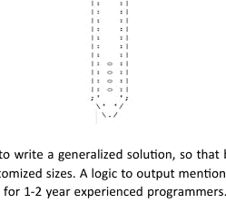

程序员应该能够写出一个通用解决方案，以便根据输入生成定制尺寸的手表。输出上述手表的逻辑充满曲折，即使对于有1-2年经验的程序员来说也并非易事。其根本意图是，我们应对如何构建编程逻辑有一个清晰的视图，而不是陷入猜测的迷宫，或者更糟——陷入**尝试-错误的功夫**中。当你完成本书后，请检验自己解决这个问题的能力。请在你的学习圈中提出这个问题，看看人们会用怎样不同的思路来尝试解决，并观察他们的方法。你可能会学到一件或多件新东西。你也可能能够指导一件或多件事。一些IT公司确实会考察候选人的指导能力。

在学习任何学科时，只有当可视化和思考过程变得活跃时，才能真正成为有效的学习。人不仅能理解概念，还能自然地应用概念。编程不是下载算法和背诵编程逻辑。它是应用方法来解决问题。通过练习本书中提到的练习来实践方法，总体上有助于提高编码技能。

模式是二维数据输出，无论是桌面/移动端还是Web应用程序，大多也都处理二维数据输出。用不同的模式进行练习有助于培养逻辑可视化能力。这样能打下良好的基础，当一个人真正从事实时应用程序开发时，必将大有裨益。以下仅是其中的几个例子，最好多练习各种可能性。

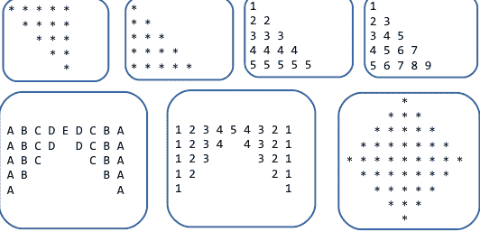

用这种简单的基于图片的问题来学习编程，肯定有助于提高编码技能。如果应用了错误的逻辑条件，输出也同样不匹配。这也是一种学习，因为在解决不同问题的场合，我们可能需要这种类型的逻辑条件。所以，失败将成为我们的课堂。以这种方式学习会让学习变得有趣，并迫使我们全神贯注地付出努力。因此，这有助于逻辑构建。

另一方面，使用基于数学的问题（如素数和其他类似问题）来学习，并不会产生太多兴趣。此外，在实际层面，对大多数非程序员或初学者来说，这类基于数学的练习简直是无聊透顶。

在我看来，基于模式的问题给了我们很多在不同方向上逻辑思考和努力的理由。在趣味性伴随下的逻辑技能提升，远高于任何其他方法。总的来说，它适合所有愿意持续投入时间的学习者。我曾用这种方法在许多学生身上做过实验，发现这是快速学习编程的最有趣的方式。

如果遵循正确的方法，而不是靠大量猜测来解决某个特定问题，这种方法就是更快、更好、更轻松的编码技能提升途径。否则，一个人在猜测方面可能有所提升，而在找到解决特定问题的方法上却没有，这基本上违背了算法的定义。

如果基于模式的问题处理不当，就会暴露程序员的逻辑弱点，这也是为什么在学校阶段、大学初学者阶段或初级面试中，基于模式的问题普遍出现的主要原因。本书解释了解决任何基于模式问题的方法，总体而言，它教授的是如何正确获得逻辑。

如果没有足够的逻辑构建技能，学习算法或编程高级主题的努力就像真的和猩猩说话一样，不会有什么成效。这是我在教学生涯中偶然发现的独特方法。这是经过学生实验后验证过的行之有效的公式。它的形成考虑了最适合学生快速、正确学习且零背诵程序逻辑需求的方案。我本应在2-3个月的极短时间内向完全的初学者教授编程。我做了一些实验，制定了一个计划，而这个计划取得了巨大成功。效果和反响都非常棒。本书就是对该方法的阐释，它肯定能帮助学生，无论他们偏好何种学习风格。这种学习编程逻辑的独特方法，不仅快速，而且充满热情。它基于常识制定了一套方法，因此实际上任何人都可以学习编程，而且有趣的是，只需极少的专业技术知识。这本书也是教师的指南，帮助他们自信而充满热情地将编程的主动权交给学生。这种方法适应性很强，甚至非常适合学龄儿童。因此，那些苦于教孩子编程的家长也可以参考本书。

如果你正在努力学习或教授编程，并且不想浪费时间在YouTube和其他资源上搜索，这里就是快速学习的机会。你准备好了吗……？

完成本书后，你将能更好地利用其他资源。

编程是一种心灵有氧运动，它教会我们保持专注，培养充足的耐心、自律和预见性。如果你留意，这些正是成功人士的一些主要品质。

编程属于每一个人，而不仅仅是一项学术训练。

祝学习愉快！！！


## PART 1

## BASICS OF PROGRAMMING LOGIC

## Introduction

无疑每个学科都有其关键的基础。如果某个学科的核心概念得到真正内化，那么其余的学习将会是富有成效的。

许多新手程序员和许多沮丧的程序员都会提出类似的问题，问题如下：

> “如何学习编程？”
>
> “如何培养逻辑构建技能？”
>
> “如何学习编码？”
>
> “如何提高编程逻辑？”

编程是一门应用学科。在我看来，如果一个程序员在编程逻辑上很薄弱，那他甚至算不上程序员。我们知道抱怨是最容易的工作，如果有人在这方面很擅长，那实际上也没取得什么大的成就。每当遇到问题时，我们只需要思考 **“最简单可能的出路是什么？”**

为了在任何编程语言上变得自信，第一步应该是获得一定程度的自学编程逻辑的熟练度。本技术手册完全致力于非程序员/初学者或中级学生，他们只是厌倦了在许多不同的地方努力以便在编程上变得自信。此外，如果你属于那些学习编程时间有限的人，这也是可以很好为你服务的指南。 **所以经验法则是，为了快速、正确地学习编程语言，首先要充分学习编程逻辑的策略。**

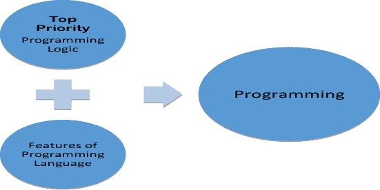

许多非程序员/绝对初学者或培训师最常见的错误是他们更专注于编程语言的语法/语法的特性和功能。对编程语言这种肤浅的看法对初学者帮助不大。计算机科学是一门解决实际问题的应用学科。首要且必不可少的需求是初学者应首先优先在编程逻辑技能方面得到充分训练。适当的体育锻炼和健康饮食如何塑造身体肌肉，同样适用于培养编程逻辑技能。它确实需要正确类型的基于逻辑的编程练习来培养编程逻辑的可视化。

也可能发生初学者可能知道编程语言几乎所有的概念，但仍然觉得缺少了什么。那缺失的元素是由于逻辑构建能力不足。没有舒适水平的逻辑构建技能，初学者会卡住很多，而且在开发程序时还会面临很多困惑。

## The Right Attitude

> *失败教会了我关于自己的一些事情，这些事情我无法通过其他方式学到。*
>
> - J.K. Rowling

默认情况下，孩子们不害怕犯错，因此他们富有创造力。常说 **掩盖错误是更高层次的错误**。因此，尽早注意到我们的错误总是好的，这样在未来最需要的时候就不会造成沉重打击。

实验和从错误中学习就像一种身体排毒计划。最初，任何排毒计划都不会尝起来好，但人仍然会去做，因为那个人会喜欢看到身体在2-3周后如何反应。我们做的任何新事物都需要一些练习。一切有价值的东西都有其相关的成本。失败就是这样一种需要付出以学习和记住教训的成本。

执行程序后得到准确的输出只是副产品。因此，整体学习将是失败加上成功部分。所以我们需要这样想，更多的初始失败将有助于我们减少未来失败的机会，而不是认为我们不是一个好的学习者。当学习者有意或无意地应用不匹配的逻辑条件时，可能会遇到意外的输出。这反过来会产生好奇心，即哪个特定的逻辑条件以不同的方式影响输出。大脑很容易记住惊喜。此外，图片帮助大脑记住比流动的文本更多的东西，无论是任何事实还是概念。因此，如果学习者尝试用奇怪的或一些典型的逻辑条件进行实验并尝试找出其背后的原因，这非常有用。这将像一种自我激励的练习，它简单地产生更多学习的渴望。

我们都有隐藏的潜力，而探索自己取决于我们。你是唯一能通过挑战并用你的能力去实验来探索你隐藏潜力的人。除非你踏上这段挑战之旅，否则你不会知道 **真正的你**，否则你将仍然是某个普通阶层中的某个人。 *你、我和每个人都必须在自己内部进行这项寻宝练习。*

一切都关乎态度的游戏以及在追求卓越时应用我们的行动。我们只需要反复以另一次诚实的尝试反弹。本指南的主要目标之一是激发思维过程，并培养一种仅通过触及最少的技术细节就能解决问题的自然倾向。我们知道态度决定高度。正确的意图赋予了我们以信心管理甚至艰难任务的巨大力量。一切都关乎视角，我们思考和相应处理情况的方式。

## The Clarity Principles

让我们通过把这些原则作为我们的提醒来帮助自己。我们必须提醒自己，帮助净化潜意识的关键重要价值观。提醒确实有好处，所以给他人或自己提醒。

> *你无法管理你无法衡量的东西。*
>
> — Peter Drucker

> *科学不过是常识的最佳体现，即在观察上严格准确，在逻辑上对谬误无情。*
>
> — Thomas Huxley

> *在这个星球上，人类在漫长的种族历史中遇到的大多数问题，都已通过基于常识并以勇气付诸实践的实验得到部分或整体的解决。*
>
> — Frances Perkins

> *我阅读。我学习。我审视。我倾听。我思考，然后从所有这些中我尝试形成一个想法，尽可能多地加入常识。*
>
> — Marquis de Lafayette

> *常识就是应用于生活的计算。*
>
> — Henri-Frédéric Amiel

计算或测量的最重要方面是它提供了清晰度。我们将尝试利用这个 **“清晰度”** 因素，使用 **逻辑追踪表** 来正确把握隐藏的编程逻辑。

本指南中涵盖的每个学习内容主要都围绕 **逻辑追踪表** 的概念展开，其实践在 **编程模式** 部分有更详细的阐述。

如果没有高质量的程序，我们就不能期望 <u>高质量软件</u>。良好的编程逻辑是编写无错误程序和高质量软件的基本质量之一。

## Any pre-requisite?

不需要任何编程语言的先前经验。如果你有，那很好，而且是可选的，因为我们不会涉及太多语法技术问题。我们只需要非常少的语言特性来练习编程练习，以便培养对编程的兴趣和信心。我们主要处理两个主要技术概念。

- a) 条件语句（If-statement, if-else statement）

- b) 循环结构——只是 *for-loop*。

C 语言中 *条件语句* 和 *for-loop* 的编程语法与许多其他编程语言如 C、C#、C++ 和 Java 相似。学习完本书后，他们可以轻松地在自己感兴趣的编程语言中进行实验。

高度成功人士的共同品质之一是，一旦他们获得信息，其实施速度非常快。这一品质帮助他们在竞争中保持领先。最好的事情是 **与自己竞争并尝试**打破自己的记录。

## About the book

这里呈现的所有材料仅用于行动，是一次实践的待办事项。我们不是以语言的方式讲解 C，而是使用 C 语言的语法将编程逻辑作为一门学科来讲解。本书不是猜测的产物。本书是针对大学生进行的实验的结果，目的是提高他们的逻辑构建技能或从零开始快速学习编程。

学习者必须练习书中提到的用于逻辑构建技能的方法，涉及二维简单图片练习。练习题按难度递增的方式排列，并激励以逐步的方式持续改进编程技能。已解决的练习提供了完整的思路，未解决的问题则促使应用逻辑概念。因此，这将以一种有趣的方式成为你与你之间的较量。

每个学习者都期望具备两个主要要求，分别是：

- a) 你想要学习编程的意图

- b) 需要持续投入时间，这取决于你想多快成为一名自信的程序员。 **至少在 3 个月内不要中断学习模式，每天至少花费 20 - 30 分钟。** 只要逐步遵循这个行动方案，你一定会在编程上获得实质性的把握。

之后探索编程或软件开发的新视野取决于你。我只能承诺在你学习编程逻辑的旅程中，在短时间内有一个出色的开始。 *所以让我们开始学习的旅程。*


## Kaizen 原则：提升编程逻辑

The Kaizen principle is a Japanese philosophy that refers to the set of activities that promote **continuous improvement**. **改进并不是一种做一次或几次然后就放下的活动。持续改进是一个由简单步骤组成的过程，可在各个领域带来改进。**

### 每天的小改进

它更注重渐进式改进，而非寻找问题的精确解决方案。任何改进都比零改进和 100% 的拖延要好。因此制定简单的小目标并通过努力实现它。即使 1% 的改进也很有价值，因此长期积累的小收益会产生大结果。基本上不要中断学习模式，学习一些东西总比 100% 拖延要好。这种活动也有助于打破拖延的习惯，如果有人真的很难摆脱的话。

### 测量与反馈

该原则的实施者必须在心理上做好准备，找到自己在逻辑表达和整体编程逻辑中的错误。每个错误都被视为整体改进道路上的一个教训。因此，全部重点放在渐进式改进上，而非编程问题的完整解决方案。学习编程逻辑的过程应基于图形化练习，而非基于数学的问题。当学习者基于图形化练习实践编程逻辑时，所应用逻辑的反馈可以很容易、清晰地得知。不仅限于此，它还会激发大量学习编程的好奇心和兴趣。此外，它还有助于消除最常见问题之一；

> “学习编程时如何保持专注？”。

### 放下假设

学习编程的通常和常见方式只是基于假设随机尝试。这需要花费更多时间来学习编程逻辑，因为它需要大量的练习。通过假设学习编程对很多人来说是令人却步的。因为它不反映任何标准的学习方式。我们大多数人无法做出好的假设，而且在每个学科领域都几乎不可能，并且没有适用于任何人的假设的标准公式。如果一种学习方法能激发可视化和思维过程，那么任何人学习起来都会更容易。

### 用数据说话，按事实管理

程序员应基于数据和事实设计解决方案。使编程逻辑正确运行的最重要协议是理解数据流中所涉及的智能。

获得这种智能的诀窍是使用我们称为逻辑追踪表的观察表版本，将数据流表达为一个或多个逻辑表达式。逻辑表达式由一个或多个变量和运算符组成。最后，编程逻辑由一个或多个逻辑表达式组成。我们可以通过数据和通过 **章节-编程模式** 中提到的适当练习轻松学习制作逻辑表达式的这种艺术。

### 为逻辑构建技能实施 Kaizen 模型

- 开始一个主题并学习，直到你准备好分析一个已解决的示例为止。集中精力研究该示例，直到你感觉自己已经完全理解了程序的方方面面。
- 然后尝试在不参考的情况下实现该已解决的示例。树立坚定的决心，一旦你开始实现已学习的程序，就不会再回头参考那个特定的已解决程序。你可以参考理论解释，但不能参考程序。你很可能会遇到许多语法或逻辑错误。在那种情况下，你可以参考概念的理论解释，但不要允许自己查看解决方案。尽力自行参考理论解释来解决问题。
- 请维护一个 Excel 或电子表格文件来记录你在程序中遇到的错误。当你自己能够解决错误时，请也记录下你采用该方法的原因。还有，你之前想的是什么，之后遇到了那个特定的逻辑错误。
- 每天开始学习时，请快速查看你在每次实现已解决程序时遇到任何错误时所维护的错误文件。在每天学习时回头参考那些错误将有助于下次做得更好，也会帮助你快速复习概念。我们应保持这种做法以避免常见的逻辑错误，以免这些错误成为我们的习惯。因此，最好一开始就纠正这些漏洞，因为打破一个习惯需要足够的努力。我们练习的东西，无论好坏，都会成为我们的习惯。在这里，我们正试图 **将失败转化为教训**。当我们能尽早从错误中改进时，会更有收获，这样我们就可以把更多时间投入到学习生活中的其他重要科目。
- 如果你能连续两次在不参考答案的情况下解决书中所有的已解决示例，那么你将处于更有利的位置来有效地编写程序。
- 未解决问题的提示在已解决练习的解释中。如果无法解决未解决问题，只需尝试 2-3 次，然后继续完成书籍。之后再回来尝试剩余的问题。
- 连续两次，如果你能在不参考答案的情况下解决所有已解决练习以及未解决问题，那么从逻辑上讲你将处于非常舒适的位置。你将有勇气为更困难的级别构建编程逻辑，并且能够自信地处理编程中其他更重的科目，如数据结构和算法设计。

### 重复上述 **kaizen(持续改进) 模型**
生成解决方案，_单次尝试_ 所有程序均达到
**<u>0 缺陷</u>**。

> > 教育的伟大目标不是知识而是行动。
> >
> > — 赫伯特·斯宾塞

## C 程序的基本格式

我们程序的通用格式/模板将如下所示。

```
SampleFile.c
#include <stdio.h>

int main() {
    // Your program logic goes here
    return 0;
}
```

## 如何使用 C 文件编写我们的编程逻辑？

为了检查我们的编程逻辑的正确性，我们需要做两件事：

- 1) 从 SampleFile.c 文件创建你的程序文件，给程序命名。
- 2) 将所有编程代码放在 main 方法的代码块之间。

```
int main() {
    // Your program logic goes here
    return 0;
}
```

代码块以左大括号 { 开始。以右大括号 } 结束。

如果我们想编写一个程序并且程序名为 Welcome，那么程序的名称将由 Welcome.c 程序文件给出。现在只需忽略 return 0、int main()、#include <stdio.h> 以及其他理论内容。只要你想编写新程序，就重复使用此 SampleFile.c 文件。

以下 Welcome.c 程序输出文本 Welcome to C Programming。

```
Welcome.c
/*
 * This is my first program.
 * Program to print welcome message.
 */
#include <stdio.h>
int main() {
    //program logic goes here
    printf("Welcome to C Programming.");
    return 0;
}
```

## 输出

Welcome to C Programming.

多行注释由 /* multi-line...*/ 给出
单行注释由 // single-line... 给出

注释是为了我们的理解/文档目的，并不是我们编程代码的一部分。C 编译器会忽略它。

**如何执行 C 程序以验证编程逻辑？**

请参考本书末尾的以下标题。

**附录-A：IDE 安装和项目设置**

它展示了使用 eclipse IDE 创建 **C** 项目的逐步流程，并进一步展示了如何创建和 **执行** C 程序，附带屏幕截图。Eclipse IDE 免费，并且在软件行业也很广泛使用。

或者，你也可以使用以下所示的在线编辑器之一。

https://www.tutorialspoint.com/compile_c_online.php

点击 **执行** 按钮运行程序。默认情况下，将打开 **源文件** 选项卡以编写程序。会显示一个单独的结果窗口，用于显示程序的输出。

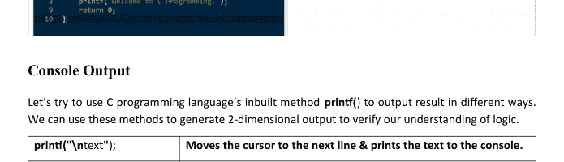

## **控制台输出**

让我们尝试使用 C 编程语言内置的方法 **printf** 以不同方式输出结果。我们可以使用这些方法生成二维输出来验证我们对逻辑的理解。

| | |
|---|---|
| `printf("\ntext");` | **将光标移动到下一行并将文本打印到控制台。** |
| `printf("text");` | **将文本打印到控制台。** |
| `printf("\n");` | **将光标移动到下一行。** |

| 以下编程语句(s) 含义相同。它输出给定的 **文本** 并在控制台输出窗口中 **移动到下一行**。 |||
|---|---|---|
| `printf("text");`<br>`printf("\n");` | `printf("text\n");` | `printf("text");printf("\n");` |


为了使用编程逻辑输出一幅二维简单图像，需要知道如何水平地和垂直地打印字符。二维图像越复杂，提取编程逻辑就会变得越有挑战性，而这正是它会迫使学习者去思考**“如何像程序员一样思考？”**的方式。你可以期待编程会以一种令人兴奋的方式进行，就像解谜练习一样。在编写简单或复杂的二维图像程序之前，让我们先做一些与此相关的基础编程。现在，我们可以通过尝试重复打印一段文本、在同一行中水平打印一段简单文本，或在每一行中垂直打印一段简单文本，来简单地开始学习编程逻辑。

## 练习 1. 在同一行打印文本 "Word:"。

**PrintInSameLine.c**

```c
#include <stdio.h>

int main() {

    printf("Word: ");

    printf("Word: ");

    printf("Word: ");

    return 0;

}
```

**输出**

```
Word: Word: Word:
```

## 练习 2. 让我们尝试在每一行输出 "Word:" 三次。

**PrintInEveryLine.c**

```c
#include <stdio.h>

int main() {

    printf("Word: \n");

    printf("Word: \n");

    printf("Word: \n");

    return 0;

}
```

**输出**

```
Word:
Word:
Word:
```

以下练习展示了**输出中单行换行的不同方式。**

## 练习 2.1. 在每一行打印 "Word: "，并使用 `printf("\n")`（单行换行）。

### PrintInEveryLine1.c

```c
#include <stdio.h>

int main() {

        printf("Word: ");

        printf("\\n");

        printf("Word: ");

        printf("\\n");

        printf("Word: ");

        return 0;
}
```

### 输出

```text
Word:
Word:
Word:
```

## 练习 2.2. 在每一行打印 "Word: "，并使用 "\n"（单行换行字符）。

### PrintInEveryLine2.c

```c
#include <stdio.h>

int main() {

        printf("Word: ");

        printf("\\nWord:");

        printf("\\nWord:");

        return 0;
}
```

### 输出

```text
Word:
Word:
Word:
```

## 练习 2.3. 在每一行打印“Word:”，并使用“\n”（单行换行字符）。

### PrintInEveryLine3.c

```c
#include <stdio.h>

int main() {

    printf("Word:\n");
    printf("Word:\n");
    printf("Word: ");
    return 0;
}
```

### 输出

```text
Word:
Word:
Word:
```

## 练习 2.4. 以不同方式在每一行打印“Word:”。

### PrintInEveryLine4Ways.c

```c
#include <stdio.h>

int main() {
    //1st way to print to console
    printf("Word:\n");
    //2nd way to print to console
    printf("Word:");printf("\n");
    //3rd way to print to console
    printf("\n");printf("Word: ");
    //4th way to print to console
    printf("\nWord: ");
    return 0;
}
```

### 输出

```text
Word:
Word:

Word:
Word:
```

我们将只使用所需的最少技术知识，来学习磨炼我们在编程逻辑方面的智力。我们的目标是深入探索构建编程逻辑的艺术，而不是深入探讨编程语言语法/句法的基础。让我们来看看编程逻辑的一些基本构建块。

## 存储不同的数据类型

软件的智能源于编程语言。以某种形式处理不同类型的数据，几乎是每个软件都非常核心的部分。正确操作**不同类型的数据**的能力，应该是任何编程语言的必要特性。常用不同数据类型的示例如下。

| 通用数据类型 | 值示例 |
|---|---|
| 整数 | 23, -4, 8908 |
| 实数 | 23.45, 3.1456, -45.27 |
| 真值 | true, false |
| 文本 | "Just do it", "impossible" |
| 单个字符 | A, a, @, $, %, *, 9 |

我们在日常生活中难道不使用各种不同类型的数据吗？我们确实会使用，例如；

| 姓名：................................ | 我们有时会以某种方式被要求正确填写个人详细信息。这样的例子很多，比如学校/大学入学流程、航班预订或任何在线购物。我们有足够的智能来区分不同类型的数据，无论是数值、文本还是任何其他种类。 |
| 年龄：................................ | |
| 体重（千克）：....................... | |
| 个人贷款（true/false）：........... | |
| 性别（男/女）：........................... | |

### 如何让编程语言变得智能，从而区分不同种类的数据？

是的，通过声明变量这一机制就可以实现。

### 变量声明

variable_name 表示内存地址，也称为左值。

| 变量的概念布局 |  |  |
|---|---|---|
| 数据类型 | variable_name | 数据类型范围内的数据 |
|  |  | 内存地址 |

变量声明的格式如下：

```
data-type variable_name;

int age; // age is lvalue and represents a memory location
```

考虑以下需要填写的个人详细信息示例，例如，对于所考虑的常见个人详细信息，变量声明可以表示为；

| 等价变量声明 | 现实场景中需要填写的个人详细信息 |
|---|---|
| char[35] name;
int age;
float weightInKgs ;
boolean personalLoan ;
char gender; | 姓名：........................
年龄：........................
体重（千克）：........................
个人贷款（true/false）：....................
性别（男/女）：........................ |

例如，数据值 25 可能表示年龄、价格，还有许多其他可能性。变量的名称应被恰当地选择，以完整表达它所指向的数据。所选择的变量名有助于我们了解其中存储值的含义。

### 如何将数据/值存储到变量中？

是的，通过使用赋值运算符（=）进行变量赋值这一机制就可以实现。

### 变量赋值

变量赋值的格式如下：

```
data_type variable_name = data; // assign only one data at a time
```

- variable_name 表示内存地址，也称为左值。
- 赋值运算符（=）右侧的数据值是右值。

| 变量的概念布局 |  |  |
|---|---|---|
| 数据类型 | variable_name = | 数据类型范围内的数据（右值） |
|  |  | 内存地址（左值） |

任何手动填写数据的现实场景，都可以通过编程语言中称为变量赋值的特性来模拟。变量赋值就是把适当的值存储到适当变量中的简单操作。我们可以使用赋值运算符（=）将值赋给变量。变量的值可以在程序中以编程方式覆盖，这就是它被称为“变量”的原因。在教室里，黑板上的空间会在每次新课时擦掉细节后重复使用。类似地，这些变量可以在程序运行/执行过程中以编程方式被覆盖。我们一次只能存储或赋值一个数据。

每条编程语句都用 ';' 分隔，就像在规范的文本信息中，句号 (.) 分隔每个句子一样。

| 等价变量赋值 | 已填写的个人详细信息 |
|---|---|
| char[35] name = "James Arthur Gosling";
int age = 63 ;
float weightInKgs = 53.6f;
boolean personalLoan = false;
char gender = 'M'; | 姓名：James Arthur Gosling
年龄：63
体重（千克）：53.6
个人贷款（true/false）：false
性别：M |

变量的名称表示内存位置。使用内存位置的名称进行编程是非常困难的。内存位置地址简直不亚于任何密钥。我们选择的变量名应该是一个用户友好的名称，它表示为了存储数据而分配的特定内存位置。

请遵循以下要点，并在开始编写程序之前复习它。

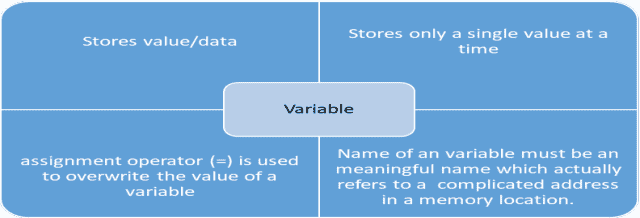

内存位置中的空间可以用字节单位表示。因此，原始数据类型的大小也可以用字节来表示，以存储值。（**注意：- 1 字节 = 8 位。**）

| 数据类型 | 大小 | 最小值 | 最大值 | 默认值 |
|---|---|---|---|---|
| byte | 1字节 | -128 | 127 | 0 |
| short | 2字节 | -32768 | 32767 | 0 |
| int | 4字节 | -2,147,483,648 | 2,147,483,647 | 0 |
| long | 8字节 | -9,223,372,036,854,775,808 | 9,223,372,036,854,775,807 | 0 |
| float | 4字节 |  | 最多 6 到 7 位十进制数字 | 0.0f |
| double | 8字节 |  | 最多 15 位十进制数字 | 0.0d |
| char | 2字节 |  | 65536 个字符 | '\u0000' 或 "（单个空格） |
| boolean | 1位 | true 或 false（只有两个可能值） |  | true 或 false |

### 变量名中有什么？

我们知道，在地理地图中，位置可以用经度和纬度的组合来表示。想一想，如果我们的城市、城镇、街道地点都被经纬度数值取代，在日常交流中使用它们会变得多么困难。因此，变量的选择应该是一个有意义的名称，并且必须表明与它相关的某种用途。发现患有这种特殊 SLVNS 综合征的程序员并不罕见。

### 什么是 SLVNS 综合征？

**SLVNS** 代表**单字母变量名综合征**。许多程序员有这种特殊习惯：通过变量名制造悬念。他们在编写程序时只为变量名分配一个字母。当这样的程序变得冗长，而别人必须为那段编程代码修复 bug/错误时，这肯定会变成令人恼火的经历。即使是这样的 **SLVNS** 程序员，在隔一段时间后重新回顾时，也可能发现自己很难快速理解自己的编程逻辑。如果你发现这样的程序员，请请求他们改掉这个习惯，*这是一种冒犯*。请防止自己染上这种毛病，并**耐心地编写有意义的变量名。**

> 记住它，你最好记住它。


## 运算符

在编程中，一些特殊的键盘字符被用作运算符，用来表示常见的数学运算，如加法、减法、比较两个数值以及许多此类运算。我们可以根据用途对运算符进行分类。简而言之，它是对简单的学校数学计算活动的模拟，但使用的是编程。这些简单的数学运算在日常生活中非常常见，并在处理日常业务或交易中发挥重要作用。这类以计算为基础且要求准确的活动，以及许多类似的相关活动，在我们的日常事务中非常常见。

### 算术运算符

| 运算符 | 算术运算描述 |
|---|---|
| + | 加法 |
| - | 减法 |
| * | 乘法 |
| / | 除法 |
| % | 取模（除法余数） |
| ++ | 递增 |
| -- | 递减 |

例如，使用“+”运算符的简单**加法运算**可以表示如下：

```c
int intNum1 = 6;
int intNum2 = 4;
int intResult = intNum1 + intNum2;
```

我们知道，赋值运算符（=）一次只能在一个变量中存储一个值。因此，在所考虑的示例中，**intNum1** 将存储值 6，而 **intNum2** 将存储值 4。

最后，由于加法运算符（+）应用于这两个变量之间，**intResult** 将存储 **intNum1** 和 **intNum2** 相加的结果值。

| 变量声明 | 内存地址 | 内存内容 |
|---|---:|---|
| int intNum1; | 1221 | 空 |
| int intNum2; | 1222 | 空 |
| | 1223 | |
| int intResult; | 1234 | 空 |

| 变量赋值 | 内存地址 | 内存内容 |
|---|---:|---:|
| int intNum1 = 6; | 1221 | 6 |
| int intNum2 = 4; | 1222 | 4 |
| | 1223 | |
| int intResult = intNum1 + intNum2; | 1234 | 10 |

### 练习 3. 使用算术运算符演示基本算术运算。

`ArithmeticOperationsInteger.c`

```c
#include <stdio.h>

int main() {

    int intNum1 = 6, intNum2 = 4;

    int intResult = -999; // initialize with unexpected value


    printf("Integer numbers: ");

    printf("\nintNum1 = %d, intNum2 = %d", intNum1, intNum2 );


    printf("\n\n");

    printf("Operations | Operator | Expression | Result\n");
    printf("-------------------------------------------\n");


    printf("Add       | +        | ");
    intResult = intNum1 + intNum2;
    printf("%d + %d   |  %d\n", intNum1, intNum2, intResult );


    printf("Subtract  | -        | ");
    intResult = intNum1 - intNum2;
    printf("%d - %d   |  %d\n", intNum1, intNum2, intResult );


    printf("Multiply  | *        | ");
    intResult = intNum1 * intNum2;
    printf("%d * %d   |  %d\n", intNum1, intNum2, intResult );


    printf("Divide    | /        | ");
    intResult = intNum1 / intNum2;
    printf("%d / %d   |  %d\n", intNum1, intNum2, intResult );

    // Just use a second percent(%) sign to
    // output the percent(%) sign!!!
    printf("Remainder  | %%       |  ");
    intResult = intNum1 % intNum2;
    printf("%d  %%  %d      |  %d\n", intNum1, intNum2, intResult );

    return 0;
}
```

**输出**

整数：intNum1 = 6, intNum2 = 4

| 运算 | 运算符 | 表达式 | 结果 |
|---|---|---|---|
| 加法 | + | 6 + 4 | 10 |
| 减法 | - | 6 - 4 | 2 |
| 乘法 | * | 6 * 4 | 24 |
| 除法 | / | 6 / 4 | 1 |
| 取余 | % | 6 % 4 | 2 |

### 练习 4. 编写一个程序，使用递增和递减运算符展示值的变化。

`IncrementDecrementOperators.c`

```c
#include <stdio.h>

int main() {
    int value = 100;

    printf("Given values.\n");

    printf("value = %d\n\n", value );

    printf("Incrementing 3 times\n");

    value++;

    value++;

    value++;

    printf("Result = %d\n\n", value );

    printf("Decrementing 2 times\n");

    value--;

    value--;

    printf("Result = %d\n", value );

    return 0;
}
```

**输出**

```text
Given values.
value = 100

Incrementing 3 times
Result = 103

Decrementing 2 times
Result = 101
```

**问题。** 编写一个名为 `ArithmeticOperatorsOnFloat.c` 的程序，使用以下变量名和值展示加法、减法、乘法、除法和取余运算；

```c
float floatVal1 = 2.55;
float floatVal2 = 1.77;
```

**问题。** 编写一个程序，将变量 total 的值递减 5 次，然后递增 5 次。递减/递增计数器的值为 1.0

```c
float total = 5.55;
```

### 比较运算符

两个值的比较结果要么为真，要么为假，这些值也称为布尔值和真值。这一特性非常重要，因为它有助于根据真或假作出决策。计算机内存基于 1（真）或 0（假）值，称为位值。计算机中的每个数据都是 1 和 0 的组合，称为位模式。

不同的值或数据意味着不同的位模式。

| 运算符 | 比较运算描述 |
|---|---|
| == | 等于 |
| != | 不等于 |
| < | 小于 |
| <= | 小于或等于 |
| > | 大于 |
| >= | 大于或等于 |

使用比较运算符，我们可以比较两个数值。以下示例展示了使用数值进行比较运算符的用法。

| 运算符 | 操作数1（运算符）操作数2 | 结果 |
|---|---|---|
| == | 4 == 4 | 真 |
| == | 4 == 10 | 假 |
| != | 6 != 4 | 真 |
| != | 4 != 4 | 假 |
| < | 6 < 10 | 真 |
| < | 6 < 6 | 假 |
| <= | 6 <= 6 | 真 |
| <= | 10 <= 6 | 假 |
| > | 6 > 6 | 假 |
| > | 10 > 6 | 真 |
| >= | 4 >= 6 | 假 |
| >= | 10 >= 6 | 真 |

我们还可以通过将输入值存储在变量中，然后逐一应用比较运算符来测试上述结果。

从哲学上讲，真和假是世界上仅有的两个完美答案。在程序中基于这些完美答案开发逻辑时，我们需要进行决策。特别是，这一特性允许灵活处理程序中的各种不同逻辑条件。

对这一特性的理解与敏感度是任何优秀程序员的核心。

**所以，请特别注意。**

让我们使用比较运算符对操作数 4、6 和 10 验证结果。

```c
#include <stdio.h>

int main() {

    int four = 4;
    int six = 6;
    int ten = 10;
    // initialize with unexpected value to check if
    // comparison result is get executed or not.
    int isResult = -999;

    printf("*** Comparison Operators ***\n");
    printf("*** boolean result values[1 means true, 0 means false] ***");
    printf("\n\n");

    printf("equal ( == ) \n");
    isResult = ( four == four );
    printf("%d   ==   %d   |   %d\n", four, four, isResult );

    isResult = ( four == ten );
    printf("%d   ==   %d   |   %d\n", four, ten, isResult );
    printf("----------------------------------------------------------\n");

    printf("not equal ( != ) \n");
    isResult = ( four != four );
    printf("%d   !=   %d   |   %d\n", four, four, isResult );

    isResult = ( four != ten );
    printf("%d   !=   %d   |   %d\n", four, ten, isResult );
    printf("----------------------------------------------------------\n");

    printf("less than ( < )\n");
    isResult = ( six < six );
    printf("%d  <  %d  |  %d\n", six, six, isResult );

    isResult = ( six < ten );
    printf("%d  <  %d  |  %d\n", six, ten, isResult );
    printf("-----------------------------------------\n");

    printf("less than or equal ( <= ) \n");
    isResult = ( six <= six );
    printf("%d  <=  %d  |  %d\n", six, six, isResult );

    isResult = ( ten <= six );
    printf("%d  <=  %d  |  %d\n", ten, six, isResult );
    printf("-----------------------------------------\n");

    printf("greater than ( > )\n");
    isResult = ( six > six );
    printf("%d  >  %d  |  %d\n", six, six, isResult );

    isResult = ( ten > six );
    printf("%d  >  %d  |  %d\n", ten, six, isResult );
    printf("-----------------------------------------\n");

    printf("greater than or equal ( >= )\n");
    isResult = ( four >= six );
    printf("%d  >=  %d  |  %d\n", four, six, isResult );

    isResult = ( ten >= six );
    printf("%d  >=  %d  |  %d\n", ten, six, isResult );

    return 0;
}
```


### 比较运算符
### 布尔结果值 [1 表示 true，0 表示 false]

相等 ( == )
4 == 4 | 1
4 == 10 | 0
------------------------------------------
不相等 ( != )
4 != 4 | 0
4 != 10 | 1
------------------------------------------
小于 ( < )
6 < 6 | 0
6 < 10 | 1
------------------------------------------
小于或等于 ( <= )
6 <= 6 | 1
10 <= 6 | 0
------------------------------------------
大于 ( > )
6 > 6 | 0
10 > 6 | 1
------------------------------------------
大于或等于 ( >= )
6 >= 6 | 1
6 >= 10 | 0

## 逻辑运算符

它也返回 *真* 或 *假* 值，就像任何比较运算符表达式的情况一样。我们可以组合更多这样的表达式，这些表达式可能基于比较运算符。如果需要考虑更多条件，我们通常使用逻辑运算符。这些运算符的使用相当常见，在编写程序中发挥着非常重要的作用。每位程序员都必须对这些运算符的使用有非常清晰的认识。如果任何新学习者花额外时间实验这些运算符，将是值得的。以下是不同类型的逻辑运算符。

| 运算符 | 逻辑运算描述 |
|---|---|
| `&&` | 逻辑与 |
| `||` | 逻辑或 |
| `!` | 逻辑非 |

### 逻辑与
只有在 **A 和 B 必须都为 真** 的情况下才返回 **真**，否则为假。我们在逻辑表达式中使用 `&&` 运算符添加的 AND 条件越多，从总数据中得到的数据量就越少。它通常应用于获取特定数据或范围/大小较小的数据的情况。

| A | B | A&&B |
|---|---|---|
| ***真*** | ***真*** | ***真*** |
| 真 | 假 | 假 |
| 假 | 真 | 假 |
| 假 | 假 | 假 |

### 逻辑或
只有在 **A 和 B 必须都为 假** 的情况下才返回 **假**，否则为真。我们在逻辑表达式中使用 `||` 运算符添加的 OR 条件越多，其作为输出结果的数据量就越大。因此它用于获取更广范围的数据。

| A | B | A || B |
|---|---|---|
| 真 | 真 | 真 |
| 真 | 假 | 真 |
| 假 | 真 | 真 |
| ***假*** | ***假*** | ***假*** |

A 和 B 通常是 true/false 值或基于比较运算符的表达式，其返回结果为真或假值。以下示例展示了这一点。

### 逻辑非
当 A 为假时返回真，或相反，当它为真时返回假。

| A | !A | 请注意 true/false 值也称为布尔值或真值。 |
|---|---|---|
| 真 | 假 | |
| 假 | 真 | |

设，有两个变量，a = 10 和 b = 5。请观察列“结果”。

| 逻辑运算符 | 表达式 | 结果 |
|---|---|---|
| && | (a > 7) && (b < 7) | (真) && (真) 为 真 |
| || | (a > 7) || (b < 3) | (真) || (假) 为 真 |
| ! | !(a == b) | !(假) 为 真 |

## 应用逻辑条件的艺术

逻辑条件是任何软件应用程序工作功能的防御机制。发生的绝大多数错误/ bug 都是由于对逻辑条件处理不当造成的。它主要由逻辑运算符或比较运算符组成。应用逻辑条件是编程逻辑中最重要的元素之一。它控制程序的流程，就像道路交通控制系统的工作方式一样。道路交通控制系统通过有条件地允许或阻止朝向特定道路的人群部分来逻辑分配人群。同样，程序中的逻辑条件只允许某些编程语句被执行。

如果路边交通控制系统不能按预期工作，那么它可能会造成交通堵塞和道路事故，而不是保持平稳驾驶。同样，如果未被发现，错误的逻辑条件会产生不可预测的结果。

逻辑条件类似于道路标志。这些道路标志具有一定的含义。它们是基于特定目的使用，并直接影响交通。以类似的方式，我们将尝试理解逻辑条件如何影响程序的输出，这将有助于提高我们的逻辑思维能力。

我们将使用一个简单的草稿板版本来手动验证我们的逻辑条件。它可能会让你想起填字游戏的方格。让我们取一个类似的方格，包含 8 行和 8 列。为了表示行和列，我们可以分别取两个名为 row 和 col 的变量。

变量 row → 表示值 row=1, 2,3,4,5,6,7,8。

变量 col → 表示值 col=1, 2,3,4,5,6,7,8。

每个方格由 (row, col) 值对识别。因此值对 (1, 1) 表示第 1 行第 1 列。

|  | col=1 | col=2 | col=3 | col=4 | col=5 | col=6 | col=7 | col=8 |
|---|---|---|---|---|---|---|---|---|
| row=1 | **1,1** | 1,2 | 1,3 | 1,4 | 1,5 | 1,6 | 1,7 | 1,8 |
| row=2 | 2,1 | 2,2 | 2,3 | 2,4 | 2,5 | 2,6 | 2,7 | 2,8 |
| row=3 | 3,1 | 3,2 | 3,3 | 3,4 | 3,5 | 3,6 | 3,7 | 3,8 |
| row=4 | 4,1 | 4,2 | 4,3 | 4,4 | 4,5 | 4,6 | 4,7 | 4,8 |
| row=5 | 5,1 | 5,2 | 5,3 | 5,4 | 5,5 | 5,6 | 5,7 | 5,8 |
| row=6 | 6,1 | 6,2 | 6,3 | 6,4 | 6,5 | 6,6 | 6,7 | 6,8 |
| row=7 | 7,1 | 7,2 | 7,3 | 7,4 | 7,5 | 7,6 | 7,7 | 7,8 |
| row=8 | 8,1 | 8,2 | 8,3 | 8,4 | 8,5 | 8,6 | 8,7 | 8,8 |

### 游戏规则
无论何处逻辑条件匹配，都需要在小方格中放置字符 *。

所有 (row, col) 值对代表总信息或数据。它有 8 行和 8 列，共计 64 个 (row, col) 值对。因此，当逻辑条件映射到此方格时，我们将从总共可用的 64 个 (row, col) 值对中选择正确的 (row, col) 值对。应用不同的逻辑条件意味着手动选择与每个逻辑条件匹配的 (row, col) 值对。这种非常简单的基于观察的练习将帮助我们理解逻辑条件在最核心层面的工作原理。

我们可以先练习使用简单的基于图片的练习手动编写逻辑条件，例如结构非常简单的字母。

当然，我们也可以通过编写程序来验证所有这些逻辑条件，这将是我们学习的下一个层次。顺便说一下，每个逻辑条件都可以通过使用 **嵌套循环** 编写程序轻松验证。使用嵌套循环将是我们学习中的下一步重大进展。我们将尝试把书写这些简单结构字母的动作表达为逻辑条件。从这种类型的基于图片的练习中，我们获得的宝贵经验是我们可以逐步学习如何应用逻辑条件。所考虑的字母图片建议只选择特定的 (row, col) 值对集合，其余的则保留。它将迫使我们思考可能的准确逻辑条件是什么。

由于它基于简单的数学和常识，因此手动验证这些逻辑条件不会困难。

当我们做这样的练习，将简单图片转换为逻辑条件或反之时，它有助于提高我们对编程逻辑的视觉化能力。

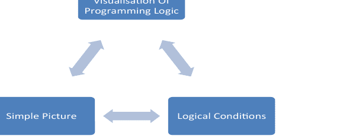

不同的字母意味着不同的图片。因此总体上它帮助我们了解某个程序如何工作以产生目标结果。此外，我们可以通过将其准确地放置在程序中并执行来验证所有这些逻辑条件，以验证结果。对于新手/绝对初学程序员来说，通过编写程序来验证它的时间尚未到来。

对于那些在任何编程语言中已有经验的人，程度足以了解条件语句和嵌套循环，他们当然可以继续并测试他们的逻辑条件。

我们应该知道的第一重要教训是如何给出正确的逻辑条件。我们可以通过练习将不同简单结构的字母转换为等效的逻辑条件来清楚地学习逻辑构建的这一重要方面。


## *将逻辑条件转换为简单图片*

在这种简单练习中，我们需要根据逻辑条件仔细选择合适的方格，并用 * 字符标记这些方格。每个方格由唯一的 (row, col) 值对组合表示。请查看给定练习，以理解如何根据给定条件选择方格。

### **ExerciseYB1：在下面的 8x8 方格中表达逻辑条件：(row == col)。**

条件 **(row == col)** 要求：请在给定的 **8x8 方格**中找出那些 **row 值和 column 值相等**的 (row, col) 值对。我们可以注意到，在正方形的对角线上，row 和 col 的值相等。**为了便于引起注意，row 和 col 值相等的方格用粗边框标出。**

| | col=1 | col=2 | col=3 | col=4 | col=5 | col=6 | col=7 | col=8 |
|---|---|---|---|---|---|---|---|---|
| row=1 | 1,1 | 1,2 | 1,3 | 1,4 | 1,5 | 1,6 | 1,7 | 1,8 |
| row=2 | 2,1 | 2,2 | 2,3 | 2,4 | 2,5 | 2,6 | 2,7 | 2,8 |
| row=3 | 3,1 | 3,2 | 3,3 | 3,4 | 3,5 | 3,6 | 3,7 | 3,8 |
| row=4 | 4,1 | 4,2 | 4,3 | 4,4 | 4,5 | 4,6 | 4,7 | 4,8 |
| row=5 | 5,1 | 5,2 | 5,3 | 5,4 | 5,5 | 5,6 | 5,7 | 5,8 |
| row=6 | 6,1 | 6,2 | 6,3 | 6,4 | 6,5 | 6,6 | 6,7 | 6,8 |
| row=7 | 7,1 | 7,2 | 7,3 | 7,4 | 7,5 | 7,6 | 7,7 | 7,8 |
| row=8 | 8,1 | 8,2 | 8,3 | 8,4 | 8,5 | 8,6 | 8,7 | 8,8 |

因此，按照游戏规则，我们应该在 **row 和 col 值相等**的方格上放置 * 字符。

| | col=1 | col=2 | col=3 | col=4 | col=5 | col=6 | col=7 | col=8 |
|---|---|---|---|---|---|---|---|---|
| row=1 | 1,1* | 1,2 | 1,3 | 1,4 | 1,5 | 1,6 | 1,7 | 1,8 |
| row=2 | 2,1 | 2,2* | 2,3 | 2,4 | 2,5 | 2,6 | 2,7 | 2,8 |
| row=3 | 3,1 | 3,2 | 3,3* | 3,4 | 3,5 | 3,6 | 3,7 | 3,8 |
| row=4 | 4,1 | 4,2 | 4,3 | 4,4* | 4,5 | 4,6 | 4,7 | 4,8 |
| row=5 | 5,1 | 5,2 | 5,3 | 5,4 | 5,5* | 5,6 | 5,7 | 5,8 |
| row=6 | 6,1 | 6,2 | 6,3 | 6,4 | 6,5 | 6,6* | 6,7 | 6,8 |
| row=7 | 7,1 | 7,2 | 7,3 | 7,4 | 7,5 | 7,6 | 7,7* | 7,8 |
| row=8 | 8,1 | 8,2 | 8,3 | 8,4 | 8,5 | 8,6 | 8,7 | 8,8* |

移除那些 **row 和 col 值不相等**的其他 (row, col) 值对，以表示所考虑的逻辑条件不会选择它们。这仅仅意味着只有那些与给定逻辑条件匹配的方格被选中并用 * 字符标记。

这样，我们就可以通过用 * 字符填充小方格来表示特定的逻辑条件。

| | col=1 | col=2 | col=3 | col=4 | col=5 | col=6 | col=7 | col=8 |
|---|---|---|---|---|---|---|---|---|
| row=1 | 1,1* | | | | | | | |
| row=2 | | 2,2* | | | | | | |
| row=3 | | | 3,3* | | | | | |
| row=4 | | | | 4,4* | | | | |
| row=5 | | | | | 5,5* | | | |
| row=6 | | | | | | 6,6* | | |
| row=7 | | | | | | | 7,7* | |
| row=8 | | | | | | | | 8,8* |

因此，逻辑条件的含义现在具有了视觉形式。逻辑条件的表达式被转换为使用 * 字符绘制的简单图片。这有助于我们理解如何使用逻辑条件进行数据过滤/选择。

### ExerciseYB2. 在下面的 8x8 方格中表达逻辑条件：(row == 8) || (col==1)

让我们先看逻辑条件的一部分 (row==8)，它表示 row 等于 8。row 值为 8 的方格将是我们的选择，无论 col 的值是什么。可以通过突出显示所选方格的边框来注意到这一点。

| | col=1 | col=2 | col=3 | col=4 | col=5 | col=6 | col=7 | col=8 |
|---|---|---|---|---|---|---|---|---|
| row=1 | 1,1 | 1,2 | 1,3 | 1,4 | 1,5 | 1,6 | 1,7 | 1,8 |
| row=2 | 2,1 | 2,2 | 2,3 | 2,4 | 2,5 | 2,6 | 2,7 | 2,8 |
| row=3 | 3,1 | 3,2 | 3,3 | 3,4 | 3,5 | 3,6 | 3,7 | 3,8 |
| row=4 | 4,1 | 4,2 | 4,3 | 4,4 | 4,5 | 4,6 | 4,7 | 4,8 |
| row=5 | 5,1 | 5,2 | 5,3 | 5,4 | 5,5 | 5,6 | 5,7 | 5,8 |
| row=6 | 6,1 | 6,2 | 6,3 | 6,4 | 6,5 | 6,6 | 6,7 | 6,8 |
| row=7 | 7,1 | 7,2 | 7,3 | 7,4 | 7,5 | 7,6 | 7,7 | 7,8 |
| row=8 | 8,1* | 8,2* | 8,3* | 8,4* | 8,5* | 8,6* | 8,7* | 8,8* |

以类似方式，我们来看逻辑条件的另一部分，即 (col == 1)。

它表示 col 值等于 1。让我们选择 col 值为 1 的方格，无论 row 的值是什么，并通过突出显示所选方格的边框来表示。

| | col=1 | col=2 | col=3 | col=4 | col=5 | col=6 | col=7 | col=8 |
|---|---|---|---|---|---|---|---|---|
| row=1 | 1,1* | 1,2 | 1,3 | 1,4 | 1,5 | 1,6 | 1,7 | 1,8 |
| row=2 | 2,1* | 2,2 | 2,3 | 2,4 | 2,5 | 2,6 | 2,7 | 2,8 |
| row=3 | 3,1* | 3,2 | 3,3 | 3,4 | 3,5 | 3,6 | 3,7 | 3,8 |
| row=4 | 4,1* | 4,2 | 4,3 | 4,4 | 4,5 | 4,6 | 4,7 | 4,8 |
| row=5 | 5,1* | 5,2 | 5,3 | 5,4 | 5,5 | 5,6 | 5,7 | 5,8 |
| row=6 | 6,1* | 6,2 | 6,3 | 6,4 | 6,5 | 6,6 | 6,7 | 6,8 |
| row=7 | 7,1* | 7,2 | 7,3 | 7,4 | 7,5 | 7,6 | 7,7 | 7,8 |
| row=8 | 8,1* | 8,2* | 8,3* | 8,4* | 8,5* | 8,6* | 8,7* | 8,8* |

移除不存在 * 字符的 (row, col) 值对。

| | col=1 | col=2 | col=3 | col=4 | col=5 | col=6 | col=7 | col=8 |
|---|---|---|---|---|---|---|---|---|
| row=1 | 1,1* | | | | | | | |
| row=2 | 2,1* | | | | | | | |
| row=3 | 3,1* | | | | | | | |
| row=4 | 4,1* | | | | | | | |
| row=5 | 5,1* | | | | | | | |
| row=6 | 6,1* | | | | | | | |
| row=7 | 7,1* | | | | | | | |
| row=8 | 8,1* | 8,2* | 8,3* | 8,4* | 8,5* | 8,6* | 8,7* | 8,8* |

通过移除所选 (row, col) 值对的详细信息，我们得到：

| | | | | | | | | |
|---|---|---|---|---|---|---|---|---|
| | * | | | | | | | |
| | * | | | | | | | |
| | * | | | | | | | |
| | * | | | | | | | |
| | * | | | | | | | |
| | * | | | | | | | |
| | * | | | | | | | |
| | * | * | * | * | * | * | * | * |

这看起来类似于英文字母 L。

### 我们可以看到字母 L 的几种不同样式。

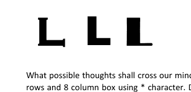

如果我们尝试使用 * 字符将字母 L 的每种不同样式放入一个 8 行 8 列的方格中，可能会想到哪些问题呢？字母的不同样式意味着不同的图片，而每种样式都会有不同的 **{row, col}** 值对集合。

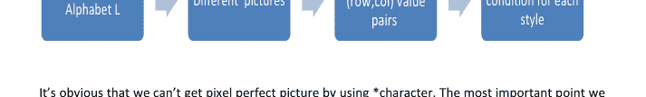

显然，我们无法通过使用 * 字符得到像素级完美的图片。我们需要理解的最重要一点是：**不同的图片输出意味着不同的逻辑条件**。这些图片集合作为学习应用逻辑条件的起点有些高级。

我们当然可以从非常简单的东西开始，简单到连学龄儿童也无法找借口说他们学不会编程。我们会选择大多数人都非常容易且熟悉的东西。我们将考虑以下示例中展示的结构最简单的英文字母。

使用 * 字符绘制的字母是 A、C 和 D。

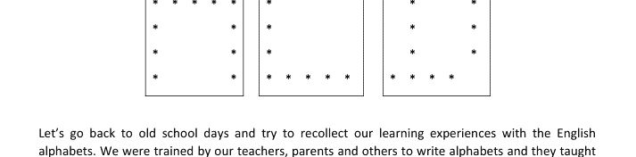

让我们回到学生时代，试着回忆我们学习英文字母的经历。老师、父母和其他人训练我们写字母，他们以某种逻辑方式教我们写字母。写一个字母所应用的整体逻辑与另一个字母不同。由于每个字母的整体结构不同，我们有机会练习不同类型的逻辑条件。

## 将简单图片转换为逻辑条件

我们将做一些练习，尝试从使用 * 字符绘制的非常简单的英文字母中获取逻辑条件。我们可以考虑一个 7 行 5 列的方格。我们只需选择那些有助于构成所需字母的 (row, col) 值对。我们将只为那些与 * 字符匹配的 (row, col) 值对设置逻辑条件。

### **ExerciseYBA：需要将字母 A 放入 7x5 方格中。**

| | col=1 | col=2 | col=3 | col=4 | col=5 |
|---|---|---|---|---|---|
| row=1 | 1,1 | 1,2 | 1,3 | 1,4 | 1,5 |
| row=2 | 2,1 | 2,2 | 2,3 | 2,4 | 2,5 |
| row=3 | 3,1 | 3,2 | 3,3 | 3,4 | 3,5 |
| row=4 | 4,1 | 4,2 | 4,3 | 4,4 | 4,5 |
| row=5 | 5,1 | 5,2 | 5,3 | 5,4 | 5,5 |
| row=6 | 6,1 | 6,2 | 6,3 | 6,4 | 6,5 |
| row=7 | 7,1 | 7,2 | 7,3 | 7,4 | 7,5 |

为了绘制字母 A，让我们先在第一行放置 * 字符。

因此逻辑条件将是 **row==1**，其中 == 是等于比较运算符。

| | col=1 | col=2 | col=3 | col=4 | col=5 |
|---|---|---|---|---|---|
| row=1 | 1,1* | 1,2* | 1,3* | 1,4* | 1,5* |
| row=2 | 2,1 | 2,2 | 2,3 | 2,4 | 2,5 |
| row=3 | 3,1 | 3,2 | 3,3 | 3,4 | 3,5 |
| row=4 | 4,1 | 4,2 | 4,3 | 4,4 | 4,5 |
| row=5 | 5,1 | 5,2 | 5,3 | 5,4 | 5,5 |
| row=6 | 6,1 | 6,2 | 6,3 | 6,4 | 6,5 |
| row=7 | 7,1 | 7,2 | 7,3 | 7,4 | 7,5 |

我们将使用逻辑 OR (||) 条件运算符来添加更多数据。在我们的例子中，我们需要再添加一些 * 字符，以完成字母 A 的又一部分。现在我们需要在第一列和最后一列放置 * 字符。因此，使用 **OR (||)** 逻辑运算符添加 **(col==1)** 和 **(col==5)** 逻辑条件，意味着要在以下方格中添加更多星号 (*) 字符。

逻辑条件更新如下：

**(row==1)||(col==1)**

**(row==1)||(col==1)||(col==5)**

| | col=1 | col=2 | col=3 | col=4 | col=5 |
|---|---|---|---|---|---|
| row=1 | 1,1* | 1,2* | 1,3* | 1,4* | 1,5* |
| row=2 | 2,1* | 2,2 | 2,3 | 2,4 | 2,5 |
| row=3 | 3,1* | 3,2 | 3,3 | 3,4 | 3,5 |
| row=4 | 4,1* | 4,2 | 4,3 | 4,4 | 4,5 |
| row=5 | 5,1* | 5,2 | 5,3 | 5,4 | 5,5 |
| row=6 | 6,1* | 6,2 | 6,3 | 6,4 | 6,5 |
| row=7 | 7,1* | 7,2 | 7,3 | 7,4 | 7,5 |

| | col=1 | col=2 | col=3 | col=4 | col=5 |
|---|---|---|---|---|---|
| row=1 | 1,1* | 1,2* | 1,3* | 1,4* | 1,5* |
| row=2 | 2,1* | 2,2 | 2,3 | 2,4 | 2,5* |
| row=3 | 3,1* | 3,2 | 3,3 | 3,4 | 3,5* |
| row=4 | 4,1* | 4,2 | 4,3 | 4,4 | 4,5* |
| row=5 | 5,1* | 5,2 | 5,3 | 5,4 | 5,5* |
| row=6 | 6,1* | 6,2 | 6,3 | 6,4 | 6,5* |
| row=7 | 7,1* | 7,2 | 7,3 | 7,4 | 7,5* |


在前面添加一个条件（**row == 4**）到之前的逻辑条件中，以完成字母A的中间部分。现在，显示字母A的所有 `*` 字符可以用以下逻辑条件表示。

```
(row==1)||(col==1)||(col==5)||(row==4)
```

|  | col=1 | col=2 | col=3 | col=4 | col=5 |
|---|---|---|---|---|---|
| row=1 | 1,1* | 1,2* | 1,3* | 1,4* | 1,5* |
| row=2 | 2,1* | 2,2 | 2,3 | 2,4 | 2,5* |
| row=3 | 3,1* | 3,2 | 3,3 | 3,4 | 3,5* |
| row=4 | 4,1* | 4,2* | 4,3* | 4,4* | 4,5* |
| row=5 | 5,1* | 5,2 | 5,3 | 5,4 | 5,5* |
| row=6 | 6,1* | 6,2 | 6,3 | 6,4 | 6,5* |
| row=7 | 7,1* | 7,2 | 7,3 | 7,4 | 7,5* |

### 现在移除没有 `*` 字符的（row, col）值对。

|  | col=1 | col=2 | col=3 | col=4 | col=5 |
|---|---|---|---|---|---|
| row=1 | 1,1* | 1,2* | 1,3* | 1,4* | 1,5* |
| row=2 | 2,1* |  |  |  | 2,5* |
| row=3 | 3,1* |  |  |  | 3,5* |
| row=4 | 4,1* | 4,2* | 4,3* | 4,4* | 4,5* |
| row=5 | 5,1* |  |  |  | 5,5* |
| row=6 | 6,1* |  |  |  | 6,5* |
| row=7 | 7,1* |  |  |  | 7,5* |

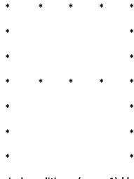

**逻辑条件：** `(row==1) || (col==1) ||(col==5) ||(row==4)`

### 练习 YBB：字母 B

|  | col=1 | col=2 | col=3 | col=4 | col=5 |
|---|---|---|---|---|---|
| row=1 | 1,1* | 1,2* | 1,3* | 1,4* | 1,5* |
| row=2 | 2,1 | 2,2 | 2,3 | 2,4 | 2,5 |
| row=3 | 3,1 | 3,2 | 3,3 | 3,4 | 3,5 |
| row=4 | 4,1 | 4,2 | 4,3 | 4,4 | 4,5 |
| row=5 | 5,1 | 5,2 | 5,3 | 5,4 | 5,5 |
| row=6 | 6,1 | 6,2 | 6,3 | 6,4 | 6,5 |
| row=7 | 7,1* | 7,2* | 7,3* | 7,4* | 7,5* |

为了绘制字母B，我们首先在第一行和最后一行放置 `*` 字符。等效的逻辑条件将是使用逻辑条件 row==1 和 row ==7。

逻辑条件变为

(row==1)|| (row==7)

现在我们需要在第二列和最后一列放置 `*` 字符。因此，使用逻辑或运算符（||）添加 (col==2) 和 (col==5) 逻辑条件，意味着要在下面的格子中添加更多 `*` 字符。更新后的逻辑条件可以如下所示：

(row==1)|| (row==7)|| (col==2)||(col==5)

|  | col=1 | col=2 | col=3 | col=4 | col=5 |
|---|---|---|---|---|---|
| row=1 | 1,1* | 1,2* | 1,3* | 1,4* | 1,5* |
| row=2 | 2,1 | 2,2* | 2,3 | 2,4 | 2,5* |
| row=3 | 3,1 | 3,2* | 3,3 | 3,4 | 3,5* |
| row=4 | 4,1 | 4,2* | 4,3 | 4,4 | 4,5* |
| row=5 | 5,1 | 5,2* | 5,3 | 5,4 | 5,5* |
| row=6 | 6,1 | 6,2* | 6,3 | 6,4 | 6,5* |
| row=7 | 7,1* | 7,2* | 7,3* | 7,4* | 7,5* |

再添加一个条件 (row ==4)。这个逻辑条件的一个问题是，我们不希望 row == 4 中出现 `*` 字符，尤其是在值对为 (4, 1) 的格子中。

|  | col=1 | col=2 | col=3 | col=4 | col=5 |
|---|---|---|---|---|---|
| row=1 | 1,1* | 1,2* | 1,3* | 1,4* | 1,5* |
| row=2 | 2,1 | 2,2* | 2,3 | 2,4 | 2,5* |
| row=3 | 3,1 | 3,2* | 3,3 | 3,4 | 3,5* |
| row=4 | 4,1* | 4,2* | 4,3* | 4,4* | 4,5* |
| row=5 | 5,1 | 5,2* | 5,3 | 5,4 | 5,5* |
| row=6 | 6,1 | 6,2* | 6,3 | 6,4 | 6,5* |
| row=7 | 7,1* | 7,2* | 7,3* | 7,4* | 7,5* |

我们应用逻辑与（&&）条件运算符来选择更少的数据。在我们的例子中，需要在 row == 4 中少选择一个 `*` 字符，以完成字母B的中间部分。

字母B中间部分更新后的逻辑条件将是 (row ==4 && col>=2)。

```
(row==1)|| (row==7)|| (col==2)||(col==5)|| (row ==4 && col>=2)
```

|  | col=1 | col=2 | col=3 | col=4 | col=5 |
|---|---|---|---|---|---|
| row=1 | 1,1* | 1,2* | 1,3* | 1,4* | 1,5* |
| row=2 | 2,1 | 2,2* | 2,3 | 2,4 | 2,5* |
| row=3 | 3,1 | 3,2* | 3,3 | 3,4 | 3,5* |
| row=4 | 4,1 | 4,2* | 4,3* | 4,4* | 4,5* |
| row=5 | 5,1 | 5,2* | 5,3 | 5,4 | 5,5* |
| row=6 | 6,1 | 6,2* | 6,3 | 6,4 | 6,5* |
| row=7 | 7,1* | 7,2* | 7,3* | 7,4* | 7,5* |

现在移除没有 `*` 字符的（row, col）值对。

|  | col=1 | col=2 | col=3 | col=4 | col=5 |
|---|---|---|---|---|---|
| row=1 | 1,1* | 1,2* | 1,3* | 1,4* | 1,5* |
| row=2 |  | 2,2* |  |  | 2,5* |
| row=3 |  | 3,2* |  |  | 3,5* |
| row=4 |  | 4,2* | 4,3* | 4,4* | 4,5* |
| row=5 |  | 5,2* |  |  | 5,5* |
| row=6 |  | 6,2* |  |  | 6,5* |
| row=7 | 7,1* | 7,2* | 7,3* | 7,4* | 7,5* |

完整的逻辑条件变为

```
(row==1)|| (row==7)|| (col==2)||(col==5)|| (row ==4 && col>=2)
```

### 练习 YBC：字母 C

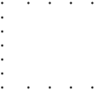

|  | col=1 | col=2 | col=3 | col=4 | col=5 |
|---|---|---|---|---|---|
| row=1 | 1,1 | 1,2 | 1,3 | 1,4 | 1,5 |
| row=2 | 2,1 | 2,2 | 2,3 | 2,4 | 2,5 |
| row=3 | 3,1 | 3,2 | 3,3 | 3,4 | 3,5 |
| row=4 | 4,1 | 4,2 | 4,3 | 4,4 | 4,5 |
| row=5 | 5,1 | 5,2 | 5,3 | 5,4 | 5,5 |
| row=6 | 6,1 | 6,2 | 6,3 | 6,4 | 6,5 |
| row=7 | 7,1 | 7,2 | 7,3 | 7,4 | 7,5 |

观察字母C并尝试放入格子中，我们可以从在第一行放置 `*` 字符开始。因此逻辑条件将是 **row==1**。

现在我们需要在第一列放置 `*` 字符。

|  | col=1 | col=2 | col=3 | col=4 | col=5 |
|---|---|---|---|---|---|
| row=1 | 1,1* | 1,2* | 1,3* | 1,4* | 1,5* |
| row=2 | 2,1* | 2,2 | 2,3 | 2,4 | 2,5 |
| row=3 | 3,1* | 3,2 | 3,3 | 3,4 | 3,5 |
| row=4 | 4,1* | 4,2 | 4,3 | 4,4 | 4,5 |
| row=5 | 5,1* | 5,2 | 5,3 | 5,4 | 5,5 |
| row=6 | 6,1* | 6,2 | 6,3 | 6,4 | 6,5 |
| row=7 | 7,1* | 7,2 | 7,3 | 7,4 | 7,5 |

第一列的等效逻辑条件将是 (**col==1**) 条件。

使用逻辑或（||）条件运算符组合逻辑条件，它变为 **(row==1)||(col==1)**

|  | col=1 | col=2 | col=3 | col=4 | col=5 |
|---|---|---|---|---|---|
| row=1 | 1,1* | 1,2* | 1,3* | 1,4* | 1,5* |
| row=2 | 2,1* | 2,2 | 2,3 | 2,4 | 2,5 |
| row=3 | 3,1* | 3,2 | 3,3 | 3,4 | 3,5 |
| row=4 | 4,1* | 4,2 | 4,3 | 4,4 | 4,5 |
| row=5 | 5,1* | 5,2 | 5,3 | 5,4 | 5,5 |
| row=6 | 6,1* | 6,2 | 6,3 | 6,4 | 6,5 |
| row=7 | 7,1* | 7,2 | 7,3 | 7,4 | 7,5 |

在前面的条件中再添加一个逻辑条件 (row ==7)。现在，类似字母C的 `*` 字符集和完整的逻辑条件可以是： (row==1)||(col==1)||(row==7)

|  | col=1 | col=2 | col=3 | col=4 | col=5 |
|---|---|---|---|---|---|
| row=1 | 1,1* | 1,2* | 1,3* | 1,4* | 1,5* |
| row=2 | 2,1* | 2,2 | 2,3 | 2,4 | 2,5 |
| row=3 | 3,1* | 3,2 | 3,3 | 3,4 | 3,5 |
| row=4 | 4,1* | 4,2 | 4,3 | 4,4 | 4,5 |
| row=5 | 5,1* | 5,2 | 5,3 | 5,4 | 5,5 |
| row=6 | 6,1* | 6,2 | 6,3 | 6,4 | 6,5 |
| row=7 | 7,1* | 7,2* | 7,3* | 7,4* | 7,5* |

现在移除没有 `*` 字符的（row, col）值对。

|  | col=1 | col=2 | col=3 | col=4 | col=5 |
|---|---|---|---|---|---|
| row=1 | 1,1* | 1,2* | 1,3* | 1,4* | 1,5* |
| row=2 | 2,1* |  |  |  |  |
| row=3 | 3,1* |  |  |  |  |
| row=4 | 4,1* |  |  |  |  |
| row=5 | 5,1* |  |  |  |  |
| row=6 | 6,1* |  |  |  |  |
| row=7 | 7,1* | 7,2* | 7,3* | 7,4* | 7,5* |

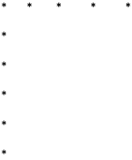

或

逻辑条件： (row==1) || (col==1) || (row==7)

### 练习 YBD：字母 D

我们需要在第一行和最后一行放置 `*` 字符。因此匹配的逻辑条件将是 (row==1) 和 (row==7)。

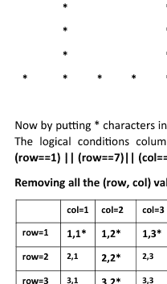

|  | col=1 | col=2 | col=3 | col=4 | col=5 |
|---|---|---|---|---|---|
| row=1 | 1,1* | 1,2* | 1,3* | 1,4* | 1,5* |
| row=2 | 2,1 | 2,2 | 2,3 | 2,4 | 2,5 |
| row=3 | 3,1 | 3,2 | 3,3 | 3,4 | 3,5 |
| row=4 | 4,1 | 4,2 | 4,3 | 4,4 | 4,5 |
| row=5 | 5,1 | 5,2 | 5,3 | 5,4 | 5,5 |
| row=6 | 6,1 | 6,2 | 6,3 | 6,4 | 6,5 |
| row=7 | 7,1* | 7,2* | 7,3* | 7,4* | 7,5* |

现在，在第二列和最后一列放置 `*` 字符将完成字母D。列的逻辑条件将是 (col==2) 和 (col==5)。总逻辑条件变为 (row==1) || (row==7) || (col==2) || (col==5)

移除所有没有 `*` 字符的（row, col）值对。

|  | col=1 | col=2 | col=3 | col=4 | col=5 |
|---|---|---|---|---|---|
| row=1 | 1,1* | 1,2* | 1,3* | 1,4* | 1,5* |
| row=2 | 2,1 | 2,2* | 2,3 | 2,4 | 2,5* |
| row=3 | 3,1 | 3,2* | 3,3 | 3,4 | 3,5* |
| row=4 | 4,1 | 4,2* | 4,3 | 4,4 | 4,5* |
| row=5 | 5,1 | 5,2* | 5,3 | 5,4 | 5,5* |
| row=6 | 6,1 | 6,2* | 6,3 | 6,4 | 6,5* |
| row=7 | 7,1* | 7,2* | 7,3* | 7,4* | 7,5* |


### 问题YBD：为以下字母编写逻辑条件。


### ExerciseYBE: 字母 E

| | col=1 | col=2 | col=3 | col=4 | col=5 |
|---|---|---|---|---|---|
| row=1 | 1,1* | 1,2* | 1,3* | 1,4* | 1,5* |
| row=2 | 2,1 | 2,2 | 2,3 | 2,4 | 2,5 |
| row=3 | 3,1 | 3,2 | 3,3 | 3,4 | 3,5 |
| row=4 | 4,1 | 4,2 | 4,3 | 4,4 | 4,5 |
| row=5 | 5,1 | 5,2 | 5,3 | 5,4 | 5,5 |
| row=6 | 6,1 | 6,2 | 6,3 | 6,4 | 6,5 |
| row=7 | 7,1* | 7,2* | 7,3* | 7,4* | 7,5* |

我们需要在第一行和最后一行放置 * 字符。
因此匹配的逻辑条件为 (row==1) 且 (row==7)。
另外，通过在第二列放置 * 字符将完成字母 E。
在添加逻辑条件 (col==2) 后，总逻辑条件变为
(row==1)|| (row==7)|| (col==2)

| | col=1 | col=2 | col=3 | col=4 | col=5 |
|---|---|---|---|---|---|
| row=1 | 1,1* | 1,2* | 1,3* | 1,4* | 1,5* |
| row=2 | 2,1 | 2,2* | 2,3 | 2,4 | 2,5 |
| row=3 | 3,1 | 3,2* | 3,3 | 3,4 | 3,5 |
| row=4 | 4,1 | 4,2* | 4,3 | 4,4 | 4,5 |
| row=5 | 5,1 | 5,2* | 5,3 | 5,4 | 5,5 |
| row=6 | 6,1 | 6,2* | 6,3 | 6,4 | 6,5 |
| row=7 | 7,1* | 7,2* | 7,3* | 7,4* | 7,5* |

添加一个更进一步的条件
(row==4 && col>=2) 到之前的条件中。
AND 逻辑条件 (&& col>=2) 的原因是我们不想在值对为 (4, 1) 的方框中放置 * 字符。
AND 逻辑条件用于在选择数据时提供限制，我们的数据是 (row, col) 值对，即方框。

总逻辑条件变为 (row==1)|| (row==7)|| (col==2)|| (row ==4 && col>=2)

| | col=1 | col=2 | col=3 | col=4 | col=5 |
|---|---|---|---|---|---|
| row=1 | 1,1* | 1,2* | 1,3* | 1,4* | 1,5* |
| row=2 | 2,1 | 2,2* | 2,3 | 2,4 | 2,5 |
| row=3 | 3,1 | 3,2* | 3,3 | 3,4 | 3,5 |
| row=4 | 4,1 | 4,2* | 4,3* | 4,4* | 4,5 |
| row=5 | 5,1 | 5,2* | 5,3 | 5,4 | 5,5 |
| row=6 | 6,1 | 6,2* | 6,3 | 6,4 | 6,5 |
| row=7 | 7,1* | 7,2* | 7,3* | 7,4* | 7,5* |

或
*   *   *   *
    *
    *
*   *   *
    *
    *
*   *   *   *

### **练习YBF：字母 F**

我们需要在第一行和第二列放置 * 字符。
因此匹配的逻辑条件为 (row==1) 且 (col==2)。
目前的逻辑条件变为 **(row==1) || (col==2)**。

|       | col=1 | col=2 | col=3 | col=4 | col=5 |
|-------|-------|-------|-------|-------|-------|
| row=1 | 1,1*  | 1,2*  | 1,3*  | 1,4*  | 1,5*  |
| row=2 | 2,1   | 2,2*  | 2,3   | 2,4   | 2,5   |
| row=3 | 3,1   | 3,2*  | 3,3   | 3,4   | 3,5   |
| row=4 | 4,1   | 4,2*  | 4,3   | 4,4   | 4,5   |
| row=5 | 5,1   | 5,2*  | 5,3   | 5,4   | 5,5   |
| row=6 | 6,1   | 6,2*  | 6,3   | 6,4   | 6,5   |
| row=7 | 7,1   | 7,2*  | 7,3   | 7,4   | 7,5   |

添加一个更进一步的条件 **(row==4 && col>=2)** 到之前的条件中。AND 逻辑条件 **(&& col>=2)** 的原因是我们不想在值对为 **(4, 1)** 的方框中放置 * 字符。
现在构成字母 F 的 * 字符集合可以通过以下逻辑条件给出：

**(row==1) || (col==2) || (row==4 && col>=2).**

**删除所有没有 * 字符的 (row, col) 值对。**

|       | col=1 | col=2 | col=3 | col=4 | col=5 |
|-------|-------|-------|-------|-------|-------|
| row=1 | 1,1*  | 1,2*  | 1,3*  | 1,4*  | 1,5*  |
| row=2 | 2,1   | 2,2*  | 2,3   | 2,4   | 2,5   |
| row=3 | 3,1   | 3,2*  | 3,3   | 3,4   | 3,5   |
| row=4 | 4,1   | 4,2*  | 4,3*  | 4,4*  | 4,5*  |
| row=5 | 5,1   | 5,2*  | 5,3   | 5,4   | 5,5   |
| row=6 | 6,1   | 6,2*  | 6,3   | 6,4   | 6,5   |
| row=7 | 7,1   | 7,2*  | 7,3   | 7,4   | 7,5   |

或

```
*****
  *
  *
  ***
  *
  *
  *
```

### ExerciseYBG: 字母 G

|       | col=1 | col=2 | col=3 | col=4 | col=5 |
|-------|-------|-------|-------|-------|-------|
| row=1 | 1,1*  | 1,2*  | 1,3*  | 1,4*  | 1,5*  |
| row=2 | 2,1   | 2,2   | 2,3   | 2,4   | 2,5   |
| row=3 | 3,1   | 3,2   | 3,3   | 3,4   | 3,5   |
| row=4 | 4,1   | 4,2   | 4,3   | 4,4   | 4,5   |
| row=5 | 5,1   | 5,2   | 5,3   | 5,4   | 5,5   |
| row=6 | 6,1   | 6,2   | 6,3   | 6,4   | 6,5   |
| row=7 | 7,1*  | 7,2*  | 7,3*  | 7,4*  | 7,5*  |

我们需要在第一行和最后一行放置 * 字符。因此匹配的逻辑条件为 (row==1) 且 (row==7)。另外我们需要在第一列放置 * 字符。因此匹配的逻辑条件为 (col==1)。

逻辑条件变为
(row==1) || (row==7) || (col==1)

|       | col=1 | col=2 | col=3 | col=4 | col=5 |
|-------|-------|-------|-------|-------|-------|
| row=1 | 1,1*  | 1,2*  | 1,3*  | 1,4*  | 1,5*  |
| row=2 | 2,1*  | 2,2   | 2,3   | 2,4   | 2,5   |
| row=3 | 3,1*  | 3,2   | 3,3   | 3,4   | 3,5   |
| row=4 | 4,1*  | 4,2   | 4,3   | 4,4   | 4,5   |
| row=5 | 5,1*  | 5,2   | 5,3   | 5,4   | 5,5   |
| row=6 | 6,1*  | 6,2   | 6,3   | 6,4   | 6,5   |
| row=7 | 7,1*  | 7,2*  | 7,3*  | 7,4*  | 7,5*  |

添加一个更进一步的条件 (row == 4 && col=3) 到之前条件中，因为我们不想在值对为 (4, 2) 的方框中放置 * 字符。

再次添加一个更进一步的条件 (col == 5 && row==5) 到之前条件中，因为我们不想在值对为 (2, 5) 和 (3, 5) 的方框中放置 * 字符。

现在完整的 * 字符集合以及逻辑条件可以表示如下
(row==1) || (row==7) || (col==1) || (row==4 && col=3) || (col==5 && row==5)。

**删除所有没有 * 字符的 (row, col) 值对。**

|       | col=1 | col=2 | col=3 | col=4 | col=5 |
|-------|-------|-------|-------|-------|-------|
| row=1 | 1,1*  | 1,2*  | 1,3*  | 1,4*  | 1,5*  |
| row=2 | 2,1*  | 2,2   | 2,3   | 2,4   | 2,5   |
| row=3 | 3,1*  | 3,2   | 3,3   | 3,4   | 3,5   |
| row=4 | 4,1*  | 4,2   | 4,3*  | 4,4*  | 4,5   |
| row=5 | 5,1*  | 5,2   | 5,3   | 5,4   | 5,5*  |
| row=6 | 6,1*  | 6,2   | 6,3   | 6,4   | 6,5*  |
| row=7 | 7,1*  | 7,2*  | 7,3*  | 7,4*  | 7,5*  |

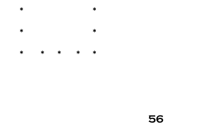

### ExerciseYBJ: 字母 J

让我们在第一行和中间列填充 * 字符。因此匹配的逻辑条件为 (row==1) || (col==3)。我们使用了逻辑或 (||) 条件运算符来添加更多 * 字符。

|  | col=1 | col=2 | col=3 | col=4 | col=5 |
|---|---|---|---|---|---|
| row=1 | 1,1* | 1,2* | 1,3* | 1,4* | 1,5* |
| row=2 | 2,1 | 2,2 | 2,3* | 2,4 | 2,5 |
| row=3 | 3,1 | 3,2 | 3,3* | 3,4 | 3,5 |
| row=4 | 4,1 | 4,2 | 4,3* | 4,4 | 4,5 |
| row=5 | 5,1 | 5,2 | 5,3* | 5,4 | 5,5 |
| row=6 | 6,1 | 6,2 | 6,3* | 6,4 | 6,5 |
| row=7 | 7,1 | 7,2 | 7,3* | 7,4 | 7,5 |

由于我们需要在 row=7 时将列数限制为 3，因此必须使用逻辑与 **(&& col<=3)** 条件运算符。现在使用逻辑或 (||) 条件运算符将逻辑条件 **(row==7 && col<=3)** 添加到之前条件中，将得到的 * 字符集合可以在方框中显示。逻辑条件变为

**(row==1) || (col==3) || (row==7 && col<=3)**

|  | col=1 | col=2 | col=3 | col=4 | col=5 |
|---|---|---|---|---|---|
| row=1 | 1,1* | 1,2* | 1,3* | 1,4* | 1,5* |
| row=2 | 2,1 | 2,2 | 2,3* | 2,4 | 2,5 |
| row=3 | 3,1 | 3,2 | 3,3* | 3,4 | 3,5 |
| row=4 | 4,1 | 4,2 | 4,3* | 4,4 | 4,5 |
| row=5 | 5,1 | 5,2 | 5,3* | 5,4 | 5,5 |
| row=6 | 6,1 | 6,2 | 6,3* | 6,4 | 6,5 |
| row=7 | **7,1*** | **7,2*** | **7,3*** | 7,4 | 7,5 |

### 请注意

使用逻辑与我们限制或限定了在 row=7 处放置 * 字符的位置。使用的条件是 (row==7 && col<=3)。

如果条件仅为 row==7，那么完整的 row=7 将会被 * 字符填满。表达式 (row==7 && col<=3) 中的附加条件 &&col<=3 实际上限制了 row=7 中的 * 字符，从第 1 列开始到第 3 列。

再次向之前添加条件 (col==1 && row>=4)。

用粗边框显示的所选 * 字符集合代表条件 (col==1 && row>=4)。

|  | col=1 | col=2 | col=3 | col=4 | col=5 |
|---|---|---|---|---|---|
| row=1 | 1,1* | 1,2* | 1,3* | 1,4* | 1,5* |
| row=2 | 2,1 | 2,2 | 2,3* | 2,4 | 2,5 |
| row=3 | 3,1 | 3,2 | 3,3* | 3,4 | 3,5 |
| row=4 | **4,1*** | 4,2 | 4,3* | 4,4 | 4,5 |
| row=5 | **5,1*** | 5,2 | 5,3* | 5,4 | 5,5 |
| row=6 | **6,1*** | 6,2 | 6,3* | 6,4 | 6,5 |
| row=7 | **7,1*** | **7,2*** | 7,3* | 7,4 | 7,5 |

### 请注意

使用逻辑与我们限制或限定了在 col=1 处放置 * 字符的位置。条件是 (col=1 && row>=4)。

如果条件仅为 col==1，那么完整的 col=1 将会被 * 字符填满。

表达式 (col==1 && row>=4) 中的附加条件 &&row>=4 实际上限制了第 1 列中的 * 字符，从第 4 行开始到第 7 行。


### 删除没有 * 字符的 (row, col) 值对。

|       | col=1 | col=2 | col=3 | col=4 | col=5 |
|-------|-------|-------|-------|-------|-------|
| row=1 | 1,1*  | 1,2*  | 1,3*  | 1,4*  | 1,5*  |
| row=2 |       |       | 2,3*  |       |       |
| row=3 |       |       | 3,3*  |       |       |
| row=4 | 4,1*  |       | 4,3*  |       |       |
| row=5 | 5,1*  |       | 5,3*  |       |       |
| row=6 | 6,1*  |       | 6,3*  |       |       |
| row=7 | 7,1*  | 7,2*  | 7,3*  |       |       |

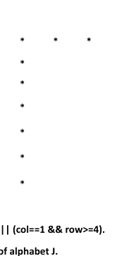

**逻辑条件：(row==1) || (col==3) || (row==7 && col==3) || (col==1 && row>=4)。**

*ProblemYB:* 写出以下字母 J 样式的逻辑条件。

* * * * *
    *
    *
*   *
*   *
*   *
  *

***注意：** 如果你能够找到自己的正确逻辑表达式，说明这本书成功地激发了你对该主题的兴趣。如果我们真正对某个主题感兴趣，我们在处理它时可能会感到筋疲力尽，但我们不会感到负担。*

### ExerciseYBK: 字母 K

| | col=1 | col=2 | col=3 | col=4 | col=5 |
|---|---|---|---|---|---|
| row=1 | 1,1* | 1,2 | 1,3 | 1,4 | 1,5 |
| row=2 | 2,1* | 2,2 | 2,3 | 2,4 | 2,5 |
| row=3 | 3,1* | 3,2 | 3,3 | 3,4 | 3,5 |
| row=4 | 4,1* | 4,2 | 4,3 | 4,4 | 4,5 |
| row=5 | 5,1* | 5,2 | 5,3 | 5,4 | 5,5 |
| row=6 | 6,1* | 6,2 | 6,3 | 6,4 | 6,5 |
| row=7 | 7,1* | 7,2 | 7,3 | 7,4 | 7,5 |

我们需要在第一行放置 * 字符。因此匹配的逻辑条件将是 (row==1)。我们需要找到高亮框之间的关系，因为它暗示了字母 K 的其中一个臂。

高亮的框由 (row, col) 值对表示，分别为 (4,1),(3,2),(2,3),(1,4)。

如果我们稍微注意一下，可以观察到如果将行值/数字加到列值/数字上，我们将始终得到值 5。

(4,1),(3,2),(2,3),(1,4) ➔ (4+1),(3+2),(2+3),(1+4) ➔ (5),(5),(5),(5).

我们需要验证这是否对其他 row+col 值组合也成立。让我们通过为每个由 (row, col) 值对表示的框添加每个 row+col 值来检查。所有 row+col 值如下，并在 row+col=5 处高亮显示。

(1+1=2) (1+2=3) (1+3=4) **(1+4=5)** (1+5=6)  
(2+1=3) (2+2=4) **(2+3=5)** (2+4=6) (2+5=7)  
(3+1=4) **(3+2=5)** (3+3=6) (3+4=7) (3+5=8)  
**(4+1=5)** (4+2=6) (4+3=7) (4+4=8) (4+5=9)  
(5+1=6) (5+2=7) (5+3=8) (5+4=9) (5+5=10)  
(6+1=7) (6+2=8) (6+3=9) (6+4=10) (6+5=11)  
(7+1=8) (7+2=9) (7+3=10) (7+4=11) (7+5=12)

现在 row + col = 5 在我们考虑的框之外也成立。因此我们的猜测现在变得有效，它唯一地标识或选择了所考虑的值对。这就是通过应用条件对一般数据进行选择的方式。在这种情况下，具有 (row, col) 组合的框被选中。因此我们的下一个逻辑条件变为 (row+col == 5)。

| | col=1 | col=2 | col=3 | col=4 | col=5 |
|---|---|---|---|---|---|
| row=1 | 1,1* | 1,2 | 1,3 | 1,4* | 1,5 |
| row=2 | 2,1* | 2,2 | 2,3* | 2,4 | 2,5 |
| row=3 | 3,1* | 3,2* | 3,3 | 3,4 | 3,5 |
| row=4 | 4,1* | 4,2 | 4,3 | 4,4 | 4,5 |
| row=5 | 5,1* | 5,2 | 5,3 | 5,4 | 5,5 |
| row=6 | 6,1* | 6,2 | 6,3 | 6,4 | 6,5 |
| row=7 | 7,1* | 7,2 | 7,3 | 7,4 | 7,5 |

因此逻辑条件变为

(col == 1) || (row+col==5).

类似地，我们需要找到

(4, 1), (5, 2), (6, 3), (7, 4) 框之间的关系，即字母 K 的另一臂，由行值大于 4 的高亮单元格边框显示。

之前，(row +col) 的加法有效，这次似乎减法可能有效。让我们研究这种情况

(4,1),(5,2),(6,3),(7,4) ➔ (4-1),(5-2),(6-3),(7-4) ➔ (3),(3),(3),(3).

它给出了一致的结果，我们需要验证是否还有其他 (row, col) 组合也遵循此选择规则。如果我们找到任何其他 (row, col)，那么我们需要找到其他的关系公式。选择规则或逻辑条件应唯一选择 (4,1),(5,2),(6,3),(7,4)。让我们通过减去每个 row - col 值来检查。所有 (row – col) 值如下所示，高亮的符合规则 (row - col=3)。

```
(1-1=0)   (1-2=-1)   (1-3=-2)   (1-4=-3)   (1-5=-4)
(2-1=1)   (2-2=0)    (2-3=-1)   (2-4=-2)   (2-5=-3)
(3-1=2)   (3-2=1)    (3-3=0)    (3-4=-1)   (3-5=-2)
(4-1=3)   (4-2=2)    (4-3=1)    (4-4=0)    (4-5=-1)
(5-1=4)   (5-2=3)    (5-3=2)    (5-4=1)    (5-5=0)
(6-1=5)   (6-2=4)    (6-3=3)    (6-4=2)    (6-5=1)
(7-1=6)   (7-2=5)    (7-3=4)    (7-4=3)    (7-5=2)
```

|  | col=1 | col=2 | col=3 | col=4 | col=5 |
|---|---|---|---|---|---|
| row=1 | 1,1* | 1,2 | 1,3 | 1,4* | 1,5 |
| row=2 | 2,1* | 2,2 | 2,3* | 2,4 | 2,5 |
| row=3 | 3,1* | 3,2* | 3,3 | 3,4 | 3,5 |
| row=4 | 4,1* | 4,2 | 4,3 | 4,4 | 4,5 |
| row=5 | 5,1* | 5,2* | 5,3 | 5,4 | 5,5 |
| row=6 | 6,1* | 6,2 | 6,3* | 6,4 | 6,5 |
| row=7 | 7,1* | 7,2 | 7,3 | 7,4* | 7,5 |

在我们考虑的值对之外，没有任何地方 row – col = 3 成立。因此我们的猜测现在变得有效，可以选择这些框。

因此我们的下一个逻辑条件变为

(row - col == 3). 因此最终逻辑条件变为

( col ==1) || (row+col==5) ||(row - col == 3).

删除没有 * 字符的 (row, col) 值对，我们将得到如下结果；

|  | col=1 | col=2 | col=3 | col=4 | col=5 |
|---|---|---|---|---|---|
| row=1 | 1,1* |  |  | 1,4* |  |
| row=2 | 2,1* |  | 2,3* |  |  |
| row=3 | 3,1* | 3,2* |  |  |  |
| row=4 | 4,1* |  |  |  |  |
| row=5 | 5,1* | 5,2* |  |  |  |
| row=6 | 6,1* |  | 6,3* |  |  |
| row=7 | 7,1* |  |  | 7,4* |  |

我们在这个例子中看到行和列值之间的加法和减法关系是有效的。有时其他算术关系，如行和列值之间的除法或余数，也成立以选择框，即 (row, col) 值对。逻辑条件可以用多种不同的方式实现。对于同一组 (row, col) 值对的选择，可能存在不同的替代条件设定方式。

### ExerciseYBM: 字母 M 需要适配在 7X5 框中。

| | col=1 | col=2 | col=3 | col=4 | col=5 |
|---|---|---|---|---|---|
| row=1 | 1,1 | 1,2 | 1,3 | 1,4 | 1,5 |
| row=2 | 2,1 | 2,2 | 2,3 | 2,4 | 2,5 |
| row=3 | 3,1 | 3,2 | 3,3 | 3,4 | 3,5 |
| row=4 | 4,1 | 4,2 | 4,3 | 4,4 | 4,5 |
| row=5 | 5,1 | 5,2 | 5,3 | 5,4 | 5,5 |
| row=6 | 6,1 | 6,2 | 6,3 | 6,4 | 6,5 |
| row=7 | 7,1 | 7,2 | 7,3 | 7,4 | 7,5 |

| | col=1 | col=2 | col=3 | col=4 | col=5 |
|---|---|---|---|---|---|
| row=1 | 1,1* | 1,2 | 1,3 | 1,4 | 1,5* |
| row=2 | 2,1* | 2,2 | 2,3 | 2,4 | 2,5* |
| row=3 | 3,1* | 3,2 | 3,3 | 3,4 | 3,5* |
| row=4 | 4,1* | 4,2 | 4,3 | 4,4 | 4,5* |
| row=5 | 5,1* | 5,2 | 5,3 | 5,4 | 5,5* |
| row=6 | 6,1* | 6,2 | 6,3 | 6,4 | 6,5* |
| row=7 | 7,1* | 7,2 | 7,3 | 7,4 | 7,5* |

让我们开始在第一列和最后一列放置 * 字符。

因此匹配的逻辑条件将是：(col==1)||(col==5)。

我们需要找到高亮框之间的关系，这些框由 (row, col) 值对表示，分别为 (1, 1), (2, 2), (3, 3)。

| | col=1 | col=2 | col=3 | col=4 | col=5 |
|---|---|---|---|---|---|
| row=1 | 1,1* | 1,2 | 1,3 | 1,4 | 1,5* |
| row=2 | 2,1* | 2,2 | 2,3 | 2,4 | 2,5* |
| row=3 | 3,1* | 3,2 | 3,3 | 3,4 | 3,5* |
| row=4 | 4,1* | 4,2 | 4,3 | 4,4 | 4,5* |
| row=5 | 5,1* | 5,2 | 5,3 | 5,4 | 5,5* |
| row=6 | 6,1* | 6,2 | 6,3 | 6,4 | 6,5* |
| row=7 | 7,1* | 7,2 | 7,3 | 7,4 | 7,5* |

让我们尝试理解唯一选择这组特定行和列值对的关系。

很容易观察到行值/数字和列值/数字是相同的。因此我们可以通过逻辑条件 (row==col) 来表达我们对框的选择。

逻辑条件 (row==col) 也会选择 (4, 4) 和 (5, 5)。

框 (5, 5) 已由我们之前的条件选中。

我们不希望在我们的例子中选择框 **(4, 4)**。我们必须从值对 **(1, 1)** 开始，直到值对 **(3, 3)** 进行选择。我们必须使用逻辑 AND 运算符来限制框的选择，逻辑条件可以如下给出；

```
(row==col) && (row <=3 && col<=3)
```

到目前为止对框的选择可以用逻辑条件表示

```
(col==1) || (col==5) || ((row==col) && (row <=3 && col<=3))
```

再次，我们需要找到给定高亮框之间的关系，以便在所有给定框中唯一地选择它们，这些框由 (row, col) 值对表示，分别为 **(3, 3), (2, 4), (1, 5)**。

|  | col=1 | col=2 | col=3 | col=4 | col=5 |
|---|---:|---:|---:|---:|---:|
| row=1 | 1,1* | 1,2 | 1,3 | 1,4 | 1,5* |
| row=2 | 2,1* | 2,2* | 2,3 | 2,4 | 2,5* |
| row=3 | 3,1* | 3,2 | 3,3* | 3,4 | 3,5* |
| row=4 | 4,1* | 4,2 | 4,3 | 4,4 | 4,5* |
| row=5 | 5,1* | 5,2 | 5,3 | 5,4 | 5,5* |
| row=6 | 6,1* | 6,2 | 6,3 | 6,4 | 6,5* |
| row=7 | 7,1* | 7,2 | 7,3 | 7,4 | 7,5* |

让我们尝试理解唯一选择以下特定行和列值对集合的关系：

+   - (3,3),(2,4),(1,5) or
+   - (3+3),(2+4),(1+5) or
+   - (6),(6),(6)

如果我们稍微注意一下，可以观察到如果将行值/数字加到列值/数字上，我们将始终得到值 6。我们需要验证这是否对其他 row+col 值组合也成立。让我们通过为每个由 (row, col) 值对表示的框添加每个 row+col 值来检查。所有 row+col 值如下，并且高亮显示了符合 row+col=6 的值。

|  | col=1 | col=2 | col=3 | col=4 | col=5 |
|---|---:|---:|---:|---:|---:|
| row=1 | 1+1=2 | 1+2=3 | 1+3=4 | 1+4=5 | 1+5=6 |
| row=2 | 2+1=3 | 2+2=4 | 2+3=5 | 2+4=6 | 2+5=7 |
| row=3 | 3+1=4 | 3+2=5 | 3+3=6 | 3+4=7 | 3+5=8 |
| row=4 | 4+1=5 | 4+2=6 | 4+3=7 | 4+4=8 | 4+5=9 |
| row=5 | 5+1=6 | 5+2=7 | 5+3=8 | 5+4=9 | 5+5=10 |
| row=6 | 6+1=7 | 6+2=8 | 6+3=9 | 6+4=10 | 6+5=11 |
| row=7 | 7+1=8 | 7+2=9 | 7+3=10 | 7+4=11 | 7+5=12 |

|  | col=1 | col=2 | col=3 | col=4 | col=5 |
|---|---:|---:|---:|---:|---:|
| row=1 | 1,1* | 1,2 | 1,3 | 1,4 | 1,5* |
| row=2 | 2,1* | 2,2* | 2,3 | 2,4 | 2,5* |
| row=3 | 3,1* | 3,2 | 3,3* | 3,4 | 3,5* |
| row=4 | 4,1* | 4,2 | 4,3 | 4,4 | 4,5* |
| row=5 | 5,1* | 5,2 | 5,3 | 5,4 | 5,5* |
| row=6 | 6,1* | 6,2 | 6,3 | 6,4 | 6,5* |
| row=7 | 7,1* | 7,2 | 7,3 | 7,4 | 7,5* |

现在 **row+col=6** 对于值对 **(4, 2)** 也成立，我们不想在那里放置字符 *。我们必须将其限制为值对 **(3, 3)**。针对此的整体逻辑条件可以如下给出；

```
(row==col) && (row<=3 && col>=3)
```


让我们把满足这个逻辑条件 `(row+col ==6) && (row<=3 && col>=3)` 的字符 * 放入，并移除其他 (row, col) 值对。

|  | col=1 | col=2 | col=3 | col=4 | col=5 |
|---|---|---|---|---|---|
| row=1 | 1,1* | 1,2 | 1,3 | 1,4 | 1,5* |
| row=2 | 2,1* | 2,2* | 2,3 | 2,4* | 2,5* |
| row=3 | 3,1* | 3,2 | 3,3* | 3,4 | 3,5* |
| row=4 | 4,1* | 4,2 | 4,3 | 4,4 | 4,5* |
| row=5 | 5,1* | 5,2 | 5,3 | 5,4 | 5,5* |
| row=6 | 6,1* | 6,2 | 6,3 | 6,4 | 6,5* |
| row=7 | 7,1* | 7,2 | 7,3 | 7,4 | 7,5* |

|  | col=1 | col=2 | col=3 | col=4 | col=5 |
|---|---|---|---|---|---|
| row=1 | 1,1* |  |  |  | 1,5* |
| row=2 | 2,1* | 2,2* |  | 2,4* | 2,5* |
| row=3 | 3,1* |  | 3,3* |  | 3,5* |
| row=4 | 4,1* |  |  |  | 4,5* |
| row=5 | 5,1* |  |  |  | 5,5* |
| row=6 | 6,1* |  |  |  | 6,5* |
| row=7 | 7,1* |  |  |  | 7,5* |

现在完整的选框可以通过逻辑条件表示为

```
(col==1) || (col==5) ||

( (row==col) &&( row <=3 && col<=3) ) ||

( (row+col ==6) &&(row<=3 && col>=3) )
```

在逻辑条件 `( (row==col) &&( row <=3 && col<=3) )` 中，由于逻辑条件 `(row==col)` 的存在，条件部分 `( row <=3 && col<=3)` 只需要满足 `row<=3` 或 `col<=3` 之一即可。

这可以进一步写成

```
( ( row==col ) && row <=3 ) or ( ( row == col ) && col<=3 ).
```

在逻辑条件 `(row+col ==6) &&(row<=3 && col>=3)` 中，`(row+col==6)` 的每个 (row, col) 值对为 (5, 1)、(4, 2)、(3, 3)、(2, 4)、(1, 5)。

| (row, col) 值对 | row 值 | col 值 |
|---|---|---|
| (1, 5) | 1 | 5 |
| (2, 4) | 2 | 4 |
| (3, 3) | 3 | 3 |
| (4, 2) | 4 | 2 |
| (5, 1) | 5 | 1 |

每个 row 值在其所属的值组内是唯一的，col 值的情况也类似。因此，只考虑 row 值或只考虑 col 值就足够了。没有必要同时考虑 row 和 col 的值来应用 `&&(row <=3 && col>=3)` 给出的限制条件。

所以总逻辑条件中由 `(row <=3 && col>=3)` 给出的部分，考虑 `row<=3` 或 `col>=3` 之一即可。这可以进一步写成

```
((row+col ==6 && row <=3 ) or ((row+col ==6 && col>=3 ).
```

我们可以将实际的逻辑条件重写为；

```
(col==1)||(col==5)||
((row==col)&& row <=3)||
( row+col ==6 && row <=3 )
```

请注意，限制条件 `&&row <=3` 对两个逻辑条件表达式是相同的。

我们可以再次将逻辑条件重写为更紧凑的形式，如下所示：

```
(col==1)||(col==5)||
( ( ( row==col)||( row+col ==6) ) && row<=3 )
```

### 问题 YBM1

修改以下逻辑条件，以便我们能够获得如下输出。

```
(col==1)||(col==5)||
( (row==col)&&( row <=3 && col<3) )||
( (row+col ==6) &&(row<=3 && col>=3) )
```

```
*
*   *
*       *
*   *
*
*
*
```

### 问题 YBM2

修改以下逻辑条件，以便我们能够获得如下输出。

```
(col==1)||(col==5)||
( (row==col)&&( row <=3 && col<3) )||
( (row+col ==6) &&(row<=3 && col>=3) )
```

```
*               *
*   *       *   *
*       *
*   *       *   *
*               *
*               *
*               *
```

### 问题 YBM3

修改以下逻辑条件，以便我们能够获得如下输出。

```
(col==1) || (col==5) ||
((row==col) &&( row <=3 && col<=3 )) ||
((row+col ==6) &&(row<=3 && col>=3 ))
```

```
*               *
    *     *
        *
    *   *
*     *     *
        *
        *
```

### 问题 YBM4

修改以下逻辑条件，以便我们能够获得如下输出。

```
(col==1) || (col==5) ||
((row==col) &&( row <=3 && col<=3 )) ||
((row+col ==6) &&(row<=3 && col>=3 ))
```

```
*     *     *
    *   *   *
*   *   *   *
        *
*           *
        *
        *
```

### 问题 YBM5

为以下类似蓝牙的符号编写逻辑条件。

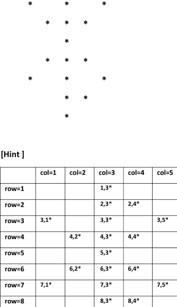

[提示]

|  | col=1 | col=2 | col=3 | col=4 | col=5 |
|---|---|---|---|---|---|
| row=1 |  |  | 1,3* |  |  |
| row=2 |  |  | 2,3* | 2,4* |  |
| row=3 | 3,1* |  | 3,3* |  | 3,5* |
| row=4 |  | 4,2* | 4,3* | 4,4* |  |
| row=5 |  |  | 5,3* |  |  |
| row=6 |  | 6,2* | 6,3* | 6,4* |  |
| row=7 | 7,1* |  | 7,3* |  | 7,5* |
| row=8 |  |  | 8,3* | 8,4* |  |
| row=9 |  |  | 9,3* |  |  |

### 问题 YBN

为适合 7X5 盒子的字母 N 编写逻辑条件。


### 问题 YBP

为适合 7X5 盒子的字母 P 编写逻辑条件。

```
    *   *   *   *
    *           *
    *           *
    *   *   *   *
    *
    *
    *
```

### 问题 YBP

为适合 7X5 盒子的字母 R 编写逻辑条件。

```
*   *   *   *
    *       *
    *       *
    *   *   *
    *   *
    *       *
    *           *
```

### 问题 YBP

为适合 7X5 盒子的字母 S 编写逻辑条件。

```
*   *   *   *   *
*   *
*   *
*   *   *   *   *
            *
*   *   *   *   *
*   *   *   *   *
```

## 决策制定

这个世界上只有两个完美的答案：是（YES）或否（NO）。在编程中，这些完美答案由布尔数据类型表示。布尔数据类型在某一时刻只能取一个值，即 true 或 false。因此，布尔值 true 用 YES 表示，布尔值 false 用 NO 表示。在运行程序时，程序的控制流可能会遇到逻辑表达式。该逻辑表达式会被求值以得出结果。结果以 true 或 false 表示。根据逻辑表达式的布尔结果，程序的控制流决定是执行一组编程语句还是跳过它们。

这种决策制定必须使用以下不同版本的 if 决策语句进行编程。

- a) if 语句
- b) if-else 语句
- c) if-else if ... 语句（也称为阶梯式 if-else 语句）

流程图有助于可视化当条件变为 true 或 false 时的控制流。

### a) if 语句

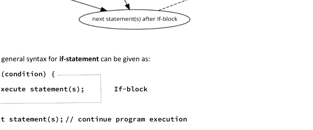

if 语句的一般语法可以给出如下：

```
If (condition) {
    execute statement(s);
}
next statement(s); // continue program execution
```

- condition：它将是一个由变量和运算符组成的表达式，其运算结果应为布尔值 true 或 false。由于逻辑运算符和比较运算符的结果为 true 或 false，因此它们常用于条件表达式中。
- 当条件结果为 true 时，它将执行 if 块 `{...}` 中括起来的语句。

注意：- 块（block）在程序中的放置是为了通过将一组语句括在左花括号和右花括号中来对它们进行分组。示例如下：

```
{
    statement(s);
}
```

### 案例 1

int ageOfCitizen = 80;

条件： (ageOfCitizen >= 60) 将求值为 “true”

因此，if (80 >= 60) 或 if (condition) 将为 “true”，并执行 if 块。

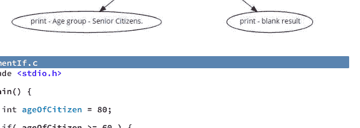

### StatementIf.c

```
#include <stdio.h>

int main() {
    int ageOfCitizen = 80;
    if( ageOfCitizen >= 60 ) {
        printf("Age group - Senior Citizens.");
    }

    return 0;
}
```

### 输出

Age group - Senior Citizens.

### 案例 2. 更改程序中的 ageOfCitizen 的值

int ageOfCitizen = 40;

条件： (ageOfCitizen >= 60)

if (40 >= 60) 将求值为 “false”

if (condition) 将为 “false”，并且不会执行 if 块。

输出将为空白。

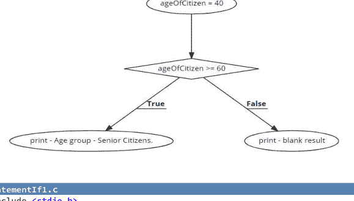

**StatementIf1.c**

```c
#include <stdio.h>

int main() {

    int ageOfCitizen = 40;

    if( ageOfCitizen >= 60 ) {
        printf("Age group - Senior Citizens.");
    }

    return 0;
}
```

> 输出

它没有打印任何内容，因为条件失败，并且 if 语句中的代码块未被执行。

### b) if-else 语句

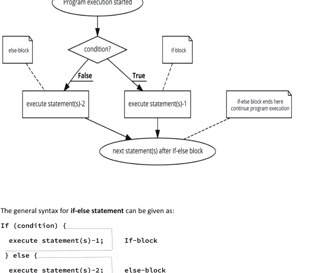

if-else 语句的一般语法可以给出如下：

```
If (condition) {
    execute statement(s)-1;
} else {
    execute statement(s)-2;
}
next statement(s); // continue program execution
```

if 块

else 块


## 案例 1。

int num1 = 80;

int num2 = 40;

条件：(num1 > num2)，如果 (80 > 40)，将求值为 “true”

if(condition) 将为 “true” 并执行 if 块。

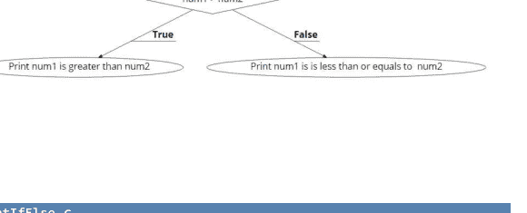

### StatementIfElse.c

```
#include <stdio.h>

int main() {
    int num1 = 80;
    int num2 = 40;
    if( num1 > num2) {
        printf("%d is greater than %d",num1,num2);
    }else {
        printf("%d is less than or equals to %d", num1, num2);
    }
    return 0;
}
```

### 输出

80 is greater than 40

## 案例 2. 更改程序中 num1 和 num2 的值。

int num1 = 40;

int num2 = 80;

条件：(num1 > num2)，如果 (40 >80)，将求值为 “false”

If(condition) 将为 “false” 并执行 else 块。

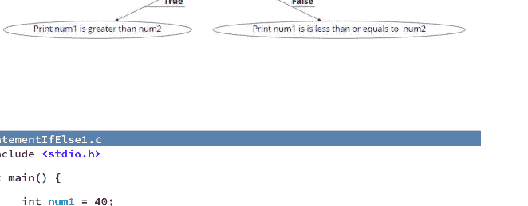

### StatementIfElse1.c

```
#include <stdio.h>

int main() {
    int num1 = 40;
    int num2 = 80;
    if( num1 > num2) {
        printf( "%d is greater than %d", num1, num2);
    }else {
        printf( "%d is less than %d", num1, num2);
    }
    return 0;
}
```

### 输出

40 is less than 80

## c) if-else if-else 语句

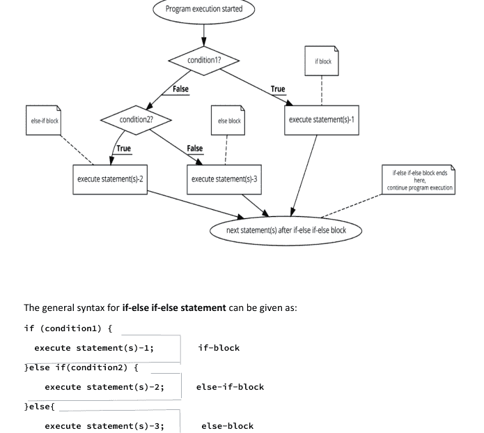

if-else if-else 语句的一般语法可表示为：

```
```text
if (condition1) {
    execute statement(s)-1;          if-block
}else if(condition2) {
    execute statement(s)-2;          else-if-block
}else{
    execute statement(s)-3;          else-block
}
```
```

## 案例 1。

int num1 = 80;

int num2 = 40;

条件：(num1 > num2)，如果 (80 > 40)，将求值为 “true”

If(condition) 将为 “true” 并执行 if 块。

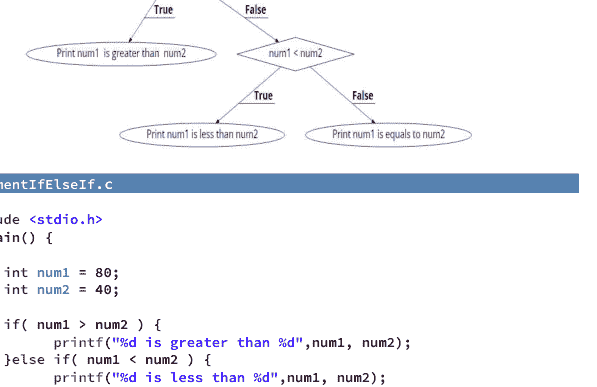

### StatementIfElseIf.c

```
#include <stdio.h>
int main() {
    int num1 = 80;
    int num2 = 40;
    if( num1 > num2 ) {
        printf("%d is greater than %d",num1, num2);
    }else if( num1 < num2 ) {
        printf("%d is less than %d",num1, num2);
    }else {
        printf("%d equals to %d", num1, num2);
    }
    return 0;
}
```

### 输出

80 is greater than 40

## 案例 2. 更改程序中 num1 和 num2 的值。

int num1 = 40;

int num2 = 80;

(num1 > num2) 布尔表达式将求值为 "false"，并转到下一个布尔表达式 (num1 < num2)。

(num1 < num2) 将求值为 "true"，因为 ( 40 < 80)。

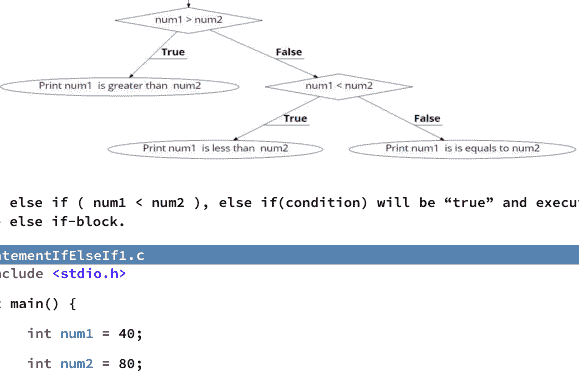

因此，else if ( num1 < num2 )，else if(condition) 将为 "true" 并执行 else if 块。

### StatementIfElseIf1.c

```c
#include <stdio.h>

int main() {

    int num1 = 40;

    int num2 = 80;

    if( num1 > num2 ) {

        printf("%d is greater than %d",num1, num2);

    }else if( num1 < num2 ) {

        printf("%d is less than %d",num1, num2);

    }else {

        printf("%d equals to %d", num1, num2);

    }

    return 0;

}
```

输出
40 is less than 80

*ProblemLadderIfElse：* 一所大学想出一个主意，通过退还计算机科学学生双学期计算机科学课程费用的部分百分比来鼓励他们。学院管理层制定了以下条件以获得资格。此外，如果学生得分为 Grade-0，将被宣布为不及格。

- 如果学生得分为 Grade-5，将有资格获得 35% 的学费退还。
- 如果学生得分为 Grade-4，将有资格获得 25% 的学费退还。
- 如果学生得分为 Grade-3，将有资格获得 20% 的学费退还。
- 如果学生得分为 Grade-2，将有资格获得 10% 的学费退还。
- 如果学生得分为 Grade-1，将勉强通过。

### LadderIfElse.c

```
```c
#include <stdio.h>
int main() {
    int grade = 2;
    if(grade == 1) {
        printf("35%% fee refund.");
    }else if(grade == 2) {
        printf("25%% fee refund.");
    }else if(grade == 3) {
        printf("20%% fee refund.");
    }else if(grade == 4) {
        printf("10%% fee refund.");
    }else if(grade == 5) {
        printf("Passed with margin.");
    }else if(grade == 0) {
        printf("Failed,please retry.");
    }else {
        printf("Invalid grade ? %d", grade);
    }
    return 0;
}
//Note:- %% double percentage symbols are used to print %
```
```

### 输出

25% fee refund.

它将按顺序测试 if 条件，直到某个 if 条件变为 true。

这种多个 else-if 也称为阶梯式 else-if，基本上不是好的实践。

使用两三个 else-if 条件尚可，进一步增加 else-if 条件则强烈不建议，因为会降低代码可读性。

那么出路是什么？

答案是 switch-case 结构。

## d) switch-case

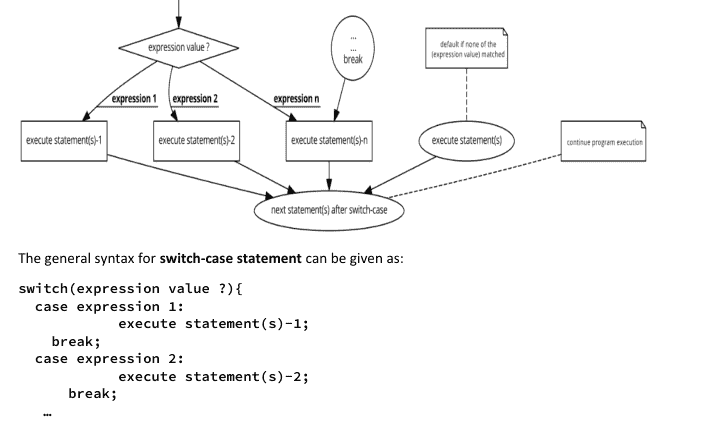

**switch-case 语句**的一般语法可表示为：

```
```
switch(expression value ?){
case expression 1:
    execute statement(s)-1;
    break;
case expression 2:
    execute statement(s)-2;
    break;
...
break;
case expression n:
    execute statement(s)-n;
    break;
default:
    // default if none of the case_expression value matched
    execute statement(s);
}// switch-case ends
next statement(s); // continue program execution
```
```

让我们将阶梯 if-else 语句转换为 switch-case。前面的代码 LadderIfElse.c 可以重写为：

### ConvertLadderIfElseToSwitchCase.c

```
```c
#include <stdio.h>

int main() {
    int grade = 21;
    switch (grade) {
    case 1:
        printf("35% fee refund.");
        break;
    case 2:
        printf("25% fee refund.");
        break;
    case 3:
        printf("20% fee refund.");
        break;
    case 4:
        printf("10% fee refund.");
        break;
    case 5:
        printf("Passed with margin.");
        break;
    case 0:
        printf("Failed,please retry.");
        break;
    default:
        printf("Invalid grade ? %d", grade);
        break;
    }
    return 0;
}
```
```

### 输出

Invalid grade ? 21

switch-case 是处理阶梯 if 条件的优雅方式。

## 我的笔记：编程逻辑经验。

> > 你无法管理你无法衡量的事物。  
> > —— 彼得·德鲁克

写下你从字母练习中获得的编程逻辑经验要点。

| 序号 | 简短描述 | 描述 |
|---|---|---|

## 关于 for 循环

对于高计算密集型数据或大量数据处理活动，与计算机相比，人力资源在准确性和生产力方面并不可靠。除非有人去做，否则没有什么是自动的。重复性特性有助于将繁琐的数据处理工作自动化，与手动完成相比，效率惊人且准确。编程中的一种重复控制特性称为 **for 语句** 或 **for 循环**。用非常通用的方式，**for 循环** 可以表示如下：

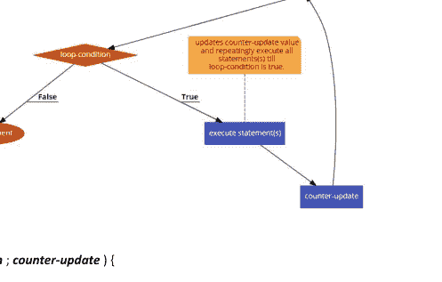

```
for (start-loop; loop-condition ; counter-update ) {
    execute statement(s);
}

next statement;
```

- **_start-loop_** 是初始化变量的一种简单方式，并且无论如何，重复循环过程必须从某个点开始。
- **_loop-condition_** 是一个逻辑表达式，它求值为布尔值 **_true_** 或 **_false_**。基于此（**_true/false_**），**_for-loop_** 控制结构决定是否重复该组语句。
- **_counter-update_** 是变量值以固定较小步长（递增/递减）发生的变化，且仅在所有语句在 **for 循环** 块中执行完之后发生。通常它与 **_start-loop_** 和 **_loop-condition_** 有很强的关联。

*for 循环* 帮助程序员在一“系列值”上重复编程语句。
当我们谈论范围时，它必须有最小值和最大值。

我们将使用以下符号：

| 符号 | 描述 |
|---|---|
| *min_val* | for 循环开始重复的最小值。 |
| *max_val* | for 循环进行重复的最大值。 |

这意味着 *for 循环* 将在 *min_val* 和 *max_val* 值之间运行。通过基于 *for 循环* 的 *计数器更新* 表达式进行递增或递减的示例，我们可以更好地理解这个概念。

### 基础

以下是一些基本示例，以清楚了解 *for 循环* 的行为。

让我们表示范围 [*min_val*, *max_val*]，其中 *min_val* < *max_val*，计数器更新增量为 1。for 循环可表示为：

```
for ( int variable_name = min_val ; variable_name <= max_val ; variable_name ++ ){

        statement(s);

}
```

### 案例 a：

设范围为 [1,5]，计数器更新增量为 1，则 for 循环可表示为按升序打印计数器变量的值 1 到 5，如下所示：

```
for ( int counter = 1 ; counter <=5 ; counter ++ ) {

        printf("%d\n", counter); //print output to console

}
```

因此，上述 *for 循环* 可以表示为如下流程图：

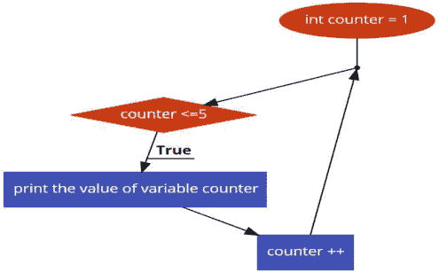


#### ForLoopIncrement.c

```c
#include <stdio.h>

int main() {

    for ( int counter = 1 ; counter <= 5 ; counter ++ ){

        printf("%d\n",counter);//print to console

    }

    return 0;

}
```

#### 输出

```
1
2
3
4
5
```

情形 b：将 *循环条件* counter <= 5 改为 counter < 5，看看结果如何。

#### ForLoopIncrement1.c

```c
#include <stdio.h>

int main() {

    for ( int counter = 1 ; counter < 5 ; counter ++ ){

        printf("%d\n",counter);//print to console

    }

    return 0;

}
```

#### 输出

```
1
2
3
4
```

它打印了 1 到 4。

### 情形 c：让我们修改 ForLoopIncrement1.c，保持循环条件（`counter < 5`）不变，却仍然应当打印 1 到 5。

#### ForLoopIncrement2.c

```c
#include <stdio.h>

int main() {

    for ( int counter = 0 ; counter < 5 ; counter ++ ){

        int result = counter + 1; //add 1 to the counter

        printf("%d\n",result);//print to console
    }

    return 0;

}
```

#### 输出

```text
1
2
3
4
5
The variable counter started with the value 0 instead of 1.
```

### 情形 d：让我们用每次递减 1 的 **计数器更新** 来表达 range(min_val, max_val)，其中 min_val < max_val。

该 for 循环可以表示为；

```c
for (int *variable_name* = max_val; *variable_name* >= min_val ; *variable_name* --){

    statement(s);

}
```

要使用每次递减 1 的 **计数器更新** 按降序打印数字 1 到 5，那么该 ***for 循环*** 可以表示为；

因此，递减 *for 循环* 可以用下面给出的流程图表示。

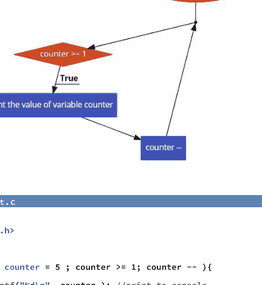

#### ForLoopDecrement.c

```c
#include <stdio.h>
int main() {
    for ( int counter = 5 ; counter >= 1; counter -- ){
        printf("%d\n", counter ); //print to console
    }
    return 0;
}
```

#### 输出

5
4
3
2
1

### 带有 {break} 和 {continue} 关键字的 for 循环

- for 循环中的“break”关键字会在到达“break”语句的条件时停止循环的进一步重复。
- 这类似于行驶中的汽车在驾驶员踩下刹车时停下。
- “continue”关键字会将正在执行的程序的控制权弹回 for 循环，使其继续执行，而不给 continue; 语句之后的更多语句执行的机会。

```c
ForLoopContinueNext.c
#include <stdio.h>

int main() {
    for( int cnt = 1 ; cnt <= 10 ; cnt ++ ) {
        if( cnt <= 3 ) {
            printf("keyword{continue} is throwing ");
            printf("control of program back.\n");
            continue;
        }
        printf("Please Join Us...!!!\n");
        if( cnt == 5 ) {
            printf("keyword{break} at cnt = %d\n", cnt);
            break;
        }
        printf("Please look back...\n" );
    }
    return 0;
}
```

#### 输出

keyword(continue) 正在将程序的控制权抛回。
keyword(continue) 正在将程序的控制权抛回。
keyword(continue) 正在将程序的控制权抛回。
请加入我们……！！！
请回头看看……
请加入我们……！！！
在 cnt = 5 处 keyword(break)

### 嵌套 for 循环/内层 for 循环

我们之前已经看过 for 循环中包含 if 语句或任何其他简单语句的示例。如果在 for 循环中放置另一个 for 循环，而不是简单的 if 语句，那么情况会怎样。例如；

```c
for ( int counter = 5 ; counter >= 1; counter -- ){
        // print the variable counter's value
        printf ("%d\n", counter ); //statement1
        printf ("%d\n", 2*counter ); //statement2
        printf ("%d\n", 3*counter ); //statement3
}
```

我们知道，这些被考虑的语句将按顺序执行。首先执行 statement1，然后执行 statement2，最后执行 statement3。当我们执行这段程序时，所有这些语句都会重复 5 次。如果我们用另一个 for 循环代替任何单条语句，主要的工作方式并不会改变。我们需要这样理解：**内层 for 循环**本身就像另一条单独的**编程语句**。每当程序的控制流开始按顺序执行编程语句并遇到任何**内层 for 循环**时，它会先完整执行内层 for 循环，然后执行下一条（或多条）语句（如果有的话）。

例如；

```c
for ( int counter = 5 ; counter >= 1; counter -- ){
    // print the variable counter's value
    printf ("%d\n", counter ); //statement1
    //The for-loop is a single statement
    for(int inner = 1 ; inner <= 5; inner ++){
        printf ("%d\n", inner );
    }
    printf ("%d\n", 3* counter ); //statement3
}
```

> > 请将
> > 嵌套 for 循环
> > 视为一条
> > 编程
> > 语句

现在，像往常一样，**statement1** 先完成。然后，重复 5 次的内层 for 循环将完整执行，最后执行 **statement3**。正如外层 for 循环的结构所表明的那样，所有这**三条语句**都将重复 5 次。每当一个 for 循环被放置在另一个 for 循环的代码块中时，它就被称为**内层 for 循环**或**嵌套 for 循环**。

对于外层 for 循环的每个新值，内层 for 循环都会**从头开始**。

如果我们尝试用以下假设将其与钟表联系起来，就很容易理解这个概念；

**内层循环 →** 它就像钟表里的“秒”针
**外层循环 →** 它就像钟表里的“分”针

在钟表里，只有当“秒”针完成一圈后，“分”针才会按计数值 1 更新，在此之前不会更新。

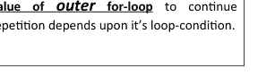

**内层 for 循环会在外层 for 循环的每个新计数值之前完整执行**，然后根据其循环条件继续重复。

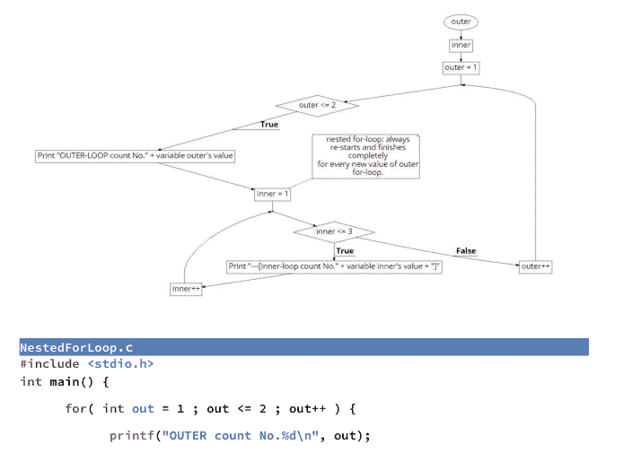

#### NestedForLoop.c

```c
#include <stdio.h>
int main() {
    for( int out = 1 ; out <= 2 ; out++ ) {
        printf("OUTER count No.%d\n", out);
        // nested for-loop: always re-starts and finishes
        // completely for every new value of outer for-loop.
        for( int in = 1; in <= 3; in++ ) {
            printf(" <INNER> count No.%d\n", in );
        }
    }
    return 0;
}
```

#### 输出

外层计数 No.1
<INNER> 计数 No.1
<INNER> 计数 No.2
<INNER> 计数 No.3
外层计数 No.2
<INNER> 计数 No.1
<INNER> 计数 No.2
<INNER> 计数 No.3

### 嵌套循环：初学者的挚友

最好的朋友不仅是欣赏我们优点的人，也是在需要时通过展示我们的弱点或错误来让我们认清现实的人。嵌套循环在学习编程逻辑时就扮演着这样的挚友角色，它也会检验我们的编程逻辑到底有多正确。我个人认为，**仅通过摆弄数字来练习编程逻辑并不是一个好主意**，尤其是对于对高中数学兴趣较少或毫无兴趣的人而言。他们中的许多人会觉得为了学习编程逻辑技能而练习这类数学问题很无聊。

每个人都不一样，每个人的耐心缓冲和学习节奏也不同。应当有一种简单易懂的方法。任何想要学习/提高编程的初学者，都应该能够在最少技术背景负担的情况下，按照自己的学习节奏做到这一点。

这是一个大致分为三步的基于图形化练习的学习过程，以便初学者在编程中感到自如。

- **步骤1.** 明确如何探究逻辑条件。
- **步骤2.** 明确嵌套循环如何工作。这是我们接下来的主要动手训练。
- **步骤3.** 寻找改进已实现程序的空间，以便进一步简化编程逻辑。寻找其他可能的解决方案。

经过这三个步骤后，任何人都将能够有信心地学习和探索编程语言的高级特性。

#### *为什么嵌套循环如此重要？*

外层 for 循环和内层 for 循环分别用于在水平和垂直的不同方向上输出数据，以形成二维输出。通常，外层 for 循环垂直移动控制流，内层 for 循环水平输出数据。这会形成一种网格状输出。循环的这一特性可用于完善学习者的想象力。是的，逻辑构建是一项技能，可以通过简单的数学和常识来培养。一个人不必非常擅长数学才能成为成功的程序员或软件开发人员。如果学习者能够正确想象外层循环和嵌套循环的行为，他/她就会获得足够的信心，相信自己能够编写代码。

任何学科相关教学的首要要求，都是先在学生或学习者群体中培养对该学科的兴趣。如果学习者与学科建立了深度连接，那么其余的学习就不会成为负担。学习者会享受学习，而本课程是


严格来说，正是为此而设的。任何学习者只要参加本课程并认真遵循，毫无疑问必将看到努力的成果。

#### 嵌套循环为新手/初学者/入门者/缺乏自信的程序员提供了良好的反复练习。

一旦学习者对编程产生兴趣，所有学习都会变得令人兴奋和激动。当学习者对自己独立开发编程逻辑有了一些信心时，这种兴趣会自然产生。为此，只需要把极少数内容练好，而本书已以适当的深度涵盖这些内容。我真诚地建议：在查阅任何其他资源之前，请先从头到尾学习并练习本书。

这本书能帮助你更快进步，它算是编程前必不可少的热身训练。我个人不认同这种说法：那些放弃学习编程的人能力较差；实际上，是付出努力这件事无法让他们感到兴奋。一个人的学习节奏无论快慢都无关紧要，重要的是对学习的投入。没有兴趣，根本不可能有真正意义上的投入。这本书的核心就是正确培养兴趣和信心——相信任何人只要朝着正确方向付出一些努力就能编程。

选择这些练习和问题，主要是为了让学习能够自然地适应任何学习者。学习者只需遵循本书中提到的分步说明。

当你自然地学习并完成训练时，对编程的信心和兴趣必将得到保证。这不仅仅是一本书，本质上是一本训练指南。初期肯定需要付出一些努力和耐心。一旦学习者理解了所需的基础知识，后续的进步将因对这门学科的巨大热爱而突飞猛进，而这种热爱会在练习过程中自然产生。这组练习是为面向初学者——即没有任何编程经验或只有一些编程经验的人——教授编程而开展实验的成果。

完成这些练习后，每个人都能在2至3个月的时间内建立起相当程度的信心。最大的亮点在于，学生们对编程产生了兴趣。编程对他们而言不再无聊，也不再是负担。学习者将能够自然培养出耐心的倾向，从而推动自己解决问题并保持完全专注。简而言之，它让学习变得有趣。

#### 练习 6B.1

在外层 for 循环的一次迭代中，对于外层 for 循环的每一个取值，内层 for 循环都会完整执行。内层 for 循环的完整执行被视为一条普通语句的执行。除非内层 for 循环完全执行完毕，否则外层 for 循环不会进行下一次迭代。下面的程序演示了针对每一个行值，垂直打印各列值。

**ForLoopEveryRowAllColumns.c**

```c
#include <stdio.h>

int main() {

    int TOTAL_ROWS = 3;
    int TOTAL_COLUMNS = 3;

    for( int row = 1; row <= TOTAL_ROWS ; row ++ ) {

        for( int col = 1; col <= TOTAL_COLUMNS ; col ++ ) {

            printf( "Row = %d |  Col = %d\n" , row, col);

        }

        printf("------------------------------\n");

    }

    return 0;

}
```

**输出**

```text
Row = 1 | Col = 1
Row = 1 | Col = 2
Row = 1 | Col = 3
------------------------------
Row = 2 | Col = 1
Row = 2 | Col = 2
Row = 2 | Col = 3
------------------------------
Row = 3 | Col = 1
Row = 3 | Col = 2
Row = 3 | Col = 3
------------------------------
```

#### 练习 6B.2. 针对行的每个迭代值，水平打印列迭代值。每个行值应位于不同的行。因此，行级迭代值会垂直打印。

**ForLoopEveryRowAllColumnsHorizontally.c**

```java
public class ForLoopEveryRowAllColumnsHorizontally {
    public static void main(String[] args) {
        int TOTAL_ROWS = 3;
        int TOTAL_COLUMNS = 3;

        for( int row = 1 ; row <= TOTAL_ROWS ; row ++ ) {
            printf( "Row = " + row + " |" );
            for( int col = 1 ; col <= TOTAL_COLUMNS ; col ++ ) {
                printf( " Col = " + col);
            }
            // control moves to the next line and this how
            // printing of row and col values happens in the next row
            printf("\n");
        }
    }
}
```

**输出**

```text
Row = 1| Col = 1 Col = 2 Col = 3
Row = 2| Col = 1 Col = 2 Col = 3
Row = 3| Col = 1 Col = 2 Col = 3
```

- **问题6B.2：** 在行数和列数均为3的情况下，编写程序输出以下结果。

```text
Row = 1| Col = 1
Row = 2| Col = 2
Row = 3| Col = 3
--------------------------------
Row = 4| Col = 1
Row = 5| Col = 2
Row = 6| Col = 3
--------------------------------
Row = 7| Col = 1
Row = 8| Col = 2
Row = 9| Col = 3
--------------------------------
```

#### 练习 6B.3. 按如下输出所示，将行迭代值和列迭代值打印为 (row, col)

```text
(1,1) (1,2) (1,3) (1,4) (1,5)
(2,1) (2,2) (2,3) (2,4) (2,5)
(3,1) (3,2) (3,3) (3,4) (3,5)
(4,1) (4,2) (4,3) (4,4) (4,5)
(5,1) (5,2) (5,3) (5,4) (5,5)
```

**ForLoopCoordinateRepresentation.c**

```c
#include <stdio.h>

int main() {
    int TOTAL_ROWS = 5;
    int TOTAL_COLUMNS = 5;

    for( int row = 1 ; row <= TOTAL_ROWS ; row ++ ) {
        for( int col = 1 ; col <= TOTAL_COLUMNS ; col ++ ) {
            printf("(%d,%d) ", row, col);
        }

        // moves the control to the next line and
        // prints next row iteration value

        printf("\n");
        printf("\n");
    }

    return 0;
}
```

**输出**

```text
(1,1) (1,2) (1,3) (1,4) (1,5)
(2,1) (2,2) (2,3) (2,4) (2,5)
(3,1) (3,2) (3,3) (3,4) (3,5)
(4,1) (4,2) (4,3) (4,4) (4,5)
(5,1) (5,2) (5,3) (5,4) (5,5)
```

#### 练习 6B.4. 针对每个 (row, col) 迭代值打印字符“*”，从而生成图案。

**RowColumnStars.c**

```c
#include <stdio.h>
int main() {
    int TOTAL_ROWS = 10;
    int TOTAL_COLUMNS = 10;
    for( int row = 1 ; row <= TOTAL_ROWS ; row++ ) {
        for( int col = 1 ; col <= TOTAL_COLUMNS ; col++ ) {
            printf("* ");
        }
        // moves the control to the next line
        // printing of "*" characters starts from next line
        printf("\n");
    }
    return 0;
}
```

**输出**

```text
* * * * * * * * * *
* * * * * * * * * *
* * * * * * * * * *
* * * * * * * * * *
* * * * * * * * * *
* * * * * * * * * *
* * * * * * * * * *
* * * * * * * * * *
* * * * * * * * * *
* * * * * * * * * *
```

- **问题6B.3：** 在行数和列数均为5的情况下，编写程序输出以下结果。

**输出**

```text
* - * - *
* - * - *
* - * - *
* - * - *
* - * - *
```

### 形状问题：为以下每种不同类型的输出编写一个程序。

#### 输出-A

```text
1==1 1==2 1==3 1==4 1==5
2==1 2==2 2==3 2==4 2==5
3==1 3==2 3==3 3==4 3==5
4==1 4==2 4==3 4==4 4==5
5==1 5==2 5==3 5==4 5==5
```

#### 输出-B

#### 输出-C

```text
1<=1 1<=2 1<=3 1<=4 1<=5
2<=1 2<=2 2<=3 2<=4 2<=5
3<=1 3<=2 3<=3 3<=4 3<=5
4<=1 4<=2 4<=3 4<=4 4<=5
5<=1 5<=2 5<=3 5<=4 5<=5
```

#### 输出-D

```text
3<1 3<2 3<3 3<4 3<5 3<6 3<7 3<8
4<1 4<2 4<3 4<4 4<5 4<6 4<7 4<8
5<1 5<2 5<3 5<4 5<5 5<6 5<7 5<8
6<1 6<2 6<3 6<4 6<5 6<6 6<7 6<8
7<1 7<2 7<3 7<4 7<5 7<6 7<7 7<8
8<1 8<2 8<3 8<4 8<5 8<6 8<7 8<8
```

#### 输出-E

```text
1>1 1>2 1>3 1>4 1>5 1>6
2>1 2>2 2>3 2>4 2>5 2>6
3>1 3>2 3>3 3>4 3>5 3>6
4>1 4>2 4>3 4>4 4>5 4>6
5>1 5>2 5>3 5>4 5>5 5>6
6>1 6>2 6>3 6>4 6>5 6>6
```

#### 输出-F

```text
1>=1 1>=2 1>=3 1>=4 1>=5 1>=6 1>=7 1>=8
2>=1 2>=2 2>=3 2>=4 2>=5 2>=6 2>=7 2>=8
3>=1 3>=2 3>=3 3>=4 3>=5 3>=6 3>=7 3>=8
4>=1 4>=2 4>=3 4>=4 4>=5 4>=6 4>=7 4>=8
5>=1 5>=2 5>=3 5>=4 5>=5 5>=6 5>=7 5>=8
```

#### 输出-G

#### 输出-H

### 如何验证逻辑条件？

让我们验证以下用7行5列表示的字母 M 的逻辑条件：

(col==1)||(col==5)||( ((row==col)||(row+col ==6) ) && row<=3 )

**VerifyAlphabetM.c**

```c
#include <stdio.h>

int main() {
    int TOTAL_ROWS = 7;
    int TOTAL_COLUMNS = 5;
    int condition; //logical condition variable
    for ( int row = 1; row <= TOTAL_ROWS; row++) {
        for ( int col = 1; col <= TOTAL_COLUMNS; col++) {
            condition = (col == 1) || (col == 5) ||
                ( ((row == col) || (row + col == 6)) && row <= 3 );
            // space(s) are used just to show formatted output.
            if (condition) {
                printf("* "); // single space
            } else {
                printf("  ");// double space
            }
        }
        printf("\n");// Move cursor to the next row
    }
    return 0;
}
```

**输出**

```text
*   *
* *  *
* *  *
*   *
*   *
*   *
*   *
```


这样我们可以通过直接将逻辑条件赋给名为 **条件** 的变量来验证逻辑条件。代码更改在变量 **条件** 的粗体文本中显示。

我们可以采用相同的方法来验证已经完成的字母简单图片的逻辑条件。

## 你可以做到。

### 任务 A。
请在考虑 **行数和列数均为 10** 的情况下，为字母 M、T、U、V、W、X、Y、Z 以及单个数字 0、1、2、3、4、5、6、7、8、9 编写逻辑条件。

编写程序，仅使用 “*” 字符打印上述提及的字母和数字。

### 任务 B。
如果程序中存在变量 **national_id**，并且你为其分配一个 8-10 位长度的值，则应输出由 “*” 字符组成的数字，这些数字已在 **任务 A** 的一部分中完成。

## （可选任务）

尝试使逻辑表达式以这样的方式，如果 **行数和列数被更改为** 不同的值，如 **5,15,...,** 输出应正确。基本上，它应能够调整为小或大形状，但应正确。

**注意：** 我们将在 **编程模式** 部分更详细地讨论如何找到广义逻辑条件。

我强烈建议尝试此可选任务。

## 关键总结要点

- 1) 我们可以设想将显示屏逻辑地划分为小小的方框。
- 2) 每个单独的方框都由 **行** 和 **列** 变量值的组合唯一标识。
- 3) 我们必须明智地选择 **行 & 列** 的值，以便能够生成所需的图片。许多显示为空的方框意味着我们不应该在其中打印任何内容。
- 4) 对于每个 **新的行** 值，**列 值总是重新开始** 从头开始。

## 通过猜测学习逻辑构建技能——一种乏味的策略

常规且常见学习编程的方式就是随意地尝试。这需要花费更多时间来学习编程，因为它需要大量的练习。毫无疑问，它有优势，尤其是在我们想要探索编程语言的 api/内置库或功能时。这种通过猜测程序逻辑来学习的方式可能会扼杀初学者对编程学科本身的兴趣。这样学习编程需要更长时间，并且对某些人来说是一种有趣的方式。**每个人都不能在每个学科领域都做出好的猜测，也没有一种特定的猜测方法可以让任何人将其用作标准实践。** 采用这种猜测策略学习编程，实际上会给无法做出良好猜测甚至做出尴尬猜测的人增加更多困难。每当关于编程的想象不流畅时，人的思维就会一片空白。因此，如果那个人在其他活动中很优秀或很聪明，但可能缺乏耐心或觉得编程很难学习，就不足为奇了。这并不是对编程作为一门学科的质疑，任何类型的学习都可能发生这种情况。现实情况是，如果一个试图学习某事的人的想象力和思维过程不流畅，它就不会进入大脑。

通过猜测学习编程对许多初学者来说是令人却步的。因为它不反映任何标准的学习方式。相反，我喜欢介绍一种基于简单数学和常识的系统化编程学习方法。该方法在不同难度级别上深入探讨，以便正确学习编程逻辑，并在下一节 **编程模式** 中进行了介绍。

为了进行模式编程，人必须熟练掌握 for 循环和应用逻辑条件。循环是最难的。嵌套循环挑战我们同时在两个不同方向上进行逻辑思考以输出模式，而任何模式都是二维的简单图片。这类活动刺激逻辑思维。在学习编程时，如果学习者产生困惑或疑问，这是一个好迹象。它表明学习者的思维过程和想象力变得活跃，平台正准备掌握编程技能。确实经常发生，消除一个疑问会为许多不同领域的进一步知识打开大门。因此，疑问本质上就像一个需要探索的惊喜知识胶囊。学习者只需要保持耐心，以便以系统的方式而不是通过猜测来解决特定的疑问或困惑。因此，每当我们产生疑问时，我们只需要想，我们又多了一个提升智力的机会。消除疑问只是完善我们逻辑技能的迭代方式的一部分。

显然，如果没有系统的支持，学习不会持久且富有成效。某个人在开发编程逻辑方面稍好，通常在需要处理更难的编程主题时遇到的问题较少。本书全部关于开发程序的逻辑技能。无论某人最初在这方面是否一无所知都无关紧要。本书的内容肯定可以帮助一个准备认真尝试的人，并最终对编程产生兴趣。练习的设计方式自然适合任何新学习者，按难度递增的顺序进行。一些练习是专门为了给学习者带来惊喜，鼓励其跳出思维定式而包含的。

*良好的编程逻辑不仅仅是基础，对程序员来说，它是自信的关键。*

## 编程模式

所有编程模式都可以被视为二维图片。大多数情况下，无论输出是在桌面/网页/移动应用程序上查看，它都是二维的。因此，我们选择简单的基于图片的问题来解决常见的编程逻辑问题。此外，擅长解决编程中二维问题的程序员也能够解决三维问题，例如与游戏编程相关的问题。选择基于图像模式的练习的主要原因是它能清晰地验证程序员的逻辑。不匹配的输出迫使学习者思考适当的原因。

反复练习编程逻辑以获得匹配的输出极大地有助于完善编程逻辑的可视化。这是一种逆向工程，我们将看到它如何真正提高编程技能。这些练习使学习者保持警觉、参与、自驱，并且最重要的是，教会他们大量的耐心。这些练习旨在激发学习者思维的好奇心。程序员的想象力应朝着捕捉编程逻辑的方向工作；这将使编程成为一项有趣的工作。在典型的软件开发工作场所，一个程序员必须理解另一个程序员的编程。因此，程序员可以从其他程序员的工作中学习。在所有情况下，对编程逻辑可视化的一定掌握肯定有助于理解其他程序员的程序。因此，练习编程逻辑的可视化应该是任何初学者程序员的首要关注点。循环是程序中唯一最难的部分。掌握嵌套循环中的控制流足以增强初学者程序员的信心。

简而言之，初学者对编程能力的信心与其编程逻辑可视化水平低/平均/高之间存在直接关系。

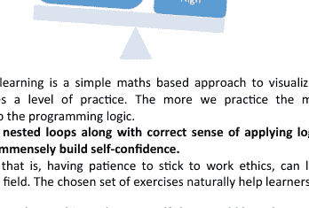

我们将学习的是基于简单数学的可视化程序逻辑的方法。这种技术需要一定的练习。练习越多，我们捕捉编程逻辑的想象力就越精炼。

仅仅通过练习嵌套循环并正确地应用逻辑条件，新手程序员就能极大地建立自信心。

唯一一种品质，即有耐心坚持工作道德，才能使学习者在自己的领域变得才华横溢。所选的练习集自然有助于学习者在该方向上发展。

> > “失败教会了我一些关于自己的事情，这些是其他方式无法学到的。”
> > - J.K. Rowling


> **只要你能想象，你就能做到。**
>
> **- 恩佐·法拉利**

一般来说，程序员总被期望具备良好的编程逻辑能力。如果程序员拥有了这种信心，那么进一步的技术学习也会更有信心。每个程序员或许都希望拥有那样的想象力，让编程逻辑能够自然而然地浮现，匹配待解决问题需求。如果没有适当的练习，就期望对编程逻辑的可视化有清晰认识，那只是痴心妄想。要获得对编程逻辑可视化有足够清晰度的能力，需要扎实的基础训练。

使编程逻辑可视化正确运作的最重要原则，是理解数据流中蕴含的智能。

获取这种智能的技巧是：使用我们称为“逻辑跟踪表”的观察表，将数据流表示为一个或多个逻辑表达式。逻辑表达式由一个或多个变量和运算符组成。最终，编程逻辑由一个或多个逻辑表达式构成。通过本节所述的适当练习，我们可以轻松掌握构建逻辑表达式的艺术。

我们的方法是通过观察程序输出来提取**逻辑表达式**。这一思维过程体现在下面的方法中，这正是一种独特的编程逻辑构建练习。该方法的主要步骤如下图所示。程序员应当能够在编写程序之前就清晰地可视化逻辑。这种能力只有在程序员经过充分练习，能够清晰想象任何重复控制结构或一般循环如何工作时才能具备。基于简单图片的练习在这方面帮助很大，这些练习基本上基于嵌套循环。

## 逻辑跟踪表：编程逻辑背后的核心

> **不要仅仅作为一种反应就否定经典方法，否则你会制造另一种模式，并把自己困在其中。**
>
> **- 李小龙**

从概念上讲，逻辑跟踪表只是观察表的一种。所有重要的观察结果都会被放入这张表中，以便我们能够关联不同信息。你可以根据自己的需要创建一个或多个表。在我们的场景中，逻辑跟踪表的行和列是出于追踪编程逻辑的目的而选择的。我们也可以使用基于观察表的方法来解决其他类型的问题，而不仅仅是与模式相关的问题。主要关注点是通过使用逻辑跟踪表来完善新手程序员对逻辑的可视化能力，并最终建立编程信心。此外，清晰度和职业道德有助于我们实现小目标。小成就会提升我们的信心水平，从而迎接更高难度的挑战。因此，清晰度和职业道德是每一项成就发生的基础。

## 逻辑跟踪表解决什么问题？

> 简洁是卓越的关键。
>
> - 李小龙

这是一个训练新手程序员逻辑思维的简单技巧。其主要目的是以更有结构的方式进行思考，从而获得编程逻辑。它是一个用于推导逻辑表达式的简单表格结构。该表格结构主要厘清变量参数之间的关系。

> 清晰就是力量。
>
> - 你越清楚自己究竟想要什么，你的大脑就越知道如何实现它。
>
> - 佚名

在我看来，如果不借助逻辑跟踪表结构，大多数新手程序员都会发现，很难清晰地思考如何构建程序逻辑。找到逻辑表达式的清晰思考过程是可以通过一点练习来提升的。除非一个人能够以简化的方式表达自己的理解，否则就意味着他/她并没有真正理解概念。

## 逻辑表达式的重要性是什么？

编程逻辑是程序背后的核心。它由逻辑表达式组成。因此，在最核心的层面，逻辑表达式在执行时有助于决策。大多数时候，它应用于循环条件以及 if 条件、if-else-if 条件等决策结构中。

## 提升逻辑构建技能的框架

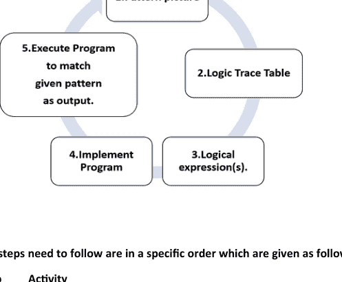

需要按照特定顺序遵循以下步骤：

| 步骤 | 活动 |
|------|----------|
| 1. | 选择模式图片。 |
| 2. | 观察模式图片，创建逻辑跟踪表。 |
| 3. | 从逻辑跟踪表中提取逻辑表达式。 |
| 4. | 使用逻辑表达式实现程序。 |
| 5. | 执行程序并检查程序输出是否与所选模式图片匹配。 |

注意：如果步骤 5 出错，则需要重复步骤 2 至步骤 5。

## 第 2 部分

## 编程实战

## 在计算机屏幕上输出简单图片

这里的关键是要理解，计算机屏幕不过是一个由小方格组成的逻辑集合，每个小方格可以输出一个单独的字符。这些方格的排列方式能够清晰呈现行和列的概念。以下是计算机屏幕的概念图，显示了输出到屏幕上的简单图片的若干行和列。每个键盘字符都位于其中一个最小方格内。

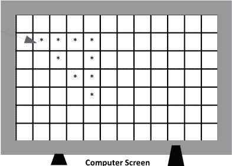

在开始基于简单图片的编程练习之前，我们必须首先学会在概念上分配行号和列号。这样才能合理地在每个最小方格中唯一对应一个键盘字符。**(行号，列号)** 的数字组合将表示一个键盘字符。提及（行号，列号）数字组合，只是为在计算机屏幕上正确定位任意键盘字符提供依据。这很像使用**（经度，纬度）**组合来在地图上定位城市。因此，我们所说的最小方格映射到计算机屏幕上的一个键盘字符，等价地映射到一个唯一的（行号，列号）数字对。这样，（行号，列号）数字对的集合就可以完整地表示一个简单图片。

**单个最小方格 → 单个键盘字符 → （行号，列号）数字对。**

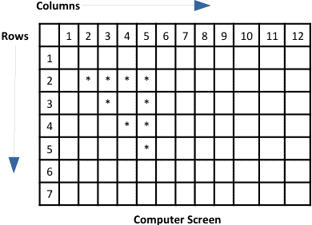

或者，我们可以把计算机屏幕看作一种更精密的坐标纸或方格纸。计算机屏幕上的每个最小方格都是一个坐标，即两个数字的唯一组合，一个 “X（列）”（水平）和一个 “Y（行）”（垂直）——这决定了键盘字符在计算机屏幕空间中的位置。

我们的编程任务就是：一个基于简单图片的模式应如何出现在这些由（行号，列号）数字对表示的最小方格坐标上。

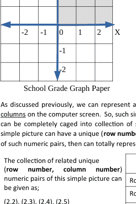

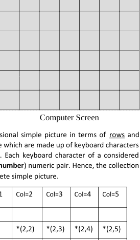

如前所述，我们可以用计算机屏幕上的行和列来表示任何二维简单图片。因此，由键盘字符组成的这种简单图片可以完全被纳入小方格的集合中。所考虑的简单图片中的每个键盘字符都可以拥有一个唯一的（行号，列号）数字对。因此，这些数字对的集合就能完整地表示一个简单图片。

这个简单图片的相关唯一（行号，列号）数字对集合如下：

- (2,2), (2,3), (2,4), (2,5)
- (3,3), (3,5), (4,4), (4,5),
- (5,5)

| | 列=1 | 列=2 | 列=3 | 列=4 | 列=5 |
|---|---|---|---|---|---|
| 行=1 | | | | | |
| 行=2 | | \*(2,2) | \*(2,3) | \*(2,4) | \*(2,5) |
| 行=3 | | | \*(3,3) | | \*(3,5) |
| 行=4 | | | | \*(4,4) | \*(4,5) |
| 行=5 | | | | | \*(5,5) |

### 光标移动

光标是计算机显示器上显示的一个移动位置指示器，表示下一步移动或操作将要发生的位置。我们将使用这个概念来更好地解释模式中的每个字符是如何在计算机屏幕或编程 IDE 的控制台屏幕上生成的。在我们的场景中，键盘字符将使用 C 语言内置库输出到计算机屏幕上的特定位置。因此，光标移动到屏幕上的下一个位置，然后打印字符，这些将由 C 语言内置方法处理。


## Pattern1A

我们的编程任务是在计算机屏幕的某一部分输出如下所示的这种简单的基于图片的图案。 我们的方法将把计算机屏幕视为由包含小方框的行和列组合而成。 我们可以将计算机屏幕视为由遍布整个屏幕的 (row, column) 数值配对方框组合而成。 每个方框仅被视为容纳一个字符的居民。 我们也知道完整的图案可以很容易地表示为所选 (row, column) 数值对的集合。

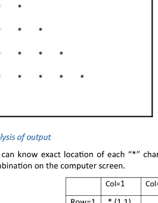

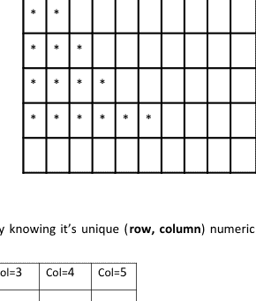

### 输出分析

我们可以通过知道其在计算机屏幕上的唯一 (row, column) 数字组合来确定每个“*”字符的确切位置。

|  | 列=1 | 列=2 | 列=3 | 列=4 | 列=5 |
|---|---|---|---|---|---|
| 行=1 | * (1,1) |  |  |  |  |
| 行=2 | * (2,1) | * (2,2) |  |  |  |
| 行=3 | * (3,1) | * (3,2) | * (3,3) |  |  |
| 行=4 | * (4,1) | * (4,2) | * (4,3) | * (4,4) |  |
| 行=5 | * (5,1) | * (5,2) | * (5,3) | * (5,4) | * (5,5) |


例如，对于数字对 (2,1)，值 2 表示行号，值 1 表示列号。 这正是我们能够在计算机屏幕上的特定位置清晰识别“*”字符的实际度量。

| 生成图案的步骤 (总行数 = 5) | 计算机屏幕 |
|---|---|
| 对于行 = 1<br><br>在同一 <u>第1</u> 行打印 "*" <u>一次</u><br><br>然后移动到行号 2 | 列 1 2 3 4 5 6 7 8 9，行 1 2 3 4 5<br><br>`*` 在第 1 行，第 1 列 → (箭头指向第 2 行) |
| 对于行 = 2<br><br>在同一 <u>第2</u> 行打印 "*" <u>两次</u><br><br>然后移动到行号 3 | 第 1 行: `*`<br>第 2 行: `* *` → (箭头指向第 3 行) |
| 对于行 = 3<br><br>在同一 <u>第3</u> 行打印 "*" <u>三次</u><br><br>然后移动到行号 4 | 第 1 行: `*`<br>第 2 行: `* *`<br>第 3 行: `* * *` → (箭头指向第 4 行) |
| 对于行 = 4<br><br>在同一 <u>第4</u> 行打印 "*" <u>四次</u><br><br>然后移动到行号 5 | 第 1 行: `*`<br>第 2 行: `* *`<br>第 3 行: `* * *`<br>第 4 行: `* * * *` → (箭头指向第 5 行) |
| 对于行 = 5<br><br>在同一 <u>第5</u> 行打印 "*" <u>五次</u><br><br>然后移动到行号 6 | 行 1 2 3 4 5 6<br><br>第 1 行: `*`<br>第 2 行: `* *`<br>第 3 行: `* * *`<br>第 4 行: `* * * *`<br>第 5 行: `* * * * *` → (箭头指向第 6 行) |

**使用 C 的内置方法。**

| 指令 | C 代码 |
|---|---|
| 为了移动到 <u>下一行</u> | `printf("\n");` |
| 为了移动到 <u>同一行</u> 的下一个位置并打印 <u>"*"</u> 字符 | `printf("*");` |

### 让我们将步骤转换为 C 程序。

`Pattern1A_1.c`

```c
#include <stdio.h>

int main() {

    printf("*");   // print * character 1 time
    printf("\n"); // Move cursor to the next row

    printf("*");
    printf("*");   //print * characters 2 times, same row
    printf("\n"); // Move cursor to the next row

    printf("*");
    printf("*");
    printf("*");   // print * characters 3 times, same row
    printf("\n"); // Move cursor to the next row

    printf("*");
    printf("*");
    printf("*");
    printf("*");   //print * characters 4 times, same row
    printf("\n"); // Move cursor to the next row

    printf("*");
    printf("*");
    printf("*");
    printf("*");
    printf("*");   //print 5 times, same row
    printf("\n"); // Move cursor to the next row

    return 0;

}
```

### 输出

```
*
**
***
****
*****
```

此解决方案在我们想要动态将总行数增加到 7、10、15... 等等时会失败。 无论何时执行此程序，它始终会得到固定的 5 行输出。

程序中有两种语句会被 ***重复多次***。

`printf("*");` and `printf("\n");`

重复意味着我们直接需要考虑 ***for-loop***。 因此我们可以用它来实现同样的目的。

让我们深入探讨如何构建 ***for-loop*** 以匹配我们的目标输出。 我们将进行逆向工程。 通过观察图案的输出我们尝试构建逻辑。

### 列级重复操作

让我们将二维图案的两个属性行和列视为变量；

**row** → 变量 <u>整数类型</u>，用于一次存储一个整数值，表示 1 到 5 之间的行号。

**col** → 变量 <u>整数类型</u>，用于一次存储一个整数值，表示 1 到 5 之间的列号。

**totalRows** → 变量 <u>整数类型</u>，用于存储总行数的整数值。

#### 逻辑追踪表

| (row, col) 值对描述了“*”字符在显示屏上的位置 |  |  |  |  |
|---|---|---|---|---|
| row=1, col=1 |  |  |  |  |
| row=2, col=1 | row=2, col=2 |  |  |  |
| row=3, col=1 | row=3, col=2 | row=3, col=3 |  |  |
| row=4, col=1 | row=4, col=2 | row=4, col=3 | row=4, col=4 |  |
| row=5, col=1 | row=5, col=2 | row=5, col=3 | row=5, col=4 | row=5, col=5 |

**每个行 = 1 到 5 的 col 变量的值。**

| 行级重复操作 |  |  | 预期输出 |
|---|---|---|---|
| 变量: row | 列级重复操作 |  |  |
|  | 变量: col |  |  |
| 1 | 1 |  | * |
| 2 | 1,2 |  | * * |
| 3 | 1,2,3 |  | * * * |
| 4 | 1,2,3,4 |  | * * * * |
| 5 | 1,2,3,4,5 |  | * * * * * |

为了定义计数器更新增量值为 1 的 for-loop 控制结构，我们需要一组 **min_val & max_val**，因为循环需要在某处开始和结束。

*min_val* 对每一行都相同。 对于每一个不同的行值，我们都有一个不同的 *max_val.*

### 解决方案方法

学习找到针对 **总行数** 不同输入值的通用解决方案的方法是关于编程逻辑的实际练习。

我们需要使用可用变量对列 **max_val** 的非重复数字模式进行概括。 变量为 row & totalRows = 5。

**行级重复操作**

变量: row

**列级重复操作**

变量: col

| 行 | 最小值 | 最大值 | 预期输出 |
|---|---|---|---|
| 1 | 1 | 1 | * |
| 2 | 1 | 2 | * * |
| 3 | 1 | 3 | * * * |
| 4 | 1 | 4 | * * * * |
| 5 | 1 | 5 | * * * * * |

列 **max_val** 的数字模式与 **row** 的每个值完全匹配。 因此所有数字模式都可以用 <u>row</u> 变量表示。

**列级重复操作**

| 列级重复操作 |  |  |  |
|---|---|---|---|
| 变量 : row |  |  |  |
| loop-condition (变量 : col) |  |  |  |
| 最小值 | 最大值 |  |  |
|  | 默认 | 1 |  |

| 行 | 最小值 | 最大值 | 表达式 |
|---|---|---|---|
| 1 | 1 | 1 | row |
| 2 | 1 | 2 | row |
| 3 | 1 | 3 | row |
| 4 | 1 | 4 | row |
| 5 | 1 | 5 | row |

现在，**max_val** 具有相同的表达式，并且对于 **row** 的每个值都是一致的。 我们现在可以定义列级 ***for-loop***，它对每个行值都相同。

**列级 for-loop 的元素**

| 元素 | 值 |
|---|---|
| 最小值 | 1 |
| 最大值 | row |
| 变量名 | col |
| 语句(s) | `printf("*");` |

### 行级重复操作

以下相同的语句已被重复 5 次 (总行数)。

#### 列级 for-loop // 内层 for-loop

```
printf("\n"); //Move cursor to the next row
```

我们可以从图案中观察到总行数为 5。

我们已为每一行分配了从 1 到 5 的唯一值。 因此，现在很容易理解。

for-loop 的最小值和最大值可以给出为：

min_val = 1 & max_val = 5 or totalRows

让我们考虑：

row → 变量类型为整数，用于一次存储一个整数值，表示 1 到 5 (totalRows) 之间的行号。 totalRows 最初被赋值为 5。

外部 for-loop 从 row=1 开始并将重复直到 row <= totalRows。

| 行级 for-loop 的元素 |  |
|---|---|
| 最小值 | 1 |
| 最大值 | totalRows |
| 变量名 | row |
| 语句(s) | 列级 for-loop<br>printf("\n"); //Move cursor to the next row |

我们已经获得了与行级重复相关的 for-loop 的所有内容。

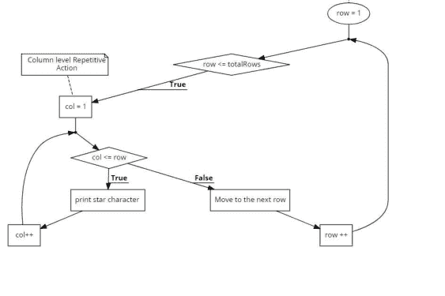


让我们执行下面的程序。

### Pattern1A_2.C

```c
#include <stdio.h>

int main() {

    int totalRows = 5;  //number of rows to display

    // Row level Repetitive Action:
    // Action1,Executes Column level Repetitive Action
    // Action2,Move cursor to next row.
    for( int row = 1; row <= totalRows; row ++ ) {

        // Column level Repetitive Action :
        for( int col = 1; col <= row ; col++ ) {

            // Action1,Move cursor in the same row
            // Action2.print "★" character
            printf("★ ");

        }
        printf("\n");// Move cursor to the next row
    }

    return 0;

}
```

### 输出

```
★
★ ★
★ ★ ★
★ ★ ★ ★
★ ★ ★ ★ ★
```

现在，测试不同的行数，设为 10。它应该能正确工作，这样我们就可以确认我们的解决方案是通用且适用于任意行数的。

### Pattern1A_1.C

```c
#include <stdio.h>

int main() {

    int totalRows = 10;   //number of rows to display

    // Row level Repetitive Action:

    // Action1.Executes Column level Repetitive Action

    // Action2.Move cursor to next row.

    for( int row = 1 ; row <= totalRows ; row ++ ) {

        // Column level Repetitive Action :

        for( int col = 1 ; col <= row ; col++ ) {

            // Action1.Move cursor in the same row

            // Action2.print "*" character

            printf("* ");

        }

        printf("\n");// Move cursor to the next row

    }

    return 0;

}
```

### 输出

```
*
* *
* * *
* * * *
* * * * *
* * * * * *
* * * * * * *
* * * * * * * *
* * * * * * * * *
* * * * * * * * * *
```

## Pattern1B

我们的编程任务是在计算机屏幕的一部分上输出如下所示的这种简单的基于图片的模式。我们的方法将把计算机屏幕视为由包含小方框的行和列组成的组合。我们可以将计算机屏幕视为由遍布整个屏幕的 (row, column) 数值配对方框组成的组合。每个方框仅被视为一个字符的驻留。我们还知道，完整的模式可以很容易地表示为所选 (row, column) 数值配对的集合。

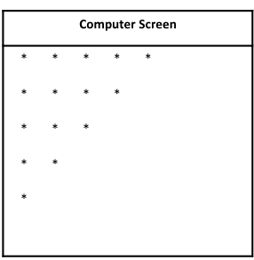

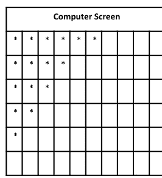

### 输出分析

我们可以通过知道其在计算机屏幕上的唯一 (row, column) 数值组合来确定每个 “*” 字符的确切位置。

| | 列=1 | 列=2 | 列=3 | 列=4 | 列=5 |
|---|---|---|---|---|---|
| 行=1 | \* (1,1) | \* (1,2) | \* (1,3) | \* (1,4) | \* (1,5) |
| **行=2** | **\* (2,1)** | \* (2,2) | \* (2,3) | \* (2,4) |  |
| 行=3 | \* (3,1) | \* (3,2) | \* (3,3) |  |  |
| 行=4 | \* (4,1) | \* (4,2) |  |  |  |
| 行=5 | \* (5,1) |  |  |  |  |

(2, 1) 表示字符 “*” 在表格中的 **第二行** 和 **第一列**。

例如，对于数值对(2,1)，值 2 表示行号，值 1 表示列号。这是我们能够在计算机屏幕上的特定位置清晰识别 “*” 字符的实际度量。

| 模式生成步骤 ( 总行数 = 5) | 计算机屏幕 |
|---|---|
| 对于行 = 1<br>在同一第 1 行打印 “*” 五次<br>然后移动到第 2 行 | 1 2 3 4 5 6 7 8 9<br>行 1: * * * * *<br>→ (箭头指向第 2 行) |
| 对于行 = 2<br>在同一第 2 行打印 “*” 四次<br>然后移动到第 3 行 | * * * * *<br>* * * *<br>→ (箭头指向第 3 行) |
| 对于行 = 3<br>在同一第 3 行打印 “*” 三次<br>然后移动到第 4 行 | * * * * *<br>* * * *<br>* * *<br>→ (箭头指向第 4 行) |
| 对于行 = 4<br>在同一第 4 行打印 “*” 两次<br>然后移动到第 5 行 | * * * * *<br>* * * *<br>* * *<br>* *<br>→ (箭头指向第 5 行) |
| 对于行 = 5<br>在第 5 行打印 “*” 一次<br>然后移动到第 6 行 | * * * * *<br>* * * *<br>* * *<br>* *<br>*<br>→ (箭头指向第 6 行) |

### 将步骤转换为 C 程序。

| C 内置方法的使用 | |
|---|---|
| 为了将光标移动到下一行 | printf("\n") ; |
| 为了将光标移动并在同一行打印 “*” 字符 | printf("*"); |

这些是两种将在程序中重复多次的语句。

printf("\n") ; & printf("*");

因此我们可以使用 for 循环来实现。

### 列级重复操作

让我们将二维模式的两个属性行和列视为变量；

**row** → 变量 _type of integer_ 用于一次存储一个整数值并表示 1 到 5 之间的行号。

**col** → 变量 _type of integer_ 用于一次存储一个整数值并表示 1 到 5 之间的列号。

**totalRows** → 变量 _type of integer_ 用于存储总行数的整数值。

#### 追踪表

| (row, col) 值对描述了 “*” 字符在显示屏上的位置 | | | | |
|---|---|---|---|---|
| 行=1, 列=1 | 行=1, 列=2 | 行=1, 列=3 | 行=1, 列=4 | 行=1, 列=5 |
| 行=2, 列=1 | 行=2, 列=2 | 行=2, 列=3 | 行=2, 列=4 | |
| 行=3, 列=1 | 行=3, 列=2 | 行=3, 列=3 | | |
| 行=4, 列=1 | 行=4, 列=2 | | | |
| 行=5, 列=1 | | | | |

每个行 = 1 到 5 的 col 变量的值。

| 行级重复操作 | 列级重复操作 | 预期输出 |
|---|---|---|
| 变量: row | 变量: col | |
| 1 | 1,2,3,4,5 | * * * * * |
| 2 | 1,2,3,4 | * * * * |
| 3 | 1,2,3 | * * * |
| 4 | 1,2 | * * |
| 5 | 1 | * |

为了定义具有计数器更新增量值 1 的 for 循环控制结构，我们需要一组 **min_val** 和 **max_val**，因为循环需要在某处开始和结束。

| 行级重复操作 | 列级重复操作 | 预期输出 |
|---|---|---|
| 变量 : row | 变量 : col | |
| | 最小值 | 最大值 | |
| 1 | 1 | 5 | * * * * * |
| 2 | 1 | 4 | * * * * |
| 3 | 1 | 3 | * * * |
| 4 | 1 | 2 | * * |
| 5 | 1 | 1 | * |

对于每个不同的行值，我们都有一个不同的 **max_val**。

| 目标 |
|---|
| 我们需要为列 **max_val** 找到一个 _唯一表达式_，这样如果增加行数，它应该生成相应 _行大小_ 的模式。 |

### 解决方案方法

我们需要使用可用变量来概括列 max_val 的非重复数字模式。我们可以使用变量 totalRows。变量 totalRows 已被赋值为 5 作为总行数。

| 列级重复操作 |
|---|
| 变量 : row | 循环条件( 变量 : col ) |
| | 最小值 | 最大值 |
| | | 默认 | 1 |
| 1 | 1 | 5 | totalRows |
| 2 | 1 | 4 | totalRows - 1 |
| 3 | 1 | 3 | totalRows - 2 |
| 4 | 1 | 2 | totalRows - 3 |
| 5 | 1 | 1 | totalRows - 4 |

再次存在非重复的数值。我们可以按如下方式第二次表达 max_val。

| 列级重复操作 |
|---|
| 变量 : row | 循环条件( 变量 : col ) |
| | 最小值 | 最大值 |
| | | 默认 | 1 | 2 |
| 1 | 1 | 5 | totalRows | (totalRows +1) - 1 |
| 2 | 1 | 4 | totalRows -1 | (totalRows +1) - 2 |
| 3 | 1 | 3 | totalRows - 2 | (totalRows +1) - 3 |
| 4 | 1 | 2 | totalRows - 3 | (totalRows +1) - 4 |
| 5 | 1 | 1 | totalRows - 4 | (totalRows +1) - 5 |

列 max_val 表达式的一部分遵循与行相同的数值模式。

| 列级重复操作 |
|---|
| 变量 : row | 循环条件( 变量 : col ) |
| | 最小值 | 最大值 |
| | | 默认 | 1 | 2 | 3 |
| 1 | 1 | 5 | totalRows | (totalRows +1) - 1 | (totalRows +1) - row |
| 2 | 1 | 4 | totalRows -1 | (totalRows +1) - 2 | (totalRows +1) - row |
| 3 | 1 | 3 | totalRows - 2 | (totalRows +1) - 3 | (totalRows +1) - row |
| 4 | 1 | 2 | totalRows - 3 | (totalRows +1) - 4 | (totalRows +1) - row |
| 5 | 1 | 1 | totalRows - 4 | (totalRows +1) - 5 | (totalRows +1) - row |

进一步我们可以用 totalRows 和 row 变量来表达它。

现在，max_val 具有相同的表达式，并且对于每个 row 值都是一致的。

我们现在可以为每个行值定义列级 for 循环。

| 列级 for 循环的元素 |
|---|
| 最小值 | 1 |
| 最大值 | (totalRows +1) - row |
| 变量名 | col |
| 语句 | printf("%s"); |


### 行级重复动作

以下相同语句已**重复 5 次**（总行数）。

**列级 for 循环** // *内层 for 循环*

```text
printf("\n"); //Move cursor to the next row
```

从图案中可以观察到总行数为 5。

我们已为**每一行分配唯一值**，从 1 到 5。因此，现在这很容易。

*for 循环*的最小值和最大值可表示为：

*min_val = 1* 和 *max_val* = 5 或 totalRows

考虑：

**row** → *整型*变量，用于一次存储一个整数值，并表示 1 到 5（totalRows）之间的行号。**totalRows** 初始被赋值为 5。

外层 *for 循环*从 row=1 开始，并将重复直到 row <= **totalRows**。

| 行级 *for 循环*的要素 | |
|---|---|
| *min_val* | 1 |
| *max_val* | totalRows |
| *variable_name* | **row** |
| statement(s) | **列级 for 循环**<br>//将光标移到下一行<br><br>**printf("\n");** |

我们已经获得了与行级重复的 *for 循环*相关的所有内容。

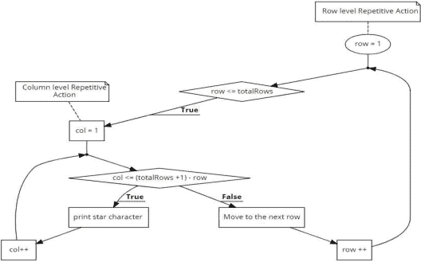

让我们执行以下程序。

#### PatternB1_1.c

```c
#include <stdio.h>

int main() {

    int totalRows = 5; //number of rows to display

    // Row level Repetitive Action :
    // Action1.Executes Column level Repetitive Action
    // Action2.Move cursor to next row.
    for( int row = 1 ; row <= totalRows ; row++ ) {

        // Column level Repetitive Action :
        for(int col = 1 ; col <= (totalRows +1) - row ; col++) {
            // Action1.Move cursor in the same row
            // Action2.print "*" character
            printf("* ");
        }
        printf("\n");// Move cursor to the next row
    }

    return 0;
}
```

#### 输出

```text
* * * * *
* * * *
* * *
* *
*
```

让我们执行以下程序，使用不同的行数值 10（totalRows = 10）。

#### PatternB1_1.c

```c
#include <stdio.h>

int main() {

    int  totalRows = 10;  //number of rows to display

    // Row level Repetitive Action :
    // Action1.Executes Column level Repetitive Action
    // Action2.Move cursor to next row.
    for( int row = 1 ; row <= totalRows ; row ++ ) {

        // Column level Repetitive Action :
        for(int col = 1 ; col <= (totalRows +1) - row ; col++) {
            // Action1.Move cursor in the same row
            // Action2.print "*" character
            printf("* ");
        }
        printf("\n");// Move cursor to the next row
    }
    return 0;
}
```

#### 输出

```text
* * * * * * * * * *
* * * * * * * * *
* * * * * * * *
* * * * * * *
* * * * * *
* * * * *
* * * *
* * *
* *
*
```

### 备选方案 2

从之前的解决方案中，我们得到以下列级重复动作细节：

让我们尝试简化表达式 (totalRows +1) - row。

**列级重复动作**

| 变量：row | 循环条件（变量：col）<br>min_val | 循环条件（变量：col）<br>max_val |
|---|---|---|
| | | 默认 |
| 1 | 1 | (totalRows +1) - row |
| 2 | 1 | (totalRows +1) - row |
| 3 | 1 | (totalRows +1) - row |
| 4 | 1 | (totalRows +1) - row |
| 5 | 1 | (totalRows +1) - row |

从 row 和 max_val 中减去 1。

**列级重复动作**

| 变量：row | 循环条件（变量：col）<br>min_val | 循环条件（变量：col）<br>max_val |
|---|---|---|
| | | 默认 |
| 1-1 | 1 | (totalRows +1) - row - 1 |
| 2-1 | 1 | (totalRows +1) - row - 1 |
| 3-1 | 1 | (totalRows +1) - row - 1 |
| 4-1 | 1 | (totalRows +1) - row - 1 |
| 5-1 | 1 | (totalRows +1) - row - 1 |

**列级重复动作**

| 变量：row | 循环条件（变量：col）<br>min_val | 循环条件（变量：col）<br>max_val |
|---|---|---|
| | | 默认 |
| 0 | 1 | (totalRows - row) |
| 1 | 1 | (totalRows - row) |
| 2 | 1 | (totalRows - row) |
| 3 | 1 | (totalRows - row) |
| 4 | 1 | (totalRows - row) |

现在，max_val 具有相同的表达式，并且对于 row 的每个值都一致。
现在我们可以定义列级 for 循环，它对每个 row 值都相同。

| 列级 for 循环的要素 | |
|---|---|
| min_val | 1 |
| max_val | (totalRows - row) |
| variable_name | col |
| statement(s) | `printf("* ");` |

#### 行级重复动作

外层 for 循环从 row=0 开始，并将重复直到 row <= totalRows − 1 或 row < totalRows。

| 行级 for 循环的要素 | |
|---|---|
| min_val | 0 |
| max_val | totalRows |
| variable_name | row |
| 循环条件 | row < totalRows |
| statement(s) | 列级 for 循环<br>printf("\n");// 将光标移到下一行 |

新解决方案的更改在以下程序中。

#### PatternB2.c

```c
#include <stdio.h>
int main() {
    int totalRows = 5;  //number of rows to display
    // Row level Repetitive Action :
    // Action1.Executes Column level Repetitive Action
    // Action2.Move cursor to next row.
    for( int row = 0 ; row < totalRows ; row ++ ) {
        // Column level Repetitive Action :
        for(int col = 1 ; col <= ( totalRows - row ) ; col++) {
            // Action1.Move cursor in the same row
            // Action2.print "*" character
            printf("* ");
        }
        printf("\n");// Move cursor to the next row
    }
    return 0;
}
```

#### 输出

```text
* * * * *
* * * *
* * *
* *
*
```

现在，测试不同的行数，设为 10。

#### PatternB2.c

```c
#include <stdio.h>
int main() {
    int totalRows = 10;  //number of rows to display

    // Row level Repetitive Action :
    // Action1.Executes Column level Repetitive Action
    // Action2.Move cursor to next row.
    for( int row = 0 ; row < totalRows ; row ++ ) {

        // Column level Repetitive Action :
        for(int col = 1 ; col <= ( totalRows - row ) ; col++) {
            // Action1.Move cursor in the same row
            // Action2.print "*" character
            printf("* ");
        }
        printf("\n");// Move cursor to the next row

    }

    return 0;
}
```

#### 输出

```text
* * * * * * * * * *
* * * * * * * * *
* * * * * * * *
* * * * * * *
* * * * * *
* * * * *
* * * *
* * *
* *
*
```

### 备选方案 3

我们必须使用剩余变量 row 和 **totalRows=5** 来找到列 **max_val** 的通用表达式。

下表就是我们在一开始从**追踪表**中已经得到的表。

**列级重复动作**

| 变量：row | 循环条件（变量：col）<br>min_val | 循环条件（变量：col）<br>max_val |
|---|---|---|
| | | 默认 |
| 1 | 1 | 5 |
| 2 | 1 | 4 |
| 3 | 1 | 3 |
| 4 | 1 | 2 |
| 5 | 1 | 1 |

如果我们观察 row 的数值模式 **[1, 2, 3, 4, 和 5]**，它是列 **max_val** 的数值模式 **[5, 4, 3, 2, 和 1]** 的**相反**。

如果我们仅反转 row 变量的计数器，它将恰好匹配列 **max_val** 的值 **[5, 4, 3, 2, 和 1]**。这仅意味着，我们不应为 row 变量使用**递增 for 循环**，而需要将其替换为针对 row 变量的**递减 for 循环**。

反转变量 row 的取值顺序可表示如下：

**列级重复动作**

| 变量：row | 循环条件（变量：col）<br>min_val | 循环条件（变量：col）<br>max_val |
|---|---|---|
| | | 默认 |
| 5 | 1 | 5 |
| 4 | 1 | 4 |
| 3 | 1 | 3 |
| 2 | 1 | 2 |
| 1 | 1 | 1 |

**列级重复动作**

| 变量：row | 循环条件（变量：col）<br>min_val | 循环条件（变量：col）<br>max_val |
|---|---|---|
| | | 默认 |
| 5 | 1 | row |
| 4 | 1 | row |
| 3 | 1 | row |
| 2 | 1 | row |
| 1 | 1 | row |

现在，变量 row 和列 **max_val** 的数值模式完全匹配。

因此，**max_val** 可以用变量 row 表示。

因此，**max_val** 对于 **row** 的每个值都一致。现在，我们已准备好使用 *for 循环*，因为 *for 循环*需要**一个最小值**和**一个最大值或表达式**。

现在我们可以定义列级**递减 for 循环**。

它从变量 **row** 的值开始，并将重复递减直到 **col** 值变为 **1**。

#### 列级递减 for 循环的要素

|  |  |
|---|---|
| *max_val* | row |
| *min_val* | 1 |
| *variable_name* | col |
| **循环条件** | col >= 1 |
| statement(s) | `printf("* ");` |

#### 行级重复动作

外层**递减 for 循环**从 <u>totalRows</u> 开始，并将重复递减直到 row 值变为 1。

#### 行级递减 for 循环的要素

|  |  |
|---|---|
| *max_val* | totalRows |
| *min_val* | 1 |
| *variable_name* | row |
| **循环条件** | row >= 1 |
| statement(s) | **列级 for 循环**<br>// 将光标移到下一行<br>printf("\n"); |

因此，我们获得了与嵌套 ***for 循环***相关的所有内容。

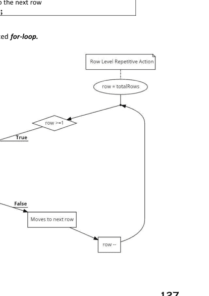


以下程序中更新的解决方案更改以粗体显示。

### PatternB3.c

```c
#include <stdio.h>

int main() {

    int totalRows = 10; //10 rows to display

    // Row level Repetitive Action :
    // Action1. Executes Column level Repetitive Action
    // Action2. Move cursor to next row.
    for( int row = totalRows ; row >=1 ; row-- ) {

        // Column level Repetitive Action :
        for(int col = row; col >= 1 ; col--) {
            // Action1. Move cursor in the same row
            // Action2. print "*" character
            printf("* ");
        }
        printf("\n"); // Move cursor to the next row
    }

    return 0;
}
```

### 输出

* * * * * * * * * *
* * * * * * * * *
* * * * * * * *
* * * * * * *
* * * * * *
* * * * *
* * * *
* * *
* *
*

*此页特意留空。*

## Pattern1C

我们的编程任务是在计算机屏幕的一部分上输出这种简单的基于图片的图案，如下所示。我们的方法将把计算机屏幕视为包含小方框的行和列的组合。我们可以将计算机屏幕视为在整个屏幕上分布的 (row, column) 数值配对方框的组合。每个方框被视为仅容纳一个字符的居民。我们也知道，完整的图案可以很容易地表示为所选的 (row, column) 数值对的集合。

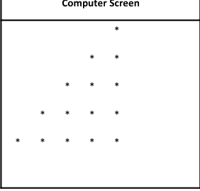

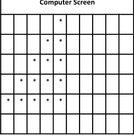

### 输出分析

我们可以通过知道其在计算机屏幕上的唯一 (row, column) 数值组合来得知每个 “*” 字符的确切位置。

| | 列=1 | 列=2 | 列=3 | 列=4 | 列=5 |
|---|---|---|---|---|---|
| 行=1 | 空格 | 空格 | 空格 | 空格 | * (1,5) |
| 行=2 | 空格 | 空格 | 空格 | * (2,4) | * (2,5) |
| 行=3 | 空格 | 空格 | * (3,3) | * (3,4) | * (3,5) |
| 行=4 | 空格 | * (4,2) | * (4,3) | * (4,4) | * (4,5) |
| 行=5 | * (5,1) | * (5,2) | * (5,3) | * (5,4) | * (5,5) |

(2, 4) 表示表格中 **第二行** 和 **第四列** 的字符 “*”。

例如，对于数值对(2,4)，值 2 表示行号，值 4 表示列号。这是我们能够在计算机屏幕上的特定位置清楚地识别 “*” 字符的实际度量。

**空格 ➔ 空格也是像其他字符一样的字符。如果在屏幕上空白区域或间隙后显示字符或文本，则意味着在打印任何其他字符之后必须先打印多个空格字符。**

| 模式生成步骤 | 计算机屏幕 |
|---|---|
| **第 1 行** 在同一第 1ˢᵗ 行打印空格 " " **4 次**。在同一第 1ˢᵗ 行打印星号 "*" **一次** 然后移动到下一行编号 2。 | (图像：顶部有 1–9 列编号、左侧有行编号的点状网格；第 1 行第 5 列有一个 `*`；第 1 行开头的单元格有轮廓；蓝色箭头指向第 2 行) |
| **第 2 行** 在同一第 2ⁿᵈ 行打印空格 " " **3 次**。在同一第 2ⁿᵈ 行打印星号 "*" **2 次** 然后移动到下一行编号 3。 | (图像：点状网格；第 2 行第 4 列和第 5 列有两个 `*` 符号；第 2 行前三个单元格有轮廓；蓝色箭头指向第 3 行) |
| **第 3 行** 在同一第 3ʳᵈ 行打印空格 " " **2 次**。在同一第 3ʳᵈ 行打印星号 "*" **3 次** 然后移动到下一行编号 4。 | (图像：点状网格；第 3 行第 3、4 和 5 列有三个 `*` 符号；第 3 行前两个单元格有轮廓；蓝色箭头指向第 4 行) |
| **第 4 行** 在同一第 4ᵗʰ 行打印空格 " " **1 次**。在同一第 4ᵗʰ 行打印星号 "*" **4 次** 然后移动到下一行编号 5。 | (图像：点状网格；第 4 行第 2、3、4 和 5 列有四个 `*` 符号；第 4 行第一个单元格有轮廓；蓝色箭头指向第 5 行) |
| **第 5 行** 在同一第 5ᵗʰ 行打印空格 " " **0 次**。在同一第 5ᵗʰ 行打印星号 "*" **5 次** 然后移动到下一行编号 6。 | (图像：点状网格；第 5 行第 1 至 5 列有五个 `*` 符号；网格显示第 6 行；蓝色箭头指向第 6 行) |

**让我们将这些步骤转换为 C 程序。**

| 描述 | C 语句 |
|---|---|
| 移动到下一行 | `printf("\n")` |
| 移动到下一个 (row, col) 位置并在同一行打印空格 " " 字符 | `printf(" ")` |
| 移动到下一个 (row, col) 位置并在同一行打印星号 "*" 字符 | `printf("*")` |

## 解决方案方法

变量为 **row** & **totalRows**=5。

我们需要概括列 **max_val** 的非重复数值模式。变量 col 的列 **max_val** 的数值模式与 **row** 的每个值完全匹配。因此，变量 col 的列 **max_val** 的所有数值模式都可以用 row 变量表示。

让我们尝试使用变量 **totalRows** 来概括变量 **spaces** 的列 **max_val**。

| 行级重复操作 |  |  |  |  |  |
|---|---|---|---|---|---|
| 变量：row | **列级重复操作** |  |  | 变量：col |  |
|  | 变量：spaces |  |  |  |  |
|  | **min_val** | **max_val** |  | **min_val** | **max_val** |
|  |  | 默认 | 1 |  |  |
| 1 | 1 | 4 | totalRows - 1 | 1 | row |
| 2 | 1 | 3 | totalRows - 2 | 1 | row |
| 3 | 1 | 2 | totalRows - 3 | 1 | row |
| 4 | 1 | 1 | totalRows - 4 | 1 | row |
| 5 | 0 | 0 | totalRows - 4 | 1 | row |

变量 **spaces** 列 **max_val** 的一部分表达式遵循与 **row** 相同的数值值模式。

进一步我们可以用 totalRows 和 row 变量来表示它。

| 行级重复操作 |  |  |  |  |  |
|---|---|---|---|---|---|
| 变量：row | **列级重复操作** |  |  | 变量：col |  |
|  | 变量：spaces |  |  |  |  |
|  | **min_val** | **max_val** |  | **min_val** | **max_val** |
|  |  | 默认 | 1 |  |  |
| 1 | 1 | 4 | totalRows - row | 1 | row |
| 2 | 1 | 3 | totalRows - row | 1 | row |
| 3 | 1 | 2 | totalRows - row | 1 | row |
| 4 | 1 | 1 | totalRows - row | 1 | row |
| 5 | 0 | 0 | totalRows - row | 1 | row |

我们将列 **max_val** 的非重复数值模式概括为表达式。

我们现在可以定义列级 *for-loop*，用于为每个行值打印空格。

| *列级 for-loop 的元素* |  |
|---|---|
| *min_val* | 1 |
| *max_val* | totalRows - row |
| *variable_name* | **spaces** |
| statement(s) | `printf(" ");` |

我们现在可以定义列级 *for-loop*，用于为每个行值打印 (*) 字符。

| *列级 for-loop 的元素* |  |
|---|---|
| *min_val* | 1 |
| *max_val* | row |
| *variable_name* | **col** |
| statement(s) | `printf("*");` |

## 行级重复操作

相同的以下语句已被 **重复 5 次**（总行数）。

**Column level for-loop** 用于打印空格字符 //  **inner for-loop**

**Column level for-loop** 用于打印星号字符 //  **inner for-loop**

```
printf("\n"); // Move cursor to the next row
```

我们已为每行分配从 1 到 5 的 **唯一值**。所以，现在很容易。

可以为 **for-loop** 给出最小值和最大值；

*min_val = 1*  &  *max_val = 5* 或 totalRows

让我们考虑；

**row** → 变量 **type_of_integer** 用于一次存储整数值并表示介于 1 和 5(totalRows) 之间的行号。**totalRows** 最初被赋值为 5。

外部 **for-loop** 从 row=1 开始并将重复到 row <= **totalRows**。

我们获得了与行级重复相关的 **for-loop** 的所有内容。

| 行级 *for-loop* 的元素 |  |
|---|---|
| *min_val* | 1 |
| *max_val* | totalRows |
| *variable_name* | row |
| statement(s) | **Column level for-loop** 用于打印空格字符。<br>**Column level for-loop** 用于打印星号字符<br>`printf("\n"); // Move cursor to the next row` |

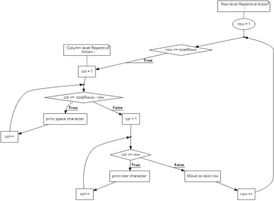


让我们编写完整的编程逻辑并执行程序。

## PatternC1.c
```
#include <stdio.h>
int main() {
    int totalRows = 5; //number of rows to display

    // Row level Repetitive Action :
    // Action1.Executes Column level Repetitive Action
    // Action2.Move cursor to next row.
    for( int row = 1 ; row <= totalRows ; row++ ) {

        // Column level Repetitive Action :
        for(int sp = 1 ; sp <= ( totalRows - row ) ; sp++) {
            // Action1.Move cursor in the same row
            // Action2.print space " " character
            printf(" ");
        }
        for(int col = 1 ; col <= row ; col++) {
            // Action1.Move cursor in the same row
            // Action2.print star "* " character
            printf("* ");
        }
        printf("\n");// Move cursor to the next row
    }
    return 0;
}
```

## 输出
    *
   * *
  * * *
 * * * *
* * * * *

## 替代方案2
可用的变量是 row 和 totalRows=5。

变量 col 取值为 1 到 5，即 col=1, 2, 3, 4, 5。

总体观察是，在每一行中，要么以连续的方式打印空格字符，要么打印星号 (*) 字符。

模式中的列分为两部分，要么打印空格 " " 字符，要么打印星号 ("*") 字符。

| 行级重复操作 | 预期输出 |
|---|---|
| 变量：row | 列级重复操作 | |
|  | 变量：spaces | 变量：col | 字符计数 | 总字符数 | |
| 1 | 1,2,3,4 | 5 | 4 个空格 + 1 个星号 | 5 | * |
| 2 | 1,2,3 | 4, 5 | 3 个空格 + 2 个星号 | 5 | * * |
| 3 | 1,2 | 3, 4, 5 | 2 个空格 + 3 个星号 | 5 | * * * |
| 4 | 1 | 2, 3, 4, 5 | 1 个空格 + 4 个星号 | 5 | * * * * |
| 5 | 0(无空格) | 1, 2, 3, 4, 5 | 0 个空格 + 5 个星号 | 5 | * * * * * |

打印空格首先在打印星号 ("*") 字符之前进行。当考虑到打印空格字符的条件时，其余的就是星号 ("*") 字符。如果仔细观察，可以发现它将变量 col 的值分为两半。一部分用于打印空格字符，另一部分用于打印星号字符。

| 行级重复操作 | 预期输出 |
|---|---|
| 变量：row | 列级重复操作 | |
|  | 变量：col | |
|  | 打印空格字符 | 打印星号字符 | |
|  | 最小值 | 最大值 | 最小值 | 最大值 | |
| 1 | 1 | 4 | 5 | 5 | * |
| 2 | 1 | 3 | 4 | 5 | * * |
| 3 | 1 | 2 | 3 | 5 | * * * |
| 4 | 1 | 1 | 2 | 5 | * * * * |
| 5 | 0 | 0 | 1 | 5 | * * * * * |

从之前的解决方案中，我们已经有了打印空格的通用条件，并使用该通用条件我们可以将所有内容放在下面的表中。

| 行级重复操作 |
| 变量：row | 列级重复操作 |
| | 变量：col |
| | 打印空格字符 | 打印星号字符 |
| | 最小值 | 最大值 | | 最小值 | 最大值 |
| | | 默认 | 1 | | |
| 1 | 1 | 4 | totalRows -row | 5 | 5 |
| 2 | 1 | 3 | totalRows -row | 4 | 5 |
| 3 | 1 | 2 | totalRows -row | 3 | 5 |
| 4 | 1 | 1 | totalRows -row | 2 | 5 |
| 5 | 0 | 0 | totalRows -row | 1 | 5 |

列级 for 循环在 col 变量的值 1 到 5 之间运行。

条件 (totalRows - row) 给出了从 1 开始的最大限制，在此限制内它将打印空格字符。

因此，我们可以轻松地为我们的情况使用 if-else 语句来过滤和打印空格和星号字符。

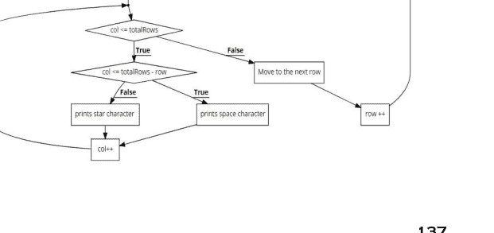

| 当条件为 **True** 时为每个变量 **col** 的值打印一个空格 |||||
|---|---|---|---|---|
| col=1 | col=2 | col=3 | col=4 | col=5 |
| 如果 (条件为 True)<br>    打印空格字符<br>否则<br>    打印星号字符 |||| |

使用 if-else 语句更新后的程序如下：

## PatternC2.c
```c
#include <stdio.h>
int main() {
    int totalRows = 5; //number of rows to display
    // Row level Repetitive Action :
    // Action1.Executes Column level Repetitive Action
    // Action2.Move cursor to next row.
    for (int row = 1; row <= totalRows; row++) {

        // Column level Repetitive Action :
        // Action1.Move cursor in the same row.
        for (int col = 1; col <= totalRows; col++) {
            if (col <= (totalRows - row)) {
                // Action2.prints space " " character
                printf(" ");
            } else {
                // Action3.prints star "*" character
                printf("* ");
            }
        }
        printf("\n");// Move cursor to the next row
    }

    return 0;
}
```

## 输出
```
        *
      * *
    * * *
  * * * *
* * * * *
```

现在，测试不同数量的行，设为 10。

## PatternC2.c
```c
#include <stdio.h>
int main() {

        int totalRows = 10; //number of rows to display
        // Row level Repetitive Action :
        // Action1.Executes Column level Repetitive Action
        // Action2.Move cursor to next row.
        for (int row = 1; row <= totalRows; row++) {

                // Column level Repetitive Action :
                // Action1.Move cursor in the same row
                for (int col = 1; col <= totalRows; col++) {
                        if (col <= (totalRows - row)) {
                                // Action2.prints space “ ” character
                                printf(" ");
                        } else {
                                // Action3.prints star “* ” character
                                printf("* ");
                        }
                }
                printf("\n");// Move cursor to the next row
        }

        return 0;
}
```

## 输出
```text
                  *
                * *
              * * *
            * * * *
          * * * * *
        * * * * * *
      * * * * * * *
    * * * * * * * *
  * * * * * * * * *
* * * * * * * * * *
```

## 替代方案3
从之前的解决方案中，我们已检查 **if-condition** 为 **true** 以打印空格，并在 **if-statement** 的 else 部分打印了星号（“*”）字符。这被如下捕获：

<table><tr><td colspan='5'>当条件为 True 时为变量 col 的每个值打印一个空格</td></tr><tr><td>col=1</td><td>col=2</td><td>col=3</td><td>col=4</td><td>col=5</td></tr><tr><td colspan='5'><pre>如果 (条件为 True)
    打印空格字符
否则
    打印星号字符</pre></td></tr></table>

在此解决方案中，我们将反转情况。当 **if-condition** 变为 **true** 时，我们将打印星号（“*”）字符，并在 **if-statement** 的 else 部分打印空格。

让我们从之前的解决方案中得到的观察表开始。

<table><tr><td colspan='6'>行级重复操作</td></tr><tr><td rowspan='4'>变量：row</td><td colspan='5'>列级重复操作</td></tr><tr><td colspan='5'>变量：col</td></tr><tr><td colspan='2'>打印空格字符</td><td colspan='3'>打印星号字符</td></tr><tr><td>最小值</td><td>最大值</td><td>默认</td><td>最小值</td><td>最大值</td></tr><tr><td>1</td><td>1</td><td>4</td><td>5</td><td>5</td><td>5</td></tr><tr><td>2</td><td>1</td><td>3</td><td>4</td><td>5</td><td>5</td></tr><tr><td>3</td><td>1</td><td>2</td><td>3</td><td>5</td><td>5</td></tr><tr><td>4</td><td>1</td><td>1</td><td>2</td><td>5</td><td>5</td></tr><tr><td>5</td><td>0</td><td>0</td><td>1</td><td>5</td><td>5</td></tr></table>

我们知道 totalRows = 5。

用于打印星号字符的列 **min_val** 可以表示为；

| 行级重复操作（变量：row） | 列级重复操作（变量：col） | 打印空格字符 最小值 | 打印空格字符 最大值（默认） | 打印星号字符 最小值 | 打印星号字符 最大值 |
|---|---|---|---|---|---|
| 1 | | 1 | 4 | 5 - 0 | totalRows |
| 2 | | 1 | 3 | 5 - 1 | totalRows |
| 3 | | 1 | 2 | 5 - 2 | totalRows |
| 4 | | 1 | 1 | 5 - 3 | totalRows |
| 5 | | 0 | 0 | 5 - 4 | totalRows |

如果我们尝试使用变量 totalRows 来概括列 **min_val** 的数字模式。

那么它将是 totalRows – 0 , totalRows – 1,...等等。该表达式的一部分几乎遵循变量 row = 1,2,...5 的数字模式。前者具有从零(0)开始的数字模式，而 row 变量的数字模式从一(1)开始。让它，开始 row 变量的数字模式也从零(0)开始。

让我们利用变量 <u>totalRows</u> 和 <u>row</u> 来推导出打印星号字符的广义表达式。

| 行级重复操作（变量：row） | 列级重复操作（变量：col） | 打印空格字符 最小值 | 打印空格字符 最大值（默认） | 打印星号字符 最小值 | 打印星号字符 最大值 |
|---|---|---|---|---|---|
| 0 | | 1 | 4 | totalRows - 0 | totalRows |
| 1 | | 1 | 3 | totalRows - 1 | totalRows |
| 2 | | 1 | 2 | totalRows - 2 | totalRows |
| 3 | | 1 | 1 | totalRows - 3 | totalRows |
| 4 | | 0 | 0 | totalRows - 4 | totalRows |

我们可以使用变量 **row** 来概括打印星号字符的列 **min_val**。


| 行级重复操作 |
| 变量：row | 列级重复操作 |
| | 变量：col |
| | 打印空格字符(s) | 打印星号字符(s) |
| | 最小值 | 最大值 | | 最小值 | 最大值 |
| | | 默认 | | |
| 0 | 1 | 4 | totalRows - row | totalRows |
| 1 | 1 | 3 | totalRows - row | totalRows |
| 2 | 1 | 2 | totalRows - row | totalRows |
| 3 | 1 | 1 | totalRows - row | totalRows |
| 4 | 0 | 0 | totalRows - row | totalRows |

条件 ( col >= (totalRows − row) ) 给出了最小限制，是一个起点，从该点开始打印星号(*)字符(s)，直到变量 col 的最大值，即 totalRows。

if-condition 可以使用比较和逻辑运算符给出在值 ( totalRows - row ) 和 totalRows 之间的范围，如下：

If ( col >= (totalRows - row ) && col <= totalRows ) 而且我们已经知道；

variable col = 1,2,3,4,5 or 1,2,3,4, totalRows

variable row = 0,1,2,3,4 or 0,1,2,3,4, (totalRows - 1) .

我们可以消除逻辑与条件( col <= totalRows )，因为该条件已在列级内部 for-loop 中被考虑。

因此 if-condition 将简化为：If ( col >= (totalRows - row ) )

我们可以将所有内容总结在下面的流程图中并更新到程序中。

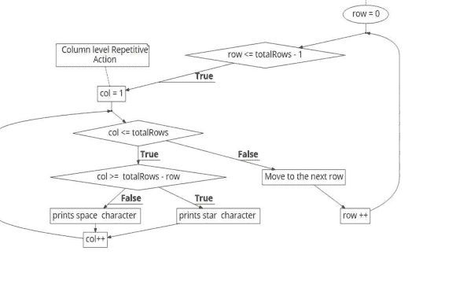

现在，测试不同行数的情况，设为 7。

## PatternC3.c

```c
#include <stdio.h>
int main() {
    int totalRows = 7; //7 rows to display

    // Row level Repetitive Action :
    // Action1.Executes Column level Repetitive Action
    // Action2.Move cursor to next row.
    for (int row = 0; row <= totalRows - 1; row++) {

        // Column level Repetitive Action :

        // Action1.Move cursor in the same row
        for (int col = 1; col <= totalRows; col++) {

            if (col >= (totalRows - row)) {
                // Action2.prints star "*" character
                printf("* ");
            } else {
                // Action3.prints space " " character
                printf(" ");
            }
        }
        printf("\n");// Move cursor to the next row

    }

    return 0;
}
```

## Output

        *
      * *
    * * *
  * * * *
* * * * *
* * * * * *

可以开发不同的编程逻辑来解决同一个问题。我们需要根据程序的时间和空间复杂度选择合适的逻辑，这超出了本书的范围。

主要关注点是学习者应该能够仅通过使用可用变量自行开发编程逻辑，以消除硬编码值依赖并将其转换为适当的逻辑表达式。

程序员应该能够以不同的方式进行逻辑思考，这样学习者就会在编程中变得自信。这是本书的主要意图，将学习者转变为自信的程序员，或者至少会对其产生兴趣。

## Pattern1D

我们的编程任务是在计算机屏幕的一部分上输出这种简单的基于图片的图案，如下所示。我们的方法是将计算机屏幕视为由包含小方框的行和列组成的组合。我们可以将计算机屏幕视为由 **(row, column)** 数字值配对方框的组合，这些方框遍布整个屏幕。每个方框被视为仅容纳一个字符的居民。我们也知道，完整的图案可以很容易地表示为 **selected (row, column)** 数字值对的集合。

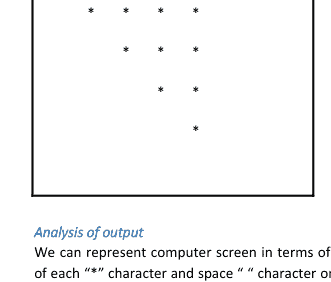


## Analysis of output

我们可以用行和列来表示计算机屏幕。为了了解每个“*”字符和空格“ ”字符在显示屏上的放置位置，我们可以给每个方框一个以行号和列号表示的数字表示。

**(row number, column number)** 数字对可用于表示一个图案。第一个值表示行号，第二个值表示列号。例如；

> (2, 4) 表示表格中 **第二行** 和 **第四列** 的字符“*”。

| | Col=1 | Col=2 | Col=3 | Col=4 | Col=5 |
|---|---|---|---|---|---|
| Row=1 | *(1,1) | *(1,2) | *(1,3) | *(1,4) | *(1,5) |
| Row=2 | space | *(2,2) | *(2,3) | ***(2,4)*** | *(2,5) |
| Row=3 | space | space | *(3,3) | *(3,4) | *(3,5) |
| Row=4 | space | space | space | *(4,4) | *(4,5) |
| Row=5 | space | space | space | space | *(5,5) |

> **Space → 空格也是像其他字符一样的字符。如果在屏幕上空白区域或间隙之后显示非空格字符或文本，则意味着在之后打印任何其他非空格字符(s)之前必须打印许多空格字符。**

| 生成图案的步骤 ( Total Rows = 5) | 计算机屏幕 |
|---|---|
| **For row = 1**<br>Print "*" five times in the same 1st row<br>then move to row number 2 | 1 2 3 4 5 6 7 8 9<br>1 * * * * *<br>2<br>3<br>4<br>5<br>→ (row 2) |
| **For row = 2**<br>Print space " " 1 time in the same 2nd row.<br>Print "*" four times in the same 2nd row<br>then move to row number 3. | 1 2 3 4 5 6 7 8 9<br>1 * * * *<br>2 &nbsp; * * * *<br>3<br>4<br>5<br>→ (row 3) |
| **For row = 3**<br>Print space " " 2 times in the same 3rd row.<br>Print "*" thrice in the same 3rd row<br>then move to row number 4. | 1 2 3 4 5 6 7 8 9<br>1 * * * *<br>2 &nbsp; * * * *<br>3 &nbsp;&nbsp; * * *<br>4<br>5<br>→ (row 4) |
| **For row = 4**<br>Print space " " 3 times in the same 4th row.<br>Print "*" twice in the same 4th row<br>then move to row number 5. | 1 2 3 4 5 6 7 8 9<br>1 * * * *<br>2 &nbsp; * * * *<br>3 &nbsp;&nbsp; * * *<br>4 &nbsp;&nbsp;&nbsp; * *<br>5<br>→ (row 5) |
| **For row = 5**<br>Print space " " 4 times in the same 5th row.<br>Print "*" once in the same 5th row<br>then move to row number 6. | 1 2 3 4 5 6 7 8 9<br>1 * * * *<br>2 &nbsp; * * * *<br>3 &nbsp;&nbsp; * * *<br>4 &nbsp;&nbsp;&nbsp; * *<br>5 &nbsp;&nbsp;&nbsp;&nbsp; *<br>→ (row 6) |

## Let's convert steps into C program.

| C 内置方法的使用 | |
|---|---|
| 描述 | C 方法 |
| 移至下一行 | `printf("\n")` |
| 移至同一行的下一个 (row, col) 位置并打印空格“ ”字符 | `printf(" ")` |
| 移至同一行的下一个 (row, col) 位置并打印星号“*”字符 | `printf("*")` |

> > 由于这些键盘字符的打印是使用上述 C 内置方法执行的。这些方法将在程序中重复多次以打印这些重复字符。因此我们可以使用 for-loop 来执行程序中此类重复任务。

## COLUMN LEVEL REPETITIVE ACTION

让我们将二维图案的两个属性行和列视为变量；

row → 变量类型为 integer，用于一次存储一个整数值并表示 1 到 5 之间的行号。

col → 变量类型为 integer，用于一次存储一个整数值并表示 1 到 5 之间的列号。

spaces → 变量类型为 integer，用于一次存储一个整数值并表示 1 到 5 之间列号处的空格字符。

totalRows → 变量类型为 integer，用于存储总行数的值。

## Logic Trace Tables

| (row, col) 值对描绘了显示屏上“*”字符的位置 |
|---|---|
| row=1, col=1 | row=1, col=2 | row=1, col=3 | row=1, col=4 | row=1, col=4 |
|  | row=2, col=2 | row=2, col=3 | row=2, col=4 | row=2, col=4 |
|  |  | row=3, col=3 | row=3, col=4 | row=3, col=4 |
|  |  |  | row=4, col=4 | row=4, col=4 |
|  |  |  |  | row=5, col=5 |

| 变量：row | 列级重复操作 | 预期输出 |
|---|---|---|
|  | 变量：spaces | 变量：col | 字符计数 | |
| 1 | 0(no space) | 1, 2, 3, 4, 5 | 4 Spaces + 1 star | * * * * * |
| 2 | 1 | 2, 3, 4, 5 | 3 Spaces + 2 stars | * * * * |
| 3 | 1,2 | 3, 4, 5 | 2 Spaces + 3 stars | * * * |
| 4 | 1,2,3 | 4, 5 | 1 Spaces + 4 stars | * * |
| 5 | 1,2,3,4 | 5 | 0 Spaces + 5 stars | * |

| 行级重复操作 | 预期输出 |
| 变量：row | 列级重复操作 | |
|  | 变量：col | |
|  | 打印空格字符(s) | 打印星号字符(s) |
|  | 最小值 | 最大值 | 最小值 | 最大值 |
| 1 | 0 | 0 | 1 | 5 | * * * * * |
| 2 | 1 | 1 | 2 | 5 | * * * * |
| 3 | 1 | 2 | 3 | 5 | * * * |
| 4 | 1 | 3 | 4 | 5 | * * |
| 5 | 1 | 4 | 5 | 5 | * |

我们知道 totalRows = 5。

如果我们观察变量 row (1, 2, 3, 4 和 5) 的数字模式，它与打印星号字符(s) 的列最小值的数字模式相匹配。

我们的目标是以我们选择的变量 ( row, col, totalRows ) 的形式表达程序逻辑。

让我们使用这些变量来找到打印星号字符(s) 的广义表达式。


| 行级重复操作 | 预期输出 |
| 变量：row | 列级重复操作 | |
|  | 变量：col | |
|  | 打印空格字符(s) | 打印星号字符(s) | |
|  | min_val | max_val 默认 | min_val | max_val | |
| 1 | 0 | 0 | row | totalRows | * * * * |
| 2 | 1 | 1 | row | totalRows | * * * |
| 3 | 1 | 2 | row | totalRows | * * |
| 4 | 1 | 3 | row | totalRows | * * |
| 5 | 1 | 4 | row | totalRows | * |

条件 (col >= row) 给出了最小限制，是一个起点，从该起点开始打印星号("*")字符(s)，直到变量 col 的最大值为 totalRows。

if 条件可以用比较和逻辑运算符给出，范围在 (row) 和 totalRows 之间，如下：

If ( col >= row && col <= totalRows).

我们可以消除逻辑与条件( col <= totalRows) ，因为该条件已在列级内部 for 循环中被考虑。

因此 if 条件可以写为；

If ( col >= row )
我们可以将其总结如下：


程序可以写成如下：

## PatternD1.c
```
#include <stdio.h>
int main() {
    int totalRows = 5; // total number of rows to display

    // Row level Repetitive Action :
    // Action1.Executes Column level Repetitive Action
    // Action2.Move cursor to next row.
    for (int row = 1; row <= totalRows; row++) {

        // Column level Repetitive Action :
        // Action1.Move cursor in the same row
        for (int col = 1; col <= totalRows; col++) {

            if (col >= row) {
                // Action2.prints star "*" character
                printf("* ");
            } else {
                // Action3.prints space " " character
                printf(" ");
            }
        }
        printf("\n");// Move cursor to the next row

    }

    return 0;
}
```

### 输出
* * * *
  * * *
    * *
      *
        *

## 现在，测试不同行数的情况，设为 10。

## PatternD1.c
```c
#include <stdio.h>
int main() {

    int totalRows = 10; // total number of rows to display

    // Row level Repetitive Action :
    // Action1:Executes Column level Repetitive Action
    // Action2:Move cursor to next row.
    for (int row = 1; row <= totalRows; row++) {

        // Column level Repetitive Action :
        // Action1.Move cursor in the same row
        for (int col = 1; col <= totalRows; col++) {

            if (col >= row) {
                // Action2.prints star "*" character
                printf("*");
            } else {
                // Action3.prints space " " character
                printf(" ");
            }
        }
        printf("\n");// Move cursor to the next row
    }

    return 0;

}
```

### 输出
```
* * * * * * * * * *
  * * * * * * * * *
    * * * * * * * *
      * * * * * * *
        * * * * * *
          * * * * *
            * * * *
              * *
                *
```

## 问题 D1:
编写一个程序来生成模式 **Pattern1D**，遵循打印空格字符的条件表达式。当条件表达式为 **true** 时，程序应打印空格字符，当条件为 **false** 时打印星号字符。

| 当条件为 **True** 时对变量 **col** 的每个值打印一个空格 | | | | |
|---|---|---|---|---|
| col=1 | col=2 | col=3 | col=4 | col=5 |
| 如果 ( condition=(?) 为 True) 打印空格字符 **Else** 打印星号字符 | | | | |

## 问题 D2.
编写一个程序来生成模式 **Pattern1D**，使用列中给出的信息 →变量：row，字符计数和总字符数。

变量 **totalRows = 5** 表示行数。程序也应适用于 10 行，并且通过将变量 **totalRows = 10** 修改即可输出。

| 行级重复操作 | | | | | 预期输出 |
|---|---|---|---|---|---|
| 变量：row | 列级重复操作 | | | | |
| | 变量：spaces | 变量：col | 字符计数 | 总字符数 | |
| 1 | 0(无空格) | 1, 2, 3, 4, 5 | 0 个空格 + 5 个星号 | 5 | * * * * * |
| 2 | 1 | 2, 3, 4, 5 | 1 个空格 + 4 个星号 | 5 | * * * * |
| 3 | 1,2 | 3, 4, 5 | 2 个空格 + 3 个星号 | 5 | * * * |
| 4 | 1,2,3 | 4, 5 | 3 个空格 + 2 个星号 | 5 | * * |
| 5 | 1,2,3,4 | 5 | 4 个空格 + 1 个星号 | 5 | * |

此页特意留空。

## Pattern1E

我们的编程任务是在计算机屏幕的某一部分输出此模式，如下所示。我们可以将计算机屏幕视为 (row, column) 数值配对框的组合，这些框遍布整个屏幕。每个框仅被视为单个字符的驻留。


### 输出分析

我们看到完整的模式可以很容易地表示为所选 (row, column) 数值对的集合。(行号，列号) 数值对的选择将基于用于设计给定模式的键盘字符。利用这种数值对编号方案，我们可以正确地定位计算机屏幕上的特定键盘字符。任何所选数值对中的第一个值表示行号，第二个值表示列号。例如；

(2, 4) 表示表格中第 2 行第 4 列的字符 "*"。

| | 列=1 | 列=2 | 列=3 | 列=4 | 列=5 | 列=6 | 列=7 | 列=8 | 列=9 |
|---|---|---|---|---|---|---|---|---|---|
| 行=1 | space | space | space | space | *(1,5) | space | space | space | space |
| 行=2 | space | space | space | *(2,4) | *(2,5) | *(2,6) | space | space | space |
| 行=3 | space | space | *(3,3) | *(3,4) | *(3,5) | *(3,6) | *(3,7) | space | space |
| 行=4 | space | *(4,2) | *(4,3) | *(4,4) | *(4,5) | *(4,6) | *(4,7) | *(4,8) | space |
| 行=5 | *(5,1) | *(5,2) | *(5,3) | *(5,4) | *(5,5) | *(5,6) | *(5,7) | *(5,8) | *(5,9) |

Space → space 也是一个字符，就像任何其他字符一样。如果在空白区域或间隙之后在屏幕上显示非空格字符或文本，则意味着在之后打印任何其他非空格字符(s) 之前必须打印许多空格字符。

| 模式生成步骤 | 计算机屏幕 |
|---|---|
| **行 = 1**<br>在同一第 1 行打印空格 " " 4 次。<br>在同一第 1 行打印星号 "*" 一次<br>然后移动到下一行编号 2。 | 网格包含列 1-9 和行 1-5；星号位于第 1 行、第 5 列；第 1 行的打印部分由实线边框包围；箭头指向第 2 行。 |
| **行 = 2**<br>在同一第 2 行打印空格 " " 3 次。<br>在同一第 2 行打印星号 "*" 3 次<br>然后移动到下一行编号 3。 | 网格包含列 1-9 和行 1-5；星号位于第 1 行第 5 列，第 2 行列 4-5；第 1-2 行的打印部分由实线边框包围；箭头指向第 3 行。 |
| **行 = 3**<br>在同一第 3 行打印空格 " " 2 次。<br>在同一第 3 行打印星号 "*" 5 次<br>然后移动到下一行编号 4。 | 网格包含列 1-9 和行 1-5；星号位于第 1 行第 5 列，第 2 行列 4-5，第 3 行列 3-7；第 1-3 行的打印部分由实线边框包围；箭头指向第 4 行。 |
| **行 = 4**<br>在同一第 4 行打印空格 " " 1 次。<br>在同一第 4 行打印星号 "*" 7 次<br>然后移动到下一行编号 5。 | 网格包含列 1-9 和行 1-5；星号位于第 1 行第 5 列，第 2 行列 4-5，第 3 行列 3-7，第 4 行列 2-8；第 1-4 行的打印部分由实线边框包围；箭头指向第 5 行。 |
| **行 = 5**<br>在同一第 5 行打印空格 " " 0 次。<br>在同一第 5 行打印星号 "*" 9 次<br>然后移动到下一行编号 6。 | 网格包含列 1-9 和行 1-5；星号位于第 1 行第 5 列，第 2 行列 4-5，第 3 行列 3-7，第 4 行列 2-8，第 5 行列 1-9；第 1-5 行的打印部分由实线边框包围；箭头指向第 6 行。 |

## 将步骤转换为 C 程序。

### 使用 C 内置方法

| 描述 | C 语句 |
|---|---|
| 移动到下一行 | `printf("\n");` |
| 移动到下一个 (row, col) 位置并在同一行打印空格 " " 字符 | `printf(" ");` |
| 移动到下一个 (row, col) 位置并在同一行打印星号 "*" 字符 | `printf("*");` |

上述三种类型的编程语句预计在程序中会重复多次。因此我们可以使用 **for-loop** 来实现。


## 列级重复动作

让我们将二维图案的两个属性行和列作为变量来考虑；

row → 变量类型为整数，用于一次存储一个整数值，表示介于 0 和 4 之间的行号。

col → 变量类型为整数，用于一次存储一个整数值，表示介于 1 和 5 之间的列号。

spaces → 变量类型为整数，用于一次存储一个整数值，表示介于 1 和 5 之间的列号处的空格字符。

totalRows → 变量类型为整数，用于存储总行数的值。

### 逻辑追踪表

(row, col) 值对描述了显示屏上“*”字符的位置

|  |  |  |  |  |  |  |  |  |
|---|---|---|---|---|---|---|---|---|
|  |  |  |  | row=1, col=5 |  |  |  |  |
|  |  |  | row=2, col=4 | row=2, col=5 | row=2, col=6 |  |  |  |
|  |  | row=3, col=3 | row=3, col=4 | row=3, col=5 | row=3, col=6 | row=3, col=7 |  |  |
|  | row=4, col=2 | row=4, col=3 | row=4, col=4 | row=4, col=5 | row=4, col=6 | row=4, col=7 | row=4, col=8 |  |
| row=5, col=1 | row=5, col=2 | row=5, col=3 | row=5, col=4 | row=5, col=5 | row=5, col=6 | row=5, col=7 | row=5, col=8 | row=5, col=9 |

### 行级重复动作

| 变量：row | 列级重复动作：变量：spaces | 列级重复动作：变量：col | 预期输出 |
|---|---|---|---|
| 1 | 1,2,3,4 | 5 | * |
| 2 | 1,2,3 | 4,5,6 | * * * |
| 3 | 1,2 | 3,4,5,6,7 | * * * * * |
| 4 | 1 | 2,3,4,5,6,7,8 | * * * * * * * |
| 5 | 0(no space) | 1,2,3,4,5,6,7,8,9 | * * * * * * * * * |

空格（“ ”）和星号（“*”）字符被重复多次。

因此，我们可以为每个使用 for 循环。我们可以按如下方式填充表格：

| 变量：row | 列级重复动作：变量：spaces 最小值 | 列级重复动作：变量：spaces 最大值 | 列级重复动作：变量：col 最小值 | 列级重复动作：变量：col 最大值 | 预期输出 |
|---|---|---|---|---|---|
| 1 | 1 | 4 | 5 | 5 | * |
| 2 | 1 | 3 | 4 | 6 | * * * |
| 3 | 1 | 2 | 3 | 7 | * * * * * |
| 4 | 1 | 1 | 2 | 8 | * * * * * * * |
| 5 | 0 | 0 | 1 | 9 | * * * * * * * * * |

我们知道 totalRows = 5（总行数）。

让我们尝试使用变量 **totalRows** 来概括变量 **col** 的列 **min_val** 和 **max_val**。

| 行级重复动作 | 变量：row | 列级重复动作 | 变量：spaces | 变量：col | 预期输出 |
|---|---|---|---|---|---|
| 1 |  |  | 最小值: 1<br>最大值: 4 | 最小值: totalRows - 0<br>最大值: totalRows + 0 | * |
| 2 |  |  | 最小值: 1<br>最大值: 3 | 最小值: totalRows - 1<br>最大值: totalRows + 1 | * * * |
| 3 |  |  | 最小值: 1<br>最大值: 2 | 最小值: totalRows - 2<br>最大值: totalRows + 2 | * * * * * |
| 4 |  |  | 最小值: 1<br>最大值: 1 | 最小值: totalRows - 3<br>最大值: totalRows + 3 | * * * * * * * |
| 5 |  |  | 最小值: 0<br>最大值: 0 | 最小值: totalRows - 4<br>最大值: totalRows + 4 | * * * * * * * * * |

让我们将 **row** 值从 0 到 4 开始，而不是从 1 到 5。这是为了使变量 **col** 的列 **min_val** 和 **max_val** 的表达式部分相匹配。

| 行级重复动作 | 变量：row | 列级重复动作 | 变量：spaces | 变量：col | 预期输出 |
|---|---|---|---|---|---|
| 0 |  |  | 最小值: 1<br>最大值: 4 | 最小值: totalRows - 0<br>最大值: totalRows + 0 | * |
| 1 |  |  | 最小值: 1<br>最大值: 3 | 最小值: totalRows - 1<br>最大值: totalRows + 1 | * * * |
| 2 |  |  | 最小值: 1<br>最大值: 2 | 最小值: totalRows - 2<br>最大值: totalRows + 2 | * * * * * |
| 3 |  |  | 最小值: 1<br>最大值: 1 | 最小值: totalRows - 3<br>最大值: totalRows + 3 | * * * * * * * |
| 4 |  |  | 最小值: 0<br>最大值: 0 | 最小值: totalRows - 4<br>最大值: totalRows + 4 | * * * * * * * * * |

使用变量 **row** 来概括变量 **col** 的列 **min_val** 和 **max_val**。

| 行级重复动作 | 变量：row | 列级重复动作 | 预期输出 |
|---|---|---|---|
| 0 |  | 变量：spaces<br>最小值: 1<br>最大值: 4 | 变量：col<br>最小值: totalRows - row<br>最大值: totalRows + row<br>* |
| 1 |  | 变量：spaces<br>最小值: 1<br>最大值: 3 | 变量：col<br>最小值: totalRows - row<br>最大值: totalRows + row<br>* * * |
| 2 |  | 变量：spaces<br>最小值: 1<br>最大值: 2 | 变量：col<br>最小值: totalRows - row<br>最大值: totalRows + row<br>* * * * * |
| 3 |  | 变量：spaces<br>最小值: 1<br>最大值: 1 | 变量：col<br>最小值: totalRows - row<br>最大值: totalRows + row<br>* * * * * * * |
| 4 |  | 变量：spaces<br>最小值: 0<br>最大值: 0 | 变量：col<br>最小值: totalRows - row<br>最大值: totalRows + row<br>* * * * * * * * * |

条件 (col >= (**totalRows - row**)) 给出了最小限制，即从该点开始打印星号（“*”）字符，直到变量 col 的最大值 (**totalRows + row**) 为止的起点。

使用 **比较和逻辑运算符**，if 条件可以表示为 (**totalRows - row**) 和 (**totalRows + row**) 之间的值范围：

If ( col >= ( **totalRows - row** ) && col <= ( **totalRows + row** ) )

我们已经知道：

变量 row = 0,1,2,3,4 或

row = 0,1,2,3,4, **totalRows - 1**

变量 col = 1,2,3,4,...,9 或

col=1,2,3,4,..., ( **totalRows + row** )

## 为什么变量 col 的最大值保持动态？

我们知道打印星号("*")字符将持续到变量 col 的最大值，即 (totalRows + row)。

当一行中所有星号("*")字符的打印完成后，我们不担心空格。

将列级循环限制在星号("*")字符的最大打印次数达到的点是有意义的。

## 为什么变量 col 的最小值保持为 1？

从值 1 开始 col=1,2...是有意义的，因为在列级循环开始时，我们需要在实际打印星号("*")字符之前打印空格字符。

我们可以消除用于打印星号("*")字符的 if 条件中的逻辑 AND(&&) 条件，即 ( col <= ( totalRows + row ) )。

已经计划将此逻辑 AND(&&) 条件作为循环条件考虑，因为它已包含在列级内部 for 循环中。

因此，if 条件现在简化为以下内容：

```
If ( col >= (totalRows - row ) )
```

我们可以将其总结如下：

| 当条件对变量 col 的每个值都为 True 时打印星号字符 |  |  |  |  |  |
|---|---|---|---|---|---|
| col=1 | col=2 | col=3 | col=4 | ................... | col=(totalRows + row) |
| If ( condition( col >= (totalRows - row) ) is True )<br>打印星号字符<br><br>Else<br><br>打印空格字符 |  |  |  |  |  |

我们将列 max_val 的非重复数字模式概括为一个表达式。

现在我们可以定义列级 for 循环，该循环对每个行值都相同。

| 列级 for 循环的元素 |  |
|---|---|
| 最小值 | 1 |
| 最大值 | totalRows + row |
| 变量名 | col |
| 语句 | printf("*"); |

## 行级重复动作

以下语句已重复 5 次（总行数）。

**打印星号字符的列级 for 循环** // *内部 for 循环*

```
printf("\n" );// Move cursor to the next row
```

我们已为每一行分配从 0 到 4 的唯一值。

让我们考虑：

row → 变量类型为整数，用于一次存储一个整数值，表示介于 0 和 4 之间的行号（totalRows - 1）。totalRows 最初被赋值为 5。

| 行级 for 循环的元素 |  |
|---|---|
| 最小值 | 0 |
| 最大值 | totalRows - 1 |
| 变量名 | row |
| 语句 | 列级 for 循环用于打印星号字符<br>printf("\n" );// Move cursor to the next row |

我们已经获得了与行级重复相关的 for 循环的所有内容，相关的流程图可以显示。


让我们执行以下程序。

## PatternE1.c

```c
#include <stdio.h>
int main() {
    int totalRows = 5; // total number of rows to display
    // Row level Repetitive Action :
    // Action1.Executes Column level Repetitive Action
    // Action2.Move cursor to next row.
    for (int row = 0; row < totalRows; row++) {
        // Column level Repetitive Action :
        // Action1.Move cursor in the same row
        for (int col = 1; col <= (totalRows + row); col++) {
            if (col >= (totalRows - row)) {
                // Action2.prints star "*" character
                printf("* ");
            } else {
                // Action3.prints space " " character
                printf(" ");
            }
        }// inner for-loop
        printf("\n");// Move cursor to the next row
    }// outer for-loop
    return 0;
}
```

## 输出

```
*
* * *
* * * * *
* * * * * * *
* * * * * * * * *
```

## 替代方案2

从之前的解法，当 if 条件为真时我们将打印一个星号("*")字符，而在 if 语句的 else 部分我们将打印空格。让我们从之前解法中得到的观察表开始。

| 行 | 空格最小值 | 空格最大值 | 列最小值 | 列最大值 | 预期输出 |
|---|---|---|---|---|---|
| 1 | 1 | 4 | 5 | 5 | * |
| 2 | 1 | 3 | 4 | 6 | * * * |
| 3 | 1 | 2 | 3 | 7 | * * * * * |
| 4 | 1 | 1 | 2 | 8 | * * * * * * * |
| 5 | 0 | 0 | 1 | 9 | * * * * * * * * * |

反转变量 row 的计数器值，即 row = 5, 4, 3, 2, 1，以便使其与变量 col 的列最小值匹配。

| 行 | 空格最小值 | 空格最大值 | 列最小值 | 列最大值 | 预期输出 |
|---|---|---|---|---|---|
| 5 | 1 | 4 | 5 | 5 | * |
| 4 | 1 | 3 | 4 | 6 | * * * |
| 3 | 1 | 2 | 3 | 7 | * * * * * |
| 2 | 1 | 1 | 2 | 8 | * * * * * * * |
| 1 | 0 | 0 | 1 | 9 | * * * * * * * * * |

我们可以使用变量 totalRows 来概括用于打印星号字符的列最大值。

| 行 | 空格最小值 | 空格最大值 | 列最小值 | 列最大值 | 预期输出 |
|---|---|---|---|---|---|
| 5 | 1 | 4 | row | 5 + 0 / totalRows + 0 | * |
| 4 | 1 | 3 | row | 5 + 1 / totalRows + 1 | * * * |
| 3 | 1 | 2 | row | 5 + 2 / totalRows + 2 | * * * * * |
| 2 | 1 | 1 | row | 5 + 3 / totalRows + 3 | * * * * * * * |
| 1 | 0 | 0 | row | 5 + 4 / totalRows + 4 | * * * * * * * * * |

变量 col 的列最大值的表达式的一部分在每一行仍具有不同的数值。

| 变量：行 | 变量：列（最小值） | 最大值 | 1 | 2 | 3 | 预期输出 |
|---|---|---|---|---|---|---|
| 5 | row | 5 | 5+0 | totalRows+0 | totalRows+0 | * |
| 4 | row | 6 | 5+1 | totalRows+1 | totalRows+5-4 | * * * |
| 3 | row | 7 | 5+2 | totalRows+2 | totalRows+5-3 | * * * * * |
| 2 | row | 8 | 5+3 | totalRows+3 | totalRows+5-2 | * * * * * * * |
| 1 | row | 9 | 5+4 | totalRows+4 | totalRows+5-1 | * * * * * * * * * |

变量 col 的列最大值的表达式的一部分与行值匹配。

| 变量：行 | 变量：列（最小值） | 最大值 | 4 | 5 | 预期输出 |
|---|---|---|---|---|---|
| 5 | row | 5 | totalRows + 5 - 5 | totalRows + totalRows - 5 | * |
| 4 | row | 6 | totalRows + 5 - 4 | totalRows + totalRows - 4 | * * * |
| 3 | row | 7 | totalRows + 5 - 3 | totalRows + totalRows - 3 | * * * * * |
| 2 | row | 8 | totalRows + 5 - 2 | totalRows + totalRows - 2 | * * * * * * * |
| 1 | row | 9 | totalRows + 5 - 1 | totalRows + totalRows - 1 | * * * * * * * * * |

条件 (col >= row) 给出了 for 循环开始打印星号("*")字符的起点，直到变量 col 的最大值，该最大值对 row 的每个值都是 (2 * totalRows - row)。if 条件可以使用比较和逻辑运算符给出，范围在 (row) 和 (2 * totalRows - row) 之间，如下所示：

```text
If ( col >= ( row ) && col <= (2 * totalRows - row ) ) ← Same expression
```

我们已经知道；

```text
variable col = 1,2,3,4,5 or 1,2,3,4, ...,(2 * totalRows - row)
variable row = 5,4,3,2,1 or totalRows,4,3,2,1
```

我们可以消除 if 条件中的逻辑 AND(&&) 条件( col <= (2 * totalRows - row) )。此逻辑 AND(&&) 条件已作为列级内部 for 循环中的循环条件得到处理。

因此 if 条件现在简化为 If ( col >= row )。我们可以将其总结如下；

**当条件对变量 col 的每个值都为真时打印星号**

| col=1 | col=2 | col=3 | col=4 | ....................................... | col= (2 * totalRows - row) |
|---|---|---|---|---|---|
| **如果 ( 条件=( col >= row ) 为真)**<br>**打印星号字符**<br>**否则**<br>**打印空格字符** |  |  |  |  |  |

我们将列最大值中的非重复数字模式概括为一个表达式。

我们现在可以定义列级 *for 循环*。

| *列级 for 循环的元素* |  |
|---|---|
| 最小值 | 1 |
| 最大值 | (2 * totalRows - row) |
| 变量名 | col |
| 语句 | `printf("* ");` |

### 行级重复操作

以下语句重复了 5 次（总行数）。

**列级 for 循环** for printing **星号字符** // *内部 for 循环*

```c
printf("\n");// Move cursor to the next row
```

我们已为**每一行**分配了**唯一值**，从 5 开始到 1。

让我们考虑；

**row →** 变量 **整数类型** 用于一次存储一个整数值并表示 5 到 1 之间的行号。**totalRows** 最初被赋值为 5。

我们已经获得了与行级重复相关的 **for 循环** 的所有内容。

| *行级递减 for 循环的元素* |  |
|---|---|
| 最小值 | 1 |
| 最大值 | totalRows |
| 变量名 | **row** |
| 语句 | **列级 for 循环** for printing **星号字符**<br>`printf("\n"); //Moves cursor to the next row` |

让我们执行以下程序。

## PatternE.C

```c
#include <stdio.h>
int main() {

    int totalRows = 5; // total number of rows to display

    // Row level Repetitive Action:
    // Action1. Executes Column level Repetitive Action
    // Action2.Move cursor to next row.
    for (int row = totalRows; row >= 1; row--) {

        // Column level Repetitive Action :

        // Action1.Move cursor in the same row
        for (int col = 1; col <= (2 * totalRows - row); col++) {

            if (col >= row) {
                // Action2.prints star "*" character
                printf("* ");
            } else {
                // Action3.prints space " " character
                printf(" ");
            }

        }// inner for-loop

        printf("\n\n");// Move cursor to the next row

    }// outer for-loop

    return 0;

}
```

### 输出

```text
        *
      * *
    * * *
  * * * * *
* * * * * * *
```

## Pattern1F

我们的编程工作是输出此模式在计算机屏幕的一部分上，如下所示。我们可以将计算机屏幕视为 (row, column) 数字值配对框的组合，这些框遍布整个屏幕。每个框被视为仅驻留一个字符。


### 输出分析

我们看到完整的模式可以很容易地表示为所选 (row, column) 数字值对的集合。 (行号，列号) 数字对的选择将基于用于设计给定模式的键盘字符。凭借此数字对编号方案，我们可以正确地在计算机屏幕上定位特定键盘字符。任何所选数字对中的第一个值表示行号，第二个值表示列号。例如：

(2, 4) 表示字符“*”在表格中位于**第二行**和**第四列**。

|  | Col=1 | Col=2 | Col=3 | Col=4 | Col=5 | Col=6 | Col=7 | Col=8 | Col=9 |
|---|---|---|---|---|---|---|---|---|---|
| **Row=1** | *(1,1) | *(1,2) | *(1,3) | *(1,4) | *(1,5) | *(1,6) | *(1,7) | *(1,8) | *(1,9) |
| **Row=2** | space | *(2,2) | *(2,3) | *(2,4) | *(2,5) | *(2,6) | *(2,7) | *(2,8) | space |
| **Row=3** | space | space | *(3,3) | *(3,4) | *(3,5) | *(3,6) | *(3,7) | space | space |
| **Row=4** | space | space | space | *(4,4) | *(4,5) | *(4,6) | space | space | space |
| **Row=5** | space | space | space | space | *(5,5) | space | space | space | space |

***实际挑战是通过编写程序找到计算机屏幕上正确的 (row, col) 位置。这将通过应用 for 循环以及适当的逻辑条件来完成。这促进了算法思维的成长，这是自信程序员的基本要求。***


*练习。* 完成此逻辑模式的生成步骤，并在计算机屏幕示意图上显示输出，对每一行 1 到 5。

| 生成模式的步骤（row = 1 到 5） | 计算机屏幕 |
|---|---|
| 对于 row = 1 | 计算机屏幕示意图：列 1–9 和行 1–5；箭头指向第 2 行。 |
| 对于 row = 2 | 计算机屏幕示意图：列 1–9 和行 1–5；箭头指向第 3 行。 |
| 对于 row = 3 | 计算机屏幕示意图：列 1–9 和行 1–5；箭头指向第 4 行。 |
| 对于 row = 4 | 计算机屏幕示意图：列 1–9 和行 1–5；箭头指向第 5 行。 |
| 对于 row = 5 | 计算机屏幕示意图：列 1–9 和行 1–6；箭头指向第 6 行。 |

## **让我们将步骤转换为 C 程序。**

| C 内置方法的使用 | |
|---|---|
| 移至下一行 | `printf("\n");` |
| 移至下一个 (row, col) 位置并在同一行打印空格 " " 字符 | `printf(" ");` |
| 移至下一个 (row, col) 位置并在同一行打印星号 "*" 字符 | `printf("*");` |

提到的这些方法在程序中必然会被重复多次使用，以便反复输出这些字符。因此我们将在 *for 循环* 中使用它们来处理程序中的此类重复任务。

## 列级重复操作

让我们将二维模式的两个属性 rows 和 columns 视为变量；

row → 变量类型为整数，用于一次存储一个整数值，表示介于 0 和 4 之间的行号

col → 变量类型为整数，用于一次存储一个整数值，表示介于 1 和 5 之间的列号

spaces → 变量类型为整数，用于一次存储一个整数值，表示介于 1 和 5 之间的列号处的空格字符

totalRows → 变量类型为整数，用于存储总行数的值。

## 逻辑追踪表

| (row, col) 值对表示显示屏上“*”字符的位置 |
| row=1, col1 | row=1, col2 | row=1, col3 | row=1, col4 | row=1, col5 | row=1, col6 | row=1, col7 | row=1, col8 | row=1, col9 |
|  | row=2, col2 | row=2, col3 | row=2, col4 | row=2, col5 | row=2, col6 | row=2, col7 | row=2, col8 |  |
|  |  | row=3, col3 | row=3, col4 | row=3, col5 | row=3, col6 | row=3, col7 |  |  |
|  |  |  | row=4, col4 | row=4, col5 | row=4, col6 |  |  |  |
|  |  |  |  | row=5, col5 |  |  |  |  |

空格（“ ”）和星号（“*”）字符被重复多次。

因此，我们可以对空格（“ ”）和星号（“*”）字符使用 for 循环。

| 行级重复操作 | 预期输出 |
| 变量：row | 列级重复操作 | |
|  | 变量：spaces | 变量：col | |
| 1 | 0(no space) | 1,2,3,4,5,6,7,8,9 | * * * * * * * * * |
| 2 | 1 | 2,3,4,5,6,7,8 | * * * * * * * |
| 3 | 1,2 | 3,4,5,6,7 | * * * * * |
| 4 | 1,2,3 | 4,5,6 | * * * |
| 5 | 1,2,3,4 | 5 | * |

我们也可以按如下方式填充上表，以便探索 for 循环的各个组成部分。

| 行级重复操作 | 预期输出 |
| 变量：row | 列级重复操作 | |
|  | 变量：spaces | 变量：col | |
|  | min_val | max_val | min_val | max_val | |
| 1 | 0 | 0 | 1 | 9 | * * * * * * * * * |
| 2 | 1 | 1 | 2 | 8 | * * * * * * * |
| 3 | 1 | 2 | 3 | 7 | * * * * * |
| 4 | 1 | 3 | 4 | 6 | * * * |
| 5 | 1 | 4 | 5 | 5 | * |

我们知道 totalRows=5（总行数）。

让我们尝试使用变量 totalRows 来概括变量 col 的列的 min_val 和 max_val。

| 行级重复操作 | 预期输出 |
| 变量：row | 列级重复操作 | |
| 变量：spaces | 变量：col | |
| min_val | max_val | min_val | max_val | |
| 1 | 0 | 0 | totalRows -4 | totalRows +4 | * * * * * * * * * |
| 2 | 1 | 1 | totalRows -3 | totalRows +3 | * * * * * * * |
| 3 | 1 | 2 | totalRows -2 | totalRows +2 | * * * * * |
| 4 | 1 | 3 | totalRows -1 | totalRows +1 | * * * |
| 5 | 1 | 4 | totalRows -0 | totalRows +0 | * |

让我们在行级重复中使用范围为 4 到 的递减 for 循环。

这是为了匹配变量 col 列 min_val 和 max_val 表达式的一部分。

使用变量 row 来概括变量 col 的列 min_val 和 max_val。

| 行级重复操作 | 预期输出 |
| 变量：row | 列级重复操作 | |
| 变量：spaces | 变量：col | |
| min_val | max_val | min_val | max_val | |
| 4 | 0 | 0 | totalRows - row | totalRows + row | * * * * * * * * |
| 3 | 1 | 1 | totalRows - row | totalRows + row | * * * * * * |
| 2 | 1 | 2 | totalRows - row | totalRows + row | * * * * * |
| 1 | 1 | 3 | totalRows - row | totalRows + row | * * * |
| 0 | 1 | 4 | totalRows - row | totalRows + row | * |

条件 (col >= (totalRows – row)) 给出了最小限制，从该点开始它将开始打印星号(*) 字符，直到变量 col 的最大值 (totalRows + row)。

if 条件可以为值范围

(totalRows - row ) 和 (totalRows + row) 使用比较和逻辑运算符给出为：

```
If ( col >= ( totalRows - row ) && col <= ( totalRows + row ) )
```

我们已经知道；

变量 col = 1,2,3,4,...,9 或 1,2,3,4,..., ( totalRows + row )

变量 row = 4,3,2,1,0 或 (totalRows – 1),3,2,1,0

我们可以消除 if 条件中打印星号(*) 字符的逻辑 AND(&&) 条件( col <= ( totalRows + row ) )。该逻辑 AND(&&) 条件已作为列级内层 for 循环的循环条件中的 upper_limit 考虑。因此 if 条件现在将简化为以下内容。

If ( col >= (totalRows - row ) ) 它将允许在 if 条件表达式结果为真时打印星号(*) 字符，否则将打印空格字符。我们将列 max_val 的非重复数字模式概括为表达式。我们现在可以定义列级 for 循环。

| 列级 for 循环的元素 |
|---|---|
| min_val | 1 |
| max_val | totalRows + row |
| variable_name | col |
| statement(s) | printf("*"); |

## 行级重复操作

以下语句被重复了 5 次（总行数）。

打印星号字符的列级 for 循环 // 内层 for 循环

```
printf("\n "); // Move cursor to the next row
```

row → 变量类型为整数，用于一次存储一个整数值，表示

行号介于 4 或 (totalRows - 1) 和 0 之间。totalRows 已初始分配值为 5。

我们已经获得了行级重复 for 循环相关的所有内容。

| 行级递减 for 循环的元素 |
|---|---|
| min_val | 0 |
| max_val | totalRows - 1 |
| variable_name | row |
| statement(s) | 打印星号字符的列级 for 循环
printf("\n"); // Move to the next row |

流程图可以如下给出：


让我们执行以下程序。

## PatternF1.c

```
#include <stdio.h>
int main() {
    int totalRows = 5; // total number of rows to display
    // Row level Repetitive Action :
    // Action1.Executes Column level Repetitive Action
    // Action2.Move cursor to next row.
    for (int row = (totalRows - 1); row >= 0; row--) {
        // Column level Repetitive Action :
        // Action1.Move cursor in the same row
        for (int col = 1; col <= (totalRows + row); col++) {
            if (col >= (totalRows - row)) {
                // Action2.prints star "*" character
                printf("* ");
            } else {
                // Action3.prints space " " character
                printf(" ");
            }
        }// inner for-loop
        printf("\n");// Move cursor to the next row
    }// outer for-loop
    return 0;
}
```

## 输出

* * * * * * * *
  * * * * * *
    * * * * *
      * * *
        *

## 替代方案2

通过在行级重复中使用递增 for 循环，我们可以给出替代方案。

## 问题 F1. 找到不同的逻辑并编写程序打印以下 5 行的模式。

测试该逻辑是否适用于 12 行。一些细节以表格形式列出作为开始。

| 行级重复操作 | 预期输出 |
| 变量：row | 列级重复操作 | |
| | 变量：spaces | 变量：col | |
| | min_val | max_val | min_val | max_val | |
| 1 | 0 | 0 | 1 | 9 | * * * * * * * * * |
| 2 | 1 | 1 | 2 | 8 | * * * * * * * |
| 3 | 1 | 2 | 3 | 7 | * * * * * |
| 4 | 1 | 3 | 4 | 6 | * * * |
| 5 | 1 | 4 | 5 | 5 | * |

当 if 条件为真时程序应打印星号('*') 字符，而在 if-else 语句的 else 部分程序应打印空格字符。

## 问题 F2. 在前一个问题（问题 F1）的基础上，编写程序实现以下情况。

当 if 条件为真时，程序应打印空格(' ') 字符，而在 if-else 语句的 else 部分程序应打印星号('*') 字符。


## 模式 1G

我们的编程任务是在计算机屏幕的某一部分输出如下所示的模式。我们可以将计算机屏幕视为遍布整个屏幕的（行，列）数值配对方框的组合。每个方框只能容纳一个字符。


## 输出分析

完整的模式可以很容易地表示为所选（行，列）数值对的集合。第一个值表示行号，第二个值表示列号。例如：

(2, 1) 表示表格中第二行第一列的字符“*”。

真正的挑战是通过编写程序找到正确的（行，列）位置并在计算机屏幕上打印所需的字符。这将通过应用 for-loop 结合适当的逻辑条件来实现。以逐步的方式寻找逻辑条件可以促进算法思维的成长，这是成为自信程序员的基本要求。

|  | 列=1 | 列=2 | 列=3 | 列=4 | 列=5 |
|---|---|---|---|---|---|
| 行=1 | * (1,1) |  |  |  |  |
| 行=2 | * (2,1) | * (2,2) |  |  |  |
| 行=3 | * (3,1) | * (3,2) | * (3,3) |  |  |
| 行=4 | * (4,1) | * (4,2) | * (4,3) | * (4,4) |  |
| 行=5 | * (5,1) | * (5,2) | * (5,3) | * (5,4) | * (5,5) |
| 行=6 | * (6,1) | * (6,2) | * (6,3) | * (6,4) |  |
| 行=7 | * (7,1) | * (7,2) | * (7,3) |  |  |
| 行=8 | * (8,1) | * (8,2) |  |  |  |
| 行=9 | * (9,1) |  |  |  |  |

### 练习

解释通过在计算机屏幕图上显示输出，为每一行 1 到 9 生成此逻辑模式的步骤。

## 行 = 1 到 9 的模式生成步骤（附计算机屏幕图）

### 行 = 1


### 行 = 2

### 行 = 3


### 行 = 4

### 行 = 5


### 行 = 6

### 行 = 7


### 行 = 8

### 行 = 9


## 让我们将步骤转换为 C 程序。

| C 内置方法的使用 |  |
|---|---|
| 将光标移动到下一行 | printf("\n"); |
| 移动到下一个(row, col)位置并在同一行打印星号“*”字符 | printf("*"); |

这些语句被重复多次使用，需要在 for-loop 中使用。

## 列级重复操作

我们可以将二维模式的两个属性行和列视为变量。

让我们考虑以下变量，它们是整数类型，用于一次存储一个整数值。

- row → 表示 1 到 9 之间的行号。
- col → 表示 1 到 5 之间的列号。
- totalRows → 整数类型的变量，用于存储总行数的整数值。

我们需要探索所需的外部和内部 for-loop 的各个组成部分。

| (row, col) 值对描述显示屏上“*”字符的位置 |  |  |  |  |
|---|---|---|---|---|
| **行=1, 列=1** |  |  |  |  |
| **行=2, 列=1** | **行=2, 列=2** |  |  |  |
| **行=3, 列=1** | **行=3, 列=2** | **行=3, 列=3** |  |  |
| **行=4, 列=1** | **行=4, 列=2** | **行=4, 列=3** | **行=4, 列=4** |  |
| **行=5, 列=1** | **行=5, 列=2** | **行=5, 列=3** | **行=5, 列=4** | **行=5, 列=5** |
| **行=6, 列=1** | **行=6, 列=2** | **行=6, 列=3** | **行=6, 列=4** |  |
| **行=7, 列=1** | **行=7, 列=2** | **行=7, 列=3** |  |  |
| **行=8, 列=1** | **行=8, 列=2** |  |  |  |
| **行=9, 列=1** |  |  |  |  |

我们需要一组 min_val 和 max_val 值，在此范围内循环将重复。

| 行级重复操作（变量：row） | 列级重复操作（变量：col） | 预期输出 |
|---|---|---|
| 1 | 1 | * |
| 2 | 1,2 | ** |
| 3 | 1,2,3 | *** |
| 4 | 1,2,3,4 | **** |
| 5 | 1,2,3,4,5 | ***** |
| 6 | 1,2,3,4 | **** |
| 7 | 1,2,3 | *** |
| 8 | 1,2 | ** |
| 9 | 1 | * |

| 行级重复操作（变量：row） | 列级重复操作（变量：col）最小值 | 最大值 | 预期输出 |
|---|---|---|---|
| 1 | 1 | 1 | * |
| 2 | 1 | 2 | ** |
| 3 | 1 | 3 | *** |
| 4 | 1 | 4 | **** |
| 5 | 1 | 5 | ***** |
| 6 | 1 | 4 | **** |
| 7 | 1 | 3 | *** |
| 8 | 1 | 2 | ** |
| 9 | 1 | 1 | * |

## 解决方案方法

变量是 row & totalRows=5。我们需要使用这些剩余变量来概括列 max_val 的非重复数字模式。

列 max_val 的数字模式（1 到 5）与 <u>row</u> 的每个值完全匹配。因此，它可以用 row 变量表示。

| 行级重复操作（变量：row） |  |  |  | 列级重复操作（变量：col） |  | 预期输出 |
|---|---|---|---|---|---|---|
| 1 | 1 | 1 | 1 | row | 1 | * |
| 2 | 2 | 1 | 2 | row | 2 | * * |
| 3 | 3 | 1 | 3 | row | 3 | * * * |
| 4 | 4 | 1 | 4 | row | 4 | * * * * |
| 5 | 5 | 1 | 5 | totalRows | 5 | * * * * * |
| 6 | 6 | 1 | 4 | totalRows - 1 |  | * * * * |
| 7 | 7 | 1 | 3 | totalRows - 2 |  | * * * |
| 8 | 8 | 1 | 2 | totalRows - 3 |  | * * |
| 9 | totalRows + 4 | 1 | 1 | totalRows - 4 |  | * |

我们需要找到行变量的最大值的广义表达式。

列变量 col 的列 max_val 中仍存在非重复的数值。

| 行级重复操作（变量：row） |  |  |  |  | 列级重复操作（变量：col） | 预期输出 |
|---|---|---|---|---|---|---|
| 1 | 1 | 1 | 1 | 1 | row | row |
| 2 | 2 | 1 | 2 | 2 | row | row |
| 3 | 3 | 1 | 3 | 3 | row | row |
| 4 | 4 | 1 | 4 | 4 | row | row |
| 5 | 5 | 1 | 5 | 5 | totalRows | totalRows |
| 6 | 6 | 1 | 4 | 4 | totalRows – (6-5) | totalRows – (row - 5) |
| 7 | 7 | 1 | 3 | 3 | totalRows – (7-5) | totalRows – (row - 5) |
| 8 | 8 | 1 | 2 | 2 | totalRows – (8-5) | totalRows – (row - 5) |
| 9 | totalRows + (5-1) | 1 | 1 | 1 | totalRows - (9-5) | totalRows - (row - 5) |

| 行级重复操作 |  |  |  |  |  |
|---|---|---|---|---|---|
| 变量 : row |  |  | 列级重复操作 |  |  |
| 默认 | 1 | 2 | 变量 : col |  |  |
|  |  |  | 最小值 | 最大值 |  |
|  |  |  | 默认 | 4 |  |
| 1 | 1 | 1 | 1 | 1 | row |
| 2 | 2 | 2 | 1 | 2 | row |
| 3 | 3 | 3 | 1 | 3 | row |
| 4 | 4 | 4 | 1 | 4 | row |
| 5 | 5 | 5 | 1 | 5 | totalRows |
| 6 | 6 | 6 | 1 | 4 | totalRows − row +5 |
| 7 | 7 | 7 | 1 | 3 | totalRows − row +5 |
| 8 | 8 | 8 | 1 | 2 | totalRows − row +5 |
| 9 | totalRows +(totalRows -1) | 2*totalRows - 1 | 1 | 1 | totalRows − row +5 |

| 行级重复操作 |  |  |  |  |  |
|---|---|---|---|---|---|
| 变量 : row | 2 |  | 列级重复操作 |  |  |
|  |  | 变量 : col |  |  |  |
|  |  | 最小值 | 最大值 |  |  |
|  |  |  | 5 | 6 |  |
| 1 | 1 | 1 | 1 | row | row |
| 2 | 2 | 1 | 2 | row | row |
| 3 | 3 | 1 | 3 | row | row |
| 4 | 4 | 1 | 4 | row | row |
| 5 | 5 | 1 | 5 | totalRows | totalRows |
| 6 | 6 | 1 | 4 | totalRows − row +totalRows | 2*totalRows − row |
| 7 | 7 | 1 | 3 | totalRows − row +totalRows | 2*totalRows − row |
| 8 | 8 | 1 | 2 | totalRows − row +totalRows | 2*totalRows − row |
| 9 | 2*totalRows - 1 | 1 | 1 | totalRows − row +totalRows | 2*totalRows − row |

列变量 col 的列 max_val 的数字模式与 row 的值（1 到 5）完全匹配。

因此该数字模式的特定部分可以用 row 变量表示。

条件 (col >= 1) 给出了一个起点，从该点开始它将打印星号("*")字符，直到变量 row 的值达到 (totalRows)。

变量 col 然后开始减少，这在表达式 (2*totalRows − row) 中被捕获。

因此，在这种情况下，不是有一个而是两个用于变量 col 值的广义表达式。这表明我们需要为变量 col 使用两个单独的 for-loop。


以下是列级 for 循环打印星号（"*"）字符的两种版本。

**列级 for 循环_1** 用于打印星号字符 // *内层* for 循环

**列级 for 循环_2** 用于打印星号字符 // *内层* for 循环

我们可以将其总结为：

| 为变量 row 的每个值打印一个星号 |
| --- |
| row = 1 |
| row = 2 |
| row = 3 |
| row = 4 |
| row = totalRows |
| .............. |
| row = (2 * totalRows - 1) |

```text
If condition (col <= totalRows) is True
    Print star character using Column level for-loop_1
Else
    Print star character using Column level for-loop_2
```

流程图：菱形 `col <= totalRows` —— 分支 `True` → 椭圆 `Print star character using for-loop_1`；分支 `False` → 椭圆 `Print star character using for-loop_2`

现在我们可以定义这两个列级 for 循环。

### 列级 for 循环_1 的要素

| 要素 | 值 |
| --- | --- |
| min_val | 1 |
| max_val | totalRows |
| variable_name | col |
| 语句 | `printf("*");` |

### 列级 for 循环_2 的要素

| 要素 | 值 |
| --- | --- |
| min_val | 1 |
| max_val | 2 * totalRows - row |
| variable_name | col |
| 语句 | `printf("*");` |

我们为从 1 到 9 的每一行分配了唯一值。我们可以将值 9 表示为 (2 * 5 - 1)。变量 **totalRows** 最初被赋值为 5。

因此，我们可以使用该变量来推广 **row** 变量的最大限制。让我们考虑：

**row** → *整数* 类型的变量，一次存储一个整数值，并表示 1 到 (2 * **totalRows** - 1) 之间的行号。

由于 *列级 for 循环* 有两种不同版本，我们在逻辑上将行级重复 *for 循环* 分成两部分。

### 行级重复 for 循环的要素（第 1 行到 totalRows 行）

| 要素 | 值 |
| --- | --- |
| min_val | 1 |
| max_val | totalRows |
| variable_name | row |
| 语句 | 用于打印星号字符的列级 for 循环_1<br>`printf("\n");` // 将光标移到下一行 |

### 行级重复 for 循环的要素（第 totalRows + 1 行到 2 * totalRows - 1 行）

| 要素 | 值 |
| --- | --- |
| min_val | totalRows + 1 |
| max_val | 2 * totalRows - 1 |
| variable_name | row |
| 语句 | 用于打印星号字符的列级 for 循环_2<br>`printf("\n");` // 将光标移到下一行 |

由于我们已经获得了与所考虑的 for 循环相关的所有细节，我们可以借助流程图来总结这些相关信息。


让我们执行以下程序。

## PatternG1.c

```c
#include <stdio.h>
int main() {

    int totalRows = 5; // number of rows to display

    for (int row = 1; row <= (2 * totalRows - 1); row++) {

        if (row <= totalRows) {
            for (int col = 1; col <= row; col++) {
                printf("* ");
            }
        } else {
            for (int col = 1; col <= (2 * totalRows - row); col++) {
                printf("* ");
            }
        }
        printf("\n");
    }
    return 0;
}
```

## 输出

```text
*
* *
* * *
* * * *
* * * * *
* * * *
* * *
* *
*
```

*内层 for 循环 1* 和 *内层 for 循环 2* 仅在 **col** 变量的最大限制值上有所不同。

如果我们把 **col** 变量的最大限制捕获到另一个变量中，会更好。

这样我们就能够仅使用一个内层 for 循环来完成整个列级重复。

让我们使用单个内层 for 循环来更新之前的程序。

## PatternG2.c

```c
#include <stdio.h>
int main() {
    int totalRows = 5; // number of rows to display
    int colMax = 0; // defines the maximum limit for col variable.

    // Row level Repetitive Action :
    // Action1. Executes Column level Repetitive Action
    // Action2. Move cursor to next row.
    for (int row = 1; row <= (2 * totalRows - 1); row++) {
        // sets the maximum limit of the inner for-loop
        if (row <= totalRows) {
            colMax = row;
        } else {
            colMax = (2 * totalRows - row);
        }

        // Column level Repetitive Action :
        // Action1. Move cursor in the same row
        // Action2. prints star "*" character
        for (int col = 1; col <= colMax; col++) {
            printf("* ");
        } // inner for-loop
        printf("\n"); // Move cursor to next row.
    } // outer for-loop

    return 0;
}
```

## 输出

```text
*
* *
* * *
* * * *
* * * * *
* * * *
* * *
* *
*
```

## 替代方案 2

剩余的变量是 row 和 totalRows = 5。让我们从上一个解决方案中得到的跟踪表开始。

| 行 | min_val | max_val | 预期输出 |
| --- | --- | --- | --- |
| 1 | 1 | 1 | * |
| 2 | 1 | 2 | ** |
| 3 | 1 | 3 | *** |
| 4 | 1 | 4 | **** |
| 5 | 1 | 5 | ***** |
| 6 | 1 | 4 | **** |
| 7 | 1 | 3 | *** |
| 8 | 1 | 2 | ** |
| 9 | 1 | 1 | * |

我们可以尝试用 row 值的数字模式来表示 col 变量的列 max_val。

| 行 | min_val | max_val | 默认 1 | 2 | 3 | 4 | 预期输出 |
| --- | --- | --- | --- | --- | --- | --- | --- |
| 1 | 1 | 1 | 1 | row | row | row - 2^0 | * |
| 2 | 1 | 2 | 2 | row | row | row - 2^0 | ** |
| 3 | 1 | 3 | 3 | row | row | row - 2^0 | *** |
| 4 | 1 | 4 | 4 | row | row | row - 2^0 | **** |
| 5 | 1 | 5 | 5 | row | row | row - 2^0 | ***** |
| 6 | 1 | 4 | 6 - 2 | row - 2 | row - 2^1 | row - 2^1 | **** |
| 7 | 1 | 3 | 7 - 4 | row - 4 | row - 2^2 | row - 2^2 | *** |
| 8 | 1 | 2 | 8 - 6 | row - 6 | row - 2^3 | row - 2^3 | ** |
| 9 | 1 | 1 | 9 - 8 | row - 8 | row - 2^4 | row - 2^4 | * |

我们可以用 row 变量来表示 col 变量的列 max_val，并且表达式的一部分遵循 2 的倍数，但仅适用于大于 5 或 totalRows 的 row 值。

有一个条件决定何时递增 2 的倍数，何时不递增。这个条件由条件语句处理，通常由 if 语句、if-else 语句或 if-elseif-else 处理。这需要通过声明另一个整数变量并使用这样的条件语句来处理，例如：

```c
int count; // counter to increment the multiple of 2.
```

我们可以使用类似下面的 if 语句，当 row 值超过 totalRows 值（即初始总行数 5）时递增 count 变量的值。

```c
if (row > totalRows) {
    count = count + 1; // Increment the count value by 1.
}
```

现在我们可以使用变量 **count** 来推广 **col** 变量的列 **max_val**。

| 变量：row | 变量：count | col min_val | 默认 | 4 | 5 | 预期输出 |
| --- | --- | --- | --- | --- | --- | --- |
| 1 | 0 | 1 | row - 2*0 | row - 2*count |  | * |
| 2 | 0 | 1 | 2 | row - 2*0 | row - 2*count | * * |
| 3 | 0 | 1 | 3 | row - 2*0 | row - 2*count | * * * |
| 4 | 0 | 1 | 4 | row - 2*0 | row - 2*count | * * * * |
| 5 | 0 | 1 | 5 | row - 2*0 | row - 2*count | * * * * * |
| 6 | 1 | 1 | 4 | row - 2*1 | row - 2*count | * * * * |
| 7 | 2 | 1 | 3 | row - 2*2 | row - 2*count | * * * |
| 8 | 3 | 1 | 2 | row - 2*3 | row - 2*count | * * |
| 9 | 4 | 1 | 1 | row - 2*4 | row - 2*count | * |

此外，我们可以尝试用 **totalRows** 来表示 **row** 变量的最大值，如下所示：

row = 1, 2, 3, ..., 9 或 1, 2, 3, ..., (10 - 1) 或 1, 2, 3, ..., (2*5 - 1) 或 1, 2, 3, ..., (2 * **totalRows** - 1)

让我们将这些观察结果实现为一个不同的程序。

## PatternG3.C

```c
#include <stdio.h>
int main() {

    int totalRows = 5; // number of rows to display
    int count = 0; // counter to increment the multiple of 2.

    // Row level Repetitive Action :
    // Action1: Executes Column level Repetitive Action
    // Action2: Move cursor to next row.
    for (int row = 1; row <= (2 * totalRows - 1); row++) {
        // increment count only when row value is greater
        // than the total number of rows.
        if (row > totalRows) {
            count = count + 1;
        }

        // Column level Repetitive Action :

        // Action1: Move cursor in the same row
        // Action2: Prints star "*" character
        for (int col = 1; col <= row - 2*count; col++) {
            printf("* ");
        } // inner for-loop

        printf("\n"); // Move cursor to next row.
    } // outer for-loop

    return 0;
}
```

现在，测试不同的行数，假设为 7。

## PatternG3.c

```c
#include <stdio.h>
int main() {
    int totalRows = 7; // number of rows to display
    int count = 0; // counter to increment the multiple of 2.

    // Row level Repetitive Action :
    // Action1. Executes Column level Repetitive Action
    // Action2. Move cursor to next row.
    for (int row = 1; row <= (2 * totalRows - 1); row++) {
        // increment count only when row value is greater
        // than the total number of rows.
        if (row > totalRows) {
            count = count + 1;
        }

        // Column level Repetitive Action :
        // Action1. Move cursor in the same row
        // Action2. prints star "* " character
        for (int col = 1; col <= row - 2 * count; col++) {
            printf("* ");
        } // inner for-loop

        printf("\n"); // Move cursor to next row.
    } // outer for-loop

    return 0;
}
```

### 输出

```
*
* *
* * *
* * * *
* * * * *
* * * * * *
* * * * * * *
* * * * * *
* * * * *
* * * *
* * *
* *
*
```

## Pattern1H

我们的编程任务是，在计算机屏幕的一部分上输出如下所示的图案。我们可以把计算机屏幕看作由遍布屏幕的（row, column）数值对组成的方格组合。每个方格只能容纳一个字符。


### 输出分析

整个图案可以很容易地表示为一系列选定的（row, column）数值对的集合。这些选定的（row, column）数值对如下表结构所示。例如，(2, 1) 表示表格中第二行第一列的字符“*”。

| | 列=1 | 列=2 | 列=3 | 列=4 | 列=5 | 列=6 | 列=7 | 列=8 | 列=9 |
|---|---|---|---|---|---|---|---|---|---|
| 行=1 | | | | | \*(1,5) | | | | |
| 行=2 | | | | \*(2,4) | \*(2,5) | \*(2,6) | | | |
| 行=3 | | | \*(3,3) | \*(3,4) | \*(3,5) | \*(3,6) | \*(3,7) | | |
| 行=4 | | \*(4,2) | \*(4,3) | \*(4,4) | \*(4,5) | \*(4,6) | \*(4,7) | \*(4,8) | |
| 行=5 | \*(5,1) | \*(5,2) | \*(5,3) | \*(5,4) | \*(5,5) | \*(5,6) | \*(5,7) | \*(5,8) | \*(5,9) |
| 行=6 | | \*(6,2) | \*(6,3) | \*(6,4) | \*(6,5) | \*(6,6) | \*(6,7) | \*(6,8) | |
| 行=7 | | | \*(7,3) | \*(7,4) | \*(7,5) | \*(7,6) | \*(7,7) | | |
| 行=8 | | | | \*(8,4) | \*(8,5) | \*(8,6) | | | |
| 行=9 | | | | | \*(9,5) | | | | |

*练习。* 通过在计算机屏幕示意图上展示输出，解释第 1 行到第 9 行每一行生成此逻辑图案的步骤。

## 使用计算机屏幕示意图展示图案生成步骤（第 1 行到第 9 行）

### 第 1 行

| | 1 | 2 | 3 | 4 | 5 | 6 | 7 | 8 | 9 |
|---|---|---|---|---|---|---|---|---|---|
| 1 | | | | | | | | | |
| 2 | ◀— | | | | | | | | |
| 3 | | | | | | | | | |
| 4 | | | | | | | | | |
| 5 | | | | | | | | | |
| 6 | | | | | | | | | |
| 7 | | | | | | | | | |
| 8 | | | | | | | | | |
| 9 | | | | | | | | | |

### 第 2 行

| | 1 | 2 | 3 | 4 | 5 | 6 | 7 | 8 | 9 |
|---|---|---|---|---|---|---|---|---|---|
| 1 | | | | | | | | | |
| 2 | | | | | | | | | |
| 3 | ◀— | | | | | | | | |
| 4 | | | | | | | | | |
| 5 | | | | | | | | | |
| 6 | | | | | | | | | |
| 7 | | | | | | | | | |
| 8 | | | | | | | | | |
| 9 | | | | | | | | | |

### 第 3 行

| | 1 | 2 | 3 | 4 | 5 | 6 | 7 | 8 | 9 |
|---|---|---|---|---|---|---|---|---|---|
| 1 | | | | | | | | | |
| 2 | | | | | | | | | |
| 3 | | | | | | | | | |
| 4 | ◀— | | | | | | | | |
| 5 | | | | | | | | | |
| 6 | | | | | | | | | |
| 7 | | | | | | | | | |
| 8 | | | | | | | | | |
| 9 | | | | | | | | | |

### 第 4 行

| | 1 | 2 | 3 | 4 | 5 | 6 | 7 | 8 | 9 |
|---|---|---|---|---|---|---|---|---|---|
| 1 | | | | | | | | | |
| 2 | | | | | | | | | |
| 3 | | | | | | | | | |
| 4 | | | | | | | | | |
| 5 | ◀— | | | | | | | | |
| 6 | | | | | | | | | |
| 7 | | | | | | | | | |
| 8 | | | | | | | | | |
| 9 | | | | | | | | | |

### 第 5 行

| | 1 | 2 | 3 | 4 | 5 | 6 | 7 | 8 | 9 |
|---|---|---|---|---|---|---|---|---|---|
| 1 | | | | | | | | | |
| 2 | | | | | | | | | |
| 3 | | | | | | | | | |
| 4 | | | | | | | | | |
| 5 | | | | | | | | | |
| 6 | ◀— | | | | | | | | |
| 7 | | | | | | | | | |
| 8 | | | | | | | | | |
| 9 | | | | | | | | | |

### 第 6 行

| | 1 | 2 | 3 | 4 | 5 | 6 | 7 | 8 | 9 |
|---|---|---|---|---|---|---|---|---|---|
| 1 | | | | | | | | | |
| 2 | | | | | | | | | |
| 3 | | | | | | | | | |
| 4 | | | | | | | | | |
| 5 | | | | | | | | | |
| 6 | | | | | | | | | |
| 7 | ◀— | | | | | | | | |
| 8 | | | | | | | | | |
| 9 | | | | | | | | | |

### 第 7 行


### 第 8 行


### 第 9 行


## 让我们把步骤转换为 C 程序

| C 内置方法的使用 | |
|---|---|
| 将光标移动到下一行。 | `printf("\n");` |
| 在计算机屏幕上，每次移动都是在同一行中从左侧向右侧前进一个字符大小的步长。当光标移动到下一个所需的（row, column）位置后，打印一个空格字符 `" "`。 | `printf(" ");` |
| 在计算机屏幕上，每次移动都是在同一行中从左侧向右侧前进一个字符大小的步长。当光标移动到下一个所需的（row, column）位置后，打印一个星号字符 `"*"`。 | `printf("*");` |

这些编程语句预计会在程序中被重复多次。因此，我们需要在计算出所需的（row, column）位置后，在 for 循环中使用这些语句来打印字符。在这类练习中，最需要动脑的部分是：利用可用变量找出通用的逻辑表达式，以计算打印逻辑图案所需的（row, column）位置。通过观察图案的输出，我们可以轻松验证逻辑表达式。如果输出的图案不匹配，学习者可以继续努力以获得正确输出。这样有助于不断改进和培养程序逻辑技能。

让我们将二维图案的两个属性——行和列——作为变量来考虑；

- **row** → *整数类型*变量，一次存储一个整数值，表示 1 到 9 之间的行号。
- **col** → *整数类型*变量，一次存储一个整数值，表示 1 到 9 之间的列号。
- **spaces** → *整数类型*变量，一次存储一个整数值，表示 1 到 5 之间列号处的空格字符。
- **totalRows** → *整数类型*变量，一次存储一个整数值，表示总行数，*默认为 5*。

（row, col）数值对描述字符“*”在显示屏幕上的位置。

| | | | | | | | | |
|---|---|---|---|---|---|---|---|---|
| | | | | 行=1,<br>列=5 | | | | |
| | | | 行=2,<br>列=4 | 行=2,<br>列=5 | 行=2,<br>列=6 | | | |
| | | 行=3,<br>列=3 | 行=3,<br>列=4 | 行=3,<br>列=5 | 行=3,<br>列=6 | 行=3,<br>列=7 | | |
| | 行=4,<br>列=2 | 行=4,<br>列=3 | 行=4,<br>列=4 | 行=4,<br>列=5 | 行=4,<br>列=6 | 行=4,<br>列=7 | 行=4,<br>列=8 | |
| 行=5,<br>列=1 | 行=5,<br>列=2 | 行=5,<br>列=3 | 行=5,<br>列=4 | 行=5,<br>列=5 | 行=5,<br>列=6 | 行=5,<br>列=7 | 行=5,<br>列=8 | 行=5,<br>列=9 |
| | 行=6,<br>列=2 | 行=6,<br>列=3 | 行=6,<br>列=4 | 行=6,<br>列=5 | 行=6,<br>列=6 | 行=6,<br>列=7 | 行=6,<br>列=8 | |
| | | 行=7,<br>列=3 | 行=7,<br>列=4 | 行=7,<br>列=5 | 行=7,<br>列=6 | 行=7,<br>列=7 | | |
| | | | 行=8,<br>列=4 | 行=8,<br>列=5 | 行=8,<br>列=6 | | | |
| | | | | 行=9,<br>列=5 | | | | |

真正的挑战是找出正确的（row, col）位置，并通过编写程序在计算机屏幕上打印所需字符。这需要将 *for 循环*与适当的逻辑条件结合使用。以循序渐进的方式寻找逻辑条件，可以促进算法思维的发展，而算法思维是成为自信程序员的基本要求。对于这一逻辑图案，我们可以像上表结构那样给出（row, column）数值对。在表格结构中手动定位这些（row, col）位置相当容易；而要找到逻辑条件，挑战性也同样大。学习者应该能够根据总行数的不同输入值，输出不同尺寸的该逻辑图案。基于这些理解，我们将系统地学习探索程序逻辑。


## *解决方案1的方法*

总体观察是，在每一行中，要么连续打印空格字符，要么打印星号 (*) 字符。

该模式中的列分为两部分，要么打印空格 " " 字符，要么打印星号 ("*") 字符。表中给出的这些逗号分隔值基本上表示空格和星号字符放置的列位置。

| Logic Trace Table |  |  |  |  |  |
|---|---|---|---|---|---|
| **行级重复操作** | **列级重复操作** |  | **字符计数** | **总字符数** | **预期输出** |
| 变量: row | 变量: col spaces |  |  |  |  |
| 1 | 1,2,3,4 | 5 | 4 个空格 + 1 个星号 | 5 | * |
| 2 | 1,2,3 | 4, 5,6 | 3 个空格 + 3 个星号 | 6 | * * * |
| 3 | 1,2 | 3, 4, 5,6,7 | 2 个空格 + 5 个星号 | 7 | * * * * * |
| 4 | 1 | 2, 3, 4, 5,6,7,8 | 1 个空格 + 7 个星号 | 8 | * * * * * * * |
| 5 | 0 (无空格) | 1, 2, 3, 4, 5,6,7,8,9 | 0 个空格 + 9 个星号 | 9 | * * * * * * * * * |
| 6 | 1 | 2, 3, 4, 5,6,7,8 | 1 个空格 + 7 个星号 | 8 | * * * * * * * |
| 7 | 1,2 | 3, 4, 5,6,7 | 2 个空格 + 5 个星号 | 7 | * * * * * |
| 8 | 1,2,3 | 4, 5,6 | 3 个空格 + 3 个星号 | 6 | * * * |
| 9 | 1,2,3,4 | 5 | 4 个空格 + 1 个星号 | 5 | * |

**先打印空格** 在打印星号 ("*") 字符之前。如果我们处理到打印空格字符的条件为止，那么剩下的就是星号 ("*") 字符。如果仔细观察，可以发现它将变量 col 的值分为两部分。一部分用于打印空格字符，另一部分用于打印星号字符。

我们知道，逗号分隔值基本上表示唯一标识空格和星号字符位置的列位置。

让我们从为打印空格和星号字符而给出的这些逗号分隔值中提取最小值 (**min_val**) 和最大值 (**max_val**).

从最小值 (**min_val**) 和最大值 (**max_val**) 的数值模式中，我们需要推导出广义表达式。

这些广义表达式将帮助我们定义行级和列级的 **for 循环**。

| 行级重复操作 |  |  |  |  | 预期输出 |
|---|---|---|---|---|---|
| 变量 : row | 列级重复操作 |  |  |  |  |
|  | 变量 : col |  |  |  |  |
|  | 打印空格字符 |  | 打印星号字符 |  |  |
|  | min_val | max_val | min_val | max_val |  |
| 1 | 1 | 4 | 5 | 5 | * |
| 2 | 1 | 3 | 4 | 6 | *** |
| 3 | 1 | 2 | 3 | 7 | ***** |
| 4 | 1 | 1 | 2 | 8 | ******* |
| 5 | 0 | 0 | 1 | 9 | ********* |
| 6 | 1 | 1 | 2 | 8 | ******* |
| 7 | 1 | 2 | 3 | 7 | ***** |
| 8 | 1 | 3 | 4 | 6 | *** |
| 5 + 4 | 1 | 4 | 5 | 5 | * |

我们知道总行数由变量 totalRows 给出，默认值为 5。所以 totalRows = 5。

变量 row 和 col 的取值都为 1 到 9，即 row =1,2,3,4,5,...9 且 col=1,2,3,4,5,...9。

让我们将注意力集中在打印星号字符上，并尝试找出以变量 totalRows = 5 表示的表达式。

| 行级重复操作 |  |  |  |  | 预期输出 |
|---|---|---|---|---|---|
| 变量 : row | 列级重复操作 |  |  |  |  |
|  | 变量 : col |  |  |  |  |
|  | 打印星号字符 |  |  |  |  |
|  | min_val |  | max_val |  |  |
|  | 默认 | 1 | 默认 | 1 |  |
| 1 | 5 | 5-0 | 5 | 5+0 | * |
| 2 | 4 | 5-1 | 6 | 5+1 | *** |
| 3 | 3 | 5-2 | 7 | 5+2 | ***** |
| 4 | 2 | 5-3 | 8 | 5+3 | ******* |
| 5 | 1 | 5-4 | 9 | 5+4 | ********* |
| 6 | 2 | 5-3 | 8 | 5+3 | ******* |
| 7 | 3 | 5-2 | 7 | 5+2 | ***** |
| 8 | 4 | 5-1 | 6 | 5+1 | *** |
| 5 + 5 -1 | 5 | 5-0 | 5 | 5+0 | * |

min_val 和 max_val 表达式的一部分都遵循相同的数值模式。我们可以将此视为一个单独的整数变量 count。

然后逻辑表达式可以用 **totalRows** 和 **count** 表示。

| 行级重复操作 ||| 列级重复操作 ||||
|---|---|---|---|---|---|---|---|
| 变量 : row | 变量 : count | 变量 : col |||||
|  |  | 打印星号字符 |||||
|  |  | min_val | 2 | max_val | 2 ||
|  |  | 默认 | 5 | 默认 | totalRows + count ||
| 1 | 0 | 5 | totalRows - count | 5 | totalRows + count ||
| 2 | 1 | 4 | totalRows - count | 6 | totalRows + count ||
| 3 | 2 | 3 | totalRows - count | 7 | totalRows + count ||
| 4 | 3 | 2 | totalRows - count | 8 | totalRows + count ||
| 5 | 4 | 1 | totalRows - count | 9 | totalRows + count ||
| 6 | 3 | 2 | totalRows - count | 8 | totalRows + count ||
| 7 | 2 | 3 | totalRows - count | 7 | totalRows + count ||
| 8 | 1 | 4 | totalRows - count | 6 | totalRows + count ||
| 2*totalRows - 1 | 0 | 5 | totalRows - count | 5 | totalRows + count ||

变量 count 从 row=1 开始按 1 的值递增，直到 row=**totalRows** **（总行数）**，然后再按 1 的值递减，直到 **（totalRows – 1）** 次。

我们可以使用 **if-else** 条件语句来处理这个问题。

条件 **(col >= (totalRows – count) )** 给出了 ***for 循环*** 开始打印星号 ("*") 字符的起始点，直到变量 col 的最大值 **(totalRows + count)**，对每一行都如此。**if 条件** 可以使用 **比较和逻辑运算符** 给出，范围在 **(totalRows – count)** 和 **(totalRows + count)** 之间，如下所示：

```
if ( col >= (totalRows – count) && col <= (totalRows + count) )
```

我们已经知道；

```
variable col = 1,2,3,4,5 or 1,2,3,4, ...,(totalRows + count) ,
variable row = 1,2,3,...,9 or 1,2,3,...,( 2 * totalRows - 1))
```

**相同表达式**

我们可以消除 **if 条件** 中的 **逻辑 AND(&&)** 条件 **( col <= (totalRows + count) )**。该 **逻辑 AND(&&)** 条件已在列级内部 ***for 循环*** 的 **循环条件** 中得到处理。因此 if 条件现在简化为以下内容：

```
if ( col >= ( totalRows – count) )
```

我们可以将列 **max_val** 的非重复数值模式概括为表达式。我们现在可以定义列级 ***for 循环***。

| 列级 for 循环的元素 |
|---|---|
| **min_val** | 1 |
| **max_val** | (totalRows + count) |
| **variable_name** | col |
| statement(s) | printf("*"); |

## 行级重复操作

以下语句重复了 9 次（总行数）。

列级 **for 循环** 用于打印星号字符 // **内部 for 循环**

printf("\n") ; // 将光标移动到下一行

我们已为每一行分配了从 1 到 9(2*totalRows - 1) 的唯一值。

让我们考虑：

**row** -> 整数类型的变量，用于一次存储一个整数值，并表示 1 到 9 之间的行号。**totalRows** 最初被赋值为 5。

我们已经获得了与行级重复相关的 **for 循环** 的所有内容。

| 行级递减 for 循环的元素 | |
| --- | --- |
| min_val | 1 |
| max_val | 2*totalRows - 1 |
| variable_name | row |
| statement(s) | 打印星号字符的列级 for 循环 <br> printf("\n") ; //将光标移动到下一行 |

我们可以用流程图总结如下；


让我们执行以下程序。

### PatternH1.c

```
~~~c
#include <stdio.h>
int main() {

    int totalRows = 7;// number of rows to display
    int count = -1;// counter to increment/decrement .

    // Row level Repetitive Action :
    // Action1.Executes Column level Repetitive Action
    // Action2.Move cursor to next row.
    for (int row = 1; row <= (2 * totalRows - 1); row++) {
        // increment count when row value is <= than the
        // total number of rows
        // else decrease count by value 1.
        if (row <= totalRows) {
            count = count + 1;
        } else {
            count = count - 1;
        }

        // Column level Repetitive Action :

        // Action1.Move cursor in the same row
        // Action2.prints star "* " character
        for (int col = 1; col <= (totalRows + count); col++) {
            if (col >= (totalRows - count)) {
                printf("* ");
            } else {
                printf(" ");
            }
        }// inner for-loop
        printf("\n");// Move cursor to next row.
    }// outer for-loop
    return 0;
}
~~~

### Output

```
~~~
        *
       * * *
      * * * * *
     * * * * * * *
    * * * * * * * * *
   * * * * * * * * * * *
  * * * * * * * * * * * * *
   * * * * * * * * * * *
    * * * * * * * * *
     * * * * * * *
      * * * * *
       * * *
        *
~~~


## 问题 H1。

延续之前的程序（*PatternH1.c*），针对以下情况修改程序。

在程序（*PatternH1.c*）中，计数变量以值 -1 开始，如下所示：

```c
int count = -1;// counter to increment/decrement
```

需要通过以下更改，使修改后的程序（*PatternH1_2.c*）的输出与（*PatternH1*）的输出匹配：

```c
int count = 0;// counter to increment/decrement
```

这一次，程序必须将变量 count 初始化为值 0 而不是 -1，并且仍然应给出与模式程序（*PatternH1.c*）正确匹配的输出。

### PatternH1_2.C

```c
#include <stdio.h>
int main() {
        int totalRows = 7;// number of rows to display
        int count = 0;// counter to increment/decrement.

        // Row level Repetitive Action:
        // Action1: Executes Column level Repetitive Action
        // Action2: Move cursor to next row.

        // Write your logic

        return 0;
}
```

### 输出

```text
        *
      * * *
    * * * * *
  * * * * * * *
* * * * * * * * * *
* * * * * * * * * * * *
* * * * * * * * * * * * *
  * * * * * * * * * * *
    * * * * * * * *
      * * * * *
        * * *
          *
```

## 备选方案2

让我们从之前解决方案中得到的一个逻辑追踪表开始。

| 行级重复操作（变量：row） | 列级重复操作（变量：col）：打印空格字符 最小值 | 最大值 | 打印星号字符 最小值 | 最大值 | 预期输出 |
|---|---|---|---|---|---|
| 1 | 1 | 4 | 5 | 5 | * |
| 2 | 1 | 3 | 4 | 6 | * * * |
| 3 | 1 | 2 | 3 | 7 | * * * * * |
| 4 | 1 | 1 | 2 | 8 | * * * * * * * |
| 5 | 0 | 0 | 1 | 9 | * * * * * * * * * |
| 6 | 1 | 1 | 2 | 8 | * * * * * * * |
| 7 | 1 | 2 | 3 | 7 | * * * * * |
| 8 | 1 | 3 | 4 | 6 | * * * |
| 9 | 1 | 4 | 5 | 5 | * |

让我们重点关注星号字符的打印，并尝试找出用变量（即 row 和 totalRows=5）表示的表达式。

| 行 | 星号最小值（默认） | 星号最小值（1） | 星号最小值（2） | 星号最大值（默认） | 星号最大值（1） | 星号最大值（2） |
|---|---|---|---|---|---|---|
| 1 | 5 | 5-0 | totalRows +1 - 1 | 5 | totalRows +0 | totalRows +1 - 1 |
| 2 | 4 | 5-1 | totalRows +1 - 2 | 6 | totalRows +1 | totalRows +2 - 1 |
| 3 | 3 | 5-2 | totalRows +1 - 3 | 7 | totalRows +2 | totalRows +3 - 1 |
| 4 | 2 | 5-3 | totalRows +1 - 4 | 8 | totalRows +3 | totalRows +4 - 1 |
| 5 | 1 | 5-4 | totalRows +1 - 5 | 9 | totalRows +4 | totalRows +5 - 1 |
| 6 | 2 | 2 | 2 | 8 | totalRows +3 | totalRows +5 - 2 |
| 7 | 3 | 3 | 3 | 7 | totalRows +2 | totalRows +5 - 3 |
| 8 | 4 | 4 | 4 | 6 | totalRows +1 | totalRows +5 - 4 |
| 9 | 5 | 5 | 5 | 5 | totalRows +0 | totalRows +5 - 5 |

我们可以使用 row=1,2,3,4,5 的值来部分表示列的最小值和最大值。

| 行 | 星号最小值（默认） | 星号最小值表达式 | 星号最大值（默认） | 星号最大值表达式（1） | 星号最大值表达式（2） |
|---|---|---|---|---|---|
| 1 | 5 | totalRows +1 - row | 5 | totalRows + row - 1 | totalRows + row - 1 |
| 2 | 4 | totalRows +1 - row | 6 | totalRows + row - 1 | totalRows + row - 1 |
| 3 | 3 | totalRows +1 - row | 7 | totalRows + row - 1 | totalRows + row - 1 |
| 4 | 2 | totalRows +1 - row | 8 | totalRows + row - 1 | totalRows + row - 1 |
| 5 | 1 | totalRows +1 - row | 9 | totalRows + row - 1 | totalRows + row - 1 |
| 6 | 2 | 2 | 8 | totalRows +5 - 2 | 2*totalRows - 2 |
| 7 | 3 | 3 | 7 | totalRows +5 - 3 | 2*totalRows - 3 |
| 8 | 4 | 4 | 6 | totalRows +5 - 4 | 2*totalRows - 4 |
| 9 | 5 | 5 | 5 | totalRows +5 - 5 | 2*totalRows - 5 |

| 变量 row | 星号最小值（默认） | 星号最小值表达式 | 星号最大值（默认） | 星号最大值表达式（1） | 星号最大值表达式（2） |
|---|---|---|---|---|---|
| 0 | 0 | 3 | 0 | 4 | 5 |
| 1 | 5 | totalRows +1 - row | 5 | totalRows + row - 1 | totalRows + row - 1 |
| 2 | 4 | totalRows +1 - row | 6 | totalRows + row - 1 | totalRows + row - 1 |
| 3 | 3 | totalRows +1 - row | 7 | totalRows + row - 1 | totalRows + row - 1 |
| 4 | 2 | totalRows +1 - row | 8 | totalRows + row - 1 | totalRows + row - 1 |
| 5 | 1 | totalRows +1 - row | 9 | totalRows + row - 1 | totalRows + row - 1 |
| 6 | 2 | (6 - 4) | 8 | 2*totalRows - (6 - 4) | 2*totalRows - 6 + 4 |
| 7 | 3 | (7 - 4) | 7 | 2*totalRows - (7 - 4) | 2*totalRows - 7 + 4 |
| 8 | 4 | (8 - 4) | 6 | 2*totalRows - (8 - 4) | 2*totalRows - 8 + 4 |
| 9 | 5 | (9 - 4) | 5 | 2*totalRows - (9 - 4) | 2*totalRows - 9 + 4 |

| 行 | 星号最小值（默认） | 星号最小值表达式 | 星号最大值（默认） | 星号最大值表达式 |
|---|---|---|---|---|
| 1 | 5 | totalRows +1 - row | 5 | totalRows + row - 1 |
| 2 | 4 | totalRows +1 - row | 6 | totalRows + row - 1 |
| 3 | 3 | totalRows +1 - row | 7 | totalRows + row - 1 |
| 4 | 2 | totalRows +1 - row | 8 | totalRows + row - 1 |
| 5 | 1 | totalRows +1 - row | 9 | totalRows + row - 1 |
| 6 | 2 | (row - 4) | 8 | 2*totalRows - row + 4 |
| 7 | 3 | (row - 4) | 7 | 2*totalRows - row + 4 |
| 8 | 4 | (row - 4) | 6 | 2*totalRows - row + 4 |
| 9 | 5 | (row - 4) | 5 | 2*totalRows - row + 4 |

如果我们将值 4 表示为（totalRows - 1），那么它将更具通用性。

| 行 | 星号最小值（默认） | 星号最小值表达式 | 星号最大值（默认） | 星号最大值表达式 |
|---|---|---|---|---|
| 1 | 5 | totalRows +1 - row | 5 | totalRows + row - 1 |
| 2 | 4 | totalRows +1 - row | 6 | totalRows + row - 1 |
| 3 | 3 | totalRows +1 - row | 7 | totalRows + row - 1 |
| 4 | 2 | totalRows +1 - row | 8 | totalRows + row - 1 |
| 5 | 1 | totalRows +1 - row | 9 | totalRows + row - 1 |
| 6 | 2 | row - (totalRows - 1) | 8 | 2*totalRows - row + totalRows - 1 |
| 7 | 3 | row - (totalRows - 1) | 7 | 2*totalRows - row + totalRows - 1 |
| 8 | 4 | row - (totalRows - 1) | 6 | 2*totalRows - row + totalRows - 1 |
| 9 | 5 | row - (totalRows - 1) | 5 | 2*totalRows - row + totalRows - 1 |

| 行 | 星号最小值（默认） | 星号最小值表达式 | 星号最大值（默认） | 星号最大值表达式 |
|---|---|---|---|---|
| 1 | 5 | totalRows +1 - row | 5 | totalRows + row - 1 |
| 2 | 4 | totalRows +1 - row | 6 | totalRows + row - 1 |
| 3 | 3 | totalRows +1 - row | 7 | totalRows + row - 1 |
| 4 | 2 | totalRows +1 - row | 8 | totalRows + row - 1 |
| 5 | 1 | totalRows +1 - row | 9 | totalRows + row - 1 |
| 6 | 2 | row - (totalRows - 1) | 8 | 2*totalRows - row + totalRows - 1 |
| 7 | 3 | row - (totalRows - 1) | 7 | 2*totalRows - row + totalRows - 1 |
| 8 | 4 | row - (totalRows - 1) | 6 | 2*totalRows - row + totalRows - 1 |
| 9 | 5 | row - (totalRows - 1) | 5 | 2*totalRows - row + totalRows - 1 |

| 行 | 星号最小值（默认） | 星号最小值表达式 | 星号最大值（默认） | 星号最大值表达式 |
|---|---|---|---|---|
| 1 | 5 | totalRows +1 - row | 5 | totalRows + row - 1 |
| 2 | 4 | totalRows +1 - row | 6 | totalRows + row - 1 |
| 3 | 3 | totalRows +1 - row | 7 | totalRows + row - 1 |
| 4 | 2 | totalRows +1 - row | 8 | totalRows + row - 1 |
| 5 | 1 | totalRows +1 - row | 9 | totalRows + row - 1 |
| 6 | 2 | row - totalRows + 1 | 8 | 3*totalRows - row - 1 |
| 7 | 3 | row - totalRows + 1 | 7 | 3*totalRows - row - 1 |
| 8 | 4 | row - totalRows + 1 | 6 | 3*totalRows - row - 1 |
| 9 | 5 | row - totalRows + 1 | 5 | 3*totalRows - row - 1 |

通常可以观察到，在递增循环中，我们通常会得到一个一致的最小值和一个用于最大值的逻辑表达式。

在这种情况下，我们得到了两组用于最小值和最大值的逻辑表达式。最小值是列级 for 循环开始打印 * 字符的位置，并在逻辑表达式给出的最大值处结束。


让我们执行以下程序。

## PatternH2_1.c
```
#include <stdio.h>
int main() {
    int totalRows = 4; //number of rows to display

    // Row level Repetitive Action :
    // Executes Repetitive Action at Column level and
    // then Move control to  next row.
    for (int row = 1; row <= (2 * totalRows - 1); row++) {
        //1st half : Column level Repetitive Action :
        if (row <= totalRows) {
            for (int col = 1; col <= (totalRows + row - 1); col++) {
                if (col >= (totalRows - row + 1)) {
                    printf("* ");
                } else {
                    printf("  ");
                }
            }//inner for-loop_1
        }
        // 2nd half : Column level Repetitive Action :
        if (row > totalRows) {
            for (int col = 1; col <= (3 * totalRows - row - 1); col++) {
                if (col >= (row - totalRows + 1)) {
                    printf("* ");
                } else {
                    printf("  ");
                }
            }//inner for-loop_2
        }
        printf("\n");// Move cursor to next row.
    }// outer for-loop

    return 0;
}
```

### 输出
   *
  * *
 * * * *
* * * * *
 * * * *
  * *
   *

让我们进一步简化程序，通过简化 <u>if 条件</u> 和循环条件 <u>表达式</u>。

例如，让我们分析以下表达式，当 **col** 是一个变量时，该变量 <u>**从值 0 开始。**</u>

当变量 col=5,6,..., 将具有这些值，这意味着覆盖这些值的逻辑条件可以表示为 **col >= ( 4 + 1 ) or col > 4**，两者含义相同。

Similarly,

变量 **col=0,1,2,3** 包含这些值时，表示 col <= ( 4 – 1 ) 或 col < 4 ，两者含义相同。

同样，<u>**if 条件**</u> 和循环条件 <u>*表达式*</u> 可以被简化。

<u>**if 条件**</u> 给出最小限制，即程序开始打印 start("*") 字符的起点，直到由 <u>**loop 条件**</u> 给出的变量 col 的最大值。

让我们考虑；

- **colMin →** 变量 *整数类型* 用于存储列的整数值，即程序开始打印 start("*") 字符的起点。
- **colMax →** 变量 *整数类型* 用于存储列的整数值，即程序停止打印 star("*") 字符的最大值。

| 变量：row | if 条件 | |
|---|---|---|
| | 变量：colMin | |
| | **默认值** | **1** |
| row <= totalRows | col >= ( totalRows – row + 1 ) | col > ( totalRows – row ) |
| row > totalRows | col >= ( row – totalRows + 1 ) | col > ( row – totalRows ) |

| 变量：row | loop 条件 | |
|---|---|---|
| | 变量：colMax | |
| | **默认值** | **1** |
| row <= totalRows | col <= ( totalRows + row – 1 ) | col < ( totalRows + row ) |
| row > totalRows | col <= ( 3 * totalRows – row – 1 ) | col < ( 3 * totalRows – row ) |

使用变量 **colMin & colMax** 我们可以通过动态分配这些表达式给这些变量来合并两个内部循环。

我们可以使用 if-else 语句动态更新变量 **colMin & colMax**，如下所示。

```
if ( row <= totalRows ){

        colMin = ( totalRows - row );

        colMax = ( totalRows + row );
}else{

        colMin = ( row - totalRows );

        colMax = ( 3 * totalRows - row );

}
```

此外，我们可以在内部 *for-loop* 中使用变量 **colMin & colMax**。

这样，我们可以尝试将两个 *inner for-loops* 合并为 *single inner for-loop*。

以下流程图给出了根据我们之前的讨论，程序应如何更新的整体思路。


因此，让我们使用这些更改更新之前的程序并执行程序。

```
PatternH2_2.C

#include <stdio.h>
int main() {

    int totalRows = 5; //number of rows to display
    int colMin = 0;// column position to start printing "*"
    int colMax = 0;// column position to stop printing "*"

    // Row level Repetitive Action :
    // Action1.Executes Column level Repetitive Action
    // Action2.Move cursor to next row.
    for (int row = 1; row <= (2 * totalRows - 1); row++) {

        if (row <= totalRows) {
            colMin = (totalRows - row);
            colMax = (totalRows + row);
        } else {
            colMin = (row - totalRows);
            colMax = (3 * totalRows - row);
        }

        //Column level Repetitive Action :
        for (int col = 1; col < colMax; col++) {
            if (col > colMin) {
                printf("* ");
            } else {
                printf(" ");
            }
        }//inner for-loop

        printf("\n");// Move cursor to next row.
    }// outer for-loop

    return 0;
}
```

### 输出

    *
   * * *
  * * * * *
 * * * * * * *
* * * * * * * * *
 * * * * * * *
  * * * * *
   * * *
    *

现在，通过将同一程序（PatternH2_2.c）中变量 totalRows 的值更改为 7 来测试不同的行数。

## PatternH2_2.c
```
#include <stdio.h>
int main() {
    int totalRows = 7; //number of rows to display
    int colMin = 0;// column position to start printing "*"
    int colMax = 0;// column position to stop printing "*"

    // Row level Repetitive Action :
    // Action1.Executes Column level Repetitive Action
    // Action2.Move cursor to next row.
    for (int row = 1; row <= (2 * totalRows - 1); row++) {

        if (row <= totalRows) {
            colMin = (totalRows - row);
            colMax = (totalRows + row);
        } else {
            colMin = (row - totalRows);
            colMax = (3 * totalRows - row);
        }

        //Column level Repetitive Action :
        for (int col = 1; col < colMax; col++) {
            if (col > colMin) {
                printf("* ");
            } else {
                printf("  ");
            }
        }//inner for-loop

        printf("\n");// Move cursor to next row.
    }// outer for-loop

    return 0;
}
```

### 输出


因此可以绘制以下跟踪表。

| 行级重复操作：totalRows=5 | 预期输出 |
| 变量：row | 列级重复操作 | |
| | 变量：col | |
| | 空格字符数 | 星号字符数 | |
| | 最小值 | 最大值 | 最小值 | 最大值 | |
| 1 | 1 | 4 | 1 | 1 | * |
| 2 | 1 | 3 | 1 | 3 | *** |
| 3 | 1 | 2 | 1 | 5 | ***** |
| 4 | 1 | 1 | 1 | 7 | ******* |
| 5 | 0 | 0 | 1 | 9 | ********* |
| 6 | 1 | 1 | 1 | 7 | ******* |
| 7 | 1 | 2 | 1 | 5 | ***** |
| 8 | 1 | 3 | 1 | 3 | *** |
| 9 | 1 | 4 | 1 | 1 | * |

- 空格字符数的列最大值从值 4 (totalRows – 1) 开始，然后持续减少 1 的值，直到在 row=5(总行数) 处达到 0。
- 然后它开始持续增加 1 的值，直到达到最大行值 9( 2*5 – 1) 或 ( 2*totalRows – 1) ，因为 totalRows=5。
- 星号字符数的列最大值从值 1 开始，然后持续增加 2 的值，直到在 row=5(总行数) 处达到 9。然后它开始持续减少 2 的值，直到最大行值 9 或 ( 2*5 – 1) 或 ( 2*totalRows – 1) ，因为 totalRows=5。

| 行级重复操作：totalRows=5 | 预期输出 |
| 变量：row | 列级重复操作 | |
| | 变量：col | |
| | 空格字符数 | 星号字符数 | |
| | 最小值 | 最大值 | 最小值 | 最大值 | |
| | | 1 | | 1 | |
| 1 | 1 | 4 totalRows - 1 | 1 | 1 | * |
| 2 | 1 | 3 4 - 1 | 1 | 3 1 + 2 | *** |
| 3 | 1 | 2 3 - 1 | 1 | 5 3 + 2 | ***** |
| 4 | 1 | 1 2 - 1 | 1 | 7 5 + 2 | ******* |
| 5 | 0 | 0 1 - 1 | 1 | 9 7 + 2 | ********* |
| 6 | 1 | 1 0 + 1 | 1 | 7 9 - 2 | ******* |
| 7 | 1 | 2 1 + 1 | 1 | 5 7 - 2 | ***** |
| 8 | 1 | 3 2 + 1 | 1 | 3 5 - 2 | *** |
| 9 | 1 | 4 3 + 1 | 1 | 1 3 - 2 | * |


让我们考虑：

- **spaceMax** → 整型变量，用于一次存储一个整数值，起始值为（**totalRows** - 1）。
- **starMax** → 整型变量，用于一次存储一个整数值，起始值为 1。

使用变量 **spaceMax 和 starMax**，我们可以通过这两个变量动态分配打印空格和星号字符的最大限制，从而使用两个内层循环。

此外，我们可以在内层 **for 循环**中使用变量 **spaceMax 和 starMax**。

通过这种方式，我们可以使用**两个内层 for 循环**来**打印一行空格和星号字符**，如下所示。

| row < totalRows | row >= totalRows |
|---|---|
| spaceMax = (spaceMax - 1) | spaceMax = (spaceMax + 1) |
| starMax = (starMax + 2) | starMax = (starMax - 2) |

我们可以使用 **if-else** 语句动态更新这些变量，即 **spaceMax 和 starMax**。

我们可以借助以下流程图理解整体思路。


让我们执行以下程序。

## PatternH3.c

```c
#include <stdio.h>

int main() {
    int totalRows = 5; // number of rows to display
    int spaceMax = totalRows - 1; // maximum count to print space "  "
    int starMax = 1; // maximum count to print star "*"

    // Row level Repetitive Action:
    // Action1. Executes Column level Repetitive Action
    // Action2. Move cursor to next row.
    for (int row = 1; row <= (2 * totalRows - 1); row++) {
        // Column level Repetitive Action: Print space in the same row
        for (int col = 1; col <= spaceMax; col++) {
            printf(" ");
        } // inner for-loop_1

        // Column level Repetitive Action: Print star in the same row
        for (int col = 1; col <= starMax; col++) {
            printf("* ");
        } // inner for-loop_2

        printf("\n"); // Move cursor to next row.

        if (row < totalRows) {
            spaceMax = (spaceMax - 1);
            starMax = (starMax + 2);
        } else {
            spaceMax = (spaceMax + 1);
            starMax = (starMax - 2);
        }
    } // outer for-loop

    return 0;
}
```

### 输出

```
        *
      * * *
    * * * * *
  * * * * * * *
* * * * * * * * *
  * * * * * * *
    * * * * *
      * * *
        *
```

## H1

程序（**PatternH3.c**）使用了条件运算符 <（小于），如下所示：

```c
if (row < totalRows) {
    spaceMax = (spaceMax - 1);
    starMax = (starMax + 2);
} else {
    spaceMax = (spaceMax + 1);
    starMax = (starMax - 2);
}
```

编写一个程序 **PatternH4.c**，它将使用条件运算符 <=（小于等于）代替条件运算符 <（小于），以生成与 **PatternH3.c** 程序相同的输出。修改程序（**PatternH3.c**），使用条件运算符 <=（小于等于）生成模式 **Pattern1H**。

```c
if (row <= totalRows) {
    spaceMax = (spaceMax - 1);
    starMax = (starMax + 2);
} else {
    spaceMax = (spaceMax + 1);
    starMax = (starMax - 2);
}
```

测试总行数 = 10 或变量 **totalRows=10** 时的输出。

问题。**利用逻辑跟踪表编写程序输出以下内容。**

### 输出1

```
 * * * * * * * * * *
 * *                 *
 *             *
 *   *       *       *
 *         *   *     *
 *     *         *   *
 *       *     *     *
 *   *             *
 * *               *
 * * * * * * * * * *
```

### 输出2

```
 * * * *    * * * *
 * *              *
 *          *
 *  *   *    *    *
 *        *  *
 * *  *          *
 *      *     *   *
 * * *        *  *
 * * * *    * * * *
```

### 输出3


### 输出4


## PatternAA


## PatternBB


## PatternCC


## PatternDD


## PatternEE


## PatternFF


## PatternGG


## PatternHH


## PatternII


## ProblemGBSwitchCase

请根据边框样式值应用 switch-case 语句生成以下输出。

### 边框样式 = 1

|   |1|2|3|4|5|6|7|8|9|10|11|12|13|14|15|16|17|18|19|20|21|22|23|
|---|---|---|---|---|---|---|---|---|---|---|---|---|---|---|---|---|---|---|---|---|---|---|---|
|1| | | | | | | | | | | |0| | | | | | | | | | | |
|2| | | | | | | | | | |0| |0| | | | | | | | | | | |
|3| | | | | | | | | |0| | | |0| | | | | | | | | | |
|4| | | | | | | | |0| | | | | |0| | | | | | | | | |
|5| | | | | | | | | |0| | | |0| | | | | | | | | | |
|6| | | | | | | | | |0| |0| | | | | | | | | | | | |
|7| | | | | | | | | | | |0| | | | | | | | | | | | |
|8| | | | |0|0|0|0|0|0|0|0|0|0|0|0|0|0|0|0| | | | |
|9| | |0| | | | | | |0| | | |0| | | | | | |0| | | |
|10| | | |0| | | | | |0| | | | | |0| | | | | |0| | |
|11| | |0| | | | | | |0| | | | | | |0| | | | | |0| |
|12|0|0|0|0|0|0|0| | | | | | | | | |0|0|0|0|0|0|0|

### 边框样式 = 2

|   |1|2|3|4|5|6|7|8|9|10|11|12|13|14|15|16|17|18|19|20|21|22|23|
|---|---|---|---|---|---|---|---|---|---|---|---|---|---|---|---|---|---|---|---|---|---|---|---|
|1| | | | | | | | | | | |0| | | | | | | | | | | |
|2| | | | | | | | | | |0| |0| | | | | | | | | | | |
|3| | | | | | | | | |0|0| |0|0| | | | | | | | | | |
|4| | | | | | | | |0|0| | | |0|0| | | | | | | | | |
|5| | | | | | | | | |0|0| |0|0| | | | | | | | | | |
|6| | | | | | | | | |0|0|0| | | | | | | | | | | | |
|7| | | | | | | | | | | |0| | | | | | | | | | | | |
|8| | | | |0|0|0|0|0|0|0|0|0|0|0|0|0|0|0|0| | | | |
|9| | |0|0|0|0|0|0|0|0| | | |0|0|0|0|0|0|0|0| | | |
|10| | | |0|0| | | | |0|0| | | | | |0|0| | | |0|0| |
|11| | |0|0|0|0|0|0|0| | | | | | | |0|0|0|0|0|0|0| |
|12|0|0|0|0|0|0|0| | | | | | | | | |0|0|0|0|0|0|0|

### 边框样式 = 0

|   |1|2|3|4|5|6|7|8|9|10|11|12|13|14|15|16|17|18|19|20|21|22|23|
|---|---|---|---|---|---|---|---|---|---|---|---|---|---|---|---|---|---|---|---|---|---|---|---|
|1| | | | | | | | | | | |0| | | | | | | | | | | |
|2| | | | | | | | | | |0|0|0| | | | | | | | | | | |
|3| | | | | | | | |0|0|0|0| |0| | | | | | | | | | |
|4| | | | | | | |0|0|0|0|0|0|0| | | | | | | | | | |
|5| | | | | | | | | |0|0|0|0| |0| | | | | | | | | |
|6| | | | | | | | | | |0|0|0| | | | | | | | | | | |
|7| | | | | | | | | | | |0| | | | | | | | | | | | |
|8| | | | |0|0|0|0|0|0|0|0|0|0|0|0|0|0|0| | | | | |
|9| | |0|0|0|0|0|0|0| | | | | |0|0|0|0|0|0|0| | | |
|10| | |0|0|0|0|0|0|0| | | | | |0|0|0|0|0|0|0| | | |
|11| |0|0|0|0|0|0|0| | | | | | |0|0|0|0|0|0|0| | | |
|12|0|0|0|0|0|0|0| | | | | | | |0|0|0|0|0|0|0|0| |

## 基于数字的模式

```
1
2 2
3 3 3
4 4 4 4
5 5 5 5 5
```

NumberPattern1A

### 表格表示

| | 列=1 | 列=2 | 列=3 | 列=4 | 列=5 |
|---|---|---|---|---|---|
| 行=1 | 1 |  |  |  |  |
| 行=2 | 2 | 2 |  |  |  |
| 行=3 | 3 | 3 | 3 |  |  |
| 行=4 | 4 | 4 | 4 | 4 |  |
| 行=5 | 5 | 5 | 5 | 5 | 5 |

### （行，列）值对表示

| | 列=1 | 列=2 | 列=3 | 列=4 | 列=5 |
|---|---|---|---|---|---|
| 行=1 | 1,1 |  |  |  |  |
| 行=2 | 2,1 | 2,2 |  |  |  |
| 行=3 | 3,1 | 3,2 | 3,3 |  |  |
| 行=4 | 4,1 | 4,2 | 4,3 | 4,4 |  |
| 行=5 | 5,1 | 5,2 | 5,3 | 5,4 | 5,5 |

## 输出分析

它也可以用表格形式解释。

|   |   |   |   |   |   |
|---|---|---|---|---|---|
| 行 | 1 |  |  |  |  |
| 列 | 1 |  |  |  |  |
| 输出 | 1 |  |  |  |  |

对于 row = 1，1 <= col <= 1

|   |   |   |   |   |   |
|---|---|---|---|---|---|
| 行 | 2 |  |  |  |  |
| 列 | 1 | 2 |  |  |  |
| 输出 | 2 | 2 |  |  |  |

对于 row = 2，1 <= col <= 2

|   |   |   |   |   |   |
|---|---|---|---|---|---|
| 行 | 3 |  |  |  |  |
| 列 | 1 | 2 | 3 |  |  |
| 输出 | 3 | 3 | 3 |  |  |

对于 row = 3，1 <= col <= 3

|   |   |   |   |   |   |
|---|---|---|---|---|---|
| 行 | 4 |  |  |  |  |
| 列 | 1 | 2 | 3 | 4 |  |
| 输出 | 4 | 4 | 4 | 4 |  |

对于 row = 4，1 <= col <= 4

|   |   |   |   |   |   |
|---|---|---|---|---|---|
| 行 | 5 |  |  |  |  |
| 列 | 1 | 2 | 3 | 4 | 5 |
| 输出 | 5 | 5 | 5 | 5 | 5 |

对于 row = 5，1 <= col <= 5

### 列级重复操作

列级重复操作：If 条件（lower_limit <= col <= upper_limit）

| 行级重复操作：row | 列级重复操作：lower_limit | 列级重复操作：upper_limit | 预期输出 |
|---|---|---|---|
| 1 | 1 | 1 | 1 |
| 2 | 1 | 2 | 2 2 |
| 3 | 1 | 3 | 3 3 3 |
| 4 | 1 | 4 | 4 4 4 4 |
| 5 | 1 | 5 | 5 5 5 5 5 |

*upper_limit* 的值取决于该值在特定行中重复了多少次。


col 变量的 lower_limit 对于每个 row 值都具有相同的数值表达式。它对所有行的值都一致。

同样，我们需要为 upper_limit 给出这样一个一致的表达式，使其适用于任意数量的行。

其他剩余变量是 row 和 totalRows=5。让我们尝试使用这些变量进行通用化。

对于所有行，row 值打印的次数恰好等于 col 值的 upper_limit。

| 列级重复操作 |
|---|---|---|---|
| row | lower_limit | upper_limit | |
|  |  | 默认 | 1 |
| 1 | 1 | 1 | row |
| 2 | 1 | 2 | row |
| 3 | 1 | 3 | row |
| 4 | 1 | 4 | row |
| 5 | 1 | 5 | row |

因此，col 变量的 upper_limit 被通用化为 row 变量。

lower_limit 和 upper_limit 对所有行都一致。现在它已对任意数量的行通用化。

现在我们可以定义列级 for 循环，它针对每个 row 值执行。

| 列级 for 循环的元素 |
|---|---|
| min_val | 1 |
| max_val | row |
| variable_name | col |
| statement(s) | printf("%d ", row); |


## 行级重复操作

以下相同语句重复了 5 次（总行数）。

## 列级 for 循环 // 内层 for 循环

```
printf("\n");// Move cursor to the next row
```

for 循环的最小值和最大值可给定为；

min_val = 1 & max_val = 5 或 totalRows

让我们考虑；

row → 整数变量类型，用于一次存储一个整数值，并表示 1 到 5（totalRows）之间的行号。totalRows 最初被赋值为 5。

外层 for 循环从 row=1 开始，并将重复直到 row <= totalRows。

| 行级 for 循环的元素 |
|---|---|
| min_val | 1 |
| max_val | totalRows |
| variable_name | row |
| statement(s) | 列级 for 循环
printf("\n");// Move cursor to the next row |

我们已经获得了实现行级重复所需的与 for 循环相关的所有内容。

我们可以在下面的流程图中总结所有发现。


让我们执行以下程序。

```
NumberPattern1A.c

```c
#include <stdio.h>
int main() {

    int totalRows = 5; //number of rows to display

    for (int row = 1; row <= totalRows; row++) {

        for (int col = 1; col <= row; col++) {
            // added extra space for clarity in output.
            printf("%d ", row);
        }

        printf("\n");// move to the next line

    }

    return 0;
}
```
```

```
Output

```
1
2 2
3 3 3
4 4 4 4
5 5 5 5 5
```
```

1
2 2
3 3 3
4 4 4 4
5 5 5 5 5

NumberPattern1B

## 表格表示

| | Col=1 | Col=2 | Col=3 | Col=4 | Col=5 |
|---|---|---|---|---|---|
| Row=1 | 空格 | 空格 | 空格 | 空格 | 1 |
| Row=2 | 空格 | 空格 | 空格 | 2 | 2 |
| Row=3 | 空格 | 空格 | 3 | 3 | 3 |
| Row=4 | 空格 | 4 | 4 | 4 | 4 |
| Row=5 | 5 | 5 | 5 | 5 | 5 |

## (Row, Col) 值对表示。

| | Col=1 | Col=2 | Col=3 | Col=4 | Col=5 |
|---|---|---|---|---|---|
| Row=1 |  |  |  |  | 1,5 |
| Row=2 |  |  |  | 2,4 | 2,5 |
| Row=3 |  |  | 3,3 | 3,4 | 3,5 |
| Row=4 |  | 4,2 | 4,3 | 4,4 | 4,5 |
| Row=5 | 5,1 | 5,2 | 5,3 | 5,4 | 5,5 |

## *输出分析*

在这种情况下，我们需要注意在特定行的特定列打印两种不同类型的字符。字符类型如下。

- 1) 空格字符
- 2) 数字字符

表格形式表示

| row | 1 |  |  |  |  |
| --- | --- | --- | --- | --- | --- |
| col | 1 | 2 | 3 | 4 | 5 |
| Output | 空格 | 空格 | 空格 | 空格 | 1 |

对于 row =1，1 <= spaces <= 4，1 >= num >= 1

| row | 2 |  |  |  |  |
| --- | --- | --- | --- | --- | --- |
| col | 1 | 2 | 3 | 4 | 5 |
| Output | 空格 | 空格 | 空格 | 2 | 2 |

对于 row =2，1 <= spaces <= 3，2 >= num >= 1

| row | 3 |  |  |  |  |
| --- | --- | --- | --- | --- | --- |
| col | 1 | 2 | 3 | 4 | 5 |
| Output | 空格 | 空格 | 3 | 3 | 3 |

对于 row =3，1 <= spaces <= 2，3 >= num >= 1

| row | 4 |  |  |  |  |
| --- | --- | --- | --- | --- | --- |
| col | 1 | 2 | 3 | 4 | 5 |
| Output | 空格 | 4 | 4 | 4 | 4 |

对于 row =4，1 <= spaces <= 1，4 >= num >= 1

| row | 5 |  |  |  |  |
| --- | --- | --- | --- | --- | --- |
| col | 1 | 2 | 3 | 4 | 5 |
| Output | 5 | 5 | 5 | 5 | 5 |

对于 row =5，5 >= num >= 1

## *观察*

- 1) 在行级别上存在垂直重复，即 Row = 1 到 5。
- 2) 在列级别上存在水平重复，即 Col = 1 到 5。
  这被分成两部分。一部分用于重复打印空格，剩余列用于打印数字字符。

| for 循环 | 下限 | 上限 |
| --- | --- | --- |
| 外层循环 | row=1 | row<=5 |
| 内层循环 - 空格 | spaces=1 | spaces <= ?(未知) |
| 内层循环 - 数字 | num = ?(未知) | num = 1 |

## 列级重复操作

| 行级重复操作 | 预期输出 |
|---|---|
| row | 列级重复操作 | |
| | lower_limit <= spaces <= upper_limit | upper_limit >= num >= lower_limit |
| | lower_limit | upper_limit | | |
| 1 | 1 | 4 | 1 | 1 | 1 |
| 2 | 1 | 3 | 2 | 1 | 2 2 |
| 3 | 1 | 2 | 3 | 1 | 3 3 3 |
| 4 | 1 | 1 | 4 | 1 | 4 4 4 4 |
| 5 | 1 | 0 | 5 | 1 | 5 5 5 5 5 |

spaces 和 num 变量的 lower_limit 对所有行都具有相同的数值表达式。

它对所有行都一致。同样，我们需要给出一个一致的 upper_limit 表达式，使其适用于任意数量的行。

其他剩余变量是 row 和 totalRows=5。让我们尝试使用这些变量得到通用的逻辑条件。

| 列级重复操作 | |
|---|---|
| row | lower_limit <= spaces <= upper_limit | upper_limit >= num >= lower_limit |
| | lower_limit | upper_limit | upper_limit | lower_limit |
| | | 默认 | 1 | 2 | 默认 | 1 | |
| 1 | 1 | 4 | totalRows - 1 | totalRows - row | 1 | row | 1 |
| 2 | 1 | 3 | totalRows - 2 | totalRows - row | 2 | row | 1 |
| 3 | 1 | 2 | totalRows - 3 | totalRows - row | 3 | row | 1 |
| 4 | 1 | 1 | totalRows - 4 | totalRows - row | 4 | row | 1 |
| 5 | 1 | 0 | totalRows - 5 | totalRows - row | 5 | row | 1 |

因此，spaces 和 num 变量的 upper_limit 被通用化。

lower_limit 和 upper_limit 对所有行都一致。现在它已对 n 行通用化。

因此我们的 If 条件（lower_limit <= spaces <= upper_limit）变为

```
1 <= spaces <= (totalRows – row)
```

If 条件（upper_limit >= num >= lower_limit）变为

```
row >= num >= 1
```

因此它有两个重复过程，一个用于打印空格，第二个用于打印数字值。

这意味着它需要两个内层 for 循环（嵌套 for 循环）。

| for 循环 | 下限 | 上限 |
|---|---|---|
| 外层循环 | `row=1` | `row <= totalRows` |
| 内层循环 - 空格 | `col=1` | `col <= (totalRows – row)` |
| 内层循环 - 数字 | `num = row` | `num = 1` |

现在我们可以为每个 row 值定义列级 *for 循环*。

| **列级 for 循环的元素** | |
|---|---|
| `min_val` | `1` |
| `max_val` | `totalRows – row` |
| `variable_name` | `col` |
| `statement(s)` | `printf( "  " );// print spaces` |

| **列级 for 循环的元素** | |
|---|---|
| `min_val` | `1` |
| `max_val` | `row` |
| `variable_name` | `num` |
| `statement(s)` | `printf("%d ", num );` |

## **行级重复操作**

以下相同语句重复了 5 次（总行数）。

用于打印空格字符的**列级 for 循环** // *内层 for 循环*

用于打印星号字符的**列级 for 循环**// *内层 for 循环*

```
printf("\n");// Moves cursor to the next row
```

现在我们可以从模式中观察到总行数为 5。

我们为每一行分配了从 1 到 5 的唯一值。

因此，行级 *for 循环* 的最小值和最大值可给定为；

```
min_val = 1  & max_val = 5 or totalRows
```

外层 *for 循环* 从 row=1 开始，并将重复直到 row <= totalRows。

| 行级 for 循环的元素 |  |
|---|---|
| min_val | 1 |
| max_val | totalRows |
| variable_name | row |
| statement(s) | 用于打印空格字符的列级 for 循环。
用于打印星号字符的列级 for 循环
printf("\n"); // Move cursor to the next row |

我们已经获得了行级重复所需的与 *for 循环* 相关的所有内容。


让我们执行以下程序。

## NumberPattern1B.c

```c
#include <stdio.h>
int main() {
    int totalRows = 5;  //number of rows to display
    for( int row = 1 ; row <= totalRows ; row++ ) {
        // spaces to be printed before printing numbers
        for(int col = 1 ; col <= (totalRows - row)  ; col++) {
            printf("  ");
        }
        for(int num = row ; num >= 1 ; num--) {
            // added extra space for clarity in output.
            printf("%d ", num );
        }
        printf("\n");// move control to the next line
    }
    return 0;
}
```

### 输出

```text
        1
      2 2
    3 3 3
  4 4 4 4
5 5 5 5 5
```

现在，测试不同的行数，设为 7。它应该能正确工作，这样我们就可以确认我们的解决方案是通用且适用于任意行数的。

## NumberPattern1B.c

```c
#include <stdio.h>
int main() {

    int totalRows = 7;  //number of rows to display

    for( int row = 1; row <= totalRows ; row ++ ) {

        // spaces to be printed before printing numbers
        for(int col = 1 ; col <= (totalRows - row) ; col++) {
            printf("  ");
        }

        for(int num = row; num >= 1 ; num--) {

        // added extra space for clarity in output.
            printf("%d ", num );
        }

        printf("\n");// move control to the next line
    }
    return 0;
}
```

### 输出

```text
            1
          2 2
        3 3 3
      4 4 4 4
    5 5 5 5 5
  6 6 6 6 6 6
7 7 7 7 7 7 7
```

## 替代解决方案

我们之前观察到，对于 row=5，col 的值和数字输出只是相反的。

让我们通过递减 col 变量的 for 循环（5 到 1）来设计一个解决方案，以便数字输出与行变量的值匹配。

| 行 | 5 |  |  |  |  |
|---|---|---|---|---|---|
| 列 | 1 | 2 | 3 | 4 | 5 |
| 输出 | 5 | 4 | 3 | 2 | 1 |

行 =5，5>=num>=1，1 <=col<=5

| 行 | 1 |  |  |  |  |
|---|---|---|---|---|---|
| 列 | 5 | 4 | 3 | 2 | 1 |
| 输出 | 空格 | 空格 | 空格 | 空格 | 1 |

行 =1，1>=col>=1（打印行值）或 row >=col>=1（打印行值）

| 行 | 2 |  |  |  |  |
|---|---|---|---|---|---|
| 列 | 5 | 4 | 3 | 2 | 1 |
| 输出 | 空格 | 空格 | 空格 | 2 | 2 |

行 =2，2>=col>=1（打印行值）或 row >=col>=1（打印行值）

| 行 | 3 |  |  |  |  |
|---|---|---|---|---|---|
| 列 | 5 | 4 | 3 | 2 | 1 |
| 输出 | 空格 | 空格 | 3 | 3 | 3 |

行 =3，3>=col>=1（打印行值）或 row >=col>=1（打印行值）

| 行 | 4 |  |  |  |  |
|---|---|---|---|---|---|
| 列 | 5 | 4 | 3 | 2 | 1 |
| 输出 | 空格 | 4 | 4 | 4 | 4 |

行 =4，4>=col>=1（打印行值）或 row >=col>=1（打印行值）

| 行 | 5 |  |  |  |  |
|---|---|---|---|---|---|
| 列 | 5 | 4 | 3 | 2 | 1 |
| 输出 | 5 | 5 | 5 | 5 | 5 |

行 =5，5>=col>=1（打印行值）或 row >=col>=1（打印行值）

因此，if 条件 = (col >=1 and col<=row)

col >=1 是冗余条件，因为它是 col = 5 到 1 的内部 for 循环中的下限。

因此，if 条件简化为 (col<=row)

总体观察是，在每一行，要么连续打印空格字符，要么打印行值。如果我们只关注打印空格的逻辑条件，那么很明显该条件可以用 if-else 表示。

打印空格或数字字符是连续的。

让我们执行以下程序。

## NumberPattern1B_2.c

```c
#include <stdio.h>
int main() {

    int totalRows = 5;  //number of rows to display
    for(int row = 1; row <= totalRows; row ++) {

        //prints variable col value for (row >= col >=1)
        for(int col = totalRows; col >= 1; col--) {
            if( col<=row ) {
                printf("%d ", row );
            }else {
                printf("  ");
            }
        }

        printf("\n");// moves control to the next line
    }
    return 0;
}
```

### 输出

```text
        1
      2 2
    3 3 3
  4 4 4 4
5 5 5 5 5
```

现在，测试不同的行数，设为 7。它应该能正确工作。

## NumberPattern1B_2.c

```c
#include <stdio.h>
int main() {
    int totalRows = 7;  //number of rows to display
    for( int row = 1 ; row <= totalRows ; row++ ) {
        //prints variable col value for (row >= col >=1)
        for(int col = totalRows ; col >= 1 ; col--) {
            if( col<=row ) {
                printf( "%d ", row );
            }else {
                printf( "  " );
            }
        }
        printf("\n");// moves control to the next line
    }
    return 0;
}
```

### 输出

```text
            1
          2 2
        3 3 3
      4 4 4 4
    5 5 5 5 5
  6 6 6 6 6 6
7 7 7 7 7 7 7
```

## NumberPattern1C

```text
5 5 5 5 5
4 4 4 4
3 3 3
2 2
1
```

### 表格表示

| | 列=1 | 列=2 | 列=3 | 列=4 | 列=5 |
|---|---|---|---|---|---|
| 行=1 | 5 | 5 | 5 | 5 | 5 |
| 行=2 | 4 | 4 | 4 | 4 |  |
| 行=3 | 3 | 3 | 3 |  |  |
| 行=4 | 2 | 2 |  |  |  |
| 行=5 | 1 |  |  |  |  |

### (行, 列) 值对表示

| | 列=1 | 列=2 | 列=3 | 列=4 | 列=5 |
|---|---|---|---|---|---|
| 行=1 | 1,1 | 1,2 | 1,3 | 1,4 | 1,5 |
| 行=2 | 2,1 | 2,2 | 2,3 | 2,4 |  |
| 行=3 | 3,1 | 3,2 | 3,3 |  |  |
| 行=4 | 4,1 | 4,2 |  |  |  |
| 行=5 | 5,1 |  |  |  |  |

## 输出分析

让我们通过递增 col 变量的 for 循环（1 到 5）并确定 col 变量的 if 条件（lower_limit <= col <= upper_limit）来给出期望的数字输出。

| 行 | 1 |  |  |  |  |
|---|---|---|---|---|---|
| 列 | 1 | 2 | 3 | 4 | 5 |
| 输出 | 5 | 5 | 5 | 5 | 5 |

行 =1 ，1 <=Col <= 5（打印 upper_limit=5）

| 行 | 2 |  |  |  |  |
|---|---|---|---|---|---|
| 列 | 1 | 2 | 3 | 4 | 5 |
| 输出 | 4 | 4 | 4 | 4 |  |

行 = 2 ，(1 <=Col <= 4)（打印 upper_limit=4）

| 行 | 3 |  |  |  |  |
|---|---|---|---|---|---|
| 列 | 1 | 2 | 3 | 4 | 5 |
| 输出 | 3 | 3 | 3 |  |  |

行 = 3 ，(1 <=Col <= 3)（打印 upper_limit=3）

| 行 | 4 |  |  |  |  |
|---|---|---|---|---|---|
| 列 | 1 | 2 | 3 | 4 | 5 |
| 输出 | 2 | 2 |  |  |  |

行 = 4 ，(1 <=Col <= 2)（打印 upper_limit=2）

| 行 | 5 |  |  |  |  |
|---|---|---|---|---|---|
| 列 | 1 | 2 | 3 | 4 | 5 |
| 输出 | 1 |  |  |  |  |

行 = 5 ，(1 <=Col <= 1)（打印 upper_limit=1）

### 列级重复操作

数字输出将是行变量的值打印的次数等于 col 变量的 upper_limit。col 变量的 upper_limit 随行变量的值而变化。

**行级重复操作**

**列级重复操作：** `lower_limit <= col <= upper_limit`

| 行 | lower_limit | upper_limit | 预期输出 |
|---|---|---|---|
| 1 | 1 | 5 | 5 5 5 5 5 |
| 2 | 1 | 4 | 4 4 4 4 |
| 3 | 1 | 3 | 3 3 3 |
| 4 | 1 | 2 | 2 2 |
| 5 | 1 | 1 | 1 |

lower_limit 对于各行具有相同的数值表达式。它对所有行都是一致的。

同样，我们需要为 upper_limit 找到这样一个一致的表达式，它应适用于任意数量的行。其他剩余变量是 row、totalRows=5。

让我们尝试使用这些变量进行泛化。

**列级重复操作**

`lower_limit <= col <= upper_limit`

| 行 | lower_limit | upper_limit | 默认 | 1 | 2 | 3 |
|---|---|---|---|---|---|---|
| 1 | 1 | 5 | totalRows | (totalRows +1) - 1 |  | (totalRows +1) - row |
| 2 | 1 | 4 | totalRows -1 | (totalRows +1) - 2 |  | (totalRows +1) - row |
| 3 | 1 | 3 | totalRows -2 | (totalRows +1) - 3 |  | (totalRows +1) - row |
| 4 | 1 | 2 | totalRows -3 | (totalRows +1) - 4 |  | (totalRows +1) - row |
| 5 | 1 | 1 | totalRows -4 | (totalRows +1) - 5 |  | (totalRows +1) - row |

因此，col 变量的 upper_limit 泛化为 (totalRows + 1 - row)。

lower_limit & upper_limit 对所有行都是一致的。它现在已泛化为 n 行。因此我们的 If 条件变为

| If 条件 | lower_limit <= col <= upper_limit |
|---|---|
| 数学表达式 | 1 <= col <= ( (totalRows +1) - row ) |
| 语法 | col >= 1 && col <= ( totalRows + 1 - row ) |

流程图可以如下所示。


由于内部 for 循环的 lower_limit 与 if 条件中的 lower_limit 匹配。

```c
for(int col = 1; col <= totalRows; col++) {
    if( col >= 1 && col <= (totalRows + 1 - row ) ) {
        ---- statements -----
    }else{
        // print space(s)
    }
}
```

因此，我们可以安全地在 if 条件中忽略 lower_limit，因为它已由其自身的 for 循环的起始值处理。因此，我们最终的 if 条件将是，

| If 条件 | lower_limit <= col <= upper_limit |
|---|---|
| **数学表达式** | col <= ( (totalRows +1) - row ) |
| 语法 | col <= ( totalRows + 1 - row ) |

如果我们需要在某些空格之后打印一些内容，那么在这种情况下放置打印空格的程序逻辑是有意义的。反过来就不是一个明智的练习。

### NumberPattern1C_1.c

```c
#include <stdio.h>
int main() {

    int totalRows = 5;  //number of rows to display

    for( int row = 1; row <= totalRows ; row ++ ) {

        // numbers to be printed before printing spaces
        for(int col = 1; col <= totalRows; col++) {

            int upper_limit = ( totalRows + 1 - row );

            if( col >= 1 && col <= upper_limit ) {
                printf( "%d ", upper_limit );
            }else {
                printf( "  " );
            }
        }//inner loop

        printf("\n");// moves control to the next line
    }// outer loop

    return 0;

}
```


在这种特定情况下，我们可以避免 else 条件参与，从而进一步简化我们的条件逻辑。我们可以按如下所示进一步细化流程图。


## NumberPattern1C_2.c

```
#include <stdio.h>
int main() {
    int totalRows = 5; //number of rows to display
    for( int row = 1 ; row <= totalRows ; row ++ ) {
        // spaces to be printed before printing numbers
        for(int col = 1 ; col <= totalRows   ; col++) {
            int upper_limit = ( totalRows + 1 - row );
            if( col <= upper_limit ) {
                printf( "%d ", upper_limit );
            }
        }// inner for-loop
        printf("\n");// moves control to the next line
    }// outer for-loop
    return 0;
}
```

我们知道列级重复的总次数等于行数。此外，内层循环的 if 条件负责减少列中数字字符的打印次数。因此，随着行数不断增加，重复的总次数也应随之减少。对于未用数字字符填满所有列位置的行，会不必要地进行更多循环。我们可以通过动态匹配内层 for 循环的 upper_limit 与 if 条件来停止这种额外的循环。

因此，我们可以完全移除 if 条件，并用 If 条件中使用的逻辑表达式替换内层 for 循环的 upper_limit 的逻辑表达式。

## NumberPattern1C_3.c

```
#include <stdio.h>
int main() {

    int totalRows = 5;  //number of rows to display

    for( int row = 1 ; row <= totalRows ; row++ ) {

        int upper_limit = ( totalRows + 1 - row );

        for(int col = 1 ; col <= upper_limit ; col++ ) {
            printf( "%d " , upper_limit );
        }

        printf("\n");// moves control to the next line
    }

    return 0;
}
```

## 输出

5 5 5 5 5
4 4 4 4
3 3 3
2 2
1

现在，测试不同数量的行数，设为 7。它应该能正确工作。

## NumberPattern1C_3.c

```
#include <stdio.h>
int main() {
    int totalRows = 7; //number of rows to display

    for( int row = 1 ; row <= totalRows ; row++ ) {
        int upper_limit = ( totalRows + 1 - row );
        for(int col = 1 ; col <= upper_limit ; col++ ) {
            printf( "%d ", upper_limit );
        }
        printf("\n");// moves control to the next line
    }

    return 0;
}
```

## 输出

7 7 7 7 7 7 7
6 6 6 6 6 6
5 5 5 5 5
4 4 4 4
3 3 3
2 2
1

## 替代方案

这次让我们使用递减的外层 for 循环，使用 row 变量（从 5 到 1），并尝试确定逻辑条件，以便在我们的行列图格式中定位数字字符。

|  | 1 | 2 | 3 | 4 | 5 |
|---|---|---|---|---|---|
| 行 | 5 |  |  |  |  |
| 列 | 1 | 2 | 3 | 4 | 5 |
| 输出 | 5 | 5 | 5 | 5 | 5 |

row =5 , 1 <=Col <= 5 (print upper_limit=5)

|  | 1 | 2 | 3 | 4 | 5 |
|---|---|---|---|---|---|
| 行 | 4 |  |  |  |  |
| 列 | 1 | 2 | 3 | 4 | 5 |
| 输出 | 4 | 4 | 4 | 4 |  |

row = 4 , (1 <=Col <= 4) (print upper_limit=4)

|  | 1 | 2 | 3 | 4 | 5 |
|---|---|---|---|---|---|
| 行 | 3 |  |  |  |  |
| 列 | 1 | 2 | 3 | 4 | 5 |
| 输出 | 3 | 3 | 3 |  |  |

row = 3 , (1 <=Col <= 3) (print upper_limit=3)

|  | 1 | 2 | 3 | 4 | 5 |
|---|---|---|---|---|---|
| 行 | 2 |  |  |  |  |
| 列 | 1 | 2 | 3 | 4 | 5 |
| 输出 | 2 | 2 |  |  |  |

row = 2 , (1 <=Col <= 2) (print upper_limit=2)

|  | 1 | 2 | 3 | 4 | 5 |
|---|---|---|---|---|---|
| 行 | 1 |  |  |  |  |
| 列 | 1 | 2 | 3 | 4 | 5 |
| 输出 | 1 |  |  |  |  |

row = 1 , (1 <=Col <= 1) (print upper_limit=1)

| 列级重复操作 |  |  | 预期输出 |
|---|---|---|---|
| 行 | lower_limit <=col<= upper_limit |  |  |
|  | 下限 | 上限 |  |
| 5 | 1 | 5 | 5 5 5 5 5 |
| 4 | 1 | 4 | 4 4 4 4 |
| 3 | 1 | 3 | 3 3 3 |
| 2 | 1 | 2 | 2 2 |
| 1 | 1 | 1 | 1 |

数字输出将是行变量的值，打印的次数等于行变量的 upper_limit。

行变量的 upper_limit 会变化并与行变量的值相匹配。

| 列级重复操作 | | | 预期输出 |
|---|---|---|---|
| 行 | If_condition( lower_limit <=col<= upper_limit) | | |
| | 下限 | 上限 | |
| 5 | 1 | row | 5 5 5 5 5 |
| 4 | 1 | row | 4 4 4 4 |
| 3 | 1 | row | 3 3 3 |
| 2 | 1 | row | 2 2 |
| 1 | 1 | row | 1 |

所以我们的循环条件( lower_limit <=col<= upper_limit) 变成

| 循环条件 | lower_limit <=col<= upper_limit |
|---|---|
| 数学表达式 | 1 <= col <= row |
| 语法 | for( int col = 1; col <=row ; col++) |

因此，我们的最终程序将是，

## NumberPattern2C.c

```c
#include <stdio.h>
int main() {

    int totalRows = 5;  //number of rows to display

    for( int row = totalRows ; row >= 1; row -- ) {

        // row value to be printed
        for(int col = 1 ; col <= row ; col++) {
            printf( "%d ", row );
        }// inner for-loop

        printf("\n");// moves control to the next line

    }// outer for-loop

    return 0;

}
```

## 输出

```
5 5 5 5 5
4 4 4 4
3 3 3
2 2
1
```

现在，测试不同数量的行数，设为 7。它应该能正确工作。

## NumberPattern2C.c

```c
#include <stdio.h>
int main() {
    int totalRows = 7; //number of rows to display
    for( int row = totalRows ; row >= 1 ; row -- ) {
        // row value to be printed
        for(int col = 1 ; col <= row ; col++) {
            printf( "%d ", row );
        }// inner for-loop
        printf("\n");// moves control to the next line
    }// outer for-loop
    return 0;
}
```

## 输出

7 7 7 7 7 7 7
6 6 6 6 6 6
5 5 5 5 5
4 4 4 4
3 3 3
2 2
1

```
5 5 5 5 5
 4 4 4 4
  3 3 3
   2 2
    1
```

## NumberPattern1D

## **表格表示**

| | 列=1 | 列=2 | 列=3 | 列=4 | 列=5 |
|---|---|---|---|---|---|
| 行=1 | 5 | 5 | 5 | 5 | 5 |
| 行=2 | space | 4 | 4 | 4 | 4 |
| 行=3 | space | space | 3 | 3 | 3 |
| 行=4 | space | space | space | 2 | 2 |
| 行=5 | space | space | space | space | 1 |

## **（行，列）值对表示**

| | 列=1 | 列=2 | 列=3 | 列=4 | 列=5 |
|---|---|---|---|---|---|
| 行=1 | 1,1 | 1,2 | 1,3 | 1,4 | 1,5 |
| 行=2 | | 2,2 | 2,3 | 2,4 | 2,5 |
| 行=3 | | | 3,3 | 3,4 | 3,5 |
| 行=4 | | | | 4,4 | 4,5 |
| 行=5 | | | | | 5,5 |

## 分析输出

在这种情况下，我们需要在特定行的特定列打印两种不同类型的字符。字符类型如下。

- 1) 空格字符
- 2) 数字字符

| 行 | 5 |  |  |  |  |
|---|---:|---:|---:|---:|---:|
| 列 | 1 | 2 | 3 | 4 | 5 |
| 输出 | 5 | 5 | 5 | 5 | 5 |

对于 row =1, 0<=spaces<=0, 1<=num<=5

| 行 | 4 |  |  |  |  |
|---|---:|---:|---:|---:|---:|
| 列 | 1 | 2 | 3 | 4 | 5 |
| 输出 | space | 4 | 4 | 4 | 4 |

对于 row =2, 1<=spaces<=1, 1<=num<=4

| 行 | 3 |  |  |  |  |
|---|---:|---:|---:|---:|---:|
| 列 | 1 | 2 | 3 | 4 | 5 |
| 输出 | space | space | 3 | 3 | 3 |

对于 row =3, 1<=spaces<=2, 1<=num<=3

| 行 | 2 |  |  |  |  |
|---|---:|---:|---:|---:|---:|
| 列 | 1 | 2 | 3 | 4 | 5 |
| 输出 | space | space | space | 2 | 2 |

对于 row =4, 1<=spaces<=3, 1<=num<=2

| 行 | 1 |  |  |  |  |
|---|---:|---:|---:|---:|---:|
| 列 | 1 | 2 | 3 | 4 | 5 |
| 输出 | space | space | space | space | 1 |

对于 row =5, 1<=spaces<=4, 1<=num<=1

## 观察

- 1) 在行级垂直方向存在重复，即 row = 1 to 5。
- 2) 在列级水平方向存在重复。 ，即 col = 1 to 5。

这被分为两个部分。一个用于重复打印空格，剩余的列用于打印数字字符。

| For 循环 | 下限 | 上限 |
|---|---|---|
| 外层循环(递减) | row=1 | row>=5 |
| 内层循环 - 空格 | spaces=1 | spaces <= ?(Unkown) |
| 内层循环 - 数字 | num = 1 | num =?(Unkown) |


所以它有两个重复过程：一个用于打印空格，另一个用于打印数值。

这意味着我们需要 2 个内部 for 循环和 1 个外部循环来迭代行。行值与用于空格和数字的内部 for 循环的上界之间的关系。

| 行级重复操作 | 列级重复操作：lower_limit <= col_sp <= upper_limit（下限） | 列级重复操作：lower_limit <= col_sp <= upper_limit（上限） | 列级重复操作：lower_limit <= col_num <= upper_limit（下限） | 列级重复操作：lower_limit <= col_num <= upper_limit（上限） | 预期输出 |
|---|---|---|---|---|---|
| 行 | 下限 | 上限 | 下限 | 上限 | |
| 5 | 1 | 0 | 1 | 5 | 5 5 5 5 5 |
| 4 | 1 | 1 | 1 | 4 | 4 4 4 4 |
| 3 | 1 | 2 | 1 | 3 | 3 3 3 |
| 2 | 1 | 3 | 1 | 2 | 2 2 |
| 1 | 1 | 4 | 1 | 1 | 1 |

spaces & num 变量的 lower_limit 在所有行中具有相同的数值表达式。

它在所有行中都是一致的。同样，我们需要为 upper_limit 找到一个一致的表达式，使其适用于任意数量的行。

其他剩余变量是 row 和 totalRows=5。让我们尝试使用这些变量进行泛化。

| 行级重复操作 | 列级重复操作：lower_limit <= col_sp <= upper_limit（下限） | 列级重复操作：lower_limit <= col_sp <= upper_limit（上限） | 列级重复操作：lower_limit <= col_sp <= upper_limit（默认值） | 列级重复操作：lower_limit <= col_num <= upper_limit（下限） | 列级重复操作：lower_limit <= col_num <= upper_limit（上限） | 预期输出 |
|---|---|---|---|---|---|---|
| 行 | 下限 | 上限 | 默认值 | 下限 | 上限 | |
| 5 | 1 | 0 | totalRows - row | 1 | 5 | 5 5 5 5 5 |
| 4 | 1 | 1 | totalRows - row | 1 | 4 | 4 4 4 4 |
| 3 | 1 | 2 | totalRows - row | 1 | 3 | 3 3 3 |
| 2 | 1 | 3 | totalRows - row | 1 | 2 | 2 2 |
| 1 | 1 | 4 | totalRows - row | 1 | 1 | 1 |

现在 col_sp 变量相关内部 for 循环的 upper_limit 已被泛化，所有行上的表达式相同。col_num 变量相关内部 for 循环的 lower_limit 未被泛化，因为所有行上没有相同的表达式。

由于 col_num 变量的 lower_limit 值与 row 变量值匹配。因此，我们可以使用 row 变量使其保持一致，如下所示。

| 行级重复操作 | 列级重复操作：lower_limit <= col_sp <= upper_limit（下限） | 列级重复操作：lower_limit <= col_sp <= upper_limit（上限） | 列级重复操作：lower_limit <= col_sp <= upper_limit（默认值） | 列级重复操作：lower_limit <= col_num <= upper_limit（下限） | 列级重复操作：lower_limit <= col_num <= upper_limit（上限） | 列级重复操作：lower_limit <= col_num <= upper_limit（默认值） |
|---|---|---|---|---|---|---|
| 行 | 下限 | 上限 | 默认值 | 下限 | 上限 | 默认值 |
| 5 | 1 | 0 | totalRows - row | 1 | 5 | row |
| 4 | 1 | 1 | totalRows - row | 1 | 4 | row |
| 3 | 1 | 2 | totalRows - row | 1 | 3 | row |
| 2 | 1 | 3 | totalRows - row | 1 | 2 | row |
| 1 | 1 | 4 | totalRows - row | 1 | 1 | row |

col_sp 变量的 lower_limit 对所有行都相同。col_num 变量的 upper_limit 对所有行都相同。这意味着 col_sp 和 col_num 变量的 upper_limit 已针对任意数量的行进行了泛化。因此，我们用于打印空格字符的内部 for 循环条件变为；

| 循环条件 | lower_limit <= col_sp <= upper_limit |
|---|---|
| **数学表达式** | 1 <= col_sp <= (totalRows - row) |
| **语法** | `for( col_sp = 1; col_sp <= (totalRows - row); col_sp++ )` |

因此，我们用于打印数字字符的内部 for 循环条件变为；

| 循环条件 | lower_limit <= col_num <= upper_limit |
|---|---|
| **数学表达式** | 1 <= col_num <= row |
| **语法** | `for( col_num=1; col_num <= row ; col_num ++ )` |

我们的观察流程图可以如下所示。


让我们根据流程图编写程序。

### NumberPattern1D.c

```c
#include <stdio.h>
int main() {

    int  totalRows = 5;  //number of rows to display

    for( int row = totalRows ; row >=1 ; row -- ) {

        // spaces to be printed
        for( int col = 1; col <= ( totalRows - row ); col++ ) {
            printf("  ");
        }

        // row value to be printed
        for( int num=1; num<= row ; num++ ){
            printf("%d ", row);
        }// inner for-loop

        printf("\n");// moves control to the next line
    }// outer for-loop
    return 0;
}
```

### Output

```text
5 5 5 5 5
  4 4 4 4
    3 3 3
      2 2
        1
```

现在，测试不同数量的行；让我们将其更改为 7 并执行。它应该能正确工作。

### NumberPattern1D.c

```c
#include <stdio.h>
int main() {

    int  totalRows = 7;  //number of rows to display

    for( int row = totalRows ; row >=1 ; row -- ) {

        // spaces to be printed
        for( int col = 1; col <= ( totalRows - row ); col++ ) {
            printf( "  " );
        }

        // row value to be printed
        for( int num=1; num<= row ; num++ ){
            printf("%d ", row);
        }// inner for-loop

        printf("\n");// moves control to the next line
    }// outer for-loop
    return 0;
}
```

### Output

```text
7 7 7 7 7 7 7
  6 6 6 6 6 6
    5 5 5 5 5
      4 4 4 4
        3 3 3
          2 2
            1
```

## 替代方案

由于列值需要在打印空格和数字之间明确区分。我们可以尝试使用 if-else 条件结构来实现。

### NumberPattern2D.c

```c
#include <stdio.h>
int main() {

    int totalRows = 5; //number of rows to display

    for ( int row = totalRows; row >= 1; row-- ) {

        for ( int col = 1; col <= ( totalRows ); col++ ) {

            if ( col <= ( totalRows - row ) ) {

                // spaces to be printed
                printf("  " );

            } else {

                // row value to be printed
                printf("%d ", row );

            }

        }// inner for-loop

        printf("\n" );// moves control to the next line

    }// outer for-loop

    return 0;
}
```

### Output

```text
5 5 5 5 5
  4 4 4 4
    3 3 3
      2 2
        1
```

## 替代方案

让我们设计一个解决方案，通过递减 col 变量的 for 循环（从 5 到 1），使数字输出与 row 变量的值匹配。

| 变量 | 值1 | 值2 | 值3 | 值4 | 值5 |
|---|---|---|---|---|---|
| row | 5 |  |  |  |  |
| col | 5 | 4 | 3 | 2 | 1 |
| output | 5 | 5 | 5 | 5 | 5 |

row = 5，5 >= col >= 1（打印 row 值）或 row >= col >= 1（打印 row 值）

| 变量 | 值1 | 值2 | 值3 | 值4 | 值5 |
|---|---|---|---|---|---|
| row | 4 |  |  |  |  |
| col | 5 | 4 | 3 | 2 | 1 |
| output | space | 4 | 4 | 4 | 4 |

row = 4，4 >= col >= 1（打印 row 值）或 row >= col >= 1（打印 row 值）

| 变量 | 值1 | 值2 | 值3 | 值4 | 值5 |
|---|---|---|---|---|---|
| row | 3 |  |  |  |  |
| col | 5 | 4 | 3 | 2 | 1 |
| output | space | space | 3 | 3 | 3 |

row = 3，3 >= col >= 1（打印 row 值）或 row >= col >= 1（打印 row 值）

| 变量 | 值1 | 值2 | 值3 | 值4 | 值5 |
|---|---|---|---|---|---|
| row | 2 |  |  |  |  |
| col | 5 | 4 | 3 | 2 | 1 |
| output | space | space | space | 2 | 2 |

row = 2，2 >= col >= 1（打印 row 值）或 row >= col >= 1（打印 row 值）

| 变量 | 值1 | 值2 | 值3 | 值4 | 值5 |
|---|---|---|---|---|---|
| row | 1 |  |  |  |  |
| col | 5 | 4 | 3 | 2 | 1 |
| output | space | space | space | space | 1 |

row = 1，1 >= col >= 1（打印 row 值）或 row >= col >= 1（打印 row 值）

| 行级重复操作 | 列级重复操作：upper_limit >= col >= lower_limit（上限） | 列级重复操作：upper_limit >= col >= lower_limit（默认值） | 列级重复操作：upper_limit >= col >= lower_limit（下限） | 预期输出 |
|---|---|---|---|---|
| 行 | 上限 | 默认值 | 下限 | |
| 5 | 5 | row | 1 | 5 5 5 5 5 |
| 4 | 4 | row | 1 | 4 4 4 4 |
| 3 | 3 | row | 1 | 3 3 3 |
| 2 | 2 | row | 1 | 2 2 |
| 1 | 1 | row | 1 | 1 |

让我们尝试执行以下程序。

### NumberPattern3D.c

```c
#include <stdio.h>
int main() {
    int totalRows = 5; //number of rows to display

    for( int row = totalRows ; row >=1 ; row-- ) {

        for( int col = totalRows; col >= 1 ; col-- ) {

            if( col <= row ) {
                // row value to be printed
                printf( "%d ", row );
            }else {
                // spaces to be printed
                printf( "  " );
            }

        }
        printf("\n");// move control to the next line
    }

    return 0;
}
```

### Output

```text
5 5 5 5 5
  4 4 4 4
    3 3 3
      2 2
        1
```

现在，测试不同数量的行，让它为 7。它应该能正确工作。

### NumberPattern3D.c

```c
#include <stdio.h>
int main() {

    int totalRows = 7;  //number of rows to display

    for( int row = totalRows ; row >=1 ; row -- ) {

        for( int col = totalRows; col >= 1; col-- ) {

            if( col <= row ) {
                // row value to be printed
                printf("%d ", row );
            }else {
                // spaces to be printed
                printf( "  " );
            }

        }

        printf("\n");// moves control to the next line
    }

    return 0;

}
```

### Output

```text
7 7 7 7 7 7 7
  6 6 6 6 6 6
    5 5 5 5 5
      4 4 4 4
        3 3 3
          2 2
            1
```

```
        1
      2   2   2
    3   3   3   3   3
  4   4   4   4   4   4   4
5   5   5   5   5   5   5   5   5
```

NumberPattern1E

## 表格表示

|  | 列=1 | 列=2 | 列=3 | 列=4 | 列=5 | 列=6 | 列=7 | 列=8 | 列=9 |
|---|---|---|---|---|---|---|---|---|---|
| 行=1 | 空格 | 空格 | 空格 | 空格 | 1 | 空格 | 空格 | 空格 | 空格 |
| 行=2 | 空格 | 空格 | 空格 | 2 | 2 | 2 | 空格 | 空格 | 空格 |
| 行=3 | 空格 | 空格 | 3 | 3 | 3 | 3 | 3 | 空格 | 空格 |
| 行=4 | 空格 | 4 | 4 | 4 | 4 | 4 | 4 | 4 | 空格 |
| 行=5 | 5 | 5 | 5 | 5 | 5 | 5 | 5 | 5 | 5 |

## （行，列）值对表示

|  | 列=1 | 列=2 | 列=3 | 列=4 | 列=5 | 列=6 | 列=7 | 列=8 | 列=9 |
|---|---|---|---|---|---|---|---|---|---|
| 行=1 |  |  |  |  | 1, 5 |  |  |  |  |
| 行=2 |  |  |  | 2, 4 | 2, 5 | 2,6 |  |  |  |
| 行=3 |  |  | 3, 3 | 3, 4 | 3, 5 | 3,6 | 3,7 |  |  |
| 行=4 |  | 4, 2 | 4, 3 | 4, 4 | 4, 5 | 4,6 | 4,7 | 4,8 |  |
| 行=5 | 5, 1 | 5, 2 | 5, 3 | 5, 4 | 5,5 | 5,6 | 5,7 | 5,8 | 5,9 |

## 输出分析

| 行 | 1 | | | | | | | | |
| --- | --- | --- | --- | --- | --- | --- | --- | --- | --- |
| 列 | 1 | 2 | 3 | 4 | 5 | 6 | 7 | 8 | 9 |
| 输出 | | | | | 1 | | | | |

对于行 = 1，5 <= 列 <= 5，（打印行的值）

| 行 | 2 | | | | | | | | |
| --- | --- | --- | --- | --- | --- | --- | --- | --- | --- |
| 列 | 1 | 2 | 3 | 4 | 5 | 6 | 7 | 8 | 9 |
| 输出 | | | | 2 | 2 | 2 | | | |

对于行 = 2，4 <= 列 <= 6，（打印行的值）

| 行 | 3 | | | | | | | | |
| --- | --- | --- | --- | --- | --- | --- | --- | --- | --- |
| 列 | 1 | 2 | 3 | 4 | 5 | 6 | 7 | 8 | 9 |
| 输出 | | | 3 | 3 | 3 | 3 | 3 | | |

对于行 = 3，3 <= 列 <= 7，（打印行的值）

| 行 | 4 | | | | | | | | |
| --- | --- | --- | --- | --- | --- | --- | --- | --- | --- |
| 列 | 1 | 2 | 3 | 4 | 5 | 6 | 7 | 8 | 9 |
| 输出 | | 4 | 4 | 4 | 4 | 4 | 4 | 4 | |

对于行 = 4，2 <= 列 <= 8，（打印行的值）

| 行 | 5 | | | | | | | | |
| --- | --- | --- | --- | --- | --- | --- | --- | --- | --- |
| 列 | 1 | 2 | 3 | 4 | 5 | 6 | 7 | 8 | 9 |
| 输出 | 5 | 5 | 5 | 5 | 5 | 5 | 5 | 5 | 5 |

对于行 = 5，1 <= 列 <= 9，（打印行的值）

## 列级重复操作

打印图案底部最多总共需要 9 列。

| 行级重复操作 | | | 预期输出 |
| :--- | :--- | :--- | :--- |
| 行 | 列级重复操作 | | |
| | （lower_limit <= col <= upper_limit） | | |
| | lower_limit | upper_limit | |
| 1 | 5 | 5 | 1 |
| 2 | 4 | 6 | 2 2 2 |
| 3 | 3 | 7 | 3 3 3 3 3 |
| 4 | 2 | 8 | 4 4 4 4 4 4 4 |
| 5 | 1 | 9 | 5 5 5 5 5 5 5 5 5 |

lower_limit 和 upper_limit 并非对所有行都一致。我们需要为 upper_limit 和 lower_limit 都给出适用于 n 行的统一表达式。

其余变量是 row、totalRows=5。

让我们尝试使用这些变量进行泛化。

## 列级重复操作

| 行 | lower_limit 值 | lower_limit 表达式 | lower_limit 公式 | upper_limit 值 | upper_limit 表达式 | upper_limit 公式 |
|---|---|---|---|---|---|---|
| 1 | 5 | totalRows | totalRows +1 - 1 | 5 | totalRows | totalRows +1 - 1 |
| 2 | 4 | totalRows -1 | totalRows +1 - 2 | 6 | totalRows + 1 | totalRows + 2 - 1 |
| 3 | 3 | totalRows -2 | totalRows +1 - 3 | 7 | totalRows + 2 | totalRows + 3 - 1 |
| 4 | 2 | totalRows -3 | totalRows +1 - 4 | 8 | totalRows + 3 | totalRows + 4 - 1 |
| 5 | 1 | totalRows -4 | totalRows +1 - 5 | 9 | totalRows + 4 | totalRows + 5 - 1 |

## 列级重复操作

| 行 | lower_limit 值 | lower_limit 公式 | upper_limit 值 | upper_limit 公式 |
|---|---|---|---|---|
| 1 | 5 | totalRows +1 - row | 5 | totalRows + row - 1 |
| 2 | 4 | totalRows +1 - row | 6 | totalRows + row - 1 |
| 3 | 3 | totalRows +1 - row | 7 | totalRows + row - 1 |
| 4 | 2 | totalRows +1 - row | 8 | totalRows + row - 1 |
| 5 | 1 | totalRows +1 - row | 9 | totalRows + row - 1 |

lower_limit 和 upper_limit 对所有行都一致。现在它已泛化到可用于任意行数来打印数值。因此我们的 if 条件变为

| if 条件 | lower_limit <=col<= upper_limit |
|---|---|
| 数学表达式 | (totalRows +1 - row) <= col <= (totalRows + row - 1) |
| 语法 | if( col >= ( ( totalRows - row ) + 1 ) && col <= ( ( totalRows + row ) - 1 ) ) |

当 if 条件满足时，它会在特定行的该位置打印行值，否则打印空格字符。由于我们知道打印图案底部最多需要 9 列。for 循环条件如下：

| 循环条件 | lower_limit <=col<= upper_limit |
|---|---|
| 数学表达式 | 1<= col <= 9 |
| 语法 | for( col = 1 ; col <= 9 ; col++ ) |

内层 for 循环的 col 变量的*upper_limit*（即**值 9**）需要泛化。

逻辑条件中的硬编码值会使程序在不同输入值下失败。必须通过程序中考虑的变量以某种方式对其进行泛化。

| 循环条件 | lower_limit <=col<= upper_limit |
|---|---|
| 数学表达式 | 1<= col <= totalRows + 4 |
|  | 1<= col <= totalRows + ( totalRows - 1 ) |
|  | 1<= col <= ( 2*totalRows - 1 ) |
| 语法 | for( col = 1 ; col <= ( 2* totalRows - 1 ) ; col++ ) |

现在我们可以使用变量 totalRows 进行泛化。

让我们尝试验证每行要显示的总列数的上限

对于 totalRows = 5，col <= 9（2*5 - 1）

对于 totalRows = 4，col <= 7（2*4 - 1）

对于 totalRows = 3，col <= 5（2*3 - 1）

对于 totalRows = 2，col <= 3（2*2 - 1）

对于 totalRows = 1，col <= 1（2*1 - 1）

因此，根据给定行数对总列数的这种泛化是成立的。

所有这些观察结果都可以轻松地记录在如下流程图中。


让我们根据流程图中记录的观察结果编写程序。

## NumberPattern1E.C

```c
#include <stdio.h>
int main() {

    int totalRows = 5; //number of rows to display

    for ( int row = 1; row <= totalRows; row++) {

        // repetition happens ( 2 * totalRows - 1 ) times for columns

        for ( int col = 1; col <= ( 2 * totalRows - 1 ); col++ ) {

            if ( col >= ( ( totalRows - row ) + 1 ) &&
                col <= ( ( totalRows + row ) - 1 ) ) {

                // row value to be printed
                printf( "%d ", row );

            } else {

                // spaces to be printed
                printf( "  " );

            }

        }// end  inner for - loop

        printf( "\n" );// moves control to the next line

    } // end  outer for - loop

    return 0;

}
```

## 输出

```text
        1
      2 2 2
    3 3 3 3 3
  4 4 4 4 4 4 4
5 5 5 5 5 5 5 5 5
```

现在，测试不同的行数，设为 8。它应该能正确工作。

## NumberPattern1E.c

```
#include <stdio.h>
int main() {
    int totalRows = 8; //number of rows to display
    for ( int row = 1; row <= totalRows; row++ ) {
        // repetition happens ( 2* totalRows - 1) times for columns
        for ( int col = 1; col <= ( 2 * totalRows - 1 ); col++ ) {
            if ( col >= ( ( totalRows - row ) + 1 ) &&
                col <= ( ( totalRows + row ) - 1 ) ) {
                // row value to be printed
                printf( "%d ", row );
            } else {
                // spaces to be printed
                printf( "  " );
            }
        }// end inner for-loop
        printf( "\n" );// moves control to the next line
    } // end outer for-loop
    return 0;
}
```

## 输出

1
  2 2 2
  3 3 3 3 3
  4 4 4 4 4 4 4
  5 5 5 5 5 5 5 5 5
  6 6 6 6 6 6 6 6 6 6 6 6
  7 7 7 7 7 7 7 7 7 7 7 7 7 7 7
  8 8 8 8 8 8 8 8 8 8 8 8 8 8 8 8 8

1

0 0

1 1 1

0 0 0 0

1 1 1 1 1

NumberPattern1F

|      | 列-1 | 列-2 | 列-3 | 列-4 | 列-5 |
|------|-------|-------|-------|-------|-------|
| 行-1 | 1 |   |   |   |   |
| 行-2 | 0 | 0 |   |   |   |
| 行-3 | 1 | 1 | 1 |   |   |
| 行-4 | 0 | 0 | 0 | 0 |   |
| 行-5 | 1 | 1 | 1 | 1 | 1 |

|      | 列-1 | 列-2 | 列-3 | 列-4 | 列-5 |
|------|-------|-------|-------|-------|-------|
| 行-1 | 1,1 |   |   |   |   |
| 行-2 | 2,1 | 2,2 |   |   |   |
| 行-3 | 3,1 | 3,2 | 3,3 |   |   |
| 行-4 | 4,1 | 4,2 | 4,3 | 4,4 |   |
| 行-5 | 5,1 | 5,2 | 5,3 | 5,4 | 5,5 |

## 输出分析

它也可以用表格形式来解释。

| row | 1 |  |  |  |  |
|---|---|---|---|---|---|
| Col | 1 |  |  |  |  |
| 输出 | 1 |  |  |  |  |

对于 row =1，1<=col<=1

| row | 2 |  |  |  |  |
|---|---|---|---|---|---|
| Col | 1 | 2 |  |  |  |
| 输出 | 0 | 0 |  |  |  |

对于 row =2，1<=col<=2

| row | 3 |  |  |  |  |
|---|---|---|---|---|---|
| Col | 1 | 2 | 3 |  |  |
| 输出 | 1 | 1 | 1 |  |  |

对于 row =3，1<=col<=3

| row | 4 |  |  |  |  |
|---|---|---|---|---|---|
| Col | 1 | 2 | 3 | 4 |  |
| 输出 | 0 | 0 | 0 | 0 |  |

对于 row =4，1<=col<=4

| row | 5 |  |  |  |  |
|---|---|---|---|---|---|
| Col | 1 | 2 | 3 | 4 | 5 |
| 输出 | 1 | 1 | 1 | 1 | 1 |

对于 row =5，1<=col<=5

## 列级重复操作

| 行级重复操作 |  |  |  | 预期输出 |
|---|---|---|---|---|
| row | 列级重复操作 |  |  |  |
|  | 重复值 | lower_limit <=col<= upper_limit |  |  |
|  |  | lower_limit | upper_limit |  |
| 1 | 1 | 1 | 1 | 1 |
| 2 | 0 | 1 | 2 | 0 0 |
| 3 | 1 | 1 | 3 | 1 1 1 |
| 4 | 0 | 1 | 4 | 0 0 0 0 |
| 5 | 1 | 1 | 5 | 1 1 1 1 1 |

*upper_limit* 的值取决于该值在特定行中重复的次数。

col 变量的 *lower_limit* 对于每个 row 值都具有相同的数值表达式。它对所有行值都是一致的。同样，我们需要得出一个一致的 upper_limit 表达式，使其利用可用变量适用于任意行数。可用变量是 row 和 totalRows=5。

此外，列中的重复值在行中交替出现。看起来我们可以在 0 或 1 值的出现与 row 值之间建立关系。

如果观察一下，它遵循奇偶规则。对于 row 的偶数值，即当 row 值是 2 的倍数时，我们需要打印 0，否则打印其他值。如果尝试一下，我们可以用 row 变量来概括 0 或 1。让我们尝试通过用可用变量表达来概括列 **upper_limit** 和 **values_repeated**。

| row | values_repeated | 列级重复操作 | lower_limit | upper_limit |  |  |
|---|---:|---|---:|---:|---|---:|
|  | 默认 | 1 |  | 默认 | 1 |  |
| 1 | 1 | row%2==1 | 1 | 1 | row | 1 |
| 2 | 0 | row%2==0 | 1 | 2 | row | 0 0 |
| 3 | 1 | row%2==1 | 1 | 3 | row | 1 1 1 |
| 4 | 0 | row%2==0 | 1 | 4 | row | 0 0 0 0 |
| 5 | 1 | row%2==1 | 1 | 5 | row | 1 1 1 1 1 |

对于所有行，该值打印的次数恰好等于 col 的 upper_limit。

因此，col 变量的 *upper_limit* 被概括为 **row** 变量。

*lower_limit* 和 *upper_limit* 对所有行都是一致的。

现在它已对任意行数进行了概括。

现在我们可以定义列级 *for 循环*，它针对每个 row 值执行。

| **列级 _for 循环_ 的元素** |  |
|---|---|
| *min_val* | 1 |
| *max_val* | row |
| *variable_name* | col |
| 语句 | `printf("%d ", row);` |

此外，打印 0 或 1 可以通过检查 if 条件 (row%2==1) 或 (row%2==0) 来实现。

| **通用规则** |
|---|
| 可能会出现这样的情况：我们需要检查逻辑条件遵循的是 **(row+col)** 值、**(row-col)** 值、**(row*col)** 值、**(row%col)** 值的模式，还是其他类似形式。\n\n通用规则是，如果遵循相同的数值模式/变化，或由可用变量构成的简单数学公式，我们总要想办法用可用变量来表达硬编码值。 |

## 行级重复操作

以下相同语句重复了 5 次（总行数）。

**列级 for 循环 // 内层 for 循环**

```
printf("\n" );// Move cursor to the next row
```

**for 循环** 的最小值和最大值可以给出为：

*min_val* = 1  且 *max_val* = 5 或 totalRows

让我们考虑：

**row** → 整型变量类型，用于一次存储一个整数值，并表示 1 到 5（totalRows）之间的行号。**totalRows** 初始赋值为 5。

外层 **for 循环** 从 row=1 开始，并重复直到 row <= **totalRows**。

我们已经获得了行级重复所需的 **for 循环** 全部内容。

| 行级 *for 循环* 的元素 | |
|---|---|
| *min_val* | 1 |
| *max_val* | totalRows |
| *variable_name* | row |
| 语句 | 列级 *for 循环*<br>// 将光标移动到下一行<br>printf("\n" ); |

我们可以将观察结果总结为如下流程图。


让我们执行以下程序。

## NumberPattern1F.c

```
#include <stdio.h>
int main() {
    int totalRows = 7; // number of rows to display
    int num;
    // Row level Repetitive Action:
    for ( int row = 1; row <= totalRows; row++ ) {
        // Column level Repetitive Action:
        // print the value of variable num column-wise
        for ( int col = 1; col <= row; col++ ) {
            if ( row % 2 == 1 ) {
                num = 1;
            } else {
                num = 0;
            }
            printf( "%d ", num );
        } // inner loop
        printf( "\n" );// Moves cursor to the next row
    } // outer loop
    return 0;
}
```

## 输出

1
0 0
1 1 1
0 0 0 0
1 1 1 1 1
0 0 0 0 0 0
1 1 1 1 1 1 1

## 第 2 级：数字模式。

```
1
1 2
1 2 3
1 2 3 4
1 2 3 4 5
```

## NumberPatternAA

## 表格表示

|  | 列=1 | 列=2 | 列=3 | 列=4 | 列=5 |
|---|---|---|---|---|---|
| 行=1 | 1 |  |  |  |  |
| 行=2 | 1 | 2 |  |  |  |
| 行=3 | 1 | 2 | 3 |  |  |
| 行=4 | 1 | 2 | 3 | 4 |  |
| 行=5 | 1 | 2 | 3 | 4 | 5 |

## (Row, Col) 值对表示。

|  | 列=1 | 列=2 | 列=3 | 列=4 | 列=5 |
|---|---|---|---|---|---|
| 行=1 | 1,1 |  |  |  |  |
| 行=2 | 2,1 | 2,2 |  |  |  |
| 行=3 | 3,1 | 3,2 | 3,3 |  |  |
| 行=4 | 4,1 | 4,2 | 4,3 | 4,4 |  |
| 行=5 | 5,1 | 5,2 | 5,3 | 5,4 | 5,5 |

## *输出分析*

它也可以用表格形式来解释。

| row | 1 |  |  |  |  |
|---|---|---|---|---|---|
| Col | 1 |  |  |  |  |
| 输出 | 1 |  |  |  |  |

对于 row =1，1<=col<=1

| row | 2 |  |  |  |  |
|---|---|---|---|---|---|
| Col | 1 | 2 |  |  |  |
| 输出 | 1 | 2 |  |  |  |

对于 row =2，1<=col<=2

| row | 3 |  |  |  |  |
|---|---|---|---|---|---|
| Col | 1 | 2 | 3 |  |  |
| 输出 | 1 | 2 | 3 |  |  |

对于 row =3，1<=col<=3

| row | 4 |  |  |  |  |
|---|---|---|---|---|---|
| Col | 1 | 2 | 3 | 4 |  |
| 输出 | 1 | 2 | 3 | 4 |  |

对于 row =4，1<=col<=4

| row | 5 |  |  |  |  |
|---|---|---|---|---|---|
| Col | 1 | 2 | 3 | 4 | 5 |
| 输出 | 1 | 2 | 3 | 4 | 5 |

对于 row =5，1<=col<=5

## *观察*

- 1. 在行级垂直方向需要重复，即 row = 1 到 5。
- 2. 在列级水平方向需要重复，即 col = 1 到 5。
- 因此这是一个双向重复过程，意味着需要 2 个 for 循环（嵌套 for 循环）。

| For 循环 | 下限 | 上限 |
|---|---|---|
| 外层循环 | row=1 | row<=5 |
| 内层循环 | col=1 | （未知）<br>需要找出它究竟如何变化的关系。 |

## 列级重复操作

| 行级重复操作 | 预期输出 |
|---|---|
| row | 列级重复操作 | |
| | 循环条件( lower_limit <=col<= upper_limit) | |
| | lower_limit | upper_limit | |
| 1 | 1 | 1 | 1 |
| 2 | 1 | 2 | 1 2 |
| 3 | 1 | 3 | 1 2 3 |
| 4 | 1 | 4 | 1 2 3 4 |
| 5 | 1 | 5 | 1 2 3 4 5 |

lower_limit 对于各行具有相同的数值表达式。它对所有行都是一致的。同样，我们需要得出一个一致的 upper_limit 表达式，使其适用于任意行数。

其余变量是 row 和 totalRows=5。让我们尝试使用这些变量进行概括。

| 列级重复操作 | |
|---|---|
| row | 循环条件( lower_limit <=col<= upper_limit) | |
| | lower_limit | upper_limit | |
| 1 | 1 | 1 | row |
| 2 | 1 | 2 | row |
| 3 | 1 | 3 | row |
| 4 | 1 | 4 | row |
| 5 | 1 | 5 | row |

因此，col 变量的 upper_limit 被概括为 (row)。对于所有行，col 值都恰好匹配我们需要的输出。lower_limit 和 upper_limit 对所有行都是一致的。

现在它已对任意行数进行了概括。因此我们的循环条件变为：

| 循环条件 | lower_limit <=col<= upper_limit |
|---|---|
| 数学表达式 | 1 <= col <= row |
| 语法 | for( col = 1 ; col <= row ; col++) |

```
for( col = 1 ; col <= row ; col++)
```

相关流程图如下所示。


让我们来实现这个程序。

## NumberPatternAA.c

```c
#include <stdio.h>
int main() {
    int totalRows = 5; // number of rows to display
    for ( int row = 1; row <= totalRows; row++ ) {
        for ( int col = 1; col <= row; col++ ) {
            // added extra space for clarity in output.
            printf("%d ", col);
        } // end inner for-loop
        printf("\n"); // moves control to the next line
    } // end outer for-loop
    return 0;
}
```

### 输出

```text
1
1 2
1 2 3
1 2 3 4
1 2 3 4 5
```

现在，测试不同的行数，比如设为 10。它应该能正确工作。

## NumberPatternAA.c

```c
#include <stdio.h>
int main() {
    int totalRows = 10; // number of rows to display
    for ( int row = 1; row <= totalRows; row++ ) {
        for ( int col = 1; col <= row; col++ ) {
            // added extra space for clarity in output.
            printf("%d ", col);
        } // end inner for-loop
        printf("\n"); // moves control to the next line
    } // end outer for-loop
    return 0;
}
```

### 输出

```text
1
1 2
1 2 3
1 2 3 4
1 2 3 4 5
1 2 3 4 5 6
1 2 3 4 5 6 7
1 2 3 4 5 6 7 8
1 2 3 4 5 6 7 8 9
1 2 3 4 5 6 7 8 9 10
```

```text
1
2 1
3 2 1
4 3 2 1
5 4 3 2 1
```

## NumberPatternBB

### 表格表示

|  | 列=1 | 列=2 | 列=3 | 列=4 | 列=5 |
|---|---|---|---|---|---|
| 行=1 | 空格 | 空格 | 空格 | 空格 | 1 |
| 行=2 | 空格 | 空格 | 空格 | 2 | 1 |
| 行=3 | 空格 | 空格 | 3 | 2 | 1 |
| 行=4 | 空格 | 4 | 3 | 2 | 1 |
| 行=5 | 5 | 4 | 3 | 2 | 1 |

### 追踪表：（行，列）坐标式表示

|  | 列=1 | 列=2 | 列=3 | 列=4 | 列=5 |
|---|---|---|---|---|---|
| 行=1 |  |  |  |  | 1,5 |
| 行=2 |  |  |  | 2,4 | 2,5 |
| 行=3 |  |  | 3,3 | 3,4 | 3,5 |
| 行=4 |  | 4,2 | 4,3 | 4,4 | 4,5 |
| 行=5 | 5,1 | 5,2 | 5,3 | 5,4 | 5,5 |

### 输出分析

在这种情况下，我们需要注意在特定行的特定列打印两种不同类型的字符：

- 1）空格字符
- 2）数字字符

| 行 | 1 |  |  |  |  |
|---|---|---|---|---|---|
| 列 | 1 | 2 | 3 | 4 | 5 |
| 输出 | 空格 | 空格 | 空格 | 空格 | 1 |

对于行 = 1，1 <= 空格 <= 4，1 >= 数字 >= 1

| 行 | 2 |  |  |  |  |
|---|---|---|---|---|---|
| 列 | 1 | 2 | 3 | 4 | 5 |
| 输出 | 空格 | 空格 | 空格 | 2 | 1 |

对于行 = 2，1 <= 空格 <= 3，2 >= 数字 >= 1

| 行 | 3 |  |  |  |  |
|---|---|---|---|---|---|
| 列 | 1 | 2 | 3 | 4 | 5 |
| 输出 | 空格 | 空格 | 3 | 2 | 1 |

对于行 = 3，1 <= 空格 <= 2，3 >= 数字 >= 1

| 行 | 4 |  |  |  |  |
|---|---|---|---|---|---|
| 列 | 1 | 2 | 3 | 4 | 5 |
| 输出 | 空格 | 4 | 3 | 2 | 1 |

对于行 = 4，1 <= 空格 <= 1，4 >= 数字 >= 1

| 行 | 5 |  |  |  |  |
|---|---|---|---|---|---|
| 列 | 1 | 2 | 3 | 4 | 5 |
| 输出 | 5 | 4 | 3 | 2 | 1 |

对于行 = 5，5 >= 数字 >= 1

### 观察

- 1）在垂直方向的行级别存在重复，即行 = 1 到 5。
- 2）在水平方向的列级别存在重复，即列 = 1 到 5。

这被分成两部分。一部分用于重复打印空格，其余列用于打印数字字符。

| 循环 | 下限 | 上限 |
|---|---|---|
| 外层循环 | 行=1 | 行<=5 |
| 内层循环 - 空格 | 空格=1 | 空格 <= ?（未知） |
| 内层循环 - 数字 | 数字 = ?（未知） | 数字 = 1 |

### 列级别重复动作

| 行级别重复动作 |  |  |  |  | 预期输出 |
|---|---|---|---|---|---|
| *行* | 列级别重复动作 |  |  |  |  |
|  | *下限 <= 空格 <= 上限* |  | *上限 >= 数字 >= 下限* |  |  |
|  | 下限 | 上限 | 上限 | 下限 |  |
| 1 | 1 | 4 | 1 | 1 | 1 |
| 2 | 1 | 3 | 2 | 1 | 2 1 |
| 3 | 1 | 2 | 3 | 1 | 3 2 1 |
| 4 | 1 | 1 | 4 | 1 | 4 3 2 1 |
| 5 | 1 | 0 | 5 | 1 | 5 4 3 2 1 |

空格和数字变量的下限对于所有行具有相同的数值表达式。

它对所有行都是一致的。同样，我们需要为上限设计一个一致的表达式，使其适合任意行数。

其余变量是行和总行数=5。让我们尝试用这些变量进行概括。

| 列级别重复动作 |  |  |  |  |  |  |  |
|---|---|---|---|---|---|---|---|
| *行* | *下限 <= 空格 <= 上限* |  |  | *上限 >= 数字 >= 下限* |  |  |  |
|  | 下限 | 上限 |  | 上限 | 下限 |  |  |
|  |  | 1 | 2 | 1 |  |  |  |
| 1 | 1 | 4 | 总行数 - 1 | 总行数 - 行 | 1 | 行 | 1 |
| 2 | 1 | 3 | 总行数 - 2 | 总行数 - 行 | 2 | 行 | 1 |
| 3 | 1 | 2 | 总行数 - 3 | 总行数 - 行 | 3 | 行 | 1 |
| 4 | 1 | 1 | 总行数 - 4 | 总行数 - 行 | 4 | 行 | 1 |
| 5 | 1 | 0 | 总行数 - 5 | 总行数 - 行 | 5 | 行 | 1 |

因此，空格和数字变量的上限被概括化了。

下限和上限对所有行都是一致的。

现在它对任意行数都适用了。

由于它有两个重复过程：

- a）一个用于打印空格的重复过程。
- b）第二个用于打印数字值的重复过程。

因此，我们用于打印空格字符的内层循环条件变为：

| 循环条件 | 下限 <= 列 <= 上限 |
|---|---|
| 数学表达式 | 1 <= 列 <= (总行数 - 行) |
| 语法 | `for( col = 1; col <= (totalRows - row ); col++ )` |

因此，我们用于打印数字字符的内层循环条件变为：

| 循环条件 | 下限 <= 数字 <= 上限 |
|---|---|
| 数学表达式 | 1 <= 数字 <= 行 |
| 语法 | `for( num=1; num <= row ; num ++ )` |

流程图可用于总结所有收集到的信息。

如下所示。


让我们执行以下程序。

## NumberPatternBB.c

```c
#include <stdio.h>
int main() {

    int totalRows = 5; // number of rows to display

    for ( int row = 1; row <= totalRows; row++ ) {

        // spaces to be printed before printing numbers
        for ( int col = 1; col <= ( totalRows - row ); col++ ) {
            printf( "  " );
        }

        for ( int num = row; num >= 1; num-- ) {
            // added extra space for clarity in output.
            printf( "%d ", num );
        }

        printf( "\n" ); // moves control to the next line

    }

    return 0;
}
```

### 输出

```text
        1
      2 1
    3 2 1
  4 3 2 1
5 4 3 2 1
```

现在，测试不同的行数，比如设为 7。它应该能正确工作。

## NumberPatternBB.c

```c
#include <stdio.h>
int main() {
    int totalRows = 7; // number of rows to display
    for ( int row = 1; row <= totalRows; row++ ) {
        // spaces to be printed before numbers
        for ( int col = 1; col <= ( totalRows - row ); col++ ) {
            printf(" ");
        }
        for ( int num = row; num >= 1; num-- ) {
            // added extra space for clarity in output.
            printf("%d ", num);
        }
        printf("\n"); // moves control to the next line
    }
    return 0;
}
```

### 输出

```text
      1
     2 1
    3 2 1
   4 3 2 1
  5 4 3 2 1
 6 5 4 3 2 1
7 6 5 4 3 2 1
```

### 替代方案

我们之前观察到，对于行=5，列的值和数字输出只是相反的。让我们设计一个解决方案，通过递减列变量的循环（从 5 到 1），使数字输出与列变量的值部分或完全匹配。

| 行 | 5 |  |  |  |  |
|---|---|---|---|---|---|
| 列 | 1 | 2 | 3 | 4 | 5 |
| 输出 | 5 | 4 | 3 | 2 | 1 |

对于行 = 5，5 >= 数字 >= 1，1 <= 列 <= 5

| 行 | 1 |  |  |  |  |
|---|---|---|---|---|---|
| 列 | 5 | 4 | 3 | 2 | 1 |
| 输出 | 空格 | 空格 | 空格 | 空格 | 1 |

行 = 1，1 >= 列 >= 1（打印列值）或 行 >= 列 >= 1（打印列值）

| 行 | 2 |  |  |  |  |
|---|---|---|---|---|---|
| 列 | 5 | 4 | 3 | 2 | 1 |
| 输出 | 空格 | 空格 | 空格 | 2 | 1 |

行 = 2，2 >= 列 >= 1（打印列值）或 行 >= 列 >= 1（打印列值）

| 行 | 3 |  |  |  |  |
|---|---|---|---|---|---|
| 列 | 5 | 4 | 3 | 2 | 1 |
| 输出 | 空格 | 空格 | 3 | 2 | 1 |

行 = 3，3 >= 列 >= 1（打印列值）或 行 >= 列 >= 1（打印列值）

| 行 | 4 |  |  |  |  |
|---|---|---|---|---|---|
| 列 | 5 | 4 | 3 | 2 | 1 |
| 输出 | 空格 | 4 | 3 | 2 | 1 |

行 = 4，4 >= 列 >= 1（打印列值）或 行 >= 列 >= 1（打印列值）

| 行 | 5 |  |  |  |  |
|---|---|---|---|---|---|
| 列 | 5 | 4 | 3 | 2 | 1 |
| 输出 | 5 | 4 | 3 | 2 | 1 |

行 = 5，5 >= 列 >= 1（打印列值）或 行 >= 列 >= 1（打印列值）

所以，if 条件现在变为（列 >= 1 且 列 <= 行）

列 >= 1 是冗余条件，因为它是列从 5 到 1 的内层循环中的下限。

因此，if 条件简化为（列 <= 行）

| **if 条件** | 下限 <= 列 <= 上限 |
|---|---|
| **数学表达式** | 1 <= 列 <= 行 |
| 语法 | `if( col<=row )` |

总体观察是，在每一行，要么连续打印空格字符，要么连续打印列值。很明显，我们可以使用 **if-else 语句**，因为字符的打印是连续的。


```text
1 2 3 4 5
1 2 3 4
1 2 3
1 2
1
```

## NumberPatternCC

### 表格表示

|  | 列=1 | 列=2 | 列=3 | 列=4 | 列=5 |
| --- | --- | --- | --- | --- | --- |
| 行=1 | 1 | 2 | 3 | 4 | 5 |
| 行=2 | 1 | 2 | 3 | 4 |  |
| 行=3 | 1 | 2 | 3 |  |  |
| 行=4 | 1 | 2 |  |  |  |
| 行=5 | 1 |  |  |  |  |

### (Row, Col) 值对表示。

|  | 列=1 | 列=2 | 列=3 | 列=4 | 列=5 |
| --- | --- | --- | --- | --- | --- |
| 行=1 | 1,1 | 1,2 | 1,3 | 1,4 | 1,5 |
| 行=2 | 2,1 | 2,2 | 2,3 | 2,4 |  |
| 行=3 | 3,1 | 3,2 | 3,3 |  |  |
| 行=4 | 4,1 | 4,2 |  |  |  |
| 行=5 | 5,1 |  |  |  |  |

## 输出分析

让我们设计一个解决方案：将 `col` 变量的 for 循环从 1 递增到 5，使数字输出与 `col` 变量的值部分或全部匹配。因此，if 条件可以用 `col` 变量表示。

|  | 1 | 2 | 3 | 4 | 5 |
| --- | --- | --- | --- | --- | --- |
| 行 | 1 |  |  |  |  |
| 列 | 1 | 2 | 3 | 4 | 5 |
| 输出 | 1 | 2 | 3 | 4 | 5 |

row = 1，1 <= Col <= 5（打印 col 值）

|  | 1 | 2 | 3 | 4 | 5 |
| --- | --- | --- | --- | --- | --- |
| 行 | 2 |  |  |  |  |
| 列 | 1 | 2 | 3 | 4 | 5 |
| 输出 | 1 | 2 | 3 | 4 |  |

row = 2，1 <= Col <= 4（打印 col 值）

|  | 1 | 2 | 3 | 4 | 5 |
| --- | --- | --- | --- | --- | --- |
| 行 | 3 |  |  |  |  |
| 列 | 1 | 2 | 3 | 4 | 5 |
| 输出 | 1 | 2 | 3 |  |  |

row = 3，1 <= Col <= 3（打印 col 值）

|  | 1 | 2 | 3 | 4 | 5 |
| --- | --- | --- | --- | --- | --- |
| 行 | 4 |  |  |  |  |
| 列 | 1 | 2 | 3 | 4 | 5 |
| 输出 | 1 | 2 |  |  |  |

row = 4，1 <= Col <= 2（打印 col 值）

|  | 1 | 2 | 3 | 4 | 5 |
| --- | --- | --- | --- | --- | --- |
| 行 | 5 |  |  |  |  |
| 列 | 1 | 2 | 3 | 4 | 5 |
| 输出 | 1 |  |  |  |  |

row = 5，1 <= Col <= 1（打印 col 值）

## 列级重复动作

| 行级重复动作（row） | 列级重复动作：lower_limit | 列级重复动作：upper_limit | 预期输出 |
| --- | --- | --- | --- |
| 1 | 1 | 5 | 1 2 3 4 5 |
| 2 | 1 | 4 | 1 2 3 4 |
| 3 | 1 | 3 | 1 2 3 |
| 4 | 1 | 2 | 1 2 |
| 5 | 1 | 1 | 1 |

对于各行，lower_limit 具有相同的数值表达式。它对所有行都一致。同样，我们需要为 *upper_limit* 提出一个一致的表达式，该表达式应适用于任意数量的行。

所考虑的变量是 row、totalRows = 5。让我们尝试使用这些变量进行推广。

**列级重复动作：if 条件（lower_limit <= col <= upper_limit）**

| 行 | lower_limit | upper_limit | 1 | 2 | 3 |
| --- | --- | --- | --- | --- | --- |
| 1 | 1 | 5 | totalRows | (totalRows + 1) - 1 | (totalRows + 1) - row |
| 2 | 1 | 4 | totalRows - 1 | (totalRows + 1) - 2 | (totalRows + 1) - row |
| 3 | 1 | 3 | totalRows - 2 | (totalRows + 1) - 3 | (totalRows + 1) - row |
| 4 | 1 | 2 | totalRows - 3 | (totalRows + 1) - 4 | (totalRows + 1) - row |
| 5 | 1 | 1 | totalRows - 4 | (totalRows + 1) - 5 | (totalRows + 1) - row |

因此，col 变量的 upper_limit 被推广为 (totalRows + 1 - row)。

lower_limit 和 upper_limit 对所有行都一致。现在它已推广到任意数量的行。因此，我们的 if 条件变为：

| if 条件 | lower_limit <= col <= upper_limit |
| --- | --- |
| 数学表达式 | 1 <= col <= ((totalRows + 1) - row) |
| 语法 | if( col >= 1 && col <= ( totalRows + 1 - row ) ) |

我们可以将发现总结为如下流程图。


让我们实现该程序。

## NumberPatternCC1.c

```c
#include <stdio.h>
int main() {
    int totalRows = 5; //number of rows to display
    // Row level Repetitive Action :
    for ( int row = 1; row <= totalRows; row++ ) {
        // Column level Repetitive Action :
        // Action1.Move cursor in the same row
        // Action2.print character
        // spaces to be printed before printing numbers
        for ( int col = 1; col <= totalRows; col++ ) {
            if ( col >= 1 && col <= ( totalRows + 1 - row ) ) {
                printf("%d ", col);
            } else {
                printf("  ");
            }
        }// inner for-loop
        printf("\n");// move control to the next line
    }// outer for-loop
    return 0;
}
```

### 输出

```text
1 2 3 4 5
1 2 3 4
1 2 3
1 2
1
```

内部 for 循环的 lower_limit 与 if 条件的 lower_limit 相匹配。

```c
for(int col = 1 ; col <= totalRows ; col++) {
    if( col >= 1 && col <= (totalRows + 1 - row) ) {
        ---- statements -----
    }
}
```

我们可以安全地忽略 if 条件中的 lower_limit，因为它将成为冗余条件，因为内部 for 循环已经处理了它。

因此，我们最终的 if 条件可以表示为：

| if 条件 | lower_limit <= col <= upper_limit |
| --- | --- |
| 数学表达式 | col <= ((totalRows + 1) - row) |
| 语法 | if( col <= (totalRows + 1 - row) ) |

## NumberPatternCC2.c

```c
#include <stdio.h>
int main() {
    int totalRows = 5; //number of rows to display

    // Row level Repetitive Action :
    for ( int row = 1; row <= totalRows; row++ ) {

        // Column level Repetitive Action :
        // Action1.Move cursor in the same row
        // Action2.print character

        // spaces to be printed before printing numbers
        for ( int col = 1; col <= totalRows; col++ ) {

            if ( col <= ( totalRows + 1 - row ) ) {
                printf( "%d ", col );
            } else {
                printf( "  " );
            }
        }// inner for-loop

        printf( "\n" );// moves control to the next line
    }// outer for-loop

    return 0;
}
```

### 输出

```text
1 2 3 4 5
1 2 3 4
1 2 3
1 2
1
```

此外，利用之前获得的跟踪表，通过从 row 值和 col 值的 upper_limit 中减去 1 来进一步简化。

| row（原始表达式） | row - 1 | lower_limit | upper_limit（简化前） | upper_limit（简化后） |
| --- | --- | --- | --- | --- |
| 1 - 1 | 0 | 1 | (totalRows + 1) - row - 1 | totalRows - row |
| 2 - 1 | 1 | 1 | (totalRows + 1) - row - 1 | totalRows - row |
| 3 - 1 | 2 | 1 | (totalRows + 1) - row - 1 | totalRows - row |
| 4 - 1 | 3 | 1 | (totalRows + 1) - row - 1 | totalRows - row |
| 5 - 1 | 4 | 1 | (totalRows + 1) - row - 1 | totalRows - row |

| if 条件 | lower_limit <= col <= upper_limit |
| --- | --- |
| 数学表达式 | col <= ( totalRows - row ) |
| 语法 | if( col <= (totalRows - row) ) |


让我们使用最新的逻辑条件修改来更新程序。

## NumberPatternCC3.C

```c
#include <stdio.h>
int main() {

    int totalRows = 5; //number of rows to display

    // Row level Repetitive Action :
    for ( int row = 0; row < totalRows; row++ ) {

        // Column level Repetitive Action :
        // Action1.Move cursor in the same row
        // Action2.print character

        // spaces to be printed before printing numbers
        for ( int col = 1; col <= totalRows; col++ ) {

            if ( col <= ( totalRows - row ) ) {
                printf( "%d ", col );
            } else {
                printf( "  " );
            }
        }// inner for-loop

        printf( "\n" );// move control to the next line
    }// outer for-loop

    return 0;

}
```

### 输出

```text
1 2 3 4 5
1 2 3 4
1 2 3
1 2
1
```

```text
5 4 3 2 1
  4 3 2 1
    3 2 1
      2 1
        1
```

## NumberPatternDD

### 表格表示

|  | 列=1 | 列=2 | 列=3 | 列=4 | 列=5 |
| --- | --- | --- | --- | --- | --- |
| 行=1 | 5 | 4 | 3 | 2 | 1 |
| 行=2 |  | 4 | 3 | 2 | 1 |
| 行=3 |  |  | 3 | 2 | 1 |
| 行=4 |  |  |  | 2 | 1 |
| 行=5 |  |  |  |  | 1 |

### (Row, Col) 值对表示。

|  | 列=1 | 列=2 | 列=3 | 列=4 | 列=5 |
| --- | --- | --- | --- | --- | --- |
| 行=1 | 1,1 | 1,2 | 1,3 | 1,4 | 1,5 |
| 行=2 |  | 2,2 | 2,3 | 2,4 | 2,5 |
| 行=3 |  |  | 3,3 | 3,4 | 3,5 |
| 行=4 |  |  |  | 4,4 | 4,5 |
| 行=5 |  |  |  |  | 5,5 |


## *输出分析*

让我们对 col 变量应用递减的 for 循环（从 5 到 1，或 5 >= col >= 1），这样数字输出将部分或完全与 col 变量的值匹配。

| 行 | 1 |   |   |   |   |
|---|---:|---:|---:|---:|---:|
| 列 | 5 | 4 | 3 | 2 | 1 |
| 输出 | 5 | 4 | 3 | 2 | 1 |

row = 1，5 >= col >= 1（打印 col 的值）

| 行 | 2 |   |   |   |   |
|---|---:|---:|---:|---:|---:|
| 列 | 5 | 4 | 3 | 2 | 1 |
| 输出 |   | 4 | 3 | 2 | 1 |

row = 2，4 >= col >= 1（打印 col 的值）

| 行 | 3 |   |   |   |   |
|---|---:|---:|---:|---:|---:|
| 列 | 5 | 4 | 3 | 2 | 1 |
| 输出 |   |   | 3 | 2 | 1 |

row = 3，3 >= col >= 1（打印 col 的值）

| 行 | 4 |   |   |   |   |
|---|---:|---:|---:|---:|---:|
| 列 | 5 | 4 | 3 | 2 | 1 |
| 输出 |   |   |   | 2 | 1 |

row = 4，2 >= col >= 1（打印 col 的值）

| 行 | 5 |   |   |   |   |
|---|---:|---:|---:|---:|---:|
| 列 | 5 | 4 | 3 | 2 | 1 |
| 输出 |   |   |   |   | 1 |

row = 5，1 >= col >= 1（打印 col 的值）

## **列级重复操作**

| **行级重复操作** | **列级重复操作** |  | **预期输出** |
|---|---|---|---|
| *行* | *upper_limit >= col >= lower_limit* |  |  |
|  | lower_limit | upper_limit |  |
| 1 | 1 | 5 | 5 4 3 2 1 |
| 2 | 1 | 4 | 4 3 2 1 |
| 3 | 1 | 3 | 3 2 1 |
| 4 | 1 | 2 | 2 1 |
| 5 | 1 | 1 | 1 |

对于所有行，lower_limit 都是与数值相同的固定表达式。

同样，我们也需要为 upper_limit 找出一个这样的固定表达式，使其适用于任意行数。

可用的变量是 row 和 totalRows=5。让我们尝试使用这些变量进行归纳。

| 列级重复操作 |
|---|---|---|---|---|---|
| 行 | If-condition( upper_limit >= col >= lower_limit) | | | | |
| | lower_limit | upper_limit | | | |
| | | | 1 | 2 | 3 |
| 1 | 1 | 5 | totalRows | totalRows +1 - 1 | totalRows +1 - row |
| 2 | 1 | 4 | totalRows - 1 | totalRows +1 - 2 | totalRows +1 - row |
| 3 | 1 | 3 | totalRows - 2 | totalRows +1 - 3 | totalRows +1 - row |
| 4 | 1 | 2 | totalRows - 3 | totalRows +1- 4 | totalRows +1 - row |
| 5 | 1 | 1 | totalRows - 4 | totalRows +1- 5 | totalRows +1 - row |

lower_limit 和 upper_limit 对所有行来说都变得一致。upper_limit 被归纳为 (totalRows + 1 – row)。这个逻辑表达式是一个广泛应用于所有行和列的公式，从而有助于产生匹配的输出。

因此，我们的 if 条件变为：

| if 条件 | upper_limit >= col >= lower_limit |
|---|---|
| 数学表达式 | 1 <= col <= ( (totalRows +1) – row ) |
| 语法 | if( col >= 1 && col <= (totalRows + 1 - row) ) |

流程图如下所示。


## NumberPatternDD1.c

```
#include <stdio.h>
int main() {
    int totalRows = 5; //number of rows to display
    // Row level Repetitive Action:
    for ( int row = 1; row <= totalRows; row++ ) {
        // Column level Repetitive Action:
        // Action1.Move cursor in the same row
        // Action2.print numeric character
        // spaces to be printed before printing numbers
        for ( int col = totalRows; col >= 1; col-- ) {
            if ( col >= 1 && col <= ( totalRows + 1 - row ) ) {
                printf( "%d ", col );
            } else {
                printf( "  " );
            }
        }// inner for-loop
        printf( "\n" );// Moves control to the next line
    }// outer for-loop
    return 0;
}
```

## 输出

```
5 4 3 2 1
4 3 2 1
  3 2 1
   2 1
    1
```

递减的内层 for 循环的 lower_limit 与 if 条件的 lower_limit 匹配，如粗体所示。

if 条件中的 lower_limit 成为多余条件，因为内层 for 循环的循环条件（col >= 1）已经处理了它。

```
for(int col = totalRows ; col >=1 ; col--){
    if( col >=1 && col <= (totalRows + 1 - row) ){
        ----- statements -----
    }
}
```

因此，我们最终的 if 条件将是：

| if 条件 | `upper_limit >= col >= lower_limit` |
|---|---|
| 数学表达式 | `col <= (totalRows + 1 - row)` |
| 语法 | `if( col <= (totalRows + 1 - row) )` |

## NumberPatternDD2.C

```c
#include <stdio.h>
int main() {

    int totalRows = 5; //number of rows to display

    // Row level Repetitive Action :
    for ( int row = 1; row <= totalRows; row++ ) {

        // Column level Repetitive Action :
        // Action1.Move cursor in the same row
        // Action2.print character

        // spaces to be printed before printing numbers
        for ( int col = totalRows; col >= 1; col-- ) {

            if ( col <= ( totalRows + 1 - row ) ) {
                printf( "%d ", col );
            } else {
                printf( "  " );
            }

        }// inner for-loop

        printf( "\n" );// moves control to the next line

    }// outer for-loop

    return 0;
}
```

## 输出

```text
5 4 3 2 1
  4 3 2 1
    3 2 1
      2 1
        1
```

进一步，通过减去 1 来简化 upper_limit，如下所示：

| 列级重复操作 |  |  |  |  |
|---|---|---|---|---|
| *行* | *upper_limit >= col >= lower_limit* |  |  |  |
|  | lower_limit | upper_limit |  |  |
| 1 - 1 | 0 | 1 | (totalRows + 1) – row – 1 | (totalRows – row) |
| 2 - 1 | 1 | 1 | (totalRows + 1) – row – 1 | (totalRows – row) |
| 3 - 1 | 2 | 1 | (totalRows + 1) – row – 1 | (totalRows – row) |
| 4 - 1 | 3 | 1 | (totalRows + 1) – row – 1 | (totalRows – row) |
| 5 - 1 | 4 | 1 | (totalRows + 1) – row – 1 | (totalRows – row) |

因此，我们改进后的 if 条件将是：

| if 条件 | *upper_limit >= col >= lower_limit* |
|---|---|
| **数学表达式** | col <= ( ( totalRows – row ) |
| 语法 | `if( col <= (totalRows – row) )` |

这一修改可以轻松地在流程图中表示。


更新后的最终解决方案可以用以下程序表示。

## NumberPatternDD3.c

```c
#include <stdio.h>
int main() {

    int totalRows = 5; //number of rows to display

    // Row level Repetitive Action :
    for ( int row = 0; row < totalRows; row++ ) {

        // Column level Repetitive Action :
        // Action1.Move cursor in the same row
        // Action2.print character

        // spaces to be printed before printing numbers
        for ( int col = totalRows; col >= 1; col-- ) {

            if ( col <= ( totalRows - row ) ) {
                printf( "%d ", col );
            } else {
                printf( "  " );
            }
        }

        // move control to the next line
        printf( "\n" );
    }

    return 0;
}
```

## 输出

```text
5 4 3 2 1
  4 3 2 1
    3 2 1
      2 1
        1
```

1
2 1 2
3 2 1 2 3
4 3 2 1 2 3 4
5 4 3 2 1 2 3 4 5

## NumberPatternEE

## 表格表示

|  | 列=1 | 列=2 | 列=3 | 列=4 | 列=5 | 列=6 | 列=7 | 列=8 | 列=9 |
|---|---|---|---|---|---|---|---|---|---|
| 行=1 | 空格 | 空格 | 空格 | 空格 | 1 | 空格 | 空格 | 空格 | 空格 |
| 行=2 | 空格 | 空格 | 空格 | 2 | 1 | 2 | 空格 | 空格 | 空格 |
| 行=3 | 空格 | 空格 | 3 | 2 | 1 | 2 | 3 | 空格 | 空格 |
| 行=4 | 空格 | 4 | 3 | 2 | 1 | 2 | 3 | 4 | 空格 |
| 行=5 | 5 | 4 | 3 | 2 | 1 | 2 | 3 | 4 | 5 |

## (行, 列) 值对表示

|  | 列=1 | 列=2 | 列=3 | 列=4 | 列=5 | 列=6 | 列=7 | 列=8 | 列=9 |
|---|---|---|---|---|---|---|---|---|---|
| 行=1 |  |  |  |  | 1,5 |  |  |  |  |
| 行=2 |  |  |  | 2,4 | 2,5 | 2,6 |  |  |  |
| 行=3 |  |  | 3,3 | 3,4 | 3,5 | 3,6 | 3,7 |  |  |
| 行=4 |  | 4,2 | 4,3 | 4,4 | 4,5 | 4,6 | 4,7 | 4,8 |  |
| 行=5 | 5,1 | 5,2 | 5,3 | 5,4 | 5,5 | 5,6 | 5,7 | 5,8 | 5,9 |

## 输出分析

| 行 | 1 |  |  |  |  |  |  |  | |
| 列 | 1 | 2 | 3 | 4 | 5 | 6 | 7 | 8 | 9 |
| 输出 |  |  |  |  | 1 |  |  |  | |

对于 row = 1，5 <= Col <= 5

| 行 | 2 |  |  |  |  |  |  |  | |
| 列 | 1 | 2 | 3 | 4 | 5 | 6 | 7 | 8 | 9 |
| 输出 |  |  |  | 2 | 1 | 2 |  |  | |

对于 row = 2，4 <= Col <= 6

| 行 | 3 |  |  |  |  |  |  |  | |
| 列 | 1 | 2 | 3 | 4 | 5 | 6 | 7 | 8 | 9 |
| 输出 |  |  | 3 | 2 | 1 | 2 | 3 |  | |

对于 row = 3，3 <= Col <= 7

| 行 | 4 |  |  |  |  |  |  |  | |
| 列 | 1 | 2 | 3 | 4 | 5 | 6 | 7 | 8 | 9 |
| 输出 |  | 4 | 3 | 2 | 1 | 2 | 3 | 4 | |

对于 row = 4，2 <= Col <= 8

| 行 | 5 |  |  |  |  |  |  |  | |
| 列 | 1 | 2 | 3 | 4 | 5 | 6 | 7 | 8 | 9 |
| 输出 | 5 | 4 | 3 | 2 | 1 | 2 | 3 | 4 | 5 |

对于 row = 5，1 <= Col <= 9

## 列级重复操作

| 行级重复操作 | 预期输出 |
| 行 | 列级重复操作 | |
| | lower_limit <= col <= upper_limit | |
| | lower_limit | upper_limit | |
| 1 | 5 | 5 | 1 |
| 2 | 4 | 6 | 2 1 2 |
| 3 | 3 | 7 | 3 2 1 2 3 |
| 4 | 2 | 8 | 4 3 2 1 2 3 4 |
| 5 | 1 | 9 | 5 4 3 2 1 2 3 4 5 |

lower_limit 和 upper_limit 并不是对所有行都一致。我们需要为 upper_limit 和 lower_limit 找出一致的表达式，使其适用于任意行数。其余可用的变量是 row、totalRows = 5。让我们尝试使用这些变量进行归纳。


| 列级重复操作 |  |  |  |  |  |  |
|---|---|---|---|---|---|---|
| 行 | if 条件( 下限 <= col <= 上限) |  |  |  |  |  |
|  | 下限 |  | 上限 |  |  |  |
|  | 1 | 2 | 1 | 2 |  |  |
| 1 | 5 | totalRows | totalRows + 1 - 1 | 5 | totalRows | totalRows + 1 - 1 |
| 2 | 4 | totalRows - 1 | totalRows + 1 - 2 | 6 | totalRows + 1 | totalRows + 2 - 1 |
| 3 | 3 | totalRows - 2 | totalRows + 1 - 3 | 7 | totalRows + 2 | totalRows + 3 - 1 |
| 4 | 2 | totalRows - 3 | totalRows + 1 - 4 | 8 | totalRows + 3 | totalRows + 4 - 1 |
| 5 | 1 | totalRows - 4 | totalRows + 1 - 5 | 9 | totalRows + 4 | totalRows + 5 - 1 |

| 列级重复操作 |  |  |  |  |
|---|---|---|---|---|
| 行 | 下限 <= col <= 上限 |  |  |  |
|  | 下限 |  | 上限 |  |
|  | 默认值 | 3 | 默认值 | 3 |
| 1 | 5 | totalRows + 1 - row | 5 | totalRows + row - 1 |
| 2 | 4 | totalRows + 1 - row | 6 | totalRows + row - 1 |
| 3 | 3 | totalRows + 1 - row | 7 | totalRows + row - 1 |
| 4 | 2 | totalRows + 1 - row | 8 | totalRows + row - 1 |
| 5 | 1 | totalRows + 1 - row | 9 | totalRows + row - 1 |

下限和上限对所有行都保持一致。

上限被推广为 (totalRows + row - 1)。

这个逻辑表达式是一个公式，常用于所有行和列，从而帮助给出匹配的输出。因此我们的 If 条件变为：

| if 条件 | 下限 <= col <= 上限 |
|---|---|
| 数学表达式 | (totalRows + 1 - row) <= col <= (totalRows + row - 1) |
| 语法 | `if( col >= ( (totalRows - row) + 1 ) && col <= ( ( totalRows + row ) - 1 ) )` |

当 if 条件满足时，它将在该位置打印数字字符，否则打印空格字符。我们可以从给出的输出中观察到两点，可表述为：

- a) 每一行的值都以行值开始，然后递减到 1，再递增到行值。值基本上像墙上挂钟的摆一样振荡。让我们选择一个变量 `num`，它在每次新行开始时代表行值。`num` 变量的值然后振荡以在一行中给出输出。它可以通过以下表格显示。

**num 变量从行值开始的表。**

| 行 | num | 列<totalRows | 列=totalRows | 列>totalRows |
|---|---|---|---|---|
| 1 | 1 |  | 1 |  |
| 2 | 2 | 2 | 1 | 2 |
| 3 | 3 | 3 2 | 1 | 2 3 |
| 4 | 4 | 4 3 2 | 1 | 2 3 4 |
| 5 | 5 | 5 4 3 2 | 1 | 2 3 4 5 |

```
If( col < totalRows ){
    num value gets printed.
    num value get decreased by 1.
}
If( col >= totalRows ){
    num value gets printed.
    num value get increased by 1.
}
```

- b) 除第一行外，列数多于 totalRows 计数，且变量 totalRows 的输入值为 5。每一行的列数不同。考虑到所有这些因素，内部 for 循环的上限需要被推广。

| 循环条件 | 下限 <= col <= 上限 |
|---|---|
| 数学表达式 | 1 <= col <= 9 |
|  | 1 <= col <= totalRows + 4 |
|  | 1 <= col <= totalRows + (totalRows - 1) |
|  | 1 <= col <= 2 * totalRows - 1 |
| 语法 | `for( col = 1 ; col <= ( 2 * totalRows - 1 ) ; col++ )` |

因此这种推广用于计算给定行值的总列数是令人满意的。

流程图可以表示为：


## NumberPatternEE.c

```c
#include <stdio.h>
int main() {
    int totalRows = 8; //number of rows to display
    // Row level Repetitive Action :
    for ( int row = 1; row <= totalRows; row++ ) {
        //repetition count (2* totalRows  - 1) happens column-wise
        int num = row;
        // Column level Repetitive Action :
        // Action1.Move cursor in the same row
        // Action2.print character
        for ( int col = 1; col <= ( 2 * totalRows - 1 ); col++ ) {
            if ( col >= ( ( totalRows - row ) + 1 ) &&
                col <= ( ( totalRows + row ) - 1 ) ) {
                if ( col < totalRows ) {
                    // 1st half triangle
                    printf( "%d", num );
                    num = num - 1;
                } else if ( col >= totalRows ) {
                    // 2nd half triangle
                    printf( "%d", num );
                    num = num + 1;
                }
            } else {
                printf( "  ");
            }
        }//end inner for - loop
        printf( "\n" );// move control to the next line
    }// end outer for-loop
    return 0;
}
```

### 输出

```
1
 2 1 2
  3 2 1 2 3
   4 3 2 1 2 3 4
    5 4 3 2 1 2 3 4 5
     6 5 4 3 2 1 2 3 4 5 6
      7 6 5 4 3 2 1 2 3 4 5 6 7
       8 7 6 5 4 3 2 1 2 3 4 5 6 7 8
```

```
1 2 3 4 5 4 3 2 1
1 2 3 4   4 3 2 1
1 2 3       3 2 1
1 2           2 1
1               1
```

## NumberPatternFF

### 表格表示

|  | 列=1 | 列=2 | 列=3 | 列=4 | 列=5 | 列=6 | 列=7 | 列=8 | 列=9 |
|---|---|---|---|---|---|---|---|---|---|
| 行=1 | 1 | 2 | 3 | 4 | 5 | 4 | 3 | 2 | 1 |
| 行=2 | 1 | 2 | 3 | 4 | space | 4 | 3 | 2 | 1 |
| 行=3 | 1 | 2 | 3 | space | space | space | 3 | 2 | 1 |
| 行=4 | 1 | 2 | space | space | space | space | space | 2 | 1 |
| 行=5 | 1 | space | space | space | space | space | space | space | 1 |

### (行, 列) 值对表示。

|  | 列=1 | 列=2 | 列=3 | 列=4 | 列=5 | 列=6 | 列=7 | 列=8 | 列=9 |
|---|---|---|---|---|---|---|---|---|---|
| 行=1 | (1,1)<br>1 | (1,2)<br>2 | (1,3)<br>3 | (1,4)<br>4 | (1,5)<br>5 | (1,6)<br>4 | (1,7)<br>3 | (1,8)<br>2 | (1,9)<br>1 |
| 行=2 | (2,1)<br>1 | (2,2)<br>2 | (2,3)<br>3 | (2,4)<br>4 | **(2,5)**<br>space | (2,6)<br>4 | (2,7)<br>3 | (2,8)<br>2 | (2,9)<br>1 |
| 行=3 | (3,1)<br>1 | (3,2)<br>2 | (3,3)<br>3 | **(3,4)**<br>space | **(3,5)**<br>space | **(3,6)**<br>space | (3,7)<br>3 | (3,8)<br>2 | (3,9)<br>1 |
| 行=4 | (4,1)<br>1 | (4,2)<br>2 | **(4,3)**<br>space | **(4,4)**<br>space | **(4,5)**<br>space | **(4,6)**<br>space | **(4,7)**<br>space | (4,8)<br>2 | (4,9)<br>1 |
| 行=5 | (5,1)<br>1 | **(5,2)**<br>space | **(5,3)**<br>space | **(5,4)**<br>space | **(5,5)**<br>space | **(5,6)**<br>space | **(5,7)**<br>space | **(5,8)**<br>space | (5,9)<br>1 |

### 输出分析

一般来说，发生了三种重复操作。

- a) 从 1 开始按递增顺序打印数字。
- b) 打印空格。
- c) 按递减顺序打印数字，其上限将从最后更新的递增值开始。

对于变量 **space** 在 **row = 0** 时的上限，值将为 (2 * 0 - 1) 或 -1。变量 **space** 在 **row = 0** 时的下限值也为 0，因此循环条件 (0 < -1) 将失败且不会打印空格。这对于循环条件 (1 < -1) 也成立。

因此，我们有条件得到下限和上限的广义表达式。

| 循环条件 | 下限 <= space <= 上限 |
|---|---|
| **数学表达式** | 1 <= space <= (2 * row - 1) |
| 语法 | `for ( space = 1 ; space <= ( 2 * row - 1 ) ; space++ )` |

这次我们能够推广表达式，否则我们需要遵循 if-else 条件，就像我们对变量 **numDec** 使用临时变量 **ul_numDec** 所做的那样。

## 替代方案

| **行级重复操作** |  |  |  |  |
| 行 | **列级重复操作** |  |  |  |
|  | **变量 :col** | **变量 :col** | **变量 :col** | **输出** |
|  | **输出** | **空格** | **输出** | **输出** |
| 1 | 1, 2, 3, 4 | 打印 5 (无空格) | 6, 7, 8, 9 | 4, 3, 2, 1 |
| 2 | 1, 2, 3, 4 | 5 | 6, 7, 8, 9 | 4, 3, 2, 1 |
| 3 | 1, 2, 3 | 4, 5, 6 | 7, 8, 9 | 3, 2, 1 |
| 4 | 1, 2 | 3, 4, 5, 6, 7 | 8, 9 | 2, 1 |
| 5 | 1 | 2, 3, 4, 5, 6, 7, 8 | 9 | 1 |

| **行级重复操作** |  |  |  |  |  |  |  |
| 行 | **列级重复操作** (1 <= col <= 9) |  |  |  |  |  |  |
|  | **打印数字** |  | **打印空格** |  | **打印数字** |  | **输出** |
|  | 下限 | 上限 | 下限 | 上限 | 下限 | 上限 |  |
| 1 | 1 | 4 | 打印 5 |  | 6 | 9 | 4, 3, 2, 1 |
| 2 | 1 | 4 | 5 | 5 | 6 | 9 | 4, 3, 2, 1 |
| 3 | 1 | 3 | 4 | 6 | 7 | 9 | 3, 2, 1 |
| 4 | 1 | 2 | 3 | 7 | 8 | 9 | 2, 1 |
| 5 | 1 | 1 | 2 | 8 | 9 | 9 | 1 |

对于在第一行打印字符，即在 row = 1 时，此模式不需要打印任何空格。为了初始化，我们可以将其上限值设为 -1，下限值设为 0。如果我们观察打印空格，数字模式是这样的：下限值小于上限值，对每一行都成立，除了第一行。这将有助于使条件失败，我们将无法在第一行打印空格。这正是我们需要的。

此外，将变量初始化为无效数据以验证编程逻辑的有效性是常见做法，只要该编程逻辑被执行。变量的值就像一个检查点，用于验证编程逻辑是否按预期执行，这就是我们进行编程模式练习的目的，以便能够可视化数据的流动。


如果我们从 0 而不是 1 开始取值 row 变量，那么它将有助于我们泛化 **upper_limit**。让我们尝试使用变量 **row** 来泛化这两者。

如果我们观察，我们尝试使用 **row** 变量来泛化打印空格列的 lower_limit 和 upper_limit。通过使用简单的数学方法，我们可以改变 lower_limit 和 upper_limit，使得遵循数字模式的表达式部分可以与 **row** 变量的数字模式匹配。

**行级重复操作**

| 行 | 打印数字下限 | 打印数字上限 | 打印空格下限 | 打印空格上限 | 打印数字下限 | 打印数字上限 | 输出 |
|---:|---|---|---|---|---|---|---|---|
| 1 | 1 | totalRows - 1 | 0 | -1 | 6 | 9 | 4, 3, 2, 1 |
| 2 | 1 | totalRows - 1 | totalRows - 0 | totalRows + 0 | 6 | 9 | 4, 3, 2, 1 |
| 3 | 1 | totalRows - 2 | totalRows - 1 | totalRows + 1 | 7 | 9 | 3, 2, 1 |
| 4 | 1 | totalRows - 3 | totalRows - 2 | totalRows + 2 | 8 | 9 | 2, 1 |
| 5 | 1 | totalRows - 4 | totalRows - 3 | totalRows + 3 | 9 | 9 | 1 |

*列级重复操作：1 <=col<=9*

**行级重复操作**

| 行 | 打印数字下限 | 打印数字上限 | 打印空格下限 | 打印空格上限 | 打印数字下限 | 打印数字上限 |
|---:|---|---|---|---|---|---|
| 0 | 1 | totalRows - 1 |  |  | 6 | 9 |
| 1 | 1 | totalRows - 1 | totalRows - 0 | totalRows + 0 | 6 | 9 |
| 2 | 1 | totalRows - 2 | totalRows - 1 | totalRows + 1 | 7 | 9 |
| 3 | 1 | totalRows - 3 | totalRows - 2 | totalRows + 2 | 8 | 9 |
| 4 | 1 | totalRows - 4 | totalRows - 3 | totalRows + 3 | 9 | 9 |

*列级重复操作：1 <=col<=9*

**行级重复操作**

| 行 | 打印数字下限 | 打印数字上限 | 打印空格下限 | 打印空格上限 | 打印数字下限 | 打印数字上限 |
|---:|---|---|---|---|---|---|
| 0 | 1 | totalRows - 1 | 0 | -1 | 6 | 9 |
| 1 | 1 | totalRows - row | totalRows - 1 + 1 | totalRows + 1 - 1 | 6 | 9 |
| 2 | 1 | totalRows - row | totalRows - 2 + 1 | totalRows + 2 - 1 | 7 | 9 |
| 3 | 1 | totalRows - row | totalRows - 3 + 1 | totalRows + 3 - 1 | 8 | 9 |
| 4 | 1 | totalRows - row | totalRows - 4 + 1 | totalRows + 4 - 1 | 9 | 9 |

*列级重复操作：1 <=col<=9*

| 行级重复操作 |  |  |  |  |  |  |  |
|---|---|---|---|---|---|---|---|
| 行 | 列级重复操作 |  |  |  |  |  |  |
|  | 1 <= col <= 9 |  |  |  |  |  |  |
|  | 打印数字(集合 1) |  | 打印空格 |  | 打印数字(集合 2) |  |  |
|  | 下限 | 上限 | 下限 | 上限 | 下限 | 上限 |  |
| 0 | 1 | totalRows - 1 | 0 | -1 | 6 | 9 |  |
| 1 | 1 | totalRows - row | totalRows - row + 1 | totalRows + row - 1 | 6 | 9 |  |
| 2 | 1 | totalRows - row | totalRows - row + 1 | totalRows + row - 1 | 7 | 9 |  |
| 3 | 1 | totalRows - row | totalRows - row + 1 | totalRows + row - 1 | 8 | 9 |  |
| 4 | 1 | totalRows - row | totalRows - row + 1 | totalRows + row - 1 | 9 | 9 |  |

如果我们在打印数字的集合1和打印空格周围构建编程逻辑并设置条件，那么最后的 else 部分将处理打印数字的集合2。

通过设置一个条件，我们需要根据 row 变量的值切换 **lower_limit** 或 **upper_limit** 的表达式。

```
### Print numbers(set 1)

```text
lower_limit variable : lw_lt_num

if(row == 0){
    lw_lt_num = ( totalRows - 1 )
}else{
    lw_lt_num = ( totalRows - row )
}
```
```

```
### Print spaces

```text
lower_limit variable : lw_lt_spaces
if(row == 0){
    lw_lt_spaces = 0;
}else{
    lw_lt_spaces = ( totalRows - row + 1 );
}
```
```

```
### Print spaces

```text
upper_limit variable : up_lt_spaces
if(row == 0){
    up_lt_spaces = -1;
}else{
    up_lt_spaces = ( totalRows + row - 1 )
}
```
```

我们知道总行数由变量 totalRows=5 给出，col 变量取值为 1..9，并且让我们来泛化 upper_limit。

Col = 1, 2, 3... 9

Col = 1, 2, 3... (10 -1)

Col = 1, 2, 3... (2*5 - 1)

Col = 1, 2, 3... (2* totalRows -1)

因此我们以泛化形式将 col 变量的 upper_limit 表示为 (2* totalRows -1)。

我们可以将所有观察结果总结在一张流程图中，如下所示。


```
```c
#include <stdio.h>
int main() {
    int totalRows = 5; //number of rows to display
    int lw_lt_num, lw_lt_spaces, up_lt_spaces;
    int numSet1;
    int numSet2 = 0;

    // Row level Repetitive Action :
    for ( int row = 0; row < totalRows; row++ ) {
        // Column level Repetitive Action :
        for ( int col = 1; col <= ( 2 * totalRows - 1 ); col++ ) {
            // switching to lower_limit or upper_limit
            // logical expressions
            if ( row == 0 ) {
                lw_lt_num = ( totalRows - 1 );
                lw_lt_spaces = 0;
                up_lt_spaces = -1;
            } else {
                lw_lt_num = ( totalRows - row );
                lw_lt_spaces = ( totalRows - row + 1 );
                up_lt_spaces = ( totalRows + row - 1 );
            }

            if ( col <= lw_lt_num ) {
                numSet1 = col;
                printf( "%d ", numSet1 );
                // updating numSet2 when numSet1 reached
                // it's maximum value
                if ( col == lw_lt_num ) {
                    numSet2 = numSet1;
                }
            } else if ( col >= lw_lt_spaces &&
                col <= up_lt_spaces ) {
                printf( " " );// 2 spaces
            } else {
                // first row where no space is required to print.
                if ( row == 0 &&
                    col == totalRows ) {
                    numSet2 = totalRows;
                }
                printf( "%d ", numSet2 );
                numSet2 = numSet2 - 1;
            }
        }// inner loop

        printf( "\n" );// Move cursor to the next row
    }// outer loop

    return 0;
}
```
```

## 输出

```
1 2 3 4 5 4 3 2 1
1 2 3 4 3 2 1
1 2 3       3 2 1
1 2         2 1
1           1
```

## If-else 快捷方式

在任何事情中，快捷方式都是在特定情况下应用的特殊情况。不仅在编程领域，人们常常无意中混淆自己，仅仅因为他们选择了一个特殊情况并试图普遍应用它。即使在词语选择上，两个词可能具有几乎相似的含义，而当我们在不同情况下实际应用它们时，我们才有机会探索其真正的潜在含义。

if-else 选项的快捷方式几乎存在于每种编程语言中，也被称为 **ternary operator**，其符号为 (:)。

## 何时应用 If-else 快捷方式

三元运算符是对 if-else 语句的一种语法糖，通常在 **if-block** 和 **else-block** 都为同一个结果变量赋不同值的情况下应用。例如，假设 if-else 语句如下所示：

| If-else 语句 | If-else 快捷方式或三元运算符 (:) |
|---|---|
| `If( condition){`<br>&nbsp;&nbsp;&nbsp;&nbsp;`result = one_value;`<br>`}else{`<br>&nbsp;&nbsp;&nbsp;&nbsp;`result = other_value;`<br>`}` | `result = (condition)? one_value : other_value ;` |
| 简单的 if-else 可以很容易地通过使用由单行 **ternary operator** 表示的 **if-else shortcut** 来替换。只有在这种情况下，使用三元运算符来提高代码可读性才真正有意义。 | • 两个结果值是可能的，它们由冒号 (:) 符号分隔。<br>• 如果 **condition** 为 **true**，则 *one_value* 将被赋给变量 result。<br>• 如果 **condition** 为 **false**，则 *one_value* 将被赋给变量 result。 |

在程序 **NumberPatternFF.c** 中，我们可以使用三元运算符来改进该部分源代码的可读性。

| 分离的 if-else |
|---| 
| if(row == 0){\n  lw_lt_num = ( totalRows - 1 );\n}else{\n  lw_lt_num = ( totalRows - row );\n} |
| if(row == 0){\n  lw_lt_spaces = 0;\n}else{\n  lw_lt_spaces = ( totalRows - row + 1 );\n} |
| if(row == 0){\n  up_lt_spaces = -1;\n}else{\n  up_lt_spaces = (totalRows + row - 1 );\n} |
| 合并到单个 if-else 中的多个 If-else |
| if(row == 0){\n  lw_lt_num = ( totalRows - 1 );\n  lw_lt_spaces = 0;\n  up_lt_spaces = -1;\n}else{\n  lw_lt_num = ( totalRows - row );\n  lw_lt_spaces = ( totalRows - row + 1 );\n  up_lt_spaces = ( totalRows + row - 1 );\n} |
| 等效的 If-else 快捷方式或三元运算符 (?) 表达式 |
| lw_lt_num = (row == 0)? ( totalRows - 1 ) : ( totalRows - row ); |
| lw_lt_spaces = (row == 0)? 0 : ( totalRows - row + 1 ); |
| up_lt_spaces = (row == 0)? -1 : (totalRows + row - 1 ); |

我并不是异常的忠实粉丝，但只是为了分享信息，即使 **nested ternary operator** 也像嵌套 if-else 一样是可能的。在大多数情况下，它会使条件和相关求值表达式难以阅读。在某些情况下，适当的嵌套三元运算符格式可能会有所帮助，但对于初级程序员来说，实现的代码仍然不会很容易阅读。

在我看来，最好避免嵌套三元运算符。

演示使用三元运算符 (?) 的更新程序。这是为了用更简单的 **if-else statements** 替换许多更简单的语句，以提高编程代码的可读性。


让我们从实现开始检查。

```c
// NumberPatternF2.c
#include <stdio.h>
int main() {

    int totalRows = 5; //number of rows to display
    int lw_lt_num, lw_lt_spaces, up_lt_spaces;
    int numSet1;
    int numSet2 = 0;
    // Row level Repetitive Action :
    for ( int row = 0; row < totalRows; row++ ) {
        // Column level Repetitive Action :
        for ( int col = 1; col <= ( 2 * totalRows - 1 ); col++ ) {
            // use of ternary operator, an simpler if-else shortcut
            lw_lt_num = ( row == 0 )?( totalRows - 1 ):(totalRows - row );
            lw_lt_spaces = ( row == 0 )? 0 : ( totalRows - row + 1);
            up_lt_spaces = ( row == 0 )? -1 : ( totalRows + row - 1 );

            if ( col <= lw_lt_num ) {
                numSet1 = col;
                printf( "%d" , numSet1 );
                // updating numSet2 when numSet1 reach it's maximum value
                if ( col == lw_lt_num ) {
                    numSet2 = numSet1;
                }
            } else if ( col >= lw_lt_spaces &&
                        col <= up_lt_spaces ) {
                printf( "  " );// 2 spaces
            } else {
                // first row where no space is required to print.
                if ( row == 0 &&
                    col == totalRows ) {
                    numSet2 = totalRows;
                }
                printf( "%d " , numSet2 );
                numSet2 = numSet2 - 1;
            }
        }// inner loop

        printf( "\n" );// Move cursor to the next row
    }// outer loop

    return 0;
}
```

|  |  |
|---|---|
| ABCDEDCBA | abcde dcba |
| ABCD DCBA | abcd dcba |
| ABC CBA | abc cba |
| AB BA | ab ba |
| A A | a a |

## NumberPatternGG

### 表格表示

|  | 列=1 | 列=2 | 列=3 | 列=4 | 列=5 | 列=6 | 列=7 | 列=8 | 列=9 |
|---|---|---|---|---|---|---|---|---|---|
| 行=1 | 1 | 2 | 3 | 4 | 5 | 4 | 3 | 2 | 1 |
| 行=2 | 1 | 2 | 3 | 4 | 空格 | 4 | 3 | 2 | 1 |
| 行=3 | 1 | 2 | 3 | 空格 | 空格 | 空格 | 3 | 2 | 1 |
| 行=4 | 1 | 2 | 空格 | 空格 | 空格 | 空格 | 空格 | 2 | 1 |
| 行=5 | 1 | 空格 | 空格 | 空格 | 空格 | 空格 | 空格 | 空格 | 1 |

### (行, 列) 值对表示。

|  | 列=1 | 列=2 | 列=3 | 列=4 | 列=5 | 列=6 | 列=7 | 列=8 | 列=9 |
|---|---|---|---|---|---|---|---|---|---|
| 行=1 | (1,1) 1 | (1,2) 2 | (1,3) 3 | (1,4) 4 | (1,5) 5 | (1,6) 4 | (1,7) 3 | (1,8) 2 | (1,9) 1 |
| 行=2 | (2,1) 1 | (2,2) 2 | (2,3) 3 | (2,4) 4 | (2,5) 空格 | (2,6) 4 | (2,7) 3 | (2,8) 2 | (2,9) 1 |
| 行=3 | (3,1) 1 | (3,2) 2 | (3,3) 3 | (3,4) 空格 | (3,5) 空格 | (3,6) 空格 | (3,7) 3 | (3,8) 2 | (3,9) 1 |
| 行=4 | (4,1) 1 | (4,2) 2 | (4,3) 空格 | (4,4) 空格 | (4,5) 空格 | (4,6) 空格 | (4,7) 空格 | (4,8) 2 | (4,9) 1 |
| 行=5 | (5,1) 1 | (5,2) 空格 | (5,3) 空格 | (5,4) 空格 | (5,5) 空格 | (5,6) 空格 | (5,7) 空格 | (5,8) 空格 | (5,9) 1 |

该模式是 NumberPatternFF 的一个特例，它打印的是字母而不是数字。我们在键盘上看到的每个字符，无论是字母、数字还是其他特殊字符，都有一个唯一编码，而该编码本质上是一个数字。因此，每个字符甚至数字，在内部也都由一个称为 Unicode 的数值表示。我们可以利用 C 内置的类型转换特性，从 Unicode 值得到字母。类型转换用于将一种数据类型的变量转换为另一种数据类型。例如；

```c
// typecasting - converting integer data-type to char data-type
int unicode = 65;
char alphabet = (char)unicode;
```


## 输出分析

一般来说，会发生三类重复操作。

- a) 按递增顺序打印从 A 开始的字母。
- b) 打印空格
- c) 按递减顺序打印字母，其上限将从最后更新过的递增值开始。

因此，按 Unicode 的递增值顺序，我们可以得到字母。我们可以通过以下程序验证这一点，该程序会打印全部 26 个字母（大写或小写）及其 Unicode 值。

| 大写字母 | Unicode | 小写字母 | Unicode |
|---|---|---|---|
| A | 65 | a | 97 |
| B | 66 | b | 98 |
| ...... | ...... | .... | .... |
| Z | 90 | z | 122 |

### UniCodeToAlphabets.c

```c
#include <stdio.h>
int main() {
    printf("Alphabets and it's equivalent unicode.\n" );
    printf("----------------------------------------\n");
    for ( int cnt = 0; cnt < 26; cnt++ ) {
        int unicodeCap = ( 65 + cnt );
        int unicodeSmall = ( 97 + cnt );
        printf("%c = %d | ", unicodeCap,unicodeCap);
        printf("%c = %d\n", unicodeSmall,unicodeSmall);
    }
    return 0;
}
```

### 输出

```
Alphabets and it's equivalent unicode.
----------------------------------------
A=65  | a=97
B=66  | b=98
C=67  | c=99
D=68  | d=100
E=69  | e=101
......
......
V=86  | v=118
W=87  | w=119
X=88  | x=120
Y=89  | y=121
Z=90  | z=122
```

## NumberPatternGG.c

```c
// NumberPatternGG.c
#include <stdio.h>
int main() {
    int totalRows = 5; //number of rows to display
    int lw_lt_num, lw_lt_spaces, up_lt_spaces;
    int numSet1;
    int numSet2 = 0;

    // Row level Repetitive Action :
    for ( int row = 0; row < totalRows; row++ ) {

        // Column level Repetitive Action :
        for ( int col = 1; col <= ( 2 * totalRows - 1 ); col++ ) {

            // switching the lower_limit or upper_limit logical expressions
            lw_lt_num = ( row==0 )?( totalRows - 1 ):( totalRows - row );
            lw_lt_spaces = ( row == 0 ) ? 0 : ( totalRows - row + 1 );
            up_lt_spaces = ( row == 0 ) ? -1 : ( totalRows + row - 1 );

            if ( col <= lw_lt_num ) {
                numSet1 = col + ( 65 - 1 );
                printf( "%c ", numSet1 );
                // updating numSet2 when numSet1 reach it's maximum value
                if ( col == lw_lt_num ) {
                    numSet2 = numSet1;
                }
            } else if ( col >= lw_lt_spaces &&
                col <= up_lt_spaces ) {
                printf( "  " );// two space characters
            } else {
                // first row where no space is required to print.
                if ( row == 0 && col == totalRows ) {
                    numSet2 = totalRows + ( 65 - 1 );
                }
                printf( "%c ", numSet2 );
                numSet2 = numSet2 - 1;
            }

        }// inner loop

        printf( "\n" );// Move cursor to the next row

    }// outer loop

    return 0;
}
```

### 输出

```
A B C D E D C B A
A B C D   D C B A
A B C     C B A
A B       B A
A         A
```

对程序 **NumberPatternGG.c** 稍作修改，如果我们尝试，就可以生成类似的小写字母模式。对于大写字母，不要使用以下代码

```c
numSet1 = col + ( 65 - 1); // Unicode for capital alphabet ‘A’ is 65
```

我们可以使用以下代码

```c
numSet1 = col + ( 97 - 1); // Unicode for small alphabet ‘a’ is 97
```

尽管只需少量改动就能得到小写字母的输出，但真正要理解的重点是：大部分代码都会重复。我们可以通过 **函数** 或方法的概念来避免这种编程逻辑的重复。我们可以创建自己的函数，并按需使用它，就像我们使用 `printf("\n")` 这样的内置方法/函数一样。

## 编写我们自己的函数

到目前为止，我们已经多次使用基于变量的通用表达式来表示硬编码值。我们还可以进一步把编程逻辑也通用化。**带输入参数的函数**的一个主要优势是，它可以通过复用相同的编程逻辑来实现不同类型的输出。

编写函数是一个非常合理的思想，它说明了如何以不同方式封装不同的编程逻辑，从而避免同一段编程逻辑在程序的其他部分重复出现。在应用这个概念之前，我们需要了解类中带有 **main 方法** 的函数的常用语法，如下所示：

```
return_type methodName( parameter1, parameter2,...){

    //programming logic

}
```

其中 *parameter1、parameter2……* 是函数可能需要的输入，函数中传递参数是可选的。如果函数不返回任何值，则 **return_type** 为 void；也可以使用 return 关键字返回 (int,char,..等)。由于我们的 main 方法是 static 的，因此为了保持技术细节简单，我们的方法 **printPattern** 也使用 **static** 关键字；此外，它属于面向对象编程的一部分，这超出了本书的范围。对于以下三种不同类型的输出，我们可以使用同一个 **printPattern 方法**，封装共同的编程逻辑。由于输入参数不同，**printPattern** 会打印出不同的模式。

|  |  |  |
|---|---|---|
| A B C D E D C B A<br>A B C D&nbsp;&nbsp;&nbsp;&nbsp;D C B A<br>A B C&nbsp;&nbsp;&nbsp;&nbsp;&nbsp;&nbsp;&nbsp;C B A<br>A B&nbsp;&nbsp;&nbsp;&nbsp;&nbsp;&nbsp;&nbsp;&nbsp;&nbsp;&nbsp;B A<br>A&nbsp;&nbsp;&nbsp;&nbsp;&nbsp;&nbsp;&nbsp;&nbsp;&nbsp;&nbsp;&nbsp;&nbsp;&nbsp;&nbsp;A | a b c d e d c b a<br>a b c d&nbsp;&nbsp;&nbsp;&nbsp;d c b a<br>a b c&nbsp;&nbsp;&nbsp;&nbsp;&nbsp;&nbsp;&nbsp;c b a<br>a b&nbsp;&nbsp;&nbsp;&nbsp;&nbsp;&nbsp;&nbsp;&nbsp;&nbsp;&nbsp;b a<br>a&nbsp;&nbsp;&nbsp;&nbsp;&nbsp;&nbsp;&nbsp;&nbsp;&nbsp;&nbsp;&nbsp;&nbsp;&nbsp;&nbsp;a | 1 2 3 4 5 4 3 2 1<br>1 2 3 4&nbsp;&nbsp;&nbsp;&nbsp;4 3 2 1<br>1 2 3&nbsp;&nbsp;&nbsp;&nbsp;&nbsp;&nbsp;&nbsp;3 2 1<br>1 2&nbsp;&nbsp;&nbsp;&nbsp;&nbsp;&nbsp;&nbsp;&nbsp;&nbsp;&nbsp;2 1<br>1&nbsp;&nbsp;&nbsp;&nbsp;&nbsp;&nbsp;&nbsp;&nbsp;&nbsp;&nbsp;&nbsp;&nbsp;&nbsp;&nbsp;1 |


## PatternByFunctionCall.c

```c
#include <stdio.h>

void printPattern(int totalRows, int unicode );// function declaration

/*
 * Main program showing the code reusability through functional calls.
 * It also suggests DRY(Don't Repeat Yourself) principle.
 */

int main() {

    int totalRows = 5; // number of rows to display
    int unicode_A = 65;// unicode for letter A
    int unicode_a = 97;// unicode for letter a
    int unicode_1 = 49;// unicode for digit 1.

    printf( "Print Capital Letter Pattern\n" );
    printf( "------------------------------\n" );
    printPattern( totalRows, unicode_A );// function call

    printf( "Print Small Letter Pattern\n" );
    printf( "------------------------------\n" );
    printPattern( totalRows, unicode_a );// function call

    printf( "Print Number Pattern FF\n" );
    printf( "------------------------------\n" );
    printPattern( totalRows, unicode_1 );// function call

    return 0;

}// method main() ends here

// method or function definition
void printPattern(int totalRows, int unicode ) {

    int lw_lt_num;
    int lw_lt_spaces;
    int up_lt_spaces;
    int numSet1 = 0 , numSet2 = 0;

    // Row level Repetitive Action :
    for ( int row = 0; row < totalRows; row++ ) {

        // Column level Repetitive Action:
        // Move cursor in the same row & prints a character.
        for ( int col = 1; col <= ( 2 * totalRows - 1 ); col++ ) {

            // switching the lower_limit or upper_limit
            // logical expressions
            lw_lt_num =(row==0)?(totalRows - 1) : ( totalRows - row );
            lw_lt_spaces = ( row == 0 ) ? 0 : ( totalRows - row + 1 );
            up_lt_spaces = ( row == 0 ) ? -1 : ( totalRows + row - 1 );

            if ( col <= lw_lt_num ) {
                numSet1 = col + ( unicode - 1 );
                printf( "%c ", numSet1 );

                // updating numSet2 when numSet1 reach
                // it's maximum value
                if ( col == lw_lt_num ) {
                    numSet2 = numSet1;
                }
                //spaces are use for formatting the output
            } else if ( col >= lw_lt_spaces &&
                        col <= up_lt_spaces ) {
                printf( "  " );
            } else {
                // first row where no space is required to print.
                if ( row == 0 && col == totalRows ) {
                    numSet2 = totalRows + ( unicode - 1 );
                }
                printf( "%c ", numSet2 );
                numSet2 = numSet2 - 1;
            }
        } // inner loop

        printf( "\n" );// Move cursor to the next row

    } // outer loop

}// method ends here
```

### 输出

```text
Print Capital Letter Pattern
----------------------------
A B C D E D C B A
A B C D   D C B A
A B C       C B A
A B           B A
A               A
Print Small Letter Pattern
--------------------------
a b c d e d c b a
a b c d   d c b a
a b c       c b a
a b           b a
a               a
Print Number Pattern FF
----------------------
1 2 3 4 5 4 3 2 1
1 2 3 4   4 3 2 1
1 2 3       3 2 1
1 2           2 1
1               1
```

## NumberPatternHH


### (Row, Col) 值对表示

|          | 列=1 | 列=2 | 列=3 | 列=4 | 列=5 | 列=6 | 列=7 | 列=8 | 列=9 |
|----------|-------|-------|-------|-------|-------|-------|-------|-------|-------|
| 行=1    | (1,1) A | (1,2) 空格 | (1,3) 空格 | (1,4) 空格 | (1,5) 空格 | (1,6) 空格 | (1,7) 空格 | (1,8) 空格 | (1,9) A |
| 行=2    | (2,1) A | (2,2) B | (2,3) 空格 | (2,4) 空格 | (2,5) 空格 | (2,6) 空格 | (2,7) 空格 | (2,8) B | (2,9) A |
| 行=3    | (3,1) A | (3,2) B | (3,3) 空格 | (3,4) 空格 | (3,5) 空格 | (3,6) C | (3,7) 空格 | (3,8) B | (3,9) A |
| 行=4    | (4,1) A | (4,2) B | (4,3) C | (4,4) D | (4,5) 空格 | (4,6) 空格 | (4,7) C | (4,8) B | (4,9) A |
| 行=5    | (5,1) A | (5,2) B | (5,3) C | (5,4) D | (5,5) E | (5,6) D | (5,7) C | (5,8) B | (5,9) A |

### 输出分析

该模式只是模式 **NumberPatternGG** 的反向。在模式 **NumberPatternGG** 中我们在第一行打印的内容，同样需要在最后一行打印。因此，通过遵循相同的技巧我们可以生成此模式。我们可以得出关于此模式的两个结论：

- a) 表示光标按行移动的外层 for 循环需要反转。这意味着我们需要使用 row 变量遵循递减的 for 循环。
- b) 在列方向上，它将以与 **NumberPatternGG** 中相同的方式打印。

## ReversePatternByFunctionCall.c:

```c
#include <stdio.h>
void printPattern(int totalRows, int unicode );// function declaration
/*
 * Main program showing the code re-usability through functional calls.
 * It also suggests DRY(Don't Repeat Yourself) principle.
 */
int main() {
        int totalRows = 5; // number of rows to display
        int unicode_A = 65;// unicode for letter A
        int unicode_a = 97;// unicode for letter a
        int unicode_1 = 49;// unicode for digit 1.

        printf( "Print Capital Letter Pattern\n" );
        printf( "----------------------------\n" );
        printPattern( totalRows, unicode_A );// function call

        printf( "\nPrint Small Letter Pattern\n" );
        printf( "--------------------------\n" );
        printPattern( totalRows, unicode_a );// function call

        printf( "\nPrint Number Pattern FF\n" );
        printf( "----------------------\n" );
        printPattern( totalRows, unicode_1 );// function call

        return 0;
}

// method or function definition
void printPattern( int totalRows, int unicode ) {

        int lw_lt_num;
        int lw_lt_spaces;
        int up_lt_spaces;
        int numSet1 = 0, numSet2 = 0;


        // Row level Repetitive Action :
        for ( int row = (totalRows-1); row >= 0 ; row -- ) {
                // Column level Repetitive Action ;
                // 1)Move cursor in the same row. 2)print character
                for ( int col = 1; col <= ( 2 * totalRows - 1 ); col++ ) {

                        // switching the lower_limit or upper_limit
                        // logical expressions
                        lw_lt_num = (row==0)? ( totalRows - 1 ):( totalRows - row );
                        lw_lt_spaces = ( row == 0 ) ? 0 : ( totalRows - row + 1 );
                        up_lt_spaces = ( row == 0 ) ? -1 : ( totalRows + row - 1 );

                        if ( col <= lw_lt_num ) {
                                numSet1 = col + ( unicode - 1 );
                                printf( "%c ", numSet1 );

                                // updating numSet2 when numSet1 reach
                                // it's maximum value
                                if ( col == lw_lt_num ) {
                                        numSet2 = numSet1;
                                }
                                //spaces are use for formatting the output
                        } else if ( col >= lw_lt_spaces && col <= up_lt_spaces ) {
                                printf( "  " );
                        } else {
                                // first row where no space is required to print.
                                if ( row == 0 && col == totalRows ) {
                                        numSet2 = totalRows + ( 65 - 1 );
                                }
                                printf( "%c ", numSet2 );
                                numSet2 = numSet2 - 1;
                        }
                } // inner loop
                printf( "\n" );// Move cursor to the next row
        } // outer loop
}// method ends here
```

### 输出

```text
Print Capital Letter Pattern
-----------------------------
A               A
A B             B A
A B C           C B A
A B C D         D C B A
A B C D E       E D C B A

Print Small Letter Pattern
-----------------------------
a               a
a b             b a
a b c           c b a
a b c d         d c b a
a b c d e       D C B A

Print Number Pattern FF
-----------------------------
1               1
1 2             2 1
1 2 3           3 2 1
1 2 3 4         4 3 2 1
1 2 3 4 E       D C B A
```

小写字母模式和数字模式的输出存在错误。请修正程序以给出适当的输出。

## ProblemGBEE: 为以下输出编写逻辑追踪表和程序

输出

```text
    5
  4 5 6
3 4 5 6 7
2 3 4 5 6 7 8
1 2 3 4 5 6 7 8 9
```

问题：使用函数的概念生成以下模式

|  |  |  |
|---|---|---|
| ABCDEDCBA | abcde dcba | 12345 4321 |
| ABCD   DCBA | abcd   dcba | 1234  4321 |
| ABC     CBA | abc    cba | 123     321 |
| AB      BA | ab      ba | 12      21 |
| A        A | a        a | 1        1 |
| AB      BA | ab      ba | 12      21 |
| ABC     CBA | abc    cba | 123     321 |
| ABCD   DCBA | abcd   dcba | 1234  4321 |
| ABCDEDCBA | abcde dcba | 12345 4321 |


## 第 3 级：数字图案。

- 1
- 2 3
- 3 4 5
- 4 5 6 7
- 5 6 7 8 9

### NumberPatternAAA

### 表格表示。

|  | 列=1 | 列=2 | 列=3 | 列=4 | 列=5 |
|---|---|---|---|---|---|
| 行=1 | 1 |  |  |  |  |
| 行=2 | 2 | 3 |  |  |  |
| 行=3 | 3 | 4 | 5 |  |  |
| 行=4 | 4 | 5 | 6 | 7 |  |
| 行=5 | 5 | 6 | 7 | 8 | 9 |

### （行，列）值对表示。

|  | 列=1 | 列=2 | 列=3 | 列=4 | 列=5 |
|---|---|---|---|---|---|
| 行=1 | 1,1 |  |  |  |  |
| 行=2 | 2,1 | 2,2 |  |  |  |
| 行=3 | 3,1 | 3,2 | 3,3 |  |  |
| 行=4 | 4,1 | 4,2 | 4,3 | 4,4 |  |
| 行=5 | 5,1 | 5,2 | 5,3 | 5,4 | 5,5 |

### 输出分析。

它也可以用表格形式解释。

|  |  |  |  |  |  |
|---|---|---|---|---|---|
| 行 | 1 |  |  |  |  |
| 列 | 1 |  |  |  |  |
| 输出 | 1 |  |  |  |  |

对于 row = 1，1 <= col <= 1

|  |  |  |  |  |  |
|---|---|---|---|---|---|
| 行 | 2 |  |  |  |  |
| 列 | 1 | 2 |  |  |  |
| 输出 | 2 | 3 |  |  |  |

对于 row = 2，1 <= col <= 2

|  |  |  |  |  |  |
|---|---|---|---|---|---|
| 行 | 3 |  |  |  |  |
| 列 | 1 | 2 | 3 |  |  |
| 输出 | 3 | 4 | 5 |  |  |

对于 row = 3，1 <= col <= 3

|  |  |  |  |  |  |
|---|---|---|---|---|---|
| 行 | 4 |  |  |  |  |
| 列 | 1 | 2 | 3 | 4 |  |
| 输出 | 4 | 5 | 6 | 7 |  |

对于 row = 4，1 <= col <= 4

|  |  |  |  |  |  |
|---|---|---|---|---|---|
| 行 | 5 |  |  |  |  |
| 列 | 1 | 2 | 3 | 4 | 5 |
| 输出 | 5 | 6 | 7 | 8 | 9 |

对于 row = 5，1 <= col <= 5

对于所有行，我们需要推广 lower_limit 和 upper_limit，使其适用于任意行数。

### 观察

- 1) 行层面需要垂直重复，即 Row = 1 到 5。
- 2) 列层面需要水平重复，即 Col = 1 到 5。
- 因此这是一个双向重复过程，意味着需要 2 个 for 循环（嵌套 for 循环）。

| 循环 | 下限 | 上限 |
|---|---|---|
| 外层循环 | row=1 | row<=5 |
| 内层循环 | col=(未知) 需要找出其具体变化关系 | (未知) 需要找出其具体变化关系 |

### 列级重复操作

| 行级重复操作 | 预期输出 |  |  |  |  |  |  |
|---|---|---|---|---|---|---|---|
| row | 列级重复操作 |  |  |  |  |  |  |
|  | 循环条件 (lower_limit <= col <= upper_limit) |  |  |  |  |  |  |
|  | lower_limit | upper_limit |  |  |  |  |  |
|  | 默认 | 1 | 默认 | 1 | 2 | 3 |  |
| 1 | 1 | row | 1 | 1 | 1+1 - 1 | row + row - 1 | 1 |
| 2 | 2 | row | 3 | 2 + 1 | 2+2 - 1 | row + row - 1 | 2 3 |
| 3 | 3 | row | 5 | 3 + 2 | 3+3 - 1 | row + row - 1 | 3 4 5 |
| 4 | 4 | row | 7 | 4 + 3 | 4+4 - 1 | row + row - 1 | 4 5 6 7 |
| 5 | 5 | row | 9 | 5 + 4 | 5+5 - 1 | row + row - 1 | 5 6 7 8 9 |

lower_limit 与 row 的值相匹配，因此可以推广到变量 row。

| 列级重复操作 | 预期输出 |  |  |  |  |  |
|---|---|---|---|---|---|---|
| row | 循环条件 (lower_limit <= col <= upper_limit) |  |  |  |  |  |
|  | lower_limit | upper_limit |  |  |  |  |
|  | 默认 | 1 | 默认 | 3 | 4 |  |
| 1 | 1 | row | 1 | row + row - 1 | 2*row - 1 | 1 |
| 2 | 2 | row | 3 | row + row - 1 | 2*row - 1 | 2 3 |
| 3 | 3 | row | 5 | row + row - 1 | 2*row - 1 | 3 4 5 |
| 4 | 4 | row | 7 | row + row - 1 | 2*row - 1 | 4 5 6 7 |
| 5 | 5 | row | 9 | row + row - 1 | 2*row - 1 | 5 6 7 8 9 |

| 列级重复操作 | 预期输出 |  |  |
|---|---|---|---|
| row | 循环条件 (lower_limit <= col <= upper_limit) |  |  |
|  | lower_limit | upper_limit |  |
|  | 1 | 4 |  |
| 1 | row | 2*row - 1 | 1 |
| 2 | row | 2*row - 1 | 2 3 |
| 3 | row | 2*row - 1 | 3 4 5 |
| 4 | row | 2*row - 1 | 4 5 6 7 |
| 5 | row | 2*row - 1 | 5 6 7 8 9 |

lower_limit 和 upper_limit 对所有行都变得一致。lower_limit 被推广为 row，upper_limit 被推广为 (2*row - 1)。这些逻辑表达式使得对全部行和列统一应用后有助于给出匹配的输出。

因此我们的条件变为：

| 循环条件 | lower_limit <= col <= upper_limit |
|---|---|
| 数学表达式 | row <= col <= (2*row - 1) |
| 语法 | for (col = row; col <= 2*row - 1; col++) |

### NumberPatternAAA.c

```c
#include <stdio.h>
int main() {

    int totalRows = 5; // number of rows to display

    // Row level Repetitive Action :
    for ( int row = 1; row <= totalRows; row++) {

        // Column level Repetitive Action:
        // 1) Move cursor in the same row. 2) print character
        for ( int col = row; col <= ( 2 * row - 1 ); col++ ) {

            // added extra space for clarity in output.
            printf( "%d ", col );

        }

        // move control to the next line
        printf( "\n" );

    }

    return 0;
}
```

### 输出

```text
1
2 3
3 4 5
4 5 6 7
5 6 7 8 9
```

**问题GBAAA：** 修改程序 NumberPatternAAA.c，使其分别针对值 1 和 2 使用 switch-case 显示以下输出。

```text
Output
──────────────
1
  3
3  5
5  7
5  7  9
```

```text
Output
──────────────
2
  4
4  6
6  8
```


### NumberPatternBBB

### 表格表示

|      | 列=1 | 列=2 | 列=3 | 列=4 | 列=5 |
|------|-------|-------|-------|-------|-------|
| 行=1 | 空格 | 空格 | 空格 | 空格 | 1 |
| 行=2 | 空格 | 空格 | 空格 | 3 | 2 |
| 行=3 | 空格 | 空格 | 5 | 4 | 3 |
| 行=4 | 空格 | 7 | 6 | 5 | 4 |
| 行=5 | 9 | 8 | 7 | 6 | 5 |

### （行，列）值对表示。

|      | 列=1 | 列=2 | 列=3 | 列=4 | 列=5 |
|------|-------|-------|-------|-------|-------|
| 行=1 |       |       |       |       | 1,5 |
| 行=2 |       |       |       | 2,4 | 2,5 |
| 行=3 |       |       | 3,3 | 3,4 | 3,5 |
| 行=4 |       | 4,2 | 4,3 | 4,4 | 4,5 |
| 行=5 | 5,1 | 5,2 | 5,3 | 5,4 | 5,5 |

### 输出分析

在这种情况下，我们需要注意在特定行的特定列打印两种不同类型的字符：

- 1) 空格字符
- 2) 数字字符

| 行 | 1 |  |  |  |  |
|---|---|---|---|---|---|
| 列 | 1 | 2 | 3 | 4 | 5 |
| 输出 | 空格 | 空格 | 空格 | 空格 | 1 |

对于 row = 1，1 <= spaces <= 4，1 >= num >= 1

| 行 | 2 |  |  |  |  |
|---|---|---|---|---|---|
| 列 | 1 | 2 | 3 | 4 | 5 |
| 输出 | 空格 | 空格 | 空格 | 3 | 2 |

对于 row = 2，1 <= spaces <= 3，3 >= num >= 2

| 行 | 3 |  |  |  |  |
|---|---|---|---|---|---|
| 列 | 1 | 2 | 3 | 4 | 5 |
| 输出 | 空格 | 空格 | 5 | 4 | 3 |

对于 row = 3，1 <= spaces <= 2，5 >= num >= 3

| 行 | 4 |  |  |  |  |
|---|---|---|---|---|---|
| 列 | 1 | 2 | 3 | 4 | 5 |
| 输出 | 空格 | 7 | 6 | 5 | 4 |

对于 row = 4，1 <= spaces <= 1，7 >= num >= 4

| 行 | 5 |  |  |  |  |
|---|---|---|---|---|---|
| 列 | 1 | 2 | 3 | 4 | 5 |
| 输出 | 9 | 8 | 7 | 6 | 5 |

对于 row = 5，9 >= num >= 5

### 观察

- 1) 行层面存在垂直重复，即 Row = 1 到 5。
- 2) 列层面存在水平重复，即 Col = 1 到 5。

这会分为两部分。一部分用于重复打印空格，剩余列用于打印数字字符。

| 循环 | 下限 | 上限 |
|---|---|---|
| 外层循环 | row=1 | row<=5 |
| 内层循环 - 空格 | col=1 | col <= ?（未知） |
| 内层循环 - 数字 | num = ?（未知） | num = 1 |

### 列级重复操作

| 行级重复操作 | 预期输出 |  |  |  |  |
|---|---|---|---|---|---|
| row | 列级重复操作 |  |  |  |  |
|  | lower_limit <= col <= upper_limit | upper_limit >= num >= lower_limit |  |  |  |
|  | lower_limit | upper_limit | upper_limit | lower_limit |  |
| 1 | 1 | 4 | 1 | 1 | 1 |
| 2 | 1 | 3 | 3 | 2 | 3 2 |
| 3 | 1 | 2 | 5 | 3 | 5 4 3 |
| 4 | 1 | 1 | 7 | 4 | 7 6 5 4 |
| 5 | 1 | 0 | 9 | 5 | 9 8 7 6 5 |

我们需要为 upper_limit 得出一个一致的表达式，使其适用于任意行数。我们可以参考之前图案问题 PatternAAA 中关于 num 变量的结果。其他变量是 row 和 totalRows = 5。让我们尝试用这些变量进行推广。

**列级重复操作**

| row | lower_limit <= col <= upper_limit | upper_limit >= num >= lower_limit |  |  |  |  |  |
|---|---|---|---|---|---|---|---|
|  | lower_limit | upper_limit | upper_limit | lower_limit |  |  |  |
|  |  | 1 | 2 | 默认 | 1 | row |  |
| 1 | 1 | 4 | totalRows - 1 | totalRows - row | 1 | row | row |
| 2 | 1 | 3 | totalRows - 2 | totalRows - row | 3 | row + 1 | row |
| 3 | 1 | 2 | totalRows - 3 | totalRows - row | 5 | row + 2 | row |
| 4 | 1 | 1 | totalRows - 4 | totalRows - row | 7 | row + 3 | row |
| 5 | 1 | 0 | totalRows - 5 | totalRows - row | 9 | row + 4 | row |

再次尝试将 upper_limit 中与变量 num 相关的硬编码数值用变量 row 表示。

**列级重复操作**

| row | lower_limit <= col <= upper_limit | upper_limit >= num >= lower_limit |  |  |  |  |
|---|---|---|---|---|---|---|
|  | lower_limit | upper_limit | upper_limit | lower_limit |  |  |
|  |  |  | 1 | 2 |  |  |
| 1 | 1 | totalRows - row | 1 | row | row + 1 - 1 | row |
| 2 | 1 | totalRows - row | 3 | row + 1 | row + row - 1 | row |
| 3 | 1 | totalRows - row | 5 | row + 2 | row + row - 1 | row |
| 4 | 1 | totalRows - row | 7 | row + 3 | row + row - 1 | row |
| 5 | 1 | totalRows - row | 9 | row + 4 | row + row - 1 | row |

**列级重复操作**

| row | lower_limit <= col <= upper_limit | upper_limit >= num >= lower_limit |  |  |  |  |
|---|---|---|---|---|---|---|
|  | lower_limit | upper_limit | upper_limit | lower_limit |  |  |
|  |  |  | 默认 | 2 | 3 |  |
| 1 | 1 | totalRows - row | 1 | row + row - 1 | 2*row - 1 | row |
| 2 | 1 | totalRows - row | 3 | row + row - 1 | 2*row - 1 | row |
| 3 | 1 | totalRows - row | 5 | row + row - 1 | 2*row - 1 | row |
| 4 | 1 | totalRows - row | 7 | row + row - 1 | 2*row - 1 | row |
| 5 | 1 | totalRows - row | 9 | row + row - 1 | 2*row - 1 | row |


**列级重复操作**

条件：lower_limit <= col <= upper_limit；upper_limit >= num >= lower_limit

| 行 | 下限 (col) | 上限 (col) | 上限 (num) | 下限 (num) |
|---|---|---|---|---|
| 1 | 1 | totalRows - row | 2*row - 1 | row |
| 2 | 1 | totalRows - row | 2*row - 1 | row |
| 3 | 1 | totalRows - row | 2*row - 1 | row |
| 4 | 1 | totalRows - row | 2*row - 1 | row |
| 5 | 1 | totalRows - row | 2*row - 1 | row |

因此 col 和 num 变量的上限已通用化。下限和上限对所有行都一致。现在已对任意行数进行了通用化。

因此我们使用变量 col 对每行空格计数 的循环条件为；

| 循环条件 | lower_limit <= col <= upper_limit |
|---|---|
| 数学表达式 | 1 <= col <= (totalRows – row) |
| 语法 | `for (col = 1; col <= (totalRows - row); col++)` |

因此我们使用变量 num 对每行打印数字 的循环条件为；

| 循环条件 | upper_limit >= num >= lower_limit |
|---|---|
| 数学表达式 | row <= num <= (2*row - 1) |
| 语法 | `for (num = 2*row - 1; num >= row; num--)` |

因此它有两个重复过程，一个用于打印空格，另一个用于打印数值。这意味着需要 2 个内部 for 循环（嵌套 for 循环）。

流程图可以如下给出以捕获细节。


## NumberPatternBBB1.c

```c
#include <stdio.h>
int main() {

    int totalRows = 5;  //number of rows to display

    // Row level Repetitive Action :
    for( int row = 1 ; row <= totalRows ; row ++ ) {

        // Column level Repetitive Action :
        // 1)Move cursor in the same row. 2)print character

        // spaces to be printed before printing numbers
        for( int col = 1 ; col <= (totalRows - row) ; col++ ) {
            printf("  ");
        }

        for( int num = ( 2*row - 1 ) ; num >= row ; num-- ) {
            // added extra space for clarity in output.
            printf( "%d ", num );
        }

        printf("\n");// moves control to the next line

    }

    return 0;
}
```

### 输出

```text
        1
      3 2
    5 4 3
  7 6 5 4
9 8 7 6 5
```

## 替代方案

让我们通过引入 if-else 结构将两个内部 for 循环合并为一个来设计一个解决方案。

我们可以直接从两个内部 for 循环的 for 循环条件中得到思路。它要么打印空格，要么打印数字。数字从公式 (2*row - 1) 开始并递减直到达到 row 值。lower_limit 是初始化部分，只需执行一次。

如果我们注意初始化和递减步进部分，那么循环条件可以转换为 if 条件。

### NumberPatternBBB2.c

```c
#include <stdio.h>
int main() {
    int totalRows = 5; //number of rows to display
    // Row level Repetitive Action :
    for ( int row = 1; row <= totalRows; row++ ) {
        // Column level Repetitive Action :
        // 1)Move cursor in the same row. 2)print character
        // spaces to be printed before printing numbers
        int num = 2 * row - 1;// horizontal movements
        // spaces to be printed before printing numbers
        for ( int col = 1; col <= ( totalRows ); col++ ) {
            if ( col <= ( totalRows - row ) ) {
                printf( " " );
            } else if ( num >= row ) {
                // added extra space for clarity in output.
                printf( "%d ", num );
                num = num - 1;
            }
        }
        // move control to the next line
        printf( "\n" );
    }
    return 0;
}
```

### 输出

```text
1
  3 2
  5 4 3
  7 6 5 4
  9 8 7 6 5
```

## NumberPatternCCC

```text
5 6 7 8 9
4 5 6 7
3 4 5
2 3
1
```

### 表格表示

|  | 列=1 | 列=2 | 列=3 | 列=4 | 列=5 |
|---|---|---|---|---|---|
| 行=5 | 5 | 6 | 7 | 8 | 9 |
| 行=4 | 4 | 5 | 6 | 7 |  |
| 行=3 | 3 | 4 | 5 |  |  |
| 行=2 | 2 | 3 |  |  |  |
| 行=1 | 1 |  |  |  |  |

### (Row, Col) 值对表示

|  | 列=1 | 列=2 | 列=3 | 列=4 | 列=5 |
|---|---|---|---|---|---|
| 行=5 | 5,1 | 5,2 | 5,3 | 5,4 | 5,5 |
| 行=4 | 4,1 | 4,2 | 4,3 | 4,4 |  |
| 行=3 | 3,1 | 3,2 | 3,3 |  |  |
| 行=2 | 2,1 | 2,2 |  |  |  |
| 行=1 | 1,1 |  |  |  |  |

## 输出分析

- 当 行 = 1，列 = 1,2,3,4,5 (1 到 5) 时：水平重复 5 次 (1 <= Col <= 5)
- 当 行 = 2，列 = 1,2,3,4 (1 到 4) 时：水平重复 4 次 (1 <= Col <= 4)
- 当 行 = 3，列 = 1,2,3 (1 到 3) 时：水平重复 3 次 (1 <= Col <= 3)
- 当 行 = 4，列 = 1,2 (1 到 2) 时：水平重复 2 次 (1 <= Col <= 2)
- 当 行 = 5，列 = 1 时：重复 1 次 (1 <= Col <= 1)

我们需要只考虑数值输出的逻辑，而不需要考虑打印空格所需的逻辑。空格的逻辑只有在空格出现在数值输出之前时才需要考虑。因此，在本例中它无关紧要。

| 项目 | 值 |
|---|---|
| 行 | 5 |
| 列 | 5, 6, 7, 8, 9 |
| 输出 | 5, 6, 7, 8, 9 |

行 = 5，(5 <= Col <= 9)（打印至上限=9）

| 项目 | 值 |
|---|---|
| 行 | 4 |
| 列 | 4, 5, 6, 7 |
| 输出 | 4, 5, 6, 7 |

行 = 4，(4 <= Col <= 7)（打印至上限=7）

| 项目 | 值 |
|---|---|
| 行 | 3 |
| 列 | 3, 4, 5 |
| 输出 | 3, 4, 5 |

行 = 3，(3 <= Col <= 5)（打印至上限=5）

| 项目 | 值 |
|---|---|
| 行 | 2 |
| 列 | 2, 3 |
| 输出 | 2, 3 |

行 = 2，(2 <= Col <= 3)（打印至上限=3）

| 项目 | 值 |
|---|---|
| 行 | 1 |
| 列 | 1 |
| 输出 | 1 |

行 = 1，(1 <= Col <= 1)（打印至上限=1）

行值等于列变量的下限。列变量的上限值在每一行中变化。

让我们通过使用变量 row (5 到 1) 递减外部 for 循环并确定列变量的循环条件 (lower_limit <= col <= upper_limit) 来给出期望的数值输出，从而设计一个解决方案。

让我们尝试使用变量 row 得到通用表达式。

## 列级重复操作

lower_limit / upper_limit 示例：1 | 1 | 2 | 3 | 4 | 5

| 行 | 下限 值 | 下限 表达式 | 上限 值 | 上限 表达式 1 | 上限 表达式 2 | 上限 表达式 3 | 上限 表达式 4 | 上限 表达式 5 | 预期输出 |
|---|---|---|---|---|---|---|---|---|---|
| 5 | 5 | row | 9 | 5+4 | row + 4 | row + 5 - 1 | row + row - 1 | 2*row - 1 | 5 6 7 8 9 |
| 4 | 4 | row | 7 | 4+3 | row + 3 | row + 4 - 1 | row + row - 1 | 2*row - 1 | 4 5 6 7 |
| 3 | 3 | row | 5 | 3+2 | row + 2 | row + 3 - 1 | row + row - 1 | 2*row - 1 | 3 4 5 |
| 2 | 2 | row | 3 | 2+1 | row + 1 | row + 2 - 1 | row + row - 1 | 2*row - 1 | 2 3 |
| 1 | 1 | row | 1 | 1+0 | row + 0 | row + 1 - 1 | row + row - 1 | 2*row - 1 | 1 |

因此我们使用变量 col 在每行给出数字输出 的内部循环条件为；

| 循环条件 | lower_limit <= col <= upper_limit |
|---|---|
| 数学表达式 | row <= col <= (2*row - 1) |
| 语法 | `for (col = row; col <= (2*row - 1); col++)` |

流程图可以如下给出。


执行以下程序以验证输出。

## NumberPatternCCC1.c

```c
#include <stdio.h>
int main() {
    int totalRows = 5; //number of rows to display
    // Row level Repetitive Action :
    for( int row = totalRows ; row >= 1 ; row -- ) {
        // Column level Repetitive Action :
        // 1)Move cursor in the same row. 2)print character
        for( int col = row ; col <= ( 2*row - 1 ) ; col++ ) {
            printf( "%d ", col );
        }// inner for-loop
        printf("\n");// Move cursor to the next row
    }// outer for-loop
    return 0;
}
```

### 输出

```text
5 6 7 8 9
4 5 6 7
3 4 5
2 3
1
```

ProblemGBCCC1: 修改程序 NumberPatternCCC1.c 使其给出以下输出。

### 输出

```text
      9
    7
  5
3
1
```

### 替代方案

让我们尝试使用递增的 for 循环对行变量 (1 到 5) 并确定列变量的循环条件来设计一个解决方案。

在本例中，行值与每行列变量的下限不匹配。因此我们不能直接使用行变量来表示列变量的下限。

我们将尝试使用其他变量 totalRows=5（默认行数）来将其通用化。

| 行 | 下限 默认 | 下限 1 | 下限 2 | 上限 默认 | 上限 1 | 预期输出 |
|---|---|---|---|---|---|---|
| 1 | 5 | totalRows | totalRows + 1 - 1 | 9 | 2 * totalRows - 1 | 5 6 7 8 9 |
| 2 | 4 | totalRows - 1 | totalRows + 1 - 2 | 7 | 2 * totalRows - 3 | 4 5 6 7 |
| 3 | 3 | totalRows - 2 | totalRows + 1 - 3 | 5 | 2 * totalRows - 5 | 3 4 5 |
| 4 | 2 | totalRows - 3 | totalRows + 1 - 4 | 3 | 2 * totalRows - 7 | 2 3 |
| 5 | 1 | totalRows - 4 | totalRows + 1 - 5 | 1 | 2 * totalRows - 9 | 1 |

下限的逻辑表达式的一部分与行值匹配。因为所有数值都与每行中行变量的值匹配。

我们应该使用行变量来消除下限的逻辑表达式中出现的数值。

| 行 | 下限 默认 | 下限 3 | 上限 默认 | 上限 1 | 预期输出 |
|---|---|---|---|---|---|
| 1 | 5 | totalRows + 1 - row | 9 | 2 * totalRows - 1 | 5 6 7 8 9 |
| 2 | 4 | totalRows + 1 - row | 7 | 2 * totalRows - 3 | 4 5 6 7 |
| 3 | 3 | totalRows + 1 - row | 5 | 2 * totalRows - 5 | 3 4 5 |
| 4 | 2 | totalRows + 1 - row | 3 | 2 * totalRows - 7 | 2 3 |
| 5 | 1 | totalRows + 1 - row | 1 | 2 * totalRows - 9 | 1 |

现在轮到通用化列变量的上限了。


让我们尝试使用行变量来概括 upper_limit 的一部分，可以表示为；

| 列级重复操作 | 预期输出 |
|---|---|
| **行** | **循环条件**( _下限_ <=col<= _上限_) |
| _下限_ | _上限_ |
| 3 | 4 | 5 |
| 1 | totalRows +1 - row | 2* totalRows - row | 2* totalRows - row -1 +1 | 5 6 7 8 9 |
| 2 | totalRows +1 - row | 2* totalRows - row - 1 | 2* totalRows - row -2+1 | 4 5 6 7 |
| 3 | totalRows +1 - row | 2* totalRows - row - 2 | 2* totalRows - row - 3+1 | 3 4 5 |
| 4 | totalRows +1 - row | 2* totalRows - row - 3 | 2* totalRows - row - 4+1 | 2 3 |
| 5 | totalRows +1 - row | 2* totalRows - row - 4 | 2* totalRows - row - 5+1 | 1 |

再次，我们可以在 upper_limit 中使用行变量来消除硬编码的数值。

| 列级重复操作 | 预期输出 |
|---|---|
| **行** | **循环条件**( _下限_ <=col<= _上限_) |
| _下限_ | _上限_ |
| 3 | 6 | 7 |
| 1 | totalRows +1 - row | 2* totalRows - row -row +1 | 2* (totalRows – row) + 1 | 5 6 7 8 9 |
| 2 | totalRows +1 - row | 2* totalRows - row -row +1 | 2* (totalRows – row) + 1 | 4 5 6 7 |
| 3 | totalRows +1 - row | 2* totalRows - row -row +1 | 2* (totalRows – row) + 1 | 3 4 5 |
| 4 | totalRows +1 - row | 2* totalRows - row -row +1 | 2* (totalRows – row) + 1 | 2 3 |
| 5 | totalRows +1 - row | 2* totalRows - row -row +1 | 2* (totalRows – row) + 1 | 1 |

lower_limit 和 upper_limit 表达式都包含 +1。此外，如果我们将循环设为 [1 <=row<= totalRows] 或 [0 <=row< totalRows]，在任何一种情况下都是相同的。通过从 row 中减去 1 来使 lower_limit 和 upper_limit 表达式更简单。

| 列级重复操作 | 预期输出 |
|---|---|
| **行** | **循环 -条件**( _下限_ <=col< _上限_) |
| _下限_ | _上限_ |
| **表达式** | **表达式** |
| 1 -1 | totalRows +1 – row - 1 | 2* (totalRows – row) + 1 - 1 | 5 6 7 8 9 |
| 2 -1 | totalRows +1 – row - 1 | 2* (totalRows – row) + 1 - 1 | 4 5 6 7 |
| 3 -1 | totalRows +1 – row - 1 | 2* (totalRows – row) + 1 - 1 | 3 4 5 |
| 4 -1 | totalRows +1 – row - 1 | 2* (totalRows – row) + 1 - 1 | 2 3 |
| 5 -1 | totalRows +1 – row - 1 | 2* (totalRows – row) + 1 - 1 | 1 |

| 列级重复操作 | 预期输出 |
|---|---|
| **行** | **循环 -条件**( _下限_ <=col< _上限_) |
| _下限_ | _上限_ |
| **表达式** | **表达式** |
| 0 | totalRows – row | 2* (totalRows – row) | 5 6 7 8 9 |
| 1 | totalRows – row | 2* (totalRows – row) | 4 5 6 7 |
| 2 | totalRows – row | 2* (totalRows – row) | 3 4 5 |
| 3 | totalRows – row | 2* (totalRows – row) | 2 3 |
| 4 | totalRows – row | 2* (totalRows – row) | 1 |

因此我们的外层 for 循环条件变为；

| 循环条件 | 下限 <=row< 上限 |
| 数学表达式 | 0 <= row < totalRows |
| 语法 | for( row = 0; row < totalRows; row++) |

因此我们的内层 for 循环条件变为；

| 循环条件 | 下限 <=col< 上限 |
| 数学表达式 | (totalRows - row) <=col< 2* (totalRows - row) |
| 语法 | for(col=(totalRows - row);col<2*(totalRows - row);col++ ) |

流程图可以如下给出。


## NumberPatternCCC2.c

```c
#include <stdio.h>
int main() {

    int totalRows = 5; //number of rows to display

    // Row level Repetitive Action :
    for ( int row = 0; row < totalRows; row++ ) {

        // Column level Repetitive Action :
        // 1)Move cursor in the same row. 2)print character
        int lower_limit = ( totalRows - row );
        int upper_limit = 2 * ( totalRows - row );
        for ( int col = lower_limit ; col < upper_limit ; col++ ) {
            printf( "%d ", col );
        }// inner loop

        printf( "\n" );// Move cursor to the next row

    }// outer loop

    return 0;
}
```

## 输出

```text
5 6 7 8 9
4 5 6 7
3 4 5
2 3
1
```

```
9 8 7 6 5
  7 6 5 4
    5 4 3
      3 2
        1
```

## NumberPatternDDD

## 表格表示

| | 列=1 | 列=2 | 列=3 | 列=4 | 列=5 |
| --- | --- | --- | --- | --- | --- |
| 行=1 | 9 | 8 | 7 | 6 | 5 |
| 行=2 |   | 7 | 6 | 5 | 4 |
| 行=3 |   |   | 5 | 4 | 3 |
| 行=4 |   |   |   | 3 | 2 |
| 行=5 |   |   |   |   | 1 |

## (行, 列) 值对表示。

| | 列=1 | 列=2 | 列=3 | 列=4 | 列=5 |
| --- | --- | --- | --- | --- | --- |
| 行=1 | 1,1 | 1,2 | 1,3 | 1,4 | 1,5 |
| 行=2 |   | 2,2 | 2,3 | 2,4 | 2,5 |
| 行=3 |   |   | 3,3 | 3,4 | 3,5 |
| 行=4 |   |   |   | 4,4 | 4,5 |
| 行=5 |   |   |   |   | 5,5 |

## 输出分析

在这种情况下，我们需要在特定行中的特定列打印两种不同类型的字符：

- 1) Space character
- 2) Numeric character

| 行 | 5 | | | | |
| 列 | 1 | 2 | 3 | 4 | 5 |
| 输出 | 9 | 8 | 7 | 6 | 5 |

对于 行 = 1，0<=spaces<=0，9>=num>5

| 行 | 4 | | | | |
| 列 | 1 | 2 | 3 | 4 | 5 |
| 输出 | space | 7 | 6 | 5 | 4 |

对于 行 = 2，1<=spaces<=1，9>=num>5

| 行 | 3 | | | | |
| 列 | 1 | 2 | 3 | 4 | 5 |
| 输出 | space | space | 5 | 4 | 3 |

对于 行 = 3，1<=spaces<=2，5>=num>3

| 行 | 2 | | | | |
| 列 | 1 | 2 | 3 | 4 | 5 |
| 输出 | space | space | space | 3 | 2 |

对于 行 = 4，1<=spaces<=3，3>=num>2

| 行 | 1 | | | | |
| 列 | 1 | 2 | 3 | 4 | 5 |
| 输出 | space | space | space | space | 1 |

对于 行 = 5，1<=spaces<=4，1>=num>1

## 观察

- 1) 在行级垂直方向上存在重复，即 行 = 1 到 5。
- 2) 在列级水平方向上存在重复，即 列 = 1 到 5。这被分为两个部分。一个用于重复打印空格，剩余列用于打印数字字符。

| For 循环 | 下限 | 上限 |
|---|---|---|
| 外层循环(递减) | row=1 | Row>=5 |
| 内层循环 - 空格 | col=1 | col<= ?(Unknown) |
| 内层循环 – 数字(递减) | num= row | num =?(Unknown) |

## 列级重复操作

| 行级重复操作 | 预期输出 |
|---|---|
| 行 | 列级重复操作 | |
|  | 下限 <=col<= 上限 | 上限 >=num >= 下限 | |
|  | 下限 | 上限 | 上限 | 下限 | |
| 5 | 1 | 0 | 9 | 5 | 9 8 7 6 5 |
| 4 | 1 | 1 | 7 | 4 | 7 6 5 4 |
| 3 | 1 | 2 | 5 | 3 | 5 4 3 |
| 2 | 1 | 3 | 3 | 2 | 3 2 |
| 1 | 1 | 4 | 1 | 1 | 1 |

空格和 num 变量的 lower_limit 具有相同的数值表达式，对所有行都一致。

它对所有行都是一致的。同样，我们需要为 upper_limit 找到这样一个一致的表达式，以便适用于任意行数。

其余变量为 row 和 totalRows=5。让我们尝试使用这些变量来概括。

| 列级重复操作 | |
| 行 | 下限 <=spaces<= 上限 | 上限 >=num >= 下限 |
|  | 下限 | 上限 | 上限 | 下限 |
|  |  | 默认 | 1 | 默认 | 1 |
| 5 | 1 | 0 | totalRows - row | 9 | 5 | row |
| 4 | 1 | 1 | totalRows - row | 7 | 4 | row |
| 3 | 1 | 2 | totalRows - row | 5 | 3 | row |
| 2 | 1 | 3 | totalRows - row | 3 | 2 | row |
| 1 | 1 | 4 | totalRows - row | 1 | 1 | row |

行变量相关内层 for 循环的 upper_limit 已被概括，在所有行上具有一致的表达式。

num 变量相关内层 for 循环的 upper_limit 未被概括，因为在所有行上没有表达式。根据之前的情况，我们知道它可以遵循广义表达式 2*row - 1。

| 列级重复操作 | |
| 行 | 下限 <=spaces<= 上限 | 上限 >=num >= 下限 |
|  | 下限 | 上限 | 上限 | 下限 |
|  |  | 默认 | 1 | 2*row - 1 | 1 |
| 5 | 1 | 0 | totalRows - row | 2*row - 1 | row |
| 4 | 1 | 1 | totalRows - row | 2*row - 1 | row |
| 3 | 1 | 2 | totalRows - row | 2*row - 1 | row |
| 2 | 1 | 3 | totalRows - row | 2*row - 1 | row |
| 1 | 1 | 4 | totalRows - row | 2*row - 1 | row |

因此 col 和 num 变量的 upper_limit 已被概括。

lower_limit 和 upper_limit 对所有行都是一致的。它现在已针对任意行数进行了概括。

因此它有两个重复过程，一个用于打印空格，第二个用于打印数值。

这意味着需要 2 个内层 for 循环和 1 个外层循环来迭代行。


所以我们打印空格的内部 for 循环条件变为；

| 循环条件 | 下限 <=col<= 上限 |
|---|---|
| 数学表达式 | 1 <= col <= (totalRows - row) |
| 语法 | for( col = 1; col <= ( totalRows - row ); col++) |

所以我们打印数字的内部 for 循环条件变为；

| 循环条件 | 上限 >=num>= 下限 |
|---|---|
| 数学表达式 | (2*row -1) >= num>= row |
| 语法 | for( num = 2*row - 1 ; num >= row ; num -- ) |

我们可以将所有相关信息总结在一张流程图中，如下所示。


让我们执行以下程序。

## NumberPatternDDD1.c
```c
#include <stdio.h>
int main() {

    int totalRows = 5; //number of rows to display
    int num;

    // Row level Repetitive Action :
    for ( int row = totalRows; row >= 1; row-- ) {

        // Column level Repetitive Action :
        // 1)Move cursor in the same row.
        // 2)print space characters before number.
        for ( int col = 1; col <= ( totalRows - row ); col++ ) {
            printf( "  " );// 2 spaces
        }// inner for-loop_1

        // num value to be printed
        for ( num = 2 * row - 1; num >= row; num-- ) {
            printf( "%d ", num );
        }// inner for-loop_2

        printf( "\n" );// Move cursor to the next row

    }// outer for-loop

    return 0;

}
```

### 输出
```
9 8 7 6 5
  7 6 5 4
    5 4 3
      3 2
        1
```

## 替代方案

由于列值在打印空格和数字之间有明确的划分。我们可以尝试使用 if-else 条件结构重现相同的结果。将空格的循环条件用作 if 条件，并在 else 条件中打印数字。

```c
NumberPatternDDD2.c
#include <stdio.h>
int main() {
    int totalRows = 5; // number of rows to display

    // Row level Repetitive Action :
    for ( int row = totalRows; row >= 1; row-- ) {
        int num = 2*row - 1 ;

        // Column level Repetitive Action :
        for ( int col = 1; col <= ( totalRows ); col++ ) {

            // when spaces are to be printed
            if ( col <= ( totalRows - row ) ) {
                printf( " " );
            } else {
                printf( "%d ", num );
                num--;
            }
        } // inner for-loop

        printf( "\n" );// Move cursor to the next row
    } // outer for-loop

    return 0;
}
```

### 输出

9 8 7 6 5
 7 6 5 4
  5 4 3
   3 2
    1

```
          1
        3   2   3
      5   4   3   4   5
    7   6   5   4   5   6   7
  9   8   7   6   5   6   7   8   9
```

## NumberPatternEEE

### **表格表示**

|       | 列=1 | 列=2 | 列=3 | 列=4 | 列=5 | 列=6 | 列=7 | 列=8 | 列=9 |
|-------|------|------|------|------|------|------|------|------|------|
| 行=1 | 空格 | 空格 | 空格 | 空格 | 1 | 空格 | 空格 | 空格 | 空格 |
| 行=2 | 空格 | 空格 | 空格 | 3 | 2 | 3 | 空格 | 空格 | 空格 |
| 行=3 | 空格 | 空格 | 5 | 4 | 3 | 4 | 5 | 空格 | 空格 |
| 行=4 | 空格 | 7 | 6 | 5 | 4 | 5 | 6 | 7 | 空格 |
| 行=5 | 9 | 8 | 7 | 6 | 5 | 6 | 7 | 8 | 9 |

### **（行，列）值对表示。**

|       | 列=1 | 列=2 | 列=3 | 列=4 | 列=5 | 列=6 | 列=7 | 列=8 | 列=9 |
|-------|------|------|------|------|------|------|------|------|------|
| 行=1 |  |  |  |  | 1, 5 |  |  |  |  |
| 行=2 |  |  |  | 2, 4 | 2, 5 | 2, 6 |  |  |  |
| 行=3 |  |  | 3, 3 | 3, 4 | 3, 5 | 3, 6 | 3, 7 |  |  |
| 行=4 |  | 4, 2 | 4, 3 | 4, 4 | 4, 5 | 4, 6 | 4, 7 | 4, 8 |  |
| 行=5 | 5, 1 | 5, 2 | 5, 3 | 5, 4 | 5, 5 | 5, 6 | 5, 7 | 5, 8 | 5, 9 |

## 输出分析

| 行 | 1 |  |  |  |  |  |  |  |  |
|-----|---|---|---|---|---|---|---|---|---|
| 列 | 1 | 2 | 3 | 4 | 5 | 6 | 7 | 8 | 9 |
| 输出 |  |  |  |  | 1 |  |  |  |  |

对于 行 = 1，5 <=列 <= 5

| 行 | 2 |  |  |  |  |  |  |  |  |
|-----|---|---|---|---|---|---|---|---|---|
| 列 | 1 | 2 | 3 | 4 | 5 | 6 | 7 | 8 | 9 |
| 输出 |  |  |  | 3 | 2 | 3 |  |  |  |

对于 行 = 2，4 <=列 <= 6

| 行 | 3 |  |  |  |  |  |  |  |  |
|-----|---|---|---|---|---|---|---|---|---|
| 列 | 1 | 2 | 3 | 4 | 5 | 6 | 7 | 8 | 9 |
| 输出 |  |  | 5 | 4 | 3 | 4 | 5 |  |  |

对于 行 = 3，3 <=列 <= 7,

| 行 | 4 |  |  |  |  |  |  |  |  |
|-----|---|---|---|---|---|---|---|---|---|
| 列 | 1 | 2 | 3 | 4 | 5 | 6 | 7 | 8 | 9 |
| 输出 |  | 7 | 6 | 5 | 4 | 5 | 6 | 7 |  |

对于 行 = 4，2 <=列 <= 8,

| 行 | 5 |  |  |  |  |  |  |  |  |
|-----|---|---|---|---|---|---|---|---|---|
| 列 | 1 | 2 | 3 | 4 | 5 | 6 | 7 | 8 | 9 |
| 输出 | 9 | 8 | 7 | 6 | 5 | 6 | 7 | 8 | 9 |

对于 行 = 5，1 <=列 <= 9

## 列级重复操作

| 行级重复操作 | 预期输出 |
| 行 | 列级重复操作 | |
| | If 条件 ( 下限 <= col <= 上限 ) | |
| | 下限 | 上限 | |
| 1 | 5 | 5 | 1 |
| 2 | 4 | 6 | 3 2 3 |
| 3 | 3 | 7 | 5 4 3 4 5 |
| 4 | 2 | 8 | 7 6 5 4 5 6 7 |
| 5 | 1 | 9 | 9 8 7 6 5 6 7 8 9 |

下限 和 上限 都不是对所有行都一致的。我们需要为 下限 和 上限 找到一致的表达式，以适用于 n 行。其他剩余变量是 row、totalRows=5。让我们尝试使用这些变量进行泛化。

| 列级重复操作 |
| 行 | If 条件 ( 下限 <= col <= 上限 ) |
| | 下限 | 上限 |
| | 默认 | 1 | 2 | 默认 | 1 |
| 1 | 5 | totalRows | totalRows +1 -1 | 5 | totalRows | totalRows +1 -1 |
| 2 | 4 | totalRows -1 | totalRows +1 -2 | 6 | totalRows +1 | totalRows +2 -1 |
| 3 | 3 | totalRows -2 | totalRows +1 -3 | 7 | totalRows +2 | totalRows +3 -1 |
| 4 | 2 | totalRows -3 | totalRows +1 -4 | 8 | totalRows +3 | totalRows +4 -1 |
| 5 | 1 | totalRows -4 | totalRows +1 -5 | 9 | totalRows +4 | totalRows +5 -1 |

| 列级重复操作 |
|---|---|---|---|
| 行 | if 条件 ( 下限 <= col <= 上限 ) | | |
| | 下限 | | 上限 | |
| | 默认 | 3 | 默认 | 3 |
| 1 | 5 | totalRows +1 - row | 5 | totalRows + row - 1 |
| 2 | 4 | totalRows +1 - row | 6 | totalRows + row - 1 |
| 3 | 3 | totalRows +1 - row | 7 | totalRows + row - 1 |
| 4 | 2 | totalRows +1 - row | 8 | totalRows + row - 1 |
| 5 | 1 | totalRows +1 - row | 9 | totalRows + row - 1 |

下限 和 上限 对所有行都是一致的。它现在已泛化为任意行数，可给出打印数值的确切位置。所以我们的 if 条件变为；

| if 条件 | 下限 <=col<= 上限 |
|---|---|
| 数学表达式 | (totalRows +1 - row) <= col <= (totalRows + row -1) |
| 语法 | if( col >= ( ( totalRows - row ) + 1 ) && col <= ( ( totalRows + row ) - 1 ) ) |

当 if 条件满足时，它将在该特定行的该位置打印数值，否则打印空格字符。我们可以从给出的输出中观察到两点，可以表述为；

a) 每一行的值都以 (2*row -1) 值开始，然后递减至 row 值，再递增至 (2*row -1) 值。该值基本上像墙上挂钟的摆一样振荡。让我们选择一个变量 num 来表示每次新行开始时的 (2*row -1) 值。然后 num 变量的值振荡以在一行中给出输出。可以用下表表示。

num 变量从 (2*row -1) 值开始的表。

| 行 | num | col<totalRows | col=totalRows | col>totalRows |
|---|---|---|---|---|
| 1 | 1 |  | 1 |  |
| 2 | 2 | 3 | 2 | 3 |
| 3 | 3 | 5 4 | 3 | 4 5 |
| 4 | 4 | 7 6 5 | 4 | 5 6 7 |
| 5 | 5 | 9 8 7 6 | 5 | 6 7 8 9 |

| if( col<totalRows ){ num =(2*row -1) value gets printed. num value get decreased by 1. } | if( col>=totalRows ){ num value gets printed. num value get increased by 1 till (2*row -1) } |

b) 列计数超过除第一行外的总行数计数。totalRows 值为 5。每一行的列计数不同。内层 for 循环的 upper_limit 需要泛化。

| 循环条件 | 下限 <=col<= 上限 |
|---|---|
| 数学表达式 | 1 <= col <= 9 |
| | 1 <=col <= totalRows + 4 |
| | 1 <=col <= totalRows + (totalRows -1) |
| | 1<=col<=2* totalRows - 1 |
| 语法 | for( col = 1 ; col <= ( 2* totalRows - 1 ) ; col++) |

让我们验证 col 变量或总列数的上限，该上限将用于显示每一行

对于 totalRows = 5 ，col <= 9 等于 ( 2*5 – 1 )

对于 totalRows = 4 ，col <= 7 等于 ( 2*4 – 1 )

所以这种泛化来计算给定行值的总列数是令人满意的。

流程图可以如下所示。


让我们根据我们的发现和流程图来编写程序。

## NumberPatternEEE.c

```c
#include <stdio.h>
int main() {
    int totalRows = 5; //number of rows to display
    int num;
    // Row level Repetitive Action :
    for ( int row = 1; row <= totalRows; row++ ) {
        num = 2 * row - 1;
        // Column level Repetitive Action :
        for ( int col = 1; col <= ( 2 * totalRows - 1 ); col++ ) {
            // calculates position to print numeric character
            if ( col >= ( ( totalRows - row ) + 1 ) &&
                col <= ( ( totalRows + row ) - 1 ) ) {
                // print a number with a single space
                if ( col < totalRows ) {
                    printf( "%d ", num );
                    num = num - 1;
                } else if ( col >= totalRows ) {
                    printf( "%d ", num );
                    num = num + 1;
                }
            } else {
                printf( "  " );// print 2 spaces
            }
        }// inner loop
        // Move to next row
        printf( "\n" );
    }// outer loop
    return 0;
}
```

## 输出

```
1
3 2 3
5 4 3 4 5
7 6 5 4 5 6 7
9 8 7 6 5 6 7 8 9
```

### ProblemGBBB2

修改程序 NumberPatternBBB2.c，使其能够显示以下输出。

```
Output
      1
    2
  3
 4
5
```

### ProblemGBDD1

修改程序 NumberPatternDDD1.c，使其能够显示以下输出。

```
Output
9
 7
  5
   3
    1
```

### ProblemGBEEE

修改程序 NumberPatternEEE.c，使其能够显示以下输出。

```
Output
    1
  3   3
5     5
7       7
9         9
```

### ProblemGBEEE1

修改程序 PatternEEE.c，使其能够显示以下输出。

```
Output
    1
  3 2 3
5   3   5
7   4   7
9   5     9
```

## Problem6B.

编写程序生成以下输出。

```
Output

1>=1

2>=1  2>=2

3>=1  3>=2  3>=3

4>=1  4>=2  4>=3  4>=4

5>=1  5>=2  5>=3  5>=4  5>=5
```

```
Output

1<2  1<3  1<4  1<5  1<6  1<7  1<8  1<9  1<10

2<3  2<4  2<5  2<6  2<7  2<8  2<9  2<10

3<4  3<5  3<6  3<7  3<8  3<9  3<10

4<5  4<6  4<7  4<8  4<9  4<10

5<6  5<7  5<8  5<9  5<10

6<7  6<8  6<9  6<10

7<8  7<9  7<10

8<9  8<10

9<10
```

```
Output

<<~>>><<~>>><<~>>><<~>>><<~>>

  <<~>>><<~>>><<~>>><<~>>

    <<~>>><<~>>><<~>>

      <<~>>><<~>>

        <<~>>
```

```
Output
──────────────────────────────
2

3 4

4 5 6

5 6 7 8

6 7 8 9 10

7 8 9 10 11 12

8 9 10 11 12 13 14
```

```
Output
──────────────────────────────
1

2 1

3 2 1

4 3 2 1

5 4 3 2 1

6 5 4 3 2 1

7 6 5 4 3 2 1
```

```
Output
──────────────────────────────
0

1 0

2 1 0

3 2 1 0

4 3 2 1 0

5 4 3 2 1 0
```

## 数组

到目前为止，我们处理的变量只涉及单个数据。简而言之：

| 变量与数据之间的关系 | | |
|---|---|---|
| 变量 | 一对一 | 数据 |

变量与数据之间也可以是一对多关系，这意味着一个变量可以保存多个数据或一组数据。这类变量特称为数组变量。

| 数组变量与数据之间的关系 | | |
|---|---|---|
| 数组变量 | 一对多 | Data1 |
| | | Data2 |
| | | Data3 |
| | | Data4 |

我们也可以像初始化普通变量那样，考虑其数据类型来初始化数组变量。例如，5 个不同的数字分数可以表示为：

```c
int student_scores[5] = { 70, 50, 40, 56, 72 };
```

`student_scores` 表示一个大小为 5 的数组变量，并用 5 个不同的分数值初始化，这些值以逗号分隔。每个值都拥有自己的位置值，通常称为索引值/位置。因此，相同数据类型的值组可以由数组变量表示。一般来说，数组的值也称为数组元素。

数组名与索引值的组合用于访问组中的特定数据。

> 数组名连同不同的索引值就像不同的变量，每个变量都包含数据。

| 数组名 ⇨ | student_scores | |
|---|---|---|
| 第一个索引 ⇨ | 0 | 70 |
| | 1 | 50 |
| | 2 | 40 |
| | 3 | 56 |
| 最后一个索引 ⇨ | 4 | 72 |

- 第 1 个元素 ⇨ student_scores[0] ⇨ 70
- 第 2 个元素 ⇨ student_scores[1] ⇨ 50
- 第 3 个元素 ⇨ student_scores[2] ⇨ 40
- 第 4 个元素 ⇨ student_scores[3] ⇨ 56
- 第 5 个元素 ⇨ student_scores[4] ⇨ 72

## 访问数组的值

为了引用数组中存储的任何值，我们需要使用数组名以及该数组的索引。让我们从给定的数组声明中进一步理解值是如何存储在数组中的。

```c
    char bookTitle[20];

    float bookWeight[20]; // in Kg

    int bookPages[20];
```

| 字符数组（char bookTitle[20]） | 浮点数组（float bookWeight[20]） | 整型数组（int bookPages[20]） |
|---|---|---|
| bookTitle[0] = 'C' | bookWeight[0] = 0.5 | bookPages[0] = 370 |
| bookTitle[1] = 'P' | bookWeight[1] = 0.73 | bookPages[1] = 421 |
| ........ | ........ | ........... |
| ........ | ........ | ........... |
| ........ | ........ | ........... |
| bookTitle[18] | bookWeight[18] = 0.54 | bookPages[18] = 355 |
| bookTitle[19] | bookWeight[19] = 0.64 | bookPages[19] = 423 |
| 每个 1 字节大小的数据 | 每个 4 字节大小的数据 | 每个 2 字节大小的数据 |

字符串常量通过将其括在引号中给出，如下例所示。

```c
// Case1
char bookTitle[20] = "C pointers";

// Case2
char bookTitle[20] = {'C',' ','p','o','i','n','t','e','r','s','\0'};
```

**情形 1：** C 会自动在字符串最后一个字符后添加 NULL（ASCII 0 或 '\0'）字符。
**情形 2：** C 不会在末尾自动添加空字符终止符（'\0'）。编码者必须显式地将其作为最后一个元素放置。

## 使用数组的索引值访问数组元素

### ArrayWithLooping.c

```c
#include <stdio.h>
int main() {
    // array initialization
    char name[20] = "Mr. Always Right";
    int ages[5] = { 10, 20, 30, 40, 50};
    float weight[5] = {23.27, 32.14, 37.45, 60.74, 47.25};
    long distance[5] = {1234567L, 4335454L, 98767567L, 4354321L,555588889L};
    int size = -1;// size of an array

    printf(" Accessing char array element using array's index value.\n");
    for( int index = 0 ; name[index] != '\0' ; index ++){
        printf(" %c | ", name[index]);
    }

    printf("\n\n Accessing int array element using array's index value.\n");
    // finding size of array using C language's sizeof() operator.
    size = sizeof( ages ) / sizeof( int );
    for( int index = 0 ; index < size ; index++){
        printf(" %d | ", ages[index]);
    }

    printf("\n\n Accessing float array element using array's index value.\n");
    // finding size of array using C language's sizeof() operator.
    size = sizeof( weight ) / sizeof( float );
    for( int index = 0 ; index < size ; index++){
        // This means total 5 digits will be used to print this float number
        // and 2 digits after decimal point.
        printf(" %5.2f | ", weight[index]);
    }

    printf("\n\n Accessing long array element using array's index value.\n");
    // finding size of array using C language's sizeof() operator.
    size = sizeof( distance ) / sizeof( long );
    for( int index = 0 ; index < size ; index++){
        // print long digit number using format specifier ld.
        printf(" %ld | ", distance[index]);
    }
    return 0;
}
```

### 输出

```
Accessing char array element using array's index value.
M | r | . | A | l | w | a | y | s |  | R | i | g | h | t |

Accessing int array element using array's index value.
10 | 20 | 30 | 40 | 50 |

Accessing float array element using array's index value.
23.27 | 32.14 | 37.45 | 60.74 | 47.25 |

Accessing long array element using array's index value.
1234567 | 4335454 | 98767567 | 4354321 | 555588889 |
```

## 第 3 部分：指针与相关主题

## 指针与内存要点

指针常被称为地址变量，因为其唯一目的是存储数据的内存地址，而不是数据本身。指针变量名以星号（*）字符开头。例如：

```c
data_type *dataPointer ;
int *intPtr; // pointer variable of type integer data-type
```

| 指针变量的概念布局 | | | |
|---|---|---|---|
| 数据类型 | *pointer_variable_name | = | 与数据类型匹配的变量的内存地址 |
| | | | pointer_variable_name 的内存地址 |

假设用 4 位数字表示主存的内存位置。

| 内存（RAM） | | | | |
|---|---|---|---|---|
| 堆 | | | | |
| | | | | 8014 |
| 5264 | 5866 | | | |
| | | | | |
| 7085 | | | | |
| | | | 7088 | 9244 |
| 栈 | main() | | | |
| 0 | 1 | 5 | .................... | NULL |
| 1024 row | 1026 col | 1028 totalRows | .................... | 2048 intPtr |
| | | | | |
| 代码 | 编译器编译编程代码后，程序将转换为机器码。然后该机器码会加载到此区域。此处显示实际代码是为了便于理解，因为机器码不易掌握。 | | | |

```c
#include <stdio.h>
int main() {
    int row = 0;
    int col = 1;
    int totalRows = 5;
    int *intPtr = NULL; // pointer variable
    return 0;
}
```


我们知道，变量表示一个内存位置。变量 **row**、**col** 和 **totalRows** 是 **main()** 方法的局部变量。每当程序执行时，它会初始化这些局部变量，并将它们压入**栈**内存区域。这些位于**栈**上的局部变量可随时供机器码使用，并且可以直接访问。这种机器码不能直接访问**堆**内存区域的内存位置。这一缺点可以通过使用指针变量来克服，指针变量基本上只包含一种类型的数据，即内存位置。指针变量也像其他变量一样驻留在栈内存区域中。以下编程指令表明指针变量 **intPtr** 未指向任何内存位置，并给出了一种在实际使用任何指针变量之前初始化它的简单方法。

```c
int *intPtr = NULL; // pointer variable initialized to NULL.
```


```c
        }
        // deallocate memory on the heap.
        free(intPtr);
        return 0;
}
```

如果 `malloc` 函数调用成功，那么指针变量 `intPtr` 将保存来自堆内存区域的内存地址位置。例如，让我们考虑这种情况：指针变量 `intPtr` 包含内存地址位置 **6014**，并且该内存地址位置位于堆内存区域上，在那里将分配一个用于 **50 个整数**的连续块。类似地，`free(intPtr)` 方法调用会释放该内存。

**因此，可以让指针变量指向内存位置；在本例中，它指向堆内存区域，以便利用获取额外内存的便利。** 对额外内存的需求可能足够大，如果从栈内存区域请求，可能会抛出**栈溢出**错误。有些程序可能需要一大块内存来保存大量数据，而在程序执行期间，这些大量数据可能需要长时间可用。在这种情况下，通常会动态分配一个连续的内存块，并在不需要时将其释放。这种内存释放使得正在运行的程序在请求时可以有机会复用该内存。所有这些分配和释放内存活动中严肃的部分在于，它必须通过编程手动完成。对于局部变量，这是自动完成的。一旦函数调用结束，所有局部变量和函数调用都会从栈内存中弹出，内存会自动释放。

## 栈与函数调用

栈的字面意思是将物品一个叠放在另一个上面。如图所示的一堆书就是栈的一个例子。如果我们想从这堆书中取一本书，就需要从顶部开始移除书籍，然后拿到想要的那本。这称为后进先出，简称 LIFO 方法。栈是 RAM 中的一个内存区域，数据以 LIFO 方式添加和移除。当调用一个方法时，存储在变量中的数据被压入栈顶；当被调用函数的执行结束时，数据弹出或被移除。


假设我们的 main 方法调用函数 swap。随后，栈帧会在栈内存区域中形成。每个栈帧代表一个尚未完成执行的函数调用。

**假设：** int 数据类型的大小为 4 字节。

程序控制由 ► 表示

```c
#include <stdio.h>

// function prototype
void swap(int, int);

int main() {
    // local variables: firstNum, secondNum
    int firstNum = 9;
    int secondNum = 10;

    // actual arguments: firstNum, secondNum
    swap(firstNum, secondNum);
    return 0;
}

// formal parameters: firstNo and secondNo
void swap(int firstNo, int secondNo) {
    int emptyVar = 0;
    --------
}
```

| 代码 | 栈 |
|---|---|
| `#include <stdio.h> ... void swap(...) { ... }` | main() 的栈帧<br>? firstNum<br>1000<br>向上增长的栈 |

当程序开始执行时，main() 方法的栈帧会在栈内存区域中创建。

当程序控制到达如下变量声明时：

```c
int firstNum
```

变量 firstNum 被压入栈中，其内存地址表示为 1000，数据可以是任意垃圾值(?)。

在如下赋值操作中：

```c
int firstNum = 9;
```

= 的左侧表示一个内存位置。  
= 的右侧表示该内存位置上的数据。

```c
#include <stdio.h>

// function prototype
void swap(int, int);

int main() {
    // local variables: firstNum, secondNum
    int firstNum = 9;
    int secondNum = 10;

    // actual arguments: firstNum, secondNum
    swap(firstNum, secondNum);
    return 0;
}

// formal parameters: firstNo and secondNo
void swap(int firstNo, int secondNo) {
    int emptyVar = 0;
    ...
}
```

| 地址 | 变量 | 值 |
|---|---|---|
| 1004 | secondNum | ? |
| 1000 | firstNum | 9 |

向上增长的栈

当执行以下语句/指令时：

```c
int firstNum = 9;
```

由内存地址 1000 表示的变量 firstNum 的数据更新为值 9。

当程序控制到达如下变量声明时：

```c
int secondNum
```

变量 secondNum 被压入栈中，其内存地址表示为 1004，其数据可以是任意垃圾值(?)。

在如下赋值操作中：

```c
int secondNum = 10;
```

= 的左侧表示一个内存位置（1004）。  
= 的右侧表示该内存位置上的数据（10）。

| 代码 | 栈 |
|---|---|
| `#include <stdio.h>`<br>`// function prototype`<br>`void swap(int, int);`<br>`int main() {`<br>`    // local variables: firstNum, secondNum`<br>`    int firstNum = 9;`<br>`    int secondNum = 10;`<br>`    // actual arguments: firstNum, secondNum`<br>`    swap(firstNum, secondNum);`<br>`    return 0;`<br>`}`<br>`DATA COPIED`<br>`void swap(int firstNo, int secondNo) {`<br>`    // local variable: emptyVar`<br>`    int emptyVar = 0;`<br>`    emptyVar = firstNo;`<br>`    firstNo = secondNo;`<br>`    secondNo = emptyVar;`<br>`}` | swap() 的栈帧<br>0 emptyVar<br>1016<br>9 firstNo<br>1012<br>10 secondNo<br>1008<br>main() 的栈帧<br>10 secondNum<br>1004<br>9 firstNum<br>1000<br>向上增长的栈 |

```c
#include <stdio.h>
// function prototype
void swap(int, int);

int main() {
    // local variables: firstNum, secondNum
    int firstNum = 9;
    int secondNum = 10;
    // actual arguments: firstNum, secondNum
    swap(firstNum, secondNum);
    return 0;
}

void swap(int firstNo, int secondNo) {
    // local variable: emptyVar
    int emptyVar = 0;
    emptyVar = firstNo;
    firstNo = secondNo;
    secondNo = emptyVar;
}
```

调用 swap() 函数后，程序控制尝试执行 swap() 函数的编程指令。

```c
void swap(int firstNo, int secondNo) {
    // local variable: emptyVar
    ...
}
```

当程序控制到达如下箭头所示的变量声明时：

```c
int emptyVar;
```

变量 emptyVar 被压入栈中，其内存地址表示为 1016，数据可以是任意垃圾值(?)。变量 emptyVar 现在位于栈顶。

当执行以下语句/指令时：

```c
int emptyVar = 0;
```

由内存地址 1016 表示的变量 emptyVar 的数据更新为值 0。

按照 swap() 方法中实现的逻辑，变量 firstNo 和 secondNo 之间的数据应当交换或互换。

| 代码 | 栈 |
|---|---|
| `#include <stdio.h>`<br>`// function prototype`<br>`void swap(int, int);`<br>`int main() {`<br>`// local variables: firstNum, secondNum`<br>`int firstNum = 9;`<br>`int secondNum = 10;`<br>`// actual arguments: firstNum, secondNum`<br>`swap(firstNum, secondNum);`<br>`return 0;`<br>`}` | |
| `void swap(int firstNo, int secondNo) {`<br>`// local variable: emptyVar`<br>`int emptyVar = 0;`<br>`emptyVar = firstNo;`<br>`firstNo = secondNo;`<br>`secondNo = emptyVar;`<br>`}` | main() 的栈帧<br>10 secondNum<br>1004<br>9 firstNum<br>1000<br>向上增长的栈 |

```c
#include <stdio.h>
// function prototype
void swap(int, int);
int main() {
    // local variables: firstNum, secondNum
    int firstNum = 9;
    int secondNum = 10;
    // actual arguments: firstNum, secondNum
    swap(firstNum, secondNum);
    return 0;
}
```

```c
void swap(int firstNo, int secondNo) {
    // local variable: emptyVar
    int emptyVar = 0;
    emptyVar = firstNo;
    firstNo = secondNo;
    secondNo = emptyVar;
}
```

当 swap() 方法的执行完成时，swap() 方法的栈帧会弹出或从栈内存区域中移除。

最后，当 main() 方法的执行完成时，main() 方法的栈帧也会弹出或从栈内存区域中移除。此时，栈内存中将没有可供执行的栈帧。栈内存区域被清空，并准备好供下一个程序执行时复用。


宽泛地说，变量基本上由三个属性组成。它有名称、数据和内存地址。

假设`firstNum`和`secondNum`是在`main()`方法中声明的两个变量。

假设变量`firstNum`和`secondNum`的数据值分别为9和10。

假设变量`firstNum`和`secondNum`的内存地址分别为1000和1004。

## 传值调用

在这种方法调用中，变量的数据值将作为参数传递。


每当发生方法调用时，每个方法都会拥有自己独立的栈帧。因此，当我们执行以下程序时，`main()`和`swap()`这两个方法都将维护各自独立的栈帧。

```c
#include <stdio.h>

void swap(int, int );// function prototype

int main() {

    // local variables: firstNum, secondNum

    int firstNum = 9, secondNum = 10;

    printf( "*** Before swap() method call ***\n");

    printf( "[firstNum = %d | secondNum = %d]\n", firstNum, secondNum );

    printf( "----------------------------------------------------\n");

    // actual arguments:firstNum, secondNum

    swap( firstNum, secondNum );

    printf( "----------------------------------------------------\n");

    printf( "*** After swap() method call ***\n");

    printf( "[firstNum = %d | secondNum = %d] ", firstNum, secondNum );

    return 0;

}
```

```c
// formal parameters : firstNo and secondNo
void swap(int firstNo, int secondNo) {
    printf("Start swap() : ");
    printf("firstNo = %d | secondNo = %d \n", firstNo, secondNo );
    // local variable: emptyVar
    int emptyVar = 0 ;
    emptyVar = firstNo;
    firstNo = secondNo;
    secondNo = emptyVar;
    printf("End  swap() : ");
    printf("firstNo = %d | secondNo = %d\n", firstNo, secondNo );
}
```

## 输出

```
*** Before swap() method call ***
[firstNum = 9 | secondNum = 10 ]
---------------------------------
Start swap() : firstNo = 9 | secondNo = 10
End  swap() : firstNo = 10 | secondNo = 9
---------------------------------
*** After swap() method call ***
[firstNum = 9 | secondNum = 10]
```

## 需要记住的要点

- 局部变量可以在各自方法的栈帧内轻松地在彼此之间传递或操作数据。

`swap()`方法在其第一个方法参数和第二个方法参数之间交换数据。这一点在程序的输出中显示如下：

```
Start swap() : firstNo = 9 | secondNo = 10

End  swap() : firstNo = 10 | secondNo = 9
```


- 特定方法的局部变量的作用域/可见性仅限于其各自方法的栈帧。`main()`方法的局部变量（firstNum、secondNum）对于`swap()`方法的栈帧来说完全不可见。同样，`swap()`方法的局部变量（firstNo、secondNo）对于`main()`方法的栈帧来说也完全不可见。`swap()`方法由`main()`方法调用。作为数据的实际参数在`swap()`方法调用中被传递。这意味着实际参数（firstNum、secondNum）的数据被复制到对应的各个形式参数（firstNo、secondNo）。

在**swap()**方法调用中通过临时变量交换的形式参数（**firstNo**、**secondNo**）的值，对**main()**方法的局部变量（**firstNum**、**secondNum**）没有影响。通过观察该程序输出中的特定部分可以确认这一点，如下所示：

*** 调用swap()方法之前 ***
[firstNum = 9 | secondNum = 10 ]

*** 调用swap()方法之后 ***
[firstNum = 9 | secondNum = 10]

## 结论：

*一个方法的栈帧对存在于另一个方法栈帧中的局部变量完全不可见。*

*问题：* 给出**CallByValue.c**程序的栈帧图。该程序包含许多**printf()**方法调用，并且对于**printf()**方法调用，也会在栈内存区域中创建单独的栈帧。展示所有方法调用的所有压栈-出栈操作。

## 理解指针的概念

使用类比可以很容易地理解指针的概念。方法的栈帧就像一座住宅。因此，栈帧非常像住宅：一座住宅中的家庭成员对居住在另一座住宅中的家庭一无所知，彼此之间保持完全的保密。因此，家庭成员就像局部变量。

## 理解概念的类比：-

| 概念 | 类比 |
|---|---|
| 方法的栈帧 | 住宅 |
| 局部变量是那些在其各自方法的栈帧中可用的变量。 | 家庭成员（M1、M2、M3、M4）。**假设家庭成员（M1、M2、M3、M4）都在他们自己的住宅中。** |
| 这些局部变量保存数据。 | **从非常宽泛的层面来看，每个家庭成员所掌握的关于任何事物的信息，类似于数据对于变量的意义。** |
| 局部变量可以在彼此之间传递或操作数据/信息。 | 家庭成员**可以在彼此之间共享信息。** |
| 每个局部变量都有一个**唯一的内存地址位置。** | 每个家庭成员都有一个**唯一的手机号码。** |
| 我们使用局部变量编写编程指令，以实现明确定义的目标输出。 | 他们可以互相帮助以完成明确定义的任务。这与编写任何方法或函数的意图相重合。 |

假设其中一位家庭成员M4想与他/她的朋友交谈，而这位朋友住得离他/她的地方很远。他们彼此联系最常见的方式之一是通过手机。手机号码唯一标识一个人，并帮助彼此通过手机建立联系。

内存中的每个字节都有一个与之关联的唯一地址值。因此，所声明的每个变量都有一个与之关联的唯一内存地址，这是合理的。内存地址位置的唯一性这一想法与手机号码的唯一性这一想法相匹配。这样，内存地址的概念就与手机号码的概念非常相似。考虑一项活动：通过联系电话远程预约医生，以及亲自去见医生。在这两种情况下，接触医生的方式有所不同。医生或医务人员必须维护每次预约的状态。可以使用联系电话或任何其他参考值，例如国家识别号码或唯一预约号码，来代替。

## 传引用调用

在某些编程需求情境下，使用指针变量通过内存地址访问数据，比使用局部变量直接访问数据更受青睐。假设一个程序中有许多方法。程序中的许多方法可以通过指针变量引用变量的内存地址，从而访问某个特定变量的最新内容/数据。这个特定变量是`main()`方法的局部变量，其数据可能会在许多方法中被定期更新。假设许多方法在不同场合都需要这个特定`main()`方法局部变量的最新更新值。我们知道，在传值调用的函数调用策略中，被调方法处理的是通过形式参数传递的变量数据副本。当被调方法执行结束时，它对作为实际参数传递的变量的值没有影响。

## 如何更新那些在被调方法中值发生变化的实际参数的值？

如果只有一个变量，被调方法可以返回一个值，调用方方法会用返回值更新它。如果要更新多个变量，我们可以使用数组变量返回多个值。现在，在不从调用方方法返回任何值的情况下，如何更新被调方法的局部变量值？所以技巧是，应该为每个方法参数使用指针变量，而不是普通变量。我们需要传递变量的内存位置，而不是像传值调用的函数调用策略中已经做的那样传递变量值的副本。这样，许多方法就可以访问某个特定变量的最新数据，而这个变量的数据可能在程序中被不同方法多次更改。


## CallByReference.c

```c
#include <stdio.h>

// function prototype
void swap(int*, int*);

int main() {
    // local variables: firstNum, secondNum
    int firstNum = 9;
    int secondNum = 10;

    printf("*** Before swap() method call ***\n");
    printf("[firstNum = %d | secondNum = %d ]\n", firstNum, secondNum );
    printf("------------------------------------------------\n");
    // memory address value of local variables are passed.
    swap( &firstNum, &secondNum );

    printf("------------------------------------------------\n");
    printf("*** After swap() method call ***\n");
    printf("[firstNum = %d | secondNum = %d ]", firstNum, secondNum );
    return 0;
}

// formal parameters : firstNo and secondNo
void swap(int* firstNo, int* secondNo) {
    printf("Start swap() : ");
    printf("firstNo = %d | secondNo = %d \n", *firstNo, *secondNo );
    // local variable: emptyVar
    int emptyVar = 0 ;
    emptyVar = *firstNo;
    *firstNo = *secondNo;
    *secondNo = emptyVar;
    printf("End   swap() : ");
    printf("firstNo = %d | secondNo = %d \n", *firstNo, *secondNo );
}
```

### 输出

```text
*** Before swap() method call ***
[firstNum = 9 | secondNum = 10 ]

------------------------------------------------

Start swap() : firstNo = 9 | secondNo = 10

End  swap() : firstNo = 10 | secondNo = 9

------------------------------------------------

*** After swap() method call ***
[firstNum = 10 | secondNum = 9]
```

## 要点回顾

- 指针变量只需知道特定变量的地址，就能轻松直接操作数据，因此方法的栈帧不会成为依赖。方法 `swap()` 使用指针变量在其第一个方法参数和第二个方法参数之间交换数据。程序的输出如下；

  ```text
  Start swap() : firstNo = 9 | secondNo = 10

  End swap() : firstNo = 10 | secondNo = 9
  ```

- 此次在 `swap()` 方法调用中传递的实际参数是内存地址位置。这意味着实际参数（&firstNum, &secondNum）的内存地址值会被存储到对应的各个形式指针变量参数（int* firstNo, int* secondNo）中。此外，`swap()` 方法的指针变量（int* firstNo, int* secondNo）的数据类型与 `main()` 方法的局部变量（firstNum, secondNum）的数据类型兼容。*当将特定变量的内存地址赋给特定指针变量时，数据类型兼容性是不可回避的约束。*
- 指针变量（int* firstNo, int* secondNo）通过使用临时变量在 `swap()` 方法内交换了数据。指针变量可以通过访问另一个变量的内存位置来更新该变量的内容。这样，`swap()` 方法的指针变量（int* firstNo, int* secondNo）对属于 `main()` 方法的局部变量（firstNum, secondNum）的值产生了直接影响。通过观察该程序输出的特定部分可以确认这一点，如下所示；

  ```text
  *** Before swap() method call ***
  [firstNum = 9 | secondNum = 10 ]

  *** After swap() method call ***
  [firstNum = 9 | secondNum = 10]
  ```


## 结论：

- 取地址运算符 & 是确定变量地址所必需的，该变量可以具有基本数据类型，如（int、float、long）。因此，用于指向另一个变量内存地址的指针变量必须具有相同的数据类型。
- 使用星号（*）间接运算符获取特定指针变量所指向的特定内存位置中存储的值。
- 数组数据类型的内存地址是数组中第一个元素的内存地址。
- 数组的内存地址可以通过其名称确定，并且它与数组中第 1 个元素的内存地址相同。

让我们通过实现一个示例来验证这些事实。

## PointerAddressValues.c

```c
#include <stdio.h>
int main() {
    int *intPtr = NULL;// pointer variable of type int.
    int intVal = 10;
    int intArr[5] = { 10, 20, 30, 40, 50 };

    // address operator & is a must for a pointer
    // to point to basic data-type.
    intPtr = &intVal; // assign intVal's address to intPtr.
    printf(" Address of &intVal = %p \n", &intVal );
    printf(" Address of intPtr = %p \n", intPtr );
    printf(" Address of *intPtr = %d | intVal = %d\n\n", *intPtr, intVal );

    printf(" Address of &intArr  = %p \n", &intArr );
    printf(" Address of intArr[0] = %p \n", &intArr[0] );
    printf(" Address of intArr   = %p \n", intArr );

    // Variable's name of array data-type for a pointer
    // to point to array data-type.
    intPtr = intArr;
    printf(" Address of intPtr after pointing to array  = %p \n", intPtr );

    return 0;
}
```

### 输出

```text
Address of &intVal = 0061FF28
Address of intPtr = 0061FF28
Address of *intPtr = 10 | intVal = 10

Address of &intArr = 0061FF14
Address of intArr[0] = 0061FF14
Address of intArr   = 0061FF14
Address of intPtr after pointing to array  = 0061FF14
```

## 使用指针访问数组元素

在内存中，*数组被视为指向其第一个元素的指针*。因此，我们可以使用指针访问数组的元素。指针和数组应具有相同的数据类型。以下程序是使用指针变量对 WithLooping.c 程序的重新实现。

## PointerInLooping.c

```c
#include <stdio.h>

int main() {
    // array initialization
    char name[20] = "Mr.Always Right";
    int ages[5] = { 10, 20, 30, 40, 50};
    float weight[5] = {23.27, 32.14, 37.45, 60.74, 47.25};
    long distance[5] = {1234567L, 4335454L, 98767567L, 4354321L,555588889L};
    int size = -1;// size of an array

    // pointer declarations
    char *charPtr;
    int *intPtr;
    float *floatPtr;
    long *longPtr;

    printf(" Accessing char array element using char pointer.\n");

    // assigns the starting address of char array to the char pointer.
    charPtr = name ;

    for( int index = 0 ; name[index] != '\0'; index ++){
        // using asterisk(*) indirection operator to print the array's element.
        printf(" %c |", *charPtr);
        charPtr ++ ;
    }

    printf("\n Accessing int array element using int pointer.\n");

    // assigns the starting address of int array to the int pointer.
    intPtr = ages;

    // finding size of array using C language's sizeof() operator.
    size = sizeof( ages ) / sizeof( int );

    for( int index = 0 ; index < size ; index++){
        // using asterisk(*) indirection operator to print the array's element.
        printf(" %d | ", *intPtr);
        intPtr ++ ;
    }

    printf("\n Accessing float array element using float pointer.\n");

    // assigns the starting address of float array to the float pointer.
    floatPtr = weight;

    // finding size of array using C language's sizeof() operator.
    size = sizeof( weight )/ sizeof( float );

    for( int index = 0 ; index < size ; index++){

        // using asterisk(*) indirection operator to print the array's element.
        // total 5 digits to print float number and 2 digits after decimal point.

        printf( "%5.2f | ", *floatPtr);
        floatPtr ++ ;
    }

    printf("\n Accessing long array element using long pointer.\n");

    // assigns the starting address of long array to the long pointer.
    longPtr = distance;

    // finding size of array using C language's sizeof() operator.
    size = sizeof( distance )/ sizeof( long );

    for( int index = 0 ; index < size ; index++){

        // using asterisk(*) indirection operator to print the array's element.
        // print long digit number.
        printf( "%ld | ", *longPtr);
        longPtr ++ ;
    }
    return 0;
}
```

### 输出

```text
Accessing char array element using char pointer.
M | r | . | A | l | w | a | y | s |  | R | i | g | h | t |

Accessing int array element using int pointer.
10 | 20 | 30 | 40 | 50 |

Accessing float array element using float pointer.
23.27 | 32.14 | 37.45 | 60.74 | 47.25 |

Accessing long array element using long pointer.
1234567 | 4335454 | 98767567 | 4354321 | 555588889 |
```


## 字符串

修改或操作文本在某种程度上是常见的编程实践。一些例子是动态创建网页 URL 地址或文件路径，从不同类型的文件（如文本文件/PDF/HTML）中提取特定信息，开发从网页中提取文本的网络抓取工具。每种编程语言都提供内置的字符串库用于字符串操作。我们将尝试一些常用的内置字符串方法或函数。

## 字符串连接

我们可以使用内置的 strcat 方法或函数将一个字符串与另一个字符串连接起来输出结果字符串，这一过程称为字符串连接。需要使用的字符串库为；

```
#include <string.h>

char *strcat( char *target, const char *source );
```

此方法将 source_string 追加到目标字符串。

## StringConcat.c

```
#include <stdio.h>
#include <string.h>

int main() {
    char name[20] = "Steve" ; // target string
    // appends target string to source string
    strcat( name , " Jobs");
    printf("%s \n", name);
    return 0;
}
```

## 输出

Steve Jobs

## 使用字符串函数和数组的编程模式

我们现在将使用单个 for 循环重新实现一些模式，我们知道这些模式之前已经使用嵌套循环（一个 for 循环嵌套在另一个 for 循环中）实现过。这可以通过使用内置的字符串方法来简单完成，这些方法包含在如下给出的字符串函数库头文件中；

```
#include <string.h>
```


模式 A1

## StringPatternA1.c

```
#include <stdio.h>
#include <string.h>
int main() {
    int totalRows = 5; // number of rows to display
    char line[44]={" "}; // initialize with blank string.
    // Column level Repetitive Action :
    for( int row = 1 ; row <= totalRows ; row ++ ) {
        strcat( line , "* " ); // append strings
        // Print string and move cursor to the next row
        printf("%s\n",line);
    }
    return 0;
}
```

## 输出

```
*
* *
* * *
* * * *
* * * * *
```

```
*
*    *
*    *  *
*    *  *  *
*    *  *  *
*    *
*
```

模式 G1

## StringPatternG1.c

```c
#include <stdio.h>
int main() {
    int totalRows = 5;  // number of rows to display
    int index = -1;  // array's index to increment by 1.
    char line[44]=""; // initialize with blank string.

    for( int row = 1; row <= ( 2 * totalRows - 1 ); row++ ) {
        // Column level Repetitive Action :
        // expanding array by filling it up using '*' char.
        if ( row <= totalRows ){
            line[++index] = '*';
        } else {
            // replacing '*' char from the end of the array by space.
            // decrement index only when row > totalRows
            line[index--] = ' ';
        }
        // Print string and move cursor to the next row
        printf("%s\n",line);
    }
    return 0;
}
```

## 输出

```
*
**
***
****
*****
****
***
**
*
```

ProblemSPG1: 在程序 StringPatternG1.c 中，星号 “*” 字符打印得非常靠近。为了获得更好的格式化输出，假设如以下程序的箭头所示添加了一个额外的空格，输出并不符合我们的预期。

对以下程序应应用什么修改，以便我们能够获得预期的输出。

## StringPatternG1.c

```
#include <stdio.h>
int main() {
    int totalRows = 5; // number of rows to display
    int index = -1; // array's index to be incremented by 1.
    char line[44]={""}; // initialize with blank string.

    for( int row = 1; row <= ( 2 * totalRows - 1 ); row++ ) {
        // Column level Repetitive Action :
        // expanding array by filling it up using '*' char.
        if ( row <= totalRows ) {
            line[++index] = '*';
            // Extra space added so to get better formatted output.
            line[++index] = ' ';
        } else {
            // replacing '*' char from the end of the array by space.
            // decrement index only when row > totalRows
            line[index--] = ' ';
        }
        // Print string and move cursor to the next row
        printf("%s\n",line);
    }
    return 0;
}
```

| 该程序的输出 | 预期输出 |
|---|---|
| * | * |
| * * | * * |
| * * * | * * * |
| * * * * | * * * * |
| * * * * * | * * * * * |
| * * * * | * * * * |
| * * * | * * * |
| * * | * * |
| * | * |

1
1 2
1 2 3
1 2 3 4
1 2 3 4 5

数字模式 AA1

## StringPatternAA1.c

```
#include <stdio.h>
#include <string.h>
#include <stdlib.h>
int main() {
    int totalRows = 5; // number of rows to display
    char line1[44]=""; // initialize with blank string.
    char line2[5]=""; // initialize with blank string.

    // Column level Repetitive Action :
    for( int row = 1 ; row <= totalRows ; row ++ ) {
        // convert num to string
        itoa(row, line2, 10);
        strcat( line1 , line2 ); // append strings
        // Print string and move cursor to the next row
        printf("%s\n", line1);
    }
    return 0;
}
```

## 输出

1
1 2
1 2 3
1 2 3 4
1 2 3 4 5

1
1 2
1 2 3
1 2 3 4
1 2 3 4 5
1 2 3 4
1 2 3
1 2
1

## 数字模式 GG1

## StringPatternGG1.c

```c
#include <string.h>
#include <stdlib.h>
#include <stdio.h>
int main() {
    int totalRows = 5; // number of rows to display
    int index = -1;   // array's index to increment by 1.
    char line1[44]={""}; // initialize with blank string.
    char line2[5]={""}; // initialize with blank string.

    for( int row = 1; row <= ( 2 * totalRows - 1 ); row++ ) {
        // Column level Repetitive Action :
        // expanding array by filling it up using '*' char.
        if ( row <= totalRows ) {
            ++index; // will track record of line1 array elements
            // convert num to string
            itoa(row, line2, 10);
            strcat( line1 , line2 ); // append strings
        } else {
            // replacing numeric character from the end
            // of the array a space character.

            // decrement index only when row > totalRows
            line1[index--] = ' ';
        }
        // Print string and move cursor to the next row
        printf("%s\n",line1);
    }
    return 0;
}
```

## 输出

1
12
123
1234
12345
1234
123
12
1

练习：编写一个程序输出以下类似楼梯的简单图片。

p_|_p
r_|_r
o_|_o
g_|_g
r_|_r
a_|_a
m_|_m
m_|_m
i_|_i
n_|_n
g_|_g

## Staircase.c

```
#include <stdio.h>
#include <string.h>
int main() {
    char string[44] = "Programming";
    char spaces[20] = {" "};
    for( int index = 0 ; string[index]!='\0' ; index++) {
        strcat( spaces , " " ); // append strings
        char ch = string[index] ;
        printf("%c",ch);
        printf("%s%s%s",spaces, spaces);
        // Print last char and move cursor to the next row
        printf("%c\n",ch);
    }
    return 0;
}
```

练习1：重写程序 Staircase.c 而不使用 strcat() 方法。

第一步将是使用适当的行和列编写逻辑追踪表。

从逻辑追踪表的分析中，程序员能够找到一种通用方法来获取打印一系列 "_" 字符的解决方案。如果没有得到计数，也可以采用不同的字符，如 "*"、"=" 或 "#"。

练习2：使用字符串 "Programming" 的子字符串生成以下输出。

P
Pr
Pro
Prog
Progr
Progra
Program
Programm
Programmi
Programmin
Programming

## 练习3：使用字符串 "Programming" 的子字符串生成以下输出。

```
P
Pr
Pro
Prog
Progr
Progra
Program
Programm
Programmi
Programmin
Programming
Programmin
Programmi
Programm
Program
Progra
Progr
Prog
Pro
Pr
P
```

## PatternBySubString.c

```
#include <stdio.h>
#include <stdbool.h> //C99
int main() {

    char string[44] = "Programming";
    char line[44] = {""}; // initialize with blank string.
    int chars = -1;
    int index = -1;
    bool isLast = false;
    for( index = 0 ; (chars > 0 || string[index] != '\0'); index++ ) {
        // Column level Repetitive Action :

        // expanding array by filling it up using array char.
        line[index] = string[index];
        if(string[index] == '\0'){
            isLast = true;
        }
        if ( isLast ) {
            line[chars--] = ' ';
        }else{
            chars ++;
        }
        // Print string and move cursor to the next row
        printf("%s\n",line);

    }
    return 0;
}
```


## Pattern1H

| | 列=1 | 列=2 | 列=3 | 列=4 | 列=5 | 列=6 | 列=7 | 列=8 | 列=9 |
| 行=1 | | | | | *(1,5) | | | | |
| 行=2 | | | | *(2,4) | *(2,5) | *(2,6) | | | |
| 行=3 | | | *(3,3) | *(3,4) | *(3,5) | *(3,6) | *(3,7) | | |
| 行=4 | | *(4,2) | *(4,3) | *(4,4) | *(4,5) | *(4,6) | *(4,7) | *(4,8) | |
| 行=5 | *(5,1) | *(5,2) | *(5,3) | *(5,4) | *(5,5) | *(5,6) | *(5,7) | *(5,8) | *(5,9) |
| 行=6 | | *(6,2) | *(6,3) | *(6,4) | *(6,5) | *(6,6) | *(6,7) | *(6,8) | |
| 行=7 | | | *(7,3) | *(7,4) | *(7,5) | *(7,6) | *(7,7) | | |
| 行=8 | | | | *(8,4) | *(8,5) | *(8,6) | | | |
| 行=9 | | | | | *(9,5) | | | | |

其等价的逻辑跟踪表可表示如下

| 对于 totalRows = 5 | | 预期输出 |
| 变量：row | 列级重复操作 | |
| | 变量：spaces | 变量：col | |
| 1 | 1,2,3,4 | 5 | * |
| 2 | 1,2,3 | 4,5,6 | * * * |
| 3 | 1,2 | 3,4,5,6,7 | * * * * * |
| 4 | 1 | 2,3,4,5,6,7,8 | * * * * * * * |
| 5 | 0（无空格） | 1,2,3,4,5,6,7,8,9 | * * * * * * * * * |
| 6 | 1 | 2,3,4,5,6,7,8, | * * * * * * * |
| 7 | 1,2 | 3,4,5,6,7 | * * * * * |
| 8 | 1,2,3 | 4,5,6 | * * * |
| 9 | 1,2,3,4 | 5 | * |

让我们尝试使用一维数组来解决这个模式。我们知道数组是一个连续的内存块，在使用前需要先声明。例如，我们的数组将是；

| strings[44] | | | | | | | | | | | | |
| 位置 | 1 | 2 | 3 | 4 | 5 | 6 | 7 | 8 | 9 | ..... | 44 |
| 字符 | | | | | | | | | | ..... | .... |

```
char strings[44] = { " " }; // continuous block of memory allocated.
Moreover, the following printing statement prints horizontally all the content of an array in a single chance.
printf("%s", strings );
```

因此，对于每一行，我们需要打印该数组，但会修改该数组的内容。基本上，我们将重复使用同一个数组并打印其内容。

## 两个主要观察结果如下：

- a) 如果我们用空格初始化这个数组，那么就不需要动态打印空格的逻辑。
- b) 我们只需要跟踪将星号(*)字符放到适当位置。计数一直增加到 row=5，然后开始减少。最初我们需要用星号(*)字符填充数组以完成前半部分三角形，然后需要减少星号(*)字符以生成反向三角形。

## 对于 totalRows = 5（中间位置）

| 行 | 向起始方向的数组位置 | 填充位置 | 向末尾方向的数组位置 | 预期输出 |
|---|---|---|---|---|
| 1 | | 5 | | * |
| 2 | 4 = (5 - 1) | 5 | 6 = (5 + 1) | * * |
| 3 | 3 = (5 - 2) | 4, 5, 6 | 7 = (5 + 2) | * * * * * |
| 4 | 2 = (5 - 3) | 3,4,5,6,7 | 8 = (5 + 3) | * * * * * * |
| 5 | 1 = (5 - 4) | 2,3,4,5,6,7,8 | 9 = (5 + 4) | * * * * * * * * |
| 6 | 位置 1 填充空格 | 2,3,4,5,6,7,8, | 位置 9 填充空格 | * * * * * * * |
| 7 | 位置 2 填充空格 | 3,4,5,6,7 | 位置 8 填充空格 | * * * * * |
| 8 | 位置 3 填充空格 | 4,5,6 | 位置 7 填充空格 | * * * |
| 9 | 位置 4 填充空格 | 5 | 位置 6 填充空格 | * |

## 对于 totalRows = 5（中间位置）

| 行 | 分配的字符 | 数组位置 | 填充位置 | 数组位置 | 预期输出 |
|---|---|---|---|---|---|
| 1 | | | 5 | | * |
| 2 | * | 4 = (5 - 1) | 5 | 6 = (5 + 1) | * * * |
| 3 | * | 3 = (5 - 2) | 4,5,6 | 7 = (5 + 2) | * * * * * |
| 4 | * | 2 = (5 - 3) | 3,4,5,6,7 | 8 = (5 + 3) | * * * * * * * |
| 5 | * | 1 = (5 - 4) | 2,3,4,5,6,7,8 | 9 = (5 + 4) | * * * * * * * * * |
| 6 | 空格 | 1 = (5 - 4) | 2,3,4,5,6,7,8, | 9 = (5 + 4) | * * * * * * * |
| 7 | 空格 | 2 = (5 - 3) | 3,4,5,6,7 | 8 = (5 + 3) | * * * * * |
| 8 | 空格 | 3 = (5 - 2) | 4,5,6 | 7 = (5 + 2) | * * * |
| 9 | 空格 | 4 = (5 - 1) | 5 | 6 = (5 + 1) | * |

让我们考虑一个变量：count，用于表示递增和递减值，以计算此模式的边界。每次在一行中计算出一侧或两侧的新边界值时，数组的其他内容都会原样重复使用，以便在数组中进行新的更新。更新后的数组将表示所考虑的模式问题中要解决的新一行。

## 对于 totalRows = 5（中间位置）

| 行 | count | 字符 | 数组位置 | 填充位置 | 数组位置 | 预期输出 |
|---|---|---|---|---|---|---|
| 1 | 0 | | 5 = 5 - 0 | 5 | 5 = 5 + 0 | * |
| 2 | 1 | * | 4 = (5 - count) | 5 | 6 = (5 + count) | * * * |
| 3 | 2 | * | 3 = (5 - count) | 4,5,6 | 7 = (5 + count) | * * * * * |
| 4 | 3 | * | 2 = (5 - count) | 3,4,5,6,7 | 8 = (5 + count) | * * * * * * * |
| 5 | 4 | * | 1 = (5 - count) | 2,3,4,5,6,7,8 | 9 = (5 + count) | * * * * * * * * * |
| 6 | 4 | 空格 | 1 = (5 - count) | 2,3,4,5,6,7,8 | 9 = (5 + count) | * * * * * * * |
| 7 | 3 | 空格 | 2 = (5 - count) | 3,4,5,6,7 | 8 = (5 + count) | * * * * * |
| 8 | 2 | 空格 | 3 = (5 - count) | 4,5,6 | 7 = (5 + count) | * * * |
| 9 | 1 | 空格 | 4 = (5 - count) | 5 | 6 = (5 + count) | * |

让我们根据我们的发现尝试实现程序。

```c
Pattern1HByArray.c:
#include <stdio.h>
#include <stdlib.h>
int main() {

        char strings[44] = { "" };
        int totalRows = 5; // number of rows to display
        int MAX_COLUMNS = 2 * totalRows - 1;
        int midIndex = totalRows - 1; // since array index start at 0;
        int count = 0;

        // initializing array with spaces
        for ( int col = 0; col < MAX_COLUMNS; col++ ) {
                strings[col] = ' ';
        }

        // Column level Repetitive Action :
        for ( int row = 1; row <= MAX_COLUMNS; row++ ) {

                // filling array using '*' char at specific positions.
                if ( row == 1 ) {
                        strings[midIndex] = '*';
                } else if ( row <= totalRows ) {
                        count = count + 1;
                        strings[midIndex - count] = '*';
                        strings[midIndex + count] = '*';
                } else {
                        // for second-half portion
                        strings[midIndex - count] = ' ';
                        strings[midIndex + count] = ' ';
                        count = count - 1;
                }
                // Print string and move cursor to the next row
                printf( " %s\n", strings );
        }
        return 0;
}
```

## 输出

```
    *
   ***
  *****
 *******
*********
 *******
  *****
   ***
    *
```

## 使用指针的编程模式

在大多数与数组相关的情况下，内存会保持未使用状态。C 库确实提供了一种按我们确切的内存分配需求来分配内存的机制。此类动态内存分配函数声明在 <stdlib.h> 头文件中。例如；

```
int totalRows = 5;

char *charPtr;

charPtr = (char *)malloc( sizeof(char) * (totalRows + 1) );
```

malloc 或内存分配方法用于根据给定的 element_count 和数据类型动态分配一个单一的大内存块。在此示例中，数据类型是 char，元素数量为 5，并且还需要额外 1 个字节的内存用于通过 NULL 终止字符串。因此总共将是 (totalRows + 1)，这表示 (1 * 6 或 6) 字节的内存块。

| 6 字节 | 字节 | 字节 | 字节 | 字节 | 字节 | 字节 |
|---|---|---|---|---|---|---|
| 索引 | 0 | 1 | 2 | 3 | 4 | 5 |
| 地址 | 1024 | 1025 | 1026 | 1027 | 1028 | 1029 |

charPtr 将保存所分配内存块中第一个元素的地址。

```
// string is made null-terminated at 6th byte after
// allocating characters in first 5 bytes.

*( charPtr + 5 ) = '\0';
```

一般而言；

```
dataType *dataTypePtr = (dataType *)malloc( sizeof(dataType) * count );
```

如果内存不足，则分配将失败并返回 NULL 指针。

```
// checking if memory block allocated or not.
if ( charPtr == NULL) {
    printf("malloc failed.\n");
    exit(0); // terminate the program.
}
```

为了释放已分配的内存，我们可以使用 <stdlib.h> 头文件中的 free 方法。

```
// freeing the allocated memory
free( charPtr );
```


让我们实现一个程序，使用动态内存分配和指针来打印 pattern1H（菱形图案）。

## Pattern1HByPointer.c
```
#include <stdio.h>
#include <stdlib.h>
/* function declaration */
void printPattern(int rows);

int main() {
    // number of rows
    int totalRows = 5;
    printPattern( totalRows );// function call to print pattern
    totalRows = 7;
    printPattern( totalRows );// function call to print pattern
    return 0;
}

/**
 * function printing diamond pattern by dynamically allocating memory.
 */
void printPattern(int totalRows) {
    /* local variable declaration */
    int MAX_COLUMNS = 0;
    int midIndex = 0;
    int count = 0;
    // This pointer will hold the memory address of the first element
    // in the allocated memory block.
    char *charPtr;
    // To dynamically allocate memory.
    printf("Enter number of rows : %d\n", totalRows );
    MAX_COLUMNS = 2 * totalRows - 1;
    midIndex = totalRows - 1; // since array index start at 0;
    charPtr = (char*) malloc( sizeof(char) * MAX_COLUMNS + 1 );
    // checking if memory block allocated or not.
    if ( charPtr == NULL ) {
        printf( "malloc failed.\n" );
        exit( 0 ); // terminate the program.
    }
    // initializing array with spaces
    for ( int spaces = 0; spaces < MAX_COLUMNS; spaces++ ) {
        * ( charPtr + spaces ) = ' ';
    }
    // string is made null-terminated.
    * ( charPtr + MAX_COLUMNS ) = '\0';
// Column level Repetitive Action :
for ( int col = 0; * ( charPtr + col ) != '\0'; col++ ) {
    // filling array using '*' char at specific positions.
    
    if ( col == 0 ) {
        * ( charPtr + midIndex ) = '*';
    } else if ( col < totalRows ) {
        count = count + 1;
        * ( charPtr + midIndex - count ) = '*';
        * ( charPtr + midIndex + count ) = '*';
    } else {
        // for second-half portion
        * ( charPtr + midIndex - count ) = ' ';
        * ( charPtr + midIndex + count ) = ' ';
        count = count - 1;
    }
}

    // Print string and move cursor to the next row
    printf( "%s\n", charPtr );
}

    // freeing the allocated memory
    free( charPtr );
    printf( "Memory freed successfully.\n\n" );
}
```

## 输出
```
Enter number of rows : 5
*
***
*****
*******
*********
***********
*************
***************
*************
***********
*********
*******
*****
***
*

Memory freed successfully.

Enter number of rows : 7
*
***
*****
*******
*********
***********
*************
***************
*****************
*******************
*******************
*****************
***************
*************
***********
*********
*******
*****
***
*

Memory freed successfully.
```

## 问题1. 使用 C 内置函数打印以下输出。
|   |1|2|3|4|5|6|7|8|9|10|11|12|13|14|15|16|17|18|19|20|21|
|---|---|---|---|---|---|---|---|---|---|---|---|---|---|---|---|---|---|---|---|---|---|
|1|||||||||||P|||||||||||
|2||||||||||r|P|r|||||||||
|3|||||||||o|r|P|r|o||||||||
|4|||||||g|o|r|P|r|o|g|||||||
|5||||||r|g|o|r|P|r|o|g|r||||||
|6|||||a|r|g|o|r|P|r|o|g|r|a|||||
|7||||m|a|r|g|o|r|P|r|o|g|r|a|m||||
|8|||m|m|a|r|g|o|r|P|r|o|g|r|a|m|m|||
|9|||i|m|m|a|r|g|o|r|P|r|o|g|r|a|m|m|i||
|10||n|i|m|m|a|r|g|o|r|P|r|o|g|r|a|m|m|i|n|
|11|g|n|i|m|m|a|r|g|o|r|P|r|o|g|r|a|m|m|i|n|g|

## 问题2. 使用字符串内置函数打印以下输出。
|   |1|2|3|4|5|6|7|8|9|10|11|12|13|14|15|16|17|18|19|20|21|
|---|---|---|---|---|---|---|---|---|---|---|---|---|---|---|---|---|---|---|---|---|---|
|1|||||||||||P|||||||||||
|2||||||||||r||r|||||||||
|3||||||||o||||o||||||||
|4|||||||g||||||g||||||||
|5||||||r||||||||r||||||
|6|||||a|||||||||a|||||||
|7||||m||||||||||||m||||
|8|||m||||||||||||||||m|||
|9||i||||||||||||||||||||i||
|10||n||||||||||||||||||||||n|
|11|g||||||||||||||||||||||||g|
|12||n||||||||||||||||||||||n|
|13||i||||||||||||||||||||||||i||
|14|||m||||||||||||||||||||m|||
|15||||n||||||||||||||||||n||
|16|||||a|||||||||||||a|||||||
|17||||||r|||||||||r||||||
|18|||||||g||||||g||||||||
|19||||||||o||||o||||||||
|20|||||||||r||r|||||||||
|21||||||||||P||||||||||||

## 问题3. 请验证你逻辑思维能力的波长。编写一个通用程序，使得对于不同的大小=1、2、3 输入，波的尺寸应加倍或变为三倍。你可以为每种不同类型的波编写单独的程序。

### 大小 = 1
|   | 1 | 2 | 3 | 4 | 5 | 6 | 7 | 8 | 9 | 10 | 11 | 12 | 13
13 | 14 | 15 | 16 | 17
17 | 18 | 19 | 20
20 | 21 | 22 |
| 1 |  | * | * | * |  |  |  | * | * | * |  |  |  | * | * | * |  |  |  |  |  |  |
| 2 | * |  |  | * |  |  | * |  |  | * |  |  | * |  |  | * |  |  |  |  |  |  |
| 3 | * |  |  | * |  |  | * |  |  | * |  |  | * |  |  | * |  |  |  |  |  |  |
| 4 | * |  |  | * |  |  | * |  |  | * |  |  | * |  |  | * |  |  | * |  |  |  |
| 5 |  |  |  | * |  |  | * |  |  | * |  |  | * |  |  | * |  |  | * |  |  |  |
| 6 |  |  |  | * |  |  | * |  |  | * |  |  | * |  |  | * |  |  | * |  |  |  |
| 7 |  |  |  | * | * | * | * |  |  | * | * | * |  |  |  | * | * | * | * |  |  |  |

### 大小 = 1
|   | 1 | 2 | 3 | 4 | 5 | 6 | 7 | 8 | 9 | 10 | 11 | 12 | 13 | 14 | 15 | 16 | 17 | 18 | 19 | 20 | 21 | 22 |
| 1 | * |  |  |  |  |  | * | * | * | * | * | * | * | * |  |  |  |  |  |  |  |  |
| 2 | * |  |  |  |  |  | * |  |  |  |  |  |  | * |  |  |  |  |  |  |  |  |
| 3 | * |  |  |  |  |  | * |  |  |  |  |  |  | * |  |  |  |  |  |  |  |  |
| 4 | * |  |  |  |  |  | * |  |  |  |  |  |  | * |  |  |  |  |  |  |  |  |
| 5 | * |  |  |  |  |  | * |  |  |  |  |  |  | * |  |  |  |  |  |  |  |  |
| 6 | * |  |  |  |  |  | * |  |  |  |  |  |  | * |  |  |  |  |  |  |  |  |
| 7 | * |  |  |  |  |  | * |  |  |  |  |  |  | * |  |  |  |  |  |  |  |  |
| 8 | * |  |  |  |  |  | * |  |  |  |  |  |  | * |  |  |  |  |  |  |  |  |
| 9 | * |  |  |  |  |  | * |  |  |  |  |  |  | * |  |  |  |  |  |  |  |  |
| 10 | * |  |  |  |  |  | * |  |  |  |  |  |  | * |  |  |  |  |  |  |  |  |
| 11 | * |  |  |  |  |  | * |  |  |  |  |  |  | * |  |  |  |  |  |  |  |  |
| 12 | * |  |  |  |  |  | * |  |  |  |  |  |  | * |  |  |  |  |  |  |  |  |
| 13 | * | * | * | * | * | * | * |  |  |  |  |  |  | * | * | * | * | * | * | * |  |  |

### 大小 = 2
|   | 1 | 2 | 3 | 4 | 5 | 6 | 7 | 8 | 9 | 10 | 11 | 12 | 13
13 | 14 | 15 | 16 | 17
17 | 18 | 19 | 20
20 | 21 | 22 |
| 1 |  |  |  | * |  |  |  |  |  |  |  |  |  |  | * |  |  |  |  |  |  |  |
| 2 |  |  | * |  | * |  |  |  |  |  |  |  |  |  | * |  | * |  |  |  |  |  |
| 3 |  | * |  |  |  | * |  |  |  |  |  |  |  | * |  |  |  | * |  |  |  |  |
| 4 | * |  |  |  |  |  | * |  |  |  |  |  |  | * |  |  |  |  | * |  |  |  |
| 5 |  |  |  |  |  |  |  | * |  |  |  | * |  |  |  |  |  |  |  | * |  |  |
| 6 |  |  |  |  |  |  |  |  | * |  | * |  |  |  |  |  |  |  |  |  | * |  |
| 7 |  |  |  |  |  |  |  |  |  | * |  |  |  |  |  |  |  |  |  |  |  | * |

大小 = 1

|   |1|2|3|4|5|6|7|8|9|10|11|12|13|14|15|16|17|18|19|20|21|22|
|---|---|---|---|---|---|---|---|---|---|---|---|---|---|---|---|---|---|---|---|---|---|---|
|1||||||*||||||*|||||*|||
|2||||* *||||* *||||* *|||
|3|||* * *||||* *||||* *|||
|4||*||||*||*||*||*|||*|
|5|*||*||*||*||*||*||*||*|
|6||*||* *||* *||*||* *|
|7|*||||*||||*||||*|||

|   |1|2|3|4|5|6|7|8|9|10|11|12|13|14|15|16|17|18|19|20|21|22|
|---|---|---|---|---|---|---|---|---|---|---|---|---|---|---|---|---|---|---|---|---|---|---|
|1|*||||||*||||||*|||||||
|2|* *||||* *||||* *|||||||
|3|*||*|||*||*||||* *|||||||
|4|*|||*|||*||||*||*|||||||
|5|*||||* *||*||||* *|||||||
|6|*||||* *||||* *||||*|||||
|7|*||||||*||||*||||||*|||

|   |1|2|3|4|5|6|7|8|9|10|11|12|13|14|15|16|17|18|19|20|21|22|
|---|---|---|---|---|---|---|---|---|---|---|---|---|---|---|---|---|---|---|---|---|---|---|
|1|1|1|1|1||||2|2|2|2||||3|3|3|3|||||||
|2|1|||1||||2|||2||||3|||3|||||||
|3|1|||1||||2|||2||||3|||3|||||||
|4|1|||1||||2|||2||||3|||3|||||3|||
|5|1|||1|||1|||2|||2|||3|||||3|||
|6||||1|||1|||2|||2|||3|||||3|||
|7||||1|1|1|1|||2|2|2|2|||3|3|3|3|||

|   |1|2|3|4|5|6|7|8|9|10|11|12|13|14|15|16|17|18|19|20|21|22|
|---|---|---|---|---|---|---|---|---|---|---|---|---|---|---|---|---|---|---|---|---|---|---|
|1|1|1|1|1||||0|0|0|0||||1|1|1|1|||||||
|2|1|||1||||0|||0||||1|||1|||||||
|3|1|||1||||0|||0||||1|||1|||||||
|4|1|||1||||0|||0||||1|||1|||||1|||
|5|||1|||1|||0|||0|||1|||||1|||
|6|||1|||1|||0|||0|||1|||||1|||
|7|||1|1|1|1|||0|0|0|0|||1|1|1|1|||


## 问题3：为以下每种不同的波形设计编写程序。

|   |1|2|3|4|5|6|7|8|9|10|11|12|13|14|15|16|17|18|19|20|21|22|
|---|---|---|---|---|---|---|---|---|---|---|---|---|---|---|---|---|---|---|---|---|---|---|
|1| |*|*| | | | |*|*| | | | |*|*| | | | | | | |
|2|*| | |*| | |*| | |*| | |*| | |*| | | | | | |
|3|*| | |*| | |*| | |*| | |*| | |*| | | | | | |
|4|*| | |*| | |*| | |*| | |*| | |*| | |*| | | |
|5|*| | |*| | |*| | |*| | |*| | |*| | |*| | | |
|6|*| | |*| | |*| | |*| | |*| | |*| | |*| | | |
|7| | | | |*|*| | | | |*|*| | | | |*|*| | | | |

|   |1|2|3|4|5|6|7|8|9|10|11|12|13|14|15|16|17|18|19|20|21|22|
|---|---|---|---|---|---|---|---|---|---|---|---|---|---|---|---|---|---|---|---|---|---|---|
|1| |<|>| | | | |<|>| | | | |<|>| | | | | | | |
|2|<| | |>| | |<| | |>| | |<| | |>| | | | | | | |
|3|<| | |>| | |<| | |>| | |<| | |>| | | | | | | |
|4|-|-|-|-|-|-|-|-|-|-|-|-|-|-|-|-|-|-|-|-|-|
|5| | | |<| | |>| | |<| | |>| | |<| | |>| | | |
|6| | | |<| | |>| | |<| | |>| | |<| | |>| | | |
|7| | | | |<|>| | | | |<|>| | | | |<|>| | | | |

|   |1|2|3|4|5|6|7|8|9|10|11|12|13|14|15|16|17|18|19|20|21|22|
|---|---|---|---|---|---|---|---|---|---|---|---|---|---|---|---|---|---|---|---|---|---|---|
|1| |<|>| | | | |<|>| | | | |<|>| | | | | | | |
|2|<| | |>| | |<| | |>| | |<| | |>| | | | | | | |
|3|<| | |>| | |<| | |>| | |<| | |>| | | | | | | |
|4|-|-|-|-|-|-|-|-|-|-|-|-|-|-|-|-|-|-|-|-|-|
|5| | | |[| | |]| | |[| | |]| | |[| | |]| | | |
|6| | | |[| | |]| | |[| | |]| | |[| | |]| | | |
|7| | | | |[|]| | | | |[|]| | | | |[|]| | | | |

|   |1|2|3|4|5|6|7|8|9|10|11|12|13|14|15|16|17|18|19|20|21|22|
|---|---|---|---|---|---|---|---|---|---|---|---|---|---|---|---|---|---|---|---|---|---|---|
|1| |<|>| | | | |[|]| | | | |<|>| | | | | | | |
|2|<| | |>| | |[|]| | | | |<| | |>| | | | | | | |
|3|<| | |>| | |[|]| | | | |<| | |>| | | | | | | |
|4|<| | |>| | |[|]| | | | |<| | |>| | | | | | | |
|5| | | |<| | |>| | |[|]| | | | |<| | |>| | | |
|6| | | |<| | |>| | |[|]| | | | |<| | |>| | | |
|7| | | | |<|>| | | | |[|]| | | | |<|>| | | | |

|   |1|2|3|4|5|6|7|8|9|10|11|12|13|14|15|16|17|18|19|20|21|22|
|---|---|---|---|---|---|---|---|---|---|---|---|---|---|---|---|---|---|---|---|---|---|---|
|1| | |3|4| | | |15|16| | | | |27|28| | | | | | | |
|2|2|2| | |5| | |14| | |17| |26| | |29| | | | | | | |
|3|3|1| | |6| | |13| | |18| |25| | |30| | | | | | | |
|4|4|0|0|0|0|0|0|0|0|0|0|0|0|0|0|0|0|0|0| | |
|5|5| | |7| | |12| | |19| |24| | |31| | |36| | | | |
|6|6| | |8| | |11| | |20| |23| | |32| | |35| | | | |
|7|7| | |9|10| | | |21|22| | | | |39| |34| | | | |

|   |1|2|3|4|5|6|7|8|9|10|11|12|13|14|15|16|17|18|19|20|21|22|
|---|---|---|---|---|---|---|---|---|---|---|---|---|---|---|---|---|---|---|---|---|---|---|
|1|1|1|2| | | | |5|6| | | | |9|10| | | | | | | |
|2|2|1| | |2| | |5| | |6| | |9| | |10| | | | | | |
|3|3|1| | |2| | |5| | |6| | |9| | |10| | | | | | |
|4|4|0|0|0|0|0|0|0|0|0|0|0|0|0|0|0|0|0|0| | |
|5|5| | |3| | |4| | |7| | |8| | |11| | |12| | | | |
|6|6| | |3| | |4| | |7| | |8| | |11| | |12| | | | |
|7|7| | |3|4| | | | |7|8| | | | |11|12| | | | |

## 递归：无需循环即可重复

在 *for 循环* 中，被包裹在 for 循环代码块中的同一段代码会不断重复，直到重复它的条件变为假。我们可以使用函数和函数调用来获得类似的效果。我们知道，一个函数可以调用其他函数，从而不必一遍又一遍地重复同一段代码或一组编程指令。如果我们反其道而行之，通过调用同一个函数来一遍又一遍地重复同一段代码，那么这一过程被称为 **递归**，该函数被称为 **递归函数**。此外，就像大多数重复处理一样，我们试图维护一个 **终止条件**，以便在此之后停止工作。同样，我们需要提供一个终止条件，以结束递归函数调用的过程。你需要遵循如下简单的格式来编写递归函数；

```
recursiveFunction( startValue, parm1,param2,...){
    1.Write terminating condition which is just opposite to how you write
    loop-condition /update-condition in a for-loop
    2. Write your programming logic.
        Pass all the required variables as parameters ( parm1, param2,... ) in this functional
        call which are used in writing programming logic.
    3.recursiveFunction( nextValue, parm1,param2...);
}
```

让我们实现一个递归函数调用程序，以升序打印数字。

### RecursiveLoopIncrement.c

```
#include <stdio.h>

/* function declaration */
void loopInc(int counter, int totalRows);

int main() {
    // number of rows
    int totalRows = 10;
    // recursive function call to print number in an incremental order
    loopInc( 1, totalRows );
    return 0;
}

void loopInc(int counter, int totalRows) {
    // terminating condition
    if ( counter > totalRows ) {
        return;
    }
    // programming logic
    if ( counter <= totalRows ) {
        printf( "%d\n", counter );//print to console
    }
    // tail recursive call
    loopInc( counter + 1, totalRows );
}
```

## 输出

- 1
- 2
- 3
- 4
- 5
- 6
- 7
- 8
- 9
- 10

注意：- 实际上，使用迭代逻辑（基于 for 循环）的程序可以转换为基于递归函数调用的程序，反之亦然。这是与这一主题相关的一个重要问题，通常在面试中会被问到。

## 让我们实现一个基于递归函数调用的程序来打印菱形图案。

### RecursiveDiamondPattern.c

```
#include <stdio.h>

/* function declaration */
void outerLoop( int row, int totalRows );
void nestedLoopLowerHalf( int col, int row, int totalRows );
void nestedLoopUpperHalf( int col, int row, int totalRows );

int main() {

    int totalRows = 7;
        outerLoop(1, totalRows);
    return 0;
}

    void outerLoop( int row, int totalRows ) {
    // for every row , col = 1,... and hence 1 value as a parameter.
        int col = 1;

            // Row level Repetitive Action : printing single row.
            if ( row <= (2 * totalRows - 1) ) {

                // Action1.Execute's Column level Repetitive Action

                // 1st half
                if ( row <= totalRows ) {
                    nestedLoopUpperHalf(col, row, totalRows);
                }
                // 2nd half
                if (row > totalRows ) {
                    nestedLoopLowerHalf(col, row, totalRows);
                }
                printf("\n"); // Action2.Move cursor to next row.
            } else {
                return;// recursive call terminating condition
            }
            // next recursive call for the next row.
            outerLoop(row + 1, totalRows);
    }

    void nestedLoopUpperHalf( int col, int row, int totalRows ) {
        // recursive call terminating condition
        if ( !(col <= (2 * totalRows - 1)) ) {
            return;
        }

        if ( (col <= (2 * totalRows - 1)) ) {
            if ( col >= (totalRows - row + 1) &&
                col <= (totalRows + row - 1) ) {
                    printf("* ");
            } else {
                printf("  ");
            }
        }

        // next recursive call to print it in the next column.
        nestedLoopUpperHalf(col + 1, row, totalRows );
    }

    void nestedLoopLowerHalf(int col, int row, int totalRows ) {
        if ( col <= (2 * totalRows - 1)) {
            if ( col >= (row - totalRows + 1) &&
                col <= (3 * totalRows - (row + 1)) ) {
                printf("* " );
            } else {
                printf(" " );
            }
        } else {
            return; // recursive call terminating condition
        }
        // next recursive call for the next column.
        nestedLoopLowerHalf(col + 1, row, totalRows );

    }// end function
```

## 输出

      *
     * *
    * * *
   * * * *
  * * * * *
 * * * * * *
* * * * * * *
 * * * * * *
  * * * * *
   * * * *
    * * *
     *


## 附录-A：Eclipse IDE 安装与项目设置

https://www.ntu.edu.sg/home/echihua/programming/howto/EclipseCpp_HowTo.html

## 参考文献：

- 1. https://www.analyticsvidhya.com/blog/2013/06/art-structured-thinking-analyzing/
- 3. 面向对象编程 with C++ 和 C [2004] D. Samanta – PHI
- 4. https://en.wikipedia.org/wiki/Kaizen
- 5. https://en.wikipedia.org/wiki/Stack-based_memory_allocation

## 致谢

我谨向所有帮助我完成本书的人致以衷心感谢。

在本书完成过程中一直支持我的家人。

我的小弟 Sadique S. Naikwadi 协助我进行了技术审阅。

他是一名自由职业开发者，自大学时期起就以编程技能闻名。  
他涉猎多种编程语言，从不抗拒尝试新的编程事物。

大学同学和初学者程序员经常向他请教以提升编程技能。他的建议极大帮助我将技术内容以更易懂的方式呈现，并详细讨论了学习困难程序员所面临的问题。曾经编程对他来说是陌生的，而本书中涵盖的练习集曾是他的试验平台，他得以非常顺利地掌握编程。基于这些重要因素，他是我身边最适合提供诚实技术审阅的人。此外，每当有机会时，他都会基于本书的练习进行试验，帮助编程能力较弱的学习者。

我要感谢 Shabana Mursal 女士和她的家人。她在学校任教，让我明白不同的教学风格对于教导不同思维模式的学生是多么重要。

她的意见促使我加入了一个全新的章节，这是我以前从未想过要包含的内容。

非常感谢大家的热心帮助。

> > 作为学习者，不建议在没有检验技能的情况下被单独留下。

## 关于期末考试

只要你能安排至少 2 到 3 小时的时间就可以参加考试。

考试时间没有上限，且为开卷考试。

**你的目标是在一次尝试中正确执行程序，得到匹配的输出。**

## 期末考试 — 证明你的价值


编写一个通用逻辑，使其能够满足至少三种不同的输入，这些输入基本上要么 ZOOM-IN（打印较小尺寸的手表）要么 ZOOM-OUT（打印较大尺寸的手表）。

- **问题 A** → 使用嵌套循环解决。
- **问题 B** → 使用函数解决。编写函数以重用逻辑，避免出现重复逻辑。
- **问题 C** → 使用内置 C 库字符串函数和数组解决。
- **问题 D** → 使用 C 指针解决。
- **问题 E** → 使用递归函数调用解决。

> 我不是在教你任何东西。
> 我只是帮助你探索自己。
> 
> - Bruce Lee

预计到 2019 年底将出版更多书籍。

## 在所有亚马逊书店均有售。


## 不可获得


