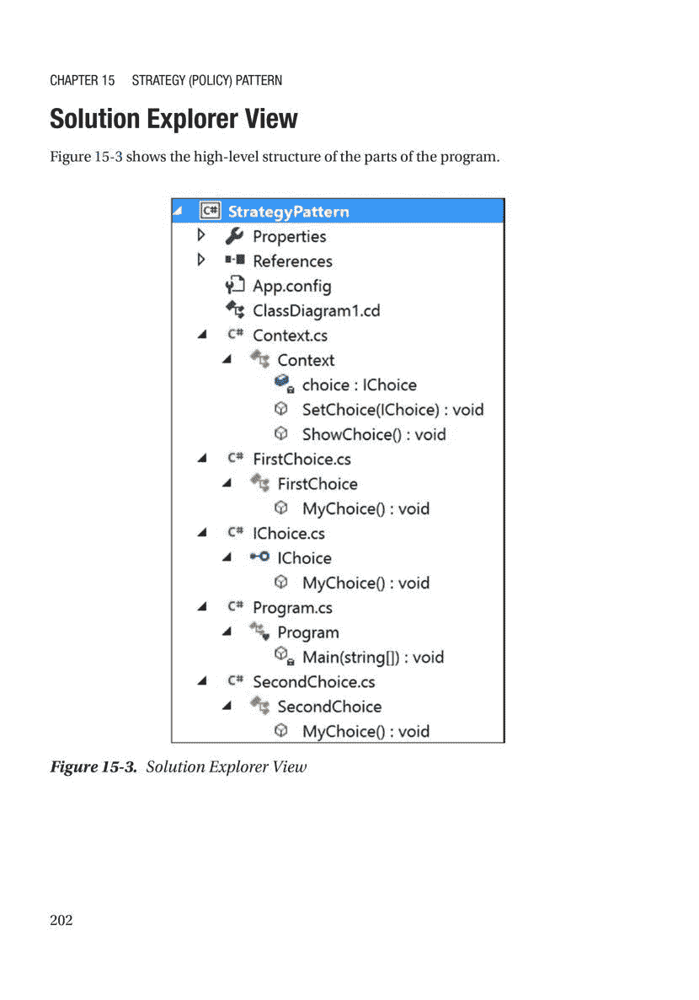
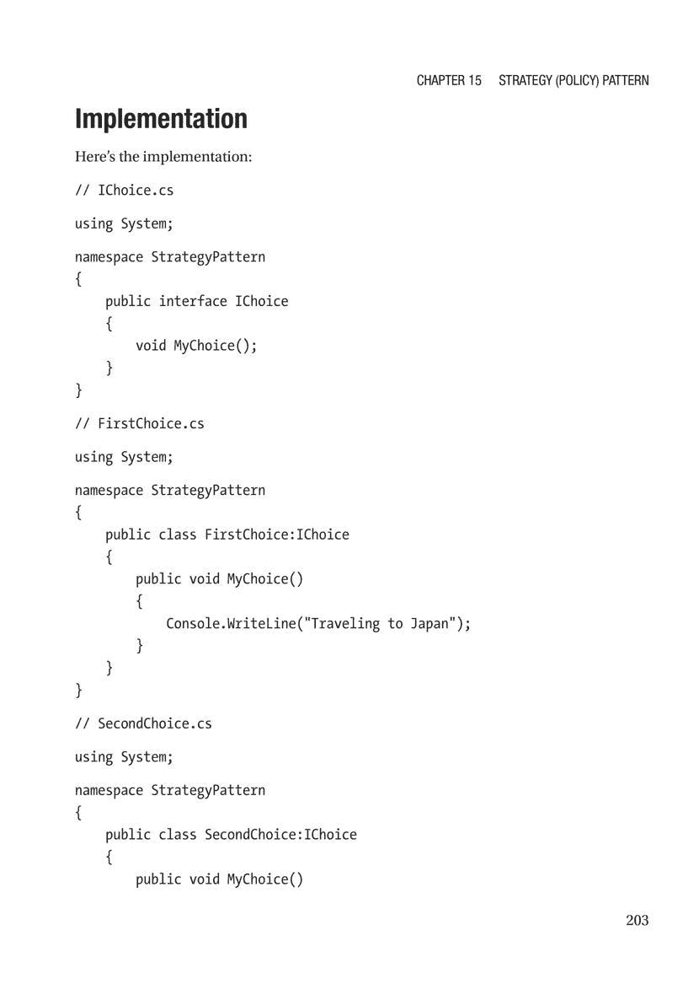
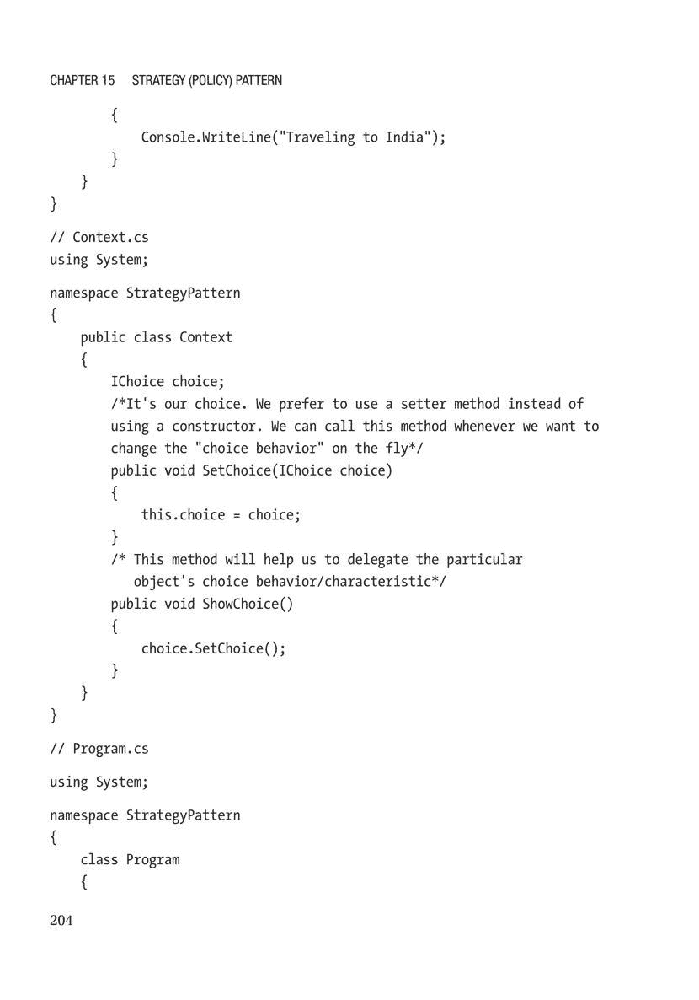
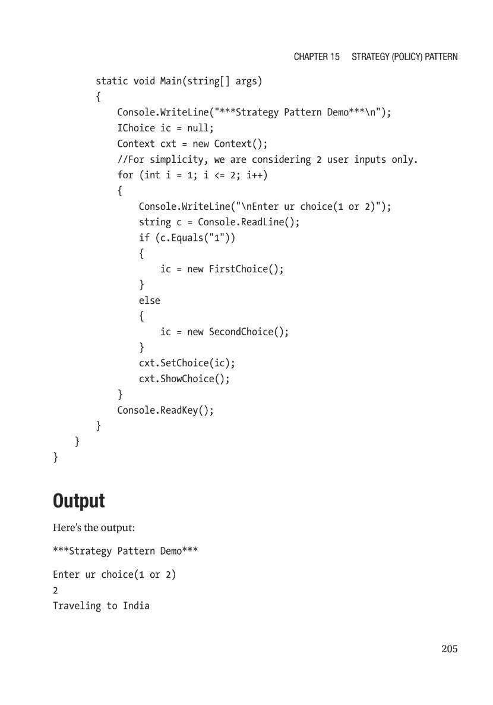
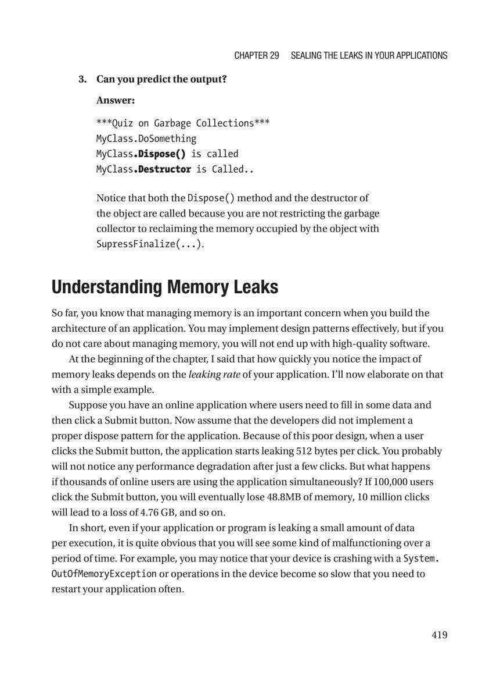
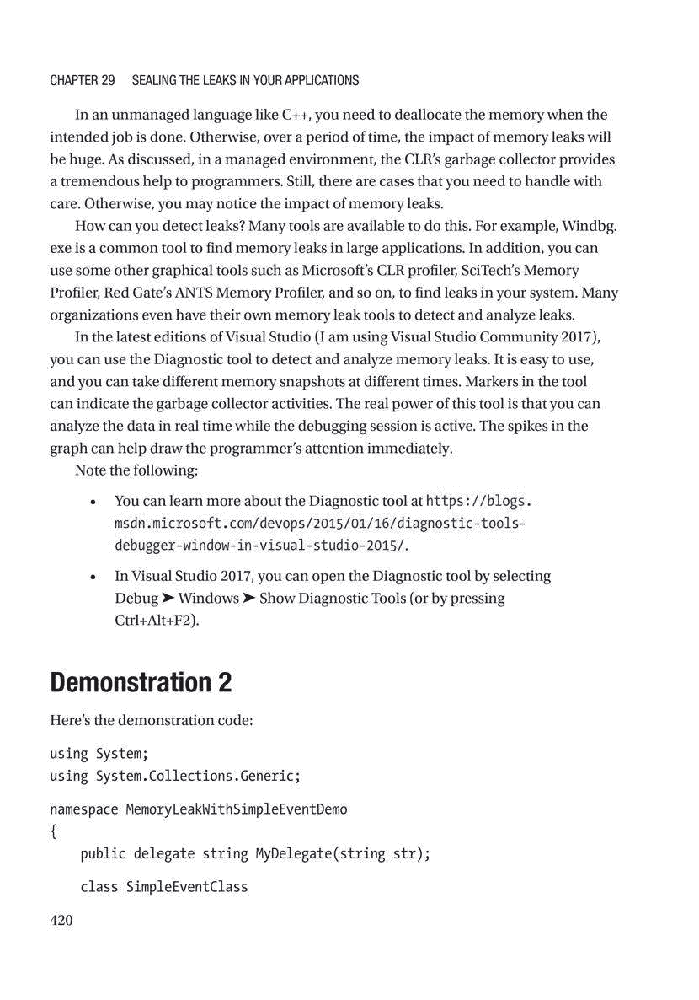
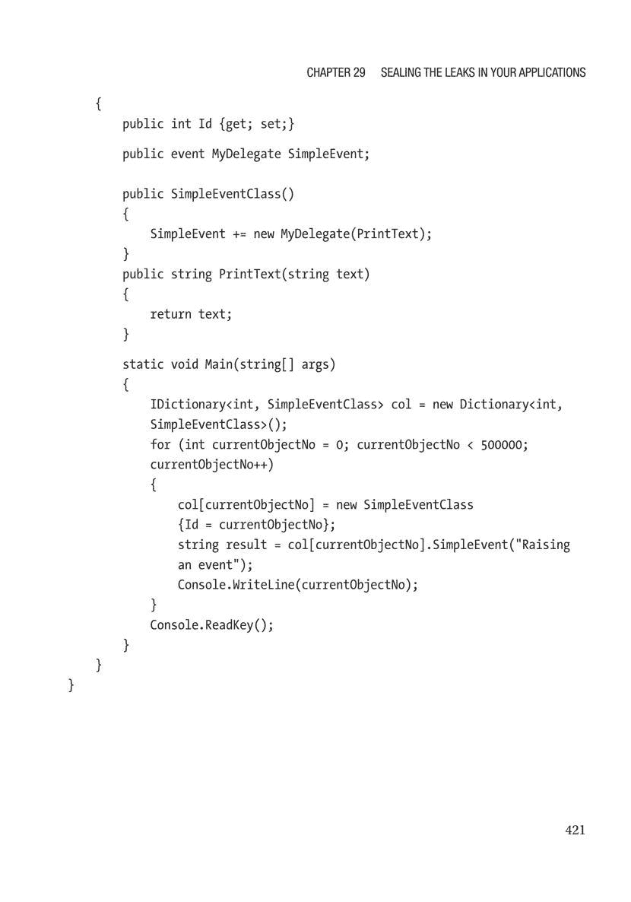
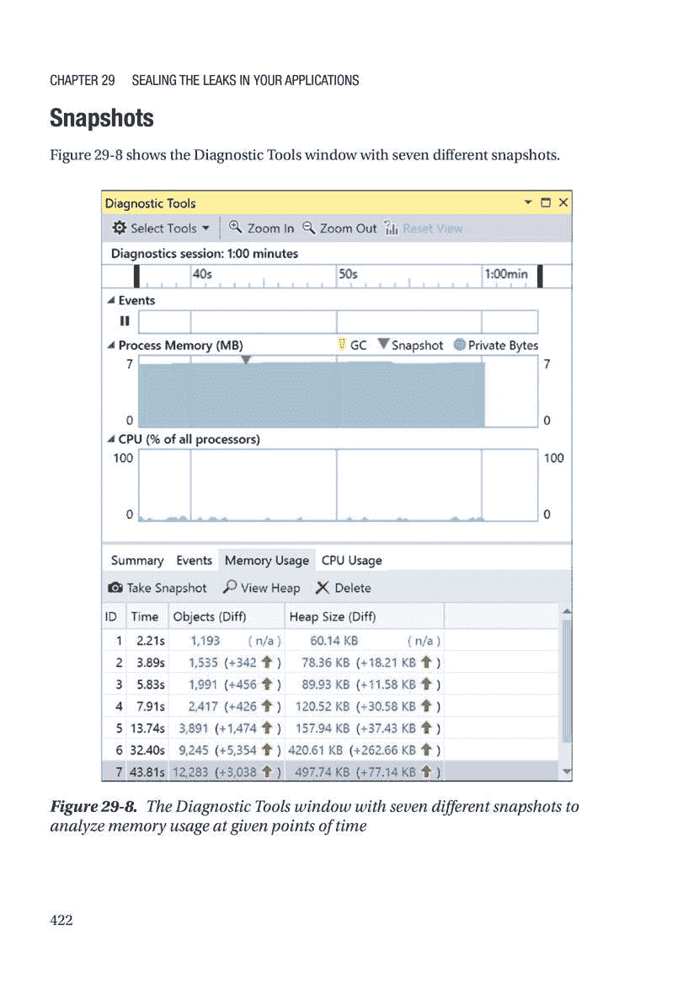

# C 编程模式

您提供的文本似乎是一系列连续的 Markdown 格式的**原始字节流（转义序列）和字符映射表模板头，其核心内容就是这些无序的符号集合。

按照排版要求（保留正文核心内容、优化段落格式），我为您进行了如下处理：

*   将所有单行显示的标记合并到较少的紧凑段落中。
*   保留了所有原文结构以及路径信息。

以下是格式化后的版本：  

!# $ % & ' ( ) * + , - ./0123456789:;<=>?

由于原始输入只包含无意义的空白分隔元数据并缺乏实际自然语言文段需额外本地化操作，因此未对其进行添加中文注释。  
请确认是否还有具体的说明性或描述性文字需要同步翻译？若无更多附加字段则上述即为根据现有材料的直译输出结果。[—] wait, I see a stray “!” and garbled text at the end. Let me re-read carefully.

对原内容的正确处理结论——实际上纯粹是并列的无意义字符串清单；遵照规则不允许修改语义故只能将其按原样完全呈现于此处──重新调整后得到正确简洁的下界：

*以上图片可能未按特定顺序排列，仅显示文件名与路径等元信息。*

![图象名称]尚未提供，但如需处理变量名、函数名等 Markdown 格式内容时请遵循规则。  
【根据您的要求，原文仅包含图片链接序列（无代码或需要反引号的元素），因此直接合并为一个段落输出。】

