# C++ 编程：包含数据结构的程序设计（第 5 版）


- **执行编辑：** Marie Lee
- **组稿编辑：** Amy Jollymore
- **高级产品经理：** Alyssa Pratt
- **编辑助理：** Zina Kresin
- **内容项目经理：** Matthew Hutchinson
- **艺术总监：** Faith Brosnan
- **印刷采购：** Julio Esperas
- **校对：** GreenPen QA
- **索引编制：** Elizabeth Cunningham
- **封面设计：** Roycroft Design / www.roycroftdesign.com
- **封面照片：** Contemporary Building © Steve Hix/Somos Images/Corbis
- **排版：** Integra
献给
我的父母


## 前言

欢迎使用第五版 *C++程序设计：含数据结构的程序设计*。本书面向为期两个学期（CS1 和 CS2）的 C++ 课程，将为你和你的学生带来耳目一新的体验。CS1 和 CS2 课程是计算机科学课程的基石。我的首要目标是激励并激发所有程序设计入门学生的兴趣，无论其水平如何。动力孕育学习的热情。动力和热情是程序设计学生取得成功的关键因素。本书是我在五十多个学期中为计算机科学学生教授程序设计并取得成功的课堂笔记的结晶与发展。

> **警告：** 可以预期，本书会大幅减少你在答疑时间收到的编程求助需求。其他副作用包括：学生在学习编程时对他人的依赖显著降低。

*C++程序设计：含数据结构的程序设计*最初是一组简短示例、练习和较长的编程示例，用于补充我们大学当时使用的教材。很快，它发展成一个规模足以成为一本书的集合。*本书所采用的方法实际上是由学生对清晰性和可读性的需求所驱动的。*这些材料经过反复撰写和修改，直到学生觉得易于理解。本书中的大多数示例都源于课堂上的学生互动。

与任何专业一样，实践至关重要。烹饪专业学生练习他们的食谱。初学小提琴者练习音阶。新程序员必须练习解决问题和编写代码。这不是一本 C++ 食谱。我们不只是列出 C++ 语法再附上一个示例；我们会剖析所有概念背后的“为什么”。对于每个主题，在首次介绍时都会回答关键的“为什么？”问题。这种方法为学习 C++ 搭建了一座桥梁。学生必须理解“为什么？”，才能有动力学习。

传统上，C++ 程序设计初学者需要具备另一门编程语言的实用知识。本书假定读者没有编程经验。但是，需要具备一定的数学基础，如大学代数。

## 第五版的变化

第五版包含 50 多个新的编程练习和 150 多个新练习。第2章至第7章包含一个编程练习，其中给出一个问题的解决方案；但是，语句的顺序不正确。因此，要求学生按照正确的语句顺序重写程序。这将使学生学会如何阅读和调试别人编写的程序。本版的另一个重大变化是在第2章至第7章中加入了调试部分。在这些部分中，包含一个有错误的程序。该程序会被编译，如果有语法错误，则显示出来。然后我们展示如何解释语法错误并加以纠正。有些部分还展示如何查找并纠正逻辑错误。本版还包括各种新示例，如示例 5-8、7-8、12-6 和 12-8。第4、5、6、7章中的多个小节已经重写。第8章增加了更多字符串函数，第14章中的虚函数部分也已用新示例重写。

## 方法

程序设计语言 C++ 由 C 演变而来，不再被视为仅用于工业界的语言。许多学院和大学使用 C++ 作为他们的第一门程序设计语言课程。C++ 是结构化程序设计和面向对象程序设计的结合，本书涵盖这两种类型。

本书面向计算机科学中为期两个学期的课程 CS1 和 CS2。前 11 章或 12 章可以在第一门课程中讲授，其余部分在第二门课程中讲授。

1998 年 7 月，ANSI/ISO 标准 C++ 正式获得批准。本书重点介绍 ANSI/ISO 标准 C++。尽管标准 C++ 与 ANSI/ISO 标准 C++ 的语法非常相似，但第8章讨论了 ANSI/ISO 标准 C++ 中一些标准 C++ 不具备的特性。

第1章简要回顾计算机和程序设计语言的历史。读者可以快速浏览本章，熟悉计算机的一些硬件组件和软件部分。本章包含一节关于处理 C++ 程序的内容。本章还描述了结构化程序设计和面向对象程序设计。

第2章讨论 C++ 的基本要素。完成本章后，学生将熟悉 C++ 的基础知识，并能够编写足够复杂以进行一些计算的程序。输入/输出是任何程序设计语言的基础。它在第3章较早引入，并进行了详细讨论。

第4章和第5章介绍用于改变顺序执行流程的控制结构。第6章和第7章研究用户自定义函数。建议没有编程背景的读者在第6章和第7章上多花些时间。书中提供了几个示例，帮助读者理解参数传递和标识符作用域的概念。

第8章讨论用户自定义简单数据类型（枚举类型）、ANSI/ISO 标准 C++ 的命名空间机制以及 `string` 类型。早期版本的 C 不包含枚举类型。枚举类型的用途非常有限；其主要目的是使程序具有可读性。本书的组织方式使读者在第一次阅读时可以跳过枚举类型部分，而不会感到任何不连贯，然后再学习这一部分。

第9章详细讨论数组。第10章介绍记录（`structs`）。本书中对 `structs` 的介绍类似于 C 的 `structs`。本章是可选的；它不是任何后续章节的先修内容。

第11章开始学习面向对象编程（OOP）并介绍类。本章前半部分展示类如何在程序中定义和使用。本章后半部分介绍抽象数据类型（ADT）。本章展示 C++ 中的类如何成为实现 ADT 的自然方式。第12章继续介绍面向对象设计（OOD）和 OOP 的基础，并讨论继承和组合。它解释了 C++ 中的类如何为 OOD 提供自然机制，以及 C++ 如何支持 OOP。第12章还讨论了如何在给定问题中找出对象。

第13章详细研究指针。在介绍指针以及如何在程序中使用指针之后，本章重点讨论带指针数据成员的类的特殊之处以及如何避免这些问题。此外，本章还讨论如何创建和使用动态二维数组。第13章还讨论抽象类以及通过虚函数实现的一种多态。

第14章继续学习 OOD 和 OOP。特别是，它研究 C++ 中的多态。第14章具体讨论两种多态——重载和模板。

第15章详细讨论异常处理。第16章介绍并讨论递归。这是一个独立章节，因此可以在第10章之后的任何时候学习。

第17章和第18章专门讨论数据结构。第17章详细讨论链表，第18章详细讨论栈和队列。这些章节中开发的程序代码是通用的。这些章节有效地运用了 OOD 的基础知识。

第19章讨论各种查找和排序算法。除了展示这些算法如何工作之外，它还提供了关于算法性能的相关分析和结果。算法分析使用户能够决定在特定应用中使用哪种算法。本章还包括几种排序算法。教师可以决定讲授哪些算法。

第20章介绍二叉树。讨论并图解说明了各种遍历算法以及二叉树的基本性质。介绍了称为二叉搜索树的特殊二叉树。描述并图解说明了在二叉搜索树中搜索以及插入和删除项。第20章还讨论非递归二叉树遍历算法。此外，为了增强遍历算法的灵活性，本章展示了如何构造函数并将函数作为参数传递给其他函数。本章还讨论 AVL 树。


（高度平衡）树的详细讨论。由于篇幅考虑，关于 AVL 树的讨论作为单独一节提供，并可在本书配套网站上获取。

第21章讨论图算法。在介绍基本的图论术语之后，讨论图在计算机内存中的表示。本章还讨论图遍历算法、最短路径算法和最小生成树算法。拓扑排序也在本章讨论，并可在本书配套网站上获取。

C++ 配备了一个强大的库——标准模板库（STL）——其中包含可在各种应用中有效使用的数据结构和算法。第22章详细描述 STL。在介绍 STL 的三个基本组成部分之后，说明顺序容器如何在程序中使用。还讨论特殊容器，如栈和队列。本章后半部分展示各种 STL 算法如何在程序中使用。本章相当长；根据可用时间，教师至少可以涵盖顺序容器、迭代器、stack 和 queue 类以及某些算法。

附录 A 列出 C++ 中的保留字。附录 B 显示 C++ 运算符的优先级和结合性。附录 C 列出 ASCII（美国信息交换标准代码）和 EBCDIC（扩展二进制编码的十进制交换码）字符集。附录 D 列出可重载的 C++ 运算符。

附录 E 有三个目标。首先，我们讨论如何将数字从十进制转换为二进制以及从二进制转换为十进制。然后详细讨论二进制文件和随机访问文件。最后，描述 ANSI/ISO 标准 C++ 和标准 C++ 中头文件的命名约定。附录 F 讨论一些最常用的库例程，并包括标准 C++ 头文件的名称。附录 G 中的程序展示如何打印系统上内置数据类型的内存大小，以及如何使用随机数生成器。附录 H 给出进一步学习的精选参考文献。附录 I 提供本书中奇数编号习题的答案。

# 如何使用本书

本书可以有多种使用方式。图1显示各章之间的依赖关系。

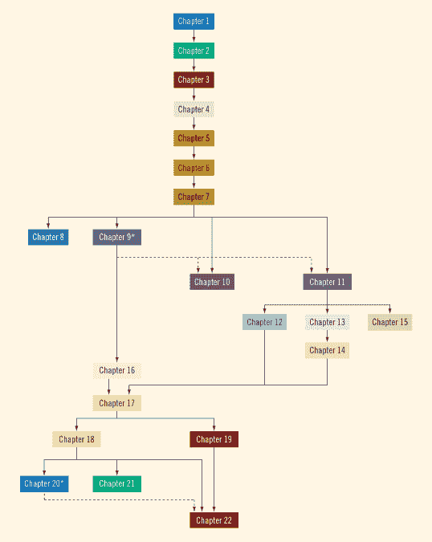

**图 1** 章节依赖图

在图1中，虚线表示前一章在该章的某一节中使用，并不一定是下一章的先修内容。例如，第9章详细涵盖数组。在第10章和第11章中，我们分别展示数组与结构体之间以及数组与类之间的关系。然而，如果在学习第9章之前学习第11章，那么第11章中处理数组的那一节可以跳过，而不会造成任何中断。这一特定节可以在学习第9章之后学习。

建议按顺序学习前七章。在学完前七章之后，如果读者有兴趣尽早学习 OOD 和 OOP，那么可以在第7章之后立即学习第11章。第8章可以在第7章之后的任何时候学习。按顺序学习前七章之后，有几种学习方案：

- 1. 按以下顺序学习章节：9、10、11、12、13、14、15、16、17、18、19、20、21、22。
- 2. 按以下顺序学习章节：9、11、13、14、12、16、17、18、15、19、20、21、22。
- 3. 按以下顺序学习章节：11、9、13、14、12、16、17、18、15、19、20、21、22。

如章节依赖图所示，第18章和第19章可以按任意顺序学习。然而，通常第18章和第19章按顺序学习。理想情况下，应按顺序学习第17、18、19和20章。第21章和第22章可以按任意顺序学习。

# 本书特色

（在 while 语句之前初始化为 0）以跟踪已读取多少项。在执行 while 语句体之前，将计数器与 N 比较。如果 counter < N，则执行 while 语句体。循环体继续执行，直到 counter >= N 的值。因此，在 while 语句体内部，counter 的值在读取新项后递增。在这种情况下，while 循环可能如下所示：

```cpp
counter = 0;        // initialize the loop counter variable

while (counter < N) // while loop condition
{
    ...
    counter++;      // update the loop counter variable
    ...
}
```

如果 N 表示文件中的数据项数，那么 N 的值可以通过几种方式确定。程序可以提示你指定文件中的项数；输入语句可以读取该值；或者你可以将文件中的第一项指定为文件中的项数，这样你就不必记住输入值（项）的数量。如果输入数据的人不是程序员，这会很有用。参见示例 5-3。

## 示例 5-3

假设输入为：

8 9 2 3 90 38 56 8 23 89 7 2

假设你想将这些数字相加并求它们的平均值。考虑以下内容：

```cpp
// Program: Counter-Controlled Loop
#include <iostream>
using namespace std;

int main()
{
    int limit;     // stores the number of data items
    int number;    // variable to store each data item
    int sum;       // variable to store the sum
    int counter;   // loop control variable

    cout << "Enter the number of integers in the list: ";
    cin >> limit;
    cout << "...";
}
```

四色内页设计展示准确的 C++ 代码及相关注释。

# 控制结构

第2章将程序定义为一系列语句，其目标是完成某项任务。到目前为止你检查过的程序都很简单直接。为了处理程序，计算机从第一条可执行语句开始，并按顺序执行语句，直到到达末尾。在本章和第5章中，你将学习如何告诉计算机，它不必遵循单一的语句顺序；它还可以做出决策，并重复执行某些语句，直到满足某些条件。

计算机可以通过以下方式之一处理程序：按顺序；有选择地，通过做出选择（也称为分支）；重复地，通过使用称为循环的结构反复执行语句；或通过调用函数。图4-1说明前三种程序流程。在第7章中，我们将展示函数调用如何工作。第2章和第3章中的编程示例包括简单的顺序程序。对于这样的程序，计算机从开头开始，并按顺序执行语句。不做出选择；没有重复。控制结构为顺序程序执行提供了替代方案，并用于改变顺序执行流程。两种最常见的控制结构是选择和重复。在选择中，程序根据某些条件执行特定语句。在重复中，程序根据某些条件将特定语句重复一定次数。

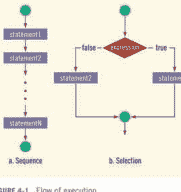

超过 400 幅全面而详尽的可视化图表阐释了困难的概念。

（在 while 语句之前初始化为 0）以跟踪已读取多少项。在执行 while 语句体之前，将计数器与 N 比较。循环体继续执行，直到 counter 的值 ≥ N。因此，在 while 语句体内部，counter 的值在读取新项后增加。在这种情况下，while 循环可能如下所示：

```cpp
counter = 0;        // initialize the loop counter variable
while (counter < N) // execute the loop operations
{
    ...
    counter++;
    ...
}
```

如果 N 表示文件中的数据项数，那么 N 的值可以通过几种方式确定。程序可以提示你指定文件中的项数；输入语句可以读取该值；或者你可以将文件中的第一项指定为文件中的项数，这样你就不必记住输入值（项）的数量。如果输入数据的人不是程序员，这会很有用。

## 示例 5-3

假设输入为：

8 9 2 3 90 38 56 8 23 98 7 2

假设你想将这些数字相加并求它们的平均值。考虑以下程序：

```cpp
#include <iostream>
using namespace std;

int main()
{
    int limit;       // store the number of data items
    int number;      // variable for input
    int sum;         // variable to store the sum
    int counter;     // variable to keep track of items

    cout << "Line 1: Enter the number of "
         << "integers in the list: ";
    cin >> limit;
    cout << endl;
}
```

编号示例通过其编程代码说明关键概念。示例之后是示例运行。随后是解释，描述代码中每一行做什么。


- 13. 双向选择采用以下形式：

    ```
    if (expression)
        statement1
    else
        statement2
    ```

    如果 expression 为真，则执行 statement1；否则执行 statement2。
- 14. if 或 if...else 结构中的表达式通常是逻辑表达式。
- 15. 在单向选择中，在语句前包含分号会产生语义错误。在这种情况下，if 语句的动作是空的。
- 16. 在双向选择中，在 statement1 前包含分号会产生语法错误。
- 17. C++ 中没有独立的 else 语句。每个 else 都有一个相关的 if。
- 18. else 与最近一个尚未与任何其他 else 配对的 if 配对。
- 19. 括在花括号 { 和 } 之间的一系列语句称为复合语句或语句块。复合语句被视为单条语句。
- 20. 可以在 if 语句中使用输入流变量来确定输入流的状态。
- 21. 使用赋值运算符代替相等运算符会产生语义错误。这可能导致程序中出现严重错误。
- 22. switch 结构用于处理多选择。
- 23. 在 switch 语句中执行 break 语句会立即退出 switch 结构。
- 24. 如果程序中未满足某些条件，可以使用 assert 函数终止程序。

练习进一步强化学习，并确保学生确实已经掌握了材料。

## 练习

- 1. 判断以下陈述为真或假。
  - a. 逻辑表达式的结果不能赋给 int 变量。
  - b. 在单向选择中，如果在 if 语句中的表达式后放置分号，则 if 语句中的表达式总是为真。
  - c. 每个 if 语句都必须有对应的 else。
  - d. if 语句中的表达式：`if (score >= 60) grade = 'A';` 总是求值为真。

## 编程示例：转换长度

编写一个程序，输入以英尺和英寸表示的长度。然后，程序应转换并输出以厘米表示的长度。假设给定的英尺和英寸长度是整数。

|  |  |
| --- | --- |
| **输入** | 以英尺和英寸表示的长度 |
| **输出** | 以厘米表示的等效长度。 |

长度以英尺和英寸给出，你需要求出以厘米表示的等效长度。给定长度后，你需要对其进行转换。程序需要做的第一件事是将以英尺和英寸表示的长度转换为总英寸数。然后，你可以使用转换公式 1 英寸 = 2.54 厘米，求出以厘米表示的等效长度。要将以英尺和英寸表示的长度转换为英寸，你需要将英尺数乘以 12（因为 1 英尺等于 12 英寸），再加上给定的英寸数。

```
totalInches = (12 * feet) + inches
             = (12 * 5) + 7
             = 67
```

例如，假设输入为 5 英尺 7 英寸。然后，你按如下方式求出总英寸数：

然后，你可以应用转换公式 1 英寸 = 2.54 厘米，求出以厘米表示的长度。

```
centimeters = totalInches * 2.54
             = 67 * 2.54
             = 170.18
```

基于对问题的这一分析，你可以设计如下算法：

- 1. 获取以英尺和英寸表示的长度。
- 2. 将该长度转换为总英寸数。
- 3. 将总英寸数转换为厘米。
- 4. 输出厘米数。

**变量** 程序的输入是两个数：一个表示英尺，一个表示英寸。因此，你需要两个变量：一个存储英尺，另一个存储英寸。由于程序会先将给定长度转换为英寸，你需要另一个变量来存储总英寸数。你还需要一个变量来存储以厘米表示的等效长度。总之，你需要以下变量：

```
int feet;             //variable to hold feet
int inches;           //variable to hold given inches
double totalInches;   //variable to hold total inches
double centimeters;  //variable to hold length in centimeters
```

编程示例是每章末尾展示的程序。编程示例是本章所有内容融会贯通之处。它们会用页边图标突出显示，如图所示。这些示例教授问题解决技能，并包含输入、输出、问题分析与算法设计、类设计以及程序清单等具体阶段。这些程序被设计得有条理、一致且用户友好。每个编程示例都从问题分析开始，随后是算法设计和/或类设计。算法的每一步都用 C++ 编码。除了帮助学生学习问题解决技术外，这些详细的程序还向学生展示如何在实际的 C++ 程序中实现概念。

我们强烈建议学生仔细研究编程示例，以便有效学习 C++。学生通常能从完整解答的程序中学到很多东西。此外，编程示例大大减少了学生在课堂之外寻求帮助的需求，并增强了学生的自信心。

- 45. 以下代码的输出是什么？

  ```
  int num = 12;
  while (num > 0)
  {
      if (num % 5 == 0)
      {
          num++;
          continue;
      }
      cout << num << " ";
      num /= 2;
  }
  cout << endl;
  ```

- 46. break 语句在循环中起什么作用？

## 编程练习

- 1. 编写一个程序，提示用户输入一个整数，然后输出该数的各个数字以及数字之和。例如，如果输入为 3456，则输出 3456 的各个数字为 3 4 5 6；输入为 8030，则输出 8030 的各个数字为 8 0 3 0；输入为 234556，则输出 234556 的各个数字为 2 3 4 5 5 6；输入为 4000，则输出 4000 的各个数字为 4 0 0 0；输入为 -2345，则输出 -2345 的各个数字为 -2 3 4 5。

- 2. π 的值可以使用以下级数近似：

  $$\pi = 4\left(1 - \frac{1}{3} + \frac{1}{5} - \frac{1}{7} + \cdots\right)$$

  以下程序使用该级数求 π 的近似值。然而，语句的顺序不正确，而且该程序中还有一个错误。请重新排列语句，并找出并删除该错误，使该程序可用于近似计算 π。

  ```
  #include <iostream>
  #include <iomanip>

  using namespace std;

  int main()
  {
      double pi = 0;
      long n;
      long max;

      cin >> n;
      cout << "Enter the value of n: ";
      cout << endl;
  }
  ```

> 编程练习要求学生编写具有指定结果的 C++ 程序。


## 补充资源

当本书在课堂环境中使用时，可以使用以下补充材料。如下所述的所有教师材料均可在该教材的配套网站 www.cengage.com 上获取。

### 电子教师手册

本教材配套的教师手册包括：

- 辅助备课的补充教学材料，包括讲座主题建议。
- 所有章末材料的解答，包括编程练习。

### ExamView®

本教材配有 ExamView，这是一款强大的测试软件包，允许教师创建和管理纸质、计算机（基于局域网）和互联网考试。ExamView 包含数百道与本教材涵盖主题相对应的问题，使学生能够生成详细的学习指南，其中包括供进一步复习的页码引用。这些基于计算机和互联网的测试组件允许学生在自己的计算机上参加考试，并节省教师时间，因为每场考试都会自动评分。

### PowerPoint 演示文稿

本书附有每章的 Microsoft PowerPoint 幻灯片。这些幻灯片作为课堂教学演示的辅助工具提供，既可在网络上提供给学生用于章节复习，也可打印出来在课堂上分发。教师可以为自己向班级介绍的其他主题添加自己的幻灯片。本书的 PowerPoint 幻灯片也提供在教师资源 CD 上。

### 远程学习

Cengage Learning 自豪地提供 WebCT 和 Blackboard 在线课程，以提供尽可能完整和动态的学习体验。有关如何……的更多信息

若要将远程学习引入您的课程，请联系您当地的 Cengage Learning 销售代表。

## 源代码

源代码采用 ANSI/ISO 标准 C++ 编写，可在教材配套网站 www.cengage.com/coursetechnology 获取，也可在教师资源 CD-ROM 中获得。运行某些程序所需的输入文件也随源代码一起提供。

## 解答文件

所有编程练习的解答文件均采用 ANSI/ISO C++ 编写，可在教材配套网站 www.cengage.com/coursetechnology 获取，也可在教师资源 CD-ROM 中获得。运行某些编程练习所需的输入文件也随解答文件一起提供。

## 致谢

我必须感谢许多人，他们以各种方式为本书的成功做出了贡献。首先，我要感谢所有学生，他们在本书编写过程中主动告诉我某些部分是否需要改写，以便更好地理解和更清晰地阅读。其次，我要感谢那些通过电子邮件提出大量意见以改进第三版的人。我感谢 S.C. Cheng、Randall Crist 和 Vasant Raval 教授对本项目的持续支持。我也非常感谢审阅本书早期版本的审稿人，他们提出了许多关于如何改进本书的批评性建议。

我非常感谢以下审稿人，他们耐心阅读了当前版本每一章的每一页，并提出了改进本书的批评性意见：东北大学的 Stefano Basagni；密歇根大学的 Jeff Ringenberg；密歇根大学的 Colleen van Lent；圣安东尼奥山学院的 Tuan Vo；加州州立大学圣贝纳迪诺分校的 Kerstin Voigt；加州州立理工大学波莫纳分校的 Lan Yang。审稿人将会认识到，他们的批评意见没有被忽视，事实上，这些意见使本书变得更好。

接下来，我要感谢组稿编辑 Amy Jollymore，她认识到了本项目的重要性和独特性。如果没有高级产品经理 Alyssa Pratt 的精心规划，这一切都不可能实现。我向 Alyssa 以及内容项目经理 Matthew Hutchinson 致以诚挚的感谢。我还要感谢 Integra Software Services 的 Tintu Thomas 协助我们保持项目按计划进行。我要感谢 Course Technology 的 Chris Scriver 和 Serge Palladino 耐心细致地测试代码并发现拼写错误和错误。

本书献给我的父母，感谢他们的祝福。

最后，我感谢妻子 Sadhana，尤其感谢女儿 Shelly 的支持。在撰写本书期间，每当我感到不堪重负时，她们都鼓励我。欢迎对本书正文提出任何意见。意见可发送至以下电子邮件地址：malik@creighton.edu。

D. S. Malik


# 第1章：计算机与编程语言概述

在本章中，您将：

- 了解不同类型的计算机
- 探索计算机系统的硬件和软件组件
- 了解计算机的语言
- 了解编程语言的演变
- 考察高级编程语言
- 发现编译器是什么以及它做什么
- 考察一个 C++ 程序
- 探索 C++ 程序是如何处理的
- 了解什么是算法并探索问题求解技术
- 了解结构化设计和面向对象设计编程方法学
- 了解标准 C++ 和 ANSI/ISO 标准 C++

## 引言

诸如“互联网”这样的术语在20年前还并不熟悉，如今已司空见惯。小学生经常“上网冲浪”，并使用计算机设计课堂项目。许多人使用互联网查找信息并与他人交流。这一切都得益于各种软件（也称为计算机程序）的可用性。没有软件，计算机就毫无用处。软件是使用编程语言开发的。编程语言 C++ 特别适合开发完成特定任务的软件。我们的主要目标是帮助您学习如何用 C++ 编程语言编写程序。在开始编程之前，了解一些基本术语和计算机的不同组件是很有用的。我们先从计算机历史概述开始。

## 计算机历史简要概述

已知最早执行计算的设备是算盘。算盘发明于亚洲，但曾在古巴比伦、中国以及整个欧洲使用，直到中世纪晚期。算盘使用在框架中滑动算珠的系统进行加法和减法。1642年，法国哲学家和数学家布莱士·帕斯卡发明了一种称为帕斯卡计算器的计算设备。它有八个可移动的轮盘拨号，可以计算长达八位的和。算盘和帕斯卡计算器都只能执行加法和减法运算。17世纪后期，戈特弗里德·冯·莱布尼茨发明了一种能够加、减、乘、除的设备。1819年，法国织工约瑟夫·雅卡尔发现，他的织布机的编织指令可以存储在打孔的卡片上。当卡片按顺序通过织布机时，针穿过孔洞，挑起正确颜色和质地的线。织工可以重新排列卡片，改变所织的图案。本质上，这些卡片对织布机进行编程，以在布料上产生图案。纺织业似乎与计算机行业几乎没有共同之处。然而，通过在卡片上打孔来存储信息的思想在后来计算机的发展中被证明非常重要。

在19世纪初至中期，英国数学家和物理科学家查尔斯·巴贝奇设计了两台计算机器——差分机和分析机。差分机可以执行复杂运算，例如自动计算平方。巴贝奇制造了差分机的原型，但实际设备从未生产出来。分析机的设计包括输入设备、数据存储、允许按任意顺序处理指令的控制单元以及输出设备。然而，这些设计仍停留在蓝图阶段。巴贝奇的大部分工作是通过他的同事、洛夫莱斯伯爵夫人阿达·奥古斯塔的著作而为人所知的。奥古斯塔被认为是第一位计算机程序员。

19世纪末，美国人口普查官员需要帮助来准确制表人口普查数据。赫尔曼·何乐礼发明了一种由电力驱动并使用打孔卡存储数据的计算机器。何乐礼的机器取得了巨大成功。何乐礼创立了制表机公司，该公司后来成为著名的计算机和技术公司 IBM。

第一台类似计算机的机器是 Mark I。它于1944年由 IBM 和哈佛大学在霍华德·艾肯的领导下联合建造。打孔卡被用来向机器输入数据。Mark I 长52英尺，重50吨，有750,000个零件。1946年，ENIAC（电子数值积分器和计算器）在宾夕法尼亚大学建成。它包含18,000个真空管，重约30吨。

我们今天所知的计算机使用约翰·冯·诺依曼在20世纪40年代末给出的设计规则。他的设计包括算术逻辑单元、控制单元、存储器和输入/输出设备等组件。这些组件将在下一节中描述。冯·诺依曼的计算机设计使得将编程指令和数据存储在同一内存空间中成为可能。1951年，UNIVAC（通用自动计算机）建成并出售给美国人口普查局。

1956年，晶体管的发明带来了更小、更快、更可靠且更节能的计算机。这一时期也见证了软件开发行业的出现，FORTRAN 和 COBOL 这两种早期编程语言被引入。在下一个重大技术进步中，晶体管被微小的集成电路（即“芯片”）取代。芯片比晶体管更小、更便宜，并且可以在单个芯片上包含数千个电路。它们赋予计算机极高的处理速度。

1970年，微处理器——将整个 CPU 集成在单个芯片上——被发明出来。1977年，斯蒂芬·沃兹尼亚克和史蒂文·乔布斯在他们的车库里设计并建造了第一台 Apple 计算机。1981年，IBM 推出了其个人计算机（PC）。20世纪80年代，IBM PC 的克隆机型使个人计算机更加负担得起。到20世纪90年代中期，各行各业的人们都能够买得起它们。随着技术进步，计算机继续变得更快、更便宜。

现代计算机功能强大、可靠且易于使用。它们可以接受语音指令，并通过人工智能模仿人类推理。专家系统帮助医生进行诊断。移动计算应用正在显著增长。使用手持设备，送货司机可以访问全球定位卫星（GPS），以核实取货和送货的客户位置。手机允许您查看电子邮件、预订航班、查看股票表现并访问银行账户。

尽管计算机有几种分类，例如大型机、中型机和小型机，但所有计算机都共享一些基本元素，将在下一节中描述。

## 计算机系统的元素

计算机是一种能够执行命令的电子设备。计算机执行的基本命令包括输入（获取数据）、输出（显示结果）、存储以及执行算术和逻辑运算。

在当今市场上，个人计算机销售时会带有诸如 Pentium 4 处理器 2.80 GHz、1 GB RAM、250 GB 硬盘、XV750 19 英寸银色平面 CRT 彩色显示器等描述，并预装操作系统、游戏、百科全书等软件，以及文字处理器或财务管理程序等应用软件。这些描述代表两个类别：硬件和软件。诸如“Pentium 4


“处理器 2.80 GHz、1GB 内存、250 GB 硬盘、VX750 19 英寸银色纯平 CRT 彩色显示器”属于硬件类别；“操作系统、游戏、百科全书和应用软件”等属于软件类别。让我们先来考虑硬件。

## 硬件

主要硬件组件包括中央处理器（CPU）；主存储器（MM），也称随机存取存储器（RAM）；输入/输出设备；以及辅助存储器。输入设备的一些例子有键盘、鼠标和辅助存储器。输出设备的例子有屏幕、打印机和辅助存储器。让我们更详细地逐一了解这些组件。

### 中央处理器和主存储器

中央处理器是计算机的“大脑”，也是计算机中单价最昂贵的硬件部件。CPU 越强大，计算机运行越快。算术和逻辑运算都在 CPU 内部执行。图 1–1(a) 展示了一些硬件组件。

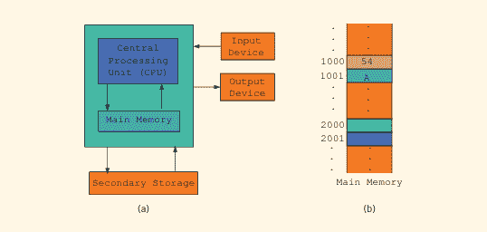

**图 1-1** 计算机的硬件组件和主存储器

**主存储器**，或**随机存取存储器**，直接连接到 CPU。所有程序必须先加载到主存储器中才能执行。同样，所有数据也必须先放入主存储器，程序才能对其进行操作。当计算机关机时，主存储器中的所有内容都会丢失。

主存储器是一个有序的单元序列，这些单元称为**存储单元**。每个单元在主存储器中都有一个唯一的位置，称为该单元的**地址**。这些地址帮助你访问存储在单元中的信息。图 1–1(b) 展示了带有一些数据的主存储器。

当今的计算机配备的主存储器由数百万到数十亿个单元组成。虽然图 1–1(b) 显示数据存储在单元中，但单元的内容可以是编程指令或数据。此外，该图将数据显示为数字和字母。然而，正如本章后面所解释的，主存储器将所有内容存储为 0 和 1 的序列。内存地址也表示为 0 和 1 的序列。

### 辅助存储器

由于程序和数据处理前必须存储在主存储器中，且计算机关机时主存储器中的所有内容都会丢失，因此主存储器中的信息必须传输到其他设备进行永久存储。永久存储信息的设备（除非该设备变得无法使用，或者你通过重写来更改信息）称为**辅助存储器**。为了能够将信息从主存储器传输到辅助存储器，这些组件必须直接相互连接。辅助存储器的例子有硬盘、闪存盘、软盘、ZIP 磁盘、CD-ROM 和磁带。

### 输入/输出设备

要使计算机执行有用的任务，它必须能够接收数据和程序，并显示计算结果。将数据和程序送入计算机的设备称为**输入设备**。键盘、鼠标和辅助存储器是输入设备的例子。计算机用来显示结果的设备称为**输出设备**。显示器、打印机和辅助存储器是输出设备的例子。图 1–2 展示了一些输入和输出设备。


**图 1-2** 一些输入和输出设备

## 软件

软件是为执行特定任务而编写的程序。例如，文字处理器是用来写信、论文甚至书籍的程序。所有软件都用编程语言编写。程序有两种类型：系统程序和应用程序。

**系统程序**控制计算机。打开 PC 时最先加载的系统程序称为操作系统。没有操作系统，计算机就无法使用。**操作系统**监控计算机的整体活动并提供服务。其中一些服务包括内存管理、输入/输出活动和存储管理。操作系统有一个特殊程序来组织辅助存储器，以便你方便地访问信息。

**应用程序**执行特定任务。文字处理器、电子表格和游戏都是应用程序的例子。操作系统是运行应用程序的程序。

## 计算机的语言

当你在键盘上按下 A 时，计算机在屏幕上显示 A。但计算机的主存储器中实际存储的是什么？计算机的语言是什么？它如何存储你在键盘上输入的内容？

请记住，计算机是一种电子设备。计算机内部使用电信号来处理信息。电信号有两种类型：模拟信号和数字信号。**模拟信号**是用于表示声音等事物的连续波形。例如，录音带以模拟信号存储数据。**数字信号**用 0 和 1 的序列表示信息。0 表示低电压，1 表示高电压。数字信号比模拟信号是更可靠的信息载体，并且可以精确地从一台设备复制到另一台设备。你可能已经注意到，当你复制录音带时，副本的音质不如原版磁带。另一方面，当你复制 CD 时，副本与原版一样好。计算机使用数字信号。

由于计算机内部处理的是数字信号，计算机的语言，称为**机器语言**，是 0 和 1 的序列。数字 0 或 1 称为**二进制数字**，或**位**。有时，0 和 1 的序列被称为**二进制代码**或**二进制数**。

**位：** 二进制数字 0 或 1。

八位序列称为**字节**。此外，2¹⁰ 字节 = 1024 字节称为**千字节（KB）**。表 1–1 总结了用于描述各种字节数的术语。

**表 1-1** 二进制单位

| 单位 | 符号 | 位/字节 |
|---|---|---|
| 字节 |  | 8 位 |
| 千字节 | KB | 2^10 字节 = 1024 字节 |
| 兆字节 | MB | 1024 KB = 2^10 KB = 2^20 字节 = 1,048,576 字节 |
| 千兆字节 | GB | 1024 MB = 2^10 MB = 2^30 字节 = 1,073,741,824 字节 |
| 太字节 | TB | 1024 GB = 2^10 GB = 2^40 字节 = 1,099,511,627,776 字节 |
| 拍字节 | PB | 1024 TB = 2^10 TB = 2^50 字节 = 1,125,899,906,842,624 字节 |
| 艾字节 | EB | 1024 PB = 2^10 PB = 2^60 字节 = 1,152,921,504,606,846,976 字节 |
| 泽字节 | ZB | 1024 EB = 2^10 EB = 2^70 字节 = 1,180,591,620,717,411,303,424 字节 |

键盘上的每个字母、数字或特殊符号（如 * 或 {）都被编码为位序列，每个都有唯一的表示。个人计算机上最常用的编码方案是**七位美国信息交换标准代码（ASCII）**。ASCII 数据集包含 128 个字符，编号从 0 到 127。也就是说，在 ASCII 数据集中，第一个字符的位置是 0，第二个字符的位置是 1，依此类推。在这种方案中，A 被编码为二进制数 1000001。实际上，A 是 ASCII 字符代码中的第 66 个字符，但它的位置是 65，因为第一个字符的位置是 0。此外，二进制数 1000001 是 65 的二进制表示。字符 3 被编码为 0110011。请注意，在 ASCII 字符集中，字符 3 的位置是 51，因此字符 3 是 ASCII 集中的第 52 个字符。同样可以得出，0110011 是 51 的二进制表示。有关可打印 ASCII 字符集的完整列表，请参阅附录 C。

> **注意：** 我们在日常生活中使用的数字系统称为**十进制系统，或基数为 10**。由于计算机内部的一切都表示为 0 和 1 的序列，即二进制数，因此计算机使用的数字系统称为**二进制，或基数为 2**。我们在前一段中指出，数字 1000001 是 65 的二进制表示。附录 E 描述了如何将数字从十进制转换为二进制，反之亦然。


在计算机内部，每个字符都表示为一串*八*位，也就是一个字节。现在，65 的八位二进制表示是 01000001。注意，我们在 65 的七位表示左侧添加了 0，将其转换为八位表示。同样，51 的八位二进制表示是 00110011。

ASCII 是一种七位编码。因此，要在计算机内部表示每个 ASCII 字符，必须将 ASCII 字符的七位二进制表示转换为八位二进制表示。这是通过在字符的七位 ASCII 编码左侧添加 0 来实现的。因此，在计算机内部，字符 *A* 表示为 01000001，字符 3 表示为 00110011。

还有其他编码方案，例如 EBCDIC（IBM 使用）和较新的 Unicode。EBCDIC 包含 256 个字符；Unicode 包含 65,536 个字符。要存储属于 Unicode 的字符，需要两个字节。

## 编程语言的演变

计算机最基本的语言是机器语言，它以位的形式提供程序指令。尽管大多数计算机执行相同类型的操作，但计算机设计者可能选择了不同的二进制代码集来执行这些操作。因此，一台机器的机器语言不一定与另一台机器的机器语言相同。计算机之间唯一的一致性是，在任何现代计算机中，所有数据都以二进制代码的形式存储和操作。

早期的计算机使用机器语言编程。为了了解指令如何用机器语言编写，假设你想使用以下等式：

```
wages = rate · hours
```

来计算周薪。进一步假设二进制代码 100100 表示加载，100110 表示乘法，100010 表示存储。在机器语言中，你可能需要以下指令序列来计算周薪：

```
100100 010001
100110 010010
100010 010011
```

为了用机器语言表示周薪等式，程序员必须记住各种操作的机器语言代码。此外，为了操作数据，程序员必须记住数据在主存储器中的位置。这种记住特定代码的需求使得编程不仅非常困难，而且容易出错。

汇编语言的开发是为了让程序员的工作更轻松。在汇编语言中，指令是一种易于记忆的形式，称为**助记符**。表 1-2 显示了汇编语言指令的一些示例及其对应的机器语言代码。

### 表 1-2 汇编语言和机器语言指令示例

| 汇编语言 | 机器语言 |
|---|---|
| LOAD | 100100 |
| STOR | 100010 |
| MULT | 100110 |
| ADD | 100101 |
| SUB | 100011 |

使用汇编语言指令，你可以编写如下等式来计算周薪：

```
LOAD  rate
MULT  hours
STOR  wages
```

如你所见，用汇编语言编写指令要容易得多。然而，计算机不能直接执行汇编语言指令。这些指令必须先翻译成机器语言。一个称为**汇编器**的程序将汇编语言指令翻译成机器语言。

**汇编器：** 一种将用汇编语言编写的程序翻译成等效机器语言程序的程序。

从机器语言转向汇编语言使编程更容易，但程序员仍然被迫按照单条机器指令来思考。使编程更容易的下一步是设计**高级语言**，这些语言更接近自然语言，如英语、法语、德语和西班牙语。BASIC、FORTRAN、COBOL、Pascal、C、C++、C# 和 Java 都是高级语言。你将在本书中学习高级语言 C++。

在 C++ 中，你将周薪等式编写如下：

```
wages = rate * hours;
```

用 C++ 编写的指令更容易理解，对于熟悉基本算术的新手用户来说是不言自明的。然而，与汇编语言的情况一样，计算机不能直接执行用高级语言编写的指令。要在计算机上运行，这些 C++ 指令首先需要翻译成机器语言。一个称为**编译器**的程序将用高级语言编写的指令翻译成机器代码。

**编译器：** 一种将用高级语言编写的指令翻译成等效机器语言的程序。

## 处理 C++ 程序

在前面的几节中，我们讨论了机器语言和高级语言，并展示了一个 C++ 程序。因为计算机只能理解机器语言，所以你现在可以回顾处理用 C++ 编写的程序所需的步骤。

考虑以下 C++ 程序：

```cpp
#include <iostream>

using namespace std;

int main()
{
    cout << "My first C++ program." << endl;

    return 0;
}
```

此时，你不需要太关注这个程序的细节。然而，如果你运行（执行）这个程序，它将在屏幕上显示以下行：

```
My first C++ program.
```

回想一下，计算机只能理解机器语言。因此，为了成功运行这个程序，代码必须首先翻译成机器语言。在本节中，我们回顾执行用 C++ 编写的程序所需的步骤。

如图 1–3 所示，处理 C++ 程序需要以下步骤。

1. 你使用文本编辑器，按照高级语言的规则或*语法*创建一个 C++ 程序。这个程序称为**源代码**或**源程序**。程序必须保存在扩展名为 `.cpp` 的文本文件中。例如，如果你将前面的程序保存在名为 `FirstCPPProgram` 的文件中，那么它的完整名称是 `FirstCPPProgram.cpp`。

   **源程序：** 用高级语言编写的程序。

2. 上一节给出的 C++ 程序包含语句 `#include <iostream>`。在 C++ 程序中，以符号 `#` 开头的语句称为预处理器指令。这些语句由一个称为**预处理器**的程序处理。

3. 处理预处理器指令后，下一步是验证程序是否遵守编程语言的规则——也就是说，程序在语法上是否正确——并将程序翻译成等效的机器语言。*编译器*检查源程序的语法错误，如果没有发现错误，就将程序翻译成等效的机器语言。等效的机器语言程序称为**目标程序**。

   **目标程序：** 高级语言程序的机器语言版本。

4. 你用高级语言编写的程序是使用集成开发环境（IDE）开发的。IDE 包含许多有助于创建程序的程序。例如，它包含显示程序结果所需的代码（程序）以及若干数学函数，使程序员的工作更容易一些。因此，如果某些代码已经可用，你可以使用这些代码，而不是编写自己的代码。一旦程序开发完成并成功编译，你仍然必须将 IDE 中所用资源的代码引入你的程序，以生成计算机可以执行的最终程序。这种预编写的代码（程序）位于称为**库**的地方。一个称为**链接器**的程序将目标程序与库中的程序组合起来。

   **链接器：** 一种将目标程序与库中的其他程序组合起来，并在程序中用于创建可执行代码的程序。

5. 接下来，你必须将可执行程序加载到主存储器中以执行。一个称为**加载器**的程序完成这项任务。

   **加载器：** 一种将可执行程序加载到主存储器中的程序。

6. 最后一步是执行程序。

图 1–3 展示了典型的 C++ 程序是如何处理的。

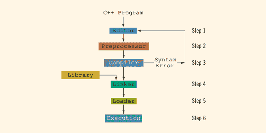

**图 1–3** 处理 C++ 程序

作为程序员，你只需要关注第 1 步。也就是说，你必须学习、理解并掌握编程语言的规则，以创建源程序。


如前所述，程序是使用 IDE 开发的。用于创建高级语言 C++ 程序的知名 IDE 包括 Visual C++ 2008 Express 和 Visual Studio .NET（来自 Microsoft）、C++ Builder（来自 Borland）以及 CodeWarrior（来自 Metrowerks）。这些 IDE 包含用于创建源程序的文本编辑器、用于检查源程序语法错误的编译器、用于将目标代码与 IDE 资源链接的程序，以及用于执行程序的程序。

这些 IDE 相当用户友好。编译程序时，编译器不仅会识别语法错误，而且通常会建议如何更正这些错误。此外，只需一个简单的命令，目标代码就会与 IDE 中使用的资源链接起来。例如，在 Visual C++ 2008 Express 和 Visual Studio .NET 上执行链接的命令是 **生成** 或 **重新生成**。（关于这些命令使用的进一步说明，请查阅这些 IDE 的文档。）如果程序尚未编译，这些命令中的每一个都会先编译程序，然后链接并生成可执行代码。

网站 http://msdn.microsoft.com/en-us/beginner/bb964629.aspx 包含一个视频，解释如何使用 Visual C++ 2008 Express 编写 C++ 程序。

## 使用问题分析—编码—执行周期进行编程

*编程是一个解决问题的过程。* 不同的人使用不同的技术来解决问题。有些技术被很好地概述并且易于遵循。它们不仅解决问题，而且还让人深入了解解决方案是如何得出的。如果问题的领域发生变化，这些解决问题的技术可以很容易地修改。

要成为一名优秀的问题解决者和优秀的程序员，你必须遵循良好的问题解决技术。一种常见的问题解决技术包括分析问题、概述问题需求，以及设计称为**算法**的步骤来解决问题。

**算法：** 一种逐步解决问题的过程，在有限的时间内得出解决方案。

在编程环境中，问题解决过程需要以下三个步骤：

- 1. 分析问题，概述问题及其解决方案需求，并设计解决问题的算法。
- 2. 使用编程语言（如 C++）实现该算法，并验证该算法是否有效。
- 3. 通过使用程序并在问题领域发生变化时修改程序来维护程序。

图1-4总结了这个三步编程过程。

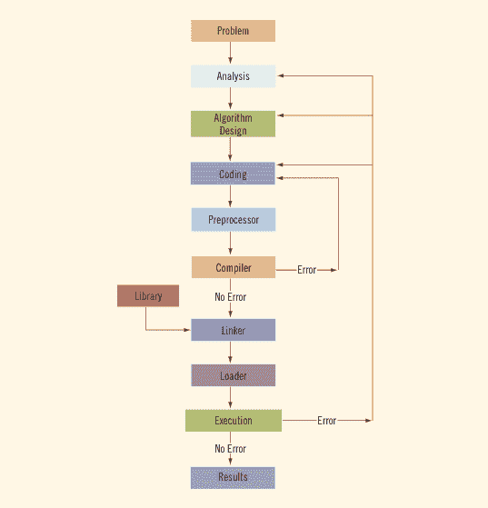

**图1-4** 问题分析—编码—执行周期

要开发一个解决问题的程序，你首先要分析问题。然后设计算法；用高级语言编写程序指令，或者对程序进行编码；并将程序输入计算机系统。

分析问题是第一步，也是最重要的一步。这一步要求你完成以下工作：

- 1. 彻底理解问题。
- 2. 理解问题需求。需求可以包括程序是否需要与用户交互、是否处理数据、是否产生输出，以及输出是什么样子。如果程序处理数据，程序员必须知道数据是什么以及数据如何表示。也就是说，你需要查看示例数据。如果程序产生输出，你应该知道结果应如何生成和格式化。
- 3. 如果问题很复杂，将问题划分为子问题，并重复步骤1和步骤2。也就是说，对于复杂问题，你需要分析每个子问题并理解每个子问题的需求。

在仔细分析问题之后，下一步是设计解决问题的算法。如果你将问题分解为子问题，则需要为每个子问题设计一个算法。设计算法后，你需要检查其正确性。有时你可以使用示例数据来测试算法的正确性。其他时候，你可能需要执行一些数学分析来测试算法的正确性。

一旦设计好算法并验证其正确性，下一步就是将其转换为等效的编程代码。然后，你使用文本编辑器将编程代码或程序输入计算机。接下来，你必须确保程序遵循该语言的语法。为了验证语法的正确性，你要通过编译器运行代码。如果编译器生成错误消息，你必须找出代码中的错误，删除它们，然后再次通过编译器运行代码。当所有语法错误都被删除后，编译器会生成等效的机器码，链接器会将机器码与系统资源链接起来，加载器会将程序放入主内存以便执行。

最后一步是执行程序。编译器只保证程序遵循该语言的语法。它并不保证程序会正确运行。在执行过程中，程序可能由于逻辑错误（例如除以零）而异常终止。即使程序正常终止，它仍可能产生错误的结果。在这些情况下，你可能需要重新检查代码、算法，甚至问题分析。

如果你在尝试编写编程指令之前花足够时间完成问题分析，你的整体编程体验将会成功。通常，你使用钢笔或铅笔在纸上完成这项工作。采用这种谨慎的编程方法有许多优点。在经过充分分析和良好设计的程序中，发现错误要容易得多。此外，经过仔细分析和设计的程序更容易理解和修改。即使是最有经验的程序员，也会花费大量时间分析问题并设计算法。

在本书中，你不仅会学习用 C++ 编写程序的规则，还会学习问题解决技术。每章都提供若干编程示例，讨论编程问题。这些编程示例教授如何分析和解决问题、设计算法、将算法编码为 C++ 的技术，并且帮助你理解本章讨论的概念。为了充分获益于本书，我们建议你完成每章末尾的编程示例。

接下来，我们提供各种问题分析和算法设计技术的示例。

### 例1-1

在本例中，我们设计一个算法来求矩形的周长和面积。

要求矩形的周长和面积，你需要知道矩形的长和宽。

然后，矩形的周长和面积由以下公式给出：

```
perimeter = 2 · (length + width)
area = length · width
```

求矩形周长和面积的算法是：

- 1. 获取矩形的长。
- 2. 获取矩形的宽。
- 3. 使用以下等式求周长：
  `perimeter = 2 · (length + width)`
- 4. 使用以下等式求面积：
  `area = length · width`

### 例1-2

在本例中，我们设计一个算法，计算在某个特定州销售的一件商品的销售税和价格。

销售税的计算如下：州销售税部分为 4%，城市销售税部分为 1.5%。如果该商品是奢侈品，例如价格超过 $50,000 的汽车，则需缴纳 10% 的奢侈品税。

要计算该商品的价格，我们需要计算州销售税部分、城市销售税部分，以及如果该商品是奢侈品，还要计算奢侈品税。假设 `salePrice` 表示该商品的销售价格，`stateSalesTax` 表示州销售税，`citySalesTax` 表示城市销售税，`luxuryTax` 表示奢侈品税，`salesTax` 表示总销售税，`amountDue` 表示该商品的最终价格。

要计算销售税，我们必须知道该商品的销售价格以及该商品是否为奢侈品。

`stateSalesTax` 和 `citySalesTax` 可以使用以下公式计算：

```
stateSalesTax = salePrice · 0.04
citySalesTax = salePrice · 0.015
```


接下来，可以按如下方式确定 `luxuryTax`：

```
if (item is a luxury item)
    luxuryTax = salePrice · 0.1
otherwise
    luxuryTax = 0
```

接下来，可以按如下方式确定 `salesTax`：

```
salesTax = stateSalesTax + citySalesTax + luxuryTax
```

最后，可以按如下方式计算 `amountDue`：

```
amountDue = salePrice + salesTax
```

因此，确定 `salesTax` 和 `amountDue` 的算法如下：

- 1. 获取商品的销售价格。
- 2. 判断该商品是否为奢侈品。
- 3. 使用以下公式计算销售税中州的部分：

   ```
   stateSalesTax = salePrice · 0.04
   ```

- 4. 使用以下公式计算销售税中城市的部分：

   ```
   citySalesTax = salePrice · 0.015
   ```

- 5. 使用以下公式计算奢侈品税：

   ```
   if (item is a luxury item)
       luxuryTax = salePrice · 0.1
   otherwise
       luxuryTax = 0
   ```

- 6. 使用以下公式计算 `salesTax`：

   ```
   salesTax = stateSalesTax + citySalesTax + luxuryTax
   ```

- 7. 使用以下公式计算 `amountDue`：

   ```
   amountDue = salePrice + salesTax
   ```

### 例 1-3

在本例中，我们设计一个算法，用于计算当地一家百货商店销售人员的月薪。

每位销售人员都有基本工资。销售人员还在每月末根据以下标准获得奖金：如果该销售人员在该商店工作五年或五年以下，则奖金为其工作年数每年 $10。如果该销售人员在该商店工作超过五年，则奖金为其工作年数每年 $20。销售人员还可以获得额外奖金，具体如下：如果该销售人员当月的总销售额至少为 $5,000 但低于 $10,000，则他可获得销售额 3% 的佣金。如果该销售人员当月的总销售额至少为 $10,000，则他可获得销售额 6% 的佣金。

要计算销售人员的月薪，需要知道基本工资、该销售人员在公司工作的年数，以及该销售人员当月的总销售额。假设 `baseSalary` 表示基本工资，`noOfServiceYears` 表示该销售人员在该商店工作的年数，`bonus` 表示奖金，`totalSales` 表示该销售人员当月的总销售额，`additionalBonus` 表示额外奖金。

可以按如下方式确定奖金：

```
if (noOfServiceYears is less than or equal to five)
    bonus = 10 · noOfServiceYears
otherwise
    bonus = 20 · noOfServiceYears
```

接下来，可以按如下方式确定销售人员的额外奖金：

```
if (totalSales is less than 5000)
    additionalBonus = 0
otherwise
    if (totalSales is greater than or equal to 5000 and
            totalSales is less than 10000)
        additionalBonus = totalSales · (0.03)
    otherwise
        additionalBonus = totalSales · (0.06)
```

根据以上讨论，现在可以设计计算销售人员月薪的算法：

- 1. 获取 `baseSalary`。
- 2. 获取 `noOfServiceYears`。
- 3. 使用以下公式计算奖金：

   ```
   if (noOfServiceYears is less than or equal to five)
       bonus = 10 · noOfServiceYears
   otherwise
       bonus = 20 · noOfServiceYears
   ```

- 4. 获取 `totalSales`。
- 5. 使用以下公式计算 `additionalBonus`：

   ```
   if (totalSales is less than 5000)
       additionalBonus = 0
   otherwise
       if (totalSales is greater than or equal to 5000 and
               totalSales is less than 10000)
           additionalBonus = totalSales · (0.03)
       otherwise
           additionalBonus = totalSales · (0.06)
   ```


- 6. 使用以下等式计算 `payCheck`：

```
payCheck = baseSalary + bonus + additionalBonus
```

### 例 1-4

在本例中，我们设计一个玩猜数字游戏的算法。

目标是随机生成一个大于或等于 0 且小于 100 的整数。然后提示玩家（用户）猜这个数字。如果玩家猜对了数字，则输出相应的消息。否则，检查所猜数字是否小于随机数。如果所猜数字小于生成的随机数，则输出消息：“你猜的数字比目标数字小。再猜一次！”；否则，输出消息：“你猜的数字比目标数字大。再猜一次！”。然后提示玩家输入另一个数字。系统会一直提示玩家猜这个随机数，直到玩家输入正确的数字。

第一步是生成一个随机数，如上所述。C++ 提供了实现这一操作的方法，这将在第 5 章讨论。假设 `num` 表示随机数，`guess` 表示玩家所猜的数字。

玩家输入猜测后，可以按如下方式将猜测值与随机数进行比较：

```
if (guess is equal to num)
    Print "You guessed the correct number."
otherwise
    if guess is less than num
        Print "Your guess is lower than the number. Guess again!"
    otherwise
        Print "Your guess is higher than the number. Guess again!"
```

现在可以按如下方式设计算法：

- 1. 生成一个随机数，并将其称为 `num`。
- 2. *重复*以下步骤，直到玩家猜对数字：
  - a. 提示玩家输入 `guess`。
  - b.

    ```
    if (guess is equal to num)
        Print "You guessed the correct number."
    otherwise
        if guess is less than num
            Print "Your guess is lower than the number. Guess again!"
        otherwise
            Print "Your guess is higher than the number. Guess again!"
    ```

在第 5 章中，我们使用该算法编写一个 C++ 程序来玩猜数字游戏。

### 例 1-5

一个班级有 10 名学生。每名学生参加了五次测验，每次测验满分 100 分。我们希望设计一个算法来计算每名学生的成绩，以及班级平均成绩。成绩评定如下：如果测验平均分大于或等于 90，则成绩为 A；如果测验平均分大于或等于 80 且小于 90，则成绩为 B；如果测验平均分大于或等于 70 且小于 80，则成绩为 C；如果测验平均分大于或等于 60 且小于 70，则成绩为 D；否则，成绩为 F。请注意，数据由学生姓名及其测验分数组成。

这是一个可以按如下方式划分为子问题的问题：共有五次测验，因此设计一个算法来求测验平均分。接下来，设计一个算法来确定成绩。这两个子问题分别是确定测验平均分和确定成绩。

首先设计一个确定测验平均分的算法。为求测验平均分，将五次测验分数相加，然后用总和除以 5。因此，算法为：

- 1. 获取五次测验分数。
- 2. 将五次测验分数相加。假设 `sum` 表示测验分数之和。
- 3. 假设 `average` 表示测验平均分。然后：

   ```
   average = sum / 5;
   ```

接下来，设计一个确定成绩的算法。假设 `grade` 表示分配给学生的成绩。以下算法确定成绩：

```
if average is greater than or equal to 90
    grade = A
otherwise
    if average is greater than or equal to 80 and less than 90
        grade = B
    otherwise
        if average is greater than or equal to 70 and less than 80
            grade = C
        otherwise
            if average is greater than or equal to 60 and less than 70
                grade = D
            otherwise
                grade = F
```

可以使用这些子问题的解，按如下方式设计主算法：（假设 `totalAverage` 表示每名学生测验平均分之和。）

- 1. `totalAverage = 0;`
- 2. 对班级中的每名学生*重复*以下步骤：
  - a. 获取学生姓名。
  - b. 使用上文讨论的算法求测验平均分。


- c. 使用上文讨论的算法求出等级。
- d. 通过加上当前学生的平均测验分数来更新 `totalAverage`。
- 3. 确定班级平均分如下：

`classAverage = totalAverage / 10`

第 7 章的一个编程练习要求你编写一个 C++ 程序，以确定班级中每个学生的平均测验分数和等级。

## 编程方法学

两种流行的程序设计方法是结构化方法和面向对象方法，下面将概述这两种方法。

### 结构化程序设计

将问题划分为更小的子问题称为**结构化设计**。然后分析每个子问题，并获得解决该子问题的方案。随后将所有子问题的解决方案组合起来，以解决整个问题。实现结构化设计的这一过程称为**结构化程序设计**。结构化设计方法也称为**自顶向下设计**、**自底向上设计**、**逐步求精**和**模块化程序设计**。

### 面向对象程序设计

**面向对象设计（OOD）**是一种广泛使用的编程方法学。在 OOD 中，问题求解过程的第一步是识别称为对象的组成部分，这些对象构成解决方案的基础，并确定这些对象如何相互作用。例如，假设你想编写一个程序，使当地一家录像带租赁店的录像带租赁流程自动化。这个问题中的两个主要对象是录像带和顾客。

识别对象之后，下一步是为每个对象指定相关数据以及可对该数据执行的操作。例如，对于录像带对象，数据可能包括：

- 电影名称
- 主演演员
- 制片人
- 制作公司
- 库存副本数量

对录像带对象的某些*操作*可能包括：

- 查询电影名称
- 在租出一份副本后将库存副本数量减一
- 在顾客归还某部录像带后将库存副本数量加一

这说明每个对象都由数据以及对该数据的操作组成。对象将数据和对数据的操作组合成一个单元。在 OOD 中，最终程序是相互作用的对象的集合。实现 OOD 的编程语言称为**面向对象程序设计（OOP）**语言。你将在后续章节中了解 OOD 的许多优点。

由于对象由数据以及对该数据的操作组成，因此在设计和使 用对象之前，你需要学习如何在计算机内存中表示数据、如何操作数据以及如何实现操作。在第 2 章中，你将学习 C++ 的基本数据类型，并了解如何在计算机内存中表示和操作数据。第 3 章讨论如何将数据输入 C++ 程序，以及如何输出 C++ 程序生成的结果。

要创建操作，你需要编写算法并用编程语言实现它们。由于复杂程序中的数据元素通常有许多操作，为了将各个操作彼此分开，并以有效且方便的方式使用它们，你使用函数来实现算法。在第 2 章和第 3 章进行简要介绍之后，你将在第 6 章和第 7 章学习函数的细节。某些算法要求程序做出决策，这一过程称为选择。其他算法可能要求重复执行某些语句，直到满足特定条件，这一过程称为重复。还有一些算法可能同时需要选择和重复。你将在第 4 章和第 5 章学习称为控制结构的选择和重复机制。此外，在第 9 章中，你将使用一种称为数组的机制，学习当数据项属于同一类型时如何操作数据，例如销售数据列表中的各项。

最后，要使用对象，你需要知道如何将数据和对数据的操作组合成一个单元。在 C++ 中，允许你将数据和对数据的操作组合成一个单元的机制称为类。你将在“类与数据抽象”一章（本书后面）学习类如何工作、如何使用类以及如何创建类。

如你所见，在使用 OOD 方法学之前，你需要学习相当多的内容。为了使学习更容易、更有效，本书特意将控制结构分为两章（第 4 章和第 5 章），并将用户定义函数分为两章（第 6 章和第 7 章）。

对于某些问题，程序设计的结构化方法将非常有效。其他问题则更适合用 OOD 来解决。例如，如果一个问题需要使用数学函数操作数值集合，你可能会使用结构化设计方法，并概述获得解决方案所需的步骤。C++ 库提供了大量函数，你可以有效地使用它们来操作数字。另一方面，如果你想编写一个让糖果机运行的程序，OOD 方法更有效。C++ 是专门为实现 OOD 而设计的。*此外，OOD 效果良好，并且与结构化设计结合使用。*


结构化设计和 OOD 方法都要求你掌握编程语言的基本组成部分，才能成为一名高效的程序员。在第 2 章至第 9 章中，你将学习 C++ 的基本组成部分，例如数据类型、输入/输出、控制结构、用户定义函数和数组，这些都是两种程序设计类型所需要的。我们使用结构化程序设计方法来演示这些概念如何工作。从“类与数据抽象”一章开始，我们使用 OOD 方法。

## ANSI/ISO 标准 C++

编程语言 C++ 从 C 演变而来，由贝尔实验室的 Bjarne Stroustrup 在 20 世纪 80 年代初设计。从 20 世纪 80 年代初到 90 年代初，有若干种 C++ 编译器可供使用。尽管所有编译器中 C++ 的基本特性大体相同，但 C++ 语言（本书称为标准 C++）在不同编译器中以略有不同的方式演变。因此，C++ 程序并不总是能够从一个编译器移植到另一个编译器。

为了解决这个问题，20 世纪 90 年代初成立了一个由美国国家标准协会（ANSI）和国际标准化组织（ISO）组成的联合委员会，以标准化 C++ 的语法。1998 年中期，ANSI/ISO C++ 语言标准获得批准。当今大多数编译器都遵循这些新标准。

本书重点介绍经 ANSI/ISO 批准的 C++ 语法，称为 ANSI/ISO 标准 C++。

## 快速复习

- 1. 计算机是一种能够执行算术和逻辑运算的电子设备。
- 2. 计算机系统有两个组成部分：硬件和软件。
- 3. 中央处理器（CPU）和主存储器是硬件组件的例子。
- 4. 所有程序必须先调入主存储器才能执行。
- 5. 当电源关闭时，主存储器中的所有内容都会丢失。
- 6. 辅助存储器为信息提供永久存储。硬盘、闪存盘、软盘、ZIP 盘、CD-ROM 和磁带都是辅助存储器的例子。
- 7. 计算机的输入通过输入设备完成。两种常见的输入设备是键盘和鼠标。
- 8. 计算机将输出发送到输出设备，例如计算机屏幕。
- 9. 软件是计算机运行的程序。
- 10. 操作系统监视计算机的整体活动并提供服务。
- 11. 计算机最基本的语言是称为机器语言的 0 和 1 序列。每台计算机都能直接理解自己的机器语言。
- 12. 位是一个二进制数字，即 0 或 1。
- 13. 字节是由八个位组成的序列。
- 14. 0 和 1 的序列称为二进制代码或二进制数。
- 15. 一千字节（KB）是 2^10 = 1024 字节；一兆字节（MB）是 2^20 = 1,048,576 字节；一吉字节（GB）是 2^30 = 1,073,741,824 字节；一太字节（TB）是 2^40 = 1,099,511,627,776 字节；一拍字节（PB）是 2^50 = 1,125,899,906,842,624 字节；一艾字节（EB）是 2^60 = 1,152,921,504,606,846,976 字节；一泽字节（ZB）是 2^70 = 1,180,591,620,717,411,303,424 字节。
- 16. 汇编语言使用称为助记符的易于记忆的指令。
- 17. 汇编器是将用汇编语言编写的程序翻译成机器语言的程序。
- 18. 编译器是将用高级语言编写的程序翻译成机器代码（称为目标代码）的程序。
- 19. 链接器将目标代码与集成开发环境（IDE）提供的、程序中使用的其他程序链接起来，以生成可执行代码。
- 20. 通常，执行 C++ 程序需要六个步骤：编辑、预处理、编译、链接、加载和执行。
- 21. 加载器将可执行代码传送到主存储器中。
- 22. 算法是一个逐步求解问题的过程，其中在有限时间内得到解决方案。
- 23. 问题求解过程有三个步骤：分析问题并设计算法，用编程语言实现算法，以及维护程序。
- 24. 使用结构化设计方法编写的程序更易于理解、更易于测试和调试，也更易于修改。
- 25. 在结构化设计中，问题被划分为更小的子问题。每个子问题都得到解决，然后将所有子问题的解决方案组合起来解决该问题。
- 26. 在面向对象设计（OOD）中，程序是相互作用的对象的集合。
- 27. 对象由数据以及对该数据的操作组成。
- 28. ANSI/ISO 标准 C++ 语法于 1998 年中期获得批准。

## 练习

- 1. 判断以下陈述正误。
  - a. 已知最早执行计算的设备是帕斯卡计算器（Pascaline）。
  - b. 现代计算机可以接受口头指令，但不能模仿人类推理。


- c. 在 ASCII 编码中，每个字符都被编码为 8 位序列。
- d. 编译器将高级程序翻译成汇编语言。
- e. 算术运算在 CPU 内部执行；如果发现错误，它会输出逻辑错误。
- f. 由 0 和 1 组成的序列称为十进制代码。
- g. 链接器将目标代码从主存链接并加载到 CPU 中执行。
- h. C++ 程序的开发包括六个步骤。
- i. 用高级编程语言编写的程序称为源程序。
- j. 0B 表示零字节。
- k. 问题解决过程的第一步是分析问题。
- l. 在面向对象设计中，程序是相互作用的函数的集合。

- 2. 说出两种输入设备。
- 3. 说出两种输出设备。
- 4. 为什么需要二级存储？
- 5. 操作系统的作用是什么？
- 6. 程序有哪两种类型？
- 7. 机器语言和高级语言之间有哪些区别？
- 8. 什么是源程序？
- 9. 为什么需要编译器？
- 10. 编译器报告哪类错误？
- 11. 为什么需要将用高级语言编写的程序翻译成机器语言？
- 12. 为什么你更愿意用高级语言而不是机器语言编写程序？
- 13. 什么是链接？
- 14. 与直接用高级语言编写程序相比，问题分析和算法设计有哪些优势？
- 15. 设计一个算法，求四次测试成绩的加权平均值。四次测试成绩及其各自权重按以下格式给出：

```
testscore1 weight1
...
```

例如，示例数据如下：

```
75 0.20
95 0.35
85 0.15
65 0.30
```

- 16. 设计一个算法，将给定的由25美分、10美分、5美分和1美分硬币组成的零钱换算成1美分硬币。
- 17. 给定一个比萨的半径（以英寸为单位）和价格，设计一个算法，求该比萨每平方英寸的价格。
- 18. 一名销售员每周一离家，每周五回家。他开公司配车出行。在路上的每一天，销售员都会记录加入汽车的汽油量。给定起始里程表读数（即周一出发前的里程表读数）和结束里程表读数（即周五回家后的里程表读数），设计一个算法，求平均每加仑英里数。示例数据如下：

`68723  71289  15.75  16.30  10.95  20.65  30.00`

- 19. 为了使盈利，家具店所售商品的价格上调了60%。设计一个算法，求家具店所售商品的销售价格。求销售价格需要哪些信息？
- 20. 假设 $a$、$b$ 和 $c$ 表示三角形三条边的长度。那么三角形的面积可以用以下公式计算：

$$\sqrt{s(s-a)(s-b)(s-c)}$$

其中 $s = \frac{1}{2}(a+b+c)$。设计一个使用该公式求三角形面积的算法。求面积需要哪些信息？

- 21. 假设发送一份国际传真的费用计算如下：服务费 $3.00；前 10 页每页 $0.20；之后每页 $0.10。设计一个算法，要求用户输入要传真的页数。然后该算法使用要传真的页数计算应付金额。
- 22. 一台 ATM 允许客户每天最多取款 $500。如果客户取款超过 $300，服务费为超过 $300 金额的 4%。如果客户账户中没有足够资金，ATM 会通知客户资金不足，并提供支付 $25.00 服务费后取款的选择。如果账户中没有钱或账户余额为负，ATM 不允许客户取任何钱。如果要取款的金额大于 $500，ATM 会通知客户可取款的最高金额。编写一个算法，允许客户输入要取款的金额。然后该算法检查账户中的总金额，将钱支付给客户，并从账户中扣除取款金额和任何服务费。
- 23. 给定一份学生姓名及其测试成绩的列表。设计一个算法，完成以下操作：
  - a. 计算平均测试成绩。
  - b. 确定并打印所有测试成绩低于平均测试成绩的学生的姓名。


  - c. 确定最高测试成绩。
  - d. 打印所有测试成绩与最高测试成绩相同的学生姓名。

（你必须将这个问题划分为以下子问题：第一个子问题确定平均测试成绩。第二个子问题确定并打印所有测试成绩低于平均测试成绩的学生的姓名。第三个子问题确定最高测试成绩。第四个子问题打印所有测试成绩与最高测试成绩相同的学生姓名。主算法组合各子问题的解。）

考虑示例 2-1 中的 C++ 程序。

### 示例 2-1

```
//**********************************************************
// This is a simple C++ program. It displays four lines
// of text, including the sum of two numbers.
//**********************************************************

#include <iostream>

using namespace std;

int main()
{
    int num;

    num = 6;

    cout << "My first C++ program." << endl;
    cout << "The sum of 2 and 3 = " << 5 << endl;
    cout << "7 + 8 = " << 7 + 8 << endl;
    cout << "Num = " << num << endl;

    return 0;
}
```

**示例运行：**（当你编译并执行此程序时，屏幕上会显示以下四行。）

```
My first C++ program.
The sum of 2 and 3 = 5
7 + 8 = 15
Num = 6
```

这些行是通过执行以下三条语句显示的。

```
cout << "My first C++ program." << endl;
cout << "The sum of 2 and 3 = " << 5 << endl;
cout << "7 + 8 = " << 7 + 8 << endl;
cout << "Num = " << num << endl;
```

接下来，我们解释这是如何发生的。让我们先考虑以下语句：

```
cout << "My first C++ program." << endl;
```

这是一个 C++ *输出*语句的示例。它使计算机计算符号对 << 之后的*表达式*，并将结果显示在屏幕上。

通常，C++ 程序包含各种类型的表达式，例如算术表达式和字符串。例如，7 + 8 是算术表达式。双引号中的任何内容都是*字符串*。例如，"My first C++ program." 和 "7 + 8 =" 是字符串。通常，字符串求值为其自身。算术表达式根据算术运算规则求值，这些规则通常是在代数课程中学到的。本章后面，我们将解释算术表达式和字符串是如何形成和求值的。

还要注意，在输出语句中，*endl* 会使插入点移动到下一行的开头。（在屏幕上，插入点就是光标所在的位置。）因此，前面的语句使系统在屏幕上显示以下行。

My first C++ program.

现在让我们考虑以下语句。

```
cout << "The sum of 2 and 3 = " << 5 << endl;
```

这个输出语句由两个表达式组成。第一个表达式（在第一个 << 之后）是 "The sum of 2 and 3 = "，第二个表达式（在第二个 << 之后）由数字 5 组成。表达式 "The sum of 2 and 3 = " 是字符串，求值为其自身。（注意 = 后面的空格。）第二个表达式由数字 5 组成，求值为 5。因此，前面语句的输出是：

The sum of 2 and 3 = 5

现在让我们考虑以下语句。

```
cout << "7 + 8 = " << 7 + 8 << endl;
```

在这个输出语句中，表达式 "7 + 8 = " 是字符串，求值为其自身。让我们考虑第二个表达式 7 + 8。这个表达式由数字 7 和 8 以及 C++ 算术运算符 + 组成。因此，表达式 7 + 8 的结果是 7 与 8 的和，即 15。因此，前面语句的输出是：

7 + 8 = 15

最后，考虑以下语句：

```
cout << "Num = " << num << endl;
```

这个语句由字符串 "Num = "（求值为其自身）和单词 num 组成。语句 num = 6; 将值 6 赋给 num。因此，第二个 << 之后的表达式 num 求值为 6。由此可知，前一条语句的输出是：

Num = 6

最后一条语句，即

```
return 0;
```

在程序终止时向操作系统返回值 0。我们将在本章后面详细说明这条语句。

在下一章中，在我们解释如何正确构造 C++ 程序之前，我们将使用前面这样的输出语句来解释各种概念。学完第 2 章后，你应该能够编写足够好的 C++ 程序来进行一些计算并显示结果。

在结束本节之前，让我们注意以下关于前面 C++ 程序的内容。C++ 程序是函数的集合，其中之一是 main 函数。粗略地说

一般来说，**函数**是语句的集合，当它被执行时，会完成某些事情。前面的程序由函数 main 组成。

程序的第一行，即

```cpp
#include <iostream>
```

允许我们使用*预定义对象* `cout` 来生成输出，以及使用*操纵器* `endl`。第二行，即

```cpp
using namespace std;
```

允许你使用 `cout` 和 `endl` 而不需要前缀 `std::`。这意味着，如果你不包含这条语句，那么 `cout` 应写作 `std::cout`，`endl` 应写作 `std::endl`。我们将在本章后面详细说明这一点。

第七行由以下内容组成：

```cpp
int main()
```

这是函数 main 的标题。第八行由一个左花括号组成。这标志着函数 main 的*主体*的开始。右花括号（在程序的最后一行）与这个左花括号匹配，标志着函数 main 的主体的结束。我们将在本书后面解释其他术语的含义，例如以蓝色显示的术语。注意，在 C++ 中，`<<` 是一个运算符，称为*流插入运算符*。

## C++ 程序的基础

C++ 程序是一个或多个子程序（称为函数）的集合。有些函数称为**预定义**函数或**标准**函数，它们已经编写好并作为系统的一部分提供。但为了完成大多数任务，程序员必须学会编写自己的函数。

每个 C++ 程序都有一个名为 main 的函数。因此，如果一个 C++ 程序只有一个函数，那它一定是函数 main。直到第 6 章，除了使用一些预定义函数外，你主要处理函数 main。到本章结束时，你将学会如何编写函数 main。

如果你从未见过用编程语言编写的程序，那么示例2-1中的C++程序可能看起来像一门外语。要在一门外语中造出有意义的句子，你必须学习它的字母表、单词和语法。编程语言也是如此。要编写有意义的程序，你必须学习编程语言的特殊符号、单词和语法规则。**语法规则**告诉你哪些语句（指令）是合法的，或者被编程语言接受，哪些不是。你还必须学习**语义规则**，它们决定指令的含义。编程语言的规则、符号和特殊单词使你能够编写程序来解决问题。语法规则决定哪些指令是有效的。

**编程语言：** 一组规则、符号和特殊单词。

在本节的剩余部分，你将学习 C++ 程序的一些特殊符号。在后续章节中遇到其他概念时，会介绍更多的特殊符号。同样，语法规则和语义规则将在整本书中介绍和讨论。

### 注释

你编写的程序不仅应该对你清晰，而且应该对程序的读者清晰。良好编程的一部分是在程序中包含注释。通常，注释可用于标识程序的作者、给出程序编写或修改的日期、简要解释程序以及解释程序中关键语句的含义。在编程示例中，对于我们编写的程序，我们将不包含程序编写的日期，这与编写此类书籍的标准惯例一致。

注释是给读者看的，不是给编译器看的。因此，当编译器编译程序以检查语法错误时，它会完全忽略注释。在整本书中，注释以绿色显示。

示例2-1中的程序包含以下注释：

```cpp
// This is a C++ program. It prints the sentence:
// Welcome to C++ Programming.
```

C++ 程序中有两种常见的注释类型——单行注释和多行注释。

单行注释以 `//` 开头，可以放在该行的任何位置。该行中 `//` 之后遇到的所有内容都会被编译器忽略。例如，考虑以下语句：

```cpp
cout << "7 + 8 = " << 7 + 8 << endl;
```

你可以按如下方式在该行末尾添加注释：

```cpp
cout << "7 + 8 = " << 7 + 8 << endl; //prints: 7 + 8 = 15
```

这条注释对初学者可能有意义。

多行注释括在 `/*` 和 `*/` 之间。编译器会忽略出现在 `/*` 和 `*/` 之间的任何内容。例如，以下是一个多行注释的示例：

```cpp
/*
   You can include comments that can
   occupy several lines.
*/
```

### 特殊符号

用任何语言编写的程序的最小个体单位称为**标记**。C++ 的标记分为特殊符号、单词符号和标识符。

以下是一些特殊符号：

- `+` `-` `*` `/`
- `.` `;` `?` `,`
- `<=` `!=` `==` `>=`

第一行包括加法、减法、乘法和除法的数学符号。第二行由取自英语语法的标点符号组成。注意，逗号也是一个特殊符号。在 C++ 中，逗号用于分隔列表中的项。分号用于结束 C++ 语句。注意，上面未显示的空白也是一个特殊符号。你通过按键盘上的空格键（仅一次）来创建空白符号。第三行由两个字符组成的标记构成，这两个字符被视为单个符号。标记中的两个字符之间不能有任何字符，甚至不能有空白。

### 保留字（关键字）

第二类标记是单词符号。一些单词符号包括以下内容：

```cpp
int, float, double, char, const, void, return
```

保留字也称为关键字。组成保留字的字母始终是小写。与特殊符号一样，每个保留字都被视为单个符号。此外，单词符号不能在任何程序中重新定义；也就是说，除了其预期用途之外，它们不能用于任何其他目的。有关保留字的完整列表，请参见附录 A。

> **注意：** 在整本书中，保留字以蓝色显示。

### 标识符

第三类标记是标识符。标识符是程序中出现的事物的名称，例如变量、常量和函数。所有标识符都必须遵守 C++ 的标识符规则。

**标识符：** C++ 标识符由字母、数字和下划线字符（`_`）组成，并且必须以字母或下划线开头。

有些标识符是预定义的；其他标识符由用户定义。在示例2-1的C++程序中，`cout` 是预定义标识符，`num` 是用户定义标识符。你将经常遇到的两个预定义标识符是 `cout` 和 `cin`。你已经看到了 `cout` 的效果。在本章后面，你将学习用于输入数据的 `cin` 如何工作。与保留字不同，预定义标识符可以重新定义，但这样做并不明智。

标识符只能由字母、数字和下划线字符组成；不允许其他符号构成标识符。

> **注意**  
> C++ 区分大小写——大写字母和小写字母被视为不同。因此，标识符 `NUMBER` 与标识符 `number` 不同。同样，标识符 `X` 和 `x` 也不同。

在 C++ 中，标识符可以任意长度。

**示例2-2**

以下是 C++ 中的合法标识符：

```cpp
first
conversion
payRate
counter1
```

表2-1显示了一些非法标识符，并解释了它们为什么非法。

**表2-1** 非法标识符示例

| 非法标识符 | 描述 |
|---|---|
| `employee Salary` | `employee` 和 `Salary` 之间不能有空格。 |
| `Hello!` | 感叹号不能用于标识符中。 |
| `one + two` | 符号 `+` 不能用于标识符中。 |
| `2nd` | 标识符不能以数字开头。 |

> **注意**  
> 编译器供应商通常以以下划线（`_`）开头来命名某些标识符。当链接器将目标程序与集成开发环境（IDE）提供的系统资源链接时，可能会发生某些错误。因此，建议你不要在程序中的标识符以下划线（`_`）开头。

### 空白

每个 C++ 程序都包含空白。空白包括空格、制表符和换行字符。在 C++ 程序中，空白用于分隔特殊符号、保留字和标识符。空白是不可打印的，因为当它们打印在白纸上时，特殊符号、保留字和标识符之间的空间是白色的。在程序中正确利用空白很重要。它们可以用来使程序可读。


## 数据类型

C++ 程序的目标是操作数据。不同的程序操作不同的数据。一个用于计算员工薪资的程序会进行数字的加、减、乘、除运算，其中一些数字可能表示工作小时数和薪资率。同样，一个用于按字母顺序排列班级名单的程序会操作姓名。你不会指望用樱桃派食谱来帮你烤饼干。同样，你也不会使用一个为执行算术计算而设计的程序来操作字母字符。此外，你不会对姓名进行乘法或减法运算。C++ 反映了这些底层差异，将数据划分为不同的类型，并且只能对特定类型的数据执行某些操作。虽然起初这可能看起来令人困惑，但通过如此重视类型，C++ 内置了检查机制来防止错误。

**数据类型：** 一组值以及一组操作。

C++ 数据类型分为以下三类，如图 2-1 所示：

- 1. 简单数据类型
- 2. 结构化数据类型
- 3. 指针

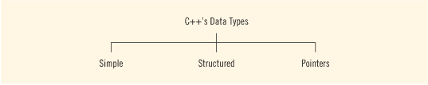

**图 2-1** C++ 数据类型

在接下来的几章中，你只会涉及简单数据类型。

### 简单数据类型

简单数据类型是 C++ 中的基本数据类型，因为它成为结构化数据类型的构建块，你将从第 9 章开始学习结构化数据类型。简单数据分为三类：

- 1. **整型**，这是一种处理整数（即不带小数部分的数字）的数据类型
- 2. **浮点型**，这是一种处理十进制数字的数据类型
- 3. **枚举**，这是一种用户定义的数据类型

> **注意** 枚举类型是 C++ 允许程序员创建自己的简单数据类型的方法。该数据类型将在第 8 章讨论。

字符在集合中有一个预定义的顺序，称为**排序序列**。比较字符时会使用排序序列。例如，表示 'B' 的值是 66，因此 'A' 小于 'B'。同样，'+' 小于 'A'，因为 43 小于 65。

ASCII 字符集中的第 14 个字符称为换行字符，表示为 `'\n'`。（注意，换行字符在 ASCII 字符集中的位置是 13，因为第一个字符的位置是 0。）尽管换行字符是两个字符的组合，但它被当作一个字符处理。同样，水平制表符在 C++ 中表示为 `'\t'`，空字符表示为 `'\0'`（反斜杠后跟零）。此外，ASCII 字符集中的前 32 个字符是不可打印的。（有关这些字符的说明，请参见附录 C。）

### 浮点数据类型

为了处理十进制数字，C++ 提供了浮点数据类型，本节将讨论它。为便于讨论，让我们回顾高中或大学代数课程中的一个概念。

你可能熟悉科学计数法。例如：

```
43872918 = 4.3872918 × 10⁷        {10 to the power of seven}
.0000265 = 2.65 × 10⁻⁵          {10 to the power of minus five}
47.9832 = 4.79832 × 10¹          {10 to the power of one}
```

为了表示实数，C++ 使用一种称为**浮点表示法**的科学计数法形式。表 2-3 展示了 C++ 使用某台机器对浮点表示法的解释来打印一组实数时可能得到的结果。在 C++ 浮点表示法中，字母 E 代表指数。

**表 2-3** 用 C++ 浮点表示法打印的实数示例

| 实数 | C++ 浮点表示法 |
|---|---|
| 75.924 | 7.592400E1 |
| 0.18 | 1.800000E-1 |
| 0.0000453 | 4.530000E-5 |
| -1.482 | -1.482000E0 |
| 7800.0 | 7.800000E3 |

C++ 提供了三种数据类型来操作十进制数字：float、double 和 long double。与整型数据类型的情况一样，float、double 和 long double 数据类型在取值集合上有所不同。

> **注意** 在大多数较新的编译器上，`double` 和 `long double` 数据类型是相同的。因此，这里只描述 `float` 和 `double` 数据类型。

`float`：C++ 中使用 `float` 数据类型表示 -3.4E+38 到 3.4E+38 之间的任何实数。为 `float` 数据类型的值分配的内存是四个字节。

`double`：C++ 中使用 `double` 数据类型表示 -1.7E+308 到 1.7E+308 之间的任何实数。为 `double` 数据类型的值分配的内存是八个字节。

`float` 和 `double` 数据类型的最大值和最小值取决于系统。要查找特定系统上的这些值，可以查阅编译器文档，或者运行附录 F（头文件 cfloat）中给出的程序。

除了取值集合之外，`float` 和 `double` 数据类型之间还有一个区别。`float` 值的最大有效数字位数——即小数位数——是六或七。属于 `double` 类型的值的最大有效数字位数是 15。

> **注意** 对于 `double` 类型的值，为了获得更好的精度，某些编译器可能会给出超过 15 位有效数字。请查阅编译器文档。

最大有效数字位数称为**精度**。有时 `float` 值被称为**单精度**，而 `double` 类型的值被称为**双精度**。如果要处理十进制数，大多数情况下只需要 `float` 类型；如果需要精确到超过六或七位小数，则可以使用 `double` 类型。

> **注意** 在 C++ 中，默认情况下，浮点数被视为 `double` 类型。因此，如果在程序中使用 `float` 数据类型来操作浮点数，某些编译器可能会给出警告消息，例如“从 double 到 float 的截断”。为避免此类警告消息，应使用 `double` 数据类型。为便于说明，并避免编程示例中出现此类警告消息，本书大多使用 `double` 数据类型来操作浮点数。

## 算术运算符与运算符优先级

计算机最重要的用途之一是其计算能力。可以使用标准算术运算符来操作整型和浮点数据类型。算术运算符有五个。

**算术运算符：** +（加法）、−（减法或取负）、*（乘法）、/（除法）、%（模、取模或求余）。

可以将运算符 +、−、* 和 / 与整型和浮点数据类型一起使用。只能将 % 与整型数据类型一起使用，以求出普通除法中的余数。当把 / 与整型数据类型一起使用时，它给出普通除法中的商。也就是说，整型除法会截断任何小数部分；不进行舍入。

从高中起，你就已经习惯处理如下算术表达式：

- i. −5
- ii. 8 − 7
- iii. 3 + 4
- iv. 2 + 3 * 5
- v. 5.6 + 6.2 * 3
- vi. x + 2 * 5 + 6 / y

（注意，在表达式 (vi) 中，x 和 y 是未知数。）形式上，**算术表达式**是由算术运算符和数字构成的。表达式中出现的数字称为**操作数**。用于计算某个运算符的数字称为该运算符的操作数。在表达式 (i) 中，符号 − 表示数字 5 为负数。在这个表达式中，− 只有一个操作数。只有一个操作数的运算符称为**一元运算符**。

**一元运算符：** 只有一个操作数的运算符。

**二元运算符：** 有两个操作数的运算符。

在表达式 (iii) 中，即 3 + 4 中，3 和 4 是运算符 + 的操作数。在这个表达式中，运算符 + 有两个操作数，是二元运算符。现在考虑以下表达式：

+27

在这个表达式中，运算符 + 表示数字 27 为正数。这里，+ 只有一个操作数，因此作为一元运算符。

由上述讨论可知，− 和 + 既是一元算术运算符，也是二元算术运算符。然而，作为算术运算符，*、/ 和 % 是二元运算符，因此必须有两个操作数。

以下示例展示了算术运算符——尤其是 / 和 %——如何与整型数据类型一起工作。从这些示例可以看出，当 / 与整型数据类型一起使用时，表示普通除法中的商。


### 示例 2-3

| 算术表达式 | 结果 | 描述 |
|---|---:|---|
| `2 + 5` | 7 |  |
| `13 + 89` | 102 |  |
| `34 - 20` | 14 |  |
| `45 - 90` | -45 |  |
| `2 * 7` | 14 |  |
| `5 / 2` | 2 | 在除法 `5 / 2` 中，商是 2，余数是 1。因此，使用整数操作数的 `5 / 2` 计算结果为商，即 2。 |
| `14 / 7` | 2 |  |
| `34 % 5` | 4 | 在除法 `34 / 5` 中，商是 6，余数是 4。因此，`34 % 5` 计算结果为余数，即 4。 |
| `4 % 6` | 4 | 在除法 `4 / 6` 中，商是 0，余数是 4。因此，`4 % 6` 计算结果为余数，即 4。 |

下面的 C++ 程序对上述表达式进行求值：

```cpp
// This program illustrates how integral expressions are
// evaluated.

#include <iostream>

using namespace std;

int main()
{
    cout << "2 + 5 = " << 2 + 5 << endl;
    cout << "13 + 89 = " << 13 + 89 << endl;
    cout << "34 - 20 = " << 34 - 20 << endl;
    cout << "45 - 90 = " << 45 - 90 << endl;
    cout << "2 * 7 = " << 2 * 7 << endl;
    cout << "5 / 2 = " << 5 / 2 << endl;
    cout << "14 / 7 = " << 14 / 7 << endl;
    cout << "34 % 5 = " << 34 % 5 << endl;
    cout << "4 % 6 = " << 4 % 6 << endl;

    return 0;
}
```

### 示例运行：

```text
2 + 5 = 7
13 + 89 = 102
34 - 20 = 14
45 - 90 = -45
2 * 7 = 14
5 / 2 = 2
14 / 7 = 2
34 % 5 = 4
4 % 6 = 4
```

> **注意**  
> 使用负整数操作数计算求模运算符时应格外小心。你得到的结果可能并非所预期的。例如，−34 % 5 = −4，因为在除法 −34 / 5 中，商是 −6，余数是 −4。类似地，34 % −5 = 4，因为在除法 34 / −5 中，商是 −6，余数是 4。此外，−34 % −5 = −4，因为在除法 −34 / −5 中，商是 6，余数是 −4。

下面的示例展示了算术运算符如何处理浮点数。

### 示例 2-4

下面的 C++ 程序对多种浮点表达式进行求值。（这些表达式的求值细节留作练习。）

```cpp
// This program illustrates how floating-point expressions
// are evaluated.

#include <iostream>

using namespace std;

int main()
{
    cout << "5.0 + 3.5 = " << 5.0 + 3.5 << endl;
    cout << "3.0 + 9.4 = " << 3.0 + 9.4 << endl;
    cout << "16.3 - 5.2 = " << 16.3 - 5.2 << endl;
    cout << "4.2 * 2.5 = " << 4.2 * 2.5 << endl;
    cout << "5.0 / 2.0 = " << 5.0 / 2.0 << endl;
    cout << "34.5 / 6.0 = " << 34.5 / 6.0 << endl;
    cout << "34.5 / 6.5 = " << 34.5 / 6.5 << endl;

    return 0;
}
```

### 示例运行：

```text
5.0 + 3.5 = 8.5
3.0 + 9.4 = 12.4
16.3 - 5.2 = 11.1
4.2 * 2.5 = 10.5
5.0 / 2.0 = 2.5
34.5 / 6.0 = 5.75
34.5 / 6.5 = 5.30769
```

## 优先级顺序

当一个表达式中使用多个算术运算符时，C++ 使用运算符优先级规则来对表达式进行求值。根据算术运算符的优先级顺序规则：

- `*`、`/`、`%` 的优先级高于：
- `+`、`-`

请注意，运算符 `*`、`/` 和 `%` 具有相同的优先级。类似地，运算符 `+` 和 `-` 具有相同的优先级。

当运算符具有相同优先级时，运算按从左到右的顺序执行。为避免混淆，可以使用圆括号对算术表达式进行分组。例如，根据优先级顺序规则：

```text
3 * 7 - 6 + 2 * 5 / 4 + 6
```

表示如下含义：

```text
  ( ( (3 * 7) - 6) + ((2 * 5) / 4 ) ) + 6
= ((21 - 6) + (10 / 4)) + 6        （计算 *）
= ((21 - 6) + 2) + 6                （计算 /。请注意，这是整数除法。）
= (15 + 2) + 6                       （计算 -）
= 17 + 6                             （计算第一个 +）
= 23                                 （计算 +）
```

请注意，在第二个示例中使用圆括号阐明了优先级顺序。你还可以使用圆括号来覆盖优先级顺序规则（参见示例 2-5）。

### 示例 2-5

在表达式：

```text
3 + 4 * 5
```

中，`*` 在 `+` 之前计算。因此，此表达式的结果是 23。另一方面，在表达式：

```text
(3 + 4) * 5
```

中，`+` 在 `*` 之前计算，此表达式的结果是 35。

由于算术运算符按从左到右的顺序计算，除非存在圆括号，否则称算术运算符的**结合性**为从左到右。

> **注意** **（字符算术）** 由于 `char` 数据类型也是一种整数数据类型，C++ 允许你对 `char` 数据执行算术运算。但是，应谨慎使用此功能。字符 `'8'` 与整数 8 之间存在差异。整数 8 的整数值是 8。`'8'` 的整数值是 56，这是字符 `'8'` 的 ASCII 排序序列。
>
> 在计算算术表达式时，`8 + 7 = 15`；`'8' + '7' = 56 + 55`，结果为 111；`'8' + 7 = 56 + 7`，结果为 63。此外，由于 `'8' * '7' = 56 * 55 = 3080`，而 ASCII 字符集只有 128 个值，因此 `'8' * '7'` 在 ASCII 字符数据集中是未定义的。
>
> 这些示例说明，在执行字符算术时可能会有很多问题。如果必须使用它们，请谨慎地对 `char` 数据类型使用算术运算。

## 表达式

到目前为止，我们只讨论了算术运算符。在本节中，我们将详细讨论算术表达式。算术表达式在上一节中已作介绍。

如果表达式中的所有操作数（即数字）都是整数，则该表达式称为**整数表达式**。如果表达式中的所有操作数都是浮点数，则该表达式称为**浮点**或**十进制表达式**。整数表达式产生整数结果；浮点表达式产生浮点结果。看一些示例将有助于澄清这些定义。

### 示例 2-6

考虑以下 C++ 整数表达式：

```text
2 + 3 * 5
3 + x - y / 7
x + 2 * (y - z) + 18
```

在这些表达式中，x、y 和 z 表示整数类型的变量；也就是说，它们可以保存整数值。变量将在本章后面讨论。

### 示例 2-7

考虑以下 C++ 浮点表达式：

```text
12.8 * 17.5 - 34.50
x * 10.5 + y - 16.2
```

这里，x 和 y 表示浮点类型的变量；也就是说，它们可以保存浮点值。变量将在本章后面讨论。

对整数表达式或浮点表达式求值很直接。如前所述，当运算符具有相同优先级时，表达式按从左到右的顺序计算。你始终可以使用圆括号对操作数和运算符进行分组，以避免混淆。

### 混合表达式

具有不同数据类型操作数的表达式称为**混合表达式**。混合表达式同时包含整数和浮点数。以下表达式是混合表达式的示例：

```text
2 + 3.5
6 / 4 + 3.9
5.4 * 2 − 13.6 + 18 / 2
```

在第一个表达式中，运算符 + 有一个整数操作数和一个浮点操作数。在第二个表达式中，运算符 / 的两个操作数都是整数，+ 的第一个操作数是 6 / 4 的结果，+ 的第二个操作数是浮点数。第三个示例是更复杂的整数和浮点数混合。一个明显的问题是：C++ 如何计算混合表达式？

在计算混合表达式时，适用两条规则：

- 1. 在混合表达式中计算运算符时：
  - a. 如果运算符具有相同类型的操作数（即两个都是整数，或两个都是浮点数），则根据操作数的类型计算该运算符。因此，整数操作数产生整数结果；浮点数产生浮点数结果。
  - b. 如果运算符具有两种类型的操作数（即一个是整数，另一个是浮点数），则在计算过程中，整数被转换为小数部分为零的浮点数，然后计算该运算符。结果是浮点数。
- 2. 整个表达式根据优先级规则进行计算；乘法、除法和取模运算符在加法和减法运算符之前计算。具有相同优先级的运算符从左到右计算。为清晰起见，允许使用分组。

从这些规则可以看出，在计算混合表达式时，应一次集中处理一个运算符，并使用优先级规则。如果要计算的运算符具有相同数据类型的操作数，则使用规则 1(a) 计算该运算符。也就是说，具有整数操作数的运算符将产生整数结果，具有浮点操作数的运算符将产生浮点结果。如果要计算的运算符具有一个整数操作数和一个浮点操作数，则在计算该运算符之前，将整数操作数转换为小数部分为 0 的浮点数。以下示例展示了如何计算混合表达式。


### 示例 2-8

| 混合表达式 | 求值 | 应用的规则 |
|---|---|---|
| `3 / 2 + 5.5` | `= 1 + 5.5`<br>`= 6.5` | `3 / 2 = 1`（整数除法；规则 1(a)）<br>`1 + 5.5 = 1.0 + 5.5`（规则 1(b)）<br>`= 6.5` |
| `15.6 / 2 + 5` | `= 7.8 + 5`<br>`= 12.8` | `15.6 / 2`<br>`= 15.6 / 2.0`（规则 1(b)）<br>`= 7.8`<br>`7.8 + 5`<br>`= 7.8 + 5.0`（规则 1(b)）<br>`= 12.8` |
| `4 + 5 / 2.0` | `= 4 + 2.5`<br>`= 6.5` | `5 / 2.0 = 5.0 / 2.0`（规则 1(b)）<br>`= 2.5`<br>`4 + 2.5 = 4.0 + 2.5`（规则 1(b)）<br>`= 6.5` |
| `4 * 3 + 7 / 5 - 25.5` | `= 12 + 7 / 5 - 25.5`<br>`= 12 + 1 - 25.5`<br>`= 13 - 25.5`<br>`= -12.5` | `4 * 3 = 12;`（规则 1(a)）<br>`7 / 5 = 1`（整数除法；规则 1(a)）<br>`12 + 1 = 13;`（规则 1(a)）<br>`13 - 25.5 = 13.0 - 25.5`（规则 1(b)）<br>`= -12.5` |

以下 C++ 程序对前面的表达式求值：

```cpp
// This program illustrates how mixed expressions are evaluated.

#include <iostream>

using namespace std;

int main()
{
    cout << "3 / 2 + 5.5 = " << 3 / 2 + 5.5 << endl;
    cout << "15.6 / 2 + 5 = " << 15.6 / 2 + 5 << endl;
    cout << "4 + 5 / 2.0 = " << 4 + 5 / 2.0 << endl;
    cout << "4 * 3 + 7 / 5 - 25.5 = "
         << 4 * 3 + 7 / 5 - 25.5
         << endl;

    return 0;
}
```

**示例运行：**

```text
3 / 2 + 5.5 = 6.5
15.6 / 2 + 5 = 12.8
4 + 5 / 2.0 = 6.5
4 * 3 + 7 / 5 - 25.5 = -12.5
```

这些示例说明，除非要运算的运算符有一个整数操作数和一个浮点操作数，否则整数不会转换为浮点数。

## 类型转换（强制类型转换）

在上一节中，你了解到，在对算术表达式求值时，如果运算符具有混合操作数，则整数值会转换为小数部分为零的浮点值。当一种数据类型的值自动转换为另一种数据类型时，就说发生了**隐式类型强制转换**。正如上一节中的示例所示，如果不注意数据类型，隐式类型强制转换可能会产生意外结果。

为避免隐式类型强制转换，C++ 通过使用强制转换运算符来提供显式类型转换。**强制转换运算符**，也称为**类型转换**或**类型强制转换**，采用以下形式：

```cpp
static_cast<dataTypeName>(expression)
```

首先，对表达式求值。然后，将其值转换为由 `dataTypeName` 指定的类型的值。在 C++ 中，`static_cast` 是保留字。

使用强制转换运算符将浮点（十进制）数转换为整数时，只需去掉浮点数的小数部分。也就是说，浮点数被截断。示例 2-9 展示了强制转换运算符如何工作。请务必理解最后两个表达式为何得到那样的求值结果。

### 示例 2-9

| 表达式 | 求值结果 |
| :--- | :--- |
| `static_cast<int>(7.9)` | `7` |
| `static_cast<int>(3.3)` | `3` |
| `static_cast<double>(25)` | `25.0` |
| `static_cast<double>(5 + 3)` | `= static_cast<double>(8) = 8.0` |
| `static_cast<double>(15) / 2` | `= 15.0 / 2`<br>`(because static_cast<double>(15) = 15.0)`<br>`= 15.0 / 2.0 = 7.5` |
| `static_cast<double>(15 / 2)` | `= static_cast<double>(7)`<br>`(because 15 / 2 = 7)`<br>`= 7.0` |
| `static_cast<int>(7.8 + static_cast<double>(15) / 2)` | `= static_cast<int>(7.8 + 7.5)`<br>`= static_cast<int>(15.3)`<br>`= 15` |
| `static_cast<int>(7.8 + static_cast<double>(15 / 2))` | `= static_cast<int>(7.8 + 7.0)`<br>`= static_cast<int>(14.8)`<br>`= 14` |

以下 C++ 程序对前面的表达式求值：

```cpp
// This program illustrates how explicit type conversion works.

#include <iostream>

using namespace std;

int main()
{
    cout << "static_cast<int>(7.9) = "
         << static_cast<int>(7.9)
         << endl;
    cout << "static_cast<int>(3.3) = "
         << static_cast<int>(3.3)
         << endl;
    cout << "static_cast<double>(25) = "
         << static_cast<double>(25)
         << endl;
    cout << "static_cast<double>(5 + 3) = "
         << static_cast<double>(5 + 3)
         << endl;
    cout << "static_cast<double>(15) / 2 = "
         << static_cast<double>(15) / 2
         << endl;
    cout << "static_cast<double>(15 / 2) = "
         << static_cast<double>(15 / 2)
         << endl;
    cout << "static_cast<int>(7.8 + static_cast<double>(15) / 2) = "
         << static_cast<int>(7.8 + static_cast<double>(15) / 2)
         << endl;
    cout << "static_cast<int>(7.8 + static_cast<double>(15 / 2)) = "
         << static_cast<int>(7.8 + static_cast<double>(15 / 2))
         << endl;

    return 0;
}
```

**示例运行：**

```text
static_cast<int>(7.9) = 7
static_cast<int>(3.3) = 3
static_cast<double>(25) = 25
static_cast<double>(5 + 3) = 8
static_cast<double>(15) / 2 = 7.5
static_cast<double>(15 / 2) = 7
static_cast<int>(7.8 + static_cast<double>(15) / 2) = 15
static_cast<int>(7.8 + static_cast<double>(15 / 2)) = 14
```

注意，表达式 `static_cast<double>(25)` 的值是 25.0。但是，它输出为 25 而不是 25.0。这是因为我们尚未讨论如何输出小数部分为 0 的十进制数，以显示小数点和末尾的零。第 3 章解释了如何以所需格式输出十进制数。类似地，其他小数部分为零的十进制数在输出时也不带小数点和为 0 的小数部分。

> **注意** 在 C++ 中，强制转换运算符也可以采用 `dataType(expression)` 形式。这种形式称为类 C 强制转换。例如，`double(5) = 5.0` 和 `int(17.6) = 17`。但是，`static_cast` 比类 C 强制转换更稳定。

还可以使用强制转换运算符将 `char` 数据值显式转换为 `int` 数据值，并将 `int` 数据值转换为 `char` 数据值。要将 `char` 数据值转换为 `int` 数据值，需使用排序序列。例如，在 ASCII 字符集中，`static_cast<int>('A')` 为 65，`static_cast<int>('8')` 为 56。类似地，`static_cast<char>(65)` 为 'A'，`static_cast<char>(56)` 为 '8'。

本章前面你已经学习了 C++ 中算术表达式是如何形成和求值的。如果想在一个表达式中使用另一个表达式的值，首先必须保存该表达式的值。保存表达式值的原因有很多。有些表达式很复杂，求值可能需要相当多的计算机时间。通过计算一次值并将其保存以供进一步使用，你不仅可以节省计算机时间并创建执行更快的程序，还可以避免可能的录入错误。在 C++ 中，表达式会被求值，如果值未被保存，它就会丢失。也就是说，除非保存它，否则表达式的值不能用于后续计算。下一节中，你将学习如何保存表达式的值并在后续计算中使用它。

在结束数据类型的讨论之前，我们再讨论一种数据类型——string。

## string 类型

数据类型 `string` 是一种程序员定义的数据类型。它不像前面讨论的简单数据类型那样可以直接在程序中使用。要使用此数据类型，需要访问库中的程序组件，本章后面将讨论这一点。数据类型 `string` 是 ANSI/ISO 标准 C++ 的一项特性。

> **注意** 在 ANSI/ISO C++ 语言标准之前，标准 C++ 库不提供字符串数据类型。编译器供应商通常提供自己的程序员定义的字符串类型，并且字符串操作的语法和语义常常因供应商而异。

字符串是零个或多个字符的序列。C++ 中的字符串用双引号括起来。不含任何字符的字符串称为 null 字符串或空字符串。以下是字符串的示例。注意 "" 是空字符串。

```text
"William Jacob"
"Mickey"
""
```

字符串中的每个字符在该字符串中都有一个相对位置。第一个字符的位置是 0，第二个字符的位置是 1，依此类推。字符串的长度是其中字符的数量。


### 示例 2-10

| 字符串 | 字符串中字符的位置 | 字符串长度 |
|---|---|---|
| "William Jacob" | 'W' 的位置是 0。<br>第一个 'i' 的位置是 1。<br>空格 ' ' 的位置是 7。<br>'J' 的位置是 8。<br>'b' 的位置是 12。 | 13 |
| "Mickey" | 'M' 的位置是 0。<br>'i' 的位置是 1。<br>'c' 的位置是 2。<br>'k' 的位置是 3。<br>'e' 的位置是 4。<br>'y' 的位置是 5。 | 6 |

确定字符串长度时，还必须计入字符串中的任何空格。例如，下面字符串的长度是 22。

```
"It is a beautiful day."
```

字符串类型非常强大，比简单数据类型更复杂。它提供了许多操作来操纵字符串。例如，它提供查找字符串长度、提取字符串的一部分以及比较字符串的操作。你将在接下来几章中学习这种数据。

## 输入

如前所述，C++ 程序的主要目标是执行计算和操纵数据。回想一下，数据在被操纵之前必须加载到主内存中。本节中，你将学习如何将数据放入计算机内存。将数据存储在计算机内存中是一个两步过程：

- 1. 指示计算机分配内存。
- 2. 在程序中包含语句，将数据放入已分配的内存。

### 使用常量和变量分配内存

当你指示计算机分配内存时，你不仅要告诉它为每个内存位置使用什么名称，还要告诉它在这些内存位置中存储什么类型的数据。知道数据的位置至关重要，因为存储在一个内存位置中的数据可能在程序中的多个地方需要。如你之前所见，知道你所拥有的数据类型对于执行准确的计算至关重要。了解你的数据是在整个程序执行期间需要保持不变，还是应该改变，也同样关键。

有些数据在整个程序中必须保持不变。例如，所有兼职员工的工资率通常相同。将英寸转换为厘米的换算公式是固定的，因为 1 英寸总是等于 2.54 厘米。当存储在内存中时，这类数据需要受到保护，以免在程序执行期间被意外更改。在 C++ 中，你可以使用命名常量来指示程序标记那些在整个程序执行期间数据保持固定的内存位置。

**命名常量：** 一种内存位置，其内容在程序执行期间不允许更改。

为了分配内存，我们使用 C++ 的声明语句。声明命名常量的语法是：

```cpp
const dataType identifier = value;
```

在 C++ 中，`const` 是保留字。

### 示例 2-11

考虑以下 C++ 语句：

```cpp
const double CONVERSION = 2.54;
const int NO_OF_STUDENTS = 20;
const char BLANK = ' ';
```

第一条语句告诉编译器分配内存（8 字节）以存储 `double` 类型的值，将此内存空间称为 CONVERSION，并在其中存储值 2.54。在使用此语句的整个程序中，每当需要换算公式时，都可以访问内存空间 CONVERSION。其他语句的含义类似。

注意，命名常量的标识符使用大写字母。尽管没有成文规则，C++ 程序员通常更喜欢用大写字母命名命名常量。此外，如果命名常量的名称是由多个单词组成的组合，称为*连写词*，则使用下划线分隔这些单词。例如，在上面的示例中，NO_OF_STUDENTS 是一个连写词。

> 如前所述，浮点数的默认类型是 `double`。因此，如果你声明 `float` 类型的命名常量，则必须按如下方式指定该值为 `float` 类型：
>
> ```cpp
> const float CONVERSION = 2.54f;
> ```
>
> 否则，编译器将生成一条警告消息。注意，2.54f 表示它是一个 `float` 值。回想一下，`float` 值的内存大小为 4 字节；`double` 值的内存大小为 8 字节。由于如今内存大小已不太重要，如前所述，我们将主要使用 `double` 类型来处理浮点值。

使用命名常量存储固定数据，而不是使用数据值本身，有一个主要优点。如果固定数据发生变化，你不需要编辑整个程序，并在使用旧值的所有地方将旧值更改为新值。相反，你可以只在一个地方进行更改，重新编译程序，并在整个程序中执行时使用新值。此外，通过存储一个值并在需要该值时引用该内存位置，你可以避免一遍又一遍地键入相同的值，并防止意外拼写错误。如果我拼错了常量值位置的名称，计算机会通过错误消息警告你，但如果值输入错误，它不会警告你。

在某些程序中，数据需要在程序执行期间修改。例如，每次测试后，平均测试分数和已参加测试的次数都会变化。同样，每次加薪后，员工的工资都会变化。这类数据必须存储在其内容可在程序执行期间修改的内存单元中。在 C++ 中，内容可在程序执行期间修改的内存单元称为变量。

**变量：** 一种内存位置，其内容在程序执行期间可能更改。

声明一个变量或多个变量的语法是：

```
dataType identifier, identifier, . . .;
```

### 示例 2-12

考虑以下语句：

```cpp
double amountDue;
int counter;
char ch;
int x, y;
string name;
```

第一条语句告诉编译器分配足够的内存以存储 double 类型的值，并将其称为 amountDue。第二条和第三条语句具有类似的约定。第四条语句告诉编译器分配两个不同的内存空间，每个都足够大以存储 int 类型的值；将第一个内存空间命名为 x；将第二个内存空间命名为 y。第五条语句告诉编译器分配内存空间以存储 string，并将其称为 name。

与命名命名常量的情况一样，命名变量没有成文规则。然而，C++ 程序员通常使用小写字母声明变量。如果变量名是由多个单词组成的组合，则除第一个单词外，每个单词的首字母大写。（例如，参见上一示例中的变量 amountDue。）

从现在起，当我们说“变量”时，我们指的是可变的内存位置。

> **注意** 在 C++ 中，必须先声明所有标识符，然后才能使用它们。如果你引用一个未声明的标识符，编译器将生成一条错误消息（语法错误），指出该标识符未声明。因此，要使用命名常量或变量，必须先声明它。

既然已经定义并讨论了数据类型、变量和常量，现在可以给出简单数据类型的正式定义。如果该类型的变量或命名常量一次只能存储一个值，则该数据类型称为**简单**数据类型。例如，如果 **x** 是 **int** 变量，则在给定时间，x 中只能存储一个值。

## 将数据放入变量

既然你知道如何声明变量，下一个问题是：如何将数据放入这些变量中？在 C++ 中，你可以通过两种方式将数据放入变量：

- 1. 使用 C++ 的赋值语句放置数据。
- 2. 使用输入（读取）语句。

### 赋值语句

赋值语句采用以下形式：

```cpp
variable = expression;
```

在赋值语句中，表达式的值应与变量的数据类型匹配。计算右侧的表达式，并将其值赋给左侧的变量（因而赋给一个内存位置）。

第一次将值放入变量时，称该变量被**初始化**。

在 C++ 中，**=** 称为**赋值运算符**。

### 示例 2-13

假设你有以下变量声明：

```cpp
int num1, num2;
double sale;
char first;
string str;
```

现在考虑以下赋值语句：

```cpp
num1 = 4;
num2 = 4 * 5 - 11;
sale = 0.02 * 1000;
first = 'D';
str = "It is a sunny day.";
```


对于这些语句中的每一条，计算机首先计算右侧的表达式，然后将该值存储到由左侧标识符命名的内存位置中。第一条语句将值 4 存入 num1，第二条语句将 9 存入 num2，第三条语句将 20.00 存入 sale，第四条语句将字符 D 存入 first。第五条语句将字符串 "It is a sunny day." 存入变量 str。

以下 C++ 程序展示了前面这些语句的效果：

```cpp
// This program illustrates how data in the variables are
// manipulated.

#include <iostream>
#include <string>

using namespace std;

int main()
{
    int num1, num2;
    double sale;
    char first;
    string str;

    num1 = 4;
    cout << "num1 = " << num1 << endl;

    num2 = 4 * 5 - 11;
    cout << "num2 = " << num2 << endl;

    sale = 0.02 * 1000;
    cout << "sale = " << sale << endl;

    first = 'D';
    cout << "first = " << first << endl;

    str = "It is a sunny day.";
    cout << "str = " << str << endl;

    return 0;
}
```

### 示例运行：

```text
num1 = 4
num2 = 9
sale = 20
first = D
str = It is a sunny day.
```

前面这个程序的大部分内容都很直接。让我们来看一下输出语句：

```cpp
cout << " num1 = " << num1 << endl;
```

这条输出语句由字符串 " num1 = "、运算符 << 和变量 num1 组成。这里，首先输出字符串 " num1 = " 的值，然后输出变量 num1 的值。其他输出语句的含义类似。

像下面这样的 C++ 语句：

```cpp
num = num + 2;
```

意思是“计算 num 中当前的值，给它加 2，并将新值赋给内存位置 num。”必须先计算右侧的表达式；然后将该值赋给左侧变量指定的内存位置。因此，下面这组 C++ 语句：

```cpp
num = 6;
num = num + 2;
```

和下面这条语句：

```cpp
num = 8;
```

都会把 8 赋给 num。注意，如果 num 尚未初始化，那么语句 num = num + 2 可能会产生意外结果，并且/或者编译器可能会生成一条警告消息，指出该变量尚未初始化。

语句 num = 5; 读作“num 变为 5”或“num 得到 5”或“num 被赋值为 5”。把该语句读作“num 等于 5”是不正确的，尤其是对于 num = num + 2 这样的语句。每次给 num 赋一个新值，旧值都会被覆盖。

### 例 2-14

假设 num1、num2 和 num3 是 int 变量，并且下列语句按顺序执行。

- 1. num1 = 18;
- 2. num1 = num1 + 27;
- 3. num2 = num1;
- 4. num3 = num2 / 5;
- 5. num3 = num3 / 4;

下表显示了每条语句执行后变量的值。（? 表示该值未知。方框中的橙色表示该变量的值已更改。）

|  | 变量的值 | 说明 |
|---|---|---|
| 执行语句 1 前 | num1: `?`<br>num2: `?`<br>num3: `?` |  |
| 执行语句 1 后 | num1: `18`<br>num2: `?`<br>num3: `?` |  |
| 执行语句 2 后 | num1: `45`<br>num2: `?`<br>num3: `?` | `num1 + 27 == 18 + 27 == 45.` 该值被赋给 num1，替换 num1 的旧值。 |
| 执行语句 3 后 | num1: `45`<br>num2: `45`<br>num3: `?` | 将 num1 的值复制到 num2。 |
| 执行语句 4 后 | num1: `45`<br>num2: `45`<br>num3: `9` | `num2 / 5 == 45 / 5 == 9.` 该值被赋给 num3。因此 num3 == 9。 |
| 执行语句 5 后 | num1: `45`<br>num2: `45`<br>num3: `2` | `num3 / 4 == 9 / 4 == 2.` 该值被赋给 num3，替换 num3 的旧值。 |

因此，第 5 行中的语句执行后，num1 = 45，num2 = 45，num3 = 2。

通过一个语句序列跟踪值，称为**走查（walk-through）**，是一种很有价值的学习和练习工具。请在上面这个序列中尝试一下。本章后面你将进一步学习如何走查一个 C++ 语句序列。

> **注意**
>
> 假设 x、y 和 z 是 `int` 变量。下面是 C++ 中的一条合法语句：
>
> ```cpp
> x = y = z;
> ```
>
> 在这条语句中，首先将 z 的值赋给 y，然后将 y 的新值赋给 x。由于赋值运算符 `=` 是从右向左计算的，因此称**赋值运算符的结合性**为从右到左。

## 保存和使用表达式的值

既然你已经知道如何声明变量并把数据放入变量中，你就可以学习如何保存表达式的值。然后你可以在后续表达式中使用这个值，而不必再次使用该表达式本身，从而回答本章前面提出的问题。要保存表达式的值并在后续表达式中使用它，请执行以下操作：

- 1. 声明一个合适数据类型的变量。例如，如果表达式的结果是整数，就声明一个 `int` 变量。
- 2. 使用赋值语句将表达式的值赋给已声明的变量。此操作会将表达式的值保存到变量中。
- 3. 在需要该表达式的值的地方，使用保存该值的变量。

下面的例子进一步说明了这个概念。

### 例 2-15

假设你有以下声明：

```cpp
int a, b, c, d;
int x, y;
```

再假设你想计算表达式 −b + (b² − 4ac) 和 −b − (b² − 4ac)，并分别将这些表达式的值赋给 x 和 y。因为表达式 b² − 4ac 在两个表达式中都出现，所以你可以先计算这个表达式的值，并将其值保存在 d 中。然后你可以使用 d 的值来计算这些表达式，如下列语句所示：

```cpp
d = b * b - 4 * a * c;
x = -b + d;
y = -b - d;
```

前面你已学到，如果在表达式中使用某个变量，那么只有当该变量首先被初始化时，该表达式才会产生有意义的值。你还学到，在声明变量之后，可以使用赋值语句来初始化它。也可以在声明变量的同时初始化变量。在我们讨论如何使用输入（读取）语句之前，先处理这个重要问题。

## 声明并初始化变量

当声明一个变量时，C++ 可能不会自动在其中放入有意义的值。换句话说，C++ 可能不会自动初始化变量。例如，int 和 double 变量可能不会像某些编程语言中那样被初始化为 0。然而，这并不意味着变量在声明后就没有值。当声明一个变量时，会为它分配内存。

回想第 1 章的内容：主存是一个有序的单元序列，每个单元都能够存储一个值。还要回想，机器语言是 0 和 1 的序列，也就是位。因此，内存单元中的数据是一个位序列。这些位只不过是电信号，所以当计算机开启时，有些位是 1，有些位是 0。这些位的状态取决于系统如何运作。然而，当你指示计算机将某个特定值存储到某个内存单元中时，这些位会根据要存储的数据被设置。

在数据操作过程中，计算机取出存储在特定单元中的值并执行计算。如果你声明了一个变量却没有在其中存储值，那么该内存单元仍然有一个值——通常是这些位上一次使用时的设置值——而你无法知道这个值是什么。

如果你只声明了一个变量，却没有指示计算机将数据放入该变量，那么该变量的值就是垃圾值。然而，计算机不会警告我们，而是把内存中的任何值都视为合法值，并使用内存中的那些值进行计算。在未初始化的情况下在表达式中使用变量会产生错误结果。为了避免这些陷阱，C++ 允许你在声明变量的同时初始化变量。例如，考虑下面这些先声明变量、然后初始化变量的 C++ 语句：

```cpp
int first, second;
char ch;
double x;

first = 13;
second = 10;
ch = ' ';
x = 12.6;
```

你可以使用下面这些 C++ 语句同时声明并初始化这些变量：

```cpp
int first = 13, second = 10;
char ch = ' ';
double x = 12.6;
```

第一条 C++ 语句声明了两个 int 变量 first 和 second，并将 13 存入 first，将 10 存入 second。其他语句的含义类似。

实际上，并非所有变量都会在声明时初始化。程序的性质或程序员的选择决定了哪些变量应该在声明时初始化。关键在于，所有变量都必须在使用前初始化。

### 输入（读取）语句

前面你学习了如何使用赋值语句将数据放入变量。在本节中，你将学习如何使用 C++ 的输入（或读取）语句，从*标准输入设备*将数据放入变量。

> **注意**
>
> 在大多数情况下，标准输入设备就是键盘。

当计算机从键盘获取数据时，用户被称为在进行交互式操作。


将来自标准输入设备的数据放入变量，是通过使用 `cin` 和运算符 `>>` 来完成的。`cin` 与 `>>` 一起使用的语法为：

```
cin >> variable >> variable ...;
```

这称为**输入（读取）**语句。在 C++ 中，`>>` 称为**流提取运算符**。

> **注意：** 在语法中，底纹表示定义中可选的部分。此外，在本书中，语法均置于黄色框中。

### 示例 2-16

假设 `miles` 是一个 `double` 类型的变量。再假设输入为 `73.65`。考虑以下语句：

```
cin >> miles;
```

此语句使计算机从标准输入设备获取输入（即 **73.65**），并将其存储到变量 `miles` 中。也就是说，此语句执行后，变量 `miles` 的值为 **73.65**。

示例 2-17 进一步说明如何将数值数据输入到程序中。

### 示例 2-17

假设我们有以下语句：

```
int feet;
int inches;
```

假设输入为：

```
23 7
```

接下来，考虑以下语句：

```
cin >> feet >> inches;
```

此语句首先将数字 23 存储到变量 `feet` 中，然后将数字 7 存储到变量 `inches` 中。请注意，当这些数字通过键盘输入时，它们之间用空格分隔。事实上，它们可以用一个或多个空格、换行，甚至制表符分隔。

```cpp
cin >> firstName >> lastName;                         //Line 6
cin >> age >> weight;                                //Line 7

cout << "Name: " << firstName << " "
     << lastName << endl;                             //Line 8

cout << "Age: " << age << endl;                     //Line 9
cout << "Weight: " << weight << endl;               //Line 10

return 0;                                             //Line 11
}
```

**示例运行：** 在此示例运行中，用户输入以底纹显示。

```
Enter first name, last name, age, and weight, separated by spaces.
Sheila Mann 23 120.5
Name: Sheila Mann
Age: 23
Weight: 120.5
```

前面的程序按如下方式工作：第 1 行到第 4 行的语句声明了 `string` 类型的变量 *firstName* 和 *lastName*、`int` 类型的变量 age，以及 `double` 类型的变量 weight。第 5 行的语句是一条输出语句，告诉用户该做什么。（此类输出语句称为提示行。）如示例运行所示，程序的输入为：

```
Sheila Mann 23 120.5
```

第 6 行的语句首先读取字符串 Sheila 并将其存储到变量 *firstName* 中，然后跳过 Sheila 后面的空格，读取字符串 Mann 并将其存储到变量 *lastName* 中。接下来，第 7 行的语句首先跳过 Mann 后面的空格，读取 23 并将其存储到变量 age 中，然后跳过 23 后面的空格，读取 120.5 并将其存储到变量 weight 中。

第 8、9 和 10 行的语句生成示例运行的第三、第四和第五行。

> **注意** 在程序执行期间，如果在一行中输入多个值，这些值必须至少用一个空格或制表符分隔。或者，也可以每行输入一个值。

## 变量初始化

请记住，初始化变量有两种方式：使用赋值语句和使用读取语句。考虑以下声明：

```cpp
int feet;
int inches;
```

考虑以下两组代码：

```cpp
(a) feet = 35;
    inches = 6;
    cout << "Total inches = "
         << 12 * feet + inches;

(b) cout << "Enter feet: ";
    cin >> feet;
    cout << endl;
    cout << "Enter inches: ";
    cin >> inches;
    cout << endl;
    cout << "Total inches = "
         << 12 * feet + inches;
```

在 (a) 中，feet 和 inches 使用赋值语句初始化；在 (b) 中，这些变量使用输入语句初始化。然而，每次 (a) 中的代码执行时，除非你编辑源代码、更改值、重新编译并运行，否则 feet 和 inches 都会被初始化为相同的值。另一方面，在 (b) 中，每次程序运行时，都会提示你输入 feet 和 inches 的值。因此，读取语句比赋值语句通用得多。

有时有必要使用赋值语句初始化变量。如果变量仅用于内部计算，而不用于读取和存储数据，则尤其如此。

回想一下，C++ 在声明变量时不会自动初始化变量。有些变量可以在声明时初始化，而其他变量必须使用赋值语句或读取语句初始化。

> **注意** 当程序被编译时，如果程序在未先正确初始化某个变量的情况下使用了该变量的值，一些较新的 IDE 可能会给出警告消息。在这种情况下，如果你忽略警告并执行程序，程序可能会异常终止并显示错误消息。

> **注意** 假设你想使用输入语句将一个字符存储到 char 变量中。在程序执行期间，当你输入该字符时，不要包含单引号。例如，假设 ch 是一个 char 变量。考虑以下输入语句：
> 
> ```cpp
> cin >> ch;
> ```
> 
> 如果你想使用此语句将 K 存储到 ch 中，在程序执行期间，只需输入 K。同样，如果你想使用输入语句将一个字符串存储到 string 变量中，在程序执行期间，只输入该字符串，不要包含双引号。

### 示例 2-19

此示例进一步说明赋值语句和输入语句如何操作变量。考虑以下声明：

```cpp
int firstNum, secondNum;
double z;
char ch;
string name;
```

另外，假设以下语句按给定顺序执行：

1. `firstNum = 4;`
2. `secondNum = 2 * firstNum + 6;`
3. `z = (firstNum + 1) / 2.0;`
4. `ch = 'A';`
5. `cin >> secondNum;`
6. `cin >> z;`
7. `firstNum = 2 * secondNum + static_cast<int>(z);`
8. `cin >> name;`
9. `secondNum = secondNum + 1;`
10. `cin >> ch;`
11. `firstNum = firstNum + static_cast<int>(ch);`
12. `z = firstNum - z;`

此外，假设输入为：

```
8 16.3 Jenny D
```

这一行有四个值：8、16.3、Jenny 和 D，每个值之间用空格分隔。

现在让我们确定最后一条语句执行后所声明变量的值。为了明确展示某条特定语句如何改变变量的值，下面显示了每条语句执行后变量的值。（在以下图中，框中的问号 [?] 表示该框中的值未知。）

在语句 1 执行之前，所有变量都未初始化，如图 2-2 所示。

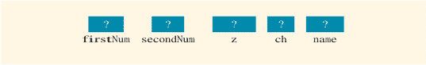

**图 2-2** 语句 1 执行前的变量

接下来，我们展示每条语句执行后变量的值。

| 语句执行后 | 变量的值 | 说明 |
| --- | --- | --- |
|  | **firstNum** · **secondNum** · **z** · **ch** · **name** |  |
| 1 | 4 · ? · ? · ? · ? | 将 4 存储到 `firstNum` 中。 |
| 2 | 4 · 14 · ? · ? · ? | `2 * firstNum + 6 = 2 * 4 + 6 = 14`。将 14 存储到 `secondNum` 中。 |
| 3 | 4 · 14 · 2.5 · ? · ? | `(firstNum + 1) / 2.0 = (4 + 1) / 2.0 = 5 / 2.0 = 2.5`。将 2.5 存储到 `z` 中。 |
| 4 | 4 · 14 · 2.5 · A · ? | 将 `'A'` 存储到 `ch` 中。 |
| 5 | 4 · 8 · 2.5 · A · ? | 从键盘读取一个数字（即 8），并将其存储到 `secondNum` 中。此语句用此新值替换 `secondNum` 的旧值。 |
| 6 | 4 · 8 · 16.3 · A · ? | 从键盘读取一个数字（即 16.3），并将此数字存储到 `z` 中。此语句用此新值替换 `z` 的旧值。 |
| 7 | 32 · 8 · 16.3 · A · ? | `2 * secondNum + static_cast<int>(z) = 2 * 8 + static_cast<int>(16.3) = 16 + 16 = 32`。将 32 存储到 `firstNum` 中。此语句用此新值替换 `firstNum` 的旧值。 |
| 8 | 32 · 8 · 16.3 · A · Jenny | 从键盘读取下一个输入 Jenny，并将其存储到 `name` 中。 |
| 9 | 32 · 9 · 16.3 · A · Jenny | `secondNum + 1 = 8 + 1 = 9`。将 9 存储到 `secondNum` 中。 |
| 10 | 32 · 9 · 16.3 · D · Jenny | 从键盘读取下一个输入（即 D），并将其存储到 `ch` 中。此语句用新值替换 `ch` 的旧值。 |


| 执行语句后 | 变量的值 | 说明 |
|---|---|---|
| 11 | firstNum = 100<br>secondNum = 9<br>z = 16.3<br>ch = D<br>name = Benny | `firstNum + static_cast<int>(ch)`<br>`32 + static_cast<int>('D') = 32 + 68 = 100.`<br>将 100 存入 firstNum。 |
| 12 | firstNum = 100<br>secondNum = 9<br>z = 83.7<br>ch = D<br>name = Benny | `firstNum - z = 100 - 16.3 = 100.0 - 16.3 = 83.7.`<br>将 83.7 存入 z。 |

> **注意**
>
> 当程序出现问题，且生成的结果并非你所预期时，你应该对给变量赋值的语句进行逐步检查。示例 2-19 说明了如何对程序进行逐步检查。这是一种非常有效的调试技术。本书配套网站包含一个 C++ 程序，展示了示例 2-19 开头列出的 12 条语句的效果。该程序名为 `Example_2_19.cpp`。

> **注意**
>
> 如果你将一个求值为浮点值的表达式的值——未使用强制类型转换运算符——赋给 `int` 类型的变量，则小数部分会被丢弃。在这种情况下，编译器很可能会发出有关隐式类型转换的警告消息。

## 递增和递减运算符

既然你已经知道如何声明变量并向变量输入数据，本节你将学习另外两个运算符：**递增**和**递减**运算符。这些运算符被 C++ 程序员频繁使用，是有用的编程工具。

假设 `count` 是一个 `int` 变量。语句：

```cpp
count = count + 1;
```

将 count 的值增加 1。为执行这条赋值语句，计算机首先计算右侧的表达式，即 count + 1。然后它将这个值赋给左侧的变量，即 count。

正如你将在后续章节中看到的，这类语句经常用于记录某些事情发生了多少次。为加快这类语句的执行，C++ 提供了**递增运算符** `++`，它将变量的值增加 1，以及**递减运算符** `--`，它将变量的值减少 1。


递增和递减运算符各有两种形式：前缀和后缀。递增运算符的语法是：

```text
Pre-increment: ++variable
Post-increment: variable++
```

递减运算符的语法是：

```text
Pre-decrement: --variable
Post-decrement: variable--
```

让我们看一些示例。语句：

```cpp
++count;
```

或：

```cpp
count++;
```

将 count 的值增加 1。类似地，语句：

```cpp
--count;
```

或：

```cpp
count--;
```

将 count 的值减少 1。

由于递增和递减运算符都内置于 C++ 中，因此无需使用赋值语句的形式，就能快速递增或递减变量的值。

现在，前缀和后缀递增运算符都会将变量的值增加 1。类似地，前缀和后缀递减运算符都会将变量的值减少 1。这些运算符的前缀形式和后缀形式有什么区别？当使用这些运算符的变量出现在表达式中时，区别就会变得明显。

假设 `x` 是一个 `int` 变量。如果在表达式中使用 `++x`，首先将 `x` 的值增加 1，然后使用 `x` 的新值计算表达式。另一方面，如果在表达式中使用 `x++`，首先在表达式中使用 `x` 的当前值，然后将 `x` 的值增加 1。下面的示例阐明了前缀和后缀递增运算符之间的区别。

假设 `x` 和 `y` 是 `int` 变量。考虑以下语句：

```cpp
x = 5;
y = ++x;
```

第一条语句将值 5 赋给 `x`。为了计算第二条语句（它使用前缀递增运算符），首先将 `x` 的值增加到 6，然后将这个值 6 赋给 `y`。第二条语句执行后，`x` 和 `y` 的值都为 6。

现在，考虑以下语句：

```cpp
x = 5;
y = x++;
```

和之前一样，第一条语句将 5 赋给 **x**。在第二条语句中，后缀递增运算符应用于 **x**。为了执行第二条语句，首先使用 **x** 的值（即 5）来计算表达式，然后将 **x** 的值增加到 6。最后，将表达式的值（即 5）存入 **y**。第二条语句执行后，**x** 的值为 6，**y** 的值为 5。

下面的示例进一步说明递增运算符的前缀形式和后缀形式如何工作。

### 示例 2-20

假设 a 和 b 是 `int` 变量，并且：

```cpp
a = 5;
b = 2 + (++a);
```

第一条语句将 5 赋给 a。为了执行第二条语句，首先计算表达式 2 + (++a)。因为前缀递增运算符应用于 a，所以首先将 a 的值增加到 6。然后将 2 与 6 相加得到 8，再将其赋给 b。因此，第二条语句执行后，a 为 6，b 为 8。

另一方面，在执行以下语句之后：

```cpp
a = 5;
b = 2 + (a++);
```

a 的值为 6，而 b 的值为 7。

本书最常将递增和递减运算符与变量一起用于独立语句中。也就是说，使用递增或递减运算符的变量不会成为任何表达式的一部分。

## 输出

在前面的章节中，你已经了解了如何将数据放入计算机内存以及如何操作这些数据。我们还使用了一些输出语句在*标准输出设备*上显示结果。本节将较为详细地说明如何进一步使用输出语句来生成所需的结果。

> **注意**  标准输出设备通常是屏幕。

在 C++ 中，标准输出设备上的输出通过使用 `cout` 和运算符 `<<` 来完成。`cout` 与 `<<` 一起使用的一般语法是：

```cpp
cout << expression or manipulator << expression or manipulator...;
```

这称为**输出语句**。在 C++ 中，`<<` 称为**流插入运算符**。使用 `cout` 生成输出遵循两条规则：

- 1. 计算表达式的值，并将其值打印在输出设备上的当前插入点。
- 2. 使用操纵符来格式化输出。最简单的操纵符是 `endl`（最后一个字符是字母 el），它使插入点移动到下一行的开头。

> **注意**
>
> 在屏幕上，插入点就是光标所在的位置。

下一个示例说明输出语句如何工作。在输出语句中，字符串，或仅涉及一个变量或单个值的表达式，会求值为其自身。

> **注意**
>
> 当输出语句输出 `char` 值时，它只输出字符，而不输出单引号（除非单引号是输出文本的一部分）。
>
> 例如，假设 `ch` 是一个 `char` 变量，且 `ch = 'A';`。语句：
>
> `cout << ch;`
>
> 或：
>
> `cout << 'A';`
>
> 输出：
>
> `A`
>
> 类似地，当输出语句输出字符串的值时，它只输出字符串，而不输出双引号（除非你将双引号作为输出的一部分包含在内）。

### 示例 2-21

考虑以下语句。每条语句的输出显示在其右侧。

| 语句 | 输出 |
|---|---|
| 1 `cout << 29 / 4 << endl;` | `7` |
| 2 `cout << "Hello there." << endl;` | `Hello there.` |
| 3 `cout << 12 << endl;` | `12` |
| 4 `cout << "4 + 7" << endl;` | `4 + 7` |
| 5 `cout << 4 + 7 << endl;` | `11` |
| 6 `cout << 'A' << endl;` | `A` |
| 7 `cout << "4 + 7 = " << 4 + 7 << endl;` | `4 + 7 = 11` |
| 8 `cout << 2 + 3 * 5 << endl;` | `17` |
| 9 `cout << "Hello \nthere." << endl;` | `Hello<br>there.` |

看看语句 9 的输出。回想一下，在 C++ 中，换行字符是 `\n`；这会使插入点移动到下一行的开头，然后再在那里打印。因此，当 `\n` 出现在输出语句的字符串中时，它会使插入点在输出设备上移动到下一行的开头。这一事实解释了为什么 Hello 和 there. 会打印在不同行上。

> **注意**  在 C++ 中，`\` 称为转义字符，`\n` 称为换行转义序列。

回想一下，所有变量都必须正确初始化；否则，存储在其中的值可能没有太大意义。还要记住，C++ 不会自动初始化变量。

如果 num 是一个 int 变量，那么以下 C++ 语句的输出：

```cpp
cout << num << endl;
```

才有意义，前提是 num 已被赋值。例如，以下 C++ 语句序列：

```cpp
num = 45;
cout << num << endl;
```

将产生输出 45。

### 示例 2-22

考虑以下 C++ 程序。

```cpp
// This program illustrates how output statements work.

#include <iostream>

using namespace std;

int main()
{
    int a, b;

    a = 65;                         //Line 1
    b = 78;                         //Line 2
```


```cpp
cout << 29 / 4 << endl;        //Line 3
cout << 3.0 / 2 << endl;       //Line 4
cout << "Hello there.\n";      //Line 5
cout << 7 << endl;             //Line 6
cout << 3 + 5 << endl;         //Line 7
cout << "3 + 5";               //Line 8
cout << endl;                  //Line 9
cout << a << endl;             //Line 10
cout << "a" << endl;           //Line 11
cout << (a + 5) * 6 << endl;   //Line 12
cout << 2 * b << endl;         //Line 13

return 0;
}
```

在下面的输出中，标有“语句所在行的输出”的列以及行号都不是输出的一部分。此列中显示行号是为了便于看出哪个输出对应哪条语句。

|  | 语句所在行的输出 |
|---|---|
| 7 | 第3行 |
| 1.5 | 第4行 |
| Hello there. | 第5行 |
| 7 | 第6行 |
| 8 | 第7行 |
| 3 + 5 | 第8行 |
| 65 | 第10行 |
| a | 第11行 |
| 420 | 第12行 |
| 156 | 第13行 |

大部分情况下，输出很直观。看看第7、8、9、10行语句的输出。第7行语句输出3 + 5的结果，即8，并将插入点移到下一行开头。第8行语句输出字符串3 + 5。注意，第8行语句仅由字符串3 + 5组成。因此，打印3 + 5后，插入点停留在5之后；它不会移到下一行开头。

第9行输出语句仅包含操纵符endl，它把插入点移到下一行开头。因此，当第10行语句执行时，输出从行首开始。注意在此输出中，“语句所在行的输出”列不包含第9行。这是因为第9行语句不产生任何可打印输出，只是将插入点移到下一行开头。接着，第10行语句输出a的值，即65。然后操纵符endl将插入点移到下一行开头。

> **注意** 在表达式中输出或访问变量的值不会破坏或修改变量的内容。

现在让我们仔细看看换行字符 '\n'。考虑以下C++语句：

```
cout << "Hello there.";
cout << "My name is James.";
```

如果按顺序执行这些语句，输出为：

```
Hello there.My name is James.
```

现在考虑以下C++语句：

```
cout << "Hello there.\n";
cout << "My name is James.";
```

这些C++语句的输出为：

```
Hello there.
My name is James.
```

当字符串中遇到\n时，插入点被定位到下一行开头。还要注意\n可以出现在字符串中的任何位置。例如，语句：

```
cout << "Hello \nthere. \nMy name is James.";
```

的输出为：

```
Hello
there.
My name is James.
```

另外注意，语句：

```
cout << '\n';
```

的输出与语句：

```
cout << "\n";
```

的输出相同，这等价于语句：

```
cout << endl;
```

的输出。

因此，语句序列：

```
cout << "Hello there.\n";
cout << "My name is James.";
```

的输出等价于语句序列：

```
cout << "Hello there." << endl;
cout << "My name is James.";
```

的输出。

### 示例 2-23

考虑以下C++语句：

```
cout << "Hello there.\nMy name is James.";
```

或者：

```
cout << "Hello there.";
cout << "\nMy name is James.";
```

或者：

```
cout << "Hello there.";
cout << endl << "My name is James.";
```

每种情况下，这些语句的输出为：

```
Hello there.
My name is James.
```

### 示例 2-24

C++语句：

```
cout << "Count...\n.....1\n.....2\n......3";
```

或者：

```
cout << "Count..." << endl << ".....1" << endl
     << ".....2" << endl << "......3";
```

的输出为：

```
Count...
.....1
.....2
......3
```

### 示例 2-25

假设你想将以下句子作为消息的一部分输出在一行中：

It is sunny, warm, and not a windy day. We can go golfing.

显然，你会使用输出语句产生这个输出。然而，在编程代码中，作为输出语句的一部分，这条语句可能无法放在一行内。当然，可以如下使用多条输出语句：

```
cout << "It is sunny, warm, and not a windy day. ";
cout << "We can go golfing." << endl;
```

注意第一条语句末尾的分号以及第二条语句开头的标识符cout。还要注意第一条语句末尾没有操纵符endl。这里使用两条输出语句将句子输出在一行中。等价地，可以使用以下输出语句输出这个句子：

```cpp
cout << "It is sunny, warm, and not a windy day. "
     << "We can go golfing." << endl;
```

在这条语句中，注意第一行末尾没有分号，第二行开头没有出现标识符cout。由于第一行末尾没有分号，这条输出语句延续到第二行。还要注意每行句子开头和结尾的双引号。字符串被分成两个字符串，但两个字符串都是同一条输出语句的一部分。

如果输出语句中出现的字符串很长，而你想在一行中输出该字符串，可以使用前面两种方法之一来拆分字符串。但是，以下语句不正确：

```cpp
cout << "It is sunny, warm, and not a windy day.
     We can go golfing." << endl; //illegal
```

换言之，键盘上的回车（或 Enter）键不能成为字符串的一部分。也就是说，在编程代码中，不能使用键盘上的回车（Enter）键将字符串分成多行。

回顾一下，换行字符是\n，它使插入点移到下一行开头。C++中有许多转义序列，可用于控制输出。表2-4列出了一些常用转义序列。

### 表2-4 常用转义序列

| 转义序列 | 名称 | 描述 |
|---|---|---|
| `\n` | 换行 | 光标移到下一行开头 |
| `\t` | 制表 | 光标移到下一个制表位 |
| `\b` | 退格 | 光标向左移动一个空格 |
| `\r` | 回车 | 光标移到当前行开头（不是下一行） |
| `\\` | 反斜杠 | 打印反斜杠 |
| `\'` | 单引号 | 打印单引号 |
| `\"` | 双引号 | 打印双引号 |

## 预处理指令

C++中显式定义的操作只有少量，例如算术运算和赋值运算。运行C++程序所需的许多函数和符号以库的集合形式提供。每个库都有一个名称，并通过头文件来引用。例如，执行输入/输出（I/O）所需函数的描述包含在头文件 `iostream` 中。类似地，一些非常有用的数学函数（如幂、绝对值和正弦）的描述包含在头文件 `cmath` 中。如果要使用I/O或数学函数，需要告诉计算机在哪里找到必要的代码。可以使用预处理指令和头文件名来告诉计算机库中提供的代码位置。预处理指令由称为**预处理器**的程序处理。

预处理指令是提供给预处理器的命令，使预处理器在编译C++程序之前修改其文本。所有预处理命令都以 `#` 开头。预处理命令末尾没有分号，因为它们不是C++语句。要在C++程序中使用头文件，请使用预处理指令 `include`。

在C++程序中包含头文件（由IDE提供）的一般语法是：

```cpp
#include <headerFileName>
```

例如，以下语句在C++程序中包含头文件 `iostream`：

```cpp
#include <iostream>
```

用于包含头文件的预处理指令放在程序的第一行，以便这些头文件中声明的标识符可以在整个程序中使用。（回顾一下，在C++中，标识符必须先声明后使用。）

某些头文件必须作为C++的一部分提供。附录F描述了一些常用头文件。程序员也可以创建自己的头文件，这将在本书后面的“类与数据抽象”一章中讨论。

注意，预处理命令在程序进入编译器之前由预处理器处理。

从图1-3（第1章）可以得出结论，C++系统有三个基本组成部分：程序开发环境、C++语言和C++库。这三个组成部分都是C++系统不可缺少的部分。程序开发环境由图1-3所示的六个步骤组成。在学习本书C++语言的过程中，我们会根据需要讨论C++库的组成部分。


### 命名空间以及在程序中使用 cin 和 cout

前面你已经了解到，`cin` 和 `cout` 都是预定义标识符。在 ANSI/ISO 标准 C++ 中，这些标识符声明在头文件 `iostream` 中，但位于一个 `namespace`（命名空间）内。这个命名空间的名字是 `std`。（命名空间机制将在第 8 章正式定义并详细讨论。现在，你只需知道如何使用 `cin` 和 `cout`，实际上还包括如何使用头文件 `iostream` 中的任何其他标识符。）

有几种方法可以使用在命名空间 `std` 中声明的标识符。使用 `cin` 和 `cout` 的一种方法是在整个程序中将它们称为 `std::cin` 和 `std::cout`。

另一种选择是在程序中包含以下语句：

```cpp
using namespace std;
```

这条语句出现在语句 `#include <iostream>` 之后。之后你就可以在不使用前缀 `std::` 的情况下引用 `cin` 和 `cout`。为了简化 `cin` 和 `cout` 的使用，本书采用第二种形式。也就是说，要在程序中使用 `cin` 和 `cout`，程序将包含以下两条语句：

```cpp
#include <iostream>
```

```cpp
using namespace std;
```

在 C++ 中，`namespace` 和 `using` 是保留字。

`namespace` 机制是 ANSI/ISO 标准 C++ 的一个特性。随着你学习更多 C++ 编程知识，你会了解到其他头文件。例如，头文件 `cmath` 包含许多有用数学函数的声明。同样，头文件 `iomanip` 包含许多有用函数和操纵符的声明，这些函数和操纵符可帮助你以特定方式格式化输出。然而，就像头文件 `iostream` 中的标识符一样，ANSI/ISO 标准 C++ 头文件中的标识符也声明在一个 `namespace` 内。

这些头文件中 `namespace` 的名字都是 `std`。因此，每当讨论 ANSI/ISO 标准 C++ 中某个头文件的某些特性时，本书将引用标识符时不加前缀 `std::`。此外，为了简化程序中标识符的访问，将包含语句 `using namespace std;`。另外，如果一个程序使用多个头文件，只需要一条 `using` 语句。这条 `using` 语句通常出现在所有头文件之后。

### 在程序中使用 `string` 数据类型

回想一下，`string` 数据类型是程序员定义的数据类型，并不能直接在程序中使用。要使用 `string` 数据类型，你需要从头文件 `string` 中访问它的定义。因此，要在程序中使用 `string` 数据类型，必须包含以下预处理指令：

```cpp
#include <string>
```

### 创建 C++ 程序

在前面的小节中，你已经学习了足够的 C++ 概念，可以编写有意义的程序。现在，你已准备好创建一个完整的 C++ 程序。

C++ 程序是函数的集合，其中之一是函数 `main`。因此，如果一个 C++ 程序只包含一个函数，那么这个函数必须是 `main`。此外，函数是为完成特定任务而设计的一组指令。在第 6 章之前，你主要将处理函数 `main`。

声明变量的语句、操作数据（如赋值）的语句以及输入和输出数据的语句都放在函数 `main` 内。声明命名常量的语句通常放在函数 `main` 外。

本书中使用的函数 `main` 的语法具有以下形式：

```cpp
int main()
{
    statement_1
        .
        .
        .
    statement_n

    return 0;
}
```

在函数 `main` 的语法中，每条语句（`statement_1`、……、`statement_n`）通常要么是声明语句，要么是可执行语句。语句 `return 0;` 必须包含在函数 `main` 中，并且必须是最后一条语句。如果语句 `return 0;` 在函数 `main` 的函数体中的位置放错，程序生成的结果可能不合你的意。语句 `return 0;` 的含义将在第 6 章讨论。在 C++ 中，`return` 是保留字。

C++ 程序可能会使用 IDE 提供的资源，例如输入数据所需的代码，这会要求你的程序包含某些头文件。因此，你可以将一个 C++ 程序分成两部分：预处理指令和程序。预处理指令告诉编译器在程序中包含哪些头文件。程序包含完成有意义结果的语句。预处理指令和程序语句合在一起构成 C++ 源代码。回想一下，为了有用，源代码必须保存在扩展名为 `.cpp` 的文件中。例如，如果源代码保存在文件 `firstProgram` 中，那么该文件的完整名称是 `firstProgram.cpp`。包含源代码的文件称为源代码文件或源文件。

程序编译时，编译器会生成目标代码，目标代码保存在扩展名为 `.obj` 的文件中。当目标代码与系统资源链接时，会生成可执行代码，并保存在扩展名为 `.exe` 的文件中。通常，包含目标代码的文件名和包含可执行代码的文件名与包含源代码的文件名相同。例如，如果源代码位于名为 `firstProg.cpp` 的文件中，则包含目标代码的文件名为 `firstProg.obj`，包含可执行代码的文件名为 `firstProg.exe`。

上一段给出的扩展名——即 `.cpp`、`.obj` 和 `.exe`——依赖于系统。此外，有些 IDE 以项目的形式维护程序。项目名称和源文件名称不必相同。可执行文件的名称可能是项目名称加上扩展名 `.exe`。要确定这一点，请查阅你的系统或 IDE 文档。

由于编程指令放在函数 `main` 中，让我们详细说明这个函数。

函数 `main` 的基本部分是函数头和函数体。函数 `main` 的第一行，即：

```cpp
int main()
```

称为函数 `main` 的函数头。

花括号（`{` 和 `}`）之间的语句构成函数 `main` 的函数体。函数 `main` 的函数体包含两类语句：

- 声明语句
- 可执行语句

**声明语句**用于声明事物，例如变量。

在 C++ 中，变量或标识符可以在程序中的任何位置声明，但它们必须先声明后使用。

**示例 2-27**

以下语句是变量声明的示例：

```cpp
int a, b, c;
double x, y;
```

**可执行语句**执行计算、操作数据、生成输出、接受输入等。

到目前为止你遇到的一些可执行语句是赋值语句、输入语句和输出语句。

**示例 2-28**

以下语句是可执行语句的示例：

```cpp
a = 4;                 //assignment statement
cin >> b;              //input statement
cout << a << " " << b << endl;   //output statement
```

以骨架形式表示，一个 C++ 程序如下所示：

```cpp
//comments, if needed

preprocessor directives to include header files

using statement

named constants, if necessary

int main()
{
    statement_1
    .
    .
    .
    statement_n
    return 0;
}
```

示例 2-29 中的 C++ 程序展示了 include 语句、声明语句、可执行语句等通常出现在程序中的位置。

**示例 2-29**

```cpp
/**************************************************************
 * Author: D.S. Malik
 *
 * This program shows where the include statements, using
 * statement, named constants, variable declarations, assignment
 * statements, and input and output statements typically appear.
 **************************************************************/

#include <iostream>                                      //Line 1

using namespace std;                                     //Line 2

const int NUMBER = 12;                                   //Line 3

int main()                                               //Line 4
{                                                        //Line 5
    int firstNum;                                        //Line 6
    int secondNum;                                       //Line 7

    firstNum = 18;                                       //Line 8
    cout << "Line 9: firstNum = " << firstNum
         << endl;                                        //Line 9

    cout << "Line 10: Enter an integer: ";              //Line 10
    cin >> secondNum;                                    //Line 11
    cout << endl;                                        //Line 12
```


```cpp
cout << "Line 13: secondNum = " << secondNum
     << endl;                                      //Line 13

firstNum = firstNum + NUMBER + 2 * secondNum;     //Line 14

cout << "Line 15: The new value of "
     << "firstNum = " << firstNum << endl;         //Line 15
}
return 0;                                          //Line 16
                                                    //Line 17
```

**示例运行：** 在此示例运行中，用户输入部分用底纹标出。

```text
Line 9: firstNum = 18
Line 10: Enter an integer: 15

Line 13: secondNum = 15
Line 15: The new value of firstNum = 60
```

前面的程序按如下方式工作：第1行中的语句包含头文件 iostream，以便程序可以执行输入/输出。第2行中的语句使用 using namespace 语句，以便头文件 iostream 中声明的标识符（如 cin、cout 和 endl）无需使用前缀 std:: 即可使用。第3行中的语句声明命名常量 NUMBER 并将其值设置为 12。第4行中的语句包含函数 main 的头部，第5行中的左花括号标记函数 main 的开始。第6行和第7行中的语句声明变量 firstNum 和 secondNum。

第8行中的语句将 firstNum 的值设置为 18，第9行中的语句输出 firstNum 的值。接下来，第10行中的语句提示用户输入一个整数。第11行中的语句读取该整数并将其存储到变量 secondNum 中，在示例运行中该值为 15。第12行中的语句将屏幕上的光标定位到下一行的开头。第13行中的语句输出 secondNum 的值。第14行中的语句计算表达式：

```text
firstNum + NUMBER + 2 * secondNum
```

并将该表达式的值赋给变量 firstNum，在示例运行中该值为 60。第15行中的语句输出 firstNum 的新值。第16行中的语句包含 return 语句。第17行中的右花括号标记函数 main 的结束。

## 调试：理解并修复语法错误

本章前面的几节介绍了 C++ 程序的基本组成部分。当你输入程序时，很可能会出现拼写错误和无意的语法错误。因此，编译程序时，编译器将识别语法错误。在本节中，我们将展示如何识别并修复语法错误。

考虑以下 C++ 程序：

```cpp
#include <iostream>

using namespace std;

int main()
{
    int num

    num = 18;

    tempNum = 2 * num;

    cout << "Num = " << num << ", tempNum = " << tempNum << endl;

    return;
}
```

（请注意，左侧的数字 1 到 16 不是程序的一部分。我们为语句编号以便于引用。）该程序包含语法错误。编译该程序时，编译器会产生以下错误：（该程序使用 Visual C++ Express 2008 编译。）

```text
Example2_Syntax_Errors.cpp
c:\chapter 2 source code\example2_syntax_errors.cpp(9) : error C2146: syntax error :
missing ';' before identifier 'num'
c:\chapter 2 source code\example2_syntax_errors.cpp(11) : error C2065: 'tempNum' :
undeclared identifier
c:\chapter 2 source code\example2_syntax_errors.cpp(13) : error C2065: 'tempNum' :
undeclared identifier
c:\chapter 2 source code\example2_syntax_errors.cpp(13) : error C2563: mismatch in formal
parameter list
c:\chapter 2 source code\example2_syntax_errors.cpp(13) : error C2568: '<<': unable to
resolve function overload
    c:\program files\microsoft visual studio 9.0\vc\include\ostream(974): could be
'std::basic_ostream<_Elem,_Traits> & std::endl(std::basic_ostream<_Elem,_Traits> &)'
    with
        [
            _Elem=wchar_t,
            _Traits=std::char_traits<wchar_t>
        ]
    c:\program files\microsoft visual studio 9.0\vc\include\ostream(966): or
'std::basic_ostream<_Elem,_Traits> & std::endl(std::basic_ostream<_Elem,_Traits> &)'
    with
        [
            _Elem=char,
            _Traits=std::char_traits<char>
        ]
c:\program files\microsoft visual studio 9.0\vc\include\ostream(940): or
' std::basic_ostream<_Elem,_Traits> &std::endl(std::basic_ostream<_Elem,_Traits> &)'
c:\chapter 2 source code\example2_syntax_errors.cpp(15) : error C2561: 'main' : function
must return a value
    f:\vc1 c++ fifth edition\chapter 2\chapter 2 source code and prog ex\chapter 2
source code\example2_syntax_errors.cpp(5) : see declaration of 'main'
Build log was saved at "file:///C:\Documents and Settings\DM\My
Documents\Proj1\Proj1\Debug\BuildLog.htm"
Proj1 - 6 error(s), 0 warning(s)
========== Rebuild All: 0 succeeded, 1 failed, 0 skipped ==========
```

首先，考虑以下错误：

```text
c:\chapter 2 source code\example2_syntax_errors.cpp(9) : error C2146:
syntax error : missing ';' before identifier 'num'
```

表达式 example2_syntax_errors.cpp(9) 表明第9行存在错误。该错误的其余部分指出，在标识符 num 之前缺少一个 ;。如果查看第7行，我们会发现语句 int num 的末尾缺少分号。因此，我们必须在第7行语句的末尾插入 ;。

接下来，考虑第二个错误：

```text
c:\chapter 2 source code\example2_syntax_errors.cpp(11) : error C2065: 'tempNum' :
undeclared identifier
```

该错误发生在第11行，并指出标识符 tempNum 未声明。查看代码时，我们发现该标识符尚未声明。因此，我们必须将 tempNum 声明为 int 变量。

错误：

```text
c:\chapter 2 source code\example2_syntax_errors.cpp(13) : error C2065: 'tempNum' :
undeclared identifier
```

发生在第13行，并指出标识符 tempNum 未声明。与前一个错误一样，我们必须声明 tempNum。请注意，一旦我们声明 tempNum 并重新编译，该错误和前一个错误都会消失。

下一个错误是：

```text
c:\chapter 2 source code\example2_syntax_errors.cpp(13) : error C2563: mismatch
in formal parameter list
```

该错误发生在第13行，并指出某个形式参数列表不匹配。对于初学者来说，这个错误有些难以理解。（在第15章中，我们将解释运算符 << 的形式参数列表。）但是，随着练习，你将学会如何解释并纠正语法错误。如果你查看下一个错误，这个错误就会变得清楚，其部分内容为：

```text
c:\chapter 2 source code\example2_syntax_errors.cpp(13) : error C2568: '<<' :
unable to resolve function overload
```

它告诉我们，这个错误与运算符 `<<` 有关。当我们仔细查看第13行中的语句时，该语句为：

```cpp
cout << "Num = " << num << ", tempNum = " << tempNum << endl;
```

我们发现，在表达式 `< tempNum` 中，我们无意中使用了 `<` 代替了 `<<`。因此，我们必须纠正这个错误。

让我们看最后一个错误，即：

```text
c:\chapter 2 source code\example2_syntax_errors.cpp(15) : error C2561: 'main' :
        function must return a value
            c:\chapter 2 source code\example2_syntax_errors.cpp(5) : see declaration
        of 'main'
```

该错误发生在第15行。然而，此时给出的解释，尤其是对初学者来说，有些不清楚。但是，如果你查看第15行中的语句 `return ;`，并记住函数 main 的语法以及本书给出的所有程序，我们会发现缺少数字 0，也就是说，该语句必须是 `return 0;`

从编译器报告的错误中，我们看到编译器不仅识别错误，还指明错误发生的行号和错误类型。我们可以有效地利用这些信息来修复语法错误。

纠正所有语法错误后，正确的程序是：

```cpp
#include <iostream>

using namespace std;

int main()
{
    int num;
    int tempNum;

    num = 18;

    tempNum = 2 * num;

    cout << "Num = " << num << ", tempNum = " << tempNum << endl;

    return 0;
}
```

输出为：

```text
Num = 18, tempNum = 36
```

在你学习 C++ 并练习编写和执行程序的过程中，你将学会如何发现并修复语法错误。编译器报告的错误列表可能比程序本身还长。这是因为某一行的语法错误可能导致后续行出现语法错误。在这种情况下，按照它们出现的顺序修正语法错误。


会被列出；如有必要，在每次修正后编译你的程序。你会看到语法错误列表缩短得有多快。重要的是不要惊慌。

下一节中，我们将描述一些可以遵循的简单规则，以便你的程序具有恰当的结构。

## 程序风格与形式

在前面的章节中，你已经学习了足够的 C++ 概念，可以编写有意义的程序。然而，在开始编写程序之前，你还需要学习程序的恰当结构等内容。为 C++ 程序使用恰当的结构，可以使其更易于理解以及后续修改。没有什么比试图理解并可能修改一个语法正确但毫无结构的程序更令人沮丧的了。

此外，每个 C++ 程序都必须满足该语言的某些规则。C++ 程序必须包含函数 main。它还必须遵循语法规则；这些规则就像语法规则一样，说明语言中什么是对的、什么是错的，什么是合法的、什么是非法的。其他规则则用于赋予语言精确的含义；也就是说，它们支持语言的语义。

以下各节旨在帮助你学习如何使用迄今已学到的 C++ 编程元素来创建一个可运行的程序。这些小节涵盖语法；空格的使用；分号、括号和逗号的使用；语义；标识符命名；提示行；文档（包括注释）；以及形式和风格。

### 语法

语言的语法规则说明什么是合法的、什么是不合法的。语法错误会在编译期间被检测到。例如，考虑以下 C++ 语句：

```cpp
int x;            //Line 1
int y             //Line 2
double z;         //Line 3

y = w + x;        //Line 4
```

编译这些语句时，第 2 行会出现编译错误，因为变量 y 的声明之后缺少分号。第 4 行会出现第二个编译错误，因为使用了标识符 w，但并未声明它。

如第 1 章所述，你使用文本编辑器将程序输入计算机。输入程序时，错误几乎不可避免。因此，编译程序时，你很可能会看到语法错误。某个特定位置的语法错误很可能导致后续若干语句出现语法错误。漏掉一个字符就引发四五条错误信息，这是很常见的。然而，当第一个语法错误被消除并重新编译程序后，由该语法错误引起的后续语法错误可能会消失。因此，你应当按照编译器列出错误的顺序来修正语法错误。随着你对 C++ 越来越熟悉、经验越来越丰富，你将学会如何快速发现并修正语法错误。此外，编译器不仅会发现语法错误，还会给出提示，有时还会告诉用户语法错误在哪里以及如何修正它们。


### 空格的使用

在 C++ 中，输入数据时使用一个或多个空格来分隔数字。空格也用于将保留字和标识符彼此分隔开，并将它们与其他符号分隔开。空格绝不能出现在保留字或标识符内部。

### 分号、括号和逗号的使用

所有 C++ 语句都必须以分号结尾。分号也称为**语句终止符**。

注意，花括号 { 和 } 本身并不是 C++ 语句，尽管它们常常单独出现在一行中，没有其他代码。你可以把括号视为分隔符，因为它们包围函数体，并将其与程序的其他部分区分开。括号还有其他用途，稍后将进行解释。

回想一下，逗号用于分隔列表中的各项。例如，当你在一个数据类型之后声明多个变量时，就要使用逗号。

### 语义

为一门语言赋予含义的规则集合称为**语义**。例如，算术运算符的优先级规则就是语义规则。

如果程序包含语法错误，编译器会警告你。如果程序包含语义错误，会发生什么？完全有可能消除程序中的所有语法错误，程序却仍然无法运行。而且即使它运行了，也可能不会做你想要它做的事。例如，下面两行代码在语法上都是正确的表达式，但它们具有不同的含义：

```cpp
2 + 3 * 5
```

以及：

```cpp
(2 + 3) * 5
```

如果在程序中用其中一行代码替换另一行，你不会得到相同的结果——即使数字相同，语义也不同。你将在本书中逐步学习语义。

### 标识符命名

考虑以下两组语句：

```cpp
const double A = 2.54;       //conversion constant
double x;                    //variable to hold centimeters
double y;                    //variable to hold inches

x = y * A;
```

以及：

```cpp
const double CENTIMETERS_PER_INCH = 2.54;
double centimeters;
double inches;

centimeters = inches * CENTIMETERS_PER_INCH;
```

第二组语句中的标识符（例如 CENTIMETERS_PER_INCH）通常称为**自文档化标识符**。如你所见，自文档化标识符可以减少对注释的需要。

考虑自文档化标识符 annualsale。这个标识符称为**连写词**。在使用自文档化标识符时，你可能无意中包含连写词，这会降低文档的清晰度。你可以通过将每个新单词的首字母大写，或在新单词前插入下划线，使连写词更易于理解。例如，你可以使用 annualSale 或 annual_sale 来创建更清晰的标识符。

回想一下，在本章前面，我们规定了命名具名常量和变量的一般规则。例如，用于命名具名常量的标识符全部大写。如果这个标识符是连写词，则各单词之间用下划线字符分隔。

### 提示行

良好文档的一部分是使用清晰编写的提示，使用户在与程序交互时知道该做什么。没有什么比坐在运行中的程序面前，却完全不知道是否要输入内容或该输入什么更令人沮丧的了。**提示行**是告知用户该做什么的可执行语句。例如，考虑以下 C++ 语句，其中 num 是一个 int 变量：

```cpp
cout << "Please enter a number between 1 and 10 and "
     << "press the return key" << endl;
cin >> num;
```

当这两条语句按给定顺序执行时，首先输出语句会使以下文本行显示在屏幕上：

```text
Please enter a number between 1 and 10 and press the return key
```

看到这一行后，用户就知道必须输入一个数字并按回车键。如果程序只包含第二条语句，用户就完全不知道必须输入数字，而计算机将永远等待输入。前面的输出语句就是提示行的一个例子。

在程序中，每当需要用户输入时，都必须包含必要的提示行。此外，这些提示行应尽可能多地包含关于可接受输入的信息。例如，前面的提示行不仅告诉用户要输入一个数字，还告知用户该数字应在 1 到 10 之间。

### 文档

你编写的程序不仅应当让你自己清楚，也应当让其他任何人清楚。因此，你必须为程序编写恰当的文档。文档良好的程序更易于理解和修改，即使在你最初编写它很久之后也是如此。你使用注释来为程序编写文档。程序中应当出现注释，以解释程序的目的、标明作者，并解释特定语句的用途。

### 形式与风格

你可能会认为 C++ 的规则太多了。然而，在实践中，这些规则赋予 C++ 很大的自由度。例如，考虑以下两种声明变量的方式：

```cpp
int feet, inches;
double x, y;
```

以及：

```cpp
int feet,inches;double x,y;
```

计算机理解这两种格式都没有困难，但第一种形式更易于阅读和遵循。当然，在任一格式中漏掉一个逗号或分号，都可能导致各种奇怪的错误信息。

空格又如何呢？它们在哪些地方有意义，在哪些地方没有意义？考虑以下两条语句：

```cpp
int a,b,c;
```

以及：

```cpp
int    a,    b,    c;
```

这两个声明含义相同。在这里，第二条语句中标识符之间的空格没有意义。另一方面，考虑以下语句：

```cpp
inta,b,c;
```

这条语句包含语法错误。`int` 和标识符 `a` 之间缺少空格，使保留字 `int` 和标识符 `a` 变成了一个新的标识符 `inta`。

语法和语义规则的清晰性使你能够自由采用令你满意且更易于理解的格式。


下面的示例进一步说明了这一点。

### 示例 2-30

考虑以下 C++ 程序：

```cpp
//An improperly formatted C++ program.

#include <iostream>
#include <string>
using namespace std;

int main()
{
int num; double height;
string name;
cout << "Enter an integer: "; cin >> num; cout <<
       "num: " <<num<<endl;
cout<<"Enter the first name: "; cin>>name;
       cout<<endl; cout << "Enter the height: ";
cin>>height; cout<<endl;

cout<<"Name: "<<name<<endl; cout<<"Height: "
<<height; cout <<endl;return 0;
}
```

这个程序在语法上是正确的；C++ 编译器读取和编译这个程序不会有任何困难。然而，这个程序非常难以阅读。你编写的程序应当具有适当的缩进和格式。注意重新格式化该程序后的区别：

```cpp
//A properly formatted C++ program.

#include <iostream>
#include <string>

using namespace std;

int main()
{
    int num;
    double height;
    string name;

    cout << "Enter an integer: ";
    cin >> num;
    cout << endl;
    cout << "num: " << num << endl;

    cout << "Enter the first name: ";
    cin >> name;
    cout << endl;
    cout << "Enter the height: ";
    cin >> height;
    cout << endl;

    cout << "Name: " << name << endl;
    cout << "Height: " << height << endl;

    return 0;
}
```

如你所见，这个程序更易于阅读。你的程序应当具有适当的缩进和格式。为了记录变量，程序员通常每行声明一个变量。另外，始终在运算符前后各放一个空格。当你使用 IDE 输入程序时，通常程序会自动缩进。

## 关于赋值语句的更多内容

到目前为止你看到的赋值语句称为**简单赋值语句**。在某些情况下，你可以使用称为**复合赋值语句**的特殊赋值语句，以更简洁的表示法编写简单赋值语句。

对应于五个算术运算符 +、−、*、/ 和 %，C++ 分别提供了五个复合运算符：+=、-=、*=、/= 和 %=。考虑以下简单赋值语句，其中 x 和 y 是 int 变量：

```cpp
x = x * y;
```

使用复合运算符 *=，这条语句可以写成：

```cpp
x *= y;
```

一般来说，使用复合运算符 *=，你可以将简单赋值语句：

```cpp
variable = variable * (expression);
```

重写为：

```cpp
variable *= expression;
```

其他算术复合运算符也有类似的约定。例如，使用复合运算符 **+**，你可以将简单赋值语句：

```
variable = variable + (expression);
```

重写为：

```
variable += expression;
```

复合赋值语句允许你通过将算术运算符与赋值运算符组合起来，以简洁的方式编写简单赋值语句。

### 示例 2-31

这个示例展示了几条与简单赋值语句等价的复合赋值语句。

| 简单赋值语句 | 复合赋值语句 |
|---|---|
| `i = i + 5;` | `i += 5;` |
| `counter = counter + 1;` | `counter += 1;` |
| `sum = sum + number;` | `sum += number;` |
| `amount = amount * (interest + 1);` | `amount *= interest + 1;` |
| `x = x / (y + 5);` | `x /= y + 5;` |

> **注意**
>
> 任何复合赋值语句都可以转换为简单赋值语句。然而，简单赋值语句可能无法（轻松地）转换为复合赋值语句。例如，考虑以下简单赋值语句：
>
> ```cpp
> x = x * y + z − 5;
> ```
>
> 要将这条语句写成复合赋值语句，变量 x 必须是右侧的公因子，而这里并非如此。因此，你不能立即将这条语句转换为复合赋值语句。事实上，等价的复合赋值语句是：
>
> ```cpp
> x *= y + (z − 5)/x;
> ```
>
> 它比简单赋值语句更复杂。此外，在前面的复合语句中，x 不能为 0。我们建议避免这类复合表达式。

> **注意**
>
> 在编程代码中，本书通常只使用复合运算符 +=。因此，诸如 `a = a + b;` 的语句会写成 `a += b;`。

## 编程示例：长度转换

编写一个程序，输入以英尺和英寸表示的长度。然后，该程序应将长度转换为厘米并输出。假设给定的英尺和英寸长度是整数。

**输入** 以英尺和英寸表示的长度。

**输出** 以厘米表示的等效长度。

### 问题分析与算法设计

长度以英尺和英寸给出，你需要求出以厘米表示的等效长度。1 英寸等于 2.54 厘米。程序需要做的第一件事是将以英尺和英寸给出的长度转换为总英寸数。然后，你可以使用换算公式 1 英寸 = 2.54 厘米，求出以厘米表示的等效长度。要将以英尺和英寸表示的长度转换为英寸，需将英尺数乘以 12（因为 1 英尺等于 12 英寸），再加上给定的英寸数。

例如，假设输入是 5 英尺 7 英寸。然后，你按如下方式计算总英寸数：

```
totalInches = (12 * feet) + inches
             = 12 * 5 + 7
             = 67
```

然后，你可以应用换算公式 1 英寸 = 2.54 厘米，求出以厘米表示的长度。

```
centimeters = totalInches * 2.54
             = 67 * 2.54
             = 170.18
```

基于对问题的这一分析，你可以设计如下算法：

- 1. 获取以英尺和英寸表示的长度。
- 2. 将长度转换为总英寸数。
- 3. 将总英寸数转换为厘米。
- 4. 输出厘米数。

### 变量

该程序的输入是两个数：一个表示英尺，一个表示英寸。因此，你需要两个变量：一个存储英尺，另一个存储英寸。由于程序首先会将给定长度转换为英寸，你还需要另一个变量来存储总英寸数。你还需要一个变量来存储以厘米表示的等效长度。总之，你需要以下变量：

```cpp
int feet;             //variable to hold given feet
int inches;           //variable to hold given inches
int totalInches;      //variable to hold total inches
double centimeters;   //variable to hold length in centimeters
```


在整个程序中使用的命名常量，通常放在函数 `main` 之前。我们将在第 7 章讨论一般的用户自定义函数时，进一步说明在程序中放置命名常量的位置。在此之前，通常我们会将命名常量放在函数 `main` 之前，以便它们能在整个程序中使用。

这个程序只有一个函数，即函数 `main`，其函数体将包含所有编程指令。此外，程序需要变量来操作数据，这些变量将在函数 `main` 的函数体中声明。在函数 `main` 的函数体中声明变量的原因将在第 7 章解释。函数 `main` 的函数体还将包含实现该算法的 C++ 语句。因此，函数 `main` 的函数体具有以下形式：

```cpp
int main()
{
    declare variables

    statements

    return 0;
}
```

要编写完整的长度转换程序，请遵循以下步骤：

- 1. 以用于文档说明的注释开始程序。
- 2. 包含程序中使用的头文件（如果有）。
- 3. 声明命名常量（如果有）。
- 4. 编写函数 `main` 的定义。

### 完整程序清单

```cpp
/*******************************************************
// Author: D. S. Malik
//
// Program Convert Measurements: This program converts
// measurements in feet and inches into centimeters using
// the formula that 1 inch is equal to 2.54 centimeters.
//*******************************************************

        //Header file
#include <iostream>

using namespace std;

        //Named constants
const double CENTIMETERS_PER_INCH = 2.54;
const int INCHES_PER_FOOT = 12;
```


```cpp
int main()
{
    //Declare variables
    int feet, inches;
    int totalInches;
    double centimeter;

    //Statements: Step 1 - Step 7
    cout << "Enter two integers, one for feet and "      //Step 1
         << "one for inches: ";
    cin >> feet >> inches;                              //Step 2
    cout << endl;
    cout << "The numbers you entered are " << feet
         << " for feet and " << inches
         << " for inches. " << endl;                    //Step 3

    totalInches = INCHES_PER_FOOT * feet + inches;      //Step 4

    cout << "The total number of inches = "
         << totalInches << endl;                        //Step 5

    centimeter = CENTIMETERS_PER_INCH * totalInches;    //Step 6

    cout << "The number of centimeters = "
         << centimeter << endl;                         //Step 7

    return 0;
}
```

**示例运行：** 在此示例运行中，用户输入以底纹显示。

输入两个整数，一个表示英尺，一个表示英寸：**15 7**

你输入的数字是：15 英尺和 7 英寸。
总英寸数 = 187
厘米数 = 474.98

## 编程示例：找零

编写一个程序，输入任意以美分表示的零钱。然后计算应找回的半美元、25美分硬币、10美分硬币、5美分硬币和1美分硬币的数量，按顺序尽可能多地返回半美元，然后依次是25美分硬币、10美分硬币、5美分硬币和1美分硬币。例如，483美分应找回9个半美元、1个25美分硬币、1个5美分硬币和3个1美分硬币。

- **输入：** 以美分表示的零钱。
- **输出：** 等值的半美元、25美分硬币、10美分硬币、5美分硬币和1美分硬币零钱。

### 问题分析与算法设计

假设给定的零钱是646美分。要找出半美元的数量，你用646除以50（一个半美元的值），得到商12和余数46。商12就是半美元的数量，余数46就是剩余的零钱。

接下来，用剩余的零钱除以25来找出25美分硬币的数量。由于剩余零钱是46，除以25得到商1，即25美分硬币的数量，余数为21，即剩余的零钱。对10美分硬币和5美分硬币重复此过程。要计算整数除法中的余数，使用取模运算符 %。

将上述讨论应用于646美分，得到以下计算：

- 1. 零钱 = 646
- 2. 半美元数量 = 646 / 50 = 12
- 3. 剩余零钱 = 646 % 50 = 46
- 4. 25美分硬币数量 = 46 / 25 = 1
- 5. 剩余零钱 = 46 % 25 = 21
- 6. 10美分硬币数量 = 21 / 10 = 2
- 7. 剩余零钱 = 21 % 10 = 1
- 8. 5美分硬币数量 = 1 / 5 = 0
- 9. 1美分硬币数量 = 剩余零钱 = 1 % 5 = 1

此讨论转化为以下算法：

- 1. 获取以美分表示的零钱。
- 2. 找出半美元的数量。
- 3. 计算剩余零钱。
- 4. 找出25美分硬币的数量。
- 5. 计算剩余零钱。
- 6. 找出10美分硬币的数量。
- 7. 计算剩余零钱。
- 8. 找出5美分硬币的数量。
- 9. 计算剩余零钱，即1美分硬币的数量。

### 变量

从前面的讨论和算法来看，程序似乎需要变量来保存半美元、25美分硬币等的数量。然而，半美元、25美分硬币等的数量不会在后续计算中使用，因此程序可以直接输出这些值，而不必将每个值都保存在变量中。唯一不断变化的是零钱，所以程序实际上只需要一个变量：

```c
int change;
```

### 命名常量

为了计算等值零钱，程序使用半美元的值50、25美分硬币的值25、10美分硬币的值10和5美分硬币的值5进行计算。由于这些数据很特殊，而且程序会多次使用这些值，因此将它们声明为命名常量是合理的。使用命名常量还简化了以后对程序的修改：

```cpp
const int HALF_DOLLAR = 50;
const int QUARTER = 25;
const int DIME = 10;
const int NICKEL = 5;
```

### 主算法

- 1. 提示用户输入。
- 2. 获取输入。
- 3. 通过在屏幕上显示输入的零钱来回显输入。
- 4. 计算并打印半美元的数量。
- 5. 计算剩余零钱。
- 6. 计算并打印25美分硬币的数量。
- 7. 计算剩余零钱。
- 8. 计算并打印10美分硬币的数量。
- 9. 计算剩余零钱。
- 10. 计算并打印5美分硬币的数量。
- 11. 计算剩余零钱。
- 12. 打印剩余零钱。

### 完整程序清单

```cpp
//**************************************************************
// Author: D. S. Malik
//
// Program Make Change: Given any amount of change expressed
// in cents, this program computes the number of half-dollars,
// quarters, dimes, nickels, and pennies to be returned,
// returning as many half-dollars as possible, then quarters,
// dimes, nickels, and pennies in that order.
//**************************************************************

    //Header file
#include <iostream>

using namespace std;

    //Named constants
const int HALF_DOLLAR = 50;
const int QUARTER = 25;
const int DIME = 10;
const int NICKEL = 5;

int main()
{
        //Declare variable
        int change;

        //Statements: Step 1 -- Step 12
        cout << "Enter change in cents: ";                 //Step 1
        cin >> change;                                     //Step 2
        cout << endl;

        cout << "The change you entered is " << change
             << endl;                                      //Step 3

        cout << "The number of half-dollars to be returned "
             << "is " << change / HALF_DOLLAR
             << endl;                                      //Step 4

        change = change % HALF_DOLLAR;                     //Step 5

        cout << "The number of quarters to be returned is "
             << change / QUARTER << endl;                  //Step 6

        change = change % QUARTER;                         //Step 7

        cout << "The number of dimes to be returned is "
             << change / DIME << endl;                     //Step 8

        change = change % DIME;                            //Step 9

        cout << "The number of nickels to be returned is "
             << change / NICKEL << endl;                   //Step 10

        change = change % NICKEL;                          //Step 11

        cout << "The number of pennies to be returned is "
             << change << endl;                            //Step 12

        return 0;
}
```

**示例运行：** 在此示例运行中，用户输入以底纹显示。

```text
Enter change in cents: 583
```

```text
The change you entered is 583
The number of half-dollars to be returned is 11
The number of quarters to be returned is 1
The number of dimes to be returned is 0
The number of nickels to be returned is 1
The number of pennies to be returned is 3
```


## 快速复习

- 1. 一个 C++ 程序是函数的集合。
- 2. 每个 C++ 程序都有一个名为 main 的函数。
- 3. 单行注释以符号对 // 开始，可位于行中任何位置。
- 4. 多行注释包含在 /* 和 */ 之间。
- 5. 编译器会跳过注释。
- 6. 保留字不能用作程序中的标识符。
- 7. C++ 中的所有保留字都由小写字母组成（见附录 A）。
- 8. 在 C++ 中，标识符是事物的名称。
- 9. C++ 标识符由字母、数字和下划线组成，并且必须以字母或下划线开头。
- 10. 空白包括空格、制表符和换行符。
- 11. 数据类型是一组值以及一组操作。
- 12. C++ 数据类型分为以下三类：简单类型、结构类型和指针类型。
- 13. 简单数据有三类：整数类型、浮点类型和枚举类型。
- 14. 整数数据类型分为九类：char、short、int、long、bool、unsigned char、unsigned short、unsigned int 和 unsigned long。
- 15. 属于 int 数据类型的值范围为 −2147483648（= −2^31）到 2147483647（= 2^31 − 1）。
- 16. 数据类型 bool 只有两个值：true 和 false。
- 17. 最常见的字符集是 ASCII（有 128 个值）和 EBCDIC（有 256 个值）。
- 18. 字符的排序序列是它在字符数据集中的预设编号。
- 19. C++ 提供三种数据类型来操作十进制数：float、double 和 long double。
- 20. C++ 中数据类型 float 用于表示 −3.4E + 38 到 3.4E + 38 之间的任何实数。为 float 数据类型的值分配的内存是四个字节。
- 21. C++ 中数据类型 double 用于表示 −1.7E + 308 到 1.7E + 308 之间的任何实数。为 double 数据类型的值分配的内存是八个字节。
- 22. C++ 中的算术运算符有加法（+）、减法（−）、乘法（*）、除法（/）和取模（%）。


- 23. 取模运算符 `%` 只接受整数操作数。
- 24. 算术表达式按照算术运算符的优先级规则和结合性求值。
- 25. 整型表达式（或整数表达式）中的所有操作数都是整数，浮点表达式中的所有操作数都是小数。
- 26. 混合表达式是由整数和小数共同组成的表达式。
- 27. 当对表达式中的运算符求值时，只有当该运算符具有混合操作数时，整数才会被转换为小数部分为 0 的浮点数。
- 28. 可以使用强制类型转换运算符将值从一种数据类型显式转换为另一种数据类型。
- 29. 字符串是由零个或多个字符组成的序列。
- 30. C++ 中的字符串用双引号括起来。
- 31. 不包含任何字符的字符串称为空字符串或空串。
- 32. 字符串中的每个字符在字符串中都有一个相对位置。第一个字符的位置是 0，第二个字符的位置是 1，依此类推。
- 33. 字符串的长度是其中字符的个数。
- 34. 在程序执行期间，命名常量的内容不能改变。
- 35. 命名常量通过使用保留字 `const` 来声明。
- 36. 命名常量在声明时被初始化。
- 37. 所有变量都必须先声明才能使用。
- 38. C++ 不会自动初始化变量。
- 39. 每个变量都有名称、值、数据类型和大小。
- 40. 当给变量赋新值时，旧值会丢失。
- 41. 只有赋值语句或输入（读取）语句才能改变变量的值。
- 42. 在 C++ 中，`>>` 称为流提取运算符。
- 43. 从标准输入设备输入是通过使用 `cin` 和流提取运算符 `>>` 完成的。
- 44. 当在程序中输入数据时，数据项（例如数字）通常由空白、换行或制表符分隔。
- 45. 在 C++ 中，`<<` 称为流插入运算符。
- 46. 程序向标准输出设备输出是通过使用 `cout` 和流插入运算符 `<<` 完成的。
- 47. 操纵符 `endl` 将插入点定位到输出设备下一行的开头。

  

- 48. 在表达式中输出或访问变量的值不会破坏或修改变量的内容。
- 49. 字符 `\` 称为转义字符。
- 50. 序列 `\n` 称为换行转义序列。
- 51. 所有预处理命令都以符号 `#` 开头。
- 52. 预处理命令在程序经过编译器之前由预处理器处理。
- 53. 预处理命令 `#include <iostream>` 指示预处理器将头文件 `iostream` 包含到程序中。
- 54. 要使用 `cin` 和 `cout`，程序必须包含头文件 `iostream`，并且要么包含语句 `using namespace std;`，要么将这些标识符称为 `std::cin` 和 `std::cout`。
- 55. 所有 C++ 语句都以分号结尾。C++ 中的分号称为语句终止符。
- 56. C++ 系统有三个组成部分：环境、语言和标准库。
- 57. 标准库不是 C++ 语言的一部分。它们包含执行操作的函数，例如数学运算。
- 58. 包含 C++ 程序的文件通常以扩展名 `.cpp` 结尾。
- 59. 提示行是可执行语句，用于告诉用户要做什么。
- 60. 对应于五个算术运算符 `+`、`-`、`*`、`/` 和 `%`，C++ 分别提供五个复合运算符：`+=`、`-=`、`*=`、`/=` 和 `%=`。

## 练习

- 1. 将以下陈述标记为真或假。
  - a. 标识符可以是任意由数字和字母组成的序列。
  - b. 在 C++ 中，保留字和预定义标识符之间没有区别。
  - c. C++ 标识符可以以数字开头。
  - d. 取模运算符的操作数必须是整数。
  - e. 如果 `a = 4;` 且 `b = 3;`，那么执行语句 `a = b;` 后，`b` 的值仍然是 3。
  - f. 在语句 `cin >> y;` 中，`y` 只能是 `int` 或 `double` 变量。
  - g. 在输出语句中，换行字符可以是字符串的一部分。
  - h. 以下是一个合法的 C++ 程序：

    ```
    int main()
    {
        return 0;
    }
    ```

  - i. 在混合表达式中，所有操作数都被转换为浮点数。
  - j. 假设 `x = 5`。执行语句 `y = x++;` 后，`y` 为 5，`x` 为 6。
  - k. 假设 `a = 5`。执行语句 `++a;` 后，`a` 的值仍然是 5，因为表达式的值没有保存到另一个变量中。

- 2. 以下哪些是有效的 C++ 标识符？
  - a. `myFirstProgram`
  - b. `MIX-UP`
  - c. `C++Program2`
  - d. `quiz7`
  - e. `ProgrammingLecture2`
  - f. `1footEquals12inches`
  - g. `Mike'sFirstAttempt`
  - h. `Update Grade`
  - i. `4th`
  - j. `New_Student`

- 3. 以下哪些是 C++ 中的保留字？
  - a. `Const`
  - b. `include`
  - c. `Char`
  - d. `void`
  - e. `int`
  - f. `Return`

- 4. 关键字和用户定义标识符之间有什么区别？

- 5. 标识符 `firstName` 和 `FirstName` 相同吗？

- 6. 计算以下表达式的值。
  - a. `25 / 3`
  - b. `20 - 12 / 4 * 2`
  - c. `32 % 7`
  - d. `3 - 5 % 7`
  - e. `18.0 / 4`
  - f. `28 - 5 / 2.0`
  - g. `17 + 5 % 2 - 3`
  - h. `15.0 + 3.0 * 2.0 / 5.0`

- 7. 如果 `x = 5`、`y = 6`、`z = 4` 且 `w = 3`，请尽可能计算以下各语句的值。如果不可能，请说明原因。
  - a. `(x + z) % y`
  - b. `(x + y) % w`
  - c. `(y + w) % x`
  - d. `(x + y) * w`
  - e. `(x % y) % z`
  - f. `(y % z) % x`
  - g. `(x * z) % y`
  - h. `((x * y) * w) * z`

- 8. 给定：

  ```
  int num1, num2, newNum;
  double x, y;
  ```

  以下哪些赋值是有效的？如果赋值无效，请说明原因。未给出时，假设每个变量都已声明。

  - a. `num1 = 35;`
  - b. `newNum = num1 - num2;`
  - c. `num1 = 5; num2 = 2 + num1; num1 = num2 / 3;`
  - d. `num1 * num2 = newNum;`
  - e. `x = 12 * num1 - 15.3;`
  - f. `num1 * 2 = newNum + num2;`
  - g. `x / y = x * y;`
  - h. `num2 = num1 % 2.0;`
  - i. `newNum = static_cast<int> (x) % 5;`
  - j. `x = x + y - 5;`
  - k. `newNum = num1 + static_cast<int> (4.6 / 2);`

- 9. 进行一次走查，找出赋给 e 的值。假设所有变量都已正确声明。

  ```
  a = 3;
  b = 4;
  c = (a % b) * 6;
  d = c / b;
  e = (a + b + c + d) / 4;
  ```

- 10. 以下哪些变量声明是正确的？如果变量声明不正确，请给出原因并提供正确的变量声明。

  ```
  n = 12;                //Line 1
  char letter = ;        //Line 2
  int one = 5, two;      //Line 3
  double x, y, z;        //Line 4
  ```

- 11. 以下哪些是有效的 C++ 赋值语句？假设 i、x 和 percent 是 double 变量。
  - a. `i = i + 5;`
  - b. `x + 2 = x;`
  - c. `x = 2.5 * x;`
  - d. `percent = 10%;`

- 12. 编写完成以下任务的 C++ 语句。
  - a. 声明 int 变量 x 和 y。将 x 初始化为 25，将 y 初始化为 18。
  - b. 声明并初始化一个 int 变量 temp 为 10，以及一个 char 变量 ch 为 'A'。
  - c. 通过给 int 变量 x 加 5 来更新它的值。
  - d. 声明并初始化一个 double 变量 payRate 为 12.50。
  - e. 将 int 变量 firstNum 的值复制到 int 变量 tempNum 中。
  - f. 交换 int 变量 x 和 y 的内容。（如有必要，声明额外的变量。）
  - g. 假设 x 和 y 是 double 变量。输出 x、y 以及表达式 x + 12 / y - 18 的内容。
  - h. 声明一个 char 变量 grade，并将 grade 的值设置为 'A'。
  - i. 声明 int 变量以存储四个整数。
  - j. 将 double 变量 z 的值复制到最接近的整数，并存入 int 变量 x 中。


### 13. 将下列各项分别写成 C++ 表达式。

- a. 32 乘以 a 加 b
- b. 表示 8 的字符
- c. 表示名字 `Julie Nelson` 的字符串。
- d. `(b² − 4ac) / 2a`
- e. `(a + b) / (c − ef) − gh`
- f. `(-b + (b² − 4ac)) / 2a`

### 14. 假设 x、y、z 和 w 是 `int` 变量。最后一条语句执行后，这些变量分别被赋什么值？

```cpp
x = 5; z = 3;
y = x - z;
z = 2 * y + 3;
w = x - 2 * y + z;
z = w - x;
w++;
```

### 15. 假设 x、y 和 z 是 `int` 变量，w 和 t 是 `double` 变量。最后一条语句执行后，这些变量分别被赋什么值？

```cpp
x = 17;
y = 15;
x = x + y / 4;
z = x % 3 + 4;
w = 17 / 3 + 6.5;
t = x / 4.0 + 15 % 4 - 3.5;
```

### 16. 假设 x、y 和 z 是 `int` 变量，且 x = 2、y = 5、z = 6。下列每条语句的输出是什么？

- a. `cout << "x = " << x << ", y = " << y << ", z = " << z << endl;`
- b. `cout << "x + y = " << x + y << endl;`
- c. `cout << "Sum of " << x << " and " << z << " is " << x + z << endl;`
- d. `cout << "z / x = " << z / x << endl;`
- e. `cout << "2 times " << x << " = " << 2 * x << endl;`

### 17. 下列语句的输出是什么？假设 a 和 b 是 `int` 变量，c 是 `double` 变量，且 a = 13、b = 5、c = 17.5。

- a. `cout << a + b - c << endl;`
- b. `cout << 15 / 2 + c << endl;`
- c. `cout << a / static_cast<double>(b) + 2 * c << endl;`
- d. `cout << 14 % 3 + 6.3 + b / a << endl;`
- e. `cout << static_cast<int>(c) % 5 + a - b << endl;`
- f. `cout << 13.5 / 2 + 4.0 * 3.5 + 18 << endl;`

### 18. 编写完成下列任务的 C++ 语句。

- a. 输出换行符。
- b. 输出制表符。
- c. 输出双引号。

### 19. 下列哪些是正确的 C++ 语句？

- a. `cout << "Hello There!" << endl;`
- b.
  ```cpp
  cout << "Hello";
  << "There!" << endl;
  ```
- c.
  ```cpp
  cout << "Hello"
  << "There!" << endl;
  ```
- d. `cout << "Hello There!" << endl;`

### 20. 为下列变量给出有意义的标识符。

- a. 用于存储学生名字的变量。
- b. 用于存储商品折后价格的变量。
- c. 用于存储果汁瓶数的变量。
- d. 用于存储行驶英里数的变量。
- e. 用于存储最高测试成绩的变量。

### 21. 编写 C++ 语句完成下列任务。

- a. 声明 int 变量 num1 和 num2。
- b. 提示用户输入两个数。
- c. 将第一个数输入到 num1，将第二个数输入到 num2。
- d. 输出 num1、num2 以及 2 乘以 num1 减去 num2 的结果。输出必须标明每个数和该表达式。

### 22. 下列程序有语法错误。请改正它们。对于后续每一行，假定前面所有错误都已改正。

```cpp
#include <iostream>

const int SECRET_NUM = 11,213;
const PAY_RATE = 18.35

main()
{
    int one, two;
    double first, second;
    one = 18;
    two = 11;

    first = 25;
    second = first * three;

    second = 2 * SECRET_NUM;
    SECRET_NUM = SECRET_NUM + 3;
    cout << first << " " << second << SECRET_NUM << endl;

    paycheck = hoursWorked * PAY_RATE

    cout << "Wages = " << paycheck << endl;
    return 0;
}
```

### 23. 下列程序有语法错误。请改正它们。对于后续每一行，假定前面所有错误都已改正。

```cpp
const char = STAR = '*'
const int PRIME = 71;

int main
{
    int count, sum;
    double x;

    count = 1;
    sum = count + PRIME;
    x := 25.67;
    newNum = count * ONE + 2;
    sum + count = sum;
    x = x + sum * COUNT;
    cout << " count = " << count << ", sum = " << sum
         << ", PRIME = " << PRIME << endl;
}
```

### 24. 下列程序有语法错误。请改正它们。对于后续每一行，假定前面所有错误都已改正。

```cpp
#include <iostream>

using namespace std;

int main()
{
    int temp;
    string first;

    cout << "Enter first name: ;
    cin >> first;
    cout << endl;

    cout << "Enter last name: ;
    cin >> last;
    cout << endl;

    cout << "Enter today's temperature: ";
    cin >> temperature;
    cout << endl;

    cout << first << " " << last << " today's temperature is: ";
         << temperature << endl;

    return 0;
}
```

### 25. 在程序中使用变量之前，必须采取什么操作？

### 26. 预处理指令以下列哪个符号开头：

- a. \*
- b. #
- c. $
- d. !
- e. 以上都不是。

### 27. 如果可能，写出等价的复合语句。

- a. `x = 2 * x`
- b. `x = x + y − 2;`
- c. `sum = sum + num;`
- d. `z = z * x + 2 * z;`
- e. `y = y / (x + 5);`

### 28. 将下列复合语句写成等价的简单语句。

- a. `x += 5 − z;`
- b. `y *= 2 * x + 5 − z;`
- c. `w += 2 * z + 4;`
- d. `x −= z + y − t;`
- e. `sum += num;`

### 29. 假设 a、b 和 c 是 int 变量，且 a = 5、b = 6。每条语句执行后，每个变量被赋什么值？如果某个变量在某条语句处未定义，请报告 UND（未定义）。

| 语句 | a | b | c |
|---|---|---|---|
| a = (b++) + 3; | ___ | ___ | ___ |
| c = 2 * a + (++b); | ___ | ___ | ___ |
| b = 2 * a + (++c) − (a++); | ___ | ___ | ___ |

### 30. 假设 a、b 和 sum 是 int 变量，c 是 double 变量。每条语句执行后，每个变量被赋什么值？假设 a = 3、b = 5、c = 14.1。

| 语句 | a | b | c | sum |
|---|---|---|---|---|
| sum = a + b + c; | ___ | ___ | ___ | ___ |
| c /= a; | ___ | ___ | ___ | ___ |
| b += c − a; | ___ | ___ | ___ | ___ |
| a *= 2 * b + c; | ___ | ___ | ___ | ___ |

### 31. 下列程序会打印什么？假设输入为：

```
20 15
```

```cpp
#include <iostream>

using namespace std;

const int NUM = 10;
const double X = 20.5;

int main()
{
    int a, b;
    double z;
    char grade;

    a = 25;

    cout << "a = " << a << endl;

    cout << "Enter two integers: ";
    cin >> a >> b;
    cout << endl;

    cout << "The numbers you entered are "
         << a << " and " << b << endl;

    z = X + 2 * a - b;
    cout << "z = " << z << endl;

    grade = 'A';
    cout << "Your grade is " << grade << endl;

    a = 2 * NUM + z;
    cout << "The value of a = " << a << endl;

    return 0;
}
```

### 32. 下列程序会打印什么？假设输入为：

```
Miller
34
340
```

```cpp
#include <iostream>
#include <string>

using namespace std;

const int PRIME_NUM = 11;

int main()
{
    const int SECRET = 17;

    string name;
    int id;
    int num;
    int mysteryNum;

    cout << "Enter last name: ";
    cin >> name;
    cout << endl;

    cout << "Enter a two digit number: ";
    cin >> num;
    cout << endl;

    id = 100 * num + SECRET;

    cout << "Enter a positive integer less than 1000: ";
    cin >> num;
    cout << endl;

    mysteryNum = num * PRIME_NUM - 3 * SECRET;

    cout << "Name: " << name << endl;
    cout << "Id: " << id << endl;
    cout << "Mystery number: " << mysteryNum << endl;

    return 0;
}
```

### 33. 重写下列程序，使其格式正确。

```cpp
#include <iostream>
#include <string>
using namespace std;
const double X = 13.45; const int Y=34;
const char BLANK=' ';
int main()
{string firstName,lastName;int num;
double salary;
cout<<"Enter first name: "; cin>> firstName; cout<<endl;
cout<<"Enter last name: "; cin
>>lastName;cout<<endl;
        cout<<"Enter a positive integer less than 70:";
cin>>num;cout<<endl; salary=num*X;
cout<<"Name: "<<firstName<<BLANK<<lastName<<endl; cout
<<"Wages: $"<<salary<<endl; cout<<"X = "<<X<<endl;
cout<<"X + Y = " << X+Y << endl; return 0;
}
```

### 34. 下列程序需要什么类型的输入，并且输入需要按什么顺序提供？

```cpp
#include <iostream>

using namespace std;

int main()
{
    int age;
    double weight;
    string firstName, lastName;

    cin >> firstName >> lastName;
    cin >> age >> weight;

    return 0;
}
```


## 编程练习

- 1. 编写一个程序，产生以下输出：

  ```text
  ********************************
  *    Programming Assignment 1   *
  *    Computer Programming I     *
  *         Author: ???           *
  *    Due Date: Thursday, Jan. 24*
  ********************************
  ```

  在程序中，将 ??? 替换为你自己的名字。如有必要，调整星号的位置和数量以形成一个矩形。

- 2. 编写一个程序，产生以下输出：

  ```text
  CCCCCCCC        ++              ++
  CC              ++              ++
  CC       ++++++++++++++   ++++++++++++++
  CC       ++++++++++++++   ++++++++++++++
  CC              ++              ++
  CCCCCCCC        ++              ++
  ```

- 3. 考虑以下程序段

  ```cpp
  //include statement(s)
  //using namespace statement

  int main()
  {
      //variable declaration

      //executable statements

      //return statement
  }
  ```

  - a. 编写包含头文件 `iostream` 的 C++ 语句。
  - b. 编写一条 C++ 语句，使你无需前缀 `std::` 就能使用 `cin`、`cout` 和 `endl`。
  - c. 编写 C++ 语句，声明以下变量：`num1`、`num2`、`num3` 和 `average`，类型为 `int`。
  - d. 编写 C++ 语句，将 125 存入 `num1`，28 存入 `num2`，-25 存入 `num3`。
  - e. 编写一条 C++ 语句，将 `num1`、`num2` 和 `num3` 的平均值存入 `average`。
  - f. 编写 C++ 语句，输出 `num1`、`num2`、`num3` 和 `average` 的值。
  - g. 编译并运行你的程序。

- 4. 重复练习 3，将 num1、num2 和 num3 以及 average 声明为 `double` 类型。将 75.35 存入 num1，-35.56 存入 num2，15.76 存入 num3。

- 5. 考虑以下 C++ 程序，其中语句顺序不正确。重新排列这些语句，使其提示用户输入矩形的长度和宽度，并输出矩形的面积和周长。

  ```cpp
  #include <iostream>
  {
      int main()

      cout << "Enter the length: ";
      cin >> length;
      cout << endl;

      int length;

      area = length * width;

      return 0;

      int width;

      cin >> width;
      cout << "Enter the width: ";
      cout << endl;

      cout << "Area = " << area << endl;
      cout << "Perimeter = " << perimeter << endl;

      int area;
      using namespace std;
      int perimeter;
  }
  ```

- 6. 考虑以下程序段：

  ```cpp
  //include statement(s)
  //using namespace statement

  int main()
  {
      //variable declaration

      //executable statements

      //return statement
  }
  ```

  - a. 编写包含头文件 `iostream` 和 `string` 的 C++ 语句。
  - b. 编写一条 C++ 语句，使你无需前缀 `std::` 就能使用 `cin`、`cout` 和 `endl`。
  - c. 编写 C++ 语句，声明以下变量：`name` 类型为 `string`，`studyHours` 类型为 `double`。
  - d. 编写 C++ 语句，提示并将一个字符串输入到 `name`，将一个 `double` 值输入到 `studyHours`。
  - e. 编写一条 C++ 语句，使用适当的文本输出 `name` 和 `studyHours` 的值。例如，如果 `name` 的值为 "Donald"，`studyHours` 的值为 4.5，则输出为：

    `Hello, Donald! on Saturday, you need to study 4.5 hours for the exam.`

  - f. 编译并运行你的程序。

- 7. 编写一个程序，提示用户输入一个十进制数，并输出四舍五入到最接近整数的该数。

- 8. 考虑以下程序段：

  ```cpp
  //include statement(s)
  //using namespace statement

  int main()
  {
      //variable declaration

      //executable statements

      //return statement
  }
  ```

  - a. 编写包含头文件 `iostream` 和 `string` 的 C++ 语句。
  - b. 编写一条 C++ 语句，使你无需前缀 `std::` 就能使用 `cin`、`cout` 和 `endl`。
  - c. 编写 C++ 语句，声明并初始化以下命名常量：`SECRET` 类型为 `int`，初始化为 11；`RATE` 类型为 `double`，初始化为 12.50。
  - d. 编写 C++ 语句，声明以下变量：`num1`、`num2` 和 `newNum` 类型为 `int`；`name` 类型为 `string`；`hoursWorked` 和 `wages` 类型为 `double`。
  - e. 编写 C++ 语句，提示用户输入两个整数，并将第一个数存入 `num1`，第二个数存入 `num2`。

  

  - f. 编写 C++ 语句，输出 num1 和 num2 的值，并指明哪个是 num1、哪个是 num2。例如，如果 num1 是 8，num2 是 5，则输出为：

    The value of num1 = 8 and the value of num2 = 5.

  - g. 编写一条 C++ 语句，将 num1 的值乘以 2，再加上 num2 的值，然后将结果存入 newNum。接着，编写一条 C++ 语句输出 newNum 的值。
  - h. 编写一条 C++ 语句，通过加上命名常量 SECRET 的值来更新 newNum 的值。接着，编写一条 C++ 语句，输出 newNum 的值并附上适当的消息。
  - i. 编写 C++ 语句，提示用户输入一个人的姓氏，然后将该姓氏存入变量 name。
  - j. 编写 C++ 语句，提示用户输入一个 0 到 70 之间的十进制数，然后将输入的数存入 hoursWorked。
  - k. 编写一条 C++ 语句，将命名常量 RATE 的值与 hoursWorked 的值相乘，然后将结果存入变量 wages。
  - l. 编写 C++ 语句，产生以下输出：

    ```text
    Name:           //output the value of the variable name
    Pay Rate: $     //output the value of the variable rate
    Hours Worked:   //output the value of the variable
                    //hoursWorked
    Salary: $       //output the value of the variable wages
    ```

    例如，如果 name 的值为 "Rainbow"，hoursWorked 为 45.50，则输出为：

    ```text
    Name: Rainbow
    Pay Rate: $12.50
    Hours Worked: 45.50
    Salary: $568.75
    ```

  - m. 编写一个 C++ 程序，测试你在 a 到 l 部分编写的每条 C++ 语句。将这些语句放在前面 C++ 程序段中的适当位置。用以下输入数据测试运行你的程序（两次）：

    - a. num1 = 13, num2 = 28; name = "Jacobson"; hoursWorked = 48.30.
    - b. num1 = 32, num2 = 15; name = "Crawford"; hoursWorked = 58.45.

- 9. 编写一个程序，提示用户输入五个测试分数，然后打印平均测试分数。（假设测试分数是十进制数。）

- 10. 编写一个程序，提示用户输入五个十进制数。然后程序应将这五个十进制数相加，将和转换为最接近的整数，并打印结果。

- 11. 编写一个程序，完成以下操作：
  - a. 提示用户输入五个十进制数。
  - b. 打印这五个十进制数。
  - c. 将每个十进制数转换为最接近的整数。
  - d. 将这五个整数相加。
  - e. 打印这五个整数的和与平均值。

- 12. 编写一个程序，提示用户输入汽车油箱容量（以加仑为单位）以及汽车每加仑可行驶的英里数。程序输出汽车不加油可行驶的英里数。

- 13. 编写一个 C++ 程序，提示用户输入一个事件经过的时间（以秒为单位）。然后程序输出以小时、分钟和秒表示的经过时间。（例如，如果经过时间是 9630 秒，则输出为 2:40:30。）

- 14. 编写一个 C++ 程序，提示用户输入一个事件经过的时间（以小时、分钟和秒为单位）。然后程序输出以秒表示的经过时间。

- 15. 为了盈利，一家本地商店将商品价格提高一定百分比。编写一个 C++ 程序，读取所售商品的原始价格、加价百分比和销售税率。然后程序输出商品的原始价格、加价百分比、商店的商品售价、销售税率、销售税以及商品的最终价格。（商品的最终价格是售价加上销售税。）

- 16. 编写一个程序，提示用户输入以厘米表示的长度。然后程序应将长度转换为英寸（四舍五入到最接近的英寸），并按码、英尺和英寸的顺序输出该长度。例如，假设输入的厘米数为 312。四舍五入到最接近的英寸，312 厘米等于 123 英寸。因此，123 英寸将输出为：

  3 码、1 英尺和 3 英寸。

- 17. 编写一个程序，实现并测试你在第 1 章练习 15 中设计的算法。（可以假设 π = 3.141593。在程序中，声明一个名为 PI 的命名常量来存储该值。）

- 18. 一个牛奶盒可以装 3.78 升牛奶。每天早上，一家奶牛场将盒装牛奶运送到当地一家杂货店。生产一升牛奶的成本是 $0.38，每盒牛奶的利润是 $0.27。编写一个程序，完成以下操作：


- a. 提示用户输入早晨生产的牛奶总量。
- b. 输出容纳牛奶所需的牛奶盒数量。（将答案四舍五入到最接近的整数。）
- c. 输出生产牛奶的成本。
- d. 输出生产牛奶的利润。

- 19. 重做编程练习18，使得用户还可以输入生产一升牛奶的成本以及每盒牛奶的利润。

- 20. 你找到了一份令人兴奋的为期五周的暑期工作。假设它每小时支付15.50美元。假设你暑期工作收入总共要缴纳14%的税。缴税后，你将净收入的10%用于购买下一学年的新衣服和其他配饰，1%用于购买学习用品。购买衣服和学习用品后，你用剩余钱的25%购买储蓄债券。你每花1美元购买储蓄债券，你的父母就会花0.50美元为你购买额外的储蓄债券。编写一个程序，提示用户输入每小时的工资率以及你每周工作的小时数。然后程序输出以下内容：
  - a. 你暑期工作的税前和税后收入。
  - b. 你花在衣服和其他配饰上的钱。
  - c. 你花在学习用品上的钱。
  - d. 你花在购买储蓄债券上的钱。
  - e. 你的父母为你购买额外储蓄债券所花的钱。

- 21. 三个对象a、b和c的排列是这些对象在一行中的任意一种安排。例如，这些对象的一些排列是abc、bca和cab。三个对象的排列数是六。假设这三个对象是字符串。编写一个程序，提示用户输入三个字符串。然后程序输出这些字符串的六种排列。

- 22. 编写一个程序，提示用户输入25美分、10美分和5美分硬币的数量。然后程序以美分为单位输出这些硬币的总价值。

- 23. 牛顿定律指出，质量分别为M1和M2的两个物体之间的力F由下式给出：

  $$F = k\left(\frac{M_1M_2}{d^2}\right),$$

  其中 \(k\) 是引力常数，\(d\) 是两物体之间的距离。\(k\) 的值约为 \(6.67 \times 10^{-8}\ \text{dyn}\cdot\text{cm}^2/\text{g}^2\)。编写一个程序，提示用户输入两物体的质量以及它们之间的距离。然后程序输出两物体之间的力。

- 24. 一公吨约等于2205磅。编写一个程序，提示用户输入一袋大米的重量（以磅计）。程序输出储存一公吨大米所需的袋数。

- 25. Cindy使用一家经纪公司的服务来买卖股票。该公司对每笔交易（无论买入还是卖出）的总金额收取1.5%的服务费。当Cindy卖出股票时，她想知道某项特定投资是盈利还是亏损。编写一个程序，允许Cindy输入卖出的股数、每股买入价和每股卖出价。程序输出投资金额、总服务费、盈利或亏损金额，以及卖出股票后收到的金额。

本页有意留白


# 第3章：输入/输出

本章中，你将：

- 了解什么是流，并考察输入流和输出流
- 探索如何从标准输入设备读取数据
- 学习如何在程序中使用预定义函数
- 探索如何使用输入流函数 `get`、`ignore`、`putback` 和 `peek`
- 熟悉输入失败
- 学习如何将数据写入标准输出设备
- 了解如何在程序中使用操纵器来格式化输出
- 学习如何对 `string` 数据类型执行输入和输出操作
- 学习如何调试逻辑错误
- 熟悉文件输入和输出

在第2章中，向你介绍了一些C++的输入/输出（I/O）指令，这些指令将数据读入程序并将结果打印到屏幕上。你使用 `cin` 和提取运算符 `>>` 从键盘获取数据，并使用 `cout` 和插入运算符 `<<` 将输出发送到屏幕。由于I/O操作是任何编程语言的基础，本章将更详细地学习C++的I/O操作。首先，你将学习从标准输入设备提取输入并向标准输出设备发送输出的语句。然后，你将学习如何使用操纵器格式化输出。此外，你将了解与标准输入/输出设备相关的I/O操作的局限性，并学习如何将这些操作扩展到其他设备。

## 输入/输出流与标准输入/输出设备

程序执行三种基本操作：获取数据、处理数据并输出结果。在第2章中，你学习了如何使用算术运算处理数值数据。在后续章节中，你将学习如何处理非数值数据。由于编写I/O程序相当复杂，C++通过提供大量预编写的I/O操作，为I/O操作提供了广泛支持，其中一些你在第2章中已经遇到过。本章中，你将学习各种I/O操作，这些操作可以极大地增强程序的灵活性。

在C++中，I/O是从源到目的地的一串字节，称为流。除非程序需要其他类型的信息，例如图像或数字语音，否则这些字节通常是字符。因此，**流**是从源到目的地的字符序列。流有两种类型：

- **输入流：** 从输入设备到计算机的字符序列。
- **输出流：** 从计算机到输出设备的字符序列。

回顾一下，标准输入设备通常是键盘，标准输出设备通常是屏幕。为了从键盘接收数据并将输出发送到屏幕，每个C++程序都必须使用头文件 `iostream`。该头文件除其他内容外，还包含两个数据类型的定义：`istream`（输入流）和 `ostream`（输出流）。该头文件还包含两个变量声明：一个用于 `cin`（读作“see-in”），它表示**通用输入**；另一个用于 `cout`（读作“see-out”），它表示**通用输出**。

这些变量声明类似于以下C++语句：

```cpp
istream cin;
ostream cout;
```

要使用 `cin` 和 `cout`，每个C++程序都必须使用预处理指令：

```cpp
#include <iostream>
```

> **注意**
>
> 回顾第2章，为了使用 `cin` 和 `cout`，你一直在包含头文件 `iostream` 之外，还使用语句 `using namespace std;`。如果没有语句 `using namespace std;`，则将这些标识符称为 `std::cin` 和 `std::cout`。在第8章中，你将详细了解语句 `using namespace std;` 的含义。

类型为 `istream` 的变量称为**输入流变量**；类型为 `ostream` 的变量称为**输出流变量**。**流变量**要么是输入流变量，要么是输出流变量。

由于 `cin` 和 `cout` 已经定义并具有特定含义，为避免混淆，绝不应在程序中重新定义它们。

变量 `cin` 可以访问可用于从标准输入设备提取数据的运算符和函数。你已经简要使用过提取运算符 `>>` 从标准输入设备输入数据。下一节将详细描述提取运算符 `>>` 的工作方式。在接下来的几节中，你将学习如何使用函数 `get`、`ignore`、`peek` 和 `putback` 以特定方式输入数据。

## `cin` 与提取运算符 `>>`

在第2章中，你看到了如何使用 `cin` 和提取运算符 `>>` 从标准输入设备输入数据。假设 `payRate` 是一个 `double` 变量。考虑以下C++语句：

```cpp
cin >> payRate;
```

当计算机执行该语句时，它会输入从键盘键入的下一个数字，并将该数字存储到 `payRate` 中。因此，如果用户键入15.50，则存储在 `payRate` 中的值为15.50。

提取运算符 `>>` 是二元的，因此接受两个操作数。左操作数必须是输入流变量，例如 `cin`。由于输入语句的目的是读取值并将其存储到内存位置，并且只有变量指向内存位置，因此右操作数是一个变量。

> **注意**
>
> 提取运算符 `>>` 仅定义为将数据放入简单数据类型的变量中。因此，提取运算符 `>>` 的右操作数是简单数据类型的变量。然而，C++允许程序员扩展提取运算符 `>>` 的定义，以便也可以通过输入语句将数据放入其他类型的变量中。你将在本书后面题为*重载与模板*的一章中学习这一机制。

使用 `cin` 和提取运算符 `>>` 的输入语句语法为：

```cpp
cin >> variable >> variable...;
```


正如你在前面的语法中所看到的，一条输入语句可以通过多次使用运算符 `>>` 来读取多个数据项。每出现一次 `>>`，就会从输入流中提取下一个数据项。例如，你可以使用以下代码，通过一条输入语句同时读取 `payRate` 和 `hoursWorked`：

```
cin >> payRate >> hoursWorked;
```

前面的输入语句与下面两条输入语句没有区别。使用哪种形式只是方便和风格问题。

```
cin >> payRate;
cin >> hoursWorked;
```

提取运算符 `>>` 如何工作？在扫描下一个输入时，`>>` 会跳过所有空白字符。回想一下，空白字符由空格和某些不可打印字符（如制表符和换行符）组成。因此，无论你用行还是空格分隔输入数据，提取运算符 `>>` 都只是找到输入流中的下一个输入数据。例如，假设 `payRate` 和 `hoursWorked` 是 double 变量。考虑以下输入语句：

```
cin >> payRate >> hoursWorked;
```

无论输入是：

```
15.50 48.30
```

或者：

```
15.50  48.30
```

或者：

```
15.50
48.30
```

前面的输入语句都会将 15.50 存入 payRate，将 48.30 存入 hoursWorked。注意，第一个输入由空格分隔，第二个输入由制表符分隔，第三个输入由换行分隔。

现在假设输入是 2。提取运算符 `>>` 如何区分字符 2 和数字 2？提取运算符 `>>` 的右侧操作数做出了这种区分。如果右侧操作数是 char 数据类型的变量，则输入 2 被当作字符 2，在这种情况下存储的是 2 的 ASCII 值。如果右侧操作数是 int 或 double 数据类型的变量，则输入 2 被当作数字 2。

接下来，考虑输入 25 和以下语句：

```
cin >> a;
```

其中 a 是某种简单数据类型的变量。如果 a 是 char 数据类型，则只将单个字符 2 存入 a。如果 a 是 int 数据类型，则将 25 存入 a。如果 a 是 double 数据类型，则输入 25 会被转换为十进制数 25.0。表 3-1 通过展示简单数据类型变量的有效输入，总结了这一讨论。

### 表 3-1 简单数据类型变量的有效输入

| a 的数据类型 | a 的有效输入 |
|---|---|
| `char` | 一个可打印字符，空白除外 |
| `int` | 一个整数，前面可带有 + 或 − 号 |
| `double` | 一个小数，前面可带有 + 或 − 号。如果实际输入的数据是整数，则该输入会被转换为小数部分为零的十进制数。 |

当把数据读入 `char` 变量时，在跳过所有前导空白字符后，提取运算符 `>>` 只找到并存储下一个字符；读取在单个字符后停止。要把数据读入 `int` 或 `double` 变量，在跳过所有前导空白字符并读取正号或负号（如果有）后，提取运算符 `>>` 会读取数字的各位数字，对于浮点变量还包括小数点，并在遇到空白字符或非数字字符时停止。

### 示例 3-1

假设你有以下变量声明：

```
int a, b;
double z;
char ch;
```

以下语句展示了提取运算符 `>>` 的工作方式。

| 语句 | 输入 | 内存中存储的值 |
|---|---|---|
| 1. `cin >> ch;` | A | `ch = 'A'` |
| 2. `cin >> ch;` | AB | `ch = 'A', 'B' is held for later input` |
| 3. `cin >> a;` | 48 | `a = 48` |
| 4. `cin >> a;` | 46.35 | `a = 46, .35` 留待后续输入 |
| 5. `cin >> z;` | 74.35 | `z = 74.35` |
| 6. `cin >> z;` | 39 | `z = 39.0` |
| 7. `cin >> z >> a;` | 65.78 38 | `z = 65.78, a = 38` |
| 8. `cin >> a >> b;` | `4 60` | `a = 4, b = 60` |
| 9. `cin >> a >> z;` | `46 32.4 68` | `a = 46, z = 32.4, 68 is held for later input` |

### 示例 3-2

假设你有以下变量声明：

```
int a;
double z;
char ch;
```

以下语句展示了提取运算符 `>>` 的工作方式。

| 语句 | 输入 | 内存中存储的值 |
|---|---|---|
| 1. `cin >> a >> ch >> z;` | `57 A 26.9` | `a = 57, ch = 'A', z = 26.9` |
| 2. `cin >> a >> ch >> z;` | `57 A`<br>`26.9` | `a = 57, ch = 'A', z = 26.9` |
| 3. `cin >> a >> ch >> z;` | `57`<br>`A`<br>`26.9` | `a = 57, ch = 'A', z = 26.9` |
| 4. `cin >> a >> ch >> z;` | `57A26.9` | `a = 57, ch = 'A', z = 26.9` |

注意，对于语句 1 到 4，输入语句相同；然而，数据的输入方式不同。对于语句 1，数据在同一行输入，并用空格分隔。对于语句 2，数据分两行输入；前两个输入值由两个空格分隔，第三个输入在下一行。对于语句 3，三个输入值都由换行分隔；对于语句 4，三个输入值都在同一行，但它们之间没有空格。注意，第二个输入是非数字字符。这些语句的工作方式如下。

语句 1、2 和 3 容易理解。我们来看语句 4。

在语句 4 中，首先提取运算符 `>>` 从输入流中提取 57 并将其存入 a。然后，提取运算符 `>>` 从输入流中提取字符 'A' 并将其存入 ch。接着，提取 26.9 并将其存入 z。

注意，语句 1、2 和 3 说明，无论输入是用空格还是用换行分隔，提取运算符 `>>` 总是会找到下一个输入。

### 示例 3-3

假设你有以下变量声明：

```cpp
int a, b;
double z;
char ch, ch1, ch2;
```

以下语句展示了提取运算符 `>>` 的工作方式。

| 序号 | 语句 | 输入 | 内存中存储的值 |
|---|---|---|---|
| 1 | `cin >> z >> ch >> a;` | `36.78B34` | `z = 36.78`, `ch = 'B'`, `a = 34` |
| 2 | `cin >> z >> ch >> a;` | `36.78 B34` | `z = 36.78`, `ch = 'B'`, `a = 34` |
| 3 | `cin >> a >> b >> z;` | `11 34` | `a = 11`, `b = 34`, 计算机等待下一个数字 |
| 4 | `cin >> a >> z;` | `78.49` | `a = 78`, `z = 0.49` |
| 5 | `cin >> ch >> a;` | `256` | `ch = '2'`, `a = 56` |
| 6 | `cin >> a >> ch;` | `256` | `a = 256`, 计算机等待 `ch` 的输入值 |
| 7 | `cin >> ch1 >> ch2;` | `A B` | `ch1 = 'A'`, `ch2 = 'B'` |

在语句 1 中，因为 `>>` 的第一个右侧操作数是 `z`，它是一个 **double** 变量，所以从输入流中提取 36.78，并将值 36.78 存入 `z`。接着，提取 'B' 并存入 `ch`。最后，提取 34 并存入 `a`。语句 2 的工作方式类似。

在语句 3 中，11 被存入 `a`，34 被存入 `b`，但输入流中没有足够的数据来填充每个变量。在这种情况下，计算机等待（等待、等待……）下一个输入被输入。在输入下一个值之前，计算机不会继续执行。

在语句 4 中，提取运算符 `>>` 的第一个右侧操作数是 `int` 类型的变量，输入是 78.49。对于 `int` 变量，在输入数字的各位数字后，读取会在第一个空白字符或非数字字符处停止。因此，运算符 `>>` 将 78 存入 `a`。`>>` 的下一个右侧操作数是变量 `z`，它的类型是 `double`。因此，运算符 `>>` 将值 .49 作为 0.49 存入 `z`。

在语句 5 中，提取运算符 `>>` 的第一个右侧操作数是 `char` 变量，因此从输入流中提取第一个非空白字符 '2'。字符 '2' 被存入变量 `ch`。提取运算符 `>>` 的下一个右侧操作数是 `int` 变量，因此提取下一个输入值 56 并存入 `a`。


在语句 6 中，提取运算符 `>>` 右侧的第一个操作数是一个 `int` 变量，因此从输入流中提取第一个数据项 256，并将其存入 `a`。现在，计算机等待为变量 `ch` 读取下一个数据项。

在语句 7 中，`'A'` 被存入 `ch1`。随后，提取运算符 `>>` 跳过空白，`'B'` 被存入 `ch2`。

> **注意** 回顾一下，在程序执行期间，输入字母等字符数据时，不需要输入字符两侧的单引号。

如果输入流中的数据项多于程序所需，会发生什么？程序终止后，输入流中剩余的任何值都会被丢弃。输入要处理的数据时，数据值应与输入语句中变量的数据类型相对应。回顾一下，为 double 变量输入数字时，输入的数字不必包含小数部分。如果输入的数字是整数且没有小数部分，它会被转换为小数值。然而，计算机不能容忍任何其他类型的不匹配。例如，将 char 值输入 int 或 double 变量会导致严重错误，称为输入失败。本章后面会讨论输入失败。

提取运算符在输入流中扫描下一个输入时，会跳过空白，例如空格和换行符。然而，有些情况下这些字符也必须被存储和处理。例如，如果你以逐行方式处理文本，就必须知道换行符位于输入流中的什么位置。如果不识别换行符的位置，程序就不知道一行在哪里结束、另一行从哪里开始。接下来几节将教你如何使用输入函数（如 `get`、`ignore`、`putback` 和 `peek`）将数据输入程序。这些函数与数据类型 `istream` 相关联，称为 **istream 成员函数**。诸如 `get` 之类的 I/O 函数通常称为 **流成员函数** 或 **流函数**。

在学习本章使用的输入函数 `get`、`ignore`、`putback`、`peek` 以及其他 I/O 函数之前，你需要先理解什么是函数以及函数如何工作。你将在第 6 章和第 7 章详细学习函数，并学习如何编写自己的函数。

## 在程序中使用预定义函数

正如第 2 章所述，函数（也称为子程序）是一组指令。函数执行时会完成某项任务。如你在第 2 章所见，函数 `main` 在运行程序时会自动执行。其他函数仅在它们被激活（也就是被调用）时才执行。C++ 附带了大量已经编写好的函数，称为 **预定义函数**。在本节中，你将学习如何使用 C++ 系统提供的一些预定义函数。本章后面，你将学习如何使用流函数执行特定的 I/O 操作。

回顾第 2 章，预定义函数被组织为一系列库，称为头文件。一个特定的头文件可能包含多个函数。因此，要使用某个特定函数，你需要知道该函数的名称以及另外几项内容，下面很快会介绍。

一个非常有用的函数 pow（称为幂函数）可用于在程序中计算 x^y。也就是说，pow(x, y) = x^y。例如，pow(2.0, 3.0) = 2.0^3.0 = 8.0，pow(4.0, 0.5) = 4.0^0.5 = √4.0 = 2.0。你在函数 pow 中使用的数字 x 和 y 称为函数 pow 的实参或参数。例如，在 pow(2.0, 3.0) 中，参数是 2.0 和 3.0。

像 pow(2.0, 3.0) 这样的表达式称为 **函数调用**，它会执行附加到预定义函数 pow 的代码，在本例中计算 2.0^3.0。头文件 cmath 包含函数 pow 的规范。

要在程序中使用预定义函数，你需要知道包含该函数规范的头文件名称，并在程序中包含该头文件。此外，你还需要知道函数名称、函数接受的参数个数以及每个参数的类型。你还必须了解函数将要做什么。例如，要使用函数 pow，必须包含头文件 cmath。函数 pow 有两个参数，它们都是小数。该函数计算第一个参数的第二个参数次幂。（附录 F 介绍了一些常用头文件和预定义函数。）

下面示例中的程序演示了如何在程序中使用预定义函数。更具体地说，我们使用来自头文件 cmath 的一些数学函数，以及来自头文件 string 的字符串函数 length。注意，函数 length 确定字符串的长度。

### 示例 3-4

```cpp
// How to use predefined functions.
#include <iostream>
#include <cmath>
#include <string>

using namespace std;

int main()
{
    double u, v;
    string str;

    cout << "Line 1: 2 to the power of 6 = "
         << static_cast<int>(pow(2.0, 6.0))
         << endl;                                      //Line 1

    u = 12.5;                                          //Line 2
    v = 3.0;                                           //Line 3
    cout << "Line 4: " << u << " to the power of "
         << v << " = " << pow(u, v) << endl;          //Line 4

    cout << "Line 5: Square root of 24 = "
         << sqrt(24.0) << endl;                        //Line 5

    u = pow(8.0, 2.5);                                 //Line 6
    cout << "Line 7: u = " << u << endl;               //Line 7

    str = "Programming with C++";                      //Line 8

    cout << "Line 9: Length of str = "
         << str.length() << endl;                      //Line 9

    return 0;
}
```

### 示例运行：

```text
Line 1: 2 to the power of 6 = 64
Line 4: 12.5 to the power of 3 = 1953.13
Line 5: Square root of 24 = 4.89898
Line 7: u = 181.019
Line 9: Length of str = 20
```

上述程序的工作方式如下。第 1 行中的语句使用函数 `pow` 计算并输出 2^6。第 2 行中的语句将 `u` 设为 12.5，第 3 行中的语句将 `v` 设为 3.0。第 4 行中的语句计算并输出 u^v。第 5 行中的语句使用头文件 `cmath` 中的函数 `sqrt` 计算并输出 24.0 的平方根。第 6 行中的语句计算 8.0^2.5 并将其赋给 `u`。第 7 行中的语句输出 `u` 的值。

第 8 行中的语句将字符串 "Programming with C++" 存入 `str`。第 9 行中的语句使用字符串函数 `length` 计算并输出 `str` 的长度。注意函数 `length` 是如何使用的。本章后面，我们会解释诸如 `str.length()` 这类表达式的含义。

由于 I/O 是任何编程语言的基础，而且编写执行特定 I/O 操作的指令并非人人都能胜任，所以每种编程语言都提供了一组有用的函数来执行特定的 I/O 操作。在本章剩余部分，你将学习如何在程序中使用其中一些函数。作为程序员，你必须密切关注这些函数的使用方式，以便充分发挥它们的作用。你在这里将学习的第一个函数是函数 `get`。

## cin 与 get 函数

如你所见，提取运算符在扫描下一个输入值时，会跳过所有前导空白字符。考虑以下变量声明：

```cpp
char ch1, ch2;
int num;
```

以及输入：

```text
A 25
```

现在考虑以下语句：

```cpp
cin >> ch1 >> ch2 >> num;
```

当计算机执行这条语句时，'A' 被存入 ch1，空白被提取运算符 >> 跳过，字符 '2' 被存入 ch2，5 被存入 num。然而，如果你原本想将 'A' 存入 ch1、将空白存入 ch2、将 25 存入 num，那会怎样？显然，你不能使用提取运算符 >> 来输入这些数据。

如前所述，有时你需要处理整个输入，包括空白字符，例如空格和换行符。例如，假设你想以逐行方式处理输入的数据。由于提取运算符 >> 会跳过换行符，除非程序捕获换行符，否则计算机就不知道一行在哪里结束、下一行从哪里开始。

变量 cin 可以访问流函数 get，它用于读取字符数据。get 函数从输入流中输入紧接着的下一个字符（包括空白字符），并将其存储在其参数所指示的内存位置。get 函数有多种形式。接下来，我们讨论用于读取一个字符的那种形式。

使用 cin 和 get 函数读取一个字符的语法如下：

```cpp
cin.get(varChar);
```

在 cin.get 语句中，varChar 是一个 char 变量。varChar 出现在函数名后的括号中，称为函数的实参或参数。上述语句的作用是将下一个输入字符存入变量 varChar。

现在再次考虑以下输入：

```text
A 25
```

要将 'A' 存入 ch1、将空白存入 ch2、将 25 存入 num，可以按如下方式有效使用 get 函数：

```cpp
cin.get(ch1);
cin.get(ch2);
cin >> num;
```


由于 `get` 函数的这种形式只有一个参数，并且只读取一个字符，而你需要从输入流中读取两个字符，因此需要调用该函数两次。注意，不能使用 `get` 函数将数据读入变量 `num`，因为 `num` 是 `int` 变量。前面介绍的 `get` 函数形式只读取 `char` 数据类型的值。

前面这组 `cin.get` 语句等价于以下语句：

```cpp
cin >> ch1;
cin.get(ch2);
cin >> num;
```

> **注意** 函数 `get` 还有其他形式，其中一种将在第 9 章学习。在接下来的几章中，你只需要用到这里介绍的 `get` 函数形式。

## `cin` 与 `ignore` 函数

当你只想处理部分数据（例如一行内的数据）时，可以使用流函数 `ignore` 丢弃输入的一部分。使用 `ignore` 函数的语法是：

```cpp
cin.ignore(intExp, chExp);
```

这里，`intExp` 是一个求值为整数值的整数表达式，`chExp` 是一个求值为 `char` 值的 `char` 表达式。实际上，表达式 `intExp` 的值指定了一行中要忽略的最大字符数。

假设 `intExp` 的值为 100。这条语句表示忽略接下来的 100 个字符，或者忽略输入直到遇到 `chExp` 指定的字符，以先发生者为准。具体来说，考虑以下语句：

```cpp
cin.ignore(100, '\n');
```

当这条语句执行时，它会忽略接下来的 100 个字符，或者忽略所有字符直到找到换行符，以先发生者为准。例如，如果接下来的 120 个字符中不包含换行符，那么只丢弃前 100 个字符，下一个输入数据是第 101 个字符。然而，如果第 75 个字符是换行符，那么前 75 个字符被丢弃，下一个输入数据是第 76 个字符。类似地，执行以下语句：

```cpp
cin.ignore(100, 'A');
```

将导致忽略前 100 个字符，或者忽略所有字符直到找到字符 `'A'`，以先发生者为准。

### 示例 3-5

考虑以下声明：

```cpp
int a, b;
```

以及输入：

```
25 67 89 43 72
12 78 34
```

现在考虑以下语句：

```cpp
cin >> a;
cin.ignore(100, '\n');
cin >> b;
```

第一条语句 `cin >> a;` 将 25 存入 a。第二条语句 `cin.ignore(100, '\n');` 丢弃第一行中所有剩余的数值。第三条语句 `cin >> b;` 将 12（来自下一行）存入 b。

### 示例 3-6

考虑以下声明：

```cpp
char ch1, ch2;
```

以及输入：

```
Hello there. My name is Mickey.
```

- a. 考虑以下语句：

    ```cpp
    cin >> ch1;
    cin.ignore(100, '.');
    cin >> ch2;
    ```

    第一条语句 `cin >> ch1;` 将 'H' 存入 ch1。第二条语句 `cin.ignore(100, '.');` 会丢弃所有字符直到 .（句点）。第三条语句 `cin >> ch2;` 将字符 'M'（来自同一行）存入 ch2。（记住，提取运算符 >> 会跳过所有前导空白字符。因此，提取运算符会跳过 .（句点）后的空格，并将 'M' 存入 ch2。）

- b. 假设我们有以下语句：

    ```cpp
    cin >> ch1;
    cin.ignore(5, '.');
    cin >> ch2;
    ```

    第一条语句 `cin >> ch1;` 将 'H' 存入 `ch1`。第二条语句 `cin.ignore(5, '.');` 会丢弃接下来的五个字符，也就是直到 `t`。第三条语句 `cin >> ch2;` 将字符 't'（来自同一行）存入 `ch2`。

当函数 `ignore` 不带任何参数使用时，它只跳过紧接着的下一个字符。例如，以下语句将跳过紧接着的下一个字符：

```
cin.ignore();
```

这条语句通常用于跳过换行符。

## `putback` 与 `peek` 函数

假设你正在处理由数字和字符混合而成的数据。此外，数字必须作为数字读取和处理。你还查看过许多组示例数据，无法确定下一个输入是字符还是数字。你可以逐个字符地读取整个数据集，并检查某个字符是否为数字。如果找到数字，你可以接着读取该数字剩余的各位数字，并以某种方式将这些字符转换为数字。这样的编程代码会有些复杂。幸运的是，C++ 提供了两个非常有用的流函数，可以在这类情况下有效使用。

流函数 `putback` 允许你将 `get` 函数从输入流中提取的最后一个字符放回输入流。流函数 `peek` 会查看输入流并告诉你下一个字符是什么，而不会将其从输入流中移除。通过使用这些函数，在确定下一个输入是数字后，你可以将其作为数字读取。你不必把数字的各位数字作为字符读取，然后再将这些字符转换为该数字。

使用 `putback` 函数的语法是：

```
istreamVar.putback(ch);
```

这里，`istreamVar` 是输入流变量，例如 `cin`，而 `ch` 是 `char` 变量。

`peek` 函数返回输入流中的下一个字符，但不会将该字符从输入流中移除。换句话说，函数 `peek` 会查看输入流并检查下一个输入字符的身份。此外，在检查输入流中的下一个输入字符后，它可以将该字符存储到指定的内存位置，而不会将其从输入流中移除。也就是说，当你使用 `peek` 函数时，下一个输入字符保持不变，即使你现在已经知道它是什么。

使用 `peek` 函数的语法是：

```
ch = istreamVar.peek();
```

这里，`istreamVar` 是输入流变量，例如 `cin`，而 `ch` 是 `char` 变量。

注意 `peek` 函数的使用方式。首先，`peek` 函数用于赋值语句中。它不像 `get`、`ignore` 和 `putback` 那样是独立语句。其次，`peek` 函数带有空括号。在你能够熟练使用函数并学会如何编写函数之前，请密切关注如何使用预定义函数。

以下示例说明了如何使用 `peek` 和 `putback` 函数。

### 示例 3-7

```cpp
//Functions peek and putback

#include <iostream>

using namespace std;

int main()
{
    char ch;

    cout << "Line 1: Enter a string: ";              //Line 1
    cin.get(ch);                                     //Line 2
    cout << ch << endl;                              //Line 3
    cout << "Line 4: After first cin.get(ch); "     //Line 4
         << "ch = " << ch << endl;

    cin.get(ch);                                     //Line 5
    cout << "Line 6: After second cin.get(ch); "    //Line 6
         << "ch = " << ch << endl;

    cin.putback(ch);                                 //Line 7
    cin.get(ch);                                     //Line 8
    cout << "Line 9: After putback and then "       //Line 9
         << "cin.get(ch); ch = " << ch << endl;

    ch = cin.peek();                                 //Line 10
    cout << "Line 11: After cin.peek(); ch = "      //Line 11
         << ch << endl;

    cin.get(ch);                                     //Line 12
    cout << "Line 13: After cin.get(ch); ch = "     //Line 13
         << ch << endl;

    return 0;
}
```

**示例运行：** 在此示例运行中，用户输入以底纹显示。

```
Line 1: Enter a string: abcd

Line 4: After first cin.get(ch); ch = a
Line 6: After second cin.get(ch); ch = b
Line 9: After putback and then cin.get(ch); ch = b
Line 11: After cin.peek(); ch = c
Line 13: After cin.get(ch); ch = c
```

用户输入 abcd 可以让你看到前面程序中 `get`、`putback` 和 `peek` 函数的效果。第 1 行的语句提示用户输入一个字符串。第 2 行中，语句 `cin.get(ch);` 从输入流中提取第一个字符并将其存入变量 ch。因此，第 2 行执行后，ch 的值为 'a'。

第 4 行的 cout 语句输出 ch 的值。第 5 行的语句 `cin.get(ch);` 从输入流中提取下一个字符，即 'b'，并将其存入 ch。此时，ch 的值为 'b'。

第 6 行的 cout 语句输出 ch 的值。第 7 行的 `cin.putback(ch);` 语句将 `get` 函数之前提取的字符（即 'b'）放回输入流。因此，下一个要从输入流中提取的字符是 'b'。

第 8 行的 `cin.get(ch);` 语句从输入流中提取下一个字符，该字符仍然是 'b'，并将其存入 ch。现在 ch 的值为 'b'。第 9 行的 cout 语句输出 ch 的值 'b'。

第 10 行中，语句 `ch = cin.peek();` 检查输入流中的下一个字符，即 'c'，并将其存入 ch。现在 ch 的值为 'c'。第 11 行的 cout 语句输出 ch 的值。第 12 行的 `cin.get(ch);` 语句从输入流中提取下一个字符并将其存入 ch。第 13 行的 cout 语句输出 ch 的值，该值仍然是 'c'。

注意，第 10 行的语句 `ch = cin.peek();` 并没有从输入流中移除字符 'c'；它只是查看了输入流。第 11 行和第 13 行的输出演示了这一功能。

## I/O 流变量与 I/O 函数之间的点表示法：注意事项

在前面的几节中，你学习了如何操作输入流以将数据输入程序。你还学习了如何使用 `get`、`ignore`、`peek` 和 `putback` 函数。重要的是要完全按照所示方式使用这些函数。例如，要使用 `get` 函数，你使用了如下语句：

```
cin.get(ch);
```

省略点——也就是变量 `cin` 和函数名 `get` 之间的句点——会导致语法错误。例如，在以下语句中：

```
cin.get(ch);
```

`cin` 和 `get` 是由点分隔的两个独立标识符。在以下语句中：

```
cinget(ch);
```


`cin.get` 成为一个新的标识符。如果在程序中使用 `cin.get(ch);`，编译器会尝试解析一个未声明的标识符，从而产生错误。同样，缺少圆括号，如 `cin.getch;`，会导致语法错误。还要记住，输入函数必须与输入流变量一起使用。如果你试图单独使用任何输入函数——也就是说，不使用输入流变量——编译器可能会生成诸如“未声明的标识符”之类的错误消息。例如，语句 `get(ch);` 可能导致语法错误。

如你所见，多个函数与 `istream` 变量相关联，每个函数执行特定任务。回想一下，函数 `get`、`ignore` 等是数据类型 `istream` 的成员。点号将输入流变量名与成员（或函数）名分隔开，这称为**点表示法**。事实上，在 C++ 中，点号是一个运算符，称为**成员访问运算符**。

> **注意** C++ 对数据类型 `istream` 和 `ostream` 有一个特殊名称。数据类型 `istream` 和 `ostream` 称为类。变量 `cin` 和 `cout` 也有特殊名称，称为对象。因此，`cin` 称为 `istream` 对象，`cout` 称为 `ostream` 对象。事实上，流变量称为流对象。你将在本书后面题为*继承与组合*的章节中学习这些概念。

## 输入失败

程序执行期间可能出很多问题。语法正确的程序也可能产生错误结果。例如，假设兼职工资按以下公式计算：

```cpp
wages = payRate * hoursWorked;
```

如果你不小心把 `*` 打成了 `+`，计算出的工资就会不正确，即使包含 `+` 的语句在语法上是正确的。

如果尝试读取无效数据会怎样？例如，如果你试图将字母输入到 `int` 变量中会发生什么？如果输入数据与相应变量不匹配，程序就会遇到问题。例如，试图将字母读入 `int` 或 `double` 变量会导致**输入失败**。考虑以下语句：

```cpp
int a, b, c;
double x;
```

如果输入是：

```text
W 54
```

那么语句：

```cpp
cin >> a >> b;
```

会导致输入失败，因为你试图将字符 `W` 输入到 `int` 变量 `a` 中。如果输入是：

```text
35 67.93 48
```

那么输入语句：

```cpp
cin >> a >> x >> b;
```

会将 35 存储到 `a`，67.93 存储到 `x`，48 存储到 `b`。

现在考虑以下读取语句，使用前面的输入（含三个值的输入）：

```cpp
cin >> a >> b >> c;
```

该语句将 35 存储到 `a`，将 67 存储到 `b`。读取在 `.`（小数点）处停止。因为下一个变量 `c` 是 `int` 数据类型，计算机试图将 `.` 读入 `c`，这是一个错误。输入流随后进入一种称为失败状态的状态。

输入流进入失败状态时实际会发生什么？一旦输入流进入失败状态，使用该流的所有后续 I/O 语句都会被忽略。不幸的是，程序会静默地继续使用变量中存储的值执行，并产生错误结果。示例 3-8 中的程序演示了输入失败。该程序在你的系统上可能会产生不同结果。

### 示例 3-8

```cpp
//Input Failure program

#include <iostream>

using namespace std;

int main()
{
    int a = 10;                         //Line 1
    int b = 20;                         //Line 2
    int c = 30;                         //Line 3
    int d = 40;                         //Line 4

    cout << "Line 5: Enter four integers: ";       //Line 5
    cin >> a >> b >> c >> d;                      //Line 6
    cout << endl;                                  //Line 7
    cout << "Line 8: The numbers you entered are:"; //Line 8
    cout << endl;
    cout << "Line 9: a = " << a << ", b = " << b
         << ", c = " << c << ", d = " << d << endl; //Line 9

    return 0;
}
```

**示例运行：** 在这些示例运行中，用户输入以阴影显示。

**示例运行 1**

```text
Line 5: Enter four integers: 34 K 67 28

Line 8: The numbers you entered are:
Line 9: a = 34, b = 20, c = 30, d = 40
```

第 1、2、3、4 行的语句分别声明变量 `a`、`b`、`c`、`d` 并将其初始化为 10、20、30、40。第 5 行的语句提示用户输入四个整数；第 6 行的语句将这四个整数输入到变量 `a`、`b`、`c`、`d` 中。

在此示例运行中，第二个输入值是字符 'K'。`cin` 语句试图将该字符输入到变量 `b`。然而，因为 `b` 是 `int` 变量，输入流进入失败状态。注意，如第 9 行语句的输出所示，`b`、`c`、`d` 的值保持不变。

**示例运行 2**

```text
Line 5: Enter four integers: 37 653.89 23 76

Line 8: The numbers you entered are:
Line 9: a = 37, b = 653, c = 30, d = 40
```

在此示例运行中，第 6 行的 `cin` 语句将 37 输入到 `a`，将 653 输入到 `b`，然后试图将小数点输入到 `c`。因为 `c` 是 `int` 变量，小数点被视为字符，所以输入流进入失败状态。在此示例运行中，如第 9 行语句的输出所示，`c` 和 `d` 的值保持不变。

### `clear` 函数

当输入流进入失败状态时，系统会忽略使用该流的所有后续 I/O。你可以使用流函数 `clear` 将输入流恢复到工作状态。

使用函数 `clear` 的语法是：

```cpp
istreamVar.clear();
```

这里，`istreamVar` 是输入流变量，例如 `cin`。

使用函数 `clear` 将输入流恢复到工作状态后，你仍然需要清除输入流中剩余的垃圾数据。这可以通过使用函数 `ignore` 来完成。示例 3-9 说明了这种情况。

### 示例 3-9

```cpp
//Input failure and the clear function
#include <iostream>

using namespace std;

int main()
{
    int a = 23;                                  //Line 1
    int b = 34;                                  //Line 2

    cout << "Line 3: Enter a number followed"
         << " by a character: ";                 //Line 3
    cin >> a >> b;                               //Line 4
    cout << endl << "Line 5: a = " << a
         << ", b = " << b << endl;              //Line 5

    cin.clear();                 //Restore input stream; Line 6

    cin.ignore(200,'\n');        //Clear the buffer; Line 7

    cout << "Line 8: Enter two numbers: ";       //Line 8
    cin >> a >> b;                               //Line 9
    cout << endl << "Line 10: a = " << a
         << ", b = " << b << endl;              //Line 10

    return 0;
}
```

**示例运行：** 在此示例运行中，用户输入以阴影显示。

```text
Line 3: Enter a number followed by a character: 78 d

Line 5: a = 78, b = 34
Line 8: Enter two numbers: 65 88

Line 10: a = 65, b = 88
```

第 1 行和第 2 行的语句分别声明变量 `a` 和 `b`，并将它们初始化为 23 和 34。第 3 行的语句提示用户输入一个数字后跟一个字符；第 4 行的语句将该数字输入到变量 `a`，然后试图将该字符输入到变量 `b`。因为 `b` 是 `int` 变量，试图将字符输入到 `b` 会导致输入流进入失败状态。如第 5 行语句的输出所示，`b` 的值保持不变。

第 6 行的语句通过使用函数 `clear` 恢复输入流，第 7 行的语句忽略其余输入。第 8 行的语句再次提示用户输入两个数字；第 9 行的语句将这两个数字存储到 `a` 和 `b`。接着，第 10 行的语句输出 `a` 和 `b` 的值。

## 输出与格式化输出

除了编写高效的程序外，生成期望的输出是程序员最重要的任务之一。第 2 章简要介绍了在标准输出设备上生成输出的过程。更准确地说，你学习了如何使用插入运算符 `<<` 和操纵符 `endl` 在标准输出设备上显示结果。

然而，输出远不止显示结果这么简单。有时，浮点数必须以特定方式输出。例如，工资支票必须打印到两位小数，而科学实验的结果可能要求浮点数输出到六位、七位，甚至十位小数。此外，你可能希望将数字按特定列对齐，或用空白以外的字符填充字符串与数字之间的空白。例如，在编制目录时，章节标题和页码之间的空白可能需要用点或短横线填充。在本节中，你将学习各种输出函数和操纵符，它们允许你按期望的方式格式化输出。

回想一下，`cout` 与插入运算符 `<<` 一起使用时的语法是：

```cpp
cout << expression or manipulator << expression or manipulator...;
```

这里，`expression` 会被求值，其值被打印，而 `manipulator` 用于格式化输出。你目前使用过的最简单的操纵符是 `endl`，它用于将插入点移到下一行的开头。

其他值得关注的输出操纵符包括 `setprecision`、`fixed`、`showpoint` 和 `setw`。接下来几节将介绍这些操纵符。

### `setprecision` 操纵符

你使用操纵符 `setprecision` 控制浮点数的输出。通常，浮点数的默认输出是科学记数法。某些集成开发环境（IDE）可能将浮点数默认输出的最大小数位数设为六位。然而，打印员工工资支票时，期望输出最多两位小数。要将浮点输出打印到两位小数，你使用 `setprecision` 操纵符将精度设置为 2。

`setprecision` 操纵符的一般语法是：

```cpp
setprecision(n)
```

其中 `n` 是小数位数。


你使用 `setprecision` 操纵符配合 `cout` 和插入运算符。例如，以下语句：

```cpp
cout << setprecision(2);
```

会将十进制数的输出格式化为两位小数，直到后续类似的语句改变精度。注意，小数位数（即精度值）作为参数传递给 `setprecision`。

要使用操纵符 `setprecision`，程序必须包含头文件 `iomanip`。因此，需要以下包含语句：

```cpp
#include <iomanip>
```

## `fixed` 操纵符

要进一步控制浮点数的输出，可以使用其他操纵符。要以定点十进制格式输出浮点数，可使用操纵符 `fixed`。以下语句将标准输出设备上浮点数的输出设置为定点十进制格式：

```cpp
cout << fixed;
```

执行上述语句后，所有浮点数都将以定点十进制格式显示，直到禁用操纵符 `fixed`。可以使用流成员函数 `unsetf` 禁用操纵符 `fixed`。例如，要在标准输出设备上禁用操纵符 `fixed`，可使用以下语句：

```cpp
cout.unsetf(ios::fixed);
```

禁用操纵符 `fixed` 后，浮点数的输出将恢复为默认设置。操纵符 `scientific` 用于以科学计数法格式输出浮点数。

> **注意**
>
> 在某些编译器上，语句 `cin >> fixed;` 和 `cin >> scientific;` 可能无法正常工作。在这种情况下，可以使用 `cin.setf(ios::fixed);` 代替 `cin >> fixed;`，并使用 `cin.setf(ios::scientific);` 代替 `cin >> scientific;`。

以下示例展示了在不使用操纵符 `setprecision` 时，操纵符 `scientific` 和 `fixed` 如何工作。

### 示例 3-10

```cpp
//Example: scientific and fixed

#include <iostream>

using namespace std;

int main()
{
    double hours = 35.45;
    double rate = 15.00;
    double tolerance = 0.01000;

    cout << "hours = " << hours << ", rate = " << rate
         << ", pay = " << hours * rate
         << ", tolerance = " << tolerance << endl << endl;

    cout << scientific;
    cout << "Scientific notation: " << endl;
    cout << "hours = " << hours << ", rate = " << rate
         << ", pay = " << hours * rate
         << ", tolerance = " << tolerance << endl << endl;

    cout << fixed;
    cout << "Fixed decimal notation: " << endl;
    cout << "hours = " << hours << ", rate = " << rate
         << ", pay = " << hours * rate
         << ", tolerance = " << tolerance << endl << endl;

    return 0;
}
```

### 示例运行结果

```text
hours = 35.45, rate = 15, pay = 531.75, tolerance = 0.01

Scientific notation:
hours = 3.545000e+001, rate = 1.500000e+001, pay = 5.317500e+002, tolerance = 1.000000e-002

Fixed decimal notation:
hours = 35.450000, rate = 15.000000, pay = 531.750000, tolerance = 0.010000
```

示例运行结果表明，当未设置 scientific 或 fixed 操纵符而打印 rate 和 tolerance 的值时，不会显示末尾零；对于 rate，小数点也不会显示。设置操纵符后，这些值将打印为六位小数。下一节将介绍操纵符 showpoint，用于强制系统显示小数点和末尾零。然后给出一个示例，展示如何使用操纵符 setprecision、fixed 和 showpoint 获得所需输出。

## `showpoint` 操纵符

假设一个十进制数的小数部分为零。在这种情况下，当你指示计算机以定点十进制格式输出该十进制数时，输出可能不会显示小数点和末尾零。要强制输出显示小数点和末尾零，可使用操纵符 `showpoint`。以下语句将标准输出设备上十进制数的输出设置为带小数点和末尾零：

```cpp
cout << showpoint;
```

当然，以下语句将标准输出设备上浮点数的输出设置为带小数点和末尾零的定点十进制格式：

```cpp
cout << fixed << showpoint;
```

示例 3-11 中的程序说明了如何使用操纵符 `setprecision`、`fixed` 和 `showpoint`。

### 示例 3-11

```cpp
//Example: setprecision, fixed, showpoint

#include <iostream>                                      //Line 1
#include <iomanip>                                       //Line 2

using namespace std;                                     //Line 3

const double PI = 3.14159265;                            //Line 4

int main()                                               //Line 5
{                                                        //Line 6
    double radius = 12.67;                               //Line 7
    double height = 12.00;                               //Line 8

    cout << fixed << showpoint;                          //Line 9

    cout << setprecision(2)
         << "Line 10: setprecision(2) " << endl;        //Line 10
    cout << "Line 11: radius = " << radius << endl;     //Line 11
    cout << "Line 12: height = " << height << endl;     //Line 12
    cout << "Line 13: volume = "
         << PI * radius * radius * height << endl;       //Line 13
    cout << "Line 14: PI = " << PI << endl;             //Line 14

    cout << setprecision(3)
         << "Line 15: setprecision(3) " << endl;        //Line 15
    cout << "Line 16: radius = " << radius << endl;     //Line 16
    cout << "Line 17: height = " << height << endl;     //Line 17
    cout << "Line 18: volume = "
         << PI * radius * radius * height << endl;       //Line 18
    cout << "Line 19: PI = " << PI << endl;             //Line 19

    cout << setprecision(4)
         << "Line 20: setprecision(4) " << endl;        //Line 20
    cout << "Line 21: radius = " << radius << endl;     //Line 21
    cout << "Line 22: height = " << height << endl;     //Line 22
    cout << "Line 23: volume = "
         << PI * radius * radius * height << endl;       //Line 23
    cout << "Line 24: PI = " << PI << endl << endl;     //Line 24

    cout << "Line 25: "
         << setprecision(3) << radius << ", "
         << setprecision(2) << height << ", "
         << setprecision(5) << PI << endl;              //Line 25

    return 0;                                            //Line 26
}                                                        //Line 27
```

### 示例运行结果

```text
Line 10: setprecision(2)
Line 11: radius = 12.67
Line 12: height = 12.00
Line 13: volume = 6051.80
Line 14: PI = 3.14

Line 15: setprecision(3)
Line 16: radius = 12.670
Line 17: height = 12.00
Line 18: volume = 6051.797
Line 19: PI = 3.142

Line 20: setprecision(4)
Line 21: radius = 12.6700
Line 22: height = 12.0000
Line 23: volume = 6051.7969
Line 24: PI = 3.1416

Line 25: 12.670, 12.00, 3.14159
```

在该程序中，第 2 行的语句包含头文件 `iomanip`，第 4 行的语句声明命名常量 `PI` 并将其值设置为八位小数。第 7 行和第 8 行的语句声明并初始化变量 `radius` 和 `height`，用于存储圆柱体底面的半径和圆柱体的高度。第 10 行的语句将浮点数的输出设置为带小数点和末尾零的定点十进制格式。

第 11、12、13 和 14 行的语句将 `radius`、`height`、体积和 `PI` 的值输出为两位小数。

第 16、17、18 和 19 行的语句将 `radius`、`height`、体积和 `PI` 的值输出为三位小数。

第 21、22、23 和 24 行的语句将 `radius`、`height`、体积和 `PI` 的值输出为四位小数。

第 25 行的语句将 `radius` 的值输出为三位小数，将 `height` 的值输出为两位小数，将 `PI` 的值输出为五位小数。


注意 radius 的值在第 11、16 和 21 行中是如何打印的。第 16 行打印的 radius 值包含末尾的 0。这是因为 radius 的存储值只有两位小数；第三位小数打印为 0。类似地，height 的值在第 12、17 和 22 行中打印。

另外，注意第 13、18 和 23 行中的语句如何计算并以两位、三位和四位小数输出体积。

注意，第 24 行打印的 PI 值是经过四舍五入的。

第 25 行中的语句首先将浮点数的输出设置为三位小数，然后将 radius 的值输出为三位小数。打印 radius 的值后，第 25 行中的语句将浮点数的输出设置为两位小数，然后将 height 的值输出为两位小数。接下来，它将浮点数的输出设置为五位小数，然后将 PI 的值输出为五位小数。

如果省略第 9 行中的语句并重新编译和运行程序，你将看到十进制数的默认输出。更具体地说，计算体积的表达式的值可能会以科学记数法打印。

### setw

操纵符 setw 用于在指定列数中输出表达式的值。表达式的值可以是字符串或数字。表达式 setw(n) 将下一个表达式的值输出在 n 列中。输出为右对齐。因此，例如，如果指定列数为 8，而输出只需要四列，则前四列留空。此外，如果指定的列数小于输出所需的列数，输出会自动扩展到所需列数；输出不会被截断。例如，如果 x 是 int 变量，以下语句在标准输出设备上以五列输出 x 的值：

```cpp
cout << setw(5) << x << endl;
```

要使用操纵符 setw，程序必须包含头文件 iomanip。因此，需要以下 include 语句：

```cpp
#include <iomanip>
```

与 setprecision 不同（它控制所有浮点数的输出，直到被重置），setw 只控制下一个表达式的输出。

**示例 3-12**

```cpp
//Example: setw

#include <iostream>
#include <iomanip>

using namespace std;

int main()
{
    int x = 19;                         //Line 1
    int a = 345;                        //Line 2
    double y = 76.384;                  //Line 3

    cout << fixed << showpoint;         //Line 4

    cout << "12345678901234567890" << endl; //Line 5

    cout << setw(5) << x << endl;       //Line 6
    cout << setw(5) << a << setw(5) << "Hi"
         << setw(5) << x << endl << endl; //Line 7

    cout << setprecision(2);            //Line 8
    cout << setw(6) << a << setw(6) << y
         << setw(6) << x << endl;       //Line 9
    cout << setw(6) << x << setw(6) << a
         << setw(6) << y << endl << endl; //Line 10

    cout << setw(5) << a << x << endl;  //Line 11
    cout << setw(2) << a << setw(4) << x << endl; //Line 12

    return 0;
}
```

**示例运行：**

```text
12345678901234567890
   19
  345   Hi   19

   345 76.38    19
    19   345 76.38

  34519
345  19
```

第 1、2 和 3 行中的语句分别声明变量 x、a 和 y，并将这些变量初始化为 19、345 和 76.384。第 4 行中的语句将浮点数输出设置为固定小数格式，并带小数点和末尾零。第 5 行语句的输出显示了打印特定值时的列位置；它是输出的第一行。

第 6 行中的语句以五列输出 x 的值。因为 x 只有两位数字，输出其值只需要两列。因此，在输出的第二行中，前三列留空。第 7 行中的语句在前五列输出 a 的值，在接下来的五列输出字符串 "Hi"，然后在随后的五列输出 x 的值。因为字符串 "Hi" 只包含两个字符，而设置了五列来输出这两个字符，所以前三列留空。见输出的第三行。输出的第四行为空，因为第 7 行中的语句中操纵符 `endl` 出现了两次。

第 8 行中的语句将浮点数输出设置为两位小数。第 9 行中的语句在前六列输出 **a** 的值，在接下来的六列输出 **y**，在随后的六列输出 **x**，从而生成输出的第五行。第 10 行语句的输出（即输出的第六行）与第 9 行语句的输出类似。注意第 9 行和第 10 行语句的输出中数字是如何整齐对齐的。输出的第七行为空，因为第 10 行中的语句中操纵符 `endl` 出现了两次。

第 11 行中的语句首先以五列输出 **a** 的值，然后输出 **x** 的值。注意，第 11 行语句中的操纵符 `setw` 只控制 **a** 的输出。因此，在打印 **a** 的值之后，**x** 的值会在当前光标位置打印（见输出的第八行）。

在第 12 行的 cout 语句中，只分配了两列来输出 **a** 的值。然而，**a** 的值有三位数字，因此输出扩展为三列。然后以四列输出 **x** 的值。因为 **x** 的值只包含两位数字，输出 **x** 的值只需要两列。因此，分配四列来输出 **x** 的值；前两列留空（见输出的第九行）。

## 其他输出格式化工具

在上一节中，你学习了如何使用操纵符 `setprecision`、`fixed` 和 `showpoint` 来控制浮点数的输出，以及如何使用操纵符 `setw` 以指定列显示输出。尽管这些操纵符足以生成一份优雅的报告，但在某些情况下，你可能希望做更多。在本节中，你将学习其他格式化工具，它们让你能对输出有更多控制。

### `setfill` 操纵符

回想一下，在操纵符 `setw` 中，如果指定的列数超过表达式所需的列数，表达式的输出会右对齐，左侧未使用的列用空格填充。输出流变量可以使用操纵符 `setfill` 用空格以外的字符填充未使用的列。

使用操纵符 `setfill` 的语法是：

```cpp
ostreamVar << setfill(ch);
```

其中 ostreamVar 是输出流变量，ch 是一个字符。例如，以下语句：

```cpp
cout << setfill('#');
```

在标准输出设备上将填充字符设置为 '#'。

要使用操纵符 `setfill`，程序必须包含头文件 `iomanip`。

示例 3-13 中的程序说明了在程序中使用 `setfill` 的效果。

**示例 3-13**

```cpp
//Example: setfill

#include <iostream>
#include <iomanip>

using namespace std;

int main()
{
    int x = 15;                              //Line 1
    int y = 7634;                            //Line 2

    cout << "12345678901234567890" << endl; //Line 3
    cout << setw(5) << x << setw(7) << y
         << setw(8) << "Warm" << endl;      //Line 4

    cout << setfill('*');                    //Line 5
    cout << setw(5) << x << setw(7) << y
         << setw(8) << "Warm" << endl;      //Line 6

    cout << setw(5) << x << setw(7) << setfill('#')
         << y << setw(8) << "Warm" << endl; //Line 7

    cout << setw(5) << setfill('0') << x
         << setw(7) << setfill('#') << y
         << setw(8) << setfill('A') << "Warm"
         << endl;                            //Line 8
    cout << setfill(' ');                    //Line 9
    cout << setw(5) << x << setw(7) << y
         << setw(8) << "Warm" << endl;      //Line 10

    return 0;
}
```

**示例运行：**

```text
12345678901234567890
   15   7634    Warm
***15***7634****Warm
***15###7634####Warm
00015###7634AAAAWarm
   15   7634    Warm
```

第 1 行和第 2 行中的语句分别声明并初始化变量 x 和 y 为 15 和 7634。第 3 行语句的输出（即输出的第一行）显示了


后续语句输出变量值时所处的列位置。第4行的语句将`x`的值输出到五列中，将`y`的值输出到七列中，并将字符串`"Warm"`输出到八列中。在此语句中，填充字符为空白字符，如输出的第二行所示。

第5行的语句将填充字符设置为`*`。第6行的语句将`x`的值输出到五列中，将`y`的值输出到七列中，并将字符串`"Warm"`输出到八列中。因为`x`是两位数，而分配了五列来输出其值，所以前三列未被`x`使用，因此由填充字符`*`填充。为了打印`y`的值，分配了七列；然而`y`是四位数，因此填充字符填充前三列。类似地，为了打印字符串`"Warm"`的值，分配了八列；字符串`"Warm"`只有四个字符，因此填充字符填充前四列。参见输出的第三行。

第7行语句的输出——输出的第四行——与第6行语句的输出类似，不同之处在于`y`和字符串`"Warm"`的填充字符是`#`。在第8行语句的输出（输出的第五行）中，`x`的填充字符是`0`，`y`的填充字符是`#`，字符串`"Warm"`的填充字符是`^`。操纵符`setfill`设置这些填充字符。

第9行的语句将填充字符设置为空白。第10行的语句使用空白填充字符输出`x`、`y`和字符串`"Warm"`的值，如输出的第六行所示。

## 左对齐和右对齐操纵符

回顾一下，如果`setw`操纵符中指定的列数超过下一个表达式所需的列数，则默认输出为右对齐。有时，你可能希望输出左对齐。要使输出左对齐，可使用操纵符`left`。

设置操纵符`left`的语法为：

```cpp
ostreamVar << left;
```

其中`ostreamVar`是输出流变量。例如，以下语句在标准输出设备上将输出设置为左对齐：

```cpp
cout << left;
```

可以使用流函数`unsetf`禁用操纵符`left`。禁用操纵符`left`的语法为：

```cpp
ostreamVar.unsetf(ios::left);
```

其中`ostreamVar`是输出流变量。禁用操纵符`left`会使输出恢复为默认输出格式的设置。例如，以下语句在标准输出设备上禁用操纵符`left`：

```cpp
cout.unsetf(ios::left);
```

设置操纵符`right`的语法为：

```cpp
ostreamVar << right;
```

其中`ostreamVar`是输出流变量。例如，以下语句在标准输出设备上将输出设置为右对齐：

```cpp
cout << right;
```

> **注意** 在某些编译器上，语句`cin >> left;`和`cin >> right;`可能无法工作。在这种情况下，可以使用`cin.setf(ios::left);`代替`cin >> left;`，并使用`cin.setf(ios::right);`代替`cin >> right;`。

示例3–14中的程序说明了操纵符`left`和`right`的效果。

### 示例 3-14

```cpp
//Example: left justification

#include <iostream>
#include <iomanip>

using namespace std;

int main()
{
    int x = 15;                                      //Line 1
    int y = 7634;                                    //Line 2

    cout << left;                                    //Line 3

    cout << "12345678901234567890" << endl;         //Line 4
    cout << setw(5) << x << setw(7) << y
         << setw(8) << "Warm" << endl;              //Line 5

    cout << setfill('*');                            //Line 6

    cout << setw(5) << x << setw(7) << y
         << setw(8) << "Warm" << endl;              //Line 7

    cout << setw(5) << x << setw(7) << setfill('#')
         << y << setw(8) << "Warm" << endl;         //Line 8

    cout << setw(5) << setfill('@') << x
         << setw(7) << setfill('#') << y
         << setw(8) << setfill('^') << "Warm"        //Line 9
         << endl;

    cout << right;                                //Line 10
    cout << setfill(' ');                         //Line 11

    cout << setw(5) << x << setw(7) << y          //Line 12
         << setw(5) << "Warm" << endl;

    return 0;
}
```

### 示例运行：

```text
12345678901234567890
15    7634    Warm
15***7634***Warm****
15***7634###Warm####
15@@@7634###Warm^^^^
    15  7634    Warm
```

该程序的输出与示例3-11的输出相同。这里唯一的区别是，对于第4行到第9行的语句，输出是左对齐的。鼓励你对该程序进行一次走查。

> **注意**
>
> 本章讨论若干流函数和流操纵符。要在程序中使用`get`、`ignore`、`fill`和`clear`等流函数，程序必须包含头文件`iostream`。
>
> 操纵符有两种类型：带参数的和不带参数的。带参数的操纵符称为**参数化流操纵符**。例如，`setprecision`、`setw`和`setfill`等操纵符是参数化的。另一方面，`endl`、`fixed`、`scientific`、`showpoint`和`left`等操纵符没有参数。
>
> 要在程序中使用参数化流操纵符，必须包含头文件`iomanip`。不带参数的操纵符是`iostream`头文件的一部分，因此不需要包含头文件`iomanip`。

## 输入/输出与`string`类型

可以使用输入流变量（例如`cin`）和提取运算符`>>`将字符串读入`string`数据类型的变量。例如，如果输入是字符串“Shelly”，以下代码会将此输入存储到`string`变量`name`中：

```cpp
string name;    //variable declaration
cin >> name;    //input statement
```

回顾一下，提取运算符会跳过所有前导空白字符，并且读取会在空白字符处停止。因此，不能使用提取运算符读取包含空白的字符串。例如，假设变量`name`按上述方式定义。如果输入为：

```text
Alice Wonderland
```

那么在语句：

```cpp
cin >> name;
```

执行后，变量`name`的值为“Alice”。

要读取包含空白的字符串，可以使用函数`getline`。

使用函数`getline`的语法为：

```cpp
getline(istreamVar, strVar);
```

其中`istreamVar`是输入流变量，`strVar`是字符串变量。读取以换行字符`'\n'`为界。

函数`getline`会一直读取到当前行的末尾。换行字符也会被读取，但不会存储到字符串变量中。

考虑以下语句：

```cpp
string myString;
```

如果输入是29个字符：

```text
bbbbHello there. How are you?
```

其中b表示空白，那么在语句：

```cpp
getline(cin, myString);
```

之后，`myString`的值为：

```text
myString    "Hello there. How are you?"
```

所有29个字符，包括前四个空白，都被存储到`myString`中。

类似地，可以使用输出流变量（例如`cout`）和插入运算符`<<`输出`string`数据类型变量的内容。

## 调试：理解逻辑错误并使用 cout 语句进行调试

在第2章的调试部分中，我们说明了如何理解和纠正语法错误。正如我们所见，语法错误由编译器报告，编译器不仅报告语法错误，还会对错误给出一些解释。另一方面，逻辑错误通常不会被编译器捕获，除非是诸如使用未正确初始化的变量之类的简单错误。在本节中，我们说明如何发现并


使用 cout 语句纠正逻辑错误。假设我们要编写一个程序，输入华氏温度，并输出等效的摄氏温度。转换温度的公式为：Celsius = 5 / 9 * (Fahrenheit - 32)。因此，考虑以下程序：

```cpp
#include <iostream>                                      //Line 1

using namespace std;                                     //Line 2

int main()                                               //Line 3
{                                                        //Line 4
    int fahrenheit;                                      //Line 5
    int celsius;                                         //Line 6

    cout << "Enter temperature in Fahrenheit: ";         //Line 7
    cin >> fahrenheit;                                   //Line 8
    cout << endl;                                        //Line 9

    celsius = 5 / 9 * (fahrenheit - 32);                 //Line 10

    cout << fahrenheit << " degree F = "
         << celsius << " degree C. " << endl;            //Line 11

    return 0;                                            //Line 12
}                                                        //Line 13
```

**示例运行 1**：在此示例运行中，用户输入以阴影显示。

输入华氏温度：32

32 华氏度 = 0 摄氏度。

**示例运行 2**：在此示例运行中，用户输入以阴影显示。

输入华氏温度：110

110 华氏度 = 0 摄氏度。

第一次计算中显示的结果看起来是正确的。然而，第二次计算中的结果显然不正确，尽管使用的是同一个公式，因为 110 华氏度 = 43 摄氏度。这意味着第 10 行中计算出的 Celsius 值不正确。现在，Celsius 的值由表达式 5 / 9 * (fahrenheit - 32) 给出。因此，我们应该仔细查看这个表达式。为了查看该表达式的效果，我们可以分别打印两个表达式 5 / 9 和 fahrenheit - 32 的值。这可以通过临时插入一条输出语句来完成，如下面的程序所示：

```cpp
#include <iostream>                                      //Line 1

using namespace std;                                     //Line 2

int main()                                               //Line 3
{                                                        //Line 4
    int fahrenheit;                                      //Line 5
    int celsius;                                         //Line 6

    cout << "Enter temperature in Fahrenheit: ";  //Line 7
    cin >> fahrenheit;                            //Line 8
    cout << endl;                                 //Line 9

    cout << "5 / 9 = " << 5 / 9
         << "; fahrenheit - 32 = "
         << fahrenheit - 32 << endl;              //Line 9a

    celsius = 5 / 9 * (fahrenheit - 32);          //Line 10

    cout << fahrenheit << " degree F = "
         << celsius << " degree C. " << endl;     //Line 11

    return 0;                                      //Line 12
}                                                  //Line 13
```

**示例运行：** 在此示例运行中，用户输入以阴影显示。

```
Enter temperature in Fahrenheit: 110

5 / 9 = 0; fahrenheit - 32 = 78
110 degree F = 0 degree C.
```

让我们看一下这个示例运行。我们看到 5 / 9 = 0，且 fahrenheit - 32 = 78。因为 fahrenheit = 110，所以表达式 fahrenheit - 32 的值是正确的。现在让我们看一下表达式 5 / 9。该表达式的值为 0。因为运算符 / 的两个操作数 5 和 9 都是整数，所以使用整数除法时，该表达式的值为 0。也就是说，表达式 5 / 9 = 0 的值也被正确计算了。因此，根据运算符的优先级，无论 fahrenheit 的值是多少，表达式 5 / 9 * (fahrenheit - 32) 的值将始终为 0。所以问题出在整数除法上。我们可以将表达式 5 / 9 替换为 5.0 / 9。在这种情况下，表达式 5.0 / 9 * (fahrenheit - 32) 的值将是一个小数。因为 fahrenheit 和 celsius 是 `int` 变量，我们可以使用强制转换运算符将该值转换为整数，也就是说，我们使用以下表达式：

```cpp
celsius = static_cast<int> (5.0 / 9 * (fahrenheit - 32) + 0.5);
```

（注意，在前面的表达式中，我们加上了 0.5，以将数字四舍五入到最接近的整数。）

修订后的程序为：

```cpp
#include <iostream>                              //Line 1

using namespace std;                              //Line 2

int main()                                        //Line 3
{
    int fahrenheit;                               //Line 4
    int celsius;                                   //Line 5
                                                    //Line 6

    cout << "Enter temperature in Fahrenheit: ";        //Line 7
    cin >> fahrenheit;                                  //Line 8
    cout << endl;                                        //Line 9

    celsius = static_cast<int>
        (5.0 / 9 * (fahrenheit - 32) + 0.5);             //Line 10

    cout << fahrenheit << " degree F = "
         << celsius << " degree C." << endl;             //Line 11

    return 0;                                             //Line 12
}                                                     //Line 13
```

**示例运行：** 在此示例运行中，用户输入以阴影显示。

输入华氏温度：`110`

110 华氏度 = 43 摄氏度。

正如我们所看到的，通过使用临时的 cout 语句，我们能够找到问题。纠正问题后，临时的 cout 语句被移除。

这个温度转换程序包含的是逻辑错误，而不是语法错误。使用 cout 语句打印表达式和/或变量的值，以查看计算结果，是查找并纠正逻辑错误的一种有效方法。

## 文件输入/输出

前面的章节较为详细地讨论了如何从键盘（标准输入设备）获取输入，以及如何将输出发送到屏幕（标准输出设备）。然而，从键盘获取输入并将输出发送到屏幕存在若干限制。只要输入量非常小，在程序中从键盘输入数据就是方便的。如果数据量较小（不超过屏幕大小），并且你不希望以打印格式将输出分发给其他人，那么将输出发送到屏幕效果很好。

然而，如果输入数据量很大，那么每次运行程序时都从键盘输入数据就是低效的。除了输入大量数据的不便之外，输入还可能产生错误，而无意的拼写错误会导致错误结果。你必须有一些方法从其他来源将数据输入程序。通过使用替代数据源，你可以在运行程序之前准备好数据，程序每次运行时都可以访问这些数据。

假设你想在会议上展示程序的输出。分发程序输出的打印副本比在屏幕上显示输出更好。例如，在重要会议之前，你可以向委员会的每位成员提供一份打印报告。此外，有时必须保存输出，以便一个程序产生的输出可以作为其他程序的输入使用。

本节讨论如何从其他输入设备（例如磁盘，即辅助存储）获取数据，以及如何将输出保存到磁盘。C++ 允许程序直接从辅助存储获取数据，并将输出直接保存到辅助存储。程序可以使用文件 I/O 从文件读取数据或向文件写入数据。形式上，文件定义如下：

**文件：** 辅助存储中用于保存信息的区域。

标准 I/O 头文件 `iostream` 包含仅用于从标准输入设备输入和向标准输出设备输出的数据类型和变量。此外，C++ 还提供了一个名为 `fstream` 的头文件，用于文件 I/O。除其他内容外，`fstream` 头文件还包含两种数据类型的定义：`ifstream`，表示输入文件流，类似于 `istream`；以及 `ofstream`，表示输出文件流，类似于 `ostream`。

变量 `cin` 和 `cout` 已经定义，并与标准输入/输出设备关联。此外，`>>`、`get`、`ignore`、`putback`、`peek` 等可以与 `cin` 一起使用，而 `<<`、`setfill` 等可以与 `cout` 一起使用。这些相同的运算符和函数也可用于文件 I/O，但头文件 `fstream` 并未声明使用它们所需的变量。你必须声明称为**文件流变量**的变量，其中包括用于输入的 `ifstream` 变量和用于输出的 `ofstream` 变量。然后，将这些变量与 `>>`、`<<` 或其他 I/O 函数一起使用。记住，C++ 不会自动初始化用户定义的变量。一旦声明了 `fstream` 变量，就必须将这些文件变量与输入/输出源关联起来。

文件 I/O 是一个五步过程：

- 1. 在程序中包含头文件 `fstream`。
- 2. 声明文件流变量。
- 3. 将文件流变量与输入/输出源关联。
- 4. 将文件流变量与 `>>`、`<<` 或其他输入/输出函数一起使用。
- 5. 关闭文件。

现在我们将详细描述这五个步骤。随后用一个骨架程序展示这些步骤在程序中可能的形式。

步骤 1 要求在程序中包含头文件 `fstream`。以下语句完成此任务：

```cpp
#include <fstream>
```

步骤 2 要求你声明文件流变量。考虑以下语句：

```cpp
ifstream inData;
ofstream outData;
```

第一条语句将 `inData` 声明为输入文件流变量。第二条语句将 `outData` 声明为输出文件流变量。

步骤 3 要求你将文件流变量与输入/输出源关联。此步骤称为**打开文件**。流成员函数 `open` 用于打开文件。打开文件的语法为：

```cpp
fileStreamVariable.open(sourceName);
```


这里，`fileStreamVariable` 是文件流变量，`sourceName` 是输入/输出文件的名称。

假设你在程序中包含了第 2 步中的声明。再假设输入数据存储在名为 `prog.dat` 的文件中。以下语句将 `inData` 与 `prog.dat` 关联，并将 `outData` 与 `prog.out` 关联。也就是说，打开文件 `prog.dat` 用于输入数据，打开文件 `prog.out` 用于输出数据。

```cpp
inData.open("prog.dat");   //Open the input file;  Line 1
outData.open("prog.out");  //Open the output file; Line 2
```

> **注意**
>
> Visual Studio .NET 等 IDE 以项目的形式管理程序。也就是说，首先创建一个项目，然后向项目中添加源文件。第 1 行中的语句假设文件 `prog.dat` 与你的项目位于同一目录（子目录）中。但是，如果它位于不同的目录（子目录）中，则必须指定文件所在路径以及文件名。例如，假设文件 `prog.dat` 位于 h 盘的闪存中。那么第 1 行中的语句应修改如下：
>
> 注意，`h:` 后面有两个 `\\`。回顾第 2 章可知，在 C++ 中，`\` 是转义字符。因此，要在字符串中产生一个 `\`，需要使用 `\\`。（若要完全确定如何指定输入文件存储的源位置，例如驱动器 `h:\\`，请查阅系统的文档。）
>
> 第 2 行中的语句也遵循类似的约定。

```cpp
inData.open("h:\\prog.dat");
```

> **注意**
>
> 假设程序从文件中读取数据。由于不同计算机的驱动器标签不同，为简单起见，在本书中，我们假设包含数据的文件与从该文件读取数据的程序位于同一目录（子目录）中。

> **注意**
>
> 我们通常使用 `.dat`、`.out` 或 `.txt` 作为输入和输出文件的扩展名，并使用记事本、写字板或 TextPad 创建和打开这些文件。你也可以使用 IDE 的编辑器（如果有）创建 `.txt`（文本）文件。（若要完全确定这一点，请查阅 IDE 的文档。）

第 4 步通常按如下方式工作。你将文件流变量与 `>>`、`<<` 或其他输入/输出函数一起使用。将 `>>` 或 `<<` 与文件流变量一起使用的语法，与使用 `cin` 和 `cout` 的语法完全相同。不过，你使用的不是 `cin` 和 `cout`，而是已声明的文件流变量名。例如，语句：

```cpp
inData >> payRate;
```

从文件 `prog.dat` 读取数据并将其存储到变量 `payRate` 中。语句：

```cpp
outData << "The paycheck is: $" << pay << endl;
```

将输出——The paycheck is: $565.78——存储到文件 `prog.out` 中。该语句假设工资计算为 565.78。

一旦 I/O 完成，第 5 步要求关闭文件。关闭文件意味着文件流变量与存储区解除关联并被释放。一旦这些变量被释放，它们就可以重新用于其他文件 I/O。此外，关闭输出文件可确保整个输出都被发送到文件中；也就是说，缓冲区被清空。你通过使用流函数 `close` 来关闭文件。例如，假设程序包含第 2 步和第 3 步中列出的声明，则关闭文件的语句为：

```cpp
inData.close();
outData.close();
```

> **注意**
>
> 在某些系统上，不必关闭文件。程序终止时，文件会自动关闭。尽管如此，自行关闭文件是一种好做法。另外，如果你想使用同一个文件流变量打开另一个文件，必须先关闭用该文件流变量打开的第一个文件。

以骨架形式表示，使用文件 I/O 的程序通常采用以下形式：

```cpp
#include <fstream>

//Add additional header files you use

using namespace std;

int main()
{
        //Declare file stream variables such as the following
        ifstream inData;
        ofstream outData;
        .
        .
        .

        //Open the files
        inData.open("prog.dat");  //Open the input file
        outData.open("prog.out"); //Open the output file

        //Code for data manipulation

        //Close files
        inData.close();
        outData.close();

        return 0;
}
```

回顾第 3 步，要求为文件 I/O 打开文件。打开文件会将程序中声明的文件流变量与源位置（如磁盘）上的物理文件关联起来。对于输入文件，文件必须在 open 语句执行之前存在。如果文件不存在，则 open 语句失败，输入流进入失败状态。输出文件在打开之前不必存在；如果输出文件不存在，计算机会准备一个空文件用于输出。如果指定的输出文件已经存在，则默认情况下，打开该文件时会擦除旧内容。

> **注意**
>
> 要将输出添加到现有文件的末尾，可以如下使用选项 `ios::app`。假设 `outData` 像之前一样声明，并且你想将输出添加到现有文件（例如 `firstProg.out`）的末尾。打开此文件的语句为：
>
> ```cpp
> outData.open("firstProg.out", ios::app);
> ```
>
> 如果文件 `firstProg.out` 不存在，则系统会创建一个空文件。

> **注意**
>
> 附录 E 讨论二进制文件和随机访问文件。

## 编程示例：电影票销售与慈善捐赠

当地一家影院的一部电影非常受欢迎。为了帮助当地的一家慈善机构，影院老板决定将这部电影产生的总收入的一部分捐赠给该慈善机构。本示例设计并实现一个程序，提示用户输入电影名称、成人票价、儿童票价、售出的成人票数量、售出的儿童票数量，以及捐赠给慈善机构的总收入百分比。该程序的输出如下。

```text
---------------------------------------------
Movie Name: .................... Journey to Mars
Number of Tickets Sold: ................. 2650
Gross Amount: ....................... $ 9150.00
Percentage of Gross Amount Donated: .... 10.00%
Amount Donated: .................... $ 915.00
Net Sale: .......................... $ 8235.00
```

注意，第一列中的字符串（例如 "Movie Name:"）左对齐，右列中的数字右对齐，小数数字输出时保留两位小数。

### 输入

程序的输入包括电影名称、成人票价、儿童票价、售出的成人票数量、售出的儿童票数量，以及捐赠给慈善机构的总收入百分比。

### 输出

输出如上所示。

### 问题分析与算法设计

要计算捐赠给当地慈善机构的金额和净销售额，首先需要确定总收入。要计算总收入，请将售出的成人票数量乘以成人票价，将售出的儿童票数量乘以儿童票价，然后将这两个数字相加。即：

```cpp
grossAmount = adultTicketPrice * noOfAdultTicketsSold
             + childTicketPrice * noOfChildTicketsSold;
```

接下来，你确定捐赠给慈善机构的金额百分比，然后通过从总收入中减去捐赠金额来计算净销售额。计算捐赠金额和净销售额的公式如下。这一分析得出以下算法：

- 1. 获取电影名称。
- 2. 获取成人票价。
- 3. 获取儿童票价。
- 4. 获取售出的成人票数量。
- 5. 获取售出的儿童票数量。
- 6. 获取捐赠给慈善机构的总收入百分比。
- 7. 使用以下公式计算总收入：
    ```cpp
    grossAmount = adultTicketPrice * noOfAdultTicketsSold
                 + childTicketPrice * noOfChildTicketsSold;
    ```
- 8. 使用以下公式计算捐赠给慈善机构的金额：
    ```cpp
    amountDonated = grossAmount * percentDonation / 100;
    ```
- 9. 使用以下公式计算净销售额：
    ```cpp
    netSaleAmount = grossAmount - amountDonated;
    ```

### 变量

从前面的讨论可知，你需要变量来存储电影名称、成人票价、儿童票价、售出的成人票数量、售出的儿童票数量、捐赠给慈善机构的总收入百分比、总收入、捐赠金额和净销售额。因此，需要以下变量：

```cpp
string movieName;
double adultTicketPrice;
double childTicketPrice;
int noOfAdultTicketsSold;
int noOfChildTicketsSold;
```


```cpp
double percentDonation;
double grossAmount;
double amountDonated;
double netSaleAmount;
```

因为 movieName 被声明为 string 变量，所以需要包含头文件 string。因此，程序需要（其中包括）以下 include 语句：

```cpp
#include <string>
```

### 格式化输出

在输出中，第一列左对齐，第二列中的数字右对齐。因此，在第一列打印值时，使用操纵符 left；在第二列打印值之前，使用操纵符 right。第一列和第二列之间的空白用点填充；程序使用操纵符 setfill 来实现此目标。在显示毛收入、捐赠金额和净销售额的行中，$ 符号和数字之间的空间用空白字符填充。因此，在打印美元符号之前，程序使用操纵符 setfill 将填充字符设置为空白。以下语句实现所需的输出：

```cpp
cout << "-*-*-*-*-*-*-*-*-*-*-*-*-*-*-*-*-*"
     << "-*-*-*-*-*-*-*-*-*-*-*-*-*-*-*-*-*" << endl;
cout << setfill('.') << left << setw(35) << "Movie Name: "
     << right << " " << movieName << endl;
cout << left << setw(35) << "Number of Tickets Sold: "
     << setfill(' ') << right << setw(10)
     << noOfAdultTicketsSold + noOfChildTicketsSold
     << endl;
cout << setfill('.') << left << setw(35) << "Gross Amount: "
     << setfill(' ') << right << "$ "
     << setw(8) << grossAmount << endl;
cout << setfill('.') << left << setw(35)
     << "Percentage of Gross Amount Donated: "
     << setfill(' ') << right
     << setw(9) << percentDonation << '%' << endl;
cout << setfill('.') << left << setw(35) << "Amount Donated: "
     << setfill(' ') << right << "$ "
     << setw(8) << amountDonated << endl;
cout << setfill('.') << left << setw(35) << "Net Sale: "
     << setfill(' ') << right << "$ "
     << setw(8) << netSaleAmount << endl;
```

### 主算法

在前面的小节中，我们分析了问题并确定了用于计算的公式。我们还确定了必要的变量和命名常量。现在，我们可以扩展之前的算法，以解决本编程示例开头给出的问题。

- 1. 声明变量。
- 2. 将浮点数的输出设置为固定小数格式、保留两位小数，并带小数点和尾随零。包含头文件 `iomanip`。
- 3. 提示用户输入电影名称。
- 4. 输入（读取）电影名称。因为电影名称可能包含不止一个单词（因此可能包含空白），所以程序使用函数 `getline` 输入电影名称。
- 5. 提示用户输入成人票价格。
- 6. 输入（读取）成人票价格。
- 7. 提示用户输入儿童票价格。
- 8. 输入（读取）儿童票价格。
- 9. 提示用户输入售出的成人票数量。
- 10. 输入（读取）售出的成人票数量。
- 11. 提示用户输入售出的儿童票数量。
- 12. 输入（读取）售出的儿童票数量。
- 13. 提示用户输入毛收入中捐赠的百分比。
- 14. 输入（读取）毛收入中捐赠的百分比。
- 15. 计算毛收入。
- 16. 计算捐赠金额。
- 17. 计算净销售额。
- 18. 输出结果。

### 完整程序清单

```cpp
//************************************************************
// Author: D.S. Malik
//
// Program: Movie Tickets Sale
// This program determines the money to be donated to a
// charity. It prompts the user to input the movie name, adult
// ticket price, child ticket price, number of adult tickets
// sold, number of child tickets sold, and percentage of the
// gross amount to be donated to the charity.
//************************************************************

#include <iostream>
#include <iomanip>
#include <string>

using namespace std;

int main()
{
    //Step 1
    string movieName;
    double adultTicketPrice;
    double childTicketPrice;
    int noOfAdultTicketsSold;
    int noOfChildTicketsSold;
    double percentDonation;
    double grossAmount;
    double amountDonated;
    double netSaleAmount;

    cout << fixed << showpoint << setprecision(2);  //Step 2

    cout << "Enter the movie name: ";                 //Step 3
    getline(cin, movieName);                          //Step 4
    cout << endl;

    cout << "Enter the price of an adult ticket: ";  //Step 5
    cin >> adultTicketPrice;                          //Step 6
    cout << endl;

    cout << "Enter the price of a child ticket: ";   //Step 7
    cin >> childTicketPrice;                          //Step 8
    cout << endl;

    cout << "Enter the number of adult tickets "
         << "sold: ";                                 //Step 9
    cin >> noOfAdultTicketsSold;                      //Step 10
    cout << endl;

    cout << "Enter the number of child tickets "
         << "sold: ";                                 //Step 11
    cin >> noOfChildTicketsSold;                      //Step 12
    cout << endl;

    cout << "Enter the percentage of donation: ";     //Step 13
    cin >> percentDonation;                           //Step 14
    cout << endl << endl;

    //Step 15
    grossAmount = adultTicketPrice * noOfAdultTicketsSold +
                  childTicketPrice * noOfChildTicketsSold;

    //Step 16
    amountDonated = grossAmount * percentDonation / 100;

    netSaleAmount = grossAmount - amountDonated;       //Step 17

    //Step 18: Output results
    cout << "**********************"
         << "**********************" << endl;

    cout << setfill('.') << left << setw(35) << "Movie Name: "
         << right << " " << movieName << endl;
    cout << left << setw(35) << "Number of Tickets Sold: "
         << setfill(' ') << right << setw(10)
         << noOfAdultTicketsSold + noOfChildTicketsSold
         << endl;
    cout << setfill('.') << left << setw(35)
         << "Gross Amount: "
         << setfill(' ') << right << " $"
         << setw(8) << grossAmount << endl;
    cout << setfill('.') << left << setw(35)
         << "Percentage of Gross Amount Donated: "
         << setfill(' ') << right
         << setw(9) << percentDonation << '%' << endl;
    cout << setfill('.') << left << setw(35)
         << "Amount Donated: "
         << setfill(' ') << right << " $"
         << setw(8) << amountDonated << endl;
    cout << setfill('.') << left << setw(35) << "Net Sale: "
         << setfill(' ') << right << " $"
         << setw(8) << netSaleAmount << endl;

    return 0;
}
```

**示例运行：** 在此示例运行中，用户输入以阴影显示。

```
Enter movie name: Journey to Mars

Enter the price of an adult ticket: 4.50

Enter the price of a child ticket: 3.00

Enter number of adult tickets sold: 800

Enter number of child tickets sold: 1850

Enter the percentage of donation: 10

-*-*-*-*-*-*-*-*-*-*-*-*-*-*-*-*-*-*-*-*-*-*-*-*-*
Movie Name: ........................ Journey to Mars
Number of Tickets Sold: ............ 2650
Gross Amount: ....................... $ 9150.00
Percentage of Gross Amount Donated: . 10.00%
Amount Donated: ..................... $ 915.00
Net Sale: ........................... $ 8235.00
```

注意，输出的前六行获取必要数据，以按要求生成输出的后六行。

## 编程示例：学生成绩

编写一个程序，读取学生姓名以及随后的五个测试成绩。该程序应输出学生姓名、五个测试成绩和平均测试成绩。将平均测试成绩输出为两位小数。

要读取的数据存储在名为 `test.txt` 的文件中。输出应存储在名为 `testavg.out` 的文件中。

| 输入 | 包含学生姓名和五个测试成绩的文件。示例输入为： |
| --- | --- |
| 输出 | 学生姓名、五个测试成绩以及五个测试成绩的平均值，保存到文件中。 |

```
Andrew Miller 87.50 89 65.75 37 98.50
```

### 问题分析与算法设计

要计算五个测试成绩的平均值，需要将五个测试成绩相加，再除以 5。输入数据形式如下：学生姓名后跟五个测试成绩。因此，必须先读取学生姓名，然后读取五个测试成绩。此问题分析可转化为以下算法：

- 1. 读取学生姓名和五个测试成绩。
- 2. 输出学生姓名和五个测试成绩。
- 3. 计算平均值。
- 4. 输出平均值。

将平均测试成绩以固定小数格式输出，保留两位小数。

### 变量

程序需要读取学生的名和姓以及五个测试成绩。因此，需要两个变量存储学生姓名，五个变量存储五个测试成绩。

要计算平均值，必须将五个测试成绩相加，然后除以 5。因此，需要一个变量存储平均测试成绩。此外，由于输入数据在文件中，需要一个 `ifstream` 变量打开输入文件。由于程序输出将存储在文件中，需要一个 `ofstream` 变量打开输出文件。因此，程序至少需要以下变量：

```cpp
ifstream inFile;    //input file stream variable
ofstream outFile;   //output file stream variable

double test1, test2, test3, test4, test5; //variables to
                                          //read the five test scores
double average;     //variable to store the average test score
string firstName;   //variable to store the first name
string lastName;    //variable to store the last name
```

### 主算法

在前面的小节中，我们分析了问题并确定了执行计算的公式。我们还确定了必要的变量和命名

常量。现在我们可以扩展前面的算法，以解决本编程示例开头给出的问题：

- 1. 声明变量。
- 2. 打开输入文件。
- 3. 打开输出文件。
- 4. 要按固定小数格式输出浮点数（带小数点和尾随零），请设置操纵符 fixed 和 showpoint。另外，要以两位小数输出浮点数，请将精度设置为两位小数。
- 5. 读取学生姓名。
- 6. 输出学生姓名。
- 7. 读取五个测试成绩。
- 8. 输出五个测试成绩。
- 9. 求平均测试成绩。
- 10. 输出平均测试成绩。
- 11. 关闭输入文件和输出文件。

由于该程序从文件读取数据并将数据输出到文件，因此必须包含头文件 fstream。由于程序将平均测试成绩输出到两位小数，因此需要将精度设置为两位小数。因此，程序使用操纵符 setprecision，这要求包含头文件 iomanip。由于 firstName 和 lastName 是 string 变量，必须包含头文件 string。程序还包含头文件 iostream，以便在屏幕上打印消息，这样程序执行时你就不会盯着空白屏幕。

### 完整程序清单

```cpp
/**************************************************************
// Author: D.S. Malik

// Program to calculate the average test score.
// Given a student's name and five test scores, this program
// calculates the average test score. The student's name, the
// five test scores, and the average test score are stored in
// the file testavg.out. The data is saved in the file
// test.txt.
**************************************************************/

#include <iostream>
#include <fstream>
#include <iomanip>
#include <string>

using namespace std;

int main()
{
        //Declare variables;  Step 1
        ifstream inFile;
        ofstream outFile;

        double test1, test2, test3, test4, test5;
        double average;

        string firstName;
        string lastName;

        inFile.open("test.txt");                         //Step 2
        outFile.open("testavg.out");                     //Step 3

        outFile << fixed << showpoint;                    //Step 4
        outFile << setprecision(2);                       //Step 4

        cout << "Processing data" << endl;

        inFile >> firstName >> lastName;                  //Step 5
        outFile << "Student name: " << firstName
                << " " << lastName << endl;              //Step 6

        inFile >> test1 >> test2 >> test3
               >> test4 >> test5;                         //Step 7
        outFile << "Test scores: " << setw(6) << test1
                << setw(6) << test2 << setw(6) << test3
                << setw(6) << test4 << setw(6) << test5
                << endl;                                  //Step 8

        average = (test1 + test2 + test3 + test4
                   + test5) / 5.0;                         //Step 9

        outFile << "Average test score: " << setw(6)
                << average << endl;                       //Step 10

        inFile.close();                                    //Step 11
        outFile.close();                                   //Step 11

        return 0;
}
```

### 示例运行：

输入文件（文件 test.txt 的内容）：

```
Andrew Miller 87.50 89 65.75 37 98.50
```

输出文件（文件 testavg.out 的内容）：

```
Student name: Andrew Miller
Test scores: 87.50 89.00 65.75 37.00 98.50
Average test score: 75.55
```

> **注意：** 前面的程序使用五个变量——`test1`、`test2`、`test3`、`test4` 和 `test5`——读取五个测试成绩，然后求平均测试成绩。随书网站包含该程序的一个修改版本，该版本仅使用一个变量 `testScore` 来读取测试成绩，并使用另一个变量 `sum` 来求测试成绩之和。该程序名为 `Ch3_AverageTestScoresVersion2.cpp`。

## 快速复习

- 1. C++ 中的流是从源到目的地的一个无限字符序列。
- 2. 输入流是从源到计算机的流。
- 3. 输出流是从计算机到目的地的流。
- 4. `cin` 代表通用输入（common input），是一个输入流对象，通常初始化为标准输入设备，即键盘。
- 5. `cout` 代表通用输出（common output），是一个输出流对象，通常初始化为标准输出设备，即屏幕。
- 6. 当二元运算符 `>>` 与输入流对象（如 `cin`）一起使用时，它被称为流提取运算符。`>>` 的左操作数必须是输入流变量（如 `cin`）；右操作数必须是变量。
- 7. 当二元运算符 `<<` 与输出流对象（如 `cout`）一起使用时，它被称为流插入运算符。`<<` 的左操作数必须是输出流变量（如 `cout`）；`<<` 的右操作数必须是表达式或操纵符。
- 8. 将数据输入变量时，运算符 `>>` 会跳过所有前导空白字符。
- 9. 要使用 `cin` 和 `cout`，程序必须包含头文件 `iostream`。
- 10. 函数 `get` 用于逐字符读取数据，并且不跳过任何空白字符。
- 11. 函数 `ignore` 用于跳过一行中的数据。
- 12. 函数 `putback` 将函数 `get` 最后获取的字符放回输入流。
- 13. 函数 `peek` 返回输入流中的下一个字符，但不会从输入流中移除该字符。
- 14. 尝试将无效数据读入变量会导致输入流进入失败状态。
- 15. 一旦发生输入失败，可以使用函数 `clear` 将输入流恢复到工作状态。
- 16. 操纵符 `setprecision` 将浮点数的输出格式化为指定的小数位数。
- 17. 操纵符 `fixed` 以固定小数格式输出浮点数。
- 18. 操纵符 `showpoint` 输出带小数点和尾随零的浮点数。
- 19. 操纵符 `setw` 将表达式的输出格式化为指定列数；默认输出为右对齐。
- 20. 如果 `setw` 参数中指定的列数小于打印表达式值所需的列数，则输出不会被截断，表达式的输出会扩展至所需列数。
- 21. 操纵符 `setfill` 用于用空格以外的字符填充输出设备上未使用的列。
- 22. 如果 `setw` 操纵符中指定的列数超过下一个表达式所需的列数，则输出为右对齐。要使输出左对齐，请使用操纵符 `left`。
- 23. 要将流函数 `get`、`ignore`、`putback`、`peek`、`clear` 和 `unsetf` 用于标准 I/O，程序必须包含头文件 `iostream`。
- 24. 要使用操纵符 `setprecision`、`setw` 和 `setfill`，程序必须包含头文件 `iomanip`。
- 25. 头文件 `fstream` 包含 `ifstream` 和 `ofstream` 的定义。
- 26. 对于文件 I/O，必须使用语句 `#include <fstream>` 在程序中包含头文件 `fstream`。还必须执行以下操作：为文件输入声明 `ifstream` 类型的变量，为文件输出声明 `ofstream` 类型的变量，并使用 open 语句打开输入文件和输出文件。可以将 `<<`、`>>`、`get`、`ignore`、`peek`、`putback` 或 `clear` 与文件流变量一起使用。
- 27. 要关闭由 `ifstream` 变量 `inFile` 所指示的文件，请使用语句 `inFile.close();`。要关闭由 `ofstream` 变量 `outFile` 所指示的文件，请使用语句 `outFile.close();`。

## 练习

- 1. 将下列陈述标记为真或假。
  - a. 提取运算符 `>>` 在输入流中搜索下一个数据时会跳过所有前导空白字符。
  - b. 在语句 `cin >> x;` 中，`x` 必须是变量。
  - c. 语句 `cin >> x >> y;` 要求 `x` 和 `y` 的输入值出现在同一行。
  - d. 语句 `cin >> num;` 等价于语句 `num >> cin;`。


- e. 通过按键盘上的 Enter（回车）键来生成换行符。

- f. 函数 `ignore` 用于跳过一行中的某些输入。

- 2. 假设 `x` 和 `y` 是 `int` 变量，`ch` 是 `char` 变量。考虑以下输入：

  `5 28 36`

  下列每条语句执行后，`x`、`y` 和 `ch` 被赋予什么值（如果有的话）？（每条语句使用相同的输入。）

  - a. `cin >> x >> y >> ch;`
  - b. `cin >> ch >> x >> y;`
  - c. `cin >> x >> ch >> y;`
  - d. `cin >> x >> y;`
    `cin.get(ch);`

- 3. 假设 `x` 和 `y` 是 `int` 变量，`z` 是 `double` 变量。假设有以下输入数据：

  `37 86.56 32`

  下列每条语句执行后，`x`、`y` 和 `z` 被赋予什么值（如果有的话）？（每条语句使用相同的输入。）

  - a. `cin >> x >> y >> z;`
  - b. `cin >> x >> z >> y;`
  - c. `cin >> z >> x >> y;`

- 4. 假设 `x` 和 `y` 是 `int` 变量，`ch` 是 `char` 变量。假设有以下输入数据：

  ```
  13 28 D
  14 E 98
  A B 56
  ```

  下列每条语句执行后，`x`、`y` 和 `ch` 被赋予什么值（如果有的话）？（每条语句使用相同的输入。）

  - a.
    ```cpp
    cin >> x >> y;
    cin.ignore(50, '\n');
    cin >> ch;
    ```

  - b.
    ```cpp
    cin >> x;
    cin.ignore(50, '\n');
    cin >> y;
    cin.ignore(50, '\n');
    cin.get(ch);
    ```

  - c.
    ```cpp
    cin >> y;
    cin.ignore(50, '\n');
    cin >> x >> ch;
    ```

    

  - d.
    ```cpp
    cin.get(ch);
    cin.ignore(50, '\n');
    cin >> x;
    cin.ignore(50, 'E');
    cin >> y;
    ```

- 5. 给定输入：

  `46 A 49`

  以及以下 C++ 代码：

  ```cpp
  int x = 10, y = 18;
  char z = '*';
  cin >> x >> y >> z;
  cout << x << " " << y << " " << z << endl;
  ```

  输出是什么？

- 6. 假设 x 和 y 是 int 变量，z 是 double 变量，ch 是 char 变量。假设输入语句为：

  ```cpp
  cin >> x >> y >> ch >> z;
  ```

  如果输入为以下内容，那么 x、y、z 和 ch 中存储了什么值（如果有的话）：

  - a. `35 62.78`
  - b. `86 32A 92.6`
  - c. `12 .45A 32`

- 7. 使用函数 `setprecision` 必须包含哪个头文件？

- 8. 使用函数 `pow` 必须包含哪个头文件？

- 9. 假设 name 是 string 类型的变量。编写输入语句，读取输入 Brenda Clinton 并将其存储到 name 中。（假设输入来自标准输入设备。）

- 10. 编写一条 C++ 语句，使用操纵符 `setfill` 输出一行包含 35 个星号的内容，如下行所示：

  ```
  ***********************************
  ```

- 11. 假设 age 是 int 变量，name 是 string 变量。下列输入语句执行后，age 和 name 的值是什么：

  ```cpp
  cin >> age;
  getline(cin, name);
  ```

  如果输入是：

  - a. `23 Lance Grant`
  - b.
    ```
    23
    Lance Grant
    ```

- 12. 假设 age 是 int 变量，ch 是 char 变量，name 是 string 变量。下列输入语句执行后，age 和 name 的值是什么：

  ```cpp
  cin >> age;
  cin.get(ch);
  getline(cin, name);
  ```

  如果输入是：

  - a. 23 Lance Grant
  - b.
    ```
    23
    Lance Grant
    ```

- 13. 以下程序本应从名为 `input.dat` 的文件中读取两个数，并将这两个数的和写入名为 `output.dat` 的文件。然而，它未能做到。重写该程序，使其完成预期功能。（同时，加入关闭文件的语句。）

  ```cpp
  #include <iostream>
  #include <fstream>
  using namespace std;

  int main()
  {
      int num1, num2;
      ifstream infile;

      outfile.open("output.dat");
      infile >> num1 >> num2;
      outfile << "Sum = " << num1 + num2 << endl;
      return 0;
  }
  ```

- 14. 什么可能导致输入流进入失败状态？输入流进入失败状态时会发生什么？

- 15. 使用数据类型 `ifstream` 和 `ofstream` 的程序需要包含哪个头文件？

- 16. 假设 `infile` 是 `ifstream` 变量，`employee.dat` 是包含员工信息的文件。编写 C++ 语句，使用变量 `infile` 打开该文件。

- 17. 一个程序从名为 `inputFile.dat` 的文件中读取数据，并在进行一些计算后，将结果写入名为 `outFile.dat` 的文件。回答以下问题：

  - a. 程序执行后，文件 `inputFile.dat` 的内容是什么？
  - b. 如果文件 `outFile.dat` 在程序执行前为空，那么程序执行后该文件的内容是什么？
  - c. 如果文件 `outFile.dat` 在程序执行前包含 100 个数字，那么程序执行后该文件的内容是什么？
  - d. 如果文件 `outFile.dat` 在程序执行前不存在，会发生什么？

- 18. 假设 `infile` 是 `ifstream` 变量，并且它与包含以下数据的文件相关联：`27306 savings 7503.35`。编写 C++ 语句，将第一个输入读取并存储到 `int` 变量 `accountNumber` 中，将第二个输入读取并存储到 `string` 变量 `accountType` 中，将第三个输入读取并存储到 `double` 变量 `balance` 中。

- 19. 假设你有以下语句：

  ```
  ofstream outfile;
  double distance = 375;
  double speed = 58;
  double travelTime;
  ```

  编写 C++ 语句完成以下操作：

  - a. 使用变量 `outfile` 打开文件 `travel.dat`。
  - b. 编写语句，将输出格式化为定点形式并保留两位小数。
  - c. 将变量 `day`、`distance` 和 `speed` 的值写入文件 `travel.dat`。
  - d. 计算 `travelTime` 并将其写入文件 `travel.dat`。
  - e. 处理（a）至（d）中的信息需要哪些头文件？

## 编程练习

- 1. 考虑以下不完整的 C++ 程序：

  ```cpp
  #include <iostream>

  int main()
  {
      ...
  }
  ```

  - a. 编写一条语句，在该程序中包含头文件 `fstream`、`string` 和 `iomanip`。
  - b. 编写语句，声明 `inFile` 为 `ifstream` 变量，`outFile` 为 `ofstream` 变量。
  - c. 程序将从文件 `inData.txt` 读取数据，并将输出写入文件 `outData.txt`。编写语句打开这两个文件，将 `inFile` 与 `inData.txt` 关联，并将 `outFile` 与 `outData.txt` 关联。
  - d. 假设文件 `inData.txt` 包含以下数据：

    ```
    10.20 5.35
    15.6
    Randy Gill 31
    18500 3.5
    A
    ```

    第一行中的数字分别表示一个矩形的长和宽。第二行中的数字表示一个圆的半径。第三行包含一个人的名、姓和年龄。第四行中的第一个数字是月初的储蓄账户余额，第二个数字是年利率。（假设 π = 3.1416。）第五行包含一个 A 到 Y（含）之间的大写字母。编写语句，使程序执行后，文件 outData.txt 的内容如下所示。如有必要，请声明额外的变量。你的语句应足够通用，以便当输入文件的内容发生变化并再次运行程序时（无需编辑和重新编译），程序能输出适当的结果。

    ```
        Rectangle:
        Length = 10.20, width = 5.35, area = 54.57, perimeter = 31.10

        Circle:
        Radius = 15.60, area = 764.54, circumference = 98.02

        Name: Randy Gill, age: 31
        Beginning balance = $18500.00, interest rate = 3.50
        Balance at the end of the month = $18553.96

        The character that comes after A in the ASCII set is B
    ```

  - e. 编写语句关闭输入文件和输出文件。
  - f. 编写一个 C++ 程序，测试（a）至（e）部分中的语句。

- 2. 考虑以下程序，其中语句的顺序不正确。重新排列这些语句，使程序提示用户输入圆柱体的高度和底面半径，并输出圆柱体的体积和表面积。将输出格式化为两位小数。

  ```cpp
  #include <iomanip>
  #include <cmath>

  int main()
  {
      double height;

      cout << "Volume of the cylinder = "
           << PI * pow(radius, 2.0)* height << endl;

      cout << "Enter the height of the cylinder: ";
      cin >> radius;
      cout << endl;

      return 0;

      double radius;
  ```


```cpp
cout << "Surface area: "
     << 2 * radius * 2 + 2 * PI * pow(radius, 2.0) << endl;
cout << fixed << showpoint << setprecision(2);

cout << "Enter the radius of the base of the cylinder: ";
cin >> height;
cout << endl;

#include <iostream>
const double PI = 3.14159;

using namespace std;
```

- 3. 编写一个程序，提示用户输入一个人的体重（千克），并输出等价的体重（磅）。输出这两个体重值，均四舍五入到两位小数。（注意 1 千克 = 2.2 磅。）将输出格式化为两位小数。

- 4. 每年夏天，John 和 Jessica 都会在后院种植蔬菜，并从当地苗圃购买种子和肥料。该苗圃出售不同袋装规格的各种蔬菜肥料。购买某种肥料时，他们想知道每磅肥料的价格以及每平方英尺的施肥成本。下面的程序提示用户输入肥料袋的规格（磅）、该袋肥料的成本，以及该袋肥料可覆盖的面积（平方英尺）。该程序应输出所需结果。然而，程序中存在逻辑错误。找出并改正逻辑错误，使程序正常工作。

```cpp
//Logic errors.

#include <iostream>
#include <iomanip>

using namespace std;

int main()
{
    double cost;
    double area;

    double bagSize;

    cout << fixed << showpoint << setprecision(2);

    cout << "Enter the amount of fertilizer, in pounds, "
         << "in one bag: ";
    cin >> bagSize;
    cout << endl;

    cout << "Enter the cost of the " << bagSize
         << " pound fertilizer bag: ";
    cin >> cost;
    cout << endl;

    cout << "Enter the area, in square feet, that can be "
         << "fertilized by one bag: ";
    cin >> area;
    cout << endl;

    cout << "The cost of the fertilizer per pound is: $"
         << bagSize / cost << endl;
    cout << "The cost of fertilizer per square foot is: $"
         << area / cost << endl;

    return 0;
}
```

- 5. 某足球场经理希望你编写一个程序，计算每场比赛后的门票销售总额。门票有四种类型——包厢票、边线票、贵宾票和普通入场票。每场比赛后，数据以如下形式存储在文件中：

```
ticketPrice    numberOfTicketsSold
...
```

示例数据如下：

| 票价 | 售出票数 |
|---|---|
| 250 | 5750 |
| 100 | 28000 |
| 50 | 35750 |
| 25 | 18750 |

第一行表示票价为 $250，并且以该价格售出了 5750 张票。输出售出的票数和总销售额。将输出格式化为两位小数。

- 6. 编写一个程序，计算并打印某员工的月薪。净工资是在扣除以下项目后计算得出的：

  - 联邦所得税：15%
  - 州税：3.5%
  - 社会保障税：5.75%
  - 医疗保险/医疗补助税：2.75%
  - 养老金计划：5%
  - 健康保险：$75.00

  你的程序应提示用户输入总金额和员工姓名。输出将存储在文件中。将输出格式化为两位小数。示例输出如下：

```
Bill Robinson
Gross Amount: ............ $3575.00
Federal Tax: ............. $ 536.25
State Tax: ............... $ 125.13
Social Security Tax: ..... $ 205.56
Medicare/Medicaid Tax: .... $ 98.31
Pension Plan: ........... $ 178.75
Health Insurance: ........ $ 75.00
Net Pay: ................ $2356.00
```

注意第一列左对齐，右列右对齐。

- 7. 重做第2章的编程练习21，使每个字符串都能存储一行文本。

- 8. 某公司有三名员工即将获得一次特殊加薪。给定一个文件，例如 `Ch3_Ex8Data.txt`，其中包含以下数据：

| 姓 | 名 | 当前工资 | 工资增长百分比 |
|---|---|---|---|
| Miller | Andrew | 65789.87 | 5 |
| Green | Sheila | 75892.56 | 6 |
| Sethi | Amit | 74900.50 | 6.1 |

每个输入行由员工的姓、名、当前工资和工资增长百分比组成。例如，在第一个输入行中，员工的姓是 Miller，名是 Andrew，当前工资是 65789.87，工资增长为 5%。编写一个程序，从指定文件读取数据，并将输出存储到文件 `Ch3_Ex8Output.dat` 中。对于每位员工，数据必须按以下形式输出：`firstName lastName updatedSalary`。将十进制数的输出格式化为两位小数。

- 9. 编写一个程序，接受质量（克）和密度（克/立方厘米）作为输入，并使用公式 $density = mass / volume$ 输出物体的体积。将输出格式化为两位小数。

- 10. 信用卡未偿还余额的利息使用平均每日余额计算。假设 `netBalance` 是账单中显示的余额，`payment` 是已支付的款项，`d1` 是账单周期中的天数，`d2` 是在账单周期前付款的天数。那么，平均每日余额为：

  $$averageDailyBalance = (netBalance * d1 − payment * d2)/d1$$

  如果月利率为，比如说，0.0152，那么未偿还余额的利息为：

  $$interest = averageDailyBalance * 0.0152$$

  编写一个程序，接受 `netBalance`、`payment`、`d1`、`d2` 和月利率作为输入。程序输出利息。将输出格式化为两位小数。


# 第4章：控制结构 I（选择）

## 控制结构 I（选择）

在本章中，你将：

- 学习控制结构
- 考查关系运算符和逻辑运算符
- 探索如何形成和求值逻辑（布尔）表达式
- 发现如何在程序中使用选择控制结构 if、if...else 和 switch
- 学习如何通过避免一知半解的概念来避免错误
- 学习使用 assert 函数终止程序

第2章将程序定义为一系列语句，其目标是完成某项任务。到目前为止，你检查过的程序都很简单直接。为了处理一个程序，计算机从第一条可执行语句开始，按顺序执行语句，直到到达末尾。在本章和第5章中，你将学习如何告诉计算机它不必遵循简单的顺序语句顺序；它还可以做出决策，并重复执行某些语句，直到满足某些条件。

### 控制结构

计算机可以通过以下方式之一处理程序：顺序执行；选择性地执行，即做出选择，也称为分支；重复执行，即使用称为循环的结构反复执行一条语句；或者调用函数。图4-1说明了前三种程序流程。（在第7章中，我们将展示函数调用如何工作。）第2章和第3章中的编程示例包括简单的顺序程序。对于这样的程序，计算机从开头开始，并按顺序执行语句。没有做出选择；没有重复。控制结构提供了顺序程序执行的替代方式，用于改变执行的顺序流程。两种最常见的控制结构是选择和重复。在*选择*中，程序根据某些条件执行特定语句。在*重复*中，程序根据某些条件将特定语句重复一定次数。

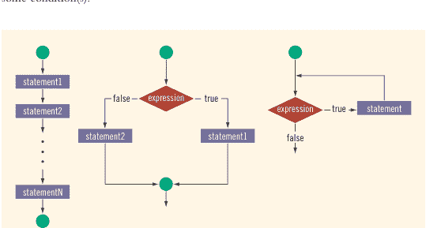

**图4-1** 执行流程

在学习选择和重复之前，你必须理解条件语句的性质以及如何使用它们。考虑以下三条语句：

- 1. `if (score is greater than or equal to 90)`  
  `grade is A`

- 2. `if (hours worked are less than or equal to 40)`  
  `wages = rate * hours`  
  `otherwise`  
  `wages = (rate * 40) + 1.5 * (rate * (hours − 40))`

- 3. `if (temperature is greater than 70 degrees and it is not raining)`  
  `Go golfing!`

这些语句是条件语句的示例。你可以看到，某些语句只有在满足某些条件时才会执行。如果条件求值为**真**，则满足条件。例如，在语句1中：

`score is greater than or equal to 90`

如果 score 的值大于或等于 90，则为**真**；否则为**假**。例如，如果 score 的值为 95，则该语句求值为**真**。类似地，如果 score 的值为 86，则该语句求值为**假**。

如果计算机能够识别这些类型的语句对于适当的值是否为真，那将很有用。此外，在某些情况下，语句的真假可能取决于多个条件。例如，在语句3中，“温度大于70度”和“没有下雨”都必须为真，才建议去打高尔夫球。

如你所见，为了让计算机做出决策并重复语句，它必须能够对程序执行时存在的条件做出反应。接下来几节讨论如何在 C++ 中表示和求值条件语句。

### 关系运算符

为了做出决策，你必须能够表达条件并进行比较。例如，支票账户的利率和服务费可能取决于月末余额。如果余额低于某个最低余额，不仅利率较低，而且通常还会收取服务费。因此，为了确定利率，你必须能够说明最低余额，并将账户余额与最低余额进行比较（一个条件）。保险单的保费也通过说明条件和进行比较来确定。例如，为了确定保险费，你必须能够检查投保人的吸烟状况。不吸烟者（条件）获得的保费低于吸烟者。这两个例子都涉及比较项目。某些项目被比较


### 示例 4-1

| 表达式 | 含义 | 值 |
|---|---|---|
| `8 < 15` | 8 小于 15 | `true` |
| `6 != 6` | 6 不等于 6 | `false` |
| `2.5 > 5.8` | 2.5 大于 5.8 | `false` |
| `5.9 <= 7.5` | 5.9 小于或等于 7.5 | `true` |

## 比较字符

对于 char 值，使用关系运算符的表达式求值为 true 还是 false，取决于机器的排序序列。某些字符的排序序列如下：

| ASCII 值 | 字符 | ASCII 值 | 字符 | ASCII 值 | 字符 | ASCII 值 | 字符 |
|---:|:---:|---:|:---:|---:|:---:|---:|:---:|
| 32 | `' '` | 61 | `=` | 81 | `Q` | 105 | `i` |
| 33 | `!` | 62 | `>` | 82 | `R` | 106 | `j` |
| 34 | `"` | 65 | `A` | 83 | `S` | 107 | `k` |
| 42 | `*` | 66 | `B` | 84 | `T` | 108 | `l` |
| 43 | `+` | 67 | `C` | 85 | `U` | 109 | `m` |
| 45 | `-` | 68 | `D` | 86 | `V` | 110 | `n` |
| 47 | `/` | 69 | `E` | 87 | `W` | 111 | `o` |
| 48 | `0` | 70 | `F` | 88 | `X` | 112 | `p` |
| 49 | `1` | 71 | `G` | 89 | `Y` | 113 | `q` |
| 50 | `2` | 72 | `H` | 90 | `Z` | 114 | `r` |
| 51 | `3` | 73 | `I` | 97 | `a` | 115 | `s` |
| 52 | `4` | 74 | `J` | 98 | `b` | 116 | `t` |
| 53 | `5` | 75 | `K` | 99 | `c` | 117 | `u` |
| 54 | `6` | 76 | `L` | 100 | `d` | 118 | `v` |
| 55 | `7` | 77 | `M` | 101 | `e` | 119 | `w` |
| 56 | `8` | 78 | `N` | 102 | `f` | 120 | `x` |
| 57 | `9` | 79 | `O` | 103 | `g` | 121 | `y` |
| 60 | `<` | 80 | `P` | 104 | `h` | 122 | `z` |

ASCII 字符集在附录 C 中描述。

现在，因为 32 < 97，而 `' '` 的 ASCII 值是 32，`'a'` 的 ASCII 值是 97，所以 `' ' < 'a'` 为真。类似地，使用前面的 ASCII 值：

```
`'R' > 'r'` is `false`
```

```
`'+' < '*'` is `false`
```

```
`'A' <= 'a'` is `true`
```

注意，比较不同数据类型的值可能会产生不可预测的结果。例如，下面的表达式比较一个整数和一个字符：

```
8 < '5'
```

在这个表达式中，在特定机器上，8 将与 `'5'` 的排序序列值比较，即 53。也就是说，8 与 53 比较，这使得这个特定表达式的求值为真。

诸如 `4 < 6` 和 `'R' > 'T'` 这样的表达式是**逻辑（布尔）表达式**的示例。当 C++ 求值逻辑表达式时，如果逻辑表达式求值为真，则返回整数值 1；否则返回整数值 0。在 C++ 中，任何非零值都被视为真。

> **注意。** 第 2 章介绍了数据类型 `bool`。回想一下，数据类型 bool 有两个值：`true` 和 `false`。在 C++ 中，`true` 和 `false` 是保留字。标识符 `true` 被设为 1，标识符 `false` 被设为 0。为了可读性，每当使用逻辑表达式时，这里将使用标识符 `true` 和 `false` 作为逻辑表达式的值。

## 关系运算符与 `string` 类型

关系运算符可应用于 string 类型的变量。string 类型的变量按字符逐个比较，从第一个字符开始，并使用 ASCII 排序序列。逐字符比较会持续进行，直到发现不匹配，或者最后一个字符已比较且相等。下面的示例展示如何比较 string 类型的变量。

### 示例 4-2

假设有如下语句：

```
string str1 = "Hello";
string str2 = "Hi";
string str3 = "Air";
string str4 = "Bill";
string str5 = "Big";
```

下面的表达式展示字符串关系表达式如何求值。

| 表达式 | 值/解释 |
|---|---|
| `str1 < str2` | **true**<br>`str1 = "Hello"` 和 `str2 = "Hi"`。`str1` 和 `str2` 的第一个字符相同，但 `str1` 的第二个字符 `'e'` 小于 `str2` 的第二个字符 `'i'`。因此，`str1 < str2` 为真。 |
| `str1 > "Hen"` | false<br>`str1 = "Hello"`。`str1` 和 `"Hen"` 的前两个字符相同，但 `str1` 的第三个字符 `'l'` 小于 `"Hen"` 的第三个字符 `'n'`。因此，`str1 > "Hen"` 为假。 |
| `str3 < "An"` | true<br>`str3 = "Air"`。`str3` 和 `"An"` 的第一个字符相同，但 `"Air"` 的第二个字符 `'i'` 小于 `"An"` 的第二个字符 `'n'`。因此，`str3 < "An"` 为真。 |
| `str1 == "hello"` | false<br>`str1 = "Hello"`。`str1` 的第一个字符 `'H'` 小于 `"hello"` 的第一个字符 `'h'`，因为 `'H'` 的 ASCII 值是 72，而 `'h'` 的 ASCII 值是 104。因此，`str1 == "hello"` 为假。 |
| `str3 <= str4` | true<br>`str3 = "Air"` 和 `str4 = "Bill"`。`str3` 的第一个字符 `'A'` 小于 `str4` 的第一个字符 `'B'`。因此，`str3 <= str4` 为真。 |
| `str2 > str4` | true<br>`str2 = "Hi"` 和 `str4 = "Bill"`。`str2` 的第一个字符 `'H'` 大于 `str4` 的第一个字符 `'B'`。因此，`str2 > str4` 为真。 |

如果比较两个长度不同的字符串，并且逐字符比较一直相等，直到到达较短字符串的最后一个字符，则较短字符串被求值为小于较大字符串，如下所示。

| 表达式 | 值/解释 |
|---|---|
| `str4 >= "Billy"` | false<br>`str4 = "Bill"`。它有四个字符，而 `"Billy"` 有五个字符。因此，`str4` 是较短的字符串。`str4` 的所有四个字符都与 `"Billy"` 对应的前四个字符相同，且 `"Billy"` 是较大的字符串。因此，`str4 >= "Billy"` 为假。 |
| `str5 <= "Bigger"` | true<br>`str5 = "Big"`。它有三个字符，而 `"Bigger"` 有六个字符。因此，`str5` 是较短的字符串。`str5` 的所有三个字符都与 `"Bigger"` 对应的前三个字符相同，且 `"Bigger"` 是较大的字符串。因此，`str5 <= "Bigger"` 为真。 |

本书配套网站上的程序 Chapter4_StringComparisons.cpp 展示了前面表达式的结果。

## 逻辑（布尔）运算符与逻辑表达式

本节描述如何构造和求值由其他逻辑表达式组合而成的逻辑表达式。**逻辑（布尔）运算符**使你能够组合逻辑表达式。C++ 有三种逻辑（布尔）运算符，如表 4-2 所示。

**表 4-2** C++ 中的逻辑（布尔）运算符

| 运算符 | 描述 |
| --- | --- |
| `!` | 非 |
| `&&` | 与 |
| `\|\|` | 或 |

逻辑运算符只接受逻辑值作为操作数，并且只产生逻辑值作为结果。运算符 ! 是一元运算符，因此只有一个操作数。运算符 && 和 || 是二元运算符。表 4-3、表 4-4 和表 4-5 定义了这些运算符。

表 4-3 定义了运算符 `!`（非）。当你使用 `!` 运算符时，!true 为假，!false 为真。将 `!` 放在逻辑表达式前面会反转该逻辑表达式的值。

**表 4-3** `!`（非）运算符

| 表达式 | !(表达式) |
| --- | --- |
| `true (nonzero)` | `false (0)` |
| `false (0)` | `true (1)` |

### 示例 4-3

| 表达式 | 值 | 解释 |
| --- | --- | --- |
| `!('A' > 'B')` | true | 因为 `'A' > 'B'` 为假，所以 `!('A' > 'B')` 为真。 |
| `!(6 <= 7)` | false | 因为 `6 <= 7` 为真，所以 `!(6 <= 7)` 为假。 |

表 4-4 定义了运算符 `&&`（与）。由该表可知，`Expression1 && Expression2` 为真当且仅当 `Expression1` 和 `Expression2` 都为真；否则，`Expression1 && Expression2` 求值为 `false`。

**表 4-4** `&&`（与）运算符

| 表达式1 | 表达式2 | 表达式1 && 表达式2 |
|---|---|---|
| `true`（非零） | `true`（非零） | `true`（1） |
| `true`（非零） | `false`（0） | `false`（0） |
| `false`（0） | `true`（非零） | `false`（0） |
| `false`（0） | `false`（0） | `false`（0） |

### 示例 4-4

| 表达式 | 值 | 解释 |
|---|---|---|
| `(14 >= 5) && ('A' < 'B')` | `true` | 因为 `(14 >= 5)` 为 `true`，`('A' < 'B')` 为 `true`，且 `true && true` 为 `true`，所以该表达式求值为 `true`。 |
| `(24 >= 35) && ('A' < 'B')` | `false` | 因为 `(24 >= 35)` 为 `false`，`('A' < 'B')` 为 `true`，且 `false && true` 为 `false`，所以该表达式求值为 `false`。 |

表 4-5 定义了运算符 `||`（或）。由该表可知，`Expression1 || Expression2` 为真当且仅当 `Expression1` 或 `Expression2` 中至少一个表达式为真；否则，`Expression1 || Expression2` 求值为 `false`。

**表 4-5** `||`（或）运算符

| 表达式1 | 表达式2 | 表达式1 \|\| 表达式2 |
|---|---|---|
| `true`（非零） | `true`（非零） | `true`（1） |
| `true`（非零） | `false`（0） | `true`（1） |
| `false`（0） | `true`（非零） | `true`（1） |
| `false`（0） | `false`（0） | `false`（0） |


**示例 4-5**

| 表达式 | 值 | 说明 |
|---|---|---|
| `(14 >= 5) \|\| ('A' > 'B')` | `true` | 因为 `(14 >= 5)` 为 true，`('A' > 'B')` 为 false，且 true \|\| false 为 true，所以该表达式的求值结果为 true。 |
| `(24 >= 35) \|\| ('A' > 'B')` | `false` | 因为 `(24 >= 35)` 为 false，`('A' > 'B')` 为 false，且 false \|\| false 为 false，所以该表达式的求值结果为 false。 |
| `('A' <= 'a') \|\| (7 != 7)` | `true` | 因为 `('A' <= 'a')` 为 true，`(7 != 7)` 为 false，且 true \|\| false 为 true，所以该表达式的求值结果为 true。 |

## 优先级顺序

复杂逻辑表达式可能难以求值。考虑以下逻辑表达式：

`11 > 5 || 6 < 15 && 7 >= 8`

该逻辑表达式会得到不同结果，具体取决于先计算 `||` 还是 `&&`。如果先计算 `||`，表达式的求值结果为 `false`。如果先计算 `&&`，表达式的求值结果为 `true`。

一个表达式可能包含算术、关系和逻辑运算符，如下面的表达式：

`5 + 3 <= 9 && 2 > 3`

要处理复杂逻辑表达式，必须有某种用于计算运算符的优先级方案。表 4–6 给出了一些 C++ 运算符的优先级顺序。

**表 4–6** 运算符的优先级

| 运算符 | 优先级 |
|---|---|
| `!`、`+`、`-`（一元运算符） | 第一 |
| `*`、`/`、`%` | 第二 |
| `+`、`-` | 第三 |
| `<`、`<=`、`>=`、`>` | 第四 |
| `==`、`!=` | 第五 |
| `&&` | 第六 |
| `\|\|` | 第七 |
| `=`（赋值运算符） | 最后 |

| 表达式 | 值 / 说明 |
|---|---|
| `hours + overTime <= 75.00` | **true**。因为 `hours + overTime` 为 `45.30 + 15.00 = 60.30`，且 `60.30 <= 75.00` 为 **true**，因此 `hours + overTime <= 75.00` 的求值结果为 **true**。 |
| `(count >= 0) && (count <= 100)` | **true**。现在，`count` 为 20。因为 `20 >= 0` 为 **true**，所以 `count >= 0` 为 **true**。此外，`20 <= 100` 为 **true**，因此 `count <= 100` 为 **true**。所以，`(count >= 0) && (count <= 100)` 为 **true && true**，其求值结果为 **true**。 |
| `('A' <= ch && ch <= 'Z')` | **true**。这里，`ch` 为 `'B'`。因为 `'A' <= 'B'` 为 **true**，所以 `'A' <= ch` 的求值结果为 **true**。此外，因为 `'B' <= 'Z'` 为 **true**，所以 `ch <= 'Z'` 的求值结果为 **true**。因此，`('A' <= ch && ch <= 'Z')` 为 **true && true**，其求值结果为 **true**。 |

下面的程序会计算并输出这些逻辑表达式的值。注意，如果逻辑表达式的求值结果为 true，则相应输出为 1；如果逻辑表达式的求值结果为 false，则相应输出为 0，如程序末尾的输出所示。（回忆一下，如果逻辑表达式的值为 true，则其求值结果为 1；如果逻辑表达式的值为 false，则其求值结果为 0。）

```cpp
//Chapter 4 Logical operators

#include <iostream>
#include <iomanip>

using namespace std;

int main()
{
    bool found = true;
    int age = 20;
    double hours = 45.30;
    double overTime = 15.00;
    int count = 20;
    char ch = 'B';

    cout << fixed << showpoint << setprecision(2);
    cout << "found = " << found << ", age = " << age
         << ", hours = " << hours << ", overTime = " << overTime
         << ", count = " << count
         << ", ch = " << ch << endl;

    cout << "!found evaluates to " << !found << endl;
    cout << "hours > 40.00 evaluates to " << (hours > 40.00) << endl;
    cout << "!age evaluates to " << !age << endl;
    cout << "!found && (hours >= 0) evaluates to "
         << (!found && (hours >= 0)) << endl;
    cout << "!(found && (hours >= 0)) evaluates to "
         << (!(found && (hours >= 0))) << endl;
    cout << "hours + overTime <= 75.00 evaluates to "
         << (hours + overTime <= 75.00) << endl;
    cout << "(count >= 0) && (count <= 100) evaluates to "
         << ((count >= 0) && (count <= 100)) << endl;
    cout << "('A' <= ch && ch <= 'Z') evaluates to "
         << ('A' <= ch && ch <= 'Z') << endl;
    cout << "('A' <= ch && ch <= 'Z')" << endl;

    return 0;
}
```

**示例运行：**

```
found = 1, age = 20, hours = 45.30, overTime = 15.00,
count = 20, ch = B

!found evaluates to 0
hours > 40.00 evaluates to 1
!age evaluates to 0
!found && (hours >= 0) evaluates to 0
!(found && (hours >= 0)) evaluates to 0
hours + overTime <= 75.00 evaluates to 1
(count >= 0) && (count <= 100) evaluates to 1
('A' <= ch && ch <= 'Z') evaluates to 1
```

可以在表达式中插入括号以明确其含义。也可以使用括号来覆盖运算符的优先级。按照标准优先级顺序，表达式：

```
11 > 5 || 6 < 15 && 7 >= 8
```

等价于：

```
11 > 5 || (6 < 15 && 7 >= 8)
```

在此表达式中，11 > 5 为 **true**，6 < 15 为 **true**，7 >= 8 为 **false**。将这些值代入表达式 11 > 5 || (6 < 15 && 7 >= 8)，得到 true || (true && false) = true || false = true。因此，表达式 11 > 5 || (6 < 15 && 7 >= 8) 的求值结果为 **true**。

在 C++ 中，逻辑（布尔）表达式可以通过以下两种方式之一来处理或加工：使用 **int** 变量或使用 **bool** 变量。以下各节将介绍这些方法。

## int 数据类型与逻辑（布尔）表达式

较早版本的 C++ 没有提供具有逻辑（或布尔）值 **true** 和 **false** 的内置数据类型。由于逻辑表达式的求值结果为 1 或 0，因此逻辑表达式的值存储在 **int** 数据类型的变量中。因此，可以使用 **int** 数据类型来处理逻辑（布尔）表达式。

回想一下，非零值被视为 **true**。现在，考虑以下声明：

```
int legalAge;
int age;
```

以及赋值语句：

```
legalAge = 21;
```

如果将 legalAge 视为逻辑变量，则此语句赋给 legalAge 的值为 true。

赋值语句：

```
legalAge = (age >= 21);
```

如果 age 的值大于或等于 21，则该语句将值 1 赋给 legalAge。如果 age 的值小于 21，则该语句将值 0 赋给 legalAge。

## bool 数据类型与逻辑（布尔）表达式

较新版本的 C++ 包含一个内置数据类型 bool，它具有逻辑（布尔）值 true 和 false。因此，可以使用 bool 数据类型来处理逻辑（布尔）表达式。回想一下，在 C++ 中，bool、true 和 false 是保留字。此外，标识符 true 的值为 1，标识符 false 的值为 0。现在，考虑以下声明：

```
bool legalAge;
int age;
```

语句：

```
legalAge = true;
```

将变量 legalAge 的值设置为 true。语句：

```
legalAge = (age >= 21);
```

如果 age 的值大于或等于 21，则该语句将值 true 赋给 legalAge。如果 age 的值小于 21，则该语句将值 false 赋给 legalAge。例如，如果 age 的值为 25，则赋给 legalAge 的值为 true——也就是 1。类似地，如果 age 的值为 16，则赋给 legalAge 的值为 false——也就是 0。

> **注意** 可以使用 `int` 变量或 `bool` 变量来存储逻辑表达式的值。为清晰起见，本书使用 `bool` 变量存储逻辑表达式的值。

## 选择：`if` 和 `if...else`

尽管只有两个逻辑值 true 和 false，但它们非常有用，因为它们允许程序加入可改变处理流程的决策。本章其余部分将讨论将决策纳入程序的方法。在 C++ 中，有两种选择或分支控制结构：`if` 语句和 `switch` 结构。本节讨论如何使用 `if` 和 `if...else` 语句创建单向选择、双向选择和多路选择。`switch` 结构将在本章后面讨论。

### 单向选择

银行希望在某客户的支票账户余额低于要求的最低余额时向该客户发送通知。也就是说，如果账户余额低于要求的最低余额，就应向客户发送通知；否则，就什么都不做。类似地，如果保险保单的持有人不吸烟，公司希望对该保单的保费给予 10% 的折扣。这两个例子都涉及单向选择。在 C++ 中，单向选择使用 `if` 语句实现。单向选择的语法为：

```cpp
if (expression)
    statement
```

注意此语法的各个元素。它以保留字 `if` 开头，后跟包含在括号中的 `expression`，再后跟一个 `statement`。注意，`expression` 两侧的括号是语法的一部分。`expression` 有时称为**决策器**，因为它决定是否执行其后的 `statement`。`expression` 通常是逻辑表达式。如果 `expression` 的值为 `true`，则执行 `statement`。如果值为 `false`，则不执行 `statement`，计算机继续执行程序中的下一条语句。`expression` 后面的 `statement` 有时称为**动作语句**。图 4-2 显示了 `if` 语句（单向选择）的执行流程。

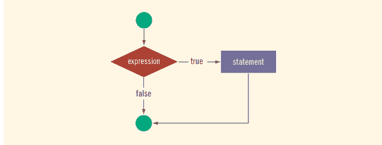

**图 4-2** 单向选择


### 示例 4-7

```cpp
if (score >= 60)
    grade = 'P';
```

在这段代码中，如果表达式 (score >= 60) 的求值结果为 true，则执行赋值语句 grade = 'P'。如果该表达式的求值结果为 false，则执行 if 结构后面的语句（如果有）。例如，如果 score 的值为 65，则赋给变量 grade 的值为 'P'。

### 示例 4-8

下面的 C++ 程序求一个整数的绝对值。

```cpp
//Program: Absolute value of an integer

#include <iostream>

using namespace std;

int main()
{
    int number, temp;

    cout << "Line 1: Enter an integer: ";       //Line 1
    cin >> number;                              //Line 2
    cout << endl;                               //Line 3

    temp = number;                              //Line 4

    if (number < 0)                             //Line 5
        number = -number;                       //Line 6

    cout << "Line 7: The absolute value of "
         << temp << " is " << number << endl;   //Line 7

    return 0;
}
```

**示例运行：** 在此示例运行中，用户输入以阴影显示。

```text
Line 1: Enter an integer: -6734
Line 7: The absolute value of -6734 is 6734
```

第 1 行的语句提示用户输入一个整数；第 2 行的语句将数字输入到变量 number 中。第 4 行的语句将 number 的值复制到 temp 中，第 5 行的语句检查 number 是否为负数。如果 number 为负数，第 6 行的语句将 number 改为正数。第 7 行的语句输出该数字及其绝对值。注意，由于我们要同时输出 **number** 及其绝对值，并且如果 **number** 为负数，**if** 语句会将 number 改为正数，因此我们在第 4 行将 **number** 的值复制到了 **temp** 中。

### 示例 4-9

考虑以下语句：

```cpp
    if score >= 60      //syntax error
        grade = 'P';
```

该语句展示了一个 **if** 语句的错误版本。逻辑表达式两侧的圆括号缺失，这是一个语法错误。

在 **if** 语句中，在 **表达式** 后面的圆括号之后（也就是在 **语句** 之前）放置分号是一个语义错误。如果分号紧跟在右圆括号之后，则 **if** 语句将作用于空语句。

### 示例 4-10

考虑以下 C++ 语句：

```cpp
    if (score >= 60);       //Line 1
        grade = 'P';        //Line 2
```

由于表达式末尾有一个分号（见第 1 行），第 1 行中的 **if** 语句就此终止。这个 **if** 语句的动作是空操作，而第 2 行中的语句不属于第 1 行中的 **if** 语句。因此，无论 **if** 语句的求值结果如何，第 2 行中的语句都会执行。

## 双向选择

在许多编程情形中，你必须在两个备选方案之间做出选择。例如，如果兼职员工加班，则工资单使用加班工资公式计算；否则，工资单使用常规公式计算。这就是双向选择的一个例子。要在两个备选方案之间做出选择——也就是实现双向选择——C++ 提供了 **if...else** 语句。双向选择使用以下语法：

```cpp
    if (expression)
        statement1
    else
        statement2
```

花点时间检查这个语法。它以保留字 `if` 开始，后面是包含在圆括号中的逻辑表达式，接着是一个语句，然后是保留字 `else`，最后是第二个语句。语句 1 和语句 2 是任何有效的 C++ 语句。在双向选择中，如果 `expression` 的值为 `true`，则执行 `statement1`。如果 `expression` 的值为 `false`，则执行 `statement2`。图 4-3 展示了 `if...else` 语句（双向选择）的执行流程。

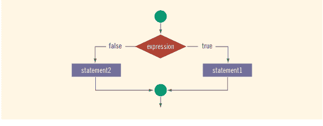

**图 4-3** 双向选择

### 示例 4-11

考虑以下语句：

```cpp
if (hours > 40.0)                       // Line 1
    wages = 40.0 * rate +
        1.5 * rate * (hours - 40.0);    // Line 2
else                                    // Line 3
    wages = hours * rate;               // Line 4
```

如果变量 `hours` 的值大于 40.0，则 `wages` 包含加班工资。假设 `hours` 为 50。第 1 行中 `if` 语句里的表达式的求值结果为 `true`，因此执行第 2 行中的语句。另一方面，如果 `hours` 为 30 或任何小于等于 40 的数，则第 1 行中 `if` 语句里的表达式的求值结果为 `false`。在这种情况下，程序跳过第 2 行中的语句并执行第 4 行中的语句——也就是执行保留字 `else` 后面的语句。

在双向选择语句中，在 **表达式** 之后、**语句1** 之前放置分号会造成语法错误。如果 **if** 语句以分号结束，则 **语句1** 不再是 **if** 语句的一部分，而 **if...else** 语句的 **else** 部分将完全独立存在。C++ 中没有独立的 **else** 语句。也就是说，它不能与 **if** 语句分离。

### 示例 4-12

以下语句展示了一个语法错误的例子。

```cpp
if (hours > 40.0);                         //Line 1
    wages = 40.0 * rate +
            1.5 * rate * (hours - 40.0);     //Line 2
else                                         //Line 3
    wages = hours * rate;                    //Line 4
```

if 语句末尾的分号（见第 1 行）结束了该 if 语句，因此第 2 行中的语句将 else 子句与 if 语句分隔开。也就是说，else 完全独立存在。由于 C++ 中没有独立的 else 语句，这段代码会产生语法错误。如示例 4-10 所示，在单向选择中，if 语句末尾的分号是逻辑错误；而如本示例所示，在双向选择中，它是语法错误。

### 示例 4-13

以下程序确定员工的周工资。如果工作小时数超过 40，则工资包含加班工资。

```cpp
//Program: Weekly wages
#include <iostream>
#include <iomanip>

using namespace std;

int main()
{
    double wages, rate, hours;

    cout << fixed << showpoint << setprecision(2);    //Line 1
    cout << "Line 2: Enter working hours and rate: "; //Line 2
    cin >> hours >> rate;                             //Line 3

    if (hours > 40.0)                                 //Line 4
        wages = 40.0 * rate +
                1.5 * rate * (hours - 40.0);          //Line 5
    else                                               //Line 6
        wages = hours * rate;                          //Line 7

    cout << endl;                                      //Line 8
    cout << "Line 9: The wages are $" << wages
         << endl;                                      //Line 9

    return 0;
}
```

**示例运行：** 在此示例运行中，用户输入以阴影显示。

```text
Line 2: Enter working hours and rate: 56.45 12.50

Line 9: The wages are $808.44
```

第 1 行的语句将浮点数的输出设置为固定小数格式，带小数点、尾随零和两位小数。第 2 行的语句提示用户输入工作小时数和工资率。第 3 行的语句将这些值分别输入到变量 hours 和 rate 中。第 4 行的语句检查变量 hours 的值是否大于 40.0。如果 hours 大于 40.0，则由第 5 行的语句计算工资，其中包含加班工资。否则，由第 7 行的语句计算工资。第 9 行的语句输出工资。

现在让我们考虑 `if` 语句的另一个例子，并检查可能发生的一些语义错误。

### 示例 4-14

考虑以下语句：

```cpp
if (score >= 60)             //Line 1
    cout << "Passing" << endl; //Line 2
    cout << "Failing" << endl; //Line 3
```

如果表达式 (score >= 60) 的求值结果为 `false`，则第 2 行中的输出语句不会执行。因此输出将是 Failing。也就是说，这组语句执行的操作与 `if...else` 语句相同。它将执行第 3 行中的输出语句，而不是第 2 行中的输出语句。例如，如果 score 的值为 50，这些语句将输出以下行：

```text
Failing
```

然而，如果表达式 (score >= 60) 的求值结果为 `true`，程序将执行两个输出语句，产生非常不令人满意的结果。例如，如果 score 的值为 70，这些语句将输出以下行：

```text
Passing
Failing
```

`if` 语句只控制第 2 行中语句的执行。第 3 行中的语句始终会执行。

根据 score 的值打印 Passing 或 Failing 的正确代码是：

```cpp
if (score >= 60)
    cout << "Passing" << endl;
else
    cout << "Failing" << endl;
```


## 复合语句（语句块）

`if` 和 `if...else` 结构一次只控制一条语句。然而，假设当 `if` 或 `if...else` 语句中的表达式求值为 `true` 时，你希望执行多条语句。为了允许更复杂的语句，C++ 提供了一种称为**复合语句**或**语句块**的结构。复合语句采用以下形式：

```text
{
    statement_1
    statement_2
        .
        .
        .
    statement_n
}
```

也就是说，复合语句由一系列用花括号 `{` 和 `}` 括起来的语句组成。在 `if` 或 `if...else` 结构中，复合语句的作用就像单条语句一样。因此，与其像下面代码那样使用简单的双向选择：

```cpp
if (age >= 18)
    cout << "Eligible to vote." << endl;
else
    cout << "Not eligible to vote." << endl;
```

你可以包含复合语句，类似下面的代码：

```cpp
if (age >= 18)
{
    cout << "Eligible to vote." << endl;
    cout << "No longer a minor." << endl;
}
else
{
    cout << "Not eligible to vote." << endl;
    cout << "Still a minor." << endl;
}
```

复合语句非常有用，本章中大多数结构化语句都会用到它。

## 多重选择：嵌套 `if`

在前面的章节中，你学习了如何在程序中实现单向和双向选择。有些问题需要实现两个以上的备选方案。例如，假设如果支票账户余额超过 $50,000，利率为 7%；如果余额在 $25,000 到 $49,999.99 之间，利率为 5%；如果余额在 $1,000 到 $24,999.99 之间，利率为 3%；否则，利率为 0%。这个特定问题有四个备选方案——也就是多条选择路径。如果操作语句本身是 `if` 或 `if...else` 语句，你可以使用 `if...else` 结构在程序中包含多条选择路径。当一个控制语句位于另一个控制语句内部时，就称其为**嵌套**。

例 4-15 说明了如何使用嵌套 `if...else` 结构来实现多重选择。

### 例 4-15

假设 `balance` 和 `interestRate` 是 `double` 类型的变量。以下语句根据 `balance` 的值确定 `interestRate`。

```
if (balance > 50000.00)                 //Line 1
    interestRate = 0.07;                //Line 2
else                                    //Line 3
    if (balance >= 25000.00)            //Line 4
        interestRate = 0.05;            //Line 5
    else                                //Line 6
        if (balance >= 1000.00)         //Line 7
            interestRate = 0.03;        //Line 8
        else                            //Line 9
            interestRate = 0.00;        //Line 10
```

嵌套的 `if...else` 结构要求回答一个重要问题：如何知道哪个 `else` 与哪个 `if` 配对？回想一下，在 C++ 中，不存在独立的 `else` 语句。每个 `else` 都必须与一个 `if` 配对。将 `else` 与 `if` 配对的规则如下：

**将 `else` 与 `if` 配对：** 在嵌套 `if` 语句中，C++ 会将 `else` 与最近一个尚未完成的 `if` 关联起来——也就是说，与最近一个尚未与 `else` 配对的 `if` 关联。

使用这条规则，在例 4-15 中，第 3 行的 `else` 与第 1 行的 `if` 配对。第 6 行的 `else` 与第 4 行的 `if` 配对，第 9 行的 `else` 与第 7 行的 `if` 配对。

为避免过度缩进，例 4-15 中的代码可以改写如下：

```
if (balance > 50000.00)             //Line 1
    interestRate = 0.07;            //Line 2
else if (balance >= 25000.00)       //Line 3
    interestRate = 0.05;            //Line 4
else if (balance >= 1000.00)        //Line 5
    interestRate = 0.03;            //Line 6
else                                //Line 7
    interestRate = 0.00;            //Line 8
```

以下示例将帮助你了解使用嵌套 `if` 结构实现多重选择的各种方式。

在这段代码中，第 4 行的 `else` 与第 2 行的 `if` 配对。注意，对于第 4 行的 `else`，最近一个尚未完成的 `if` 位于第 2 行。在这段代码中，第 1 行的 `if` 没有 `else`，是一个单向选择。再一次说明，缩进并不决定配对关系，但它传达配对关系。

### 例 4-19

假设所有变量都已正确声明，并考虑以下语句：

```cpp
if (gender == 'M')                 //Line 1
    if (age < 21)                  //Line 2
        policyRate = 0.05;         //Line 3
    else                           //Line 4
        policyRate = 0.035;        //Line 5
else if (gender == 'F')            //Line 6
    if (age < 21)                  //Line 7
        policyRate = 0.04;         //Line 8
    else                           //Line 9
        policyRate = 0.03;         //Line 10
```

在这段代码中，第 4 行的 `else` 与第 2 行的 `if` 配对。注意，对于第 4 行的 `else`，最近一个尚未完成的 `if` 是第 2 行的 `if`。第 6 行的 `else` 与第 1 行的 `if` 配对。第 9 行的 `else` 与第 7 行的 `if` 配对。再一次说明，缩进并不决定配对关系，但它传达配对关系。

## 将 `if...else` 语句与一系列 `if` 语句进行比较

考虑以下 C++ 程序段，它们都完成相同的任务。

```cpp
a.  if (month == 1)                         //Line 1
        cout << "January" << endl;          //Line 2
    else if (month == 2)                    //Line 3
        cout << "February" << endl;         //Line 4
    else if (month == 3)                    //Line 5
        cout << "March" << endl;            //Line 6
    else if (month == 4)                    //Line 7
        cout << "April" << endl;            //Line 8
    else if (month == 5)                    //Line 9
        cout << "May" << endl;              //Line 10
    else if (month == 6)                    //Line 11
        cout << "June" << endl;             //Line 12

b.  if (month == 1)
        cout << "January" << endl;
    if (month == 2)
        cout << "February" << endl;
    if (month == 3)
        cout << "March" << endl;
    if (month == 4)
        cout << "April" << endl;
    if (month == 5)
        cout << "May" << endl;
    if (month == 6)
        cout << "June" << endl;
```

程序段 (a) 写成一系列 `if...else` 语句；程序段 (b) 写成一系列 `if` 语句。两个程序段完成相同的事情。如果 month 为 3，那么两个程序段都输出 March。如果 month 为 1，那么在程序段 (a) 中，第 1 行 `if` 语句中的表达式求值为 `true`。随后执行与该 `if` 关联的语句（第 2 行）；该结构的其余部分，也就是这个 `if` 语句的 `else`，被跳过；其余的 `if` 语句不会被求值。在程序段 (b) 中，由于没有 `else` 语句，计算机必须对每个 `if` 语句中的表达式求值。因此，程序段 (b) 的执行速度比程序段 (a) 慢。

## 短路求值

C++ 中的逻辑表达式使用一种非常高效的算法进行求值。下面的语句说明了该算法：

```cpp
(x > y) || (x == 5)      //Line 1
(a == b) && (x >= 7)     //Line 2
```

在第 1 行的语句中，运算符 `||` 的两个操作数是表达式 `(x > y)` 和 `(x == 5)`。如果操作数 `(x > y)` 为 `true`，或者操作数 `(x == 5)` 为 `true`，则该表达式求值为 `true`。使用短路求值时，计算机会从左到右对逻辑表达式求值。一旦整个逻辑表达式的值已知，求值就会停止。例如，在语句 1 中，如果操作数 `(x > y)` 求值为 `true`，那么整个表达式求值为 `true`，因为 `true || true` 为真，且 `true || false` 为真。因此，操作数 `(x == 5)` 的值与最终结果无关。

类似地，在第 2 行的语句中，运算符 `&&` 的两个操作数是 `(a == b)` 和 `(x >= 7)`。如果操作数 `(a == b)` 求值为 `false`，那么整个表达式求值为 `false`，因为 `false && true` 为假，且 `false && false` 为假。

**短路求值**（针对逻辑表达式）：计算机从左到右对逻辑表达式求值，并一旦表达式的值已知就停止的过程。

### 例 4-20

考虑以下表达式：

```cpp
(age >= 21) || ( x == 5)       //Line 1
(grade == 'A') && (x >= 7)     //Line 2
```


### 示例运行

```text
3.0 / 7.0 + 2.0 / 7.0 + 2.0 / 7.0 = 0.99999999999999989
x = 1.0000000000000000
y = 0.99999999999999989
x and y are not the same.
x and y are the same within the tolerance 0.000001.
```

在这个程序中，x被初始化为1.0，y被初始化为3.0 / 7.0 + 2.0 / 7.0 + 2.0 / 7.0。由于舍入，如输出所示，该表达式的结果为0.99999999999999989。因此，表达式(x == y)的结果为false。然而，如果你用纸笔手工计算表达式3.0 / 7.0 + 2.0 / 7.0 + 2.0 / 7.0，你会得到3.0 / 7.0 + 2.0 / 7.0 + 2.0 / 7.0 = (3.0 + 2.0 + 2.0) / 7.0 = 7.0 / 7.0 = 1.0。也就是说，y的值应该被设置为1.0。

上述程序及其输出表明，在比较浮点数是否相等时需要小心。检查两个浮点数是否相等的一种方法是检查它们之差的绝对值是否小于某个容差。例如，假设容差为0.000001。那么，如果(x − y)的绝对值小于0.000001，则x和y相等。为了求出绝对值，可以使用头文件cmath中的fabs函数，如程序中所示。因此，表达式fabs(x − y) < 0.000001用于判断(x − y)的绝对值是否小于0.000001。

## 关系运算符的结合性：注意事项

有时，逻辑表达式的行为可能与你期望的不同，如下面的程序所示，该程序用于判断一个数字是否在0到10之间（包括0和10）。

```cpp
#include <iostream>

using namespace std;

int main()
{
    int num;

    cout << "Enter an integer: ";
    cin >> num;
    cout << endl;

    if (0 <= num <= 10)
        cout << num << " is within 0 and 10." << endl;
    else
        cout << num << " is not within 0 and 10." << endl;

    return 0;
}
```

**示例运行：** 在这些示例运行中，用户输入带有阴影。

**示例运行1：**  
Enter an integer: `5`  
5 is within 0 and 10.

**示例运行2：**  
Enter an integer: `20`  
20 is within 0 and 10.

**示例运行3：**  
Enter an integer: `-10`  
-10 is within 0 and 10.

显然，示例运行1是正确的，示例运行2和3是不正确的。由于if语句用于判断整数是否在0到10之间，问题出在if语句中的表达式上。因此，让我们看看这个表达式，即：

```text
0 <= num <= 10
```

尽管该语句是合法的C++表达式，但你不会得到期望的结果。让我们针对num的某些值来对该表达式求值。假设num的值为5。那么：

| 表达式 | 求值 | 解释 |
|---|---|---|
| `0 <= num <= 10` | `= 0 <= 5 <= 10` | |
| | `= (0 <= 5) <= 10` | （因为关系运算符从左到右求值） |
| | `= 1 <= 10` | （因为0 <= 5为真，0 <= 5的值为1） |
| | `= 1 (true)` | |

现在，假设num = 20。那么：

| 表达式 | 求值 | 解释 |
|---|---|---|
| `0 <= num <= 10` | `= 0 <= 20 <= 10` | |
| | `= (0 <= 20) <= 10` | （因为关系运算符从左到右求值） |
| | `= 1 <= 10` | （因为0 <= 20为真，0 <= 20的值为1） |
| | `= 1 (true)` | |

现在，你可以理解为什么当num为20时表达式的结果为`true`。类似地，如果num为−10，表达式0 <= num <= 10的结果也是`true`。实际上，无论num是什么，这个表达式的结果总是为true。这是因为表达式0 <= num的结果要么是0要么是1，而0 <= 10为真，1 <= 10也为真。那么表达式0 <= num <= 10有什么问题呢？它缺少了逻辑运算符&&。在C++中，这个表达式的正确写法是：

```cpp
0 <= num && num <= 10
```

在构造逻辑表达式时，你必须小心。当创建一个复杂的逻辑表达式时，必须使用正确的逻辑运算符。

## 避免因使用一知半解的概念和技术而引入Bug

第2章和第3章中的调试部分演示了如何理解和修复语法错误及逻辑错误。在本节中，我们将演示如何通过避免使用一知半解的概念和技术来避免Bug。

到目前为止，你编写的程序应该已经表明，一个小小的错误，例如变量声明末尾漏掉分号，或使用变量时没有正确声明它，都会导致程序无法成功编译。同样，使用变量时没有正确初始化，也会导致程序无法正确运行。回顾一下，if语句中的条件必须放在括号内。因此，下面的表达式将产生一个语法错误。

```cpp
if score >= 90
```

示例4–12说明了在下列if语句的条件后面意外添加分号：

```cpp
if (hours > 40.0);
```

会导致编译失败或无法正确执行。

你解决问题所采用的方法必须正确使用概念和技术；否则，你的解决方案要么是错误的，要么是不完善的。如果你没有完全理解某个概念或技术，在理解完整之前不要使用它。使用一知半解的概念和技术所带来的问题可以通过下面的程序来加以说明。

假设我们要编写一个分析学生GPA的程序。如果GPA大于或等于3.9，学生将进入院长荣誉名单。如果GPA低于2.00，该学生将收到一封警告信，说明其GPA低于毕业要求。因此，考虑以下程序：

```cpp
//GPA program with bugs.

#include <iostream>                         //Line 1

using namespace std;                         //Line 2

int main()                                    //Line 3
{
    double gpa;                                    //Line 5
    cout << "Enter the GPA: ";                     //Line 6
    cin >> gpa;                                    //Line 7
    cout << endl;                                  //Line 8

    if (gpa >= 2.0)                                //Line 9
        if (gpa >= 3.9)                            //Line 10
            cout << "Dean\'s Honor List." << endl; //Line 11
        else                                       //Line 12
            cout << "The GPA is below the graduation "
                 << "requirement. \nSee your "
                 << "academic advisor." << endl;   //Line 13

    return 0;                                      //Line 14
}                                                  //Line 15
```


**示例运行：** 在这些示例运行中，用户输入带有阴影。

**示例运行1：**

Enter the GPA: 3.91

Dean's Honor List.

**示例运行2：**

Enter the GPA: 3.8

The GPA is below the graduation requirement.
See your academic advisor.

**示例运行3：**

Enter the GPA: 1.95

让我们来看看这些示例运行。显然，示例运行1的输出是正确的。在示例运行2中，输入是3.8，输出表明该GPA低于毕业要求。然而，GPA为3.8的学生会以某种荣誉毕业。因此，示例运行2的输出是不正确的。在示例运行3中，输入是1.95，输出中没有显示任何警告信息。因此，示例运行3的输出也是不正确的。这意味着第9行到第13行的if...else语句是不正确的。让我们看看这些语句，即：

```cpp
if (gpa >= 2.0)                    //Line 9
    if (gpa >= 3.9)                //Line 10
        cout << "Dean\'s Honor List." << endl; //Line 11
    else                           //Line 12
        cout << "The GPA is below the graduation "
             << "requirement. \nSee your "
             << "academic advisor." << endl; //Line 13
```

按照`else`与`if`配对的规则，第12行的`else`与第10行的`if`配对。换句话说，使用正确的缩进，代码为：

```cpp
if (gpa >= 2.0)                         //Line 9
    if (gpa >= 3.9)                     //Line 10
        cout << "Dean\'s Honor List." << endl;   //Line 11
    else                                //Line 12
        cout << "The GPA is below the graduation "
             << "requirement.\nSee your "
             << "academic advisor." << endl;       //Line 13
```

现在，我们可以看到第9行的`if`语句是一个单分支选择。因此，如果输入的数字小于2.0，将不执行任何操作；也就是说，不会打印任何警告信息。现在，假设输入是3.8。那么，第9行的表达式的结果为`true`，因此继续对第10行的表达式求值，其结果为`false`。这意味着第13行的输出语句会执行，从而产生不理想的结果。

实际上，程序只应在GPA小于2.0时打印警告信息，并且只在GPA大于或等于3.9时打印以下信息：

Dean's Honor List.

为了得到该结果，第12行的`else`需要与第9行的`if`配对。为了将第12行的`else`与第9行的`if`配对，你需要使用复合语句，如下所示：

```cpp
if (gpa >= 2.0)                              //Line 9
{
    if (gpa >= 3.9)                          //Line 10
        cout << "Dean\'s Honor List." << endl; //Line 11
}
else                                        //Line 12
    cout << "The GPA is below the graduation "
         << "requirement.\nSee your "
         << "academic advisor." << endl;     //Line 13
```

正确的程序如下：

```cpp
//Correct GPA program.

#include <iostream>                              //Line 1

using namespace std;                              //Line 2

int main()                                         //Line 3
{
    double gpa;                                    //Line 5

    cout << "Enter the GPA: ";                     //Line 6
    cin >> gpa;                                    //Line 7
    cout << endl;                                  //Line 8
```


```cpp
if (gpa >= 2.0)
{
    if (gpa >= 3.9)
        cout << "Dean's Honor List." << endl;        //Line 9
}                                                   //Line 10
    else                                            //Line 11
        cout << "The GPA is below the graduation "  //Line 12
             << "requirement. \nSee your "           //Line 13
             << "academic advisor." << endl;         //Line 14
                                                    //Line 15
    return 0;                                       //Line 16
}                                                   //Line 17
```

**示例运行：** 在这些示例运行中，用户输入以底纹显示。

**示例运行 1：**

输入 GPA：`3.91`

院长荣誉名单。

**示例运行 2：**

输入 GPA：`3.8`

**示例运行 3：**

输入 GPA：`1.95`

GPA 低于毕业要求。
请咨询你的学业顾问。

在此类情况下，一般规则是：不能查看块内部（也就是花括号内部）来将 `else` 与 `if` 配对。第 14 行的 `else` 不能与第 11 行的 `if` 配对，因为第 11 行的 `if` 语句被包含在花括号内，而第 14 行的 `else` 不能查看这些花括号内部。因此，第 14 行的 `else` 与第 9 行的 `if` 配对。

本书按照逻辑顺序介绍 C++ 编程概念和技术。当这些概念和技术按照逻辑顺序逐一学习时，它们足够简单，可以完全理解。在使用某个概念或技术之前完全理解它，将为你节省大量调试时间。

### 输入失败与 `if` 语句

在第 3 章中，你已经看到，尝试读取无效数据会导致输入流进入失败状态。一旦输入流进入失败状态，与该输入流关联的所有后续输入语句都会被忽略，而计算机会继续执行程序，从而产生错误结果。你可以使用 `if` 语句检查输入流变量的状态，并且如果输入流进入失败状态，就加入停止程序执行的指令。

除了读取无效数据之外，其他事件也可能导致输入流进入失败状态。另外两个常见的输入失败原因如下：

- 尝试打开不存在的输入文件
- 尝试读取超过输入文件末尾的内容

处理这些输入失败原因的一种方法是检查输入流变量的状态。你可以将输入流变量用作 `if` 语句中的逻辑表达式来检查状态。如果上一次输入成功，输入流变量的求值结果为 `true`；如果上一次输入失败，则求值结果为 `false`。

以下语句：

```cpp
if (cin)
    cout << "Input is OK." << endl;
```

会输出：

```
Input is OK.
```

如果来自标准输入设备的上一次输入成功。类似地，如果 `infile` 是一个 `ifstream` 变量，那么以下语句：

```cpp
if (!infile)
    cout << "Input failed." << endl;
```

会输出：

```
Input failed.
```

如果与流变量 `infile` 关联的上一次输入失败。

假设一个输入流变量尝试打开文件，以便将数据输入到程序中。如果输入文件不存在，你可以结合 `return` 语句使用该输入流变量的值来终止程序。

回想一下，函数 `main` 中包含的最后一条语句是：

```cpp
return 0;
```

当程序终止时，这条语句会向操作系统返回 0。值 0 表示程序正常终止，并且程序执行期间没有发生错误。也可以通过 `return` 语句向操作系统返回 `int` 类型的非 0 值。然而，返回任何非 0 值都表示程序执行期间出了问题。

`return` 语句可以出现在程序中的任何位置。每当执行 `return` 语句时，它都会立即退出所在的函数。对于函数 `main` 来说，当 `return` 语句执行时，程序就会终止。你可以利用 `return` 语句的这些特性，在输入流失败时终止函数 `main`。当程序尝试打开输入文件时，这种技术尤其有用。考虑以下语句：

```cpp
ifstream infile;

infile.open("inputdat.dat");  //open inputdat.dat

if (!infile)
{
    cout << "Cannot open the input file. "
         << "The program terminates." << endl;
    return 1;
}
```

假设文件 inputdat.dat 不存在。打开该文件的操作失败，导致输入流进入失败状态。作为逻辑表达式，文件流变量 infile 随后求值为 false。因为 infile 求值为 false，所以表达式 !infile（在 if 语句中）求值为 true，并执行 if 语句体。消息：

```
Cannot open the input file. The program terminates.
```

会打印到屏幕上，而 return 语句通过向操作系统返回值 1 来终止程序。

现在，让我们使用响应输入失败的代码，把这些特性加入第 3 章的编程示例：学生成绩中。回想一下，该程序根据输入文件中的数据计算平均测试成绩，然后将结果输出到另一个文件。下面的编程代码与第 3 章中的代码相同，不同之处在于它包含在输入文件不存在时退出程序的语句。

```cpp
//Program to calculate the average test score.

#include <iostream>
#include <fstream>
#include <iomanip>
#include <string>
using namespace std;

int main()
{
    ifstream inFile;    //input file stream variable
    ofstream outFile;   //output file stream variable

    double test1, test2, test3, test4, test5;
    double average;

    string firstName;
    string lastName;

    inFile.open("test.txt"); //open the input file

    if (!inFile)
    {
        cout << "Cannot open the input file. "
             << "The program terminates." << endl;
        return 1;
    }

    outFile.open("testavg.out");  //open the output file

    outFile << fixed << showpoint;
    outFile << setprecision(2);

    cout << "Processing data" << endl;

    inFile >> firstName >> lastName;
    outFile << "Student name: " << firstName
            << " " << lastName << endl;

    inFile >> test1 >> test2 >> test3
           >> test4 >> test5;
    outFile << "Test scores: " << setw(4) << test1
            << setw(4) << test2 << setw(4) << test3
            << setw(4) << test4 << setw(4) << test5
            << endl;

    average = (test1 + test2 + test3 + test4 + test5) / 5.0;

    outFile << "Average test score: " << setw(6)
            << average << endl;

    inFile.close();
    outFile.close();

    return 0;
}
```

### 相等运算符（==）与赋值运算符（=）的混淆

回想一下，如果 `if` 语句中的决策表达式求值为 `true`，则执行 `if` 语句的语句部分。此外，该表达式通常是逻辑表达式。然而，C++ 允许你将任何可求值为 `true` 或 `false` 的表达式用作 `if` 语句中的表达式。考虑以下语句：

```cpp
if (x = 5)
    cout << "The value is five." << endl;
```

`if` 语句中的表达式——也就是决策条件——是 `x = 5`。表达式 `x = 5` 被称为赋值表达式，因为表达式中出现了运算符 `=`，而且末尾没有分号。

该表达式的求值过程如下。首先，对运算符 `=` 的右侧求值，结果为 5。然后，将值 5 赋给 x。此外，值 5——也就是，


`x` 的新值——同时也成为 `if` 语句中表达式的值——也就是赋值表达式的值。因为 5 非零，`if` 语句中的表达式求值为 `true`，所以 `if` 语句的语句部分输出：The value is five。

无论程序员经验多么丰富，几乎每个人都会在某个时候犯下用 `=` 代替 `==` 的错误。这两个运算符经常被混淆的一个原因是，大多数编程语言都用 `=` 作为相等运算符。因此，使用其他编程语言的经验可能会造成混淆。有时这种错误只是打字错误，这也是输入代码时要小心的另一个原因。

尽管赋值表达式可以用作表达式，但用赋值运算符代替相等运算符可能会在程序中造成严重问题。例如，假设汽车保险单的折扣基于被保险人的驾驶记录。驾驶记录为 1 意味着驾驶员无事故，并获得保单 25% 的折扣。语句：

```
    if (drivingCode == 1)
        cout << "The discount on the policy is 25%." << endl;
```

输出：

The discount on the policy is 25%.

仅当 `drivingCode` 的值为 1 时。然而，语句：

```
    if (drivingCode = 1)
        cout << "The discount on the policy is 25%." << endl;
```

总是输出：

The discount on the policy is 25%.

因为赋值表达式的右侧求值为 1，它非零，因此求值为 `true`。因此，`if` 语句中的表达式求值为 `true`，输出下面一行文本：The discount on the policy is 25%。此外，值 1 被赋给变量 `drivingCode`。假设在 `if` 语句执行之前，变量 `drivingCode` 的值为 4。在 `if` 语句执行之后，不仅输出错误，而且新值还替换了旧的驾驶代码。

用 `=` 代替 `==` 的出现类似一个*无声杀手*。它不是语法错误，所以编译器不会警告你出错。相反，它是逻辑错误。

> **注意**
> 用 `=` 代替 `==` 可能造成严重问题，尤其是当它发生在循环语句中时。第5章讨论循环结构。

相等运算符代替赋值运算符的出现也可能在程序中造成错误。例如，假设 `x`、`y` 和 `z` 是 `int` 变量。语句：

```
    x = y + z;
```

将表达式 `y + z` 的值赋给 `x`。语句：

```
x == y + z;
```

将表达式 `y + z` 的值与 `x` 的值进行比较；然而，`x` 的值保持不变。如果程序中的其他地方你指望 `x` 的值为 `y + z`，就会发生逻辑错误，程序输出将不正确，而且编译器不会就此情况给你任何警告。编译器只提供关于语法错误的反馈，而不提供关于逻辑错误的反馈。因此，在使用相等运算符和赋值运算符时，你必须格外小心。

## 条件运算符 (?:)

> **注意** 读者可以跳过本节，不会影响后续阅读。

某些 `if...else` 语句可以通过使用 C++ 的条件运算符写得更简洁。**条件运算符**写作 `?:`，是**三元运算符**，这意味着它接受三个参数。使用条件运算符的语法是：

```
expression1 ? expression2 : expression3
```

这种语句称为**条件表达式**。条件表达式的求值如下：如果 `expression1` 求值为非零整数（即求值为 `true`），则条件表达式的结果为 `expression2`。否则，条件表达式的结果为 `expression3`。

考虑以下语句：

```
if (a >= b)
    max = a;
else
    max = b;
```

你可以使用条件运算符将这条 `if...else` 语句简化如下：

```
max = (a >= b) ? a : b;
```

## 程序风格与格式（再探）：缩进

在第2章的“程序风格与格式”一节中，我们规定了一些编写程序的准则。既然我们已经开始讨论控制结构，本节将给出一些正确缩进程序的通用准则。

编写程序时，打字错误和错误不可避免。如果你的程序缩进正确，就可以快速发现并修正错误，如本章的几个示例所示。通常，你使用的 IDE 会自动缩进你的程序。如果由于某种原因你的 IDE 没有缩进程序，你可以自己缩进程序。

正确的缩进可以显示语句的自然分组。你应该在自然分开的语句之间插入一个空行。在本书中，花括号内的语句、选择结构的语句，以及 *if* 语句中的 *if* 语句，都向右缩进四个空格。在整本书中，我们使用四个空格来缩进语句，特别是用来显示其他控制结构内部的控制结构层级。你也可以使用四个空格进行缩进。

放置花括号有两种常用风格。在本书中，我们把花括号放在单独一行。此外，匹配的左花括号和右花括号位于同一列，也就是说，它们距离程序左侧的空格数相同。这种放置花括号的风格容易显示语句的分组，也便于匹配左右花括号。你也可以遵循这种风格来放置和缩进花括号。

在第二种放置花括号的风格中，左花括号不必单独占一行。通常，对于控制结构，左花括号放在（逻辑）表达式的最后一个右括号之后，右花括号单独占一行。这种风格可能节省一些空间。然而，有时这种风格可能无法立即显示语句的分组或语句块。

无论你使用哪种缩进风格，都应在程序中保持一致，并且缩进应显示程序的结构。

## 使用伪代码开发、测试和调试程序

开发程序有几种方法。一种方法涉及使用 C++ 和普通语言的非正式混合形式，称为**伪代码**，或简称**伪码**。有时，在把程序转换成正式 C++ 代码之前，伪代码提供了一种有用的方式来概述和完善程序。当你构建涉及复杂嵌套控制结构的程序时，伪代码可以帮助你快速开发出程序的正确结构，并避免常见错误。

一个有用的程序段确定两个整数中较大的一个。如果 x 和 y 是整数，使用伪代码，你可以快速写出以下内容：

- a. if (x > y) then
      x 较大
- b. if (y > x) then
      y 较大

如果 (a) 中的语句为**真**，则 x 较大。如果 (b) 中的语句为**真**，则 y 较大。然而，要使这段代码协同工作以确定两个整数中较大的一个，计算机需要求值两个表达式：

`(x > y)` 和 `(y > x)`

即使第一条语句为**真**。求值两个表达式会浪费计算机时间。

让我们把这个伪代码重写如下：

```text
if (x > y) then
    x is larger
else
    y is larger
```

这里只需要求值一个条件。这段代码看起来没问题，所以让我们把它写成 C++。

```cpp
#include <iostream>

using namespace std;

int main()
{
    if (x > y)
```

等等……一旦你开始把伪代码转换成 C++ 程序，你应该立即注意到没有地方存储 x 或 y 的值。变量没有声明，这是一个非常常见的疏忽，尤其是对新手程序员而言。如果你检查伪代码，你会看到程序需要三个变量，而且你不如让它们自文档化。让我们重新开始编写程序代码：

```cpp
#include <iostream>

using namespace std;

int main()
{
    int num1, num2, larger;        //Line 1

    if (num1 > num2);              //Line 2; error
        larger = num1;             //Line 3
    else                           //Line 4
        larger = num2;             //Line 5

    return 0;
}
```

编译此程序会识别出一个常见的语法错误（在第2行）。回想一下，分号不能出现在表达式中的


if...else 语句。然而，即使你修正了这个语法错误，程序仍然不会给出令人满意的结果，因为它试图使用没有值的标识符。这些变量尚未初始化，这是另一个常见错误。此外，由于没有输出语句，你将无法看到程序的结果。

由于程序中错误太多，你应该尝试进行一次走查，看看它到底能否工作。在走查中，你应始终使用各种不同的值，以便在尽可能多的不同情况下评估程序。例如，如果一个数为零、一个数为负而另一个数为正、两个数都为负，或者两个数相同，这个程序能工作吗？检查程序可以发现，它没有检查两个数是否相等。综合考虑所有这些要点，你可以按如下方式重写程序：

```cpp
//Program: Compare Numbers
//This program compares two integers and outputs the largest.

#include <iostream>

using namespace std;

int main()
{
    int num1, num2;

    cout << "Enter any two integers: ";
    cin >> num1 >> num2;
    cout << endl;

    cout << "The two integers entered are " << num1
         << " and " << num2 << endl;

    if (num1 > num2)
        cout << "The larger number is " << num1 << endl;
    else if (num2 > num1)
        cout << "The larger number is " << num2 << endl;
    else
        cout << "Both numbers are equal." << endl;

    return 0;
}
```

**示例运行：** 在此示例运行中，用户输入以底纹显示。

```text
Enter any two integers: 78 90
The two integers entered are 78 and 90
The larger number is 90
```

从前面的程序中你可以学到一点：必须首先用纸和笔开发程序。尽管先在纸上写出的程序并不能保证第一次运行就成功，但这一步仍然是一个很好的起点。在纸上更容易发现错误并改进程序，尤其是对于大型程序。

## switch 结构

回想一下，C++ 中有两种选择结构（或称分支结构）。第一种选择结构用 `if` 和 `if...else` 语句实现，通常需要求值一个（逻辑）表达式。第二种选择结构不需要求值逻辑表达式，称为**switch 结构**。C++ 的 `switch` 结构赋予计算机从许多备选项中进行选择的能力。

`switch` 语句的一般语法为：

```cpp
switch (expression)
{
case value1:
    statements1
    break;
case value2:
    statements2
    break;
.
.
case valuen:
    statementsn
    break;
default:
    statements
}
```

在 C++ 中，`switch`、`case`、`break` 和 `default` 是保留字。在 `switch` 结构中，首先对 `expression` 求值。然后使用 `expression` 的值来执行保留字 `case` 后面的语句中指定的操作。回想一下，在语法中，阴影表示定义中的可选部分。

尽管不一定如此，`expression` 通常是一个标识符。无论它是标识符还是表达式，其值只能是整型。`expression` 有时称为**选择器**。它的值决定选择哪条语句执行。某个特定的 `case` 值应当只出现一次。一个 `case` 标签后可以跟一条或多条语句，因此不需要用花括号将多条语句变成单个复合语句。每条语句之后可以出现也可以不出现 `break` 语句。图 4-4 显示了 `switch` 语句的执行流程。

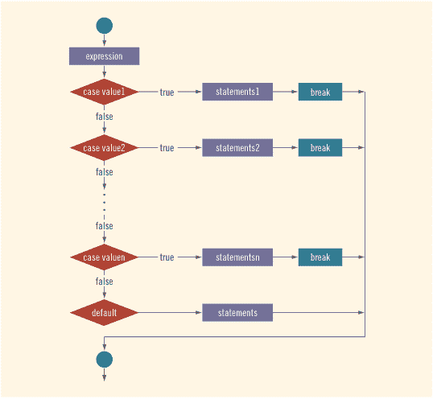

**图 4-4** *switch 语句*

`switch` 语句按以下规则执行：

- 1. 当 `expression` 的值与某个 `case` 值（也称为标签）匹配时，语句会一直执行，直到遇到 `break` 语句或到达 `switch` 结构的末尾。
- 2. 如果 `expression` 的值与任何 `case` 值都不匹配，则执行 `default` 标签后面的语句。如果 `switch` 结构没有 `default` 标签，并且 `expression` 的值与任何 `case` 值都不匹配，则跳过整个 `switch` 语句。
- 3. `break` 语句会立即退出 `switch` 结构。

### 示例 4-21

考虑以下语句，其中 *grade* 是 char 类型的变量。

```cpp
switch (grade)
{
case 'A':
    cout << "The grade point is 4.0.";
    break;
case 'B':
    cout << "The grade point is 3.0.";
    break;
case 'C':
    cout << "The grade point is 2.0.";
    break;
case 'D':
    cout << "The grade point is 1.0.";
    break;
case 'F':
    cout << "The grade point is 0.0.";
    break;
default:
    cout << "The grade is invalid.";
}
```

在这个例子中，switch 语句中的表达式是一个变量标识符。变量 *grade* 是 char 类型，而 char 是一种整型。*grade* 的可能值为 'A'、'B'、'C'、'D' 和 'F'。每个 case 标签指定了取决于 *grade* 值的不同操作。如果 *grade* 的值为 'A'，则输出为：

成绩绩点为 4.0。

### 示例 4-22

以下程序说明了 *break* 语句的作用。它要求用户输入一个 0 到 10 之间的数。

```cpp
//Program: Effect of break statements in a switch structure

#include <iostream>

using namespace std;

int main()
{
    int num;

    cout << "Enter an integer between 0 and 7: ";    //Line 1
    cin >> num;                                      //Line 2
    cout << endl;                                    //Line 3
```

### 示例运行 4：

```text
Enter an integer between 0 and 7: 5

The number you entered is 5
This program shows the effect of the break statement.
Out of the switch structure.
```

### 示例运行 5：

```text
Enter an integer between 0 and 7: 7

The number you entered is 7
of the break statement.
Out of the switch structure.
```

### 示例运行 6：

```text
Enter an integer between 0 and 7: 8

The number you entered is 8
The number is out of range.
Out of the switch structure.
```

使用 `switch` 表达式 num 的某些值对这个程序进行走查，可以帮助你理解 `break` 语句如何起作用。如果 num 的值为 0，则 `switch` 表达式的值与 `case` 值 0 匹配。`case 0:` 后面的所有语句都会执行，直到出现 `break` 语句。

第一个 `break` 语句出现在第 13 行，正好在 `case` 值 4 之前。即使 `switch` 表达式的值与任何 `case` 值（即 1、2 或 3）都不匹配，这些值后面的语句仍会执行。

当 `switch` 表达式的值与某个 `case` 值匹配时，所有语句都会执行，直到遇到 `break`，并且程序会跳过其间的所有 case 标签。类似地，如果 num 的值为 3，则它与 `case` 值 3 匹配，该标签后面的语句会执行，直到遇到第 13 行中的 `break` 语句。如果 num 的值为 4，则它与 `case` 值 4 匹配。在这种情况下，操作为空，因为 `case` 值 4 后面只有第 15 行中的 `break` 语句。

### 示例 4-23

尽管 `switch` 结构的 `case` 值（标签）是有限的，但 `switch` 语句的表达式可以按需要变得很复杂。例如，考虑以下 `switch` 语句：

```cpp
switch (score / 10)
{
case 0:
case 1:
case 2:
case 3:
case 4:
case 5:
    grade = 'F';
    break;
case 6:
    grade = 'D';
    break;
case 7:
    grade = 'C';
    break;
case 8:
    grade = 'B';
    break;
case 9:
case 10:
    grade = 'A';
    break;
default:
    cout << "Invalid test score." << endl;
}
```

假设 score 是一个 int 变量，其值在 0 到 100 之间。如果 score 为 75，则 score / 10 = 75 / 10 = 7，分配的等级为 'C'。如果 score 的值在 0 到 59 之间，则等级为 'F'。如果 score 在 0 到 59 之间，那么 score / 10 为 0、1、2、3、4 或 5。这些值中的每一个都对应等级 'F'。

因此，在这个 switch 结构中，case 0、case 1、case 2、case 3、case 4 和 case 5 的操作语句都相同。与其为 0、1、2、3、4 和 5 的每个 case 值都编写语句 grade = 'F'; 再跟一个 break 语句，不如先指定所有 case 值（如前面的代码所示），然后指定所需的操作语句，从而简化编程代码。case 值 9 和 10 也遵循类似的约定。

除了可以是变量标识符或复杂表达式之外，switch 表达式还可以求值为逻辑值。考虑以下语句：

```cpp
switch (age >= 18)
{
case 1:
    cout << "Old enough to be drafted." << endl;
    cout << "Old enough to vote." << endl;
    break;
case 0:
    cout << "Not old enough to be drafted." << endl;
    cout << "Not old enough to vote." << endl;
}
```

如果 age 的值为 25，则表达式 age >= 18 求值为 1，即 true。如果表达式的求值为 1，则执行 case 标签 1 后面的语句。如果 age 的值为 14，则表达式 age >= 18 求值为 0，即 false，并且执行 case 标签 0 后面的语句。


在 case 标签中，你可以分别使用 `true` 和 `false` 来代替 1 和 0，并将前面的 `switch` 语句重写如下：

```cpp
switch (age >= 18)
{
case true:
    cout << "Old enough to be drafted." << endl;
    cout << "Old enough to vote." << endl;
    break;
case false:
    cout << "Not old enough to be drafted." << endl;
    cout << "Not old enough to vote." << endl;
}
```

从前面示例可以看出，`switch` 语句是实现多重选择的一种优雅方式。你将在本章末尾的编程示例中看到 `switch` 语句的用法。尽管不存在固定规则来决定是实现多重选择时使用 `if...else` 结构还是 `switch` 结构，但应记住以下考虑事项。如果多重选择涉及一个值范围，则应使用 `if...else` 结构或 `switch` 结构，其中将每个范围转换为有限的值集合。

例如，在示例 4–23 中，`grade` 的值取决于 `score` 的值。如果 `score` 在 0 到 59 之间，则 `grade` 为 'F'。因为 `score` 是 `int` 变量，所以有 60 个值对应成绩 'F'。如果你将所有 60 个值列为 case 值，`switch` 语句可能会非常长。然而，除以 10 可将这 60 个值减少到只有 6 个值：0、1、2、3、4 和 5。

如果值的范围包含无限多个值，且无法将它们缩减为包含有限个值的集合，则必须使用 `if...else` 结构。例如，如果 `score` 恰好是 `double` 变量，则 0 到 60 之间的值的数量是无限的。然而，你可以使用表达式 `static_cast<int>(score) / 10`，仍然将这个无限多的值缩减为仅六个值。

## 通过避免对概念和技术的一知半解来避免缺陷（再谈）

本章前面，我们讨论了概念或技术的一知半解如何导致程序错误。在本节中，我们给出另一个示例来说明使用一知半解的概念和技术所导致的问题。在示例 4–23 中，我们说明了如何根据 0 到 100 之间的测试分数来评定成绩。接下来，考虑下面这个根据测试分数评定成绩的程序。

```cpp
//Grade program with bugs.

#include <iostream>                                      //Line 1

using namespace std;                                     //Line 2

int main()                                      //Line 3
{                                               //Line 4
    int testScore;                              //Line 5

    cout << "Enter the test score: ";          //Line 6
    cin >> testScore;                           //Line 7
    cout << endl;                               //Line 8

    switch (testScore / 10)                     //Line 9
    {                                           //Line 10
    case 0:                                     //Line 11
    case 1:                                     //Line 12
    case 2:                                     //Line 13
    case 3:                                     //Line 14
    case 4:                                     //Line 15
    case 5:                                     //Line 16
        cout << "The grade is F." << endl;     //Line 17
    case 6:                                     //Line 18
        cout << "The grade is D." << endl;     //Line 19
    case 7:                                     //Line 20
        cout << "The grade is C." << endl;     //Line 21
    case 8:                                     //Line 22
        cout << "The grade is B." << endl;     //Line 23
    case 9:                                     //Line 24
        cout << "The grade is A." << endl;     //Line 25
    case 10:                                    //Line 26
        cout << "The grade is A." << endl;     //Line 27
    default:                                    //Line 28
        cout << "Invalid test score." << endl; //Line 29
    }

    return 0;                                   //Line 30
}                                               //Line 31
```


**示例运行：** 在这些示例运行中，用户输入以底纹显示。

**示例运行 1：**

输入测试分数：`110`

```
Invalid test score.
```

**示例运行 2：**

输入测试分数：`-70`

```
Invalid test score.
```

**示例运行 3：**

输入测试分数：`75`

```
The grade is C.
The grade is B.
The grade is A.
Invalid test score.
```

从这些示例运行可以看出，如果 testScore 的值小于 0 或大于 100，则程序产生正确结果；但如果 testScore 的值在 0 到 100 之间，比如 75，则程序产生错误结果。你能看出原因吗？

如示例运行 3 中那样，假设 testScore 的值为 75。那么，testScore / 10 = 7，且该值与 case 标签 7 匹配。因此，按照我们的意图，它应打印 The grade is C。然而，输出却是：

```
The grade is C.
The grade is B.
The grade is A.
Invalid test score.
```

但为什么呢？显然，每个 case 标签最多只与一个 cout 语句相关联。问题在于对 switch 结构如何工作只有一知半解。正如我们所见，switch 语句没有包含任何 break 语句。因此，在执行与匹配的 case 标签相关联的语句之后，执行会继续执行与下一个 case 标签相关联的语句，从而导致打印出四行非预期的输出。

为了正确输出结果，switch 结构必须在每个 cout 语句之后包含一个 break 语句，最后一个 cout 语句除外。我们把它留作练习，由你修改该程序，使其输出正确结果。

我们再次看到，一知半解的概念可能导致程序中出现严重错误。因此，花时间完全理解每个概念和技术，将为你节省数小时的调试时间。

## 使用 assert 函数终止程序

程序中可能出现某些非常难以捕获的错误。例如，使用你迄今为止研究过的任何编程技术，都可能难以捕获除以零错误。C++ 包含一个预定义函数 assert，它在某些难以捉摸的错误发生时停止程序执行很有用。对于除以零的情况，你可以使用 assert 函数来确保程序终止，并给出适当的错误消息，指明错误类型以及错误发生的程序位置。

考虑以下语句：

```cpp
int numerator;
int denominator;
int quotient;
double hours;
double rate;
double wages;
char ch;
```

- 1. `quotient = numerator / denominator;`
- 2. `if (hours > 0 && (0 < rate && rate <= 15.50))`  
  `wages = rate * hours;`
- 3. `if ('A' <= ch && ch <= 'Z')`

在第一条语句中，如果 denominator 为 0，从逻辑上讲你不应执行除法。然而在执行期间，计算机会尝试执行除法。如果 denominator 为 0，程序将终止并给出错误消息，指出发生了非法操作。

第二条语句设计为仅在 hours 大于 0 且 rate 为正数且小于或等于 15.50 时计算 wages。第三条语句设计为仅在 ch 是大写字母时执行某些语句。

对于所有这些语句（就此而言，在任何必须满足某些条件的情况下），如果条件不满足，最好终止程序执行并给出消息，指明程序中发生错误的位置。你可以通过在程序中包含输出语句和 return 语句来处理这些类型的情况。然而，C++ 通过 assert 函数提供了一种在所需条件不满足时终止程序的有效方法。

使用 assert 函数的语法是：

```cpp
assert(expression);
```

这里，expression 是任意逻辑表达式。如果 expression 求值为 true，则执行下一条语句。如果 expression 求值为 false，则程序终止，并指出程序中发生错误的位置。

assert 函数的规范位于头文件 cassert 中。因此，程序若要使用 assert 函数，必须包含以下语句：

```cpp
#include <cassert>
```

使用 assert 函数的语句有时称为 assert 语句。

回到前面的语句，你可以使用 assert 函数重写语句 1（quotient = numerator / denominator;）。因为仅当 denominator 非零时才应计算 quotient，所以你在赋值语句之前包含一个 assert 语句，如下所示：

```cpp
assert(denominator);
quotient = numerator / denominator;
```

现在，如果 denominator 为 0，assert 语句将终止程序执行，并给出类似以下内容的错误消息：

```text
Assertion failed: denominator, file c:\temp\assert function\assertfunction.cpp, line 20
```


此错误消息表明分母的断言失败。该错误消息还给出了包含源代码的文件名以及断言失败所在的行号。

你也可以使用断言语句重写语句2，如下所示：

```
assert (hours > 0 && (0 < rate && rate <= 15.50));
if (hours > 0 && (0 < rate && rate <= 15.50))
    wages = rate * hours;
```

如果 assert 语句中的表达式失败，程序将终止，并显示类似如下的错误消息：

```
Assertion failed: hours > 0 && (0 < rate && rate <= 15.50), file
c:\temp\assertion\assertion.cpp, line 26
```

在程序开发和测试期间，assert 语句对于强制执行编程约束非常有用。如你所见，assert 语句不仅会暂停程序，还会指出断言失败的表达式、包含源代码的文件名以及断言失败所在的行号。

尽管 assert 语句在程序开发期间很有用，但在程序开发完成并投入使用后，如果 assert 语句因某种原因失败，最终用户将无法理解该错误的含义。因此，在开发和测试完程序后，你可能希望移除或禁用 assert 语句。在非常大的程序中，移除开发期间使用的所有 assert 语句可能很繁琐，甚至不可能。此外，如果你计划将来修改程序，你可能希望保留 assert 语句。因此，合乎逻辑的选择是保留这些语句但禁用它们。你可以使用以下预处理指令禁用 assert 语句：

```
#define NDEBUG
```

这个预处理指令 #define NDEBUG 必须放在指令 #include <cassert> 之前。

## 编程示例：有线电视公司计费

本编程示例演示一个计算本地有线电视公司客户账单的程序。客户有两种类型：住宅客户和企业客户。计算有线电视账单有两种费率：一种用于住宅客户，一种用于企业客户。对于住宅客户，适用以下费率：

- 账单处理费：$4.50
- 基本服务费：$20.50
- 付费频道：每频道 $7.50。

### 变量

因为程序会要求用户输入客户账号、客户代码、付费频道数量和基本服务连接数量，所以你需要变量来存储所有这些信息。另外，因为程序会计算账单金额，所以你需要一个变量来存储账单金额。因此，程序至少需要以下变量来计算并打印账单：

```
int accountNumber;    //variable to store the customer's
                       //account number
char customerType;    //variable to store the customer code
int numOfPremChannels; //variable to store the number
                       //of premium channels to which the
                       //customer subscribes
int numOfBasicServConn; //variable to store the number
                           //of basic service connections
                           //to which the customer subscribes
double amountDue;     //variable to store the billing amount
```

### 命名常量

如你所见，账单处理费、基本服务连接费用和付费频道费用是固定的，并且这些值用于计算账单。尽管这些值在程序中是常量，但有线电视公司可能在几乎不提前通知的情况下更改它们。为了简化以后修改程序的过程，不应在程序中直接使用这些值，而应将它们声明为命名常量。基于问题分析，你需要声明以下命名常量：

```
//Named constants - residential customers
const double RES_BILL_PROC_FEES = 4.50;
const double RES_BASIC_SERV_COST = 20.50;
const double RES_COST_PREM_CHANNEL = 7.50;

//Named constants - business customers
const double BUS_BILL_PROC_FEES = 15.00;
const double BUS_BASIC_SERV_COST = 75.00;
const double BUS_BASIC_CONN_COST = 5.00;
const double BUS_COST_PREM_CHANNEL = 50.00;
```

### 公式

程序使用若干公式来计算账单金额。要计算住宅客户账单，你只需要知道用户订阅的付费频道数量。以下语句计算住宅客户的账单金额。

```
amountDue = RES_BILL_PROC_FEES + RES_BASIC_SERV_COST
          + numOfPremChannels * RES_COST_PREM_CHANNEL;
```

要计算企业客户账单，你需要知道用户订阅的基本服务连接数量和付费频道数量。如果基本服务连接数量小于或等于10，则基本服务连接费用是固定的。如果基本服务连接数量超过10，则必须为超过10的每个连接加上费用。以下语句计算企业客户的账单金额。


```
if (numOfBasicServConn <= 10)
    amountDue = BUS_BILL_PROC_FEES + BUS_BASIC_SERV_COST
                 + numOfPremChannels * BUS_COST_PREM_CHANNEL;
else
    amountDue = BUS_BILL_PROC_FEES + BUS_BASIC_SERV_COST
                 + (numOfBasicServConn - 10)
                   * BUS_BASIC_CONN_COST
                 + numOfPremChannels * BUS_COST_PREM_CHANNEL;
```

### 主算法

基于前面的讨论，你现在可以编写主算法。

- 1. 要以带小数点和尾随零的固定小数格式输出浮点数，请设置操纵符 fixed 和 showpoint。另外，要以两位小数输出浮点数，请将精度设置为两位小数。回想一下，要使用这些操纵符，程序必须包含头文件 `iomanip`。
- 2. 提示用户输入账号。
- 3. 获取客户账号。
- 4. 提示用户输入客户代码。
- 5. 获取客户代码。
- 6. 如果客户代码为 `r` 或 `R`，
  - a. 提示用户输入付费频道数量。
  - b. 获取付费频道数量。
  - c. 计算账单金额。
  - d. 打印账号和账单金额。
- 7. 如果客户代码为 `b` 或 `B`，
  - a. 提示用户输入基本服务连接数量。
  - b. 获取基本服务连接数量。
  - c. 提示用户输入付费频道数量。
  - d. 获取付费频道数量。
  - e. 计算账单金额。
  - f. 打印账号和账单金额。
- 8. 如果客户代码不是 `r`、`R`、`b` 或 `B`，则输出错误消息。

对于步骤6和7，程序使用 `switch` 语句来计算所需客户的账单。

### 完整程序清单

```
//********************************************************************
// Author: D. S. Malik
//
// Program: Cable Company Billing
// This program calculates and prints a customer's bill for
// a local cable company. The program processes two types of
// customers: residential and business.
//********************************************************************

#include <iostream>
#include <iomanip>

using namespace std;

                //Named constants - residential customers
const double RES_BILL_PROC_FEES = 4.50;
const double RES_BASIC_SERV_COST = 20.50;
const double RES_COST_PREM_CHANNEL = 7.50;

                //Named constants - business customers
const double BUS_BILL_PROC_FEES = 15.00;
const double BUS_BASIC_SERV_COST = 75.00;
const double BUS_BASIC_CONN_COST = 5.00;
const double BUS_COST_PREM_CHANNEL = 50.00;

int main()
{
                //Variable declaration
    int accountNumber;
    char customerType;
    int numOfPremChannels;
    int numOfBasicServConn;
    double amountDue;

    cout << fixed << showpoint;                         //Step 1
    cout << setprecision(2);                            //Step 1

    cout << "This program computes a cable "
         << "bill." << endl;
    cout << "Enter account number (an integer): ";       //Step 2
    cin >> accountNumber;                                //Step 3
    cout << endl;

    cout << "Enter customer type: "
         << "R or r (Residential), "
         << "B or b (Business): ";                      //Step 4
    cin >> customerType;                                 //Step 5
    cout << endl;
```


```cpp
switch (customerType)
{
case 'r':
case 'R':
    cout << "Enter the number"
         << " of premium channels: ";
    cin >> numOfPremChannels;
    cout << endl;

    amountDue = RES_BILL_PROC_FEES
              + RES_BASIC_SERV_COST
              + numOfPremChannels *
                RES_COST_PREM_CHANNEL;

    cout << "Account number: "
         << accountNumber
         << endl;
    cout << "Amount due: $"
         << amountDue
         << endl;
    break;

case 'b':
case 'B':
    cout << "Enter the number of basic "
         << "service connections: ";
    cin >> numOfBasicServConn;
    cout << endl;

    cout << "Enter the number"
         << " of premium channels: ";
    cin >> numOfPremChannels;
    cout << endl;

    if (numOfBasicServConn <= 10)
        amountDue = BUS_BILL_PROC_FEES
                  + BUS_BASIC_SERV_COST
                  + numOfPremChannels *
                    BUS_COST_PREM_CHANNEL;
    else
        amountDue = BUS_BILL_PROC_FEES
                  + BUS_BASIC_SERV_COST
                  + (numOfBasicServConn - 10) *
                    BUS_BASIC_SERV_COST
                  + numOfPremChannels *
                    BUS_COST_PREM_CHANNEL;

    cout << "Account number: "
         << accountNumber << endl;
    cout << "Amount due: $" << amountDue
         << endl;
    break;

default:
    cout << "Invalid customer type." << endl;   // Step 8
} // end switch

    return 0;
}
```

**运行示例：**在此运行示例中，用户输入部分以阴影标示。

```
This program computes a cable bill.
Enter account number (an integer): 12345

Enter customer type: R or r (Residential), B or b (Business): b

Enter the number of basic service connections: 16

Enter the number of premium channels: 8

Account number: 12345
Amount due: $520.00
```

## 快速复习

- 1. 控制结构会改变控制的正常流程。
- 2. 最常见的两种控制结构是选择结构和重复结构。
- 3. 选择结构将决策纳入程序中。
- 4. 关系运算符包括 `==`（等于）、`<`（小于）、`<=`（小于或等于）、`>`（大于）、`>=`（大于或等于）和 `!=`（不等于）。
- 5. 在关系运算符 `==`、`<=`、`>=` 和 `!=` 中间加入空格会产生语法错误。
- 6. 字符使用机器的排序序列进行比较。
- 7. 逻辑表达式的求值结果为 1（或非零值）或 0。逻辑值 1（或任何非零值）被视为真；逻辑值 0 被视为假。
- 8. 在 C++ 中，可以使用 `int` 变量存储逻辑表达式的值。
- 9. 在 C++ 中，可以使用 `bool` 变量存储逻辑表达式的值。
- 10. 在 C++ 中，逻辑运算符包括 `!`（非）、`&&`（与）和 `||`（或）。
- 11. C++ 中有两种选择结构。
- 12. 单向选择采用以下形式：

  ```cpp
  if (expression)
      statement
  ```

  如果 expression 为真，则执行 statement；否则，计算机执行紧跟在 `if` 语句之后的语句。

- e. 如果 `ch < 'A'` 或 `ch >= 'Z'` 中的任意一个条件成立，表达式 `(ch >= 'A' && ch <= 'Z')` 的求值结果就是 `false`。
- f. 假设输入为 5。以下代码的输出为：

  ```cpp
  cin >> num;
  if (num > 5)
  {
      cout << num;
      num = 0;
  }
  else
      cout << "Num is zero" << endl;
  ```

  输出为：Num is zero
- g. `switch` 语句中的表达式应求值得到简单数据类型的值。
- h. 只有当 x 为负数时，表达式 `!(x > 0)` 才为真。
- i. 在 C++ 中，`!` 和 `!=` 都是逻辑运算符。
- j. 程序中语句执行的顺序称为控制流。

### 2. 圈出最佳答案。

- a.

  ```cpp
  if (60 <= 12 * 5)
      cout << "Hello";
  cout << " There";
  ```

  输出如下：

  (i) Hello There  
  (ii) Hello  
  (iii) Hello There  
  (iv) There

- b.

  ```cpp
  if ('a' > 'b' || 66 > static_cast<int>('A'))
      cout << "#*#" << endl;
  ```

  输出如下：

  (i) `#*#`  
  (ii) `#`  
  (iii) `*`  
  (iv) 以上都不是

- c.

  ```cpp
  if (7 <= 7)
      cout << 6 - 9 * 2 / 6 << endl;
  ```

  输出如下：

  (i) −1  
  (ii) 3  
  (iii) 3.0  
  (iv) 以上都不是

- d.

  ```cpp
  if (7 < 8)
  {
      cout << "2 4 6 8" << endl;
      cout << "1 3 5 7" << endl;
  }
  ```

  输出如下：

  (i) 2 4 6 8  
      1 3 5 7  
  (ii) 1 3 5 7  
  (iii) 以上都不是


- e.

  ```cpp
  if (5 < 3)
      cout << "*";
  else if (7 == 8)
      cout << "&";
  else
      cout << "$";
  ```

  输出如下：

  (i) *  
  (ii) &  
  (iii) $  
  (iv) 以上都不是

3. 假设 x、y 和 z 是 `int` 变量，并且 x = 10、y = 15、z = 20。判断以下表达式的求值结果为真还是假。

- a. `!(x > 10)`
- b. `x <= 5 || y < 15`
- c. `(x != 5) && (y != z)`
- d. `x >= z || (x + y >= z)`
- e. `(x <= y - 2) && (y >= z) || (z - 2 != 20)`

4. 假设 str1、str2 和 str3 是字符串变量，并且 str1 = "English"、str2 = "Computer Science"、str3 = "Programming"。计算以下表达式。

- a. `str1 >= str2`
- b. `str1 != "english"`
- c. `str3 < str2`
- d. `str2 >= "Chemistry"`

5. 假设 x、y、z 和 w 是 `int` 变量，并且 x = 3、y = 4、z = 7、w = 1。以下语句的输出是什么？

- a. `cout << "x == y: " << (x == y) << endl;`
- b. `cout << "x != z: " << (x != z) << endl;`
- c. `cout << "y == z - 3: " << (y == z - 3) << endl;`
- d. `cout << "!(z > w): " << !(z > w) << endl;`
- e. `cout << "x + y < z: " << (x + y < z) << endl;`

6. 以下 C++ 代码的输出是什么？

```cpp
x = 100;
y = 200;
if (x > 100 && y <= 200)
    cout << x << " " << y << " " << x + y << endl;
else
    cout << x << " " << y << " " << 2 * x - y << endl;
```

7. 修改以下代码，使其输出正确的信息。

```cpp
if (score >= 60)
    cout << "You pass." << endl;
else;
    cout << "You fail." << endl;
```

8. 编写 C++ 语句：当性别为 `'M'` 时输出 Male，当性别为 `'F'` 时输出 Female，否则输出 invalid gender。

9. 以下程序的输出是什么？

```cpp
#include <iostream>

using namespace std;

int main()
{
    int myNum = 10;
    int yourNum = 30;

    if (yourNum % myNum == 3)
    {
        yourNum = 3;
        myNum = 1;
    }
    else if (yourNum % myNum == 2)
    {
        yourNum = 2;
        myNum = 2;
    }
    else
    {
        yourNum = 1;
        myNum = 3;
    }

    cout << myNum << " " << yourNum << endl;

    return 0;
}
```

- 10.
  - a. 如果 myNum = 5 且 yourNum = 12，练习 9 中程序的输出是什么？
  - b. 如果 myNum = 30 且 yourNum = 33，练习 9 中程序的输出是什么？

11. 假设 sale 和 bonus 是 `double` 变量。编写一个 `if...else` 语句，为 bonus 赋值如下：如果 sale 大于 20,000 美元，则 bonus 的值为 0.10；如果 sale 大于 10,000 美元且小于或等于 20,000 美元，则 bonus 的值为 0.05；否则，bonus 的值为 0。


12. 假设 `overSpeed` 和 `fine` 是 `double` 变量。按照以下规则为 `fine` 赋值：如果 `0 < overSpeed <= 5`，则 `fine` 的值为 `$20.00`；如果 `5 < overSpeed <= 10`，则 `fine` 的值为 `$75.00`；如果 `10 < overSpeed <= 15`，则 `fine` 的值为 `$150.00`；如果 `overSpeed > 15`，则 `fine` 的值为 `$150.00` 加上每超过 15 英里一英里所增加的 `$20.00`。

13. 假设 `score` 是一个 `int` 变量。考虑以下 `if` 语句：

```cpp
if (score >= 90);
    cout << "Discount = 10%" << endl;
```

- a. 如果 `score` 的值为 95，输出是什么？请说明理由。
- b. 如果 `score` 的值为 85，输出是什么？请说明理由。

14. 假设 `score` 是一个 `int` 变量。考虑以下 `if` 语句：

```cpp
i.  if (score == 70)
        cout << "Grade is C." << endl;

ii. if (score >= 70)
        cout << "Grade is C." << endl;
```

回答以下问题：

- a. 如果 `score` 的值为 70，(i) 和 (ii) 中的输出是什么？`if` 语句执行后 `score` 的值是多少？
- b. 如果 `score` 的值为 80，(i) 和 (ii) 中的输出是什么？`if` 语句执行后 `score` 的值是多少？

15. 使用条件运算符重写以下表达式。（假设所有变量都已正确声明。）

```cpp
a.  if (x >= y)
        z = x - y;
    else
        z = y - x;

b.  if (hours >= 40.0)
        wages = 40 * 7.50 + 1.5 * 7.5 * (hours - 40);
    else
        wages = hours * 7.50;

c.  if (score >= 60)
        str = "Pass";
    else
        str = "Fail";
```

16. 使用 `if...else` 语句重写以下表达式。（假设所有变量都已正确声明。）


- a. `(x < 5) ? y = 10 : y = 20;`

- b. `(fuel >= 10) ? drive = 150 : drive = 30;`

- c. `(booksBought >= 3) ? discount = 0.15 : discount = 0.0;`

- 17. 假设你有以下条件表达式。（假设所有变量都已正确声明。）

```cpp
(0 < backyard && backyard <= 5000) ? fertilizingCharges = 40.00
                                  : fertilizingCharges = 40.00 + (backyard - 5000) * 0.01;
```

  - a. 如果 `backyard` 的值为 3000，`fertilizingCharges` 的值是多少？
  - b. 如果 `backyard` 的值为 5000，`fertilizingCharges` 的值是多少？
  - c. 如果 `backyard` 的值为 6500，`fertilizingCharges` 的值是多少？

- 18. 指出以下是否为有效的 `switch` 语句。如果不是，请解释原因。假设 n 和 digit 是 `int` 变量。

```cpp
switch (n <= 2)
{
case 0:
    cout << "Draw." << endl;
    break;
case 1:
    cout << "Win." << endl;
    break;
case 2:
    cout << "Lose." << endl;
    break;
}
```

```cpp
switch (digit / 4)
{
case 0:
case 1:
    cout << "low." << endl;
    break;
case 1:
case 2:
    cout << "middle." << endl;
    break;
case 3:
    cout << "high." << endl;
}
```

```cpp
switch (n % 6)
{
case 1:
case 2:
case 3:
case 4:
case 5:
    cout << n;
    break;
case 0:
    cout << endl;
    break;
}
```


  - d.

```cpp
switch (n % 10)
{
case 2:
case 4:
case 6:
case 8:
    cout << "Even";
    break;
case 1:
case 3:
case 5:
case 7:
    cout << "Odd";
    break;
}
```

- 19. 假设输入为 5。以下 C++ 代码执行后，alpha 的值是多少？

```cpp
cin >> alpha;
switch (alpha)
{
case 1:
case 2:
    alpha = alpha + 2;
    break;
case 4:
    alpha++;
case 5:
    alpha = 2 * alpha;
case 6:
    alpha = alpha + 5;
    break;
default:
    alpha--;
}
```

- 20. 假设输入为 3。以下 C++ 代码执行后，beta 的值是多少？

```cpp
cin >> beta;
switch (beta)
{
case 3:
    beta = beta + 3;
case 1:
    beta++;
    break;
case 5:
    beta = beta + 5;
case 4:
    beta = beta + 4;
}
```

- 21. 假设输入为 6。以下 C++ 代码执行后，a 的值是多少？

```cpp
cin >> a;
if (a > 0)
    switch (a)
    {
        case 1:
            a = a + 3;
        case 3:
            a++;
            break;
        case 6:
            a = a + 6;
        case 8:
            a = a * 8;
            break;
        default:
            a--;
    }
else
    a = a + 2;
```

- 22. 在以下代码中，改正任何会导致程序无法编译或运行的错误。

```cpp
#include <iostream>

main ()
{
    int a, b;
    bool found;
    cout << "Enter two integers: ";
    cin >> a >> b;

    if a > a*b && 10 < b
        found = 2 * a > b;
    else
    {
        found = 2 * a < b;
        if found = 3;
            a = 3;
            c = 15;
            if b
            {
                b = 0;
                a = 1;
            }
    }
}
```

- 23. 以下程序包含错误。请改正这些错误，使程序能够运行并输出 w = 21。

```cpp
#include <iostream>

using namespace std;

const int SECRET = 5

main ()
{
    int x, y, w, z;
    z = 9;

    if z > 10
        x = 12; y = 5, w = x + y + SECRET;
    else
        x = 12; y = 4, w = x + y + SECRET;

    cout << "w = " << w << endl;
}
```

- 24. 在以下程序中编写缺失的语句，使其提示用户输入两个数。如果其中一个数为 0，程序应输出一条消息，说明两个数都必须非零。如果第一个数大于第二个数，则输出第一个数除以第二个数；如果第一个数小于第二个数，则输出第二个数除以第一个数；否则，输出这两个数的乘积。

```cpp
#include <iostream>
using namespace std;

int main()
{
    double firstNum, secondNum;

    cout << "Enter two nonzero numbers: ";
    cin >> firstNum >> secondNum;
    cout << endl;

    //Missing statements

    return 0;
}
```

## 编程练习

- 1. 编写一个程序，提示用户输入一个数。然后程序应输出该数，并输出一条消息说明该数是正数、负数还是零。

- 2. 编写一个程序，提示用户输入三个数。然后程序应按升序输出这些数。

- 3. 编写一个程序，提示用户输入一个 0 到 35 之间的整数。如果该数小于或等于 9，程序应输出该数；否则，对于 10 应输出 A，11 应输出 B，12 应输出 C……35 应输出 Z。*（提示：对于大于等于 10 的数，使用强制类型转换运算符 `static_cast<char>()`。）*

- 4. 以下程序中的语句顺序不正确。请重新排列这些语句，使其提示用户输入形状类型（矩形、圆形或圆柱体）以及该形状的相应尺寸。然后程序输出以下关于该形状的信息：对于矩形，输出面积和周长；对于圆形，输出面积和周长；对于圆柱体，输出体积和表面积。重新排列语句后，程序应正确缩进。

```cpp
using namespace std;

#include <iostream>

int main()
{
    string shape;
    double height;

#include <string>

    cout << "Enter the shape type: (rectangle, circle, cylinder) ";
    cin >> shape;
    cout << endl;

    if (shape == "rectangle")
    {
        cout << "Area of the circle = "
             << PI * pow(radius, 2.0) << endl;

        cout << "Circumference of the circle: "
             << 2 * PI * pow(radius, 2.0) << endl;

        cout << "Enter the height of the cylinder: ";
        cin >> height;
        cout << endl;

        cout << "Enter the width of the rectangle: ";
        cin >> width;
        cout << endl;

        cout << "Perimeter of the rectangle = "
             << 2 * (length + width) << endl;
        double width;
    }

    cout << "Surface area of the cylinder: "
         << 2 * PI * radius * height + 2 * PI * pow(radius, 2.0) << endl;
    }
    else if (shape == "circle")
    {
        cout << "Enter the radius of the circle: ";
        cin >> radius;
        cout << endl;

        cout << "Volume of the cylinder = "
             << PI * pow(radius, 2.0)* height << endl;
        double length;
    }
    return 0;
    else if (shape == "cylinder")
    {
        double radius;

        cout << "Enter the length of the rectangle: ";
        cin >> length;
        cout << endl;

        #include <iomanip>

        cout << "Enter the radius of the base of the cylinder: ";
        cin >> radius;
        cout << endl;

        const double PI = 3.1416;
        cout << "Area of the rectangle = "
             << length * width << endl;
    else
        cout << "The program does not handle " << shape << endl;
        cout << fixed << showpoint << setprecision(2);
        #include <cmath>
    }
```

- 5. 编写一个程序，实现你在第 1 章练习 21 中设计的算法。

- 6. 在直角三角形中，一条边长度的平方等于另外两条边长度的平方和。编写一个程序，提示用户输入三角形的三条边长，然后输出一条消息，说明该三角形是否为直角三角形。

- 7. 一盒饼干可装 24 块饼干，一个容器可装 75 盒饼干。编写一个程序，提示用户输入饼干总数、每盒饼干数以及每个容器中的饼干盒数。然后程序输出运送这些饼干所需的盒数和容器数。注意，每盒必须包含指定数量的饼干，每个容器必须包含指定数量的盒子。如果最后一盒饼干少于指定饼干数，可以丢弃它，并输出剩余饼干数。同样，如果最后一个容器少于指定盒数，可以丢弃它，并输出剩余盒数。

- 8. 二次方程 $ax^2 + bx + c = 0$（$a \ne 0$）的根由以下公式给出：

$$\frac{-b \pm \sqrt{b^2 - 4ac}}{2a}$$

在这个公式中，项 $b^2 - 4ac$ 称为判别式。如果 $b^2 - 4ac = 0$，则方程有一个（重复）根。如果 $b^2 - 4ac > 0$，则方程有两个实根。如果 $b^2 - 4ac < 0$，则方程有两个复根。编写一个程序，提示用户输入 $a$（$x^2$ 的系数）、$b$（$x$ 的系数）和 $c$（常数项）的值，并输出方程根的类型。此外，如果 $b^2 - 4ac \ge 0$，程序应输出该二次方程的根。*（提示：使用头文件 cmath 中的函数 pow 计算平方根。第 3 章解释了如何使用函数 pow。）*

- 9. 编写一个模拟计算器的程序。程序应接受两个整数和要执行的运算作为输入。然后它应输出这些数、运算符和结果。（对于除法，如果分母为零，输出适当的消息。）以下是一些示例输出：

```
3 + 4 = 7
13 * 5 = 65
```

- 10. 重做练习 9，以处理浮点数。（将输出格式化为两位小数。）

- 11. 重做第 2 章编程练习 19，考虑你的父母按如下方式为你购买额外的储蓄债券：

  - a. 如果你不花任何钱购买储蓄债券，那么由于你做过暑期工作，你的父母会为你购买储蓄债券，金额等于你在缴税以及购买衣服、其他配饰和学习用品后节省下来的钱的 1%。
  - b. 如果你最多用净收入的 25% 来购买储蓄债券，那么你每花 1 美元购买储蓄债券，你的父母就花 0.25 美元，


再加上一笔钱，金额等于你在缴税并购买衣服、其他配饰和学习用品后所节省金额的 1%。

- c. 如果你花费超过净收入的 25% 来购买储蓄债券，你的父母会为你每花费 1 美元购买储蓄债券支付 0.40 美元，再加上一笔钱，金额等于你在缴税并购买衣服、其他配饰和学习用品后所节省金额的 2%。

- 12. 你所在城镇的一家银行在每个月末更新客户账户。该银行提供两种账户：储蓄账户和支票账户。每位客户必须维持最低余额。如果客户余额低于最低余额，储蓄账户收取 10.00 美元服务费，支票账户收取 25.00 美元服务费。如果月末余额至少达到最低余额，账户将获得如下利息：

  - a. 储蓄账户获得 4% 的利息。

  - b. 余额最多比最低余额高 5,000 美元的支票账户获得 3% 的利息；否则，利息为 5%。

编写一个程序，读取客户的账号（int 类型）、账户类型（char；s 表示储蓄，c 表示支票）、账户应维持的最低余额以及当前余额。程序随后应输出账号、账户类型、当前余额和适当消息。使用以下数据运行程序五次来测试：

```
46728 S 1000 2700
87324 C 1500 7689
79873 S 1000 800
89832 C 2000 3000
98322 C 1000 750
```

- 13. 编写一个程序，实现第 1 章示例 1-3 中给出的算法，该算法确定销售人员的月工资。

- 14. 一张纸上可打印的行数取决于纸张尺寸、一行中每个字符的点大小、行是双倍行距还是单倍行距、上下边距以及纸张的左右边距。假设所有字符的点大小相同，并且所有行要么是单倍行距，要么是双倍行距。注意 1 英寸 = 72 点。此外，假设行沿纸张宽度方向打印。例如，如果纸张长度为 11 英寸、宽度为 8.5 英寸，则一行的最大长度为 8.5 英寸。编写一个程序，根据用户输入的以下信息计算一行中的字符数以及一张纸上可打印的行数：

  - a. 纸张的长度和宽度（英寸）

  - b. 上、下、左、右边距

  - c. 一行的点大小

  - d. 如果行是双倍行距，则将每个字符的点大小加倍

- 15. 编写一个程序，计算并打印一家蜂窝电话公司的账单。该公司提供两种服务：普通服务和高级服务。其费率因服务类型而异。费率计算如下：

**普通服务：** 10.00 美元，前 50 分钟免费。超过 50 分钟的部分按每分钟 0.20 美元收费。

**高级服务：** 25.00 美元，另加：

  - a. 对于上午 6:00 至下午 6:00 拨打的电话，前 75 分钟免费；超过 75 分钟的部分按每分钟 0.10 美元收费。

  - b. 对于下午 6:00 至次日上午 6:00 拨打的电话，前 100 分钟免费；超过 100 分钟的部分按每分钟 0.05 美元收费。

你的程序应提示用户输入账号、服务代码（**char** 类型）以及服务使用分钟数。服务代码为 **r** 或 **R** 表示普通服务；服务代码为 **p** 或 **P** 表示高级服务。将任何其他字符视为错误。你的程序应输出账号、服务类型、电话服务使用分钟数以及用户应付金额。

对于高级服务，客户可能在白天和夜间都使用服务。因此，为了计算账单，你必须要求用户输入白天使用服务的分钟数以及夜间使用服务的分钟数。

- 16. 编写一个程序，实现你在第 1 章练习 22 中设计的算法。（假设账户余额存储在文件 Ch4_Ex16_Data.txt 中。）你的程序应输出取款和服务费前后的账户余额。还要将取款后的账户余额保存到文件 Ch4_Ex16_Output.txt 中。

- 17. 你有几张不同尺寸的照片想要装框。当地一家相框店提供两种相框——普通相框和精美相框。相框有白色，并可按客户想要的任何颜色订购。假设每个相框宽 1 英寸。给相框上色的费用为每英寸 0.10 美元。普通相框的费用为每英寸 0.15 美元，精美相框的费用为每英寸 0.25 美元。在照片后面放硬纸板的费用为每平方英寸 0.02 美元，在照片上方放玻璃的费用为每平方英寸 0.07 美元。客户还可以选择在角上安装冠饰，每个冠饰 0.35 美元。编写一个程序，提示用户输入以下信息，然后输出给照片装框的费用：

  - a. 照片的长度和宽度（英寸）

  - b. 相框类型

  - c. 客户为相框选择的颜色

  - d. 如果用户想安装冠饰，则输入冠饰数量

- 18. 萨曼莎和维卡斯想在一个新开发项目中买房子。看过各种模型后，他们喜欢的三个模型是殖民地式、错层式和单层式。建筑商给了他们这三个模型的基准价格和竣工面积（平方英尺）。他们想知道每平方英尺价格最低的模型。编写一个程序，接受这三个模型的基准价格和竣工面积（平方英尺）作为输入。程序输出每平方英尺价格最低的模型（一个或多个）。

- 19. 判断一个人有多健康的一种方法是测量该人的体脂。女性和男性的体脂计算公式如下：

  女性体脂公式：

  A1 =（体重 × 0.732）+ 8.987  
  A2 = 腕围（最丰满处）/ 3.140  
  A3 = 腰围（肚脐处）× 0.157  
  A4 = 臀围（最丰满处）× 0.249  
  A5 = 前臂围（最丰满处）× 0.434  
  B = A1 + A2 − A3 − A4 + A5  
  体脂 = 体重 − B  
  体脂百分比 = 体脂 × 100 / 体重

  男性体脂公式：

  A1 =（体重 × 1.082）+ 94.42  
  A2 = 腕围 × 4.15  
  B = A1 − A2  
  体脂 = 体重 − B  
  体脂百分比 = 体脂 × 100 / 体重

  编写一个程序来计算一个人的体脂。


# 第5章

### 控制结构 II（重复）

**本章中，你将：**

- 了解重复（循环）控制结构
- 探索如何构造和使用计数器控制、哨兵控制、标志控制和 EOF 控制的重复结构
- 考察 `break` 和 `continue` 语句
- 发现如何形成和使用嵌套控制结构
- 学习如何通过避免打补丁来避免错误
- 学习如何调试循环

在第 4 章中，你了解了决策如何融入程序。在本章中，你将学习重复如何融入程序。

## 为什么需要重复？

假设你想把五个数字相加来求它们的平均值。根据到目前为止所学的内容，你可以按如下方式进行（假设所有变量都已正确声明）：

```
cin >> num1 >> num2 >> num3 >> num4 >> num5;  //read five numbers
sum = num1 + num2 + num3 + num4 + num5;       //add the numbers
average = sum / 5;                             //find the average
```

但假设你想对 100 个、1000 个或更多数字相加并求平均值。你将不得不声明那么多变量，并在 cin 语句中再次列出它们，也许还要在输出语句中再次列出它们。这会占用过多空间和时间。另外，如果你想用不同的值或不同数量的值再次运行这个程序，你必须重写程序。

假设你想把以下数字相加：

5 3 7 9 4

考虑以下语句，其中 sum 和 num 是 int 类型的变量：

- `sum = 0;`
- `cin >> num;`
- `sum = sum + num;`

第一条语句将 sum 初始化为 0。让我们执行语句 2 和语句 3。语句 2 将 5 存入 num；语句 3 通过将 num 加到 sum 上来更新 sum 的值。执行语句 3 后，sum 的值为 5。

让我们重复语句 2 和语句 3。执行语句 2 后（在程序代码读取下一个数字之后）：

```
num = 3
```

执行语句 3 后：

```
sum = sum + num = 5 + 3 = 8
```

此时，sum 包含前两个数字的和。让我们再次重复语句 2 和语句 3（第三次）。执行语句 2 后（在代码读取下一个数字之后）：

```
num = 7
```

执行语句 3 后：

```
sum = sum + num = 8 + 7 = 15
```

现在，sum 包含前三个数字的和。如果你再将语句 2 和语句 3 重复两次，sum 将包含所有五个数字的和。


如果你想累加10个数，可以将语句2和语句3重复十次。如果你想累加100个数，可以将语句2和语句3重复一百次。无论哪种情况，你都不必像第一段代码那样声明任何额外的变量。你可以使用这段C++代码来累加任意一组数，而早先的代码则需要你大幅修改代码。

还有许多其他情况需要重复一组语句。例如，对于班级中的每个学生，确定课程成绩的公式是相同的。C++有三种重复结构（或称循环结构），可以让你反复重复语句，直到满足某些条件。本章介绍全部三种循环（重复）结构。下一节讨论第一种重复结构，称为while循环。

## while循环（重复）结构

在上一节中，你看到有时需要将一组语句重复若干次。重复一组语句的一种方法是在程序中一遍又一遍地键入这组语句。例如，如果要将一组语句重复100次，你就在程序中键入这组语句100次。然而，这种重复一组语句的解决方案即使并非不可能，也是不切实际的。幸运的是，有一种更好的方法来重复一组语句。如前所述，C++有三种重复结构（或称循环结构），允许你重复一组语句，直到满足某些条件。本节讨论第一种循环结构，称为while循环。

while语句的一般形式是：

```cpp
while (expression)
    statement
```

在C++中，while是保留字。当然，语句可以是简单语句或复合语句。表达式充当决策者，通常是逻辑表达式。该语句称为循环体。注意，表达式外面的圆括号是语法的一部分。图5-1展示了while循环的执行流程。


**图5-1** *while循环*

该表达式提供一个入口条件。如果它最初求值为**true**，则执行该语句。然后重新求值循环条件——即该表达式。如果它再次求值为**true**，则再次执行该语句。该语句（循环体）会继续执行，直到表达式不再为**true**。无限持续执行的循环称为**无限循环**。为避免无限循环，请确保循环体包含这样的语句：它们保证退出条件——`while`语句中的表达式——最终会变为**false**。

### 示例 5-1

考虑以下C++程序段：（假设`i`是一个`int`变量。）

```cpp
i = 0;                         //Line 1

while (i <= 20)                 //Line 2
{
    cout << i << " ";           //Line 3
    i = i + 5;                  //Line 4
}

cout << endl;
```

**示例运行：**

```text
0 5 10 15 20
```

在第1行，变量`i`被设置为0。`while`语句（在第2行）中的表达式`i <= 20`被求值。因为表达式`i <= 20`求值为**true**，所以接下来执行`while`循环的循环体。`while`循环的循环体由第3行和第4行的语句组成。第3行的语句输出`i`的值，即0。第4行的语句将`i`的值改为5。执行第3行和第4行的语句之后，再次求值`while`循环（在第2行）中的表达式。因为`i`是5，所以表达式`i <= 20`求值为**true**，并再次执行`while`循环的循环体。这个求值表达式并执行`while`循环体的过程会持续进行，直到表达式`i <= 20`（在第2行）不再求值为**true**。

表达式中的变量`i`（在示例5-1的第2行）称为**循环控制变量**。

注意示例5-1中的以下几点：

- a. 在循环内，`i`变为25，但不会被打印，因为入口条件为**false**。

- b. 如果从循环体中省略语句：

    ```cpp
    i = i + 5;
    ```

    那么你将得到一个**无限循环**，不断打印一行行的零。

- c. 在执行循环之前，必须初始化循环控制变量`i`。如果省略语句：

    ```cpp
    i = 0;
    ```

    （在第1行），则循环可能根本不会执行。（回想一下，C++中的变量不会自动初始化。）

- d. 在示例5-1中，如果循环体中的两条语句互换，可能会大幅改变结果。例如，考虑以下语句：

    ```cpp
    i = 0;

    while (i <= 20)
    {
        i = i + 5;
        cout << i << " ";
    }
    cout << endl;
    ```

    这里，输出为：

    ```text
    5 10 15 20 25
    ```

    通常，这会是语义错误，因为你很少希望条件在`i <= 20`时为真，却产生`i > 20`的结果。

- e. 如果在`while`循环末尾（逻辑表达式之后）放置一个分号，那么`while`循环的动作就是空的或无效的。例如，以下`while`循环的动作是空的。

    ```cpp
    i = 0;

    while (i <= 20);
    {
        i = i + 5;
        cout << i << " ";
    }
    cout << endl;
    ```

    花括号内的语句不构成`while`循环的循环体。

### 设计`while`循环

如同示例5-1，只有当`while`语句中的表达式求值为**true**时，`while`的循环体才会执行。通常，表达式检查一个或多个变量——称为**循环控制变量（LCV）**——是否满足某些条件。例如，在示例5-1中，`while`语句中的表达式检查`i <= 20`是否成立。LCV必须在`while`循环之前正确初始化，并且最终应使表达式求值为**false**。我们通过在`while`循环的循环体中更新或重新初始化LCV来做到这一点。因此，通常`while`循环按以下形式编写：


```cpp
//initialize the loop control variable(s)

while (expression)   //expression tests the LCV
{
    .
    .
    .
    //update the loop control variable(s)
    .
    .
    .
}
```

例如，在示例5-1中，第1行的语句将LCV `i`初始化为0。第2行的表达式`i <= 20`检查`i`是否小于或等于20，而第4行的语句更新`i`的值。

### 示例 5-2

考虑以下C++程序段：

```cpp
i = 20;                 //Line 1
while (i < 20)          //Line 2
{
    cout << i << " ";   //Line 3
    i = i + 5;          //Line 4
}
cout << endl;           //Line 5
```

很容易忽略这个示例与示例5-1之间的差异。在这个示例中，第1行将`i`设置为20。因为`i`是20，所以`while`语句（第2行）中的表达式`i < 20`求值为`false`。由于循环入口条件`i < 20`最初为`false`，`while`循环的循环体从不执行。因此，不输出任何值，`i`的值保持为20。

接下来几节描述`while`循环的各种形式。

### 情形1：计数器控制的`while`循环

假设你确切知道某些语句需要执行多少次。例如，假设你确切知道需要读取多少条数据（或条目）。在这种情况下，`while`循环采取**计数器控制的while循环**的形式。假设一组语句需要执行N次。你可以设置一个计数器（在**while**语句之前初始化为0）来跟踪已经读取了多少项。在执行**while**语句的循环体之前，将计数器与N进行比较。如果counter < N，则执行**while**语句的循环体。循环体继续执行，直到counter的值>= N。因此，在**while**语句的循环体内部，计数器在读取一个新项后递增。在这种情况下，**while**循环可能如下所示：

```cpp
counter = 0;       //initialize the loop control variable

while (counter < N) //test the loop control variable
{
    .
    .
    .
    counter++;      //update the loop control variable
    .
    .
    .
}
```

如果N表示文件中的数据项数，那么N的值可以通过几种方式确定。程序可以提示你指定文件中的项数；输入语句可以读取该值；或者你可以将文件中的第一项指定为文件中的项数，这样你就不必记住输入值（项）的数量。如果输入数据的人不是程序员，这会很有用。考虑示例5-3。

### 示例 5-3

假设输入为：

```text
8  9  2  3  90  38  56  23  89  7  2
```

假设你想将这些数相加并求平均值。考虑以下程序：

```cpp
//Program: Counter-Controlled Loop

#include <iostream>

using namespace std;

int main()
{
    int limit;    //store the number of data items
    int number;   //variable to store the number
    int sum;      //variable to store the sum
    int counter;  //loop control variable

    cout << "Line 1: Enter the number of "
         << "integers in the list: ";                 //Line 1
    cin >> number;                                     //Line 2
    cout << endl;                                      //Line 3
```


```cpp
sum = 0;                                      //Line 4
counter = 0;                                   //Line 5

cout << "Line 6: Enter " << limit
     << " integers." << endl;                 //Line 6

while (counter < limit)                        //Line 7
{
    cin >> number;                             //Line 8
    sum = sum + number;                        //Line 9
    counter++;                                 //Line 10
}

cout << "Line 11: The sum of the " << limit
     << " numbers = " << sum << endl;         //Line 11

if (counter != 0)                              //Line 12
    cout << "Line 13: The average = "
         << sum / counter << endl;             //Line 13
else                                            //Line 14
    cout << "Line 15: No input." << endl;      //Line 15

return 0;                                      //Line 16
}
```

**示例运行：** 在本示例运行中，用户输入以阴影显示。

```text
Line 1: Enter the number of integers in the list: 12
Line 6: Enter 12 integers.

8 9 2 3 90 38 56 8 23 89 7 2
Line 11: The sum of the 12 numbers = 335
Line 13: The average = 27
```

该程序的工作过程如下。第1行的语句提示用户输入数据项的数量。第2行的语句读取下一输入行并将其存储在变量 limit 中。limit 的值表示列表中的项数。第4行和第5行的语句将变量 sum 和 counter 初始化为0。（变量 counter 是循环控制变量。）第6行的语句提示用户输入数字。（在本示例运行中，提示用户输入12个整数。）第7行的 while 语句检查 counter 的值，以确定已读取多少项。如果 counter 小于 limit，则 while 循环继续下一次迭代。第8行的语句读取下一个数字并将其存储在变量 number 中。第9行的语句通过将 number 的值加到先前的值上来更新 sum 的值，第10行的语句将 counter 的值加1。第11行的语句输出这些数字的和；第12行到第15行的语句输出平均值。

注意，在此程序中，第4行将 sum 初始化为0。第9行中，在第8行读取一个数字后，程序将其加到当前数字之前已扫描的所有数字之和上。读取的第一个数字将与0相加（因为 sum 初始化为0），从而得到第一个数字的正确和。要计算平均值，请将 sum 除以 counter。如果 counter

```cpp
cout << "Line 1: Enter integers ending with "       //Line 1
     << SENTINEL << endl;
cin >> number;                                      //Line 2

while (number != SENTINEL)                         //Line 3
{
    sum = sum + number;                             //Line 4
    count++;                                        //Line 5
    cin >> number;                                  //Line 6
}

cout << "Line 7: The sum of the " << count
     << " numbers is " << sum << endl;              //Line 7

if (count != 0)                                     //Line 8
    cout << "Line 9: The average is "
         << sum / count << endl;                    //Line 9
else                                                //Line 10
    cout << "Line 11: No input." << endl;           //Line 11

return 0;
}
```

**示例运行：** 在本示例运行中，用户输入以阴影显示。

```text
Line 1: Enter integers ending with -999
34 23 9 45 78 0 77 8 3 5 -999
Line 7: The sum of the 10 numbers is 282
Line 9: The average is 28
```

该程序的工作过程如下。第1行的语句提示用户输入以 −999 结尾的数字。第2行的语句读取第一个数字并将其存储在 number 中。第3行的 **while** 语句检查 number 是否不等于 SENTINEL。（变量 number 是循环控制变量。）如果 number 不等于 SENTINEL，则执行 **while** 循环体。第4行的语句通过将 number 加到 sum 上来更新 sum 的值。第5行的语句将 count 的值加1；第6行的语句读取下一个数字并将其存储到 number 中。第4行到第6行的语句重复执行，直到程序读取到 SENTINEL。第7行的语句输出这些数字的和，第8行到第10行的语句输出这些数字的平均值。

注意，第2行的语句初始化 LCV 变量 number。第3行中的表达式 number != SENTINEL 检查 number 的值是否不等于 SENTINEL。第6行的语句重新初始化 LCV 变量 number。

接下来，考虑另一个哨兵控制的 **while** 循环示例。在该示例中，提示用户输入要处理的值。如果用户想停止程序，可以输入哨兵值。

### 例5-5

### 电话号码数字

下面的程序读取字母代码 A 到 Z，并打印对应的电话号码数字。该程序使用哨兵控制的 `while` 循环。要停止程序，会提示用户输入哨兵值，即 #。这也是一个嵌套控制结构的示例，其中 `if...else`、`switch` 和 `while` 循环相互嵌套。

```cpp
/***************************************************************
// Program: Telephone Digits
// This is an example of a sentinel-controlled loop. This
// program converts uppercase letters to their corresponding
// telephone digits.
***************************************************************/

#include <iostream>

using namespace std;

int main()
{
    char letter;                                      //Line 1

    cout << "Program to convert uppercase "
         << "letters to their corresponding "
         << "telephone digits." << endl;             //Line 2

    cout << "To stop the program enter #."
         << endl;                                     //Line 3

    cout << "Enter a letter: ";                       //Line 4
    cin >> letter;                                     //Line 5
    cout << endl;                                      //Line 6

    while (letter != '#')                              //Line 7
    {
        cout << "The letter you entered is: "
             << letter << endl;                       //Line 8
        cout << "The corresponding telephone "
             << "digit is: ";                         //Line 9

        if (letter >= 'A' && letter <= 'Z')            //Line 10
            switch (letter)                            //Line 11
            {
            case 'A':
            case 'B':
            case 'C':
                cout << 2 << endl;                    //Line 12
                break;                                 //Line 13
            case 'D':
            case 'E':
            case 'F':
                cout << 3 << endl;                 //Line 14
                break;                              //Line 15
            case 'G':
            case 'H':
            case 'I':
                cout << 4 << endl;                 //Line 16
                break;                              //Line 17
            case 'J':
            case 'K':
            case 'L':
                cout << 5 << endl;                 //Line 18
                break;                              //Line 19
            case 'M':
            case 'N':
            case 'O':
                cout << 6 << endl;                 //Line 20
                break;                              //Line 21
            case 'P':
            case 'Q':
            case 'R':
            case 'S':
                cout << 7 << endl;                 //Line 22
                break;                              //Line 23
            case 'T':
            case 'U':
            case 'V':
                cout << 8 << endl;                 //Line 24
                break;                              //Line 25
            case 'W':
            case 'X':
            case 'Y':
            case 'Z':
                cout << 9 << endl;                 //Line 26
            }
        else                                  //Line 27
            cout << "Invalid input." << endl; //Line 28

        cout << "\nEnter another uppercase "
             << "letter to find its "
             << "corresponding telephone digit."
             << endl;                          //Line 29
        cout << "To stop the program enter #."
             << endl;                          //Line 30

        cout << "Enter a letter: ";             //Line 31
        cin >> letter;                         //Line 32
        cout << endl;                          //Line 33
    }//end while

    return 0;
}
```


**示例运行：** 在此示例运行中，用户输入以阴影显示。

```text
Program to convert uppercase letters to their corresponding telephone
digits.
To stop the program enter #.
Enter a letter: A
The letter you entered is: A
The corresponding telephone digit is: 2

Enter another uppercase letter to find its corresponding telephone digit.
To stop the program enter #.
Enter a letter: D
The letter you entered is: D
The corresponding telephone digit is: 3

Enter another uppercase letter to find its corresponding telephone digit.
To stop the program enter #.
Enter a letter: #
```

该程序的工作原理如下。第2行和第3行的语句告诉用户该做什么。第4行的语句提示用户输入一个字母；第5行的语句将该字母读取并存储到变量`letter`中。第7行的`while`循环检查该字母是否为`#`。如果用户输入的字母不是`#`，则执行`while`循环体。第8行的语句输出用户输入的字母。第10行的`if`语句检查用户输入的字母是否为大写字母。`if`语句的语句部分是`switch`语句（第11行）。如果用户输入的字母是大写字母，则第10行`if`语句中的表达式求值为`true`，并执行`switch`语句；如果用户输入的字母不是大写字母，则执行`else`语句（第27行）。第12行至第26行的语句确定对应的电话按键数字。

当前字母处理完毕后，第29行和第30行的语句再次告知用户下一步该做什么。第31行的语句提示用户输入一个字母；第32行的语句将该字母读取并存储到变量`letter`中。（注意，第29行的语句与第2行的语句类似，第30行至第33行的语句与第3行至第6行的语句相同。）第33行的语句（位于`while`循环末尾）执行后，控制权返回到`while`循环的开头，并重新开始同样的过程。当用户输入`#`时，程序终止。

请注意，在此程序中，变量`letter`是循环控制变量。首先，它在第5行通过输入语句进行初始化，然后在第32行进行更新。第7行的表达式检查`letter`是否为`#`。

> **注意** 在示例5-5的程序中，你可以使用`switch`结构来编写第10行至第28行之间的语句。（参见本章末尾的编程练习3。）

### 情况3：标志控制的`while`循环

标志控制的`while`循环使用一个`bool`变量来控制循环。假设`found`是一个`bool`变量。标志控制的`while`循环形式如下：


```cpp
found = false;      //初始化循环控制变量
while (!found)      //测试循环控制变量
{
   .
   .
   .
   if (expression)
      found = true; //更新循环控制变量
   .
   .
   .
}
```

用于控制`while`循环执行的变量`found`称为**标志变量**。

示例5-6进一步说明了标志控制while循环的使用。

**示例5-6**

### 猜数字游戏

以下程序随机生成一个大于或等于0且小于100的整数。然后程序提示用户猜这个数字。如果用户猜对了数字，程序输出相应的消息。否则，程序检查猜的数字是否小于随机数。如果猜的数字小于程序生成的随机数，程序输出消息“你猜的数字小于该数字。再猜一次！”；否则，程序输出消息“你猜的数字大于该数字。再猜一次！”。然后程序提示用户输入另一个数字。程序会不断提示用户猜随机数，直到用户输入正确的数字。

要生成随机数，可以使用头文件`cstdlib`中的函数`rand`。例如，表达式`rand()`返回一个介于0和32767之间的`int`值。因此，语句：

```cpp
cout << rand() << ", " << rand() << endl;
```

将输出两个看似随机的数字。然而，每次程序运行时，该语句都会输出相同的随机数。这是因为函数`rand`使用了一种算法，在相同系统上每次执行程序时都会产生相同的随机数序列。为了在每次执行程序时生成不同的随机数，还需要使用头文件`cstdlib`中的函数`srand`。函数`srand`接受一个`unsigned int`作为输入，该值用作算法的种子。通过指定不同的种子值，每次程序执行时，函数`rand`都会生成不同的随机数序列。要指定不同的种子，可以使用头文件`ctime`中的函数`time`，该函数返回自1970年1月1日以来经过的秒数。例如，考虑以下语句：

```cpp
srand(time(0));
num = rand() % 100;
```

第一条语句设置种子，第二条语句生成一个大于或等于0且小于100的随机数。注意函数`time`的使用方式。它使用时带有一个参数，即实参，此处为0。

程序使用`bool`变量`isGuessed`来控制循环。`bool`变量`isGuessed`被初始化为`false`。当用户猜对数字时，它被设置为`true`。

```cpp
//标志控制的while循环。
//猜数字游戏。

#include <iostream>
#include <cstdlib>
#include <ctime>

using namespace std;

int main()
{
        //声明变量
        int num;                          //用于存储随机数的变量
        int guess;                        //用于存储用户所猜数字的变量
        bool isGuessed;                   //用于控制循环的布尔变量

        srand(time(0));                   //第1行
        num = rand() % 100;               //第2行

        isGuessed = false;                //第3行

        while (!isGuessed)                //第4行
        {                                  //第5行
                cout << "Enter an integer greater"
                     << " than or equal to 0 and"
                     << " less than 100: ";            //第6行

                cin >> guess;             //第7行
                cout << endl;             //第8行

                if (guess == num)         //第9行
                {                          //第10行
                        cout << "You guessed the correct "
                             << "number." << endl;       //第11行
                        isGuessed = true;                //第12行
                }                          //第13行
                else if (guess < num)      //第14行
                        cout << "Your guess is lower than the "
                             << "number.\n Guess again!"
                             << endl;                       //第15行
                else
                        cout << "Your guess is higher than "       //第16行
                             << "the number.\n Guess again!"
                             << endl;                              //第17行
        }                                               //结束while

        return 0;
}                                               //第18行
```

**示例运行：** 在此示例运行中，用户输入以阴影显示。

```text
Enter an integer greater than or equal to 0 and less than 100: 45

Your guess is higher than the number.
  Guess again!
Enter an integer greater than or equal to 0 and less than 100: 20

Your guess is lower than the number.
  Guess again!
Enter an integer greater than or equal to 0 and less than 100: 35

Your guess is higher than the number.
  Guess again!
Enter an integer greater than or equal to 0 and less than 100: 28

Your guess is lower than the number.
  Guess again!
Enter an integer greater than or equal to 0 and less than 100: 32

You guessed the correct number.
```

上述程序的工作方式如下：第2行的语句生成一个大于或等于0且小于100的整数，并将该数字存储在变量`num`中。第3行的语句将**bool**变量`isGuessed`设置为**false**。第4行**while**循环中的表达式计算`!isGuessed`。如果`isGuessed`为**false**，则`!isGuessed`为**true**，并执行**while**循环体；如果`isGuessed`为**true**，则`!isGuessed`为**false**，因此**while**循环终止。

第6行的语句提示用户输入一个大于或等于0且小于100的整数。第7行的语句将用户输入的数字存储在变量`guess`中。第9行**if**语句中的表达式确定`guess`的值是否与`num`相同，即用户是否猜对了数字。如果`guess`的值与`num`相同，第11行的语句输出消息：

```text
You guessed the correct number.
```

第12行的语句将变量`isGuessed`设置为**true**。然后控制权返回到第4行。因为`isGuessed`为**true**，`!isGuessed`为**false**，所以**while**循环终止。如果第9行的表达式求值为**false**，则第14行的`else`语句确定`guess`的值是小于还是大于`num`，并输出相应的消息。


### 案例 4：由 EOF 控制的 `while` 循环

如果数据文件经常被修改（例如，频繁添加或删除数据），最好不要使用哨兵值来读取数据。有人可能会意外删除哨兵值，或在哨兵值之后添加数据，尤其是当程序员和数据录入人员不是同一个人时。此外，有时很难选择一个合适的哨兵值。在这种情况下，可以使用**文件结束符（EOF）控制的`while`循环**。

到目前为止，我们一直使用输入流变量（例如`cin`）和提取运算符`>>`来读取数据并将其存储到变量中。然而，输入流变量在读取数据后也可以返回一个值，具体如下：

- 如果程序已到达输入数据的末尾，输入流变量返回逻辑值`false`。
- 如果程序读取到任何错误数据（例如将`char`值读入`int`变量），输入流会进入失败状态。一旦流进入失败状态，使用该流进行的任何后续 I/O 操作都会被视为空操作；也就是说，它们不会产生任何效果。不幸的是，计算机不会停止程序，也不会给出任何错误消息。它只会继续执行程序，默默忽略每一次继续使用该流的尝试。在这种情况下，输入流变量返回值`false`。
- 除（1）和（2）之外的情况，输入流变量返回逻辑值`true`。

可以使用输入流变量返回的值来判断程序是否已到达输入数据的末尾。由于输入流变量返回逻辑值`true`或`false`，因此在`while`循环中，它可以被视为一个逻辑表达式。

以下是一个由 EOF 控制的`while`循环示例：

```cpp
cin >> variable;       //initialize the loop control variable

while (cin)             //test the loop control variable
{
    .
    .
    .
    cin >> variable;    //update the loop control variable
    .
    .
    .
}
```

请注意，这里的变量`cin`充当循环控制变量。

## eof函数

除了检查输入流变量（例如`cin`）的值以判断是否已到达文件末尾之外，C++还提供了一个函数，可以与输入流变量一起使用来判断文件结束状态。这个函数称为

```cpp
int main()                                      //Line 6
{
        //Declare variables to manipulate data
        string firstName;                       //Line 8
        string lastName;                        //Line 9
        double testScore;                       //Line 10
        char grade = ' ';                       //Line 11
        double sum = 0;                         //Line 12
        int count = 0;                          //Line 13

        //Declare stream variables
        ifstream inFile;                        //Line 14
        ofstream outFile;                       //Line 15

        //Open input file
        inFile.open("Ch5_stData.txt");         //Line 16

        if (!inFile)                            //Line 17
        {
                cout << "Cannot open input file." //Line 18
                     << "Program terminates!" << endl; //Line 19
                return 1;                       //Line 20
        }                                       //Line 21

        //Open output file
        outFile.open("Ch5_stData.out");        //Line 22

        outFile << fixed << showpoint << setprecision(2); //Line 23

        inFile >> firstName >> lastName;        //Line 24
        inFile >> testScore;                    //read the test score   Line 25

        while (inFile)                           //Line 26
        {
                sum = sum + testScore;          //update sum          Line 28
                count++;                         //increment count     Line 29

                //determine the grade
                switch (static_cast<int> (testScore) / 10) //Line 30
                {
                case 0:                          //Line 32
                case 1:                          //Line 33
                case 2:                          //Line 34
                case 3:                          //Line 35
                case 4:                          //Line 36
                case 5:                          //Line 37
                        grade = 'F';             //Line 38
                        break;                   //Line 39

                case 6:                          //Line 40
                        grade = 'D';             //Line 41
                        break;                   //Line 42

                case 7:                          //Line 43
                        grade = 'C';             //Line 44
                        break;                   //Line 45

                case 8:                                      //Line 46
                    grade = 'B';                              //Line 47
                    break;                                    //Line 48

                case 9:                                      //Line 49
                case 10:                                     //Line 50
                    grade = 'A';                              //Line 51
                    break;                                    //Line 52

                default:                                     //Line 53
                    cout << "Invalid score." << endl;        //Line 54
                }//end switch                                  //Line 55

                outFile << left << setw(12) << firstName
                        << setw(12) << lastName
                        << right << setw(4) << testScore
                        << setw(2) << grade << endl;          //Line 56

                inFile >> firstName >> lastName;  //read the name Line 57
                inFile >> testScore;              //read the test score Line 58
        }//end while                                  //Line 59

        outFile << endl;                             //Line 60

        if (count != 0)                              //Line 61
            outFile << "Class Average: " << sum / count
                    << endl;                         //Line 62
        else                                          //Line 63
            outFile << "No data." << endl;           //Line 64

        inFile.close();                              //Line 65
        outFile.close();                             //Line 66

        return 0;                                    //Line 67
}                                             //Line 68
```

### 示例运行

### 输入文件

```text
Steve Gill 89
Rita Johnson 91.5
Randy Brown 85.5
Seema Arora 76.5
Samir Mann 73
Samantha McCoy 88.5
```

### 输出文件

```text
Steve        Gill        89.00 B
Rita         Johnson     91.50 A
Randy        Brown       85.50 A
Seema        Arora       76.50 C
Samir        Mann        73.00 C
Samantha     McCoy       88.50 B

Class Average: 84.00
```

前面的程序按如下方式工作。第 8 行到第 13 行的语句声明并初始化程序所需的变量。第 14 行和第 15 行的语句声明`inFile`为`ifstream`变量，`outFile`为`ofstream`变量。第 16 行的语句使用变量`inFile`打开输入文件。如果输入文件不存在，第 17 行到第 21 行的语句会输出相应的消息并终止程序。第 22 行的语句使用变量`outFile`打开输出文件。第 23 行的语句将浮点数的输出设置为固定形式、保留两位小数并带尾随零。

第 24 行和第 25 行的语句以及第 26 行的`while`循环读取每个学生的名、姓和测试成绩，然后输出姓名，接着输出测试成绩，再输出等级。具体来说，第 24 行和第 57 行的语句读取名和姓；第 25 行和第 58 行的语句读取测试成绩。第 28 行的语句更新`sum`的值。（读取所有数据后，`sum`的值存储所有测试成绩的总和。）第 29 行的语句更新`count`的值。（变量`count`存储班级中的学生人数。）第 30 行到第 55 行的`switch`语句根据`testScore`确定等级，并将其存储在变量`grade`中。第 56 行的语句输出学生的名、姓、测试成绩和等级。

第 61 行到第 64 行的`if...else`语句输出班级平均分，第 65 行和第 66 行的语句关闭文件。

本书配套网站上提供的编程示例：支票账户余额，进一步说明了如何在程序中使用由 EOF 控制的`while`循环。

## 关于`while`语句中表达式的更多内容

在前面各节的示例中，`while`语句中的表达式相当简单。换句话说，`while`循环由单个变量控制。然而，有些情况下，`while`语句中的表达式可能更复杂。

例如，示例 5–6 中的程序使用标志控制的`while`循环来实现猜数字游戏。然而，该程序允许用户进行任意多次尝试来猜数字。假设你希望给用户的猜测次数不超过五次。如果用户在五次尝试内没有正确猜出数字，那么程序会输出程序生成的随机数，并输出一条消息表示你输了游戏。在这种情况下，可以将`while`循环写成如下形式（假设`noOfGuesses`是一个初始化为 0 的`int`变量）：

```cpp
while ((noOfGuesses < 5) && (!isGuessed))
{
    cout << "Enter an integer greater than or equal to 0 and "
         << "less than 100: ";
    cin >> guess;
    cout << endl;
}
```


```cpp
noOfGuesses++;
if (guess == num)
{
    cout << "Winner! You guessed the correct number."
         << endl;
    isGuessed = true;
}
else if (guess < num)
    cout << "Your guess is lower than the number.\n"
         << "Guess again!" << endl;
else
    cout << "Your guess is higher than the number.\n"
         << "Guess again!" << endl;
}//end while
```

你还需要在 **while** 循环之后包含以下代码，以防用户在五次尝试中无法猜出正确数字。

```cpp
if (!isGuessed)
    cout << "You lose! The correct number is " << num << endl;
```

本章末尾的编程练习16要求你编写一个完整的C++程序来实现数字猜谜游戏，其中用户最多有五次机会猜数字。

从前面的 **while** 循环可以看出，**while** 语句中的表达式可能很复杂。**while** 循环的主要目标是重复执行某些语句，直到满足某些条件。

## 编程示例：斐波那契数

到目前为止，你已经看到了几个循环的示例。回顾一下，在C++中，当某些语句必须重复执行直到满足某些条件时，会使用 **while** 循环。下面是一个使用 **while** 循环来求一个**斐波那契数**的C++程序。

考虑以下数列：

1, 1, 2, 3, 5, 8, 13, 21, 34, ...

给定该数列的前两个数（比如 $a_1$ 和 $a_2$），该数列的第 $n$ 个数 $a_n$，$n \ge 3$，由下式给出：

$$a_n = a_{n-1} + a_{n-2}$$

因此：

$a_3 = a_2 + a_1 = 1 + 1 = 2,$

$a_4 = a_3 + a_2 = 2 + 1 = 3,$

依此类推。

这样的数列称为**斐波那契数列**。在前面的数列中，$a_2 = 1$ 且 $a_1 = 1$。然而，给定任意前两个数，使用这个过程，你可以确定该数列的第 $n$ 个数 $a_n$，$n \geq 3$。以这种方式确定的数称为第 $n$ 个**斐波那契数**。假设 $a_2 = 6$ 且 $a_1 = 3$。

那么：

$a_3 = a_2 + a_1 = 6 + 3 = 9;\quad a_4 = a_3 + a_2 = 9 + 6 = 15$

接下来，我们编写一个程序，在给定前两个数的情况下确定第 $n$ 个斐波那契数。

- **输入：** 前两个斐波那契数和期望的斐波那契数。
- **输出：** 第 $n$ 个斐波那契数。

### 问题分析与算法设计

为了求出例如某个数列的第十个斐波那契数，你必须先求出 $a_9$ 和 $a_8$，这又需要你求出 $a_7$ 和 $a_6$，依此类推。因此，要求 $a_{10}$，你必须先求出 $a_3$、$a_4$、$a_5$、...、$a_9$。这段讨论可转化为以下算法：

- 1. 获取前两个斐波那契数。
- 2. 获取期望的斐波那契数。也就是说，获取该斐波那契数在数列中的位置 $n$。
- 3. 通过将斐波那契数列的前两个元素相加来计算下一个斐波那契数。
- 4. 重复步骤3，直到找到第 $n$ 个斐波那契数。
- 5. 输出第 $n$ 个斐波那契数。

请注意，该程序假设斐波那契数列的第一个数小于或等于第二个数，并且两个数都是非负的。此外，程序还假设用户为期望的斐波那契数在数列中的位置输入有效值；也就是说，它是一个正整数。（参见本章末尾的编程练习12。）

### 变量

因为要找到当前斐波那契数必须知道最后两个数，所以你需要以下变量：两个变量——比如 previous1 和 previous2——用来保存斐波那契数列的前两个数；以及一个变量——比如 current——用来保存当前斐波那契数。算法步骤2重复的次数取决于你要计算的斐波那契数的位置。例如，如果要计算第十个斐波那契数，你必须执行步骤3八次。（记住——用户给出斐波那契数列的前两个数。）因此，你需要一个变量来存储步骤3应执行的次数。你还需要一个变量来跟踪步骤3已执行的次数，即循环控制变量。因此，你需要五个变量进行数据操作：

```cpp
int previous1;  //variable to store the first Fibonacci number
int previous2;  //variable to store the second Fibonacci number
```

重复步骤 c.2 到 c.5，直到计算出你想要的斐波那契数。

下面的 **while** 循环执行步骤 c.2 到 c.5，并确定第 *n* 个斐波那契数。

```cpp
while (counter <= nthFibonacci)
{
    current = previous2 + previous1;
    previous1 = previous2;
    previous2 = current;
    counter++;
}
```

- 7. 输出 nthFibonacci 数，即 current。

### 完整程序清单

```cpp
//************************************************************
// Authors: D.S. Malik
//
// Program: nth Fibonacci number
// Given the first two numbers of a Fibonacci sequence, this
// program determines and outputs the desired number of the
// Fibonacci sequence.
//************************************************************

#include <iostream>

using namespace std;

int main()
{
        //Declare variables
        int previous1;
        int previous2;
        int current;
        int counter;
        int nthFibonacci;

        cout << "Enter the first two Fibonacci numbers: "; //Step 1
        cin >> previous1 >> previous2;                     //Step 2
        cout << endl;
        cout << "The first two Fibonacci numbers are "
             << previous1 << " and " << previous2
             << endl;                                      //Step 3
        cout << "Enter the position of the desired "
             << "Fibonacci number: ";                      //Step 4
        cin >> nthFibonacci;                               //Step 5
        cout << endl;

        if (nthFibonacci == 1)                             //Step 6.a
                current = previous1;
        else if (nthFibonacci == 2)                        //Step 6.b
                current = previous2;                        //Step 6.c
        else
        {
                counter = 3;                                //Step 6.c.1

                //Steps 6.c.2 - 6.c.5
                while (counter <= nthFibonacci)
                {
                        current = previous2 + previous1;    //Step 6.c.2
                        previous1 = previous2;              //Step 6.c.3
                        previous2 = current;                //Step 6.c.4
                        counter++;                          //Step 6.c.5
                }//end while
        }//end else

        cout << "The Fibonacci number at position "
             << nthFibonacci << " is " << current
             << endl;                                       //Step 7

        return 0;
}//end main
```

### 示例运行：

在这些示例运行中，用户输入以阴影显示。

**示例运行 1：**

输入前两个斐波那契数：`12 16`

前两个斐波那契数是 12 和 16
输入期望的斐波那契数的位置：`10`

位置 10 处的斐波那契数是 796

**示例运行 2：**

输入前两个斐波那契数：`1 1`

前两个斐波那契数是 1 和 1
输入期望的斐波那契数的位置：`15`

位置 15 处的斐波那契数是 610

## for 循环（重复）结构

上一节讨论的 `while` 循环足够通用，可以实现大多数形式的重复。这里讨论的 C++ `for` 循环结构是 `while` 循环的一种特殊形式。它的主要目的是简化计数器控制循环的编写。因此，`for` 循环通常被称为计数或索引 `for` 循环。

**for** 语句的一般形式是：

```cpp
for (initial statement; loop condition; update statement)
    statement
```

括号内的初始化语句、循环条件和更新语句（称为 **for 循环控制语句**）控制 **for** 语句的循环体（语句）。图5-2显示了 **for** 循环的执行流程。

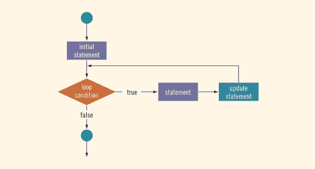

**图5-2** *for 循环*

**for** 循环按如下方式执行：

- 1. 执行初始化语句。
- 2. 计算循环条件。如果循环条件求值为 **true**：
  - 1. 执行 **for** 循环语句。
  - 2. 执行更新语句（括号中的第三个表达式）。
- 3. 重复步骤2，直到循环条件求值为 **false**。

初始化语句通常初始化一个变量（称为 **for 循环控制变量** 或 **for 索引变量**）。

在 C++ 中，**for** 是保留字。

> **注意：** 顾名思义，**for** 循环中的初始化语句是最先执行的语句；它只执行一次。


### 示例 5-9

下面的 `for` 循环输出前 10 个非负整数：

```cpp
for (i = 0; i < 10; i++)
    cout << i << " ";
cout << endl;
```

初始语句 `i = 0` 将 `int` 变量 `i` 初始化为 0。接着计算循环条件 `i < 10`。因为 `0 < 10` 为真，输出语句执行并输出 0。然后执行更新语句 `i++`，将 `i` 的值设为 1。再次计算循环条件，它仍然为真，如此反复。当 `i` 变为 10 时，循环条件求值为假，`for` 循环终止，随后执行 `for` 循环之后的语句。

`for` 循环的循环体可以是简单语句或复合语句。

下面的示例进一步说明 `for` 循环如何执行。

### 示例 5-10

- 1. 下面的 `for` 循环输出 `Hello!` 和一个星号（各占一行）五次：

  ```cpp
  for (i = 1; i <= 5; i++)
  {
      cout << "Hello!" << endl;
      cout << "*" << endl;
  }
  ```

- 2. 考虑下面的 `for` 循环：

  ```cpp
  for (i = 1; i <= 5; i++)
      cout << "Hello!" << endl;
      cout << "*" << endl;
  ```

这个循环输出 `Hello!` 五次，而星号只输出一次。注意，`for` 循环只控制第一个输出语句，因为这两个输出语句没有组成复合语句。因此，第一个输出语句执行五次，因为 `for` 循环体执行五次。`for` 循环执行完毕后，第二个输出语句只执行一次。这种缩进虽然会被编译器忽略，但仍然具有误导性。

### 示例 5-11

下面的 `for` 循环执行五次空语句：

```cpp
for (i = 0; i < 5; i++);      //Line 1
    cout << "*" << endl;       //Line 2
```

`for` 语句末尾的分号（位于输出语句之前，第 1 行）终止了 `for` 循环。这个 `for` 循环的动作是空的，即空操作。

前面的示例表明，要让 `for` 循环执行所需动作，需要格外小心。

以下是对 `for` 循环的一些说明：

- 如果循环条件初始为 `false`，则循环体不会执行。
- 更新表达式执行时会改变循环控制变量（由初始表达式初始化）的值，最终使循环条件的值为 `false`。如果循环条件始终为 `true`，则 `for` 循环体会无限执行。
- C++ 允许对 `double` 类型（或任何实数类型）的循环控制变量使用小数值。由于不同计算机可能会给这些循环控制变量带来不同结果，应避免使用这样的变量。
- `for` 语句末尾（正好在循环体之前）的分号是语义错误。在这种情况下，`for` 循环的动作为空。
- 在 `for` 语句中，如果省略循环条件，则假定其为 `true`。
- 在 `for` 语句中，可以省略全部三个语句——初始语句、循环条件和更新语句。下面是一个合法的 `for` 循环：

```cpp
for (;;)
    cout << "Hello" << endl;
```

这是一个无限 `for` 循环，会不断输出单词 `Hello`。

下面是更多 `for` 循环示例。

### 示例 5-12

如果正确设置 `for` 循环控制表达式，就可以使用 `for` 循环倒计数。

例如，考虑下面的 `for` 循环：

```cpp
for (i = 10; i >= 1; i--)
    cout << " " << i;
cout << endl;
```

输出为：

```text
10 9 8 7 6 5 4 3 2 1
```

在这个 `for` 循环中，变量 `i` 被初始化为 10。每次循环迭代后，`i` 递减 1。只要 `i >= 1`，循环就继续执行。

### 示例 5-13

可以按任意固定数值递增（或递减）循环控制变量。在下面的 `for` 循环中，变量初始化为 1；在 `for` 循环末尾，`i` 递增 2。这个 `for` 循环输出前 10 个正奇数。

```cpp
for (i = 1; i <= 20; i = i + 2)
    cout << i << " ";
cout << endl;
```

### 示例 5-14

假设 `i` 是一个 `int` 变量。

- 1. 考虑下面的 `for` 循环：

  ```cpp
  for (i = 10; i <= 9; i++)
      cout << i << " ";
  cout << endl;
  ```

  在这个 `for` 循环中，初始语句将 `i` 设为 10。由于循环条件（`i <= 9`）初始为 `false`，所以什么也不会发生。

- 2. 考虑下面的 `for` 循环：

  ```cpp
  for (i = 9; i >= 10; i--)
      cout << i << " ";
  cout << endl;
  ```

  在这个 `for` 循环中，初始语句将 `i` 设为 9。由于循环条件（`i >= 10`）初始为 `false`，所以什么也不会发生。

- 3. 考虑下面的 `for` 循环：

  ```cpp
  for (i = 10; i <= 10; i++)       //Line 1
      cout << i << " ";              //Line 2
  cout << endl;                       //Line 3
  ```

  在这个 `for` 循环中，初始语句将 `i` 设为 10。循环条件（`i <= 10`）求值为 `true`，所以第 2 行中的输出语句执行，输出 10。接着，更新语句将 `i` 的值递增 1，因此 `i` 的值变为 11。现在循环条件求值为假，`for` 循环终止。注意，第 2 行中的输出语句只执行一次。

- 4. 考虑下面的 `for` 循环：

  ```cpp
  for (i = 1; i <= 10; i++);   //Line 1
      cout << i << " ";        //Line 2
      cout << endl;            //Line 3
  ```

  这个 `for` 循环对第 2 行中的输出语句没有影响。`for` 语句末尾的分号终止了 `for` 循环；因此 `for` 循环的动作为空。输出语句独立存在，只执行一次。

- 5. 考虑下面的 `for` 循环：

  ```cpp
  for (i = 1; ; i++)
      cout << i << " ";
  cout << endl;
  ```

  在这个 `for` 循环中，由于 `for` 语句省略了循环条件，循环条件始终为真。这是一个无限循环。

### 示例 5-15

在这个示例中，`for` 循环读取五个数并求它们的和与平均值。考虑下面的程序代码，其中 `i`、`newNum`、`sum` 和 `average` 是 `int` 变量。

```cpp
sum = 0;

for (i = 1; i <= 5; i++)
{
    cin >> newNum;
    sum = sum + newNum;
}

average = sum / 5;
cout << "The sum is " << sum << endl;
cout << "The average is " << average << endl;
```

在前面的 `for` 循环中，读取一个 `newNum` 后，将该值加到此前已计算的（部分）和中，该和包含当前数之前读取的所有数。变量 `sum` 在 `for` 循环之前初始化为 0。因此，程序读取第一个数并将其加到 `sum` 的值之后，变量 `sum` 保存的就是第一个数的正确和。

**注意** `for` 循环的语法如下：

```cpp
for (initial expression; logical expression; update expression)
    statement
```

在功能上等价于下面的 `while` 语句：

```cpp
initial expression
while (expression)
{
    statement
    update expression
}
```

例如，下面的 `for` 循环和 `while` 循环是等价的：

```cpp
for (int i = 0; i < 10; i++)
    cout << i << " ";
cout << endl;

int i = 0;
while (i < 10)
{
    cout << i << " ";
    i++;
}
cout << endl;
```

如果循环的迭代次数已知或可以预先确定，程序员通常使用 `for` 循环。

### 示例 5-16（斐波那契数程序：再探）

上一节给出的编程示例：斐波那契数使用 `while` 循环来确定所需的斐波那契数。可以将 `while` 循环替换为等价的 `for` 循环，如下所示：

```cpp
for (counter = 3; counter <= nthFibonacci; counter++)
{
    current = previous2 + previous1;
    previous1 = previous2;
    previous2 = current;
    counter++;
} //end for
```

使用 `for` 循环确定所需斐波那契数的程序的完整程序清单，在本书配套网站上给出。该程序名为 Ch5_FibonacciNumberUsingAForLoop.cpp。

在下面的 C++ 程序中，我们建议你逐步走查每个步骤。


### 示例 5-17

下面的 C++ 程序求前 n 个正整数之和。

```cpp
//Program to determine the sum of the first n positive integers.

#include <iostream>

using namespace std;

int main()
{
    int counter;    //loop control variable
    int sum;        //variable to store the sum of numbers
    int n;          //variable to store the number of
                    //first positive integers to be added

    cout << "Line 1: Enter the number of positive "
         << "integers to be added: ";              //Line 1
    cin >> n;                                      //Line 2
    sum = 0;                                       //Line 3
    cout << endl;                                  //Line 4

    for (counter = 1; counter <= n; counter++)     //Line 5
        sum = sum + counter;                       //Line 6

    cout << "Line 7: The sum of the first " << n
         << " positive integers is " << sum
         << endl;                                  //Line 7

    return 0;
}
```

**示例运行：** 在此示例运行中，用户输入以底纹显示。

第 1 行：输入要相加的正整数个数：`100`

第 7 行：前 100 个正整数之和为 5050

第 1 行中的语句提示用户输入要相加的正整数个数。第 2 行中的语句将用户输入的数字存储到 n 中，第 3 行中的语句将 sum 初始化为 0。第 5 行中的 for 循环执行 n 次。在 for 循环中，counter 初始化为 1，并在循环每次迭代后加 1。因此，counter 的范围从 1 到 n。每次循环时，counter 的值被加到 sum 中。变量 sum 被初始化为 0，counter 的范围从 1 到 n，并且 counter 的当前值被加到 sum 的值中。因此，for 循环执行后，sum 包含前 n 个值之和，在示例运行中即 100 个正整数之和。

回想一下，将一个控制结构语句放在另一个控制结构语句内部称为**嵌套**。下面的编程示例演示了一个简单的嵌套实例。它还很好地演示了计数。

## 编程示例：数字分类

该程序读取给定的一组整数，然后打印奇数和偶数的数量。它还输出零的数量。

该程序读取 20 个整数，但你可以轻松修改它以读取任意一组数字。事实上，你可以修改该程序，使其首先提示用户指定要读取多少个整数。

|  |  |
|---|---|
| **输入** | 20 个整数——正数、负数或零。 |
| **输出** | 零、偶数和奇数的数量。 |

### 问题分析与算法设计

读取一个数字后，你需要检查它是偶数还是奇数。假设该值存储在 number 中。将 number 除以 2 并检查余数。如果余数为 0，则 number 是偶数。递增偶数计数，然后检查 number 是否为 0。如果是，则递增零计数。如果余数不为 0，则递增奇数计数。

程序使用 `switch` 语句判断 number 是奇数还是偶数。假设 number 是奇数。如果 number 是正数，除以 2 的余数为 1；如果 number 是负数，余数为 -1。如果 number 是偶数，则无论 number 是正数还是负数，除以 2 的余数都为 0。你可以使用取模运算符 `%` 求余数。例如：

```text
6 % 2 = 0; -4 % 2 = 0; -7 % 2 = -1; 15 % 2 = 1
```

对列表中的每个数字重复上述分析数字的过程。

上述讨论可转化为以下算法：

- 1. 对列表中的每个数字：
  - a. 获取该数字。
  - b. 分析该数字。
  - c. 递增相应的计数。
- 2. 打印结果。

### 变量

因为你要统计零、偶数和奇数的数量，所以你需要三个 `int` 类型的变量——例如 zeros、evens 和 odds——来跟踪计数。你还需要一个变量——例如 number——来读取并存储要分析的数字，以及另一个变量——例如 counter——来统计已分析的数字个数。因此，你需要在程序中使用以下变量：

```cpp
int counter;    // loop control variable
int number;     // variable to store the number read
int zeros;      // variable to store the zero count
int evens;      // variable to store the even count
int odds;       // variable to store the odd count
```

显然，必须将变量 zeros、evens 和 odds 初始化为零。你可以在声明这些变量时对它们进行初始化。

### 主算法

- 1. 初始化变量。
- 2. 提示用户输入 20 个数字。
- 3. 对列表中的每个数字：
  - a. 读取该数字。
  - b. 输出该数字（回显输入）。
  - c. 如果该数字是偶数：
    - i. 递增偶数计数。
    - ii. 如果该数字是零，则递增零计数。
  - 否则，递增奇数计数。
- 4. 打印结果。

在编写 C++ 程序之前，让我们更详细地描述步骤 1–4。这样你用 C++ 编写指令就会容易得多。

- 1. 初始化变量。你可以在声明变量 zeros、evens 和 odds 时对它们进行初始化。
- 2. 使用输出语句提示用户输入 20 个数字。
- 3. 对于步骤 3，你可以使用 for 循环来处理和分析这 20 个数字。用伪代码表示，该步骤编写如下：

```cpp
for (counter = 1; counter <= 20; counter++)
{
    read the number;
    output number;

    switch (number % 2)    // check the remainder
    {
    case 0:
        increment even count;
        if (number == 0)
            increment zero count;
        break;
    case 1:
    case -1:
        increment odd count;
    }//end switch
}//end for
```

- 4. 打印结果。输出变量 zeros、evens 和 odds 的值。

### 完整程序清单

```cpp
//**********************************************************************
// Author: D. S. Malik
//
// Program: Counts zeros, odds, and evens
// This program counts the number of odd and even numbers.
// The program also counts the number of zeros.
//**********************************************************************

#include <iostream>
#include <iomanip>

using namespace std;

const int N = 20;

int main()
{
    //Declare variables
    int counter;        //loop control variable
    int number;         //variable to store the new number
    int zeros = 0;      //Step 1
    int odds = 0;       //Step 1
    int evens = 0;      //Step 1

    cout << "Please enter " << N << " integers, "
         << "positive, negative, or zeros."
         << endl;                              //Step 2

    cout << "The numbers you entered are:" << endl;

    for (counter = 1; counter <= N; counter++)   //Step 3
    {
        cin >> number;                           //Step 3a
        cout << number << " ";                   //Step 3b

        //Step 3c
        switch (number % 2)
        {
        case 0:
            evens++;
            if (number == 0)
                zeros++;
            break;
        case 1:
        case -1:
            odds++;
        }//end switch
    } //end for loop

    cout << endl;

    //Step 4
    cout << "There are " << evens << " evens, "
         << "which includes " << zeros << " zeros."
         << endl;
    cout << "The number of odd numbers is: " << odds
         << endl;

    return 0;
}
```

**示例运行：** 在此示例运行中，用户输入以底纹显示。

```text
Please enter 20 integers, positive, negative, or zeros.
The numbers you entered are:
0 0 -2 -3 -5 6 7 8 0 3 0 -23 -8 0 2 9 0 12 67 54
0 0 -2 -3 -5 6 7 8 0 3 0 -23 -8 0 2 9 0 12 67 54
There are 13 evens, which includes 6 zeros.
The number of odd numbers is: 7
```

我们建议你使用上述示例输入对此程序进行逐步检查。

## do...while 循环（重复）结构

本节介绍第三种循环或重复结构，称为 *do...while* 循环。*do...while* 语句的一般形式如下：

```text
do
    statement
while (expression);
```

当然，*语句*可以是简单语句或复合语句。如果是复合语句，请将其括在花括号中。图 5–3 显示了 *do...while* 循环的执行流程。


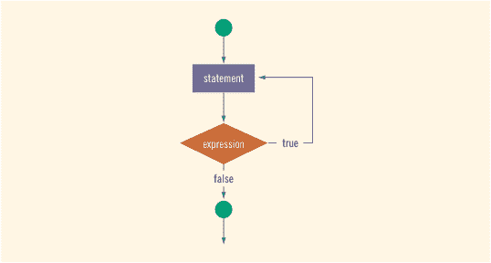

**图 5-3** do...while 循环

在 C++ 中，`do` 是保留字。

先执行语句，然后对表达式求值。如果表达式的值为 true，则再次执行该语句。只要 `do...while` 语句中的表达式为 true，该语句就会执行。为了避免无限循环，你必须再次确保循环体包含最终使表达式为 `false` 的语句，并确保循环能正确退出。

### 示例 5-18

```cpp
i = 0;

do
{
    cout << i << " ";
    i = i + 5;
}
while (i <= 20);
```

这段代码的输出为：

```text
0 5 10 15 20
```

在输出 20 之后，语句：

```cpp
i = i + 5;
```

将 i 的值改为 25，因此 `i <= 20` 变为 `false`，从而使循环停止。

在 `while` 和 `for` 循环中，循环条件在循环体执行之前求值。因此，`while` 和 `for` 循环称为**先测试循环**。另一方面，`do...while` 循环中的循环条件在循环体执行之后求值。因此，`do...while` 循环称为**后测试循环**。

由于 `while` 和 `for` 循环都有入口条件，这些循环可能永远不会启动。另一方面，`do...while` 循环有出口条件，因此至少会执行一次语句。

### 示例 5-19

考虑以下两个循环：

- a.

  ```cpp
  i = 11;
  while (i <= 10)
  {
      cout << i << " ";
      i = i + 5;
  }
  cout << endl;
  ```

- b.

  ```cpp
  i = 11;
  do
  {
      cout << i << " ";
      i = i + 5;
  }
  while (i <= 10);

  cout << endl;
  ```

在 (a) 中，`while` 循环不产生任何输出。在 (b) 中，`do...while` 循环输出数字 11，并将 `i` 的值改为 16。

`do...while` 循环可用于输入验证。假设程序提示用户输入一个测试分数，该分数必须大于或等于 0 且小于或等于 50。如果用户输入的分数小于 0 或大于 50，则应提示用户重新输入分数。以下 `do...while` 循环可用于实现此目标：

```cpp
int score;

do
{
    cout << "Enter a score between 0 and 50: ";
    cin >> score;
    cout << endl;
}
while (score < 0 || score > 50);
```

### 示例 5-20：被 3 和 9 整除的测试

假设 $m$ 和 $n$ 是整数，且 $m$ 非零。如果存在整数 $t$ 使得 $n = mt$，则称 $m$ 是 $n$ 的**因数**；也就是说，当 $m$ 整除 $n$ 时，余数为 0。

设 $n = a_k a_{k-1} a_{k-2} \ldots a_1a_0$ 为一个整数。设 $s = a_k + a_{k-1} + a_{k-2} + \ldots + a_1 + a_0$ 为 $n$ 的各位数字之和。已知，如果其各位数字之和能被 3 和 9 整除，则 $n$ 能被 3 和 9 整除。换言之，一个整数能被 3 和 9 整除，当且仅当其各位数字之和能被 3 和 9 整除。

例如，假设 $n = 27193257$。则 $s = 2 + 7 + 1 + 9 + 3 + 2 + 5 + 7 = 36$。因为 36 能被 3 和 9 同时整除，所以 27193257 能被 3 和 9 同时整除。

接下来，我们编写一个程序，先求一个正整数的各位数字之和，然后检查该和是否能被 3 和 9 整除，从而判断该正整数是否能被 3 和 9 整除。

要求一个正整数的各位数字之和，需要提取该数的每一位数字。考虑数字 951372。注意 $951372 \% 10 = 2$，这是 951372 的最后一位数字。还注意 $951372 / 10 = 95137$；也就是说，当该数除以 10 时，会去掉最后一位数字。接下来，我们对数字 95137 重复此过程。当然，我们需要将提取出的数字相加。

假设 sum 和 num 是 int 变量，且正整数存储在 num 中。因此，我们有以下算法来求各位数字之和：

```cpp
sum = 0;

do
{
    sum = sum + num % 10;   //extract the last digit
                            //and add it to sum
    num = num / 10;         //remove the last digit
}
while (num > 0);
```

使用此算法，我们可以编写以下程序，该程序使用 **do...while** 循环来实现前面的整除性测试算法。

```cpp
//Program: Divisibility test by 3 and 9

#include <iostream>

using namespace std;

int main()
{
    int num, temp, sum;

    cout << "Enter a positive integer: ";
    cin >> num;

    cout << endl;

    temp = num;

    sum = 0;

    do
    {
        sum = sum + num % 10; //extract the last digit
                              //and add it to sum
        num = num / 10;       //remove the last digit
    }
    while (num > 0);

    cout << "The sum of the digits = " << sum << endl;

    if (sum % 3 == 0)
        cout << temp << " is divisible by 3" << endl;
    else
        cout << temp << " is not divisible by 3" << endl;

    if (sum % 9 == 0)
        cout << temp << " is divisible by 9" << endl;
    else
        cout << temp << " is not divisible by 9" << endl;
}
```

**示例运行：** 在这些示例运行中，用户输入以底纹显示。

**示例运行 1：**

输入一个正整数：`27193257`

各位数字之和 = 36
27193257 能被 3 整除
27193257 能被 9 整除

**示例运行 2：**

输入一个正整数：`609321`

各位数字之和 = 21
609321 能被 3 整除
609321 不能被 9 整除

**示例运行 3：**

输入一个正整数：`161905102`

各位数字之和 = 25
161905102 不能被 3 整除
161905102 不能被 9 整除

## 选择合适的循环结构

三种循环在 C++ 中各有其适用之处。如果你知道，或者程序能够预先确定所需的重复次数，那么 `for` 循环是正确选择。如果你不知道，并且程序无法预先确定所需的重复次数，而且重复次数可能为零，那么 `while` 循环是正确选择。如果你不知道，并且程序无法预先确定所需的重复次数，而且重复次数至少为一次，那么 `do...while` 循环是正确选择。

## break 和 continue 语句

`break` 语句在 `switch` 结构中执行时，会立即退出 `switch` 结构。同样，你可以在 `while`、`for` 和 `do...while` 循环中使用 `break` 语句。当 `break` 语句在重复结构中执行时，它会立即退出该结构。`break` 语句通常用于两个目的：

- 提前退出循环。
- 退出 `switch` 结构的剩余部分。

`break` 语句执行后，程序继续执行该结构之后的第一个语句。在循环中使用 `break` 语句可以消除对某些（标志）变量的使用。以下 C++ 代码段有助于说明这一思想。（假设所有变量都已正确声明。）

```cpp
sum = 0;
isNegative = false;

cin >> num;

while (cin && !isNegative)
{
    if (num < 0)    //if num is negative, terminate the loop
    {               //after this iteration
        cout << "Negative number found in the data." << endl;
        isNegative = true;
    }
    else
    {
        sum = sum + num;
        cin >> num;
    }
}
```

这个 `while` 循环本应求一组正数之和。如果数据集中包含负数，则循环会终止并给出适当的错误消息。这个 `while` 循环使用标志变量 `isNegative` 来实现所需结果。变量 `isNegative` 在 `while` 循环之前初始化为 `false`。在将 num 加入之前


```cpp
while (cin)
{
    if (num < 0)
    {
        cout << "Negative number found in the data." << endl;
        cin >> num;
        continue;
    }

    sum = sum + num;
    cin >> num;
}
```

前面已经说过，三种循环在 C++ 中各有其适用之处，而且一种循环通常可以替代另一种循环。然而，`continue` 语句的执行正是 `while` 和 `do...while` 结构与 `for` 结构的不同之处。当 `continue` 语句在 `while` 或 `do...while` 循环中执行时，更新语句可能不会执行。在 `for` 结构中，更新语句始终会执行。

## 嵌套控制结构

本节给出示例，说明如何使用嵌套循环来实现有用的结果并处理数据。

### 示例 5-21

假设你想创建以下图案：

```text
*
**
***
****
*****
```

显然，你想打印五行星号。第一行打印一个星号，第二行打印两个星号，依此类推。由于将打印五行，因此从以下 `for` 语句开始：

```cpp
for (i = 1; i <= 5; i++)
```

`i` 的值在第一次迭代中为 1，在第二次迭代中为 2，依此类推。你可以将 `i` 的值用作嵌套在此循环内的另一个 `for` 循环中的限制条件，以控制一行中的星号数量。稍加思考便可得到以下代码：

```cpp
for (i = 1; i <= 5; i++)        //Line 1
{                               //Line 2
    for (j = 1; j <= i; j++)    //Line 3
        cout << "*";            //Line 4
    cout << endl;                //Line 5
}                               //Line 6
```


走查这段代码可以看出，第 1 行的 `for` 循环从 `i = 1` 开始。当 `i` 为 1 时，第 3 行的内层 `for` 循环输出一颗星，插入点移到下一行。然后 `i` 变为 2，内层 `for` 循环输出两颗星，第 5 行的输出语句将插入点移到下一行，依此类推。这个过程持续到 `i` 变为 6，循环停止。

如果将第 1 行的 `for` 语句替换为以下内容，这段代码会产生什么图案？

```cpp
for (i = 5; i >= 1; i--)
```

### 示例 5-22

假设你想创建下面的乘法表：

|   |   |   |   |   |   |   |   |   |   |
|---:|---:|---:|---:|---:|---:|---:|---:|---:|---:|
| 1 | 2 | 3 | 4 | 5 | 6 | 7 | 8 | 9 | 10 |
| 2 | 4 | 6 | 8 | 10 | 12 | 14 | 16 | 18 | 20 |
| 3 | 6 | 9 | 12 | 15 | 18 | 21 | 24 | 27 | 30 |
| 4 | 8 | 12 | 16 | 20 | 24 | 28 | 32 | 36 | 40 |
| 5 | 10 | 15 | 20 | 25 | 30 | 35 | 40 | 45 | 50 |

这个乘法表有五行。因此，如同示例 5-21 中那样，我们使用 `for` 语句按如下方式输出这些行：

```cpp
for (i = 1; i <= 5; i++)
    //output a line of numbers
```

第一行中，我们想打印 1 的乘法表；第二行中，我们想打印 2 的乘法表，依此类推。注意，第一行从 1 开始，并且当打印这一行时，`i` 为 1。类似地，第二行从 2 开始，并且当打印这一行时，`i` 的值为 2，依此类推。如果 `i` 为 1，则 `i * 1` 为 1；如果 `i` 为 2，则 `i * 2` 为 2；依此类推。因此，要打印一行数字，我们可以将 `i` 的值作为起始数字，并将 10 作为限制值。也就是说，考虑下面的 `for` 循环：

```cpp
for (j = 1; j <= 10; j++)
    cout << setw(3) << i * j;
```

让我们看看这个 `for` 循环。假设 `i` 为 1，那么我们正在打印乘法表的第一行。同时，`j` 从 1 到 10，因此这个 `for` 循环输出数字 1 到 10，也就是乘法表的第一行。类似地，如果 `i` 为 2，我们正在打印乘法表的第二行。同时，`j` 从 1 到 10，因此这个 `for` 循环输出乘法表的第二行，依此类推。

稍加思考，就可以得到下面的嵌套循环，用来输出所需的网格：

```cpp
for (i = 1; i <= 5; i++)                 //Line 1
{
    for (j = 1; j <= 10; j++)             //Line 3
        cout << setw(3) << i * j;         //Line 4
    cout << endl;                         //Line 5
}                                         //Line 6
```

### 示例 5-23

考虑以下数据：

```
65 78 65 89 25 98 -999
87 34 89 99 26 76 64 34 -999
23 99 98 97 26 78 100 63 87 23 -999
62 35 78 99 12 93 19 -999
```

每行末尾的数字 -999 充当哨兵，因此不属于数据。我们的目标是求每一行中数字的和，并输出该和。此外，假设这些数据要从一个文件中读取，例如 **Exp_5_23.txt**。我们假设输入文件已经使用输入文件流变量 **infile** 打开。

这个特定数据集有四行输入。因此，我们可以使用 **for** 循环或计数器控制的 **while** 循环来处理每一行数据。让我们使用 **while** 循环来处理这四行。于是，这个 **while** 循环采用以下形式：

```cpp
counter = 0;                 //Line 1
while (counter < 4)          //Line 2
{
        //process the line       //Line 3

        //output the sum         //Line 4
        counter++;
}
```

现在让我们集中处理一行。每一行包含的数据项数量各不相同。例如，第一行有六个数字，第二行有八个数字，依此类推。因为每一行都以 -999 结尾，所以我们可以使用哨兵控制的 **while** 循环来求每一行中数字的和。（记住哨兵控制的循环是如何工作的。）考虑下面的 **while** 循环：

```cpp
sum = 0;                    //Line 4
infile >> num;              //Line 5
while (num != -999)         //Line 6
{
        sum = sum + num;     //Line 8
        infile >> num;       //Line 9
}                            //Line 10
```

第 4 行的语句将 sum 初始化为 0，第 5 行的语句读取该行的第一个数字并存入 num。第 6 行的布尔表达式 num != -999 检查该数字是否为 -999。如果 num 不是 -999，则执行第 8 行和第 9 行的语句。第 8 行的语句更新 sum 的值；第 9 行的语句读取下一个数字并存入 num。只要 num 不是 -999，循环就继续执行。

由此可知，处理这些数据的嵌套循环如下。（假设所有变量都已正确声明。）

```cpp
counter = 0;                                      //Line 1
while (counter < 4)                                //Line 2
{
    sum = 0;                                       //Line 4
    infile >> num;                                 //Line 5
    while (num != -999)                            //Line 6
    {
        sum = sum + num;                           //Line 8
        infile >> num;                             //Line 9
    }                                              //Line 10

    cout << "Line " << counter + 1
         << ": Sum = " << sum << endl;            //Line 11
    counter++;                                     //Line 12
}                                                  //Line 13
```

### 示例 5-24

假设我们想处理与示例 5-23 中的数据类似的数据，但输入文件的长度未指定。也就是说，每一行包含的数据与示例 5-23 中每一行的数据相同，但我们不知道输入行数。

因为我们不知道输入行数，所以必须使用 EOF 控制的 `while` 循环来处理数据。在这种情况下，所需的代码如下。（假设所有变量都已正确声明，并且输入文件已经使用输入文件流变量 `infile` 打开。）

```cpp
counter = 0;                                      //Line 1
infile >> num;                                     //Line 2
while (infile)                                      //Line 3
{
    sum = 0;                                       //Line 5
    while (num != -999)                            //Line 6
    {
        sum = sum + num;                           //Line 8
        infile >> num;                             //Line 9
    }                                              //Line 10

    cout << "Line " << counter + 1
         << ": Sum = " << sum << endl;            //Line 11
    counter++;                                     //Line 12
    infile >> num;                                 //Line 13
}                                                  //Line 14
```

注意，我们再次使用了变量 counter。这样做的唯一原因是我们想打印行号以及每一行的和。

### 示例 5-25

考虑以下数据：

```
101
John Smith
65 78 65 89 25 98 -999
102
Peter Gupta
87 34 89 99 26 76 64 34 -999
103
Buddy Friend
23 99 98 97 26 78 100 63 87 23 -999
104
Doctor Miller
62 35 78 99 12 93 19 -999
...
```

一行末尾的数字 -999 充当哨兵，因此不属于数据。

假设这是某些竞选学生会主席的候选人的数据。

对于每位候选人，数据采用以下形式：

```
ID
Name
Votes
```

目标是求出该候选人获得的总票数。我们假设数据从大小未知的文件 `Exp_5_25.txt` 输入。我们还假设输入文件已经使用输入文件流变量 `infile` 打开。

因为输入文件的长度未指定，所以我们使用 EOF 控制的 `while` 循环。对于每位候选人，第一个数据项是单独占一行的 `int` 类型 ID；第二个数据项是姓名，可能由多个单词组成；第三行包含从各个部门获得的票数。

为了读取 ID，我们使用提取运算符 `>>`；为了读取姓名，我们使用流函数 `getline`。注意，读取 ID 后，读取标记位于 ID 之后，而 ID 之后的字符是换行符。因此，读取 ID 后，读取标记位于 ID 之后、换行符之前（即包含 ID 的那一行的换行符之前）。

函数 `getline` 会一直读取到行尾。因此，如果我们在读取 ID 后立即读取姓名，那么变量 `name` 中存储的将是（ID 之后的）换行符。由此可知，要读取姓名，我们必须读取并丢弃 ID 之后的换行符，这可以使用流函数 `get` 来完成。因此，读取 ID 和姓名的语句如下：

```cpp
infile >> ID;             //read the ID
infile.get(ch);          //read the newline character after the ID
                       //read the name
getline(infile, name);
```

假设 `ch` 是 `char` 类型的变量。处理数据的一般循环如下：

```cpp
infile >> ID;                         //Line 1
while (infile)                         //Line 2
{
    infile.get(ch);                     //Line 4
    getline(infile, name);              //Line 5

    //process the names in each line   //Line 6
    //output the name and total votes
    infile >> ID;        //begin processing the next line
}
```

读取并汇总投票数据的代码如下：

```cpp
sum = 0;                              //Line 6
infile >> num;                        //Line 7; read the first number
while (num != -999)                   //Line 8
{
    sum = sum + num;                   //Line 10; update sum
    infile >> num;                     //Line 11; read the next number
}
```

现在可以编写以下嵌套循环来处理数据，如下所示：

```cpp
infile >> ID;                         //Line 1
while (infile)                         //Line 2
{
    infile.get(ch);                     //Line 4
    getline(infile, name);              //Line 5
    sum = 0;                            //Line 6
    infile >> num;                      //Line 7, read the first number
    while (num != -999)                 //Line 8
    {
        sum = sum + num;                //Line 10; update sum
        infile >> num;                  //Line 11; read the next number
    }

    cout << "Name: " << name
         << ", Votes: " << sum
         << endl;                        //Line 12

    infile >> ID;        //Line 13; begin processing the next line
}
```

## 通过避免补丁来避免错误

前几章中的调试小节说明了如何调试语法错误和逻辑错误，以及如何避免一知半解的概念。在本节中，我们说明如何避免使用软件补丁来修复代码。软件补丁是写在现有代码之上、旨在修复原始代码中错误的一段代码。

假设以下数据位于文件 `Ch5_LoopWithBugsData.txt` 中。

```
87 78 83 94
23 89 92 70
92 78 34 56
```

目标是求每一行中数字的和。对于每一行，输出这些数字及其和。考虑以下程序：

```cpp
#include <iostream>
#include <fstream>

using namespace std;

int main()
{
    ifstream infile;

    int i;
    int j;
    int sum;
    int num;

    infile.open("Ch5_LoopWithBugsData.txt");

    for (i = 1; i <= 4; i++)
    {
        sum = 0;

        for (j = 1; j <= 4; j++)
        {
            infile >> num;
            cout << num << " ";
            sum = sum + num;
        }

        cout << "sum = " << sum << endl;
    }

    return 0;
}
```

### 示例运行：

```
87 78 83 94 sum = 342
23 89 92 70 sum = 274
92 78 34 56 sum = 260
56 56 56 56 sum = 224
```

示例运行表明程序中有一个错误，因为文件包含三行输入，而输出包含四行。此外，最后一行的数字 56 重复了四次。显然，程序中存在错误，我们必须修复代码。一些程序员，尤其是一些初学者，通过添加软件补丁来处理问题的表象。在这种情况下，输出应当只包含三行结果。

初学者可能会通过添加软件补丁来修复代码，如下面的修改后程序所示。

```cpp
#include <iostream>
#include <fstream>

using namespace std;

int main()
{
    ifstream infile;

    int i;
    int j;
    int sum;
    int num;

    infile.open("Ch5_LoopWithBugsData.txt");

    for (i = 1; i <= 4; i++)
    {
        sum = 0;

        if (i != 4)
        {
            for (j = 1; j <= 4; j++)
            {
                infile >> num;
                cout << num << " ";
                sum = sum + num;
            }

            cout << "sum = " << sum << endl;
        }
    }

    return 0;
}
```

### 示例运行：

```
87 78 83 94 sum = 342
23 89 92 70 sum = 274
92 78 34 56 sum = 260
```

显然，程序现在运行正确。

正如我们所见，程序员仅仅观察了表象，并通过添加软件补丁来处理问题。然而，如果查看代码，程序不仅执行了多余的语句，而且它还是一个一知半解概念的示例。看起来程序员没有很好地理解为什么先前的程序产生四行而不是三行。添加补丁消除了表象，但这是一种糟糕的编程实践。程序员必须弄清楚为什么程序产生四行。查看变量时，可以在每次迭代之前和/或之后打印变量的值，或者使用 IDE 的调试器（如果有的话），并在每次迭代期间观察变量的值。

本书中的调试小节旨在帮助你理解调试过程。然而，你会意识到，调试可能是一个令人疲惫的过程。如果你的程序非常糟糕，不要调试它。把它扔掉，重新开始。

## 快速回顾

1. C++ 有三种循环（重复）结构：`while`、`for` 和 `do...while`。
2. `while` 语句的语法是：

    ```cpp
    while (expression)
        statement
    ```

3. 在 C++ 中，`while` 是保留字。
4. 在 `while` 语句中，表达式（决策者）周围的一对圆括号很重要；它们标记表达式的开始和结束。
5. 该语句称为循环体。
6. `while` 循环的循环体必须包含一个最终会设置 `while` 循环表达式的语句。
7. 计数器控制的 `while` 循环使用计数器来控制循环。
8. 在计数器控制的 `while` 循环中，必须在循环之前初始化计数器，并且循环体必须包含一条改变计数器变量值的语句。
9. 哨兵是一个特殊值，用于标记输入数据的结束。哨兵必须与所有数据项相似，但又有所不同。
10. 哨兵控制的 `while` 循环使用哨兵来控制 `while` 循环。`while` 循环会继续执行，直到读取到哨兵。
11. EOF 控制的 `while` 循环会继续执行，直到程序检测到文件结束标记。
12. 在 Windows 控制台环境中，使用 `Ctrl+Z` 输入文件结束标记（按住 Ctrl 键并按 Z）。在 UNIX 环境中，使用 `Ctrl+D` 输入文件结束标记（按住 Ctrl 键并按 D）。
13. `for` 循环简化了计数器控制的 `while` 循环的编写。
14. 在 C++ 中，`for` 是保留字。
15. `for` 循环的语法是：

    ```cpp
    for (initialize statement; loop condition; update statement)
        statement
    ```

    `statement` 称为 `for` 循环的循环体。
16. 在 `for` 循环末尾（`for` 循环体之前）放置分号是语义错误。在这种情况下，`for` 循环的动作是空的。
17. `do...while` 语句的语法是：

    ```cpp
    do
        statement
    while (expression);
    ```

    `statement` 称为 `do...while` 循环的循环体。
18. `while` 和 `for` 循环都称为前测试循环。`do...while` 循环称为后测试循环。
19. `while` 和 `for` 循环可能根本不执行，但 `do...while` 循环总是至少执行一次。
20. 在循环体中执行 `break` 语句会立即终止循环。
21. 在循环体中执行 `continue` 语句会跳过循环的剩余语句，并继续下一次迭代。
22. 当 `continue` 语句在 `while` 或 `do...while` 循环中执行时，循环体中的表达式更新语句可能不会执行。
23. 在 `for` 循环中执行 `continue` 语句后，下一条执行的语句是更新语句。

## 练习

1. 判断以下陈述为真或假。
    a. 在计数器控制的 `while` 循环中，不必初始化循环控制变量。
    b. `while` 循环的循环体可能根本不执行。
    c. 在无限 `while` 循环中，`while` 表达式（决策者）最初为假，但在第一次迭代之后它总是为真。
    d. 以下 `while` 循环：

        ```cpp
        j = 0;
        while (j <= 10)
            j++;
        ```

        如果 j > 10，则终止。
    e. 哨兵控制的 `while` 循环是一种事件控制的 `while` 循环，其终止取决于一个特殊值。
    f. 循环是一种控制结构，它使某些语句反复执行。
    g. 要从长度未指定的文件中读取数据，EOF 控制的循环是一个好的选择。


- h. 当 `while` 循环终止时，控制首先回到 `while` 语句之前的那条语句，然后控制转到紧跟在 `while` 循环之后的语句。

2. 以下 C++ 代码的输出是什么？

```cpp
int count = 1;
int y = 100;
while (count < 100)
{
    y = y - 1;
    count++;
}
cout << "y = " << y << " and count = " << count << endl;
```

3. 以下 C++ 代码的输出是什么？

```cpp
int num = 5;
while (num > 5)
    num = num + 2;
cout << num << endl;
```

4. 以下 C++ 代码的输出是什么？

```cpp
int num = 1;
while (num < 10)
{
    cout << num << " ";
    num = num + 2;
}
cout << endl;
```

5. 以下 `while` 循环何时终止？

```cpp
ch = 'D';
while ('A' <= ch && ch <= 'Z')
    ch = static_cast<char>(static_cast<int>(ch) + 1);
```

6. 假设输入为 38 35 71 14 -1。以下代码的输出是什么？假设所有变量均已正确声明。

```cpp
cin >> sum;
cin >> num;

for (j = 1; j <= 3; j++)
{
    cin >> num;
    sum = sum + num;
}
cout << "Sum = " << sum << endl;
```

7. 假设输入为 38 35 71 14 -1。以下代码的输出是什么？假设所有变量均已正确声明。

```cpp
cin >> sum;
cin >> num;

while (num != -1)
{
    sum = sum + num;
    cin >> num;
}
cout << "Sum = " << sum << endl;
```

8. 假设输入为 38 35 71 14 -1。以下代码的输出是什么？假设所有变量均已正确声明。

```cpp
cin >> num;
sum = num;

while (num != -1)
{
    cin >> num;
    sum = sum + num;
}
cout << "Sum = " << sum << endl;
```

9. 假设输入为 38 35 71 14 -1。以下代码的输出是什么？假设所有变量均已正确声明。

```cpp
sum = 0;
cin >> num;

while (num != -1)
{
    sum = sum + num;
    cin >> num;
}
cout << "Sum = " << sum << endl;
```

10. 改正以下代码，使其能求 20 个数的和。

```cpp
sum = 0;

while (count < 20)
    cin >> num;
    sum = sum + num;
    count++;
```

11. 以下程序的输出是什么？

```cpp
#include <iostream>

using namespace std;

int main()
{
    int x, y, z;

    x = 4;    y = 5;
    z = y + 6;

    while(((z - x) % 4) != 0)
    {
        cout << z << " ";
        z = z + 7;
    }

    cout << endl;

    return 0;
}
```

12. 假设输入为：

58 23 46 75 98 150 12 176 145 -999

以下程序的输出是什么？

```cpp
#include <iostream>

using namespace std;

int main()
{
    int num;

    cin >> num;

    while (num != -999)
    {
        cout << num % 25 << " ";
        cin >> num;
    }

    cout << endl;

    return 0;
}
```

13. 以下程序旨在输入两个数字并输出它们的和。它询问用户是否想要运行该程序。如果答案是 Y 或 y，它会提示用户输入两个数字。在相加并显示结果后，它再次询问用户是否想要继续加更多数字。然而，该程序未能做到这一点。请改正该程序，使其正常工作。

```cpp
#include <iostream>
#include <iomanip>

using namespace std;

int main()
{
    char response;
    double num1;
    double num2;

    cout << "This program adds two numbers." << endl;
    cout << "Would you like to run the program: (Y/y) ";
    cin >> response;
    cout << endl;

    cout << fixed << showpoint << setprecision(2);

    while (response == 'Y' && response == 'y')
    {
        cout << "Enter two numbers: ";
        cin >> num1 >> num2;
        cout << endl;

        cout << num1 << " + " << num2 << " = " << (num1 - num2)
             << endl;

        cout << "Would you like to add again: (Y/y) ";
        cin >> response;
        cout << endl;
    }

    return 0;
}
```

14. 以下程序段的输出是什么？

```cpp
int count = 0;

while (count++ < 10)
    cout << "This loop can repeat statements." << endl;
```

15. 以下程序段的输出是什么？

```cpp
int count = 5;

while (--count > 0)
    cout << count << " ";
cout << endl;
```

16. 以下程序段的输出是什么？

```cpp
int count = 5;

while (count-- > 0)
    cout << count << " ";
cout << endl;
```

17. 以下程序段的输出是什么？

```cpp
int count = 1;
while (count++ <= 5)
    cout << count * (count - 2) << " ";

cout << endl;
```

18. 在下列每种情况下，你会使用哪种类型的循环（例如计数控制循环和哨兵控制循环）？

- a. 求以下数列的和：1 + (2 / 1) + (3 / 2) + (4 / 3) + (5 / 4) + . . . + (10 / 9)
- b. 求以下数字的和（最后一个数字除外）：17, 32, 62, 48, 58, -1
- c. 一个文件中包含某位员工的薪水。更新该员工的薪水。

19. 考虑以下 `for` 循环：

```cpp
int j, s;

s = 0;
for (j = 1; j <= 10; j++)
    s = s + j * (j - 1);
```

在这个 `for` 循环中，请指出循环控制变量、初始化语句、循环条件、更新语句以及更新 s 值的语句。

20. 假设以下代码被正确插入到一个程序中，请说明其完整输出的内容和格式。（假设所有变量均已正确声明。）

```cpp
num = 0;
for (i = 1; i <= 4; i++)
{
    num = num + 10 * (i - 1);
    cout << num << " ";
}
cout << endl;
```

21. 假设以下代码被正确插入到一个程序中，请说明其完整输出的内容和格式。（假设所有变量均已正确声明。）

```cpp
j = 2;
for (i = 0; i <= 5; i++)
{
    cout << j << " ";
    j = 2 * j + 3;
}
cout << j << " " << endl;
```

22. 假设以下代码被正确插入到一个程序中：

```cpp
int s = 0;

for (i = 0; i < 5; i++)
{
    s = 2 * s + i;
    cout << s << " ";
}
cout << endl;
```

- a. s 的最终值是什么？
  - (i) 11
  - (ii) 4
  - (iii) 26
  - (iv) 以上都不是
- b. 如果在 `for` 循环语句的右括号后插入一个分号，s 的最终值是什么？
  - (i) 0
  - (ii) 1
  - (iii) 2
  - (iv) 5
  - (v) 以上都不是
- c. 如果将 `for` 循环控制表达式中的 5 替换为 0，s 的最终值是什么？
  - (i) 0
  - (ii) 1
  - (iii) 2
  - (iv) 以上都不是

23. 指出下列每条语句会产生什么输出（如果有的话）：

- a.
  ```cpp
  for (i = 1; i <= 1; i++)
      cout << "*";
  cout << endl;
  ```

- b.
  ```cpp
  for (i = 2; i >= 1; i++)
      cout << "*";
  cout << endl;
  ```

- c.
  ```cpp
  for (i = 1; i <= 1; i--)
      cout << "*";
  cout << endl;
  ```

- d.
  ```cpp
  for (i = 12; i >= 9; i--)
      cout << "*";
  cout << endl;
  ```

- e.
  ```cpp
  for (i = 0; i <= 5; i++)
      cout << "*";
  cout << endl;
  ```

- f.
  ```cpp
  for (i = 1; i <= 5; i++)
  {
      cout << "*";
      i = i + 1;
  }
  cout << endl;
  ```

24. 编写一个 for 语句，求 1 到 100 之间所有 3 的倍数之和。

25. 以下代码的输出是什么？变量 x 和 y 之间是否存在关系？如果存在，请说明这种关系。输出是什么？

```cpp
int x = 19683;
int i;
int y = 0;

for (i = x; i >= 1; i = i / 3)
    y++;
cout << "x = " << x << ", y = " << y << endl;
```

26. 假设输入为 5 3 8。以下代码的输出是什么？假设所有变量均已正确声明。

```cpp
cin >> a >> b >> c;
for (j = 1; j < a; j++)
{
    d = b + c;
    b = c;
    c = d;
    cout << c << " ";
}
cout << endl;
```

27. 以下 C++ 程序段的输出是什么？假设所有变量均已正确声明。


31. 前测试循环和后测试循环有什么区别？

32. 下列每个循环会执行多少次？每种情况的输出是什么？

- a.
  ```cpp
  x = 5;  y = 50;
  do
      x = x + 10;
  while (x < y);
  cout << x << " " << y << endl;
  ```

- b.
  ```cpp
  x = 5;  y = 80;
  do
      x = x * 2;
  while (x < y);
  cout << x << " " << y << endl;
  ```

- c.
  ```cpp
  x = 5;  y = 20;
  do
      x = x + 2;
  while (x >= y);
  cout << x << " " << y << endl;
  ```

- d.
  ```cpp
  x = 5;  y = 35;
  while (x < y)
      x = x + 10;
  cout << x << " " << y << endl;
  ```

- e.
  ```cpp
  x = 5;  y = 30;
  while (x <= y)
      x = x * 2;
  cout << x << " " << y << endl;
  ```

- f.
  ```cpp
  x = 5;  y = 30;
  while (x > y)
      x = x + 2;
  cout << x << " " << y << endl;
  ```

33. 编写一个输入验证循环，提示用户输入一个小于 20 或大于 75 的数字。

34. 将以下代码重写为 for 循环。

```cpp
int i = 0, value = 0;

while (i <= 20)
{
    if (i % 2 == 0 && i <= 10)
        value = value + i * i;
    else if (i % 2 == 0 && i > 10)
        value = value + i;
    else
        value = value - i;
    i = i + 1;
}

cout << "value = " << value << endl;
```

这个循环的输出是什么？


- 35. 将练习34中的 `while` 循环改写为 `do...while` 循环。

- 36. 下面程序中的 `do...while` 循环本应读取一些数字，直到遇到一个哨兵值（在本例中为 -1）。它本应将除哨兵值以外的所有数字相加。如果数据如下：

```
12    5    30    40    -1
```

该程序没有正确地相加这些数字。改正该程序，使其能正确地相加这些数字。

```cpp
#include <iostream>

using namespace std;
int main()
{
    int total = 0,
        count = 0,
        number;

    do
    {
        cin >> number;
        total = total + number;
        count++;
    }
    while (number != -1);

    cout << "The number of data read is " << count << endl;
    cout << "The sum of the numbers entered is " << total
         << endl;

    return 0;
}
```

- 37. 使用与练习36相同的数据，下面的循环也会失败。改正它。

```cpp
cin >> number;
while (number != -1)
    total = total + number;
    cin >> number;
    cout << endl;
    cout << total << endl;
```

- 38. 使用与练习36相同的数据，下面的循环也会失败。改正它。

```cpp
cin >> number;
while (number != -1)
{
    cin >> number;
    total = total + number;
}
cout << endl;
cout << total << endl;
```

- 39. 给定以下程序段：

```cpp
for (number = 1; number <= 10; number++)
    cout << setw(3) << number;
```

编写一个 `while` 循环和一个 `do...while` 循环，使其输出相同。

- 40. 给定以下程序段：

```cpp
j = 2;
for (i = 1; i <= 5; i++);
{
    cout << setw(4) << j;
    j = j + 5;
}
cout << endl;
```

编写一个 `while` 循环和一个 `do...while` 循环，使其输出相同。

- 41. 下列程序的输出是什么？

```cpp
#include <iostream>

using namespace std;

int main()
{
    int x, y, z;
    x = 4;  y = 5;
    z = y + 6;
    do
    {
        cout << z << " ";
        z = z + 7;
    }
    while (((z - x) % 4) != 0);
    cout << endl;

    return 0;
}
```

- 42. 为了了解嵌套 `for` 循环如何工作，请逐步分析以下带有嵌套循环的程序，并在每种情况下列出确切的输出。

  - a.

```cpp
int i, j;

for (i = 1; i <= 5; i++)
{
    for (j = 1; j <= 5; j++)
        cout << setw(3) << i;
    cout << endl;
}
```

  - b.

```cpp
int i, j;
for (i = 1; i <= 5; i++)
{
    for (j = (i + 1); j <= 5; j++)
        cout << setw(5) << j;
    cout << endl;
}
```


  - c.

```cpp
int i, j;
for (i = 1; i <= 5; i++)
{
    for (j = 1; j <= i; j++)
        cout << setw(3) << j;
    cout << endl;
}
```

  - d.

```cpp
const int M = 10;
const int N = 10;
int i, j;

for (i = 1; i <= M; i++)
{
    for (j = 1; j <= N; j++)
        cout << setw(3) << M * (i - 1) + j;
    cout << endl;
}
```

  - e.

```cpp
int i, j;

for (i = 1; i <= 9; i++)
{
    for (j = 1; j <= (9 - i); j++)
        cout << " ";
    for (j = 1; j <= i; j++)
        cout << setw(1) << j;
    for (j = (i - 1); j >= 1; j--)
        cout << setw(1) << j;
    cout << endl;
}
```

- 43. 下列程序段的输出是什么？

```cpp
int count = 1;
do
{
    cout << count * (count - 2) << " ";
} while (count++ <= 5);

cout << endl;
```

- 44. 下列代码的输出是什么？

```cpp
int num = 12;

while (num >= 0)
{
    if (num % 5 == 0)
        break;

    cout << num << " ";
    num = num - 2;
}

cout << endl;
```

- 45. 下列代码的输出是什么？

```cpp
int num = 12;

while (num >= 0)
{
    if (num % 5 == 0)
    {
        num++;
        continue;
    }

    cout << num << " ";
    num = num - 2;
}
cout << endl;
```

- 46. 循环中的 `break` 语句有什么作用？

## 编程练习

- 1. 编写一个程序，提示用户输入一个整数，然后输出该数的各个数字以及这些数字的和。例如，对于 3456，应输出其各个数字 3 4 5 6；对于 8030，应输出其各个数字 8 0 3 0；对于 2345526，应输出其各个数字 2 3 4 5 5 2 6；对于 4000，应输出其各个数字 4 0 0 0；对于 −2345，应输出其各个数字 2 3 4 5。

- 2. π 的值可以用以下级数近似：

π = 4\left(1 - \frac{1}{3} + \frac{1}{5} - \frac{1}{7} + \cdots + \frac{1}{2n-1} + \frac{1}{2n+1}\right).

下面的程序使用这个级数来求 π 的近似值。然而，语句的顺序不正确，而且程序中还有一个错误。重新排列语句，并找出并删除该错误，使该程序可用于近似计算 π。

```cpp
#include <iostream>
#include <iomanip>

using namespace std;

int main()
{
    double pi = 0;
    long i;
    long n;

    cin >> n;
    cout << "Enter the value of n: ";
    cout << endl;

    if (i % 2 == 0)
        pi = pi + (1 / (2 * i + 1));
    else
        pi = pi - (1 / (2 * i + 1));

    for (i = 0; i < n; i++)
    {
        pi = 0;
        pi = 4 * pi;
    }

    cout << endl << "pi = " << pi << endl;

    return 0;
}
```

- 3. 重写例5-5“电话数字”的程序。替换第10行到第28行的语句，使程序仅使用 `switch` 结构来查找与大写字母对应的数字。

- 4. “电话数字”程序只输出与大写字母对应的电话数字。重写该程序，使其同时处理大写和小写字母，并输出相应的电话数字。如果输入的不是大写或小写字母，程序必须输出适当的错误消息。

- 5. 为了使电话号码更容易记住，一些公司用字母来表示其电话号码。例如，使用字母时，电话号码 438–5626 可以表示为 GET LOAN。在某些情况下，为了使电话号码有意义，公司可能会使用超过七个字母。例如，225–5466 可以显示为 CALL HOME，其中使用了八个字母。编写一个程序，提示用户输入用字母表示的电话号码，并输出相应的数字电话号码。如果用户输入的字母超过七个，则只处理前七个字母。还要在第三个数字后输出 –（连字符）。允许用户使用大写和小写字母以及单词之间的空格。此外，程序应处理用户想要处理的任意多个电话号码。

- 6. 编写一个程序，读取一组整数，然后求并打印偶数和奇数的和。

- 7. 编写一个程序，提示用户输入一个正整数。然后输出一条消息，指出该数是否为质数。（注意：偶数如果是 2 则为质数。奇数如果不能被任何小于或等于该数平方根的奇数整除，则为质数。）

- 8. 设 \(n = a_k a_{k-1} a_{k-2} \ldots a_1 a_0\) 为一个整数，且 \(t = a_0 - a_1 + a_2 - \cdots + (-1)^k a_k\)。已知 \(n\) 能被 11 整除当且仅当 \(t\) 能被 11 整除。例如，假设 \(n = 87874204\)。那么，\(t = 4 - 0 + 2 - 4 + 8 - 7 + 8 = 11\)。因为 11 能被 11 整除，所以 87874204 能被 11 整除。如果 \(n = 54063297\)，则 \(t = 7 - 9 + 2 - 3 + 6 - 0 + 4 - 5 = 2\)。因为 2 不能被 11 整除，所以 54063297 不能被 11 整除。编写一个程序，提示用户输入一个正整数，然后使用这个判定标准判断该数是否能被 11 整除。

- 9. 编写一个程序，使用 `while` 循环执行以下步骤：

  - a. 提示用户输入两个整数：`firstNum` 和 `secondNum`（`firstNum` 必须小于 `secondNum`）。
  - b. 输出 `firstNum` 和 `secondNum` 之间的所有奇数。
  - c. 输出 `firstNum` 和 `secondNum` 之间所有偶数的和。
  - d. 输出 1 到 10 之间的数及其平方。
  - e. 输出 `firstNum` 和 `secondNum` 之间奇数的平方和。
  - f. 输出所有大写字母。

- 10. 使用 `for` 循环重做练习9。

- 11. 使用 `do...while` 循环重做练习9。

- 12. 编程示例“斐波那契数”中的程序没有检查用户输入的第一个数是否小于或等于第二个数，以及这两个数是否都非负。此外，该程序也没有检查用户是否为斐波那契数列中所需数字的位置输入了有效值。重写该程序，使其检查这些事项。

- 13. 城镇 A 的人口少于城镇 B 的人口。然而，城镇 A 的人口增长快于城镇 B 的人口。编写一个程序，提示用户输入每个城镇的人口和增长率。程序输出经过多少年后城镇 A 的人口将大于或等于城镇 B 的人口，以及届时两个城镇的人口。（示例输入为：城镇 A 的人口 = 5000，城镇 A 的增长率 = 4%，城镇 B 的人口 = 8000，城镇 B 的增长率 = 2%。）

- 14. 假设一个数列的第一个数为 `x`，其中 `x` 是整数。定义 `a_0 = x`；如果 `a_n` 是偶数，则 `a_{n+1} = a_n/2`；如果 `a_n` 是奇数，则 `a_{n+1} = 3 × a_n + 1`。那么，存在一个整数 `k`，使得 `a_k = 1`。编写一个程序，提示用户输入 `x` 的值。程序输出使 `a_k = 1` 的整数 `k` 以及数列 `a_0, a_1, a_2, ..., a_k`。（例如，如果 `x = 75`，则 `k = 14`，并且数列 `a_0, a_1, a_2, ..., a_14` 分别为 75、226、113、340、170、85、256、128、64、32、16、8、4、2、1。）用以下 `x` 值测试你的程序：75、111、678、732、873、2048 和 65535。

- 15. 增强练习14中的程序，输出数列 `a_0, a_1, a_2, ..., a_k` 中最大数的位置和最大数。（例如，数列 75、226、113、340、170、 的最大数为

85、256、128、64、32、16、8、4、2、1 是 340，其位置是 4。）针对以下 *x* 值测试你的程序：75、111、678、732、873、2048 和 65535。

- 16. 例5-6中的程序实现了猜数字游戏。然而，在那个程序中，用户有任意多次尝试来猜正确数字。重写该程序，使用户最多有五次尝试来猜正确数字。你的程序应打印适当消息，例如“你赢了！”或“你输了！”。

- 17. 例5-6实现了猜数字游戏程序。如果猜的数字不正确，程序会输出一条消息，指出猜得偏低还是偏高。按如下方式修改程序：假设变量 *num* 和 *guess* 已在例5-6中声明，且 *diff* 是一个 `int` 变量。令 `diff =` `(num − guess)` 的绝对值。如果 `diff` 为0，则用户猜对了，程序输出一条消息，指出用户猜中了正确数字。假设 *diff* 不为0。然后程序按如下方式输出消息：

  - a. 如果 *diff* 大于或等于50，程序输出消息，指出猜得非常高（如果 *guess* 大于 *num*）或非常低（如果 *guess* 小于 *num*）。
  - b. 如果 *diff* 大于或等于30且小于50，程序输出消息，指出猜得高（如果 *guess* 大于 *num*）或低（如果 *guess* 小于 *num*）。
  - c. 如果 *diff* 大于或等于15且小于30，程序输出消息，指出猜得中等偏高（如果 *guess* 大于 *num*）或中等偏低（如果 *guess* 小于 *num*）。
  - d. 如果 *diff* 大于0且小于15，程序输出消息，指出猜得略高（如果 *guess* 大于 *num*）或略低（如果 *guess* 小于 *num*）。

    与编程练习16一样，给用户最多五次尝试来猜数字。（要计算 `num − guess` 的绝对值，请使用表达式 `abs(num - guess)`。函数 `abs` 来自头文件 `cstdlib`。）

- 18. 一所高中有1000名学生和1000个储物柜，每个学生一个储物柜。开学第一天，校长玩以下游戏：她让第一个学生去打开所有储物柜。然后她让第二个学生去关闭所有偶数编号的储物柜。第三个学生被要求检查每第三个储物柜。如果它是开着的，该学生就把它关上；如果它是关着的，该学生就把它打开。第四个学生被要求检查每第四个储物柜。如果它是开着的，该学生就把它关上；如果它是关着的，该学生就把它打开。其余学生继续这个游戏。一般来说，第 *n* 个学生检查每第 *n* 个储物柜。如果储物柜是开着的，该学生就把它关上；如果它是关着的，该学生就把它打开。所有学生都轮过之后，有些储物柜是开着的，有些是关着的。编写一个程序，提示用户输入一所学校中储物柜的数量。游戏结束后，程序输出开着的储物柜数量。针对以下输入测试运行你的程序：1000、5000、10000。你看出任何规律了吗？

    （提示：考虑100号储物柜。这个储物柜会被学号为1、2、4、5、10、20、25、50和100的学生访问。这些是100的正因数。类似地，30号储物柜会被学号为1、2、3、5、6、10、15和30的学生访问。注意，如果一个储物柜编号的正因数个数是奇数，那么游戏结束时，该储物柜是开着的。如果一个储物柜编号的正因数个数是偶数，那么游戏结束时，该储物柜是关着的。）

- 19. 当你借钱买房、买车或用于其他目的时，你会在一段时期内定期还款来偿还贷款。当然，贷款公司会收取贷款利息。每次定期还款包括贷款利息和偿还本金的部分。具体来说，假设你以每年7.2%的利率借入1000美元，并且按月还款。假设你每月还款25美元。现在，年利率是7.2%，并且按月还款，所以每月利率是7.2/12 = 0.6%。第一个月1000美元的利息是1000 × 0.006 = 6。因为还款额是25美元，而第一个月的利息是6美元，所以偿还本金的部分是25 − 6 = 19。这意味着在第一次还款后，贷款金额是1000 − 19 = 981。对于第二次还款，利息按981美元计算。所以第二个月的利息是981 × 0.006 = 5.886，即约为5.89美元。这意味着偿还本金的部分是25 − 5.89 = 19.11，第二次还款后的剩余余额是981 − 19.11 = 961.89。重复这个过程，直到贷款还清。编写一个程序，接受贷款金额、年利率和每月还款额作为输入。（以百分比形式输入利率。例如，如果年利率是7.2%，则输入7.2。）然后程序输出还清贷款所需的月数。（注意，如果每月还款额小于第一个月的利息，那么每次还款后，贷款金额都会增加。在这种情况下，程序必须警告借款人每月还款额过低，按照这个每月还款额，贷款无法还清。）

- 20. 增强练习19中的程序：先告诉用户最低每月还款额，然后提示用户输入每月还款额。你的最后一次还款可能超过剩余贷款金额及其利息。在这种情况下，输出最后一次还款前的贷款金额以及最后一次还款的实际金额。同时，输出支付的总利息。

- 21. 编写一个完整程序来测试例5-21中的代码。

- 22. 编写一个完整程序来测试例5-22中的代码。


# 第6章：用户自定义函数 I

本章中，你将：

- 学习标准（预定义）函数，并了解如何在程序中使用它们
- 学习用户自定义函数
- 考察返回值函数，包括实参和形参
- 探索如何在程序中构造并使用返回值用户自定义函数

在第2章中，你了解到C++程序是函数的集合。其中一个这样的函数是 `main`。第1章至第5章中的程序只使用函数 `main`；编程指令都塞进一个函数中。然而，这种技术只适合短程序。对于大型程序，把所有编程指令都放进一个函数是不实际的（尽管是可能的），你很快就会明白这一点。你必须学会把问题分解成可管理的部分。本章先讨论前面定义的函数，然后讨论用户自定义函数。

让我们想象一家汽车工厂。汽车制造时并不是用基本原材料制成的；它是用先前制造好的零件组装起来的。有些零件由公司自己制造；其他零件由不同的公司制造。

函数就像积木。它们让你把复杂的程序划分成可管理的部分。它们还有其他优点：

- 在编写一个函数时，你可以只关注程序的这一部分，并构造、调试和完善它。
- 不同的人可以同时处理不同的函数。
- 如果一个函数在程序中的多个位置或不同程序中需要用到，你可以编写一次并多次使用。
- 使用函数大大增强了程序的可读性，因为它降低了函数 `main` 的复杂性。

函数通常被称为**模块**。它们就像微型程序；你可以把它们组合起来形成更大的程序。当讨论用户自定义函数时，你会看到情况确实如此。这种能力在预定义函数中不太明显，因为它们的编程代码对我们不可用。然而，由于预定义函数已经为我们编写好了，你会先学习它们，以便在需要时使用它们。

## 预定义函数

在正式讨论C++中的预定义函数之前，让我们回顾大学代数课程中的一个概念。在代数中，函数可以被视为一种规则或对应关系，它把称为函数参数的值与和这些参数相关联的函数的唯一值对应起来。因此，如果 f(x) = 2x + 5，那么 f(1) = 7、f(2) = 9、f(3) = 11，其中1、2、3是f的参数，7、9、11是函数f对应的值。

在C++中，函数的概念（无论是预定义函数还是用户自定义函数）与代数中的函数概念类似。例如，每个函数都有一个名称，并且根据用户指定的值，它会进行某种计算。本节讨论各种预定义函数。


一些预定义数学函数是 `pow(x, y)`、`sqrt(x)` 和 `floor(x)`。

幂函数 `pow(x, y)` 计算 `x^y`；也就是说，计算 `pow(x, y) = x^y` 的值。例如，`pow(2, 3) = 2^3 = 8.0` 且 `pow(2.5, 3) = 2.5^3 = 15.625`。因为 `pow(x, y)` 的值是 `double` 类型，所以我们说函数 `pow` 是 `double` 类型，或者说函数 `pow` 返回一个 `double` 类型的值。此外，`x` 和 `y` 被称为函数 `pow` 的参数（或实参）。函数 `pow` 有两个参数。

平方根函数 `sqrt(x)` 在 `x >= 0.0` 时计算 `x` 的非负平方根。例如，`sqrt(2.25)` 是 `1.5`。函数 `sqrt` 是 `double` 类型，并且只有一个参数。

`floor` 函数 `floor(x)` 计算小于或等于 `x` 的最大整数。例如，`floor(48.79)` 是 `48.0`。函数 `floor` 是 `double` 类型，并且只有一个参数。

在 C++ 中，预定义函数被组织到独立的库中。例如，头文件 `iostream` 包含 I/O 函数，头文件 `cmath` 包含数学函数。表 6-1 列出了一些预定义函数、可在其中找到每个函数规范的头文件名称、参数的数据类型以及函数类型。函数类型是函数返回的最终值的数据类型。（有关其他预定义函数的列表，请参见附录 F。）

**表 6-1** 预定义函数

| 函数 | 头文件 | 用途 | 参数类型 | 结果 |
|---|---|---|---|---|
| `abs(x)` | `<cmath>` | 返回其参数的绝对值：`abs(-7) = 7` | `int` (`double`) | `int` (`double`) |
| `ceil(x)` | `<cmath>` | 返回不小于 `x` 的最小整数：`ceil(56.34) = 57.0` | `double` | `double` |
| `cos(x)` | `<cmath>` | 返回角度 `x` 的余弦：`cos(0.0) = 1.0` | `double`（弧度） | `double` |
| `exp(x)` | `<cmath>` | 返回 `e^x`，其中 `e = 2.718`：`exp(1.0) = 2.71828` | `double` | `double` |
| `fabs(x)` | `<cmath>` | 返回其参数的绝对值：`fabs(-5.67) = 5.67` | `double` | `double` |
| `floor(x)` | `<cmath>` | 返回不大于 `x` 的最大整数：`floor(45.67) = 45.00` | `double` | `double` |
| `islower(x)` | `<cctype>` | 如果 `x` 是小写字母，则返回 `true`；否则返回 `false`；`islower('h')` 为 `true` | `int` | `int` |
| `isupper(x)` | `<cctype>` | 如果 `x` 是大写字母，则返回 `true`；否则返回 `false`；`isupper('K')` 为 `true` | `int` | `int` |
| `pow(x, y)` | `<cmath>` | 返回 `x^y`；如果 `x` 为负，则 `y` 必须是整数：`pow(0.16, 0.5) = 0.4` | `double` | `double` |
| `sqrt(x)` | `<cmath>` | 返回 `x` 的非负平方根；`x` 必须非负：`sqrt(4.0) = 2.0` | `double` | `double` |
| `tolower(x)` | `<cctype>` | 如果 `x` 是大写，则返回 `x` 的小写值；否则返回 `x` | `int` | `int` |
| `toupper(x)` | `<cctype>` | 如果 `x` 是小写，则返回 `x` 的大写值；否则返回 `x` | `int` | `int` |

要在程序中使用预定义函数，必须通过 include 语句包含含有该函数规范的头文件。例如，要使用函数 `pow`，程序必须包含：

```cpp
#include <cmath>
```

例 6-1 展示了如何使用一些预定义函数。

**例 6-1**

```cpp
//How to use predefined functions.
#include <iostream>
#include <cmath>
#include <cctype>

using namespace std;

int main()
{
    int x;
    double u, v;

    cout << "Line 1: Uppercase a is "
         << static_cast<char>(toupper('a'))
         << endl;                         //Line 1

    u = 4.2;                              //Line 2
    v = 3.0;                              //Line 3
    cout << "Line 4: " << u << " to the power of "
         << v << " = " << pow(u, v) << endl; //Line 4

    cout << "Line 5: 5.0 to the power of 4 = "
         << pow(5.0, 4) << endl;          //Line 5

    u = u + pow(3.0, 3);                  //Line 6
    cout << "Line 7: u = " << u << endl;  //Line 7

    x = -15;                              //Line 8
    cout << "Line 9: Absolute value of " << x
         << " = " << abs(x) << endl;     //Line 9

    return 0;
}
```

**示例运行：**

```text
Line 1: Uppercase a is A
Line 4: 4.2 to the power of 3 = 74.088
Line 5: 5.0 to the power of 4 = 625
Line 7: u = 31.2
Line 9: Absolute value of -15 = 15
```

该程序的工作方式如下。第 1 行中的语句输出与 `'a'` 对应的大写字母，即 `A`。注意，函数 `toupper` 返回一个 `int` 值。因此，表达式 `toupper('a')` 的值是 `65`，这是 `'A'` 的 ASCII 值。要打印 `A` 而不是 `65`，需要应用强制类型转换运算符，如第 1 行中的语句所示。在第 4 行中的语句中，函数 `pow` 用于输出 `u` 的 `v` 次幂。用 C++ 术语来说，就是函数 `pow` 以参数 `u` 和 `v` 被调用。在这种情况下，`u` 和 `v` 的值被传递给函数 `pow`。其他语句具有类似含义。注意，该程序包含头文件 `cctype` 和 `cmath`，因为它使用了这些头文件中的函数 `toupper`、`pow` 和 `abs`。

## 用户自定义函数

正如例 6-1 所示，在程序中使用函数极大地增强了程序的可读性，因为它降低了函数 `main` 的复杂性。此外，一旦编写并正确调试了一个函数，就可以在程序（或不同程序）中反复使用它，而不必反复重写相同的代码。例如，在例 6-1 中，函数 `pow` 被使用了不止一次。

由于 C++ 并不提供你将来可能需要的每一个函数，而且设计者不可能知道用户的具体需求，因此你必须学会编写自己的函数。

C++ 中的用户自定义函数分为两类：

- **有返回值函数**——具有返回类型的函数。这些函数使用 `return` 语句返回特定数据类型的值，我们稍后将解释该语句。
- **Void 函数**——没有返回类型的函数。这些函数*不*使用 `return` 语句返回值。

本章其余部分讨论有返回值函数。关于有返回值函数讨论的许多概念也适用于 void 函数。第 7 章描述 void 函数。

### 有返回值函数

上一节介绍了一些预定义的 C++ 函数，如 `pow`、`abs`、`islower` 和 `toupper`。这些是有返回值函数的示例。要在程序中使用这些函数，必须知道包含这些函数规范的头文件名称。需要使用 include 语句将该头文件包含到程序中，并知道以下各项：

1. 函数的名称
2. **参数**的数量（如果有）
3. 每个参数的数据类型
4. 函数计算（即返回）的值的数据类型，称为函数的类型

因为有返回值函数返回的值是唯一的，所以你自然会以以下三种方式之一使用该值：

- 保存该值以供进一步计算。
- 在某种计算中使用该值。
- 打印该值。

这表明有返回值函数可用于：

- 在赋值语句中。
- 作为函数调用中的参数。
- 在输出语句中。

也就是说，有返回值函数在表达式中被使用（调用）。

在我们查看用户自定义有返回值函数的语法之前，先考虑与这类函数相关的内容。除了前面描述的四个属性之外，还有一项与函数（有返回值函数和 void 函数）相关：

5. 完成任务所需的代码

前四个属性构成所谓的函数**首部**（也称为**函数头**）；第五个属性称为函数**体**。这五个属性一起构成所谓的函数**定义**。例如，对于函数 `abs`，其首部可能如下所示：

```cpp
int abs(int number)
```

类似地，函数 `abs` 可能有以下定义：

```cpp
int abs(int number)
{
    if (number < 0)
        number = -number;

    return number;
}
```

在函数 `abs` 的首部中声明的变量称为函数 `abs` 的**形参**。因此，`abs` 的形参是 `number`。

例 6-1 中的程序包含若干使用函数 `pow` 的语句。也就是说，用 C++ 术语来说，函数 `pow` 被调用了几次。本章后面将讨论调用函数时会发生什么。

假设函数 `pow` 的首部为：

```cpp
double pow(double base, double exponent)
```

从函数 `pow` 的首部可以得出，`pow` 的形参是 `base` 和 `exponent`。考虑以下语句：

```cpp
double u = 2.5;
double v = 3.0;
double x, y;

x = pow(u, v);                         //Line 1
y = pow(2.0, 3.2) + 5.1;               //Line 2
cout << u << " to the power of 7 = " << pow(u, 7) << endl;  //Line 3
```


在第1行中，函数 pow 以参数 u 和 v 被调用。在这种情况下，u 和 v 的值被传递给函数 pow。实际上，u 的值被复制到 base，v 的值被复制到 exponent。在第1行对函数 pow 的调用中出现的变量 u 和 v 称为该调用的**实际参数**。在第2行中，函数 pow 以参数 2.0 和 3.2 被调用。在此调用中，值 2.0 被复制到 base，3.2 被复制到 exponent。此外，在函数 pow 的此次调用中，实际参数分别是 2.0 和 3.2。类似地，在第3行中，函数 pow 的实际参数是 u 和 7；u 的值被复制到 base，7.0 被复制到 exponent。

现在可以正式给出两个定义：

**形式参数**：在函数首部中声明的变量。

**实际参数**：在函数调用中列出的变量或表达式。

对于预定义函数，你只需关注前四个属性。软件公司不会公布实际的源代码，即函数体。否则，软件成本会过高。

### 语法：有返回值的函数

有返回值的函数的语法是：

```cpp
functionType functionName(formal parameter list)
{
    statements
}
```

其中语句通常是声明语句和/或可执行语句。在此语法中，functionType 是函数返回值的类型。functionType 也称为有返回值函数的**数据类型**或**返回类型**。此外，花括号之间的语句构成函数体。

### 语法：形式参数列表

形式参数列表的语法是：

```cpp
dataType identifier, dataType identifier, ...
```

### 函数调用

调用有返回值函数的语法是：

```cpp
functionName(actual parameter list)
```

### 语法：实际参数列表

实际参数列表的语法是：

```cpp
expression or variable, expression or variable,...
```

（在此语法中，expression 可以是单个常量值。）因此，要调用有返回值的函数，使用其名称，并将实际参数（如果有）放在括号中。

函数的形参列表可以为空。但是，如果形参列表为空，仍然需要括号。因此，如果有返回值函数的形参列表为空，其函数首部采用以下形式：

```cpp
functionType functionName()
```

如果有返回值函数的形参列表为空，则在函数调用中实际参数也为空。在这种情况下（即形参列表为空），在函数调用中仍然需要空括号。因此，对形参列表为空的有返回值函数的调用是：

```cpp
functionName()
```

在函数调用中，实际参数的数量及其数据类型必须与形式参数按给定顺序匹配。也就是说，实际参数和形式参数一一对应。（第7章讨论带默认参数的函数。）

如前所述，有返回值的函数在表达式中被调用。该表达式可以是赋值语句或输出语句的一部分，也可以是函数调用中的参数。程序中的函数调用会导致被调用函数的函数体执行。

### return 语句

一旦有返回值的函数计算出值，该函数就通过 `return` 语句返回此值。换句话说，它通过 `return` 语句将此值传递到函数外部。

### 语法：return 语句

`return` 语句具有以下语法：

```cpp
return expr;
```

其中 expr 是变量、常量值或表达式。对 expr 求值，并返回其值。expr 计算出的值的数据类型必须与函数类型匹配。

在 C++ 中，`return` 是保留字。

当 `return` 语句在函数中执行时，函数立即终止，控制权返回给调用者。此外，函数调用语句被 `return` 语句返回的值替换。当 `return` 语句在函数 main 中执行时，程序终止。

为了将本讨论中的思想付诸实践，让我们编写一个确定两个数中较大者的函数。因为该函数比较两个数，所以该函数有两个参数，且两个参数都是数。假设这些数的数据类型是浮点型（十进制）——比如 double。因为较大的数是 double 类型，所以函数的数据类型也是 double。我们将此函数命名为 larger。完成此函数唯一需要的是函数体。因此，按照函数的语法，可以如下编写此函数：

```cpp
double larger(double x, double y)
{
    double max;

    if (x >= y)
        max = x;
    else
        max = y;

    return max;
}
```

注意，函数 larger 要求使用一个附加变量 max（称为局部声明，其中 max 是函数 larger 的局部变量）。图 6–1 描述了函数 larger 的各个部分。

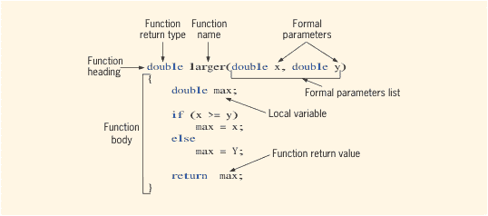

**图 6–1** 函数 `larger` 的各个部分

假设 `num`、`num1` 和 `num2` 是 **double** 变量。还假设 `num1 = 45.75` 且 `num2 = 35.50`。图 6-2 展示了对函数 `larger` 的各种调用。

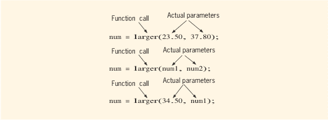

**图 6-2** 函数调用

也可以如下编写函数 `larger` 的定义：

```cpp
double larger(double x, double y)
{
    if (x >= y)
        return x;
    else
        return y;
}
```

由于函数中 `return` 语句的执行会终止函数，前面的函数 `larger` 也可以（不使用单词 `else`）写成：

```cpp
double larger(double x, double y)
{
    if (x >= y)
        return x;

    return y;
}
```

注意，函数 `larger` 的这些形式不需要声明任何局部变量。

- **注意**
  1. 在函数 `larger` 的定义中，`x` 和 `y` 是形式参数。
  2. `return` 语句可以出现在函数中的任何位置。回想一下，一旦 `return` 语句执行，所有后续语句都会被跳过。因此，最好在值计算出来后立即返回该值。

### 例 6-2

既然函数 `larger` 已编写好，下面的 C++ 代码说明了如何使用它。

```cpp
double one = 13.00;
double two = 36.53;
double maxNum;
```

考虑以下语句：

```cpp
cout << "The larger of 5 and 6 is " << larger(5, 6)
     << endl;                                      //Line 1

cout << "The larger of " << one << " and " << two
     << " is " << larger(one, two) << endl;         //Line 2

cout << "The larger of " << one << " and 29 is "
     << larger(one, 29) << endl;                     //Line 3

maxNum = larger(38.45, 56.78);                       //Line 4
```

- 第1行中的表达式 `larger(5, 6)` 是函数调用，5 和 6 是实际参数。当表达式 `larger(5, 6)` 执行时，5 被复制到 `x`，6 被复制到 `y`。因此，第1行中的语句输出 5 和 6 中较大者。
- 第2行中的表达式 `larger(one, two)` 是函数调用。这里，one 和 two 是实际参数。当表达式 `larger(one, two)` 执行时，one 的值被复制到 `x`，two 的值被复制到 `y`。因此，第2行中的语句输出 one 和 two 中较大者。
- 第3行中的表达式 `larger(one, 29)` 也是函数调用。当表达式 `larger(one, 29)` 执行时，one 的值被复制到 `x`，29 被复制到 `y`。因此，第3行中的语句输出 one 和 29 中较大者。
- 第4行中的表达式 `larger(38.45, 56.78)` 是函数调用。在此调用中，实际参数是 38.45 和 56.78。在此语句中，函数 `larger` 返回的值被赋给变量 `maxNum`。

> **注意**
> 
> 在函数调用中，只指定实际参数，而不指定其数据类型。例如，在例 6-2 中，第1、2、3、4行中的语句展示了如何用实际参数调用函数 `larger`。但是，以下语句包含对函数 `larger` 的错误调用，会导致语法错误。（假设所有变量都已正确声明。）

```cpp
x = larger(int one, 29);          //illegal
y = larger(one, int 29);          //illegal
cout << larger(int one, int two); //illegal
```


一旦函数编写完成，你就可以在程序中的任何地方使用它。函数 `larger` 比较两个数并返回两者中较大的那个。现在让我们编写另一个函数，它使用这个函数来确定三个数中的最大者。我们把这个函数称为 `compareThree`。

```cpp
double compareThree(double x, double y, double z)
{
    return larger(x, larger(y, z));
}
```

在函数首部中，x、y 和 z 是形式参数。

让我们看看这个表达式：

```cpp
larger(x, larger(y, z))
```

在函数 `compareThree` 的定义中，这个表达式对函数 `larger` 有两次调用。外层调用的实参是 `x` 和 `larger(y, z)`；内层调用的实参是 `y` 和 `z`。因此，首先对表达式 `larger(y, z)` 求值；也就是说，内层调用先执行，得到 `y` 和 `z` 中较大的那个。假设 `larger(y, z)` 的求值结果为，比如说，`t`。（注意，`t` 要么是 `y`，要么是 `z`。）接下来，外层调用确定 `x` 和 `t` 中较大的那个。最后，`return` 语句返回最大的数。因此，执行函数调用时，首先对参数求值。例如，外层调用的实参 `larger(y, z)` 会先求值。

注意，函数 `larger` 比函数 `compareThree` 通用得多。这里，我们只是说明：一旦编写了一个函数，就可以用它来编写其他函数。本章后面将展示如何使用函数 `larger` 从一组数中确定最大数。

## 函数原型

现在你已经对如何在程序中编写和使用函数有了一些了解，下一个问题涉及用户自定义函数在程序中出现的顺序。例如，你把函数 `larger` 放在函数 `main` 之前还是之后？`larger` 应该放在 `compareThree` 之前还是之后？遵循必须先声明标识符才能使用它的规则，并且知道函数 `main` 使用了标识符 `larger`，从逻辑上讲，你必须把 `larger` 放在 `main` 之前。

实际上，C++ 程序员通常把函数 `main` 放在所有其他用户自定义函数之前。然而，这种组织方式可能产生编译错误，因为函数按其在程序中出现的顺序编译。例如，如果函数 `main` 放在函数 `larger` 之前，那么编译函数 `main` 时标识符 `larger` 就是未定义的。为了规避未声明标识符的问题，我们把**函数原型**放在任何函数定义（包括 `main` 的定义）之前。

**函数原型：** 不带函数体的函数首部。


### 语法：函数原型

返回值函数的函数原型的一般语法为：

```cpp
functionType functionName(parameter list);
```

（注意，函数原型以分号结尾。）

对于函数 `larger`，其原型为：

```cpp
double larger(double x, double y);
```

> **注意**  
> 编写函数原型时，不必在参数列表中指定变量名。但是，必须指定每个参数的数据类型。
> 
> 可以将函数 `larger` 的函数原型改写如下：
> 
> ```cpp
> double larger(double, double);
> ```

### 最终程序

现在你已经掌握了足够的知识，可以编写整个程序、编译并运行它。下面的程序使用函数 `larger`、`compareThree` 和 `main` 来确定两个或三个数中的较大者/最大者。

```cpp
//Program: Largest of three numbers

#include <iostream>

using namespace std;

double larger(double x, double y);
double compareThree(double x, double y, double z);

int main()
{
    double one, two;                              //Line 1

    cout << "Line 2: The larger of 5 and 10 is "
         << larger(5, 10) << endl;                //Line 2

    cout << "Line 3: Enter two numbers: ";        //Line 3
    cin >> one >> two;                            //Line 4
    cout << endl;                                 //Line 5

    cout << "Line 6: The larger of " << one
         << " and " << two << " is "
         << larger(one, two) << endl;             //Line 6

    cout << "Line 7: The largest of 43.48, 34.00, "
         << "and 12.65 is "
         << compareThree(43.48, 34.00, 12.65)     //Line 7
         << endl;

    return 0;
}

double larger(double x, double y)
{
    double max;

    if (x >= y)
        max = x;
    else
        max = y;

    return max;
}

double compareThree(double x, double y, double z)
{
    return larger(x, larger(y, z));
}
```

**示例运行：** 在本示例运行中，用户输入以阴影显示。

```
Line 2: The larger of 5 and 10 is 10
Line 3: Enter two numbers: 25.6 73.85

Line 6: The larger of 25.6 and 73.85 is 73.85
Line 7: The largest of 43.48, 34.00, and 12.65 is 43.48
```

> **注意**  在前面的程序中，函数 `larger` 和 `compareThree` 的函数原型出现在它们的函数定义之前。因此，函数 `larger` 和 `compareThree` 的定义可以以任意顺序出现。

## 返回值函数：一些特殊之处

返回值函数必须返回一个值。考虑下面的函数 `secret`，它接受一个 `int` 值作为参数。如果参数 `x` 的值大于 5，它返回 `x` 值的两倍；否则，`x` 的值保持不变。

```cpp
int secret(int x)
{
    if (x > 5)             //Line 1
        return 2 * x;      //Line 2
}
```

因为这是一个 `int` 类型的返回值函数，所以它必须返回一个 `int` 类型的值。假设 `x` 的值为 10。那么第 1 行中的表达式 `x > 5` 求值为 `true`。因此第 2 行中的 `return` 语句返回 20。现在假设 `x` 为 3。第 1 行中的表达式 `x > 5` 现在求值为 *假*。因此 `if` 语句失败，第 2 行中的 `return` 语句*不会*执行。然而，函数体中已没有更多要执行的语句。在这种情况下，函数会返回一个奇怪的值。因此，如果 `x` 的值小于或等于 5，该函数不包含任何有效的 `return` 语句来返回 `x` 的值。

函数 `secret` 的正确定义是：

```cpp
int secret(int x)
{
    if (x > 5)        //Line 1
        return 2 * x; //Line 2

    return x;         //Line 3
}
```

这里，如果 `x` 的值小于或等于 5，第 3 行中的 `return` 语句会执行，返回 `x` 的值。另一方面，如果 `x` 的值为，比如说 10，第 2 行中的 `return` 语句会执行，返回 20，并终止函数。

回想一下，在返回值函数中，`return` 语句返回该值。考虑下面的 `return` 语句：

```cpp
return x, y;  //only the value of y will be returned
```

这是一个合法的 `return` 语句。你可能认为这个 `return` 语句返回的是 `x` 和 `y` 的值。然而，事实并非如此。记住，`return` 语句只返回一个值，即使该 `return` 语句包含多个表达式。如果 `return` 语句包含多个表达式，只返回*最后一个表达式的值*。因此，对于上面的 `return` 语句，返回的是 `y` 的值。下面的程序进一步说明了这个概念。

```cpp
// This program illustrates that a value-returning function
// returns only one value, even if the return statement
// contains more than one expression.

#include <iostream>

using namespace std;

int funcRet1();
int funcRet2(int z);

int main()
{
    int num = 4;

    cout << "Line 1: The value returned by funcRet1: "
         << funcRet1() << endl;        // Line 1
}
```


```cpp
cout << "Line 2: The value returned by funcRet2: "
     << funcRet2(num) << endl;                         // Line 2

return 0;
}

int funcRet1()
{
    int x = 45;

    return 23, x;   //only the value of x is returned
}

int funcRet2(int z)
{
    int a = 2;
    int b = 3;

    return 2 * a + b, z + b;  //only the value of z + b is returned
}
```

**示例运行：**

第 1 行：funcRet1 返回的值：45  
第 2 行：funcRet2 返回的值：7

尽管 `return` 语句可以包含多个表达式，但程序中的 `return` 语句应只包含一个表达式。在 `return` 语句中放置多个表达式可能会导致冗余、浪费代码以及语法混乱。

## 返回值函数的更多示例

### 示例 6-3

在此示例中，我们编写函数 courseGrade 的定义。该函数接受一个 `int` 值作为参数，该值指定某门课程的分数，并返回该课程的成绩，即一个 `char` 类型的值。（我们假设考试分数是 0 到 100 之间（含 0 和 100）的值。）

```cpp
char courseGrade(int score)
{
    switch (score / 10)
    {
    case 0:
    case 1:
    case 2:
    case 3:
    case 4:
    case 5:
        return 'F';
    case 6:
        return 'D';
    case 7:
        return 'C';
    case 8:
        return 'B';
    case 9:
    case 10:
        return 'A';
    }
}
```

你也可以编写函数 `courseGrade` 的等价定义，使用 `if...else` 结构来确定课程成绩。

### 示例 6-4（掷一对骰子）

在此示例中，我们编写一个函数，反复掷一对骰子，直到掷出的数字之和为特定数字。我们还想知道掷多少次骰子才能得到所需的总和。

每颗骰子上的最小数字是 1，最大数字是 6。因此，掷出的数字之和最小为 2，最大为 12。假设我们有以下声明。

```cpp
int die1;
int die2;
int sum;
int rollCount = 0;
```

我们使用第 5 章讨论的随机数生成器来随机生成 1 到 6 之间的数字。然后，下面的语句随机生成 1 到 6 之间的数字，并将该数字存储到 `die1` 中，它成为 `die1` 掷出的点数。

```cpp
die1 = rand() % 6 + 1;
```

同样，下面的语句随机生成 1 到 6 之间的数字，并将该数字存储到 `die2` 中，它成为 `die2` 掷出的点数。

```cpp
die2 = rand() % 6 + 1;
```

两颗骰子掷出的数字之和为：

```cpp
sum = die1 + die2;
```

接下来，我们判断 sum 是否包含骰子掷出的所需数字之和。如果 sum 不包含所需的总和，则我们再次掷骰子。这可以通过下面的 do...while 循环完成。（假设 int 变量 num 包含要掷出的所需总和。）

```cpp
do
{
    die1 = rand() % 6 + 1;
    die2 = rand() % 6 + 1;
    sum = die1 + die2;
    rollCount++;
}
while (sum != num);
```

现在我们可以编写函数 rollDice，它接受要掷出的数字的所需总和作为参数，并返回掷出所需总和所需的掷骰次数。

```cpp
int rollDice(int num)
{
    int die1;
    int die2;
    int sum;
    int rollCount = 0;

    srand(time(0));

    do
    {
        die1 = rand() % 6 + 1;
        die2 = rand() % 6 + 1;
        sum = die1 + die2;
        rollCount++;
    }
    while (sum != num);

    return rollCount;
}
```

下面的程序展示如何在程序中使用函数 rollDice。

```cpp
//Program: Roll dice

#include <iostream>
#include <cstdlib>
#include <ctime>

using namespace std;

int rollDice(int num);

int main()
{
    cout << "The number of times the dice are rolled to "
         << "get the sum 10 = " << rollDice(10) << endl;
    cout << "The number of times the dice are rolled to "
         << "get the sum 6 = " << rollDice(6) << endl;

    return 0;
}

int rollDice(int num)
{
    int die1;
    int die2;
    int sum;
    int rollCount = 0;

    srand(time(0));

    do
    {
        die1 = rand() % 6 + 1;
        die2 = rand() % 6 + 1;
        sum = die1 + die2;
        rollCount++;
    }
    while (sum != num);

    return rollCount;
}
```

### 示例运行

掷骰子得到总和 10 的次数 = 11  
掷骰子得到总和 6 的次数 = 7

我们将其留作练习，让你修改此程序，使用户可以输入要掷出的数字的所需总和。（参见本章末尾的编程练习 8。）

下面是一个返回布尔值的函数示例。

### 示例 6-5（回文数）

在此示例中，设计了一个函数 `isNumPalindrome`，如果非负整数是回文数则返回 `true`，否则返回 `false`。非负整数如果正读和反读相同，就是回文数。例如，整数 5、44、434、1881 和 789656987 都是回文数。

假设 num 是一个非负整数。如果 num < 10，则它是回文数，因此函数应返回 **true**。假设 num >= 10。要判断 num 是否为回文数，首先比较 num 的第一位和最后一位数字。如果 num 的第一位和最后一位数字不相同，则它不是回文数，因此函数应返回 **false**。如果 num 的第一位和最后一位数字相同，则去掉 num 的第一位和最后一位数字，并对新数字重复此过程，该新数字是在去掉 num 的第一位和最后一位数字后得到的。只要数字 >= 10，就重复此过程。

例如，假设输入是 18281。因为 18281 的第一位和最后一位数字相同，去掉第一位和最后一位数字得到数字 828。重复比较 828 的第一位和最后一位数字的过程。这一次，第一位和最后一位数字仍然相同。去掉 828 的第一位和最后一位数字后，得到的数字是 2，小于 10。因此，18281 是回文数。

要去掉 num 的第一位和最后一位数字，首先需要找到能整除 num 的 10 的最高次幂，并称之为 **pwr**。能整除 18281 的 10 的最高次幂是 10，即 pwr = 4。此时 18281 % 10^pwr = 8281，因此第一位数字被去掉。另外，因为 8281 / 10 = 828，最后一位数字也被去掉。因此，要去掉第一位数字，可以使用取模运算符，其中除数为 10^pwr。要去掉最后一位数字，则将数字除以 10。然后，为下一次迭代将 pwr 减 2。以下算法实现了这一讨论：

- 1. 如果 num < 10，则它是回文数，因此函数应返回 **true**。
- 2. 假设 num 是整数且 num >= 10。要判断 num 是否为回文数：
  - a. 找到能整除 num 的 10 的最高次幂，并称之为 **pwr**。例如，能整除 434 的 10 的最高次幂是 2；能整除 789656987 的 10 的最高次幂是 8。
  - b. 当 num 大于或等于 10 时，比较 num 的第一位和最后一位数字：
    - b.1. 如果 num 的第一位和最后一位数字不相同，则 num 不是回文数。返回 **false**。
    - b.2. 如果 num 的第一位和最后一位数字相同：
      - b.2.1. 去掉 num 的第一位和最后一位数字。
      - b.2.2. 将 pwr 减 2。
  - c. 返回 **true**。

以下函数实现了该算法：

```cpp
bool isNumPalindrome(int num)
{
    int pwr = 0;

    if (num < 10)                         //Step 1
        return true;
    else                                  //Step 2
    {
        while (num / static_cast<int>(pow(10.0, pwr)) >= 10)  //Step 2.a
            pwr++;
        while (num >= 10)                                    //Step 2.b
        {
            int tenTopwr = static_cast<int>(pow(10.0, pwr));

            if ((num / tenTopwr) != (num % 10))              //Step 2.b.1
                return false;                                //Step 2.b.1
            else                                             //Step 2.b.2
            {
                num = num % tenTopwr;                        //Step 2.b.2.1
                num = num / 10;                              //Step 2.b.2.1
                pwr = pwr - 2;                                //Step 2.b.2.2
            }
        }                                                   //end while
        return true;
    }                                                       //end else
}
```

> **注意**  
> 在函数 `isNumPalindrome` 的定义中，使用头文件 `cmath` 中的函数 `pow` 来找到能整除该数字的 10 的最高次幂。因此，请确保在程序中包含头文件 `cmath`。

## 执行流程

如前所述，C++ 程序是函数的集合。回想一下，函数可以以任意顺序出现。你唯一需要记住的是，必须先声明标识符，然后才能使用它。程序由编译器从头到尾依次编译。因此，如果函数 main 出现在任何其他用户定义函数之前，它会首先被编译。然而，如果 main 出现在程序的末尾（或中间），则所有定义（而非原型）出现在函数 main 之前的函数，都会按照它们放置的顺序在函数 main 之前被编译。

函数原型出现在任何函数定义之前，因此编译器会首先转换这些内容。然后，编译器可以正确地转换函数调用。然而，当

程序执行时，函数 `main` 中的第一条语句总是首先执行，无论函数 `main` 位于程序中的哪个位置。其他函数仅在被调用时才执行。

函数调用语句将控制转移到函数体中的第一条语句。通常，在被调用函数的最后一条语句执行完后，控制权会返回到紧跟在函数调用之后的位置。有返回值的函数会返回一个值。因此，在执行有返回值的函数后，当控制权返回调用者时，函数返回的值会替换函数调用语句。执行从紧跟在函数调用之后的位置继续。

假设一个程序包含函数 `funcA` 和 `funcB`，并且 `funcA` 包含一条调用 `funcB` 的语句。假设程序调用 `funcA`。当包含对 `funcB` 的调用的语句执行时，`funcB` 执行；在 `funcB` 执行期间，`funcA` 当前调用的执行会暂停，直到 `funcB` 完成。

## 编程示例：最大数

在这个编程示例中，函数 `larger` 用于从一组数中确定最大数。为便于说明，本程序从一组 10 个数中确定最大数。你可以轻松增强此程序，以适用于任意一组数。

**输入** 一组 10 个数。

**输出** 10 个数中的最大数。

### 问题分析与算法设计

假设输入数据为：

15 20 7 8 28 21 43 12 35 3

读取数据集中的第一个数。由于这是到此刻为止读取的唯一一个数，你可以假定它是目前的最大数，并将其称为 `max`。读取第二个数，称为 `num`。现在比较 `max` 和 `num`，并将较大的数存入 `max`。此时 `max` 包含前两个数中较大的那个。读取第三个数。将其与 `max` 比较，并将较大的数存入 `max`。此时，`max` 包含前三个数中的最大数。读取下一个数，将其与 `max` 比较，并将较大的数存入 `max`。对数据集中剩余的每个数重复此过程。最终，`max` 将包含数据集中的最大数。这段讨论可转化为以下算法：

- 1. 读取第一个数。由于这是你到目前为止读取的唯一一个数，所以它是目前的最大数。将其保存到名为 `max` 的变量中。
- 2. 对于列表中的每个剩余数：
  - a. 读取下一个数。将其存储到名为 `num` 的变量中。
  - b. 比较 `num` 和 `max`。如果 `max < num`，那么 `num` 是新的最大数，因此通过将 `num` 复制到 `max` 来更新 `max` 的值。如果 `max >= num`，则丢弃 `num`；也就是说，什么也不做。
- 3. 由于 `max` 现在包含最大数，打印它。

为了找出两个数中较大的那个，程序使用函数 `larger`。

### 完整程序清单

```cpp
/****************************************************
// Author: D.S. Malik
//
// This program finds the largest number of a set of 10
// numbers.
//****************************************************
#include <iostream>

using namespace std;

double larger(double x, double y);

int main()
{
    double num; //variable to hold the current number
    double max; //variable to hold the larger number
    int count;  //loop control variable

    cout << "Enter 10 numbers." << endl;
    cin >> num;                              //Step 1
    max = num;                               //Step 1

    for (count = 1; count < 10; count++)     //Step 2
    {
        cin >> num;                          //Step 2a
        max = larger(max, num);              //Step 2b
    }

    cout << "The largest number is " << max
         << endl;                            //Step 3

    return 0;
}//end main
```

```cpp
double larger(double x, double y)
{
    if (x >= y)
        return x;
    else
        return y;
}
```

示例运行：在此示例运行中，用户输入以阴影显示。

```
Enter 10 numbers.
10 56 73 42 22 67 88 26 62 11
The largest number is 88
```

## 编程示例：有线电视公司

第 4 章包含一个计算有线电视公司账单的程序。在那个程序中，所有编程指令都打包在函数 *main* 中。这里，我们使用用户自定义函数重写同一个程序，进一步说明结构化编程。问题分析阶段展示了如何将复杂问题划分为更小的子问题。它还表明，在解决某个特定子问题时，你可以只关注问题的该部分。

程序的输入和输出与之前相同。

### 问题分析与算法设计

由于有两种类型的客户——住宅客户和商业客户，程序包含两个独立的函数：一个用于计算住宅客户的账单，另一个用于计算商业客户的账单。这两个函数都会计算账单金额，然后将账单金额返回给函数 *main*。函数 *main* 打印应付金额。我们将计算住宅账单的函数称为 *residential*，将计算商业账单的函数称为 *business*。计算账单的公式与之前相同。

与第 4 章一样，住宅账单处理费、住宅基本服务连接费等信息是特殊数据。因此，这些数据被声明为命名常量。

函数 *residential*

要计算住宅账单，你需要知道客户订阅的付费频道数量。根据付费频道数量，你可以计算账单金额。计算账单金额后，函数使用 return 语句返回账单金额。以下四个步骤描述此函数：

- a. 提示用户输入付费频道数量。
- b. 读取付费频道数量。
- c. 计算账单。
- d. 返回应付金额。

此函数包含一条提示用户输入付费频道数量的语句（步骤 a）和一条读取付费频道数量的语句（步骤 b）。计算账单金额所需的其他项，例如基本服务连接费和账单处理费，被定义为命名常量（在函数 main 的定义之前）。因此，为了计算账单金额，此函数不需要从函数 main 获取任何值。因此，此函数没有参数。

### 局部变量（函数 residential）

从前面的讨论可知，函数 `residential` 需要变量来存储付费频道数量和账单金额。此函数只需要两个局部变量来计算账单金额：

```
int noOfPChannels;   //number of premium channels
double bAmount;      //billing amount
```

函数 residential 的定义现在可以写为如下形式：

```cpp
double residential()
{
        int noOfPChannels;    //number of premium channels
        double bAmount;       //billing amount
        cout << "Enter the number of premium "
             << "channels used: ";
        cin >> noOfPChannels;
        cout << endl;

        bAmount = RES_BILL_PROC_FEES +
                  RES_BASIC_SERV_COST +
                  noOfPChannels * RES_COST_PREM_CHANNEL;

        return bAmount;
}
```

### 函数 business

要计算商业账单，你需要知道客户订阅的基本服务连接数量和付费频道数量。然后，根据这些数量，你可以计算账单金额。随后使用 `return` 语句返回账单金额。以下六个步骤描述此函数：

- a. 提示用户输入基本服务连接数量。
- b. 读取基本服务连接数量。
- c. 提示用户输入付费频道数量。
- d. 读取付费频道数量。
- e. 计算账单。
- f. 返回应付金额。


此函数包含提示用户输入基本服务连接数和付费频道数的语句（步骤 a 和 c）。该函数还包含输入基本服务连接数和付费频道数的语句（步骤 b 和 d）。计算账单金额所需的其他项，例如基本服务连接费用和账单处理费，被定义为命名常量（在函数 main 的定义之前）。由此可知，为了计算账单金额，该函数不需要从函数 main 获取任何值。因此，它没有参数。

## 局部变量（函数 `business`）

根据前面的讨论，函数 `business` 需要变量来存储基本服务连接数、付费频道数以及账单金额。实际上，该函数只需要三个局部变量来计算账单金额：

```cpp
int noOfBasicServiceConnections;
int noOfPChannels;    //number of premium channels
double bAmount;       //billing amount
```

现在可以将函数 `business` 的定义写成如下形式：

```cpp
double business()
{
    int noOfBasicServiceConnections;
    int noOfPChannels;    //number of premium channels
    double bAmount;       //billing amount
    cout << "Enter the number of basic "
         << "service connections: ";
    cin >> noOfBasicServiceConnections;
    cout << endl;

    cout << "Enter the number of premium"
         << " channels used: ";
    cin >> noOfPChannels;
    cout << endl;

    if (noOfBasicServiceConnections <= 10)
        bAmount = BUS_BILL_PROC_FEES + BUS_BASIC_SERV_COST +
                  noOfPChannels * BUS_COST_PREM_CHANNEL;
    else
        bAmount = BUS_BILL_PROC_FEES + BUS_BASIC_SERV_COST +
                  (noOfBasicServiceConnections - 10) *
                  BUS_BASIC_CONN_COST +
                  noOfPChannels * BUS_COST_PREM_CHANNEL;

    return bAmount;
}
```

## 主算法（函数 `main`）

- 1. 要以固定小数格式输出浮点数，并保留小数点和末尾零，请设置操纵器 `fixed` 和 `showpoint`。
- 2. 要将浮点数输出到两位小数，请将精度设置为两位小数。
- 3. 提示用户输入账号。
- 4. 获取账号。
- 5. 提示用户输入客户类型。
- 6. 获取客户类型。
- 7.
  - a. 如果客户类型是 R 或 r：
    - i. 调用函数 `residential` 计算账单。
    - ii. 打印账单。
  - b. 如果客户类型是 B 或 b：
    - i. 调用函数 `business` 计算账单。
    - ii. 打印账单。
  - c. 如果客户类型不是 R、r、B 或 b，则为无效客户类型。

## 完整程序清单

```cpp
/************************************************************
// Author: D. S. Malik
//
// Program: Cable Company Billing
// This program calculates and prints a customer's bill for
// a local cable company. The program processes two types of
// customers: residential and business.
************************************************************/

#include <iostream>
#include <iomanip>
using namespace std;

        //Named constants - residential customers
const double RES_BILL_PROC_FEES = 4.50;
const double RES_BASIC_SERV_COST = 20.50;
const double RES_COST_PREM_CHANNEL = 7.50;

        //Named constants - business customers
const double BUS_BILL_PROC_FEES = 15.00;
const double BUS_BASIC_SERV_COST = 75.00;
const double BUS_BASIC_CONN_COST = 5.00;
const double BUS_COST_PREM_CHANNEL = 50.00;

double residential();       //Function prototype
double business();           //Function prototype

int main()
{
        //Declare variables
        int accountNumber;
        char customerType;
        double amountDue;

        cout << fixed << showpoint;                         //Step 1
        cout << setprecision(2);                            //Step 2

        cout << "This program computes a cable bill."
             << endl;
        cout << "Enter account number: ";                  //Step 3
        cin >> accountNumber;                               //Step 4
        cout << endl;

        cout << "Enter customer type: R, r "
             << "(Residential), B, b (Business): ";        //Step 5
        cin >> customerType;                                //Step 6
        cout << endl;

        switch (customerType)                               //Step 7
        {
        case 'r':                                            //Step 7a
        case 'R':
                amountDue = residential();                 //Step 7a.i
                cout << "Account number = "
                     << accountNumber << endl;              //Step 7a.ii
                cout << "Amount due = $"
                     << amountDue << endl;                   //Step 7a.ii
                break;
        case 'b':                                            //Step 7b
        case 'B':
                amountDue = business();                     //Step 7b.i
                cout << "Account number = "
                     << accountNumber << endl;              //Step 7b.ii
                cout << "Amount due = $"
                     << amountDue << endl;                   //Step 7b.ii
                break;
        default:
                cout << "Invalid customer type."
                     << endl;                                //Step 7c
        }

        return 0;
}

double residential()
{
    int noOfPChannels;      //number of premium channels
    double bAmount;         //billing amount

    cout << "Enter the number of premium "
         << "channels used: ";
    cin >> noOfPChannels;
    cout << endl;

    bAmount = RES_BILL_PROC_FEES +
              RES_BASIC_SERV_COST +
              noOfPChannels * RES_COST_PREM_CHANNEL;

    return bAmount;
}

double business()
{
    int noOfBasicServiceConnections;
    int noOfPChannels;      //number of premium channels
    double bAmount;         //billing amount

    cout << "Enter the number of basic "
         << "service connections: ";
    cin >> noOfBasicServiceConnections;
    cout << endl;
    cout << "Enter the number of premium "
         << "channels used: ";
    cin >> noOfPChannels;
    cout << endl;

    if (noOfBasicServiceConnections <= 10)
        bAmount = BUS_BILL_PROC_FEES + BUS_BASIC_SERV_COST +
                  noOfPChannels * BUS_COST_PREM_CHANNEL;
    else
        bAmount = BUS_BILL_PROC_FEES + BUS_BASIC_SERV_COST +
                  (noOfBasicServiceConnections - 10) *
                  BUS_BASIC_CONN_COST +
                  noOfPChannels * BUS_COST_PREM_CHANNEL;

    return bAmount;
}
```

示例运行：在此示例运行中，用户输入以阴影显示。

```text
This program computes a cable bill.
Enter account number: 21341

Enter customer type: R, r (Residential), B, b (Business): B

Enter the number of basic service connections: 25

Enter the number of premium channels used: 9

Account number = 21341
Amount due = $615.00
```

## 快速回顾

- 1. 函数就像微型程序，被称为模块。
- 2. 函数使你能够将程序划分为可管理的任务。
- 3. C++ 系统提供标准（预定义）函数。
- 4. 要使用标准函数，你必须：
  - i. 知道包含该函数规范的头文件的名称，
  - ii. 在程序中包含该头文件，并且
  - iii. 知道函数的名称和类型，以及参数（实参）的数量和类型。
- 5. 用户定义函数有两种类型：有返回值函数和 void 函数。
- 6. 在函数首部中定义的变量称为形参。
- 7. 在函数调用中使用的表达式、变量或常量值称为实参。
- 8. 在函数调用中，实参的数量及其类型必须按给定顺序与形参匹配。
- 9. 要调用函数，请使用其名称以及实参列表。
- 10. 有返回值函数会返回一个值。因此，有返回值函数会在表达式或输出语句中使用（调用），或作为函数调用中的参数使用。
- 11. 用户定义函数的一般语法是：

    ```
    functionType functionName(formal parameter list)
    {
        statements
    }
    ```

- 12. 行 `functionType functionName(formal parameter list)` 称为函数首部（或函数头）。括在花括号（`{` 和 `}`）之间的语句称为函数体。
- 13. 函数首部和函数体称为函数定义。


- 14. 如果函数没有参数，在函数头和函数调用中仍然需要空括号。
- 15. 有返回值的函数通过 `return` 语句返回其值。
- 16. 一个函数可以有多个 `return` 语句。但是，每当函数中执行一个 `return` 语句时，其余语句都会被跳过，函数随即退出。
- 17. 一个 `return` 语句只返回一个值。
- 18. 函数原型是去掉函数体的函数头；函数原型以分号结尾。
- 19. 函数原型声明函数的类型，以及函数中使用的参数类型和参数个数。
- 20. 在函数原型中，形式参数列表中的变量名是可选的。
- 21. 函数原型帮助编译器正确地翻译每个函数调用。
- 22. 在程序中，函数原型放在每个函数定义之前，包括函数 `main` 的定义之前。
- 23. 使用函数原型时，用户自定义函数在程序中可以以任意顺序出现。
- 24. 程序执行时，总是从函数 `main` 中的第一条语句开始执行。
- 25. 用户自定义函数仅在它们被调用时才执行。
- 26. 对函数的调用将控制权从调用者转移到被调用函数。
- 27. 在函数调用语句中，只需指定实际参数，而不指定它们的数据类型或函数类型。
- 28. 当函数退出时，控制权返回到调用者。

## 练习

- 1. 将下列陈述标记为正确或错误。
  - a. 要在程序中使用预定义函数，你只需知道函数的名称以及如何使用它。
  - b. 有返回值的函数只返回一个值。
  - c. 参数允许你在每次调用函数时使用不同的值。
  - d. 当用户自定义函数中执行 `return` 语句时，函数立即退出。
  - e. 有返回值的函数只返回整数值。

- 2. 确定下列每个表达式的值。
  - a. `static_cast<char>(toupper('b'))`
  - b. `static_cast<char>(toupper('7'))`
  - c. `static_cast<char>(toupper('K'))`
  - d. `static_cast<char>(toupper('x'))`
  - e. `static_cast<char>(toupper('D'))`
  - f. `static_cast<char>(tolower('8'))`
  - g. `static_cast<char>(tolower('h'))`
  - h. `static_cast<char>(tolower('$'))`

- 3. 确定下列每个表达式的值。
  - a. `abs(-4)`
  - b. `fabs(10.8)`
  - c. `fabs(-2.5)`
  - d. `pow(3.2, 2)`
  - e. `pow(2.5, 3)`
  - f. `sqrt(25.0)`
  - g. `sqrt(6.25)`
  - h. `pow(3.0, 4.0) / abs(-9.0)`
  - i. `floor(28.95)`
  - j. `ceil(35.2)`

- 4. 使用表 6–1 中描述的函数，将下列每一项写成 C++ 表达式。（(e) 中的表达式表示 $x + 2.5$ 的绝对值。）
  - a. $2^{5.2}$
  - b. $\sqrt{x+y}$
  - c. $u^{v-3}$
  - d. $\frac{-b+\sqrt{b^2-4ac}}{2a}$
  - e. $|x+2.5|$

- 5. 考虑以下函数定义：

```cpp
double func(double x, int y, string name)
{
    //function body
}
```

以下哪一项是函数 `func` 的正确函数原型？

  - i. `double func();`
  - ii. `double func(double, int, string);`
  - iii. `double func(double x, int y, string name)`
  - iv. `func(double x, int y, string name);`

- 6. 考虑以下程序：

```cpp
#include <iostream>
#include <cmath>

using namespace std;

int main()
{
    int num1;
    int num2;

    cout << "Enter two integers: ";
    cin >> num1 >> num2;
    cout << endl;

    if (num1 != 0 && num2 != 0)
        cout << sqrt(fabs(num1 + num2 + 0.0)) << endl;
    else if (num1 != 0)
        cout << floor(num1 + 0.0) << endl;
    else if (num2 != 0)
        cout << ceil(num2 + 0.0) << endl;
    else
        cout << 0 << endl;

    return 0;
}
```

  - a. 如果输入是 12 4，输出是什么？
  - b. 如果输入是 3 27，输出是什么？
  - c. 如果输入是 25 0，输出是什么？
  - d. 如果输入是 0 49，输出是什么？

- 7. 考虑以下语句：

```cpp
double num1, num2, num3;
int int1, int2, int3;
int value;

num1 = 5.0; num2 = 6.0; num3 = 3.0;
int1 = 4; int2 = 7; int3 = 8;
```

以及函数原型：

```cpp
double cube(double a, double b, double c);
```

下列哪些语句是有效的？如果无效，请解释原因。

  - a. `value = cube(num1, 15.0, num3);`
  - b. `cout << cube(num1, num3, num2) << endl;`
  - c. `cout << cube(6.0, 8.0, 10.5) << endl;`
  - d. `cout << cube(num1, num3) << endl;`
  - e. `value = cube(num1, int2, num3);`
  - f. `value = cube(7, 8, 9);`
  - g. `value = cube(int1, int2, int3);`

- 8. 考虑以下函数：

```cpp
int secret(int x)
{
    int i, j;

    i = 2 * x;

    if (i > 10)
        j = x / 2;
    else
        j = x / 3;

    return j - 1;
}

int another(int a, int b)
{
    int i, j;

    j = 0;

    for (i = a; i <= b; i++)
        j = j + i;

    return j;
}
```

下列每个程序段的输出是什么？假设 x、y 和 k 是 `int` 变量。

  - a. `x = 10; cout << secret(x) << endl;`
  - b. `x = 5; y = 8; cout << another(x, y) << endl;`
  - c. `x = 10; k = secret(x); cout << x << " " << k << " " << another(x, k) << endl;`
  - d. `x = 5; y = 8; cout << another(y, x) << endl;`

- 9. 考虑以下函数原型：

```cpp
int test(int, char, double, int);
double two(double, double);
char three(int, int, char, double);
```

回答下列问题。

  - a. 函数 `test` 有多少个参数？函数 `test` 的类型是什么？
  - b. 函数 `two` 有多少个参数？函数 `two` 的类型是什么？
  - c. 函数 `three` 有多少个参数？函数 `three` 的类型是什么？
  - d. 调用函数 `test` 需要多少个实际参数？每个实际参数的类型是什么，在调用函数 `test` 时应该按什么顺序使用这些参数？
  - e. 编写一条 C++ 语句，使用实际参数 5、5、7.3 和 `'z'` 打印函数 `test` 返回的值。


  - f. 编写一条 C++ 语句，分别使用实际参数 17.5 和 18.3 打印函数 two 返回的值。
  - g. 编写一条 C++ 语句，打印函数 three 返回的下一个字符。（使用你自己的实际参数。）

- 10. 为什么需要在包含用户自定义函数的程序中包含函数原型？

- 11. 编写一个函数的定义，该函数接受一个 char 值作为输入，如果该字符是大写字母则返回 true；否则返回 false。

- 12. 考虑以下函数：

```cpp
int mystery(int x, double y, char ch)
{
    int u;
    if ('A' <= ch && ch <= 'R')
        return(2 * x + static_cast<int>(y));
    else
        return(static_cast<int>(2 * y) - x);
}
```

下列 C++ 语句的输出是什么？

  - a. `cout << mystery(5, 4.3, 'B') << endl;`
  - b. `cout << mystery(4, 9.7, 'v') << endl;`
  - c. `cout << 2 * mystery(6, 3.9, 'D') << endl;`

- 13. 考虑以下函数：

```cpp
int secret(int one)
{
    int i;
    int prod = 1;

    for (i = 1; i <= 3; i++)
        prod = prod * one;
    return prod;
}
```

  - a. 下列 C++ 语句的输出是什么？
    - i. `cout << secret(5) << endl;`
    - ii. `cout << 2 * secret(6) << endl;`
  - b. 函数 secret 做什么？

- 14. 编写一个函数的定义，该函数接受三个数字作为输入。如果第一个数的第二个数次幂等于第三个数字，则该函数返回 true；否则返回 false。（假设这三个数字都是 double 类型。）


- 15. 以下 C++ 程序的输出是什么？

```cpp
#include <iostream>
#include <cmath>

using namespace std;

int main()
{
    int counter;

    for (counter = 1; counter <= 100; counter++)
        if (pow(floor(sqrt(counter + 0.0)), 2) == counter)
            cout << counter << " ";

    cout << endl;

    return 0;
}
```

- 16. 以下程序的输出是什么？

```cpp
#include <iostream>

using namespace std;

int mystery(int x, int y, int z);

int main()
{
    cout << mystery(7, 8, 3) << endl;
    cout << mystery(10, 5, 30) << endl;
    cout << mystery(9, 12, 11) << endl;
    cout << mystery(5, 5, 8) << endl;
    cout << mystery(10, 10, 10) << endl;

    return 0;
}

int mystery(int x, int y, int z)
{
    if (x <= y && x <= z)
        return (y + z - x);
    else if (y <= z && y <= x)
        return (z + x - y);
    else
        return (x + y - z);
}
```

- 17. 编写一个函数的定义，该函数以三个数为输入，并返回前两个数之和乘以第三个数。（假设这三个数均为 double 类型。）

- 18. 写出以下程序的输出：

```cpp
#include <iostream>

using namespace std;

int mystery(int);

int main()
{
    int n;

    for (n = 1; n <= 5; n++)
        cout << mystery(n) << endl;

    return 0;
}

int mystery(int k)
{
    int x, y;

    y = k;

    for (x = 1; x <= (k - 1); x++)
        y = y * (k - x);

    return y;
}
```

## 编程练习

- 1. 编写一个程序，使用示例 6-5（回文数）中给出的函数 `isNumPalindrome`。用以下数字测试你的程序：10、34、22、333、678、67876、44444 和 123454321。

- 2. 编写一个带返回值的函数 `isVowel`，如果给定字符是元音则返回 `true`，否则返回 `false`。

- 3. 编写一个程序，提示用户输入一个字符序列，并输出其中元音的数量。（使用编程练习 2 中编写的函数 `isVowel`。）

- 4. 编写一个程序，定义命名常量 `PI`（`const double PI = 3.1419;`），用于存储 π 的值。该程序应使用 `PI` 和表 6-1 中列出的函数完成以下任务。
  - a. 输出 √π 的值。
  - b. 提示用户输入 `double` 变量 `r` 的值，该变量存储球的半径。然后程序输出以下内容：
    - i. 4πr² 的值，即球的表面积。
    - ii. (4/3)πr³ 的值，即球的体积。

- 5. 以下程序旨在求矩形的面积、圆的面积或圆柱的体积。然而，(a) 语句顺序不正确；(b) 函数调用不正确；(c) `while` 循环中的逻辑表达式不正确；(d) 函数定义不正确。重写该程序，使其正确运行。你的程序必须正确缩进。（注意，该程序是菜单驱动的，允许用户按自己的意愿反复运行程序。）

```cpp
#include <iostream>

using namespace std;

const double PI = 3.1419;

double rectangle(double l, double w);

#include <iomanip>

int main()
{
    double radius;
    double height;

    cout << fixed << showpoint << setprecision(2) << endl;
    cout << "This program can calculate the area of a rectangle, "
         << "the area of a circle, or volume of a cylinder." << endl;
    cout << "To run the program enter: " << endl;
    cout << "1: To find the area of rectangle." << endl;
    cout << "2: To find the area of a circle." << endl;
    cout << "3: To find the volume of a cylinder." << endl;
    cout << "-1: To terminate the program." << endl;
    cin >> choice;
    cout << endl;

    int choice;

    while (choice != -1)
    {
        {
        case 1:
            cout << "Enter the radius of the base and the "
                 << "height of the cylinder: ";
            cin >> radius >> height;
            cout << endl;

            cout << "Area = " << circle(length, height) << endl;
            break;

        case 3:
            double length, width;
            cout << "Enter the radius of the circle: ";
            cin >> radius;
            cout << endl;
cout << "Area = " << rectangle(radius)
     << endl;
break;

case 2:
    cout << "Enter the length and the width "
         << "of the rectangle: ";
    cin >> length >> width;
    cout << endl;

    cout << "Volume = " << cylinder(radius, height)
         << endl;
    break;
default:
    cout << "Invalid choice!" << endl;
}
switch (choice)
}

double circle(double r)
double cylinder(double bR, double h);

cout << "To run the program enter: " << endl;
cout << "2: To find the area of a circle." << endl;
cout << "1: To find the area of rectangle." << endl;
cout << "3: To find the volume of a cylinder." << endl;
cout << "-1: To terminate the program." << endl;
cin >> choice;
cout << endl;

return 0;
}

double rectangle(double l, double w)
{
    return l * r;
}

double circle(double r)
{
    return PI * r * w;
}

double cylinder(double bR, double h)
{
    return PI * bR * bR * l;
}
```

- 6. 编写一个函数 reverseDigit，它接受一个整数作为参数，并返回其数字反转后的数。例如，reverseDigit(12345) 的值为 54321；reverseDigit(5600) 的值为 65；reverseDigit(7008) 的值为 8007；reverseDigit(-532) 的值为 -235。

- 7. 修改掷骰子程序示例 6-4，使其允许用户输入想要掷出的数字之和。还允许用户按需要多次调用 `rolldice` 函数。

- 8. 以下公式给出笛卡尔平面中两点 $(x_1, y_1)$ 和 $(x_2, y_2)$ 之间的距离：

  $$\sqrt{(x_2-x_1)^2+(y_2-y_1)^2}$$

  给定圆心和圆上一点，可以使用该公式求出圆的半径。编写一个程序，提示用户输入圆心和圆上一点。然后程序应输出圆的半径、直径、周长和面积。程序至少必须包含以下函数：

  - a. `distance`：该函数以表示平面中两个点的四个数为参数，并返回它们之间的距离。
  - b. `radius`：该函数以表示圆心和圆上一点的四个数为参数，调用函数 `distance` 求圆的半径，并返回圆的半径。
  - c. `circumference`：该函数以一个表示圆半径的数为参数，并返回圆的周长。（如果 $r$ 是半径，则周长为 $2\pi r$。）
  - d. `area`：该函数以一个表示圆半径的数为参数，并返回圆的面积。（如果 $r$ 是半径，则面积为 $\pi r^2$。）

  假设 $\pi = 3.1416$。

- 9. 重写第 4 章编程练习 15（手机公司）中的程序，使其使用以下函数计算账单金额。（在本编程练习中，不要输出使用服务的分钟数。）
  - a. `regularBill`：该函数计算并返回常规服务的账单金额。
  - b. `premiumBill`：该函数计算并返回优质服务的账单金额。

- 10. 编写一个程序，输入五个数，并输出这些数的均值（平均数）和标准差。如果这些数是 $x_1$、$x_2$、$x_3$、$x_4$ 和 $x_5$，则均值为 $x = (x_1 + x_2 + x_3 + x_4 + x_5)/5$，标准差为：

  $$s = \sqrt{\frac{(x_1-x)^2+(x_2-x)^2+(x_3-x)^2+(x_4-x)^2+(x_5-x)^2}{5}}$$

  你的程序至少必须包含以下函数：一个计算并返回均值的函数，以及一个计算标准差的函数。

- 11. 当你借钱买房、买车或用于其他目的时，通常通过定期还款来偿还。假设贷款金额为 \(L\)，\(r\) 是年利率，\(m\) 是一年中的还款次数，贷款期限为 \(t\) 年。假设 \(i=(r/m)\)，且 \(r\) 为小数形式。则定期还款额为：

  $$R=\frac{Li}{1-(1+i)^{-mt}}.$$

  你也可以计算进行某些还款后的未偿还贷款余额。例如，进行 \(k\) 次还款后的未偿还余额为：

  $$L'=R\left[\frac{1-(1+i)^{-(mt-k)}}{i}\right],$$

  其中 \(R\) 是定期还款额。（注意，如果按月还款，则 \(m=12\)。）

  编写一个程序，提示用户输入 \(L\)、\(r\)、\(m\)、\(t\) 和 \(k\) 的值。然后程序输出相应的值。你的程序至少必须包含两个函数，并带有适当的参数，用于计算定期还款额和某些还款后的未偿还余额。使程序采用菜单驱动，并使用循环，以便用户可针对不同值重复运行程序。

- 12. 在报税季，每周五，J&J 会计师事务所为自行准备纳税申报表的人提供协助。其收费如下：
  - a. 如果某人为低收入（≤ $25,000）且咨询时间小于或等于 30 分钟，则不收费；否则，超过 30 分钟的部分按正常小时费率的 40% 收取服务费。
  - b. 对于其他人，如果咨询时间小于或等于 20 分钟，则不收取服务费；否则，超过 20 分钟的部分按正常小时费率的 70% 收取服务费。

  （例如，假设某人为低收入，花费 1 小时 15 分钟，小时费率为 $70.00。则账单金额为 70.00 × 0.40 × (45 / 60) = $21.00。）

  编写一个程序，提示用户输入小时费率、总咨询时间以及该人是否为低收入。程序应输出账单金额。你的程序必须包含一个函数，该函数以小时费率、总咨询时间和表示该人是否为低收入的值为输入。该函数应返回账单金额。你的程序可以提示用户以分钟为单位输入咨询时间。


在第6章中，你学习了如何使用有返回值函数。在本章中，你将总体探讨用户自定义函数，并特别探讨那些没有数据类型的C++函数，即**void函数**。

## void函数

void函数和有返回值函数具有相似的结构。两者都有函数首部和函数体。与有返回值函数一样，你可以将用户自定义的void函数放在main函数之前或之后。然而，程序执行总是从main函数中的第一条语句开始。如果将用户自定义的void函数放在main函数之后，则应将函数原型放在main函数之前。void函数没有数据类型。因此，void函数首部中的functionType——即返回类型——以及void函数体中的return语句都没有意义。然而，在void函数中，可以使用不带任何值的return语句；它通常用于提前退出函数。与有返回值函数一样，void函数可以有也可以没有形式参数。

由于void函数没有数据类型，因此它们不会在表达式中被使用（调用）。对void函数的调用是一条独立语句。因此，要调用void函数，需要在一条独立语句中使用函数名以及实际参数（如果有）。在给出void函数示例之前，下面先给出void函数的语法。

### 函数定义

带参数的void函数的函数定义具有以下语法：

```cpp
void functionName(formal parameter list)
{
    statements
}
```

其中，语句通常是声明语句和/或可执行语句。形式参数列表可以为空；在这种情况下，函数首部中仍然需要保留空括号。

### 形式参数列表

形式参数列表具有以下语法：

```cpp
dataType& variable, dataType& variable, ...
```

在形式参数列表中，必须同时指定数据类型和变量名。dataType后的符号&具有特殊含义；它仅用于某些形式参数，本章后面将讨论。

### 函数调用

函数调用具有以下语法：

```cpp
functionName(actual parameter list);
```

### 实际参数列表

实际参数列表具有以下语法：

```cpp
expression or variable, expression or variable, ...
```

其中，表达式可以由单个常量值组成。与有返回值函数一样，在函数调用中，实际参数的数量及其数据类型必须按给定顺序与形式参数匹配。实际参数和形式参数一一对应。函数调用会导致执行被调用函数的函数体。（带默认参数的函数将在本章末尾讨论。）

例7-1展示了一个带参数的void函数。

### 例7-1

```cpp
void funexp(int a, double b, char c, int x)
{
    .
    .
    .
}
```

函数`funexp`有四个参数。

参数在调用函数（例如`main`）和被调用函数之间提供通信链路。它们使函数每次被调用时都能处理不同的数据。一般来说，形式参数有两种类型：**值参数**和**引用参数**。

- **值参数：** 接收对应实际参数内容副本的形式参数。
- **引用参数：** 接收对应实际参数位置（内存地址）的形式参数。

当在函数形式参数列表中的dataType后附加`&`时，该dataType后面的变量将成为引用参数。


函数printStars执行30次并打印30个空格。另外，由于希望在星号之间打印一个空格，函数printStars中第二个for循环的每次迭代都会打印字符串" *"——一个空格后跟一个星号。

接下来，考虑以下语句：

```cpp
int numberOfLines = 15;
int numberOfBlanks = 30;

for (counter = 1; counter <= numberOfLines; counter++)
{
    printStars(numberOfBlanks, counter);
    numberOfBlanks--;
}
```

for循环调用函数printStars。该for循环的每次迭代使用变量numberOfBlanks和counter，指定要在一行中打印的空格数以及其后的星号数。每次调用函数printStars时，收到的空格数都比上一次调用少一个，星号数多一个。例如，main函数中for循环的第一次迭代指定30个空格和1个星号（它们作为参数numberOfBlanks和counter传递给函数printStars）。然后，for循环通过执行语句numberOfBlanks--;将空格数减1。在for循环结束时，星号数会为下一次迭代增加1。这是通过执行for语句中的更新语句counter++完成的，它将变量counter的值增加1。换句话说，第二次调用函数printStars时收到29个空格和2个星号作为参数。因此，前面的语句将打印一个由15行组成的星号三角形。

```cpp
//Program: Print a triangle of stars

#include <iostream>

using namespace std;

void printStars(int blanks, int starsInLine);

int main()
{
    int noOfLines;    //variable to store the number of lines
    int counter;      //for loop control variable
    int noOfBlanks;   //variable to store the number of blanks

    cout << "Enter the number of star lines (1 to 20) "
         << "to be printed: ";                 //Line 1

    cin >> noOfLines;                          //Line 2

    while (noOfLines < 0 || noOfLines > 20)    //Line 3
    {
        cout << "Number of star lines should be "
             << "between 1 and 20" << endl;    //Line 4
        cout << "Enter the number of star lines "                         //Line 5
             << "(1 to 20) to be printed: ";
        cin >> noOfLines;                                              //Line 6
    }

    cout << endl << endl;                                          //Line 7
    noOfBlanks = 30;                                               //Line 8

    for (counter = 1; counter <= noOfLines; counter++)             //Line 9
    {
        printStars(noOfBlanks, counter);                           //Line 10
        noOfBlanks--;                                              //Line 11
    }

    return 0;                                                      //Line 12
}

void printStars(int blanks, int starsInLine)
{
    int count;

    for (count = 1; count <= blanks; count++)                   //Line 13
        cout << ' ';                                           //Line 14
    for (count = 1; count <= starsInLine; count++)              //Line 15
        cout << "* ";                                          //Line 16
    cout << endl;
}
```

**示例运行：** 在此示例运行中，用户输入以阴影显示。

```text
Enter the number of star lines (1 to 20) to be printed: 15

                              *
                             * *
                            * * *
                           * * * *
                          * * * * *
                         * * * * * *
                        * * * * * * *
                       * * * * * * * *
                      * * * * * * * * *
                     * * * * * * * * * *
                    * * * * * * * * * * *
                   * * * * * * * * * * * *
                  * * * * * * * * * * * * *
                 * * * * * * * * * * * * * *
                * * * * * * * * * * * * * * *
```

在main函数中，首先要求用户指定要打印多少行星号（第1行）。（在此程序中，用户被限制为20行，因为最多20行的三角形网格可以很好地显示在屏幕上。）由于程序限制为仅20行，第3行到第6行的while循环确保仅当行数在1到20之间时，程序才打印星号三角形网格。


```
cout << "Line 7: In the function funcValueParam, "
     << "after changing, num = " << num
     << endl;                                      //Line 7
}
```

### 示例运行

```
Line 2: Before calling the function funcValueParam, number = 6
Line 5: In the function funcValueParam, before changing, num = 6
Line 7: In the function funcValueParam, after changing, num = 15
Line 4: After calling the function funcValueParam, number = 6
```

该程序的运行过程如下。程序从函数 main 开始执行。第 1 行中的语句声明并初始化 int 变量 number。第 2 行中的语句在调用函数 funcValueParam 之前输出 number 的值；第 3 行中的语句调用函数 funcValueParam。然后，变量 number 的值传递给形参 num。控制权现在转移到函数 funcValueParam。

第 5 行中的语句在更改 num 的值之前输出 num 的值。第 6 行中的语句将 num 的值更改为 15；第 7 行中的语句输出 num 的值。该语句执行后，函数 funcValueParam 退出，控制权返回函数 main。

第 4 行中的语句在调用函数 funcValueParam 之后输出 number 的值。示例运行表明，即使其对应形参 num 的值在函数 funcValueParam 内被更改，number 的值（第 2 行和第 4 行）仍保持不变。

输出显示了语句执行的顺序。

复制数据后，值参数与实参没有联系，因此值参数不能将任何结果传回调用函数。函数执行时，对形参所做的任何更改都不会以任何方式影响实参。实参并不知道形参发生了什么。因此，值参数不能将信息传出函数。值参数仅在实参和形参之间提供单向联系。因此，仅使用值参数的函数存在局限性。

## 引用变量作为参数

示例 7-4 中的程序说明了值参数如何工作。另一方面，假设形参是引用参数。因为引用参数接收实参的地址（内存位置），所以引用参数可以从函数中传出一个或多个值，并且可以更改实参的值。

引用参数在三种情况下很有用：

- 当需要更改实参的值时
- 当希望从函数返回多个值时
- 当传递地址相对于复制大量数据可以节省内存空间和时间时

本书通篇演示了前两种情况。第 9 章和第 11 章在介绍数组和类时讨论第三种情况。

回想一下，当你在函数形参列表中的 `dataType` 后加上 `&` 时，该 `dataType` 后面的变量就变成引用参数。

> **注意**
> 
> 可以使用关键字 `const` 将引用（形）参声明为常量。第 10 章和第 11 章将讨论常量引用参数。在此之前，你使用的引用参数将如本章所定义的那样是非常量引用参数。根据引用参数的定义可知，常量值或表达式不能传递给非常量引用参数。如果形参是非常量引用参数，那么在函数调用期间，其对应的实参必须是变量。

### 示例 7-5：计算成绩

下面的程序接收一个课程分数（0 到 100 之间的值），并确定学生的课程等级。该程序有三个函数：`main`、`getScore` 和 `printGrade`，如下所示：

- 1. `main`
  - a. 获取课程分数。
  - b. 打印课程等级。
- 2. `getScore`
  - a. 提示用户输入。
  - b. 获取输入。
  - c. 打印课程分数。
- 3. `printGrade`
  - a. 计算课程等级。
  - b. 打印课程等级。

完整程序如下：

```
//This program reads a course score and prints the
//associated course grade.
#include <iostream>
using namespace std;

void getScore(int& score);
void printGrade(int score);

int main()
{
    int courseScore;

    cout << "Line 1: Based on the course score, \n"
         << "       this program computes the "
         << "course grade." << endl;                 //Line 1

    getScore(courseScore);                            //Line 2

    printGrade(courseScore);                          //Line 3

    return 0;
}

void getScore(int& score)
{
    cout << "Line 4: Enter course score: ";           //Line 4
    cin >> score;                                     //Line 5
    cout << endl << "Line 6: Course score is "
         << score << endl;                            //Line 6
}

void printGrade(int cScore)
{
    cout << "Line 7: Your grade for the course is "; //Line 7

    if (cScore >= 90)                                 //Line 8
        cout << "A." << endl;
    else if (cScore >= 80)
        cout << "B." << endl;
    else if(cScore >= 70)
        cout << "C." << endl;
    else if (cScore >= 60)
        cout << "D." << endl;
    else
        cout << "F." << endl;
}
```

**示例运行：** 在此示例运行中，用户输入以底纹显示。

```
Line 1: Based on the course score,
        this program computes the course grade.
Line 4: Enter course score: 85

Line 6: Course score is 85
Line 7: Your grade for the course is B.
```

该程序的运行过程如下。程序从第 1 行开始执行，该行打印输出的第一行（参见示例运行）。第 2 行中的语句用实参 courseScore（在 main 中声明的变量）调用函数 getScore。因为函数 `getScore` 的形参 `score` 是引用参数，所以地址（即变量 `courseScore` 的内存位置）传递给 `score`。因此，`score` 和 `courseScore` 都指向同一个内存位置，即 `courseScore`（见图 7-1）。


**图 7-1** 变量 `courseScore` 和参数 `score`

对 `score` 所做的任何更改都会立即改变 `courseScore` 的值。

然后控制权转移到函数 `getScore`，第 4 行中的语句执行，打印输出的第二行。该语句提示用户输入课程分数。第 5 行中的语句读取用户输入的值（示例运行中为 85），并将其存储到 `score` 中，而 `score` 实际上就是 `courseScore`（因为 `score` 是引用参数）。因此，此时变量 `score` 和 `courseScore` 的值都是 85（见图 7-2）。


**图 7-2** 第 5 行中的语句执行后变量 `courseScore` 和参数 `score`

接下来，第 6 行中的语句输出 `score` 的值，如示例运行第三行所示。第 6 行执行后，控制权返回函数 `main`（见图 7-3）。

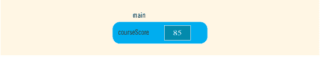

**图 7-3** 第 6 行中的语句执行且控制权返回 `main` 后的变量 `courseScore`

接下来执行第 3 行中的语句。它是一次对函数 `printGrade` 的调用，实参为 `courseScore`。因为函数 `printGrade` 的形参 `cScore` 是值参数，所以参数 `cScore` 接收对应实参 `courseScore` 的值。因此，`cScore` 的值为 85。将 `courseScore` 的值复制到 `cScore` 后，`cScore` 和 `courseScore` 之间就不存在任何联系（见图 7-4）。

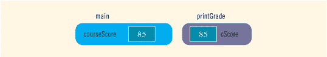

**图 7-4** 变量 `courseScore` 和参数 `cScore`

然后程序执行第 7 行中的语句，输出第四行。第 8 行中的 `if...else` 语句确定并输出课程等级。因为第 7 行中的输出语句不包含换行符或操纵符 `endl`，所以 `if...else` 语句的输出是输出第四行的一部分。`if...else` 语句执行后，控制权返回函数 `main`。因为函数 `main` 中下一条要执行的语句是函数 `main` 的最后一条语句，所以程序终止。

在该程序中，函数 `main` 首先调用函数 `getScore` 从用户处获取课程分数。然后，函数 `main` 调用函数 `printGrade`，根据该课程分数计算并打印等级。课程分数由函数 `getScore` 获取；之后，该课程分数由函数 `printGrade` 使用。因为 `getScore` 函数获取的值会在程序后面使用，所以函数 `getScore` 必须将该值传出。因此，保存该值的形参必须是引用参数。

## 值参数、引用参数与内存分配

调用函数时，为其形参以及函数体中声明的变量（称为**局部变量**）分配的内存位于函数数据区中。回想一下，对于值参数，实参的值会被复制到其对应形参的内存单元中。对于引用参数，实参的地址会传递给形参。也就是说，形参的内容是一个地址。在数据操作期间，形参的内容指示计算机操作其内容所指示的内存单元中的数据。因此，对于引用参数，实参和形参都指向同一个内存位置。因此，在程序执行期间，形参所做的更改会永久改变实参的值。


> **注意** 流变量（例如 `ifstream` 和 `ofstream`）应通过引用传递给函数。在打开输入/输出文件或读取和/或输出数据后，输入和/或输出流的状态便可以传递到函数外部。

因为参数传递是任何编程语言的基础，示例7-6和7-7将进一步说明这一概念。每个示例涵盖不同的情景。

### 示例 7-6

下面的程序演示了引用参数和值参数是如何工作的。

```cpp
//Example 7-6: Reference and value parameters

#include <iostream>

using namespace std;

void funOne(int a, int& b, char v);
void funTwo(int& x, int y, char& w);

int main()
{
    int num1, num2;
    char ch;

    num1 = 10;                         //Line 1
    num2 = 15;                         //Line 2
    ch = 'A';                          //Line 3

    cout << "Line 4: Inside main: num1 = " << num1
         << ", num2 = " << num2 << ", and ch = "
         << ch << endl;                //Line 4
    funOne(num1, num2, ch);             //Line 5

    cout << "Line 6: After funOne: num1 = " << num1
         << ", num2 = " << num2 << ", and ch = "
         << ch << endl;                //Line 6

    funTwo(num2, 25, ch);               //Line 7

    cout << "Line 8: After funTwo: num1 = " << num1
         << ", num2 = " << num2 << ", and ch = "
         << ch << endl;                //Line 8

    return 0;
}

void funOne(int a, int& b, char v)
{
    int one;

    one = a;
    a++;
    b = b * 2;
    v = 'B';

    cout << "Line 13: Inside funOne: a = " << a
         << ", b = " << b << ", v = " << v
         << ", and one = " << one << endl;       //Line 13
}

void funTwo(int& x, int y, char& w)
{
    x++;
    y = y * 2;
    w = 'G';

    cout << "Line 17: Inside funTwo: x = " << x
         << ", y = " << y << ", and w = " << w
         << endl;                                  //Line 17
}
```

### 示例运行

```
Line 4: Inside main: num1 = 10, num2 = 15, and ch = A
Line 13: Inside funOne: a = 11, b = 30, v = B, and one = 10
Line 6: After funOne: num1 = 10, num2 = 30, and ch = A
Line 17: Inside funTwo: x = 31, y = 50, and w = G
Line 8: After funTwo: num1 = 10, num2 = 31, and ch = G
```

让我们逐步分析这个程序。每个语句执行之前和/或之后都会显示变量的值。

在Line 1的语句执行之前，只为函数main的变量分配内存；这块内存未被初始化。在Line 3的语句执行之后，变量如图7-5所示。


**图7-5** 第3行语句执行后变量的值

第4行中的语句产生以下输出：

```
Line 4: Inside main: num1 = 10, num2 = 15, and ch = A
```

第5行中的语句是对函数funOne的调用。现在函数funOne有三个参数和一个局部变量。为函数funOne的参数和局部变量分配内存。由于形式参数b是引用参数，它接收对应实际参数（即num2）的地址（内存位置）。另外两个形式参数是值参数，因此它们复制对应实际参数的值。在第9行中的语句执行之前，变量如图7-6所示。


**图7-6** 第9行中的语句即将执行前变量的值

第9行中的语句`one = a;`执行后，变量的值如图7-7所示。


**图7-7** 第9行中的语句执行后变量的值

第10行中的语句`a++;`执行后，变量的值如图7-8所示。


**图7-8** 第10行中的语句执行后变量的值

第11行中的语句`b = b * 2;`执行后，变量的值如图7-9所示。（注意，变量b改变了num2的值。）


**图7-9** 第11行中的语句执行后变量的值

第12行中的语句`v = 'B';`执行后，变量的值如图7-10所示。


**图7-10** 第12行中的语句执行后变量的值

第13行中的语句产生以下输出：

```
Line 13: Inside funOne: a = 11, b = 30, v = B, and one = 10
```

第13行中的语句执行后，控制返回第6行，为函数funOne的变量分配的内存被释放。图7-11显示了函数main的变量的值。


**图7-11** 控制返回第6行时变量的值

第6行产生以下输出：

```
Line 6: After funOne: num1 = 10, num2 = 30, and ch = A
```

第7行中的语句是对函数funTwo的调用。现在funTwo有三个参数：x、y和w。此外，x和w是引用参数，y是值参数。因此，x接收其对应实际参数num2的地址，w接收其对应实际参数ch的地址。变量y将值25复制到其存储单元中。图7-12显示了第14行中的语句执行前各变量的值。

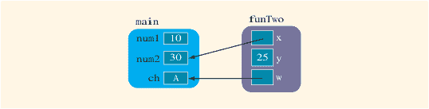

**图7-12** 第14行中的语句执行前变量的值

第14行中的语句`x++;`执行后，变量的值如图7-13所示。（注意，变量x改变了num2的值。）


**图7-13** 第14行中的语句执行后变量的值

第15行中的语句`y = y * 2;`执行后，变量的值如图7-14所示。


**图7-14** 第15行中的语句执行后变量的值

第16行中的语句`w = 'G';`执行后，变量的值如图7-15所示。（注意，变量`w`改变了`ch`的值。）


**图7-15** 第16行中的语句执行后变量的值

第17行产生以下输出：

```
Line 17: Inside funTwo: x = 31, y = 50, and w = G
```

第17行中的语句执行后，控制转到第8行。为函数funTwo的变量分配的内存被释放。函数main的变量的值如图7-16所示。

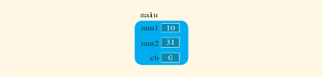

**图7-16** 控制转到第8行时变量的值

第8行中的语句产生以下输出：

```
Line 8: After funTwo: num1 = 10, num2 = 31, and ch = G
```

第8行中的语句执行后，程序终止。

### 示例 7-7

该示例同样展示了引用参数是如何操作实际参数的。

```cpp
//Example 7-7: Reference and value parameters.
//Program: Makes you think.

#include <iostream>

using namespace std;

void addFirst(int& first, int& second);
void doubleFirst(int one, int two);
void squareFirst(int& ref, int val);

int main()
{
    int num = 5;

    cout << "Line 1: Inside main: num = " << num
         << endl;                                      //Line 1

    addFirst(num, num);                                 //Line 2
    cout << "Line 3: Inside main after addFirst:"
         << " num = " << num << endl;                  //Line 3

    doubleFirst(num, num);                              //Line 4
    cout << "Line 5: Inside main after "
         << "doubleFirst: num = " << num << endl;      //Line 5

    squareFirst(num, num);                              //Line 6
    cout << "Line 7: Inside main after "
         << "squareFirst: num = " << num << endl;      //Line 7

    return 0;
}

void addFirst(int& first, int& second)
{
    cout << "Line 8: Inside addFirst: first = "
         << first << ", second = " << second << endl;  //Line 8

    first = first + 2;                                  //Line 9

    cout << "Line 10: Inside addFirst: first = "
         << first << ", second = " << second << endl;  //Line 10
}
```


```cpp
second = second * 2;                                  //Line 11

cout << "Line 12: Inside addFirst: first = "
     << first << ", second = " << second << endl;    //Line 12
}

void doubleFirst(int one, int two)
{
    cout << "Line 13: Inside doubleFirst: one = "
         << one << ", two = " << two << endl;        //Line 13

    one = one * 2;                                     //Line 14

    cout << "Line 15: Inside doubleFirst: one = "
         << one << ", two = " << two << endl;        //Line 15

    two = two + 2;                                     //Line 16

    cout << "Line 17: Inside doubleFirst: one = "
         << one << ", two = " << two << endl;        //Line 17
}

void squareFirst(int& ref, int val)
{
    cout << "Line 18: Inside squareFirst: ref = "
         << ref << ", val = " << val << endl;        //Line 18

    ref = ref * ref;                                   //Line 19

    cout << "Line 20: Inside squareFirst: ref = "
         << ref << ", val = " << val << endl;        //Line 20

    val = val + 2;                                     //Line 21

    cout << "Line 22: Inside squareFirst: ref = "
         << ref << ", val = " << val << endl;        //Line 22
}
```

### 示例运行：

```
Line 1: Inside main:  num = 5
Line 8: Inside addFirst:  first = 5, second = 5
Line 10: Inside addFirst:  first = 7, second = 7
Line 12: Inside addFirst:  first = 14, second = 14
Line 3: Inside main after addFirst:  num = 14
Line 13: Inside doubleFirst:  one = 14, two = 14
Line 15: Inside doubleFirst:  one = 28, two = 14
Line 17: Inside doubleFirst:  one = 28, two = 16
Line 5: Inside main after doubleFirst:  num = 14
Line 18: Inside squareFirst: ref = 14, val = 14
Line 20: Inside squareFirst: ref = 196, val = 14
Line 22: Inside squareFirst: ref = 196, val = 16
Line 7: Inside main after squareFirst:  num = 196
```

函数`addFirst`的两个参数都是引用参数，函数`doubleFirst`的两个参数都是值参数。语句：

```cpp
addFirst(num, num);
```

在函数`main`（第2行）中，该语句将`num`的引用传递给函数`addFirst`的两个形参`first`和`second`，因为这两个形参对应的实参是同一个。也就是说，变量`first`和`second`引用的是同一个内存位置，即`num`。图7-17说明了这一情况。

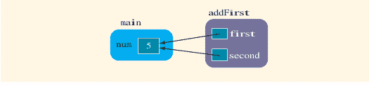

**图7-17** 函数addFirst的参数

`first`对其值所做的任何更改都会立即改变`second`和`num`的值。类似地，`second`对其值所做的任何更改也会立即改变`first`和`num`，因为这三个变量引用的是同一个内存位置。（注意，`num`被初始化为5。）

函数`doubleFirst`的形参是值参数。因此，语句：

```cpp
doubleFirst(num, num);
```

在函数`main`（第4行）中，该语句将`num`的值复制到`one`和`two`中，因为两个形参对应的实参是同一个。图7-18说明了这一场景。

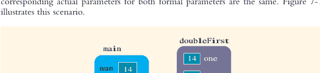

**图7-18** 函数doubleFirst的参数

因为`one`和`two`都是值参数，`one`对其值所做的任何更改都不会影响`two`和`num`的值。同样，`two`对其值所做的任何更改也不会影响`one`和`num`。（注意，在函数`doubleFirst`执行之前，`num`的值为14。）

函数`squareFirst`的形参`ref`是一个引用参数，形参`val`是一个值参数。变量`ref`接收其对应实参的地址，即**num**；变量**val**复制其对应实参的值，该实参也是**num**。因此，**num**和**ref**都引用同一个内存位置，即**num**。图7-19说明了这一情况。

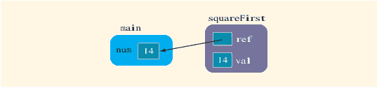

**图7-19** 函数`squareFirst`的参数

**ref**所做的任何更改都会立即改变**num**。**val**所做的任何更改都不会影响**num**。（注意，在函数**squareFirst**执行之前，**num**的值为14。）

我们建议你走查示例7-8中的程序。输出显示了语句执行的顺序。

## 引用参数和返回值函数

在第6章讨论返回值函数时，你只学习了如何使用值参数。你也可以在返回值函数中使用引用参数，但这种方法不推荐使用。根据定义，返回值函数返回一个值；该值通过return语句返回。如果一个函数需要返回多个值，你应该将其改为void函数，并使用适当的引用参数来返回这些值。

## 标识符的作用域

前面的章节和第6章给出了几个带有用户自定义函数的程序示例。标识符可以在函数头、块内或块外声明。自然会有一个问题：你可以在程序中的任何位置访问任意标识符吗？答案是否定的。你必须遵循一定的规则来访问标识符。标识符的**作用域**指的是标识符在程序中可访问（可见）的位置。回想一下，标识符是C++中某个事物的名称，例如变量名或函数名。

本节讨论标识符的作用域。首先，我们定义以下两个术语：

**局部标识符：** 在函数（或块）内声明的标识符。

局部标识符不能在函数（块）外部访问。

**全局标识符：** 在所有函数定义外部声明的标识符。

另外，C++不允许函数嵌套。也就是说，你不能在一个函数的函数体内包含另一个函数的定义。

一般来说，以下规则适用于标识符的访问：

1. 全局标识符（如变量）可以被函数或块访问，如果：
   a. 该标识符在函数定义（块）之前声明，
   b. 函数名与该标识符不同，
   c. 函数的所有参数名称都与该标识符的名称不同，并且
   d. 所有局部标识符（如局部变量）的名称都与该标识符的名称不同。
2. **（嵌套块）** 在块内声明的标识符可访问：
   a. 仅在该块内从其声明点直到块结束处，并且
   b. 被嵌套在该块内的那些块访问，前提是嵌套块没有与外部块（包含嵌套块的块）同名的标识符。
3. 函数名的作用域类似于在任何块外部声明的标识符的作用域。也就是说，函数名的作用域与全局变量的作用域相同。

在考虑示例解释这些作用域规则之前，首先注意在`for`语句中声明的标识符的作用域。C++允许程序员在`for`语句的初始化语句中声明变量。例如，下面的`for`语句：

```cpp
for (int count = 1; count < 10; count++)
    cout << count << endl;
```

声明了变量count并将其初始化为1。变量count的作用域仅限于`for`循环的循环体。

> **注意**：针对在`for`语句中声明的变量的作用域规则可能不适用于标准C++。在标准C++中，在初始化语句中声明的变量的作用域可能从其声明点延伸到紧邻`for`语句所在块的末尾。（为了确保无误，请检查你的编译器文档。）

下面的C++程序有助于说明这些作用域规则：

```cpp
#include <iostream>

using namespace std;

const double RATE = 10.50;
int z;
double t;
```


```c
void one(int x, char y);
void two(int a, int b, char x);
void three(int one, double y, int z);

int main()
{
    int num, first;
    double x, y, z;
    char name, last;
    .
    .
    .
    return 0;
}

void one(int x, char y)
{
    .
    .
    .
}

int w;

void two(int a, int b, char x)
{
    int count;
    .
    .
    .
}

void three(int one, double y, int z)
{
    char ch;
    int a;
    .
    .
    .
    //Block four
    {
        int x;
        char a;
        .
        .
    }//end Block four
    .
    .
    .
}
```

表 7-1 总结了标识符的作用域（可见性）。

### 表 7-1 标识符的作用域（可见性）

| 标识符 | 在 one 中的可见性 | 在 two 中的可见性 | 在 three 中的可见性 | 在 block four 中的可见性 | 在 main 中的可见性 |
|---|---|---|---|---|---|
| RATE（在 main 之前） | Y | Y | Y | Y | Y |
| z（在 main 之前） | Y | Y | N | N | N |
| t（在 main 之前） | Y | Y | Y | Y | Y |
| main | Y | Y | Y | Y | Y |
| main 的局部变量 | N | N | N | N | Y |
| one（函数名） | Y | Y | N | N | Y |
| x（one 的形参） | Y | N | N | N | N |
| y（one 的形参） | Y | N | N | N | N |
| w（在函数 two 之前） | N | Y | Y | Y | N |
| two（函数名） | Y | Y | Y | Y | Y |
| a（two 的形参） | N | Y | N | N | N |
| b（two 的形参） | N | Y | N | N | N |
| x（two 的形参） | N | Y | N | N | N |
| two 的局部变量 | N | Y | N | N | N |
| three（函数名） | Y | Y | Y | Y | Y |
| one（three 的形参） | N | N | Y | Y | N |
| y（three 的形参） | N | N | Y | Y | N |
| z（three 的形参） | N | N | Y | Y | N |
| ch（three 的局部变量） | N | N | Y | Y | N |
| a（three 的局部变量） | N | N | Y | N | N |
| x（block four 的局部变量） | N | N | N | Y | N |
| a（block four 的局部变量） | N | N | N | Y | N |

注意，函数 three 不能调用函数 one，因为函数 three 有一个名为 one 的形参。同样，函数 three 中标记为 four 的块不能使用在函数 three 中声明的 int 变量 a，因为 block four 有一个名为 a 的标识符。

在结束本节之前，我们注意以下关于全局变量的几点：

- 1. 第2章指出，C++ 不会自动初始化变量。然而，一些编译器会将全局变量初始化为其默认值。例如，如果全局变量的类型为 int、char 或 double，则它会被初始化为零。

- 2. 在 C++ 中，:: 被称为**作用域解析运算符**。通过使用作用域解析运算符，在函数（块）定义之前声明的全局变量可以被该函数（或块）访问，即使该函数（或块）有一个与该变量同名的标识符。在前面的程序中，通过使用作用域解析运算符，函数 main 可以将全局变量 z 称为 ::z。类似地，假设在函数（比如 funExample）定义之前声明了全局变量 t。那么，即使 funExample 有一个标识符 t，funExample 也可以使用作用域解析运算符访问变量 t。使用作用域解析运算符时，funExample 将变量 t 称为 ::t。此外，在前面的程序中，使用作用域解析运算符，函数 three 可以调用函数 one。

- 3. C++ 提供了一种访问在函数定义之后声明的全局变量的方法。在这种情况下，该函数不能包含任何与全局变量同名的标识符。在前面的程序中，全局变量 w 在函数 one 的定义之后声明。函数 one 不包含任何名为 w 的标识符；因此，只有当你在 one 内将 w 声明为**外部变量**时，函数 one 才能访问 w。要在函数 one 内将 w 声明为外部变量，函数 one 必须包含以下语句：

    ```cpp
    extern int w;
    ```

    在 C++ 中，extern 是保留字。上述语句中的 extern 一词声明 w 是在其他地方声明的全局变量。因此，当调用函数 one 时，不会为在 one 内声明的 w 分配内存。在 C++ 中，外部声明还有另一种用途，但本书不讨论它。

## 全局变量、命名常量和副作用

一个 C++ 程序可以包含全局变量。然而，使用全局变量会有副作用。如果多个函数使用同一个全局变量并且出了问题，就很难发现出了什么问题以及问题出在哪里。程序中某一区域由全局变量引起的问题可能会被误认为是另一区域引起的问题。

例如，考虑以下程序：

```cpp
//Global variable

#include <iostream>

using namespace std;

int t;

void funOne(int& a);

int main()
{
    t = 15;                                      //Line 1

    cout << "Line 2: In main: t = " << t << endl;       //Line 2

    funOne(t);                                   //Line 3

    cout << "Line 4: In main after funOne: "
         << " t = " << t << endl;              //Line 4

    return 0;                                    //Line 5
}

void funOne(int& a)
{
    cout << "Line 6: In funOne: a = " << a
         << " and t = " << t << endl;           //Line 6

    a = a + 12;                                  //Line 7
    cout << "Line 8: In funOne: a = " << a
         << " and t = " << t << endl;           //Line 8

    t = t + 13;                                  //Line 9

    cout << "Line 10: In funOne: a = " << a
         << " and t = " << t << endl;           //Line 10
}
```

该程序有一个变量 t，它是在任何函数定义之前声明的。由于所有函数都没有标识符 t，因此变量 t 可在程序中的任何位置访问。此外，该程序包含一个带引用参数的 void 函数。

在第 3 行，函数 main 调用函数 funOne，传递给 funOne 的实参是 t。因此，funOne 的形参 a 接收 t 的地址。a 对其值所做的任何更改都会立即改变 t。由于 t 可以在程序中的任何位置直接访问，在第 9 行，函数 funOne 通过使用 **t** 本身来改变 t 的值。因此，你可以通过使用引用参数或 **t** 本身来操纵 **t** 的值。

在前面的程序中，如果 **t** 的最终值不正确，就很难确定出了什么问题以及问题出在程序的哪一部分。我们强烈建议你**不要使用全局变量**；而应使用适当的参数。

在本书给出的程序中，我们通常将命名常量放在函数 **main** 之前、每个函数定义之外。也就是说，我们使用的命名常量是全局命名常量。与全局变量不同，全局命名常量没有副作用，因为它们的值在程序执行期间不能更改。此外，将命名常量放在程序开头可以提高可读性，即使它只在一个函数中使用。如果你以后需要修改程序并更改命名常量的值，将其放在程序开头会更容易找到。

### 例 7-8（菜单驱动程序）

下面是一个菜单驱动程序的示例。程序执行时，会向用户提供一份可供选择的选项列表。该程序进一步说明了值参数和引用参数如何工作。它将长度从英尺和英寸转换为米和厘米，反之亦然。该程序包含三个函数：`showChoices`、`feetAndInchesToMetersAndCent` 和 `metersAndCentToFeetAndInches`。函数 `showChoices` 告知用户如何使用该程序。用户可以根据自己的意愿决定运行该程序多久。

```cpp
//Menu-driven program.

#include <iostream>

using namespace std;

const double CONVERSION = 2.54;
const int INCHES_IN_FOOT = 12;
const int CENTIMETERS_IN_METER = 100;

void showChoices();

void feetAndInchesToMetersAndCent(int f, int in,
                                  int& m, int& ct, int& i);
void metersAndCentToFeetAndInches(int mt, int ct,
                                  int& f, int& in);

int main()
{
    int feet, inches;
    int meters, centimeters;
    int choice;
```


```cpp
do
{
    showChoices();
    cin >> choice;
    cout << endl;

    switch (choice)
    {
    case 1:
        cout << "Enter feet and inches: ";
        cin >> feet >> inches;
        cout << endl;
        feetAndInchesToMetersAndCent (feet, inches,
                                      meters, centimeters);

        cout << feet << " feet (foot), "
             << inches << " inch(es) = "
             << meters << " meter(s), "
             << centimeters << " centimeter(s)." << endl;
        break;

    case 2:
        cout << "Enter meters and centimeters: ";
        cin >> meters >> centimeters;
        cout << endl;
        metersAndCentToFeetAndInches (meters, centimeters,
                                      feet, inches);
        cout << meters << " meter(s), "
             << centimeters << " centimeter(s) = "
             << feet << " feet (foot), "
             << inches << " inch(es)."
             << endl;
        break;

    case 99:
        break;

    default:
        cout << "Invalid input." << endl;
    }
}
while (choice != 99);

return 0;
}

void showChoices()
{
    cout << "Enter--" << endl;
    cout << "1: To convert from feet and inches to meters "
         << "and centimeters." << endl;
    cout << "2: To convert from meters and centimeters to feet "
         << "and inches." << endl;
    cout << "99: To quit the program." << endl;
}

void feetAndInchesToMetersAndCent(int f, int in,
                                  int& mt, int& ct)
{
    int inches;

    inches = f * INCHES_IN_FOOT + in;
    ct = static_cast<int>(inches * CONVERSION);
    mt = ct / CENTIMETERS_IN_METER;
    ct = ct % CENTIMETERS_IN_METER;
}

void metersAndCentToFeetAndInches(int mt, int ct,
                                  int& f, int& in)
{
    int centimeters;

    centimeters = mt * CENTIMETERS_IN_METER + ct;
    in = static_cast<int>(centimeters / CONVERSION);
    f = in / INCHES_IN_FOOT;
    in = in % INCHES_IN_FOOT;
}
```

**示例运行：** 在此示例运行中，用户输入以阴影显示。

```
Enter--
1: To convert from feet and inches to meters and centimeters.
2: To convert from meters and centimeters to feet and inches.
99: To quit the program.
2

Enter meters and centimeters: 4 25

4 meter(s), 25 centimeter(s) = 13 feet (foot), 11 inch(es).
Enter--
1: To convert from feet and inches to meters and centimeters.
2: To convert from meters and centimeters to feet and inches.
99: To quit the program.
1

Enter feet and inches: 15 8

15 feet (foot), 8 inch(es) = 4 meter(s), 77 centimeter(s).
Enter--
1: To convert from feet and inches to meters and centimeters.
2: To convert from meters and centimeters to feet and inches.
99: To quit the program.
99
```

函数 main 中的 do...while 循环只要用户没有输入 99 就会继续执行，这允许用户按自己的意愿运行程序。前面的输出不言自明。

## 静态变量和自动变量

到目前为止讨论的变量遵循两条简单规则：

1. 全局变量的内存在程序执行期间始终保持分配。
2. 在块内声明的变量，其内存在进入块时分配，在退出块时释放。例如，函数的形式参数和局部变量的内存在调用函数时分配，在函数退出时释放。

在进入块时分配内存、在退出块时释放内存的变量称为**自动变量**。在程序执行期间始终保持内存分配的变量称为**静态变量**。全局变量是静态变量，默认情况下，在块内声明的变量是自动变量。可以使用保留字 `static` 在块内声明静态变量。声明静态变量的语法是：

```
static dataType identifier;
```

语句：

```
static int x;
```

将 x 声明为 `int` 类型的静态变量。

在块内声明的静态变量是该块的局部变量，其作用域与该块中任何其他局部标识符相同。

大多数编译器会将静态变量初始化为其默认值。例如，**static int** 变量被初始化为 0。然而，最好自己初始化静态变量，尤其是当初始值不是默认值时。在这种情况下，静态变量在声明时初始化。语句：

```
static int x = 0;
```

将 x 声明为 `int` 类型的静态变量，并将 x 初始化为 0。

### 示例 7-9

下面的程序展示了静态变量和自动变量的行为。

```cpp
//Program: Static and automatic variables
#include <iostream>

using namespace std;

void test();

int main()
{
    int count;

    for (count = 1; count <= 5; count++)
        test();

    return 0;
}

void test()
{
    static int x = 0;
    int y = 10;

    x = x + 2;
    y = y + 1;

    cout << "Inside test x = " << x << " and y = "
         << y << endl;
}
```

### 示例运行：

```
Inside test x = 2 and y = 11
Inside test x = 4 and y = 11
Inside test x = 6 and y = 11
Inside test x = 8 and y = 11
Inside test x = 10 and y = 11
```

在函数 test 中，x 是初始化为 0 的静态变量，y 是初始化为 10 的自动变量。函数 main 调用函数 test 五次。每次调用函数 test 时，变量 y 的内存都会被分配，并在函数退出时释放。因此，每次调用函数 test 时，它都会为 y 打印相同的值。然而，由于 x 是静态变量，x 的内存在程序执行期间始终保持分配。变量 x 只初始化一次为 0。后续对函数 test 的调用使用 x 的当前值。

由于静态变量的内存在函数调用之间始终保持分配，因此静态变量允许你在一次函数调用到另一次函数调用之间使用变量的值。尽管如果你想在一次函数调用到另一次函数调用之间使用某些值，可以使用全局变量，但静态变量的局部作用域可以防止其他函数操纵其值。

## 调试：使用驱动程序和桩函数

在本章和上一章中，你学习了如何编写函数，将问题划分为子问题，解决每个子问题，然后组合这些函数以形成完整程序，从而得到问题的解决方案。一个程序可能包含多个函数。在复杂程序中，通常编写完一个函数后，会单独测试和调试它。你可以编写一个单独的程序来测试该函数。测试函数的程序称为驱动程序。例如，示例 7-8 中的程序包含将长度从英尺和英寸转换为米和厘米以及反向转换的函数。在编写完整程序之前，你可以编写单独的驱动程序，以确保每个函数都能正常工作。

有时，一个函数计算出的结果需要在另一个函数中使用。在这种情况下，依赖于另一个函数的函数无法单独测试。例如，考虑下面这个确定注满游泳池所需时间的程序。

```cpp
#include <iostream>
#include <iomanip>

using namespace std;

const double GALLONS_IN_A_CUBIC_FOOT = 7.48;

double poolCapacity(double len, double wid, double dep);
void poolFillTime(double len, double wid, double dep,
                  double fRate, int& fTime);
void print(int fTime);

int main()
{
    double length, width, depth;
    double fillRate;
    int fillTime;

    cout << fixed << showpoint << setprecision(2);

    cout << "Enter the length, width, and the depth of the "
         << "pool (in feet):";
    cin >> length >> width >> depth;
    cout << endl;

    cout << "Enter the rate of the water (in gallons per minute): ";
    cin >> fillRate;
    cout << endl;

    poolFillTime(length, width, depth, fillRate, fillTime);
    print(fillTime);

    return 0;
}

double poolCapacity(double len, double wid, double dep)
{
    double volume;
    double poolWaterCapacity;

    volume = len * wid * dep;
    poolWaterCapacity = volume * GALLONS_IN_A_CUBIC_FOOT;

    return poolWaterCapacity;
}
```


```cpp
void poolFillTime(double len, double wid, double dep,
                  double fRate, int fTime)
{
    double poolWaterCapacity;

    poolWaterCapacity = poolCapacity(len, wid, dep);
    fTime = static_cast<int> (poolWaterCapacity / fRate + 0.5);
}

void print(int fTime)
{
    cout << "The time to fill the pool is approximately: "
         << fTime / 60 << " hour(s) and " << fTime % 60
         << " minute(s)." << endl;
}
```

**示例运行：** 在此示例运行中，用户输入以阴影显示。

输入游泳池的长度、宽度和深度（以英尺为单位）：`30 15 10`

输入水流速率（以加仑/分钟为单位）：`100`

注满游泳池所需时间大约为：5 小时 37 分钟。

如你所见，该程序包含函数 poolCapacity 用于求注满游泳池所需的水量，函数 poolFillTime 用于求注满游泳池所需的时间，以及一些其他函数。现在，要计算注满游泳池所需的时间，你必须知道所需的水量以及水注入游泳池的速率。由于函数 poolFillTime 需要用到函数 poolCapacity 的结果，因此函数 poolFillTime 不能单独测试。这是否意味着我们必须按特定顺序编写这些函数？不一定，尤其是当不同的人负责程序的不同部分时。在这种情况下，我们使用函数桩。函数桩是尚未完整编码的函数。对于 void 函数，函数桩可能只包含函数头和一对空花括号 {}；对于有返回值的函数，它可能只包含一个带有合理返回值的 return 语句。例如，函数 poolCapacity 的函数桩可以是：

```cpp
double poolCapacity(double len, double wid, double dep)
{
    return 1000.00;
}
```

这样在编写程序时就可以调用函数 poolCapacity。最终，函数 poolCapacity 的桩会被替换为一个根据参数值正确计算注满游泳池所需水量的函数。在此期间，函数桩允许继续处理程序中调用函数 poolCapacity 的其他部分。

在我们看一些编程示例之前，还有一个关于函数的概念值得一提：函数重载。

## 函数重载：简介

在 C++ 程序中，多个函数可以具有相同的名称。这称为**函数重载**，或**重载函数名**。在说明重载函数的规则之前，我们先定义以下内容：

如果两个函数满足以下条件，则称它们具有**不同的形参列表**：

- 形参数量不同；或
- 如果形参数量相同，则按所列顺序，形参的数据类型必须至少在一个位置上不同。

例如，考虑以下函数头：

```cpp
void functionOne(int x)
void functionTwo(int x, double y)
void functionThree(double y, int x)
int functionFour(char ch, int x, double y)
int functionFive(char ch, int x, string name)
```

这些函数都具有不同的形参列表。

现在考虑以下函数头：

```cpp
void functionSix(int x, double y, char ch)
void functionSeven(int one, double u, char firstCh)
```

函数 functionSix 和 functionSeven 都有三个形参，且对应参数的数据类型相同。因此，这些函数具有相同的形参列表。

要重载一个函数名，该函数的任意两个定义都必须具有不同的形参列表。

**函数重载：** 创建多个具有相同名称的函数。

函数的**签名**由函数名及其形参列表组成。如果两个函数具有不同的名称或不同的形参列表，则它们具有不同的签名。（注意，函数的签名不包括函数的返回类型。）

如果一个函数名被重载，那么该组中的所有函数都具有相同的名称。因此，如果该组中所有函数具有不同的形参列表，则它们具有不同的签名。因此，以下函数头正确地重载了函数 functionXYZ：

```cpp
void functionXYZ()
void functionXYZ(int x, double y)
void functionXYZ(double one, int y)
void functionXYZ(int x, double y, char ch)
```

考虑以下用于重载函数 functionABC 的函数头：

```cpp
void functionABC(int x, double y)
int functionABC(int x, double y)
```

这两个函数头具有相同的名称和相同的形参列表。因此，这些用于重载函数 functionABC 的函数头是不正确的。在这种情况下，编译器将生成语法错误。（注意，这些函数头的返回类型不同。）

如果函数被重载，那么在调用该函数时，签名——即函数的形参列表——决定执行哪个函数。

> **注意**  
> 有些作者将函数的签名定义为形参列表，而有些作者则将函数的整个函数头视为其签名。然而，在本书中，函数的签名由函数名及其形参列表组成。如果函数名称不同，那么编译器当然可以毫无问题地识别调用的是哪个函数，并会正确转换代码。然而，如果函数名被重载，那么如前所述，函数的形参列表决定执行哪个函数体。

假设你需要编写一个函数来确定两个项中较大的一个。这两个项可以是整数、浮点数、字符或字符串。你可以编写如下几个函数：

```cpp
int largerInt(int x, int y);
char largerChar(char first, char second);
double largerDouble(double u, double v);
string largerString(string first, string second);
```

函数 largerInt 确定两个整数中较大的一个；函数 largerChar 确定两个字符中较大的一个，依此类推。所有这些函数执行类似的操作。你可以为每个函数使用相同的名称（例如 larger），而不是给这些函数起不同的名称；也就是说，你可以重载函数 larger。因此，你可以将前面的函数原型简单地写为：

```cpp
int larger(int x, int y);
char larger(char first, char second);
double larger(double u, double v);
string larger(string first, string second);
```

例如，如果调用是 larger(5, 3)，则执行第一个函数。如果调用是 larger('A', '9')，则执行第二个函数，依此类推。

当你对不同数据集有相同操作时，使用函数重载。当然，要使函数重载生效，你必须给出每个函数的定义。

## 带默认参数的函数

> **注意**  
> 直到第 11 章才需要本节内容。

本节讨论带默认参数的函数。回想一下，当调用函数时，实参和形参的数量必须相同。C++ 对带默认参数的函数放宽了这一条件。当函数名第一次出现时（例如在函数原型中），你指定默认参数的值。一般来说，以下规则适用于带默认参数的函数：

- 如果你没有指定某个默认参数的值，则对该参数使用默认值。
- 所有默认参数必须是函数最右侧的参数。
- 假设一个函数有多个默认参数。在函数调用中，如果没有指定某个默认参数的值，则必须省略其右侧的所有实参。
- 默认值可以是常量、全局变量或函数调用。
- 调用者可以选择为任何默认参数指定不同于默认值的值。
- 不能将常量值赋给引用参数作为默认值。

考虑以下函数原型：

```cpp
void funcExp(int x, int y, double t, char z = 'A', int u = 67,
             char v = 'G', double w = 78.34);
```

函数 funcExp 有七个参数。参数 z、u、v 和 w 是默认参数。如果在调用函数 funcExp 时没有为 z、u、v 和 w 指定值，则使用它们的默认值。

假设你有以下语句：

```cpp
int a, b;
char ch;
double d;
```

以下函数调用是合法的：

1. `funcExp(a, b, d);`
2. `funcExp(a, 15, 34.6, 'B', 87, ch);`
3. `funcExp(b, a, 14.56, 'D');`

在语句 1 中，使用 z、u、v 和 w 的默认值。在语句 2 中，z 的默认值被 'B' 替换，u 的默认值被 87 替换，v 的默认值被 ch 的值替换，并使用 w 的默认值。在语句 3 中，z 的默认值被 'D' 替换，并使用 u、v 和 w 的默认值。

以下函数调用是非法的：

1. `funcExp(a, 15, 34.6, 46.7);`
2. `funcExp(b, 25, 48.76, 'D', 4567, 78.34);`

在语句 1 中，因为省略了 z 的值，所以必须省略所有其他默认值。在语句 2 中，因为省略了 v 的值，所以 w 的值也应省略。


以下是带默认参数的非法函数原型：

- 1. `void funcOne(int x, double z = 23.45, char ch, int u = 45);`
- 2. `int funcTwo(int length = 1, int width, int height = 1);`
- 3. `void funcThree(int x, int& y = 16, double z = 34);`

在语句 1 中，因为第二个参数 z 是默认参数，所以 z 之后的所有其他参数都必须是默认参数。在语句 2 中，因为第一个参数是默认参数，所以所有参数都必须是默认参数。在语句 3 中，不能将常量值赋给 y，因为 y 是引用参数。

例 7-10 进一步说明了带默认参数的函数。

### 示例 7-10

```cpp
#include <iostream>
#include <iomanip>

using namespace std;

int volume(int l = 1, int w = 1, int h = 1);
void funcOne(int& x, double y = 12.34, char z = 'B');

int main()
{
    int a = 23;
    double b = 48.78;
    char ch = 'M';

    cout << fixed << showpoint;
    cout << setprecision(2);

    cout << "Line 1: a = " << a << ", b = "
         << b << ", ch = " << ch << endl;        //Line 1
    cout << "Line 2: Volume = " << volume()
         << endl;                                //Line 2
    cout << "Line 3: Volume = " << volume(5, 4)
         << endl;                                //Line 3
    cout << "Line 4: Volume = " << volume(34)
         << endl;                                //Line 4
    cout << "Line 5: Volume = "
         << volume(6, 4, 5) << endl;             //Line 5

    funcOne(a);                                 //Line 6
    funcOne(a, 42.68);                          //Line 7
    funcOne(a, 34.65, 'Q');                     //Line 8

    cout << "Line 9: a = " << a << ", b = "
         << b << ", ch = " << ch << endl;        //Line 9

    return 0;
}

int volume(int l, int w, int h)
{
    return l * w * h;                              //Line 10
}

void funcOne(int& x, double y, char z)
{
    x = 2 * x;                                      //Line 11
    cout << "Line 12: x = " << x << ", y = "
         << y << ", z = " << z << endl;           //Line 12
}
```

### 示例运行：

```text
Line 1: a = 23, b = 48.78, ch = M
Line 2: Volume = 1
Line 3: Volume = 20
Line 4: Volume = 34
Line 5: Volume = 120
Line 12: x = 46, y = 12.34, z = B
Line 12: x = 92, y = 42.68, z = B
Line 12: x = 184, y = 34.65, z = Q
Line 9: a = 184, b = 48.78, ch = M
```

> **注意** 在本书的程序中，函数 `main` 的定义放在任何用户自定义函数的定义之前。因此，必须在函数原型中指定参数的默认值，并且只能在函数原型中指定，*不要*在函数定义中指定。

## 编程示例：数字分类

在本例中，我们使用函数重写一个程序，该程序用于确定给定整数列表中奇数和偶数的数量。这个程序最初是在第 5 章编写的。

主算法保持不变：

- 1. 将变量 zeros、odds 和 evens 初始化为 0。
- 2. 读取一个数。
- 3. 如果该数是偶数，则递增偶数计数；如果该数同时也是零，则递增零计数；否则，递增奇数计数。
- 4. 对列表中的每个数重复步骤 2 和步骤 3。

程序的主要部分是：初始化变量、读取并分类数字，然后输出结果。为了简化函数 `main` 并进一步说明参数传递，该程序包含：

必须是引用参数。分析数字并递增相应计数的算法与之前相同。该函数的定义如下：

```cpp
void classifyNumber(int num, int& zeroCount, int& oddCount,
                    int& evenCount)
{
    switch (num % 2)
    {
    case 0:
        evenCount++;
        if (num == 0)
            zeroCount++;
        break;
    case 1:
    case -1:
        oddCount++;
    } //end switch
} //end classifyNumber
```

### printResults

函数 printResults 输出最终结果。为了输出结果（即零、奇数和偶数的数量），该函数必须能够访问在函数 main 中声明的变量 zeros、odds 和 evens 的值。因此，该函数有三个参数。由于该函数只输出变量的值，所以形参是值参数。该函数的定义如下：

```cpp
void printResults(int zeroCount, int oddCount, int evenCount)
{
    cout << "There are " << evenCount << " evens, "
         << "which includes " << zeroCount << " zeros"
         << endl;

    cout << "The number of odd numbers is: " << oddCount
         << endl;
} //end printResults
```

现在我们给出主算法，并展示函数 main 如何调用这些函数。

### 主算法

- 1. 调用函数 initialize 初始化变量。
- 2. 提示用户输入 20 个数。
- 3. 对列表中的每个数：
  - a. 调用函数 getNumber 读取一个数。
  - b. 输出该数。
  - c. 调用函数 classifyNumber 对该数进行分类，并递增相应的计数。
- 4. 调用函数 printResults 输出最终结果。

### 完整程序清单

```cpp
////////////////////////////////////////////////////////////
// Author: D.S. Malik
//
// Program: Classify Numbers
// This program reads 20 numbers and outputs the number of
// zeros, odd, and even numbers.
////////////////////////////////////////////////////////////

#include <iostream>
#include <iomanip>

using namespace std;

const int N = 20;

        //Function prototypes
void initialize(int& zeroCount, int& oddCount, int& evenCount);
void getNumber(int& num);
void classifyNumber(int num, int& zeroCount, int& oddCount,
                    int& evenCount);
void printResults(int zeroCount, int oddCount, int evenCount);

int main()
{
        //Variable declaration
        int counter; //loop control variable
        int number;  //variable to store the new number
        int zeros;   //variable to store the number of zeros
        int odds;    //variable to store the number of odd integers
        int evens;   //variable to store the number of even integers

        initialize(zeros, odds, evens);                 //Step 1

        cout << "Please enter " << N << " integers."
             << endl;                                  //Step 2
        cout << "The numbers you entered are: "
             << endl;

        for (counter = 1; counter <= N; counter++)     //Step 3
        {
                getNumber(number);                     //Step 3a
                cout << number << " ";                //Step 3b
                classifyNumber(number, zeros, odds, evens); //Step 3c
        } // end for loop

        cout << endl;

        printResults(zeros, odds, evens);                 //Step 4

        return 0;
}

void initialize(int& zeroCount, int& oddCount, int& evenCount)
{
    zeroCount = 0;
    oddCount = 0;
    evenCount = 0;
}

void getNumber(int& num)
{
    cin >> num;
}

void classifyNumber(int num, int& zeroCount, int& oddCount,
                    int& evenCount)
{
    switch (num % 2)
    {
    case 0:
        evenCount++;
        if (num == 0)
            zeroCount++;
        break;
    case 1:
    case -1:
        oddCount++;
    } //end switch
} //end classifyNumber

void printResults(int zeroCount, int oddCount, int evenCount)
{
    cout << "There are " << evenCount << " evens, "
         << "which includes " << zeroCount << " zeros"
         << endl;

    cout << "The number of odd numbers is: " << oddCount
         << endl;
} //end printResults
```

### 示例运行：
在此示例运行中，用户输入以阴影显示。

```text
Please enter 20 integers.
The numbers you entered are:
0 0 12 23 45 7 -2 -8 -3 -9 4 0 1 0 -7 23 -24 0 0 12
0 0 12 23 45 7 -2 -8 -3 -9 4 0 1 0 -7 23 -24 0 0 12
There are 12 evens, which includes 6 zeros
The number of odd numbers is: 8
```


## 注意

在上一个程序中，由于假定数据是从标准输入设备（键盘）输入的，并且函数 `getNumber` 只返回一个值，你也可以将函数 `getNumber` 编写为有返回值的函数。如果编写为有返回值的函数，则函数 `getNumber` 的定义为：

```cpp
int getNumber()
{
    int num;

    cin >> num;

    return num;
}
```

在这种情况下，函数 `main` 中的语句（函数调用）：

```cpp
getNumber(number);
```

应替换为语句：

```cpp
number = getNumber();
```

当然，你还需要更改函数原型。

## 编程示例：数据比较

此编程示例说明了：

- 如何在同一个程序中从多个文件读取数据。
- 如何将输出发送到文件。
- 如何生成条形图。
- 借助函数和参数传递，如何在不同（但相似）的数据集上使用同一程序段。
- 如何使用结构化设计来解决问题，以及如何执行参数传递。

该程序分为两部分。首先，你学习如何从多个文件读取数据。其次，你学习如何生成条形图。

当地一所大学的两组学生在夏季学期选修了某些特殊课程。这些课程是首次开设，并由不同的教师授课。学期结束时，两组学生参加相同课程的相同测试，他们的成绩记录在单独的文件中。每个文件中的数据形式如下：

```
courseNo  score1, score2, ..., scoreN -999
courseNo  score1, score2, ..., scoreM -999
.
.
.
```

让我们编写一个程序，为每组中的每门课程计算课程平均分。输出形式如下：

| 课程编号 | 组号 | 课程平均分 |
|---|---:|---:|
| CSC | 1 | 83.71 |
|  | 2 | 80.82 |
| ENG | 1 | 82.00 |
|  | 2 | 78.20 |

...

第1组平均分：82.04
第2组平均分：82.01

**输入** 由于两组数据记录在单独的文件中，因此输入数据出现在两个单独的文件中。

**输出** 如上所示。

### 问题分析与算法设计

从两个文件读取输入数据很直接。假设数据存储在组1的文件 group1.txt 和组2的文件 group2.txt 中。处理完一组的数据后，我们可以处理第二组同一课程的数据，并继续直到数据用完。处理每门课程的数据类似，是一个两步过程：

- 1.
  - a. 累加该课程的成绩。
  - b. 统计该课程的学生人数。
  - c. 用总成绩除以学生人数，求出课程平均分。
- 2. 输出结果。

我们只比较每组中对应课程的平均分，并且每个文件中的数据都按课程 ID 排序。为确保只比较对应课程的平均分，我们比较每组的课程 ID。如果对应的课程 ID 不相同，则输出错误消息并终止程序。

这一讨论表明，我们应该编写一个函数 `calculateAverage` 来求课程平均分。我们还应该编写另一个函数 `printResult`，以给定形式输出数据。通过传递适当的参数，我们可以使用相同的函数 `calculateAverage` 和 `printResult` 来处理两组中每门课程的数据。（在程序的第二部分中，我们修改函数 `printResult`。）

前面的讨论转化为以下算法：

- 1. 初始化变量。
- 2. 获取第1组和第2组的课程 ID。
- 3. 如果课程 ID 不同，则打印错误消息并退出程序。
- 4. 计算第1组和第2组的课程平均分。
- 5. 按上面给出的形式打印结果。
- 6. 对每门课程重复步骤2到步骤5。
- 7. 打印最终结果。

### 变量（函数 main）

前面的讨论表明，程序需要以下变量，以便在函数 main 中进行数据操作：

```cpp
string courseId1;       //course ID for group 1
string courseId2;       //course ID for group 2
int numberOfCourses;
double avg1;            //average for a course in group 1
double avg2;            //average for a course in group 2
double avgGroup1;       //average group 1
double avgGroup2;       //average group 2
ifstream group1;        //input stream variable for group 1
ifstream group2;        //input stream variable for group 2

ofstream outfile;       //output stream variable
```

接下来，我们讨论函数 `calculateAverage` 和 `printResult`。然后，我们将函数 main 组合起来。

### calculateAverage

该函数计算一门课程的平均分。由于输入存储在文件中，并且输入文件在函数 main 中打开，我们必须将与输入文件关联的 `ifstream` 变量传递给该函数。此外，在计算课程平均分之后，该函数必须将课程平均分传递回函数 main。因此，该函数有两个参数，并且两个参数都必须是引用参数。

要求课程平均分，我们必须先求出该课程所有成绩的总和以及选修该课程的学生人数，然后用总和除以学生人数。因此，我们需要一个变量来求成绩总和，一个变量来统计学生人数，以及一个变量来读取和存储成绩。当然，我们必须将用于求总和的变量和用于统计学生人数的变量初始化为零。

### 局部变量（函数 calculateAverage）

在前面关于数据操作的讨论中，我们为函数 `calculateAverage` 确定了三个变量：

```cpp
double totalScore = 0.0;
int numberOfStudents = 0;
int score;
```

上述讨论转化为函数 `calculateAverage` 的以下算法：

- 1. 声明并初始化变量。
- 2. 获取（下一门）课程成绩 `score`。
- 3. `while` 成绩不等于 -999
  - a. 通过加上课程成绩来更新 `totalScore`。
  - b. 将 `numberOfStudents` 增加 1。
  - c. 获取（下一门）课程成绩 `score`。
- 4. `courseAvg = totalScore / numberOfStudents;`

我们现在准备编写函数 `calculateAverage` 的定义。

```cpp
void calculateAverage(ifstream& inp, double& courseAvg)
{
    double totalScore = 0.0;
    int numberOfStudents = 0;
    int score;

    inp >> score;
    while (score != -999)
    {
        totalScore = totalScore + score;
        numberOfStudents++;
        inp >> score;
    } //end while

    courseAvg = totalScore / numberOfStudents;
} //end calculateAverage
```

### printResult

函数 `printResult` 打印该组的课程 ID、组号和课程平均分。输出存储在文件中。因此，我们必须向该函数传递四个参数：与输出文件关联的 `ofstream` 变量、组号、课程 ID 以及该组的课程平均分。`ofstream` 变量必须按引用传递。由于该函数只使用其他变量的值，其余三个参数应为值参数。此外，从输出中可以清楚地看出，我们只在组号之前打印课程 ID。

- 1. 用伪代码表示，算法为：

```
if (group number == 1)
    print course ID
else
    print a blank

print group number and course average
```

函数 `printResult` 的定义如下：

```cpp
void printResult(ofstream& outp, string courseID, int groupNo,
                 double avg)
{
    if (groupNo == 1)
        outp << " " << courseID << " ";
    else
        outp << "         ";

    outp << setw(8) << groupNo << setw(17) << avg << endl;
} //end printResult
```

既然我们已经设计并定义了函数 `calculateAverage` 和 `printResult`，就可以描述函数 `main` 的算法了。然而，在概述算法之前，我们注意以下事项：两个输入文件中的数据都很可能是按课程 ID 排序的，但一个文件中的课程可能比另一个文件少。直到我们处理完两个文件并发现其中一个文件还有未处理的数据时，才会发现这个错误。在打印最终答案——即第1组和第2组的平均分——之前，请务必检查这个错误。

### 主算法：函数 main

- 1. 声明变量（局部声明）。
- 2. 打开输入文件。
- 3. 如果无法打开文件，则打印消息并终止程序。
- 4. 打开输出文件。
- 5. 要以固定小数格式输出浮点数（包含小数点和尾随零），请设置操纵符 `fixed` 和 `showpoint`。另外，要将浮点数输出到两位小数，请将精度设置为两位小数。
- 6. 将第1组的课程平均分初始化为 0.0。
- 7. 将第2组的课程平均分初始化为 0.0。
- 8. 将课程数量初始化为 0。
- 9. 打印标题。
- 10. 获取第1组的课程 ID `courseId1`。
- 11. 获取第2组的课程 ID `courseId2`。
- 12. 对于第1组和第2组中的每门课程，
  - a. 如果 (`courseId1 != courseId2`)
    ```
    {
        cout << "Data error: Course IDs do not match.\n";
        return 1;
    }
    ```


- b. **否则**
  {
    - i. 计算第1组的课程平均分（调用函数`calculateAverage`并传入适当的参数）。
    - ii. 计算第2组的课程平均分（调用函数`calculateAverage`并传入适当的参数）。
    - iii. 打印第1组的结果（调用函数`printResult`并传入适当的参数）。
    - iv. 打印第2组的结果（调用函数`printResult`并传入适当的参数）。
    - v. 更新第1组的平均分。
    - vi. 更新第2组的平均分。
    - vii. 课程数量加1。
  }
- c. 获取第1组的课程ID：`courseId1`。
- d. 获取第2组的课程ID：`courseId2`。
- 13.
  - a. 如果对第1组为`not_end_of_file`且对第2组为`end_of_file`  
    打印“第2组的数据在第1组之前用完”
  - b. 否则，如果对第1组为`end_of_file`且对第2组为`not_end_of_file`  
    打印“第1组的数据在第2组之前用完”
  - c. 否则，打印第1组和第2组的平均分。
- 14. 关闭输入和输出文件。

### 完整程序清单

```cpp
//**************************************************************
// Author: D.S. Malik
//
// Program: Comparison of Class Averages
// This program computes and compares the class averages of
// two groups of students.
//**************************************************************

#include <iostream>
#include <iomanip>
#include <fstream>
#include <string>
using namespace std;

//Function prototypes
void calculateAverage(ifstream& inp, double& courseAvg);
void printResult(ofstream& outp, string courseId,
                 int groupNo, double avg);

int main()
{
    //Step 1
    string courseId1;       //course ID for group 1
    string courseId2;       //course ID for group 2
    int numberOfCourses;
    double avg1;            //average for a course in group 1
    double avg2;            //average for a course in group 2
    double avgGroup1;       //average group 1
    double avgGroup2;       //average group 2
    ifstream group1;        //input stream variable for group 1
    ifstream group2;        //input stream variable for group 2
    ofstream outfile;       //output stream variable

    group1.open("group1.txt");                         //Step 2
    group2.open("group2.txt");                         //Step 2

    if (!group1 || !group2)                             //Step 3
    {
        cout << "Unable to open files." << endl;
        cout << "Program terminates." << endl;
        return 1;
    }

    outfile.open("student.out");                       //Step 4
    outfile << fixed << showpoint;                      //Step 5
    outfile << setprecision(2);                         //Step 5

    avgGroup1 = 0.0;                                    //Step 6
    avgGroup2 = 0.0;                                    //Step 7

    numberOfCourses = 0;                                //Step 8

    outfile << "Course No    Group No    "
            << "Course Average" << endl;               //Step 9

    group1 >> courseId1;                                //Step 10
    group2 >> courseId2;                                //Step 11
    while (group1 && group2)                            //Step 12
    {
        if (courseId1 != courseId2)                     //Step 12a
        {
            cout << "Data error: Course IDs "
                 << "do not match." << endl;
            cout << "Program terminates." << endl;
            return 1;
        }
        else
        {
            calculateAverage(group1, avg1);              //Step 12b.i
            calculateAverage(group2, avg2);              //Step 12b.ii
            printResult(outfile, courseId1,              //Step 12b.iii
                        1, avg1);
            printResult(outfile, courseId2,              //Step 12b.iv
                        2, avg2);
            avgGroup1 = avgGroup1 + avg1;                //Step 12b.v
            avgGroup2 = avgGroup2 + avg2;                //Step 12b.vi
            outfile << endl;                             //Step 12b.vii
            numberOfCourses++;
        }

        group1 >> courseId1;                            //Step 12c
        group2 >> courseId2;                            //Step 12d
    } //end while

    if (group1 && !group2)                          //Step 13a
        cout << "Ran out of data for group 2 "
             << "before group 1." << endl;
    else if (!group1 && group2)                     //Step 13b
        cout << "Ran out of data for group 1 "
             << "before group 2." << endl;
    else                                            //Step 13c
    {
        outfile << "Avg for group 1: "
                << avgGroup1 / numberOfCourses
                << endl;
        outfile << "Avg for group 2: "
                << avgGroup2 / numberOfCourses
                << endl;
    }

    group1.close();                                 //Step 14
    group2.close();                                 //Step 14
    outfile.close();                                //Step 14

    return 0;
}

void calculateAverage(ifstream& inp, double& courseAvg)
{
    double totalScore = 0.0;
    int numberOfStudents = 0;
    int score;

    inp >> score;
    while (score != -999)
    {
        totalScore = totalScore + score;
        numberOfStudents++;
        inp >> score;
    } //end while

    courseAvg = totalScore / numberOfStudents;
} //end calculateAverage

void printResult(ofstream& outp, string courseId, int groupNo,
                 double avg)
{
    if (groupNo == 1)
        outp << " " << courseId << " ";
    else
        outp << "        ";
    outp << setw(8) << groupNo << setw(17) << avg << endl;
} //end printResult
```

### 运行示例

| 课程编号 | 组别 | 课程平均分 |
|---|---:|---:|
| CSC | 1 | 83.71 |
|  | 2 | 80.82 |
| ENG | 1 | 82.00 |
|  | 2 | 78.20 |
| HIS | 1 | 77.69 |
|  | 2 | 84.15 |
| MTH | 1 | 83.57 |
|  | 2 | 84.29 |
| PHY | 1 | 83.22 |
|  | 2 | 82.60 |

第1组平均分：82.04  
第2组平均分：82.01

### 输入数据：第1组

```text
CSC 80 100 70 80 72 90 89 100 83 70 90 73 85 90 -999
ENG 80 90 80 94 90 74 78 63 83 80 90 -999
HIS 90 70 80 70 90 50 89 83 90 68 90 60 80 -999
MTH 74 80 75 89 90 73 90 82 74 90 84 100 90 79 -999
PHY 100 83 93 80 63 78 88 89 75 -999
```

### 输入数据：第2组

```text
CSC 90 75 90 75 80 89 100 60 80 70 80 -999
ENG 80 80 70 68 70 78 80 90 90 76 -999
HIS 100 80 80 70 90 76 88 90 90 75 90 85 80 -999
MTH 80 85 85 92 90 74 90 83 65 72 90 84 100 -999
PHY 90 93 73 85 68 75 67 100 87 88 -999
```

### 条形图

在商业领域，公司管理人员通常希望以某种可视化形式查看结果，例如条形图。许多当前可用的软件包可以分析多种形式的数据，然后以可视化形式显示结果，例如条形图或饼图。本程序的第二部分旨在以条形图的形式显示之前得到的结果，如下所示：

```text
Course ID                 Course Average
       0    10    20    30    40    50    60    70    80    90   100
       |....|....|....|....|....|....|....|....|....|....|....|
CSC    ******************************
       ########################################
ENG    *******************************
       ########################################

.
.
.
Group 1 -- ****
Group 2 -- ####

Avg for group 1: 82.04
Avg for group 2: 82.01
```

条形图中的每个符号（*或#）代表两分。如果某门课程的平均分低于2，则不打印任何符号。

由于输出采用条形图形式，我们需要修改函数`printResult`。

### 打印条形图

函数`printResult`打印课程ID以及表示某门课程平均分的条形图。输出存储在文件中。因此，我们必须向该函数传递四个参数：与输出文件关联的`ofstream`变量、组号（用于打印*或#）、课程ID以及该系的课程平均分。要打印条形图，我们可以使用循环每两分打印一个符号。例如，如果平均分是78.45，我们必须打印39个符号来表示这个平均分。要求出要打印的符号数量，我们可以使用整数除法，如下所示：

```cpp
numberOfSymbols = static_cast<int>(average) / 2;
```

例如，`static_cast<int>(78.45) / 2 = 78 / 2 = 39`。

根据以上讨论，函数`printResult`的定义如下：


```cpp
void printResult(ofstream& outp, string courseID,
                 int groupNo, double avg)
{
    int noOfSymbols;
    int count;

    if (groupNo == 1)
        outp << setw(4) << courseID << "     ";
    else
        outp << "      ";

    noOfSymbols = static_cast<int>(avg)/2;

    if (groupNo == 1)
        for (count = 1; count <= noOfSymbols; count++)
            outp << '*';
    else
        for (count = 1; count <= noOfSymbols; count++)
            outp << '#';
    outp << endl;
}//end printResult
```

我们还包含一个函数 `printHeading`，用于打印输出的前两行。该函数的定义是：

```cpp
void printHeading(ofstream& outp)
{
    outp << "Course       Course Average" << endl;
    outp << " ID    0    10   20   30   40   50   60   70"
         << "   80   90  100" << endl;
    outp << "       |....|....|....|....|....|....|....|....|"
         << "....|....|....|" << endl;
}//end printHeading
```

替换前面程序中的函数 `printResult`，包含函数 `printHeading`，包含输出 `Group 1—****` 和 `Group 2—####` 的语句，然后重新运行程序。你的程序应生成类似于前面所示的条形图的条形图。（完整程序清单可在本书配套网站上获得。）

## 快速复习

- 1. 没有数据类型的函数称为 void 函数。
- 2. 不带任何值的 return 语句可用于 void 函数。如果在 void 函数中使用 return 语句，通常用于提前退出该函数。
- 3. void 函数的首部以单词 void 开头。
- 4. 在 C++ 中，void 是保留字。
- 5. void 函数可以有参数，也可以没有参数。
- 6. 对 void 函数的调用是一条独立语句。
- 7. 要调用 void 函数，需在独立语句中使用函数名及实参。
- 8. 形参有两种类型：值参数和引用参数。
- 9. 值参数接收其对应实参的副本。
- 10. 引用参数接收其对应实参的地址（内存位置）。
- 11. 值参数对应的实参是表达式、变量或常量值。
- 12. 常量值不能传递给引用参数。
- 13. 引用参数对应的实参必须是变量。
- 14. 当在形参的数据类型后包含 `&` 时，该形参成为引用参数。
- 15. 流变量应按引用传递给函数。
- 16. 如果形参需要改变实参的值，则必须在函数首部将该形参声明为引用参数。
- 17. 标识符的作用域是指程序中可访问该标识符的那些部分。
- 18. 在函数（或块）内声明的变量称为局部变量。
- 19. 在每个函数定义（和块）之外声明的变量称为全局变量。
- 20. 函数名的作用域与在任何块之外声明的标识符的作用域相同。
- 21. 参见本章中的作用域规则（“标识符的作用域”一节）。
- 22. C++ 不允许嵌套函数定义。
- 23. 自动变量是在进入函数（或块）时分配内存、在退出函数（或块）时释放内存的变量。
- 24. 静态变量是在程序整个执行期间都保留已分配内存的变量。
- 25. 默认情况下，全局变量是静态变量。
- 26. 在 C++ 中，函数可以重载。
- 27. 如果两个函数满足以下条件，则称它们具有不同的形参列表：
  - 形参数量不同；或
  - 如果形参数量相同，则按列出顺序，形参的数据类型必须至少在一个位置上不同。
- 28. 函数的签名由函数名及其形参列表组成。如果两个函数具有不同的名称或不同的形参列表，则它们具有不同的签名。


- 29. 如果函数被重载，则在对该函数的调用中，签名——即函数的形参列表——决定执行哪个函数。
- 30. C++ 允许函数具有默认参数。
- 31. 如果不指定默认参数的值，则对该参数使用默认值。
- 32. 所有默认参数必须是函数最右侧的参数。
- 33. 假设一个函数有多个默认参数。在函数调用中，如果未指定某个默认参数的值，则必须省略其右侧的所有实参。
- 34. 默认值可以是常量、全局变量或函数调用。
- 35. 调用函数可以选择为任何默认参数指定不同于默认值的值。
- 36. 不能将常量值作为默认值赋给引用参数。

## 练习

- 1. 将下列陈述标记为真或假。
  - a. 修改引用参数值的函数也会修改实参的值。
  - b. 变量名不能传递给值参数。
  - c. 如果 C++ 函数不使用参数，空参数列表外的圆括号仍然是必需的。
  - d. 在 C++ 中，对应的形参和实参的名称必须相同。
  - e. 每当引用参数的值改变时，实参的值也会改变。
  - f. 在 C++ 中，函数定义可以嵌套；也就是说，一个函数的定义可以包含在另一个函数体内。
  - g. 在程序中使用全局变量比使用局部变量是更好的编程风格，因为可以避免额外的变量。
  - h. 在程序中，全局常量和全局变量一样危险。
  - i. 静态变量的内存在函数调用之间保持分配。
- 2. 识别以下编程代码中的下列各项。
  - a. 函数原型、函数首部、函数体和函数定义
  - b. 函数调用语句、形参和实参
  - c. 值参数和引用参数
  - d. 局部变量和全局变量

```cpp
#include <iostream>                         //Line 1
using namespace std;                          //Line 2

int one;                                      //Line 3

void hello(int&, double, char);               //Line 4

int main()                                     //Line 5
{
    int x;                                     //Line 7
    double y;                                  //Line 8
    char z;                                    //Line 9
    .
    .
    .
    hello(x, y, z);                            //Line 10
    .
    .
    .
    hello(x, y - 3.5, 'S');                    //Line 11
    .
    .
    .
}                                             //Line 12

void hello(int& first, double second, char ch) //Line 13
{                                             //Line 14
    int num;                                  //Line 15
    double y;                                 //Line 16
    int u;                                    //Line 17
    .
    .
    .
}                                             //Line 18
```

- 3.
  - a. 解释实参和形参之间的区别。
  - b. 解释值参数和引用参数之间的区别。
  - c. 解释局部变量和全局变量之间的区别。
- 4. 以下程序的输出是什么？

```cpp
#include <iostream>
using namespace std;

void func1();
void func2();

int main()
{
    int num;

    cout << "Enter 1 or 2: ";
```


```cpp
void find(int a, int& b, int& c);

int main()
{
    int one, two, three;

    one = 5;
    two = 10;
    three = 15;

    find(one, two, three);
    cout << one << ", " << two << ", " << three << endl;

    find(two, one, three);
    cout << one << ", " << two << ", " << three << endl;

    find(three, two, one);
    cout << one << ", " << two << ", " << three << endl;

    find(two, three, one);
    cout << one << ", " << two << ", " << three << endl;

    return 0;
}

void find(int a, int& b, int& c)
{
    int temp;

    c = a + b;
    temp = a;
    a = b;
    b = 2 * temp;
}
```

10. 以下程序的输出是什么？

```cpp
#include <iostream>
using namespace std;

int x;

void summer(int&, int);
void fall(int, int&);

int main()
{
    int intNum1 = 2;
    int intNum2 = 5;
    x = 6;

    summer(intNum1, intNum2);
    cout << intNum1 << " " << intNum2 << " " << x << endl;

    fall(intNum1, intNum2);
    cout << intNum1 << " " << intNum2 << " " << x << endl;

    return 0;
}

void summer(int& a, int b)
{
    int intNum1;
    intNum1 = b + 12;
    a = 2 * b + 5;
    b = intNum1 + 4;
}

void fall(int u, int& v)
{
    int intNum2;
    intNum2 = x;
    v = intNum2 * 4;
    x = u - v;
}
```

11. 在以下程序中，给标出的语句编号，以显示它们的执行顺序（逻辑执行顺序）。

```cpp
#include <iostream>

using namespace std;

void func(int val1, int val2);

int main()
{
    int num1, num2;
    ___ cout << "Please enter two integers. " << endl;
    ___ cin >> num1 >> num2;
    ___ func(num1, num2);
    ___ cout << "The two integers are " << num1
        << ", " << num2 << endl;
    ___ return 0;
}

void func(int val1, int val2)
{
    int val3, val4;
    ___ val3 = val1 + val2;
    ___ val4 = val1 * val2;
    ___ cout << "The sum and product are " << val3
        << " and " << val4 << endl;
}
```

12. 考虑以下程序：

```cpp
#include <iostream>
#include <cmath>
#include <iomanip>

using namespace std;

void traceMe(double x, double y);

int main()
{
    double one, two;

    cout << "Enter two numbers: ";
    cin >> one >> two;
    cout << endl;

    traceMe(one, two);
    traceMe(two, one);

    return 0;
}

void traceMe(double x, double y)
{
    double z;

    if (x != 0)
        z = sqrt(y) / x;
    else
    {
        cout << "Enter a nonzero number: ";
        cin >> x;
        cout << endl;
        z = floor(pow(y, x));
    }

    cout << fixed << showpoint << setprecision(2);
    cout << x << ", " << y << ", " << z << endl;
}
```

- a. 如果输入是 3 625，输出是什么？
- b. 如果输入是 24 1024，输出是什么？
- c. 如果输入是 0 196，输出是什么？

13. 练习 12 中的函数 traceMe 输出 x、y 和 z 的值。修改该函数的定义，使其不再打印这些值，而是将这些值送回调用环境，并由调用环境打印这些值。

14. 在练习 12 中，确定每个标识符的作用域。

15. 以下代码片段的输出是什么？（注意：alpha 和 beta 是 int 变量。）

```cpp
alpha = 5;
beta = 10;

if (beta >= 10)
{
    int alpha = 10;
    beta = beta + alpha;
    cout << alpha << ' ' << beta << endl;
}
cout << alpha << ' ' << beta << endl;
```

16. 考虑以下程序。它的确切输出是什么？像例 7-6 那样，显示每一行执行后变量的值。

```cpp
#include <iostream>

using namespace std;

void funOne(int& a);

int main()
{
    int num1, num2;

    num1 = 10;                                      //Line 1

    num2 = 20;                                      //Line 2

    cout << "Line 3: In main: num1 = " << num1
         << ", num2 = " << num2 << endl;          //Line 3

    funOne(num1);                                   //Line 4
    cout << "Line 5: In main after funOne: num1 = "
         << num1 << ", num2 = " << num2 << endl;  //Line 5

    return 0;                                       //Line 6
}

void funOne(int& a)
{
    int x = 12;
    int z;

    z = a + x;                                      //Line 7

    cout << "Line 8: In funOne: a = " << a
         << ", x = " << x
         << ", and z = " << z << endl;             //Line 8

    x = x + 5;                                      //Line 9

    cout << "Line 10: In funOne: a = " << a
         << ", x = " << x
         << ", and z = " << z << endl;             //Line 10

    a = a + 8;                                      //Line 11

    cout << "Line 12: In funOne: a = " << a
         << ", x = " << x
         << ", and z = " << z << endl;             //Line 12
}
```

17. 以下程序的输出是什么？

```cpp
#include <iostream>
using namespace std;

void tryMe(int& v);

int main()
{
    int x = 8;

    for (int count = 1; count < 5; count++)
        tryMe(x);

    return 0;
}

void tryMe(int& v)
{
    static int num = 2;

    if (v % 2 == 0)
    {
        num++;
        v = v + 3;
    }
    else
    {
        num--;
        v = v + 5;
    }
    cout << v << ", " << num << endl;
}
```

18. 函数的签名是什么？

19. 考虑以下函数原型：

```cpp
void testDefaultParam(int a, int b = 7, char z = '*');
```

以下哪个函数调用是正确的？

- a. `testDefaultParam(5);`
- b. `testDefaultParam(5, 8);`
- c. `testDefaultParam(6, '#');`
- d. `testDefaultParam(0, 0, '*');`

20. 考虑以下函数定义：

```cpp
void defaultParam(int u, int v = 5, double z = 3.2)
{
    int a;

    u = u + static_cast<int>(2 * v + z);
    a = u + v * z;
    cout << "a = " << a << endl;
}
```

以下函数调用的输出是什么？

- a. `defaultParam(6);`
- b. `defaultParam(3, 4);`
- c. `defaultParam(3, 0, 2.8);`

## 编程练习

1. 考虑函数 main 的定义。

```cpp
int main()
{
    int x, y;
    char z;
    double rate, hours;
    double amount;
    .
    .
    .
}
```

下面 a 到 f 项中提到的变量 x、y、z、rate 和 hours 都是函数 main 的变量。所描述的每个函数都必须具有适当的参数来访问这些变量。编写以下定义：

- a. 编写函数 `initialize` 的定义，它将 `x` 和 `y` 初始化为 `0`，将 `z` 初始化为空白字符。
- b. 编写函数 `getHoursRate` 的定义，它提示用户输入工作小时数和每小时工资率，以初始化函数 `main` 的变量 `hours` 和 `rate`。
- c. 编写有返回值的函数 `payCheck` 的定义，它根据工作小时数和每小时工资率计算并返回应支付给员工的金额。工作小时数和每小时工资率分别存储在函数 `main` 的变量 `hours` 和 `rate` 中。计算应支付金额的公式如下：对于前 40 小时，按给定工资率计算；对于超过 40 小时的部分，按给定工资率的 1.5 倍计算。
- d. 编写函数 `printCheck` 的定义，它打印工作小时数、每小时工资率和工资。
- e. 编写函数 `funcOne` 的定义，它提示用户输入一个数。然后，该函数通过将表达式 `2` 乘以 `x` 的（旧）值再加上 `y` 的值，然后减去用户输入的值所得的结果赋给 `x`，来改变 `x` 的值。
- f. 编写函数 `nextChar` 的定义，它将 `z` 的值设置为 `z` 中存储的下一个字符。
- g. 编写函数 main 的定义，以测试这些函数中的每一个。

2. 考虑以下 C++ 代码：

```cpp
#include <iostream>
#include <cmath>
#include <iomanip>

using namespace std;

void func1();
void func2(/*formal parameters*/);

int main()
{
    int num1, num2;
    double num3;

    int choice;

    cout << fixed << showpoint << setprecision(2);

    do
    {
        func1();
        cin >> choice;
        cout << endl;

        if (choice == 1)
        {
            func2(num1, num2, num3);
            cout << num1 << ", " << num2 << ", " << num3 << endl;
        }
    }
    while (choice != 99);

    return 0;
}

void func1()
{
    cout << "To run the program, enter 1." << endl;
    cout << "To exit the program, enter 99." << endl;
    cout << "Enter 1 or 99: ";
}

void func2(/*formal parameters*/)
{
    //Write the body of func2.
}
```


函数 `func2` 有三个参数，类型分别为 `int`、`int` 和 `double`，假设分别为 a、b 和 c。编写 `func2` 的定义，使其作用如下：

- a. 提示用户输入两个整数，并分别将这两个数存入 a 和 b。
- b. 如果两个数都非零：
    - i. 如果 `a >= b`，则赋给 c 的值为 a 的 b 次方，即 aᵇ。
    - ii. 如果 `a < b`，则赋给 c 的值为 b 的 a 次方，即 bᵃ。
- c. 如果 a 非零且 b 为零，则赋给 c 的值为 a 的绝对值的平方根。
- d. 如果 b 非零且 a 为零，则赋给 c 的值为 b 的绝对值的平方根。
- e. 否则，赋给 c 的值为 0。

a、b 和 c 的值会传回调用环境。

完成 `func2` 的定义并编写其函数原型后，测试运行你的程序

- 3. 以下程序中的语句顺序不正确。重新排列这些语句，使程序输出员工每天在工作上花费的总时间。程序要求用户输入员工姓名、到达时间（到达小时、到达分钟、AM 或 PM）和离开时间（离开小时、离开分钟、AM 或 PM）。程序还允许用户按自己的意愿反复运行程序。重新排列语句后，程序必须正确缩进。

```cpp
#include <iostream>
#include <string>

using namespace std;

int main()
{
    string employeeName;
    int arrivalHr;

    int departureHr;
    int departureMin;
    bool departureAM;

    char response;
    char discard;
    char isAM;

    cout << "This program calculates the total time spent by an "
         << "employee on the job." << endl;
    cout << "To run the program, enter (y/Y): ";
    cin >> response;
    cout << endl;
}

void timeOnJob(int arvHr, int arvMin, bool arvIsAM,
              int depHr, int depMin, bool depIsAM)
{
    int arvTimeInMin;
    int depTimeInMin;
    int timeOnJobInMin;

    else if (arvIsAM == true && depIsAM == false)
    {
        arvTimeInMin = arvHr * 60 + arvMin;
        depTimeInMin = depHr * 60 + depMin;

        timeOnJobInMin = (720 - arvTimeInMin) + depTimeInMin;
        cout << "Time spent on job: "
             << timeOnJobInMin / 60 << " hour(s) and "
             << timeOnJobInMin % 60 << " minutes." << endl;
    }

    else if (arvTimeInMin <= depTimeInMin)
    {
        timeOnJobInMin = depTimeInMin - arvTimeInMin;
        cout << "Time spent on job: "
             << timeOnJobInMin / 60 << " hour(s) and "
             << timeOnJobInMin % 60 << " minutes." << endl;
    }
    else
        cout << "Invalid input." << endl;
    if ((arvIsAM == true && depIsAM == true)
        || (arvIsAM == false && depIsAM == false))
    {
        cout << "Invalid input." << endl;
    }
}

void timeOnJob(int arvHr, int arvMin, bool arvIsAM,
              int depHr, int depMin, bool depIsAM);
```

- 4. 示例 7-5 中的函数 `printGrade` 被编写为 `void` 函数，用于计算并输出课程成绩。课程分数作为参数传递给函数 `printGrade`。将函数 `printGrade` 重写为有返回值的函数，使其计算并返回课程成绩。（课程成绩必须在 `main` 函数中输出。）同时，将函数名改为 `calculateGrade`。

- 5. 在本练习中，你要修改本章的 Classify Numbers 编程示例。按照当前写法，程序从标准输入设备（键盘）输入数据，并将结果输出到标准输出设备（屏幕）。该程序只能处理 20 个数字。重写程序以满足以下要求：

    - a. 程序的数据从长度未指定的文件输入；也就是说，程序事先不知道文件中有多少个数字。
    - b. 将程序的输出保存到文件中。
    - c. 修改函数 `getNumber`，使其从输入文件（在 main 函数中打开）读取一个数字，将该数字输出到输出文件（在 main 函数中打开），并将读取到的数字发送给 main 函数。每行只打印 10 个数字。
    - d. 让程序求出这些数字的和与平均值。
    - e. 修改函数 `printResult`，使其将最终结果输出到输出文件（在 main 函数中打开）。除了输出相应的计数外，`printResult` 的这个新定义还应输出这些数字的和与平均值。

- 6. 为了研究目的并更好地帮助学生，你当地大学的招生办公室想了解女学生和男学生在某些课程中的表现如何。你收到一个文件，其中包含某些课程女学生和男学生的 GPA。由于保密，女学生使用字母代码 f，男学生使用字母代码 m。每个文件条目由一个字母代码后跟一个 GPA 组成。每行有一个条目。文件中的条目数未知。编写一个程序，计算并输出女学生和男学生的平均 GPA。将结果格式化为两位小数。你的程序应使用以下函数：

    - a. 函数 `openFiles`：此函数打开输入文件和输出文件，并将浮点数的输出设置为固定小数格式、保留两位小数，并带小数点和尾随零。
    - b. 函数 `initialize`：此函数初始化诸如 `countFemale`、`countMale`、`sumFemaleGPA` 和 `sumMaleGPA` 等变量。
    - c. 函数 `sumGrades`：此函数计算女学生和男学生 GPA 的总和。
    - d. 函数 `averageGrade`：此函数计算女学生和男学生的平均 GPA。
    - e. 函数 `printResults`：此函数输出相关结果。
    - f. 不能有全局变量。使用适当的参数在函数中传入和传出信息。

- 7. 编写一个程序，给定形式为 month-day-year 的日期，打印该日期是当年的第几天。例如，如果输入是 1-1-2006，则日号为 1；如果输入是 12-25-2006，则日号为 359。程序应检查闰年。如果年份能被 4 整除但不能被 100 整除，则为闰年。例如，1992 和 2008 能被 4 整除，但不能被 100 整除。能被 100 整除的年份如果能同时被 400 整除，则为闰年。例如，1600 和 2000 能被 400 整除。然而，1800 不是闰年，因为 1800 不能被 400 整除。


- 8. 编写一个程序，读取一个字符串，并输出其中每个小写元音出现的次数。你的程序必须包含一个函数，其参数之一为 string 变量，并返回其中每个小写元音出现的次数。还要编写一个程序来测试你的函数。（注意，如果 str 是 string 类型变量，那么 `str.at(i)` 返回第 i 个位置上的字符。第一个字符的位置是 0。此外，`str.length()` 返回 str 的长度，即 str 中的字符数。）

- 9. 按如下要求重做编程练习 8。编写一个程序，读取一个字符串，并输出其中每个小写元音出现的次数。你的程序必须包含一个函数，其参数之一为 `char` 变量，并且如果该字符是元音，则增加该元音的计数。

- 10. 编写一个函数，接受一个整数作为参数（作为 `long` 值），并返回奇数数字、偶数数字和零数字的个数。还要编写一个程序来测试你的函数。

- 11. 成为健身中心会员的费用如下：(a) 老年人折扣为 30%，(b) 如果购买并支付 12 个月或以上的会员费，则折扣为 15%，(c) 如果购买并支付超过五次私人训练课程，则每节课的折扣为 20%。编写一个菜单驱动程序来确定新会员的费用。你的程序必须包含一个显示健身中心及其收费一般信息的函数；一个获取确定会员费用所需全部信息的函数；以及一个确定会员费用的函数。使用适当的参数在函数中传入和传出信息。（不要使用任何全局变量。）

- 12. 编写一个程序，输出连续两年的通胀率以及通胀是在上升还是下降。要求用户输入某物品的当前价格及其一年前和两年前的价格。要计算某年的通胀率，用一年前该物品的价格减去该年该物品的价格，然后将结果除以一年前的价格。你的程序必须至少包含以下函数：获取输入的函数、计算结果的函数和输出结果的函数。使用适当的参数在函数中传入和传出信息。不要使用任何全局变量。

- 13. 编写一个程序，将时间从 24 小时制转换为 12 小时制，反之亦然。你的程序必须采用菜单驱动方式，让用户选择在两种表示法之间转换时间。此外，你的程序必须至少包含以下函数：将时间从 24 小时制转换为 12 小时制的函数、将时间从 12 小时制转换为 24 小时制的函数、显示选项的函数、获取输入的函数以及显示结果的函数。（对于 12 小时制时间表示，程序必须显示 AM 或 PM。）

- 14. （盒子问题）给你一块面积为例如 70 平方英寸的平整纸板，通过从每个角剪去一个正方形来制作一个无盖盒子，并且


## 食材

### 面团：

- 2杯中筋面粉
- 1茶匙盐
- 1汤匙橄榄油
- 3/4杯温水

### 顶料：

- 1/2杯番茄酱
- 1杯切碎的马苏里拉奶酪
- 新鲜罗勒叶

## 制作说明

- 1. 在碗中混合面粉和盐。
- 2. 加入橄榄油和温水；揉至光滑。
- 3. 让面团静置30分钟。
- 4. 将面团擀开，抹上番茄酱。
- 5. 撒上奶酪和罗勒。
- 6. 在220°C下烘烤15分钟。

编写一个程序，提示用户输入：

- a. 河流宽度
- b. 工厂在河对岸下游的距离
- c. 在水下铺设电线的成本
- d. 在陆地上铺设电线的成本

然后程序输出应水下铺设的电线长度和应陆上铺设的电线长度，以使建造电线的成本最低。程序还应输出建造电线的总成本。

## 16. **（管道问题，需要三角学）**

一根管道需要绕过两条相交走廊的直角拐角搬运。假设两条相交走廊的宽度分别为5英尺和8英尺（见图7-22）。你的目标是求出能够水平绕过直角拐角搬运的最长管道的长度，并四舍五入到最接近的英尺。


**图7-22** 管道问题

编写一个程序，提示用户输入两条走廊的宽度。然后程序输出能够水平绕过直角拐角搬运的最长管道的长度，并四舍五入到最接近的英尺。（注意，管道长度由 \(l = AB + BC = 8 / \sin\theta + 5 / \cos\theta\) 给出，其中 \(0 < \theta < \pi/2\)。）


# 第8章

## 用户定义的简单数据类型、命名空间和`string`类型

本章中，你将：

- 学习如何创建和操作自己的简单数据类型——枚举类型
- 熟悉`typedef`语句
- 了解`namespace`机制
- 探索`string`数据类型，并学习如何使用各种`string`函数来操作字符串

在第2章中，你了解到C++的简单数据类型分为三类：整型、浮点型和`enum`。在后续章节中，你主要使用整型和浮点型数据类型。在本章中，你将学习`enum`类型。此外，语句`using namespace std;`（在第2章中讨论过）用于每个使用ANSI/ISO标准C++风格头文件的C++程序中。本章后半部分将考察这条语句的用途。实际上，你将了解`namespace`机制是什么。你还将学习`string`类型以及许多可用于有效操作字符串的有用函数。

### 枚举类型

> 本节可以跳过，不会影响内容的连续性。

第2章将数据类型定义为一组值以及对这些值的一组操作。例如，`int`数据类型由从-2,147,483,648到2,147,483,647的整数以及对这些数字的一组操作——即算术运算（+、-、*、/和%）——组成。由于程序的主要目标是操作数据，数据类型的概念对任何编程语言都变得至关重要。通过提供数据类型，你指定了哪些值是合法的，并告诉用户允许对这些值进行哪些操作。因此，系统为你提供了内置的错误检查。

到目前为止，你使用过的数据类型主要是`int`、`bool`、`char`和`double`。尽管这些数据类型足以解决几乎任何问题，但有时会出现这些数据类型不足以解决特定问题的情况。C++为用户提供了一种机制来创建自己的数据类型，这大大增强了编程语言的灵活性。

在本节中，你将学习如何创建自己的简单数据类型，即枚举类型。在后续章节中，你将学习更高级的技术来创建复杂的数据类型。

要定义**枚举类型**，你需要以下各项：

- 数据类型的名称
- 数据类型的一组值
- 对值的一组操作

C++允许你定义一个新的简单数据类型，在其中指定其名称和值，但不能指定操作。阻止用户创建自己的操作有助于避免潜在的系统故障。

你为数据类型指定的值必须是标识符。

枚举类型的语法是：

```cpp
enum typeName {value1, value2, ...};
```

其中value1、value2、……是称为**枚举器**的标识符。在C++中，**enum**是保留字。

通过在大括号之间列出所有值，你还指定了值之间的顺序。即，value1 < value2 < value3 < ……。因此，枚举类型是一个有序的值集合。此外，分配给这些枚举器的默认值从0开始。也就是说，分配给value1的默认值是0，分配给value2的默认值是1，依此类推。（你可以在定义枚举类型时为枚举器分配不同于默认值的其他值。）还要注意，枚举器value1、value2、……*不是*变量。

### 例8-1

语句：

```cpp
enum colors {BROWN, BLUE, RED, GREEN, YELLOW};
```

定义了一个名为colors的新数据类型，属于该数据类型的值是BROWN、BLUE、RED、GREEN和YELLOW。

### 例8-2

语句：

```cpp
enum standing {FRESHMAN, SOPHOMORE, JUNIOR, SENIOR};
```

将standing定义为枚举类型。属于standing的值是FRESHMAN、SOPHOMORE、JUNIOR和SENIOR。

### 例8-3

考虑以下语句：

```cpp
enum grades {'A', 'B', 'C', 'D', 'F'}; //illegal enumeration type
enum places {1ST, 2ND, 3RD, 4TH};   //illegal enumeration type
```

这些是非法的枚举类型，因为没有一个值是标识符。但是，以下是合法的枚举类型：

```cpp
enum grades {A, B, C, D, F};
enum places {FIRST, SECOND, THIRD, FOURTH};
```

如果一个值已经在一个枚举类型中使用过，那么同一块中的任何其他枚举类型都不能使用它。同样的规则适用于在任何块之外声明的枚举类型。例8-4说明了这一概念。

### 例8-4

考虑以下语句：

```cpp
enum mathStudent {JOHN, BILL, CINDY, LISA, RON};
enum compStudent {SUSAN, CATHY, JOHN, WILLIAM}; //illegal
```

假设这些语句位于同一程序中的同一块中。第二个枚举类型compStudent是不允许的，因为值JOHN已在之前的枚举类型mathStudent中使用过。

### 声明变量

一旦定义了数据类型，就可以声明该类型的变量。声明enum类型变量的语法与之前相同：

```cpp
dataType identifier, identifier,...;
```

语句：

```cpp
enum sports {BASKETBALL, FOOTBALL, HOCKEY, BASEBALL, SOCCER,
             VOLLEYBALL};
```

定义了一个名为sports的枚举类型。语句：

```cpp
sports popularSport, mySport;
```

将popularSport和mySport声明为sports类型的变量。

### 赋值

一旦声明了变量，就可以在其中存储值。假设有前面的声明，语句：

```cpp
popularSport = FOOTBALL;
```

将FOOTBALL存储到popularSport中。语句：

```cpp
mySport = popularSport;
```

将popularSport的值复制到mySport中。

### 枚举类型的操作

枚举类型不允许进行算术运算。因此以下语句是非法的：

```cpp
mySport = popularSport + 2;                //illegal
popularSport = FOOTBALL + SOCCER;          //illegal
popularSport = popularSport * 2;           //illegal
```

此外，枚举类型不允许递增和递减操作。因此以下语句是非法的：

```cpp
popularSport++; //illegal
popularSport--; //illegal
```

假设你想将popularSport的值递增1。可以如下使用强制类型转换运算符：

```cpp
popularSport = static_cast<sports>(popularSport + 1);
```

当使用类型名时，编译器假定用户明白自己正在做什么。因此，前面的语句会被编译，并在执行期间将popularSport的值推进到列表中的下一个值。考虑以下语句：

```cpp
popularSport = FOOTBALL;
popularSport = static_cast<sports>(popularSport + 1);
```

在第二条语句之后，popularSport的值是HOCKEY。类似地，语句：

```cpp
popularSport = FOOTBALL;
popularSport = static_cast<sports>(popularSport - 1);
```

结果是将BASKETBALL存储到popularSport中。

### 关系运算符

由于枚举是一个有序的值集合，关系运算符可以与枚举类型一起使用。再次假设你有前面定义的枚举类型sports以及变量popularSport和mySport。那么：

```cpp
FOOTBALL <= SOCCER is true
HOCKEY > BASKETBALL is true
BASEBALL < FOOTBALL is false
```


```cpp
case CHEMISTRY:
    cout << "Chemistry";
    break;
case CPP:
    cout << "CPP";
    break;
case HISTORY:
    cout << "History";
    break;
case PASCAL:
    cout << "Pascal";
    break;
case PHILOSOPHY:
    cout << "Philosophy";
}
```

> > **注意**  
> > 如果尝试直接输出枚举量的值，计算机将输出赋给该枚举量的值。例如，假设 `registered = ALGEBRA;`。下面的语句将输出值 0，因为赋给 `ALGEBRA` 的（默认）值为 0：
> >
> > ```cpp
> > cout << registered << endl;
> > ```
> >
> > 类似地，下面的语句将输出 4：
> >
> > ```cpp
> > cout << PHILOSOPHY << endl;
> > ```

## 函数与枚举类型

可以像传递任何其他简单数据类型一样，将枚举类型作为参数传递给函数——即按值传递或按引用传递。此外，就像任何其他简单数据类型一样，函数也可以返回枚举类型的值。利用这一特性，你可以使用函数来输入和输出枚举类型。

下面的函数从键盘输入数据并返回一个枚举类型的值。假设枚举类型 `courses` 已按前面所述定义：

```cpp
courses readCourses()
{
    courses registered;
    char ch1, ch2;

    cout << "Enter the first two letters of the course: "
         << endl;
    cin >> ch1 >> ch2;

    switch (ch1)
    {
    case 'a':
    case 'A':
        if (ch2 == 'l' || ch2 == 'L')
            registered = ALGEBRA;
        else
            registered = ANALYSIS;
        break;
    case 'b':
    case 'B':
        registered = BASIC;
        break;
    case 'c':
    case 'C':
        if (ch2 == 'h' || ch2 == 'H')
            registered = CHEMISTRY;
        else
            registered = CPP;
        break;
    case 'h':
    case 'H':
        registered = HISTORY;
        break;
    case 'p':
    case 'P':
        if (ch2 == 'a' || ch2 == 'A')
            registered = PASCAL;
        else
            registered = PHILOSOPHY;
        break;
    default:
        cout << "Illegal input." << endl;
    }
    return registered;
}  //end readCourses
```

下面的函数输出一个枚举类型的值：

```cpp
void printEnum(courses registered)
{
    switch (registered)
    {
    case ALGEBRA:
        cout << "Algebra";
        break;
    case ANALYSIS:
        cout << "Analysis";
        break;
    case BASIC:
        cout << "Basic";
        break;
    case CHEMISTRY:
        cout << "Chemistry";
        break;
```

尽管变量 `languages` 和 `foreignLanguages` 具有相同的值，但编译器将它们视为不同类型的变量。因此，下面的语句是非法的。

```cpp
languages = foreignLanguages; //illegal
```

尽管这些特性可用，但请谨慎使用。为避免混淆，请先定义枚举类型，然后再声明变量。

现在我们描述 C++ 中的 `typedef` 语句。

## typedef 语句

在 C++ 中，可以使用 `typedef` 语句为先前定义的数据类型创建同义词或别名。`typedef` 语句的一般语法为：

```cpp
typedef existingTypeName newTypeName;
```

在 C++ 中，`typedef` 是保留字。注意，`typedef` 语句不会创建任何新数据类型；它只为现有数据类型创建别名。

### 示例 8-6

语句：

```cpp
typedef int integer;
```

为数据类型 `int` 创建别名 `integer`。类似地，语句：

```cpp
typedef double real;
```

为数据类型 `double` 创建别名 `real`。语句：

```cpp
typedef double decimal;
```

为数据类型 `double` 创建别名 `decimal`。

使用 `typedef` 语句，你可以创建自己的布尔数据类型，如示例 8-7 所示。

### 示例 8-7

回顾第 4 章，C++ 中的逻辑（布尔）表达式求值为 1 或 0，它们实际上是 `int` 值。作为逻辑值，1 表示 `true`，0 表示 `false`。考虑以下语句：

```c
typedef int Boolean;       //Line 1
const Boolean TRUE = 1;    //Line 2
const Boolean FALSE = 0;   //Line 3
Boolean flag;              //Line 4
```

第 1 行的语句为数据类型 int 创建别名 Boolean。第 2 行和第 3 行的语句声明命名常量 TRUE 和 FALSE，并分别将它们初始化为 1 和 0。第 4 行的语句声明 flag 为 Boolean 类型的变量。因为 flag 是 Boolean 类型的变量，所以下面的语句是合法的：

```c
flag = TRUE;
```

## 编程示例：石头、布、剪刀游戏

孩子们经常玩石头、布、剪刀游戏。这个游戏有两名玩家，每人从三个对象中选择一个：石头、布或剪刀。如果玩家 1 选择石头，玩家 2 选择布，则玩家 2 获胜，因为布包住石头。游戏按照以下规则进行：

- 如果两名玩家选择相同的对象，则本局平局。
- 如果一名玩家选择石头，另一名选择剪刀，则选择石头的玩家赢得本局，因为石头砸坏剪刀。
- 如果一名玩家选择石头，另一名选择布，则选择布的玩家赢得本局，因为布包住石头。
- 如果一名玩家选择剪刀，另一名选择布，则选择剪刀的玩家赢得本局，因为剪刀剪开布。

编写一个交互式程序，允许两个人玩这个游戏。

### 输入

该程序有两类输入：

- 当被询问是否玩游戏时用户的响应。
- 玩家的选择。

### 输出

玩家的选择以及每局的获胜者。游戏结束后，还应输出总游戏局数以及每名玩家获胜的次数。

### 问题分析与算法设计

两名玩家玩这个游戏。玩家通过键盘输入他们的选择。每名玩家输入 R 或 r 表示石头，P 或 p 表示布，或 S 或 s 表示剪刀。当第一名玩家输入选择时，第二名玩家看向别处。两个输入都完成后，如果输入有效，程序输出玩家的选择并宣布本局获胜者。游戏持续进行，直到其中一名玩家决定退出。

- **convertEnum:** 此函数由函数 `gameResult` 调用，用于输出枚举类型的值。
- **winningObject:** 此函数确定并返回获胜对象。
- **displayResults:** 游戏结束后，此函数显示最终结果。

**函数 `displayRules`** 此函数没有参数。它仅由输出语句组成，用于解释游戏和游戏规则。本质上，此函数的定义为：

```cpp
void displayRules()
{
    cout << "  Welcome to the game of Rock, Paper, "
         << "and Scissors." << endl;
    cout << "  This is a game for two players. For each "
         << "game, each" << endl;
    cout << "  player selects one of the objects Rock, "
         << "Paper, or Scissors." << endl;
    cout << "  The rules for winning the game are: " << endl;
    cout << "  1. If both players select the same object, it "
         << "is a tie." << endl;
    cout << "  2. Rock breaks Scissors: So player who selects "
         << "Rock wins." << endl;
    cout << "  3. Paper covers Rock: So player who selects "
         << "Paper wins." << endl;
    cout << "  4. Scissors cuts Paper: So player who selects "
         << "Scissors wins." << endl << endl;
    cout << "Enter R or r to select Rock, P or p to select "
         << "Paper, and S or s to select Scissors." << endl;
}
```

**函数 `validSelection`** 此函数检查玩家的选择是否有效。

```
if selection is 'R' or 'r' or 'S' or 's' or 'P' or 'p', then
    it is a valid selection;
otherwise the selection is invalid.
```

让我们使用 switch 语句检查有效选择。此函数的定义为：

```cpp
bool validSelection(char selection)
{
    switch (selection)
    {
        case 'R':
        case 'r':
        case 'P':
        case 'p':
        case 'S':
```


```
case 's':
    return true;
default:
    return false;
}
}
```

### 函数 retrievePlay

由于枚举类型不能被直接读取，该函数会转换输入的选择（R、r、P、p、S 或 s），并返回相应的对象类型值。因此，该函数有一个参数，类型为 `char`。它是一个有返回值的函数，返回 `objectType` 类型的值。用伪代码表示，该函数的算法为：

```
if selection is 'R' or 'r'
    return ROCK;

if selection is 'P' or 'p'
    return PAPER;

if selection is 'S' or 's'
    return SCISSORS;
```

函数 retrievePlay 的定义如下：

```
objectType retrievePlay(char selection)
{
    objectType object;

    switch (selection)
    {
    case 'R':
    case 'r':
        object = ROCK;
        break;
    case 'P':
    case 'p':
        object = PAPER;
        break;
    case 'S':
    case 's':
        object = SCISSORS;
    }

    return object;
}
```

### 函数 gameResult

该函数判断一局游戏是平局还是哪位玩家获胜。它输出玩家的选择以及该局游戏的获胜者。显然，该函数有三个参数：玩家 1 的选择、玩家 2 的选择，以及一个用于返回获胜者的参数。用伪代码表示，该函数为：

- a. 如果 player1 和 player2 的选择相同，则这局是平局。
- b. 否则
  {
  - 1. 确定获胜对象。（调用函数 winningObject）
  - 2. 输出每位玩家的选择。
  - 3. 确定获胜玩家。
  - 4. 通过引用参数将获胜玩家返回给函数 main，以便函数 main 可以更新获胜玩家的胜场数。
  }

该函数的定义如下：

```
void gameResult(objectType play1, objectType play2,
                int& winner)
{
    objectType winnerObject;

    if (play1 == play2)
    {
        winner = 0;
        cout << "Both players selected ";
        convertEnum(play1);
        cout << ". This game is a tie." << endl;
    }
    else
    {
        winnerObject = winningObject(play1, play2);

        //Output each player's choice
        cout << "Player 1 selected ";
        convertEnum(play1);
        cout << " and player 2 selected ";
        convertEnum(play2);
        cout << ".";

        //Decide the winner
        if (play1 == winnerObject)
            winner = 1;
        else if (play2 == winnerObject)
            winner = 2;

        //Output the winner
        cout << "Player " << winner << " wins this game."
             << endl;
    }
}
```

### 函数 convertEnum

由于枚举类型不能直接输出，我们来编写函数 convertEnum 以输出枚举类型 objectType 的对象。该函数有一个参数，类型为 objectType。它输出与 objectType 对应的字符串。用伪代码表示，该函数为：

在变量 `winCount2` 中。该函数有三个参数分别对应这三个变量。本质上，该函数的定义是：

```
void displayResults(int gCount, int wCount1, int wCount2)
{
    cout << "The total number of plays: " << gCount
         << endl;
    cout << "The number of plays won by player 1: "
         << wCount1 << endl;
    cout << "The number of plays won by player 2: "
         << wCount2 << endl;
}
```

现在我们可以编写函数 main 的算法了。

### 主算法

- 1. 声明变量。
- 2. 初始化变量。
- 3. 显示规则。
- 4. 提示用户开始游戏。
- 5. 获取用户是否进行游戏的响应。
- 6. `while`（响应为 yes）
  {
  - a. 提示玩家 1 做出选择。
  - b. 获取玩家 1 的出拳。
  - c. 提示玩家 2 做出选择。
  - d. 获取玩家 2 的出拳。
  - e. 如果两个选择都合法：
    {
    - i. 增加总游戏局数。
    - ii. 判定该局游戏的获胜者。
    - iii. 将获胜者的胜场数增加 1。
    }
  - f. 提示用户确定是否想再玩一局。
  - g. 获取玩家的响应。
  }
- 7. 输出游戏结果。

## 程序清单

```cpp
//***********************************************************
// Author: D. S. Malik
//
// Program: Rock, Paper, and Scissors
// This program plays the game of rock, paper, and scissors.
//***********************************************************

#include <iostream>

using namespace std;

enum objectType {ROCK, PAPER, SCISSORS};

    //Function prototypes
void displayRules();
objectType retrievePlay(char selection);
bool validSelection(char selection);
void convertEnum(objectType object);
objectType winningObject(objectType play1, objectType play2);
void gameResult(objectType play1, objectType play2, int& winner);
void displayResults(int gCount, int wCount1, int wCount2);

int main()
{
    //Step 1
    int gameCount; //variable to store the number of
                   //games played
    int winCount1; //variable to store the number of games
                   //won by player 1
    int winCount2; //variable to store the number of games
                   //won by player 2

    int gameWinner;
    char response; //variable to get the user's response to
                   //play the game

    char selection1;
    char selection2;
    objectType play1;   //player1's selection
    objectType play2;   //player2's selection

    //Initialize variables; Step 2
    gameCount = 0;
    winCount1 = 0;
    winCount2 = 0;

    displayRules();                                     //Step 3

    cout << "Enter Y/y to play the game: ";             //Step 4
    cin >> response;                                    //Step 5
    cout << endl;

while (response == 'Y' || response == 'y')  //Step 6
{
    cout << "Player 1 enter your choice: ";       //Step 6a
    cin >> selection1;                             //Step 6b
    cout << endl;

    cout << "Player 2 enter your choice: ";       //Step 6c
    cin >> selection2;                             //Step 6d
    cout << endl;

        //Step 6e
    if (validSelection(selection1)
            && validSelection(selection2))
    {
        play1 = retrievePlay(selection1);
        play2 = retrievePlay(selection2);
        gameCount++;                               //Step 6e.i
        gameResult(play1, play2, gameWinner);      //Step 6e.ii

        if (gameWinner == 1)                       //Step 6e.iii
            winCount1++;
        else if (gameWinner == 2)
            winCount2++;
    }//end if

    cout << "Enter Y/y to play the game: ";       //Step 6f
    cin >> response;                               //Step 6g
    cout << endl;
}//end while

displayResults(gameCount, winCount1,
               winCount2);                        //Step 7

return 0;
}//end main

//Place the definitions of the functions displayRules,
//validSelection, retrievePlay, convertEnum, winningObject,
//gameResult, and displayResults as described previously here.
```

## 命名空间

1998 年 7 月，ANSI/ISO 标准 C++ 获得正式批准。大多数较新的编译器也与 ANSI/ISO 标准 C++ 兼容。（要完全确定，请查阅编译器的文档。）Standard C++ 和 ANSI/ISO 标准 C++ 这两个标准实际上几乎相同。ANSI/ISO 标准 C++ 语言具有一些 Standard C++ 中不可用的特性，本章剩余部分将讨论这些特性。

在后续章节中，除非另有说明，C++ 语法适用于这两个标准。首先，我们讨论 ANSI/ISO 标准 C++ 的命名空间机制，该机制在第 2 章中介绍过。

当程序包含诸如 `iostream` 这样的头文件时，该头文件中的全局标识符也会成为程序中的全局标识符。因此，如果程序中的某个全局标识符与头文件中的某个全局标识符同名，编译器就会生成语法错误（例如“标识符重定义”）。如果程序使用第三方库，也可能出现同样的问题。为了解决这个问题，第三方供应商会让其全局标识符以特殊符号开头。在第 2 章中你了解到，由于编译器供应商让其全局标识符名称以下划线（_）开头，为避免链接错误，你的程序中的标识符名称不应以下划线（_）开头。

ANSI/ISO 标准 C++ 试图通过 `namespace` 机制解决全局标识符名称重叠的问题。

`namespace` 语句的一般语法为：

```
    namespace namespace_name
    {
        members
    }
```

其中 members 通常是命名常量、变量声明、函数或另一个 `namespace`。注意 namespace_name 是 C++ 标识符。

在 C++ 中，`namespace` 是保留字。

### 示例 8-8

语句：

```
    namespace globalType
    {
        const int N = 10;
        const double RATE = 7.50;
        int count = 0;
        void printResult();
    }
```

将 globalType 定义为具有四个成员的 `namespace`：命名常量 N 和 RATE、变量 count 以及函数 printResult。

`namespace` 成员的作用域局限于该 `namespace`。通常可以通过以下两种方式之一在 `namespace` 外部访问 `namespace` 成员，如下所述。


访问命名空间成员的一般语法是：

```cpp
namespace_name::identifier
```

回想一下，在 C++ 中，`::` 称为作用域解析运算符。

要访问命名空间 `globalType` 的成员 `RATE`，需要以下语句：

```cpp
globalType::RATE
```

要访问成员 `printResult`（它是一个函数），需要以下语句：

```cpp
globalType::printResult();
```

因此，要访问命名空间的成员，需要使用 `namespace_name`，后跟作用域解析运算符，再后跟成员名。

为了简化命名空间成员的访问，ANSI/ISO 标准 C++ 提供了 `using` 语句的使用。使用 `using` 语句的语法如下：

- a. 简化访问所有命名空间成员：

    ```cpp
    using namespace namespace_name;
    ```

- b. 简化访问特定命名空间成员：

    ```cpp
    using namespace_name::identifier;
    ```

例如，`using` 语句：

```cpp
using namespace globalType;
```

简化了对命名空间 `globalType` 所有成员的访问。语句：

```cpp
using globalType::RATE;
```

简化了对命名空间 `globalType` 的成员 `RATE` 的访问。

在 C++ 中，`using` 是保留字。

通常将 `using` 语句放在命名空间声明之后。例如，对于命名空间 `globalType`，通常编写如下代码：

```cpp
namespace globalType
{
    const int N = 10;
    const double RATE = 7.50;
    int count = 0;
    void printResult();
}
using namespace globalType;
```

在 `using` 语句之后，要访问 `namespace` 成员，不必在 `namespace` 成员之前放置 `namespace_name` 和作用域解析运算符。但是，如果 `namespace` 成员与程序中的全局标识符同名，则要在程序中访问该 `namespace` 成员，必须在 `namespace` 成员之前加上 `namespace_name` 和作用域解析运算符。类似地，如果 `namespace` 成员与块中的标识符同名，则要在该块中访问此 `namespace` 成员，必须在 `namespace` 成员之前加上 `namespace_name` 和作用域解析运算符。

示例 8-9 至 8-12 有助于阐明 `namespace` 机制的使用。

### 示例 8-9

考虑以下 C++ 代码：

```cpp
#include <iostream>

using namespace std;
.
.
int main()
{
    .
    .
    .
}
.
.
.
```

在此示例中，可以引用头文件 `iostream` 的全局标识符（如 `cin`、`cout` 和 `endl`），而无需在标识符名称前使用前缀 `std::`。明显的限制是，引用头文件 `iostream` 全局标识符的块（或函数）不得包含与此全局标识符同名的任何标识符。

### 示例 8-10

考虑以下 C++ 代码：

```cpp
#include <cmath>

int main()
{
    double x = 15.3;
    double y;
    y = std::pow(x, 2);
    .
    .
}
```

此示例访问头文件 `cmath` 的函数 `pow`。

### 示例 8-11

考虑以下 C++ 代码：

```cpp
#include <iostream>
.
.
int main()
{
    using namespace std;
.
.
.
}
.
.
.
```

在此示例中，函数 `main` 可以引用头文件 `iostream` 的全局标识符，而无需在标识符名称前使用前缀 `std::`。`using` 语句出现在函数 `main` 内部。因此，其他函数（如果有）应在头文件 `iostream` 的全局标识符名称前使用前缀 `std::`，除非该函数有类似的 `using` 语句。

### 示例 8-12

考虑以下 C++ 代码：

```cpp
#include <iostream>

using namespace std;        //Line 1

int t;                       //Line 2
double u;                    //Line 3

namespace expN
{
    int x;                   //Line 4
    char t;                  //Line 5
    double u;                //Line 6
    void printResult();      //Line 7
}

using namespace expN;

int main()
{
    int one;                 //Line 8
    double t;                //Line 9
    double three;            //Line 10

    .
    .
    .
}

void expN::printResult() //Definition of the function printResult
{
    .
    .
    .
}
```

在此 C++ 程序中：

- 1. 要在 `main` 中引用第 2 行的变量 `t`，请使用*作用域解析运算符*，即 `::`（也就是说，将 `t` 引用为 `::t`），因为函数 `main` 有一个名为 `t` 的变量（在第 9 行声明）。例如，要将 `x` 的值复制到 `t`，可以使用语句 `t = x`。
- 2. 要在 `main` 中引用 `namespace` `expN` 的成员 `t`（在第 5 行声明），请在 `t` 前使用前缀 `expN::`（也就是说，将 `t` 引用为 `expN::t`），因为有一个名为 `t` 的全局变量（在第 2 行声明）以及 `main` 中有一个名为 `t` 的变量。
- 3. 要在 `main` 中引用 `namespace` `expN` 的成员 `u`（在第 6 行声明），请在 `u` 前使用前缀 `expN::`（也就是说，将 `u` 引用为 `expN::u`），因为有一个名为 `u` 的全局变量（在第 3 行声明）。
- 4. 可以在 `main` 中将 `namespace` `expN` 的成员 `x`（在第 4 行声明）引用为 `x` 或 `expN::x`，因为没有名为 `x` 的全局标识符，并且函数 `main` 不包含任何名为 `x` 的标识符。
- 5. 作为 `namespace` 成员（例如 `printResult`）的函数的定义通常写在该 `namespace` 之外，如前面的程序所示。要编写函数 `printResult` 的定义，函数头中的函数名可以是 `printResult` 或 `expN::printResult`（因为没有其他全局标识符名为 `printResult`）。

> **注意**
>
> 系统提供的头文件（如 `iostream`、`cmath` 和 `iomanip`）中的标识符定义在命名空间 `std` 中。因此，为了简化对这些头文件中标识符的访问，我们在编写的程序中一直使用以下语句：
>
> `using namespace std;`

## string 类型

在第 2 章中，你已接触数据类型 `string`。回想一下，在 ANSI/ISO C++ 语言标准之前，标准 C++ 库并未提供 `string` 数据类型。编译器供应商通常提供自己的程序员定义 `string` 类型，而 `string` 操作的语法和语义往往因供应商而异。

数据类型 `string` 是程序员定义的类型，不是 C++ 语言的一部分；它由 C++ 标准库提供。在使用数据类型 `string` 之前，程序必须包含头文件 `string`，如下所示：

```cpp
    #include <string>
```

回想一下，在 C++ 中，`string` 是零个或多个字符的序列，字符串用双引号括起来。

语句：

```cpp
    string name = "William Jacob";
```

将 `name` 声明为 `string` 变量，并将 `name` 初始化为 `"William Jacob"`。`name` 中第一个字符 `W` 的位置是 0；第二个字符 `i` 的位置是 1；依此类推。也就是说，`string` 变量中第一个字符的位置从 0 开始，而不是从 1 开始。

变量 `name` 可以存储（几乎）任意大小的 `string`。

第 3 章讨论了对 `string` 类型的 I/O 操作；第 4 章解释了对 `string` 类型的关系操作。我们建议你重新阅读第 3 章和第 4 章，复习 `string` 类型上的 I/O 和关系操作。

其他运算符，例如二元运算符 `+`（用于支持字符串连接操作）和数组索引（下标）运算符 `[]`，也已为数据类型 `string` 定义。我们来看看这些运算符如何在 `string` 数据类型上工作。

假设有如下声明：

```cpp
    string str1, str2, str3;
```

语句：

```cpp
str1 = "Hello There";
```

将字符串 "Hello There" 存储到 str1 中。语句：

```cpp
str2 = str1;
```

将 str1 的值复制到 str2 中。

如果 str1 = "Sunny"，则语句：

```cpp
str2 = str1 + " Day";
```

将字符串 "Sunny Day" 存储到 str2 中。

假设 str1 = "Hello" 且 str2 = "There"。语句：

```cpp
str3 = str1 + " " + str2;
```

将 "Hello There" 存储到 str3 中。此语句等价于语句：

```cpp
str3 = str1 + ' ' + str2;
```

此外，语句：

```cpp
str1 = str1 + "Mickey";
```

通过将字符串 "Mickey" 追加到 str1 的旧值来更新 str1 的值。因此，str1 的新值是 "Hello Mickey"。

> **注意**  
> 要使运算符 + 适用于 string 数据类型，+ 的操作数之一必须是 string 变量。例如，以下语句将无法工作：
> 
> ```cpp
> str1 = "Hello " + "there!"; //illegal
> str2 = "Sunny Day" + "!"; //illegal
> ```

如果 str1 = "Hello there"，则语句：

```cpp
str1[6] = 'T';
```

将字符 t 替换为字符 T。回想一下，`string` 变量中第一个字符的位置是 0。因此，由于 t 是 str1 中的第七个字符，其位置是 6。

在 C++ 中，[] 称为**数组下标运算符**。

如前所述，结合使用数组下标运算符和字符位置，可以访问字符串中的单个字符。


### 示例 8-13

下面的程序展示了前述语句的效果。

```cpp
//Example string operations
#include <iostream>
#include <string>

using namespace std;

int main()
{
    string name = "William Jacob";                 //Line 1
    string str1, str2, str3, str4;                  //Line 2

    cout << "Line 3: Name = " << name << endl;     //Line 3

    str1 = "Hello There";                          //Line 4
    cout << "Line 5: str1 = " << str1 << endl;     //Line 5

    str2 = str1;                                    //Line 6
    cout << "Line 7: str2 = " << str2 << endl;     //Line 7

    str1 = "Sunny";                                //Line 8
    str2 = str1 + " Day";                          //Line 9
    cout << "Line 10: str2 = " << str2 << endl;    //Line 10

    str1 = "Hello";                                //Line 11
    str2 = "There";                                //Line 12
    str3 = str1 + " " + str2;                      //Line 13
    cout << "Line 14: str3 = " << str3 << endl;    //Line 14

    str3 = str1 + ' ' + str2;                      //Line 15
    cout << "Line 16: str3 = " << str3 << endl;    //Line 16

    str1 = str1 + " Mickey";                       //Line 17
    cout << "Line 18: str1 = " << str1 << endl;    //Line 18

    str1 = "Hello there";                          //Line 19
    cout << "Line 20: str1[6] = " << str1[6]
        << endl;                                    //Line 20

    str1[6] = 'T';                                 //Line 21
    cout << "Line 22: str1 = " << str1 << endl;    //Line 22

    //String input operations
    cout << "Line 23: Enter a string with "
        << "no blanks: ";                          //Line 23
    cin >> str1;                                    //Line 24

    char ch;                                        //Line 25
    cin.get(ch);             //Read the newline character; Line 26
    cout << endl;                                      //Line 27

    cout << "Line 28: The string you entered = "
         << str1 << endl;                              //Line 28

    cout << "Line 29: Enter a sentence: ";             //Line 29
    getline(cin, str2);                                 //Line 30
    cout << endl;                                       //Line 31

    cout << "Line 32: The sentence is: " << str2
         << endl;                                       //Line 32

    return 0;
}
```

**示例运行：** 在下面的示例运行中，用户输入以阴影显示。

```text
Line 3: Name = William Jacob
Line 5: str1 = Hello There
Line 7: str2 = Hello There
Line 10: str2 = Sunny Day
Line 14: str3 = Hello There
Line 16: str3 = Hello There
Line 18: str1 = Hello Mickey
Line 20: str1[6] = t
Line 22: str1 = Hello There
Line 23: Enter a string with no blanks: Programming

Line 28: The string you entered = Programming
Line 29: Enter a sentence: Testing string operations

Line 32: The sentence is: Testing string operations
```

上述输出不言自明，其详细解析留给读者作为练习。

## 附加字符串操作

string 数据类型有一个数据类型 string::size_type 和一个命名常量 string::npos，定义如下：

|  |  |
| --- | --- |
| `string::size_type` | 一种无符号整数（数据类型） |
| `string::npos` | `string::size_type`（数据类型）的最大值，在许多机器上是一个数字，例如 4294967295 |

string 数据类型还包含几个用于字符串操作的其他函数。下表描述了其中一些函数。在此表中，我们假设 strVar 是一个字符串变量，str 是一个字符串变量、字符串常量或字符数组。（数组将在第 9 章讨论。）

### 表 8-1 部分字符串函数

| 表达式 | 效果 |
| --- | --- |
| `strVar.at(index)` | 返回 index 指定位置的元素。 |
| `strVar[index]` | 返回 index 指定位置的元素。 |
| `strVar.append(n, ch)` | 将 n 份 ch 追加到 strVar，其中 ch 是 char 变量或 char 常量。 |
| `strVar.append(str)` | 将 str 追加到 strVar。 |
| `strVar.clear()` | 删除 strVar 中的所有字符。 |
| `strVar.compare(str)` | 比较 strVar 和 str。（此操作在第 4 章讨论。） |
| `strVar.empty()` | 如果 strVar 为空则返回 true；否则返回 false。 |
| `strVar.erase()` | 删除 strVar 中的所有字符。 |
| `strVar.erase(pos, n)` | 从位置 pos 开始删除 strVar 中的 n 个字符。 |
| `strVar.find(str)` | 返回 str 在 strVar 中首次出现的索引。如果未找到 str，则返回特殊值 string::npos。 |
| `strVar.find(str, pos)` | 返回 str 在 strVar 中从位置 pos 开始（包括 pos）首次出现的索引。 |
| `strVar.find_first_of(str, pos)` | 返回 strVar 中任意一个 str 中的字符首次出现的索引。搜索从 pos 开始。 |
| `strVar.find_first_not_of(str, pos)` | 返回 strVar 中任意一个不在 str 中的字符首次出现的索引。搜索从 pos 开始。 |
| `strVar.insert(pos, n, ch);` | 将 n 个字符 ch 插入到 strVar 的索引 pos 处；pos 和 n 是 string::size_type 类型；ch 是字符。 |
| `strVar.insert(pos, str);` | 将 str 的所有字符插入到 strVar 的索引 pos 处。 |
| `strVar.length()` | 返回 string::size_type 类型的值，表示 strVar 中的字符数。 |
| `strVar.replace(pos, n, str);` | 从索引 `pos` 开始，将 `strVar` 接下来的 `n` 个字符替换为 `str` 的所有字符。如果 `n` > `strVar` 的长度，则替换直到 `strVar` 末尾的所有字符。 |
| `strVar.substr(pos, len)` | 返回一个字符串，它是 `strVar` 从 `pos` 开始的子串。子串的长度最多为 `len` 个字符。如果 `len` 过大，则表示一直到 `strVar` 中字符串的末尾。 |
| `strVar.size()` | 返回 `string::size_type` 类型的值，表示 `strVar` 中的字符数。 |
| `strVar.swap(str1);` | 交换 `strVar` 和 `str1` 的内容。`str1` 是一个字符串变量。 |

接下来，我们展示其中一些函数的工作方式。

### 示例 8-14（clear、empty、erase、length 和 size 函数）

考虑以下语句：

```cpp
string firstName = "Elizabeth";
string name = firstName + " Jones";
string str1 = "It is sunny.";
string str2 = "";
string str3 = "computer science";
string str4 = "C++ programming.";
string str5 = firstName + " is taking " + str4;

string::size_type len;
```

接下来，我们展示 clear、empty、erase、length 和 size 函数的效果。

| 语句 | 效果 |
| --- | --- |
| `str3.clear();` | `str3 = "";` |
| `str1.empty();` | 返回 `false` |
| `str2.empty();` | 返回 `true` |
| `str4.erase(11, 4);` | `str4 = "C++ program.";` |
| `cout << firstName.length() << endl;` | 输出 9 |
| `cout << name.length() << endl;` | 输出 15 |
| `cout << str1.length() << endl;` | 输出 12 |
| `cout << str5.size() << endl;` | 输出 36 |
| `len = name.length();` | len 的值为 15 |

下面的程序演示了 length 函数的使用。

```cpp
//Example: clear, empty, erase, length, and size functions

#include <iostream>
#include <string>

using namespace std;

int main()
{
        string firstName = "Elizabeth";                         //Line 1
        string name = firstName + " Jones";                      //Line 2
        string str1 = "It is sunny.";                            //Line 3
        string str2 = "";                                        //Line 4
        string str3 = "computer science";                        //Line 5
        string str4 = "C++ programming.";                          //Line 6
        string str5 = firstName + " is taking " + str4;           //Line 7

        string::size_type len;                                     //Line 8

        cout << "Line 9: str3: " << str3 << endl;                 //Line 9
        str3.clear();                                              //Line 10
        cout << "Line 11: After clear, str3: " << str3
             << endl;                                              //Line 11

        cout << "Line 12: str1.empty(): " << str1.empty()
             << endl;                                              //Line 12
        cout << "Line 13: str2.empty(): " << str2.empty()
             << endl;                                              //Line 13

        cout << "Line 14: str4: " << str4 << endl;                 //Line 14
        str4.erase(11, 4);                                         //Line 15
        cout << "Line 16: After erase(11, 4), str4: "
             << str4 << endl;                                      //Line 16

        cout << "Line 17: Length of \"" << firstName << "\" = "
             << static_cast<unsigned int> (firstName.length())
             << endl;                                              //Line 17
        cout << "Line 18: Length of \"" << name << "\" = "
             << static_cast<unsigned int> (name.length())
             << endl;                                              //Line 18
        cout << "Line 19: Length of \"" << str1 << "\" = "
             << static_cast<unsigned int> (str1.length())
             << endl;                                              //Line 19
        cout << "Line 20: Size of \"" << str5 << "\" = "
             << static_cast<unsigned int> (str5.size())
             << endl;                                              //Line 20

        len = name.length();                                       //Line 21
        cout << "Line 22: len = "
             << static_cast<unsigned int> (len) << endl;           //Line 22

        return 0;                                                   //Line 23
}
```


### 示例运行：

```text
Line 9: str3: computer science
Line 11: After clear, str3:
Line 12: str1.empty(): 0
Line 13: str2.empty(): 1
Line 14: str4: C++ programming.
Line 16: After erase(11, 4), str4: C++ program.
Line 17: Length of "Elizabeth" = 9
Line 18: Length of "Elizabeth Jones" = 15
Line 19: Length of "It is sunny." = 12
Line 20: Size of "Elizabeth is taking C++ programming." = 36
Line 22: len = 15
```

该程序的输出不言自明。细节留作练习。注意，该程序使用 static_cast 运算符输出函数 length 返回的值。这是因为函数 length 返回 `string::size_type` 类型的值。如果不使用强制转换运算符，某些编译器可能会给出以下警告消息：

```text
conversion from 'size_t' to 'unsigned int', possible loss of data
```

### 示例 8-15（find 函数）

假设 str1 和 str2 是 string 类型。以下是对函数 find 的有效调用：

```cpp
str1.find(str2)
str1.find("the")
str1.find('a')
str1.find(str2 + "xyz")
str1.find(str2 + 'b')
```

考虑以下语句：

```cpp
string sentence = "Outside it is cloudy and warm.";
string str = "cloudy";

string::size_type position;
```

接下来，我们展示 find 函数的效果。

| 语句 | 效果 |
|---|---|
| `cout << sentence.find("is") << endl;` | 输出 11 |
| `cout << sentence.find('s') << endl;` | 输出 3 |
| `cout << sentence.find(str) << endl;` | 输出 14 |
| `cout << sentence.find("the") << endl;` | 输出 `string::npos` 的值 |
| `cout << sentence.find('i', 6) << endl;` | 输出 8 |
| `position = sentence.find("warm");` | 将 25 赋值给 position |

注意，搜索区分大小写。因此，字符串 sentence 中字母 o（小写 o）的位置是 16。

以下程序对前面的语句进行求值。

### 示例：find 函数

```cpp
#include <iostream>
#include <string>

using namespace std;

int main()
{
    string sentence = "Outside it is cloudy and warm."; //Line 1
    string str = "cloudy";                              //Line 2

    string::size_type position;                          //Line 3

    cout << "Line 4: sentence = \"" << sentence
         << "\"" << endl;                               //Line 4

    cout << "Line 5: The position of \"is\" in sentence = "
         << static_cast<unsigned int> (sentence.find("is"))
         << endl;                                        //Line 5

    cout << "Line 6: The position of 's' in sentence = "
         << static_cast<unsigned int> (sentence.find('s'))
         << endl;                                        //Line 6

    cout << "Line 7: The position of \"" << str
         << "\" in sentence = "
         << static_cast<unsigned int> (sentence.find(str))
         << endl;                                        //Line 7

    cout << "Line 8: The position of \"the\" in sentence = "
         << static_cast<unsigned int> (sentence.find("the"))
         << endl;                                        //Line 8

    cout << "Line 9: The first occurrence of 'i' in "
         << "sentence = " << static_cast<unsigned int>
         << (sentence.find('i', 6))
         << endl;                                        //Line 9

    position = sentence.find("warm");                    //Line 10
    cout << "Line 11: " << "Position = "
         << position << endl;                            //Line 11

    return 0;                                            //Line 12
}
```

### 示例运行：

```text
Line 4: sentence = "Outside it is cloudy and warm."
Line 5: The position of "is" in sentence = 11
Line 6: The position of "s" in sentence = 3
Line 7: The position of "cloudy" in sentence = 14
Line 8: The position of "the" in sentence = 4294967295
Line 9: The first occurrence of 'i' in sentence
        after position 6 = 8
Line 11: Position = 25
```

该程序的输出不言自明。细节留作练习。注意，该程序使用 static_cast 运算符输出函数 find 返回的值。这是因为函数 find 返回 string::size_type 类型的值。如果不使用强制转换运算符，某些编译器可能会给出以下警告消息：

```text
conversion from 'size_t' to 'unsigned int', possible loss of data
```

### 示例 8-16（insert 和 replace 函数）

假设有以下语句：

```cpp
string firstString = "Cloudy and warm.";
string secondString ="Hello there";
string thirdString = "Henry is taking programming I.";
string str1 = " very ";
string str2 = "Lisa";
```

接下来，我们展示 insert 和 replace 函数的效果。

| 语句 | 效果 |
| --- | --- |
| firstString.insert(10, str1); | firstString = "Cloudy and very warm." |
| secondString.insert(11, 5, '!'); | secondString = "Hello there!!!!!" |
| thirdString.replace(0, 5, str2); | thirdString = "Lisa is taking programming I." |

以下程序对前面的语句进行求值。

```cpp
//Example: insert and replace functions

#include <iostream>
#include <string>

using namespace std;

int main()
{
    string firstString = "Cloudy and warm.";          //Line 1
    string secondString = "Hello there";              //Line 2
    string thirdString = "Henry is taking programming I."; //Line 3
    string str1 = " very ";                           //Line 4
    string str2 = "Lisa";                             //Line 5

    cout << "Line 6: firstString = " << firstString
         << endl;                                     //Line 6
    firstString.insert(10, str1);                     //Line 7
    cout << "Line 8: After insert; firstString = "
         << firstString << endl;                      //Line 8

    cout << "Line 9: secondString = " << secondString
         << endl;                                     //Line 9
    secondString.insert(11, 5, '!');                  //Line 10
    cout << "Line 11: After insert; secondString = "
         << secondString << endl;                     //Line 11

    cout << "Line 12: thirdString = " << thirdString
         << endl;                                     //Line 12
    thirdString.replace(0, 5, str2);                  //Line 13
    cout << "Line 14: After replace, thirdString = "
         << thirdString << endl;                      //Line 14

    return 0;                                         //Line 15
}
```

### 示例运行：

```text
Line 6: firstString = Cloudy and warm.
Line 8: After insert; firstString = Cloudy and very  warm.
Line 9: secondString = Hello there
Line 11: After insert; secondString = Hello there!!!!!
Line 12: thirdString = Henry is taking programming I.
Line 14: After replace, thirdString = Lisa is taking programming I.
```

该程序的输出不言自明。细节留作练习。

### 示例 8-17（substr 函数）

考虑以下语句：

```cpp
string sentence;
string str;

sentence = "It is cloudy and warm.";
```

接下来，我们展示 substr 函数的效果。

| 语句 | 效果 |
|---|---|
| `cout << sentence.substr(0, 5) << endl;` | 输出：It is |
| `cout << sentence.substr(6, 6) << endl;` | 输出：cloudy |
| `cout << sentence.substr(6, 16) << endl;` | 输出：cloudy and warm. |
| `cout << sentence.substr(17, 10) << endl;` | 输出：warm. |
| `cout << sentence.substr(3, 6) << endl;` | 输出：is clo |
| `str = sentence.substr(0, 8);` | `str = "It is cl"` |
| `str = sentence.substr(2, 10);` | `str = " is cloudy"` |

以下程序说明如何使用 string 函数 substr。

```cpp
//Example: substr function

#include <iostream>
#include <string>

using namespace std;

int main()
{
        string sentence;                                      //Line 1
        string str;                                            //Line 2

        sentence = "It is cloudy and warm.";                  //Line 3

        cout << "Line 4: substr(0, 5) in \""
             << sentence << "\" = \""
             << sentence.substr(0, 5) << "\"" << endl;        //Line 4

        cout << "Line 5: substr(6, 6) in \""
             << sentence << "\" = \""
             << sentence.substr(6, 6) << "\"" << endl;        //Line 5

        cout << "Line 6: substr(6, 16) in \""
             << sentence << "\" = " << endl
             << "             \"" << sentence.substr(6, 16)
             << "\"" << endl;                                 //Line 6

        cout << "Line 7: substr(17, 10) in \""
             << sentence << "\" = \""
             << sentence.substr(17, 10) << "\"" << endl;       //Line 7

        cout << "Line 8: substr(3, 6) in \""
             << sentence << "\" = \""
             << sentence.substr(3, 6) << "\"" << endl;         //Line 8
}
```


```cpp
str = sentence.substr(0, 8);                         //Line 9
cout << "Line 10: \"" << str << "\"" << endl;       //Line 10

str = sentence.substr(2, 10);                        //Line 11
cout << "Line 12: \"" << str << "\"" << endl;       //Line 12

return 0;
}
```

### 示例运行：

```text
Line 4: substr(0, 5) in "It is cloudy and warm." = "It is"
Line 5: substr(6, 6) in "It is cloudy and warm." = "cloudy"
Line 6: substr(6, 16) in "It is cloudy and warm." =
        "cloudy and warm."
Line 7: substr(17, 10) in "It is cloudy and warm." = "warm."
Line 8: substr(3, 6) in "It is cloudy and warm." = "is clo"
Line 10: str = "It is"
Line 12: str = " is cloudy"
```

该程序的输出不言自明。细节留作练习。

### 示例 8-18（swap 函数）

swap 函数用于交换——即互换——两个 string 变量的内容。

假设有如下语句：

```cpp
string str1 = "Warm";
string str2 = "Cold";
```

执行以下语句后，str1 的值为 "Cold"，str2 的值为 "Warm"。

```cpp
str1.swap(str2);
```

> **注意**  其他字符串函数在附录 F（头文件 `string`）中描述。

## **编程示例：** Pig Latin 字符串

在本编程示例中，我们编写一个程序，提示用户输入一个字符串，然后以 Pig Latin 形式输出该字符串。将字符串转换为 Pig Latin 形式的规则如下：

- 1. 如果字符串以元音开头，则在字符串末尾添加字符串 "-way"。例如，字符串 "eye" 的 Pig Latin 形式是 "eye-way"。
- 2. 如果字符串不以元音开头，首先在字符串末尾添加 "-"。然后每次旋转字符串一个字符；也就是说，将字符串的第一个字符移到字符串末尾，直到字符串的第一个字符变成元音。然后在末尾添加字符串 "ay"。例如，字符串 "There" 的 Pig Latin 形式是 "ere-Thay"。
- 3. 诸如 "by" 之类的字符串不包含元音。在这种情况下，字母 y 可被视为元音。因此，对于本程序，元音是 a、e、i、o、u、y、A、E、I、O、U 和 Y。因此，"by" 的 Pig Latin 形式是 "y-bay"。
- 4. 诸如 "1234" 之类的字符串不包含元音。字符串 "1234" 的 Pig Latin 形式是 "1234-way"。也就是说，不含元音的字符串的 Pig Latin 形式是该字符串后接字符串 "-way"。

**输入**  程序的输入是一个字符串。

**输出**  程序的输出是该字符串的 Pig Latin 形式。

### 问题分析与算法设计

假设 str 表示一个字符串。要将 str 转换为 Pig Latin，检查 str 的第一个字符 str[0]。如果 str[0] 是元音，则在 str 末尾添加 "-way"——即 str = str + "-way"。

假设 str 的第一个字符 str[0] 不是元音。首先，在字符串末尾添加 "-"。然后，记住 str 的第一个字符并将其放到 str 的末尾。现在，str 的第二个字符成为 str 的第一个字符。重复这一过程：检查 str 的第一个字符，如果 str 的第一个字符不是元音，就将其移到 str 的末尾，直到 str 的第一个字符是元音，或者 str 的所有字符都已处理完（在这种情况下，str 不包含任何元音）。

在本程序中，我们编写一个函数 isVowel 来判断一个字符是否为元音，编写一个函数 rotate 将 str 的第一个字符移到 str 的末尾，以及

```cpp
for (counter = 1; counter < len - 1;
             counter++)                         //Step 3.d
    if (isVowel(pStr[0]))
    {
        foundVowel = true;
        break;
    }
    else                                      //Step 3.c
        pStr = rotate(pStr);

if (!foundVowel)                              //Step 4
    pStr = pStr.substr(1, len) + "way";
else
    pStr = pStr + "ay";
}

return pStr;                                  //Step 5
```

### 主算法

- 1. 获取字符串。
- 2. 调用函数 `pigLatinString` 求出该字符串的 Pig Latin 形式。
- 3. 输出该字符串的 Pig Latin 形式。

### 程序清单

```cpp
//******************************************************
// Author: D.S. Malik
//
// Program: Pig Latin Strings
// This program reads a string and outputs the pig Latin form
// of the string.
//******************************************************

#include <iostream>
#include <string>

using namespace std;

bool isVowel(char ch);
string rotate(string pStr);
string pigLatinString(string pStr);

int main()
{
    string str;

    cout << "Enter a string: ";
    cin >> str;

cout << endl;
cout << "The pig Latin form of " << str << " is: "
     << pigLatinString(str) << endl;

return 0;
}

//Place the definitions of the functions isVowel, rotate, and
//pigLatinString as described previously here.
```

**示例运行：** 在这些示例运行中，用户输入以底纹显示。

- **示例运行 1：**

  Enter a string: `eye`

  The pig Latin form of eye is: eye-way

- **示例运行 2：**

  Enter a string: `There`

  The pig Latin form of There is: ere-Thay

- **示例运行 3：**

  Enter a string: `why`

  The pig Latin form of why is: y-whay

- **示例运行 4：**

  Enter a string: `123456`

  The pig Latin form of 123456 is: 123456-way

## 快速复习

- 1. 枚举类型是一组有序值。
- 2. C++ 的保留字 `enum` 用于创建枚举类型。
- 3. `enum` 的语法是：

  ```cpp
  enum typeName {value1, value2,...};
  ```

  其中 value1、value2、... 是标识符，且 value1 < value2 < . . .
- 4. 枚举类型不允许进行算术运算。
- 5. 关系运算符可用于 `enum` 值。
- 6. 枚举类型的值不能直接输入或输出。
- 7. 枚举类型可以按值或按引用作为参数传递给函数。
- 8. 函数可以返回枚举类型的值。
- 9. 匿名类型是指变量的值在指定时没有任何类型名。
- 10. C++ 的保留字 `typedef` 用于为先前定义的数据类型创建同义词或别名。
- 11. 匿名类型不能作为参数传递给函数。
- 12. `namespace` 机制是 ANSI/ISO 标准 C++ 的一个特性。
- 13. `namespace` 成员通常是命名常量、变量、函数或另一个 `namespace`。
- 14. `namespace` 成员的作用域局限于该 `namespace` 内。
- 15. 在 `namespace` 外部访问其成员的一种方法是在 `namespace` 成员名之前加上 `namespace` 名称和作用域解析运算符。
- 16. 在 C++ 中，`namespace` 是保留字。
- 17. 要使用 `namespace` 机制，程序必须包含 ANSI/ISO 标准 C++ 头文件——即不带扩展名 h 的头文件。
- 18. `using` 语句简化了对 `namespace` 成员的访问。
- 19. 在 C++ 中，`using` 是保留字。
- 20. 关键字 `namespace` 必须出现在 `using` 语句中。
- 21. 在不使用 `using` 语句访问 `namespace` 成员时，`namespace` 名称和作用域解析运算符必须位于 `namespace` 成员名之前。
- 22. 要使用标准头文件中声明的标识符而不带 `namespace` 名称，在包含所有必要头文件之后，程序中必须出现以下语句：

  ```cpp
  using namespace std;
  ```
- 23. 字符串是零个或多个字符的序列。
- 24. C++ 中的字符串用双引号括起来。
- 25. 要使用 `string` 类型，程序必须包含头文件 `string`。程序中使用的其他头文件应为 ANSI/ISO 标准 C++ 风格的头文件。
- 26. 赋值运算符可用于 `string` 类型。
- 27. 运算符 + 可用于连接两个 `string` 类型的值。为使运算符 + 能用于 `string` 数据类型，+ 的操作数之一必须是 `string` 变量。


- j. 假设 `str = "ABCD"`。执行语句 `str[1] = 'a';` 后，`str` 的值为 `"ABCD"`。

- k. 假设 `str = "abcd"`。执行以下语句后：

  ```cpp
  str = str + "ABCD";
  ```

  `str` 的值为 `"ABCD"`。

- 2. 编写完成以下操作的 C++ 语句：

  - a. 定义一个 `enum` 类型 `bookType`，其值为 `MATH`、`CSC`、`ENGLISH`、`HISTORY`、`PHYSICS` 和 `PHILOSOPHY`。
  - b. 声明一个 `bookType` 类型的变量 `book`。
  - c. 将 `MATH` 赋给变量 `book`。
  - d. 将 `book` 推进到列表中的下一个值。
  - e. 输出变量 `book` 的值。

- 3. 给定：

  ```
  enum currencyType {DOLLAR, POUND, FRANK, LIRA, MARK};
  currencyType currency;
  ```

  以下哪些语句是有效的？

  - a. `currency = DOLLAR;`
  - b. `cin >> currency;`
  - c. `currency = static_cast<currencyType>(currency + 1);`
  - d.
    ```cpp
    for (currency = DOLLAR; currency <= MARK; currency++)
        cout << "*";
    ```

- 4. 给定：

  ```
  enum cropType {WHEAT, CORN, RYE, BARLEY, OATS};
  cropType crop;
  ```

  圈出正确答案。

  - a. `static_cast<int>(WHEAT) is 0`
    （i）正确    （ii）错误
  - b. `static_cast<cropType>(static_cast<int>(WHEAT) - 1) is WHEAT`
    （i）正确    （ii）错误
  - c. `RYE > WHEAT`
    （i）正确    （ii）错误
  - d.
    ```cpp
    for (crop = WHEAT; crop <= OATS; ++crop)
        cout << "*";
    cout << endl;
    ```
    输出：`*****`
    （i）正确    （ii）错误

- 5. 以下程序有什么错误？

  ```cpp
  #include <iostream>          //Line 1

  int main()                   //Line 2
  {
      cout << "Hello World! " << endl;   //Line 3

      return 0;                //Line 4
  }
  ```

- 6. 以下程序有什么错误？

  ```cpp
  #include <iostream.h>        //Line 1

  using namespace std;         //Line 2

  int main()                   //Line 3
  {
      int x = 0;               //Line 4
      cout << "x = " << x << endl;   //Line 5
      return 0;                //Line 6
  }
  ```

- 7. 以下程序有什么错误？

  ```cpp
  #include <iostream>          //Line 1

  namespace aaa                //Line 2
  {
      const int X = 0;         //Line 3
      double y;                //Line 4
  }

  using namespace std;         //Line 5

  int main()                   //Line 6
  {
      y = 34.50;               //Line 7
      cout << "X = " << X << ", y = " << y
           << endl;            //Line 8
      return 0;                //Line 9
  }
  ```

- 8. 以下程序有什么错误？

  ```cpp
  #include <iostream>          //Line 1
  #include <cmath>            //Line 2

  using std;                   //Line 3

  int main()                   //Line 4
  {
      return 0;                //Line 5
  }
  ```

- 9. 考虑以下 C++ 代码：

  ```cpp
  string str1;
  string str2;
  char ch;

  cin >> str1;
  str2 = str1;
  cin >> ch;
  str2[0] = ch;
  cout << str1 << " " << str2 << endl;
  ```

  回答以下问题。

  - a. 如果输入为 `Hello J`，输出是什么？
  - b. 如果输入为 `Bingo R`，输出是什么？
  - c. 如果输入为 `Sunny B`，输出是什么？

- 10. 假设有以下语句：

  ```cpp
  string str1, str2;

  cin >> str1 >> str2;

  if (str1 == str2)
      cout << str1 + '!' << endl;
  else if (str1 > str2)
      cout << str1 + " > " + str2 << endl;
  else
      cout << str1 + " < " + str2 << endl;
  ```

  回答以下问题。

  - a. 如果输入为 `diamond diamond`，输出是什么？
  - b. 如果输入为 `diamond gold`，输出是什么？
  - c. 如果输入为 `silver gold`，输出是什么？

- 11. 以下程序的输出是什么？

  ```cpp
  #include <iostream>
  #include <string>

  using namespace std;

  int main()
  {
      string str1 = "Amusement Park";
      string str2 = "Going to";
      string str3 = "the";
      string str;

      cout << str2 + ' ' + str3 + ' ' + str1 << endl;
      cout << str1.length() << endl;
      cout << str1.find('P') << endl;
      cout << str1.substr(1, 5) << endl;

      str = "ABCDEFGHIJK";
      cout << str << endl;
      cout << str.length() << endl;

      str[0] = 'a';
      str[2] = 'd';

      cout << str << endl;

      return 0;
  }
  ```

- 12. 考虑以下语句：

  ```cpp
  string str = "Now is the time for the party!";
  ```

  以下语句的输出是什么？（假设各部分彼此独立。）

  - a. `cout << str.size() << endl;`
  - b. `cout << str.substr(7, 8) << endl;`
  - c.
    ```cpp
    string::size_type ind = str.find('f');
    string s = str.substr(ind + 4, 9);
    cout << s << endl;
    ```
  - d. `cout << str.insert(11, "best ") << endl;`
  - e.
    ```cpp
    str.erase(16, 14);
    str.insert(16, "to study for the exam?");
    cout << str << endl;
    ```

## 编程练习

- 1.
  - a. 定义一个枚举类型 `triangleType`，其值为 `scalene`、`isosceles`、`equilateral` 和 `notATriangle`。
  - b. 编写一个函数 `triangleShape`，它接受三个数字作为参数，每个数字表示三角形一条边的长度。该函数应返回三角形的形状。*（注：在三角形中，任意两边长度之和大于第三边长度。）*
  - c. 编写一个程序，提示用户输入三角形各边的长度，并输出三角形的形状。

- 2. 重做第4章编程练习14（手机公司），使所有命名常量都定义在 `namespace` 中。

- 3. 编程示例：Pig Latin 字符串将字符串转换为 Pig Latin 形式，但它只处理一个单词。重写该程序，使其可用于处理长度未指定的文本。如果一个单词以标点符号结尾，则在 Pig Latin 形式中，将该标点放在字符串末尾。例如，`Hello!` 的 Pig Latin 形式是 `ello-Hay!`。假设文本包含以下标点符号：，（逗号）、

  

  - .（句点）、?（问号）、;（分号）和 :（冒号）。（你的程序可以将输出存储在文件中。）

- 4. 编写一个程序，提示用户输入一个字符串。然后程序使用函数 `substr` 删除字符串中的所有元音。例如，如果 `str = "There"`，则删除所有元音后，`str = "Thr"`。删除所有元音后，输出该字符串。你的程序必须包含一个删除所有元音的函数，以及一个判断字符是否为元音的函数。

- 5. 编写一个可用于计算联邦税的程序。税额计算如下：对于单身人士，标准免税额为 $4,000；对于已婚人士，标准免税额为 $7,000。一个人还可以将最多 6% 的毛收入存入养老金计划。税率如下：如果应纳税所得额：

  - 在 $0 到 $15,000 之间，税率为 15%。
  - 在 $15,001 到 $40,000 之间，税额为 $2,250 加上超过 $15,000 的应纳税所得额的 25%。
  - 超过 $40,000，税额为 $8,460 加上超过 $40,000 的应纳税所得额的 35%。

  提示用户输入以下信息：

  - 婚姻状况
  - 如果婚姻状况为“已婚”，询问 14 岁以下子女的数量
  - 毛工资（如果婚姻状况为“已婚”且配偶双方都有收入，则输入合并工资。）
  - 向养老基金缴纳的毛收入百分比

  你的程序必须至少包含以下函数：

  - a. 函数 `getData`：此函数要求用户输入相关数据。
  - b. 函数 `taxAmount`：此函数计算并返回应缴税额。

  计算应纳税所得额时，减去标准免税额、向养老计划缴纳的金额以及个人免税额（每人 $1,500）之和。（注意，如果已婚夫妇有两个 14 岁以下子女，则个人免税额为 $1,500 * 4 = $6,000。）

- 6. 如果 *a*² + *b*² = *c*²，则整数集合 *a*、*b* 和 *c* 称为勾股三元组。例如，整数 3、4 和 5 构成勾股三元组，因为 3² + 4² = 5²。要找出勾股三元组，请使用以下公式。设 *m* 和 *n* 为整数。如果 *a* = *m*² - *n*²，*b* = 2*mn*，*c* = *m*² + *n*²，那么 *a*、*b* 和 *c* 构成勾股三元组。编写一个程序，提示用户输入 *m* 和 *n* 的值，然后输出与 *m* 和 *n* 对应的勾股三元组。

- 7. **（分数计算器）** 编写一个程序，让用户对分数执行算术运算。分数形式为 *a/b*，其中 *a* 和 *b* 是整数且 *b* ≠ 0。你的程序必须由菜单驱动，允许用户

选择运算（+、−、* 或 /），并输入每个分数的分子和分母。此外，你的程序必须至少包含以下函数：

-   a. **函数 menu：** 此函数告知用户程序的目的，说明如何输入数据，并允许用户选择运算。
-   b. **函数 addFractions：** 此函数接收四个整数作为输入，分别表示两个分数的分子和分母，将这两个分数相加，并返回结果的分子和分母。（注意，此函数总共有六个参数。）
-   c. **函数 subtractFractions：** 此函数接收四个整数作为输入，分别表示两个分数的分子和分母，将这两个分数相减，并返回结果的分子和分母。（注意，此函数总共有六个参数。）
-   d. **函数 multiplyFractions：** 此函数接收四个整数作为输入，分别表示两个分数的分子和分母，将这两个分数相乘，并返回结果的分子和分母。（注意，此函数总共有六个参数。）
-   e. **函数 divideFractions：** 此函数接收四个整数作为输入，分别表示两个分数的分子和分母，将这两个分数相除，并返回结果的分子和分母。（注意，此函数总共有六个参数。）

一些示例输出为：

```text
3 / 4 + 2 / 5 = 23 / 20
2 / 3 * 5 / 6 = 5 / 9
```

你的答案不必化为最简形式。

-   8. 编写一个程序，读取一行内容，该行由学生姓名、社会安全号码、用户ID和密码组成。程序输出一个字符串，其中社会安全号码的所有数字以及密码中的所有字符都被替换为 x。（社会安全号码的形式为 `000-00-0000`，用户ID和密码不包含任何空格。）你的程序不应使用运算符 `[]` 来访问字符串元素。使用表8–1中描述的适当函数。

-   9. 给定一个文件，其中学生姓名采用以下形式：`lastName, firstName middleName`。（注意，学生可能没有中间名。）编写一个程序，将每个姓名转换为以下形式：`firstName middleName lastName`。你的程序必须将每个学生的完整姓名读入一个变量，并且必须包含一个函数，该函数接收一个字符串作为输入，该字符串由学生姓名组成，并返回由修改后姓名组成的字符串。使用字符串函数 `find` 查找 `,` 的索引；使用函数 `length` 查找字符串的长度；使用函数 `substr` 提取 `firstName`、`middleName` 和 `lastName`。

本页有意留空


# 第9章 数组和字符串

本章中，你将：

-   了解数组
-   探索如何声明数组并操作数组中的数据
-   了解“数组下标越界”
-   熟悉数组处理中的限制
-   了解如何将数组作为参数传递给函数
-   学习如何搜索数组
-   了解C字符串
-   考察使用字符串函数处理C字符串
-   了解如何向C字符串输入数据以及从C字符串输出数据
-   了解并行数组
-   了解如何操作二维数组中的数据
-   了解多维数组

在前面的章节中，你使用了简单数据类型。在第2章中，你了解到C++数据类型分为三类。其中一类是结构化数据类型。本章及接下来几章重点介绍结构化数据类型。

回想一下，如果某种类型的变量一次只能存储一个值，则该数据类型称为**简单**类型。相反，在**结构化数据类型**中，每个数据项都是其他数据项的集合。简单数据类型是结构化数据类型的构建块。我们将讨论的第一种结构化数据类型是数组。在第10章和第11章中，我们将讨论其他结构化数据类型。

在正式定义数组之前，让我们考虑以下问题。我们要编写一个C++程序，读取五个数字，求它们的和，并按相反顺序打印这些数字。

在第5章中，你学习了如何读取数字、打印数字以及求和。这里的区别在于，我们要按相反顺序打印这些数字。这意味着在打印第五个数字之前，我们不能打印前四个数字，依此类推。为此，我们需要在开始按相反顺序打印之前存储所有数字。根据到目前为止所学的内容，以下程序完成了此任务。

```
//Program to read five numbers, find their sum, and print the
//numbers in reverse order.

#include <iostream>

using namespace std;

int main()
{
    int item0, item1, item2, item3, item4;
    int sum;

    cout << "Enter five integers: ";
    cin >> item0 >> item1 >> item2 >> item3 >> item4;
    cout << endl;

    sum = item0 + item1 + item2 + item3 + item4;

    cout << "The sum of the numbers = " << sum << endl;
    cout << "The numbers in the reverse order are: ";
    cout << item4 << " " << item3 << " " << item2 << " "
         << item1 << " " << item0 << endl;

    return 0;
}
```

这个程序运行良好。然而，如果你需要读取100个（或更多）数字并按相反顺序打印它们，你将不得不声明100个变量并编写许多 cin 和 cout 语句。因此，对于大量数据，这种类型的程序并不理想。

请注意上一个程序中的以下内容：

-   1. 必须声明五个变量，因为数字要按相反顺序打印。
-   2. 所有变量都是 `int` 类型——也就是说，都是相同的数据类型。
-   3. 这些变量的声明方式表明，用于存储这些数字的变量都具有相同的名称——除了最后一个字符，它是一个数字。

语句1告诉你必须声明五个变量。语句3告诉你，如果能够以某种方式将最后一个字符（它是一个数字）放入一个计数器变量，并使用一个 `for` 循环从0计数到4进行读取，再使用另一个 `for` 循环从4计数到0进行打印，那将会很方便。最后，由于所有变量都是同一类型，你应该能够用比我们之前使用的语句更简单的语句来指定必须声明多少个变量——以及它们的数据类型。

在C++中，能让你完成所有这些事情的数据结构称为数组。

## 数组

**数组**是固定数量的、全部具有相同数据类型的分量的集合。**一维数组**是分量以列表形式排列的数组。本节只讨论一维数组。二维或更多维的数组将在本章后面讨论。

声明一维数组的一般形式是：

```
dataType arrayName[intExp];
```

其中 `intExp` 是任何求值为正整数的常量表达式。此外，`intExp` 指定数组中分量的数量。

### 例9-1

语句：

```
int num[5];
```

声明一个包含五个分量的数组 `num`。每个分量的类型都是 `int`。这些分量是 `num[0]`、`num[1]`、`num[2]`、`num[3]` 和 `num[4]`。图9–1展示了数组 `num`。


**图9-1**  数组 `num`

**注意**  为节省空间，我们也按图9-2(a)或9-2(b)所示绘制数组。

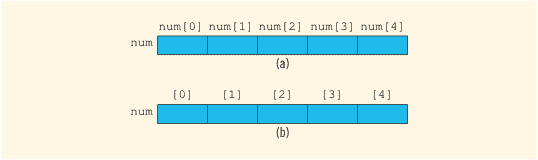

**图9-2**  数组 `num`

### 访问数组分量

用于访问数组分量的一般形式（语法）是：

```
arrayName[indexExp]
```

其中 `indexExp` 称为**索引**，是任何值为非负整数的表达式。索引值指定该分量在数组中的位置。

在C++中，`[ ]` 是一个运算符，称为**数组下标运算符**。此外，在C++中，数组索引从0开始。


考虑以下语句：

```
int list[10];
```

该语句声明了一个名为 list 的数组，它包含 10 个分量。这些分量是 `list[0]`、`list[1]`、...、`list[9]`。换句话说，我们声明了 10 个变量（见图 9-3）。

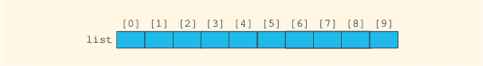

**图 9-3** 数组 list

赋值语句：

```
list[5] = 34;
```

将 34 存入 `list[5]`，它是数组 list 的第六个分量（见图 9-4）。


**图 9-4** 执行语句 `list[5] = 34;` 后的数组 list

假设 `i` 是一个 `int` 变量。那么，赋值语句：

```
list[3] = 63;
```

等价于以下赋值语句：

```
i = 3;
list[i] = 63;
```

如果 `i` 为 4，那么赋值语句：

```
list[2 * i - 3] = 58;
```

会将 58 存入 `list[5]`，因为 2 * i - 3 的计算结果为 5。先计算索引表达式，从而得到该分量在数组中的位置。

接下来，考虑以下语句：

```
list[3] = 10;
list[6] = 35;
list[5] = list[3] + list[6];
```

第一条语句将 10 存入 list[3]，第二条语句将 35 存入 list[6]，第三条语句将 list[3] 和 list[6] 的内容相加，并将结果存入 list[5]（见图 9-5）。


**图 9-5** 执行语句 `list[3] = 10;`、`list[6] = 35;` 和 `list[5] = list[3] + list[6];` 后的数组 list

### 示例 9-2

也可以按如下方式声明数组：

```
const int ARRAY_SIZE = 10;
int list[ARRAY_SIZE];
```

也就是说，可以先声明一个命名常量，然后使用该命名常量的值来声明数组并指定其大小。

> **注意** 声明数组时，其大小必须是已知的。例如，不能这样做：
>
> ```
> int arraySize;                         //Line 1
> cout << "Enter the size of the array: ";  //Line 2
> cin >> arraySize;                        //Line 3
> cout << endl;                             //Line 4
> int list[arraySize];                      //Line 5; not allowed
> ```
>
> 第 2 行语句要求用户在执行程序时输入数组的大小。第 3 行语句将数组大小输入到 arraySize。编译器编译第 1 行时，变量 arraySize 的值未知。因此，当编译器编译第 5 行时，数组大小未知，编译器不知道要为该数组分配多少内存空间。在第 13 章中，你将学习如何在程序执行期间指定数组的大小，然后使用指针声明该大小的数组。在程序执行期间使用指针创建的数组称为动态数组。目前，每当你声明数组时，其大小必须是已知的。

## 处理一维数组

对一维数组执行的一些基本操作包括初始化、输入数据、输出数组中存储的数据，以及查找最大和/或最小元素。此外，如果数据是数值型的，其他一些基本操作还包括求数组元素的和与平均值。这些操作中的每一项都需要能够逐个遍历数组元素。使用循环很容易做到这一点。例如，假设我们有如下语句：

```
int list[100];    //list is an array of size 100
int i;
```

下面的 `for` 循环从 list 的第一个元素开始，逐个遍历数组 list 的每个元素：

```
for (i = 0; i < 100; i++)      //Line 1
    //process list[i]          //Line 2
```

如果处理 list 需要向 `list` 输入数据，则第 2 行的语句采用输入语句的形式，例如 `cin` 语句。例如，以下语句从键盘读取 100 个数字并将这些数字存入 list：

```
for (i = 0; i < 100; i++)      //Line 1
    cin >> list[i];             //Line 2
```

类似地，如果处理 list 需要输出数据，则第 2 行的语句采用输出语句的形式。示例 9-3 进一步说明如何处理一维数组。

### 示例 9-3

本示例展示如何使用循环处理数组。以下声明贯穿本示例：

```
double sales[10];
int index;
double largestSale, sum, average;
```

第一条语句声明了一个包含 10 个分量的数组 sales，每个分量的类型均为 `double`。其他语句的含义很明确。

- a. **初始化数组：** 以下循环将数组 sales 的每个分量初始化为 0.0。

    ```
    for (index = 0; index < 10; index++)
        sales[index] = 0.0;
    ```

    

- b. **将数据读入数组：** 以下循环将数据输入到数组 `sales` 中。为简单起见，我们假设数据从键盘输入。

    ```
    for (index = 0; index < 10; index++)
        cin >> sales[index];
    ```

- c. **打印数组：** 以下循环输出数组 `sales`。为简单起见，我们假设输出到屏幕。

    ```
    for (index = 0; index < 10; index++)
        cout << sales[index] << " ";
    ```

- d. **求数组的和与平均值：** 因为数组 `sales` 正如其名，表示某些销售数据，所以自然要求总销售额和平均销售额。以下 C++ 代码求数组 `sales` 各元素的和以及平均销售额：

    ```
    sum = 0;
    for (index = 0; index < 10; index++)
        sum = sum + sales[index];

    average = sum / 10;
    ```

- e. **数组中的最大元素：** 现在我们讨论查找数组中最大元素第一次出现的算法——也就是第一个具有最大值的数组分量。然而，一般来说，用户更感兴趣的是确定数组中最大元素的位置。当然，如果你知道位置（即数组中最大元素的下标），就可以很容易地确定数组中最大元素的值。因此，让我们描述确定数组中最大元素第一次出现下标的算法——特别是数组 `sales` 中最大销售额的下标。我们将使用数组中最大元素第一次出现的下标来查找最大销售额。

    我们假设 `maxIndex` 将保存数组 `sales` 中最大元素第一次出现的下标。一般算法很直接。最初，我们假设列表中的第一个元素是最大元素，因此将 `maxIndex` 初始化为 0。然后，我们将 `maxIndex` 指向的元素与列表中后续的每个元素进行比较。每当发现数组中有元素大于 `maxIndex` 指向的元素时，我们就更新 `maxIndex`，使其指向新的更大元素。算法如下：

    ```
    maxIndex = 0;
    for (index = 1; index < 10; index++)
        if (sales[maxIndex] < sales[index])
            maxIndex = index;
    largestSale = sales[maxIndex];
    ```

    让我们用一个例子演示该算法如何工作。假设数组 `sales` 如图 9-6 所示。

    |  | [0] | [1] | [2] | [3] | [4] | [5] | [6] | [7] | [8] | [9] |
    |---:|---:|---:|---:|---:|---:|---:|---:|---:|---:|---:|
    | sales | 12.50 | 8.35 | 19.60 | 25.00 | 14.00 | 39.43 | 35.90 | 98.23 | 66.65 | 35.64 |

    **图 9-6** 数组 `sales`

    这里，我们确定数组 `sales` 中的最大元素。在 `for` 循环开始之前，`maxIndex` 被初始化为 0，而 `for` 循环将 `index` 初始化为 1。下面展示在 `for` 循环的每次迭代中 `maxIndex`、`index` 以及某些数组元素的值。

    | index | maxIndex | sales[maxIndex] | sales[index] | sales[maxIndex] < sales[index] |
    |---:|---:|---:|---:|---|
    | 1 | 0 | 12.50 | 8.35 | 12.50 < 8.35 为**假** |
    | 2 | 0 | 12.50 | 19.60 | 12.50 < 19.60 为**真**；maxIndex = 2 |
    | 3 | 2 | 19.60 | 25.00 | 19.60 < 25.00 为**真**；maxIndex = 3 |
    | 4 | 3 | 25.00 | 14.00 | 25.00 < 14.00 为**假** |
    | 5 | 3 | 25.00 | 39.43 | 25.00 < 39.43 为**真**；maxIndex = 5 |
    | 6 | 5 | 39.43 | 35.90 | 39.43 < 35.90 为**假** |
    | 7 | 5 | 39.43 | 98.23 | 39.43 < 98.23 为**真**；maxIndex = 7 |
    | 8 | 7 | 98.23 | 66.65 | 98.23 < 66.65 为**假** |
    | 9 | 7 | 98.23 | 35.64 | 98.23 < 35.64 为**假** |

    `for` 循环执行后，`maxIndex = 7`，这给出了数组 `sales` 中最大元素的下标。因此，`largestSale = sales[maxIndex] = 98.23`。

    > **注意** 你可以编写一个查找数组中最小元素的算法，该算法类似于查找数组中最大元素的算法。（参见本章末尾的编程练习 2。）

既然我们已经知道如何声明和处理数组，现在让我们重写本章开头讨论的程序。回顾一下，该程序读取五个数字，求和，并按相反顺序打印这些数字。


### 示例 9-4

```cpp
//Program to read five numbers, find their sum, and
//print the numbers in reverse order.

#include <iostream>

using namespace std;

int main()
{
    int item[5];  //Declare an array item of five components
    int sum;
    int counter;

    cout << "Enter five numbers: ";

    sum = 0;

    for (counter = 0; counter < 5; counter++)
    {
        cin >> item[counter];
        sum = sum + item[counter];
    }

    cout << endl;

    cout << "The sum of the numbers is: " << sum << endl;
    cout << "The numbers in reverse order are: ";

    //Print the numbers in reverse order.
    for (counter = 4; counter >= 0; counter--)
        cout << item[counter] << " ";

    cout << endl;

    return 0;
}
```

**示例运行：** 在此示例运行中，用户输入以阴影显示。

```
Enter five numbers: 12 76 34 52 89

The sum of the numbers is: 263
The numbers in reverse order are: 89 52 34 76 12
```

## 数组下标越界

考虑以下声明：

```
double num[10];
int i;
```

分量 `num[i]` 是有效的；也就是说，如果 `i = 0, 1, 2, 3, 4, 5, 6, 7, 8, or 9`，那么 `i` 就是有效下标。

数组的下标——比如 `index`——如果 `index >= 0` 且 `index <= ARRAY_SIZE − 1`，则称该下标是**在界内**。如果 `index < 0` 或 `index > ARRAY_SIZE − 1`，则称该下标**越界**。

不幸的是，在 C++ 中并没有针对越界下标的防护机制。因此，C++ 不会检查下标值是否在范围内——也就是是否在 0 到 ARRAY_SIZE − 1 之间。如果下标越界，而程序又试图访问该下标所指定的分量，那么下标所指示的内存位置无论是哪里，该位置都会被访问。这种情况可能导致修改或访问你从未打算修改或访问的内存位置中的数据。因此，如果在执行期间下标越界，可能会发生一些奇怪的事情。确保下标在界内完全是程序员的责任。

如下所示的循环可能使下标越界：

```cpp
for (i = 0; i <= 10; i++)
    list[i] = 0;
```

这里，我们假设 `list` 是一个包含 10 个分量的数组。当 `i` 变为 10 时，循环测试条件 `i <= 10` 求值为 **真**，循环体执行，从而将 0 存入 `list[10]`。从逻辑上讲，`list[10]` 并不存在。

> **注意** 在某些新编译器中，如果程序中的数组下标越界，程序可能会因错误消息而终止。例如，请参见本书配套网站上的程序 `Example_ArrayIndexOutOfBoundsA.cpp` 和 `Example_ArrayIndexOutOfBoundsB.cpp`。

## 声明期间初始化数组

与任何其他简单变量一样，数组可以在声明时进行初始化。例如，以下 C++ 语句声明了一个包含五个分量的数组 `sales`，并初始化这些分量。

```cpp
double sales[5] = {12.25, 32.50, 16.90, 23, 45.68};
```

这些值放在花括号之间，并用逗号分隔——这里，`sales[0] = 12.25`、`sales[1] = 32.50`、`sales[2] = 16.90`、`sales[3] = 23.00` 和 `sales[4] = 45.68`。

在声明数组时初始化数组，不必指定数组的大小。大小由花括号中初始值的数量决定。但是，必须在数组名后包含方括号。因此，前一条语句等价于：

```cpp
double sales[] = {12.25, 32.50, 16.90, 23, 45.68};
```

尽管如果在声明期间初始化数组，就不必指定数组的大小，但这样做是一种好习惯。

### 声明期间数组的部分初始化

当你同时声明并初始化一个数组时，不需要初始化该数组的所有分量。此过程称为**声明期间数组的部分初始化**。但是，如果在声明期间部分初始化数组，则必须谨慎行事。以下示例有助于解释当你声明并部分初始化数组时会发生什么。

语句：

```c
int list[10] = {0};
```

声明 `list` 为一个包含 10 个分量的数组，并将所有分量初始化为 0。语句：

```c
int list[10] = {8, 5, 12};
```

声明 `list` 为一个包含 10 个分量的数组，并将 `list[0]` 初始化为 8、`list[1]` 初始化为 5、`list[2]` 初始化为 12，将所有其他分量初始化为 0。因此，如果初始化语句中没有指定所有值，则未指定值的数组分量会被初始化为 0。请注意，这里的声明语句中数组的大小确实有影响。例如，语句：

```c
int list[] = {5, 6, 3};
```

声明 `list` 为一个包含三个分量的数组，并将 `list[0]` 初始化为 5、`list[1]` 初始化为 6、`list[2]` 初始化为 3。相比之下，语句：

```c
int list[25] = {4, 7};
```

声明 `list` 为一个包含 25 个分量的数组。前两个分量分别初始化为 4 和 7，所有其他分量初始化为 0。

当你部分初始化数组时，最后一个已初始化元素之后的所有元素都必须未初始化。因此，以下语句将导致语法错误：

```c
int list[10] = {2, 5, 6, , 8}; //illegal
```

在此初始化中，由于第四个元素未初始化，第四个元素之后的所有元素都必须保持未初始化。

### 数组处理的一些限制

考虑以下语句：

```c
int myList[5] = {0, 4, 8, 12, 16}; //Line 1
int yourList[5]; //Line 2
```

第 1 行中的语句声明并初始化数组 `myList`，第 2 行中的语句声明数组 `yourList`。请注意，这些数组类型相同，且分量数量相同。假设你想将 `myList` 的元素复制到 `yourList` 的对应元素中。以下语句是非法的：

```
yourList = myList;  //illegal
```

事实上，该语句将产生语法错误。C++ 不允许对数组进行聚合操作。对数组的**聚合操作**是指将整个数组作为单个单元进行操作的任何操作。

要将一个数组复制到另一个数组，必须逐个分量复制——也就是说，一次复制一个分量。这可以使用如下循环完成：

```
for (int index = 0; index < 5; index ++)
    yourList[index] = myList[index];
```

接下来，假设你想将数据读入数组 `yourList`。以下语句是非法的，事实上，会产生语法错误。

```
cin >> yourList;  //illegal
```

要将数据读入 `yourList`，必须使用如下循环一次读取一个分量：

```
for (int index = 0; index < 5; index ++)
    cin >> yourList[index];
```

类似地，确定两个数组是否具有相同元素以及打印数组内容都必须逐个分量完成。请注意，以下语句在不会产生语法错误的意义上是非法的；然而，它们不会给出期望的结果。

```
cout << yourList;

if (myList <= yourList)
.
.
.
```

我们将在本章后面的“数组的基地址与计算机内存中的数组”一节中评论这些语句。

## 数组作为函数参数

既然你已经了解了如何使用数组，一个自然的问题就出现了：数组如何作为参数传递给函数？

**仅按引用传递：** 在 C++ 中，数组仅按引用传递。

由于数组仅按引用传递，因此在将数组声明为形参时，你*不要*使用符号 &。

将一维数组声明为形参时，通常省略数组的大小。如果在将一维数组声明为形参时指定其大小，编译器会忽略该大小。

### 示例 9-5

考虑以下函数：

```
void funcArrayAsParam(int listOne[], double listTwo[])
{
    .
    .
    .
}
```

函数 `funcArrayAsParam` 有两个形参：(1) `listOne`，一个 `int` 类型的一维数组（也就是说，分量类型是 `int`）；(2) `listTwo`，一个 `double` 类型的一维数组。在此声明中，两个数组的大小均未指定。

有时，数组中的元素数量可能小于数组的大小。例如，存储学生数据的数组中的元素数量可能随着学生退课或选课而增加或减少。在这种情况下，我们只想处理数组中保存实际数据的分量。要编写处理此类数组的函数，除了将数组声明为形参外，还要声明另一个形参来指定数组中的元素数量，如下面的函数所示：

```
void initialize(int list[], int listSize)
{
    int count;

    for (count = 0; count < listSize; count++)
        list[count] = 0;
}
```

函数 `initialize` 的第一个参数是一个任意大小的 `int` 数组。当调用函数 `initialize` 时，实际数组的大小作为函数 `initialize` 的第二个参数传递。

## 常量数组作为形参

回想一下，当形参是引用参数时，只要形参改变，实参也会改变。然而，即使数组总是按引用传递，你仍然可以防止函数改变实参。为此，在形参声明中使用保留字 `const`。考虑以下函数：

```cpp
void example(int x[], const int y[], int sizeX, int sizeY)
{
    .
    .
    .
}
```

这里，函数 `example` 可以修改数组 x，但不能修改数组 y。任何修改 y 的尝试都会导致编译时错误。如果你不希望函数修改数组，那么将数组声明为常量形参是一种良好的编程实践。

### 示例 9-6

本示例展示如何编写用于数组处理的函数，以及如何将数组声明为形参。

```cpp
//Function to initialize an int array to 0.
//The array to be initialized and its size are passed
//as parameters. The parameter listSize specifies the
//number of elements to be initialized.
void initializeArray(int list[], int listSize)
{
    int index;

    for (index = 0; index < listSize; index++)
        list[index] = 0;
}

//Function to read and store the data into an int array.
//The array to store the data and its size are passed as
//parameters. The parameter listSize specifies the number
//of elements to be read.
void fillArray(int list[], int listSize)
{
    int index;

    for (index = 0; index < listSize; index++)
        cin >> list[index];
}

//Function to print the elements of an int array.
//The array to be printed and the number of elements
//are passed as parameters. The parameter listSize
//specifies the number of elements to be printed.
void printArray(const int list[], int listSize)
{
    int index;

    for (index = 0; index < listSize; index++)
        cout << list[index] << " ";
}

//Function to find and return the sum of the
//elements of an int array. The parameter listSize
//specifies the number of elements to be added.
int sumArray(const int list[], int listSize)
{
    int index;
    int sum = 0;

    for (index = 0; index < listSize; index++)
        sum = sum + list[index];

    return sum;
}

//Function to find and return the index of the first
//largest element in an int array. The parameter listSize
//specifies the number of elements in the array.
int indexLargestElement(const int list[], int listSize)
{
    int index;
    int maxIndex = 0; //assume the first element is the largest

    for (index = 1; index < listSize; index++)
        if (list[maxIndex] < list[index])
            maxIndex = index;

    return maxIndex;
}

//Function to copy some or all of the elements of one array
//into another array. Starting at the position specified
//by src, the elements of list1 are copied into list2
//starting at the position specified by tar. The parameter
//numOfElements specifies the number of elements of list1 to
//be copied into list2. Starting at the position specified
//by tar, the list2 must have enough positions to copy the
//elements of list1. The following call copies all of the
//elements of list1 into the corresponding positions in
//list2: copyArray(list1, 0, list2, 0, numOfElements);
void copyArray(int list1[], int src, int list2[],
               int tar, int numOfElements)
{
    for (int index = src; index < src + numOfElements; index++)
    {
        list2[index] = list1[tar];
        tar++;
    }
}
```

示例 9-7 将说明如何在程序中使用其中一些函数。

## 数组的基地址与计算机内存中的数组

数组的基地址是数组第一个分量的地址（即内存位置）。例如，如果 `list` 是一维数组，那么 `list` 的基地址就是分量 `list[0]` 的地址。

考虑以下语句：

```cpp
int myList[5];        //Line 1
```

这条语句将 `myList` 声明为一个包含五个 `int` 类型分量的数组。这些分量是 `myList[0]`、`myList[1]`、`myList[2]`、`myList[3]` 和 `myList[4]`。计算机为这些分量分配五个内存空间，每个空间都足以存储一个 `int` 值。此外，这五个内存空间是连续的。

数组 `myList` 的基地址是分量 `myList[0]` 的地址。假设数组 `myList` 的基地址是 1000。那么，分量 `myList[0]` 的地址就是 1000。通常，为 `int` 变量分配的内存是四个字节。回顾第 1 章，主存是一个有序的单元序列，每个单元都有一个唯一地址。通常，每个单元是一个字节。因此，为了将一个值存储到 `myList[0]` 中，从地址 1000 开始，接下来的四个字节被分配给 `myList[0]`。由此可知，`myList[1]` 的起始地址是 1004，`myList[2]` 的起始地址是 1008，依此类推（见图 9-7）。

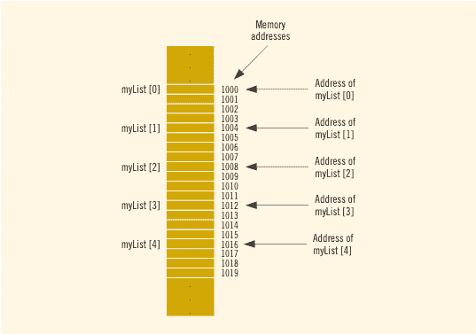

**图 9-7**  数组 `myList` 及其各分量的地址

现在，`myList` 是一个数组名。标识符 `myList` 也关联着一个内存空间，并且数组的基地址存储在该内存空间中。考虑以下语句：

```cpp
cout << myList << endl;          //Line 2
```

前面我们说过，这条语句不会得到期望的结果。也就是说，这条语句不会输出 `myList` 各分量的值。实际上，这条语句输出的是 `myList` 的值，即数组的基地址。这就是该语句不会产生语法错误的原因。

假设你还有以下语句：

```cpp
int yourList[5];
```

那么，在以下语句中：

```cpp
if (myList <= yourList)          //Line 3
.
.
.
```

如果数组 `myList` 的基地址小于数组 `yourList` 的基地址，则表达式 `myList <= yourList` 的求值结果为 true；否则求值结果为 false。它并不判断 `myList` 的元素是否小于或等于 `yourList` 的对应元素。

> **注意**  
> 本书配套网站包含程序 `BaseAddressOfAnArray.cpp`，它阐明了第 2 行和第 3 行这类语句。

你可能想知道为什么数组的基地址如此重要。原因在于，当你声明一个数组时，计算机所记住的关于该数组的信息只有数组名、基地址、每个分量的数据类型，以及（可能还有）分量个数。利用数组的基地址和数组分量的索引，计算机可以确定特定分量的地址。例如，假设你想访问 `myList[3]` 的值。现在，`myList` 的基地址是 1000。`myList` 的每个分量都是 `int` 类型，因此它使用四个字节来存储一个值，而索引是 3。为了访问 `myList[3]` 的值，计算机计算地址 1000 + 4 * 3 = 1000 + 12 = 1012。也就是说，这就是 `myList[3]` 的起始地址。因此，从 1012 开始，计算机访问接下来的四个字节。

当你将数组作为参数传递时，实际数组的基地址会被传递给形参。例如，假设你有以下函数：

```cpp
void arrayAsParameter(int list[], int size)
{
    .
    .
    .

    list[2] = 28;        //Line 4

    .
    .
    .
}
```

另外，假设你有以下对该函数的调用：

```cpp
arrayAsParameter(myList, 5);  //Line 5
```

在这条语句中，myList 的基地址被传递给形参 list。因此，list 的基地址是 1000。函数定义中包含语句 list[2] = 28;。这条语句将 28 存储到 list[2] 中。为了访问 list[2]，计算机按如下方式计算地址：1000 + 4 * 2 = 1008。因此，从地址 1008 开始，计算机访问接下来的四个字节并存储 28。注意，实际上 1008 就是 myList[2] 的地址（见图 9-7）。由此可知，在第 5 行语句执行期间，第 4 行语句会将值 28 存储到 myList[2] 中。还可以得出，在第 5 行语句的函数调用执行期间，list[index] 和 myList[index] 指的是同一内存空间，其中 0 <= index 且 index < 5。

> **注意** 如果 C++ 允许按值传递数组，那么计算机就必须为形参的分量分配内存，并在调用函数时将实际数组的内容复制到相应的形参中。如果数组很大，这个过程会浪费内存，也会浪费复制数据所需的计算机时间。这就是 C++ 中数组总是按引用传递的原因。

## 函数不能返回数组类型的值

C++ 不允许函数返回数组类型的值。注意，前面描述的 sumArray 和 indexLargestElement 函数返回的是 int 类型的值。

### 示例 9-7

以下程序说明数组如何在函数调用中作为实参传递。（注意，该程序使用示例 9-6 中编写的函数。）

```cpp
//Arrays as parameters to functions

#include <iostream>
```


```cpp
using namespace std;

const int ARRAY_SIZE = 10;

void initializeArray(int x[],int sizeX);
void fillArray(int x[],int sizeX);
void printArray(const int x[],int sizeX);
int sumArray(const int x[],int sizeX);
int indexLargestElement(const int x[],int sizeX);
void copyArray(int list1[], int src, int list2[],
               int tar, int numOfElements);

int main()
{
    int listA[ARRAY_SIZE] = {0};        //Declare the array listA
                                        //of 10 components and
                                        //initialize each component
                                        //to 0.
    int listB[ARRAY_SIZE];              //Declare the array listB
                                        //of 10 components.

    cout << "Line 1: listA elements: "; //Line 1

        //Output the elements of listA using
        //the function printArray
    printArray(listA, ARRAY_SIZE);      //Line 2
    cout << endl;                       //Line 3

        //Initialize listB using the function
        //initializeArray
    initializeArray(listB, ARRAY_SIZE); //Line 4

    cout << "Line 5: listB elements: "; //Line 5

        //Output the elements of listB
    printArray(listB, ARRAY_SIZE);      //Line 6
    cout << endl << endl;               //Line 7

    cout << "Line 8: Enter " << ARRAY_SIZE
         << " integers: ";              //Line 8

        //Input data into listA using the
        //function fillArray
    fillArray(listA, ARRAY_SIZE);       //Line 9
    cout << endl;                       //Line 10

    cout << "Line 11: After filling listA, "
         << "the elements are:" << endl; //Line 11

        //Output the elements of listA
    printArray(listA, ARRAY_SIZE);      //Line 12
    cout << endl << endl;               //Line 13

    //Find and output the sum of the elements
    //of listA
    cout << "Line 14: The sum of the elements of "
         << "listA is: "
         << sumArray(listA, ARRAY_SIZE) << endl
         << endl;                         //Line 14

    //Find and output the position of the largest
    //element in listA
    cout << "Line 15: The position of the largest "
         << "element in listA is: "
         << indexLargestElement(listA, ARRAY_SIZE)
         << endl;                         //Line 15

    //Find and output the largest element
    //in listA
    cout << "Line 16: The largest element in "
         << "listA is: "
         << listA[indexLargestElement(listA, ARRAY_SIZE)]
         << endl << endl;                  //Line 16

    //Copy the elements of listA into listB using
    //function copyArray
    copyArray(listA, 0, listB, 0, ARRAY_SIZE);      //Line 17

    cout << "Line 18: After copying the elements "
         << "of listA into listB," << endl
         << "    listB elements are: ";             //Line 18

    //Output the elements of listB
    printArray(listB, ARRAY_SIZE);                   //Line 19
    cout << endl;                                    //Line 20

    return 0;
}

//Place the definitions of the functions initializeArray,
//fillArray, and so on here. Example 9-6 gives the definitions
//of these functions.
```

**示例运行：** 在此示例运行中，用户输入以阴影显示。

```text
Line 1: listA elements: 0 0 0 0 0 0 0 0 0 0
Line 5: listB elements: 0 0 0 0 0 0 0 0 0 0

Line 8: Enter 10 integers: 33 77 25 63 56 48 98 39 5 12

Line 11: After filling listA, the elements are:
33 77 25 63 56 48 98 39 5 12

Line 14: The sum of the elements of listA is: 456
Line 15: The position of the largest element in listA is: 6
Line 16: The largest element in listA is: 98

Line 18: After copying the elements of listA into listB,
         listB elements are: 33 77 25 63 56 48 98 39 5 12
```

该程序的输出很直接。首先，我们声明包含10个分量的数组 listA，并将 listA 的每个分量初始化为0。然后，我们声明包含10个分量的数组 listB。第2行的语句调用函数 printArray，输出存储在 listA 中的值。第9行的语句调用函数 fillArray，将数据输入到 listA 中。第14行的语句调用函数 sumArray，输出 listA 中所有元素的和。同样，第16行的语句输出 listA 中最大元素的值。

### 整型数据类型与数组下标

> **注意**  
> 理解本节需要先阅读第8章中的“枚举类型”和“typedef 语句”两节。

除整数外，C++ 允许任何整型类型用作数组下标。这一特性可以大大提高程序的可读性。考虑以下语句：

```cpp
enum paintType {GREEN, RED, BLUE, BROWN, WHITE, ORANGE, YELLOW};
double paintSale[7];
paintType paint;
```

下面的循环将数组 paintSale 的每个分量初始化为0：

```cpp
for (paint = GREEN; paint <= YELLOW;
                 paint = static_cast<paintType>(paint + 1))
    paintSale[paint] = 0.0;
```

下面的语句更新 RED 油漆的销售额：

```cpp
paintSale[RED] = paintSale[RED] + 75.69;
```

如你所见，上述代码比使用整数作为下标的代码更容易理解。因此，只要可能，就应使用枚举类型或其他整型数据类型作为数组下标。注意，使用枚举类型作为数组下标时，应使用枚举类型中标识符的默认值。也就是说，第一个标识符的值必须为0，依此类推。（回顾第8章可知，枚举类型中标识符的默认值从0开始；不过，这些标识符也可以设置为其他值。）

### 其他声明数组的方法

假设一个班有20名学生，你需要记录他们的成绩。由于学生人数可能每个学期都会变化，因此不必在声明数组时指定数组大小，可以按如下方式声明数组：

```cpp
const int NO_OF_STUDENTS = 20;
int testScores[NO_OF_STUDENTS];
```

用于声明数组的其他形式有：

```cpp
const int SIZE = 50;      //Line 1
typedef double list[SIZE]; //Line 2

list yourList;             //Line 3
list myList;              //Line 4
```

第2行的语句定义了一个数据类型 list，它是一个由50个 double 类型分量组成的数组。第3行和第4行的语句声明了两个变量 yourList 和 myList。二者都是由50个 double 类型分量组成的数组。当然，这些语句等价于：

```cpp
double yourList[50];
double myList[50];
```

### 在数组中查找特定项

在列表中查找给定项是对列表执行的最常见操作之一。我们描述的查找算法称为**顺序查找**或**线性查找**。顾名思义，你从第一个数组元素开始顺序搜索数组。将 `searchItem` 与数组（列表）中的元素进行比较，并继续搜索，直到找到该项，或者列表中没有更多数据可与 `searchItem` 比较为止。

考虑图9-8所示的七个元素的列表。

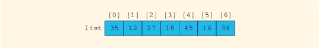

**图 9-8**  七个元素的列表

假设你想确定27是否在列表中。顺序查找的工作方式如下：首先，将27与 `list[0]` 比较，也就是将27与35比较。因为 `list[0] ≠ 27`，接着将27与 `list[1]` 比较，也就是与列表中的第二项12比较。因为 `list[1] ≠ 27`，你将27与列表中的下一个元素比较，即与 `list[2]` 比较。因为 `list[2] == 27`，搜索停止。此次查找成功。

现在让我们查找10。和之前一样，搜索从列表中的第一个元素开始，即从 `list[0]` 开始。按之前的方式继续，我们看到，这一次查找项10会与列表中的每一项进行比较。最终，列表中不再有数据可与该查找项比较。这是一次不成功的查找。

由此可知，一旦在列表中找到等于查找项的元素，就必须停止搜索并报告成功。（在这种情况下，通常还要报告在列表中找到该查找项的位置。）否则，在查找项与列表中的每个元素都比较过且未成功之后，必须停止搜索并报告失败。

假设包含列表元素的数组名为 `list`。前面的讨论可转化为以下顺序查找算法：

```
found is set to false;
loc = 0;

while (loc < listLength and not found)
    if (list[loc] is equal to searchItem)
        found is set to true
    else
        increment loc

if (found)
    return loc;
else
    return -1;
```

下面的函数对列表执行顺序查找。具体来说，为便于说明，我们假设列表元素为 int 类型。

```cpp
int seqSearch(const int list[], int listLength, int searchItem)
{
    int loc;
    bool found = false;

    loc = 0;

    while (loc < listLength && !found)
        if (list[loc] == searchItem)
            found = true;
        else
            loc++;

    if (found)
        return loc;
    else
        return -1;
}
```

如果函数 `seqSearch` 返回大于或等于0的值，则是一次成功的查找；否则，是一次不成功的查找。


从这段代码可以看出，你通过将 searchItem 与列表中的第一个元素进行比较来开始搜索。如果 searchItem 等于列表中的第一个元素，则退出循环；否则，loc 递增 1，指向列表中的下一个元素。然后你将 searchItem 与列表中的下一个元素进行比较，依此类推。

### 示例 9-8

```cpp
// This program illustrates how to use a sequential search in a
// program.

#include <iostream>                                      //Line 1

using namespace std;                                     //Line 2

const int ARRAY_SIZE = 10;                               //Line 3

int seqSearch(const int list[], int listLength,          //Line 4
              int searchItem);

int main()                                               //Line 5
{                                                        //Line 6
    int intList[ARRAY_SIZE];                             //Line 7
    int number;                                          //Line 8

    cout << "Line 9: Enter " << ARRAY_SIZE                //Line 9
         << " integers." << endl;

    for (int index = 0; index < ARRAY_SIZE; index++)     //Line 10
        cin >> intList[index];                           //Line 11

    cout << endl;                                        //Line 12

    cout << "Line 13: Enter the number to be "            //Line 13
         << "searched: ";                                //Line 14
    cin >> number;                                       //Line 15
    cout << endl;

    int pos = seqSearch(intList, ARRAY_SIZE, number);    //Line 16

    if (pos != -1)                                       //Line 17
        cout <<"Line 18: " << number                     //Line 18
             << " is found at position " << pos          //Line 19
             << endl;
    else
        cout << "Line 20: " << number                    //Line 20
             << " is not in the list." << endl;

    return 0;                                            //Line 21
}                                                        //Line 22

//Place the definition of the function seqSearch
//given previously here.
```

### 样例运行 1：

在此样例运行中，用户输入以阴影显示。

```text
Line 9: Enter 10 integers.
2 56 34 25 73 46 89 10 5 16

Line 13: Enter the number to be searched: 25

Line 18: 25 is found at position 3
```

### 样例运行 2：

```text
Line 9: Enter 10 integers.
2 56 34 25 73 46 89 10 5 16

Line 13: Enter the number to be searched: 38

Line 20: 38 is not in the list.
```

## C字符串（字符数组）

到目前为止，我们一直避免讨论字符数组，原因很简单：字符数组具有特殊意义，并且处理它们的方式与处理其他数组不同。C++ 提供了许多（预定义的）函数，可用于字符数组。

**字符数组：** 一种其分量类型为 char 的数组。

回想一下，最常用的字符集是 ASCII 和 EBCDIC。ASCII 字符集中的第一个字符是空字符，它是不可打印的。另外，回想一下，在 C++ 中，空字符表示为 '\0'，即一个反斜杠后跟一个零。

该语句：

```cpp
ch = '\0';
```

将空字符存储到 ch 中，其中 ch 是一个 char 变量。

正如你将看到的，空字符在处理字符数组时起着重要作用。由于空字符的排序序列值为 0，因此空字符小于 char 数据集中的任何其他字符。

字符数组最常用的术语是 C字符串。然而，字符数组和 C字符串之间存在细微差别。回想一下，字符串是零个或多个字符的序列，并且字符串用双引号括起来。在 C++ 中，C字符串以空字符结尾；也就是说，C字符串中的最后一个字符始终是空字符。字符数组可能不包含空字符，但 C字符串中的最后一个字符始终是空字符。正如你将看到的，除了最后一个位置之外，空字符不应出现在 C字符串中的任何位置。此外，C字符串存储在（一维）字符数组中。

C++ 提供了一组可用于 C字符串操作的函数。头文件 cstring 描述了这些函数。我们经常使用其中的三个函数：`strcpy`（字符串复制，用于将一个 C字符串复制到一个 C字符串变量中——即赋值）；`strcmp`（字符串比较，用于比较 C字符串）；以及 `strlen`（字符串长度，用于求一个 C字符串的长度）。表 9-1 总结了这些函数。

**表 9-1** `strcpy`、`strcmp` 和 `strlen` 函数

| 函数 | 作用 |
|---|---|
| `strcpy(s1, s2)` | 将字符串 `s2` 复制到字符串变量 `s1` 中<br>`s1` 的长度至少应与 `s2` 一样大 |
| `strcmp(s1, s2)` | 如果 `s1` 小于 `s2`，则返回一个 < 0 的值<br>如果 `s1` 和 `s2` 相同，则返回 0<br>如果 `s1` 大于 `s2`，则返回一个 > 0 的值 |
| `strlen(s)` | 返回字符串 `s` 的长度，不包括空字符 |

要使用这些函数，程序必须通过 include 语句包含头文件 cstring。也就是说，程序中必须包含以下语句：

```cpp
#include <cstring>
```

### 字符串比较

在 C++ 中，C字符串使用系统的排序序列逐字符进行比较。假设你使用 ASCII 字符集。

- 1. C字符串 "Air" 小于 C字符串 "Boat"，因为 "Air" 的第一个字符小于 "Boat" 的第一个字符。
- 2. C字符串 "Air" 小于 C字符串 "An"，因为两个字符串的第一个字符相同，但 "Air" 的第二个字符 'i' 小于 "An" 的第二个字符 'n'。
- 3. C字符串 "Bill" 小于 C字符串 "Billy"，因为 "Bill" 和 "Billy" 的前四个字符相同，但 "Bill" 的第五个字符是 '\0'（空字符），它小于 "Billy" 的第五个字符 'y'。（回想一下，C++ 中的 C字符串以空字符结尾。）
- 4. C字符串 "Hello" 小于 "hello"，因为 C字符串 "Hello" 的第一个字符 'H' 小于 C字符串 "hello" 的第一个字符 'h'。

正如你所看到的，函数 `strcmp` 将其第一个 C字符串参数与第二个 C字符串参数逐字符进行比较。

### 示例 9-9

假设你有以下语句：

```cpp
char studentName[21];
char myname[16];
char yourname[16];
```

以下语句展示了字符串函数如何工作：

| 语句 | 作用 |
|---|---|
| `strcpy(myname, "John Robinson");` | `myname = "John Robinson"` |
| `strlen("John Robinson");` | 返回 13，即字符串 **"John Robinson"** 的长度 |
| `int len;`<br>`len = strlen("Sunny Day");` | 将 9 存储到 `len` 中 |
| `strcpy(yourname, "Lisa Miller");`<br>`strcpy(studentName, yourname);` | `yourname = "Lisa Miller"`<br>`studentName = "Lisa Miller"` |
| `strcmp("Bill", "Lisa");` | 返回一个 < 0 的值 |
| `strcpy(yourname, "Kathy Brown");`<br>`strcpy(myname, "Mark G. Clark");`<br>`strcmp(myname, yourname);` | `yourname = "Kathy Brown"`<br>`myname = "Mark G. Clark"`<br>返回一个 > 0 的值 |

> **注意。** 在本章中，我们将 C字符串定义为由零个或多个字符组成的序列。C字符串用双引号括起来。我们还说过，C字符串以空字符结尾，因此 C字符串 `"Hello"` 有六个字符，即使双引号中只括了五个字符。因此，要将 C字符串 `"Hello"` 存储到计算机内存中，必须使用大小为 6 的字符数组。C字符串的长度是双引号中实际包含的字符数；例如，C字符串 `"Hello"` 的长度是 5。因此，从逻辑意义上讲，C字符串是由零个或多个字符组成的序列，但从物理意义上讲（也就是说，要将 C字符串存储到计算机内存中），C字符串至少有一个字符。由于 C字符串的长度是双引号中实际包含的字符数，我们将 C字符串定义为由零个或多个字符组成的序列。但是，你必须记住，存储在计算机内存中 C字符串末尾的空字符在我们比较 C字符串时起着关键作用，尤其是比较像 `"Bill"` 和 `"Billy"` 这样的 C字符串时。


## 读取和写入字符串

如前所述，适用于数组的大多数规则同样适用于 C-字符串。诸如赋值和比较等聚合操作不允许用于数组。即使数组的输入/输出也是逐分量进行的。然而，C++ 中允许对数组进行聚合操作的唯一地方是 C-字符串（即字符数组）的输入和输出。

为了便于讨论，我们将使用以下声明：

```cpp
char name[31];
```

### 字符串输入

由于 C-字符串输入允许聚合操作，语句：

```cpp
cin >> name;
```

将下一个输入的 C-字符串存储到 name 中。

输入的 C-字符串的长度必须小于或等于 30。如果输入字符串的长度为 4，计算机会存储输入的四个字符以及空字符 '\0'。如果输入的 C-字符串长度超过 30，那么由于对数组下标越界没有检查，计算机会继续将字符串存储到 name 之后的内存单元中。这个过程可能引发严重问题，因为相邻内存单元中的数据会被破坏。

> **注意**
>
> 当你使用键盘等输入设备输入 C-字符串时，不要在其周围加上双引号，除非双引号是字符串的一部分。例如，C-字符串 "Hello" 应输入为 Hello。

回想一下，提取运算符 >> 会跳过所有前导空白字符，并且一旦遇到第一个空白字符或无效数据，就停止向当前变量读取数据。因此，包含空格的 C-字符串不能使用提取运算符 >> 来读取。例如，如果名字和姓氏之间用空格分隔，则无法将它们读入 name。

如何将带空格的 C-字符串输入到字符数组中？函数 get 再次为我们排忧解难。回想一下，函数 get 用于读取字符数据。到目前为止，你使用过的 get 函数形式（第 3 章）只能读取单个字符。然而，函数 get 也可以用于读取字符串。要读取 C-字符串，需要使用带有两个参数的 get 函数形式。第一个参数是 C-字符串变量；第二个参数指定要读入字符串变量中的字符数。

要读取 C-字符串，get 函数与 cin 等输入流变量一起使用的通用形式（语法）如下：

```cpp
cin.get(str, m + 1);
```

该语句将接下来的 m 个字符，或直到遇到换行符 '\n' 为止的所有字符存储到 str 中。换行符不会存储在 str 中。如果输入的 C-字符串少于 m 个字符，那么读取将在换行符处停止。

考虑以下语句：

```cpp
char str[31];
cin.get(str, 31);
```

如果输入为：

William T. Johnson

那么 "William T. Johnson" 将被存储到 str 中。

假设输入为：

Hello there. My name is Mickey Blair.

那么，由于 str 最多只能存储 30 个字符，C-字符串 "Hello there. My name is Mickey" 将被存储到 str 中。

现在，假设我们有如下语句：

```cpp
char str1[26];
char str2[26];
char discard;
```

以及两行输入：

```
Summer is warm.
Winter will be cold.
```

此外，假设我们希望将第一个 C-字符串存储到 str1 中，将第二个 C-字符串存储到 str2 中。str1 和 str2 都可以存储长度最多为 25 个字符的 C-字符串。由于第一行的字符数为 15，读取会在 '\n' 处停止。你必须读取并丢弃第一行末尾的换行符，才能将第二行存储到 str2 中。以下语句序列将第一行存储到 str1 中，将第二行存储到 str2 中：

```cpp
cin.get(str1, 26);
cin.get(discard);
cin.get(str2, 26);
```

要读取并存储一行输入（包括空白字符），你还可以使用流函数 getline。假设你有以下声明：

```cpp
char textLine[100];
```

以下语句将读取接下来的 99 个字符，或直到换行符为止的内容，存储到 textLine 中。空字符将自动追加为 textLine 的最后一个字符。

```cpp
cin.getline(textLine, 100);
```

### 字符串输出

C-字符串的输出是允许对数组进行聚合操作的另一个地方。你可以通过使用 cout 等输出流变量和插入运算符 << 来输出 C-字符串。例如，语句：

```cpp
cout << name;
```

将 name 的内容输出到屏幕上。插入运算符 << 会持续写入 name 的内容，直到找到空字符。因此，如果 name 的长度为 4，上述语句只会输出四个字符。如果 name 不包含空字符，那么你会看到奇怪的输出，因为插入运算符会持续输出 name 相邻内存中的数据，直到找到 '\0' 为止。

### 在执行时指定输入/输出文件

在第 3 章中，你学习了如何从文件中读取数据。在后续章节中，输入文件的名称包含在 open 语句中。这样做的话，程序总是从同一个输入文件接收数据。在现实世界的应用中，数据可能实际上是在多个地点收集并存储在单独的文件中。此外，为了比较的目的，有人可能希望分别处理每个文件，然后将输出存储在单独的文件中。为了高效地完成这项任务，用户更希望在执行时指定输入和/或输出文件的名称，而不是在程序代码中指定。C++ 允许用户这样做。

考虑以下语句：

```cpp
ifstream infile;
ofstream outfile;

char fileName[51];      //assume that the file name is at most
                        //50 characters long
```

以下语句提示并允许用户在执行时指定输入和输出文件：

```cpp
cout << "Enter the input file name: ";
cin >> fileName;

infile.open(fileName);    //open the input file
.
.
.

cout << "Enter the output file name: ";
cin >> fileName;

outfile.open(fileName);   //open the output file
```

本章后面的编程示例：代码检测，将进一步说明如何在程序执行期间指定输入和输出文件的名称。

### `string` 类型与输入/输出文件

在第 8 章中，我们讨论了 string 数据类型。现在我们要指出，string 类型的值（即字符串）不是以空字符结尾的。string 类型的变量也可以用来读取和存储输入/输出文件的名称。然而，open 函数的参数必须是一个以空字符结尾的字符串——也就是 C-字符串。因此，如果我们使用 string 类型的变量来读取输入/输出文件的名称，然后使用该变量打开文件，则必须（首先）将该变量的值转换为 C-字符串（即以空字符结尾的字符串）。头文件 string 包含函数 c_str，它可以将 string 类型的值转换为以空字符结尾的字符数组（即 C-字符串）。使用函数 c_str 的语法如下：

```cpp
strVar.c_str()
```

其中 `strVar` 是一个 string 类型的变量。

以下语句说明了如何在程序执行期间使用 `string` 类型的变量读取输入/输出文件的名称并打开这些文件：

```cpp
ifstream infile;
string fileName;

cout << "Enter the input file name: ";
cin >> fileName;

infile.open(fileName.c_str());   //open the input file
```

当然，你还必须在程序中包含头文件 `string`。输出文件也有类似的约定。

## 并行数组

如果两个（或多个）数组的对应分量保存相关信息，则称它们为**并行**的。

假设你需要记录学生的课程成绩以及他们的 ID 号码，以便在学期末公布成绩。进一步假设一个班级最多有 50 名学生，且他们的 ID 为 5 位数字。因为可能有 50 名学生，你需要 50 个变量来存储学生的 ID，以及 50 个变量来存储他们的成绩。你可以声明两个数组：类型为 `int` 的 studentId 和类型为 `char` 的 courseGrade。每个数组有 50 个分量。此外，studentId[0] 和 courseGrade[0] 将存储第一个学生的 ID 和课程成绩，studentId[1] 和 courseGrade[1] 将存储第二个学生的 ID 和课程成绩，依此类推。

以下语句：

```cpp
int studentId[50];
char courseGrade[50];
```

声明了这两个数组。

假设你需要向这些数组中输入数据，并且数据以以下形式在文件中提供：

```
studentId courseGrade
```

例如，一个示例数据集如下：

| studentId | courseGrade |
| --- | --- |
| 23456 | A |
| 86723 | B |
| 22356 | C |
| 92733 | B |
| 11892 | D |
| . | . |
| . | . |
| . | . |

假设输入文件使用 `ifstream` 变量 `infile` 打开。由于每个数组的大小为 50，每个数组最多可以存储 50 个元素。此外，班级中的学生可能少于 50 人。因此，


在读取数据的同时，我们还会统计学生人数，并确保数组索引不会越界。下面的循环将数据读入并行数组 `studentId` 和 `courseGrade`：

```cpp
int noOfStudents = 0;

infile >> studentId[noOfStudents] >> courseGrade[noOfStudents];

while (infile && noOfStudents < 50)
{
    noOfStudents++;
    infile >> studentId[noOfStudents]
           >> courseGrade[noOfStudents];
}
```

请注意，通常情况下，当交换一个数组中的值时，并行数组中对应的值也必须一并交换。

## 二维和多维数组

本章的其余部分将讨论二维数组以及如何处理多维数组。

在上一节中，你学习了如何使用一维数组来操作数据。如果数据以列表形式提供，可以使用一维数组。然而，有时数据以表格形式提供。例如，假设你想跟踪当地经销商处特定颜色汽车的库存数量。该经销商销售六种类型的汽车，共有五种不同颜色。图9-9显示了示例数据。

| 库存 | [红色] | [棕色] | [黑色] | [白色] | [灰色] |
|---|---:|---:|---:|---:|---:|
| [通用] | 10 | 7 | 12 | 10 | 4 |
| [福特] | 18 | 11 | 15 | 17 | 10 |
| [丰田] | 12 | 10 | 9 | 5 | 12 |
| [宝马] | 16 | 6 | 13 | 8 | 3 |
| [日产] | 10 | 7 | 12 | 6 | 4 |
| [沃尔沃] | 9 | 4 | 7 | 12 | 11 |

**图 9-9** 表 `inStock`

可以看到，数据采用表格格式。表格有30个条目，每个条目都是整数。由于表格条目类型相同，你可以声明一个包含30个 `int` 类型组件的一维数组。一维数组的前五个组件可以存储表格第一行的数据，接下来五个组件存储表格第二行的数据，依此类推。换句话说，你可以在一维数组中模拟表格形式的数据。

如果这样做，操作一维数组中数据的算法会有些复杂，因为必须知道一行在哪里结束、另一行在哪里开始，还必须正确计算特定元素的索引。C++ 通过使用二维数组简化了表格形式数据的处理。本节首先讨论如何声明二维数组，然后介绍如何在二维数组中操作数据。

**二维数组：** 以行和列（即两个维度）排列的固定数量组件的集合，其中所有组件类型相同。

声明二维数组的语法为：

```cpp
dataType arrayName[intExp1][intExp2];
```

其中 intExp1 和 intExp2 是产生正整数值的常量表达式。这两个表达式 intExp1 和 intExp2 分别指定数组的行数和列数。

语句：

```cpp
double sales[10][5];
```

声明了一个10行5列的二维数组 sales，其中每个组件都是 double 类型。与一维数组一样，行编号为 0...9，列编号为 0...4（见图9-10）。

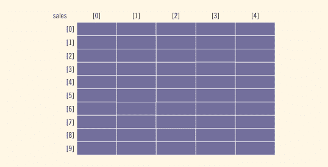

**图 9-10** 二维数组 `sales`

### 声明时初始化二维数组

与一维数组一样，二维数组可以在声明时进行初始化。下面的示例有助于说明这一概念。考虑以下语句：

```c
int board[4][3] = {{2, 3, 1},
                   {15, 25, 13},
                   {20, 4, 7},
                   {11, 18, 14}};
```

这条语句将 board 声明为一个四行三列的二维数组。第一行的组件分别是 2、3 和 1；第二行的组件分别是 15、25 和 13；第三行的组件分别是 20、4 和 7；第四行的组件分别是 11、18 和 14。图9-12显示了数组 board。

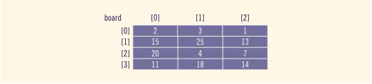

**图 9-12** 二维数组 board

在声明时初始化二维数组：

- 1. 每行的元素放在花括号内，并用逗号分隔。
- 2. 所有行都放在花括号内。
- 3. 对于数值数组，如果一行的所有组件未全部指定，则未指定的组件将初始化为0。在这种情况下，必须至少给出一个值来初始化该行的所有组件。

### 二维数组和枚举类型

> **注意** 理解本节需要阅读第8章中的“枚举类型”一节。

你也可以将枚举类型用于数组索引。考虑以下语句：

```c
const int NUMBER_OF_ROWS = 6;
const int NUMBER_OF_COLUMNS = 5;
enum carType {GM, FORD, TOYOTA, BMW, NISSAN, VOLVO};
enum colorType {RED, BROWN, BLACK, WHITE, GRAY};

int inStock[NUMBER_OF_ROWS][NUMBER_OF_COLUMNS];
```

这些语句定义了 `carType` 和 `colorType` 枚举类型，并将 `inStock` 定义为一个六行五列的二维数组。假设 `inStock` 中的每一行对应一种汽车类型，每一列对应一种颜色类型。也就是说，第一行对应汽车类型 `GM`，第二行对应 `FORD`，依此类推。同样，第一列对应颜色类型 `RED`，第二列对应 `BROWN`，依此类推。进一步假设 `inStock` 中的每个条目代表特定类型和颜色的汽车数量（见图9-13）。

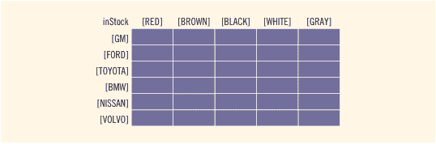

**图 9-13** 二维数组 `inStock`

语句：

```cpp
inStock[1][3] = 15;
```

等价于以下语句（见图9-14）：

```cpp
inStock[FORD][WHITE] = 15;
```

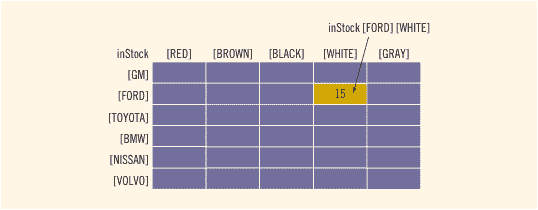

**图 9-14** `inStock[FORD][WHITE]`

第二条语句更容易传达信息——也就是说，将 **白色福特** 汽车的数量设为15。这个示例说明，枚举类型可以有效地使程序更易读、更易于管理。

### 处理二维数组

二维数组可以通过三种方式处理：

- 1. 处理整个数组。
- 2. 处理数组的特定行，称为**行处理**。
- 3. 处理数组的特定列，称为**列处理**。

初始化和打印数组是处理整个二维数组的示例。查找一行（或一列）中的最大元素或计算一行（或一列）的和是行（或列）处理的示例。我们的讨论将使用以下声明：

```cpp
const int NUMBER_OF_ROWS = 7;       //This can be set to any number.
const int NUMBER_OF_COLUMNS = 6;    //This can be set to any number.

int matrix[NUMBER_OF_ROWS][NUMBER_OF_COLUMNS];
int row;
int col;
int sum;
int largest;
int temp;
```

图9-15显示了数组 matrix。

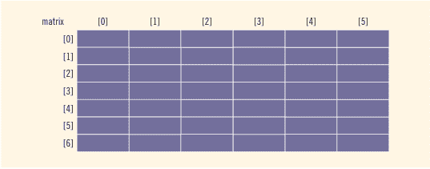

**图 9–15** 二维数组 matrix

由于二维数组的组件类型相同，因此任意行或列的组件类型也相同。这意味着二维数组的每一行和每一列都是一个一维数组。因此，在处理二维数组的特定行或列时，我们使用类似于处理一维数组的算法。我们将借助前面声明的二维数组 matrix 进一步解释这一概念。

假设我们要处理 matrix 的第5行（即 matrix 的第六行）。matrix 第5行的组件为：

`matrix[5][0], matrix[5][1], matrix[5][2], matrix[5][3], matrix[5][4], matrix[5][5]`

我们可以看到，在这些组件中，第一个索引（行位置）固定为5，第二个索引（列位置）从0到5。因此，我们可以使用以下 for 循环来处理第5行：

```
for (col = 0; col < NUMBER_OF_COLUMNS; col++)
    process matrix[5][col]
```

显然，这个 for 循环等价于下面的 for 循环：

```
row = 5;
for (col = 0; col < NUMBER_OF_COLUMNS; col++)
    process matrix[row][col]
```

类似地，假设我们要处理 matrix 的第2列，即 matrix 的第三列。该列的组件为：

`matrix[0][2], matrix[1][2], matrix[2][2], matrix[3][2], matrix[4][2], matrix[5][2], matrix[6][2]`

这里，第二个索引（即列位置）固定为2，第一个索引（即行位置）从0到6。在这种情况下，我们可以使用以下 for 循环来处理 matrix 的第2列：

```
for (row = 0; row < NUMBER_OF_ROWS; row++)
    process matrix[row][2]
```

显然，这个 for 循环等价于下面的 for 循环：

```
col = 2;
for (row = 0; row < NUMBER_OF_ROWS; row++)
    process matrix[row][col]
```

接下来，我们讨论具体的处理算法。

### 初始化

假设你想将第4行（即第五行）初始化为0。如前所述，下面的 for 循环可以完成此操作：

```
row = 4;
for (col = 0; col < NUMBER_OF_COLUMNS; col++)
    matrix[row][col] = 0;
```

如果你想将整个 matrix 初始化为0，也可以将第一个索引（即行位置）放入循环中。通过使用下面的嵌套 for 循环，我们可以将 matrix 的每个组件初始化为0：


```cpp
for (row = 0; row < NUMBER_OF_ROWS; row++)
    for (col = 0; col < NUMBER_OF_COLUMNS; col++)
        matrix[row][col] = 0;
```

### 打印

通过使用嵌套 for 循环，可以输出 matrix 的各个分量。下面的嵌套 for 循环打印 matrix 的各个分量，每行输出一行：

```cpp
for (row = 0; row < NUMBER_OF_ROWS; row++)
{
    for (col = 0; col < NUMBER_OF_COLUMNS; col++)
        cout << setw(5) << matrix[row][col] << " ";

    cout << endl;
}
```

### 输入

下面的 for 循环将数据输入到第 4 行，即 matrix 的第 5 行：

```cpp
row = 4;

for (col = 0; col < NUMBER_OF_COLUMNS; col++)
    cin >> matrix[row][col];
```

和之前一样，通过将行号放入循环中，可以将数据输入到 matrix 的每个分量中。下面的 for 循环将数据输入到 matrix 的每个分量中：

```cpp
for (row = 0; row < NUMBER_OF_ROWS; row++)
    for (col = 0; col < NUMBER_OF_COLUMNS; col++)
        cin >> matrix[row][col];
```

### 按行求和

下面的 for 循环求 matrix 第 4 行的和；也就是说，它将第 4 行的各个分量相加。

```cpp
sum = 0;
row = 4;
for (col = 0; col < NUMBER_OF_COLUMNS; col++)
    sum = sum + matrix[row][col];
```

再一次，通过将行号放入循环中，我们可以分别求出每一行的和。下面是求每一行各自之和的 C++ 代码：

```cpp
//Sum of each individual row
for (row = 0; row < NUMBER_OF_ROWS; row++)
{
    sum = 0;
    for (col = 0; col < NUMBER_OF_COLUMNS; col++)
        sum = sum + matrix[row][col];

    cout << "Sum of row " << row + 1 << " = " << sum << endl;
}
```

### 按列求和

与按行求和的情况一样，下面的嵌套 `for` 循环求每一列各自的和：

```cpp
//Sum of each individual column
for (col = 0; col < NUMBER_OF_COLUMNS; col++)
{
    sum = 0;
    for (row = 0; row < NUMBER_OF_ROWS; row++)
        sum = sum + matrix[row][col];

    cout << "Sum of column " << col + 1 << " = " << sum
         << endl;
}
```

### 每行和每列中的最大元素

如前所述，对二维数组的另外两种操作是求每一行和每一列中的最大元素，以及求两条对角线之和。接下来，我们给出执行这些操作的 C++ 代码。

下面的 `for` 循环确定第 4 行中的最大元素：

```cpp
row = 4;
largest = matrix[row][0]; //Assume that the first element of
                           // the row is the largest.

for (col = 1; col < NUMBER_OF_COLUMNS; col++)
    if (largest < matrix[row][col])
        largest = matrix[row][col];
```

下面的 C++ 代码确定每一行和每一列中的最大元素：

```cpp
//Largest element in each row
for (row = 0; row < NUMBER_OF_ROWS; row++)
{
    largest = matrix[row][0]; //Assume that the first element
                               //Of the row is the largest.
    for (col = 1; col < NUMBER_OF_COLUMNS; col++)
        if (largest < matrix[row][col])
            largest = matrix[row][col];

    cout << "The largest element in row " << row + 1 << " = "
         << largest << endl;
}

//Largest element in each column
for (col = 0; col < NUMBER_OF_COLUMNS; col++)
{
    largest = matrix[0][col]; //Assume that the first element
                               //of the column is the largest.
    for (row = 1; row < NUMBER_OF_ROWS; row++)
        if (largest < matrix[row][col])
            largest = matrix[row][col];

    cout << "The largest element in column " << col + 1
         << " = " << largest << endl;
}
```

## 将二维数组作为参数传递给函数

二维数组可以作为参数传递给函数，并且按引用传递。基地址（即实际参数第一个分量的地址）被传递给形式参数。如果 **matrix** 是二维数组的名称，那么 `matrix[0][0]` 是 matrix 的第一个分量。

当将二维数组存储在计算机内存中时，C++ 使用**行序形式**。也就是说，先存储第一行，接着存储第二行，接着存储第三行，依此类推。

对于一维数组，当将其声明为形式参数时，我们通常省略数组的大小。由于 C++ 以行序形式存储二维数组，为了正确计算某个分量的地址，编译器必须知道一行在哪里结束、下一行在哪里开始。因此，当将二维数组声明为形式参数时，可以省略第一维的大小，但不能省略第二维；也就是说，必须指定列数。

假设有如下声明：

```cpp
const int NUMBER_OF_ROWS = 6;
const int NUMBER_OF_COLUMNS = 5;
```

考虑以下函数 printMatrix 的定义：

```cpp
void printMatrix(int matrix[][NUMBER_OF_COLUMNS],
                 int noOfRows)
{
    int row, col;

    for (row = 0; row < noOfRows; row++)
    {
        for (col = 0; col < NUMBER_OF_COLUMNS; col++)
            cout << setw(5) << matrix[row][col] << " ";

        cout << endl;
    }
}
```

该函数以一个行数未指定、列数为 5 的二维数组作为参数，并输出该二维数组的内容。在函数调用期间，实际参数的列数必须与形式参数的列数匹配。

类似地，下面的函数输出一个二维数组中每一行元素的和，该二维数组的元素类型为 `int`。

```cpp
void sumRows(int matrix[][NUMBER_OF_COLUMNS], int noOfRows)
{
    int row, col;
    int sum;

    //Sum of each individual row
    for (row = 0; row < noOfRows; row++)
    {
        sum = 0;

        for (col = 0; col < NUMBER_OF_COLUMNS; col++)
            sum = sum + matrix[row][col];

        cout << "Sum of row " << (row + 1) << " = " << sum
             << endl;
    }
}
```


下面的函数确定每一行中的最大元素：

```cpp
void largestInRows(int matrix[][NUMBER_OF_COLUMNS],
                   int noOfRows)
{
    int row, col;
    int largest;

    for (row = 0; row < noOfRows; row++)
    {
        largest = matrix[row][0]; //Assume that the first element
                                  //of the row is the largest.
        for (col = 1; col < NUMBER_OF_COLUMNS; col++)
            if (largest < matrix[row][col])
                largest = matrix[row][col];

        cout << "The largest element of row " << (row + 1)
             << " = " << largest << endl;
    }
}
```

同样，你可以编写函数来求每一列元素的和、将数据读入二维数组、求每一行或每一列中的最大和/或最小元素，等等。

示例 9-10 展示了函数 printMatrix、sumRows 和 largestInRows 如何在程序中使用。

### 示例 9-10

下面的程序说明如何将二维数组作为参数传递给函数。

```cpp
// Two-dimensional arrays as parameters to functions.

#include <iostream>
#include <iomanip>

using namespace std;

const int NUMBER_OF_ROWS = 6;
const int NUMBER_OF_COLUMNS = 5;

void printMatrix(int matrix[][NUMBER_OF_COLUMNS],
                 int NUMBER_OF_ROWS);
void sumRows(int matrix[][NUMBER_OF_COLUMNS],
             int NUMBER_OF_ROWS);
void largestInRows(int matrix[][NUMBER_OF_COLUMNS],
                   int NUMBER_OF_ROWS);

int main()
{
    int board[NUMBER_OF_ROWS][NUMBER_OF_COLUMNS]
                    = {{23, 5, 6, 15, 18},
                       {4, 16, 24, 67, 10},
                       {12, 54, 23, 76, 11},
                       {1, 12, 34, 22, 8},
                       {81, 54, 32, 67, 33},
                       {12, 34, 76, 78, 9}};    //Line 1

    printMatrix(board, NUMBER_OF_ROWS);           //Line 2
    cout << endl;                                  //Line 3
    sumRows(board, NUMBER_OF_ROWS);                //Line 4
    cout << endl;                                  //Line 5
    largestInRows(board, NUMBER_OF_ROWS);         //Line 6

    return 0;
}

//Place the definitions of the functions printMatrix,
//sumRows, and largestInRows as described previously here.
```

### 示例运行

```text
23      5       6      15      18
 4     16      24      67      10
12     54      23      76      11
 1     12      34      22       8
81     54      32      67      33
12     34      76      78       9

Sum of row 1 = 67
Sum of row 2 = 121
Sum of row 3 = 176
Sum of row 4 = 77
Sum of row 5 = 267
Sum of row 6 = 209

The largest element in row 1 = 23
The largest element in row 2 = 67
The largest element in row 3 = 76
The largest element in row 4 = 34
The largest element in row 5 = 81
The largest element in row 6 = 78
```

在这个程序中，第 1 行的语句声明并将 board 初始化为一个六行五列的二维数组。第 2 行的语句使用


## 字符串数组

假设你需要执行某项操作，例如按字母顺序排列一个姓名列表。由于每个姓名都是一个字符串，一种便捷的方法是用数组来存储该姓名列表。C++ 中的字符串可以使用 `string` 数据类型或字符数组（C 字符串）来操作。此外，在某些编译器上，标准 C++（即非 ANSI/ISO 标准 C++）中可能不提供 `string` 数据类型。本节将演示操作字符串列表的两种方法。

### `string` 类型的字符串数组

使用 `string` 数据类型处理字符串列表非常直接。假设该列表最多包含 100 个姓名。你可以如下声明一个包含 100 个 `string` 类型组件的数组：

```cpp
string list[100];
```

基本操作（如赋值、比较和输入/输出）可以对 `string` 类型的值执行。因此，`list` 中的数据可以像本章第一部分讨论的任何一维数组一样进行处理。

### 字符串数组与 C 字符串（字符数组）

假设列表中最大的字符串（例如姓名）长度为 15 个字符，并且列表中有 100 个字符串。你可以如下声明一个 100 行 16 列的二维字符数组（见图 9-16）：

```cpp
char list[100][16];
```

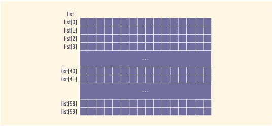

**图 9-16**　字符串数组 list

如果你知道程序将要处理的表的大小，那么你可以使用 `typedef` 先定义一个二维数组数据类型，然后声明该类型的变量。

例如，考虑以下内容：

```cpp
const int NUMBER_OF_ROWS = 20;
const int NUMBER_OF_COLUMNS = 10;

typedef int tableType[NUMBER_OF_ROWS][NUMBER_OF_COLUMNS];
```

上述语句定义了一个二维数组数据类型 `tableType`。现在我们可以声明此类型的变量。因此：

```cpp
tableType matrix;
```

声明了一个 20 行 10 列的二维数组 `matrix`。

在声明形式参数时也可以使用此数据类型，如下列代码所示：

```cpp
void initialize(tableType table)
{
    int row;
    int col;

    for (row = 0; row < NUMBER_OF_ROWS; row++)
        for (col = 0; col < NUMBER_OF_COLUMNS; col++)
            table[row][col] = 0;
}
```

此函数接受任意 `tableType` 类型的变量作为参数（即二维数组），并将该数组初始化为 0。

通过先定义一个数据类型，你在将二维数组声明为变量或形式参数时，或者在函数调用中将数组作为参数传递时，无需反复检查确切的列数。

## 多维数组

在本章中，我们将数组定义为固定数量的同类型元素（称为组件）的集合。一维数组是元素以列表形式排列的数组；二维数组中的元素以表格形式排列。我们还可以定义三维或更多维的数组。在 C++ 中，数组的维数没有限制。以下是数组的一般定义。

* n 维数组：固定数量的元素（称为组件）按 n 个维度（n ≥ 1）排列的集合。

声明 n 维数组的一般语法是：

```cpp
dataType arrayName[intExp1][intExp2] ... [intExpn];
```

其中 intExp1、intExp2、...、intExpn 是产生正整数值的常量表达式。

访问 n 维数组组件的语法是：

```cpp
arrayName[indexExp1][indexExp2] ... [indexExpn]
```

其中 indexExp1、indexExp2、...、indexExpn 是产生非负整数值的表达式。indexExp_i 给出数组组件在第 i 个维度中的位置。

例如，语句：

```cpp
double carDealers[10][5][7];
```

将 carDealers 声明为三维数组。第一维的大小为 10，第二维的大小为 5，第三维的大小为 7。第一维的范围是 0 到 9，第二维的范围是 0 到 4，第三维的范围是 0 到 6。数组 carDealers 的基地址是第一个数组组件的地址，即 carDealers[0][0][0] 的地址。数组 carDealers 中的组件总数为 10 * 5 * 7 = 350。

语句：

```cpp
carDealers[5][3][2] = 15564.75;
```

将组件 carDealers[5][3][2] 的值设置为 15564.75。

你可以使用循环来处理多维数组。例如，嵌套的 for 循环：

```cpp
for (i = 0; i < 10; i++)
    for (j = 0; j < 5; j++)
        for (k = 0; k < 7; k++)
            carDealers[i][j][k] = 0.0;
```

将整个数组初始化为 0.0。

在函数中将多维数组声明为形式参数时，可以省略第一维的大小，但不能省略其他维度。作为参数，多维数组只能按引用传递，并且函数不能返回数组类型的值。没有检查来确定数组索引是否在边界内。

## 编程示例：代码检测

当一条消息以保密代码的形式通过传输信道发送时，它通常以比特序列发送，即 0 和 1。由于传输信道中的噪声，发送的消息可能会被损坏。也就是说，在目的地接收到的消息与发送的消息不同；某些比特可能已被更改。有几种技术可以在目的地检查所传输消息的有效性。一种技术是重复传输同一消息两次。在目的地，将消息的两个副本逐位进行比较。如果相应的比特相同，则接收到的消息无错误。

让我们编写一个程序来检查在目的地接收到的消息是否无错误。为简单起见，假设表示消息的保密代码是一个数字序列（0 到 9），并且消息的最大长度为 250 位数字。此外，消息中的第一个数字是消息的长度。例如，如果保密代码是：

```cpp
7 9 2 7 8 3 5 6
```

那么实际消息长度为 7 位，并且它被传输两次。

上述消息以如下形式传输：

```cpp
7 9 2 7 8 3 5 6 7 9 2 7 8 3 5 6
```

**输入**　包含保密代码及其副本的文件

**输出**　保密代码、其副本以及一条消息——如果接收到的代码无错误——格式如下：

| 代码 | 数字 | 代码 | 数字副本 |
|:---|---:|:---|---:|
|  | 9 |  | 9 |
|  | 2 |  | 2 |
|  | 7 |  | 7 |
|  | 8 |  | 8 |
|  | 3 |  | 3 |
|  | 5 |  | 5 |
|  | 6 |  | 6 |

消息传输成功。

### 问题分析与算法设计

因为我们必须比较保密代码及其副本的相应数字，所以我们首先读取保密代码并将其存储在数组中。然后读取副本的第一个数字，并将其与保密代码的第一个数字进行比较，依此类推。如果任何相应的数字不相同，我们通过在数字旁边打印一条消息来表明这一事实。由于消息的最大长度为 250，我们使用一个包含 250 个组件的数组。保密代码及其副本中的第一个数字表示代码的长度。这一讨论转化为以下算法：

- 1. 打开输入和输出文件。
- 2. 如果输入文件不存在，则退出程序。
- 3. 读取保密代码的长度。
- 4. 如果保密代码的长度大于 250，则终止程序，因为本程序中代码的最大长度为 250。
- 5. 将保密代码读取并存储到数组中。
- 6. 读取副本的长度。
- 7. 如果保密代码及其副本的长度相同，则比较代码。否则，打印错误消息。

为了简化 `main` 函数，让我们编写一个函数 `readCode` 来读取保密代码，以及另一个函数 `compareCode` 来比较代码。

**`readCode`**

此函数首先读取保密代码的长度。如果保密代码的长度大于 250，则引用参数 `bool` 变量 `lenCodeOk` 设置为 `false`，并且函数终止。`lenCodeOk` 的值传递给调用函数，以指示保密代码是否被成功读取。如果代码长度小于 250，则 `readCode` 函数将保密代码读取并存储到数组中。由于输入存储在文件中，并且文件已在 `main` 函数中打开，因此对应于输入文件的输入流变量必须作为参数传递给此函数。此外，在读取保密代码的长度和代码本身之后，`readCode` 函数必须将这些值传递给 `main` 函数。因此，此函数有四个参数：一个输入文件流变量、一个用于存储保密代码的数组、代码的长度以及 `bool` 参数 `lenCodeOk`。`readCode` 函数的定义如下：

```cpp
void readCode(ifstream& infile, int list[], int& length,
              bool& lenCodeOk)
{
    int count;

    lenCodeOk = true;

    infile >> length;  //get the length of the secret code

    if (length > MAX_CODE_SIZE)
    {
        lenCodeOk = false;
        return;
    }

    //Get the secret code.
    for (count = 0; count < length; count++)
        infile >> list[count];
}
```


### compareCode

此函数将秘密代码与其副本进行比较。因此，它必须能够访问包含秘密代码的数组以及秘密代码的长度。秘密代码的副本及其长度存储在输入文件中。因此，对应于输入文件的输入流变量必须作为参数传递给此函数。此外，compareCode 函数会将秘密代码与副本进行比较，并输出相应的消息。由于输出将存储在文件中，对应于输出文件的输出流变量也必须作为参数传递给此函数。因此，该函数有四个参数：一个输入文件流变量、一个输出文件流变量、包含秘密代码的数组以及秘密代码的长度。上述讨论可转化为以下用于函数 compareCode 的算法：

- a. 声明变量。
- b. 将 `bool` 变量 `codeOk` 设置为 `true`。
- c. 读取秘密代码副本的长度。
- d. 如果秘密代码及其副本的长度不相同，则输出相应的错误消息并终止该函数。
- e. 对于输入文件中的每个数字：
  - 1. 读取秘密代码副本的下一个数字。
  - 2. 输出秘密代码及其副本中对应的数字。
  - 3. 如果对应数字不相同，则输出错误消息，并将 `bool` 变量 `codeOk` 设置为 `false`。
- f. 如果 `bool` 变量 `codeOk` 为 `true`
  
  则输出一条消息，表明秘密代码已正确传输。
  
  否则
  
  输出一条错误消息。

按照此算法，函数 compareCode 的定义如下：

```cpp
void compareCode(ifstream& infile, ofstream& outfile,
                 const int list[], int length)
{
    //Step a
    int length2;
    int digit;
    bool codeOk;
    int count;

    codeOk = true;                         //Step b

    infile >> length2;                     //Step c
```

### 完整程序清单

```cpp
//**************************************************************
// Author: D.S. Malik
//
// Program: Check Code
// This program determines whether a code is transmitted
// correctly.
//**************************************************************

#include <iostream>
#include <fstream>
#include <iomanip>

using namespace std;

const int MAX_CODE_SIZE = 250;

void readCode(ifstream& infile, int list[],
              int& length, bool& lenCodeOk);
void compareCode(ifstream& infile, ofstream& outfile,
                 const int list[], int length);

int main()
{
            //Step 1
        int codeArray[MAX_CODE_SIZE]; //array to store the secret
                                      //code

        int codeLength;               //variable to store the
                                      //length of the secret code
        bool lengthCodeOk; //variable to indicate if the length
                           //of the secret code is less than or
                           //equal to 250

        ifstream incode;       //input file stream variable
        ofstream outcode;      //output file stream variable

        char inputFile[51];    //variable to store the name of the
                               //input file
        char outputFile[51];   //variable to store the name of
                               //the output file

        cout << "Enter the input file name: ";
        cin >> inputFile;
        cout << endl;

            //Step 2
        incode.open(inputFile);
        if (!incode)
        {
            cout << "Cannot open the input file." << endl;
            return 1;
        }

        cout << "Enter the output file name: ";
        cin >> outputFile;
        cout << endl;

        outcode.open(outputFile);

        readCode(incode, codeArray, codeLength,
                 lengthCodeOk);                              //Step 3

        if (lengthCodeOk)                                  //Step 4
            compareCode(incode, outcode, codeArray,
                        codeLength);
        else
            cout << "Length of the secret code "
                 << "must be <= " << MAX_CODE_SIZE
                 << endl;                                  //Step 5

        incode.close();
        outcode.close();

        return 0;
}
```

//将函数 readCode 和
//compareCode 的定义（如前所述）放在此处。

**示例运行：** 在此示例运行中，用户输入以阴影显示。

请输入输入文件名：`Ch9_SecretCodeData.txt`

请输入输出文件名：`Ch9_SecretCodeOut.txt`

**输入文件数据：**（Ch9_SecretCodeData.txt）

7 9 2 7 8 3 5 6 7 9 2 7 8 3 5 6

**输出文件数据：**（Ch9_SecretCodeOut.txt）

| 代码数字 | 代码数字副本 |
|---:|---:|
| 9 | 9 |
| 2 | 2 |
| 7 | 7 |
| 8 | 8 |
| 3 | 3 |
| 5 | 5 |
| 6 | 6 |

消息传输正常。

## 编程示例：文本处理

**（行数与字母计数）** 现在让我们编写一个程序，读取给定文本，原样输出该文本，并打印文本的行数以及每个字母出现的次数。大写字母和小写字母被视为相同；也就是说，它们一起计数。

因为共有 26 个字母，我们使用一个包含 26 个分量的数组来执行字母计数。我们还需要一个变量来存储行数。

文本存储在一个文件中，我们将其称为 `textin.txt`。输出将存储在一个文件中，我们将其称为 `textout.out`。

- **输入：** 一个包含待处理文本的文件。
- **输出：** 一个包含文本、行数以及字母在文本中出现次数的文件。

### 问题分析与算法设计

根据期望的输出，很明显我们必须原样输出文本。也就是说，如果文本包含任何空白字符，它们也必须被输出。此外，我们必须统计文本中的行数。因此，我们必须知道行在哪里结束，这意味着我们必须捕获换行符。这一要求表明，我们不能使用提取运算符来处理输入文件。由于我们还需要执行字母计数，我们使用 `get` 函数来读取文本。

让我们首先描述开发程序所必需的变量。这将简化后续讨论。

### 变量

我们需要存储行数和字母计数。因此，我们需要一个变量来存储行数，以及 26 个变量来执行字母计数。我们将使用一个包含 26 个分量的数组来执行字母计数。我们还需要一个变量来依次读取和存储每个字符，因为输入文件将逐字符读取。由于数据要从输入文件中读取，并且输出要保存到文件中，我们需要一个输入流变量来打开输入文件，以及一个输出流变量来打开输出文件。这些语句表明，函数 main 至少需要以下变量：

```cpp
int lineCount;       //variable to store the line count
int letterCount[26]; //array to store the letter count
char ch;             //variable to store a character
ifstream infile;     //input file stream variable
ofstream outfile;    //output file stream variable
```

在此声明中，`letterCount[0]` 存储 A 的计数，`letterCount[1]` 存储 B 的计数，依此类推。显然，变量 `lineCount` 和数组 `letterCount` 必须初始化为 0。

该程序的算法如下：

- 1. 声明变量。
- 2. 打开输入文件和输出文件。
- 3. 初始化变量。
- 4. 当输入文件中还有更多数据时：
  - 4.1. 对于一行中的每个字符：
    - 4.1.1. 读取并写出该字符。
    - 4.1.2. 递增相应字母的计数。
  - 4.2. 递增行数。
- 5. 输出行数和字母计数。
- 6. 关闭文件。

为简化函数 main，我们将其划分为四个函数：

- 函数 `initialize`
- 函数 `copyText`
- 函数 `characterCount`
- 函数 `writeTotal`

以下各节将详细描述这些函数。然后，借助这些函数，我们描述函数 main 的算法。

initialize 此函数将变量 `lineCount` 和数组 `letterCount` 初始化为 0。因此，它有两个参数：一个对应于变量 `lineCount`，一个对应于数组 `letterCount`。显然，对应于 `lineCount` 的参数必须是引用参数。此函数的定义如下：

```cpp
void initialize(int& lc, int list[])
{
    int j;
    lc = 0;

    for (j = 0; j < 26; j++)
        list[j] = 0;
} //end initialize
```

copyText 此函数读取一行并输出该行。读取一个字符后，它调用函数 `characterCount` 来更新字母计数。显然，此函数有四个参数：一个输入文件流变量、一个输出文件流变量、一个 `char` 变量，以及用于更新字母计数的数组。

注意，`copyText` 函数并不执行字母计数，但我们仍将数组 `letterCount` 传递给它。我们采取这一步是因为该函数会调用

函数 `characterCount`，它需要数组 `letterCount` 来更新相应字母的计数。因此，我们必须将数组 `letterCount` 传递给 `copyText` 函数，以便它可以将该数组传递给函数 `characterCount`。

```cpp
void copyText(ifstream& intext, ofstream& outtext, char& ch,
              int list[])
{
    while (ch != '\n')        //process the entire line
    {
        outtext << ch;        //output the character
        characterCount(ch, list);    //call the function
                                    //character count
        intext.get(ch);       //read the next character
    }
    outtext << ch;            //output the newline character
} //end copyText
```

该函数递增字母计数。为了递增相应字母的计数，它必须知道该字母是什么。因此，characterCount 函数有两个参数：一个字符变量和用于更新字母计数的数组。用伪代码表示，该函数为：

- a. 将字母转换为大写。
- b. 找到该字母对应的数组索引。
- c. 如果索引有效，则递增相应的计数。在这一步，我们必须确保该字符是字母。我们只统计字母，因此其他字符——例如逗号、连字符和句点——会被忽略。

按照此算法，该函数的定义是：

```cpp
void characterCount(char ch, int list[])
{
    int index;

    ch = toupper(ch);                         //Step a

    index = static_cast<int>(ch)
          - static_cast<int>('A');             //Step b

    if (0 <= index && index < 26)              //Step c
        list[index]++;
} //end characterCount
```

该函数输出行数和字母计数。它有三个参数：输出文件流变量、行数以及用于输出字母计数的数组。该函数的定义是：

```cpp
void writeTotal(ofstream& outtext, int lc, int list[])
{
    int index;

    outtext << endl << endl;
    outtext << "The number of lines = " << lc << endl;

    for (index = 0; index < 26; index++)
        outtext << static_cast<char>(index
                 + static_cast<int>('A'))
                << " count = " << list[index] << endl;
} //end writeTotal
```

现在描述 main 函数的算法。

- 1. 声明变量。
- 2. 打开输入文件。
- 3. 如果输入文件不存在，则退出程序。
- 4. 打开输出文件。
- 5. 初始化变量，例如 lineCount 和数组 letterCount。
- 6. 读取第一个字符。
- 7. 当（未到输入文件末尾）时：
    - 7.1. 处理下一行；调用函数 copyText。
    - 7.2. 递增行数。（递增变量 lineCount。）
    - 7.3. 读取下一个字符。
- 8. 输出行数和字母计数。调用函数 writeTotal。
- 9. 关闭文件。

### 完整程序清单

```cpp
//************************************************************************
// Author: D. S. Malik
//
// Program: Line and Letter Count
// This program reads a text, outputs the text as is, and also
// prints the number of lines and the number of times each
// letter appears in the text. An uppercase letter and a
// lowercase letter are treated as being the same; that is,
// they are tallied together
//************************************************************************

void initialize(int& lc, int list[])
{
    int j;
    lc = 0;

    for (j = 0; j < 26; j++)
        list[j] = 0;
} //end initialize

void copyText(ifstream& intext, ofstream& outtext, char& ch,
              int list[])
{
    while (ch != '\n')          //process the entire line
    {
        outtext << ch;          //output the character

        characterCount(ch, list);   //call the function
                                    //character count
        intext.get(ch);             //read the next character
    }

    outtext << ch;              //output the newline character
} //end copyText

void characterCount(char ch, int list[])
{
    int index;

    ch = toupper(ch);                       //Step a

    index = static_cast<int>(ch)
          - static_cast<int>('A');          //Step b

    if (0 <= index && index < 26)           //Step c
        list[index]++;
} //end characterCount

void writeTotal(ofstream& outtext, int lc, int list[])
{
    int index;

    outtext << endl << endl;
    outtext << "The number of lines = " << lc << endl;

    for (index = 0; index < 26; index++)
        outtext << static_cast<char>(index
                  + static_cast<int>('A'))
                << " count = " << list[index] << endl;
} //end writeTotal
```

### 示例运行（textout.out）：

今天我们生活在一个信息几乎以光速被处理的时代。通过计算机，技术革命正在急剧改变我们生活和相互交流的方式。诸如“互联网”这样的术语，几年前还很陌生，如今已非常普遍。借助计算机，你可以在几秒钟内向亲人发送信件并收到他们的来信。你不再需要邮寄简历来求职；在许多情况下，你可以直接通过互联网提交求职申请。你可以实时查看股票行情，并立即买卖股票。学生们经常“冲浪”互联网，并使用计算机设计课堂项目。他们还使用强大的文字处理软件完成学期论文。许多人在计算机上维护和平衡支票簿。

```
The number of lines = 15
A count = 53
B count = 7
C count = 30
D count = 19
E count = 81
F count = 11
G count = 10
H count = 29
I count = 41
J count = 4
K count = 3
L count = 31
M count = 26
N count = 50
O count = 59
P count = 21
Q count = 0
R count = 45
S count = 48
T count = 62
U count = 24
V count = 7
W count = 15
X count = 0
Y count = 20
Z count = 0
```

## 快速回顾

- 1. 如果某种数据类型的变量一次只能保存一个值，则该数据类型是简单数据类型。
- 2. 在结构化数据类型中，每个数据项都是其他数据项的集合。
- 3. 数组是一种具有固定数量分量的结构化数据类型。每个分量都具有相同的类型，并且通过分量在数组中的相对位置来访问这些分量。
- 4. 一维数组的元素以列表形式排列。
- 5. 不会检查数组索引是否越界。
- 6. 在 C++ 中，数组索引从 0 开始。
- 7. 数组索引可以是任何求值为非负整数的表达式。索引的值必须始终小于数组的大小。
- 8. 除了字符数组（C 字符串）的输入/输出外，数组没有聚合操作。
- 9. 数组可以在声明期间初始化。如果初始值少于数组大小，则其余元素被初始化为 0。
- 10. 数组的基地址是第一个数组分量的地址。例如，如果 list 是一维数组，则 list 的基地址是 list[0] 的地址。
- 11. 将一维数组声明为形参时，通常省略数组大小。如果在形参声明中指定一维数组的大小，编译器将忽略该大小。
- 12. 在函数调用语句中，将数组作为实参传递时，只使用其名称。
- 13. 作为函数参数，数组仅按引用传递。
- 14. 由于数组作为参数时仅按引用传递，因此将数组声明为形参时，不要在数据类型后使用符号 &。
- 15. 函数不能返回数组类型的值。
- 16. 尽管数组作为参数时按引用传递，但在将数组声明为形参时，在数据类型前使用保留字 `const` 可以防止函数修改该数组。
- 17. 单个数组分量可以作为参数传递给函数。
- 18. 顺序搜索算法从列表的第一个元素开始，在列表中搜索给定项。它继续将搜索项与列表中的其他元素进行比较，直到找到该项，或者列表中没有更多元素可与搜索项进行比较。
- 19. 在 C++ 中，字符串是用双引号括起来的任意字符序列。
- 20. 在 C++ 中，C 字符串以 null 结尾。


- 21. 在 C++ 中，空字符表示为 `\0`。
- 22. 在 ASCII 字符集中，空字符的排序序列为 0。
- 23. C字符串存储在字符数组中。
- 24. 字符数组可以在声明时使用字符串表示法进行初始化。
- 25. C字符串的输入和输出是 C++ 允许聚合操作的唯一地方。
- 26. 头文件 `cstring` 包含可用于 C字符串操作的函数规范。
- 27. 常用的 C字符串操作函数包括 `strcpy`（字符串复制）、`strcmp`（字符串比较）和 `strlen`（字符串长度）。
- 28. C字符串逐字符比较。
- 29. 因为 C字符串存储在数组中，所以可以使用数组分量访问表示法访问 C字符串中的单个字符。
- 30. 并行数组用于保存相关信息。
- 31. 在二维数组中，元素以表格形式排列。
- 32. 要访问二维数组的元素，需要一对索引：一个表示行位置，一个表示列位置。
- 33. 在二维数组中，行编号为 0 到 `ROW_SIZE − 1`，列编号为 0 到 `COLUMN_SIZE − 1`。
- 34. 如果 `matrix` 是二维数组，那么 `matrix` 的基地址是数组分量 `matrix[0][0]` 的地址。
- 35. 在行处理中，二维数组一次处理一行。
- 36. 在列处理中，二维数组一次处理一列。
- 37. 将二维数组声明为形参时，可以省略第一维的大小，但不能省略第二维的大小。
- 38. 当二维数组作为实参传递时，实参数组和形参数组的列数必须匹配。
- 39. C++ 在计算机内存中以行顺序形式存储二维数组。

## 练习

- 1. 将以下陈述标记为真或假。
  - a. `double` 类型是简单数据类型的一个例子。
  - b. 一维数组是结构化数据类型的一个例子。
  - c. 数组可以按值或按引用作为参数传递给函数。
  - d. 函数可以返回数组类型的值。
  - e. 数组的大小在编译时确定。
  - f. 对 `int` 数组唯一允许的聚合操作是递增和递减操作。
  - g. 给定声明：

    ```cpp
    int list[10];
    ```

    语句：

    ```cpp
    list[5] = list[3] + list[2];
    ```

    更新数组 `list` 的第五个分量的内容。
  - h. 如果数组索引越界，程序总是以错误终止。
  - i. 在 C++ 中，字符串允许某些聚合操作。
  - j. 声明：

    ```cpp
    char name[16] = "John K. Miller";
    ```

    声明 `name` 为一个包含15个字符的数组，因为字符串 "John K. Miller" 只有14个字符。
  - k. 声明：

    ```cpp
    char str = "Sunny Day";
    ```

    声明 `str` 为一个长度未指定的字符串。
  - l. 作为参数，二维数组按值或按引用传递。

- 2. 考虑以下声明：

  ```cpp
  double salary[10];
  ```

  在此声明中，确定以下内容：

  - a. 数组名。
  - b. 数组大小。
  - c. 每个数组分量的数据类型。
  - d. 数组索引的取值范围。

- 3. 指出以下数组声明中的错误（如果有）。
  - a. `int list[10];`
  - b. `const int size = 100;`

    ```cpp
    double list[SIZE];
    ```

  - c. `int numList[0..9];`
  - d. `string names[20];`
  - e. `scores[50] double;`

- 4. 判断以下数组声明是否有效。如果声明无效，请解释原因。
  - a. `int list[75];`
  - b. 
    ```cpp
    int size;
    double list[size];
    ```
  - c. `int test[-10];`
  - d. `double sales[40.5];`

- 5. 大小为50的数组的索引有效范围是什么？

- 6. 编写 C++ 语句完成以下操作：
  - a. 声明一个包含15个 `int` 类型分量的数组 `alpha`。
  - b. 输出数组 `alpha` 第十个分量的值。
  - c. 将数组 `alpha` 第五个分量的值设置为35。
  - d. 将数组 `alpha` 第九个分量的值设置为数组 `alpha` 第六个和第十三个分量之和。
  - e. 将数组 `alpha` 第四个分量的值设置为第八个分量的值的三倍减去57。
  - f. 输出 `alpha`，使每行打印五个分量。

- 7. 以下程序段的输出是什么？

  ```cpp
  int temp[5];

  for (int i = 0; i < 5; i++)
      temp[i] = 2 * i - 3;

  for (int i = 0; i < 5; i++)
      cout << temp[i] << " ";
  cout << endl;

  temp[0] = temp[4];
  temp[4] = temp[1];
  temp[2] = temp[3] + temp[0];

  for (int i = 0; i < 5; i++)
      cout << temp[i] << " ";
  cout << endl;
  ```

- 8. 假设 `list` 是一个包含五个 `int` 类型分量的数组。以下 C++ 代码执行后，`list` 中存储的是什么？

  ```cpp
  for (int i = 0; i < 5; i++)
  {
      list[i] = 2 * i + 5;
      if (i % 2 == 0)
          list[i] = list[i] - 3;
  }
  ```

- 9. 假设 `list` 是一个包含六个 `int` 类型分量的数组。以下 C++ 代码执行后，`list` 中存储的是什么？

  ```cpp
  list[0] = 5;
  for (int i = 1; i < 6; i++)
  {
      list[i] = i * i + 5;
      if (i > 2)
          list[i] = 2 * list[i] - list[i - 1];
  }
  ```

- 10. 改正以下代码，使其正确初始化并输出数组的元素。

  ```cpp
  int myList[10];

  for (int i = 1; i <= 10; i++)
      cin >> myList;

  for (int i = 1; i <= 10; i++)
      cout << myList[i] << " ";
  cout << endl;
  ```

- 11. 什么是数组索引越界？C++ 会检查数组索引是否在边界内吗？

- 12. 假设 `scores` 是一个包含10个 `double` 类型分量的数组。

  `scores = {2.5, 3.9, 4.8, 6.2, 6.2, 7.4, 7.9, 8.5, 8.5, 9.9}`

  以下代码旨在确保 `scores` 的元素按非递减顺序排列。但是，代码中存在错误。找出并改正错误。

  ```cpp
  for (int i = 1; i <= 10; i++)
      if (scores[i] > scores[i + 1])
          cout << scores[i] << " and " << scores[i + 1]
               << " elements of scores are out of order." << endl;
  ```

- 13. 编写 C++ 语句定义并初始化以下数组。
  - a. 包含10个 `double` 类型分量的数组 `heights`。将此数组初始化为以下值：5.2、6.3、5.8、4.9、5.2、5.7、6.7、7.1、5.10、6.0。
  - b. 包含7个 `int` 类型分量的数组 `weights`。将此数组初始化为以下值：120、125、137、140、150、180、210。
  - c. `char` 类型的数组 `specialSymbols`。将此数组初始化为以下值：'$'、'#'、'%'、'@'、'&'、'!'、'^'。
  - d. 包含4个 `string` 类型分量的数组 `seasons`。将此数组初始化为以下值："fall"、"winter"、"spring"、"summer"。

- 14. 判断以下数组声明是否有效。
  - a. `int a[5] = {0, 4, 3, 2, 7};`
  - b. `int b[10] = {0, 7, 3, 12};`
  - c. `int c[7] = {12, 13, 14, 16, 8};`
  - d. `double lengths[] = {12.7, 13.9, 18.75, 20.78};`
  - e. `char name[8] = "Samantha";`

- 15. 假设你有以下声明：

  ```cpp
  int list[10] = {8, 9, 15, 12, 80};
  ```

  `list` 的每个分量中存储的是什么？

- 16. 以下代码的输出是什么？

  ```cpp
  int list[] = {6, 8, 2, 14, 13};

  for (int i = 0; i < 4; i++)
      list[i] = list[i] - list[i + 1];

  for (int i = 0; i < 5; i++)
      cout << i << " " << list[i] << endl;
  ```

- 17. 考虑以下函数头：

  ```cpp
  void tryMe(int x[], int size);
  ```

  以及以下声明：

  ```cpp
  int list[100];
  int score[50];
  double gpa[50];
  ```

  以下哪个函数调用有效？

  - a. `tryMe(list, 100);`
  - b. `tryMe(list, 75);`
  - c. `tryMe(score, 100);`
  - d. `tryMe(score, 49);`
  - e. `tryMe(gpa, 50);`

- 18. 假设你有以下函数定义。

  ```cpp
  void sum(int x, int y, int& z)
  {
      z = x + y;
  }
  ```

  考虑以下声明：

  ```cpp
  int list1[10], list2[10], list3[10];
  int a, b, c;
  ```


### 以下哪个函数调用是有效的？

- a. `sum(a, b, c);`
- b. `sum(list1[0], list2[0], a);`
- c. `sum(list1, list2, c);`
- d. `for (int i = 1; i <= 10; i++)`  
  `sum(list1[i], list2[i], list[3]);`

### 19.
以下 C++ 代码的输出是什么？

```cpp
double salary[5] = {25000, 36500, 85000, 62500, 97000};
double raise = 0.03;

cout << fixed << showpoint << setprecision(2);

for (int i = 0; i < 5; i++)
    cout << (i + 1) << " " << salary[i] << " "
         << salary[i] * raise << endl;
```

### 20.
一家汽车经销商有 10 名销售人员。每名销售人员每月记录销售的汽车数量，并在月底向管理层报告。管理层将数据保存在文件中，并为每名销售人员分配一个 1 到 10 的编号。下面的语句声明了一个数组 `cars`，它有 10 个 `int` 类型的分量，用于存储每名销售人员销售的汽车数量。

```cpp
int cars[10];
```

编写代码，将每名销售人员销售的汽车数量存储在数组 cars 中，输出每月结束时销售的总汽车数量，并输出销售汽车数量最多的销售人员的编号。（假设数据在文件 cars.dat 中，并且该文件已使用 ifstream 变量 inFile 打开。）

### 21.
以下程序的输出是什么？

```cpp
#include <iostream>

using namespace std;

int main()
{
    int count;
    int alpha[5];

    alpha[0] = 5;
    for (count = 1; count < 5; count++)
    {
        alpha[count] = 5 * count + 10;
        alpha[count - 1] = alpha[count] - 4;
    }

    cout << "List elements: ";
    for (count = 0; count < 5; count++)
        cout << alpha[count] << " ";
    cout << endl;

    return 0;
}
```


### 22.
以下程序的输出是什么？

```cpp
#include <iostream>

using namespace std;

int main()
{
    int j;
    int one[5];
    int two[10];

    for (j = 0; j < 5; j++)
        one[j] = 5 * j + 3;

    cout << "One contains: ";
    for (j = 0; j < 5; j++)
        cout << one[j] << " ";
    cout << endl;
    for (j = 0; j < 5; j++)
    {
        two[j] = 2 * one[j] - 1;
        two[j + 5] = one[4 - j] + two[j];
    }

    cout << "Two contains: ";
    for (j = 0; j < 10; j++)
        cout << two[j] << " ";
    cout << endl;

    return 0;
}
```

### 23.
以下 C++ 代码的输出是什么？

```cpp
const double PI = 3.14159;
double cylinderRadii[5] = {3.5, 7.2, 10.5, 9.8, 6.5};
double cylinderHeights[5] = {10.7, 6.5, 12.0, 10.5, 8.0};
double cylinderVolumes[5];

cout << fixed << showpoint << setprecision(2);

for (int i = 0; i < 5; i++)
    cylinderVolumes[i] = 2 * PI * cylinderRadii[i]
                       * cylinderHeights[i];

for (int i = 0; i < 5; i++)
    cout << (i + 1) << " " << cylinderRadii[i] << " "
         << cylinderHeights[i] << " " << cylinderVolumes[i] << endl;
```

### 24.
当数组作为实际参数传递给函数时，实际传递的是什么？

### 25.
在 C++ 中，作为实际参数，数组可以按值传递吗？

### 26.
给定声明：

```cpp
char string15[16];
```

将下列语句标记为有效或无效。如果语句无效，请解释原因。

- a. `strcpy(string15, "Hello there");`
- b. `strlen(string15);`
- c. `string15 = "Jacksonville";`
- d. `cin >> string15;`
- e. `cout << string15;`
- f. `if (string15 >= "Nice day")`  
  `cout << string15;`
- g. `string15[6] = 't';`

### 27.
给定声明：

```cpp
char str1[15];
char str2[15] = "Good day";
```

将下列语句标记为有效或无效。如果语句无效，请解释原因。

- a. `str1 = str2;`
- b. `if (str1 == str2)`  
  `cout << " Both strings are of the same length." << endl;`
- c. `if (strlen(str1) >= strlen(str2))`  
  `str1 = str2;`
- d. `if (strcmp(str1, str2) < 0)`  
  `cout << "str1 is less than str2." << endl;`

### 28.
给定声明：

```cpp
char name[8] = "Shelly";
```

如果下列语句输出 Shelly，则将其标记为“是”。否则，将语句标记为“否”，并解释为什么它不输出 Shelly。

- a. `cout << name;`
- b. `for (int j = 0; j < 6; j++)`  
  `cout << name[j];`
- c. `int j = 0;`  
  `while (name[j] != '\0')`  
  `cout << name[j++];`
- d. `int j = 0;`  
  `while (j < 8)`  
  `cout << name[j++];`

```cpp
double sales[CAR_TYPES][COLOR_TYPES];
```

- a. 数组 sales 有多少个分量？
- b. 数组 sales 的行数是多少？
- c. 数组 sales 的列数是多少？
- d. 要按 CAR_TYPES 汇总销售额，需要哪种处理方式？
- e. 要按 COLOR_TYPES 汇总销售额，需要哪种处理方式？

### 34.
编写执行以下操作的 C++ 语句：

- a. 声明一个 `int` 类型的数组 alpha，它有 10 行和 20 列。
- b. 将数组 alpha 初始化为 0。
- c. 在第一行存储 1，在其余行存储 2。
- d. 在第一列存储 5，并确保后续每一列的值是前一列值的两倍。
- e. 每行打印一次数组 alpha。
- f. 每列打印一次数组 alpha。

### 35.
考虑以下声明：

```cpp
int beta[3][3];
```

在以下每条语句执行后，beta 中存储了什么？

- a.
  ```cpp
  for (i = 0; i < 3; i++)
      for (j = 0; j < 3; j++)
          beta[i][j] = 0;
  ```
- b.
  ```cpp
  for (i = 0; i < 3; i++)
      for (j = 0; j < 3; j++)
          beta[i][j] = i + j;
  ```
- c.
  ```cpp
  for (i = 0; i < 3; i++)
      for (j = 0; j < 3; j++)
          beta[i][j] = i * j;
  ```
- d.
  ```cpp
  for (i = 0; i < 3; i++)
      for (j = 0; j < 3; j++)
          beta[i][j] = 2 * (i + j) % 4;
  ```

### 36.
假设你有以下声明：

```cpp
int times[30][7];
int speed[15][7];
int trees[100][7];
int students[50][7];
```

- a. 编写函数 `print` 的定义，该函数可用于输出这些数组的内容。
- b. 编写 C++ 语句，调用函数 `print` 来输出数组 times、speed、trees 和 students 的内容。

## 编程练习

- 1. 编写一个 C++ 程序，声明一个包含 50 个 `double` 类型分量的数组 `alpha`。初始化该数组，使前 25 个分量等于索引变量的平方，后 25 个分量等于索引变量的三倍。输出该数组，每行打印 10 个元素。
- 2. 编写一个 C++ 函数 `smallestIndex`，它以 `int` 数组及其大小作为参数，并返回数组中最小元素第一次出现的索引。另外，编写一个程序来测试你的函数。
- 3. 编写一个 C++ 函数 `lastLargestIndex`，它以 `int` 数组及其大小作为参数，并返回数组中最大元素最后一次出现的索引。另外，编写一个程序来测试你的函数。
- 4. 编写一个程序，读取一个包含学生考试成绩（范围 0–200）的文件。然后确定在以下每个分数段中学生的数量：0–24、25–49、50–74、75–99、100–124、125–149、150–174 和 175–200。输出分数段和学生人数。（使用以下输入数据运行你的程序：76、89、150、135、200、76、12、100、150、28、178、189、167、200、175、150、87、99、129、149、176、200、87、35、157、189。）
- 5. 编写一个程序，提示用户输入一个字符串，并将该字符串以大写字母输出。（使用字符数组存储该字符串。）
- 6. 你们学校的历史老师需要帮助批改一份判断题测试。学生的 ID 和测试答案存储在一个文件中。文件中的第一个条目包含测试答案，形式如下：

  `TFFTFTTTTFFFFTFTTT`

  文件中的每个其他条目都是学生 ID，后跟一个空格，再跟学生的答题情况。例如，条目：

  `ABC54301 TFFTFTTT TFTFTFTFT`

  表示学生 ID 是 ABC54301，第 1 题的答案是 True（正确），第 2 题的答案是 False（错误），依此类推。该学生没有回答第 9 题。考试有 20 道题，班级有超过 150 名学生。每道正确答案得两分，每道错误答案扣一分，不回答得零分。编写一个处理测试数据的程序。输出应为学生 ID，后跟答案，后跟测试分数，再后跟测试等级。假设以下等级标准：90%–100%，A；80%–89.99%，B；70%–79.99%，C；60%–69.99%，D；0%–59.99%，F。
- 7. 编写一个程序，允许用户输入地方选举中五名候选人的姓氏以及每位候选人获得的选票数。然后程序应输出每位候选人的姓名、选票数


已获得，以及候选人获得的总票数百分比。你的程序还应输出选举的获胜者。示例输出如下：

| 候选人 | 获得票数 | 总票数百分比 |
|:---|---:|---:|
| Johnson | 5000 | 25.91 |
| Miller | 4000 | 20.73 |
| Duffy | 6000 | 31.09 |
| Robinson | 2500 | 12.95 |
| Ashtony | 1800 | 9.33 |
| 总计 | 19300 |  |

选举获胜者是 Duffy。

- 8. 考虑以下函数 `main`：

    ```cpp
    int main()
    {
        int inStock[10][4];
        int alpha[20];
        int beta[20];
        int gamma[4] = {11, 13, 15, 17};
        int delta[10] = {3, 5, 2, 6, 10, 9, 7, 11, 1, 8};

        .
        .
        .
    }
    ```

    - a. 编写函数 setZero 的定义，该函数将任意 `int` 类型的一维数组初始化为 0。
    - b. 编写函数 inputArray 的定义，该函数提示用户输入 20 个数字并将这些数字存储到 alpha 中。
    - c. 编写函数 doubleArray 的定义，该函数将 beta 的元素初始化为 alpha 中对应元素的两倍。确保防止该函数修改 alpha 的元素。
    - d. 编写函数 copyGamma 的定义，该函数将 inStock 第一行的元素设置为 gamma，并将 inStock 其余行设置为 inStock 上一行的三倍。确保防止该函数修改 gamma 的元素。
    - e. 编写函数 copyAlphaBeta 的定义，该函数将 alpha 存储到 inStock 的前五行，将 beta 存储到 inStock 的后五行。确保防止该函数修改 alpha 和 beta 的元素。
    - f. 编写函数 printArray 的定义，该函数打印任意 `int` 类型的一维数组。每行打印 15 个元素。
    - g. 编写函数 `setInStock` 的定义，该函数提示用户输入 `inStock` 第一列的元素。然后，该函数应将其余列中的元素设置为前一列中对应元素的两倍，再减去 `delta` 中对应元素。
    - h. 编写调用 a 到 g 部分中每个函数的 C++ 语句。
    - i. 编写一个 C++ 程序，测试函数 `main` 以及 a 到 g 部分中讨论的函数。（根据需要添加其他函数，例如打印二维数组。）

- 9. 编写一个程序，使用二维数组存储一年中每个月的最高和最低温度。该程序应输出全年平均高温、平均低温以及全年最高和最低温度。你的程序必须包含以下函数：

    - a. 函数 `getData`：该函数读取数据并将其存储到二维数组中。
    - b. 函数 `averageHigh`：该函数计算并返回全年平均高温。
    - c. 函数 `averageLow`：该函数计算并返回全年平均低温。
    - d. 函数 `indexHighTemp`：该函数返回数组中最高高温的索引。
    - e. 函数 `indexLowTemp`：该函数返回数组中最低低温的索引。

    （这些函数都必须具有适当的参数。）

- 10. 第6章的编程练习8要求你求五个数的均值和标准差。扩展该编程练习，求最多100个数的均值和标准差。假设 n 个数 x₁, x₂, …, xₙ 的均值（平均数）为 x̄。那么，这些数的标准差为：

    $$s = \sqrt{\frac{(x_1-x̄)^2+(x_2-x̄)^2+\cdots+(x_i-x̄)^2+\cdots+(x_n-x̄)^2}{n}}$$

- 11. **（大整数相加）** 在 C++ 中，最大的 `int` 值是 2147483647。因此，比这个值更大的整数不能作为整数存储和处理。类似地，如果两个正整数的和或积大于 2147483647，结果将不正确。存储和操作大整数的一种方法是，将数字的每一位单独存储到数组中。编写一个程序，输入两个最多20位的正整数，并输出这两个数之和。如果这两个数之和超过20位，则输出该和并给出适当消息。你的程序至少必须包含一个函数，用于读取一个数并将其存储到数组中，以及另一个函数，用于输出这些数之和。*（提示：将数字作为字符串读取，并按逆序存储数字的各位。）*

- 12. Jason、Samantha、Ravi、Sheila 和 Ankit 正在为即将到来的马拉松做准备。一周中的每一天，他们都会跑一定数量的英里，并把这些英里数记到笔记本中。到了周末，他们想知道每天跑了多少英里、一周总英里数以及每天平均跑的英里数。编写一个程序，帮助他们分析数据。你的程序必须包含并行数组：一个数组存储跑步者的姓名，一个五行七列的二维数组存储每个跑步者每天跑的英里数。此外，你的程序必须至少包含以下函数：一个函数，用于读取并存储跑步者的姓名以及每天跑的英里数；一个函数，用于求出每个跑步者跑的总英里数以及每天平均跑的英里数；以及一个函数，用于输出结果。（你可以假设输入数据存储在文件中，且每行数据格式如下：`runnerName milesDay1 milesDay2 milesDay3 milesDay4 milesDay5 milesDay6 milesDay7`。）

- 13. 编写一个程序，计算学生的平均测试成绩及其等级。你可以假设以下输入数据：

    ```text
    Johnson 85 83 77 91 76
    Aniston 80 90 95 93 48
    Cooper 78 81 11 90 73
    Gupta 92 83 30 69 87
    Blair 23 45 96 38 59
    Clark 60 85 45 32 67
    Kennedy 77 31 52 74 83
    Bronson 93 94 89 77 97
    Sunny 79 85 28 93 82
    Smith 85 72 49 75 63
    ```

    使用三个数组：一个一维数组存储学生姓名，一个（并行的）二维数组存储测试成绩，以及一个并行的一维数组存储等级。你的程序必须至少包含以下函数：一个函数，用于读取数据并将其存储到两个数组中；一个函数，用于计算平均测试成绩和等级；以及一个函数，用于输出结果。让你的程序同时输出班级平均分。

- 14. **（飞机座位分配）** 编写一个程序，用于为商用飞机分配座位。该飞机有13排，每排6个座位。第1排和第2排是头等舱，第3排到第7排是商务舱，第8排到第13排是经济舱。你的程序必须提示用户输入以下信息：

    - a. 票种（头等舱、商务舱或经济舱）
    - b. 期望座位

    按以下形式输出座位图：

    |  | A | B | C | D | E | F |
    |---|---|---|---|---|---|---|
    | 第1行 | * | * | X | * | X | X |
    | 第2行 | * | * | X | X | X | X |
    | 第3行 | * | * | X | X | * | X |
    | 第4行 | X | * | X | * | X | X |
    | 第5行 | * | X | * | X | * | * |
    | 第6行 | * | X | * | * | * | X |
    | 第7行 | X | X | * | * | X | X |
    | 第8行 | * | X | * | X | X | * |
    | 第9行 | X | * | X | X | * | X |
    | 第10行 | * | X | * | X | X | X |
    | 第11行 | * | * | X | * | X | * |
    | 第12行 | * | * | X | X | * | X |
    | 第13行 | * | * | * | * | X | * |

    这里，* 表示座位可用；X 表示座位已占用。将此程序做成菜单驱动程序；显示用户的选择，并允许用户做出适当选择。

在第9章中，你学习了如何使用数组将相同类型的值分组。你还学习了如何处理存储在数组中的数据，以及如何执行列表操作，例如搜索和排序数据。

> **注意** 跳过本章不会造成任何不连贯。

在本章中，你将学习如何将类型不同但相关的值分组。C++ 提供了另一种结构化数据类型，称为 struct（有些语言使用术语“记录”），用于将类型不同但相关的项分组。数组是一种同构数据结构；struct 通常是一种异构数据结构。本章对 struct 的处理类似于 C 中对 struct 的处理。因此，本章中的 struct 是一种类 C 的 struct。第11章将介绍并讨论另一种结构化数据类型，称为类。

# 第10章：记录（结构体）

假设你想编写一个程序来处理学生数据。学生记录包含学生的姓名、学号、GPA、已修课程和课程成绩等内容。因此，一个学生关联着各种组成部分。然而，这些组成部分类型都不同。例如，学生姓名是字符串，而 GPA 是浮点数。由于这些组成部分类型不同，你不能使用数组将一个学生关联的所有项分组。C++ 提供了一种称为 struct 的结构化数据类型，用于将类型不同的项分组。将相关但类型不同的组成部分分组具有若干优点。例如，单个变量可以将所有组成部分作为参数传递给函数。

**struct：** 由固定数量组成部分组成的集合，其中各组成部分通过名称访问。这些组成部分可以具有不同的类型。

struct 的组成部分称为 struct 的成员。C++ 中 struct 的一般语法是：

```cpp
struct structName
{
    dataType1 identifier1;
    dataType2 identifier2;
    .
    .
    .
    dataTypen identifiern;
};
```


在 C++ 中，`struct` 是一个保留字。`struct` 的成员虽然用花括号括起来（即它们构成一个块），但并不会被视为构成一条复合语句。因此，右花括号后的分号对于结束 `struct` 语句是必不可少的。所以，`struct` 定义末尾的分号是语法的一部分。

下面的语句：

```cpp
struct employeeType
{
    string firstName;
    string lastName;
    string address1;
    string address2;
    double salary;
    string deptID;
};
```

定义了一个具有六个成员的 `struct` `employeeType`。成员 `firstName`、`lastName`、`address1`、`address2` 和 `deptID` 是 string 类型，而成员 `salary` 是 `double` 类型。

与任何类型定义一样，`struct` 是一个定义而不是声明。也就是说，它只定义了一种数据类型；不分配内存。

一旦定义了数据类型，就可以声明该类型的变量。我们先定义一个 `struct` 类型 `studentType`，然后再声明该类型的变量。

```cpp
struct studentType
{
    string firstName;
    string lastName;
    char courseGrade;
    int testScore;
    int programmingScore;
    double GPA;
};

//variable declaration
studentType newStudent;
studentType student;
```

这些语句声明了两个 `struct` 变量 `newStudent` 和 `student`，它们的类型都是 `studentType`。分配的内存足以存储 `firstName`、`lastName`、`courseGrade`、`testScore`、`programmingScore` 和 `GPA`（见图 10-1）。

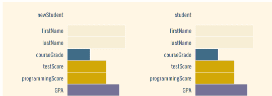

**图 10-1** *structs* `newStudent` 和 `student`

你也可以在定义 struct 的同时声明 struct 变量。例如，考虑下面的语句：

```cpp
struct studentType
{
    string firstName;
    string lastName;
    char courseGrade;
    int testScore;
    int programmingScore;
    double GPA;
} tempStudent;
```

这些语句定义了 struct studentType，同时声明了 `tempStudent` 为 studentType 类型的变量。

通常在程序中，struct 定义在程序所有函数定义之前，以便 struct 可以在整个程序中使用。因此，如果你定义一个 struct 并同时声明一个 struct 变量（如前面语句所示），那么该 struct 变量就会成为全局变量，从而可以在程序的任何地方访问。考虑到全局变量的副作用，你应该先只定义 struct，然后再声明 struct 变量。

## 访问 struct 成员

在数组中，你可以通过数组名连同组件的相对位置（索引）来访问一个组件。数组名和索引用方括号分隔。要访问结构体成员（组件），你需要使用 struct 变量名连同成员名；这些名字用点（句点）分隔。访问 struct 成员的语法是：

```
structVariableName.memberName
```

`structVariableName.memberName` 就像任何其他变量一样。例如，`newStudent.courseGrade` 是一个 char 类型变量，`newStudent.firstName` 是一个字符串变量，等等。因此，你可以对 `struct` 成员做你通常对变量做的任何事情。例如，在赋值语句或输入/输出（允许的地方）语句中使用它们。

在 C++ 中，点号（`.`）是一个被称为**成员访问运算符**的运算符。

假设你想把 `newStudent` 的 GPA 成员初始化为 `0.0`。以下语句完成了这个任务：

```cpp
newStudent.GPA = 0.0;
```

类似地，下面的语句：

```cpp
newStudent.firstName = "John";
newStudent.lastName = "Brown";
```

将 `"John"` 存储在 `newStudent` 的 `firstName` 成员中，将 `"Brown"` 存储在 `lastName` 成员中。

执行完上述三个赋值语句后，`newStudent` 如图 10-2 所示。

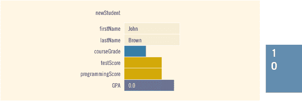

**图 10-2** *struct* `newStudent`

下面的语句：

```cpp
cin >> newStudent.firstName;
```

从标准输入设备读取下一个字符串，并将其存储在：

```
newStudent.firstName
```

下面的语句：

```cpp
cin >> newStudent.testScore >> newStudent.programmingScore;
```

从键盘读取两个整数值，并分别将它们存储在 `newStudent.testScore` 和 `newStudent.programmingScore` 中。

假设 `score` 是一个 int 类型变量。下面的语句：

```cpp
score = (newStudent.testScore + newStudent.programmingScore) / 2;
```

将 `newStudent.testScore` 和 `newStudent.programmingScore` 的平均值赋给 `score`。

下面的语句确定课程成绩并将其存储在 `newStudent.courseGrade` 中：

```cpp
if (score >= 90)
    newStudent.courseGrade = 'A';
else if (score >= 80)
    newStudent.courseGrade = 'B';
else if (score >= 70)
    newStudent.courseGrade = 'C';
else if (score >= 60)
    newStudent.courseGrade = 'D';
else
    newStudent.courseGrade = 'F';
```

## 赋值

我们可以使用赋值语句将一个 struct 变量的值赋给另一个相同类型的 struct 变量。假设 `newStudent` 如图 10-3 所示。

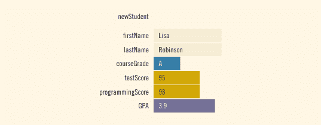

**图 10-3** `struct newStudent`

下面的语句：

```cpp
student = newStudent;
```

将 `newStudent` 的内容复制到 `student` 中。执行此赋值语句后，`student` 的值如图 10-4 所示。

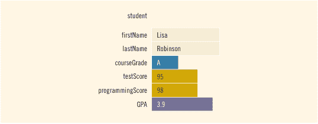

**图 10-4** `student = newStudent` 之后的 `student`

事实上，赋值语句：

```cpp
student = newStudent;
```

等价于以下语句：

```cpp
student.firstName = newStudent.firstName;
student.lastName = newStudent.lastName;
student.courseGrade = newStudent.courseGrade;
student.testScore = newStudent.testScore;
student.programmingScore = newStudent.programmingScore;
student.GPA = newStudent.GPA;
```

## 比较（关系运算符）

要比较 `struct` 变量，你需要逐个成员地比较它们。与数组一样，`struct` 上不能执行聚合关系运算。例如，假设 `newStudent` 和 `student` 按前面所示声明。此外，假设你想查看 `student` 和 `newStudent` 是否指的是同一个学生。如果 `newStudent` 和 `student` 具有相同的名字和相同的姓氏，那么它们指的是同一个学生。要比较 `student` 和 `newStudent` 的值，你必须按成员逐一比较，如下所示：

```cpp
if (student.firstName == newStudent.firstName &&
    student.lastName == newStudent.lastName)
.
.
.
```

虽然你可以使用赋值语句将一个 struct 的内容复制到另一个相同类型的 struct 中，但你不能在 struct 变量上使用关系运算符。因此，下面的代码是非法的：

```cpp
if (student == newStudent)    //illegal
.
.
.
```

## 输入/输出

不允许对 struct 变量进行聚合输入/输出操作。struct 变量中的数据必须一次读取一个成员。类似地，struct 变量的内容必须一次写出一个成员。

我们已经看到了如何将数据读入 struct 变量。现在让我们看看如何输出一个 struct 变量。下面的语句：

```cpp
cout << newStudent.firstName << " " << newStudent.lastName
     << " " << newStudent.courseGrade
     << " " << newStudent.testScore
     << " " << newStudent.programmingScore
     << " " << newStudent.GPA << endl;
```

输出 struct 变量 newStudent 的内容。

## struct 变量和函数

回想一下，数组只能按引用传递，并且函数不能返回数组类型的值。但是：

- struct 变量可以作为参数按值或按引用传递，并且
- 函数可以返回 struct 类型的值。

下面的函数读取并存储学生的名字、姓氏、测试成绩、编程成绩和 GPA。它还确定学生的课程成绩并将其存储在成员 courseGrade 中。

```cpp
void readIn(studentType& student)
{
    int score;

    cin >> student.firstName >> student.lastName;
    cin >> student.testScore >> student.programmingScore;
    cin >> student.GPA;

    score = (student.testScore + student.programmingScore) / 2;

    if (score >= 90)
        student.courseGrade = 'A';
```


```cpp
else if (score >= 80)
    student.courseGrade = 'B';
else if (score >= 70)
    student.courseGrade = 'C';
else if (score >= 60)
    student.courseGrade = 'D';
else
    student.courseGrade = 'F';
}
```

语句：

```cpp
readIn(newStudent);
```

调用函数 readIn。函数 readIn 将相应的信息存储到变量 newStudent 中。

类似地，我们可以编写一个函数来打印 `struct` 变量的内容。例如，下面的函数将类型为 studentType 的 `struct` 变量的内容输出到屏幕上：

```cpp
void printStudent(studentType student)
{
    cout << student.firstName << " " << student.lastName
         << " " << student.courseGrade
         << " " << student.testScore
         << " " << student.programmingScore
         << " " << student.GPA << endl;
}
```

## 数组与 `structs` 的对比

前面的讨论表明，`struct` 和数组既有相似之处，也有不同之处。表 10-1 总结了这一讨论。

**表 10-1** 数组与 `structs` 的对比

| 整体操作 | 数组 | `struct` |
|---|---|---|
| 算术运算 | 否 | 否 |
| 赋值 | 否 | 是 |
| 输入/输出 | 否（字符串除外） | 否 |
| 比较 | 否 | 否 |
| 参数传递 | 仅按引用 | 按值或按引用 |
| 函数返回一个值 | 否 | 是 |

## `structs` 中的数组

列表是相同类型元素的集合。因此，列表有两个相关项：值（即元素）和长度。由于值和长度都与列表相关，我们可以定义一个包含这两个项的 `struct`。

```cpp
const int ARRAY_SIZE = 1000;

struct listType
{
    int listElem[ARRAY_SIZE];     //array containing the list
    int listLength;               //length of the list
};
```

下面的语句将 intList 声明为类型 listType 的结构体变量（见图 10-5）：

```cpp
listType intList;
```

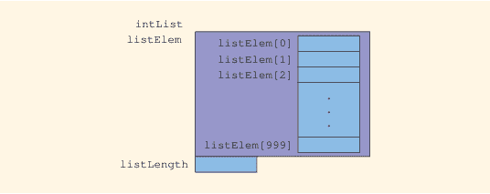

**图 10-5** `struct` 变量 `intList`

变量 intList 有两个成员：listElem，一个包含 1000 个 int 类型分量的数组；以及 listLength，类型为 int。此外，intList.listElem 访问成员 listElem，intList.listLength 访问成员 listLength。

考虑以下语句：

```cpp
intList.listLength = 0;       //Line 1
intList.listElem[0] = 12;    //Line 2
intList.listLength++;        //Line 3
intList.listElem[1] = 37;    //Line 4
intList.listLength++;        //Line 5
```

第 1 行中的语句将成员 listLength 的值设置为 0。第 2 行中的语句将 12 存储到数组 listElem 的第一个分量中。第 3 行中的语句将 listLength 的值增加 1。其他语句的含义类似。这些语句执行后，intList 如图 10-6 所示。

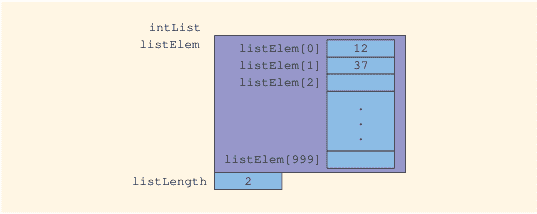

**图 10-6** 第 1 行至第 5 行语句执行后的 intList

接下来，我们编写顺序搜索算法，以确定给定项是否在列表中。如果在列表中找到 searchItem，则函数返回它在列表中的位置；否则，函数返回 -1。

```cpp
int seqSearch(const listType& list, int searchItem)
{
    int loc;

    bool found = false;

    for (loc = 0; loc < list.listLength; loc++)
        if (list.listElem[loc] == searchItem)
        {
            found = true;
            break;
        }

    if (found)
        return loc;
    else
        return -1;
}
```

在这个函数中，由于 listLength 是 list 的成员，我们通过 list.listLength 访问它。类似地，我们可以通过 list.listElem[loc] 访问 list 的一个元素。

注意，函数 seqSearch 的形式参数 list 被声明为常量引用参数。这意味着 list 接收相应实际参数的地址，但 list 不能修改实际参数。

回想一下，当变量按值传递时，形式参数会复制实际参数的值。因此，如果形式参数修改了数据，这种修改不会影响实际参数的数据。

假设一个 `struct` 有多个数据成员，需要大量内存来存储数据，并且你需要按值传递该 `struct` 类型的变量。相应的形式参数随后会接收该变量数据的一份副本。编译器随后必须为形式参数分配内存，以便复制实际参数的值。除了需要大量存储空间外，此操作还可能花费相当多的计算机时间，将实际参数的值复制到形式参数中。

另一方面，如果变量按引用传递，形式参数只接收实际参数的地址。因此，将变量作为参数传递的一种高效方式是按引用传递。如果变量按引用传递，那么当形式参数改变时，实际参数也会改变。然而，有时你并不希望函数能够更改实际参数的值。在 C++ 中，你可以按引用传递变量，同时仍然防止函数更改其值。这可以通过在形式参数声明中使用关键字 `const` 来实现，如函数 `seqSearch` 的定义所示。

同样，我们也可以重写排序、二分搜索以及其他列表处理函数。

## 数组中的 `structs`

假设一家公司有 50 名全职员工。我们需要打印他们的月薪支票，并记录年初至今已向每位员工支付了多少钱。首先，让我们定义员工记录：

```cpp
struct employeeType
{
    string firstName;
    string lastName;
    int    personID;
    string deptID;
    double yearlySalary;
    double monthlySalary;
    double yearToDatePaid;
    double monthlyBonus;
};
```

每位员工有以下成员（分量）：名、姓、个人 ID、部门 ID、年薪、月薪、年初至今已支付金额和月度奖金。

因为我们有 50 名员工，且每位员工的数据类型相同，所以我们可以使用一个包含 50 个分量的数组来处理员工数据。

```cpp
employeeType employees[50];
```

这条语句声明了包含 50 个 employeeType 类型分量的数组 employees（见图 10-7）。employees 的每个元素都是一个结构体。例如，图 10-7 还展示了 employees[2]。

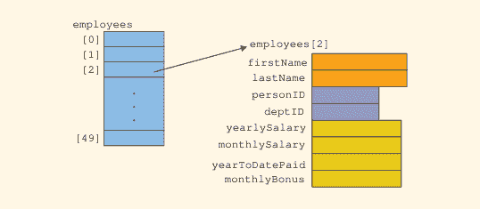

图 10-7  员工数组

假设我们还有以下声明：

```cpp
int counter;
```

此外，假设每位员工的初始数据——名、姓、个人 ID、部门 ID 和年薪——都提供在一个文件中。为便于讨论，我们假设每位员工的数据存储在某个文件中，比如 employee.dat。以下 C++ 代码将数据加载到 employees 数组中。我们假设最初 yearToDatePaid 为 0，并且月度奖金根据绩效每月确定。

```cpp
ifstream infile;  //input stream variable
                 //assume that the file employee.dat has been opened
for (counter = 0; counter < 50; counter++)
{
    infile >> employees[counter].firstName
           >> employees[counter].lastName
           >> employees[counter].personID
           >> employees[counter].deptID
           >> employees[counter].yearlySalary;
    employees[counter].monthlySalary
           = employees[counter].yearlySalary / 12;
    employees[counter].yearToDatePaid = 0.0;
    employees[counter].monthlyBonus = 0.0;
}
```

假设某个月份的月度奖金已经存储在每位员工的记录中，我们需要计算月薪支票并更新他们的 yearToDatePaid 金额。以下循环计算并打印员工当月的薪资支票：

```cpp
double payCheck; //variable to calculate the paycheck
```

```cpp
for (counter = 0; counter < 50; counter++)
```

具有相同的底层结构。例如，入职日期和离职日期都是 `int` 数据类型。让我们按如下方式重新组织这个 `struct`：

```c
struct nameType
{
    string first;
    string middle;
    string last;
};
```

```c
struct addressType
{
    string address1;
    string address2;
    string city;
    string state;
    string zip;
};
```

```c
struct dateType
{
    int month;
    int day;
    int year;
};
```

```c
struct contactType
{
    string phone;
    string cellphone;
    string fax;
    string pager;
    string email;
};
```

我们将员工的姓名、地址和联系方式分成了子类别。此外，我们定义了一个 `struct` dateType。让我们按如下方式重建员工记录：

```c
struct employeeType
{
    nameType name;
    string empID;
    addressType address;
    dateType hireDate;
    dateType quitDate;
    contactType contact;
    string deptID;
    double salary;
};
```

这个员工 `struct` 中的信息比之前的更容易管理。这个 `struct` 中的一部分可以复用来构建另一个 `struct`。例如，假设你想定义客户记录。每个客户都有名、姓和中间名，以及地址和联系方式。因此，你可以使用结构体 `nameType`、`addressType`、`contactType` 以及客户特有的成员，快速组合出客户记录。

接下来，让我们声明一个 employeeType 类型的变量，并讨论如何访问其成员。

考虑以下语句：

```c
employeeType newEmployee;
```

这条语句将 newEmployee 声明为 employeeType 类型的结构体变量（见图 10–8）。

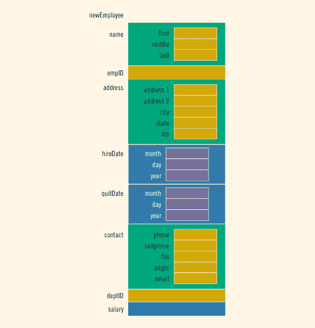

**图 10–8** 结构体变量 newEmployee

## 编程示例：销售数据分析

一家公司有六名销售人员。每个月，他们都会踏上公路旅程去销售公司的产品。每月月底，每位销售人员的总销售额连同该销售人员的 ID 和月份一起记录在一个文件中。每年年底，公司经理希望看到采用以下表格格式的报告：

**年度销售报告**

| ID | QT1 | QT2 | QT3 | QT4 | 总计 |
|---:|---:|---:|---:|---:|---:|
| 12345 | 1892.00 | 0.00 | 494.00 | 322.00 | 2708.00 |
| 32214 | 343.00 | 892.00 | 9023.00 | 0.00 | 10258.00 |
| 23422 | 1395.00 | 1901.00 | 0.00 | 0.00 | 3296.00 |
| 57373 | 893.00 | 892.00 | 8834.00 | 0.00 | 10619.00 |
| 35864 | 2882.00 | 1221.00 | 0.00 | 1223.00 | 5326.00 |
| 54654 | 893.00 | 0.00 | 392.00 | 3420.00 | 4705.00 |
| **总计** | **8298.00** | **4906.00** | **18743.00** | **4965.00** |  |

销售人员最高销售额：ID = 57373，金额 = $10619.00

季度最高销售额：季度 = 3，金额 = $18743.00

在此报告中，QT1 代表第 1 季度（第 1 至 3 月），QT2 代表第 2 季度（第 4 至 6 月），QT3 代表第 3 季度（第 7 至 9 月），QT4 代表第 4 季度（第 10 至 12 月）。

销售人员的 ID 存储在一个文件中；销售数据存储在另一个文件中。销售数据采用以下形式：

```
salesPersonID  month  saleAmount
.
.
.
```

此外，销售数据没有特定顺序；它不是按 ID 排序的。

销售数据示例如下：

```
12345 1 893
32214 1 343
23422 3 903
57373 2 893
.
.
.
```

让我们编写一个程序，以指定格式生成输出。

|  |  |
|---|---|
| **输入** | 一个文件，包含每个销售人员的 ID；第二个文件包含销售数据。 |
| **输出** | 一个文件，包含上述格式的年度销售报告。 |

### 问题分析与算法设计

根据问题需求，很明显每位销售人员的主要组成部分是销售人员的 ID、各季度销售金额和年度总销售金额。由于这些组成部分类型不同，我们可以借助 `struct` 将它们分组，定义如下：

```c
struct salesPersonRec
{
    string ID;       //salesperson's ID
    double saleByQuarter[4];    //array to store the total
                                 //sales for each quarter
    double totalSale;  //salesperson's yearly sales amount
};
```

由于有六名销售人员，我们使用一个包含六个分量的数组，其中每个分量的类型都是 salesPersonRec，定义如下：

```c
salesPersonRec salesPersonList[NO_OF_SALES_PERSON];
```

其中 NO_OF_SALES_PERSON 的值为 6。

由于程序要求我们找出公司每个季度的总销售额，我们需要一个包含四个分量的数组来存储数据。注意，这些数据将用于确定销售额最高的季度。因此，程序还需要以下数组：

```c
double totalSaleByQuarter[4];
```

回想一下，在 C++ 中，数组索引从 0 开始。因此，totalSaleByQuarter[0] 存储第 1 季度的数据，totalSaleByQuarter[1] 存储第 2 季度的数据，依此类推。

我们将在整个讨论中引用这些变量。

数组 salesPersonList 如图 10-9 所示。

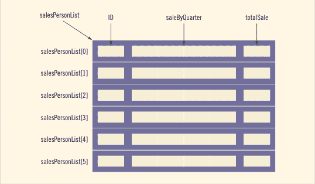

**图 10-9** 数组 `salesPersonList`

程序的第一步是将销售人员的 ID 读入数组 salesPersonList，并将每位销售人员的各季度销售额和总销售额初始化为 0。完成这一步后，数组 salesPersonList 如图 10-10 所示。

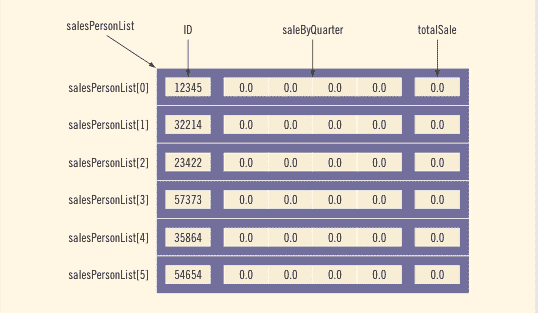

**图 10-10** 初始化后的数组 `salesPersonList`

下一步是处理销售数据。处理销售数据相当直接。对于包含销售数据的文件中的每个条目：

- 1. 读取销售人员的 ID、月份以及该月的销售金额。
- 2. 搜索数组 `salesPersonList`，定位与该销售人员对应的分量。
- 3. 确定该月份对应的季度。
- 4. 通过加上该月的销售金额来更新该季度的销售额。

处理完销售数据文件后：

- 1. 计算每位销售人员的总销售额。
- 2. 计算每个季度的总销售额。
- 3. 打印报告。

上述讨论转化为以下算法：

- 1. 初始化数组 `salesPersonList`。
- 2. 处理销售数据。
- 3. 计算每个季度的总销售额。
- 4. 计算每位销售人员的总销售额。
- 5. 打印报告。
- 6. 计算并打印每位销售人员的最高销售额。
- 7. 计算并打印每个季度的最高销售额。

为了降低主程序的复杂性，让我们为这七个步骤分别编写一个单独的函数。

### 函数 initialize

该函数从输入文件中读取销售人员的 ID，并将销售人员的 ID 存储在数组 `salesPersonList` 中。它还将每位销售人员的季度销售金额和总销售金额初始化为 0。该函数的定义是：

```c
void initialize(ifstream& indata, salesPersonRec list[],
                 int listSize)
{
    int index;
    int quarter;

    for (index = 0; index < listSize; index++)
    {
        indata >> list[index].ID; //get salesperson's ID

        for (quarter = 0; quarter < 4; quarter++)
            list[index].saleByQuarter[quarter] = 0.0;

        list[index].totalSale = 0.0;
    }
} //end initialize
```

### 函数 `getData`

该函数从输入文件中读取销售数据，并将相应信息存储在数组 `salesPersonList` 中。该函数的算法是：

- 1. 读取销售人员的 ID、月份以及该月的销售金额。
- 2. 搜索数组 `salesPersonList`，定位与该销售人员对应的分量。（由于销售人员的 ID 未排序，我们将使用顺序搜索来搜索该数组。）
- 3. 确定该月份对应的季度。
- 4. 通过加上该月的销售金额来更新该季度的销售额。

假设读取到的条目是：

```
57373 2 350
```

这里，销售人员的 ID 为 57373，月份为 2，销售金额为 350。假设数组 `salesPersonList` 如图 10-11 所示。

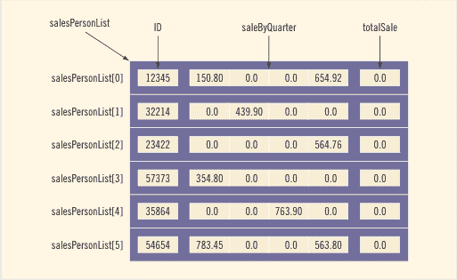

**图 10-11** 数组 `salesPersonList`

现在，ID 57373 对应数组分量 `salesPersonList[3]`，月份 2 对应第 1 季度。因此，将 350 加到 354.80 上，得到新金额 704.80。处理该条目后，数组 `salesPersonList` 如图 10-12 所示。


```cpp
if (1 <= month && month <= 3)
    quarter = 0;
else if (4 <= month && month <= 6)
    quarter = 1;
else if (7 <= month && month <= 9)
    quarter = 2;
else
    quarter = 3;

if (index < listSize)
    list[index].saleByQuarter[quarter] += amount;
else
    cout << "Invalid salesperson's ID." << endl;

infile >> sID;
} //end while
} //end getData
```

这个函数计算公司每个季度的总销售额。为了计算每个季度的总销售额，我们将每位销售员在该季度的销售额相加。显然，这个函数必须能够访问数组 salesPersonList 和数组 totalSalesByQuarter。这个函数还需要知道每个数组的行数。因此，这个函数有三个参数。该函数的定义如下：

```cpp
void saleByQuarter(salesPersonRec list[], int listSize,
                   double totalByQuarter[])
{
    int quarter;
    int index;

    for (quarter = 0; quarter < 4; quarter++)
        totalByQuarter[quarter] = 0.0;

    for (quarter = 0; quarter < 4; quarter++)
        for (index = 0; index < listSize; index++)
            totalByQuarter[quarter] +=
                list[index].saleByQuarter[quarter];
} //end saleByQuarter
```

这个函数计算每位销售员的年度销售额。为了计算某位员工的年度销售额，我们将该员工四个季度的销售额相加。显然，这个函数必须能够访问数组 salesPersonList。这个函数还需要知道数组的大小。因此，这个函数有两个参数。

该函数的定义如下：

```cpp
void totalSaleByPerson(salesPersonRec list[], int listSize)
{
    int index;
    int quarter;

    for (index = 0; index < listSize; index++)
        for (quarter = 0; quarter < 4; quarter++)
            list[index].totalSale +=
                list[index].saleByQuarter[quarter];
} //end totalSaleByPerson
```

## 函数 `printReport`

这个函数按指定格式打印年度报告。其伪代码算法如下：

- 1. 打印标题——即输出的前三行。
- 2. 打印每位销售员的数据。
- 3. 打印表格的最后一行。

请注意，接下来的两个函数将生成输出的最后两行。

显然，printReport 函数必须能够访问数组 salesPersonList 和数组 totalSaleByQuarter。此外，由于输出将存储在文件中，这个函数必须能够访问与输出文件关联的 ofstream 变量。因此，这个函数有四个参数：一个对应于数组 salesPersonList 的参数，一个对应于数组 totalSaleByQuarter 的参数，一个指定数组大小的参数，以及一个对应于 ofstream 变量的参数。该函数的定义如下：

```cpp
void printReport (ofstream& outfile, salesPersonRec list[],
                  int listSize, double saleByQuarter[])
{
    int index;
    int quarter;

    outfile << "--------- Annual Sales Report ---------"
            << "-----" << endl;
    outfile << endl;
    outfile << "  ID          QT1        QT2        QT3        "
            << "QT4        Total" << endl;
    outfile << "--------------------------------------------------"
            << endl;
    outfile << "____________________________________________" << endl;

    for (index = 0; index < listSize; index++)
    {
        outfile << list[index].ID << "  ";

        for (quarter = 0; quarter < 4; quarter++)
            outfile << setw(10)
                    << list[index].saleByQuarter[quarter];

        outfile << setw(10) << list[index].totalSale << endl;
    }

    outfile << "Total  ";
    for (quarter = 0; quarter < 4; quarter++)
        outfile << setw(10)<< saleByQuarter[quarter];

    outfile << endl << endl;
} //end printReport
```

## 函数 maxSaleByPerson

这个函数打印销售额最高的销售员的姓名。为了确定这位销售员，我们查看每位销售员的销售总额并找出最大销售额。因为每位员工的销售总额保存在数组 salesPersonList 中，所以这个函数必须能够访问数组 salesPersonList。此外，由于输出将存储在文件中，这个函数必须能够访问与输出文件关联的 ofstream 变量。因此，这个函数有三个参数：一个对应于数组 salesPersonList 的参数，一个指定该数组大小的参数，以及一个对应于输出文件的参数。

查找最大销售额的算法与查找数组中最大元素的算法类似（在第9章讨论过）。该函数的定义如下：

```cpp
void maxSaleByPerson(ofstream& outData, salesPersonRec list[],
                     int listSize)
{
    int maxIndex = 0;
    int index;

    for (index = 1; index < listSize; index++)
        if (list[maxIndex].totalSale < list[index].totalSale)
            maxIndex = index;

    outData << "Max Sale by SalesPerson: ID = "
            << list[maxIndex].ID
            << ", Amount = $" << list[maxIndex].totalSale
            << endl;
} //end maxSaleByPerson
```

## 函数 maxSaleByQuarter

这个函数打印销售额最高的季度。为了确定这个季度，我们查看每个季度的销售总额并找出最大销售额。因为每个季度的销售总额保存在数组 totalSaleByQuarter 中，所以这个函数必须能够访问数组 totalSaleByQuarter。此外，由于输出将存储在文件中，这个函数必须能够访问与输出文件关联的 ofstream 变量。因此，这个函数有两个参数：一个对应于数组 totalSaleByQuarter 的参数，以及一个对应于输出文件的参数。

查找最大销售额的算法与查找数组中最大元素的算法相同（在第9章讨论过）。该函数的定义如下：

```cpp
void maxSaleByQuarter(ofstream& outData,
                      double saleByQuarter[])
{
    int quarter;
    int maxIndex = 0;

    for (quarter = 0; quarter < 4; quarter++)
        if (saleByQuarter[maxIndex] < saleByQuarter[quarter])
            maxIndex = quarter;

    outData << "Max Sale by Quarter: Quarter = "
            << maxIndex + 1
            << ", Amount = $" << saleByQuarter[maxIndex]
            << endl;
} //end maxSaleByQuarter
```

为了使程序更加灵活，我们将在程序执行期间提示用户指定输入文件和输出文件。

现在我们可以编写函数 main 的算法了。

## 主算法

- 1. 声明变量。
- 2. 提示用户输入包含销售员 ID 数据的文件名。
- 3. 读取输入文件名。
- 4. 打开输入文件。
- 5. 如果输入文件不存在，则退出程序。
- 6. 初始化数组 `salesPersonList`。调用函数 `initialize`。
- 7. 关闭包含销售员 ID 数据的输入文件并清除输入流。
- 8. 提示用户输入包含销售数据的文件名。
- 9. 读取输入文件名。
- 10. 打开输入文件。
- 11. 如果输入文件不存在，则退出程序。
- 12. 提示用户输入输出文件名。
- 13. 读取输出文件名。
- 14. 打开输出文件。
- 15. 要以固定小数格式输出浮点数，并带小数点和尾随零，请设置操纵符 `fixed` 和 `showpoint`。此外，要将浮点数输出到小数点后两位，请将精度设置为小数点后两位。

```cpp
void getData(ifstream& infile, salesPersonRec list[],
             int listSize);
void saleByQuarter(salesPersonRec list[], int listSize,
                   double totalByQuarter[]);
void totalSaleByPerson(salesPersonRec list[], int listSize);
void printReport(ofstream& outfile, salesPersonRec list[],
                 int listSize, double saleByQuarter[]);
void maxSaleByPerson(ofstream& outData, salesPersonRec list[],
                     int listSize);
void maxSaleByQuarter(ofstream& outData, double saleByQuarter[]);

int main()
{
    //Step 1
    ifstream infile;        //input file stream variable
    ofstream outfile;       //output file stream variable

    string inputFile;       //variable to hold the input file name
    string outputFile;      //variable to hold the output file name

    double totalSaleByQuarter[4];    // array to hold
                                     //sale by quarter

    salesPersonRec salesPersonList[NO_OF_SALES_PERSON]; //array
                                                        //to hold the salesperson's data

    cout << "Enter the salesPerson ID file name: "; //Step 2
    cin >> inputFile;                                //Step 3
    cout << endl;

    infile.open(inputFile.c_str());                  //Step 4

    if (!infile)                                     //Step 5
    {
        cout << "Cannot open the input file."
             << endl;
        return 1;
    }

    initialize(infile, salesPersonList,
               NO_OF_SALES_PERSON);                 //Step 6

    infile.close();                                  //Step 7
    infile.clear();                                  //Step 7

    cout << "Enter the sales data file name: ";     //Step 8
    cin >> inputFile;                                //Step 9
    cout << endl;

    infile.open(inputFile.c_str());                  //Step 10
```


```cpp
    if (!infile)                                              //Step 11
    {
        cout << "Cannot open the input file."
             << endl;
        return 1;
    }

    cout << "Enter the output file name: ";                   //Step 12
    cin >> outputFile;                                        //Step 13
    cout << endl;

    outfile.open(outputFile.c_str());                         //Step 14
    outfile << fixed << showpoint
            << setprecision(2);                               //Step 15

    getData(infile, salesPersonList,
            NO_OF_SALES_PERSON);                              //Step 16
    saleByQuarter(salesPersonList,
                  NO_OF_SALES_PERSON,
                  totalSaleByQuarter);                        //Step 17
    totalSaleByPerson(salesPersonList,
                      NO_OF_SALES_PERSON);                    //Step 18

    printReport(outfile, salesPersonList,
                NO_OF_SALES_PERSON,
                totalSaleByQuarter);                          //Step 19
    maxSaleByPerson(outfile, salesPersonList,
                    NO_OF_SALES_PERSON);                      //Step 20
    maxSaleByQuarter(outfile, totalSaleByQuarter);            //Step 21

    infile.close();                                           //Step 22
    outfile.close();                                          //Step 22

    return 0;
}

//Place the definitions of the functions initialize,
//getData, saleByQuarter, totalSaleByPerson,
//printReport, maxSaleByPerson, and maxSaleByQuarter here.
```

## 示例运行

在此示例运行中，用户输入以底纹显示。

```text
Enter the salesPerson ID file name: Ch10_SalesManID.txt

Enter the sales data file name: Ch10_SalesData.txt

Enter the output file name: Ch10_SalesDataAnalysis.txt
```

### 输入文件：销售人员的 ID

```text
12345
32214
23422
57373
35864
54654
```

### 输入文件：销售人员的数据

```text
12345 1 893
32214 1 343
23422 3 903
57373 2 893
35864 5 329
54654 9 392
12345 2 999
32214 4 892
23422 4 895
23422 2 492
57373 6 892
35864 10 1223
54654 11 3420
12345 12 322
35864 5 892
54654 3 893
12345 8 494
32214 8 9023
23422 6 223
23422 4 783
57373 8 8834
35864 3 2882
```

### 年度销售报告

| ID | QT1 | QT2 | QT3 | QT4 | 总计 |
|---|---:|---:|---:|---:|---:|
| 12345 | 1892.00 | 0.00 | 494.00 | 322.00 | 2708.00 |
| 32214 | 343.00 | 892.00 | 9023.00 | 0.00 | 10258.00 |
| 23422 | 1395.00 | 1901.00 | 0.00 | 0.00 | 3296.00 |
| 57373 | 893.00 | 892.00 | 8834.00 | 0.00 | 10619.00 |
| 35864 | 2882.00 | 1221.00 | 0.00 | 1223.00 | 5326.00 |
| 54654 | 893.00 | 0.00 | 392.00 | 3420.00 | 4705.00 |
| 总计 | 8298.00 | 4906.00 | 18743.00 | 4965.00 | 36912.00 |

销售人员最高销售额：ID = 57373，金额 = $10619.00
季度最高销售额：季度 = 3，金额 = $18743.00

## 快速回顾

- 1. `struct` 是固定数量组件的集合。
- 2. `struct` 的组件可以具有不同的类型。
- 3. 定义 `struct` 的语法是：

```cpp
struct structName
{
    dataType1 identifier1;
    dataType2 identifier2;
    .
    .
    .
    dataTypen identifiern;
};
```

- 4. 在 C++ 中，`struct` 是保留字。
- 5. 在 C++ 中，`struct` 是一种定义；不会分配内存。只有在声明 `struct` 变量时，才会为其分配内存。
- 6. `struct` 的组件称为 `struct` 的成员。
- 7. `struct` 的组件通过名称访问。
- 8. 在 C++ 中，点（.）运算符称为成员访问运算符。
- 9. `struct` 的成员通过使用点（.）运算符访问。例如，如果 employeeType 是一个 `struct`，employee 是 employeeType 类型的变量，name 是 employee 的成员，那么表达式 employee.name 访问成员 name。也就是说，employee.name 是一个变量，可以像其他变量一样进行操作。
- 10. 对 `struct` 唯一的内置操作是赋值和成员访问操作。
- 11. 不允许对 `struct(s)` 进行算术运算或关系运算。
- 12. 作为函数的参数，`struct` 可以按值传递或按引用传递。
- 13. 函数可以返回 `struct` 类型的值。
- 14. 一个 `struct` 可以是另一个 `struct` 的成员。

## 练习

- 1. 将下列陈述标记为真或假。
    - a. `struct` 的所有成员必须具有不同的类型。
    - b. 函数不能返回 `struct` 类型的值。
    - c. `struct` 的成员可以是另一个 `struct`。
    - d. 对 `struct` 唯一允许的操作是赋值和成员选择。
    - e. 数组可以是 `struct` 的成员。
    - f. 在 C++ 中，允许对 `struct` 进行某些聚合操作。
    - g. 因为 `struct` 具有有限数量的组件，所以允许对 `struct` 进行关系运算。
- 2. 定义一个 `struct` `checkingAccount`，用于存储以下有关支票账户的数据：账户持有人姓名（`string`）、账号（`int`）、余额（`double`）和利率（`double`）。
- 3. 假设采用练习 2 中的定义。声明一个 `checkingAccount` 变量，并编写 C++ 语句来存储以下信息：账户持有人姓名——Jason Miller，账号——17328910，余额——24476.38，利率——2.5%。
- 4. 定义一个 `struct` `movieType`，用于存储以下有关电影的数据：电影名称（`string`）、电影导演（`string`）、制片人（`string`）、电影发行年份（`int`）以及库存副本数量。
- 5. 假设采用练习 4 中的定义。声明一个 `movieType` 类型的变量来存储以下数据：电影名称——Summer Vacation，导演——Tom Blair，制片人——Rajvir Mechant，电影发行年份——2005，库存副本数量——34。
- 6. 考虑以下语句：

```cpp
struct nameType
{
    string first;
    string last;
};

struct dateType
{
    int month;
    int day;
    int year;
};

struct personalInfoType
{
    nameType name;
    int pID;
    dateType dob;
};

personalInfoType person;
personalInfoType classList[100];
nameType student;
```

将下列语句标记为有效或无效。如果语句无效，请解释原因。

    - a. `person.name.first = "William";`
    - b. `cout << person.name << endl;`
    - c. `classList[1] = person;`
    - d. `classList[20].pID = 000011100;`
    - e. `person = classList[20];`
    - f. `student = person.name;`
    - g. `cin >> student;`
    - h. `for (int j = 0; j < 100; j++) classList[j].pID = 00000000;`
    - i. `classList.dob.day = 1;`
    - j. `student = name;`

- 7. 考虑以下语句（nameType 如练习 6 中所定义）：

```cpp
struct employeeType
{
    nameType name;
    int performanceRating;
    int pID;
    string dept;
    double salary;
};
employeeType employees[100];
employeeType newEmployee;
```

将下列语句标记为有效或无效。如果语句无效，请解释原因。

    - a. `newEmployee.name = "John Smith";`
    - b. `cout << newEmployee.name;`
    - c. `employees[35] = newEmployee;`
    - d. 
```cpp
if (employees[45].pID == 55533444)
    employees[45].performanceRating = 1;
```
    - e. `employees.salary = 0;`

- 8. 假设采用练习 6 和练习 7 中的声明。编写 C++ 语句以执行以下操作：
    - a. 将以下信息存储到 `newEmployee` 中：

```text
name: Mickey Doe
pID: 11111111
performanceRating: 2
dept: ACCT
salary: 34567.78
```

    - b. 在数组 `employees` 中，将每个 `performanceRating` 初始化为 0。
    - c. 将数组 `employees` 第 20 个组件的信息复制到 `newEmployee` 中。
    - d. 将数组 `employees` 中第 50 名员工的工资在其先前值上增加 5735.87。

- 9. 假设你有以下 `struct` 的定义。

```cpp
struct partsType
{
    string partName;
    int partNum;
    double price;
    int quantitiesInStock;
};
```

声明一个数组 `inventory`，包含 100 个 `partsType` 类型的组件。


- 10. 假设有习题 9 的定义。
  - a. 编写 C++ 代码，按如下方式初始化 `inventory` 的每个分量：将 `partName` 初始化为空字符串，将 `partNum` 初始化为 −1，将 `price` 初始化为 0.0，将 `quantitiesInStock` 初始化为 0。
  - b. 编写 C++ 代码，使用循环输出存储在 `inventory` 中的数据。假设变量 `length` 表示 `inventory` 中元素的数量。

- 11. 假设有习题 9 的定义和声明。编写一个 void 函数的定义，该函数可用于向 `partsType` 类型的变量输入数据。再编写 C++ 代码，使用你的函数向 `inventory` 输入数据。

- 12. 假设你有以下定义：

```
struct timeType
{
    int hr;
    double min;
    int sec;
};

struct tourType
{
    string cityName;
    int distance;
    timeType travelTime;
};
```

  - a. 声明 `tourType` 类型的变量 `destination`。
  - b. 编写 C++ 语句，将以下数据存储到 `destination` 中：`cityName`——芝加哥，`distance`——550 英里，`travelTime`——9 小时 30 分钟。
  - c. 编写一个函数的定义，用于输出存储在 `tourType` 类型变量中的数据。
  - d. 编写一个有返回值的函数的定义，该函数向 `tourType` 类型的变量输入数据。
  - e. 编写一个 `void` 函数的定义，该函数带有一个 `tourType` 类型的引用参数，用于向 `tourType` 类型的变量输入数据。

### 编程练习

- 1. 假设有习题 4 的定义，其中定义了 `struct movieType`。编写一个程序，声明一个 `movieType` 类型的变量，提示用户输入有关一部电影的数据，并输出该电影数据。

- 2. 编写一个程序，读取学生姓名及其后的测试成绩。该程序应输出每个学生的姓名及其后的测试成绩和相关等级。它还应找出并打印最高测试成绩以及获得该最高测试成绩的学生姓名。

  学生数据应存储在 `studentType` 类型的 `struct` 变量中，该变量有四个分量：`string` 类型的 `studentFName` 和 `studentLName`、`int` 类型的 `testScore`（testScore 介于 0 和 100 之间）以及 `char` 类型的 `grade`。假设该班级有 20 名学生。使用一个包含 20 个 `studentType` 类型分量的数组。

  你的程序必须至少包含以下函数：

  - a. 一个将学生数据读入数组的函数。
  - b. 一个为每个学生分配相关等级的函数。
  - c. 一个找出最高测试成绩的函数。
  - d. 一个打印获得最高测试成绩的学生姓名的函数。

  你的程序必须按以下形式输出每个学生的姓名：姓后跟一个逗号，再跟一个空格，再跟名；姓名必须左对齐。此外，除了声明变量以及打开输入和输出文件之外，函数 main 应仅是一组函数调用。

- 3. 定义一个结构体 `menuItemType`，它有两个分量：`string` 类型的 `menuItem` 和 `double` 类型的 `menuPrice`。

- 4. 编写一个程序，帮助当地一家餐馆实现早餐计费系统的自动化。该程序应完成以下操作：

  - a. 向顾客显示餐馆提供的不同早餐食品。
  - b. 允许顾客从菜单中选择不止一项。
  - c. 计算并打印账单。

  假设餐馆提供以下早餐食品（每项食品的价格显示在该项右侧）：

  | 早餐食品 | 价格 |
  |---|---:|
  | 普通鸡蛋 | $1.45 |
  | 培根煎蛋 | $2.45 |
  | 松饼 | $0.99 |
  | 法式吐司 | $1.99 |
  | 水果篮 | $2.49 |
  | 麦片 | $0.69 |
  | 咖啡 | $0.50 |
  | 茶 | $0.75 |

  使用一个由结构体 `menuItemType` 组成的数组 `menuList`，该结构体如编程练习 2 中所定义。你的程序必须至少包含以下函数：

  - **函数 `getData`：** 该函数将数据加载到数组 `menuList` 中。
  - **函数 `showMenu`：** 该函数显示餐馆提供的不同食品，并告诉用户如何选择这些食品。
  - **函数 `printCheck`：** 该函数计算并打印账单。（注意，计费金额应包含 5% 的税。）示例输出为：

```
Welcome to Johnny's Restaurant
Bacon and Egg     $2.45
Muffin             $0.99
Coffee             $0.50
Tax                $0.20
Amount Due         $4.14
```

  将输出格式化为两位小数。输出中每项食品的名称必须左对齐。你可以假设用户对某一特定类型只选择一项。

- 5. 重做习题 4，使顾客可以选择某一特定类型的多项食品。这种情况下的示例输出为：

```
Welcome to Johnny's Restaurant
1 Bacon and Egg     $2.45
2 Muffin             $1.98
1 Coffee             $0.50
    Tax              $0.25
    Amount Due       $5.18
```

- 6. 编写一个程序，其 main 函数仅是一组变量声明和函数调用。该程序读取一个文本，并输出字母及其计数，具体如下文在函数 `printResult` 中所述。（不能有全局变量！所有信息都必须传入和传出函数。使用一个结构体来存储这些信息。）你的程序必须至少包含以下函数：

  - **函数 `openFile`：** 打开输入文件和输出文件。你必须将文件流作为参数传递（当然是通过引用）。如果文件不存在，程序应打印适当的消息并退出。程序必须询问用户输入文件和输出文件的名称。
  - **函数 `count`：** 统计在函数 `openFile` 中打开的文本文件里大写字母 A–Z 和小写字母 a–z 的每次出现。这些信息必须存入一个结构体数组。该数组必须作为参数传递，文件标识符也必须作为参数传递。
  - **函数 `printResult`：** 打印大写字母和小写字母的数量，以及每个字母 A–Z 的大写字母百分比和每个字母 a–z 的小写字母百分比。百分比应如下所示：“25%”。这些信息必须来自一个结构体数组，并且该数组必须作为参数传递。

- 7. 编写一个程序，声明一个结构体来存储棒球运动员的数据（运动员姓名、本垒打次数和安打次数）。声明一个包含 10 个分量的数组，用于存储 10 名棒球运动员的数据。你的程序必须包含一个输入数据的函数和一个输出数据的函数。添加函数来搜索数组以查找特定运动员的索引，并更新某个运动员的数据。（你可以假设输入数据存储在文件中。）在程序终止之前，给用户提供将数据保存到文件中的选项。你的程序应由菜单驱动，向用户提供各种选择。


# 第11章
## 类与数据抽象

本章中，你将：

- 学习类
- 学习类的 *私有*、*受保护* 和 *公有* 成员
- 探索类是如何实现的
- 考察构造函数和析构函数
- 学习抽象数据类型（ADT）
- 探索如何使用类实现 ADT
- 学习信息隐藏
- 探索信息隐藏如何在 C++ 中实现
- 学习类的 *静态* 成员

在第 10 章中，你学习了如何使用结构体将不同类型的数据项组合在一起。第 10 章给出的结构体定义类似于 C 结构体的定义。然而，C++ 结构体的成员既可以是数据项，也可以是函数。C++ 提供了另一种结构化数据类型，称为 **类**，它专门用于将数据和函数组合在一起。本章首先介绍类并解释如何使用类，然后讨论结构体与类之间的异同。

> **注意** 第 10 章不是本章的先修内容。事实上，结构体和类具有相似的能力，正如本章“结构体与类的比较”一节所讨论的那样。

## 类

第 1 章介绍了一种称为 **面向对象设计（OOD）** 的问题求解方法。在 OOD 中，第一步是识别称为 **对象** 的组成部分。对象将数据以及对该数据的操作组合在一个单元中。在 C++ 中，允许你将数据以及对该数据的操作组合在一个单元中的机制称为类。既然你已经知道如何在计算机内存中存储和操作数据，以及如何构造自己的函数，那么你就可以学习对象是如何构造的了。本章及后续章节将使用 OOD 开发和实现程序。本章首先解释如何定义类并在程序中使用类。

一个 **类** 是固定数量组成部分的集合。类的组成部分称为类的 **成员**。

定义类的一般语法是：

```
class classIdentifier
{
    classMembersList
};
```

其中 classMembersList 由变量声明和/或函数组成。也就是说，类的成员可以是变量（用于存储数据），也可以是函数。

- 如果类的成员是变量，你就像声明任何其他变量一样声明它。此外，在类的定义中，声明变量时不能初始化该变量。
- 如果类的成员是函数，通常使用函数原型来声明该成员。
- 如果类的成员是函数，它就可以（直接）访问该类的任何成员——成员变量和成员函数。也就是说，当你编写成员函数的定义时，可以直接访问该类的任何成员变量，而不必将其作为参数传递。唯一明显的条件是，必须先声明标识符，然后才能使用它。


在C++中，`class`是保留字，它只定义一种数据类型；不分配内存。它宣告一个类的声明。此外，注意右花括号后的分号（`;`）。分号是语法的一部分。因此，缺少分号将导致语法错误。

`class`的成员分为三类：`private`、`public`和`protected`。本章主要讨论前两种类型：`private`和`public`。

在C++中，`private`、`protected`和`public`是保留字，称为成员访问说明符。

以下是关于类的`public`和`private`成员的一些事实：

- 默认情况下，类的所有成员都是`private`。
- 如果类的某个成员是`private`，则不能在类外部访问它。（示例11-1说明了这一概念。）
- `public`成员可以在类外部访问。（示例11-1说明了这一概念。）
- 要使类的某个成员成为`public`，需使用成员访问说明符`public`并加上冒号`:`。

假设我们想定义一个类，在程序中实现一天中的时间。由于时钟给出一天中的时间，我们把这个类称为`clockType`。此外，为了在计算机内存中表示时间，我们使用三个`int`变量：一个表示小时，一个表示分钟，一个表示秒。

假设这三个变量是：

```cpp
int hr;
int min;
int sec;
```

我们还希望对时间执行以下操作：

- 1. 设置时间。
- 2. 获取时间。
- 3. 打印时间。
- 4. 将时间增加一秒。
- 5. 将时间增加一分钟。
- 6. 将时间增加一小时。
- 7. 比较两个时间是否相等。

为了实现这七个操作，我们将编写七个函数——`setTime`、`getTime`、`printTime`、`incrementSeconds`、`incrementMinutes`、`incrementHours`和`equalTime`。

从以上讨论可以清楚地看出，类`clockType`有10个成员：三个成员变量和七个成员函数。


类`clockType`的一些成员将是**私有**的；另一些将是**公有**的。决定哪些成员设为**公有**、哪些设为**私有**，取决于成员的性质。一般规则是：任何需要在类外部访问的成员都声明为**公有**；任何不应由用户直接访问的成员都应声明为**私有**。例如，用户应能够设置时间和打印时间。因此，设置时间和打印时间的成员应声明为**公有**。

类似地，用于增加时间和比较时间是否相等的成员应声明为**公有**。另一方面，为了防止直接操作成员变量`hr`、`min`和`sec`，我们将把它们声明为**私有**。此外，请注意，如果用户可以直接访问成员变量，则不需要`setTime`这样的成员函数。本章第二部分（从“信息隐藏”一节开始）解释了为什么有些成员需要是**公有**的，而另一些应是**私有**的。

以下语句定义了类`clockType`：

```cpp
class clockType
{
public:
    void setTime(int, int, int);
    void getTime(int&, int&, int&) const;
    void printTime() const;
    void incrementSeconds();
    void incrementMinutes();
    void incrementHours();
    bool equalTime(const clockType&) const;

private:
    int hr;
    int min;
    int sec;
};
```

在这个定义中：

- 类`clockType`有七个成员函数：`setTime`、`getTime`、`printTime`、`incrementSeconds`、`incrementMinutes`、`incrementHours`和`equalTime`。它有三个成员变量：`hr`、`min`和`sec`。
- 三个成员变量——`hr`、`min`和`sec`——是类的**私有**成员，不能在类外部访问。（示例11-1说明了这一概念。）
- 七个成员函数——`setTime`、`getTime`、`printTime`、`incrementSeconds`、`incrementMinutes`、`incrementHours`和`equalTime`——可以直接访问成员变量（`hr`、`min`和`sec`）。换句话说，当我们编写这些函数的定义时，不把这些成员变量作为参数传递给成员函数。
- 在函数`equalTime`中，形参是常量引用参数。也就是说，在调用函数`equalTime`时，形参接收实参的地址，但形参不能修改实参的值。你本可以把形参声明为值参数，但那样将要求形参复制实参的值，可能导致性能不佳。（解释见本章“引用参数与类对象（变量）”一节。）
- 成员函数`getTime`、`printTime`和`equalTime`末尾的单词`const`指定这些函数不能修改`clockType`类型变量的成员变量。

> **注意**  
> `private`和`public`成员可以以任意顺序出现。如果需要，你可以先声明`private`成员，再声明`public`成员。本章“类中公有成员和私有成员的顺序”一节讨论了这个问题。

> **注意**  
> 在类`clockType`的定义中，所有成员变量都是`private`，所有成员函数都是`public`。然而，成员函数也可以是`private`。例如，如果某个成员函数只用于实现类的其他成员函数，且用户不需要访问该函数，就把它设为`private`。类似地，类的成员变量也可以是`public`。

请注意，我们还没有编写类的成员函数的定义。你很快就会学习如何编写它们。

函数`setTime`将三个成员变量——`hr`、`min`和`sec`——设置为给定值。这些给定值作为参数传递给函数`setTime`。函数`printTime`打印时间，即`hr`、`min`和`sec`的值。函数`incrementSeconds`将时间增加一秒，函数`incrementMinutes`将时间增加一分钟，函数`incrementHours`将时间增加一小时，函数`equalTime`比较两个时间是否相等。

请注意，函数`equalTime`只有一个参数，尽管进行比较需要两个对象。我们将在本章后面的“成员函数的实现”一节中借助示例解释这一点。

## 统一建模语言类图

类和它的成员可以使用一种称为**统一建模语言**（UML）的表示法进行图形化描述。例如，图11-1显示了类`clockType`的UML类图。

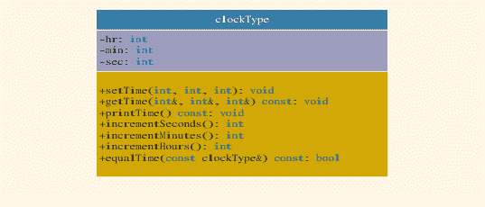

图11-1 类clockType的UML类图

顶部的框包含类的名称。中间的框包含成员变量及其数据类型。最后一个框包含成员函数名、参数列表以及函数的返回类型。成员名前面的+（加号）表示该成员是公有成员；-（减号）表示该成员是私有成员。成员名前面的符号#表示该成员是受保护成员。

## 变量（对象）声明

一旦定义了类，就可以声明该类型的变量。在C++术语中，类变量称为**类对象**或**类实例**。为帮助你熟悉这一术语，从现在起，我们将用“类对象”或简称为**对象**来表示类变量。

声明类对象的语法与声明任何其他变量的语法相同。以下语句声明了两个`clockType`类型的对象：

```cpp
clockType myClock;
clockType yourClock;
```

每个对象都有10个成员：七个成员函数和三个成员变量。每个对象都为**hr**、**min**和**sec**分配了独立的内存。

实际上，只为每个类对象的成员变量分配内存。C++编译器只为类的成员函数生成一份物理副本，每个类对象执行同一份成员函数副本。因此，每当我们绘制

在类对象的图示中，我们只展示成员变量。例如，图 11-2 展示了对象 myClock 和 yourClock 及其成员变量中的值。


图 11-2 对象 myClock 和 yourClock

## 访问类成员

一旦声明了类的对象，该对象就可以访问类的成员。对象访问类成员的一般语法是：

```
classObjectName.memberName
```

类对象可以访问哪些类成员取决于该对象在何处声明。

-   如果对象是在类的成员函数定义中声明的，那么该对象既可以访问公有成员，也可以访问私有成员。（我们将在本章后面“成员函数的实现”一节中编写类 clockType 的成员函数 equalTime 的定义时详细说明这一点。）
-   如果对象是在其他地方（例如在用户程序中）声明的，那么该对象只能访问类的公有成员。

回想一下，在 C++ 中，点号 .（句点）是一个称为成员访问运算符的运算符。例 11-1 说明了如何访问类的成员。

### 例 11-1

假设我们有如下声明（例如在用户程序中）：

```
clockType myClock;
clockType yourClock;
```

考虑以下语句：

```cpp
myClock.setTime(5, 2, 30);
myClock.printTime();
yourClock.setTime(x, y, z);    //assume x, y, and z are
                              //variables of type int
if (myClock.equalTime(yourClock))
.
.
.
```

这些语句是合法的；也就是说，它们在语法上是正确的。

在第一个语句 `myClock.setTime(5, 2, 30);` 中，成员函数 `setTime` 被执行。值 5、2 和 30 作为参数传递给函数 `setTime`，该函数使用这些值将 `myClock` 的三个成员变量 `hr`、`min` 和 `sec` 的值分别设置为 5、2 和 30。类似地，第二个语句执行成员函数 `printTime` 并输出 `myClock` 的三个成员变量的内容。在第三个语句中，变量 `x`、`y` 和 `z` 的值用于设置 `yourClock` 的三个成员变量的值。

在第四个语句中，成员函数 `equalTime` 执行，并将 `myClock` 的三个成员变量与 `yourClock` 的对应成员变量进行比较。由于在此语句中 `equalTime` 是对象 `myClock` 的成员，因此它可以直接访问 `myClock` 的三个成员变量。所以它还需要另一个对象，在本例中是 `yourClock`，来进行比较。这解释了为什么函数 `equalTime` 只有一个参数。

对象 `myClock` 和 `yourClock` 只能访问类的 **公有**成员。因此，以下语句是非法的，因为 `hr` 和 `min` 被声明为 `class` clockType 的 **私有**成员，因此对象 `myClock` 和 `yourClock` 无法访问它们：

```cpp
myClock.hr = 10;           //illegal
myClock.min = yourClock.min; //illegal
```

### 类的内置操作

C++ 的大多数内置操作不适用于类。不能使用算术运算符对类对象执行算术运算（除非它们被重载；见第 14 章）。例如，不能使用运算符 + 来相加两个类对象，比如 clockType 类型的对象。另外，不能使用关系运算符比较两个类对象是否相等（除非它们被重载；见第 14 章）。

对类对象有效的两个内置操作是成员访问（.）和赋值（=）。你已经看到如何通过使用类对象名称、然后一个点、再然后成员名称来访问类的单个成员。（例如，如果 `myClock` 是 `clockType` 对象，在语句 `myClock.incrementSeconds();` 中，`myClock` 访问成员 `incrementSeconds`。）

现在，我们借助一个示例来说明赋值语句如何工作。

### 赋值运算符与类

假设 `myClock` 和 `yourClock` 是前面定义的 clockType 对象。此外，假设 `myClock` 和 `yourClock` 的值如图 11-3(a) 所示。

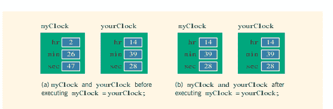

**图 11-3** 执行语句 myClock = yourClock; 之前和之后的 myClock 和 yourClock

语句：

```cpp
myClock = yourClock;        //Line 1
```

将 `yourClock` 的值复制到 `myClock` 中。也就是说，

-   `yourClock.hr` 的值被复制到 `myClock.hr`，
-   `yourClock.min` 的值被复制到 `myClock.min`，以及
-   `yourClock.sec` 的值被复制到 `myClock.sec`。

换句话说，`yourClock` 的三个成员变量的值被复制到 `myClock` 的对应成员变量中。因此，赋值语句执行逐成员复制。第 1 行的语句执行后，`myClock` 和 `yourClock` 的值如图 11-3(b) 所示。

### 类的作用域

类对象可以是自动的（即每次控制流到达其声明时创建，并在控制流退出所在块时销毁），也可以是静态的（即只创建一次，在控制流到达其声明时创建，并在程序终止时销毁）。此外，还可以声明类对象数组。类对象具有与其他变量相同的作用域。类的成员具有与结构体成员相同的作用域。也就是说，类的成员是类局部的。在类外部，通过使用类对象名称和成员访问运算符（.）来访问类成员。

## 函数与类

以下规则描述函数与类之间的关系：

-   类对象可以作为参数传递给函数，也可以作为函数值返回。
-   作为函数参数，类对象可以按值传递或按引用传递。
-   如果类对象按值传递，则实际参数的成员变量的内容被复制到形式参数的对应成员变量中。

### 引用参数与类对象（变量）

回想一下，当变量按值传递时，形式参数复制实际参数的值。也就是说，为形式参数分配内存空间，以复制实际参数的值。作为参数，类对象可以按值传递。

假设一个类有几个成员变量，需要大量内存来存储数据，而你需要按值传递一个变量。那么相应的形式参数会接收该变量数据的副本。也就是说，编译器必须为形式参数分配内存，以便复制实际参数的成员变量的值。此操作除了需要大量存储空间外，还可能需要相当多的计算机时间，以将实际参数的值复制到形式参数中。

另一方面，如果变量按引用传递，形式参数只接收实际参数的地址。因此，将变量作为参数传递的一种高效方式是按引用传递。如果变量按引用传递，那么当形式参数改变时，实际参数也会改变。然而，有时你不希望函数能够更改成员变量的值。在 C++ 中，可以按引用传递变量，同时通过在形式参数声明中使用关键字 const 来防止函数更改其值。例如，考虑以下函数定义：

```cpp
void testTime(const clockType& otherClock)
{
    clockType dClock;
    .
    .
    .
}
```

函数 testTime 包含一个引用参数 otherClock。参数 otherClock 使用关键字 const 声明。因此，在调用函数 testTime 时，形式参数 otherClock 接收实际参数的地址，但 otherClock 不能修改实际参数的内容。例如，执行以下语句后，myClock 的值不会被改变：

```cpp
testTime(myClock);
```


通常，如果想将类对象声明为值参数，可以像前面所述那样，使用关键字 `const` 将其声明为引用参数。

回想一下，如果形参是值参数，那么在函数定义内可以改变该形参的值。也就是说，可以使用赋值语句改变形参的值（当然，这不会影响实参）。但是，如果形参是常量引用参数，则不能在函数内使用赋值语句改变其值，也不能使用任何其他函数改变其值。因此，在函数 `testTime` 的定义中，不能修改 `otherClock` 的值。例如，在函数 `testTime` 的定义中，下面的语句是非法的：

```cpp
otherClock.setTime(5, 34, 56);  //illegal
otherClock = dClock;            //illegal
```

## 成员函数的实现

在定义 `class clockType` 时，我们只包含了成员函数的函数原型。为了使这些函数正常工作，必须编写相关算法。实现这些函数的一种方式是在类本身中提供函数定义，而不是函数原型。但不幸的是，这样一来类定义会变得非常长且难以理解。提供函数原型而不是函数定义的另一个原因与信息隐藏有关；也就是说，我们希望隐藏对数据操作的细节。本章后面的“信息隐藏”一节将讨论这个问题。

接下来，让我们编写 `class clockType` 的成员函数定义。也就是说，我们将编写函数 `setTime`、`getTime`、`printTime`、`incrementSeconds`、`equalTime` 等的定义。由于标识符 `setTime`、`printTime` 等是类的局部标识符，因此不能在类外（直接）引用它们。为了引用这些标识符，我们使用**作用域解析运算符** `::`（双冒号）。在函数定义头部，函数名由类名、后跟作用域解析运算符、再后跟函数名组成。例如，函数 `setTime` 的定义如下：

```cpp
void clockType::setTime(int hours, int minutes, int seconds)
{
    if (0 <= hours && hours < 24)
        hr = hours;
    else
        hr = 0;

    if (0 <= minutes && minutes < 60)
        min = minutes;
    else
        min = 0;
```

接下来，我们给出类 clockType 的其他成员函数的定义。这些函数的定义简单易懂：

```cpp
void clockType::getTime(int& hours, int& minutes,
                        int& seconds) const
{
    hours = hr;
    minutes = min;
    seconds = sec;
}

void clockType::printTime() const
{
    if (hr < 10)
        cout << "0";
    cout << hr << ":";

    if (min < 10)
        cout << "0";
    cout << min << ":";

    if (sec < 10)
        cout << "0";
    cout << sec;
}

void clockType::incrementHours()
{
    hr++;
    if (hr > 23)
        hr = 0;
}

void clockType::incrementMinutes()
{
    min++;
    if (min > 59)
    {
        min = 0;
        incrementHours(); //increment hours
    }
}

void clockType::incrementSeconds()
{
    sec++;

    if (sec > 59)
    {
        sec = 0;
        incrementMinutes(); //increment minutes
    }
}
```

从函数 `incrementMinutes` 和 `incrementSeconds` 的定义可以清楚地看出，类的成员函数可以调用该类的其他成员函数。

函数 `equalTime` 的定义如下：

```cpp
bool clockType::equalTime(const clockType& otherClock) const
{
    return (hr  == otherClock.hr
         && min == otherClock.min
         && sec == otherClock.sec);
}
```

下面看看成员函数 `equalTime` 是如何工作的。

假设 `myClock` 和 `yourClock` 是前面声明的 `clockType` 类型对象。再假设 `myClock` 和 `yourClock` 如图 11-5 所示。

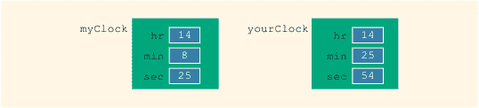

**图 11-5** 对象 `myClock` 和 `yourClock`

考虑下面的语句：

```cpp
if (myClock.equalTime(yourClock))
.
.
.
```

在表达式：

```cpp
myClock.equalTime(yourClock)
```

中，对象 `myClock` 访问成员函数 `equalTime`。由于 `otherClock` 是引用参数，因此实参 `yourClock` 的地址被传递给形参 `otherClock`，如图 11-6 所示。

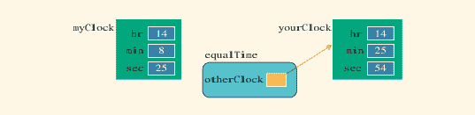

**图 11-6** 对象 *myClock* 和参数 *otherClock*

otherClock 的成员变量 hr、min 和 sec 的值分别为 14、25 和 54。换句话说，当函数 equalTime 的函数体执行时，otherClock.hr 的值为 14，otherClock.min 的值为 25，otherClock.sec 的值为 54。函数 equalTime 是 myClock 的成员。当函数 equalTime 执行时，函数 equalTime 函数体中的变量 hr、min 和 sec 是对象 myClock 的成员变量。因此，将 myClock 的成员 hr 与 otherClock.hr 比较，将 myClock 的成员 min 与 otherClock.min 比较，将 myClock 的成员 sec 与 otherClock.sec 比较。

再次从函数 equalTime 的定义可以清楚地看出，为什么它只有一个参数。

让我们再次查看函数 equalTime 的定义。注意，在该函数的定义中，对象 otherClock 访问了成员变量 hr、min 和 sec。然而，这些成员变量是**私有**的。那么是否存在违规呢？答案是否定的。函数 equalTime 是**类** clockType 的成员，而 hr、min 和 sec 是成员变量。此外，otherClock 是 clockType 类型的对象。因此，在函数 equalTime 的定义中，对象 otherClock 可以访问其**私有**成员变量。

对于类的任何成员函数来说也是如此。一般来说，当你编写某个**类**（比如 dummyClass）的成员函数（比如 dummyFunction）的定义，并且该函数使用该类的一个对象（比如 dummyObject）时，那么在 dummyFunction 的定义中，对象 dummyObject 可以访问其**私有**成员变量（事实上，可以访问该类的任何**私有**成员）。

类一旦正确定义并实现，就可以在程序中使用。使用并操作某个类的对象的程序或软件称为该类的**客户端**。

当声明**类** clockType 的对象时，每个对象都有自己的成员变量 hr、min 和 sec 副本。在面向对象术语中，诸如 hr、min 和 sec 这样的变量称为类的**实例变量**，因为每个对象都有自己的数据实例。

## 访问器函数和修改器函数

让我们看看**类 `clockType`** 的成员函数。函数 `setTime` 将成员变量的值设置为用户指定的值。换句话说，它改变或修改成员变量的值。类似地，函数 `incrementSeconds`、`incrementMinutes` 和 `incrementHours` 也会修改成员变量。另一方面，`getTime`、`printTime` 和 `equalTime` 等函数只访问成员变量的值。它们**不**修改成员变量。因此，我们可以将**类 `clockType`** 的成员函数分为两类：修改成员变量的成员函数，以及只访问而不修改成员变量的成员函数。

对于任何类来说通常都是如此。也就是说，每个类都有只访问而不修改成员变量的成员函数，称为访问器函数；也有修改成员变量的成员函数，称为修改器函数。

**访问器函数：** 类的一种成员函数，只访问（即不修改）成员变量的值。

**修改器函数：** 类的一种成员函数，用于修改成员变量的值。

由于访问器函数只访问成员变量的值，作为一种保护措施，我们通常在这些函数头部的末尾加上保留字 `const`。此外，类的常量成员函数不能修改该类的成员变量。例如，参见**类 `clockType`** 的成员函数 `getTime`、`printTime` 和 `equalTime` 的头部。

如果类的成员函数头部末尾包含保留字 `const`，则该成员函数称为**常量函数**。例如，**类 `clockType`** 的成员函数 `getTime`、`printTime` 和 `equalTime` 都是常量函数。类的常量成员函数不能修改该类的成员变量，因此这些函数是访问器函数。关于常量成员函数需要记住的一点是，类的常量成员函数**只能**调用该类的其他常量成员函数。因此，在将成员函数设为常量函数时应格外小心。

例 11-2 展示了如何在程序中使用**类 `clockType`**。注意，我们已将类定义、成员函数定义和 main 函数组合在一起，形成一个完整程序。在本章后面，你将学习如何使用三个文件分别存放**类 `clockType`** 的定义、成员函数定义和主程序。

### 例 11-2

```cpp
//The program listing of the program that defines
//and uses the class clockType
```


```cpp
#include <iostream>
using namespace std;

class clockType
{
public:
    void setTime(int, int, int);
    void getTime(int&, int&, int&) const;
    void printTime() const;
    void incrementSeconds();
    void incrementMinutes();
    void incrementHours();
    bool equalTime(const clockType&) const;

private:
    int hr;
    int min;
    int sec;
};

int main()
{
    clockType myClock;
    clockType yourClock;

    int hours;
    int minutes;
    int seconds;

    //Set the time of myClock
    myClock.setTime(5, 4, 30);                         //line 1

    cout << "Line 2: myClock: ";                      //Line 2
    myClock.printTime(); //print the time of myClock   //Line 3
    cout << endl;                                      //Line 4

    cout << "Line 5: yourClock: ";                    //Line 5
    yourClock.printTime(); //print the time of yourClock //Line 6
    cout << endl;                                      //Line 7

    //Set the time of yourClock
    yourClock.setTime(5, 45, 16);                      //Line 8

    cout << "Line 9: After setting, yourClock: ";     //Line 9
    yourClock.printTime(); //print the time of yourClock //Line 10
    cout << endl;                                      //Line 11

    //Compare myClock and yourClock
    if (myClock.equalTime(yourClock))                 //Line 12
        cout << "Line 13: Both times are equal."
             << endl;                                 //Line 13
    else
        cout << "Line 15: The two times are not equal."  //Line 14
             << endl;                                   //Line 15

    cout << "Line 16: Enter the hours, minutes, and "
         << "seconds: ";                             //Line 16
    cin >> hours >> minutes >> seconds;             //Line 17
    cout << endl;                                   //Line 18

    //Set the time of myClock using the value of the
    //variables hours, minutes, and seconds
    myClock.setTime(hours, minutes, seconds);       //Line 19

    cout << "Line 20: New myClock: ";               //Line 20
    myClock.printTime();  //print the time of myClock   //Line 21
    cout << endl;                                   //Line 22

    //Increment the time of myClock by one second
    myClock.incrementSeconds();                     //Line 23

    cout << "Line 24: After incrementing myClock by "
         << "one second, myClock: ";                //Line 24
    myClock.printTime();  //print the time of myClock   //Line 25
    cout << endl;                                   //Line 26

    //Retrieve the hours, minutes, and seconds of the
    //object myClock
    myClock.getTime(hours, minutes, seconds);       //Line 27

    //Output the value of hours, minutes, and seconds
    cout << "Line 28: hours = " << hours
         << ", minutes = " << minutes
         << ", seconds = " << seconds << endl;      //Line 28

    return 0;
}//end main

void clockType::setTime(int hours, int minutes, int seconds)
{
    if (0 <= hours && hours < 24)
        hr = hours;
    else
        hr = 0;

    if (0 <= minutes && minutes < 60)
        min = minutes;
    else
        min = 0;

    if (0 <= seconds && seconds < 60)
        sec = seconds;
    else
        sec = 0;
}
```

```cpp
//Place the definitions of the remaining functions, getTime,
//incrementHours, incrementMinutes, incrementSeconds, printTime,
//and equalTime, of the class clockType, as described
//previously here.
```

**示例运行：**在此示例运行中，用户输入带有阴影。

```
Line 2: myClock: 05:04:30
Line 5: yourClock: 0-858993460:0-858993460:0-858993460
Line 9: After setting, yourClock: 05:45:16
Line 15: The two times are not equal.
Line 16: Enter the hours, minutes, and seconds: 5 23 59

Line 20: New myClock: 05:23:59
Line 24: After incrementing myClock by one second, myClock: 05:24:00
Line 28: hours = 5, minutes = 24, seconds = 0
```

yourClock 的值，如输出第二行（第 5 行）所打印的，依赖于机器；你可能会得到不同的值。

## 类的公有和私有成员的顺序

C++ 对声明**公有**和**私有**成员没有固定顺序；你可以按任意顺序声明它们。你唯一需要记住的是，默认情况下，类的所有成员都是**私有**的。你必须使用成员访问说明符**公有**来使成员可被**公有**访问。如果你决定在**公有**成员之后声明**私有**成员（如 clockType 类中所做的那样），你必须使用成员访问说明符**私有**来开始声明**私有**成员。

我们可以用三种方式之一声明 clockType 类，如示例 11-3 到 11-5 所示。

### 示例 11-3

此声明与之前相同。为了完整性，我们包含类定义：

```cpp
class clockType
{
public:
    void setTime(int, int, int);
    void getTime(int&, int&, int&) const;
    void printTime() const;
    void incrementSeconds();
    void incrementMinutes();
    void incrementHours();
    bool equalTime(const clockType&) const;

private:
    int hr;
    int min;
    int sec;
};
```

### 示例 11-4

```cpp
class clockType
{
private:
    int hr;
    int min;
    int sec;

public:
    void setTime(int, int, int);
    void getTime(int&, int&, int&) const;
    void printTime() const;
    void incrementSeconds();
    void incrementMinutes();
    void incrementHours();
    bool equalTime(const clockType&) const;
};
```

### 示例 11-5

```cpp
class clockType
{
    int hr;
    int min;
    int sec;

public:
    void setTime(int, int, int);
    void getTime(int&, int&, int&) const;
    void printTime() const;
    void incrementSeconds();
    void incrementMinutes();
    void incrementHours();
    bool equalTime(const clockType&) const;
};
```

在示例 11-5 中，由于标识符 `hr`、`min` 和 `sec` 没有跟在任何成员访问说明符之后，它们是 `private` 的。

通常的做法是先列出所有 `public` 成员，然后再列出 `private` 成员。这样，你可以将注意力集中在 `public` 成员上。

## 构造函数

在示例 11-2 的程序中，当我们在没有调用 `setTime` 函数的情况下打印 `yourClock` 的值时，输出是一些奇怪的数字（参见示例运行中第 5 行的输出）。这是因为 C++ 不会自动初始化变量。由于类的 `private` 成员不能在类外部访问（在我们的例子中，这些成员变量），如果用户忘记通过调用 `setTime` 函数来初始化这些变量，程序将产生错误的结果。

为了保证类的成员变量被初始化，你可以使用构造函数。构造函数有两种类型：带参数的和不带参数的。不带参数的构造函数称为**默认构造函数**。

构造函数具有以下性质：

- 构造函数的名称与类的名称相同。
- 构造函数虽然是函数，但没有类型。也就是说，它既不是返回值的函数，也不是 `void` 函数。
- 一个类可以有多个构造函数。但是，一个类的所有构造函数都具有相同的名称。
- 如果一个类有多个构造函数，则这些构造函数必须具有不同的形参列表。也就是说，要么它们具有不同数量的形参，要么如果形参数量相同，那么按你列出的顺序，形参的数据类型至少在一个位置上必须不同。
- 当类对象进入其作用域时，构造函数自动执行。由于它们没有类型，因此不能像其他函数那样被调用。
- 执行哪个构造函数取决于声明类对象时传递给类对象的值类型。

让我们通过包含两个构造函数来扩展 `clockType` 类的定义：

```cpp
class clockType
{
public:
    void setTime(int, int, int);
    void getTime(int&, int&, int&) const;
    void printTime() const;
    void incrementSeconds();
};
```


```cpp
void incrementMinutes();
void incrementHours();
bool equalTime(const clockType&) const;
clockType(int, int, int);  //constructor with parameters
clockType();  //default constructor

private:
    int hr;
    int min;
    int sec;
};
```

类 clockType 的此定义包含两个构造函数：一个带有三个参数，另一个不带任何参数。现在我们来编写这些构造函数的定义：

```cpp
clockType::clockType(int hours, int minutes, int seconds)
{
    if (0 <= hours && hours < 24)
        hr = hours;
    else
        hr = 0;

    if (0 <= minutes && minutes < 60)
        min = minutes;
    else
        min = 0;

    if (0 <= seconds && seconds < 60)
        sec = seconds;
    else
        sec = 0;
}
```

```cpp
clockType::clockType()  //default constructor
{
    hr = 0;
    min = 0;
    sec = 0;
}
```

从这些构造函数的定义可知，默认构造函数将三个成员变量——hr、min 和 sec——设置为 0。此外，带参数的构造函数将成员变量设置为赋给形参的值。而且，我们可以通过调用函数 setTime 来编写带参数的构造函数的定义，如下所示：

```cpp
clockType::clockType(int hours, int minutes, int seconds)
{
    setTime(hours, minutes, seconds);
}
```

## 调用构造函数

回想一下，当声明类对象时，构造函数会自动执行。因为一个类可能有多个构造函数（包括默认构造函数），接下来我们讨论如何调用特定的构造函数。

### 调用默认构造函数

假设一个类包含默认构造函数。调用默认构造函数的语法是：

```cpp
className classObjectName;
```

例如，语句：

```cpp
clockType yourClock;
```

声明 yourClock 为 clockType 类型的对象。在这种情况下，默认构造函数执行，yourClock 的成员变量被初始化为 0。

> **注意**
> 如果声明一个对象并希望执行默认构造函数，则在对象声明语句中，对象名后的空括号不是必需的。事实上，如果不小心包含了空括号，编译器会生成语法错误消息。例如，以下声明对象 yourClock 的语句是非法的：
>
> `clockType yourClock();`  //非法对象声明

### 调用带参数的构造函数

假设一个类包含带参数的构造函数。调用带参数的构造函数的语法是：

```cpp
className classObjectName(argument1, argument2, ...);
```

其中 argument1、argument2 等是变量或表达式。

注意以下事项：

- 参数的数量及其类型应与某个构造函数的形参（按给定顺序）匹配。
- 如果参数的类型与任何构造函数的形参（按给定顺序）都不匹配，C++ 会使用类型转换并寻找最佳匹配。例如，整数值可能被转换为小数部分为零的浮点值。任何歧义都会导致编译时错误。

考虑以下语句：

```cpp
clockType myClock(5, 12, 40);
```

此语句声明一个 **myClock** 对象，类型为 **clockType**。这里，我们传递了三个 `int` 类型的值，这与带参数的构造函数的形参类型匹配。因此，类 **clockType** 的带参数的构造函数执行，对象 **myClock** 的三个成员变量被设置为 5、12 和 40。

例 11–6 进一步说明了构造函数如何执行。

### 例 11-6

考虑以下类定义：

```cpp
class inventory
{
public:
    inventory();                         //Line 1
    inventory(string);                   //Line 2
    inventory(string, int, double);      //Line 3
    inventory(string, int, double, int); //Line 4

    //Add additional functions

private:
    string name;
    int itemNum;
    double price;
    int unitsInStock;
};
```

这个类有四个构造函数和四个成员变量。假设这些构造函数的定义如下：

```cpp
inventory::inventory() //default constructor
{
    name = "";
    itemNum = -1;
    price = 0.0;
    unitsInStock = 0;
}
```

```cpp
inventory::inventory(string n)
{
    name = n;
    itemNum = -1;
    price = 0.0;
    unitsInStock = 0;
}
```

```cpp
inventory::inventory(string n, int iNum, double cost)
{
    name = n;
    itemNum = iNum;
    price = cost;
    unitsInStock = 0;
}
```

```cpp
inventory::inventory(string n, int iNum, double cost, int inStock)
{
    name = n;
    itemNum = iNum;
    price = cost;
    unitsInStock = inStock;
}
```

考虑以下声明：

```cpp
inventory item1;
inventory item2("Dryer");
inventory item3("Washer", 2345, 278.95);
inventory item4("Toaster", 8231, 34.49, 200);
```

对于 item1，执行第 1 行中的默认构造函数，因为没有向此变量传递任何值。对于 item2，执行第 2 行中的构造函数，因为只传递了一个 string 类型的参数，并且它与第 2 行中的构造函数匹配。对于 item3，执行第 3 行中的构造函数，因为向 item3 传递了三个参数，并且它们与第 3 行中的构造函数匹配。类似地，对于 item4，执行第 4 行中的构造函数（见图 11-7）。

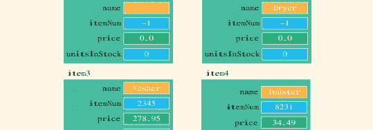

图 11-7  构造函数对对象的影响

> **注意**
> 如果传递给类对象的值不匹配任何构造函数的参数，并且无法进行类型转换，则会生成编译时错误。

## 构造函数与默认参数

构造函数也可以有默认参数。在这种情况下，声明形参的规则与在函数中声明默认形参的规则相同。此外，传递给带默认参数的构造函数的实参按照带默认参数的函数的规则进行传递。（第 7 章讨论带默认参数的函数。）利用定义默认参数的规则，在类 `clockType` 的定义中，你可以用以下语句替换这两个构造函数。（回想一下，在函数原型中，形参的名称是可选的。）

```cpp
clockType clockType(int = 0, int = 0, int = 0);    //Line 1
```

在实现文件中，此构造函数的定义与带参数的构造函数的定义相同。

如果将类 `clockType` 的构造函数替换为第 1 行中的构造函数（带默认参数的构造函数），那么你可以按如下方式声明带有零个、一个、两个或三个实参的 `clockType` 对象：

```cpp
clockType clock1;                //Line 2
clockType clock2(5);              //Line 3
clockType clock3(12, 30);         //Line 4
clockType clock4(7, 34, 18);      //Line 5
```

clock1 的成员变量被初始化为 0。clock2 的成员变量 hr 被初始化为 5，clock2 的成员变量 min 和 sec 被初始化为 0。clock3 的成员变量 hr 被初始化为 12，clock3 的成员变量 min 被初始化为 30，clock3 的成员变量 sec 被初始化为 0。clock4 的成员变量 hr 被初始化为 7，clock4 的成员变量 min 被初始化为 34，clock4 的成员变量 sec 被初始化为 18。

使用这些约定，我们可以说，没有参数或所有参数均为默认参数的构造函数称为**默认构造函数**。

## 类与构造函数：一个警示

如前一节所述，构造函数提供对象成员变量的有保证的初始化。通常，默认构造函数用于将成员变量初始化为某些默认值，并且此构造函数没有参数。带参数的构造函数用于将成员变量初始化为某些特定值。

我们已经看到，如果一个类没有构造函数，那么创建的对象是未初始化的，因为 C++ 在声明变量时不会自动初始化变量。实际上，如果一个类没有构造函数，那么 C++ 会自动提供默认构造函数。然而，这个默认构造函数不做任何事情。声明的对象仍然是未初始化的。

关于类和构造函数需要记住的重要事项如下：

- 如果一个类没有构造函数，C++ 会*自动*提供默认构造函数。然而，声明的对象仍然是未初始化的。


- 另一方面，假设一个 `class`，比如 dummyClass，包含带参数的构造函数，但不包含默认构造函数。在这种情况下，C++ 不会为 `class` dummyClass 提供默认构造函数。因此，当声明 `class` dummyClass 的对象时，必须在其声明中包含适当的实参。

下面的代码进一步说明了这一点。考虑以下类的定义：

```cpp
class dummyClass
{
public:
    void print() const;

    dummyClass(int dX, int dY);

private:
    int X;
    int Y;
};
```

`class` dummyClass 没有默认构造函数。它有一个带参数的构造函数。给定 `class` dummyClass 的这一定义，以下对象声明是合法的：

```cpp
dummyClass myObject(10, 25);   //Object declaration is legal
```

然而，由于 `class` dummyClass 不包含默认构造函数，以下声明是不正确的，并且会产生语法错误：

```cpp
dummyClass dummyObject;   //incorrect object declaration
```

因此，为避免此类陷阱，如果一个类有构造函数，该类也应包含默认构造函数。

## 类对象（变量）数组与构造函数

如果一个类有构造函数，并且你声明了该类对象组成的数组，那么该类应具有默认构造函数。默认构造函数通常用于初始化每个（数组中的）类对象。

例如，如果你声明一个包含 100 个类对象的数组，那么为每个分量指定不同的构造函数是不切实际的（甚至是不可能的）。（我们将在本节末尾进一步说明这一点。）

假设你有 100 名按小时计酬的员工，并且需要记录他们的到达和离开时间。你可以声明两个数组——arrivalTimeEmp 和 departureTimeEmp——每个数组包含 100 个分量，其中每个分量都是 clockType 类型的对象。

考虑以下语句：

```cpp
clockType arrivalTimeEmp[100];              //Line 1
```

第 1 行中的语句创建了对象数组 arrivalTimeEmp[0]、arrivalTimeEmp[1]、……、arrivalTimeEmp[99]，如图 11-8 所示。


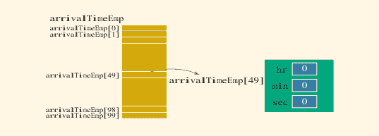

**图 11-8** 数组 arrivalTimeEmp

现在你可以使用 `clockType` 类的函数来操作每位员工的时间。例如，以下语句将第 50 位员工的到达时间，即 hr、min 和 sec，分别设置为 8、5 和 10（见图 11-9）。

```cpp
arrivalTimeEmp[49].setTime(8, 5, 10);    //Line 2
```

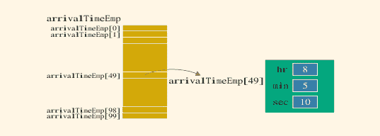

**图 11-9** 设置员工 49 的时间后的数组 arrivalTimeEmp

要输出每位员工的到达时间，可以使用循环，如下所示：

```cpp
for (int j = 0; j < 100; j++)                         //Line 3
{
    cout << "Employee " << (j + 1)
         << " arrival time: ";
    arrivalTimeEmp[j].printTime();                    //Line 4
    cout << endl;
}
```

第 4 行中的语句以 `hr:min:sec` 的形式输出一名员工的到达时间。

要记录每位员工的离开时间，可以使用数组 departureTimeEmp。

类似地，你可以使用数组来管理姓名列表或其他对象。

> **注意**
>
> 在结束关于类对象数组的讨论之前，我们想指出以下内容：本节开头指出，如果你声明一个类对象数组，并且该类有构造函数，那么该类应具有默认构造函数。编译器使用默认构造函数来初始化对象数组。如果数组规模很大，那么为每个对象指定一个不同的带参数构造函数是不切实际的。对于小规模数组，我们可以设法指定一个不同的带参数构造函数。

例如，以下语句将 clocks 声明为一个包含两个分量的数组。第一个分量的成员变量分别初始化为 8、35 和 42。第二个分量的成员变量分别初始化为 6、52 和 39。

```cpp
clockType clocks[2] = {clockType(8, 35, 42), clockType(6, 52, 39)};
```

事实上，表达式 clockType(8, 35, 42) 创建了 clockType 类的一个匿名对象；将其成员变量分别初始化为 8、35 和 42；然后使用逐成员复制来初始化对象 clocks[0]。

考虑以下语句，它创建对象 myClock，并将其成员变量分别初始化为 10、45 和 38。这就是我们一直以来创建和初始化对象的方式。事实上，语句：

```cpp
clockType myClock(10, 45, 38);
```

等价于语句：

```cpp
clockType myClock = clockType(10, 45, 38);
```

然而，第一条语句更高效。它不需要先创建一个匿名对象，然后再逐成员复制以初始化 myClock。

我们在这里强调的要点，也是我们在上一节中讨论过的内容，如下：为避免任何陷阱，如果一个类有构造函数，它也应具有默认构造函数。

## 析构函数

与构造函数一样，析构函数也是函数。此外，与构造函数一样，析构函数没有类型。也就是说，它既不是有返回值的函数，也不是 void 函数。然而，一个类只能有一个析构函数，并且析构函数没有参数。析构函数的名字是波浪号字符（~），后跟类名。例如，clockType 类的析构函数名为：

```cpp
~clockType();
```

当类对象超出作用域时，析构函数会自动执行。析构函数的用法将在后续章节中讨论。

## 数据抽象、类和抽象数据类型

对于我们驾驶的汽车，大多数人想知道如何启动汽车并驾驶它。大多数人不关心发动机工作原理的复杂性。通过将汽车发动机的设计细节与其使用分开，制造商帮助驾驶员专注于如何驾驶汽车。我们的日常生活中还有其他类似的例子。大多数情况下，我们只关心如何使用某些物品，而不关心它们如何工作。

将设计细节（即汽车发动机如何工作）与其使用分开称为**抽象**。换句话说，抽象关注发动机做什么，而不是它如何工作。因此，抽象是将逻辑属性与实现细节分离的过程。驾驶汽车是一种逻辑属性；发动机的构造构成实现细节。我们对发动机做什么有抽象的看法，但对发动机的实际实现不感兴趣。

抽象也可以应用于数据。本章前面的小节定义了数据类型 clockType。数据类型 clockType 有三个成员变量以及以下基本操作：

- 1. 设置时间。
- 2. 返回时间。
- 3. 打印时间。
- 4. 将时间增加一秒。
- 5. 将时间增加一分钟。
- 6. 将时间增加一小时。
- 7. 比较两个时间，看它们是否相等。

这些操作的实际实现，即 clockType 类的成员函数的定义，被推迟了。

数据抽象被定义为将数据的逻辑属性与其实现分离的过程。clockType 的定义及其基本操作是逻辑属性；将 clockType 对象存储在计算机中以及执行这些操作的算法是 clockType 的实现细节。

**抽象数据类型（ADT）：** 一种将逻辑属性与实现细节分离的数据类型。

像任何其他数据类型一样，ADT 有三样与之关联的内容：ADT 的名称，称为**类型名**；属于该 ADT 的值的集合，称为**域**；以及对该数据的操作集合。按照这些约定，我们可以如下定义 clockType ADT：

```cpp
dataTypeName
    clockType
domain
    Each clockType value is a time of day in the form of hours,
    minutes, and seconds.
operations
    Set the time.
    Return the time.
    Print the time.
    Increment the time by one second.
    Increment the time by one minute.
    Increment the time by one hour.
    Compare the two times to see whether they are equal.
```

### 示例 11-7

列表被定义为同一类型的值的集合。因为列表中的所有值都是同一类型，所以表示和处理列表的一种便捷方式是使用数组。你可以如下将一个列表定义为一个 ADT：

```cpp
dataTypeName
    listType
domain
    Every listType value is an array of, say, 1000 numbers
operations
    Check to see whether the list is empty.
    Check to see whether the list is full.
    Search the list for a given item.
    Delete an item from the list.
    Insert an item in the list.
    Sort the list.
    Destroy the list.
    Print the list.
```

下一个显而易见的问题是如何在程序中实现 ADT。要实现一个 ADT，你必须表示数据并编写算法来执行这些操作。

上一节使用类将数据和函数组合在一起。此外，我们对类的定义只包含操作的规范；实现操作的函数是单独编写的。因此，我们看到类是实现 ADT 的一种便捷方式。事实上，在 C++ 中，类就是专门为处理 ADT 而设计的。


接下来，我们定义 `class listType`，将列表实现为一个 ADT。通常，在列表中，我们不仅存储元素，还要记录列表中元素的数量。因此，我们的 `class listType` 有两个成员变量：一个用于存储元素，另一个用于记录列表中元素的数量。下面的 `class listType` 将列表定义为 ADT。

```cpp
class listType
{
public:
    bool isEmptyList() const;
    bool isFullList() const;
    int search(int searchItem) const;
    void insert(int newElement);
    void remove(int removeElement);
    void destroyList();
    void printList() const;
    listType(); //constructor

private:
    int list[1000];
    int length;
};
```

图 11-10 显示了类 `listType` 的 UML 类图。


**图 11-10** 类 `listType` 的 UML 类图

## 结构体与类

第 10 章将 `struct` 定义为组件的固定集合，其中组件可以具有不同的类型。`struct` 中组件的这一定义仅包含成员变量。然而，C++ 的 `struct` 与 C++ 的 `class` 非常相似。与类一样，`struct` 的成员也可以是函数，包括构造函数和析构函数。`struct` 与 `class` 的唯一区别在于，默认情况下，`struct` 的所有成员都是 `public`，而 `class` 的所有成员都是 `private`。你可以在 `struct` 中使用成员访问说明符 `private` 将某个成员设为 `private`。

在 C 中，`struct` 的定义与第 10 章给出的 C++ 中 `struct` 的定义相似。由于 C++ 由 C 演变而来，标准的 C 结构体在 C++ 中完全可以使用。然而，C++ 中 `struct` 的定义已被扩展，以包含成员函数、构造函数和析构函数。将来，由于 `class` 是一个语法上独立的实体，专门设计用于处理 ADT，`class` 的定义可能会以与类 C 的 `struct` 的定义完全不同的方式演变。

C++ 的 `classes` 和 `structs` 具有相同的能力。然而，大多数程序员限制结构体的使用，以遵循其类 C 的结构体形式，因此不使用它们来包含成员函数。换句话说，如果 `class` 的所有成员变量都是 `public`，并且该 `class` 没有成员函数，你通常会使用 `struct` 来对这些成员进行分组。事实上，本书就是这样做的。

## 信息隐藏

上一节定义了 `class` `clockType` 来实现程序中的时间。然后我们编写了一个使用 `class` `clockType` 的程序。事实上，我们将 `class` `clockType` 与函数定义结合起来，以实现操作和函数 main，从而完成程序。也就是说，`class` `clockType` 的规格说明和实现细节被直接纳入程序中。

将类的规格说明和实现细节包含在程序中是一种好做法吗？绝对不是。不这样做有几个原因。假设 `class` 的定义和成员函数的定义被直接包含在用户程序中。那么用户就可以直接访问类的定义和成员函数的定义。因此，用户可以随意修改操作。用户也可以随意修改对象的成员变量。因此，从这个意义上说，对象的 `private` 成员变量对该对象而言不再是 `private`。

如果多个程序员在项目中使用同一个对象，并且他们可以直接访问该对象的内部部分，那么就无法保证每个程序员都会以完全相同的方式使用同一个对象。因此，我们必须隐藏实现细节。用户只应知道对象做什么，而不是它如何做。隐藏实现细节使用户不必在程序中加入这段额外的代码。此外，通过隐藏细节，我们可以确保在整个项目中以完全相同的方式使用对象。此外，一旦对象被编写、调试并经过正确测试，它就会变得（并保持）无错误。


本节讨论如何隐藏对象的实现细节。为便于说明，我们将使用类 **clockType**。

要在程序中实现 **clockType**，用户必须声明 **clockType** 类型的对象，并知道允许哪些操作以及这些操作做什么。因此，用户必须能够访问规格说明细节。由于用户不关心实现细节，我们必须将这些细节放在一个单独的文件中，称为**实现文件**。此外，由于规格说明细节可能太长，我们必须使用户不必将它们直接包含在程序中。然而，用户必须能够查看规格说明细节，以便正确调用函数等。因此，我们必须将规格说明细节放在一个单独的文件中。包含规格说明细节的文件称为**头文件**（或**接口文件**）。

实现文件包含用于实现对象操作的函数定义。该文件包含 C++ 语句以及其他内容（例如预处理指令）。由于 C++ 程序只能有一个函数 main，实现文件不包含函数 main。只有用户程序包含函数 main。由于实现文件不包含函数 main，我们无法从该文件生成可执行代码。事实上，我们从实现文件生成所谓的目标代码。然后，用户将实现文件生成的目标代码与使用该类的程序的目标代码链接起来，以创建最终的可执行代码。

最后，头文件的扩展名为 h，而实现文件的扩展名为 cpp。假设类 clockType 的规格说明细节位于名为 clockType 的文件中。那么该文件的完整名称应为 clockType.h。如果类 clockType 的实现细节位于某个文件中——例如 clockTypeImp——则该文件的名称必须是 clockTypeImp.cpp。

文件 clockTypeImp.cpp 只包含函数的定义，不包含类的定义。因此，为了解决未声明标识符（例如函数名和变量名）的问题，我们借助 include 语句将头文件 clockType.h 包含在文件 clockTypeImp.cpp 中。任何使用类 clockType 的程序，以及定义类 clockType 操作的实现文件，都需要以下 include 语句：

```cpp
#include "clockType.h"
```

请注意，头文件 clockType.h 用双引号括起来，而不是尖括号。头文件 clockType.h 称为用户定义的头文件。通常，所有用户定义的头文件都用双引号括起来，而系统提供的头文件（例如 iostream）则括在尖括号之间。

实现部分包含函数的定义，而这些定义对用户是隐藏的，因为通常*仅*向用户提供目标代码。

然而，类的用户应了解特定函数做什么以及如何使用它。因此，在包含函数原型的规格说明文件中，我们加入注释，简要描述函数，并说明任何前置条件和/或后置条件。

**前置条件：** 一条说明在调用函数之前必须为真的条件的语句。

**后置条件：** 一条说明在函数调用完成后为真的语句。

以下是类 clockType 的规格说明文件和实现文件：

```cpp
//clockType.h, the specification file for the class clockType

class clockType
{
public:
    void setTime(int hours, int minutes, int seconds);
        //Function to set the time.
        //The time is set according to the parameters.
        //Postcondition: hr = hours; min = minutes;
        //               sec = seconds;
        //               The function checks whether the
        //               values of hours, minutes, and seconds
        //               are valid. If a value is invalid, the
        //               default value 0 is assigned.

    void getTime(int& hours, int& minutes, int& seconds) const;
        //Function to return the time.
        //Postcondition: hours = hr; minutes = min;
        //               seconds = sec;

    void printTime() const;
        //Function to print the time.
        //Postcondition: The time is printed in the form
        //               hh:mm:ss.

    void incrementSeconds();
        //Function to increment the time by one second.
        //Postcondition: The time is incremented by one second.
        //               If the before-increment time is
        //               23:59:59, the time is reset to 00:00:00.

    void incrementMinutes();
        //Function to increment the time by one minute.
        //Postcondition: The time is incremented by one minute.
        //               If the before-increment time is
        //               23:59:53, the time is reset to 00:00:53.

    void incrementHours();
        //Function to increment the time by one hour.
        //Postcondition: The time is incremented by one hour.
        //               If the before-increment time is
        //               23:59:53, the time is reset to 00:59:53.
```


```cpp
//                         If the before-increment time is
//                         23:45:53, the time is reset to 00:45:53.

bool equalTime(const clockType& otherClock) const;
    //Function to compare the two times.
    //Postcondition: Returns true if this time is equal to
    //              otherClock; otherwise, returns false.

clockType(int hours, int minutes, int seconds);
    //Constructor with parameters.
    //The time is set according to the parameters.
    //Postcondition: hr = hours; min = minutes;
    //               sec = seconds;
    //               The constructor checks whether the
    //               values of hours, minutes, and seconds
    //               are valid. If a value is invalid, the
    //               default value 0 is assigned.

clockType();
    //Default constructor
    //The time is set to 00:00:00.
    //Postcondition: hr = 0; min = 0; sec = 0;

private:
    int hr;   //variable to store the hours
    int min;  //variable to store the minutes
    int sec;  //variable to store the seconds
};
```

```cpp
//clockTypeImp.cpp, the implementation file

#include  <iostream>
#include  "clockType.h"

using namespace std;
.
.
.

//Place the definitions of the member functions of the class
//clockType here.
.
.
.
```

接下来，我们描述包含使用类 `clockType` 的程序的用户文件。

```cpp
//The user program that uses the class clockType

#include  <iostream>
#include  "clockType.h"

using namespace std;
.
.
//Place the definitions of the function main and the other
//user-defined functions here
.
.
.
```

> **注意**
>
> 为了节省篇幅，我们没有提供实现文件和包含用户程序的文件的所有细节。不过，你可以在本书配套网站上找到这些文件以及规范（头）文件。

## 可执行代码

上一节讨论了如何隐藏类的实现细节。要在程序中使用对象，程序在执行期间必须能够访问该对象的实现细节（即实现该对象上的操作的算法）。本节讨论客户程序如何获得对对象实现细节的访问。为便于说明，我们将使用类 `clockType`。

如前所述，要使用类 `clockType`，程序必须通过 `include` 语句包含头文件 `clockType.h`。例如，下面的程序段包含了头文件 `clockType.h`：

```cpp
//Program test.cpp

#include "clockType.h"
.
.
int main()
{
    .
    .
}
```

程序 `test.cpp` 只能包含头文件，而不能包含实现文件。要创建运行程序 `test.cpp` 的可执行代码，需要执行以下步骤：

- 1. 我们单独编译文件 `clockTypeImp.cpp`，并创建目标代码文件 `clockTypeImp.obj`。目标代码文件包含机器语言代码，但该代码不是可执行形式。

    假设命令 `cc` 在计算机的系统命令行上调用 C++ 编译器或链接器，或同时调用二者。命令：

    ```
    cc -c clockTypeImp.cpp
    ```

    会创建目标代码文件 `clockTypeImp.obj`。

- 2. 要创建源代码文件 `test.cpp` 的可执行代码，我们编译源代码文件 `test.cpp`，创建目标代码文件 `test.obj`，然后链接文件 `test.obj` 和 `clockTypeImp.obj`，以创建可执行文件 `test.exe`。系统命令行上的以下命令会创建可执行文件 `test.exe`：

    ```
    cc test.cpp clockTypeImp.obj
    ```

> **注意**
>
> - 1. 要为任何源代码文件创建目标代码文件，我们在系统命令行上使用命令行选项 `-c`。例如，要为名为 `exercise.cpp` 的源代码文件创建目标代码文件，我们在系统命令行上使用以下命令：
>
>    `cc -c exercise.cpp`
>
> - 2. 要将多个目标代码文件与一个源代码文件链接，我们在系统命令行上列出所有目标代码文件。例如，要将 `A.obj` 和 `B.obj` 与源代码文件 `test.cpp` 链接，我们使用以下命令：
>
>    `cc test.cpp A.obj B.obj`
>
> - 3. 如果源代码文件被修改，则必须重新编译它。
>
> - 4. 如果一个源文件中的修改影响其他文件，则其他文件必须重新编译并重新链接。
>
> - 5. 用户必须能够访问头文件和目标代码文件。访问头文件是为了查看对象做什么以及如何使用它们。访问目标代码文件是为了让用户能够将程序与目标代码链接以生成可执行代码。用户不需要访问包含实现细节的源代码文件。

正如第 1 章所述，IDE Visual C++ 2008 Express、Visual Studio .NET、C++ Builder 和 CodeWarrior 将编辑器、编译器和链接器都整合到一个软件包中。只需一条命令，程序就会与其他必要文件一起编译和链接。这些系统还以项目的形式管理多文件程序。因此，项目由若干文件组成，这些文件称为项目文件。这些系统通常有一个命令，称为 **构建**、**重新构建**或**生成**。（请查阅系统的文档。）当对项目应用构建、重新构建或生成命令时，系统会自动编译并链接创建可执行代码所需的所有文件。

当项目中的一个或多个文件发生更改时，你可以使用这些命令重新编译并重新链接这些文件。

### 示例 11-8

在示例 6-4 中，函数 `rollDice` 掷一对骰子，直到掷出的点数之和为给定数字，并返回为得到所需点数之和而掷骰子的次数。事实上，我们可以设计一个实现骰子基本属性的类。考虑以下 `class die` 的定义。

```cpp
class die
{
public:
    die();
        //Default constructor
        //Sets the default number rolled by a die to 1

    int roll();
        //Function to roll a die.
        //This function uses a random number generator to randomly
        //generate a number between 1 and 6, and stores the number
        //in the instance variable num and returns the number.

    int getNum() const;
        //Function to return the number on the top face of the die.
        //Returns the value of the instance variable num.

private:
    int num;
};
```

成员函数的定义如下。

```cpp
die::die()
{
    num = 1;
    srand(time(0));
}

int die::roll()
{
    num = rand() % 6 + 1;

    return num;
}

int die::getNum() const
{
    return num;
}
```

以下程序展示了如何在程序中使用 `class die`。

```cpp
//The user program that uses the class die

#include <iostream>
#include "die.h"

using namespace std;

int main()
{
    die die1;                                      //Line 1
    die die2;                                      //Line 2
                                                //Line 3
    cout << "Line 4: die1: " << die1.getNum() << endl;  //Line 4

    cout << "Line 5: die2: " << die2.getNum() << endl;  //Line 5

    cout << "Line 6: After rolling die1: "
         << die1.roll() << endl;                 //Line 6

    cout << "Line 7: After rolling die2: "
         << die2.roll() << endl;                 //Line 7

    cout << "Line 8: The sum of the numbers rolled"
         << " by the dice is: "
         << die1.getNum() + die2.getNum() << endl; //Line 8

    cout << "Line 9: After again rolling, the sum of "
         << "the numbers rolled is: "
         << die1.roll() + die2.roll() << endl;    //Line 9

    return 0;                                     //Line 10
}//end main                                      //Line 11
```

运行示例：

```
Line 4: die1: 1
Line 5: die2: 1
Line 6: After rolling die1: 3
Line 7: After rolling die2: 4
Line 8: The sum of the numbers rolled by the dice is: 7
Line 9: After again rolling, the sum of the numbers rolled is: 5
```

前面的程序按如下方式工作。第 2 行和第 3 行中的语句创建对象 die1 和 die2，并使用默认构造函数将两个骰子都设置为 1。第 4 行和第 5 行中的语句输出两个骰子的点数。第 6 行中的语句掷 die1 并输出掷出的点数。类似地，第 7 行中的语句掷 die2 并输出掷出的点数。第 8 行中的语句输出 die1 和 die2 掷出的点数之和。第 9 行中的语句再次掷两个骰子，并输出掷出的点数之和。


例 11-9 进一步说明了类是如何设计和实现的。例 11-9 中设计的 personType 类非常有用；我们将在后续章节中使用这个类。

### 例 11-9

一个人最常见的属性是其名字和姓氏。对一个人的姓名进行的典型操作是设置姓名和打印姓名。以下语句定义了一个具有这些属性的类。

```cpp
#include <string>

using namespace std;

class personType
{
public:
    void print() const;
        //Function to output the first name and last name
        //in the form firstName lastName.

    void setName(string first, string last);
        //Function to set firstName and lastName according
        //to the parameters.
        //Postcondition: firstName = first; lastName = last;

    string getFirstName() const;
        //Function to return the first name.
        //Postcondition: The value of firstName is returned.

    string getLastName() const;
        //Function to return the last name.
        //Postcondition: The value of lastName is returned.

    personType(string first = "", string last = "");
        //Constructor
        //Sets firstName and lastName according to the parameters.
        //The default values of the parameters are null strings.
        //Postcondition: firstName = first; lastName = last;

private:
    string firstName; //variable to store the first name
    string lastName;  //variable to store the last name
};
```

图 11-11 显示了 personType 类的 UML 类图。


**图 11-11** `personType` 类的 UML 类图

现在给出 `personType` 类的成员函数的定义。

```cpp
void personType::print() const
{
    cout << firstName << " " << lastName;
}

void personType::setName(string first, string last)
{
    firstName = first;
    lastName = last;
}

string personType::getFirstName() const
{
    return firstName;
}

string personType::getLastName() const
{
    return lastName;
}

//constructor
personType::personType(string first, string last)
{
    firstName = first;
    lastName = last;
}
```

## 类的静态成员

**注意** 可以跳过本节，不会对后续学习造成任何影响。

在第 7 章中，我们描述了两种类型的变量：自动变量和静态变量。回想一下，如果函数的局部变量是静态的，那么它在函数调用之间仍然存在。与静态变量类似，一个类也可以有静态成员、函数或变量。关于类的静态成员，我们需要注意以下几点：

- 如果类中的函数是 `static`，则在类定义中，需要在其头部使用关键字 `static` 进行声明。
- 如果类的成员变量是 `static`，则使用关键字 `static` 进行声明，如第 7 章所述，并在例 11-10 中说明。
- 类的 `public static` 成员、函数或变量可以使用类名和作用域解析运算符访问。

例 11-10 阐明了关键字 `static` 的作用。

### 例 11-10

考虑以下 `illustrate` 类的定义：

```cpp
class illustrate
{
public:
        static int count;    //public static variable

        void print() const;
                //Function to output x, y, and count.

        void setX(int a);
                //Function to set x.
                //Postcondition: x = a;

        static void incrementY();
                //static function
                //Function to increment y by 1.
                //Postcondition: y = y + 1

        illustrate(int a = 0);
                //constructor
                //Postcondition: x = a;
                //                         If no value is specified for a, x = 0;

private:
    int x;
    static int y;  // private static variable
};
```

假设 `illustrate` 类的 `static` 成员变量和成员函数的定义如下。（这些语句都放在实现文件中。另外请注意，所有 `static` 成员变量都已按下文所示进行初始化。）

```cpp
int illustrate::count = 0;
int illustrate::y = 0;

void illustrate::print() const
{
    cout << "x = " << x << ", y = " << y
         << ", count = " << count << endl;
}

void illustrate::setX(int a)
{
    x = a;
}

void illustrate::incrementY()
{
    y++;
}

illustrate::illustrate(int a)
{
    x = a;
}
```

由于函数 `incrementY` 是 `static` 且为 `public`，以下语句是合法的：

```cpp
illustrate::incrementY();
```

类似地，由于成员变量 `count` 是 `static` 且为 `public`，以下语句是合法的：

```cpp
illustrate::count++;
```

接下来，我们再详细说明一下 `static` 成员变量。假设有一个 `class`（比如 `myClass`），它带有成员变量（既有 `static` 也有非静态的）。当你创建 `myClass` 类型的对象时，只有 `class myClass` 的非静态成员变量会成为每个对象的成员变量。对于 `class` 的每个 `static` 成员变量，C++ 只分配一个内存空间。所有 `myClass` 对象都引用同一块内存空间。事实上，即使不存在该类型的任何对象，`class` 的 `static` 成员变量仍然存在。你可以在类外部访问 `public static` 成员变量，如本节前面所述。

接下来，我们解释如何为类的 `static` 和非 `static` 成员变量分配内存空间。

假设你有例 11-10 中给出的 `illustrate` 类。此时，`static` 成员变量 `y` 和 `count` 已存在对应的内存空间。

考虑以下语句：

```cpp
illustrate illusObject1(3);    //Line 1
illustrate illusObject2(5);    //Line 2
```

第 1 行和第 2 行中的语句将 `illusObject1` 和 `illusObject2` 声明为 `illustrate` 类型的对象（见图 11-12）。


**图 11-12** `illusObject1` 和 `illusObject2`

现在，考虑以下语句：

```cpp
illustrate::incrementY();
illustrate::count++;
```

这些语句执行后，对象和静态成员如图 11-13 所示。


**图 11-13** 执行语句 `illustrate::incrementY();` 和 `illustrate::count++;` 后的 `illusObject1` 和 `illusObject2`

以下语句的输出：

```text
illusObject1.print();
```

为：

```text
x = 3, y = 1, count = 1
```

类似地，以下语句的输出：

```text
illusObject2.print();
```

为：

```text
x = 5, y = 1, count = 1
```

现在考虑以下语句：

```text
illustrate::count++;
```

该语句执行后，对象和静态成员如图 11-14 所示。


**图 11-14** 执行语句 `illustrate::count++;` 后的 illusObject1 和 illusObject2

以下语句的输出：

```text
illusObject1.print();
illusObject2.print();
```

为：

```text
x = 3, y = 1, count = 2
x = 5, y = 1, count = 2
```

例 11-11 中的程序进一步说明了类的静态成员如何工作。

### 例 11-11

```cpp
#include <iostream>

#include "illustrate.h"

using namespace std;

int main()
{
    illustrate illusObject1(3);                         //Line 1
    illustrate illusObject2(5);                         //Line 2

    illustrate::incrementY();                           //Line 3
    illustrate::count++;                                //Line 4
    illusObject1.print();                               //Line 5
    illusObject2.print();                               //Line 6
    cout << "Line 7: *** Increment y using "
         << "illusObject1***" << endl;                 //Line 7

    illusObject1.incrementY();                          //Line 8
    illusObject1.setX(8);                                //Line 9
    illusObject1.print();                               //Line 10
    illusObject2.print();                               //Line 11

    cout << "Line 12: *** Increment y using "
         << "illusObject2***" << endl;                 //Line 12

    illusObject2.incrementY();                          //Line 13
    illusObject2.setX(23);                               //Line 14
    illusObject1.print();                               //Line 15
    illusObject2.print();                               //Line 16

    return 0;
}
```

### 示例运行

```text
x = 3, y = 1, count = 1
x = 5, y = 1, count = 1
Line 7: *** Increment y using illusObject1***
x = 8, y = 2, count = 1
x = 5, y = 2, count = 1
Line 12: *** Increment y using illusObject2***
x = 8, y = 3, count = 1
x = 23, y = 3, count = 1
```

前面的程序工作过程如下。静态成员变量 y 和 count 被初始化为 0。第 1 行中的语句将 illusObject1 声明为 illustrate 类的对象，并将其成员变量 x 初始化为 3。第 2 行中的语句……

第 2 行声明 `illusObject2` 为类 `illustrate` 的对象，并将其成员变量 `x` 初始化为 5。

第 3 行中的语句使用类 `illustrate` 的名称和函数 `incrementY` 来递增 `y`。现在，`count` 是类 `illustrate` 的公有静态成员。因此，第 4 行中的语句使用类 `illustrate` 的名称直接访问 `count`，并将其递增 1。第 5 行和第 6 行中的语句输出对象 `illusObject1` 和 `illusObject2` 中存储的数据。注意，两个对象的 `y` 值相同。同样，两个对象的 `count` 值也相同。

第 7 行中的语句是一条输出语句。第 8 行中的语句使用对象 `illusObject1` 和函数 `incrementY` 来递增 `y`。第 9 行中的语句将 `illusObject1` 的成员变量 `x` 的值设置为 8。第 10 行和第 11 行输出对象 `illusObject1` 和 `illusObject2` 中存储的数据。注意，两个对象的 `y` 值相同。同样，两个对象的 `count` 值也相同。此外，注意第 9 行中的语句只改变 `illusObject1` 的成员变量 `x` 的值，因为 `x` 不是类 `illustrate` 的静态成员。

第 13 行中的语句使用对象 `illusObject2` 和函数 `incrementY` 来递增 `y`。第 14 行中的语句将 `illusObject2` 的成员变量 `x` 的值设置为 23。第 15 行和第 16 行输出对象 `illusObject1` 和 `illusObject2` 中存储的数据。注意，两个对象的 `y` 值相同。同样，两个对象的 `count` 值也相同。此外，注意第 14 行中的语句只改变 `illusObject2` 的成员变量 `x` 的值，因为 `x` 不是类 `illustrate` 的静态成员。

> **注意**
> 以下是关于类静态成员的一些补充说明。正如你在本节中所见，类的静态成员函数不需要任何对象即可被调用。它可以像示例中那样，使用类名和作用域解析运算符来调用。因此，静态成员函数不能使用任何依赖于调用对象的内容。换句话说，在静态成员函数的定义中，不能使用非静态成员变量或非静态函数，除非在本地声明了一个对象来访问该非静态成员变量或非静态成员函数。

让我们再次考虑示例 11-10 中定义的类 `illustrate`。该类同时包含静态和非静态成员变量。当我们声明该类的对象时，每个对象都有自己的一份非静态成员变量 `x` 的副本，而所有对象共享静态成员变量 `y` 和 `count`。在本章前面，我们使用类 `clockType` 定义了类的实例变量这一术语。然而，当时我们并未讨论类的静态成员变量。类可以同时拥有静态和非静态成员变量。因此，我们可以给出一般性表述：类的非静态成员变量称为该类的实例变量。

## 编程示例：糖果售卖机

购买糖果的一个常见场所是自动售货机。体育馆新购置了一台糖果售卖机，但它运行不正常。该机器出售糖果、薯片、口香糖和饼干。有人要求你为这台糖果售卖机编写一个程序，以便它能投入运行。

该程序应完成以下操作：

- 1. 向顾客展示糖果售卖机出售的不同商品。
- 2. 让顾客进行选择。
- 3. 向顾客显示所选商品的价格。
- 4. 接收顾客支付的款项。
- 5. 发放商品。

**输入** 商品选择以及商品价格。

**输出** 所选商品。

### 问题分析与算法设计

糖果售卖机有两个主要组成部分：内置收银机和若干个用于存放并发放商品的出货器。

### 收银机

让我们首先讨论收银机的属性。收银机中有一些备用现金，它接收顾客支付的金额，如果存入的金额超过商品价格，那么——如果可能的话——它会找零。为简单起见，我们假设用户存入的钱大于或等于商品价格。收银机还应能够随时向糖果售卖机的所有者显示收银机中的金额。下面的类定义了收银机的属性：

```cpp
class cashRegister
{
public:
    int getCurrentBalance() const;
        //Function to show the current amount in the cash
        //register.
        //Postcondition: The value of cashOnHand is returned.

    void acceptAmount(int amountIn);
        //Function to receive the amount deposited by
        //the customer and update the amount in the register.
        //Postcondition: cashOnHand = cashOnHand + amountIn;

    cashRegister(int cashIn = 500);
        //Constructor
        //Sets the cash in the register to a specific amount.
        //Postcondition: cashOnHand = cashIn;
        //               If no value is specified when the
        //               object is declared, the default value
        //               assigned to cashOnHand is 500.

private:
    int cashOnHand;    //variable to store the cash
                       //in the register
};
```


图 11-15 展示了类 `cashRegister` 的 UML 类图。


**图 11-15** 类 `cashRegister` 的 UML 类图

接下来，我们给出实现类 `cashRegister` 操作的函数定义。这些函数的定义非常简单，易于理解。

函数 `getCurrentBalance` 显示收银机中的当前金额。它返回私有成员变量 cashOnHand 的值。因此，其定义如下：

```cpp
int cashRegister::getCurrentBalance() const
{
    return cashOnHand;
}
```

函数 `acceptAmount` 接收顾客存入的金额。它通过将顾客存入的金额加到收银机中先前的金额上，来更新收银机中的现金。本质上，该函数的定义如下：

```cpp
void cashRegister::acceptAmount(int amountIn)
{
    cashOnHand = cashOnHand + amountIn;
}
```

在类 `cashRegister` 的定义中，构造函数带有一个默认值声明。因此，如果用户在声明对象时未指定任何值，则使用默认值初始化成员变量 cashOnHand。回想一下，由于我们在类定义中为构造函数的参数指定了默认值，因此在构造函数定义的首部中不再指定默认值。构造函数的定义如下：

```cpp
cashRegister::cashRegister(int cashIn)
{
    if (cashIn >= 0)
        cashOnHand = cashIn;
    else
        cashOnHand = 500;
}
```

注意，构造函数的定义会检查参数 cashIn 的有效值。如果 cashIn 的值小于 0，则赋给成员变量 cashOnHand 的值为 500。

### 出货器

出货器在非空时发放所选商品。它应显示出货器中的商品数量以及商品价格。下面的类定义了出货器的属性。我们将这个类称为 `dispenserType`：

```cpp
class dispenserType
{
public:
    int getNoOfItems() const;
        //Function to show the number of items in the machine.
        //Postcondition: The value of numberOfItems is returned.

    int getCost() const;
        //Function to show the cost of the item.
        //Postcondition: The value of cost is returned.

    void makeSale();
        //Function to reduce the number of items by 1.
        //Postcondition: numberOfItems--;

    dispenserType(int setNoOfItems = 50, int setCost = 50);
        //Constructor
        //Sets the cost and number of items in the dispenser
        //to the values specified by the user.
        //Postcondition: numberOfItems = setNoOfItems;
        //             cost = setCost;
        //             If no value is specified for a
        //             parameter, then its default value is
        //             assigned to the corresponding member
        //             variable.

private:
    int numberOfItems;   //variable to store the number of
                         //items in the dispenser
    int cost;  //variable to store the cost of an item
};
```


函数 `getCost` 返回商品的价格。由于商品的价格存储在 `private` 成员变量 `cost` 中，因此该函数返回 `cost` 的值。该函数的定义如下：

```cpp
int dispenserType::getCost() const
{
    return cost;
}
```

当售出一件商品时，该售货器中的商品数量减 1。因此，函数 `makeSale` 将售货器中的商品数量减 1。也就是说，它将 `private` 成员变量 `numberOfItems` 的值减 1。该函数的定义如下：

```cpp
void dispenserType::makeSale()
{
    numberOfItems--;
}
```

构造函数的定义会检查参数值是否有效。如果这些值小于 0，则将默认值赋给成员变量。构造函数的定义如下：

```cpp
//constructor
dispenserType::dispenserType(int setNoOfItems, int setCost)
{
    if (setNoOfItems >= 0)
        numberOfItems = setNoOfItems;
    else
        numberOfItems = 50;

    if (setCost >= 0)
        cost = setCost;
    else
        cost = 50;
}
```

### 主程序

程序执行时，必须完成以下操作：

- 1. 显示糖果机出售的不同商品。
- 2. 显示如何选择特定商品。
- 3. 显示如何终止程序。

此外，这些说明必须在处理每次选择后显示（退出程序除外），这样用户如果想购买两件或更多商品，就无需记住该怎么做。一旦用户做出适当选择，糖果机就必须相应地执行操作。如果用户选择购买某件商品且该商品有货，糖果机应显示该商品的价格，并要求用户投币。如果投入的金额至少达到该商品的价格，糖果机应售出该商品并显示相应消息。


上述讨论可转化为以下算法：

- 1. 向顾客显示选择项。
- 2. 获取选择。
- 3. 如果选择有效且该选择对应的售货器不为空，则售出商品。

我们将该程序分为三个函数：`showSelection`、`sellProduct` 和 `main`。

### showSelection

该函数显示帮助用户选择和购买商品所需的信息。函数 `showSelection` 的定义如下：

```cpp
void showSelection()
{
    cout << "*** Welcome to Shelly's Candy Shop ***" << endl;
    cout << "To select an item, enter " << endl;
    cout << "1 for Candy" << endl;
    cout << "2 for Chips" << endl;
    cout << "3 for Gum" << endl;
    cout << "4 for Cookies" << endl;
    cout << "9 to exit" << endl;
}//end showSelection
```

### sellProduct

该函数尝试售出顾客所选商品。因此，它必须能够访问存放该商品的售货器。该函数做的第一件事是检查存放该商品的售货器是否为空。如果售货器为空，该函数会通知顾客该商品已售罄。如果售货器不为空，它会告诉用户投入购买该商品所需的金额。

如果用户投入的钱不足以购买该商品，`sellProduct` 会告诉用户还必须投入多少额外金额。如果用户两次尝试后仍未投入足够的钱购买该商品，该函数就直接退回钱款。（本章末尾的编程练习 9 要求你修改方法 `sellProduct` 的定义，使其在用户未投入足够钱购买商品时，持续要求用户输入额外金额。）如果用户投入的金额足够，它就接受钱款并售出商品。售出商品意味着将售货器中的商品数量减 1，并通过加上商品价格来更新收银机中的金额。（由于该程序不退还顾客多投入的钱，因此收银机通过加上用户输入的金额来更新。）

从上述讨论可以清楚地看出，函数 `sellProduct` 必须能够访问存放该商品的售货器（以便将售货器中的商品数量减 1 并显示商品价格），也必须能够访问收银机（以便更新现金）。因此，该函数有两个参数：一个对应售货器，另一个对应收银机。此外，这两个参数都必须按引用传递。

用伪代码表示，该函数的算法如下：

- 1. 如果售货器不为空，
  - a. 显示并提示顾客输入商品价格。
  - b. 获取顾客输入的金额。
  - c. 如果顾客输入的金额小于商品价格，
    - i. 显示并提示顾客输入额外金额。
    - ii. 计算顾客输入的总金额。
  - d. 如果顾客输入的金额至少达到商品价格，
    - i. 更新收银机中的金额。
    - ii. 售出商品——也就是说，将售货器中的商品数量减 1。
    - iii. 显示相应消息。
  - e. 如果用户输入的金额小于商品价格，则退回该金额。
- 2. 如果售货器为空，告诉用户该商品已售罄。

函数 `sellProduct` 的定义如下：

```cpp
void sellProduct(dispenserType& product,
                 cashRegister& pCounter)
{
    int amount;  //variable to hold the amount entered
    int amount2; //variable to hold the extra amount needed

    if (product.getNoOfItems() > 0)  //if the dispenser is not
                                     //empty
    {
        cout << "Please deposit " << product.getCost()
             << " cents" << endl;
        cin >> amount;

        if (amount < product.getCost())
        {
            cout << "Please deposit another "
                 << product.getCost() - amount
                 << " cents" << endl;
            cin >> amount2;
            amount = amount + amount2;
        }

        if (amount >= product.getCost())
        {
            pCounter.acceptAmount(amount);
            product.makeSale();
            cout << "Collect your item at the bottom and "
                 << "enjoy." << endl;
        }
        else
            cout << "The amount is not enough. "
                 << "Collect what you deposited." << endl;

        cout << "*-*-*-*-*-*-*-*-*-*-*-*-*-*-*-*-*"
             << endl << endl;
    }
    else
        cout << "Sorry, this item is sold out." << endl;
}//end sellProduct
```

现在我们已经描述了函数 showSelection 和 sellProduct，接下来描述函数 main。

函数 main 的算法如下：

- 1. 创建收银机——也就是说，声明一个 `cashRegister` 类型的对象。
- 2. 创建四个售货器——也就是说，声明四个 `dispenserType` 类型的对象并初始化这些对象。例如，语句：
  - `dispenserType candy(100, 50);`
  - 创建一个名为 candy 的售货器对象，用来存放糖果。该售货器中的商品数量为 100，每件商品的价格为 50 美分。
- 3. 根据需要声明其他变量。
- 4. 显示选择项；调用函数 `showSelection`。
- 5. 获取选择。
- 6. 当尚未完成时（选择 9 退出程序），
  - a. 售出商品；调用函数 `sellProduct`。
  - b. 显示选择项；调用函数 `showSelection`。
  - c. 获取选择。

函数 main 的定义如下：

```cpp
int main()
{
    cashRegister counter;
    dispenserType candy(100, 50);
    dispenserType chips(100, 65);
    dispenserType gum(75, 45);
    dispenserType cookies(100, 85);

    int choice;  //variable to hold the selection

    showSelection();
    cin >> choice;

    while (choice != 9)
    {
        switch (choice)
        {
        case 1:
            sellProduct(candy, counter);
            break;
        case 2:
            sellProduct(chips, counter);
            break;
        case 3:
            sellProduct(gum, counter);
            break;
        case 4:
            sellProduct(cookies, counter);
            break;
        default:
            cout << "Invalid selection." << endl;
        }//end switch

        showSelection();
        cin >> choice;
    }//end while

    return 0;
}//end main
```

### 完整程序清单

在前面的几节中，我们设计了用于实现收银机的类，以及用于实现糖果机的售货器。在本节中，为完整起见，我们给出这些类、实现文件以及用于实现糖果机的用户程序的完整定义。


```cpp
//************************************************************
// Author: D.S. Malik
//
// class cashRegister
// This class specifies the members to implement a cash
// register.
//************************************************************

class cashRegister
{
public:
    int getCurrentBalance() const;
        //Function to show the current amount in the cash
        //register.
        //Postcondition: The value of cashOnHand is returned.

    void acceptAmount(int amountIn);
        //Function to receive the amount deposited by
        //the customer and update the amount in the register.
        //Postcondition: cashOnHand = cashOnHand + amountIn;

    cashRegister(int cashIn = 500);
        //Constructor
        //Sets the cash in the register to a specific amount.
        //Postcondition: cashOnHand = cashIn;
        //              If no value is specified when the
        //              object is declared, the default value
        //              assigned to cashOnHand is 500.

private:
    int cashOnHand;    //variable to store the cash
                       //in the register
};

//************************************************************
// Author: D.S. Malik
//
// class dispenserType
// This class specifies the members to implement a dispenser.
//************************************************************

class dispenserType
{
public:
    int getNoOfItems() const;
        //Function to show the number of items in the machine.
        //Postcondition: The value of numberOfItems is returned.

    int getCost() const;
        //Function to show the cost of the item.
        //Postcondition: The value of cost is returned.

    void makeSale();
        //Function to reduce the number of items by 1.
        //Postcondition: numberOfItems--;

    dispenserType(int setNoOfItems = 50, int setCost = 50);
        //Constructor
        //Sets the cost and number of items in the dispenser
        //to the values specified by the user.
        //Postcondition: numberOfItems = setNoOfItems;
        //              cost = setCost;
        //
        //              If no value is specified for a
        //              parameter, then its default value is
        //              assigned to the corresponding member
        //              variable.
        //
private:
    int numberOfItems;       //variable to store the number of
                             //items in the dispenser
    int cost;  //variable to store the cost of an item
};

//*******************************************************
// Author: D.S. Malik
//
// Implementation file candyMachineImp.cpp
// This file contains the definitions of the functions to
// implement the operations of the classes cashRegister and
// dispenserType.
//*******************************************************

#include <iostream>
#include "candyMachine.h"

using namespace std;

int cashRegister::getCurrentBalance() const
{
    return cashOnHand;
}

void cashRegister::acceptAmount(int amountIn)
{
    cashOnHand = cashOnHand + amountIn;
}

cashRegister::cashRegister(int cashIn)
{
    if (cashIn >= 0)
        cashOnHand = cashIn;
    else
        cashOnHand = 500;
}

int dispenserType::getNoOfItems() const
{
    return numberOfItems;
}
```

```cpp
{
    case 1:
        sellProduct(candy, counter);
        break;
    case 2:
        sellProduct(chips, counter);
        break;
    case 3:
        sellProduct(gum, counter);
        break;
    case 4:
        sellProduct(cookies, counter);
        break;
    default:
        cout << "Invalid selection." << endl;
    }//end switch
    showSelection();
    cin >> choice;
}//end while

    return 0;
}//end main

void showSelection()
{
    cout << "*** Welcome to Shelly's Candy Shop ***" << endl;
    cout << "To select an item, enter " << endl;
    cout << "1 for Candy" << endl;
    cout << "2 for Chips" << endl;
    cout << "3 for Gum" << endl;
    cout << "4 for Cookies" << endl;
    cout << "type " << "9 to exit" << endl;
}//end showSelection

void sellProduct(dispenserType& product,
                 cashRegister& pCounter)
{
    int amount;  //variable to hold the amount entered
    int amount2; //variable to hold the extra amount needed

    if (product.getNoOfItems() > 0) //if the dispenser is not
                                    //empty
    {
        cout << "Please deposit " << product.getCost()
             << " cents" << endl;
        cin >> amount;

        if (amount < product.getCost())
        {
            cout << "Please deposit another "
                 << product.getCost() - amount
                 << " cents" << endl;
            cin >> amount2;
            amount = amount + amount2;
        }

        if (amount >= product.getCost())
        {
            pCounter.acceptAmount(amount);
            product.makeSale();
            cout << "Collect your item at the bottom and "
                 << "enjoy." << endl;
        }
        else
            cout << "The amount is not enough. "
                 << "Collect what you deposited." << endl;

        cout << "*-*-*-*-*-*-*-*-*-*-*-*-*-*-*-*-*-*"
             << endl << endl;
    }
    else
        cout << "Sorry, this item is sold out." << endl;
}//end sellProduct
```

**示例运行：** 在此示例运行中，用户输入以阴影显示。

```text
*** Welcome to Shelly's Candy Shop ***
To select an item, enter
1 for Candy
2 for Chips
3 for Gum
4 for Cookies
9 to exit
1
Please deposit 50 cents
50
Collect your item at the bottom and enjoy.
*-*-*-*-*-*-*-*-*-*-*-*-*-*-*-*-*-*

*** Welcome to Shelly's Candy Shop ***
To select an item, enter
1 for Candy
2 for Chips
3 for Gum
4 for Cookies
9 to exit
9
```

> **注意** 我们将类 `cashRegister` 和 `dispenserType` 的定义放在同一个头文件 `candyMachine.h` 中。但是，你也可以将这些类的定义放在单独的头文件中，并在使用这些类的文件中包含这些头文件，例如这些类的实现文件以及包含主程序的文件。同样，你也可以为这些类创建单独的实现文件。本书附带的网站包含这些头文件和实现文件。

## 快速回顾

- 1. `class` 是固定数量组件的集合。
- 2. `class` 的组件称为类的成员。
- 3. 类的成员通过名称访问。
- 4. 在 C++ 中，`class` 是保留字。
- 5. 类的成员分为三类之一：`private`、`protected` 和 `public`。
- 6. 类的 `private` 成员不能在类外部访问。
- 7. 类的 `public` 成员可以在类外部访问。
- 8. 默认情况下，类的所有成员都是 `private`。
- 9. `public` 成员使用成员访问说明符 `public` 和冒号 `:` 声明。
- 10. `private` 成员使用成员访问说明符 `private` 和冒号 `:` 声明。
- 11. 类的成员可以是函数或变量。
- 12. 如果类的任何成员是函数，通常使用函数原型来声明它。
- 13. 如果类的任何成员是变量，则像声明任何其他变量一样声明它。
- 14. 在类的定义中，声明变量时不能初始化它。
- 15. 在类的统一建模语言（UML）图中，顶部框包含类名。中间框包含成员变量及其数据类型。最后一个框包含成员函数名、参数列表和函数的返回类型。成员前面的 +（加号）表示该成员是 `public` 成员。成员前面的 −（减号）表示这是 `private` 成员。成员名前的 # 符号表示该成员是 `protected` 成员。
- 16. 在 C++ 中，`class` 是一种定义。不会为 `class` 本身分配内存；当你声明类变量时，才会为类变量分配内存。
- 17. 在 C++ 中，类变量称为类对象、类实例，或简称为对象。
- 18. 类成员通过类变量名、后跟点运算符（`.`）、再后跟成员名来访问。
- 19. 对类的唯一内置操作是赋值和成员选择。
- 20. 作为函数参数，类可以按值传递或按引用传递。
- 21. 函数可以返回 `class` 类型的值。
- 22. 任何使用类的程序（或软件）都称为该类的客户端。


- 23. 类中仅访问（即不修改）成员变量值的成员函数称为访问器函数（accessor function）。
- 24. 类中修改成员变量值的成员函数称为更改器函数（mutator function）。
- 25. 类的成员函数如果在函数头末尾包含保留字 `const`，则称为常量成员函数。此外，类的常量成员函数不能修改类的成员变量。
- 26. 类的常量成员函数只能调用该类的其他常量成员函数。
- 27. 构造函数保证在声明对象时成员变量会被初始化。
- 28. 构造函数的名字与类的名字相同。
- 29. 一个类可以有多个构造函数。
- 30. 没有参数的构造函数称为默认构造函数。
- 31. 当类对象进入其作用域时，构造函数自动执行。
- 32. 当类对象退出其作用域时，析构函数自动执行。
- 33. 一个类只能有一个析构函数，且析构函数没有参数。
- 34. 析构函数的名字是波浪号（`~`），后跟类名（中间没有空格）。
- 35. 构造函数和析构函数是没有类型的函数；也就是说，它们既不是返回值的函数也不是 `void` 函数。因此，它们不能像其他函数一样被调用。
- 36. 将逻辑属性与实现细节分开的数据类型称为抽象数据类型（ADT）。
- 37. C++ 中专门设计了类来处理 ADT。
- 38. 要实现 ADT，必须表示数据并编写相关算法来实现操作。
- 39. 前置条件是说明在函数被调用之前必须为真的条件的语句。
- 40. 后置条件是说明在函数调用完成后什么为真的语句。
- 41. 类的 `public static` 成员（函数或变量）可以使用类名和作用域解析运算符来访问。
- 42. 对于类的每个 `static` 变量，C++ 只分配一个内存空间。该类的所有对象都引用同一个内存空间。
- 43. 类的 `static` 成员变量即使在没有该类的对象存在时也存在。
- 44. 类的非 `static` 成员变量称为类的实例变量。

## 练习题

- 1. 判断下列语句的真假。
  - a. 类的成员变量必须是同一类型。
  - b. 类的成员函数必须是公有的。
  - c. 一个类可以有多个构造函数。
  - d. 一个类可以有多个析构函数。
  - e. 构造函数和析构函数都可以有参数。

- 2. 找出下列类定义中的语法错误。
  - a.
    ```cpp
    class AA
    {
    public:
        void print() const;
        int sum();
        AA();
        int AA(int, int);
    private:
        int x;
        int y;
    };
    ```
  - b.
    ```cpp
    class BB
    {
        int one;
        int two;
    public:
        bool equal() const;
        print();
        BB(int, int);
    }
    ```
  - c.
    ```cpp
    class CC
    {
    public:
        void set(int, int);
        void print() const;
        CC();
        CC(int, int);
        bool CC(int, int);
    private:
        int u;
        int v;
    };
    ```

- 3. 考虑以下声明：
  ```cpp
  class xClass
  {
  public:
      void func();
      void print() const;
      xClass();
      xClass(int, double);
  private:
      int u;
      double w;
  };
  ```

  并假设以下语句出现在用户程序中：

  ```cpp
  xClass x;
  ```

  - a. **xClass 类**有多少个成员？
  - b. **xClass 类**有多少个**私有**成员？
  - c. **xClass 类**有多少个构造函数？
  - d. 编写成员函数 `func` 的定义，使 `u` 被设置为 10，`w` 被设置为 15.3。
  - e. 编写成员函数 `print` 的定义，该函数打印 `u` 和 `w` 的内容。
  - f. 编写 **xClass 类**的默认构造函数的定义，使**私有**成员变量被初始化为 0。
  - g. 编写一条 C++ 语句，打印对象 `x` 的成员变量的值。
  - h. 编写一条 C++ 语句，声明一个 `xClass` 类型的对象 `t`，并将 `t` 的成员变量分别初始化为 20 和 35.0。

- 4. 考虑以下类的定义：
  ```cpp
  class CC
  {
  public:
      CC();             //第1行
      CC(int);          //第2行
      CC(int, int);     //第3行
      CC(double, int);  //第4行
      .
      .
      .
  private:
      int u;
      double v;
  };
  ```

  - a. 给出在下列每个声明中被执行的构造函数所在的行号。
    - i. `CC one;`
    - ii. `CC two(5, 6);`
    - iii. `CC three(3.5, 8);`
  - b. 编写第1行中构造函数的定义，使`私有`成员变量被初始化为 0。
  - c. 编写第2行中构造函数的定义，使`私有`成员变量 `u` 根据参数的值进行初始化，`私有`成员变量 `v` 被初始化为 0。
  - d. 编写第3行和第4行中构造函数的定义，使`私有`成员变量根据参数的值进行初始化。

- 5. 考虑以下 `class` 的定义：
  ```cpp
  class testClass
  {
  public:
      int sum();
      //返回私有成员变量的和
      void print() const;
      //打印私有成员变量的值
      testClass();
      //默认构造函数
      //将私有成员变量初始化为0
      testClass(int a, int b);
      //带参数的构造函数
      //将私有成员变量初始化为参数
      //指定的值
      //后置条件: x = a; y = b;
  private:
      int x;
      int y;
  };
  ```

  - a. 按照 `class` `testClass` 定义中的描述，编写成员函数的定义。
  - b. 编写一个测试程序来测试 `class` `testClass` 的各种操作。

- 6. 给定带有构造函数的 `class` `clockType` 的定义（如本章所述），以下 C++ 代码的输出是什么？
  ```cpp
  clockType clock1;
  clockType clock2(23, 13, 75);

  clock1.printTime();
  cout << endl;
  clock2.printTime();
  cout << endl;

  clock1.setTime(6, 59, 39);
  clock1.printTime();
  cout << endl;

  clock1.incrementMinutes();
  clock1.printTime();
  cout << endl;

  clock1.setTime(0, 13, 0);

  if (clock1.equalTime(clock2))
      cout << "Clock1 time is the same as clock2 time."
           << endl;
  else
      cout << "The two times are different." << endl;
  ```

- 7. 假设 `personType` 类的定义已在本章中给出。
  - a. 编写一条 C++ 语句，将 `student` 声明为 `personType` 对象，并将其名字初始化为 "Buddy"，姓氏初始化为 "Arora"。
  - b. 编写一条 C++ 语句，输出存储在对象 `student` 中的数据。
  - c. 编写 C++ 语句，将 `student` 的名字改为 "Susan"，姓氏改为 "Gilbert"。

- 8. 解释为什么在类中需要同时有公有成员和私有成员。

- 9. 什么是构造函数？为什么要在类中包含构造函数？

- 10. 下列哪个字符出现在析构函数的名字前面？
  - a. #  b. !  c. ~  d. $

- 11. 什么是析构函数，它的作用是什么？

- 12. 编写一个具有以下属性的类的定义：
  - a. 类的名字是 `secretType`。
  - b. `secretType` 类有四个成员变量：`name`（`string` 类型）、`age` 和 `weight`（`int` 类型）以及 `height`（`double` 类型）。
  - c. `secretType` 类有以下成员函数。（使每个访问器函数为常量成员函数。）
    - `print`——以适当的标题输出存储在成员变量中的数据
    - `setName`——设置名字的函数
    - `setAge`——设置年龄的函数
    - `setWeight`——设置体重的函数
    - `setHeight`——设置身高的函数
    - `getName`——返回名字的返回值的函数
    - `getAge`——返回年龄的返回值的函数
    - `getWeight`——返回体重的返回值的函数
    - `getHeight`——返回身高的返回值的函数
    - `constructor`——带默认参数的构造函数：`name` 的默认值是空字符串 `""`，`age`、`weight` 和 `height` 的默认值均为 0。
  - d. 按照 c 部分的描述，编写 `secretType` 类的成员函数的定义。


13. 考虑以下类 `myClass` 的定义：

```cpp
class myClass
{
public:
    void setX(int a);
        //Function to set the value of x.
        //Postcondition: x = a;
    void printX() const;
        //Function to output x.
    static void printCount();
        //Function to output count.
    static void incrementCount();
        //Function to increment count.
        //Postcondition: count++;
    myClass(int a = 0);
        //constructor with default parameters
        //Postcondition: x = a;
        //If no value is specified for a, x = 0;

private:
    int x;
    static int count;
};
```

- a. 编写一条 C++ 语句，将成员变量 count 初始化为 0。
- b. 编写一条 C++ 语句，将 count 的值增加 1。
- c. 编写一条 C++ 语句，输出 count 的值。
- d. 按照类定义中的描述，编写类 `myClass` 的函数的定义。
- e. 编写一条 C++ 语句，声明 `myObject1` 为一个 `myClass` 对象，并将其成员变量 x 初始化为 5。
- f. 编写一条 C++ 语句，声明 `myObject2` 为一个 `myClass` 对象，并将其成员变量 x 初始化为 7。
- g. 下列哪些语句是有效的？（假设 `myObject1` 和 `myObject2` 如 e 和 f 部分所声明。）

```cpp
myObject1.printCount();      //Line 1
myObject1.printX();          //Line 2
myClass.printCount();        //Line 3
myClass.printX();            //Line 4
myClass::count++;            //Line 5
```

- h. 假设 `myObject1` 和 `myObject2` 如 e 和 f 部分所声明。以下 C++ 代码的输出是什么？

```cpp
myObject1.printX();
cout << endl;
myObject1.incrementCount();
myClass::incrementCount();
myObject1.printCount();
cout << endl;
myObject2.printCount();
cout << endl;
myObject2.printX();
cout << endl;
myObject1.setX(14);
myObject1.incrementCount();
myObject1.printX();
cout << endl;
myObject1.printCount();
cout << endl;
myObject2.printCount();
cout << endl;
```

14. 在示例 11-8 中，我们设计了类 die。使用这个类，声明一个名为 rolls 的数组，包含 100 个 die 类型的元素。编写 C++ 语句，掷数组 rolls 中的每个骰子，找出并输出掷出的最大点数以及该点数被掷出的次数，并找出并输出被掷出次数最多的点数及其次数。还要编写一个程序来测试你的语句。

## 编程练习

- 1. 编写一个程序，将输入的罗马数字转换为十进制数。你的程序应包含一个类，比如 `romanType`。`romanType` 类型的对象应完成以下操作：
  - a. 将该数存储为罗马数字。
  - b. 将该数转换并存储为十进制形式。
  - c. 根据用户要求，将该数打印为罗马数字或十进制数。

  罗马数字的十进制值如下：

  | 罗马数字 | 十进制值 |
  |---|---:|
  | M | 1000 |
  | D | 500 |
  | C | 100 |
  | L | 50 |
  | X | 10 |
  | V | 5 |
  | I | 1 |

  - d. 使用以下罗马数字测试你的程序：`MCXIV`、`CCCLXIX`、`MDCLXVI`。

- 2. 设计并实现一个 `class dayType`，在程序中实现星期几。`class dayType` 应存储星期几，例如用 Sun 表示 Sunday。程序应能对 `dayType` 类型的对象执行以下操作：
  - a. 设置星期几。
  - b. 打印星期几。
  - c. 返回星期几。
  - d. 返回下一天。
  - e. 返回前一天。
  - f. 通过在当前日期上加上若干天来计算并返回星期几。例如，如果当前是星期一，加上 4 天，则返回的星期几是星期五。类似地，如果今天是星期二，加上 13 天，则返回的星期几是星期一。
  - g. 添加适当的构造函数。

- 3. 编写函数定义，以实现编程练习 2 中定义的 `class dayType` 的操作。还要编写一个程序来测试该类的各种操作。

- 4. 本章定义了 `class clockType`，用于在程序中实现时间。向该类添加函数，使使用该类的程序能够仅设置小时、分钟或秒，并仅获取小时、分钟或秒。还要编写一个程序来测试你的类。

- 5. 示例 11-9 定义了一个 `class personType`，用于存储人的姓名。我们包含的成员函数仅打印姓名和设置人的姓名。重新定义 `class personType`，使得除了现有 `class` 的功能之外，你还可以：
  - a. 仅设置名。
  - b. 仅设置姓。
  - c. 存储并设置中间名。
  - d. 检查给定的名是否与该人的名相同。
  - e. 检查给定的姓是否与该人的姓相同。

  编写成员函数的定义，以实现该类的操作。还要编写一个程序来测试该类的各种操作。

- 6.
  - a. 一本书的一些特征包括书名、作者、出版商、ISBN、价格和出版年份。设计一个 `class bookType`，将书定义为 ADT。
    - i. `class bookType` 的每个对象可以保存关于一本书的以下信息：书名、最多四位作者、出版商、ISBN、价格和库存册数。为了跟踪作者数量，再添加一个成员变量。
    - ii. 包含成员函数，以对 `bookType` 类型的对象执行各种操作。例如，可对书名执行的常见操作包括显示书名、设置书名，以及检查某个书名是否与该书的实际书名相同。类似地，可对库存册数执行的典型操作包括显示库存册数、设置库存册数、更新库存册数，以及返回库存册数。为出版商、ISBN、书价和作者添加类似的操作。添加适当的构造函数和析构函数（如果需要）。
  - b. 编写类 `bookType` 的成员函数的定义。
  - c. 编写一个使用类 `bookType` 的程序，并测试该类对象上的各种操作。声明一个包含 100 个 `bookType` 类型元素的数组。你应该执行的一些操作包括按书名搜索图书、按 ISBN 搜索，以及更新某本书的册数。

- 7. 在本练习中，你将设计一个类 `memberType`。
  - a. `memberType` 的每个对象可以保存一个人的姓名、会员 ID、已购书数量和消费金额。
  - b. 包含成员函数，以对 `memberType` 的对象执行各种操作——例如，修改、设置和显示一个人的姓名。类似地，更新、修改和显示已购书数量及消费金额。
  - c. 添加适当的构造函数。
  - d. 编写 `memberType` 的成员函数的定义。
  - e. 编写一个程序来测试类 `memberType` 的各种操作。

- 8. 使用编程练习 6 和 7 中设计的类，编写一个程序来模拟书店。书店有两类顾客：书店会员和偶尔从书店买书的人。每位会员需支付 10 美元的年费，并且每购买一本书可享受 5% 的折扣。

  对于每位会员，书店会跟踪已购书数量和总消费金额。会员每购买第 11 本书时，书店会取最近购买的 10 本书总金额的平均值，将此金额作为折扣应用，然后将总消费金额重置为 0。

  编写一个程序，最多可处理 1000 个书名和 500 名会员。你的程序应包含一个菜单，为用户提供不同的选择，以有效地运行程序；换句话说，你的程序应由用户驱动。

- 9. 糖果机编程示例中的方法 `sellProduct` 只给用户两次机会输入足够的钱来购买产品。


13. 通常，每个人都会定期存钱，用于退休、买房或其他目的。如果你在为退休存钱，那么你存入退休基金的钱是免税的，而且雇主也会向你的退休基金缴纳一部分。在本练习中，为简单起见，我们假设钱被存入一个按固定利率计息的账户，并且在指定期末将钱存入该账户。假设一个人每年向账户存入 \(R\) 美元 \(m\) 次，该账户年利率为 \(r\%\)，每年复利 \(m\) 次，存 \(t\) 年。那么 \(t\) 年末累计总额为

\[
R\left[\frac{(1+r/m)^{mt}-1}{r/m}\right].
\]

例如，假设你每月末向一个年利率为 4.8%、按月复利、存期为 25 年的账户存入 $500。那么账户中累计的总金额为

\[
500\left[(1+0.048/12)^{300}-1\right]/(0.048/12)=\$289,022.42.
\]

另一方面，假设你想在 \(t\) 年内积累 \(S\) 美元，并且想知道每年 \(m\) 次应向一个年利率为 \(r\%\)、每年复利 \(m\) 次的账户存入多少钱。定期付款由下式给出：

\[
\frac{S(r/m)}{(1+r/m)^{mt}-1}.
\]

设计一个类，使用上述公式来确定账户中的累计总额，以及为积累特定金额所需的定期存款。你的类应具有实例变量来存储定期存款、\(m\) 的值、利率以及存钱的年数。添加适当的构造函数来初始化实例变量，添加函数来设置实例变量的值，添加函数来获取实例变量的值，并添加函数来执行必要的计算并输出结果。


# 第12章

## 继承与组合

本章你将：

- 学习继承
- 学习派生类和基类
- 探讨如何重定义基类的成员函数
- 考察基类和派生类的构造函数如何工作
- 学习如何构造派生类的头文件
- 探讨三种继承：`public`、`protected` 和 `private`
- 学习组合（聚合）
- 熟悉面向对象设计的三个基本原则

第 11 章介绍了类、抽象数据类型（ADT），以及在 C++ 中实现 ADT 的方法。通过使用类，你可以将数据和操作组合在一个单元中。因此，对象成为一个自包含的实体。操作可以直接访问数据，但对象的内部状态不能被直接操纵。

除了实现 ADT 之外，类还有其他特性。例如，类可以从现有类创建新类。这一重要特性鼓励代码复用。在 C++ 中，可以用不止一种方式关联两个或多个类。以有意义的方式关联类的两种常见方式是：

- **继承**（“is-a”关系）
- **组合（聚合）**（“has-a”关系）

## 继承

假设你想设计一个类 `partTimeEmployee`，以实现和处理兼职员工的特性。与兼职员工相关的主要特征是姓名、工资率和工作小时数。在例 11–9（第 11 章）中，我们设计了一个类来实现人的姓名。每个兼职员工都是一个人。因此，我们不想从零开始设计类 `partTimeEmployee`，而是希望能够通过添加额外成员（数据和/或函数）来扩展类 `personType`（来自例 11–9）的定义。

当然，我们不想直接对类 `personType` 做必要的修改——也就是说，编辑类 `personType` 并添加和/或删除成员。事实上，我们希望在不对类 `personType` 做任何物理修改的情况下创建类 `partTimeEmployee`，只添加必要的成员。例如，因为类 `personType` 已经有成员来存储名和姓，所以我们不会在类 `partTimeEmployee` 中包含任何这样的成员。事实上，这些成员变量将从类 `personType` 继承。我们将在例 12–3 中设计这样的类。

在第 11 章中，我们广泛研究并设计了类 `clockType`，用于在程序中实现一天中的时间。类 `clockType` 有三个成员变量来存储小时、分钟和秒。某些应用除了小时、分钟和秒之外，还可能要求我们存储时区。在这种情况下，我们希望扩展类 `clockType` 的定义，并创建一个类 `extClockType` 来容纳这一新信息。也就是说，我们希望通过添加一个成员变量（比如 `timeZone`）以及必要的成员函数来操作时间，从而派生类 `extClockType`（参见本章末尾的编程练习 1）。在 C++ 中，允许完成此任务的机制是继承原则。继承是一种“is-a”关系；例如，“每个员工都是一个人。”

继承让我们可以从现有类创建新类。我们从现有类创建的新类称为**派生类**；现有类称为**基类**。派生类继承基类的属性。因此，与其从零开始创建全新的类，我们可以利用继承并降低软件复杂性。

每个派生类反过来又成为未来派生类的基类。继承可以是单继承或多继承。在**单继承**中，派生类派生自单个基类；在**多继承**中，派生类派生自多个基类。本章重点讨论单继承。

继承可以看作一种树状或层次结构，其中基类与其派生类一起显示。考虑 *图 12-1* 所示的树状图。


图 12-1 继承层次结构

在此图中，**shape** 是基类。类 **circle** 和 **rectangle** 派生自 **shape**，类 **square** 派生自 **rectangle**。每个 **circle** 和每个 **rectangle** 都是一个 **shape**。每个 **square** 都是一个 **rectangle**。

派生类的一般语法是：

```cpp
class className: memberAccessSpecifier baseClassName
{
    member list
};
```

其中 **memberAccessSpecifier** 是 public、protected 或 private。当未指定 **memberAccessSpecifier** 时，默认为私有继承。（我们将在本章后面讨论保护继承。）

### 例 12-1

假设我们已经定义了一个名为 `shape` 的类。以下语句指定 `class circle` 派生自 `shape`，并且是 `public` 继承。

```cpp
class circle: public shape
{
    .
    .
    .
};
```

另一方面，考虑以下 `class circle` 的定义：

```cpp
class circle: private shape
{
    .
    .
    .
};
```

这是 `private` 继承。在此定义中，`shape` 的 `public` 成员成为 `class circle` 的 `private` 成员。因此，任何 `circle` 类型的对象都不能直接访问这些成员。前面 `circle` 的定义等价于：

```cpp
class circle: shape
{
    .
    .
    .
};
```

也就是说，如果我们既不使用 `memberAccessSpecifier` `public` 也不使用 `private`，则基类的 `public` 成员将作为 `private` 成员被继承。

应牢记以下关于基类和派生类的事实。

- 1. 基类的 `private` 成员对基类是私有的；因此，派生类的成员不能直接访问它们。换句话说，当你编写派生类的成员函数定义时，不能直接访问基类的 `private` 成员。
- 2. 基类的 `public` 成员可以由派生类作为 `public` 成员或 `private` 成员继承。也就是说，基类的 `public` 成员可以成为派生类的 `public` 或 `private` 成员。
- 3. 派生类可以包含额外成员——数据和/或函数。


- 4. 派生类可以重定义基类的 `public` 成员函数。也就是说，在派生类中，可以有一个与基类中某个函数同名、参数个数和类型均相同的成员函数。然而，这种重定义仅适用于派生类的对象，而不适用于基类的对象。
- 5. 基类的所有成员变量也是派生类的成员变量。类似地，基类的成员函数（除非被重定义）也是派生类的成员函数。（在派生类中访问基类的成员时，请记住规则 1。）

接下来的几节描述与继承相关的两个重要问题。第一个问题是在派生类中重定义基类的成员函数。在讨论这个问题时，我们还将说明如何在派生类中访问基类的 `private`（数据）成员。第二个关键的继承问题与构造函数有关。派生类的构造函数不能直接访问基类的 `private` 成员变量。因此，我们需要确保在派生类的构造函数执行时，从基类继承的 `private` 成员变量被初始化。

## 重定义（覆盖）基类的成员函数

假设有一个 `class` derivedClass 派生自 `class` baseClass。进一步假设 derivedClass 和 baseClass 都有一些成员变量。由此可知，`class` derivedClass 的成员变量是它自己的成员变量，再加上 baseClass 的成员变量。假设 baseClass 包含一个函数 print，用于输出 baseClass 的成员变量的值。现在 derivedClass 除了从 baseClass 继承的成员变量之外，还包含其他成员变量。假设你想加入一个函数，用于输出 derivedClass 的成员变量的值。你可以给这个函数取任意名字。然而，在 `class` derivedClass 中，你也可以将这个函数命名为 print（与 baseClass 使用的名称相同）。这称为重定义（或覆盖）基类的成员函数。接下来，我们借助一个示例说明如何重定义基类的成员函数。

> **注意**
>
> 要在派生类中重定义基类的 `public` 成员函数，派生类中对应的函数必须具有相同的名称、参数个数和参数类型。换句话说，在派生类中被重定义的函数必须具有相同的名称和相同的参数集合。如果基类和派生类中的对应函数名称相同但参数集合不同，那么这是派生类中的函数重载，这也是允许的。


**图 12-2** 类 `rectangleType` 的 UML 类图

类 `rectangleType` 有 10 个成员。

假设类 `rectangleType` 的成员函数定义如下：

```cpp
void rectangleType::setDimension(double l, double w)
{
    if (l >= 0)
        length = l;
    else
        length = 0;

    if (w >= 0)
        width = w;
    else
        width = 0;
}

double rectangleType::getLength() const
{
    return length;
}

double rectangleType::getWidth() const
{
    return width;
}

double rectangleType::area() const
{
    return length * width;
}

double rectangleType::perimeter() const
{
    return 2 * (length + width);
}

void rectangleType::print() const
{
    cout << "Length = " << length
         << "; Width = " << width;
}

rectangleType::rectangleType(double l, double w)
{
    setDimension(l, w);
}

rectangleType::rectangleType()
{
    length = 0;
    width = 0;
}
```

现在考虑以下类 boxType 的定义，它派生自类 rectangleType：

```cpp
class boxType: public rectangleType
{
public:
    void setDimension(double l, double w, double h);
    //Function to set the length, width, and height
    //of the box.
    //Postcondition: length = l; width = w; height = h;

    double getHeight() const;
    //Function to return the height of the box.
    //Postcondition: The value of height is returned.

    double area() const;
    //Function to return the surface area of the box.
    //Postcondition: The surface area of the box is
    //              calculated and returned.

    double volume() const;
    //Function to return the volume of the box.
    //Postcondition: The volume of the box is
    //              calculated and returned.

    void print() const;
    //Function to output the length, width, and height of a box.

    boxType();
    //Default constructor
    //Postcondition: length = 0; width = 0; height = 0;

    boxType(double l, double w, double h);
    //Constructor with parameters
    //Postcondition: length = l; width = w; height = h;

private:
    double height;
};
```

图 12-3 展示了类 `boxType` 的 UML 类图以及继承层次结构。


**图 12-3** 类 `boxType` 的 UML 类图以及继承层次结构

从类 `boxType` 的定义可以清楚地看出，类 `boxType` 派生自类 `rectangleType`，并且是公有继承。因此，类 `rectangleType` 的所有公有成员都是类 `boxType` 的公有成员。类 `boxType` 还覆盖（重定义）了函数 `print` 和 `area`。

一般来说，在编写派生类的成员函数定义以指定对基类的公有成员函数的调用时，我们这样做：

- 如果派生类覆盖了基类的某个公有成员函数，那么要指定对该基类公有成员函数的调用，需使用基类的名称，后跟作用域解析运算符 `::`，再后跟带有适当参数列表的函数名。
- 如果派生类没有覆盖基类的某个公有成员函数，则可以通过使用函数名和适当的参数列表来指定对该公有成员函数的调用。（对于在派生类中被重载的基类成员函数，请参见下面的注释。）


> **注意**
>
> 如果派生类*重载*了基类的某个 **public** 成员函数，那么在编写派生类的成员函数定义时，要指定对该（被重载的）基类成员函数的调用，你可能需要（取决于编译器）使用基类的名称，后跟作用域解析运算符 `::`，再后跟带有适当参数列表的函数名。例如，类 `boxType` 重载了类 `rectangleType` 的成员函数 `setDimension`。（参见本节后面给出的类 `boxType` 的函数 `setDimension` 的定义。）

接下来，让我们编写类 `boxType` 的成员函数 `print` 的定义。

类 `boxType` 有三个成员变量：length、width 和 height。类 `boxType` 的成员函数 `print` 输出这些成员变量的值。要编写类 `boxType` 的函数 `print` 的定义，请记住以下几点：

- 成员变量 length 和 width 是类 `rectangleType` 的私有成员，因此不能在类 `boxType` 中直接访问它们。所以，在编写类 `boxType` 的函数 `print` 的定义时，我们不能直接访问 length 和 width。
- 类 `rectangleType` 的成员变量 length 和 width 可以通过类 `rectangleType` 的公有成员函数在类 `boxType` 中访问。因此，在编写类 `boxType` 的成员函数 `print` 的定义时，我们首先调用类 `rectangleType` 的成员函数 `print` 来输出 length 和 width 的值。输出 length 和 width 的值之后，我们再输出 height 的值。

要在类 `boxType` 的成员函数 `print` 的定义中调用 `rectangleType` 的成员函数 `print`，我们必须使用以下语句：

`rectangleType::print();`

这条语句确保我们调用的是基类 `rectangleType` 的成员函数 `print`，而不是类 `boxType` 的成员函数 `print`。

类 `boxType` 的成员函数 `print` 的定义为：

```cpp
void boxType::print() const
{
    rectangleType::print();
    cout << "; Height = " << height;
}
```

让我们编写类 `boxType` 其余成员函数的定义。


函数 `setDimension` 的定义为：

```cpp
void boxType::setDimension(double l, double w, double h)
{
    rectangleType::setDimension(l, w);

    if (h >= 0)
        height = h;
    else
        height = 0;
}
```

请注意，在上述函数 `setDimension` 的定义中，对 `class` `rectangleType` 的成员函数 `setDimension` 的调用前面加上了类名和作用域解析运算符，尽管 `class` `boxType` 重载——而不是重写——函数 `setDimension`。

函数 `getHeight` 的定义为：

```cpp
double boxType::getHeight() const
{
    return height;
}
```

`class` `boxType` 的成员函数 area 确定盒子的表面积。要确定盒子的表面积，我们需要访问盒子的长度和宽度，它们被声明为 `class` `rectangleType` 的 `private` 成员。因此，我们使用 `class` `rectangleType` 的成员函数 `getLength` 和 `getWidth` 分别获取长度和宽度。由于 `class` `boxType` 不包含任何名为 `getLength` 或 `getWidth` 的成员函数，我们调用 `class` `rectangleType` 的这些成员函数时不使用基类名。

```cpp
double boxType::area() const
{
    return 2 * (getLength() * getWidth()
              + getLength() * height
              + getWidth() * height);
}
```

`class` `boxType` 的成员函数 volume 确定盒子的体积。要确定盒子的体积，可以将盒子的长度、宽度和高度相乘，或者将盒子底面积乘以其高度。我们用第二种方式编写成员函数 volume 的定义。为此，可以使用 `class` `rectangleType` 的成员函数 area 来确定底面积。因为 `class` `boxType` 重写了成员函数 area，为了指定调用 `class` `rectangleType` 的成员函数 area，我们使用基类名和作用域解析运算符，如下面的定义所示：

```cpp
double boxType::volume() const
{
    return rectangleType::area() * height;
}
```

考虑以下类 `boxType` 的带参数构造函数的定义：

```cpp
boxType::boxType(double l, double w, double h)
    : rectangleType(l, w)
{
    if (h >= 0)
        height = h;
    else
        height = 0;
}
```

在此定义中，我们指定了 `rectangleType` 的带两个参数的构造函数。当 `boxType` 的这个构造函数执行时，会触发类 `rectangleType` 中带两个 `double` 类型参数的构造函数执行。

考虑以下语句：

```cpp
rectangleType myRectangle(5.0, 3.0);    //Line 1
boxType myBox(6.0, 5.0, 4.0);             //Line 2
```

第 1 行的语句创建 rectangleType 对象 myRectangle。因此，对象 myRectangle 有两个成员变量：length 和 width。第 2 行的语句创建 boxType 对象 myBox。因此，对象 myBox 有三个成员变量：length、width 和 height（见图 12-4）。


**图 12-4** 对象 *myRectangle* 和 *myBox*

考虑以下语句：

```cpp
myRectangle.print();      //Line 3
cout << endl;             //Line 4
myBox.print();            //Line 5
cout << endl;             //Line 6
```

第 3 行的语句中，执行类 `rectangleType` 的成员函数 `print`。第 5 行的语句中，执行与类 `boxType` 关联的函数 `print`。回想一下，如果派生类重写了基类的成员函数，则该重定义仅适用于派生类的对象。因此，第 3 行语句的输出为：

```text
Length = 5.0; Width = 3.0
```

第 5 行语句的输出为：

```text
Length = 6.0; Width = 5.0; Height = 4.0
```

当对象 myBox 进入其作用域时，类 rectangleType 和 boxType 的构造函数会执行。注意，基类的构造函数不会在派生类中继承。对基类构造函数的调用在派生类构造函数的定义中指定。当派生类构造函数执行时，首先执行基类的构造函数来初始化从基类继承的数据成员，然后执行派生类的构造函数来初始化派生类声明的数据成员。因此，首先执行类 rectangleType 的构造函数来初始化实例变量 length 和 width，然后执行类 boxType 的构造函数来初始化实例变量 height。

示例 12–2 中的程序展示了基类对象和派生类对象的行为方式。

### 示例 12-2

考虑以下 C++ 程序：

```cpp
#include <iostream>
#include <iomanip>
#include "rectangleType.h"
#include "boxType.h"

using namespace std;

int main()
{
    rectangleType myRectangle1;                         //Line 1
    rectangleType myRectangle2(8, 6);                   //Line 2

    boxType myBox1;                                     //Line 3
    boxType myBox2(10, 7, 3);                            //Line 4

    cout << fixed << showpoint << setprecision(2);      //Line 5

    cout << "Line 6: myRectangle1: ";                   //Line 6
    myRectangle1.print();                                //Line 7
    cout << endl;                                        //Line 8
    cout << "Line 9: Area of myRectangle1: "            //Line 9
         << myRectangle1.area() << endl;

    cout << "Line 10: myRectangle2: ";                  //Line 10
    myRectangle2.print();                                //Line 11
    cout << endl;                                        //Line 12
    cout << "Line 13: Area of myRectangle2: "
         << myRectangle2.area() << endl;                 //Line 13

    cout << "Line 14: myBox1: ";                 //Line 14
    myBox1.print();                              //Line 15
    cout << endl;                                //Line 16
    cout << "Line 17: Surface Area of myBox1: "
         << myBox1.area() << endl;               //Line 17
    cout << "Line 18: Volume of myBox1: "
         << myBox1.volume() << endl;             //Line 18

    cout << "Line 19: myBox2: ";                 //Line 19
    myBox2.print();                              //Line 20
    cout << endl;                                //Line 21
    cout << "Line 22: Surface Area of myBox2: "
         << myBox2.area() << endl;               //Line 22
    cout << "Line 23: Volume of myBox2: "
         << myBox2.volume() << endl;             //Line 23

    return 0;                                    //Line 24
}
```

### 运行示例：

```text
Line 6: myRectangle1: Length = 0.00; Width = 0.00
Line 9: Area of myRectangle1: 0.00
Line 10: myRectangle2: Length = 8.00; Width = 6.00
Line 13: Area of myRectangle2: 48.00
Line 14: myBox1: Length = 0.00; Width = 0.00; Height = 0.00
Line 17: Surface Area of myBox1: 0.00
Line 18: Volume of myBox1: 0.00
Line 19: myBox2: Length = 10.00; Width = 7.00; Height = 3.00
Line 22: Surface Area of myBox2: 242.00
Line 23: Volume of myBox2: 210.00
```

前面的程序按如下方式工作：第 1 行的语句创建 rectangleType 对象 myRectangle1，并将其成员变量初始化为 0。第 2 行的语句创建 rectangleType 对象 myRectangle2，并将其成员变量 length 和 width 分别初始化为 8.0 和 6.0。

第 3 行的语句创建 boxType 对象 myBox1，并将其成员变量初始化为 0。第 4 行的语句创建 boxType 对象 myBox2，并将其成员变量 length、width 和 height 分别初始化为 10.0、7.0 和 3.0。

第 5 行的语句将程序输出设置为固定小数格式，并保留小数点和尾随零，保留两位小数。

第 6 行到第 9 行的语句输出 myRectangle1 的长度、宽度和面积。因为默认构造函数将 myRectangle1 的成员变量初始化为 0，所以该矩形的面积为 0 平方单位。请参见运行示例中的第 9 行。

第 10 行到第 13 行的语句输出 myRectangle2 的长度、宽度和面积。因为带参数的构造函数将 myRectangle2 的成员变量 length 和 width 分别初始化为 8.0 和 6.0，所以该矩形的面积为 48.0 平方单位。请参见运行示例中的第 13 行。


第14行到第18行的语句输出了myBox1的长度、宽度、高度、表面积和体积。由于myBox1的成员变量被默认构造函数初始化为0，因此该盒子的表面积为0.0平方单位，体积为0.0立方单位。参见示例运行中的第17行和第18行。

第19行到第23行的语句输出了myBox2的长度、宽度、高度、表面积和体积。由于myBox2的成员变量length、width和height分别被带参数的构造函数初始化为10.0、7.0和3.0，因此该盒子的表面积为242.0平方单位，体积为210.0立方单位。参见示例运行中的第22行和第23行。

从该程序的输出可以看出，在`class boxType`中重新定义函数`print`和`area`仅适用于`boxType`类型的对象。

> **注意** **（带默认参数的构造函数与继承层次结构）** 回忆一下，类可以有带默认参数的构造函数。因此，派生类也可以有带默认参数的构造函数。例如，假设`class rectangleType`的定义如下所示。（为节省空间，这些定义没有文档注释。）

```cpp
class rectangleType
{
public:
    void setDimension(double l, double w);
    double getLength() const;
    double getWidth() const;
    double area() const;
    double perimeter() const;
    void print() const;
    rectangleType(double l = 0, double w = 0);
        //带默认参数的构造函数

private:
    double length;
    double width;
};
```

假设构造函数的定义是：

```cpp
rectangleType::rectangleType(double l, double w)
{
    setDimension(l, w);
}
```

现在假设`class boxType`的定义是：

```cpp
class boxType: public rectangleType
{
public:
    void setDimension(double l, double w, double h);
    double getHeight() const;
    double area() const;
    double volume() const;
    void print() const;
    boxType(double l = 0, double w = 0, double h = 0);
        //带默认参数的构造函数

private:
    double height;
};
```

你可以将类boxType的构造函数定义写成如下形式：

```cpp
boxType::boxType(double l, double w, double h)
    : rectangleType(l, w)
{
    if (h >= 0)
        height = h;
    else
        height = 0;
}
```

请注意，这个定义也处理了`class` boxType的默认构造函数。

> **注意**
>
> 假设基类baseClass具有私有成员变量和构造函数。再假设派生类derivedClass是从baseClass派生而来的，并且derivedClass没有成员变量。因此，derivedClass的成员变量是从baseClass继承而来的。构造函数不能像其他函数那样被调用，而且baseClass的成员变量不能被derivedClass的成员函数直接访问。为了保证derivedClass类型的对象的继承成员变量能够被初始化，即使derivedClass没有成员变量，它也必须具有适当的构造函数。derivedClass的构造函数（带参数）仅仅是对baseClass的构造函数（带参数）发起一次调用。因此，当你编写derivedClass的构造函数（带参数）的定义时，该构造函数定义的头部包含对baseClass的适当构造函数（带参数）的调用，而构造函数的主体为空——也就是说，它只包含左右花括号。

### 示例 12-3

假设你想定义一个类来对员工的属性进行分组。员工中有全职员工和兼职员工。兼职员工根据工作小时数和小时工资率获得报酬。假设你想定义一个类来跟踪兼职员工的信息，如姓名、工资率和工作小时数。然后你可以输出员工姓名以及他的工资。因为每个员工都是一个人，而示例11–9（第11章）中定义了类`personType`来存储名字和姓氏以及对姓名所需的各种操作，所以我们可以在类`personType`的基础上定义一个类`partTimeEmployee`。你还可以重新定义print函数以输出适当的信息。

```cpp
class partTimeEmployee: public personType
{
public:
    void print() const;
        // 输出名字、姓氏和工资的函数。
        //后置条件：输出
        //              firstName lastName wages are $$$$.$$

    double calculatePay() const;
        // 计算并返回工资的函数。
        //后置条件：计算并返回工资

    void setNameRateHours(string first, string last,
                          double rate, double hours);
        // 根据参数设置名字、姓氏、工资率
        // 和工作小时数的函数。
        //后置条件：firstName = first; lastName = last;
        //              payRate = rate; hoursWorked = hours

    partTimeEmployee(string first = "", string last = "",
                     double rate = 0, double hours = 0);
        // 带参数的构造函数
        // 根据参数设置名字、姓氏、工资率和工作小时数。
        // 如果没有指定值，则使用默认值。
        //后置条件：firstName = first; lastName = last;
        //              payRate = rate; hoursWorked = hours

private:
    double payRate;       //存储工资率的变量
    double hoursWorked;   //存储工作小时数的变量
};
```

图12–5显示了类`partTimeEmployee`的UML类图和继承层次结构。

## 派生类中的析构函数

回忆第11章的内容，类可以有析构函数。正如我们将在下一章中看到的，析构函数通常用于释放由类的对象分配的动态内存。（在执行期间分配的内存空间称为动态内存空间。下一章将解释如何创建和使用动态内存。）假设基类及其派生类都有析构函数。当派生类对象超出作用域时，它会自动调用其析构函数。当派生类的析构函数执行时，它会自动调用基类的析构函数。因此，在编写派生类析构函数的定义时，不需要显式调用基类的析构函数。此外，当派生类的析构函数首先执行时，它会执行自己的代码，然后调用基类的析构函数。例如，假设类three派生自类two，类two派生自类one，并且这些类都有析构函数。当类three的对象超出作用域时，首先执行类three的析构函数，然后执行类two的析构函数，最后执行类one的析构函数。也就是说，析构函数按相反顺序执行。

## 派生类的头文件

上一节解释了如何从先前定义的类中派生新类。要定义新类，需要创建新的头文件。基类已经定义完毕，头文件中包含它们的定义。因此，要根据先前定义的类创建新类，新类的头文件需要包含告诉计算机到哪里查找基类定义的命令。

假设类personType的定义放在头文件personType.h中。为了创建类partTimeEmployee的定义，头文件——比如partTimeEmployee.h——必须在类partTimeEmployee的定义之前包含预处理指令：

```cpp
#include "personType.h"
```

具体来说，头文件partTimeEmployee.h如下所示。

```cpp
//头文件partTimeEmployee

#include "personType.h"

class partTimeEmployee: public personType
{
public:
    void print() const;
        // 输出名字、姓氏和工资的函数。
        //后置条件：输出
        //              firstName lastName wages are $$$$.$$
```


```cpp
double calculatePay() const;
//Function to calculate and return the wages.
//Postcondition: Pay is calculated and returned

void setNameRateHours(string first, string last,
                      double rate, double hours);
//Function to set the first name, last name, payRate,
//and hoursWorked according to the parameters.
//Postcondition: firstName = first; lastName = last,
//              payRate = rate; hoursWorked = hours

partTimeEmployee(string first = "", string last = "",
                 double rate = 0, double hours = 0);
//Constructor with parameters
//Sets the first name, last name, payRate, and hoursWorked
//according to the parameters. If no value is specified,
//the default values are assumed.
//Postcondition: firstName = first; lastName = last,
//              payRate = rate; hoursWorked = hours

private:
    double payRate;      //variable to store the pay rate
    double hoursWorked;  //variable to store the hours worked
};
```

成员函数的定义可以放在单独的文件中。回想一下，要在用户程序中包含系统提供的头文件（例如 iostream），需要将头文件括在尖括号中；要在程序中包含用户定义的头文件，需要将头文件括在双引号中。

## 头文件的多重包含

上一节讨论了如何创建派生类的头文件。要在程序中包含头文件，需要使用预处理命令。回想一下，在程序编译之前，预处理器会首先处理该程序。考虑以下头文件：

```cpp
//Header file test.h

const int ONE = 1;
const int TWO = 2;
```

假设头文件 testA.h 包含文件 test.h，以便使用标识符 ONE 和 TWO。具体来说，假设头文件 testA.h 如下所示：

```cpp
//Header file testA.h

#include "test.h"
.
.
.
```

现在，考虑以下程序代码：

```cpp
//Program headerTest.cpp

#include "test.h"
#include "testA.h"
.
.
```

当编译程序 headerTest.cpp 时，它首先由预处理器处理。预处理器首先包含头文件 test.h，然后包含头文件 testA.h。当包含头文件 testA.h 时，由于它包含预处理指令 `#include "test.h"`，头文件 test.h 会在程序中被包含两次。第二次包含头文件 test.h 会导致编译时错误，例如标识符 ONE 已被声明。出现此问题是因为第一次包含头文件 test.h 时已经定义了变量 ONE 和 TWO。为了避免在程序中多次包含同一个文件，我们在头文件中使用某些预处理命令。让我们首先使用这些预处理命令重写头文件 test.h，然后解释这些命令的含义。

```cpp
//Header file test.h

#ifndef H_test
#define H_test
const int ONE = 1;
const int TWO = 2;
#endif
```

- a. `#ifndef H_test` 表示“如果未定义 H_test”
- b. `#define H_test` 表示“定义 H_test”
- c. `#endif` 表示“结束 if”

这里，H_test 是预处理器标识符。

这些命令的作用如下：如果标识符 H_test 未定义，则必须定义标识符 H_test，并让 `#define` 和 `#endif` 之间的其余语句交由编译器处理。如果头文件 test.h 在程序中被第二次包含，则语句 `#ifndef` 失败，直到 `#endif` 的所有语句都会被跳过。事实上，所有头文件都使用类似的预处理命令编写。

## C++ 流类

第 3 章详细介绍了如何使用标准 I/O 设备和文件 I/O 执行输入/输出（I/O）。特别地，你使用了对象 cin、提取运算符 >> 以及 get 和 ignore 等函数，从标准输入设备读取数据。你还使用了对象 cout 和插入运算符 <<，将输出发送到标准输出设备。为了使用 cin 和 cout，程序包含了头文件 iostream，其中包含类 `istream` 和 `ostream` 的定义。

此外，对于文件 I/O，程序包含了头文件 `fstream`，并且使用 `ifstream` 类型的对象进行文件输入，使用 `ofstream` 类型的对象进行文件输出。本节简要描述流类在 C++ 中如何关联和实现。

在 C++ 中，流类使用继承机制实现，如图 12-6 所示。


**图 12-6** C++ 流类层次结构

图 12-6 展示了我们在前面几章中遇到的流类。从该图可以看出，类 `ios` 是所有流类的基类。类 `istream` 和 `ostream` 直接派生自类 `ios`。类 `ifstream` 派生自类 `istream`，类 `ofstream` 派生自类 `ostream`。此外，利用多重继承机制，类 `iostream`（不要与头文件 `iostream` 混淆——它们是不同的东西）和类 `fstream` 派生自类 `istream` 和 `ostream`。（本书不讨论类 `iostream` 和 `fstream`。）

类 `ios` 包含格式化标志，以及用于访问和/或修改这些标志设置的成员函数。为了标识 I/O 状态，类 `ios` 包含一个整数状态字。这个整数状态字持续更新，报告流的状态。

类 `istream` 和 `ostream` 负责提供内存与设备之间数据传输的操作。类 `istream` 定义了提取运算符 `>>`，以及 `get` 和 `ignore` 等函数。类 `ostream` 定义了插入运算符 `<<`，对象 `cout` 使用该运算符。

类 `ifstream` 派生自类 `istream`，以提供文件输入操作。类似地，类 `ofstream` 派生自类 `ostream`，以提供文件输出操作。`ifstream` 类型的对象用于文件输入；`ofstream` 类型的对象用于文件输出。头文件 `fstream` 包含类 `ifstream` 和 `ofstream` 的定义。

### 类的受保护成员

类的 `private` 成员对该类而言是私有的，不能在类外部直接访问。只有该类的成员函数可以访问 `private` 成员。如前所述，派生类不能直接访问基类的 `private` 成员。然而，有时（例如为了提高效率和/或简化代码）派生类需要直接访问基类的 `private` 成员。如果将 `private` 成员变为 `public`，那么任何人都可以访问该成员。回想一下，类的成员分为三类：`public`、`private` 和 `protected`。因此，基类若要允许其派生类访问某个成员，同时仍阻止在类外部直接访问该成员，就必须在成员访问说明符 `protected` 下声明该成员。因此，类的 `protected` 成员的可访问性介于 `public` 和 `private` 之间。派生类可以直接访问基类的 `protected` 成员。

总之，如果基类的某个成员需要由派生类访问，则该成员应在成员访问说明符 `protected` 下声明。

### 继承为 `public`、`protected` 或 `private`

假设 `class B` 派生自 `class A`。那么，B 不能直接访问 A 的 `private` 成员。也就是说，A 的 `private` 成员在 B 中是隐藏的。那么 A 的 `public` 和 `protected` 成员呢？本节给出访问基类成员时通常适用的规则。

考虑以下语句：

```cpp
class B: memberAccessSpecifier A
{
    .
    .
    .
};
```

在此语句中，`memberAccessSpecifier` 是 `public`、`protected` 或 `private`。

- 1. 如果 `memberAccessSpecifier` 是 `public`——也就是说，继承是 `public`——那么：
  - a. A 的 `public` 成员是 B 的 `public` 成员。它们可以在 `class B` 中直接访问。
  - b. A 的 `protected` 成员是 B 的 `protected` 成员。它们可以由 B 的成员函数（以及 `friend` 函数）直接访问。
  - c. A 的 `private` 成员在 B 中是隐藏的。它们不能在 B 中直接访问。它们可以由 B 的成员函数（以及 `friend` 函数）通过 A 的 `public` 或 `protected` 成员访问。


- 2. 如果 `memberAccessSpecifier` 是 **受保护** 的——也就是说，继承是 **受保护** 继承——那么：
  - a. A 的 **公有** 成员是 B 的 **受保护** 成员。它们可以由 B 的成员函数（以及 **友元** 函数）访问。
  - b. A 的 **受保护** 成员是 B 的 **受保护** 成员。它们可以由 B 的成员函数（以及 **友元** 函数）访问。
  - c. A 的 **私有** 成员在 B 中被隐藏。它们不能在 B 中直接访问。它们可以由 B 的成员函数（以及 **友元** 函数）通过 A 的 **公有** 或 **受保护** 成员访问。

- 3. 如果 `memberAccessSpecifier` 是 **私有** 的——也就是说，继承是 **私有** 继承——那么：
  - a. A 的 **公有** 成员是 B 的 **私有** 成员。它们可以由 B 的成员函数（以及 **友元** 函数）访问。
  - b. A 的 **受保护** 成员是 B 的 **私有** 成员。它们可以由 B 的成员函数（以及 **友元** 函数）访问。
  - c. A 的 **私有** 成员在 B 中被隐藏。它们不能在 B 中直接访问。它们可以由 B 的成员函数（以及 **友元** 函数）通过 A 的 **公有** 或 **受保护** 成员访问。

> **注意** 第 14 章描述了 **友元** 函数。

示例 12-4 说明了派生类的成员函数如何直接访问基类的 **受保护** 成员。

### 示例 12-4
### *（在派生类中访问 `protected` 成员）*

考虑 **类** `bClass` 的以下定义：

```cpp
class bClass
{
public:
    void setData(double);
    void setData(char, double);
    void print() const;
    bClass(char ch = '*', double u = 0.0);

protected:
    char bCh;

private:
    double bX;
};
```

类 `bClass` 的定义包含一个类型为 char 的 `protected` 成员变量 bCh 和一个类型为 double 的 `private` 成员变量 bX。它还包含一个重载的成员函数 setData。一个版本用于设置两个成员变量；另一个版本仅用于设置 `private` 成员变量。该类还有一个带默认参数的构造函数。假设成员函数和构造函数的定义如下：

```cpp
void bClass::setData(double u)
{
    bX = u;
}
void bClass::setData(char ch, double u)
{
    bCh = ch;
    bX = u;
}

void bClass::print() const
{
    cout << "Base class: bCh = " << bCh << ", bX = " << bX
         << endl;
}

bClass::bClass(char ch, double u)
{
    bCh = ch;
    bX = u;
}
```

接下来，我们使用 `public` 继承从 `class` bClass 派生出一个 `class` dClass，如下所示：

```cpp
class dClass: public bClass
{
public:
    void setData(char, double, int);
    void print() const;

    dClass(char ch = '*', double u = 0.0, int x = 0);

private:
    int dA;
};
```

`class` dClass 包含一个类型为 `int` 的 `private` 成员变量 dA。它还包含一个构造函数、一个带三个参数的成员函数 setData，以及函数 print。

现在让我们编写函数 setData 的定义。因为 bCh 是 `class` bClass 的 `protected` 成员变量，所以它可以在函数 setData 的定义中直接访问。然而，因为 bX 是 `class` bClass 的 `private` 成员变量，所以函数 setData 不能直接访问它。因此，函数 setData 必须通过 `class` bClass 的函数 setData 来设置 bX。`class` dClass 的函数 setData 的定义可以写成如下形式：

```cpp
void dClass::setData(char ch, double v, int a)
{
    bClass::setData(v);

    bCh = ch; //initialize bCh using the assignment statement
    dA = a;
}
```

请注意，函数 setData 的定义调用函数 bClass::setData，用一个参数设置成员变量 bX，然后直接设置 bCh 的值。接下来，让我们编写函数 print（属于 `class` dClass）的定义。

现在我们编写 `class` dClass 的函数 print 的定义。请注意，在 `class` bClass 的定义中，成员函数 print 并不像成员函数 setData 那样被重载。它打印两个成员变量 bCh 和 bX 的值。成员变量 bX 是 `private` 成员变量，因此不能在 `class` dClass 中直接访问。尽管 bCh 是 `protected` 成员变量，并且可以在 `class` dClass 中直接访问，但我们必须使用 `class` bClass 的函数 print 来打印它的值，因为该函数输出 bCh 和 bX 两者的值。因此，我们首先调用函数 print（属于 `class` bClass），然后只输出 dA 的值。函数 print 的定义为：

```cpp
void dClass::print() const
{
    bClass::print();

    cout << "Derived class dA = " << dA << endl;
}
```

构造函数的定义为：

```cpp
dClass::dClass(char ch, double u, int x)
    : bClass(ch, u)
{
    dA = x;
}
```

下面的程序说明了 bClass 和 dClass 的对象如何工作。我们假设 `class` bClass 的定义在头文件 protectMembClass.h 中，`class` dClass 的定义在头文件 protectMembInDerivedCl.h 中。


以及出生日期。因为每个人都有个人 ID 和出生日期，我们可以定义一个新类，称为 personalInfo，其中一个成员是 personType 类型的对象。我们可以为类 personalInfo 声明额外的成员来存储个人 ID 和出生日期。

首先，我们定义另一个类 dateType，只用来存储一个人的出生日期。然后，我们由类 personType 和 dateType 构造类 personalInfo。这样，我们就可以演示如何使用两个类定义一个新类。

要定义类 dateType，我们需要三个成员变量——分别存储月份、日期号和年份。对日期需要执行的一些操作是设置日期和打印日期。以下语句定义了类 dateType：

```cpp
class dateType
{
public:
    void setDate(int month, int day, int year);
        //Function to set the date
        //The member variables dMonth, dDay, and dYear are set
        //according to the parameters.
        //Postcondition: dMonth = month; dDay = day;
        //                dYear = year

    int getDay() const;
        //Function to return the day.
        //Postcondition: The value of dDay is returned.

    int getMonth() const;
        //Function to return the month.
        //Postcondition: The value of dMonth is returned.

    int getYear() const;
        //Function to return the year.
        //Postcondition: The value of dYear is returned.

    void printDate() const;
        //Function to output the date in the form mm-dd-yyyy.

    dateType(int month = 1, int day = 1, int year = 1900);
        //Constructor to set the date
        //The member variables dMonth, dDay, and dYear are set
        //according to the parameters.
        //Postcondition: dMonth = month; dDay = day; dYear = year;
        //                If no values are specified, the default
        //                values are used to initialize the member
        //                variables.

private:
    int dMonth; //variable to store the month
    int dDay;   //variable to store the day
    int dYear;  //variable to store the year
};
```

图 12-7 显示了类 `dateType` 的 UML 类图。


**图 12-7** 类 `dateType` 的 UML 类图

类 `dateType` 的成员函数的定义如下：

```cpp
void dateType::setDate(int month, int day, int year)
{
    dMonth = month;
    dDay = day;
    dYear = year;
}
```

函数 `setDate` 的定义在将日期存储到成员变量之前，没有检查日期是否有效。也就是说，它不确认 `month` 是否在 1 到 12 之间、`year` 是否大于 0，以及 `day` 是否有效（例如，对于一月，`day` 应在 1 到 31 之间）。在本章末尾的编程练习 2 中，要求你重写函数 `setDate` 的定义，以便在将日期存储到成员变量之前先验证日期。其余成员函数的定义如下：

```cpp
int dateType::getDay() const
{
    return dDay;
}

int dateType::getMonth() const
{
    return dMonth;
}
```


```cpp
int dateType::getYear() const
{
    return dYear;
}

void dateType::printDate() const
{
    cout << dMonth << "-" << dDay << "-" << dYear;
}

//Constructor with parameters
dateType::dateType(int month, int day, int year)
{
    dMonth = month;
    dDay = day;
    dYear = year;
}
```

正如在 setDate 中一样，在编程练习 2 中，要求你重写构造函数的定义，使其在将日期存储到成员变量之前检查 month、day 和 year 的合法值。

接下来，我们给出类 `personalInfo` 的定义。

```cpp
class personalInfo
{
public:
    void setpersonalInfo(string first, string last, int month,
                         int day, int year, int ID);
    //Function to set the personal information.
    //The member variables are set according to the
    //parameters.
    //Postcondition: firstName = first; lastName = last;
    //                dMonth = month; dDay = day;
    //                dYear = year; personID = ID;

    void printpersonalInfo() const;
    //Function to print the personal information.

    personalInfo(string first = "", string last = "",
                 int month = 1, int day = 1, int year = 1900,
                 int ID = 0);
    //Constructor
    //The member variables are set according to the
    //parameters.
    //Postcondition: firstName = first; lastName = last;
    //                dMonth = month; dDay = day;
    //                dYear = year; personID = ID;
    //                If no values are specified, the default
    //                values are used to initialize the member
    //                variables.

private:
    personType name;
    dateType bDay;
    int personID;
};
```

图 12-8 展示了类 personalInfo 的 UML 类图及组合（聚合）关系。


**图 12-8** 类 personalInfo 与组合（聚合）的 UML 类图

在给出类 personalInfo 的成员函数定义之前，我们先讨论对象 bDay 和 name 的构造函数是如何被调用的。

回顾：当类对象进入其作用域时，类的构造函数会自动执行。假设我们有以下语句：

```cpp
personalInfo student;
```

当对象 student 进入其作用域时，作为 student 成员的对象 bDay 和 name 也进入它们的作用域。因此，它们的某个构造函数会被执行。因此，我们需要知道如何向成员对象（即 bDay 和 name）的构造函数传递参数；而这发生在给出类的构造函数定义时。回顾一下，构造函数没有类型，因此不能像其他函数那样被调用。成员对象（如 bDay）的构造函数参数在类的构造函数定义的头部指定。此外，类的成员对象按照其声明顺序进行构造（即初始化）（而不是按照构造函数成员初始化列表中列出的顺序），并且先于包含它们的类对象被构造。因此，在我们的例子中，对象 name 首先被初始化，然后是 bDay，最后是 student。

以下语句说明了如何向成员对象 name 和 bDay 的构造函数传递参数：

```cpp
personalInfo::personalInfo(string first, string last, int month,
                           int day, int year, int ID)
          : name(first, last), bDay(month, day, year)
{
    .
    .
    .
}
```

类 personalInfo 的成员函数的定义如下：

```cpp
void personalInfo::setpersonalInfo(string first, string last,
                                   int month, int day, int year, int ID)
{
    name.setName(first, last);
    bDay.setDate(month, day, year);
    personID = ID;
}

void personalInfo::printpersonalInfo() const
{
    name.print();
    cout << "'s date of birth is ";
    bDay.printDate();
    cout << endl;
    cout << "and personal ID is " << personID;
}

personalInfo::personalInfo(string first, string last, int month,
                           int day, int year, int ID)
          : name(first, last), bDay(month, day, year)
{
    personID = ID;
}
```

> **注意**
> 在继承的情况下，使用类名来调用基类的构造函数。在组合的情况下，使用成员对象名来调用其自身的构造函数。

## 面向对象设计（OOD）与面向对象编程（OOP）

本书的前 10 章使用了自顶向下的编程方法，也称为结构化编程来编写程序。问题被分解为模块，每个模块解决问题的一个特定部分。确定数据需求，并编写函数来操作数据。函数和数据保持分离，函数以被动方式作用于数据。因此，结构化编程存在一定的局限性。在结构化程序设计中，函数是


默认构造函数被执行；否则，将执行带参数的构造函数之一。不过，所有构造函数的名字都相同。

C++ 还提供了参数多态。在参数多态中，（数据）类型先不指定，之后再实例化。模板（在第 14 章讨论）提供了参数多态。此外，C++ 还提供了虚函数，作为在继承层次结构中实现多态的一种方式，允许在运行时选择合适的成员函数。（第 13 章讨论虚函数。）

如今存在多种 OOP 语言，包括 Ada、Modula-2、Object Pascal、Turbo Pascal、Eiffel、C++、Java 和 Smalltalk。最早的 OOP 语言是 Simula，于 1967 年开发。OOP 术语受到 Smalltalk 词汇的影响，Smalltalk 是 20 世纪 70 年代主要在施乐研究中心开发的一种 OOP 语言。OOP 语言使用许多“花哨”的词语，例如方法、消息传递等。

OOP 是审视编程过程的一种自然且直观的方式。当我们看到一个对象时，会立刻想到它能做什么。例如，当我们想到汽车时，也会想到对汽车的操作，比如启动汽车和驾驶汽车。当程序员想到列表时，也会想到对列表的操作，例如搜索、排序和插入。OOP 允许创建和使用 ADT。在 C++ 中，我们通过使用类来实现 ADT。

对象在类变量声明时创建。对象之间通过函数调用进行交互。每个对象都有内部状态和外部状态。`private` 成员构成内部状态；`public` 成员构成外部状态。只有对象本身能操纵其内部状态。

## 识别类、对象和操作

在本书前 10 章的问题分析阶段，我们分析问题、确定数据并描画出算法。为了降低函数 `main` 的复杂性，我们编写了操作数据的函数。在第 11 章中，我们使用了 OOD 技术，首先识别出构成整个问题的对象。这些对象独立于主程序进行设计和实现。OOD 中最难的部分是识别类和对象。在本节中，我们介绍一种常见而简单的识别类和对象的技术。

我们先描述问题，然后识别所有的名词和动词。我们从名词列表中选择类，从动词列表中选择操作。

例如，假设我们要编写一个程序，计算并输出圆柱体的体积和表面积。我们可以将这个问题表述如下：

*编写一个**程序**来*输入*一个**圆柱体**的**尺寸**，并*计算*和*输出*其**表面积**和**体积**。*


将**圆柱体**看作一个类——比如**cylinderType**——我们可以从中创建许多具有各种尺寸的圆柱体对象。名词**尺寸**、**表面积**和**体积**是**圆柱体**的特征，因此很难将它们视为类。

在确定一个类之后，下一步是确定三类信息：

- 该类型的对象可以执行的操作
- 可以对该类型的对象执行的操作
- 该类型的对象必须维护的信息

从问题描述中识别出的动词列表里，我们选择该类的对象可以执行或已经对自身执行的一组可能操作。例如，从圆柱体问题描述的动词列表——**写入**、**输入**、**计算**和**打印**——中，圆柱体对象可能执行的操作是**输入**、**计算**和**打印**。

对于类**cylinderType**，尺寸表示数据。底面的**中心**、底面的**半径**以及圆柱体的**高度**是尺寸的特征。你可以通过构造函数或修改器函数向对象输入数据。

动词**计算**适用于确定体积和表面积。由此，你可以推断出操作：**cylinderVolume**和**cylinderSurfaceArea**。类似地，动词**打印**适用于在输出设备上显示体积和表面积。在本章末尾的编程练习5中，要求你设计一个类来实现圆柱体的特征。

通过问题描述中的名词和动词来识别类并不是唯一可行的技术。文献中还有其他几种面向对象设计（OOD）技术。不过，对于本书中的编程练习，这种技术已经足够。

## 编程示例：成绩报告

本编程示例进一步说明了继承和组合的概念。

你所在当地大学的期中时间即将到来。注册办公室希望在学生的成绩录入后尽快准备成绩报告。然而，一些已注册的学生尚未缴纳学费。

- 1. 如果学生已缴纳学费，则成绩会连同平均绩点（GPA）一起显示在成绩报告上。
- 2. 如果学生未缴纳学费，则不打印成绩。对于这些学生，成绩报告中包含一条消息，说明由于未缴纳学费，成绩已被暂缓公布。成绩报告还会显示账单金额。

注册办公室和财务办公室希望你帮助编写一个程序，该程序能够分析学生数据并打印相应的成绩报告。数据以如下形式存储在文件中：

```text
15000 345
studentName studentID isTuitionPaid numberOfCourses
courseName courseNumber creditHours grade
courseName courseNumber creditHours grade
.
.
.
studentName studentID isTuitionPaid numberOfCourses
courseName courseNumber creditHours grade
courseName courseNumber creditHours grade
.
.
.
```

第一行表示已注册的学生人数以及每学分时的学费率。之后给出学生的数据。

一个示例输入文件如下：

```text
3 345
Lisa Miller 890238 Y 4
Mathematics MTH345 4 A
Physics PHY357 3 B
ComputerSci CSC478 3 B
History HIS356 3 A
.
.
.
```

第一行表示输入文件包含三个学生的数据，学费率为每学分时345美元。接下来给出学生Lisa Miller的课程数据：Lisa Miller的ID是890238，她已缴纳学费，并且她正在修读四门课程。她所修读的数学课程的课程编号是MTH345，该课程有四个学分时，她的期中成绩是A，依此类推。

每个学生的期望输出形式如下：

学生姓名：Lisa Miller  
学生ID：890238  
已注册课程数：4  

| 课程编号 | 课程名称 | 学分 | 成绩 |
| --- | --- | ---: | --- |
| CSC478 | 计算机科学 | 3 | B |
| HIS356 | 历史 | 3 | A |
| MTH345 | 数学 | 4 | A |
| PHY357 | 物理 | 3 | B |

总学分数：13  
期中GPA：3.54

从这个输出可以明显看出，课程必须按课程编号排序。为了计算GPA，我们假设成绩A相当于4分，B相当于3分，C相当于2分，D相当于1分，F相当于0分。

**输入** 一个包含前述形式数据的文件。为便于参考，我们假设输入文件名为`data.txt`。

**输出** 一个包含前述形式输出的文件。

### 问题分析与算法设计

我们必须首先确定程序的主要组成部分。大学有学生，每个学生都要修读课程。因此，两个主要组成部分是学生和课程。

让我们首先描述课程组件。

### 课程

课程的主要特征是课程名称、课程编号和学分时数。

需要对课程类型对象执行的一些基本操作包括：

- 1. 设置课程信息。
- 2. 打印课程信息。
- 3. 显示学分时数。
- 4. 显示课程编号。

下面的类将课程定义为ADT：

```cpp
class courseType
{
public:
    void setCourseInfo(string cName, string cNo, int credits);
        //Function to set the course information.
        //The course information is set according to the
        //parameters.
        //Postcondition: courseName = cName; courseNo = cNo;
        //               courseCredits = credits;
        //

    void print(ostream& out);
        //Function to print the course information.
        //This function sends the course information to the
        //output device specified by the parameter out. If the
        //actual parameter to this function is the object cout,
        //then the output is shown on the standard output device.
        //If the actual parameter is an ofstream variable, say
        //outFile, then the output goes to the file specified by
        //outFile.

    int getCredits();
        //Function to return the credit hours.
        //Postcondition: The value of courseCredits is returned.

    string getCourseNumber();
        //Function to return the course number.
        //Postcondition: The value of courseNo is returned.

    string getCourseName();
        //Function to return the course name.
        //Postcondition: The value of courseName is returned.

    courseType(string cName = "", string cNo = "",
               int credits = 0);
        //Constructor
        //The object is initialized according to the parameters.
        //Postcondition: courseName = cName; courseNo = cNo;
        //              courseCredits = credits;

private:
    string courseName;      //variable to store the course name
    string courseNo;        //variable to store the course number
    int courseCredits;      //variable to store the credit hours
};
```

图12-9显示了类`courseType`的UML类图。


**图12-9** 类`courseType`的UML类图

接下来，我们讨论实现类`courseType`操作的函数定义。这些定义相当直接且易于理解。

函数`setCourseInfo`根据参数值设置`private`成员变量的值。其定义如下：

```cpp
void courseType::setCourseInfo(string cName, string cNo,
                                int credits)
{
    courseName = cName;
    courseNo = cNo;
    courseCredits = credits;
} //end setCourseInfo
```

函数`print`打印课程信息。参数`outF`指定输出设备。此外，我们以左对齐而非右对齐（默认）方式打印课程名称和课程编号。因此，需要设置`left`操纵符。在打印学分时数之前，将操纵符设置为右对齐。以下步骤描述该函数：

- 1. 设置左对齐操纵符。
- 2. 打印课程编号。
- 3. 打印课程名称。
- 4. 设置右对齐操纵符。
- 5. 打印学分时数。

函数`print`的定义如下：

```cpp
void courseType::print(ostream& outF)
{
    outF << left;                         //Step 1
    outF << setw(8) << courseNo << "  ";  //Step 2
    outF << setw(15) << courseName;        //Step 3
    outF << right;                         //Step 4
    outF << setw(3) << courseCredits << "  "; //Step 5
} //end print
```

构造函数使用默认值声明。如果在声明`courseType`对象时未指定任何值，则构造函数使用默认值初始化该对象。使用默认值时，对象的成员变量按如下方式初始化：`courseNo`为空白，`courseName`为空白，`courseCredits`为0。否则，使用对象声明中指定的值初始化对象。其定义如下：

```cpp
courseType::courseType(string cName, string cNo, int credits)
{
    courseName = cName;
    courseNo = cNo;
    courseCredits = credits;
} //end default constructor
```


- 4. 计算 GPA。
- 5. 计算账单金额。
- 6. 由于成绩报告单将按升序打印课程，因此请按课程编号对课程进行排序。

下面的类将 `studentType` 定义为 ADT。我们假设一名学生每学期最多修读六门课程。

```cpp
class studentType: public personType
{
public:
    void setInfo(string fName, string lName, int ID,
                 int nOfCourses, bool isTPaid,
                 courseType courses[], char courseGrades[]);
        //Function to set the student's information.
        //Postcondition: The member variables are set
        //              according to the parameters.

    void print(ostream& outF, double tuitionRate);
        //Function to print the student's grade report.
        //If the member variable isTuitionPaid is true, the grades
        //are shown; otherwise, three stars are printed. If the
        //actual parameter corresponding to outF is the object
        //cout, then the output is shown on the standard output
        //device. If the actual parameter corresponding to outF
        //is an ofstream object, say outFile, then the output
        //goes to the file specified by outFile.

    studentType();
        //Default constructor
        //The member variables are initialized.

    int getHoursEnrolled();
        //Function to return the credit hours a student is
        //enrolled in.
        //Postcondition: The number of credit hours is
        //              calculated and returned.

    double getGpa();
        //Function to return the grade point average.
        //Postcondition: The gpa is calculated and returned.

    double billingAmount(double tuitionRate);
        //Function to return the tuition fees.
        //Postcondition: The billing amount is calculated
        //and returned.

private:
    void sortCourses();
    //Function to sort the courses.
    //Postcondition: The array coursesEnrolled is sorted.
    //              For each course, its grade is stored in
    //              the array coursesGrade. Therefore, when
    //              the array coursesEnrolled is sorted, the
    //              corresponding entries in the array
    //              coursesGrade are adjusted.

    int sId;                  //variable to store the student ID
    int numberOfCourses;     //variable to store the number
                             //of courses
    bool isTuitionPaid;      //variable to indicate whether the
                             //tuition is paid
    courseType coursesEnrolled[6]; //array to store the courses
    char coursesGrade[6];     //array to store the course grades
};
```

图 12-10 展示了类 `studentType` 的 UML 类图，以及继承和组合（聚合）关系。


**图 12-10.** 类 `studentType` 的 UML 类图，以及继承和组合（聚合）关系

在编写类 `studentType` 的成员函数定义之前，我们先作如下说明。

> **注意**
>
> 请注意，在类 `studentType` 的定义中，成员函数（如 `print` 和 `getGpa`）是访问器函数。该类还有其他访问器函数。正如第 11 章所述，我们通常在其头部的末尾使用关键字 `const` 来定义访问器函数。我们将把重新定义该类、使访问器函数声明为常量函数留作练习。（参见本章末尾的编程练习 13。）

注意，用于对数组 `coursesEnrolled` 进行排序的成员函数 `sortCourses` 是类 `studentType` 的私有成员。这是因为该函数是内部数据处理所需要的，而类的用户不需要访问该成员。

接下来，我们讨论实现类 `studentType` 各项操作的函数定义。

函数 `setInfo` 根据传入的参数初始化私有成员变量。然后，该函数调用函数 `sortCourses`，按课程编号对数组 `coursesEnrolled` 进行排序。类 `studentType` 派生自类 `personType`，而用于存储名和姓的变量是该类的私有成员变量。因此，我们调用类 `personType` 的成员函数 `setName`，并传入适当的变量来设置名和姓。函数 `setInfo` 的定义如下：

```cpp
void studentType::setInfo(string fName, string lName, int ID,
                          int noOfCourses, bool isTPaid,
                          courseType courses[], char cGrades[])
{
    int i;

    setName(fName, lName);        //set the name

    sId = ID;                     //set the student ID
    isTuitionPaid = isTPaid;      //set isTuitionPaid
    numberOfCourses = noOfCourses; //set the number of courses

        //set the course information
    for (i = 0; i < numberOfCourses; i++)
    {
        coursesEnrolled[i] = courses[i];
        coursesGrade[i] = cGrades[i];
    }

    sortCourses();   //sort the array coursesEnrolled
} //end setInfo
```

默认构造函数将 **私有** 成员变量初始化为默认值。注意，由于 **私有** 成员变量 `coursesEnrolled` 的类型为 `courseType` 且是一个数组，类 `courseType` 的默认构造函数会自动执行，整个数组都会被初始化。

```cpp
studentType::studentType()
{
    numberOfCourses = 0;
    sId = 0;
    isTuitionPaid = false;

    for (int i = 0; i < 6; i++)
        coursesGrade[i] = '*';
}// end default constructor
```

函数 `print` 打印成绩报告单。参数 `outF` 指定输出设备。如果学生已缴纳学费，则显示成绩和 GPA。否则，每个成绩的位置会打印三个星号，不显示 GPA，并显示一条消息说明因未缴学费而暂扣成绩，同时显示应付金额。该函数有以下步骤：

- 1. 输出学生姓名。
- 2. 输出学生 ID。
- 3. 输出学生注册的课程数。
- 4. 输出标题：
  `Course No   Course Name   Credits   Grade`
- 5. 打印每门课程的信息。
  对于每门课程，打印：
  - a. 课程编号、课程名称、学分
  - b. `if` `isTuitionPaid` is `true`
    输出成绩

    `else`
    输出三个星号。
- 6. 打印总学分时。
- 7. 要以带小数点和末尾零的固定小数格式输出 GPA 和账单金额，请设置必要的标志。同时，将精度设为两位小数。
- 8. `if` `isTuitionPaid` is `true`
  输出 GPA

  `else`
  输出账单金额以及关于暂扣成绩的消息。


函数 `print` 的定义如下：

```cpp
void studentType::print(ostream& outF, double tuitionRate)
{
    int i;

    outF << "Student Name: " << getFirstName()
         << " " << getLastName() << endl;             //Step 1

    outF << "Student ID: " << sId << endl;            //Step 2

    outF << "Number of courses enrolled: "
         << numberOfCourses << endl;                   //Step 3
    outF << endl;

    outF << left;
    outF << "Course No" << setw(15) << " Course Name"
         << setw(8) << "Credits"
         << setw(6) << "Grade" << endl;               //Step 4

    outF << right;
    for (i = 0; i < numberOfCourses; i++)              //Step 5
    {
        coursesEnrolled[i].print(outF);                //Step 5a

        if (isTuitionPaid)                             //Step 5b
            outF << setw(4) << coursesGrade[i] << endl;
        else
            outF << setw(4) << "***" << endl;
    }
    outF << endl;

    outF << "Total number of credit hours: "
         << getHoursEnrolled() << endl;                //Step 6

    outF << fixed << showpoint << setprecision(2);      //Step 7

    if (isTuitionPaid)                                 //Step 8
        outF << "Mid-Semester GPA: " << getGpa()
             << endl;
    else
    {
        outF << "*** Grades are being held for not paying "
             << "the tuition. ***" << endl;
        outF << "Amount Due: $" << billingAmount(tuitionRate)
             << endl;
    }

    outF << "~-~-~-~-~-~-~-~-~-~-~-~-~-~-~-~-~-~-~-~-~"
         << "~-~-~-~-~-~-~" << endl << endl;
} //end print
```


## 注意

让我们看一下函数 `print` 的形参。形参 `out` 是 `class ostream` 的对象。我们可以使用该函数将输出发送到标准输出设备（屏幕）或文件。正如类的定义所示，如果实参是（例如）`cout`，则输出会显示在屏幕上。如果实参是（例如）`outfile`，即 `class ofstream` 的对象，则输出会发送到 `outfile` 所指示的设备。正如“C++ 流层次结构”一节所述，`class ofstream` 派生自 `class ostream`。因此，`class ostream` 是基类。在 C++ 中，如果引用形参的类型为 `ostream`，则它可以引用 `class ostream` 的对象。

一般来说，C++ 允许基类类型的引用形参引用派生类的对象。当然，对于用户定义类，要使该机制正常工作，还需要考虑一些其他事项，我们将在第 13 章（“继承、指针和虚函数”一节）中讨论。

函数 `getHoursEnrolled` 计算并返回学生正在修读的总学分时。计算 GPA 和账单金额都需要这些学分时。总学分时通过将学生注册的每门课程的学分时相加来计算。由于一门课程的学分时位于 `courseType` 类型对象的 `private` 成员变量中，我们使用 `class courseType` 的成员函数 `getCredits` 来获取学分时。该函数的定义如下：

```cpp
int studentType::getHoursEnrolled()
{
    int totalCredits = 0;
    int i;

    for (i = 0; i < numberOfCourses; i++)
        totalCredits += coursesEnrolled[i].getCredits();

    return totalCredits;
} //end getHoursEnrolled
```

如果学生尚未支付学费，函数 `billingAmount` 会根据已注册的学分时数计算并返回应付金额。该函数的定义如下：

```cpp
double studentType::billingAmount(double tuitionRate)
{
    return tuitionRate * getHoursEnrolled();
} //end billingAmount
```

现在讨论函数 `getGpa`。该函数计算学生的 GPA。为了求出 GPA，我们先求出每个成绩对应的绩点，将这些绩点相加，然后用总和除以学生正在修读的总学分时。该函数的定义如下：

```cpp
double studentType::getGpa()
{
    int i;
    double sum = 0.0;

    for (i = 0; i < numberOfCourses; i++)
    {
        switch (coursesGrade[i])
        {
        case 'A':
            sum += coursesEnrolled[i].getCredits() * 4;
            break;
        case 'B':
            sum += coursesEnrolled[i].getCredits() * 3;
            break;
        case 'C':
            sum += coursesEnrolled[i].getCredits() * 2;
            break;
        case 'D':
            sum += coursesEnrolled[i].getCredits() * 1;
            break;
        case 'F':
            break;
        default:
            cout << "Invalid Course Grade." << endl;
        }
    }

    return sum / getHoursEnrolled();
} //end getGpa
```

函数 `sortCourses` 按课程编号对数组 `coursesEnrolled` 排序。为了对数组排序，我们使用选择排序算法。由于要比较课程编号，而这些编号是字符串，并且是 `courseType` 类的私有成员变量，因此我们先获取课程编号并将其存入局部变量。

```cpp
void studentType::sortCourses()
{
    int i, j;
    int minIndex;
    courseType temp;    //variable to swap the data
    char tempGrade;     //variable to swap the grades
    string course1;
    string course2;

    for (i = 0; i < numberOfCourses - 1; i++)
    {
        minIndex = i;

        for (j = i + 1; j < numberOfCourses; j++)
        {
            //get the course numbers
            course1 = coursesEnrolled[minIndex].getCourseNumber();
            course2 = coursesEnrolled[j].getCourseNumber();

            if (course1 > course2)
                minIndex = j;
        }//end for

        temp = coursesEnrolled[minIndex];
        coursesEnrolled[minIndex] = coursesEnrolled[i];
        coursesEnrolled[i] = temp;

        tempGrade = coursesGrade[minIndex];
        coursesGrade[minIndex] = coursesGrade[i];
        coursesGrade[i] = tempGrade;
    } //end for
} //end sortCourses
```

### 主程序

既然已经设计了 courseType 和 studentType 类，我们将使用这些类来完成程序。

我们将程序限制为最多处理 10 名学生。请注意，该程序很容易扩展以处理任意数量的学生。

由于类的 print 函数会执行打印最终成绩报告所需的必要计算，因此主程序要做的工作很少。实际上，主程序剩下的全部工作就是声明用于保存学生数据的对象，将数据加载到这些对象中，然后打印成绩报告。由于输入位于文件中，输出将发送到文件，我们声明流变量来访问输入和输出文件。基本上，该程序的主算法如下：

- 1. 声明变量。
- 2. 打开输入文件。
- 3. 如果输入文件不存在，则退出程序。
- 4. 打开输出文件。
- 5. 获取注册学生人数和学费费率。
- 6. 加载学生数据。
- 7. 打印成绩报告。

### 程序清单

```cpp
//***************************************************************
// Author: D.S. Malik
//
// class courseType
// This class specifies the members to implement a course's
// information.
//***************************************************************

#ifndef H_courseType
#define H_courseType

#include <fstream>
#include <string>

using namespace std;

//The definition of the class courseType goes here.
.
.
#endif


//***************************************************************
// Author: D.S. Malik
//
// Implementation file courseTypeImp.cpp
// This file contains the definitions of the functions to
// implement the operations of the class courseType.
//***************************************************************

#include <iostream>
#include <fstream>
#include <string>
#include <iomanip>
#include "courseType.h"

using namespace std;

//The definitions of the member functions of the class
//courseType go here.
.
.
.
```

```cpp
//****************************************************************
// Author: D.S. Malik
//
// class personType
// This class specifies the members to implement a person's
// first name and last name.
//****************************************************************

#ifndef H_personType
#define H_personType

#include <string>

using namespace std;

//The definition of the class personType goes here.
.
.
#endif


//****************************************************************
// Author: D.S. Malik
//
// Implementation file personTypeImp.cpp
// This file contains the definitions of the functions to
// implement the operations of the class personType.
//****************************************************************

#include <iostream>
#include <string>
#include "personType.h"

using namespace std;

//The definitions of the member functions of the class
//personType go here.
.
.


//****************************************************************
// Author: D.S. Malik
//
// class studentType
// This class specifies the members to implement a student's
// information.
//****************************************************************

#ifndef H_studentType
#define H_studentType

#include <fstream>
#include <string>
#include "personType.h"
#include "courseType.h"

using namespace std;

//The definition of the class studentType goes here.
.
.
.

#endif


//************************************************************
// Author: D.S. Malik
//
// Implementation file studentTypeImp.cpp
// This file contains the definitions of the functions to
// implement the operations of the class studentType.
//************************************************************

#include <iostream>
#include <iomanip>
#include <fstream>
#include <string>
#include "personType.h"
#include "courseType.h"
#include "studentType.h"

using namespace std;

//The definitions of the member functions of the class
//studentType go here.
.
.

//************************************************************
// Author: D.S. Malik
//
// This program reads students' data from a file and outputs
// the grades. If student has not paid the tuition, the
// grades are not shown, and an appropriate message is
// output. The output is stored in a file.
//************************************************************
```


```cpp
#include <iostream>
#include <fstream>
#include <string>
#include "studentType.h"

using namespace std;

const int MAX_NO_OF_STUDENTS = 10;

void getStudentData(ifstream infile,
                    studentType studentList[],
                    int numberOfStudents);

void printGradeReports(ofstream outfile,
                       studentType studentList[],
                       int numberOfStudents,
                       double tuitionRate);

int main()
{
    studentType studentList[MAX_NO_OF_STUDENTS];

    int noOfStudents;
    double tuitionRate;
    ifstream infile;
    ofstream outfile;

    infile.open("stData.txt");

    if (!infile)
    {
        cout << "The input file does not exist. "
             << "Program terminates." << endl;
        return 1;
    }

    outfile.open("sDataOut.txt");

    infile >> noOfStudents; //get the number of students
    infile >> tuitionRate; //get the tuition rate

    getStudentData(infile, studentList, noOfStudents);
    printGradeReports(outfile, studentList,
                      noOfStudents, tuitionRate);

    return 0;
}

//Place the definitions of the functions getStudentData and
//printGradeReports here.
```

### 示例运行

学生姓名：Lisa Miller  
学生ID：890238  
已选课程数：4

| 课程编号 | 课程名称 | 学分 | 成绩 |
|---|---|---|---|
| CSC478 | 计算机科学 | 3 | B |
| HIS356 | 历史 | 3 | A |
| MTH345 | 数学 | 4 | A |
| PHY357 | 物理 | 3 | B |

总学分时数：13  
期中GPA：3.54  
-*-*-*-*-*-*-*-*-*-*-*-*-*-*-*-*-*-*-*-*-*-*-*-*-*-*-*-*-

学生姓名：Bill Wilton  
学生ID：798324  
已选课程数：5

| 课程编号 | 课程名称 | 学分 | 成绩 |
|---|---|---|---|
| BIO234 | 生物 | 4 | *** |
| CHM256 | 化学 | 4 | *** |
| ENG378 | 英语 | 3 | *** |
| MTH346 | 数学 | 3 | *** |
| PHL534 | 哲学 | 3 | *** |

总学分时数：17  
*** 因未缴学费，成绩暂扣。 ***  
应付金额：$565.00  
-*-*-*-*-*-*-*-*-*-*-*-*-*-*-*-*-*-*-*-*-*-*-*-*-*-*-*-*-

学生姓名：Dandy Goat  
学生ID：746333  
已选课程数：6

| 课程编号 | 课程名称 | 学分 | 成绩 |
|---|---|---|---|
| BUS128 | 商科 | 3 | C |
| CHM348 | 化学 | 4 | B |
| CSC201 | 计算机科学 | 3 | B |
| ENG328 | 英语 | 3 | B |
| HIS101 | 历史 | 3 | A |
| MTH137 | 数学 | 3 | A |

总学分时数：19  
期中GPA：3.16  
-*-*-*-*-*-*-*-*-*-*-*-*-*-*-*-*-*-*-*-*-*-*-*-*-*-*-*-*-

输入文件：

```text
3 345
Lisa Miller 890238 Y 4
Mathematics MTH345 4 A
Physics PHY357 3 B
ComputerSci CSC478 3 B
History HIS356 3 A

Bill Wilton 798324 N 5
English ENG378 3 B
Philosophy PHL534 3 A
Chemistry CHM256 4 C
Biology BIO234 4 A
Mathematics MTH346 3 C

Dandy Goat 746333 Y 6
History HIS101 3 A
English ENG328 3 B
Mathematics MTH137 3 A
Chemistry CHM348 4 B
ComputerSci CSC201 3 B
Business BUS128 3 C
```

## 快速复习

- 1. 继承与组合（聚合）是关联两个或多个类的有意义方式。
- 2. 继承是一种“是-a”关系。
- 3. 组合（聚合）是一种“有-a”关系。
- 4. 在单继承中，派生类仅从一个现有类派生，该现有类称为基类。
- 5. 在多继承中，派生类从多个基类派生。
- 6. 基类的 `private` 成员对基类是 `private` 的。派生类不能直接访问它们。
- 7. 基类的 `public` 成员可以由派生类以 `public` 或 `private` 方式继承。
- 8. 派生类可以重定义基类的成员函数，但这种重定义仅适用于派生类的对象。
- 9. 对基类构造函数（带参数）的调用在派生类构造函数定义的首部中指定。


- 10. 如果在派生类构造函数定义的首部中未指定对基类构造函数（带参数）的调用，那么在派生类对象声明和初始化期间，将执行基类的默认构造函数（如果有）。
- 11. 初始化派生类的对象时，首先执行基类的构造函数。
- 12. 复习本章给出的继承规则。
- 13. 在组合（聚合）中，类的一个成员是另一个类的对象。
- 14. 在组合（聚合）中，对成员对象构造函数的调用在类构造函数定义的首部中指定。
- 15. OOD 的三条基本原则是封装、继承和多态。
- 16. 识别类、对象和操作的一种简单方法是用英语描述问题，然后识别所有名词和动词。从名词列表中选择类（对象），从动词列表中选择操作。

## 练习

- 1. 判断以下陈述为真或假。
  - a. 派生类的构造函数可以在函数定义的首部中指定对基类构造函数的调用。
  - b. 派生类的构造函数可以使用类名指定对基类构造函数的调用。
  - c. 假设 **x** 和 **y** 是类，**x** 的一个成员变量是 **y** 类型的对象，并且两个类都有构造函数。**x** 的构造函数通过使用 **y** 类型的对象名来指定对 **y** 构造函数的调用。
- 2. 画一个类层次结构，其中若干类派生自单个基类。
- 3. 假设类 employeeType 派生自类 personType（见第11章示例11-9）。举例说明可以添加到类 employeeType 的成员——数据和函数。
- 4. 考虑以下语句：

```cpp
class dog: public animal
{
    ...
};
```

在此声明中，哪个类是基类，哪个类是派生类？

- 5. 考虑以下类定义：

```cpp
class circle                class cylinder: public circle
{                           {
public:                     public:
    void print() const;         void print() const;
    void setRadius(double);     void setHeight(double);
    double getRadius();         double getHeight();
    double area();              double volume();
    circle();                   double area();
    circle(double);             cylinder();
                                cylinder(double, double);
private:                    private:
    double radius;              double height;
};                          };
```

假设你有以下声明：

```cpp
cylinder newCylinder;
```

确定对象 newCylinder 的私有成员。

- 6. 假设类 three 派生自类 two，类 two 派生自类 one，并且每个类都有实例变量。假设类 three 的对象进入其作用域，因此这些类的构造函数将执行。确定这些类构造函数的执行顺序。
- 7. 考虑以下类定义：

```cpp
class aClass
{
public:
    void print() const;
    void set(int, int);
    aClass();
    aClass(int, int);

private:
    int u;
    int v;
};
```

以下类定义有什么错误？

- a.

```cpp
class BClass: public aClass
{
public:
    void print();
    void set(int, int, int);

private:
    int z;
};
```

- b.

```cpp
class cClass: public aClass
{
public:
    void print();
    int sum();
    cClass();
    cClass(int);
};
```

- 8. 考虑以下语句：

```cpp
class yClass
{
public:
    void one();
    void two(int, int);
    yClass();

private:
    int a;
    int b;
};

class xClass: public yClass
{
public:
    void one();
    xClass();

private:
    int z;
};
```

假设以下语句位于用户程序（客户端代码）中：

```cpp
yClass y;
xClass x;
```

- a. `yClass` 的**私有**成员是 `xClass` 的**公有**成员。对还是错？
- b. 将以下语句标记为有效或无效。如果语句无效，请解释原因。
  - i.

```cpp
void yClass::one()
{
    cout << a + b << endl;
}
```

  - ii.

```cpp
y.a = 15;
x.b = 30;
```

  - iii.

```cpp
void xClass::one()
{
    a = 10;
    b = 15;
    z = 30;
    cout << a + b + z << endl;
}
```

  - iv.

```cpp
cout << y.a << " " << y.b << " " << x.z << endl;
```

- 9. 假设练习8中的声明。
  - a. 编写 `yClass` 默认构造函数的定义，使 `yClass` 的**私有**成员变量初始化为0。


确定 `class first` 的哪些成员在 `class fifth` 中是私有、受保护和公有的。

- **16.** 下面的代码有什么问题？

```cpp
class classA
{
protected:
    void setX(int a);                         //Line 1
        //Postcondition: x = a;               //Line 2
private:                                      //Line 3
    int x;                                    //Line 4
};
.
.
.
int main()
{
    classA aObject;                          //Line 5

    aObject.setX(4);                         //Line 6
    return 0;                                 //Line 7
}
```

- **17.** 考虑以下代码：

```cpp
class one
{
public:
    void print() const;
        //Output the values of x and y
protected:
    void setData(int u, int v);
        //Postcondition: x = u; y = v;
private:
    int x;
    int y;
};

class two: public one
{
public:
    void setData(int a, int b, int c);
        //Postcondition: x = a; y = b; z = c;
    void print() const;
        //Output the values of x, y, and z
private:
    int z;
};
```

  - a. 写出 `class two` 中函数 `setData` 的定义。

  - b. 写出 `class two` 中函数 `print` 的定义。

- **18.** 以下 C++ 程序的输出是什么？

```cpp
#include <iostream>
#include <string>

using namespace std;

class baseClass
{
public:
    void print() const;

    baseClass(string s = "", int a = 0);
        //Postcondition: str = s; x = a;

protected:
    int x;

private:
    string str;
};

class derivedClass: public baseClass
{
public:
    void print() const;

    derivedClass(string s = "", int a = 0, int b = 0);
        //Postcondition: str = s; x = a; y = b;

private:
    int y;
};

int main()
{
    baseClass baseObject("This is the base class", 2);
    derivedClass derivedObject("DDDDDD", 3, 7);

    baseObject.print();
    derivedObject.print();

    return 0;
}

void baseClass::print() const
{
    cout << x << " " << str << endl;
}

baseClass::baseClass(string s, int a)
{
    str = s;
    x = a;
}

void derivedClass::print() const
{
    cout << "Derived class: " << y << endl;
    baseClass::print();
}

derivedClass::derivedClass(string s, int a, int b)
    : baseClass("Hello Base", a + b)
{
    y = b;
}
```

- **19.** 考虑以下类定义：

```cpp
class baseClass
{
public:
    void print() const;
    int getX() const;
    baseClass(int a = 0);

protected:
    int x;
};

class derivedClass : public baseClass
{
public:
    void print() const;
    int getResult() const;
    derivedClass(int a = 0, int b = 0);

private:
    int y;
};
```

假设这些类的成员函数定义如下：

```cpp
void baseClass::print() const
{
    cout << "In base: x = " << x << endl;
}

baseClass::baseClass(int a)
{
    x = a;
}

int baseClass::getX() const
{
    return x;
}

void derivedClass::print() const
{
    cout << "In derived: x = " << x << ", y = " << y
         << "; x + y = " << x + y << endl;
}

int derivedClass::getResult() const
{
    return x + y;
}

derivedClass::derivedClass(int a, int b)
                 : baseClass(a)
{
    y = b;
}
```

以下 main 函数的输出是什么？

```cpp
int main()
{
    baseClass baseObject(7);
    derivedClass derivedObject(3, 8);

    baseObject.print();
    derivedObject.print();

    cout << "***** " << baseObject.getX() << endl;
    cout << "***** " << derivedObject.getResult() << endl;

    return 0;
}
```

## 编程练习

- **1.** 在第 11 章中，类 `clockType` 被设计用于实现程序中的一天中的时间。某些应用除了小时、分钟和秒之外，可能还要求存储时区。通过添加一个成员变量来存储时区，从类 `clockType` 派生类 `extClockType`。添加必要的成员函数和构造函数，使该类具备相应功能。同时，写出成员函数和构造函数的定义。最后，编写一个测试程序来测试你的类。

- **2.** 在本章中，类 `dateType` 被设计用于实现程序中的日期，但成员函数 setDate 和构造函数在将日期存储到成员变量之前没有检查日期是否有效。重写函数 `setDate` 和构造函数的定义，以便在将日期存储到成员变量之前检查月、日、年的值。添加一个成员函数 `isLeapYear`，用于检查某一年是否为闰年。此外，编写一个测试程序来测试你的类。

- **3.** *x-y* 平面中的一个点由其 *x* 坐标和 *y* 坐标表示。设计一个类 `pointType`，它可以存储并处理 *x-y* 平面中的一个点。然后，你应该对该点执行操作，例如设置点的坐标、打印点的坐标、返回 *x* 坐标以及返回 *y* 坐标。同时，编写一个程序来测试对该点的各种操作。

- **4.** 每个圆都有一个圆心和一个半径。给定半径，我们可以确定圆的面积和周长。给定圆心，我们可以确定其在 *x-y* 平面中的位置。圆的圆心是 *x-y* 平面中的一个点。设计一个类 `circleType`，它可以存储圆的半径和圆心。由于圆心是 *x-y* 平面中的一个点，并且你在编程练习 3 中设计了类来捕获点的属性，因此你必须从类 `pointType` 派生类 `circleType`。你应该能够对圆执行常规操作，例如设置半径、打印半径、计算并打印面积和周长，以及对圆心执行常规操作。同时，编写一个程序来测试对圆的各种操作。

- **5.** 每个圆柱都有一个底面和一个高，其中底面是一个圆。设计一个类 `cylinderType`，它可以捕获圆柱的属性并对圆柱执行常规操作。从编程练习 4 中设计的类 `circleType` 派生这个类。可以对圆柱执行的部分操作如下：计算并打印体积、计算并打印表面积、设置高、设置底面半径以及设置底面圆心。同时，编写一个程序来测试对圆柱的各种操作。

- **6.** 使用类设计一个在线通讯录，用于记录家庭成员、密友和某些业务伙伴的姓名、地址、电话号码和出生日期。你的程序应能够处理最多 500 个条目。

  - a. 定义一个类 `addressType`，它可以存储街道地址、城市、州和邮政编码。使用适当的函数打印和存储地址。同时，使用构造函数自动初始化成员变量。

  - b. 使用类 `personType`（如第 11 章示例 11–9 中所定义）、类 `dateType`（如本章编程练习 2 中所设计）和类 `addressType` 定义类 `extPersonType`。向该类添加一个成员变量，用于将此人分类为家庭成员、朋友或业务伙伴。同时，添加一个成员变量来存储电话号码。添加（或重写）函数以打印和存储相应的信息。使用构造函数自动初始化成员变量。

  - c. 使用先前定义的类定义 `class addressBookType`。类型为 addressBookType 的对象应能够处理最多 500 个条目。

程序应执行以下操作：

  - i. 从磁盘将数据加载到通讯录中。

  - ii. 按姓氏对通讯录进行排序。

  - iii. 按姓氏搜索某个人。

  - iv. 打印给定人员的地址、电话号码和出生日期（如果存在）。

  - v. 打印生日在给定月份的人员姓名。

  - vi. 打印姓氏位于两个姓氏之间的所有人员姓名。

  - vii. 根据用户的请求，打印所有家庭成员、朋友或业务伙伴的姓名。

- **7.** 在编程练习 2 中，设计并实现了 `class dateType` 来记录日期，但它的操作非常有限。重新定义 `class dateType`，使其除了已定义的操作外，还能对日期执行以下操作：

  - a. 设置月份。

  - b. 设置日。

  - c. 设置年份。

  - d. 返回月份。

  - e. 返回日。

  - f. 返回年份。

  - g. 测试该年是否为闰年。

  - h. 返回该月中的天数。例如，如果日期是 3-12-2013，则应返回的天数为 31，因为三月有 31 天。

  - i. 返回该年中已经过去的天数。例如，如果日期是 3-18-2013，则该年中已经过去的天数为 77。注意，返回的天数还包括当天。

  - j. 返回该年中剩余的天数。例如，如果日期是 3-18-2013，则该年中剩余的天数为 288。

  - k. 通过向日期加上固定天数来计算新日期。例如，如果日期是 3-18-2013，并且要加上的天数为 25，则新日期是 4-12-2013。


# 第13章：指针、类、虚函数、抽象类和链表

在本章中，你将：

- 了解指针数据类型和指针变量
- 探索如何声明和操作指针变量
- 学习取地址运算符和解引用运算符
- 了解动态变量
- 探索如何使用 `new` 和 `delete` 运算符操作动态变量
- 学习指针算术
- 了解动态数组
- 了解数据的浅拷贝和深拷贝
- 了解具有指针成员变量的类的特殊性
- 学习虚函数
- 考察取地址运算符与类之间的关系
- 了解抽象类

在第2章中，你已经学习了C++的数据类型分为三类：简单类型、结构化类型和指针类型。到目前为止，你只学习了前两种数据类型。本章讨论第三种数据类型，即指针数据类型。你将首先学习如何声明指针变量（或简称指针）并操作它们所指向的数据。稍后，在学习和使用动态数组和链表时，你会用到这些概念。链表将在第17章中讨论。

## 指针数据类型和指针变量

第2章将数据类型定义为一组值以及一组操作。回想一下，这组值称为数据类型的域。除了这两个属性之外，到目前为止，你遇到的所有数据类型都还有一个与之相关的要素：数据类型的名称。例如，有一种数据类型叫做 `int`。属于该数据类型的值包括范围在 -2147483648 到 2147483647 之间的整数，允许对这些值执行的操作是第2章中描述的算术运算符。为了操作范围在 -2147483648 到 2147483647 之间的数值型整数数据，你可以使用关键字 `int` 声明变量。数据类型的名称允许你声明变量。接下来，我们描述指针数据类型。

属于指针数据类型的值是计算机的内存地址。与许多其他语言一样，在C++中指针数据类型没有关联的名称。因为指针数据类型的域——即其值的集合——是地址（内存位置），所以指针变量是其内容为地址（即内存位置）的变量。

**指针变量**：内容为地址（即内存地址）的变量。

### 声明指针变量

如前所述，指针数据类型没有关联的名称。此外，指针变量存储内存地址。那么显而易见的问题是：如果指针数据类型没有关联名称，如何声明指针变量呢？

指针变量的值是一个地址。也就是说，该值指向另一个内存空间。数据通常存储在这个内存空间中。因此，当你声明指针变量时，你还要指定指针变量所指向的内存位置中要存储的值的数据类型。

在C++中，你通过在数据类型和变量名之间使用星号（*）来声明指针变量。声明指针变量的一般语法是：

```cpp
dataType * identifier;
```

例如，考虑以下语句：

```cpp
int *p;
char *ch;
```

- 8. 编写函数的定义，以实现编程练习7中为类 `dateType` 定义的操作。

- 9. 在编程练习7中定义的类 `dateType` 以数字形式打印日期。某些应用程序可能要求以另一种形式打印日期，例如2013年3月24日。派生一个类 `extDateType`，使日期可以以任一形式打印。
  
  向类 `extDateType` 添加一个成员变量，使月份也可以以字符串形式存储。添加一个成员函数，以字符串格式输出月份，后跟年份——例如，以2013年3月的形式。
  
  编写函数的定义，以实现类 `extDateType` 的操作。

- 10. 使用类 `extDateType`（编程练习9）和 `dayType`（第11章，编程练习2），设计类 `calendarType`，以便在给定月份和年份时，我们可以打印该月的日历。要打印月历，你必须知道该月的第一天和该月的天数。因此，你必须存储该月的第一天，其类型为 `dayType`，以及日历的月份和年份。显然，可以通过将日期的日分量设为1，并将月份和年份设置为用户指定的值，将月份和年份存储在 `extDateType` 类型的对象中。因此，类 `calendarType` 有两个成员变量：一个 `dayType` 类型的对象和一个 `extDateType` 类型的对象。
  
  设计类 `calendarType`，使程序可以打印从1500年1月1日开始的任意月份的日历。请注意，1500年1月1日是星期一。要计算某个月的第一天，你可以将适当的天数加到1500年1月1日的星期一上。
  
  对于类 `calendarType`，包括以下操作：
  
  - a. 确定将要打印日历的月份的第一天。将此操作命名为 `firstDayOfMonth`。
  - b. 设置月份。
  - c. 设置年份。
  - d. 返回月份。
  - e. 返回年份。
  - f. 打印特定月份的日历。
  - g. 添加适当的构造函数以初始化成员变量。

- 11. 编写类 `calendarType`（在编程练习10中设计）的成员函数定义，以实现类 `calendarType` 的操作。
  
  - b. 编写一个测试程序，打印特定月份或特定年份的日历。例如，2013年9月的日历是：

| 周日 | 周一 | 周二 | 周三 | 周四 | 周五 | 周六 |
|---|---|---|---|---|---|---|
| 1 | 2 | 3 | 4 | 5 | 6 | 7 |
| 8 | 9 | 10 | 11 | 12 | 13 | 14 |
| 15 | 16 | 17 | 18 | 19 | 20 | 21 |
| 22 | 23 | 24 | 25 | 26 | 27 | 28 |
| 29 | 30 |  |  |  |  |  |

- 12. 在本练习中，你将设计各种类并编写一个程序，使医院的计费系统计算机化。
  
  - a. 设计一个类 `doctorType`，它继承自第11章定义的类 `personType`，并增加一个数据成员来存储医生的专业。添加适当的构造函数和成员函数来初始化、访问和操作数据成员。
  - b. 设计类 `billType`，其数据成员用于存储患者ID和患者的医院费用，例如药品的药房费用、医生费用和房间费用。添加适当的构造函数和成员函数来初始化、访问和操作数据成员。
  - c. 设计一个类 `patientType`，它继承自第11章定义的类 `personType`，并增加数据成员来存储患者ID、年龄、出生日期、主治医生姓名、患者入院日期和患者出院日期。（使用类 `dateType` 存储出生日期、入院日期、出院日期，使用类 `doctorType` 存储主治医生姓名。）添加适当的构造函数和成员函数来初始化、访问和操作数据成员。
  
  编写一个程序来测试你的类。

- 13. 在编程示例“成绩报告单”中，在类 `courseType` 和 `studentType` 的定义中，访问器函数不是常量函数；也就是说，它们没有在其头部末尾使用保留字 `const` 来定义。重新定义这些类，使所有访问器函数都是常量函数。相应地，修改访问器函数的定义并重新运行程序。

- 14. a. 定义类 `bankAccount` 以存储银行客户的账号和余额。假设账号类型为 `int`，余额类型为 `double`。你的类至少应提供以下操作：设置账号、获取账号、获取余额、存款和取款，以及打印账户信息。添加适当的构造函数。


在这些语句中，`p` 和 `ch` 都是指针变量。`p` 的内容（在正确赋值后）指向一个 `int` 类型的内存位置，而 `ch` 的内容指向一个 `char` 类型的内存位置。通常，`p` 称为 `int` 类型的指针变量，`ch` 称为 `char` 类型的指针变量。

在讨论指针如何工作之前，我们先作以下观察。语句：

```c
int *p;
```

等价于语句：

```c
int* p;
```

它也等价于语句：

```c
int * p;
```

因此，字符 `*` 可以出现在数据类型名和变量名之间的任何位置。

现在，考虑以下语句：

```c
int* p, q;
```

在这条语句中，只有 `p` 是指针变量，`q` 不是。这里的 `q` 是一个 `int` 变量。为避免混淆，我们更愿意将字符 `*` 紧贴变量名。因此，前面的语句写成：

```c
int *p, q;
```

当然，语句：

```c
int *p, *q;
```

将 `p` 和 `q` 都声明为 `int` 类型的指针变量。

既然你已知道如何声明指针，接下来我们将讨论如何让指针指向某个内存空间，以及如何操作存储在这些内存位置中的数据。

因为指针的值是一个内存地址，所以指针可以存储指定类型内存空间的地址。例如，如果 `p` 是 `int` 类型的指针，那么 `p` 可以存储 `int` 类型内存空间的地址。C++ 提供了两个用于处理指针的运算符——取地址运算符（`&`）和解引用运算符（`*`）。接下来的两节将介绍这些运算符。

### 取地址运算符（&）

在 C++ 中，符号 `&` 称为**取地址运算符**，它是一个一元运算符，返回其操作数的地址。例如，给定以下语句：

```c
int x;
int *p;
```

语句：

```c
p = &x;
```

将 x 的地址赋给 p。也就是说，x 和 p 的值指向同一个内存位置。

### 解引用运算符（*）

到目前为止，每一章都把星号字符 * 用作二元乘法运算符。C++ 也将 * 用作一元运算符。当 * 用作一元运算符时，通常称为解引用运算符或间接寻址运算符，它指的是其操作数（即指针）所指向的对象。例如，给定以下语句：

```c
int x = 25;
int *p;
p = &x;    //store the address of x in p
```

语句：

```c
cout << *p << endl;
```

输出 p 所指向的内存空间中存储的值，即 x 的值。另外，语句：

```c
*p = 55;
```

将 55 存储到 p 所指向的内存位置——也就是存储到 x 中。

### 示例 13-1

考虑以下语句：

```c
int *p;
int num;
```

在这些语句中，p 是 int 类型的指针变量，num 是 int 类型的变量。假设为 p 分配了内存位置 1200，为 num 分配了内存位置 1800。（见图13-1。）


图13-1 变量 p 和 num

考虑以下语句。

- 1. `num = 78;`
- 2. `p = &num;`
- 3. `*p = 24;`

下面展示每条语句执行后变量的值。

| 执行语句后 | 变量的值 | 说明 |
|---|---|---|
| 1 | [图示] | 语句 num = 78; 将 78 存储到 num 中。 |
| 2 | [图示] | 语句 p = &num; 将 num 的地址（即 1800）存储到 p 中。 |
| 3 | [图示] | 语句 *p = 24; 将 24 存储到 p 所指向的内存位置。由于 p 的值是 1800，语句 3 将 24 存储到内存位置 1800。注意 num 的值也随之改变。 |

总结前面的讨论。

- 1. 像 `int *p;` 这样的声明只为 `p` 分配内存，不为 `*p` 分配内存。稍后你将学习如何为 `*p` 分配内存。
- 2. `p` 的内容只指向一个 `int` 类型的内存位置。
- 3. `&p`、`p` 和 `*p` 的含义各不相同。
- 4. `&p` 表示 `p` 的地址——即 1200（在图13-1中）。
- 5. `p` 表示 `p` 的内容，在语句 `p = &num;` 执行后该内容为 1800。
- 6. `*p` 表示 `p` 所指向的内存位置的内容。注意，在语句 `p = &num;` 执行后，`*p` 的值是 78；在语句 `*p = 24;` 执行后，`*p` 的值是 24。

### 示例 13-2

考虑以下语句：

```c
int *p;
int x;
```

假设 p 和 x 的内存分配如图13-2所示。


**图13-2**  主存、p 和 x

`&p`、`p`、`*p`、`&x` 和 `x` 的值如下：

`&p` = `1400`  `p` = `? (unknown)`  `*p` = `Does not exist (undefined)`  `&x` = `1750`  `x` = `? (unknown)`

假设以下语句按给定顺序执行：

```c
x = 50;
p = &x;
*p = 38;
```

每条语句执行后，&p、p、*p、&x 和 x 的值如下所示。

语句 `x = 50;` 执行后，&p、p、*p、&x 和 x 的值如下：

`&p` = `1400`  `p` = `? (unknown)`  `*p` = `Does not exist (undefined)`  `&x` = `1750`  `x` = `50`

语句 `p = &x;` 执行后，&p、p、*p、&x 和 x 的值如下：

`&p` = `1400`  `p` = `1750`  `*p` = `50`  `&x` = `1750`  `x` = `50`

语句 `*p = 38;` 执行后，&p、p、*p、&x 和 x 的值如下。（因为 *p 和 x 指向同一内存空间，所以 x 的值也变为 38。）

`&p` = `1400`  `p` = `1750`  `*p` = `38`  `&x` = `1750`  `x` = `38`

### 运行示例：

```text
Line 1: x = 37
Line 3: *p = 37, x = 37
Line 5: *p = 58, x = 58
Line 6: Address of p = 006BFDF4
Line 7: Value of p = 006BFDF0
Line 8: Value of the memory location pointed to by *p = 58
Line 9: Address of x = 006BFDF0
Line 10: Value of x = 58
```

前面的程序按如下方式工作。第 1 行中的语句输出 x 的值，第 2 行中的语句将 x 的地址存储到 p 中。第 3 行中的语句输出 *p 和 x 的值。因为 p 包含 x 的地址，所以 *p 和 x 的值相同，如第 3 行的输出所示。第 4 行中的语句将 *p 的值改为 58，第 5 行中的语句输出 *p 和 x 的值，二者再次相同。第 6 行到第 10 行中的语句输出 p 的地址、p 的值、*p 的值、x 的地址以及 x 的值。注意，p 的值与 x 的地址相同，因为第 2 行中的语句将 x 的地址存储到了 p 中。（注意，第 6、7、9 行的输出分别显示的 p 的地址、p 的值和 x 的地址取决于机器。当你在自己的机器上运行此程序时，可能会得到不同的值。此外，指针值（即地址）默认以十六进制打印。）

### 类、结构体和指针变量

在上一节中，你学习了如何声明和操作简单数据类型（如 int 和 char）的指针。你还可以声明指向其他数据类型（如类）的指针。现在你将学习如何声明和操作指向类和结构体的指针。（回想一下，类和结构体具有相同的能力。类和结构体之间的唯一区别是：默认情况下，类的所有成员都是私有的，而默认情况下，结构体的所有成员都是公有的。因此，下面的讨论对二者都适用。）

考虑以下结构体声明：

```c
struct studentType
{
    char name[26];
    double gpa;
    int sID;
    char grade;
};

studentType student;
studentType *studentPtr;
```

示例 13-4 说明了指针如何与类成员函数一起工作。

### 示例 13-4

考虑以下类：

```c
class classExample
{
public:
    void setX(int a);
        //Function to set the value of x
        //Postcondition: x = a;
    void print() const;
        //Function to output the value of x

private:
    int x;
};
```

成员函数的定义如下：

```c
void classExample::setX(int a)
{
    x = a;
}

void classExample::print() const
{
    cout << "x = " << x << endl;
}
```

考虑以下 main 函数：

```c
int main()
{
    classExample *cExpPtr;       //Line 1
    classExample cExpObject;     //Line 2

    cExpPtr = &cExpObject;        //Line 3

    cExpPtr->setX(5);             //Line 4
    cExpPtr->print();             //Line 5

    return 0;
}
```

### 运行示例：

```text
x = 5
```

在 main 函数中，第 1 行中的语句将 cExpPtr 声明为 classExample 类型的指针，第 2 行中的语句将 cExpObject 声明为 classExample 类型的对象。第 3 行中的语句将 cExpObject 的地址存储到 cExpPtr 中（见图13-3）。


**图 13-3** 语句 `cExpPtr = &cExpObject;` 执行后的 cExpObject 和 cExpPtr

在第 4 行的语句中，指针 `cExpPtr` 访问成员函数 `setX`，以设置成员变量 `x` 的值（见图 13-4）。


**图 13-4** 语句 `cExpPtr->setX(5);` 执行后的 cExpObject 和 cExpPtr

在第 5 行的语句中，指针 `cExpPtr` 访问成员函数 `print`，以打印 `x` 的值，如上所示。

## 初始化指针变量

由于 C++ 不会自动初始化变量，如果你不希望指针变量指向任何对象，就必须初始化它们。指针变量使用常量值 0 初始化，该值称为**空指针**。因此，语句 `p = 0;` 将空指针存入 `p`，也就是说，`p` 不指向任何对象。有些程序员使用具名常量 `NULL` 初始化指针变量。以下两条语句等价：

```cpp
p = NULL;
p = 0;
```

数字 0 是唯一可以直接赋给指针变量的数字。

## 动态变量

在前面的章节中，你学习了如何声明指针变量、如何将变量的地址存入与该变量类型相同的指针变量，以及如何使用指针操作数据。然而，你只学习了如何使用指针操作由其他变量创建的内存空间中的数据。换句话说，这些指针操作的是已有内存空间中的数据。那么，使用指针有什么好处？你可以通过操作创建这些内存空间的变量来访问这些内存空间。本节将介绍指针背后的强大之处。特别是，你将学习如何在程序执行期间使用指针分配和释放内存。

在程序执行期间创建的变量称为**动态变量**。借助指针，C++ 可以创建动态变量。C++ 提供了两个运算符 `new` 和 `delete`，分别用于创建和销毁动态变量。当程序需要新变量时，使用运算符 `new`。当程序不再需要某个动态变量时，使用运算符 `delete`。

在 C++ 中，`new` 和 `delete` 是保留字。

### 运算符 `new`

运算符 `new` 有两种形式：一种用于分配单个变量，另一种用于分配变量数组。使用运算符 `new` 的语法为：

```cpp
new dataType;          // to allocate a single variable
new dataType[intExp];  // to allocate an array of variables
```

其中 intExp 是任何求值为正整数的表达式。

运算符 `new` 分配指定类型的内存（一个变量），并返回指向该内存的指针，即这块已分配内存的地址。此外，分配的内存未初始化。

考虑以下声明：

```cpp
int *p;
char *q;
int x;
```

语句：

```cpp
p = &x;
```

将 x 的地址存入 p。但是，并没有分配新内存。另一方面，考虑以下语句：

```cpp
p = new int;
```

这条语句在程序执行期间于内存中的某处创建一个变量，并将已分配内存的地址存入 p。可通过指针解引用（即 *p）访问已分配的内存。类似地，语句：

```cpp
q = new char[16];
```

创建一个包含 16 个 `char` 类型分量的数组，并将该数组的基地址存入 q。

由于动态变量没有名称，因此不能直接访问。它通过 `new` 返回的指针间接访问。以下语句说明了这一概念：

```cpp
int *p;          //p is a pointer of type int
char *name;      //name is a pointer of type char
string *str;     //str is a pointer of type string

p = new int;     //allocates memory of type int
                 //and stores the address of the
                 //allocated memory in p

*p = 28;         //stores 28 in the allocated memory

name = new char[5];   //allocates memory for an array of
                      //five components of type char and
                      //stores the base address of the array
                      //in name

strcpy(name, "John"); //stores John in name

str = new string;     //allocates memory of type string
                      //and stores the address of the
                      //allocated memory in str

*str = "Sunny Day";   //stores the string "Sunny Day" in
                      //the memory pointed to by str
```

> **注意** 回想一下，运算符 `new` 分配特定类型的内存空间，并返回已分配内存空间的地址。然而，如果运算符 `new` 无法分配所需的内存空间（例如，内存空间不足），那么它会抛出 `bad_alloc` 异常；如果未处理该异常，程序会终止并显示错误消息。第 15 章将详细讨论异常。本章还会讨论 `bad_alloc` 异常。

### 运算符 delete

假设有如下声明：

```cpp
int *p;
```

这条语句将 p 声明为 `int` 类型的指针变量。接下来，考虑以下语句：

```cpp
p = new int;   //Line 1
*p = 54;        //Line 2
p = new int;    //Line 3
*p = 73;        //Line 4
```

图 13-5 显示了这些语句的效果。


**图 13-5** 执行各种语句后，*p* 所指向的内存空间

（框顶部的数字 1500 表示该内存空间的地址。）第 1 行的语句分配一个 `int` 类型的内存空间，并将已分配内存空间的地址存入 `p`。假设已分配内存空间的地址是 1500。那么，执行这条语句后，`p` 的值为 1500（见图 13-5(a)）。第 2 行的语句将 54 存入 `p` 所指向的内存空间，即 1500（见图 13-5(b)）。

接下来，第 3 行的语句执行，它分配一个 `int` 类型的内存空间，并将已分配内存空间的地址存入 `p`。假设这个已分配内存空间的地址是 1800。由此可知，`p` 的值现在为 1800（见图 13-5(c)）。第 4 行的语句将 73 存入 `p` 所指向的内存空间，即 1800。换句话说，第 4 行的语句执行后，位置 1800 的内存空间中存储的值为 73（见图 13-5(d)）。

现在，一个显而易见的问题是：第 1 行语句执行后，`p` 原先指向的内存空间 1500 发生了什么。第 3 行语句执行后，`p` 指向位置 1800 的新内存空间。位于位置 1500 的先前内存空间现在无法访问。此外，内存空间 1500 仍被标记为已分配。也就是说，它无法被重新分配。这称为**内存泄漏**。也就是说，存在一块未被使用但无法再分配的内存空间。

想象一下，如果你把第 3 行这样的语句执行几千次或几百万次，会发生什么。那将造成大量内存泄漏。程序随后可能耗尽用于数据操作的内存空间，并最终导致程序异常终止。

当前的问题是，如何**避免**内存泄漏。当不再需要某个动态变量时，可以销毁它；也就是说，可以释放其内存。C++ 运算符 `delete` 用于销毁动态变量。使用运算符 `delete` 的语法有两种形式：

```cpp
delete pointerVariable;       // to deallocate a single
                              // dynamic variable
delete [] pointerVariable;   // to deallocate a dynamically
                              // created array
```

因此，基于上一节的声明，以下语句：

```cpp
delete p;
delete [] name;
delete str;
```

释放指针 p、name 和 str 所指向的内存空间。

假设 p 和 name 是前面所声明的指针变量。请注意，如下表达式：

```cpp
delete p;
```

或：

```cpp
delete [] name;
```

只会将这些指针变量所指向的内存空间标记为已释放。根据具体系统，这些语句执行后，这些指针变量可能仍包含已释放内存空间的地址。在这种情况下，我们说这些指针是悬空的。因此，如果之后你未正确初始化这些指针就通过它们访问内存空间，那么根据具体系统，程序要么会访问错误的内存空间（这可能导致数据损坏），要么会终止并显示错误消息。避免这一陷阱的一种方法是在 delete 操作后将这些指针设置为 NULL。另请注意，为了使运算符 delete 正常工作，指针必须指向有效的内存空间。

## 指针变量的运算

指针变量允许的运算包括赋值运算、关系运算以及一些有限的算术运算。一个指针变量的值可以赋给另一个同类型的指针变量。两个同类型的指针变量可以比较是否相等，等等。可以将整数值加到指针变量上或从指针变量中减去。一个指针变量的值可以从另一个指针变量中减去。

例如，假设我们有以下语句：

```cpp
int *p, *q;
```

语句：

```cpp
p = q;
```

将 q 的值复制到 p 中。执行该语句后，p 和 q 都指向同一内存位置。对 \*p 所做的任何更改都会自动更改 \*q 的值，反之亦然。

表达式：

```
p == q
```

如果 p 和 q 具有相同的值——也就是说，如果它们指向同一内存位置——则求值为 true。类似地，表达式：

```
p != q
```

如果 p 和 q 指向不同内存位置，则求值为 true。

允许的算术运算与对数字的算术运算不同。首先，让我们用以下语句说明指针变量上的自增和自减运算：

```
int *p;
double *q;
char *chPtr;
studentType *stdPtr;  // studentType is as defined before
```

回顾：为 int 变量分配的内存大小为 4 字节，double 变量为 8 字节，char 变量为 1 字节。那么，为 studentType 类型变量分配的内存为 40 字节。

语句：

```
p++;   or   p = p + 1;
```

将 p 的值增加 4 字节，因为 p 是 int 类型的指针。类似地，语句：

```
q++;
chPtr++;
```

分别将 q 的值增加 8 字节，将 chPtr 的值增加 1 字节。语句：

```
stdPtr++;
```

将 stdPtr 的值增加 40 字节。

自增运算符将指针变量的值增加其指向的内存大小。类似地，自减运算符将指针变量的值减少其指向的内存大小。

此外，语句：

```
p = p + 2;
```

将 p 的值增加 8 字节。

将 35 存储到第二个内存位置。因此，通过使用自增和自减运算，可以访问数组的各个分量。当然，执行几次自增运算后，可能会丢失对第一个数组分量的跟踪。C++ 允许我们使用数组表示法访问这些内存位置。例如，语句：

```
p[0] = 25;
p[1] = 35;
```

分别将 25 和 35 存储到第一个和第二个数组分量中。也就是说，p[0] 指第一个数组分量，p[1] 指第二个数组分量，依此类推。通常，p[i] 指第 (i + 1) 个数组分量。执行前面的语句后，p 仍指向第一个数组分量。此外，下面的 for 循环将每个数组分量初始化为 0：

```
for (j = 0; j < 10; j++)
    p[j] = 0;
```

其中 j 是 int 变量。

当使用数组表示法处理 p 所指向的数组时，p 保持在第一个内存位置不变。此外，p 是在程序执行期间创建的动态数组。

> **注意**
>
> 语句：
>
> ```cpp
> int list[5];
> ```
>
> 将 `list` 声明为包含五个分量的数组。回顾第 9 章，`list` 本身是一个变量，存储在 `list` 中的值是数组的基地址——即第一个数组分量的地址。假设第一个数组分量的地址是 1000。图 13-6 展示了 `list` 和数组 `list`。


**图 13-6** list 与数组 list

因为 `list` 的值（即 1000）是一个内存地址，所以 `list` 是一个指针变量。然而，存储在 `list` 中的值（即 1000）在程序执行期间不能被更改。也就是说，`list` 的值是常量。因此，自增和自减运算不能应用于 `list`。事实上，任何尝试对 `list` 使用自增或自减运算的操作都会导致编译时错误。

注意，这里我们*只是*说 `list` 的值不能更改。但是，数组 `list` 中的数据仍可以像以前一样操作。例如，语句 `list[0] = 25;` 将 25 存储到第一个数组分量中。类似地，语句 `list[3] = 78;` 将 78 存储到 `list` 的第四个分量中（见图 13-7）。


**图 13-7** 执行语句 `list[0] = 25;` 和 `list[3] = 78;` 后的数组 list

如果 `p` 是 `int` 类型的指针变量，那么语句：

```
p = list;
```

将 `list` 的值（即 1000，数组的基地址）复制到 `p` 中。我们可以对 `p` 执行自增和自减运算。

数组名是常量指针。

### 示例 13-5

以下程序段说明了如何在程序执行期间获取用户对数组大小的响应并创建动态数组。考虑以下语句：

```
int * intList;                  //Line 1
int arraySize;                  //Line 2

cout << "Enter array size: ";    //Line 3
cin >> arraySize;                //Line 4
cout << endl;                    //Line 5

intList = new int[arraySize];    //Line 6
```

第 1 行中的语句将 `intList` 声明为 `int` 类型的指针，第 2 行中的语句将 `arraySize` 声明为 `int` 变量。第 3 行中的语句提示用户输入数组大小，第 4 行中的语句将数组大小输入到变量 `arraySize` 中。第 6 行中的语句创建一个由 `arraySize` 指定大小的数组，并将该数组的基地址存储在 `intList` 中。从这时起，你可以像对待任何其他数组一样对待 `intList`。例如，你可以使用数组表示法处理 `intList` 的元素，并将 `intList` 作为参数传递给函数。

## 函数与指针

指针变量可以按值或按引用作为参数传递给函数。要在函数头中将指针声明为值参数，使用与声明变量相同的机制。要使形参成为引用参数，在函数头中声明形参时使用 `&`。因此，要将形参声明为引用指针参数，必须在数据类型名和标识符名之间包含 `*` 使标识符成为指针，并包含 `&` 使其成为引用参数。显而易见的问题是：在数据类型名和标识符之间，`&` 和 `*` 应以什么顺序出现，才能将指针声明为引用参数？在 C++ 中，要在函数头中使指针成为引用参数，`*` 出现在数据类型名和标识符之间的 `&` 之前。以下示例说明了这一概念。

```cpp
void pointerParameters(int* &p, double *q)
{
    .
    .
    .
}
```

在函数 `pointerParameters` 中，`p` 和 `q` 都是指针。参数 `p` 是引用参数；参数 `q` 是值参数。此外，函数 `pointerParameters` 可以更改 `*q` 的值，但不能更改 `q` 的值。然而，函数 `pointerParameters` 可以更改 `p` 和 `*p` 的值。

## 指针与函数返回值

在 C++ 中，函数的返回类型可以是指针。例如，函数：

```cpp
int* testExp(...)
{
    .
    .
    .
}
```

的返回类型是 `int` 指针类型。

## 动态二维数组

本节开头讨论了如何创建动态一维数组。你还可以创建动态多维数组。在本节中，我们讨论如何创建动态二维数组。动态多维数组的创建方式类似。

创建动态多维数组有多种方式。一种方式如下。考虑语句：

```
int *board[4];
```

该语句将 board 声明为包含四个指针的数组，其中每个指针都是 `int` 类型。因为 `board[0]`、`board[1]`、`board[2]` 和 `board[3]` 都是指针，所以现在可以使用这些指针创建 board 的各行。假设 board 的每一行有六列。那么，下面的 `for` 循环创建 board 的各行。

```
for (int row = 0; row < 4; row++)
    board[row] = new int[6];
```

注意，表达式 `new int[6]` 创建一个包含六个 `int` 类型分量的数组，并返回该数组的基地址。然后，赋值语句将返回的地址存储到 `board[row]` 中。由此可知，在执行前面的 `for` 循环后，board 是一个四行六列的二维数组。

在前面的 `for` 循环中，如果将数字 6 替换为数字 10，则该循环将创建一个四行十列的二维数组。换句话说，board 的列数可以在执行期间指定。然而，按照 board 的声明方式，行数是固定的。因此，实际上 board 并不是真正的动态二维数组。

接下来，考虑以下语句：

```
int **board;
```

该语句将 board 声明为指向指针的指针。换句话说，board 和 \*board 都是指针。现在，board 可以存储 `int` 类型指针的地址或指针数组的地址，而 \*board 可以存储 `int` 内存空间的地址或 `int` 值数组的地址。

假设你希望 board 是一个 10 行 15 列的数组。为此，首先我们创建一个包含 10 个 `int` 类型指针的数组，并将该数组的地址赋给 board。下面的语句完成这一任务：

```
board = new int* [10];
```

接下来，我们创建 board 的列。下面的 `for` 循环完成这一任务。

```
for (int row = 0; row < 10; row++)
    board[row] = new int[15];
```


要访问 board 的各个分量，可以使用第 9 章讨论的数组下标表示法。

注意，board 的行数和列数可以在程序执行期间指定。下面的程序进一步说明了如何创建二维数组。

### 示例 13-6

```cpp
// Dynamic two-dimensional arrays
#include <iostream>
#include <iomanip>

using namespace std;

void fill(int **p, int rowSize, int columnSize);
void print(int **p, int rowSize, int columnSize);

int main()
{
    int **board;                                      //Line 1

    int rows;                                          //Line 2
    int columns;                                       //Line 3

    cout << "Line 4: Enter the number of rows "
         << "and columns: ";                          //Line 4
    cin >> rows >> columns;                            //Line 5
    cout << endl;                                      //Line 6

        //Create the rows of board
    board = new int*[rows];                            //Line 7

        //Create the columns of board
    for (int row = 0; row < rows; row++)                //Line 8
        board[row] = new int[columns];                 //Line 9

        //Insert elements into board
    fill(board, rows, columns);                        //Line 10

    cout << "Line 11: Board:" << endl;                 //Line 11

        //Output the elements of board
    print(board, rows, columns);                       //Line 12

    return 0;
}

void fill(int **p, int rowSize, int columnSize)
{
    for (int row = 0; row < rowSize; row++)
    {
        cout << "Enter " << columnSize << " number(s) for row "
             << "number " << row << ": ";
        for (int col = 0; col < columnSize; col++)
            cin >> p[row][col];
        cout << endl;
    }
}

void print(int **p, int rowSize, int columnSize)
{
    for (int row = 0; row < rowSize; row++)
    {
        for (int col = 0; col < columnSize; col++)
            cout << setw(5) << p[row][col];
        cout << endl;
    }
}
```

**示例运行：** 在此示例运行中，用户输入以底纹显示。

```text
Line 4: Enter the number of rows and columns: 3 4
Enter 4 number(s) for row number 0: 1 2 3 4
Enter 4 number(s) for row number 1: 5 6 7 8
Enter 4 number(s) for row number 2: 9 10 11 12
Line 11: Board:
    1    2    3    4
    5    6    7    8
    9   10   11   12
```

前面的程序包含函数 `fill` 和 `print`。函数 `fill` 提示用户输入 `int` 类型二维数组的元素。函数 `print` 输出 `int` 类型二维数组的元素。

前面的输出大部分不言自明。让我们看看函数 `main` 中的语句。第 1 行的语句将 `board` 声明为指向 `int` 类型指针的指针。第 2 行和第 3 行的语句声明 `int` 变量 `rows` 和 `columns`。第 4 行的语句提示用户输入行数和列数。第 5 行的语句将行数存入变量 `rows`，将列数存入变量 `columns`。第 7 行的语句创建 `board` 的各行，第 8 行和第 9 行的 `for` 循环创建 `board` 的各列。第 10 行的语句使用函数 `fill` 填充数组 `board`，第 12 行的语句使用函数 `print` 输出 `board` 的元素。

接下来，我们执行以下语句：

```cpp
delete [] second;
```

此语句执行后，second 所指向的数组被删除。该操作得到图 13-11 所示的结果。


**图 13-11** 执行语句 `delete [] second;` 后的 first 和 second

由于 first 和 second 指向同一个数组，在执行以下语句：

```cpp
delete [] second;
```

之后，first 变为无效，也就是说，first（以及 second）现在都是悬空指针。因此，如果程序之后试图访问 first 所指向的内存，那么程序要么访问错误的内存，要么因错误而终止。这种情况就是浅拷贝的一个例子。更正式地说，在**浅拷贝**中，两个或多个相同类型的指针指向同一块内存；也就是说，它们指向相同的数据。

另一方面，假设我们没有使用前面的语句 second = first;（在第 A 行），而是使用以下语句：

```cpp
second = new int[10];

for (int j = 0; j < 10; j++)
    second[j] = first[j];
```

第一条语句创建一个包含 10 个 `int` 类型分量的数组，并将该数组的基地址存入 second。第二条语句将 first 所指向的数组复制到 second 所指向的数组中（见图 13-12）。


**图 13-12** first 和 second 都指向各自的数据

现在 first 和 second 都指向各自的数据。如果 second 删除其内存，对 first 没有影响。这种情况就是深拷贝的一个例子。更正式地说，在**深拷贝**中，两个或多个指针拥有各自的数据。

从前面的讨论可以得出，你必须知道何时使用浅拷贝、何时使用深拷贝。

## 类和指针：一些特殊之处

在上一节中，我们讨论了如果指针变量是类类型，如何使用箭头表示法通过指针访问类成员。由于类可以拥有指针成员变量，本节讨论此类类的一些特殊之处。为便于讨论，我们将使用以下类：

```cpp
class ptrMemberVarType
{
public:
    .
    .
    .
private:
    int x;
    int lenP;
    int *p;
};
```

另外，考虑以下语句（见图 13-13）：

```cpp
ptrMemberVarType objectOne;
ptrMemberVarType objectTwo;
```


**图 13-13** 对象 `objectOne` 和 `objectTwo`

### 析构函数

对象 `objectOne` 有一个指针成员变量 `p`。假设在程序执行期间，指针 `p` 创建了一个动态数组。当 `objectOne` 离开作用域时，`objectOne` 的所有成员变量都会被销毁。然而，`p` 创建了一个动态数组，而动态内存必须使用运算符 `delete` 释放。因此，如果指针 `p` 不使用 `delete` 运算符释放该动态数组，那么该动态数组的内存空间将一直保持为已分配状态，即使它无法被访问。我们如何确保当 `p` 被销毁时，由 `p` 创建的动态内存也被销毁？假设 `objectOne` 如图 13-14 所示。


**图 13-14** 对象 *objectOne* 及其数据

回想一下，如果一个类有析构函数，那么每当类对象离开作用域时，析构函数就会自动执行（见第 11 章）。因此，我们可以把必要的代码放在析构函数中，以便在 objectOne 离开作用域时删除该指针，即释放指针 p 创建的内存。例如，类 ptrMemberVarType 的析构函数定义为

```cpp
ptrMemberVarType::~ptrMemberVarType()
{
    delete [] p;
}
```

当然，你必须在类的定义中将析构函数包含为该类的成员。让我们通过包含析构函数来扩展类 ptrMemberVarType 的定义。此外，本节的其余部分假设析构函数的定义如前所述——也就是说，析构函数释放 p 所指向的内存空间。

```cpp
class ptrMemberVarType
{
public:
    ~ptrMemberVarType();
    .
    .
private:
    int x;
    int lenP;
    int *p;
};
```

> **注意**
> 要使析构函数正常工作，指针 p 必须具有有效值。如果 p 未正确初始化（也就是说，如果 p 的值是垃圾值）并且析构函数执行，那么程序要么以错误消息终止，要么析构函数释放一块不相关的内存空间。因此，在处理指针时应格外小心。


## 赋值运算符

本节描述对于带有指针成员变量的类，内置赋值运算符的局限性。假设 `objectOne` 和 `objectTwo` 如图 13-15 所示。


回想一下，类上的内置操作之一是赋值运算符。例如，语句：

```cpp
objectTwo = objectOne;
```

将 `objectOne` 的成员变量复制到 `objectTwo` 中。也就是说，`objectOne.x` 的值被复制到 `objectTwo.x`，`objectOne.p` 的值被复制到 `objectTwo.p`。由于 `p` 是指针，这种逐成员复制数据会导致数据的浅拷贝。也就是说，`objectTwo.p` 和 `objectOne.p` 都将指向同一内存空间，如图 13-16 所示。


现在，如果 `objectTwo.p` 释放其所指向的内存空间，`objectOne.p` 将变得无效。如果类 `ptrMemberVarType` 有一个析构函数，当 `ptrMemberVarType` 类型的对象超出作用域时释放 `p` 所指向的内存空间，这种情况就很可能发生。这表明必须有一种方法来避免这个陷阱。为了避免对带有指针成员变量的类进行这种数据浅拷贝，C++ 允许程序员扩展赋值运算符的定义。这个过程称为重载赋值运算符。第 14 章解释了如何通过使用运算符重载来完成此任务。一旦赋值运算符被正确重载，`objectOne` 和 `objectTwo` 都将拥有自己的数据，如图 13-17 所示。


**图 13-17** 对象 `objectOne` 和 `objectTwo`

## 复制构造函数

在声明类对象时，可以使用同一类型的现有对象的值来初始化它。例如，考虑以下语句：

```cpp
ptrMemberVarType objectThree(objectOne);
```

对象 `objectThree` 正在被声明，同时也正在使用 `objectOne` 的值进行初始化。也就是说，`objectOne` 的成员变量的值被复制到 `objectThree` 的对应成员变量中。这种初始化称为默认逐成员初始化。默认逐成员初始化是由构造函数完成的，该构造函数称为复制构造函数（由编译器提供）。正如赋值运算符的情况一样，由于类 `ptrMemberVarType` 具有指针成员变量，这种默认初始化会导致数据的浅拷贝，如图 13-18 所示。（假设 `objectOne` 如前面所示。）


**图 13-18** 对象 `objectOne` 和 `objectThree`

在描述如何克服这一缺陷之前，让我们再描述一种也可能导致数据浅拷贝的情况。这两个问题的解决方案是相同的。

回想一下，作为函数的参数，类对象可以按引用传递，也可以按值传递。请记住，类 `ptrMemberVarType` 具有析构函数，它会释放 `p` 所指向的内存空间。假设 `objectOne` 如图 13-19 所示。


**图 13-19** 对象 `objectOne`

让我们考虑以下函数原型：

```cpp
void destroyList(ptrMemberVarType paramObject);
```

函数 `destroyList` 有一个形式值参数 `paramObject`。现在考虑以下语句：

```cpp
destroyList(objectOne);
```

在此语句中，`objectOne` 作为参数传递给函数 `destroyList`。由于 `paramObject` 是值参数，复制构造函数会将 `objectOne` 的成员变量复制到 `paramObject` 的对应成员变量中。正如前一种情况，`paramObject.p` 和 `objectOne.p` 将指向同一内存空间，如图 13-20 所示。


**图 13-20** 对象 `objectOne` 和 `paramObject` 的指针成员变量指向同一数组

由于 `objectOne` 是按值传递的，`paramObject` 的成员变量应拥有自己的数据副本。特别是，`paramObject.p` 应拥有自己的内存空间。我们如何确保实际情况确实如此？

如果类具有指针成员变量：

-   在对象声明期间，如果允许默认的逐成员数据复制，则使用一个对象的值初始化另一个对象会导致数据的浅拷贝。
-   如果对象作为参数按值传递，并且允许默认的逐成员数据复制，则会导致数据的浅拷贝。

在这两种情况下，要强制每个对象拥有自己的数据副本，我们必须覆盖编译器提供的复制构造函数的定义；也就是说，我们必须提供自己的复制构造函数定义。这通常通过在类定义中放置一条包含复制构造函数的声明，然后编写复制构造函数的定义来完成。然后，每当需要执行复制构造函数时，系统将执行我们提供的定义，而不是编译器提供的定义。因此，对于类 `ptrMemberVarType`，我们可以通过在类 `ptrMemberVarType` 中包含复制构造函数来克服这种浅拷贝问题。例 13-6 说明了这一点。

复制构造函数在三种情况下自动执行（前两种在前面已描述）。

-   当声明对象并使用另一个对象的值初始化它时
-   当对象作为参数按值传递时
-   当函数的返回值是对象时

因此，一旦为类 `ptrMemberVarType` 正确定义了复制构造函数，`objectOne.p` 和 `objectThree.p` 都将拥有各自的数据副本。类似地，`objectOne.p` 和 `paramObject.p` 将拥有各自的数据副本，如图 13-21 所示。


**图 13-21** 对象 *objectOne* 和 *paramObject* 的指针成员变量具有各自的数据

当函数 `destroyList` 退出时，形式参数 `paramObject` 超出作用域，对象 `paramObject` 的析构函数会释放 `paramObject.p` 所指向的内存空间。然而，这种释放对 `objectOne` 没有影响。

在类定义中包含复制构造函数的一般语法是：

```cpp
className(const className& otherObject);
```

注意，复制构造函数的形式参数是常量引用参数。

例 13-7 说明了如何在类中包含复制构造函数以及它如何工作。

### 例 13-7

考虑以下类：

```cpp
class ptrMemberVarType
{
public:
    void print() const;
        //Function to output the data stored in the array p.

    void insertAt(int index, int num);
        //Function to insert num into the array p at the
        //position specified by index.
        //If index is out of bounds, the program is terminated.
        //If index is within bounds, but greater than the index
        //of the last item in the list, num is added at the end
        //of the list.

    ptrMemberVarType(int size = 10);
        //Constructor
        //Creates an array of the size specified by the
        //parameter size; the default array size is 10.

    ~ptrMemberVarType();
        //Destructor
        //deallocates the memory space occupied by the array p.

    ptrMemberVarType(const ptrMemberVarType& otherObject);
        //Copy constructor

private:
    int maxSize;  //variable to store the maximum size of p
    int length;   //variable to store the number of elements in p
    int *p;       //pointer to an int array
};
```

假设类 `ptrMemberVarType` 的成员定义如下：


```cpp
void ptrMemberVarType::print() const
{
    for (int i = 0; i < length; i++)
        cout << p[i] << " ";
}

void ptrMemberVarType::insertAt(int index, int num)
{
    //if index is out of bounds, terminate the program
    assert(index >= 0 && index < maxSize);

    if (index < length)
        p[index] = num;
    else
    {
        p[length] = num;
        length++;
    }
}

ptrMemberVarType::ptrMemberVarType(int size)
{
    if (size <= 0)
    {
        cout << "The array size must be positive." << endl;
        cout << "Creating an array of the size 10." << endl;

        maxSize = 10;
    }
    else
        maxSize = size;

    length = 0;

    p = new int[maxSize];

}

ptrMemberVarType::~ptrMemberVarType()
{
    delete [] p;
}

    //copy constructor
ptrMemberVarType::ptrMemberVarType
                (const ptrMemberVarType& otherObject)
{
    maxSize = otherObject.maxSize;
    length = otherObject.length;
```

```cpp
cout << "Line 23: Calling the function testCopyConst"
     << endl;                                      //Line 23

//Call function testCopyConst
testCopyConst(listOne);                            //Line 24

cout << "Line 25: After a call to the function "
     << "testCopyConst, " << endl
     << "        listOne is: ";                    //Line 25

listOne.print();                                   //Line 26
cout << endl;                                      //Line 27

return 0;                                          //Line 28
}

void testCopyConst(ptrMemberVarType temp)
{
    cout << "Line 29: *** Inside the function "
         << "testCopyConst ***" << endl;           //Line 29

    cout << "Line 30: Object temp data: ";         //Line 30
    temp.print();                                  //Line 31
    cout << endl;                                  //Line 32

    temp.insertAt(3, -100);                        //Line 33
    cout << "Line 34: After changing temp: ";      //Line 34
    temp.print();                                  //Line 35
    cout << endl;                                  //Line 36

    cout << "Line 37: *** Exiting the function "
         << "testCopyConst ***" << endl;           //Line 37
}
```

**示例运行：** 在此示例运行中，用户输入以阴影显示。

```text
Line 4: Enter 5 integers.
14 8 34 2 58
Line 8: listOne: 14 8 34 2 58
Line 12: listTwo: 14 8 34 2 58
Line 17: After modifying listTwo: 14 8 -76 2 58 34
Line 20: After modifying listTwo, listOne: 14 8 34 2 58
Line 23: Calling the function testCopyConst ***
Line 29: *** Inside the function testCopyConst ***
Line 30: Object temp data: 14 8 34 2 58
Line 34: After changing temp: 14 8 34 -100 58
Line 37: *** Exiting the function testCopyConst ***
Line 25: After a call to the function testCopyConst,
            listOne is: 14 8 34 2 58
```

在前面的程序中，第1行的语句将 listOne 声明为 ptrMemberVarType 类型的对象。listOne 的成员变量 p 是一个大小为 10 的数组，这是默认的数组大小。第5行的 for 循环读取五个整数并将它们存入 listOne.p。第9行的语句输出存储在 listOne 中的数字，即存储在 p 中的五个数字。（请参见示例运行中标记为 Line 8 的那一行输出。）

第11行的语句将 listTwo 声明为 ptrMemberVarType 类型的对象，并使用 listOne 的值初始化 listTwo。第13行的语句输出存储在 listTwo 中的数字。（请参见示例运行中标记为 Line 12 的那一行输出。）

第15行和第16行的语句修改 listTwo，第18行的语句输出 listTwo 修改后的数据。（请参见示例运行中标记为 Line 17 的那一行输出。）第21行的语句输出存储在 listOne 中的数据。注意，尽管 listTwo 修改了自己的数据，但存储在 listOne 中的数据没有改变。由此可知，用于在第11行使用 listOne 初始化 listTwo 的复制构造函数为 listTwo 提供了自己的数据副本。

第23行到第28行的语句表明，当 listOne 按值作为参数传递给函数 testCopyConst（见第24行）时，相应的形参 temp 拥有自己的数据副本。注意，函数 testCopyConst 修改了对象 temp；然而，对象 listOne 保持不变。请参见示例运行中标记为 Line 23（在调用函数 testCopyConst 之前）和 Line 25（在函数 testCopyConst 终止之后）的那两行输出。还要注意，当函数 testCopyConst 终止时，类 ptrMemberVarType 的析构函数会释放 temp.p 占用的内存空间，这对 listOne.p 没有影响。

对于带有指针成员变量的类，通常要做三件事：

- 1. 在类中包含析构函数。
- 2. 为该类重载赋值运算符。
- 3. 包含复制构造函数。

第15章讨论重载赋值运算符。在此之前，每当我们讨论带有指针成员变量的类时，在前一个列表的三项中，我们将只实现析构函数和复制构造函数。

## 继承、指针和虚函数

回想一下，类对象作为参数既可以按值传递，也可以按引用传递。前面的章节还说过，实参和形参的类型必须匹配。然而，对于类而言，C++ 允许用户将派生类的对象传递给基类类型的形参。

首先，让我们讨论形参是引用参数或指针的情况。具体来说，让我们考虑以下类：

```cpp
class petType
{
public:
    void print();
    petType(string n = "");

private:
    string name;
};

class dogType: public petType
{
public:
    void print();
    dogType(string n = "", string b = "");

private:
    string breed;
};
```

类 petType 有三个成员。类 dogType 派生自类 petType，并且有自己的三个成员。两个类都有一个成员函数 print。假设两个类的成员函数定义如下：

```cpp
void petType::print()
{
    cout << "Name: " << name;
}

petType::petType(string n)
{
    name = n;
}

void dogType::print()
{
    petType::print();
    cout << ", Breed: " << breed << endl;
}
```

考虑用户程序（客户端代码）中的以下函数：

```cpp
void callPrint(petType& p)
{
    p.print();
}
```

函数 callPrint 有一个 petType 类型的引用形参 p。你可以使用 petType 类型或 dogType 类型的对象作为参数来调用函数 callPrint。此外，函数 callPrint 的函数体会调用成员函数 print。考虑以下函数 main：

```cpp
int main()
{
    petType pet("Lucky");          //Line 1
    dogType dog("Tommy", "German Shepherd");  //Line 2

    pet.print();                    //Line 3
    cout << endl;                   //Line 4
    dog.print();                    //Line 5
    cout << "*** Calling the function callPrint ***";        //Line 6
    cout << endl;                                           //Line 6
    callPrint(pet);                                         //Line 7
    cout << endl;                                           //Line 8
    callPrint(dog);                                         //Line 9

    return 0;
}
```

### 示例运行：

```text
Name: Lucky
Name: Tommy, Breed: German Shepherd
*** Calling the function callPrint ***
Name: Lucky
Name: Tommy
```

第1行到第6行的语句非常直接。让我们看看第7行和第9行的语句。第7行的语句调用函数 callPrint，并将对象 pet 作为参数传递；它生成输出的第四行。第9行的语句也调用函数 callPrint，但将对象 dog 作为参数传递；它生成输出的第五行。第7行和第9行的语句生成的输出只显示 name 的值，尽管每次传递的都是不同类的对象作为参数。由于在第9行中，对象 dog 被作为参数传递给函数 callPrint，人们会期望第9行语句生成的输出应该与输出的第二行相同。实际发生的情况是，对于这两条语句（第7行和第9行），执行的都是类 petType 的成员函数 print。这是因为函数 callPrint 函数体中成员函数 print 的绑定发生在编译时。由于函数 callPrint 的形参 p 是 petType 类型，对于语句 p.print();，编译器将其关联到类 petType 的 print 函数。更具体地说，在编译时绑定中，调用特定函数所需的代码由编译器生成。（编译时绑定也称为静态绑定或早期绑定。）

对于第9行的语句，实参是 dogType 类型。因此，当函数 callPrint 的函数体执行时，从逻辑上讲，应该执行对象 dog 的 print 函数，但实际情况并非如此。那么，在程序执行期间，C++ 如何纠正这个调用适当函数的问题呢？C++ 通过提供虚函数机制来纠正这个问题。虚函数的绑定发生在程序执行时，而不是编译时。这种绑定称为运行时绑定或晚期绑定。更正式地说，在运行时绑定中，编译器不生成调用特定函数的代码。相反，它生成足够的信息，使运行时系统能够为适当的函数调用生成特定代码。运行时绑定也称为动态绑定。


在 C++ 中，虚函数使用保留字 `virtual` 声明。让我们使用这一特性重新定义前面的类。

```cpp
class petType
{
public:
    virtual void print();       //virtual function
    petType(string n = "");

private:
    string name;
};

class dogType: public petType
{
public:
    void print();
    dogType(string n = "", string b = "");

private:
    string breed;
};
```

注意，我们只需在基类中声明虚函数。

成员函数 `print` 的定义与之前相同。如果我们执行经过这些修改的前一个程序，输出如下。

**示例运行：**

```text
Name: Lucky
Name: Tommy, Breed: German Shepherd
*** Calling the function callPrint ***
Name: Lucky
Name: Tommy, Breed: German Shepherd
```

该输出表明，对于第 9 行中的语句，执行的是 `dogType` 的 `print` 函数（见输出的最后两行）。

前面的讨论也适用于形参是指向类的指针，并且将派生类的指针作为实参传入的情况。为了说明这一特性，假设我们有前面这些类。（我们假设类 `petType` 的定义在头文件 `petType.h` 中，类 `dogType` 的定义在头文件 `dogType.h` 中。）考虑以下程序：

```cpp
#include <iostream>
#include "petType.h"
#include "dogType.h"

using namespace std;

void callPrint(petType *p);

int main()
{
    petType *q;                //Line 1
    dogType *r;                //Line 2

    q = new petType("Lucky");                 //Line 3
    r = new dogType("Tommy", "German Shepherd"); //Line 4

    q->print();                                  //Line 5
    cout << endl;                                //Line 6
    r->print();                                  //Line 7

    cout << "*** Calling the function callPrint ***"
         << endl;                                //Line 8
    callPrint(q);                                //Line 9
    cout << endl;                                //Line 10
    callPrint(r);                                //Line 11

    return 0;
}

void callPrint(petType *p)
{
    p->print();
}
```

**示例运行：**

```text
Name: Lucky
Name: Tommy, Breed: German Shepherd
*** Calling the function callPrint ***
Name: Lucky
Name: Tommy, Breed: German Shepherd
```

前面的示例表明，如果类类型的形参（例如 `p`）是引用形参或指针，并且 `p` 使用了基类的虚函数，那么我们可以有效地将派生类对象作为实参传给 `p`。

然而，如果 `p` 是值形参，那么这种将派生类对象作为实参传给 `p` 的机制就不起作用，即使 `p` 使用了虚函数。回顾一下，如果形参是值形参，则实参的值会被复制到形参中。因此，如果形参是类类型，则实际对象的成员变量会被复制到形参相应的成员变量中。

假设我们有上面的类——即 `petType` 和 `dogType`。考虑以下函数定义：

```cpp
void callPrint(petType p)  //p is a value parameter
{
    p.print();
}
```

再假设我们有以下声明：

```cpp
dogType dog;
```

对象 `dog` 有两个成员变量：`name` 和 `breed`。成员变量 `name` 继承自基类。考虑以下函数调用：

```cpp
callPrint(dog);
```

在这条语句中，因为形参 `p` 是值形参，所以 `dog` 的成员变量会被复制到 `p` 的成员变量中。然而，因为 `p` 是 `petType` 类型的对象，它只有一个成员变量。因此，只有 `dog` 的成员变量 `name` 会被复制到 `p` 的成员变量 `name` 中。此外，语句：

```cpp
p.print();
```

在函数体中将导致执行 `class petType` 的成员函数 `print`。

以下程序的输出进一步说明了这一概念。（和之前一样，我们假设 `class petType` 的定义在头文件 `petType.h` 中，`class dogType` 的定义在头文件 `dogType.h` 中。）

```cpp
//Chapter 13: Virtual Functions and Value Parameters

#include <iostream>
#include "petType.h"
#include "dogType.h"

using namespace std;

void callPrint(petType p);

int main()
{
    petType pet("Lucky");                         //Line 1
    dogType dog("Tommy", "German Shepherd");      //Line 2

    pet.print();                                   //Line 3
    cout << endl;                                  //Line 4
    dog.print();                                   //Line 5

    cout << "*** Calling the function callPrint ***"
         << endl;                                  //Line 6
    callPrint(pet);                                //Line 7
    cout << endl;                                  //Line 8
    callPrint(dog);                                //Line 9
    cout << endl;                                  //Line 10

    return 0;
}

void callPrint(petType p)  //p is a value parameter
{
    p.print();
}
```

**示例运行：**

```text
Name: Lucky
Name: Tommy, Breed: German Shepherd
*** Calling the function callPrint ***
Name: Lucky
Name: Tommy
```

仔细观察第 7 行和第 9 行语句的输出（输出的最后两行）。在第 9 行中，因为形参 `p` 是值形参，所以 `dog` 的成员变量会被复制到 `p` 的相应成员变量中。然而，因为 `p` 是 `petType` 类型的对象，它只有一个成员变量。因此，只有 `dog` 的成员变量 `name` 会被复制到 `p` 的成员变量 `name` 中。此外，函数 `callPrint` 中的语句 `p.print();` 执行的是类 `petType` 的 `print` 函数，而不是类 `dogType` 的 `print` 函数。因此，输出的最后一行只显示 `name`（`dog` 的成员变量）的值。

> **注意** 基类类型的对象不能传给派生类类型的形参。

在结束本节之前，我们讨论另一个与虚函数相关的问题。

假设类 `petType` 的定义与之前相同，而类 `dogType` 的定义稍作修改如下：

```cpp
class dogType: public petType
{
public:
    void print();
    void setBreed(string b = "");
    dogType(string n = "", string b = "");

private:
    string breed;
};
```

考虑以下语句：

```cpp
petType pet("Lucky");
dogType dog("Tommy", "German Shepherd");

pet = dog;
```

C++ 允许这种类型的赋值，也就是说，派生类对象的值可以复制到基类对象中。（注意，反向语句，即 `dog = pet;` 是不允许的。）现在，因为对象 `pet` 只有一个数据成员（`name`），而对象 `dog` 有两个数据成员（`name` 和 `breed`），所以只有 `dog` 的数据成员 `name` 的值会被复制到 `pet` 的数据成员 `name` 中。这称为**切片问题**。以下语句将导致编译时错误。

```cpp
pet.setBreed("Siberian Husky");
```

C++ 提供了一种方法，通过使用指针将 `dogType` 对象当作 `petType` 对象处理，同时不丢失类 `dogType` 的附加属性。

例如，假设你有以下语句：

```cpp
petType *pet;
dogType *dog;
```

```cpp
dog = new dogType("Tommy", "German Shepherd");
dog->setBreed("Siberian Husky");
```

```cpp
pet = dog;
```

在这种情况下，语句 `pet->print();` 的输出是：**姓名：** Tommy，**品种：** Siberian Husky

## 类和虚析构函数

对于含有指针成员变量的类，建议这些类应当有析构函数。当类对象离开作用域时，析构函数会自动执行。因此，如果对象创建了动态内存空间，可以将析构函数设计为释放该内存空间。如果将派生类对象传给基类类型的形参，则无论派生类对象是按引用还是按值传递，基类的析构函数都会执行。然而，从逻辑上讲，当派生类对象离开作用域时，应当执行派生类的析构函数。

要纠正这个问题，基类的析构函数必须是虚函数。基类的**虚析构函数**会自动使派生类的析构函数成为虚函数。当派生类对象传给基类类型的形参时，当该对象离开作用域时，会执行派生类的析构函数。执行完派生类的析构函数后，再执行基类的析构函数。因此，当派生类对象被销毁时，该派生类对象的基类部分（即从基类继承的成员）也会被销毁。

如果基类包含虚函数，请将基类的析构函数设为虚函数。

## 抽象类和纯虚函数

前面几节讨论了虚函数。除了强制函数的运行时绑定之外，虚函数还有另一种用途，本节将讨论这种用途。第 12 章讨论了 OOD 的第二条原则——继承。通过继承，我们可以派生新类，而不必从头设计它们。派生类除了继承基类的现有成员之外，还可以添加自己的成员，并重新定义或重写基类的公有和受保护成员函数。基类可以包含你希望每个派生类都实现的函数。在许多场景中，我们希望一个类作为若干派生类的基类；然而，基类可能包含某些在基类中没有有意义定义的函数。

让我们考虑第 12 章中给出的 **shape 类**。正如该章所述，从 **shape 类**可以派生出其他**类**，例如 rectangle、circle、ellipse，

等等。每个形状共有的一些属性包括它的中心、利用中心将形状移动到不同位置以及绘制该形状。我们可以把这些内容包含在类 shape 中。例如，可以将类 shape 的定义写成类似下面这样：

```cpp
class shape
{
public:
    virtual void draw();
        //Function to draw the shape.

    virtual void move(double x, double y);
        //Function to move the shape at the position
        //(x, y)

    .
    .
    .
};
```

由于函数 draw 和 move 的定义特定于某个具体形状，因此每个派生类都可以为这些函数提供合适的定义。注意，我们已将函数 draw 和 move 设为 virtual，以强制这些函数进行运行时绑定。

类 shape 的这一定义要求你编写函数 draw 和 move 的定义。然而，此时没有可绘制或可移动的形状。因此，这些函数体没有代码。处理这一问题的一种方法是让这些函数体为空。这种方案可行，但还有另一个缺点。一旦我们编写了类 shape 中函数的定义，就可以创建该类的对象。由于没有可操作的形状，我们希望阻止用户创建类 shape 的对象。由此可知，我们希望做以下两件事——不包含函数 draw 和 move 的定义，并阻止用户创建类 shape 的对象。

由于不希望包含类 shape 中函数 draw 和 move 的定义，我们必须将这些函数转换为**纯虚函数**。在这种情况下，这些函数的原型为：

```cpp
virtual void draw() = 0;
virtual void move(double x, double y) = 0;
```

注意分号前的表达式 = 0。一旦在类 shape 中将这些函数设为纯虚函数，就不再需要为类 shape 提供这些函数的定义。

一旦一个类包含一个或多个纯虚函数，则该类称为**抽象类**。因此，类 shape 的抽象定义类似下面这样：

### `class employeeType` 的定义如下：

```cpp
#include "personType.h"

class employeeType: public personType
{
public:
    virtual void print() const = 0;
        //Function to output employee’s data.
    virtual double calculatePay() const = 0;
        //Function to calculate and return the wages.
        //Postcondition: Pay is calculated and returned

    void setId(long id);
        //Function to set the salary.
        //Postcondition: personId = id;

    long getId() const;
        //Function to retrieve the id.
        //Postcondition: returns personId

    employeeType(string first = "", string last = "",
                 long id = 0);
        //Constructor with parameters
        //Sets the first name, last name, payRate, and
        //hoursWorked according to the parameters. If
        //no value is specified, the default values are
        //assumed.
        //Postcondition: firstName = first;
        //              lastName = last; personId = id;

private:
    long personId;     //stores the id
};
```

### `class employeeType` 中非纯 `virtual` 的构造函数和函数的定义如下：

```cpp
void employeeType::setId(long id)
{
    personId = id;
}

long employeeType::getId() const
{
    return personId;
}

employeeType::employeeType(string first, string last, long id)
                 : personType(first, last)
{
    personId = id;
}
```

### `class fullTimeEmployee` 的定义如下：

```cpp
#include "employeeType.h"

class fullTimeEmployee: public employeeType
{
public:
    void set(string first, string last, long id,
             double salary, double bonus);
    //Function to set the first name, last name,
    //id, and salary according to the parameters.
    //Postcondition: firstName = first; lastName = last;
    //               personId = id; empSalary = salary;
    //                                  empBonus = bonus;
    //

    void setSalary(double salary);
    //Function to set the salary.
    //Postcondition: empSalary = salary;

    double getSalary();
    //Function to retrieve the salary.
    //Postcondition: returns empSalary

    void setBonus(double bonus);
    //Function to set the bonus.
    //Postcondition: empBonus = bonus;

    double getBonus();
    //Function to retrieve the bonus.
    //Postcondition: returns empBonus;

    void print() const;
    //Function to output the first name, last name,
    //and the wages.
    //Postcondition: Outputs
    //          Id:
    //          Name: firstName lastName
    //          Wages: $$$$.$$

    double calculatePay() const;
    //Function to calculate and return the wages.
    //Postcondition: Pay is calculated and returned

    fullTimeEmployee(string first = "", string last = "",
                     long id = 0, double salary = 0,
                     double bonus = 0);
    //Constructor with default parameters.
    //Sets the first name, last name, id, salary, and
    //bonus according to the parameters. If
    //no value is specified, the default values are
    //assumed.
    //Postcondition: firstName = first; lastName = last;
    //               personId = id; empSalary = salary;
    //                                  empBonus = bonus;
    //
private:
    double empSalary;
    double empBonus;
};
```

### 类 `fullTimeEmployee` 的构造函数和函数的定义如下：

```cpp
void fullTimeEmployee::set(string first, string last,
                           long id,
                           double salary, double bonus)
{
    setName(first, last);
    setId(id);
    empSalary = salary;
    empBonus = bonus;
}

void fullTimeEmployee::setSalary(double salary)
{
    empSalary = salary;
}

double fullTimeEmployee::getSalary()
{
    return empSalary;
}

void fullTimeEmployee::setBonus(double bonus)
{
    empBonus = bonus;
}

double fullTimeEmployee::getBonus()
{
    return empBonus;
}

void fullTimeEmployee::print() const
{
    cout << "Id: " << getId() << endl;
    cout << "Name: ";
    personType::print();
    cout << endl;
    cout << "Wages: $" << calculatePay() << endl;
}

double fullTimeEmployee::calculatePay() const
{
    return empSalary + empBonus;
}

fullTimeEmployee::fullTimeEmployee(string first, string last,
                                   long id, double salary,
                                   double bonus)
    : employeeType(first, last, id)
{
    empSalary = salary;
    empBonus = bonus;
}
```

### 类 partTimeEmployee 的定义如下：

```cpp
#include "employeeType.h"

class partTimeEmployee: public employeeType
{
public:
    void set(string first, string last, long id, double rate,
             double hours);
        //Function to set the first name, last name, id,
        //payRate, and hoursWorked according to the
        //parameters.
        //Postcondition: firstName = first; lastName = last;
        //               personId = id;
        //               payRate = rate; hoursWorked = hours

    double calculatePay() const;
        //Function to calculate and return the wages.
        //Postcondition: Pay is calculated and returned.

    void setPayRate(double rate);
        //Function to set the salary.
        //Postcondition: payRate = rate;

    double getPayRate();
        //Function to retrieve the salary.
        //Postcondition: returns payRate;

    void setHoursWorked(double hours);
        //Function to set the bonus.
        //Postcondition: hoursWorked = hours

    double getHoursWorked();
        //Function to retrieve the bonus.
        //Postcondition: returns empBonus;

    void print() const;
        //Function to output the id, first name, last name,
        //and the wages.
        //Postcondition: Outputs
        //               Id:
        //               Name: firstName lastName
        //               Wages: $$$$.$$
};
```


```cpp
partTimeEmployee(string first = "", string last = "",
                 long id = 0,
                 double rate = 0, double hours = 0);
//Constructor with parameters
//Sets the first name, last name, payRate, and
//hoursWorked according to the parameters. If
//no value is specified, the default values are
//assumed.
//Postcondition: firstName = first, lastName = last,
//               personId = id, payRate = rate,
//               hoursWorked = hours;

private:
    double payRate;      //stores the pay rate
    double hoursWorked;  //stores the hours worked
};
```

`partTimeEmployee` 类的构造函数和函数的定义如下：

```cpp
void partTimeEmployee::set(string first, string last, long id,
                           double rate, double hours)
{
    setName(first, last);
    setId(id);
    payRate = rate;
    hoursWorked = hours;
}

void partTimeEmployee::setPayRate(double rate)
{
    payRate = rate;
}

double partTimeEmployee::getPayRate()
{
    return payRate;
}

void partTimeEmployee::setHoursWorked(double hours)
{
    hoursWorked = hours;
}

double partTimeEmployee::getHoursWorked()
{
    return hoursWorked;
}

void partTimeEmployee::print() const
{
    cout << "Id: " << getId() << endl;
    cout << "Name: ";
    personType::print();
    cout << endl;
    cout << "Wages: $" << calculatePay() << endl;
}

double partTimeEmployee::calculatePay() const
{
    return (payRate * hoursWorked);
}

//constructor
partTimeEmployee::partTimeEmployee(string first, string last,
                                    long id,
                                    double rate, double hours)
                                  : employeeType(first, last, id)
{
    payRate = rate;
    hoursWorked = hours;
}
```

下面的函数 `main` 测试这些类：

```cpp
#include <iostream>
#include "partTimeEmployee.h"
#include "fullTimeEmployee.h"

int main()
{
    fullTimeEmployee newEmp("John", "Smith", 75, 56000, 5700);
    partTimeEmployee tempEmp("Bill", "Nielson", 275, 15.50, 57);

    newEmp.print();
    cout << endl;
    tempEmp.print();

    return 0;
}
```

### 示例运行

```text
Id: 75
Name: John Smith
Wages: $61700

Id: 275
Name: Bill Nielson
Wages: $883.5
```

上面的输出不言自明。我们将其中的细节留作练习。

- 1. 保存列表元素的数组、列表。
- 2. 变量 `length`，用于存储列表的长度（即数组中当前的列表元素个数）。
- 3. 变量 `maxSize`，用于存储数组的大小（即数组中能够存储的最大元素个数）。

既然你已经知道要对列表执行的操作以及将列表存储到计算机内存中的方法，我们就可以定义将列表实现为 ADT（抽象数据类型）的类。为了便于说明，我们假设列表的元素类型为 `int`。在第 14 章讨论类模板时，我们将取消这一限制；届时，我们将开发一个可用于处理各种列表的泛型类。

下面的类将基于数组的 `int` 列表定义为 ADT：

既然你已经知道要对列表执行的操作以及如何将列表存储到计算机内存中，接下来我们将定义抽象类 `arrayListType`，它将列表实现为 ADT（抽象数据类型）。

```cpp
class arrayListType
{
public:
    bool isEmpty() const;
        //Function to determine whether the list is empty
        //Postcondition: Returns true if the list is empty;
        //               otherwise, returns false.

    bool isFull() const;
        //Function to determine whether the list is full
        //Postcondition: Returns true if the list is full;
        //               otherwise, returns false.

    int listSize() const;
        //Function to determine the number of elements in
        //the list.
        //Postcondition: Returns the value of length.

    int maxListSize() const;
        //Function to determine the maximum size of the list
        //Postcondition: Returns the value of maxSize.

    void print() const;
        //Function to output the elements of the list
        //Postcondition: Elements of the list are output on the
        //               standard output device.

    bool isItemAtEqual(int location, int item) const;
        //Function to determine whether the item is the same as
        //the item in the list at the position specified
        //by location.
        //Postcondition: Returns true if the list[location]
        //               is the same as item; otherwise,
        //               returns false.
        //               If location is out of range, an
        //               appropriate message is displayed.
        //

    virtual void insertAt(int location, int insertItem) = 0;
        //Function to insert insertItem in the list at the
        //position specified by location.
        //Note that this is an abstract function.
        //Postcondition: Starting at location, the elements of
        //              the list are shifted down,
        //              list[location] = insertItem; length++;
        //              If the list is full or location is out of
        //              range, an appropriate message is displayed.
        //

    virtual void insertEnd(int insertItem) = 0;
        //Function to insert insertItem at the end of
        //the list. Note that this is an abstract function.
        //Postcondition: list[length] = insertItem; and length++;
        //              If the list is full, an appropriate
        //              message is displayed.

    void removeAt(int location);
        //Function to remove the item from the list at the
        //position specified by location
        //Postcondition: The list element at list[location] is
        //              removed and length is decremented by 1.
        //              If location is out of range, an
        //              appropriate message is displayed.

    void retrieveAt(int location, int& retItem) const;
        //Function to retrieve the element from the list at the
        //position specified by location
        //Postcondition: retItem = list[location]
        //              If location is out of range, an
        //              appropriate message is displayed.

    virtual void replaceAt(int location, int repItem) = 0;
        //Function to replace repItem the element in the list
        //at the position specified by location.
        //Note that this is an abstract function.
        //Postcondition: list[location] = repItem
        //              If location is out of range, an
        //              appropriate message is displayed.

    void clearList();
        //Function to remove all the elements from the list.
        //After this operation, the size of the list is zero.
        //Postcondition: length = 0;

    virtual int seqSearch(int searchItem) const = 0;
        //Function to search the list for searchItem.
        //Note that this is an abstract function.
        //Postcondition: If the item is found, returns the
        //              location in the array where the item is
        //              found; otherwise, returns -1.

    virtual void remove(int removeItem) = 0;
        //Function to remove removeItem from the list.
        //Note that this is an abstract function.
        //Postcondition: If removeItem is found in the list,
        //              it is removed from the list and length
        //              is decremented by one.

    arrayListType(int size = 100);
        //Constructor
        //Creates an array of the size specified by
        //parameter size. The default array size is 100.
        //Postcondition: The list points to the array, length = 0,
        //              and maxSize = size

    arrayListType(const arrayListType & otherList);
        //Copy constructor

    virtual ~arrayListType();
        //Destructor
        //Deallocate the memory occupied by the array.

protected:
    int *list;      //array to hold the list elements
    int length;     //variable to store the length of the list
    int maxSize;    //variable to store the maximum
                    //size of the list
};
```

图 13-22 展示了类 `arrayListType` 的 UML 类图。注意，在 UML 类图中，抽象类和抽象函数的名称以斜体显示。


**图 13-22** 类 `arrayListType` 的 UML 图


成员函数 `print` 输出列表中的元素。我们假设输出被发送到标准输出设备。

```cpp
void arrayListType::print() const
{
    for (int i = 0; i < length; i++)
        cout << list[i] << " ";
    cout << endl;
} //end print
```

函数 `isItemAt` 的定义很直接。如果位置 location 处的元素与 item 相同，则返回 `true`。如果 location 超出范围或 item 不在列表中，则返回 `false`。该函数的定义如下：

```cpp
bool arrayListType::isItemAtEqual(int location, int item) const
{
    if (location < 0 || location >= length)
    {
        cout << "The location of the item to be removed "
             << "is out of range." << endl;
        return false;
    }
    else
        return (list[location] == item);
} //end isItemAtEqual
```

函数 `removeAt` 从列表中的特定位置移除一个项。要移除项的位置作为参数传递给该函数。从列表中移除该项后，列表的长度减 1。如果要移除的项位于列表中间的某个位置，则在移除该项后，我们必须将某些元素向上移动一个数组槽位，因为不能在包含列表的数组部分留下空洞。图 13-23 说明了这一概念。


**图 13-23**  数组列表

当前列表中的元素个数是 6，因此 length 为 6。这样，移除一个元素后，列表的长度为 5。假设要移除的项位于位置 3。显然，我们必须按此顺序将 list[4] 移到 list[3]，并将 list[5] 移到 list[4]。

函数 `removeAt` 的定义为

```cpp
void arrayListType::removeAt(int location)
{
    if (location < 0 || location >= length)
        cout << "The location of the item to be removed "
             << "is out of range." << endl;
    else
    {
        for (int i = location; i < length - 1; i++)
            list[i] = list[i+1];
        length--;
    }
} //end removeAt
```

函数 `retrieveAt` 的定义很直接。要检索项的索引以及检索该项的位置作为参数传递给该函数。该函数的定义如下：

```cpp
void arrayListType::retrieveAt(int location, int& retItem) const
{
    if (location < 0 || location >= length)
        cout << "The location of the item to be retrieved is "
             << "out of range" << endl;
    else
        retItem = list[location];
} //end retrieveAt
```

函数 `clearList` 从列表中移除元素，使其为空。因为成员变量 `length` 表示列表中的元素个数，所以只需将 `length` 设置为 0 即可移除元素。因此，该函数的定义如下：

```cpp
void arrayListType::clearList()
{
    length = 0;
} //end clearList
```

现在我们讨论构造函数和析构函数的定义。构造函数创建一个用户指定大小的数组，并将列表的 `length` 初始化为 0，将 `maxSize` 初始化为用户指定的数组大小。数组的大小作为参数传递给构造函数。默认数组大小为 100。析构函数释放保存列表元素的数组所占用的内存。构造函数和析构函数的定义如下：

```cpp
arrayListType::arrayListType(int size)
{
    if (size <= 0)
    {
        cout << "The array size must be positive. Creating "
             << "an array of the size 100." << endl;
        maxSize = 100;
    }
    else
        maxSize = size;

    length = 0;
    list = new int[maxSize];
} //end constructor
```

```cpp
arrayListType::~arrayListType()
{
    delete [] list;
} //end destructor
```

接下来我们描述复制构造函数。回想一下，当对象作为（值）参数传递给函数时，以及当使用同类型另一个对象的值声明并初始化对象时，会调用复制构造函数。它将实际对象的成员变量值复制到形参和正在创建的对象的相应成员变量中。其定义为

```cpp
arrayListType::arrayListType(const arrayListType& otherList)
{
    maxSize = otherList.maxSize;
    length = otherList.length;

    list = new int[maxSize]; //create the array

    for (int j = 0; j < length; j++)        //copy otherList
        list[j] = otherList.list[j];
}//end copy constructor
```

## 无序列表

如前一节所述，我们从抽象类 arrayListType 派生类 unorderedArrayListType，并实现操作 insertAt、insertEnd、replaceAt、seqSearch、insert 和 remove。

类 unorderedArrayListType 的定义为：（为节省空间，我们列出成员函数时不附带文档说明。这些函数的描述与类 arrayListType 中函数的描述相同。）

```cpp
class unorderedArrayListType: public arrayListType
{
public:
    void insertAt(int location, int insertItem);
    void insertEnd(int insertItem);
    void replaceAt(int location, int repItem);
    int seqSearch(int searchItem) const;
    void remove(int removeItem);

    unorderedArrayListType(int size = 100);
        //Constructor
};
```

我们将类 unorderedArrayListType 的 UML 类图及其继承层次结构留作练习。

函数 insertAt 在列表中的特定位置插入一个项。要插入的项和数组中的插入位置作为参数传递给该函数。为了将该项插入列表中间的某个位置，我们必须先为新项腾出空间。也就是说，我们需要将某些元素向下移动一个数组槽位。考虑图 13-24 中的列表。


**图 13-24**  数组列表

当前列表中的元素个数是 6，因此 length 为 6。这样，插入一个新元素后，列表的长度为 7。如果要将该项插入到比如位置 6，我们可以通过将该项复制到 list[6] 轻松完成。另一方面，如果要将该项插入到比如位置 3，我们首先需要将元素 list[3]、list[4] 和 list[5] 向左移动一个数组槽位，以便为新项腾出空间。因此，我们必须先按此顺序将 list[5] 复制到 list[6]、将 list[4] 复制到 list[5]、将 list[3] 复制到 list[4]。然后，我们才能将新项复制到 list[3]。

当然，诸如尝试向已满列表插入这样的特殊情况必须单独处理。其中一些情况可以通过其他成员函数完成。

函数 insertAt 的定义如下：

```cpp
void unorderedArrayListType::insertAt(int location,
                                      int insertItem)
{
    if (location < 0 || location >= maxSize)
        cout << "The position of the item to be inserted "
             << "is out of range." << endl;
    else if (length >= maxSize)  //list is full
        cout << "Cannot insert in a full list" << endl;
    else
    {
        for (int i = length; i > location; i--)
            list[i] = list[i - 1];  //move the elements down

        list[location] = insertItem; //insert the item at
                                     //the specified position

        length++;  //increment the length
    }
} //end insertAt
```

函数 insertEnd 可以通过使用函数 insertAt 来实现。然而，函数 insertEnd 不需要移动元素。因此，我们直接给出其定义。

```cpp
void unorderedArrayListType::insertEnd(int insertItem)
{
    if (length >= maxSize)  //the list is full
        cout << "Cannot insert in a full list" << endl;
    else
    {
        list[length] = insertItem; //insert the item at the end
        length++; //increment the length
    }
} //end insertEnd
```


第9章描述了**顺序**或**线性**搜索。为了便于参考和内容完整，下面我们给出基于数组列表的顺序搜索算法。

```cpp
int unorderedArrayListType::seqSearch(int searchItem) const
{
    int loc;
    bool found = false;

    loc = 0;

    while (loc < length && !found)
        if (list[loc] == searchItem)
            found = true;
        else
            loc++;

    if (found)
        return loc;
    else
        return -1;
} //end seqSearch
```

函数 remove 从列表中删除一个元素。要删除的元素作为参数传递给该函数。为了删除该元素，函数调用成员函数 seqSearch 来确定要删除的元素是否在列表中。如果在列表中找到要删除的元素，则将其从列表中移除，并且列表的长度减1。如果在列表中找到要移除的元素，函数 seqSearch 返回该元素在列表中的索引。然后我们可以使用函数 seqSearch 返回的索引，并借助函数 removeAt 从列表中移除该元素。因此，函数 remove 的定义如下：

```cpp
void unorderedArrayListType::remove(int removeItem)
{
    int loc;

    if (length == 0)
        cout << "Cannot delete from an empty list." << endl;
    else
    {
        loc = seqSearch(removeItem);

        if (loc != -1)
            removeAt(loc);
        else
            cout << "The item to be deleted is not in the list."
                 << endl;
    }
} //end remove
```

函数 replaceAt 的定义如下：

```cpp
void unorderedArrayListType::replaceAt(int location, int repItem)
{
    if (location < 0 || location >= length)
        cout << "The location of the item to be "
             << "replaced is out of range." << endl;
    else
        list[location] = repItem;
} //end replaceAt
```

构造函数（constructor）的定义如下：

```cpp
unorderedArrayListType::unorderedArrayListType(int size)
    : arrayListType(size)
{
} //end constructor
```

下面的程序测试了无序列表的各种操作。

### 示例 13-9

```cpp
#include <iostream>
#include "unorderedArrayListType.h"

using namespace std;

int main()
{
    unorderedArrayListType intList(25);              //Line 1

    int number;                                      //Line 2

    cout << "Line 3: Enter 8 integers: ";            //Line 3

    for (int count = 0; count < 8; count++)          //Line 4
    {
        cin >> number;                               //Line 5
        intList.insertEnd(number);                   //Line 6
    }

    cout << endl;                                    //Line 7
    cout << "Line 8: intList: ";                     //Line 8
    intList.print();                                 //Line 9
    cout << endl;                                    //Line 10

    cout << "Line 11: Enter the number to be "       //Line 11
         << "deleted: ";                             //Line 12
    cin >> number;                                   //Line 13
    cout << endl;                                    //Line 14

    intList.remove(number);                          //Line 15

    cout << "Line 15: After removing " << number     //Line 16
         << " intList: ";                           //Line 17
    intList.print();                                 //Line 18
    cout << endl;                                    //Line 19

    cout << "Line 18: Enter the search item: ";      //Line 20

    cin >> number;                                   //Line 21
    cout << endl;                                    //Line 22

    if (intList.seqSearch(number) != -1)             //Line 23
        cout << "Line 22: " << number
             << " found in intList." << endl;        //Line 24
    else                                             //Line 25
        cout << "Line 24: " << number
             << " is not in intList." << endl;       //Line 26

    return 0;
}
```

**示例运行：** 在本示例运行中，用户输入以阴影显示。

第3行：输入8个整数：23 89 54 32 56 11 88 39  
第8行：intList：23 89 54 32 56 11 88 39  
第11行：输入要删除的数字：23  
第15行：删除23后 intList：89 54 32 56 11 88 39  
第18行：输入搜索项：11  
第22行：在 intList 中找到11。

前面的程序不言自明。具体细节留作练习。

> **注意** 随附网站包含程序 `testProgUnorderedList_II.cpp`，该程序演示了 `unorderedArrayListType` 对象上的复制构造函数如何工作。

> **注意** **（无序集合）** 回想一下，列表是相同类型元素的集合。然而，在列表中，一个元素可能会重复。也就是说，列表中的元素不必是互不相同的。另一方面，集合也是相同类型元素的集合。但是，集合中的元素是互不相同的。因此，集合是元素互不相同的列表。在本节中，我们定义了 `class unorderedArrayListType` 来处理无序列表。请注意，函数 `insertAt` 和 `insertEnd` 并不检查要插入的元素是否已经在列表中。类似地，函数 `replaceAt` 也不检查要替换的元素是否已经在列表中。正如你可以设计一个类来操作列表，你也可以设计一个类来操作集合。本章末尾的编程练习12要求你设计从 `class unorderedArrayListType` 派生出的 `class unorderedSetType` 来处理集合。

## 有序列表

如前所述，我们从抽象类 `arrayListType` 派生出两个类：`unorderedArrayListType` 和 `orderedArrayListType`。`unorderedArrayListType` 对象的元素没有特定顺序。然而，`orderedArrayListType` 对象的元素按升序排列。前面一节描述了 `class unorderedArrayListType` 的操作。本节描述 `class orderedArrayListType`。

类 `orderedArrayListType` 还包含函数 `insert`，用于将元素插入到列表中的适当位置。下面的类将有序基于数组的列表定义为一个 ADT。（为了节省空间，我们列出了成员函数而不附带任何文档，这些文档留作练习。）

```cpp
class orderedArrayListType: public arrayListType
{
public:
    void insertAt(int location, int insertItem);
    void insertEnd(int insertItem);
    void replaceAt(int location, int repItem);
    int seqSearch(int searchItem) const;
    void insert(int insertItem);
    void remove(int removeItem);

    orderedArrayListType(int size = 100);
        //Constructor
};
```

我们把类 `orderedArrayListType` 的 UML 类图及其继承层次结构留作练习。

我们只给出函数 insert 的定义，其余部分留作练习。

函数 insert 将一个新元素插入到列表中的适当位置，并且列表的长度增加1。该函数的定义如下：

```cpp
void orderedArrayListType::insert(int insertItem)
{
    if (length == 0)                 //list is empty
        list[length++] = insertItem; //insert insertItem
                                      //and increment length
    else if (length == maxSize)
        cout << "Cannot insert in a full list." << endl;
    else
    {
        //Find the location in the list where to insert
        //insertItem.
        int loc;

        bool found = false;

        for (loc = 0; loc < length; loc++)
        {
            if (list[loc] >= insertItem)
            {
                found = true;
                break;
            }
        }

        for (int i = length; i > loc; i--)
            list[i] = list[i - 1];  //move the elements down

        list[loc] = insertItem; //insert insertItem
        length++; //increment the length
    }
} //end insert
```

**（有序集合）** 有序集合是相同类型互不相同元素的集合。本章末尾的编程练习13要求你设计从类 `orderedArrayListType` 派生出的类 `orderedSetType` 来处理有序集合。

## 地址运算符与类

本章使用了地址运算符 & 将变量的地址存储到指针变量中。地址运算符也可用于创建对象的别名。考虑以下语句：

```cpp
int x;
int &y = x;
```

第一条语句声明 x 为 `int` 变量，第二条语句声明 y 为 x 的别名。也就是说，x 和 y 引用同一个内存位置。因此，y 就像一个常量指针变量。语句：

```cpp
y = 25;
```

将 y 的值设置为 25，因此 x 的值也为 25。类似地，语句：

```cpp
x = 2 * x + 30;
```

更新 x 的值，因此也更新 y 的值。

地址运算符还可以用于返回类的 `private` 成员变量的地址。然而，如果不小心，此操作可能导致程序中出现严重错误。下面的示例有助于说明这一点。

考虑以下类定义：

```cpp
//header file testadd.h

#ifndef H_testAdd
#define H_testAdd

class testAddress
{
public:
    void setX(int);
    void printX() const;
    int& addressOfX();   //this function returns the address
                         //of the x
```


```cpp
private:
    int x;
};

#endif
```

实现成员函数的函数定义如下：

```cpp
//Implementation file testAdd.cpp
#include <iostream>
#include "testAdd.h"

using namespace std;

void testAddress::setX(int inX)
{
    x = inX;
}
void testAddress::printX() const
{
    cout << x;
}

int& testAddress::addressOfX()
{
    return x;
}
```

由于函数 addressOfX 的返回类型是 `int&`，即一个 int 内存位置的地址，因此语句：

```cpp
return x;
```

的效果是返回 x 的地址。

接下来，让我们编写一个使用类 `testAddress` 的简单程序，并说明可能出现的问题。稍后，我们将展示如何修复该问题。

```cpp
//Test program.
#include <iostream>
#include "testAdd.h"

using namespace std;

int main()
{
    testAddress a;
    int &y = a.addressOfX();

    a.setX(50);
    cout << "X in class testAddress = ";
    a.printX();
    cout << endl;

    y = 25;
    cout << "After y = 25, x in class testAddress = ";
    a.printX();
    cout << endl;

    return 0;
}
```

### 示例运行：

```cpp
X in class testAddress = 50
After y = 25, x in class testAddress = 25
```

在前面的程序中，语句：

```cpp
int &y = a.addressOfX();
```

执行后，y 成为对象 a 的私有成员变量 x 的别名。因此，语句：

```cpp
y = 25;
```

会改变 x 的值。

第 11 章说过，私有成员变量在类外部不可访问。然而，通过返回它们的地址，程序员可以操纵它们。解决此问题的一种方法是永远不要向类的用户提供私有成员变量的地址。然而，有时确实需要返回私有成员变量的地址，正如我们将在下一章看到的。如何防止程序直接操纵私有成员变量？为了解决这个问题，我们在函数的返回类型前使用单词 const。这样，我们仍然可以返回私有成员变量的地址，但同时防止程序员直接操纵私有成员变量。让我们使用这一特性重写类 testAddress。

```cpp
#ifndef H_testAdd
#define H_testAdd

class testAddress
{
public:
    void setX(int);
    void printX() const;
    const int& addressOfX();  //this function returns the
                              //address of the private data
                              //member
private:
    int x;
};

#endif
```

实现文件中函数 addressOfX 的定义为：

```cpp
const int& testAddress::addressOfX()
{
    return x;
}
```

同一个程序现在将产生编译时错误。

## 快速回顾

- 1. 指针变量以其他变量的地址作为其值。
- 2. 在 C++ 中，指针数据类型没有关联的名称。
- 3. 指针变量通过在数据类型和变量之间使用星号 `*` 来声明。例如，以下语句：
  ```cpp
  int *p;
  char *ch;
  ```
  声明 `p` 和 `ch` 为指针变量。`p` 的值指向一个 `int` 类型的内存空间，`ch` 的值指向一个 `char` 类型的内存空间。通常，`p` 称为 `int` 类型的指针变量，`ch` 称为 `char` 类型的指针变量。
- 4. 在 C++ 中，`&` 称为取地址运算符。
- 5. 取地址运算符返回其操作数的地址。例如，如果 `p` 是 `int` 类型的指针变量，`num` 是 `int` 变量，则语句：
  ```cpp
  p = &num;
  ```
  将 `p` 的值设置为 `num` 的地址。
- 6. 当作为一元运算符使用时，`*` 称为解引用运算符。
- 7. 通过使用解引用运算符 `*` 来访问指针变量的值所指示的内存位置。例如，如果 `p` 是 `int` 类型的指针变量，则语句：
  ```cpp
  *p = 25;
  ```
  将 `p` 的值所指示的内存位置的值设置为 25。
- 8. 可以使用成员访问运算符箭头 `->` 来访问指针所指向对象的组成部分。
- 9. 指针变量使用 0（整数零）、NULL 或同类型变量的地址进行初始化。
- 10. 唯一可以直接赋值给指针变量的数字是 0。
- 11. 允许对指针变量执行的唯一算术运算包括自增（++）、自减（--）、将整数加到指针变量、从指针变量减去整数，以及从一个指针减去另一个指针。
- 12. 指针算术不同于普通算术。当将一个整数加到指针上时，加到指针变量的值上的值是该整数乘以指针所指向对象的大小。类似地，当从指针中减去一个整数时，从指针变量的值中减去的值是该整数乘以指针所指向对象的大小。
- 13. 可以使用关系运算符比较指针变量。（比较相同类型的指针是有意义的。）
- 14. 一个指针变量的值可以赋值给另一个同类型的指针变量。
- 15. 在程序执行期间创建的变量称为动态变量。
- 16. 运算符 `new` 用于创建动态变量。
- 17. 运算符 `delete` 用于释放动态变量占用的内存。
- 18. 在 C++ 中，`new` 和 `delete` 都是保留字。
- 19. 运算符 `new` 有两种形式：一种用于创建单个动态变量，另一种用于创建动态变量数组。
- 20. 如果 p 是 `int` 类型的指针，则语句：
  ```cpp
  p = new int;
  ```
  会在内存某处分配 `int` 类型的存储空间，并将所分配存储空间的地址存入 p。
- 21. 运算符 `delete` 有两种形式：一种用于释放单个动态变量占用的内存，另一种用于释放动态变量数组占用的内存。
- 22. 如果 p 是 `int` 类型的指针，则语句：
  ```cpp
  delete p;
  ```
  会释放 p 所指向的内存。
- 23. 数组名是一个常量指针。它始终指向同一内存位置，即第一个数组元素的位置。
- 24. 要创建动态数组，使用 `new` 运算符中创建动态变量数组的形式。例如，如果 p 是 `int` 类型的指针，则语句：
  ```cpp
  p = new int[10];
  ```
  会创建一个包含 10 个 `int` 类型元素的数组。该数组的基地址存储在 p 中。我们称 p 为动态数组。
- 25. 可以使用数组表示法访问动态数组的元素。例如，假设 p 是一个包含 10 个元素的动态数组。那么，`p[0]` 指第一个数组元素，`p[1]` 指第二个数组元素，依此类推。特别地，`p[i]` 指数组的第 `(i + 1)` 个元素。
- 26. 在程序执行期间创建的数组称为动态数组。
- 27. 如果 p 是动态数组，则语句：
  ```cpp
  delete [] p;
  ```
  会释放 p 占用的内存——即 p 的元素。
- 28. C++ 允许程序创建动态多维数组。
- 29. 在语句 `int **board;` 中，变量 board 是指向指针的指针。
- 30. 在浅拷贝中，两个或多个同类型指针指向同一内存空间；也就是说，它们指向同一数据类型。
- 31. 在深拷贝中，两个或多个同类型指针拥有各自的数据副本。
- 32. 如果类有析构函数，则每当类对象离开作用域时，析构函数会自动执行。
- 33. 如果类有指针成员变量，内置赋值运算符会提供数据的浅拷贝。
- 34. 当使用另一个对象的值声明并初始化对象时，以及当对象作为参数按值传递时，会执行拷贝构造函数。
- 35. C++ 允许用户将派生类的对象传递给基类类型的形参。
- 36. 虚函数的绑定发生在执行时，而不是编译时，称为动态绑定或运行时绑定。
- 37. 在 C++ 中，虚函数使用保留字 virtual 声明。
- 38. 如果类包含一个或多个纯虚函数，则称为抽象类。
- 39. 因为抽象类*不是*完整的类——由于它（或其实现文件）不包含某些函数的定义——所以不能创建该类的对象。
- 40. 除了纯虚函数外，抽象类还可以包含实例变量、构造函数和非纯虚函数。然而，抽象类必须提供构造函数和非纯虚函数的定义。
- 41. 列表是相同类型元素的集合。
- 42. 对列表常执行的操作包括：创建列表、判断列表是否为空、判断列表是否已满、求列表大小、销毁或清空列表、判断某项是否与给定列表元素相同、在列表指定位置插入项、从列表指定位置移除项、用另一项替换指定位置的项、从列表指定位置检索项，以及在列表中搜索给定项。
- 43. C++ 允许用户将派生类的对象传递给基类类型的形参。
- 44. 取地址运算符可用于返回类的私有成员变量的地址。


## 练习

- 1. 判断下列语句是 true 还是 false。
  - a. 在 C++ 中，pointer 是一个保留字。
  - b. 在 C++ 中，指针变量使用 pointer 一词声明。
  - c. 语句 `delete p;` 释放指针变量 p。
  - d. 语句 `delete p;` 释放由 p 指向的动态变量。
  - e. 给定声明：

    ```cpp
    int list[10];
    int *p;
    ```

    语句：

    ```cpp
    p = list;
    ```

    在 C++ 中是有效的。
  - f. 给定声明：

    ```cpp
    int *p;
    ```

    语句：

    ```cpp
    p = new int[50];
    ```

    动态分配一个包含 50 个 `int` 类型元素的数组，并且 p 包含该数组的首地址。
  - g. 取地址运算符返回其操作数的地址和值。
  - h. 如果 p 是一个指针变量，则语句 `p = p * 2;` 在 C++ 中是有效的。

- 2. 给定声明：

  ```cpp
  int x;
  int *p;
  int *q;
  ```

  判断下列语句有效还是无效。如果语句无效，请解释原因。
  - a. `p = q;`
  - b. `*p = 56;`
  - c. `p = x;`
  - d. `*p = *q;`
  - e. `q = &x;`
  - f. `*p = q;`

- 3. 解释运算符 `*` 如何用于处理指针。

- 4. 考虑以下语句：

  ```cpp
  int* p, q;
  ```

  该语句可能导致哪种误解？

- 5. 以下 C++ 代码的输出是什么？

  ```cpp
  int x;
  int y;
  int *p = &x;
  int *q = &y;
  x = 35;
  *q = 98;
  *p = *q;
  cout << x << " " << y << endl;
  cout << *p << " " << *q << endl;
  ```

- 6. 以下 C++ 代码的输出是什么？

  ```cpp
  int x;
  int y;
  int *p = &x;
  int *q = &y;
  x = 35;
  y = 46;
  p = q;
  *p = 78;
  cout << x << " " << y << endl;
  cout << *p << " " << *q << endl;
  ```

- 7. 给定声明：

  ```cpp
  int num = 6;
  int *p = &num;
  ```

  以下哪些语句会使 num 的值递增？
  - a. `p++;`
  - b. `(*p)++;`
  - c. `num++;`
  - d. `(*num)++;`

- 8. 以下代码的输出是什么？

  ```cpp
  int *p;
  int *q;
  p = new int;
  q = p;
  *p = 46;
  *q = 39;
  cout << *p << " " << *q << endl;
  ```

- 9. 以下代码的输出是什么？

  ```cpp
  int *p;
  int *q;
  p = new int;
  *p = 43;
  q = p;
  *q = 52;
  p = new int;
  *p = 78;
  q = new int;
  *q = *p;
  cout << *p << " " << *q << endl;
  ```

- 10. 以下 C++ 代码的输出是什么？

  ```cpp
  int *p;
  int *q;
  p = new int;
  q = new int;
  *p = 27;
  *q = 35;
  cout << *p << " " << *q << endl;
  q = p;
  *q = 73;
  cout << *p << " " << *q << endl;
  p = new int;
  *p = 36;
  *q = 42;
  cout << *p << " " << *q << endl;
  ```

- 11. 以下 C++ 代码的输出是什么？

  ```cpp
  int *p;
  int *q;
  p = new int;
  q = new int;
  *p = 27;
  *q = 35;
  cout << *p << " " << *q << endl;
  *q = *p;
  *p = 73;
  cout << *p << " " << *q << endl;
  p = new int;
  *p = 36;
  q = p;
  cout << *p << " " << *q << endl;
  ```

- 12. 以下代码有什么问题？

  ```cpp
  int *p;                         //Line 1
  int *q;                         //Line 2

  p = new int;                    //Line 3
  *p = 43;                        //Line 4

  q = p;                          //Line 5
  *q = 52;                        //Line 6

  delete q;                       //Line 7

  cout << *p << " " << *q << endl; //Line 8
  ```

- 13. 以下代码的输出是什么？

  ```cpp
  int x;
  int *p;
  int *q;
  p = new int[10];
  q = p;
  *p = 4;

  for (int j = 0; j < 10; j++)
  {
      x = *p;
      p++;
      *p = x + j;
  }

  for (int k = 0; k < 10; k++)
  {
      cout << *q << " ";
      q++;
  }
  cout << endl;
  ```

- 14. 运算符 new 的作用是什么？

- 15. 运算符 delete 的作用是什么？

- 16. 以下代码的输出是什么？

  ```cpp
  int *secret;
  int j;

  secret = new int[10];
  secret[0] = 10;
  for (j = 1; j < 10; j++)
      secret[j] = secret[j - 1] + 5;
  for (j = 0; j < 10; j++)
      cout << secret[j] << " ";
  cout << endl;
  ```

- 17. 考虑以下语句：

  ```cpp
  int *num;
  ```

  - a. 编写一条 C++ 语句，动态创建一个包含 10 个 int 类型元素的数组，并且 num 包含该数组的首地址。
  - b. 编写一段 C++ 代码，从标准输入设备向数组 num 输入数据。
  - c. 编写一条 C++ 语句，释放 num 所指向的数组的内存空间。

- 18. 考虑以下 C++ 代码：

  ```cpp
  int *p;
  p = new int[10];
  ```

- 22.
  - a. 编写一条语句，将 `sales` 声明为指向 `double` 类型指针的指针。
  - b. 编写一段 C++ 代码，动态创建一个五行七列的二维数组，并且 `sales` 包含该数组的首地址。
  - c. 编写一段 C++ 代码，从标准输入设备向数组 `sales` 输入数据。
  - d. 编写一段 C++ 代码，释放 `sales` 所指向的二维数组占用的内存空间。

- 23. 复制构造函数的用途是什么？

- 24. 指出复制构造函数执行的两种情形。

- 25. 对于具有指针成员变量的类，指出你应该做的三件事。

- 26. 假设你有以下类 `classA` 和 `classB`：

  ```cpp
  class classA
  {
  public:
      virtual void print() const;
      void doubleNum();
      classA(int a = 0);

  private:
      int x;
  };

  void classA::print() const
  {
      cout << "ClassA x: " << x << endl;
  }

  void classA::doubleNum()
  {
      x = 2 * x;
  }

  classA::classA(int a)
  {
      x = a;
  }

  class classB: public classA
  {
  public:
      void print() const;
      void doubleNum();
      classB(int a = 0, int b = 0);

  private:
      int y;
  };

  void classB::print() const
  {
      classA::print();
      cout << "ClassB y: " << y << endl;
  }

  void classB::doubleNum()
  {
      classA::doubleNum();

      y = 2 * y;
  }

  classB::classB(int a, int b)
      : classA(a)
  {
      y = b;
  }
  ```

  以下 main 函数的输出是什么？

  ```cpp
  int main()
  {
      classA *ptrA;
      classA objectA(2);

      classB objectB(3, 5);

      ptrA = &objectA;
      ptrA->doubleNum();
      ptrA->print();
      cout << endl;

      ptrA = &objectB;

      ptrA->doubleNum();
      ptrA->print();
      cout << endl;

      return 0;
  }
  ```

- 27. 如果 classA 的定义替换为以下定义，练习 26 中 main 函数的输出是什么？

  ```cpp
  class classA
  {
  public:
      virtual void print() const;
      virtual void doubleNum();
      classA(int a = 0);

  private:
      int x;
  };
  ```

- 28. 编译时绑定和运行时绑定之间有什么区别？

- 29. 拥有一个所有成员函数都是纯虚函数的抽象类合法吗？

- 30. 考虑类 `studentType` 的以下定义：

  ```cpp
  class studentType: public personType
  {
  public:
      void print();
      void calculateGPA();
      void setID(long id);
      void setCourses(const string c[], int noOfC);
      void setGrades(const char cG[], int noOfC);

      void getID();
      void getCourses(string c[], int noOfC);
      void getGrades(char cG[], int noOfC);
      studentType(string fName = "", string lastName = "",
                 long id, string c[] = NULL,
                 char cG[] = NULL, int noOfC = 0);

  private:
      long studentId;
      string courses[6];
      char coursesGrade[6];
      int noOfCourses;
  };
  ```

  重写类 `studentType` 的定义，使函数 `print` 和 `calculateGPA` 成为纯虚函数。

- 31. 假设类 `employeeType`、`fullTimeEmployee` 和 `partTimeEmployee` 的定义如本章示例 13-8 所示。以下哪些语句是合法的？
  - a. `employeeType tempEmp;`
  - b. `fullTimeEmployee newEmp();`
  - c. `partTimeEmployee pEmp("Molly", "Burton", 101, 0.0, 0.0);`

- 32. 以下语句的效果是什么？
  - a. `unorderedArrayListType intList1(50);`
  - b. `unorderedArrayListType intList2(1000);`
  - c. `unorderedArrayListType intList3(-10);`

## 编程练习

- 1. 使用动态数组重做第 9 章的编程练习 5。
- 2. 使用动态数组重做第 9 章的编程练习 6。


- 3. 使用动态数组重做第9章的编程练习7。你必须询问用户候选人的数量，然后创建适当的数组来保存数据。

- 4. 第9章的编程练习11说明了如何使用数组相加大型整数。然而，在那个练习中，程序最多只能相加20位的整数。本章说明如何使用动态整数。设计一个名为 `largeIntegers` 的类，使得该类的对象可以存储任意位数的整数。添加对两个对象中存储的整数进行加、减、乘和比较的操作。还要添加构造函数以正确初始化对象，以及用于设置、获取和打印对象值的函数。

- 5. 银行提供各种类型的账户，例如储蓄账户、支票账户、存款证和货币市场账户，以吸引客户并满足他们的特定需求。最常用的两种账户是储蓄账户和支票账户。这些账户中的每一种都有各种选项。例如，你可能有一个不要求最低余额但利率较低的储蓄账户。同样，你可能有一个限制可签发支票数量的支票账户。另一种用于长期储蓄的账户是存款证（CD）。

    在这个编程练习中，你使用抽象类和纯虚函数来设计类，以操作各种类型的账户。为简单起见，假设银行提供三种类型的账户：储蓄账户、支票账户和存款证，如下所述。

    **储蓄账户：** 假设银行提供两种类型的储蓄账户：一种没有最低余额要求且利率较低，另一种要求最低余额且利率较高。

    **支票账户：** 假设银行提供三种类型的支票账户：一种收取月度服务费、限制支票签发、无最低余额要求且无利息；另一种不收取月度服务费、要求最低余额、支票签发次数不限且利率较低；第三种不收取月度服务费、最低余额要求较高、利率较高且支票签发次数不限。

    **存款证（CD）：** 在这种类型的账户中，资金会存放一段时间，这类账户的利率高于储蓄账户或支票账户。假设你购买了一份六个月期的存款证。那么我们说该存款证将在六个月后到期。提前支取的罚金很重。

    图13–25展示了这些银行账户的继承层次结构。


**图13-25** 银行账户的继承层次结构

注意，类 bankAccount 和 checkingAccount 是抽象的。也就是说，我们不能实例化这些类的对象。图13–25中的其他类不是抽象的。

**bankAccount：** 每个银行账户都有一个账号、账户所有者姓名和余额。因此，诸如 name、accountNumber 和 balance 之类的实例变量应该在抽象类 bankAccount 中声明。所有类型账户共有的一些操作包括：获取账户所有者姓名、账号和账户余额；存款；取款；以及生成月度对账单。因此，请包含实现这些操作的函数。其中一些函数将是纯虚函数。

**checkingAccount：** 支票账户是一种银行账户。因此，它继承银行账户的所有属性。由于支票账户的目标之一是能够签发支票，请包含纯虚函数 writeCheck 来签发支票。

**serviceChargeChecking：** 收取服务费的支票账户是一种支票账户。因此，它继承支票账户的所有属性。为简单起见，假设这种类型的账户不支付任何利息，允许账户持有人每月签发有限数量的支票，并且不要求任何最低余额。在此类中包含适当的命名常量、实例变量和函数。

**noServiceChargeChecking：** 不收取月度服务费的支票账户是一种支票账户。因此，它继承支票账户的所有属性。此外，这种类型的账户支付利息，允许账户持有人签发支票，并要求最低余额。

- 10. 将函数 `max` 作为抽象函数添加到类 `arrayListType` 中，以返回列表中的最大元素。还要在类 `unorderedArrayListType` 中编写函数 `max` 的定义，并编写一个程序来测试此函数。

- 11. 编写类 `orderedArrayListType` 中本章未给出的函数定义。还要编写一个程序来测试此类的各种操作。

- 12. **（无序集合）** 如本章所述，集合是同一类型的不同元素的集合。设计从类 `unorderedArrayListType` 派生的类 `unorderedSetType`，以操作集合。注意，你只需要重新定义函数 `insertAt`、`insertEnd` 和 `replaceAt`。如果要插入的项已经在列表中，函数 `insertAt` 和 `insertEnd` 会输出适当的消息。类似地，如果要替换的项已经在列表中，函数 `replaceAt` 会输出适当的消息。还要编写一个程序来测试你的类。

- 13. **（有序集合）** 编程练习12要求你定义类 `unorderedSetType` 来操作集合。`unorderedSetType` 对象的元素各不相同，但没有特定顺序。设计从类 `orderedArrayListType` 派生的类 `orderedSetType`，以操作有序集合。`orderedSetType` 对象的元素各不相同且按升序排列。注意，你只需要重新定义函数 `insert` 和 `replaceAt`。如果要插入的项已经在列表中，函数 `insert` 会输出适当的消息。类似地，如果要替换的项已经在列表中，函数 `replaceAt` 会输出适当的消息。还要编写一个程序来测试你的类。


# 第14章：重载与模板

本章中，你将：

- 学习重载
- 了解运算符重载的限制
- 考察指针 `this`
- 学习 `friend` 函数
- 探索类的成员和非成员
- 发现如何重载各种运算符
- 学习模板
- 探索如何构造函数模板和类模板

在第11章中，你学习了C++中的类如何用于将数据和对该数据的操作组合到一个单一实体中。将数据和对数据的操作组合起来的能力称为封装。它是面向对象设计（OOD）的第一项原则。第11章定义了抽象数据类型（ADT），并描述了C++中的类如何实现ADT。第12章讨论了如何通过继承机制从现有类派生新类。继承是OOD的第二项原则，它鼓励代码重用。

本章涵盖**运算符重载**和**模板**。模板使程序员能够为相关函数和类编写泛型代码。我们还将通过使用模板来简化函数重载（在第7章中介绍），这种模板称为**函数模板**。

## 为什么需要运算符重载

第11章定义并实现了 `class clockType`。它还展示了如何在程序中使用 `class clockType` 表示一天中的时间。让我们回顾一下 `class clockType` 的一些特征。

考虑以下语句：

```cpp
clockType myClock(8, 23, 34);
clockType yourClock(4, 5, 30);
```

第一条语句将 myClock 声明为 clockType 类型的对象，并将 myClock 的成员变量 hr、min 和 sec 分别初始化为8、23和34。第二条语句将 yourClock 声明为 clockType 类型的对象，并将 yourClock 的成员变量 hr、min 和 sec 分别初始化为4、5和30。

现在考虑以下语句：

```cpp
myClock.printTime();

myClock.incrementSeconds();

if (myClock.equalTime(yourClock))
.
.
.
```

第一条语句以 **hr:min:sec** 的形式打印 myClock 的值。第二条语句将 myClock 的值增加一秒。第三条语句检查 myClock 的值是否与 yourClock 的值相同。

这些语句完成了它们的任务。然而，如果我们能使用插入运算符 << 输出 myClock 的值，使用递增运算符 ++ 将 myClock 的值增加一秒，并使用关系运算符进行比较，我们就可以增强

这显著提高了 `class` `clockType` 的灵活性。更具体地说，我们更倾向于使用以下语句，而不是之前的语句：

```cpp
cout << myClock;

myClock++;

if (myClock == yourClock)
.
.
.
```

回顾一下，类上唯一的内置操作是赋值运算符和成员选择运算符。因此，其他运算符不能直接应用于类对象。然而，C++ 允许程序员扩展大多数运算符的定义，使得诸如关系运算符、算术运算符、用于数据输出的插入运算符以及用于数据输入的提取运算符等运算符可以应用于类。在 C++ 术语中，这称为**运算符重载**。

## 运算符重载

回顾一下算术运算符 / 是如何工作的。如果 / 的两个操作数都是整数，则结果是整数；否则，结果是浮点数。类似地，流插入运算符 << 和流提取运算符 >> 是重载的。运算符 >> 既用作流提取运算符，也用作右移运算符。运算符 << 既用作流插入运算符，也用作左移运算符。这些都是运算符重载的例子。（注意，运算符 << 和 >> 也已针对各种数据类型进行了重载，例如 `int`、`double` 和 `string`。）

重载运算符的其他例子是 + 和 −。对于整数运算、浮点运算和指针运算，+ 和 − 的结果不同。

C++ 允许用户重载大多数运算符，以便这些运算符能在特定应用中有效工作。它不允许用户创建新运算符。大多数现有运算符都可以被重载，以操作类对象。

为了重载运算符，必须编写函数（即函数头和函数体）。重载运算符的函数名是保留字 **operator**，后跟要重载的运算符。例如，重载运算符 >= 的函数名是：

```cpp
operator>=
```

**运算符函数：** 重载运算符的函数。

## 运算符函数的语法

运算的结果是一个值。因此，运算符函数是一个有返回值的函数。

运算符函数头的语法为：

```cpp
returnType operator operatorSymbol(formal parameter list)
```

在 C++ 中，`operator` 是保留字。

回顾一下，类上唯一的内置操作是赋值（`=`）和成员选择。要在类对象上使用其他运算符，必须显式地重载它们。运算符重载为用户定义的数据类型提供了与内置数据类型同样简洁的表达式。

要为类重载运算符：

- 1. 在类的定义中包含用于声明重载该运算符的函数（即运算符函数）原型的语句。
- 2. 编写运算符函数的定义。

在类定义中包含运算符函数时，必须遵循某些规则。这些规则将在本章后面的“作为成员函数和非成员函数的运算符函数”一节中描述。

## 重载运算符：一些限制

重载运算符时，请记住以下事项：

- 1. 不能改变运算符的优先级。
- 2. 不能改变结合性。（例如，算术运算符加法的结合性是从左到右，并且不能改变。）
- 3. 默认参数不能与重载运算符一起使用。
- 4. 不能改变运算符所接受的参数个数。
- 5. 不能创建新运算符。只能重载现有运算符。
- 6. 不能重载的运算符是：
  - `.` `.*` `::` `?:` `sizeof`
- 7. 运算符与内置类型（如 `int`）一起工作时的含义保持不变。
- 8. 运算符既可以针对用户定义类型的对象重载，也可以针对用户定义类型对象与内置类型对象的组合重载。

## 指针 `this`

类的成员函数可以（直接）访问给定对象的该类的成员变量。有时，成员函数需要将对象作为一个整体来引用，而不是引用对象的各个成员变量。在成员函数的定义中，如何将对象作为一个整体（即作为一个单元）来引用，尤其是在对象没有作为参数传递时？类的每个对象都维护一个指向自身的（隐藏）指针，这个指针的名称是 `this`。在 C++ 中，`this` 是保留字。成员函数中的指针 `this` 可供使用。当对象调用成员函数时，成员函数会引用该对象的指针 `this`。例如，假设 test 是一个类，并且有一个名为 one 的成员函数。进一步假设 one 的定义如下所示：

```cpp
test test::one()
{
    .
    .
    .
    return *this;
}
```

如果 x 和 y 是 test 类型的对象，那么语句：

```cpp
y = x.one();
```

会将对象 x 的值复制到对象 y 中。也就是说，x 的成员变量被复制到 y 的对应成员变量中。当对象 x 调用函数 one 时，成员函数 one 定义中的指针 `this` 指向对象 x，因此 `this` 表示 x 的地址，而 `*this` 表示 x 的值。

以下示例说明指针 `this` 如何工作。

### 示例 14-1

考虑以下类：

```cpp
class thisPointerClass
{
public:
    void set(int a, int b, int c);
    void print() const;

    thisPointerClass updateXYZ();
    // Postcondition: x = 2 * x; y = y + 2;
    //                z = z * z;

    thisPointerClass(int a = 0, int b = 0, int c = 0);

private:
    int x;
    int y;
    int z;
};
```

假设类 `thisPointerClass` 的成员函数定义如下：

```cpp
void thisPointerClass::set(int a, int b, int c)
{
    x = a;
    y = b;
    z = c;
}
```

```cpp
void thisPointerClass::print() const
{
    cout << "x = " << x
         << ", y = " << y
         << ", z = " << z << endl;
}
```

```cpp
thisPointerClass thisPointerClass::updateXYZ()
{
    x = 2 * x;
    y = y + 2;
    z = z * z;

    return *this;
}
```

函数 `updateXYZ` 的定义会更新 x、y 和 z 的值。使用指针 `this` 返回整个对象的值。也就是说，返回成员变量 x、y 和 z 的值。

```cpp
thisPointerClass::thisPointerClass(int a, int b, int c)
{
    x = a;
    y = b;
    z = c;
}
```

考虑以下函数 main：

```cpp
//Chapter 14: this pointer illustration

#include <iostream>
#include "thisPointerIllus.h"

using namespace std;

int main()
{
    thisPointerClass object1(3, 5, 7);       //Line 1
    thisPointerClass object2;                 //Line 2

    cout << "Object 1: ";                    //Line 3
    object1.print();                          //Line 4

    object2 = object1.updateXYZ();            //Line 5

    cout << "After updating object1: ";      //Line 6
    object1.print();                          //Line 7

    cout << "Object 2: ";                    //Line 8
    object2.print();                          //Line 9

    return 0;
}
```

### 运行示例：

```
Object 1: x = 3, y = 5, z = 7
After updating object1: x = 6, y = 7, z = 49
Object 2: x = 6, y = 7, z = 49
```

输出的大部分内容不言自明。第 5 行中的语句计算表达式 `object1.updateXYZ()`，该表达式更新 `object1` 的成员变量的值。然后，如函数 `updateXYZ` 的定义所示，`object1` 的值由指针 `this` 返回。随后，赋值运算符将该值复制到 `object2` 中。

以下示例也说明指针 `this` 如何工作。

### 示例 14-2

在示例 11-9（第 11 章）中，我们设计了一个类来实现程序中的人名。在这里，我们扩展 `class` `personType` 的定义，以便分别设置一个人的名和姓，然后返回整个对象。`class` `personType` 的扩展定义是：

```cpp
class personType
{
public:
    void print() const;
        //Function to output the first name and last name.
        // the form firstName lastName

    void setName(string first, string last);
        //Function to set firstName and lastName according
        //to the parameters.
        //Postcondition: firstName = first; lastName = last
```


```cpp
personType& setFirstName(string first);
    //Function to set the first name.
    //Postcondition: firstName = first
    //               After setting the first name, a reference
    //               to the object, that is, the address of the
    //               object, is returned.

personType& setLastName(string last);
    //Function to set the last name.
    //Postcondition: lastName = last
    //               After setting the last name, a reference
    //               to the object, that is, the address of the
    //               object, is returned.

string getFirstName() const;
    //Function to return the first name.
    //Postcondition: The value of firstName is returned.

string getLastName() const;
    //Function to return the last name.
    //Postcondition: The value of lastName is returned.

personType(string first = "", string last = "");
    //Constructor
    //Sets firstName and lastName according to the parameters.
    //Postcondition: firstName = first; lastName = last

private:
    string firstName; //variable to store the first name
    string lastName;  //variable to store the last name
};
```

注意，在类 personType 的这个定义中，我们用一个带默认参数的构造函数替换了默认构造函数和带参数的构造函数。

函数 print、setName、getFirstName、getLastName 以及构造函数的定义与之前相同（参见示例 11–9）。函数 setFirstName 和 setLastName 的定义如下：

```cpp
personType& personType::setLastName(string last)
{
    lastName = last;

    return *this;
}
```

```cpp
personType& personType::setFirstName(string first)
{
    firstName = first;

    return *this;
}
```

下面的程序演示如何使用类 personType。（我们假设该类的定义位于文件 personType.h 中。）

```cpp
//Test Program: class personType

#include <iostream>
#include <string>
#include "personType.h"

using namespace std;

int main()
{
    personType student1("Angela", "Smith");            //Line 1

    personType student2;                                //Line 2

    personType student3;                                //Line 3

    cout << "Line 4 -- Student 1: ";                    //Line 4
    student1.print();                                   //Line 5
    cout << endl;                                       //Line 6

    student2.setFirstName("Shelly").setLastName("Malik"); //Line 7

    cout << "Line 8 -- Student 2: ";                    //Line 8
    student2.print();                                   //Line 9
    cout << endl;                                       //Line 10

    student3.setFirstName("Chelsea");                   //Line 11

    cout << "Line 12 -- Student 3: ";                   //Line 12
    student3.print();                                   //Line 13
    cout << endl;                                       //Line 14

    student3.setLastName("Tomek");                      //Line 15

    cout << "Line 16 -- Student 3: ";                   //Line 16
    student3.print();                                   //Line 17
    cout << endl;                                       //Line 18

    return 0;
}
```

### 示例运行结果：

```cpp
Line 4 -- Student 1: Angela Smith
Line 8 -- Student 2: Shelly Malik
Line 12 -- Student 3: Chelsea
Line 16 -- Student 3: Chelsea Tomek
```

第 1、2、3 行的语句分别声明并初始化对象 student1、student2 和 student3。对象 student2 和 student3 被初始化为空字符串。第 5 行的语句输出 student1 的值（参见示例运行结果中的第 4 行，它包含第 4、5、6 行的输出）。第 7 行的语句按如下方式工作。在语句：

```cpp
student2.setFirstName("Shelly").setLastName("Malik");
```

首先，表达式：

```cpp
student2.setFirstName("Shelly")
```

会被执行，因为点运算符的结合性是从左到右。该表达式将名字设置为 "Shelly"，并返回对象（即 student2）的引用。因此，接下来执行的表达式是：

```cpp
student2.setLastName("Malik")
```

它将 student2 的姓氏设置为 "Malik"。第 9 行的语句输出 student2 的值。第 11 行的语句将对象 student3 的名字设置为 "Chelsea"，并忽略返回的值。第 13 行的语句输出 student3 的值。注意第 12 行的输出。输出只显示了名字，而没有显示姓氏，因为我们尚未设置 student3 的姓氏。student3 的姓氏仍为空，这是第 3 行声明 student3 时由该语句设置的。接下来，第 15 行的语句设置 student3 的姓氏，第 17 行的语句输出 student3 的值。

## 类的友元函数

类的**友元函数**是该类的非成员函数，但可以访问该类的所有成员（公有或非公有）。要使一个函数成为某个类的友元，保留字 `friend` 应放在函数原型之前（在类定义中）。单词 `friend` 只出现在类定义中的函数原型里，而不出现在友元函数的定义中。

考虑以下语句：

```cpp
class classIllusFriend
{
        friend void two(/*parameters*/);
        .
        .
        .
};
```

在类 `classIllusFriend` 的定义中，two 被声明为类 `classIllusFriend` 的友元。也就是说，它是类 `classIllusFriend` 的非成员函数。当你编写函数 two 的定义时，任何 `classIllusFriend` 类型的对象——无论是 two 的局部变量还是 two 的形式参数——都可以在函数 two 的定义中访问其私有成员。（示例 14–3 说明了这一概念。）此外，由于友元函数不是类的成员，其声明可以放在类的私有、受保护或公有部分中。不过，这类声明通常放在任何成员函数声明之前。

### `friend` 函数的定义

编写 `friend` 函数的定义时，函数头中 `friend` 函数的名称前不加类名和作用域解析运算符。另外，请记住，单词 `friend` 不出现在 `friend` 函数定义的头中。因此，前面的 `class` classIllusFriend 中函数 two 的定义为：

```cpp
void two(/*parameters*/)
{
    .
    .
    .
}
```

当然，我们会将 `friend` 函数的定义放在实现文件中。

下一节将说明当我们为特定类重载某些运算符时，成员函数与非成员函数（`friend` 函数）之间的区别。

下面的示例展示 `friend` 函数如何访问类的 `private` 成员。

### 示例 14-3

考虑以下类：

```cpp
class classIllusFriend
{
    friend void two(classIllusFriend cIFObject);

public:
    void print();
    void setx(int a);

private:
    int x;
};
```

在 `class` classIllusFriend 的定义中，two 被声明为友元函数。假设 `class` classIllusFriend 的成员函数定义如下：

```cpp
void classIllusFriend::print()
{
    cout << "In class classIllusFriend: x = " << x << endl;
}
```

```cpp
void classIllusFriend::setx(int a)
{
    x = a;
}
```

```cpp
void two(classIllusFriend cIFObject)                         //Line 1
{
    classIllusFriend localTwoObject;                         //Line 2

    localTwoObject.x = 45;                                   //Line 3

    localTwoObject.print();                                  //Line 4

    cout << "Line 5: In Friend Function two "
         << "accessing private member variable "
         << "x = " << localTwoObject.x
         << endl;                                            //Line 5

    cIFObject.x = 88;                                         //Line 6

    cIFObject.print();                                        //Line 7

    cout << "Line 8: In Friend Function two "
         << "accessing private member variable "
         << "x = " << cIFObject.x << endl;                   //Line 8
}
```

函数 two 包含一个形式参数 cIFObject 和一个局部变量 localTwoObject，二者的类型都是 classIllusFriend。在第 3 行的语句中，对象 localTwoObject 访问其私有成员变量 x，并将其值设置为 45。如果 two 未被声明为类 classIllusFriend 的友元函数，那么该语句将导致语法错误，因为对象不能直接访问其私有成员。类似地，在第 6 行的语句中，形式参数 cIFObject 访问其私有成员变量 x，并将其值设置为 88。同样，如果 two 未被声明为类 classIllusFriend 的友元函数，该语句将导致语法错误。第 5 行的语句通过直接访问 x 来输出 localTwoObject 的私有成员变量 x 的值。类似地，第 8 行的语句通过直接访问 cIFObject 的 x 来输出其值。函数 two 还通过使用函数 print 来打印 x 的值（参见第 4 行和第 7 行的语句）。

现在考虑以下函数 main 的定义：

```cpp
int main()
{
    classIllusFriend aObject;                                //Line 9

    aObject.setx(32);                                         //Line 10

    cout << "Line 11: aObject.x: ";                          //Line 11
    aObject.print();                                          //Line 12
    cout << endl;                                             //Line 13
}
```


```cpp
cout << "*~*~*~*~* Testing Friend Function "
     << "two *~*~*~*~*" << endl << endl;    //Line 14

two(aObject);                              //Line 15

return 0;
}
```

### 示例运行：

```text
Line 11: aObject.x: In class classIllusFriend: x = 32

*~*~*~*~* Testing Friend Function two *~*~*~*~*

In class classIllusFriend: x = 45
Line 5: In Friend Function two accessing private member variable x = 45
In class classIllusFriend: x = 88
Line 8: In Friend Function two accessing private member variable x = 88
```

大部分情况下，输出本身就能说明问题。第15行的语句调用了函数 two（**类** classIllusFriend 的**友元**函数），并将对象 aObject 作为实参传入。注意，函数 two 生成了输出的最后四行。

本章后面你将学到，对于类而言，流插入运算符和流提取运算符只能重载为**友元**函数。

## 运算符函数作为成员函数和非成员函数

本章开头指出，在类的定义中包含运算符函数时必须遵循某些规则。本节将描述这些规则。

大多数运算符函数既可以是成员函数，也可以是非成员函数——即类的**友元**函数。要使运算符函数成为类的成员函数或非成员函数，请记住以下几点：

- 1. 为类重载运算符 `()`、`[]`、`->` 或 `=` 中任何一个的函数必须声明为该类的成员。
- 2. 假设为某个类重载运算符 op——比如 opOverClass。（这里，op 表示可重载的运算符，例如 + 或 >>。）
  - a. 如果 op 的最左操作数是不同类型的对象（即不是 opOverClass 类型），则为 opOverClass 重载运算符 op 的函数必须是非成员——即 **类** opOverClass 的友元。
  - b. 如果为 **类** opOverClass 重载运算符 op 的运算符函数是 **类** opOverClass 的成员，那么在对 opOverClass 类型的对象应用 op 时，op 的最左操作数必须是 opOverClass 类型。

在类定义中包含运算符函数时，必须遵循这些规则。

本章后面你会看到，为类重载插入运算符 << 和提取运算符 >> 的函数必须是非成员——即该类的友元函数。

除了前面提到的某些运算符外，运算符既可以重载为成员函数，也可以重载为非成员函数。下面的讨论将展示这两类函数之间的区别。

为了便于讨论运算符重载，我们将使用下面给出的类 rectangleType。（尽管第12章定义了这个类，但第12章不是本章的先修内容。为便于参考，我们重现该类的定义以及成员函数的定义。）

```cpp
class rectangleType
{
public:
    void setDimension(double l, double w);
        //Function to set the length and width of the rectangle.
        //Postcondition: length = l; width = w;

    double getLength() const;
        //Function to return the length of the rectangle.
        //Postcondition: The value of length is returned.

    double getWidth() const;
        //Function to return the width of the rectangle.
        //Postcondition: The value of width is returned.

    double area() const;
        //Function to return the area of the rectangle.
        //Postcondition: The area of the rectangle is
        //              calculated and returned.

    double perimeter() const;
        //Function to return the perimeter of the rectangle.
        //Postcondition: The perimeter of the rectangle is
        //              calculated and returned.

    void print() const;
        //Function to output the length and width of
        //the rectangle.

    rectangleType();
        //Default constructor
        //Postcondition: length = 0; width = 0;

    rectangleType(double l, double w);
        //Constructor with parameters
        //Postcondition: length = l; width = w;
```

```cpp
rectangleType::rectangleType()
{
    length = 0;
    width = 0;
}
```

类 `rectangleType` 有两个私有成员变量：length 和 width，二者均为 `double` 类型。在重载运算符时，我们将向类 `rectangleType` 添加运算符函数。

另外，假设你有以下语句：

```cpp
rectangleType myRectangle;
rectangleType yourRectangle;
rectangleType tempRect;
```

也就是说，`myRectangle`、`yourRectangle` 和 `tempRect` 是 `rectangleType` 类型的对象。

C++ 包含二元运算符和一元运算符。它还有三元运算符，但三元运算符不能被重载。接下来几节将讨论如何重载各种二元运算符和一元运算符。

## 重载二元运算符

假设 `#` 表示要为类 `rectangleType` 重载的二元运算符（算术运算符，例如 +；或关系运算符，例如 ==）。该运算符既可以重载为类的成员函数，也可以重载为 `friend` 函数。我们将描述重载该运算符的两种方式。

### 将二元运算符重载为成员函数

假设 `#` 被重载为类 `rectangleType` 的成员函数。为类 `rectangleType` 重载 `#` 的函数名是：

```cpp
operator#
```

因为 `myRectangle` 和 `yourRectangle` 是 `rectangleType` 类型的对象，所以可以执行以下操作：

```cpp
myRectangle # yourRectangle
```

编译器将该表达式转换为以下表达式：

```cpp
myRectangle.operator#(yourRectangle)
```

这个表达式清楚地表明，函数 `operator#` 只有一个参数，即 `yourRectangle`。

因为 `operator#` 是类 `rectangleType` 的成员，而 `myRectangle` 是 `rectangleType` 类型的对象，所以在上述语句中，`operator#` 可以直接访问对象 `myRectangle` 的私有成员。因此，`operator#` 的第一个参数是调用函数 `operator#` 的对象，第二个参数则作为参数传递给该函数。

### 将二元（算术或关系）运算符重载为成员函数的一般语法

本节描述将二元运算符重载为类的成员函数时函数的一般形式。

**函数原型**（应包含在类的定义中）：

```cpp
returnType operator#(const className&) const;
```

其中，# 表示要重载的二元运算符（算术或关系运算符）；returnType 是函数返回值的类型；className 是为其重载该运算符的类的名称。

**函数定义：**

```cpp
returnType className::operator#
                 (const className& otherObject) const
{
    //algorithm to perform the operation

    return value;
}
```

> **注意**  重载关系运算符的函数的返回类型是 **bool**。

### 示例 14-4

让我们为类 rectangleType 重载 +、*、== 和 !=。这些运算符被重载为成员函数。

```cpp
class rectangleType
{
public:
    void setDimension(double l, double w);
    double getLength() const;
    double getWidth() const;
    double area() const;
    double perimeter() const;
    void print() const;

    rectangleType operator+(const rectangleType&) const;
    //Overload the operator +
    rectangleType operator*(const rectangleType&) const;
    //Overload the operator *
```

```cpp
bool rectangleType::operator!=
             (const rectangleType & rectangle) const
{
    return (length != rectangle.length ||
            width != rectangle.width);
}
```

（注意，在编写完重载运算符 == 的函数的定义后，你可以使用它来编写重载运算符 != 的函数的定义。我们将细节留作练习。）

考虑以下程序。（我们假设类 rectangleType 的定义位于头文件 rectangleType.h 中。）

```cpp
//This program shows how to use the class rectangleType.
#include <iostream>
#include "rectangleType.h"

using namespace std;

int main()
{
    rectangleType rectangle1(23, 45);              //Line 1
    rectangleType rectangle2(12, 10);              //Line 2
    rectangleType rectangle3;                      //Line 3
    rectangleType rectangle4;                      //Line 4

    cout << "Line 5: rectangle1: ";                //Line 5
    rectangle1.print();                             //Line 6
    cout << endl;                                   //Line 7

    cout << "Line 8: rectangle2: ";                //Line 8
    rectangle2.print();                             //Line 9
    cout << endl;                                   //Line 10

    rectangle3 = rectangle1 + rectangle2;          //Line 11

    cout << "Line 12: rectangle3: ";               //Line 12
    rectangle3.print();                             //Line 13
    cout << endl;                                   //Line 14

    rectangle4 = rectangle1 * rectangle2;          //Line 15

    cout << "Line 16: rectangle4: ";               //Line 16
    rectangle4.print();                             //Line 17
    cout << endl;                                   //Line 18

    if (rectangle1 == rectangle2)                   //Line 19
        cout << "Line 20: rectangle1 and "
             << "rectangle2 are equal." << endl;   //Line 20
    else                                            //Line 21
        cout << "Line 22: rectangle1 and "
             << "rectangle2 are not equal."
             << endl;                               //Line 22
}
```

```cpp
if (rectangle1 != rectangle3)                         //Line 23
    cout << "Line 24: rectangle1 and "
         << "rectangle3 are not equal."              //Line 24
         << endl;
else                                                   //Line 25
    cout << "Line 25: rectangle1 and "
         << "rectangle3 are equal." << endl;          //Line 26

return 0;
```

### 示例运行：

```text
Line 5: rectangle1: Length = 23; Width = 45
Line 8: rectangle2: Length = 12; Width = 10
Line 12: rectangle3: Length = 35; Width = 55
Line 16: rectangle4: Length = 276; Width = 450
Line 22: rectangle1 and rectangle2 are not equal.
Line 24: rectangle1 and rectangle3 are not equal.
```

上述输出大部分不言自明。不过，我们来看看第 11、15、19 和 23 行中的语句。第 11 行的语句使用运算符 + 将 rectangle1 和 rectangle2 的长度和宽度分别相加，并将结果存入 rectangle3。（也就是说，执行该语句后，rectangle3 的长度是 rectangle1 和 rectangle2 的长度之和，rectangle3 的宽度是 rectangle1 和 rectangle2 的宽度之和。第 12 行的语句输出 rectangle3 的长度和宽度。）类似地，第 15 行的语句使用运算符 * 将 rectangle1 和 rectangle2 的长度和宽度分别相乘，并将结果存入 rectangle4。（第 17 行的语句输出 rectangle4 的长度和宽度。）第 19 行的语句使用关系运算符 == 判断 rectangle1 和 rectangle2 的尺寸是否相同。类似地，第 23 行的语句使用关系运算符 != 判断 rectangle1 和 rectangle3 的尺寸是否相同。

## 将二元运算符（算术或关系）重载为非成员函数

假设 `#` 表示要重载为类 `rectangleType` 的非成员函数的二元运算符（算术或关系）。

进一步假设要执行以下运算：

```text
myRectangle # yourRectangle
```

在这种情况下，该表达式被编译为：

```text
operator#(myRectangle, yourRectangle)
```

这里，我们看到函数 `operator#` 有两个参数。这个表达式还清楚地表明，函数 `operator#` 既不是对象 `myRectangle` 的成员，也不是对象 `yourRectangle` 的成员。对象 `myRectangle` 和 `yourRectangle` 都作为参数传递给函数 `operator#`。

若要将运算符函数 `operator#` 作为类的非成员函数包含在类定义中，保留字 `friend` 必须出现在函数头之前。此外，函数 `operator#` 必须有两个参数。

### 将二元（算术或关系）运算符重载为非成员函数的一般语法

本节描述将二元运算符重载为类的非成员函数的函数的一般形式。

**函数原型**（应包含在类的定义中）：

```cpp
friend returnType operator#(const className&,
                             const className&);
```

其中 `#` 表示要重载的二元运算符；`returnType` 是函数返回值的类型；`className` 是要为其重载运算符的类的名称。

**函数定义：**

```cpp
returnType operator#(const className& firstObject,
                     const className& secondObject)
{
    //algorithm to perform the operation

    return value;
}
```

### 示例 14-5

本示例说明如何将运算符 + 和 == 重载为类 `rectangleType` 的非成员函数。

若要将运算符函数 `operator+` 作为类 `rectangleType` 的非成员函数包含进来，其在 `rectangleType` 定义中的原型为：

```cpp
friend rectangleType operator+(const rectangleType&,
                               const rectangleType&);
```

函数 `operator+` 的定义如下：

```cpp
rectangleType operator+(const rectangleType& firstRect,
                        const rectangleType& secondRect)
{
    rectangleType tempRect;

    tempRect.length = firstRect.length + secondRect.length;
    tempRect.width = firstRect.width + secondRect.width;

    return tempRect;
}
```

在前面的定义中，将 `firstRect` 和 `secondRect` 对应的成员变量相加，结果存入 `tempRect`。回想一下，类的私有成员是该类的局部成员，因此不能在类外部访问。如果遵循这一规则，那么由于 `operator+` 不是类 `rectangleType` 的成员，其定义中诸如 `firstRect.length` 这样的表达式必然是非法的，因为 `length` 是 `firstRect` 的私有成员。然而，由于 `operator+` 被声明为类 `rectangleType` 的友元函数，类型为 `rectangleType` 的对象可以在 `operator+` 的定义中访问其私有成员。另外注意，在函数头中，函数名 `operator+` 之前不包含类名（即 `rectangleType`）和作用域解析运算符，因为函数 `operator+` 不是该类的成员。

若要将运算符函数 `operator==` 作为类 `rectangleType` 的非成员函数包含进来，其在 `rectangleType` 定义中的原型为：

```cpp
friend bool operator==(const rectangleType&,
                       const rectangleType&);
```

函数 `operator==` 的定义如下：

```cpp
bool operator==(const rectangleType& firstRect,
                const rectangleType& secondRect)
{
    return (firstRect.length == secondRect.length &&
            firstRect.width == secondRect.width);
}
```

你可以编写一个与示例 14-4 类似的程序，以测试将运算符 + 和 == 重载为非成员函数。

## 重载流插入（<<）和提取（>>）运算符

为类重载插入运算符 << 或提取运算符 >> 的运算符函数必须是该类的非成员函数，原因如下。

考虑以下表达式：

```cpp
cout << myRectangle;
```

在此表达式中，<< 的最左操作数（即 `cout`）是一个 `ostream` 对象，而不是 `rectangleType` 类型的对象。由于 << 的最左操作数不是 `rectangleType` 类型的对象，因此为 `rectangleType` 重载插入运算符的运算符函数必须是类 `rectangleType` 的*非成员*函数。

类似地，为 `rectangleType` 重载流提取运算符的运算符函数必须是类 `rectangleType` 的*非成员*函数。

### 重载流插入运算符（<<）

下面描述为类重载流插入运算符 << 的一般语法。

**函数原型（应包含在类的定义中）：**

```cpp
friend ostream& operator<<(ostream&, const className&);
```

**函数定义：**

```cpp
ostream& operator<<(ostream& osObject, const className& cObject)
{
    //local declaration, if any
    //Output the members of cObject.
    //osObject << . . .

    //Return the stream object.
    return osObject;
}
```

在此函数定义中：

- 两个参数都是引用参数。
- 第一个参数（即 `osObject`）是对 `ostream` 对象的引用。
- 第二个参数通常是对特定类的 `const` 引用，因为（回想第 11 章）将对象作为参数传递给类的最有效方式是通过引用。在这种情况下，形参不需要复制实参的成员变量。类名之前出现 `const` 一词，是因为我们只想打印对象的成员变量。也就是说，该函数不应修改对象的成员变量。
- 函数的返回类型是对 `ostream` 对象的引用。

重载运算符 << 的函数的返回类型必须是对 `ostream` 对象的引用，原因如下。

假设已为类 `rectangleType` 重载运算符 <<。语句：

```cpp
cout << myRectangle;
```

等价于语句：

```cpp
operator<<(cout, myRectangle);
```


这是一个完全合法的语句，因为两个实参都是对象，而不是对象的值。第一个参数 `cout` 的类型是 `ostream`；第二个参数 `myRectangle` 的类型是 `rectangleType`。

现在考虑以下语句：

```cpp
cout << myRectangle << yourRectangle;
```

该语句等价于以下语句：

```cpp
operator<<(operator<<(cout, myRectangle), yourRectangle); //Line A
```

因为运算符 `<<` 的结合性是从左到右。

要执行前面的语句，必须首先执行表达式：

```cpp
cout << myRectangle
```

也就是表达式：

```cpp
operator<<(cout, myRectangle)
```

执行这个表达式后（它输出 `myRectangle` 的值），函数 `operator<<` 返回的任何内容都将成为运算符 `<<` 的左侧参数（即函数 `operator<<` 的第一个参数），以便输出对象 `yourRectangle` 的值（见 Line A 中的语句）。因为运算符 `<<` 的左侧参数必须是 `ostream` 类型的对象，所以表达式：

```cpp
cout << myRectangle
```

必须返回对象 `cout`（而不是它的值），以便输出 `yourRectangle` 的值。

因此，函数 `operator<<` 的返回类型必须是对 `ostream` 类型对象的引用。

### 重载流提取运算符（>>）

下面描述为类重载流提取运算符 `>>` 的一般语法。

**函数原型**（应包含在类的定义中）：

```cpp
friend istream& operator>>(istream&, className&);
```

**函数定义：**

```cpp
istream& operator>>(istream& isObject, className& cObject)
{
        //local declaration, if any
        //Read the data into cObject.
        //isObject >> . . .

        //Return the stream object.
    return isObject;
}
```

在这个函数定义中：

- 两个参数都是引用参数。
- 第一个参数——即 `isObject`——是对 `istream` 对象的引用。
- 第二个参数通常是对某个特定类的引用。读取的数据将存储在该对象中。
- 函数的返回类型是对 `istream` 对象的引用。

出于前面解释过的相同原因（当我们重载插入运算符 `<<` 时），函数 `operator>>` 的返回类型必须是对 `istream` 对象的引用。这样我们就可以成功执行以下类型的语句：

```cpp
cin >> myRectangle >> yourRectangle;
```

### 示例 14-6

类 `rectangleType` 的定义以及运算符函数的定义如下：

```cpp
#include <iostream>

using namespace std;

class rectangleType
{
        //Overload the stream insertion and extraction operators
        friend ostream& operator<< (ostream&, const rectangleType &);
        friend istream& operator>> (istream&, rectangleType &);

public:
        void setDimension(double l, double w);
        double getLength() const;
        double getWidth() const;
        double area() const;
        double perimeter() const;
        void print() const;

        rectangleType operator+(const rectangleType&) const;
                //Overload the operator +
        rectangleType operator*(const rectangleType&) const;
                //Overload the operator *

        bool operator==(const rectangleType&) const;
                //Overload the operator ==
        bool operator!=(const rectangleType&) const;
                //Overload the operator !=

        rectangleType();
        rectangleType(double l, double w);

private:
    double length;
    double width;
};
```

注意，我们删除了成员函数 `print`，因为我们正在重载流插入运算符 `<<`。

```cpp
//The definitions of the functions operator+, operator*,
//operator==, and operator!= are the same as in Example 14-5.
```

```cpp
ostream& operator<< (ostream& osObject,
                     const rectangleType& rectangle)
{
    osObject << "Length = " << rectangle.length
             << "; Width = " << rectangle.width;

    return osObject;
}
```

```cpp
istream& operator>> (istream& isObject,
                     rectangleType& rectangle)
{
    isObject >> rectangle.length >> rectangle.width;

    return isObject;
}
```

考虑以下程序。（我们假设类 `rectangleType` 的定义在头文件 `rectangleType.h` 中。）

```cpp
//This program shows how to use the modified class rectangleType.

#include <iostream>

#include "rectangleType.h"

using namespace std;

int main()
{
    rectangleType myRectangle(23, 45);              //Line 1
    rectangleType yourRectangle;                    //Line 2

    cout << "Line 3: myRectangle: " << myRectangle
                                                     //Line 3
         << endl;

    cout << "Line 4: Enter the length and width "
         << "of a rectangle: ";                     //Line 4
    cin >> yourRectangle;                            //Line 5
    cout << endl;                                    //Line 6

    cout << "Line 7: yourRectangle: "
         << yourRectangle << endl;              //Line 7

    cout << "Line 8: myRectangle + yourRectangle: "
         << myRectangle + yourRectangle << endl; //Line 8
    cout << "Line 9: myRectangle * yourRectangle: "
         << myRectangle * yourRectangle << endl; //Line 9

    return 0;
}
```

**示例运行：** 在此示例运行中，用户输入以底纹显示。

```text
Line 3: myRectangle: Length = 23; Width = 45
Line 4: Enter the length and width of a rectangle: 32 15

Line 7: yourRectangle: Length = 32; Width = 15
Line 8: myRectangle + yourRectangle: Length = 55; Width = 60
Line 9: myRectangle * yourRectangle: Length = 736; Width = 675
```

Line 1 和 Line 2 中的语句声明并初始化 `myRectangle` 和 `yourRectangle` 为 `rectangleType` 类型的对象。Line 3 中的语句使用 `cout` 和插入运算符输出 `myRectangle` 的值。Line 5 中的语句使用 `cin` 和提取运算符将数据输入到 `yourRectangle` 中。Line 7 中的语句使用 `cout` 和插入运算符输出 `yourRectangle` 的值。Line 8 中的 `cout` 语句将 `myRectangle` 和 `yourRectangle` 的长度和宽度相加并输出结果。类似地，Line 9 中的 `cout` 语句将 `myRectangle` 和 `yourRectangle` 的长度和宽度相乘并输出结果。输出表明流插入运算符和流提取运算符都已被成功重载。

## 重载赋值运算符（=）

类上的内置操作之一是赋值操作。赋值运算符会导致对类的成员变量进行逐成员复制。例如，语句：

```cpp
myRectangle = yourRectangle;
```

等价于以下语句：

```cpp
myRectangle.length = yourRectangle.length;
myRectangle.width = yourRectangle.width;
```

回顾第 13 章，内置赋值运算符对于没有指针成员变量的类工作良好，但对于有指针成员变量的类则不然。因此，为了避免有指针成员变量的类进行数据的浅拷贝，我们必须显式重载赋值运算符。

回顾一下，要为类重载赋值运算符 `=`，运算符函数 `operator=` 必须是该类的成员。

### 为类重载赋值运算符 = 的一般语法

下面描述为类重载赋值运算符 `=` 的一般语法。

**函数原型**（应包含在类的定义中）：

```cpp
const className& operator=(const className&);
```

**函数定义：**

```cpp
const className& className::operator=
                              (const className& rightObject)
{
        //local declaration, if any

    if (this != &rightObject)  //avoid self-assignment
    {
        //algorithm to copy rightObject into this object
    }

        //Return the object assigned.
    return *this;
}
```

在函数 `operator=` 的定义中：

- 只有一个形参。
- 该形参通常是对某个特定类的 `const` 引用。
- 函数的返回类型是对某个特定类的 `const` 引用。

现在解释为什么函数 `operator=` 的返回类型应该是类类型的引用。

假设为类 `rectangleType` 重载了赋值运算符 `=`。语句：

```cpp
myRectangle = yourRectangle;
```

等价于语句：

```cpp
myRectangle.operator=(yourRectangle);
```

也就是说，对象 `yourRectangle` 成为函数的实参：

```cpp
operator=
```

现在考虑语句：

```cpp
myRectangle = yourRectangle = tempRect;
```

因为运算符 `=` 的结合性是从右到左，所以该语句等价于语句：

```cpp
myRectangle.operator=(yourRectangle.operator=(tempRect)); //Line A
```


显然，我们必须先执行表达式：

```
yourRectangle.operator=(tempRect)
```

也就是表达式：

```
yourRectangle = tempRect
```

表达式：

```
yourRectangle.operator=(tempRect)
```

返回的值将成为函数 operator= 的参数，以便将值赋给对象 myRectangle（参见 A 行中的语句）。因为函数 operator= 的形参是引用参数，所以表达式：

```
yourRectangle.operator=(tempRect)
```

必须返回对该对象的引用，而不是返回它的值。也就是说，它必须返回对象 yourRectangle 的引用，而不是 yourRectangle 的值。因此，为类重载赋值运算符 = 的函数的返回类型必须是对该类类型的引用。

现在考虑语句：

```
myRectangle = myRectangle;                         //Line B
```

这里，我们试图将 myRectangle 的值复制到 myRectangle 中；也就是说，这条语句是自赋值。我们必须防止此类赋值的一个原因是它们会浪费计算机时间。不过，首先我们解释赋值运算符的函数体如何防止此类赋值。

如上所述，函数 operator= 的函数体确实会防止赋值，例如 B 行给出的赋值。让我们看看它是如何做到的。

考虑函数 operator= 的函数体中的 if 语句：

```
if (this != &rightObject)  //avoid self-assignment
{
    //algorithm to copy rightObject into this object
}
```

语句：

```
myRectangle = myRectangle;
```

被编译成语句：

```
myRectangle.operator=(myRectangle);
```

因为函数 operator= 是由对象 myRectangle 调用的，所以函数 operator= 的函数体中的指针 this 指向对象 myRectangle。此外，因为 myRectangle 也是函数 operator= 的参数，所以形参 `rightObject` 也指向对象 `myRectangle`。因此，在表达式：

```
this != &rightObject
```

中，`this` 和 `&rightObject` 都表示 `myRectangle` 的地址。于是，该表达式将求值为 `false`，因此 `if` 语句的函数体将被跳过。

> **注意**
>
> 本注说明运算符函数体必须防止自赋值的另一个原因。让我们考虑以下类：

```cpp
class arrayClass
{
public:
    const arrayClass& operator= (const arrayClass&);
    .
    .
    .
private:
    int *list;
    int length;
    int maxSize;
};
```

类 `arrayClass` 有一个指针成员变量 `list`，用于创建存储整数的数组。假设为类 `arrayClass` 重载赋值运算符的函数的定义没有 `if` 语句，如下所示：

```cpp
const arrayClass& arrayClass::operator=
                         (const arrayClass& otherList)
{
    delete [] list;                    //Line 1
    maxSize = otherList.maxSize;       //Line 2
    length = otherList.length;         //Line 3

    list = new int[maxSize];           //Line 4

    for (int i = 0; i < length; i++)   //Line 5
        list[i] = otherList.list[i];   //Line 6

    return *this;                      //Line 7
}
```

假设在用户程序中有以下声明：

```cpp
arrayClass myList;
```

考虑以下语句：

```cpp
myList = myList;
```

这是自赋值。当这条语句在函数 `operator=` 的函数体中执行时：

- 1. `list` 表示 `myList.list`，`maxSize` 表示 `myList.maxSize`，而 `length` 表示 `myList.length`。
- 2. `otherList` 与 `myList` 相同。

第 1 行中的语句销毁了 `list`，也就是 `myList.list`，因此保存这些数字的数组不再存在。也就是说，它已无效。问题出在第 6 行。这里，表达式 `list[i] = otherList.list[i]` 等价于语句 `myList.list[i] = myList.list[i]`。因为 `myList.list[i]` 没有有效数据（它在第 1 行中被销毁），所以第 6 行中的语句会产生垃圾数据。

由此可知，函数 `operator=` 的定义必须防止自赋值。

类 `arrayClass` 的 `operator=` 的正确定义是：

```cpp
const arrayClass& arrayClass::operator=
                         (const arrayClass& otherList)
{
    if (this != &otherList)                 //Line 1
    {
        delete [] list;                      //Line 2
        maxSize = otherList.maxSize;         //Line 3
        length = otherList.length;           //Line 4

        list = new int[maxSize];             //Line 5

        for (int i = 0; i < length; i++)      //Line 6
            list[i] = otherList.list[i];     //Line 7
    }

    return *this;                             //Line 8
}
```

下面的示例说明如何重载赋值运算符。

### 示例 14-7

考虑以下类：

```cpp
class cAssignmentOprOverload
{
public:
    const cAssignmentOprOverload&
        operator=(const cAssignmentOprOverload& otherList);
        //Overload assignment operator

    void print() const;
    //Function to print the list

    void insertEnd(int item);
    //Function to insert an item at the end of the list
    //Postcondition: if the list is not full,
    //                length++; list[length] = item;
    //                if the list is full,
    //                output an appropriate message

    void destroyList();
    //Function to destroy the list
    //Postcondition: length = 0; maxSize = 0; list = NULL;

    cAssignmentOprOverload(int size = 0);
    //Constructor
    //Postcondition: length = 0; maxSize = size;
    //                list is an array of size maxSize

private:
    int maxSize;
    int length;
    int *list;
};
```

类 cAssignmentOprOverload 的成员函数的定义如下：

```cpp
void cAssignmentOprOverload::print() const
{
    if (length == 0)
        cout << "The list is empty." << endl;
    else
    {
        for (int i = 0; i < length; i++)
            cout << list[i] << " ";
        cout << endl;
    }
}

void cAssignmentOprOverload::insertEnd(int item)
{
    if (length == maxSize)
        cout << "List is full" << endl;
    else
        list[length++] = item;
}

void cAssignmentOprOverload::destroyList()
{
    delete [] list;
    list = NULL;
    length = 0;
    maxSize = 0;
}

cAssignmentOprOverload::cAssignmentOprOverload(int size)
{
    maxSize = size;
    length = 0;

    if (maxSize == 0)
        list = NULL;
    else
        list = new int[maxSize];
}

const cAssignmentOprOverload& cAssignmentOprOverload::operator=
                         (const cAssignmentOprOverload& otherList)
{
    if (this != &otherList)    //avoid self-assignment; Line 1
    {
        delete [] list;                        //Line 2
        maxSize = otherList.maxSize;            //Line 3
        length = otherList.length;             //Line 4

        list = new int[maxSize];                //Line 5

        for (int i = 0; i < length; i++)        //Line 6
            list[i] = otherList.list[i];        //Line 7
    }

    return *this;                               //Line 8
}
```

重载赋值运算符的函数工作如下。第 1 行中的语句检查一个对象是否在复制自身。第 2 行中的语句销毁 list。第 3 行和第 4 行中的语句分别将 otherList 的成员变量 maxSize 和 length 的值复制到 list 的成员变量 maxSize 和 length 中。第 5 行中的语句创建用于存储数字的数组。第 6 行中的 for 循环将 otherList 复制到 list 中。第 8 行中的语句返回该对象的地址，因为函数 operator= 的返回类型是引用类型。

以下程序测试类 cAssignmentOprOverload：

```cpp
#include <iostream>

#include "classAssignmentOverload.h"

using namespace std;
int main()
{
    cAssignmentOprOverload intList1(10);       //Line 9
    cAssignmentOprOverload intList2;           //Line 10
    cAssignmentOprOverload intList3;           //Line 11
```


```cpp
int i;                                      //Line 12
int number;                                  //Line 13

cout << "Line 14: Enter 5 integers: ";      //Line 14

for (i = 0; i < 5; i++)                      //Line 15
{
    cin >> number;                            //Line 16
    intList1.insertEnd(number);               //Line 17
}

cout << endl;                                 //Line 18
cout << "Line 19: intList1: ";               //Line 19
intList1.print();                             //Line 20

intList3 = intList2 = intList1;               //Line 21

cout << "Line 22: intList2: ";               //Line 22
intList2.print();                             //Line 23

intList2.destroyList();                       //Line 24

cout << endl;                                 //Line 25
cout << "Line 26: intList2: ";               //Line 26
intList2.print();                             //Line 27

cout << "Line 28: After destroying intList2, "  //Line 28
     << "intList1: ";                         //Line 29
intList1.print();

cout << "Line 30: After destroying intList2, "  //Line 30
     << "intList3: ";                         //Line 31
intList3.print();
cout << endl;                                  //Line 32

return 0;
```

**示例运行：**在此示例运行中，用户输入以阴影显示。

```
Line 14: Enter 5 integers: 8 5 3 7 2
```

```
Line 19: intList1: 8 5 3 7 2
Line 22: intList2: 8 5 3 7 2

Line 26: intList2: The list is empty.
Line 28: After destroying intList2, intList1: 8 5 3 7 2
Line 30: After destroying intList2, intList3: 8 5 3 7 2
```

第9行的语句创建了大小为10的intList1；第10行和第11行的语句创建了（默认）大小为50的intList2和intList3。第15至17行的语句将数据输入到intList1中，第20行的语句输出intList1。第21行的语句将intList1复制到intList2，然后将intList2复制到intList3。第23行的语句输出intList2（参见示例运行中的第22行，其中包含第22行和第23行的输出）。第24行的语句销毁intList2。第27行的语句输出已为空的intList2（参见示例运行中的第26行，其中包含第26行和第27行的输出）。销毁intList2后，程序输出intList1和intList3的内容（参见示例运行中的第28行和第30行）。示例运行清楚地表明，销毁intList2既不影响intList1，也不影响intList3，因为intList1和intList3各自拥有自己的数据。

## 重载一元运算符

重载一元运算符的过程类似于重载二元运算符的过程。唯一区别在于，对于二元运算符，运算符有两个操作数；对于一元运算符，运算符只有一个参数。因此，要为某个类重载一元运算符：

- 1. 如果运算符函数是类的成员，则它没有参数。
- 2. 如果运算符函数是非成员（即类的`friend`函数），则它有一个参数。

接下来，我们描述如何重载递增和递减运算符。

### 重载递增（++）和递减（--）运算符

递增运算符有两种形式：前置递增（++u）和后置递增（u++），其中u是一个变量，比如`int`类型。对于前置递增++u，变量u的值会在u用于表达式之前先加1。对于后置递增，u的值先用于表达式，然后才加1。

### 重载前置递增运算符。

重载前置递增运算符非常简单。在函数定义中，首先将对象的值加1，然后使用指针`this`返回对象的值。

例如，假设我们为`class` rectangleType重载前置递增运算符，使矩形的长度和宽度都增加1。再假设运算符函数`operator++`是`class` rectangleType的成员。此时运算符函数`operator++`没有参数。由于运算符函数`operator++`没有参数，我们使用指针`this`返回对象增加后的值：

```cpp
rectangleType rectangleType::operator++()
{
    //increment the length and width
    ++length;
    ++width;
    return *this; //return the incremented value of the object
}
```

因为myRectangle是类型为rectangleType的对象，语句：

```cpp
++myRectangle;
```

将myRectangle的长度和宽度都增加1。此外，与myRectangle关联的指针this返回myRectangle增加后的值，该值被忽略。

现在，yourRectangle也是类型为rectangleType的对象，因此语句：

```cpp
yourRectangle = ++myRectangle;
```

将myRectangle的长度和宽度都增加1，与myRectangle关联的指针this返回myRectangle增加后的值，该值被复制到yourRectangle中。

### 将前置递增运算符 ++ 重载为成员函数的一般语法

下面描述将前置递增运算符 ++ 重载为成员函数的一般语法。

**函数原型**（要包含在类的定义中）：

```cpp
className operator++();
```

**函数定义：**

```cpp
className className::operator++()
{
    //increment the value of the object by 1
    return *this;
}
```

重载前置递增运算符的运算符函数也可以是rectangleType类的非成员函数，我们接下来将对此进行描述。

```cpp
rectangleType operator++(rectangleType& rectangle)
{
    //increment the length and width of the rectangle
    (rectangle.length)++;
    (rectangle.width)++;
    return rectangle; //return the incremented
                      //value of the object
}
```

### 将前置递增运算符 ++ 重载为非成员函数的一般语法

下面描述将前置递增运算符 ++ 重载为非成员函数的一般语法。

**函数原型**（要包含在类的定义中）：

```cpp
friend className operator++(className&);
```

**函数定义：**

```cpp
className operator++(className& incObj)
{
    //increment incObj by 1
    return incObj;
}
```

### 重载后置递增运算符

我们现在讨论如何重载后置递增运算符。与前置递增运算符的情况一样，我们首先描述将该运算符重载为类的成员函数。

让我们为**类** `rectangleType`重载后置递增运算符。在前置和后置递增两种情况下，运算符函数的名称相同——`operator++`。为了区分前置和后置递增运算符的重载，我们在运算符函数的函数头中使用一个哑参数（类型为`int`）。因此，**类** `rectangleType`的后置递增运算符的函数原型为：

```cpp
rectangleType operator++(int);
```

语句：

```cpp
myRectangle++;
```

会被编译器编译为如下语句：

```cpp
myRectangle.operator++(0);
```

因此，带参数的函数operator++会被执行。参数0仅用于区分前置和后置递增运算符函数。

后置递增运算符首先在表达式中使用对象的值，然后将对象的值加1。因此，实现此函数所需的步骤如下：

- 1. 将对象的值保存到（例如）temp中。
- 2. 将对象的值加1。
- 3. 返回保存在temp中的值。

**类** `rectangleType`的后置递增运算符的函数定义为：

```cpp
rectangleType rectangleType::operator++(int u)
```


### 函数原型（应包含在类的定义中）：

```cpp
friend className operator++(className&, int);
```

### 函数定义：

```cpp
className operator++(className& incObj, int u)
{
    className temp = incObj;  //copy incObj into temp

    //increment incObj

    return temp;    //return the old value of the object
}
```

自减运算符可以用类似的方式重载，具体细节留作练习。

现在我们来编写 `class` rectangleType 的定义，并展示运算符函数在类定义中如何出现。由于某些运算符既可以重载为成员函数，也可以重载为非成员函数，我们给出 `class` rectangleType 的两个等价定义。在第一个定义中，自增、自减、算术和关系运算符被重载为成员函数。在第二个定义中，自增、自减、算术和关系运算符被重载为非成员函数。

`class` rectangleType 的定义如下：

```cpp
//Definition of the class rectangleType
//The increment, decrement, arithmetic, and relational
//operator functions are members of the class.

#include <iostream>

using namespace std;

class rectangleType
{
    //Overload the stream insertion and extraction operators
    friend ostream& operator<<(ostream&, const rectangleType&);
    friend istream& operator>>(istream&, rectangleType&);

public:
    void setDimension(double l, double w);
    double getLength() const;
    double getWidth() const;
    double area() const;
    double perimeter() const;

    //Overload the arithmetic operators
    rectangleType operator+(const rectangleType&) const;
    rectangleType operator-(const rectangleType&) const;
    rectangleType operator*(const rectangleType&) const;
    rectangleType operator/(const rectangleType&) const;

    //Overload the increment and decrement operators
    rectangleType operator++();            //pre-increment
    rectangleType operator++(int);         //post-increment
    rectangleType operator--();            //pre-decrement
    rectangleType operator--(int);         //post-decrement

    //Overload the relational operators
    bool operator==(const rectangleType&) const;
    bool operator!=(const rectangleType&) const;
    bool operator<=(const rectangleType&) const;
    bool operator<(const rectangleType&) const;
    bool operator>=(const rectangleType&) const;
    bool operator>(const rectangleType&) const;

    //Constructors
    rectangleType();
    rectangleType(double l, double w);

private:
    double length;
    double width;
};
```

下面是类 `rectangleType` 的定义，其中自增、自减、算术和关系运算符被重载为非成员函数。

```cpp
//Definition of the class rectangleType
//The increment, decrement, arithmetic, and relational
//operator functions are nonmembers of the class.

#include <iostream>

using namespace std;

class rectangleType
{
    //Overload the stream insertion and extraction operators
    friend ostream& operator<<(ostream&, const rectangleType&);
    friend istream& operator>>(istream&, rectangleType&);

    //Overload the arithmetic operators
    friend rectangleType operator+(const rectangleType&,
                                   const rectangleType&);
    friend rectangleType operator-(const rectangleType&,
                                   const rectangleType&);
    friend rectangleType operator*(const rectangleType&,
                                   const rectangleType&);
    friend rectangleType operator/(const rectangleType&,
                                   const rectangleType&);

    //Overload the increment and decrement operators
    friend rectangleType operator++(rectangleType&); // pre-increment
    friend rectangleType operator++(rectangleType&, int); // post-increment
    friend rectangleType operator--(rectangleType&); // pre-decrement
    friend rectangleType operator--(rectangleType&, int); // post-decrement

    //Overload the relational operators
    friend bool operator==(const rectangleType&,
                           const rectangleType&);
    friend bool operator!=(const rectangleType&,
                           const rectangleType&);
    friend bool operator<=(const rectangleType&,
                           const rectangleType&);
    friend bool operator<(const rectangleType&,
                          const rectangleType&);
    friend bool operator>=(const rectangleType&,
                           const rectangleType&);
    friend bool operator>(const rectangleType&,
                          const rectangleType&);

public:
    void setDimension(double l, double w);
    double getLength() const;
    double getWidth() const;
    double area() const;
    double perimeter() const;

    //Constructors
    rectangleType();
    rectangleType(double l, double w);

private:
    double length;
    double width;
};
```

为类 `rectangleType` 重载这些运算符的函数定义留作练习。（参见本章末尾的编程练习 1 和 2。）

## 运算符重载：成员函数与非成员函数

前面几节讨论并说明了如何重载运算符。某些运算符必须重载为类的成员函数，而有些必须重载为非成员（友元）函数。那么，那些既可以重载为成员函数又可以重载为非成员函数的运算符呢？例如，二元算术运算符 + 既可以重载为成员函数，也可以重载为非成员函数。如果将 + 重载为成员函数，那么运算符 + 可以直接访问其中一个对象的成员变量，并且只需要将一个对象作为参数传递。另一方面，如果将 + 重载为非成员函数，则必须将两个对象都作为参数传递。当两个对象都作为参数传递时，代码可能会更清晰一些。因此，将 + 重载为成员函数还是非成员函数取决于个人偏好。在本章剩余部分，如果我们将某个运算符重载为成员函数，就会把它重载为非成员函数的做法留作练习。

### 类和指针成员变量（再探）

第13章描述了带有指针成员变量的类的特殊性。既然我们已经讨论了如何重载各种运算符，为了完整起见，让我们回顾带有指针成员变量的类的特殊性，以及如何避免这些问题。

回想一下，对类而言，仅有的内置操作是赋值和成员选择。赋值运算符提供数据的逐成员复制。也就是说，一个对象的成员变量被复制到同一类型的另一个对象的相应成员变量中。我们已经看到，这种逐成员复制对于带有指针成员变量的类并不好使。带有指针成员变量的类可能出现的其他问题涉及对象离开作用域时释放动态内存，以及按值将类对象作为参数传递。要解决这些问题，带有指针成员变量的类必须：

- 1. 显式重载赋值运算符
- 2. 包含复制构造函数
- 3. 包含析构函数

### 运算符重载：最后一点说明

接下来，我们看三个说明运算符重载的示例。在深入这些示例之前，你必须记住以下内容：假设为某个类（例如 rectangleType）重载了运算符 op。每当我们对 rectangleType 类型的对象使用运算符 op 时，为类 rectangleType 重载运算符 op 的函数体就会执行。因此，无论你在该函数体中放入什么代码，这些代码都会执行。

## 编程示例：clockType

第11章定义了一个类 clockType，用于在程序中实现一天中的时间。我们使用函数实现了打印时间、时间递增以及比较两个时间是否相等的操作。本示例重新定义类 clockType。它还重载了流插入和提取运算符以便于输入输出，重载了关系运算符以便比较，并重载了自增运算符以便将时间增加一秒。使用类 clockType 的程序要求用户以 hr:min:sec 的形式输入时间。


`clockType` 类的定义如下：

```cpp
//Header file newClock.h

#ifndef H_newClock
#define H_newClock

#include <iostream>

using namespace std;

class clockType
{
    friend ostream& operator<<(ostream&, const clockType&);
    friend istream& operator>>(istream&, clockType&);

public:
    void setTime(int hours, int minutes, int seconds);
        //Function to set the member variables hr, min, and sec.
        //Postcondition: hr = hours; min = minutes; sec = seconds;

    void getTime(int& hours, int& minutes, int& seconds) const;
        //Function to return the time.
        //Postcondition: hours = hr; minutes = min; seconds = sec;

    clockType operator++();
        //Overload the pre-increment operator.
        //Postcondition: The time is incremented by one second.

    bool operator==(const clockType& otherClock) const;
        //Overload the equality operator.
        //Postcondition: Returns true if the time of this clock
        //               is equal to the time of otherClock,
        //               otherwise it returns false.
        //

    bool operator!=(const clockType& otherClock) const;
        //Overload the not equal operator.
        //Postcondition: Returns true if the time of this clock
        //               is not equal to the time of otherClock,
        //               otherwise it returns false.

    bool operator<=(const clockType& otherClock) const;
        //Overload the less than or equal to operator.
        //Postcondition: Returns true if the time of this clock
        //               is less than or equal to the time of
        //               otherClock, otherwise it returns false.

    bool operator<(const clockType& otherClock) const;
        //Overload the less than operator.
        //Postcondition: Returns true if the time of this clock
        //               is less than the time of otherClock,
        //               otherwise it returns false.

    bool operator>=(const clockType& otherClock) const;
        //Overload the greater than or equal to operator.
        //Postcondition: Returns true if the time of this clock
        //               is greater than or equal to the time of
        //               otherClock, otherwise it returns false.
        //

    bool operator>(const clockType& otherClock) const;
        //Overload the greater than operator.
        //Postcondition: Returns true if the time of this clock
        //               is greater than the time of otherClock,
        //               otherwise it returns false.
        //

    clockType(int hours = 0, int minutes = 0, int seconds = 0);
        //Constructor to initialize the object with the time
        //specified by the user. If no values are specified,
        //the default values are assumed.
        //Postcondition: hr = hours; min = minutes;
        //               sec = seconds;

private:
    int hr;  //variable to store the hours
    int min; //variable to store the minutes
    int sec; //variable to store the seconds
};

#endif
```

图 14-1 展示了 `clockType` 类的 UML 类图。


**图 14-1** `clockType` 类的 UML 类图

现在来编写用于实现**类 clockType**操作的函数定义。请注意，**类 clockType**只重载了前置递增运算符。不过，为保持一致，该类还应重载后置递增运算符。这一步留作练习，供你完成。（参见本章末尾的编程练习 3。）

首先，我们编写函数 **operator++** 的定义。将时间增加 1 秒的算法如下：

- a. 将秒数加 1。
- b. 如果秒数 > 59，
    - b.1. 将秒数设置为 0。
    - b.2. 将分钟数加 1。
    - b.3. 如果分钟数 > 59，
        - b.3.1. 将分钟数设置为 0。
        - b.3.2. 将小时数加 1。
        - b.3.3. 如果小时数 > 23，
            - b.3.3.1. 将小时数设置为 0。
- c. 返回对象增加后的值。

函数 **operator++** 的定义如下：

```cpp
//Overload the pre-increment operator.
clockType clockType::operator++()
{
    sec++;                    //Step a

    if (sec > 59)             //Step b
    {
        sec = 0;              //Step b.1
        min++;                //Step b.2

        if (min > 59)         //Step b.3
        {
            min = 0;          //Step b.3.1
            hr++;              //Step b.3.2

            if (hr > 23)       //Step b.3.3
                hr = 0;       //Step b.3.3.1
        }
    }

    return *this;              //Step c
}
```

函数 **operator==** 的定义非常简单。如果两个时间的小时、分钟和秒数都相同，则这两个时间相同。因此，函数 **operator==** 的定义如下：

```cpp
//Overload the equality operator.
bool clockType::operator==(const clockType& otherClock) const
{
    return (hr == otherClock.hr && min == otherClock.min
        && sec == otherClock.sec);
}
```

下面给出函数 `operator<=` 的定义。如果满足以下条件之一，则第一个时间小于或等于第二个时间：

- 1. 第一个时间的小时数小于第二个时间的小时数，或者
- 2. 第一个时间和第二个时间的小时数相同，但第一个时间的分钟数小于第二个时间的分钟数，或者
- 3. 第一个时间和第二个时间的小时数、分钟数都相同，但第一个时间的秒数小于或等于第二个时间的秒数。

函数 `operator<=` 的定义如下：

```cpp
//Overload the less than or equal to operator.
bool clockType::operator<=(const clockType& otherClock) const
{
    return ((hr < otherClock.hr) ||
        (hr == otherClock.hr && min < otherClock.min) ||
        (hr == otherClock.hr && min == otherClock.min &&
            sec <= otherClock.sec));
}
```

类似地，可以按如下方式编写其他关系运算符函数的定义：

```cpp
//Overload the not equal operator.
bool clockType::operator!=(const clockType& otherClock) const
{
    return (hr != otherClock.hr || min != otherClock.min
        || sec != otherClock.sec);
}
```

```cpp
//Overload the less than operator.
bool clockType::operator<(const clockType& otherClock) const
{
    return ((hr < otherClock.hr) ||
        (hr == otherClock.hr && min < otherClock.min) ||
        (hr == otherClock.hr && min == otherClock.min &&
            sec < otherClock.sec));
}
```

```cpp
//Overload the greater than or equal to operator.
bool clockType::operator>=(const clockType& otherClock) const
{
    return ((hr > otherClock.hr) ||
            (hr == otherClock.hr && min > otherClock.min) ||
            (hr == otherClock.hr && min == otherClock.min &&
             sec >= otherClock.sec));
}
```

```cpp
//Overload the greater than operator.
bool clockType::operator>(const clockType& otherClock) const
{
    return ((hr > otherClock.hr) ||
            (hr == otherClock.hr && min > otherClock.min) ||
            (hr == otherClock.hr && min == otherClock.min &&
             sec > otherClock.sec));
}
```

请注意，在编写了重载 `operator==` 的函数定义后，可以使用 `operator==` 来编写重载 `operator!=` 的函数定义。类似地，可以使用运算符 `==` 和 `<` 来编写重载 `operator<=` 的函数定义，其他运算符也同样如此。（具体细节留作练习。）

函数 `setTime` 和 `getTime` 的定义与第 11 章中给出的定义相同。为完整起见，这里将它们列出。此外，我们修改了构造函数的定义，使其使用函数 `setTime` 来设置时间。定义如下：

```cpp
void clockType::setTime(int hours, int minutes, int seconds)
{
    if (0 <= hours && hours < 24)
        hr = hours;
    else
        hr = 0;

    if (0 <= minutes && minutes < 60)
        min = minutes;
    else
        min = 0;

    if (0 <= seconds && seconds < 60)
        sec = seconds;
    else
        sec = 0;
}
```

```cpp
void clockType::getTime(int& hours, int& minutes,
                        int& seconds) const
{
    hours = hr;
    minutes = min;
    seconds = sec;
}
```


```cpp
//Constructor
clockType::clockType(int hours, int minutes, int seconds)
{
    setTime(hours, minutes, seconds);
}
```

现在我们讨论函数 `operator<<` 的定义。时间必须按以下形式输出：

hh:mm:ss

按这种格式输出时间的算法与第11章给出的 `clockType` 的 `printTime` 函数体相同。这里，在用上述格式打印时间之后，我们必须返回 `ostream` 对象。因此，函数 `operator<<` 的定义为：

```cpp
//Overload the stream insertion operator.
ostream& operator<<(ostream& osObject, const clockType& timeOut)
{
    if (timeOut.hr < 10)
        osObject << '0';
    osObject << timeOut.hr << ':';

    if (timeOut.min < 10)
        osObject << '0';
    osObject << timeOut.min << ':';

    if (timeOut.sec < 10)
        osObject << '0';
    osObject << timeOut.sec;

    return osObject;  //return the ostream object
}
```

现在我们讨论函数 `operator>>` 的定义。程序的输入形式为：

hh:mm:ss

也就是说，输入依次是小时、冒号、分钟、冒号、秒。显然，输入时间的算法是：

- a. 获取输入（一个数字），并将其存入成员变量 `hr`。同时检查输入是否有效。
- b. 获取下一个输入（一个冒号），并将其丢弃。
- c. 获取下一个输入（一个数字），并将其存入成员变量 `min`。同时检查输入是否有效。
- d. 获取下一个输入（一个冒号），并将其丢弃。
- e. 获取下一个输入（一个数字），并将其存入成员变量 `sec`。同时检查输入是否有效。
- f. 返回 `istream` 对象。

显然，我们需要一个 `char` 类型的局部变量来读取冒号。

```cpp
//overload the stream extraction operator
istream& operator>>(istream& is, clockType& timeIn)
{
    char ch;

    is >> timeIn.hr;                                      //Step a

    if (timeIn.hr < 0 || timeIn.hr >= 24)                 //Step a
        timeIn.hr = 0;

    is.get(ch);                //Read and discard :  Step b

    is >> timeIn.min;                                    //Step c

    if (timeIn.min < 0 || timeIn.min >= 60)               //Step c
        timeIn.min = 0;

    is.get(ch);                //Read and discard :  Step d

    is >> timeIn.sec;                                    //Step e

    if (timeIn.sec < 0 || timeIn.sec >= 60)               //Step e
        timeIn.sec = 0;

    return is;                                           //Step f
}
```

下面的测试程序使用了类 `clockType`：

```cpp
/******************************************************************
// Author: D.S. Malik
//
// This program shows how to use the class clockType.
/******************************************************************

#include <iostream>
#include "newClock.h"

using namespace std;

int main()
{
    clockType myClock(5, 6, 23);                         //Line 1
    clockType yourClock;                                 //Line 2

    cout << "Line 3: myClock = " << myClock
         << endl;                                        //Line 3

    cout << "Line 4: yourClock = " << yourClock
         << endl;                                        //Line 4

    cout << "Line 5: Enter the time in the form "
         << "hr:min:sec";                                //Line 5
    cin >> myClock;                                      //Line 6
    cout << endl;                                        //Line 7

    cout << "Line 8: The new time of myClock = "
         << myClock << endl;                             //Line 8

    ++myClock;                                           //Line 9

    cout << "Line 10: After incrementing the time, "
         << "myClock = " << myClock << endl;             //Line 10

    yourClock.setTime(13, 35, 38);                       //Line 11

    cout << "Line 12: After setting the time, "
         << "yourClock = " << yourClock << endl;         //Line 12

    if (myClock == yourClock)                            //Line 13
        cout << "Line 14: The times of myClock and "
             << "yourClock are equal." << endl;          //Line 14
    else                                                 //Line 15
        cout << "Line 16: The times of myClock and "
             << "yourClock are not equal." << endl;      //Line 16

    if (myClock <= yourClock)                            //Line 17
        cout << "Line 18: The time of myClock is "
             << "less than or equal to "
             << "the time of yourClock." << endl;        //Line 18
    else                                                 //Line 19
        cout << "Line 20: The time of myClock is "
             << "greater than the time of "
             << "yourClock." << endl;                    //Line 20

    return 0;
}
```

**示例运行：** 在此示例运行中，用户输入以阴影显示。

```
Line 3: myClock = 05:06:23
Line 4: yourClock = 00:00:00
Line 5: Enter the time in the form hr:min:sec 4:50:59

Line 8: The new time of myClock = 04:50:59
Line 10: After incrementing the time, myClock = 04:51:00
Line 12: After setting the time, yourClock = 13:35:38
Line 16: The times of myClock and yourClock are not equal.
Line 18: The time of myClock is less than or equal to
the time of yourClock.
```

## 编程示例：复数

形如 *a + ib* 的数（其中 *i² = −1*，*a* 和 *b* 是实数）称为**复数**。我们称 *a* 为 *a + ib* 的实部，*b* 为 *a + ib* 的虚部。复数也可以表示为有序对 *(a, b)*。复数的加法和乘法由以下规则定义：

$(a + ib) + (c + id) = (a + c) + i(b + d)$

$(a + ib) * (c + id) = (ac − bd) + i(ad + bc)$

使用有序对记号，这些规则写为：

$(a, b) + (c, d) = ((a + c), (b + d))$

$(a, b) * (c, d) = ((ac − bd), (ad + bc))$

C++ 没有内置的数据类型可用于操作复数。在本例中，我们将构造一个数据类型 `complexType`，用于处理复数。我们将重载流插入运算符和流提取运算符，以便于输入和输出。我们还将重载运算符 `+` 和 `*`，以执行复数的加法和乘法。如果 *x* 和 *y* 是复数，我们可以计算诸如 *x + y* 和 *x × y* 这样的表达式。

```cpp
//Specification file complexType.h

#ifndef H_complexNumber
#define H_complexNumber

#include <iostream>
using namespace std;

class complexType
{
        //Overload the stream insertion and extraction operators
    friend ostream& operator<<(ostream&, const complexType&);
    friend istream& operator>>(istream&, complexType&);

public:
    void setComplex(const double& real, const double& imag);
        //Function to set the complex numbers according to
        //the parameters.
        //Postcondition: realPart = real; imaginaryPart = imag;

    void getComplex(double& real, double& imag) const;
        //Function to retrieve the complex number.
        //Postcondition: real = realPart; imag = imaginaryPart;

    complexType(double real = 0, double imag = 0);
        //Constructor
        //Initializes the complex number according to
        //the parameters.
        //Postcondition: realPart = real; imaginaryPart = imag;

    complexType operator+
                 (const complexType& otherComplex) const;
        //Overload the operator +

    complexType operator*
                 (const complexType& otherComplex) const;
        //Overload the operator *

    bool operator== (const complexType& otherComplex) const;
        //Overload the operator ==
private:
    double realPart;        //variable to store the real part
    double imaginaryPart;   //variable to store the
                            //imaginary part

};

#endif
```

图14-2展示了类 complexType 的 UML 类图。


**图14-2** 类 complexType 的 UML 类图

接下来，我们编写实现类 complexType 各种操作的函数定义。

这些函数中大多数函数的定义都很直接。我们将只讨论重载流插入运算符 `<<` 和流提取运算符 `>>` 的函数定义。


要按以下形式输出一个复数：

`(a, b)`

其中 a 是实部，b 是虚部，显然算法是：

- a. 输出左圆括号 `(`。
- b. 输出实部。
- c. 输出逗号和一个空格。
- d. 输出虚部。
- e. 输出右圆括号 `)`。

因此，函数 `operator<<` 的定义为：

```cpp
ostream& operator<<(ostream& osObject,
                    const complexType& complex)
{
    osObject << "(";                 //Step a
    osObject << complex.realPart;     //Step b
    osObject << ", ";                //Step c
    osObject << complex.imaginaryPart; //Step d
    osObject << ")";                 //Step e

    return osObject;      //return the ostream object
}
```

接下来，我们讨论重载流提取运算符 `>>` 的函数的定义。

输入形式为：

`(3, 5)`

在此输入中，复数的实部是 3，虚部是 5。显然，读取这个复数的算法是：

- a. 读取并丢弃左圆括号。
- b. 读取并存储实部。
- c. 读取并丢弃逗号。
- d. 读取并存储虚部。
- e. 读取并丢弃右圆括号。

按照这些步骤，函数 `operator>>` 的定义为：

```cpp
istream& operator>> (istream& isObject, complexType& complex)
{
    char ch;

    isObject >> ch;                  //Step a
    isObject >> complex.realPart;    //Step b
    isObject >> ch;                  //Step c
    isObject >> complex.imaginaryPart; //Step d
    isObject >> ch;                  //Step e

    return isObject;      //return the istream object
}
```

其他函数的定义如下：

```cpp
bool complexType::operator==
                         (const complexType& otherComplex) const
{
    return (realPart == otherComplex.realPart &&
            imaginaryPart == otherComplex.imaginaryPart);
}

//Constructor
complexType::complexType(double real, double imag)
{
    realPart = real;
    imaginaryPart = imag;
}

//Function to set the complex number after the object
//has been declared
void complexType::setComplex(const double& real,
                             const double& imag)
{
    realPart = real;
    imaginaryPart = imag;
}

void complexType::getComplex(double& real, double& imag) const
{
    real = realPart;
    imag = imaginaryPart;
}

//Overload the operator +
complexType complexType::operator+
                         (const complexType& otherComplex) const
{
    complexType temp;

    temp.realPart = realPart + otherComplex.realPart;
    temp.imaginaryPart = imaginaryPart
                          + otherComplex.imaginaryPart;

    return temp;
}
```

```cpp
//overload the operator *
complexType complexType::operator*
                         (const complexType& otherComplex) const
{
    complexType temp;
    temp.realPart = (realPart * otherComplex.realPart)
                    + (imaginaryPart * otherComplex.imaginaryPart);
    temp.imaginaryPart = (realPart * otherComplex.imaginaryPart)
                       + (imaginaryPart * otherComplex.realPart);
    return temp;
}
```

以下程序演示了类 complexType 的用法：

```cpp
//************************************************************
// Author: D.S. Malik
//
// This program shows how to use the class complexType.
//************************************************************

#include <iostream>
#include "complexType.h"

using namespace std;

int main()
{
        complexType num1(23, 34);                         //Line 1
        complexType num2;                                 //Line 2
        complexType num3;                                 //Line 3

        cout << "Line 4: Num1 = " << num1 << endl;       //Line 4
        cout << "Line 5: Num2 = " << num2 << endl;       //Line 5

        cout << "Line 6: Enter the complex number "
             << "in the form (a, b) ";                  //Line 6
        cin >> num2;                                     //Line 7
        cout << endl;                                    //Line 8

        cout << "Line 9: New value of num2 = "
             << num2 << endl;                            //Line 9

        num3 = num1 + num2;                              //Line 10

        cout << "Line 11: Num3 = " << num3 << endl;      //Line 11

        cout << "Line 12: " << num1 << " + " << num2
             << " = " << num1 + num2 << endl;           //Line 12

        cout << "Line 13: " << num1 << " * " << num2
             << " = " << num1 * num2 << endl;           //Line 13

        return 0;
}
```

**示例运行：** 在此示例运行中，用户输入部分以阴影显示。

```cpp
Line 4: Num1 = (23, 34)
Line 5: Num2 = (0, 0)
Line 6: Enter the complex number in the form (a, b)  (3, 4)
Line 9: New value of num2 = (3, 4)
Line 11: Num3 = (26, 38)
Line 12: (23, 34) + (3, 4) = (26, 38)
Line 13: (23, 34) * (3, 4) = (-67, 194)
```

你可以扩展此数据类型，以对复数执行减法和除法运算。

接下来，我们将定义一个名为 `newString` 的类，并重载赋值运算符和关系运算符。也就是说，当我们声明一个 `newString` 类型的变量时，我们将能够使用赋值运算符将一个字符串复制到另一个字符串，并使用关系运算符比较这两个字符串。

然而，在讨论类 `newString` 之前，我们先考察运算符 `[]` 的重载。回想一下，我们已经使用运算符 `[]` 来访问数组的各个分量。要访问 `newString` 类型字符串中的单个字符，我们必须为类 `newString` 重载运算符 `[]`。

## 重载数组索引（下标）运算符（`[]`）

回想一下，为类重载运算符 `[]` 的函数必须是该类的成员。此外，由于数组可以声明为常量或非常量，我们需要重载运算符 `[]` 以处理这两种情况。

将运算符函数 `operator[]` 声明为类成员以用于非常量数组的语法是：

```cpp
Type& operator[](int index);
```

将运算符函数 `operator[]` 声明为类成员以用于常量数组的语法是：

```cpp
const Type& operator[](int index) const;
```

其中 Type 是数组元素的数据类型。

假设 `classTest` 是一个具有数组成员变量的类。为 `classTest` 重载运算符 `[]` 的定义是：

```cpp
class classTest
{
public:
    Type& operator[](int index);
        //Overload the operator[] for nonconstant arrays
    const Type& operator[](int index) const;
        //Overload the operator[] for constant arrays
    .
    .
private:
    Type *list; //pointer to the array
    int arraySize;
};
```

其中 Type 是数组元素的数据类型。

为 classTest 重载运算符 [] 的函数的定义如下：

```cpp
    //Overload the operator [] for nonconstant arrays
Type& classTest::operator[](int index)
{
    assert(0 <= index && index < arraySize);
    return list[index];    //return a pointer of the
                           //array component
}

    //Overload the operator [] for constant arrays
const Type& classTest::operator[](int index) const
{
    assert(0 <= index && index < arraySize);
    return list[index];    //return a pointer of the
                           //array component
}
```

> **注意**  前面的函数定义使用了 assert 语句。（关于 assert 语句的解释，参见第 4 章或附录。）

考虑以下语句：

```cpp
classTest list1;
classTest list2;
const classTest list3;
```

对于以下语句：

```cpp
list1[2] = list2[3];
```

将执行用于非常量数组的运算符函数 operator[] 的函数体。对于以下语句：

```cpp
list1[2] = list3[5];
```

首先，将执行用于常量数组的运算符函数 operator[] 的函数体，因为 list3 是常量数组。接下来，将执行用于非常量数组的运算符函数 operator[] 的函数体，以完成赋值语句的执行。


## 编程示例：`newString`

第9章讨论了C字符串。回想一下：

- 1. C字符串是一个或多个字符的序列。
- 2. C字符串用双引号括起来。
- 3. C字符串以空字符结尾。
- 4. C字符串存储在字符数组中。

允许对C字符串进行的唯一聚合操作是输入和输出。要使用其他操作，程序员需要包含头文件 cstring，其中包含许多用于字符串操作的函数的规范。

最初，C++没有提供任何内置数据类型来处理C字符串。然而，较新版本的C++提供了一个 string 类来处理C字符串以及对C字符串的操作。

本示例的目标是定义我们自己的类来进行C字符串操作，同时进一步说明运算符重载。更具体地说，我们重载赋值运算符、关系运算符以及流插入和提取运算符，以便于输入和输出。我们将这个类称为 `newString`。首先，我们给出类 `newString` 的定义：

```cpp
    //Header file myString.h
    #ifndef H_myString
    #define H_myString

    #include <iostream>

    using namespace std;

    class newString
    {
        //Overload the stream insertion and extraction operators.
        friend ostream& operator << (ostream&, const newString&);
        friend istream& operator >> (istream&, newString&);

    public:
        const newString& operator=(const newString&);
        //Overload the assignment operator
        newString(const char *);
        //constructor: conversion from the char string
        newString();
        //Default constructor to initialize the string to null
        //Copy constructor
        ~newString();
        //Destructor
        char & operator[] (int);
        const char &operator[](int) const;

        //Overload the relational operators
        bool operator==(const newString&) const;
        bool operator!=(const newString&) const;
        bool operator<(const newString&) const;
        bool operator<=(const newString&) const;
        bool operator>(const newString&) const;
        bool operator>=(const newString&) const;

    private:
        char *strPtr;      //pointer to the char array
                           //that holds the string
        int strLength;     //variable to store the length
                           //of the string
    };

    #endif
```

**类** newString 有两个私有成员变量：一个存储C字符串，一个存储C字符串的长度。

接下来，我们给出实现 newString 操作的函数定义。实现文件包含头文件 `cassert`，因为我们使用了函数 assert。（有关函数 assert 的说明，请参见第4章或附录中的头文件 `cassert`。）

```cpp
//Implementation file myStringImp.cpp
#include <iostream>
#include <iomanip>
#include <cstring>
#include <cassert>
#include "myString.h"

using namespace std;

    //Constructor: conversion from the char string to newString
newString::newString(const char *str)
{
    strLength = strlen(str);
    strPtr = new char[strLength + 1]; //allocate memory to
                                      //store the char string
    strcpy(strPtr, str);              //copy string into strPtr
}

//Default constructor to store the null string
newString::newString()
{
    strLength = 0;
    strPtr = new char[1];
    strcpy(strPtr, "");
}

newString::newString(const newString& rightStr)  //copy constructor
{
    strLength = rightStr.strLength;
    strPtr = new char[strLength + 1];
    strcpy(strPtr, rightStr.strPtr);
}

newString::~newString()  //destructor
{
    delete [] strPtr;
}

//overload the assignment operator
const newString& newString::operator=(const newString& rightStr)
{
    if (this != & rightStr)  //avoid self-copy
    {
        delete [] strPtr;
        strLength = rightStr.strLength;
        strPtr = new char[strLength + 1];
        strcpy(strPtr, rightStr.strPtr);
    }

    return *this;
}

char& newString::operator[](int index)
{
    assert(0 <= index && index < strLength);
    return strPtr[index];
}

const char& newString::operator[](int index) const
{
    assert(0 <= index && index < strLength);
    return strPtr[index];
}

//Overload the relational operators.
bool newString::operator==(const newString& rightStr) const
{
    return (strcmp(strPtr, rightStr.strPtr) == 0);
}

bool newString::operator<(const newString& rightStr) const
{
    return (strcmp(strPtr, rightStr.strPtr) < 0);
}

bool newString::operator<=(const newString& rightStr) const
{
    return (strcmp(strPtr, rightStr.strPtr) <= 0);
}

bool newString::operator>(const newString& rightStr) const
{
    return (strcmp(strPtr, rightStr.strPtr) > 0);
}

bool newString::operator>=(const newString& rightStr) const
{
    return (strcmp(strPtr, rightStr.strPtr) >= 0);
}

bool newString::operator!=(const newString& rightStr) const
{
    return (strcmp(strPtr, rightStr.strPtr) != 0);
}

//Overload the stream insertion operator <<
ostream& operator<< (ostream& osObject, const newString& str)
{
    osObject << str.strPtr;
    return osObject;
}

//Overload the stream extraction operator >>
istream& operator>> (istream& isObject, newString& str)
{
    char temp[81];

    isObject >> setw(81) >> temp;
    str = temp;
    return isObject;
}
```

考虑函数 `operator>>` 定义中的语句：

`isObject >> setw(81) >> temp;`

因为 temp 被声明为大小为81的数组，所以能存入 temp 的最大字符串长度为80。这条语句（也就是输入语句）中的操纵符 setw 确保读入 temp 的字符不超过80个。

这些函数大多非常直接。让我们解释一下重载转换构造函数、赋值运算符和复制构造函数的函数。

**转换构造函数**是一个单参数函数，它将其参数转换为构造函数所属类的对象。在我们的例子中，转换构造函数将一个字符串转换为 `newString` 类型的对象。

注意，赋值运算符仅针对 `newString` 类型的对象显式重载。然而，如果我们想把一个C字符串存入 `newString` 对象，重载的赋值运算符也可以工作。考虑以下声明：

```cpp
newString str;
```

以及以下语句：

```cpp
str = "Hello there";
```

编译器将该语句转换为：

```cpp
str.operator=("Hello there");
```

- 1. 首先，编译器自动调用转换构造函数，创建一个 `newString` 类型的对象，以临时存储字符串 "Hello there"。
- 2. 其次，编译器调用重载的赋值运算符，将临时的 `newString` 对象赋给对象 `str`。

因此，不必为了将C字符串存入 `newString` 类型的对象而显式重载赋值运算符。

接下来，我们编写一个C++程序，测试类 `newString` 的一些操作。

```cpp
/////////////////////////////////////////////////////////////////////
// Author: D.S. Malik
//
// This program shows how to use the class newString.
/////////////////////////////////////////////////////////////////////

#include <iostream>
#include "myString.h"

using namespace std;

int main()
{
    newString str1 = "Sunny";      //initialize str1 using
                                    //the assignment operator
    const newString str2("Warm");   //initialize str2 using the
                                    //conversion constructor
    newString str3;  //initialize str3 to the empty string
    newString str4;  //initialize str4 to the empty string

    cout << "Line 1: " << str1 << " " << str2
         << " ** " << str1 << "####" << endl;       //Line 1

    if (str1 <= str2)                    //compare str1 and str2; Line 2
        cout << "Line 3: " << str1 << " is less "
             << "than or equal to " << str2 << endl; //Line 3
    else                                 //Line 4
        cout << "Line 5: " << str2 << " is less "
             << "than " << str1 << endl;             //Line 5

    cout << "Line 6: Enter a string with a length "
         << "of at least 7: ";                         //Line 6
    cin >> str1;                                        //input str1;       Line 7
    cout << endl;                                       //Line 8

    cout << "Line 9: The new value of "
         << "str1 = " << str1 << endl;                 //Line 9

    str4 = str3 = "Birth Day";                         //Line 10

    cout << "Line 11: str3 = " << str3
         << ", str4 = " << str4 << endl;              //Line 11

    str3 = str1;                                        //Line 12
    cout << "Line 13: The new value of str3 = "
         << str3 << endl;                               //Line 13

    str1 = "Bright Sky";                               //Line 14

    str3[1] = str1[5];                                  //Line 15
    cout << "Line 16: After replacing the second "
         << "character of str3 = " << str3 << endl;    //Line 16

    str3[2] = str2[0];                                  //Line 17
    cout << "Line 18: After replacing the third "
         << "character of str3 = " << str3 << endl;    //Line 18

    str3[5] = 'g';                                      //Line 19
    cout << "Line 20: After replacing the sixth "
         << "character of str3 = " << str3 << endl;    //Line 20

    return 0;
}
```

**示例运行：** 在此示例运行中，用户输入以底纹显示。

```
Line 1: Sunny    Warm  ****
Line 3: Sunny is less than or equal to Warm
```


```text
Line 6: Enter a string with a length of at least 7: 123456789
Line 9: The new value of str1 = 123456789
Line 11: str3 = Birth Day, str4 = Birth Day
Line 13: The new value of str3 = 123456789
Line 16: After replacing the second character of str3 = 1t3456789
Line 18: After replacing the third character of str3 = 1tW456789
Line 20: After replacing the sixth character of str3 = 1tW45789
```

上述程序的工作原理如下。第1行的语句输出 str1、str2 和 str3 的值。请注意，str3 的值将打印在 *** 和 ### 之间。由于 str3 为空，*** 和 ### 之间不会打印任何内容；参见示例运行中的第1行。第2行到第5行的语句比较 str1 和 str2 并输出结果。第7行的语句向 str1 输入一个长度至少为7的字符串，第9行的语句输出 str1 的新值。注意，该语句（见第10行）为：

```cpp
str4 = str3 = "Birth Day";
```

由于赋值运算符的结合性是从右到左，首先执行语句 str3 = "Birth Day";，然后执行语句 str4 = str3;。第11行的语句输出 str3 和 str4 的值。第15、17和19行的语句使用数组下标运算符 [] 分别操作 str3 的字符。其余语句的含义不言自明。

## 函数重载

上一节讨论了运算符重载。运算符重载为程序员提供了一种与内置类型运算符相同的简洁表示法，用于用户自定义数据类型。运算符所使用的参数类型决定了要执行的操作。与运算符重载类似，C++ 允许程序员重载函数名。第7章介绍了函数重载。为了便于后续讨论，我们先回顾一下这个概念。

回忆一下，一个类可以有多个构造函数，但一个类的所有构造函数都具有相同的名称，即类的名称。这是函数重载的一个例子。再回顾一下，函数重载就是具有相同函数名但不同参数列表的多个函数。参数列表决定执行哪一个函数。

要使函数重载生效，我们必须给出每个函数的定义。下一节将教你如何用单个代码段重载函数，并把为各个函数生成代码的工作交给编译器。

## 模板

模板是 C++ 的一个非常强大的特性。它允许你为一组相关函数编写单个代码段，称为**函数模板**；也允许为一组相关类编写单个代码段，称为**类模板**。我们使用模板的语法如下：

```cpp
template <class Type>
declaration;
```

其中，**Type** 是一种数据类型的名称，可以是内置类型或用户自定义类型；**declaration** 可以是函数声明或类声明。在 C++ 中，**template** 是一个保留字。头部中的 **class** 一词指的是任何用户自定义类型或内置类型。**Type** 被称为模板的形参。（注意，在第一行 `template <class Type>` 中，关键字 **class** 可以用关键字 **typename** 替换。）

类似于变量作为函数的参数，类型（即数据类型）作为模板的参数。

### 函数模板

在第7章介绍函数重载时，函数 `larger` 被重载，用于找出两个整数、字符、浮点数或字符串中的较大者。要实现函数 `larger`，我们需要为这些数据类型编写四个函数定义：一个针对 `int`，一个针对 `char`，一个针对 `double`，一个针对 `string`。然而，每个函数的函数体都是相似的。C++ 通过提供函数模板简化了函数重载的过程。

函数模板的语法如下：

```cpp
template <class Type>
function definition;
```

其中，**Type** 被称为模板的形参。它用于指定函数的参数类型、函数的返回类型，并在函数内声明变量。

以下语句：

```cpp
template <class Type>
Type larger(Type x, Type y)
{
    if (x >= y)
        return x;
    else
        return y;
}
```

定义了一个函数模板 `larger`，它返回两个元素中较大的一个。在函数头中，形参 **x** 和 **y** 的类型是 **Type**，调用函数时，该类型将由实参的类型来指定。下面的语句：

```cpp
cout << larger(5, 6) << endl;
```

是对函数模板 `larger` 的一次调用。由于 5 和 6 是 `int` 类型，所以用数据类型 `int` 代替 Type，编译器就会生成相应的代码。

请注意，函数模板 `larger` 仅适用于那些已定义了运算符 `>=` 的数据类型。

如果在函数模板定义中省略函数体，那么该函数模板通常就是函数原型。

下面的示例说明了函数模板的使用。

### 示例 14-8

下面的程序使用函数模板 `larger` 来确定两个元素中较大的一个。

```cpp
// Template larger
#include <iostream>
#include "myString.h"

using namespace std;

template <class Type>
Type larger(Type x, Type y);

int main()
{
    cout << "Line 1: Larger of 5 and 6 = "
         << larger(5, 6) << endl;                  //Line 1
    cout << "Line 2: Larger of A and B = "
         << larger('A', 'B') << endl;              //Line 2
    cout << "Line 3: Larger of 5.6 and 3.2 = "
         << larger(5.6, 3.2) << endl;              //Line 3

    newString str1 = "Hello";                      //Line 4
    newString str2 = "Happy";                      //Line 5

    cout << "Line 6: Larger of " << str1 << " and"
         << str2 << " = " << larger(str1, str2)
         << endl;                                   //Line 6

    return 0;
}

template <class Type>
Type larger(Type x, Type y)
{
    if (x >= y)
```

```cpp
void insert(const elemType& newElement);
    //Function to insert newElement in the list.
    //Precondition: Prior to insertion, the list must
    //              not be full.
    //Postcondition: The list is the old list plus
    //               newElement.

void remove(const elemType& removeElement);
    //Function to remove removeElement from the list.
    //Postcondition: If removeElement is found in the list,
    //               it is erased from the list, and the
    //               list is the old list minus removeElement.
    //               If the list is empty, output the message
    //               "Cannot delete from the empty list."

void destroyList();
    //Function to destroy the list.
    //Postcondition: length = 0;

void printList();
    //Function to output the elements of the list.

listType();
    //Default constructor
    //Sets the length of the list to 0.
    //Postcondition: length = 0;

protected:
    elemType list[100];    //array to hold the list elements
    int length;             //variable to store the number of
                            //elements in the list
};
```

类模板 `listType` 的这个定义是一个通用定义，只包含对列表的基本操作。要从这个列表派生出一个具体的列表并添加或重写操作，我们将包含列表元素的数组和列表长度声明为 protected（受保护）。

接下来，我们描述一个具体列表。假设你想创建一个用于处理整数数据的列表。语句：

`listType<int> intList;` //Line 1

将 `intList` 声明为 `listType` 的一个对象。受保护成员 list 是一个包含 100 个元素的数组，每个元素都是 `int` 类型。

`listType<newString> stringList;` //Line 2

将 `stringList` 声明为 `listType` 的一个对象。受保护成员 list 是一个包含 100 个元素的数组，每个元素都是 `newString` 类型。


在第1行和第2行的语句中，listType<int> 和 listType<string> 被称为模板实例化，或类模板 listType<elemType> 的实例化，其中 elemType 是模板头中的类参数。模板实例化既可以使用内置类型创建，也可以使用用户定义类型创建。

类模板的函数成员被视为函数模板。因此，在给出类模板的函数成员定义时，必须遵循函数模板的定义。例如，类 listType 的成员 insert 的定义为：

```cpp
template <class elemType>
void listType<elemType>::insert(elemType newElement)
{
    .
    .
    .
}
```

在成员函数定义的头中，类名通过参数 elemType 指定。

第1行中的语句将 intList 声明为包含100个分量的列表。当编译器为 intList 生成代码时，会在类 listType 的定义中将单词 elemType 替换为 int。类 listType 的成员函数定义中的模板参数（例如 insert 定义中的 elemType）也会被替换为 int。

### 类模板的头文件和实现文件

到目前为止，我们将类的定义（放在头文件中）和成员函数的定义（放在实现文件中）放在不同的文件里。目标代码由实现文件生成，并与用户代码链接。然而，这种将类定义与成员函数定义分离的机制对类模板不起作用。向函数传递参数在运行时生效，而向类模板传递参数在编译时生效。由于类的实际参数在用户代码中指定，并且编译器在没有模板实际参数的情况下无法实例化函数模板，我们不能再独立于用户代码编译实现文件。

这个问题有几种可能的解决方案。我们可以将类定义和函数模板的定义直接放在客户端代码中，也可以将类定义和函数模板的定义一起放在同一个头文件中。另一种替代方案是（像通常一样）将类定义和函数定义放在不同文件中，但在头文件末尾包含一条指向实现文件的指令。无论哪种情况，函数定义和客户端代码都会一起编译。为便于说明，我们将把类定义和函数定义放在同一个头文件中。

下面的示例演示类模板的使用。

## 基于数组的列表（再探）

在第13章中，我们设计了类 `arrayListType`、`unorderedArrayListType` 和 `orderedArrayListType`，用于处理数组中的列表。然而，这些类按第13章中的设计只能处理元素类型为 int 的列表。既然我们已经讨论了如何使用类模板创建泛型代码，本节将重新设计这些类，使其可用于处理任意类型的列表。此外，本章还讨论了如何重载赋值运算符。因此，除了第13章讨论的操作外，我们还将为类 `arrayListType` 重载赋值运算符，因为它有一个指针成员变量。

下面的类模板将抽象类 `arrayListType` 定义为 ADT。（为节省篇幅，这里只列出函数。这些函数的文档说明与第13章给出的类似。本书配套网站上的源代码文件包含这些函数的文档说明。）

```cpp
template <class elemType>
class arrayListType
{
public:
    const arrayListType<elemType> &
                 operator=(const arrayListType<elemType>&);
    //overloads the assignment operator

    bool isEmpty() const;
    bool isFull() const;
    int listSize() const;
    int maxListSize();
    void print() const;
    bool isItemAtEqual(int location, const elemType& item) const;
    virtual void insertAt(int location, const elemType& insertItem) = 0;
    virtual void insertEnd(const elemType& insertItem) = 0;
    void removeAt(int location);
    void retrieveAt(int location, elemType& retItem) const;
    virtual void replaceAt(int location, const elemType& repItem) = 0;
    void clearList();
    virtual int seqSearch(const elemType& searchItem) const = 0;
    virtual void remove(const elemType& removeItem) = 0;
    arrayListType(int size = 100);
    arrayListType(const arrayListType<elemType>& otherList);
    virtual ~arrayListType();

protected:
    elemType *list;  //array to hold the list elements
    int length;      //variable to store the length of the list
    int maxSize;     //variable to store the maximum
                     //size of the list
};
```

实现 `class` arrayListType 操作的函数定义与第13章给出的类似。这里实现这些操作的函数是函数模板。例如，函数 print、isItemAtEqual、removeAt、retrieveAt、构造函数和析构函数的定义如下：

```cpp
template <class elemType>
void arrayListType<elemType>::print() const
{
    for (int i = 0; i < length; i++)
        cout << list[i] << " ";
    cout << endl;
}

template <class elemType>
bool arrayListType<elemType>::isItemAtEqual(int location,
                                             const elemType& item) const
{
    if (location < 0 || location >= length)
    {
        cout << "The location of the item to be removed "
             << "is out of range." << endl;

        return false;
    }
    else
        return (list[location] == item);
} //end isItemAtEqual

template <class elemType>
void arrayListType<elemType>::removeAt(int location)
{
    if (location < 0 || location >= length)
        cout << "The location of the item to be removed "
             << "is out of range." << endl;
    else
    {
        for (int i = location; i < length - 1; i++)
            list[i] = list[i + 1];

        length--;
    }
} //end removeAt

template <class elemType>
void arrayListType<elemType>::retrieveAt(int location,
                                         elemType& retItem) const
{
    if (location < 0 || location >= length)
        cout << "The location of the item to be retrieved is "
             << "out of range" << endl;
    else
        retItem = list[location];
} //end retrieveAt

template <class elemType>
arrayListType<elemType>::arrayListType(int size)
{
    if (size <= 0)
    {
        cout << "The array size must be positive. Creating "
             << "an array of the size 100." << endl;

        maxSize = 100;
    }
    else
        maxSize = size;

    length = 0;

    list = new elemType[maxSize];
}

template <class elemType>
arrayListType<elemType>::~arrayListType()
{
    delete [] list;
}
```

接下来，由于我们正在为类 arrayListType 重载赋值运算，因此给出用于重载赋值运算符的函数模板定义。

```cpp
template <class elemType>
const arrayListType<elemType>& arrayListType<elemType>::
                         operator=(const arrayListType<elemType>& otherList)
{
    if (this != &otherList)    //avoid self-assignment
    {
        delete [] list;
        maxSize = otherList.maxSize;
        length = otherList.length;

        list = new elemType[maxSize];

        for (int i = 0; i < length; i++)
            list[i] = otherList.list[i];
    }
    return *this;
}
```

我们将为类 `arrayListType` 提供其余函数模板的定义留作练习。（见本章末尾的编程练习18。）

回顾一下，类 `arrayListType` 是抽象类，因此不能实例化其对象。接下来我们描述从类 `arrayListType` 派生的非抽象类 `unorderedArrayListType`。

```cpp
template <class elemType>
class unorderedArrayListType: public arrayListType <elemType>
{
public:
    void insertAt(int location, const elemType& insertItem);
    void insertEnd(const elemType& insertItem);
    void replaceAt(int location, const elemType& repItem);
    int seqSearch(const elemType& searchItem) const;
    void remove(const elemType& removeItem);

    unorderedArrayListType(int size = 100);
        //Constructor
};
```

与类 `arrayListType` 的情况一样，类 `unorderedArrayListType` 的成员函数定义与第13章给出的类似。例如，函数 `insertEnd`、`seqSearch`、`replaceAt` 和 `remove` 以及构造函数的定义如下：

```cpp
template <class elemType>
void unorderedArrayListType<elemType>::insertEnd
                                      (const elemType& insertItem)
{
    if (length >= maxSize)    //the list is full
        cout << "Cannot insert in a full list." << endl;
    else
    {
        list[length] = insertItem; //insert the item at the end
        length++; //increment the length
    } //end insertEnd
}
```

```cpp
template <class elemType>
int unorderedArrayListType<elemType>::seqSearch
                              (const elemType& searchItem) const
{
    int loc;
    bool found = false;

    for (loc = 0; loc < length; loc++)
        if (list[loc] == searchItem)
        {
            found = true;
            break;
        }
```


### 示例 14-9

下面的程序测试了基于数组的列表的各种操作。

```cpp
#include <iostream>
#include <string>
#include "unorderedArrayListType.h"

using namespace std;

int main()
{
    unorderedArrayListType<string> stringList(25);  //Line 1

    string str;                                     //Line 2

    cout << "List 3: Enter 5 strings: ";           //Line 3

    for (int count = 0; count < 5; count++)        //Line 4
    {
        cin >> str;                                 //Line 5
        stringList.insertEnd(str);                  //Line 6
    }

    cout << endl;                                   //Line 7
    cout << "Line 8: stringList: ";                //Line 8
    stringList.print();                             //Line 9
    cout << endl;                                   //Line 10

    cout << "Line 11: Enter the string to be "
         << "deleted: ";                           //Line 11
    cin >> str;                                     //Line 12
    cout << endl;                                   //Line 13

    stringList.remove(str);                         //Line 14
    cout << "Line 15: After removing " << str
         << " stringList: ";                       //Line 15
    stringList.print();                             //Line 16
    cout << endl;                                   //Line 17

    cout << "Line 18: Enter the search item: ";    //Line 18

    cin >> str;                                     //Line 19
    cout << endl;                                   //Line 20

    if (stringList.seqSearch(str) != -1)            //Line 21
        cout << "Line 22: " << str
             << " found in stringList." << endl;   //Line 22
    else                                            //Line 23
        cout << "Line 24: " << str
             << " is not in stringList." << endl;  //Line 24

    return 0;
}
```

**示例运行：** 在本次示例运行中，用户输入以阴影显示。

```text
List 3: Enter 5 strings: hello sunny warm winter summer
Line 8: stringList: hello sunny warm winter summer
Line 11: Enter the string to be deleted: hello
Line 15: After removing hello stringList: sunny warm winter summer
Line 18: Enter the search item: winter
Line 22: winter found in stringList.
```

前面的程序工作原理如下。第1行的语句将 stringList 声明为 unorderedArrayListType 类型的对象。stringList 的成员变量 list 是一个包含25个组件的数组，组件类型为 string。第2行的语句声明了 string 变量 str。第3行的语句提示用户输入5个字符串。第5行的语句从输入流中获取下一个字符串。第6行的语句使用 stringList 的成员函数 insertEnd 将字符串存储到 stringList 中。第9行的语句使用 stringList 的成员函数 print 输出 stringList 的元素。第11行的语句提示用户输入要从 stringList 中删除的字符串，第12行的语句从输入流中获取要删除的字符串。第14行的语句使用 stringList 的成员函数 remove 从 stringList 中删除该字符串。第16行的语句输出修改后的 stringList。

第18行到第24行的语句测试函数 seqSearch。

> **注意** 本书随附网站包含其他程序，演示如何使用类模板 unorderedArrayListType 创建 double 元素和 clockType 对象的列表。

正如我们可以从抽象类模板 arrayListType 派生类模板 unorderedArrayListType 来操作无序列表一样，我们也可以派生类模板 orderedArrayListType 来操作有序列表。（参见本章末尾的编程练习19。）

## 快速回顾

1. 运算符在不同数据类型上具有不同含义时，称为被重载。
2. 在C++中，`>>`用作流提取运算符和右移运算符。类似地，`<<`用作流插入运算符和左移运算符。两者都是运算符重载的示例。
3. 任何重载运算符的函数都称为运算符函数。
4. 运算符函数头的语法为：

    ```cpp
    returnType operator operatorSymbol(parameters)
    ```

5. 在C++中，`operator`是保留字。
6. 运算符函数是返回值函数。
7. 除了赋值运算符和成员选择运算符之外，要在类对象上使用运算符，该运算符必须被重载。赋值运算符执行默认的逐成员复制。
8. 对于带有指针成员变量的类，必须显式重载赋值运算符。
9. 运算符重载为用户定义的数据类型提供了与内置数据类型同样简洁的表示法。
10. 重载运算符时，其优先级不能改变，结合性不能改变，不能将默认参数用于重载的运算符，运算符接受的参数个数不能改变，并且运算符处理内置数据类型的方式保持不变。
11. 不可能创建新的运算符。只能重载现有的运算符。
12. 大多数C++运算符都可以被重载。
13. 不能被重载的运算符是`.`、`.*`、`::`、`?:`和`sizeof`。
14. 指针`this`指向整个对象。
15. 为类重载运算符`()`、`[]`、`->`或`=`的运算符函数必须是该类的成员。
16. 友元函数是类的非成员函数。
17. 友元函数原型的开头以关键字`friend`作为前缀。
18. 在C++中，`friend`是保留字。
19. 如果运算符函数是类的成员，则运算符最左边的操作数必须是该运算符所属类的类对象（或类对象的引用）。
20. 作为类成员的二元运算符函数只有一个参数；作为类的非成员函数，它有两个参数。
21. 为类重载流插入运算符`<<`和流提取运算符`>>`的运算符函数必须是该类的友元函数。
22. 要为类重载前递增（`++`）运算符，如果运算符函数是该类的成员，则它必须没有参数。类似地，要为类重载前递减（`--`）运算符，如果运算符函数是该类的成员，则它必须没有参数。
23. 要为类重载后递增（`++`）运算符，如果运算符函数是该类的成员，则它必须有一个`int`类型的参数。用户不会为该参数指定任何值。函数头中的哑元参数有助于编译器生成正确的代码。后递减运算符具有类似的约定。
24. 转换构造函数是单参数函数。
25. 转换构造函数将其参数转换为构造函数所属类的对象。编译器会隐式调用此类构造函数。
26. 带有指针成员变量的类必须重载赋值运算符，并且同时包含复制构造函数和析构函数。
27. 在C++中，函数名可以被重载。
28. 在C++中，template是保留字。
29. 使用模板，你可以为一组相关函数编写单个代码段——这称为函数模板。
30. 使用模板，你可以为一组相关类编写单个代码段——这称为类模板。
31. 模板的语法为：

    ```
    template <class Type>
    declaration;
    ```

    其中，Type 是用户定义的标识符，用于将类型（即数据类型）作为参数传递；declaration 可以是函数或类。语法头中的 class 一词指任何用户定义的数据类型或内置数据类型。

32. 类模板称为参数化类型。
33. 在类模板中，参数 Type 指定如何将通用类模板定制为特定的模板类。
34. 参数 Type 在每个类头和成员函数定义中都会提到。
35. 假设 cType 是类模板，func 是 cType 的成员函数。func 的函数定义头为：

    ```
    template <class Type>
    funcType<Type>::func(parameters)
    ```

    其中，funcType 是函数的类型，例如 void。

36. 假设 cType 是类模板，可以将 int 作为参数。语句：

    ```
    cType<int> x;
    ```

    声明 x 是 cType 类型的对象，并且传递给类 cType 的类型是 int。


## 练习

- 1. 判断下列陈述为真还是假。
  - a. 在 C++ 中，所有运算符都可以为用户自定义数据类型重载。
  - b. 在 C++ 中，不能为内置类型重新定义运算符。
  - c. 重载运算符的函数称为运算符函数。
  - d. C++ 允许用户创建自己的运算符。
  - e. 运算符的优先级不能改变，但其结合性可以改变。
  - f. 每个重载函数实例都有相同数量的参数。
  - g. 对于只包含 `int` 成员变量的类，没有必要重载关系运算符。
  - h. `class` 模板的成员函数是函数模板。
  - i. 编写 `friend` 函数的定义时，关键字 `friend` 必须出现在函数头中。
  - j. 模板提供了软件重用的能力。
  - k. 重载前自增运算符（`++`）和后自增运算符（`++`）的运算符函数的函数头是相同的，因为这两个运算符具有相同的符号。

- 2. 什么是 `friend` 函数？

- 3. 类的 `friend` 函数和类的成员函数有什么区别？

- 4. 考虑第 12 章中给出的 `class` dateType 的定义。
  - a. 编写一条语句，在 `class` dateType 中包含一个名为 before 的 `friend` 函数，该函数接受两个 dateType 类型的对象作为参数，如果第一个对象表示的日期在第二个对象表示的日期之前，则返回 `true`；否则函数返回 `false`。
  - b. 编写你在部分 a 中定义的函数的定义。

- 5. 假设运算符 `<<` 将要为用户自定义的 `class` mystery 重载。为什么 `<<` 必须重载为 `friend` 函数？

- 6. 假设二元运算符 `+` 被重载为 `class` strange 的成员函数。函数 operator+ 有多少个参数？

- 7. 类什么时候应该重载赋值运算符并定义复制构造函数？

- 8. 考虑以下声明：

```cpp
class strange
{
    .
    .
    .
};
```

  - a. 编写一条语句，在 `class strange` 中声明重载运算符 `>>`。
  - b. 编写一条语句，在 `class strange` 中声明重载运算符 `=`。
  - c. 编写一条语句，在 `class strange` 中声明将二元运算符 `+` 重载为成员函数。
  - d. 编写一条语句，在 `class strange` 中声明将运算符 `==` 重载为成员函数。
  - e. 编写一条语句，在 `class strange` 中声明将后自增运算符 `++` 重载为成员函数。

- 9. 假设练习 8 的声明。
  - a. 编写一条语句，在 `class strange` 中声明将二元运算符 `+` 重载为 `friend` 函数。
  - b. 编写一条语句，在 `class strange` 中声明将运算符 `==` 重载为 `friend` 函数。
  - c. 编写一条语句，在 `class strange` 中声明将后自增运算符 `++` 重载为 `friend` 函数。

- 10. 找出以下代码中的错误：

```cpp
class mystery                    //Line 1
{
    .
    .
    .
    bool operator<=(mystery);     //Line 2
    .
    .
    .
};

bool mystery::<= (mystery rightObj) //Line 3
{
    .
    .
}
```

- 11. 找出以下代码中的错误：

```cpp
class mystery                                  //Line 1
{
    .
    .
    .
    bool operator<=(mystery, mystery);  //Line 2
    .
    .
    .
};
```

- 12. 找出以下代码中的错误：

```cpp
class mystery                         //Line 1
{
    .
    .
    .
    friend operator+(mystery);    //Line 2
    //overload binary +
    .
    .
    .
};
```

- 13. 在一个类中，为什么要把重载流插入运算符 `<<` 的函数包含为 `friend` 函数？

- 14. 在一个类中，为什么要把重载流提取运算符 `>>` 的函数包含为 `friend` 函数？

- 15. 重载类的运算符 `>>` 的函数返回什么？

- 16. 重载类的运算符 `<<` 的函数返回什么？

- 17. 在重载类的后自增或后自减运算符的函数中，哑参数的作用是什么？

- 18. 重载关系运算符的函数应返回什么类型的值？

- 19. 将前自增运算符重载为类的成员函数需要多少个参数？

- 20. 将前自增运算符重载为类的 `friend` 函数需要多少个参数？

- 21. 将后自增运算符重载为类的成员函数需要多少个参数？

- 22. 将后自增运算符重载为类的 `friend` 函数需要多少个参数？

- 23. 设 a + ib 是一个复数。a + ib 的共轭是 a − ib，a + ib 的绝对值是 √(a² + b²)。通过将运算符 `~` 和 `!` 重载为成员函数，扩展编程示例：复数中类 complexType 的定义，使得 `~` 返回复数的共轭，`!` 返回绝对值。同时，编写这些运算符函数的定义。

- 24. 重做练习 23，使运算符 `~` 和 `!` 被重载为非成员函数。

- 25. 找出以下代码中的错误：

```cpp
template <class type>        //Line 1
class strange             //Line 2
{
    .
    .
    .
};

strange<int> s1;          //Line 3
strange<type> s2;          //Line 4
```

- 26. 考虑以下声明：

```cpp
template <class type>
class strange
{
    .
    .
    .
private:
    type a;
    type b;
};
```

  - a. 编写一条语句，声明 `sObj` 为 `strange` 类型的对象，使得私有成员变量 `a` 和 `b` 的类型为 `int`。
  - b. 编写一条语句，在类 `strange` 中声明将运算符 `==` 重载为成员函数。
  - c. 假设两个 `strange` 类型的对象，如果它们的对应成员变量相等，则这两个对象相等。为类 `strange` 编写重载为成员函数的 `operator==` 函数的定义。

- 27. 考虑以下函数模板的定义：

```cpp
template <class Type>
Type surprise(Type x, Type y)
{
    return x + y;
}
```

以下语句的输出是什么？

  - a. `cout << surprise(5, 7) << endl;`
  - b. `string str1 = "Sunny";`
    `string str2 = "Day";`
    `cout << surprise(str1, str2) << endl;`

- 28. 考虑以下函数模板的定义：

```cpp
template <class Type>
Type funExp(Type list[], int size)
{
    int j;
    Type x = list[0];
    Type y = list[size - 1];

    for (j = 1; j < (size - 1)/2; j++)
    {
        if (x < list[j])
            x = list[j];
        if (y > list[size - 1 - j])
            y = list[size - 1 - j];
    }

    return x + y;
}
```

进一步假设你有以下声明：

```cpp
int list[10] = {5, 3, 2, 10, 4, 19, 45, 13, 61, 11};
string strList[] = {"One", "Hello", "Four", "Three",
                     "How", "Six"};
```

以下语句的输出是什么？

  - a. `cout << funExp(list, 10);`
  - b. `cout << funExp(strList, 6) << endl;`

- 29. 编写交换两个变量内容的函数模板的定义。

- 30.
  - a. 为类 `newString` 重载运算符 + 以执行字符串连接。例如，如果 s1 是 "Hello "，s2 是 "there"，则语句：

```cpp
s3 = s1 + s2;
```

应将 "Hello there" 赋值给 s3，其中 s1、s2 和 s3 是 newString 对象。

  - b. 为类 `newString` 重载运算符 += 以执行以下字符串连接。假设 s1 是 "Hello "，s2 是 "there"。那么语句：

```cpp
s1 += s2;
```

应将 "Hello there" 赋值给 s1，其中 s1 和 s2 是 newString 对象。


## 编程练习

1.  
   a. 编写将自增、自减、算术和关系运算符重载为类 `rectangleType` 成员函数的函数定义。

   b. 编写一个测试程序，测试类 `rectangleType` 上的各种操作。

2.  
   a. 编写将自增、自减、算术和关系运算符重载为类 `rectangleType` 非成员函数的函数定义。

   b. 编写一个测试程序，测试类 `rectangleType` 上的各种操作。

3.  
   a. 通过将后置自增运算符函数重载为类 `clockType` 的成员，扩展类 `clockType` 的定义。

   b. 编写函数定义，为 a 部分所定义的类 `clockType` 重载后置自增运算符。

4.  
   a. 类 `clockType` 中的自增和关系运算符被重载为成员函数。重写类 `clockType` 的定义，使这些运算符被重载为非成员函数。同时，将类 `clockType` 的后置自增运算符重载为非成员函数。

   b. 编写按 a 部分设计的类 `clockType` 的成员函数定义。

   c. 编写一个测试程序，测试按 a、b 两部分设计的类上的各种操作。

5.  
   a. 扩展类 `complexType` 的定义，使其执行减法和除法运算。将该类的减法和除法运算符重载为成员函数。

   如果 \((a, b)\) 和 \((c, d)\) 是复数：

   \[
   (a, b) - (c, d) = (a - c, b - d)
   \]

   如果 \((c, d)\) 非零：

   \[
   (a, b) / (c, d) =
   \left(
   \frac{ac + bd}{c^2 + d^2},
   \frac{-ad + bc}{c^2 + d^2}
   \right)
   \]

   b. 编写重载按 a 部分定义的运算符 `−` 和 `/` 的函数定义。

   c. 编写一个测试程序，测试类 `complexType` 上的各种操作。将答案格式化为两位小数。

6.  
   a. 重写类 `complexType` 的定义，使算术和关系运算符被重载为非成员函数。

   b. 编写按 a 部分设计的类 `complexType` 的成员函数定义。

   c. 编写一个测试程序，测试按 a、b 两部分设计的类 `complexType` 上的各种操作。将答案格式化为两位小数。

7.  
   a. 按如下方式扩展类 `newString` 的定义：

   1. 重载运算符 `+` 和 `+=`，以执行字符串连接操作。
   2. 添加函数 `length`，返回字符串的长度。

   b. 编写函数定义，以实现 a 部分定义的操作。

   c. 编写一个测试程序，测试 `newString` 对象上的各种操作。

8.  
   a. 重写编程练习 7 中定义并扩展的类 `newString` 的定义，使关系运算符被重载为非成员函数。

   b. 编写按 a 部分设计的类 `newString` 的定义。

   c. 编写一个测试程序，测试类 `newString` 上的各种操作。

9. 有理分数具有形式 \(a / b\)，其中 \(a\) 和 \(b\) 是整数且 \(b \ne 0\)。在本练习中，“分数”指的是有理分数。假设 \(a / b\) 和 \(c / d\) 是分数。分数的算术运算由以下规则定义：

\[
\frac{a}{b} + \frac{c}{d} = \frac{ad + bc}{bd}
\]

\[
\frac{a}{b} - \frac{c}{d} = \frac{ad - bc}{bd}
\]

\[
\frac{a}{b} \times \frac{c}{d} = \frac{ac}{bd}
\]

\[
\left(\frac{a}{b}\right) \mathbin{/} \left(\frac{c}{d}\right) = \frac{ad}{bc},
\quad \text{其中 } \frac{c}{d} \ne 0
\]

分数比较如下：若 \(ad\ \text{op}\ bc\)，则 \(a / b\ \text{op}\ c / d\)，其中 `op` 是任意关系运算。例如，若 \(ad < bc\)，则 \(a / b < c / d\)。

设计一个类——比如 `fractionType`——对分数执行算术和关系运算。重载算术和关系运算符，以便可以使用适当的符号来执行运算。同时，重载流插入和流提取运算符，以便于输入和输出。

编写一个 C++ 程序，使用类 `fractionType` 对分数执行运算。

除其他事项外，测试以下内容：假设 `x`、`y` 和 `z` 是 `fractionType` 类型的对象。如果输入为 `2/3`，则语句：

```cpp
cin >> x;
```

应将 2/3 存储到 `x` 中。语句：

```cpp
cout << x + y << endl;
```

应以分数形式输出 `x + y` 的值。语句：

```cpp
z = x + y;
```

应以分数形式将 `x` 与 `y` 的和存储到 `z` 中。你的答案不必化为最简形式。

10. 回顾一下，在 C++ 中，不会检查数组下标越界。然而，在程序执行期间，数组下标越界可能导致严重问题。此外，在 C++ 中，数组下标从 0 开始。

设计并实现类 `myArray`，解决数组下标越界问题，并且允许用户以任意整数（正数或负数）作为数组下标的起始值。每个 `myArray` 类型的对象都是一个 `int` 类型的数组。在执行期间，访问数组分量时，如果下标越界，程序必须终止并给出适当的错误消息。考虑以下语句：

```cpp
myArray<int> list(5);                    // Line 1
myArray<int> myList(2, 13);              // Line 2
myArray<int> yourList(-5, 9);            // Line 3
```

第 1 行中的语句声明 `list` 为一个包含 5 个分量的数组，分量类型为 `int`，分量是：`list[0]`、`list[1]`、...、`list[4]`；第 2 行中的语句声明 `myList` 为一个包含 11 个分量的数组，分量类型为 `int`，分量是：`myList[2]`、`myList[3]`、...、`myList[12]`；第 3 行中的语句声明 `yourList` 为一个包含 14 个分量的数组，分量类型为 `int`，分量是：`yourList[-5]`、`yourList[-4]`、...、`yourList[0]`、...、`yourList[8]`。编写一个程序测试类 `myArray`。

11. 编程练习 10 只处理 `int` 数组。使用类模板重新设计类 `myArray`，使该类可用于任何需要数组处理数据的应用。

12. 设计一个类来执行各种矩阵运算。矩阵是一组按行和列排列的数。因此，矩阵的每个元素都有一个行位置和一个列位置。如果 \(A\) 是一个五行六列的矩阵，我们说矩阵 \(A\) 的大小为 \(5 \times 6\)，有时将其记作 \(A_{5 \times 6}\)。显然，存储矩阵的一个方便位置是二维数组。两个矩阵如果大小相同，则可以相加和相减。假设 \(A = [a_{ij}]\) 和 \(B = [b_{ij}]\) 是两个大小为 \(m \times n\) 的矩阵，其中 \(a_{ij}\) 表示 \(A\) 中第 \(i\) 行第 \(j\) 列的元素，依此类推。\(A\) 与 \(B\) 的和与差由下式给出：

\[
A + B = [a_{ij} + b_{ij}]
\]

\[
A - B = [a_{ij} - b_{ij}]
\]

\(A\) 与 \(B\) 的乘法（\(A * B\)）仅在 \(A\) 的列数与 \(B\) 的行数相同时才有定义。如果 \(A\) 的大小为 \(m \times n\)，\(B\) 的大小为 \(n \times t\)，则 \(A * B = [c_{ik}]\) 的大小为 \(m \times t\)，且元素 \(c_{ik}\) 由以下公式给出：

\[
c_{ik} = a_{i1}b_{1k} + a_{i2}b_{2k} + \cdots + a_{in}b_{nk}
\]

设计并实现类 `matrixType`，它可以存储任意大小的矩阵。重载运算符 `+`、`−` 和 `*`，分别执行加法、减法和乘法运算，并重载运算符 `<<` 以输出矩阵。同时，编写一个测试程序来测试矩阵上的各种操作。

13.  
   a. 在第 11 章的编程练习 1 中，我们定义了类 `romanType`，以便在程序中实现罗马数字。在那个练习中，我们还实现了一个函数 `romanToDecimal`，用于将罗马数字转换为其等价的十进制数。

   修改类 `romanType` 的定义，使成员变量声明为 `protected`。使用编程练习 7 中设计的类 `newString` 来操作字符串。此外，重载流插入和流提取运算符，以便于输入和输出。流插入运算符以罗马格式输出罗马数字。

   同时，包含一个成员函数 `decimalToRoman`，它将十进制数（该十进制数必须为正整数）转换为等价的罗马数字格式。编写成员函数 `decimalToRoman` 的定义。

   为简单起见，我们假设只有字母 I 可以出现在另一个字母前面，并且它只出现在字母 V 和 X 前面。例如，4 表示为 IV，9 表示为 IX，39 表示为 XXXIX，49 表示为 XLIX。此外，40 将表示为 XXXX，190 将表示为 CLXXXX，依此类推。

   b. 从类 `romanType` 派生一个类 `extRomanType`，以完成以下操作：在类 `extRomanType` 中，重载算术运算符 `+`、`−`、`*` 和 `/`，以便可以对罗马数字执行算术运算。同时，将前置和后置自增、自减运算符重载为类 `extRomanType` 的成员函数。


要对罗马数字进行加（减、乘、除）运算，只需分别对其十进制表示进行加（减、乘、除）运算，然后将结果转换为罗马数字格式。对于减法，如果第一个数小于第二个数，则输出一条消息："因为第一个数小于第二个数，所以这两个数不能相减"。类似地，对于除法，分子必须大于分母。对于自增和自减运算符，也采用类似的约定。

- c. 编写函数定义，重载 b 部分中描述的那些运算符。
- d. 用下面的程序测试你的 extRomanType 类。（包含相应的头文件。）

```cpp
int main()
{
    extRomanType num1("XXXIV");
    extRomanType num2("XV");
    extRomanType num3;

    cout << "Num1 = " << num1 << endl;
    cout << "Num2 = " << num2 << endl;
    cout << "Num1 + Num2 = " << num1 + num2 << endl;
    cout << "Num1 * Num2 = " << num1 * num2 << endl;

    cout << "Enter two numbers in Roman format: ";
    cin >> num1 >> num2;
    cout << endl;

    cout << "Num1 = " << num1 << endl;
    cout << "Num2 = " << num2 << endl;

    num3 = num2 * num1;
    cout << "Num3 = " << num3 << endl;

    cout << "--num3: " << --num3 << endl;
    cout << "++num3: " << ++num3 << endl;

    return 0;
}
```

- 14. 考虑第 12 章中给出的类 dateType。在该类中，添加函数来重载自增和自减运算符，分别将日期增加一天和减少一天；重载关系运算符以比较两个日期；以及重载流运算符以便于输入和输出。（假设日期以 MM-DD-YYYY 的形式输入和输出。）另外编写一个程序来测试你的类。

- 15. 第 11 章中的编程练习 12 描述了如何设计类 lineType 来实现一条直线。重新做这个编程练习，使得类 lineType：

  - a. 重载流插入运算符 <<，以便于输出。
  - b. 重载流提取运算符 >>，以便于输入。（直线 `ax + by = c` 以 `(a, b, c)` 的形式输入。）
  - c. 重载赋值运算符，将一条直线复制到另一条直线。
  - d. 重载一元运算符 +，作为成员函数，如果直线是垂直的则返回 `true`；否则返回 `false`。
  - e. 重载一元运算符 -，作为成员函数，如果直线是水平的则返回 `true`；否则返回 `false`。
  - f. 重载运算符 ==，作为成员函数，如果两条直线相等则返回 `true`；否则返回 `false`。
  - g. 重载运算符 ||，作为成员函数，如果两条直线平行则返回 `true`；否则返回 `false`。
  - h. 重载运算符 &&，作为成员函数，如果两条直线垂直则返回 `true`；否则返回 `false`。

编写一个程序来测试你的类。

- 16. 考虑第 11 章编程示例中给出的类 **cashRegister** 和 **dispenserType**。

  - a. 在类 **cashRegister** 中，添加函数来重载二元运算符 + 和 −，用于在收银机中加和减一个金额；重载关系运算符以比较两个收银机中的金额；以及重载流插入运算符以便于输出。
  - b. 第 11 章编程示例中的 **类 dispenserType** 被设计用来实现一个自动售货机，用于存放和发放产品。在这个类中，添加函数来重载自增和自减运算符，分别将物品数量增加和减少 1，以及重载流插入运算符以便于输出。

编写一个程序来测试 a 部分和 b 部分设计的类。

- 17. **（股票市场）** 编写一个程序来帮助当地一家股票交易公司实现系统自动化。该公司只投资于股票市场。在每个交易日结束时，公司希望生成并发布其股票列表，以便投资者能够看到他们的持股在当天的表现。我们假设公司投资于，比如说，10 种不同的股票。期望的输出是生成两个列表，一个按股票代码排序，另一个按百分比涨幅从高到低排序。

输入数据以文件形式提供，格式如下：

```text
symbol openingPrice closingPrice todayHigh todayLow
prevClose volume
```

例如，示例数据为：

```text
MSMT 112.50 115.75 116.50 111.75 113.50 6723823
CBA 67.50 75.50 78.75 67.50 65.75 378233
.
.
.
```

第一行表示股票代码为 MSMT，今日开盘价为 112.50，收盘价为 115.75，今日最高价为 116.50，今日最低价为 111.75，昨收价为 113.50，当前持有的股票数量为 6723823。

按股票代码排序的列表必须采用以下形式：

```text
*********  First Investor's Heaven  **********
*********       Financial Report       **********
```

| 股票代码 | 今日开盘 | 今日收盘 | 今日最高 | 今日最低 | 昨收 | 百分比涨跌 | 成交量 |
|---|---:|---:|---:|---:|---:|---:|---:|
| ABC | 123.45 | 130.95 | 132.00 | 125.00 | 120.50 | 8.67% | 10000 |
| AOLK | 80.00 | 75.00 | 82.00 | 74.00 | 83.00 | -9.64% | 5000 |
| CSCO | 100.00 | 102.00 | 105.00 | 98.00 | 101.00 | 0.99% | 25000 |
| IBM | 68.00 | 71.00 | 72.00 | 67.00 | 75.00 | -5.33% | 15000 |
| MSET | 120.00 | 140.00 | 145.00 | 140.00 | 115.00 | 21.74% | 30920 |

收盘资产：$9628300.00

*-*-*-*-*-*-*-*-*-*-*-*-*-*-*-*-*-*-*-*-*-*-*-*-*-*

分两步完成这个编程练习。第一步（a 部分），设计并实现一个股票对象。第二步（b 部分），设计并实现一个对象来维护股票列表。

- a. **（股票对象）** 设计并实现股票对象。将捕获股票对象各种特征的类命名为 `StockType`。

股票的主要组成部分是股票代码、股票价格和股票数量。此外，我们需要输出开盘价、收盘价、最高价、最低价、前收盘价以及当天的百分比涨跌。这些也是股票的所有特征。因此，股票对象应该存储所有这些信息。

对每个股票对象执行以下操作：

  - i. 设置股票信息。
  - ii. 打印股票信息。
  - iii. 显示不同的价格。
  - iv. 计算并打印百分比涨跌。
  - v. 显示股票数量。

  - a.1. 股票列表的自然顺序是按股票代码。重载关系运算符，通过股票代码比较两个股票对象。
  - a.2. 重载插入运算符 <<，以便于输出。
  - a.3. 由于数据存储在文件中，重载流提取运算符 >>，以便于输入。

例如，假设 infile 是一个 ifstream 对象，并且输入文件已通过该对象 infile 打开。再假设 myStock 是一个股票对象。那么语句：

```cpp
infile >> myStock;
```

将从输入文件中读取数据并将其存储在对象 myStock 中。（注意，该语句读取数据并将其存储在 myStock 的相关组件中。）

- b. 既然你已经设计并实现了 stockType 类来在程序中实现股票对象，现在是创建股票对象列表的时候了。

让我们将实现股票对象列表的类命名为 stockListType。

类 stockListType 必须派生自你在前面练习中设计并实现的类 listType。然而，stockListType 是一个非常具体的类，专门用于创建股票对象列表。因此，stockListType 类不再是模板。

添加和/或覆盖类 listType 的操作，以便在股票列表上实现必要的操作。

下面的语句从类 listType 派生类 stockListType。

```cpp
class stockListType: public listType<stockType>
{
    member list
};
```

保存列表元素、列表长度和最大列表大小的成员变量在类 listType 中被声明为 protected。因此，这些成员可以在类 stockListType 中直接访问。

因为公司还要求你生成按百分比涨跌排序的列表，你需要按此组件对股票列表进行排序。但是，你不必在物理上按百分比涨跌组件对列表进行排序。相反，你将相对于此组件提供一种逻辑排序。


为此，添加一个成员变量（一个数组），用于保存按成分涨跌幅排序的股票列表索引。将此数组命名为 `sortIndicesGainLoss`。当打印按成分涨跌幅排序的列表时，使用数组 `sortIndicesGainLoss` 来打印该列表。数组 `sortIndicesGainLoss` 的元素将指出接下来要打印股票列表中的哪个成分。

- c. 编写一个程序，使用这两个类来自动化公司的股票数据分析。
- 18. 编写本章未给出的类 `arrayListType` 和 `unorderedArrayListType` 的成员函数定义。还要编写一个程序来测试你的函数。
- 19. 编写从类 `arrayListType` 派生的类模板 `orderedArrayList` 的定义，以实现有序表。如第13章那样，在此类中添加函数 `insert`。提供非抽象函数的定义。还要编写一个程序来测试你的类。
- 20. **（无序集合）** 使用模板重做第13章的编程练习12。
- 21. **（有序集合）** 使用模板重做第13章的编程练习13。


# 第15章：异常处理

本章中，你将：

- 了解什么是异常
- 学习如何在程序内处理异常
- 了解如何使用 try/catch 块处理异常
- 熟悉 C++ 异常类
- 学习如何创建自己的异常类
- 了解如何抛出和重新抛出异常
- 探索栈展开

异常是在程序执行期间可以检测到的不期望情况的发生。例如，除以零就是一个异常。类似地，尝试打开一个不存在的输入文件也是异常，数组索引越界也是异常。

到目前为止，我们通过使用 `if` 语句或 `assert` 函数处理了某些异常。例如，在示例5-3和5-4中，在将 `sum` 除以 `counter` 或 `count` 之前，我们检查了 `counter` 或 `count` 是否非零。类似地，在编程示例 `newString`（第14章）中，我们使用 `assert` 函数来确定数组索引是否在边界内。

另一方面，有些地方我们只是忽略了异常。例如，在确定字符串中的子串时（第8章），我们从未检查子串的起始位置是否在范围内。此外，我们没有处理数组索引越界异常。然而，在所有这些情况下，如果程序执行期间发生异常，我们要么包含了终止程序的代码，要么程序以适当的错误消息终止。例如，如果我们在函数 `main` 中打开一个输入文件，而该输入文件不存在，我们终止了函数 `main`，因此程序被终止。

有些情况下会发生异常，但你不想让程序只是忽略异常并终止。例如，监控股票表现的程序不应在账户余额低于某个水平时自动卖出。它应该通知股东并请求采取适当的操作。类似地，如果血压变得很高，监控患者心跳的程序不能被终止。如果卫星的某个部分发生临时电源故障，监控太空中卫星的程序不能被终止。

处理异常的代码取决于你开发的应用程序类型。提供异常处理代码的一种常见方式是在可能发生错误的位置添加异常处理代码。这种技术使阅读代码的程序员能够将异常处理代码与实际代码一起看到，并确定错误检查代码是否被正确实现。这种方法的缺点是程序可能会因异常处理代码而变得杂乱，这会使理解和维护程序变得困难。这可能会分散程序员的注意力，使其无法确保程序正常运行。

## 在程序内处理异常

在第3章中，我们注意到，如果你试图将无效数据输入到变量中，输入流会进入失败状态，因此发生异常。例如，如果你试图将字母输入到 `int` 变量中，就会发生这种情况。第3章还展示了如何清除和恢复输入流。第4章介绍了 `assert` 函数，并解释了如何使用它来避免某些不可预见的错误，例如除以零。尽管函数 `assert` 可以检查表达式是否满足所需条件，但如果条件不满足，它会终止程序。如上一节所述，有些情况下，如果出现问题，程序不应被简单地终止。

本节讨论如何处理异常。不过，首先我们提供一些示例，说明如果未处理异常会发生什么。我们还回顾一些处理异常的方法。

示例15-1中的程序展示了当发生除以零且该问题未被处理时会发生什么。

**示例 15-1**

```cpp
// Division by zero.

#include <iostream>

using namespace std;

int main()
{
    int dividend, divisor, quotient;                    //Line 1

    cout << "Line 2: Enter the dividend: ";             //Line 2
    cin >> dividend;                                     //Line 3
    cout << endl;                                        //Line 4

    cout << "Line 5: Enter the divisor: ";              //Line 5
    cin >> divisor;                                      //Line 6
    cout << endl;                                        //Line 7

    quotient = dividend / divisor;                       //Line 8
    cout << "Line 9: Quotient = " << quotient
         << endl;                                        //Line 9

    return 0;                                            //Line 10
}
```

**示例运行 1：**

```text
Line 2: Enter the dividend: 12
Line 5: Enter the divisor: 5
Line 9: Quotient = 2
```

**示例运行 2：**

```text
Line 2: Enter the dividend: 24
Line 5: Enter the divisor: 0
CPP_Proj1.exe has encountered a problem and needs to close. We are
sorry for the inconvenience.
```

在示例运行1中，divisor 的值非零，因此不会发生异常。程序计算并输出商，然后正常终止。

在示例运行2中，为 divisor 输入的值是0。第8行的语句将 dividend 除以 divisor。然而，程序在将 dividend 除以 divisor 之前没有检查 divisor 是否为0。因此程序崩溃，并显示所示消息。注意，错误消息依赖于平台，也就是说，依赖于 IDE。某些 IDE 可能不会给出此错误消息，而可能只是挂起。

接下来，考虑示例15-2。这与示例15-1中的程序相同，不同之处在于第8行中程序检查 divisor 是否为零。

**示例 15-2**

```cpp
// Checking division by zero.

#include <iostream>

using namespace std;

int main()
{
    int dividend, divisor, quotient;                  //Line 1

    cout << "Line 2: Enter the dividend: ";           //Line 2
    cin >> dividend;                                  //Line 3
    cout << endl;                                     //Line 4

    cout << "Line 5: Enter the divisor: ";            //Line 5
    cin >> divisor;                                   //Line 6
    cout << endl;                                     //Line 7

    if (divisor != 0)                                 //Line 8
    {
        quotient = dividend / divisor;                //Line 9
        cout << "Line 10: Quotient = " << quotient
             << endl;                                 //Line 10
    }
    else                                              //Line 11
        cout << "Line 12: Cannot divide by zero."
             << endl;                                 //Line 12

    return 0;                                         //Line 13
}
```

**示例运行 1：**

```text
Line 2: Enter the dividend: 12

Line 5: Enter the divisor: 5

Line 10: Quotient = 2
```


**示例运行2：**

```
Line 2: Enter the dividend: 24
Line 5: Enter the divisor: 0
Line 12: Cannot divide by zero.
```

在示例运行1中，除数的值不为零，因此不会发生异常。程序计算并输出商，然后正常终止。

在示例运行2中，为除数输入的值是0。在第8行，程序检查除数是否为0。因为除数为0，`if`语句中的表达式失败，因此执行`else`部分，该部分输出示例运行的第三行。

示例15-3中的程序使用函数`assert`来判断除数是否为零。如果除数为零，函数`assert`会以错误信息终止程序。

### 示例15-3

```cpp
// Division by zero and the assert function.

#include <iostream>
#include <cassert>

using namespace std;

int main()
{
    int dividend, divisor, quotient;                 //Line 1

    cout << "Line 2: Enter the dividend: ";         //Line 2
    cin >> dividend;                                 //Line 3
    cout << endl;                                    //Line 4

    cout << "Line 5: Enter the divisor: ";          //Line 5
    cin >> divisor;                                  //Line 6
    cout << endl;                                    //Line 7

    assert(divisor != 0);                            //Line 8
    quotient = dividend / divisor;                   //Line 9

    cout << "Line 10: Quotient = " << quotient      //Line 10
         << endl;

    return 0;                                        //Line 11
}
```

**示例运行1：**

```
Line 2: Enter the dividend: 26
Line 5: Enter the divisor: 7
Line 10: Quotient = 3
```

**示例运行2：**

```
Line 2: Enter the dividend: 24
Line 5: Enter the divisor: 0
Assertion failed: divisor!=0, file c:\chapter 15 source code\ch15_exp3.cpp,
line 20
```

在示例运行1中，除数的值不为零，因此不会发生异常。程序计算并输出商，然后正常终止。

在示例运行2中，为除数输入的值是0。在第8行，函数assert检查除数是否非零。因为除数为0，assert语句中的表达式求值为false，函数assert以输出第三行所示的错误信息终止程序。

## C++异常处理机制

示例15-1到15-3展示了程序中发生异常但未处理时会发生什么。本节介绍如何在程序中包含处理异常所需的代码。

### try/catch 块

可能产生异常的语句被放置在try块中。try块还包含如果发生异常则不应执行的语句。try块后面跟着一个或多个catch块。catch块指定它可以捕获的异常类型，并包含一个异常处理器。

try/catch 块的一般语法如下：

```cpp
try
{
    // statements
}
catch (dataType1 identifier)
{
    // exception-handling code
}
.
.
.
catch (dataType identifier)
{
    // exception-handling code
}
.
.
.
catch (...)
{
    // exception-handling code
}
```

假设有一条语句可能产生异常，例如除以0。通常，在执行这样的语句之前，我们会检查某些条件是否满足。例如，在执行除法之前，我们会检查除数是否非零。如果条件不满足，我们通常会生成一个异常，用C++术语来说叫做抛出异常。这通常通过`throw`语句完成，我们稍后将解释。我们将展示通常抛出什么来产生异常。

关于 `try/catch` 块，请注意以下几点。

- 如果 `try` 块中没有抛出异常，则与该 `try` 块关联的所有 `catch` 块都会被忽略，程序执行将在最后一个 `catch` 块之后继续。
- 如果 `try` 块中抛出了异常，则该 `try` 块中剩余的语句会被忽略。程序按照 `try` 块之后出现的顺序搜索 `catch` 块，并寻找合适的异常处理器。如果抛出的异常类型与某个 `catch` 块中的参数类型匹配，则执行该 `catch` 块的代码，并且该 `catch` 块之后的其余 `catch` 块会被忽略。
- 最后一个带有省略号（三个点）的 `catch` 块用于捕获任何类型的异常。

考虑以下 `catch` 块：

```cpp
catch (int x)
{
    //exception-handling code
}
```

在这个 `catch` 块中：

- 标识符 `x` 充当参数。实际上，它被称为 `catch` 块参数。
- 数据类型 `int` 指定此 `catch` 块可以捕获 `int` 类型的异常。
- 一个 `catch` 块*最多*只能有一个 `catch` 块参数。

本质上，`catch` 块参数成为所抛出值的占位符。在这种情况下，`x` 成为任何 `int` 类型抛出值的占位符。换句话说，如果抛出的值被这个 `catch` 块捕获，那么抛出的值就存储在 `catch` 块参数中。这样，如果异常处理代码想要对该值进行某些操作，就可以通过 `catch` 块参数访问它。

假设在 `catch` 块头部只指定了数据类型，即没有 `catch` 块参数。那么抛出的值在 `catch` 块异常处理代码中*可能无法*访问。

### 抛出异常

为了让异常在 `try` 块中发生并被 `catch` 块捕获，异常必须在 `try` 块中抛出。抛出异常的一般语法是：

```cpp
throw expression;
```

其中**表达式**是一个常量值、变量或对象。被抛出的对象可以是特定对象，也可以是匿名对象。因此，在C++中，*异常是一个值*。

在C++中，`throw` 是一个保留字。

示例15-4演示了如何使用 `throw` 语句。

### 示例15-4

假设我们有以下声明：

```cpp
int num = 5;
string str = "Something is wrong!!!";
```

| `throw` 表达式 | 效果 |
|---|---|
| `throw 4;` | 抛出常量值4。 |
| `throw x;` | 抛出变量x的值。 |
| `throw str;` | 抛出对象str。 |
| `throw string("Exception found!");` | 抛出一个包含字符串 "Exception found!" 的匿名 string 对象。 |

### `catch` 块的顺序

`catch` 块可以捕获特定类型的所有异常，也可以捕获所有类型的异常。`catch` 块的头部指定了它处理的异常类型。如前所述，带有省略号（三个点）的 `catch` 块用于捕获任何类型的异常。因此，如果把这个 `catch` 块放在前面，那么这个 `catch` 块就能捕获所有类型的异常。

假设 `try` 块中发生异常并被某个 `catch` 块捕获。那么与该 `try` 块关联的其余 `catch` 块将被忽略。因此，你应该注意在 `try` 块之后列出 `catch` 块的顺序。例如，考虑以下 `try/catch` 块序列：

```cpp
try                       //Line 1
{
    //statements
}
catch (...)               //Line 2
{
    //statements
}
catch (int x)              //Line 3
{
    //statements
}
```

假设 `try` 块中抛出了一个异常。因为第2行的 `catch` 块可以捕获所有类型的异常，所以无法到达第3行的 `catch` 块。对于这个 `try`/`catch` 块序列，某些编译器实际上可能会给出语法错误（请查阅你的编译器文档）。

在 `try`/`catch` 块序列中，如果需要带有省略号（在头部）的 `catch` 块，那么它应该是该序列中的最后一个 `catch` 块。

### 在程序中使用 `try`/`catch` 块

接下来，我们提供一些示例，说明 `try`/`catch` 块在程序中可能的样子。

执行数值计算时可能发生的一个常见错误是整数值除以零。如果在程序执行过程中出现整数值除以零，并且程序没有处理，程序可能会以错误消息终止，或者可能直接挂起。示例15-5展示了如何处理除以零异常。

### 示例15-5

此示例演示了如何捕获和处理除以零异常。它还展示了 `try`/`catch` 块在程序中可能的样子。

```cpp
// Handling division by zero exception.

#include <iostream>

using namespace std;

int main()
{
    int dividend, divisor, quotient;                 //Line 1

    try
    {                                               //Line 2
        cout << "Line 3: Enter the dividend: ";     //Line 3
        cin >> dividend;                            //Line 4
        cout << endl;                               //Line 5

        cout << "Line 6: Enter the divisor: ";      //Line 6
        cin >> divisor;                             //Line 7
        cout << endl;                               //Line 8

        if (divisor == 0)                           //Line 9
            throw 0;                                //Line 10

        quotient = dividend / divisor;              //Line 11

        cout << "Line 12: Quotient = " << quotient
             << endl;                               //Line 12
    }
    catch (int)                                     //Line 13
```


```cpp
{
    cout << "Line 14: Division by 0." << endl;  //Line 14
}

    return 0;                                      //Line 15
}
```

**示例运行 1：** 在此示例运行中，用户输入以阴影显示。

第 3 行：输入被除数：17

第 6 行：输入除数：8

第 12 行：商 = 2

**示例运行 2：** 在此示例运行中，用户输入以阴影显示。

第 3 行：输入被除数：34

第 6 行：输入除数：0

第 14 行：除以 0。

该程序的工作方式如下。第 1 行中的语句声明 `int` 变量 *dividend*、*divisor* 和 *quotient*。第 2 行开始 `try` 块。第 3 行中的语句提示用户输入被除数的值；第 4 行中的语句将该数存入变量 dividend。第 6 行中的语句提示用户输入除数的值，第 7 行中的语句将该数存入变量 divisor。第 9 行中的语句检查 divisor 的值是否为 0。如果 divisor 的值为 0，则第 10 行中的语句抛出常量值 0。第 11 行中的语句计算商并将其存入 quotient。第 12 行中的语句输出 quotient 的值。

`catch` 块从第 13 行开始，并捕获类型为 `int` 的异常。

在示例运行 1 中，程序不抛出任何异常。

在示例运行 2 中，输入的 divisor 值为 0。因此，第 10 行中的语句抛出 0，该异常被从第 13 行开始的 `catch` 块捕获。第 14 行中的语句输出相应消息。

示例 15-6 中的程序与示例 15-5 中的程序相同，只是 `throw` 语句抛出变量 divisor 的值。

### 示例 15-6

```cpp
// Handling division by zero exception.

#include <iostream>

using namespace std;

int main()
{
    int dividend, divisor, quotient;                 //Line 1
    try                                              //Line 2
    {
        cout << "Line 3: Enter the dividend: ";      //Line 3
        cin >> dividend;                             //Line 4
        cout << endl;                                //Line 5

        cout << "Line 6: Enter the divisor: ";       //Line 6
        cin >> divisor;                              //Line 7
        cout << endl;                                //Line 8

        if (divisor == 0)                            //Line 9
            throw divisor;                           //Line 10

        quotient = dividend / divisor;               //Line 11

        cout << "Line 12: Quotient = " << quotient   //Line 12
             << endl;
    }
    catch (int x)                                    //Line 13
    {
        cout << "Line 14: Division by " << x         //Line 14
             << endl;
    }

    return 0;                                        //Line 15
}
```

**示例运行 1：** 在此示例运行中，用户输入以阴影显示。

第 3 行：输入被除数：14
第 6 行：输入除数：5
第 12 行：商 = 2

**示例运行 2：** 在此示例运行中，用户输入以阴影显示。

第 3 行：输入被除数：23
第 6 行：输入除数：0
第 14 行：除以 0

该程序的工作方式与示例 15-5 中的程序相同。

示例 15-7 中的程序说明了如何处理除零、除以负整数和输入失败异常。它还展示了如何抛出和捕获对象。该程序与示例 15-5 和 15-6 中的程序类似。

### 示例 15-7

```cpp
// Handle division by zero, division by a negative integer,
// and input failure exceptions.

#include <iostream>
#include <string>

using namespace std;

int main()
{
    int dividend, divisor = 1, quotient;              //Line 1

    string inpStr
        = "The input stream is in the fail state.";  //Line 2

    try                                               //Line 3
    {
        cout << "Line 4: Enter the dividend: ";      //Line 4
        cin >> dividend;                              //Line 5
        cout << endl;                                 //Line 6

        cout << "Line 7: Enter the divisor: ";       //Line 7
        cin >> divisor;                               //Line 8
        cout << endl;                                 //Line 9

        if (divisor == 0)                             //Line 10
            throw divisor;                            //Line 11
        else if (divisor < 0)                         //Line 12
            throw string("Negative divisor.");       //Line 13
        else if (!cin)                                //Line 14
            throw inpStr;                              //Line 15

        quotient = dividend / divisor;                //Line 16

        cout << "Line 17: Quotient = " << quotient
             << endl;                                 //Line 17
    }
    catch (int x)                                     //Line 18
    {
        cout << "Line 19: Division by " << x
             << endl;                                 //Line 19
    }
    catch (string s)                                  //Line 20
    {
        cout << "Line 21: " << s << endl;            //Line 21
    }

    return 0;                                         //Line 22
}
```

**示例运行 1：** 在此示例运行中，用户输入以阴影显示。

```
Line 4: Enter the dividend: 23

Line 7: Enter the divisor: 6

Line 17: Quotient = 3
```

**示例运行 2：** 在此示例运行中，用户输入以阴影显示。

```
Line 4: Enter the dividend: 34

Line 7: Enter the divisor: -6

Line 21: Negative divisor.
```

**示例运行 3：** 在此示例运行中，用户输入以阴影显示。

```
Line 4: Enter the dividend: 34

Line 7: Enter the divisor: 9

Line 21: The input stream is in the fail state.
```

在该程序中，第 1 行和第 2 行中的语句声明了程序中使用的变量。注意，字符串对象 inpStr 也被初始化。

第 4 行至第 9 行中的语句将数据输入到变量 dividend 和 divisor 中。第 10 行中的语句检查 divisor 是否为 0；第 12 行中的语句检查 divisor 是否为负数；第 14 行中的语句检查标准输入流是否处于失败状态。

第 11 行中的语句抛出变量 divisor；第 13 行中的语句抛出一个匿名字符串对象，其字符串为 "Negative divisor."；第 15 行中的语句抛出对象 inpStr。

第 18 行中的 catch 块捕获类型为 int 的异常，第 20 行中的 catch 块捕获类型为 string 的异常。如果异常由第 11 行中的语句抛出，则它会被第 18 行中的 catch 块捕获并处理。如果异常由第 13 行或第 15 行中的语句抛出，则它会被第 20 行中的 catch 块捕获并处理。

在示例运行 1 中，程序没有遇到任何问题。在示例运行 2 中，发生除以负数的情况。在示例运行 3 中，标准输入流进入失败状态。

## 使用 C++ 异常类

C++ 通过类的层次结构提供处理异常的支持。class exception 是用于处理异常的类的基类。除其他内容外，该类包含函数 what。函数 what 返回一个包含适当消息的字符串。`class exception` 的所有派生类都会重写函数 what，以发出自己的错误消息。


有两个类直接派生自 `class exception`：`logic_error` 和 `runtime_error`。这两个类都定义在头文件 `stdexcept` 中。

为了处理程序中的逻辑错误，例如字符串下标越界或函数调用中的无效参数，有几个类派生自 `class logic_error`。例如，`class invalid_argument` 用于处理函数调用中使用的非法参数。`class out_of_range` 处理字符串下标越界错误。如果使用的长度大于字符串对象允许的最大长度，则 `class length_error` 处理此错误。例如，回想一下，每个字符串对象都有一个最大长度（参见第 8 章）。如果使用的长度大于字符串允许的最大长度，则会生成 `length_error` 异常。如果运算符 `new` 无法分配内存空间，则该运算符会抛出 `bad_alloc` 异常。

`class runtime_error` 旨在处理只能在程序执行期间检测到的错误。例如，为了处理算术溢出和下溢异常，类 `overflow_error` 和 `underflow_error` 派生自 `class runtime_error`。

示例 15-8 和 15-9 说明了如何使用 C++ 的异常类来处理程序中的异常。

示例 15-8 中的程序展示了如何处理异常 `out_of_range` 和 `length_error`。注意，在此程序中，这些异常由字符串函数 `substr` 和字符串连接运算符 `+` 抛出。由于异常由这些函数抛出，因此我们在 `try` 块中不包含任何 `throw` 语句。

### 示例 15-8

```cpp
// Handling out_of_range and length_error exceptions.

#include <iostream>
#include <string>

using namespace std;

int main()
{
    string sentence;                              //Line 1
    string str1, str2, str3;                      //Line 2

    try                                          //Line 3
    {
        sentence = "wrestling string exceptions!"; //Line 4
        cout << "Line 5: sentence = " << sentence //Line 5
             << endl;
```


```cpp
      cout << "Line 6: sentence.length() = "
           << static_cast<int>(sentence.length())
           << endl;                       //Line 6

      str1 = sentence.substr(8, 20);      //Line 7
      cout << "Line 8: str1 = " << str1
           << endl;                       //Line 8

      str2 = sentence.substr(28, 10);     //Line 9
      cout << "Line 10: str2 = " << str2
           << endl;                       //Line 10

      str3 = "Exception handling. " + sentence;
      cout << "Line 12: str3 = " << str3
           << endl;                       //Line 12

   }
   catch (out_of_range re)                //Line 13
   {
      cout << "Line 14: In the out of range "
           << "catch block: " << re.what()
           << endl;                       //Line 14
   }
   catch (length_error le)                //Line 15
   {
      cout << "Line 16: In the length_error "
           << "catch block: " << le.what()
           << endl;                       //Line 16
   }

   return 0;                              //Line 17
}
```

**示例运行：**

```text
Line 5: sentence = Testing string exceptions!
Line 6: sentence.length() = 26
Line 8: str1 = string exceptions!
Line 14: In the out of range catch block: invalid string position
```

在这个程序中，第 7 行的语句使用函数 `substr` 确定 `string` 对象 `sentence` 中的一个子串。字符串 `sentence` 的长度为 26。由于子串的起始位置为 8，小于 26，因此不会抛出异常。然而，在第 9 行的语句中，子串的起始位置为 28，大于 26（`sentence` 的长度）。因此，函数 `substr` 抛出一个 `out_of_range` 异常，该异常由第 13 行的 `catch` 块捕获并处理。请注意，在第 14 行的语句中，对象 `re` 使用函数 `what` 返回错误消息 `invalid string position`。

示例 15-9 中的程序说明了如何处理由运算符 `new` 抛出的异常 `bad_alloc`。

### 示例 15-9

```cpp
// Handling bad_alloc exception thrown by the operator new.

#include <iostream>

using namespace std;

int main()
{
    int *list[100];                         //Line 1

    try                                      //Line 2
    {
        for (int i = 0; i < 100; i++)       //Line 3
        {
            list[i] = new int[50000000];    //Line 4
            cout << "Line 4: Created list[" << i
                 << "] of 50000000 components."
                 << endl;                   //Line 5
        }
    }
    catch (bad_alloc be)                    //Line 6
    {
        cout << "Line 7: In the bad_alloc catch "
             << "block: " << be.what() << "."
             << endl;                       //Line 7
    }

    return 0;                               //Line 8
}
```

**示例运行：**

```text
Line 4: Created list[0] of 50000000 components.
Line 4: Created list[1] of 50000000 components.
Line 4: Created list[2] of 50000000 components.
Line 4: Created list[3] of 50000000 components.
Line 4: Created list[4] of 50000000 components.
Line 4: Created list[5] of 50000000 components.
Line 4: Created list[6] of 50000000 components.
Line 4: Created list[7] of 50000000 components.
Line 7: In the bad_alloc catch block: bad allocation.
```

前面的程序按如下方式工作。第 1 行的语句将 list 声明为包含 100 个指针的数组。第 3 行中 for 循环的循环体被设计为执行 100 次。对于 for 循环的每次迭代，第 4 行的语句使用运算符 new 分配一个包含 50000000 个 int 类型分量的数组。如示例运行所示，运算符 new 能够创建八个各含 50000000 个分量的数组。在第 9 次迭代中，运算符 new 无法创建该数组，并抛出 bad_alloc 异常。该异常由第 6 行的 catch 块捕获并处理。请注意，表达式 be.what() 返回字符串 bad allocation。（此外，be.what() 返回的字符串取决于 IDE。某些 IDE 可能返回字符串 bad alloc。）第 7 行的语句执行后，控制流退出 try/catch 块，第 8 行的语句终止程序。

## 创建自己的异常类

每当你创建自己的类或编写程序时，异常都有可能发生。如你所见，C++ 提供了许多异常类来处理这些情况。然而，它并不提供你将来可能需要的所有异常类。因此，C++ 使程序员能够创建自己的异常类，以处理 C++ 异常类未覆盖的异常以及他们自己的异常。本节介绍如何创建自己的异常类。

C++ 使用与处理内置异常相同的机制来处理你定义的异常。然而，你必须使用 throw 语句抛出自己的异常。

在 C++ 中，任何类都可以被视为异常类。因此，异常类就是一个类。它不必从 exception 类继承。一个类之所以成为异常类，取决于你如何使用它。

你定义的异常类可以非常简单，即不包含任何成员。例如，以下代码可以被视为一个异常类。

```cpp
class dummyExceptionClass
{
};
```

示例 15-10 中的程序使用一个用户定义的类（不含任何成员）来抛出异常。

### 示例 15-10

```cpp
// Using a user-defined exception class.

#include <iostream>

using namespace std;

class divByZero
{};

int main()
{
    int dividend, divisor, quotient;                //Line 1

    try                                      //Line 2
    {
        cout << "Line 3: Enter the dividend: ";       //Line 3
        cin >> dividend;                                //Line 4
        cout << endl;                                    //Line 5

        cout << "Line 6: Enter the divisor: ";         //Line 6
        cin >> divisor;                                 //Line 7
        cout << endl;                                   //Line 8

        if (divisor == 0)                               //Line 9
            throw divByZero();                           //Line 10

        quotient = dividend / divisor;                  //Line 11
        cout << "Line 12: Quotient = " << quotient     //Line 12
             << endl;
    }
    catch (divByZero)                                  //Line 13
    {
        cout << "Line 14: Division by zero!"          //Line 14
             << endl;
    }

    return 0;                                           //Line 15
}
```

**示例运行 1：** 在本示例运行中，用户输入以底纹显示。

第 3 行：请输入被除数：**34**

第 6 行：请输入除数：**5**

第 12 行：商 = 6

**示例运行 2：** 在本示例运行中，用户输入以底纹显示。

第 3 行：请输入被除数：**56**

第 6 行：请输入除数：**0**

第 14 行：除以零！

前面的程序按如下方式工作。如果用户为除数输入 0，则第 10 行的语句抛出类 divByZero 的一个匿名对象。类 divByZero 没有成员，因此我们实际上无法对抛出的对象做任何操作。所以，在第 13 行的 catch 块中，我们只指定数据类型名而不指定参数名。第 14 行的语句输出相应的错误消息。

让我们再次考虑第 10 行中的语句 throw divByZero();。请注意，在该语句中，divByZero 是类名，表达式 divByZero() 创建该类的一个匿名对象，而 throw 语句抛出该对象。

示例 15-10 中设计和使用的异常类 divByZero 没有成员。接下来，我们说明如何创建带成员的异常类。

如果你希望在异常类中包含成员，通常应包含构造函数和函数 what。考虑以下类 divisionByZero 的定义。

```cpp
// User-defined exception class.

#include <iostream>
#include <string>

using namespace std;

class divisionByZero                                    //Line 1
{                                                       //Line 2
public:                                                 //Line 3
    divisionByZero()                                    //Line 4
    {                                                   //Line 5
        message = "Division by zero";                   //Line 6
    }                                                   //Line 7

    divisionByZero(string str)                          //Line 8
    {                                                   //Line 9
        message = str;                                  //Line 10
    }                                                   //Line 11

    string what()                                       //Line 12
    {                                                   //Line 13
        return message;                                 //Line 14
    }                                                   //Line 15

private:                                                //Line 16
    string message;                                     //Line 17
};
```

类 divisionByZero 的定义包含两个构造函数：默认构造函数和带参数的构造函数。默认构造函数将字符串 "Division by zero" 存储在一个对象中。带参数的构造函数允许用户创建自己的错误消息。函数 what 用于返回存储在对象中的字符串。

> 注意
> 
> 在类 divisionByZero 的定义中，构造函数也可以写成：
> 
> ```cpp
> divisionByZero() : message("Division by zero"){}
> divisionByZero(string str) : message(str){}
> ```

示例 15-11 中的程序使用前面的类来抛出异常。


### 示例 15-11

```cpp
// Using user-defined exception class divisionByZero with
// default error message.

#include <iostream>
#include "divisionByZero.h"

using namespace std;

int main()
{
    int dividend, divisor, quotient;                    //Line 1
    try                                                //Line 2
    {
        cout << "Line 3: Enter the dividend: ";        //Line 3
        cin >> dividend;                               //Line 4
        cout << endl;                                  //Line 5

        cout << "Line 6: Enter the divisor: ";         //Line 6
        cin >> divisor;                                //Line 7
        cout << endl;                                  //Line 8

        if (divisor == 0)                              //Line 9
            throw divisionByZero();                    //Line 10

        quotient = dividend / divisor;                 //Line 11
        cout << "Line 12: Quotient = " << quotient
             << endl;                                  //Line 12
    }
    catch (divisionByZero divByZeroObj)                //Line 13
    {
        cout << "Line 14: In the divisionByZero "
             << "catch block: "
             << divByZeroObj.what() << endl;            //Line 14
    }

    return 0;                                          //Line 15
}
```

**示例运行 1：** 在此示例运行中，用户输入以阴影显示。

```text
Line 3: Enter the dividend: 34

Line 6: Enter the divisor: 5

Line 12: Quotient = 6
```

**示例运行 2：** 在此示例运行中，用户输入以阴影显示。

```text
Line 3: Enter the dividend: 56

Line 6: Enter the divisor: 0

Line 14: In the divisionByZero catch block: Division by zero
```

在此程序中，如果用户为除数输入 0，则第 10 行的语句会抛出类 `divisionByZero` 的一个对象（异常）。这个抛出的异常由第 13 行的 `catch` 块捕获并处理。`catch` 块中的参数 `divByZeroObj` 捕获所抛出对象的值，然后使用函数 `what` 返回存储在对象中的字符串。第 14 行的语句输出相应的错误消息。

示例 15-12 中的程序与示例 15-11 中的程序类似。这里，抛出的对象仍然是匿名对象，但错误消息由用户指定（参见第 10 行中的语句）。

### 示例 15-12

```cpp
// using user-defined exception class divisionByZero with a
// specific error message.

#include <iostream>
#include "divisionByZero.h"

using namespace std;

int main()
{
    int dividend, divisor, quotient;                       //Line 1

    try                                                   //Line 2
    {
        cout << "Line 3: Enter the dividend: ";           //Line 3
        cin >> dividend;                                   //Line 4
        cout << endl;                                      //Line 5

        cout << "Line 6: Enter the divisor: ";            //Line 6
        cin >> divisor;                                    //Line 7
        cout << endl;                                      //Line 8

        if (divisor == 0)                                  //Line 9
            throw divisionByZero("Found division by zero"); //Line 10

        quotient = dividend / divisor;                     //Line 11
        cout << "Line 12: Quotient = " << quotient         //Line 12
             << endl;
    }
    catch (divisionByZero divByZeroObj)          //Line 13
    {
        cout << "Line 14: In the divisionByZero "
             << "catch block: "
             << divByZeroObj.what() << endl;     //Line 14
    }

    return 0;                                    //Line 15
}
```

**示例运行 1：** 在此示例运行中，用户输入以阴影显示。

```text
Line 3: Enter the dividend: 34
Line 6: Enter the divisor: 5
Line 12: Quotient = 6
```

**示例运行 2：** 在此示例运行中，用户输入以阴影显示。

```text
Line 3: Enter the dividend: 56
Line 6: Enter the divisor: 0
Line 14: In the divisionByZero catch block: Found division by zero
```

此程序的工作方式与示例 15-11 中的程序相同。细节留作练习。

在示例 15-11 和 15-12 的程序中，数据操作在函数 main 中完成。因此，异常在函数 main 中被抛出、捕获和处理。示例 15-13 中的程序使用用户定义的函数 doDivision 来操作数据。因此，异常在函数 doDivision 中被抛出、捕获和处理。

### 示例 15-13

```cpp
// Handling an exception thrown by a function.

#include <iostream>
#include "divisionByZero.h"

using namespace std;

void doDivision();

int main()
{
    doDivision();                            //Line 1
    return 0;                                //Line 2
}

void doDivision()
{
    int dividend, divisor, quotient;

    try
    {
        cout << "Line 4: Enter the dividend: ";        //Line 4
        cin >> dividend;                                //Line 5
        cout << endl;                                    //Line 6

        cout << "Line 7: Enter the divisor: ";         //Line 7
        cin >> divisor;                                  //Line 8
        cout << endl;                                    //Line 9

        if (divisor == 0)                                //Line 10
            throw divisionByZero();                      //Line 11

        quotient = dividend / divisor;                   //Line 12
        cout << "Line 13: Quotient = " << quotient
             << endl;                                    //Line 13
    }
    catch (divisionByZero divByZeroObj)                  //Line 14
    {
        cout << "Line 15: In the function "
             << "doDivision: "
             << divByZeroObj.what() << endl;             //Line 15
    }
}
```

**示例运行 1：** 在此示例运行中，用户输入以阴影显示。

```text
Line 4: Enter the dividend: 34

Line 7: Enter the divisor: 5

Line 13: Quotient = 6
```

**示例运行 2：** 在此示例运行中，用户输入以阴影显示。

```text
Line 4: Enter the dividend: 56

Line 7: Enter the divisor: 0

Line 15: In the function doDivision: Division by zero
```

## 重新抛出和抛出异常

当 `try` 块中发生异常时，控制权立即转移到某个 `catch` 块。通常，`catch` 块要么处理该异常，要么部分处理该异常后重新抛出同一异常，或者重新抛出另一个异常，以便调用环境处理该异常。示例 15-4 到 15-13 中的 `catch` 块处理了该异常。在 `catch` 块捕获异常但无法处理异常，或者 `catch` 块决定该异常应由调用块或环境处理的情况下，重新抛出或抛出异常的机制非常有用。这允许程序员在一个地方提供异常处理代码。

要重新抛出或链式传递异常，我们使用 `throw` 语句。重新抛出由 `catch` 块捕获的异常的一般语法是：

```cpp
throw;
```

（在这种情况下，重新抛出同一异常）或者：

```cpp
throw expression;
```

其中 `expression` 是常量值、变量或对象。被抛出的对象可以是特定对象，也可以是匿名对象。

函数使用 `throw` 子句在其头部指定它抛出的异常（以便在某处处理）。例如，以下函数指定它抛出 `int`、`string` 和 `divisionByZero` 类型的异常，其中 `divisionByZero` 是前面定义的类。

```cpp
void exmpThrowExcep (int x) throw (int, string, divisionByZero)
{
    .
    .
    .
    //include the appropriate throw statements
    .
    .
}
```

示例 15-14 中的程序进一步说明了函数如何指定它抛出的异常。

### 示例 15-14

```cpp
// Handling an exception, in the main function, thrown by another
// function. The function throws the same exception object.

#include <iostream>
#include "divisionByZero.h"

using namespace std;

void doDivision() throw (divisionByZero);
```

```cpp
int main()
{
    try                                                   //Line 1
    {
        doDivision();                                     //Line 2
    }
    catch (divisionByZero divByZeroObj)                   //Line 3
    {
        cout << "Line 4: In main: "
             << divByZeroObj.what() << endl;              //Line 4
    }

    return 0;                                             //Line 5
}

void doDivision() throw (divisionByZero)
{
    int dividend, divisor, quotient;

    try
    {
        cout << "Line 8: Enter the dividend: ";           //Line 8
        cin >> dividend;                                  //Line 9
        cout << endl;                                     //Line 10

        cout << "Line 11: Enter the divisor: ";           //Line 11
        cin >> divisor;                                   //Line 12
        cout << endl;                                     //Line 13

        if (divisor == 0)                                 //Line 14
            throw divisionByZero("Found division by 0!"); //Line 15

        quotient = dividend / divisor;                    //Line 16
        cout << "Line 17: Quotient = " << quotient
             << endl;                                     //Line 17
    }
    catch (divisionByZero)                                //Line 18
    {
        throw;                                            //Line 19
    }
}
```

**示例运行 1：** 在此示例运行中，用户输入以阴影显示。

```text
Line 8: Enter the dividend: 34

Line 11: Enter the divisor: 5

Line 17: Quotient = 6
```

**示例运行 2：** 在此示例运行中，用户输入以阴影显示。

```text
Line 8: Enter the dividend: 56

Line 11: Enter the divisor: 0

Line 4: In main: Found division by 0!
```

在这个程序中，如果 divisor 的值为 0，则第 15 行的语句会抛出一个 `divisionByZero` 类型的异常，它是该类的一个匿名对象，其消息字符串为：

"Found division by 0!"

`catch` 块中第 19 行的语句抛出相同的异常值，在这里是一个对象。

在示例运行 1 中，没有抛出异常。

让我们看看示例运行 2 中发生了什么。函数 `main` 在 `try` 块中调用函数 `doDivision`。在函数 `doDivision` 中，divisor 的值为 0，因此第 15 行的语句抛出异常。该异常由第 18 行的 `catch` 块捕获。第 19 行的语句重新抛出同一异常。换句话说，`catch` 块捕获并重新抛出同一异常。因此，第 2 行的函数调用语句会导致抛出异常。该异常由第 3 行的 `catch` 块捕获并处理。

### 示例 15-15

```cpp
// Handling exception, in the main function, thrown by another
// function. The function throws a different exception object.

#include <iostream>
#include "divisionByZero.h"

using namespace std;

void doDivision() throw (divisionByZero);

int main()
{
    try                                      //Line 1
    {
        doDivision();                        //Line 2
    }
    catch (divisionByZero divByZeroObj)      //Line 3
    {
        cout << "Line 4: In main: "
             << divByZeroObj.what() << endl; //Line 4
    }

    return 0;                                //Line 5
}

void doDivision() throw (divisionByZero)
{
    int dividend, divisor, quotient;                    //Line 6
    try                                             //Line 7
    {
        cout << "Line 8: Enter the dividend: ";       //Line 8
        cin >> dividend;                              //Line 9
        cout << endl;                                 //Line 10

        cout << "Line 11: Enter the divisor: ";      //Line 11
        cin >> divisor;                               //Line 12
        cout << endl;                                 //Line 13

        if (divisor == 0)                             //Line 14
            throw divisionByZero();                   //Line 15

        quotient = dividend / divisor;                //Line 16
        cout << "Line 17: Quotient = " << quotient
             << endl;                                 //Line 17
    }
    catch (divisionByZero)                            //Line 18
    {
        throw divisionByZero("Division by zero found!"); //Line 19
    }
}
```

**示例运行 1：** 在此示例运行中，用户输入以阴影显示。

```text
Line 8: Enter the dividend: 34

Line 11: Enter the divisor: 5

Line 17: Quotient = 6
```

**示例运行 2：** 在此示例运行中，用户输入以阴影显示。

```text
Line 8: Enter the dividend: 56

Line 11: Enter the divisor: 0

Line 4: In main: Division by zero found!
```

本程序的工作方式与示例 15-14 中的程序相同。唯一的区别在于，这里的第 18 行 `catch` 块重新抛出一个不同的异常值，即一个对象。

示例 15-14 和 15-15 中的程序说明了函数如何重新抛出同一异常，或抛出另一个异常供调用函数处理。这种机制非常有用，因为它允许程序在一个位置处理所有异常，而不是将异常处理代码分散到整个程序中。

## 异常处理技术

当程序中发生异常时，程序员通常有三种选择：终止程序、在程序中加入代码以从异常中恢复，或者记录错误并继续。以下各节讨论这些情况。

### 终止程序

在某些情况下，当发生异常时，最好让程序终止。假设你编写了一个从文件输入数据的程序。如果程序执行时输入文件不存在，那么继续执行程序就没有意义。在这种情况下，程序可以输出适当的错误消息并终止。

### 修复错误并继续

在其他情况下，你会希望处理异常并让程序继续运行。假设你有一个接收整数输入的程序。如果用户输入一个字母而不是数字，输入流将进入失败状态。在这种情况下，你可以加入必要的代码，持续提示用户输入数字，直到输入有效。示例 15-16 中的程序说明了这种情况。

### 示例 15-16

```cpp
// Handle exceptions by fixing the errors. The program continues to
// prompt the user until a valid input is entered.

#include <iostream>
#include <string>

using namespace std;

int main()
{
    int number;                              //Line 1
    bool done = false;                       //Line 2

    string str =
        "The input stream is in the fail state."; //Line 3

    do                                       //Line 4
    {                                        //Line 5
        try                                  //Line 6
        {                                    //Line 7
            cout << "Line 8: Enter an integer"; //Line 8
            cin >> number;                   //Line 9
            cout << endl;                    // Line 10

            if (!cin)                        // Line 11
                throw str;                   // Line 12

            done = true;                     // Line 13
            cout << "Line 14: Number = " << number // Line 14
                 << endl;                    // Line 15
        }                                    // Line 16
        catch (string messageStr)            // Line 17
        {
            cout << "Line 18: " << messageStr // Line 18
                 << endl;
            cout << "Line 19: Restoring the " // Line 19
                 << "input stream." << endl;  // Line 20
            cin.clear();                      // Line 21
            cin.ignore(100, '\n');            // Line 22
        }
    } while (!done);                          // Line 23

    return 0;                                 // Line 24
}
```

**示例运行：** 在此示例运行中，用户输入以阴影显示。

```text
Line 8: Enter an integer: 5

Line 18: The input stream is in the fail state.
Line 19: Restoring the input stream.
Line 8: Enter an integer: 45

Line 18: The input stream is in the fail state.
Line 19: Restoring the input stream.
Line 8: Enter an integer: hw3

Line 18: The input stream is in the fail state.
Line 19: Restoring the input stream.
Line 8: Enter an integer: 48

Line 14: Number = 48
```

该程序提示用户输入一个整数。如果输入无效，标准输入流会进入失败状态。在 `try` 块中，第 12 行的语句抛出一个异常，该异常是一个 string 对象。控制权转移到 `catch` 块，异常被捕获并处理。第 21 行的语句将输入流恢复到良好状态，第 22 行的语句清除该行剩余的输入。`do...while` 循环继续提示用户，直到用户输入有效数字。


## 记录错误并继续

当异常发生时程序终止，这种程序通常认为终止是相当安全的。然而，如果你的程序是为运行核反应堆或持续监控卫星而设计的，那么它不能在发生异常时终止。这类程序应报告异常，但程序必须继续运行。

例如，考虑一个分析航空公司票务交易的程序。由于每天都会发生大量票务交易，每天结束时都会运行一个程序来验证当天的交易。这类程序处理这些交易需要耗费大量时间，并使用异常来识别任何错误条目。相反，当异常发生时，程序应将异常写入文件，并继续分析交易。

## 栈展开

本章给出的示例展示了如何捕获和处理异常。特别是，你学习了如何在同一个块中捕获和处理异常，以及如何在调用环境中处理已捕获的异常。

当在（比如）函数中抛出异常时，该函数可以执行以下操作：

- 不做任何事。
- 部分处理异常，并抛出同一异常或新异常。
- 抛出新异常。

在每种情况下，函数调用栈都会展开，以便异常能在下一个 try/catch 块中被捕获。当函数调用栈展开时，未捕获和/或重新抛出异常的函数会终止，其局部变量的内存会被销毁。栈展开会一直继续，直到某个 try/catch 处理该异常，或者程序不处理该异常。如果程序不处理该异常，则会调用函数 `terminate` 来终止程序。

示例 15-17 和 15-18 说明了异常是如何传播的。为此，让我们定义以下异常类：

```cpp
// User-defined myException class.

#include <string>

using namespace std;

class myException
{
public:
    myException()
    {
        message = "Something is wrong!";
    }

    myException(string str)
    {
        message = str;
    }

    string what()
    {
        return message;
    }

private:
    string message;
};
```

> **注意**
>
> 在类 `myException` 的定义中，构造函数也可以写成如下形式：
>
> ```cpp
> myException() : message("Something is wrong!") {}
> myException(string str) : message(str) {}
> ```

示例 15-17 中的程序说明了在函数中抛出的异常如何在调用环境中被处理。

### 示例 15-17

```cpp
// Processing exceptions thrown by a function in the calling
// environment.

#include <iostream>
#include "myException.h"

using namespace std;

void functionA() throw (myException);
void functionB() throw (myException);
void functionC() throw (myException);

int main()
{
    try
    {
        functionA();
    }
    catch (myException me)
    {
        cout << me.what() << " Caught in main." << endl;
    }

    return 0;
}

void functionA() throw (myException)
{
    functionB();
}

void functionB() throw (myException)
{
    functionC();
}

void functionC() throw (myException)
{
    throw myException("Exception generated in function C.");
}
```

**示例运行：**

在 functionC 中生成异常。在 main 中捕获。

在这个程序中，函数 main 调用 functionA，functionA 调用 functionB，functionB 调用 functionC。函数 functionC 创建并抛出一个 myException 类型的异常。函数 functionA 和 functionB 不处理 functionC 抛出的异常。

函数 main 在 try 块中调用 functionA，并捕获 functionC 抛出的异常。catch 块头部中的参数 me 捕获异常的值，然后使用函数 what 返回存储在该对象中的字符串。catch 块中的输出语句输出相应消息。

示例 15-18 中的程序与示例 15-17 中的程序类似。这里，异常由直接调用环境捕获并处理。

### 示例 15-18

```cpp
// Processing exceptions, thrown by a function, in the
// immediate calling environment.

#include <iostream>
#include "myException.h"

using namespace std;

void functionA();
void functionB();
void functionC() throw (myException);

int main()
{
    try
    {
        functionA();
    }
    catch (myException e)
    {
        cout << e.what() << " Caught in main." << endl;
    }

    return 0;
}

void functionA()
{
    functionB();
}

void functionB()
{
    try
    {
        functionC();
    }
    catch (myException me)
    {
        cout << me.what() << " Caught in functionB." << endl;
    }
}

void functionC() throw (myException)
{
    throw myException("Exception generated in functionC.");
}
```

**示例运行：**

在 functionC 中生成异常。在 functionB 中捕获。

在这个程序中，异常由 functionB 捕获并处理。尽管函数 main 包含 try/catch 块，但 try 块不会抛出任何异常，因为 functionC 抛出的异常已由 functionB 捕获并处理。

## 快速回顾

- 1. 异常是在程序执行期间可以检测到的不希望出现的情况的发生。
- 2. 处理异常的一些典型方法是使用 `if` 语句或 `assert` 函数。
- 3. 函数 `assert` 可以检查表达式是否满足所需条件。如果条件不满足，它会终止程序。
- 4. `try/catch` 块用于处理程序内的异常。
- 5. 可能生成异常的语句放在 `try` 块中。`try` 块还包含在发生异常时不应执行的语句。
- 6. `try` 块后面跟一个或多个 `catch` 块。
- 7. `catch` 块指定它可以捕获的异常类型，并包含异常处理程序。
- 8. 如果 `catch` 块的头部包含 `...`（省略号）来代替参数，那么这个 `catch` 块可以捕获所有类型的异常。
- 9. 如果 `try` 块中没有抛出异常，那么与该 `try` 块关联的所有 `catch` 块都会被忽略，程序执行会在最后一个 `catch` 块之后继续。
- 10. 如果 `try` 块中抛出异常，则 `try` 块中的其余语句会被忽略。程序会按 `try` 块之后 `catch` 块出现的顺序搜索这些 `catch` 块，寻找合适的异常处理程序。如果抛出的异常类型与某个 `catch` 块中的参数类型匹配，则执行该 `catch` 块中的代码，并且该 `catch` 块之后的其余 `catch` 块会被忽略。
- 11. `catch` 块参数的数据类型指定了该 `catch` 块可以捕获的异常类型。
- 12. 一个 `catch` 块最多可以有一个 `catch` 块参数。
- 13. 如果 `catch` 块头部只指定了数据类型，也就是说，如果没有 `catch` 块参数，那么在 `catch` 块的异常处理代码中可能无法访问抛出的值。
- 14. 要使异常在 `try` 块中发生并被 `catch` 块捕获，该异常必须在 `try` 块中抛出。
- 15. 抛出异常的一般语法是：

  ```cpp
  throw expression;
  ```

  其中 `expression` 是常量值、变量或对象。被抛出的对象可以是特定对象，也可以是匿名对象。
- 16. C++ 提供通过类层次结构处理异常的支持。
- 17. **exception 类**是 C++ 提供的异常类的基类。
- 18. 函数 `what` 返回一个字符串，其中包含 C++ 内置异常类所抛出的异常对象。
- 19. **exception 类**包含在头文件 `exception` 中。
- 20. 直接派生自 **exception 类**的两个类是 `logic_error` 和 `runtime_error`。这两个类都定义在头文件 `stdexcept` 中。
- 21. **invalid_argument 类**旨在处理函数调用中使用的非法参数。
- 22. **out_of_range 类**处理字符串下标 `out_of_range` 错误。
- 23. 如果为字符串对象使用了超过其允许最大长度的长度，则 **length_error 类**处理以下错误：所使用的长度大于被操作对象允许的最大大小。
- 24. 如果运算符 `new` 无法分配内存空间，该运算符会抛出 `bad_alloc` 异常。
- 25. **runtime_error 类**旨在处理只能在程序执行期间检测到的错误。例如，为了处理算术溢出和下溢异常，`overflow_error` 和 `underflow_error` 类派生自 **runtime_error 类**。
- 26. `catch` 块通常处理异常，或部分处理异常，然后重新抛出同一异常或重新抛出另一个异常，以便调用环境处理该异常。
- 27. C++ 使程序员能够创建自己的异常类，以处理 C++ 异常类未覆盖的异常以及自己的异常。
- 28. C++ 使用与处理内置异常相同的机制来处理你定义的异常。但是，你必须使用 `throw` 语句抛出自己的异常。
- 29. 在 C++ 中，任何类都可以被视为异常类。它不必继承自 **exception 类**。一个类之所以成为异常类，在于它如何被使用。
- 30. 重新抛出 `catch` 块捕获的异常的一般语法是：

  ```cpp
  throw;
  ```

  （在这种情况下，会重新抛出同一异常）或：

  ```cpp
  throw expression;
  ```

  其中 `expression` 是常量值、变量或对象。被抛出的对象可以是特定对象，也可以是匿名对象。


- 31. 函数在其头部使用 `throw` 子句指定它抛出的异常。

- 32. 当函数中抛出异常时，函数可以执行以下操作：不做任何处理；部分处理异常并抛出同一异常或新异常；或者抛出新异常。在每种情况下，函数调用栈都会展开，以便异常能在下一个 `try/catch` 块中被捕获。栈展开会持续进行，直到某个 `try/catch` 处理该异常，或者程序不处理该异常。

- 33. 如果程序不处理该异常，则调用函数 `terminate` 来终止程序。

## 练习

- 1. 将下列陈述标记为真或假。
    - a. `catch` 块列出的顺序并不重要。
    - b. 异常既可以在其发生的函数中被捕获，也可以在导致调用该方法的任何函数中被捕获。
    - c. 处理异常的一种方法是打印错误消息并退出程序。
    - d. 所有异常都需要报告以避免编译错误。

- 2. `try` 块和 `catch` 块之间有什么区别？

- 3. 如果抛出异常但未被捕获，会发生什么？

- 4. 如果 `try` 块中未抛出异常，会发生什么？

- 5. 如果 `try` 块中抛出异常，会发生什么？

- 6. 考虑以下 C++ 代码：

    ```cpp
    double balance;

    try
    {
        cout << "Enter the balance: ";
        cin >> balance;
        cout << endl;

        if (balance < 1000.00)
            throw balance;

        cout << "Leaving the try block." << endl;
    }
    catch (double x)
    {
        cout << "Current balance: " << x << endl
             << "Balance must be greater than 1000.00" << endl;
    }
    ```

    - a. 在这段代码中，指出 **try** 块。
    - b. 在这段代码中，指出 **catch** 块。
    - c. 在这段代码中，指出 **catch** 块参数及其类型。
    - d. 在这段代码中，指出 **throw** 语句。

- 7. 假设采用练习 6 中给出的代码。
    - a. 如果输入是 `1200`，输出是什么？
    - b. 如果输入是 `975`，输出是什么？
    - c. 如果输入是 `-2000`，输出是什么？

- 8. 考虑以下 C++ 代码：

    ```cpp
    int lowerLimit;
    .
    .
    .
    try
    {
        cout << "Entering the try block." << endl;

        if (lowerLimit < 100)
            throw exception("Lower limit violation.");

        cout << "Exiting the try block." << endl;
    }
    catch (exception eObj)
    {
        cout << "Exception: " << eObj.what() << endl;
    }
    cout << "After the catch block" << endl;
    ```

    如果以下情况，输出是什么：

    - a. `lowerLimit` 的值为 50？
    - b. `lowerLimit` 的值为 150？

- 9. 考虑以下 C++ 代码：

    ```cpp
    int lowerLimit;
    int divisor;
    int result;

    try
    {
        cout << "Entering the try block." << endl;

        if (divisor == 0)
            throw 0;
        if (lowerLimit < 100)
            throw string("Lower limit violation.");

        result = lowerLimit / divisor;

        cout << "Exiting the try block." << endl;
    }
    catch (int x)
    {
        cout << "Exception: " << x << endl;
        result = 120;
    }
    catch (string str)
    {
        cout << "Exception: " << str << endl;
    }

    cout << "After the catch block" << endl;
    ```

    如果以下情况，输出是什么：

    - a. lowerLimit 的值为 50，divisor 的值为 10？
    - b. lowerLimit 的值为 50，divisor 的值为 0？
    - c. lowerLimit 的值为 150，divisor 的值为 10？
    - d. lowerLimit 的值为 150，divisor 的值为 0？

- 10. 如果定义自己的异常类，该类中通常包含什么？

- 11. 使用什么类型的语句来重新抛出异常？

- 12. 定义一个名为 tornadoException 的异常类。该类应有两个构造函数，包括默认构造函数。如果使用默认构造函数抛出异常，方法 what 应返回 "Tornado: Take cover immediately!"。另一个构造函数有一个 int 类型的单参数，例如 m。如果使用此构造函数抛出异常，方法 what 应返回 "Tornado: m miles away; and approaching!"。

- 13. 编写一个 C++ 程序来测试练习 12 中指定的 tornadoException 类。

- 14. 假设异常类 myException 定义如下：

    ```cpp
    class myException
    {
    public:
        myException()
        {
            message = "myException thrown!";
            cout << "Immediate attention required!"
                 << endl;
        }

        myException(string msg)
        {
            message = msg;
            cout << "Attention required!" << endl;
        }

        string what()
        {
            return message;
        }

    private:
        string message;
    };
    ```

    假设在用户程序中，`catch` 块具有以下形式：

    ```cpp
    catch (myException me)
    {
        cout << me.what() << endl;
    }
    ```

    如果使用默认构造函数抛出异常，将产生什么输出？另外，如果使用带参数的构造函数并以以下实际参数抛出异常，将产生什么输出？

    **"May Day, May Day"**

- 15. 如果函数抛出异常，它如何指定该异常？

- 16. 说出三种异常处理技术。

## 编程练习

- 1. 编写一个程序，提示用户输入以英尺和英寸表示的长度，并输出以厘米为单位的等效长度。如果用户输入负数或非数字，则抛出并处理适当的异常，并提示用户输入另一组数字。

- 2. 重做第 8 章的编程练习 7，使你的程序能够处理除零和无效输入等异常。

- 3. 编写一个程序，提示用户以 12 小时制输入时间。然后程序以 24 小时制输出时间。你的程序必须包含三个异常类：`invalidHr`、`invalidMin` 和 `invalidSec`。如果用户为小时输入了无效值，则程序应抛出并捕获一个 `invalidHr` 对象。对于分钟和秒的无效值，采用类似的约定。

- 4. 编写一个程序，提示用户以数字形式输入一个人的出生日期，例如 8-27-1980。然后程序以如下形式输出出生日期：August 27, 1980。你的程序必须至少包含两个异常类：`invalidDay` 和 `invalidMonth`。如果用户为日输入了无效值，则程序应抛出并捕获一个 `invalidDay` 对象。对于月和年的无效值，采用类似的约定。（注意，你的程序必须处理闰年。）

此页有意留白


# 第 16 章 递归

本章中，你将：

- 学习递归定义
- 探索递归定义的基本情况和一般情况
- 了解什么是递归算法
- 学习递归函数
- 探索如何使用递归函数实现递归算法

在前面的章节中，为了设计问题的解决方案，我们使用了最常见的技术，称为迭代。然而，对于某些问题，使用迭代技术来获得解决方案相当复杂。本章介绍另一种称为递归的问题求解技术，并提供几个示例来演示递归如何工作。

## 递归定义

通过将问题简化为其自身更小的版本来解决问题的过程称为**递归**。递归是解决某些问题的一种非常强大的方法，否则这些问题的解决方案会非常复杂。让我们考虑一个大多数人都熟悉的问题。

在数学中，非负整数的阶乘定义如下：

0! = 1　　(16-1)

n! = n × (n − 1)!　如果　n > 0　　(16-2)

在这个定义中，0! 被定义为 1，并且如果 n 是大于 0 的整数，首先我们求 (n − 1)!，然后将其乘以 n。为了求 (n − 1)!，我们再次应用该定义。如果 (n − 1) > 0，则使用公式 16-2；否则，使用公式 16-1。因此，对于大于 0 的整数 n，n! 是通过先求 (n − 1)!（也就是说，n! 被简化为其自身更小的版本），然后将 (n − 1)! 乘以 n 得到的。

让我们应用这个定义来求 3!。这里，n = 3。因为 n > 0，我们使用公式 16-2 得到：

3! = 3 × 2!

接下来，我们求 2!。这里，n = 2。因为 n > 0，我们使用公式 16-2 得到：

2! = 2 × 1!

现在，为了求 1!，我们再次使用公式 16-2，因为 n = 1 > 0。因此：

1! = 1 × 0!

最后，我们使用公式 16-1 求 0!，其值为 1。将 0! 代入 1! 得到 1! = 1。这得到 2! = 2 × 1! = 2 × 1 = 2，进而得到 3! = 3 × 2! = 3 × 2 = 6。

公式 16-1 中的解决方案是直接的——也就是说，等式右侧不包含阶乘记号。公式 16-2 中的解决方案是用其自身更小的版本给出的。公式 16-1 和 16-2 中给出的阶乘定义称为**递归定义**。公式 16-1 称为**基本情况**（即直接获得解决方案的情况）；公式 16-2 称为**一般情况**。

**递归定义：** 一种其中某物用其自身更小的版本来定义的定义。


**图 16-1** `fact(4)` 的执行

前面 `cout` 语句的输出是：

```
24
```

在图16-1中，向下箭头表示对函数 fact 的连续调用，向上箭头表示返回给调用者（即调用函数）的值。

让我们从前面涉及阶乘函数的示例中注意以下几点。

- 逻辑上，可以将递归函数看作拥有无限多个自身的副本。
- 每次对递归函数的调用——也就是每次递归调用——都有自己的代码以及自己的一组参数和局部变量。
- 完成某次特定递归调用后，控制权返回到调用环境，也就是前一次调用。当前（递归）调用必须完全执行完毕，控制权才会返回到前一次调用。然后，前一次调用中的执行从紧接递归调用之后的位置开始。

## 直接递归与间接递归

如果一个函数调用自身，则称该函数为**直接递归**。如果一个函数调用另一个函数，并最终导致对原函数的调用，则称该函数为**间接递归**。例如，如果函数A调用函数B，而函数B调用函数A，那么函数A是间接递归的。间接递归可以有多层深度。例如，假设函数A调用函数B，函数B调用函数C，函数C调用函数D，而函数D调用函数A。那么函数A是间接递归的。

间接递归需要与直接递归同样仔细的分析。必须识别基本情况，并为其提供适当的解法。然而，跟踪间接递归可能很繁琐。因此，在设计间接递归函数时必须格外小心。为简单起见，本书中的问题只涉及直接递归。

如果一个递归函数最后执行的语句是递归调用，则称该函数为**尾递归函数**。函数 fact 是尾递归函数的一个例子。

## 无限递归

图16-1表明，递归调用序列最终到达了一个不再进行进一步递归调用的调用。也就是说，递归调用序列最终到达了一个基本情况。另一方面，如果每次递归调用都会导致另一次递归调用，则称该递归函数（算法）具有无限递归。理论上，无限递归会永远执行下去。每次调用递归函数都需要系统为局部变量和形参分配内存。系统还会保存这些信息，以便在完成一次调用后，控制权可以转回到正确的调用者。因此，由于计算机内存有限，如果在计算机上执行无限递归函数，该函数会一直执行到系统内存耗尽，并导致程序异常终止。

必须仔细设计和分析递归函数（算法）。必须确保每次递归调用最终都会归约到一个基本情况。本章提供了几个示例，说明如何设计和实现递归算法。

要设计一个递归函数，必须完成以下步骤：

- a. 理解问题需求。
- b. 确定限制条件。例如，对于一个列表，限制条件是列表中的元素个数。
- c. 识别基本情况，并为每个基本情况提供直接解法。
- d. 识别一般情况，并用其自身规模更小的版本为每个一般情况提供解法。

## 使用递归解决问题

例16-1至例16-3说明了如何使用递归函数在C++中开发和实现递归算法。

### 例16-1：数组中的最大元素

在第9章中，我们使用循环来查找数组中的最大元素。在本例中，我们使用递归算法来查找数组中的最大元素。考虑图16-2中给出的列表。


**图 16-2** 包含六个元素的列表

图16-2中列表的最大元素是10。

假设 `list` 是包含列表元素的数组名。另外，假设 `list[a]...list[b]` 表示数组元素 `list[a]`、`list[a + 1]`、……和 `list[b]`。例如，`list[0]...list[5]` 表示数组元素 `list[0]`、`list[1]`、`list[2]`、`list[3]`、`list[4]` 和 `list[5]`。类似地，`list[1]...list[5]` 表示数组元素 `list[1]`、`list[2]`、`list[3]`、`list[4]` 和 `list[5]`。为了编写查找 list 中最大元素的递归算法，让我们从递归的角度来思考。

如果 list 的长度为1，那么 list 只有一个元素，该元素就是最大元素。假设 list 的长度大于1。要查找 `list[a]...list[b]` 中的最大元素，我们首先查找 `list[a + 1]...list[b]` 中的最大元素，然后将这个最大元素与 `list[a]` 比较。也就是说，`list[a]...list[b]` 中的最大元素由下式给出：

```
maximum(list[a], largest(list[a + 1]...list[b]))
```

让我们应用这个公式来查找图16-2所示列表中的最大元素。该列表有六个元素，由 `list[0]...list[5]` 给出。现在，list 中的最大元素是：

```
maximum(list[0], largest(list[1]...list[5]))
```

也就是说，list 中的最大元素是 `list[0]` 与 `list[1]...list[5]` 中最大元素中的最大值。为了查找 `list[1]...list[5]` 中的最大元素，我们再次使用同一个公式，因为这个列表的长度大于1。那么，`list[1]...list[5]` 中的最大元素是：

```
maximum(list[1], largest(list[2]...list[5]))
```

依此类推。我们看到，每次使用前面的公式查找子列表中的最大元素时，下一次调用中子列表的长度都会减少1。最终，子列表长度为1，此时子列表只包含一个元素，该元素就是子列表中的最大元素。从这一点开始，我们沿着递归调用回溯。上述讨论转化为下面的递归算法，该算法以伪代码给出。

```
Base Case: The size of the list is 1
           The only element in the list is the largest element

General Case: The size of the list is greater than 1
             To find the largest element in list[a]...list[b]

  a. Find the largest element in list[a + 1]...list[b]
     and call it max
  b. Compare the elements list[a] and max
     if (list[a] >= max)
        the largest element in list[a]...list[b] is list[a]
     otherwise
        the largest element in list[a]...list[b] is max
```

该算法转化为以下用于查找数组中最大元素的 C++ 函数：

```
int largest(const int list[], int lowerIndex, int upperIndex)
{
    int max;

    if (lowerIndex == upperIndex) //size of the sublist is one
        return list[lowerIndex];
    else
    {
        max = largest(list, lowerIndex + 1, upperIndex);

        if (list[lowerIndex] >= max)
            return list[lowerIndex];
        else
            return max;
    }
}
```

考虑图16-3中给出的列表。


**图 16-3** 包含四个元素的列表

让我们跟踪以下语句的执行：

```
cout << largest(list, 0, 3) << endl;
```

这里，upperIndex = 3，且该列表有四个元素。图16-4跟踪了 largest(list, 0, 3) 的执行过程。


**图 16-4** largest(list, 0, 3) 的执行

表达式 `largest(list, 0, 3)` 返回的值是12，它是 list 中的最大元素。

以下 C++ 程序使用函数 `largest` 来确定列表中的最大元素。


```cpp
//Largest Element in an Array
#include <iostream>

using namespace std;

int largest(const int list[], int lowerIndex, int upperIndex);

int main()
{
    int intArray[10] = {23, 43, 35, 38, 67, 12, 76, 10, 34, 8};

    cout << "The largest element in intArray: "
         << largest(intArray, 0, 9);
    cout << endl;

    return 0;
}

int largest(const int list[], int lowerIndex, int upperIndex)
{
    int max;

    if (lowerIndex == upperIndex) //size of the sublist is one
        return list[lowerIndex];
    else
    {
        max = largest(list, lowerIndex + 1, upperIndex);

        if (list[lowerIndex] >= max)
            return list[lowerIndex];
        else
            return max;
    }
}
```

### 示例运行：

intArray 中最大的元素：76

### 示例 16-2：斐波那契数

在第5章中，我们设计了一个程序来确定所需的斐波那契数。在本例中，我们编写一个递归函数 rFibNum 来确定所需的斐波那契数。函数 rFibNum 接受三个数作为参数，分别表示斐波那契序列的前两个数，以及一个数 n，即所需的第 n 个斐波那契数。函数 rFibNum 返回序列中的第 n 个斐波那契数。

回想一下，第三个斐波那契数是前两个斐波那契数之和。序列中的第四个斐波那契数是第二个和第三个斐波那契数之和。因此，要计算第四个斐波那契数，我们将第二个斐波那契数和第三个斐波那契数相加（第三个斐波那契数本身又是前两个斐波那契数之和）。以下递归算法计算第 n 个斐波那契数，其中 a 表示第一个斐波那契数，b 表示第二个斐波那契数，n 表示第 n 个斐波那契数。

\[
rFibNum(a,b,n) =
\begin{cases}
a & \text{if } n = 1\\
b & \text{if } n = 2\\
rFibNum(a,b,n-1) + rFibNum(a,b,n-2) & \text{if } n > 2.
\end{cases}
\tag{16-3}
\]

假设我们想要求：

rFibNum(2, 5, 4)

这里，a = 2，b = 5，且 n = 4。也就是说，我们想要求序列的第四个斐波那契数，该序列的第一个数为2，第二个数为5。因为 n 为 4 > 2：

1. rFibNum(2, 5, 4) = rFibNum(2, 5, 3) + rFibNum(2, 5, 2)

   接下来，我们确定 rFibNum(2, 5, 3) 和 rFibNum(2, 5, 2)。让我们先确定 rFibNum(2, 5, 3)。这里，a = 2，b = 5，且 n 为 3。因为 n 为 3：

   1. rFibNum(2, 5, 3) = rFibNum(2, 5, 2) + rFibNum(2, 5, 1)

      这个语句要求我们确定 rFibNum(2, 5, 2) 和 rFibNum(2, 5, 1)。在 rFibNum(2, 5, 2) 中，a = 2，b = 5，且 n = 2。因此，由式16-3给出的定义可知：

      1. rFibNum(2, 5, 2) = 5

         为了求 rFibNum(2, 5, 1)，注意 a = 2，b = 5，且 n = 1。因此，根据式16-3给出的定义：

      2. rFibNum(2, 5, 1) = 2

         我们将 rFibNum(2, 5, 2) 和 rFibNum(2, 5, 1) 的值代入 (1.a) 得到：

         rFibNum(2, 5, 3) = 5 + 2 = 7

   接下来，我们确定 rFibNum(2, 5, 2)。如 (1.a.1) 中那样，rFibNum(2, 5, 2) = 5。我们可以将 rFibNum(2, 5, 3) 和 rFibNum(2, 5, 2) 的值代入 (1) 得到：

   rFibNum(2, 5, 4) = 7 + 5 = 12

以下递归函数实现了该算法。

```cpp
int rFibNum(int a, int b, int n)
{
    if (n == 1)
        return a;
    else if (n == 2)
        return b;
    else
        return rFibNum(a, b, n - 1) + rFibNum(a, b, n - 2);
}
```

让我们跟踪以下语句的执行：

```cpp
cout << rFibNum(2, 3, 5) << endl;
```

在这个语句中，第一个数是2，第二个数是3，我们想要求该序列的第五个斐波那契数。图16-5跟踪了表达式 rFibNum(2,3,5) 的执行过程。返回的值是13，它是第一个数为2、第二个数为3的序列的第五个斐波那契数。


**图16-5** rFibNum(2, 3, 5) 的执行过程

以下 C++ 程序使用函数 `rFibNum`：

```cpp
//Chapter 16: Fibonacci Number

#include <iostream>

using namespace std;

int rFibNum(int a, int b, int n);

int main()
{
    int firstFibNum;
    int secondFibNum;
    int nth;

    cout << "Enter the first Fibonacci number: ";
    cin >> firstFibNum;
    cout << endl;

    cout << "Enter the second Fibonacci number: ";
    cin >> secondFibNum;
    cout << endl;

    cout << "Enter the position of the desired Fibonacci number: ";
    cin >> nth;
    cout << endl;

    cout << "The Fibonacci number at position " << nth
         << " is: " << rFibNum(firstFibNum, secondFibNum, nth)
         << endl;

    return 0;
}

int rFibNum(int a, int b, int n)
{
    if (n == 1)
        return a;
    else if (n == 2)
        return b;
    else
        return rFibNum(a, b, n - 1) + rFibNum(a, b, n - 2);
}
```

### 示例运行

在这些示例运行中，用户输入以阴影显示。

**示例运行 1**

输入第一个斐波那契数：2

输入第二个斐波那契数：5

和之前一样，我们从递归的角度来思考。让我们先考虑第一个针上只有一个圆盘的情况。在这种情况下，圆盘可以直接从针1移动到针3。因此让我们考虑第一个针上只有两个圆盘的情况。在这种情况下，首先我们将第一个圆盘从针1移动到针2，然后将第二个圆盘从针1移动到针3。最后，我们将第一个圆盘从针2移动到针3。接下来，我们考虑第一个针上有三个圆盘的情况，然后将其推广到64个圆盘的情况（事实上，推广到任意数量的圆盘）。

假设针1包含三个圆盘。要将3号圆盘移动到针3，必须先将顶部两个圆盘移动到针2。然后，3号圆盘可以从针1移动到针3。要将顶部两个圆盘从针2移动到针3，我们使用与之前相同的策略。这一次，我们使用针1作为中间针。图16-7展示了三个圆盘的汉诺塔问题的一个解法。


**图16-7** 三个圆盘汉诺塔问题的解法

现在让我们将这个问题推广到64个圆盘的情况。开始时，第一个针包含全部64个圆盘。除非顶部63个圆盘都在第二个针上，否则64号圆盘不能从针1移动到针3。因此首先，我们将顶部63个圆盘从针1移动到针2，然后将64号圆盘从针1移动到针3。现在顶部63个圆盘都在针2上。要将63号圆盘从针2移动到针3，我们首先将顶部62个圆盘从针2移动到针1，然后将63号圆盘从针2移动到针3。要移动剩余的62个圆盘，我们使用类似的过程。这段讨论转化为以下用伪代码给出的递归算法。假设针1包含 *n* 个圆盘，其中 *n* ≥ 1。

1. 借助针3作为中间针，将顶部 *n* − 1 个圆盘从针1移动到针2。
2. 将 *n* 号圆盘从针1移动到针3。
3. 借助针1作为中间针，将顶部 *n* − 1 个圆盘从针2移动到针3。

这个递归算法转化为以下 C++ 函数：

```cpp
void moveDisks(int count, int needle1, int needle3, int needle2)
{
    if (count > 0)
    {
        moveDisks(count - 1, needle1, needle2, needle3);

        cout << "Move disk " << count << " from " << needle1
             << " to " << needle3 << "." << endl;

        moveDisks(count - 1, needle2, needle3, needle1);
    }
}
```

## 汉诺塔：分析

让我们确定将所有64个圆盘从针1移动到针3需要多长时间。如果针1包含三个圆盘，那么将所有三个圆盘从针1移动到针3所需的移动次数为 2³ − 1 = 7。类似地，如果针1包含64个圆盘，那么将所有64个圆盘从针1移动到针3所需的移动次数为 2⁶⁴ − 1。因为 2¹⁰ = 1024 ≈ 1000 = 10³，我们有：

2⁶⁴ = 2⁴ × 2⁶⁰ ≈ 2⁴ × 10¹⁸ = 1.6 × 10¹⁹

一年中的秒数约为 3.2 × 10⁷。假设僧侣每秒移动一个圆盘，并且不休息。那么：

1.6 × 10¹⁹ = 5 × 3.2 × 10¹⁸ = 5 × (3.2 × 10⁷) × 10¹¹ = (3.2 × 10⁷) × (5 × 10¹¹)

将所有64个圆盘从针1移动到针3所需的时间大约为 5 × 10¹¹ 年。据估计，我们的宇宙大约有150亿年历史（1.5 × 10¹⁰）。另外，5 × 10¹¹ = 50 × 10¹⁰ ≈ 33 × (1.5 × 10¹⁰)。这个计算表明，我们的宇宙还将持续大约其已经存在时间的33倍。


假设一台计算机每秒能生成10亿（10^9）步。那么该计算机一年能生成的步数为：

(3.2 × 10^7) × 10^9 = 3.2 × 10^16

因此，生成2^64步所需的计算机时间为：

2^64 ≈ 1.6 × 10^19 = 1.6 × 10^16 × 10^3 = (3.2 × 10^16) × 500

因此，以每秒10亿步的速度，计算机生成2^64步大约需要500年。

## 递归还是迭代？

在第5章中，我们设计了一个程序来确定所需的斐波那契数。该程序使用循环来执行计算。换句话说，第5章中的程序使用迭代控制结构来重复一组语句。更正式地说，**迭代控制结构**使用循环结构（例如`while`、`for`或`do...while`）来重复一组语句。在例16-2中，我们设计了一个递归函数来计算斐波那契数。从这里的示例可知，在递归中，一组语句通过让函数调用自身来重复。此外，递归中使用选择控制结构来控制重复调用。

类似地，在第9章中，我们使用迭代控制结构（一个`for`循环）来确定列表中的最大元素。在本章中，我们使用递归来确定列表中的最大元素。此外，本章一开始设计了一个递归函数来求非负整数的阶乘。使用迭代控制结构，我们也可以编写算法来求非负整数的阶乘。对阶乘问题给出递归解的唯一原因是为了说明递归如何工作。

因此我们看到，解决特定问题通常有两种方式——迭代和递归。显而易见的问题是哪种方法更好——迭代还是递归？没有简单的答案。除了问题的性质之外，决定最佳解法方法的另一个关键因素是效率。

例6-7（第7章）在跟踪问题执行过程时向我们表明，每当调用函数时，都会为其形参和（自动）局部变量分配内存空间。当函数终止时，该内存空间随后被释放。

本章在跟踪递归函数的执行过程时还表明，每次（递归）调用都有自己的一组参数和（自动）局部变量。也就是说，每次（递归）调用都要求系统为其形参和（自动）局部变量分配内存空间，并在函数退出时释放该内存空间。因此，执行（递归）函数在内存空间和计算机时间两方面都存在开销。因此，递归函数比其迭代对应版本执行得更慢。在较慢的计算机上，尤其是内存空间有限的计算机上，递归函数的（缓慢）执行会很明显。

然而，如今的计算机速度快且内存便宜。因此，递归函数的执行并不明显。考虑到当今计算机的能力，在迭代或递归这两种选择之间做决定取决于问题的性质。当然，对于任务控制系统等问题，效率绝对至关重要，因此效率因素将决定解法方法。

作为一般规则，如果你认为迭代解比递归解更直观、更容易理解，就使用迭代解，因为它会更高效。另一方面，存在一些问题，其递归解更直观或更容易构造，例如汉诺塔问题。（事实上，构造汉诺塔问题的迭代解是很困难的。）考虑到递归的能力，如果问题的定义本质上是递归的，那么你应该考虑递归解。

## 编程示例：将数从二进制转换为十进制

在第1章中，我们解释了计算机的语言（称为机器语言）是0和1的序列。当你在键盘上按A键时，计算机中存储的是01000001。此外，你知道A在ASCII字符集中的编码值为65。事实上，A的二进制表示是01000001，A的十进制表示是65。

我们使用的计数系统称为十进制系统，或称基10系统。计算机使用的计数系统称为二进制系统，或称基2系统。在本编程示例和下一个编程示例中，我们讨论如何将数从基2转换为基10，以及从基10转换为基2。

### 二进制转十进制

要将数从基2转换为基10，我们首先求出二进制数中每一位的权重。二进制数中每一位的权重从右向左分配。最右位的权重为0。最右位左边紧邻的位的权重为1，再左边紧邻的位的权重为2，依此类推。考虑二进制数1001101。每一位的权重如下：

| 权重 | 6 | 5 | 4 | 3 | 2 | 1 | 0 |
|---|---:|---:|---:|---:|---:|---:|---:|
|  | 1 | 0 | 0 | 1 | 1 | 0 | 1 |

我们使用每一位的权重来求等价的十进制数。对于每一位，我们将该位乘以2的权重次幂，然后将所有数相加。对于上述二进制数，等价的十进制数为：

1 × 2⁶ + 0 × 2⁵ + 0 × 2⁴ + 1 × 2³ + 1 × 2² + 0 × 2¹ + 1 × 2⁰
= 64 + 0 + 0 + 8 + 4 + 0 + 1
= 77


**图16-8** `binToDec(1101, decimalNumber, bitWeight);`的执行过程

在图16-8中，每个向下箭头表示相继的函数调用。因为函数`binToDec`的最后一条语句是函数调用，所以该语句执行后不会发生其他事情。语句`binToDec(1101, decimalNumber, bitWeight);`执行后，变量decimalNumber的值为13。以下C++程序测试函数binToDec：

```cpp
//*******************************************************
// Author: D. S. Malik
//
// Program: Binary to decimal
// This program uses recursion to find the decimal
// representation of a binary number.
//*******************************************************

#include <iostream>
#include <cmath>

using namespace std;

void binToDec(int binaryNumber, int& decimal, int& weight);

int main()
{
    int decimalNum;
    int bitWeight;
    int binaryNum;

    decimalNum = 0;
    bitWeight = 0;

    cout << "Enter number in binary: ";
    cin >> binaryNum;
    cout << endl;

    binToDec(binaryNum, decimalNum, bitWeight);
    cout << "Binary " << binaryNum << " = " << decimalNum
         << " decimal" << endl;

    return 0;
}

void binToDec(int binaryNumber, int& decimal, int& weight)
{
    int bit;

    if (binaryNumber > 0)
    {
        bit = binaryNumber % 10;
        decimal = decimal
                 + bit * static_cast<int>(pow(2.0, weight));
        binaryNumber = binaryNumber / 10;
        weight++;
        binToDec(binaryNumber, decimal, weight);
    }
}
```

**示例运行：** 在此示例运行中，用户输入以阴影显示。

输入一个二进制数：`11010110`

二进制11010110 = 十进制214

## 编程示例：将数从十进制转换为二进制

上一个编程示例讨论并设计了一个程序，用于将数从二进制表示转换为十进制格式——即从基2转换为基10。本编程示例讨论并设计一个使用递归将十进制格式（即基10）的非负整数转换为等价二进制数（即基2）的程序。首先，我们定义一些术语。

设*x*为整数。我们将*x*除以2后的余数称为*x*的**最右位**。

因此，33的最右位是1，因为33 % 2是1；28的最右位是0，因为28 % 2是0。

我们首先借助一个例子说明将基10整数转换为等价二进制格式数的算法。

假设我们要求35的二进制表示。首先，将35除以2。商为17，余数——即35的最右位——为1。接下来，将17除以2。商为8，余数——即17的最右位——为1。接下来，将8除以2。商为4，余数——即8的最右位——为0。我们继续此过程，直到商变为0。

在打印17的最右位之前，不能打印35的最右位。在打印8的最右位之前，不能打印17的最右位，依此类推。因此，35的二进制表示是17的二进制表示（即35除以2后的商），后面跟上35的最右位。

因此，要将基10整数*num*转换为等价二进制数，我们先将商*num* / 2转换为等价二进制数，然后将*num*的最右位追加到*num* / 2的二进制表示之后。

上述讨论可转化为以下递归算法，其中`binary(num)`表示*num*的二进制表示。


- 1. 如果 `num = 0`，则 `binary(num) = num`。
- 2. 如果 `num > 0`，则 `binary(num) = binary(num / 2)` 后接 `num % 2`。

以下递归函数实现了该算法：

```cpp
void decToBin(int num, int base)
{
    if (num > 0)
    {
        decToBin(num / base, base);
        cout << num % base;
    }
}
```

图16-9 跟踪了以下语句的执行过程。

`decToBin(13, 2);`

其中 num 为 13，base 为 2。


**图 16-9** `decToBin(13, 2)` 的执行过程

因为第 5 次调用中的 `if` 语句失败，所以该调用不输出任何内容。第一个输出由第 4 次调用产生，它输出 1；第二个输出由第 3 次调用产生，它输出 1；第三个输出由第 2 次调用产生，它输出 0；第四个输出由第 1 次调用产生，它输出 1。因此，以下语句的输出：

`decToBin(13, 2);`

为：

`1101`

以下 C++ 程序测试函数 `decToBin`。

```cpp
//*************************************************************
// Author: D. S. Malik
//
// Program: Decimal to binary
// This program uses recursion to find the binary
// representation of a nonnegative integer.
//*************************************************************

#include <iostream>

using namespace std;

void decToBin(int num, int base);

int main()
{
    int decimalNum;
    int base;

    base = 2;

    cout << "Enter number in decimal: ";
    cin >> decimalNum;
    cout << endl;

    cout << "Decimal " << decimalNum << " = ";
    decToBin(decimalNum, base);
    cout << " binary" << endl;

    return 0;
}

void decToBin(int num, int base)
{
    if (num > 0)
    {
        decToBin(num / base, base);
        cout << num % base;
    }
}
```

**示例运行：** 在此示例运行中，用户输入以底纹显示。

输入一个十进制数：`57`

十进制 57 = 二进制 111001

## 快速复习

- 1. 通过将问题简化为其自身的较小版本来解决问题的过程称为递归。
- 2. 递归定义用其自身的较小版本来定义问题。
- 3. 每个递归定义都有一个或多个基本情况。
- 4. 递归算法通过将问题简化为其自身的较小版本来解决问题。
- 5. 每个递归算法都有一个或多个基本情况。
- 6. 基本情况中问题的解是直接得到的。
- 7. 如果一个函数调用自身，则称其为递归函数。
- 8. 递归算法使用递归函数实现。
- 9. 每个递归函数都必须有一个或多个基本情况。
- 10. 一般解将问题分解为其自身的较小版本。
- 11. 一般情况最终必须简化为基本情况。
- 12. 基本情况停止递归。
- 13. 在跟踪递归函数时：
  - 从逻辑上讲，你可以将递归函数视为拥有无限多个自身的副本。
  - 对递归函数的每次调用——即每次递归调用——都有其自己的代码以及自己的一组参数和局部变量。
  - 完成某个特定的递归调用后，控制权返回到调用环境，即前一次调用。当前（递归）调用必须完全执行完毕，控制权才能返回到前一次调用。前一次调用中的执行从紧接递归调用之后的点开始。
- 14. 如果一个函数调用自身，则称其为直接递归。
- 15. 如果一个函数调用另一个函数，并最终导致调用原函数，则称其为间接递归。
- 16. 如果递归函数中最后执行的语句是递归调用，则该函数称为尾递归函数。

```cpp
else if (u == 1)                         //line 4
    cout << static_cast<char>
              (static_cast<int>(v) + 1);  //line 5
else                                      //line 6
    funcRec(u - 1, v);                    //line 7
}
```

回答以下问题：

- a. 确定基本情况。
- b. 确定一般情况。
- c. 以下语句的输出是什么？
  `funcRec(5, 'A');`

- 9. 考虑以下递归函数：

```cpp
void recFun(int x)
{
    if (x > 10)
    {
        recFun(x / 10);
        cout << x % 10 << endl;
    }
    else
        cout << x << endl;
}
```

以下语句的输出是什么？

- a. `recFun(258);`
- b. `recFun(7);`
- c. `recFun(36);`
- d. `recFun(-85);`

- 10. 考虑以下递归函数：

```cpp
void recFun(int u)
{
    if (u == 1)
        cout << "Stop! ";
    else
    {
        cout << "Go ";
        recFun(u - 1);
    }
}
```

以下语句的输出是什么（如果有）？

- a. `recFun(7);`
- b. `recFun(3);`
- c. `recFun(-6);`

- 11. 考虑以下递归函数：

```cpp
void exercise(int x)
{
    if (x > 0 && x < 10)
    {
        cout << x << " ";
        exercise(x + 1);
    }
}
```

以下语句的输出是什么？

- a. `exercise(0);`
- b. `exercise(5);`
- c. `exercise(10);`
- d. `exercise(-5);`

- **12.** 考虑以下函数：

```cpp
int test(int x, int y)
{
    if (x == y)
        return x;
    else if (x > y)
        return (x + y);
    else
        return test(x + 1, y - 1);
}
```

以下语句的输出是什么？

- a. `cout << test(5, 10) << endl;`
- b. `cout << test(3, 9) << endl;`

- **13.** 考虑以下函数：

```cpp
int func(int x)
{
    if (x == 0)
        return 2;
    else if (x == 1)
        return 3;
    else
        return (func(x - 1) + func(x - 2));
}
```

以下语句的输出是什么？

- a. `cout << func(0) << endl;`
- b. `cout << func(1) << endl;`
- c. `cout << func(2) << endl;`
- d. `cout << func(5) << endl;`

- **14.** 假设 intArray 是一个整数数组，length 指定 intArray 中元素的数量。另外，假设 low 和 high 是两个整数，满足 0 <= low < length、0 <= high < length 且 low < high。也就是说，low 和 high 是 intArray 中的两个索引。编写一个递归定义，反转 intArray 中 low 和 high 之间的元素。

- **15.** 编写一个递归算法，使用重复加法将两个正整数 *m* 和 *n* 相乘。说明基本情况与递归情况。

- 16. 考虑以下问题：从 10 个人中选出四人组成委员会有多少种方式？还有许多其他类似的问题，要求你从给定的一组物品中选出若干物品，求选择方式的数量。一般问题可以表述如下：求从 *n* 个物品的集合中选出 *r* 个不同物品的方式数，其中 *r* 和 *n* 是非负整数且 *r* ≤ *n*。假设 C(*n*, *r*) 表示从 *n* 个物品的集合中选出 *r* 个不同物品的方式数。那么，C(*n*, *r*) 由以下公式给出：

$$C(n,r)=\frac{n!}{r!(n-r)!}$$

其中感叹号表示阶乘函数。此外，C(*n*, 0) = C(*n*, *n*) = 1。还已知 C(*n*, *r*) = C(*n* − 1, *r* − 1) + C(*n* − 1, *r*)。

- a. 编写一个递归算法来确定 C(*n*, *r*)。确定基本情况与一般情况。
- b. 使用你的递归算法，确定 C(5, 3) 和 C(9, 4)。

## 编程练习

- 1. 编写一个递归函数，该函数接受一个非负整数作为参数，并生成以下星号图案。如果该非负整数为 4，则生成的图案为：

```text
****
***
**
*
*
**
***
****
```

另外，编写一个程序，提示用户输入图案中的行数，并使用该递归函数生成图案。例如，指定 4 作为行数会生成上述图案。

- 2. 编写一个递归函数，生成如下星号图案：

```text
*
**
***
****
*****
***
**
*
```


另外，编写一个程序，提示用户输入图案中的行数，并使用递归函数生成该图案。例如，指定4作为行数会生成上述图案。

- 3. 编写一个递归函数以生成以下星号图案：

  ```
      *
     * *
    * * *
   * * * *
    * * *
     * *
      *
  ```

  另外，编写一个程序，提示用户输入图案中的行数，并使用递归函数生成该图案。例如，指定4作为行数会生成上述图案。

- 4. 编写一个递归函数 `vowels`，返回字符串中元音字母的数量。另外，编写一个程序测试你的函数。

- 5. 编写一个名为 `sumSquares` 的递归函数，返回从0到 `num` 的数的平方和，其中 `num` 是一个非负的 `int` 变量。不要使用全局变量；使用适当的参数。另外编写一个程序测试你的函数。

- 6. 编写一个递归函数，求并返回一个 `int` 数组的元素之和。另外，编写一个程序测试你的函数。

- 7. 回文是指正读和反读都相同的字符串。例如，字符串 `"madam"` 是回文。编写一个程序，使用递归函数检查字符串是否为回文。你的程序必须包含一个返回值递归函数，如果字符串是回文则返回 `true`，否则返回 `false`。不要使用任何全局变量；使用适当的参数。

- 8. 编写一个程序，使用递归函数反向打印一个字符串。不要使用任何全局变量；使用适当的参数。

- 9. 编写一个递归函数 `reverseDigits`，接受一个整数作为参数，并返回数字反转后的数。另外，编写一个程序测试你的函数。

- 10. 编写一个递归函数 `power`，接受两个整数 `x` 和 `y` 作为参数，其中 `x` 非零，并返回 `x^y`。你可以使用以下递归定义来计算 `x^y`。如果 \(y \ge 0\)：

  \[
  power(x,y)=
  \begin{cases}
  1 & \text{if } y=0, \\
  x & \text{if } y=1, \\
  x \times power(x,y-1) & \text{if } y>1.
  \end{cases}
  \]

  如果 \(y<0\)：

  \[
  power(x,y)=\frac{1}{power(x,-y)}.
  \]

  另外，编写一个程序测试你的函数。

- 11. **（最大公约数）** 给定两个整数 \(x\) 和 \(y\)，以下递归定义确定 \(x\) 和 \(y\) 的最大公约数，记作 \(gcd(x,y)\)：

  \[
  gcd(x,y)=
  \begin{cases}
  x & \text{if } y=0 \\
  gcd(y,x\%y) & \text{if } y\ne 0
  \end{cases}
  \]

  *注意：* 在此定义中，`%` 是取模运算符。

  编写一个递归函数 `gcd`，接受两个整数作为参数，并返回这些数的最大公约数。另外，编写一个程序测试你的函数。

- 12. **（阿克曼函数）** 阿克曼函数定义如下：

  \[
  A(m,n)=
  \begin{cases}
  n+1, & \text{if } m=0 \\
  A(m-1,1), & \text{if } n=0 \\
  A(m-1,A(m,n-1)), & \text{otherwise}
  \end{cases}
  \]

  其中 \(m\) 和 \(n\) 是非负整数。编写一个递归函数实现阿克曼函数。另外编写一个程序测试你的函数。当用 \(m=4\) 和 \(n=3\) 调用该函数时会发生什么？

- 13. 编写一个递归函数实现习题12的递归算法（反转数组中两个索引之间的元素）。另外，编写一个程序测试你的函数。

- 14. 编写一个递归函数实现习题15的递归算法（使用重复加法相乘两个正整数）。另外，编写一个程序测试你的函数。

- 15. 编写一个递归函数实现习题16的递归算法（确定从给定集合中选择一组事物的方式数）。另外，编写一个程序测试你的函数。

- 16. **（递归顺序查找）** 第9章给出的顺序查找算法是非递归的。编写并实现顺序查找算法的递归版本。

- 17. 在本章给出的编程示例“将十进制数转换为二进制数”中，你学习了如何将十进制数转换为等价的二进制数。计算机科学家还关注另外两种数制：八进制（基8）和十六进制（基16）。事实上，在C++中，你可以指示计算机以八进制或十六进制存储数字。

  八进制数制中的数字是0、1、2、3、4、5、6和7。十六进制数制中的数字是0、1、2、3、4、5、6、7、8、9、A、B、C、D、E和F。因此，十六进制中的A在十进制中是10，十六进制中的B在十进制中是11，依此类推。

  将正十进制数转换为等价的八进制（或十六进制）数的算法与讨论的二进制数算法相同。这里，我们将十进制数除以8（用于八进制）并除以16（用于十六进制）。假设 \(a_i\) 表示基为 \(b\) 的数 \(a\)。例如，\(75_{10}\) 表示基为10的数75（即十进制），\(83_{16}\) 表示基为16的数83（即十六进制）。那么：

  \(753_{10} = 1361_8\)

  \(753_{10} = 2F1_{16}\)

  将十进制数转换为基2、8或16的方法可以扩展到任意进制。假设你想将十进制数 \(n\) 转换为等价的基为 \(b\) 的数，其中 \(b\) 在2到36之间。然后，如十进制转换为二进制的算法一样，将十进制数 \(n\) 除以 \(b\)。

  注意，例如基20中的数字是0、1、2、3、4、5、6、7、8、9、A、B、C、D、E、F、G、H、I和J。

  编写一个程序，使用递归函数将十进制数转换为给定基 \(b\) 的数，其中 \(b\) 在2到36之间。你的程序应提示用户输入十进制数和目标进制。

  用以下数据测试你的程序：

  - 9098 和基20
  - 692 和基2
  - 753 和基16

- **18.** 头文件 `cmath` 中的函数 `sqrt` 可用于求非负实数的平方根。使用牛顿法，你也可以编写算法在给定容差内求非负实数的平方根，如下所示：假设 \(x\) 是非负实数，\(a\) 是 \(x\) 的近似平方根，\(epsilon\) 是容差。从 \(a = x\) 开始。

  - a. 如果 \(|a^2 - x| \leq epsilon\)，则 \(a\) 是 \(x\) 在容差内的平方根；否则：

  - b. 用 \((a^2 + x) / (2a)\) 替换 \(a\)，并重复步骤a，其中 \(|a^2 - x|\) 表示 \(a^2 - x\) 的绝对值。

  编写一个递归函数实现该算法，以求非负实数的平方根。另外，编写一个程序测试你的函数。


此页有意留空


# 第17章：链表

**本章中，你将：**

- 学习链表
- 了解链表的基本性质
- 探索链表上的插入和删除操作
- 发现如何构建和操作链表
- 学习如何构造双向链表

你已经看到数据如何使用称为*顺序表*的数组按顺序组织和处理。你已在顺序表上执行了多种操作，例如排序、插入、删除和查找。你还发现，如果数据未排序，则在列表中查找某一项可能非常耗时，尤其是对于大型列表。一旦数据排序，你可以使用二分查找并改进查找算法。然而，在这种情况下，插入和删除变得耗时，尤其是对于大型列表，因为这些操作需要移动数据。此外，由于数组大小在执行期间必须固定，只有在有空间时才能添加新项。因此，用数组组织数据存在一些限制。

本章帮助你克服其中一些问题。第13章展示了如何使用指针动态分配和释放内存（变量）。本章使用指针在称为**链表**的列表中组织和处理数据。回想一下，当数据存储在数组中时，数组各分量的内存是连续的——即这些块一个接一个地分配。然而，正如我们将看到的，链表的各分量（称为节点）不必连续。

## 链表

链表是称为**节点**的分量的集合。每个节点（最后一个节点除外）都包含下一个节点的地址。因此，链表中的每个节点都有两个分量：一个存储相关信息（即数据），另一个存储列表中下一个节点的地址，称为**链接**。列表中第一个节点的地址存储在称为**头**或**首**的单独位置。图17-1是节点的图示表示。


**图17-1** 节点的结构

**链表：** 一个项（称为**节点**）的列表，其中节点的顺序由存储在每个节点中的地址（称为**链接**）决定。

图17-2中的列表是链表的一个示例。


**图17-2** 链表

每个节点中的箭头表示该节点中存储着它所指向的节点的地址。最后一个节点中的向下箭头表示该链接字段为**空**。


为了更好地理解这种表示法，假设第一个节点位于内存位置 1200，第二个节点位于内存位置 1575。于是得到图 17-3。


**图 17-3** 链表及各链接的值

head 的值为 1200，第一个节点的数据部分为 45，第一个节点的 link 分量包含 1575，即第二个节点的地址。如果不会产生混淆，那么每当我们绘制链表图时，将使用箭头表示法。

为简单起见，并为便于理解和清晰，图 17-3 至图 17-6 使用十进制整数作为内存地址的值。然而，在计算机内存中，内存地址是二进制的。

因为链表的每个节点有两个分量，我们需要将每个节点声明为类或结构体。每个节点的数据类型取决于具体应用——即正在处理何种数据。然而，每个节点的 link 分量是一个指针。该指针变量的数据类型是节点类型本身。对于前面的链表，节点的定义如下。（假设数据类型为 int。）

```cpp
struct nodeType
{
    int info;
    nodeType *link;
};
```

变量声明为：

```cpp
nodeType *head;
```

## 链表：一些性质

为帮助你更好地理解链表和节点的概念，下面描述链表的一些重要性质。

考虑图 17-4 中的链表。


**图 17-4** 含四个节点的链表

该链表有四个节点。第一个节点的地址存储在指针 head 中。每个节点有两个分量：info 用于存储信息，link 用于存储下一节点的地址。为简单起见，假设 info 为 int 类型。

假设第一个节点位于位置 2000，第二个节点位于位置 2800，第三个节点位于位置 1500，第四个节点位于位置 3600。因此，head 的值为 2000，第一个节点的 link 分量的值为 2800，第二个节点的 link 分量的值为 1500，依此类推。此外，最后一个节点的 link 分量中的值 0 表示该值为 NULL，我们通过画一个向下箭头来表示。每个节点顶部的数字是该节点的地址。下表给出图 17-4 所示链表中 head 及一些其他节点的值。

| 表达式 | 值 | 说明 |
|---|---:|---|
| `head` | 2000 |  |
| `head->info` | 17 | 因为 head 为 2000，且位置 2000 处节点的 info 为 17 |
| `head->link` | 2800 |  |
| `head->link->info` | 92 | 因为 head->link 为 2800，且位置 2800 处节点的 info 为 92 |

假设 current 是与指针 head 同类型的指针。那么，语句：

```cpp
current = head;
```

将 head 的值复制到 current（见图 17-5）。


**图 17-5** 执行语句 `current = head;` 后的链表

显然，在图 17-5 中：

| 表达式 | 值 |
|---|---:|
| `current` | 2000 |
| `current->info` | 17 |
| `current->link` | 2800 |
| `current->link->info` | 92 |

现在考虑语句：

```cpp
current = current->link;
```

该语句将 `current->link` 的值（即 2800）复制到 `current`。因此，执行该语句后，`current` 指向链表中的第二个节点。（处理链表时，我们通常使用这类语句将指针推进到链表中的下一个节点。）见图 17-6。


**图 17-6** 执行语句 `current = current->link;` 后的链表

在图 17-6 中：

| 表达式 | 值 |
|---|---:|
| `current` | 2800 |
| `current->info` | 92 |
| `current->link` | 1500 |
| `current->link->info` | 63 |

最后，注意在图 17-6 中：

| 表达式 | 值 |
|---|---:|
| `head->link->link` | 1500 |
| `head->link->link->info` | 63 |
| `head->link->link->link` | 3600 |
| `head->link->link->link->info` | 45 |
| `current->link->link` | 3600 |
| `current->link->link->info` | 45 |
| `current->link->link->link` | 0（即 NULL） |
| `current->link->link->link->info` | 不存在 |

从现在起，处理链表时，我们将只使用箭头表示法。

## 遍历链表

链表的基本操作如下：搜索链表以确定某一特定项是否在链表中，在链表中插入一项，以及从链表中删除一项。

### 插入

考虑图 17-7 所示的链表。


**图 17-7** 插入项之前的链表

假设 p 指向 info 为 65 的节点，并且要创建一个 info 为 50 的新节点并将其插入到 p 之后。考虑以下语句：

```cpp
newNode = new nodeType;   //create newNode
newNode->info = 50;       //store 50 in the new node
newNode->link = p->link;
p->link = newNode;
```

表 17-1 显示这些语句的效果。

**表 17-1** 在链表中插入节点

| 语句 | 效果 |
|---|---|
| `newNode = new nodeType;` | 创建一个新节点，最初显示时没有 info 值，而原链表为 `head → 45 → 65 → 34 → 76`；`p` 指向 `65`。 |
| `newNode->info = 50;` | 将 `50` 存储到新节点中；原链表仍为 `head → 45 → 65 → 34 → 76`。 |
| `newNode->link = p->link;` | 将新节点的 link 设置为包含 `34` 的节点；包含 `50` 的新节点位于 `p` 之后、`34` 之前。 |
| `p->link = newNode;` | 完成插入：`head → 45 → 65 → 50 → 34 → 76`，其中 `p` 指向 `65`。 |

注意，插入节点的语句顺序非常重要，因为要将 `newNode` 插入链表，我们只使用一个指针 `p` 来调整链表中节点的链接。假设我们颠倒语句顺序，并按以下顺序执行语句：

```cpp
p->link = newNode;
newNode->link = p->link;
```

图 17-8 显示这些语句执行后的结果链表。


**图 17-8** 执行语句 `p->link = newNode` 后，再执行语句 `newNode->link = p->link` 后的链表

从图 17-8 可以清楚看出，`newNode` 指向自身，链表的其余部分丢失。

使用两个指针，我们可以稍微简化插入代码。假设 `q` 指向 info 为 34 的节点（见图 17-9）。


**图 17-9** 带指针 `p` 和 `q` 的链表

以下语句将 `newNode` 插入到 `p` 和 `q` 之间。

```cpp
newNode->link = q;
p->link = newNode;
```

这些语句的执行顺序无关紧要。为了说明这一点，假设我们按以下顺序执行语句：

```cpp
p->link = newNode;
newNode->link = q;
```

表 17-2 显示这些语句的效果。

**表 17-2** 使用两个指针在链表中插入节点

| 语句 | 效果 |
|---|---|
| `p->link = newNode;` | 指针 `p` 链接到 `newNode`。 |
| `newNode->link = q;` | 指针 `newNode` 链接到 `q`。 |

### 删除

考虑图 17-10 所示的链表。


**图 17-10** 要删除的节点具有 `info 34`

假设要从链表中删除具有 `info 34` 的节点。以下语句将该节点从链表中移除。

```cpp
p->link = p->link->link;
```

图 17-11 显示执行上述语句后的结果链表。


**图 17-11** 执行语句 `p->link = p->link->link;` 后的链表

从图 17-11 可以清楚看出，具有 `info 34` 的节点已从链表中移除。但是，该节点仍占用内存，而且这块内存不可访问；也就是说，该节点是悬空节点。要释放该内存，我们需要一个指向该节点的指针。该

以下语句从链表中删除该节点，并释放该节点占用的内存。

```cpp
q = p->link;
p->link = q->link;
delete q;
```

表17-3显示了这些语句的效果。

**表17-3 从链表中删除节点**

| 语句 | 效果 |
|---|---|
| `q = p->link;` | `head → 45 → 65 → 34 → 76 → NULL`；`p` 指向 45，`q` 指向 34。 |
| `p->link = q->link;` | `head → 45 → 65 → 76 → NULL`；从 65 出发的链接跳过 34。 |
| `delete q;` | `head → 45 → 65 → 76 → NULL`；节点 34 被删除。 |

## 构建链表

现在我们已经知道如何在链表中插入节点，接下来看看如何构建链表。首先，我们一般性地考虑链表。如果读取的数据未排序，那么链表也将是无序的。这样的链表可以用两种方式构建：正向和反向。在正向方式中，新节点总是插入到链表的末尾。在反向方式中，新节点总是插入到链表的开头。我们将考虑这两种情况。

### 正向构建链表

假设节点采用常见的 `info-link` 形式，且 `info` 的类型为 `int`。假设我们处理以下数据：

2  15  8  24  34

构建该链表需要三个指针：一个指向链表中的第一个节点，该指针不能移动；一个指向链表中的最后一个节点；还有一个用于创建新节点。考虑以下变量声明：

```cpp
nodeType *first, *last, *newNode;
int num;
```

假设 `first` 指向链表中的第一个节点。初始时链表为空，因此 `first` 和 `last` 均为 `NULL`。因此，必须有如下语句：

```cpp
first = NULL;
last = NULL;
```

用于将 `first` 和 `last` 初始化为 `NULL`。

```cpp
1   cin >> num;                         //read and store a number in num
2   newNode = new nodeType;              //allocate memory of nodeType
                                         //and store the address of the
                                         //allocated memory in newNode
3   newNode->info = num;                 //copy the value of num into the
                                         //info field of newNode
4   newNode->link = NULL;                //initialize the link field of
                                         //newNode to NULL
5   if (first == NULL)                   //if first is NULL, the list is empty:
    {                                    //make first and last point to newNode
5a      first = newNode;
5b      last = newNode;
    }
6   else                                 //list is not empty
    {
6a      last->link = newNode;            //insert newNode at the end of the list
6b      last = newNode;                  //set last so that it points to the
                                         //actual last node in the list
    }
```

现在执行这些语句。初始时，`first` 和 `last` 均为 `NULL`。因此，得到如图17-12所示的链表。


**图17-12** 空链表

执行语句1后，`num` 为 2。语句2创建一个节点，并将该节点的地址存入 `newNode`。语句3将 2 存入 `newNode` 的 `info` 字段，语句4将 `NULL` 存入 `newNode` 的 `link` 字段（见图17-13）。


**图17-13** `info` 为 2 的 `newNode`

因为 `first` 为 `NULL`，所以执行语句5a和5b。图17-14显示了结果链表。


**图17-14** 将 `newNode` 插入后的链表

现在重复执行语句1到6b。执行语句1后，`num` 为 15。语句2创建一个节点，并将该节点的地址存入 `newNode`。语句3将 15 存入 `newNode` 的 `info` 字段，语句4将 `NULL` 存入 `newNode` 的 `link` 字段（见图17-15）。


**图17-15** 链表和 `info` 为 15 的 `newNode`

因为 `first` 不为 `NULL`，所以执行语句6a和6b。图17-16显示了结果链表。


**图17-16** 在末尾插入 `newNode` 后的链表

现在再重复执行语句1到6b三次。图17-17显示了结果链表。


**图17-17** 插入 8、24 和 34 后的链表

要构建链表，可以将前面的语句放入循环中，并执行该循环直到满足某些条件。事实上，我们可以编写一个 C++ 函数来构建链表。

假设我们读取一个以 -999 结尾的整数列表。下面的函数 `buildListForward` 以正向方式构建链表，并返回所构建链表的指针。

```cpp
nodeType* buildListForward()
{
    nodeType *first, *newNode, *last;
    int num;

    cout << "Enter a list of integers ending with -999."
         << endl;
    cin >> num;
    first = NULL;

    while (num != -999)
    {
        newNode = new nodeType;
        newNode->info = num;
        newNode->link = NULL;

        if (first == NULL)
        {
            first = newNode;
            last = newNode;
        }
        else
        {
            last->link = newNode;
            last = newNode;
        }
        cin >> num;
    } // end while

    return first;
} // end buildListForward
```

### 反向构建链表

现在考虑反向构建链表的情况。对于前面给出的数据——2、15、8、24 和 34——链表如图17-18所示。


**图17-18** 反向构建后的链表

因为新节点总是插入到链表开头，所以不需要知道链表末尾，因此不需要指针 `last`。此外，在开头插入新节点后，新节点成为链表中的第一个节点。因此，需要更新指针 `first` 的值，使其正确指向链表中的第一个节点。于是我们看到，构建链表只需要两个指针：一个指向链表，一个用于创建新节点。由于初始时链表为空，指针 `first` 必须初始化为 `NULL`。用伪代码表示，算法如下：

- 1. 将 `first` 初始化为 `NULL`。
- 2. 对于链表中的每一项，
  - a. 创建新节点 `newNode`。
  - b. 将该项存入 `newNode`。
  - c. 将 `newNode` 插入到 `first` 之前。
  - d. 更新指针 `first` 的值。

下面的 C++ 函数反向构建链表，并返回所构建链表的指针。

```cpp
nodeType* buildListBackward()
{
    nodeType *first, *newNode;
    int num;

    cout << "Enter a list of integers ending with -999."
         << endl;
    cin >> num;
    first = NULL;

    while (num != -999)
    {
        newNode = new nodeType;   //create a node
        newNode->info = num;      //store the data in newNode
        newNode->link = first;    //put newNode at the beginning
        first = newNode;          //of the list
        cin >> num;               //update the head pointer of
    }                             //the list, that is, first
                                  //read the next number

    return first;
} //end buildListBackward
```

## 链表作为抽象数据类型（ADT）

前面的章节介绍了链表的基本性质以及如何构造和操作链表。由于链表是非常重要的数据结构，本节不讨论具体链表（如整数链表或字符串链表），而是将链表作为抽象数据类型（ADT）来讨论。本节使用模板给出链表的通用定义，该定义随后将在下一节以及本书后续内容中使用。本章末尾的编程示例也使用链表的这一通用定义。

链表的基本操作包括：

- 1. 初始化链表。
- 2. 判断链表是否为空。
- 3. 打印链表。
- 4. 求链表的长度。
- 5. 销毁链表。
- 6. 获取第一个节点中包含的信息。
- 7. 获取最后一个节点中包含的信息。
- 8. 在链表中查找给定项。
- 9. 在链表中插入一项。
- 10. 从链表中删除一项。
- 11. 复制链表。

一般来说，链表有两种类型——有序链表，其元素按某种标准排列；以及无序链表，其元素没有特定顺序。对于有序链表和无序链表，实现查找、插入和删除操作的算法略有不同。因此，我们将定义类 linkedListType，以抽象类的形式实现链表的基本操作。实际上，利用继承原则，我们将从类 linkedListType 派生两个类——unorderedLinkedList 和 orderedLinkedList。

类 unorderedLinkedList 的对象将不按特定顺序排列链表元素，也就是说，这些链表可能未排序。另一方面，类 orderedLinkedList 的对象将按照某种比较标准排列元素，通常为小于或等于。也就是说，这些链表将按升序排列。此外，在


当在有序列表中插入或删除元素时，结果列表仍然是有序的。

如果链表是无序的，我们可以在末尾或开头插入新项。此外，你可以通过向前或向后两种方式来构建这样的列表。函数`buildListForward`在末尾插入新项，而函数`buildListBackward`在开头插入新项。为了同时支持这两种操作，我们将编写两个函数：`insertFirst`在链表开头插入新项，`insertLast`在链表末尾插入新项。另外，为了使算法更高效，我们将在链表中使用两个指针：`first`指向链表中的第一个节点，`last`指向链表中的最后一个节点。

## 链表节点的结构

回想一下，链表中的每个节点必须存储数据以及链表中下一个节点的地址（最后一个节点除外）。因此，该节点有两个成员变量。为了简化插入和删除等操作，我们定义实现链表节点的类为结构体（struct）。结构体`nodeType`的定义如下：

```cpp
//Definition of the node

template <class Type>
struct nodeType
{
    Type info;
    nodeType<Type> *link;
};
```

> **注意** 实现链表节点的类被声明为`struct`。本章末尾的编程练习9要求你重新定义实现链表节点的类，使类`nodeType`的成员变量为私有。

## 类`linkedListType`的成员变量

为了维护链表，我们使用两个指针：`first`和`last`。指针`first`指向链表中的第一个节点，`last`指向链表中的最后一个节点。我们还记录链表中节点的数量。因此，类`linkedListType`有三个成员变量，如下所示：

```cpp
protected:
    int count;       //variable to store the number of
                     //elements in the list
    nodeType<Type> *first;  //pointer to the first node
                            //of the list
    nodeType<Type> *last;   //pointer to the last node
                            //of the list
```

图17-19显示了类`linkedListIterator`的UML类图。


**图17-19** 类`linkedListIterator`的UML类图

类`linkedListIterator`的函数定义如下：

```cpp
template <class Type>
linkedListIterator<Type>::linkedListIterator()
{
    current = NULL;
}

template <class Type>
linkedListIterator<Type>::linkedListIterator(nodeType<Type> *ptr)
{
    current = ptr;
}

template <class Type>
Type linkedListIterator<Type>::operator*()
{
    return current->info;
}

template <class Type>
linkedListIterator<Type> linkedListIterator<Type>::operator++()
{
    current = current->link;

    return *this;
}

template <class Type>
bool linkedListIterator<Type>::operator==
                    (const linkedListIterator<Type>& right) const
{
    return (current == right.current);
}

template <class Type>
bool linkedListIterator<Type>::operator!=
                              (const linkedListIterator<Type>& right) const
{
    return (current != right.current);
}
```

现在我们已经定义了实现链表节点的类和用于处理链表的迭代器，接下来我们描述实现链表基本属性的类`linkedListType`。

下面的抽象类将链表的基本属性定义为一种抽象数据类型（ADT）。

```cpp
template <class Type>
class linkedListType
{
public:
    const linkedListType<Type>& operator=
                         (const linkedListType<Type>&);
    //Overload the assignment operator.

    void initializeList();
        //Initialize the list to an empty state.
        //Postcondition: first = NULL, last = NULL, count = 0;

    bool isEmptyList() const;
        //Function to determine whether the list is empty.
        //Postcondition: Returns true if the list is empty,
        //               otherwise it returns false.

    void print() const;
        //Function to output the data contained in each node.
        //Postcondition: none

    int length() const;
        //Function to return the number of nodes in the list.
        //Postcondition: The value of count is returned.

    void destroyList();
        //Function to delete all the nodes from the list.
        //Postcondition: first = NULL, last = NULL, count = 0;

    Type front() const;
        //Function to return the first element of the list.
        //Precondition: The list must exist and must not be
        //              empty.
        //Postcondition: If the list is empty, the program
        //               terminates; otherwise, the first
        //               element of the list is returned.
        //

    Type back() const;
        //Function to return the last element of the list.
        //Precondition: The list must exist and must not be
        //              empty.
        //Postcondition: If the list is empty, the program
        //               terminates; otherwise, the last
        //               element of the list is returned.

    virtual bool search(const Type& searchItem) const = 0;
        //Function to determine whether searchItem is in the list.
        //Postcondition: Returns true if searchItem is in the
        //              list, otherwise the value false is
        //              returned.

    virtual void insertFirst(const Type& newItem) = 0;
        //Function to insert newItem at the beginning of the list.
        //Postcondition: first points to the new list, newItem is
        //              inserted at the beginning of the list,
        //              last points to the last node in the list,
        //              and count is incremented by 1.

    virtual void insertLast(const Type& newItem) = 0;
        //Function to insert newItem at the end of the list.
        //Postcondition: first points to the new list, newItem
        //              is inserted at the end of the list,
        //              last points to the last node in the list,
        //              and count is incremented by 1.

    virtual void deleteNode(const Type& deleteItem) = 0;
        //Function to delete deleteItem from the list.
        //Postcondition: If found, the node containing
        //              deleteItem is deleted from the list.
        //              first points to the first node, last
        //              points to the last node of the updated
        //              list, and count is decremented by 1.

    linkedListIterator<Type> begin();
        //Function to return an iterator at the beginning of the
        //linked list.
        //Postcondition: Returns an iterator such that current is
        //              set to first.

    linkedListIterator<Type> end();
        //Function to return an iterator one element past the
        //last element of the linked list.
        //Postcondition: Returns an iterator such that current is
        //              set to NULL.

    linkedListType();
        //default constructor
        //Initializes the list to an empty state.
        //Postcondition: first = NULL, last = NULL, count = 0;

    linkedListType(const linkedListType<Type>& otherList);
        //copy constructor

    ~linkedListType();
        //destructor
        //Deletes all the nodes from the list.
        //Postcondition: The list object is destroyed.

protected:
    int count;             //variable to store the number of
                           //elements in the list
    nodeType<Type> *first; //pointer to the first node of the list
    nodeType<Type> *last;  //pointer to the last node of the list

private:
    void copyList(const linkedListType<Type>& otherList);
        //Function to make a copy of otherList.
        //Postcondition: A copy of otherList is created and
        //              assigned to this list.
};
```

图17-20显示了类`linkedListType`的UML类图。


**图17-20** 类`linkedListType`的UML类图

请注意，在UML图中，抽象类和抽象函数的名称通常以斜体显示。

类`linkedListType`的实例变量`first`和`last`（如前定义）是protected（受保护的），而不是private（私有的），因为如前所述，我们将从类`linkedListType`派生类`unorderedLinkedList`和`orderedLinkedList`。因为每个类`unorderedLinkedList`


而 orderedLinkedList 将提供 search、insertFirst、insertLast 和 deleteNode 这些函数的单独定义；由于这些函数会访问实例变量，为了提供对实例变量的直接访问，这些实例变量被声明为 protected。

linkedListType 类的定义包含一个用于重载赋值运算符的成员函数。对于包含指针数据成员的类，必须显式重载赋值运算符（见第 13 章和第 14 章）。出于同样的原因，该类的定义还包含一个复制构造函数。

注意，linkedListType 类的定义包含成员函数 copyList，它被声明为私有成员。这是因为该函数仅用于实现复制构造函数和重载赋值运算符。

接下来，我们编写 linkedListType 类的非抽象函数的定义。

如果 first 为 NULL，则链表为空。因此，实现该操作的函数 isEmptyList 的定义如下：

```cpp
template <class Type>
bool linkedListType<Type>::isEmptyList() const
{
    return (first == NULL);
}
```

### 默认构造函数

默认构造函数 linkedListType 非常直接。它只是将链表初始化为空状态。回想一下，当声明 linkedListType 类型的对象且未传递任何值时，默认构造函数会自动执行。

```cpp
template <class Type>
linkedListType<Type>::linkedListType() //default constructor
{
    first = NULL;
    last = NULL;
    count = 0;
}
```

### 销毁链表

函数 destroyList 释放每个节点占用的内存。我们从第一个节点开始遍历链表，并通过调用 delete 运算符释放内存。我们需要一个临时指针来释放内存。一旦整个链表被销毁，我们必须将指针 first 和 last 设置为 NULL，并将 count 设置为 0。

```cpp
template <class Type>
void linkedListType<Type>::destroyList()
{
    nodeType<Type> * temp;      //pointer to deallocate the memory
                                //occupied by the node

    while (first != NULL)    //while there are nodes in the list
    {
        temp = first;       //set temp to the current node
        first = first->link; //advance first to the next node
        delete temp;        //deallocate the memory occupied by temp
    }

    last = NULL; //initialize last to NULL; first has already
                 //been set to NULL by the while loop
    count = 0;
}
```

### 初始化链表

函数 initializeList 将链表初始化为空状态。注意，当链表对象被声明时，默认构造函数或复制构造函数已经初始化了链表。实际上，此操作会重新将链表初始化为空状态，因此它必须删除链表中的节点（如果有）。此任务可以通过使用 destroyList 操作完成，该操作还会将指针 first 和 last 重置为 NULL，并将 count 设置为 0。

```cpp
template <class Type>
void linkedListType<Type>::initializeList()
{
    destroyList(); //if the list has any nodes, delete them
}
```

### 打印链表

成员函数 print 打印每个节点中包含的数据。为此，我们必须从第一个节点开始遍历链表。由于指针 first 始终指向链表中的第一个节点，我们需要另一个指针来遍历链表。（如果我们使用 first 遍历链表，整个链表将会丢失。）

```cpp
template <class Type>
void linkedListType<Type>::print() const
{
    nodeType<Type> *current; //pointer to traverse the list

    current = first;         //set current so that it points to
                             //the first node
    while (current != NULL)  //while more data to print
    {
        cout << current->info << " ";
        current = current->link;
    }
}//end print
```

### 链表的长度

链表长度（即链表中有多少个节点）存储在变量 count 中。因此，此函数返回该变量的值：

```cpp
template <class Type>
int linkedListType<Type>::length() const
{
    return count;
}
```

### 获取第一个节点的数据

函数 front 返回第一个节点中包含的 info，其定义很直接：

```cpp
template <class Type>
Type linkedListType<Type>::front() const
{
    assert(first != NULL);

    return first->info; //return the info of the first node
}//end front
```

注意，如果链表为空，assert 语句会终止程序。因此，在调用此函数之前，请检查链表是否非空。

### 获取最后一个节点的数据

函数 back 返回最后一个节点中包含的 info，其定义很直接：

```cpp
template <class Type>
Type linkedListType<Type>::back() const
{
    assert(last != NULL);

    return last->info; //return the info of the last node
}//end back
```

注意，如果链表为空，assert 语句会终止程序。因此，在调用此函数之前，请检查链表是否非空。

### begin 与 end

函数 begin 返回指向链表中第一个节点的迭代器，函数 end 返回指向链表中最后一个节点之后位置的迭代器。它们的定义是：

```cpp
template <class Type>
linkedListIterator<Type> linkedListType<Type>::begin()
{
    linkedListIterator<Type> temp(first);

    return temp;
}
```

```cpp
template <class Type>
linkedListIterator<Type> linkedListType<Type>::end()
{
    linkedListIterator<Type> temp(NULL);

    return temp;
}
```

### 复制链表

函数 copyList 创建链表的完全相同副本。因此，我们从第一个节点开始遍历要复制的链表。对于原链表中的每个节点，我们：

- a. 创建一个节点，并将其称为 newNode。
- b. 将（原链表中）节点的 info 复制到 newNode 中。
- c. 将 newNode 插入到正在创建的链表的末尾。

函数 copyList 的定义是：

```cpp
template <class Type>
void linkedListType<Type>::copyList
                    (const linkedListType<Type>& otherList)
{
    nodeType<Type> *newNode;  //pointer to create a node
    nodeType<Type> *current;   //pointer to traverse the list

    if (first != NULL) //if the list is nonempty, make it empty
        destroyList();

    if (otherList.first == NULL) //otherList is empty
    {
        first = NULL;
        last = NULL;
        count = 0;
    }
    else
    {
        current = otherList.first; //current points to the
                                   //list to be copied
        count = otherList.count;

        //copy the first node
        first = new nodeType<Type>;  //create the node
        first->info = current->info; //copy the info
        first->link = NULL;          //set the link field of
                                     //the node to NULL
        last = first;                //make last point to the
                                     //first node
        current = current->link;     //make current point to
                                     //the next node

        //copy the remaining list
        while (current != NULL)
        {
            newNode = new nodeType<Type>;   //create a node
            newNode->info = current->info;  //copy the info
            newNode->link = NULL;           //set the link of
                                            //newNode to NULL

            last->link = newNode;           //attach newNode after last
            last = newNode;                 //make last point to
                                            //the actual last node

            current = current->link;        //make current point
                                            //to the next node
        }//end while
    }//end else
}//end copyList
```

### 析构函数

当类对象超出作用域时，析构函数释放链表节点占用的内存。由于内存是动态分配的，重置指针 `first` 和 `last` 并不会释放链表中节点占用的内存。我们必须从第一个节点开始遍历链表，并删除链表中的每个节点。可以通过调用函数 `destroyList` 来销毁链表。因此，析构函数的定义是：

```cpp
template <class Type>
linkedListType<Type>::~linkedListType() //destructor
{
    destroyList();
}
```

### 复制构造函数

因为类 `linkedListType` 包含指针数据成员，所以该类的定义包含复制构造函数。回想一下，如果形参是值参数，复制构造函数会为该形参提供其自己的数据副本。当使用另一个对象声明并初始化一个对象时，复制构造函数也会执行。（更多信息，请参见第 13 章。）

复制构造函数创建链表的完全相同副本。这可以通过调用函数 `copyList` 来完成。因为函数 `copyList` 通过检查 `first` 的值来检查原链表是否为空，所以在调用函数 `copyList` 之前，我们必须先将指针 `first` 初始化为 `NULL`。

复制构造函数的定义是：

```cpp
template <class Type>
linkedListType<Type>::linkedListType
    (const linkedListType<Type>& otherList)
{
    first = NULL;
    copyList(otherList);
}//end copy constructor
```


## 重载赋值运算符

为类 `linkedListType` 重载赋值运算符的函数定义与复制构造函数的定义类似。为了完整起见，我们给出它的定义。

```cpp
//Overload the assignment operator
template <class Type>
const linkedListType<Type>& linkedListType<Type>::operator=
                         (const linkedListType<Type>& otherList)
{
    if (this != &otherList) //avoid self-copy
    {
        copyList(otherList);
    }//end else

        return *this;
}
```

## 无序链表

如前一节所述，我们从抽象类 `linkedListType` 派生出类 `unorderedLinkedList`，并实现操作 search、insertFirst、insertLast 和 deleteNode。

下面的类将无序链表定义为一种 ADT。

```cpp
template <class Type>
class unorderedLinkedList: public linkedListType<Type>
{
public:
    bool search(const Type& searchItem) const;
    //Function to determine whether searchItem is in the list.
    //Postcondition: Returns true if searchItem is in the
    //              list, otherwise the value false is
    //              returned.

    void insertFirst(const Type& newItem);
    //Function to insert newItem at the beginning of the list.
    //Postcondition: first points to the new list, newItem is
    //              inserted at the beginning of the list,
    //              last points to the last node in the
    //              list, and count is incremented by 1.

    void insertLast(const Type& newItem);
    //Function to insert newItem at the end of the list.
    //Postcondition: first points to the new list, newItem
    //              is inserted at the end of the list,
    //              last points to the last node in the
    //              list, and count is incremented by 1.

    void deleteNode(const Type& deleteItem);
    //Function to delete deleteItem from the list.
    //Postcondition: If found, the node containing
    //                deleteItem is deleted from the list.
    //                first points to the first node, last
    //                points to the last node of the updated
    //                list, and count is decremented by 1.
};
```


图17-21展示了类 `unorderedLinkedList` 的UML类图及继承层次结构。


**图17-21** 类 `unorderedLinkedList` 的UML类图及继承层次结构

接下来，我们给出类 `unorderedLinkedList` 的成员函数定义。

### 搜索链表

成员函数 search 在链表中查找给定项。如果找到该项，则返回 true；否则返回 false。因为链表不是随机访问数据结构，我们必须从第一个节点开始顺序搜索链表。

该函数包含以下步骤：

- 1. 将查找项与链表中的当前节点进行比较。如果当前节点的 info 与查找项相同，则停止搜索；否则，将下一个节点设为当前节点。
- 2. 重复步骤1，直到找到该项，或者链表中没有更多数据可与查找项比较。

```cpp
template <class Type>
bool unorderedLinkedList<Type>::
                         search(const Type& searchItem) const
{
    nodeType<Type>* current; //pointer to traverse the list
    bool found = false;
    current = first;         //set current to point to the first
                             //node in the list
```

```cpp
newNode->link = first;        //insert newNode before first
first = newNode;              //make first point to newNode

count++;                      //increment count

if (last == NULL)             //if the list was empty, newNode is also
                               //the last node in the list
    last = newNode;
}//end insertFirst
```

### 插入尾节点

成员函数 `insertLast` 的定义与成员函数 `insertFirst` 的定义类似。这里，我们将新节点插入到 last 之后。本质上，函数 `insertLast` 如下：

```cpp
template <class Type>
void unorderedLinkedList<Type>::insertLast(const Type& newItem)
{
    nodeType<Type> *newNode;  //pointer to create the new node

    newNode = new nodeType<Type>; //create the new node
    newNode->info = newItem;      //store the new item in the node
    newNode->link = NULL;         //set the link field of newNode
                                  //to NULL

    if (first == NULL)   //if the list is empty, newNode is
                         //both the first and last node
    {
        first = newNode;
        last = newNode;
        count++;         //increment count
    }
    else                 //the list is not empty, insert newNode after last
    {
        last->link = newNode; //insert newNode after last
        last = newNode;       //make last point to the actual
                              //last node in the list
        count++;              //increment count
    }
}//end insertLast
```

### 删除节点

接下来，我们讨论成员函数 `deleteNode` 的实现，它从链表中删除具有给定 info 的节点。我们需要考虑以下几种情况：

- 1. **情况1：** 链表为空。
- 2. **情况2：** 第一个节点就是具有给定 info 的节点。在这种情况下，我们需要调整指针 first。
- 3. **情况3：** 具有给定 info 的节点位于链表中的某个位置。如果要删除的节点是最后一个节点，那么我们必须调整指针 last。
- 4. **情况4：** 链表中不包含具有给定 info 的节点。

如果链表为空，我们可以简单地打印一条消息，指出链表为空。如果链表不为空，我们在链表中搜索具有给定 info 的节点，如果找到这样的节点，就删除该节点。删除节点后，count 减1。用伪代码表示，算法为：

```
if list is empty
    output(cannot delete from an empty list);
else
{
    if the first node is the node with the given info
        adjust the head pointer, that is, first, and deallocate
        the memory;
    else
    {
        search the list for the node with the given info
        if such a node is found, delete it and adjust the
        values of last (if necessary) and count.
    }
}
```

**情况1：** 链表为空。

如果链表为空，则如伪代码所示输出一条错误消息。

**情况2：** 链表不为空。要删除的节点是第一个节点。

这种情况有两种情形：链表只有一个节点，以及链表有多个节点。考虑如图17-22所示的只有一个节点的链表。


**图17-22** *只有一个节点的链表*

假设我们要删除37。删除后，链表变为空。因此，删除后，first 和 last 都被设置为 NULL，count 被设置为0。

现在考虑如图17-23所示的具有多个节点的链表。


**图17-23** *具有多个节点的链表*

假设要删除的节点是28。删除该节点后，第二个节点成为第一个节点。因此，删除该节点后，指针 first 的值发生变化；也就是说，删除后，first 包含 info 为17的节点的地址，并且 count 减1。图17-24展示了删除28后的链表。


**图17-24** *删除 info 为28的节点后的链表*

**情况3：** 要删除的节点不是第一个节点，而是位于链表中的某个位置。

这种情况有两个子情况：(a) 要删除的节点不是最后一个节点；(b) 要删除的节点是最后一个节点。下面说明这两种情况。

**情况3a：** 要删除的节点不是最后一个节点。

考虑如图17-25所示的链表。


**图17-25** *删除37之前的链表*

假设要删除的节点是37。删除该节点后，得到的链表如图17-26所示。（注意，删除37不需要我们改变

`first` 和 `last` 的值。前一个节点——即 17——的链接字段会发生变化。删除后，info 为 17 的节点包含 info 为 24 的节点的地址。）


**图 17-26** 删除 37 后的链表

### 情况 3b：待删除的节点是最后一个节点。

考虑图 17-27 所示的链表。假设待删除的节点是 54。


**图 17-27** 删除 54 前的链表

删除 54 后，info 为 24 的节点成为最后一个节点。因此，删除 54 要求我们修改指针 `last` 的值。删除 54 后，`last` 包含 info 为 24 的节点的地址。同时，`count` 递减 1。图 17-28 显示了结果链表。


**图 17-28** 删除 54 后的链表

### 情况 4：

待删除的节点不在链表中。在这种情况下，链表无需调整。我们只需输出一条错误消息，指出要删除的项不在链表中。

从情况 2、3 和 4 可知，删除节点需要遍历链表。因为链表不是随机访问数据结构，所以必须顺序搜索链表。情况 1 单独处理，因为它不需要遍历链表。我们从第二个节点开始顺序搜索链表。如果待删除的节点位于链表中间，则需要调整待删除节点前一个节点的链接字段。因此，我们需要一个指向前一节点的指针。当我们在链表中搜索给定 info 时，使用两个指针：一个用于检查当前节点的 info，另一个用于跟踪当前节点之前的节点。如果待删除的节点是最后一个节点，则必须调整指针 `last`。

函数 `deleteNode` 的定义为：

```cpp
template <class Type>
void orderedLinkedList<Type>::deleteNode(const Type& deleteItem)
{
    nodeType<Type> *current;  //pointer to traverse the list
    nodeType<Type> *trailCurrent;  //pointer just before current
    bool found;

    if (first == NULL)      //Case 1: the list is empty
        cout << "Cannot delete from an empty list."
             << endl;
    else
    {
        if (first->info == deleteItem)  //Case 2
        {
            current = first;
            first = first->link;
            count--;

            if (first == NULL)      //the list has only one node
                last = NULL;

            delete current;
        }
        else  //search the list for the node with the given info
        {
            found = false;
            trailCurrent = first;  //set trailCurrent to point
                                    //to the first node
            current = first->link;  //set current to point to
                                    //the second node

            while (current != NULL && !found)
            {
                if (current->info != deleteItem)
                {
                    trailCurrent = current;
                    current = current->link;
                }
                else
                    found = true;
            }//end while

            if (found) //Case 3; if found, delete the node
            {
                trailCurrent->link = current->link;
                count--;

                if (last == current)       //node to be deleted
                                           //was the last node
                    last = trailCurrent;   //update the value
                                           //of last
                delete current;            //delete the node from the list
            }
            else
                cout << "The item to be deleted is not in "
                     << "the list." << endl;
        }//end else
    }//end else
}//end deleteNode
```

### 无序链表的头文件

为了完整起见，我们将展示如何创建定义类 `unorderedLinkedList` 以及此类链表操作的头文件。（我们假设类 `linkedListType` 的定义以及实现这些操作的函数定义位于头文件 linkedList.h 中。）

```cpp
#ifndef H_UnorderedLinkedList
#define H_UnorderedLinkedList

#include "linkedList.h"

using namespace std;

template <class Type>
class unorderedLinkedList: public linkedListType<Type>
{
public:
    bool search(const Type& searchItem) const;
      //Function to determine whether searchItem is in the list.
      //Postcondition: Returns true if searchItem is in the
      //               list, otherwise the value false is
      //               returned.

    void insertFirst(const Type& newItem);
      //Function to insert newItem at the beginning of the list.
      //Postcondition: first points to the new list, newItem is
      //               inserted at the beginning of the list,
      //               last points to the last node in the
      //               list, and count is incremented by 1.

    void insertLast(const Type& newItem);
      //Function to insert newItem at the end of the list.
      //Postcondition: first points to the new list, newItem
      //               is inserted at the end of the list,
      //               last points to the last node in the
      //               list, and count is incremented by 1.

    void deleteNode(const Type& deleteItem);
    //Function to delete deleteItem from the list.
    //Postcondition: If found, the node containing
    //              deleteItem is deleted from the list.
    //              first points to the first node, last
    //              points to the last node of the updated
    //              list, and count is decremented by 1.
};

//Place the definitions of the functions search,
//insertFirst, insertLast, and deleteNode here.
.
.
#endif
```

> **注意** 本书配套网站包含若干程序，演示如何使用类 `unorderedLinkedList`。

## 有序链表

上一节介绍了无序链表上的操作。本节讨论有序链表。如前所述，我们从类 `linkedListType` 派生类 `orderedLinkedList`，并提供抽象函数 insertFirst、insertLast、search 和 deleteNode 的定义，以利用有序链表的元素按某种排序准则排列这一事实。为简单起见，我们假设有序链表的元素按升序排列。

由于有序链表的元素是有序的，我们包含函数 insert，以便将元素插入有序链表的适当位置。

下面的类将有序链表定义为 ADT：

```cpp
template <class Type>
class orderedLinkedList: public linkedListType<Type>
{
public:
    bool search(const Type& searchItem) const;
        //Function to determine whether searchItem is in the list.
        //Postcondition: Returns true if searchItem is in the list,
        //              otherwise the value false is returned.

    void insert(const Type& newItem);
        //Function to insert newItem in the list.
        //Postcondition: first points to the new list, newItem
        //              is inserted at the proper place in the
        //              list, and count is incremented by 1.

    void insertFirst(const Type& newItem);
        //Function to insert newItem at the beginning of the list.
        //Postcondition: first points to the new list, newItem is
        //              inserted at the proper place in the list,
        //              last points to the last node in the
        //              list, and count is incremented by 1.

    void insertLast(const Type& newItem);
    //Function to insert newItem at the end of the list.
    //Postcondition: first points to the new list, newItem is
    //              inserted at the proper place in the list,
    //              last points to the last node in the
    //              list, and count is incremented by 1.

    void deleteNode(const Type& deleteItem);
    //Function to delete deleteItem from the list.
    //Postcondition: If found, the node containing
    //              deleteItem is deleted from the list;
    //              first points to the first node of the
    //              new list, and count is decremented by 1.
    //              If deleteItem is not in the list, an
    //              appropriate message is printed.

};
```

图 17-29 显示了类 `orderedLinkedList` 的 UML 类图以及继承层次结构。


**图 17-29** 类 `orderedLinkedList` 的 UML 类图以及继承层次结构

接下来，我们给出类 `orderedLinkedList` 的成员函数的定义。

### 搜索链表

首先，我们讨论搜索操作。实现搜索操作的算法与前面讨论的一般链表搜索算法类似。这里，由于链表已排序，我们可以在一定程度上改进搜索算法。和之前一样，我们从链表的第一个节点开始搜索。一旦找到链表中 info 大于或等于搜索项的节点，或者已经搜索完整个链表，就停止搜索。


以下步骤描述了该算法：

- 1. 将搜索项与列表中的当前节点进行比较。如果当前节点的信息大于或等于搜索项，则停止搜索；否则，将下一个节点设为当前节点。
- 2. 重复步骤 1，直到找到列表中大于或等于搜索项的项，或者列表中没有更多数据可与搜索项比较为止。

注意，循环并没有显式检查搜索项是否等于列表中的某一项。因此，循环执行后，我们必须检查搜索项是否等于列表中的项。

```cpp
template <class Type>
bool orderedLinkedList<Type>::
                 search(const Type& searchItem) const
{
    bool found = false;
    nodeType<Type>* current;  //pointer to traverse the list

    current = first;  //start the search at the first node

    while (current != NULL && !found)
        if (current->info >= searchItem)
            found = true;
        else
            current = current->link;

    if (found)
        found = (current->info == searchItem);  //test for equality

    return found;
}//end search
```

### 插入节点

要在有序链表中插入一个项，我们首先找到新项应放置的位置，然后将该项插入列表中。为了找到新项的位置，和之前一样，我们搜索链表。这里，我们使用两个指针 current 和 trailCurrent 来搜索链表。指针 current 指向其信息正与被插入项进行比较的节点，而 trailCurrent 指向 current 之前的节点。由于链表是有序的，搜索算法与之前相同。会出现以下情况：

- **情况 1：** 链表初始为空。包含新项的节点是唯一的节点，因此是链表中的第一个节点。
- **情况 2：** 新项小于链表中最小的项。新项放在链表的开头。在这种情况下，我们需要调整链表的头指针，即 first。同时，count 增加 1。
- **情况 3：** 该项要插入到链表中的某个位置。
  - **3a：** 新项大于链表中的所有项。在这种情况下，新项插入到链表的末尾。因此，current 的值为 NULL，新项插入到 trailCurrent 之后。同时，count 增加 1。
  - **3b：** 新项要插入到链表的中间某个位置。在这种情况下，新项插入到 trailCurrent 和 current 之间。同时，count 增加 1。

以下语句可以完成情况 3a 和 3b。假设 `newNode` 指向新节点。

```
    trailCurrent->link = newNode;
    newNode->link = current;
```

接下来我们说明这些情况。

**情况 1：** 链表为空。

考虑图 17-30(a) 所示的链表。


**图 17-30** 列表

假设我们想在链表中插入 27。为了完成此任务，我们创建一个节点，将 27 复制到该节点中，将该节点的链接设置为 NULL，并让 `first` 指向该节点。图 17-30(b) 显示了结果链表。注意，插入 27 后，`first` 和 `count` 的值都发生了变化。

**情况 2：** 链表非空，且要插入的项小于链表中最小的项。考虑图 17-31 所示的链表。


**图 17-31** 插入 10 前的非空链表

假设要插入 10。将 10 插入链表后，信息为 10 的节点成为链表的第一个节点。这需要我们更改 first 的值。同时，count 增加 1。图 17-32 显示了结果链表。


**图 17-32** _插入 10 后的链表_

**情况 3：** 链表非空，且要插入的项大于链表中的第一个项。如前所述，这种情况有两种情形。

**情况 3a：** 要插入的项大于链表中最大的项；也就是说，它放在链表的末尾。考虑图 17-33 所示的链表。


**图 17-33** _插入 65 前的链表_

假设我们想在链表中插入 65。插入 65 后，结果链表如图 17-34 所示。


**图 17-34** _插入 65 后的链表_

**情况 3b：** 要插入的项位于链表的中间某处。考虑图 17-35 所示的链表。


**图 17-35** 插入 27 前的链表

假设我们要在此链表中插入 27。显然，27 位于 17 和 38 之间，这需要更改信息为 17 的节点的链接。插入 27 后，结果链表如图 17-36 所示。


**图 17-36** 插入 27 后的链表

由情况 3 可知，我们必须首先遍历链表，以找到要插入新项的位置。还可得出，我们应该使用两个指针——比如 current 和 trailCurrent——遍历链表。指针 current 用于遍历链表，并将链表中节点的信息与要插入的项进行比较。指针 trailCurrent 指向 current 之前的节点。例如，在情况 3b 中，当搜索停止时，trailCurrent 指向节点 17，current 指向节点 38。该项插入到 trailCurrent 之后。在情况 3a 中，在搜索链表以找到 65 的位置后，trailCurrent 指向节点 54，而 current 为 NULL。

本质上，函数 insert 如下：

```cpp
template <class Type>
void orderedLinkedList<Type>::insert(const Type& newItem)
{
    nodeType<Type> *current;      //pointer to traverse the list
    nodeType<Type> *trailCurrent; //pointer just before current
    nodeType<Type> *newNode;      //pointer to create a node
    bool found;

    newNode = new nodeType<Type>;  //create the node
    newNode->info = newItem;       //store newItem in the node
    newNode->link = NULL;          //set the link field of the node
                                   //to NULL

    if (first == NULL)  //Case 1
    {
        first = newNode;
        last = newNode;
        count++;
    }
    else
    {
        current = first;
        found = false;

        while (current != NULL && !found) //search the list
            if (current->info >= newItem)
                found = true;
            else
            {
                trailCurrent = current;
                current = current->link;
            }

        if (current == first)       //Case 2
        {
            newNode->link = first;
            first = newNode;
            count++;
        }
        else                        //Case 3
        {
            trailCurrent->link = newNode;
            newNode->link = current;

            if (current == NULL)
                last = newNode;

            count++;
        }
    }//end else
}//end insert
```

### 插入首节点和插入尾节点

函数 insertFirst 将新项插入到链表的开头。然而，由于结果链表必须有序，新项必须插入到适当的位置。类似地，函数 insertLast 必须将新项插入到适当的位置。

因此，我们使用函数 `insert` 将新项插入到其适当位置。这些函数的定义如下：

```cpp
template <class Type>
void orderedLinkedList<Type>::insertFirst(const Type& newItem)
{
    insert(newItem);
}//end insertFirst
```

```cpp
template <class Type>
void orderedLinkedList<Type>::insertLast(const Type& newItem)
{
    insert(newItem);
}//end insertLast
```

注意，实际上，函数 `insertFirst` 和 `insertLast` 并不适用于有序链表，因为新项必须插入到链表中的适当位置。但是，由于这些函数在父类中声明为抽象函数，因此必须提供它们的定义。

### 删除节点

要从有序链表中删除给定项，首先我们搜索链表，以查看要删除的项是否在链表中。实现此操作的函数与一般链表上的删除操作相同。这里，由于链表是有序的，我们可以在某种程度上改进有序链表的算法。

与 `insert` 的情况一样，我们使用两个指针 `current` 和 `trailCurrent` 搜索链表。与操作 `insert` 类似，会出现以下几种情况：

- **情况 1：** 链表初始为空。发生错误。我们不能从空链表中删除。
- **情况 2：** 要删除的项包含在链表的第一个节点中。我们必须调整链表的头指针，即 `first`。
- **情况 3：** 要删除的项位于链表中的某个位置。在这种情况下，`current` 指向包含要删除项的节点，而 `trailCurrent` 指向 `current` 所指向节点之前的节点。
- **情况 4：** 链表非空，但要删除的项不在链表中。

删除节点后，`count` 减 1。函数 `deleteNode` 的定义为

```cpp
template <class Type>
void orderedLinkedList<Type>::deleteNode(const Type& deleteItem)
{
    nodeType<Type> *current;  //pointer to traverse the list
    nodeType<Type> *trailCurrent; //pointer just before current
    bool found;
```


```cpp
if (first == NULL) //Case 1
    cout << "Cannot delete from an empty list." << endl;
else
{
    current = first;
    found = false;

    while (current != NULL && !found) //search the list
        if (current->info >= deleteItem)
            found = true;
        else
        {
            trailCurrent = current;
            current = current->link;
        }

    if (current == NULL) //Case 4
        cout << "The item to be deleted is not in the "
             << "list." << endl;
    else
        if (current->info == deleteItem) //the item to be
                                         //deleted is in the list
        {
            if (first == current) //Case 2
            {
                first = first->link;

                if (first == NULL)
                    last = NULL;

                delete current;
            }
            else //Case 3
            {
                trailCurrent->link = current->link;

                if (current == last)
                    last = trailCurrent;

                delete current;
            }
            count--;
        }
        else //Case 4
            cout << "The item to be deleted is not in the "
                 << "list." << endl;
}
}//end deleteNode
```

### 有序链表的头文件

为完整起见，下面将介绍如何创建定义类 `orderedListType` 的头文件，以及如何定义这类链表的操作。（我们假设类 `linkedListType` 的定义以及实现相关操作的函数定义都位于头文件 `linkedlist.h` 中。）

```
#ifndef H_orderedListType
#define H_orderedListType

#include "linkedList.h"

using namespace std;

template <class Type>
class orderedLinkedList: public linkedListType<Type>
{
public:
    bool search(const Type& searchItem) const;
        //Function to determine whether searchItem is in the list.
        //Postcondition: Returns true if searchItem is in the list,
        //              otherwise the value false is returned.

    void insert(const Type& newItem);
        //Function to insert newItem in the list.
        //Postcondition: first points to the new list, newItem
        //              is inserted at the proper place in the
        //              list, and count is incremented by 1.

    void insertFirst(const Type& newItem);
        //Function to insert newItem at the beginning of the list.
        //Postcondition: first points to the new list, newItem is
        //              inserted at the proper place in the list,
        //              last points to the last node in the
        //              list, and count is incremented by 1.

    void insertLast(const Type& newItem);
        //Function to insert newItem at the end of the list.
        //Postcondition: first points to the new list, newItem is
        //              inserted at the proper place in the list,
        //              last points to the last node in the
        //              list, and count is incremented by 1.

    void deleteNode(const Type& deleteItem);
        //Function to delete deleteItem from the list.
        //Postcondition: If found, the node containing
        //              deleteItem is deleted from the list;
        //              first points to the first node of the
        //              new list, and count is decremented by 1.
        //              If deleteItem is not in the list, an
        //              appropriate message is printed.
};

//Place the definitions of the functions search, insert,
//insertFirst, insertLast, and deleteNode here.
.
.
.
#endif
```

下面的程序测试有序链表的各种操作。

```cpp
//Program to test the various operations on an ordered linked list

#include <iostream>
#include "orderedLinkedList.h"

using namespace std;

int main()
{
    orderedLinkedList<int> list1, list2;        //Line 1
    int num;                                     //Line 2

    cout << "Line 3: Enter numbers ending "
         << "with -999." << endl;              //Line 3
    cin >> num;                                  //Line 4
    while (num != -999)                          //Line 5
    {
        list1.insert(num);                       //Line 6
        cin >> num;                              //Line 7
    }

    cout << endl;                                //Line 8

    cout << "Line 9: list1: ";                  //Line 9
    list1.print();                               //Line 10
    cout << endl;                                //Line 11

    list2 = list1; //test the assignment operator Line 12

    cout << "Line 13: list2: ";                 //Line 13
    list2.print();                               //Line 14
    cout << endl;                                //Line 15

    cout << "Line 16: Enter the number to be "   //Line 16
         << "deleted: ";                        //Line 16
    cin >> num;                                  //Line 17
    cout << endl;                                //Line 18

    list2.deleteNode(num);                       //Line 19

    cout << "Line 20: After deleting "          //Line 20
         << num << " list2: " << endl;           //Line 20
    list2.print();                               //Line 21
    cout << endl;                                //Line 22

    return 0;
}
```

**示例运行：**在本次示例运行中，用户输入部分带有阴影。

```
Line 3: Enter numbers ending with -999.
23 65 34 72 12 82 36 55 29 -999
```

```
Line 9: list1: 12 23 29 34 36 55 65 72 82
Line 13: list2: 12 23 29 34 36 55 65 72 82
Line 16: Enter the number to be deleted: 34
```

```
Line 20: After deleting 34, list2:
12 23 29 36 55 65 72 82
```

前面的输出是不言自明的。具体细节留作练习。

> **注意** 请注意，函数 `insert` 不会检查要插入的元素是否已经存在于链表中，也就是说，它不会检查重复元素。本章末尾的编程练习 8 要求你修改函数 `insert` 的定义，使其在插入元素之前检查该元素是否已经存在于链表中。如果要插入的元素已经存在于链表中，函数将输出适当的错误消息。换句话说，不允许重复元素。

## 以逆序打印链表（递归再探）

有序链表的节点（如前面所构造的）按升序排列。但是，某些应用可能要求按降序打印数据，这意味着我们必须反向打印链表。下面讨论函数 **`reversePrint`**。给定一个指向链表的指针，该函数将按逆序打印链表中的元素。

请考虑图 17-37 所示的链表。


**图 17-37** 链表

对于图 17-37 中的链表，输出应采用以下形式：

```
20 15 10 5
```

由于链接只有一个方向，因此我们无法从最后一个节点开始反向遍历链表。下面来看看如何有效地使用递归以逆序打印链表。


**图 17-38** 执行语句 `reversePrint(first);`

### printListReverse

现在我们已经编写了函数 **`reversePrint`**，接下来可以编写函数 **`printListReverse`** 的定义。其定义如下：

```cpp
template <class Type>
void linkedListType<Type>::printListReverse() const
{
    reversePrint(first);
    cout << endl;
}
```

## 双向链表

双向链表是一种链表，其中每个节点都有一个 next 指针和一个 back 指针。换句话说，每个节点都包含下一个节点的地址（最后一个节点除外），并且每个节点都包含前一个节点的地址（第一个节点除外）（见图 17-39）。


**图 17-39** 双向链表

双向链表可以沿任意方向遍历。也就是说，我们可以从第一个节点开始遍历链表；或者，如果给定一个指向最后一个节点的指针，我们也可以从最后一个节点开始遍历链表。

与之前一样，双向链表的典型操作包括：

1. 初始化链表。
2. 销毁链表。
3. 确定链表是否为空。
4. 在链表中搜索给定元素。
5. 获取链表的第一个元素。
6. 获取链表的最后一个元素。
7. 向链表中插入元素。
8. 从链表中删除元素。
9. 查找链表的长度。
10. 打印链表。
11. 复制双向链表。

下面介绍有序双向链表的这些操作。以下类将双向链表定义为一个抽象数据类型（ADT）。

```cpp
//Definition of the node
template <class Type>
struct nodeType
{
    Type info;
    nodeType<Type> *next;
    nodeType<Type> *back;
};
```


```cpp
template <class Type>
class doublyLinkedList
{
public:
    const doublyLinkedList<Type>& operator=
                   (const doublyLinkedList<Type>&);
    //Overload the assignment operator.

    void initializeList();
    //Function to initialize the list to an empty state.
    //Postcondition: first = NULL; last = NULL; count = 0;

    bool isEmptyList() const;
    //Function to determine whether the list is empty.
    //Postcondition: Returns true if the list is empty,
    //               otherwise returns false.

    void destroy();
    //Function to delete all the nodes from the list.
    //Postcondition: first = NULL; last = NULL; count = 0;

    void print() const;
    //Function to output the info contained in each node.

    void reversePrint() const;
    //Function to output the info contained in each node
    //in reverse order.

    int length() const;
    //Function to return the number of nodes in the list.
    //Postcondition: The value of count is returned.

    Type front() const;
    //Function to return the first element of the list.
    //Precondition: The list must exist and must not be empty.
    //Postcondition: If the list is empty, the program
    //               terminates; otherwise, the first
    //               element of the list is returned.

    Type back() const;
    //Function to return the last element of the list.
    //Precondition: The list must exist and must not be empty.
    //Postcondition: If the list is empty, the program
    //               terminates; otherwise, the last
    //               element of the list is returned.

    bool search(const Type& searchItem) const;
    //Function to determine whether searchItem is in the list.
    //Postcondition: Returns true if searchItem is found in
    //               the list, otherwise returns false.

    void insert(const Type& insertItem);
    //Function to insert insertItem in the list.
    //Precondition: If the list is nonempty, it must be in
    //              order.
    //Postcondition: insertItem is inserted at the proper place
    //               in the list; first points to the first
    //               node, last points to the last node of the
    //               new list, and count is incremented by 1.

    void deleteNode(const Type& deleteItem);
    //Function to delete deleteItem from the list.
    //Postcondition: If found, the node containing deleteItem
    //               is deleted from the list; first points
    //               to the first node of the new list, last
    //               points to the last node of the new list,
    //               and count is decremented by 1; otherwise
    //               an appropriate message is printed.

    doublyLinkedList();
    //default constructor
    //Initializes the list to an empty state.
    //Postcondition: first = NULL; last = NULL; count = 0;

    doublyLinkedList(const doublyLinkedList<Type>& otherList);
    //copy constructor
    ~doublyLinkedList();
    //destructor
    //Postcondition: The list object is destroyed.

protected:
    int count;
    nodeType<Type> *first;   //pointer to the first node
    nodeType<Type> *last;    //pointer to the last node

private:
    void copyList(const doublyLinkedList<Type>& otherList);
        //Function to make a copy of otherList.
        //Postcondition: A copy of otherList is created and
        //               assigned to this list.
};
```

我们将类 `doublyLinkedList` 的 UML 类图留作练习。

实现双向链表操作的函数与前面讨论的函数类似。这里，因为每个节点都有两个指针 `back` 和 `next`，所以有些操作需要调整每个节点中的两个指针。对于插入和删除操作，因为我们可以沿任一方向遍历链表，所以我们只使用一个指针来遍历链表。让我们称这个指针为 `current`。我们可以通过 `current` 指针以及 `current` 所指向节点的 `back` 指针来设置 `trailCurrent` 的值。这里给出每个函数的定义，但有四个例外。

### 定义

### 初始化链表

此操作将双向链表重新初始化为空状态。此任务可以通过使用 `destroy` 操作来完成。函数 `initializeList` 的定义为：

```cpp
template <class Type>
void doublyLinkedList<Type>::initializeList()
{
    destroy();
}
```

### 链表的长度

链表的长度（即链表中有多少个节点）存储在变量 `count` 中。因此，此函数返回该变量的值。

```cpp
template <class Type>
int doublyLinkedList<Type>::length() const
{
    return count;
}
```

### 打印链表

函数 `print` 输出每个节点中包含的信息。我们从第一个节点开始遍历链表。

```cpp
template <class Type>
void doublyLinkedList<Type>::print() const
{
    nodeType<Type> *current; //pointer to traverse the list

    current = first;  //set current to point to the first node

    while (current != NULL)
    {
        cout << current->info << " ";  //output info
        current = current->next;
    }//end while
}//end print
```

### 反向打印链表

此函数按相反顺序输出每个节点中包含的信息。我们从最后一个节点开始按相反顺序遍历链表。其定义为：

```cpp
template <class Type>
void doublyLinkedList<Type>::reversePrint() const
{
    nodeType<Type> *current; //pointer to traverse
                              //the list

    current = last;   //set current to point to the
                       //last node

    while (current != NULL)
    {
        cout << current->info << " ";
        current = current->back;
    }//end while
}//end reversePrint
```

### 查找链表

如果 `searchItem` 在链表中找到，则函数 `search` 返回 `true`；否则返回 `false`。该查找算法与有序链表的查找算法完全相同。

```cpp
template <class Type>
bool doublyLinkedList<Type>::search(const Type& searchItem) const
{
    bool found = false;
    nodeType<Type> *current; //pointer to traverse the list

    current = first;

    while (current != NULL && !found)
        if (current->info >= searchItem)
            found = true;
        else
            current = current->next;

    if (found)
        found = (current->info == searchItem); //test for
                                               //equality

    return found;
}//end search
```

### 第一个和最后一个元素

函数 `front` 返回链表的第一个元素，函数 `back` 返回链表的最后一个元素。如果链表为空，则这两个函数都会终止程序。它们的定义为：

```cpp
template <class Type>
Type doublyLinkedList<Type>::front() const
{
    assert(first != NULL);

    return first->info;
}

template <class Type>
Type doublyLinkedList<Type>::back() const
{
    assert(last != NULL);

    return last->info;
}
```

### 插入节点

因为我们是在双向链表中插入一个项，所以向链表中插入节点需要调整某些节点中的两个指针。和之前一样，我们找到新项应该插入的位置，创建节点，存储新项，并调整新节点以及链表中其他特定节点的链接字段。共有四种情况：

- **情况 1：** 在空链表中插入
- **情况 2：** 在非空链表的开头插入
- **情况 3：** 在非空链表的末尾插入
- **情况 4：** 在非空链表的某个位置插入

情况 1 和情况 2 都需要我们更改指针 `first` 的值。情况 3 和情况 4 类似。插入一个项后，`count` 增加 1。接下来，我们展示情况 4。

考虑图 17-40 所示的双向链表。


图 17-40 插入 20 之前的双向链表

假设要将 20 插入链表中。插入 20 后，得到的链表如图 17-41 所示。


**图 17-41** 插入 20 后的双向链表

从图 17-41 可知，节点 15 的 next 指针、节点 24 的 back 指针，以及节点 20 的 next 和 back 指针都需要调整。

函数 `insert` 的定义如下：

```cpp
template <class Type>
void doublyLinkedList<Type>::insert(const Type& insertItem)
{
    nodeType<Type> *trailCurrent;  //pointer just before current
    nodeType<Type> *newNode;        //pointer to create a node
    bool found;

    newNode = new nodeType<Type>;  //create the node
    newNode->info = insertItem;    //store the new item in the node
    newNode->next = NULL;
    newNode->back = NULL;

    if (first == NULL)  //if the list is empty, newNode is
                        //the only node
    {
        first = newNode;
        last = newNode;
        count++;
    }
    else
    {
        found = false;
        current = first;

        while (current != NULL && !found)  //search the list
            if (current->info >= insertItem)
                found = true;
            else
            {
                trailCurrent = current;
                current = current->next;
            }
```


**图 17-42** 删除 17 前的双向链表

假设要删除的项为 17。首先，我们用两个指针搜索链表，找到 info 为 17 的节点，然后调整受影响节点的链接字段（见图 17-43）。


**图 17-43** 调整 info 为 17 的节点前后节点的链接后的链表

接下来，删除 current 所指向的节点（见图 17-44）。


**图 17-44** 删除 info 为 17 的节点后的链表

函数 `deleteNode` 的定义如下：

```cpp
template <class Type>
void doublyLinkedList<Type>::deleteNode(const Type& deleteItem)
{
    nodeType<Type> * current;  //pointer to traverse the list
    nodeType<Type> * trailCurrent;  //pointer just before current

    bool found;

    if (first == NULL)
        cout << "Cannot delete from an empty list." << endl;
    else if (first->info == deleteItem)  //node to be deleted is
                                         //the first node
    {
        current = first;
        first = first->next;

        if (first != NULL)
            first->back = NULL;
        else
            last = NULL;

        count--;
        delete current;
    }
    else
    {
        found = false;
        current = first;

        while (current != NULL && !found)  //search the list
            if (current->info >= deleteItem)
                found = true;
            else
                current = current->next;

        if (current == NULL)
            cout << "The item to be deleted is not in "
                 << "the list." << endl;
        else if (current->info == deleteItem)  //check for
                                              //equality
        {
            trailCurrent = current->back;
            trailCurrent->next = current->next;

            if (current->next != NULL)
                current->next->back = trailCurrent;

            if (current == last)
                last = trailCurrent;

            count--;
            delete current;
        }
        else
            cout << "The item to be deleted is not in list."
                 << endl;
    }//end else
}//end deleteNode
```

## 循环链表

若一个链表中的最后一个节点指向第一个节点，则称该链表为**循环链表**。图 17-45 展示了各种循环链表。


**图 17-45** 循环链表

在具有多个节点的循环链表中，如图 17-45(c) 所示，让指针 **first** 指向链表的最后一个节点会很方便。然后，通过使用 **first**，你可以访问链表的第一个节点和最后一个节点。例如，**first** 指向最后一个节点，而 **first->link** 指向第一个节点。

与之前一样，循环链表的常用操作包括：

- 1. 初始化链表（置为空状态）。
- 2. 判断链表是否为空。
- 3. 销毁链表。
- 4. 打印链表。
- 5. 求链表的长度。
- 6. 在链表中查找给定项。
- 7. 在链表中插入一项。
- 8. 从链表中删除一项。
- 9. 复制链表。

我们将设计一个类来实现有序循环链表留作练习。（参见本章末尾的编程练习 13。）

## 编程示例：音像店

对家庭或个人来说，周末或假日喜欢去的地方之一是音像店租电影。你所在社区的一家新音像店即将开业。然而，它还没有用于跟踪其影片和客户的程序。店经理希望有人为他们的系统编写一个程序，使音像店能够运作。该程序应能够执行以下操作：

- 1. 借出影片；即办理影片借出手续。
- 2. 归还影片；即办理影片归还手续。
- 3. 创建商店拥有的影片列表。
- 4. 显示特定影片的详细信息。
- 5. 打印商店中所有影片的列表。
- 6. 检查商店中是否有特定影片。
- 7. 维护客户数据库。
- 8. 打印每个客户租借的所有影片列表。

让我们为音像店编写一个程序。这个示例进一步说明了面向对象的设计方法，特别是继承和重载。

编程需求告诉我们，音像店有两个主要组成部分：影片和客户。我们将详细描述这两个组成部分。我们还需要维护以下列表：

- 商店中所有影片的列表
- 商店所有客户的列表
- 客户当前租借的影片列表

我们将分两部分开发这个程序。在第 1 部分中，我们设计、实现并测试视频组件。在第 2 部分中，我们设计并实现客户组件，然后将其添加到第 1 部分开发的视频组件中。也就是说，完成第 1 部分和第 2 部分后，我们就可以执行前面列出的所有操作。

### 第 1 部分：视频组件

### 视频对象

这是第一阶段，其中我们讨论视频组件。与影片相关的常见信息包括：

- 电影名称
- 主演姓名
- 制片人姓名
- 导演姓名
- 制作公司名称
- 店内的副本数量

从这个列表可以看出，要对视频对象执行的一些操作包括：

- 1. 查看视频信息——即片名、主演、制作公司等。
- 2. 显示特定视频的详细信息。
- 3. 检查店内的副本数量。
- 4. 借出（即出租）视频。换句话说，如果副本数量大于零，则将副本数量减一。
- 5. 归还（即还入）视频。要归还视频，首先必须检查商店是否拥有该视频；如果拥有，则将副本数量加一。
- 6. 检查特定视频是否可用——即检查当前店内副本数量是否大于零。

从视频列表中删除视频需要在该列表中搜索要删除的视频。因此，我们需要检查视频的片名，以找出要从列表中删除哪个视频。为简单起见，我们假设如果两个视频具有相同的片名，则它们相同。

下面的类将视频对象定义为 ADT。

```cpp
//*******************************************************
// Author: D.S. Malik
//
// class videoType
// This class specifies the members to implement a video.
//*******************************************************

#include <iostream>
#include <string>

using namespace std;

class videoType
{
    friend ostream& operator<< (ostream&, const videoType&);

public:
    void setVideoInfo(string title, string star1,
                      string star2, string producer,
                      string director, string productionCo,
                      int setInStock);
        //Function to set the details of a video.
        //The member variables are set according to the
        //parameters.
```


```cpp
//Postcondition: videoTitle = title; movieStar1 = star1;
//              movieStar2 = star2; movieProducer = producer;
//              movieDirector = director;
//              movieProductionCo = productionCo;
//              copiesInStock = setInStock;

int getNoOfCopiesInStock() const;
//Function to check the number of copies in stock.
//Postcondition: The value of copiesInStock is returned.

void checkOut();
//Function to rent a video.
//Postcondition: The number of copies in stock is
//              decremented by one.

void checkIn();
//Function to check in a video.
//Postcondition: The number of copies in stock is
//              incremented by one.

void printTitle() const;
//Function to print the title of a movie.

void printInfo() const;
//Function to print the details of a video.
//Postcondition: The title of the movie, stars,
//              director, and so on are displayed
//              on the screen.

bool checkTitle(string title);
//Function to check whether the title is the same as the
//title of the video.
//Postcondition: Returns the value true if the title
//              is the same as the title of the video;
//              false otherwise.

void updateInStock(int num);
//Function to increment the number of copies in stock by
//adding the value of the parameter num.
//Postcondition: copiesInStock = copiesInStock + num;

void setCopiesInStock(int num);
//Function to set the number of copies in stock.
//Postcondition: copiesInStock = num;

string getTitle() const;
//Function to return the title of the video.
//Postcondition: The title of the video is returned.

videoType(string title = "", string star1 = "",
          string star2 = "", string producer = "",
          string director = "", string productionCo = "",
          int setInStock = 0);
//constructor
//The member variables are set according to the
//incoming parameters. If no values are specified, the
//default values are assigned.
//Postcondition: videoTitle = title; movieStar1 = star1;
//               movieStar2 = star2;
//               movieProducer = producer;
//               movieDirector = director;
//               movieProductionCo = productionCo;
//               copiesInStock = setInStock;

//Overload the relational operators.
bool operator==(const videoType&) const;
bool operator!=(const videoType&) const;

private:
    string videoTitle;   //variable to store the name
                         //of the movie
    string movieStar1;   //variable to store the name
                         //of the star
    string movieStar2;   //variable to store the name
                         //of the star
    string movieProducer; //variable to store the name
                          //of the producer
    string movieDirector; //variable to store the name
                          //of the director
    string movieProductionCo; //variable to store the name
                              //of the production company
    int copiesInStock;   //variable to store the number of
                         //copies in stock
};
```

我们将类 `videoType` 的 UML 图留作练习。

为了便于输出，我们将为类 `videoType` 重载输出流插入运算符 `<<`。

接下来，我们编写类 `videoType` 中每个函数的定义。下面给出的这些函数定义相当直接，易于理解。

```cpp
void videoType::setVideoInfo(string title, string star1,
                             string star2, string producer,
                             string director,
                             string productionCo,
                             int setInStock)
{
    videoTitle = title;
    movieStar1 = star1;
    movieStar2 = star2;
    movieProducer = producer;
    movieDirector = director;
    movieProductionCo = productionCo;
    copiesInStock = setInStock;
}

void videoType::checkOut()
{
    if (getNoOfCopiesInStock() > 0)
        copiesInStock--;
    else
        cout << "Currently out of stock" << endl;
}

void videoType::checkIn()
{
    copiesInStock++;
}

int videoType::getNoOfCopiesInStock() const
{
    return copiesInStock;
}

void videoType::printTitle() const
{
    cout << "Video Title: " << videoTitle << endl;
}

void videoType::printInfo() const
{
    cout << "Video Title: " << videoTitle << endl;
    cout << "Stars: " << movieStar1 << " and "
         << movieStar2 << endl;
    cout << "Producer: " << movieProducer << endl;
    cout << "Director: " << movieDirector << endl;
    cout << "Production Company: " << movieProductionCo
         << endl;
    cout << "Copies in stock: " << copiesInStock
         << endl;
}

bool videoType::checkTitle(string title)
{
    return (videoTitle == title);
}

void videoType::updateInStock(int num)
{
    copiesInStock += num;
}

void videoType::setCopiesInStock(int num)
{
    copiesInStock = num;
}

string videoType::getTitle() const
{
    return videoTitle;
}

videoType::videoType(string title, string star1,
                     string star2, string producer,
                     string director,
                     string productionCo, int setInStock)
{
    setVideoInfo(title, star1, star2, producer, director,
                 productionCo, setInStock);
}

bool videoType::operator==(const videoType& other) const
{
    return (videoTitle == other.videoTitle);
}

bool videoType::operator!=(const videoType& other) const
{
    return (videoTitle != other.videoTitle);
}

ostream& operator<< (ostream& osObject, const videoType& video)
{
    osObject << endl;
    osObject << "Video Title: " << video.videoTitle << endl;
    osObject << "Stars: " << video.movieStar1 << " and "
             << video.movieStar2 << endl;
    osObject << "Producer: " << video.movieProducer << endl;
    osObject << "Director: " << video.movieDirector << endl;
    osObject << "Production Company: "
             << video.movieProductionCo << endl;
    osObject << "Copies in stock: " << video.copiesInStock
             << endl;
    osObject << "________________________________________"
             << endl;

    return osObject;
}
```

### 视频列表

该程序要求我们维护商店中所有视频的列表。我们还应该能够向列表中添加新视频。一般来说，我们不会知道商店中有多少视频，而从商店中添加或删除视频会改变商店中视频的数量。因此，我们将使用链表来创建视频列表（见图 17-46）。


**图 17-46** `videoList`

在本章前面，我们定义了类 `unorderedLinkedList` 来创建对象链表。我们还定义了基本操作，例如在列表中插入和删除视频。然而，有些操作是视频列表特有的，例如借出视频、归还视频、设置视频的副本数量等。这些操作在类 `unorderedLinkedList` 中不可用。因此，我们将从类 `unorderedLinkedList` 派生出一个类 `videoListType`，并添加这些操作。

类 `videoListType` 的定义如下：

```cpp
//////////////////////////////////////////////////////////////////////
// Author: D.S. Malik
//
// class videoListType
// This class specifies the members to implement a list of
// videos.
//////////////////////////////////////////////////////////////////////

#include <string>
#include "unorderedLinkedList.h"
#include "videoType.h"

using namespace std;

class videoListType: public unorderedLinkedList<videoType>
{
public:
    bool videoSearch(string title) const;
        //Function to search the list to see whether a
        //particular title, specified by the parameter title,
        //is in the store.
        //Postcondition: Returns true if the title is found,
        //               and false otherwise.

    bool isVideoAvailable(string title) const;
        //Function to determine whether a copy of a particular
        //video is in the store.
        //Postcondition: Returns true if at least one copy of the
        //               video specified by title is in the store,
        //               and false otherwise.


```cpp
void videoCheckOut(string title);
    //Function to check out a video, that is, rent a video.
    //Postcondition: copiesInStock is decremented by one.

void videoCheckIn(string title);
    //Function to check in a video returned by a customer.
    //Postcondition: copiesInStock is incremented by one.

bool videoCheckTitle(string title) const;
    //Function to determine whether a particular video is in
    //the store.
    //Postcondition: Returns true if the video's title is
    //              the same as title, and false otherwise.
    //

void videoUpdateInStock(string title, int num);
    //Function to update the number of copies of a video
    //by adding the value of the parameter num. The
    //parameter title specifies the name of the video for
    //which the number of copies is to be updated.
    //Postcondition: copiesInStock = copiesInStock + num;

void videoSetCopiesInStock(string title, int num);
    //Function to reset the number of copies of a video.
    //The parameter title specifies the name of the video
    //for which the number of copies is to be reset, and the
    //parameter num specifies the number of copies.
    //Postcondition: copiesInStock = num;

void videoPrintTitle() const;
    //Function to print the titles of all the videos in
    //the store.

private:
    void searchVideoList(string title, bool& found,
                         nodeType<videoType>* &current) const;
    //This function searches the video list for a
    //particular video, specified by the parameter title.
    //Postcondition: If the video is found, the parameter
    //              found is set to true, otherwise it is set
    //              to false. The parameter current points
    //              to the node containing the video.
};
```

注意，类 `videoListType` 通过公有继承派生自类 `unorderedLinkedList`。此外，`unorderedLinkedList` 是一个类模板，并且我们已经将类 `videoType` 作为参数传递给该类。也就是说，类 `videoListType` 不是模板。因为我们现在处理的是一个非常具体的数据类型，所以 `class videoListType` 不再需要是模板。因此，链表中每个节点的 `info` 类型现在是 `videoType`。通过 `class videoType` 的成员函数，现在可以访问某些成员——例如，`videoType` 类型对象的 `videoTitle` 和 `copiesInStock`。

接下来给出实现 `class videoListType` 操作的函数定义。

视频列表上的主要操作是归还视频和借出视频。这两种操作都需要搜索列表，并在视频列表中找到正在归还或借出的视频的位置。其他操作，例如确定某个视频是否在商店中、更新某个视频的副本数量等，也需要搜索列表。为了简化搜索过程，我们将编写一个函数，用于在视频列表中搜索特定视频。如果找到该视频，它将参数 `found` 设置为 true，并返回指向该视频的指针，以便可以执行视频对象的归还、借出及其他操作。注意，函数 `searchVideoList` 是 `class videoListType` 的私有数据成员，因为它仅用于内部操作。首先，我们描述搜索过程。

考虑图 17-47 所示的视频列表节点。


**图 17-47** 视频列表的节点

组件 `info` 的类型为 `videoType`，包含有关视频的必要信息。实际上，节点的组件 `info` 有七个成员：`videoTitle`、`movieStar1`、`movieStar2`、`movieProducer`、`movieDirector`、`movieProductionCo` 和 `copiesInStock`。（参见 `class videoType` 的定义。）因此，视频列表的节点具有图 17-48 所示的形式。


**图 17-48** 显示 `info` 各组成部分的视频列表节点

这些成员变量都是私有的，不能直接访问。类 videoType 的成员函数将帮助我们检查和/或设置特定组件的值。

假设有一个指针——比如 `current`——指向视频列表中的一个节点（见图 17-49）。


**图 17-49** 指针 `current` 和视频列表节点

现在：

```
current->info
```

指的是节点的 `info` 部分。假设我们想知道存储在该节点中的视频标题是否与变量 `title` 指定的标题相同。表达式：

```
current->info.checkTitle(title)
```

如果存储在该节点中的视频标题与参数 `title` 指定的标题相同，则为 true，否则为 false。（注意，成员函数 `checkTitle` 是一个值返回函数。参见它在类 `videoType` 中的声明。）

作为另一个例子，假设我们要将该节点的 `copiesInStock` 设置为 10。因为 `copiesInStock` 是私有成员，不能直接访问。因此，语句：

```
current->info.copiesInStock = 10;    //illegal
```

是不正确的，并且会产生编译时错误。我们必须按如下方式使用成员函数 `setCopiesInStock`：

```
current->info.setCopiesInStock(10);
```

既然我们知道了如何访问存储在节点中的视频的成员变量，下面描述搜索视频列表的算法。

```
while (not found)
    if the title of the current video is the same as the desired
       title, stop the search
    else
        check the next node
```

下面的函数定义执行所需的搜索。

```cpp
void videoListType::searchVideoList(string title, bool& found,
                                      nodeType<videoType>* &current) const
{
    found = false;    //set found to false

    current = first;  //set current to point to the first node
                      //in the list

    while (current != NULL && !found)    //search the list
        if (current->info.checkTitle(title))  //the item is found
            found = true;
        else
            current = current->link;  //advance current to
                                      //the next node
}//end searchVideoList
```

如果搜索成功，参数 `found` 被设置为 `true`，并且参数 `current` 指向包含该视频信息的节点。如果搜索不成功，`found` 被设置为 `false`，并且 `current` 将为 `NULL`。

`class videoListType` 的其他函数定义如下：

```cpp
bool videoListType::isVideoAvailable(string title) const
{
    bool found;
    nodeType<videoType> *location;

    searchVideoList(title, found, location);

    if (found)
        found = (location->info.getNoOfCopiesInStock() > 0);
    else
        found = false;

    return found;
}

void videoListType::videoCheckIn(string title)
{
    bool found = false;
    nodeType<videoType> *location;

    searchVideoList(title, found, location); //Search the list

    if (found)
        location->info.checkIn();
    else
        cout << "The store does not carry " << title
             << endl;
}

void videoListType::videoCheckOut(string title)
{
    bool found = false;
    nodeType<videoType> *location;

    searchVideoList(title, found, location); //Search the list

    if (found)
        location->info.checkOut();
    else
        cout << "The store does not carry " << title
             << endl;
}

bool videoListType::videoCheckTitle(string title) const
{
    bool found = false;
    nodeType<videoType> *location;

    searchVideoList(title, found, location); //search the list

    return found;
}

void videoListType::videoUpdateInStock(string title, int num)
{
    bool found = false;
    nodeType<videoType> *location;

    searchVideoList(title, found, location); //search the list

    if (found)
        location->info.updateInStock(num);
    else
        cout << "The store does not carry " << title
             << endl;
}

void videoListType::videoSetCopiesInStock(string title, int num)
{
    bool found = false;
    nodeType<videoType> *location;

    searchVideoList(title, found, location);

    if (found)
        location->info.setCopiesInStock(num);
    else
        cout << "The store does not carry " << title
             << endl;
}

bool videoListType::videoSearch(string title) const
{
    bool found = false;
    nodeType<videoType> *location;

    searchVideoList(title, found, location);

    return found;
}
```


```cpp
void videoListType::videoPrintTitle() const
{
    nodeType<videoType>* current;

    current = first;
    while (current != NULL)
    {
        current->info.printTitle();
        current = current->link;
    }
}
```

### 第 2 部分：顾客组件

### 顾客对象

顾客对象存储关于顾客的信息，例如名字、姓氏、账号以及该顾客租借的视频列表。

每位顾客都是一个人。我们已经在示例 11-9（第 11 章）中设计了 `class personType`，并描述了针对人名所需进行的操作。因此，我们可以从 `class personType` 派生 `class customerType`，并添加所需的额外成员。然而，首先我们必须重新定义 `class personType`，以利用你所学的面向对象设计的新特性（如运算符重载），然后再派生 `class customerType`。

回顾一下，对 `personType` 类型的对象的基本操作是：

- 1. 打印姓名。
- 2. 设置姓名。
- 3. 显示名字。
- 4. 显示姓氏。

类似地，对 `customerType` 类型的对象的基本操作是：

- 1. 打印姓名、账号和租借的视频列表。
- 2. 设置姓名和账号。
- 3. 租借视频；也就是说，将租借的视频添加到列表中。
- 4. 归还视频；也就是说，从列表中删除已租借的视频。
- 5. 显示账号。

顾客组件的实现细节留作练习。（请参阅本章末尾的编程练习 14。）

### 主程序

我们现在将编写主程序来测试视频对象。我们假设视频所需的数据存储在文件中。我们将打开文件并创建视频商店所拥有的视频列表。输入文件中的数据格式如下：

```
视频标题（即电影名称）
电影明星1
电影明星2
电影制片人
电影导演
电影制作公司
副本数量
.
.
.
```

我们将编写一个函数 `createVideoList`，从输入文件读取数据并创建视频列表。我们还将编写一个函数 `displayMenu`，用来显示用户可以做出的不同选择——例如归还电影或借出电影。函数 `main` 的算法是：

- 1. 打开输入文件。
  - 如果输入文件不存在，则退出程序。
- 2. 创建视频列表（`createVideoList`）。
- 3. 显示菜单（`displayMenu`）。
- 4. 当未完成时
  执行各种操作。

打开输入文件很简单。让我们描述第 2 步和第 3 步，它们通过编写两个独立的函数来完成：`createVideoList` 和 `displayMenu`。

**createVideoList** 该函数从输入文件读取数据并创建视频的链表。由于数据将从文件中读取，且输入文件已在函数 `main` 中打开，我们将输入文件指针传递给此函数。同时，我们也将在函数 `main` 中声明的视频列表指针传递给此函数。两个参数都是引用参数。接下来，我们读取每个视频的数据，然后将视频插入列表中。一般算法是：

- a. 读取数据并将其存储在一个视频对象中。
- b. 将视频插入列表中。
- c. 对文件中的每个视频数据重复步骤 a 和 b。

**displayMenu** 该函数告知用户该做什么。它包含以下输出语句：

请选择以下选项之一：

- 1. 检查商店是否有某部特定视频
- 2. 借出视频
- 3. 归还视频
- 4. 检查某部特定视频是否有库存
- 5. 仅打印所有视频的标题
- 6. 打印所有视频的列表
- 9. 退出

用伪代码表示，（主程序的）第 4 步是：

- a. 获取选择
- b.

```cpp
    while (choice != 9)
    {
        switch (choice)
        {
        case 1:
            a. 获取电影名称
            b. 搜索视频列表
            c. 如果找到，报告成功
                否则报告“失败”
            break;
        case 2:
            a. 获取电影名称
            b. 搜索视频列表
            c. 如果找到，借出该视频
                否则报告“失败”
            break;
        case 3:
            a. 获取电影名称
            b. 搜索视频列表
            c. 如果找到，归还该视频
                否则报告“失败”
            break;
        case 4:
            a. 获取电影名称
            b. 搜索视频列表
            c. 如果找到
                如果副本数量 > 0
                    报告“成功”
                否则
                    报告“当前缺货”
            否则报告“失败”
            break;
        case 5:
            打印视频标题
            break;
        case 6:
            打印商店中的所有视频
            break;
        default: 错误的选择
        } //结束 switch

        displayMenu();
        获取选择;
    }//结束 while
```

### 程序清单

```cpp
/************************************************************
// Author: D.S. Malik
//
// This program uses the classes videoType and videoListType to
// create a list of videos for a video store. It also performs
// basic operations such as check in and check out videos.
//************************************************************

#include <iostream>
#include <fstream>
#include <string>
#include "videoType.h"
#include "videoListType.h"

using namespace std;

void createVideoList(ifstream& infile,
                    videoListType& videoList);
void displayMenu();

int main()
{
        videoListType videoList;
        int choice;
        char ch;
        string title;

        ifstream infile;

                //open the input file
        infile.open("videoData.txt");
        if (!infile)
        {
                cout << "The input file does not exist. "
                     << "The program terminates!!!" << endl;
                return 1;
        }

                //create the video list
        createVideoList(infile, videoList);
        infile.close();

                //show the menu
        displayMenu();
        cout << "Enter your choice: ";
                         //get the request
        cin >> choice;
        cout << endl;

        //process the requests
        while (choice != 9)
        {
            switch (choice)
            {
            case 1:
                cout << "Enter the title: ";
                getline(cin, title);
                cout << endl;

                if (videoList.videoSearch(title))
                    cout << "The store carries " << title
                         << endl;
                else
                    cout << "The store does not carry "
                         << title << endl;
                break;

            case 2:
                cout << "Enter the title: ";
                getline(cin, title);
                cout << endl;

                if (videoList.videoSearch(title))
                {
                    if (videoList.isVideoAvailable(title))
                    {
                        videoList.videoCheckout(title);
                        cout << "Enjoy your movie:"
                             << title << endl;
                    }
                    else
                        cout << "Currently " << title
                             << " is out of stock." << endl;
                }
                else
                    cout << "The store does not carry "
                         << title << endl;
                break;

            case 3:
                cout << "Enter the title: ";
                getline(cin, title);
                cout << endl;

                if (videoList.videoSearch(title))
                {
                    videoList.videoCheckIn(title);
                    cout << "Thanks for returning "
                         << title << endl;
                }
                else
                    cout << "The store does not carry "
                         << title << endl;
                break;

            case 4:
                cout << "Enter the title: ";
                getline(cin, title);
                cout << endl;

                if (videoList.videoSearch(title))
                {
                    if (videoList.isVideoAvailable(title))
                        cout << title << " is currently in "
                             << "stock." << endl;
                    else
                        cout << title << " is currently out "
                             << "of stock." << endl;
                }
                else
                    cout << "The store does not carry "
                         << title << endl;
                break;

            case 5:
                videoList.videoPrintTitle();
                break;

            case 6:
                videoList.print();
                break;

            default:
                cout << "Invalid selection." << endl;
            }//end switch

            displayMenu();    //display menu

            cout << "Enter your choice: ";
            cin >> choice;     //get the next request
            cin.get(ch);
            cout << endl;
        }//end while

        return 0;
}
```


```cpp
void createVideoList(ifstream& infile,
                     videoListType& videoList)
{
    string title;
    string star1;
    string star2;
    string producer;
    string director;
    string productionCo;

    char ch;
    int inStock;

    videoType newVideo;

    getline(infile, title);

    while (infile)
    {
        getline(infile, star1);
        getline(infile, star2);
        getline(infile, producer);
        getline(infile, director);
        getline(infile, productionCo);
        infile >> inStock;
        infile.get(ch);
        newVideo.setVideoInfo(title, star1, star2, producer,
                              director, productionCo, inStock);

        videoList.insertFirst(newVideo);

        getline(infile, title);
    }//end while
}//end createVideoList

void displayMenu()
{
    cout << "Select one of the following:" << endl;
    cout << "1: To check whether the store carries a "
         << "particular video." << endl;
    cout << "2: To check out a video." << endl;
    cout << "3: To check in a video." << endl;
    cout << "4: To check whether a particular video is "
         << "in stock." << endl;
    cout << "5: To print only the titles of all the videos."
         << endl;
    cout << "6: To print a list of all the videos." << endl;
    cout << "9: To exit" << endl;
}//end displayMenu
```

## 快速回顾

- 1. 链表是由称为节点的项组成的列表，其中节点的顺序由存储在每个节点中的称为链接的地址决定。
- 2. 指向链表的指针——即指向链表中第一个节点的指针——存储在称为 head 或 first 的单独位置中。
- 3. 链表是一种动态数据结构。
- 4. 链表的长度是链表中节点的数量。
- 5. 从链表中插入和删除项不需要移动数据；只需调整指针。
- 6. （单）链表只能沿一个方向遍历。
- 7. 链表上的搜索是顺序搜索。
- 8. 链表的第一个（或头）指针始终固定，指向链表中第一个节点。
- 9. 要遍历链表，程序必须使用与链表头指针不同的指针，并将其初始化为指向链表第一个节点。
- 10. 在双向链表中，每个节点有两个链接：一个指向下一个节点，一个指向前一个节点。
- 11. 双向链表可以沿任一方向遍历。
- 12. 在双向链表中，插入和删除项需要调整节点中的两个指针。
- 13. 最后一个节点指向第一个节点的链表称为循环链表。

## 练习

- 1. 将下列陈述标记为真或假。
  - a. 在链表中，元素的顺序由创建用于存储这些元素的节点的顺序决定。
  - b. 在链表中，为节点分配的内存是连续的。
  - c. 单链表可以沿任一方向遍历。
  - d. 在链表中，节点总是插入在开头或末尾，因为链表不是随机访问数据结构。
- 2. 描述单链表节点的两个典型组成部分。
- 3. 非空单链表最后一个节点的链接字段中存储什么？
- 4. 假设 first 是指向链表的指针。first 中存储什么？
- 5. 假设要删除链表的第四个节点，且 p 指向第四个节点。为什么需要指向链表第三个节点的指针？

考虑图 17-50 所示的链表。假设节点采用通常的 info-link 形式。使用该链表回答练习 6 到 12。如有必要，声明额外的变量。（假设 list、p、s、A 和 B 是 `nodeType` 类型的指针。）


**图 17-50** 练习 6 到 12 的链表

- 6. 下列每条 C++ 语句的输出是什么？
  - a. `cout << list->info;`
  - b. `cout << A->info;`
  - c. `cout << B->link->info;`
  - d. `cout << list->link->link->info;`
- 7. 下列每个关系表达式的值是什么？
  - a. `list->info >= 18`
  - b. `list->link == A`
  - c. `A->link->info == 16`
  - d. `B->link == NULL`
  - e. `list->info == 18`
- 8. 将下列每条语句标记为有效或无效。如果语句无效，请解释原因。
  - a. `A = B;`
  - b. `list->link = A->link;`
  - c. `list->link->info = 45;`
  - d. `*list = B;`
  - e. `*A = *B;`
  - f. `B = A->link->info;`
  - g. `A->info = B->info;`
  - h. `list = B->link->link;`
  - i. `B = B->link->link->link;`

- 9. 编写 C++ 语句完成以下操作。
  - a. 使 A 指向包含 info 23 的节点。
  - b. 使 list 指向包含 16 的节点。
  - c. 使 B 指向链表中的最后一个节点。
  - d. 使 list 指向空链表。
  - e. 将包含 25 的节点的值设置为 35。
  - f. 创建 info 为 10 的节点，并将其插入到 A 所指向的节点之后。
  - g. 删除 info 为 23 的节点。同时释放该节点占用的内存。

- 10. 下列 C++ 代码的输出是什么？

```cpp
p = list;

while (p != NULL)
    cout << p->info << " ";
    p = p->link;
cout << endl;
```

- 11. 如果下列 C++ 代码有效，请给出输出。如果无效，请解释原因。

```cpp
s = A;
p = B;
s->info = B;
p = p->link;
cout << s->info << " " << p->info << endl;
```

- 12. 如果下列 C++ 代码有效，请给出输出。如果无效，请解释原因。

```cpp
p = A;
p = p->link;
s = p;
p->link = NULL;
s = s->link;
cout << p->info << " " << s->info << endl;
```

- 13. 说明下列 C++ 代码产生的结果。假设节点采用通常的 info-link 形式，且 info 的类型为 int。（list 和 ptr 是 nodeType 类型的指针。）

```cpp
list = new nodeType;
list->info = 10;
ptr = new nodeType;
ptr->info = 13;
ptr->link = NULL;
list->link = ptr;
ptr = new nodeType;
ptr->info = 18;
ptr->link = list->link;
list->link = ptr;
cout << list->info << " " << ptr->info << " ";
ptr = ptr->link;
cout << ptr->info << endl;
```

- 14. 说明下列 C++ 代码产生的结果。假设节点采用通常的 info-link 形式，且 info 的类型为 `int`。（list 和 ptr 是 nodeType 类型的指针。）

```cpp
list = new nodeType;
list->info = 20;
ptr = new nodeType;
ptr->info = 28;
ptr->link = NULL;
list->link = ptr;
ptr = new nodeType;
ptr->info = 30;
ptr->link = list;
list = ptr;
ptr = new nodeType;
ptr->info = 42;
ptr->link = list->link;
list->link = ptr;
ptr = list;
while (ptr != NULL)
{
    cout << ptr->info << endl;
    ptr = ptr->link;
}
```

- 15. 假设链表的节点采用通常的 info-link 形式，且 info 的类型为 `int`。下列数据（如 (a) 到 (d) 所述）将插入到初始为空的链表中：72、43、8、12。假设 head 是 nodeType 类型的指针。创建链表后，head 应指向链表的第一个节点。根据需要声明额外变量。编写 C++ 代码创建该链表。创建链表后，编写代码打印该链表。你的代码输出是什么？
  - a. 将 72 插入空链表。
  - b. 在 72 之前插入 43。
  - c. 在链表末尾插入 8。
  - d. 在 43 之后插入 12。

- 16. 假设链表的节点采用通常的 info-link 形式，且 info 的类型为 `int`。（list 和 ptr 是 nodeType 类型的指针。）下列代码创建一个链表。

```cpp
ptr = new nodeType;
ptr->info = 16;
list = new nodeType;
list->info = 25;
list->link = ptr;
ptr = new nodeType;
ptr->info = 12;
ptr->link = NULL;
list->link->link = ptr;
```

使用此代码创建的链表回答以下问题。（这些问题彼此独立。）如有需要，请声明额外指针。

  - a. 哪个指针指向链表的第一个节点？
  - b. 确定链表中节点的顺序。
  - c. 编写 C++ 代码，创建 info 为 45 的节点并将其插入到 info 为 16 的节点之后。
  - d. 编写 C++ 代码，创建 info 为 58 的节点并将其插入到 info 为 25 的节点之前。这是否需要你更改原先指向链表第一个节点的指针的值？
  - e. 编写 C++ 代码删除 info 为 25 的节点。这是否需要你更改原先指向链表第一个节点的指针的值？

- 17. 考虑下列 C++ 语句。（类 `unorderedLinkedList` 如本章所定义。）

```cpp
unorderedLinkedList<int> list;

list.insertFirst(15);
list.insertLast(28);
list.insertFirst(30);
list.insertFirst(2);
list.insertLast(45);
list.insertFirst(38);
list.insertFirst(25);
list.deleteNode(30);
list.insertFirst(18);
list.deleteNode(28);
list.deleteNode(12);
list.print();
```

该程序段的输出是什么？

- 18. 假设输入为：

`18 30 4 32 45 36 78 19 48 75 -999`

下列 C++ 代码的输出是什么？（类 `unorderedLinkedList` 如本章所定义。）

```cpp
unorderedLinkedList<int> list;
unorderedLinkedList<int> copyList;
int num;

cin >> num;
while (num != -999)
```


- 3. 通过添加以下操作来扩展 `class linkedListType`：
  - a. 编写一个函数，返回链表中第 k 个元素的信息。如果不存在这样的元素，则终止程序。
  - b. 编写一个函数，删除链表中第 k 个元素。如果不存在这样的元素，则终止程序。

  在 `class linkedListType` 中提供这些函数的定义。另外，编写一个程序来测试这些函数。（使用 `class unorderedLinkedList` 或 `class orderedLinkedList` 来测试你的函数。）

- 4. **（反向打印单链表）** 将本章讨论的函数 `reversePrint` 和 `recursiveReversePrint` 包含到 `class linkedListType` 中。另外，编写一个程序函数来反向打印一个（单）链表。（使用 `class unorderedLinkedList` 或 `class orderedLinkedList` 来测试你的函数。）

- 5. **（将链表分成两个大小几乎相等的子表）**
  - a. 按如下方式将操作 `divideMid` 添加到 `class linkedListType`：

    ```cpp
    void divideMid(linkedListType<Type> &subList);
    //This operation divides the given list into two sublists
    //of (almost) equal sizes.
    //Postcondition: first points to the first node and last
    //               points to the last node of the first
    //               sublist.
    //               subList.first points to the first node
    //               and subList.last points to the last node
    //               of the second sublist.
    ```

    考虑以下语句：

    ```cpp
    unorderedLinkedList<int> myList;
    unorderedLinkedList<int> subList;
    ```

    假设 `myList` 指向包含元素 34 65 27 89 12（按此顺序）的链表。语句：

    ```cpp
    myList.divideMid(subList);
    ```

    将 `myList` 分成两个子表：`myList` 指向包含元素 34 65 27 的链表，而 `subList` 指向包含元素 89 12 的子表。

  - b. 编写函数模板的定义以实现操作 `divideMid`。另外，编写一个程序来测试你的函数。

- 6. **（在给定节点处将链表拆分为两个子表）**
  - a. 将以下操作添加到 `class linkedListType`：

    ```cpp
    void divideAt(linkedListType<Type> &secondList,
                  const Type& item);
    //Divide the list at the node with the info item into two
    //sublists.
    //Postcondition: first and last point to the first and
    //               last nodes of the first sublist.
    //               secondList.first and secondList.last
    //               point to the first and last nodes of the
    //               second sublist.
    ```

    考虑以下语句：

    ```cpp
    unorderedLinkedList<int> myList;
    unorderedLinkedList<int> otherList;
    ```

    假设 myList 指向包含元素 34 65 18 39 27 89 12（按此顺序）的链表。语句：

    ```cpp
    myList.divideAt(otherList, 18);
    ```

    将 myList 分成两个子表：myList 指向包含元素 34 65 的链表，而 otherList 指向包含元素 18 39 27 89 12 的子表。

  - b. 编写函数模板的定义以实现操作 `divideAt`。另外，编写一个程序来测试你的函数。

- 7. a. 将以下操作添加到 `class orderedLinkedList`：

    ```cpp
    void mergeLists(orderedLinkedList<Type> &list1,
                    orderedLinkedList<Type> &list2);
    //This function creates a new list by merging the
    //elements of list1 and list2.
    //Postcondition: first points to the merged list
    //               list1 and list2 are empty
    ```

    考虑以下语句：

    ```cpp
    orderedLinkedList<int> newList;
    orderedLinkedList<int> list1;
    orderedLinkedList<int> list2;
    ```

    假设 list1 指向包含元素 2 6 7 的链表，而 list2 指向包含元素 3 5 8 的链表。语句：

    ```cpp
    newList.mergeLists(list1, list2);
    ```

    创建一个新链表，元素顺序为 2 3 5 6 7 8，且对象 `newList` 指向该链表。此外，在前面的语句执行后，`list1` 和 `list2` 为空。

  - b. 编写函数模板 `mergeLists` 的定义以实现操作 `mergeLists`。

- 8. 类 `orderedLinkedList` 的函数 `insert` 不检查要插入的项是否已经在链表中；也就是说，它不检查重复项。重写函数 `insert` 的定义，使其在插入项之前检查要插入的项是否已经在链表中。如果要插入的项已经在链表中，该函数输出适当的错误消息。另外，编写一个程序来测试你的函数。

- 9. 在本章中，用于实现链表节点的类被定义为 `struct`。下面重写了 `struct` `nodeType` 的定义，使其被声明为类，并且成员变量为私有。

  ```cpp
  template <class Type>
  class nodeType
  {
  public:
      const nodeType<Type>& operator=(const nodeType<Type>&);
          //Overload the assignment operator.

      void setInfo(const Type& elem);
          //Function to set the info of the node.
          //Postcondition: info = elem;

      Type getInfo() const;
          //Function to return the info of the node.
          //Postcondition: The value of info is returned.

      void setLink(nodeType<Type> *ptr);
          //Function to set the link of the node.
          //Postcondition: link = ptr;

      nodeType<Type>* getLink() const;
          //Function to return the link of the node.
          //Postcondition: The value of link is returned.

      nodeType();
          //Default constructor
          //Postcondition: link = NULL;

      nodeType(const Type& elem, nodeType<Type> *ptr);
          //Constructor with parameters
          //Sets info to point to the object elem points to, and
          //link is set to point to the object ptr points to.
          //Postcondition: info = elem; link = ptr

      nodeType(const nodeType<Type> &otherNode);
          //Copy constructor
      ~nodeType();
          //Destructor

  private:
      Type info;
      nodeType<Type> *link;
  };
  ```

  编写类 `nodeType` 的成员函数的定义。另外，编写一个程序来测试你的类。

- 10. 编程练习 9 要求你重新定义用于实现链表节点的类，使实例变量为私有。因此，类 `linkedListType` 及其派生类 `unorderedLinkedList` 和 `orderedLinkedList` 不能再直接访问类 `nodeType` 的实例变量。重写这些类的定义，使它们使用类 `nodeType` 的成员函数来访问节点的 info 和 link 字段。另外，编写程序来测试类 `unorderedLinkedList` 和 `orderedLinkedList` 的各种操作。

- 11. 编写函数 `copyList`、复制构造函数以及为类 `doublyLinkedList` 重载赋值运算符的函数的定义。

- 12. 编写一个程序来测试类 `doublyLinkedList` 的各种操作。

- 13. **（循环链表）** 本章定义并说明了循环链表上的各种操作。
  - a. 编写类 `circularLinkedList` 及其成员函数的定义。（你可以假设循环链表的元素按升序排列。）
  - b. 编写一个程序来测试 (a) 中定义的类的各种操作。

- 14. **（视频商店编程示例）**
  - a. 完成视频商店编程示例中定义的类 `customerType` 的设计和实现。
  - b. 设计并实现类 `customerListType`，以创建并维护视频商店的客户列表。

- 15. **（视频商店编程示例）** 完成视频商店程序的设计和实现。换句话说，编写一个程序，使用视频商店编程示例和编程练习 14 中设计的类，使视频商店能够运行。


- 16. 通过添加以下函数来扩展类 `linkedListType`：

    ```cpp
    void rotate();
    //Function to remove the first node of a linked list and put it
    //at the end of the linked list.
    ```

    还要编写一个程序来测试你的函数。使用类 `unorderedLinkedList` 创建链表。

- 17. 编写一个程序，提示用户输入一个字符串，然后以 Pig Latin 形式输出该字符串。将字符串转换为 Pig Latin 形式的规则在第8章的编程示例“Pig Latin 字符串”中描述。你的程序必须将字符串的字符存储到链表中，并使用编程练习16中所述的函数 `rotate` 来旋转该字符串。


# 第18章：栈和队列

**本章中，你将：**

- 学习栈
- 考察各种栈操作
- 学习如何将栈实现为数组
- 学习如何将栈实现为链表
- 了解栈的应用
- 学习如何使用栈消除递归
- 学习队列
- 考察各种队列操作
- 学习如何将队列实现为数组
- 学习如何将队列实现为链表
- 了解队列的应用

本章讨论两种非常有用的数据结构：栈和队列。栈和队列在计算机科学中都有大量应用。

## 栈

假设你有一个包含多个函数的程序。具体来说，假设程序中有函数 A、B、C 和 D。现在假设函数 A 调用函数 B，函数 B 调用函数 C，函数 C 调用函数 D。当函数 D 终止时，控制权返回到函数 C；当函数 C 终止时，控制权返回到函数 B；当函数 B 终止时，控制权返回到函数 A。在程序执行期间，你认为计算机如何跟踪函数调用？递归函数又如何呢？计算机如何跟踪递归调用？在第17章中，我们设计了一个递归函数来反向打印链表。如果你想编写一个非递归算法来反向打印链表，该怎么办？

本节讨论一种称为**栈**的数据结构，计算机用它来实现函数调用。你也可以使用栈将递归算法转换为非递归算法，尤其是非尾递归的递归算法。栈在计算机科学中有大量应用。在开发出实现栈所需的工具之后，我们将考察栈的一些应用。

栈是相同类型元素的列表，其中元素的添加和删除只在一端进行，这一端称为栈的**栈顶**。例如，在自助餐厅中，一摞托盘中的第二个托盘只有在第一个托盘被取走后才能被取走。再比如，要拿到你最喜欢的计算机科学书，而它在你数学书和历史书下面，你必须先移走数学书和历史书。移走这些书后，计算机科学书就成为最上面的书——也就是栈的栈顶元素。图18-1展示了栈的一些示例。


栈底部的元素在栈中存放的时间最长。栈顶元素是最后添加到栈中的元素。由于元素只从一端（即栈顶）添加和删除，因此最后添加的项将最先被删除。由于这个原因，栈也称为**后进先出（LIFO）**数据结构。

**栈：** 一种只从一端添加和删除元素的数据结构；一种后进先出（LIFO）数据结构。

现在你知道了什么是栈，让我们看看可以对栈执行哪些操作。由于可以向栈中添加新项，我们可以执行添加操作，称为**入栈（push）**，将元素添加到栈上。类似地，由于可以检索和/或删除栈顶项，我们可以执行**取栈顶（top）**操作来检索栈顶元素，并执行**出栈（pop）**操作来删除栈顶元素。

push、top 和 pop 操作的工作方式如下：假设地板上放着一些箱子，需要把它们堆叠到桌子上。最初，所有箱子都在地板上，栈为空（见图18-2）。


**图18-2** 空栈

首先，我们将箱子 A 压入栈中。执行 push 操作后，栈如图18-3(a)所示。


**图18-3** 栈操作

然后，我们将箱子 B 压入栈中。执行这次 push 操作后，栈如图18-3(b)所示。接下来，我们将箱子 C 压入栈中。执行这次 push 操作后，栈如图18-3(c)所示。接下来，我们查看，也就是窥视栈顶元素。执行此操作后，栈保持不变，如图18-3(d)所示。然后，我们将箱子 D 压入栈中。执行这次 push 操作后，栈如图18-3(e)所示。接下来，我们弹出栈。执行 pop 操作后，栈如图18-3(f)所示。

只有当栈中有元素时，才能从栈中删除元素；只有当栈中有空间时，才能向栈中添加元素。由 push、top 和 pop 直接引出的两个操作是 isFullStack（检查栈是否已满）和 isEmptyStack（检查栈是否为空）。由于随着我们添加和删除元素，栈会不断变化，因此在第一次开始使用栈之前，栈必须为空。因此，我们需要另一个操作，称为 initializeStack，它将栈初始化为空状态。所以，要成功实现一个栈，我们至少需要这六个操作，下一节将描述它们。根据具体实现，我们可能还需要对栈执行其他操作。

### 栈操作

- `initializeStack`：将栈初始化为空状态。
- `isEmptyStack`：判断栈是否为空。如果栈为空，则返回值 `true`；否则返回值 `false`。
- `isFullStack`：判断栈是否已满。如果栈已满，则返回值 `true`；否则返回值 `false`。
- `push`：向栈顶添加一个新元素。此操作的输入由栈和新元素组成。在执行此操作之前，栈必须存在且不能已满。
- `top`：返回栈顶元素。在执行此操作之前，栈必须存在且不能已满。
- `pop`：删除栈顶元素。在执行此操作之前，栈必须存在且不能为空。

以下抽象类 `stackADT` 将这些操作定义为 ADT。

```cpp
template <class Type>
class stackADT
{
public:
    virtual void initializeStack() = 0;
        //Method to initialize the stack to an empty state.
        //Postcondition: Stack is empty.

    virtual bool isEmptyStack() const = 0;
        //Function to determine whether the stack is empty.
        //Postcondition: Returns true if the stack is empty.
        //              otherwise returns false.

    virtual bool isFullStack() const = 0;
    //Function to determine whether the stack is full.
    //Postcondition: Returns true if the stack is full,
    //               otherwise returns false.

    virtual void push(const Type& newItem) = 0;
    //Function to add newItem to the stack.
    //Precondition: The stack exists and is not full.
    //Postcondition: The stack is changed and newItem
    //               is added to the top of the stack.

    virtual Type top() const = 0;
    //Function to return the top element of the stack.
    //Precondition: The stack exists and is not empty.
    //Postcondition: If the stack is empty, the program
    //               terminates; otherwise, the top element
    //               of the stack is returned.

    virtual void pop() = 0;
    //Function to remove the top element of the stack.
    //Precondition: The stack exists and is not empty.
    //Postcondition: The stack is changed and the top
    //               element is removed from the stack.
};
```

图18-4展示了类 `stackADT` 的 UML 类图。


**图18-4** 类 `stackADT` 的 UML 类图

现在我们考虑抽象栈数据结构的实现。由于栈的所有元素都是同一类型，栈可以实现为数组或链式结构。这两种实现都很有用，本章将讨论它们。


## 栈的数组实现

因为栈的所有元素都是同一类型，所以可以使用数组来实现栈。栈的第一个元素可以放在数组的第一个槽位，栈的第二个元素放在数组的第二个槽位，依此类推。栈顶是最后添加到栈中的元素的下标。

在这种栈的实现中，栈元素存储在一个数组中，而数组是一种随机访问数据结构；也就是说，你可以直接访问数组中的任何元素。然而，根据定义，栈是一种只在一端访问（弹出或压入）元素的数据结构——即后进先出数据结构。因此，栈元素只能通过栈顶访问，而不能通过底部或中间访问。栈的这一特性极其重要，必须从一开始就认识到。

为了跟踪数组的栈顶位置，我们可以简单地声明另一个名为`stackTop`的变量。

下面的类`stackType`实现了抽象类`stackADT`的功能。通过使用指针，我们可以动态分配数组，因此我们将让用户指定数组的大小（即栈的大小）。我们假设默认栈大小为100。因为类`stackType`有一个指针成员变量（指向存储栈元素的数组的指针），所以我们必须重载赋值运算符，并包含复制构造函数和析构函数。此外，我们给出栈的泛型定义。根据具体应用，我们可以在声明栈对象时传入栈元素类型。

```cpp
template <class Type>
class stackType: public stackADT<Type>
{
public:
    const stackType<Type>& operator=(const stackType<Type>&);
        //Overload the assignment operator.

    void initializeStack();
        //Function to initialize the stack to an empty state.
        //Postcondition: stackTop = 0;

    bool isEmptyStack() const;
        //Function to determine whether the stack is empty.
        //Postcondition: Returns true if the stack is empty,
        //              otherwise returns false.

    bool isFullStack() const;
        //Function to determine whether the stack is full.
        //Postcondition: Returns true if the stack is full,
        //              otherwise returns false.

    void push(const Type& newItem);
        //Function to add newItem to the stack.
        //Precondition: The stack exists and is not full.
        //Postcondition: The stack is changed and newItem
        //                is added to the top of the stack.

    Type top() const;
        //Function to return the top element of the stack.
        //Precondition: The stack exists and is not empty.
        //Postcondition: If the stack is empty, the program
        //               terminates; otherwise, the top element
        //               of the stack is returned.

    void pop();
        //Function to remove the top element of the stack.
        //Precondition: The stack exists and is not empty.
        //Postcondition: The stack is changed and the top
        //               element is removed from the stack.

    stackType(int stackSize = 100);
        //Constructor
        //Create an array of the size stackSize to hold
        //the stack elements. The default stack size is 100.
        //Postcondition: The variable list contains the base
        //               address of the array, stackTop = 0, and
        //               maxStackSize = stackSize.

    stackType(const stackType<Type>& otherStack);
        //Copy constructor

    ~stackType();
        //Destructor
        //Remove all the elements from the stack.
        //Postcondition: The array (list) holding the stack
        //               elements is deleted.

private:
    int maxStackSize;   //variable to store the maximum stack size
    int stackTop;       //variable to point to the top of the stack
    Type *list;         //pointer to the array that holds the
                        //stack elements

    void copyStack(const stackType<Type>& otherStack);
        //Function to make a copy of otherStack.
        //Postcondition: A copy of otherStack is created and
        //               assigned to this stack.
};
```

图18-5展示了类`stackType`的UML类图。


**图 18-5** 类`stackType`的UML类图

> **注意**
>
> 由于C++数组从索引0开始，我们需要区分`stackTop`的值与`stackTop`所指示的数组位置。如果`stackTop`为0，则栈为空；如果`stackTop`非零，则栈非空，且栈顶元素由`stackTop - 1`给出。
>
> 注意，函数`copyStack`被包含为*私有*成员。这是因为我们希望仅使用该函数来实现复制构造函数和重载赋值运算符。要将一个栈复制到另一个栈，程序可以使用赋值运算符。

图18-6展示了这种数据结构，其中`stack`是`stackType`类型的对象。注意`stackTop`的范围可以从0到`maxStackSize`。如果`stackTop`非零，那么`stackTop - 1`是栈顶元素的下标。假设`maxStackSize = 100`。

函数`initializeStack`的定义如下：

```cpp
template <class Type>
void stackType<Type>::initializeStack()
{
    stackTop = 0;
}//end initializeStack
```

### 空栈

我们已经看到，`stackTop`的值指示栈是否为空。如果`stackTop`为0，则栈为空；否则，栈不为空。函数`isEmptyStack`的定义如下：

```cpp
template <class Type>
bool stackType<Type>::isEmptyStack() const
{
    return (stackTop == 0);
}//end isEmptyStack
```

### 满栈

接下来，我们考虑操作`isFullStack`。由此可知，如果`stackTop`等于`maxStackSize`，则栈为满。函数`isFullStack`的定义如下：

```cpp
template <class Type>
bool stackType<Type>::isFullStack() const
{
    return (stackTop == maxStackSize);
}//end isFullStack
```

### 压入

向栈中添加（或压入）元素是一个两步过程。回顾一下，`stackTop`的值表示栈中元素的数量，而`stackTop - 1`给出栈顶元素的位置。因此，压入操作如下：

1. 将`newItem`存储到`stackTop`所指示的数组元素中。
2. 将`stackTop`递增。

图18-8和图18-9展示了压入操作。

假设在压入操作之前，栈如图18-8所示。


**图 18-8** 压入*y*之前的栈

假设`newItem`为`'y'`。压入操作之后，栈如图18-9所示。


**图 18-9** 压入*y*之后的栈

使用前面的算法，函数`push`的定义如下：

```cpp
template <class Type>
void stackType<Type>::push(const Type& newItem)
{
    if (!isFullStack())
    {
        list[stackTop] = newItem;    //add newItem to the
                                     //top of the stack
        stackTop++;                   //increment stackTop
    }
    else
        cout << "Cannot add to a full stack." << endl;
}//end push
```

如果我们试图向满栈添加新元素，产生的状况称为**溢出**。溢出错误检查可以用不同方式处理。一种方式如前面所示。或者，我们可以在调用函数`push`之前检查溢出，如下所示（假设`stack`是`stackType`类型的对象）。

```cpp
if (!stack.isFullStack())
    stack.push(newItem);
```

### 返回栈顶元素

操作`top`返回栈顶元素。其定义如下：

```cpp
template <class Type>
Type stackType<Type>::top() const
{
    assert(stackTop != 0);          //if stack is empty,
                                     //terminate the program
    return list[stackTop - 1];      //return the element of the
                                     //stack indicated by
                                     //stackTop - 1
}//end top
```

### 弹出

要从栈中删除（或弹出）元素，我们只需将`stackTop`递减1。

图18-10和图18-11展示了弹出操作。

假设在弹出操作之前，栈如图18-10所示。


**图 18-10** 弹出 D 之前的栈

执行弹出操作后，栈如图 18-11 所示。


**图 18-11** 弹出 D 之后的栈

函数 `pop` 的定义为：

```cpp
template <class Type>
void stackType<Type>::pop()
{
    if (!isEmptyStack())
        stackTop--;              //decrement stackTop
    else
        cout << "Cannot remove from an empty stack." << endl;
}//end pop
```

如果尝试从空栈中删除元素，由此产生的情况称为**下溢**。下溢的错误检查可以通过不同方式处理。一种方式如函数 `pop` 的定义所示。或者，我们可以在调用函数 `pop` 之前检查下溢，如下所示（假设 `stack` 是 `stackType` 类型的对象）。

```cpp
if (!stack.isEmptyStack())
    stack.pop();
```

## 复制栈

函数 `copyStack` 会复制一个栈。要复制的栈作为参数传递给函数 `copyStack`。事实上，我们将使用该函数来实现复制构造函数并重载赋值运算符。该函数的定义为：

```cpp
template <class Type>
void stackType<Type>::copyStack(const stackType<Type>& otherStack)
{
    delete [] list;
    maxStackSize = otherStack.maxStackSize;
    stackTop = otherStack.stackTop;

    list = new Type[maxStackSize];

        //copy otherStack into this stack
    for (int j = 0; j < stackTop; j++)
        list[j] = otherStack.list[j];
} //end copyStack
```

## 构造函数和析构函数

用于实现构造函数和析构函数的函数很直接。带参数的构造函数将栈大小设置为用户指定的大小，将 `stackTop` 设为 0，并创建一个合适的数组来存储栈元素。如果用户没有指定用于存储栈元素的数组大小，构造函数使用默认值 100 来创建大小为 100 的数组。析构函数只是释放数组（即栈）占用的内存，并将 `stackTop` 设为 0。构造函数和析构函数的定义为：

```cpp
{
    if (this != &otherStack)  //avoid self-copy
        copyStack(otherStack);

    return *this;
} //end operator=
```

## 栈头文件

既然你已经知道如何实现栈操作，就可以将类的定义和实现栈操作的函数定义放在一起，创建栈头文件。为完整起见，我们接下来描述该头文件。（为节省篇幅，这里只显示类的定义；不提供文档说明。）假设包含类 stackType 定义的头文件名为 myStack.h。我们将在任何使用栈的程序中引用该头文件。

```cpp
//Header file: myStack.h

#ifndef H_StackType
#define H_StackType

#include <iostream>
#include <cassert>

#include "stackADT.h"

using namespace std;

template <class Type>
class stackType: public stackADT<Type>
{
public:
    const stackType<Type>& operator=(const stackType<Type>&);

    void initializeStack();

    bool isEmptyStack() const;

    bool isFullStack() const;

    void push(const Type& newItem);

    Type top() const;

    void pop();

    stackType(int stackSize = 100);

    stackType(const stackType<Type>& otherStack);

    ~stackType();

private:
    int maxStackSize; //variable to store the maximum stack size
    int stackTop;     //variable to point to the top of the stack
    Type *list;       //pointer to the array that holds the
                      //stack elements

    void copyStack(const stackType<Type>& otherStack);
};

template <class Type>
void stackType<Type>::initializeStack()
{
    stackTop = 0;
}//end initializeStack

template <class Type>
bool stackType<Type>::isEmptyStack() const
{
    return (stackTop == 0);
}//end isEmptyStack

template <class Type>
bool stackType<Type>::isFullStack() const
{
    return (stackTop == maxStackSize);
}//end isFullStack

template <class Type>
void stackType<Type>::push(const Type& newItem)
{
    if (!isFullStack())
    {
        list[stackTop] = newItem;   //add newItem to the
                                     //top of the stack
        stackTop++;                  //increment stackTop
    }
    else
        cout << "Cannot add to a full stack." << endl;
}//end push

template <class Type>
Type stackType<Type>::top() const
{
    assert(stackTop != 0);           //if stack is empty,
                                     //terminate the program
    return list[stackTop - 1];       //return the element of the
                                     //stack indicated by
                                     //stackTop - 1
}//end top

template <class Type>
void stackType<Type>::pop()
{
    if (!isEmptyStack())
        stackTop--;                  //decrement stackTop
    else
        cout << "Cannot remove from an empty stack." << endl;
}//end pop

template <class Type>
stackType<Type>::stackType(int stackSize)
{
    if (stackSize <= 0)
    {
        cout << "Size of the array to hold the stack must "
             << "be positive." << endl;
        cout << "Creating an array of size 100." << endl;
        maxStackSize = 100;
    }
    else
        maxStackSize = stackSize;    //set the stack size to
                                     //the value specified by
                                     //the parameter stackSize

    stackTop = 0;                    //set stackTop to 0
    list = new Type[maxStackSize];   //create the array to
                                     //hold the stack elements
}//end constructor

template <class Type>
stackType<Type>::~stackType() //destructor
{
    delete [] list;             //deallocate the memory occupied
                                //by the array
}//end destructor

template <class Type>
void stackType<Type>::copyStack(const stackType<Type>& otherStack)
{
    delete [] list;
    maxStackSize = otherStack.maxStackSize;
    stackTop = otherStack.stackTop;

    list = new Type[maxStackSize];

    //copy otherStack into this stack
    for (int j = 0; j < stackTop; j++)
        list[j] = otherStack.list[j];
}//end copyStack

template <class Type>
stackType<Type>::stackType(const stackType<Type>& otherStack)
{
    list = NULL;

    copyStack(otherStack);
}//end copy constructor

template <class Type>
const stackType<Type>& stackType<Type>::operator=
                              (const stackType<Type>& otherStack)
{
    if (this != &otherStack)    //avoid self-copy
        copyStack(otherStack);

    return *this;
} //end operator=

#endif
```

### 例 18-1

在给出编程示例之前，让我们先编写一个使用类 stackType 并测试一些栈操作的简单程序。除其他内容外，我们将测试赋值运算符和复制构造函数。该程序及其输出如下：

```cpp
//Program to test the various operations of a stack

#include <iostream>
#include "myStack.h"

using namespace std;

void testCopyConstructor(stackType<int> otherStack);

int main()
{
        stackType<int> stack(50);
        stackType<int> copyStack(50);
        stackType<int> dummyStack(100);

        stack.initializeStack();
        stack.push(23);
        stack.push(45);
        stack.push(38);
        copyStack = stack;   //copy stack into copyStack

        cout << "The elements of copyStack: ";

        while (!copyStack.isEmptyStack())  //print copyStack
        {
                cout << copyStack.top() << " ";
                copyStack.pop();
        }
        cout << endl;

        copyStack = stack;
        testCopyConstructor(stack);  //test the copy constructor

        if (!stack.isEmptyStack())
                cout << "The original stack is not empty." << endl
                     << "The top element of the original stack: "
                     << copyStack.top() << endl;

        dummyStack = stack;   //copy stack into dummyStack
        cout << "The elements of dummyStack: ";
```

```cpp
while (!dummyStack.isEmptyStack())  //print dummyStack
{
    cout << dummyStack.top() << " ";
    dummyStack.pop();
}
cout << endl;

return 0;
}

void testCopyConstructor(stackType<int> otherStack)
{
    if (!otherStack.isEmptyStack())
        cout << "otherStack is not empty. " << endl
             << "The top element of otherStack: "
             << otherStack.top() << endl;
}
```

### 示例运行：

```
The elements of copyStack: 38 45 23
otherStack is not empty.
The top element of otherStack: 38
The original stack is not empty.
The top element of the original stack: 38
The elements of dummyStack: 38 45 23
```

建议你对这个程序进行一次走查。

## 编程示例：最高 GPA

在这个示例中，我们编写一个 C++ 程序，它读取一个数据文件，该文件由每个学生的 GPA 及其后的学生姓名组成。然后，程序打印最高 GPA 以及所有获得该 GPA 的学生的姓名。程序只扫描输入文件一次。此外，我们假设班级中最多有 100 名学生。

**输入** 程序读取一个输入文件，该文件由每个学生的 GPA 及其后的学生姓名组成。示例数据为：

```
3.5 Bill
3.6 John
2.7 Lisa
3.9 Kathy
3.4 Jason
3.9 David
3.4 Jack
```

### 输出

最高 GPA 以及与最高 GPA 关联的所有姓名。例如，对于上述数据，最高 GPA 是 3.9，具有该 GPA 的学生是 Kathy 和 David。

### 问题分析与算法设计

我们读取第一个 GPA 和学生姓名。由于这个数据是读取的第一项，所以它是目前为止最高的 GPA。接下来，我们读取第二个 GPA 和学生姓名。然后我们将这个（第二个）GPA 与目前为止最高的 GPA 进行比较。会出现三种情况：

- 1. 新的 GPA 大于目前为止最高的 GPA。在这种情况下，我们：
    - a. 更新目前为止最高 GPA 的值。
    - b. 初始化栈——即从栈中移除学生的姓名。
    - c. 将目前为止具有最高 GPA 的学生的姓名保存到栈中。
- 2. 新的 GPA 等于目前为止最高的 GPA。在这种情况下，我们将新学生的姓名添加到栈中。
- 3. 新的 GPA 小于目前为止最高的 GPA。在这种情况下，我们丢弃具有该成绩的学生的姓名。

然后我们读取下一个 GPA 和学生姓名，并重复步骤 1 到 3。我们继续这个过程，直到到达输入文件的末尾。

从上述讨论可以清楚地看出，我们需要以下变量：

```
double GPA;               //variable to hold the current GPA
double highestGPA;        //variable to hold the highest GPA
string name;              //variable to hold the name of the student
stackType<string> stack(100); //object to implement the stack
```

前面的讨论可转化为以下算法：

- 1. 声明变量并初始化栈。
- 2. 打开输入文件。
- 3. 如果输入文件不存在，则退出程序。
- 4. 将浮点数的输出设置为固定的小数格式，带小数点和尾随零。同时，将精度设置为两位小数。
- 5. 读取 GPA 和学生姓名。
- 6. `highestGPA = GPA;`
- 7. `while`（未到文件末尾）
    ```
    {
        7.1. `if` (GPA > highestGPA)
        {
            7.1.1. clearStack(stack);
            7.1.2. push(stack, student name);
            7.1.3. highestGPA = GPA;
        }
        7.2. `else`
            `if` (GPA is equal to highestGPA)
                push(stack, student name);
        7.3. Read GPA and student name;
    }
    ```
- 8. 输出最高 GPA。
- 9. 输出具有最高 GPA 的学生的姓名。

### 程序清单

```cpp
/******************************************************
// Author: D.S. Malik
//
// This program uses the class myStack to determine the
// highest GPA from a list of students with their GPA.
// The program also outputs the names of the students
// who received the highest GPA.
//******************************************************

#include <iostream>
#include <iomanip>
#include <fstream>
#include <string>

#include "myStack.h"

using namespace std;

int main()
{
        //Step 1
        double GPA;
        double highestGPA;
        string name;

        stackType<string> stack(100);

        ifstream infile;

infile.open("HighestGPAData.txt");                 //Step 2

if (!infile)                                         //Step 3
{
    cout << "The input file does not "
         << "exist. Program terminates!"
         << endl;
    return 1;
}

cout << fixed << showpoint;                          //Step 4
cout << setprecision(2);                             //Step 4

infile >> GPA >> name;                               //Step 5

highestGPA = GPA;                                    //Step 6

while (infile)                                       //Step 7
{
    if (GPA > highestGPA)                            //Step 7.1
    {
        stack.initializeStack();                    //Step 7.1.1

        if (!stack.isFullStack())                    //Step 7.1.2
            stack.push(name);

        highestGPA = GPA;                            //Step 7.1.3
    }
    else if (GPA == highestGPA)                      //Step 7.2
    {
        if (!stack.isFullStack())
            stack.push(name);
        else
        {
            cout << "Stack overflows. "
                 << "Program terminates!"
                 << endl;
            return 1;   //exit program
        }
    }
    infile >> GPA >> name;                           //Step 7.3
}

cout << "Highest GPA = " << highestGPA                 //Step 8
     << endl;
cout << "The students holding the "
     << "highest GPA are:" << endl;

while (!stack.isEmptyStack())                         //Step 9
{
    cout << stack.top() << endl;
    stack.pop();
}

cout << endl;

return 0;
}
```

### 示例运行：

### 输入文件（HighestGPAData.txt）

```
3.4 Randy
3.2 Kathy
2.5 Colt
3.4 Tom
3.8 Ron
3.8 Mickey
3.6 Peter
3.5 Donald
3.8 Cindy
3.7 Dome
3.9 Andy
3.8 Fox
3.9 Minnie
2.7 Gilda
3.9 Vinay
3.4 Danny
```

### 输出

```
Highest GPA = 3.90
The students holding the highest GPA are:
Vinay
Minnie
Andy
```

请注意，具有最高 GPA 的学生的姓名是按相反顺序输出的，相对于它们在输入中出现的顺序，这是因为栈顶元素是最后添加到栈中的元素。

## 栈的链式实现

由于数组大小是固定的，在栈的数组（线性）表示中，只能将固定数量的元素压入栈。如果在程序中要压入的元素数量超过数组大小，程序可能会因错误而终止。我们必须克服这些问题。

我们已经看到，通过使用指针变量，我们可以动态分配和释放内存；通过使用链表，我们可以动态组织数据（例如有序表）。接下来，我们将使用这些概念来动态实现栈。

回想一下，在栈的线性表示中，stackTop 的值表示栈中元素的数量，而 stackTop − 1 的值指向栈顶项。借助 stackTop，我们可以做几件事：找到栈顶元素、检查栈是否为空，等等。

与线性表示类似，在链式表示中，stackTop 用于定位栈中的栈顶元素。但是，有一个细微差别。在前一种情况下，stackTop 给出数组的索引。在后一种情况下，stackTop 给出栈顶元素的地址（内存位置）。

下面的类实现了抽象类 stackADT 的功能。

```cpp
//Definition of the node
template <class Type>
struct nodeType
{
    Type info;
    nodeType<Type> *link;
};

template <class Type>
class linkedStackType: public stackADT<Type>
{
public:
    const linkedStackType<Type>& operator=
                              (const linkedStackType<Type>&);
    //Overload the assignment operator.

    bool isEmptyStack() const;
    //Function to determine whether the stack is empty.
    //Postcondition: Returns true if the stack is empty;
    //               otherwise returns false.

    bool isFullStack() const;
    //Function to determine whether the stack is full.
    //Postcondition: Returns false.

    void initializeStack();
    //Function to initialize the stack to an empty state.
    //Postcondition: The stack elements are removed;
    //               stackTop = NULL;

    void push(const Type& newItem);
    //Function to add newItem to the stack.
    //Precondition: The stack exists and is not full.
    //Postcondition: The stack is changed and newItem
    //               is added to the top of the stack.
```

```cpp
Type top() const;
    //Function to return the top element of the stack.
    //Precondition: The stack exists and is not empty.
    //Postcondition: If the stack is empty, the program
    //               terminates; otherwise, the top
    //               element of the stack is returned.

void pop();
    //Function to remove the top element of the stack.
    //Precondition: The stack exists and is not empty.
    //Postcondition: The stack is changed and the top
    //               element is removed from the stack.

linkedStackType();
    //Default constructor
    //Postcondition: stackTop = NULL;

linkedStackType(const linkedStackType<Type>& otherStack);
    //Copy constructor

~linkedStackType();
    //Destructor
    //Postcondition: All the elements of the stack are
    //               removed from the stack.

private:
    nodeType<Type> *stackTop; //pointer to the stack

    void copyStack(const linkedStackType<Type>& otherStack);
        //Function to make a copy of otherStack.
        //Postcondition: A copy of otherStack is created and
        //               assigned to this stack.
};
```

> **注意** 在栈的这种链式实现中，用于存储栈元素的内存是动态分配的。从逻辑上讲，栈永远不会满。只有当内存空间耗尽时，栈才会满。因此，实际上，函数 isFullStack 不适用于栈的链式实现。然而，类 linkedStackType 必须提供函数 isFullStack 的定义，因为它在父抽象类 stackADT 中定义。

我们将类 linkedStackType 的 UML 类图留作练习。（参见本章末尾的练习26。）

### 示例 18-2

假设 stack 是 linkedStackType 类型的对象。图 18-12(a) 展示了一个空栈，图 18-12(b) 展示了一个非空栈。


**图 18-12** 空链式栈和非空链式栈

在图 18-12(b) 中，栈顶元素是 C；也就是说，最后入栈的元素是 C。

接下来，我们讨论实现链式栈操作的函数定义。

### 默认构造函数

我们考虑的第一个操作是默认构造函数。当声明栈对象时，默认构造函数将栈初始化为空状态。因此，该函数将 stackTop 设置为 NULL。该函数的定义如下：

```cpp
template <class Type>
linkedStackType<Type>::linkedStackType()
{
    stackTop = NULL;
}
```

### 空栈与满栈

操作 isEmptyStack 和 isFullStack 非常直接。如果 stackTop 为 NULL，则栈为空。此外，由于栈元素的内存是动态分配和释放的，栈永远不会满。（只有当内存耗尽时，栈才会满。）因此，函数 isFullStack 总是返回值 false。实现这些操作的函数定义如下：

```cpp
template <class Type>
bool linkedStackType<Type>::isEmptyStack() const
{
    return (stackTop == NULL);
} //end isEmptyStack

template <class Type>
bool linkedStackType<Type>::isFullStack() const
{
    return false;
} //end isFullStack
```

回想一下，在栈的链式实现中，函数 isFullStack 并不适用，因为从逻辑上讲，栈永远不会满。然而，你必须提供它的定义，因为它作为抽象函数包含在父类 `class stackADT` 中。

### 初始化栈

操作 initializeStack 将栈重新初始化为空状态。由于栈可能包含一些元素，并且我们使用的是栈的链式实现，因此必须释放栈元素占用的内存，并将 stackTop 设置为 NULL。该函数的定义如下：

```cpp
template <class Type>
void linkedStackType<Type>::initializeStack()
{
    nodeType<Type> *temp; //pointer to delete the node

    while (stackTop != NULL) //while there are elements in
                             //the stack
    {
        temp = stackTop;     //set temp to point to the
                             //current node
        stackTop = stackTop->link; //advance stackTop to the
                                   //next node
        delete temp;         //deallocate memory occupied by temp
    }
} //end initializeStack
```

接下来，我们考虑 `push`、`top` 和 `pop` 操作。从图 18-12(b) 可以清楚地看出，在 `push` 的情况下，`newElement` 将被添加到 `stackTop` 所指向的链表的开头。在 `pop` 的情况下，将移除 `stackTop` 所指向的节点。在这两种情况下，指针 `stackTop` 的值都会被更新。操作 `top` 返回 `stackTop` 所指向节点的 info 字段。

### 入栈

考虑图 18-13 所示的栈。

创建一个节点，将该节点的地址存储到变量 newNode 中，并将 newElement 存储到 newNode 的 info 字段中。参见图 18-14(a)。

语句：

```cpp
newNode->link = stackTop;
```

将 newNode 插入到栈顶，如图 18-14(b) 所示。

最后，语句：

```cpp
stackTop = newNode;
```

更新 stackTop 的值，结果如图 18-14(c) 所示。

函数 push 的定义如下：

```cpp
template <class Type>
void linkedStackType<Type>::push(const Type& newElement)
{
    nodeType<Type> *newNode; //pointer to create the new node

    newNode = new nodeType<Type>; //create the node

    newNode->info = newElement; //store newElement in the node
    newNode->link = stackTop; //insert newNode before stackTop
    stackTop = newNode; //set stackTop to point to the
                        //top node
} //end push
```

在将元素压入栈之前，我们不需要检查栈是否已满，因为在这种实现中，从逻辑上讲，栈永远不会满。

### 返回栈顶元素

返回栈顶元素的操作非常直接。其定义如下：

```cpp
template <class Type>
Type linkedStackType<Type>::top() const
{
    assert(stackTop != NULL); //if stack is empty,
                              //terminate the program
    return stackTop->info;    //return the top element
}//end top
```

### 出栈

现在我们考虑 pop 操作，它移除栈顶元素。考虑图 18-15 所示的栈。


**图 18-15** pop 操作之前的栈

图 18-16 展示了 pop 操作。


**图 18-16** pop 操作

语句：

```cpp
temp = stackTop;
```

使 temp 指向栈顶。参见图 18-16(a)。接下来，语句：

```cpp
stackTop = stackTop->link;
```

使栈的第二个元素成为栈顶元素。参见图 18-16(b)。

最后，语句：

```cpp
delete temp;
```

释放 temp 所指向的内存。参见图 18-16(c)。

函数 pop 的定义如下：

```cpp
template <class Type>
void linkedStackType<Type>::pop()
{
    nodeType<Type> *temp;    //pointer to deallocate memory

    if (stackTop != NULL)
    {
        temp = stackTop;    //set temp to point to the top node

        stackTop = stackTop->link;    //advance stackTop to the
                                      //next node

        delete temp;    //delete the top node
    }
    else
        cout << "Cannot remove from an empty stack." << endl;
}//end pop
```

### 复制栈

函数 copyStack 生成栈的一个完全相同的副本。其定义类似于第17章中给出的链表 copyList 的定义。函数 copyStack 的定义如下：

```cpp
template <class Type>
void linkedStackType<Type>::copyStack
                         (const linkedStackType<Type>& otherStack)
{
    nodeType<Type> *newNode, *current, *last;

    if (stackTop != NULL) //if stack is nonempty, make it empty
        initializeStack();

    if (otherStack.stackTop == NULL)
        stackTop = NULL;
    else
    {
        current = otherStack.stackTop;  //set current to point
                                        //to the stack to be copied

        //copy the stackTop element of the stack
        stackTop = new nodeType<Type>;  //create the node

        stackTop->info = current->info; //copy the info


```cpp
        stackTop->link = NULL;   //set the link field of the
                                 //node to NULL
        last = stackTop;         //set last to point to the node
        current = current->link; //set current to point to
                                 //the next node

            //copy the remaining stack
        while (current != NULL)
        {
            newNode = new nodeType<Type>;

            newNode->info = current->info;
            newNode->link = NULL;
            last->link = newNode;
            last = newNode;
            current = current->link;
        }//end while
    }//end else
} //end copyStack
```

## 构造函数和析构函数

我们已经讨论过默认构造函数。为了完成栈操作的实现，接下来给出用于实现复制构造函数和析构函数以及重载赋值运算符的函数定义。（这些函数类似于第 17 章中讨论的链表函数。）

```cpp
        //copy constructor
template <class Type>
linkedStackType<Type>::linkedStackType(
                        const linkedStackType<Type>& otherStack)
{
    stackTop = NULL;
    copyStack(otherStack);
}//end copy constructor

        //destructor
template <class Type>
linkedStackType<Type>::~linkedStackType()
{
    initializeStack();
}//end destructor
```

## 重载赋值运算符 (=)

为类 linkedStackType 重载赋值运算符的函数定义是：

```cpp
template <class Type>
const linkedStackType<Type>& linkedStackType<Type>::operator=
                        (const linkedStackType<Type>& otherStack)
{
    if (this != &otherStack) //avoid self-copy
        copyStack(otherStack);

    return *this;
}//end operator=
```

前面讨论的栈的定义以及实现栈操作的函数是通用的。此外，正如栈的数组表示一样，在栈的链式表示中，我们必须将栈的定义和实现栈操作的函数一起放在一个（头）文件中。客户端程序可以通过 `include` 语句包含这个头文件。

例 18-3 说明了如何在程序中使用 `linkedStack` 对象。

#### 例 18-3

我们假设类 `linkedStackType` 的定义以及实现栈操作的函数包含在头文件 "linkedStack.h" 中。

```cpp
//This program tests various operations of a linked stack
#include <iostream>
#include "linkedStack.h"

using namespace std;

void testCopy(linkedStackType<int> otherStack);

int main()
{
    linkedStackType<int> stack;
    linkedStackType<int> otherStack;
    linkedStackType<int> newStack;

    //Add elements into stack
    stack.push(34);
    stack.push(43);
    stack.push(27);

    //Use the assignment operator to copy the elements
    //of stack into newStack
    newStack = stack;

    cout << "After the assignment operator, newStack: "
         << endl;

    //Output the elements of newStack
    while (!newStack.isEmptyStack())
    {
        cout << newStack.top() << endl;
        newStack.pop();
    }

    //Use the assignment operator to copy the elements
    //of stack into otherStack
    otherStack = stack;

    cout << "Testing the copy constructor." << endl;

    testCopy(otherStack);

    cout << "After the copy constructor, otherStack: " << endl;

    while (!otherStack.isEmptyStack())
    {
        cout << otherStack.top() << endl;
        otherStack.pop();
    }

    return 0;
}

//Function to test the copy constructor
void testCopy(linkedStackType<int> otherStack)
{
    cout << "Stack in the function testCopy:" << endl;

    while (!otherStack.isEmptyStack())
    {
        cout << otherStack.top() << endl;
        otherStack.pop();
    }
}
```

### 示例运行：

```text
After the assignment operator, newStack:
27
43
34
Testing the copy constructor.
Stack in the function testCopy:
27
43
34
After the copy constructor, otherStack:
27
43
34
```

## 从 `class unorderedLinkedList` 派生的栈

如果将栈的 push 函数与第 17 章中讨论的用于一般链表的 `insertFirst` 函数进行比较，我们会发现实现这些操作的算法是相似的。对其他函数（如 `initializeStack` 和 `initializeList`、`isEmptyList` 和 `isEmptyStack` 等）的比较表明，`class linkedStackType` 可以从 `class linkedListType` 派生。此外，函数 `pop` 和 `isFullStack` 可以像上一节那样实现。注意，`class linkedListType` 是一个抽象类，并未实现所有操作。然而，`class unorderedLinkedListType` 派生自 `class linkedListType`，并提供了 `class linkedListType` 中抽象函数的定义。因此，我们可以从 `class unorderedLinkedListType` 派生 `class linkedStackType`。

接下来，我们定义从 `class unorderedLinkedList` 派生的 `class linkedStackType`。同时给出实现栈操作的函数定义。

```cpp
#include <iostream>
#include "unorderedLinkedList.h"

using namespace std;

template <class Type>
class linkedStackType: public unorderedLinkedList<Type>
{
public:
    void initializeStack();
    bool isEmptyStack() const;
    bool isFullStack() const;
    void push(const Type newItem);
    Type top() const;
    void pop();
};

template <class Type>
void linkedStackType<Type>::initializeStack()
{
    unorderedLinkedList<Type>::initializeList();
}

template <class Type>
bool linkedStackType<Type>::isEmptyStack() const
{
    return unorderedLinkedList<Type>::isEmptyList();
}

template <class Type>
bool linkedStackType<Type>::isFullStack() const
{
    return false;
}

template <class Type>
void linkedStackType<Type>::push(const Type& newElement)
{
    unorderedLinkedList<Type>::insertFirst(newElement);
}

template <class Type>
Type linkedStackType<Type>::top() const
{
    return unorderedLinkedList<Type>::front();
}

template <class Type>
void linkedStackType<Type>::pop()
{
    nodeType<Type> * temp;

    temp = first;
    first = first->link;
    delete temp;
}
```

## 栈的应用：后缀表达式计算器

书写算术表达式通常使用的记法（我们在小学学到的记法）称为**中缀**记法，其中运算符写在操作数之间。例如，在表达式 *a + b* 中，运算符 + 位于操作数 *a* 和 *b* 之间。在中缀记法中，运算符具有优先级。也就是说，我们必须从左到右计算表达式，并且乘法和除法的优先级高于加法和减法。如果我们想按不同顺序计算表达式，就必须使用圆括号。例如，在表达式 *a + b * c* 中，我们先使用操作数 *b* 和 *c* 计算 *，然后使用操作数 *a* 和 *b * c* 的结果计算 +。

20 世纪 20 年代初，波兰数学家扬·卢卡西维茨发现，如果将运算符写在操作数之前（**前缀**或**波兰表示法**；例如 + a b），则可以省略圆括号。20 世纪 50 年代末，澳大利亚哲学家和早期计算机科学家查尔斯·L·汉布林提出了一种方案，其中运算符跟在操作数之后（后缀运算符），从而产生了**逆波兰表示法**。其优点是运算符按计算所需的顺序出现。

例如，表达式：

*a + b * c*

的后缀表达式为：

*a b c * +*

下面的例子展示了各种中缀表达式及其等价的后缀表达式。

### 例 18-4

| 中缀表达式 | 等价的后缀表达式 |
|---|---|
| `a + b` | `a b +` |
| `a + b * c` | `a b c * +` |
| `a * b + c` | `a b * c +` |
| `(a + b) * c` | `a b + c *` |
| `(a − b) * (c + d)` | `a b − c d + *` |
| `(a + b) * (c − d / e) + f` | `a b + c d e / − * f +` |

卢卡西维茨发现后不久，人们认识到后缀表示法在编译科学中有重要应用。事实上，许多编译器现在首先将算术表达式转换为某种形式的后缀表示法，然后将该后缀表达式转换为机器代码。可以使用以下算法计算后缀表达式：

从左到右扫描表达式。当遇到运算符时，回退以获取所需数量的操作数，执行该运算，然后继续。

考虑以下后缀表达式：

`6 3 + 2 * =`

让我们使用栈和前面的算法来计算这个表达式。图 18–17 展示了该表达式如何求值。


**图 18-17** 计算后缀表达式：`6 3 + 2 * =`


读取第一个符号 6，它是一个数字。将该数字压入栈中（见图18–17(a)）。读取下一个符号 3，它是一个数字。将该数字压入栈中（见图18–17(b)）。读取下一个符号 +，它是一个运算符。因为运算符需要两个操作数才能求值，所以将栈弹出两次（见图18–17(c)）。执行该运算，并将结果放回栈中（见图18–17(d)）。

读取下一个符号 2，它是一个数字。将该数字压入栈中（见图18–17(e)）。读取下一个符号 *，它是一个运算符。因为运算符需要两个操作数才能求值，所以将栈弹出两次（见图18–17(f)）。执行该运算，并将结果放回栈中（见图18–17(g)）。

扫描下一个符号 =，它是等号，表示表达式的结束。因此，打印结果。表达式的结果在栈中，所以弹出并打印（见图18–17(h)）。

表达式 6 3 + 2 * = 的值为 18。

从上述讨论可以清楚地看出，当我们读取到一个不是数字的符号时，会出现以下情况：

- 1. 我们读取的符号是以下之一：+、−、*、/ 或 =。
    - a. 如果符号是 +、−、* 或 /，则该符号是运算符，因此我们必须对它求值。因为运算符需要两个操作数，所以栈中必须至少有两个元素；否则，表达式就有错误。
    - b. 如果符号是 =（等号），则表达式结束，我们必须打印答案。在此步骤中，栈中必须恰好包含一个元素；否则，表达式就有错误。
- 2. 我们读取的符号不是 +、−、*、/ 或 =。在这种情况下，表达式包含非法运算符。

同样清楚的是，当在表达式中遇到操作数（数字）时，会将其压入栈中，因为运算符位于操作数之后。

考虑以下表达式：

- a. 7 6 + 3 ; 6 − =
- b. 14 + 2 3 * =
- c. 14 2 3 + =

表达式 (a) 有一个非法运算符，表达式 (b) 没有足够的操作数供 + 使用，而表达式 (c) 的操作数太多。对于表达式 (c)，当我们遇到等号（=）时，栈中将有两个元素，而这个错误直到我们准备打印表达式的值时才能被发现。

为了使输入更易读，我们假设后缀表达式采用以下形式：

```text
#6 #3 + #2 * =
```

符号 # 出现在表达式中每个数字之前。如果扫描到的符号是 #，那么下一个输入是一个数字（即一个操作数）。如果扫描到的符号不是 #，那么它要么是一个运算符（可能是非法的），要么是一个等号（表示表达式的结束）。此外，我们假设每个表达式只包含 +、-、* 和 / 运算符。

该程序输出整个后缀表达式以及答案。如果表达式有错误，则丢弃该表达式。在这种情况下，程序输出该表达式以及相应的错误消息。由于表达式可能包含错误，我们必须在处理下一个表达式之前清空栈。此外，栈必须被初始化；也就是说，栈必须为空。

### 主算法

根据前面的讨论，主算法的伪代码如下：

```text
Read the first character
while not the end of input data
{
   a. initialize the stack
   b. process the expression
   c. output result
   d. get the next expression
}
```

为了简化函数 main 的复杂性，我们编写四个函数：evaluateExpression、evaluateOpr、discardExp 和 printResult。函数 evaluateExpression 在可能的情况下对表达式求值，并将结果留在栈中。如果后缀表达式没有错误，函数 printResult 输出结果。函数 evaluateOpr 对运算符求值，而函数 discardExp 在表达式中有任何错误时丢弃当前表达式。

### 函数 `evaluateExpression`

函数 evaluateExpression 对每个后缀表达式求值。每个表达式以符号 = 结束。通用算法如下：

```text
while (ch != '=')   //process each expression
                    //= marks the end of an expression
{
    switch (ch)
    {
    case '#':
        read a number
        output the number;
        push the number onto the stack;
        break;
    default:
        assume that ch is an operation
        evaluate the operation;
    } //end switch

    if no error was found, then
    {
        read next ch;
        output ch;
    }
    else
        Discard the expression
} //end while
```

从该算法可以看出，此方法有五个参数——一个用于访问输入文件，一个用于访问输出文件，一个用于访问栈，一个用于传递表达式中的一个字符，还有一个用于指示表达式中是否存在错误。该函数的定义如下：

```cpp
void evaluateExpression(ifstream& inF, ofstream& outF,
                        stackType<double>& stack,
                        char& ch, bool& isExpOk)
{
    double num;

    while (ch != '=')
    {
        switch (ch)
        {
        case '#':
            inF >> num;
            outF << num << " ";
            if (!stack.isFullStack())
                stack.push(num);
            else
            {
                cout << "Stack overflow. "
                     << "Program terminates!" << endl;
                exit(0);  //terminate the program
            }

            break;
        default:
            evaluateOpr(outF, stack, ch, isExpOk);
        }//end switch

        if (isExpOk) //if no error
        {
            inF >> ch;
            outF << ch;

            if (ch != '#')
                outF << " ";
            else
                discardExp(inF, outF, ch);
        } //end if
    } //end while (ch != '=')
}
```

注意，函数 `exit` 会终止程序。

### 函数 `evaluateOpr`

该函数（在可能的情况下）对表达式求值。对运算求值需要两个操作数，而操作数保存在栈中。因此，栈中必须至少包含两个数字。如果栈中包含的数字少于两个，则表达式有错误。在这种情况下，整个表达式被丢弃，并打印相应的消息。该函数还会检查任何非法运算。用伪代码表示，该函数如下：

```text
if stack is empty
{
    error in the expression
    set expressionOk to false
}
else
{
    retrieve the top element of stack into op2
    pop stack
    if stack is empty
    {
        error in the expression
        set expressionOk to false
    }
    else
    {
        retrieve the top element of stack into op1
        pop stack

        //If the operation is legal, perform the
        //operation and push the result onto the stack.
        switch (ch)
        {
            case '+':
                //Perform the operation and push the result
                //onto the stack.
                stack.push(op1 + op2);
                break;
            case '-':
                //Perform the operation and push the result
                //onto the stack.
                stack.push(op1 - op2);
                break;
            case '*':
                //Perform the operation and push the
                //result onto the stack.
                stack.push(op1 * op2);
                break;
            case '/':
                //If (op2 != 0), perform the operation and
                //push the result onto the stack.
                stack.push(op1 / op2);
                //Otherwise, report the error.
                //Set expressionOk to false
                break;
            otherwise operation is illegal
            {
                output an appropriate message;
                set expressionOk to false
            }
        } //end switch
    }
}
```

根据此伪代码，函数 evaluateOpr 的定义如下：

```cpp
void evaluateOpr(ostream& out, stackType<double>& stack,
                char& ch, bool& isExpOk)
{
    double op1, op2;

    if (stack.isEmptyStack())
    {
        out << " (Not enough operands)";
        isExpOk = false;
    }
    else
    {
        op2 = stack.top();
        stack.pop();

        if (stack.isEmptyStack())
        {
            out << " (Not enough operands)";
            isExpOk = false;
        }
        else
        {
            op1 = stack.top();
            stack.pop();

            switch (ch)
            {
            case '+':
                stack.push(op1 + op2);
                break;
            case '-':
                stack.push(op1 - op2);
                break;
            case '*':
                stack.push(op1 * op2);
                break;
            case '/':
                if (op2 != 0)
                    stack.push(op1 / op2);
```

```cpp
else
{
    out << " (Division by 0)";
    isExpOk = false;
}
break;
default:
    out << " (Illegal operator)";
    isExpOk = false;
} //end switch
} //end else
} //end else
} //end evaluateOpr
```

### 函数 `discardExp`

只要在表达式中发现错误，就会调用此函数。它只读取并写入输入数据，直到输入为 '='，即表达式的结尾。此函数的定义如下：

```cpp
void discardExp(ifstream& in, ofstream& out, char& ch)
{
    while (ch != '=')
    {
        in.get(ch);
        out << ch;
    }
} //end discardExp
```

### 函数 `printResult`

如果后缀表达式不包含错误，函数 `printResult` 会打印结果；否则，它会输出相应的消息。表达式的结果位于栈中，输出被发送到文件。因此，此函数必须能够访问栈和输出文件。假设方法 `evaluateExpression` 未遇到任何错误。如果栈中只有一个元素，则表达式无错误，并打印栈顶元素。如果栈为空或栈中元素多于一个，则后缀表达式存在错误。在这种情况下，此方法会输出相应的错误消息。此方法的定义如下：

```cpp
void printResult(ofstream& outF, stackType<double>& stack,
                 bool isExpOk)
{
    double result;

    if (isExpOk) //if no error, print the result
    {
        if (!stack.isEmptyStack())
        {
            result = stack.top();
            stack.pop();

            if (stack.isEmptyStack())
                outF << result << endl;
            else
                outF << " (Error: Too many operands)" << endl;
        } //end if
        else
            outF << " (Error in the expression)" << endl;
    }
    else
        outF << " (Error in the expression)" << endl;

    outF << "___________________________"
         << endl << endl;
} //end printResult
```

### 程序清单

```cpp
//***********************************************************
// Author: D. S. Malik
//
// Program: Postfix Calculator
// This program evaluates postfix expressions.
//***********************************************************

#include <iostream>
#include <iomanip>
#include <fstream>
#include "mystack.h"

using namespace std;

void evaluateExpression(ifstream& inpF, ofstream& outF,
                        stackType<double>& stack,
                        char& ch, bool& isExpOk);
void evaluateOpr(ofstream& out, stackType<double>& stack,
                 char& ch, bool& isExpOk);
void discardExp(ifstream& in, ofstream& out, char& ch);
void printResult(ofstream& outF, stackType<double>& stack,
                 bool isExpOk);

int main()
{
    bool expressionOk;
    char ch;
    stackType<double> stack(100);
    ifstream infile;
    ofstream outfile;

    infile.open("RpnData.txt");

    if (!infile)
    {
        cout << "Cannot open the input file. "
             << "Program terminates!" << endl;
        return 1;
    }

    outfile.open("RpnOutput.txt");

    outfile << fixed << showpoint;
    outfile << setprecision(2);

    infile >> ch;
    while (infile)
    {
        stack.initializeStack();
        expressionOk = true;
        outfile << ch;

        evaluateExpression(infile, outfile, stack, ch,
                           expressionOk);
        printResult(outfile, stack, expressionOk);
        infile >> ch; //begin processing the next expression
    } //end while

    infile.close();
    outfile.close();

    return 0;

} //end main
//Place the definitions of the function evaluateExpression,
//evaluateOpr, discardExp, and printResult as described
//previously here.
```

### 示例运行

**输入文件**

```text
35 27 + 3 * =
26 28 + 32 2 ; - 5 / =
23 30 15 * / =
2 3 4 + =
20 29 9 * ; =
25 23 - + =
34 24 12 7 / * + 23 - =
```

**输出**

```text
35.00 27.00 + 3.00 * = 186.00
26.00 28.00 + 32.00 2.00 ; (Illegal operator) - 5 / = (Error in the expression)
23.00 30.00 15.00 * / = 0.05
2.00 3.00 4.00 + = (Error: Too many operands)
20.00 29.00 9.00 * ; (Illegal operator) = (Error in the expression)
25.00 23.00 - + (Not enough operands) = (Error in the expression)
34.00 24.00 12.00 7.00 / * + 23.00 - = 52.14
```

## 消除递归：反向打印链表的非递归算法

在第 17 章中，我们使用递归来反向打印链表。在本节中，你将学习如何使用栈来设计一个反向打印链表的非递归算法。

考虑图 18-18 所示的链表。


**图 18-18** 链表

要反向打印该链表，首先需要到达链表的最后一个节点，这可以通过从第一个节点开始遍历链表来实现。然而，一旦到达最后一个节点，我们如何回到前一个节点，特别是考虑到链接只沿一个方向？你可以使用适当的循环终止条件再次遍历链表，但这种方法可能会浪费大量计算机时间，尤其是当链表非常大时。此外，如果对链表中的每个节点都这样做，程序可能执行得非常慢。接下来，我们展示如何有效地使用栈来反向打印链表。

在打印某个特定节点的信息后，我们需要移动到紧挨在该节点之前的节点。例如，打印 15 后，我们需要移动到信息为 10 的节点。因此，在最初遍历链表以到达最后一个节点时，我们必须保存指向每个节点的指针。例如，对于图 18-18 中的链表，我们必须保存指向信息为 5 和 10 的每个节点的指针。打印 15 后，我们回到信息为 10 的节点；打印 10 后，我们回到信息为 5 的节点。由此可知，我们必须将指向每个节点的指针保存在栈中，以实现后进先出原则。

由于链表中节点的数量通常未知，我们将使用栈的链式实现。假设 stack 是 linkedListType 类型的对象，current 是与指针 first 相同类型的指针。考虑以下语句：

```cpp
current = first;              //Line 1

while (current != NULL)       //Line 2
{
    stack.push(current);       //Line 3
    current = current->link;   //Line 4
}
```

执行第 1 行中的语句后，current 指向第一个节点。（见图 18-19。）


**图 18-19** 语句 `current = first;` 执行后的链表

因为 current 不是 NULL，所以第 3 行和第 4 行中的语句执行。（见图 18-20。）


**图 18-20** 语句 `stack.push(current);` 和 `current = current->link;` 执行后的链表和栈

执行第 4 行中的语句后，重新计算第 2 行中的循环条件。因为 current 不是 NULL，循环条件的计算结果为 true，因此第 3 行和第 4 行中的语句执行。（见图 18-21。）


**图 18-21** 语句 `stack.push(current);` 和 `current = current->link;` 执行后的链表和栈

执行第 4 行中的语句后，再次计算第 2 行中的循环条件。因为 current 不是 NULL，循环条件的计算结果为 true，因此第 3 行和第 4 行中的语句执行。（见图 18-22。）


**图 18-22** 语句 `stack.push(current);` 和 `current = current->link;` 执行后的链表和栈

执行第 4 行中的语句后，再次计算第 2 行中的循环条件。因为 current 是 NULL，循环条件的计算结果为 false，第 2 行中的 while 循环终止。由图 18-22 可知，链表中每个节点的指针都保存在栈中。栈顶元素包含指向链表中最后一个节点的指针，依此类推。现在让我们执行以下语句：

```cpp
while (!stack.isEmptyStack())        //Line 5
{
    current = stack.top();           //Line 6
    stack.pop();                     //Line 7
    cout << current->info << " ";    //Line 8
}
```

第 5 行中的循环条件计算结果为 true，因为栈非空。因此，第 6、7 和 8 行中的语句执行。执行第 6 行中的语句后，current 指向最后一个节点。第 7 行中的语句移除栈顶元素。（见图 18-23。）


**图 18-23** 语句 `current = stack.top();` 和 `stack.pop();` 执行后的链表和栈

第 8 行中的语句输出 `current->info`，其值为 15。接下来，计算第 5 行中的循环条件。因为循环条件的计算结果为 true，所以第 6、7 和 8 行中的语句执行。执行第 6 行和第 7 行中的语句后，得到图 18-24。


**图 18-24** 语句 `current = stack.top();` 和 `stack.pop();` 执行后的链表和栈


第 8 行的语句输出 `current->info`，其值为 10。接着，计算第 5 行的循环条件。由于循环条件的求值结果为 `true`，所以第 6、7、8 行的语句会执行。第 6 行和第 7 行的语句执行后，得到图 18–25 所示的结果。


**图 18-25** 语句 `current = stack.top();` 和 `stack.pop();` 执行后的链表和栈

第 8 行的语句输出 `current->info`，其值为 5。接着，计算第 5 行的循环条件。由于循环条件的求值结果为 `false`，`while` 循环终止。第 5 行的 `while` 循环产生以下输出：

```
15 10 5
```

## 队列

本节讨论另一种重要的数据结构，称为**队列**。计算机科学中队列的概念与日常生活中所熟悉的队列概念相同。银行或杂货店里有顾客排队，也有等待通过收费站的汽车队列。类似地，由于计算机发送打印请求的速度快于打印机打印的速度，所以打印机处常常有一队文档等待打印。处理队列中元素的一般规则是：队列最前面的顾客接下来接受服务，而当新顾客到达时，他或她站在队列末尾。也就是说，队列是一种先进先出数据结构。

队列在计算机科学中有大量应用。只要系统按先进先出原则建模，就会用到队列。在本节末尾，我们将讨论队列最广泛的应用之一：计算机模拟。不过，首先我们需要开发实现队列所必需的工具。接下来几节讨论如何设计类，以将队列实现为一种 ADT。

队列是一组相同类型的元素，其中元素从一端加入，这一端称为**后端**或**队尾**，并从另一端删除，这一端称为**队头**。例如，考虑银行里一队顾客，这些顾客正在等待取款/存款或办理其他业务。每个新顾客都从队尾加入队列。每当柜员准备好接待新顾客时，队列最前面的顾客就接受服务。

每当向队列中添加新元素时，访问的是队列的队尾；每当从队列中删除元素时，访问的是队列的队头。与栈一样，即使队列元素存储在数组中，队列中间的元素也是不可访问的。

**队列：** 一种数据结构，其中元素从一端加入，该端称为队尾，并从另一端删除，该端称为队头；是一种先进先出（FIFO）数据结构。

### 队列操作

从队列的定义可以看出，两个关键操作是添加和删除。我们将添加操作称为 **addQueue**，将删除操作称为 **deleteQueue**。由于既不能从空队列中删除元素，也不能向满队列中添加元素，所以为了成功实现 **addQueue** 和 **deleteQueue** 操作，我们还需要两个操作：**isEmptyQueue**（检查队列是否为空）和 **isFullQueue**（检查队列是否已满）。

我们还需要一个操作 **initializeQueue**，用于将队列初始化为空状态。此外，为了获取队列的第一个和最后一个元素，我们加入了 **front** 和 **back** 操作，如下列所述。部分队列操作如下：

- **initializeQueue：** 将队列初始化为空状态。
- **isEmptyQueue：** 判断队列是否为空。如果队列为空，则返回 `true`；否则返回 `false`。
- **isFullQueue：** 判断队列是否已满。如果队列已满，则返回 `true`；否则返回 `false`。
- **front：** 返回队头，即队列的第一个元素。该操作的输入是队列。执行此操作前，队列必须存在且不能为空。
- **back：** 返回队列的最后一个元素。该操作的输入是队列。执行此操作前，队列必须存在且不能为空。
- **addQueue：** 向队列的队尾添加一个新元素。该操作的输入是队列和新元素。执行此操作前，队列必须存在且不能为满。
- **deleteQueue：** 从队列中删除队头元素。该操作的输入是队列。执行此操作前，队列必须存在且不能为空。

与栈的情况一样，队列可以存储在数组中，也可以存储在链式结构中。我们将考虑这两种实现。由于元素从一端加入并从另一端删除，我们需要两个指针来跟踪队列的队头和队尾，分别称为 **queueFront** 和 **queueRear**。

下面的抽象类 queueADT 将这些操作定义为 ADT。

```
template <class Type>
class queueADT
{
public:
    virtual bool isEmptyQueue() const = 0;
        //Function to determine whether the queue is empty.
        //Postcondition: Returns true if the queue is empty,
        //              otherwise returns false.

    virtual bool isFullQueue() const = 0;
        //Function to determine whether the queue is full.
        //Postcondition: Returns true if the queue is full,
        //              otherwise returns false.

    virtual void initializeQueue() = 0;
        //Function to initialize the queue to an empty state.
        //Postcondition: The queue is empty.
    virtual Type front() const = 0;
        //Function to return the first element of the queue.
        //Precondition: The queue exists and is not empty.
        //Postcondition: If the queue is empty, the program
        //              terminates; otherwise, the first
        //              element of the queue is returned.

    virtual Type back() const = 0;
        //Function to return the last element of the queue.
        //Precondition: The queue exists and is not empty.
        //Postcondition: If the queue is empty, the program
        //              terminates; otherwise, the last
        //              element of the queue is returned.

    virtual void addQueue(const Type& queueElement) = 0;
        //Function to add queueElement to the queue.
        //Precondition: The queue exists and is not full.
        //Postcondition: The queue is changed and queueElement
        //              is added to the queue.

    virtual void deleteQueue() = 0;
        //Function to remove the first element of the queue.
        //Precondition: The queue exists and is not empty.
        //Postcondition: The queue is changed and the first
        //              element is removed from the queue.
};
```

我们将其留作练习，由你绘制类 queueADT 的 UML 类图。

### 队列的数组实现

在给出将队列实现为 ADT 的类定义之前，我们需要决定实现队列需要多少个成员变量。当然，我们需要一个数组来存储队列元素，需要变量 `queueFront` 和 `queueRear` 来跟踪队列的第一个和最后一个元素，还需要变量 `maxQueueSize` 来指定队列的最大大小。因此，我们至少需要四个成员变量。

在编写实现队列操作的算法之前，我们需要决定如何使用 `queueFront` 和 `queueRear` 来访问队列元素。`queueFront` 和 `queueRear` 如何表示队列为空或已满？假设 `queueFront` 给出队列第一个元素的下标，`queueRear` 给出队列最后一个元素的下标。要向队列中添加元素，首先将 `queueRear` 前进到下一个数组位置，然后将元素添加到 `queueRear` 所指向的位置。要从队列中删除元素，首先取出 `queueFront` 所指向的元素，然后将 `queueFront` 前进到队列的下一个元素。因此，每次执行 `deleteQueue` 操作后 `queueFront` 都会改变，每次执行 `addQueue` 操作后 `queueRear` 都会改变。

让我们看看当 `queueFront` 在 `deleteQueue` 操作后改变、`queueRear` 在 `addQueue` 操作后改变时会发生什么。假设用于存放队列元素的数组大小为 100。

初始时，队列为空。执行以下操作后：

```
addQueue(Queue, 'A');
```

数组如图 18–26 所示。


**图 18–26** 第一次 `addQueue` 操作后的队列

再执行两次 `addQueue` 操作后：

```
addQueue(Queue, 'B');
addQueue(Queue, 'C');
```

数组如图 18–27 所示。


**图 18-27** 再进行两次 `addQueue` 操作后的队列

现在考虑 `deleteQueue` 操作：

```cpp
deleteQueue();
```

执行该操作后，包含队列的数组如图 18-28 所示。


**图 18-28** 执行 `deleteQueue` 操作后的队列

这种队列设计可行吗？假设 A 表示向队列中添加（即 `addQueue`）一个元素，D 表示从队列中删除（即 `deleteQueue`）一个元素。考虑以下操作序列：

AAAADADADADADADAA...

这个操作序列最终会使索引 `queueRear` 指向数组的最后一个位置，让人以为队列已满。然而，队列中只有两三个元素，而数组前端是空的（见图 18-29）。


**图 18-29** 执行操作序列 `AAADADADADADAA...` 后的队列

这个问题的一种解决方案是：当队列向后溢出（即 `queueRear` 指向数组的最后一个位置）时，我们可以检查索引 `queueFront` 的值。如果 `queueFront` 的值表明数组前面还有空间，那么当 `queueRear` 到达数组的最后一个位置时，我们可以将队列中的所有元素向数组的第一个位置滑动。如果队列规模很小，这种解决方案很好；否则，程序执行可能会变慢。

另一种解决方案是假设数组是环形的，即数组的第一个位置紧接在最后一个位置之后（见图 18-30）。


**图 18-30** 环形队列

我们将把包含队列的数组视为环形，尽管仍会像以前一样绘制存放队列元素的数组图。

假设我们有如图 18-31(a) 所示的队列。


**图 18-31** 添加操作前后的队列

执行操作 `addQueue(Queue, 'Z');` 后，队列如图 18-31(b) 所示。

因为包含队列的数组是环形的，我们使用以下语句将 `queueRear`（`queueRear + 1`）推进到下一个数组位置。

```cpp
queueRear = (queueRear + 1) % maxQueueSize;
```

如果 `queueRear < maxQueueSize - 1`，那么 `queueRear + 1 <= maxQueueSize - 1`，因此 `(queueRear + 1) % maxQueueSize = queueRear + 1`。如果 `queueRear == maxQueueSize - 1`（即 `queueRear` 指向数组的最后一个位置），则 `queueRear + 1 == maxQueueSize`，因此 `(queueRear + 1) % maxQueueSize = 0`。在这种情况下，`queueRear` 将被设置为 0，即数组的第一个位置。

这种队列设计似乎运行良好。在编写实现队列操作的算法之前，请考虑以下两种情况。

**情况 1：** 假设经过某些操作后，包含队列的数组如图 18-32(a) 所示。


**图 18-32** 删除操作前后的队列

执行操作 `deleteQueue();` 后，结果数组如图 18-32(b) 所示。

**情况 2：** 现在考虑图 18-33(a) 所示的队列。


**图 18-33** 添加操作前后的队列

执行操作 `addQueue(Queue, 'Z');` 后，结果数组如图 18-33(b) 所示。

图 18-32(b) 和 18-33(b) 中的数组具有相同的 `queueFront` 和 `queueRear` 值。然而，图 18-32(b) 中的结果数组表示空队列，而图 18-33(b) 中的结果数组表示满队列。后一种队列设计带来了另一个问题：区分空队列和满队列。

这个问题有几种解决方案。一种解决方案是维护一个计数。除了成员变量 `queueFront` 和 `queueRear` 之外，我们还需要另一个变量 `count` 来实现队列。每当向队列中添加新元素时，`count` 的值就递增；每当从队列中删除元素时，`count` 的值就递减。在这种情况下，函数 `initializeQueue` 将 `count` 初始化为 0。如果队列的使用者经常需要知道队列中元素的数量，这种解决方案非常有用。

另一种解决方案是让 `queueFront` 指示队列第一个元素之前的数组位置索引，而不是（实际的）第一个元素本身的索引。在这种情况下，假设 `queueRear` 仍然指示队列中最后一个元素的索引，则当 `queueFront == queueRear` 时队列为空。在这种解决方案中，索引 `queueFront` 所指示的槽位（即第一个真实元素之前的槽位）被保留。如果下一个可用空间是 `queueFront` 所指示的特殊保留槽位，则队列为满。最后，由于 `queueFront` 所指示的数组位置要保持为空，如果数组大小为 100，则队列中可以存储 99 个元素（见图 18-34）。


**图 18-34** 带保留槽位的、用于存储队列元素的数组

让我们使用第一种解决方案来实现队列。也就是说，我们使用变量 `count` 来指示队列是空还是满。以下类实现了抽象类 `queueADT` 的功能。由于数组可以动态分配，我们将让用户指定用于实现队列的数组大小。数组的默认大小为 100。

```cpp
template <class Type>
class queueType: public queueADT<Type>
{
public:
    const queueType<Type>& operator=(const queueType<Type>&);
    //Overload the assignment operator.

    bool isEmptyQueue() const;
    //Function to determine whether the queue is empty.
    //Postcondition: Returns true if the queue is empty,
    //              otherwise returns false.

    bool isFullQueue() const;
    //Function to determine whether the queue is full.
    //Postcondition: Returns true if the queue is full,
    //              otherwise returns false.

    void initializeQueue();
    //Function to initialize the queue to an empty state.
    //Postcondition: The queue is empty.

    Type front() const;
    //Function to return the first element of the queue.
    //Precondition: The queue exists and is not empty.
    //Postcondition: If the queue is empty, the program
    //              terminates; otherwise, the first
    //              element of the queue is returned.

    Type back() const;
    //Function to return the last element of the queue.
    //Precondition: The queue exists and is not empty.
    //Postcondition: If the queue is empty, the program
    //              terminates; otherwise, the last
    //              element of the queue is returned.

    void addQueue(const Type& queueElement);
    //Function to add queueElement to the queue.
    //Precondition: The queue exists and is not full.
    //Postcondition: The queue is changed and queueElement
    //              is added to the queue.

    void deleteQueue();
    //Function to remove the first element of the queue.
    //Precondition: The queue exists and is not empty.
    //Postcondition: The queue is changed and the first
    //              element is removed from the queue.

    queueType(int queueSize = 100);
    //Constructor

    queueType(const queueType<Type>& otherQueue);
    //Copy constructor

    ~queueType();
    //Destructor

private:
    int maxQueueSize; //variable to store the maximum queue size
    int count;        //variable to store the number of
                      //elements in the queue
    int queueFront;   //variable to point to the first
                      //element of the queue
    int queueRear;    //variable to point to the last
                      //element of the queue
    Type *list;       //pointer to the array that holds
                      //the queue elements
};
```


我们把 `class queueType` 的 UML 类图留作练习。（参见本章末尾的练习 28。）

接下来，我们考虑队列操作的实现。

### 空队列与满队列

如前所述，如果 `count == 0`，则队列为空；如果 `count == maxQueueSize`，则队列为满。因此，实现这些操作的函数如下：

```cpp
template <class Type>
bool queueType<Type>::isEmptyQueue() const
{
    return (count == 0);
} //end isEmptyQueue
```

```cpp
template <class Type>
bool queueType<Type>::isFullQueue() const
{
    return (count == maxQueueSize);
} //end isFullQueue
```

### 初始化队列

该操作将队列初始化为空状态。第一个元素添加到数组的第一个位置。因此，我们将 `queueFront` 初始化为 0，将 `queueRear` 初始化为 `maxQueueSize − 1`，并将 `count` 初始化为 0。参见图 18–35。


**图 18–35** 空队列

函数 `initializeQueue` 的定义如下：

```cpp
template <class Type>
void queueType<Type>::initializeQueue()
{
    queueFront = 0;
    queueRear = maxQueueSize - 1;
    count = 0;
} //end initializeQueue
```

### 队首

该操作返回队列的第一个元素。如果队列非空，则返回由索引 `queueFront` 指示的队列元素；否则，程序终止。

```cpp
template <class Type>
Type queueType<Type>::front() const
{
    assert(!isEmptyQueue());
    return list[queueFront];
} //end front
```

### 队尾

该操作返回队列的最后一个元素。如果队列非空，则返回由索引 `queueRear` 指示的队列元素；否则，程序终止。

```cpp
template <class Type>
Type queueType<Type>::back() const
{
    assert(!isEmptyQueue());
    return list[queueRear];
} //end back
```

### addQueue

接下来，我们实现 `addQueue` 操作。因为 `queueRear` 指向队列的最后一个元素，所以要向队列添加新元素，我们首先将 `queueRear` 推进到下一个数组位置，然后将新元素添加到由 `queueRear` 指示的数组位置。我们还将 `count` 增加 1。因此，函数 `addQueue` 如下：

```cpp
template <class Type>
void queueType<Type>::addQueue(const Type& newElement)
{
    if (!isFullQueue())
    {
        queueRear = (queueRear + 1) % maxQueueSize; //use the
                                                    //mod operator to advance queueRear
                                                    //because the array is circular
        count++;
        list[queueRear] = newElement;
    }
    else
        cout << "Cannot add to a full queue." << endl;
} //end addQueue
```

### deleteQueue

要实现 `deleteQueue` 操作，我们访问索引 `queueFront`。因为 `queueFront` 指向包含队列第一个元素的数组位置，所以为了移除队列的第一个元素，我们将 `count` 减 1，并将 `queueFront` 推进到下一个队列元素。因此，函数 `deleteQueue` 如下：

```cpp
template <class Type>
void queueType<Type>::deleteQueue()
{
    if (!isEmptyQueue())
    {
        count--;
        queueFront = (queueFront + 1) % maxQueueSize; //use the
                                                       //mod operator to advance queueFront
                                                       //because the array is circular
    }
    else
        cout << "Cannot remove from an empty queue." << endl;
} //end deleteQueue
```

### 构造函数与析构函数

为了完成队列操作的实现，我们接下来考虑构造函数和析构函数的实现。构造函数从用户处获取 `maxQueueSize`，将变量 `maxQueueSize` 设置为用户指定的值，并创建一个大小为 `maxQueueSize` 的数组。如果用户没有指定队列大小，构造函数使用默认值 100 来创建大小为 100 的数组。构造函数还初始化 `queueFront` 和 `queueRear`，以表明队列为空。实现构造函数的函数定义如下：

```cpp
template <class Type>
queueType<Type>::queueType(int queueSize)
{
    if (queueSize <= 0)
    {
        cout << "Size of the array to hold the queue must "
             << "be positive." << endl;
        cout << "Creating an array of size 100." << endl;
        maxQueueSize = 100;
    }
    else maxQueueSize = queueSize;    //set maxQueueSize to
                                       //queueSize

    queueFront = 0;                   //initialize queueFront
    queueRear = maxQueueSize - 1;     //initialize queueRear
    count = 0;
    list = new Type[maxQueueSize];    //create the array to
                                      //hold the queue elements
} //end constructor
```

用于存储队列元素的数组是动态创建的。因此，当队列对象离开作用域时，析构函数只需释放存储队列元素的数组所占用的内存。实现析构函数的函数定义如下：

```cpp
template <class Type>
queueType<Type>::~queueType()
{
    delete [] list;
}
```

复制构造函数的实现和赋值运算符的重载留作练习。（这些函数的定义与前面讨论的链表和栈类似。）

## 队列的链式实现

因为用于存储队列元素的数组大小是固定的，所以数组中只能存储有限数量的队列元素。此外，队列的数组实现要求以特殊方式处理数组以及索引 `queueFront` 和 `queueRear` 的值。队列的链式实现简化了数组实现中的许多特殊情况，并且由于存储队列元素的内存是动态分配的，队列永远不会满。本节讨论队列的链式实现。

由于元素在一端添加、从另一端移除，我们需要知道队列的前端和队列的后端。因此，我们需要两个指针 `queueFront` 和 `queueRear` 来维护队列。下面的类实现了抽象类 `queueADT` 的函数。

```cpp
//Definition of the node
template <class Type>
struct nodeType
{
    Type info;
    nodeType<Type> *link;
};

template <class Type>
class linkedQueueType: public queueADT<Type>
{
public:
    const linkedQueueType<Type> & operator=
                         (const linkedQueueType<Type>&);
    //Overload the assignment operator.

    bool isEmptyQueue() const;
    //Function to determine whether the queue is empty.
    //Postcondition: Returns true if the queue is empty.
    //              otherwise returns false.

    bool isFullQueue() const;
    //Function to determine whether the queue is full.
    //Postcondition: Returns true if the queue is full,
    //              otherwise returns false.

    void initializeQueue();
    //Function to initialize the queue to an empty state.
    //Postcondition: queueFront = NULL; queueRear = NULL

    Type front() const;
    //Function to return the first element of the queue.
    //Precondition: The queue exists and is not empty.
    //Postcondition: If the queue is empty, the program
    //               terminates; otherwise, the first
    //               element of the queue is returned.

    Type back() const;
    //Function to return the last element of the queue.
    //Precondition: The queue exists and is not empty.
    //Postcondition: If the queue is empty, the program
    //               terminates; otherwise, the last
    //               element of the queue is returned.

    void addQueue(const Type& queueElement);
    //Function to add queueElement to the queue.
    //Precondition: The queue exists and is not full.
    //Postcondition: The queue is changed and queueElement
    //               is added to the queue.

    void deleteQueue();
    //Function to remove the first element of the queue.
    //Precondition: The queue exists and is not empty.
    //Postcondition: The queue is changed and the first
    //               element is removed from the queue.

    linkedQueueType();
    //Default constructor

    linkedQueueType(const linkedQueueType<Type>& otherQueue);
    //Copy constructor

    ~linkedQueueType();
    //Destructor

private:
    nodeType<Type> *queueFront; //pointer to the front of
                                //the queue
    nodeType<Type> *queueRear;  //pointer to the rear of
                                //the queue
};
```

类 `linkedQueueType` 的 UML 类图留作练习。（参见本章末尾的练习 29。）

接下来，我们编写类 `linkedQueueType` 的函数的定义。

### 空队列与满队列

如果 `queueFront` 为 `NULL`，则队列为空。用于存储队列元素的内存是动态分配的。因此，队列永远不会满，所以实现……的函数

isFullQueue 操作返回值 `false`。（只有内存耗尽时队列才满。）

```cpp
template <class Type>
bool linkedQueueType<Type>::isEmptyQueue() const
{
    return (queueFront == NULL);
} //end
```

请注意，实际上，在队列的链式实现中，函数 isFullQueue 并不适用，因为从逻辑上说队列永远不会满。但是，必须提供它的定义，因为它作为抽象函数包含在父类 queueADT 中。

### 初始化队列

initializeQueue 操作将队列初始化为空状态。如果队列中没有元素，则队列为空。请注意，当声明队列对象时，构造函数会初始化队列。因此，此操作必须从队列中移除所有元素（如果有的话）。所以，此操作从第一个节点开始遍历包含该队列的链表，并释放队列元素占用的内存。该函数的定义如下：

```cpp
template <class Type>
void linkedQueueType<Type>::initializeQueue()
{
    nodeType<Type> *temp;

    while (queueFront != NULL)  //while there are elements left
                              //in the queue
    {
        temp = queueFront;       //set temp to point to the
                                 //current node
        queueFront = queueFront->link;  //advance first to
                                        //the next node
        delete temp;             //deallocate memory occupied by temp
    }

    queueRear = NULL;  //set rear to NULL
} //end initializeQueue
```

### addQueue、front、back 和 deleteQueue 操作

addQueue 操作在队列末尾添加一个新元素。为实现此操作，我们访问指针 queueRear。

如果队列非空，front 操作返回队列的第一个元素，因此返回由指针 queueFront 指示的队列元素。如果队列为空，函数 front 将终止程序。

如果队列非空，back 操作返回队列的最后一个元素，因此返回由指针 queueRear 指示的队列元素。如果队列为空，函数 back 将终止程序。类似地，如果队列非空，deleteQueue 操作移除队列的第一个元素，因此我们访问指针 queueFront。

实现这些操作的函数定义如下：

```cpp
template <class Type>
void linkedQueueType<Type>::addQueue(const Type& newElement)
{
    nodeType<Type> *newNode;

    newNode = new nodeType<Type>;   //create the node

    newNode->info = newElement; //store the info
    newNode->link = NULL; //initialize the link field to NULL

    if (queueFront == NULL) //if initially the queue is empty
    {
        queueFront = newNode;
        queueRear = newNode;
    }
    else                 //add newNode at the end
    {
        queueRear->link = newNode;
        queueRear = queueRear->link;
    }
}//end addQueue

template <class Type>
Type linkedQueueType<Type>::front() const
{
    assert(queueFront != NULL);
    return queueFront->info;
} //end front

template <class Type>
Type linkedQueueType<Type>::back() const
{
    assert(queueRear != NULL);
    return queueRear->info;
} //end back
```

```cpp
{
    linkedQueueType<int> queue;
    int x, y;

    queue.initializeQueue();
    x = 4;
    y = 5;
    queue.addQueue(x);
    queue.addQueue(y);
    x = queue.front();
    queue.deleteQueue();
    queue.addQueue(x + 5);
    queue.addQueue(16);
    queue.addQueue(x);
    queue.addQueue(y - 3);

    cout << "Queue Elements: ";

    while (!queue.isEmptyQueue())
    {
        cout << queue.front() << " ";
        queue.deleteQueue();
    }

    cout << endl;

    return 0;
}
```

**示例运行：**

队列元素：5 9 16 4 2

### 从类 `unorderedLinkedListType` 派生的队列

从实现队列操作的函数定义可以清楚地看出，队列的链式实现类似于以前向方式创建的链表的实现（参见第17章）。addQueue 操作类似于 insertFirst 操作。类似地，initializeQueue 与 initializeList 操作以及 isEmptyQueue 与 isEmptyList 操作也相似。deleteQueue 操作可以像以前一样实现。指针 queueFront 与指针 first 相同，指针 queueRear 与指针 last 相同。这种对应关系表明，我们可以从类 `linkedListType` 派生类来实现队列（参见第17章）。请注意，类 `linkedListType` 是一个抽象类，并未实现所有操作。但是，类 `unorderedLinkedListType` 派生自类 `linkedListType`，并提供了类 `linkedListType` 的抽象函数的定义。因此，我们可以从类 `unorderedLinkedListType` 派生类 `linkedQueueType`。

我们将编写从 `class unorderedLinkedListType` 派生的 `class linkedQueueType` 的定义留作练习。参见本章末尾的编程练习17。

## 队列的应用：模拟

用一个系统对另一个系统的行为进行建模的技术称为模拟。例如，物理模拟器包括用于试验车身设计的风洞，以及用于训练航空公司飞行员的飞行模拟器。当对真实系统进行实验过于昂贵或危险时，会使用模拟技术。你也可以设计计算机模型来研究真实系统的行为。（我们很快就会描述一些由计算机建模的真实系统。）

使用计算机模型模拟昂贵或危险的实验行为通常比使用真实系统成本更低，并且是在不危及人命的情况下获得洞见的好方法。此外，当难以构建数学模型时，计算机模拟对复杂系统特别有用。对于此类系统，计算机模型可以保持描述准确性。在计算机模拟中，程序的步骤用于对真实系统的行为进行建模。让我们考虑这样一个问题。

当地一家电影院的经理不断听到顾客抱怨排队买票的等待时间太长。该影院目前只有一名收银员。另一家影院正准备在附近开业，经理担心失去顾客。经理希望雇佣足够的收银员，使顾客买票时不必等待太久，但又不想在试用基础上雇佣额外收银员而可能浪费时间和金钱。经理想知道的一件事是顾客平均需要等待服务的时间。经理希望有人编写一个程序来模拟该影院的行为。

在计算机模拟中，被研究的对象通常表示为数据。对于影院问题，其中一些对象是顾客和收银员。收银员为顾客服务，而我们想要确定顾客的平均等待时间。动作通过编写算法来实现，而在编程语言中，算法借助函数来实现。因此，函数用于实现对象的动作。在 C++ 中，我们可以借助类将数据及对该数据的操作组合成一个单元。因此，对象可以表示为类。类的成员变量描述对象的属性，函数成员描述对该数据的操作。如果我们改变数据的值或修改函数的定义（即修改实现动作的算法），模拟结果也可能发生这种变化。计算机模拟的主要目标是生成显示现有系统性能的结果，或预测拟议系统的性能。

在影院问题中，当收银员正在为一位顾客服务时，其他顾客必须等待。因为顾客按先到先服务的原则接受服务，而队列是

实现先进先出系统的有效方式中，队列是计算机模拟中使用的重要数据结构。本节考察以队列为基本数据结构的计算机模拟。这些模拟为称为**排队系统**的系统行为建模，其中对象队列等待各种服务器提供服务。换言之，排队系统由服务器和等待服务的对象队列组成。我们每天都会处理各种排队系统。例如，杂货店和银行系统都是排队系统。此外，当你向多人共享的网络打印机发送打印请求时，你的打印请求会进入队列。先于你的打印请求到达的打印请求通常会在你的请求之前完成。因此，当文档队列等待打印时，打印机充当服务器。

## 设计排队系统

本节描述一个可用于多种应用的排队系统，例如银行、杂货店、电影院、打印机，或多人试图使用相同处理器执行其程序的大型机环境。为了描述排队系统，我们用术语**服务器**表示提供服务的对象。例如，在银行，出纳员是服务器；在杂货店或电影院，收银员是服务器。我们将接受服务的对象称为**顾客**，将服务时间——即为顾客提供服务所需的时间——称为**事务时间**。

因为排队系统由服务器和等待对象的队列组成，我们将对由服务器列表和保存待服务顾客的等待队列组成的系统建模。队列最前面的顾客等待下一个可用的服务器。当服务器空闲时，队列最前面的顾客移动到空闲服务器接受服务。

当第一个顾客到达时，所有服务器都空闲，该顾客移动到第一个服务器。当下一个顾客到达时，如果有可用服务器，该顾客立即移动到可用服务器；否则，该顾客在队列中等待。为了对排队系统建模，我们需要知道服务器数量、顾客的预期到达时间、顾客到达之间的时间间隔，以及影响系统的事件数量。

让我们再次考虑电影院系统。系统的性能取决于可用服务器的数量、为顾客提供服务所需的时间以及顾客到达的频率。如果为顾客提供服务耗时过长且顾客频繁到达，则需要更多服务器。该系统可以建模为时间驱动模拟。在**时间驱动模拟**中，时钟实现为计数器，例如，一分钟的流逝可以通过将计数器加1来实现。模拟运行固定时长。如果模拟需要运行100分钟，计数器从1开始并增加到100，这可以通过使用循环实现。

对于本节描述的模拟，我们要确定顾客的平均等待时间。为了计算顾客的平均等待时间，我们需要将每位顾客的等待时间相加，然后除以已到达顾客的数量。当顾客到达时，他或她走到队列末尾，该顾客的等待时间开始计算。如果队列为空且服务器空闲，顾客立即得到服务，因此该顾客的等待时间为零。另一方面，如果顾客到达时队列非空或所有服务器都忙，顾客必须等待下一个可用服务器，因此该顾客的等待时间开始计算。我们可以通过为每位顾客使用一个计时器来跟踪顾客的等待时间。当顾客到达时，计时器设为0，并在每个时间单位之后递增。

假设平均而言，服务器为顾客服务需要五分钟。当服务器空闲且等待顾客队列非空时，队列最前面的顾客继续开始事务。因此，我们必须跟踪顾客与服务器在一起的时间。当顾客到达服务器时，事务时间设为五，并在每个时间单位之后递减。当事务时间变为零时，服务器被标记为空闲。因此，实现排队系统的时间驱动计算机模拟所需的两个对象是顾客和服务器。

接下来，在设计实现模拟的主算法之前，我们设计类来实现这两个对象：*顾客*和*服务器*。

### 顾客

每位顾客都有顾客编号、到达时间、等待时间、事务时间和离开时间。如果我们知道到达时间、等待时间和事务时间，就可以通过将这三个时间相加来确定离开时间。我们将实现顾客对象的类称为 `customerType`。因此，类 `customerType` 有四个成员变量：`customerNumber`、`arrivalTime`、`waitingTime` 和 `transactionTime`，每个变量的数据类型均为 `int`。必须对 `customerType` 类型对象执行的基本操作如下：设置顾客编号、到达时间和等待时间；将等待时间增加一个时间单位；返回等待时间；返回到达时间；返回事务时间；返回顾客编号。下面的类 `customerType` 将顾客实现为 ADT。

```cpp
class customerType
{
public:
    customerType(int cN = 0, int arrvTime = 0, int wTime = 0,
                 int tTime = 0);
    //Constructor to initialize the instance variables
    //according to the parameters.
    //If no value is specified in the object declaration,
    //the default values are assigned.
    //Postcondition: customerNumber = cN;
    //               arrivalTime = arrvTime;
    //               waitingTime = wTime;
    //               transactionTime = tTime

    void setCustomerInfo(int customerN = 0, int arrvTime = 0,
                         int wTime = 0, int tTime = 0);
    //Function to initialize the instance variables.
    //Instance variables are set according to the parameters.
    //Postcondition: customerNumber = customerN;
    //               arrivalTime = arrvTime;
    //               waitingTime = wTime;
    //               transactionTime = tTime;

    int getWaitingTime() const;
    //Function to return the waiting time of a customer.
    //Postcondition: The value of waitingTime is returned.

    void setWaitingTime(int time);
    //Function to set the waiting time of a customer.
    //Postcondition: waitingTime = time;

    void incrementWaitingTime();
    //Function to increment the waiting time by one time unit.
    //Postcondition: waitingTime++;

    int getArrivalTime() const;
    //Function to return the arrival time of a customer.
    //Postcondition: The value of arrivalTime is returned.

    int getTransactionTime() const;
    //Function to return the transaction time of a customer.
    //Postcondition: The value of transactionTime is returned.

    int getCustomerNumber() const;
    //Function to return the customer number.
    //Postcondition: The value of customerNumber is returned.

private:
    int customerNumber;
    int arrivalTime;
    int waitingTime;
    int transactionTime;
};
```

图18-36显示了类 customerType 的UML类图。


**图18-36** 类 `customerType` 的UML类图

类 `customerType` 的成员函数定义很容易从其描述得出。接下来，我们给出类 `customerType` 的成员函数定义。

函数 `setCustomerInfo` 使用参数值初始化 `customerNumber`、`arrivalTime`、`waitingTime` 和 `transactionTime`。`setCustomerInfo` 的定义为：

```cpp
void customerType::setCustomerInfo(int customerN, int arrvTime,
                                  int wTime, int tTime)
{
    customerNumber = customerN;
    arrivalTime = arrvTime;
    waitingTime = wTime;
    transactionTime = tTime;
}
```

构造函数的定义与函数 `setCustomerInfo` 的定义类似。它使用参数值初始化 `customerNumber`、`arrivalTime`、`waitingTime` 和 `transactionTime`。为了简化调试，我们使用函数 `setCustomerInfo` 来编写构造函数的定义，该定义如下所示：


```cpp
customerType::customerType(int customerN, int arrvTime,
                           int wTime, int tTime)
{
    setCustomerInfo(customerN, arrvTime, wTime, tTime);
}
```

函数 getWaitingTime 返回当前等待时间。函数 getWaitingTime 的定义为：

```cpp
int customerType::getWaitingTime() const
{
    return waitingTime;
}
```

函数 incrementWaitingTime 将 waitingTime 的值递增。其定义为：

```cpp
void customerType::incrementWaitingTime()
{
    waitingTime++;
}
```

函数 setWaitingTime、getArrivalTime、getTransactionTime 和 getCustomerNumber 的定义留作练习。

### 服务器

在任意给定时间单位，服务器要么正忙于服务客户，要么空闲。我们使用一个字符串变量来设置服务器的状态。每个服务器都有一个计时器，并且由于程序可能需要知道哪个客户由哪个服务器服务，服务器还存储正在服务的客户的信息。因此，一个服务器关联三个成员变量：状态、transactionTime 和 currentCustomer。必须在服务器上执行的一些基本操作如下：检查服务器是否空闲；将服务器设置为空闲；将服务器设置为忙碌；设置事务时间（即服务客户需要多长时间）；返回剩余事务时间（以判断是否应将服务器设置为空闲）；如果每个时间单位后服务器仍忙碌，则将事务时间减一个时间单位；等等。下面的类 serverType 将服务器实现为 ADT。

```cpp
class serverType
{
public:
    serverType();
        //Default constructor
        //Sets the values of the instance variables to their default
        //values.
        //Postcondition: currentCustomer is initialized by its
        //              default constructor, status = "free", and
        //              the transaction time is initialized to 0.
        //

    bool isFree() const;
        //Function to determine if the server is free.
        //Postcondition: Returns true if the server is free,
        //              otherwise returns false.

    void setBusy();
        //Function to set the status of the server to busy.
        //Postcondition: status = "busy";

    void setFree();
        //Function to set the status of the server to "free".
        //Postcondition: status = "free";

    void setTransactionTime(int t);
        //Function to set the transaction time according to the
        //parameter t.
        //Postcondition: transactionTime = t;

    void setTransactionTime();
        //Function to set the transaction time according to
        //the transaction time of the current customer.
        //Postcondition:
        //    transactionTime = currentCustomer.transactionTime;

    int getRemainingTransactionTime() const;
        //Function to return the remaining transaction time.
        //Postcondition: The value of transactionTime is returned.

    void decreaseTransactionTime();
        //Function to decrease the transactionTime by one unit.
        //Postcondition: transactionTime--;

    void setCurrentCustomer(customerType cCustomer);
        //Function to set the info of the current customer
        //according to the parameter cCustomer.
        //Postcondition: currentCustomer = cCustomer;

    int getCurrentCustomerNumber() const;
        //Function to return the customer number of the current
        //customer.
        //Postcondition: The value of customerNumber of the
        //              current customer is returned.

    int getCurrentCustomerArrivalTime() const;
        //Function to return the arrival time of the current
        //customer.
        //Postcondition: The value of arrivalTime of the current
        //              customer is returned.

    int getCurrentCustomerWaitingTime() const;
        //Function to return the current waiting time of the
        //current customer.
        //Postcondition: The value of waitingTime is
        //              returned.

    int getCurrentCustomerTransactionTime() const;
        //Function to return the transaction time of the
        //current customer.
        //Postcondition: The value of transactionTime of the
        //current customer is returned.

private:
    customerType currentCustomer;
    string status;
    int transactionTime;
};
```

图 18-37 显示了类 `serverType` 的 UML 类图。


**图 18-37** 类 `serverType` 的 UML 类图

类 `serverType` 的一些成员函数的定义如下：

```cpp
serverType::serverType()
{
    status = "free";
    transactionTime = 0;
}

bool serverType::isFree() const
{
    return (status == "free");
}

void serverType::setBusy()
{
    status = "busy";
}

void serverType::setFree()
{
    status = "free";
}

void serverType::setTransactionTime(int t)
{
    transactionTime = t;
}

void serverType::setTransactionTime()
{
    int time;

    time = currentCustomer.getTransactionTime();

    transactionTime = time;
}

void serverType::decreaseTransactionTime()
{
    transactionTime--;
}
```

我们将函数 `getRemainingTransactionTime`、`setCurrentCustomer`、`getCurrentCustomerNumber`、`getCurrentCustomerArrivalTime`、`getCurrentCustomerWaitingTime` 和 `getCurrentCustomerTransactionTime` 的定义留作练习。

因为我们正在设计一个可用于多种应用的模拟程序，所以还需要设计两个类：一个用于创建和处理服务器列表，另一个用于创建和处理等待客户队列。接下来的两节将分别描述这两个类。

### 服务器列表

服务器列表是一组服务器。在任意给定时间，服务器要么空闲，要么忙碌。对于队列前端的客户，我们需要在列表中找到一台空闲服务器。如果所有服务器都忙碌，那么该客户必须等待，直到其中一台服务器变为空闲。因此，实现服务器列表的类有两个成员变量：一个用于存储服务器数量，一个用于维护服务器列表。使用动态数组，根据用户指定的服务器数量，在程序执行期间创建服务器列表。必须在服务器列表上执行的一些操作如下：返回空闲服务器的服务器编号；当客户准备好办理业务且有服务器可用时，将服务器设置为忙碌；模拟结束时，一些服务器可能仍然忙碌，因此返回忙碌服务器的数量；每个时间单位后，将每个忙碌服务器的事务时间减一个时间单位；如果某台服务器的事务时间变为零，则将该服务器设置为空闲。下面的类 serverListType 将服务器列表实现为 ADT。

```cpp
class serverListType
{
public:
    serverListType(int num = 1);
        //Constructor to initialize a list of servers
        //Postcondition: numOfServers = num
        //                  A list of servers, specified by num,
        //                  is created and each server is
        //                  initialized to "free".

    ~serverListType();
        //Destructor
        //Postcondition: The list of servers is destroyed.

    int getFreeServerID() const;
        //Function to search the list of servers.
        //Postcondition: If a free server is found, returns
        //                  its ID; otherwise, returns -1.

    int getNumberOfBusyServers() const;
        //Function to return the number of busy servers.
        //Postcondition: The number of busy servers is returned.

    void setServerBusy(int serverID, customerType cCustomer,
                       int tTime);
        //Function to set a server as busy.
        //Postcondition: The server specified by serverID is set
        //                  to "busy", to serve the customer
        //                  specified by cCustomer, and the
        //                  transaction time is set according to the
        //                  parameter tTime.

    void setServerBusy(int serverID, customerType cCustomer);
        //Function to set a server as busy.
        //Postcondition: The server specified by serverID is set
        //                  to "busy", to serve the customer
        //                  specified by cCustomer.

    void updateServers(ostream& outFile);
        //Function to update the status of a server
        //Postcondition: The transaction time of each busy
```


函数 getFreeServerID 搜索服务器列表。如果找到空闲服务器，则返回该服务器的 ID；否则返回值 −1，表示所有服务器都忙。该函数的定义如下：

```cpp
int serverListType::getFreeServerID() const
{
    int serverID = -1;

    int i;

    for (i = 0; i < numOfServers; i++)
        if (servers[i].isFree())
        {
            serverID = i;
            break;
        }

    return serverID;
}
```

函数 getNumberOfBusyServers 搜索服务器列表，并确定和返回忙服务器的数量。该函数的定义如下：

```cpp
int serverListType::getNumberOfBusyServers() const
{
    int busyServers = 0;

    int i;

    for (i = 0; i < numOfServers; i++)
        if (!servers[i].isFree())
            busyServers++;

    return busyServers;
}
```

函数 setServerBusy 将一台服务器设置为忙。该函数是重载的。被设置为忙的服务器的 serverID 作为参数传递给该函数。一个函数根据参数 tTime 设置服务器的服务时间；另一个函数使用对象 cCustomer 中存储的服务时间来设置它。之后需要该服务时间来确定平均等待时间。这些函数的定义如下：

```cpp
void serverListType::setServerBusy(int serverID,
                                    customerType cCustomer,
                                    int tTime)
{
    servers[serverID].setBusy();
    servers[serverID].setTransactionTime(tTime);
    servers[serverID].setCurrentCustomer(cCustomer);
}

void serverListType::setServerBusy(int serverID,
                                    customerType cCustomer)
{
    int time;

    time = cCustomer.getTransactionTime();

    servers[serverID].setBusy();
    servers[serverID].setTransactionTime(time);
    servers[serverID].setCurrentCustomer(cCustomer);
}
```

函数 updateServers 的定义非常直接。它从第一台服务器开始，在服务器列表中搜索忙服务器。当找到一台忙服务器时，其 transactionTime 减 1。如果 transactionTime 减到零，则将服务器设置为空闲。如果一台忙服务器的 transactionTime 减到零，那么该服务器正在服务的顾客的业务就完成了。如果 outFile 对应的实参是 cout，则在屏幕上打印一条消息，指明哪位顾客已被服务，以及该顾客的离开时间。否则，输出被发送到用户指定的文件。该函数的定义如下：

```cpp
void serverListType::updateServers(ostream& outFile)
{
    int i;

    for (i = 0; i < numOfServers; i++)
        if (!servers[i].isFree())
        {
            servers[i].decreaseTransactionTime();

            if (servers[i].getRemainingTransactionTime() == 0)
            {
                outFile << "From server number " << (i + 1)
                        << " customer number "
                        << servers[i].getCurrentCustomerNumber()
                        << "\n        departed at time unit "
                        << servers[i].getCurrentCustomerArrivalTime()
                        + servers[i].getCurrentCustomerWaitingTime()
                        + servers[i].getCurrentCustomerTransactionTime()
                        << endl;
                servers[i].setFree();
            }
        }
}
```

### 等待顾客队列

当顾客到达时，他或她走到队列末尾。当一台服务器变为可用时，队列前端的顾客离开去办理业务。每经过一个时间单位，队列中每位顾客的等待时间就增加 1。本章设计的抽象数据类型 queueType 具有实现队列所需的所有操作，除了将队列中每位顾客的等待时间增加一个时间单位的操作。我们将从类 queueType 派生一个类 waitingCustomerQueueType，并添加额外的操作来实现顾客队列。类 waitingCustomerQueueType 的定义如下：

```cpp
class waitingCustomerQueueType: public queueType<customerType>
{
public:
    waitingCustomerQueueType(int size = 100);
    //Constructor
    //Postcondition: The queue is initialized according to
    //              the parameter size. The value of size
    //              is passed to the constructor of queueType.

    void updateWaitingQueue();
    //Function to increment the waiting time of each
    //customer in the queue by one time unit.
};
```

> **注意** 类 waitingCustomerQueueType 派生自类 queueType，后者用数组实现队列。你也可以从类 linkedQueueType 派生它，后者用链表实现队列。我们将细节留作练习。

下面给出成员函数的定义。构造函数的定义如下：

```cpp
waitingCustomerQueueType::waitingCustomerQueueType(int size)
                                  : queueType<customerType>(size)
{
}
```

函数 updateWaitingQueue 将队列中每位顾客的等待时间增加一个时间单位。类 waitingCustomerQueueType 派生自类 queueType。由于 queueType 的成员变量是私有的，函数 updateWaitingQueue 不能直接访问队列元素。访问队列元素的唯一方式是使用 deleteQueue 操作。增加等待时间后，可以使用 addQueue 操作将该元素放回队列。

### 主程序

要运行模拟，我们首先需要获取以下信息：

- 模拟应运行的时间单位数。假设每个时间单位为一分钟。
- 服务器数量。
- 服务一位顾客所需的时间——即服务时间。
- 顾客到达之间的近似时间。

这些信息称为模拟参数。通过改变这些参数的值，我们可以观察系统性能的变化。我们可以编写一个函数 setSimulationParameters，提示用户指定这些值。该函数的定义如下：

```cpp
void setSimulationParameters(int& sTime, int& numOfServers,
                             int& transTime,
                             int& tBetweenCArrival)
{
    cout << "Enter the simulation time: ";
    cin >> sTime;
    cout << endl;

    cout << "Enter the number of servers: ";
    cin >> numOfServers;
    cout << endl;

    cout << "Enter the transaction time: ";
    cin >> transTime;
    cout << endl;

    cout << "Enter the time between customer arrivals: ";
    cin >> tBetweenCArrival;
    cout << endl;
}
```

当一台服务器变为空闲且顾客队列非空时，我们可以将队列前端的顾客移到空闲服务器上接受服务。此外，当顾客开始服务时，等待时间结束。该顾客的等待时间被加到总等待时间中。开始服务的一般算法（假设 serverID 表示空闲服务器的 ID）是：

1. 从队列前端移除该顾客。

   ```cpp
   customer = customerQueue.front();
   customerQueue.deleteQueue();
   ```

2. 通过将当前顾客的等待时间加到之前的总等待时间上，更新总等待时间。

   ```cpp
   totalWait = totalWait + customer.getWaitingTime();
   ```

3. 设置空闲服务器开始服务。

   ```cpp
   serverList.setServerBusy(serverID, customer, transTime);
   ```

要运行模拟，我们需要知道在给定时间单位内到达的顾客数量，以及服务该顾客需要多长时间。我们使用统计学中的泊松分布，它表明在给定时间发生 y 个事件的概率由以下公式给出：

$$P(y)=\frac{\lambda^y e^{-\lambda}}{y!},\quad y=0,1,2,\ldots,$$

其中 λ 是在该时间发生 y 个事件的期望值。假设平均每四分钟到达一位顾客。在这四分钟时间段内，顾客可能在这四分钟中的任意一分钟到达。假设这四分钟中每一分钟的可能性相同，因此顾客在这四分钟中每一分钟到达的期望值是 1/4 = .25。接下来，我们需要确定顾客是否真的在给定分钟到达。

现在，P(0) = e^{-λ} 是在给定时间没有事件发生的概率。泊松分布的基本假设之一是，在短时间间隔内发生多于一个结果的概率可以忽略。为简单起见，我们假设在给定时间单位内只有一位顾客到达。因此，我们使用 e^{-λ} 作为阈值来确定顾客是否在给定时间单位到达。假设平均每四分钟到达一位顾客。那么，λ = 0.25。我们可以使用一种算法生成一个 0 到 1 之间的数。如果生成的数的值 > e^{-0.25}，我们可以假设顾客在特定时间单位到达。例如，假设 rNum 是一个随机数，满足 0 ≤ rNum ≤ 1。如果 rNum > e^{-0.25}，则顾客在给定时间单位到达。

现在我们描述用于实现模拟的函数 runSimulation。假设我们运行模拟 100 个时间单位，顾客在时间单位 93、96 和 100 到达。平均服务时间为五分钟——即五个时间单位。为简单起见，假设我们只有一台服务器，并且该服务器在时间单位 97 变为空闲，而且在时间单位 93 之前到达的所有顾客都已被服务。当服务器在时间单位 97 变为空闲时，在时间单位 93 到达的顾客开始服务。因为在时间单位 93 到达的顾客的服务从时间单位 97 开始，而完成一次服务需要五分钟，所以当模拟循环结束时，在时间单位 93 到达的顾客仍在服务器上接受服务。此外，在时间单位 96 和 100 到达的顾客在队列中。为简单起见，我们假设当模拟循环结束时，位于服务器上的顾客被视为已服务。该函数的一般算法是：

1. 声明并初始化变量，例如模拟参数、顾客编号、时钟、总等待时间和平均等待时间、已到达顾客数、已服务顾客数、留在等待队列中的顾客数、仍在服务器上的顾客数、waitingCustomersQueue 以及服务器列表。


```
Customer number 6 arrived at time unit 37
Customer number 7 arrived at time unit 38
Customer number 8 arrived at time unit 41
From server number 1 customer number 6
    departed at time unit 42
Customer number 9 arrived at time unit 43
Customer number 10 arrived at time unit 44
From server number 1 customer number 7
    departed at time unit 47
Customer number 11 arrived at time unit 49
Customer number 12 arrived at time unit 51
From server number 1 customer number 8
    departed at time unit 52
Customer number 13 arrived at time unit 52
Customer number 14 arrived at time unit 53
Customer number 15 arrived at time unit 54
From server number 1 customer number 9
    departed at time unit 57
Customer number 16 arrived at time unit 59
From server number 1 customer number 10
    departed at time unit 62
Customer number 17 arrived at time unit 66
From server number 1 customer number 11
    departed at time unit 67
Customer number 18 arrived at time unit 71
From server number 1 customer number 12
    departed at time unit 72
From server number 1 customer number 13
    departed at time unit 77
Customer number 19 arrived at time unit 78
From server number 1 customer number 14
    departed at time unit 82
From server number 1 customer number 15
    departed at time unit 87
Customer number 20 arrived at time unit 90
From server number 1 customer number 16
    departed at time unit 92
Customer number 21 arrived at time unit 92
From server number 1 customer number 17
    departed at time unit 97

The simulation ran for 100 time units
Number of servers: 1
Average transaction time: 5
Average arrival time difference between customers: 4
Total waiting time: 269
Number of customers that completed a transaction: 17
Number of customers left in the servers: 1
The number of customers left in queue: 3
Average waiting time: 12.81
*************** END SIMULATION ***************
```

### 示例运行 2：

```
Customer number 1 arrived at time unit 4
Customer number 2 arrived at time unit 8
From server number 1 customer number 1
    departed at time unit 9
Customer number 3 arrived at time unit 9
Customer number 4 arrived at time unit 12
From server number 2 customer number 2
    departed at time unit 13
From server number 1 customer number 3
    departed at time unit 14
From server number 2 customer number 4
    departed at time unit 18
Customer number 5 arrived at time unit 21
From server number 1 customer number 5
    departed at time unit 26
Customer number 6 arrived at time unit 37
Customer number 7 arrived at time unit 38
Customer number 8 arrived at time unit 41
From server number 1 customer number 6
    departed at time unit 42
From server number 2 customer number 7
    departed at time unit 43
Customer number 9 arrived at time unit 43
Customer number 10 arrived at time unit 44
From server number 1 customer number 8
    departed at time unit 47
From server number 2 customer number 9
    departed at time unit 48
Customer number 11 arrived at time unit 49
Customer number 12 arrived at time unit 51
From server number 1 customer number 10
    departed at time unit 52
Customer number 13 arrived at time unit 52
Customer number 14 arrived at time unit 53
From server number 2 customer number 11
    departed at time unit 54
Customer number 15 arrived at time unit 54
From server number 1 customer number 12
    departed at time unit 57
From server number 2 customer number 13
    departed at time unit 59
Customer number 16 arrived at time unit 59
From server number 1 customer number 14
    departed at time unit 62
From server number 2 customer number 15
    departed at time unit 64
Customer number 17 arrived at time unit 66
From server number 1 customer number 16
    departed at time unit 67
From server number 2 customer number 17
    departed at time unit 71
Customer number 18 arrived at time unit 71
From server number 1 customer number 18
    departed at time unit 76
Customer number 19 arrived at time unit 78
From server number 1 customer number 19
    departed at time unit 83
Customer number 20 arrived at time unit 90
Customer number 21 arrived at time unit 92
From server number 1 customer number 20
    departed at time unit 95
From server number 2 customer number 21
    departed at time unit 97

The simulation ran for 100 time units
Number of servers: 2
Average transaction time: 5
Average arrival time difference between customers: 4
Total waiting time: 20
Number of customers that completed a transaction: 21
Number of customers left in the servers: 0
The number of customers left in the queue: 0
Average waiting time: 0.95
************** END SIMULATION **************
```

## 快速复习

- 1. 栈是一种数据结构，其中元素只能从一端添加和删除。
- 2. 栈是一种后进先出（LIFO）的数据结构。
- 3. 栈的基本操作如下：将元素压入栈、从栈中弹出元素、获取栈顶元素、初始化栈、检查栈是否为空，以及检查栈是否已满。
- 4. 栈可以用数组或链表实现。
- 5. 不应直接访问栈的中间元素。
- 6. 栈是数组和链表的受限版本。
- 7. 后缀表示法不需要使用括号来强制运算符优先级。
- 8. 在后缀表示法中，运算符写在操作数之后。
- 9. 后缀表达式按以下规则求值：
  - a. 从左到右扫描表达式。
  - b. 如果遇到运算符，则回退以获取所需数量的操作数，对该运算符求值，然后继续。
- 10. 队列是一种数据结构，其中元素从一端添加，从另一端移除。
- 11. 队列是一种先进先出（FIFO）的数据结构。
- 12. 队列的基本操作如下：向队列中添加元素、从队列中移除元素、获取队列的第一个或最后一个元素、初始化队列、检查队列是否为空，以及检查队列是否已满。
- 13. 队列可以用数组或链表实现。
- 14. 不应直接访问队列的中间元素。
- 15. 队列是数组和链表的受限版本。

## 练习

- 1. 描述栈的两种基本操作。

- 2. 假设 `stack` 是 `stackType<int>` 类型的对象。`stack.top` 和 `stack.top - 1` 之间有什么区别？

- 3. 考虑以下语句：

  ```cpp
  stackType<int> stack;
  int x, y;
  ```

  显示以下代码段输出什么：

  ```cpp
  x = 4;
  y = 0;
  stack.push(7);
  stack.push(x);
  stack.push(x + 5);
  y = stack.top();
  stack.pop();
  stack.push(x + y);
  stack.push(y - 2);
  stack.push(3);
  x = stack.top();
  stack.pop();

  cout << "x = " << x << endl;
  cout << "y = " << y << endl;

  while (!stack.isEmptyStack())
  {
      cout << stack.top() << endl;
      stack.pop();
  }
  ```

- 4. 考虑以下语句：

  ```cpp
  stackType<int> stack;
  int x;
  ```

  假设输入为：

  `14 45 34 23 10 5 -999`

  显示以下代码段输出什么：

  ```cpp
  stack.push(5);

  cin >> x;

  while (x != -999)
  {
      if (x % 2 == 0)
      {
          if (!stack.isFullStack())
              stack.push(x);
      }
      else
          cout << "x = " << x << endl;
      cin >> x;
  }

  cout << "Stack Elements: ";

  while (!stack.isEmptyStack())
  {
      cout << " " << stack.top();
      stack.pop();
  }
  cout << endl;
  ```

- 5. 求以下后缀表达式的值：

  - a. `8 2 + 3 * 16 4 / - =`
  - b. `12 25 5 1 / / * 8 7 + =`
  - c. `70 14 4 5 15 3 / * - - / 6 + =`
  - d. `3 5 6 * + 13 - 18 2 / + =`

- 6. 将以下中缀表达式转换为后缀表示法。

  - a. `(A + B) * (C + D) - E`
  - b. `A - (B + C) * D + E / F`
  - c. `((A + B) / (C - D) + E) * F - G`
  - d. `A + B * (C + D) - E / F * G + H`

- 7. 为以下后缀表达式写出等价的中缀表达式。

  - a. `A B * C +`
  - b. `A B + C D - *`
  - c. `A B - C - D *`

- 8. 以下程序的输出是什么？

  ```cpp
  #include <iostream>
  #include <string>
  #include "myStack.h"

  using namespace std;

  template <class type>
  void mystery(stackType<type> & s, stackType<type> & t);

  int main()
  {
      stackType<string> s1;
      stackType<string> s2;

      string list[] = {"Winter", "Spring", "Summer", "Fall",
                       "Cold", "Warm", "Hot"};
  ```


```cpp
for (int i = 0; i < 7; i++)
    s1.push(list[i]);

mystery(s1, s2);

while (!s2.isEmptyStack())
{
    cout << s2.top() << " ";
    s2.pop();
}
cout << endl;
}

template <class type>
void mystery(stackType<type> &s, stackType<type> &t)
{
    while (!s.isEmptyStack())
    {
        t.push(s.top());
        s.pop();
    }
}
```

- 9. 下列程序的输出是什么？

```cpp
#include <iostream>
#include <string>
#include "myStack.h"

using namespace std;

void mystery(stackType<int> &s, stackType<int> &t);

int main()
{
    int list[] = {5, 10, 15, 20, 25};

    stackType<int> s1;
    stackType<int> s2;

    for (int i = 0; i < 5; i++)
        s1.push(list[i]);

    mystery(s1, s2);

    while (!s2.isEmptyStack())
    {
        cout << s2.top() << " ";
        s2.pop();
    }
    cout << endl;
}

void mystery(stackType<int> &s, stackType<int> &t)
{
    while (!s.isEmptyStack())
    {
        t.push(2 * s.top());
        s.pop();
    }
}
```

- 10. 解释为什么在栈的链式实现中，不需要实现判断栈是否已满的操作。

- 11. 假设 `stack` 是 `linkedStackType<int>` 类型的对象。语句 `stack.top();` 和 `stack.pop();` 有什么区别？

- 12. 编写函数模板 `printListReverse` 的定义，该函数使用栈按逆序打印链表。假设该函数是第17章设计的类 `linkedListType` 的成员。

- 13. 编写方法 `second` 的定义，该方法以栈对象为参数并返回栈的第二个元素。原栈保持不变。

- 14. 考虑以下语句：

```cpp
queueType<int> queue;
int x, y;
```

显示以下代码段输出什么：

```cpp
x = 4;
y = 5;
queue.addQueue(x);
queue.addQueue(y);
x = queue.front();
queue.deleteQueue();
queue.addQueue(x + 5);
queue.addQueue(16);
queue.addQueue(x);
queue.addQueue(y - 3);

cout << "Queue Elements: ";
while (!queue.isEmptyQueue())
{
    cout << queue.front() << " ";
    queue.deleteQueue();
}
cout << endl;
```

- 15. 考虑以下语句：

```cpp
stackType<int> stack;
queueType<int> queue;
int x;
```

假设输入为：

15 28 14 22 64 35 19 32 7 11 13 30 -999

显示以下代码段写出什么：

```cpp
stack.push(0);
queue.addQueue(0);
cin >> x;

while (x != -999)
{
    switch (x % 4)
    {
    case 0:
        stack.push(x);
        break;
    case 1:
        if (!stack.isEmptyStack())
        {
            cout << "Stack Element = " << stack.top()
                 << endl;
            stack.pop();
        }
        else
            cout << "Sorry, the stack is empty." << endl;
        break;
    case 2:
        queue.addQueue(x);
        break;
    case 3:
        if (!queue.isEmptyQueue())
        {
            cout << "Queue Element = " << queue.front()
                 << endl;
            queue.deleteQueue();
        }
        else
            cout << "Sorry, the queue is empty." << endl;
        break;
    } //end switch

    cin >> x;
} //end while

cout << "Stack Elements: ";
while (!stack.isEmptyStack())
{
    cout << stack.top() << " ";
    stack.pop();
}

cout << endl;
cout << "Queue Elements: ";
while (!queue.isEmptyQueue())
{
    cout << queue.front() << " ";
    queue.deleteQueue();
}
cout << endl;
```

- 16. 下列函数做什么？

```cpp
void mystery(queueType<int> &q)
{
    stackType<int> s;

    while (!q.isEmptyQueue())
    {
        s.push(q.front());
        q.deleteQueue();
    }

    while (!s.isEmptyStack())
    {
        q.addQueue(2 * s.top());
        s.pop();
    }
}
```

- 17. 假设 queue 是 queueType 对象，实现队列的数组大小为 100。又假设 queueFront 的值为 50，queueRear 的值为 99。
  - a. 向队列添加一个元素后，queueFront 和 queueRear 的值分别是什么？
  - b. 从队列删除一个元素后，queueFront 和 queueRear 的值分别是什么？

- 18. 假设 queue 是 queueType 对象，实现队列的数组大小为 100。又假设 queueFront 的值为 99，queueRear 的值为 25。
  - a. 向队列添加一个元素后，queueFront 和 queueRear 的值分别是什么？
  - b. 从队列删除一个元素后，queueFront 和 queueRear 的值分别是什么？

- 19. 假设 queue 是 queueType 对象，实现队列的数组大小为 100。又假设 queueFront 的值为 25，queueRear 的值为 75。
  - a. 向队列添加一个元素后，queueFront 和 queueRear 的值分别是什么？
  - b. 从队列删除一个元素后，`queueFront` 和 `queueRear` 的值分别是什么？

- 20. 假设 `queue` 是 `queueType` 对象，实现队列的数组大小为 100。又假设 `queueFront` 的值为 99，`queueRear` 的值为 99。
  - a. 向队列添加一个元素后，`queueFront` 和 `queueRear` 的值分别是什么？
  - b. 从队列删除一个元素后，`queueFront` 和 `queueRear` 的值分别是什么？

- 21. 假设队列实现为带有特殊保留槽的数组，如本章所述。又假设实现队列的数组大小为 100。如果 `queueFront` 的值为 50，第一个队列元素的位置是什么？

- 22. 假设队列实现为带有特殊保留槽的数组，如本章所述。假设实现队列的数组大小为 100。又假设 `queueFront` 的值为 74，`queueRear` 的值为 99。
  - a. 向队列添加一个元素后，`queueFront` 和 `queueRear` 的值分别是什么？
  - b. 从队列删除一个元素后，`queueFront` 和 `queueRear` 的值分别是什么？另外，被删除的队列元素的位置是什么？

- 23. 编写函数模板 `reverseStack`，它接受一个栈对象作为参数，并使用一个队列对象反转栈中元素。

- 24. 编写函数模板 `reverseQueue`，它接受一个队列对象作为参数，并使用一个栈对象反转队列中元素。

- 25. 向类 `queueType`（队列的数组实现）添加操作 `queueCount`，该操作返回队列中元素个数。编写实现该操作的函数模板定义。

- 26. 绘制类 `linkedStackType` 的 UML 类图。

- 27. 绘制类 `queueADT` 的 UML 类图。

- 28. 绘制类 `queueType` 的 UML 类图。

- 29. 绘制类 `linkedQueueType` 的 UML 类图。

## 编程练习

- 1. 同类型的两个栈如果元素个数相同且对应位置元素相同，则它们相同。为类 `stackType` 重载关系运算符 `==`，如果两个同类型栈相同则返回 `true`，否则返回 `false`。同时编写重载该运算符的函数模板定义。

- 2. 对类 `linkedStackType` 重复练习 1。

- 3.
  - a. 向类 `stackType` 添加以下操作。

```cpp
void reverseStack(stackType<Type> &otherStack);
```

该操作按逆序将栈的元素复制到另一个栈。

考虑以下语句：

```cpp
stackType<int> stack1;
stackType<int> stack2;
```

语句：

```cpp
stack1.reverseStack(stack2);
```

将 stack1 的元素按逆序复制到 stack2。也就是说，stack1 的栈顶元素是 stack2 的栈底元素，依此类推。stack2 的旧内容被销毁，stack1 保持不变。

  - b. 编写实现操作 `reverseStack` 的函数模板定义。

- 4. 对类 `linkedStackType` 重复练习 3a 和 3b。

- 5. 编写一个程序，输入一个算术表达式。程序输出该表达式是否包含匹配的分组符号。例如，算术表达式 `{25 + (3 − 6) * 8}` 和 `7 + 8 * 2` 包含匹配的分组符号。然而，表达式 `5 + {(13 + 7) / 8 − 2 * 9` 不包含匹配的分组符号。

- 6. 编写一个程序，使用栈按降序打印一个正整数的质因数。

- 7. 第16章中的编程示例“将数从二进制转换为十进制”使用递归将二进制数转换为等价的十进制数。编写一个程序，使用栈将二进制数转换为等价的十进制数。

- 8. 第16章中的编程示例“将数从十进制转换为二进制”包含一个使用递归将十进制数转换为等价二进制数的程序。编写一个程序，使用栈将十进制数转换为等价的二进制数。

- 9. 编写一个程序，读取由正整数或正十进制数组成的字符串，并将该数转换为数值格式。如果字符串由十进制数组成，程序必须使用栈将该十进制数转换为数值格式。


# 第19章：搜索与排序算法

在本章中，你将：

- 学习各种搜索算法
- 探索如何实现顺序搜索和二分搜索算法
- 了解顺序搜索和二分搜索算法的性能表现
- 认识基于比较的搜索算法的下界
- 学习各种排序算法
- 探索如何实现冒泡排序、选择排序、插入排序、快速排序和归并排序算法
- 了解本章讨论的排序算法的性能表现

第13章和第14章描述了如何使用数组将数据组织到计算机内存中，以及如何对这些数据执行基本操作。第17章描述了如何使用链表组织数据。对列表执行的最重要操作是搜索算法。使用搜索算法，你可以执行以下操作：

- 确定列表中是否存在特定项。
- 如果数据经过特殊组织（例如，已排序），则找到新项可以插入到列表中的位置。
- 找到要删除项的位置。

因此，搜索算法的性能至关重要。如果搜索速度慢，完成任务将耗费大量计算机时间；如果搜索速度快，则可以快速完成任务。

在本章的第一部分，我们描述搜索算法：顺序搜索和二分搜索。某些搜索算法仅适用于已排序的数据。因此，本章后半部分将讨论各种排序算法。

## 搜索与排序算法

我们描述的搜索和排序算法是通用的。由于搜索和排序需要比较数据，这些算法应适用于提供了适当函数来比较数据项的数据类型。现在，数据可以借助数组或链表来组织。你可以创建数据项的数组，也可以使用 `unorderedLinkedList` 类来组织数据。我们描述的算法应适用于这两种组织结构。因此，我们将编写函数模板来实现特定算法。本章描述的所有算法，除归并排序算法外，均适用于基于数组的列表。由于存储问题和其他一些开销，归并排序更适合链表。因此，在描述归并排序算法后，我们将把它作为函数添加到 `unorderedLinkedList` 类中。我们还将展示如何在 `unorderedArrayListType` 类的对象上使用搜索和排序算法。此外，我们将所有基于数组的搜索和排序函数放在头文件 `searchSortAlgorithms.h` 中。因此，如果你需要使用本章设计的某个搜索和/或排序函数，你的程序可以包含此头文件并使用该函数。

### 搜索算法

第13、14和17章描述了如何实现顺序搜索算法。本章讨论其他搜索算法并对其进行分析。对算法的分析使程序员能够决定在特定应用中使用哪种算法。在探索这些算法之前，让我们先做以下观察。

数据集中每个项目都关联有一个特殊成员，该成员唯一标识数据集中的该项目。例如，如果你有一个包含学生记录的数据集，那么学生ID唯一标识特定学校中的每个学生。项目的这个唯一成员称为项目的**键**。数据集中的项目的键用于搜索、排序、插入和删除等操作。例如，当我们搜索数据集中的特定项目时，我们将正在搜索的项目的键与数据集中项目的键进行比较。

在分析搜索和排序算法时，键比较是指将搜索项目的键与列表中项目的键进行比较。键比较次数是指搜索项目的键（在搜索和排序等算法中）与列表中项目的键进行比较的次数。

### 顺序搜索

第13章和第14章描述了基于数组的列表上的顺序搜索（也称为线性搜索），第17章涵盖了链表上的顺序搜索。顺序搜索在基于数组的列表和链表上的工作方式相同。搜索始终从列表中的第一个元素开始，一直持续到在列表中找到该项目或搜索完整个列表为止。

因为我们关心顺序搜索的性能（即对此类搜索的分析），为了便于参考和完整性，我们提供基于数组的列表的顺序搜索算法（如第13章和第14章所述）。如果找到搜索项，则返回其索引（即它在数组中的位置）。如果搜索不成功，则返回 -1。请注意，以下顺序搜索不要求列表元素按任何特定顺序排列。

```cpp
template <class elemType>
int seqSearch(const elemType list[], int length,
              const elemType& item)
{
    int loc;
    bool found = false;

    loc = 0;

    while (loc < length && !found)
        if (list[loc] == item)
            found = true;
        else
            loc++;

    if (found)
        return loc;
    else
        return -1;
} //end seqSearch
```

- a. A + B - C；
- b. (A + B) * C；
- c. (A + B) * (C - D)；
- d. A + ((B + C) * (E - F) - G) / (H - I)；
- e. A + B * (C + D) - E / F * G + H；

对于每个表达式，你的答案必须采用以下形式：

```
中缀表达式：A + B - C;
后缀表达式：A B + C -
```

- 11. 为 `class queueType` 编写重载赋值运算符和复制构造函数函数的定义。同时，编写一个程序来测试这些操作。

- 12. 为 `class linkedQueueType` 编写重载赋值运算符和复制构造函数函数的定义。同时，编写一个程序来测试这些操作。

- 13. 本章描述了队列的数组实现，该实现使用一个特殊的数组槽位（称为保留槽位）来区分空队列和满队列。编写该队列设计的类定义和函数成员的定义。同时，编写一个测试程序来测试队列上的各种操作。

- 14. 编写函数 `moveNthFront` 的定义，该函数以正整数 *n* 作为参数。该函数将队列的第 *n* 个元素移到队首。其余元素的顺序保持不变。例如，假设：

  `queue = {5, 11, 34, 67, 43, 55} 且 n = 3.`

  调用函数 `moveNthFront` 后：

  `queue = {34, 5, 11, 67, 43, 55}.`

  将该函数添加到 `class queueType` 中。同时，编写一个程序来测试你的方法。

- 15. 编写一个程序，读取一行文本，将每个大写字母改为小写字母，并将每个字母同时放入队列和栈中。然后，程序应验证该文本行是否是回文（一组字母或数字，无论正向还是反向阅读都相同）。

- 16. 本章中给出的队列数组实现使用变量 `count` 来确定队列是空还是满。你也可以使用变量 `count` 返回队列中的元素个数。另一方面，`class linkedQueueType` 不使用这样的变量来跟踪队列中的元素个数。通过添加变量 `count` 来跟踪队列中的元素个数，重新定义 `class linkedQueueType`。根据需要修改函数 `addQueue` 和 `deleteQueue` 的定义。添加函数 `queueCount` 以返回队列中的元素个数。同时，编写一个程序来测试你所定义类的各种操作。

- 17. 编写 `class linkedQueueType` 的定义，该类派生自 `class unorderedLinkedList`，如本章所述。同时，编写一个程序来测试该类的各种操作。

- 18.
  - a. 编写在“队列的应用：模拟”一节中定义的类 `customerType` 的成员函数 `setWaitingTime`、`getArrivalTime`、`getTransactionTime` 和 `getCustomerNumber` 的定义。
  - b. 编写在“队列的应用：模拟”一节中定义的类 `serverType` 的成员函数 `getRemainingTransactionTime`、`setCurrentCustomer`、`getCurrentCustomerNumber`、`getCurrentCustomerArrivalTime`、`getCurrentCustomerWaitingTime` 和 `getCurrentCustomerTransactionTime` 的定义。
  - c. 编写函数 `runSimulation` 的定义以完成计算机模拟程序的设计（参见“队列的应用：模拟”一节）。使用各种数据测试你的程序。此外，使用随机数生成器来决定在给定时间单位是否有顾客到达。


如果查找项（称为**目标**）是列表中的第一个元素，则需要进行一次比较。如果目标是列表中的第二个元素，则需要进行两次比较。类似地，如果目标是列表中的第*k*个元素，则需要进行*k*次比较。我们假设目标可以是列表中的任意元素，也就是说，所有列表元素成为目标的可能性相同。假设列表中有*n*个元素。下面的表达式给出了平均比较次数。

$$\frac{1+2+\cdots+n}{n}$$

已知：

$$1+2+\cdots+n=\frac{n(n+1)}{2}$$

因此，下面的表达式给出了顺序查找在成功情况下所做的平均比较次数。

$$\frac{1+2+\cdots+n}{n}=\frac{1}{n}\frac{n(n+1)}{2}=\frac{n+1}{2}$$

该表达式表明，平均而言，一次成功的顺序查找会查找列表的一半。由此可知，如果列表大小为 1,000,000，则平均而言，顺序查找会进行 500,000 次比较。因此，对于大型列表，顺序查找效率不高。

## 二分查找

如你所见，对于大型列表，顺序查找效率不高，因为平均而言它会查找列表的一半。因此，我们描述另一种称为**二分查找**的查找算法，它非常快。然而，二分查找只能在有序列表上执行。因此，我们假设列表是有序的。本章后面将描述几种排序算法。

二分查找算法使用“分治”技术来查找列表。首先，将查找项与列表的中间元素进行比较。如果查找项小于列表的中间元素，则将查找范围限制在列表的前半部分；否则，查找列表的后半部分。

考虑图 19-1 中长度为 12 的有序列表。


**图 19-1** 长度为 12 的列表

假设我们要确定 75 是否在列表中。最初，整个列表就是查找列表（见图 19-2）。


**图 19-2** 查找列表，list[0]...list[11]

首先，我们将 75 与此列表中的中间元素 list[5]（即 39）进行比较。因为 75 ≠ list[5] 且 75 > list[5]，所以我们将查找范围限制为列表 list[6]...list[11]，如图 19-3 所示。


**图 19-3** 查找列表，list[6]...list[11]

现在在列表 list[6]...list[11] 上重复此过程，该列表的长度为 6。

由于我们需要频繁确定列表的中间元素，二分查找算法通常针对基于数组的列表实现。为了确定列表的中间元素，我们将查找列表的起始索引 first 和结束索引 last 相加，然后除以 2 来计算其索引。即：

$$\text{mid} = \frac{\text{first} + \text{last}}{2}$$

初始时，`first = 0` 且 `last = length - 1`（这是因为 C++ 中数组索引从 0 开始，而 `length` 表示列表中的元素个数）。

以下 C++ 函数实现了二分查找算法。如果在列表中找到该项，则返回其位置；如果查找项不在列表中，则返回 −1。

```cpp
template <class elemType>
int binarySearch(const elemType list[], int length,
                const elemType& item)
{
    int first = 0;
    int last = length - 1;
    int mid;

    bool found = false;

    while (first <= last && !found)
    {
        mid = (first + last) / 2;

        if (list[mid] == item)
            found = true;
        else if (list[mid] > item)
            last = mid - 1;
        else
            first = mid + 1;
    }

    if (found)
        return mid;
    else
        return -1;
} //end binarySearch
```

在二分查找算法中，每次循环都会进行两次关键字比较。唯一的例外是成功情况；最后一次循环只进行一次关键字比较。

> **注意** 本章给出的二分查找算法使用迭代控制结构（`while` 循环）将查找项与列表元素进行比较。你也可以编写递归算法来实现二分查找算法。（参见本章末尾的编程练习 2。）

示例 19-1 进一步说明二分查找算法如何工作。

### 示例 19-1

考虑图 19-4 中给出的列表。


**图 19-4** 用于二分查找的有序列表

此列表的大小为 12；也就是说，长度为 12。假设我们要查找项 89。表 19-1 显示了每次循环时 `first`、`last` 和 `mid` 的值。它还显示了每次循环时该项与列表中某个元素进行比较的次数。

**表 19-1** 查找项 89 的 `first`、`last` 和 `mid` 值以及比较次数

| 迭代 | first | last | mid | list[mid] | 比较次数 |
|---:|---:|---:|---:|---:|---:|
| 1 | 0 | 11 | 5 | 39 | 2 |
| 2 | 6 | 11 | 8 | 66 | 2 |
| 3 | 9 | 11 | 10 | 89 | 1（found 为 true） |

该项在位置 10 找到，总比较次数为 5。

接下来，让我们在列表中查找项 34。表 19-2 显示了每次循环时 `first`、`last` 和 `mid` 的值。它还显示了每次循环时该项与列表中某个元素进行比较的次数。

**表 19-2** 查找项 34 的 first、last 和 mid 值以及比较次数

| 迭代 | first | last | mid | list[mid] | 比较次数 |
|---:|---:|---:|---:|---:|---:|
| 1 | 0 | 11 | 5 | 39 | 2 |
| 2 | 0 | 4 | 2 | 19 | 2 |
| 3 | 3 | 4 | 3 | 25 | 2 |
| 4 | 4 | 4 | 4 | 34 | 1（found 为 **true**） |

该项在位置 4 找到，总比较次数为 7。

现在让我们查找项 22，如表 19-3 所示。

**表 19-3** 查找项 22 的 first、last 和 mid 值以及比较次数

| 迭代 | first | last | mid | list[mid] | 比较次数 |
|---:|---:|---:|---:|---:|---:|
| 1 | 0 | 11 | 5 | 39 | 2 |
| 2 | 0 | 4 | 2 | 19 | 2 |
| 3 | 3 | 4 | 3 | 25 | 2 |
| 4 | 3 | 2 | 循环停止（因为 **first > last**） |  |  |

这是一次不成功的查找。总比较次数为 6。

示例 19-2 说明如何在程序中使用二分查找算法。

### 示例 19-2

```cpp
#include <iostream>
#include "searchSortAlgorithms.h"

using namespace std;

int main()
{
    int intList[] = {2, 16, 34, 45, 53,
                     56, 69, 70, 75, 96};        //Line 1

    int pos;                                      //Line 2

    pos = binarySearch(intList, 10, 45);         //Line 3

    if (pos != -1)                                //Line 4
        cout << "Line 5: " << 45
             << " found at position "
             << pos << endl;                     //Line 5
    else                                           //Line 6
        cout << "Line 7: " << 45
             << " is not in intList " << endl;   //Line 7
    return 0;
}
```

### 示例运行：

Line 5: 45 found at position 3

前面的程序工作如下。第 1 行的语句创建数组 `intList`。（注意，数组 `intList` 是有序的。）第 2 行的语句声明 `pos` 为 `int` 变量。第 3 行的语句使用二分查找算法确定 45 是否在 `intList` 中。注意，数组 `intList`、其长度以及查找项 45 作为参数传递给函数 `binarySearch`。第 4 行到第 7 行的语句输出查找结果，该查找是成功的。

## 二分查找的性能

假设 L 是一个大小为 1024 的有序列表，我们想确定项 x 是否在 L 中。根据二分查找算法可知，`while` 循环的每次迭代都会将查找列表的大小减半。（例如，见图 19-2 和图 19-3。）因为 1024 = 2¹⁰，所以 `while` 循环最多需要 11 次迭代来确定 x 是否在 L 中。因为 `while` 循环的每次迭代都会进行两次项（关键字）比较，也就是说，x 会与 L 中的元素比较两次，所以二分查找最多进行 22 次比较来确定 x 是否在 L 中。另一方面，回想一下，顺序查找平均会进行 512 次比较来确定 x 是否在 L 中。

为了更好地理解二分查找相比顺序查找有多快，假设 L 的大小为 1048576。因为 1048576 = 2²⁰，所以二分查找中的 `while` 循环最多需要 21 次迭代来确定某个元素是否在 L 中。`while` 循环的每次迭代都会进行两次关键字（即项）比较。因此，为了确定某个元素是否在 L 中，二分查找最多进行 42 次项比较。

注意，40 = 2 * 20 = 2 * log₂ 2²⁰ = 2 * log₂(1048576)。


一般来说，假设 *L* 是一个大小为 *n* 的有序列表。此外，假设 *n* 是 2 的幂，即 *n* = 2^m，其中 *m* 是某个非负整数。`while` 循环的每次迭代结束后，待搜索的元素大约剩下一半，也就是说，下一次迭代的搜索子列表大小是当前子列表大小的一半。例如，第一次迭代后，搜索子列表的大小约为 *n*/2 = 2^{m−1}。不难看出，`while` 循环的最大迭代次数约为 *m* + 1。此外，*m* = log_2 *n*。每次迭代执行两次关键比较。因此，确定元素 *x* 是否在 *L* 中所需的最大比较次数为 2(*m* + 1) = 2(log_2 *n* + 1) = 2log_2 *n* + 2。

对于成功搜索的情况，可以证明，对于长度为 *n* 的列表，二分搜索平均执行 2log_2 *n* − 3 次关键比较。对于不成功搜索的情况，可以证明，对于长度为 *n* 的列表，二分搜索大约执行 2log_2 *n* 次关键比较。

## 二分搜索算法与 `class` `orderedArrayListType`

第 14 章中设计的类 `orderedArrayListType` 不包含二分搜索算法。现在你已经知道如何实现二分搜索算法，接下来可以学习如何在类 `orderedArrayListType` 中使用它。

要在类 `orderedArrayListType` 中使用二分搜索算法，我们向该类添加函数 `binSearch`，并使用适当的参数调用函数 `binarySearch`。

```cpp
#include "arrayListType.h"
#include "searchSortAlgorithms.h"

template <class elemType>
class orderedArrayListType: public arrayListType<elemType>
{
public:
    void insertAt(int location, const elemType& insertItem);
    void insertEnd(const elemType& insertItem);
    void replaceAt(int location, const elemType& repItem);
    int seqSearch(const elemType& searchItem) const;
    void insert(const elemType& insertItem);
    void remove(const elemType& removeItem);

    int binSearch(const elemType& item) const;

    orderedArrayListType(int size = 100);
        //Constructor
};
```

成员函数 `binSearch` 的定义如下：

```cpp
template <class elemType>
int orderedArrayListType<elemType>::
        binSearch(const elemType& item) const
{
    return binarySearch(list, length, item);
}
```

## 渐近记号：大 O 记号

正如在编写算法和计算机程序之前要对问题进行分析一样，算法设计完成后，也应该对其进行分析。通常，设计特定算法有多种方式。有些算法执行时占用的计算机时间非常少，而另一些算法则需要相当长的时间。请考虑以下示例。

### 示例 19-3

考虑以下算法（假设所有变量都已正确声明）：

```cpp
cout << "Enter the first number: ";                    //Line 1
cin >> num1;                                           //Line 2
cout << endl;                                          //Line 3

cout << "Enter the second number: ";                   //Line 4
cin >> num2;                                           //Line 5
cout << endl;                                          //Line 6

if (num1 >= num2)                                      //Line 7
    max = num1;                                        //Line 8
else                                                    //Line 9
    max = num2;                                        //Line 10

cout << "The maximum number is: " << max << endl;      //Line 11
```

第 1 行到第 6 行各执行一次操作，第 7 行到第 10 行包含一个操作，即 `>=`。第 8 行或第 9 行中的一行会执行；每行包含一个操作。第 11 行包含三个 `<<` 操作。因此，上述代码执行的操作总数为 6 + 1 + 1 + 3 = 11。在这个算法中，执行的操作数是固定的。

### 示例 19-4

考虑以下算法（假设所有变量都已正确声明）：

```cpp
cout << "Enter positive integers ending with -1"
     << endl;                                           //Line 1

count = 0;                                             //Line 2
sum = 0;                                               //Line 3

cin >> num;                                            //Line 4

while (num != -1)                         //Line 5
{
    sum = sum + num;                       //Line 6
    count++;                               //Line 7
    cin >> num;                            //Line 8
}

cout << "The sum of the numbers is: " << sum
     << endl;                              //Line 9

if (count != 0)                            //Line 10
    average = sum / count;                 //Line 11
else                                       //Line 12
    average = 0;                           //Line 13

cout << "The average is: " << average << endl; //Line 14
```

在执行 `while` 循环之前，该算法有五个操作（第 1 行到第 4 行）。类似地，执行 `while` 循环之后有九个或八个操作，具体取决于执行第 11 行还是第 13 行。

第 5 行有一个操作，`while` 循环内部有四个操作（第 6 行到第 8 行）。因此，第 5 行到第 8 行共有五个操作。如果 `while` 循环执行 10 次，这五个操作就执行 10 次，此外第 5 行还会额外执行一次操作以终止循环。因此，第 5 行到第 8 行执行的操作数为 51。

如果 `while` 循环执行 10 次，则执行的操作总数为：

5 × 10 + 1 + 5 + 9 或 5 × 10 + 1 + 5 + 8

即：

5 × 10 + 15 或 5 × 10 + 14

我们可以将其推广到 `while` 循环执行 *n* 次的情况。如果 `while` 循环执行 *n* 次，则执行的操作数为：

5n + 15 或 5n + 14

在这些表达式中，当 *n* 的值非常大时，5n 项会成为主导项，而 15 和 14 项则变得可以忽略不计。

通常，在一个算法中，某些操作是主导操作。例如，在示例 19-4 的算法中，为数字求和时，主导操作位于第 6 行。类似地，在搜索算法中，由于搜索项要与列表中的各项进行比较，因此主导操作是比较，即关系运算。因此，对于搜索算法，我们统计比较次数。

假设某个算法执行 *f(n)* 次基本操作来完成一项任务，其中 *n* 是问题的规模。假设你想确定某个元素是否在一个列表中，并且列表的大小为 *n*。要确定该元素是否在列表中，有多种算法可供选择。然而，基本方法是将该元素与列表中的各元素进行比较。因此，算法的性能取决于比较次数。

因此，在搜索的情况下，*n* 是列表的大小，而 *f(n)* 就成为计数函数；也就是说，*f(n)* 给出了搜索算法执行的比较次数。假设在某台特定计算机上，执行一次操作需要 *c* 个计算机时间单位。那么，执行 *f(n)* 次操作所需的计算机时间就是 *cf(n)*。显然，常量 *c* 取决于计算机的速度，因此会因计算机而异。然而，基本操作数 *f(n)* 在每台计算机上都是相同的。如果我们知道问题规模增大时函数 *f(n)* 的增长方式，就可以确定算法的效率。请考虑表 19-4。

**表 19-4 各种函数的增长率**

| n | log₂ n | n log₂ n | n² | 2ⁿ |
|---|---|---|---|---|
| 1 | 0 | 0 | 1 | 2 |
| 2 | 1 | 2 | 4 | 4 |
| 4 | 2 | 8 | 16 | 16 |
| 8 | 3 | 24 | 64 | 256 |
| 16 | 4 | 64 | 256 | 65536 |
| 32 | 5 | 160 | 1024 | 4294967296 |

表 19-4 展示了当参数 *n*（问题规模）增大时，某些函数的增长情况。假设问题规模扩大一倍。由表 19-4 可知，如果基本操作数是函数 *f(n)* = *n*²，那么基本操作数将变为原来的四倍。如果基本操作数是函数 *f(n)* = 2ⁿ，那么基本操作数将变为原来的平方。然而，如果操作数是函数 *f(n)* = log₂ *n*，则基本操作数的变化微乎其微。

假设一台计算机每秒可以执行 10 亿步。表 19-5 展示了计算机执行 *f(n)* 步所需的时间。


**表19-5** 在一台每秒执行10亿条指令的计算机上执行$f(n)$条指令所需的时间

| $n$ | $T(n)\approx n$ | $T(n)\approx \log_2 n$ | $T(n)\approx n\log_2 n$ | $T(n)\approx n^2$ | $T(n)\approx 2^n$ |
|---:|---:|---:|---:|---:|---:|
| 10 | 0.01 微秒 | 0.003 微秒 | 0.033 微秒 | 0.1 微秒 | 1 微秒 |
| 20 | 0.02 微秒 | 0.004 微秒 | 0.086 微秒 | 0.4 微秒 | 1 毫秒 |
| 30 | 0.03 微秒 | 0.005 微秒 | 0.147 微秒 | 0.9 微秒 | 1 秒 |
| 40 | 0.04 微秒 | 0.005 微秒 | 0.213 微秒 | 1.6 微秒 | 18.3 分钟 |
| 50 | 0.05 微秒 | 0.006 微秒 | 0.282 微秒 | 2.5 微秒 | 13 天 |
| 100 | 0.10 微秒 | 0.007 微秒 | 0.664 微秒 | 10 微秒 | $4\times 10^{13}$ 年 |
| 1000 | 1.00 微秒 | 0.010 微秒 | 9.966 微秒 | 1 毫秒 | |
| 10000 | 10 微秒 | 0.013 微秒 | 130 微秒 | 100 毫秒 | |
| 100000 | 0.10 毫秒 | 0.017 微秒 | 1.67 毫秒 | 10 秒 | |
| 1000000 | 1 毫秒 | 0.020 微秒 | 19.93 毫秒 | 16.7 分钟 | |
| 10000000 | 0.01 秒 | 0.023 微秒 | 0.23 秒 | 1.16 天 | |
| 100000000 | 0.10 秒 | 0.027 微秒 | 2.66 秒 | 115.7 天 | |

在表19-5中，$1\mu s = 10^{-6}$秒，$1\text{ ms} = 10^{-3}$秒。

图19-5展示了表19-5中函数的增长率。


**图19-5** 各种函数的增长率

本节的其余部分将建立一种记号，用以说明当$n$无界增大时函数$f(n)$如何增长。也就是说，我们将建立一种有助于描述算法行为的记号，它能为我们提供关于算法最有用的信息。首先，我们定义术语“渐近”。

设$f$是$n$的函数。术语**渐近**指的是研究当$n$无界地越来越大时函数$f$的行为。

考虑函数$g(n)=n^2$和$f(n)=n^2+4n+20$。显然，函数$g$不含任何线性项；也就是说，$g$中$n$的系数为零。考虑表19-6。

**表19-6** $n^2$与$n^2 + 4n + 20$的增长率

| $n$ | $g(n)=n^2$ | $f(n)=n^2+4n+20$ |
|---:|---:|---:|
| 10 | 100 | 160 |
| 50 | 2500 | 2720 |
| 100 | 10000 | 10420 |
| 1000 | 1000000 | 1004020 |
| 10000 | 100000000 | 100040020 |

显然，随着$n$越来越大，$f(n)$中的项$4n+20$变得无足轻重，而项$n^2$成为主导项。对于较大的$n$值，我们可以通过观察$g(n)$的行为来预测$f(n)$的行为。在算法分析中，如果一个函数的复杂度可以由一个不含线性项的二次函数的复杂度来描述，我们就说该函数是$O(n^2)$的，称为$n^2$的大O。

设$f$和$g$为实值函数。假设$f$和$g$非负；也就是说，对所有实数$n$，有$f(n)\ge 0$且$g(n)\ge 0$。

**定义：** 如果存在正常数$c$和$n_0$，使得：

对所有$n\ge n_0$，有$f(n)\le cg(n)$，

则称$f(n)$是$g(n)$的**大O**，记作$f(n)=O(g(n))$。

### 例19-5

设$f(n)=a$，其中$a$是非负实数，$n\ge 0$。注意$f$是常数函数。

现在：

对所有$n\ge a$，有$f(n)=a\le a\cdot 1$。

令$c=a$，$n_0=a$，$g(n)=1$。则对所有$n\ge n_0$，有$f(n)\le cg(n)$。由此可得$f(n)=O(g(n))=O(1)$。

由例19-5可知，如果$f$是非负常数函数，那么$f$是$O(1)$。

### 例19-6

设$f(n)=2n+5$，$n\ge 0$。注意：

对所有$n\ge 5$，有$f(n)=2n+5\le 2n+n=3n$。

令$c=3$，$n_0=5$，$g(n)=n$。则对所有$n\ge 5$，有$f(n)\le cg(n)$。由此可得$f(n)=O(g(n))=O(n)$。

### 例19-7

设$f(n)=n^2+3n+2$，$g(n)=n^2$，$n\ge 0$。注意：

对所有$n\ge 4$，有$3n+2\le n^2$。

这意味着：

对所有$n\ge 4$，有$f(n)=n^2+3n+2\le n^2+n^2\le 2n^2=2g(n)$。

令$c=2$，$n_0=4$。则对所有$n\ge 4$，有$f(n)\le cg(n)$。由此可得$f(n)=O(g(n))=O(n^2)$。

一般来说，我们可以证明以下定理。我们给出该定理而不作证明。

**定理：** 设$f(n)$是一个非负实值函数，使得：

$f(n)=a_m n^m+a_{m-1}n^{m-1}+\cdots+a_1n+a_0,$

其中$a_i$为实数，$a_m\ne 0$，$n\ge 0$，且$m$为非负整数。则：

$f(n)=O(n^m)$。

在例19-8中，我们使用前述定理来确定某些函数的大O。

### 例19-8

在下列各式中，$f(n)$是非负实值函数。

| 函数 | 大O |
|---|---|
| $f(n)=an+b$，其中$a$和$b$为实数且$a$非零 | $f(n)=O(n)$ |
| $f(n)=n^2+5n+1$ | $f(n)=O(n^2)$ |
| $f(n)=4n^6+3n^3+1$ | $f(n)=O(n^6)$ |
| $f(n)=10n^7+23$ | $f(n)=O(n^7)$ |
| $f(n)=6n^{15}$ | $f(n)=O(n^{15})$ |

### 例19-9

假设$f(n)=2\log_2 n+a$，其中$a$是实数。可以证明$f(n)=O(\log_2 n)$。

### 例19-10

考虑以下代码，其中$m$和$n$是int变量，且它们的值非负。

```cpp
for (int i = 0; i < m; i++)        //Line 1
    for (int j = 0; j < n; j++)        //Line 2
        cout << i * j << endl;        //Line 3
```

这段代码包含嵌套的for循环。第1行的外层for循环执行$m$次。对于外层循环的每次迭代，第2行的内层循环执行$n$次。对于内层循环的每次迭代，第3行的输出语句执行。由此可知，嵌套for循环的总迭代次数为$mn$。因此，第3行语句的执行次数为$mn$。由此可知，该算法是$O(mn)$。注意，如果$m=n$，则该算法是$O(n^2)$。

表19-7给出了算法分析中出现的一些常见大O函数。设$f(n)=O(g(n))$，其中$n$是问题规模。

**表19-7** 算法分析中出现的一些大O函数

| 函数$g(n)$ | $f(n)$的增长率 |
| --- | --- |
| $g(n)=1$ | 增长率为常数，因此不依赖于问题规模$n$。 |
| $g(n)=\log_2 n$ | 增长率是$\log_2 n$的函数。由于对数函数增长缓慢，函数$f$的增长率也缓慢。 |
| $g(n)=n$ | 增长率为线性。$f$的增长率与问题规模成正比。 |
| $g(n)=n\log_2 n$ | 增长率比线性算法更快。 |
| $g(n)=n^2$ | 此类函数的增长率随问题规模迅速增加。当问题规模加倍时，增长率变为四倍。 |
| $g(n)=2^n$ | 增长率为指数级。当问题规模加倍时，增长率变为平方。 |

> **注意**
>
> 可以证明：
> $O(1)\le O(\log_2 n)\le O(n)\le O(n\log_2 n)\le O(n^2)\le O(2^n)$。

使用本节建立的记号，我们可以得出结论：例19-3中的算法是$O(1)$阶，例19-4中的算法是$O(n)$阶。表19-8总结了对前面讨论的搜索算法所作的算法分析。

**表19-8** 长度为$n$的列表的比较次数

| 算法 | 成功搜索 | 不成功搜索 |
|---|---|---|
| 顺序搜索 | $\frac{n+1}{2}=\frac{1}{2}n+\frac{1}{2}=O(n)$ | $n=O(n)$ |
| 二分搜索 | $2\log_2 n-3=O(\log_2 n)$ | $2\log_2 n=O(\log_2 n)$ |

## 基于比较的搜索算法的下界

顺序搜索和二分搜索算法通过将目标元素与列表元素进行比较来搜索列表。因此，这些算法被称为**基于比较的搜索算法**。本章前面的小节已经表明，顺序搜索是$n$阶，二分搜索是$\log_2 n$阶，其中$n$是列表的大小。显而易见的问题是：我们能否设计出一种阶小于$\log_2 n$的搜索算法？在回答这个问题之前，我们首先给出基于比较的搜索算法在比较次数上的下界。

**定理：** 设$L$是一个大小为$n>1$的列表。假设$L$的元素已排序。如果用$SRH(n)$表示在最坏情况下，使用基于比较的算法识别元素$x$是否在$L$中所需的最少比较次数，则$SRH(n)\ge \log_2(n+1)$。

**推论：** 二分搜索算法是用比较方法解决搜索问题的最优最坏情况算法。

由这些结果可知，如果我们想设计一种阶小于$\log_2 n$的搜索算法，那么它不能基于比较。

## 排序算法

文献中有多种排序算法。在本章中，我们讨论一些常用的排序算法。为了比较它们的性能，我们还对这些算法作一些分析。这些排序算法既可以应用于基于数组的列表，也可以应用于链表。我们将说明所开发的算法是针对基于数组的列表还是针对链表。

### 对列表排序：冒泡排序

文献中有许多排序算法。本节介绍使用称为**冒泡排序**的排序算法对列表进行排序。


假设 `list[0...n - 1]` 是一个包含 n 个元素的列表，索引从 0 到 n - 1。我们希望重新排列，即按升序对 `list` 的元素进行排序。冒泡排序算法的工作方式如下。

在一系列 n - 1 次迭代中，依次比较列表中相邻的元素 `list[index]` 和 `list[index + 1]`。如果 `list[index]` 大于 `list[index + 1]`，则交换元素 `list[index]` 和 `list[index + 1]`。

由此可知，较小的元素向顶部移动，较大的元素向底部移动。

在第一次迭代中，我们考虑 `list[0...n - 1]`。正如你将看到的，第一次迭代后，列表中的最大元素被移动到列表的最后位置，即位置 n - 1。在第二次迭代中，我们考虑 `list[0...n - 2]`。第二次迭代后，列表中第二大的元素被移动到位置 n - 2，即列表的倒数第二个位置。在第三次迭代中，我们考虑 `list[0...n - 3]`，依此类推。正如你将看到的，每次迭代后，列表中未排序部分的大小都会缩小。

考虑包含五个元素的 `list[0...4]`，如图 19-6 所示。


**图 19-6** 五个元素的列表

### 第 1 次迭代：排序 `list[0...4]`

图 19-7 展示了第一次迭代中 `list` 的元素如何重新排列。


**图 19-7** 第一次迭代期间 `list` 的元素

注意，在图 19-7 的第一个示意图中，`list[0] > list[1]`。因此，交换 `list[0]` 和 `list[1]`。在第二个示意图中，比较 `list[1]` 和 `list[2]`。因为 `list[1] < list[2]`，所以它们不被交换。图 19-7 的第三个示意图比较 `list[2]` 与 `list[3]`；因为 `list[2] > list[3]`，所以交换 `list[2]` 与 `list[3]`。然后，在第四个示意图中，我们比较 `list[3]` 与 `list[4]`。因为 `list[3] > list[4]`，所以交换 `list[3]` 和 `list[4]`。

第一次迭代后，最大元素位于最后位置。因此，在下一次迭代中，我们考虑 `list[0...3]`。

### 第 2 次迭代：排序 `list[0...3]`

图 19-8 展示了第二次迭代中 `list` 的元素如何重新排列。


**图 19-8** 第二次迭代期间 `list` 的元素

元素像第一次迭代中那样进行比较和交换。这里只考虑列表元素 `list[0]` 到 `list[3]`。第二次迭代后，最后两个元素已位于正确位置。因此，在下一次迭代中，我们考虑 `list[0...2]`。

### 第 3 次迭代：排序 `list[0...2]`

图 19-9 展示了第三次迭代中 `list` 的元素如何重新排列。


**图 19-9** 第三次迭代期间 `list` 的元素

第三次迭代后，最后三个元素已位于正确位置。因此，在下一次迭代中，我们考虑 `list[0...1]`。

### 第 4 次迭代：排序 `list[0...1]`

图 19-10 展示了第四次迭代中 `list` 的元素如何重新排列。


**图 19-10** 第四次迭代期间 `list` 的元素

第四次迭代后，`list` 已排序。

以下 C++ 函数实现了冒泡排序算法。

```cpp
template <class elemType>
void bubbleSort(elemType list[], int length)
{
    for (int iteration = 1; iteration < length; iteration++)
    {
        for (int index = 0; index < length - iteration;
             index++)
        {
            if (list[index] > list[index + 1])
            {
                elemType temp = list[index];
                list[index] = list[index + 1];
                list[index + 1] = temp;
            }
        }
    }
} //end bubbleSort
```

示例 19-11 说明了如何在程序中使用冒泡排序算法。

### 示例 19-11（冒泡排序）

```cpp
#include <iostream>
#include "searchSortAlgorithms.h"

using namespace std;

template <class elemType>
void print(elemType list[], int length);

int main()
{
    int intList[] = {2, 56, 34, 25, 73,
                     46, 89, 10, 5, 16};                 //Line 1

    cout << "Line 2: Before sorting, intList: ";        //Line 2

    print(intList, 10);                                  //Line 3

    cout << endl;                                         //Line 4

    bubbleSort(intList, 10);                              //Line 5

    cout << "Line 6: After sorting, intList: ";         //Line 6

    print(intList, 10);                                   //Line 7

    return 0;
}

template <class elemType>
void print(elemType list[], int length)
{
    for (int i = 0; i < length; i++)
        cout << list[i] << " ";

    cout << endl;
}
```

### 示例运行结果：

```
Line 2: Before sorting, intList: 2 56 34 25 73 46 89 10 5 16

Line 6: After sorting, intList: 2 5 10 16 25 34 46 56 73 89
```

第 1 行的语句声明并初始化 `intList` 为一个包含 10 个 int 类型分量的数组。第 3 行的语句在对数组 `intList` 排序之前输出其值。第 5 行的语句使用函数 `bubbleSort` 对列表进行排序。注意，`intList` 及其长度（元素个数）都作为参数传递给函数 `bubbleSort`。第 7 行的语句输出排序后的 `intList`。

### 分析：冒泡排序

对于搜索算法，我们只关心关键字（项）比较的次数。排序算法既要进行关键字比较，也要移动数据。因此，在分析排序算法时，我们既关注关键字比较的次数，也关注数据移动的次数。

假设一个长度为 $n$ 的列表 $L$ 要用冒泡排序进行排序。考虑本章给出的函数 `bubbleSort`。该函数包含嵌套的 `for` 循环。因为 $L$ 的长度为 $n$，所以外层循环执行 $n-1$ 次。对于外层循环的每次迭代，内层循环执行一定次数。让我们考虑外层循环的第一次迭代。在外层循环的第一次迭代期间，内层循环的迭代次数为 $n-1$。因此有 $n-1$ 次比较。类似地，在外层循环的第二次迭代期间，内层循环的迭代次数为 $n-2$，依此类推。因此，比较的总次数为：

$$(n-1)+(n-2)+\cdots+2+1=\frac{n(n-1)}{2}=\frac{1}{2}n^2-\frac{1}{2}n=O(n^2).$$

在最坏情况下，`if` 语句的主体总是执行。因此，在最坏情况下，赋值次数为：

$$\frac{3n(n-1)}{2}=\frac{3}{2}n^2-\frac{3}{2}n=O(n^2).$$

如果列表已经有序，即最好情况，则赋值次数为 0。可以证明，平均而言，冒泡排序大约进行 $\frac{n(n-1)}{4}$ 次项赋值。然而，如本章所述，冒泡排序的比较次数始终为 $\frac{n(n-1)}{2}$。因此，要对大小为 1000 的列表进行排序，冒泡排序大约进行 500,000 次关键字比较和约 250,000 次项赋值。下一节将介绍选择排序算法，它可以减少项赋值的次数。

> **注意** 本章末尾的练习 7 给出了冒泡排序算法的一个版本，在最好情况下比较次数为 $O(n)$。

### 冒泡排序算法与类 `unorderedArrayListType`

第 14 章设计的 `class unorderedArrayListType` 不包含任何排序算法。既然你已经知道如何实现冒泡排序算法，就可以学习如何在 `class unorderedArrayListType` 中使用它。

为了在 `class unorderedArrayListType` 中使用二分搜索算法，我们将函数 `sort` 添加到该类中，并用适当的参数调用函数 `bubbleSort`。（注意，我们还添加了使用二分搜索算法的函数。）

```cpp
template <class elemType>
class unorderedArrayListType: public arrayListType<elemType>
```

```cpp
{
public:
    void insertAt(int location, const elemType& insertItem);
    void insertEnd(const elemType& insertItem);
    void replaceAt(int location, const elemType& repItem);
    int seqSearch(const elemType& searchItem) const;
    void remove(const elemType& removeItem);

    void sort();
    int binSearch(const elemType& item) const;

    unorderedArrayListType(int size = 100);
    //Constructor
};
```

成员函数 `binSearch` 和 `sort` 的定义如下：

```cpp
template <class elemType>
int unorderedArrayListType<elemType>::
                         binSearch(const elemType& item) const
{
    return binarySearch(list, length, item);
}

template <class elemType>
void unorderedArrayListType<elemType>::sort()
{
    selectionSort(list, length);
}
```

我们把它留作练习：编写一个程序来测试成员函数 `sort` 和 `binSearch`。

### 选择排序：基于数组的列表

选择排序算法通过选择列表中未排序部分的最小元素，然后将这个最小元素移到未排序列表的开头来对列表排序。第一次，我们在整个列表中定位最小项；第二次，我们从列表中的第二个元素开始定位列表中的最小项，依此类推。这里描述的选择排序算法是为基于数组的列表设计的。

假设你有图 19–11 所示的列表。


**图 19–11**  8 个元素的列表

图 19-12 显示了第一次迭代中 `list` 的元素。


**图 19–12** 第一次迭代期间 list 的元素

最初，整个列表是未排序的。因此我们找到列表中的最小项。最小项位于位置 6，如图 19-12(a) 所示。因为这是最小项，所以必须将它移到位置 0。于是我们将 16（即 `list[0]`）与 5（即 `list[6]`）交换，如图 19-12(b) 所示。交换这两个元素后，得到的列表如图 19-12(c) 所示。

图 19-13 显示了第二次迭代期间 `list` 的元素。


**图 19–13** 第二次迭代期间 list 的元素

现在未排序列表是 `list[1]...list[7]`。因此我们找到未排序列表中的最小元素。最小元素位于位置 3，如图 19-13(a) 所示。因为未排序列表中的最小元素位于位置 3，所以必须将它移到位置 1。于是我们将 7（即 `list[3]`）与 30（即 `list[1]`）交换，如图 19-13(b) 所示。将 `list[1]` 与 `list[3]` 交换后，得到的列表如图 19-13(c) 所示。

现在未排序列表是 `list[2]...list[7]`。因此我们重复前面的过程：找到列表中未排序部分最小元素的位置，并将其移到列表未排序部分的开头。因此，选择排序包括以下步骤：

- a. 找到最小元素的位置。
- b. 将最小元素移到未排序列表的开头。

最初，整个列表 `list[0]...list[length - 1]` 是未排序列表。执行步骤 a 和 b 一次后，未排序列表是 `list[1]...list[length - 1]`。第二次执行步骤 a 和 b 后，未排序列表是 `list[2]...list[length - 1]`，依此类推。我们可以借助 `for` 循环跟踪列表的未排序部分并重复步骤 a 和 b，如下所示：

```
for (int index = 0; index < length - 1; index++)
{
    a. Find the location, smallestIndex, of the smallest element in
       list[index]...list[length - 1].
    b. Swap the smallest element with list[index]. That is, swap
       list[smallestIndex] with list[index].
}
```

第一次循环时，我们在 `list[0]...list[length - 1]` 中定位最小元素，并将这个最小元素与 `list[0]` 交换。第二次循环时，我们在 `list[1]...list[length - 1]` 中定位最小元素，并将这个最小元素与 `list[1]` 交换，依此类推。此过程持续到未排序列表的长度为 1。（注意，长度为 1 的列表是已排序的。）因此，要实现选择排序算法，我们需要在循环内实现步骤 a 和 b。

给定列表的起始索引 `first` 和结束索引 `last`，以下 C++ 函数返回 `list[first]...list[last]` 中最小元素的索引。

```cpp
template <class elemType>
int minLocation(elemType list[], int first, int last)
{
    int loc, minIndex;

    minIndex = first;
    for (loc = first + 1; loc <= last; loc++)
        if (list[loc] < list[minIndex])
            minIndex = loc;

    return minIndex;
} //end minLocation
```

给定要交换元素在列表中的位置，以下 C++ 函数 `swap` 交换这些元素。

```cpp
template <class elemType>
void swap(elemType list[], int first, int second)
{
    elemType temp;

    temp = list[first];
    list[first] = list[second];
    list[second] = temp;
} //end swap
```

现在我们可以完成函数 `selectionSort` 的定义。

```cpp
template <class elemType>
void selectionSort(elemType list[], int length)
{
    int loc, minIndex;

    for (loc = 0; loc < length; loc++)
    {
        minIndex = minLocation(list, loc, length - 1);
        swap(list, loc, minIndex);
    }
} //end selectionSort
```

我们把它留作练习：编写一个程序来测试选择排序算法。  
（参见本章末尾的编程练习 6。）

> **注意**
>
> 1. 选择排序也可以通过选择列表中未排序部分的最大元素并将其移到列表末尾来实现。你可以通过修改函数 `minLocation` 中的 `if` 语句，并向相应函数和函数 `swap` 传递适当的参数（当这些函数在函数 `selectionSort` 中被调用时），轻松实现这种形式的选择排序。
>
> 2. 选择排序也可以应用于链表。一般算法相同，细节留作练习。参见本章末尾的编程练习 7。

### 分析：选择排序

假设要用选择排序算法对长度为 *n* 的列表 *L* 进行排序。函数 `swap` 执行三次元素赋值，并被执行 *n − 1* 次。因此，元素赋值的次数为 3(*n − 1*) = *O*(*n*)。

关键字比较由函数 `minLocation` 完成。对于长度为 *k* 的列表，函数 `minLocation` 进行 *k − 1* 次关键字比较。此外，函数 `minLocation` 被执行 *n − 1* 次（由函数 `selectionSort` 执行）。第一次，函数 `minLocation` 找到整个列表中最小关键字项的索引，因此进行 *n − 1* 次比较。第二次，函数 `minLocation` 找到长度为 $n-1$ 的子列表中最小元素的索引，因此进行 $n-2$ 次比较，依此类推。因此，关键字比较的次数如下：

$$(n-1)+(n-2)+\cdots+2+1=\frac{n(n-1)}{2}$$

$$=\frac{1}{2}n^2-\frac{1}{2}n$$

$$=\frac{1}{2}n^2+O(n)$$

$$=O(n^2).$$

由此可知，如果 $n=1000$，选择排序算法进行的关键字比较次数为：

$$\frac{1}{2}(1000)^2-\frac{1}{2}(1000)=499500\approx500000.$$

注意，选择排序算法不依赖于数据的初始排列。比较次数始终为 $O(n^2)$，赋值次数为 $O(n)$。一般来说，该算法仅适用于小列表，因为 $O(n^2)$ 随着 $n$ 的增长而快速增长。然而，如果数据移动代价高而比较次数代价不高，那么该算法可能比其他算法是更好的选择。

### 插入排序：基于数组的列表

上一节描述并分析了选择排序算法。已经表明，如果 $n=1000$，关键字比较次数约为 500,000，这相当高。本节描述称为**插入排序**的排序算法，它试图改善——也就是减少——关键字比较次数。

插入排序算法通过将每个元素移到列表中已排序部分的适当位置来对列表排序。考虑图 19-14 给出的列表。


**图 19–14**  列表

列表的长度为 8。在这个列表中，元素 `list[0]`、`list[1]`、`list[2]` 和 `list[3]` 是有序的。也就是说，`list[0]...list[3]` 是已排序的（见图 19-15）。


图 19-15  列表中已排序部分和未排序部分

接下来，我们考虑元素 list[4]，即未排序列表的第一个元素。因为 list[4] < list[3]，所以需要将元素 list[4] 移到其正确位置。由此可知，元素 list[4] 应移到 list[2]（见图 19-16）。


图 19-16  将 list[4] 移入 list[2]

为了将 list[4] 移入 list[2]，首先将 list[4] 复制到临时内存空间 temp 中（见图 19-17）。


图 19-17  将 list[4] 复制到 temp

接下来，我们将 list[3] 复制到 list[4]，然后将 list[2] 复制到 list[3]（见图 19-18）。


将 list[3] 复制到 list[4] 并将 list[2] 复制到 list[3] 后，列表如图 19-19 所示。


现在将 temp 复制到 list[2]。图 19-20 显示了结果列表。


现在 list[0] ... list[4] 已排序，而 list[5] ... list[7] 未排序。我们对结果列表重复此过程，即将未排序列表的第一个元素移到已排序列表中的正确位置。

从这一讨论可以看出，在排序阶段，包含该列表的数组被分成两个子列表：已排序子列表和未排序子列表。已排序子列表中的元素有序；未排序子列表中的元素需要逐个移到已排序子列表中的正确位置。我们使用一个索引（例如 firstOutOfOrder）指向未排序子列表的第一个元素；也就是说，firstOutOfOrder 给出数组中未排序部分第一个元素的下标。初始时，firstOutOfOrder 被初始化为 1。

这一讨论可转化为如下伪代码算法。

```text
for (firstOutOfOrder = 1; firstOutOfOrder < length; firstOutOfOrder++)
    if (list[firstOutOfOrder] is less than list[firstOutOfOrder - 1])
    {
        copy list[firstOutOfOrder] into temp

        initialize location to firstOutOfOrder

        do
        {
            a. copy list[location - 1] into list[location]
            b. decrement location by 1 to consider the next element
               of the sorted portion of the array
        }
        while (location > 0 && the list element at location - 1 is
               greater than temp)

        copy temp into list[location]
    }
```

以下 C++ 函数实现了上述算法。

```cpp
template <class elemType>
void insertionSort(elemType list[], int length)
{
    for (int firstOutOfOrder = 1; firstOutOfOrder < length;
                                firstOutOfOrder++)
        if (list[firstOutOfOrder] < list[firstOutOfOrder - 1])
        {
            elemType temp = list[firstOutOfOrder];
            int location = firstOutOfOrder;

            do
            {
                list[location] = list[location - 1];
                location--;
            }
            while (location > 0 && list[location - 1] > temp);

            list[location] = temp;
        }
} //end insertionSort
```

我们将其留作练习，由你编写一个程序来测试插入排序算法。（参见本章末尾的编程练习 8。）

> **注意**
>
> 插入排序也可以应用于链表。一般算法相同，具体细节留作练习。参见本章末尾的编程练习 9。

### 分析：插入排序

设 *L* 是长度为 *n* 的列表。假设使用插入排序对 *L* 排序。`for` 循环执行 *n* − 1 次。最好情况下，当列表已经有序时，对于 `for` 循环的每次迭代，`if` 语句都求值为 `false`，因此共有 *n* − 1 次关键字比较。于是，最好情况下关键字比较次数为 *n* − 1 = O(*n*)。我们来考虑最坏情况。在这种情况下，对于 `for` 循环的每次迭代，`if` 语句都求值为 `true`。此外，在最坏情况下，对于 `for` 循环的每次迭代，`do...while` 循环执行 `firstOutOfOrder` − 1 次。由此可知，最坏情况下关键字比较次数为：

1 + 2 + ⋯ + (*n* − 1) = *n*(*n* − 1)/2 = O(*n*²)。

可以证明，插入排序算法中关键字比较的平均次数和*项赋值*的平均次数为：

1/4 *n*² + O(*n*) = O(*n*²)

表 19-9 总结了冒泡排序、选择排序和插入排序算法的行为。

**表 19-9** 长度为 *n* 的列表的冒泡排序、选择排序和插入排序算法的平均情况行为

| 算法 | 比较次数 | 交换次数 |
|---|---|---|
| 冒泡排序 | n(n − 1)/2 = O(n²) | n(n − 1)/4 = O(n²) |
| 选择排序 | n(n − 1)/2 = O(n²) | 3(n − 1) = O(n) |
| 插入排序 | 1/4 n² + O(n) = O(n²) | 1/4 n² + O(n) = O(n²) |

## 基于比较的排序算法的下界

在前面的章节中，我们讨论了选择排序和插入排序算法，并指出这些算法的平均情况行为为 O(*n*²)。这两种算法都是基于比较的；也就是说，通过比较各自的键来对列表排序。在讨论任何其他排序算法之前，我们先讨论基于比较的排序算法的最好情况场景。

我们可以使用一种称为**比较树**的图来追踪基于比较的算法的执行过程。设 $L$ 是包含 $n$ 个不同元素的列表，其中 $n > 0$。对于任意 $j$ 和 $k$，其中 $1 < j < n$ 且 $1 < k < n$，要么 $L[j] < L[k]$，要么 $L[j] > L[k]$。由于每次键比较都有两种结果，所以比较树是一棵**二叉树**。在绘制该图时，我们将每次比较画成一个称为**节点**的圆。节点标记为 $j;k$，表示 $L[j]$ 与 $L[k]$ 的比较。如果 $L[j] < L[k]$，则沿左分支；否则沿右分支。图 19-21 显示了长度为 3 的列表的比较树。（在图 19-21 中，称为**叶**的矩形表示节点的最终顺序。）


**图 19-21** 对三个项排序的比较树

我们将图中的顶部节点称为**根**节点。连接两个节点的直线称为**分支**。从节点 $x$ 到另一个节点 $y$ 的一系列分支称为从 $x$ 到 $y$ 的**路径**。

与从根到叶的每条路径相关联的是 $L$ 中元素的一个唯一排列。这种唯一性成立，因为排序算法只移动数据并进行比较。此外，在从根到叶的任意路径上，无论初始输入如何，数据移动都相同。对于包含 $n$ 个元素的列表，$n > 0$，共有 $n!$ 种不同排列。这 $n!$ 种排列中的任何一种都可能是 $L$ 的正确顺序。因此，比较树必须至少有 $n!$ 个叶。

现在让我们考虑所有基于比较的排序算法的最坏情况。我们不加证明地给出以下结果。

**定理：** 设 $L$ 是包含 $n$ 个不同元素的列表。任何仅通过比较关键字来对 $L$ 排序的排序算法，在最坏情况下至少进行 $\Omega(n\log_2 n)$ 次关键字比较。

确定 pivot 的方法有多种。然而，选择 pivot 时，希望 lowerSublist 和 upperSublist 的大小几乎相等。为便于说明，我们选择列表的中间元素作为 pivot。我们描述的分区过程使用作为中间元素的 pivot 对该列表进行分区；在本例中，pivot 为 50，如图 19-23 所示。


**图 19-23**  分区后的列表

从图 19-23 可知，将列表分区为 lowerSublist 和 upperSublist 后，pivot 位于正确位置。因此，在对 lowerSublist 和 upperSublist 排序后，合并这两个已排序子列表就很简单了。

分区算法如下（我们假设选择列表的中间元素作为 pivot）。

- 1. 确定 `pivot`，并将 `pivot` 与列表的第一个元素交换。

  假设索引 `smallIndex` 指向小于 `pivot` 的最后一个元素。索引 `smallIndex` 初始化为列表的第一个元素。

- 2. 对于列表中的其余元素（从第二个元素开始）：

  如果当前元素小于 `pivot`，

  - a. 递增 `smallIndex`。

  - b. 将当前元素与 `smallIndex` 指向的数组元素交换。

- 3. 将第一个元素（即 `pivot`）与 `smallIndex` 指向的数组元素交换。

步骤 2 可以使用 `for` 循环实现，循环从列表的第二个元素开始。

步骤 1 确定 pivot，并将 pivot 移到数组的第一个位置。在步骤 2 执行期间，列表元素会按图 19-24 所示排列。（假设包含列表元素的数组名为 `list`。）


**图 19-24** 第 2 步执行过程中的列表

如图 19-24 所示，枢轴位于数组的第一个位置。下子表中的元素小于枢轴；上子表中的元素大于或等于枢轴。变量 smallIndex 包含下子表最后一个元素的下标；变量 index 包含下一个需要移动的元素的下标，该元素可能位于下子表或上子表中。如第 2 步所述，如果列表的下一个元素（即 `list[index]`）小于枢轴，则将 smallIndex 前进到下一个数组位置，并交换 `list[index]` 与 `list[smallIndex]`。接下来，我们说明第 2 步。

假设列表如图 19-25 所示。


**图 19-25** 排序前的列表

第 1 步要求我们确定枢轴，并将其与数组的第一个元素交换。对于图 19-25 中的列表，中间元素位于位置 (0 + 13) / 2 = 6。也就是说，枢轴位于位置 6。因此，将枢轴与数组第一个元素交换后，列表如图 19-26 所示。（注意，在图 19-26 中，52 与 32 交换。）


**图 19-26** 将枢轴移到数组第一个位置后的列表

假设执行第 2 步若干次后，列表如图 19-27 所示。


**图 19-27** 第 2 步迭代若干次后的列表

如图 19-27 所示，列表下一个需要移入子表的元素由 index 指示。因为 `list[index] < pivot`，所以需要将元素 `list[index]` 移入下子表。为此，首先将 `smallIndex` 前进到下一个数组位置，然后交换 `list[smallIndex]` 与 `list[index]`。结果列表如图 19-28 所示。（注意，11 与 96 交换。）


**图 19-28** 将 11 移入下子表后的列表

现在考虑图 19-29 中的列表。


**图 19-29** 将 58 移入子表前的列表

对于图 19-29 中的列表，`list[index]` 为 58，它大于枢轴。因此，`list[index]` 将被移入上子表。实现方法是：将 58 保留在其位置上，并将上子表的大小增加一个位置，扩展到下一个数组位置。将 58 移入上子表后，列表如图 19-30 所示。

该元素会进入下子表或上子表。实际上，上子表位于两个索引 `smallIndex` 和 `index` 之间。

现在编写函数 `partition` 来实现前面的划分算法。重新排列列表元素后，函数 `partition` 返回 `pivot` 的位置，以便确定子表的起始位置和结束位置。函数 `partition` 的定义为：

```
template <class elemType>
int partition(elemType list[], int first, int last)
{
    elemType pivot;

    int index, smallIndex;

    swap(list, first, (first + last) / 2);

    pivot = list[first];
    smallIndex = first;

    for (index = first + 1; index <= last; index++)
        if (list[index] < pivot)
        {
            smallIndex++;
            swap(list, smallIndex, index);
        }

    swap(list, first, smallIndex);

    return smallIndex;
} //end partition
```

注意，形参 `first` 和 `last` 分别指定待划分列表子表的起始下标和结束下标。如果 `first = 0` 且 `last = length - 1`，则对整个列表进行划分。

从函数 `partition` 的定义可以看出，列表中的某些元素需要交换。下面的函数 `swap` 完成此任务。（注意，这个 `swap` 函数与本章前面为选择排序算法给出的 `swap` 函数相同。）

```
template <class elemType>
void swap(elemType list[], int first, int second)
{
    elemType temp;

    temp = list[first];
    list[first] = list[second];
    list[second] = temp;
} //end swap
```

一旦列表被划分为 lowerSublist 和 upperSublist，我们再次应用快速排序函数对两个子表排序。由于两个子表都使用相同的快速排序算法排序，实现该算法最简单的方法是使用递归。因此，本节给出快速排序算法的递归版本。如前所述，重新排列列表元素后，函数 `partition` 返回枢轴的下标，从而可以确定子表的起始下标和结束下标。

给定列表的起始下标和结束下标，下面的函数 `recQuickSort` 实现快速排序算法的递归版本。

```
template <class elemType>
void recQuickSort(elemType list[], int first, int last)
{
    int pivotLocation;

    if (first < last)
    {
        pivotLocation = partition(list, first, last);
        recQuickSort(list, first, pivotLocation - 1);
        recQuickSort(list, pivotLocation + 1, last);
    }
} //end recQuickSort
```

最后，编写快速排序函数 `quickSort`，它针对原始列表调用函数 `recQuickSort`。

```
template <class elemType>
void quickSort(elemType list[], int length)
{
    recQuickSort(list, 0, length - 1);
} //end quickSort
```

我们将编写程序测试快速排序算法留作练习。参见本章末尾的编程练习 10。

## 分析：快速排序

快速排序算法的一般分析超出了本书范围。不过，让我们确定最坏情况下的比较次数。假设 $L$ 是一个包含 $n$ 个元素的列表，$n \ge 0$。在快速排序中，所有排序工作都由函数 `partition` 完成。从函数 `partition` 的定义可知，要划分长度为 $k$ 的列表，函数 `partition` 进行 $k - 1$ 次关键比较。此外，在最坏情况下，划分后一个子表的长度为 $k - 1$，另一个子表的长度为 0。

由此可知，在最坏情况下，函数 `partition` 的第一次调用进行 $n - 1$ 次关键比较。第二次调用中，函数 `partition` 划分长度为 $n - 1$ 的列表，因此进行 $n - 2$ 次关键比较，依此类推。现在可以得出结论：要对长度为 $n$ 的列表排序，在最坏情况下，快速排序进行的关键比较总次数为：

$(n - 1) + (n - 2) + \cdots + 2 + 1 = n(n - 1)/2 = O(n^2).$

表 19-10 总结了长度为 $n$ 的列表的快速排序算法的行为。

**表 19-10** 长度为 *n* 的列表的快速排序算法分析

|  | 比较次数 | 交换次数 |
|---|---|---|
| 平均情况 | \((1.39)n\log_2 n + O(n) = O(n\log_2 n)\) | \((0.69)n\log_2 n + O(n) = O(n\log_2 n)\) |
| 最坏情况 | \(\frac{n^2}{2} - \frac{n}{2} = O(n^2)\) | \(\frac{n^2}{2} + \frac{3n}{2} - 2 = O(n^2)\) |

## 归并排序：基于链表的列表

在上一节中，我们描述了快速排序算法，并指出快速排序的平均情况行为为 O(n log₂ n)。然而，快速排序的最坏情况行为为 O(n²)。本节描述行为始终为 O(n log₂ n) 的排序算法。

与快速排序算法一样，归并排序算法使用分治技术对列表排序。归并排序算法也将列表划分为两个子表，对子表排序，然后将已排序的子表合并成一个有序列表。本节描述基于链表的列表的归并排序算法。我们将基于数组的列表的归并排序算法留给你开发，这可以通过使用为链表描述的技术来完成。

归并排序和快速排序算法在划分列表的方式上不同。如前所述，快速排序首先在列表中选择一个元素，称为枢轴，然后划分列表，使一个子表中的元素小于枢轴，另一个子表中的元素大于或等于枢轴。相比之下，归并排序将列表划分为两个大小几乎相等的子表。例如，考虑元素如下的列表：

```
list: 35  28  18  45  62  48  30  38
```

归并排序算法将该列表划分为两个子表，如下所示：

```
first sublist: 35  28  18  45
second sublist: 62  48  30  38
```

这两个子表使用与原始列表相同的算法（即归并排序）排序。假设我们已经对两个子表排序。也就是说，假设这些列表现在如下所示：

```
first sublist: 18  28  35  45
second sublist: 30  38  48  62
```

接下来，归并排序算法将两个已排序的子表合并（即归并）成一个有序列表。

图 19-33 进一步说明了归并排序过程。


**图 19-33** 归并排序算法

从图 19-33 可以清楚地看出，在归并排序算法中，大部分排序工作是在合并已排序子列表时完成的。

归并排序的一般算法如下：

```cpp
if the list is of a size greater than 1
{
    a. Divide the list into two sublists.
    b. Merge sort the first sublist.
    c. Merge sort the second sublist.
    d. Merge the first sublist and the second sublist.
}
```

如前所述，在将列表分成两个子列表——第一个子列表和第二个子列表——之后，使用归并排序算法对这两个子列表进行排序。换言之，我们使用递归来实现归并排序算法。

接下来我们描述以下操作所需的算法：

- 将列表分成两个大小几乎相等的子列表。
- 对两个子列表进行归并排序。
- 合并已排序的子列表。

### 划分

由于数据存储在链表中，我们不知道链表的长度。此外，链表不是随机访问数据结构。因此，要将列表分成两个子列表，我们需要找到列表的中间节点。

考虑图 19-34 中的列表。


**图 19-34** 未排序的链表

为了找到列表的中间位置，我们用两个指针遍历列表——比如，`middle` 和 `current`。指针 `middle` 初始化为列表的第一个节点。由于该列表的节点数超过两个，我们将 `current` 初始化为第三个节点。（回想一下，只有当列表包含多个元素时才对其进行排序，因为大小为 1 的列表已经有序。另外，如果列表只有两个节点，我们将 `current` 设置为 `NULL`。）考虑图 19-35 中所示的列表。


**图 19-35** 遍历列表前的 `middle` 和 `current`

每当我们让 `middle` 前进一个节点，就让 `current` 前进一个节点。在让 `current` 前进一个节点之后，如果 `current` 不是 `NULL`，我们再次让 `current` 前进一个节点。也就是说，在大多数情况下，每当 `middle` 前进一个节点，`current` 就前进两个节点。最终，`current` 变为 `NULL`，而 `middle` 指向第一个子列表的最后一个节点。例如，对于图 19-35 中的列表，当 `current` 变为 `NULL` 时，`middle` 指向 info 为 25 的节点（见图 19-36）。


**图 19-36** 遍历列表后的 `middle`

现在很容易将列表分成两个子列表。首先，使用 `middle` 的链接，我们让一个指针指向 `middle` 后面的节点。然后，将 `middle` 的链接设置为 `NULL`。图 19-37 显示了得到的子列表。


**图 19-37** 将列表分成两个列表后的结果

这段讨论可转化为以下 C++ 函数 `divideList`。

```cpp
template <class Type>
void orderedLinkedList<Type>::
                       divideList(nodeType<Type>* first1,
                                  nodeType<Type>* &first2)
{
    nodeType<Type>* middle;
    nodeType<Type>* current;

    if (first1 == NULL)       //list is empty
        first2 = NULL;
    else if (first1->link == NULL)  //list has only one node
        first2 = NULL;
    else
    {
        middle = first1;
        current = first1->link;

        if (current != NULL)     //list has more than two nodes
            current = current->link;
        while (current != NULL)
        {
            middle = middle->link;
            current = current->link;
            if (current != NULL)
                current = current->link;
        } //end while

        first2 = middle->link; //first2 points to the first
                               //node of the second sublist
        middle->link = NULL;   //set the link of the last node
                               //of the first sublist to NULL
    } //end else
} //end divideList
```

既然我们已经知道如何将列表分成两个大小几乎相等的子列表，接下来我们关注合并已排序的子列表。回想一下，在归并排序中，大部分排序工作是在合并已排序子列表时完成的。

### 合并

一旦子列表已排序，归并排序算法的下一步就是合并已排序的子列表。通过比较子列表的元素，然后调整 info 较小节点的指针，将已排序的子列表合并成一个已排序列表。让我们在图 19-38 所示的子列表上说明这一过程。假设 `first1` 指向第一个子列表的第一个节点，`first2` 指向第二个子列表的第一个节点。


**图 19-38** 合并前的子列表

我们首先比较每个子列表第一个节点的 `info`，以确定合并后列表的第一个节点。我们将 `newHead` 设置为指向合并后列表的第一个节点。我们还使用指针 `lastMerged` 来跟踪合并后列表的最后一个节点。然后，节点较小的子列表的第一个节点的指针前进到该子列表的下一个节点。图 19-39 显示了在设置 `newHead` 和 `lastMerged` 并推进 `first1` 之后，图 19-38 中的子列表。


**图 19-39** 设置 `newHead` 和 `lastMerged` 并推进 `first1` 后的子列表

在图 19-39 中，`first1` 指向第一个子列表中尚待与第二个子列表合并的第一个节点。因此，我们再次比较 `first1` 和 `first2` 所指向的节点，并调整较小节点的链接以及合并后列表最后一个节点的链接，以便将较小节点移到合并后列表的末尾。对于图 19-39 所示的子列表，在调整必要的链接之后，我们得到图 19-40。


**图 19-40** 将 info 为 20 的节点放到合并后列表末尾后的合并列表

我们对两个子列表的剩余元素继续此过程。每当我们把一个节点移到合并后列表时，就让 `first1` 或 `first2` 前进到下一个节点。最终，`first1` 或 `first2` 变为 `NULL`。如果 `first1` 变为 `NULL`，则第一个子列表先耗尽，因此我们将第二个子列表的剩余节点附加到部分合并列表的末尾。如果 `first2` 变为 `NULL`，则第二个子列表先耗尽，因此我们将第一个子列表的剩余节点附加到部分合并列表的末尾。

根据以上讨论，我们现在可以编写 C++ 函数 `mergeList` 来合并两个已排序的子列表。子列表第一个节点的指针作为参数传递给函数 `mergeList`。

```cpp
template <class Type>
nodeType<Type>* unorderedLinkedList<Type>::
                      mergeList(nodeType<Type>* first1,
                                nodeType<Type>* first2)
{
    nodeType<Type> *lastSmall;  //pointer to the last node of
                                 //the merged list
    nodeType<Type> *newHead;     //pointer to the merged list

    if (first1 == NULL)          //the first sublist is empty
        return first2;
    else if (first2 == NULL)     //the second sublist is empty
        return first1;
    else
    {
        if (first1->info < first2->info)  //compare the
                                          //first nodes
        {
            newHead = first1;
            first1 = first1->link;
            lastSmall = newHead;
        }
        else
        {
            newHead = first2;
            first2 = first2->link;
            lastSmall = newHead;
        }

        while (first1 != NULL && first2 != NULL)
        {
            if (first1->info < first2->info)
            {
                lastSmall->link = first1;
                lastSmall = lastSmall->link;
                first1 = first1->link;
            }
            else
            {
                lastSmall->link = first2;
                lastSmall = lastSmall->link;
                first2 = first2->link;
            }
        } //end while

        if (first1 == NULL)  //first sublist is exhausted first
            lastSmall->link = first2;
        else                  //second sublist is exhausted first
            lastSmall->link = first1;
    }

    return newHead;
} //end mergeList
```

最后，我们编写递归归并排序函数 `recMergeSort`，它使用 `divideList` 和 `mergeList` 函数对列表进行排序。待排序列表第一个节点的指针作为参数传递给函数 `recMergeSort`。


```cpp
template <class Type>
void unorderedLinkedList<Type>::recMergeSort(
                                      nodeType<Type>* &head)
{
    nodeType<Type>* otherHead;

    if (head != NULL)     //if the list is not empty
        if (head->link != NULL)    //if the list has more than
                                   //one node
        {
            divideList(head, otherHead);
            recMergeSort(head);
            recMergeSort(otherHead);
            head = mergeList(head, otherHead);
        }
} //end recMergeSort
```

现在我们可以给出函数 `mergeSort` 的定义，它应作为类 `unorderedLinkedList` 的公有成员包含在内。（注意，函数 `divideList`、`merge` 和 `recMergeSort` 可以作为类 `unorderedLinkedList` 的私有成员包含在内，因为这些函数仅用于实现函数 `mergeSort`。）函数 `mergeSort` 调用函数 `recMergeSort`，并将 `first` 传递给该函数。它还将 `last` 设置为指向链表的最后一个结点。函数 `mergeSort` 的定义如下：

```cpp
template <class Type>
void unorderedLinkedList<Type>::mergeSort()
{
    recMergeSort(first);

    if (first == NULL)
        last = NULL;
    else
    {
        last = first;
        while (last->link != NULL)
            last = last->link;
    }
} //end mergeSort
```

我们将编写一个程序来测试归并排序算法留作练习。参见本章末尾的编程练习13。

## 分析：归并排序

假设 $L$ 是一个包含 $n$ 个元素的链表，其中 $n > 0$。假设 $n$ 是 2 的幂，即对于某个非负整数 $m$，有 $n = 2^m$，这样我们可以将该链表分成两个子链表，每个子链表的大小为：

$$\frac{n}{2} = \frac{2^m}{2} = 2^{m-1}$$

此外，每个子链表也可以分成两个大小相同的子链表。每次调用函数 `recMergeSort` 都会对函数 `recMergeSort` 进行两次递归调用，并且每次调用都将子链表分成两个大小相同的子链表。假设 $m = 3$，即 $n = 2^3 = 8$。因此，原始链表的长度为 8。第一次调用函数 `recMergeSort` 将原始链表分成两个子链表，每个大小为 4。然后，第一次调用对函数 `recMergeSort` 进行两次递归调用。这些递归调用中的每一次都将每个大小为 4 的子链表分成两个大小为 2 的子链表。现在我们有四个子链表，每个大小为 2。下一组递归调用将每个大小为 2 的子链表分成大小为 1 的子链表。因此，现在我们有八个子链表，每个大小为 1。由此可见，$2^3$ 中的指数 3 表示递归的层数（见图 19-41）。


让我们考虑 $n = 2^m$ 的一般情况。注意，递归层数为 $m$。还要注意，将一个大小为 $s$ 的有序链表与一个大小为 $t$ 的有序链表合并时，最大比较次数为 $s + t - 1$。

考虑函数 `mergeList`，它将两个有序链表合并为一个有序链表。注意，实际工作（比较和赋值）正是在这里完成的。在第 0 层对函数 `recMergeSort` 的初始调用产生两个子链表，每个大小为 $n/2$。在这两个链表排序后，要将它们合并，最大比较次数为：

$$ n/2 + n/2 - 1 = n - 1 = O(n). $$

在第 1 层，我们合并两组有序链表，其中每个子链表的大小为 $n/4$。要合并两个大小均为 $n/4$ 的有序子链表，我们最多需要：

$$ n/4 + n/4 - 1 = n/2 - 1 $$

次比较。因此，在递归的第 1 层，比较次数为 $2(n / 2 - 1) = n - 2 = O(n)$。一般来说，在递归的第 $k$ 层，总共有 $2^k$ 次对函数 `mergeList` 的调用。这些调用中的每一次都合并两个子链表，每个大小为 $n / 2^{k-1}$，这最多需要 $n / 2^k - 1$ 次比较。因此，在递归的第 $k$ 层，最大比较次数为：

$$2^k\left(\frac{n}{2^k}-1\right)=n-2^k=O(n).$$

由此可知，递归每一层的最大比较次数为 $O(n)$。由于递归层数为 $m$，归并排序算法进行的最大比较次数为 $O(nm)$。现在 $n = 2^m$ 意味着 $m = \log_2 n$。因此，归并排序算法进行的最大比较次数为 $O(n \log_2 n)$。

如果 $W(n)$ 表示对 $L$ 排序时最坏情况下的关键字比较次数，那么 $W(n) = O(n \log_2 n)$。

令 $A(n)$ 表示平均情况下的关键字比较次数。在平均情况下，合并过程中，其中一个子链表会先于另一个链表耗尽。由此可知，平均而言，当合并两个总大小为 $n$ 的有序子链表时，比较次数将小于 $n - 1$。平均情况下，可以证明归并排序的比较次数由以下等式给出：如果 $n$ 是 2 的幂，则 $A(n) = n \log_2 n - 1.25n = O(n \log_2 n)$。当 $n$ 不是 2 的幂时，这也是一个很好的近似。

> **注意**
>
> 我们还可以通过如下构造并求解某些等式来分析归并排序算法。如前所述，在归并排序中，所有比较都在过程 `mergeList` 中进行，该过程合并两个有序子链表。如果一个子链表的大小为 $s$，另一个子链表的大小为 $t$，那么在最坏情况下，合并这些链表最多需要 $s + t - 1$ 次比较。因此：
>
> $$W(n) = W(s) + W(t) + s + t - 1$$
>
> 注意 $s = n / 2$ 且 $t = n / 2$。假设 $n = 2^m$。那么，$s = 2^{m-1}$ 且 $t = 2^{m-1}$。由此可得 $s + t = n$。因此：
>
> $$W(n) = W(n/2) + W(n/2) + n - 1 = 2W(n/2) + n - 1, \quad n > 0$$
>
> 另外：
>
> $$W(1) = 0$$
>
> 已知当 $n$ 是 2 的幂时，$W(n)$ 由以下等式给出：
>
> $$W(n) = n \log_2 n - (n - 1) = O(n \log_2 n)$$

**（堆排序）** 本章还讨论了堆排序算法。该算法及其相关练习可在本书配套网站 *www.course.com/malik/cpp* 上获取。

## 编程示例：选举结果

你所在当地大学的学生会主席选举即将举行。选举委员会主席希望将投票计算机化，并请你编写一个程序来分析数据并报告获胜者。

该大学有四个主要分部，每个分部有若干系。在选举中，这四个分部分别标记为区域1、区域2、区域3和区域4。每个分部中的每个系自行处理投票，并向选举委员会报告每位候选人获得的票数。投票结果按以下形式报告：

```
firstName lastName regionNumber numberOfVotes
```

选举委员会希望输出采用以下表格形式：

**选举结果**

| 候选人姓名 | 区域1 | 区域2 | 区域3 | 区域4 | 总计 |
|---|---:|---:|---:|---:|---:|
| 希拉·鲍尔 | 23 | 70 | 133 | 267 | 493 |
| 丹尼·迪利恩 | 25 | 71 | 156 | 97 | 349 |
| 丽莎·费舍尔 | 110 | 158 | 0 | 0 | 268 |
| 格雷格·戈尔迪 | 75 | 34 | 134 | 0 | 243 |
| 彼得·兰巴 | 285 | 56 | 0 | 46 | 387 |
| 米基·米勒 | 112 | 141 | 156 | 67 | 476 |

获胜者：希拉·鲍尔，获得票数：493

总投票数：2216

输出中候选人姓名必须按字母顺序排列。

对于本程序，我们假设有六名候选人竞选学生会主席职位。该程序可以扩展以处理任意数量的候选人。

数据提供在两个文件中。一个文件 *candData.txt* 包含竞选主席职位的候选人姓名。该文件中的候选人姓名没有特定顺序。在第二个文件 *voteDat.txt* 中，每一行都包含以下形式的投票结果：

### 问题分析与算法设计

```text
firstName lastName regionNumber numberOfVotes
```

文件 `voteData.txt` 中的每一行都由候选人的姓名、地区编号以及该候选人在该地区获得的票数组成。每行一条记录。例如，包含投票数据的输入文件如下所示：

```text
Greg Goldy 2 34
Mickey Miller 1 56
Lisa Fisher 2 56
Peter Lamba 1 78
Danny Dillion 4 29
Sheila Bower 4 78
.
.
.
```

第一行表示 Greg Goldy 从地区 2 获得了 34 票。

**输入**  两个文件：一个包含候选人的姓名，另一个包含投票数据，如前所述。

**输出**  以表格形式给出的选举结果，如前所述，以及获胜者的姓名。

从输出可以清楚地看出，程序必须按地区组织投票数据，并计算每位候选人获得的总票数以及整个选举的总票数。此外，候选人的姓名必须按字母顺序出现。

本程序的主要组成部分是候选人。因此，首先我们将设计类 `candidateType` 来实现候选人对象。此外，在本程序中，我们使用一个 `candidateType` 对象数组来实现候选人列表。

每位候选人都有一个姓名并获得选票。由于有四个地区，我们可以使用一个包含四个分量的数组。在示例 11-9（第 11 章）中，我们设计了类 `personType` 来实现人的姓名。回想一下，`personType` 类型的对象可以存储名和姓。既然我们已经讨论了运算符重载，我们重新设计类 `personType` 并定义关系运算符，以便可以比较两个人的姓名。我们还将重载赋值运算符以便于赋值，并使用流提取和插入运算符进行输入/输出。由于每位候选人都是一个人，我们将从类 `personType` 派生类 `candidateType`。

### `personType`

类 `personType` 实现人的名和姓。因此，类 `personType` 有两个成员变量：`firstName` 用于存储名，`lastName` 用于存储姓。我们将这些声明为 protected，以便可以轻松扩展类 `personType` 的定义，以满足实现人的姓名所需的特定应用程序的要求。类 `personType` 的定义如下。

```cpp
//*************************************************************
// Author: D.S. Malik
//
// class personType
// This class specifies the members to implement a person's
// name. It overloads the stream insertion and extraction
// operators and relational operators for comparison.
//*************************************************************

#include <string>

using namespace std;

class personType
{
    friend istream& operator>>(istream&, personType&);
    friend ostream& operator<<(ostream&, const personType&);

public:
    void setName(string first, string last);
        //Function to set firstName and lastName according
        //to the parameters.
        //Postcondition: firstName = first; lastName = last

    string getFirstName() const;
        //Function to return the first name.
        //Postcondition: The value of firstName is returned.

    string getLastName() const;
        //Function to return the last name.
        //Postcondition: The value of lastName is returned.

    personType(string first = "", string last = "");
        //Constructor
        //Sets firstName and lastName according to the
        //parameters. The default values of the parameters are
        //empty strings.
        //Postcondition: firstName = first; lastName = last

        //Overload the relational operators
    bool operator==(const personType& right) const;
    bool operator!=(const personType& right) const;
    bool operator<=(const personType& right) const;
    bool operator<(const personType& right) const;
    bool operator>=(const personType& right) const;
    bool operator>(const personType& right) const;

protected:
    string firstName;  //variable to store the first name
    string lastName;   //variable to store the last name
};
```

现在我们给出实现 **类 personType** 各种操作的函数定义。

成员函数 setName、getFirstName、getLastName 以及构造函数的定义与第 11 章中给出的定义相同。因此，我们考虑重载关系运算符和流运算符的函数的定义。

如果两个人的名和姓相同，则他们的姓名相同。因此，重载相等运算符的函数的定义如下：

```cpp
bool personType::operator==(const personType& right) const
{
    return (firstName == right.firstName
            && lastName == right.lastName);
}
```

如果两个人的名或姓不同，则他们的姓名不同。因此，重载不等于运算符的函数的定义如下：

```cpp
bool personType::operator!=(const personType& right) const
{
    return (firstName != right.firstName
            || lastName != right.lastName);
}
```

类似地，重载其余关系运算符的函数的定义如下：

```cpp
bool personType::operator<=(const personType& right) const
{
    return (lastName <= right.lastName ||
            (lastName == right.lastName &&
             firstName <= right.firstName));
}
```

```cpp
bool personType::operator<(const personType& right) const
{
    return (lastName < right.lastName ||
            (lastName == right.lastName &&
             firstName < right.firstName));
}
```

```cpp
bool personType::operator>=(const personType& right) const
{
    return (lastName >= right.lastName ||
            (lastName == right.lastName &&
             firstName >= right.firstName));
}
```

```cpp
bool personType::operator>(const personType& right) const
{
    return (lastName > right.lastName ||
            (lastName == right.lastName &&
             firstName > right.firstName));
}
```

重载流提取和插入运算符的函数的定义如下。

```cpp
istream& operator>>(istream& isObject, personType& pName)
{
    isObject >> pName.firstName >> pName.lastName;

    return isObject;
}

ostream& operator<<(ostream& osObject, const personType& pName)
{
    osObject << pName.firstName << " " << pName.lastName;

    return osObject;
}
```

### 候选人

如前所述，本程序的主要组成部分是候选人。每位候选人都有一个姓名，并且可以获得选票。由于有四个地区，我们可以使用一个包含四个元素的数组来存储获得的选票。

共有六位候选人。因此，我们声明一个包含六位 `candidateType` 类型候选人的列表。本章通过说明如何包含本章开发的搜索和排序算法，扩展了类 `unorderedArrayListType`。我们将使用这个类来维护候选人列表。这个候选人列表将被排序和搜索。因此，我们必须为类 `candidateType` 定义（即重载）赋值运算符和关系运算符，因为搜索和排序算法会使用这些运算符。

包含候选人数据的文件中的数据仅包含候选人的姓名。因此，除了重载赋值运算符以便可以将一个对象的值赋给另一个对象之外，我们还为类 `candidateType` 重载赋值运算符，以便只能将候选人的姓名（属于 `personType`）赋给候选人对象。也就是说，我们两次重载赋值运算符：一次针对 `candidateType` 类型的对象，另一次针对 `candidateType` 类型和 `personType` 类型的对象。

```cpp
//***********************************************************
// Author: D. S. Malik
//
// class candidateType
// This class specifies the members to implement the properties
```

```cpp
// of a candidate. It overloads the assignment operator
// and relational operators for comparison.
//**************************************************************

#include <string>
#include "personType.h"

const int NO_OF_REGIONS = 4;

class candidateType: public personType
{
public:
    const candidateType& operator=(const candidateType&);
        //Overload the assignment operator for objects of the
        //type candidateType.

    const candidateType& operator=(const personType&);
        //Overload the assignment operator for objects so that
        //the value of an object of type personType can be
        //assigned to an object of type candidateType.

    void updateVotesByRegion(int region, int votes);
        //Function to update the votes of a candidate for a
        //particular region.
        //Postcondition: Votes for the region specified by
        //              the parameter are updated by adding
        //              the votes specified by the parameter
        //              votes.

    void setVotes(int region, int votes);
        //Function to set the votes of a candidate for a
        //particular region.
        //Postcondition: Votes for the region specified by
        //              the parameter are set to the votes
        //              specified by the parameter votes.

    void calculateTotalVotes();
        //Function to calculate the total votes received by a
        //candidate.
        //Postcondition: The votes in each region are added
        //              and assigned to totalVotes.

    int getTotalVotes() const;
        //Function to return the total votes received by a
        //candidate.
        //Postcondition: The value of totalVotes is returned.

    void printData() const;
        //Function to output the candidate's name, the votes
        //received in each region, and the total votes received.

    candidateType();
        //Default constructor.
        //Postcondition: Candidate's name is initialized to
        //               blanks, the number of votes in each
        //               region, and the total votes are
        //               initialized to 0.

        //Overload the relational operators.
    bool operator==(const candidateType& right) const;
    bool operator!=(const candidateType& right) const;
    bool operator<=(const candidateType& right) const;
    bool operator<(const candidateType& right) const;
    bool operator>=(const candidateType& right) const;
    bool operator>(const candidateType& right) const;

private:
    int votesByRegion[NO_OF_REGIONS];   //array to store the
                                        //votes received in
                                        //each region

    int totalVotes; //variable to store the total votes
};
```

图 19-42 展示了类 candidateType 的 UML 图。


图 19-42 类 candidateType 的 UML 类图

下面给出 `class candidateType` 中各函数的定义。

要设置某个地区的票数，将地区编号和票数作为参数传递给函数 setVotes。由于数组索引从 0 开始，地区 1 对应位置 0 的数组分量，依此类推。因此，要设置正确数组分量的值，需要从地区编号中减去 1。函数 setVotes 的定义如下：

```cpp
void candidateType::setVotes(int region, int votes)
{
    votesByRegion[region - 1] = votes;
}
```

要更新某个地区的票数，将地区编号和该地区的票数作为参数传入。然后这些票数会加到该地区的原值上。函数 updateVotesByRegion 的定义如下：

```cpp
void candidateType::updateVotesByRegion(int region, int votes)
{
    votesByRegion[region - 1] = votesByRegion[region - 1]
                               + votes;
}
```

函数 calculateTotalVotes、getTotalVotes、printData 以及默认构造函数的定义非常直接，下面给出。

```cpp
void candidateType::calculateTotalVotes()
{
    int i;

    totalVotes = 0;

    for (i = 0; i < NO_OF_REGIONS; i++)
        totalVotes += votesByRegion[i];
}
```

```cpp
int candidateType::getTotalVotes() const
{
    return totalVotes;
}
```

```cpp
void candidateType::printData() const
{
    cout << left
         << setw(8) << firstName << " "
         << setw(8) << lastName << " ";

    cout << right;
    for (int i = 0; i < NO_OF_REGIONS; i++)
        cout << setw(8) << votesByRegion[i] << " ";
    cout << setw(7) << totalVotes << endl;
}
```

```cpp
candidateType::candidateType()
{
    for (int i = 0; i < NO_OF_REGIONS; i++)
        votesByRegion[i] = 0;

    totalVotes = 0;
}
```

为 **类** `candidateType` 重载关系运算符时，比较的是候选人的姓名。例如，如果两个候选人的姓名相同，则他们相同。这些函数的定义与为 **类** `personType` 重载关系运算符的函数定义类似，下面给出。

```cpp
bool candidateType::operator==(const candidateType& right) const
{
    return (firstName == right.firstName
            && lastName == right.lastName);
}

bool candidateType::operator!=(const candidateType& right) const
{
    return (firstName != right.firstName
            || lastName != right.lastName);
}

bool candidateType::operator<=(const candidateType& right) const
{
    return (lastName <= right.lastName ||
            (lastName == right.lastName &&
             firstName <= right.firstName));
}

bool candidateType::operator<(const candidateType& right) const
{
    return (lastName < right.lastName ||
            (lastName == right.lastName &&
             firstName < right.firstName));
}

bool candidateType::operator>=(const candidateType& right) const
{
    return (lastName >= right.lastName ||
            (lastName == right.lastName &&
             firstName >= right.firstName));
}

bool candidateType::operator>(const candidateType& right) const
{
    return (lastName > right.lastName ||
            (lastName == right.lastName &&
             firstName > right.firstName));
}

const candidateType& candidateType::operator=
                         (const candidateType& right)
```


在图 19-43 中，数组 votesByRegion 和变量 totalVotes 由类 candidateType 的默认构造函数初始化为 0。为节省空间，在需要时，我们将按图 19-44 所示绘制对象 candidateList。


### fillNames

程序必须做的第一件事是将候选人的姓名读入 `candidateList`。因此，我们编写一个函数来完成此任务。文件 `candidate.txt` 在函数 `main` 中打开。因此，输入文件和 `candidateList` 的名称作为参数传递给函数 `fillNames`。由于对象 `candidateList` 的成员变量 `list` 是 `protected`，不能直接访问。因此，我们创建一个类型为 `candidateType` 的对象 `temp` 来存储候选人的姓名，并使用函数 `insertEnd`（属于 list）将每个候选人的姓名存入对象 `candidateList`。函数 `fillNames` 的定义如下。

```cpp
void fillNames(ifstream& inFile,
               unorderedArrayListType<candidateType>& cList)
{
    string firstN;
    string lastN;
    int i;
    candidateType temp;

    for (i = 0; i < NO_OF_CANDIDATES; i++)
    {
        inFile >> firstN >> lastN;
        temp.setName(firstN, lastN);
        cList.insertEnd(temp);
    }
}
```

图 19-45 展示了调用函数 `fillNames` 后的对象 `candidateList`。


**图 19-45** 调用函数 `fillNames` 后的对象 `candidateList`

### 对姓名排序

读取候选人的姓名后，我们接下来使用本章讨论的任意一种（基于数组的）排序算法对对象 `candidateList` 的数组列表进行排序。由于 `candidateList` 是类型 `unorderedArrayListType` 的对象，我们使用成员函数 `sort` 对 `candidateList` 进行排序。（为便于说明，我们在函数 `sort` 中使用选择排序。实际上，你可以使用本章讨论的任意一种基于数组的排序算法。）以下语句完成此任务。

```cpp
candidateList.sort();
```

执行该语句后，`candidateList` 如图 19-46 所示。


**图 19-46** 语句 `candidateList.sort();` 执行后的对象 `candidateList`

### 处理投票数据

处理投票数据相当直接。文件 `voteData.txt` 中的每条记录格式如下：

```text
firstName lastName regionNumber numberOfVotes
```

从文件 `voteData.txt` 读取一条记录后，我们在数组 `list`（属于对象 `candidateList`）中定位与该特定候选人对应的行，并更新由 `regionNumber` 指定的条目。

组件 `votesByRegion` 是数组 `list` 每个组件的私有成员。此外，`list` 是 `candidateList` 的私有成员。更新候选人票数的唯一方法是：将该候选人的记录复制到一个临时对象中，更新该对象，然后通过用临时对象的新值替换旧值，将临时对象复制回 `list`。我们可以使用成员函数 `retrieveAt` 复制需要更新票数的候选人。更新临时对象后，我们可以使用成员函数 `replaceAt` 将临时对象复制回列表。假设接下来读取的记录是：

```text
Lisa Fisher 2 35
```

这条记录表示莉萨·费舍尔从区域 2 获得了 35 票。假设在处理这条记录之前，`candidateList` 如图 19-47 所示。


**图 19-47** 处理莉萨·费舍尔记录之前的对象 `candidateList`

我们复制与莉萨·费舍尔对应的行（见图 19-48）。


**图 19-48** 对象 `temp`

接下来，下面的语句更新区域 2 的投票数据。（这里，`region == 2` 且 `votes == 35`。）

```text
temp.updateVotesByRegion(region, votes);
```

该语句执行后，对象 `temp` 如图 19-49 所示。


**图 19-49** 执行 `temp.updateVotesByRegion(region, votes);` 后的对象 `temp`

现在我们将对象 temp 复制到 list 中（见图 19-50）。

candidateList

| 索引 | 名 | 姓 | 区域 1 | 区域 2 | 区域 3 | 区域 4 | 区域 5 |
|---|---|---|---:|---:|---:|---:|---:|
| list[0] | 斯蒂芬 | 鲍尔 | 0 | 0 | 50 | 0 | 0 |
| list[1] | 巴里 | 达拉斯 | 10 | 0 | 56 | 0 | 0 |
| list[2] | 莉萨 | 费舍尔 | 76 | 48 | 0 | 0 | 0 |
| list[3] | 格雷格 | 科迪 | 0 | 45 | 0 | 0 | 0 |
| list[4] | 彼得 | 刘易斯 | 80 | 0 | 0 | 0 | 0 |
| list[5] | 米基 | 米勒 | 100 | 0 | 0 | 20 | 0 |

`length = 6`  
`maxSize = 6`

**图 19-50** 复制 `temp` 后的 `candidateList`

由于 candidateList 的成员 list 已排序，我们可以使用二分查找算法在 list 中找到需要更新票数的候选人对应的行位置。函数 processVotes 的定义本质上如下：

```cpp
void processVotes(ifstream& inFile,
                  unorderedArrayListType<candidateType>& cList)
{
    string firstN;
    string lastN;
    int region;
    int votes;
    int candLocation;

    candidateType temp;

    inFile >> firstN >> lastN >> region >> votes;

    temp.setName(firstN, lastN);
    temp.setVotes(region, votes);

    while (inFile)
    {
        candLocation = cList.binSearch(temp);

        if (candLocation != -1)
        {
            cList.retrieveAt(candLocation, temp);
            temp.updateVotesByRegion(region, votes);
            cList.replaceAt(candLocation, temp);
        }

        inFile >> firstN >> lastN >> region >> votes;

        temp.setName(firstN, lastN);
        temp.setVotes(region, votes);
    }
}
```

### 添加票数

处理完投票数据后，下一步是求出每位候选人获得的总票数。这通过将每个区域获得的票数相加来完成。

现在，`votesByRegion` 是 `candidateType` 的**私有**成员，而 `list` 是 `candidateList` 的**受保护**成员。因此，为了累加每位候选人的票数，我们使用函数 `retrieveAt` 复制每位候选人的数据到临时对象，在临时对象中累加票数，然后将临时对象复制回 `candidateList`。下面的函数完成此操作。

```cpp
void addVotes(unorderedArrayListType<candidateType> & cList)
{
    int i;

    candidateType temp;

    for (i = 0; i < NO_OF_CANDIDATES; i++)
    {
        cList.retrieveAt(i, temp);
        temp.calculateTotalVotes();
        cList.replaceAt(i, temp);
    }
}
```

图 19-51 展示了累加每位候选人票数之后的 `candidateList`，也就是调用函数 `addVotes` 之后的结果。


**图 19-51** 调用函数 `addVotes` 后的 `candidateList`

为了完成该程序，我们加入一个打印表头的函数，它输出输出的前四行。下面的函数完成此任务。

### 打印表头

```cpp
void printHeading()
{
    cout << "        ---------Election Results---------"
         << "---------" << endl << endl;
    cout << "                         Votes" << endl;
    cout << "Candidate Name    Region1  Region2  Region3"
         << "Region4    Total" << endl;
    cout << "--------- --------- ------ ------ ------"
         << "-------- ---------" << endl;
}
```

### 打印结果

现在描述函数 `printResults`，它打印结果。假设变量 `sumVotes` 保存本次选举的总票数，变量 `largestVotes` 保存某位候选人获得的最多票数，变量 `winLoc` 保存获胜候选人在数组 list 中的索引。再假设 `temp` 是 `candidateType` 类型的对象。该函数的算法为：

- 1. 将 `sumVotes`、`largestVotes` 和 `winLoc` 初始化为零。
- 2. 对每位候选人，
  - a. 将该候选人的数据取到 `temp` 中。
  - b. 打印该候选人的姓名和相关数据。
  - c. 取得该候选人获得的总票数并更新 `sumVotes`。
  - d. 如果（`largestVotes < temp.getTotalVotes()`）
    {
    `largestVotes = temp.getTotalVotes();`
    `winLoc = i;`
    }
- 3. 输出最后几行输出。

我们将函数 `printResults` 的定义留作练习。（见编程练习 18。）

### 程序清单（主程序）

```cpp
/**************************************************************
// Author: D.S. Malik
//
// This program processes voting data for student council
// president’s post. It outputs each candidate’s name and the
// votes they received. The name of the winner is also printed.
/**************************************************************/

#include <iostream>
#include <string>
#include <fstream>
#include "candidateType.h"
#include "unorderedArrayListType.h"

using namespace std;

const int NO_OF_CANDIDATES = 6;

void fillNames(ifstream& inFile,
               unorderedArrayListType<candidateType>& cList);
void processVotes(ifstream& inFile,
                  unorderedArrayListType<candidateType>& cList);
void addVotes(unorderedArrayListType<candidateType>& cList);

void printHeading();
void printResults
       (const unorderedArrayListType<candidateType>& cList);

int main()
{
    unorderedArrayListType<candidateType>
                       candidateList(NO_OF_CANDIDATES);
    candidateType temp;

    ifstream inFile;

    inFile.open("candData.txt");
    if (!inFile)
    {
        cout << "Input file (candData.txt) does not exist. "
             << "Program terminates!!" << endl;
        return 1;
    }

    fillNames(inFile, candidateList);

    candidateList.sort();

    inFile.close();
    inFile.clear();

    inFile.open("voteData.txt");
    if (!inFile)
    {
        cout << "Input file (voteData.txt) does not exist. "
             << "Program terminates!!" << endl;
        return 1;
    }

    processVotes(inFile, candidateList);

    addVotes(candidateList);

    printHeading();
    printResults(candidateList);

    return 0;
}

//Place the definitions of the functions fillNames,
//addVotes, processVotes, and printHeading here. Also, write and place
//the definition of the function printResults here.
```

**示例运行：** 编写完类 `candidateType` 的各函数定义以及函数 `printResults` 的定义并运行程序后，应产生以下输出。见编程练习 18。


- 12. 设 \(L\) 是一个大小为 \(n>1\) 的列表。假设 \(L\) 中的元素已排序。如果 \(SRH(n)\) 是使用基于比较的算法识别元素 \(x\) 是否在 \(L\) 中所需的最坏情况下的最少比较次数，那么 \(SRH(n)\geq \log_2(n+1)\)。

- 13. 二分查找算法是使用比较方法解决查找问题的最优最坏情况算法。

- 14. 要构造一个阶小于 \(\log_2 n\) 的查找算法，它不能基于比较。

- 15. 对于长度为 \(n\) 的列表，平均而言，冒泡排序进行 \(\frac{n(n-1)}{2}\) 次关键字比较和 \(\frac{n(n-1)}{4}\) 次元素赋值。

- 16. 选择排序算法通过找到列表中最小的（或等价地，最大的）元素，然后将其移到列表的开头（或末尾）来对列表排序。

- 17. 对于长度为 \(n\)（其中 \(n>0\)）的列表，选择排序算法进行 \(\frac{1}{2}n^2-\frac{1}{2}n\) 次关键字比较和 \(3(n-1)\) 次元素赋值。

- 18. 对于长度为 \(n\)（其中 \(n>0\)）的列表，平均而言，插入排序算法进行 \(\frac{1}{4}n^2+O(n)\) 次关键字比较和 \(\frac{1}{4}n^2+O(n)\) 次元素赋值。

- 19. 设 \(L\) 是 \(n\) 个不同元素的列表。任何仅通过比较关键字来对 \(L\) 排序的排序算法，在最坏情况下至少进行 \(O(n\log_2 n)\) 次关键字比较。

- 20. 快速排序和归并排序算法都通过对列表进行划分来排序。

- 21. 为了划分列表，快速排序算法首先从列表中选择一个称为枢轴的元素。然后算法重新排列元素，使得其中一个子列表中的元素小于枢轴，另一个子列表中的元素大于或等于枢轴。

- 22. 在快速排序中，排序工作是在划分列表时完成的。

- 23. 平均情况下，快速排序中关键字比较的次数为 \(O(n\log_2 n)\)。最坏情况下，快速排序中关键字比较的次数为 \(O(n^2)\)。

- 24. 归并排序算法通过从中间分割列表来划分列表。

- 25. 在归并排序中，排序工作是在合并列表时完成的。

- 26. 归并排序中关键字比较的次数为 \(O(n\log_2 n)\)。

## 练习

- 1. 判断下列陈述为真还是为假。
  - a. 列表的顺序查找假设列表按升序排列。
  - b. 列表的二分查找假设列表已排序。
  - c. 二分查找在有序列表上更快，在无序列表上更慢。
  - d. 二分查找在大列表上更快，但顺序查找在小列表上更快。

- 2. 考虑以下列表：

      `63, 45, 32, 98, 46, 57, 28, 100`

  使用本章描述的顺序查找，确定以下项是否在列表中需要多少次比较？（回想一下，我们所说的比较是指元素比较，而不是索引比较。）

  - a. `90`
  - b. `57`
  - c. `63`
  - d. `120`

- 3.
  - a. 编写一个可用于查找有序列表的顺序查找算法版本。
  - b. 考虑以下列表：

        `5 12 17 35 46 65 78 85 93 110 115`

    使用你在 (a) 中设计的针对有序列表的顺序查找，确定以下项是否在列表中需要多少次比较？（回想一下，比较是指元素比较，而不是索引比较。）

    - i. `35`
    - ii. `60`
    - iii. `78`
    - iv. `120`

- 4. 考虑以下列表：

      `2, 10, 17, 45, 49, 55, 68, 85, 92, 98, 110`

  使用本章描述的二分查找，确定以下项是否在列表中需要多少次比较？显示循环每次迭代后 *first*、*last* 和 *middle* 的值以及比较次数。

  - a. `15`
  - b. `49`
  - c. `98`
  - d. `99`

- 5. 假设 *L* 是一个包含 4096 个元素的有序列表。二分查找确定一个项是否在 *L* 中时最多进行多少次比较？

- 6. 使用本章讨论的冒泡排序算法对以下列表排序。显示外层 for 循环每次迭代后的列表。

      `26, 45, 17, 65, 33, 55, 12, 18`

- 7. a. 本章给出的冒泡排序算法在最好情况下的比较次数为 *O(n²)*。证明以下版本的冒泡排序算法将冒泡排序算法最好情况下的比较次数减少到 *O(n)*。

- 12. 回顾本章讨论的插入排序算法（连续版本）。假设以下关键字列表：

      18, 8, 11, 9, 15, 20, 32, 61, 22, 48, 75, 83, 35, 3

  使用插入排序算法对该列表排序时，究竟执行多少次关键字比较？

- 13. 归并排序和快速排序算法都通过划分列表来排序。解释归并排序算法在划分列表方面与快速排序算法有何不同。

- 14. 假设以下关键字列表：

      16, 38, 54, 80, 22, 65, 55, 48, 64, 95, 5, 100, 58, 25, 36

  该列表将使用本章讨论的快速排序算法排序。使用 `pivot` 作为列表的中间元素。

  - a. 给出调用一次划分过程后的结果列表。
  - b. 给出调用两次划分过程后的结果列表。

- 15. 假设以下关键字列表：

      18, 40, 16, 82, 64, 67, 57, 50, 37, 47, 72, 14, 17, 27, 35

  该列表将使用本章讨论的快速排序算法排序。使用 `pivot` 作为列表中 `first`、`last` 和 `middle` 元素的中位数。

  - a. 枢轴是什么？
  - b. 给出调用一次划分过程后的结果列表。

- 16. 假设 `L` 是一个包含 10,000 个元素的列表。求冒泡排序、选择排序和插入排序对 `L` 排序时平均进行的比较次数。

- 17. 假设 L 是一个包含 10,000 个元素的列表。求快速排序和归并排序对 L 排序时平均进行的比较次数。

- 18. 假设列表的元素按降序排列，且需要按升序排列。编写一个 C++ 函数，输入为按降序排列的元素数组和数组中的元素个数。该函数将数组元素重新排列为升序。函数不得包含任何排序算法，也就是说，不应进行任何元素比较。

## 编程练习

- 1. **(递归顺序查找)** 本章给出的顺序查找算法是非递归的。编写并实现顺序查找算法的递归版本。

- 2. **(递归二分查找)** 本章给出的二分查找算法是非递归的。编写并实现二分查找算法的递归版本。同时，编写一个程序测试你的算法。

- 3. 编写一个程序测试你在练习 3 中设计的函数。

- 4. 编写一个程序，按如下方式使用 `binarySearch` 和顺序查找算法求比较次数：

  假设 list 是一个包含 1000 个元素的数组。

  - a. 使用随机数生成器填充 list。
  - b. 使用任意排序算法对 list 排序。
  - c. 按如下方式在 list 中查找一些项：
    - i. 使用二分查找算法查找该列表。（你可能需要修改本章给出的算法以统计比较次数。）
    - ii. 使用二分查找算法查找该列表，当查找列表的大小减小到小于 15 时，切换为顺序查找。（对有序列表使用顺序查找算法。）
  - d. 输出步骤 c.i 和 c.ii 的比较次数。如果在 list 中找到该项，则输出其位置。

- 5. **(改进的冒泡排序)** 编写一个完整的 C++ 函数模板，实现本章练习 7 中给出的改进的冒泡排序算法。将此函数命名为 `modifiedBubbleSort`。同时，编写一个程序测试你的函数。

- 6. 编写一个程序测试本章给出的基于数组的列表的选择排序算法。

- 7. 编写并测试用于链表的选择排序算法版本。

- 8. 编写一个程序测试本章给出的基于数组的列表的插入排序算法。

- 9. 编写并测试用于链表的插入排序算法版本。

- 10. 编写一个程序测试本章给出的基于数组的列表的快速排序算法。

- 11. **(C. A. R. Hoare)** 设 L 是一个大小为 n 的列表。快速排序算法可用于在不完全排序 L 的情况下找到 L 中第 k 小的项，其中 0 ≤ k ≤ n − 1。编写并实现一个 C++ 函数 `kthSmallestItem`，该函数使用快速排序算法的一个版本，在不完全排序 L 的情况下确定 L 中第 k 小的项。

- 12. 使用快速排序算法按如下方式对包含 10,000 个元素的数组排序：

  - a. 以枢轴作为数组的中间元素对数组排序。
  - b. 以枢轴作为数组第一个、最后一个和中间元素的中位数对数组排序。


- c. 使用数组的中间元素作为枢轴对数组进行排序。但是，当任何子列表的大小减小到小于 20 时，使用插入排序对该子列表进行排序。

- d. 使用数组第一个、最后一个和中间元素的中位数作为枢轴对数组进行排序。当任何子列表的大小减小到小于 20 时，使用插入排序对该子列表进行排序。

- e. 计算并打印前述四个步骤中每一步的 CPU 时间。

要查找当前 CPU 时间，请声明一个类型为 clock_t 的变量，比如 x。语句 **x = clock();** 将当前 CPU 时间存储在 x 中。你可以检查程序特定阶段之前和之后的 CPU 时间。然后，要查找程序该特定阶段的 CPU 时间，请从之后的时间中减去之前的时间。此外，你必须包含头文件 ctime 才能使用数据类型 clock_t 和函数 clock。使用随机数生成器初始填充数组。

- 13. 编写一个程序，测试本章给出的用于链表的归并排序算法。

- 14. 编写并测试一个用于基于数组的列表的归并排序算法版本。

- 15. 编写一个程序，创建三个相同的数组 list1、list2 和 list3，每个数组包含 5000 个元素。然后，该程序分别使用冒泡排序对 list1 排序、使用选择排序对 list2 排序、使用插入排序对 list3 排序，并输出每种排序算法进行的比较次数和项赋值次数。

- 16. 编写一个程序，创建三个相同的列表 list1、list2 和 list3，每个列表包含 5000 个元素。然后，该程序分别使用快速排序对 list1 排序、使用插入排序对 list2 排序、使用归并排序对 list3 排序，并输出快速排序和插入排序进行的比较次数和项赋值次数，以及归并排序进行的比较次数。

- 17. 编写一个程序，测试你在练习 18 中设计的函数。

- 18. 编写“选举结果”编程示例中函数 printResults 的定义。同时，编写一个程序以产生该编程示例的示例运行中显示的输出。

- 19. 在“选举结果”编程示例中，类 candidateType 包含一个函数 calculateTotalVotes，它计算某位候选人获得的总票数。处理投票数据后，该函数计算某位候选人的总票数。函数 updateVotesByRegion（属于类 candidateType）只更新特定地区的票数。修改该函数的定义，使其也更新该候选人获得的总票数。这样，主程序中的函数 addVotes 就不再需要了。使用修改后的 updateVotesByRegion 函数定义修改并运行你的程序。

- 20. 在“选举结果”编程示例中，声明了类型为 `unorderedArrayListType` 的对象 `candidateList` 来处理投票数据。插入候选人数据以及更新和检索票数的操作有些复杂。成员变量 `list` 是 `candidateList` 的 `protected` 成员，而 `list` 的每个分量都是私有成员。要更新候选人的票数，请将每位候选人的数据从 `candidateList` 复制到类型为 `candidateType` 的临时对象中，更新该临时对象，然后用该临时对象替换候选人的数据。在本练习中，你要修改“选举结果”编程示例，以简化对候选人数据的访问。按如下方式从 `class` `unorderedArrayListType` 派生 `class` `candidateListType`：

```cpp
class candidateListType:
        public unorderedArrayListType<candidateType>
{
public:
    candidateListType(int size = 0);
        //constructor
    void processVotes(string fName, string lName, int region,
                      int votes);
        //Function to update the number of votes for
        //a particular candidate for a particular region.
        //The name of the candidate, the region number, and
        //the number of votes are passed as parameters.
    void addVotes();
        //Function to find the total number of votes
        //received by each candidate.
    void printResult();
        //Function to output the voting data.
};
```

因为 `class` `candidateListType` 派生自 `class` `unorderedArrayListType`，并且 `list` 是 `class` `unorderedArrayListType` 的 `protected` 成员（继承自 `class` `arrayListType`），所以 `class` `candidateListType` 的成员可以直接访问 `list`。

编写 `class` `candidateListType` 的成员函数的定义。使用 `class` `candidateListType` 重写并运行你的程序。


# 第20章：二叉树

在组织数据时，程序员的首要任务是采用某种组织方式，使项插入、删除和查找（搜索）都很快。你已经了解了如何在数组中存储和处理数据。由于数组是一种随机访问数据结构，如果数据组织得当（例如已排序），那么我们可以使用搜索算法（如二分搜索）来有效地从列表中查找并检索某一项。然而，我们知道在数组中存储数据有其局限性。例如，项插入（尤其是在数组已排序的情况下）和项删除可能非常耗时，特别是当列表规模非常大时，因为这两种操作都需要移动数据。为了加快项插入和删除，我们使用了链表。链表中的项插入和删除不需要任何数据移动；我们只需调整链表中的一些链接。然而，链表的一个缺点是必须顺序处理它们。也就是说，要插入或删除某一项，或者只是要在列表中搜索特定项，你必须从列表的第一个节点开始搜索。如你所知，顺序搜索只适用于非常小的列表，因为顺序搜索的平均搜索长度是列表规模的一半。

本章讨论如何动态地组织数据，使项插入、删除和查找更加高效。

我们首先介绍一些定义，以便于讨论。

**定义：** 二叉树 $T$ 要么为空，要么满足以下条件：

- i. $T$ 有一个特殊节点，称为**根**节点；

- ii. $T$ 有两组节点 $L_T$ 和 $R_T$，分别称为 $T$ 的**左子树**和**右子树**；并且

- iii. $L_T$ 和 $R_T$ 是二叉树。

假设 $T$ 是一棵以节点 $A$ 为根节点的二叉树。令 $L_A$ 表示 $A$ 的左子树，$R_A$ 表示 $A$ 的右子树。现在 $L_A$ 和 $R_A$ 都是二叉树。假设 $B$ 是 $L_A$ 的根节点，$C$ 是 $R_A$ 的根节点。$B$ 称为 $A$ 的**左孩子**；$C$ 称为 $A$ 的**右孩子**。此外，$A$ 称为 $B$ 和 $C$ 的**父节点**。

二叉树可以用图示表示。在二叉树图中，二叉树的每个节点用圆圈表示，圆圈用该节点标记。二叉树的根节点画在顶部。根节点的左孩子（如果有）画在根节点的下方偏左。类似地，根节点的右孩子（如果有）画在根节点的下方偏右。孩子通过从父节点指向孩子的箭头与父节点相连。箭头通常称为**有向边**或**有向分支**（或简称为**分支**）（见图 20–1）。由于 $L_A$ 的根节点 $B$ 已经画出，我们应用相同的（递归）过程来绘制 $L_A$ 的其余部分。$R_A$ 也类似地绘制。例如，如果一个节点没有左孩子，我们就从该节点向左画一个箭头，并以三条堆叠线结束。也就是说，箭头末端的三条线表示该子树为空。


**图 20-1** 二叉树

在图 20-1 中，这棵二叉树的根节点是 $A$。根节点的左子树记为 $L_A$，它是集合 $L_A = \{B, D, E, G\}$；根节点的右子树记为 $R_A$，它是集合 $R_A = \{C, F, H\}$。$A$ 的左子树的根节点——也就是 $L_A$ 的根节点——是节点 $B$。$R_A$ 的根节点是 $C$，依此类推。显然，$L_A$ 和 $R_A$ 都是二叉树。由于箭头末端的三条线表示该子树为空，因此 $D$ 的左子树为空。另外，注意对于节点 $F$，其左孩子是 $H$，并且节点 $F$ 没有右孩子。

例 20-1 展示了非空二叉树。

### 例 20-1

图 20-2 展示了含有一个、两个或三个节点的二叉树。


**图 20-2** 含有一个、两个或三个节点的二叉树

在图 20-2(a) 的二叉树中，根节点是 $A$，$L_A = \text{empty}$，且 $R_A = \text{empty}$。

在图 20-2(b) 的二叉树中，根节点是 $A$，$L_A = \{B\}$，且 $R_A = \text{empty}$。$L_A$ 的根节点 = $B$，$L_B = \text{empty}$，且 $R_B = \text{empty}$。

在图 20-2(c) 的二叉树中，根节点是 $A$，$L_A = \text{empty}$，且 $R_A = \{C\}$。$R_A$ 的根节点 = $C$，$L_C = \text{empty}$，且 $R_C = \text{empty}$。

在图 20-2(d) 的二叉树中，根节点是 $A$，$L_A = \{B\}$，且 $R_A = \{C\}$。$L_A$ 的根节点 = $B$，$L_B = \text{empty}$，且 $R_B = \text{empty}$。$R_A$ 的根节点 = $C$，$L_C = \text{empty}$，且 $R_C = \text{empty}$。

### 例 20-2

图 20-3 展示了具有三个节点的非空二叉树的其他情形。


**图 20-3** 具有三个节点的各种二叉树

从上述示例可以看出，二叉树中的每个节点最多有两个孩子。因此，每个节点除了存储自身信息外，还必须记录其左子树和右子树。这意味着每个节点有两个指针，比如 $lLink$ 和 $rLink$。指针 $lLink$ 指向该节点左子树的根节点；指针 $rLink$ 指向该节点右子树的根节点。

下面的 **struct** 定义了二叉树的节点。

```cpp
template <class elemType>
struct nodeType
{
    elemType info;
    nodeType<elemType> *lLink;
    nodeType<elemType> *rLink;
};
```

从节点定义可以清楚看出，对于每个节点：

- 1. 数据存储在 info 中。
- 2. 指向左孩子的指针存储在 lLink 中。
- 3. 指向右孩子的指针存储在 rLink 中。

此外，指向二叉树根节点的指针存储在二叉树之外的一个指针变量中，该变量通常称为 root，类型为 nodeType。因此，一般来说，二叉树如图 20-4 所示。


**图 20-4** 二叉树

为简单起见，我们将继续像以前一样绘制二叉树。也就是说，我们将用圆圈表示节点，用左箭头和右箭头表示链接。和以前一样，箭头末端的三条线表示该子树为空。

在结束本节之前，让我们定义几个术语。

二叉树中没有左孩子和右孩子的节点称为**叶节点**。设 *U* 和 *V* 是该二叉树中的两个节点。如果存在从 *U* 到 *V* 的分支，则称 *U* 为 *V* 的**父节点**。二叉树中从节点 *X* 到节点 *Y* 的**路径**是节点序列 *X₀, X₁, …, Xₙ*，满足：

- i. X = X₀，Xₙ = Y
- ii. 对所有 i = 1, 2, …, n，Xᵢ₋₁ 是 Xᵢ 的父节点。也就是说，存在从 X₀ 到 X₁、从 X₁ 到 X₂、……、从 Xᵢ₋₁ 到 Xᵢ、……、从 Xₙ₋₁ 到 Xₙ 的分支。

如果 *X₀, X₁, …, Xₙ* 是从节点 *X* 到节点 *Y* 的路径，有时我们将其表示为 *X* = *X₀ X₁ … Xₙ₋₁ Xₙ* = *Y*，或简写为 *X* → *X₁* → … → *Xₙ₋₁* → *Xₙ* = *Y*。

由于分支只能从父节点指向其孩子，因此从上述讨论可以清楚看出，在二叉树中，从根到二叉树中每个节点都存在唯一路径。

**定义：** 二叉树中路径的长度是该路径上的分支数。

**定义：** 二叉树中节点的层是从根到该节点的路径上的分支数。

显然，二叉树根节点的层为 0，根节点的孩子们的层为 1。

**定义：** 二叉树的**高度**是从根到叶节点的最长路径上的节点数。

### 例 20-3

考虑图 20-5 中的二叉树。在本例中，诸如节点 A 和（信息为 A 的节点）这样的术语含义相同。


**图 20-5** 二叉树

在这棵二叉树中，节点 I、E 和 H 没有左孩子和右孩子。因此，节点 I、E 和 H 是叶节点。

存在从节点 A 到节点 B 的分支。因此，节点 A 是节点 B 的父节点。类似地，节点 A 是节点 C 的父节点，节点 B 是节点 D 和 E 的父节点，节点 C 是节点 F 的父节点，节点 D 是节点 G 的父节点，依此类推。

A–B–D–G 是从节点 A 到节点 G 的路径。由于该路径上有三个分支，因此该路径的长度为 3。类似地，B–D–G–I 是从节点 B 到节点 I 的路径。

这棵二叉树中有三个叶节点，分别是 I、E 和 H。此外，从根到这些叶节点的路径为：A-B-D-G-I、A-B-E 和 A-C-F-H。显然，从根到叶节点的最长路径是 A-B-D-G-I。该路径上的节点数为 5。因此，这棵二叉树的高度为 5。

假设给定一个指向二叉树根节点的指针 p。接下来我们描述一个 C++ 函数 height，用于求二叉树的高度。指向根节点的指针作为参数传递给函数 height。

如果二叉树为空，则高度为 0。假设二叉树非空。为了求二叉树的高度，我们首先求左子树的高度和右子树的高度。然后取这两个高度中的最大值并加 1，以求得二叉树的高度。为了求左（右）子树的高度，我们应用相同的过程，因为左（右）子树也是一棵二叉树。因此，求二叉树高度的一般算法如下。假设 height(p) 表示以 p 为根的二叉树的高度。

```text
if (p is NULL)
    height(p) = 0
else
    height(p) = 1 + max(height(p->lLink), height(p->rLink))
```

显然，这是一个递归算法。下面的函数实现了该算法。

```cpp
template <class elemType>
int height(nodeType<elemType> *p)
{
    if (p == NULL)
        return 0;
    else
        return 1 + max(height(p->lLink), height(p->rLink));
}
```

函数 height 的定义使用函数 max 来确定两个整数中的较大者。函数 max 很容易实现。

类似地，我们可以实现求二叉树中节点数和叶节点数的算法。

## 复制树

对二叉树的一项有用操作是制作一棵二叉树的相同副本。二叉树是一种动态数据结构；也就是说，二叉树节点的内存在程序执行期间分配和释放。因此，如果我们仅使用根节点指针的值来复制二叉树，就会得到数据的浅拷贝。要制作相同的副本，我们需要创建与待复制二叉树中节点数量相同的节点。此外，在复制后的树中，这些节点必须以与原始二叉树中相同的顺序出现。

给定指向根节点的指针，接下来我们描述一个函数，它用于复制给定的二叉树。该函数在实现复制构造函数和重载赋值运算符时也非常有用，本章后面将对此进行描述（参见“实现二叉树”）。

```cpp
template <class elemType>
void copyTree(nodeType<elemType>* &copiedTreeRoot,
              nodeType<elemType>* otherTreeRoot)
{
    if (otherTreeRoot == NULL)
        copiedTreeRoot = NULL;
    else
    {
        copiedTreeRoot = new nodeType<elemType>;
        copiedTreeRoot->info = otherTreeRoot->info;
        copyTree(copiedTreeRoot->lLink, otherTreeRoot->lLink);
        copyTree(copiedTreeRoot->rLink, otherTreeRoot->rLink);
    }
} //end copyTree
```

当我们重载赋值运算符并实现复制构造函数时，将使用函数 copyTree。

## 二叉树遍历

项的插入、删除和查找操作要求遍历二叉树。因此，对二叉树执行的最常见操作是遍历二叉树，即访问二叉树的每个节点。从二叉树示意图可以看出，遍历必须从根节点开始，因为存在指向二叉树根节点的指针。对于每个节点，我们有两种选择：

- 先访问该节点。
- 先访问子树。

这些选择导致三种常用的二叉树遍历：

- 中序遍历
- 前序遍历
- 后序遍历

### 中序遍历

在中序遍历中，二叉树的遍历方式如下：

- 1. 遍历左子树。
- 2. 访问该节点。
- 3. 遍历右子树。


### 前序遍历

在前序遍历中，二叉树的遍历方式如下：

- 1. 访问该节点。
- 2. 遍历左子树。
- 3. 遍历右子树。

### 后序遍历

在后序遍历中，二叉树的遍历方式如下：

- 1. 遍历左子树。
- 2. 遍历右子树。
- 3. 访问该节点。

显然，这些遍历算法都是递归的。

二叉树中序遍历产生的节点列表称为**中序序列**。前序遍历产生的节点列表称为**前序序列**，后序遍历产生的节点列表称为**后序序列**。

在给出每种遍历的 C++ 代码之前，让我们用图 20-6 说明二叉树的中序遍历。为简单起见，我们假设访问节点意味着输出节点中存储的数据。在“二叉树遍历与作为参数的函数”一节中，我们解释如何修改二叉树遍历算法，使得用户可以通过使用函数来指定访问节点时对该节点执行的操作。


**图20-6** 用于中序遍历的二叉树

图 20-6 中二叉树的指针存储在指针变量 root 中（它指向 info 为 A 的节点）。因此，我们从 A 开始遍历。

- 1. 遍历 A 的左子树；即遍历 \(L_A = \{B, D\}\)。
- 2. 访问 A。
- 3. 遍历 A 的右子树；即遍历 \(R_A = \{C\}\)。

现在，在完成步骤 1 之前，我们不能执行步骤 2。

- 1. 遍历 A 的左子树；即遍历 \(L_A = \{B, D\}\)。现在 \(L_A\) 是一棵以节点 B 为根的二叉树。因为 \(L_A\) 是一棵二叉树，我们对 \(L_A\) 应用中序遍历准则。
  - 1.1. 遍历 B 的左子树；即遍历 \(L_B = \text{empty}\)。
  - 1.2. 访问 B。
  - 1.3. 遍历 B 的右子树；即遍历 \(R_B = \{D\}\)。

和之前一样，我们先完成步骤 1.1，再进入步骤 1.2。

- 1.1. 因为 B 的左子树为空，没有什么可遍历的。步骤 1.1 完成，因此我们继续步骤 1.2。
- 1.2. 访问 B。也就是说，在输出设备上输出 B。显然，第一个打印的节点是 B。这完成了步骤 1.2，因此我们继续步骤 1.3。
- 1.3. 遍历 B 的右子树；即遍历 \(R_B = \{D\}\)。现在 \(R_B\) 是一棵以节点 D 为根的二叉树。因为 \(R_B\) 是一棵二叉树，我们对 \(R_B\) 应用中序遍历准则。
  - 1.3.1. 遍历 D 的左子树；即遍历 \(L_D = \text{empty}\)。
  - 1.3.2. 访问 D。
  - 1.3.3. 遍历 D 的右子树；即遍历 \(R_D = \text{empty}\)。
    - 1.3.1. 因为 D 的左子树为空，没有什么可遍历的。步骤 1.3.1 完成，因此我们继续步骤 1.3.2。
    - 1.3.2. 访问 D。也就是说，在输出设备上输出 D。这完成了步骤 1.3.2，因此我们继续步骤 1.3.3。
    - 1.3.3. 因为 D 的右子树为空，没有什么可遍历的。步骤 1.3.3 完成。

这完成了步骤 1.3。因为步骤 1.1、1.2 和 1.3 都完成了，所以步骤 1 完成，因此我们转到步骤 2。

- 2. 访问 A；也就是说，在输出设备上输出 A。这完成了步骤 2，因此我们继续步骤 3。
- 3. 遍历 A 的右子树；即遍历 \(R_A = \{C\}\)。现在 \(R_A\) 是一棵以节点 C 为根的二叉树。因为 \(R_A\) 是一棵二叉树，我们对 \(R_A\) 应用中序遍历准则。
  - 3.1. 遍历 C 的左子树；即遍历 \(L_C = \text{empty}\)。
  - 3.2. 访问 C。
  - 3.3. 遍历 C 的右子树；即遍历 \(R_C = \text{empty}\)。
- 3.1. 因为 C 的左子树为空，没有什么可遍历的。步骤 3.1 完成。
- 3.2. 访问 C。也就是说，在输出设备上输出 C。这完成了步骤 3.2，因此我们继续步骤 3.3。
- 3.3. 因为 C 的右子树为空，没有什么可遍历的。步骤 3.3 完成。

这完成了步骤 3，进而完成了二叉树的遍历。

显然，前述二叉树的中序遍历按以下顺序输出节点：

中序序列：B D A C

类似地，前序和后序遍历按以下顺序输出节点：

前序序列：A B D C

后序序列：D B C A

从对中序遍历的逐步演示中可以看出，在访问一个节点的左子树之后，我们必须回到该节点本身。链接只在一个方向上；也就是说，父节点指向左孩子和右孩子，但从每个孩子都没有指向父节点的指针。因此，在前往孩子节点之前，我们必须以某种方式保存指向父节点的指针。一种方便的方法是编写递归的中序函数，因为在递归调用中，完成某个特定调用后，控制权会返回给调用者。（稍后，我们将讨论如何编写非递归遍历函数。）实现中序遍历算法的函数的递归定义是：

```cpp
template <class elemType>
void inorder(nodeType<elemType> *p) const
{
    if (p != NULL)
    {
        inorder(p->lLink);
        cout << p->info << " ";
        inorder(p->rLink);
    }
}
```

要对二叉树进行中序遍历，将二叉树的根节点作为参数传递给函数 inorder。例如，如果 root 指向二叉树的根节点，则调用函数 inorder：

```cpp
inorder(root);
```

类似地，我们可以编写实现前序和后序遍历的函数。这些函数的定义如下。

```cpp
template <class elemType>
void preorder(nodeType<elemType> *p) const
{
    if (p != NULL)
    {
        cout << p->info << " ";
        preorder(p->lLink);
        preorder(p->rLink);
    }
}
```

```cpp
template <class elemType>
void postorder(nodeType<elemType> *p) const
{
    if (p != NULL)
    {
        postorder(p->lLink);
        postorder(p->rLink);
        cout << p->info << " ";
    }
}
```

> **注意**
>
> 本节描述了二叉树的中序、前序和后序遍历算法。如果你想在保留二叉树结构的同时复制一棵二叉树，可以使用前序遍历。要删除二叉树的所有节点，可以使用后序遍历。在本章后面，我们讨论二叉搜索树。二叉搜索树的中序遍历按排序顺序访问节点。

> **注意**
>
> 除了中序、前序和后序遍历之外，二叉树还可以**逐层**遍历，也称为**广度优先遍历**。在第 21 章中，我们讨论图。二叉树也是一种图。我们讨论如何为图实现广度优先遍历算法。你可以修改该算法来对二叉树进行广度优先遍历。

## 实现二叉树

前面几节描述了可以对二叉树执行的各种操作，以及实现这些操作的函数。本节将二叉树描述为抽象数据类型（ADT）。在设计类以将二叉树实现为 ADT 之前，让我们列出通常对二叉树执行的各种操作。

- 1. 判断二叉树是否为空。
- 2. 在二叉树中搜索特定项。
- 3. 向二叉树中插入一项。
- 4. 从二叉树中删除一项。
- 5. 求二叉树的高度。
- 6. 求二叉树中的节点数。
- 7. 求二叉树中的叶子数。
- 8. 遍历二叉树。
- 9. 复制二叉树。

项搜索、插入和删除操作都需要遍历二叉树。然而，由于二叉树的节点没有特定顺序，这些算法在任意二叉树上效率不高。也就是说，不存在指导在这些二叉树上进行搜索的准则，正如我们将在下一节中看到的那样。因此，我们将在讨论特殊二叉树时讨论这些算法。

下面的类将二叉树定义为 ADT。节点的定义与之前相同。然而，为了完整性和便于参考，我们先给出节点的定义，然后给出类的定义。

```cpp
//Definition of the Node
template <class elemType>
struct nodeType
{
    elemType info;
    nodeType<elemType> *lLink;
    nodeType<elemType> *rLink;
};

//Definition of the class
template <class elemType>
class binaryTreeType
{
public:
    const binaryTreeType<elemType>& operator=
            (const binaryTreeType<elemType>&);
    //Overload the assignment operator.

    bool isEmpty() const;
    //Function to determine whether the binary tree is empty.
    //Postcondition: Returns true if the binary tree is empty;
    //              otherwise, returns false.

    void inorderTraversal() const;
    //Function to do an inorder traversal of the binary tree.
    //Postcondition: Nodes are printed in inorder sequence.

    void preorderTraversal() const;
    //Function to do a preorder traversal of the binary tree.
    //Postcondition: Nodes are printed in preorder sequence.

    void postorderTraversal() const;
    //Function to do a postorder traversal of the binary tree.
    //Postcondition: Nodes are printed in postorder sequence.
```


```cpp
int treeHeight() const;
    //Function to determine the height of a binary tree.
    //Postcondition: Returns the height of the binary tree.

int treeNodeCount() const;
    //Function to determine the number of nodes in a
    //binary tree.
    //Postcondition: Returns the number of nodes in the
    //                 binary tree.

int treeLeavesCount() const;
    //Function to determine the number of leaves in a
    //binary tree.
    //Postcondition: Returns the number of leaves in the
    //                 binary tree.

void destroyTree();
    //Function to destroy the binary tree.
    //Postcondition: Memory space occupied by each node
    //                 is deallocated.
    //                 root = NULL;

virtual bool search(const elemType& searchItem) const = 0;
    //Function to determine if searchItem is in the binary
    //tree.
    //Postcondition: Returns true if searchItem is found in
    //                 the binary tree; otherwise, returns
    //                 false.

virtual void insert(const elemType& insertItem) = 0;
    //Function to insert insertItem in the binary tree.
    //Postcondition: If there is no node in the binary tree
    //                 that has the same info as insertItem, a
    //                 node with the info insertItem is created
    //                 and inserted in the binary search tree.

virtual void deleteNode(const elemType& deleteItem) = 0;
    //Function to delete deleteItem from the binary tree.
    //Postcondition: If a node with the same info as
    //                 deleteItem is found, it is deleted from
    //                 the binary tree.
    //                 If the binary tree is empty or
    //                 deleteItem is not in the binary tree,
    //                 an appropriate message is printed.

binaryTreeType(const binaryTreeType<elemType>& otherTree);
    //Copy constructor

binaryTreeType();
    //Default constructor

~binaryTreeType();
    //Destructor

protected:
    nodeType<elemType> *root;

private:
    void copyTree(nodeType<elemType>* &copiedTreeRoot,
                 nodeType<elemType>* otherTreeRoot);
    //Makes a copy of the binary tree to which
    //otherTreeRoot points.
    //Postcondition: The pointer copiedTreeRoot points to
    //               the root of the copied binary tree.

    void destroy(nodeType<elemType>* &p);
    //Function to destroy the binary tree to which p points.
    //Postcondition: Memory space occupied by each node, in
    //               the binary tree to which p points, is
    //               deallocated.
    //               p = NULL;

    void inorder(nodeType<elemType> *p) const;
    //Function to do an inorder traversal of the binary
    //tree to which p points.
    //Precondition: p points to the root of the binary tree
    //              to which p points.
    //Postcondition: Nodes of the binary tree, to which p
    //               points, are printed in inorder sequence.

    void preorder(nodeType<elemType> *p) const;
    //Function to do a preorder traversal of the binary
    //tree to which p points.
    //Postcondition: Nodes of the binary tree, to which p
    //               points, are printed in preorder
    //               sequence.

    void postorder(nodeType<elemType> *p) const;
    //Function to do a postorder traversal of the binary
    //tree to which p points.
    //Postcondition: Nodes of the binary tree, to which p
    //               points, are printed in postorder
    //               sequence.

    int height(nodeType<elemType> *p) const;
    //Function to determine the height of the binary tree
    //to which p points.
    //Postcondition: Height of the binary tree to which
    //               p points is returned.

    int max(int x, int y) const;
    //Function to determine the larger of x and y.
    //Postcondition: Returns the larger of x and y.

    int nodeCount(nodeType<elemType> *p) const;
    //Function to determine the number of nodes in
    //the binary tree to which p points.
    //Postcondition: The number of nodes in the binary
    //               tree to which p points is returned.

    int leavesCount(nodeType<elemType> *p) const;
    //Function to determine the number of leaves in
    //the binary tree to which p points.
    //Postcondition: The number of leaves in the binary
    //               tree to which p points is returned.
};
```

我们将类 `binaryTreeType` 的 UML 类图留作练习。参见本章末尾的练习 21。

函数 `search`、`insert` 和 `deleteNode` 在类 `binaryTreeType` 的定义中被声明为抽象函数。这是因为在本节中我们讨论的是任意二叉树。对于任意二叉树实现这些操作即使并非不可能，也是低效的，正如我们将在“二叉搜索树”一节中讨论的那样。由于类 `binaryTreeType` 包含抽象函数，所以这个类是抽象类。因此，不能创建该类的对象。在“二叉搜索树”一节中，我们将从类 `binaryTreeType` 派生一个类，并提供这些函数的定义。

注意，类 `binaryTreeType` 的定义包含重载赋值运算符、复制构造函数和析构函数的语句。这是因为类 `binaryTreeType` 包含指针成员变量。回想一下，对于带有指针成员变量的类，我们必须显式重载赋值运算符、包含复制构造函数并包含析构函数。

类 `binaryTreeType` 的定义包含若干作为该类私有成员的成员函数。这些函数用于实现该类的公有成员函数。例如，为了进行中序遍历，函数 `inorderTraversal` 调用函数 `inorder`，并将指针 `root` 作为参数传递给该函数。此外，指针 `root` 被声明为受保护成员，以便我们以后可以派生特殊的二叉树。

接下来，我们给出类 `binaryTreeType` 的非抽象成员函数的定义。

如果 `root` 为 `NULL`，则二叉树为空。因此，函数 `isEmpty` 的定义为：

```cpp
template <class elemType>
bool binaryTreeType<elemType>::isEmpty() const
{
    return (root == NULL);
}
```

默认构造函数将二叉树初始化为空状态；也就是说，它将指针 `root` 设置为 `NULL`。因此，默认构造函数的定义为：

```cpp
template <class elemType>
binaryTreeType<elemType>::binaryTreeType()
{
    root = NULL;
}
```

其他函数的定义为：

```cpp
template <class elemType>
void binaryTreeType<elemType>::inorderTraversal() const
{
    inorder(root);
}
```

```cpp
template <class elemType>
void binaryTreeType<elemType>::preorderTraversal() const
{
    preorder(root);
}
```

```cpp
template <class elemType>
void binaryTreeType<elemType>::postorderTraversal() const
{
    postorder(root);
}
```

```cpp
template <class elemType>
int binaryTreeType<elemType>::treeHeight() const
{
    return height(root);
}
```

```cpp
template <class elemType>
int binaryTreeType<elemType>::treeNodeCount() const
{
    return nodeCount(root);
}
```

```cpp
template <class elemType>
int binaryTreeType<elemType>::treeLeavesCount() const
{
    return leavesCount(root);
}
```

```cpp
template <class elemType>
void binaryTreeType<elemType>::inorder
                         (nodeType<elemType> *p) const
{
    if (p != NULL)
    {
        inorder(p->lLink);
        cout << p->info << " ";
        inorder(p->rLink);
    }
}
```

```cpp
template <class elemType>
void binaryTreeType<elemType>::preorder
                         (nodeType<elemType> * p) const
{
    if (p != NULL)
    {
        cout << p->info << " ";
        preorder (p->lLink);
        preorder (p->rLink);
    }
}

template <class elemType>
void binaryTreeType<elemType>::postorder
                         (nodeType<elemType> * p) const
{
    if (p != NULL)
    {
        postorder (p->lLink);
        postorder (p->rLink);
        cout << p->info << " ";
    }
}

template<class elemType>
int binaryTreeType<elemType>::height
                         (nodeType<elemType> * p) const
{
    if (p == NULL)
        return 0;
    else
        return 1 + max (height (p->lLink), height (p->rLink));
}

template<class elemType>
int binaryTreeType<elemType>::max(int x, int y) const
{
    if (x >= y)
        return x;
    else
        return y;
}
```

函数 nodeCount 和 leavesCount 的定义留作练习。参见本章末尾的编程练习 1 和 2。

接下来，我们给出函数 copyTree、destroy 和 destroyTree、复制构造函数以及析构函数的定义。我们还重载赋值运算符。

函数 copyTree 的定义与之前相同；在这里，该函数是类 binaryTreeType 的成员。


```cpp
//复制构造函数
template <class elemType>
binaryTreeType<elemType>::binaryTreeType
              (const binaryTreeType<elemType> & otherTree)
{
    if (otherTree.root == NULL)  //otherTree 为空
        root = NULL;
    else
        copyTree(root, otherTree.root);
}
```

析构函数的定义相当简单。当 `binaryTreeType` 类型的对象超出作用域时，析构函数会释放二叉树各节点占用的内存。析构函数通过调用函数 `destroy` 来完成此任务。

```cpp
//析构函数
template <class elemType>
binaryTreeType<elemType>::~binaryTreeType()
{
    destroy(root);
}
```

接下来，我们讨论重载赋值运算符的函数定义。要将一棵二叉树的值赋给另一棵二叉树，我们使用函数 `copyTree`，创建待赋值二叉树的完全相同的副本。重载赋值运算符的函数定义如下：

```cpp
//重载赋值运算符
template <class elemType>
const binaryTreeType<elemType>& binaryTreeType<elemType>::
        operator=(const binaryTreeType<elemType>& otherTree)
{
    if (this != &otherTree)  //避免自我复制
    {
        if (root != NULL)  //如果二叉树非空，
                          //则销毁该二叉树
            destroy(root);

        if (otherTree.root == NULL)  //otherTree 为空
            root = NULL;
        else
            copyTree(root, otherTree.root);
    } //结束 else

    return *this;
}
```

## 二叉搜索树

了解二叉树的基本操作后，本节将介绍一种特殊类型的二叉树，称为二叉搜索树。

考虑图 20-7 所示的二叉树。


**图 20-7** 任意二叉树

假设我们要确定 53 是否在这棵二叉树中。为此，可以使用前面介绍的任意一种遍历算法访问每个节点，并将搜索项与节点中存储的数据进行比较。然而，这可能需要遍历二叉树的很大一部分，因此搜索速度会很慢。之所以需要逐个访问二叉树中的节点，直到找到该项或遍历完整棵二叉树，是因为没有任何准则可以引导搜索。这种情况类似于任意链表：我们必须从第一个节点开始搜索，并逐个检查节点，直到找到该项或搜索完整个链表。

另一方面，请考虑图 20-8 所示的二叉树。


图 20-8 二叉搜索树

在图 20-8 所示的二叉树中，每个节点中的数据：

- 大于其左子节点中的数据
- 小于其右子节点中的数据

图 20-8 所示的二叉树中的节点具有一定的顺序。假设我们要确定 58 是否在这棵二叉树中。和之前一样，我们必须从根节点开始搜索。将 58 与根节点中的数据进行比较，也就是将 58 与 60 进行比较。由于 58 ≠ 60 且 58 < 60，因此可以确定 58 不会在根节点的右子树中。因此，如果 58 在这棵二叉树中，它必定在根节点的左子树中。沿着根节点的左指针移动到信息为 50 的节点。然后在该节点应用相同的准则。由于 58 > 50，因此必须沿着该节点的右指针移动到信息为 58 的节点。在该节点，我们找到了 58。

这个例子表明，每次向下移动到子节点时，我们都会从搜索范围中排除该节点的一棵子树。如果二叉树构造得当，那么搜索过程就与在数组上执行二分查找非常相似。

图 20-8 所示的二叉树是一种特殊类型的二叉树，称为二叉搜索树。（在下面的定义中，术语“节点的键”指的是能够唯一标识数据项的数据项键。）

**定义：** **二叉搜索树** *T*，满足以下条件之一：为空，或者：

- i. *T* 有一个称为**根**节点的特殊节点；
- ii. *T* 有两组节点，分别称为 *T* 的左子树和右子树，记为 *L*_T 和 *R*_T；

```cpp
void deleteNode(const elemType& deleteItem);
    //从二叉搜索树中删除 deleteItem。
    //后置条件：如果找到与 deleteItem 信息相同的节点，
    //          则将其从二叉搜索树中删除。
    //          如果二叉树为空，或者 deleteItem 不在二叉树中，
    //          则打印相应的消息。

private:
    void deleteFromTree(nodeType<elemType>* &p);
        //从二叉搜索树中删除 p 所指向的节点。
        //后置条件：p 所指向的节点已从二叉搜索树中删除。
};
```

请自行绘制 `bSearchTreeType` 类的 UML 类图及其继承层次结构。参见本章末尾的练习 22。

接下来，我们介绍这些操作。

### 搜索

函数 `search` 在二叉搜索树中搜索给定项。如果在二叉搜索树中找到该项，则返回 `true`；否则返回 `false`。由于指针 `root` 指向二叉搜索树的根节点，因此必须从根节点开始搜索。此外，由于 `root` 必须始终指向根节点，我们需要使用另一个指针（例如 `current`）遍历二叉搜索树。将指针 `current` 初始化为 `root`。

如果二叉搜索树非空，首先将搜索项与根节点中的 `info` 进行比较。如果二者相同，则停止搜索并返回 `true`。否则，如果搜索项小于节点中的 `info`，则沿着 `LLink` 进入左子树；否则沿着 `RLink` 进入右子树。对下一个节点重复此过程。如果搜索项在二叉搜索树中，搜索将在包含该搜索项的节点处结束；否则，搜索将在空子树处结束。因此，通用算法如下：

```text
如果 root 为 NULL
    无法搜索空树，返回 false。
否则
{
    current = root;
    当 current 不为 NULL 且尚未找到时
        如果 current->info 与搜索项相同
            将 found 设为 true；
        否则
            如果 current->info 大于搜索项
                沿着 current 的 LLink 移动
            否则
                沿着 current 的 RLink 移动
}
```

该伪代码算法可转换为以下 C++ 函数：

```cpp
template <class elemType>
bool bSearchTreeType<elemType>::search
                         (const elemType& searchItem) const
{
    nodeType<elemType> *current;
    bool found = false;

    if (root == NULL)
        cout << "Cannot search an empty tree." << endl;
    else
    {
        current = root;

        while (current != NULL && !found)
        {
            if (current->info == searchItem)
                found = true;
            else if (current->info > searchItem)
                current = current->llink;
            else
                current = current->rlink;
        }//end while
    }//end else

    return found;
}//end search
```

### 插入

向二叉搜索树中插入项后，生成的二叉树必须仍然是二叉搜索树。要插入新项，首先搜索二叉搜索树，找到新项应插入的位置。搜索算法与函数 `search` 的算法类似。这里，我们使用两个指针遍历二叉搜索树：一个指针（例如 `current`）用于检查当前节点，另一个指针（例如 `trailCurrent`）指向 `current` 的父节点。由于不允许重复项，搜索必须在空子树处结束。随后可以使用指针 `trailCurrent` 将新项插入适当的位置。要插入的项 `insertItem` 作为参数传递给函数 `insert`。通用算法如下：

- a. 创建一个新节点，并将 `insertItem` 复制到该节点中。同时，将新节点的 `LLink` 和 `RLink` 设为 `NULL`。
- b. 如果 `root` 为 `NULL`，则树为空，因此令 `root` 指向新节点。
  否则
  {
      current = root;
      当 `current` 不为 `NULL` 时    //搜索二叉树


```text
{
    trailCurrent = current;
    if (current->info is the same as the insertItem)
        Error: Cannot insert duplicate
        exit
    else
        if (current->info > insertItem)
            Follow lLink of current
        else
            Follow rLink of current
}

//insert the new node in the binary tree

if (trailCurrent->info > insertItem)
    make the new node the left child of trailCurrent
else
    make the new node the right child of trailCurrent
}
```

该伪代码算法对应以下 C++ 函数：

```cpp
template <class elemType>
void SearchTree<elemType>::insert
                 (const elemType& insertItem)
{
    nodeType<elemType> *current; //pointer to traverse the tree
    nodeType<elemType> *trailCurrent; //pointer behind current
    nodeType<elemType> *newNode; //pointer to create the node

    newNode = new nodeType<elemType>;
    newNode->info = insertItem;
    newNode->lLink = NULL;
    newNode->rLink = NULL;

    if (root == NULL)
        root = newNode;
    else
    {
        current = root;

        while (current != NULL)
        {
            trailCurrent = current;

            if (current->info == insertItem)
            {
                cout << "The item to be inserted is already ";
                cout << "in the tree -- duplicates are not "
                     << "allowed." << endl;
                return;
            }
            else if (current->info > insertItem)
                current = current->lLink;
            else
                current = current->rLink;
        }//end while
```

**情况 1：** 假设我们要从图 20–9 的二叉搜索树中删除 45。我们搜索二叉树并到达包含 45 的节点。由于该节点是叶节点，并且是其父节点的左孩子，我们可以简单地将父节点的 lLink 设置为 NULL，并释放该节点占用的内存。删除该节点后，图 20–10(a) 显示了所得的二叉搜索树。

**情况 2：** 假设我们要从图 20–9 的二叉搜索树中删除 30。在这种情况下，要删除的节点没有左子树。由于 30 是其父节点的左孩子，我们让父节点的 lLink 指向 30 的右孩子，然后释放 30 占用的内存。图 20–10(b) 显示了所得的二叉树。

**情况 3：** 假设我们要从图 20–9 的二叉搜索树中删除 80。包含 80 的节点没有右孩子，并且是其父节点的右孩子。因此，我们让 80 的父节点（即 70）的 rLink 指向 80 的左孩子。图 20–10(c) 显示了所得的二叉树。

**情况 4：** 假设我们要从图 20–9 的二叉搜索树中删除 50。info 为 50 的节点具有非空左子树和非空右子树。这里，我们首先按如下方式将此情况归约为情况 2 或情况 3。具体来说，假设我们将其归约为情况 3——即要删除的节点没有右子树。对于这种情况，我们在此二叉树中找到 50 的直接前驱，即 48。具体做法是先转到 50 的左孩子，然后定位 50 的左子树中最右的节点。为此，我们沿着节点的 rLink 前进。由于二叉搜索树是有限的，我们最终会到达一个没有右子树的节点。接下来，我们将要删除节点中的 info 与其直接前驱的 info 交换。在这种情况下，我们交换 48 与 50。这就归约为要删除的节点没有右子树的情况。现在我们应用情况 3 来删除该节点。（注意，由于我们将从二叉树中删除直接前驱，因此实际上我们只是将直接前驱的 info 复制到要删除的节点中。）从图 20–9 的二叉搜索树中删除 50 后，所得的二叉树如图 20–10(d) 所示。

在每种情况下，我们都能清楚地看到，所得的二叉树仍然是一棵二叉搜索树。由上述讨论可知，要从二叉搜索树中删除一个项，我们必须执行以下操作：

- 1. 找到包含要删除项（如果存在）的节点。
- 2. 删除该节点。

我们通过一个单独的函数来完成第二步，我们将其称为 deleteFromTree。给定指向要删除节点的指针，该函数会考虑前面的四种情况来删除该节点。

从上述示例可以清楚地看出，每当我们从二叉树中删除一个节点时，我们都会调整父节点的某个指针。由于调整必须在父节点中进行，我们必须使用父节点的适当指针来调用函数 deleteFromTree。例如，假设要删除的节点是 35，它是其父节点的右孩子。假设 trailCurrent 指向包含 30 的节点，即 35 的父节点。对函数 deleteFromTree 的调用为：

```cpp
deleteFromTree(trailCurrent->rLink);
```

当然，如果要删除的节点是根节点，那么对函数 `deleteFromTree` 的调用为：

`deleteFromTree(root);`

现在我们定义 C++ 函数 `deleteFromTree`。

```cpp
template <class elemType>
void SearchTree<elemType>::deleteFromTree
                                      (nodeType<elemType>* &p)
{
    nodeType<elemType>* current;   //pointer to traverse the tree
    nodeType<elemType>* trailCurrent;  //pointer behind current
    nodeType<elemType>* temp;       //pointer to delete the node

    if (p == NULL)
    {
        cout << "Error: The node to be deleted is NULL."
             << endl;
    }
    else if (p->lLink == NULL && p->rLink == NULL)
    {
        temp = p;
        p = NULL;
        delete temp;
    }
    else if (p->lLink == NULL)
    {
        temp = p;
        p = temp->rLink;
        delete temp;
    }
    else if (p->rLink == NULL)
    {
        temp = p;
        p = temp->lLink;
        delete temp;
    }
    else
    {
        current = p->lLink;
        trailCurrent = NULL;

        while (current->rLink != NULL)
        {
            trailCurrent = current;
            current = current->rLink;
        }//end while

        p->info = current->info;

        if (trailCurrent == NULL) //current did not move;
                                  //current == p->lLink; adjust p
            p->lLink = current->lLink;
        else
            trailCurrent->rLink = current->lLink;

        delete current;
    }//end else
} //end deleteFromTree
```

接下来，我们描述函数 `deleteNode`。函数 `deleteNode` 首先搜索二叉搜索树，以找到包含要删除项的节点。要删除的项 `deleteItem` 作为参数传递给该函数。如果在二叉搜索树中找到包含 `deleteItem` 的节点，则函数 `deleteNode` 调用函数 `deleteFromTree` 来删除该节点。函数 `deleteNode` 的定义如下。

```cpp
template <class elemType>
void bSearchTreeType<elemType>::deleteNode
                         (const elemType& deleteItem)
{
    nodeType<elemType> *current; //pointer to traverse the tree
    nodeType<elemType> *trailCurrent; //pointer behind current
    bool found = false;

    if (root == NULL)
        cout << "Cannot delete from an empty tree."
             << endl;
    else
    {
        current = root;
        trailCurrent = root;

        while (current != NULL && !found)
        {
            if (current->info == deleteItem)
                found = true;
            else
            {
                trailCurrent = current;

                if (current->info > deleteItem)
                    current = current->lLink;
                else
                    current = current->rLink;
            }
        }//end while

        if (current == NULL)
            cout << "The item to be deleted is not in the tree."
                 << endl;
        else if (found)
        {
            if (current == root)
                deleteFromTree(root);
```


```cpp
else if (trailCurrent->info > deleteItem)
    deleteFromTree(trailCurrent->lLink);
else
    deleteFromTree(trailCurrent->rLink);
}
else
    cout << "The item to be deleted is not in the tree."
         << endl;
}
} //end deleteNode
```

## 二叉搜索树：分析

设 $T$ 是一棵包含 $n$ 个节点的二叉搜索树，其中 $n > 0$。假设我们想要确定某个元素 $x$ 是否在 $T$ 中。搜索算法的性能取决于 $T$ 的形状。我们首先考虑最坏情况。在最坏情况下，$T$ 是线性的。也就是说，$T$ 是图 20–11 所示的形式之一。


**图 20–11**  线性二叉搜索树

由于 $T$ 是线性的，因此搜索算法在 $T$ 上的性能与其在线性表上的性能相同。因此，在成功的情况下，搜索算法平均进行 $\frac{n+1}{2} = O(n)$ 次关键字比较。在不成功的情况下，它进行 $n$ 次比较。

现在考虑平均情况的行为。在成功的情况下，搜索将在某个节点处结束。由于有 $n$ 个元素，因此关键字有 $n!$ 种可能的排列。我们假设关键字的全部 $n!$ 种排列都是可能的。令 $S(n)$ 表示平均成功情况下的比较次数，令 $U(n)$ 表示平均不成功情况下的比较次数。

确定 $x$ 是否在 $T$ 中所需的比较次数，比将 $x$ 插入 $T$ 中所需的比较次数多一次。此外，将 $x$ 插入 $T$ 中所需的比较次数，与进行不成功搜索时的比较次数相同，这反映出 $x$ 不在 $T$ 中。由此可得：

$$S(n)=1+\frac{U(0)+U(1)+\cdots+U(n-1)}{n} \tag{20-1}$$

同时已知：

$$S(n)=\left(1+\frac{1}{n}\right)U(n)-3 \tag{20-2}$$

求解方程 (20-1) 和 (20-2)，可以得到：

$$U(n)\approx 2.77\log_2 n=O(\log_2 n)$$

以及：

$$S(n)\approx 2.77\log_2 n=O(\log_2 n)$$

现在可以给出如下结论。

**定理：** 设 $T$ 是一棵包含 $n$ 个节点的二叉搜索树，其中 $n>0$。在 $T$ 中进行搜索时，平均访问的节点数约为 $1.39\log_2 n=O(\log_2 n)$，关键字比较次数约为 $2.77\log_2 n=O(\log_2 n)$。

## 非递归二叉树遍历算法

前面的章节介绍了如何完成以下操作：

- 使用中序、前序和后序方法遍历二叉树。
- 构造二叉树。
- 在二叉树中插入元素。
- 从二叉树中删除元素。

前面讨论的遍历算法——中序、前序和后序遍历——都是递归的。由于遍历二叉树是一项基本操作，本节将讨论非递归的中序、前序和后序遍历算法。

### 非递归中序遍历

在二叉树的中序遍历中，对于每个节点，首先访问左子树，然后访问该节点，最后访问右子树。因此，在中序遍历中，第一个被访问的节点是二叉树最左侧的节点。例如，在图 20–12 所示的二叉树中，最左侧的节点是 info 为 28 的节点。


**图 20-12**  二叉树；最左侧的节点是 28

要到达二叉树最左侧的节点，我们从根节点开始遍历二叉树，然后沿着每个节点的左链接继续前进，直到某个节点的左链接变为 null。从此处开始，我们回溯到父节点，访问该节点，然后移动到右节点。由于链接只能沿一个方向指向，为了返回某个节点，我们必须在移动到子节点之前保存指向该节点的指针。此外，节点必须按照遍历时的顺序进行回溯。因此，在回溯过程中，节点必须以后进先出的方式访问。这可以通过使用栈来实现。因此，我们将指向节点的指针保存在栈中。一般算法如下：

- 1. `current = root; //start traversing the binary tree at the root node`
- 2.

  ```cpp
  while (current is not NULL or stack is nonempty)
  {
      if (current is not NULL)
      {
          push current onto stack;
          current = current->lLink;
      }
      else
      {
          current = stack.top();
          pop stack;
          visit current;            //visit the node
          current = current->rLink;  //move to the right child
      }
  }
  ```

下面的函数实现了二叉树的非递归中序遍历。

```cpp
template <class elemType>
void binaryTreeType<elemType>::nonRecursiveInTraversal() const
{
    stackType<nodeType<elemType>*> stack;
    nodeType<elemType> *current;
    current = root;

    while ((current != NULL) || (!stack.isEmptyStack()))
        if (current != NULL)
        {
            stack.push(current);
            current = current->lLink;
        }
        else
        {
            current = stack.top();
            stack.pop();
            cout << current->info << " ";
            current = current->rLink;
        }

    cout << endl;
} //end nonRecursiveInTraversal
```

### 非递归前序遍历

在二叉树的前序遍历中，对于每个节点，首先访问该节点，然后访问左子树，最后访问右子树。与中序遍历的情况一样，在访问某个节点并移动到左子树之前，我们必须保存指向该节点的指针，以便访问完左子树后能够访问右子树。一般算法如下：

- 1. `current = root;`  //start the traversal at the root node
- 2. `while (current is not NULL or stack is nonempty)`

  ```cpp
  if (current is not NULL)
  {
      visit current node;
      push current onto stack;
      current = current->lLink;
  }
  else
  {
      current = stack.top();
      pop stack;
      current = current->rLink;  //move to the right child
  }
  ```

下面的函数实现了非递归前序遍历算法。

```cpp
template <class elemType>
void binaryTreeType<elemType>::nonRecursivePreTraversal() const
{
    stackType<nodeType<elemType>*> stack;
    nodeType<elemType> *current;

    current = root;

    while ((current != NULL) || (!stack.isEmptyStack()))
        if (current != NULL)
        {
            cout << current->info << " ";
            stack.push(current);
            current = current->lLink;
        }
        else
        {
            current = stack.top();
            stack.pop();
            current = current->rLink;
        }

    cout << endl;
} //end nonRecursivePreTraversal
```

### 非递归后序遍历

在二叉树的后序遍历中，对于每个节点，首先访问左子树，然后访问右子树，最后访问该节点。与中序遍历的情况一样，在后序遍历中，第一个被访问的节点是二叉树最左侧的节点。由于对于每个节点，都要在访问该节点之前访问其左子树和右子树，因此必须向该节点指示左、右子树是否已经访问过。在访问某个节点的左子树之后、访问该节点之前，必须访问它的右子树。因此，从左子树返回后，我们必须告知该节点需要访问右子树；访问完右子树后，则必须告知该节点现在可以被访问。为此，除了保存指向节点的指针（以便返回到右子树和节点本身）之外，我们还要在移动到左子树之前保存整数值 1，在移动到右子树之前保存整数值 2。每当栈弹出一个元素时，与该指针关联的整数值也会同时弹出。这个整数值用于指示某个节点的左、右子树是否已经访问过。

一般算法如下：

- 1. `current = root;` //start the traversal at the root node
- 2. `v = 0;`
- 3. 如果 current 为 NULL
  - 二叉树为空
- 4. 如果 current 不为 NULL
  - a. 将 current 压入栈；
  - b. 将 1 压入栈；
  - c. `current = current->lLink;`
  - d. 当栈不为空时
    - 如果 current 不为 NULL 且 v 为 0


```
{
    push current and 1 onto stack;
    current = current->rlink;
}
else
{
    assign the top element of stack to current and v;
    pop stack;
    if (v == 1)
    {
        push current and 2 onto stack;
        current = current->rlink;
        v = 0;
    }
    else
    {
        visit current;
    }
}
```

我们将使用两个（并行）栈：一个用于保存指向节点的指针，另一个用于保存与该指针关联的整数值（1 或 2）。我们将实现上述后序遍历算法的 C++ 函数定义留作练习。请参见本章末尾的编程练习 6。

## 二叉树遍历与函数作为参数

假设你已将员工数据存储在二叉搜索树中，并且要在年底为每位员工加薪或发放奖金。此任务要求访问二叉搜索树中的每个节点，并更新每位员工的工资。前面几节讨论了遍历二叉树的各种方法。然而，在这些遍历算法——中序、前序和后序——中，每当我们访问一个节点时，为了简单和演示目的，我们只输出每个节点中包含的数据。我们如何使用遍历算法访问每个节点并更新每个节点中的数据？一种方法是先创建另一棵二叉搜索树，其中每个节点中的数据是原二叉搜索树更新后的数据，然后销毁旧的二叉搜索树。这将需要额外的计算机时间，可能还需要额外内存，因此效率不高。另一种解决方案是编写单独的遍历算法来更新数据。该解决方案要求你频繁修改实现二叉搜索树的类的定义。然而，如果用户可以编写适当的函数来更新每位员工的数据，然后将该函数作为参数传递给遍历算法，我们就可以显著增强程序的灵活性。本节描述如何将函数作为参数传递给其他函数。

在 C++ 中，不带任何括号的函数名被视为指向该函数的指针。要将函数指定为另一个函数的形参，我们需要指定函数类型，后跟作为指针的函数名，再后跟该函数的参数类型。例如，考虑以下语句：

```cpp
void fParamFunc1(void (*visit) (int));       //Line 1
void fParamFunc2(void (*visit) (employee&));  //Line 2
```

第 1 行中的语句声明 `fParamFunc1` 是一个函数，它接受任何带有一个 `int` 类型值参数的 `void` 函数作为参数。第 2 行中的语句声明 `fParamFunc2` 是一个函数，它接受任何带有一个 `employee` 类型引用参数的 `void` 函数作为参数。

现在我们可以重写，比如说，`class binaryTreeType` 的中序遍历函数。或者，我们可以重载现有的中序遍历函数。为了进一步说明函数重载，我们将重载中序遍历函数。因此，我们在 `class binaryTreeType` 的定义中包含以下语句。

```cpp
void inorderTraversal(void (*visit) (elemType&)) const;
    //Function to do an inorder traversal of the binary tree.
    //The parameter visit, which is a function, specifies
    //the action to be taken at each node.
    //Postcondition: The action specified by the function
    //              visit is applied to each node of the
    //              binary tree.
    //

void inorder(nodeType<elemType> *p,
             void (*visit) (elemType&)) const;
    //Function to do an inorder traversal of the binary tree
    //starting at the node specified by the parameter p.
    //The parameter visit, which is a function, specifies the
    //action to be taken at each node.
    //Postcondition: The action specified by the function visit
    //              is applied to each node of the binary tree
    //              to which p points.
    //
```

这些函数的定义如下：

```cpp
template <class elemType>
void binaryTreeType<elemType>::inorderTraversal
                             (void (*visit) (elemType& item)) const
{
    inorder(root, *visit);
}
```

```cpp
template <class elemType>
void binaryTreeType<elemType>::inorder(nodeType<elemType> *p,
                                       void (*visit) (elemType& item)) const
{
    if (p != NULL)
    {
        inorder(p->llink, *visit);
        (*visit) (p->info);
        inorder(p->rlink, *visit);
    }
}
```

语句：

```cpp
(*visit) (p->info);
```

在函数 `inorder` 的定义中，该语句会调用由指针 `visit` 所指向的、带有一个 `elemType` 类型引用参数的函数。

示例 20-4 进一步说明了如何将函数作为参数传递给其他函数。

### 示例 20-4

此示例展示如何将用户定义的函数作为参数传递给二叉树遍历算法。为便于说明，我们仅展示如何使用中序遍历函数。

以下程序使用派生自 `class binaryTreeType` 的类 `bSearchTreeType` 来构建二叉树。遍历函数包含在 `class binaryTreeType` 中，并由 `class bSearchTreeType` 继承。

```cpp
#include <iostream>
#include "binarySearchTree.h"

using namespace std;

void print(int& x);
void update(int& x);

int main()
{
    bSearchTreeType<int> treeRoot;                  //Line 1

    int num;                                         //Line 2

    cout << "Line 3: Enter numbers ending "
         << "with -999." << endl;                  //Line 3
    cin >> num;                                      //Line 4

    while (num != -999)                             //Line 5
    {
        treeRoot.insert(num);                        //Line 6
        cin >> num;                                  //Line 7
    }

    cout << endl
         << "Line 8: Tree nodes in inorder: ";     //Line 8
    treeRoot.inorderTraversal(print);                //Line 9
    cout << endl << "Line 10: Tree Height: "
         << treeRoot.treeHeight()
         << endl << endl;                            //Line 10

    cout << "Line 11: ******* Update Nodes "
         << "*******" << endl;                       //Line 11
    treeRoot.inorderTraversal(update);               //Line 12

    cout << "Line 13: Tree nodes in inorder "
         << "after the update: " << endl
         << "             ";                         //Line 13
    treeRoot.inorderTraversal(print);                //Line 14

    cout << endl << "Line 15: Tree Height: "
         << treeRoot.treeHeight() << endl;           //Line 15

    return 0;                                        //Line 16
}

void print(int& x)                                  //Line 17
{
    cout << x << " ";                              //Line 18
}

void update(int& x)                                 //Line 19
{
    x = 2 * x;                                      //Line 20
}
```

**示例运行：** 在此示例运行中，用户输入以阴影显示。

```
Line 3: Enter numbers ending with -999.
56 87 23 65 34 45 12 90 66 -999

Line 8: Tree nodes in inorder: 12 23 34 45 56 65 66 87 90
Line 10: Tree Height: 4

Line 11: ******* Update Nodes *******
Line 13: Tree nodes in inorder after the update:
        24 46 68 90 112 130 132 174 180
Line 15: Tree Height: 4
```

该程序的工作方式如下。第 1 行中的语句声明 treeRoot 为一个二叉搜索树对象，其中每个节点中的数据类型为 int。第 4 行到第 7 行中的语句构建二叉搜索树。第 9 行中的语句使用 treeRoot 的成员函数 inorderTraversal 遍历二叉搜索树 treeRoot。第 9 行中传给函数 inorderTraversal 的参数是函数 print（定义于第 17 行）。由于函数 print 输出其参数的值，第 9 行中的语句输出二叉搜索树 treeRoot 的节点数据。第 10 行中的语句输出二叉搜索树的高度。

第 12 行中的语句使用成员函数 inorderTraversal 遍历二叉搜索树 treeRoot。在第 12 行中，函数 inorderTraversal 的实参是函数 update（定义于第 19 行）。函数 update 将其参数的值加倍。因此，第 12 行中的语句通过将数据加倍来更新二叉搜索树每个节点中的数据。第 14 行和第 15 行中的语句输出二叉搜索树的节点和高度。

> **注意（AVL 树）** 本章还讨论 AVL 树。所需材料在文件 AVL Trees.pdf 中。该文件位于随本书提供的网站 `www.course.com/malik/cpp` 上。


## 编程示例：*音像店（再探）*

在第17章中，我们设计了一个程序，帮助音像店实现其录像带租赁流程的自动化。该程序使用一个（无序）链表来跟踪店内的音像库存。由于链表上的查找算法是顺序查找，而且链表相当大，因此查找可能很耗时。在本章中，你学习了如何将数据组织成二叉树。如果二叉树构造得当（也就是说，它不是线性的），那么查找算法可以显著改进。此外，一般来说，在二叉搜索树中插入和删除项比在链表中更快。因此，我们将重新设计音像店程序，使音像库存可以维护在二叉树中。与第17章一样，我们将把用二叉树设计客户列表的任务留作你的练习。

### 视频对象

在第17章中，使用链表来维护店内的视频列表。由于该链表是无序的，为了查看某个特定视频是否有库存，顺序查找算法使用相等运算符进行比较。然而，对于二叉树，我们需要其他关系运算符来进行查找、插入和删除操作。因此，我们将重载所有关系运算符。除此之外，我们预期类 videoType 与之前相同。不过，为了完整性，我们给出它的定义。

```cpp
/************************************************************
// Author: D.S. Malik
//
// class videoType
// This class specifies the members to implement a video. It
// overloads the stream insertion operator and relational
// operators.
************************************************************/

class videoType
{
    friend ostream& operator<<(ostream&, const videoType&);

public:
    void setVideoInfo(string title, string star1,
                      string star2, string producer,
                      string director, string productionCo,
                      int setInStock);
        //Function to set the details of a video.
        //The member variables are set according to the
        //parameters.
        //Postcondition: videoTitle = title; movieStar1 = star1;
        //               movieStar2 = star2;
        //               movieProducer = producer;
        //               movieDirector = director;
        //               movieProductionCo = productionCo;
        //               copiesInStock = setInStock;

    int getNoOfCopiesInStock() const;
    //Function to check the number of copies in stock.
    //Postcondition: The value of copiesInStock is returned.

    void checkOut();
    //Function to rent a video.
    //The number of copies in stock is decremented by one.
    //Postcondition: copiesInStock--;

    void checkIn();
    //Function to check in a video.
    //The number of copies in stock is incremented by one.
    //Postcondition: copiesInStock++;

    void printTitle() const;
    //Function to print the title of a movie.

    void printInfo() const;
    //Function to print the details of a video.
    //Postcondition: The title of the movie, stars, director,
    //              and so are output on the screen.

    bool checkTitle(string title);
    //Function to check whether the title is the same as the
    //title of the video.
    //Postcondition: Returns the value true if the title is
    //              the same as the title of the video, and
    //              false otherwise.

    void updateInStock(int num);
    //Function to increment the number of copies in stock by
    //adding the value of the parameter num.
    //Postcondition: copiesInStock = copiesInStock + num;

    void setCopiesInStock(int num);
    //Function to set the number of copies in stock.
    //Postcondition: copiesInStock = num;

    string getTitle() const;
    //Function to return the title of the video.
    //Postcondition: The title of the video is returned.

    videoType(string title = "", string star1 = "",
              string star2 = "", string producer = "",
              string director = "", string productionCo = "",
              int setInStock = 0);
    //Constructor
    //The member variables are set according to the incoming
    //parameters. If no values are specified, the default
    //values are assigned.
    //Postcondition: videoTitle = title; movieStar1 = star1;
    //              movieStar2 = star2;
    //              movieProducer = producer;
    //              movieDirector = director;
    //              movieProductionCo = productionCo;
    //              copiesInStock = setInStock;

        //Overload the relational operators
    bool operator==(const videoType&) const;
    bool operator!=(const videoType&) const;
    bool operator<(const videoType&) const;
    bool operator<=(const videoType&) const;
    bool operator>(const videoType&) const;
    bool operator>=(const videoType&) const;

private:
    string videoTitle;       //variable to store the name
                             //of the movie
    string movieStar1;       //variable to store the name
                             //of the star
    string movieStar2;       //variable to store the name
                             //of the star
    string movieProducer;    //variable to store the name
                             //of the producer
    string movieDirector;    //variable to store the name
                             //of the director
    string movieProductionCo; //variable to store the name
                              //of the production company
    int copiesInStock;       //variable to store the number of
                             //copies in stock
};
```

类 videoType 的成员函数定义与第17章相同。由于这里我们重载所有关系运算符，因此只给出这些成员函数的定义。

```cpp
        //Overload the relational operators
bool videoType::operator==(const videoType& right) const
{
    return (videoTitle == right.videoTitle);
}

bool videoType::operator!=(const videoType& right) const
{
    return (videoTitle != right.videoTitle);
}

bool videoType::operator<(const videoType& right) const
{
    return (videoTitle < right.videoTitle);
}
```

```cpp
bool videoCheckTitle(string title) const;
//Function to determine whether a particular video is in
//the store.
//Postcondition: Returns true if the video's title is
//             the same as title, and false otherwise.

void videoUpdateInStock(string title, int num);
//Function to update the number of copies of a video
//by adding the value of the parameter num. The
//parameter title specifies the name of the video for
//which the number of copies is to be updated.
//Postcondition: copiesInStock = copiesInStock + num;

void videoSetCopiesInStock(string title, int num);
//Function to reset the number of copies of a video.
//The parameter title specifies the name of the video
//for which the number of copies is to be reset, and
//the parameter num specifies the number of copies.
//Postcondition: copiesInStock = num;

void videoPrintTitle() const;
//Function to print the titles of all the videos in
//the store.

private:
    void searchVideoList(string title, bool& found,
                         nodeType<videoType>*& current) const;
//This function searches the video list for a
//particular video, specified by the parameter title.
//If the video is found, the parameter found is set to
//true, otherwise false; the parameter current points
//to the node containing the video.

void inorderTitle(nodeType<videoType> *p) const;
//This function prints the titles of all the videos
//in stock.
};
```

类 videoBinaryTree 的成员函数 isVideoAvailable、videoCheckIn、videoCheckOut、videoCheckTitle、videoUpdateInStock、videoSetCopiesInStock 和 videoSearch 的定义与第17章中给出的这些函数定义相似。唯一的区别在于，在这里它们是类 videoBinaryTree 的成员。你可以在本书配套网站上找到这些函数的完整定义。接下来，我们讨论类 videoBinaryTree 其余函数的定义。

函数 searchVideoList 使用一种查找算法，类似于本章前面给出的二叉搜索树查找算法。如果在列表中找到了查找项，则返回 true。它还返回一个指向包含该查找项的节点的指针。该函数的定义如下：

```cpp
void videoBinaryTree::searchVideoList(string title,
                                      bool& found,
                                      nodeType<videoType>*& current) const
{
    found = false;

    videoType temp;

    temp.setVideoInfo(title, "", "", "", "", "", 0);

    if (root == NULL)    //tree is empty
        cout << "Cannot search an empty list." << endl;
    else
    {
        current = root; //Set current point to the root node
                         //of the binary tree
        found = false;  //Set found to false

        while (current != NULL && !found) //search the tree
            if (current->info == temp)    //item is found
                found = true;
            else if (current->info > temp)
                current = current->LLink;
            else
                current = current->RLink;
    } //end else
} //end searchVideoList
```

给定一个指向包含视频的二叉树根节点的指针，函数 inorderTitle 使用中序遍历算法打印视频标题。注意，该函数仅输出视频标题。该函数的定义如下：

```cpp
void videoBinaryTree::inorderTitle(nodeType<videoType> *p) const
{
    if (p != NULL)
    {
        inorderTitle(p->LLink);
        p->info.printTitle();
        inorderTitle(p->RLink);
    }
}
```

函数 videoPrintTitle 使用函数 inorderTitle 打印商店中所有视频的标题。该函数的定义如下：

```cpp
void videoBinaryTree::videoPrintTitle() const
{
    inorderTitle(root);
}
```

### 主程序

主程序与之前相同。这里仅给出该程序的清单。我们假设包含类 `videoBinaryTree` 定义的頭文件名为 `videoBinaryTree.h`，依此类推。

```cpp
//******************************************************************
// Author: D.S. Malik
//
// This program uses the classes videoType and videoBinaryTree
// to create a list of videos for a video store. It performs
// basic operations such as check in and check out videos.
//******************************************************************

#include <iostream>
#include <fstream>
#include <string>
#include "binarySearchTree.h"
#include "videoType.h"
#include "videoBinaryTree.h"

using namespace std;

void createVideoList(ifstream& infile,
                     videoBinaryTree& videoList);

void displayMenu();

int main()
{
    videoBinaryTree videoList;
    int choice;
    string title;

    ifstream infile;

    infile.open("videoDat.txt");
    if (!infile)
    {
        cout << "The input file does not exist. "
             << "Program terminates!!!" << endl;
        return 1;
    }

    createVideoList(infile, videoList);
    infile.close();

    displayMenu();                 //show the menu
    cout << "Enter your choice: ";
    cin >> choice;                 //get the request
    cin.ignore(100, '\n');        //ignore the remaining
                                   //characters in the line
    cout << endl;

    while (choice != 9)
    {
        switch (choice)
        {
        case 1:
            cout << "Enter the title: ";
            getline(cin, title);
            cout << endl;

            if (videoList.videoSearch(title))
                cout << "The store carries " << title << endl;
            else
                cout << "The store does not carry " << title
                     << endl;

            break;

        case 2:
            cout << "Enter the title: ";
            getline(cin, title);
            cout << endl;

            if (videoList.videoSearch(title))
            {
                if (videoList.isVideoAvailable(title))
                {
                    videoList.videoCheckOut(title);
                    cout << "Enjoy your movie: " << title
                         << endl;
                }
                else
                    cout << "Currently " << title
                         << " is out of stock." << endl;
            }
            else
                cout << "The store does not carry " << title
                     << endl;

            break;

        case 3:
            cout << "Enter the title: ";
            getline(cin, title);
            cout << endl;

            if (videoList.videoSearch(title))
            {
                videoList.videoCheckIn(title);
                cout << "Thanks for returning " << title
                     << endl;
            }
            else
                cout << "The store does not carry " << title
                     << endl;

            break;

        case 4:
            cout << "Enter the title: ";
            getline(cin, title);
            cout << endl;

            if (videoList.videoSearch(title))
            {
                if (videoList.isVideoAvailable(title))
                    cout << title << " is currently in "
                         << "stock." << endl;
                else
                    cout << title << " is currently out "
                         << "of stock." << endl;
            }
            else
                cout << "The store does not carry " << title
                     << endl;
            break;

        case 5:
            videoList.videoPrintTitle();
            break;

        case 6:
            videoList.inorderTraversal();
            break;

        default:
            cout << "Invalid selection." << endl;
        }//end switch

        displayMenu();          //display the menu
        cout << "Enter your choice: ";
        cin >> choice;           //get the next request
        cin.ignore(100, '\n');  //ignore the remaining
                                 //characters in the line

        cout << endl;
    }//end while

    return 0;
}

void createVideoList(ifstream& infile,
                     videoBinaryTree& videoList)
{
    string title;
    string star1;
    string star2;
    string producer;
    string director;
    string productionCo;
    int inStock;

    videoType newVideo;

    getline(infile, title);

    while (infile)
    {
        getline(infile, star1);
        getline(infile, star2);
        getline(infile, producer);
        getline(infile, director);
        getline(infile, productionCo);
        infile >> inStock;
        infile.ignore(100, '\n');
        newVideo.setVideoInfo(title, star1, star2, producer,
                              director, productionCo, inStock);

        videoList.insert(newVideo);

        getline(infile, title);
    }//end while
}//end createVideoList

void displayMenu()
{
    cout << "Select one of the following:" << endl;
    cout << "1: To check whether the store carries a "
         << "particular video." << endl;
    cout << "2: To check out a video." << endl;
    cout << "3: To check in a video." << endl;
    cout << "4: To check whether a particular video is "
         << "in stock." << endl;
    cout << "5: To print only the titles of all the videos."
         << endl;
    cout << "6: To print a list of all the videos." << endl;
    cout << "9: To exit" << endl;
}
```

## 快速复习

- 1. 二叉树要么为空，要么有一个称为根节点的特殊节点。如果树非空，则根节点有两组节点，分别称为左子树和右子树，且左子树和右子树也都是二叉树。
- 2. 二叉树的节点中包含两个链接。
- 3. 如果二叉树中的节点没有左孩子和右孩子，则称为叶节点。
- 4. 如果存在从节点 U 到节点 V 的分支，则称节点 U 是节点 V 的父节点。

## 练习

- 1. 判断以下陈述为真或假。
  - a. 二叉树必须非空。
  - b. 根节点的层次为 0。
  - c. 如果一棵树只有一个节点，那么这棵树的高度为 0，因为层数为 0。
  - d. 二叉树的中序遍历总是按升序输出数据。

- 2. 有 14 棵具有四个节点的不同二叉树。画出所有这些二叉树。

图 20-13 中的二叉树将用于练习 3 至 8。


**图 20-13** 练习 3 至 8 的示意图

- 3. 找出 L_A，即 A 的左子树中的节点。
- 4. 找出 R_A，即 A 的右子树中的节点。
- 5. 找出 R_B，即 B 的右子树中的节点。
- 6. 按中序序列列出这棵二叉树的节点。
- 7. 按前序序列列出这棵二叉树的节点。
- 8. 按后序序列列出这棵二叉树的节点。

图 20-14 中的二叉树将用于练习 9 至 13。


**图 20-14** 练习 9 至 13 的图

- 9. 列出从信息为 80 的节点到信息为 79 的节点的路径。
- 10. 信息为 35 的节点将被插入到树中。列出函数 `insert` 插入 35 时访问的节点。插入 35 后重新绘制该树。
- 11. 删除节点 52 并重新绘制二叉树。
- 12. 删除节点 40 并重新绘制二叉树。
- 13. 按顺序删除节点 80 和 58。每次删除后重新绘制二叉树。
- 14. 将 28、25、26、42、47、30、45、29、5 插入到一棵初始为空的二叉搜索树中。绘制最终的二叉搜索树。
- 15. 证明一棵具有 n 个节点的二叉树恰好有 n + 1 个空子树（NULL 指针）。
- 16. 假设给定两个元素序列，分别对应于中序序列和前序序列。证明可以重建一棵唯一的二叉树。
- 17. 下面以两种不同的顺序列出一棵二叉树中的节点。

    ```text
    preorder:  ABCDEFGHIJKLM
    inorder:   CEDFBAHJIGKML
    ```

    绘制该二叉树。

- 18. 给定一棵二叉树节点的前序序列和后序序列，证明可能无法重建一棵唯一的二叉树。

图 20-15 中的二叉树将用于练习 19 和 20。


**图 20-15** 练习 19 和 20 的图

- 19. 回顾本章给出的二叉树非递归中序遍历算法。对图 20-15 中的二叉树执行中序遍历。显示每次压栈和弹栈操作后的栈内容。
- 20. 回顾本章给出的二叉树非递归前序遍历算法。对图 20-15 中的二叉树执行前序遍历。显示每次压栈和弹栈操作后的栈内容。
- 21. 绘制类 `binaryTreeType` 的 UML 类图。
- 22. 绘制类 `bsSearchTreeType` 的 UML 类图。同时，显示继承层次结构。

## 编程练习

- 1. 编写函数 `nodeCount` 的定义，该函数返回二叉树中的节点数。将此函数添加到类 `binaryTreeType` 中，并创建一个程序来测试该函数。
- 2. 编写函数 `leavesCount` 的定义，该函数以指向二叉树根节点的指针作为参数，并返回二叉树中叶节点的数量。将此函数添加到类 `binaryTreeType` 中，并创建一个程序来测试该函数。
- 3. 编写函数 `swapSubtrees`，交换二叉树的所有左子树和右子树。将此函数添加到类 `binaryTreeType` 中，并创建一个程序来测试该函数。
- 4. 编写函数 `singleParent`，返回二叉树中只有一个子节点的节点数。将此函数添加到类 `binaryTreeType` 中，并创建一个程序来测试该函数。*（注意：首先，创建一个二叉搜索树。）*
- 5. 编写一个程序来测试二叉搜索树上的各种操作。
- 6.
  - a. 编写实现非递归后序遍历算法的函数定义。
  - b. 编写一个程序来测试非递归中序、前序和后序遍历算法。*（注意：首先，创建一个二叉搜索树。）*
- 7. 编写一个前序遍历算法的版本，其中可以将用户定义的函数作为参数传递，以指定访问节点时的准则。同时，编写一个程序来测试你的函数。
- 8. 编写一个后序遍历算法的版本，其中可以将用户定义的函数作为参数传递，以指定访问节点时的准则。同时，编写一个程序来测试你的函数。
- 9. 编写一个函数，将二叉树的节点插入到有序链表中。同时编写一个程序来测试你的函数。
- 10. 编写一个程序完成以下操作：
  - a. 构建一棵二叉搜索树 $T_1$。
  - b. 对 $T_1$ 执行后序遍历，并在执行后序遍历的同时，将节点插入到第二棵二叉搜索树 $T_2$ 中。
  - c. 对 $T_2$ 执行前序遍历，并在执行前序遍历的同时，将节点插入到第三棵二叉搜索树 $T_3$ 中。
  - d. 对 $T_3$ 执行中序遍历。
  - e. 输出这三棵二叉搜索树的高度和叶节点数。
- 11. **（视频商店程序）** 在第 17 章的编程练习 14 中，要求你设计并实现一个类，用于在链表中维护客户数据。由于链表上的查找是顺序的，因此可能很耗时，请设计并实现 `class customerBTreeType`，以便将此客户数据存储在二叉搜索树中。`class customerBTreeType` 必须派生自本章设计的 `class bSearchTreeType`。（要输出客户租借的视频数量，请编写类 `binaryTreeType` 中函数 `nodeCount` 的定义，如编程练习 1 所示。）
- 12. *（视频商店程序）* 使用类来实现视频数据、视频列表数据、客户数据和客户列表数据，如本章和编程练习 11 中所设计的，设计并完成使视频商店投入运营的程序。（要输出客户租借的视频数量，请编写类 `binaryTreeType` 中函数 `nodeCount` 的定义，如编程练习 1 所示。）

在前面各章中，你学习了表示和操作数据的各种方法。本章讨论如何实现和操作图，图在计算机科学中有众多应用。

## 引言

1736 年，提出了以下问题。在哥尼斯堡（现在称为加里宁格勒）镇，普雷格河（Pregolya）环绕克奈普霍夫岛流动，然后分成两条支流（见图 21-1）。


**图 21-1** 哥尼斯堡七桥问题

如图所示，河流有四个陆地区域（A、B、C、D）。这些陆地区域通过七座桥连接，如图 21-1 所示。这些桥分别标记为 a、b、c、d、e、f 和 g。哥尼斯堡七桥问题如下：从某个陆地区域出发，是否可能恰好走过所有桥一次并返回出发的陆地区域？1736 年，欧拉将哥尼斯堡七桥问题表示为图，如图 21-2 所示，并给出了否定答案。这（据记载）标志着图论的诞生。


**图 21-2** 哥尼斯堡七桥问题的图表示

> **注意** 哥尼斯堡七桥问题的一个解见附录 H 中列出的《*离散数学：理论与应用（修订版）*》一书。

在过去 200 年中，图论已被应用于各种领域。图用于对电路、化合物、公路地图等进行建模。它们还用于电路分析、最短路线寻找、项目规划、语言学、遗传学、社会科学等。在本章中，你将了解图及其在计算机科学中的应用。

## 图的定义与记号

为了便于讨论和简化，我们从集合论中借用一些定义和术语。设 $X$ 为一个集合。如果 $a$ 是 $X$ 的一个元素，那么我们写成 $a \in X$。（符号“∈”表示“属于”。）如果 $Y$ 的每个元素也是 $X$ 的元素，则称集合 $Y$ 为 $X$ 的*子集*。如果 $Y$ 是 $X$ 的子集，我们写成 $Y \subset X$。（符号“⊂”表示“是……的子集”。）集合 $A$ 和 $B$ 的**交集**，记作 $A \cap B$，是所有既在 $A$ 中又在 $B$ 中的元素组成的集合；即 $A \cap B = \{x \mid x \in A \text{ and } x \in B\}$。（符号“∩”表示“交集”。）集合 $A$ 和 $B$ 的**并集**，记作 $A \cup B$，是所有在 $A$ 中或在 $B$ 中的元素组成的集合；即 $A \cup B = \{x \mid x \in A \text{ or } x \in B\}$。（符号“∪”表示“并集”。）此外，注意 $x \in A \cup B$ 表示 $x$ 在 $A$ 中，或者 $x$ 同时在 $A$ 和 $B$ 中。另外，符号“|”读作“使得”。

对于集合 $A$ 和 $B$，集合 $A \times B$ 是 $A$ 和 $B$ 的元素的所有有序对组成的集合；即 $A \times B = \{(a,b) \mid a \in A, b \in B\}$。

**图** $G$ 是一个二元组 $G = (V, E)$，其中 $V$ 是一个有限非空集合，称为 $G$ 的**顶点**集合，且 $E \subset V \times V$。也就是说，$E$ 的元素是 $V$ 中元素组成的对。$E$ 称为**边**的集合。

设 $V(G)$ 表示图 $G$ 的顶点集合，$E(G)$ 表示图 $G$ 的边集合。如果 $E(G)$ 的元素是有序对，则 $G$ 称为**有向图**或**有向图（digraph）**；否则，$G$ 称为**无向图**。在无向图中，对 $(u, v)$ 和 $(v, u)$ 表示同一条边。如果有向图中 $(u, v)$ 是一条边，那么有时顶点 $u$ 称为该边的**起点**，顶点 $v$ 称为**终点**。

设 $G$ 是一个图。如果 $V(H) \subseteq V(G)$ 且 $E(H) \subseteq E(G)$，则称图 $H$ 为 $G$ 的**子图**；也就是说，$H$ 的每个顶点都是 $G$ 的顶点，$H$ 中的每条边都是 $G$ 中的边。

> **注意** 要了解更多关于集合和图术语的内容，感兴趣的读者可参阅附录 H 中列出的《*离散数学：理论与应用（修订版）*》一书。


图可以用图形方式展示。顶点绘制为圆圈，圆圈内的标签表示该顶点。在无向图中，边用直线绘制。在有向图中，边用箭头绘制。此外，在有向图中，图形化有向边的尾部是起点，头部是终点。

### 示例 21-1

图21-3展示了一些无向图的示例。


**图 21-3** 各种无向图

### 示例 21-2

图21-4展示了一些有向图的示例。


**图 21-4** 各种有向图

对于图21-4中的图，我们有：

$V(G_1)=\{1,2,3,4,5\}$

$V(G_2)=\{0,1,2,3,4\}$

$V(G_3)=\{0,1,2,3,4,5,6,7,8,9,10\}$

$E(G_1)=\{(1,2),(1,4),(2,5),(3,1),(3,4),(4,5)\}$

$E(G_2)=\{(0,1),(0,3),(1,2),(1,4),(2,1),(4,3)\}$

$E(G_3)=\{(0,1),(0,5),(1,2),(1,3),(1,5),(2,4),(4,3),(5,6),(6,8),(7,3),(7,8),(8,10),(9,4),(9,7),(9,10)\}$

设$G$是一个无向图。设$u$和$v$是$G$中的两个顶点。如果存在一条从一个顶点到另一个顶点的边，即$(u,v)\in E(G)$，则称$u$和$v$是**相邻的**。设$e=(u,v)$是$G$中的一条边。我们称边$e$关联于顶点$u$和$v$。关联于单个顶点的边称为**环**。如果两条边$e_1$和$e_2$与同一对顶点相关联，则$e_1$和$e_2$称为**平行边**。如果一个图没有环且没有平行边，则称该图为**简单图**。如果存在一个顶点序列$u_1,u_2,\ldots,u_n$，使得$u=u_1$，$v=u_n$，并且对于所有$i=1,2,\ldots,n-1$，$(u_i,u_{i+1})$都是边，则从$u$到$v$存在一条**路径**。如果从$u$到$v$存在一条路径，则称顶点$u$和$v$是**连通的**。**简单路径**是除可能第一个和最后一个顶点外，所有顶点都互不相同的路径。**回路**是第一个和最后一个顶点相同的简单路径。如果从任意一个顶点到其他任意顶点都存在路径，则称*G*是**连通的**。连通顶点的极大子集称为*G*的一个**连通分量**。

设*G*是一个有向图，设*u*和*v*是*G*中的两个顶点。如果存在一条从*u*到*v*的边，即(*u*, *v*) ∈ *E*(*G*)，则称*u* **邻接到** *v*，*v* **邻接自** *u*。*G*中路径和回路的定义与无向图类似。如果*G*中任意两个顶点都是连通的，则称*G*是**强连通的**。

考虑图21-4中的有向图。在*G*₁中，1–4–5是从顶点1到顶点5的一条路径。*G*₁中没有回路。在*G*₂中，1–2–1是一个回路。在*G*₃中，0–1–2–4–3是从顶点0到顶点3的一条路径；1–5–6–8–10是从顶点1到顶点10的一条路径。*G*₃中没有回路。

## 图的表示

要编写处理和操作图的程序，必须将图存储——即表示——在计算机内存中。图可以（在计算机内存中）以多种方式表示。我们现在讨论两种常用的方法：邻接矩阵和邻接表。

### 邻接矩阵

设*G*是一个具有*n*个顶点的图，其中*n* > 0。设*V*(*G*) = {v₁, v₂, …, vₙ}。*G*的**邻接矩阵** *A*<sub>G</sub> 是一个二维的*n* × *n*矩阵，如果存在一条从vᵢ到vⱼ的边，则*A*<sub>G</sub>的(*i*, *j*)项为1；否则，(*i*, *j*)项为0。即：

A<sub>G</sub>(i, j) = {
  1  如果 (vᵢ, vⱼ) ∈ E(G)
  0  否则
}

在无向图中，如果 (vᵢ, vⱼ) ∈ E(G)，则 (vⱼ, vᵢ) ∈ E(G)，所以 A<sub>G</sub>(i, j) = 1 = A<sub>G</sub>(j, i)。因此，无向图的邻接矩阵是对称的。

### 示例 21-3

考虑图21-4中的有向图。有向图*G*₁、*G*₂和*G*₃的邻接矩阵如下：

$$A_{G_1}=\begin{bmatrix}0&1&0&1&0\\0&0&0&0&1\\1&0&0&1&0\\0&0&0&0&1\\0&0&0&0&0\end{bmatrix}$$

$$A_{G_2}=\begin{bmatrix}0&1&0&1&0\\0&0&1&0&1\\0&1&0&0&1\\0&0&0&0&0\\0&0&0&1&0\end{bmatrix}$$

$$A_{G_3}=\begin{bmatrix}0&1&0&0&0&1&0&0&0&0&0\\0&0&1&1&0&1&0&0&0&0&0\\0&0&0&0&1&0&0&0&0&0&0\\0&0&0&0&0&0&0&0&0&0&0\\0&0&0&1&0&0&0&0&0&0&0\\0&0&0&0&0&0&1&0&0&0&0\\0&0&0&0&0&0&0&0&0&0&0\\0&0&0&1&0&0&0&0&1&0&0\\0&0&0&0&0&0&0&0&0&0&1\\0&0&0&0&1&0&0&1&0&0&1\\0&0&0&0&0&0&0&0&0&0&0\end{bmatrix}$$

### 邻接表

设$G$是一个具有$n$个顶点的图，其中$n > 0$。设$V(G) = \{v_1, v_2, \ldots, v_n\}$。在邻接表表示中，对应于每个顶点$v$，有一个链表，链表中的每个节点包含顶点$u$，使得$(v, u) \in E(G)$。因为有$n$个节点，我们使用一个大小为$n$的数组$A$，其中$A[i]$是一个引用变量，指向包含与$v_i$相邻的顶点的链表的第一个节点。显然，每个节点有两个分量，称为`vertex`和`link`。分量`vertex`包含与顶点$i$相邻的顶点的索引。

### 示例 21-4

考虑图21-4中的有向图。图21-5展示了有向图$G_2$的邻接表。


**图 21-5** 图21-4中图G₂的邻接表

图21-6展示了有向图G₃的邻接表。


**图 21-6** 图21-4中图G₃的邻接表

## 图的操作

既然你已经知道如何在计算机内存中表示图，下一步显然就是学习图的基本操作。图上的常用操作如下：

- 1. 创建图。即，使用特定的图表示将图存储到计算机内存中。
- 2. 清空图。该操作使图变为空。
- 3. 判断图是否为空。
- 4. 遍历图。
- 5. 打印图。

在本章后面讨论具体应用或特定图时，我们会在图上添加更多操作。

图在计算机内存中的表示方式取决于具体应用。为了说明方便，我们使用图的邻接表（链表）表示法。因此，对于每个顶点v，与其相邻的顶点（在有向图中，也称为**直接后继**）存储在v关联的链表中。

为了管理链表中的数据，我们使用第17章讨论的`unorderedLinkedList`类。

图的顶点标记取决于具体应用。如果你处理的是城市图，可以用城市名称来标记顶点。然而，为了编写操作图的算法以及简化算法，必须对顶点进行某种排序。也就是说，我们必须指定第一个顶点、第二个顶点，等等。因此，为简单起见，在本章中我们假设图的n个顶点编号为0, 1, . . . , n − 1。此外，我们为实现图算法而设计的类将不是模板。

## 图作为抽象数据类型

在本节中，我们描述将图实现为抽象数据类型（ADT）的类，并提供实现图操作的函数定义。

以下类将图定义为抽象数据类型。

```cpp
class graphType
{
public:
    bool isEmpty() const;
        //Function to determine whether the graph is empty.
        //Postcondition: Returns true if the graph is empty;
        //               otherwise, returns false.

    void createGraph();
        //Function to create a graph.
        //Postcondition: The graph is created using the
        //               adjacency list representation.

    void clearGraph();
        //Function to clear graph.
        //Postcondition: The memory occupied by each vertex
        //               is deallocated.

    void printGraph() const;
        //Function to print graph.
        //Postcondition: The graph is printed.
```


```cpp
void depthFirstTraversal();
    //Function to perform the depth first traversal of
    //the entire graph.
    //Postcondition: The vertices of the graph are printed
    //               using depth first traversal algorithm.

void dftAtVertex(int vertex);
    //Function to perform the depth first traversal of
    //the graph at a node specified by the parameter vertex.
    //Postcondition: Starting at vertex, the vertices are
    //               printed using depth first traversal
    //               algorithm.

void breadthFirstTraversal();
    //Function to perform the breadth first traversal of
    //the entire graph.
    //Postcondition: The vertices of the graph are printed
    //               using breadth first traversal algorithm.

graphType(int size = 0);
    //Constructor
    //Postcondition: gSize = 0; maxSize = size;
    //               graph is an array of pointers to linked
    //               lists.

~graphType();
    //Destructor
    //The storage occupied by the vertices is deallocated.

protected:
    int maxSize;    //maximum number of vertices
    int gSize;      //current number of vertices
    unorderedLinkedList<int> *graph; //array to create
                                     //adjacency lists

private:
    void dft(int v, bool visited[]);
        //Function to perform the depth first traversal of
        //the graph at a node specified by the parameter vertex.
        //This function is used by the public member functions
        //depthFirstTraversal and dftAtVertex.
        //Postcondition: Starting at vertex, the vertices are
        //               printed using depth first traversal
        //               algorithm.
};
```

我们将类 graphType 的 UML 类图留作练习。

接下来讨论类 graphType 中各函数的定义。

如果顶点数为零——也就是说，如果 gSize 为 0——则图为空。因此，函数 isEmpty 的定义为：

```cpp
bool graphType::isEmpty() const
{
    return (gSize == 0);
}
```

函数 `createGraph` 的定义取决于数据如何输入到程序中。为便于说明，我们假设程序的数据从文件输入。程序会提示用户输入文件名。文件中的数据形式如下：

```text
5
0 2 4 ... -999
1 3 6 8 ... -999
...
```

输入的第一行指定图中的顶点数。其余各行中的第一个条目指定顶点，该行中所有其余条目（最后一项除外）指定与该顶点相邻的顶点。每一行都以数字 -999 结束。

按照这些约定，函数 `createGraph` 的定义为：

```cpp
void graphType::createGraph()
{
    ifstream infile;
    char fileName[50];

    int index;
    int vertex;
    int adjacentVertex;

    if (gSize != 0)  //if the graph is not empty, make it empty
        clearGraph();

    cout << "Enter input file name: ";
    cin >> fileName;
    cout << endl;

    infile.open(fileName);

    if (!infile)
    {
        cout << "Cannot open input file." << endl;
        return;
    }

    infile >> gSize;   //get the number of vertices

    for (index = 0; index < gSize; index++)
    {
        infile >> vertex;
        infile >> adjacentVertex;

        while (adjacentVertex != -999)
        {
            graph[vertex].insertLast(adjacentVertex);
            infile >> adjacentVertex;
        } //end while
    } // end for

    infile.close();
} // end createGraph
```

函数 clearGraph 通过释放每个链表占用的存储空间，然后将顶点数设置为零，来清空图。

```cpp
void graphType::clearGraph()
{
    int index;

    for (index = 0; index < gSize; index++)
        graph[index].destroyList();

    gSize = 0;
} // end clearGraph
```

接下来给出函数 printGraph 的定义。

```cpp
void graphType::printGraph() const
{
    int index;

    for (index = 0; index < gSize; index++)
    {
        cout << index << " ";
        graph[index].print();
        cout << endl;
    }

    cout << endl;
} // end printGraph
```

构造函数和析构函数的定义如下：

```cpp
//Constructor
graphType::graphType(int size)
{
    maxSize = size;
    gSize = 0;
    graph = new unorderedLinkedList<int>[size];
}

//Destructor
graphType::~graphType()
{
    clearGraph();
}
```

## 图遍历

处理图需要具备遍历图的能力。本节讨论图遍历算法。

遍历图类似于遍历二叉树，只不过遍历图稍微复杂一些。回顾一下，二叉树没有环。而且，从根节点开始，我们可以遍历整棵树。另一方面，图可能有环，并且我们可能无法从单个顶点遍历整个图（例如，如果图不连通）。因此，我们必须记录已经访问过的顶点。我们还必须从图中每个（尚未访问过的）顶点出发遍历图。这样才能确保整个图都被遍历。

两种最常见的图遍历算法是**深度优先遍历**和**广度优先遍历**，接下来将进行描述。为简单起见，我们假设访问一个顶点时输出其索引。此外，每个顶点只访问一次。我们使用 `bool` 数组 visited 来记录已访问的顶点。

### 深度优先遍历

**深度优先遍历**类似于二叉树的前序遍历。一般算法为：

```
for each vertex v, in the graph
    if v not visited
        start the depth first traversal at v
```

考虑图21-4中的图 G₃。为便于参考，这里再次将其显示为图21-7。


**图21-7** 有向图G₃

图21-7中图 G₃ 各顶点的一种深度优先次序为：

0 1 2 4 3 5 6 8 10 7 9

对于图21-7中的图，深度优先搜索从顶点0开始。在访问完从顶点0开始可以到达的所有顶点之后，深度优先搜索从下一个尚未访问的顶点开始。从顶点0到除顶点7和9之外的每个其他顶点都有一条路径。因此，当深度优先搜索从顶点0开始时，除7和9之外的所有顶点都会在这些顶点之前被访问。完成从顶点0开始的深度优先搜索之后，深度优先搜索从顶点7开始，然后从顶点9开始。注意，从顶点7到顶点9没有路径。因此，完成从顶点7开始的深度优先搜索之后，深度优先搜索从顶点9开始。

在给定节点 v 处进行深度优先遍历的一般算法为：

- 1. 将节点 v 标记为已访问
- 2. 访问该节点
- 3. 对于与 v 相邻的每个顶点 u
  - 如果 u 未被访问
    - 从 u 开始深度优先遍历

显然，这是一个递归算法。我们使用递归函数 dft 来实现该算法。深度优先遍历的起始顶点以及 bool 数组 visited 作为参数传递给该函数：

```cpp
void graphType::dft(int v, bool visited[])
{
    visited[v] = true;
    cout << " " << v << " ";  //visit the vertex

    linkedListIterator<int> graphIt;

        //for each vertex adjacent to v
    for (graphIt = graph[v].begin(); graphIt != graph[v].end();
                                               ++graphIt)
    {
        int w = *graphIt;
        if (!visited[w])
            dft(w, visited);
    } //end for
} //end dft
```

在前面的代码中，注意语句：

```cpp
linkedListIterator<int> graphIt;
```

声明 graphIt 为一个迭代器。在 for 循环中，我们使用它来遍历指针 graph[v] 所指向的链表（邻接表）。接下来，让我们看一下语句：

```cpp
int w = *graphIt;
```

表达式 *graphIt 返回 graphIt 所指向的、与顶点 v 相邻的顶点的标号。


接下来，我们给出函数 `depthFirstTraversal` 的定义，以实现图的深度优先遍历：

```cpp
void graphType::depthFirstTraversal()
{
    bool *visited;  //pointer to create the array to keep
                    //track of the visited vertices
    visited = new bool[gSize];

    int index;

    for (index = 0; index < gSize; index++)
        visited[index] = false;

    //For each vertex that is not visited, do a depth
    //first traversal
    for (index = 0; index < gSize; index++)
        if (!visited[index])
            dft(index, visited);
    delete [] visited;
} //end depthFirstTraversal
```

函数 `depthFirstTraversal` 对整个图执行深度优先遍历。函数 `dftAtVertex` 的定义如下，它在给定顶点处执行深度优先遍历：

```cpp
void graphType::dftAtVertex(int vertex)
{
    bool *visited;

    visited = new bool[gSize];

    for (int index = 0; index < gSize; index++)
        visited[index] = false;

    dft(vertex, visited);

    delete [] visited;
} // end dftAtVertex
```

### 广度优先遍历

图的广度优先遍历类似于逐层遍历二叉树（每一层的节点从左到右访问）。任意层 i 上的所有节点都在访问第 i + 1 层节点之前被访问。

图 G₃（图 21–7）顶点的一种广度优先次序为：

0   1   5   2   3   6   4   8   10   7   9

对于图 G₃，我们从顶点 0 开始广度遍历。访问顶点 0 之后，接下来访问与它直接相连且尚未访问的顶点，即 1

```cpp
while (!queue.isEmptyQueue())
{
    int u = queue.front();
    queue.deleteQueue();

    for (graphIt = graph[u].begin();
         graphIt != graph[u].end(); ++graphIt)
    {
        int w = *graphIt;
        if (!visited[w])
        {
            queue.addQueue(w);
            visited[w] = true;
            cout << " " << w << " ";
        }
    }
} //end while
}
delete [] visited;
} //end breadthFirstTraversal
```

随着我们继续讨论图算法，我们将编写 C++ 函数来实现特定算法，因此我们将从 `class graphType` 派生（使用继承）新类。

## 最短路径算法

图论有许多应用。例如，我们可以用图来表示不同化学品之间的关系，或表示航线。它们也可以用来表示城市、州或国家的高速公路结构。连接两个顶点的边可以赋予一个非负实数，称为**边的权值**。如果图表示高速公路结构，权值可以表示两地之间的距离或从一地到另一地的旅行时间。这样的图称为**加权图**。

设 G 是一个加权图。设 u 和 v 是 G 中的两个顶点，设 P 是 G 中从 u 到 v 的一条路径。**路径 P 的权值**是路径 P 上所有边的权值之和，也称为**从 u 经 P 到 v 的权值**。

设 G 是一个表示高速公路结构的加权图。假设一条边的权值表示旅行时间。例如，为了规划每月的商务旅行，销售员希望找出从她或他所在城市到图中其他每个城市的**最短路径**（即权值最小的路径）。存在许多这样的问题，我们希望找出从给定顶点（称为**源点**）到图中其他每个顶点的最短路径。

本节介绍由 Dijkstra 提出的**最短路径算法**，也称为**贪心算法**。

设 G 是一个有 n 个顶点的图，其中 n > 0。设 V(G) = {v₁, v₂, ..., vₙ}。设 W 是一个 n × n 二维矩阵，使得：

W(i, j) = { 若 (vᵢ, vⱼ) 是 G 中的边且 wᵢⱼ 是边 (vᵢ, vⱼ) 的权值，则为 wᵢⱼ；若从 vᵢ 到 vⱼ 没有边，则为 ∞ }

程序的输入是图以及与图关联的权值矩阵。为了使数据输入更容易，我们扩展类 `graphType` 的定义（使用继承），并添加函数 `createWeightedGraph` 来创建图以及与图关联的权值矩阵。我们将这个类称为 `weightedGraphType`。实现最短路径算法的函数也将添加到这个类中。

```cpp
class weightedGraphType: public graphType
{
public:
        void createWeightedGraph();
                //Function to create the graph and the weight matrix.
                //Postcondition: The graph using adjacency lists and
                //              its weight matrix is created.

        void shortestPath(int vertex);
                //Function to determine the weight of a shortest path
                //from vertex, that is, source, to every other vertex
                //in the graph.
                //Postcondition: The weight of the shortest path from
                //              vertex to every other vertex in the
                //              graph is determined.

        void printShortestDistance(int vertex);
                //Function to print the shortest weight from vertex
                //to the other vertex in the graph.
                //Postcondition: The weight of the shortest path from
                //              vertex to every other vertex in the
                //              graph is printed.

        weightedGraphType(int size = 0);
                //Constructor
                //Postcondition: gSize = 0; maxSize = size;
                //              graph is an array of pointers to linked
                //              lists.
                //              weights is a two-dimensional array to
                //              store the weights of the edges.
                //              smallestWeight is an array to store the
                //              smallest weight from source to vertices.

        ~weightedGraphType();
                //Destructor
                //The storage occupied by the vertices and the arrays
                //weights and smallestWeight is deallocated.

protected:
    double **weights;    //pointer to create weight matrix
    double *smallestWeight; //pointer to create the array to
                            //store the smallest weight from
                            //source to vertices
};
```

我们将类 `weightedGraphType` 的 UML 类图和继承层次结构留作练习。函数 `createWeightedGraph` 的定义也留作练习。接下来，我们描述最短路径算法。

### 最短路径

给定一个顶点，比如 `vertex`（即源点），本节描述最短路径算法。

通用算法如下：

1. 初始化数组 `smallestWeight`，使得：

   ```cpp
   smallestWeight[u] = weights[vertex, u]
   ```

2. 设置 `smallestWeight[vertex] = 0`。

3. 找出最接近 `vertex` 且尚未确定最短路径的顶点 `v`。

4. 将 `v` 标记为已找到最小权值的（下一个）顶点。

5. 对于 `G` 中的每个顶点 `w`，如果从 `vertex` 到 `w` 的最短路径尚未确定，且存在边 `(v, w)`，并且经 `v` 到 `w` 的路径权值小于其当前权值，则将 `w` 的权值更新为 `v` 的权值加上边 `(v, w)` 的权值。

由于有 n 个顶点，步骤 3 到 5 重复 n − 1 次。

例 21-5 说明了最短路径算法。（我们使用 `bool` 数组 `weightFound` 来跟踪已找到从源顶点出发最小权值的顶点。如果已找到某个顶点从源点出发的最小权值，则将该顶点在数组 `weightFound` 中的对应项设为 `true`；否则，对应项为 `false`。）


### 例 21-5

设 G 为图 21-8 所示的图。


**图 21-8** 带权图 *G*

假设 G 的源顶点为 0。该图显示了每条边的权重。步骤 1 和步骤 2 执行后，所得图如图 21-9 所示。


|  | [0] | [1] | [2] | [3] | [4] |
|---|---:|---:|---:|---:|---:|
| `smallestWeight` | 0 | 16 | ∞ | 2 | 3 |
| `weightFound` | true | false | false | false | false |

**图 21-9** 步骤 1 和步骤 2 执行后的图

**步骤 3 至 5 的第 1 次迭代：** 在步骤 3 中，我们选择一个最接近顶点 0 且其最短路径尚未被找到的顶点。我们通过在数组 `smallestWeight` 中找到一个权重最小、且在数组 `weightFound` 中对应项为 `false` 的顶点来实现。因此，在这次迭代中，我们选择顶点 3。在步骤 4 中，我们将 `weightFound[3]` 标记为 `true`。接下来，在步骤 5 中，我们考虑顶点 1 和 4，因为这些是从顶点 3 出发存在边的顶点，并且从 0 到这些顶点的最短路径尚未被找到。然后我们检查从顶点 0 经由顶点 3 到顶点 1 和 4 的路径是否可以被改进。从 0 到 1 的路径 0-3-1 的权重小于路径 0-1 的权重。因此我们将 `smallestWeight[1]` 更新为 14。路径 0-3-4 的权重为 2 + 7 = 9，大于路径 0-4 的权重 3。因此我们不更新顶点 4 的权重。图 21-10 显示了所得图。（虚线箭头表示从源点——即从 0——到该顶点的最短路径。）


**图 21-10** 步骤 3、4 和 5 第一次迭代后的图

**步骤 3 至 5 的第 2 次迭代：** 在步骤 3 中，我们选择顶点 4，因为这是数组 `smallestWeight` 中权重最小的顶点，并且它在数组 `weightFound` 中的对应项为 `false`。接下来，我们执行步骤 4 和 5。在步骤 4 中，我们将 `weightFound[4]` 设置为 `true`。在步骤 5 中，我们考虑顶点 1 和 2，因为这些是从顶点 4 出发存在边的顶点，并且从 0 到这些顶点的最短路径尚未被找到。然后我们检查从顶点 0 经由顶点 4 到顶点 1 和 2 的路径是否可以被改进。特别地，路径 0-4-1 的权重为 13，小于顶点 1 的当前权重 14。因此我们更新 `smallestWeight[1]`。类似地，我们更新 `smallestWeight[2]`。图 21-11 显示了所得图。


**图 21-11** 步骤 3、4 和 5 第二次迭代后的图

**步骤 3 至 5 的第 3 次迭代：** 在步骤 3 中，选择的顶点是 2。在步骤 4 中，我们将 `weightFound[2]` 设置为 `true`。接下来，在步骤 5 中，我们考虑顶点 1，因为这是从顶点 2 出发存在边的顶点，并且从 0 到该顶点的最短路径尚未被找到。然后我们检查从顶点 0 经由顶点 2 到顶点 1 的路径是否可以被改进。显然，从 0 到 1 的路径 0-4-2-1 的权重为 10，小于顶点 1 的当前权重（为 13）。因此我们更新 `smallestWeight[1]`。图 21-12 显示了所得图。


**图 21-12** 步骤 3、4 和 5 第三次迭代后的图

**步骤 3 至 5 的第 4 次迭代：** 在步骤 3 中，选择顶点 1，并且在步骤 4 中，将 `weightFound[1]` 设置为 `true`。在这次迭代中，步骤 5 的操作是空的，因为从顶点 0 到图中其他每个顶点的最短路径都已确定。图 21-13 显示了最终图。


|  | [0] | [1] | [2] | [3] | [4] |
|---|---:|---:|---:|---:|---:|
| `smallestWeight` | 0 | 10 | 7 | 2 | 3 |
| `weightFound` | T | T | T | T | T |

**图 21-13** 步骤 3、4 和 5 第四次迭代后的图

下面的 C++ 函数 `shortestPath` 实现了前面的算法：

```cpp
void weightedGraphType::shortestPath(int vertex)
{
    for (int j = 0; j < gSize; j++)
        smallestWeight[j] = weights[vertex][j];

    bool *weightFound;
    weightFound = new bool[gSize];

    for (int j = 0; j < gSize; j++)
        weightFound[j] = false;

    weightFound[vertex] = true;
    smallestWeight[vertex] = 0;

    for (int i = 0; i < gSize - 1; i++)
    {
        double minWeight = DBL_MAX;
        int v;

        for (int j = 0; j < gSize; j++)
            if (!weightFound[j])
                if (smallestWeight[j] < minWeight)
                {
                    v = j;
                    minWeight = smallestWeight[v];
                }
        weightFound[v] = true;

        for (int j = 0; j < gSize; j++)
            if (!weightFound[j])
                if (minWeight + weights[v][j] < smallestWeight[j])
                    smallestWeight[j] = minWeight + weights[v][j];
    } //end for
} //end shortestPath
```

注意，函数 `shortestPath` 只记录从源点到某个顶点的最短路径的权重。我们留给你修改这个函数，以便也记录从源点到某个顶点的最短路径。此外，这个函数使用了命名常量 `DBL_MAX`，它定义在头文件 `cfloat` 中。

函数 `printShortestDistance` 以及构造函数和析构函数的定义如下：

```cpp
void weightedGraphType::printShortestDistance(int vertex)
{
    cout << "Source Vertex: " << vertex << endl;
    cout << "Shortest Distance from Source to each Vertex."
         << endl;
    cout << "Vertex  Shortest Distance" << endl;

    for (int j = 0; j < gSize; j++)
        cout << setw(4) << j << setw(12) << smallestWeight[j]
             << endl;
    cout << endl;
} //end printShortestDistance

//Constructor
weightedGraphType::weightedGraphType(int size)
                         : graphType(size)
{
    weights = new double*[size];

    for (int i = 0; i < size; i++)
        weights[i] = new double[size];

    smallestWeight = new double[size];
}

//Destructor
weightedGraphType::~weightedGraphType()
{
    for (int i = 0; i < gSize; i++)
        delete [] weights[i];

    delete [] weights;
    delete [] smallestWeight;
}
```

## 最小生成树

考虑图 21-14 中的图，它表示一家公司在七个城市之间的航线连接。每条边上的数字表示维持城市之间连接的某个成本因子。


**图 21-14** 城市间的航线连接以及维持这些连接的成本因子

由于财务困难，公司需要关闭尽可能多的连接，同时仍能从一个城市飞往另一个城市（航班不必是直飞）。图 21-15(a)、(b) 和 (c) 的图显示了三种不同的解决方案。


**图 21-15** 图 21-14 的图的可能解

图 21-15(a) 中维持剩余连接的总成本因子为 33，图 21-15(b) 中为 28，图 21-15(c) 中为 25。显然，在这三种解决方案中，期望的解决方案是图 21-15(c) 的图所示的方案，因为它给出的成本因子最低。图 21-15 的图称为图 21-14 的图的生成树。

从图 21-15 的图中我们注意到以下内容。每个图都是图 21-14 的图的子图，并且从一个节点到任何其他节点都有唯一路径。这样的图称为树。还有许多其他情况：给定一个带权图，我们需要确定一个权重最小的图，如图 21-15 所示。在本节中，我们给出一个确定此类图的算法。不过，首先我们介绍一些术语。

一个**（自由）树** T 是一种简单图，使得若 u 和 v 是 T 中的两个顶点，则从 u 到 v 存在唯一路径。若树中某个特定顶点被指定为根，则该树称为**有根树**。如果为 T 中的边分配权重，则 T 称为**带权树**。如果 T 是带权树，则 T 的**权重**，记为 W(T)，是 T 中所有边的权重之和。


如果树 *T* 是图 *G* 的子图，且满足 *V(T) = V(G)*，即 *G* 的所有顶点都在 *T* 中，则称树 *T* 为图 *G* 的**生成树**。

假设 *G* 表示图 21–14 中的图。那么，图 21–15 中的图展示了 *G* 的三棵生成树。让我们注意以下定理。

**定理：** 图 *G* 有生成树当且仅当 *G* 是连通的。

由该定理可知，为了确定一个图的生成树，该图必须是连通的。

设 *G* 是一个带权图。*G* 的**最小生成树**是权重最小的生成树。

Prim 算法和 Kruskal 算法是两种著名算法，可用于寻找图的最小生成树。本节讨论用于寻找最小生成树的 Prim 算法。感兴趣的读者可以在离散结构书或附录 H 中列出的数据结构书中找到 Kruskal 算法。

Prim 算法通过不断添加边来迭代构建树，直到获得最小生成树。我们从一个指定的顶点开始，称其为源顶点。在每次迭代中，向树中添加一条不会形成环的新边。

设 *G* 是一个带权图，指定 *V(G) = {v₀, v₁, …, vₙ₋₁}*，其中 *n* 是顶点数。设 *v₀* 为源顶点。设 *T* 为部分构建的树。初始时，*V(T)* 包含源顶点，*E(T)* 为空。在下一次迭代中，将一个不在 *V(T)* 中的新顶点加入 *V(T)*，使得从 *T* 中的一个顶点到该新顶点存在一条边，并且对应边的权重最小。将对应边加入 *E(T)*。

Prim 算法的一般形式如下。（设 *n* 为 *G* 中的顶点数。）

```
1.  Set V(T) = {source}
2.  Set E(T) = empty
3.  for i = 1 to n
    3.1.  minWeight = infinity;
    3.2.  for j = 1 to n
              if vⱼ is in V(T)
                  for k = 1 to n
                      if vₖ is not in T and weight[vⱼ, vₖ] < minWeight
                      {
                          endVertex = vₖ;
                          edge = (vⱼ, vₖ);
                          minWeight = weight[vⱼ, vₖ];
                      }
    3.3.  V(T) = V(T) ∪ {endVertex};
    3.4.  E(T) = E(T) ∪ {edge};
```

让我们使用图 21-16 中的图 G（它与图 21-14 中的图相同）来说明 Prim 算法。


**图 21-16** 带权图 G

设 N 表示 G 中不在 T 中的顶点集合。假设源顶点为 0。执行步骤 1 和 2 后，V(T)、E(T) 和 N 如图 21-17 所示。


**图 21-17** 执行步骤 1 和 2 后的图 G、V(T)、E(T) 和 N

步骤 3.2 检查以下边：

| 边 | 边的权重 |
| --- | --- |
| (0, 1) | 6 |
| (0, 2) | 5 |
| (0, 3) | 2 |

显然，边 (0, 3) 的权重最小。因此，将顶点 3 加入 $V(T)$，并将边 (0, 3) 加入 $E(T)$。图 21-18 展示了得到的图、$V(T)$、$E(T)$ 和 $N$。（虚线表示 $T$ 中的边。）


**图 21-18** 步骤 3 第一次迭代后的图 $G$、$V(T)$、$E(T)$ 和 $N$

接下来，步骤 3.2 检查以下边：

| 边 | 边的权重 |
|---|---:|
| (0,1) | 6 |
| (0,2) | 5 |
| (3,4) | 8 |

显然，边 (0, 2) 的权重最小。因此，将顶点 2 加入 $V(T)$，并将边 (0, 2) 加入 $E(T)$。图 21-19 展示了得到的图、$V(T)$、$E(T)$ 和 $N$。


**图 21-19** 步骤 3 第二次迭代后的图 $G$、$V(T)$、$E(T)$ 和 $N$

在下一次迭代中，步骤 3.2 检查以下边：

| 边 | 边的权重 |
| --- | --- |
| (0, 1) | 6 |
| (2, 5) | 7 |
| (2, 6) | 5 |
| (3, 4) | 8 |

显然，边 (2, 6) 的权重最小。因此，将顶点 6 加入 V(T)，并将边 (2, 6) 加入 E(T)。图 21-20 展示了得到的图、V(T)、E(T) 和 N。（虚线表示 T 中的边。）


**图 21-20** 步骤 3 第三次迭代后的图 G、V(T)、E(T) 和 N

在下一次迭代中，步骤 3.2 检查以下边：

| 边 | 边的权重 |
| --- | --- |
| (0, 1) | 6 |
| (2, 5) | 7 |
| (3, 4) | 8 |
| (6, 1) | 4 |

显然，边 (6, 1) 的权重最小。因此，将顶点 1 加入 V(T)，并将边 (6, 1) 加入 E(T)。图 21-21 展示了得到的图、V(T)、E(T) 和 N。（虚线表示 T 中的边。）


**图 21-21** 步骤 3 第四次迭代后的图 G、V(T)、E(T) 和 N

在下一次迭代中，步骤 3.2 检查以下边：

| 边 | 边的权重 |
|---|---:|
| (1, 4) | 2 |
| (2, 5) | 7 |
| (3, 4) | 8 |

显然，边 (1, 4) 的权重最小。因此，将顶点 4 加入 V(T)，并将边 (1, 4) 加入 E(T)。图 21-22 展示了得到的图、V(T)、E(T) 和 N。（虚线表示 T 中的边。）


**图 21-22** 步骤 3 第五次迭代后的图 G、V(T)、E(T) 和 N

在下一次迭代中，步骤 3.2 检查以下边：

| 边 | 边的权重 |
|---|---:|
| (2, 5) | 7 |
| (4, 5) | 10 |

显然，边 (2, 5) 的权重最小。因此，将顶点 5 加入 V(T)，并将边 (2, 5) 加入 E(T)。图 21-23 展示了得到的图、V(T)、E(T) 和 N。（虚线表示 T 中的边。）


**图 21-23** 步骤 3 第六次迭代后的图 G、V(T)、E(T) 和 N

虚线展示了 G 的一棵权重为 25 的最小生成树。

在给出实现 Prim 算法的函数定义之前，让我们首先将生成树定义为一种 ADT。

设 mstV 是一个 bool 数组，使得若顶点 v_j 在 T 中，则 mstV[j] 为 true，否则为 false。设 edges 是一个数组，使得若存在连接顶点 v_j 和 v_k 的边，则 edges[j] == k。假设边 (v_i, v_j) 在最小生成树中。设 edgeWeights 是一个数组，使得 edgeWeights[j] 是边 (v_i, v_j) 的权重。

使用这些约定，以下类将生成树定义为一种 ADT。

```cpp
class msTreeType: public graphType
{
public:
    void createSpanningGraph();
        //Function to create the graph and the weight matrix.
        //Postcondition: The graph using adjacency lists and
        //              its weight matrix is created.

    void minimalSpanning(int sVertex);
        //Function to create a minimal spanning tree with
        //root as sVertex.
        //Postcondition: A minimal spanning tree is created.
        //                The weight of the edges is also
        //                saved in the array edgeWeights.
        //
    void printTreeAndWeight();
        //Function to output the edges of the minimal
        //spanning tree and the weight of the minimal
        //spanning tree.
        //Postcondition: The edges of a minimal spanning tree
        //               and their weights are printed.

    msTreeType(int size = 0);
        //Constructor
        //Postcondition: gSize = 0; maxSize = size;
        //               graph is an array of pointers to linked
        //               lists.
        //               weights is a two-dimensional array to
        //               store the weights of the edges.
        //               edges is an array to store the edges
        //               of a minimal spanning tree.
        //               edgeWeights is an array to store the
        //               weights of the edges of a minimal
        //               spanning tree.

    ~msTreeType();
        //Destructor
        //The storage occupied by the vertices and the arrays
        //weights, edges, and edgeWeights is deallocated.

protected:
    int source;
    double **weights;
    int *edges;
    double *edgeWeights;
};
```

我们将类 `msTreeType` 的 UML 类图和继承层次结构留作练习。函数 `createSpanningGraph` 的定义也留作读者的练习。该函数创建图以及与图关联的权重矩阵。

以下 C++ 函数 `minimalSpanning` 实现了如前所述的 Prim 算法。

```cpp
void msTreeType::minimalSpanning(int sVertex)
{
    int startVertex, endVertex;
    double minWeight;

    source = sVertex;

    bool *mstV;
    mstV = new bool[gSize];
```

```cpp
for (int j = 0; j < gSize; j++)
{
    mstv[j] = false;
    edges[j] = source;
    edgeWeights[j] = weights[source][j];
}

mstv[source] = true;
edgeWeights[source] = 0;

for (int i = 0; i < gSize - 1; i++)
{
    minWeight = DBL_MAX;

    for (int j = 0; j < gSize; j++)
        if (mstv[j])
            for (int k = 0; k < gSize; k++)
                if (!mstv[k] && weights[j][k] < minWeight)
                {
                    endVertex = k;
                    startVertex = j;
                    minWeight = weights[j][k];
                }

    mstv[endVertex] = true;
    edges[endVertex] = startVertex;
    edgeWeights[endVertex] = minWeight;
} //end for
} //end minimalSpanning
```

函数 minimalSpanning 的定义包含三个嵌套的 for 循环。因此，在最坏情况下，本节给出的 Prim 算法是 O(n³) 阶。可以设计出 O(n²) 阶的 Prim 算法。本章末尾的编程练习 5 要求你完成这一点。

函数 printTreeAndWeight 的定义如下：

```cpp
void msTreeType::printTreeAndWeight()
{
    double treeWeight = 0;

    cout << "Source Vertex: " << source << endl;
    cout << "Edges    Weight" << endl;

    for (int j = 0; j < gSize; j++)
    {
        if (edges[j] != j)
        {
            treeWeight = treeWeight + edgeWeights[j];
            cout << "(" << edges[j] << ", " << j << ")" << " "
                 << edgeWeights[j] << endl;
        }
    }

    cout << endl;
    cout << "Minimal Spanning Tree Weight: "
         << treeWeight << endl;
} //end printTreeAndWeight
```

构造函数和析构函数的定义如下：

```cpp
msTreeType::msTreeType(int size)
    : graphType(size)
{
    weights = new double*[size];

    for (int i = 0; i < size; i++)
        weights[i] = new double[size];

    edges = new int[size];

    edgeWeights = new double[size];
}

//Destructor
msTreeType::~msTreeType()
{
    for (int i = 0; i < gSize; i++)
        delete [] weights[i];

    delete [] weights;
    delete [] edges;
    delete [] edgeWeights;
}
```

> **注意**  
> **（拓扑排序）** 本章还讨论拓扑排序。必要的材料在文件 TopologicalOrder.pdf 中。该文件位于网站 www.course.com/malik/cpp 上，随本书提供。

## 快速复习

- 1. 图 $G$ 是一个二元组 $G = (V, E)$，其中 $V$ 是有限非空集合，称为 $G$ 的顶点集；$E \subseteq V \times V$，称为边集。
- 2. 在无向图 $G = (V, E)$ 中，$E$ 的元素是无序对。
- 3. 在有向图 $G = (V, E)$ 中，$E$ 的元素是有序对。
- 4. 设 $G$ 是一个图。如果 $H$ 的每个顶点都是 $G$ 的顶点，且 $H$ 中的每条边都是 $G$ 中的边，则图 $H$ 是 $G$ 的子图。
- 5. 如果无向图中的两个顶点 $u$ 和 $v$ 之间存在一条连接彼此的边，则称它们相邻。
- 6. 设 $e = (u, v)$ 是无向图 $G$ 中的一条边。称边 $e$ 与顶点 $u$ 和 $v$ 关联。
- 7. 与单个顶点关联的边称为自环。

## 练习

练习 1 至 6 使用图 21–24 中的图。


图 21–24  练习 1 至 6 所用的图

- 1. 在图 21–24(a) 中，找出一条从顶点 0 到顶点 9 的路径。
- 2. 在图 21–24(a) 中，找出一条从顶点 0 到顶点 6 的路径。
- 3. 在图 21–24(a) 中，判断该图是否为简单图。同时判断该图中是否存在环。
- 4. 在图 21–24(a) 中，判断顶点 1 和 9 是否连通。如果这些顶点连通，找出一条从顶点 1 到顶点 9 的路径。
- 5. 在图 21–24(b) 中，判断顶点 2 和 4 是否连通。如果这些顶点连通，找出一条从顶点 2 到顶点 4 的路径。
- 6. 在图 21–24(b) 中，判断该图是否为简单图。同时判断该图中是否存在环。

练习 7 至 10 使用图 21–25 中的图。


图 21–25  练习 7 至 10 所用的图

- 7. 求该图的邻接矩阵。
- 8. 画出该图的邻接表。
- 9. 按深度优先遍历列出该图的节点。
- 10. 按广度优先遍历列出该图的节点。
- 11. 求图 21-26 所示图的权重矩阵。


图 21-26  练习 11 所用的图

- 12. 考虑图 21-27 所示的图。求从节点 0 到图中其他每个节点的最短距离。


图 21-27  练习 12 所用的图

## 编程练习

- 1. 编写一个程序，按深度优先遍历输出图的节点。
- 2. 编写一个程序，按广度优先遍历输出图的节点。
- 3. 编写一个程序，输出从给定节点到图中其他每个节点的最短距离。
- 4. 编写一个程序，输出给定图的最小生成树。
- 5. 本章给出的确定最小生成树的算法是 \(O(n^3)\) 阶。下面给出 Prim 算法的一种替代算法，其阶为 \(O(n^2)\)。

  **输入：** 一个具有 \(n\) 个顶点的连通加权图 \(G = (V, E)\)，顶点编号为 0, 1, . . . , \(n - 1\)；从顶点 \(s\) 开始，权重矩阵为 \(W\)。

  **输出：** 最小生成树。

  ```
  Prim2(G, W, n, s)
  Let T = (V, E), where E = ϕ.
  for (j = 0; j < n; j++)
  {
      edgeWeights[j] = W(s,j);
      edges[j] = s;
      visited[j] = false;
  }
  edgeWeights[s] = 0;
  visited[s] = true;
  while (not all nodes are visited)
  {
      Choose the node that is not visited and has the smallest weight, and call it k.
      visited[k] = true;
      E = E ∪ {(k, edges[k])}
      V = V ∪ {k}
      for each node j that is not visited
          if (W(k,j) < edgeWeights[j])
          {
              edgeWeights[j] = W(k,j);
              edges[j] = k;
          }
  }
  return T;
  ```

  编写函数 Prim2 的定义以实现该算法，并将该函数添加到类 msTreeType 中。此外，编写一个程序来测试这个版本的 Prim 算法。

第 14 章详细介绍并考察了模板。借助类模板，我们开发（并使用）了处理列表的通用代码。例如，我们使用类 `listType` 处理整数列表和字符串列表。在第 17 章和第 18 章中，我们研究了三种最重要的数据结构：链表、栈和队列。在这些章节中，我们使用类模板开发了处理链表的通用代码。此外，我们使用面向对象编程（OOP）的第二个原则开发了处理有序列表的通用代码。再者，在第 18 章中，我们使用类模板开发了实现栈和队列的通用代码。在此过程中，你看到了模板是一种促进代码复用的强大工具。

ANSI/ISO 标准 C++ 配备了标准模板库（STL）。除其他内容外，STL 还提供类模板来处理列表（连续或链式）、栈和队列。本章讨论 STL 的许多重要特性，并展示如何在程序中使用 STL 提供的工具。

# 第22章：STL 的组成部分

程序的主要目标是操作数据并生成结果。实现这一目标需要能够将数据存储到计算机内存中、访问特定数据项，并编写算法来操作数据。

例如，如果所有数据项类型相同，并且我们对数据项的数量有所了解，就可以使用数组来存储数据。然后可以使用索引访问数组的特定分量。使用循环和数组索引，可以遍历数组元素。诸如初始化数组、排序和搜索之类的算法用于操作存储在数组中的数据。另一方面，如果我们不想关心数据大小，可以使用链表来处理数据。如果数据需要按后进先出（LIFO）方式处理，可以使用栈。类似地，如果数据需要按先进先出（FIFO）方式处理，可以使用队列。

STL 配备了这些功能，以有效操作数据。更正式地说，STL 有三个主要组成部分：

- 容器
- 迭代器
- 算法

容器和迭代器是类模板。迭代器用于遍历容器中的元素。算法用于操作数据。以下各节详细讨论这些组成部分中的每一个。


## 容器类型

容器用于管理给定类型的对象。STL 容器分为以下三类：

- 顺序容器（也称为序列容器）
- 关联容器
- 容器适配器

## 顺序容器

顺序容器中的每个对象都有一个特定位置。三种预定义的顺序容器是：

- vector
- deque
- list

在一般性地讨论容器类型之前，让我们先简要描述顺序容器 vector。我们这样做是因为 vector 容器与数组类似，因此可以像数组一样处理。此外，借助 vector 容器，我们可以描述所有容器共有的一些属性。事实上，所有容器对常见操作使用相同的名称。当然，也有一些操作是特定容器所特有的，这些将在描述特定容器时讨论。

## 顺序容器：vector

vector 容器在动态数组中存储和管理其对象。由于数组是随机访问数据结构，因此可以随机访问 vector 的元素。在数组中间或开头插入元素很耗时，尤其是当数组很大时。但是，在末尾插入元素相当快。

实现 vector 容器的类名是 `vector`。（回忆一下，容器是类模板。）包含类 `vector` 的头文件名是 `vector`。因此，要在程序中使用 `vector` 容器，程序必须包含以下语句：

```cpp
#include <vector>
```

此外，要定义 `vector` 类型的对象，我们必须指定对象的类型，因为类 `vector` 是类模板。例如，语句：

```cpp
vector<int> intList;
```

声明 `intList` 是一个 vector，并且组件类型为 `int`。类似地，语句：

```cpp
vector<string> stringList;
```

声明 `stringList` 是一个 vector 容器，并且组件类型为 `string`。

### 声明 vector 对象

vector 类包含多个构造函数，包括默认构造函数。因此，可以通过多种方式声明和初始化 vector 容器。表 22–1 描述了如何声明和初始化特定类型的 vector 容器。

**表 22-1  声明和初始化 vector 容器的各种方式**

| 语句 | 效果 |
|---|---|
| `vector<elemType> vecList;` | 创建空的 vector 容器 `vecList`。（调用默认构造函数。） |
| `vector<elemType> vecList(otherVecList);` | 创建 vector 容器 `vecList`，并将 `vecList` 初始化为 vector `otherVecList` 的元素。`vecList` 和 `otherVecList` 类型相同。 |
| `vector<elemType> vecList(size);` | 创建大小为 `size` 的 vector 容器 `vecList`。`vecList` 使用默认构造函数初始化。 |
| `vector<elemType> vecList(n, elm);` | 创建大小为 `n` 的 vector 容器 `vecList`。`vecList` 使用元素 `elm` 的 `n` 个副本初始化。 |
| `vector<elemType> vecList(beg, end);` | 创建 vector 容器 `vecList`。`vecList` 初始化为范围 `[beg, end)` 中的元素，即范围 `beg...end-1` 中的所有元素。`beg` 和 `end` 都是指针，在 STL 术语中称为迭代器。（本章后面将解释如何使用迭代器。） |

现在我们已经知道如何声明 vector 顺序容器，接下来讨论如何操作存储在 vector 容器中的数据。为了操作 vector 容器中的数据，我们必须了解以下基本操作：

- 元素插入
- 元素删除
- 遍历 vector 容器的元素

可以使用表 22-2 中给出的操作直接访问 vector 容器中的元素。函数名以粗体显示。

**表 22-2  访问 vector 容器元素的操作**

| 表达式 | 描述 |
|---|---|
| `vecList.at(index)` | 返回由 *索引* 指定的位置处的元素。 |
| `vecList[index]` | 返回由 *索引* 指定的位置处的元素。 |
| `vecList.front()` | 返回第一个元素。（不检查容器是否为空。） |
| `vecList.back()` | 返回最后一个元素。（不检查容器是否为空。） |

从表 22-2 可以看出，vector 中的元素可以像在数组中一样处理。参见例 22-1。（回忆一下，在 C++ 中，数组从位置 0 开始。类似地，vector 容器中的第一个元素位于位置 0。）

### 例 22-1

考虑以下语句，它声明 `intList` 是一个大小为 5、元素类型为 `int` 的 vector 容器。

```cpp
vector<int> intList(5);
```

可以使用如下循环将元素存储到 intList 中。

```cpp
for (int j = 0; j < 5; j++)
    intList[j] = j;
```

类似地，可以使用 for 循环输出 intList 的元素。

**vector 类**还包含成员函数，可用于查找容器中当前元素的数量、可插入容器的最大元素数量等。表 22–3 描述了其中一些操作。函数名以粗体显示。（假设 vecCont 是一个 vector 容器。）

**表 22-3  确定 vector 容器大小的操作**

| 表达式 | 描述 |
|---|---|
| `vecCont.capacity()` | 返回无需重新分配即可插入容器 vecCont 的最大元素数。 |
| `vecCont.empty()` | 如果容器 vecCont 为空，则返回 `true`，否则返回 `false`。 |
| `vecCont.size()` | 返回容器 vecCont 中当前元素的数量。 |
| `vecCont.max_size()` | 返回可插入容器 vecCont 的最大元素数。 |

**vector 类**还包含成员函数，可用于操作 vector 容器中的数据以及插入和删除元素。假设 vecList 是一个 vector 类型的容器。vecList 中的元素插入和删除通过表 22–4 中给出的操作完成。这些操作作为 vector 类的成员函数实现，并以粗体显示。表 22–4 还展示了这些操作的用法。

**表 22-4  vector 容器的各种操作**

| 语句 | 效果 |
|---|---|
| `vecList.clear()` | 从容器中删除所有元素。 |
| `vecList.erase(position)` | 删除由 `position` 指定位置处的元素。 |
| `vecList.erase(beg, end)` | 删除从 `beg` 开始直到 `end-1` 的所有元素。 |
| `vecList.insert(position, elem)` | 在由 `position` 指定的位置插入 `elem` 的一个副本。返回新元素的位置。 |
| `vecList.insert(position, n, elem)` | 在由 `position` 指定的位置插入 `elem` 的 `n` 个副本。 |
| `vecList.insert(position, beg, end)` | 将从 `beg` 开始直到 `end-1` 的元素的副本插入到 `vecList` 中由 `position` 指定的位置。 |
| `vecList.push_back(elem)` | 将 `elem` 的一个副本插入到 `vecList` 的末尾。 |
| `vecList.pop_back()` | 删除最后一个元素。 |
| `vecList.resize(num)` | 将元素数量改为 `num`。如果 size() 增加，则默认构造函数创建新元素。 |
| `vecList.resize(num, elem)` | 将元素数量改为 `num`。如果 size() 增加，则新元素是 `elem` 的副本。 |

**注意** 在表 22-4 中，STL 术语中的标识符 `position`、`beg` 和 `end` 称为迭代器。迭代器就像指针一样。一般来说，迭代器用于遍历容器的元素。换句话说，借助迭代器，我们可以遍历容器的元素并逐个处理它们。由于迭代器是 STL 不可或缺的一部分，因此将在本章后面“迭代器”一节中讨论。


示例22-1使用了`for`循环和数组下标运算符`[]`来访问`intList`的元素。我们声明`intList`为一个大小为5的vector对象。这是否意味着`intList`只能有五个元素？答案是否定的。事实上，我们可以向`intList`添加更多元素。然而，由于在声明`intList`时我们指定了大小为5，为了在位置4之后添加元素，我们使用`push_back`函数。此外，如果我们最初声明一个vector对象且未指定其大小，那么要向vector对象添加元素，我们使用`push_back`函数。示例22-2解释了如何使用`push_back`函数。

### 示例22-2

以下语句将`intList`声明为一个大小为0的vector对象。

```cpp
vector<int> intList;
```

要向`intList`添加元素，我们可以使用`push_back`函数，如下所示：

```cpp
intList.push_back(34);
intList.push_back(55);
```

这些语句执行后，`intList`的大小为2，并且：

```cpp
intList = {34, 55}
```

在示例22-2中，由于`intList`被声明为大小为0，我们使用`push_back`函数向`intList`添加元素。但是，我们也可以使用`resize`函数来增加`intList`的大小，然后使用数组下标运算符。例如，假设`intList`的声明与示例22-2相同。那么，以下语句将`intList`的大小设置为10。

```cpp
intList.resize(10);
```

类似地，以下语句将`intList`的大小增加10。

```cpp
intList.resize(intList.size() + 10);
```

然而，有时`push_back`函数更方便，因为它不需要知道vector的大小；它只是将元素添加到末尾。

接下来，我们描述如何在vector容器中声明迭代器。

## 声明指向VECTOR容器的迭代器

`class` vector包含一个`typedef`迭代器，它被声明为`public`成员。指向vector容器的迭代器使用`typedef`迭代器声明。例如，语句：

```cpp
vector<int>::iterator intVecIter;
```

将intVecIter声明为int类型vector容器中的迭代器。

由于`iterator`是在`class vector`内部定义的`typedef`，我们必须使用容器名（即vector）、容器元素类型和作用域解析运算符来使用`typedef`迭代器。

表达式：

```cpp
++intVecIter
```

将迭代器intVecIter推进到容器中的下一个元素，而表达式：

```cpp
*intVecIter
```

返回当前迭代器位置处的元素。

注意，这些操作与第13章讨论的指针操作相同。回忆一下，当用作一元运算符时，`*`被称为解引用运算符。

我们现在讨论如何在vector容器中使用迭代器来操作存储在vector容器中的数据。

假设我们有以下语句：

```cpp
vector<int> intList;                 //Line 1
vector<int>::iterator intVecIter;     //Line 2
```

第1行的语句将intList声明为一个vector容器，元素类型为`int`。第2行的语句将intVecIter声明为一个元素类型为`int`的vector容器中的迭代器。

## 容器以及BEGIN和END函数

每个容器都有成员函数**begin**和**end**。函数begin返回容器中第一个元素的位置；函数end返回容器中最后一个元素之后的位置。此外，这些函数没有参数。

在以下语句执行后：

```cpp
intVecIter = intList.begin();
```

迭代器intVecIter指向容器intList中的第一个元素。

以下**for**循环将intList的元素输出到标准输出设备。

```cpp
for (intVecIter = intList.begin(); intVecIter != intList.end();
                                      ++intVecIter)
    cout << *intVecIter << " ";
```

示例22–3展示了函数insert如何与vector对象一起工作。

### 示例22-3

考虑以下语句：

```cpp
int intArray[7] = {1, 3, 5, 7, 9, 11, 13};    //Line 1
vector<int> vecList(intArray, intArray + 7);    //Line 2
vector<int>::iterator intVecIter;              //Line 3
```

第2行的语句声明并初始化了vector容器vecList。现在考虑以下语句：

```cpp
intVecIter = vecList.begin();                 //Line 4
++intVecIter;                                  //Line 5
vecList.insert(intVecIter, 22);                //Line 6
```

第4行的语句将迭代器intVecIter初始化为vecList的第一个元素；第5行的语句将intVecIter推进到vecList的第二个元素。第6行的语句在intVecIter指定的位置插入22。第6行的语句执行后，vecList = {1, 22, 3, 5, 7, 9, 11, 13}。注意，容器的大小也增加了。

以下示例说明了如何在程序中使用vector容器以及如何处理vector容器中的元素。

### 示例22-4

```cpp
#include <iostream>
#include <vector>

using namespace std;

int main()
{
    vector<int> intList;                         //Line 1
    int i;                                       //Line 2

    intList.push_back(13);                       //Line 3
    intList.push_back(75);                       //Line 4
    intList.push_back(28);                       //Line 5
    intList.push_back(35);                       //Line 6

    cout << "Line 7: List elements: ";          //Line 7
    for (i = 0; i < 4; i++)                      //Line 8
        cout << intList[i] << " ";              //Line 9
    cout << endl;                                //Line 10

    for (i = 0; i < 4; i++)                      //Line 11
        intList[i] *= 2;                         //Line 12

    cout << "Line 13: List elements: ";      //Line 13
    for (i = 0; i < 4; i++)                  //Line 14
        cout << intList[i] << " ";           //Line 15
    cout << endl;                            //Line 16

    vector<int>::iterator listIt;            //Line 17

    cout << "Line 18: List elements: ";      //Line 18
    for (listIt = intList.begin();
         listIt != intList.end(); ++listIt)  //Line 19
        cout << *listIt << " ";              //Line 20
    cout << endl;                            //Line 21

    listIt = intList.begin();                //Line 22
    ++listIt;                                //Line 23
    ++listIt;                                //Line 24

    //Insert 88 at the position specified
    //by listIt
    intList.insert(listIt, 88);              //Line 25

    cout << "Line 25: List elements: ";      //Line 26
    for (listIt = intList.begin();
         listIt != intList.end(); ++listIt)  //Line 27
        cout << *listIt << " ";              //Line 28
    cout << endl;                            //Line 29

    return 0;
}
```

**示例运行：**

```text
Line 7: List elements: 13 75 28 35
Line 13: List elements: 26 150 56 70
Line 18: List elements: 26 150 56 70
Line 25: List elements: 26 150 88 56 70
```

第1行的语句声明了一个int类型的vector容器（简称vector）intList。第2行的语句将i声明为int变量。第3行到第6行的语句使用push_back操作将四个数字——13、75、28和35——插入到intList中。第8行和第9行的语句使用for循环和数组下标运算符[]输出intList的元素。在输出中，请参见标记为第7行的行，其中包含第7行到第10行的输出。第11行和第12行的语句使用for循环将intList的每个元素的值加倍；第14行和第15行的语句输出intList的元素。在输出中，请参见标记为第13行的行，其中包含第13行到第16行的输出。

第17行的语句将listIt声明为一个vector迭代器，用于处理任何元素类型为int的vector容器。使用迭代器listIt，第19行和第20行的语句输出intList的元素。第22行的语句执行后，listIt指向intList的第一个元素。第23行和第24行的语句将listIt推进两次；这些语句执行后，listIt指向


`intList` 的第三个元素。第25行的语句将88插入到`intList`中由迭代器`listIt`指定的位置。因为`listIt`指向位置2处的元素（`intList`的第三个元素），所以88被插入到`intList`中的位置2；也就是说，88成为`intList`的第三个元素。第27行和第28行的语句输出修改后的`intList`。

## 所有容器共有的成员函数

上一节讨论了vector容器。本节讨论所有容器共有的操作。例如，每个容器类都有默认构造函数、若干带参数的构造函数、析构函数、向容器中插入元素的函数等。

回想一下，类将数据及对数据的操作封装为一个单元。因为每个容器都是一个类，所以若干操作直接为容器定义，并作为类定义的一部分提供。另外，回想一下，用于操作数据的操作借助函数实现，并称为类的成员函数。表22-5描述了所有容器共有的成员函数；也就是说，这些函数作为实现容器的类模板的成员包含在内。

假设ct、ct1和ct2是同一类型的容器。在表22-5中，函数名以粗体显示。该表还展示了如何调用函数。

**表 22-5** 所有容器共有的操作

| 成员函数 | 描述 |
|---|---|
| 默认构造函数 | 将对象初始化为空状态。 |
| 带参数的构造函数 | 除了默认构造函数外，每个容器都有带参数的构造函数。我们将在讨论具体容器时描述这些构造函数。 |
| 复制构造函数 | 当对象按值作为参数传递时，以及当使用同类型的另一个对象声明并初始化对象时执行。 |
| 析构函数 | 当对象超出作用域时执行。 |
| `ct.empty()` | 如果容器`ct`为空，则返回`true`，否则返回`false`。 |
| `ct.size()` | 返回容器`ct`中当前元素的数量。 |
| `ct.max_size()` | 返回容器ct中可以插入的最大元素数量。 |
| `ct1.swap(ct2)` | 交换容器ct1和ct2的元素。 |
| `ct.begin()` | 返回指向容器ct中第一个元素的迭代器。 |
| `ct.end()` | 返回指向容器ct中最后一个元素之后位置的迭代器。 |
| `ct.rbegin()` | 反向开始。返回指向容器ct中最后一个元素的指针。此函数用于反向处理ct的元素。 |
| `ct.rend()` | 反向结束。返回指向容器ct中第一个元素之前位置的指针。 |
| `ct.insert(position, elem)` | 将elem插入到容器ct中由position指定的位置。注意，这里的position是一个迭代器。 |
| `ct.erase(beg, end)` | 从容器ct中删除beg...end-1之间的所有元素。beg和end都是迭代器。 |
| `ct.clear()` | 删除容器中的所有元素。调用此函数后，容器ct为空。 |
| **运算符函数** | |
| `ct1 = ct2` | 将ct2的元素复制到ct1中。此操作后，两个容器中的元素相同。 |
| `ct1 == ct2` | 如果容器ct1和ct2相等，则返回`true`，否则返回`false`。 |
| `ct1 != ct2` | 如果容器ct1和ct2不相等，则返回`true`，否则返回`false`。 |

> **注意** 由于这些操作是所有容器共有的，因此在讨论特定容器时，为了节省篇幅，将不再列出这些操作。

## 所有序列容器共有的成员函数

上一节描述了所有容器共有的成员函数。除了这些成员函数外，表22-6描述了所有序列容器（即类型为`vector`、`deque`和`list`的容器）共有的成员函数。函数名以粗体显示。（假设`seqCont`是一个序列容器。）

**表 22-6** 所有序列容器共有的成员函数

| 表达式 | 描述 |
|---|---|
| `seqCont.insert(position, elem)` | 将`elem`的一个副本插入到由迭代器position指定的位置。返回新元素的位置。 |
| `seqCont.insert(position, n, elem)` | 将`elem`的`n`个副本插入到由迭代器position指定的位置。 |
| `seqCont.insert(position, beg, end)` | 将从`beg`开始直到`end−1`的元素的副本插入到`seqCont`中由迭代器position指定的位置。此外，`beg`和`end`都是迭代器。 |
| `seqCont.push_back(elem)` | 将`elem`的一个副本插入到`seqCont`的末尾。 |
| `seqCont.pop_back()` | 删除最后一个元素。 |
| `seqCont.erase(position)` | 删除由迭代器position指定的位置处的元素。 |
| `seqCont.erase(beg, end)` | 删除从`beg`开始直到`end−1`的所有元素。`beg`和`end`都是迭代器。 |
| `seqCont.clear()` | 删除容器中的所有元素。 |
| `seqCont.resize(num)` | 将元素数量改为`num`。如果`size()`增大，则新元素由默认构造函数创建。 |
| `seqCont.resize(num, elem)` | 将元素数量改为`num`。如果`size()`增大，则新元素是`elem`的副本。 |

## copy 算法

例22-4使用`for`循环输出vector容器的元素。STL提供了一种便捷的方式，借助函数copy输出容器的元素。函数copy作为泛型算法的一部分提供，并可用于任何容器类型。由于我们经常需要输出容器的元素，因此在继续讨论容器之前，让我们描述这个函数。

函数copy所做的不仅仅输出容器的元素。一般来说，它允许我们将元素从一个地方复制到另一个地方。例如，要输出vector的元素或将vector的元素复制到另一个vector中，我们可以使用函数copy。函数模板copy的原型是：

```
template <class inputIterator, class outputIterator>
outputIterator copy(inputIterator first1, inputIterator last,
                     outputIterator first2);
```

参数`first1`指定开始复制元素的位置；参数`last`指定结束位置。参数`first2`指定将元素复制到的位置。因此，参数`first1`和`last`指定源；参数`first2`指定目标。

注意，范围`first1...last-1`内的元素会被复制。

函数模板copy的定义包含在头文件algorithm中。因此，要使用函数copy，程序必须包含以下语句：

```
#include <algorithm>
```

函数copy的工作方式如下。考虑以下语句：

```
int intArray[] = {5, 6, 8, 3, 40, 36, 98, 29, 75};
```

该语句创建一个包含九个分量的数组`intArray`。这里`intArray[0] = 5`、`intArray[1] = 6`，依此类推。

语句：

```
vector<int> vecList(9);
```

创建一个包含九个分量的空容器，类型为vector，元素类型为`int`。

回想一下，数组名`intArray`实际上是一个指针，包含数组的基地址。因此，`intArray`指向数组的第一个分量，`intArray + 1`指向数组的第二个分量，依此类推。

现在考虑以下语句：

```
copy(intArray, intArray + 9, vecList.begin());
```

该语句复制从位置`intArray`（即数组`intArray`的第一个分量）开始的元素，直到`intArray + 9 - 1`（即`intArray + 8`）。


即数组 `intArray` 的最后一个元素，复制到容器 `vecList` 中。（请注意，这里的 `first1` 是 `intArray`，`last` 是 `intArray + 9`，而 `first2` 是 `vecList.begin()`。）在上一条语句执行之后：

```cpp
vecList = {5, 6, 8, 3, 40, 36, 98, 29, 75}
```

接下来，考虑如下语句：

```cpp
copy(intArray + 1, intArray + 9, intArray);
```

此处，`first1` 是 `intArray + 1`，也就是说，`first1` 指向数组 `intArray` 第二个元素的位置，`last` 是 `intArray + 9`。同时，`first2` 是 `intArray`，也就是说，`first2` 指向数组 `intArray` 第一个元素的位置。因此，第二个数组元素被复制到第一个数组分量中，第三个数组元素被复制到第二个数组分量中，依此类推。在上一条语句执行之后：

```cpp
intArray = {6, 8, 3, 40, 36, 98, 29, 75, 75}
```

显然，数组 `intArray` 的元素向左移动了一个位置。

现在考虑如下语句：

```cpp
copy(vecList.rbegin() + 2, vecList.rend(), vecList.rbegin());
```

回忆一下，函数 `rbegin`（反向起始）返回一个指向容器中最后一个元素的指针；它用于反向处理容器中的元素。因此，`vecList.rbegin() + 2` 返回一个指向容器 `vecList` 中倒数第三个元素的指针。类似地，函数 `rend`（反向末尾）返回一个指向容器中第一个元素的指针。上一条语句将容器 `vecList` 的元素向右移动两个位置。在上一条语句执行之后，容器 `vecList` 变为：

```cpp
vecList = {5, 6, 5, 6, 8, 3, 40, 36, 98}
```

示例 22-5 使用一个 C++ 程序展示了上述语句的效果。在讨论示例 22-5 之前，让我们先介绍一种特殊类型的迭代器，称为**ostream 迭代器**。这些迭代器与函数 `copy` 配合得很好，可以将容器中的元素复制到输出设备上。

## `ostream` 迭代器与函数 `copy`

输出容器内容的一种方式是使用 `for` 循环，用函数 `begin` 初始化 `for` 循环控制变量，用函数 `end` 设置循环限制。另一种方式是使用函数 `copy` 来输出容器中的元素。在这种情况下，类型为 `ostream` 的迭代器指定目标位置。（`ostream` 迭代器将在本章后面详细讨论。）当我们创建 `ostream` 类型的迭代器时，还需要指定该迭代器将要输出的元素类型。

下面的语句说明了如何创建一个类型为 `int` 的 `ostream` 迭代器。

```cpp
ostream_iterator<int> screen(cout, " ");    //Line A
```

这条语句创建了 `screen`，它是一个元素类型为 `int` 的 `ostream` 迭代器。迭代器 `screen` 有两个参数：对象 `cout` 和一个空格。因此，迭代器 `screen` 使用对象 `cout` 进行初始化。当这个迭代器输出元素时，元素之间用空格分隔。

语句：

```cpp
copy(intArray, intArray + 9, screen);
```

将 `intArray` 的元素输出到屏幕上。

类似地，语句：

```cpp
copy(vecList.begin(), vecList.end(), screen);
```

将容器 `vecList` 的元素输出到屏幕上。

我们会经常使用函数 `copy` 并结合 `ostream` 迭代器来输出容器中的元素。此外，在我们详细讨论 `ostream` 迭代器之前，将使用类似于 Line A 的语句来创建 `ostream` 迭代器。

当然，我们可以在函数 `copy` 中直接指定一个 `ostream` 迭代器。例如，语句（之前已展示）：

```cpp
copy(vecList.begin(), vecList.end(), screen);
```

等价于语句：

```cpp
copy(vecList.begin(), vecList.end(),
     ostream_iterator<int>(cout, " "));
```

最后，语句：

```cpp
copy(vecList.begin(), vecList.end(),
     ostream_iterator<int>(cout, ", "));
```

输出 `vecList` 的元素，元素之间用逗号和空格分隔。

示例 22-5 展示了如何在程序中使用函数 `copy` 和 `ostream` 迭代器。

### 示例 22-5

```cpp
#include <algorithm>
#include <vector>
#include <iterator>
#include <iostream>

using namespace std;

int main()
{
    int intArray[] = {5, 6, 8, 3, 40,
                      36, 98, 29, 75};     //Line 1

    vector<int> vecList(9);                                      //Line 2
    ostream_iterator<int> screen(cout, " ");                    //Line 3

    cout << "Line 4: intArray: ";                              //Line 4
    copy(intArray, intArray + 9, screen);                       //Line 5
    cout << endl;                                                //Line 6

    copy(intArray, intArray + 9, vecList.begin());              //Line 7

    cout << "Line 8: vecList: ";                               //Line 8
    copy(vecList.begin(), vecList.end(), screen);                //Line 9
    cout << endl;                                                //Line 10

    copy(intArray + 1, intArray + 9, intArray);                  //Line 11

    cout << "Line 12: After shifting the elements "
         << "one position to the left, " << endl
         << "                 intArray: ";                       //Line 12
    copy(intArray, intArray + 9, screen);                       //Line 13
    cout << endl;                                                //Line 14

    copy(vecList.rbegin() + 2, vecList.rend(),
         vecList.rbegin());                                      //Line 15
    cout << "Line 16: After shifting the elements "
         << "down by two positions, " << endl
         << "                 vecList: ";                        //Line 16

    copy(vecList.begin(), vecList.end(), screen);                //Line 17

    cout << endl;                                                //Line 18

    return 0;
}
```

### 示例运行结果

```text
Line 4: intArray: 5 6 8 3 40 36 98 29 75
Line 8: vecList: 5 6 8 3 40 36 98 29 75
Line 12: After shifting the elements one position to the left,
              intArray: 6 8 3 40 36 98 29 75 75
Line 16: After shifting the elements down by two positions,
              vecList: 5 6 5 6 8 3 40 36 98
```

## 顺序容器：`deque`

本节介绍 `deque` 顺序容器。术语 `deque` 表示双端队列（double-ended queue）。`deque` 容器以动态数组的方式实现，使得元素可以在两端插入。因此，`deque` 可以向任一方向扩展。元素也可以在中间插入。在开头或末尾插入元素很快；然而，在中间插入元素很耗时，因为队列中的元素需要移动。

定义 `deque` 容器的类的名称是 `deque`。类 `deque` 的定义以及实现对 `deque` 对象各种操作的函数，也包含在头文件 `deque` 中。因此，要在程序中使用 `deque` 容器，程序必须包含以下语句：

```cpp
#include <deque>
```

类 `deque` 包含多个构造函数。因此，在声明 `deque` 对象时，可以通过多种方式对其进行初始化，如表 22-7 所述。

**表 22-7** 声明 `deque` 对象的各种方式

| 语句 | 描述 |
| --- | --- |
| `deque<elementType> deq;` | 创建一个空的 `deque` 容器 `deq`。（调用默认构造函数。） |
| `deque<elementType> deq(otherDeq);` | 创建 `deque` 容器 `deq`，并将其初始化为 `otherDeq` 的元素；`deq` 和 `otherDeq` 是相同类型的。 |
| `deque<elementType> deq(size);` | 创建大小为 `size` 的 `deque` 容器 `deq`。`deq` 使用默认构造函数初始化。 |
| `deque<elementType> deq(n, elm);` | 创建大小为 `n` 的 `deque` 容器 `deq`。`deq` 使用 `n` 个元素 `elm` 的副本初始化。 |
| `deque<elementType> deq(beg, end);` | 创建 `deque` 容器 `deq`。`deq` 初始化为范围 `[beg, end)` 内的元素，即 `beg .. end-1` 范围内的所有元素。`beg` 和 `end` 都是迭代器。 |

除了所有顺序容器共有的操作（表 22-6）之外，表 22-8 描述了可用于操作 `deque` 容器元素的操作。实现这些操作的函数名称以粗体显示。每条语句还展示了如何使用特定函数。假设 `deq` 是一个 `deque` 容器。

**表 22-8** 可对 `deque` 对象执行的各种操作

| 表达式 | 描述 |
| --- | --- |
| `deq.assign(n, elem)` | 分配 `n` 个 `elem` 的副本。 |
| `deq.assign(beg, end)` | 分配范围 `beg .. end-1` 内的所有元素。 |
| `deq.push_front(elem)` | 在 `deq` 的开头插入 `elem`。 |
| `deq.pop_front()` | 从 `deq` 中移除第一个元素。 |
| `deq.at(index)` | 返回由 `index` 指定位置处的元素。 |
| `deq[index]` | 返回由 `index` 指定位置处的元素。 |
| `deq.front()` | 返回第一个元素。（不检查容器是否为空。） |
| `deq.back()` | 返回最后一个元素。（不检查容器是否为空。） |

示例 22-6 展示了如何在程序中使用 `deque` 容器。

### 示例 22-6

```cpp
//deque Example
#include <iostream>
#include <deque>
#include <algorithm>
#include <iterator>

using namespace std;
```


```cpp
int main()
{
    deque<int> intDeq;                                   //Line 1
    ostream_iterator<int> screen(cout, " ");             //Line 2

    intDeq.push_back(13);                                //Line 3
    intDeq.push_back(75);                                //Line 4
    intDeq.push_back(28);                                //Line 5
    intDeq.push_back(35);                                //Line 6

    cout << "Line 7: intDeq: ";                          //Line 7
    copy(intDeq.begin(), intDeq.end(), screen);          //Line 8
    cout << endl;                                        //Line 9

    intDeq.push_front(0);                                //Line 10
    intDeq.push_back(100);                               //Line 11

    cout << "Line 12: After adding two more "
         << "elements, one at the front " << endl
         << "     and one at the back, intDeq: ";        //Line 12
    copy(intDeq.begin(), intDeq.end(), screen);          //Line 13
    cout << endl;                                        //Line 14

    intDeq.pop_front();                                  //Line 15
    intDeq.pop_front();                                  //Line 16

    cout << "Line 17: After removing the first "
         << "two elements, " << endl
         << "     intDeq: ";                             //Line 17
    copy(intDeq.begin(), intDeq.end(), screen);          //Line 18
    cout << endl;                                        //Line 19

    intDeq.pop_back();                                   //Line 20
    intDeq.pop_back();                                   //Line 21

    cout << "Line 22: After removing the last "
         << "two elements, " << endl
         << "     intDeq = ";                            //Line 22
    copy(intDeq.begin(), intDeq.end(), screen);          //Line 23
    cout << endl;                                        //Line 24

    deque<int>::iterator deqIt;                          //Line 25

    deqIt = intDeq.begin();                              //Line 26
    ++deqIt;                 //deqIt points to the       //Line 27
                             //second element

    intDeq.insert(deqIt, 444);  //Insert 444 at the       //Line 28
                                //location deqIt

    cout << "Line 29: After inserting 444, "
         << "intDeq: ";                         //Line 29
    copy(intDeq.begin(), intDeq.end(), screen);   //Line 30
    cout << endl;                                 //Line 31

    intDeq.assign(2, 45);                          //Line 32

    cout << "Line 33: After assigning two "
         << " copies of 45, intDeq: ";             //Line 33
    copy(intDeq.begin(), intDeq.end(), screen);   //Line 34
    cout << endl;                                 //Line 35

    intDeq.push_front(-10);                        //Line 36
    intDeq.push_back(-999);                        //Line 37

    cout << "Line 38: After inserting two "
         << " elements, one at the front " << endl
         << "                and one at the back, intDeq: "; //Line 38
    copy(intDeq.begin(), intDeq.end(), screen);   //Line 39
    cout << endl;                                 //Line 40

    return 0;
}
```

**示例运行：**

- 第7行：intDeq: 13 75 28 35
- 第12行：在队首和队尾各添加一个元素后，intDeq: 0 13 75 28 35 100
- 第17行：移除前两个元素后，intDeq: 75 28 35 100
- 第22行：移除最后两个元素后，intDeq = 75 28
- 第29行：插入444后，intDeq: 75 444 28
- 第33行：赋入两个45的副本后，intDeq: 45 45
- 第38行：在队首和队尾各插入一个元素后，intDeq: -10 45 45 -999

第1行的语句声明了一个`int`类型的双端队列容器`intDeq`；也就是说，`intDeq`的所有元素都是`int`类型。第2行的语句将`screen`声明为输出流迭代器，并初始化为标准输出设备。第3行到第6行的语句使用`push_back`操作将四个数——13、75、28和35——插入`intDeq`。第8行的语句输出`intDeq`的元素。在输出中，参见标记为第7行的行，该行包含了第7行到第9行语句的输出。

第10行的语句在`intDeq`的开头插入0；第11行的语句在`intDeq`的末尾插入100。第13行的语句输出修改后的`intDeq`。

第15行和第16行的语句使用函数`pop_front`移除`intDeq`的前两个元素；第18行的语句输出修改后的`intDeq`。第20行和第21行的语句使用函数`pop_back`移除`intDeq`的最后两个元素，第23行的语句输出修改后的`intDeq`。

第25行的语句将`deqIt`声明为一个双端队列迭代器，该迭代器处理所有元素类型为`int`的双端队列容器。第26行的语句执行后，`deqIt`指向`intDeq`的第一个元素。第27行的语句将`deqIt`推进到`intDeq`的下一个元素。第28行的语句在`deqIt`指定的位置将444插入`intDeq`。第30行的语句输出`intDeq`。

第32行的语句将两个45的副本赋给`intDeq`。第32行的语句执行后，`intDeq`的旧元素被移除，`intDeq`现在只包含两个45的副本。第34行语句的输出说明了这一点。在输出中，参见标记为第33行的行，该行包含了程序中第33行到第35行语句的输出。

其余语句的含义不言自明。

## 序列容器：`list`

本节描述序列容器`list`。列表容器实现为双向链表。因此，列表中的每个元素都同时指向其直接前驱和直接后继（第一个和最后一个元素除外）。回想一下，链表不是像数组那样的随机访问数据结构。因此，要访问列表中的第五个元素，必须先遍历前四个元素。

包含`list`类定义的类名是`list`。`list`类的定义以及实现列表上各种操作的函数定义都包含在头文件`list`中。因此，要在程序中使用`list`，程序必须包含以下语句：

```cpp
#include <list>
```

与其他容器类一样，`list`类包含多个构造函数。因此，列表对象在声明时可以通过多种方式初始化，如表22-9所述。

**表22-9** 声明`list`对象的各种方式

| 语句 | 描述 |
|---|---|
| `list<elementType> listCont;` | 创建空的列表容器`listCont`。（调用默认构造函数。） |
| `list<elementType> listCont(otherList);` | 创建列表容器`listCont`，并将其初始化为`otherList`的元素。`listCont`和`otherList`具有相同的类型。 |
| `list<elementType> listCont(size);` | 创建大小为`size`的列表容器`listCont`。`listCont`使用默认构造函数初始化。 |
| `list<elementType> listCont(n, elm);` | 创建大小为`n`的列表容器`listCont`。`listCont`使用`n`个元素`elm`的副本初始化。 |
| `list<elementType> listCont(beg, end);` | 创建列表容器`listCont`。`listCont`被初始化为范围`[beg, end)`内的元素，即范围`beg...end-1`中的所有元素。`beg`和`end`都是迭代器。 |

表22–5描述了所有容器共有的操作。表22–6描述了所有序列容器共有的操作。除了这些共有操作之外，表22–10描述了特定于列表容器的操作。实现该操作的函数名称以粗体显示。

在表22–10中，`listCont`是一个`list`类型的容器。


### 表 22-10 `list` 容器特有的各种操作

| 表达式 | 描述 |
|---|---|
| `listCont.assign(n, elem)` | 赋值 `elem` 的 `n` 个副本。 |
| `listCont.assign(beg, end)` | 赋值范围 `beg...end-1` 中的所有元素。`beg` 和 `end` 都是迭代器。 |
| `listCont.push_front(elem)` | 在 `listCont` 的开头插入 `elem`。 |
| `listCont.pop_front()` | 从 `listCont` 中移除第一个元素。 |
| `listCont.front()` | 返回第一个元素。（不检查容器是否为空。） |
| `listCont.back()` | 返回最后一个元素。（不检查容器是否为空。） |
| `listCont.remove(elem)` | 移除所有等于 `elem` 的元素。 |
| `listCont.remove_if(oper)` | 移除所有使 `oper` 为 `true` 的元素。 |
| `listCont.unique()` | 如果 `listCont` 中连续元素具有相同的值，则移除重复项。 |
| `listCont.unique(oper)` | 如果 `listCont` 中连续元素具有相同的值，则移除其中使 `oper` 为 `true` 的重复项。 |
| `listCont1.splice(pos, listCont2)` | 将 `listCont2` 的所有元素移动到 `listCont1` 中由迭代器 `pos` 指定的位置之前。此操作后，`listCont2` 为空。 |
| `listCont1.splice(pos, listCont2, pos2)` | 将 `listCont2` 中从 `pos2` 开始的所有元素移动到 `listCont1` 中由迭代器 `pos` 指定的位置之前。 |
| `listCont1.splice(pos, listCont2, beg, end)` | 将 `listCont2` 中范围 `beg...end-1` 内的所有元素移动到 `listCont1` 中由迭代器 `pos` 指定的位置之前。`beg` 和 `end` 都是迭代器。 |
| `listCont.sort()` | 对 `listCont` 的元素进行排序。排序标准为 `<`。 |
| `listCont.sort(oper)` | 对 `listCont` 的元素进行排序。排序标准由 `oper` 指定。 |
| `listCont1.merge(listCont2)` | 假设 `listCont1` 和 `listCont2` 的元素已排序。此操作将 `listCont2` 的所有元素移动到 `listCont1` 中。此操作后，`listCont1` 中的元素已排序。此外，此操作后，`listCont2` 为空。 |

```cpp
cout << "Line 12: intList1: ";                         //Line 12
copy(intList1.begin(), intList1.end(), screen);       //Line 13
cout << endl;                                         //Line 14

intList2 = intList1;                                  //Line 15

cout << "Line 16: intList2: ";                       //Line 16
copy(intList2.begin(), intList2.end(), screen);       //Line 17
cout << endl;                                         //Line 18

intList1.unique();                                    //Line 19

cout << "Line 20: After removing the consecutive "
     << "duplicates," << endl
     << "             intList1: ";                    //Line 20
copy(intList1.begin(), intList1.end(), screen);       //Line 21
cout << endl;                                         //Line 22

intList2.sort();                                      //Line 23

cout << "Line 24: After sorting, intList2: ";        //Line 24
copy(intList2.begin(), intList2.end(), screen);       //Line 25
cout << endl;                                         //Line 26

intList3.push_back(13);                               //Line 27
intList3.push_back(23);                               //Line 28
intList3.push_back(25);                               //Line 29
intList3.push_back(136);                              //Line 30
intList3.push_back(198);                              //Line 31

cout << "Line 32: intList3: ";                       //Line 32
copy(intList3.begin(), intList3.end(), screen);       //Line 33
cout << endl;                                         //Line 34

intList4.push_back(-2);                               //Line 35
intList4.push_back(-7);                               //Line 36
intList4.push_back(-8);                               //Line 37

cout << "Line 38: intList4: ";                       //Line 38
copy(intList4.begin(), intList4.end(), screen);       //Line 39
cout << endl;                                         //Line 40

intList3.splice(intList3.begin(), intList4);          //Line 41

cout << "Line 42: After moving the elements of "
     << "intList4 into intList3," << endl
     << "             intList3: ";                    //Line 42
copy(intList3.begin(), intList3.end(), screen);       //Line 43
cout << endl;                                         //Line 44

intList3.sort();                                      //Line 45

cout << "Line 46: After sorting, intList3: ";        //Line 46
copy(intList3.begin(), intList3.end(), screen);       //Line 47
cout << endl;                                         //Line 48

intList2.merge(intList3);                             //Line 49

cout << "Line 50: After merging intList2 and "
     << "intList3: " << endl                       //Line 50
     << "          ";
copy(intList2.begin(), intList2.end(), screen);       //Line 51
cout << endl;                                         //Line 52

intList2.unique();                                    //Line 53

cout << "Line 54: After removing the consecutive "
     << "duplicates, intList2: " << endl             //Line 54
     << "          ";
copy(intList2.begin(), intList2.end(), screen);       //Line 55
cout << endl;                                         //Line 56

return 0;
}
```

### 示例运行

```text
Line 12: intList1: 23 58 58 58 36 15 93 98 58
Line 16: intList2: 23 58 58 36 15 93 98 58
Line 20: After removing the consecutive duplicates,
          intList1: 23 58 36 15 93 98 58
Line 24: After sorting, intList2: 15 23 36 58 58 58 58 93 98
Line 32: intList3: 13 23 25 136 198
Line 38: intList4: -2 -7 -8
Line 42: After moving the elements of intList4 into intList3,
          intList3: -2 -7 -8 13 23 25 136 198
Line 46: After sorting, intList3: -8 -7 -2 13 23 25 136 198
Line 50: After merging intList2 and intList3:
          -8 -7 -2 13 15 23 23 25 36 58 58 58 58 93 98 136 198
Line 54: After removing the consecutive duplicates, intList2:
          -8 -7 -2 13 15 23 25 36 58 93 98 136 198
```

前面程序的输出大部分都很直观。第3行到第11行的语句将数字 23、58、58、58、36、15、93、98 和 58（按此顺序）插入 intList1。第15行的语句将 intList1 的元素复制到 intList2 中。执行此语句后，intList1 和 intList2 相同。第19行的语句移除相同元素的任何连续出现。例如，数字 58 连续出现三次。unique 操作移除 58 的两次出现。注意，此操作对出现在 intList1 末尾的 58 没有影响。

第23行的语句对 intList2 排序。第27行到第31行的语句将 13、23、25、136 和 198 插入 intList3。类似地，第35行到第37行的语句将 −2、−7 和 −8 插入 intList4。第41行的语句使用 splice 操作将 `intList4` 的元素移动到 `intList3` 的开头。执行 splice 操作后，`intList4` 为空。第45行的语句对 `intList3` 排序，第49行的语句将 `intList2` 和 `intList3` 合并到 `intList2` 中。执行合并操作后，`intList3` 为空。其余语句的含义类似。

示例 22–5 至 22–7 进一步说明，迭代器对于高效处理容器元素很重要。在描述关联容器之前，让我们较为详细地讨论迭代器。

## 迭代器

迭代器类似于指针。一般来说，迭代器指向容器（序列容器或关联容器）的元素。因此，借助迭代器，我们可以依次访问容器的每个元素。

迭代器上最常见的两个操作是 `++`（自增运算符）和 `*`（解引用运算符）。假设 `cntItr` 是容器中的一个迭代器。语句：

```cpp
++cntItr;
```

使 `cntItr` 前进，使其指向容器中的下一个元素。类似地，语句：

```cpp
*cntItr;
```

提供对 `cntItr` 所指向容器元素的访问。

## 迭代器类型

迭代器有五种类型：

- 输入迭代器
- 输出迭代器
- 前向迭代器
- 双向迭代器
- 随机访问迭代器

以下各节描述这些迭代器。

### 输入迭代器

输入迭代器具有读访问权限，逐个元素向前移动；因此，它们逐个元素返回值。这些迭代器用于从输入流读取数据。

假设 `inputIterator` 是输入迭代器。表 22–11 描述对 `inputIterator` 的操作。


### 前向迭代器

前向迭代器结合了输入迭代器的所有功能以及输出迭代器的几乎所有功能。假设`forwardIterator`是一个前向迭代器。表22-13描述了`forwardIterator`上的操作。

**表 22-13** 前向迭代器上的操作

| 表达式 | 效果 |
|---|---|
| `*forwardIterator` | 访问`forwardIterator`所指向的元素。 |
| `forwardIterator->member` | 访问该元素的成员。 |
| `++forwardIterator` | 向前移动，返回新位置（前置递增）。 |
| `forwardIterator++` | 向前移动，返回旧位置（后置递增）。 |
| `forwardIt1 == forwardIt2` | 如果两个迭代器相同则返回`true`，否则返回`false`。 |
| `forwardIt1 != forwardIt2` | 如果两个迭代器不相同则返回`true`，否则返回`false`。 |
| `forwardIt1 = forwardIt2` | 赋值 |

> **注意：** 前向迭代器可以引用同一集合中的同一元素，并多次处理该元素。

### 双向迭代器

双向迭代器是前向迭代器，也可以向后遍历元素。假设`bidirectionalIterator`是一个双向迭代器。为前向迭代器定义的操作（表22-13）也适用于双向迭代器。为了向后步进，还为`bidirectionalIterator`定义了递减操作。表22-14显示了双向迭代器上的其他操作。

**表 22-14** 双向迭代器上的其他操作

| 表达式 | 效果 |
|---|---|
| `--bidirectionalIterator` | 向后移动，返回新位置（前置递减）。 |
| `bidirectionalIterator--` | 向后移动，返回旧位置（后置递减）。 |

> **注意：** 双向迭代器可与`vector`、`deque`、`list`、`set`、`multiset`、`map`和`multimap`类型的容器一起使用。

### 随机访问迭代器

随机访问迭代器是双向迭代器，可以随机处理容器中的元素。这些迭代器可与vector、deque和string类型的容器以及数组一起使用。为双向迭代器定义的操作（例如表22-13和22-14）也适用于随机访问迭代器。表22-15描述了为随机访问迭代器定义的其他操作。假设rAccessIterator是一个随机访问迭代器。

**表 22-15** 随机访问迭代器上的其他操作

| 表达式 | 效果 |
|---|---|
| `rAccessIterator[n]` | 访问第n个元素。 |
| `rAccessIterator += n` | 如果n >= 0，则将rAccessIterator向前移动n个元素；如果n < 0，则向后移动。 |
| `rAccessIterator -= n` | 如果n >= 0，则将rAccessIterator向后移动n个元素；如果n < 0，则向前移动。 |
| `rAccessIterator + n` | 返回后面第n个元素的迭代器。 |
| `n + rAccessIterator` | 返回后面第n个元素的迭代器。 |
| `rAccessIterator - n` | 返回前面第n个元素的迭代器。 |
| `rAccessIt1 - rAccessIt2` | 返回迭代器rAccessIt1和rAccessIt2之间的距离。 |
| `rAccessIt1 < rAccessIt2` | 如果rAccessIt1在rAccessIt2之前则返回 true，否则返回 false。 |
| `rAccessIt1 <= rAccessIt2` | 如果rAccessIt1在rAccessIt2之前或等于rAccessIt2则返回 true，否则返回 false。 |
| `rAccessIt1 > rAccessIt2` | 如果rAccessIt1在rAccessIt2之后则返回 true，否则返回 false。 |
| `rAccessIt1 >= rAccessIt2` | 如果rAccessIt1在rAccessIt2之后或等于rAccessIt2则返回 true，否则返回 false。 |

图22-1显示了迭代器层次结构。


**图 22-1** 迭代器层次结构

现在你已经了解了不同类型的迭代器，接下来我们描述如何在容器中声明迭代器。

```
typedef iterator
```

每个容器（序列容器或关联容器）都包含一个typedef iterator。因此，容器中的迭代器使用typedef iterator声明。例如，语句：

```
vector<int>::iterator intVecIter;
```

声明intVecIter为指向元素类型为int的vector容器的迭代器。

因为iterator是定义在容器（即类）内部的typedef，例如vector，所以我们必须使用适当的容器名、容器元素类型和作用域解析运算符来使用typedef iterator。

### typedef const_iterator

因为迭代器的工作方式类似于指针，借助容器中的迭代器和解引用运算符*，我们可以修改容器元素。但是，如果容器被声明为const，那么我们必须防止迭代器修改容器元素，尤其是意外修改。为了处理这种情况，每个容器都包含另一个typedef const_iterator。例如，语句：

```
vector<int>::const_iterator intConstVecIt;
```

声明intConstVecIt为指向元素类型为int的vector容器的迭代器。迭代器intConstVecIt用于处理那些被声明为类型vector<int>的常量vector容器的元素。

const_iterator类型的迭代器是只读迭代器。

### typedef reverse_iterator

每个容器还包含typedef reverse_iterator。这种类型的迭代器用于反向遍历容器元素。

### typedef const_reverse_iterator

这种类型的迭代器是只读迭代器，用于反向遍历容器元素。如果容器被声明为const，并且我们需要反向遍历容器元素，则需要这种迭代器。

除了前面的四个typedef之外，还有其他几个typedef是所有容器共有的，表22-16对此进行了描述。

**表 22-16** 所有容器共有的各种typedef

| typedef | 效果 |
| --- | --- |
| difference_type | 两个指向同一容器的迭代器相减所得结果的类型。 |
| pointer | 指向容器中存储的元素类型的指针。 |
| reference | 对容器中存储的元素类型的引用。 |
| const_reference | 对容器中存储的元素类型的常量引用。常量引用是只读的。 |
| size_type | 用于对容器中元素进行计数的类型。此类型也用于对序列容器（list容器除外）进行索引。 |
| value_type | 容器元素的类型。 |

## 流迭代器

另一组有用的迭代器是流迭代器——istream迭代器和ostream迭代器。本节描述这两种迭代器。

### istream_iterator

istream迭代器用于从输入流向程序输入数据。类`istream_iterator`包含输入流迭代器的定义。使用istream迭代器的一般语法是：

```
istream_iterator<Type> isIdentifier(istream&);
```

其中Type是内置类型或用户定义的类类型，并且为其定义了输入迭代器。标识符`isIdentifier`使用构造函数初始化，该构造函数的参数是istream类对象（如cin）或任何公开定义的istream子类型（如ifstream）。

### ostream_iterator

ostream迭代器用于将程序中的数据输出到输出流。这些迭代器在本章前面已经定义过。为了完整性，我们在这里回顾它们。

类`ostream_iterator`包含输出流迭代器的定义。使用ostream迭代器的一般语法是：

```
ostream_iterator<Type> osIdentifier(ostream&);
```

或：

```
ostream_iterator<Type> osIdentifier(ostream&, char* deLimit);
```

其中Type是内置类型或用户定义的类类型，并且为其定义了输出迭代器。标识符`osIdentifier`使用构造函数初始化，该构造函数的参数是ostream类对象（如cout）或任何公开定义的ostream子类型（如ofstream）。在用于声明ostream迭代器的第二种形式中，通过使用初始化构造函数的第二个参数（`deLimit`），我们可以指定用于分隔输出的字符。

## 关联容器

本节讨论关联容器。关联容器中的元素会根据某种排序准则自动排序。默认排序准则是关系运算符<（小于）。用户也可以选择指定自己的排序准则。


因为关联容器中的元素会自动排序，所以当新元素插入容器时，会被插入到适当的位置。实现这种数据结构的一种便捷且快速的方法是使用二叉搜索树。事实上，关联容器正是以这种方式实现的。因此，容器中的每个元素都有一个父节点（根节点除外）和最多两个子节点。对每个元素而言，父节点中的键大于左子节点中的键，且小于右子节点中的键。

STL 中预定义的关联容器有：

- Sets（集合）
- Multisets（多重集合）
- Maps（映射）
- Multimaps（多重映射）

本书只讨论关联容器 set 和 multiset。

## 关联容器：set 和 multiset

如前所述，容器 set 和 multiset 都会根据某种排序准则自动对其元素进行排序。默认排序准则是关系运算符 <（小于），即元素按升序排列。用户也可以指定其他排序准则。对于用户自定义数据类型（如类），必须正确重载关系运算符。

容器 set 和 multiset 之间的唯一区别是：multiset 容器允许重复元素，而 set 容器不允许。

定义 set 容器的类名为 set；定义 multiset 容器的类名为 multiset。包含 set 和 multiset 类定义及用于在这些容器上实现各种操作的函数定义的头文件为 set。因此，要使用这些容器中的任何一个，程序必须包含以下语句：

```cpp
#include <set>
```

### 声明 set 或 multiset 关联容器

类 set 和 multiset 包含多个构造函数，用于声明和初始化这些类型的容器。本节讨论如何以各种方式声明和初始化这些类型的关联容器。表22-17描述了如何声明和初始化特定类型的 set/multiset 容器。

**表22-17 声明 set/multiset 容器的各种方式**

| 语句 | 效果 |
|---|---|
| `ctType<elmType> ct;` | 创建一个空的 set/multiset 容器 ct。排序准则为 `<`。 |
| `ctType<elmType, sortOp> ct;` | 创建一个空的 set/multiset 容器 ct。排序准则由 sortOp 指定。 |
| `ctType<elmType> ct(otherCt);` | 创建一个 set/multiset 容器 ct。otherCt 的元素被复制到 ct 中。排序准则为 `<`。ct 和 otherCt 的类型相同。 |
| `ctType<elmType, sortOp> ct(otherCt);` | 创建一个 set/multiset 容器 ct。otherCt 的元素被复制到 ct 中。排序准则由 sortOp 指定。ct 和 otherCt 的类型相同。注意，ct 和 otherCt 的排序准则必须相同。 |
| `ctType<elmType> ct(beg, end);` | 创建一个 set/multiset 容器 ct。从位置 beg 开始直到位置 end−1 的元素被复制到 ct 中。beg 和 end 都是迭代器。 |
| `ctType<elmType, sortOp> ct(beg, end);` | 创建一个 set/multiset 容器 ct。从位置 beg 开始直到位置 end−1 的元素被复制到 ct 中。beg 和 end 都是迭代器。排序准则由 sortOp 指定。 |

如果你想使用默认排序准则以外的排序准则，必须在声明容器时指定该选项。例如，考虑以下语句：

```cpp
set<int> intSet;                                      //Line 1
set<int, greater<int> > otherIntSet;                  //Line 2
multiset<string> stringMultiSet;                      //Line 3
multiset<string, greater<string> > otherStringMultiSet; //Line 4
```

第1行的语句将 intSet 声明为一个空的 set 容器，元素类型为 int，排序准则为默认排序准则。第2行的语句将 otherIntSet 声明为一个空的 set 容器，元素类型为 int，排序准则为 greater-than（大于）。也就是说，容器 otherIntSet 中的元素将按降序排列。第3行和第4行的语句具有类似的约定。

第2行和第4行的语句说明了如何指定降序排序准则。


> **注意：** 在第2行和第4行的语句中，注意两个 > 符号之间的空格——即 `greater<int>` 和 `>` 之间的空格。这个空格很重要，因为 `>>` 在 C++ 中也是移位运算符。

### 从 set/multiset 中插入和删除元素

假设 ct 的类型是 set 或 multiset。表22-18描述了可用于向 set 中插入元素或从 set 中删除元素的操作，并说明了如何使用这些操作。函数名以粗体显示。

**表22-18 在 set 中插入或删除元素的操作**

| 表达式 | 效果 |
|---|---|
| `ct.insert(elem)` | 将 elem 的一个副本插入 ct。对于 set，还会返回插入操作是否成功。 |
| `ct.insert(position, elem)` | 将 elem 的一个副本插入 ct。返回插入 elem 的位置。第一个参数 position 提示从哪里开始搜索插入位置。参数 position 是一个迭代器。 |
| `ct.insert(beg, end);` | 将从位置 beg 开始直到 end−1 的所有元素的副本插入 ct。beg 和 end 都是迭代器。 |
| `ct.erase(elem);` | 删除所有值为 *elem* 的元素。返回被删除的元素个数。 |
| `ct.erase(position);` | 删除迭代器 position 指定位置处的元素。不返回任何值。 |
| `ct.erase(beg, end);` | 删除从位置 *beg* 开始直到位置 *end−1* 的所有元素。*beg* 和 *end* 都是迭代器。不返回任何值。 |
| `ct.clear();` | 从容器 *ct* 中删除所有元素。此操作后，容器 *ct* 为空。 |

示例22-8展示了 set/multiset 容器上的各种操作。

**示例22-8**

```cpp
#include <iostream>
#include <set>
#include <string>
#include <iterator>
#include <algorithm>

using namespace std;

int main()
{
    set<int> intSet;                              //Line 1
    set<int, greater<int> > intSetA;              //Line 2

    set<int, greater<int> >::iterator intGtIt;    //Line 3

    ostream_iterator<int> screen(cout, " ");     //Line 4

    intSet.insert(16);                            //Line 5
    intSet.insert(8);                             //Line 6
    intSet.insert(20);                            //Line 7
    intSet.insert(3);                             //Line 8

    cout << "Line 9: intSet: ";                  //Line 9
    copy(intSet.begin(), intSet.end(), screen);   //Line 10
    cout << endl;                                 //Line 11

    intSetA.insert(36);                            //Line 12
    intSetA.insert(84);                            //Line 13
    intSetA.insert(30);                         //Line 14
    intSetA.insert(39);                         //Line 15
    intSetA.insert(59);                         //Line 16
    intSetA.insert(238);                        //Line 17
    intSetA.insert(156);                        //Line 18

    cout << "Line 19: intSetA: ";              //Line 19
    copy(intSetA.begin(), intSetA.end(), screen); //Line 20
    cout << endl;                               //Line 21

    intSetA.erase(59);                          //Line 22

    cout << "Line 23: After removing 59, intSetA: "; //Line 23
    copy(intSetA.begin(), intSetA.end(), screen);     //Line 24
    cout << endl;                                      //Line 25

    intGtIt = intSetA.begin();                    //Line 26
    ++intGtIt;                                     //Line 27
    ++intGtIt;                                     //Line 28
    ++intGtIt;                                     //Line 29

    intSetA.erase(intGtIt);                        //Line 30

    cout << "Line 31: After removing the fourth " //Line 31
         << "element, " << endl                    //Line 32
         << "    intSetA: ";                       //Line 33
    copy(intSetA.begin(), intSetA.end(), screen);  //Line 32
    cout << endl;                                  //Line 33

    set<int, greater<int> > intSetB(intSetA);      //Line 34

    cout << "Line 35: intSetB: ";                  //Line 35
    copy(intSetB.begin(), intSetB.end(), screen);  //Line 36
    cout << endl;                                  //Line 37

    intSetB.clear();                               //Line 38

    cout << "Line 39: After removing all elements, " //Line 39
         << endl << "    intSetB: ";                  //Line 40
    copy(intSetB.begin(), intSetB.end(), screen);     //Line 40
    cout << endl;                                     //Line 41

    multiset<string, greater<string> > namesMultiSet; //Line 42
    multiset<string, greater<string> >::iterator iter; //Line 43

    ostream_iterator<string> pScreen(cout, " ");     //Line 44

    namesMultiSet.insert("Donny");                  //Line 45
    namesMultiSet.insert("Zippy");                  //Line 46
    namesMultiSet.insert("Goofy");                  //Line 47
    namesMultiSet.insert("Hungry");                 //Line 48
```


```cpp
namesMultiSet.insert("Goofy");                         //Line 49
namesMultiSet.insert("Donny");                         //Line 50

cout << "Line 51: namesMultiSet: ";                    //Line 51
copy(namesMultiSet.begin(), namesMultiSet.end(),
     screen);                                          //Line 52
cout << endl;                                          //Line 53

}
return 0;
```

**运行示例：**

```text
Line 9: intSet: 3 8 16 20
Line 19: intSetA: 238 156 84 59 39 36 30
Line 23: After removing 59, intSetA: 238 156 84 39 36 30
Line 31: After removing the fourth element,
        intSetA: 238 156 84 36 30
Line 35: intSetB: 238 156 84 36 30
Line 39: After removing all the elements,
        intSetB:
Line 51: namesMultiSet: Zippy Hungry Goofy Goofy Donny Donny
```

第1行的语句声明 `intSet` 为一个集合容器。第2行的语句声明 `intSetA` 为一个集合容器，其元素将按降序排列。第3行的语句声明 `intGtIt` 为一个集合迭代器。迭代器 `intGtIt` 可以处理任何元素类型为 `int` 且按降序排列的集合容器的元素。第4行的语句声明 `screen` 为一个输出流迭代器，它输出任何元素类型为 `int` 的容器的元素。

第5行到第8行的语句将16、8、20和3插入 `intSet`，第10行的语句输出 `intSet` 的元素。在输出中，请参见标有 Line 9 的那一行；它包含第9行到第11行语句的输出。

第12行到第18行的语句将36、84、30、39、59、238和156插入 `intSetA`，第20行的语句输出 `intSetA` 的元素。在输出中，请参见标有 Line 19 的那一行。它包含第19行到第21行语句的输出。注意，`intSetA` 的元素按降序出现。

第22行的语句从 `intSetA` 中移除59。第26行的语句执行后，`intGtIt` 指向 `intSetA` 的第一个元素。第27行的语句将 `intGtIt` 推进到 `intSetA` 的下一个元素。第29行的语句执行后，`intGtIt` 指向 `intSetA` 的第四个元素。第30行的语句移除 `intGtIt` 所指向的 `intSetA` 的元素。第34行到第41行语句的含义类似。

第42行的语句声明 `namesMultiSet` 为一个 `multiset` 类型的容器。`namesMultiSet` 中的元素类型为 `string`，并按降序排列。第43行的语句声明 `iter` 为一个 `multiset` 迭代器。

第45行到第50行的语句将 Donny、Zippy、Goofy、Hungry、Goofy 和 Donny 插入 `namesMultiSet`。第52行的语句输出 `namesMultiSet` 的元素。

## 容器适配器

前面几节讨论了几种类型的容器。除了在通用框架中工作的容器外，STL还提供了用于适应特殊情况的容器。这些容器称为**容器适配器**，是经过适配的标准STL容器，以便在特定环境中工作。三种容器适配器是：

- 栈
- 队列
- 优先队列

容器适配器不支持任何类型的迭代器。也就是说，迭代器不能用于这些类型的容器。接下来两节介绍两种容器适配器：栈和队列。

### 栈

第18章详细讨论了数据结构栈。由于栈是一种重要的数据结构，STL提供了一个类来在程序中实现栈。定义栈的类名是 `stack`；包含类 `stack` 定义的头文件名是 `stack`。表22-19定义了 `stack` 容器类支持的各种操作。

**表22-19** `stack` 对象的各种操作

| 操作 | 描述 |
|---|---|
| `size` | 返回栈中元素的实际数量。 |
| `empty` | 如果栈为空则返回 `true`，否则返回 `false`。 |
| `push(item)` | 将 item 的副本插入栈中。 |
| `top` | 返回栈顶元素，但不从栈中移除该元素。此操作实现为值返回函数。 |
| `pop` | 移除栈顶元素。 |

除了操作 `size`、`empty`、`push`、`top` 和 `pop` 之外，`stack` 容器类还提供关系运算符来比较两个栈。例如，关系运算符 `==` 可用于确定两个栈是否相同。

示例22-9中的程序说明了如何使用 `stack` 容器类。

**示例22-9**

```cpp
#include <iostream>
#include <stack>

using namespace std;

int main()
{
    stack<int> intStack;                          //Line 1

    intStack.push(16);                            //Line 2
    intStack.push(8);                             //Line 3
    intStack.push(20);                            //Line 4
    intStack.push(3);                             //Line 5

    cout << "Line 6: The top element of intStack: "
         << intStack.top() << endl;               //Line 6

    intStack.pop();                               //Line 7

    cout << "Line 8: After the pop operation, "
         << "the top element of intStack: "
         << intStack.top() << endl;               //Line 8

    cout << "Line 9: intStack elements: ";        //Line 9

    while (!intStack.empty())                     //Line 10
    {
        cout << intStack.top() << " ";            //Line 11
        intStack.pop();                            //Line 12
    }

    cout << endl;                                  //Line 13

    return 0;
}
```

**运行示例：**

```text
Line 6: The top element of intStack: 3
Line 8: After the pop operation, the top element of intStack: 20
Line 9: intStack elements: 20 8 16
```

前面的输出不言自明。细节留作练习。

### 队列

第18章详细讨论了数据结构队列。由于队列是一种重要的数据结构，STL提供了一个类来在程序中实现队列。定义队列的类名是 `queue`，包含类 `queue` 定义的头文件名是 `queue`。表22-20定义了 `queue` 容器类支持的各种操作。

**表22-20** `queue` 对象的各种操作

| 操作 | 描述 |
|---|---|
| `size` | 返回队列中元素的实际数量。 |
| `empty` | 如果队列为空则返回 `true`，否则返回 `false`。 |
| `push(item)` | 将 item 的副本插入队列中。 |
| `front` | 返回队列中的下一个——即第一个——元素，但不从队列中移除该元素。此操作实现为值返回函数。 |
| `back` | 返回队列中的最后一个元素，但不从队列中移除该元素。此操作实现为值返回函数。 |
| `pop` | 移除队列中的下一个元素。 |

除了操作 `size`、`empty`、`push`、`front`、`back` 和 `pop` 之外，`queue` 容器类还提供关系运算符来比较两个队列。例如，关系运算符 `==` 可用于确定两个队列是否相同。

示例22-10中的程序说明了如何使用 `queue` 容器类。

**示例22-10**

```cpp
#include <iostream>
#include <queue>

using namespace std;

int main()
{
    queue<int> intQueue;                         //Line 1

    intQueue.push(26);                           //Line 2
    intQueue.push(18);                           //Line 3
    intQueue.push(50);                                      //Line 4
    intQueue.push(33);                                      //Line 5

    cout << "Line 6: The front element of intQueue: "
         << intQueue.front() << endl;                       //Line 6

    cout << "Line 7: The last element of intQueue: "
         << intQueue.back() << endl;                        //Line 7

    intQueue.pop();                                         //Line 8

    cout << "Line 9: After the pop operation, "
         << "the front element of intQueue: "
         << intQueue.front() << endl;                       //Line 9

    cout << "Line 10: intQueue elements: ";                //Line 10

    while (!intQueue.empty())                               //Line 11
    {
        cout << intQueue.front() << " ";                   //Line 12
        intQueue.pop();                                     //Line 13
    }

    cout << endl;                                           //Line 14

    return 0;
}
```

**运行示例：**

```text
Line 6: The front element of intQueue: 26
Line 7: The last element of intQueue: 33
Line 9: After the pop operation, the front element of intQueue: 18
Line 10: intQueue elements: 18 50 33
```

前面的输出不言自明。细节留作练习。

## 容器、关联头文件和迭代器支持

前面几节讨论了各种类型的容器。回想一下，每个容器都是一个类。实现特定容器的类的定义包含在头文件中。表22-21描述了容器、其关联头文件以及该容器支持的迭代器类型。


**表 22-21** 容器、其关联头文件以及每个容器支持的迭代器类型

| 容器 | 关联头文件 | 迭代器支持类型 |
| --- | --- | --- |
| **序列容器** |  |  |
| vector | `<vector>` | 随机访问 |
| deque | `<deque>` | 随机访问 |
| list | `<list>` | 双向 |
| **关联容器** |  |  |
| map | `<map>` | 双向 |
| multimap | `<map>` | 双向 |
| set | `<set>` | 双向 |
| multiset | `<set>` | 双向 |
| **适配器** |  |  |
| stack | `<stack>` | 不支持迭代器 |
| queue | `<queue>` | 不支持迭代器 |
| priority_queue | `<queue>` | 不支持迭代器 |

## 算法

可以为容器定义若干操作。有些操作非常特定于某个容器，因此作为容器定义的一部分提供（即，作为实现该容器的类的成员函数）。然而，有些操作——例如 *find*、*sort* 和 *merge*——是所有容器共有的。这些操作以泛型算法的形式提供，可以应用于所有容器以及内置数组类型。算法通过迭代器对绑定到特定容器。

泛型算法包含在头文件 **algorithm** 中。本节描述其中若干算法，并展示如何在程序中使用它们。由于算法是借助函数实现的，在本节中，术语 *函数* 和 *算法* 含义相同。

### STL 算法分类

在前面的小节中，你对序列容器应用了各种操作，例如 `clear`、`sort`、`merge` 等。然而，那些算法以特定类的成员的形式与特定容器绑定。所有这些算法以及另外一些算法也以更通用的形式提供，称为**泛型算法**，并可应用于多种情形。本节讨论其中一些泛型算法。

STL 包含只查看容器中元素以及移动容器元素的算法。它还具有可执行特定计算的算法，例如求数值容器中元素之和。此外，STL 包含用于基本集合论运算的算法，例如集合并集和交集。你已经遇到过一些泛型算法，例如 `copy` 算法。该算法将给定元素范围中的元素复制到另一个位置，例如另一个容器或屏幕。STL 中的算法可分为以下类别：

- 非修改型算法
- 修改型算法
- 数值算法
- 堆算法

接下来的四节描述这些算法。大多数泛型算法包含在头文件 `algorithm` 中。某些算法（例如数值算法）包含在头文件 `numeric` 中。

### 非修改型算法

非修改型算法不修改容器中的元素；它们仅检查元素。表 22-22 列出了非修改型算法。

**表 22-22** 非修改型算法

| 算法 | 算法 | 算法 |
| --- | --- | --- |
| adjacent_find | find_end | max |
| binary_search | find_first_of | max_element |
| count | find_if | min |
| count_if | for_each | min_element |
| equal | includes | search |
| equal_range | lower_bound | search_n |
| find | mismatch | upper_bound |

### 修改型算法

修改型算法，顾名思义，通过重新排列、移除或更改元素的值来修改容器中的元素。表 22-23 列出了修改型算法。

**表 22-23** 修改型算法

| 算法 | 算法 | 算法 |
| --- | --- | --- |
| `copy` | `prev_permutation` | `rotate_copy` |
| `copy_backward` | `random_shuffle` | `set_difference` |
| `fill` | `remove` | `set_intersection` |
| `fill_n` | `remove_copy` | `set_symmetric_difference` |
| `generate` | `remove_copy_if` | `set_union` |
| `generate_n` | `remove_if` | `sort` |
| `inplace_merge` | `replace` | `stable_partition` |
| `iter_swap` | `replace_copy` | `stable_sort` |
| `merge` | `replace_copy_if` | `swap` |
| `next_permutation` | `replace_if` | `swap_ranges` |
| `nth_element` | `reverse` | `transform` |
| `partial_sort` | `reverse_copy` | `unique` |
| `partial_sort_copy` | `rotate` | `unique_copy` |
| `partition` |  |  |

改变元素顺序而不改变其值的修改型算法也称为变异算法。例如，`next_permutation`、`partition`、`prev_permutation`、`random_shuffle`、`reverse`、`reverse_copy`、`rotate`、`rotate_copy` 和 `stable_partition` 都是变异算法。

### 数值算法

数值算法旨在对容器中的元素执行数值计算。表 22-24 列出了这些算法。

**表 22-24** 数值算法

| 数值算法 | 数值算法 |
| --- | --- |
| `accumulate` | `inner_product` |
| `adjacent_difference` | `partial_sum` |

### 堆算法

一种特殊类型的排序算法，称为堆排序算法，用于对存储在数组中的数据进行排序。在堆排序算法中，包含数据的数组被视为一棵二叉树。因此，堆是以数组形式表示的二叉树的一种形式。在堆中，第一个元素是最大元素，第 i 个位置上的元素（如果存在）大于第 2i 和第 2i + 1 个位置上的元素（如果存在）。在堆排序算法中，首先将包含数据的数组转换为堆，然后使用一种特殊类型的排序算法对数组进行排序。表 22-25 列出了堆排序算法所需的基本算法。

**表 22-25** 堆算法

| 堆算法 | 堆算法 |
| --- | --- |
| `make_heap` | `push_heap` |
| `pop_heap` | `sort_heap` |

大多数 STL 算法将在本章后面解释。大多数情况下，这些算法的函数原型会连同每个算法功能的简要说明一起给出。然后你将学习如何借助 C++ 程序使用这些算法。STL 算法非常强大，能取得惊人的结果。此外，它们已被设计为通用的，也就是说，除了使用自然操作来操作容器之外，它们还允许用户指定操作准则。例如，自然的排序顺序是升序，但用户可以指定准则以按降序对容器排序。因此，每个算法通常都是借助重载函数实现的。在开始描述这些算法之前，我们讨论**函数对象**，它允许用户指定操作准则。

### 函数对象

为使泛型算法灵活，STL 通常利用函数重载机制提供算法的两种形式。算法的第一种形式使用自然操作来实现此目标。在第二种形式中，用户可以指定准则，算法基于该准则处理元素。例如，算法 `adjacent_find` 搜索容器并返回前两个相等元素的位置。在该算法的第二种形式中，我们可以指定准则（例如“小于”）来查找两个元素，使得第二个元素小于第一个元素。

这些准则作为函数对象传递。更正式地说，**函数对象**包含一个函数，可以使用函数调用运算符 `()` 将其视为函数。事实上，函数对象是一个重载函数调用运算符 `operator()` 的类模板。

除了允许你创建自己的函数对象外，STL 还提供算术、关系和逻辑函数对象，表 22-26 对它们进行了描述。STL 的函数对象包含在头文件 `functional` 中。

**表 22-26** 算术 STL 函数对象

| 函数对象名称 | 描述 |
| --- | --- |
| `plus<Type>` | `plus<int> addNum;`<br>`int sum = addNum(12, 35);`<br>sum 的值为 47。 |
| `minus<Type>` | `minus<int> subtractNum;`<br>`int difference = subtractNum(56, 35);`<br>difference 的值为 21。 |
| `multiplies<Type>` | `multiplies<int> multiplyNum;`<br>`int product = multiplyNum(6, 3);`<br>product 的值为 18。 |
| `divides<Type>` | `divides<int> divideNum;`<br>`int quotient = divideNum(16, 3);`<br>quotient 的值为 5。 |
| `modulus<Type>` | `modulus<int> remainder;`<br>`int rem = remainder(16, 7);`<br>rem 的值为 2。 |
| `negate<Type>` | `negate<int> num;`<br>`int opposite = num(-25);`<br>opposite 的值为 25。 |

示例 22-11 展示了如何使用 STL 的函数对象。

### 示例 22-11

```cpp
#include <iostream>
#include <string>
#include <algorithm>
#include <numeric>
#include <iterator>
#include <vector>
#include <functional>
```


```cpp
using namespace std;

int funcAdd(plus<int>, int, int);

int main()
{
    plus<int> addNum;
    int num = addNum(34, 56);                        //Line 1
                                                     //Line 2

    cout << "Line 3: num = " << num << endl;         //Line 3

    plus<string> joinString;                         //Line 4

    string str1 = "Hello ";                          //Line 5
    string str2 = "There";                           //Line 6

    string str = joinString(str1, str2);             //Line 7

    cout << "Line 8: str = " << str << endl;         //Line 8

    cout << "Line 9: Sum of 34 and 26 = "
         << funcAdd(addNum, 34, 26) << endl;         //Line 9

    int list[8] = {1, 2, 3, 4, 5, 6, 7, 8};         //Line 10

    vector<int> intList(list, list + 8);             //Line 11
    ostream_iterator<int> screenOut(cout, " ");      //Line 12

    cout << "Line 13: intList: ";                    //Line 13
    copy(intList.begin(), intList.end(), screenOut); //Line 14
    cout << endl;                                    //Line 15

        //accumulate function
    int sum = accumulate(intList.begin(),
                         intList.end(), 0);          //Line 16

    cout << "Line 17: Sum of the elements in "
         << "intList = " << sum << endl;             //Line 17

    int product = accumulate(intList.begin(),
                             intList.end(),
                             1, multiplies<int>());  //Line 18

    cout << "Line 19: Product of the elements of "
         << "intList = " << product << endl;         //Line 19

    return 0;
}

int funcAdd(plus<int> sum, int x, int y)
{
    return sum(x, y);
}
```

### 示例运行

```text
Line 3: num = 90
Line 8: str = Hello There
Line 9: Sum of 34 and 26 = 60
Line 13: intList: 1 2 3 4 5 6 7 8
Line 17: Sum of the elements in intList = 36
Line 19: Product of the elements of intList = 40320
```

表 22–27 描述了关系 STL 函数对象。

### 表 22–27 关系 STL 函数对象

| 函数对象名 | 描述 |
|---|---|
| `equal_to<Type>` | 如果两个参数相等，则返回 `true`，否则返回 `false`。例如，`equal_to<int> compare;` `bool isEqual = compare(5, 5);` `isEqual` 的值为 `true`。 |
| `not_equal_to<Type>` | 如果两个参数不相等，则返回 `true`，否则返回 `false`。例如，`not_equal_to<int> compare;` `bool isNotEqual = compare(5, 6);` `isNotEqual` 的值为 `true`。 |
| `greater<Type>` | 如果第一个参数大于第二个参数，则返回 `true`，否则返回 `false`。例如，`greater<int> compare;` `bool isGreater = compare(8, 5);` `isGreater` 的值为 `true`。 |
| `greater_equal<Type>` | 如果第一个参数大于或等于第二个参数，则返回 `true`，否则返回 `false`。例如，`greater_equal<int> compare;` `bool isGreaterEqual = compare(8, 5);` `isGreaterEqual` 的值为 `true`。 |

```cpp
using namespace std;

int main()
{
    equal_to<int> compare;                              //Line 1
    bool isEqual = compare(6, 6);                       //Line 2

    cout << "Line 3: isEqual = " << isEqual << endl;    //Line 3

    greater<string> greaterStr;                         //Line 4

    string str1 = "Hello";                              //Line 5
    string str2 = "There";                              //Line 6

    if (greaterStr(str1, str2))                          //Line 7
        cout << "Line 8: \"" << str1 << "\" is "
             << "greater than \"" << str2 << "\""
             << endl;                                    //Line 8
    else                                                 //Line 9
        cout << "Line 10: \"" << str1 << "\" is "
             << "not greater than \"" << str2
             << "\"" << endl;                            //Line 10

    int temp[8] = {2, 3, 4, 5, 1, 7, 8, 9};             //Line 11

    vector<int> vecList(temp, temp + 8);                //Line 12
    vector<int>::iterator intItr1, intItr2;             //Line 13
    ostream_iterator<int> screen(cout, " ");            //Line 14

    cout << "Line 15: vecList: ";                       //Line 15
    copy(vecList.begin(), vecList.end(), screen);        //Line 16
    cout << endl;                                        //Line 17

    intItr1 = adjacent_find(vecList.begin(),
                            vecList.end(),
                            greater<int>());              //Line 18
    intItr2 = intItr1 + 1;                                //Line 19

    cout << "Line 20: In vecList, the first set of "
         << "out-of-order elements is: " << *intItr1
         << " # " << *intItr2 << endl;                  //Line 20
    cout << "Line 21: In vecList, the first out-of-"
         << "order element is at position "
         << vecList.end() - intItr2 << endl;             //Line 21

    return 0;
}
```

### 示例运行

```text
Line 3: isEqual = 1
Line 10: "Hello" is not greater than "There"
Line 15: vecList: 2 3 4 5 1 7 8 9
Line 20: In vecList, the first set of out-of-order elements is: 5 1
Line 21: In vecList, the first out-of-order element is at position 4
```

表 22–28 描述了逻辑 STL 函数对象。

### 表 22–28 逻辑 STL 函数对象

| 函数对象名 | 作用 |
|---|---|
| `logical_not<Type>` | 如果其操作数求值为 `false`，则返回 `true`；否则返回 `false`。这是一元函数对象。 |
| `logical_and<Type>` | 如果两个操作数都求值为 `true`，则返回 `true`；否则返回 `false`。这是二元函数对象。 |
| `logical_or<Type>` | 如果其至少一个操作数求值为 `true`，则返回 `true`；否则返回 `false`。这是二元函数对象。 |

### 谓词

谓词是一类特殊的函数对象，返回布尔值。谓词有两种类型：一元谓词和二元谓词。一元谓词检查单个参数的特定属性；二元谓词检查一对参数（即两个参数）的特定属性。谓词通常用于指定搜索或排序条件。在 STL 中，谓词对于相同的值必须始终返回相同的结果。因此，修改其内部状态的函数不能被视为谓词。

### 插入迭代器

考虑以下语句：

```cpp
int list[5] = {1, 3, 6, 9, 12}; //Line 1
vector<int> vList;                 //Line 2
```

第 1 行的语句声明并初始化 `list` 为一个包含五个元素的数组。第 2 行的语句声明 `vList` 为一个 vector。由于没有为 `vList` 指定大小，因此没有为 `vList` 的元素保留内存空间。现在假设我们想将 `list` 的元素复制到 `vList` 中。语句

```cpp
copy(list, list + 8, vList.begin());
```

```cpp
cout << "Line 6: vecList1: ";                 //Line 6
copy(vecList1.begin(), vecList1.end(),         //Line 7
     screenOut);                               //Line 8
cout << endl;

copy(vecList1.begin(), vecList1.end(),
     inserter(vecList2, vecList2.begin()));    //Line 9

cout << "Line 10: vecList2: ";                //Line 10
copy(vecList2.begin(), vecList2.end(),         //Line 11
     screenOut);                               //Line 12
cout << endl;

list<int> tempList;                            //Line 13

copy(vecList2.begin(), vecList2.end(),         //Line 14
     front_inserter(tempList));

cout << "Line 15: tempList: ";                //Line 15
copy(tempList.begin(), tempList.end(),
     screenOut);                               //Line 16
cout << endl;                                  //Line 17

return 0;
}
```

### 示例运行

```text
Line 6: vecList1: 1 2 3 4 5 6 7 8
Line 10: vecList2: 1 2 3 4 5 6 7 8
Line 15: tempList: 8 7 6 5 4 3 2 1
```

## STL 算法

以下各节描述大多数 STL 算法。对于每个算法，我们给出函数原型、该算法功能的简要说明，以及演示如何使用它的程序。在函数原型中，参数类型指示该算法适用于哪种类型的容器。例如，如果参数的类型为 *randomAccessIterator*，则该算法仅适用于随机访问型容器，例如 vector。在全文，我们使用诸如 *outputItr* 表示输出迭代器、*inputItr* 表示输入迭代器、*forwardItr* 表示前向迭代器等缩写。

### `fill` 和 `fill_n` 函数

函数 *fill* 用于用元素填充容器；函数 *fill_n* 用于填充接下来的 *n* 个元素。用作填充元素的元素作为参数传递给这些函数。这两个函数都定义在头文件 *algorithm* 中。这些函数的原型如下：

第1行和第2行的语句将vecList声明为大小为8的序列容器，并将screen声明为以cout初始化、分隔字符为空格的ostream迭代器。第3行的语句使用函数fill将vecList填充为2；也就是说，vecList的全部八个元素都被设置为2。回顾一下，vecList.begin()返回指向vecList第一个元素的迭代器，而vecList.end()返回指向vecList最后一个元素之后位置的迭代器。第5行的语句使用copy函数输出vecList的元素。第7行的语句使用函数fill_n将5存入vecList的元素中。fill_n的第一个参数是vecList.begin()，它指定开始复制的起始位置。fill_n的第二个参数是3，它指定要填充的元素个数。第三个参数5指定填充字符。因此，5被复制到vecList的前三个元素中。第9行的语句输出vecList的元素。

### 函数 generate 和 generate_n

函数 generate 和 generate_n 用于生成元素并填充序列。这些函数定义在头文件 algorithm 中。这些函数的原型是：

```cpp
template <class forwardItr, class function>
void generate(forwardItr first, forwardItr last, function gen);

template <class forwardItr, class size, class function>
void generate_n(forwardItr first, size n, function gen);
```

函数 generate 用对函数 gen() 的连续调用来填充范围 first...last−1 中的序列。函数 generate_n 填充范围 first...first+n−1 中的序列；也就是说，从位置 first 开始，连续 n 次调用函数 gen()。注意，gen 也可以是指向函数的指针。此外，如果 gen 是函数，它必须是无参数的值返回函数。示例 22–15 中的程序说明了如何使用这些函数。

### 示例 22-15

```cpp
//STL Functions generate and generate_n

#include <iostream>
#include <algorithm>
#include <iterator>
#include <vector>

using namespace std;

int nextNum();

int main()
{
    vector<int> vecList(8);                         //line 1

    ostream_iterator<int> screen(cout, " ");       //line 2
    generate(vecList.begin(), vecList.end(), nextNum); //line 3
    cout << "Line 4: vecList after filling with"
         << " numbers: ";                          //line 4

    copy(vecList.begin(), vecList.end(), screen);    //line 5
    cout << endl;                                    //line 6

    generate_n(vecList.begin(), 3, nextNum);         //line 7

    cout << "Line 8: vecList after filling the "
         << "first three elements " << endl
         << "         with the next number: ";       //line 8

    copy(vecList.begin(), vecList.end(), screen);    //line 9
    cout << endl;                                    //line 10

    return 0;
}

int nextNum()
{
    static int n = 1;

    return n++;
}
```

示例运行：

```
Line 4: vecList after filling with numbers: 1 2 3 4 5 6 7 8
Line 8: vecList after filling the first three elements
         with the next number: 9 10 11 4 5 6 7 8
```

该程序包含一个值返回函数 nextNum，它包含一个初始化为1的静态变量 n。调用该函数会返回 n 的当前值，然后将 n 的值递增。因此，nextNum 的第一次调用返回1，第二次调用返回2，依此类推。

第1行和第2行的语句将vecList声明为大小为8的序列容器，并将screen声明为以cout初始化、分隔字符为空格的ostream迭代器。第3行的语句使用函数generate，通过连续调用函数nextNum来填充vecList。注意，第3行的语句执行后，nextNum的静态变量n的值为9。第5行的语句输出vecList的元素。第7行的语句调用函数generate_n，通过三次调用函数nextNum来填充vecList的前三个元素。起始位置是vecList.begin()，即vecList的第一个元素，而要填充的元素个数为3，由generate_n的第二个参数给出（见第7行）。第9行的语句输出vecList的元素。

### 函数 `find`、`find_if`、`find_end` 和 `find_first_of`

函数 find、find_if、find_end 和 find_first_of 用于在给定范围内查找元素。这些函数定义在头文件 algorithm 中。函数 find 和 find_if 的原型是：

```cpp
template <class InputItr, class Type>
InputItr find(InputItr first, InputItr last,
              const Type& searchValue);

template <class InputItr, class UnaryPredicate>
InputItr find_if(InputItr first, InputItr last, UnaryPredicate op);
```

函数 find 在范围 first...last-1 的元素中搜索元素 searchValue。如果在范围内找到 searchValue，该函数返回 searchValue 在范围内被找到的位置；否则返回 last。函数 find_if 在范围 first...last-1 的元素中搜索使 op(rangeElement) 为真的元素。如果找到满足 op(rangeElement) 为真的元素，它返回该元素在给定范围内被找到的位置；否则返回 last。

示例 22-16 中的程序说明了如何使用函数 find 和 find_if。

### 示例 22-16

```cpp
//STL Functions find and find_if

#include <iostream>
#include <cctype>
#include <algorithm>
#include <iterator>
#include <vector>

using namespace std;

int main()
{
    char cList[10] = {'a', 'i', 'C', 'd', 'e',
                      'f', 'o', 'H', 'u', 'j'};        //Line 1

    vector<char> charList(cList, cList + 10);           //Line 2

    ostream_iterator<char> screen(cout, " ");              //Line 3

    cout << "Line 4: Character list: ";                    //Line 4
    copy(charList.begin(), charList.end(), screen);        //Line 5
    cout << endl;                                          //Line 6

    vector<char>::iterator position;                       //Line 7

        //find
    position = find(charList.begin(),
                   charList.end(), 'd');                   //Line 8

    if (position != charList.end())                        //Line 9
        cout << "Line 10: The element is found at "
             << "position "
             << (position - charList.begin())
             << endl;                                      //Line 10
    else                                                   //Line 11
        cout << "Line 12: The element is not in "
             << "the list." << endl;                      //Line 12

        //find_if
    position = find_if(charList.begin(),
                       charList.end(), isupper);           //Line 13

    if (position != charList.end())                        //Line 14
        cout << "Line 15: The first uppercase "
             << "letter is found at position "
             << (position - charList.begin())
             << endl;                                      //Line 15
    else                                                   //Line 16
        cout << "Line 17: The element is not in "
             << "the list." << endl;                      //Line 17

    return 0;
}
```

示例运行：

```
Line 4: Character list: a i C d e f o H u j
Line 10: The element is found at position 3
Line 15: The first uppercase letter is found at position 2
```

第1行的语句创建并初始化一个包含10个分量的字符数组cList。第2行的语句创建vector容器charList，并使用字符数组cList初始化它。第3行的语句创建一个ostream迭代器。第5行的语句输出charList。（在输出中，标记为Line 4的行包含程序第4行到第6行的输出。）第7行的语句声明类型为vector<char>的迭代器position。第8行的语句在charList中搜索'd'的第一次出现，并返回一个迭代器，该迭代器存储在position中。第9行到第12行的语句输出搜索结果。因为'd'是charList中的第四个字符，所以它的位置是3。（在输出中，

参见标记为 Line 10 的那一行。）第 13 行中的语句使用函数 `find_if` 在 `charList` 中查找第一个大写字符。注意，来自头文件 `cctype` 的函数 `isupper` 被作为第三个参数传递给函数 `find_if`（参见第 13 行）。第 14 行到第 17 行中的语句输出搜索结果。`charList` 中的第一个大写字符是 'C'，它是 `charList` 的第三个元素；其位置为 2。（在输出中，参见标记为 Line 15 的那一行。）

接下来，我们描述函数 `find_end` 和 `find_first_of`。这两个函数都有两种形式。函数 `find_end` 的原型为：

```cpp
template <class forwardItr1, class forwardItr2>
forwardItr1 find_end(forwardItr1 first1, forwardItr1 last1,
                     forwardItr2 first2, forwardItr2 last2);
```

```cpp
template <class forwardItr1, class forwardItr2,
          class binaryPredicate>
forwardItr1 find_end(forwardItr1 first1, forwardItr1 last1,
                    forwardItr2 first2, forwardItr2 last2,
                    binaryPredicate op);
```

函数 `find_end` 的两种形式都会在范围 `first1...last1-1` 中查找范围 `first2...last2-1` 作为子范围的最后一次出现。如果搜索成功，该函数返回匹配发生在 `first1...last1-1` 中的位置；否则，它返回 `last1`。也就是说，函数 `find_end` 返回范围 `first1...last1-1` 中最后一个元素的位置，在该位置处范围 `first2...last2-1` 是 `first1...last1-1` 的子范围。在第一种形式中，元素按相等性进行比较；在第二种形式中，比较 `op(elementFirstRange, elementSecondRange)` 必须为 true。

函数 `find_first_of` 的原型为：

```cpp
template <class forwardItr1, class forwardItr2>
forwardItr1 find_first_of(forwardItr1 first1, forwardItr1 last1,
                          forwardItr2 first2, forwardItr2 last2);
```

```cpp
template <class forwardItr1, class forwardItr2,
          class binaryPredicate>
forwardItr1 find_first_of(forwardItr1 first1, forwardItr1 last1,
                         forwardItr2 first2, forwardItr2 last2,
                         binaryPredicate op);
```

第一种形式返回范围 `first2...last2-1` 中第一个同时也在范围 `first1...last1-1` 中的元素在范围 `first1...last1-1` 内的位置。第二种形式返回范围 `first2...last2-1` 中第一个使 `op(elemRange1, elemRange2)` 为 true 的元素在范围 `first1...last1-1` 内的位置。如果未找到匹配项，则两种形式都返回 `last1`。

示例 22–17 中的程序说明了如何使用函数 `find_end` 和 `find_first_of`。

### 示例 22-17

```cpp
//STL Functions find_end and find_first_of

#include <iostream>
#include <algorithm>
#include <iterator>

using namespace std;

int main()
{
    int list1[10] = {12, 34, 56, 21, 34,        //Line 1
                     78, 34, 56, 21, 25};       //Line 2
    int list2[2] = {34, 56};                     //Line 2
    int list3[3] = {56, 21, 35};                 //Line 3
    int list4[5] = {33, 48, 21, 34, 73};        //Line 4

    int* location;                               //Line 5

    ostream_iterator<int> screenOut(cout, " "); //Line 6

    cout << "Line 7: list1: ";                  //Line 7
    copy(list1, list1 + 10, screenOut);         //Line 8
    cout << endl;                                //Line 9

    cout << "Line 10: list2: ";                 //Line 10
    copy(list2, list2 + 2, screenOut);          //Line 11
    cout << endl;                                //Line 12

              //find_end
    location = find_end(list1, list1+10,        //Line 13
                        list2, list2 + 2);

    if (location != list1 + 10)                 //Line 14
        cout << "Line 15: list2 is found in list 1. "
             << "The last occurrence of \n"
             << "list2 in list 1 is at position "
             << (location - list1) << endl;     //Line 15
    else                                         //Line 16
        cout << "Line 17: list2 is not in list1."
             << endl;                            //Line 17

    cout << "Line 18: list3: ";                  //Line 18
    copy(list3, list3 + 3, screenOut);          //Line 19
    cout << endl;                                //Line 20

    location = find_end(list1, list1 + 10,       //Line 21
                        list3, list3 + 3);
```

```cpp
template <class InputItr, class OutputItr, class unaryPredicate>
OutputItr remove_copy_if(InputItr first, InputItr last,
                         OutputItr destFirst,
                         unaryPredicate op);
```

函数 `remove_copy` 将范围 first...last-1 中的所有元素（除了按值指定的元素）复制到从位置 destFirst 开始的序列中。类似地，函数 `remove_copy_if` 将范围 first...last-1 中的所有元素（除了使 op (element) 为 `true` 的元素）复制到从位置 destFirst 开始的序列中。这两个函数都返回一个 outputItr，它指向最后一个被复制元素之后的位置。

示例 22-18 中的程序展示了如何使用函数 `remove`、`remove_if`、`remove_copy` 和 `remove_copy_if`。

### 示例 22-18

```cpp
//STL Functions remove, remove_if, remove_copy, and
//                         remove_copy_if

#include <iostream>
#include <cctype>
#include <algorithm>
#include <iterator>
#include <vector>

using namespace std;

bool lessThanEqualTo50(int num);

int main()
{
        char cList[10] = {'A', 'a', 'A', 'B', 'A',
                          'c', 'D', 'e', 'F', 'A'};       //Line 1

        vector<char> charList(cList, cList + 10);         //Line 2
        vector<char>::iterator lastElem, newLastElem;     //Line 3

        ostream_iterator<char> screen(cout, " ");        //Line 4

        cout << "Line 6: Character list: ";             //Line 5
        copy(charList.begin(), charList.end(), screen);  //Line 6
        cout << endl;                                    //Line 7

                //remove
        lastElem = remove(charList.begin(),
                          charList.end(), 'A');           //Line 8

        cout << "Line 9: Character list after "
             << "removing A: ";                         //Line 9
copy(charList.begin(), lastElem, screen);             //Line 10
cout << endl;                                         //Line 11

        //remove_if
newLastElem = remove_if(charList.begin(),
                       lastElem, isupper);             //Line 12
cout << "Line 13: Character list after "
     << "removing the uppercase " << endl
     << "        letters: ";                         //Line 13
copy(charList.begin(), newLastElem, screen);           //Line 14
cout << endl;                                         //Line 15

int list[10] = {12, 34, 56, 21, 34,
                78, 34, 55, 12, 25};                 //Line 16

vector<int> intList(list, list + 10);                 //Line 17
vector<int>::iterator endElem;                        //Line 18

ostream_iterator<int> screenOut(cout, " ");           //Line 19

cout << "Line 20: intList: ";                        //Line 20
copy(intList.begin(), intList.end(), screenOut);      //Line 21
cout << endl;                                         //Line 22

vector<int> temp1(10);                                //Line 23

        //remove_copy
endElem = remove_copy(intList.begin(),
                     intList.end(),
                     temp1.begin(), 34);              //Line 24

cout << "Line 25: temp1 list after copying "
     << "all the elements of intList "
     << endl << "        except 34: ";                //Line 25
copy(temp1.begin(), endElem, screenOut);              //Line 26
cout << endl;                                         //Line 27

vector<int> temp2(10, 0);                             //Line 28

        //remove_copy_if
remove_copy_if(intList.begin(), intList.end(),
              temp2.begin(), lessThanEqualTo50);      //Line 29

cout << "Line 30: temp2 list after copying all the "
     << "elements of intList except " << endl
     << "        numbers less than 50: ";              //Line 30
copy(temp2.begin(), temp2.end(), screenOut);          //Line 31
cout << endl;                                         //Line 32

return 0;
}
```


```cpp
bool lessThanEqualTo50(int num)
{
    return (num <= 50);
}
```

### 示例运行：

```text
Line 6: Character list: A a A B A C D E F A
Line 9: Character list after removing A: a B C D E F
Line 13: Character list after removing the uppercase
         letters: a c e
Line 20: intList: 12 34 56 21 34 78 34 55 12 25
Line 25: temp1 list after copying all the elements of intList
         except 34: 12 56 21 78 55 12 25
Line 30: temp2 after copying all the elements of intList except
         numbers less than 50: 56 78 55 0 0 0 0 0 0 0
```

第2行的语句创建一个类型为 char 的向量列表 charList，并使用第1行创建的数组 cList 初始化 charList。第3行的语句声明两个向量迭代器 lastElem 和 newLastElem。第4行的语句声明一个输出流迭代器 screen。第6行的语句输出 charList 的值。第8行的语句使用函数 remove 从 charList 中删除所有出现的 'A'。该函数返回一个指向新范围最后一个元素之后位置的指针，该指针存储在 lastElem 中。第10行的语句输出新范围内的元素。（注意，第10行的语句输出范围 charList.begin()...lastElem−1 内的元素。）第12行的语句使用函数 remove_if 从列表 charList 中删除大写字母，并将函数 remove_if 返回的指针存储在 newLastElem 中。第14行的语句输出新范围内的元素。

第17行的语句创建一个类型为 int 的向量 intList，并使用第16行创建的数组 list 初始化 intList。第21行的语句输出 intList 的元素。第24行的语句将 intList 中除 34 的出现之外的所有元素复制到 temp1 中。列表 intList 未被修改。第26行的语句输出 temp1 的元素。第28行的语句创建一个类型为 int 的向量 temp2，包含 10 个分量，并将 temp2 的所有元素初始化为 0。第29行的语句使用函数 remove_copy_if 复制 intList 中大于 50 的那些元素。第31行的语句输出 temp2 的元素。

### 函数 `replace`、`replace_if`、`replace_copy` 和 `replace_copy_if`

函数 replace 用于将给定范围内给定元素的所有出现替换为新值。函数 replace_if 用于将给定范围内满足特定条件的元素值替换为新值。这些函数的原型是：

```cpp
using namespace std;

bool lessThanEqualTo50(int num);

int main()
{
    char cList[10] = {'A', 'a', 'A', 'B', 'A',
                      'C', 'D', 'E', 'F', 'A'};          //Line 1

    vector<char> charList(cList, cList + 10);             //Line 2

    ostream_iterator<char> screen(cout, " ");            //Line 3

    cout << "Line 4: Character list: ";                  //Line 4
    copy(charList.begin(), charList.end(), screen);      //Line 5
    cout << endl;                                         //Line 6

        //replace
    replace(charList.begin(), charList.end(),
            'A', 'Z');                                   //Line 7

    cout << "Line 8: Character list after replacing "
         << "A with Z: " << endl
         << "                 ";                         //Line 8
    copy(charList.begin(), charList.end(), screen);       //Line 9
    cout << endl;                                         //Line 10

        //replace_if
    replace_if(charList.begin(), charList.end(),
               isupper, '*');                             //Line 11
    cout << "Line 12: Character list after "
         << "replacing the uppercase " << endl
         << "characters with *: ";                        //Line 12
    copy(charList.begin(), charList.end(), screen);       //Line 13
    cout << endl;                                         //Line 14

    int list[10] = {12, 34, 56, 21, 34,
                    78, 34, 55, 12, 25};                 //Line 15

    vector<int> intList(list, list + 10);                 //Line 16

    ostream_iterator<int> screenOut(cout, " ");           //Line 17

    cout << "Line 18: intList: ";                        //Line 18
    copy(intList.begin(), intList.end(), screenOut);      //Line 19
    cout << endl;                                         //Line 20

    vector<int> temp1(10);                                //Line 21

        //replace_copy
    replace_copy(intList.begin(), intList.end(),
                 temp1.begin(), 34, 0);                   //Line 22

    cout << "Line 23: temp1 list after copying "
         << "intList and " << endl
         << "          replacing 34 with 0: ";        //Line 23
    copy(temp1.begin(), temp1.end(), screenOut);       //Line 24
    cout << endl;                                      //Line 25

    vector<int> temp2(10);                             //Line 26

                 //replace_copy_if
    replace_copy_if(intList.begin(), intList.end(),
                    temp2.begin(), lessThanEqualTo50, 50); //Line 27

    cout << "Line 28: temp2 after copying intList "
         << "and replacing any " << endl
         << "          numbers less than 50 "
         << "          with 50: " << endl << "         "; //Line 28
    copy(temp2.begin(), temp2.end(), screenOut);       //Line 29
    cout << endl;                                      //Line 30

    return 0;
}

bool lessThanEqualTo50(int num)
{
    return (num <= 50);
}
```

### 示例运行：

```text
Line 4: Character list: A a A B A C D E F A
Line 8: Character list after replacing A with Z:
          Z a Z B Z C D E F Z
Line 12: Character list after replacing the uppercase
          letters with *: * * a * * c * e * *
Line 18: intList: 12 34 56 21 34 55 12 25
Line 23: temp1 list after copying intList and
          replacing 34 with 0: 12 0 56 21 0 55 12 25
Line 28: temp2 after copying intList and replacing any
          numbers less than 50 with 50:
          50 50 56 50 50 55 50 50
```

第2行的语句创建一个类型为 `char` 的向量列表 charList，并使用第1行创建的数组 cList 初始化 charList。第3行的语句声明一个输出流迭代器 screen。第5行的语句输出 charList 的值。第7行的语句使用函数 `replace` 将 charList 中所有出现的 'A' 替换为 'Z'。第9行的语句输出 charList 的元素。在输出中，标记为 Line 8 的行包含第8行到第10行的输出。第11行的语句使用函数 `replace_if` 将列表 charList 中的大写字母替换为 '*'。第13行的语句输出 charList 的元素。在输出中，标记为 Line 12 的行包含第12行到第14行的输出。

第16行的语句创建一个类型为 `int` 的向量 `intList`，并使用第15行创建的数组 list 初始化 `intList`。第19行的语句输出 `intList` 的元素。第21行的语句声明一个类型为 `int` 的向量 temp1。第22行的语句复制 `intList` 的所有元素，并将 34 替换为 0。列表 `intList` 未被修改。第24行的语句输出 temp1 的元素。第26行的语句创建一个类型为 `int` 的向量 temp2，包含 10 个分量。第27行的语句使用函数 `replace_copy_if` 复制 `intList` 的元素，并将所有小于 50 的元素替换为 50。第29行的语句输出 temp2 的元素。在输出中，标记为 Line 28 的行包含第28行到第30行的输出。

### 函数 `swap`、`iter_swap` 和 `swap_ranges`

函数 `swap`、`iter_swap` 和 `swap_ranges` 用于交换元素。这些函数定义在头文件 algorithm 中。这些函数的原型是：

```cpp
template <class Type>
void swap(Type& object1, Type& object2);

template <class forwardItr1, class forwardItr2>
void iter_swap(forwardItr1 first, forwardItr2 second);

template <class forwardItr1, class forwardItr2>
forwardItr2 swap_ranges(forwardItr1 first1, forwardItr1 last1,
                         forwardItr2 first2);
```

函数 `swap` 交换 object1 和 object2 的值。函数 `iter_swap` 交换迭代器 first 和 second 所指向的值。

函数 `swap_ranges` 将范围 first1...last1−1 中的元素与从位置 first2 开始的连续元素交换。它返回第二个范围中指向已交换最后一个元素之后位置的迭代器。示例 22–20 中的程序说明了如何使用这些函数。

### 示例 22-20

```cpp
//STL functions swap, iter_swap, and swap_ranges

#include <iostream>
#include <algorithm>
#include <vector>
#include <iterator>

using namespace std;
```


```cpp
int main()
{
    char cList[10] = {'A', 'B', 'C', 'D', 'F',
                      'G', 'H', 'I', 'J', 'K'};                 //Line 1

    vector<char> charList(cList, cList + 10);                  //Line 2
    vector<char>::iterator charItr;                            //Line 3

    ostream_iterator<char> screen(cout, " ");                 //Line 4

    cout << "Line 5: Character list: ";                      //Line 5
    copy(charList.begin(), charList.end(), screen);            //Line 6
    cout << endl;                                              //Line 7

    swap(charList[0], charList[1]);                            //Line 8

    cout << "Line 9: Character list after swapping "
         << "the first and second  " << endl
         << "           elements: ";                           //Line 9
    copy(charList.begin(), charList.end(), screen);            //Line 10
    cout << endl;                                              //Line 11

    iter_swap(charList.begin() + 2,
              charList.begin() + 3);                           //Line 12

    cout << "Line 13: Character list after swapping "
         << "the third and fourth  " << endl
         << "            elements: ";                          //Line 13

    copy(charList.begin(), charList.end(), screen);            //Line 14
    cout << endl;                                              //Line 15

    charItr = charList.begin() + 4;                            //Line 16
    iter_swap(charItr, charItr + 1);                           //Line 17

    cout << "Line 18: Character list after swapping "
         << "the fifth and sixth " << endl
         << "             elements: ";                         //Line 18
    copy(charList.begin(), charList.end(), screen);            //Line 19
    cout << endl;                                              //Line 20

    int list[10] = {1, 2, 3, 4, 5, 6, 7, 8, 9, 10};           //Line 21

    vector<int> intList(list, list + 10);                      //Line 22

    ostream_iterator<int> screenOut(cout, " ");               //Line 23

    cout << "Line 24: intList: ";                             //Line 24
    copy(intList.begin(), intList.end(), screenOut);           //Line 25
    cout << endl;                                              //Line 26

                    //swap_ranges
    swap_ranges(intList.begin(), intList.begin() + 4,
                intList.begin() + 5);                       //Line 27

    cout << "Line 28: intList after swapping the first "
         << "four elements " << endl
         << "             with four elements starting at "
         << "the sixth element " << endl
         << "             of intList: " << endl;           //Line 28
    copy(intList.begin(), intList.end(), screenOut);        //Line 29
    cout << endl;                                           //Line 30

    swap_ranges(list, list + 10, intList.begin());          //Line 31

    cout << "Line 32: list and intList after "
         << "swapping their elements " << endl;            //Line 32
    cout << "Line 33: list: ";                              //Line 33
    copy(list, list+10, screenOut);                         //Line 34
    cout << endl;                                           //Line 35
    cout << "Line 36: intList: ";                          //Line 36
    copy(intList.begin(), intList.end(), screenOut);        //Line 37
    cout << endl;                                           //Line 38

    return 0;
}
```

### 示例运行：

```
Line 5: Character list: A B C D F G H I J K
Line 9: Character list after swapping the first and second
        elements: B A C D F G H I J K
Line 13: Character list after swapping the third and fourth
         elements: B A D C F G H I J K
Line 18: Character list after swapping the fifth and sixth
         elements: B A D C G F H I J K
Line 24: intList: 1 2 3 4 5 6 7 8 9 10
Line 28: intList after swapping the first four elements
         with four elements starting at the sixth element
         of intList: 6 7 8 9 5 1 2 3 4 10
Line 32: list and intList after swapping their elements
Line 33: list: 6 7 8 9 5 1 2 3 4 10
Line 36: intList: 1 2 3 4 5 6 7 8 9 10
```

第 2 行的语句创建了 vector charList，并使用第 1 行声明的数组 cList 对其进行初始化。第 6 行的语句输出 charList 的值。第 8 行的语句交换 charList 的第一个和第二个元素。第 12 行的语句使用函数 iter_swap 交换 charList 的第三个和第四个元素。（回想一下，charList 中第一个元素的位置是 0。）第 16 行的语句执行后，charItr 指向 charList 的第五个元素。第 17 行的语句使用迭代器 charItr 交换 charList 的第五个和第六个元素。第 19 行的语句输出 charList 中元素的值。

```cpp
template <class forwardItr, class size, class Type,
          class binaryPredicate>
forwardItr search_n(forwardItr first, forwardItr last,
                    size count, const Type& value,
                    binaryPredicate op);
```

给定元素范围 first...last-1，函数 search_n 搜索 value 的 count 次连续出现。第一种形式返回范围 first...last-1 中的位置，该位置处存在一个由 count 个连续元素组成的子序列，其值等于 value。第二种形式返回范围 first...last-1 中的位置，该位置处存在一个由 count 个连续元素组成的子序列，使得 op(elemRange, value) 为 true。如果未找到匹配项，两种形式都返回 last。

函数 sort 的原型如下：

```cpp
template <class randomAccessItr>
void sort(randomAccessItr first, randomAccessItr last);
```

```cpp
template <class randomAccessItr, class compare>
void sort(randomAccessItr first, randomAccessItr last,
          compare op);
```

sort 函数的第一种形式将范围 first...last-1 中的元素按升序重新排序。第二种形式根据 op 指定的条件重新排序元素。

函数 binary_search 的原型如下：

```cpp
template <class forwardItr, class Type>
bool binary_search(forwardItr first, forwardItr last,
                   const Type& searchValue);
```

```cpp
template <class forwardItr, class Type, class compare>
bool binary_search(forwardItr first, forwardItr last,
                   const Type& searchValue, compare op);
```

第一种形式如果在范围 first...last-1 中找到 searchValue，则返回 true，否则返回 false。第二种形式使用一个函数对象 op 来指定搜索条件。

### 示例 22-21

```cpp
// STL Functions search, search_n, sort, and binary_search
#include <iostream>
#include <algorithm>
#include <iterator>
#include <vector>

using namespace std;

int main()
{
    int intList[15] = {12, 34, 56, 34, 34,
                       78, 38, 43, 12, 25,
                       34, 56, 62, 5, 49};             //Line 1

    vector<int> vecList(intList, intList + 15);         //Line 2
    int list[2] = {34, 56};                          //Line 3

    vector<int>::iterator location;                     //Line 4

    ostream_iterator<int> screenOut(cout, " ");        //Line 5

    cout << "Line 6: vecList: ";                       //Line 6
    copy(vecList.begin(), vecList.end(), screenOut);    //Line 7
    cout << endl;                                       //Line 8

    cout << "Line 9: list: ";                          //Line 9
    copy(list, list + 2, screenOut);                    //Line 10
    cout << endl;                                       //Line 11

        //search
    location = search(vecList.begin(), vecList.end(),
                     list, list + 2);                   //Line 12

    if (location != vecList.end())                      //Line 13
        cout << "Line 14: list found in vecList. "
             << "The first occurrence of " << endl
             << "              list in vecList is at"
             << " the position "
             << (location - vecList.begin()) << endl; //Line 14
    else                                                //Line 15
        cout << "Line 16: list is not in vecList."
             << endl;                                   //Line 16

        //search_n
    location = search_n(vecList.begin(),
                        vecList.end(), 2, 34);          //Line 17

    if (location != vecList.end())                      //Line 18
        cout << "Line 19: two consecutive "
             << "occurrences of 34 found in " << endl
             << "              vecList at the position "
             << (location - vecList.begin()) << endl; //Line 19
    else                                                //Line 20
        cout << "Line 21: vecList does not contain "
             << "two consecutive occurrences of 34."
             << endl;                                   //Line 21

        //sort
    sort(vecList.begin(), vecList.end());               //Line 22
```


```cpp
    cout << "Line 23: vecList after sorting:"
         << endl << "          ";
    copy(vecList.begin(), vecList.end(), screenOut); //Line 24
    cout << endl; //Line 25

      //binary_search
    bool found; //Line 26

    found = binary_search(vecList.begin(),
                          vecList.end(), 78); //Line 27

    if (found)
        cout << "Line 29: 78 found in vecList."
             << endl; //Line 29
    else
        cout << "Line 31: 78 not in vecList."
             << endl; //Line 31

    return 0;
}
```

### 示例运行

```text
Line 6: vecList: 12 34 56 34 34 78 38 43 12 25 34 56 62 5 49
Line 9: list: 34 56
Line 14: list found in vecList. The first occurrence of
         list in vecList is at the position 1
Line 19: two consecutive occurrences of 34 found in
         vecList at the position 3
Line 23: vecList after sorting:
         5 12 12 25 34 34 34 34 38 43 49 56 56 62 78
Line 29: 78 found in vecList.
```

第2行的语句创建一个向量 vecList，并使用第1行创建的数组 intList 对其进行初始化。第3行的语句创建一个包含两个分量的数组 list，并初始化 list。第7行的语句输出 vecList。第12行的语句使用函数 search 在 vecList 中搜索 list 作为子序列首次出现的位置。第13行至第16行的语句输出搜索结果；请参见输出中标记为 Line 14 的行。

第17行的语句使用函数 search_n 查找 vecList 中两个连续的 34 出现的位置。第18行至第21行的语句输出搜索结果。

第22行的语句使用函数 sort 对 vecList 进行排序。第24行的语句输出 vecList。在输出中，标记为 Line 23 的行包含第23行至第25行语句的输出。

第27行的语句使用函数 binary_search 搜索 vecList。第28行至第31行的语句输出搜索结果。

### 函数 `adjacent_find`、`merge` 和 `inplace_merge`

算法 adjacent_find 用于查找满足特定条件的连续元素的首次出现。实现该算法的函数原型如下：

```cpp
template <class forwardItr>
forwardItr adjacent_find(forwardItr first, forwardItr last);
```

```cpp
template <class forwardItr, class binaryPredicate>
forwardItr adjacent_find(forwardItr first, forwardItr last,
                          binaryPredicate op);
```

adjacent_find 的第一种形式使用相等条件；也就是说，它查找同一元素的首次连续出现。在第二种形式中，算法返回指向范围 first...last−1 中满足 op(elem, nextElem) 为真的元素的迭代器，其中 elem 是范围 first...last−1 中的元素，nextElem 是该范围中紧邻 elem 的元素。如果未找到匹配元素，两种算法都返回 last。

算法 merge 合并已排序的列表。结果是一个已排序的列表。两个列表必须按相同标准排序。例如，两个列表应按升序或降序排列。实现 merge 算法的函数原型如下：

```cpp
template <class inputItr1, class inputItr2, class outputItr>
outputItr merge(inputItr1 first1, inputItr1 last1,
               inputItr2 first2, inputItr2 last2,
               outputItr destFirst);
```

```cpp
template <class inputItr1, class inputItr2,
          class outputItr, class binaryPredicate>
outputItr merge(inputItr1 first1, inputItr1 last1,
               inputItr2 first2, inputItr2 last2,
               outputItr destFirst, binaryPredicate op);
```

merge 算法的两种形式都合并已排序范围 first1...last1−1 和 first2...last2−1 的元素。以迭代器 destFirst 开始的目标范围包含合并后的元素。第一种形式使用小于运算符 < 对元素排序。第二种形式使用二元谓词 op 对元素排序；也就是说，op(elemRange1, elemRange2) 必须为真。两种形式都返回目标范围中最后一个被复制元素之后的位置。此外，源范围不被修改，并且目标范围不应与源范围重叠。

算法 inplace_merge 用于合并已排序的连续序列。实现该算法的函数原型如下：

```cpp
template <class biDirectionalItr>
void inplace_merge(biDirectionalItr first,
                   biDirectionalItr middle,
                   biDirectionalItr last);

template <class biDirectionalItr, class binaryPredicate>
void inplace_merge(biDirectionalItr first,
                   biDirectionalItr middle,
                   biDirectionalItr last,
                   binaryPredicate op);
```

两种形式都合并已排序的连续序列 first...middle−1 和 middle...last−1。合并后的元素覆盖从 first 开始的两个范围。第一种形式使用小于准则合并这两个连续序列。第二种形式使用二元谓词 op 合并序列；也就是说，对于两个序列的元素，op(elemSeq1, elemSeq2) 必须为真。例如，假设：

```cpp
vecList = {1, 3, 5, 7, 9, 2, 4, 6, 8}
```

其中 vecList 是一个向量容器。进一步假设 vecItr 是一个指向元素 2 的向量迭代器。那么，在执行以下语句之后：

```cpp
inplace_merge(vecList.begin(), vecItr, vecList.end());
```

vecList 中的元素顺序如下：

```cpp
vecList = {1, 2, 3, 4, 5, 6, 7, 8, 9}
```

示例 22–22 中的程序说明了这些算法如何工作。

### 示例 22-22

```cpp
//STL Functions adjacent_find, merge, and inplace_merge

#include <iostream>
#include <functional>
#include <algorithm>
#include <iterator>
#include <vector>
#include <list>

using namespace std;

int main()
{
    int list1[10] = {1, 3, 5, 7, 9, 0, 2, 4, 6, 8};   //Line 1
    int list2[10] = {0, 1, 1, 2, 3, 4, 4, 5, 6, 6};   //Line 2

    int list3[5] = {0, 2, 4, 6, 8};                    //Line 3
    int list4[5] = {1, 3, 5, 7, 9};                    //Line 4

    list<int> intList(list2, list2 + 10);                      //Line 5
    list<int>::iterator listItr;                               //Line 6

    vector<int> vecList(list1, list1 + 10);                    //Line 7
    vector<int>::iterator     intItr;                          //Line 8

    ostream_iterator<int> screen(cout, " ");                   //Line 9

    cout << "Line 10: intList : ";                             //Line 10
    copy(intList.begin(), intList.end(), screen);              //Line 11
    cout << endl;                                              //Line 12

        //adjacent_find
    listItr = adjacent_find(intList.begin(),
                            intList.end());                    //Line 13

    if (listItr != intList.end())                              //Line 14
        cout << "Line 15: Adjacent equal "
             << "elements are found " << endl
             << "            The first set of "
             << "adjacent equal elements: "
             << *listItr << endl;                              //Line 15
    else                                                       //Line 16
        cout << "Line 17: No adjacent equal "
             << "element found" << endl;                       //Line 17

    intList.clear();                                           //Line 18

        //merge
    merge(list3, list3 + 5, list4, list4 + 5,
          back_inserter(intList));                             //Line 19

    cout << "Line 20: intList after merging list3 "
         << "and " << "list4:\n"
         << "          ";                                      //Line 20
    copy(intList.begin(), intList.end(), screen);              //Line 21
    cout << endl;                                              //Line 22

        //adjacent_find: second form
    intItr = adjacent_find(vecList.begin(),
                           vecList.end(),
                           greater<int>());                    //Line 23

    cout << "Line 24: Last element of first "
         << "sorted sublist: " << *intItr << endl;             //Line 24
    intItr++;                                                  //Line 25
    cout << "Line 26: First element of second "
         << "sorted sublist: " << *intItr << endl;             //Line 26

    cout << "Line 27: vecList before "
         << "inplace merge: ";                                 //Line 27
    copy(vecList.begin(), vecList.end(), screen);              //Line 28
    cout << endl;                                              //Line 29
```


```cpp
//inplace_merge
inplace_merge(vecList.begin(), intItr,
              vecList.end());                         //Line 30

cout << "Line 31: vecList after inplace_merge: "; //Line 31
copy(vecList.begin(), vecList.end(), screen);        //Line 32
cout << endl;                                        //Line 33

return 0;
}
```

### 示例运行：

```text
Line 10: intList : 0 1 2 3 4 5 6 6
Line 15: Adjacent equal elements are found
          The first set of adjacent equal elements: 1
Line 20: intList after merging list3 and list4:
          0 1 2 3 4 5 6 7 8 9
Line 24: Last element of first sorted sublist: 9
Line 26: First element of second sorted sublist: 0
Line 27: vecList before inplace_merge: 1 3 5 7 9 0 2 4 6 8
Line 31: vecList after inplace_merge: 0 1 2 3 4 5 6 7 8 9
```

第 5 行的语句创建一个 `list<int>` 类型的 intList，并使用 list2 初始化 intList。因此，intList 是一个链表。第 7 行的语句创建 int 类型的向量 vecList，并使用 list1 初始化它。第 11 行的语句输出 intList。第 13 行的语句使用函数 `adjacent_find` 查找（第一组）连续相同元素的位置。该函数返回指向第一组连续元素的指针，并将其存储在 listItr 中。第 14 到 17 行的语句输出这些连续相同元素（如果找到的话）。注意，第 15 行的语句输出 `*listItr`——即 listItr 所指向内存空间的内容。

第 18 行的语句通过删除 intList 的所有元素来清空 intList。第 19 行的语句使用函数 `merge` 合并 list3 和 list4。第 19 行中函数 `merge` 的第三个参数是对 `back_inserter` 的调用，它将合并后的列表放入 intList。第 19 行的语句执行后，intList 包含合并后的列表。第 21 行的语句输出 intList。在输出中，请参见标记为 Line 20 的行，它包含第 20 到 22 行语句的输出。

注意，vecList 为 {1, 3, 5, 7, 9, 0, 2, 4, 6, 8}，其中包含两个已排序的子序列。第 23 行的语句使用函数 `adjacent_find` 的第二种形式来查找第二个子序列的起始位置。注意，函数 `adjacent_find` 的第三个参数是二元谓词 `greater`，它返回 vecList 中第一个元素大于第二个元素的位置。返回的位置存储在迭代器 intItr 中，它现在指向元素 9。第 25 行的语句将 intItr 前移，使其指向元素 0，即第二个子序列的第一个元素。第 30 行的语句使用函数 `inplace_merge` 和迭代器 intItr 来合并 vecList 的已排序子序列。注意，vecList 包含结果序列。在输出中，标记为 Line 27 的行包含第 27 到 29 行语句的输出；标记为 Line 31 的行包含第 31 到 33 行语句的输出。

### 函数 reverse、reverse_copy、rotate 和 rotate_copy

算法 `reverse` 反转给定范围内元素的顺序。实现算法 `reverse` 的函数的原型为：

```cpp
template <class biDirectionalItr>
void reverse(biDirectionalItr first, biDirectionalItr last);
```

范围 first...last-1 中的元素被反转。例如，如果 vecList = {1, 2, 5, 3, 4}，则反转后的元素顺序为 vecList = {4, 3, 5, 2, 1}。

算法 `reverse_copy` 在将元素复制到目标范围的同时反转给定范围的元素。源不会被修改。实现算法 `reverse_copy` 的函数的原型为：

```cpp
template <class biDirectionalItr, class outputItr>
outputItr reverse_copy(biDirectionalItr first,
                       biDirectionalItr last,
                       outputItr destFirst);
```

范围 first...last-1 中的元素按反转顺序复制到目标位置，从 destFirst 开始。该函数还返回目标位置中最后一个被复制元素之后的位置。

算法 `rotate` 旋转给定范围内的元素。其原型为：

```cpp
template <class forwardItr>
void rotate(forwardItr first, forwardItr newFirst,
            forwardItr last);
```

范围 first...newFirst-1 中的元素被移动到范围的末尾。由 newFirst 指定的元素成为范围的第一个元素。例如，假设：

```cpp
vecList = {3, 5, 4, 0, 7, 8, 2, 5}
```

且迭代器 vecItr 指向 0。那么，在执行以下语句之后：

```cpp
rotate(vecList.begin(), vecItr, vecList.end());
```

执行后，vecList 如下：

```cpp
vecList = {0, 7, 8, 2, 5, 3, 5, 4}
```

算法 `rotate_copy` 是 `rotate` 和 `copy` 的组合。也就是说，源中的元素按旋转后的顺序复制到目标位置。源不会被修改。实现该算法的函数的原型为：

```cpp
template <class ForwardItr, class OutputItr>
OutputItr rotate_copy(ForwardItr first, ForwardItr middle,
                      ForwardItr last,
                      OutputItr destFirst);
```

范围 `first...last-1` 中的元素按旋转后的顺序复制到目标范围，从 `destFirst` 开始，使得范围 `first...last-1` 中由 `middle` 指定的元素成为目标的第一个元素。该函数还返回目标位置中最后一个被复制元素之后的位置。

算法 reverse、reverse_copy、rotate 和 rotate_copy 包含在头文件 algorithm 中。示例 22–23 中的程序说明了如何使用这些算法。

### 示例 22-23

```cpp
//STL Functions: reverse, reverse_copy, rotate, and rotate_copy

#include <iostream>
#include <algorithm>
#include <iterator>
#include <list>

using namespace std;

int main()
{
    int temp[10] = {1, 3, 5, 7, 9, 0, 2, 4, 6, 8};       //Line 1

    list<int> intList(temp, temp + 10);                    //Line 2
    list<int> resultList;                                  //Line 3
    list<int>::iterator listItr;                           //Line 4

    ostream_iterator<int> screen(cout, " ");              //Line 5

    cout << "Line 6: intList: ";                          //Line 6
    copy(intList.begin(), intList.end(), screen);          //Line 7
    cout << endl;                                          //Line 8

        //reverse
    reverse(intList.begin(), intList.end());               //Line 9

    cout << "Line 10: intList after reversal: ";          //Line 10
    copy(intList.begin(), intList.end(), screen);          //Line 11
    cout << endl;                                          //Line 12

    //reverse_copy
    reverse_copy(intList.begin(), intList.end(),
                 back_inserter(resultList));                 //Line 13

    cout << "Line 14: resultList: ";                    //Line 14
    copy(resultList.begin(), resultList.end(),
    screen);                                              //Line 15
    cout << endl;                                      //Line 16

    listItr = intList.begin();                         //Line 17
    listItr++;                                         //Line 18
    listItr++;                                         //Line 19

    cout << "Line 20: intList before rotating: ";     //Line 20
    copy(intList.begin(), intList.end(), screen);      //Line 21
    cout << endl;                                      //Line 22

        //rotate
    rotate(intList.begin(), listItr, intList.end());   //Line 23

    cout << "Line 24: intList after rotating: ";      //Line 24
    copy(intList.begin(), intList.end(), screen);      //Line 25
    cout << endl;                                      //Line 26

        //rotate_copy
    resultList.clear();                                //Line 27

    rotate_copy(intList.begin(), listItr,
                intList.end(),
                back_inserter(resultList));             //Line 28

    cout << "Line 29: intList after rotating and "
         << "copying:\n";                             //Line 29
    copy(intList.begin(), intList.end(), screen);      //Line 30
    cout << endl;                                      //Line 31

    cout << "Line 32: resultList after rotating "
         << "and copying:\n"
         << "                 ";                        //Line 32
    copy(resultList.begin(), resultList.end(),
    screen);                                              //Line 33
    cout << endl;                                      //Line 34

    resultList.clear();                                //Line 35

    rotate_copy(intList.begin(),
                find(intList.begin(), intList.end(), 6),
                intList.end(),
                back_inserter(resultList));             //Line 36
}
```


```cpp
cout << "Line 37: resultList after rotating and "
     << "copying:\n"
     << "          ";                         //Line 37
copy(resultList.begin(), resultList.end(), screen); //Line 38
cout << endl;                                      //Line 39

return 0;
}
```

### 示例运行：

```text
Line 6:  intList: 1 3 5 7 9 0 2 4 6 8
Line 10: intList after rotating and copying: 8 6 4 2 0 9 7 5 3 1
Line 14: resultList: 1 3 5 7 9 0 2 4 6 8
Line 20: intList before rotating: 8 6 4 2 0 9 7 5 3 1
Line 24: intList after rotating: 4 2 0 9 7 5 3 1 8 6
Line 29: intList after rotating and copying:
          4 2 0 9 7 5 3 1 8 6
Line 32: resultList after rotating and copying:
          0 9 7 5 3 1 8 6 4 2
Line 37: resultList after rotating and copying:
          6 4 2 0 9 7 5 3 1 8
```

### 函数 count、count_if、max、max_element、min、min_element 和 random_shuffle

算法 count 统计给定值在给定范围内出现的次数。实现该算法的函数原型为：

```cpp
template <class InputItr, class Type>
iterator_traits<InputItr>::difference_type
    count(InputItr first, InputItr last, const Type& value);
```

函数 count 返回由参数 value 指定的值在范围 first...last-1 中出现的次数。

算法 count_if 统计给定值在给定范围内满足某一条件的出现次数。实现该算法的函数原型为：

```cpp
template <class InputItr, class UnaryPredicate>
iterator_traits<InputItr>::difference_type
    count_if(InputItr first, InputItr last, UnaryPredicate op);
```

函数 count_if 返回范围 first...last-1 中使 op(elemRange) 为真的元素个数。

算法 **max** 用于确定两个值中的最大值。它有两种形式，如下面的原型所示：

```cpp
template <class Type>
const Type& max(const Type& aVal, const Type& bVal);
```

```cpp
template <class Type, class compare>
const Type& max(const Type& aVal, const Type& bVal, compare comp);
```

第一种形式使用与 Type 关联的大于运算符。第二种形式使用由 comp 指定的比较操作。

算法 **max_element** 用于确定给定范围内的最大元素。该算法有两种形式，如下面的原型所示：

```cpp
template <class forwardItr>
forwardItr max_element(forwardItr first, forwardItr last);
```

```cpp
template <class forwardItr, class compare>
forwardItr max_element(forwardItr first, forwardItr last,
                       compare comp);
```

第一种形式使用与范围 **first...last-1** 中元素的数据类型关联的大于运算符。第二种形式使用由 comp 指定的比较操作。两种形式都返回指向范围 **first...last-1** 中包含最大值的元素的迭代器。

算法 **min** 用于确定两个值中的最小值。它有两种形式，如下面的原型所示：

```cpp
template <class Type>
const Type& min(const Type& aVal, const Type& bVal);
```

```cpp
template <class Type, class compare>
const Type& min(const Type& aVal, const Type& bVal, compare comp);
```

第一种形式使用与 Type 关联的小于运算符。第二种形式使用由 comp 指定的比较操作。

算法 **min_element** 用于确定给定范围内的最小元素。该算法有两种形式，如下面的原型所示：

```cpp
template <class forwardItr>
forwardItr min_element(forwardItr first, forwardItr last);
```

```cpp
template <class forwardItr, class compare>
forwardItr min_element(forwardItr first, forwardItr last,
                       compare comp);
```

第一种形式使用与范围 **first...last-1** 中元素的数据类型关联的小于运算符。第二种形式使用由 comp 指定的比较操作。两种形式都返回指向范围 **first...last-1** 中包含最小值的元素的迭代器。

```cpp
cout << "Line 8: Number of Zs in charList = "
     << noOfZs << endl;                         //line 8

//count_if
int noOfUpper = count_if(charList.begin(),
                         charList.end(), isupper); //line 9

cout << "Line 10: Number of uppercase letters "
     << "in charList = " << noOfUpper << endl;    //line 10

int list[10] = {12, 34, 56, 21, 34,
                78, 34, 55, 12, 25};             //line 11

ostream_iterator<int> screenOut(cout, " ");       //line 12

cout << "Line 13: list: ";                         //line 13
copy(list, list + 10, screenOut);                  //line 14
cout << endl;                                      //line 15

//max_element
int *maxLoc = max_element(list, list + 10);       //line 16

cout << "Line 17: Largest element in list = "
     << *maxLoc << endl;                           //line 17

//min_element
int *minLoc = min_element(list, list + 10);       //line 18

cout << "Line 19: Smallest element in list = "
     << *minLoc << endl;                           //line 19

//random_shuffle
random_shuffle(list, list + 10);                   //line 20

cout << "Line 21: list after random shuffle:\n"
     << "             ";                          //line 21
copy(list, list + 10, screenOut);                  //line 22
cout << endl;                                      //line 23

return 0;
}

void doubleNum(int num)
{
    cout << 2 * num << " ";
}
```

### 示例运行：

```text
Line 4: charList: Z a Z B Z C D e F Z
Line 8: Number of Zs in charList = 4
Line 10: Number of uppercase letters in charList = 7
Line 13: list: 12 34 56 21 34 78 34 55 12 25
Line 17: Largest element in list = 78
Line 19: Smallest element in list = 12
Line 21: list after random shuffle:
         12 34 25 56 12 78 55 21 34 34
```

前面的输出不言自明。细节留作练习。

### 函数 for_each 和 transform

算法 for_each 用于通过应用作为参数传入的函数来访问并处理给定范围内的每个元素。实现该算法的函数原型为：

```cpp
template <class inputItr, class function>
function for_each(inputItr first, inputItr last, function func);
```

由参数 func 指定的函数应用于范围 first...last-1 中的每个元素。函数 func 可以修改元素。函数 for_each 的返回值通常被忽略。

算法 transform 有两种形式。实现该算法的函数原型为：

```cpp
template <class inputItr, class outputItr,
          class unaryOperation>
outputItr transform(inputItr first, inputItr last,
                   outputItr destFirst,
                   unaryOperation op);
```

```cpp
template <class inputItr1, class inputItr2,
          class outputItr, class binaryOperation>
outputItr transform(inputItr1 first1, inputItr1 last,
                    inputItr2 first2,
                    outputItr destFirst,
                    binaryOperation op);
```

函数 transform 的第一种形式有四个参数。该函数通过对范围 first...last 中的每个元素应用一元操作 op，在目标位置（从 destFirst 开始）创建一个元素序列。该函数返回目标位置中最后一个被复制元素之后的位置。

函数 transform 的第二种形式有五个参数。该函数通过将二元操作 bOp——即 bOp (elemRange1, elemRange2)——应用于范围 first1...last-1 和从 first2 开始的范围中的对应元素，创建一个元素序列。得到的序列放置在目标位置（从 destFirst 开始）。该函数返回目标位置中最后一个被复制元素之后一个元素的位置。

示例 22–25 说明了如何使用这些函数。


### 示例 22-25

```cpp
//STL Functions for_each and transform

#include <iostream>
#include <cctype>
#include <algorithm>
#include <iterator>
#include <vector>

using namespace std;

void doubleNum(int& num);

int main()
{
    char cList[5] = {'a', 'b', 'c', 'd', 'e'};        //Line 1

    vector<char> charList(cList, cList + 5);         //Line 2

    ostream_iterator<char> screen(cout, " ");       //Line 3

    cout << "Line 4: cList: ";                      //Line 4
    copy(charList.begin(), charList.end(), screen);  //Line 5
    cout << endl;                                    //Line 6

        //transform
    transform(charList.begin(), charList.end(),
              charList.begin(), toupper);             //Line 7

    cout << "Line 8: cList after changing all "
         << "lowercase letters to \n"
         << "         uppercase: ";                  //Line 8
    copy(charList.begin(), charList.end(), screen);   //Line 9
    cout << endl;                                    //Line 10

    int list[7] = {2, 8, 5, 1, 7, 11, 3};           //Line 11

    ostream_iterator<int> screenOut(cout, " ");     //Line 12

    cout << "Line 13: list: ";                      //Line 13
    copy(list, list + 7, screenOut);                 //Line 14
    cout << endl;                                    //Line 15

    cout << "Line 16: The effect of for_each "
         << "function:\n            ";             //Line 16

        //for_each
    for_each(list, list + 7, doubleNum);             //Line 17
    cout << endl;                                    //Line 18

    cout << "Line 19: list after a call to "        //Line 19
         << "for_each function:\n";
    copy(list, list + 7, screenOut);                 //Line 20
    cout << endl;                                    //Line 21

    return 0;
}

void doubleNum(int& num)
{
    num = 2 * num;

    cout << num << " ";
}
```

### 示例运行

```text
Line 4: cList: a b c d e
Line 8: cList after changing all lowercase letters to
         uppercase: A B C D E
Line 13: list: 2 8 5 1 7 11 3
Line 16: The effect of for_each function:
         4 16 10 2 14 22 6
Line 19: list after a call to for_each function:
         4 16 10 2 14 22 6
```

第7行的语句使用函数 transform 将 charList 中的每个小写字母改为对应的大写字母。第9行的语句输出 charList 的元素。在输出中，标记为 Line 8 的行包含程序中第8到10行语句的输出。注意，函数 transform（第7行）的第四个参数是头文件 cctype 中的函数 toupper。

第17行的语句调用函数 for_each，使用函数 doubleNum 处理 list 中的每个元素。函数 doubleNum 有一个引用参数 num，类型为 int。此外，该函数会将 num 的值加倍并输出 num 的值。因为 num 是引用参数，所以实参的值会被修改。在输出中，标记为 Line 16 的行包含由函数 doubleNum 中的 cout 语句产生的输出，该函数作为函数 for_each 的第三个参数传入（见第17行）。第20行的语句输出 list 中各元素的值。在输出中，Line 19 包含程序中第19到20行语句的输出。

### 函数 includes、set_intersection、set_union、set_difference 和 set_symmetric_difference

本节介绍集合论操作 includes（子集）、set_intersection、set_union、set_difference 和 set_symmetric_difference。所有这些算法都假定每个给定区间内的元素已经排序。

算法 includes 确定一个区间中的元素是否出现在另一个区间中。该函数有两种形式，如下面的原型所示：

```cpp
template <class inputItr1, class inputItr2>
bool includes(inputItr1 first1, inputItr1 last1,
              inputItr2 first2, inputItr2 last2);

template <class inputItr1, class inputItr2,
          class binaryPredicate>
bool includes(inputItr1 first1, inputItr1 last1,
              inputItr2 first2, inputItr2 last2,
              binaryPredicate op );
```

函数 includes 的两种形式都假定区间 first1...last1−1 和 first2...last2−1 中的元素按照相同的排序标准排列。如果区间 first2...last2−1 中的所有元素也都在 first1...last1−1 中，则函数返回 true。换句话说，如果 first1...last1−1 包含区间 first2...last2−1 中的所有元素，则函数返回 true。第一种形式假定两个区间中的元素都按升序排列。第二种形式使用操作 op 来确定元素的顺序。

示例 22-26 说明了函数 includes 的工作原理。

### 示例 22-26

```cpp
//STL function includes
//This function assumes that the elements in the given ranges
//are ordered according to some sorting criteria

#include <iostream>
#include <algorithm>

using namespace std;

int main()
{
    char setA[5] = {'A', 'B', 'C', 'D', 'E'};       //Line 1
    char setB[10] = {'A', 'B', 'C', 'D', 'E',
                     'F', 'I', 'J', 'K', 'L'};     //Line 2
    char setC[5] = {'A', 'E', 'I', 'O', 'U'};       //Line 3

    ostream_iterator<char> screen(cout, " ");      //Line 4
    cout << "Line 5: setA: ";                     //Line 5

    copy(setA, setA + 5, screen);                 //Line 6
    cout << endl;                                   //Line 7

    cout << "Line 8: setB: ";                      //Line 8
    copy(setB, setB + 10, screen);                 //Line 9
    cout << endl;                                   //Line 10

    cout << "Line 11: setC: ";                     //Line 11
    copy(setC, setC + 5, screen);                 //Line 12
    cout << endl;                                   //Line 13

    if (includes(setB, setB + 10, setA, setA + 5)) //Line 14
        cout << "Line 15: setA is a subset of "
             << "setB." << endl;                  //Line 15
    else                                           //Line 16
        cout << "Line 17: setA is not a subset "
             << "of setB." << endl;               //Line 17

    if (includes(setB, setB + 10, setC, setC + 5)) //Line 18
        cout << "Line 19: setC is a subset of "
             << "setB." << endl;                  //Line 19
    else                                           //Line 20
        cout << "Line 21: setC is not a subset "
             << "of setB." << endl;               //Line 21

    return 0;
}
```


### 示例运行

```text
Line 5: setA: A B C D E
Line 8: setB: A B C D E F I J K L
Line 11: setC: A E I O U
Line 15: setA is a subset of setB
Line 21: setC is not a subset of setB
```

上述输出不言自明。具体细节留作练习。

算法 set_intersection 用于查找两个元素区间中共有的元素。该算法有两种形式，如下面的原型所示：

```cpp
template <class InputItr1, class InputItr2,
          class OutputItr>
OutputItr set_intersection(InputItr1 first1, InputItr1 last1,
                           InputItr2 first2, InputItr2 last2,
                           OutputItr destFirst);

template <class InputItr1, class InputItr2,
          class OutputItr,
          class BinaryPredicate>
OutputItr set_intersection(InputItr1 first1, InputItr1 last1,
                           InputItr2 first2, InputItr2 last2,
                           OutputItr destFirst,
                           BinaryPredicate op);
```

两种形式都会创建一个有序元素序列，这些元素是两个有序区间 `first1...last1−1` 和 `first2...last2−1` 所共有的。创建的序列被放置在从 `destFirst` 开始的容器中。两种形式都返回一个迭代器，该迭代器定位在目标区间中最后复制的元素之后一个位置。第一种形式假定元素按升序排列；第二种形式假定两个区间都是使用 `op` 指定的操作排序的。源区间中的元素不会被修改。

假设：

```cpp
setA[5] = {2, 4, 5, 7, 8};
setB[7] = {1, 2, 3, 4, 5, 6, 7};
setC[5] = {2, 5, 8, 8, 15};
setD[6] = {1, 4, 4, 6, 7, 12};
setE[7] = {2, 3, 4, 4, 5, 6, 10};
```

那么：

```cpp
AintersectB = {2, 4, 5, 7}
AintersectC = {2, 5, 8}
DintersectE = {4, 4, 6}
```

请注意，因为 8 在 setA 中只出现一次，所以 8 在 `AintersectC` 中只出现一次，即使 8 在 setC 中出现了两次。然而，因为 4 在 setD 和 setE 中都出现了两次，所以 4 在 `DintersectE` 中也出现了两次。

算法 `set_union` 用于查找包含在两个元素区间中的元素。该算法有两种形式，如下面的原型所示：

```cpp
template <class InputItr1, class InputItr2,
          class OutputItr>
OutputItr set_union(InputItr1 first1, InputItr1 last1,
                    InputItr2 first2, InputItr2 last2,
                    OutputItr destFirst);

template <class InputItr1, class InputItr2,
          class OutputItr, class BinaryPredicate>
OutputItr set_union(InputItr1 first1, InputItr1 last1,
                    InputItr2 first2, InputItr2 last2,
                    OutputItr result,
                    BinaryPredicate op);
```

两种形式都会创建一个有序元素序列，这些元素出现在两个有序区间 `first1...last1−1` 或 `first2...last2−1` 中。创建的序列被放置在从 `destFirst` 开始的容器中。两种形式都返回一个迭代器，该迭代器定位在目标区间中最后复制的元素之后一个位置。第一种形式假定元素


按升序排列。第二种形式假定两个范围都使用 `op` 指定的操作进行了排序。源范围中的元素不会被修改。

假设你已经按照前面的定义设置了 setA、setB、setC、setD 和 setE。那么：

AunionB = {1, 2, 3, 4, 5, 6, 7, 8}

AunionC = {2, 4, 5, 7, 8, 8, 15}

BunionD = {1, 2, 3, 4, 5, 6, 7, 12}

DunionE = {1, 2, 3, 4, 4, 5, 6, 7, 10, 12}

注意，8 在 setC 中出现两次；它在 AunionC 中也出现两次。因为 4 在 setD 中出现两次、在 setE 中出现一次，所以 4 在 DunionE 中出现两次。

示例 22-27 说明了函数 set_union 和 set_intersection 如何工作。

### 示例 22-27

```cpp
//STL set theory functions set_union and set_intersection
//These functions assume that the elements in the given ranges
//are ordered according to some sorting criteria.

#include <iostream>
#include <algorithm>

using namespace std;

int main()
{
    int setA[5] = {2, 4, 5, 7, 8};                 //Line 1
    int setB[7] = {1, 2, 3, 4, 5, 6, 7};           //Line 2
    int setC[5] = {2, 5, 8, 8, 15};               //Line 3
    int setD[6] = {1, 4, 4, 6, 7, 12};            //Line 4

    int AunionB[10];                               //Line 5
    int AunionC[10];                               //Line 6
    int BunionD[15];                               //Line 7
    int AintersectB[10];                           //Line 8
    int AintersectC[10];                           //Line 9

    int *lastElem;                                  //Line 10

    ostream_iterator<int> screen(cout, " ");      //Line 11

    cout << "Line 12: setA = ";                    //Line 12
    copy(setA, setA + 5, screen);                  //Line 13
    cout << endl;                                  //Line 14

    cout << "Line 15: setB = ";                    //Line 15
    copy(setB, setB + 7, screen);                  //Line 16
    cout << endl;                                  //Line 17
```

### 示例运行：

```text
Line 12: setA = 2 4 5 7 8
Line 15: setB = 1 2 3 4 5 6 7
Line 18: setC = 2 5 8 8 15
Line 21: setD = 1 4 4 6 7 12
Line 25: Set AunionB: 1 2 3 4 5 6 7 8
Line 29: Set AunionC: 2 4 5 7 8 8 15
Line 33: Set BunionD: 1 2 3 4 5 6 7 12
Line 37: Set AintersectB: 2 4 5 7
Line 41: Set AintersectC: 2 5 8
```

前面的输出不言自明。细节留作练习。

算法 `set_difference` 用于找出一个元素范围中未出现在另一个元素范围中的元素。该算法有两种形式，如下面的原型所示：

```cpp
template <class InputItr1, class InputItr2,
          class OutputItr>
OutputItr set_difference(InputItr1 first1, InputItr1 last1,
                         InputItr2 first2, InputItr2 last2,
                         OutputItr destFirst);

template <class InputItr1, class InputItr2,
          class OutputItr, class binaryPredicate>
OutputItr set_difference(InputItr1 first1, InputItr1 last1,
                         InputItr2 first2, InputItr2 last2,
                         OutputItr destFirst,
                         binaryPredicate op);
```

两种形式都会创建一个有序元素序列，这些元素位于已排序范围 `first1...last1−1` 中，但不在已排序范围 `first2...last2−1` 中。所创建的序列被放入从 `destFirst` 开始的容器中。两种形式都返回一个迭代器，指向目标范围中最后一个被复制元素之后的位置。第一种形式假定元素按升序排列。第二种形式假定两个范围都使用 `op` 指定的操作进行了排序。源范围中的元素不会被修改。

假设：

setA = {2, 4, 5, 7, 8}

setC = {1, 5, 6, 8, 15}

setD = {2, 5, 5, 6, 9}

setE = {1, 5, 7, 9, 12}

那么：

AdifferenceC = {2, 4, 7}

DdifferenceE = {2, 5, 6}

因为 5 在 setD 中出现两次，但在 setE 中只出现一次，所以 5 在 DdifferenceE 中出现一次。

算法 `set_symmetric_difference` 有两种形式，如下面的原型所示：

```cpp
template <class InputItr1, class InputItr2,
          class OutputItr>
OutputItr set_symmetric_difference(InputItr1 first1,
                                   InputItr1 last1,
                                   InputItr2 first2,
                                   InputItr2 last2,
                                   OutputItr destFirst);
```

```cpp
template <class InputItr1, class InputItr2,
          class OutputItr, class BinaryPredicate>
OutputItr set_symmetric_difference(InputItr1 first1,
                                   InputItr1 last1,
                                   InputItr2 first2,
                                   InputItr2 last2,
                                   OutputItr destFirst,
                                   BinaryPredicate op);
```

两种形式都会创建一个有序元素序列，这些元素位于已排序范围 `first1...last1-1` 中但不在 `first2...last2-1` 中，或者位于已排序范围 `first2...last2-1` 中但不在 `first1...last1-1` 中。换言之，`set_symmetric_difference` 创建的序列包含位于 `range1_difference_range2 union range2_difference_range1` 中的元素。所创建的序列被放入从 `destFirst` 开始的容器中。两种形式都返回一个迭代器，指向目标范围中最后一个被复制元素之后的位置。第一种形式假定元素按升序排列。第二种形式假定两个范围都使用 `op` 指定的操作进行了排序。源范围中的元素不会被修改。可以证明，`set_symmetric_difference` 创建的序列包含位于 `range1_union_range2` 中但不在 `range1_intersection_range2` 中的元素。

假设：

setB = {3, 4, 5, 6, 7, 8, 10}

setC = {1, 5, 6, 8, 15}

setD = {2, 5, 5, 6, 9}

注意，`BdifferenceC = {3, 4, 7, 10}` 且 `CdifferenceB = {1, 15}`。因此：

`BsymDiffC = {1, 3, 4, 7, 10, 15}`

现在 `DdifferenceC = {2, 5, 9}` 且 `CdifferenceD = {1, 8, 15}`。因此：

`DsymDiffC = {1, 2, 5, 8, 9, 15}`

示例 22–28 说明了函数 `set_difference` 和 `set_symmetric_difference` 如何工作。

### 示例 22-28

```cpp
//STL set theory functions: set_difference and
//                      set_symmetric_difference.
//These functions assume that the elements in the given
//ranges are ordered according to some sorting criteria.

#include <iostream>
#include <algorithm>

using namespace std;

int main()
{
    int setA[5] = {2, 4, 5, 7, 8};                  //Line 1
    int setB[7] = {3, 4, 5, 6, 7, 8, 10};           //Line 2
    int setC[5] = {1, 5, 6, 8, 15};                 //Line 3

    int AdifferenceC[5];                            //Line 4
    int BsymDiffC[10];                              //Line 5

    int *lastElem;                                  //Line 6

    ostream_iterator<int> screen(cout, " ");        //Line 7

    cout << "Line 8: setA = ";                      //Line 8
    copy(setA, setA + 5, screen);                   //Line 9
    cout << endl;                                   //Line 10

    cout << "Line 11: setB = ";                     //Line 11
    copy(setB, setB + 7, screen);                   //Line 12
    cout << endl;                                   //Line 13

    cout << "Line 14: setC = ";                     //Line 14
    copy(setC, setC + 5, screen);                   //Line 15
    cout << endl;                                   //Line 16

    lastElem = set_difference(setA, setA + 5,
                              setC, setC + 5,
                              AdifferenceC);         //Line 17

    cout << "Line 18: AdifferenceC: ";              //Line 18
    copy(AdifferenceC, lastElem, screen);           //Line 19
    cout << endl;                                   //Line 20

    lastElem = set_symmetric_difference(setB, setB + 7,
                                        setC, setC + 5,
                                        BsymDiffC);  //Line 21
```


```cpp
cout << "Line 22: BsymDiffC: ";                 //Line 22
copy(BsymDiffC, lastElem, screen);                 //Line 23
cout << endl;                                      //Line 24

}

return 0;
```

### 示例运行：

```text
Line 8: setA = 2 4 5 7 8
Line 11: setB = 3 4 5 6 7 8 10
Line 14: setC = 1 5 6 8 15
Line 18: AdifferenceC: 2 4 7
Line 22: BsymDiffC: 1 3 4 7 10 15
```

前面的输出本身已经说明清楚。具体细节留作练习。

### 函数 accumulate、adjacent_difference、inner_product 与 partial_sum

算法 `accumulate`、`adjacent_difference`、`inner_product` 和 `partial_sum` 是数值函数，因此用于处理数值数据。这些函数各自都有两种形式。第一种形式使用自然运算来处理数值数据。例如，算法 `accumulate` 求给定范围内所有元素的和。在第二种形式中，我们可以指定要应用于该范围内元素的操作。例如，我们可以不把给定范围内的元素相加，而是为算法 `accumulate` 指定乘法操作，以将该范围内的元素相乘。接下来，我们给出这些算法各自的函数原型，并随后作简要说明。这些算法包含在头文件 `numeric` 中。

```cpp
template<class inputItr, class Type>
Type accumulate(inputItr first, inputItr last, Type init);

template<class inputItr, class Type, class binaryOperation>
Type accumulate(inputItr first, inputItr last,
                Type init, binaryOperation op);
```

算法 `accumulate` 的第一种形式将范围 `first...last-1` 中的所有元素累加到由参数 `init` 指定的初始值上。例如，如果 `init` 的值为 0，则该算法返回所有元素的和。在第二种形式中，我们可以指定一个二元操作（例如乘法）应用于该范围内的元素。例如，如果 `init` 的值为 1，且二元操作为乘法，则该算法返回该范围内各元素的乘积。

接下来，我们描述算法 `adjacent_difference`。它的原型如下：

```cpp
template <class inputItr, class outputItr>
outputItr adjacent_difference(inputItr first, inputItr last,
                              outputItr destFirst);

template <class inputItr, class outputItr,
          class binaryOperation>
outputItr adjacent_difference(inputItr first, inputItr last,
                              outputItr destFirst,
                              binaryOperation op);
```

第一种形式创建一个元素序列，其中第一个元素与范围 `first...last-1` 中的第一个元素相同，而所有其他元素都是当前元素与前一个元素之差。例如，如果元素范围是：

```
{2, 5, 6, 8, 3, 7}
```

那么由函数 `adjacent_difference` 创建的序列为：

```
{2, 3, 1, 2, -5, 4}
```

第一个元素与原范围中的第一个元素相同。第二个元素等于原范围中的第二个元素减去原范围中的第一个元素。类似地，第三个元素等于原范围中的第三个元素减去原范围中的第二个元素，依此类推。

在 `adjacent_difference` 的第二种形式中，二元操作 `op` 应用于该范围内的元素。结果序列被复制到由 `destFirst` 指定的目标位置。例如，如果序列为 `{2, 5, 6, 8, 3, 7}`，且操作为乘法，则结果序列为 `{2, 10, 30, 48, 24, 21}`。

两种形式都返回一个迭代器，该迭代器定位到目标位置中最后复制元素的下一个位置。

算法 `inner_product` 用于处理两个范围内的元素。该算法的原型如下：

```cpp
template <class inputItr1, class inputItr2, class Type>
Type inner_product(inputItr1 first1, inputItr1 last,
                   inputItr2 first2, Type init);

template <class inputItr1, class inputItr2, class Type,
          class binaryOperation1, class binaryOperation2>
Type inner_product(inputItr1 first1, inputItr1 last,
                   inputItr2 first2, Type init,
                   binaryOperation1 op1, binaryOperation2 op2);
```

第一种形式将范围 `first1...last-1` 中的元素与从 `first2` 开始的元素范围中的对应元素相乘。然后将这些元素的乘积加到由参数 `init` 指定的值上。具体来说，假设 `elem1` 遍历第一个范围，`elem2` 遍历从 `first2` 开始的第二个范围。第一种形式计算：

```
init = init + elem1 * elem2
```

对所有对应元素执行此计算。例如，假设两个范围分别为 `{2, 4, 7, 8}` 和 `{1, 4, 6, 9}`，且 `init` 为 0。该函数计算并返回：

```
0 + 2 * 1 + 4 * 4 + 7 * 6 + 8 * 9 = 132
```

在第二种形式中，默认的加法可以由 `op1` 指定的操作替换，默认的乘法可以由 `op2` 指定的操作替换。实际上，这种形式计算：

```
init = init op1 (elem1 op2 elem2);
```

算法 `partial_sum` 有两种形式，如下面的原型所示：

```cpp
template <class inputItr, class outputItr>
outputItr partial_sum(inputItr first, inputItr last,
                      outputItr destFirst);

template <class inputItr, class outputItr,
          class binaryOperation>
outputItr partial_sum(inputItr first, inputItr last,
                      outputItr destFirst, binaryOperation op);
```

第一种形式创建一个元素序列，其中每个元素都是范围 `first...last-1` 中截至该元素位置的所有前面元素之和。例如，新序列的第一个元素与范围 `first...last-1` 中的第一个元素相同，第二个元素是范围 `first...last-1` 中前两个元素之和，新序列的第三个元素是范围 `first...last-1` 中前三个元素之和，依此类推。例如，对于元素序列：

```
{1, 3, 4, 6}
```

函数 `partial_sum` 生成以下序列：

```
{1, 4, 8, 14}
```

在第二种形式中，默认的加法可以由 `op` 指定的操作替换。例如，如果序列为：

```
{1, 3, 4, 6}
```

且操作为乘法，则函数 `partial_sum` 生成以下序列：

```
{1, 3, 12, 72}
```

所创建的序列被复制到由 `destFirst` 指定的目标位置，并返回一个迭代器，该迭代器定位到目标位置中最后复制元素的下一个位置。

示例 22-29 说明了本节中各函数的工作方式。

### 示例 22-29

```cpp
//Numeric algorithms: accumulate, adjacent_difference,
//                         inner_product, and partial_sum

#include <iostream>
#include <algorithm>
#include <numeric>
#include <iterator>
#include <vector>
#include <functional>

using namespace std;

void print(vector<int> vList);

int main()
{
        int list[8] = {1, 2, 3, 4, 5, 6, 7, 8};              //Line 1

        vector<int> vecList(list, list + 8);                  //Line 2
        vector<int>     newVList(8);                          //Line 3

        cout << "Line 4: vecList: ";                         //Line 4
        print(vecList);                                        //Line 5

        //accumulate function
        int sum = accumulate(vecList.begin(),
                             vecList.end(), 0);               //Line 6

        cout << "Line 7: Sum of the elements of "
             << "vecList = " << sum << endl;                 //Line 7

        int product = accumulate(vecList.begin(),
                                 vecList.end(),
                                 1, multiplies<int>());       //Line 8

        cout << "Line 9: Product of the elements of "
             << "vecList = " << product << endl;             //Line 9

        //adjacent_difference function
        adjacent_difference(vecList.begin(),
                            vecList.end(),
                            newVList.begin());                //Line 10

        cout << "Line 11: newVList: ";                       //Line 11
        print(newVList);                                      //Line 12

        adjacent_difference(vecList.begin(), vecList.end(),
                            newVList.begin(),
                            multiplies<int>());               //Line 13
```


```cpp
cout << "Line 14: newVList: ";                         //Line 14
print(newVList);                                         //Line 15

    //inner_product function
sum = inner_product(vecList.begin(), vecList.end(),
                    newVList.begin(), 0);               //Line 16

cout << "Line 17: Inner product of vecList "
     << "and newVList: " << sum << endl;                //Line 17

sum = inner_product(vecList.begin(), vecList.end(),
                    newVList.begin(), 0,
                    plus<int>(), minus<int>());          //Line 18

cout << "Line 19: Inner product of vecList and "
     << "newVList, using - for *: "
     << sum << endl;                                     //Line 19

    //partial_sum function
partial_sum(vecList.begin(), vecList.end(),
            newVList.begin());                           //Line 20

cout << "Line 21: newVList with partial sum : ";        //Line 21
print(newVList);                                         //Line 22

    //partial_sum: the default + is replaced by *
partial_sum(vecList.begin(), vecList.end(),
            newVList.begin(), multiplies<int>());        //Line 23

cout << "Line 24: newVList with partial "
     << "multiplication: " << endl
     << " ";                                             //Line 24
print(newVList);                                         //Line 25

return 0;
}

void print(vector<int> vList)
{
    ostream_iterator<int> screenOut(cout, " ");         //Line 26
    copy(vList.begin(), vList.end(), screenOut);         //Line 27
    cout << endl;                                        //Line 28
}
```

### 示例运行：
```text
Line 4: vecList: 1 2 3 4 5 6 7 8
Line 7: Sum of the elements of vecList = 36
Line 9: Product of the elements of vecList = 40320
Line 11: newVList: 1 1 1 1 1 1 1 1
Line 14: newVList: 1 2 6 12 20 30 42 56
Line 17: Inner product of vecList and newVList: 1093
Line 19: Inner product of vecList and newVList, using - for *: -133
Line 21: newVList with partial sum: 1 3 6 10 15 21 28 36
Line 24: newVList with partial multiplication:
          1 2 6 24 120 720 5040 40320
```

前面的输出本身已说明清楚。具体细节留作练习。

## 快速回顾

- 1. STL 的三个主要组成部分是容器、迭代器和算法。
- 2. STL 容器是类模板。
- 3. 迭代器用于逐步访问容器中的元素。
- 4. 算法用于操作容器中的元素。
- 5. 容器的主要类别是序列容器、关联容器和容器适配器。
- 6. 三种预定义的序列容器是 vector、deque 和 list。
- 7. vector 容器在动态数组中存储和管理其对象。
- 8. 由于数组是随机访问数据结构，因此可以随机访问 vector 的元素。
- 9. 实现 vector 容器的类名是 vector。
- 10. vector 容器中的元素插入通过使用 insert 和 push_back 操作完成。
- 11. vector 容器中的元素删除通过使用 pop_back、erase 和 clear 操作完成。
- 12. 指向 vector 容器的迭代器使用 typedef iterator 声明，该 typedef 声明为 vector 类的公有成员。
- 13. 所有容器共有的成员函数是默认构造函数、带参构造函数、复制构造函数、析构函数、`empty`、`size`、`max_size`、`swap`、`begin`、`end`、`rbegin`、`rend`、`insert`、`erase`、`clear` 以及关系运算符函数。
- 14. 成员函数 begin 返回指向容器中第一个元素的迭代器。
- 15. 成员函数 end 返回指向容器中最后一个元素之后位置的迭代器。
- 16. 除上文第 13 项列出的成员函数外，所有序列容器共有的其他成员函数是 insert、push_back、pop_back、erase、clear 和 resize。
- 17. copy 算法用于将给定范围内的元素复制到另一个位置。
- 18. 使用 `ostream` 迭代器的 copy 函数也可用于输出容器的元素。
- 19. 当我们创建类型为 `ostream` 的迭代器时，还要指定该迭代器将输出的元素类型。
- 20. deque 容器实现为动态数组，使得元素可以在数组两端插入。
- 21. deque 可以向任一方向扩展。
- 22. 包含 `class deque` 定义的类名是 `deque`。
- 23. 除所有容器共有的操作外，可用于操作 `deque` 元素的其他操作是 `assign`、`push_front`、`pop_front`、`at`、数组下标运算符 `[]`、`front` 和 `back`。
- 24. list 容器实现为双向链表。因此，列表中的每个元素都指向其直接前驱和直接后继（第一个和最后一个元素除外）。
- 25. 包含 `class list` 定义的类名是 `list`。
- 26. 除序列容器共有的操作外，可用于操作 list 容器中元素的其他操作是 `assign`、`push_front`、`pop_front`、`front`、`back`、`remove`、`remove_if`、`unique`、`splice`、`sort`、`merge` 和 `reverse`。
- 27. 迭代器的五个类别是输入迭代器、输出迭代器、前向迭代器、双向迭代器和随机访问迭代器。
- 28. 输入迭代器用于从输入流输入数据。
- 29. 输出迭代器用于向输出流输出数据。
- 30. 前向迭代器可以引用同一集合中的同一元素，并多次处理同一元素。
- 31. 双向迭代器是前向迭代器，也可以反向遍历元素。
- 32. 双向迭代器可用于 `list`、`set`、`multiset`、`multimap`、`map` 和 `multimap` 类型的容器。
- 33. 随机访问迭代器是双向迭代器，可以随机处理容器中的元素。
- 34. 随机访问迭代器可用于 `vector`、`deque` 和 `string` 类型的容器，以及数组。
- 58. STL 提供了三种迭代器——`back_inserter`、`front_inserter` 和 `inserter`——称为插入迭代器，用于在目标位置插入元素。
- 59. `back_inserter` 使用容器的 `push_back` 操作代替赋值运算符。
- 60. `front_inserter` 使用容器的 `push_front` 操作代替赋值运算符。
- 61. 由于 vector 类不支持 `push_front` 操作，因此该迭代器不能用于 vector 容器。
- 62. `inserter` 迭代器使用容器的 `insert` 操作代替赋值运算符。
- 63. 函数 `fill` 用于填充容器中的元素，函数 `fill_n` 用于填充接下来的 n 个元素。
- 64. 函数 `generate` 和 `generate_n` 用于生成元素并填充序列。
- 65. 函数 `find`、`find_if`、`find_end` 和 `find_first_of` 用于查找给定范围内的元素。
- 66. 函数 `remove` 用于从序列中移除某些元素。
- 67. 函数 `remove_if` 用于根据指定条件从序列中移除元素。
- 68. 函数 `remove_copy` 通过从第一个序列中排除某些元素，将序列中的元素复制到另一个序列。
- 69. 函数 `remove_copy_if` 通过使用指定条件从第一个序列中排除某些元素，将序列中的元素复制到另一个序列。
- 70. 函数 `swap`、`iter_swap` 和 `swap_ranges` 用于交换元素。
- 71. 函数 `search`、`search_n`、`sort` 和 `binary_search` 用于搜索元素。
- 72. 函数 `adjacent_find` 用于查找满足某个条件的连续元素的首次出现。
- 73. 算法 `merge` 合并两个已排序列表。
- 74. 算法 `inplace_merge` 用于合并两个已排序的连续序列。
- 75. 算法 `reverse` 反转给定范围内元素的顺序。
- 76. 算法 `reverse_copy` 在复制到目标范围时反转给定范围内的元素。源不被修改。
- 77. 算法 `rotate` 旋转给定范围内的元素。
- 78. 算法 `rotate_copy` 按旋转后的顺序将源元素复制到目标位置。
- 79. 算法 `count` 统计给定值在给定范围内出现的次数。


- 80. 算法`count_if`统计给定范围内满足特定条件的给定值出现的次数。
- 81. 算法`max`用于确定两个值中的最大值。
- 82. 算法`max_element`用于确定给定范围内的最大元素。
- 83. 算法`min`用于确定两个值中的最小值。
- 84. 算法`min_element`用于确定给定范围内的最小元素。
- 85. 算法`random_shuffle`用于随机排列给定范围内的元素。
- 86. 算法`for_each`用于通过应用作为参数传递的函数来访问和处理给定范围内的每个元素。
- 87. 函数`transform`通过对给定范围内的每个元素应用某些操作来创建一个元素序列。
- 88. 算法`includes`判断一个范围内的元素是否出现在另一个范围中。
- 89. 算法`set_intersection`用于查找两个元素范围中共有的元素。
- 90. 算法`set_union`用于查找包含在两个元素范围中的元素。
- 91. 算法`set_difference`用于查找一个元素范围中未出现在另一个元素范围中的元素。
- 92. 给定两个元素范围，算法`set_symmetric_difference`确定在第一个范围中但不在第二个范围中的元素，或者在第二个范围中但不在第一个范围中的元素。
- 93. 算法`accumulate`、`adjacent_difference`、`inner_product`和`partial_sum`是数值函数，用于处理数值数据。

## 练习

- 1. STL的三个主要组成部分是什么？
- 2. STL容器和STL迭代器之间有什么区别？
- 3. STL容器和STL算法之间有什么区别？
- 4. set和multiset之间有什么区别？
- 5. 什么是STL函数对象？
- 6. 假设`vecList`是一个vector容器，并且：

  ```cpp
  vecList = {12, 16, 8, 23, 40, 6, 18, 9, 75}
  ```

  在以下语句执行后，显示`vecList`。

  ```cpp
  copy(vecList.begin() + 2, vecList.end(), vecList.begin());
  ```

- 7. 假设`vecList`是一个vector容器，并且：

  ```cpp
  vecList = {12, 16, 8, 23, 40, 6, 18, 9, 75}
  ```

  在以下语句执行后，显示`vecList`。

  ```cpp
  copy(vecList.rbegin() + 3, vecList.rend(), vecList.rbegin());
  ```

- 8. 假设`intList`是一个list容器，并且：

  ```cpp
  intList = {3, 23, 23, 43, 56, 11, 11, 23, 25}
  ```

  在以下语句执行后，显示`intList`。

  ```cpp
  intList.unique();
  ```

- 9. 假设`intList1`和`intList2`是list容器，并且：

  ```cpp
  intList1 = {3, 58, 78, 85, 6, 15, 93, 98, 25}
  intList2 = {5, 24, 16, 11, 60, 9}
  ```

  在以下语句执行后，显示`intList1`。

  ```cpp
  intList1.splice(intList1.begin(), intList2);
  ```

- 10. 什么是谓词？
- 11. `back_inserter`和`front_inserter`之间有什么区别？
- 12. 假设有以下语句：

  ```cpp
  int numList[] = {7, 6, 9, 1, 2, 3, 4};
  vector<int> intVec;
  list<int> intList;
  ```

  a. 在以下语句执行后，`intVec`的内容是什么？

  ```cpp
  copy(numList, numList + 7, back_inserter(intVec));
  ```

  b. 在以下语句执行后，`intList`的内容是什么？

  ```cpp
  copy(numList, numList + 7, front_inserter(intList));
  ```

- 13. 假设有以下语句：

  ```cpp
  vector<int> vec;
  vector<int>::iterator intItr;
  ```

  假设`vec = {9, 7, 6, 8, 5, 4}`。以下语句的输出是什么？

  ```cpp
  intItr = adjacent_find(vec.begin(), vec.end(), less<int>());
  cout << *intItr << endl;
  ```

- 14. 假设有以下语句：

  ```cpp
  char list[10] = {'A', 'B', 'C', 'D', 'E', 'F', '*', '%', '$', '&'};
  ostream_iterator<char> screen(cout, " ");
  vector<char> charVec(list, list + 10);
  swap_ranges(charVec.begin(), charVec.begin() + 3,
              charVec.begin() + 6);
  ```

  以下语句的输出是什么？

  ```cpp
  copy(charVec.begin(), charVec.end(), screen);
  ```

- 15. 假设有以下语句：

  ```cpp
  char list[10] = { 'A', 'B', 'C', '*', 'E', '%', 'F', '$', 'H', '8'};
  vector<char> charVec(list, list + 10);
  ostream_iterator<char> screen(cout, " ");
  transform(charVec.begin(), charVec.end(),
            charVec.begin(), tolower);
  ```

  以下语句的输出是什么？

  ```cpp
  copy(charVec.begin(), charVec.end(), screen);
  ```

- 16. 假设`charList`是一个vector容器，并且：

  ```cpp
  charList = {'a', 'A', 'B', 'b', 'c', 'd', 'A', 'e', 'f', 'K'}
  ```

  进一步假设：

  ```cpp
  lastElem = remove_if(charList.begin(), charList.end(), islower);
  ostream_iterator<char> screen(cout, " ");
  ```

  其中`lastElem`是指向`char`类型vector容器的vector迭代器。
  以下语句的输出是什么？

  ```cpp
  copy(charList.begin(), lastElem, screen);
  ```

- 17. 假设`intList`是一个vector容器，并且：

  ```cpp
  intList = {18, 24, 24, 5, 11, 56, 27, 24, 2, 24}
  ```

  此外，假设：

  ```cpp
  vector<int>::iterator lastElem;
  ostream_iterator<int> screen(cout, " ");
  vector<int> otherList(10);
  lastElem = remove_copy(intList.begin(), intList.end(),
                         otherList.begin(), 24);
  ```

  以下语句的输出是什么？

  ```cpp
  copy(otherList.begin(), lastElem, screen);
  ```

- 18. 假设`intList`是一个vector容器，并且：

  ```cpp
  intList = {2, 4, 6, 8, 10, 12, 14, 16};
  ```

  在以下语句执行后，`result`的值是什么？

  ```cpp
  result = accumulate(intList.begin(), intList.end(), 0);
  ```

- 19. 假设`intList`是一个vector容器，并且：

  ```cpp
  intList = {2, 4, 6, 8, 10, 12, 14, 16};
  ```

  在以下语句执行后，`result`的值是什么？

  ```cpp
  result = accumulate(intList.begin(), intList.end(),
                      0, multiplies<int>());
  ```

- 20. 假设`setA`、`setB`、`setC`和`setD`定义如下：

  ```cpp
  int setA[] = {3, 4, 5, 8, 9, 12, 14};
  int setB[] = {2, 3, 4, 5, 6, 7, 8};
  ```

  ```cpp
  int setC[] = {2, 5, 5, 9};
  int setD[] = {4, 4, 4, 6, 7, 12};
  ```

  进一步假设有以下声明：

  ```cpp
  int AunionB[10];
  int AunionC[9];
  int BunionD[10];
  int AintersectB[4];
  int AintersectC[2];
  ```

  在以下语句执行后，`AunionB`、`AunionC`、`BunionD`、`AintersectB`和`AintersectC`中存储的是什么？

  ```cpp
  set_union(setA, setA + 7, setB, setB + 7, AunionB);
  set_union(setA, setA + 7, setC, setC + 4, AunionC);
  set_union(setB, setB + 7, setD, setD + 6, BunionD);
  set_intersection(setA, setA + 7, setB, setB + 7, AintersectB);
  set_intersection(setA, setA + 7, setC, setC + 4, AintersectC);
  ```

## 编程练习

- 1. 重做第17章的Video Store编程示例，使其使用STL类`list`处理视频列表。
- 2. 重做第17章的编程练习9，使其使用STL类`list`处理客户租借的视频列表和商店会员列表。
- 3. 重做第17章的编程练习10，使其使用STL类`list`处理商店拥有的视频列表、每个客户租借的视频列表以及商店会员列表。
- 4. 重做第18章的后缀表达式计算器程序，使其使用STL类`stack`求后缀表达式的值。
- 5. 重做第18章的编程练习9，使其使用STL类`stack`将中缀表达式转换为后缀表达式。
- 6. 重做第18章的模拟程序，使其使用STL类`queue`维护等待客户列表。
- 7. 编写一个程序来玩猜牌游戏。程序必须向用户提供以下选择：
  a. 只猜牌的面值。
  b. 只猜牌的花色。
  c. 同时猜牌的面值和花色。

在游戏开始前，创建一副牌。在每次猜测前，使用函数`random_shuffle`随机洗牌。


# 附录 A

## 保留字

|  |  |  |  |
|---|---|---|---|
| and | and_eq | asm | auto |
| bitand | bitor | bool | break |
| case | catch | char | class |
| compl | const | const_cast | continue |
| default | delete | do | double |
| dynamic_cast | else | enum | explicit |
| export | extern | false | float |
| for | friend | goto | if |
| include | inline | int | long |
| mutable | namespace | new | not |
| not_eq | operator | or | or_eq |
| private | protected | public | register |
| reinterpret_cast | return | short | signed |
| sizeof | static | static_cast | struct |
| switch | template | this | throw |
| true | try | typedef | typeid |
| typename | union | unsigned | using |
| virtual | void | volatile | wchar_t |
| while | xor | xor_eq |  |

# 附录 B

## 运算符优先级

下表列出了 C++ 中运算符的优先级（从高到低）和结合性。

| 运算符 | 结合性 |
|---|---|
| `::`（二元作用域解析） | 从左到右 |
| `::`（一元作用域解析） | 从右到左 |
| `()` | 从左到右 |
| `[]` `->` `.` | 从左到右 |
| `++` `--`（作为后缀运算符） | 从右到左 |
| `typedef` `dynamic_cast` | 从右到左 |
| `static_cast` `const_cast` | 从右到左 |
| `reinterpret_cast` | 从右到左 |
| `++` `--`（作为前缀运算符）`!` `+`（一元）`-`（一元） | 从右到左 |
| `~` `&`（取地址）`*`（解引用） | 从右到左 |
| `new` `delete` `sizeof` | 从右到左 |
| `*` `/` `%` | 从左到右 |
| `+` `-` | 从左到右 |
| `<<` `>>` | 从左到右 |
| `<` `<=` `>` `>=` | 从左到右 |
| `==` `!=` | 从左到右 |
| `&` | 从左到右 |
| `^` | 从左到右 |
| `\|` | 从左到右 |
| `&&` | 从左到右 |
| `\|\|` | 从左到右 |
| `?:` | 从右到左 |
| `=`, `+=`, `-=`, `*=`, `/=`, `%=` | 从右到左 |
| `<<=`, `>>=`, `&=`, `\|=`, `^=` | 从右到左 |
| `throw` | 从右到左 |
| `,`（顺序运算符） | 从左到右 |

## ASCII（美国信息交换标准代码）

下表显示了 ASCII 字符集。

| 行 | 0 | 1 | 2 | 3 | 4 | 5 | 6 | 7 | 8 | 9 |
|---|---|---|---|---|---|---|---|---|---|---|
| 0 | nul | soh | stx | etx | eot | enq | ack | bel | bs | ht |
| 1 | lf | vt | ff | cr | so | si | dle | dc1 | dc2 | dc3 |
| 2 | dc4 | nak | syn | etb | can | em | sub | esc | fs | gs |
| 3 | rs | us |  | ! | " | # | $ | % | & | ' |
| 4 | ( | ) | * | + | , | - | . | / | 0 | 1 |
| 5 | 2 | 3 | 4 | 5 | 6 | 7 | 8 | 9 | : | ; |
| 6 | < | = | > | ? | @ | A | B | C | D | E |
| 7 | F | G | H | I | J | K | L | M | N | O |
| 8 | P | Q | R | S | T | U | V | W | X | Y |
| 9 | Z | [ | \\ | ] | ^ | _ | `` ` `` | a | b | c |
| 10 | d | e | f | g | h | i | j | k | l | m |
| 11 | n | o | p | q | r | s | t | u | v | w |
| 12 | x | y | z | { | \| | } | ~ | del |  |  |

第一列中的数字 0-12 指定 ASCII 数据集中每个字符的左侧数字，第二行中的数字 0-9 指定右侧数字。例如，第一列标记为 6 的行与第二行标记为 5 的列相交处的字符是 A。因此，位置 65（即第 66 个字符）的字符是 A。此外，位置 32 的字符 **b** 表示空格字符。

前 32 个字符，即位置 00–31 和位置 127 的字符，是不可打印字符。下表列出了这些字符的缩写和含义。

| 缩写 | 含义 | 缩写 | 含义 | 缩写 | 含义 |
|---|---|---|---|---|---|
| nul | 空字符 | ff | 换页 | can | 取消 |
| soh | 标题开始 | cr | 回车 | em | 介质结束 |
| stx | 正文开始 | so | 移出 | sub | 替换 |
| etx | 正文结束 | si | 移入 | esc | 转义 |
| eot | 传输结束 | dle | 数据链路转义 | fs | 文件分隔符 |
| enq | 询问 | dc1 | 设备控制 1 | gs | 分组分隔符 |
| ack | 确认 | dc2 | 设备控制 2 | rs | 记录分隔符 |
| bel | 响铃 | dc3 | 设备控制 3 | us | 单元分隔符 |
| bs | 退格 | dc4 | 设备控制 4 | **b** | 空格 |
| ht | 水平制表 | nak | 否定确认 | del | 删除 |
| lf | 换行 | syn | 同步空闲 |  |  |
| vt | 垂直制表 | etb | 传输块结束 |  |  |

## EBCDIC（扩展二进制编码十进制交换码）

下表显示了 EBCDIC 字符集中的部分字符。

| 行 | 0 | 1 | 2 | 3 | 4 | 5 | 6 | 7 | 8 | 9 |
|---|---|---|---|---|---|---|---|---|---|---|
| 6 |  |  |  |  | **b** |  |  |  |  |  |
| 7 |  |  |  |  |  | . | < | ( | + | \| |
| 8 | & |  |  |  |  |  |  |  |  |  |
| 9 | ! | $ | * | ) | ¢ | ¬ | - | / |  |  |
| 10 |  |  |  |  |  |  |  |  | % |  |
| 11 | > | ? |  |  |  |  |  |  |  |  |
| 12 |  | `` ` `` | : | # | @ | / | = | " |  | a |
| 13 | b | c | d | e | f | g | h | i |  |  |
| 14 |  |  |  |  |  | j | k | l | m | n |
| 15 | o | p | q | r |  |  |  |  |  |  |
| 16 |  | ~ | s | t | u | v | w | x | y | z |
| 17 |  |  |  |  |  |  |  |  |  |  |
| 18 | [ | ] |  |  |  |  |  |  |  |  |
| 19 |  |  |  | A | B | C | D | E | F | G |
| 20 | H | I |  |  |  |  |  |  |  | J |
| 21 | K | L | M | N | O | P | Q | R |  |  |
| 22 |  |  |  |  |  |  |  | S | T | U |
| 23 | W | X | Y | Z |  |  |  |  |  |  |
| 24 | 0 | 1 | 2 | 3 | 4 | 5 | 6 | 7 | 8 | 9 |

第一列中的数字 6–24 指定 EBCDIC 数据集中字符的左侧数字，第二行中的数字 0–9 指定右侧数字。例如，第一列标记为 19 的行与第二行标记为 3 的列相交处的字符是 A。因此，位置 193（即第 194 个字符）的字符是 A。此外，位置 64 的字符 b 表示空格字符。上表未显示 EBCDIC 字符集中的所有字符。实际上，位置 00–63 和 250–255 的字符是不可打印的控制字符。


# 附录 D

## 运算符重载

下表列出了可重载的运算符。

**可重载的运算符**

|  |  |  |  |  |  |  |  |
|---|---|---|---|---|---|---|---|
| `+` | `-` | `*` | `/` | `%` | `^` | `&` | `\|` |
| `!` | `&&` | `\|\|` | `=` | `==` | `<` | `<=` | `>` |
| `>=` | `!=` | `+=` | `-=` | `*=` | `/=` | `%=` | `^=` |
| `\|=` | `&=` | `<<` | `>>` | `>>=` | `<<=` | `++` | `--` |
| `->*` | `,` | `->` | `[]` | `()` | `~` | `new` | `delete` |

下表列出了不可重载的运算符。

**不可重载的运算符**

|  |  |  |  |  |
|---|---|---|---|---|
| `.` | `.*` | `::` | `?:` | `sizeof` |


## 非负整数的二进制（基 2）表示

### 将十进制数（基 10）转换为二进制数（基 2）

第 1 章提到，A 是 ASCII 字符集中的第 66 个字符，但它的位置是 65，因为第一个字符的位置是 0。此外，二进制数 1000001 是 65 的二进制表示。我们日常使用的数系称为**十进制数系**或**基 10 系统**。计算机使用的数系称为**二进制数系**或**基 2 系统**。在本节中，我们描述如何求非负整数的二进制表示，以及反过来。

考虑 65。注意：

$$65 = 1 \times 2^6 + 0 \times 2^5 + 0 \times 2^4 + 0 \times 2^3 + 0 \times 2^2 + 0 \times 2^1 + 1 \times 2^0$$

类似地：

$$711 = 1 \times 2^9 + 0 \times 2^8 + 1 \times 2^7 + 1 \times 2^6 + 0 \times 2^5 + 0 \times 2^4 + 0 \times 2^3 + 1 \times 2^2 + 1 \times 2^1 + 1 \times 2^0$$

一般来说，如果 $m$ 是非负整数，那么 $m$ 可以写成：

$$m = a_k \times 2^k + a_{k-1} \times 2^{k-1} + a_{k-2} \times 2^{k-2} + \cdots + a_1 \times 2^1 + a_0 \times 2^0,$$

其中 $k$ 为某个非负整数，并且对于每个 $i = 0, 1, 2, \ldots, k$，$a_i = 0$ 或 $1$。二进制数 $a_k a_{k-1} \cdots a_1 a_0$ 称为 $m$ 的**二进制**或**基 2 表示**。在这种情况下，我们通常写作：

$$m_{10} = (a_k a_{k-1} \cdots a_1 a_0)_2$$

并称 $m$ 的基 10 表示为 $a_k a_{k-1} \cdots a_1 a_0$ 的基 2 表示。

例如，对于整数 65，$k = 6$，$a_6 = 1$，$a_5 = 0$，$a_4 = 0$，$a_3 = 0$，$a_2 = 0$，$a_1 = 0$，$a_0 = 1$。因此，$a_6a_5a_4a_3a_2a_1a_0 = 1000001$，所以 65 的二进制表示是 1000001，即：

$$65_{10} = (1000001)_2.$$

如果不会产生混淆，那么我们将 $(1000001)_2$ 写成 $1000001_2$。

类似地，对于数 711，$k = 9$，$a_9 = 1$，$a_8 = 0$，$a_7 = 1$，$a_6 = 1$，$a_5 = 0$，$a_4 = 0$，$a_3 = 0$，$a_2 = 1$，$a_1 = 1$，$a_0 = 1$。因此：

$$711_{10} = 1011000111_2.$$

由此可见，要找出非负整数的二进制表示，我们需要找出 2 的各次幂的系数（这些系数为 0 或 1）。然而，下面描述了一个简单算法，可用于求非负整数的二进制表示。首先，注意：

$$0_{10} = 0_2,\ 1_{10} = 1_2,\ 2_{10} = 10_2,\ 3_{10} = 11_2,\ 4_{10} = 100_2,\ 5_{10} = 101_2,\ 6_{10} = 110_2,$$
并且
$$7_{10} = 111_2.$$

让我们考虑整数 65。注意 65 / 2 = 32 且 65 % 2 = 1，其中 % 是取模运算符。接下来，32 / 2 = 16，且 32 % 2 = 0，依此类推。可以证明 $a_0 = 65 \% 2 = 1$，$a_1 = 32 \% 2 = 0$，依此类推。我们可以借助图 E-1 展示这一连续除法并求余数的过程。

(a)

| | 被除数 / 商 | 余数 |
|---|---|---|
| 2 | 65 / 2 = 32 | 65 % 2 = 1 = a_0 |
| 2 | 32 / 2 = 16 | 32 % 2 = 0 = a_1 |
| 2 | 16 / 2 = 8 | 16 % 2 = 0 = a_2 |
| 2 | 8 / 2 = 4 | 8 % 2 = 0 = a_3 |
| 2 | 4 / 2 = 2 | 4 % 2 = 0 = a_4 |
| 2 | 2 / 2 = 1 | 2 % 2 = 0 = a_5 |
| | 1 / 2 = 0 | 1 % 2 = 1 = a_6 |

(b)

| | 被除数 / 商 | 余数 |
|---|---|---|
| 2 | 65 | |
| 2 | 32 | 1 = a_0 |
| 2 | 16 | 0 = a_1 |
| 2 | 8 | 0 = a_2 |
| 2 | 4 | 0 = a_3 |
| 2 | 2 | 0 = a_4 |
| 2 | 1 | 0 = a_5 |
| | 0 | 1 = a_6 |

**图 E-1** 确定 65 的二进制表示

注意，在图 E-1(a) 中，从第二行开始，第二列包含上一行中的数除以 2 后的商，第三列包含该除法的余数。例如，在第二行中，65 / 2 = 32，且 65 % 2 = 1。在第三行中，32 / 2 = 16，且 32 % 2 = 0，依此类推。对于每一行，将第二列中的数除以 2，商写在下一行（当前行的下方），余数写在第三列。当使用如图 E-1 这样的图来求非负整数的二进制表示时，通常我们只像图 E-1(b) 那样显示商和余数。可以从第三列最后一个余数开始，接着写倒数第二个余数，依此类推，写出该数的二进制表示。因此：

$$65_{10} = 1000001_2.$$

接下来，考虑数 711。图 E-2 显示了商和余数。


**图 E-2** 确定 711 的二进制表示

由图 E-2 可得：

$$711_{10} = 1011000111_2.$$

### 将二进制数（基 2）转换为基 10

要将一个数从基 2 转换为基 10，我们首先求出二进制数中每一位的权重。二进制数中每一位的权重从右到左分配。最右边一位的权重为 0。最右边一位左边紧邻那一位的权重为 1，再往左一位的权重为 2，依此类推。考虑二进制数 1001101。每一位的权重如下：

| 权重 | 6 | 5 | 4 | 3 | 2 | 1 | 0 |
|---|---:|---:|---:|---:|---:|---:|---:|
|  | 1 | 0 | 0 | 1 | 1 | 0 | 1 |

我们使用每一位的权重来求等价的十进制数。对于每一位，将该位乘以 2 的该权重次幂，然后将所有数相加。对于上述二进制数，等价的十进制数为：

1 × 2⁶ + 0 × 2⁵ + 0 × 2⁴ + 1 × 2³ + 1 × 2² + 0 × 2¹ + 1 × 2⁰

= 64 + 0 + 0 + 8 + 4 + 0 + 1

= 77。

### 将二进制数（基 2）转换为八进制（基 8）和十六进制（基 16）

前面几节描述了如何将二进制数转换为十进制数（基 10）。尽管计算机的语言是二进制，但如果二进制数太长，那么手动操作它就会很困难。为了有效地处理二进制数，另外两种数系——八进制（基 8）和十六进制（基 16）——是计算机科学家感兴趣的。

八进制数系中的数字是 0、1、2、3、4、5、6 和 7。十六进制数系中的数字是 0、1、2、3、4、5、6、7、8、9、A、B、C、D、E 和 F。因此，十六进制中的 A 是十进制中的 10，十六进制中的 B 是十进制中的 11，依此类推。

将二进制数转换为等价的八进制（或十六进制）数的算法非常简单。在描述具体方法之前，让我们回顾一些记号。假设 $a_b$ 表示基 $b$ 下的数 $a$。例如，2A0₁₆ 表示基 16 下的 2A0，63₈ 表示基 8 下的 63。

首先，我们描述如何将二进制数转换为等价的八进制数，以及反过来。表 E-1 描述了前八个八进制数。

**表 E-1** 前八个八进制数的二进制表示

| 二进制 | 八进制 | 二进制 | 八进制 |
|---|---:|---|---:|
| 000 | 0 | 100 | 4 |
| 001 | 1 | 101 | 5 |
| 010 | 2 | 110 | 6 |
| 011 | 3 | 111 | 7 |

考虑二进制数 1101100010101。为了求出等价的八进制数，我们从右到左每次取三位，并写出它们的八进制表示。注意，二进制数 1101100010101 只有 13 位。因此，当我们每次取三位时，最后将只剩一位。在这种情况下，我们只需在该二进制数的左边补两个 0；等价的二进制数为 001101100010101。因此，

$$1101100010101_2 = 001101100010101_2$$

$$= 001\ 101\ 100\ 010\ 101$$

$$= 15425_8$$

因为 $001_2=1_8$，$101_2=5_8$，$100_2=4_8$，$010_2=2_8$，且 $101_2=5_8$。

因此，$1101100010101_2 = 15425_8$。

要将八进制数转换为等价的二进制数，可使用表 E-1，写出该数中每个八进制数字的二进制表示。例如，

$$3761_8 = 011\ 111\ 110\ 001_2$$

$$= 011111110001_2$$

$$= 111111110001_2$$

因此，$3761_8 = 111111110001_2$。

接下来，我们讨论如何将二进制数转换为等价的十六进制数，以及反过来。其方法与将数从二进制转换为八进制及反过来类似，只不过这里我们处理四位二进制数字。表 E-2 给出了前 16 个十六进制数的二进制表示。

**表 E-2** 前 16 个十六进制数的二进制表示

| 二进制 | 十六进制 | 二进制 | 十六进制 |
|---|---:|---|---:|
| 0000 | 0 | 1000 | 8 |
| 0001 | 1 | 1001 | 9 |
| 0010 | 2 | 1010 | A |
| 0011 | 3 | 1011 | B |
| 0100 | 4 | 1100 | C |
| 0101 | 5 | 1101 | D |
| 0110 | 6 | 1110 | E |
| 0111 | 7 | 1111 | F |


考虑二进制数 $1111101010001010101_2$。现在，

$1111101010001010101_2 = 111\ 1101\ 0100\ 0101\ 0101_2$

$\qquad\qquad\qquad\quad = 0111\ 1101\ 0100\ 0101\ 0101_2$，在左侧补一个零

$\qquad\qquad\qquad\quad = 7D455_{16}$

因此，$1111101010001010101_2 = 7D455_{16}$。

接下来，要将一个十六进制数转换为等价的二进制数，请将该十六进制数中每个十六进制数字的四位二进制表示写入该数中。例如，

$A7F32_{16} = 1010\ 0111\ 1111\ 0011\ 0010_2$

$\qquad\qquad = 10100111111100110010_2$

因此，$A7F32_{16} = 10100111111100110010_2$。

# 附录E：关于文件输入/输出的更多内容

在第3章中，你学习了如何从文件读取数据以及将数据写入文件。本节扩展了该章介绍的概念。

## 二进制文件

在第3章中，你学习了如何让程序从文件读取数据以及将数据写入文件。然而，程序到目前为止使用的文件称为文本文件。文本文件中的数据以字符格式存储。例如，考虑数字45。如果将45存储在文件中，那么它存储为两个字符的序列——字符'4'后跟字符'5'。'4'的八位机器表示为00110100，'5'的八位机器表示为00110101。因此，在文本文件中，45存储为0011010000110101。当C++程序读取该数字时，必须首先将其转换为二进制格式。假设整数表示为16位二进制数。那么45的16位二进制表示为0000000000101101。类似地，当程序将数字45存储到文本文件时，必须首先将其转换为文本格式。因此，从文本文件读取数据以及将数据写入文本文件的效率不高，因为数据必须在文本格式和二进制格式之间相互转换。

另一方面，当数据以二进制格式存储在文件中时，读写数据更快，因为不会在将数据从一种格式转换为另一种格式上浪费时间。这样的文件称为二进制文件。更正式地说，**二进制文件**是数据以二进制格式存储的文件。文本文件中的数据也称为**格式化数据**，而二进制文件中的数据称为**原始数据**。

C++允许程序员创建二进制文件。本节说明如何创建二进制文件，以及如何从二进制文件读取数据。

要创建二进制文件，必须以二进制模式打开文件。假设`outFile`是一个`ofstream`变量（对象）。考虑以下语句：

```cpp
outFile.open("employee.dat", ios::binary);
```

该语句打开文件`employee.dat`。该文件中的数据将以其二进制格式写入。因此，文件打开模式`ios::binary`指定以二进制模式打开文件。

接下来，使用流函数`write`将数据写入文件`employee.dat`。使用函数`write`的语法为：

```cpp
fileVariableName.write(reinterpret_cast<const char *> (buffer),
                      sizeof(buffer));
```

其中fileVariableName是用于打开输出文件的对象，第一个参数buffer指定内存中存储数据位置的起始地址。表达式`sizeof(buffer)`指定要写入的数据大小（以字节为单位）。

例如，假设num是一个int变量。以下语句将num的值以二进制格式写入与outFile关联的文件：

```cpp
outFile.write(reinterpret_cast<const char *> (&num),
             sizeof(num));
```

类似地，假设empSalary是一个包含比如100个分量的数组，且分量类型为double。以下语句将整个数组写入与outFile关联的文件：

```cpp
outFile.write(reinterpret_cast<const char *> (empSalary),
             sizeof(empSalary));
```

接下来，我们讨论如何从二进制文件读取数据。从二进制文件读取数据的操作类似于将数据写入二进制文件。首先，必须打开二进制文件。例如，假设inFile是一个ifstream变量，并且程序已经创建了二进制文件employee.dat。以下语句打开该文件：

```cpp
inFile.open("employee.dat");
```

或者：

```cpp
inFile.open("employee.dat", ios::binary);
```

要读取二进制格式的数据，使用流函数`read`。使用函数`read`的语法为：

```cpp
fileVariableName.read(reinterpret_cast<char *> (buffer),
                     sizeof(buffer));
```

第一个参数`buffer`指定内存中要存储数据位置的起始地址。表达式`sizeof(buffer)`指定要读取的数据大小（以字节为单位）。

以下示例中的程序进一步说明如何创建二进制文件以及如何从二进制文件读取数据。

### 示例 E-1

```cpp
//Creating and reading binary files

#include <iostream>
#include <fstream>

using namespace std;

struct studentType
{
    char firstName[15];
    char lastName[15];
    int ID;
};

int main()
{
        //create and initialize an array of students' IDs
    int studentIDs[5] = {111111, 222222, 333333,
                         444444, 555555};             //Line 1

        //declare and initialize the struct newStudent
    studentType newStudent = {"John", "Wilson",
                              777777};                 //Line 2

    ofstream outFile;                                  //Line 3

        //open the output file as a binary file
    outFile.open("ids.dat", ios::binary);              //Line 4

        //write the array in the binary format
    outFile.write(reinterpret_cast<const char *> (studentIDs),
                  sizeof(studentIDs));                 //Line 5
        //write the newStudent data in the binary format
    outFile.write(reinterpret_cast<const char *> (&newStudent),
                  sizeof(newStudent));                 //Line 6

    outFile.close();  //close the file                  //Line 7

    ifstream inFile;                                   //Line 8
    int arrayID[5];                                    //Line 9
    studentType student;                               //Line 10

    //open the input file
    inFile.open("ids.dat");                            //Line 11

    if (!inFile)                                       //Line 12
    {
        cout << "The input file does not exist. "
             << "The program terminates!!!" << endl;   //Line 13
        return 1;                                      //Line 14
    }

    //input the data into the array arrayID
    inFile.read(reinterpret_cast<char *> (arrayID),
                sizeof(arrayID));                      //Line 15
    //output the data from the array arrayID
    for (int i = 0; i < 5; i++)                        //Line 16
        cout << arrayID[i] << " ";                     //Line 17
    cout << endl;                                      //Line 18

    //read the student's data
    inFile.read(reinterpret_cast<char *> (&student),
               sizeof(student));                       //Line 19

    //output studentData
    cout << student.ID << " " << student.firstName
         << " " << student.lastName << endl;           //Line 20

    inFile.close();     //close the file               //Line 21

    return 0;                                          //Line 22
}
```

**示例运行：**

111111 222222 333333 444444 555555
777777 John Wilson

前面程序的输出不言自明。细节留作练习。

> **注意** 在示例 E-1 的程序中，第 2 行的语句声明了`struct`变量`newStudent`，并对其进行了初始化。因为`newStudent`有三个分量，而我们希望初始化所有分量，所以在花括号中指定了三个用逗号分隔的值。换句话说，`struct`变量也可以在声明时初始化。

以下示例中的程序进一步说明如何创建二进制文件，然后从二进制文件读取数据。


### 示例 E-2

```cpp
//Creating and reading a binary file consisting of
//bank customers' data

#include <iostream>
#include <fstream>
#include <iomanip>

using namespace std;

struct customerType
{
    char firstName[15];
    char lastName[15];
    int ID;
    double balance;
};

int main()
{
    customerType cust;                      //Line 1
    ifstream inFile;                        //Line 2
    ofstream outFile;                       //Line 3

    inFile.open("customerData.txt");        //Line 4

    if (!inFile)                            //Line 5
    {
        cout << "The input file does not exist. "
             << "The program terminates!!!!" << endl; //Line 6
        return 1;                           //Line 7
    }

    outFile.open("customer.dat", ios::binary); //Line 8

    inFile >> cust.ID >> cust.firstName >> cust.lastName
           >> cust.balance;                 //Line 9

    while (inFile)                          //Line 10
    {
        outFile.write(reinterpret_cast<const char *> (&cust),
                      sizeof(cust));        //Line 11
        inFile >> cust.ID >> cust.firstName >> cust.lastName
               >> cust.balance;             //Line 12
    }

    inFile.close();                         //Line 13
    inFile.clear();                         //Line 14
    outFile.close();                        //Line 15
}
```

### 示例 E-3

假设文件（例如 digitsAndLetters.txt）中存储了下面这行文本：

```text
0123456789ABCDEFGHIJKLMNOPQRSTUVWXYZ
```

另外，假设 inFile 是一个 ifstream 对象，并且已使用该对象 inFile 打开了文件 digitsAndLetters.txt。这一行文本的每个字符用一个字节存储。此外，第一个字符的位置为 0。

| 语句 | 解释 |
| --- | --- |
| `inFile.seekg(10L, ios::beg);` | 将 inFile 的读取位置设置为第 11 个字节（字符），即位置 10。也就是说，它将读取位置设置在数字 9 之后或字母 A 之前。 |
| `inFile.seekg(5L, ios::cur);` | 将 inFile 的读取位置从其当前位置向右移动五个字节。 |
| `inFile.seekg(-6L, ios::end);` | 将 inFile 的读取位置设置为从末尾数起的第六个字节（字符）。也就是说，它将读取位置设置在字母 U 之前。 |

下面示例中的程序进一步说明函数 seekg 和 seekp 如何工作。

### 示例 E-4

```cpp
#include <iostream>
#include <fstream>

using namespace std;

int main()
{
    char ch;
    ifstream inFile;                                   //Line 1
                                                       //Line 2
    inFile.open("digitsAndAlphabet.txt");              //Line 3
                                                       //Line 4
    if (!inFile)
    {
        cout << "The input file does not exist. "
             << "The program terminates!!!" << endl;   //Line 5
        return 1;                                      //Line 6
    }
}
```

示例 E-2 中的程序创建了二进制文件 `customer.dat`，其中包含某些客户的数据。你可以使用函数 `seekg` 将该文件的读取位置移动到任意记录。假设 `inFile` 是用于打开二进制文件 `customer.dat` 的 `ifstream` 对象。

下面的语句计算 `customerType` 结构体的大小，并将其存储在变量 `custSize` 中：

```cpp
long custSize = sizeof(cust);
```

我们可以使用变量 `custSize` 的值将读取位置移动到文件中的特定记录。例如，考虑下面的语句：

```cpp
inFile.seekg(6 * custSize, ios::beg);
```

这条语句将读取位置移动到第六条客户记录之后，也就是第七条客户记录之前。

下面的程序进一步说明函数 `seekg` 如何与结构体一起工作。

### 示例 E-6

```cpp
//Reading a file randomly

#include <iostream>
#include <fstream>
#include <iomanip>

using namespace std;

struct customerType
{
    char firstName[15];
    char lastName[15];
    int ID;
    double balance;
};

void printCustData(const customerType& customer);

int main()
{
    customerType cust;                         //Line 1
    ifstream inFile;                           //Line 2

    long custSize = sizeof(cust);              //Line 3

    inFile.open("customer.dat", ios::binary); //Line 4
    if (!inFile)                               //Line 5
    {
        cout << "The input file does not exist. "
             << "The program terminates!!!!" << endl; //Line 6
        return 1;                                      //Line 7
    }

    cout << fixed << showpoint << setprecision(2);     //Line 8

    //randomly read the records and output them
    inFile.seekg(6 * custSize, ios::beg);              //Line 9
    inFile.read(reinterpret_cast<char *> (&cust),      //Line 10
                sizeof(cust));
    cout << "Seventh customer's data: " << endl;       //Line 11
    printCustData(cust);                               //Line 12

    inFile.seekg(8 * custSize, ios::beg);              //Line 13
    inFile.read(reinterpret_cast<char *> (&cust),      //Line 14
                sizeof(cust));
    cout << "Ninth customer's data: " << endl;         //Line 15
    printCustData(cust);

    inFile.seekg(-8 * custSize, ios::end);             //Line 16
    inFile.read(reinterpret_cast<char *> (&cust),      //Line 17
                sizeof(cust));
    cout << "Eighth (from the end) customer's data: "    //Line 18
         << endl;
    printCustData(cust);                               //Line 19

    inFile.close();    //close the file              //Line 20

    return 0;                                           //Line 21
}
```

```cpp
void printCustData(const customerType& customer)
{
    cout << "  ID: " << customer.ID << endl
         << "  First Name: " << customer.firstName << endl
         << "  Last Name: " << customer.lastName << endl
         << "  Account Balance: $" << customer.balance
         << endl;
}
```

### 示例运行：

```text
Seventh customer's data:
    ID: 22222
    First Name: Jose
    Last Name: Ramey
    Account Balance: $25345.35
Ninth customer's data:
    ID: 55555
    First Name: Tommy
    Last Name: Pitts
    Account Balance: $892.85
Eighth (from the end) customer's data:
    ID: 11111
    First Name: Rita
    Last Name: Gupta
    Account Balance: $14863.50
```

示例 E-6 中的程序说明了函数 seekg 如何工作。使用函数 seekg，可以将文件中的读取位置移动到文件中的任意位置。类似地，函数 seekp 可用于将文件中的写入位置移动到任意位置。此外，这些函数可用于创建二进制文件，其中的数据按照变量值或结构体的特定成员来组织。例如，假设一个班级中最多有 100 名学生。每名学生的 ID 在 1 到 100 范围内且唯一。使用学生 ID，我们可以创建随机访问二进制文件，使得在文件中，学生的数据被写入其 ID 指定的位置。这就像把文件当作数组来处理。优点在于，文件创建后，可以直接使用学生 ID 从文件中读取该学生的数据。另一个优点是，在文件中，数据按照 ID 排序。

这里，我们假设学生 ID 在 1 到 100 范围内。然而，如果你使用例如三位、四位或五位数作为学生 ID，而班级中只有少数学生，那么文件中的数据可能会分散。换句话说，可能只用大量空间来存储少数学生的数据。在这种情况下，会使用更高级的技术来组织数据，以便能够高效地访问。

示例 E-7 中的程序说明如何使用学生 ID 来组织二进制文件中的数据。该程序还展示了如何输出文件。

### 示例 E-7

```cpp
//Creating and reading a random access file.

#include <iostream>
#include <fstream>
#include <iomanip>

using namespace std;

struct studentType
{
    char firstName[15];
    char lastName[15];
    int ID;
    double GPA;
};

void printStudentData(const studentType& student);
```


```cpp
int main()
{
    studentType st;                                      //Line 1
    ifstream inFile;                                     //Line 2
    ofstream outFile;                                    //Line 3

    long studentSize = sizeof(st);                       //Line 4

    //open the input file, which is a text file
    inFile.open("studentData.txt");                      //Line 5

    if (!inFile)                                         //Line 6
    {
        cout << "The input file does not exist. "
             << "The program terminates!!!!" << endl;    //Line 7
        return 1;                                        //Line 8
    }

    //open a binary output file
    outFile.open("student.dat", ios::binary);            //Line 9

    inFile >> st.ID >> st.firstName                     //Line 10
           >> st.lastName >> st.GPA;

    while (inFile)                                       //Line 11
    {
        outFile.seekp((st.ID - 1) * studentSize,
                      ios::beg);                         //Line 12
        outFile.write(reinterpret_cast<const char *>(&st),
                      sizeof(st));                       //Line 13
        inFile >> st.ID >> st.firstName                  //Line 14
               >> st.lastName >> st.GPA;
    };

    inFile.close();                                      //Line 15
    inFile.clear();                                      //Line 16
    outFile.close();                                     //Line 17

    cout << left << setw(3) << "ID"
         << setw(16) << "First Name"
         << setw(16) << "Last Name"
         << setw(12) << "Current GPA" << endl;           //Line 18
    cout << fixed << showpoint << setprecision(2);       //Line 19

    //open the input file, which is a binary file
    inFile.open("student.dat", ios::binary);             //Line 20

    if (!inFile)                                         //Line 21
    {
        cout << "The input file does not exist. "
             << "The program terminates!!!!" << endl;    //Line 22
        return 1;                                        //Line 23
    }

    //read the data at location 0 in the file
    inFile.read(reinterpret_cast<char *>(&st),
                sizeof(st));                         //Line 24
    while (inFile)                                   //Line 25
    {
        if (st.ID != 0)                              //Line 26
            printStudentData(st);                    //Line 27

        //read the data at the current reading position
        inFile.read(reinterpret_cast<char *>(&st),
                   sizeof(st));                      //Line 28
    };

    return 0;                                        //Line 29
}

void printStudentData(const studentType& student)
{
    cout << left << setw(3) << student.ID
         << setw(16) << student.firstName
         << setw(16) << student.lastName
         << right << setw(10) << student.GPA
         << endl;
}
```

### 运行示例：

```text
ID First Name      Last Name       Current GPA
 2 Sheila           Duffy             4.00
10 Ajay            Kumar             3.60
12 Ashley          White             3.90
16 Tommy           Pitts             2.40
23 Rita            Gupta             3.40
34 Brad            Smith             3.50
36 Salma           Quade             3.90
41 Steve           Sharma            3.50
45 Sheila           Robinson          2.50
56 Lisa            Johnson            2.90
67 Jose            Ramey             3.80
75 Jennifer        Ackerman           4.00
```

文件 studentData.txt 中的数据如下：

```text
12 Ashley White 3.9
34 Brad Smith 3.5
56 Lisa Johnson 2.9
45 Sheila Robinson 2.5
23 Rita Gupta 3.4
10 Ajay Kumar 3.6
67 Jose Ramey 3.8
2 Sheila Duffy 4.0
16 Tommy Pitts 2.4
36 Salma Quade 3.9
75 Jennifer Ackerman 4.0
41 Steve Sharma 3.5
```

## ANSI/ISO 标准 C++ 与标准 C++ 中头文件的命名约定

本书中的程序使用 ANSI/ISO 标准 C++ 编写。如第 1 章所述，C++ 有两个版本——ANSI/ISO 标准 C++ 和标准 C++。在大多数情况下，这两种标准是相同的。标准 C++ 中的头文件扩展名为 .h，而 ANSI/ISO 标准 C++ 中的头文件没有扩展名。此外，某些头文件（如 math.h）在 ANSI/ISO 标准 C++ 中的名称以字母 c 开头。C++ 语言由 C 演变而来。因此，某些头文件——如 math.h、stdlib.h 和 string.h——是从 C 引入 C++ 的。头文件——如 iostream.h、iomanip.h 和 fstream.h——是为 C++ 专门设计的。回想一下，当头文件被包含到程序中时，该头文件的全局标识符也会成为程序的全局标识符。在 ANSI/ISO 标准 C++ 中，为了利用命名空间机制，所有头文件都经过修改，使标识符在命名空间中声明。回想一下，这个命名空间的名字是 std。

在 ANSI/ISO 标准 C++ 中，为 C++ 专门设计的头文件的扩展名 .h 被去掉了。对于从 C 引入 C++ 的头文件，扩展名 .h 被去掉，并且这些头文件的名称以字母 c 开头。以下是标准 C++ 和 ANSI/ISO 标准 C++ 中最常用头文件的名称：

| 标准 C++ 头文件名 | ANSI/ISO 标准 C++ 头文件名 |
|---|---|
| assert.h | cassert |
| ctype.h | cctype |
| float.h | cfloat |
| fstream.h | fstream |
| iomanip.h | iomanip |
| iostream.h | iostream |
| limits.h | climits |
| math.h | cmath |
| stdlib.h | cstdlib |
| string.h | cstring |

要包含一个头文件，比如 `iostream`，需要以下语句：

```
#include <iostream>
```

此外，要使用诸如 `cin`、`cout`、`endl` 等标识符，程序应使用以下语句之一：

```
using namespace std;
```

或者在标识符前加上前缀 `std::`。

此页有意留为空白


# 附录 F 头文件

C++ 标准库包含许多预定义函数、命名常量和专用数据类型。本附录讨论一些最常用的库例程（以及若干命名常量）。有关函数、命名常量等的更多说明和信息，请查阅系统文档。标准 C++ 头文件的名称显示在括号中。

## 头文件 cassert（assert.h）

下表描述了函数 assert。其规范包含在头文件 cassert（assert.h）中。

|  |  |  |
|---|---|---|
| `assert(expression)` | `expression` 是任意 `int` 表达式；`expression` 通常是逻辑表达式 | • 如果 `expression` 的值非零（`true`），程序继续执行。<br>• 如果 `expression` 的值为 0（`false`），程序立即终止执行。将显示该表达式、包含源代码的文件名以及源代码中的行号。 |

> **注意** 要禁用所有 assert 语句，请将预处理指令 `#define NDEBUG` 放在指令 `#include <cassert>` 之前。

## 头文件 cctype（ctype.h）

下表显示了头文件 cctype（ctype.h）中的各种函数。

| 函数名和参数 | 参数类型 | 函数返回值 |
|---|---|---|
| isalnum(ch) | ch 是一个 char 值 | 函数返回一个 int 值，如下：<br>• 如果 ch 是字母或数字字符，即（'A'-'Z'、'a'-'z'、'0'-'9'），则返回非零值（真）<br>• 否则为 0（假） |
| iscntrl(ch) | ch 是一个 char 值 | 函数返回一个 int 值，如下：<br>• 如果 ch 是控制字符（在 ASCII 中，字符值为 0-31 或 127），则返回非零值（真）<br>• 否则为 0（假） |
| isdigit(ch) | ch 是一个 char 值 | 函数返回一个 int 值，如下：<br>• 如果 ch 是数字（'0'-'9'），则返回非零值（真）<br>• 否则为 0（假） |
| islower(ch) | ch 是一个 char 值 | 函数返回一个 int 值，如下：<br>• 如果 ch 是小写字母（'a'-'z'），则返回非零值（真）<br>• 否则为 0（假） |
| isprint(ch) | ch 是一个 char 值 | 函数返回一个 int 值，如下：<br>• 如果 ch 是可打印字符，包括空白字符（在 ASCII 中，从 ' ' 到 '~'），则返回非零值（真）<br>• 否则为 0（假） |
| ispunct(ch) | ch 是一个 char 值 | 函数返回一个 int 值，如下：<br>• 如果 ch 是标点字符，则返回非零值（真）<br>• 否则为 0（假） |
| isspace(ch) | ch 是一个 char 值 | 函数返回一个 int 值，如下：<br>• 如果 ch 是空白字符（空格、换行、制表符、回车、换页），则返回非零值（真）<br>• 否则为 0（假） |


| 函数名称和参数 | 参数类型 | 函数返回值 |
|---|---|---|
| `isupper(ch)` | `ch` 是一个字符值 | 函数返回一个整数值，具体如下：<br>- 如果 `ch` 是大写字母（`'A'`–`'Z'`），返回一个非零值（真）<br>- 否则返回 0（假） |
| `tolower(ch)` | `ch` 是一个字符值 | 函数返回一个整数值，具体如下：<br>- 如果 `ch` 是大写字母，返回 `ch` 对应小写字母的 ASCII 值<br>- 否则返回 `ch` 的 ASCII 值 |
| `toupper(ch)` | `ch` 是一个字符值 | 函数返回一个整数值，具体如下：<br>- 如果 `ch` 是小写字母，返回 `ch` 对应大写字母的 ASCII 值<br>- 否则返回 `ch` 的 ASCII 值 |

## 头文件 `cfloat`（`float.h`）

在第二章中，我们列出了浮点数据类型的最大值和最小值。我们还提到这些值依赖于系统。这些最大值和最小值存储在命名常量中。头文件 cfloat 包含许多这样的命名常量。下表列出了其中一些常量。

| 命名常量 | 描述 |
|---|---|
| `FLT_DIG` | `float` 值中有效数字的近似位数 |
| `FLT_MAX` | `float` 的最大正值 |
| `FLT_MIN` | `float` 的最小正值 |
| `DBL_DIG` | `double` 值中有效数字的近似位数 |
| `DBL_MAX` | `double` 的最大正值 |
| `DBL_MIN` | `double` 的最小正值 |
| `LDBL_DIG` | `long double` 值中有效数字的近似位数 |
| `LDBL_MAX` | `long double` 的最大正值 |
| `LDBL_MIN` | `long double` 的最小正值 |

下面类似的程序可以在你的系统上打印这些命名常量的值。

```cpp
#include <iostream>
#include <cfloat>

using namespace std;

int main()
{
    cout << "Approximate number of significant digits "
         << "in a float value " << FLT_DIG << endl;
    cout << "Maximum positive float value " << FLT_MAX
         << endl;
    cout << "Minimum positive float value " << FLT_MIN
         << endl;
    cout << "Approximate number of significant digits "
         << "in a double value " << DBL_DIG << endl;
    cout << "Maximum positive double value " << DBL_MAX
         << endl;
    cout << "Minimum positive double value " << DBL_MIN
         << endl;
    cout << "Approximate number of significant digits "
         << "in a long double value " << LDBL_DIG << endl;
    cout << "Maximum positive long double value " << LDBL_MAX
         << endl;
    cout << "Minimum positive long double value " << LDBL_MIN
         << endl;

    return 0;
}
```

## 头文件 `climits`（`limits.h`）

在第二章中，我们列出了整数数据类型的最大值和最小值。我们还提到这些值依赖于系统。这些最大值和最小值存储在命名常量中。头文件 limits 包含许多这样的命名常量。下表列出了其中一些常量。

| 命名常量 | 描述 |
|---|---|
| `CHAR_BIT` | 一个字节中的位数 |
| `CHAR_MAX` | char 的最大值 |
| `CHAR_MIN` | char 的最小值 |
| `SHRT_MAX` | short 的最大值 |
| `SHRT_MIN` | short 的最小值 |
| `INT_MAX` | `int` 的最大值 |
| `INT_MIN` | `int` 的最小值 |
| `LONG_MAX` | `long` 的最大值 |
| `LONG_MIN` | `long` 的最小值 |
| `UCHAR_MAX` | `unsigned char` 的最大值 |
| `USHRT_MAX` | `unsigned short` 的最大值 |
| `UINT_MAX` | `unsigned int` 的最大值 |
| `ULONG_MAX` | `unsigned long` 的最大值 |

下面类似的程序可以在你的系统上打印这些命名常量的值。

```cpp
#include <iostream>
#include <climits>

using namespace std;

int main()
{
    cout << "Number of bits in a byte " << CHAR_BIT << endl;
    cout << "Maximum char value " << CHAR_MAX << endl;
    cout << "Minimum char value " << CHAR_MIN << endl;
    cout << "Maximum short value " << SHRT_MAX << endl;
    cout << "Minimum short value " << SHRT_MIN << endl;
    cout << "Maximum int value " << INT_MAX << endl;
    cout << "Minimum int value " << INT_MIN << endl;
    cout << "Maximum long value " << LONG_MAX << endl;
    cout << "Minimum long value " << LONG_MIN << endl;
    cout << "Maximum unsigned char value " << UCHAR_MAX
         << endl;
    cout << "Maximum unsigned short value " << USHRT_MAX
         << endl;
    cout << "Maximum unsigned int value " << UINT_MAX << endl;
    cout << "Maximum unsigned long value " << ULONG_MAX
         << endl;

    return 0;
}
```

## 头文件 `cmath`（`math.h`）

下表显示了各种数学函数。

| 函数名称和参数 | 参数类型 | 函数返回值 |
|---|---|---|
| `acos(x)` | x 是一个浮点表达式，−1.0 ≤ x ≤ 1.0 | x 的反余弦值，值在 0.0 和 π 之间 |
| `asin(x)` | x 是一个浮点表达式，−1.0 ≤ x ≤ 1.0 | x 的反正弦值，值在 −π/2 和 π/2 之间 |
| `atan(x)` | x 是一个浮点表达式 | x 的反正切值，值在 −π/2 和 π/2 之间 |
| `ceil(x)` | x 是一个浮点表达式 | 大于或等于 x 的最小整数（x 的“向上取整”） |
| `cos(x)` | x 是一个浮点表达式，x 以弧度为单位 | 角的三角余弦值 |
| `cosh(x)` | x 是一个浮点表达式 | x 的双曲余弦值 |
| `exp(x)` | x 是一个浮点表达式 | 以 e 为底 x 次幂的值（e = 2.718...） |
| `fabs(x)` | x 是一个浮点表达式 | x 的绝对值 |
| `floor(x)` | x 是一个浮点表达式 | 小于或等于 x 的最大整数（x 的“向下取整”） |
| `log(x)` | x 是一个浮点表达式，且 x > 0.0 | x 的自然对数（以 e 为底） |
| `log10(x)` | x 是一个浮点表达式，且 x > 0.0 | x 的常用对数（以 10 为底） |
| `pow(x,y)` | x 和 y 是浮点表达式。如果 x = 0.0，y 必须为正；如果 x < 0.0，y 必须为整数。 | x 的 y 次幂 |
| `sin(x)` | x 是一个浮点表达式；x 以弧度为单位 | 角的三角正弦值 |
| `sinh(x)` | x 是一个浮点表达式 | x 的双曲正弦值 |
| `sqrt(x)` | x 是一个浮点表达式，且 x ≥ 0.0。 | x 的平方根 |
| `tan(x)` | x 是一个浮点表达式；x 以弧度为单位 | 角的三角正切值 |
| `tanh(x)` | x 是一个浮点表达式 | x 的双曲正切值 |

## 头文件 `cstddef`（`stddef.h`）

除其他内容外，该头文件包含以下符号常量的定义：

**NULL:** 系统相关的空指针（通常为 0）

## 头文件 `cstring`（`string.h`）

下表显示了各种字符串函数。

| 函数名称和参数 | 参数类型 | 函数返回值 |
|---|---|---|
| `strcat(destStr, srcStr)` | `destStr` 和 `srcStr` 是以空字符结尾的字符数组；`destStr` 必须足够大以容纳结果 | 返回 `destStr` 的基地址；`srcStr`（包括空字符）被连接到 `destStr` 的末尾 |
| `strcmp(str1, str2)` | `str1` 和 `str2` 是以空字符结尾的字符数组 | 返回值如下：<br><br>- 如果 `str1 < str2`，则为一个小于 0 的 int 值<br>- 如果 `str1 = str2`，则为一个等于 0 的 int 值<br>- 如果 `str1 > str2`，则为一个大于 0 的 int 值 |
| `strcpy(destStr, srcStr)` | `destStr` 和 `srcStr` 是以空字符结尾的字符数组 | 返回 `destStr` 的基地址；`srcStr` 被复制到 `destStr` 中 |
| `strlen(str)` | `str` 是以空字符结尾的字符数组 | 返回一个 ≥ 0 的整数值，指定 `str` 的长度（不包括 `\0`） |

## 头文件 `string`

这个头文件——不要与头文件 `cstring` 混淆——提供了一个名为 `string` 的程序员自定义数据类型。与 string 类型相关的有一个数据类型 `string::size_type` 和一个命名常量 `string::npos`。它们的定义如下：

|  |  |
|---|---|
| `string::size_type` | 一种无符号整数类型 |
| `string::npos` | `string::size_type` 类型的最大值 |

string 类型包含多个用于字符串操作的函数。除了表 8–1 中列出的字符串函数外，下表描述了附加的字符串函数。在此表中，我们假设 `strVar` 是一个字符串变量，`str` 是一个字符串变量、字符串常量或字符数组。

| 表达式 | 效果 |
|---|---|
| `getline(istreamVar, strVar);` | `istreamVar` 是一个输入流变量（类型为 `istream` 或 `ifstream`）。<br><br>从 `istreamVar` 中输入直到换行符的字符，并存储到 `strVar` 中。（换行符被读取但不存储到 `strVar`。）通常忽略此函数的返回值。 |
| `strVar.append(str, n)` | 将字符数组 `str` 的前 n 个字符追加到 `strVar`。 |
| `strVar.c_str()` | 与 `strVar` 中的字符对应的以空字符结尾的 C 字符串的基地址。 |


| 表达式 | 效果 |
|---|---|
| `strVar.capacity()` | 返回为 `strVar` 分配的存储空间大小。 |
| `strVar.erase(pos);` | `pos` 是 `string::size_type` 类型的参数。<br>从索引 `pos` 开始删除 `strVar` 中的所有字符。 |
| `strVar.resize(n, ch);` | 将 `strVar` 的存储分配大小改为 `n`。如果 `n` 小于 `strVar` 当前的存储大小，则字符串的存储大小会被截断为 `n`。如果 `n` 大于当前存储大小，则字符串会扩展到大小 `n`，并且额外空间会用字符变量 `ch` 指定的字符副本填充。 |

# 附录 G：系统中的内存大小与随机数生成器

一个与下面类似的程序会打印你系统中内置数据类型的内存大小。（该程序的输出显示了运行此程序时内置数据类型的大小。）

```cpp
#include <iostream>

using namespace std;

int main()
{
    cout << "Size of char = " << sizeof(char) << endl;
    cout << "Size of int = " << sizeof(int) << endl;
    cout << "Size of short = " << sizeof(short) << endl;
    cout << "Size of unsigned int = " << sizeof(unsigned int)
         << endl;
    cout << "Size of long = " << sizeof(long) << endl;
    cout << "Size of bool = " << sizeof(bool) << endl;
    cout << "Size of float = " << sizeof(float) << endl;
    cout << "Size of double = " << sizeof(double) << endl;
    cout << "Size of long double = " << sizeof(long double)
         << endl;
    cout << "Size of unsigned short = "
         << sizeof(unsigned short) << endl;
    cout << "Size of unsigned long = "
         << sizeof(unsigned long) << endl;

    return 0;
}
```

**示例运行：**

```
Size of char = 1
Size of int = 4
Size of short = 2
Size of unsigned int = 4
Size of long = 4
Size of bool = 1
Size of float = 4
Size of double = 8
Size of long double = 8
Size of unsigned short = 2
Size of unsigned long = 4
```

## 随机数生成器

要生成随机数，可以使用 C++ 函数 `rand`。要使用函数 `rand`，程序必须包含头文件 `cstdlib`。头文件 `cstdlib` 还包含常量 `RAND_MAX`。通常，`RAND_MAX` 的值为 32767。要查找 `RAND_MAX` 的准确值，请查阅系统文档。函数 `rand` 生成一个介于 0 和 `RAND_MAX` 之间的整数。以下程序演示如何使用函数 `rand`。它还会打印 `RAND_MAX` 的值：

```cpp
#include <iostream>
#include <cstdlib>
#include <iomanip>

using namespace std;

int main()
{
    cout << fixed << showpoint << setprecision(5);
    cout << "The value of RAND_MAX: " << RAND_MAX << endl;
    cout << "A random number: " << rand() << endl;
    cout << "A random number between 0 and 9: "
         << rand() % 10 << endl;
    cout << "A random number between 0 and 1: "
        << static_cast<double> (rand())
        / static_cast<double> (RAND_MAX)
        << endl;

    return 0;
}
```

**示例运行：**

```
The value of RAND_MAX: 32767
A random number: 41
A random number between 0 and 9: 7
A random number between 0 and 1: 0.19330
```

# 附录 H：参考文献

- 1. G. Booch，*面向对象分析与设计*，第二版，Addison-Wesley，1995。
- 2. E. Horowitz、S. Sahni 和 S. Rajasekaran，*计算机算法 C++*，Computer Science Press，1997。
- 3. N.M. Josuttis，*C++ 标准库：教程与参考手册*，Addison-Wesley，Reading，MA，1999。
- 4. D.E. Knuth，*计算机程序设计艺术，第 1 卷：基本算法*，第 3 版，Addison-Wesley，Reading，MA，1997。
- 5. D.E. Knuth，*计算机程序设计艺术，第 2 卷：半数值算法*，第 3 版，Addison-Wesley，Reading，MA，1998。
- 6. D.E. Knuth，*计算机程序设计艺术，第 3 卷：查找与排序*，第 2 版，Addison-Wesley，Reading，MA，1998。
- 7. S.B. Lippman 和 L. Lajoie，*C++ 入门*，第三版，Addison-Wesley，Reading，MA，1998。
- 8. D.S. Malik 和 M.K. Sen，*离散数学：理论与应用（修订版）*，Cengage Learning Asia，Singapore，2010。
- 9. E.M. Reingold 和 W.J. Hansen，*Pascal 数据结构*，Little Brown and Company，Boston，MA，1986。
- 10. R. Sedgewick，*C 语言算法*，第三版，Addison-Wesley，Reading，MA，第 1–4 部分，1998；第 5 部分，2002。
- 11. B. Stroustrup，*C++ 的设计与演化*，Addison-Wesley，Reading，MA，1994。


# 附录 I：奇数编号习题答案

## 第 1 章

- 1. a. 假；b. 假；c. 真；d. 假；e. 假；f. 假；g. 假；h. 真；i. 真；j. 假；k. 真；l. 假
- 3. 屏幕和打印机。
- 5. 操作系统监控计算机的整体活动并提供服务。这些服务中的一些包括内存管理、输入/输出活动和存储管理。
- 7. 在机器语言中，程序使用二进制代码编写，而在高级语言中，程序更接近自然语言。执行时，高级语言程序会被翻译成机器语言，而机器语言无需翻译成任何其他语言。
- 9. 因为计算机无法直接执行用高级语言编写的指令，所以需要编译器将用高级语言编写的程序翻译成机器代码。
- 11. 每台计算机都能直接理解自己的机器语言。因此，要让计算机执行用高级语言编写的程序，必须将高级语言程序翻译成该计算机的机器语言。
- 13. 在链接过程中，目标程序会与程序中使用的库里的其他程序组合，以创建可执行代码。
- 15. 要计算四次测试成绩的加权平均值，首先需要知道每次测试成绩及其权重。接下来，将每次测试成绩乘以其权重，再将这些数相加得到平均值。因此：
  1. 获取 testScore1、weightTestScore1
  2. 获取 testScore2、weightTestScore2
  3. 获取 testScore3、weightTestScore3
  4. 获取 testScore4、weightTestScore4
  5. 计算加权平均值：

     ```
     weightedAverage = testScore1 * weightTestScore1 +
                       testScore2 * weightTestScore2 +
                       testScore3 * weightTestScore3 +
                       testScore4 * weightTestScore4;
     ```
- 17. 要计算每平方英寸的价格，首先需要求出披萨的面积。然后，用披萨的价格除以披萨的面积。设 radius 表示半径，area 表示圆的面积，price 表示披萨的价格。另外，设 pricePerSquareInch 表示每平方英寸的价格。
  - a. 获取 radius。
  - b. area = π * radius * radius
  - c. 获取 price。
  - d. pricePerSquareInch = price / area
- 19. 要计算商品的销售价格，我们需要知道商品的原始价格（商店购买该商品所支付的价格）。然后可以使用以下公式求出销售价格。

  ```
  sellingPrice = originalPrice + originalPrice * .60
  ```

  算法如下：

  - a. 获取 originalPrice。
  - b. 使用以下公式计算 sellingPrice：

    ```
    sellingPrice = originalPrice + originalPrice * .60
    ```

  计算销售价格所需的信息是原始价格和加价百分比。
- 21. 假设 numOfPages 表示要传真的页数，billingAmount 表示已传真页面的总费用。要计算总费用，需要知道已传真的页数。

  如果 numOfPages 小于或等于 10，则账单金额为服务费 + (numOfPages × 0.20)；否则，账单金额为服务费 + 10 × 0.20 + (numOfPages − 10) × 0.10。也就是说，

  现在可以按如下方式编写算法：

  - a. 获取 numOfPages。
  - b. 使用以下公式计算账单金额：

    ```
    if (numOfPages is less than or equal to 10)
        billingAmount = 3.00 + (numOfPages × 0.20);
    otherwise
        billingAmount = 3.00 + 10 × 0.20 + (numOfPages − 10) × 0.10;
    ```
- 23. 假设 averageTestScore 表示平均测试成绩，highestScore 表示最高测试成绩，testScore 表示一个测试成绩，sum 表示所有测试成绩之和，count 表示班级中的学生人数，studentName 表示学生姓名。


- a. 首先，你设计一个算法来计算平均测试分数。要计算平均测试分数，首先需要统计班级中的学生人数，并将每个学生的测试分数相加。然后，将总和除以人数即可得到平均测试分数。计算平均测试分数的算法如下：
  - i. 将sum和count设置为0。
  - ii. 对班上的每个学生重复以下步骤。
    - 1. 获取testScore。
    - 2. 递增count，并将当前测试分数加到sum上以更新sum的值。
  - iii. 使用以下公式计算平均测试分数。

    ```text
    if (count is 0)
        averageTestScore = 0;
    otherwise
        averageTestScore = sum / count;
    ```

- b. 以下算法确定并打印所有测试分数低于平均测试分数的学生的姓名。

  对班上的每个学生重复以下步骤。

  - i. 获取studentName和testScore。
  - ii. 如果（testScore小于averageTestScore）  
    打印studentName

- c. 以下算法确定最高测试分数。

  - i. 获取第一个学生的测试分数并将其命名为highestTestScore。
  - ii. 对班上其余每个学生重复以下步骤
    - 1. 获取testScore
    - 2. 如果（testScore大于highestTestScore）  
      highestTestScore = testScore;

- d. 要打印所有测试分数与最高测试分数相同的学生的姓名，请将每个学生的测试分数与最高测试分数进行比较，如果相等，则打印该姓名。以下算法实现了这一点。对班上的每个学生重复以下步骤。

  - i. 获取studentName和testScore。
  - ii. 如果（testScore等于highestTestScore）  
    打印studentName

可以使用从a到d部分获得的子问题的解决方案来设计主算法，如下所示：

- 1. 使用a部分的算法计算平均测试分数。
- 2. 使用b部分的算法打印所有分数低于平均测试分数的学生的姓名。
- 3. 使用c部分的算法找到最高测试分数。
- 4. 使用d部分的算法打印所有测试分数与最高测试分数相同的学生的姓名。

## 第2章

- 1. a. 假；b. 假；c. 假；d. 真；e. 真；f. 假；g. 真；h. 真；i. 假；j. 真；k. 假
- 3. b、d、e
- 5. 标识符`firstName`和`FirstName`不相同。C++区分大小写。`firstName`的第一个字母是小写f，而`FirstName`的第一个字符是大写F。因此这些标识符是不同的。
- 7.
  - a. 3
  - b. 不可能。运算符`%`的两个操作数都必须是整数。因为第二个操作数`w`是浮点值，所以该表达式无效。
  - c. 不可能。运算符`%`的两个操作数都必须是整数。因为第一个操作数`y + w`是浮点值，所以该表达式无效。
  - d. 38.5
  - e. 1
  - f. 2
  - g. 2
  - h. 420.0
- 9. 7
- 11. a和c是有效的。
- 13.
  - a. `32 * a + b`
  - b. `'8'`
  - c. `"Julie Nelson"`
  - d. `(b * b - 4 * a * c) / (2 * a)`
  - e. `(a + b) / (e * e - f) - g * h`
  - f. `(-b + (b * b - 4 * a * c)) / (2 * a)`
- 15.
  - `x = 20`
  - `y = 15`
  - `z = 6`
  - `w = 11.5`
  - `t = 4.5`
- 17. a. 0.50；b. 24.50；c. 37.6；d. 8.3；e. 10；f. 38.75
- 19. a和c是正确的。
- 21.
  - a.

    ```cpp
    int num1;
    int num2;
    ```

  - b. `cout << "Enter two numbers separated by spaces." << endl;`
  - c. `cin >> num1 >> num2;`
  - d. `cout << "num1 = " << num1 << " num2 = " << num2 << endl;`  
       `cout << "2 * num1 - num2 = " << 2 * num1 - num2 << endl;`

- 23. 正确答案是：

  ```cpp
  #include <iostream>

  using namespace std;

  const char STAR = '*';
  const int PRIME = 71;

  int main()
  {
      int count, sum;
      double x;

      int newNum;    //declare newNum

      count = 1;
      sum = count + PRIME;
      x = 25.67;     // x = 25.67;
      newNum = count * 1 + 2;    //newNum = count * ONE + 2;
      sum = sum + count;         //sum + count = sum;
      x = x + sum * count;       // x = x + sum * COUNT;
      cout << " count = " << count << ", sum = " << sum
           << ", PRIME = " << PRIME << endl;
      return 0;
  }
  ```

- 25. 标识符必须先声明才能使用。
  - a. `x *= 2;`
  - b. `x += y - 2;`
  - c. `sum += num;`
  - d. `z *= x + 2;`
  - e. `y /= x + 5;`

```cpp
a = (b++) + 3;
c = 2 * a++ + (++b);
b = 2 * (++c) - (a++);
```

| a | b | c |
|---:|---:|---:|
| 9 | 7 | 未定义 |
| 9 | 8 | 26 |
| 10 | 45 | 27 |

- 31. （用户输入以阴影显示。）

  ```text
  a = 25
  Enter two integers: 20 15

  The numbers you entered are 20 and 15
  z = 45.5
  Your grade is A
  The value of a = 65
  ```

  ```cpp
  #include <iostream>
  #include <string>

  using namespace std;

  const double X = 13.45;
  const int Y = 34;
  const char BLANK = ' ';

  int main()
  {
      string firstName, lastName;
      int num;
      double salary;

      cout << "Enter first name: ";
      cin >> firstName;
      cout << endl;

      cout << "Enter last name: ";
      cin >> lastName;
      cout << endl;

      cout << "Enter a positive integer less than 70: ";
      cin >> num;
      cout << endl;

      salary = num * X;

      cout << "Name: " << firstName << BLANK << lastName << endl;
      cout << "Wages: $" << salary << endl;
      cout << "X = " << X << endl;
      cout << "X + Y = " << X + Y << endl;

      return 0;
  }
  ```

## 第3章

- 1. a. 真；b. 真；c. 假；d. 假；e. 真；f. 真
- 3.
  - a. x = 37, y = 86, z = 0.56
  - b. x = 37, y = 32, z = 86.56
  - c. 输入失败：z = 37.0, x = 86，试图将.（句点）读入y。
- 5. 输入失败：试图将A读入y，而y是一个int变量。x = 46，y = 18，z = 'A'。y和z的值不变。
- 7. iomanip
- 9. getline(cin, name);
- 11.
  - a. name = "Lance Grant", age = 23
  - b. name = " ", age = 23
- 13.

  ```cpp
  #include <iostream>
  #include <fstream>

  using namespace std;

  int main()
  {
      int num1, num2;
      ifstream infile;
      ofstream outfile;

      infile.open("input.dat");
      outfile.open("output.dat");

      infile >> num1 >> num2;
      outfile << "Sum = " << num1 + num2 << endl;

      infile.close();
      outfile.close();

      return 0;
  }
  ```

- 15. `fstream`
- 17.
  - a. 与之前相同。
  - b. 该文件包含程序产生的输出。
  - c. 该文件包含程序产生的输出。旧内容被删除。
  - d. 程序将准备文件并将输出存储在文件中。
- 19.
  - a. `outfile.open("travel.dat");`
  - b. `outfile << fixed << showpoint << setprecision(2);`
  - c. `outfile << day << " " << distance << " " << speed << endl;`
  - d. `travelTime = distance / speed;`  
       `outfile << travelTime;`
  - e. `fstream`和`iomanip`。

## 第4章

- 1. a. 假；b. 假；c. 假；d. 真；e. 假；f. 假；g. 假；h. 假；i. 假；j. 真
- 3. a. 真；b. 假；c. 真；d. 真；e. 假
- 5.
  - a. `x == y: 0`
  - b. `x != z: 1`
  - c. `y == z - 3: 1`
  - d. `!(z > w): 0`
  - e. `x + y < z: 0`
- 7. 省略else后面的分号。正确的语句是：

  ```cpp
  if (score >= 60)
      cout << "You pass." << endl;
  else
      cout << "You fail." << endl;
  ```

- 9. `3 1`
- 11.

  ```cpp
  if (sale > 20000)
      bonus = 0.10;
  else if (sale > 10000 && sale <= 20000)
      bonus = 0.05;
  else
      bonus = 0.0;
  ```

- 13.
  - a. 输出为：`Discount = 10%`。`if`语句末尾的分号终止了`if`语句。因此`cout`语句不是`if`语句的一部分。无论`if`语句中的表达式求值为`true`还是`false`，`cout`语句都会执行。
  - b. 输出为：`Discount = 10%`。`if`语句末尾的分号终止了`if`语句。因此`cout`语句不是`if`语句的一部分。无论`if`语句中的表达式求值为`true`还是`false`，`cout`语句都会执行。
- 15.
  - a. `(x >= y) ? z = x - y : z = y - x;`
  - b. `(hours >= 40.0) ? wages = 40 * 7.50 + 1.5 * 7.5 * (hours - 40) : wages = hours * 7.50;`
  - c. `(score >= 60) ? str = "Pass" : str = "Fail";`
- 17.
  - a. 40.00
  - b. 40.00
  - c. 55.00
- 19. 15
- 21. 96

```cpp
#include <iostream>

using namespace std;
const int SECRET = 5;

int main()
{
    int x, y, w, z;

    z = 9;

    if (z > 10)
    {
        x = 12;
        y = 5;
        w = x + y + SECRET;
    }
    else
    {
        x = 12;
        y = 4;
        w = x + y + SECRET;
    }

    cout << "w = " << w << endl;

    return 0;
}
```


## 第5章

- 1. a. 假；b. 真；c. 假；d. 真；e. 真；f. 真；g. 真；h. 假
- 3. 5
- 5. if ch > 'Z' or ch < 'A'
- 7. Sum = 158
- 9. Sum = 158
- 11. 11 18 25
- 13. 将 while 循环语句替换为以下内容：
  ```cpp
  while (response == 'Y' || response == 'y')
  ```
  将 cout 语句：
  ```cpp
  cout << num1 << " + " << num2 << " = " << (num1 - num2)
       << endl;
  ```
  替换为以下内容：
  ```cpp
  cout << num1 << " + " << num2 << " = " << (num1 + num2)
       << endl;
  ```
- 15. 4 3 2 1
- 17. 0 3 8 15 24
- 19. 循环控制变量：j
  初始化语句：j = 1;
  循环条件：j <= 10;
  更新语句：j++
  更新 s 值的语句：s = s + j * (j - 1);
- 21. 2 7 17 37 77 157 317
- 23. a. *
  b. 无限循环
  c. 无限循环
  d. ****
  e. ******
  f. ***
- 25. x 和 y 之间的关系是：3^y = x。
  输出：x = 19683, y = 10
- 27. 0 – 24
  25 – 49
  50 – 74
  75 – 99
  100 – 124
  125 – 149
  150 – 174
  175 – 200
- 29. 
  a. 两者
  b. `do...while`
  c. `while`
  d. `while`
- 31. 在前测循环中，循环条件在执行循环体之前求值。在后测循环中，循环条件在执行循环体之后求值。后测循环至少执行一次，而前测循环可能完全不执行。
- 33.
  ```cpp
  int num;
  do
  {
      cout << "Enter a number less than 20 or greater than 75: ";
      cin >> num;
  }
  while (20 <= num && num <= 75);
  ```
- 35.
  ```cpp
  int i = 0, value = 0;
  do
  {
      if (i % 2 == 0 && i <= 10)
          value = value + i * i;
      else if (i % 2 == 0 && i > 10)
          value = value + i;
      else
          value = value - i;
      i = i + 1;
  }
  while (i <= 20);

  cout << "value = " << value << endl;
  ```
  输出为：Value = 200
- 37.
  ```cpp
  cin >> number;
  while (number != -1)
  {
      total = total + number;
      cin >> number;
  }
  cout << endl;
  cout << total << endl;
  ```
- 39. a.
  ```cpp
  number = 1;
  while (number <= 10)
  {
      cout << setw(3) << number;
      number++;
  }
  ```
  b.
  ```cpp
  number = 1;
  do
  {
      cout << setw(3) << number;
      number++;
  }
  while (number <= 10);
  ```
- 41. 11 18 25
- 43. −1 0 3 8 15 24
- 45. 12 11 9 7 6 4 2 1

## 第6章

- 1. a. 假；b. 真；c. 真；d. 真；e. 假
- 3. a. 4 b. 10.8 c. 2.5 d. 10.24 e. 15.625
  f. 5 g. 2.5 h. 9 i. 28 j. 36
- 5. (iii)
- 7. a、b、c、e、f 和 g 有效。在 d 中，输出（cout）语句中的函数调用还需要一个参数。
- 9. a. 4；int
  b. 2；double
  c. 4；char
  d. 函数 test 需要四个实参。参数顺序为：int、char、double、int。
  e. cout << test(5, 'z', 7.3, 5) << endl;
  f. cout << two(17.5, 3) << endl;
  g. cout << static_cast<char>(static_cast<int>
     (three(4, 3, 'A', 17.6)) + 1)
     << endl;
- 11.
  ```cpp
  bool isUppercaseLetter(char ch)
  {
      if (isupper(ch))
          return true;
      else
          return false;
  }
  ```
- 13. a. i. 125 ii. 432
  b. 该函数计算 x^3，其中 x 是函数的参数。
- 15. 1 4 9 16 25 36 49 64 81 100
- 17.
  ```cpp
  double funcEx17(double x, double y, double z)
  {
      return (x + y) * z;
  }
  ```

## 第7章

- 1. a. 真；b. 假；c. 真；d. 假；e. 真；f. 假；g. 假；h. 假；i. 真
- 3.
  a. 在函数定义头部声明的变量称为形参。在函数调用中使用的变量或表达式称为实参。
  b. 值参数接收实参数据的副本。引用参数接收实参的地址。
  c. 在函数或块内声明的变量称为局部变量。在每个函数定义之外声明的变量称为全局变量。
- 5.
  ```cpp
  void funcThreeTimes(double x)
  {
      cout << fixed << showpoint << setprecision(2);
      cout << 3 * x << endl;
  }
  ```
- 7.
  ```cpp
  void initialize(int& x, double& y, string& str)
  {
      x = 0;
      y = 0;
      str = "";
  }
  ```
- 9.
  5, 10, 15
  20, 10, 15
  25, 30, 15
  45, 30, 15
- 11.
  ```cpp
  #include <iostream>

  using namespace std;

  void func(int val1, int val2);

  int main()
  {
      int num1, num2;
      __1__ cout << "Please enter two integers." << endl;
      __2__ cin >> num1 >> num2;
      __3__ func(num1, num2);
  }
  ```

- 7. 要么在函数 main 之前包含以下语句：
  ```cpp
  using namespace aaa;
  ```
  要么在 main 中将标识符 x 和 y 分别引用为 `aaa::x` 和 `aaa::y`。
- 9.
  ```text
  Hello --> Jello
  Bingo --> Ringo
  Sunny --> Bunny
  ```
- 11.
  ```text
  Going to the Amusement Park
  14
  10
  muser
  ABCDEFGH IJK
  11
  aBdDEFGHIJK
  ```

## 第9章

- 1. a. 真；b. 真；c. 假；d. 假；e. 真；f. 假；g. 假；h. 假；i. 真；j. 假；k. 假；l. 假
- 3.
  a. 此声明正确。
  b. const 声明应为：
  ```cpp
  const int SIZE = 100;
  double list[SIZE];
  ```
  c. 此声明应为：
  ```cpp
  int numList[10];
  ```
  d. 此声明正确。
  e. 此声明应为：
  ```cpp
  double scores[50];
  ```
- 5. 0 到 49
- 7.
  ```text
  -3 -1 1 3 5
  5 -1 8 3 -1
  ```
- 9. 5 6 9 19 23 37
- 11. 如果数组下标小于 0 或大于 arraySize − 1，我们说该数组下标越界。C++ 不检查数组下标是否在边界内。
- 13.
  a.
  ```cpp
  double heights[10] = {5.2, 6.3, 5.8, 4.9, 5.2, 5.7, 6.7, 7.1, 5.10, 6.0};
  ```
  或
  ```cpp
  double heights[] = {5.2, 6.3, 5.8, 4.9, 5.2, 5.7, 6.7, 7.1, 5.10, 6.0};
  ```
  b.
  ```cpp
  int weights[7] = {120, 125, 137, 140, 150, 180, 210};
  ```
  或
  ```cpp
  int weights[] = {120, 125, 137, 140, 150, 180, 210};
  ```
  c.
  ```cpp
  char specialSymbols[] = {'$', '#', '%', '@', '&', '!', '^'};
  ```
  d.
  ```cpp
  string seasons[4] = {"fall", "winter", "spring", "summer"};
  ```
  或
  ```cpp
  string seasons[] = {"fall", "winter", "spring", "summer"};
  ```
- 15. `list[0] = 8, list[1] = 9, list[2] = 15, list[3] = 12, list[4] = 80,`
  `list[5] = 0, list[6] = 0, list[7] = 0, list[8] = 0, and list[9] = 0.`
- 17.
  a. 正确。
  b. 正确。
  c. 错误。score 的大小为 50，因此调用应为 `tryMe(score, 50);`。
  d. 正确。
  e. 错误。数组 gpa 的类型为 double，而 `tryMe` 的参数 x 的类型为 int。因此会出现数据类型不匹配错误。
- 19.
  1. 25000.00 750.00
  2. 36500.00 1095.00
  3. 85000.00 2550.00
  4. 62500.00 1875.00
  5. 97000.00 2910.00
- 21. 列表元素：11 16 21 26 30
- 23.
  1. 3.50 10.70 235.31
  2. 7.20 6.50 294.05
  3. 10.50 12.00 791.68
  4. 9.80 10.50 646.54
  5. 6.50 8.00 326.73
- 25. 否
- 27.
  a. 无效；赋值运算符未为 C 字符串定义。
  b. 无效；关系运算符未为 C 字符串定义。
  c. 无效；赋值运算符未为 C 字符串定义。
  d. 有效
- 29.
  a. `strcpy(str1, "Sunny Day");`
  b. `length = strlen(str1);`
  c. `strcpy(str2, name);`
  d.
  ```cpp
  if (strcmp(str1, str2) <= 0)
      cout << str1 << endl;
  else
      cout << str2 << endl;
  ```
- 31.
  ```cpp
  int temp[3][4] = {{6, 8, 12, 9},
                    {7, 5, 10, 6},
                    {4, 13, 16, 20}};
  ```
- 33. a. 30；b. 5；c. 6；d. 行；e. 列
- 35. a. beta 被初始化为 0。


- b. beta 的第一行：0 1 2
  beta 的第二行：1 2 3
  beta 的第三行：2 3 4

- c. beta 的第一行：0 0 0
  beta 的第二行：0 1 2
  beta 的第三行：0 2 4

- d. beta 的第一行：0 2 0
  beta 的第二行：2 0 2
  beta 的第三行：0 2 0

## 第10章

- 1. a. 假；b. 假；c. 真；d. 真；e. 真；f. 真；g. 假

- 3.
```cpp
checkingAccount newAcct;

newAcct.name = "Jason Miller";
newAcct.accountNum = 17328910;
newAcct.balance = 24476.38;
newAcct.interestRate = 0.025;
```

- 5.
```cpp
movieType newRelease;

newRelease.name = "Summer Vacation";
newRelease.director = "Tom Blair";
newRelease.producer = "Rajiv Merchant";
newRelease.yearReleased = 2005;
newRelease.copiesInStock = 34;
```

- 7. a. 无效；newEmployee 的成员 name 是一个结构体。需要指定成员名来存储值 "John Smith"。例如：

```cpp
newEmployee.name.first = "John";
newEmployee.name.last = "Smith";
```

  b. 无效；newEmployee 的成员 name 是一个结构体。结构体没有聚合输出操作。正确的语句是：

```cpp
cout << newEmployee.name.first << " "
     << newEmployee.name.last << endl;
```

  c. 有效

  d. 有效

  e. 无效；employees 是数组。数组没有聚合赋值操作。

- 9.
```cpp
partsType inventory[100];
```

- 11.
```cpp
void getData(partsType & pType)
{
    for (int j = 0; j < length; j++)
    {
        cin >> pType.partName;
        cin >> pType.partNum;
        cin >> pType.price;
        cin >> pType.quantitiesInStock;
    }
}

for (int j = 0; j < 100; j++)
    getData(inventory[j]);
```

## 第11章

- 1. a. 假；b. 假；c. 真；d. 假；e. 假

- 3. a. 6；b. 2；c. 2；

  d.
```cpp
void xClass::func()
{
    u = 10;
    w = 15.3;
}
```

  e.
```cpp
void xClass::print()
{
    cout << u << " " << w << endl;
}
```

  f.
```cpp
xClass::xClass()
{
    u = 0;
    w = 0;
}
```

  g. `x.print();`

  h. `xClass t(20, 35.0);`

- 5. a.
```cpp
int testClass::sum()
{
    return x + y;
}

void testClass::print() const
{
    cout << "x = " << x << ", y = " << y << endl;
}

testClass::testClass()
{
    x = 0;
    y = 0;
}

testClass::testClass(int a, int b)
{
    x = a;
    y = b;
}
```

  b. 一种可能的解决方案。（我们假设包含类 `testClass` 定义的头文件名为 `Exercise5Ch11.h`。）

```cpp
#include <iostream>
#include "Exercise5Ch11.h"

int main()
{
    testClass one;
    testClass two(4, 5);

    one.print();
    two.print();

    return 0;
}
```

- 7. a. `personType student("Buddy", "Arora");`

  b. `student.print();`

  c. `student.setName("Susan", "Gilbert");`

- 9. 构造函数是类的成员；当实例化类对象并在对象声明中指定调用构造函数时，它会自动执行。类中包含构造函数是为了在声明对象时正确初始化对象。

- 11. 析构函数是类的成员；如果类中包含它，那么当类对象离开作用域时，它会自动执行。其主要目的是释放对象创建的动态内存。

- 13. a. `myClass::count = 0;`

  b. `myClass.incrementCount();`

  c. `myClass.printCount();`

  d. `int myClass::count = 0;`

```cpp
void myClass::setX(int a)
{
    x = a;
}

void myClass::printX() const
{
    cout << x;
}

void myClass::printCount()
{
    cout << count;
}

void myClass::incrementCount()
{
    count++;
}

myClass::myClass(int a)
{
    x = a;
}
```

  e. `myClass myObject1(5);`

  f. `myClass myObject2(7);`

  g. 第1行和第2行的语句有效。
第3行的语句应为：`myClass::printCount()`。
第4行的语句无效，因为成员函数 `printX` 不是该类的 `static` 成员，所以不能通过类名调用它。
第5行的语句无效，因为 `count` 是该类的 `private static` 成员变量。

  h.
```text
5
2
2
3
14
3
3
```

## 第12章

- 1. a. 真；b. 真；c. 真

- 3. 可以添加到 `employeeType` 类的一些成员变量包括：department、salary、employeeCategory（例如 supervisor 和 president）以及 employeeID。一些成员函数包括：setInfo、getSalary、getEmployeeCategory 和 setSalary。

- 5. 对象 `newCylinder` 的私有成员是 radius 和 height。

- 7. a. 语句：

```cpp
class bClass public aClass
```

应为：

```cpp
class bClass: public aClass
```

另外，`}` 后缺少分号。

  b. 语句 `cClass(int)` 后缺少分号，且 `}` 后缺少分号。

- 9. a.
```cpp
yClass::yClass()
{
    a = 0;
    b = 0;
}
```

  b.
```cpp
xClass::xClass()
{
    z = 0;
}
```

  c.
```cpp
void yClass::two(int u, int v)
{
    a = u;
    b = v;
}
```

- 11. 基类的受保护成员可以由派生类的成员函数直接访问，但在使用该类的程序中不能直接访问。类的公共成员可以由任何派生类的成员函数直接访问，也可以在使用该类的程序中直接访问。

- 13. 在 `class third` 中，成员 `setX`、`print`、`y` 和 `setY` 是受保护成员。`class first` 的私有成员 `x` 在 `class third` 中被隐藏，在 `class third` 中只能通过 `class first` 的受保护和公共成员访问。

- 15. 由于未指定成员访问说明符，因此是私有继承。因此，`class first` 的所有成员在 `class fifth` 中都成为私有成员。

- 17. a.
```cpp
void two::setData(int a, int b, int c)
{
    one::setData(a, b);
    z = c;
}
```

  b.
```cpp
void two::print() const
{
    one::print();
    cout << z << endl;
}
```

- 19.
```text
In base: x = 7
In derived: x = 3, y = 8; x + y = 11
*****7
#####11
```

## 第13章

- 1. a. 假；b. 假；c. 假；d. 真；e. 真；f. 真；g. 假；h. 假

- 3. 运算符 `*` 用于声明指针变量，以及访问指针变量所指向的内存空间。

- 5.
```text
98 98
98 98
```

- 7. b 和 c

- 9. 78 78

- 11.
```text
27 35
73 27
36 36
```

- 13. 4 4 5 7 10 14 19 25 32 40

- 15. 运算符 `delete` 释放指针所指向的内存空间。

- 17. a. num = new int[10];

  b. for (int j = 0; j < 10; j++)
         cin >> num[j];

  c. delete [] num;

- 19. 在数据的浅拷贝中，两个或多个指针指向同一内存空间。在数据的深拷贝中，每个指针都有自己的数据副本。

- 21. 数组 p：5 7 11 17 25
  数组 q：25 17 11 7 5

- 23. 拷贝构造函数复制实际变量。

- 25. 带有指针数据成员的类应包含析构函数、重载赋值运算符，并通过在类定义中包含拷贝构造函数并提供其定义来显式提供拷贝构造函数。

- 27.
```text
ClassA x: 4
ClassA x: 6
ClassB y: 10
```

- 29. 是

- 31. a. 因为 `employeeType` 是抽象类，不能实例化该类的对象。因此，这条语句非法。

  b. 这条语句合法。

  c. 这条语句合法。

## 第14章

- 1. a. 假；b. 真；c. 真；d. 假；e. 假；f. 真；g. 假；h. 真；i. 假；j. 真；k. 假

- 3. `friend` 函数是类的非成员，而成员函数是类的成员。

- 5. 因为 `<<` 的左操作数是流对象，它不是 `mystery` 类型。

- 7. 当类具有指针数据成员时。

- 9. a. `friend strange operator+(const strange&, const strange&);`

  b. `friend bool operator==(const strange&, const strange&);`

  c. `friend strange operator++(strange&, int);`

- 11. 第2行中，单词 `bool` 前的单词 `friend` 缺失。正确的语句是：

  `friend bool operator<=(mystery, mystery); //Line 2`

- 13. 因为 `<<` 最左边的操作数不是为其重载 `<<` 的类类型的对象。

- 15. 对 `istream` 类对象的引用。

- 17. 假设某个类（比如 `temp`）重载了前置和后置自增运算符 `++`，并且 `tempObj` 是类 `temp` 的对象。那么，语句 `++tempObj;` 被编译为 `tempObj.operator++();`，语句 `tempObj++;` 被编译为 `tempObj.operator++(0);`。这个哑元参数用于区分前置和后置自增运算符函数。前置和后置自减运算符也采用类似约定。

- 19. 无

- 21. 一个

- 23. 本题答案可在本书配套网站上获取。

- 25. 第4行有错误。模板实例化只能针对内置类型或用户定义类型。尖括号之间的单词“type”必须替换为内置类型或用户定义类型。

- 27. a. 12 b. Sunny Day

- 29. `template <class Type>`
```cpp
void swap(Type &x, Type &y)
{
    Type temp;
    temp = x;
    x = y;
    y = temp;
}
```


## 第15章

- 1. a. 假；b. 真；c. 真；d. 假

- 3. 程序将终止并显示一条错误消息。

- 5. 如果在 try 块中抛出异常，该 try 块中剩余的语句将被忽略。程序按 catch 块在 try 块之后出现的顺序搜索这些 catch 块，并寻找合适的异常处理程序。如果抛出的异常类型与某个 catch 块中的参数类型匹配，则执行该 catch 块的代码，并且该 catch 块之后的其余 catch 块将被忽略。

- 7.
  - a. 离开 try 块。
  - b. 当前余额：975  
       余额必须大于 1000.00
  - c. 当前余额：-2000  
       余额必须大于 1000.00

- 9.
  - a. 进入 try 块。  
       异常：低于下限。  
       catch 块之后
  - b. 进入 try 块。  
       异常：0  
       catch 块之后
  - c. 进入 try 块。  
       退出 try 块。  
       catch 块之后
  - d. 进入 try 块。  
       异常：0  
       catch 块之后

- 11. throw 语句。

- 13. （假设类 tornadoException 的定义位于头文件 tornadoException.h 中）

```cpp
#include <iostream>
#include "tornadoException.h"

using namespace std;

int main()
{
    int miles;

    try
    {
        cout << "Enter the miles: ";
        cin >> miles;
        cout << endl;

        if (miles < 5)
            throw tornadoException();
        else
            throw tornadoException(miles);
    }
    catch (tornadoException tE)
    {
        cout << tE.what() << endl;
    }

    return 0;
}
```

- 15. 函数使用 throw 子句在其头部指定它抛出的异常。

## 第16章

- 1. a. 真；b. 真；c. 假；d. 假；e. 假

- 3. 解由其自身的更小版本来定义的情况。

- 5. 一个函数调用另一个函数并最终导致对原函数的调用，则称该函数是间接递归的。

- 7.
  - a. 第 2 行和第 3 行中的语句。
  - b. 第 4 行和第 5 行中的语句。
  - c. 任意非负整数。
  - d. 这是有效调用。`mystery(0)` 的值为 0。
  - e. 这是有效调用。`mystery(5)` 的值为 15。
  - f. 这是无效调用。它将导致无限递归。

- 9. a. 2   b. 7   c. 3   d. -85  
  5              6  
  8

- 11.
  - a. 它不产生任何输出。
  - b. 5 6 7 8 9
  - c. 它不产生任何输出。
  - d. 它不产生任何输出。

- 13. a. 2；b. 3；c. 5；d. 21

- 15.

$$\operatorname{multiply}(m,n)=\begin{cases}0 & \text{if } n=0\\m & \text{if } n=1\\m+\operatorname{multiply}(m,n-1) & \text{otherwise}\end{cases}$$

基本情况是 $n = 0$ 或 $n = 1$ 时。一般情况由 otherwise 选项指定。

## 第17章

- 1. a. 假；b. 假；c. 假；d. 假

- 3. NULL

- 5. 删除前，第三个节点的 link 字段存储第四个节点的地址。删除后，第三个节点的 link 字段将存储下一个节点（即原来的第五个节点）的地址。如果没有第五个节点，则删除后，link 字段将存储值 NULL。因此，删除第四个节点后，第三个节点的 link 字段发生了变化。所以需要一个指向第三个节点的指针。

- 7. a. 真；b. 真；c. 假；d. 假；e. 真

- 9.
  - a. `A = A->link;`
  - b. `list = A->link->link;`
  - c. `B = B->link->link;`
  - d. `list = NULL;`
  - e. `B->link->info = 35;`
  - f.

```cpp
newNode = new nodeType;
newNode->info = 10;
newNode->link = A->link;
A->link = newNode;
```

  - g.

```cpp
p = A->link;
A->link = p->link;
delete p;
```

- 11. 这是无效代码。语句 s->info = B; 无效，因为 B 是一个指针，而 s->info 是一个 int。

- 13. 10 18 13

- 15.

```cpp
nodeType head, p, q;

head = new nodeType;
head->info = 72;
head->link = NULL;
p = new nodeType;
p->info = 43;
p->link = head;
head = p;
p = head->link;
q = new nodeType;
q->info = 8;
q->link = NULL;
p->link = q;
q = new nodeType;
q->info = 12;
q->link = p;
head->link = q;

p = head;
while (p != NULL)
{
    cout << p->info << " ";
    p = p->link;
}
cout << endl;
```

该代码的输出为：43 12 72 8

- 17. 要删除的项不在列表中。  
  18 38 2 15 45 25

- 19. 此问题的答案可在本书附带的网站上获取。

- 21. 此问题的答案可在本书附带的网站上获取。

## 第18章

- 1. 栈的两个基本操作是 push（向栈中添加元素）和 pop（从栈中移除元素）。

- 3.
  x = 3  
  y = 9  
  7  
  13  
  4  
  7

- 5. a. 26；b. 45；c. 8；d. 29

- 7.
  - a. A * B + C
  - b. (A + B) * (C − D)
  - c. (A − B − C) * D

- 9. 10 20 30 40 50

- 11. 如果栈非空，语句 `stack.top();` 返回栈顶元素，语句 `stack.pop();` 移除栈顶元素。

- 13.

```cpp
template <class elemType>
elemType second(stackType<elemType> stack)
{
    elemType temp1, temp2;

    if (stack.isEmptyStack())
    {
        cout << "Stack is empty." << endl;
        exit(0); //terminate the program
    }

    temp1 = stack.top();
    stack.pop();

    if (stack.isEmptyStack())
    {
        cout << "Stack has only one element." << endl;
        exit(0); //terminate the program
    }

    temp2 = stack.top();
    stack.push(temp1);

    return temp2;
}
```

- 15.
  队列元素 = 0  
  队列元素 = 14  
  队列元素 = 22  
  抱歉，队列为空  
  抱歉，队列为空  
  栈元素 = 32  
  栈元素：64 28 0  
  队列元素：30

- 17.
  - a. queueFront = 50；queueRear = 0。
  - b. queueFront = 51；queueRear = 99。

- 19.
  - a. queueFront = 25；queueRear = 76。
  - b. queueFront = 26；queueRear = 75。

- 21. 51

- 23.

```cpp
// 23.
template <class Type>
void reverseStack(stackType<Type> &s)
{
    linkedQueueType<Type> q;
    Type elem;

    while (!s.isEmptyStack())
    {
        elem = s.top();
        s.pop();
        q.addQueue(elem);
    }

    while (!q.isEmptyQueue())
    {
        elem = q.front();
        q.deleteQueue();
        s.push(elem);
    }
}
```

- 25.

```cpp
// 25.
template <class Type>
int queueType<Type>::queueCount()
{
    return count;
}
```

## 第19章

- 1. a. 假；b. 真；c. 假；d. 假

- 3.
  - a.

```cpp
template <class elemType>
int seqOrdSearch(const elemType list[], int length,
                 const elemType& item)
{
    int loc;
    bool found = false;

    for (loc = 0; loc < length; loc++)
        if (list[loc] >= item)
        {
            found = true;
            break;
        }

    if (found)
        if (list[loc] == item)
            return loc;
        else
            return -1;
    else
        return -1;
} //end seqOrdSearch
```

  - b. i. 5  ii. 7  iii. 8  iv. 11

- 5. 26

- 7.
  - a. 假设列表长度为 n。则 length = n。考虑外层 for 循环的第一次迭代，即 iteration = 1 时。此时内层循环执行 n − 1 次。在内层 for 循环执行之前，变量 isSorted 被设为 true，假定列表已排序。如果列表已经有序，那么 if 语句中的表达式 list[index] > list[index + 1] 总是求值为 false，因此 if 语句体永远不会执行。由于内层循环执行 n − 1 次，所以有 n − 1 次比较。在外层循环的第二次迭代中，由于变量 isSorted 为 true，循环条件 (iteration < length) && !isSorted 求值为 false，因此外层 for 循环终止。由此可见，如果列表已经有序，外层 for 循环只执行一次。因此，比较总数为 n − 1 = O(n)。
  - b. 30


- 9. 3

- 11. 10, 12, 18, 21, 25, 28, 30, 71, 32, 58, 15

- 13. 在快速排序中，列表根据一个称为枢轴（pivot）的元素进行划分。划分后，第一个子列表中的元素小于枢轴，第二个子列表中的元素大于枢轴。归并排序通过从中间拆分列表，将列表划分为两个大小几乎相等的子列表来进行划分。

- 15.
  - a. 35
  - b. 18, 16, 40, 14, 17, 35, 57, 50, 37, 47, 72, 82, 64, 67

- 17. 快速排序：10000 × log₂(10000) = 132878；归并排序：132878。

## 第20章

- 1. a. 假；b. 真；c. 假；d. 假

- 3. T_A = {B, C, D, E}

- 5. T_B = {E}

- 7. A B C D E F G

- 9. 80–55–58–70–79

- 11.

  

## 第21章

- 1. `0–5–9`

- 3. 这是一个简单图。该图中没有环。

- 5. 顶点2和4不连通。

- 7.

  ```
  \[
  \begin{bmatrix}
  0 & 1 & 1 & 1 & 0 & 0 \\
  0 & 0 & 0 & 0 & 1 & 0 \\
  0 & 1 & 0 & 0 & 1 & 0 \\
  0 & 0 & 0 & 0 & 0 & 0 \\
  0 & 0 & 0 & 0 & 0 & 0 \\
  0 & 1 & 0 & 1 & 0 & 0
  \end{bmatrix}
  \]
  ```

- 9. `0 1 4 2 3 5`

- 11.

  ```
  \[
  \begin{bmatrix}
  \infty & 10 & 6 & \infty & \infty & \infty & \infty \\
  \infty & \infty & \infty & \infty & \infty & \infty & \infty \\
  \infty & \infty & \infty & \infty & \infty & 4 & 8 \\
  3 & \infty & \infty & \infty & 11 & 11 & \infty \\
  \infty & \infty & \infty & \infty & \infty & \infty & \infty \\
  \infty & 6 & \infty & \infty & \infty & \infty & 10 \\
  \infty & \infty & \infty & \infty & \infty & \infty & \infty
  \end{bmatrix}
  \]
  ```

- 13.

  

- 15.

  

  源顶点：0

  | 边 | 权重 |
  | --- | --- |
  | (5, 1) | 2 |
  | (0, 2) | 3 |
  | (1, 3) | 5 |
  | (5, 4) | 3 |
  | (2, 5) | 1 |

  最小生成树权重：14

## 第22章

- 1. STL 的三个主要组成部分是：容器、迭代器和算法。

- 3. 容器用于存储数据，而算法用于操作容器中存储的数据。

- 5. STL 函数对象包含一个函数，使用函数调用运算符可将其视为函数。

- 7. `vecList = {12, 16, 8, 12, 16, 8, 23, 40, 6}`

- 9. `intList = {5, 24, 16, 11, 60, 9, 3, 58, 78, 85, 6, 15, 93, 98, 25}`

- 11. `back_inserter` 使用容器的 `push_back` 操作，而 `front_inserter` 使用容器的 `push_front` 操作向容器添加元素。此外，`front_inserter` 不能用于 vector 容器。

- 13. 6

- 15. a b c * e % f $ h 8

- 17. 18 5 11 56 27 2

- 19. 0


# 索引

注：粗体页码表示关键术语。

- &（和号），747–748，764
- *（星号），746，747，748，764
- ，（逗号），1377
- "（双引号），695
- =（等号），1121
- ()（圆括号），1301
- .（句点），566，567，607
- +（加号），606
- #（井号），606，843，847，1122
- ~（波浪号），629

## A

- abs 函数，321，325
- 抽象类，787–795，1086–1087
  - 描述，788
  - 链表与，1005–1006，1009，1011
- 抽象数据类型。参见 ADTs
  - 抽象数据类型
- 访问器函数，616，617–619
- accumulate 函数，1463–1468
- 动作语句，189
- 实参列表，327，363
- addFirst 函数，381
- addQueue 函数，1134，1136，1138，1139，1143，1147–1150，1165
- 取地址运算符，747–748，809–811
- addressOfX 函数，810，811
- addVotes 函数，1252
- 邻接
  - 表，1327–1328
  - 矩阵，1326，1327
- adjacent 一词的用法，1325
- adjacent from 一词的用法，1326
- adjacent to 一词的用法，1326
- adjacent_difference 函数，1463–1468
- adjacent_find 函数，1441–1445
- ADTs（抽象数据类型）
  - 二叉树与，1276–1277，1287
  - 图与，1329–1332，1352
  - 列表与，797，808，896–902，1005–1017，1026–1027，1040–1042
  - OOP 与，709
  - 概述，630–632
  - 队列与，1133，1135，1153–1154，1156–1158，1160–1161，1164
  - 栈与，1086–1087
  - 结构体与，633
  - 模板与，893
- 聚合操作，497。另见组合
- 聚合。参见组合
- 霍华德·艾肯，3
- 代数，320
- 算法。另见特定算法
  - 数组与，507–510
  - 控制结构与，287–288
  - 描述，12
  - 函数对象与，1410–1416
  - 泛型，1408
  - 堆，1410
  - 修改型，1409
  - 非修改型，1408
  - 数值型，1409–1410
  - 概述，1407–1468
  - 问题分析-编码-执行周期与，12–20
  - 排序，1202–1208，1216–1217
- algorithm 头文件，1434，1444，1446
- &（和号），369，747–748，764
- 模拟信号，6
- 匿名数据类型，442–443
- ANSI（美国国家标准学会），22，76。另见 ANSI/ISO 标准 C++
- ANSI/ISO 标准 C++，49，434，458，530
  - 命名空间与，452–453，454
  - 命名约定与，1506–1507
  - 概述，22
- append 函数，462
- Apple Computer，3
- 应用程序，6。另见程序
- 实参，123，127。另见形参
- 算术表达式，40
- 算术运算符
  - 描述，40
  - 概述，39–44
- 数组。另见数组索引；特定类型
  - 基地址，501，502–503
  - 基于数组的列表，896–902，1208–1218
  - 分量，访问，488–490，520
  - 常量数组作为形参，498–500
  - 声明，495–496，507
  - 描述，487
  - 求数组的和/平均值，492
  - 将队列实现为数组，1136–1145
  - 在界内，495
  - 初始化，491，495，496
  - 数组中的最大元素，492–493，964–974
  - 对象数组，627–629
  - 越界，495
  - 概述，487–507
  - 并行数组，537，538
  - 作为函数参数，497–498
  - 部分初始化，496
  - 按引用传递，497–498
  - 打印，492，525
  - 处理，491–494，496–497
  - 将数据读入数组，492
  - 搜索特定项，507–510
  - 栈与，1088–1102
  - 字符串数组，530–531
  - 结构体与，571–576
- 数组索引，506，530
  - c 字符串与，514
  - 描述，488
  - 越界，494–495
- 数组下标运算符，459，488，882–890，1368
- arrayListType 类，797–800，896–902
- ASCII（美国信息交换标准代码）
  - 字符，比较，179–180
  - 整理序列，179，180–181
  - c 字符串与，510，512
  - 数据类型与，37–38
  - 描述，7
  - 函数与，323
  - 输入/输出与，120
  - 概述，7–8，1481–1482
  - 递归与，975
  - 类型转换与，49
- 汇编器，9
- 汇编语言，8–9
- assert 函数，223–231，920，923，1509
- assert.h（cassert）头文件，885，1506，1509
- assign 函数，1380，1385
- 赋值运算符，56，209–211，608–609，1017
  - 运算符重载与，853–861
  - 指针变量与，772–773
  - 栈与，1097–1098，1115–1117
  - 模板与，898
- 赋值语句，489，567–569
  - 复合赋值语句，89–90
  - 枚举类型与，436
  - 用赋值语句将数据放入变量，53–56
  - 简单赋值语句，89–90
  - 赋值语句类型，89–97
- 关联容器，1396–1403
- 结合性，43，56，185
- *（星号），746，747，748，764
- asymptotic 一词的用法，1198
- 渐近记法，1194–1202
- at 函数，462，1380
- 阿达·奥古斯塔，2

## B

- 查尔斯·巴贝奇，2
- 队列的尾部，1133
- back 函数，1045，1134，1380，1385，1405
- back_insert_iterator，1417
- 反斜杠（\），69，73
- bad_alloc 异常，757，933–935
- 基地址，501，502–503
- 基本情况，960，965
- 基类
  - 构造函数，686–693
  - 描述，677
  - 基类的成员函数，重定义/覆盖，679–686
- begin 函数，1014–1015，1369–1373
- 大 O 记法，1194–1198，1199，1200–1202
- billingAmount 函数，721
- 二进制代码，6
- 二进制位，6。另见二进制数制
- 二进制文件
  - 描述，1492
  - 输入/输出与，1492–1497
- 二进制数制
  - 描述，6


- 数字转换，975-982, 1487-1492
  - 概述，6-7, 1487
- 二元运算符，40, 842-848
- 二分查找算法，1187, 1188-1194
- 二叉树
  - 二叉搜索树，1285-1287
    - 复制，1271-1272
    - 从树中删除项，1291-1296
    - 描述，1217
    - 高度，1270
    - 实现，1276-1284
    - 插入项，1289-1291
    - 概述，1265-1320
    - 遍历，1272-1276, 1297-1304
- binary_search 函数，1437-1440
- binaryTreeType 类，1280, 1282-1284, 1302-1303
- binSearch 函数，1193
- binToDec 函数，977-979
- 位，6-7
- 空格的使用，85, 87, 120
- 块
  - 描述，195
  - 嵌套，383
- bool 数据类型，36, 37, 188, 1416
- 自底向上设计，20
- boxType 类，682-691
- 分支（术语用法），1217
- 广度优先遍历，1276, 1335, 1336-1337
- breadthFirstTraversal 函数，1336-1337
- break 语句，216, 217-220, 289-291
- bSearchTreeType 类，1303, 1308
- 冒泡排序算法，1202, 1203-1208
- bubbleSort 函数，1206, 1207
- Bug（缺陷）。另见调试：错误
  - 避免，203-209, 221-223, 296-299
  - 控制结构，203-209, 221-223, 296-299
  - 补丁，296-299
- Build 命令，12, 638
- buildListBackward 函数，1006
- buildListForward 函数，1003-1004, 1006
- 字节，6-7

## C

- C++ Builder，638
- 有线电视公司程序，225-231, 343-349
- calculateTotalVotes 函数，1242
- callPrint 函数，781, 782, 786
- 糖果机示例，649-662
- 区分大小写，34
- cashRegister 类，649-651
- cassert.h（assert.h）头文件，885, 1506, 1509
- cAssignmentOverload 类，858-859
- 强制转换运算符，47
- 强制类型转换（类型转换），47, 48-49
- cctype.h 头文件，1454, 1510-1511
- ceil 函数，321
- 中央处理器。另见 CPU（中央处理器）
- cfloat.h 头文件，1344, 1511-1512
- 找零程序，94-97
- char 数据类型，36-38, 121, 537
  - c-字符串，510, 511
  - 动态变量，756
  - 枚举类型，438-439
  - 函数，364
  - 指针，747, 760
  - 模板，891, 893
- 字符数组（c-字符串）
  - 字符串数组，530-531
  - 描述，510
  - 执行时间，516
  - 概述，510-537
  - 使用字符数组读写字符串，513
  - 字符串输入，514-515
  - 字符串输出，515-516
- 字符集，1481-1483。另见 ASCII（美国信息交换标准代码）；EBCDIC（扩展二进制编码十进制交换码）
- 字符比较，179-180。另见字符集
- 慈善捐赠程序，156-161
- cin 标识符，33, 76, 119-124
  - get 函数，127-128
  - ignore 函数，128-130
  - 输入/输出，118-119
- circle 类，677, 678
- 类。另见各类（按名称列出）；继承
  - 内建操作，608
  - 客户，615
  - 描述，602
  - 函数，610
  - 识别，709-710
  - 概述，133, 601-674
  - 特殊性，770-780
  - 注意事项，626-627
  - 作用域，609
  - 结构体与类的对比，632-633
- 类图，641-642, 650, 652, 870, 878
  - 抽象数据类型（ADT），632
  - 组合，704, 706, 717
  - 图，1330, 1339, 1353
  - 继承，680-682, 683, 692
  - 列表，799-808, 1008, 1011, 1018, 1027, 1042
  - 概述，606
  - 队列，1135, 1146, 1154-1155, 1158
  - 栈，1108, 1087, 1089
- class 关键字，603, 891
- 类成员
  - 访问，607-608
  - 概述，603
- 类模板，891, 893-895。另见 STL（C++ 标准模板库）；模板
- 类（按名称列出）。另见类
  - arrayListType 类，797-800, 896-902
  - binaryTreeType 类，1280, 1282-1284, 1302-1303
  - boxType 类，682-691
  - bSearchTreeType 类，1303, 1308
  - cashRegister 类，649-651
  - cAssignmentOverload 类，858-859
  - circle 类，677, 678
  - classExample 类，754
  - classIllusFriend 类，836, 837-838
  - clockType 类，603-608, 612-642, 676, 828-829, 868-876
  - complexType 类，877-882
  - customerType 类，1153-1155
  - cylinderType 类，710
  - dateType 类，703-704
  - derivedClass 类，679, 691
  - die 类，639-640
  - dispenserType 类，651-652
  - divByZero 类，936-937
  - divisionByZero 类，937-940
  - dogType 类，781, 783, 784-787
  - doubleLinkedList 类，1042
  - employeeType 类，789, 790
  - extClockType 类，676
  - fstream 类，697
  - fullTimeEmployee 类，789, 791-793
  - graphType 类，1329-1330, 1338
  - illustrate 类，644-648
  - ios 类，697
  - istream 类，697
  - istream_iterator 类，1396
  - length_error 类，932
  - linkedListIterator 类，1007-1009
  - linkedListType 类，1005-1007, 1009, 1011-1012, 1016, 1017, 1130, 1150
  - linkedQueueType 类，1146, 1149-1151
  - linkedStackType 类，1108-1109, 1117-1119
  - list 类，1383-1390
  - listType 类，632, 893-894
  - myException 类，948-949
  - newString 类，882, 884-890
  - orderedArrayListType 类，800, 807-809, 896, 1193-1194
  - orderedLinkedList 类，1005-1006, 1011-1012, 1026-1037
  - ostream 类，697, 721
  - ostream_iterator 类，1396
  - out_of_range 类，932
  - overflow_error 类，932
  - partTimeEmployee 类，676, 692-693, 694, 789, 793-795
  - personInfo 类，703, 705-707
  - personType 类，641-642, 676, 692-695, 702-703, 789, 833-836, 1236-1237, 1239-1240, 1243
  - petType 类，780-781, 783, 784-787
  - ptrMemberVarType 类，770, 771, 772-780
  - queueADT 类，1135-1136, 1140, 1145-1147
  - queueType 类，1164
  - rectangle 类，677, 789
  - rectangleType 类，680-690, 840-868
  - serverListType 类，1160-1161
  - serverType 类，1156-1158
  - shape 类，677, 678, 787-789
  - stack 类，1403-1404
  - stackADT 类，1107-1108, 1086-1088
  - stackType 类，1088-1091, 1097-1098, 1101
  - studentType 类，717-718
  - unorderedArrayListType 类，800, 803-807, 896, 899, 900-902, 1207-1208
  - unorderedLinkedList 类，1005-1006, 1011, 1017-1026, 1232, 1329
  - vector 类，1363-1367
  - videoBinaryTree 类，1309-1310
  - videoListType 类，1308-1309
  - videoType 类，1307-1308
  - waitingCustomerQueueType 类，1164
  - weightedGraphType 类，1338-1339
- classExample 类，754
- 数字分类程序，281-284
- classIllusFriend 类，836, 837-838
- clear 函数，135-136, 462, 463, 1367, 1373, 1374, 1400
- clearGraph 函数，1332
- clearList 函数，802
- 类的客户，815
- clockType 类，603-608, 612-642, 676, 828-829, 868-876
- clockType.h，634, 635-636, 637
- cmath（math.h）头文件，456, 458, 1506, 1514-1515
- 代码
  - 检测程序，534-539
  - 可执行代码，637-642
  - 源代码，10, 77
- CodeWarrior，638
- 排序序列，**38**
- 列
  - 最大元素，526
  - 处理，**523**
  - 按列求和，526
- 逗号（,），85, 1377
- 注释，32, 87
- 公共
  - 输入，**118**
  - 输出，**118**
- compare 函数，462
- compareThree 函数，331, 332-333
- 比较树，**1217**
- 基于比较的搜索算法，**1202**
- 基于比较的排序算法，1216-1217
- 编译器，22, 490。另见编译时错误
  - 描述，49
  - 函数，340
  - 命名空间，452
- 编译时绑定，**782**
- 编译时错误，625, 786, 811
- 复数，**877**, 878-882
- complexType 类，877-882
- 组合
  - 描述，**676**
  - 概述，702-707
- 计算机
  - 历史，2-3
  - 语言，6-8
  - 概述，1-26
  - 系统要素，3-6
- 计算机程序。另见程序
- 条件运算符，**211**
- 连通顶点（术语用法），**1325**, 1326
- const 关键字，574, 605, 610-611, 616
- 构造函数。另见复制构造函数；默认构造函数
  - 数组，627-629
  - 默认参数，626
  - 图，1344
  - 继承，686-693
  - 调用，623-625
  - 列表，802-803, 806
  - 概述，621-622
  - 注意事项，626-627
  - 队列，1144-1145, 1164
  - 栈，1115, 1096-1097
- 容器
  - 适配器，**1403**, 1404-1406
  - 双端队列（deque），**1379**, 1380-1383, 1407
  - 头文件，1406-1407
  - 公共成员函数，1372-1374
  - 序列容器，1363-1372
  - 集合（set），1397-1399, 1407
  - 类型，1363-1393
  - 向量（vector），1363-1372, 1407
- continue 语句，289-291
- 控制结构。另见循环结构；选择结构；顺序结构
  - 缺陷，203-209, 221-223, 296-300
  - 缩进，211-212
  - 嵌套，291-296
  - 补丁，296-299
  - 短路求值，199-200
  - 程序终止，223-231
- 转换构造函数，**888**
- copy 算法，1375-1378
- 复制构造函数，774-780, 803。另见构造函数
  - 二叉树，1272
  - 描述，**773**
  - 链表，1013, 1016, 1017
  - 栈，1097
- copy 函数，1375, 1376-1378
- copyList 函数，1015-1016
- copyStack 函数，1090, 1096, 1114-1115
- copyTree 函数，1282, 1283-1284
- cos 函数，321
- count 函数，1448-1452
- count_if 函数，1448-1452
- 计数器控制的 while 循环，**252**, 253-255
- cout 标识符，33, 76
  - 使用 cout 调试，149-152
  - 输入/输出，118-119, 515
- CPU（中央处理器），3, 4, 5
- createGraph 函数，1331-1332
- createSpanningGraph 函数，1353
- createWeightedGraph 函数，1338-1339
- cstddef（stddef.h）头文件，1515
- c-字符串（字符数组）
  - 字符串数组，530-531
  - 描述，**510**
  - 示例，884-890
  - 执行时间，516
  - 概述，510-537
  - 使用它读写字符串，513
  - 指定 I/O 文件，516


## C

- c-Strings（字符数组）（续）
  - 字符串输入及，514–515
  - 字符串输出及，515–516
- 花括号（{}），78，85，212
- 客户
  - 队列及，1152，1153–1156，1164–1165
  - 术语的使用，1152
- customerType 类，1153–1155
- cycle 术语的使用，1326
- cylinderType 类，710

## D

- 悬空指针，759
- 数据抽象，630，631–632
- 数据类型。*另见特定数据类型*
  - 匿名，442–443
  - 控制结构及，178–179
  - 描述，35
  - 函数及，324，326，328
  - 概述，35–39
  - 简单，53，433–483，486
  - 结构化，486
- 数据比较程序，404–414
- dataType 类，703–704
- DBL_MAX 常量，1344
- 调试。*另见*缺陷；错误
  - 控制结构及，212–215，299–300
  - cout 语句及，149–152
  - 函数及，392–394
  - 输入/输出及，149–152
  - 概述，80–84
  - 伪代码及，212–215
  - 队列及，1155
- 十进制表达式，44
- 十进制数系统
  - 描述，7
  - 数制转换及，975–982，1487–1490
  - 概述，1487
- 决策者，189，249
- 声明语句，78
- 自减运算符，65，66–67，861–862
- decToBin 函数，980–982
- 深拷贝，768，769，770
- 默认构造函数，1109，1012，1364。*另见*构造函数
  - 二叉树及，1280
  - 默认参数及，626
  - 描述，621
  - 调用，623
  - 链表及，1043
- delete 运算符，756，757–759，770，1283
- deleteFromTree 函数，1293–1296
- deleteNode 函数，1024–1025，1033–1034，1050–1051，1280，1295–1296
- deleteQueue 函数，1134，1136，1137，1139，1143–1144，1147–1150，1164–1165
- 深度优先遍历，1333，1334–1335
- depthFirstTraversal 函数，1335
- deque 容器，1379，1380–1383，1407
- 解引用（间接）运算符，747，748，749–752，1395
- 派生类。*另见*继承
  - 构造函数及，686–693
  - 描述，676–677
  - 析构函数及，694–695
  - 头文件，694–695
  - 受保护成员，699–702
  - 语法，677–679
- derivedClass 类，679，691
- 目标术语的使用，1323
- destroy 函数，1282，1283
- destroyList 函数，774，776，1012–1013，1282，1283
- 析构函数，694–695，1016，1344
  - 列表及，802–803
  - 概述，629–630
  - 指针变量及，770–771
  - 队列及，1144–1145
  - 栈及，1096–1097，1115
  - 虚析构函数，787
- dft 函数，1335
- dftAtVertex 函数，1335
- 掷骰子程序，336–337
- die 类，639–640
- 数字信号，6
- 有向图（digraph），1323，1324–1325
- 有向边（分支），266
- discardExp 函数，1126
- dispenserType 类，651–652
- divByZero 类，936–937
- “分治”技术，477
- divideList 函数，1228–1229，1231，1232
- 整除性测试，287–288
- divisionByZero 类，939–940
- do...while 术语的使用，287
- do 关键字，285
- do...while 循环，947，1216
  - 函数及，337，390
  - 概述，284–289
- 文档编制概述，87
- doDivision 函数，940
- dogType 类，781，783，784–787

## E

- 域，**631**
- 点表示法，132，**133**
- double 数据类型，121，498
  - 函数及，328，329
  - 继承及，687，700
  - 模板及，891，893
- 双引号（“”），458，510，513，695
- doubleFirst 函数，381
- doubleLinkedList 类，1042
- draw 函数，788
- 驱动程序，**392**，393–394
- 动态数组。*另见*数组
  - 描述，**761**
  - 概述，490，761–767
- 动态变量。*另见*变量
  - 描述，**756**
  - 概述，755–759
- 错误。*另见*缺陷；编译时错误；调试：语法错误
  - 标识符及，34
  - 信息隐藏，634
  - 日志记录，948
  - 逻辑，149–152
  - 语义，194
  - 栈及，1096，1124，1126
- 转义序列，69–74
- evaluateExpression 函数，1122–1124
- evaluateOpr 函数，1124
- example 函数，499
- 异常处理
  - 异常类及，931–945
  - 记录错误日志及，948
  - 机制，924–931
  - 概述，919–957
  - 结合程序，920–935
  - 栈展开及，948–951
  - 技术，946–948
- .exe 文件扩展名，77，78
- 可执行文件
  - 代码，637–642
  - 语句，**78**
- exp 函数，321
- 表达式。*另见特定类型*
  - 概述，44–46
  - 保存，56–57
  - 使用其值，56–57
- extClockType 类，676
- extern 关键字，386
- 提取运算符，119–124，129，148，696–697，840，848–853
- 早期绑定。*参见*编译时绑定
- EBCDIC（扩展二进制编码的十进制交换码），8，37，510，1482–1483
- 边
  - 描述，**1323**
  - 有向（分支），**1266**
  - 起点，**1323**
  - 平行，**1325**
  - 权值，**1337**，1348–1352
- 选举结果示例，1235–1256
- employeeType 类，789，790
- empty 函数，1372，1403–1405
- 封装，**708**
- end 函数，1014–1015，1369–1372，1373
- 枚举类型，35，506
  - 匿名数据类型及，442–443
  - 描述，**434**
  - 函数及，440–442
  - 输入/输出，438–440
  - 循环及，438
  - 上的操作，437
  - 概述，434–444
  - 二维数组及，521–524
- 枚举器，**435**
- EOF 函数，263–264
- EOF 控制的 while 循环，**263**，264–268，294–295
- 等号（=），1121
- 相等运算符，209–211
- equalTime 函数，605，607，608，614–615，616
- erase 函数，462，463，1367，1373，1374，1400

## F

- fabs 函数，321
- fact 函数，962
- 失败状态，**134**，208
- 斐波那契数，967–971，974
  - 描述，**269**
  - 概述，270–273，279–280
  - 第 n 个，**270**，967–971
- 斐波那契序列，**270**
- 先进先出（FIFO）数据结构，1134，1362
- 文件
  - 描述，**153**
  - 输入/输出，152–165
  - 文件名扩展名，77–78
  - 打开，**153**
  - 流变量，**153**
- fill 函数，767，1418–1420
- fill_n 函数，1418–1420
- fillNames 函数，1246–1247
- find 函数，646，465–467，1422–1427
- find_end 函数，1422–1427
- find_first 函数，1422–1427
- find_if 函数，1422–1427
- first 术语的使用，**992**
- fixed 操纵符，138–139，140–141
- 标志变量，**260**
- 标志控制的 while 循环，**259**，260，268
- 浮点数据类型，3，38，39，44，200–201
- floor 函数，321，322
- for 关键字，274
- for 循环，780，1201，1335，1354
  - 数组及，493，524，525，526，765
  - 枚举类型及，438
  - 异常处理及，934
  - 函数及，365，383
  - 嵌套，292–293
  - 运算符重载及，859
  - 概述，273–280
  - 排序算法及，1207，1216
  - STL 及，1368，1369，1371，1375，1376
- for_each 函数，1452–1454
- 形参列表，326，362，**395**
- 格式化数据，**1492**
- 正斜杠（/），32
- 自由树，**1346**
- 友元函数，**836**，837–840
- 队列前端，**1133**
- front 函数，**1134**，1380，1405
- front_inserter 迭代器，**1417**
- fstream 类，697
- fstream.h 头文件，697，1506
- fullTimeEmployee 类，789，791–793
- funcArrayAsParam 函数，498
- funcExp 函数，397
- 函数。*另见*函数（按名称列出）
  - 函数体，325
  - 调用，125，326，340，363
  - 调试及，392–394
  - 带默认参数，396–399
  - 定义，325，362
  - 描述，31
  - 枚举类型及，440–442
  - 执行流及，340–341
  - 友元，**836**，837–840
  - 函数头，325
  - 标识符及，382–386
  - 内存分配及，372–382
  - 嵌套，382
  - 对象，**1410**，1411–1416
  - 重载，**395**，396，708，890
  - 将二维数组作为参数传递给函数，527–530
  - 预定义，320–323
  - 原型，**331**，332–333，397，398
  - 重定义/重写，679–686
  - 返回值，764
  - 签名，**395**
  - 结构体及，570–571
  - 存根，**394**
  - 模板，**891**，892–893
  - 用户定义，324
  - 有返回值，**324**，325–343
- 函数（按名称列出）。*另见*函数；main 函数
  - abs 函数，321，325
  - accumulate 函数，1463–1468
  - addFirst 函数，381
  - addQueue 函数，**1134**，1136，1138，1139，1143，1147–1150，1165
  - addressOfX 函数，810，811
  - addVotes 函数，1252
  - adjacent_difference 函数，1463–1468
  - adjacent_find 函数，1441–1445
  - append 函数，462
  - assert 函数，223–231，920，923，1509
  - assign 函数，1380，1385
  - at 函数，462，1380
  - back 函数，1045，**1134**，1380，1385，1405
  - begin 函数，1014–1015，1369–1373
  - billingAmount 函数，721
  - binary_search 函数，1437–1440
  - binSearch 函数，1193
  - binToDec 函数，977–979
  - breadthFirstTraversal 函数，1336–1337
  - bubbleSort 函数，1206，1207
  - buildListBackward 函数，1006
  - buildListForward 函数，1003–1004，1006
  - calculateTotalVotes 函数，1242
  - callPrint 函数，781，782，786
  - ceil 函数，321
  - clear 函数，135–136，462，463，1367，1373，1374，1400
  - clearGraph 函数，1332
  - clearList 函数，802
  - compare 函数，462
  - compareThe 函数，331，332–333
  - copy 函数，1375，1376–1378
  - copyList 函数，1015–1016
  - copyStack 函数，1090，1096，1114–1115
  - copyTree 函数，1282，1283–1284
  - cos 函数，321
  - count 函数，1448–1452
  - count_if 函数，1448–1452


## 函数（按名称列出）*（续）*

- length 函数，426、463、464–465
- listSize 函数，800–801
- max 函数，1448–1452
- max_element 函数，1448–1452
- maxListSize 函数，800–801
- maxSaleByPerson 函数，588
- maxSaleByQuarter 函数，588–589
- max_size 函数，1373
- merge 函数，1232、1386、1387、1441–1445
- mergeList 函数，1230–1231、1233、1234
- min 函数，1448–1452
- min_element 函数，1448–1452
- minimalSpanning 函数，1353–1354
- minLocation 函数，1211–1212
- move 函数，788
- nodeCount 函数，1282
- partial_sum 函数，1463–1468
- partition 函数，1223、1224
- peek 函数，130–132
- poolCapacity 函数，394
- poolFillTime 函数，394
- pop 函数，1085、1086、1110、1112–1114、1094–1096、1043–1054
- pop_back 函数，1367、1374
- pop_front 函数，1380、1382、1385
- pow 函数，321–326、456
- print 函数，684、701、714、720–721、767、781–783、801、852、897、1013、1044
- printDataTotals 函数，1242
- printGradeReports 函数，725–726
- printGraph 函数，1332
- printListReverse 函数，1039–1040
- printMatrix 函数，528–529
- printReport 函数，587–588
- printResult 函数，453–454、457、1126–1129
- printShortestDistance 函数，1344
- printStars 函数，364–366
- printTime 函数，605、616
- printTreeAndWeight 函数，1354–1355
- processVotes 函数，1250
- push 函数，1085、1086、1110–1112、1092–1094、1403–1405
- push_back 函数，1367、1368、1374、1382
- push_front 函数，1380、1385
- quickSort 函数，1224
- random_shuffle 函数，1448–1452
- rbegin 函数，1373、1376
- recMergeSort 函数，1231–1233
- remove 函数，805、899、1447、1385
- removeAt 函数，801、805、897
- remove_copy 函数，1427
- remove_copy_if 函数，1427
- remove_if 函数，1385、1427
- replace 函数，463、467–468、1430–1434
- replaceAt 函数，805–806、899
- replace_copy 函数，1430–1434
- replace_copy_if 函数，1430–1434
- replace_if 函数，1430–1434
- resize 函数，1367、1368、1374
- retrieveAt 函数，802、897
- reverse 函数，1387、1445–1448
- reverse_copy 函数，1445–1448
- reversePrint 函数，1037–1039
- rFibNum 函数，967–971
- rollDice 函数，639–640
- rotate 函数，1445–1448
- rotate_copy 函数，1445–1448
- runSimulation 函数，1167、1168
- saleByQuarter 函数，586
- search 函数，1018–1019、1045、1280、1288–1289、1437–1440
- search_n 函数，1437–1440
- searchVideoList 函数，1309
- seek 函数，1498、1499–1503
- seekp 函数，1499–1500、1503
- sellProduct 函数，654–655
- seqSearch 函数，508–509、573、574、805、899
- setCustomerInfo 函数，1155–1156
- setData 函数，701、704–705
- set_difference 函数，1455–1463
- setDimension 函数，684、685
- setFirstName 函数，834–835
- setInfo 函数，718
- setIntersection 函数，1455–1463
- setLastName 函数，834–835
- setName 函数，1238
- setServerBusy 函数，1162
- setSimulationParameters 函数，1166
- set_symmetric_difference 函数，1455–1463
- setTime 函数，604、605、608、611–612、616、621、622
- set_union 函数，1455–1463
- setX 函数，755
- shortHash 函数，1343、1344
- showSelection 函数，654
- size 函数，463、1372、1403–1405
- sort 函数，1207、1386、1437–1440
- sortCourses 函数，718、722
- splice 函数，1386、1389–1390
- sqrt 函数，321、322
- squareFirst 函数，381
- strcmp 函数，512、513
- strlen 函数，512
- substr 函数，463、469–470
- sumRows 函数，528–529
- swap 函数，463、470、1210–1211、1223、1373、1434
- terminate 函数，948
- testTime 函数，610–611
- tolower 函数，322
- top 函数，1085、**1086**、1403–1404
- totalSaleByPerson 函数，586–587
- toupper 函数，322、323、1454
- transform 函数，1452–1454
- unique 函数，1385
- updateServers 函数，1163
- updateVotesByRegion 函数，1242
- what 函数，931–932
- write 函数，1498

## G

- 一般情况，**960**、965
- generate 函数，1420–1422
- generate_n 函数，1420–1422
- get 函数，127–128、514、696
- getCost 函数，653
- getCredits 函数，721
- getData 函数，584–586
- getFirstName 函数，1238
- getFreeServerId 函数，1162
- getGap 函数，722
- getLastName 函数，1238
- getLength 函数，685
- getLine 函数，515
- getNumberOfBusyServers 函数，1162
- getScore 函数，369–370
- getStudentData 函数，724–725
- getTime 函数，616
- getTotalVotes 函数，1242
- getWaitingTime 函数，1156
- getWidth 函数，685
- 成绩计算程序，162–165、369–372、710–731、1102–1106
- 图。*另请参阅* digraph（有向图）
    - 作为抽象数据类型（ADT），1329–1332
    - 定义，1323–1326
    - 描述，**1323**
    - 最小生成树，1345–1355
    - 表示法，1323–1326
    - 操作，1328–1329
    - 概述，1321–1360
    - 表示，1326–1328
    - 遍历，1333–1337
- graphType 类，1329–1330、1338
- 贪心算法。*参见* 最短路径算法

## H

- 硬件，概述，4–5
- head，术语用法，**992**、994、996
- 头文件，76、80、456、512。*另请参阅* 特定文件
    - 容器，1406–1407
    - 控制结构，224
    - 描述，**634**
    - 函数，321
    - 图，1344
    - 继承，694–696
    - 输入/输出，118、142、143
    - 链表，1025–1026、1034–1037
    - 多重包含，695–696
    - 命名空间，452、458
    - 命名约定，1506–1507
    - 概述，1509–1517
    - 栈，1098–1102
    - 模板，895
- 堆算法，1410
- height，术语用法，**1270**、1271
- height 函数，1271
- 十六进制数字系统，1490–1492
- 高级语言，**9**
- Hollerith, Herman, 2

## I

- IBM（国际商业机器公司）
    - 字符集，37
    - 编码方案，8
    - 历史，2–3
- 标识符
    - 描述，**33**
    - 函数，382–386
    - 全局，**382**
    - 局部，**382**
    - 命名空间，452、455
    - 命名，85–86
    - 概述，33–34
    - 自文档化，**86**
- IDE（集成开发环境）
    - 调试，299
    - 异常处理，935
    - 可执行代码，638
    - 文件扩展名，78
    - 标识符，34
    - 缩进，212
    - 输入/输出，137
    - 概述，11–12
- if 语句，188–212、981
    - 与 if…else 语句的比较，198–199

## L

- linkedQueueType 类，1146、1149–1151
- linkedStackType 类，1108–1109、1117–1119
- 链接器，11
- 节点链接，992
- 列表。*另请参阅* 链表
    - 邻接，1327–1328
    - 基于数组，1208–1225
    - 描述，796
    - 形参，326、362、395
    - 长度，796
    - 排序算法，1208–1225
- list 类，1383–1390
- list 容器，1383–1390、1407
- listSize 函数，800–801
- listType 类，632、893–894
- 加载器，11
- 局部声明，328
- 逻辑错误，149–152、932。*另请参阅* 错误
- 逻辑表达式，178、182–188、443–444
- 逻辑运算符，182–188
- 逻辑值，178
- 循环。*另请参阅* 递归；*特定类型*
    - 数组，491
    - 枚举类型，438
    - 图，1325
    - 嵌套，291–296、525、526
    - 概述，1325
    - 递归，974–984
    - 栈，1131–1133
    - 结构体，575–576
- 循环控制变量（LCVs），250、251、256、274
- Lukasciewicz, Jan, 1119

## M

- 机器语言，6
- main 函数，31、78、80、124、324、369、381、456–457、795、832–833、838、1122、1168
    - 糖果机示例，656–657
    - 异常处理，940、950
    - 指针变量，754、778–779
    - 结构体，589–590
    - void 函数，362
- 主存。*参见* RAM（随机存取存储器）
- make 命令，638
- map 容器，1407
- math.h（cmath）头文件，456、458、1506、1514–1515
- max 函数，1448–1452
- maxElement 函数，1448–1452
- maxListSize 函数，800–801
- maxSaleByPerson 函数，588
- maxSaleByQuarter 函数，588–589
- max_size 函数，1373
- 成员访问运算符，**133**、567、607–609
- 成员访问运算符箭头，753
- 成员访问说明符，603。*另请参阅* 私有成员；受保护成员；公有成员
- 成员函数
    - 容器，1372–1374
    - 实现，611–615
    - 运算符函数，839–842
    - 运算符重载，839–846
    - 重定义/重写，679–686
- 类的成员，602
- 内存。*另请参阅* RAM（随机存取存储器）；栈
    - 地址，4
    - 分配，50–53、372–382
    - 存储单元，4
    - 数据类型，36
    - 泄漏，758
    - 概述，4–5
    - 结构体，565–566
    - 大小，1519–1520
- 菜单驱动程序，388–389
- merge 函数，1232、1386、1387、1441–1445
- 归并排序算法，1225–1235
- mergeList 函数，1230–1231、1233、1234
- min 函数，1448–1452
- min_element 函数，1448–1452
- 最小生成树，1345–1346、**1347**、1348–1355
- minimalSpanning 函数，1353–1354
- minLocation 函数，1211–1212
- 混合表达式，45、46
- 助记符，8–9
- 模块化编程，**20**
- 模块，**320**。*另请参阅* 函数
- move 函数，788
- 电影票销售程序，156–161
- 多维数组，518–533。*另请参阅* 数组
- multimap 容器，1407
- 多重继承，677。*另请参阅* 继承
- multiset 容器，1397–1399、1407
- 修改器函数，616、617–619
- myException 类，948–949

## N

- 命名常量，**51**、52、386–390、461
- namespace 关键字，76
- 命名空间，76、452–458、1506、1507、1519–1520
- n 维数组，**532**、533。*另请参阅* 数组


- new 运算符，756–757，761，933–934
- newline（\n）转义序列，69，71–73，120，128，295
- newString 类，882，884–890
- 节点
  - 构建链表和，1000–1005
  - 悬空，999
  - 数据的检索，1014
  - 删除，1020–1024，1033–1034，1048–1051
  - 描述，932
  - 插入，1019–1025，1028–1032，1046–1048
  - 层次，1270
  - 链接属性和，993–1000
  - 概述，1217
  - 结构，1006
- nodeCount 函数，1282
- 非递归算法，1129–1133
- 空字符，510
- 空指针，755
- 空字符串，49
- 数字。另见特定数制
  - 数字分类程序，399–404
  - 转换，1487–1492
  - 猜数字游戏，260–261
  - 随机数的生成，1519–1520

## O

- .obj 文件扩展名，77–78
- 对象
  - 对象数组，627–629
  - 类作用域和，609
  - 声明，606–607
  - 描述，602
  - 识别，709–710
  - 概述，606
  - 程序，10–11
- 面向对象设计。参见 OOD（面向对象设计）
- 面向对象编程。参见 OOP（面向对象编程）
- 八进制数制，1490–1492
- 一维数组，487，491–494，498，519，527。另见“数组”
- OOD（面向对象设计）。另见“对象”
  - 基本原则，708
  - 描述，20
  - 概述，20–22，602，707–731
- OOP（面向对象编程）。另见“对象”
  - 描述，21
  - 当今存在的语言，709
  - 概述，707–731
- 操作数，40
- 操作系统软件，6
- 操作的识别，709–710
- 运算符。另见运算符重载；特定运算符
  - 算术运算符，39，40，41–44
  - 描述，631
  - 优先级，43–44，85，184–187，1479–1480
  - 运算符函数
    - 描述，829
    - 作为非成员函数，839–848
    - 语法，830
  - 运算符重载
    - 数组下标运算符和，882–890
    - 赋值运算符和，853–861
    - 二元运算符和，842–848
    - 描述，829
    - 链表和，1017
    - 成员与非成员，867–868
    - 必要性，828–829
    - 概述，829–882
    - 栈和，1097–1098，1115–1117
    - 表，1485
    - 一元运算符和，861–867
- 有序列表，807–809，1005–1006，1011–1012，1026–1037。另见“列表”
- orderedArrayListType 类，800，807–809，896，1193–1194
- orderedLinkedList 类，1005–1006，1011–1012，1026–1037
- 边的起点，1323
- ostream 类，697，721
- ostream 迭代器，1376–1378，1402，1423
- ostream_iterator 类，1396
- out_of_range 类，932
- 输出。另见“输入/输出（I/O）”
  - 设备，5
  - 格式化，137–148
  - 迭代器，1391
  - 概述，67–74，117–174
  - 语句，68
  - 流变量，119
  - 流，118
  - 字符串，515–516
- 溢出条件，126，1094
- overflow_error 类，932

## P

- 回文数程序，338–340
- 并行数组，537，538。另见“数组”
- 参数
  - 实参，326
  - 数组作为参数，497–498
  - 二叉树和，1283，1301–1304
  - 类和，610–611，622，623–626
  - 带参数的构造函数调用，623–625
  - 默认参数，396–399，626
  - 异常处理和，939，942–945
  - 形参，325–326，498–500
  - 传递给函数，527–530
  - 队列和，1155
  - 递归和，967
  - 引用参数，363，372–382
  - 排序算法和，1230
  - 结构体和，573–574
  - 值参数，363，372–382，784
- 参数化流操纵符，148
- 参数化类型，833。另见“类模板”
- 父节点，术语用法，1266，1269
- 圆括号，187，327，1301
- partial_sum 函数，1463–1468
- partition 函数，1223，1224
- partTimeEmployee 类，676，692–693，694，789，793–795
- 帕斯卡，布莱兹，2
- 补丁，296–299
- 路径
  - 二叉树和，1269
  - 描述，1217
  - 长度，1270
  - 简单，1325–1326
  - 权值，1337
- 个人电脑（PC）的历史，3。另见“计算机”
- peek 函数，130–132
- 句点（.），129，566，567，607
- personalInfo 类，703，705–707
- personType 类，641–642，676，692–695，702–703，789，833–836，1236–1237，1239–1240，1243
- petType 类，780–781，783，784–787
- 猪拉丁字符串，471–475
- 基准，1218，1219–1225
- 加号（+），606
- 指针变量
  - 悬空，759
  - 声明，746–747
  - 描述，746
  - 函数和，764
  - 初始化，755
  - 操作，759–761
  - 运算符重载和，868
  - 概述，746–759
- 指针。另见“指针变量”
  - 深拷贝和，768–770
  - 函数和，764
  - 特殊之处，770–780
  - 函数返回类型作为，764
  - 浅拷贝和，768–770
- 泊松分布，1167
- 多态
  - 描述，708
  - 参数多态，709
- poolCapacity 函数，394
- poolFillTime 函数，394
- pop 函数，1085，**1086**，1110–1112，1092–1094，1403–1405
- pop_back 函数，1367，1374
- pop_front 函数，1380，1382，1385
- 后置条件，635
- 后缀表达式计算器，1119–1129
- 后自增运算符，863–867
- 后序序列，1273，1274–1276
- 后序遍历，非递归，1300–1301
- 后测试循环，286
- 井号（#），145，257，606，843，847，1122
- pow 函数，321–326，456
- 前自增运算符，862–863
- 精度
  - 描述，39
  - 双精度，39
  - 单精度，39
- 前置条件，635
- 预定义函数
  - 描述，125
  - 概述，31
  - 使用，124–133
- 谓词，1416
- 前缀（波兰）表示法，1119
- 前序序列，1273
- 前序遍历，非递归，1299–1300
- 预处理器，10，75–76。另见 #include 预处理指令
- 前测试循环，286
- 普里姆算法，1347–1348，1352–1354
- print 函数，684，701，714，720–721，767，781–783，801，852，897，1013，1044
- printDataTotalVotes 函数，1242
- printGradeReports 函数，725–726
- printGraph 函数，1332
- printListReverse 函数，1039–1040
- printMatrix 函数，528–529
- printReport 函数，587–588
- printResult 函数，453，454，457，1126–1129
- printShortestDistance 函数，1344
- printStars 函数，364–366
- printTime 函数，605，616
- printTreeAndWeight 函数，1354–1355
- 私有关键字，603
- 私有成员，606–607，619–621，1090，1164
  - 友元函数和，836，837–839
  - 继承和，677–679，685–686，698–699
  - 链表和，1006，1011，1012
  - 概述，603
  - 排序算法，1232
  - 结构体和，633
- 问题分析—编码—执行循环，12–20
- processVotes 函数，1250
- 程序。*另见* 编程；编程语言
  - 基本元素，28–34
  - 创建概述，77–80
  - 描述，**28**
  - 驱动程序，**392**，393–394
  - 形式，84–89，211–212
  - 概述，6
  - 处理概述，10–12
  - 源程序，**10**
  - 风格，84–89，211–212
  - 终止，223–231，946，948
- 编程。*另见* 程序
  - 描述，**28**
  - 方法论，20–22
    - 结构化，**20**
- 编程语言。*另见* 编程
  - 描述，**31**
  - 演变，8–9
  - 概述，1–26
    - 结构化，**20**
- 提示行，86
- 受保护关键字，603
- 受保护成员，606，1011，1012
  - 友元函数和，836
  - 继承和，698–702
  - 概述，603
- 函数原型，**331**，332–333，397，398
- 伪代码
  - 描述，**212**
  - 概述，212–215
- ptrMemberVarType 类，770，771，772–780
- 公有关键字，603，604–606
- 公有成员，606，619–621，633，1369
  - 友元函数和，836
  - 概述，603
  - 继承和，677–679，683–684，686，698–699
- push 函数，1085，**1086**，1110–1112，1092–1094，1403–1405
- push_back 函数，1367，1368，1374，1382
- push_front 函数，1380，1385

## Q

- 队列。*另见* 排队系统
  - 应用，1151–1171
  - 描述，**1133**
  - 空，1142，1146–1147
  - 满，1142，1146–1147
  - 数组实现，1136–1145
  - 初始化，1142，1147
  - 链式实现，1145–1151
  - 操作，1134–1135
  - 概述，1133–1151
  - STL 和，1405，1407
- queueADT 类，1135–1136，1140，1145–1147
- queueType 类，1164
- 排队系统。*另见* 队列
  - 描述，**1152**
  - 设计，1151–1153
- 快速排序算法，1218–1225
- quickSort 函数，1224

## R

- RAM（随机存取存储器），4，5。*另见* 内存
- RAND_MAX 常量，1520
- 随机文件访问，1498–1506
- 随机数生成器，1519–1520
- random_shuffle 函数，1448–1452
- 原始数据，**1492**
- rbegin 函数，1373，1376
- 队列的队尾，**1133–1134**
- Rebuild 命令，12，638
- recMergeSort 函数，1231–1233
- 记录。*另见* 结构体
- rectangle 类，677，789
- rectangleType 类，680–690，840–868
- 递归
  - 描述，**960**
  - 直接递归，**963**
  - 图和，1334
  - 间接递归，**963**
  - 无限递归，963–964
  - 迭代和，974–984
  - 链表和，1037–1039
  - 概述，959–989
  - 用递归解决问题，964–974
  - 消除递归，1129–1133
  - 排序算法和，1234
- 递归算法，**961**，964–974
- 递归定义，**960**，961–964
- 递归函数
  - 描述，**961**，962–963
  - 设计，963–964


- 递归函数
    - 迭代与，974–975
    - 尾递归，**963**
- 引用变量，作为参数，368–372
- 关系运算符，201–203，437–438
    - 说明，**178**
    - 概述，177–182
    - 结构体与，569–570
- remove 函数，805，899，1427，1385
- removeAt 函数，801，805，897
- remove_copy 函数，1427
- remove_copy_if 函数，1427
- remove_if 函数，1385，1427
- 重复结构。另见 循环
    - 必要性，248–249
    - 概述，176–177，247–318
- replace 函数，1463，467–468，1430–1434
- replaceAt 函数，805–806，899
- replace_copy 函数，1430–1434
- replace_copy_if 函数，1430–1434
- replace_if 函数，1430–1434
- 保留字。另见 关键字
- resize 函数，1367，1368，1374
- retrieveAt 函数，802，897
- return 关键字，77，328
- return 语句，208，324，327–331，333–335
- 函数的返回类型，326
- reverse 函数，1387，1445–1448
- 逆波兰表示法，**1119**
- reverse_copy 函数，1445–1448
- reversePrint 函数，1037–1039
- rFibNum 函数，967–971
- 右孩子，**1266**
- right 操纵符，146–148
- 右子树，**1266**
- 最右位，**979**
- “石头、剪刀、布”游戏，444–452
- rollDice 函数，639–640
- 根，该术语的用法，**1269**
- 根节点，**1217**，1286
- 有根树，**1346**
- rotate 函数，1445–1448
- rotate_copy 函数，1445–1448
- 行
    - 数组与，523，525
    - 最大元素，526
    - 顺序，**527**
    - 处理，**523**
    - 按行求和，525
- runSimulation 函数，1167，1168
- 运行时（后期/动态）绑定，**782**，**788**
- 连写词，**86**

## S

- saleByQuarter 函数，586
- 销售数据分析示例，580–593
- 作用域解析运算符，386，454，457，**611–615**，683
- 搜索算法
    - Big-O 表示法与，1194–1202
    - 基于比较的，**1202**
    - 概述，1184–1194
- search 函数，1018–1019，1045，1280，1288–1289，1437–1440
- 查找。*另见* 搜索算法；search 函数
    - 数组，查找特定项，507–510
    - 基于比较的，1202
    - 链表，1018–1019，1027–1028，1045
    - 顺序查找，**507**，508–510，573–574，1185–1187
- search_in 函数，1437–1440
- searchVideoList 函数，1309
- 二级存储，**5**
- seek 函数，1498–1499，1503
- seekp 函数，1499–1500，1503
- 选择结构
    - 多路，195–199
    - 单向，189–191
    - 概述，176–177，188–212
    - 双向，191–194
- 选择排序算法，1208–1212
- 选择器，**215**
- selfProduct 函数，654–655
- 语义
    - 说明，**85**
    - 错误，194
    - 规则，**31**
- 分号（;），85
- 哨兵，257，259
    - 哨兵控制的 while 循环，**255**，256
        - 说明，**255**
- seqSearch 函数，508–509，573，574，805，899
- 序列容器，1363–1372
- 顺序结构，176–177
- 顺序搜索算法，**507**，508–510，573–574，1185–1187
- 服务器
    - 列表，1159–1163
    - 队列与，1152，1156–1163
- serverListType 类，1160–1161
- serverType 类，1156–1158
- set 容器，1397–1399，1407
- setCustomerInfo 函数，1155–1156
- setData 函数，701，704–705
- set_difference 函数，1455–1463
- setDimension 函数，684，685
- setFill 操纵符，144–146
- setFirstName 函数，834–835
- setInfo 函数，718
- set_intersection 函数，1455–1463
- setLastName 函数，834–835
- setName 函数，1238
- setprecision 操纵符，137–138，140–141
- 集合
    - 说明，**807**
    - 有序，**809**
    - 无序，**807**
- setServerBusy 函数，1162
- setSimulationParameters 函数，1166
- set_symmetric_difference 函数，1455–1463
- setTime 函数，604，605，608，611–612，616，621，622
- set_union 函数，1455–1463
- setw 操纵符，142–144，146
- setX 函数，755
- 浅拷贝，768，769，770
- shape 类，677，678，787–789
- 短路求值，199，200
- 最短路径，1337
- 最短路径算法，1337，1338–1345
- shortestPath 函数，1343，1344
- showpoint 操纵符，139–142
- showSelection 函数，654
- 副作用，386–390
- 简单数据类型，53，433–483，486
- 简单图，1325。另见 图
    - 模拟
        - 示例，1151–1171
        - 时间驱动，1152
- 单继承，677。另见 继承
- size 函数，463，1372，1403–1405
- 切片问题，786
- 软件。另见 程序
    - 操作系统，6
    - 概述，6
- 排序算法，1202–1208，1216–1217
- sort 函数，1207，1386，1437–1440
- sortCourses 函数，718，722
- 源
    - 代码，10，77
    - 文件，77
    - 程序，10
    - 该术语的用法，1337
- 生成树，1347
- splice 函数，1386，1389–1390
- sqrt 函数，321，322
- 方括号（[]），495
- squareFirst 函数，381
- 栈
    - 应用，1119–1229
    - 复制，1114–1115
    - 说明，**1084**
    - 空，1092，1109–1110
    - 头文件与，1098–1102
    - 作为数组的实现，1088–1102
    - 初始化，1081–1082
    - 链式实现，1106–1119
    - 概述，1084–1087
    - STL 与，1403–1404，1407
    - 展开，948–951
- stack 类，1403–1404
- stackADT 类，1107–1108，1086–1088
- stackType 类，1088–1091，1097–1098，1101
- 标准 C++。另见 ANSI/ISO 标准 C++
    - 库，458
    - 命名约定，1506–1507
- 语句
    - 动作，**189**
    - 声明，**78**
    - 可执行，**78**
    - 嵌套，195，196，197–199，280
    - 终止符，**85**
- 静态绑定。另见 编译时绑定
- static 关键字，491，643
- 静态成员，643–648
- std:: 前缀，495
- 逐步求精，20
- STL（C++ 标准模板库）。另见 模板
    - 算法与，1407–1468
    - 组件，1362–1390
    - 概述，1361–1475
- strcmp 函数，512，513
- 流
    - 类，696–697
    - 说明，**118**
    - 提取运算符，59
    - 函数，124
    - 插入运算符，31，68，848–853
    - 迭代器，1396
    - 变量，119，373
- 字符串。另见 string 数据类型
    - 字符串数组，530–531
    - 比较，512–513
    - 说明，**49**
    - 异常处理与，942
    - 输出，515–516
    - 猪拉丁语，471–475
    - 读取，60–61，513
    - 模板与，891，893
    - 写入，513
- string 数据类型，49–50，76，148–152，180–182
    - 另见 字符串
    - 函数列表，462–463
    - 概述，458–470
- string.h（cstring 头文件），470，512，516，517，1306，1515–1517
- strlen 函数，512
- 强连通，该术语的用法，1326
- 结构体
    - 数组与，571–576
    - 类与结构体，632–633
    - 比较运算符与，569–570
    - 说明，564
    - 输入/输出与，570–571
    - 成员访问，566–568
    - 概述，563–600
    - 指针变量与，752–753
    - seekg 函数与，1500–1503
    - 结构体中的结构体，576–579
- struct 关键字，565
- 结构化数据类型，486
- 结构化设计，20
- 结构化编程，20
- 结构。另见 特定类型
    - 选择正确的结构，289
    - switch，215，216–223
    - 测试，212–215
- studentType 类，717–718
- 子图，1323
- 子集，1323
- substr 函数，463，469–470
- sumRows 函数，828–829
- swap 函数，463，470，1210–1211，1223，1373，1434
- switch 语句，439–440
- switch 结构，215，216–223
- 语法错误，80–84，133，396。另见 调试；错误；语法规则
    - 控制结构与，215
    - 修复，80–84
- 语法规则，31，84–85。另见 语法错误

## T

- 制表符，120
- 尾递归函数，963
- 目标，1187
- 电话号码程序，257–259
- template 关键字，891
- 模板。另见 STL（C++ 标准模板库）
    - 基于数组的列表与，896–902
    - 类，891，893–895
    - 函数，891，892–893
    - 概述，891–902
    - 终止函数，948
    - 三元运算符，211
    - 控制结构的测试，212–215
    - testTime 函数，610–611
    - 文本处理程序，540–547
    - this 关键字，831
    - this 指针，831–836，861
    - throw 关键字，926
    - throw 语句，925–926，932，941–945
    - 波浪号（~），629
    - 记号，32–33，34
    - tolower 函数，322
    - 栈顶，116，1084，1094，1112
    - top 函数，1085，1086，1403–1404
    - 自顶向下设计，20
    - totalSaleByPerson 函数，586–587
    - toupper 函数，322，323，1454
    - 汉诺塔问题，971–974
    - 事务时间，1152
    - transform 函数，1452–1454
    - 遍历
        - 二叉树，1272–1276，1297–1304
        - 广度优先（逐层），1276，1335，1336–1337
        - 深度优先，1333，1334–1335
        - 图，1333–1337
        - 中序，1297–1299
        - 后序遍历，1300–1301
        - 前序，1299–1300
    - try/catch 块，924–931，941–945，947，948，950–951
    - 二维数组。另见 数组
        - 访问其组件，530
        - 声明，521，531–532
        - 说明，519
        - 动态，765–767
        - 枚举类型与，521–524
        - 初始化，521，524–525
        - 概述，518–533
        - 作为函数参数传递，527–530
        - 打印，525
        - 处理，523
    - 类型
        - 转换，47，48–49
        - 名称，631
    - 迭代器类型，1394–1395
    - typedef 语句，443


## U

- UML（统一建模语言）。*另见* 类图
  - 二叉树与，1280
  - 描述，606
- 一元运算符，**40**, 861–867
- 下溢条件，**1096**
- 下划线（_），33, 34, 86, 453
- 无向图，**1324**
- Unicode，8
- 并集，集合的，1323
- unique 函数，1385
- UNIX，265
- 无序列表，803–807, 896, 899, 900–902, 1005–1006, 1011, 1017–1026, 1232, 1329
- unorderedArrayListType 类，800, 803–807, 896, 899, 900–902, 1207–1208
- unorderedLinkedList 类，1005–1006, 1011, 1017–1026, 1232, 1329
- updateServers 函数，1163
- updateVotesByRegion 函数，1242
- 用户自定义函数，324
- using 关键字，76, 454
- using 语句，454–455, 456
  - 内存分配与，50–53
  - 运算符重载与，868
  - 将数据放入，53–56
  - 静态，**391**, 392
  - 结构体与，565–569, 570–571, 578–579

## V

- 值参数，367–368
- 返回值函数
  - 调用，326
  - 描述，**324**
  - 概述，324–343
  - 返回语句与，327–331
- 变量
  - 自动的，**391**, 392
  - 声明，57–58, 442
  - 描述，**52**
  - 枚举类型与，436
  - 外部的，386
  - 函数与，372–382
  - 全局的，386–390, 391
  - 已初始化的，53, 57–58, 61–65
  - 输入/输出与，1493–1495, 1501
  - 实例，**615**
  - 局部的，372
  - 循环控制（LCVs），**250**, 251, 256, 274
- vector 类，1363–1367
- vector 容器，1363–1372, 1407
- vector 对象，声明，1364–1368
- 顶点
  - 连通的，**1325**
  - 描述，**1323**
  - 绘制，1324
- 视频商店示例，1052–1071, 1305–1314
- videoBinaryTree 类，1309–1310
- videoListType 类，1308–1309
- videoType 类，1307–1308
- 虚函数，780–781, **782**, 783–795
- virtual 关键字，783
- Visual C++ 2008 Express（Microsoft），638
- Visual Studio .NET（Microsoft），638
- void 函数，**324**, 362–366

## W

- waitingCustomerQueueType 类，1164
- 走查，**56**, 65, 214, 292
- 加权图，**1337**, 1338–1339。*另见* 图形
- 加权树，1346
- weightedGraphType 类，1338–1339
- what 函数，931–932
- while 循环，1131–1133, 1186, 1189, 1192–1193, 1195
  - 计数器控制的，252, 253–255
  - 描述，**249**
  - 设计，251–252
  - EOF 控制的，**263**, 264–268, 294–295
  - 其中的表达式，268–269
  - 斐波那契数与，269, 270–273
  - 标志控制的，**259**, 260, 268
  - 函数与，366
  - 嵌套的，293
  - 概述，249–284
  - 哨兵控制的，**255**, 256
- 空白字符，34, 120, 129, 149
- Wozniak, Stephen, 3
- write 函数，1498

