# C++ 编程：程序设计（含数据结构）第7版


致

**我的父母**


## 前言

欢迎使用第 7 版《**C++ 编程：程序设计与数据结构**》。本书面向为期两个学期（CS1 和 CS2）的 C++ 课程编写，将为您和您的学生带来耳目一新之感。CS1 和 CS2 课程是计算机科学课程体系的基石。我的主要目标是激励并激发所有编程入门学生的学习热情，无论他们处于何种水平。动力催生学习的热情，而动力和热情正是编程学生取得成功的关键因素。本书是我五十多个学期以来向计算机科学学生成功教授编程的课堂笔记的集大成与发展。

> **警告：** 可以预期，本书将大幅减少您在答疑时间内需要提供的编程帮助。其他副作用还包括学生在学习编程时对他人的依赖显著降低。

《**C++ 编程：程序设计与数据结构**》最初只是为补充我校当时使用的教材而编写的一系列简短示例、习题和较长的编程示例，后来很快积累到足以独立成书的规模。*事实上，本书所采用的方法源自学生对清晰性和可读性的需求。* 这些材料经过一次又一次的改写，直到学生感到满意。本书中的大多数示例都来自课堂上与学生的互动。

与任何职业一样，练习至关重要。烹饪专业的学生练习菜谱，初学小提琴的人练习音阶，编程新手也必须练习解决问题和编写代码。这不是一本 C++ 菜谱。我们不是简单地罗列 C++ 语法并附上示例，而是剖析所有概念背后的“为什么？”这一关键问题在首次引入每个主题时都会得到解答。这种技巧为学习 C++ 架起了一座桥梁。学生必须理解“为什么”，才能产生学习的动力。

传统上，C++ 编程新手需要具备另一种编程语言的实用知识。本书假定读者没有任何编程经验，但需要具备一定的数学基础，例如大学代数。


## 第七版的变化

第七版包含200多个新习题和30多个新编程练习。第七版的一个特色是将章末习题与章首列出的各自学习目标对应起来。

第4章的第一部分进行了重组，提前介绍 `if` 和 `if...else` 结构。此外，第5章的第一部分也已重写。本版还在第8章和第12章介绍C++11的一些特性，如基于范围的for循环，并说明如何用它们处理数组元素（第8章和第12章）以及顺序容器中的元素（第21章）。我们还加入了各种新示例，例如示例2-19、3-12、3-13、3-14、4-14、6-5、6-16、8-7、10-11、11-14、13-1和21-6。

## 方法

由C演变而来的编程语言C++不再被视为仅用于工业界的语言。许多学院和大学将C++用于其第一门程序设计语言课程。C++是结构化程序设计与面向对象程序设计的结合，本书涵盖这两种类型。

本书面向计算机科学中的两学期课程CS1和CS2。第一门课程可讲授前10章或11章，其余章节在第二门课程中讲授。

1998年7月，ANSI/ISO标准C++被正式批准。本书重点介绍ANSI/ISO标准C++。尽管标准C++和ANSI/ISO标准C++的语法非常相似，第7章讨论了ANSI/ISO标准C++中一些标准C++没有的特性。

第1章简要回顾计算机和程序设计语言的历史。读者可以快速浏览本章，熟悉计算机的一些硬件组件和软件部分。本章包含一节关于C++程序处理的内容。本章还描述结构化程序设计和面向对象程序设计。

第2章讨论C++的基本要素。完成本章后，学生将熟悉C++基础知识，并能够编写足以进行一些计算的较复杂程序。输入/输出是任何编程语言的基础。本书在第3章较早介绍，并详细讨论。

第4章和第5章介绍控制结构，以改变顺序执行流程。第6章研究用户自定义函数。建议没有编程背景的读者在第6章多花些时间。书中提供了几个示例，帮助读者理解参数传递和标识符作用域的概念。

第7章讨论用户自定义简单数据类型（枚举类型）、ANSI/ISO标准C++的命名空间机制以及字符串类型。早期版本的C语言不包含枚举类型。枚举类型的用途非常有限；其主要目的是使程序可读。本书的组织方式使读者在初读时可以跳过枚举类型部分而不会感到任何不连贯，然后再后续学习这一部分。

第8章详细讨论数组。本章还介绍基于范围的for循环——C++11标准的一项特性，并说明如何使用它们处理数组元素。本章还讨论将数组作为参数传递给函数时，基于范围的for循环的局限性。第8章还讨论顺序查找算法和选择排序算法。第9章介绍记录（结构体）。本书对结构体的介绍类似于C结构体。本章是选学内容；它不是任何后续章节的先修内容。

第10章开始学习面向对象程序设计（OOP）并介绍类。本章前半部分展示如何在程序中定义和使用类。本章后半部分介绍抽象数据类型（ADT）。本章说明C++中的类是实现ADT的一种自然方式。第11章继续介绍面向对象设计（OOD）和OOP的基础知识，并讨论继承与组合。它解释C++中的类如何为OOD提供自然机制，以及C++如何支持OOP。第11章还讨论如何在给定问题中找出对象。

第12章详细研究指针。在介绍指针以及如何在程序中使用指针之后，本章重点讨论带有指针数据成员的类的特殊性以及如何避免这些问题。此外，本章讨论如何创建和使用动态二维数组，并解释为什么基于范围的for循环不能用于动态数组。第12章还讨论抽象类以及通过虚函数实现的一类多态。

第13章继续学习OOD和OOP。特别地，它研究C++中的多态。第13章具体讨论两种多态——重载和模板。

第14章详细讨论异常处理。第15章介绍并讨论递归。本章是独立章节，因此可以在学完第9章后的任何时间学习。

第16章和第17章专门研究数据结构。第16章详细讨论链表，第17章详细讨论栈和队列。这些章节中开发的编程代码是通用的。这些章节有效运用了OOD的基础知识。

第18章讨论各种查找和排序算法。除了展示这些算法如何工作之外，本章还提供有关算法性能的相关分析和结果。算法分析使用户能够决定在特定应用中使用哪种算法。本章还包括若干排序算法。教师可以决定讲授哪些算法。

第19章介绍二叉树。讨论并图解了各种遍历算法以及二叉树的基本性质。介绍了称为二叉搜索树的特殊二叉树。描述并图解了搜索以及从二叉搜索树中插入和删除项。第19章还讨论非递归二叉树遍历算法。此外，为增强遍历算法的灵活性，本章展示如何构造函数并将其作为参数传递给其他函数。本章还详细讨论AVL（高度平衡）树。由于篇幅考虑，关于AVL树的讨论作为单独一节提供，并可在本书配套网站上获得。

第20章讨论图算法。在介绍图论基本术语之后，讨论图在计算机内存中的表示。本章还讨论图遍历算法、最短路径算法和最小生成树算法。本章还讨论拓扑排序，并可在本书配套网站上获得。

C++配备了一个强大的库——标准模板库（STL）——包含可有效用于各种应用的数据结构和算法。第21章详细描述STL。在介绍STL的三个基本组成部分之后，本章展示如何在程序中使用顺序容器。还讨论特殊容器，如栈和队列。本章后半部分展示如何在程序中使用各种STL算法。本章相当长；根据可用时间，教师至少可以讲授顺序容器、迭代器、stack和queue类以及某些算法。

附录A列出C++中的保留字。附录B展示C++运算符的优先级和结合性。附录C列出ASCII（美国信息交换标准代码）和EBCDIC（扩展二进制编码的十进制交换码）字符集。附录D列出可重载的C++运算符。

附录E有三个目标。首先，我们讨论如何将数字从十进制转换为二进制以及从二进制转换为十进制。然后详细讨论二进制文件和随机存取文件。最后，我们描述ANSI/ISO标准C++和标准C++中头文件的命名约定。附录F讨论一些最广泛使用的库例程，并包括标准C++头文件的名称。附录G中的程序展示如何打印系统上内置数据类型的存储大小，以及如何使用随机数生成器。附录H给出进一步学习的部分参考文献。附录I提供本书奇数编号习题的答案。

在图1中，虚线表示前一章用于该章的某一节中，而不一定是下一章的先修内容。例如，第8章详细讨论数组。在第9章和第10章中，我们分别展示数组与结构体以及数组与类之间的关系。然而，如果先学习第10章再学习第8章，那么第10章中处理数组的那一节可以跳过，而不会造成任何不连贯。这一特定节可以在学完第8章后再学习。

建议按顺序讲授前六章。学完前六章后，如果读者有兴趣尽早学习OOD和OOP，那么可以在第6章之后立即学习第10章。第7章可以在第6章之后的任何时间学习。按顺序学完前六章后，一些学习方案如下：

- 1. 按以下顺序学习各章：8、9、10、11、12、13、14、15、16、17、18、19、20、21。
- 2. 按以下顺序学习各章：8、10、12、13、11、15、16、17、14、18、19、20、21。
- 3. 按以下顺序学习各章：10、8、12、13、11、15、16、17、14、18、19、20、21。

如章节依赖关系图所示，第17章和第18章可以按任意顺序讲授。然而，通常第17章和第18章按顺序学习。理想情况下，应按顺序学习第16、17、18和19章。第20章和第21章可以按任意顺序学习。


## 如何使用本书

本书有多种使用方式。图 1 展示了各章节之间的依赖关系。

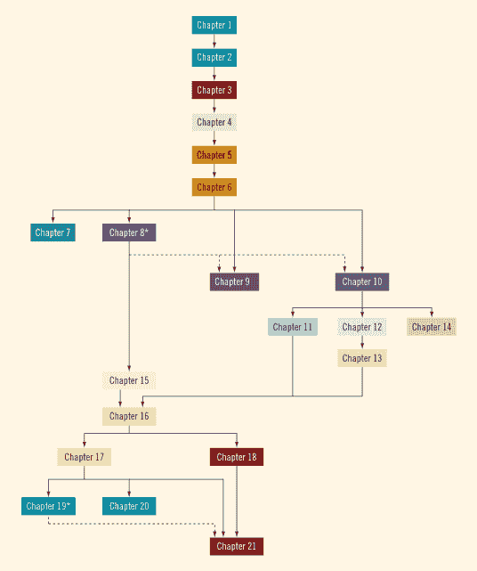

**图 1** 章节依赖图

### 本书特色

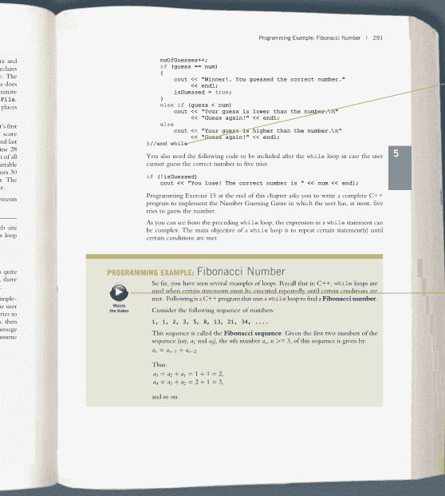

```cpp
do {
    int guess = 0;
    cout << "Number? You guessed the correct number."
         << endl;
    isGuessed = true;
} else {
    cout << "Your guess is lower than the number.\n";
    cout << "Guess again!" << endl;
    cout << "Your guess is higher than the number.\n";
}
// end while
```

如果用户在五次尝试内仍未猜中正确的数字，你还需要在 while 循环之后包含以下代码：

```cpp
if (isGuessed)
{
    cout << "You lost! The correct number is " << num << endl;
}
```

本章末尾的编程练习 15 要求你编写一个完整的 C++ 程序来实现数字猜谜游戏，在该游戏中，用户最多有五次机会猜测该数字。

从上面的 while 循环可以看出，while 语句中的表达式可以很复杂。while 循环的主要目标是重复执行某些语句，直到满足特定条件为止。

### 编程示例：斐波那契数


到目前为止，你已经看到了几个循环的示例。回想一下，在 C++ 中，当某些语句必须反复重复直到满足特定条件时，就会使用 while 循环。接下来，下面是一个使用 while 循环查找斐波那契数的 C++ 程序。

-   考虑以下数字序列：
-   1, 1, 2, 3, 5, 8, 13, 21, 34, …

这个序列被称为斐波那契数列。已知该序列的前两个数字（例如 a₁ 和 a₂），该序列的第 n 个数 aₙ（n ≥ 3）由下式给出：

_aₙ = aₙ₋₁ + aₙ₋₂_

因此：

a₃ = a₂ + a₁ = 1 + 1 = 2,

a₄ = a₃ + a₂ = 2 + 1 = 3,

以此类推。

四色内文设计展示了准确的 C++ 代码及相关注释。

本书配套的可选 CourseMate 中，每一章都提供了一个视频。每个视频旨在解释程序的工作原理。

## 控制结构

第 2 章将程序定义为一系列语句，其目标是完成某项任务。到目前为止，你检查过的程序都是简单直接的。为了处理程序，计算机从第一条可执行语句开始，按顺序执行语句，直到到达末尾。在本章和第 5 章中，你将学习如何告诉计算机，它不必遵循简单的顺序语句；它可以做出决策，并一遍又一遍地遵循某些语句，直到满足特定条件。

计算机可以通过以下方式之一处理程序：按顺序；有选择地，通过做出选择（也称为分支）；重复地，通过使用称为循环的结构反复执行语句，或者通过调用函数。图 4-1 说明了前三种程序流程类型。（在第 6 章中，我们将展示函数如何工作。）第 2 章和第 3 章中的编程示例包括简单的顺序程序。对于顺序程序，计算机从开头开始，按顺序执行语句直到结束。不做任何选择；没有重复。控制结构提供了顺序程序执行的替代方案，用于改变顺序执行流程。两种最常见的控制结构是选择结构和重复结构。在选择结构中，程序根据某些条件执行特定语句。在重复结构中，程序根据某些条件重复执行特定语句一定次数。

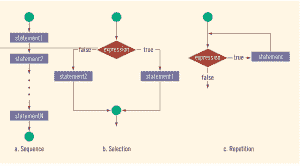

图 4-1 – 执行流程

超过 400 幅视觉图表，详尽而全面，阐释了困难的概念。

在 C++ 中，标识符可以任意长度。

### 示例 2-2

以下是 C++ 中合法的标识符：

-   first
-   conversion
-   payRate
-   counter1

表 2-1 非法标识符示例，解释了它们为何非法，并给出了正确的标识符。

| 非法标识符 | 原因 | 正确标识符 |
|---|---|---|
| `employee Salary` | employee 和 Salary 之间不能有空格。 | `employeeSalary` |
| `Hello!` | 标识符中不能使用感叹号。 | `Hello` |
| `one+two` | 标识符中不能使用 + 符号。 | `onePlusTwo` |
| `2nd` | 标识符不能以数字开头。 | `second` |

> **注意** 编译器供应商通常以下划线（_）开头某些标识符。当链接器将目标程序与集成开发环境（IDE）提供的系统资源链接时，可能会出现某些错误。因此，建议你不要在程序中使用下划线（_）开头标识符。

### 空白符

每个 C++ 程序都包含空白符。空白符包括空格、制表符和换行符。然而，在 C++ 中，空白符用于分隔特殊符号、保留字和标识符。空白符是不可打印的，意思是当它们打印在白纸上时，特殊符号、保留字和标识符之间的空间是白色的。在程序中正确使用空白符很重要。它们可以用来使程序更具可读性。

> 编号示例通过相关代码说明了关键概念。这些示例中的编程代码后面都跟着一个示例运行。然后是对代码中每一行作用的解释。

> 注意突出了本章介绍的概念的重要事实。

编程示例是本章所有内容汇集之处。这些示例教授解决问题的技能，并包括输入、输出、问题分析和算法设计、类设计以及程序清单等具体阶段。所有程序都设计得有条理、一致且用户友好。每个编程示例都从问题分析开始，然后是算法设计和/或类设计，算法中的每一步都用 C++ 编码。除了帮助学生掌握解决问题的技巧外，这些详细的程序还向学生展示了如何在真正的 C++ 程序中实现概念。我们强烈建议学生仔细研究编程示例，以便有效学习 C++。学生通常从完整编写的程序中获益良多。此外，编程示例大大减少了学生在课外寻求帮助的需求，并增强了学生的自信心。

### 编程示例：长度转换


编写一个程序，将输入的以英尺和英寸表示的长度转换为厘米并输出。假设给定的英尺和英寸长度都是整数。

**输入：** 以英尺和英寸表示的长度。

**输出：** 等效的厘米长度。

**问题分析**

输入是以英尺和英寸表示的长度。输出是等效的厘米长度。1 英寸等于 2.54 厘米。程序需要做的第一件事是将以英尺和英寸表示的长度转换为全部英寸。然后，你可以使用转换公式 1 英寸 = 2.54 厘米，来求出等效的厘米长度。要将长度从英尺和英寸转换为英寸，你需要将英尺数乘以 12（因为 1 英尺等于 12 英寸），并加上给定的英寸数。

例如，假设输入是 5 英尺 3 英寸。然后你可以按如下方式求出总英寸数：

```cpp
totalInches = (12 * feet) + inches
            = 12 * 5 + 3
            = 67
```

然后你可以应用转换公式 1 英寸 ≈ 2.54 厘米，来求出以厘米为单位的长度。

```cpp
centimeters = totalInches * 2.54
             = 67 * 2.54
             = 170.18
```

基于对问题的这一分析，你可以设计如下算法：

-   1. 获取以英尺和英寸表示的长度。
-   2. 将长度转换为总英寸数。
-   3. 将总英寸数转换为厘米数。
-   4. 输出厘米数。

**变量：** 程序的输入是两个数字：一个表示英尺，另一个表示英寸。因此，你需要两个变量：一个存储英尺，另一个存储英寸。由于程序将首先将给定的长度转换为英寸，因此你需要另一个变量来存储总英寸数。你还需要一个变量来存储等效的厘米长度。总之，你需要以下变量：

```cpp
int feet;              // variable to hold given feet
int inches;            // variable to hold given inches
int totalInches;       // variable to hold total inches
double centimeters;    // variable to hold length in centimeters
```


**编程**练习要求学生编写能够产生指定结果的C++程序。

## 编程练习

- **1.**
  - **a.** 定义一个枚举类型 `triangleType`，其值为 `scalene`、`isosceles`、`equilateral` 和 `noTriangle`。
  - **b.** 编写一个函数 `triangleShape`，该函数接受三个数字作为参数，每个数字代表三角形一条边的长度。函数应返回三角形的形状。*（注意：在三角形中，任意两边长度之和大于第三边的长度。）*
  - **c.** 编写一个程序，提示用户输入三角形各边的长度，并输出三角形的形状。
- **2.** 重做第4章的编程练习14（文件 `phonecompany.cpp`），使所有命名常量都定义在一个命名空间中。
- **3.** 编程示例：Pig Latin字符串将字符串转换为Pig Latin形式，但它只处理一个单词。重写该程序，使其能够处理长度不固定的文本。如果单词以标点符号结尾，在Pig Latin形式中，将该标点放在字符串末尾。例如，如果字符串是 `Hello!`，则 `Hello!` 的Pig Latin形式为 `ello-Hay!`。假设文本包含以下标点符号：逗号、句号、问号、分号和感叹号。你的程序可以将输出存储在文件中。
- **4.** 编写一个程序，提示用户输入一个字符串。然后程序使用 `substr` 函数删除字符串中的所有元音字母。例如，如果 `str = "Where"`，那么在删除所有元音字母后，`str = "Whr"`。删除所有元音字母后，输出该字符串。你的程序必须包含一个删除所有元音字母的函数和一个判断字符是否为元音字母的函数。
- **5.** 编写一个可用于计算联邦税的程序。税额计算如下：对于单身人士，标准免税额为4,000美元；对于已婚人士，标准免税额为7,000美元。个人还可以将其总收入的至多6%投入养老金计划。税率如下：
  - 在0美元至15,000美元之间，税率为15%。
  - 在15,001美元至40,000美元之间，税额为2,250美元加上超过15,000美元的应税收入的25%。
  - 超过40,000美元，税额为8,460美元加上超过40,000美元的应税收入的35%。

  提示用户输入以下信息：
  - 婚姻状况
  - 如果婚姻状况为`已婚`，询问未满14岁子女的数量。


## 补充资源

### CourseMate

充分利用你的学习时间，在一个地方获得成功所需的一切。阅读你的教科书、高亮标记并做笔记、复习闪卡、观看视频，并进行在线练习测验。了解更多信息，请访问 *www.cengage.com/coursemate*。

C++ *编程* CourseMate 包含以下功能：

- **视频** 逐步讲解每章中的程序，同时集成的测验提供即时反馈，以衡量你的理解程度。
- **实验手册** 让你通过大量实用的动手练习来应用所学内容。
- **互动测验** 和 **学习游戏** 强化关键章节概念，而开放式 **作业** 培养批判性思维能力。
- 交互式电子书、闪卡等！

教师可以将CourseMate添加到教材包中，或者学生可以通过 *www.cengagebrain.com* 直接购买CourseMate。

### 源代码

源代码采用ANSI/ISO标准C++编写，学生可在 *www.cengagebrain.com* 以及本书可用的CourseMate中下载。这些文件也可供教师在 *sso.cengage.com* 上获取。运行某些程序所需的输入文件也包含在源代码中。

### 教师资源

当本书在课堂环境中使用时，以下补充材料可用。所有教学工具均可通过 *sso.cengage.com* 与本书一起获取。需要教师账户。

### 电子教师手册

教师手册按章节顺序跟随教材，并包含有助于规划和组织有效、引人入胜课程的材料。

手册包括概述、章节目标、教学提示、快速测验、课堂讨论主题、附加项目、附加资源和关键术语。还提供**示例教学大纲**。

### 题库

**Cengage Learning Testing Powered by Cognero 是一个灵活的在线系统，允许你：**

- 从多个Cengage Learning解决方案中创建、编辑和管理题库内容
- 即时创建多个测试版本
- 从你的LMS、课堂或任何地方进行测试

### PowerPoint演示文稿

本书附有与每章配套的PowerPoint幻灯片。幻灯片可用于指导课堂演示、供学生进行章节复习，或打印为课堂讲义。教师可以添加自己为课堂引入的额外主题的幻灯片，也可以使用书中的完整**图形文件**自定义幻灯片。

### 解答文件

所有编程练习的解答文件采用ANSI/ISO C++编写，教师可在 *sso.cengage.com* 上下载。运行某些编程练习所需的输入文件也包含在解答文件中。


## 致谢

有许多人我必须要感谢，他们以这样或那样的方式为本书的成功做出了贡献。首先，我要感谢所有在编写过程中自发告诉我某些部分是否需要重新措辞以便更好地理解和更清晰阅读的学生。接下来，我要感谢那些为改进第六版提出众多评论的人。我也非常感谢那些审阅了本书早期版本并提出了许多关于如何改进的关键建议的审阅者。

我非常感谢以下审阅者为改进本版教材提出的有益且关键的建議：Terry Hoffer：蒙大拿州立大学城市学院；Douglas Kranch：北中央州立学院；Xiangdong Li：纽约市立大学科技学院；以及Jeffrey Miller：西方学院。

接下来，我对高级产品经理Jim Gish表示感谢，他认识到了这个项目的重要性和独特性。如果没有高级内容开发人员Alyssa Pratt和产品开发经理Leigh Hefferon的周密规划，这一切都不可能实现。我向Alyssa以及内容项目经理Jennifer Feltri-George致以诚挚的谢意。我还感谢Integra Software Services的Shanthi Guruswamy帮助我们保持项目按计划进行。我要感谢Cengage Learning的Chris Scriver和Serge Palladino耐心细致地测试代码并发现拼写和错误。

本书献给我的父母，我感谢他们的祝福。

最后，我感谢我的妻子Sadhana，尤其是我的女儿Shelly的支持。每当我写这本书感到不堪重负时，她们都会给我鼓励。

欢迎对本书内容提出任何意见。意见可发送至以下电子邮件地址：malik@creighton.edu。

D. S. Malik


# 第1章

## 计算机与编程语言概述

**在本章中，你将：**

- **1.** 了解不同类型的计算机
- **2.** 探索计算机系统的硬件和软件组件
- **3.** 了解计算机的语言
- **4.** 了解编程语言的演变
- **5.** 考察高级编程语言
- **6.** 发现什么是编译器及其作用
- **7.** 考察一个C++程序
- **8.** 探索C++程序是如何被处理的
- **9.** 了解什么是算法并探索问题解决技术
- **10.** 了解结构化设计和面向对象设计编程方法论
- **11.** 了解标准C++、ANSI/ISO标准C++和C++11


## 引言

诸如“互联网”之类的术语在20年前还很陌生，如今已很常见。小学生经常“上网冲浪”，并使用计算机设计和实施他们的课堂项目。许多人使用互联网查找信息并与他人交流。这一切都得益于各种软件（也称为计算机程序）的使用。没有软件，计算机就无法工作。软件是通过使用编程语言开发的，C++ 是其中一种编程语言，非常适合开发用于完成特定任务的软件。本书的主要目标是帮助你学习 C++ 编程语言来编写程序。在开始编程之前，了解一些基本术语和计算机的不同组成部分是很有用的。我们先从计算机历史的概述开始。

## 计算机历史简要概述

已知最早的执行计算的设备是算盘。算盘发明于亚洲，但在古代巴比伦、中国以及整个欧洲一直使用到中世纪晚期。算盘使用框架中滑动的珠子系统进行加法和减法。1642年，法国哲学家和数学家布莱士·帕斯卡发明了称为帕斯卡计算器的计算装置。它有八个装在轮子上的可移动表盘，能计算长达八位的和。算盘和帕斯卡计算器都只能执行加法和减法运算。17世纪后期，戈特弗里德·威廉·莱布尼茨发明了一种能够加、减、乘、除的装置。1819年，法国织工约瑟夫·雅卡尔发现，他织机的编织指令可以存储在打孔的卡片上。当卡片依次穿过织机时，针穿过孔洞，挑起颜色和质地正确的线。织工可以重新排列卡片，改变正在编织的图案。本质上，这些卡片为织机编程，以在布料上产生图案。纺织业似乎与计算机产业几乎没有共同之处。然而，通过在卡片上打孔来存储信息的思想在后来计算机的发展中被证明非常重要。

19世纪早期和中期，英国数学家和物理学家查尔斯·巴贝奇设计了两台计算机器：差分机和分析机。差分机可以自动执行诸如求数字平方之类的复杂运算。巴贝奇制造了差分机的原型，但没有制造实际装置。第一台完整的差分机于2002年在伦敦完成，距其设计完成已有153年。它由8000个零件组成，重5吨，长11英尺。差分机的复制品于2008年完成，并在加利福尼亚州山景城的计算机历史博物馆展出（[http://www.computerhistory.org/babbage/](http://www.computerhistory.org/babbage/)）。巴贝奇的大部分工作是通过其同事、洛夫莱斯伯爵夫人阿达·奥古斯塔的著作而为人所知的。奥古斯塔被认为是第一位计算机程序员。

19世纪末，美国人口普查官员需要帮助来准确制表人口普查数据。赫尔曼·霍勒瑞斯发明了一种靠电力运行并使用打孔卡片存储数据的计算机器。霍勒瑞斯的机器取得了巨大成功。霍勒瑞斯创立了制表机器公司，该公司后来成为名为IBM的计算机和技术公司。

第一台类似计算机的机器是马克一号。它于1944年由IBM和哈佛大学在霍华德·艾肯的领导下联合建造。打孔卡片被用来向机器输入数据。马克一号长52英尺，重50吨，有75万个零件。1946年，电子数字积分计算机（ENIAC）在宾夕法尼亚大学建成。它包含18000个真空管，重约30吨。

我们今天所知的计算机使用约翰·冯·诺依曼在20世纪40年代末给出的设计规则。他的设计包括算术逻辑单元、控制单元、存储器和输入/输出设备等组件。这些组件将在下一节中描述。冯·诺依曼的计算机设计使得将编程指令和数据存储在同一存储空间中成为可能。1951年，通用自动计算机（UNIVAC）建成并出售给美国人口普查局。

1956年，晶体管的发明带来了更小、更快、更可靠且更节能的计算机。这一时期还见证了软件开发行业的出现，并引入了FORTRAN和COBOL这两种早期编程语言。在下一个重大技术进步中，晶体管被小型集成电路或“芯片”所取代。芯片比晶体管小得多且效率高得多，而借助当今的新技术，可以在单个芯片上包含数千个电路。它们赋予计算机巨大的处理速度。

1970年，微处理器——将整个中央处理器（CPU）集成在单个芯片上——被发明。1977年，斯蒂芬·沃兹尼亚克和史蒂夫·乔布斯在他们的车库里设计并制造了第一台苹果电脑。1981年，IBM推出了其个人计算机（PC）。20世纪80年代，IBM PC的兼容机使个人计算机更加经济实惠。到20世纪90年代中期，各行各业的人们都能买得起它们。随着技术进步，计算机继续变得更快、更便宜。

现代计算机功能强大、可靠且易于使用。它们可以接受语音指令，并通过人工智能模仿人类推理。专家系统协助医生进行诊断。移动计算应用正在显著增长。送货司机使用手持设备可以访问全球定位卫星（GPS），以核实取货和送货的客户位置。手机让你可以查看电子邮件、预订机票、查看股票行情、访问银行账户，并通过社交媒体与家人和朋友交流。

尽管计算机有几种类型，例如大型机、中型机和微型机，但所有计算机都共享一些基本要素，这些将在下一节中描述。

## 计算机系统的组成

计算机是一种能够执行命令的电子设备。计算机执行的基本命令包括输入（获取数据）、输出（显示结果）、存储以及执行算术和逻辑运算。计算机系统有两个主要组成部分：硬件和软件。在接下来的几节中，你将了解这些组件的简要概述。我们先来看看硬件。

### 硬件

主要硬件组件包括中央处理器（CPU）；主存储器（MM），也称为随机存取存储器（RAM）；输入/输出设备；以及辅助存储器。输入设备的一些例子包括键盘、鼠标和辅助存储器。输出设备的例子包括屏幕、打印机和辅助存储器。让我们更详细地看看这些组件中的每一个。

### 中央处理器与主存储器

**中央处理器**是计算机的“大脑”，也是计算机中最昂贵的硬件。CPU越强大，计算机运行越快。算术和逻辑运算在CPU内部执行。图1–1(a)展示了一些硬件组件。

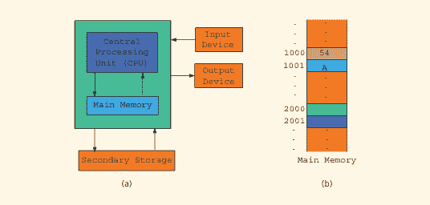

**图1-1** 计算机的硬件组件与主存储器

**主存储器**，即**随机存取存储器**，直接连接到CPU。所有程序必须先加载到主存储器中才能执行。同样，所有数据必须先调入主存储器，程序才能处理它。当计算机关闭时，主存储器中的所有内容都会丢失。

主存储器是一个有序的单元序列，称为**存储单元**。每个单元在主存储器中都有一个唯一的位置，称为该单元的**地址**。这些地址帮助你访问存储在单元中的信息。图1–1(b)显示了带有一些数据的主存储器。


如今的计算机主存由数百万到数十亿个单元组成。尽管图1–1(b)显示数据存储在单元中，但单元的内容既可以是编程指令，也可以是数据。此外，该图将数据显示为数字和字母。然而，正如本章后面所述，主存将所有内容存储为0和1的序列。内存地址也同样表示为0和1的序列。


## 辅助存储器

由于程序和数据处理前必须加载到主存中，而且计算机关机后主存中的一切都会丢失，因此主存中的信息必须保存在其他设备上以供永久存储。永久存储信息的设备（除非设备变得不可用，或者你通过重写来更改信息）称为**辅助存储器**。为了能够将信息从主存传输到辅助存储器，这些组件必须直接相互连接。辅助存储器的例子包括硬盘、闪存盘和光盘。

## 输入/输出设备

计算机要执行有用的任务，必须能够接收数据和程序，并显示计算结果。将数据和程序送入计算机的设备称为**输入设备**。键盘、鼠标、扫描仪、摄像头和辅助存储器都是输入设备的例子。计算机用来显示结果的设备称为**输出设备**。显示器、打印机和辅助存储器都是输出设备的例子。

## 软件

软件是为执行特定任务而编写的程序。例如，文字处理器是用于写信、写论文甚至写书的程序。所有软件都是用编程语言编写的。程序有两类：系统程序和应用程序。

**系统程序**控制计算机。打开计算机时最先加载的系统程序称为操作系统。没有操作系统，计算机就无法使用。**操作系统**处理计算机的整体活动并提供服务。其中一些服务包括内存管理、输入/输出活动和存储管理。操作系统有一个特殊程序，用于组织辅助存储器，以便你方便地访问信息。一些知名的操作系统包括Windows 8、Mac OS X、Linux和Android。

**应用程序**执行特定的任务。文字处理器、电子表格和游戏都是应用程序的例子。操作系统是运行应用程序的程序。

## 计算机的语言

当你在键盘上按下A时，计算机会在屏幕上显示A。但计算机的主存中实际存储的是什么？计算机的语言是什么？它如何存储你在键盘上输入的内容？

请记住，计算机是一种电子设备。计算机内部使用电信号来处理信息。电信号有两种类型：模拟信号和数字信号。**模拟信号**是连续变化的、用于表示声音等事物的连续波形。例如，音频磁带以模拟信号存储数据。**数字信号**用0和1的序列表示信息。0表示低电压，1表示高电压。数字信号比模拟信号是更可靠的信息载体，并且可以精确地将信息从一个设备复制到另一个设备。你可能已经注意到，当你复制音频磁带时，副本的音质不如原版磁带。另一方面，当你复制CD时，副本与原版完全相同。计算机使用数字信号。

由于计算机内部处理的是数字信号，计算机的语言称为**机器语言**，它是0和1的序列。数字0或1称为**二进制数字**，简称**比特（bit）**。有时，0和1的序列被称为**二进制代码**或**二进制数**。

**比特：** 二进制数字0或1。

一个由八个比特组成的序列称为**字节（byte）**。此外，2¹⁰字节 = 1024字节称为**千字节（KB）**。表1–1总结了用于描述各种字节数量的术语。

**表1-1 二进制单位**

| 单位 | 符号 | 比特/字节 |
|---|---|---|
| 字节 |  | 8位 |
| 千字节 | KB | 2¹⁰字节 = 1024字节 |
| 兆字节 | MB | 1024 KB = 2¹⁰ KB = 2²⁰字节 = 1,048,576字节 |
| 吉字节 | GB | 1024 MB = 2¹⁰ MB = 2³⁰字节 = 1,073,741,824字节 |
| 太字节 | TB | 1024 GB = 2¹⁰ GB = 2⁴⁰字节 = 1,099,511,627,776字节 |
| 拍字节 | PB | 1024 TB = 2¹⁰ TB = 2⁵⁰字节 = 1,125,899,906,842,624字节 |
| 艾字节 | EB | 1024 PB = 2¹⁰ PB = 2⁶⁰字节 = 1,152,921,504,606,846,976字节 |
| 泽字节 | ZB | 1024 EB = 2¹⁰ EB = 2⁷⁰字节 = 1,180,591,620,717,411,303,424字节 |

键盘上的每个字母、数字或特殊符号（如*或{）都被编码为比特序列，每个都有唯一的表示。个人计算机上最常用的编码方案是**七位美国信息交换标准码（ASCII）**。ASCII数据集包含128个字符，编号从0到127。也就是说，在ASCII数据集中，第一个字符的位置是0，第二个字符的位置是1，依此类推。在这种方案中，A被编码为二进制数1000001。实际上，A是ASCII字符代码中的第66个字符，但它的位置是65，因为第一个字符的位置是0。此外，二进制数1000001是65的二进制表示。字符3被编码为0110011。请注意，在ASCII字符集中，字符3的位置是51，因此字符3是ASCII集中的第52个字符。同样，0110011是51的二进制表示。有关可打印ASCII字符集的完整列表，请参阅附录C。

> **注意**  我们日常生活中使用的数制称为**十进制**，或**基10**。由于计算机内部所有内容都表示为0和1的序列，即二进制数，因此计算机使用的数制称为**二进制**，或**基2**。我们在上一段中指出，数字1000001是65的二进制表示。附录E描述了如何将数字从基10转换为基2，反之亦然。

在计算机内部，每个字符都表示为八个比特的序列，即一个字节。现在，65的八位二进制表示是01000001。注意，我们在65的七位表示左边添加了0，以将其转换为八位表示。类似地，我们在51的二进制值上添加一个0，得到其八位二进制表示00110011。

ASCII是一种七位代码。因此，为了在计算机内部表示每个ASCII字符，你必须将ASCII字符的七位二进制表示转换为八位二进制表示。这可以通过在字符的七位ASCII编码左边添加0来实现。因此，在计算机内部，字符A表示为01000001，字符3表示为00110011。

还有其他编码方案，例如EBCDIC（IBM使用）和Unicode（较新的发展）。EBCDIC包含256个字符；Unicode包含65,536个字符。要存储属于Unicode的字符，需要16位或两个字节。Unicode是为了表示各种字符而创建的，并且正在不断扩大。它包含英语以外的其他语言的字符。

## 编程语言的演变

计算机最基本的语言，即机器语言，以比特形式提供程序指令。尽管大多数计算机执行相同类型的操作，但计算机的设计者可能选择了不同的二进制代码集来执行这些操作。因此，一台机器的机器语言不一定与另一台机器的机器语言相同。计算机之间唯一的共同点是，在任何现代计算机中，所有数据都以二进制代码存储和操作。


早期的计算机使用机器语言编程。要了解指令如何用机器语言编写，假设你想使用以下公式：

```
wages = rate · hours
```

来计算周薪。进一步假设二进制代码100100代表装入，100110代表乘法，100010代表存储。在机器语言中，你可能需要以下指令序列来计算周薪：

```
100100 010001
100110 010010
100010 010011
```

为了用机器语言表示周薪公式，程序员必须记住各种操作的机器语言代码。此外，为了处理数据，程序员必须记住数据在主存中的位置。这种记住特定代码的需要不仅使编程非常困难，而且容易出错。

汇编语言的开发是为了让程序员的工作更轻松。在汇编语言中，指令是一种易于记忆的形式，称为**助记符**。例如，假设 LOAD 代表机器代码100100，MULT代表机器代码100110（乘法），STOR代表机器代码100010。

使用汇编语言指令，你可以编写计算周薪的公式如下：

```
LOAD  rate
MULT  hours
STOR  wages
```

如你所见，用汇编语言编写指令要容易得多。但是，计算机不能直接执行汇编语言指令。指令必须先翻译成机器语言。称为**汇编器**的程序将汇编语言指令翻译成机器语言。

**汇编器：** 将用汇编语言编写的程序翻译成等价的机器语言程序的程序。

从机器语言转向汇编语言使编程更容易，但程序员仍然被迫按照单条机器指令来思考。使编程更容易的下一步是设计**高级语言**，它们更接近自然语言，如英语、法语、德语和西班牙语。Basic、FORTRAN、COBOL、C、C++、C# 和 Java 都是高级语言。本书将学习高级语言C++。

在C++中，编写周薪公式如下：

```
wages = rate * hours;
```

用C++编写的指令更容易理解，对于熟悉基本算术的新手用户来说一目了然。然而，如同汇编语言的情况一样，计算机不能直接执行用高级语言编写的指令。要在计算机上执行，这些C++指令首先需要翻译成机器语言。称为**编译器**的程序将用高级语言编写的指令翻译成机器代码。

**编译器：** 将用高级语言编写的指令翻译成等价机器语言的程序。

## 处理C++程序

在前面的章节中，我们讨论了机器语言和高级语言，并展示了一条C++语句。因为计算机只能理解机器语言，所以你现在可以回顾处理用C++编写的程序所需的步骤。

考虑以下C++程序：

```cpp
#include <iostream>

using namespace std;

int main()
{
    cout << "My first C++ program." << endl;

    return 0;
}
```

此时，你不必过于关心该程序的细节。但是，如果运行（执行）该程序，它将在屏幕上显示以下行：

**我的第一个C++程序。**

回想一下，计算机只能理解机器语言。因此，为了成功运行该程序，必须先将代码翻译成机器语言。在本节中，我们回顾执行用C++编写的程序所需的步骤。

处理C++程序需要以下步骤，如图1-2所示。

- 1. 你使用文本编辑器，按照高级语言的规则（或*语法*）创建一个C++程序。该程序称为**源代码**或**源程序**。程序必须保存在扩展名为 `.cpp` 的文本文件中。例如，如果将前面的程序保存在名为 FirstCPPProgram 的文件中，则其完整名称为 FirstCPPProgram.cpp。
  
  **源程序：** 用高级语言编写的程序。

- 2. 上一节给出的C++程序包含语句 `#include <iostream>`。在C++程序中，以符号 `#` 开头的语句称为预处理指令。这些语句由称为**预处理器**的程序处理。

- 3. 处理预处理指令后，下一步是验证程序是否遵守编程语言的规则——即程序在语法上正确——并将程序翻译成等价的机器语言。**编译器**检查源程序中的语法错误，如果未发现错误，则将程序翻译成等价的机器语言。等价的机器语言程序称为**目标程序**。
  
  **目标程序：** 高级语言程序的机器语言版本。

- 4. 你用高级语言编写的程序是使用集成开发环境（IDE）开发的。IDE包含许多有助于创建程序的有用程序。例如，它包含显示程序结果所需的代码（程序）以及若干数学函数，使程序员的工作更容易一些。因此，如果某些代码已经可用，你可以使用这些代码，而不是编写自己的代码。一旦程序开发并成功编译，你仍然必须将 IDE 中所用资源的代码引入程序，以生成计算机可执行的最终程序。这些预写代码（程序）位于称为**库**的地方。称为**链接器**的程序将目标程序与库中的程序组合起来。
  
  **链接器：** 将目标程序与库中的其他程序组合起来，并在程序中用于创建可执行代码的程序。

- 5. 接下来，你必须将可执行程序加载到主存中以供执行。称为**加载器**的程序完成此任务。
  
  **加载器：** 将可执行程序加载到主存的程序。

- 6. 最后一步是执行程序。

图1-2展示了典型C++程序的处理过程。

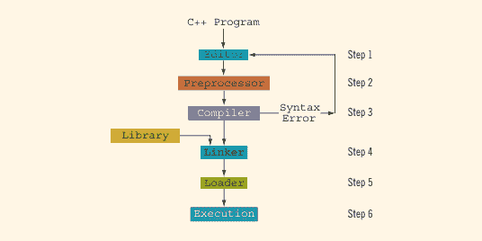

**图1-2** 处理C++程序

作为程序员，你主要需要关注第1步。也就是说，你必须学习、理解并掌握编程语言的规则，以创建源程序。

如前所述，程序是使用IDE开发的。用于创建高级语言C++程序的知名IDE包括 Visual C++ 2012 Express 和 Visual Studio 2012（来自 Microsoft），以及 C++ Builder（来自 Borland）。你也可以使用 Bloodshed Software 的 Dev-C++ IDE 来创建和测试C++程序。这些IDE包含用于创建源程序的文本编辑器、用于检查源程序语法错误的编译器、用于将目标代码与 IDE 资源链接的程序，以及用于执行程序的程序。

这些IDE相当用户友好。编译程序时，编译器不仅会识别语法错误，通常还会建议如何纠正它们。此外，只需一个简单命令，目标代码就会与 IDE 中所用资源链接起来。例如，在 Visual C++ 2012 Express 和 Visual Studio 2012 中执行链接的命令是**生成**或**重新生成**。（有关这些命令使用的进一步说明，请查阅这些IDE的文档。）如果程序尚未编译，这些命令中的每一个都会先编译程序，然后链接并生成可执行代码。

网站 *http://msdn.microsoft.com/en-us/library/vstudio/ms235629.aspx* 说明了如何使用 Visual C++ 2012 Express 和 Visual Studio 2012 创建C++程序。

## 使用问题分析—编码—执行周期进行编程

*编程是一个解决问题的过程。* 不同的人使用不同的技术来解决问题。有些技术描述清晰且易于遵循。它们不仅能解决问题，还能让人深入了解解决方案是如何得出的。如果问题领域发生变化，这些解决问题的技术可以很容易地修改。

要成为优秀的问题解决者和优秀的程序员，你必须遵循良好的问题解决技术。一种常见的问题解决技术包括分析问题、概述问题需求，以及设计称为**算法**的步骤来解决问题。

**算法：** 一种逐步解决问题的过程，在有限时间内得出解决方案。

在编程环境中，问题解决过程需要以下三个步骤：

- 1. 分析并概述问题及其解决方案需求，并设计解决问题的算法。
- 2. 使用编程语言（如C++）实现该算法，并验证算法有效。
- 3. 如果问题领域发生变化，通过使用和修改程序来维护程序。

图1-3总结了该编程过程的前两个步骤。


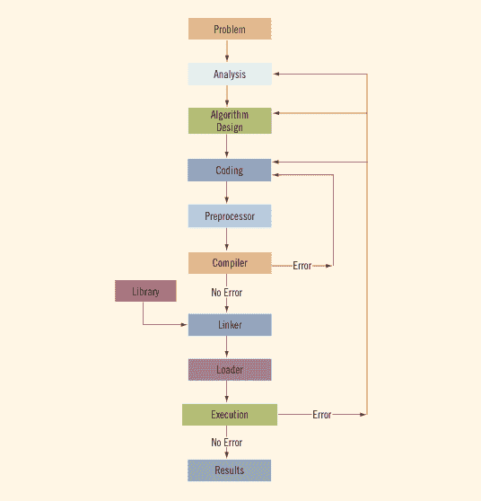

要开发一个解决问题的程序，首先要分析问题。然后设计算法；用高级语言编写程序指令，或者说编写程序代码；再把程序输入计算机系统。

分析问题是第一步，也是最重要的一步。这一步要求你完成以下工作：

- 1. 彻底理解问题。
- 2. 理解问题需求。需求可能包括：程序是否需要与用户交互、是否处理数据、是否产生输出，以及输出是什么样子。如果程序处理数据，程序员必须知道数据是什么以及如何表示。也就是说，你需要查看示例数据。如果程序产生输出，你应当知道结果应如何生成和格式化。
- 3. 如果问题复杂，就把问题分解为子问题，并重复步骤 1 和步骤 2。也就是说，对于复杂问题，你需要分析每个子问题，并理解每个子问题的需求。

在仔细分析问题之后，下一步是设计解决问题的算法。如果你把问题分解成了子问题，就需要为每个子问题设计一个算法。设计出算法后，需要检查其正确性。有时可以用示例数据来测试算法的正确性。另一些时候，你可能需要进行一些数学分析来检验算法的正确性。

设计好算法并验证其正确性之后，下一步是把它转换为等价的编程代码。然后使用文本编辑器把编程代码或程序输入计算机。接下来，必须确保程序符合该语言的语法。为了验证语法是否正确，要让代码通过编译器运行。如果编译器生成错误消息，就必须找出代码中的错误，删除它们，然后再次让代码通过编译器运行。当所有语法错误都被消除后，编译器会生成等价的机器代码，链接器会把机器代码与系统资源链接起来，加载器则把程序放入主存，以便执行。

最后一步是执行程序。编译器只保证程序符合该语言的语法，并不保证程序能正确运行。在执行过程中，程序可能因逻辑错误（例如除以零）而异常终止。即使程序正常终止，也可能产生错误结果。在这些情况下，你可能必须重新检查代码、算法，甚至问题分析。

如果你在尝试编写程序指令之前花足够时间完成问题分析，你的整体编程经历将会是成功的。通常，你用钢笔或铅笔在纸上完成这项工作。采用这种谨慎的编程方法有许多优点。对于经过充分分析和良好设计的程序，找出错误要容易得多。此外，经过仔细分析和设计的程序更容易理解和修改。即使是最有经验的程序员，也会花相当多的时间分析问题并设计算法。

贯穿本书，你不仅会学习用 C++ 编写程序的规则，还会学习解决问题的技巧。大多数章节都包含讨论编程问题的编程示例。这些编程示例会传授如何分析和解决问题、设计算法、把算法编写成 C++ 代码的技巧，还会帮助你理解本章讨论的概念。为了充分受益于本书，我们建议你认真完成这些编程示例。

接下来，我们提供各种问题分析和算法设计技术的示例。

## 示例 1-1

在这个示例中，我们设计一个求矩形周长和面积的算法。

要求矩形的周长和面积，需要知道矩形的长和宽。

矩形的周长和面积由以下公式给出：

```text
perimeter = 2 · (length + width)
area = length · width
```

求矩形周长和面积的算法是：

- 1. 获取矩形的长。
- 2. 获取矩形的宽。
- 3. 使用以下公式求周长：

  ```text
  perimeter = 2 · (length + width)
  ```

- 4. 使用以下公式求面积：

  ```text
  area = length · width
  ```

## 示例 1-2

在这个示例中，我们设计一个算法，计算在某个特定州销售的一件商品的销售税和价格。

销售税的计算方式如下：销售税中州的部分为 4%，市的部分为 1.5%。如果该商品是奢侈品，例如价格超过 50,000 美元的汽车，则还要征收 10% 的奢侈品税。

要计算该商品的价格，我们需要计算销售税中州的部分、市的部分，以及如果该商品是奢侈品还要计算奢侈品税。假设 `salePrice` 表示商品的销售价格，`stateSalesTax` 表示州销售税，`citySalesTax` 表示市销售税，`luxuryTax` 表示奢侈品税，`salesTax` 表示总销售税，`amountDue` 表示商品的最终价格。

要计算销售税，我们必须知道商品的销售价格以及该商品是否为奢侈品。

`stateSalesTax` 和 `citySalesTax` 可以用以下公式计算：

```text
stateSalesTax = salePrice · 0.04
citySalesTax = salePrice · 0.015
```

接下来，可以按如下方式确定 luxuryTax：

```text
if (item is a luxury item)
    luxuryTax = salePrice * 0.1
otherwise
    luxuryTax = 0
```

接下来，可以按如下方式确定 salesTax：

```text
salesTax = stateSalesTax + citySalesTax + luxuryTax
```

最后，可以按如下方式计算 amountDue：

```text
amountDue = salePrice + salesTax
```

因此，确定 salesTax 和 amountDue 的算法是：

- 1. 获取商品的销售价格。
- 2. 确定该商品是否为奢侈品。
- 3. 使用以下公式求销售税中州的部分：

  ```text
  stateSalesTax = salePrice * 0.04
  ```

- 4. 使用以下公式求销售税中市的部分：

  ```text
  citySalesTax = salePrice * 0.015
  ```

- 5. 使用以下公式求奢侈品税：

  ```text
  if (item is a luxury item)
      luxuryTax = salePrice * 0.1
  otherwise
      luxuryTax = 0
  ```

- 6. 使用以下公式求 salesTax：

  ```text
  salesTax = stateSalesTax + citySalesTax + luxuryTax
  ```

- 7. 使用以下公式求 amountDue：

  ```text
  amountDue = salePrice + salesTax
  ```

## 示例 1-3


在这个示例中，我们设计一个算法，计算当地一家百货商店销售人员的月薪。

每位销售人员都有基本工资。销售人员还在每月末根据以下标准获得奖金：如果该销售人员在该商店工作五年或五年以下，则奖金为每工作一年 10 美元。如果该销售人员在该商店工作超过五年，则奖金为每工作一年 20 美元。销售人员还可以获得如下额外奖金：如果该销售人员当月的总销售额至少为 5,000 美元但低于 10,000 美元，则可获得销售额 3% 的佣金。如果该销售人员当月的总销售额至少为 10,000 美元，则可获得销售额 6% 的佣金。

要计算销售人员的月薪，需要知道基本工资、该销售人员在公司工作的年数，以及该销售人员当月的总销售额。假设 baseSalary 表示基本工资，noOfServiceYears 表示该销售人员在该商店工作的年数，bonus 表示奖金，totalSales 表示该销售人员当月的总销售额，additionalBonus 表示额外奖金。

可以按如下方式确定奖金：

```text
if (noOfServiceYears is less than or equal to five)
    bonus = 10 · noOfServiceYears
otherwise
    bonus = 20 · noOfServiceYears
```

接下来，可以按如下方式确定销售人员的额外奖金：

```text
if (totalSales is less than 5000)
    additionalBonus = 0
otherwise
    if (totalSales is greater than or equal to 5000 and
        totalSales is less than 10000)
        additionalBonus = totalSales · (0.03)
    otherwise
        additionalBonus = totalSales · (0.06)
```

根据以上讨论，现在可以设计计算销售人员月薪的算法：

- 1. 获取 baseSalary。
- 2. 获取 noOfServiceYears。
- 3. 使用以下公式计算 bonus：

  ```text
  if (noOfServiceYears is less than or equal to five)
      bonus = 10 · noOfServiceYears
  otherwise
      bonus = 20 · noOfServiceYears
  ```

- 4. 获取 totalSales。
- 5. 使用以下公式计算 additionalBonus：

  ```text
  if (totalSales is less than 5000)
      additionalBonus = 0
  otherwise
      if (totalSales is greater than or equal to 5000 and
          totalSales is less than 10000)
          additionalBonus = totalSales · (0.03)
      otherwise
          additionalBonus = totalSales · (0.06)
  ```


- 6. 使用以下公式计算 `payCheck`：

  ```text
  payCheck = baseSalary + bonus + additionalBonus
  ```

## 示例 1-4

在这个示例中，我们设计一个算法来玩猜数字游戏。

目标是随机生成一个大于或等于 0 且小于 100 的整数。然后提示玩家（用户）猜这个数。如果玩家猜对了这个数，就输出一条合适的消息。否则，检查所猜的数是否小于随机数。如果所猜的数小于生成的随机数，就输出消息：“你猜的数比这个数小。再猜一次！”；否则，输出消息：“你猜的数比这个数大。再猜一次！”。然后提示玩家输入另一个数。系统会提示玩家猜这个随机数，直到玩家输入正确的数为止。

第一步是生成一个随机数，如上所述。C++ 提供了实现这一点的方法，这将在第 5 章讨论。假设 num 表示随机数，guess 表示玩家猜的数。

在玩家输入 guess 后，可以如下将 guess 与随机数进行比较：

```text
if (guess is equal to num)
    Print "You guessed the correct number."
otherwise
    if (guess is less than num)
        Print "Your guess is lower than the number. Guess again!"
    otherwise
        Print "Your guess is higher than the number. Guess again!"
```

现在可以按如下方式设计算法：

- 1. 生成一个随机数，并将其称为 `num`。
- 2. 重复以下步骤，直到玩家猜中正确的数：
  - a. 提示玩家输入 `guess`。
  - b. 检查 `guess` 的值。

    ```text
    if (guess is equal to num)
        Print "You guessed the correct number."
    otherwise
        if (guess is less than num)
            Print "Your guess is lower than the number. Guess again!"
        otherwise
            Print "Your guess is higher than the number. Guess again!"
    ```

在第 5 章中，我们使用这个算法编写一个 C++ 程序来玩猜数字游戏。

## 示例 1-5

一个班有 10 名学生。每名学生参加了 5 次测试，每次测试满分 100 分。我们想设计一个算法来计算每名学生的成绩以及班级平均分。成绩的评定如下：如果测试平均分大于或等于 90，则成绩为 A；如果测试平均分大于或等于 80 且小于 90，则成绩为 B；如果测试平均分大于或等于 70 且小于 80，则成绩为 C；如果测试平均分大于或等于 60 且小于 70，则成绩为 D；否则，成绩为 F。注意，数据由学生姓名及其测试成绩组成。

这是一个可以划分为如下子问题的问题：共有 5 次测试，因此你设计一个算法来求测试平均分。接下来，你设计一个算法来确定成绩。这两个子问题是确定测试平均分和确定成绩。

让我们首先设计一个算法来确定测试平均分。要计算测试平均分，先将 5 次测试成绩相加，然后将总和除以 5。因此，算法如下：

- 1. 获取 5 次测试成绩。
- 2. 将 5 次测试成绩相加。假设 `sum` 表示测试成绩之和。
- 3. 假设 `average` 表示测试平均分。

  ```text
  average = sum / 5;
  ```

接下来，你设计一个算法来确定成绩。假设 grade 表示分配给学生的成绩。以下算法确定成绩：

```text
if average is greater than or equal to 90
    grade = A
otherwise
    if average is greater than or equal to 80
        grade = B
    otherwise
        if average is greater than or equal to 70
            grade = C
        otherwise
            if average is greater than or equal to 60
                grade = D
            otherwise
                grade = F
```

你可以使用这些子问题的解来设计主算法，如下所示：（假设 totalAverage 表示每名学生测试平均分之和。）

- 1. `totalAverage = 0;`
- 2. 对班上的每名学生*重复*以下步骤：
  - a. 获取学生姓名。
  - b. 使用上面讨论的算法求测试平均分。
  - c. 使用上面讨论的算法求成绩。
  - d. 通过加上当前学生的测试平均分来更新 `totalAverage`。
- 3. 按如下方式确定班级平均分：

  ```text
  classAverage = totalAverage / 10
  ```

第 8 章的一个编程练习要求你编写一个 C++ 程序，计算班上每名学生的测试平均分和成绩。

> **注意**
>
> 在本章前面，我们描述了问题分析、编码和执行周期。在本节中，我们给出各种示例来说明问题分析和编码周期。必须指出，问题分析是编程中最重要的部分。一旦你分析了问题，并用母语写出了求解所需的步骤，那么正如你将在全书中看到的那样，编写 C++ 代码来实现你的解决方案就相对容易了。此外，你很快会认识到，你的解决方案中的步骤可以有效地转换为 C++ 代码。而且，良好的问题分析会带来更好、更简洁的程序。尽管我们尚未介绍 C++ 的语法，但为了说明如何编写与你的解决方案步骤相对应的 C++ 代码，让我们考虑示例 1-1 中设计的算法。假设 `length`、`width`、`perimeter` 和 `area` 分别表示矩形的长度、宽度、周长和面积。以下是该算法的四个步骤及其对应的 C++ 语句：
>
> | 算法步骤 | C++ 指令（代码） |
> |---|---|
> | 1. 获取矩形的长度。 | `cin >> length;` |
> | 2. 获取矩形的宽度。 | `cin >> width;` |
> | 3. 计算周长。 | `perimeter = 2 * (length + width);` |
> | 4. 计算面积。 | `area = length * width;` |
>
> 考虑第一条语句。在 C++ 中，cin 表示通用输入。在程序执行期间，与之关联的代码指示用户输入数据；如果用户输入了有效数据，那么该数据将被存储在内存中，也就是说，将成为 length 的值。第 3 步中的 C++ 代码使用 length 和 width 的值来计算周长，然后将其赋给 perimeter。
>
> 为了编写一个完整的 C++ 程序来计算面积和周长，你需要了解 C++ 程序的基本结构，这将在下一章介绍。不过，如果你好奇完整的 C++ 程序是什么样子，可以访问本书配套网站，查看存储在文件 `Ch1_Example_1-1_Code.cpp` 中的编程代码。

## 编程方法学

两种流行的程序设计方法是结构化方法和面向对象方法，下面将概述这两种方法。

### 结构化编程

将问题划分为更小的子问题称为**结构化设计**。然后分析每个子问题，并得到解决该子问题的方案。接着，将所有子问题的解决方案组合起来，以解决整个问题。实现结构化设计的这一过程称为**结构化编程**。结构化设计方法也称为**自顶向下设计**、**自底向上设计**、**逐步细化**和**模块化编程**。

### 面向对象编程

**面向对象设计（OOD）**是一种广泛使用的编程方法学。在 OOD 中，问题求解过程的第一步是识别称为对象的组件，这些组件构成解决方案的基础，并确定这些对象如何相互作用。例如，假设你想编写一个程序，为当地音像店自动化影片租赁流程。这个问题中的两个主要对象是影片和顾客。

识别对象之后，下一步是为每个对象指定相关数据以及可对这些数据执行的操作。例如，对于影片对象，*数据*可能包括：

- 电影名称
- 发行年份
- 制片人
- 制作公司
- 库存副本数量

对影片对象的某些*操作*可能包括：

- 查看电影名称
- 在租出一份副本后将库存副本数量减一
- 在顾客归还某部影片后将库存副本数量加一

这表明每个对象都由数据和对该数据的操作组成。对象将数据和对数据的操作组合成一个单元。在 OOD 中，最终程序是一组相互交互的对象。实现 OOD 的编程语言称为**面向对象编程（OOP）**语言。你将在后续章节中了解 OOD 的许多优点。


因为对象由数据及对这些数据的操作组成，所以在设计和使用对象之前，需要学习如何在计算机内存中表示数据、如何操作数据以及如何实现操作。第2章将学习 C++ 的基本数据类型，并了解如何在计算机内存中表示和操作数据。第3章讨论如何将数据输入 C++ 程序，以及如何输出 C++ 程序生成的结果。

要创建操作，需要编写算法并用编程语言实现它们。由于复杂程序中的数据元素通常有许多操作，为了将各个操作彼此分开，并以便捷的方式有效使用它们，可以使用函数来实现算法。第2章和第3章会作简要介绍，第6章将详细学习函数。某些算法要求程序做出决策，这一过程称为选择。另一些算法可能要求重复执行某些语句，直到满足特定条件，这一过程称为重复。还有一些算法可能同时需要选择和重复。第4章和第5章将学习称为控制结构的选择机制和重复机制。此外，第8章将学习一种称为数组的机制，了解当数据项具有相同类型时如何操作数据，例如销售数据列表中的各项。

最后，要使用对象，需要知道如何将数据及对数据的操作组合成一个单元。在 C++ 中，允许将数据及对数据的操作组合成一个单元的机制称为*类*。你将在“类和数据抽象”一章（本书后面）学习类如何工作、如何使用类以及如何创建类。

如你所见，在运用 OOD 方法之前，需要学习不少内容。为了使学习更轻松、更有效，本书特意将控制结构分为两章（第4章——选择；第5章——重复）。

对于某些问题，结构化的程序设计方法会非常有效。其他问题则更适合用 OOD 解决。例如，如果一个问题需要用数学函数处理多组数字，可以使用结构化设计方法，并列出获得解决方案所需的步骤。C++ 库提供了大量函数，可以有效地用于处理数字。另一方面，如果你想编写一个让许多机器投入运行的程序，OOD 方法会更有效。C++ 就是专门为实现 OOD 而设计的。此外，*OOD 与结构化设计配合得很好。*

结构化设计和 OOD 方法都要求你掌握编程语言的基本组成部分，才能成为高效的程序员。第2章到第8章将学习 C++ 的基本组成部分，例如数据类型、输入/输出、控制结构、用户自定义函数和数组，这些是两类编程都需要的。我们使用结构化编程方法展开并说明这些概念如何工作。从“类和数据抽象”一章开始，我们将展开并使用 OOD 方法。

## ANSI/ISO 标准 C++

编程语言 C++ 从 C 演变而来，由 Bjarne Stroustrup 于20世纪80年代初在贝尔实验室设计。从20世纪80年代初到90年代初，出现了多种 C++ 编译器。尽管所有编译器中 C++ 的基本特性大体相同，但本书称为标准 C++ 的 C++ 语言在不同编译器中以略有不同的方式演进。因此，C++ 程序并不总能从一个编译器移植到另一个编译器。

为了解决这个问题，20世纪90年代初成立了美国国家标准协会（ANSI）和国际标准化组织（ISO）的联合委员会，以标准化 C++ 的语法。1998年中期，ANSI/ISO C++ 语言标准获得批准。当今大多数编译器都符合这些新标准。过去几年中，C++ 委员会多次开会，进一步标准化 C++ 的语法。2011年，C++ 的第二项标准获得批准。这项称为 C++11 的标准的主要目标是使 C++ 代码更清晰、更有效。例如，新标准引入了用于处理大整数的数据类型 long long、使用初始化语句自动声明变量、增强 for 循环的功能以有效处理数组和容器，以及新的算法。本书介绍了其中一些新的 C++ 特性。

本书重点介绍 ANSI/ISO 批准的 C++ 语法，即 ANSI/ISO 标准 C++。

## 快速复习

- 1. 计算机是一种能够执行算术和逻辑运算的电子设备。
- 2. 计算机系统有两个组成部分：硬件和软件。
- 3. 中央处理器（CPU）和主存储器是硬件组件的例子。
- 4. 所有程序必须先调入主存储器才能执行。
- 5. 电源关闭时，主存储器中的所有内容都会丢失。
- 6. 辅助存储为信息提供永久存储。硬盘、闪存驱动器和 CD-ROM 是辅助存储的例子。
- 7. 输入通过输入设备进入计算机。两种常见的输入设备是键盘和鼠标。
- 8. 计算机将输出发送到输出设备，例如计算机屏幕或打印机。
- 9. 软件是计算机运行的程序。
- 10. 操作系统处理计算机的整体活动并提供服务。

## 练习题

练习题末尾括号中的数字指本章开头列出的学习目标。

- 1. 判断以下陈述为真还是假。
  - a. 已知最早执行计算的设备是算盘。(1)
  - b. 计算设备 Pascaline 只能进行加法和减法。(1)
  - c. CPU 在主存储器的控制下运行。(2)
  - d. 存储在辅助存储器中的信息是永久的。(2)
  - e. 计算机语言是 0 和 1 的序列。(3)
  - f. 在 Unicode 中，每个字符都编码为 16 位序列。(3)
  - g. ZB 表示零字节。(3)
  - h. 用高级编程语言编写的程序称为源程序。(4)
  - i. 编译器将源程序翻译为目标程序。(6)
  - j. 链接器将目标代码从主存储器链接并加载到 CPU 中执行。(8)
  - k. C++ 程序的处理包括六个步骤。(9)
  - l. 问题求解过程的第一步是分析问题。(10)
  - m. 术语 OOD 代表面向对象开发。(10)
  - n. 在面向对象设计中，程序是相互作用的函数的集合。(10)
- 2. 计算机的两个主要组成部分是什么？(2)
- 3. 主存储器的用途是什么？(2)
- 4. 为什么需要辅助存储？(2)
- 5. 操作系统的功能是什么？(2)
- 6. 程序有哪两种类型？(2)
- 7. 机器语言和高级语言之间有哪些区别？(3)
- 8. 什么是目标程序？(5)
- 9. 加载器的功能是什么？(8)
- 10. 什么是链接？(8)
- 11. 编译器报告哪类错误？(8)
- 12. 什么是算法？(9)
- 13. 描述编程环境中问题求解过程的三个步骤。(9)
- 14. 与直接用高级语言编写程序相比，问题分析和算法设计有哪些优点？(9)
- 15. 设计一个算法，求四个测试成绩的加权平均值。四个测试成绩及其各自权重按以下格式给出：(9)

  testScore1 weightTestScore1
  ...

  例如，示例数据如下：

  | testScore | weightTestScore |
  | --- | --- |
  | 75 | 0.20 |
  | 95 | 0.35 |
  | 85 | 0.15 |
  | 65 | 0.30 |

- 16. 设计一个算法，将按25美分、10美分、5美分和1美分给出的零钱转换为以美分计。(9)
- 17. 已知一个披萨的半径（以英寸为单位）和价格，设计一个算法求该披萨每平方英寸的价格。(9)
- 18. 为了盈利，家具店出售的商品价格加价80%。加价后，每件商品再以10%的折扣出售。设计一个算法，求家具店售出商品的售价。求售价需要哪些信息？(9)
- 19. 球的体积为 \((4.0/3.0)\pi r^3\)，表面积为 \(4.0\pi r^2\)，其中 \(r\) 是球的半径。已知半径，设计一个算法计算球的体积和表面积。同时，使用例1–1中提供的 C++ 语句，为算法中的每条语句写出对应的 C++ 语句。（可假设 \(\pi = 3.141592\)。）(9)
- 20. Tom 和 Jerry 开了一家新的草坪服务公司。他们提供三种服务：修剪草坪、施肥和种树。修剪草坪的费用为每5000平方码35.00美元，施肥每次30.00美元，种一棵树50.00美元。编写一个算法，提示用户输入草坪面积、施肥次数和要种植的树木数量。然后该算法确定账单金额。（假设用户订购全部三项服务。）(9)
- 21. Jason 通常使用互联网购买各种物品。如果一次订购物品的总费用为200美元或以上，则免收运费和处理费；否则，每件物品的运费和处理费为10美元。设计一个算法，提示 Jason 输入订购物品的数量和每件物品的价格。然后该算法输出总账单金额。你的算法必须使用循环（重复结构）来获取每件物品的价格。（为简单起见，可假设 Jason 一次订购不超过五件物品。）(9)
- 22. 一台 ATM 允许客户每天最多取款500美元。如果客户取款超过300美元，则服务费为超过300美元部分的4%。如果客户账户中没有足够余额，ATM 会通知客户资金不足，并让客户选择支付25.00美元服务费后取款。如果没有

如果账户中的钱不够或账户余额为负，ATM不允许客户取任何钱。如果取款金额大于500美元，ATM会告知客户可提取的最高金额。编写一个算法，允许客户输入要提取的金额。该算法随后检查账户总金额，向客户支付现金，并从账户中扣除取款金额和任何服务费。(9)

- 23. 设计一个算法，求形如 ax^2 + bx + c = 0 的二次方程的实根，其中 a、b、c 为实数，且 a 非零。(9)

- 24. 一名学生周末大部分时间都用来进行和观看体育运动，因而疲惫不堪，导致睡过头，并经常错过周一早上8点的数学课。假设每学期学费为25,000美元，平均每学期包含15个学分。如果数学课每周上三天，每天一小时，共15周，并且是一门四学分课程，那么每节数学课每小时花费该学生多少钱？设计一个算法计算每节数学课的成本。(9)

- 25. 给定一个学生姓名及其考试成绩的列表。设计一个算法完成以下操作：
    - a. 计算平均考试成绩。
    - b. 确定并打印所有考试成绩低于平均成绩的学生的姓名。
    - c. 确定最高考试成绩。
    - d. 打印所有考试成绩与最高考试成绩相同的学生姓名。

（必须按如下方式将该问题划分为子问题：第一个子问题确定平均考试成绩。第二个子问题确定并打印所有考试成绩低于平均成绩的学生的姓名。第三个子问题确定最高考试成绩。第四个子问题打印所有考试成绩与最高考试成绩相同的学生姓名。主算法组合这些子问题的解。）(9)


# 第2章 C++的基本要素

本章中，你将：

- 1. 熟悉C++程序的基本组成部分，包括函数、特殊符号和标识符
- 2. 探索简单数据类型
- 3. 了解如何使用算术运算符
- 4. 考察程序如何求值算术表达式
- 5. 熟悉`string`数据类型
- 6. 了解赋值语句是什么以及它做什么
- 7. 学习变量声明
- 8. 了解如何使用输入语句将数据输入内存
- 9. 熟悉递增和递减运算符的使用
- 10. 考察使用输出语句输出结果的方法
- 11. 学习如何使用预处理指令以及为什么需要它们
- 12. 学习如何调试语法错误
- 13. 探索如何正确组织程序，包括使用注释为程序编写文档
- 14. 熟悉复合语句
- 15. 学习如何编写C++程序

本章中，你将学习C++的基础知识。由于你的目标是学习C++编程语言，自然会产两个问题。第一，什么是计算机程序？第二，什么是编程？**计算机程序**（或程序）是一系列语句，其目标是完成一项任务。**编程**是规划和创建程序的过程。这两个定义说出了关于编程的事实，但并非全部事实。要给出一个良好且令人满意的编程定义，很可能需要整本书的篇幅。你也许可以通过类比更好地把握编程的本质，因此让我们转向一个几乎人人都有些了解的主题——烹饪。食谱也是一种程序，而每个有一些烹饪经验的人都会同意以下几点：

- 1. 遵循食谱通常比创建食谱更容易。
- 2. 有好食谱，也有坏食谱。
- 3. 有些食谱容易遵循，有些则不容易遵循。
- 4. 有些食谱能产生可靠的结果，有些则不能。
- 5. 你必须掌握一些使用烹饪工具的知识，才能完整地遵循食谱。
- 6. 要创建好的新食谱，你必须拥有大量知识并对烹饪有良好的理解。

这同样的六点对于编程也成立。让我们把烹饪类比再推进一步。假设你需要教某人如何成为一名厨师。你会怎么做？你会先让这个人接触美食，希望培养出对美食的品味吗？你会让这个人一个接一个地遵循食谱，希望其中一些能潜移默化地学会吗？还是会先教工具的使用和原料的性质、食物和香料，并解释它们如何搭配在一起？正如在如何教烹饪上存在分歧一样，在如何教编程上也存在分歧。

学习一门编程语言就像学习成为一名厨师或学习演奏一种乐器。这三者都需要与工具进行直接互动。你不可能仅靠阅读食谱就成为好厨师。同样，你不可能通过阅读关于乐器的书籍就成为音乐家。编程也是如此。你必须具备该语言的基础知识，并且必须在计算机上测试你的程序，以确保每个程序都完成它应该完成的事情。

### 快速浏览一个C++程序

本章中，你将学习C++编程语言的基本要素和概念，以创建C++程序。除了给出示例来说明各种概念外，我们还会展示C++程序来阐明这些概念。本节中，我们提供一个计算矩形周长和面积的C++程序示例。此时，你不必过于关注该程序的细节。你只需要了解*输出*语句的作用，本程序引入了该语句。

在例1-1（第1章）中，我们设计了一个求矩形周长和面积的算法。给定矩形的长度和宽度，例2-1中的C++程序计算并显示周长和面积。

### 例2-1

```cpp
//********************************************************
// Given the length and width of a rectangle, this C++ program
// computes and outputs the perimeter and area of the rectangle.
//********************************************************

#include <iostream>

using namespace std;

int main()
{
    double length;
    double width;
    double area;
    double perimeter;

    cout << "Program to compute and output the perimeter and "
         << "area of a rectangle." << endl;

    length = 6.0;
    width = 4.0;
    perimeter = 2 * (length + width);
    area = length * width;

    cout << "Length = " << length << endl;
    cout << "Width = " << width << endl;
    cout << "Perimeter = " << perimeter << endl;
    cout << "Area = " << area << endl;

    return 0;
}
```

**示例运行：**（当你编译并执行该程序时，屏幕上会显示以下五行。）

Program to compute and output the perimeter and area of a rectangle.  
Length = 6  
Width = 4  
Perimeter = 20  
Area = 24

这些行是通过执行以下语句显示的：

```cpp
cout << "Program to compute and output the perimeter and "
     << "area of a rectangle." << endl;
```

```cpp
cout << "Length = " << length << endl;
cout << "Width = " << width << endl;
cout << "Perimeter = " << perimeter << endl;
cout << "Area = " << area << endl;
```

接下来我们解释这是如何发生的。让我们先考虑以下语句：

```cpp
cout << "Program to compute and output the perimeter and "
     << "area of a rectangle." << endl;
```

这是一个C++输出语句的示例。它使计算机对符号对<<之后的表达式求值，并将结果显示在屏幕上。

C++程序可以包含各种类型的表达式，例如算术表达式和字符串。例如，length + width 是一个算术表达式。双引号中的任何内容都是字符串。例如，"Program to compute and output the perimeter and " 是一个字符串。同样，"area of a rectangle." 也是一个字符串。通常，字符串求值为其自身。算术表达式根据算术运算规则求值，这些规则通常是你在算术课程中学到的。本章后面，我们将解释算术表达式和字符串如何形成和求值。

还要注意，在输出语句中，endl 会使插入点移动到下一行的开头。（注意，在 endl 中，最后一个字母是小写字母 el。另外，在屏幕上，插入点就是光标所在的位置。）因此，前面的语句会使系统在屏幕上显示以下行。

```text
Program to compute and output the perimeter and area of a rectangle.
```

现在让我们考虑以下语句：

```cpp
cout << "Length = " << length << endl;
```

这个输出语句由两个表达式组成。第一个表达式（在第一个<<之后）是 "Length = "，第二个表达式（在第二个<<之后）由标识符 length 组成。表达式 "Length = " 是一个字符串，求值为其自身。（注意 = 后面的空格。）第二个表达式由标识符 length 组成，求值为 length 的值。由于程序中赋给 length 的值是 6.0，所以 length 求值为 6.0。因此，前面语句的输出是：

```text
Length = 6
```

注意，length 的值输出为 6，而不是 6.0。我们将在下一章解释如何强制程序将 length 的值输出为 6.0。其余输出语句的含义类似。


最后一条语句，即

```
return 0;
```

在程序终止时向操作系统返回值 0。我们将在本章后面详细说明这条语句。

在识别 C++ 程序的各个部分之前，让我们再看一条输出语句。考虑以下语句：

```
cout << "7 + 8 = " << 7 + 8 << endl;
```

在这条输出语句中，表达式 "7 + 8 = " 是一个字符串，其求值结果就是其自身。让我们考虑第二个表达式 7 + 8。该表达式由数字 7 和 8 以及 C++ 算术运算符 + 组成。因此，表达式 7 + 8 的结果是 7 与 8 的和，即 15。于是，前面这条语句的输出为：

```
7 + 8 = 15
```

在本章中，在我们说明如何正确构造 C++ 程序之前，我们将使用诸如前面那些输出语句来解释各种概念。学完第 2 章后，你应该能够编写足够好的 C++ 程序来进行一些计算并显示结果。

接下来，让我们注意关于前面那个 C++ 程序的以下内容。一个 C++ 程序是函数的集合，其中之一是函数 main。粗略地说，函数是一组语句，其目标是完成某件事。前面的程序只包含函数 main；所有 C++ 程序都需要一个函数 main。

程序的前四行以符号对 //（以绿色显示）开头，它们是注释。注释是供用户阅读的；它们通常解释程序的目的，也就是语句的含义。（我们将在本章后面详细说明如何在程序中加入注释。）程序的下一行，即

```
#include <iostream>
```

允许我们使用（预定义对象）cout 来生成输出，以及使用（操纵器）endl。语句

```
using namespace std;
```

允许你使用 cout 和 endl 而不带前缀 std::。这意味着，如果你不包含这条语句，那么 cout 就应写作 std::cout，endl 就应写作 std::endl。我们将在本章后面详细说明这一点。

接下来考虑以下行：

```
int main()
```

这是函数 main 的首部。下一行由一个左花括号组成。这标志着函数 main 的（函数体）的开始。右花括号（位于程序的最后一行）与这个左花括号匹配，标志着函数 main 的函数体结束。我们将在本书后面解释其他术语的含义，例如以蓝色显示的那些术语。注意，在 C++ 中，<< 是一个运算符，称为流插入运算符。

在结束本节之前，让我们识别图 2-1 中 C++ 程序的某些部分。

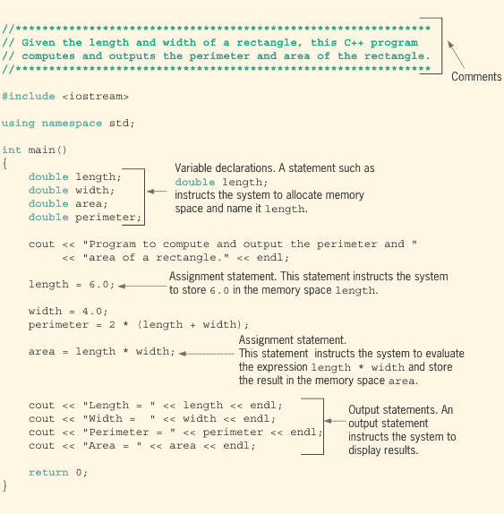

```cpp
//*********************************************************************
// Given the length and width of a rectangle, this C++ program
// computes and outputs the perimeter and area of the rectangle.
//*********************************************************************

#include <iostream>

using namespace std;

int main()
{
    double length;
    double width;
    double area;
    double perimeter;

    cout << "Program to compute and output the perimeter and "
         << "area of a rectangle." << endl;

    length = 6.0;

    width = 4.0;
    perimeter = 2 * (length + width);

    area = length * width;

    cout << "Length = " << length << endl;
    cout << "Width = " << width << endl;
    cout << "Perimeter = " << perimeter << endl;
    cout << "Area = " << area << endl;

    return 0;
}
```

注释

变量声明。像 `double length;` 这样的语句指示系统分配内存空间并将其命名为 length。

赋值语句。这条语句指示系统将内存空间 length 中的 length 值改为 6.0。

赋值语句。这条语句指示系统计算表达式 `length * width`，并将结果存储在内存空间 area 中。

输出语句。输出语句指示系统显示结果。

**图 2-1**  C++ 程序的各个部分

你在全书中会遇到并且在图 2-1 中也标出的术语之一是 *变量*。因此，我们在本节介绍这个术语。回顾第 1 章可知，所有数据在被处理之前都必须载入主存。例如，给定长度和宽度，图 2-1 中的程序计算并输出矩形的面积和周长。这意味着 length 和 width 的值必须存储在主存中。另外，回顾第 1 章可知，主存是一个有序的单元序列，每个单元都有一个地址。在计算机内部，内存单元的地址以二进制表示。一旦我们存储了 length 和 width 的值，并且由于这些值可能在程序中的多个地方需要用到，我们就希望知道这些名称存储在什么位置，以及如何访问那些内存位置。C++ 使程序员能够轻松指定这些位置，因为程序员可以简单地为每个位置分配一个字母名称。当然，我们必须遵循指定名称的规则。例如，在图 2-1 的程序中，我们告诉系统分配四个内存空间，并分别将它们命名为 length、width、area 和 perimeter。（我们将在本章后面解释以蓝色显示的单词 *double* 的含义。）本质上，*变量* 是一个其内容可以更改的内存位置。因此，length、width、area 和 perimeter 都是变量。此外，在程序执行期间，系统将分配四个足够大、能够存储十进制数的内存位置，并且这些内存位置将分别命名为 length、width、area 和 perimeter，见图 2-2。

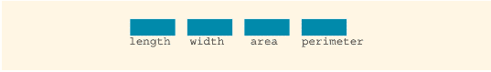

**图 2-2**  内存分配

语句 `length = 6.0;` 将使系统把 6.0 存储到与名称 length 相关联（或由名称 length 标识）的内存位置中，见图 2-3。例 2-14 和例 2-19 进一步说明如何在变量中处理数据。

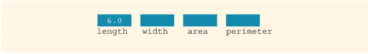

**图 2-3**  执行语句 `length = 6.0;` 后的内存空间

随着本章的深入，我们将解释图 2-1 中标出的其余部分的含义。


## C++ 程序的基础知识

在上一节中，我们给出了一个 C++ 程序的示例，也标出了该程序的某些部分。一般来说，一个 C++ 程序是一个或多个子程序的集合，这些子程序称为函数。粗略地说，**子程序或函数** 是一组语句的集合，当它被激活或执行时，它会完成某件事。有些函数称为 **预定义函数或标准函数**，它们已经编写好并作为系统的一部分提供。但为了完成大多数任务，程序员必须学会编写自己的函数。

每个 C++ 程序都有一个称为 **main** 的函数。因此，如果一个 C++ 程序只有一个函数，那它必须是函数 main。在第 6 章之前，除了使用一些预定义函数外，你主要会与函数 main 打交道。到本章结束时，你将学会如何编写只由函数 main 组成的程序。

如果你从未见过用编程语言编写的程序，例 2-1 中的 C++ 程序可能看起来像一门外语。要用外语造出有意义的句子，你必须学习它的字母表、单词和语法。编程语言也是如此。要编写有意义的程序，你必须学习该编程语言的特定符号、单词和语法规则。**语法规则** 告诉你哪些语句（指令）是合法的或有效的，也就是说，哪些能被该编程语言接受，哪些不能。你还必须学习 **语义规则**，它决定指令的含义。编程语言的规则、符号和特殊单词使你能够编写程序来解决问题。

**编程语言：** 一组规则、符号和特殊单词。

在本节的剩余部分，你将学习 C++ 程序的一些特殊符号。随着后续章节中遇到其他概念，还会介绍更多特殊符号。同样，语法规则和语义规则也将在全书中介绍和讨论。

### 注释

你编写的程序不仅应当对你清晰，也应当对你的程序读者清晰。良好编程的一部分就是在程序中加入注释。通常，注释可用于标识程序的作者、给出程序编写或修改的日期、简要说明程序，以及解释程序中关键语句的含义。在编程示例中，对于我们编写的程序，我们将注明程序编写的日期，这与编写此类书籍的标准惯例一致。

注释是给读者看的，不是给编译器看的。因此，当编译器编译程序以检查语法错误时，它会完全忽略注释。在全书中，注释以绿色显示。


示例 2-1 中的程序包含以下注释：

```cpp
//**************************************************************
// Given the length and width of a rectangle, this C++ program
// computes and outputs the perimeter and area of the rectangle.
//**************************************************************
```

C++ 程序中有两种常见的注释类型——单行注释和多行注释。

单行注释以 // 开头，可以放在该行的任何位置。编译器会忽略该行中 // 之后遇到的所有内容。例如，考虑以下语句：

```cpp
cout << "7 + 8 = " << 7 + 8 << endl;
```

你可以按如下方式在该行末尾添加注释：

```cpp
cout << "7 + 8 = " << 7 + 8 << endl; //prints: 7 + 8 = 15
```

这条注释对初学者可能很有意义。

多行注释括在 /* 和 */ 之间。编译器会忽略 /* 和 */ 之间出现的任何内容。例如，以下是一个多行注释的示例：

```cpp
/*
   You can include comments that can
   occupy several lines.
*/
```

在多行注释中，许多程序员在每一行都使用单行注释，使注释对读者更加醒目（如示例 2-1 的程序中所做的那样）。

## 特殊符号

用任何语言编写的程序中最小的单个单元称为**标记**。C++ 的标记分为特殊符号、单词符号和标识符。

以下是一些特殊符号：

```text
+     -     *     /
;     ?     "     '
<=    !=    ==    >=
```

第一行包含加、减、乘、除的数学符号。第二行由取自英语语法的标点符号组成。注意，逗号也是一个特殊符号。在 C++ 中，逗号用于分隔列表中的项。分号也是特殊符号，用于结束 C++ 语句。注意，上面未显示的空白也是一个特殊符号。通过在键盘上按空格键（仅一次）即可创建空白符号。第三行由两个字符组成、被视为单个符号的标记构成。标记中的两个字符之间不能有任何字符，甚至不能有空白。

## 保留字（关键字）

第二类标记是保留字符号。一些保留字符号包括以下内容：

`int, float, double, char, const, void, return`

保留字也称为**关键字**。组成保留字的字母始终为小写。与特殊符号一样，每个保留字被视为单个符号。此外，保留字不能在任何程序中重新定义；也就是说，它们只能用于其预期用途。保留字的完整列表见附录 A。

> **注意** 在本书中，保留字以蓝色显示。

## 标识符

第三类标记是标识符。标识符是程序中出现的各种事物的名称，例如变量、常量和函数。所有标识符都必须遵守 C++ 的标识符规则。

**标识符：** C++ 标识符由字母、数字和下划线字符（_）组成，并且必须以字母或下划线开头。

有些标识符是预定义的；其他标识符由用户定义。在示例 2-1 的 C++ 程序中，`cout` 是预定义标识符，`length` 是用户定义标识符。你将经常遇到的两个预定义标识符是 `cout` 和 `cin`。你已经看到了 `cout` 的效果。在本章后面，你将学习用于输入数据的 `cin` 如何工作。与保留字不同，预定义标识符可以重新定义，但这样做并不明智。

标识符只能由字母、数字和下划线字符组成；不允许使用其他符号构成标识符。

> **注意** C++ 区分大小写——大写字母和小写字母被视为不同。因此，标识符 NUMBER 与标识符 number 不同。同样，标识符 X 和 x 也不同。

在 C++ 中，标识符可以具有任意长度。

### 示例 2-2

以下是 C++ 中的合法标识符：

- `first`
- `conversion`
- `payRate`
- `counter1`

表 2-1 展示了一些非法标识符，解释了它们非法的原因，并给出了正确的标识符。

**表 2-1** 非法标识符示例

| 非法标识符 | 原因 | 正确标识符 |
|---|---|---|
| `employee Salary` | employee 和 Salary 之间不能有空格。 | `employeeSalary` |
| `Hello!` | 感叹号不能用于标识符。 | `Hello` |
| `one+two` | 符号 + 不能用于标识符。 | `onePlusTwo` |
| `2nd` | 标识符不能以数字开头。 | `second` |

> **注意** 编译器供应商通常用下划线（_）作为某些标识符的开头。
>
> 当链接器将目标程序与集成开发环境（IDE）提供的系统资源链接时，可能会发生某些错误。因此，建议不要在程序中使用下划线（_）作为标识符的开头。

## 空白字符

每个 C++ 程序都包含空白字符。空白字符包括空格、制表符和换行符。在 C++ 程序中，空白字符用于分隔特殊符号、保留字和标识符。空白字符是不可打印的，也就是说，当它们打印在白纸上时，特殊符号、保留字和标识符之间的空间是白色的。在程序中正确使用空白字符很重要。它们可用于使程序更易读。

## 数据类型

C++ 程序的目标是操作数据。不同的程序操作不同的数据。一个用于计算员工工资的程序会对数字进行加、减、乘、除运算，其中一些数字可能表示工作小时数和工资率。同样，一个用于按字母顺序排列班级名单的程序会操作姓名。你不会用樱桃派食谱来帮你烤饼干。同样，你不会使用为执行算术计算而设计的程序来操作字母字符。此外，你不会对姓名进行乘法或减法运算。反映这些底层差异，C++ 将数据分为不同类型，并且只能对特定类型的数据执行某些操作。尽管一开始可能看起来令人困惑，但通过如此注重类型，C++ 具有内置检查来防止错误。

**数据类型：** 一组值以及一组允许的操作。

C++ 数据类型分为以下三类：

- 简单数据类型
- 结构化数据类型
- 指针

在接下来的几章中，你只需关注简单数据类型。

### 简单数据类型

简单数据类型是 C++ 中的基本数据类型，因为它成为结构化数据类型的构建块，你将从第 8 章开始学习结构化数据类型。简单数据类型分为三类：

- **整型**，即处理整数或没有小数部分的数字的数据类型
- **浮点型**，即处理十进制小数的数据类型
- **枚举型**，即用户定义的数据类型

> **注意** 枚举类型是 C++ 允许程序员创建自己的简单数据类型的方法。该数据类型将在第 7 章讨论。

整型数据类型进一步分为以下类别：char、short、int、long、bool、unsigned char、unsigned short、unsigned int、unsigned long、long long 和 unsigned long long。

为什么同一数据类型会有这么多类别？每种数据类型都有一组与之关联的不同值。例如，char 数据类型用于表示 −128 到 127 之间的整数。int 数据类型用于表示 −2147483648 到 2147483647 之间的整数，而 short 数据类型用于表示 −32768 到 32767 之间的整数。


你使用哪种数据类型取决于程序需要处理的数值有多大。在编程早期，计算机和主存非常昂贵。可用于执行程序和操作数据的内存只有很少一部分。因此，程序员不得不优化内存的使用。由于编写程序并使其运行已经是一个复杂的过程，不必担心内存大小就少了一件需要操心的事。为了有效使用内存，程序员可以查看程序要使用的数据类型，从而确定应使用哪种数据类型。（对于为手表等应用编写的程序，内存限制可能仍然是一个问题。）

表 2-2 给出了一些整数数据类型可能值的范围，以及为操作这些值所分配的内存大小。

**表 2-2** 简单数据类型的值和内存分配

| 数据类型 | 值 | 存储（字节） |
|---|---|---|
| `int` | −2147483648（= −2³¹）到 2147483647（= 2³¹ − 1） | 4 |
| `bool` | `true` 和 `false` | 1 |
| `char` | −128（= −2⁷）到 127（= 2⁷ − 1） | 1 |
| `long long` | −9223372036854775808（= −2⁶³）到 9223372036854775807（= 2⁶³ − 1） | 8 |

**注意** 此表仅用作指南。不同的编译器可能允许不同的值范围。请查阅编译器的文档。要查找特定系统上整数数据类型的确切大小，可以运行附录 G（系统内存大小）中给出的程序。此外，要查找这些数据类型的最大值和最小值，可以运行附录 F（头文件 Limits）中给出的另一个程序。另外，数据类型 `long long` 在 C++11 中可用。

### `int` 数据类型

本节介绍 `int` 数据类型。此讨论也适用于其他整数数据类型。

C++ 中的整数，如同数学中一样，是如下所示的数字：

-6728, -67, 0, 78, 36782, +763

请注意这些示例中的以下两条规则：

- 正整数前面不需要 + 号。
- 整数内部不使用逗号。回想一下，在 C++ 中，逗号用于分隔列表中的项。因此 36,782 会被解释为两个整数：36 和 782。

### `bool` 数据类型

数据类型 bool 只有两个值：true 和 false。此外，true 和 false 被称为逻辑（布尔）值。此数据类型的主要用途是操作逻辑（布尔）表达式。逻辑（布尔）表达式将在第 4 章中正式定义并详细讨论。在 C++ 中，bool、true 和 false 是保留字。

### `char` 数据类型

数据类型 char 主要用于表示单个字符——即字母、数字和特殊符号。因此，char 数据类型可以表示键盘上的每个按键。使用 char 数据类型时，要将所表示的每个字符括在单引号内。属于 char 数据类型的值示例包括：

`'A', 'a', '0', '*', '+', '$', '&', ' '`

注意，空格是一个字符，写作 ' '，单引号之间有一个空格。

char 数据类型只允许在单引号之间放置一个符号。因此，值 'abc' 不是 char 类型。此外，尽管 '!=' 及类似特殊符号被视为一个符号，它们也不被视为 char 数据类型的可能值。键盘上所有可打印的单个符号都可以被视为 char 数据类型的可能值。

目前使用着几种不同的字符数据集。最常见的是美国信息交换标准代码（ASCII）和扩展二进制编码十进制交换代码（EBCDIC）。ASCII 字符集有 128 个值。EBCDIC 字符集有 256 个值，由 IBM 创建。附录 C 中对这两种字符集都有描述。

ASCII 字符集的 128 个值中的每一个都表示一个不同的字符。例如，值 65 表示 'A'，值 43 表示 '+'。因此，每个字符都有一个由与该字符关联的数值表示的预定义顺序。此顺序称为集合中的排序序列。比较字符时会使用排序序列。例如，表示 'B' 的值为 66，因此 'A' 小于 'B'。类似地，'+' 小于 'A'，因为 43 小于 65。

ASCII 字符集中的第 14 个字符称为换行符，表示为 `'\n'`。（注意，换行符在 ASCII 字符集中的位置是 13，因为第一个字符的位置是 0。）尽管换行符由两个字符组合而成，但它被当作一个字符处理。类似地，水平制表符在 C++ 中表示为 `\t`，空字符表示为 `\0`（反斜杠后跟零）。此外，ASCII 字符集中的前 32 个字符是不可打印的。（有关这些字符的说明，请参见附录 C。）

## 浮点数据类型

为了处理十进制数，C++ 提供了浮点数据类型，我们将在本节讨论。为便于讨论，让我们回顾高中或大学代数课程中的一个概念。

你可能熟悉科学计数法。例如：

```
43872918 = 4.3872918 × 10^7        { 10 to the power of seven }
0.0000265 = 2.65 × 10^-5          { 10 to the power of minus five }
47.9832 = 4.79832 × 10^1           { 10 to the power of one }
```

为了表示十进制数，C++ 使用一种称为**浮点表示法**的科学计数法形式。表 2-3 展示了 C++ 如何使用某台机器对浮点表示法的解释来打印一组十进制数。在 C++ 浮点表示法中，字母 E 代表指数。

**表 2-3** 十进制数的科学计数法和 C++ 浮点表示法示例

| 十进制数 | 科学计数法 | C++ 浮点表示法 |
|---|---|---|
| 75.924 | 7.5924 × 10¹ | 7.592400E1 |
| 0.18 | 1.8 × 10⁻¹ | 1.800000E−1 |
| 0.0000453 | 4.53 × 10⁻⁵ | 4.530000E−5 |
| −1.482 | −1.482 × 10⁰ | −1.482000E0 |
| 7800.0 | 7.8 × 10³ | 7.800000E3 |

C++ 提供了三种数据类型来操作十进制数：float、double 和 long double。与整数数据类型的情况一样，数据类型 float、double 和 long double 在它们所能表示的值集合上有所不同。

> **注意** 在大多数较新的编译器上，数据类型 **double** 和 **long double** 是相同的。因此，这里只描述数据类型 **float** 和 **double**。

**float：** 数据类型 float 在 C++ 中用于表示 −3.4 × 10^38 到 3.4 × 10^38 之间的任何十进制数。为 float 数据类型的值分配的内存为四个字节。

**double：** 数据类型 double 在 C++ 中用于表示 −1.7 × 10^308 到 1.7 × 10^308 之间的任何十进制数。为 double 数据类型的值分配的内存为八个字节。

数据类型 float 和 double 的最大值和最小值取决于系统。要查找特定系统上的这些值，可以查阅编译器的文档，或者运行附录 F（头文件 cfloat）中给出的程序。

除了值集合之外，数据类型 float 和 double 之间还有一个区别。float 值中的最大有效数字位数——即小数位数——为六位或七位。属于 double 类型的值中的最大有效数字位数为 15 位。

> **注意：** 对于 double 类型的值，为了获得更好的精度，某些编译器可能会给出超过 15 位有效数字。请查阅编译器的文档。

最大有效数字位数称为**精度**。有时 float 值被称为**单精度**，而 double 类型的值被称为**双精度**。如果你处理的是十进制数，大多数情况下只需要 float 类型；如果需要精确到六位或七位以上小数，可以使用 double 类型。

> **注意：** 在 C++ 中，默认情况下，浮点数被视为 double 类型。因此，如果你在程序中使用 float 数据类型来操作浮点数，某些编译器可能会给出警告消息，例如“从 double 到 float 的截断”。为避免此类警告消息，应使用 double 数据类型。为便于说明并避免编程示例中出现此类警告消息，本书主要使用 double 数据类型来操作浮点数。

## 数据类型、变量和赋值语句

现在我们已经知道如何定义标识符、什么是数据类型以及变量这个术语，就可以展示如何声明变量了。声明变量时，我们不仅指定变量的名称，还指定变量可以存储什么类型的数据。声明变量的语法规则是：

```
dataType identifier;
```


例如，考虑以下语句：

```cpp
int counter;
double interestRate;
char grade;
```

在第一条语句中，我们告诉系统分配四个字节的内存空间来存储一个`int`值，并将该内存空间命名为counter。也就是说，counter是一个可以存储`int`值的变量。类似地，interestRate是一个可以存储`double`类型值的变量；grade是一个可以存储`char`类型值的变量。

将值存入变量的一种方法是使用赋值语句，其形式如下：

```cpp
variable = expression;
```

其中expression会被求值，并将其值赋给variable。在C++中，`=`称为**赋值运算符**。

例如，考虑以下语句：

```cpp
counter = 5;
interestRate = 0.05;
grade = 'A';
```

第一条语句将5存入变量counter，第二条语句将0.05存入interestRate，第三条语句将字符'A'存入grade。

我们将在本章后面详细讨论赋值语句。

## 算术运算符、运算符优先级和表达式

计算机最重要的用途之一是其计算能力。你可以使用标准算术运算符来处理整型和浮点数据类型。共有五个算术运算符：

**算术运算符：** +（加法）、−（减法或取负）、*（乘法）、/（除法）、%（取模、模或余数）

这些运算符的工作方式如下：

- 你可以将运算符+、−、*和/用于整型和浮点数据类型。这些运算符处理整型和浮点数据的方式与你大学代数课程中学到的相同。
- 当你对整型数据类型使用/时，它给出普通除法中的商。也就是说，整型除法会截断任何小数部分；不进行四舍五入。
- 你仅对整型数据类型使用%，以求普通除法中的余数。

### 示例 2-3

| 算术表达式 | 结果 | 描述 |
|---|---:|---|
| 5 / 2 | 2 | 在除法5 / 2中，商为2，余数为1。因此，使用整型操作数的5 / 2求值为商，即2。 |
| 14 / 7 | 2 | 在除法14 / 7中，商为2。 |
| 34 % 5 | 4 | 在除法34 / 5中，商为6，余数为4。因此，34 % 5求值为余数，即4。 |
| 4 % 6 | 4 | 在除法4 / 6中，商为0，余数为4。因此，4 % 6求值为余数，即4。 |

在下面的示例中，我们说明如何对整型数据类型使用运算符/和%。

### 示例 2-4

给定以英寸表示的长度，我们编写一个程序来确定并输出等价的英尺和（剩余）英寸长度。现在，1英尺等于12英寸。因此，100英寸等于8英尺4英寸；类似地，55英寸等于4英尺7英寸。注意100 / 12 = 8且100 % 12 = 4；类似地，55 / 12 = 4且55 % 12 = 7。从这些示例可以看出，我们可以有效地使用运算符/和%来完成我们的任务。所需的程序如下：

```cpp
// Given length in inches, this program outputs the equivalent
// length in feet and remaining inch(es).

#include <iostream>

using namespace std;

int main()
{
    int inches; //variable to store total inches

    inches = 100;  //store 100 in the variable inches

    cout << inches << " inch(es) = ";  //output the value of
                                       //inches and the equal sign
    cout << inches / 12 << " feet (and "; //output maximum
                                          //number of feet (foot)
    cout << inches % 12 << " inch(es)" << endl; //output
                                                //remaining inches

    return 0;
}
```

**示例运行：**

```text
100 inch(es) = 8 feet (foot) and 4 inch(es)
```

注意，每次运行此程序时，它都会输出100英寸的值。要转换其他英寸值，你需要编辑此程序并在变量inches中存储不同的值，这不太方便。本章后面我们将说明如何在程序中包含语句，以指示用户输入不同的值。然而，如果你此时好奇，可以将语句

```cpp
inches = 100;  //store 100 in the variable inches
```

替换为以下语句，并重新运行程序：

```cpp
cout << "Enter total inches and press Enter: "; //prompt
                                                //the user to enter total inches
cin >> inches;  //store the value entered by the user
                //into the variable inches
cout << endl;
```

修改后的程序可在本书配套网站上获得，文件名为`Example2_4_Modified.cpp`。

考虑以下表达式，这些表达式你从高中起就习惯于使用：−5、8 − 7、3 + 4、2 + 3 * 5、5.6 + 6.2 * 3，以及x + 2 * 5 + 6 / y，其中x和y是未知数。这些是**算术表达式**的示例。表达式中出现的数字称为**操作数**。用于对一个运算符求值的数字称为该运算符的操作数。

在表达式−5中，符号−表示数字5为负。在这个表达式中，−只有一个操作数。只有一个操作数的运算符称为**一元运算符**。

在表达式8 − 7中，符号−用于从8中减去7。在这个表达式中，−有两个操作数，8和7。有两个操作数的运算符称为**二元运算符**。

**一元运算符：** 只有一个操作数的运算符。

**二元运算符：** 有两个操作数的运算符。

在表达式3 + 4中，3和4是运算符+的操作数。在这个表达式中，运算符+有两个操作数，是二元运算符。此外，在表达式+27中，运算符+表示数字27为正。这里，+只有一个操作数，因此作为一元运算符使用。

从前面的讨论可知，−和+既是一元算术运算符，也是二元算术运算符。然而，作为算术运算符，*、/和%是二元运算符，因此必须有两个操作数。

### 示例 2-5

```cpp
// This program illustrates how arithmetic operators work.
#include <iostream>

using namespace std;

int main()
{
    cout << "2 + 5 = " << 2 + 5 << endl;
    cout << "13 + 89 = " << 13 + 89 << endl;
    cout << "34 - 20 = " << 34 - 20 << endl;
    cout << "45 - 90 = " << 45 - 90 << endl;
    cout << "2 * 7 = " << 2 * 7 << endl;
    cout << "5 / 2 = " << 5 / 2 << endl;
    cout << "14 / 7 = " << 14 / 7 << endl;
    cout << "34 % 5 = " << 34 % 5 << endl;
    cout << "4 % 6 = " << 4 % 6 << endl << endl;

    cout << "5.0 + 3.5 = " << 5.0 + 3.5 << endl;
    cout << "3.0 + 9.4 = " << 3.0 + 9.4 << endl;
    cout << "16.3 - 5.2 = " << 16.3 - 5.2 << endl;
    cout << "4.2 * 2.5 = " << 4.2 * 2.5 << endl;
    cout << "5.0 / 2.0 = " << 5.0 / 2.0 << endl;
    cout << "34.5 / 6.0 = " << 34.5 / 6.0 << endl;
    cout << "34.5 / 6.5 = " << 34.5 / 6.5 << endl;

    return 0;
}
```

**示例运行：**

```text
2 + 5 = 7
13 + 89 = 102
34 - 20 = 14
45 - 90 = -45
2 * 7 = 14
5 / 2 = 2
14 / 7 = 2
34 % 5 = 4
4 % 6 = 4

5.0 + 3.5 = 8.5
3.0 + 9.4 = 12.4
16.3 - 5.2 = 11.1
4.2 * 2.5 = 10.5
5.0 / 2.0 = 2.5
34.5 / 6.0 = 5.75
34.5 / 6.5 = 5.30769
```

**注意** 当使用负整数操作数对取模运算符求值时，你应该小心。你可能得不到预期的答案。例如，−34 % 5 = −4，因为在除法−34 / 5中，商为−6，余数为−4。类似地，34 % −5 = 4，因为在除法34 / −5中，商为−6，余数为4。同样，−34 % −5 = −4，因为在除法−34 / −5中，商为6，余数为−4。

### 表达式

C++中有三种类型的算术表达式：

- **整型表达式**——表达式中的所有操作数都是整数。整型表达式产生整型结果。
- **浮点（十进制）表达式**——表达式中的所有操作数都是浮点数（十进制数）。浮点表达式产生浮点结果。
- **混合表达式**——表达式中同时包含整数和十进制数。

看一些示例将有助于澄清这些定义。

#### 示例 2-6

考虑以下C++整型表达式：

```
2 + 3 * 5
3 + x − y / 7
x + 2 * (y − z) + 18
```

在这些表达式中，x、y和z是`int`类型的变量。

#### 示例 2-7

考虑以下C++浮点表达式：

```
12.8 * 17.5 − 34.50
x * 10.5 + y − 16.2
```

这里，x和y是`double`类型的变量。


求值整型或浮点型表达式很直接。和前面一样，当运算符具有相同的优先级时，表达式从左到右求值。你始终可以使用圆括号将操作数和运算符分组，以避免混淆。

接下来，我们讨论混合表达式。

## 混合表达式

具有不同数据类型操作数的表达式称为**混合表达式**。混合表达式同时包含整数和浮点数。以下表达式是混合表达式的示例：

```
2 + 3.5
6 / 4 + 3.9
5.4 * 2 - 13.6 + 18 / 2
```

在第一个表达式中，运算符 + 有一个整数操作数和一个浮点操作数。在第二个表达式中，运算符 / 的两个操作数都是整数，+ 的第一个操作数是 6 / 4 的结果，+ 的第二个操作数是浮点数。第三个示例是整数和浮点数更为复杂的混合。显而易见的问题是：C++ 如何求值混合表达式？

求值混合表达式时适用两条规则：

- 1. 求值混合表达式中的运算符时：
  - a. 如果运算符具有相同类型的操作数（即两个操作数都是整数或都是浮点数），则根据操作数的类型对该运算符求值。因此，整数操作数产生整数结果；浮点数产生浮点数。
  - b. 如果运算符同时具有两种类型的操作数（即一个是整数，另一个是浮点数），那么在计算过程中，将整数转换为小数部分为零的浮点数，然后对该运算符求值。结果是浮点数。
- 2. 整个表达式按照优先级规则求值；乘法、除法和取模运算符先于加法和减法运算符求值。具有相同优先级的运算符从左到右求值。为了清晰，允许使用圆括号分组。

由这些规则可知，在求值混合表达式时，你要一次集中处理一个运算符，并使用优先级规则。如果要处理的运算符具有相同数据类型的操作数，则使用规则 1(a) 对该运算符求值。也就是说，带整数操作数的运算符将产生整数结果，带浮点操作数的运算符将产生浮点结果。如果要处理的运算符有一个整数操作数和一个浮点操作数，那么在求值该运算符之前，将整数操作数转换为小数部分为 0 的浮点数。以下示例展示了如何求值混合表达式。

### 示例 2-8

| 混合表达式 | 求值 | 应用的规则 |
|---|---|---|
| `3 / 2 + 5.5` | `= 1 + 5.5`<br>`= 6.5` | `3 / 2 = 1`（整数除法；规则 1(a)）<br>`(1 + 5.5`<br>`= 1.0 + 5.5`（规则 1(b)）<br>`= 6.5)` |
| `15.6 / 2 + 5` | `= 7.8 + 5`<br>`= 12.8` | `15.6 / 2`<br>`= 15.6 / 2.0`（规则 1(b)）<br>`= 7.8`<br>`7.8 + 5`<br>`= 7.8 + 5.0`（规则 1(b)）<br>`= 12.8` |
| `4 + 5 / 2.0` | `= 4 + 2.5`<br>`= 6.5` | `5 / 2.0 = 5.0 / 2.0`（规则 1(b)）<br>`= 2.5`<br>`4 + 2.5 = 4.0 + 2.5`（规则 1(b)）<br>`= 6.5` |
| `4 * 3 + 7 / 5 - 25.5` | `= 12 + 7 / 5 - 25.5`<br>`= 12 + 1 - 25.5`<br>`= 13 - 25.5`<br>`= -12.5` | `4 * 3 = 12`（规则 1(a)）<br>`7 / 5 = 1`（整数除法；规则 1(a)）<br>`12 + 1 = 13`（规则 1(a)）<br>`13 - 25.5 = 13.0 - 25.5`（规则 1(b)）<br>`= -12.5` |

以下 C++ 程序对前面的表达式进行求值：

```cpp
// This program illustrates how mixed expressions are evaluated.
#include <iostream>
using namespace std;

int main()
{
    cout << "3 / 2 + 5.5 = " << 3 / 2 + 5.5 << endl;
    cout << "15.6 / 2 + 5 = " << 15.6 / 2 + 5 << endl;
    cout << "4 + 5 / 2.0 = " << 4 + 5 / 2.0 << endl;
    cout << "4 * 3 + 7 / 5 - 25.5 = "
         << 4 * 3 + 7 / 5 - 25.5
         << endl;

    return 0;
}
```

### 示例运行

```text
3 / 2 + 5.5 = 6.5
15.6 / 2 + 5 = 12.8
4 + 5 / 2.0 = 6.5
4 * 3 + 7 / 5 - 25.5 = -12.5
```

这些示例表明，除非要处理的运算符有一个整数操作数和一个浮点操作数，否则整数不会转换为浮点数。

## 类型转换（强制类型转换）

在上一节中，你了解到，在求值算术表达式时，如果运算符具有混合操作数，则整数值会转换为小数部分为零的浮点值。当一个数据类型的值自动转换为另一个数据类型时，就称发生了**隐式类型强制转换**。正如上一节中的示例所示，如果不注意数据类型，隐式类型强制转换可能会产生意外结果。

为避免隐式类型强制转换，C++ 提供了通过使用强制类型转换运算符进行显式类型转换的方式。**强制类型转换运算符**（也称为**类型转换**或**类型强制转换**）采用以下形式：

```
static_cast<dataTypeName>(expression)
```

首先，对表达式求值。然后将其值转换为由 dataTypeName 指定的类型的值。在 C++ 中，`static_cast` 是保留字。

使用强制类型转换运算符将浮点（十进制）数转换为整数时，只需去掉浮点数的小数部分。也就是说，浮点数被截断。示例 2-9 展示了强制类型转换运算符的工作方式。请务必理解最后两个表达式为何如此求值。

### 示例 2-9

| 表达式 | 求值结果 |
|---|---|
| `static_cast<int>(7.9)` | 7 |
| `static_cast<int>(3.3)` | 3 |
| `static_cast<double>(25)` | 25.0 |
| `static_cast<double>(5 + 3)` | = `static_cast<double>(8)` = 8.0 |
| `static_cast<double>(15) / 2` | = 15.0 / 2<br>（因为 `static_cast<double>(15)` = 15.0）<br>= 15.0 / 2.0 = 7.5 |
| `static_cast<double>(15 / 2)` | = `static_cast<double>(7)`（因为 15 / 2 = 7）<br>= 7.0 |
| `static_cast<int>(7.8 + static_cast<double>(15) / 2)` | = `static_cast<int>(7.8 + 7.5)`<br>= `static_cast<int>(15.3)`<br>= 15 |
| `static_cast<int>(7.8 + static_cast<double>(15 / 2))` | = `static_cast<int>(7.8 + 7.0)`<br>= `static_cast<int>(14.8)`<br>= 14 |

以下 C++ 程序对前面的表达式进行求值：

```cpp
// This program illustrates how explicit type conversion works.
#include <iostream>
using namespace std;
int main()
{
    cout << "static_cast<int>(7.9) = "
         << static_cast<int>(7.9)
         << endl;
    cout << "static_cast<int>(3.3) = "
         << static_cast<int>(3.3)
         << endl;
    cout << "static_cast<double>(25) = "
         << static_cast<double>(25)
         << endl;
    cout << "static_cast<double>(5 + 3) = "
         << static_cast<double>(5 + 3)
         << endl;
    cout << "static_cast<double>(15) / 2 = "
         << static_cast<double>(15) / 2
         << endl;
    cout << "static_cast<double>(15 / 2) = "
         << static_cast<double>(15 / 2)
         << endl;
    cout << "static_cast<int>(7.8 + static_cast<double>(15) / 2) = "
         << static_cast<int>(7.8 + static_cast<double>(15) / 2)
         << endl;
    cout << "static_cast<int>(7.8 + static_cast<double>(15 / 2)) = "
         << static_cast<int>(7.8 + static_cast<double>(15 / 2))
         << endl;

    return 0;
}
```

### 示例运行

```text
static_cast<int>(7.9) = 7
static_cast<int>(3.3) = 3
static_cast<double>(25) = 25
static_cast<double>(5 + 3) = 8
static_cast<double>(15) / 2 = 7.5
static_cast<double>(15 / 2) = 7
static_cast<int>(7.8 + static_cast<double>(15) / 2) = 15
static_cast<int>(7.8 + static_cast<double>(15 / 2)) = 14
```

注意，表达式 `static_cast<double>(25)` 的值是 25.0。然而，它输出为 25 而不是 25.0。这是因为我们尚未讨论如何输出小数部分为 0 的十进制数以显示小数点和末尾的零。第 3 章说明如何以所需格式输出十进制数。类似地，其他小数部分为零的十进制数的输出也不带小数点和 0 小数部分。


**注意** 在 C++ 中，强制转换运算符也可以接受数据类型（表达式）的数据。这种形式称为 C 风格强制转换。例如，`double(5) = 5.0` 和 `int(17.6) = 17`。然而，`static_cast` 比 C 风格强制转换更稳定。

也可以使用强制转换运算符将 `char` 数据值显式转换为 `int` 数据值，以及将 `int` 数据值转换为 `char` 数据值。要将 `char` 数据值转换为 `int` 数据值，需使用排序序列。例如，在 ASCII 字符集中，`static_cast<int>('A')` 为 65，`static_cast<int>('8')` 为 56。类似地，`static_cast<char>(65)` 为 'A'，`static_cast<char>(56)` 为 '8'。

本章前面已经学习了 C++ 中算术表达式如何构成和求值。如果要在另一个表达式中使用某个表达式的值，首先必须保存该表达式的值。保存表达式值的原因有很多。有些表达式很复杂，求值可能需要相当多的计算机时间。通过计算一次并保存值以供后续使用，不仅可以节省计算机时间、使程序执行更快，还可以避免可能的输入错误。在 C++ 中，表达式会被求值；如果值未被保存，它就会丢失。也就是说，除非保存起来，否则表达式的值不能用于后续计算。本章后面将学习如何保存表达式的值并在后续计算中使用它。

在结束数据类型讨论之前，让我们再讨论一种数据类型——`string`。

## string 类型

数据类型 string 是程序员定义的数据类型。它不像前面讨论的简单数据类型那样可直接在程序中使用。要使用这种数据类型，需要从库中访问程序组件，本章后面将讨论这一点。数据类型 string 是 ANSI/ISO 标准 C++ 的一项特性。

**注意** 在 ANSI/ISO C++ 语言标准之前，标准 C++ 库并未提供 `string` 数据类型。编译器供应商通常提供自己的程序员定义的 `string` 类型，而字符串操作的语法和语义往往因供应商而异。

**字符串**是零个或多个字符的序列。C++ 中的字符串用双引号括起来。不包含任何字符的字符串称为**空串**或**空字符串**。以下是字符串的示例。注意 `""` 是空字符串。

```text
"William Jacob"
"Mickey"
""
```

字符串中的每个字符都有一个相对位置。第一个字符的位置为 0，第二个字符的位置为 1，依此类推。字符串的长度是其中字符的数量。确定字符串长度时，还必须计入字符串中的任何空格。

### 例 2-10

| 字符串 | 字符在字符串中的位置 | 字符串长度 |
|---|---|---|
| "William Jacob" | 'W' 的位置为 0。<br>第一个 'i' 的位置为 1。<br>' '（空格）的位置为 7。<br>'J' 的位置为 8。<br>'b' 的位置为 12。 | 13 |
| "Mickey" | 'M' 的位置为 0。<br>'i' 的位置为 1。<br>'c' 的位置为 2。<br>'k' 的位置为 3。<br>'e' 的位置为 4。<br>'y' 的位置为 5。 | 6 |

以下字符串的长度为 22。

```text
"It is a beautiful day."
```

string 类型非常强大，也比简单数据类型更复杂。它不仅提供存储字符串所需的物理空间，还提供许多操作字符串的操作。例如，它提供查找字符串长度、提取字符串的一部分以及比较字符串的操作。接下来的几章将学习这种数据类型。

## 变量、赋值语句和输入语句

如前所述，C++ 程序的主要目标是执行计算和操作数据。回想一下，数据必须先装入主存才能被操作。本节将学习如何将数据放入计算机内存。将数据存储在计算机内存中分为两步：

- 1. 指示计算机分配内存。
- 2. 在程序中包含语句，将数据放入已分配的内存。

### 使用常量和变量分配内存

指示计算机分配内存时，不仅要告诉它为每个内存位置使用什么名称，还要告诉它这些内存位置中存储什么类型的数据。知道数据的位置至关重要，因为存储在一个内存位置的数据可能在程序中的多个地方需要用到。如前所述，知道数据类型对于执行准确计算至关重要。同样关键的是，要知道数据在程序执行期间需要保持不变，还是应当改变。

### 命名常量

有些数据在整个程序中必须保持不变。例如，将英寸转换为厘米的换算公式是固定的，因为 1 英寸始终等于 2.54 厘米。这类数据存储在内存中时，需要保护其在程序执行期间不被意外更改。在 C++ 中，可以使用**命名常量**来指示程序标记那些在程序执行期间数据保持固定的内存位置。

**命名常量：** 其内容在程序执行期间不允许改变的内存位置。

为了分配内存，我们使用 C++ 的声明语句。声明命名常量的语法是：

```cpp
const dataType identifier = value;
```

在 C++ 中，**const** 是保留字。应注意，命名常量在同一条语句中声明并初始化，而且它在声明时*必须*初始化，因为从此语句开始，编译器将拒绝任何更改该值的尝试。

### 例 2-11

考虑以下 C++ 语句：

```cpp
const double CONVERSION = 2.54;
const int NO_OF_STUDENTS = 20;
const char BLANK = ' ';
```

第一条语句告诉编译器分配内存（8 字节）来存储一个 *double* 类型的值，将此内存空间称为 CONVERSION，并在其中存储值 2.54。在使用此语句的整个程序中，每当需要换算公式时，都可以访问内存空间 CONVERSION。其他语句的含义类似。

注意，命名常量的标识符使用大写字母。尽管没有成文规则，C++ 程序员通常喜欢用大写字母来命名命名常量。此外，如果命名常量的名称由多个单词组合而成，称为*连写词*，则这些单词通常用下划线分隔。例如，在前面的示例中，NO_OF_STUDENTS 就是一个连写词。（另请参阅本章后面的“程序风格与形式”一节，以正确组织程序。）

> **注意** 如前所述，浮点数的默认类型是 `double`。因此，如果声明 `float` 类型的命名常量，则必须按如下方式指定该值为 `float` 类型：
>
> ```cpp
> const float CONVERSION = 2.54f;
> ```
>
> 否则，编译器将生成警告消息。注意 `2.54f` 表示它是一个 `float` 值。回想一下，`float` 值的内存大小为 4 字节；`double` 值的内存大小为 8 字节。由于如今内存大小已不太重要，如前所述，我们将主要使用 `double` 类型来处理浮点值。

### 变量

本章前面介绍了变量这一术语以及如何声明它。现在回顾这个概念，并给出声明变量的一般语法。

在某些程序中，数据需要在程序执行期间修改。例如，每次测验后，平均测验分数和已参加测验的次数都会变化。类似地，每次加薪后，员工的工资都会变化。这类数据必须存储在内容可在程序执行期间修改的内存单元中。在 C++ 中，内容可在程序执行期间修改的内存单元称为变量。

**变量：** 其内容在程序执行期间可能改变的内存位置。

声明一个变量或多个变量的语法是：

```cpp
dataType identifier, identifier, ...;
```

### 例 2-12

考虑以下语句：

```cpp
double amountDue;
int counter;
char ch;
int x, y;
string name;
```


第一条语句告诉编译器分配八个字节的内存空间来存储一个 **double** 类型的值，并将其命名为 amountDouble。第二条和第三条语句遵循类似的约定。第四条语句告诉编译器分配两个不同的内存空间，每个空间四个字节，用于存储一个 **int** 类型的值；将第一个内存空间命名为 x；将第二个内存空间命名为 y。第五条语句告诉编译器分配内存空间，并将其命名为 name。

与命名命名常量一样，命名变量也没有成文规则。不过，C++ 程序员通常使用小写字母来声明变量。如果变量名由多个单词组合而成，那么除第一个单词外，每个单词的首字母都大写。（例如，参见前面示例中的变量 amountDue。）

从现在起，当我们说“变量”时，指的是一个变量内存位置。

> **注意**  在 C++ 中，必须先声明所有标识符，然后才能使用它们。如果引用某个标识符但没有声明它，编译器将生成一条错误消息（语法错误），指出该标识符未声明。因此，要使用命名常量或变量，必须先声明它。

既然已经定义并讨论了数据类型、变量和常量，现在可以给出简单数据类型的正式定义。如果某个数据类型的变量或命名常量一次只能存储一个值，则该数据类型称为**简单**数据类型。例如，如果 x 是一个 **int** 变量，则在某一时刻，x 中只能存储一个值。

## 将数据放入变量

既然你已经知道如何声明变量，下一个问题就是：如何将数据放入这些变量中？在 C++ 中，可以通过两种方式将数据放入变量：

- 1. 使用 C++ 的赋值语句。
- 2. 使用输入（读取）语句。

### 赋值语句

赋值语句采用以下形式：

```
variable = expression;
```

在赋值语句中，表达式的值应与变量的数据类型匹配。先计算右侧表达式的值，再将其值赋给左侧的变量（因而赋给一个内存位置）。

第一次将值放入变量时，称该变量已被**初始化**。

回想一下，在 C++ 中，= 称为**赋值运算符**。

### 示例 2-13

假设你有以下变量声明：

```
int num1, num2;
double sale;
char first;
string str;
```

现在考虑以下赋值语句：

```
num1 = 4;
num2 = 4 * 5 - 11;
sale = 0.02 * 1000;
first = 'D';
str = "It is a sunny day.";
```

对于这些语句中的每一条，计算机首先计算右侧的表达式，然后将该值存储到由左侧标识符命名的内存位置中。第一条语句将值 4 存入 num1，第二条语句将 9 存入 num2，第三条语句将 20.00 存入 sale，第四条语句将字符 D 存入 first。第五条语句将字符串 "It is a sunny day." 赋给变量 str。

以下 C++ 程序展示了前面这些语句的效果：

```cpp
// This program illustrates how data in the variables are
// manipulated.

#include <iostream>
#include <string>

using namespace std;

int main()
{
    int num1, num2;
    double sale;
    char first;
    string str;

    num1 = 4;
    cout << "num1 = " << num1 << endl;

    num2 = 4 * 5 - 11;
    cout << "num2 = " << num2 << endl;

    sale = 0.02 * 1000;
    cout << "sale = " << sale << endl;

    first = 'D';
    cout << "first = " << first << endl;

    str = "It is a sunny day.";
    cout << "str = " << str << endl;

    return 0;
}
```

**示例运行：**

```
num1 = 4
num2 = 9
sale = 20
first = D
str = It is a sunny day.
```

大体而言，前面的程序很直接。让我们看一下输出语句：

```
cout << "num1 = " << num1 << endl;
```

这条输出语句由字符串 "num1 = "、运算符 << 和变量 num1 组成。这里，先输出字符串 "num1 = " 的值，然后输出变量 num1 的值。其他输出语句的含义类似。

诸如以下 C++ 语句

```
num = num + 2;
```

的意思是“取出 num 中的内容，给它加 2，并将新值赋给内存位置 num。”必须先计算右侧的表达式；然后将该值赋给左侧变量所指定的内存位置。因此，以下 C++ 语句序列：

```
num = 6;
num = num + 2;
```

和语句：

```
num = 8;
```

都会将 8 赋给 num。注意，如果 num 尚未初始化，语句 num = num + 2 可能会产生意外结果，并且/或者编译器可能会生成一条警告消息，指出该变量尚未初始化。一般来说，应避免在变量初始化之前引用或使用其内容。

语句 num = 5; 读作“num 变为 5”或“num 被赋值为 5”。将该语句读作“num 等于 5”是不正确的，尤其是对于 num = num + 2; 这样的语句。每次给 num 赋新值时，旧值都会被覆盖。（回想一下，这些语句中的等号是赋值运算符，而不是表示相等。）

### 示例 2-14

假设 `num1`、`num2` 和 `num3` 是 `int` 变量，并且以下语句按顺序执行。

- 1. `num1 = 18;`
- 2. `num1 = num1 + 27;`
- 3. `num2 = num1;`
- 4. `num3 = num2 / 5;`
- 5. `num3 = num3 / 4;`

下表显示了每条语句执行后变量的值。（`?` 表示该值未知。方框中的橙色表示该变量的值已更改。）

| 语句 | 变量的值/语句 | 说明 |
|---|---|---|
| 执行语句 1 之前 | `num1: ?`, `num2: ?`, `num3: ?` |  |
| 执行语句 1 之后 | `num1: 18`, `num2: ?`, `num3: ?`<br>`num1 = 18;` |  |
| 执行语句 2 之后 | `num1: 45`, `num2: ?`, `num3: ?`<br>`num1 = num1 + 27;` | `num1 + 27 = 18 + 27 = 45`。将此值赋给 `num1`，替换 `num1` 的旧值。 |
| 执行语句 3 之后 | `num1: 45`, `num2: 45`, `num3: ?`<br>`num2 = num1;` | 将 `num1` 的值复制到 `num2`。 |
| 执行语句 4 之后 | `num1: 45`, `num2: 45`, `num3: 9`<br>`num3 = num2 / 5;` | `num2 / 5 = 45 / 5 = 9`。将此值赋给 `num3`。因此 `num3 = 9`。 |
| 执行语句 5 之后 | `num1: 45`, `num2: 45`, `num3: 2`<br>`num3 = num3 / 4;` | `num3 / 4 = 9 / 4 = 2`。将此值赋给 `num3`，替换 `num3` 的旧值。 |

因此，执行第 5 行中的语句后，`num1 = 45`、`num2 = 45`、`num3 = 2`。

前面你了解到，如果在表达式中使用变量，那么只有当该变量先被初始化时，表达式才会产生有意义的值。你还了解到，在声明变量之后，可以使用赋值语句来初始化它。可以同时声明并初始化变量。在讨论如何使用输入（读取）语句之前，我们先处理这个重要问题。

### 声明并初始化变量

声明变量时，C++ 可能不会自动在其中放入有意义的值。换句话说，C++ 可能不会自动初始化变量。例如，`int` 和 `double` 变量可能不会像某些编程语言中那样被初始化为 0。然而，这并不意味着变量声明后其中就没有值。声明变量时，会为其分配内存。

回想第 1 章的内容：主存是一个有序的单元序列，每个单元都能存储一个值。还要回想，机器语言是一串 0 和 1，即位。因此，内存单元中的数据是一串位。这些位不过是电信号，所以当计算机开启时，有些位是 1，有些位是 0。这些位的状态取决于系统如何运作。然而，当你指示计算机将某个特定值存入一个内存单元时，这些位会根据要存储的数据被设置。

在数据处理过程中，计算机取出存储在特定单元中的值并执行计算。如果你声明了一个变量但没有在其中存储值，该内存单元仍然有一个值——通常是这些位上次使用时的设置值——而你无法知道这个值是什么。

如果你只声明了一个变量，而没有指示计算机将数据放入该变量，那么该变量的值就是垃圾值。然而，计算机不会警告我们，而是把内存中的任何值都视为合法值，并使用内存中的这些值进行计算。在表达式中使用未初始化的变量会产生错误结果。为避免这些陷阱，C++ 允许你在声明变量的同时初始化它们。例如，考虑以下 C++ 语句，其中变量先声明后初始化：

```cpp
int first, second;
char ch;
double x;

first = 13;
second = 10;
ch = ' ';
x = 12.6;
```

你可以使用以下 C++ 语句同时声明并初始化这些变量：


```cpp
int first = 13, second = 10;
char ch = ' ';
double x = 12.6;
```

第一条 C++ 语句声明两个 **int** 变量 *first* 和 *second*，并将 13 存入 *first*，将 10 存入 *second*。其他语句的含义类似。

实际上，并非所有变量都会在声明时初始化。哪些变量应在声明时初始化，取决于程序的性质或程序员的选择。关键点在于，所有变量都必须在使用前初始化。

## 输入（读取）语句

前面，你学习了如何使用赋值语句将数据放入变量。在本节中，你将学习如何使用 C++ 的输入（或读取）语句，将数据从*标准输入设备*放入变量。

**注意** 在大多数情况下，标准输入设备是键盘。

当计算机从键盘获取数据时，称用户正在进行交互操作。

将数据从标准输入设备放入变量，是通过使用 **cin** 和运算符 **>>** 完成的。cin 与 >> 一起使用的语法是：

```cpp
cin >> variable >> variable ...;
```

这称为**输入（读取）语句**。在 C++ 中，**>>** 称为**流提取运算符**。

**注意** 在语法中，底纹表示定义中可选的部分。此外，在本书中，语法均用黄色框包围。

### 示例 2-16

假设 *miles* 是 **double** 类型的变量。再假设输入为 73.65。考虑以下语句：

```cpp
cin >> miles;
```

该语句使计算机从标准输入设备获取输入 73.65，并将其存入变量 *miles*。也就是说，执行该语句后，变量 *miles* 的值为 73.65。

示例 2-17 进一步说明如何将数值数据输入程序。

### 示例 2-17

假设有以下语句：

```
int feet;
int inches;
```

假设输入为：

```
23 7
```

接下来，考虑以下语句：

```
cin >> feet >> inches;
```

该语句首先将数字 23 存入变量 feet，然后将数字 7 存入变量 inches。注意，通过键盘输入这些数字时，它们之间用空格分隔。实际上，它们可以用一个或多个空格、换行甚至制表符分隔。

以下 C++ 程序展示了前面输入语句的效果：

```cpp
// This program illustrates how input statements work.

#include <iostream>

using namespace std;

int main()
{
    int feet;
    int inches;

    cout << "Enter two integers separated by one or more spaces: ";
    cin >> feet >> inches;
    cout << endl;

    cout << "Feet = " << feet << endl;
    cout << "Inches = " << inches << endl;

    return 0;
}
```

**示例运行：** 在此示例运行中，用户输入带底纹。

```
Enter two integers separated by one or more spaces: 23 7
Feet = 23
Inches = 7
```

示例 2-18 中的 C++ 程序说明了如何读取字符串和数值数据。

### 示例 2-18

```cpp
// This program illustrates how to read strings and numeric data.

#include <iostream>
#include <string>

using namespace std;

int main()
{
    string firstName;                              //Line 1
    string lastName;                               //Line 2
    int age;                                       //Line 3
    double weight;                                 //Line 4

    cout << "Enter first name, last name, age, "
         << "and weight, separated by spaces."
         << endl;                                  //Line 5

    cin >> firstName >> lastName;                  //Line 6
    cin >> age >> weight;                          //Line 7

    cout << "Name: " << firstName << " "
         << lastName << endl;                     //Line 8

    cout << "Age: " << age << endl;               //Line 9
    cout << "Weight: " << weight << endl;         //Line 10

    return 0;                                      //Line 11
}
```

**示例运行：** 在此示例运行中，用户输入带底纹。

```
Enter first name, last name, age, and weight, separated by spaces.
Sheila Mann 23 120.5
Name: Sheila Mann
Age: 23
Weight: 120.5
```

前面的程序工作如下：第 1 行至第 4 行的语句声明了 string 类型的变量 firstName 和 lastName、int 类型的变量 age 以及 double 类型的变量 weight。第 5 行的语句是输出语句，告诉用户要做什么。（此类输出语句称为提示行。）如示例运行所示，程序的输入为：

```
Sheila Mann 23 120.5
```

第 6 行的语句首先读取字符串 Sheila 并将其存入变量 `firstName`，然后跳过 Sheila 后的空格，读取字符串 Mann 并将其存入变量 `lastName`。接下来，第 7 行的语句首先跳过 Mann 后的空格，读取 23 并将其存入变量 `age`，然后跳过 23 后的空格，读取 120.5 并将其存入变量 `weight`。

第 8、9 和 10 行的语句生成示例运行的第 3、4、5 行。

**注意** 在程序执行期间，如果在一行中输入多个值，这些值必须至少用一个空格或制表符分隔。或者，也可以每行输入一个值。

## 变量初始化

记住，初始化变量有两种方式：使用赋值语句和使用读取语句。考虑以下声明：

```cpp
int feet;
int inches;
```

考虑以下两组代码：

```cpp
(a) feet = 35;
    inches = 6;
    cout << "Total inches = "
         << 12 * feet + inches;
```

```cpp
(b) cout << "Enter feet: ";
    cin >> feet;
    cout << endl;
    cout << "Enter inches: ";
    cin >> inches;
    cout << endl;
    cout << "Total inches = "
         << 12 * feet + inches;
```

在 (a) 中，feet 和 inches 使用赋值语句初始化；在 (b) 中，这些变量使用输入语句初始化。然而，每次执行 (a) 中的代码时，除非你编辑源代码、更改值、重新编译并运行，否则 feet 和 inches 会被初始化为相同的值。另一方面，在 (b) 中，每次运行程序时，系统都会提示你输入 feet 和 inches 的值。因此，读取语句比赋值语句通用得多。

有时有必要使用赋值语句初始化变量。如果变量仅用于内部计算，而不用于读取和存储数据，尤其如此。

回想一下，C++ 在声明变量时不会自动初始化变量。有些变量可以在声明时初始化，而另一些变量必须使用赋值语句或读取语句初始化。

**注意** 编译程序时，如果程序在使用某个变量的值之前没有先正确初始化该变量，一些较新的 IDE 可能会给出警告消息。在这种情况下，如果你忽略警告并执行程序，程序可能会异常终止并显示错误消息。

**注意** 假设你想使用输入语句将一个字符存入 `char` 变量。在程序执行期间，输入该字符时不要包含单引号。例如，假设 `ch` 是一个 `char` 变量。考虑以下输入语句：

```
cin >> ch;
```

如果你想使用该语句将 K 存入 `ch`，在程序执行期间只需输入 K。类似地，如果你想使用输入语句将一个字符串存入 `string` 变量，在程序执行期间只输入该字符串，不要包含双引号。

### 示例 2-19

本示例进一步说明赋值语句和输入语句如何操作变量。考虑以下声明：

```
int count, temp;
double length, width, area;
char ch;
string name;
```

另外，假设以下语句按给定顺序执行。

- 1. `count = 1;`
- 2. `count = count + 1;`
- 3. `cin >> length >> width;`
- 4. `area = length * width;`
- 5. `cin >> name;`
- 6. `length = length + 2;`
- 7. `width = 2 * length - 5 * width;`
- 8. `area = length * width;`
- 9. `cin >> ch;`
- 10. `temp = count + static_cast<int>(ch);`


此外，假设输入为：

```cpp
10.5 4.0 Amy A
```

这一行有四个值：10.5、4.0、Amy 和 A，每个值之间用空白分隔。

现在，我们来确定最后一条语句执行后已声明变量的值。为了明确展示某条特定语句如何改变变量的值，下面会给出每条语句执行后变量的值。（在图 2–4 中，方框中的问号 [?] 表示该方框中的值未知。）

在语句 1 执行之前，所有变量都未初始化，如图 2–4 所示。

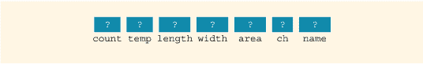

**图 2–4** 语句 1 执行前的变量

接下来，我们展示每条语句执行后变量的值。

| 执行语句后 | 变量的值/语句 | 说明 |
|---|---|---|
| 1 | **count** **temp** **length** **width** **area** **ch** **name**<br>`count = 1;` | 将 1 存入 `count`。 |
| 2 | **count** **temp** **length** **width** **area** **ch** **name**<br>`count = count + 1;` | `count + 1 = 1 + 1 = 2`。将 2 存入 `count`。这条语句用这个新值替换 `count` 的旧值。 |
| 3 | **count** **temp** **length** **width** **area** **ch** **name**<br>`cin >> length >> width;` | 读取两个数字，即 10.5 和 4.0，并将第一个数字存入 `length`，第二个存入 `width`。 |
| 4 | **count** **temp** **length** **width** **area** **ch** **name**<br>`area = length * width;` | `length * width = 10.5 * 4.0 = 42.0`。将 42.0 存入 `area`。 |
| 5 | **count** **temp** **length** **width** **area** **ch** **name**<br>`cin >> name;` | 从键盘读取下一个输入 `Amy`，并将其存入 `name`。 |
| 6 | `count` = 2, `temp` = 7, `length` = 12.5, `width` = 4.0, `area` = 42.0, `ch` = ?, `name` = Amy<br>`length = length + 2;` | `length + 2 = 10.5 + 2 = 12.5`。将 12.5 存入 `length`。这条语句用这个新值替换 `length` 的旧值。 |
| 7 | `count` = 2, `temp` = 7, `length` = 12.5, `width` = 5.0, `area` = 42.0, `ch` = ?, `name` = Amy<br>`width = 2 * length - 5 * width;` | `2 * length - 5 * width = 2 * 12.5 - 5 * 4.0 = 5.0`。将 5.0 存入 `width`。这条语句用这个新值替换 `width` 的旧值。 |
| 8 | `count` = 2, `temp` = 7, `length` = 12.5, `width` = 5.0, `area` = 62.5, `ch` = ?, `name` = Amy<br>`area = length * width;` | `length * width = 12.5 * 5.0 = 62.5`。将 62.5 存入 `area`。这条语句用这个新值替换 `area` 的旧值。 |
| 9 | `count` = 2, `temp` = 7, `length` = 12.5, `width` = 5.0, `area` = 62.5, `ch` = A, `name` = Amy<br>`cin >> ch;` | 从键盘读取下一个输入 A，并将其存入 `ch`。 |
| 10 | `count` = 2, `temp` = 67, `length` = 12.5, `width` = 5.0, `area` = 62.5, `ch` = A, `name` = Amy<br>`temp = count + static_cast<int>(ch);` | `count + static_cast<int>(ch) = 2 + static_cast<int>('A') = 2 + 65 = 67`。将 67 存入 `temp`。 |

**注意** 当程序出现问题，并且它生成的结果不是你预期的结果时，你应该对给变量赋值的语句进行逐步跟踪。例 2-19 说明了如何对程序进行逐步跟踪。这是一种非常有效的调试技术。本书配套网站包含一个 C++ 程序，演示了例 2-19 开头列出的 10 条语句的效果。该程序名为 `Example_2_19.cpp`。

**注意** 如果将求值为浮点值的表达式赋值给 `int` 类型的变量——且不使用强制类型转换运算符——则小数部分会被丢弃。在这种情况下，编译器很可能会发出有关隐式类型转换的警告消息。

## 自增和自减运算符

既然你已经知道如何声明变量以及将数据输入变量，本节你将学习另外两个运算符：**自增**和**自减运算符**。这些运算符被 C++ 程序员频繁使用，是很有用的编程工具。

假设 `count` 是一个 `int` 变量。语句：

```cpp
count = count + 1;
```

将 `count` 的值加 1。为了执行这条赋值语句，计算机首先计算右侧的表达式，即 `count + 1`。然后将这个值赋给左侧的变量，即 `count`。

正如你将在后续章节中看到的，这类语句经常用于统计某些事情发生了多少次。为了加快这类语句的执行，C++ 提供了**自增运算符**，**`++`**（两个加号），它将变量的值加 1；还提供了**自减运算符**，**`--`**（两个减号），它将变量的值减 1。自增和自减运算符各有两种形式：前置和后置。自增运算符的语法是：

**前置自增：** `++variable`

**后置自增：** `variable++`

自减运算符的语法是：

**前置自减：** `--variable`

**后置自减：** `variable--`

我们来看一些例子。语句：

```cpp
++count;
```

或：

```cpp
count++;
```

将 `count` 的值加 1。类似地，语句：

```cpp
--count;
```

或：

```cpp
count--;
```

将 `count` 的值减 1。

由于自增和自减运算符都内置于 C++ 中，因此无需使用赋值语句的形式，就能快速增加或减少变量的值。

现在，前置和后置自增运算符都会将变量的值加 1。类似地，前置和后置自减运算符都会将变量的值减 1。

这些运算符的前置和后置形式有什么区别？当使用这些运算符的变量出现在表达式中时，区别就变得明显了。

假设 `x` 是一个 `int` 变量。如果在表达式中使用 `++x`，首先将 `x` 的值加 1，然后使用 `x` 的新值来计算表达式。另一方面，如果在表达式中使用 `x++`，首先在表达式中使用 `x` 的当前值，然后将 `x` 的值加 1。下面的例子阐明了前置和后置自增运算符之间的区别。

假设 `x` 和 `y` 是 `int` 变量。考虑以下语句：

```cpp
    x = 5;
    y = ++x;
```

第一条语句将值 5 赋给 `x`。要计算第二条语句（使用前置自增运算符），首先将 `x` 的值增加到 6，然后将这个值 6 赋给 `y`。第二条语句执行后，`x` 和 `y` 的值都为 6。以下这组语句会产生相同的结果：

```cpp
    x = 5;
    x = x + 1;
    y = x;
```

现在，考虑以下语句：

```cpp
    x = 5;
    y = x++;
```

和之前一样，第一条语句将 5 赋给 `x`。在第二条语句中，后置自增运算符应用于 `x`。要执行第二条语句，首先使用 `x` 的值（即 5）来计算表达式，然后将 `x` 的值增加到 6。最后，将表达式的值（即 5）存入 `y`。第二条语句执行后，`x` 的值为 6，`y` 的值为 5。以下这组语句会产生相同的结果：

```cpp
    x = 5;
    y = x;
    x = x + 1;
```

如你所见，前置和后置自增语句的唯一区别在于自增发生的时间：是在赋值之前还是之后。

下面的例子进一步说明自增运算符的前置和后置形式如何工作。

### 例 2-20

假设 `a` 和 `b` 是 `int` 变量，并且

```cpp
    a = 5;
    b = 2 + (++a);
```

第一条语句将 5 赋给 a。要执行第二条语句，首先计算表达式 2 + (++a)。由于前置自增运算符应用于 a，因此首先将 a 的值增加到 6。然后加 2 得到 8，再将其赋给 b。因此，第二条语句执行后，a 为 6，b 为 8。

另一方面，在执行以下语句之后：

```cpp
a = 5;
b = 2 + (a++);
```

a 的值为 6，而 b 的值为 7。

## 输出

在前面的章节中，你已经了解了如何将数据放入计算机内存以及如何操作这些数据。我们还使用了一些输出语句在标准输出设备上显示结果。本节将较为详细地解释如何进一步使用输出语句来生成所需的结果。

> **注意：** 标准输出设备通常是屏幕。

在 C++ 中，标准输出设备上的输出通过使用 cout 和运算符 << 完成。cout 与 << 一起使用的一般语法是：

```cpp
cout << expression or manipulator << expression or manipulator...;
```

这称为**输出语句**。在 C++ 中，<< 称为**流插入运算符**。使用 cout 生成输出遵循两条规则：

- 1. 计算表达式的值，并将其值打印到输出设备上当前的插入点。
- 2. 使用*操纵符*格式化输出。最简单的操纵符是 endl（最后一个字符是字母 l），它使插入点移动到下一行的开头。

> **注意：** 在屏幕上，插入点就是光标所在的位置。

下一个例子说明输出语句如何工作。在输出语句中，字符串或仅涉及一个变量或单个值的表达式，其求值结果就是其自身。


**注意**

当输出语句输出 `char` 值时，它只输出字符本身，而不输出单引号（除非单引号是输出语句的一部分）。

例如，假设 `ch` 是一个 `char` 变量，且 `ch = 'A';`。语句：

```cpp
cout << ch;
```

或

```cpp
cout << 'A';
```

输出：

```text
A
```

类似地，当输出语句输出字符串的值时，它只输出字符串本身，而不输出双引号（除非你将双引号作为输出的一部分）。

### 示例 2-21

考虑以下语句。每条语句右侧显示了输出。

| 语句 | 输出 |
|---|---|
| `cout << 29 / 4 << endl;` | `7` |
| `cout << "Hello there." << endl;` | `Hello there.` |
| `cout << 12 << endl;` | `12` |
| `cout << "4 + 7" << endl;` | `4 + 7` |
| `cout << 4 + 7 << endl;` | `11` |
| `cout << 'A' << endl;` | `A` |
| `cout << "4 + 7 = " << 4 + 7 << endl;` | `4 + 7 = 11` |
| `cout << 2 + 3 * 5 << endl;` | `17` |
| `cout << "Hello \nthere." << endl;` | `Hello<br>there.` |

看看第 9 条语句的输出。回想一下，在 C++ 中，换行字符是 `\n`；它会使插入点在打印之前移动到下一行的开头。因此，当 `\n` 出现在输出语句的字符串中时，它会使插入点在输出设备上移动到下一行的开头。这一事实解释了为什么 Hello 和 there. 会打印在不同行上。

**注意**

在 C++ 中，`\` 称为转义字符，`\n` 称为换行转义序列。

回想一下，所有变量都必须正确初始化；否则，存储在其中的值可能没有太大意义。还要记住，C++ 不会自动初始化变量。

如果 num 是一个 int 变量，那么以下 C++ 语句的输出：

```cpp
cout << num << endl;
```

是有意义的，前提是 num 已被赋值。例如，以下 C++ 语句序列：

```cpp
num = 45;
cout << num << endl;
```

将产生输出 45。

### 示例 2-22

考虑以下 C++ 程序：

```cpp
// This program illustrates how output statements work.

#include <iostream>

using namespace std;

int main()
{
    int a, b;

    a = 65;                    //Line 1
    b = 78;                    //Line 2

    cout << 29 / 4 << endl;    //Line 3
    cout << 3.0 / 2 << endl;   //Line 4
    cout << "Hello there.\n";  //Line 5
    cout << 7 << endl;         //Line 6
    cout << 3 + 5 << endl;     //Line 7
    cout << "3 + 5";           //Line 8
    cout << " **";             //Line 9
    cout << endl;              //Line 10
    cout << 2 + 3 * 6 << endl; //Line 11
    cout << "a" << endl;       //Line 12
    cout << a << endl;         //Line 13
    cout << b << endl;         //Line 14

    return 0;
}
```

在下面的输出中，标有“语句所在行”的列和行号不属于输出的一部分。此列中显示行号是为了便于看出哪个输出对应哪条语句。

| 输出 | 语句所在行 |
|---|---|
| 7 | 第 3 行 |
| 1.5 | 第 4 行 |
| Hello there. | 第 5 行 |
| 7 | 第 6 行 |
| 8 | 第 7 行 |
| 3 + 5 ** | 第 8 行和第 9 行 |
| 20 | 第 11 行 |
| a | 第 12 行 |
| 65 | 第 13 行 |
| 78 | 第 14 行 |

大部分情况下，输出很直接。看看第 7、8、9 和 10 行语句的输出。第 7 行的语句输出 3 + 5 的结果，即 8，并将插入点移动到下一行的开头。第 8 行的语句输出字符串 3 + 5。注意，第 8 行的语句仅由字符串 3 + 5 组成。因此，在打印 3 + 5 之后，插入点仍停留在 5 之后；它不会移动到下一行的开头。接下来，第 9 行语句的输出会在插入点（此前位于 5 之后）输出一个空格和 **。

第 10 行的输出语句只包含操纵符 endl，它将插入点移动到下一行的开头。因此，当第 11 行的语句执行时，输出从该行开头开始。注意，在此输出中，“语句所在行”列不包含第 10 行。这是因为第 10 行的语句不产生任何可打印输出。它只是将插入点移动到下一行的开头。接下来，第 11 行的语句输出 2 + 3 * 6 的值，即 20。然后，操纵符 endl 将插入点移动到下一行的开头。

**注意**

在表达式中输出或访问变量的值不会销毁或修改变量的内容。

现在让我们仔细看看换行字符 `'\n'`。考虑以下 C++ 语句：

```cpp
cout << "Hello there.";
cout << "My name is James.";
```

如果这些语句按顺序执行，则输出为：

```text
Hello there.My name is James.
```

现在考虑以下 C++ 语句：

```cpp
cout << "Hello there.\n";
cout << "My name is James.";
```

这些 C++ 语句的输出为：

```text
Hello there.
My name is James.
```

当在字符串中遇到 `\n` 时，插入点会定位到下一行的开头。另请注意，`\n` 可以出现在字符串中的任何位置。例如，以下语句的输出：

```cpp
cout << "Hello \nthere. \nMy name is James.";
```

为：

```text
Hello
there.
My name is James.
```

另外，请注意以下语句的输出：

```cpp
cout << '\n';
```

与以下语句的输出相同：

```cpp
cout << "\n";
```

也与以下语句的输出相同：

```cpp
cout << endl;
```

因此，以下语句序列的输出：

```cpp
cout << "Hello there.\n";
cout << "My name is James.";
```

与以下语句序列的输出相同：

```cpp
cout << "Hello there." << endl;
cout << "My name is James.";
```

### 示例 2-23

考虑以下 C++ 语句：

```cpp
cout << "Hello there.\nMy name is James.";
```

或：

```cpp
cout << "Hello there.";
cout << "\nMy name is James.";
```

或：

```cpp
cout << "Hello there.";
cout << endl << "My name is James.";
```

在每种情况下，这些语句的输出都是：

```text
Hello there.
My name is James.
```

### 示例 2-24

以下 C++ 语句的输出：

```cpp
cout << "Count...\n....1\n......2\n......3";
```

或：

```cpp
cout << "Count..." << endl << ".....1" << endl
     << "......2" << endl << "......3";
```

为：

```text
Count...
.....1
......2
......3
```

### 示例 2-25

假设你想将以下句子作为消息的一部分在一行中输出：

今天阳光明媚、温暖，而且没有刮风。我们可以去打高尔夫球。

显然，你会使用一条输出语句来产生这个输出。然而，在编程代码中，作为输出语句的一部分，这条语句可能无法放在一行中。当然，你可以像下面这样使用多条输出语句：

```cpp
cout << "It is sunny, warm, and not a windy day. "
cout << "We can go golfing." << endl;
```

注意第一条语句末尾的分号，以及第二条语句开头的标识符 cout。另请注意，第一条语句末尾没有操纵符 endl。这里使用两条输出语句将句子输出在一行中。等价地，你可以使用以下输出语句来输出这个句子：

```cpp
cout << "It is sunny, warm, and not a windy day. "
     << "We can go golfing." << endl;
```

在这条语句中，请注意第一行末尾没有分号，并且标识符 cout 没有出现在第二行开头。由于第一行末尾没有分号，这条输出语句会在第二行继续。另请注意每一行句子开头和结尾的双引号。该字符串被分成两个字符串，但两个字符串都是同一条输出语句的一部分。

如果输出语句中出现的字符串很长，而你想将该字符串输出在一行中，你可以使用前面两种方法中的任意一种来拆分字符串。然而，以下语句是不正确的：

```cpp
cout << "It is sunny, warm, and not a windy day.
          We can go golfing." << endl;                 //illegal
```

换句话说，键盘上的 Return（或 Enter）键不能成为字符串的一部分。也就是说，在编程代码中，不能通过按键盘上的 Return（Enter）键将字符串分成多行。

回想一下，换行字符是 `\n`，它会使插入点移动到下一行的开头。C++ 中有许多转义序列，可让你控制输出。表 2-4 列出了一些常用的转义序列。

## 表 2-4  常用转义序列

|  | 转义序列 | 描述 |
|---|---|---|
| `\n` | 换行符 | 光标移动到下一行的开头 |
| `\t` | 制表符 | 光标移动到下一个制表位 |
| `\b` | 退格 | 光标向左移动一个空格 |
| `\r` | 回车 | 光标移动到当前行的开头（不是下一行） |
| `\\` | 反斜杠 | 打印反斜杠 |
| `\'` | 单引号 | 打印单引号 |
| `\"` | 双引号 | 打印双引号 |

以下示例展示了其中一些转义序列的效果。

### 示例 2-26

以下语句的输出：

```cpp
cout << "The newline escape sequence is \\n" << endl;
```

为：

```text
The newline escape sequence is \n
```


该语句的输出：

```cpp
cout << "The tab character is represented as '\\t'" << endl;
```

为：

The tab character is represented as '\t'

注意，单引号也可以在不使用转义序列的情况下打印。因此，前面的语句等价于以下输出语句：

```cpp
cout << "The tab character is represented as '\t'" << endl;
```

该语句的输出：

```cpp
cout << "The string \"Sunny\" contains five characters." << endl;
```

为：

The string "Sunny" contains five characters.

**注意** 与本文配套的网站包含一个 C++ 程序，用于展示示例 2-26 中语句的效果。该程序名为 `Example2_26.cpp`。

要在程序中使用 cin 和 cout，必须包含某个头文件。下一节将解释这个头文件是什么、如何在程序中包含头文件，以及为什么程序中需要头文件。第 3 章将详细解释 cin 和 cout。

## 预处理指令

C++ 中只明确定义了少量操作，例如算术运算和赋值运算。运行 C++ 程序所需的许多函数和符号以库集合的形式提供。每个库都有一个名称，并通过头文件来引用。例如，执行输入/输出（I/O）所需函数的描述包含在头文件 iostream 中。类似地，一些非常有用的数学函数（如幂、绝对值和正弦）的描述包含在头文件 cmath 中。如果要使用 I/O 或数学函数，需要告诉计算机在哪里找到必要的代码。你可以使用预处理指令和头文件名来告诉计算机库中提供的代码的位置。预处理指令由称为预处理器的程序处理。预处理指令是提供给预处理器的命令，使预处理器在编译 C++ 程序之前修改其文本。所有预处理命令都以 # 开头。预处理命令末尾没有分号，因为它们不是 C++ 语句。要在 C++ 程序中使用头文件，请使用预处理指令 #include。

在 C++ 程序中包含头文件（由 IDE 提供）的一般语法是：

```cpp
#include <headerFileName>
```

例如，以下语句在 C++ 程序中包含头文件 iostream：

```cpp
#include <iostream>
```

用于包含头文件的预处理指令放在程序的第一行，以便这些头文件中声明的标识符可在整个程序中使用。（回想一下，在 C++ 中，标识符必须先声明后使用。）

某些头文件作为 C++ 的一部分提供。附录 F 描述了一些常用头文件。程序员个人也可以创建自己的头文件，本书后面的“类和数据抽象”一章将讨论这一点。

注意，预处理命令在程序经过编译器之前由预处理器处理。

从图 1–2（第 1 章）可以得出结论：C++ 系统有三个基本组成部分：程序开发环境、C++ 语言和 C++ 库。这三个组成部分都是 C++ 系统不可或缺的部分。程序开发环境由图 1–2 所示的六个步骤组成。在你通读本书学习 C++ 语言的过程中，我们将根据需要讨论 C++ 库的组成部分。

## 命名空间以及在程序中使用 cin 和 cout

前面已经学过，cin 和 cout 都是预定义标识符。在 ANSI/ISO 标准 C++ 中，这些标识符声明在头文件 iostream 中，但位于一个命名空间内。这个命名空间的名称是 std。（命名空间机制将在第 7 章正式定义并详细讨论。目前，你只需知道如何使用 cin 和 cout，实际上还有头文件 iostream 中的任何其他标识符。）

有几种方法可以使用在命名空间 std 中声明的标识符。使用 cin 和 cout 的一种方法是在整个程序中将它们称为 std::cin 和 std::cout。

另一种选择是在程序中包含以下语句：

```cpp
using namespace std;
```

这条语句应出现在语句 `#include <iostream>` 之后。然后就可以在不使用前缀 `std::` 的情况下引用 `cin` 和 `cout`。为简化 `cin` 和 `cout` 的使用，本书采用第二种形式。也就是说，要在程序中使用 `cin` 和 `cout`，程序将包含以下两条语句：

```cpp
#include <iostream>

using namespace std;
```

在 C++ 中，`namespace` 和 `using` 是保留字。

`namespace` 机制是 `ANSI/ISO Standard C++` 的一项特性。随着你学习更多 C++ 编程知识，你会了解到其他头文件。例如，头文件 `cmath` 包含许多有用数学函数的规范。类似地，头文件 `iomanip` 包含许多有用函数和操纵符的规范，它们帮助你以特定方式格式化输出。然而，就像头文件 `iostream` 中的标识符一样，ANSI/ISO 标准 C++ 头文件中的标识符也声明在 `namespace` 内。

这些头文件中 `namespace` 的名称都是 `std`。因此，每当讨论 ANSI/ISO 标准 C++ 中某个头文件的某些特性时，本书将引用标识符时不带前缀 `std::`。此外，为简化程序中标识符的访问，将包含语句 `using namespace std;`。另外，如果一个程序使用多个头文件，只需要一条 `using` 语句。这条 `using` 语句通常出现在所有头文件之后。

### 在程序中使用 `string` 数据类型

回想一下，`string` 数据类型是程序员定义的数据类型，不能直接在程序中使用。要使用 `string` 数据类型，需要从头文件 `string` 中访问其定义。因此，要在程序中使用 `string` 数据类型，必须包含以下预处理指令：

```cpp
#include <string>
```

## 创建 C++ 程序

在前面的章节中，你已经学习了足够的 C++ 概念来编写有意义的程序。现在，你已准备好创建一个完整的 C++ 程序。

C++ 程序是函数的集合，其中一个函数是 `main` 函数。因此，如果一个 C++ 程序只包含一个函数，那么它必须是函数 `main`。此外，函数是一组旨在完成特定任务的指令。在第 6 章之前，你将主要与函数 `main` 打交道。

声明变量的语句、操作数据（如赋值）的语句以及输入和输出数据的语句都放在函数 `main` 内。声明命名常量的语句通常放在函数 `main` 外部。

本书中使用的函数 `main` 的语法具有以下形式：

```cpp
int main()
{
    statement_1
        .
        .
        .
    statement_n

    return 0;
}
```

在函数 main 的语法中，每条语句（statement_1、……、statement_n）通常是声明语句或可执行语句。语句 `return 0;` 必须包含在函数 main 中，并且必须是最后一条语句。如果语句 `return 0;` 在函数 main 的主体中位置错误，程序生成的结果可能不符合你的期望。语句 `return 0;` 的完整含义将在第 6 章讨论。目前，可将该语句视为程序结束语句。在 C++ 中，return 是保留字。

C++ 程序可能会使用 IDE 提供的资源，例如输入数据所需的代码，这会要求你的程序包含某些头文件。因此，你可以将 C++ 程序分为两部分：预处理指令和程序。预处理指令告诉编译器在程序中包含哪些头文件。程序包含实现有意义结果的语句。预处理指令和程序语句共同构成 C++ 源代码。回想一下，源代码要发挥作用，必须保存在扩展名为 `.cpp` 的文件中。例如，如果源代码保存在文件 `firstProgram` 中，则该文件的完整名称是 `firstProgram.cpp`。包含源代码的文件称为**源代码文件**或**源文件**。

编译程序时，编译器生成目标代码，并保存在扩展名为 `.obj` 的文件中。当目标代码与系统资源链接时，生成可执行代码并保存在扩展名为 `.exe` 的文件中。通常，包含目标代码的文件名和包含可执行代码的文件名与包含源代码的文件名相同。例如，如果源代码位于名为 `firstProg.cpp` 的文件中，则包含目标代码的文件名为 `firstProg.obj`，包含可执行代码的文件名为 `firstProg.exe`。

上一段给出的扩展名——即 `.cpp`、`.obj` 和 `.exe`——依赖于系统。此外，一些 IDE 以项目的形式维护程序。项目名和源文件名不必相同。可执行文件的名称可能是项目名称加上扩展名 `.exe`。为确保无误，请查阅你的系统或 IDE 文档。

由于编程指令放在函数 `main` 中，下面我们来详细说明这个函数。


main函数的基本组成部分是函数头和函数体。main函数的第一行，即：

```cpp
int main()
```

称为main函数的**函数头**。

花括号（{ 和 }）之间的语句构成main函数的函数体。main函数的函数体包含两类语句：

- 声明语句
- 可执行语句

**声明语句**用于声明事物，例如变量。

在C++中，标识符（例如变量）可以在程序中的任何位置声明，但必须先声明才能使用。

### 例 2-27

以下语句是变量声明的示例：

```cpp
int a, b, c;
double x, y;
```

**可执行语句**执行计算、处理数据、创建输出、接受输入等。

到目前为止，你遇到的一些可执行语句包括赋值语句、输入语句和输出语句。

### 例 2-28

以下语句是可执行语句的示例：

```cpp
a = 4;                         //assignment statement
cin >> b;                      //input statement
cout << a << " " << b << endl; //output statement
```

以骨架形式来看，一个C++程序如下所示：

```cpp
//comments, if needed

preprocessor directives to include header files

using statement

named constants, if needed

int main()
{
    statement_1
        .
        .
        .
    statement_n

    return 0;
}
```

例2-29中的C++程序展示了include语句、声明语句、可执行语句等通常出现在程序中的位置。

### 例 2-29

```cpp
/************************************************************
// Author: D.S. Malik
//
// This program shows where the include statements, using
// statement, named constants, variable declarations, assignment
// statements, and input and output statements typically appear.
************************************************************/

#include <iostream>                                      //Line 1

using namespace std;                                     //Line 2

const int NUMBER = 12;                                   //Line 3

int main()                                               //Line 4
{
    int firstNum;                                        //Line 5
    int secondNum;                                       //Line 6

    firstNum = 18;                                       //Line 8
    cout << "Line 9: firstNum = " << firstNum
         << endl;                                        //Line 9

    cout << "Line 10: Enter an integer: ";              //Line 10
    cin >> secondNum;                                    //Line 11
    cout << "Line 12: secondNum = " << secondNum;       //Line 12

    cout << "Line 13: secondNum = " << secondNum
         << endl;                                        //Line 13

    firstNum = firstNum + NUMBER + 2 * secondNum;        //Line 14

    cout << "Line 15: The new value of "                 //Line 15
         << "firstNum = " << firstNum << endl;

    return 0;                                            //Line 16
}                                                        //Line 17
```

**示例运行：** 在此示例运行中，用户输入以阴影显示。

```cpp
Line 9: firstNum = 18
Line 10: Enter an integer: 15

Line 13: secondNum = 15
Line 15: The new value of firstNum = 60
```

上述程序的工作方式如下：第1行的语句包含头文件iostream，以便程序可以执行输入/输出。第2行的语句使用using namespace语句，以便在头文件iostream中声明的标识符（如cin、cout和endl）无需使用前缀std::即可使用。第3行的语句声明命名常量NUMBER并将其值设为12。第4行的语句包含main函数的函数头，第5行的左花括号标记main函数的开始。第6行和第7行的语句声明变量firstNum和secondNum。

第8行的语句将firstNum的值设为18，第9行的语句输出firstNum的值。接下来，第10行的语句提示用户输入一个整数。第11行的语句读取该整数并将其存储到变量secondNum中，在示例运行中该值为15。第12行的语句将屏幕上的光标定位到下一行的开头。第13行的语句输出secondNum的值。第14行的语句计算表达式：

```cpp
firstNum + NUMBER + 2 * secondNum
```

并将该表达式的值赋给变量firstNum，在示例运行中该值为60。第15行的语句输出firstNum的新值。第16行的语句包含return语句，这是最后一条可执行语句。第17行的右花括号标记main函数的结束。

## 调试：理解和修复语法错误

本章前面的小节描述了C++程序的基本组成部分。当你输入程序时，拼写错误和无意的语法错误很可能出现。因此，当你编译程序时，编译器会识别语法错误。在本节中，我们将展示如何识别和修复语法错误。

考虑以下C++程序：

```cpp
1.  #include <iostream>
2.
3.  using namespace std;
4.
5.  int main()
6.    {
7.        int num
8.
9.        num = 18;
10.
11.       tempNum = 2 * num;
12.
13.       cout << "Num = " << num << ", tempNum = " << tempNum << endl;
14.
15.       return ;
16.   }
```

（请注意，左侧的编号1到16不属于程序。我们为语句编号以便于引用。）该程序包含语法错误。当你编译该程序时，编译器会产生以下错误。（该程序使用Microsoft Visual Studio 2012编译。）

```text
ExampleCh2_Syntax_Errors.cpp
c:\exercise2_syntax_errors.cpp(9): error C2146: syntax error : missing ';'
before identifier 'num'
c:\exercise2_syntax_errors.cpp(11): error C2065: 'tempNum' : undeclared identifier
c:\exercise2_syntax_errors.cpp(13): error C2065: 'tempNum' : undeclared identifier
c:\exercise2_syntax_errors.cpp(13): error C2563: mismatch in formal parameter list
c:\exercise2_syntax_errors.cpp(13): error C2568: '<<' : unable to resolve
function overload
        c:\program files (x86)\microsoft visual studio
11.0\vc\include\ostream(1037): could be 'std::basic_ostream<_Elem,_Traits>
&std::endl(std::basic_ostream<_Elem,_Traits> &)'
        with
        [
            _Elem=unsigned short,
            _Traits=std::char_traits<unsigned short>
        ]
        c:\program files (x86)\microsoft visual studio
11.0\vc\include\ostream(1027): or    'std::basic_ostream<_Elem,_Traits>
&std::endl(std::basic_ostream<_Elem,_Traits> &)'
        with
        [
            _Elem=wchar_t,
            _Traits=std::char_traits<wchar_t>
        ]
        c:\program files (x86)\microsoft visual studio
11.0\vc\include\ostream(1019): or    'std::basic_ostream<_Elem,_Traits>
&std::endl(std::basic_ostream<_Elem,_Traits> &)'
        with
        [
            _Elem=char,
            _Traits=std::char_traits<char>
        ]
c:\program files (x86)\microsoft visual studio
11.0\vc\include\ostream(993): or    'std::basic_ostream<_Elem,_Traits>
&std::endl(std::basic_ostream<_Elem,_Traits> &)'
c:\examplech2_syntax_errors.cpp(15): error C2561: 'main' : function must
return a value
c:\examplech2_syntax_errors.cpp(5): see declaration of 'main'
```

最好尝试以自上而下的方式纠正错误，因为第一个错误可能会使编译器困惑，并导致它标记多个后续错误，而实际上较早的行上只有一个错误。因此，让我们首先考虑以下错误：

```text
c:\examplech2_syntax_errors.cpp(9): error C2146: syntax error : missing ';'
before identifier 'num'
```

表达式 c:\examplech2_syntax_errors.cpp(9) 表明第9行有错误。该错误的剩余部分指出在标识符num之前缺少;。如果我们查看第7行，我们会发现在语句int num的末尾缺少一个分号。因此，我们必须在第7行的语句末尾插入一个;。

接下来，考虑第二个错误：

```text
c:\examplech2_syntax_errors.cpp(11): error C2065: 'tempNum' : undeclared identifier
```

此错误发生在第11行，它指出标识符tempNum未声明。当我们查看代码时，我们发现该标识符尚未声明。因此，我们必须将tempNum声明为int变量。

错误：

```text
c:\examplech2_syntax_errors.cpp(13): error C2065: 'tempNum' : undeclared identifier
```

发生在第13行，它指出标识符tempNum未声明。与之前的错误一样，我们必须声明tempNum。请注意，一旦我们声明tempNum并重新编译，此错误和之前的错误将消失。

下一个错误是：

```text
c:\examplech2_syntax_errors.cpp(13): error C2563: mismatch in formal parameter list
```

此错误发生在第13行，它表明某个形参列表不匹配。对于初学者来说，这个错误有些难以理解。（在第13章中，我们将解释运算符<<的形参列表。）然而，随着练习，你将学会如何解释和纠正语法错误。如果你查看下一个错误，这个错误就会变得清楚，其中一部分是：

```text
c:\examplech2_syntax_errors.cpp(13):  error  C2568:  '<<'  :  unable  to  resolve
function overload
```

它告诉我们，此错误与运算符<<有关。当我们仔细查看第13行的语句时，即：

```cpp
cout << "Num = " << num << ", tempNum = " << tempNum << endl;
```

我们发现，在表达式 `... << tempNum` 中，我们无意中使用了 `<` 代替了 `<<`。因此我们必须纠正这个错误。


我们来看最后一个错误，它是：

```
c:\example2_syntax_errors.cpp(15): error C2561: 'main': function must return a value
    c:\example2_syntax_errors.cpp(5): see declaration of 'main'
```

这个错误出现在第15行。然而，此时给出的解释，尤其对初学者来说，有些不清楚。不过，如果你查看第15行中的语句 `return ;`，并记住函数 main 的语法以及本书中给出的所有程序，我们会发现缺少数字0，也就是说，该语句必须是 `return 0;`

从编译器报告的错误中可以看出，编译器不仅识别错误，还会指明错误所在的行号以及错误的类型。我们可以有效利用这些信息来修正语法错误。

修正所有语法错误后，正确的程序如下：

```cpp
#include <iostream>

using namespace std;

int main()
{
    int num;
    int tempNum;

    num = 18;

    tempNum = 2 * num;

    cout << "Num = " << num << ", tempNum = " << tempNum << endl;

    return 0;
}
```

输出为：

```
Num = 18, tempNum = 36
```

在你学习 C++ 并练习编写和执行程序的过程中，你会学会如何发现并修正语法错误。编译器报告的错误列表可能比程序本身还长。这是因为，如上所述，一行中的语法错误可能导致后续行出现语法错误。在这种情况下，按错误列出的顺序修正语法错误，并在每次修正后根据需要编译程序。你会看到语法错误列表迅速缩短。重要的是不要惊慌。

下一节将介绍一些可以遵循的简单规则，使你的程序结构合理。

## 程序风格与形式

在前面的小节中，你已经学习了足够的 C++ 概念来编写有意义的程序。然而，在开始编写程序之前，你需要学习其恰当的结构等内容。为 C++ 程序使用恰当的结构，可以使其更易于理解，也便于后续修改。没有什么比试图理解、甚至修改一个语法正确但毫无结构的程序更令人沮丧的了。

此外，每个 C++ 程序都必须满足该语言的某些规则。C++ 程序必须包含函数 main。它还必须遵循语法规则；语法规则就像语法一样，指明语言中什么是对的、什么是错的，什么是合法的、什么是非法的。其他规则则用于赋予语言精确的含义；也就是说，它们支持语言的语义。

以下小节旨在帮助你学习如何使用目前已学到的 C++ 编程元素来创建一个可运行的程序。这些小节涵盖语法；空白的用法；分号、括号和逗号的用法；语义；标识符命名；提示行；文档化（包括注释）；以及形式与风格。

### 语法

语言的语法规则指明什么是合法的、什么是不合法的。语法错误在编译期间被检测出来。例如，考虑以下 C++ 语句：

```cpp
int x;           //Line 1
int y            //Line 2
double z;        //Line 3


y = w + x;       //Line 4
```

编译这些语句时，第2行会出现编译错误，因为变量 y 的声明后缺少分号。第4行会出现第二个编译错误，因为使用了标识符 w，但它尚未被声明。

正如第1章所讨论的，你通过文本编辑器将程序输入计算机。输入程序时，错误几乎不可避免。因此，编译程序时，你很可能会看到语法错误。某一特定位置的语法错误很可能导致后续若干语句出现语法错误。单个字符的遗漏导致四五条错误信息是非常常见的。然而，当第一个语法错误被消除并重新编译程序后，由这个语法错误引起的后续语法错误可能会消失。因此，你应该按照编译器列出错误的顺序修正语法错误。随着你对 C++ 越来越熟悉、经验越来越丰富，你会学会如何快速发现并修正语法错误。此外，编译器不仅会发现语法错误，还会给出提示，有时还会告诉用户语法错误在哪里以及如何修正它们。

以及：

```cpp
const double CENTIMETERS_PER_INCH = 2.54;
double centimeters;
double inches;

centimeters = inches * CENTIMETERS_PER_INCH;
```

第二组语句中的标识符，例如 `CENTIMETERS_PER_INCH`，通常称为**自文档化**标识符。如你所见，自文档化标识符可以减少对注释的需求。

考虑自文档化标识符 `annualSale`。这种标识符称为**连写词**。在使用自文档化标识符时，你可能会无意中加入连写词，这可能会降低文档的清晰度。你可以通过将每个新单词的首字母大写，或在新单词前插入下划线，使连写词更易于理解。例如，你可以使用 `annualSale` 或 `annual_sale` 来创建更清晰的标识符。

回想本章前面，我们规定了命名常量和变量命名的一般规则。例如，用于命名命名常量的标识符全部大写。如果该标识符是连写词，则单词之间用下划线字符分隔，例如 `CENTIMETERS_PER_INCH`。

### 提示行

良好文档的一部分是使用书写清晰的提示，以便用户在与程序交互时知道该做什么。没有什么比坐在一个正在运行的程序前，却完全不知道是否要输入内容或该输入什么更令人沮丧的了。**提示行**是告知用户该做什么的可执行语句。例如，考虑以下 C++ 语句，其中 `num` 是 `int` 变量：

```cpp
cout << "Please enter an integer between 1 and 10 and "
     << "press the return key" << endl;
cin >> num;
```

当这两条语句按给定顺序执行时，首先输出语句会使以下文本行显示在屏幕上：

```
Please enter an integer between 1 and 10 and press the return key
```

看到这一行后，用户就知道必须输入一个整数并按回车键。如果程序只包含第二条语句，用户就完全不知道必须输入一个整数，而计算机将永远等待输入。前面的输出语句就是提示行的一个例子。

在程序中，只要需要用户输入，就必须包含必要的提示行。此外，这些提示行应尽可能多地包含关于可接受输入的信息。例如，前面的提示行不仅告诉用户要输入一个数字，还告知用户该数字应介于1和10之间。

### 文档化

你编写的程序不仅应对你清晰，也应对其他任何人清晰。因此，你必须为程序编写恰当的文档。文档良好的程序更易于理解和修改，即使是在最初编写很久之后也是如此。你使用注释来为程序编写文档。程序中应出现注释，以解释程序的目的、标明作者，并解释特定语句或语句组的目的。

### 形式与风格

你可能认为 C++ 有太多规则。然而，在实践中，这些规则赋予 C++ 很大的自由度。例如，考虑以下两种声明变量的方式：

```cpp
int feet, inches;
double x, y;
```

以及

```cpp
int feet,inches;double x,y;
```

计算机理解这两种格式都没有困难，但第一种形式更易于阅读和遵循。当然，任一格式中漏掉一个逗号或分号，都可能导致各种奇怪的错误信息。

那空白呢？哪些地方重要，哪些地方无意义？考虑以下两条语句：

```cpp
int a,b,c;
```

以及

```cpp
int   a,   b,   c;
```

这两种声明含义相同。这里，第二条语句中标识符之间的空白没有意义。另一方面，考虑以下语句：

```cpp
inta,b,c;
```

这条语句包含语法错误。int 和标识符 a 之间缺少空白，会把保留字 int 和标识符 a 变成一个全新的标识符 inta。

语法和语义规则的清晰性使你能够自由采用令你满意且更易于理解的格式。


以下示例对此作了进一步说明。

### 示例 2-30

考虑以下 C++ 程序：

```cpp
//An improperly formatted C++ program.

#include <iostream>
#include <string>
using namespace std;

int main()
{
int num; double height;
string name;
cout << "Enter an integer: "; cin >> num; cout << endl;
cout<<"num: "<<num<<endl;
cout<<"Enter the first name: "; cin>>name;
  cout<<endl; cout <<"Enter the height: ";
cin>>height; cout<<endl;

cout<<"Name: "<<name<<endl;cout<<"Height: "
<<height; cout <<endl;return 0;
}
```

该程序在语法上是正确的；C++ 编译器读取和编译该程序不会有任何困难。然而，这个程序非常难读。你编写的程序应当正确缩进并格式化。请注意重新格式化该程序后的区别：

```cpp
//A properly formatted C++ program.

#include <iostream>
#include <string>

using namespace std;

int main()
{
    int num;
    double height;
    string name;

    cout << "Enter an integer: ";
    cin >> num;
    cout << endl;
    cout << "num: " << num << endl;

    cout << "Enter the first name: ";
    cin >> name;
    cout << endl;
    cout << "Enter the height: ";
    cin >> height;
    cout << endl;

    cout << "Name: " << name << endl;
    cout << "Height: " << height << endl;

    return 0;
}
```

如你所见，这个程序更易于阅读。你的程序应当正确缩进并格式化。为了说明变量，程序员通常每行声明一个变量。此外，始终在运算符前后各放一个空格。当你使用 IDE 输入程序时，程序通常会自动缩进。

## 关于赋值语句的更多内容

到目前为止，你见到的赋值语句称为**简单赋值语句**。在某些情况下，你可以使用称为**复合赋值语句**的特殊赋值语句，以更简洁的表示法编写简单赋值语句。

对应于五个算术运算符 +、-、*、/ 和 %，C++ 分别提供五个复合运算符：+=、-=、*=、/= 和 %=。考虑以下简单赋值语句，其中 x 和 y 是 int 变量：

```cpp
x = x * y;
```

使用复合运算符 *=，该语句可以写为：

```cpp
x *= y;
```

通常，使用复合运算符 *=，你可以将以下简单赋值语句：

```cpp
variable = variable * (expression);
```

重写为：

```cpp
variable *= expression;
```

其他算术复合运算符也有类似的约定。例如，使用复合运算符 `+=`，你可以将以下简单赋值语句：

```cpp
variable = variable + (expression);
```

重写为：

```cpp
variable += expression;
```

复合赋值语句通过将算术运算符与赋值运算符组合，使你能够以简洁的方式编写简单赋值语句。

### 示例 2-31

本示例展示了若干与简单赋值语句等效的复合赋值语句。

| 简单赋值语句 | 复合赋值语句 |
|---|---|
| `i = i + 5;`<br>`counter = counter + 1;`<br>`sum = sum + number;`<br>`amount = amount * (interest + 1);`<br>`x = x / (y + 5);` | `i += 5;`<br>`counter += 1;`<br>`sum += number;`<br>`amount *= interest + 1;`<br>`x /= y + 5;` |

> **注意**
>
> 任何复合赋值语句都可以转换为简单赋值语句。但是，简单赋值语句可能无法（轻松地）转换为复合赋值语句。例如，考虑以下简单赋值语句：
>
> ```cpp
> x = x * y + z - 5;
> ```
>
> 要将该语句写为复合赋值语句，变量 `x` 必须是右侧的公因子，但这里并非如此。因此，你不能立即将该语句转换为复合赋值语句。事实上，等效的复合赋值语句是：
>
> ```cpp
> x *= y + (z - 5) / x;
> ```
>
> 这比简单赋值语句更复杂。此外，在前面的复合语句中，`x` 不能为 0。我们建议避免此类复合表达式。

## 编程示例：长度转换


编写一个程序，输入以英尺和英寸表示的长度。然后，程序应将这些长度转换为厘米并输出。假设给定的英尺和英寸长度是整数。

**输入** 以英尺和英寸表示的长度。

**输出** 以厘米表示的等效长度。

### 问题分析与算法设计

长度以英尺和英寸给出，你需要求出以厘米表示的等效长度。1 英寸等于 2.54 厘米。程序首先需要将给定的英尺和英寸长度转换为总英寸数。然后，你可以使用换算公式 1 英寸 = 2.54 厘米，求出以厘米表示的等效长度。要将英尺和英寸长度转换为英寸，需要将英尺数乘以 12（因为 1 英尺等于 12 英寸），再加上给定的英寸数。

例如，假设输入为 5 英尺 7 英寸。那么，总英寸数计算如下：

```text
totalInches = (12 * feet) + inches
             = 12 * 5 + 7
             = 67
```

然后，你可以应用换算公式 1 英寸 = 2.54 厘米，求出以厘米表示的长度。

```text
centimeters = totalInches * 2.54
            = 67 * 2.54
            = 170.18
```

基于对问题的这一分析，可以设计如下算法：

- 1. 获取以英尺和英寸表示的长度。
- 2. 将长度转换为总英寸数。
- 3. 将总英寸数转换为厘米。
- 4. 输出厘米数。

#### 变量

程序的输入是两个数：一个表示英尺，一个表示英寸。因此，需要两个变量：一个存储英尺，另一个存储英寸。由于程序首先会将给定长度转换为英寸，因此需要另一个变量来存储总英寸数。还需要一个变量来存储以厘米表示的等效长度。总之，需要以下变量：

```cpp
int feet;            //variable to hold given feet
int inches;          //variable to hold given inches
int totalInches;     //variable to hold total inches
double centimeters;  //variable to hold length in centimeters
```

#### 命名常量

要计算以厘米表示的等效长度，需要将总英寸数乘以 2.54。与其在程序中直接使用值 2.54，不如将该值声明为命名常量。类似地，要计算总英寸数，需要将英尺数乘以 12 再加上英寸数。与其在程序中直接使用 12，不如也将该值声明为命名常量。使用命名常量使以后修改程序更容易。

```cpp
const double CENTIMETERS_PER_INCH = 2.54;
const int INCHES_PER_FOOT = 12;
```

#### 主算法

在前面的各节中，我们分析了问题并确定了用于计算的公式。我们还确定了所需的变量和命名常量。现在，我们可以扩展“问题分析与算法设计”一节中给出的算法，以解决本编程示例开头提出的问题。

- 1. 提示用户输入。（如果没有提示行，用户将面对空白屏幕，不知道该怎么办。）
- 2. 获取数据。
- 3. 回显输入——也就是说，输出程序读取到的输入内容。（如果没有这一步，程序执行后，你将不知道输入是什么。这也是确保程序正确接收输入的好方法。）
- 4. 计算以英寸表示的长度。
- 5. 输出以英寸表示的长度。
- 6. 将长度转换为厘米。
- 7. 输出以厘米表示的长度。

#### 整合起来

现在，问题已经分析完毕，算法也已经设计好，下一步是将算法转换为 C++ 代码。由于这是你编写的第一个完整的 C++ 程序，让我们按顺序回顾必要的步骤。

程序将以注释开头，说明其目的和功能。由于这个程序既有输入（以英尺和英寸表示的长度），又有输出（以厘米表示的等效长度），你将使用系统资源进行输入/输出。换句话说，程序将使用输入语句将数据读入程序，并使用输出语句打印结果。由于数据将从键盘输入，输出将显示在屏幕上，程序必须包含头文件 iostream。因此，在如上所述的注释之后，程序的第一条语句将是包含该头文件的预处理指令。

这个程序需要两类内存位置来进行数据操作：命名常量和变量。通常，命名常量保存特殊数据，例如 CENTIMETERS_PER_INCH。根据命名常量的性质，它可以


放在函数 main 之前或函数 main 内部。如果命名常量要在整个程序中使用，那么它通常放在函数 main 之前。我们将在第 6 章一般性讨论用户自定义函数时，进一步说明在程序中放置命名常量的位置。在此之前，通常我们会将命名常量放在函数 main 之前，以便它们可以在整个程序中使用。

这个程序只有一个函数，即函数 main，其函数体将包含所有编程指令。此外，程序需要变量来操作数据，这些变量将在函数 main 的函数体中声明。在函数 main 的函数体中声明变量的原因将在第 6 章解释。函数 main 的函数体还将包含实现该算法的 C++ 语句。因此，函数 main 的函数体具有以下形式：

```cpp
int main()
{
    declare variables

    statements

    return 0;
}
```

要编写完整的长度转换程序，请按照以下步骤操作：

- 1. 以用于文档说明的注释开始程序。
- 2. 包含程序中所使用的头文件（如果有）。
- 3. 声明命名常量。
- 4. 编写函数 main 的定义。

## 完整程序清单

```cpp
//************************************************************
// Author: D. S. Malik
//
// Program Convert Measurements: This program converts
// measurements in feet and inches into centimeters using
// the formula that 1 inch is equal to 2.54 centimeters.
//************************************************************

        //Header file
#include <iostream>

using namespace std;

        //Named constants
const double CENTIMETERS_PER_INCH = 2.54;
const int INCHES_PER_FOOT = 12;

int main()
{
        //Declare variables
        int feet, inches;
        int totalInches;
        double centimeters;

        //Statements: Step 1 - Step 7
        cout << "Enter two integers, one for feet and "
             << "one for inches: ";                    //Step 1
        cin >> feet >> inches;                          //Step 2
        cout << endl;
        cout << "The numbers you entered are " << feet
             << " for feet and " << inches
             << " for inches." << endl;                 //Step 3

        totalInches = INCHES_PER_FOOT * feet + inches;  //Step 4

        cout << "The total number of inches = "        //Step 5
             << totalInches << endl;

        centimeters = CENTIMETERS_PER_INCH * totalInches; //Step 6

        cout << "The number of centimeters = "
             << centimeters << endl;                    //Step 7

        return 0;
}
```

示例运行：在此示例运行中，用户输入以阴影显示。

```text
Enter two integers, one for feet, one for inches: 15 7

The numbers you entered are 15 for feet and 7 for inches.
The total number of inches = 187
The number of centimeters = 474.98
```

## 编程示例：找零

编写一个程序，输入以美分为单位的任意零钱。然后计算应找回的半美元、25美分、10美分、5美分和1美分硬币的数量，按此顺序尽可能多地找回半美元，然后依次找回25美分、10美分、5美分和1美分硬币。例如，483 美分应找回为 9 个半美元、1 个25美分、1 个5美分和 3 个1美分。

|  |  |
|---|---|
| **输入** | 以美分为单位的零钱。 |
| **输出** | 等值的半美元、25美分、10美分、5美分和1美分硬币零钱。 |

### 问题分析与算法设计

假设给定的零钱是 646 美分。要找出半美元的数量，将 646 除以 50（半美元的价值），得到商 12 和余数 46。商 12 是半美元的数量，余数 46 是剩余的零钱。

接下来，将剩余零钱除以 25 以找出25美分硬币的数量。由于剩余零钱是 46，除以 25 得到商 1，即25美分硬币的数量，以及余数 21，即剩余的零钱。这个过程继续用于10美分和5美分硬币。要计算整数除法中的余数，使用取模运算符 %。

将此讨论应用于 646 美分，得到以下计算：

- 1. 零钱 = 646
- 2. 半美元数量 = 646 / 50 = 12
- 3. 剩余零钱 = 646 % 50 = 46
- 4. 25美分硬币数量 = 46 / 25 = 1
- 5. 剩余零钱 = 46 % 25 = 21
- 6. 10美分硬币数量 = 21 / 10 = 2
- 7. 剩余零钱 = 21 % 10 = 1
- 8. 5美分硬币数量 = 1 / 5 = 0
- 9. 1美分硬币数量 = 剩余零钱 = 1 % 5 = 1

此讨论转化为以下算法：

- 1. 获取以美分为单位的零钱。
- 2. 找出半美元的数量。
- 3. 计算剩余零钱。
- 4. 找出25美分硬币的数量。
- 5. 计算剩余零钱。
- 6. 找出10美分硬币的数量。
- 7. 计算剩余零钱。
- 8. 找出5美分硬币的数量。
- 9. 计算剩余零钱，即1美分硬币的数量。

### 变量

根据前面的讨论和算法，程序似乎需要变量来保存半美元、25美分等的数量。然而，半美元、25美分等的数量在后续计算中并不使用，因此程序可以直接输出这些值，而不必将它们分别保存在变量中。唯一不断变化的是零钱，所以程序实际上只需要一个变量：

```cpp
int change;
```

### 命名常量

为了计算等值零钱，程序使用半美元的值 50、25美分的值 25、10美分的值 10 和5美分的值 5 进行计算。由于这些数据比较特殊，并且程序会多次使用这些值，因此将它们声明为命名常量是合理的。使用命名常量还简化了程序后续的修改：

```cpp
const int HALF_DOLLAR = 50;
const int QUARTER = 25;
const int DIME = 10;
const int NICKEL = 5;
```

### 主算法

根据前面的讨论，我们可以如下设计主算法。使用前面指定的变量和命名常量，在编写主算法步骤时，我们也给出相应的 C++ 语句。

| 算法 | 对应的 C++ 语句 |
|---|---|
| 1. 提示用户输入。 | `cout << "Enter change in cents: ";` |
| 2. 获取输入。 | `cin >> change;` |
| 3. 通过将输入的零钱显示在屏幕上来回显输入。 | `cout << "The change you entered is " << change << endl;` |
| 4. 计算并打印半美元的数量。 | `cout << "The number of half-dollars to be returned "`<br>`     << "is " << change / HALF_DOLLAR`<br>`     << endl;` |
| 5. 计算剩余零钱。 | `change = change % HALF_DOLLAR;` |
| 6. 计算并打印25美分硬币的数量。 | `cout << "The number of quarters to be returned is "`<br>`     << change / QUARTER << endl;` |
| 7. 计算剩余零钱。 | `change = change % QUARTER;` |
| 8. 计算并打印10美分硬币的数量。 | `cout << "The number of dimes to be returned is "`<br>`     << change / DIME << endl;` |
| 9. 计算剩余零钱。 | `change = change % DIME;` |
| 10. 计算并打印5美分硬币的数量。 | `cout << "The number of nickels to be returned is " << change / NICKEL << endl;` |
| 11. 计算剩余零钱。 | `change = change % NICKEL;` |
| 12. 打印剩余零钱。 | `cout << "The number of pennies to be returned is " << change << endl;` |

### 完整程序清单

```cpp
/************************************************************
// Author: D. S. Malik
//
// Program Make Change: Given any amount of change expressed
// in cents, this program computes the number of half-dollars,
// quarters, dimes, nickels, and pennies to be returned,
// returning as many half-dollars as possible, then quarters,
// dimes, nickels, and pennies in that order.
************************************************************/

    //Header file
#include <iostream>

using namespace std;

    //Named constants
const int HALF_DOLLAR = 50;
const int QUARTER = 25;
const int DIME = 10;
const int NICKEL = 5;

int main()
{
        //Declare variable
        int change;

        //Statements: Step 1 - Step 12
        cout << "Enter change in cents: ";                  //Step 1
        cin >> change;                                      //Step 2
        cout << endl;

        cout << "The change you entered is " << change
             << endl;                                       //Step 3

        cout << "The number of half-dollars to be returned "
             << "is " << change / HALF_DOLLAR
             << endl;                                       //Step 4
```


```cpp
change = change % HALF_DOLLAR;                 //Step 5

cout << "The number of quarters to be returned is "
     << change / QUARTER << endl;              //Step 6

change = change % QUARTER;                     //Step 7

cout << "The number of dimes to be returned is "
     << change / DIME << endl;                 //Step 8

change = change % DIME;                        //Step 9

cout << "The number of nickels to be returned is "
     << change / NICKEL << endl;               //Step 10

change = change % NICKEL;                      //Step 11

cout << "The number of pennies to be returned is "
     << change << endl;                        //Step 12

return 0;
```

**示例运行：** 在此示例运行中，用户输入以阴影表示。

```text
Enter change in cents: 583

The change you entered is 583
The number of half-dollars to be returned is 11
The number of quarters to be returned is 1
The number of dimes to be returned is 0
The number of nickels to be returned is 1
The number of pennies to be returned is 3
```

## 快速复习

- 1. 一个 C++ 程序是函数的集合。
- 2. 每个 C++ 程序都有一个名为 main 的函数。
- 3. 单行注释在该行任意位置以符号对 `//` 开头。
- 4. 多行注释括在 `/*` 和 `*/` 之间。
- 5. 编译器会忽略注释。
- 6. 保留字不能用作程序中的标识符。
- 7. C++ 中的所有保留字都由小写字母组成（见附录 A）。
- 8. 在 C++ 中，标识符是事物的名称。
- 9. C++ 标识符由字母、数字和下划线组成，并且必须以字母或下划线开头。
- 10. 空白字符包括空格、制表符和换行符。
- 11. 数据类型是一组值以及一组允许的操作。
- 12. C++ 数据类型分为以下三类：简单类型、结构类型和指针类型。
- 13. 简单数据有三类：整数类型、浮点类型和枚举类型。
- 14. 整数数据类型分为以下类别：char、short、int、long、bool、unsigned char、unsigned short、unsigned int、unsigned long、long long 和 unsigned long long。
- 15. int 数据类型的取值范围是 −2147483648（= −2³¹）到 2147483647（= 2³¹ − 1）。
- 16. bool 数据类型只有两个值：true 和 false。
- 17. 最常见的字符集是 ASCII（有 128 个值）和 EBCDIC（有 256 个值）。
- 18. 字符的排序序列是它在字符数据集中的预设编号。
- 19. C++ 提供三种数据类型来处理十进制数：float、double 和 long double。
- 20. 在 C++ 中，float 数据类型用于表示 −3.4 × 10³⁸ 到 3.4 × 10³⁸ 之间的任意实数。为 float 数据类型的值分配的内存是四个字节。
- 21. 在 C++ 中，double 数据类型用于表示 −1.7 × 10³⁰⁸ 到 1.7 × 10³⁰⁸ 之间的任意实数。为 double 数据类型的值分配的内存是八个字节。
- 22. C++ 中的算术运算符有加法（+）、减法（−）、乘法（*）、除法（/）和取模（%）。
- 23. 取模运算符 % 只接受整数操作数。
- 24. 算术表达式根据算术运算符的优先级规则和结合性求值。
- 25. 整数表达式中的所有操作数都是整数，浮点表达式中的所有操作数都是十进制数。
- 26. 混合表达式是同时包含整数和十进制数的表达式。
- 27. 在求值表达式中的运算符时，仅当该运算符具有混合操作数时，才会将整数转换为小数部分为 0 的浮点数。
- 28. 可以使用强制类型转换运算符将值从一种数据类型显式转换为另一种数据类型。
- 29. 字符串是零个或多个字符的序列。
- 30. C++ 中的字符串括在双引号中。
- 31. 不包含任何字符的字符串称为空字符串或空串。
- 32. 字符串中的每个字符在字符串中都有一个相对位置。第一个字符的位置是 0，第二个字符的位置是 1，依此类推。
- 33. 字符串的长度是其中字符的数量。
- 34. 在程序执行期间，命名常量的内容不能更改。
- 35. 命名常量通过使用保留字 `const` 声明。
- 36. 命名常量在声明时必须初始化。
- 37. 所有变量在使用前都必须声明。
- 38. C++ 不会自动初始化变量。
- 39. 每个变量都有一个名称、一个值、一种数据类型和一个大小。
- 40. 当给变量赋新值时，旧值会丢失。
- 41. 只有赋值语句或输入（读取）语句才能改变变量的值。
- 42. 在 C++ 中，`>>` 称为流提取运算符。
- 43. 从标准输入设备输入是通过使用 `cin` 和流提取运算符 `>>` 完成的。
- 44. 在程序中输入数据时，数据项（例如数字）通常用空格、换行符或制表符分隔。
- 45. 在 C++ 中，`<<` 称为流插入运算符。
- 46. 程序向标准输出设备输出是通过使用 `cout` 和流插入运算符 `<<` 完成的。
- 47. 操纵符 `endl` 将插入点定位到输出设备下一行的开头。
- 48. 在表达式中输出或访问变量的值不会破坏或修改变量的内容。
- 49. 字符 `\` 称为转义字符。
- 50. 序列 `\n` 称为换行转义序列。
- 51. 所有预处理命令都以符号 `#` 开头。
- 52. 预处理命令在程序经过编译器之前由预处理器处理。
- 53. 预处理命令 `#include <iostream>` 指示预处理器在程序中包含头文件 `iostream`。
- 54. 要使用 `cin` 和 `cout`，程序必须包含头文件 `iostream`，并且要么包含语句 `using namespace std;`，要么将这些标识符称为 `std::cin` 和 `std::cout`。
- 55. 所有 C++ 语句都以分号结尾。C++ 中的分号称为语句终止符。
- 56. 一个 C++ 系统有三个组成部分：环境、语言和标准库。
- 57. 标准库不是 C++ 语言的一部分。它们包含执行操作的函数，例如数学运算。
- 58. 包含 C++ 程序的文件通常以扩展名 `.cpp` 结尾。
- 59. 提示行是告诉用户该做什么的可执行语句。
- 60. 对应于五个算术运算符 `+`、`-`、`*`、`/` 和 `%`，C++ 分别提供五个复合运算符：`+=`、`-=`、`*=`、`/=` 和 `%=`。

## 练习

练习末尾括号中的数字指的是本章开头列出的学习目标。

- 1. 判断以下陈述是否正确。
  - a. 标识符可以是任意数字和字母序列。(1)
  - b. 在 C++ 中，保留字和预定义标识符之间没有区别。(1)
  - c. C++ 标识符可以以数字开头。(1)
  - d. 取模运算符的操作数必须是整数。(3)
  - e. 如果 `a = 4;` 且 `b = 3;`，那么在语句 `a = b;` 之后，`b` 的值仍然是 3。(6)
  - f. 在语句 `cin >> y;` 中，`y` 只能是 `int` 或 `double` 变量。(8)
  - g. 在输出语句中，换行符可以是字符串的一部分。(10)
  - h. 以下是一个合法的 C++ 程序：(1, 13)

    ```cpp
    int main()
    {
        return 0;
    }
    ```

  - i. 在混合表达式中，所有操作数都会转换为浮点数。(4)
  - j. 假设 `x = 5`。在语句 `y = x++;` 执行后，`y` 为 5，`x` 为 6。(9)
  - k. 假设 `a = 5`。在语句 `++a;` 执行后，`a` 的值仍然是 5，因为表达式的值没有保存到另一个变量中。(9)


2. 下列哪些是有效的 C++ 标识符？（1）
- a. `new-Assignment`
- b. `_nextQuiz`
- c. `3rdProject`
- d. `$twoHundred`
- e. `CPP_Project`
- f. `OneInchIs2.2Centimeters`
- g. `Weekly Quiz`
- h. `Jack'sHomework`
- i. `first#`
- j. `overPayment`

3. 下列哪个是 C++ 中的保留字？（1）
- a. `main`
- b. `#include`
- c. `double`
- d. `Const`
- e. `cin`
- f. `bool`

4. 保留字和用户定义标识符之间有什么区别？（1）

5. 标识符 quizNo1 和 quizno1 相同吗？（1）

6. 计算下列表达式的值。（3，4）
- a. `28 - 3 + 6`
- b. `6 / 5`
- c. `3 % 6 / 2 - 15`
- d. `4 - 6 % 11`
- e. `37 / 4.0`
- f. `15 + 18 % 2 - 20 / 6`
- g. `32 % 12 + 6 - 36 / 5 * 8`
- h. `5 / 9 * (32.6 - 4.5)`
- i. `18.0 + 5.0 * 3.0 / 4.0`

7. 如果 `int x = 3; int y = 18; double z = 9.5;` 且 `double w = 3.5;`，在可能的情况下计算下列每个语句的值。如果不可能，请说明原因。（3，4）
- a. `(x + y) % y`
- b. `x % y - w`
- c. `(y + z) / w`
- d. `x % z % y + w`
- e. `(x % y) * z`
- f. `(x * y % z) - w`
- g. `x % (y + z)`
- h. `(x % y + z) / w`

8. 已知：

```
int num1, num2, newNum;
double x, y;
```

下列哪些赋值是有效的？如果赋值无效，请说明原因。（3，6）

- a. `num1 = 35;`
- b. `newNum = num1 - num2;`
- c. `num1 = 5; num2 = 2 + num1; num1 = num2 / 3;`
- d. `num1 * num2 = newNum;`
- e. `x = 12 * num1 - 15.3;`
- f. `num1 * 2 = newNum + num2;`
- g. `x / y = x * y;`
- h. `num2 = num1 % 2.0;`
- i. `newNum = static_cast<int>(x) % 5;`
- j. `x = x + y - 5;`
- k. `newNum = num1 + static_cast<int>(4.6 / 2);`

9. 假设 x、y、z、w 和 t 是 `int` 变量。下列语句执行后，x、y、z、w 和 t 中存储的值是什么？（3，6）

```
x = 5;
y = x + 2;
z = x % (y - 2) + 4;
w = (x * y) / z - 5;
t = z + (x + y + 2) % w;
```

10. 下列哪些变量声明是正确的？如果变量声明不正确，请给出原因并提供正确的变量声明。（1，7）

```
double conversion = 2.5;                    //Line 1
char grade = 'B+';                          //Line 2
double 28.5 = num;                          //Line 3
string message = "First C++ course";       //Line 4
int age = 18 years;                         //Line 5
int perfectSquare                         //Line 6
float x, y, decimal;                         //Line 7
```

11. 下列哪些是有效的 C++ 赋值语句？假设 i 是 `int` 变量，x 和 percent 是 `double` 变量。（6）

- a. `i = 5 = x;`
- b. `i = i++;`
- c. `x = x * percent / 100;`
- d. `percent = 0.05%;`

12. 编写完成下列任务的 C++ 语句：（6，7）

- a. 声明 `int` 变量 x 和 y。将 x 初始化为 25，将 y 初始化为 18。
- b. 声明并初始化一个 `int` 变量 temp 为 10，以及一个 `char` 变量 ch 为 'A'。
- c. 将 `int` 变量 x 的值增加 5。
- d. 声明并初始化一个 `double` 变量 payRate 为 12.50。
- e. 将 `int` 变量 firstNum 的值复制到 `int` 变量 tempNum 中。
- f. 交换 `int` 变量 x 和 y 的内容。（如有必要，请声明其他变量。）
- g. 假设 x 和 y 是 `double` 变量。输出 x、y 以及表达式 x + 12 / y - 18 的内容。
- h. 声明一个 `char` 变量 grade，并将 grade 的值设置为 'A'。
- i. 声明 `int` 变量以存储四个整数。
- j. 将 `double` 变量 z 的值四舍五入到最接近的整数，并存入 `int` 变量 x。

13. 将下列各项写成 C++ 表达式。（3，4，6）

- a. 5.0 除以 9 乘以（F 减 32）。
- b. 表示 65 的字符。
- c. 将值 `B+` 赋给变量 `grade`。
- d. 将字符串 `seventh edition` 赋给变量 `str`。
- e. `totalInches` 等于 12 乘以 `feet` 加上 `inches`。
- f. 将 `int` 变量 `i` 的值增加 1。
- g. `v = 4/3(3.1416r³)`.
- h. `s = 2(3.1416r²) + 2(3.1416r)h`.
- i. `(a + b) / c(ef) - gh`.
- j. `(-b + (b² - 4ac)) / 2a`.

14. 假设 x、y、z 和 w 是 `int` 变量。最后一条语句执行后，这些变量分别被赋了什么值？（4，6）

```cpp
x = 12; y = 18;
z = x - 5 / x;
x = z - y;
y = x + 3 * z;
w = x - y + 2 * z;
w++;
z = 2 * y + w - x;
```

15. 假设 x、y 和 z 是 `int` 变量，w 和 t 是 `double` 变量。最后一条语句执行后，这些变量分别被赋了什么值？（4，6）

```cpp
x = 38;
y = x - 10;
x = 2 * x + y - 3;
z = y % (x + 2);
w = 3.0 * y + z + 6.5 - 7 % 3;
t = x / 4.0 + 17 / 4 - y % 4;
```

16. 假设 x、y 和 z 是 `int` 变量，且 x = 8、y = 3、z = 5。下列每条语句的输出是什么？（3，4，10）

```cpp
a. cout << "x = " << x << ", y = " << y << ", z = " << z << endl;
b. cout << "x + 3 * y = " << x + 3 * y << endl;
c. cout << "Product of " << x << " and " << z << " is " << x * z << endl;
d. cout << "x + y / z = " << x + y / z << endl;
e. cout << "2 times " << x << " = " << 2 * x << endl;
```

17. 假设 a 和 b 是 `int` 变量，c 是 `double` 变量，且 a = 32、b = 16、c = 4.5。下列语句的输出是什么？（3，4，10）

```cpp
a. cout << a - b * c << endl;
b. cout << a / 2 - c << endl;
c. cout << a / static_cast<double>(b) + 3.5 * c << endl;
d. cout << 62 % 28 + 6.3 + a / (c + 0.5) << endl;
e. cout << 5 - static_cast<int>(c) % 3 + a - b << endl;
f. cout << 22.5 / 2 + 14.0 * 3.5 + 28 << endl;
g. cout << 2 / (c - static_cast<int>(c)) << endl;
```

18. 编写完成下列任务的 C++ 语句：（10）

- a. 输出换行符。
- b. 输出制表符。
- c. 输出双引号。

19. 下列哪些是正确的 C++ 语句？（10）

- a. `cout << "Hello There!" << endl;`

- b.

```cpp
cout << "Hello"
     << " There!" << endl;
```

- c.

```cpp
cout << "Hello"
     << " There!" << endl;
```

- d. `cout << 'Hello There!' << endl;`

20. 为下列变量给出有意义的标识符，并写出适当的 C++ 声明，将其初始化为合理的值。（1，6，7）

- a. 用于存储学生名字的变量。
- b. 用于存储商品折扣价格的变量。
- c. 用于存储果汁瓶数量的变量。
- d. 用于存储行驶英里数的变量。
- e. 用于存储最高测试成绩的变量。

21. 编写 C++ 语句完成下列任务：（7，8，10）

- a. 声明 int 变量 num1 和 num2。
- b. 提示用户输入两个整数。
- c. 将第一个数输入到 num1，第二个数输入到 num2。
- d. 输出 num1、num2 以及 2 乘以 num1 减去 num2。输出必须标明每个数字和表达式。

22. 下列程序有语法错误。请改正它们。在后续每一行中，假设前面的错误都已改正。（12）

```cpp
#include <ioStream>

using std;

const double DECIMAL# = 5.50;
const string blanks = "    "
int ()main
{
    int height, weight;
    double 10%discount
    double billingAmount$;
    double bonus;
    int hoursWorked = 45;

    height = 6.2;
    weight = 156;

    cout << height << " " << weight << endl;

    discount = (2 * height + weight) % 10.0
    price = 49.99;

    billingAmount = price * (1 - discount) - DECIMAL;
    DECIMAL = 7.55;

    cout << price << blanks << $ billingAmount << endl;

    bouns = hoursWorked * PAY_RATE / 50;

    cout << "Bonus = " << bonus << endl;

    return 0;
}
```

23. 下列程序有语法错误。请改正它们。在后续每一行中，假设前面的错误都已改正。（12）

```cpp
const char = STAR = '*'
const int PRIME = 71;

int main
{
    int count, sum;
    double x;

    count = 1;
    sum = count + PRIME;
    x = 25.67
    newNum = count * ONE + 2;
    sum + count = sum;
    (x + sum)++;
    x = x + sum * COUNT;
    sum += 3--;
    cout << " count = " << count << ", sum = " << sum
         << ", PRIME = " << Prime << endl;
}
```


24. 以下程序存在语法错误和/或语句顺序不正确。请改正它们。在后续每一行中，假设前面的错误均已改正。(12)

```cpp
using namespace std;
include <iostream>

int main()
{
    int num1; num2;
    string str1;

    cout << "Enter a string without any blanks in it ";
    cin >> string str1;
    cout << endl;

    cout << "Enter two integers: ";
    cin << num1, num2;
    cout << endl;

    return 0;

    cout << str1 << " "
         << "num1 * num2 = " << num1 * num2 << endl
}
```

25. 在程序中使用变量之前，必须采取哪些操作？(7)

26. 基本数据类型以下列哪个符号开头：(12)

- a. `*`
- b. `#`
- c. `$`
- d. `!`
- e. 以上都不是。

27. 如果可能，写出等价的复合语句。(14)

- a. `x = 2 * x`
- b. `x = x + y - 2;`
- c. `sum = sum + num;`
- d. `z = z * x + 2 * z;`
- e. `y = y / (x + 5);`

28. 将以下复合语句写成等价的简单语句。(14)

- a. `x += 5 - z;`
- b. `y *= 2 * x + 5 - z;`
- c. `w += 2 * z + 4;`
- d. `x -= z + y - t;`
- e. `sum += num;`

29. 假设 a、b 和 c 是 int 变量，且 a = 5、b = 6。每条语句执行后，每个变量被赋什么值？如果某个变量在某条语句处未定义，请报告 UND（未定义）。(6, 9)

| 语句 | a | b | c |
|---|---|---|---|
| `a = (b++);` | — | — | — |
| `c = 2 * a + (++b);` | — | — | — |
| `b = 2 * (++c) - (a++);` | — | — | — |

30. 假设 a、b 和 sum 是 int 变量，c 是 double 变量。每条语句执行后，每个变量被赋什么值？假设 a = 3、b = 5、c = 14.1。(14)

| 语句 | a | b | c | sum |
|---|---|---|---|---|
| `sum = a + b + c;` | ___ | ___ | ___ | ___ |
| `c /= a;` | ___ | ___ | ___ | ___ |
| `b += c - a;` | ___ | ___ | ___ | ___ |
| `a *= 2 * b + c;` | ___ | ___ | ___ | ___ |

31. 以下程序打印什么？假设输入为：(8, 10, 11)

35 10.5 27 B

```cpp
#include <iostream>

using namespace std;

const int NUM = 10;
const double X = 20.5;

int main()
{
    int firstNum, secondNum;
    double z;
    char grade;

    firstNum = 62;

    cout << "firstNum = " << firstNum << endl;

    cout << "Enter three numbers: ";
    cin >> firstNum >> z >> secondNum;
    cout << endl;

    cout << "The numbers you entered are "
         << firstNum << ", " << z << ", and "
         << secondNum << endl;

    z = z - X + 2 * firstNum - secondNum;
    cout << "z = " << z << endl;

    cout << "Enter grade: ";
    cin >> grade;
    cout << endl;

    cout << "The letter that follows your grade is: "
         << static_cast<char>(static_cast<int>(grade) + 1)
         << endl;

    return 0;
}
```

32. 以下程序打印什么？假设输入为：(8, 10, 11)

Miller
34
62.5

```cpp
#include <iostream>
#include <string>

using namespace std;

const double CONVERSION = 3.5;

int main()
{
    const int TEMP = 23;

    string name;
    int id;
    int num;
    double decNum;
    double mysteryNum;

    cout << "Enter last name: ";
    cin >> name;
    cout << endl;

    cout << "Enter a two digit integer: ";
    cin >> id;
    cout << endl;

    num = (id * TEMP) % (static_cast<int>(CONVERSION));

    cout << "Enter a decimal number: ";
    cin >> decNum;
    cout << endl;

    mysteryNum = decNum / CONVERSION - TEMP;

    cout << "Name: " << name << endl;
    cout << "Id: " << id << endl;
    cout << "Mystery number: " << mysteryNum << endl;

    return 0;
}
```

33. 重写以下程序，使其格式正确：(13)

```cpp
#include <iostream>
#include <string>
using namespace std;
const double X = 13.45; const int Y=34;
const char BLANK= ' ';
int main()
{ string firstName,lastName;int num;
double salary;
cout<<"Enter first name: "; cin>> firstName; cout<<endl;
cout<<"Enter last name: "; cin
>>lastName; cout<<endl;
    cout<<"Enter a positive integer less than 70:";
cin>>num; cout<<endl; salary=num*X;
cout<<"Name: "<<firstName<<BLANK<<lastName<<endl; cout
<<"Salary = "<<salary<<endl; cout<<"X = "<<X<<endl;
cout<<"X+Y = " << X+Y << endl; return 0;
}
```

34. 以下程序需要什么类型的输入，并且需要按什么顺序提供输入？(8, 10, 11)

```cpp
#include <iostream>

using namespace std;

int main()
{
        int invoiceNumber;
        double salesTaxRate;
        double productPrice;
        string productName;

        cin >> productName;
        cin >> salesTaxRate >> productPrice;
        cin >> invoiceNumber;

        return 0;
}
```

## 编程练习

1. 编写一个程序，产生以下输出：

``` 
******************************
*    Programming Assignment 1 *
*    Computer Programming I    *
*          Author: ???        *
*    Due Date: Thursday, Jan. 24 *
******************************
```

在你的程序中，将 ??? 替换为你自己的名字。如有必要，调整星号的位置和数量以生成一个矩形。

2. 编写一个程序，产生以下输出：

``` 
CCCCCCCCC        ++             ++
CC               ++             ++
CC         ++++++++++++   ++++++++++++
CC         ++++++++++++   ++++++++++++
CC               ++             ++
CCCCCCCC         ++             ++
```

3. 考虑以下程序段

```cpp
//include statement(s)
//using namespace statement

int main()
{
    //variable declaration

    //executable statements

    //return statement
}
```

- a. 编写一条 C++ 语句，包含头文件 iostream。
- b. 编写一条 C++ 语句，使你无需使用前缀 std:: 即可使用 cin、cout 和 endl。
- c. 编写 C++ 语句，声明以下变量：num1、num2、num3 以及 int 类型的 average。
- d. 编写 C++ 语句，将 125 存入 num1，将 28 存入 num2，将 -25 存入 num3。
- e. 编写一条 C++ 语句，将 num1、num2 和 num3 的平均值存入 average。
- f. 编写 C++ 语句，输出 num1、num2、num3 和 average 的值。
- g. 编译并运行你的程序。

4. 重复练习3，但将 num1、num2 和 num3 以及 average 声明为 double 类型。将 75.35 存入 num1，将 -35.56 存入 num2，将 15.76 存入 num3。

5. 考虑以下 C++ 程序，其中语句顺序不正确。重新排列这些语句，使其提示用户输入圆的半径，并输出该圆的面积和周长。

```cpp
#include <iostream>

    int main()
    {

        cout << "Enter the radius: ";
        cin >> radius;
        cout << endl;

        double radius;
        double area;

        using namespace std;

return 0;
cout << "Area = " << area << endl;
area = PI * radius * radius;
circumference = 2 * PI * radius;
cout << "Circumference = " << circumference << endl;
const double PI = 3.14;
double circumference;
}
```

6. 考虑以下程序段：

```cpp
//include statement(s)
//using namespace statement

int main()
{
    //variable declaration

    //executable statements

    //return statement
}
```

- a. 编写 C++ 语句，包含头文件 `iostream` 和 `string`。
- b. 编写一条 C++ 语句，使你无需使用前缀 `std::` 即可使用 `cin`、`cout` 和 `endl`。
- c. 编写 C++ 语句，声明以下变量：`string` 类型的 `name` 和 `double` 类型的 `studyHours`。
- d. 编写 C++ 语句，提示并将一个字符串输入到 `name`，将一个 `double` 值输入到 `studyHours`。
- e. 编写一条 C++ 语句，用适当的文本输出 `name` 和 `studyHours` 的值。例如，如果 name 的值为 "Donald"，studyHours 的值为 4.5，则输出为：

  你好，Donald！星期六你需要为考试学习 4.5 小时。

- f. 编译并运行你的程序。

7. 编写一个程序，提示用户输入一个小数，并输出四舍五入到最接近整数的该数。


- k. 编写一个C++语句，将命名常量`RATE`的值与`hoursWorked`的值相乘，然后将结果存入变量`wages`。

- l. 编写C++语句，产生以下输出：

  ```
  Name:              //output the value of the variable name
  Pay Rate: $        //output the value of RATE
  Hours Worked:      //output the value of the variable
                     //hoursWorked
  Salary: $          //output the value of the variable wages
  ```

  例如，如果name的值为“Rainbow”，hoursWorked为45.50，则输出为：

  ```
  Name: Rainbow
  Pay Rate: $12.50
  Hours Worked: 45.50
  Salary: $568.75
  ```

- m. 编写一个C++程序，测试你在a到l部分编写的每个C++语句。将这些语句放在本题开头给出的C++程序段中的适当位置。使用以下输入数据测试运行程序（两次）：

  ```
  a. num1 = 13, num2 = 28; name = "Jacobson"; hoursWorked =
     48.30.

  b. num1 = 32, num2 = 15; name = "Crawford"; hoursWorked =
     58.45.
  ```

- 9. 编写一个程序，提示用户输入五个测试分数，然后打印平均测试分数。（假设测试分数是十进制数。）

- 10. 编写一个程序，提示用户输入五个十进制数。程序应将这五个十进制数相加，将和转换为最接近的整数，并打印结果。

- 11. 编写一个程序，提示用户输入汽车油箱容量（加仑）以及汽车每加仑可行驶的英里数。程序输出汽车在不加油的情况下可行驶的英里数。

- 12. 编写一个C++程序，提示用户输入以秒为单位的事件经过时间。程序然后输出以小时、分钟和秒表示的经过时间。（例如，如果经过时间为9630秒，则输出为2:40:30。）

- 13. 为了盈利，一家当地商店将商品价格提高一定百分比。编写一个C++程序，读取所售商品的原始价格、加价百分比和销售税率。程序然后输出商品的原始价格、加价百分比、商店的销售价格、销售税率、销售税以及商品的最终价格。（商品的最终价格是销售价格加上销售税。）


- 14. **（硬盘存储容量）** 如果你购买一个40GB硬盘，那么硬盘上的实际存储容量很可能不是40GB。这是因为，通常制造商将1000字节作为1K字节的值，1000K字节作为1MB的值，1000MB作为1GB的值。因此，一个40GB硬盘包含40,000,000,000字节。然而，在计算机内存中，如表1–1（第1章）所示，1KB等于1024字节，依此类推。所以一个40GB硬盘的实际存储容量约为37.25GB。（下次购买硬盘时，你也许可以读读细则。）编写一个程序，提示用户输入制造商在硬盘盒上标明的硬盘大小，并输出硬盘的实际存储容量。

- 15. 编写一个程序，实现并测试你为第1章习题17设计的算法。（你可以假设π = 3.141593。在程序中，声明一个命名常量PI来存储该值。）

- 16. 一个牛奶盒可以装3.78升牛奶。每天早晨，一家奶牛场将一盒盒牛奶运送到当地杂货店。生产一升牛奶的成本为$0.38，每盒牛奶的利润为$0.27。编写一个程序，完成以下操作：

  - a. 提示用户输入早晨生产的牛奶总量。
  - b. 输出容纳牛奶所需的牛奶盒数量。（将答案四舍五入到最接近的整数。）
  - c. 输出生产牛奶的成本。
  - d. 输出生产牛奶的利润。

- 17. 重做编程习题16，使用户还可以输入生产一升牛奶的成本和每盒牛奶的利润。

- 18. 你找到了一份令人兴奋的暑期工作，为期五周。时薪比如说$15.50。假设你暑期工作收入总共缴税14%。缴税后，你花费净收入的10%购买新衣服和其他配饰供下一学年使用，花费1%购买学习用品。购买衣服和学习用品后，你用剩余钱的25%购买储蓄债券。你每花1美元购买储蓄债券，你的父母就花$0.50为你购买额外的储蓄债券。编写一个程序，提示用户输入每小时的工资率和你每周工作的小时数。程序然后输出以下内容：

  - a. 你暑期工作的税前和税后收入。
  - b. 你花在衣服和其他配饰上的钱。
  - c. 你花在学习用品上的钱。
  - d. 你花在购买储蓄债券上的钱。
  - e. 你父母为你购买额外储蓄债券所花的钱。

- 19. 编写一个程序，提示用户输入25美分硬币、10美分硬币和5美分硬币的数量。程序然后输出这些硬币折算成便士的总价值。

- 20. 牛顿定律指出，质量分别为*M₁*和*M₂*的两个物体之间的力*F*由下式给出：

  $$F = k\left(\frac{M_1M_2}{d^2}\right)$$

  其中*k*是引力常数，*d*是两物体之间的距离。*k*的值约为6.67 × 10⁻⁸ dyn. cm²/g²。编写一个程序，提示用户输入物体的质量和物体之间的距离。程序然后输出物体之间的力。

- 21. 一公吨约等于2205磅。编写一个程序，提示用户输入一个袋子能装的大米磅数。程序输出存储一公吨大米所需的袋子数量。

- 22. Cindy使用一家经纪公司的服务买卖股票。该公司对每笔交易（买入或卖出）的总金额收取1.5%的服务费。当Cindy卖出股票时，她想知道自己在某项特定投资上是赚了还是亏了。编写一个程序，让Cindy输入卖出的股票数量、每股买入价格和每股卖出价格。程序输出投资金额、总服务费、赚取或亏损的金额，以及卖出股票后收到的金额。

- 23. 一根金属丝要弯成矩形，围在相框上。相框的长度是宽度的1.5倍。编写一个程序，提示用户输入金属丝的长度，并输出相框的长度和宽度。

- 24. 重做习题23，但金属丝要弯成圆形。在这种情况下，用户指定金属丝的长度，程序输出圆的半径和面积。（你可以假设π = 3.1416。并把它声明为命名常量。）

- 25. 一个房间有一扇门、两扇窗户和一个内置书架，需要粉刷。假设一加仑油漆可以粉刷120平方英尺。编写程序，提示用户输入门、每扇窗户、书架的长和宽；以及房间的长、宽和高（以英尺为单位）。程序输出粉刷房间墙壁所需的油漆量。

- 26. 修改习题25，使用户还可以指定一加仑油漆可以粉刷的面积。

- 27. 在一所小学，午餐期间提供等量混合的坚果和干果。假设每磅坚果的热量是每磅干果热量的0.70倍。编写一个程序，提示用户输入小学的学生人数、每个学生从混合物中所需的热量，以及每磅坚果的热量。程序输出学生所需的坚果和干果量。（为简单起见，假设每个学生需要相同数量的热量。）


# 第3章

## 输入/输出

本章中，你将：

- 1. 学习什么是流，并考查输入流和输出流
- 2. 探索如何从标准输入设备读取数据
- 3. 学习如何在程序中使用预定义函数
- 4. 探索如何使用输入流函数 `get`、`ignore`、`putback` 和 `peek`
- 5. 熟悉输入失败
- 6. 学习如何将数据写入标准输出设备
- 7. 了解如何在程序中使用操纵符来格式化输出
- 8. 学习如何使用 `string` 数据类型执行输入和输出操作
- 9. 学习如何调试逻辑错误
- 10. 熟悉文件输入和输出

在第 2 章中，你接触了一些 C++ 的输入/输出（I/O）指令，它们将数据读入程序并将结果显示在屏幕上。你使用了 `cin` 和提取运算符 `>>` 从键盘获取数据，并使用 `cout` 和插入运算符 `<<` 将输出发送到屏幕。由于 I/O 操作是任何编程语言的基础，因此本章将更详细地学习 C++ 的 I/O 操作。首先，你将学习从标准输入设备提取输入并将输出发送到标准输出设备的语句。然后，你将学习如何使用操纵符格式化输出。此外，你还将了解与标准输入/输出设备相关的 I/O 操作的局限性，并学习如何将这些操作扩展到其他设备。

### I/O 流与标准 I/O 设备

程序执行三项基本操作：获取数据、处理数据并输出结果。在第 2 章中，你学习了如何使用算术运算处理数值数据。在后续章节中，你将学习如何处理非数值数据。由于编写用于 I/O 的程序相当复杂，C++ 通过提供大量预先编写的 I/O 操作，为 I/O 操作提供了广泛支持，其中一些操作你在第 2 章中已经见过。本章将学习各种 I/O 操作，它们可以极大地增强程序的灵活性。

在 C++ 中，I/O 是从源到目的地的一系列字节，称为流。除非程序需要其他类型的信息（例如图形图像或数字语音），否则这些字节通常是字符。因此，**流**是从源到目的地的一系列字符。流有两种类型：

- **输入流：** 从输入设备到计算机的一系列字符。
- **输出流：** 从计算机到输出设备的一系列字符。

回想一下，标准输入设备通常是键盘，标准输出设备通常是屏幕。为了从键盘接收数据并将输出发送到屏幕，每个 C++ 程序都必须使用头文件 `iostream`。除其他内容外，该头文件还包含两个数据类型的定义：`istream`（输入流）和 `ostream`（输出流）。该头文件还包含两个变量声明，一个用于 `cin`（读作“see-in”），表示**控制台输入**；另一个用于 `cout`（读作“see-out”），表示**控制台输出**。

这些变量声明类似于以下 C++ 语句：

```cpp
istream cin;
ostream cout;
```

要使用 `cin` 和 `cout`，每个 C++ 程序都必须使用预处理指令：

```cpp
#include <iostream>
```

> **注意**
>
> 回想第 2 章的内容，除了包含头文件 `iostream` 之外，你一直在使用语句 `using namespace std;` 来使用 `cin` 和 `cout`。如果没有语句 `using namespace std;`，则需要将这些标识符称为 `std::cin` 和 `std::cout`。在第 7 章中，你将详细学习语句 `using namespace std;` 的含义。

`istream` 类型的变量称为**输入流变量**；`ostream` 类型的变量称为**输出流变量**。**流变量**是输入流变量或输出流变量。

由于 `cin` 和 `cout` 已经定义并具有特定含义，为避免混淆，绝不应在程序中重新定义它们。

变量 `cin` 可以访问可用于从标准输入设备提取数据的运算符和函数。你已经简要使用过提取运算符 `>>` 从标准输入设备输入数据。下一节将详细描述提取运算符 `>>` 的工作方式。在接下来的几节中，你将学习如何使用函数 `get`、`ignore`、`peek` 和 `putback` 以特定方式输入数据。

### `cin` 与提取运算符 `>>`

在第 2 章中，你看到了如何使用 `cin` 和提取运算符 `>>` 从标准输入设备输入数据。假设 `payRate` 是 `double` 变量。考虑以下 C++ 语句：

```cpp
cin >> payRate;
```

当计算机执行这条语句时，它会输入键盘上键入的下一个数字，并将该数字存入 `payRate`。因此，如果用户键入 15.50，则存入 `payRate` 的值为 15.50。

提取运算符 `>>` 是二元运算符，因此接受两个操作数。左侧操作数必须是输入流变量，例如 `cin`。由于输入语句的目的是读取值并将其存入内存位置，而只有变量表示内存位置，因此右侧操作数是变量。

> **注意**
>
> 提取运算符 `>>` 仅为将数据存入简单数据类型的变量而定义。因此，提取运算符 `>>` 的右侧操作数是简单数据类型的变量。然而，C++ 允许程序员扩展提取运算符 `>>` 的定义，以便也可以使用输入语句将数据存入其他类型的变量。你将在本书后面的第 13 章中学习这一机制。

使用 `cin` 和提取运算符 `>>` 的输入语句语法为：

```cpp
cin >> variable >> variable...;
```

如前面的语法所示，通过多次使用运算符 `>>`，单条输入语句可以读取多个数据项。每次出现的 `>>` 都会从输入流中提取下一个数据项。例如，你可以使用以下代码通过单条输入语句同时读取 `payRate` 和 `hoursWorked`：

```cpp
cin >> payRate >> hoursWorked;
```

前面的输入语句与下面两条输入语句没有区别。使用哪种形式只是便利和风格问题。

```cpp
cin >> payRate;
cin >> hoursWorked;
```

提取运算符 `>>` 如何工作？在扫描下一个输入时，`>>` 会跳过所有空白字符。回想一下，空白字符由空格和某些不可打印字符组成，例如制表符和换行符。因此，无论你用行还是空格分隔输入数据，提取运算符 `>>` 都只是在输入流中查找下一个输入数据。例如，假设 `payRate` 和 `hoursWorked` 是 double 变量。考虑以下输入语句：

```cpp
cin >> payRate >> hoursWorked;
```

无论输入是：

```
15.50 48.30
```

还是：

```
15.50  48.30
```

还是：

```
15.50
48.30
```

前面的输入语句都会将 15.50 存入 `payRate`，将 48.30 存入 `hoursWorked`。注意，第一个输入由空格分隔，第二个输入由制表符分隔，第三个输入由换行分隔。

现在假设输入是 2。提取运算符 `>>` 如何区分字符 2 和数字 2？提取运算符 `>>` 的右侧操作数会做出这种区分。如果右侧操作数是数据类型为 `char` 的变量，则输入 2 被视为字符 2，在这种情况下，存储的是字符 2 的 ASCII 值。如果右侧操作数是数据类型为 `int` 或 `double` 的变量，则输入 2 被视为数字 2。

接下来，考虑输入 25 和以下语句：

```cpp
cin >> a;
```

其中 a 是某种简单数据类型的变量。如果 a 的数据类型是 `char`，则只将单个字符 2 存入 a。如果 a 的数据类型是 `int`，则将 25 存入 a。如果 a 的数据类型是

`double`，输入 25 被转换为十进制数 25.0。表 3-1 通过显示简单数据类型的变量的有效输入来总结这一讨论。

**表 3-1** 简单数据类型的变量的有效输入

| a 的数据类型 | a 的有效输入 |
|---|---|
| `char` | 除空格之外的一个可打印字符 |
| `int` | 一个整数，前面可能有 + 或 − 号 |
| `double` | 一个小数，前面可能有 + 或 − 号。如果实际输入数据是整数，则输入会被转换为小数部分为零的十进制数。 |

当向 `char` 变量读取数据时，提取运算符 `>>` 会跳过任何前导空白字符，然后只查找并存储下一个字符；读取在单个字符后停止。要向 `int` 或 `double` 变量读取数据，提取运算符 `>>` 在跳过所有前导空白字符并读取正负号（如果有）后，读取数字的各位数字，对于浮点变量还包括小数点，并在遇到空白字符或非数字字符时停止。

### 示例 3-1

假设有以下变量声明：

```
int a, b;
double z;
char ch;
```

以下语句展示了提取运算符 `>>` 的工作方式。

| 语句 | 输入 | 内存中存储的值 |
|---|---|---|
| 1. `cin >> ch;` | A | `ch = 'A'` |
| 2. `cin >> ch;` | AB | `ch = 'A', 'B' is held for later input` |
| 3. `cin >> a;` | 48 | `a = 48` |
| 4. `cin >> a;` | 46.35 | `a = 46, .35 is held for later input` |
| 5. `cin >> z;` | 74.35 | `z = 74.35` |
| 6. `cin >> z;` | 39 | `z = 39.0` |
| 7. `cin >> z >> a;` | 65.78 38 | `z = 65.78, a = 38` |
| 8. `cin >> a >> b;` | `4 60` | `a = 4, b = 60` |
| 9. `cin >> a >> z;` | `46 32.4 68` | `a = 46, z = 32.4`, `68` 保留待后续输入 |

### 示例 3-2

假设有以下变量声明：

```
int a;
double z;
char ch;
```

以下语句展示了提取运算符 >> 的工作方式。

| 语句 | 输入 | 内存中存储的值 |
|---|---|---|
| 1. `cin >> a >> ch >> z;` | `57 A 26.9` | `a = 57, ch = 'A', z = 26.9` |
| 2. `cin >> a >> ch >> z;` | `57 A`<br>`26.9` | `a = 57, ch = 'A', z = 26.9` |
| 3. `cin >> a >> ch >> z;` | `57`<br>`A`<br>`26.9` | `a = 57, ch = 'A', z = 26.9` |
| 4. `cin >> a >> ch >> z;` | `57A26.9` | `a = 57, ch = 'A', z = 26.9` |

请注意，语句 1 到 4 的输入语句是相同的；然而，数据输入的方式不同。对于语句 1，数据在同一行输入，以空格分隔。对于语句 2，数据在两行输入；前两个输入值由两个空格分隔，第三个输入在下一行。对于语句 3，三个输入值均由换行分隔；对于语句 4，三个输入值在同一行，但它们之间没有空格。注意，第二个输入值是一个非数字字符。这些语句的工作方式如下。

语句 1、2 和 3 很容易理解。让我们看一下语句 4。

在语句 4 中，首先提取运算符 >> 从输入流中提取 57 并将其存储到 a 中。然后，提取运算符 >> 从输入流中提取字符 'A' 并将其存储到 ch 中。接着，提取 26.9 并存储到 z 中。

请注意，语句 1、2 和 3 说明，无论输入是用空格还是换行分隔，提取运算符 >> 总是能找到下一个输入。

### 示例 3-3

假设有以下变量声明：

```
int a, b;
double z;
char ch, ch1, ch2;
```

以下语句展示了提取运算符 `>>` 的工作方式。

| 语句 | 输入 | 内存中存储的值 |
|---|---|---|
| 1. `cin >> z >> ch >> a;` | `36.78B34` | `z = 36.78, ch = 'B', a = 34` |
| 2. `cin >> z >> ch >> a;` | `36.78 B34` | `z = 36.78, ch = 'B', a = 34` |
| 3. `cin >> a >> b >> z;` | `11 34` | `a = 11, b = 34`，计算机等待下一个数字 |
| 4. `cin >> a >> z;` | `78.49` | `a = 78, z = 0.49` |
| 5. `cin >> ch >> a;` | `256` | `ch = '2', a = 56` |
| 6. `cin >> a >> ch;` | `256` | `a = 256`，计算机等待 `ch` 的输入值 |
| 7. `cin >> ch1 >> ch2;` | `A B` | `ch1 = 'A', ch2 = 'B'` |

在语句 1 中，由于 `>>` 的第一个右侧操作数是 `z`，它是一个 **double** 变量，因此从输入流中提取 36.78，并将值 36.78 存储到 `z` 中。接下来，提取 `B` 并存储到 `ch` 中。最后，提取 34 并存储到 `a` 中。语句 2 的工作方式类似。

在语句 3 中，11 存储到 `a`，34 存储到 `b`，但输入流中没有足够的输入数据来填充每个变量。在这种情况下，计算机等待（一直等，一直等……）输入下一个输入。在输入下一个值之前，计算机不会继续执行。

在语句 4 中，提取运算符 `>>` 的第一个右侧操作数是 **int** 类型的变量，输入为 78.49。对于 **int** 变量，在读取数字的各位后，读取在第一个空白字符或非数字字符处停止。因此，运算符 `>>` 将 78 存储到 `a` 中。`>>` 的下一个右侧操作数是变量 `z`，它是 **double** 类型的。因此，运算符 `>>` 将值 .49 作为 0.49 存储到 `z` 中。

在语句 5 中，提取运算符 `>>` 的第一个右侧操作数是 **char** 变量，因此从输入流中提取第一个非空白字符 `2`。字符 `2` 存储到变量 `ch` 中。提取运算符 `>>` 的下一个右侧操作数是 **int** 变量，因此提取下一个输入值 56 并存储到 `a` 中。

在语句 6 中，提取运算符 `>>` 的第一个右侧操作数是 `int` 变量，因此从输入流中提取第一个数据项 256 并存储到 a 中。现在计算机等待变量 ch 的下一个数据项。

在语句 7 中，'A' 存储到 ch1 中。然后提取运算符 `>>` 跳过空格，'B' 存储到 ch2 中。

> **注意** 回顾一下，在程序执行期间，当输入诸如字母之类的字符数据时，不要在字符周围输入单引号。

如果输入流中的数据项多于程序所需的数据项，会发生什么？程序终止后，输入流中剩余的任何值都将被丢弃。当输入数据进行处理时，数据值应与输入语句中变量的数据类型相对应。回顾一下，在为 `double` 变量输入数字时，输入的数字不一定要有小数部分。如果输入的数字是整数且没有小数部分，它会被转换为十进制值。但是，计算机不能容忍任何其他类型的不匹配。例如，将 `char` 值输入到 `int` 或 `double` 变量中会导致严重错误，称为 **输入失败**。输入失败将在本章后面讨论。

提取运算符在输入流中扫描下一个输入时，会跳过空白字符，如空格和换行符。然而，在某些情况下，这些字符也必须被存储和处理。例如，如果按行逐行处理文本，你必须知道换行符在输入流中的位置。如果不识别换行符的位置，程序将不知道一行在哪里结束，另一行在哪里开始。接下来的几节将教你如何使用输入函数（如 get、ignore、putback 和 peek）将数据输入到程序中。这些函数与数据类型 `istream` 相关联，被称为 **istream 成员函数**。诸如 get 之类的 I/O 函数通常被称为 **流成员函数** 或 **流函数**。

在你可以学习本章中使用的输入函数 get、ignore、putback、peek 以及其他 I/O 函数之前，你需要先理解什么是函数以及函数是如何工作的。你将在第 6 章中详细研究函数，并学习如何编写自己的函数。

## 在程序中使用预定义函数

如第 2 章所述，函数（也称为子程序）是一组指令。当函数执行时，它会完成某些工作。正如你在第 2 章中所见，函数 main 在运行程序时自动执行。其他函数执行

只有当它们被激活——也就是被调用时。C++ 附带了大量函数，称为**预定义函数**，这些函数已经编写好。本节中，你将学习如何使用 C++ 系统提供的一些预定义函数。本章后面，你将学习如何使用流函数来执行特定的 I/O 操作。

回想第 2 章，预定义函数组织为库的集合，称为头文件。一个特定的头文件可能包含多个函数。因此，要使用某个特定函数，你需要知道该函数的名称以及一些其他信息，这些内容很快就会介绍。

一个非常有用的函数 `pow`，称为幂函数，可用于在程序中计算 x^y。也就是说，`pow(x, y) = x^y`。例如，`pow(2.0, 3.0) = 2.0^3 = 8.0` 以及 `pow(4.0, 0.5) = 4.0^0.5 = 2.0`。你在函数 `pow` 中使用的数字 x 和 y 称为函数 `pow` 的**实参**或**形参**。例如，在 `pow(2.0, 3.0)` 中，参数是 2.0 和 3.0。

像 `pow(2.0, 3.0)` 这样的表达式称为**函数调用**，它会使附加到预定义函数 `pow` 的代码执行，在此例中计算 2.0^3.0。头文件 `cmath` 包含函数 `pow` 的规范。

要在程序中使用预定义函数，你需要知道包含该函数规范的头文件的名称，并在程序中包含该头文件。此外，你需要知道函数的名称、函数接受的参数个数以及每个参数的类型。你还必须了解该函数将要做什么。例如，要使用函数 `pow`，必须包含头文件 `cmath`。函数 `pow` 有两个参数，都是十进制数。该函数计算第一个参数的第二个参数次幂。（附录 F 介绍了一些常用的头文件和预定义函数。）

下面示例中的程序说明了如何在程序中使用预定义函数。更具体地说，我们使用来自头文件 `cmath` 的一些数学函数，以及来自头文件 `string` 的字符串函数 `length`。注意，函数 `length` 确定字符串的长度。

### 示例 3-4

```cpp
//How to use predefined functions.
//This program uses the math functions pow and sqrt to determine
//and output the volume of a sphere, the distance between two
//points, respectively, and the string function length to find
//the number of characters in a string.
//If the radius of the sphere is r, then the volume of the sphere
//is (4/3)*PI*r^3. If (x1,y1) and (x2,y2) are the coordinates of two
//points in the x-y plane, then the distance between these points is
//sqrt((x1-x2)^2 + (y2-y1)^2)

#include <iostream>
#include <cmath>
#include <string>

using namespace std;

const double PI = 3.1416;

int main()
{
        double sphereRadius;                                      //Line 1
        double sphereVolume;                                      //Line 2
        double point1X, point1Y;                                  //Line 3
        double point2X, point2Y;                                  //Line 4
        double distance;                                          //Line 5

        string str;                                               //Line 6

        cout << "Line 7: Enter the radius of the sphere: ";      //Line 7
        cin >> sphereRadius;                                      //Line 8
        cout << endl;                                             //Line 9

        sphereVolume = (4.0 / 3) * PI * pow(sphereRadius, 3);     //Line 10

        cout << "Line 11: The volume of the sphere is: "
             << sphereVolume << endl << endl;                     //Line 11

        cout << "Line 12: Enter the coordinates of two "
             << "points in the X-Y plane: ";                      //Line 12
        cin >> point1X >> point1Y >> point2X >> point2Y;          //Line 13
        cout << endl;                                             //Line 14

        distance = sqrt(pow(point2X - point1X, 2)
                      + pow(point2Y - point1Y, 2));               //Line 15

        cout << "Line 16: The distance between the points "
             << "(" << point1X << ", " << point1Y << ") and "
             << "(" << point2X << ", " << point2Y << ") is: "
             << distance << endl << endl;                         //Line 16

        str = "Programming with C++";                             //Line 17

        cout << "Line 18: The number of characters, "
             << "including blanks, in \"" << str << "\" is:"
             << str.length() << endl;                             //Line 18

        return 0;                                                 //Line 19
}
```

**示例运行：** 在此示例运行中，用户输入以底纹显示。

```
Line 7: Enter the radius of the sphere: 3

Line 11: The volume of the sphere is: 113.098

Line 12: Enter the coordinates of two points in the X-Y plane: 4 7 9 -5

Line 16: The distance between the points (4, 7) and (9, -5) is: 13

Line 18: The number of characters, including blanks, in "Programming with C++" is: 20
```

前面的程序工作如下。第 1 行到第 6 行的语句声明程序中使用的变量。第 7 行的语句提示用户输入球的半径，第 8 行的语句将半径存储在变量 `sphereRadius` 中。第 10 行的语句使用函数 `pow` 计算球的体积并将其存储在变量 `sphereVolume` 中。第 11 行的语句输出体积。第 12 行的语句提示用户输入 X-Y 平面中两个点的坐标，第 13 行的语句将这些坐标分别存储在变量 `point1X`、`point1Y`、`point2X` 和 `point2Y` 中。第 15 行的语句使用函数 `sqrt` 和 `pow` 确定两点之间的距离。第 16 行的语句输出两点之间的距离。第 17 行的语句将字符串 "Programming with C++" 存储在 `str` 中。第 18 行的语句使用字符串函数 `length` 确定并输出 `str` 的长度。注意函数 `length` 是如何使用的。本章后面我们将解释诸如 `str.length()` 这类表达式的含义。

因为 I/O 是任何编程语言的基础，而且编写执行特定 I/O 操作的指令并非人人都能胜任，所以每种编程语言都提供了一组有用的函数来执行特定的 I/O 操作。在本章剩余部分，你将学习如何在程序中使用其中一些函数。作为程序员，你必须密切关注这些函数的使用方式，以便充分利用它们。这里你将学习的第一个函数是函数 `get`。

### cin 与 get 函数

如你所见，提取运算符在扫描下一个输入值时跳过所有前导空白字符。考虑以下变量声明：

```
    char ch1, ch2;
    int num;
```

以及输入：

```
A 25
```

现在考虑以下语句：

```
    cin >> ch1 >> ch2 >> num;
```

当计算机执行此语句时，'A' 存储在 `ch1` 中，空白被提取运算符 `>>` 跳过，字符 '2' 存储在 `ch2` 中，而 5 存储在 `num` 中。然而，如果你原本打算将 'A' 存储在 `ch1` 中、将空白存储在 `ch2` 中、将 25 存储在 `num` 中，那该怎么办？很明显，你不能使用提取运算符 `>>` 来输入这些数据。

如前所述，有时你需要处理整个输入，包括空白字符，例如空格和换行符。例如，假设你想逐行处理输入的数据。因为提取运算符 `>>` 会跳过换行符，除非程序捕获换行符，否则计算机不知道一行在哪里结束、下一行从哪里开始。

变量 `cin` 可以访问流函数 `get`，该函数用于读取字符数据。`get` 函数从输入流中输入紧接着的下一个字符（包括空白字符），并将其存储在其参数所指示的内存位置。函数 `get` 有多种形式。接下来，我们讨论用于读取一个字符的那种形式。

`cin` 与用于读取一个字符的 `get` 函数一起使用的语法如下：

```
    cin.get(varChar);
```

在 `cin.get` 语句中，`varChar` 是一个 char 变量。`varChar` 出现在函数名后的圆括号中，称为该函数的实参或参数。前面语句的作用是将下一个输入字符存储在变量 `varChar` 中。

现在再次考虑以下输入：

```
A 25
```

要将 'A' 存储在 `ch1` 中、将空白存储在 `ch2` 中、将 25 存储在 `num` 中，你可以按如下方式有效使用 `get` 函数：

```
    cin.get(ch1);
    cin.get(ch2);
    cin >> num;
```

因为这种形式的 `get` 函数只有一个参数，并且只读取一个字符，而你需要从输入流中读取两个字符，所以需要调用此函数两次。注意，你不能使用 `get` 函数将数据读入变量 `num`，因为 `num` 是 int 变量。前面这种形式的 `get` 函数只读取 char 数据类型的值。

前面那组 `cin.get` 语句等价于以下语句：

```
    cin >> ch1;
    cin.get(ch2);
    cin >> num;
```

> 函数 `get` 还有其他形式，你将在第 8 章学习其中一种。在接下来的几章中，你只需要这里介绍的函数 `get` 的形式。


## cin 与 ignore 函数

当你只想处理部分数据（比如在一行内）时，可以使用流函数 ignore 丢弃一部分输入。使用函数 ignore 的语法是：

```cpp
cin.ignore(intExp, chExp);
```

这里，intExp 是产生整数值的整数表达式，chExp 是产生 char 值的 char 表达式。实际上，表达式 intExp 的值指定一行中要忽略的最大字符数。

假设 intExp 的值为 100。该语句表示忽略接下来的 100 个字符，或者忽略输入直到遇到 chExp 指定的字符，以先发生者为准。具体来说，考虑以下语句：

```cpp
cin.ignore(100, '\n');
```

当该语句执行时，它会忽略接下来的 100 个字符，或者忽略所有字符直到找到换行符，以先发生者为准。例如，如果接下来的 120 个字符中不包含换行符，那么只丢弃前 100 个字符，下一个输入数据是第 101 个字符。但是，如果第 75 个字符是换行符，那么前 75 个字符被丢弃，下一个输入数据是第 76 个字符。类似地，执行以下语句：

```cpp
cin.ignore(100, 'A');
```

会忽略前 100 个字符，或者忽略所有字符直到找到字符 'A'，以先发生者为准。

### 示例 3-5

考虑声明：

```cpp
int a, b;
```

以及输入：

```text
25 67 89 43 72
12 78 34
```

现在考虑以下语句：

```cpp
cin >> a;
cin.ignore(100, '\n');
cin >> b;
```

第一条语句 `cin >> a;` 将 25 存入 a。第二条语句 `cin.ignore(100, '\n');` 丢弃第一行中剩余的所有数字。第三条语句 `cin >> b;` 将 12（来自下一行）存入 b。

流函数 `putback` 允许你把 `get` 函数从输入流中提取的最后一个字符放回输入流。流函数 `peek` 查看输入流，告诉你下一个字符是什么，而不把它从输入流中移除。通过使用这些函数，在确定下一个输入是数字之后，你可以将其作为数字读取。你不必先把数字的各位作为字符读取，然后再将这些字符转换为该数字。

使用函数 putback 的语法是：

```
istreamVar.putback(ch);
```

这里，`istreamVar` 是输入流变量，例如 `cin`，`ch` 是 `char` 变量。

peek 函数返回输入流中的下一个字符，但不从该流中移除该字符。换句话说，函数 peek 查看输入流并检查下一个输入字符的身份。此外，在检查输入流中的下一个输入字符之后，它可以将该字符存储到指定的内存位置，而不从输入流中移除它。也就是说，当你使用 peek 函数时，下一个输入字符保持不变，即使你现在已经知道它是什么。

使用函数 peek 的语法是：

```
ch = istreamVar.peek();
```

这里，`istreamVar` 是输入流变量，例如 `cin`，`ch` 是 `char` 变量。

注意函数 peek 是如何使用的。首先，函数 peek 用于赋值语句中。它不是像 get、ignore 和 putback 那样的独立语句。其次，函数 peek 具有空括号。在你能够熟练使用函数并学会如何编写函数之前，要密切注意如何使用预定义函数。

以下示例说明如何使用 peek 和 putback 函数。

### 示例 3-7

```cpp
//Functions peek and putback

#include <iostream>

using namespace std;

int main()
{
    char ch;

    cout << "Line 1: Enter a string: ";              //Line 1
    cin.get(ch);                                     //Line 2
    cout << endl;                                    //Line 3
    cout << "Line 4: After first cin.get(ch); "
         << "ch = " << ch << endl;                 //Line 4

    cin.get(ch);                                      //Line 5
    cout << "Line 6: After second cin.get(ch); "
         << "ch = " << ch << endl;                 //Line 6

    cin.putback(ch);                                  //Line 7
    cin.get(ch);                                      //Line 8
    cout << "Line 9: After putback and then "
         << "cin.get(ch); ch = " << ch << endl;    //Line 9

    ch = cin.peek();                                  //Line 10
    cout << "Line 11: After cin.peek(); ch = "
         << ch << endl;                               //Line 11

    cin.get(ch);                                      //Line 12
    cout << "Line 13: After cin.get(ch); ch = "
         << ch << endl;                               //Line 13

    return 0;
}
```


**示例运行：** 在此示例运行中，用户输入以阴影显示。

```text
Line 1: Enter a string: abcd

Line 4: After first cin.get(ch); ch = a
Line 6: After second cin.get(ch); ch = b
Line 9: After putback and then cin.get(ch); ch = b
Line 11: After cin.peek(); ch = c
Line 13: After cin.get(ch); ch = c
```

用户输入 abcd 使你能够看到前面程序中 get、putback 和 peek 函数的效果。第 1 行的语句提示用户输入一个字符串。在第 2 行，语句 `cin.get(ch);` 从输入流中提取第一个字符并将其存储在变量 ch 中。因此，第 2 行执行后，ch 的值为 'a'。

第 4 行的 cout 语句输出 ch 的值。第 5 行的语句 `cin.get(ch);` 从输入流中提取下一个字符，即 'b'，并将其存储在 ch 中。此时，ch 的值为 'b'。

第 6 行的 cout 语句输出 ch 的值。第 7 行的 `cin.putback(ch);` 语句将 get 函数先前提取的字符（即 'b'）放回输入流。因此，下一个要从输入流中提取的字符是 'b'。

第 8 行的 `cin.get(ch);` 语句从输入流中提取下一个字符，该字符仍然是 'b'，并将其存储在 ch 中。现在 ch 的值为 'b'。第 9 行的 cout 语句输出 ch 的值为 'b'。

在第 10 行，语句 `ch = cin.peek();` 检查输入流中的下一个字符，即 'c'，并将其存储在 ch 中。现在 ch 的值为 'c'。第 11 行的 cout 语句输出 ch 的值。第 12 行的 `cin.get(ch);` 语句从输入流中提取下一个字符并将其存储在 ch 中。第 13 行的 `cout` 语句输出 ch 的值，该值仍然是 `'c'`。

注意，第 10 行的语句 `ch = cin.peek();` 没有从输入流中移除字符 `'c'`；它只是查看了输入流。第 11 行和第 13 行的输出演示了这一功能。

### I/O 流变量与 I/O 函数之间的点表示法：注意事项

在前面的各节中，你学习了如何操作输入流以将数据读入程序。你还学习了如何使用函数 `get`、`ignore`、`peek` 和 `putback`。重要的是要完全按照所示方式使用这些函数。例如，要使用 `get` 函数，你使用了如下语句：

```
cin.get(ch);
```

省略点——即变量 `cin` 和函数名 `get` 之间的句点——会导致语法错误。例如，在语句：

```
cin.get(ch);
```

`cin` 和 `get` 是由点分隔的两个独立标识符。在语句：

```
cinget(ch);
```

`cinget` 变成了一个新的标识符。如果你在程序中使用 `cinget(ch);`，编译器会尝试解析一个未声明的标识符，从而产生错误。类似地，缺少括号，如 `cin.getch;`，也会导致语法错误。另外，记住必须将输入函数与输入流变量一起使用。如果你尝试单独使用任何输入函数——即不使用输入流变量——编译器可能会生成诸如“未声明的标识符”之类的错误消息。例如，语句 `get(ch);` 可能会导致语法错误。

如你所见，有几个函数与 `istream` 变量相关联，每个函数执行特定的工作。回想一下，函数 `get`、`ignore`、`peek` 等是数据类型 `istream` 的成员。这种用点将输入流变量名与成员（或函数）名分隔开的方式称为**点表示法**。实际上，在 C++ 中，点是称为**成员访问运算符**的运算符。

> **注意**
>
> C++ 对数据类型 `istream` 和 `ostream` 有一个特殊名称。数据类型 `istream` 和 `ostream` 称为类。变量 `cin` 和 `cout` 也有特殊名称，称为对象。因此，`cin` 称为 `istream` 对象，`cout` 称为 `ostream` 对象。实际上，流变量称为流对象。你将在本书后面的第 11 章学习这些概念。


## 输入失败

程序执行过程中可能出很多问题。一个语法正确的程序也可能产生不正确的结果。例如，假设兼职员工的工资按以下公式计算：

```cpp
wages = payRate * hoursWorked;
```

如果你不小心把 * 误输入为 +，那么计算出的工资就会不正确，即使包含 + 的语句在语法上是正确的。

那么尝试读取无效数据会怎样呢？例如，如果你尝试将字母输入到 int 变量中，会发生什么？如果输入数据与相应变量不匹配，程序就会遇到问题。例如，尝试将字母读入 int 或 double 变量会导致输入失败。考虑以下语句：

```cpp
int a, b, c;
double x;
```

如果输入为：

```text
W 54
```

那么语句：

```cpp
cin >> a >> b;
```

会导致输入失败，因为你试图将字符 'W' 输入到 int 变量 a 中。如果输入为：

```text
35 67.93 48
```

那么输入语句：

```cpp
cin >> a >> x >> b;
```

会将 35 存入 a，67.93 存入 x，48 存入 b。

现在考虑使用前面的输入（包含三个值的输入）执行以下读取语句：

```cpp
cin >> a >> b >> c;
```

该语句将 35 存入 a，67 存入 b。读取在 .（小数点）处停止。因为下一个变量 c 的数据类型是 int，计算机试图将 . 读入 c，这是一个错误。随后输入流进入一种称为失败状态的状态。

输入流进入失败状态时实际会发生什么？一旦输入流进入失败状态，使用该流的所有后续 I/O 语句都会被忽略。不幸的是，程序会悄悄继续执行，使用变量中存储的任何值，并产生不正确的结果。示例 3-8 中的程序说明了输入失败。该程序在你的系统上可能产生不同的结果。

### 示例 3-8

```cpp
//Input Failure program
#include <iostream>
#include <string>

using namespace std;

int main()
{
    string name;                                      //Line 1
    int age = 0;                                      //Line 2
    int weight = 0;                                   //Line 3
    double height = 0.0;                              //Line 4

    cout << "Line 5: Enter name, age, weight, and "   //Line 5
         << "height: ";
    cin >> name >> age >> weight >> height;           //Line 6
    cout << endl;                                     //Line 7

    cout << "Line 8: Name: " << name << endl;         //Line 8
    cout << "Line 9: Age: " << age << endl;           //Line 9
    cout << "Line 10: Weight: " << weight << endl;    //Line 10
    cout << "Line 11: Height: " << height << endl;    //Line 11

    return 0;                                         //Line 12
}
```

**示例运行：** 在这些示例运行中，用户输入以阴影显示。

### 示例运行 1

```text
Line 5: Enter name, age, weight, and height: Sam 35 q56 6.2

Line 8: Name: Sam
Line 9: Age: 35
Line 10: Weight: 0
Line 11: Height: 0
```

第1、2、3、4行的语句声明变量 name、age、weight 和 height，并且还初始化变量 age、weight 和 height。第5行的语句提示用户输入一个人的姓名、年龄、体重和身高；第6行的语句将这些值分别输入变量 name、age、weight 和 height。

在此示例运行中，第三个输入是 q56，cin 语句试图将其输入到变量 weight 中。然而，输入 q56 以字符 'q' 开头，而 weight 是 int 类型的变量，因此 cin 进入失败状态。注意，变量 weight 和 height 的打印值保持不变，如第10行和第11行语句的输出所示。

### 示例运行 2

```text
Line 5: Enter name, age, weight, and height: Sam 35.0 156 6.2

Line 8: Name: Sam
Line 9: Age: 35
Line 10: Weight: 0
Line 11: Height: 0
```

在此示例运行中，将 Sam 输入 name、35 输入 age 后，第6行的 cin 语句在读取到小数点时停止。接下来，cin 语句试图将小数点输入 weight，而 weight 是 int 变量。因此输入流进入失败状态，weight 和 height 的值保持不变，如第10行和第11行语句的输出所示。

### `clear` 函数

当输入流进入失败状态时，系统会忽略使用该流的所有后续 I/O。你可以使用流函数 clear 将输入流恢复到工作状态。

使用函数 clear 的语法为：

```cpp
istreamVar.clear();
```

这里，`istreamVar` 是输入流变量，例如 `cin`。

使用函数 clear 将输入流恢复到工作状态后，你仍然需要清除输入流中剩余的垃圾数据。这可以通过使用函数 ignore 来完成。示例 3-9 说明了这种情况。

### 示例 3-9

```cpp
//Input failure and the clear function

#include <iostream>
#include <string>

using namespace std;

int main()
{
    string name;                         //Line 1
    int age = 0;                         //Line 2
    int weight = 0;                      //Line 3
    double height = 0.0;                 //Line 4

    cout << "Line 5: Enter name, age, weight, and "
         << "height: ";                  //Line 5
    cin >> name >> age >> weight >> height;                 //Line 6
    cout << endl;                                           //Line 7

    cout << "Line 8: Name: " << name << endl;              //Line 8
    cout << "Line 9: Age: " << age << endl;                //Line 9
    cout << "Line 10: Weight: " << weight << endl;         //Line 10
    cout << "Line 11: Height: " << height << endl;         //Line 11

    cin.clear();                 //Restore input stream; Line 12

    cin.ignore(200,'\n');        //Clear the buffer; Line 13

    cout << "\nLine 14: Enter name, age, weight, "          //Line 14
         << "and height: ";
    cin >> name >> age >> weight >> height;                 //Line 15
    cout << endl;                                           //Line 16

    cout << "Line 17: Name: " << name << endl;              //Line 17
    cout << "Line 18: Age: " << age << endl;                //Line 18
    cout << "Line 19: Weight: " << weight << endl;          //Line 19
    cout << "Line 20: Height: " << height << endl;          //Line 20

    return 0;                                               //Line 21
}
```

**示例运行：** 在此示例运行中，用户输入以阴影显示。

```text
Line 5: Enter name, age, weight, and height: Sam 35 q56 6.2

Line 8: Name: Sam
Line 9: Age: 35
Line 10: Weight: 0
Line 11: Height: 0

Line 14: Enter name, age, weight, and height: Sam 35 156 6.2

Line 17: Name: Sam
Line 18: Age: 35
Line 19: Weight: 156
Line 20: Height: 6.2
```

第1、2、3、4行的语句声明变量 name、age、weight 和 height，并且还初始化变量 age、weight 和 height。第5行的语句提示用户输入一个人的姓名、年龄、体重和身高；第6行的语句将这些值分别输入变量 name、age、weight 和 height。

与示例 3-8 一样，当 cin 语句试图将 q56 输入 weight 时，它会进入失败状态。第12行的语句通过使用函数 clear 恢复输入流，第13行的语句忽略输入的其余部分。第14行的语句再次提示用户输入一个人的姓名、年龄、体重和身高；第15行的语句将这些值分别存入 name、age、weight 和 height。接下来，第17至20行的语句输出 name、age、weight 和 height 的值。

## 输出与格式化输出

除了编写高效的程序之外，生成所需的输出是程序员最重要的任务之一。第2章简要介绍了在标准输出设备上生成输出的过程。更准确地说，你学习了如何使用插入运算符 `<<` 和操纵符 `endl` 在标准输出设备上显示结果。

然而，输出远不止显示结果这么简单。有时，浮点数必须以特定方式输出。例如，工资支票必须打印到两位小数，而科学实验的结果可能要求将浮点数输出到六位、七位甚至十位小数。此外，你可能希望将数字对齐到特定列，或者用空格以外的字符填充字符串和数字之间的空白。例如，在准备目录时，章节标题和页码之间的空白可能需要用点或短划线填充。在本节中，你将学习各种输出函数和操纵符，它们允许你以所需的方式格式化输出。

回想一下，`cout` 与插入运算符 `<<` 一起使用时的语法为：

```cpp
cout << expression or manipulator << expression or manipulator...;
```

这里，表达式会被求值，其值被打印，而操纵符用于格式化输出。到目前为止你使用过的最简单的操纵符是 endl，它用于将插入点移动到下一行的开头。

其他值得关注的输出操纵符包括 setprecision、fixed、showpoint 和 setw。接下来几节将描述这些操纵符。

### setprecision 操纵符

你使用操纵符 setprecision 来控制浮点数的输出。通常，浮点数的默认输出是科学记数法。一些集成开发环境（IDE）可能对浮点数的默认输出最多使用六位小数。然而，当打印员工工资支票时，所需的输出是最多两位小数。要将浮点输出打印为两位小数，你使用 setprecision 操纵符将精度设置为 2。

setprecision 操纵符的一般语法为：

```cpp
setprecision(n)
```

其中 n 是小数位数。


你将 `setprecision` 操纵符与 `cout` 和插入运算符一起使用。例如，语句：

```cpp
cout << setprecision(2);
```

将十进制数的输出格式化为两位小数，直到后续类似语句更改精度。请注意，小数位数（即精度值）作为参数传递给 `setprecision`。

要使用操纵符 `setprecision`，程序必须包含头文件 `iomanip`。因此，需要以下包含语句：

```cpp
#include <iomanip>
```

## fixed 操纵符

要进一步控制浮点数的输出，你可以使用其他操纵符。要以固定小数格式输出浮点数，你使用操纵符 `fixed`。以下语句在标准输出设备上设置浮点数的输出为固定小数格式：

```cpp
cout << fixed;
```

执行前面的语句后，所有浮点数都以固定格式显示，直到操纵符 `fixed` 被禁用。你可以使用流成员函数 `unsetf` 禁用操纵符 `fixed`。例如，要在标准输出设备上禁用操纵符 `fixed`，你使用以下语句：

```cpp
cout.unsetf(ios::fixed);
```

禁用操纵符 `fixed` 后，浮点数的输出恢复为其默认设置。操纵符 `scientific` 用于以科学计数法格式输出浮点数。

> **注意**  在某些编译器上，语句 `cout << fixed;` 和 `cout << scientific;` 可能不起作用。在这种情况下，你可以使用 `cout.setf(ios::fixed);` 代替 `cout << fixed;`，并使用 `cout.setf(ios::scientific);` 代替 `cout << scientific;`。

以下示例展示了在不使用操纵符 `setprecision` 的情况下，操纵符 `scientific` 和 `fixed` 如何工作。

### 示例 3-10

```cpp
//Example: scientific and fixed

#include <iostream>
using namespace std;

int main()
{
    double hours = 35.45;
    double rate = 15.00;
    double tolerance = 0.01000;

    cout << "hours = " << hours << ", rate = " << rate
         << ", pay = " << hours * rate
         << ", tolerance = " << tolerance << endl << endl;

    cout << scientific;
    cout << "Scientific notation: " << endl;
    cout << "hours = " << hours << ", rate = " << rate
         << ", pay = " << hours * rate
         << ", tolerance = " << tolerance << endl << endl;

    cout << fixed;
    cout << "Fixed decimal notation: " << endl;
    cout << "hours = " << hours << ", rate = " << rate
         << ", pay = " << hours * rate
         << ", tolerance = " << tolerance << endl << endl;

    return 0;
}
```

### 示例运行：

```text
hours = 35.45, rate = 15, pay = 531.75, tolerance = 0.01

Scientific notation:
hours = 3.545000e+001, rate = 1.500000e+001, pay = 5.317500e+002, tolerance = 1.000000e-002

Fixed decimal notation:
hours = 35.450000, rate = 15.000000, pay = 531.750000, tolerance = 0.010000
```

示例运行表明，当打印 rate 和 tolerance 的值时未设置 scientific 或 fixed 操纵符，末尾零不会显示；对于 rate，小数点也不会显示。设置操纵符后，这些值打印到六位小数。在下一节中，我们将描述操纵符 showpoint，以强制系统显示小数点和末尾零。然后我们将给出一个示例，展示如何使用操纵符 setprecision、fixed 和 showpoint 来获得所需的输出。

## showpoint 操纵符

假设十进制数的小数部分为零。在这种情况下，当你指示计算机以固定小数格式输出该十进制数时，输出可能不会显示小数点和小数部分。要强制输出显示小数点和末尾零，你使用操纵符 showpoint。以下语句在标准输出设备上设置十进制数的输出带有小数点和小数点后的末尾零：

```cpp
cout << showpoint;
```

当然，以下语句在标准输出设备上设置浮点数的输出为固定小数格式，并带有小数点和小数点后的末尾零：

```cpp
cout << fixed << showpoint;
```

示例 3-11 中的程序说明了如何使用操纵符 setprecision、fixed 和 showpoint。

### 示例 3-11

```cpp
//Example: setprecision, fixed, showpoint

#include <iostream>                                      //Line 1
#include <iomanip>                                       //Line 2

using namespace std;                                     //Line 3

const double PI = 3.14159265;                            //Line 4

int main()                                               //Line 5
{                                                        //Line 6
    double radius = 12.67;                               //Line 7
    double height = 12.00;                               //Line 8

    cout << fixed << showpoint;                          //Line 9

    cout << setprecision(2)
         << "Line 10: setprecision(2)" << endl;          //Line 10
    cout << "Line 11: radius = " << radius << endl;     //Line 11
    cout << "Line 12: height = " << height << endl;     //Line 12
    cout << "Line 13: volume = "
         << PI * radius * radius * height << endl;       //Line 13
    cout << "Line 14: PI = " << PI << endl << endl;      //Line 14

    cout << setprecision(3)
         << "Line 15: setprecision(3)" << endl;          //Line 15
    cout << "Line 16: radius = " << radius << endl;     //Line 16
    cout << "Line 17: height = " << height << endl;     //Line 17
    cout << "Line 18: volume = "
         << PI * radius * radius * height << endl;       //Line 18
    cout << "Line 19: PI = " << PI << endl << endl;      //Line 19

    cout << setprecision(4)
         << "Line 20: setprecision(4)" << endl;          //Line 20
    cout << "Line 21: radius = " << radius << endl;     //Line 21
    cout << "Line 22: height = " << height << endl;     //Line 22
    cout << "Line 23: volume = "
         << PI * radius * radius * height << endl;       //Line 23
    cout << "Line 24: PI = " << PI << endl;              //Line 24

    cout << "Line 25: "
         << setprecision(3) << radius << ", "
         << setprecision(2) << height << ", "
         << setprecision(5) << PI << endl;               //Line 25

    return 0;                                            //Line 26
}                                                        //Line 27
```

### 示例运行：

```text
Line 10: setprecision(2)
Line 11: radius = 12.67
Line 12: height = 12.00
Line 13: volume = 6051.80
Line 14: PI = 3.14

Line 15: setprecision(3)
Line 16: radius = 12.670
Line 17: height = 12.00
Line 18: volume = 6051.797
Line 19: PI = 3.142

Line 20: setprecision(4)
Line 21: radius = 12.6700
Line 22: height = 12.0000
Line 23: volume = 6051.7969
Line 24: PI = 3.1416

Line 25: 12.670, 12.00, 3.14159
```

在这个程序中，第 2 行的语句包含头文件 iomanip，第 4 行的语句声明命名常量 PI 并将其值设置为八位小数。第 7 行和第 8 行的语句声明并初始化变量 radius 和 height，以存储圆柱体的半径和高度。第 10 行的语句设置浮点数的输出为固定小数格式，并带有小数点和小数点后的末尾零。

第 11、12、13 和 14 行的语句将 radius、height、volume 和 PI 的值输出到两位小数。

第 16、17、18 和 19 行的语句将 radius、height、volume 和 PI 的值输出到三位小数。

第 21、22、23 和 24 行的语句将 radius、height、volume 和 PI 的值输出到四位小数。

第 25 行的语句将 radius 的值输出到三位小数，将 height 的值输出到两位小数，将 PI 的值输出到五位小数。


注意观察第11行、第16行和第21行中如何打印`radius`的值。第16行打印的`radius`值末尾有一个0。这是因为`radius`的存储值只有两位小数；在第三位小数处打印了一个0。类似地，第12行、第17行和第22行打印了`height`的值。

另外，请注意第13行、第18行和第23行中的语句如何将`volume`计算并输出到保留两位、三位和四位小数。

请注意，第24行打印的`PI`值经过了四舍五入。

第25行中的语句首先将浮点数的输出设置为保留三位小数，然后输出`radius`的值到三位小数。打印完`radius`的值后，第25行中的语句将浮点数的输出设置为保留两位小数，然后输出`height`的值到两位小数。接着，它将浮点数的输出设置为保留五位小数，然后输出`PI`的值到五位小数。

如果省略第9行中的语句，然后重新编译并运行程序，你将看到十进制数的默认输出。更具体地说，计算体积的表达式的值可能会以科学计数法打印。

## setw

操纵符`setw`用于在指定数量的列中输出表达式的值。表达式的值可以是字符串或数字。表达式`setw(n)`在`n`列中输出下一个表达式的值。输出是右对齐的。因此，例如，如果你将列数指定为8，而输出只需要四列，则前四列留空。此外，如果指定的列数少于输出所需的列数，输出会自动扩展到所需的列数；输出不会被截断。例如，如果`x`是一个`int`变量，下面的语句将在标准输出设备上以5列输出`x`的值：

```cpp
cout << setw(5) << x << endl;
```

要使用操纵符`setw`，程序必须包含头文件`iomanip`。因此，需要下面的`include`语句：

```cpp
#include <iomanip>
```

与`setprecision`不同，`setprecision`在重置之前控制所有浮点数的输出，而`setw`只控制下一个表达式的输出。

### 示例 3-12

```cpp
//Example: This example illustrates how the function
//setw works

#include <iostream>                                      //Line 1
#include <iomanip>                                       //Line 2
using namespace std;                                      //Line 3
int main()                                                 //Line 4
{
    int miles = 245;                                      //Line 6
    int speed = 55;                                       //Line 7
    double hours = 35.45;                                 //Line 8
    double error = 3.7564;                                //Line 9

    cout << fixed << showpoint;                           //Line 10
    cout << "123456789012345678901234567890" << endl;    //Line 11

    cout << setw(5) << miles << endl;                     //Line 12

    cout << setprecision(2);                              //Line 13

    cout << setw(5) << miles << setw(5) << speed
         << setw(6) << hours
         << setw(7) << error << endl << endl;             //Line 14

    cout << setw(5) << speed << setw(5) << miles
         << setw(4) << hours
         << setw(7) << error << endl << endl;             //Line 15

    cout << setw(2) << miles << setw(6) << hours
         << setw(7) << error << endl << endl;             //Line 16

    cout << setw(2) << miles
         << setw(7) << "error"
         << error << endl;                                //Line 17

    return 0;                                             //Line 18
}                                                         //Line 19
```

### 示例运行

```text
123456789012345678901234567890
  245
  245   55 35.45   3.76

   55  24535.45   3.76

245 35.45   3.76

245  error3.76
```

第6、7、8和9行中的语句声明了变量`miles`、`speed`、`hours`和`error`，并分别将这些变量初始化为245、55、35.45和3.7564。第10行中的语句将浮点数的输出设置为带有小数点并保留末尾零的固定小数格式。第11行中的语句输出显示了打印特定值时的列位置；这是输出的第一行。

第12行中的语句在五列中输出`miles`的值。由于`miles`只有三位数字，输出其值只需要三列。因此，在输出的第二行中，前两列留空。

第13行中的语句将浮点数的输出设置为两位小数。第14行中的语句在前五列输出`miles`的值，在接下来的五列输出`speed`的值，在接下来的六列输出`hours`的值，在接下来的七列输出`error`的值。由于`hours`包含四位数字和一个小数点，输出`hours`的值需要五列。另外，因为`setw`函数将`hours`的输出设置为六列，所以第一列留空。类似地，`error`的值在七列中输出，前三列留空。输出的第四行为空，因为操纵符`endl`在第14行的语句中出现了两次。

第15行中的语句在前五列输出`speed`的值，在接下来的五列输出`miles`的值，在接下来的四列输出`hours`的值，并在接下来的七列输出`error`的值，从而生成输出的第五行。注意，输出`hours`的值至少需要五列，但程序只指定了四列，因此`hours`的输出会扩展到所需的列数。还要注意，在打印完`miles`的值后，`hours`的值会在当前光标位置打印（参见输出的第五行）。

第16行中的语句将`miles`的输出设置为两列。但是，`miles`的值包含三位数字，因此`miles`的值会扩展到正确的列数。打印完`miles`的值后，`hours`的值会在接下来的六列中打印，然后是`error`的值在接下来的七列中打印。

第17行中的语句将`miles`的输出设置为两列。但是，`miles`的值包含三位数字，因此`miles`的值会扩展到正确的列数。打印完`miles`的值后，字符串`"error"`的值会在接下来的七列中打印，然后是`error`的值。由于没有指定输出`error`值的列数，因此在打印字符串`"error"`后，会打印`error`的值（参见输出的最后一行）。


## 其他输出格式化工具

在上一节中，你学习了如何使用操纵符`setprecision`、`fixed`和`showpoint`来控制浮点数的输出，以及如何使用操纵符`setw`在指定列中显示输出。尽管这些操纵符足以生成简洁的报告，但在某些情况下，你可能还想做更多。在本节中，你将学习其他格式化工具，以便更好地控制输出。

### `setfill` 操纵符

回想一下，在操纵符`setw`中，如果指定的列数超过表达式所需的列数，表达式的输出会右对齐，左侧未使用的列用空格填充。输出流变量可以使用操纵符`setfill`用除空格以外的字符填充未使用的列。

使用操纵符`setfill`的语法如下：

```cpp
ostreamVar << setfill(ch);
```

其中`ostreamVar`是一个输出流变量，`ch`是一个字符。例如，语句：

```cpp
cout << setfill('*');
```

将标准输出设备上的填充字符设置为`'*'`。

要使用操纵符`setfill`，程序必须包含头文件`iomanip`。

示例3-13中的程序说明了在程序中使用`setfill`的效果。

### 示例 3-13

```cpp
//Example: This program illustrates how the function
//setfill works.

#include <iostream>                              //Line 1
#include <string>                                //Line 2
#include <iomanip>                               //Line 3

using namespace std;                             //Line 4

int main()                                       //Line 5
{
    string name = "Jessica";                     //Line 7
    double gpa = 3.75;                            //Line 8
    int scholarship = 7850;                       //Line 9

    cout << "123456789012345678901234567890" << endl;  //Line 10
    cout << fixed << showpoint << setprecision(2);     //Line 11

    cout << setw(10) << name << setw(7) << gpa
         << setw(8) << scholarship << endl;             //Line 12

    cout << setfill('*');                              //Line 13
    cout << setw(10) << name << setw(7) << gpa
         << setw(8) << scholarship << endl;             //Line 14

    cout << setw(10) << name << setfill('#')
         << setw(7) << gpa
         << setw(8) << scholarship << endl;             //Line 15
}
```


```cpp
cout << setw(10) << setfill('@') << name
     << setw(7) << setfill('#') << gpa
     << setw(8) << setfill('^') << scholarship
     << endl;                              //Line 16

cout << setfill(' ');                       //Line 17
cout << setw(10) << name << setw(7) << gpa
     << setw(8) << scholarship << endl;     //Line 18

return 0;                                   //Line 19
}                                           //Line 20
```

## 示例运行

```text
123456789012345678901234567890
   Jessica   3.75    7850
***Jessica***3.75****7850
***Jessica###3.75####7850
@@@Jessica###3.75^^^^7850
   Jessica   3.75    7850
```

第 7、8、9 行中的语句分别声明并将变量 name、gpa 和 scholarship 初始化为 "Jessica"、3.75 和 7850。第 10 行中的语句的输出——输出的第一行——显示了后续语句输出变量值时的列位置。第 11 行中的语句将十进制数的输出设置为带小数点的固定小数格式，并保留两位小数。第 12 行中的语句将 name 的值输出在十列中，将 gpa 的值输出在七列中，将 scholarship 的值输出在八列中。在该语句中，填充字符是空白字符，如输出的第二行所示。

第 13 行中的语句将填充字符设置为 *。第 14 行中的语句将 name 的值输出在十列中，将 gpa 的值输出在七列中，将 scholarship 的值输出在八列中。因为 "Jessica" 是长度为 7 的字符串，而分配了十列来输出其值，所以前三列未使用，因此由填充字符 * 填充。类似地，gpa 和 scholarship 的值未使用的列由 * 填充。

第 15 行中的语句的输出——输出的第四行——与第 14 行中的语句的输出相似，不同之处在于 gpa 和 scholarship 的填充字符是 #。在第 16 行中的语句的输出（输出的第五行）中，name 的填充字符是 @，gpa 的填充字符是 #，scholarship 的填充字符是 ^。操纵符 setfill 设置这些填充字符。

第 17 行中的语句将填充字符设置为空白。第 18 行中的语句使用填充字符空白输出 name、gpa 和 scholarship 的值，如输出的第六行所示。

## left 和 right 操纵符

回想一下，如果 setw 操纵符中指定的列数超过下一个表达式所需的列数，则默认输出为右对齐。有时，你可能希望输出为左对齐。要使输出左对齐，可以使用操纵符 left。

设置操纵符 left 的语法是：

```cpp
ostreamVar << left;
```

其中 ostreamVar 是输出流变量。例如，下面的语句将标准输出设备上的输出设置为左对齐：

```cpp
cout << left;
```

可以使用流函数 unsetf 禁用操纵符 left。禁用操纵符 left 的语法是：

```cpp
ostreamVar.unsetf(ios::left);
```

其中 ostreamVar 是输出流变量。禁用操纵符 left 会将输出恢复为默认输出格式的设置。例如，下面的语句禁用标准输出设备上的操纵符 left：

```cpp
cout.unsetf(ios::left);
```

设置操纵符 right 的语法是：

```cpp
ostreamVar << right;
```

其中 ostreamVar 是输出流变量。例如，下面的语句将标准输出设备上的输出设置为右对齐：

```cpp
cout << right;
```

> **注意**
>
> 在某些编译器上，语句 `cout << left;` 和 `cout << right;` 可能不起作用。在这种情况下，可以使用 `cout.setf(ios::left);` 代替 `cout << left;`，并使用 `cout.setf(ios::right);` 代替 `cout << right;`。

示例 3-14 中的程序说明了操纵符 left 和 right 的效果。

## 示例 3-14

```cpp
//Example: left justification
#include <iostream>                         //Line 1
#include <string>                           //Line 2
#include <iomanip>                          //Line 3
using namespace std;                                      //Line 4

int main()                                               //Line 5
{
    string name = "Jessica";                            //Line 7
    double gpa = 3.75;                                   //Line 8
    int scholarship = 7850;                              //Line 9

    cout << "123456789012345678901234567890" << endl;   //Line 10
    cout << fixed << showpoint << setprecision(2);       //Line 11

    cout << left;                                        //Line 12

    cout << setw(10) << name << setw(7) << gpa
         << setw(8) << scholarship << endl;              //Line 13

    cout << setfill('*');                                //Line 14
    cout << setw(10) << name << setw(7) << gpa
         << setw(8) << scholarship << endl;              //Line 15

    cout << setw(10) << name << setfill('#')
         << setw(7) << gpa
         << setw(8) << scholarship << endl;              //Line 16

    cout << setw(10) << setfill('@') << name
         << setw(7) << setfill('#') << gpa
         << setw(8) << setfill('^') << scholarship
         << endl;                                        //Line 17

    cout << right;                                       //Line 18
    cout << setfill(' ');                                //Line 19
    cout << setw(10) << name << setw(7) << gpa
         << setw(8) << scholarship << endl;              //Line 20

    return 0;                                            //Line 21
}                                                        //Line 22
```

## 示例运行

```text
123456789012345678901234567890
Jessica   3.75   7850
Jessica***3.75***7850****
Jessica***3.75###7850####
Jessica@@@3.75###7850^^^^
   Jessica   3.75    7850
```

该程序的输出与示例 3-13 的输出相同。这里唯一的区别在于，对于第 13 行到第 17 行中的语句，输出是左对齐的。鼓励你逐步分析此程序。

> **注意**
>
> 本章讨论若干流函数和流操纵符。要在程序中使用 `get`、`ignore`、`fill` 和 `clear` 等流函数，程序必须包含头文件 `iostream`。
>
> 操纵符有两种类型：带参数的和不带参数的。带参数的操纵符称为*带参数的流操纵符*。例如，`setprecision`、`setw` 和 `setfill` 等操纵符是带参数的。另一方面，`endl`、`fixed`、`scientific`、`showpoint` 和 `left` 等操纵符不带参数。
>
> 要在程序中使用带参数的流操纵符，必须包含头文件 `iomanip`。不带参数的操纵符是 `iostream` 头文件的一部分，因此不需要包含头文件 `iomanip`。

### 输入/输出与 `string` 类型

可以使用输入流变量（例如 `cin`）和提取运算符 `>>` 将字符串读入 `string` 数据类型的变量中。例如，如果输入是字符串 "Shelly"，则以下代码将此输入存储到字符串变量 `name` 中：

```cpp
string name;    //variable declaration
cin >> name;    //input statement
```

回想一下，提取运算符会跳过任何前导空白字符，并且读取会在空白字符处停止。因此，不能使用提取运算符读取包含空白的字符串。例如，假设变量 `name` 按上述方式定义。如果输入是：

Alice Wonderland

那么在语句：

```cpp
cin >> name;
```

执行后，变量 `name` 的值为 "Alice"。

要读取包含空白的字符串，可以使用函数 `getline`。

使用函数 `getline` 的语法是：

```cpp
getline(istreamVar, strVar);
```

其中 `istreamVar` 是输入流变量，`strVar` 是字符串变量。读取以换行符 `'\n'` 为界。

函数 `getline` 会一直读取，直到到达当前行的末尾。换行符也会被读取，但不会存储在字符串变量中。


考虑以下语句：

```cpp
string myString;
```

如果输入是 29 个字符：

```text
bbbbHello there. How are you?
```

其中 b 表示一个空格，在执行以下语句之后：

```cpp
getline(cin, myString);
```

myString 的值为：

```text
myString = "    Hello there. How are you?"
```

全部 29 个字符（包括前四个空格）都被存储到 myString 中。

类似地，你可以使用输出流变量（例如 cout）和插入运算符 << 来输出 string 数据类型变量的内容。


## 调试：理解逻辑错误并使用 cout 语句进行调试

在第 2 章的调试部分，我们说明了如何理解和纠正语法错误。正如我们所看到的，语法错误由编译器报告，而编译器不仅报告语法错误，还会对错误给出一些解释。另一方面，逻辑错误通常不会被编译器捕获，除非是诸如使用未正确初始化的变量之类的简单错误。在本节中，我们说明如何使用 cout 语句发现并纠正逻辑错误。假设我们要编写一个程序，输入华氏温度并输出对应的摄氏温度。温度转换公式为：Celsius = 5 / 9 * (Fahrenheit − 32)。因此，考虑以下程序：

```cpp
#include <iostream>                                      //Line 1

using namespace std;                                    //Line 2

int main()                                             //Line 3
{
    int fahrenheit;                                    //Line 4
    int celsius;                                        //Line 5

    cout << "Enter temperature in Fahrenheit: ";       //Line 7
    cin >> fahrenheit;                                  //Line 8
    cout << endl;                                       //Line 9

    celsius = 5 / 9 * (fahrenheit - 32);                //Line 10

    cout << fahrenheit << " degree F = "
         << celsius << " degree C. " << endl;   //Line 11

    return 0;                                      //Line 12
}                                              //Line 13
```

**示例运行 1：** 在此示例运行中，用户输入以阴影显示。

```text
Enter temperature in Fahrenheit: 32

32 degree F = 0 degree C.
```

**示例运行 2：** 在此示例运行中，用户输入以阴影显示。

```text
Enter temperature in Fahrenheit: 110

110 degree F = 0 degree C.
```

第一次计算显示的结果看起来正确。然而，第二次计算的结果显然不正确，即使使用的是同一个公式，因为 110 华氏度 = 43 摄氏度。这意味着第 10 行计算出的 celsius 值不正确。现在，celsius 的值由表达式 5 / 9 * (fahrenheit - 32) 给出。因此我们应该仔细检查这个表达式。为了查看这个表达式的作用，我们可以分别打印两个表达式 5 / 9 和 fahrenheit - 32 的值。这可以通过临时插入一条输出语句来实现，如下面的程序所示：

```cpp
#include <iostream>                                      //Line 1

using namespace std;                                     //Line 2

int main()                                               //Line 3
{                                                        //Line 4
    int fahrenheit;                                      //Line 5
    int celsius;                                         //Line 6

    cout << "Enter temperature in Fahrenheit: ";         //Line 7
    cin >> fahrenheit;                                   //Line 8
    cout << endl;                                        //Line 9

    cout << "5 / 9 = " << 5 / 9
         << ";  fahrenheit - 32 = "
         << fahrenheit - 32 << endl;                     //Line 9a

    celsius = 5 / 9 * (fahrenheit - 32);                 //Line 10

    cout << fahrenheit << " degree F = "
         << celsius << " degree C. " << endl;            //Line 11

    return 0;                                            //Line 12
}                                                        //Line 13
```

**示例运行：** 在此示例运行中，用户输入以阴影显示。

```text
Enter temperature in Fahrenheit: 110

5 / 9 = 0;  fahrenheit - 32 = 78
110 degree F = 0 degree C.
```

让我们看看这个示例运行。我们看到 5 / 9 = 0，且 fahrenheit − 32 = 78。因为 fahrenheit = 110，所以表达式 fahrenheit − 32 的值是正确的。现在我们来看表达式 5 / 9。这个表达式的值为 0。因为运算符 / 的两个操作数 5 和 9 都是整数，所以使用整数除法时，表达式的值为 0。也就是说，表达式 5 / 9 = 0 的值也是正确计算出来的。因此，根据运算符的优先级，无论 fahrenheit 的值是多少，表达式 5 / 9 * (fahrenheit − 32) 的值将始终为 0。所以问题出在整数除法上。我们可以将表达式 5 / 9 替换为 5.0 / 9。在这种情况下，表达式 5.0 / 9 * (fahrenheit − 32) 的值将是一个小数。因为 fahrenheit 和 celsius 是 int 变量，所以我们可以使用强制类型转换运算符将这个值转换为整数，也就是说，我们使用以下表达式：

```cpp
celsius = static_cast<int> (5.0 / 9 * (fahrenheit - 32) + 0.5);
```

（注意，在前面的表达式中，我们加上了 0.5，以便将数字四舍五入到最接近的整数。）

修改后的程序是：

```cpp
#include <iostream>                                      //Line 1

using namespace std;                                    //Line 2

int main()                                               //Line 3
{                                                        //Line 4
    int fahrenheit;                                      //Line 5
    int celsius;                                          //Line 6

    cout << "Enter temperature in Fahrenheit: ";        //Line 7
    cin >> fahrenheit;                                   //Line 8
    cout << endl;                                         //Line 9

    celsius = static_cast<int>
                  (5.0 / 9 * (fahrenheit - 32) + 0.5);  //Line 10

    cout << fahrenheit << " degree F = "
         << celsius << " degree C. " << endl;            //Line 11

    return 0;                                             //Line 12
}                                                        //Line 13
```


**示例运行：** 在此示例运行中，用户输入以阴影显示。

```text
Enter temperature in Fahrenheit: 110

110 degree F = 43 degree C.
```

正如我们所见，通过使用临时的 cout 语句，我们能够找到问题。在纠正问题后，临时 cout 语句被移除。

温度转换程序包含的是逻辑错误，而不是语法错误。使用 cout 语句打印表达式和/或变量的值，以查看计算结果，是发现并纠正逻辑错误的一种有效方法。

## 文件输入/输出

前面几节较详细地讨论了如何从键盘（标准输入设备）获取输入，以及如何将输出发送到屏幕（标准输出设备）。然而，从键盘获取输入以及将输出发送到屏幕存在若干局限性。只要要输入的数据量非常小，在程序中使用键盘输入数据就是方便的。如果数据量较小（不超过屏幕大小），并且你不希望以打印格式将输出分发给他人，那么将输出发送到屏幕是可行的。

但是，如果输入数据量很大，那么每次运行程序时都在键盘上键入这些数据是低效的。除了键入大量数据的不便之外，键入还可能产生错误，而无意的输入错误会导致错误结果。你必须有一些方法从其他来源将数据送入程序。通过使用替代的数据来源，你可以在运行程序之前准备好数据，而程序每次运行时都可以访问这些数据。

假设你想在会议上展示程序的输出。分发程序输出的打印副本比在屏幕上显示输出更好。例如，你可以在重要会议之前向委员会的每位成员提供一份打印报告。此外，有时必须保存输出，以便一个程序产生的输出可以用作其他程序的输入。

本节讨论如何从其他输入设备（例如磁盘，即辅助存储器）获取数据，以及如何将输出保存到磁盘。C++ 允许程序直接从辅助存储器获取数据，并将输出直接保存到辅助存储器。程序可以使用文件 I/O 从文件读取数据或将数据写入文件。形式化地，文件定义如下：

**文件：** 辅助存储器中用于保存信息的区域。

标准 I/O 头文件 iostream 包含仅用于从标准输入设备输入和向标准输出设备输出的数据类型和变量。此外，C++ 提供了一个名为 fstream 的头文件，用于文件 I/O。除其他内容外，该标准头文件还包含两种数据类型的定义：ifstream（表示输入文件流，类似于 istream）和 ofstream（表示输出文件流，类似于 ostream）。


变量 cin 和 cout 已经定义，并与标准输入/输出设备相关联。此外，>>、get、ignore、putback、peek 等可与 cin 一起使用，而 <<、setfill 等可与 cout 一起使用。这些相同的运算符和函数也可用于文件 I/O，但头文件 fstream 并未声明使用它们所需的变量。你必须声明称为文件流变量的变量，其中包括用于输入的 ifstream 变量和用于输出的 ofstream 变量。然后，将这些变量与 >>、<< 或其他 I/O 函数一起使用。请记住，C++ 不会自动初始化用户定义的变量。一旦声明了 fstream 变量，就必须将这些文件变量与输入/输出源关联起来。

文件 I/O 是一个五步过程：

- 1. 在程序中包含头文件 fstream。
- 2. 声明文件流变量。
- 3. 将文件流变量与输入/输出源关联起来。
- 4. 将文件流变量与 >>、<< 或其他输入/输出函数一起使用。
- 5. 关闭文件。

现在我们将详细描述这五个步骤。然后，一个骨架程序展示这些步骤在程序中可能的样子。

第 1 步要求在程序中包含头文件 fstream。以下语句完成此任务：

```
#include <fstream>
```

第 2 步要求你声明文件流变量。考虑以下语句：

```
ifstream inData;
ofstream outData;
```

第一条语句将 inData 声明为输入文件流变量。第二条语句将 outData 声明为输出文件流变量。

第 3 步要求你将文件流变量与输入/输出源关联起来。此步骤称为打开文件。流成员函数 open 用于打开文件。打开文件的语法是：

```
filestreamVariable.open(sourceName);
```

这里，fileStreamVariable 是文件流变量，sourceName 是输入/输出文件的名称。

假设你在程序中包含第 2 步中的声明。再假设输入数据存储在名为 prog.dat 的文件中。以下语句将 inData 与 prog.dat 关联，并将 outData 与 prog.out 关联。也就是说，文件 prog.dat 被打开用于输入数据，文件 prog.out 被打开用于输出数据。

```
inData.open("prog.dat");   //open the input file;  Line 1
outData.open("prog.out"); //open the output file; Line 2
```

> **注意** Visual Studio .NET 等 IDE 以项目的形式管理程序。也就是说，首先创建一个项目，然后向项目中添加源文件。第 1 行中的语句假设文件 `prog.dat` 与你的项目位于同一目录（子目录）中。但是，如果它位于不同的目录（子目录）中，则必须指定文件所在的路径以及文件名。例如，假设文件 `prog.dat` 位于 H 盘的闪存驱动器中。那么第 1 行中的语句应修改如下：

```
inData.open("h:\\prog.dat");
```

注意 h: 后面有两个 `\\`。回顾第 2 章可知，在 C++ 中，`\\` 是转义字符。因此，要在字符串中产生一个 `\\`，需要写成 `\\\\`。（要绝对确定如何指定输入文件存储的源，例如驱动器 h:\\，请查阅系统文档。）

第 2 行中的语句也采用类似约定。

> **注意** 假设程序从文件读取数据。由于不同计算机的驱动器标签不同，为简单起见，本书通篇假设包含数据的文件与从该文件读取数据的程序位于同一目录（子目录）中。

> **注意** 我们通常使用 `.dat`、`.out` 或 `.txt` 作为输入和输出文件的扩展名，并使用记事本、写字板或 TextPad 创建和打开这些文件。如果有的话，你也可以使用 IDE 的编辑器创建 `.txt`（文本）文件。（要绝对确定这一点，请查阅 IDE 的文档。）

第 4 步通常如下工作。你将文件流变量与 `>>`、`<<` 或其他输入/输出函数一起使用。将 `>>` 或 `<<` 与文件流变量一起使用的语法，与使用 `cin` 和 `cout` 的语法完全相同。然而，你使用的不是 `cin` 和 `cout`，而是已声明的文件流变量名。例如，语句：

```
inData >> payRate;
```

从文件 `prog.dat` 读取数据并将其存储在变量 `payRate` 中。语句：

```
outData << "The paycheck is: $" << pay << endl;
```

将输出——The paycheck is: $565.78——存储在文件 `prog.out` 中。此语句假设工资计算为 565.78。

一旦 I/O 完成，第 5 步要求关闭文件。关闭文件意味着文件流变量与存储区解除关联并被释放。一旦这些变量被释放，它们就可以重新用于其他文件 I/O。此外，关闭输出文件可确保整个输出都发送到文件中；也就是说，缓冲区被清空。你通过使用流函数 `close` 关闭文件。例如，假设程序包含第 2 步和第 3 步中列出的声明，则关闭文件的语句是：

```
inData.close();
outData.close();
```

> **注意**
>
> 在某些系统上，不必关闭文件。程序终止时，文件会自动关闭。尽管如此，自行关闭文件仍是一种好习惯。另外，如果你想用同一个文件流变量打开另一个文件，必须先关闭用该文件流变量打开的第一个文件。

以骨架形式表示，使用文件 I/O 的程序通常采用以下形式：

```cpp
#include <fstream>

//Add additional header files you use

using namespace std;

int main()
{
    //Declare file stream variables such as the following
    ifstream inData;
    ofstream outData;
    .
    .
    .

    //Open the files
    inData.open("prog.dat");    //open the input file
    outData.open("prog.out");   //open the output file

    //Code for data manipulation

    //Close files
    inData.close();
    outData.close();

    return 0;
}
```

回顾第 3 步要求打开文件以进行文件 I/O。打开文件会将程序中声明的文件流变量与源处的物理文件（例如磁盘）关联起来。对于输入文件，文件必须在 open 语句执行之前存在。如果文件不存在，open 语句失败，输入流进入失败状态。输出文件在打开之前不必存在；如果输出文件不存在，计算机会准备一个空文件用于输出。如果指定的输出文件已经存在，默认情况下，打开文件时会擦除旧内容。


要将输出添加到现有文件的末尾，可以如下使用选项 `ios::app`。假设 `outData` 像之前一样声明，并且你想将输出添加到现有文件（例如 `firstProg.out`）的末尾。打开此文件的语句是：

`outData.open("firstProg.out", ios::app);`

如果文件 `firstProg.out` 不存在，则系统会创建一个空文件。


附录 E 讨论二进制文件和随机访问文件。

## 编程示例：

### 电影票销售与慈善捐赠


当地一家影院的一部电影需求很大。为了帮助当地一家慈善机构，影院老板决定将这部电影产生的毛收入的一部分捐赠出去。本示例设计并实现一个程序，提示用户输入电影名称、成人票票价、儿童票票价、售出的成人票数量、售出的儿童票数量，以及要捐赠给慈善机构的毛收入百分比。该程序的输出如下。

```
---------------------------------------------
Movie Name: ........................ Journey to Mars
Number of Tickets Sold: ............ 2650
Gross Amount: ....................... $ 9150.00
Percentage of Gross Amount Donated:  10.00%
Amount Donated: ..................... $ 915.00
Net Sale: ........................... $ 8235.00
```

注意，第一列中的字符串（例如 "Movie Name:"）左对齐，右列中的数字右对齐，十进制数字输出时保留两位小数。

**输入** 程序的输入包括电影名称、成人票票价、儿童票票价、售出的成人票数量、售出的儿童票数量，以及要捐赠给慈善机构的毛收入百分比。

**输出** 输出如上所示。


## 分析与算法设计

要计算捐赠给当地慈善机构的金额和净销售额，首先需要确定总金额。要计算总金额，需将售出的成人票数量乘以成人票价格，将售出的儿童票数量乘以儿童票价格，然后将这两个数相加。即：

```
grossAmount = adultTicketPrice * noOfAdultTicketsSold
             + childTicketPrice * noOfChildTicketsSold;
```

接下来，确定捐赠给慈善机构的金额百分比，然后通过从总金额中减去捐赠金额来计算净销售额。计算捐赠金额和净销售额的公式如下所示。这一分析得出以下算法：

- 1. 获取电影名称。
- 2. 获取成人票价格。
- 3. 获取儿童票价格。
- 4. 获取售出的成人票数量。
- 5. 获取售出的儿童票数量。
- 6. 获取捐赠给慈善机构的总金额百分比。
- 7. 使用以下公式计算总金额：
  ```
  grossAmount = adultTicketPrice * noOfAdultTicketsSold
                + childTicketPrice * noOfChildTicketsSold;
  ```
- 8. 使用以下公式计算捐赠给慈善机构的金额：
  ```
  amountDonated = grossAmount * percentDonation / 100;
  ```
- 9. 使用以下公式计算净销售额：
  ```
  netSaleAmount = grossAmount - amountDonated;
  ```

### 变量

从上述讨论可知，你需要变量来存储电影名称、成人票价格、儿童票价格、售出的成人票数量、售出的儿童票数量、捐赠给慈善机构的总金额百分比、总金额、捐赠金额和净销售额。因此，需要以下变量：

```
string movieName;
double adultTicketPrice;
double childTicketPrice;
int noOfAdultTicketsSold;
int noOfChildTicketsSold;
double percentDonation;
double grossAmount;
double amountDonated;
double netSaleAmount;
```

因为 movieName 被声明为 string 变量，所以需要包含头文件 string。因此，该程序除其他内容外，还需要以下 include 语句：

```cpp
#include <string>
```

### 格式化输出

在输出中，第一列左对齐，第二列中的数字右对齐。因此，在打印第一列中的值时，使用操纵符 left；在打印第二列中的值之前，使用操纵符 right。第一列和第二列之间的空白用点填充；程序使用操纵符 setfill 来实现此目的。在显示总金额、捐赠金额和净销售额的行中，$ 符号与数字之间的空白用空格填充。因此，在打印美元符号之前，程序使用操纵符 setfill 将填充字符设置为空格。以下语句实现所需的输出：

```cpp
cout << "*-*-*-*-*-*-*-*-*-*-*-*-*-*"
     << "*-*-*-*-*-*-*-*-*-*-*-*-*-*" << endl;
cout << setfill('.') << left << setw(35) << "Movie Name: "
     << right << " " << movieName << endl;
cout << left << setw(35) << "Number Of Tickets Sold: "
     << setfill(' ') << right << setw(10)
     << noOfAdultTicketsSold + noOfChildTicketsSold
     << endl;
cout << setfill('.') << left << setw(35) << "Gross Amount: "
     << setfill(' ') << right << setw(10)
     << grossAmount << endl;
cout << setfill('.') << left << setw(35)
     << "Percentage of Gross Amount Donated: "
     << setfill(' ') << right
     << setw(9) << percentDonation << '%' << endl;
cout << setfill('.') << left << setw(35) << "Amount Donated: "
     << setfill(' ') << right << " $"
     << setw(8) << amountDonated << endl;
cout << setfill('.') << left << setw(35) << "Net Sale: "
     << setfill(' ') << right
     << setw(8) << netSaleAmount << endl;
```

### 主算法

在前面几节中，我们分析了问题并确定了用于计算的公式。我们还确定了必要的变量和命名常量。现在，我们可以扩展之前的算法，以解决本编程示例开头给出的问题。

- 1. 声明变量。
- 2. 将浮点数的输出设置为固定小数格式，保留两位小数，并带小数点和尾随零。包含头文件 iomanip。
- 3. 提示用户输入电影名称。
- 4. 输入（读取）电影名称。因为电影名称可能包含不止一个单词（因此可能包含空格），所以程序使用函数 getline 输入电影名称。
- 5. 提示用户输入成人票价格。
- 6. 输入（读取）成人票价格。
- 7. 提示用户输入儿童票价格。
- 8. 输入（读取）儿童票价格。
- 9. 提示用户输入售出的成人票数量。
- 10. 输入（读取）售出的成人票数量。
- 11. 提示用户输入售出的儿童票数量。
- 12. 输入（读取）售出的儿童票数量。
- 13. 提示用户输入捐赠的总金额百分比。
- 14. 输入（读取）捐赠的总金额百分比。
- 15. 计算总金额。
- 16. 计算捐赠金额。
- 17. 计算净销售额。
- 18. 输出结果。

### 完整程序清单

```cpp
//********************************************************
// Author: D. S. Malik
//
// Program: Movie Tickets Sale
// This program determines the money to be donated to a
// charity. It prompts the user to input the movie name, adult
// ticket price, child ticket price, number of adult tickets
// sold, number of child tickets sold, and percentage of the
// gross amount to be donated to the charity.
//********************************************************

#include <iostream>
#include <iomanip>
#include <string>

using namespace std;

int main()
{
    //Step 1
    string movieName;
    double adultTicketPrice;
    double childTicketPrice;
    int noOfAdultTicketsSold;
    int noOfChildTicketsSold;
    double percentDonation;
    double grossAmount;
    double amountDonated;
    double netSaleAmount;

    cout << fixed << showpoint << setprecision(2);  //Step 2

    cout << "Enter the movie name: ";              //Step 3
    getline(cin, movieName);                        //Step 4
    cout << endl;

    cout << "Enter the price of an adult ticket: "; //Step 5
    cin >> adultTicketPrice;                         //Step 6
    cout << endl;

    cout << "Enter the price of a child ticket: ";  //Step 7
    cin >> childTicketPrice;                         //Step 8
    cout << endl;
    cout << "Enter the number of adult tickets "
         << "sold: ";                               //Step 9
    cin >> noOfAdultTicketsSold;                     //Step 10
    cout << endl;

    cout << "Enter the number of child tickets "
         << "sold: ";                               //Step 11
    cin >> noOfChildTicketsSold;                     //Step 12
    cout << endl;

    cout << "Enter the percentage of donation: ";   //Step 13
    cin >> percentDonation;                          //Step 14
    cout << endl << endl;

                 //Step 15
    grossAmount = adultTicketPrice * noOfAdultTicketsSold +
                 childTicketPrice * noOfChildTicketsSold;

                 //Step 16
    amountDonated = grossAmount * percentDonation / 100;

    netSaleAmount = grossAmount - amountDonated;      //Step 17

                 //Step 18: Output results
    cout << "********************************";
    cout << "********************************" << endl;
    cout << setfill('.') << left << setw(35) << "Movie Name: "
         << right << " " << movieName << endl;
    cout << left << setw(35) << "Number of Tickets Sold: "
         << setfill(' ') << right << setw(10)
         << noOfAdultTicketsSold + noOfChildTicketsSold
         << endl;
    cout << setfill('.') << left << setw(35)
         << "Gross Amount: "
         << setfill(' ') << right << "$"
         << setw(8) << grossAmount << endl;
    cout << setfill('.') << left << setw(35)
         << "Percentage of Gross Amount Donated: "
         << setfill(' ') << right
         << setw(9) << percentDonation << '%' << endl;
    cout << setfill('.') << left << setw(35)
         << "Amount Donated: "
         << setfill(' ') << right << "$"
         << setw(8) << amountDonated << endl;
    cout << setfill('.') << left << setw(35) << "Net Sale: "
         << setfill(' ') << right << "$"
         << setw(8) << netSaleAmount << endl;

    return 0;
}
```

**示例运行：** 在此示例运行中，用户输入以阴影显示。

```
Enter movie name: Journey to Mars

Enter the price of an adult ticket: 4.50

Enter the price of a child ticket: 3.00

Enter number of adult tickets sold: 800

Enter number of child tickets sold: 1850

Enter the percentage of donation: 10

-*-*-*-*-*-*-*-*-*-*-*-*-*-*-*-*-*-*-*-*-*-*-*-*-*-*-*-*-*
Movie Name: .................... Journey to Mars
Number of Tickets Sold: ........ 2650
Gross Amount: ................... $ 9150.00
Percentage of Gross Amount Donated: 10.00%
Amount Donated: ................. $ 915.00
Net Sale: ....................... $ 8235.00
```

请注意，输出的前六行获取必要数据，以按需生成输出的最后六行。


## 编程示例：学生成绩

编写一个程序，读取学生姓名，随后读取五个测试成绩。该程序应输出学生姓名、五个测试成绩以及平均测试成绩。输出平均测试成绩时保留两位小数。

要读取的数据存储在名为 `test.txt` 的文件中。输出应存储在名为 `testavg.out` 的文件中。

**输入**——一个包含学生姓名和五个测试成绩的文件。示例输入为：

`Andrew Miller 87.50 89 65.75 37 98.50`

**输出**——学生姓名、五个测试成绩以及五个测试成绩的平均值，保存到文件中。

### 问题分析与算法设计

要计算五个测试成绩的平均值，需要将这五个测试成绩相加，然后除以 5。输入数据的形式如下：学生姓名，随后是五个测试成绩。因此，必须先读取学生姓名，然后读取五个测试成绩。这一分析可转化为以下算法：

1. 读取学生姓名和五个测试成绩。
2. 输出学生姓名和五个测试成绩。
3. 计算平均值。
4. 输出平均值。

输出平均测试成绩时，采用保留两位小数的固定小数格式。

### 变量

该程序需要读取学生的名和姓以及五个测试成绩。因此，需要两个变量来存储学生姓名，以及五个变量来存储五个测试成绩。

要计算平均值，必须将五个测试成绩相加，然后除以 5。因此，需要一个变量来存储平均测试成绩。此外，由于输入数据位于文件中，需要一个 `ifstream` 变量来打开输入文件。由于程序输出将存储在文件中，需要一个 `ofstream` 变量来打开输出文件。因此，该程序至少需要以下变量：

```cpp
ifstream inFile;   //input file stream variable
ofstream outFile;  //output file stream variable

double test1, test2, test3, test4, test5; //variables to
                                           //read the five test scores
double average;    //variable to store the average test score
string firstName;  //variable to store the first name
string lastName;   //variable to store the last name
```

### 主算法

在前面的几节中，我们分析了问题，并确定了用于执行计算的公式。我们还确定了必要的变量和命名常量。现在可以扩展之前的算法，以解决本编程示例开头给出的问题：

1. 声明变量。
2. 打开输入文件。
3. 打开输出文件。
4. 要以带小数点和末尾零的固定小数格式输出浮点数，请设置操纵符 fixed 和 showpoint。另外，要以两位小数输出浮点数，请将精度设置为两位小数。
5. 读取学生姓名。
6. 输出学生姓名。
7. 读取五个测试成绩。
8. 输出五个测试成绩。
9. 计算平均测试成绩。
10. 输出平均测试成绩。
11. 关闭输入文件和输出文件。

由于该程序从文件读取数据并将数据输出到文件，因此必须包含头文件 fstream。由于程序将平均测试成绩输出为两位小数，需要将精度设置为两位小数。因此，程序使用操纵符 setprecision，这要求包含头文件 iomanip。由于 firstName 和 lastName 是 string 变量，必须包含头文件 string。程序还包含头文件 iostream，以便在屏幕上打印一条消息，这样程序执行时你就不会盯着空白屏幕。

### 完整程序清单

```cpp
//******************************************************
// Author: D.S. Malik
//
// Program to calculate the average test score.
// Given a student's name and five test scores, this program
// calculates the average test score. The student's name, the
// five test scores, and the average test score are stored in
// the file testavg.out. The data is input from the file
// test.txt.
//******************************************************

#include <iostream>
#include <fstream>
#include <iomanip>
#include <string>

using namespace std;

int main()
{
    //Declare variables: Step 1
    ifstream inFile;
    ofstream outFile;

    double test1, test2, test3, test4, test5;
    double average;

    string firstName;
    string lastName;

    inFile.open("test.txt");                    //Step 2
    outFile.open("testavg.out");                //Step 3

    outFile << fixed << showpoint;              //Step 4
    outFile << setprecision(2);                 //Step 4

    cout << "Processing data" << endl;

    inFile >> firstName >> lastName;            //Step 5
    outFile << "Student name: " << firstName    //Step 6
            << " " << lastName << endl;

    inFile >> test1 >> test2 >> test3           //Step 7
           >> test4 >> test5;
    outFile << "Test scores: " << setw(6) << test1
            << setw(6) << test2 << setw(6) << test3
            << setw(6) << test4 << setw(6) << test5
            << endl;                            //Step 8

    average = (test1 + test2 + test3 + test4
             + test5) / 5.0;                    //Step 9

    outFile << "Average test score: " << setw(6)
            << average << endl;                 //Step 10

    inFile.close();                             //Step 11
    outFile.close();                            //Step 11

    return 0;
}
```

### 示例运行

**输入文件**（文件 test.txt 的内容）

Andrew Miller 87.50 89 65.75 37 98.50

**输出文件**（文件 testavg.out 的内容）：

Student name: Andrew Miller

Test scores: 87.50 89.00 65.75 37.00 98.50

Average test score: 75.55

**注意**  
前面的程序使用五个变量——test1、test2、test3、test4 和 test5——来读取五个测试成绩，然后计算平均测试成绩。本书配套网站包含该程序的一个修改版，该版本仅使用一个变量 testScore 来读取测试成绩，并使用另一个变量 sum 来计算成绩总和。该程序名为 `Ch3_AverageTestScoresVersion2.cpp`。

### 快速复习

1. C++ 中的流是从源到目的地的无限字符序列。
2. 输入流是从源到计算机的流。
3. 输出流是从计算机到目的地的流。
4. `cin` 代表 common input（通用输入），是一个输入流对象，通常初始化为标准输入设备，即键盘。
5. `cout` 代表 common output（通用输出），是一个输出流对象，通常初始化为标准输出设备，即屏幕。
6. 当二元运算符 `>>` 与输入流对象（如 `cin`）一起使用时，它被称为流提取运算符。`>>` 的左操作数必须是输入流变量（如 `cin`）；右操作数必须是变量。
7. 当二元运算符 `<<` 与输出流对象（如 `cout`）一起使用时，它被称为流插入运算符。`<<` 的左操作数必须是输出流变量（如 `cout`）；`<<` 的右操作数必须是表达式或操纵符。
8. 将数据输入变量时，运算符 `>>` 会跳过所有前导空白字符。
9. 要使用 `cin` 和 `cout`，程序必须包含头文件 `iostream`。
10. 函数 `get` 用于逐字符读取数据，并且不会跳过空白字符。
11. 函数 `ignore` 用于跳过一行中的数据。
12. 函数 `putback` 将函数 `get` 最后取回的字符放回输入流。
13. 函数 `peek` 返回输入流中的下一个字符，但不会从输入流中移除该字符。
14. 试图将无效数据读入变量会导致输入流进入失败状态。
15. 一旦发生输入失败，可以使用函数 `clear` 将输入流恢复到工作状态。


- 16. 操纵符 `setprecision` 将浮点数的输出格式化为指定的小数位数。
- 17. 操纵符 `fixed` 以定点小数格式输出浮点数。
- 18. 操纵符 `showpoint` 输出浮点数时带有小数点和尾随零。
- 19. 操纵符 `setw` 将表达式的输出格式化为特定列数；默认输出为右对齐。
- 20. 如果 `setw` 参数中指定的列数少于打印表达式值所需的列数，则输出不会被截断，表达式的输出会扩展至所需列数。
- 21. 操纵符 `setfill` 用于用空格以外的字符填充输出设备上未使用的列。
- 22. 如果 `setw` 操纵符中指定的列数超过下一个表达式所需的列数，则输出为右对齐。要使输出左对齐，使用操纵符 `left`。
- 23. 要对标准 I/O 使用流函数 `get`、`ignore`、`putback`、`peek`、`clear` 和 `unsetf`，程序必须包含头文件 `iostream`。
- 24. 要使用操纵符 `setprecision`、`setw` 和 `setfill`，程序必须包含头文件 `iomanip`。
- 25. 头文件 `fstream` 包含 `ifstream` 和 `ofstream` 的定义。
- 26. 对于文件 I/O，必须使用语句 `#include <fstream>` 在程序中包含头文件 `fstream`。还必须执行以下操作：为文件输入声明 `ifstream` 类型的变量，为文件输出声明 `ofstream` 类型的变量，并使用 open 语句打开输入文件和输出文件。可以将 `<<`、`>>`、`get`、`ignore`、`peek`、`putback` 或 `clear` 与文件流变量一起使用。
- 27. 要关闭由 `fstream` 变量 `inFile` 表示的文件，使用语句 `inFile.close();`。要关闭由 `ofstream` 变量 `outFile` 表示的文件，使用语句 `outFile.close();`。

## 练习

练习末尾括号中的数字指本章开头列出的学习目标。

- 1. 判断下列语句的正误。
  - a. 输入流是从计算机到输入设备的字符序列。(1)
  - b. 要在程序中使用 `cin` 和 `cout`，程序必须包含头文件 `iostream`。(1, 2)
  - c. 假设 `pay` 是 `double` 类型的变量。语句 `cin >> pay;` 要求输入一个小数。(2)
  - d. 语句 `cin >> length;` 和 `length >> cin;` 等价。(2)
  - e. 当语句 `cin >> num1 >> num2;` 执行时，在向变量 `num1` 输入一个数字后，程序会跳过所有尾随空白字符。(2)
  - f. 要在程序中使用预定义函数 `pow`，程序必须包含头文件 `cmath`。(3)
  - g. 语句 `cin.get(ch);` 将下一个字符输入到变量 `ch` 中。(4)
  - h. 当输入流进入失败状态时，程序会以错误消息终止。(5)
  - i. 要使用操纵符 `fixed` 和 `showpoint`，程序不需要包含头文件 `iomanip`。(6)
  - j. 语句 `cin >> right;` 只将下一个变量的输入设置为右对齐。(7)
  - k. 要从文件输入数据，程序必须包含头文件 `fstream`。(10)

- 2. 假设 `num1` 和 `num2` 是 `int` 变量，`symbol` 是 `char` 变量。考虑以下输入：(2)

  ```text
  47 18 * 28 $
  ```

  在下列各语句执行后，分别向 `num1`、`num2` 和 `symbol` 赋了什么值（如果有）？（每个语句使用相同的输入。）

  - a. `cin >> num1 >> symbol >> num2;`
  - b. `cin >> symbol >> num1 >> num2;`
  - c.
    ```cpp
    cin >> num1;
    cin.get(symbol);
    cin >> num2;
    ```
  - d.
    ```cpp
    cin >> num1 >> num2;
    cin.get(symbol);
    ```
  - e.
    ```cpp
    cin.get(symbol);
    cin >> num1 >> num2;
    ```

- 3. 假设 `num1` 和 `num2` 是 `int` 变量，`x` 和 `y` 是 `double` 变量。假设输入数据如下：(2)

  ```text
  35 28.30 67 12.50
  ```

  在下列各语句执行后，分别向 `num1`、`num2`、`x`、`y` 赋了什么值（如果有）？（每个语句使用相同的输入。）

  - a. `cin >> x >> num1 >> y >> num2;`
  - b. `cin >> num1 >> x >> num2 >> y;`

  

  - c. `cin >> x >> y >> num1 >> num2;`
  - d. `cin >> num1 >> num2 >> x >> y;`
  - e. `cin >> num1 >> x >> y >> num2;`
  - f. `cin >> x >> num1 >> num2 >> y;`

- 4. 假设 `x` 和 `y` 是 `int` 变量，`symbol` 是 `char` 变量。假设输入数据如下：

  ```text
  38 26 * 67 33
  24 $ 55 # 34
  # & 63 85
  ```

  在下列各语句执行后，分别向 `x`、`y` 和 `symbol` 赋了什么值（如果有）？（每个语句使用相同的输入。）(2, 3, 4)

  - a.
    ```cpp
    cin >> x >> y;
    cin.ignore(100, '\n');
    cin >> symbol;
    ```
  - b.
    ```cpp
    cin >> x;
    cin.ignore(100, '*');
    cin >> y;
    cin.get(symbol);
    ```
  - c.
    ```cpp
    cin >> y;
    cin.ignore(100, '\n');
    cin >> x >> symbol;
    ```
  - d.
    ```cpp
    cin.get(symbol);
    cin.ignore(100, '*');
    cin >> x;
    cin.ignore(100, '\n');
    cin >> y;
    ```
  - e.
    ```cpp
    cin.ignore(100, '\n');
    cin >> x >> symbol;
    cin.ignore(100, '\n');
    cin.ignore(100, '&');
    cin >> y;
    ```

- 5. 给定输入：

  ```text
  12.8 Bill 15
  ```

  以及变量声明：(2, 8)

  ```cpp
  double x = 3.5;
  int y = 18;
  string name = "Lisa";
  ```

  输出是什么（如果有）？每个部分使用相同的输入。

  - a.
    ```cpp
    cin >> x >> name >> y;
    cout << x << " " << y << " " << name << endl;
    ```
  - b.
    ```cpp
    cin >> y >> x >> name;
    cout << x << " " << y << " " << name << endl;
    ```
  - c.
    ```cpp
    cin >> x >> y >> name;
    cout << x << " " << y << " " << name << endl;
    ```

- 6. 假设 `x` 和 `y` 是 `int` 变量，`z` 是 `double` 变量，`ch` 是 `char` 变量。假设输入语句为：

  ```cpp
  cin >> x >> y >> ch >> z;
  ```

  如果输入为以下内容，则 `x`、`y`、`z` 和 `ch` 中分别存储了什么值（如果有）？(2)

  - a. `35 62.78`
  - b. `86 32A 92.6`
  - c. `12 .45A 32`

- 7. 要使用函数 `pow`，必须包含哪个头文件？(3)
- 8. 要使用函数 `sqrt`，必须包含哪个头文件？(3)
- 9. 要使用函数 `setprecision`，必须包含哪个头文件？(7)
- 10. 要使用操纵符 `fixed` 和 `showpoint`，必须包含哪个头文件？(7)
- 11. 要使用函数 `setw`，必须包含哪个头文件？(7)

- 12. 下列程序的输出是什么？(2, 3, 6, 8)

  ```cpp
  #include <iostream>
  #include <cmath>
  #include <string>
  #include <iomanip>

  using namespace std;

  int main()
  {
      double first, second;
      int temp;
      string message;

      first = 2.5;
      second = 4.0;

      cout << fixed << showpoint << setprecision(2);

      cout << (pow(first, second)) << endl;
      cout << (pow(second, first)) << endl;

      temp = static_cast<int>(pow(second, 1.5));

      cout << temp << endl;

      cout << sqrt(56.25) << endl;

      cout << static_cast<int>(sqrt(pow(first, temp))) << endl;

      message = "Predefined functions simplify programming code!";

      cout << "Length of message = "
           << message.length() << endl;

      return 0;
  }
  ```

- 13. 要在程序中使用函数 `peek` 和 `putback`，程序中必须包含哪个（些）头文件？(4)

- 14. 假设 `num` 是 `int` 变量，`discard` 是 `char` 变量。假设输入数据如下：

  ```text
  #34
  ```

  在下列各语句执行后，分别向 `num` 和 `discard` 赋了什么值（如果有）？（每个语句使用相同的输入。）(2, 4)

  - a.
    ```cpp
    cin.get(discard);
    cin >> num;
    ```
  - b.
    ```cpp
    discard = cin.peek();
    cin >> num;
    ```
  - c.
    ```cpp
    cin.get(discard);
    cin.putback(discard);
    cin >> discard;
    cin >> num;
    ```

- 15. 假设 `name` 是 `string` 类型的变量。下列语句的作用是什么？(8)

  ```cpp
  getline(cin, name);
  ```

- 16. 编写一条 C++ 语句，使用操纵符 `setfill` 输出一行包含 35 个星号的内容，如下行所示：(7)

  ```text
  ***********************************
  ```

- 17. 假设 `age` 是 `int` 变量，`name` 是 `string` 变量。在下列输入语句执行后，`age` 和 `name` 的值是什么？(8)

  ```cpp
  cin >> age;
  getline(cin, name);
  ```

  如果输入为：

  - a. `23 Lance Grant`
  - b.
    ```text
    23
    Lance Grant
    ```


- **18.** 假设 age 是 `int` 变量，ch 是 `char` 变量，name 是字符串变量。执行以下输入语句后，age 和 name 的值分别是什么：(8)

```cpp
cin >> age;
cin.get(ch);
getline(cin, name);
```

如果输入为：

  - a. `23 Lance Grant`
  - b.

    ```
    23
    Lance Grant
    ```

- **19.** 以下程序本应从名为 `input.dat` 的文件中读取两个数字，并将这两个数字的和写入名为 `output.dat` 的文件。然而，它未能做到。重写该程序，使其完成预期功能。（另外，请包含关闭文件的语句。）(10)

```cpp
#include <iostream>
#include <fstream>
using namespace std;

int main()
{
    int num1, num2;
    ifstream infile;

    outfile.open("output.dat");
    infile >> num1 >> num2;
    outfile << "Sum = " << num1 + num2 << endl;
    return 0;
}
```

- **20.** 什么可能导致输入流进入失败状态？当输入流进入失败状态时会发生什么？(5)

- **21.** 使用 `ifstream` 和 `ofstream` 数据类型的程序需要包含哪个头文件？(10)

- **22.** 假设 `infile` 是 `ifstream` 变量，`employee.dat` 是包含员工信息的文件。编写使用变量 `infile` 打开此文件的 C++ 语句。(10)

- **23.** 程序从名为 `inputFile.dat` 的文件读取数据，并在进行一些计算后，将结果写入名为 `outFile.dat` 的文件。回答以下问题：(10)

  - a. 程序执行后，文件 `inputFile.dat` 的内容是什么？
  - b. 如果文件 `outFile.dat` 在程序执行前为空，程序执行后其内容是什么？
  - c. 如果文件 `outFile.dat` 在程序执行前包含 100 个数字，程序执行后其内容是什么？
  - d. 如果文件 `outFile.dat` 在程序执行前不存在，会发生什么？

- **24.** 假设 `infile` 是 `ifstream` 变量，并且它与包含以下数据的文件关联：`27306 Savings 7503.35`。编写 C++ 语句，将第一个输入读入并存储到 `int` 变量 `acctNumber`，第二个输入读入并存储到 `string` 变量 `accountType`，第三个输入读入并存储到 `double` 变量 `balance`。(10)

- **25.** 假设有以下语句：(10)

```cpp
ofstream outfile;
double distance = 375;
double speed = 58;
double travelTime;
```

编写 C++ 语句完成以下操作：

  - a. 使用变量 `outfile` 打开文件 `travel.dat`。
  - b. 编写语句，将输出格式化为固定形式的两位小数。
  - c. 将变量 `day`、`distance` 和 `speed` 的值写入文件 `travel.dat`。
  - d. 计算 `travelTime` 并将其写入文件 `travel.dat`。
  - e. 处理 (a) 到 (d) 中的信息需要哪些头文件？

## 编程练习

- **1.** 考虑以下不完整的 C++ 程序：

```cpp
#include <iostream>

int main()
{
    ...
}
```

  - a. 编写一条语句，在该程序中包含头文件 `fstream`、`string` 和 `iomanip`。
  - b. 编写语句，声明 `inFile` 为 `ifstream` 变量，`outFile` 为 `ofstream` 变量。
  - c. 程序将从文件 `inData.txt` 读取数据，并将输出写入文件 `outData.txt`。编写语句打开这两个文件，将 `inFile` 与 `inData.txt` 关联，并将 `outFile` 与 `outData.txt` 关联。
  - d. 假设文件 inData.txt 包含以下数据：

    ```
    Giselle Robinson Accounting
    5600 5 30
    450 9
    75 1.5
    ```

    第一行包含一个人的名、姓以及此人工作的部门。第二行中，第一个数字表示月总工资，奖金（百分比）和税款（百分比）。第三行包含行驶距离和行驶时间。第四行包含售出的咖啡杯数和每杯咖啡的价格。编写语句，使程序执行后，文件 outData.txt 的内容如下所示。如有必要，请声明额外的变量。你的语句应足够通用，以便如果输入文件的内容发生变化并再次运行程序（无需编辑和重新编译），它也能输出相应结果。

    ```
    Name: Giselle Robinson, Department: Accounting
    Monthly Gross Salary: $5600.00, Monthly Bonus: 5.00%, Taxes: 30.00%
    Paycheck: $4116.00

    Distance Traveled: 450.00 miles, Traveling Time: 9.00 hours
    Average Speed: 50.00 miles per hour

    Number of Coffee Cups Sold: 75, Cost: $1.50 per cup
    Sales Amount = $112.50
    ```

  - e. 编写语句关闭输入文件和输出文件。
  - f. 编写一个 C++ 程序，测试 a 到 e 部分中的语句。

- **2.** 考虑以下程序，其中语句的顺序不正确。重新排列这些语句，使程序提示用户输入圆柱体的高度和底面半径，并输出圆柱体的体积和表面积。将输出格式化为两位小数。

```cpp
#include <iomanip>
#include <cmath>

int main()
{
    double height;

    cout << "Volume of the cylinder = "
         << PI * pow(radius, 2.0)* height << endl;

    cout << "Enter the height of the cylinder: ";
    cin >> radius;
    cout << endl;

    return 0;
}

double radius;

cout << "Surface area: "
     << 2 * PI * radius * height + 2 * PI * pow(radius, 2.0)
     << endl;
cout << fixed << showpoint << setprecision(2);

cout << "Enter the radius of the base of the cylinder: ";
cin >> height;
cout << endl;

#include <iostream>
const double PI = 3.14159;

using namespace std;
```


- **3.** 编写一个程序，提示用户输入一个人的体重（以千克为单位），并输出等效的体重（以磅为单位）。输出两种体重，并四舍五入到两位小数。（注意 1 千克 = 2.2 磅。）将输出格式化为两位小数。

- **4.** 每年夏天，John 和 Jessica 都会在后院种植蔬菜，并从当地苗圃购买种子和肥料。该苗圃提供不同袋装规格的多种蔬菜肥料。购买某种肥料时，他们想知道每磅肥料的价格以及每平方英尺的施肥成本。以下程序提示用户输入肥料袋的重量（以磅为单位）、袋子的成本，以及该袋肥料可覆盖的面积（以平方英尺为单位）。程序应输出所需结果。然而，该程序包含逻辑错误。找出并修正逻辑错误，使程序正常工作。

```cpp
//Logic errors.

#include <iostream>
#include <iomanip>

using namespace std;

int main()
{
    double cost;
    double area;

    double bagSize;

    cout << fixed << showpoint << setprecision(2);

    cout << "Enter the amount of fertilizer, in pounds, "
         << "in one bag: ";
    cin >> bagSize;
    cout << endl;

    cout << "Enter the cost of the " << bagSize
         << " pound fertilizer bag: ";
    cin >> cost;
    cout << endl;

    cout << "Enter the area, in square feet, that can be "
         << "fertilized by one bag: ";
    cin >> area;
    cout << endl;

    cout << "The cost of the fertilizer per pound is: $"
         << bagSize / cost << endl;
    cout << "The cost of fertilizing per square foot is: $"
         << area / cost << endl;

    return 0;
}
```

- **5.** 某足球场经理希望你编写一个程序，计算每场比赛后的门票销售总额。门票有四种类型——包厢票、边线票、优等票和普通票。每场比赛后，数据以以下形式存储在文件中：

| 票价 | 售出票数 |
| --- | --- |
| ... | ... |

示例数据如下：

| 票价 | 售出票数 |
| --- | --- |
| 250 | 5750 |
| 100 | 28000 |
| 50 | 35750 |
| 25 | 18750 |

第一行表示票价为 $250，并且以该价格售出了 5750 张票。输出售出的票数和总销售额。将输出格式化为两位小数。

- **6.** 某公司有三名员工将获得一次特殊加薪。给定一个文件，例如 Ch3_Ex6Data.txt，其中包含以下数据：

| 姓 | 名 | 当前工资 | 加薪百分比 |
| --- | --- | --- | --- |
| Miller | Andrew | 65789.87 | 5 |
| Green | Sheila | 75892.56 | 6 |
| Sethi | Amit | 74900.50 | 6.1 |

每个输入行由员工的姓、名、当前工资和加薪百分比组成。例如，在第一个输入行中，员工的姓是 Miller，名是 Andrew，当前工资是 65789.87，加薪是 5%。编写一个程序，从指定文件读取数据，并将输出存储到文件 Ch3_Ex6Output.dat 中。对于每位员工，必须按以下形式输出数据：名 姓 更新后的工资。将十进制数字的输出格式化为两位小数。


- 7. 编写一个程序，接受质量（克）和密度（克/立方厘米）作为输入，并使用公式 *volume = mass / density* 输出物体的体积。将输出格式化为两位小数。

- 8. 信用卡未偿还余额的利息使用平均每日余额计算。假设 *netBalance* 是账单中显示的余额，*payment* 是已支付的款项，*d1* 是计费周期内的天数，*d2* 是在计费周期前支付款项的天数。那么，平均每日余额为：

  *averageDailyBalance = (netBalance * d1 − payment * d2) / d1*

  如果每月利率为，比如 0.0152，则未偿还余额的利息为：

  *interest = averageDailyBalance * 0.0152*

  编写一个程序，接受 *netBalance*、*payment*、*d1*、*d2* 和每月利率作为输入。程序输出利息。将输出格式化为两位小数。

- 9. Linda 正在创办一家新的化妆品和服装生意，并希望在支付所有费用（包括商品成本、店铺租金、员工工资和店铺电费）后获得大约 10% 的净利润。她想知道商品应加价多少，以便在年底支付所有费用后，从商品成本中获得大约 10% 的净利润。注意，在对商品加价后，她希望将该商品进行 15% 的促销。编写一个程序，提示 Linda 输入商品总成本、员工工资（包括她自己的工资）、年租金和预计电费。然后程序输出商品应加价多少，以便 Linda 获得期望的利润。

- 10. 奶牛场决定用立方体容器而不是圆柱体容器运送牛奶。编写一个程序，提示用户输入圆柱形容器的底面半径和高度，并输出与圆柱形容器体积相同的立方体的边长。

- 11. Paula 和 Danny 想在他们院子的后侧边缘种常青树。他们不想种过多树木。编写一个程序，提示用户输入以下内容：

  - a. 院子的长度。
  - b. 成年树的半径。
  - c. 成年树之间所需的间距。

  程序输出院子里可以种植的树木数量以及成年树将占据的总空间。


# 第4章

## 控制结构 I（选择）

本章中，你将：

- 1. 了解控制结构
- 2. 考察关系运算符
- 3. 了解如何使用选择控制结构 `if` 和 `if...else`
- 4. 考察 `int` 和 `bool` 数据类型以及逻辑（布尔）表达式
- 5. 考察逻辑运算符
- 6. 探索如何构造和求值逻辑（布尔）表达式
- 7. 学习关系运算符如何与 `string` 类型配合工作
- 8. 了解短路求值
- 9. 学习条件运算符 `?:` 如何工作
- 10. 学习如何使用伪代码开发、测试和调试程序
- 11. 了解如何在程序中使用 `switch` 语句
- 12. 学习如何通过避免一知半解的概念来避免 bug
- 13. 学习使用 `assert` 函数终止程序

第2章将程序定义为一系列语句，其目标是完成某项任务。到目前为止你检查过的程序都很简单直接。计算机处理程序时，从第一条可执行语句开始，按顺序执行语句直到结束。在本章和第5章中，你将学习如何告诉计算机它不必遵循简单的顺序语句次序；它还可以做出决策，并反复重复某些语句，直到满足特定条件。

### 控制结构

计算机可以以下列方式之一处理程序：按顺序；选择性地，通过做出选择（也称为分支）；重复性地，通过使用称为循环的结构反复执行一条语句；或通过调用函数。图4-1说明了前三种程序流程。（在第6章中，我们将展示函数调用如何工作。）第2章和第3章中的编程示例包括简单的顺序程序。对于这样的程序，计算机从开头开始，按顺序遵循语句直到结尾。没有做出选择；没有重复。控制结构提供了顺序程序执行的替代方案，并用于改变顺序执行流程。两种最常见的控制结构是选择和重复。在*选择*中，程序根据某些条件执行特定语句。在*重复*中，程序根据某些条件重复执行特定语句一定次数。

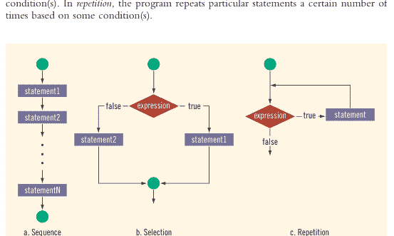

### 选择：*if* 和 *if ... else*

图4–1(b)和4–1(c)表明，执行选择语句或重复语句需要执行逻辑表达式。因此，首先我们需要了解逻辑表达式以及如何对它们求值。

**逻辑表达式：** 求值为 `true` 或 `false` 的表达式称为逻辑表达式。

例如，因为“8 大于 3”为真，所以表达式 `8 > 3` 是逻辑表达式。注意，`>` 是 C++ 中的一个运算符，称为“大于”，是关系运算符的一个例子。表4–1列出了 C++ 的关系运算符。

**表4-1** C++ 中的关系运算符

| 运算符 | 描述 |
|---|---|
| `==` | 等于 |
| `!=` | 不等于 |
| `<` | 小于 |
| `<=` | 小于或等于 |
| `>` | 大于 |
| `>=` | 大于或等于 |

> **注意：** 在 C++ 中，符号 `==`（由两个等号组成）称为相等运算符。回想一下，符号 `=` 称为赋值运算符。记住，相等运算符 `==` 判断两个表达式是否相等，而赋值运算符 `=` 将表达式的值赋给变量。

每个关系运算符都是二元运算符；也就是说，它需要两个操作数。因为比较的结果是 `true` 或 `false`，所以使用这些运算符的表达式总是求值为 `true` 或 `false`。

### 关系运算符与简单数据类型

你可以将关系运算符用于所有三种简单数据类型。在下面的示例中，表达式同时使用整数和实数：


### 示例 4-1

| 表达式 | 含义 | 值 |
|---|---|---|
| 8 < 15 | 8 小于 15 | `true` |
| 6 != 6 | 6 不等于 6 | `false` |
| 2.5 > 5.8 | 2.5 大于 5.8 | `false` |
| 5.9 <= 7.5 | 5.9 小于或等于 7.5 | `true` |
| 7 <= 10.4 | 7 小于或等于 10.4 | `true` |

### 比较字符

对于 char 值，使用关系运算符的表达式求值为 `true` 还是 `false` 取决于机器的排序序列。一些字符的排序序列如下：

| ASCII 值 | 字符 | ASCII 值 | 字符 | ASCII 值 | 字符 | ASCII 值 | 字符 |
|---|---|---|---|---|---|---|---|
| 32 | ' ' | 61 | = | 81 | Q | 105 | i |
| 33 | ! | 62 | > | 82 | R | 106 | j |
| 34 | " | 65 | A | 83 | S | 107 | k |
| 42 | * | 66 | B | 84 | T | 108 | l |
| 43 | + | 67 | C | 85 | U | 109 | m |
| 45 | - | 68 | D | 86 | V | 110 | n |
| 47 | / | 69 | E | 87 | W | 111 | o |
| 48 | 0 | 70 | F | 88 | X | 112 | p |
| 49 | 1 | 71 | G | 89 | Y | 113 | q |
| 50 | 2 | 72 | H | 90 | Z | 114 | r |
| 51 | 3 | 73 | I | 97 | a | 115 | s |
| 52 | 4 | 74 | J | 98 | b | 116 | t |
| 53 | 5 | 75 | K | 99 | c | 117 | u |
| 54 | 6 | 76 | L | 100 | d | 118 | v |
| 55 | 7 | 77 | M | 101 | e | 119 | w |
| 56 | 8 | 78 | N | 102 | f | 120 | x |
| 57 | 9 | 79 | O | 103 | g | 121 | y |
| 60 | < | 80 | P | 104 | h | 122 | z |

ASCII 字符集在附录 C 中描述。

现在，因为 32 < 97，并且 ' ' 的 ASCII 值是 32，'a' 的 ASCII 值是 97，所以 ' ' < 'a' 为 `true`。类似地，使用前面的 ASCII 值：


```
'R' > 'T' is false
'+' < '*' is false
'A' <= 'a' is true
```

注意，比较不同数据类型的值可能会产生不可预测的结果。例如，以下表达式比较一个整数和一个字符：

```
8 < '5'
```

在这个表达式中，在特定机器上，8 会与 '5' 的排序序列（即 53）进行比较。也就是说，8 与 53 进行比较，这使得这个特定表达式的求值结果为 true。

表达式 4 < 6 和 'R' > 'T' 是逻辑（布尔）表达式。当 C++ 对逻辑表达式求值时，如果该逻辑表达式的求值结果为 true，则返回整数值 1；否则返回整数值 0。在 C++ 中，任何非零值都被视为 true。

> **注意** 第 2 章介绍了数据类型 `bool`。回想一下，数据类型 `bool` 有两个值：`true` 和 `false`。在 C++ 中，`true` 和 `false` 是保留字。标识符 `true` 被设置为 1，标识符 `false` 被设置为 0。为了可读性，每当使用逻辑表达式时，这里将使用标识符 `true` 和 `false` 作为逻辑表达式的值。

既然我们知道了关系运算符如何工作，就可以开始学习如何在 C++ 程序中实现决策。尽管逻辑值只有两个，即 `true` 和 `false`，但它们极其有用，因为它们使程序能够纳入会改变处理流程的决策。本章剩余部分讨论将决策纳入程序的方法。在 C++ 中，有两种选择或分支控制结构：`if` 语句和 `switch` 结构。本节讨论如何使用 `if` 和 `if...else` 语句创建单向选择、双向选择和多路选择。`switch` 结构将在本章后面讨论。

## 单向选择

如果客户的支票账户余额低于所需最低余额，银行希望向其发送通知。也就是说，如果账户余额低于所需最低余额，就应向客户发送通知；否则，不执行任何操作。同样，如果保险单持有人不吸烟，保险公司希望对该保单保费应用 10% 的折扣。这两种情况

### 示例 4-3

```cpp
//Program to compute and output the penalty on an unpaid
//credit card balance. The program assumes that the interest
//rate on the unpaid balance is 1.5% per month.

#include <iostream>                         //Line 1
#include <iomanip>                          //Line 2

using namespace std;                        //Line 3

const double INTEREST_RATE = 0.015;         //Line 4

int main ()                                  //Line 5
{
    double creditCardBalance;               //Line 6
    double payment;                         //Line 7
    double penalty = 0.0;                   //Line 8

    cout << fixed << showpoint << setprecision(2);       //Line 11

    cout << "Line 12: Enter credit card balance: ";     //Line 12
    cin >> creditCardBalance;                            //Line 13
    cout << endl;                                        //Line 14

    cout << "Line 15: Enter the payment: ";             //Line 15
    cin >> payment;                                      //Line 16
    cout << endl;                                        //Line 17

    balance = creditCardBalance - payment;               //Line 18

    if (balance > 0)                                     //Line 19
        penalty = balance * INTEREST_RATE;               //Line 20

    cout << "Line 21: The balance is: $" << balance      //Line 21
         << endl;
    cout << "Line 22: The penalty to be added to your "   //Line 22
         << "next month bill is: $" << penalty << endl;

    return 0;                                            //Line 23
}                                                       //Line 24
```

**示例运行：** 在此示例运行中，用户输入以阴影表示。

```
Line 12: Enter credit card balance: 2500.00

Line 15: Enter the payment: 275.00

Line 21: The balance is: $2225.00
Line 22: The penalty to be added to your next month bill is: $33.38
```

第 7 行到第 10 行的语句声明了程序中使用的变量。第 12 行的语句提示用户输入信用卡账单金额。第 13 行的语句将金额输入到变量 `creditCardBalance` 中。第 15 行的语句提示用户输入付款金额。第 16 行的语句将付款金额输入到变量 payment 中。第 18 行的语句计算未付余额。第 19 行的 `if` 语句判断未付余额是否为正。如果未付余额为正，第 20 行的语句计算罚金。第 21 行和第 22 行的语句输出结果。该程序假设未付余额的年利率为 18%（即每月 1.5%）。如你所见，未付余额的利息会迅速累积，不仅会损害你的信用评级，还会使你陷入财务困境。

### 示例 4-4

考虑以下语句：

```cpp
if score >= 60      //syntax error
    grade = 'F';
```

这条语句展示了一个不正确的 `if` 语句版本。逻辑表达式两侧缺少圆括号，这是一个语法错误。

在 `if` 语句中，在表达式之后的圆括号后（即在语句之前）放置分号是一个语义错误。如果分号紧跟在右圆括号之后，`if` 语句将对空语句进行操作。

### 示例 4-5

考虑以下 C++ 语句：

```cpp
if (score >= 60);      //Line 1
    grade = 'F';       //Line 2
```

因为表达式末尾有一个分号（见第 1 行），所以第 1 行的 `if` 语句终止。这个 `if` 语句的动作是空操作，第 2 行的语句不属于第 1 行的 `if` 语句。因此，无论 `if` 语句的求值结果如何，第 2 行的语句都会执行。

## 双向选择

在许多编程情形中，你必须在两个备选方案之间做出选择。例如，如果兼职员工加班工作，工资单使用加班工资公式计算；否则，工资单使用常规公式计算。这是一个双向选择的例子。为了在两个备选方案之间做出选择——也就是实现双向选择——C++ 提供了 `if...else` 语句。双向选择使用以下语法：

### 示例 4-7

以下程序确定员工的周工资。如果工作小时数超过 40，则工资包含加班费。

```cpp
//Program: Weekly wages

#include <iostream>                                      //Line 1
#include <iomanip>                                       //Line 2

using namespace std;                                     //Line 3

int main()                                                //Line 4
{                                                         //Line 5
    double wages, rate, hours;                            //Line 6

    cout << fixed << showpoint << setprecision(2);        //Line 7
    cout << "Line 8: Enter working hours and rate: ";     //Line 8
    cin >> hours >> rate;                                  //Line 9

    if (hours > 40.0)                                      //Line 10
        wages = 40.0 * rate +                              //Line 11
                1.5 * rate * (hours - 40.0);               //Line 12
    else                                                  //Line 12
        wages = hours * rate;                              //Line 13

    cout << endl;                                          //Line 14
    cout << "Line 15: The wages are $" << wages << endl;  //Line 15

    return 0;                                              //Line 16
}                                                         //Line 17
```

**示例运行：** 在此示例运行中，用户输入以阴影表示。

Line 8: Enter working hours and rate: 50.00 12.50

Line 15: The wages are $687.50

第 6 行的语句声明了程序中使用的变量。第 7 行的语句将浮点数的输出设置为固定小数格式，带小数点、尾随零和两位小数。第 8 行的语句提示用户输入工作小时数和工资率。第 9 行的语句将这些值分别输入到变量 hours 和 rate 中。第 10 行的语句检查变量 hours 的值是否大于 40.0。如果 hours 大于 40.0，则由第 11 行的语句计算工资，其中包含加班费。否则，由第 13 行的语句计算工资。第 15 行的语句输出工资。

在双向选择语句中，在表达式之后、语句1之前放置分号会产生语法错误。如果 `if` 语句以分号结束，


语句 1 不再是 `if` 语句的一部分，并且 `if...else` 语句的 `else` 部分完全独立存在。C++ 中没有独立的 `else` 语句。也就是说，它不能与 `if` 语句分离。

### 示例 4-8

以下语句展示了一个语法错误的示例：

```cpp
if (hours > 40.0);                    //Line 1
    wages = 40.0 * rate +             //Line 2
              1.5 * rate * (hours - 40.0); //Line 2
else                                  //Line 3
    wages = hours * rate;              //Line 4
```

`if` 语句末尾的分号（见第 1 行）结束了该 `if` 语句，因此第 2 行中的语句将 `else` 子句与 `if` 语句分隔开来。也就是说，`else` 完全独立存在。由于 C++ 中没有独立的 `else` 语句，这段代码会产生语法错误。如示例 4-5 所示，在单向选择中，`if` 语句末尾的分号是逻辑错误；而如本示例所示，在双向选择中，它是语法错误。

现在让我们考虑另一个 `if` 语句的示例，并检查可能发生的一些语义错误。

### 示例 4-9

考虑以下语句：

```cpp
if (score >= 60)                  //Line 1
    cout << "Passing" << endl;     //Line 2
    cout << "Failing" << endl;     //Line 3
```

如果表达式 (score >= 60) 求值为 `false`，则第 2 行中的输出语句不会执行。因此输出将是 Failing。也就是说，这组语句执行的操作与 `if...else` 语句相同。它将执行第 3 行中的输出语句，而不是第 2 行中的输出语句。例如，如果 score 的值为 50，这些语句将输出以下行：

Failing

然而，如果表达式 (score >= 60) 求值为 `true`，程序将执行两个输出语句，从而产生非常不理想的结果。例如，如果 score 的值为 70，这些语句将输出以下行：

Passing
Failing

`if` 语句只控制第 2 行中语句的执行。第 3 行中的语句总是会执行。

现在，逻辑（布尔）表达式 `(score >= 60)` 求值为 `true` 或 `false`。因此我们使用了两个不同的 `score` 值——一个使逻辑（布尔）表达式求值为 `true`，另一个使其求值为 `false`。这是一个全面测试代码的示例。

根据 `score` 的值打印 Passing 或 Failing 的正确代码是：

```cpp
if (score >= 60)
    cout << "Passing" << endl;
else
    cout << "Failing" << endl;
```

## `int` 数据类型与逻辑（布尔）表达式

早期版本的 C++ 没有提供具有逻辑（或布尔）值 `true` 和 `false` 的内置数据类型。因为逻辑表达式的求值为 1 或 0，所以逻辑表达式的值存储在 `int` 数据类型的变量中。因此，你可以使用 `int` 数据类型来操作逻辑（布尔）表达式。

回想一下，非零值被视为 `true`。现在，考虑以下声明：

```cpp
int legalAge;
int age;
```

以及赋值语句：

```cpp
legalAge = 21;
```

如果你将 `legalAge` 视为逻辑变量，那么该语句赋给 `legalAge` 的值是 `true`。

赋值语句：

```cpp
legalAge = (age >= 21);
```

如果 `age` 的值大于或等于 21，则将值 1 赋给 `legalAge`。如果 `age` 的值小于 21，则该语句将值 0 赋给 `legalAge`。

有趣的是，`!(!true)` 求值为 `true`。然而，`!(36)` 求值为 0，因为作为逻辑表达式，36 求值为 1，所以 `!(36)` 求值为 0，并且 `!(!36) = !(0) = 1`。

## `bool` 数据类型与逻辑（布尔）表达式

较新版本的 C++ 包含一个内置数据类型 `bool`，它具有逻辑（布尔）值 `true` 和 `false`。因此，你可以使用 `bool` 数据类型来操作逻辑（布尔）表达式。回想一下，在 C++ 中，`bool`、`true` 和 `false` 是保留字。此外，标识符 `true` 的值为 1，标识符 `false` 的值为 0。现在，考虑以下声明：

```cpp
bool legalAge;
int age;
```

语句：`legalAge = true;` 将变量 `legalAge` 的值设置为 `true`。

语句：`legalAge = (age >= 21);` 如果 `age` 的值大于或等于 21，则将值 `true` 赋给 `legalAge`。如果 `age` 的值小于 21，则该语句将值 `false` 赋给 `legalAge`。例如，如果 `age` 的值为 25，则赋给 `legalAge` 的值为 `true`——即 1。类似地，如果 `age` 的值为 16，则赋给 `legalAge` 的值为 `false`——即 0。

> 注意：你可以使用 int 变量或 bool 变量来存储逻辑表达式的值。为了清晰起见，本书使用 bool 变量来存储逻辑表达式的值。

## 逻辑（布尔）运算符与逻辑表达式

示例 4-3 和 4-7 展示了如何在程序中加入选择语句。然而，这些示例中使用的逻辑表达式只涉及单个关系运算符的求值。有些情况下，逻辑表达式是两个或更多逻辑表达式的组合。例如，假设 weight 和 height 是 double 变量。考虑以下逻辑表达式：

`weight > 180 and height < 6.0`

这个逻辑表达式是逻辑表达式 `weight > 180` 和 `height < 6.0` 的组合，而这些逻辑表达式使用单词 *“and”* 组合起来。那么，我们如何在 C++ 中求值并实现这样的表达式呢？

本节描述如何构造和求值由其他逻辑表达式组合而成的逻辑表达式。**逻辑（布尔）运算符**使你能够组合逻辑表达式。C++ 有三个逻辑（布尔）运算符，如表 4-2 所示。

**表 4-2** C++ 中的逻辑（布尔）运算符

| 运算符 | 描述 |
| :--- | :--- |
| `!` | 非 |
| `&&` | 与 |
| `\|\|` | 或 |

逻辑运算符只接受逻辑值作为操作数，并且结果只产生逻辑值。运算符 `!` 是一元运算符，因此它只有一个操作数。运算符 `&&` 和 `||` 是二元运算符，并且这些运算符内部没有空格。表 4-3、表 4-4 和表 4-5 定义了这些运算符。

表 4-3 定义了运算符 `!`（非）。当你使用 `!` 运算符时，`!true` 为 `false`，`!false` 为 `true`。将 `!` 放在逻辑表达式前面会反转该逻辑表达式的值。

**表 4-3** `!`（非）运算符

| 表达式 | !(表达式) |
|---|---|
| `true`（非零） | `false`（0） |
| `false`（0） | `true`（1） |

### 示例 4-10

| 表达式 | 值 | 解释 |
|---|---|---|
| `!('A' > 'B')` | `true` | 因为 `'A' > 'B'` 为 `false`，所以 `!('A' > 'B')` 为 `true`。 |
| `!(6 <= 7)` | `false` | 因为 `6 <= 7` 为 `true`，所以 `!(6 <= 7)` 为 `false`。 |

表 4-4 定义了运算符 `&&`（与）。由该表可知，当且仅当 Expression1 和 Expression2 都为 `true` 时，Expression1 && Expression2 才为 `true`；否则，Expression1 && Expression2 求值为 `false`。

**表 4-4** `&&`（与）运算符

| 表达式1 | 表达式2 | 表达式1 && 表达式2 |
|---|---|---|
| `true`（非零） | `true`（非零） | `true`（1） |
| `true`（非零） | `false`（0） | `false`（0） |
| `false`（0） | `true`（非零） | `false`（0） |
| `false`（0） | `false`（0） | `false`（0） |

### 示例 4-11

| 表达式 | 值 | 解释 |
|---|---|---|
| `(14 >= 5) && ('A' < 'B')` | `true` | 因为 `(14 >= 5)` 为 `true`，`('A' < 'B')` 为 `true`，且 `true && true` 为 `true`，所以该表达式求值为 `true`。 |
| `(24 >= 35) && ('A' < 'B')` | `false` | 因为 `(24 >= 35)` 为 `false`，`('A' < 'B')` 为 `true`，且 `false && true` 为 `false`，所以该表达式求值为 `false`。 |

表 4-5 定义了运算符 `||`（或）。由该表可知，当且仅当表达式 `Expression1` 或 `Expression2` 中至少有一个为 true 时，`Expression1 || Expression2` 才为 true；否则，`Expression1 || Expression2` 求值为 false。

**表 4-5** `||`（或）运算符

| 表达式1 | 表达式2 | 表达式1 \|\| 表达式2 |
|---|---|---|
| true（非零） | true（非零） | true（1） |
| true（非零） | false（0） | true（1） |
| false（0） | true（非零） | true（1） |
| false（0） | false（0） | false（0） |

### 示例 4-12

| 表达式 | 值 | 解释 |
|---|---|---|
| `(14 >= 5) \|\| ('A' > 'B')` | `true` | 因为 `(14 >= 5)` 为 true，`('A' > 'B')` 为 false，且 `true \|\| false` 为 true，所以该表达式求值为 true。 |
| `(24 >= 35) \|\| ('A' > 'B')` | `false` | 因为 `(24 >= 35)` 为 false，`('A' > 'B')` 为 false，且 `false \|\| false` 为 false，所以该表达式求值为 false。 |
| `('A' <= 'a') \|\| (7 != 7)` | `true` | 因为 `('A' <= 'a')` 为 true，`(7 != 7)` 为 false，且 `true \|\| false` 为 true，所以该表达式求值为 true。 |

## 优先级顺序

复杂的逻辑表达式可能难以求值。考虑以下逻辑表达式：

11 > 5 || 6 < 15 && 7 >= 8

根据先求值 `||` 还是先求值 `&&`，这个逻辑表达式会得到不同的结果。如果先求值 `||`，该表达式求值为 `false`。如果先求值 `&&`，该表达式求值为 `true`。

一个表达式可能包含算术运算符、关系运算符和逻辑运算符，例如以下表达式：

5 + 3 <= 9 && 2 > 3

要处理复杂的逻辑表达式，必须有一套用于求值运算符的优先级方案。表 4-6 展示了一些 C++ 运算符的优先级顺序，包括算术运算符、关系运算符和逻辑运算符。（所有 C++ 运算符的优先级见附录 B。）


### 表 4-6 运算符优先级

| 运算符 | 优先级 |
|---|---|
| `!`, `+`, `-`（一元运算符） | 第一 |
| `*`, `/`, `%` | 第二 |
| `+`, `-` | 第三 |
| `<`, `<=`, `>=`, `>` | 第四 |
| `==`, `!=` | 第五 |
| `&&` | 第六 |
| <code>||</code> | 第七 |
| `=`（赋值运算符） | 最后 |

> **注意：** 在 C++ 中，`&` 和 `|` 也是运算符。这些运算符的含义与 `&&` 和 `||` 的含义不同。用 `&` 代替 `&&`，或用 `|` 代替 `||`——这可能是打字错误造成的——会产生非常奇怪的结果。

使用表达式中的优先级规则时，关系运算符和逻辑运算符从左到右求值。由于关系运算符和逻辑运算符从左到右求值，因此这些运算符的**结合性**被认为是从左到右。

示例 4-13 说明了由变量组成的逻辑表达式是如何求值的。

### 示例 4-13

假设有以下声明：

```cpp
bool found = true;
int age = 20;
double hours = 45.30;
double overTime = 15.00;
int count = 20;
char ch = 'B';
```

考虑以下表达式：

| 表达式 | 值/说明 |
|---|---|
| `!found` | **假**<br>因为 `found` 为 **真**，所以 `!found` 为 **假**。 |
| `hours > 40.00` | **真**<br>因为 `hours` 为 45.30，且 45.30 > 40.00 为 **真**，所以表达式 `hours > 40.00` 求值为 **真**。 |
| `!age` | **假**<br>`age` 为 20，非零，因此 `age` 求值为 **真**。所以 `!age` 为 **假**。 |
| `!found && (age >= 18)` | **假**<br>`!found` 为 **假**；`age >= 18` 即 20 >= 18，为 **真**。因此，`!found && (age >= 18)` 为 **假 && 真**，求值为 **假**。 |
| `!(found && (age >= 18))` | **假**<br>现在，`found && (age >= 18)` 为 **真 && 真**，求值为 **真**。因此，`!(found && (age >= 18))` 为 **!真**，求值为 **假**。 |
| `hours + overTime <= 75.00` | **真**<br>因为 `hours + overTime` 为 45.30 + 15.00 = 60.30，且 60.30 <= 75.00 为 **真**，所以 `hours + overTime <= 75.00` 求值为 **真**。 |
| `(count >= 0) && (count <= 100)` | **真**<br>现在，`count` 为 20。因为 20 >= 0 为 **真**，所以 `count >= 0` 为 **真**。又因为 20 <= 100 为 **真**，所以 `count <= 100` 为 **真**。因此，`(count >= 0) && (count <= 100)` 为 **真 && 真**，求值为 **真**。 |
| `('A' <= ch && ch <= 'Z')` | **真**<br>这里，`ch` 为 `'B'`。因为 `'A' <= 'B'` 为 **真**，所以 `'A' <= ch` 求值为 **真**。又因为 `'B' <= 'Z'` 为 **真**，所以 `ch <= 'Z'` 求值为 **真**。因此，`('A' <= ch && ch <= 'Z')` 为 **真 && 真**，求值为 **真**。 |

注意，如果逻辑表达式的值为 **真**，则其求值为 1；如果逻辑表达式的值为 **假**，则其求值为 0。本书配套网站包含程序 `Ch4_LogicalOperators.cpp`，该程序会计算这些表达式的值。

可以在表达式中插入括号以明确其含义。也可以使用括号来覆盖运算符的优先级。使用标准优先级顺序，表达式：

```text
11 > 5 || 6 < 15 && 7 >= 8
```

等价于：

```text
11 > 5 || (6 < 15 && 7 >= 8)
```

在这个表达式中，11 > 5 为真，6 < 15 为真，7 >= 8 为假。将这些值代入表达式 11 > 5 || (6 < 15 && 7 >= 8)，得到 真 || (真 && 假) = 真 || 假 = 真。因此，表达式 11 > 5 || (6 < 15 && 7 >= 8) 求值为真。

在 C++ 中，逻辑（布尔）表达式可以通过两种方式之一来操作或处理：使用 int 变量或使用 bool 变量。以下各节介绍这些方法。

### 示例 4-14

通常在经济舱航班上，如果行李箱尺寸（长 + 宽 + 深）超过 108 英寸，*或*重量超过 50 磅，航空公司可能会向乘客收取额外费用。以下程序在 *if* 语句中使用逻辑运算符 ||（或）来确定是否可能对行李箱收取额外费用。

```cpp
//Chapter 4: Example 4-14
//Program to determine if additional charges are applicable on
//a suitcase accompanying a passenger on an economy flight.

#include <iostream>                        //Line 1
#include <iomanip>                         //Line 2

using namespace std;                       //Line 3

int main()                                 //Line 4
{                                          //Line 5
    double suitcaseDimension;              //Line 6
    double suitcaseWeight;                 //Line 7
    double additionalCharges = 0.0;        //Line 8

    cout << fixed << showpoint << setprecision(2);          //Line 9
    cout << "Line 10: Enter suitcase dimensions "           //Line 10
         << "(length + width + depth) in inches: ";         //Line 11
    cin >> suitcaseDimension;                              //Line 12
    cout << endl;                                          //Line 13

    cout << "Line 14: Enter suitcase weight in pounds: ";   //Line 14
    cin >> suitcaseWeight;                                  //Line 15
    cout << endl;                                           //Line 16

    if (suitcaseDimension > 108 || suitcaseWeight > 50)     //Line 17
        additionalCharges = 50.00;                          //Line 18

    cout << "Line 19: Additional suitcase charges: $"      //Line 19
         << additionalCharges << endl;                    //Line 20

    return 0;                                             //Line 21
}                                                     //Line 22
```

### 示例运行：

```text
Line 10: Enter suitcase dimensions (length + width + depth) in inches: 110
Line 14: Enter suitcase weight: 49
Line 19: Additional suitcase charges: $50.00
```

## 关系运算符与 string 类型

关系运算符可应用于 string 类型的变量。string 类型的变量会逐字符进行比较，从第一个字符开始，并使用 ASCII 排序序列。逐字符比较会一直进行，直到发现不匹配，或最后一个字符也已比较且相等为止。以下示例展示了如何比较 string 类型的变量。

### 示例 4-15

假设有以下语句：

```cpp
string str1 = "Hello";
string str2 = "Hi";
string str3 = "Air";
string str4 = "Bill";
string str5 = "Big";
```

以下表达式展示了 string 关系表达式如何求值。

| 表达式 | 值/说明 |
|---|---|
| `str1 < str2` | **真**<br>`str1 = "Hello"` 且 `str2 = "Hi"`。`str1` 和 `str2` 的第一个字符相同，但 `str1` 的第二个字符 `'e'` 小于 `str2` 的第二个字符 `'i'`。因此，`str1 < str2` 为 **真**。 |
| `str1 > "Hen"` | **假**<br>`str1 = "Hello"`。`str1` 和 `"Hen"` 的前两个字符相同，但 `str1` 的第三个字符 `'l'` 小于 `"Hen"` 的第三个字符 `'n'`。因此，`str1 > "Hen"` 为 **假**。 |
| `str3 < "An"` | **真**<br>`str3 = "Air"`。`str3` 和 `"An"` 的第一个字符相同，但 `"Air"` 的第二个字符 `'i'` 小于 `"An"` 的第二个字符 `'n'`。因此，`str3 < "An"` 为真。 |
| `str1 == "hello"` | **假**<br>`str1 = "Hello"`。`str1` 的第一个字符 `'H'` 小于 `"hello"` 的第一个字符 `'h'`，因为 `'H'` 的 ASCII 值为 72，而 `'h'` 的 ASCII 值为 104。因此，`str1 == "hello"` 为假。 |
| `str3 <= str4` | **真**<br>`str3 = "Air"` 且 `str4 = "Bill"`。`str3` 的第一个字符 `'A'` 小于 `str4` 的第一个字符 `'B'`。因此，`str3 <= str4` 为真。 |
| `str2 > str4` | **真**<br>`str2 = "Hi"` 且 `str4 = "Bill"`。`str2` 的第一个字符 `'H'` 大于 `str4` 的第一个字符 `'B'`。因此，`str2 > str4` 为真。 |

如果比较两个长度不同的字符串，并且逐字符比较直到较短的字符串的最后一个字符时都相等，则较短的字符串会被判定为小于较长的字符串，如下所示。

| 表达式 | 值/说明 |
|---|---|
| `str4 >= "Billy"` | **假**<br>`str4 = "Bill"`。它有四个字符，而 `"Billy"` 有五个字符。因此，`str4` 是较短的字符串。`str4` 的四个字符都与 `"Billy"` 对应的前四个字符相同，而 `"Billy"` 是较长的字符串。因此，`str4 >= "Billy"` 为假。 |
| `str5 <= "Bigger"` | **真**<br>`str5 = "Big"`。它有三个字符，而 `"Bigger"` 有六个字符。因此，`str5` 是较短的字符串。`str5` 的三个字符都与 `"Bigger"` 对应的前三个字符相同，而 `"Bigger"` 是较长的字符串。因此，`str5 <= "Bigger"` 为真。 |

本书配套网站上的程序 `Ch4_StringComparisons.cpp` 展示了前面这些表达式的结果。


## 复合语句（语句块）

`if` 和 `if...else` 结构一次只控制一条语句。然而，假设当 `if` 或 `if...else` 语句中的表达式求值为 `true` 时，你希望执行不止一条语句。为了支持更复杂的语句，C++ 提供了一种称为**复合语句**或**语句块**的结构。复合语句采用以下形式：

```cpp
{
    statement_1
    statement_2
    .
    .
    .
    statement_n
}
```

一般来说，复合语句由一条或多条语句组成，这些语句括在花括号 `{` 和 `}` 中。在 `if` 或 `if...else` 结构中，复合语句的作用就像一条语句一样。因此，与其使用类似以下代码的简单双向选择：

```cpp
if (age >= 18)
    cout << "Eligible to vote." << endl;
else
    cout << "Not eligible to vote." << endl;
```

你可以改为包含复合语句，类似以下代码：

```cpp
if (age >= 18)
{
    cout << "Eligible to vote." << endl;
    cout << "No longer a minor." << endl;
}
else
{
    cout << "Not eligible to vote." << endl;
    cout << "Still a minor." << endl;
}
```

复合语句非常有用，并将用于本书大多数结构化语句中。

## 多重选择：嵌套 if

在前面的章节中，你学习了如何在程序中实现单向和双向选择。有些问题需要实现两个以上的备选方案。例如，假设如果支票账户余额超过 $50,000，利率为 7%；如果余额在 $25,000 到 $49,999.99 之间，利率为 5%；如果余额在 $1,000 到 $24,999.99 之间，利率为 3%；否则，利率为 0%。

这个特定问题有四个备选方案——也就是多条选择路径。如果操作语句本身是 `if` 或 `if...else` 语句，你可以通过使用 `if...else` 结构在程序中包含多条选择路径。当一个控制语句位于另一个控制语句内部时，就称其为**嵌套**。

例 4-16 说明了如何使用嵌套 `if...else` 结构来实现多重选择。

### 例 4-16

假设 `balance` 和 `interestRate` 是 `double` 类型的变量。以下语句根据 `balance` 的值确定 `interestRate`：

```cpp
if (balance > 50000.00)                 //Line 1
    interestRate = 0.07;                //Line 2
else                                    //Line 3
    if (balance >= 25000.00)            //Line 4
        interestRate = 0.05;            //Line 5
    else                                //Line 6
        if (balance >= 1000.00)         //Line 7
            interestRate = 0.03;        //Line 8
        else                            //Line 9
            interestRate = 0.00;        //Line 10
```

嵌套 `if...else` 结构要求回答一个重要问题：如何知道哪个 `else` 与哪个 `if` 配对？回想一下，在 C++ 中，没有独立的 `else` 语句。每个 `else` 都必须与一个 `if` 配对。将 `else` 与 `if` 配对的规则如下：

**将 `else` 与 `if` 配对：** 在嵌套 `if` 语句中，C++ 会将 `else` 与最近的未完成 `if` 关联起来——也就是最近一个尚未与 `else` 配对的 `if`。

使用这条规则，在例 4-16 中，第 3 行的 `else` 与第 1 行的 `if` 配对。第 6 行的 `else` 与第 4 行的 `if` 配对，第 9 行的 `else` 与第 7 行的 `if` 配对。这意味着每个 `else` 的语句块都从该 `else` 一直延伸到第 10 行。

为避免过度缩进，例 4-16 中的代码可以改写如下：

```cpp
if (balance > 50000.00)                 //Line 1
    interestRate = 0.07;                //Line 2
else if (balance >= 25000.00)            //Line 3
    interestRate = 0.05;                //Line 4
else if (balance >= 1000.00)             //Line 5
    interestRate = 0.03;                //Line 6
else                                    //Line 7
    interestRate = 0.00;                //Line 8
```

以下示例将帮助你了解使用嵌套 `if` 结构实现多重选择的各种方式。

### 例 4-17

假设 score 是 `int` 类型的变量。根据 score 的值，以下代码输出成绩：

```cpp
if (score >= 90)
    cout << "The grade is A." << endl;
else if (score >= 80)
    cout << "The grade is B." << endl;
else if (score >= 70)
    cout << "The grade is C." << endl;
else if (score >= 60)
    cout << "The grade is D." << endl;
else
    cout << "The grade is F." << endl;
```

### 例 4-18

假设所有变量都已正确声明，并考虑以下语句：

```cpp
if (temperature >= 50)                         //Line 1
    if (temperature >= 80)                     //Line 2
        cout << "Good day for swimming." << endl; //Line 3
    else                                       //Line 4
        cout << "Good day for golfing." << endl;  //Line 5
else                                           //Line 6
    cout << "Good day to play tennis." << endl;   //Line 7
```

在这段 C++ 代码中，第 4 行的 `else` 与第 2 行的 `if` 配对，第 6 行的 `else` 与第 1 行的 `if` 配对。注意，第 4 行的 `else` 不能与第 1 行的 `if` 配对。如果你将第 4 行的 `else` 与第 1 行的 `if` 配对，那么第 2 行的 `if` 就会成为第 1 行 `if` 的操作语句部分，从而使第 6 行的 `else` 悬空。此外，第 2 行到第 5 行的语句构成第 1 行 `if` 的语句部分。缩进并不决定配对关系，但应使用缩进来表达配对关系。

### 例 4-19

假设所有变量都已正确声明，并考虑以下语句：

```cpp
if (temperature >= 70)                         //Line 1
    if (temperature >= 80)                     //Line 2
        cout << "Good day for swimming." << endl; //Line 3
    else                                       //Line 4
        cout << "Good day for golfing." << endl;  //Line 5
```

在这段代码中，第 4 行的 `else` 与第 2 行的 `if` 配对。注意，对于第 4 行的 `else`，最近的未完成 `if` 位于第 2 行。在这段代码中，第 1 行的 `if` 没有 `else`，是一个单向选择。再次说明，缩进并不决定配对关系，但它表达配对关系。注意，如果 `temperature` 的值小于 70，这段代码不会做出任何判定。

### 例 4-20

假设所有变量都已正确声明，并考虑以下语句：

```cpp
if (gender == 'M')                    //Line 1
    if (age < 21)                      //Line 2
        policyRate = 0.05;             //Line 3
    else                               //Line 4
        policyRate = 0.035;            //Line 5
else if (gender == 'F')                //Line 6
    if (age < 21)                      //Line 7
        policyRate = 0.04;             //Line 8
    else                               //Line 9
        policyRate = 0.03;             //Line 10
```

在这段代码中，第 4 行的 `else` 与第 2 行的 `if` 配对。注意，对于第 4 行的 `else`，最近的未完成 `if` 是第 2 行的 `if`。第 6 行的 `else` 与第 1 行的 `if` 配对。第 9 行的 `else` 与第 7 行的 `if` 配对。再次说明，缩进并不决定配对关系，但它表达配对关系。

## 比较 if...else 语句与一系列 if 语句

考虑以下 C++ 程序片段，它们都完成相同的任务：

```cpp
a.  if (month == 1)                     //Line 1
        cout << "January" << endl;      //Line 2
    else if (month == 2)                 //Line 3
        cout << "February" << endl;     //Line 4
    else if (month == 3)                 //Line 5
        cout << "March" << endl;        //Line 6
    else if (month == 4)                 //Line 7
        cout << "April" << endl;        //Line 8
    else if (month == 5)                 //Line 9
        cout << "May" << endl;          //Line 10
    else if (month == 6)                 //Line 11
        cout << "June" << endl;         //Line 12
```


```cpp
b.  if (month == 1)
        cout << "January" << endl;
    if (month == 2)
        cout << "February" << endl;
    if (month == 3)
        cout << "March" << endl;
    if (month == 4)
        cout << "April" << endl;
    if (month == 5)
        cout << "May" << endl;
    if (month == 6)
        cout << "June" << endl;
```

程序段(a)写为一系列`if...else`语句；程序段(b)写为一系列`if`语句。两个程序段完成相同的事情。如果month为3，则两个程序段都输出March。如果month为1，则在程序段(a)中，第1行`if`语句中的表达式求值为`true`。然后执行与该`if`关联的语句（在第2行）；该结构的其余部分（即该`if`语句的`else`）被跳过；其余的`if`语句不被求值。在程序段(b)中，计算机必须对每个`if`语句中的表达式求值，因为没有`else`语句。因此，程序段(b)的执行速度比程序段(a)慢。

在一系列`if...else`语句（如(a)）中，如果多个条件为`true`，则只执行与第一个`true`条件关联的语句。另一方面，在一系列`if`语句（如(b)）中，如果多个条件求值为`true`，则与每个`true`条件关联的语句都将执行。

## 短路求值

C++中的逻辑表达式使用一种高效算法求值。借助以下语句说明该算法：

```cpp
(x > y) || (x == 5)       //Line 1
(a == b) && (x >= 7)      //Line 2
```

在第1行的语句中，运算符`||`的两个操作数是表达式`(x > y)`和`(x == 5)`。如果操作数`(x > y)`为`true`或操作数`(x == 5)`为`true`，则该表达式求值为`true`。使用短路求值，计算机从左到右对逻辑表达式求值。一旦知道整个逻辑表达式的最终值，求值就停止。例如，在语句1中，如果操作数`(x > y)`求值为`true`，则整个表达式求值为`true`，因为`true || true`为`true`，`true || false`为`true`。因此，操作数`(x == 5)`的值不影响最终结果。

类似地，在第2行的语句中，运算符`&&`的两个操作数是`(a == b)`和`(x >= 7)`。如果操作数`(a == b)`求值为`false`，则整个表达式求值为`false`，因为`false && true`为`false`，`false && false`为`false`。

**短路求值**（针对逻辑表达式）：一种过程，计算机从左到右对逻辑表达式求值，一旦知道表达式的最终值就停止。

### 例 4-21

考虑以下表达式：

```cpp
(age >= 21) || (x == 5)     //Line 1
(grade == 'A') && (x >= 7)   //Line 2
```

对于第1行的表达式，假设age的值为25。因为(25 >= 21)为**真**，且表达式中使用的逻辑运算符是||，所以该表达式求值为**真**。由于短路求值，计算机不求值表达式(x == 5)。类似地，对于第2行的表达式，假设grade的值为'B'。因为('B' == 'A')为**假**，且表达式中使用的逻辑运算符是&&，所以该表达式求值为**假**。计算机不求值(x >= 7)。

## 比较浮点数是否相等：注意事项

比较浮点数是否相等可能不会像你预期的那样运行。例如，考虑以下程序：

```cpp
#include <iostream>
#include <iomanip>
#include <cmath>

using namespace std;

int main()
{
    double x = 1.0;
    double y = 3.0 / 7.0 + 2.0 / 7.0 + 2.0 / 7.0;

    cout << fixed << showpoint << setprecision(17);

    cout << "3.0 / 7.0 + 2.0 / 7.0 + 2.0 / 7.0 = "
         << 3.0 / 7.0 + 2.0 / 7.0 + 2.0 / 7.0 << endl;

    cout << "x = " << x << endl;
    cout << "y = " << y << endl;

    if (x == y)
        cout << "x and y are the same." << endl;
    else
        cout << "x and y are not the same." << endl;

    if (fabs(x - y) < 0.000001)
        cout << "x and y are the same within the tolerance "
             << "0.000001." << endl;
    else
        cout << " x and y are not the same within the "
             << "tolerance 0.000001." << endl;

    return 0;
}
```

**示例运行：**

```text
3.0 / 7.0 + 2.0 / 7.0 + 2.0 / 7.0 = 0.99999999999999989
x = 1.0000000000000000
 y = 0.99999999999999989
x and y are not the same.
x and y are the same within the tolerance 0.000001.
```

在这个程序中，x被初始化为1.0，y被初始化为3.0 / 7.0 + 2.0 / 7.0 + 2.0 / 7.0。现在，由于舍入（如输出所示），该表达式求值为0.99999999999999989。因此，表达式(x == y)求值为假。然而，如果你用纸和笔手动计算表达式3.0 / 7.0 + 2.0 / 7.0 + 2.0 / 7.0，你将得到3.0 / 7.0 + 2.0 / 7.0 + 2.0 / 7.0 = (3.0 + 2.0 + 2.0) / 7.0 = 7.0 / 7.0 = 1.0。也就是说，y的值应设为1.0，并且x应等于y。

前面的程序及其输出表明，在比较浮点数是否相等时应小心。检查两个浮点数是否相等的一种方法是检查它们之差的绝对值是否小于某个容差。例如，假设容差为0.000001。那么，如果(x − y)的绝对值小于0.000001，则x和y相等。要求绝对值，可以使用头文件cmath中的函数fabs（求浮点数的绝对值），如程序所示。因此，表达式fabs (x − y) < 0.000001确定(x − y)的绝对值是否小于0.000001。

## 关系运算符的结合性：注意事项

有时逻辑表达式不会像你预期的那样运行，如以下程序所示，该程序判断一个数是否在0到10之间（包含边界）。

```cpp
#include <iostream>

using namespace std;

int main()
{
    int num;

    cout << "Enter an integer: ";
    cin >> num;
    cout << endl;

    if (0 <= num <= 10)
        cout << num << " is within 0 and 10." << endl;
    else
        cout << num << " is not within 0 and 10." << endl;

    return 0;
}
```

**示例运行：** 在这些示例运行中，用户输入以阴影显示。

**示例运行1：**

输入一个整数：`5`

5在0和10之间。

**示例运行2：**

输入一个整数：`20`

20在0和10之间。

**示例运行3：**

输入一个整数：`−10`

−10在0和10之间。

显然，示例运行1是正确的，而示例运行2和3不正确。现在，`if`语句本应判断一个整数是否在0和10之间。看来情况并非如此。所以问题出在`if`语句中的表达式上。让我们看看这个表达式，它是：

`0 <= num <= 10`

尽管该语句是合法的C++表达式，但你得不到期望的结果。让我们针对`num`的某些值对该表达式求值。假设num的值为5。那么：

| 表达式 | 求值 | 说明 |
|---|---|---|
| `0 <= num <= 10` | `= 0 <= 5 <= 10` |  |
|  | `= (0 <= 5) <= 10` | （因为关系运算符从左到右求值） |
|  | `= 1 <= 10` | （因为`0 <= 5`为真，所以`0 <= 5`求值为1） |
|  | `= 1 (true)` |  |

现在，假设`num = 20`。那么：

| 表达式 | 求值 | 说明 |
|---|---|---|
| `0 <= num <= 10` | `= 0 <= 20 <= 10` | |
| | `= (0 <= 20) <= 10` | （因为关系运算符从左到右求值） |
| | `= 1 <= 10` | （因为`0 <= 20`为**真**，所以`0 <= 20`求值为1） |
| | `= 1` (**真**) | |

现在，你可以看到为什么当`num`为20时该表达式求值为**真**。类似地，如果`num`为−10，表达式`0 <= num <= 10`求值为**真**。事实上，无论`num`是什么，该表达式将始终求值为**真**。这是因为表达式`0 <= num`求值为0或1，而`0 <= 10`为**真**，`1 <= 10`为**真**。那么表达式`0 <= num <= 10`有什么问题呢？它缺少逻辑运算符`&&`。在C++中编写该表达式的正确方式是：

```cpp
0 <= num && num <= 10
```

根据运算符优先级，表达式`0 <= num && num <= 10`与`(0 <= num) && (num <= 10)`相同。

在构造逻辑表达式时必须小心。创建复杂逻辑表达式时，必须使用正确的逻辑运算符。

## 通过避免一知半解的概念和技术来避免缺陷

第2章和第3章中的调试部分说明了如何理解和修复语法错误和逻辑错误。在本节中，我们说明如何通过避免一知半解的概念和技术来避免缺陷。

你到目前为止编写的程序应该已经说明，小错误（例如变量声明末尾遗漏分号，或使用变量而未正确声明）可能导致程序无法成功编译。类似地，使用变量而未正确初始化可能导致程序无法正确运行。回想一下，与`if`语句关联的条件必须括在圆括号中。因此，以下表达式将导致语法错误：

```cpp
if score >= 90
```

例4-12说明，以下`if`语句的条件后面出现意外分号：

```cpp
if (hours > 40.0);
```

可能会阻止成功编译或正确执行。


解决问题所采用的方法必须正确使用概念和技术；否则，你的解决方案要么不正确，要么有缺陷。使用一知半解的概念和技术所导致的问题，可以通过下面的程序来说明。

假设我们要编写一个分析学生 GPA 的程序。如果 GPA 大于或等于 3.9，该学生进入院长荣誉名单。如果 GPA 小于 2.00，则向该学生发送一封警告信，说明其 GPA 低于毕业要求。因此，考虑下面的程序：

```cpp
//GPA program with bugs.

#include <iostream>                         //line 1

using namespace std;                         //line 2

int main()                                   //line 3
{
    double gpa;                               //line 5

    cout << "Enter the GPA: ";               //line 6
    cin >> gpa;                               //line 7
    cout << endl;                              //line 8

    if (gpa >= 2.0)                            //line 9
        if (gpa >= 3.9)                        //line 10
            cout << "Dean's Honor List." << endl;  //line 11
        else                                  //line 12
            cout << "The GPA is below the graduation "
                 << " requirement. \nSee your "
                 << "academic advisor." << endl;     //line 13

    return 0;                                  //line 14
}                                             //line 15
```

**示例运行：** 在这些示例运行中，用户输入以底纹显示。

**示例运行 1：**

Enter the GPA: `3.91`

Dean's Honor List.

**示例运行 2：**

Enter the GPA: `3.8`

The GPA is below the graduation requirement.  
See your academic advisor.

**示例运行 3：**

Enter the GPA: `1.95`

让我们看看这些示例运行。显然，示例运行 1 中的输出是正确的。在示例运行 2 中，输入为 3.8，输出表明该 GPA 低于毕业要求。然而，GPA 为 3.8 的学生毕业时会获得某种荣誉。因此，示例运行 2 中的输出不正确。在示例运行 3 中，输入为 1.95，而输出没有显示任何警告信息。因此，示例运行 3 中的输出也不正确。这意味着第 9 行到第 13 行的 `if...else` 语句不正确。让我们看看这些语句，即：

```cpp
if (gpa >= 2.0)                                      //Line 9
    if (gpa >= 3.9)                                  //Line 10
        cout << "Dean's Honor List." << endl;        //Line 11
else                                                //Line 12
    cout << "The GPA is below the graduation "
         << "requirement. \nSee your "
         << "academic advisor." << endl;             //Line 13
```

按照将 `else` 与 `if` 配对的原则，第 12 行的 `else` 与第 10 行的 `if` 配对。换句话说，使用正确的缩进，代码为：

```cpp
if (gpa >= 2.0)                                      //Line 9
    if (gpa >= 3.9)                                  //Line 10
        cout << "Dean's Honor List." << endl;        //Line 11
    else                                            //Line 12
        cout << "The GPA is below the graduation "
             << "requirement. \nSee your "
             << "academic advisor." << endl;         //Line 13
```

现在我们可以看到，第 9 行的 `if` 语句是单向选择。因此，如果输入的数字小于 2.0，将不会执行任何操作，也就是说，不会打印警告信息。现在，假设输入为 3.8。那么，第 9 行的表达式求值为 `true`，因此第 10 行的表达式会被求值，其结果为 `false`。这意味着第 13 行的输出语句会执行，从而导致不令人满意的结果。

事实上，程序只应在 GPA 小于 2.0 时打印警告信息，并且应在 GPA 大于或等于 3.9 时打印以下消息：

Dean's Honor List.

为了实现该结果，第 12 行的 `else` 需要与第 9 行的 `if` 配对。要将第 12 行的 `else` 与第 9 行的 `if` 配对，需要使用复合语句，如下所示：

```cpp
if (gpa >= 2.0)                                      //Line 9
{
    if (gpa >= 3.9)                                  //Line 10
        cout << "Dean's Honor List." << endl;        //Line 11
}
else                                                //Line 12
    cout << "The GPA is below the graduation "
         << "requirement. \nSee your "
         << "academic advisor." << endl;             //Line 13
```

正确的程序如下：

```cpp
//Correct GPA program.

#include <iostream>                                      //Line 1

using namespace std;                                     //Line 2

int main()                                               //Line 3
{                                                        //Line 4
    double gpa;                                           //Line 5

    cout << "Enter the GPA: ";                           //Line 6
    cin >> gpa;                                           //Line 7
    cout << endl;                                         //Line 8

    if (gpa >= 2.0)                                       //Line 9
    {                                                    //Line 10
        if (gpa >= 3.9)                                   //Line 11
            cout << "Dean's Honor List." << endl;        //Line 12
    }                                                    //Line 13
    else                                                 //Line 14
        cout << "The GPA is below the graduation "
             << "requirement. \nSee your "
             << "academic advisor." << endl;             //Line 15

    return 0;                                             //Line 16
}                                                        //Line 17
```

**示例运行：** 在这些示例运行中，用户输入以底纹显示。

**示例运行 1：**

Enter the GPA: `3.91`

Dean's Honor List.

**示例运行 2：**

Enter the GPA: `3.8`

**示例运行 3：**

Enter the GPA: `1.95`

The GPA is below the graduation requirement.  
See your academic advisor.

在此类情况下，一般规则是：不能查看块内部（即花括号内部）来将 else 与 if 配对。第 14 行的 else 不能与第 11 行的 if 配对，因为第 11 行的 if 语句被包含在花括号中，而第 14 行的 else 不能查看这些花括号内部。因此，第 14 行的 else 与第 9 行的 if 配对。

在本书中，C++ 编程概念和技术按逻辑顺序呈现。在使用某个概念或技术之前完全理解它，将为你节省大量调试时间。

## 输入失败与 `if` 语句

在第 3 章中，你已经看到，尝试读取无效数据会导致输入流进入失败状态。一旦输入流进入失败状态，与该输入流关联的所有后续输入语句都会被忽略，而计算机会继续执行程序，从而产生错误的结果。你可以使用 `if` 语句检查输入流变量的状态；如果输入流进入失败状态，可以加入停止程序执行的指令。

除了读取无效数据之外，其他事件也可能导致输入流进入失败状态。另外两个常见的输入失败原因如下：

- 尝试打开不存在的输入文件
- 尝试读取超出输入文件末尾的内容


处理这些输入失败原因的一种方法是检查输入流变量的状态。你可以将输入流变量用作 `if` 语句中的逻辑表达式来检查状态。如果上一次输入成功，该输入流变量求值为 `true`；如果上一次输入失败，则求值为 `false`。

语句：

```cpp
if (cin)
    cout << "Input is OK." << endl;
```

如果来自标准输入设备的上一次输入成功，则打印：

Input is OK.

类似地，如果 `infile` 是 ifstream 变量，则语句：

```cpp
if (!infile)
    cout << "Input failed." << endl;
```

如果与流变量 `infile` 关联的上一次输入失败，则打印：

Input failed.

假设一个输入流变量尝试打开文件以将数据输入程序。如果输入文件不存在，你可以结合 `return` 语句使用该输入流变量的值来终止程序。

回顾一下，函数 main 中包含的最后一条语句是：

```cpp
return 0;
```


该语句在程序终止时向操作系统返回一个值0。返回值0表示程序正常终止，并且程序执行期间没有发生错误。除0以外的`int`类型值也可以通过`return`语句返回给操作系统。然而，返回任何非0值都表示程序执行期间出了问题。

`return`语句可以出现在程序中的任何位置。每当执行`return`语句时，它会立即退出其所在的函数。对于函数`main`，当`return`语句执行时，程序终止。你可以利用`return`语句的这些特性，在输入流失败时终止函数`main`。当程序尝试打开输入文件时，这种技术特别有用。考虑以下语句：

```cpp
ifstream infile;

infile.open("inputdat.dat");  //open file inputdat.dat

if (!infile)
{
    cout << "Cannot open the input file."
         << "The program terminates." << endl;
    return 1;
}
```

假设文件inputdat.dat不存在。打开该文件的操作失败，导致输入流进入失败状态。作为逻辑表达式，文件流变量infile随后求值为false。因为infile求值为false，所以（if语句中的）表达式!infile求值为true，并执行if语句体。屏幕上会打印消息“无法打开输入文件。程序终止。”，并且`return`语句通过向操作系统返回值1来终止程序。

现在，让我们在第3章的“编程示例：学生成绩”中加入这些特性，从而使用响应输入失败的代码。回顾一下，该程序根据输入文件中的数据计算平均测试成绩，然后将结果输出到另一个文件。下面的程序代码与第3章的代码相同，只是它包含了在输入文件不存在时退出程序的语句。

```cpp
//Program to calculate the average test score.

#include <iostream>
#include <fstream>
#include <iomanip>
#include <string>
using namespace std;

int main()
{
    ifstream inFile;    //input file stream variable
    ofstream outFile;   //output file stream variable

    double test1, test2, test3, test4, test5;
    double average;

    string firstName;
    string lastName;

    inFile.open("test.txt");  //open the input file

    if (!inFile)
    {
        cout << "Cannot open the input file. "
             << "The program terminates." << endl;
        return 1;
    }

    outFile.open("testavg.out");  //open the output file

    outFile << fixed << showpoint;
    outFile << setprecision(2);

    cout << "Processing data" << endl;

    inFile >> firstName >> lastName;
    outFile << "Student name: " << firstName
            << " " << lastName << endl;

    inFile >> test1 >> test2 >> test3
           >> test4 >> test5;
    outFile << "Test scores: " << setw(4) << test1
            << setw(4) << test2 << setw(4) << test3
            << setw(4) << test4 << setw(4) << test5
            << endl;

    average = (test1 + test2 + test3 + test4 + test5) / 5.0;

    outFile << "Average test score: " << setw(6)
            << average << endl;

    inFile.close();
    outFile.close();

    return 0;
}
```

## 相等运算符（==）与赋值运算符（=）的混淆

回顾一下，如果if结构中的决策表达式求值为true，则执行if结构的语句部分。此外，该表达式通常是逻辑表达式。然而，C++允许你将任何可求值为true或false的表达式用作if结构中的表达式。考虑以下语句：

```cpp
if (x = 5)
    cout << "The value is five." << endl;
```

if语句中的表达式——也就是决策表达式——是x = 5。表达式x = 5称为赋值表达式，因为该表达式中出现了运算符=，并且末尾没有分号。

该表达式的求值过程如下。首先，求运算符=右侧的值，结果为5。然后将值5赋给x。此外，值5——也就是x的新值——也会成为if语句中表达式的值——也就是赋值表达式的值。因为5非零，所以if语句中的表达式求值为true，因此if语句的语句部分输出：值为五。一般来说，表达式x = a（其中a为非零整数）总是求值为true。然而，表达式x = 0会求值为false。

无论程序员多么有经验，几乎每个人都会在某个时候犯下用=代替==的错误。这两个运算符经常被混淆的一个原因是，一些编程语言使用=作为相等运算符。因此，使用这类编程语言的经验可能会造成混淆。有时错误仅仅是打字错误，这也是输入代码时需要小心的另一个原因。

尽管赋值表达式可以用作表达式，但在程序中使用赋值运算符代替相等运算符可能会导致严重问题。例如，假设汽车保险保单的折扣基于被保险人的驾驶记录。驾驶记录为1意味着驾驶员无事故，并获得保单25%的折扣。语句：

```cpp
if (drivingCode == 1)
    cout << "The discount on the policy is 25%." << endl;
```

输出：

```
The discount on the policy is 25%.
```

仅当`drivingCode`的值为1时。然而，语句：

```cpp
if (drivingCode = 1)
    cout << "The discount on the policy is 25%." << endl;
```

总是输出：

```
The discount on the policy is 25%.
```

因为赋值表达式右侧求值为1，1非零，因此求值为**真**。因此，`if`语句中的表达式求值为**真**，输出以下文本行：保单折扣为25%。另外，值1被赋给变量`drivingCode`。假设在执行`if`语句之前，变量`drivingCode`的值为4。执行`if`语句之后，不仅输出错误，而且新值还替换了旧的驾驶记录代码。

用`=`代替`==`的出现就像*无声杀手*。它不是语法错误，因此编译器不会警告你出现错误。相反，它是逻辑错误。

> **注意** 使用`=`代替`==`可能导致严重问题，尤其是当它发生在循环语句中时。第5章讨论循环结构。

相等运算符代替赋值运算符出现也可能导致程序中的错误。例如，假设x、y和z是`int`变量。语句：

```cpp
x = y + z;
```

将表达式y + z的值赋给x。语句：

```cpp
x == y + z;
```

将表达式y + z的值与x的值进行比较；然而，x的值保持不变。如果程序中的其他地方你期望x的值为y + z，就会发生逻辑错误，程序输出将不正确，并且编译器不会就此情况给你任何警告。编译器只提供关于语法错误的反馈，而不提供关于逻辑错误的反馈。因此，在使用相等运算符和赋值运算符时必须格外小心。

## 条件运算符（?:）

> **注意** 读者可以跳过本节，而不会影响连续性。

某些`if...else`语句可以通过使用C++的条件运算符写得更简洁。**条件运算符**写作`?:`，是一种**三元运算符**，这意味着它接受三个参数。使用条件运算符的语法是：

```
expression1 ? expression2 : expression3
```

这种语句称为**条件表达式**。条件表达式的求值过程如下：如果expression1求值为非零整数（即求值为`true`），则条件表达式的结果为expression2。否则，条件表达式的结果为expression3。


考虑以下语句：

```cpp
if (a >= b)
    max = a;
else
    max = b;
```

你可以使用条件运算符，按如下方式简化这个 `if...else` 语句的写法：

```cpp
max = (a >= b) ? a : b;
```

## 程序风格与形式（再论）：缩进

在第 2 章的“程序风格与形式”一节中，我们给出了一些编写程序的指导原则。既然我们已经开始讨论控制结构，本节将给出一些关于正确缩进程序的通用指导原则。

在编写程序时，笔误和错误是不可避免的。如果你的程序缩进得当，就可以快速发现并修正错误，正如本章中几个示例所示。通常，你使用的 IDE 会自动缩进程序。如果由于某种原因，你的 IDE 没有对程序进行缩进，你可以自己缩进程序。

正确的缩进可以显示语句的自然分组和从属关系。你应该在自然分隔的语句之间插入一个空行。在本书中，花括号内的语句、选择结构的语句，以及 `if` 语句中的 `if` 语句，都向右缩进四个空格。在整本书中，我们使用四个空格来缩进语句，尤其是为了显示其他控制结构内部的控制结构层级。请注意，对于更大、更复杂的程序，由于存在续行，缩进间距与可读性之间需要权衡。如果存在多层从属关系，有些程序只缩进两到三个空格。

花括号的放置有两种常用风格。在本书中，我们把花括号放在单独的一行。此外，匹配的左右花括号位于同一列，也就是说，它们距离左边界有相同数量的空格。这种花括号放置风格可以轻松显示语句的分组，并且使左右花括号相匹配。你也可以遵循这种风格来放置和缩进花括号。

在第二种花括号放置风格中，左花括号不必单独占一行。通常，对于控制结构，左花括号放在（逻辑）表达式的最后一个右括号之后，而右花括号单独占一行。这种风格可能会节省一些垂直空间。然而，有时这种风格可能无法立即显示语句的分组或语句块，导致可读性稍差。

无论你使用哪种缩进风格，在程序中都应保持一致，并且缩进应当显示程序的结构。

## 使用伪代码开发、测试和调试程序

开发程序有几种方法。一种方法涉及非正式地混合使用 C++ 和普通语言，称为**伪代码**，或简称为**伪码**。有时，伪代码提供了一种有用的手段，可以在把程序转换成正式 C++ 代码之前勾勒并完善程序。当你构建涉及复杂嵌套控制结构的程序时，伪代码可以帮助你快速开发出正确的程序结构，并避免犯常见错误。

一个有用的程序段用于确定两个整数中较大的一个。如果 x 和 y 是整数，使用伪代码，你可以很快写出以下内容：

- a. `if (x > y) then`
  `x is larger`
- b. `if (y > x) then`
  `y is larger`

如果 (a) 中的语句为真，那么 x 较大。如果 (b) 中的语句为真，那么 y 较大。然而，要让这段代码协同工作以确定两个整数中较大的一个，计算机需要同时对两个表达式求值：

```text
(x > y)      and      (y > x)
```

即使第一个语句为真。当第一个语句为真时对两个表达式都求值会浪费计算机时间。

让我们把这段伪代码重写如下：

```text
if (x > y) then
    x is larger
else
    y is larger
```

这里只需要对一个条件求值。这段代码看起来没问题，所以让我们把它写成 C++。

```cpp
#include <iostream>

using namespace std;

int main()
{
    if (x > y)
```

等等……一旦开始把伪代码翻译成 C++ 程序，你就应当立刻注意到，没有地方存储 x 或 y 的值。这些变量没有被声明，这是一个非常常见的疏漏，尤其是对新手程序员而言。如果检查这段伪代码，你会发现程序需要三个变量，而且不妨让这些变量名能自文档化。让我们重新开始写程序代码：

```cpp
#include <iostream>

using namespace std;

int main()
{
    int num1, num2, larger;      //Line 1

    if (num1 > num2);            //Line 2; error
        larger = num1;           //Line 3
    else                         //Line 4
        larger = num2;           //Line 5

    return 0;
}
```

编译这个程序会识别出一个常见的语法错误（位于第 2 行）。回想一下，在 `if...else` 语句的表达式之后不能出现分号。然而，即使你纠正了这个语法错误，程序仍然不会给出令人满意的结果，因为它试图使用没有值的标识符。变量尚未初始化，这是另一个常见错误。此外，由于没有输出语句，你将无法看到程序的结果。

由于程序中错误很多，你应该尝试一次走查，看看它到底能否工作。在多次走查中，你应始终使用各种不同的值，以便在尽可能多的不同情况下评估程序。例如，如果一个数为零、一个数为负而另一个数为正、两个数都为负，或者两个数相同，这个程序能工作吗？检查这个程序，你可以发现它没有检查两个数是否相等。综合考虑所有这些要点，你可以按如下方式重写程序：

```cpp
//Program: Compare Numbers
//This program compares two integers and outputs the largest.

#include <iostream>

using namespace std;

int main()
{
    int num1, num2;

    cout << "Enter any two integers: ";
    cin >> num1 >> num2;
    cout << endl;

    cout << "The two integers entered are " << num1
         << " and " << num2 << endl;

    if (num1 > num2)
        cout << "The larger number is " << num1 << endl;
    else if (num2 > num1)
        cout << "The larger number is " << num2 << endl;
    else
        cout << "Both numbers are equal." << endl;

    return 0;
}
```

**示例运行：** 在此示例运行中，用户输入以底纹显示。

输入任意两个整数：`78 90`  
输入的两个整数是 78 和 90  
较大的数是 90

从前面的程序中可以学到的一点是，你必须首先用纸和笔来开发程序。尽管先在纸上写出的程序并不能保证第一次运行就成功，但这一步仍然是一个很好的起点。在纸上更容易发现错误并改进程序，尤其是对于大型程序。

### switch 结构

回想一下，C++ 中有两种选择结构（或称分支结构）。第一种选择结构用 `if` 和 `if...else` 语句实现，通常需要对一个（逻辑）表达式求值。第二种选择结构不需要对逻辑表达式求值，称为 **`switch` 结构**。C++ 的 `switch` 结构使计算机能够从多个备选方案中进行选择。

`switch` 语句的一般语法如下：

```cpp
switch (expression)
{
case value1:
    statements1
    break;
case value2:
    statements2
    break;
.
.
.
case valuen:
    statementsn
    break;
default:
    statements
}
```

在 C++ 中，`switch`、`case`、`break` 和 `default` 是保留字。在 `switch` 结构中，首先对表达式求值。然后，表达式的值用于选择并执行跟在保留字 case 之后的语句中指定的操作。回想一下，在语法中，底纹表示定义中的可选部分。

表达式通常是标识符，但并非必须如此。无论它是标识符还是表达式，其值都只能是整型。该表达式有时称为选择器。它的值决定选择执行哪条语句。某个特定的 case 值应当只出现一次。一个 case 标签之后可以跟一条或多条语句，因此你不需要使用花括号把多条语句变成一条复合语句。每条语句之后可以出现 break 语句，也可以不出现。用于展示 switch 语句语法的通用示意图并不直观，因为在 case 标签之后，语句和/或 break 语句可能出现，也可能不出现。考虑到这些情况，图 4-4 展示了 switch 语句的执行流程。注意，在图中 case 值之后，包含语句的框和/或包含 break 的框可能出现，也可能不出现。在该图之后，我们给出 switch 语句遵循的一般规则。

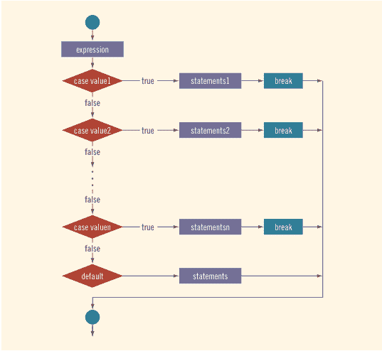

图 4-4 switch 语句


`switch` 语句按照以下规则执行：

- 1. 当 `expression` 的值与某个 `case` 值（也称为标签）匹配时，将执行语句，直到遇到 `break` 语句或到达 `switch` 结构的末尾。
- 2. 如果 `expression` 的值与任何 `case` 值都不匹配，则执行 `default` 标签后面的语句。如果 `switch` 结构没有 `default` 标签，并且 `expression` 的值与任何 `case` 值都不匹配，则 `switch` 语句的动作（action）为空。
- 3. `break` 语句会导致立即从 `switch` 结构中 `exit`（退出）。

### 例 4-22

考虑以下语句，其中 `grade` 是 `char` 类型的变量：

```cpp
switch (grade)
{
  case 'A':
    cout << "The grade point is 4.0.";
    break;
  case 'B':
    cout << "The grade point is 3.0.";
    break;
  case 'C':
    cout << "The grade point is 2.0.";
    break;
  case 'D':
    cout << "The grade point is 1.0.";
    break;
  case 'F':
    cout << "The grade point is 0.0.";
    break;
  default:
    cout << "The grade is invalid.";
}
```

在这个 `switch` 语句中，`expression`（即 `grade`）是 `char` 类型的变量，而 `char` 是一种整型。`grade` 的可能值为 `'A'`、`'B'`、`'C'`、`'D'` 和 `'F'`。每个 `case` 标签指定了根据 `grade` 的值要执行的不同动作。如果 `grade` 的值为 `'A'`，则输出为：

成绩点为 4.0。

### 例 4-23

以下程序说明了 **break** 语句的作用。它要求用户输入一个 0 到 7 之间的数字。

```cpp
//Program: Effect of break statements in a switch structure

#include <iostream>

using namespace std;

int main()
{
        int num;

        cout << "Enter an integer between 0 and 7: ";       //Line 1
        cin >> num;                                           //Line 2
        cout << endl;                                         //Line 3
        cout << "The number you entered is " << num
             << endl;                                         //Line 4

        switch (num)                                          //Line 5
        {
        case 0:                                               //Line 6
        case 1:                                               //Line 7
                cout << "Learning to use ";                  //Line 8
        case 2:                                               //Line 9
                cout << "C++'s ";                            //Line 10
        case 3:                                               //Line 11
                cout << "switch structure." << endl;         //Line 12
                break;                                        //Line 13
        case 4:                                               //Line 14
                break;                                        //Line 15
        case 5:                                               //Line 16
                cout << "This program shows the effect ";    //Line 17
        case 6:                                               //Line 18
        case 7:                                               //Line 19
                cout << "of the break statement." << endl;   //Line 20
                break;                                        //Line 21
        default:                                               //Line 22
                cout << "The number is out of range." << endl; //Line 23
        }

        cout << "Out of the switch structure." << endl;      //Line 24

        return 0;                                             //Line 25
}
```

**示例运行：** 这些输出是通过多次执行前面的程序得到的。在每次示例运行中，用户输入以底纹显示。

### 示例运行 1：

```
Enter an integer between 0 and 7: 0
The number you entered is 0
Learning to use C++'s switch structure.
Out of the switch structure.
```

### 示例运行 2：

```
Enter an integer between 0 and 7: 2
The number you entered is 2
C++'s switch structure.
Out of the switch structure.
```

### 示例运行 3：

```
Enter an integer between 0 and 7: 4
The number you entered is 4
Out of the switch structure.
```

### 示例运行 4：

```
Enter an integer between 0 and 7: 5
The number you entered is 5
This program shows the effect of the break statement.
Out of the switch structure.
```

### 示例运行 5：

```
Enter an integer between 0 and 7: 7
The number you entered is 7
of the break statement.
Out of the switch structure.
```

### 示例运行 6：

```
Enter an integer between 0 and 7: 8
The number you entered is 8
The number is out of range.
Out of the switch structure.
```

使用 `switch` 表达式 `num` 的某些值逐步分析这个程序，可以帮助你理解 `break` 语句如何起作用。如果 `num` 的值为 0，则 `switch` 表达式的值与 `case` 值 0 匹配。`case 0:` 后面的所有语句都会执行，直到出现 `break` 语句。

第一个 `break` 语句出现在第 13 行，正好在 `case` 值 4 之前。即使 `switch` 表达式的值与 `case` 值 1、2 或 3 都不匹配，这些值后面的语句也会执行。

当 `switch` 表达式的值与某个 `case` 值匹配时，所有语句都会执行，直到遇到 `break`，并且程序会跳过其间的所有 `case` 标签。类似地，如果 `num` 的值为 3，则它与 `case` 值 3 匹配，并且该标签后面的语句会执行，直到在第 13 行遇到 `break` 语句。如果 num 的值为 4，则它与 case 值 4 匹配。在这种情况下，动作（action）为空，因为 `case` 值 4 后面只有第 15 行的 `break` 语句。

### 例 4-24

尽管 `switch` 结构的 `case` 值（标签）是有限的，但 switch 语句的表达式可以根据需要任意复杂。例如，考虑以下 switch 语句：

```
switch (score / 10)
{
case 0:
case 1:
case 2:
case 3:
case 4:
case 5:
    grade = 'F';
    break;
case 6:
    grade = 'D';
    break;
case 7:
    grade = 'C';
    break;
case 8:
    grade = 'B';
    break;
case 9:
case 10:
    grade = 'A';
    break;
default:
    cout << "Invalid test score." << endl;
}
```

假设 score 是一个 `int` 变量，其值在 0 到 100 之间。如果 score 为 75，则 score / 10 = 7，所赋的成绩等级为 'C'。如果 score 的值在 0 到 59 之间，则成绩等级为 'F'。如果 score 在 0 到 59 之间，那么 score / 10 为 0、1、2、3、4 或 5。这些值中的每一个都对应于成绩等级 'F'。

因此，在这个 `switch` 结构中，`case 0`、`case 1`、`case 2`、`case 3`、`case 4` 和 `case 5` 的动作语句都相同。与其为 case 值 0、1、2、3、4 和 5 分别编写语句 `grade = 'F';` 再跟上 `break` 语句，不如先指定所有 case 值（如前面的代码所示），然后指定所需的动作语句，从而简化编程代码。`case` 值 9 和 10 遵循类似的约定。

除了可以是变量标识符或复杂表达式之外，`switch` 表达式还可以求值为逻辑值。考虑以下语句：

```
switch (age >= 18)
{
case 1:
    cout << "Old enough to be drafted." << endl;
    cout << "Old enough to vote." << endl;
    break;
case 0:
    cout << "Not old enough to be drafted." << endl;
    cout << "Not old enough to vote." << endl;
}
```

如果 age 的值为 25，则表达式 age >= 18 求值为 1——即 true。如果表达式求值为 1，则执行 case 标签 1 后面的语句。如果 age 的值为 14，则表达式 age >= 18 求值为 0——即 false——并且执行 case 标签 0 后面的语句。

你可以在 case 标签中使用 true 和 false 分别代替 1 和 0，并将前面的 switch 语句重写如下：

```
switch (age >= 18)
{
case true:
    cout << "Old enough to be drafted." << endl;
    cout << "Old enough to vote." << endl;
    break;
case false:
    cout << "Not old enough to be drafted." << endl;
    cout << "Not old enough to vote." << endl;
}
```

你可以使用嵌套的 switch 语句来实现如下所示的多级选择：

```
switch (age >= 18)
{
case true:
    cout << "Old enough to be drafted." << endl;
    cout << "Old enough to vote." << endl;

    switch (age >= 21)
    {
    case true:
        cout << "Old enough to drink." << endl;
        break;
    case false:
        cout << "Not old enough to drink." << endl;
    }

    break;
```


```cpp
case false:
    cout << "Not old enough to be drafted." << endl;
    cout << "Not old enough to vote." << endl;
    cout << "Not old enough to drink." << endl;
}
```

正如从前面示例中可以看到的，switch 语句是实现多重选择的一种优雅方式。你将在本章末尾的编程示例中看到 switch 语句的使用。尽管不存在可用于决定是使用 if...else 结构还是 switch 结构来实现多重选择的固定规则，但应记住以下考虑事项。如果多重选择涉及一个值范围，你可以使用 switch 结构（其中将每个范围转换为有限的值集合），也可以使用 if...else 结构。

例如，在示例 4-24 中，grade 的值取决于 score 的值。如果 score 在 0 到 59 之间，则 grade 为 'F'。由于 score 是 int 变量，因此有 60 个值对应于 'F' 等级。如果将全部 60 个值列为 case 值，则 switch 语句可能会非常长。然而，除以 10 可将这 60 个值减少为仅 6 个值：0、1、2、3、4 和 5。

如果值范围由无限多个值组成，并且无法将其缩减为包含有限个值的集合，则必须使用 if...else 结构。例如，如果 score 恰好是 double 变量且可能出现小数成绩，那么 0 到 60 之间的值数量是无限的。然而，你可以使用表达式 static_cast<int>(score) / 10，仍可将这个无限的值数量缩减为仅六个值。

### 通过避免对概念和技术的一知半解来避免错误（再探）

本章前面，我们讨论了对一个概念或技术的一知半解如何导致程序中的错误。在本节中，我们给出另一个示例来说明使用一知半解的概念和技术所导致的问题。在示例 4-24 中，我们说明了如何根据 0 到 100 之间的测试分数来分配等级。接下来，考虑以下根据测试分数分配等级的程序：

```cpp
//Grade program with bugs.

#include <iostream>                              //Line 1

using namespace std;                             //Line 2

int main()                                        //Line 3
{
    int testScore;                                //Line 4
                                                 //Line 5
    cout << "Enter the test score: ";            //Line 6
    cin >> testScore;                             //Line 7
    cout << endl;                                      //Line 8

    switch (testScore / 10)                            //Line 9
    {                                                  //Line 10
    case 0:                                            //Line 11
    case 1:                                            //Line 12
    case 2:                                            //Line 13
    case 3:                                            //Line 14
    case 4:                                            //Line 15
    case 5:                                            //Line 16
        cout << "The grade is F." << endl;        //Line 17
    case 6:                                            //Line 18
        cout << "The grade is D." << endl;        //Line 19
    case 7:                                            //Line 20
        cout << "The grade is C." << endl;        //Line 21
    case 8:                                            //Line 22
        cout << "The grade is B." << endl;        //Line 23
    case 9:                                            //Line 24
    case 10:                                           //Line 25
        cout << "The grade is A." << endl;        //Line 26
    default:                                           //Line 27
        cout << "Invalid test score." << endl;    //Line 28
    }                                                  //Line 29

    return 0;                                          //Line 30
}                                                      //Line 31
```

**示例运行：** 在这些示例运行中，用户输入以底纹显示。

**示例运行 1：**

```text
Enter the test score: 110

Invalid test score.
```

**示例运行 2：**

```text
Enter the test score: -70

Invalid test score.
```

**示例运行 3：**

```text
Enter the test score: 75

The grade is C.
The grade is B.
The grade is A.
Invalid test score.
```

从这些示例运行可以得出，如果 testScore 的值小于 0 或大于 100，则程序产生正确结果；但如果 testScore 的值在 0 到 100 之间，比如 75，则程序产生错误结果。你能看出原因吗？


如示例运行 3 所示，假设 `testScore` 的值为 75。那么，`testScore / 10 = 7`，并且该值与 `case` 标签 7 匹配。因此，按我们的意图，它应打印 The grade is C。然而，输出是：

```text
The grade is C.
The grade is B.
The grade is A.
Invalid test score.
```

但为什么呢？显然，每个 `case` 标签至多只关联一个 `cout` 语句。问题在于对 `switch` 结构如何工作只有一知半解。正如我们所看到的，该 `switch` 语句不包含任何 `break` 语句。因此，在执行与匹配的 `case` 标签关联的语句之后，执行会继续执行与下一个 `case` 标签关联的语句，从而导致打印出四行非预期输出。

为了正确输出结果，switch 结构必须在每个 `case` 语句之后包含一个 `break` 语句，最后一个 `case` 语句除外。我们将修改该程序以使其输出正确结果留作练习。

我们再次可以看到，对概念的一知半解可能导致程序中的严重错误。因此，花时间完全理解每个概念和技术，将为你节省数小时的调试时间。

### 使用 `assert` 函数终止程序

程序中可能会出现某些非常难以捕获的错误。例如，使用你迄今为止研究过的任何编程技术，都可能难以捕获除以零错误。C++ 包含一个预定义函数 `assert`，它在某些难以捉摸的错误发生时停止程序执行很有用。对于除以零的情况，你可以使用 `assert` 函数确保程序终止，并给出适当的错误消息，指明错误类型以及错误发生所在的程序位置。

考虑以下语句：

```cpp
int numerator;
int denominator;
int quotient;
double hours;
double rate;
double wages;
char ch;
```

- 1. `quotient = numerator / denominator;`
- 2. `if (hours > 0 && (0 < rate && rate <= 15.50))`
  `wages = rate * hours;`
- 3. `if ('A' <= ch && ch <= 'Z')`

在第一条语句中，如果 denominator 为 0，那么从逻辑上讲你不应执行除法。然而在执行期间，计算机会尝试执行除法。如果 denominator 为 0，程序将终止，并给出错误消息，说明发生了非法操作。

第二条语句设计为仅当 hours 大于 0 且 rate 为正数且小于或等于 15.50 时才计算 wages。第三条语句设计为仅当 ch 为大写字母时才执行某些语句。

对于所有这些语句（就此而言，在任何情况下），如果条件不满足，那么以一条指明程序中错误发生位置的消息来暂停程序执行会很有用。你可以通过在程序中包含输出语句和 return 语句来处理这类情况。然而，C++ 通过 assert 函数提供了一种有效方法，在所需条件不满足时暂停程序。

使用 assert 函数的语法是：

```cpp
assert(expression);
```

这里，expression 是任意逻辑表达式。如果 expression 求值为 true，则执行下一条语句。如果 expression 求值为 false，则程序终止，并指出程序中错误发生的位置。

assert 函数的规范位于头文件 cassert 中。因此，程序要使用 assert 函数，必须包含以下语句：

```cpp
#include <cassert>
```

使用 assert 函数的语句有时称为 assert 语句。

回到前面的语句，你可以使用 assert 函数重写语句 1（quotient = numerator / denominator;）。因为仅当 denominator 非零时才应计算 quotient，所以你要在赋值语句之前包含一个 assert 语句，如下所示：

```cpp
assert(denominator);
quotient = numerator / denominator;
```

现在，如果 denominator 为 0，则 assert 语句会暂停程序执行，并给出类似以下的错误消息：

```text
Assertion failed: denominator, file c:\temp\assert
function\assertfunction.cpp, line 20
```

该错误消息表明对 denominator 的断言失败。错误消息还给出了包含源代码的文件名以及断言失败所在的行号。


为便于阅读，之前使用 `assert` 语句的代码也可以写成：

```cpp
assert(denominator != 0);
quotient = numerator / denominator;
```

错误消息会略有不同：

```text
Assertion failed: denominator != 0, file c:\temp\assertfunction\assertfunction.cpp, line 20
```

还可以使用断言语句重写语句 2，如下所示：

```cpp
assert(hours > 0 && (0 < rate && rate <= 15.50));
if (hours > 0 && (0 < rate && rate <= 15.50))
    wages = rate * hours;
```

如果 `assert` 语句中的表达式失败，程序会终止，并显示类似以下内容的错误消息：

```text
Assertion failed: hours > 0 && (0 < rate && rate <= 15.50), file c:\temp\assertfunction\assertfunction.cpp, line 26
```

在程序开发和测试期间，`assert` 语句对于强制执行编程约束非常有用。如你所见，`assert` 语句不仅会中止程序，还会指出断言失败的表达式、包含源代码的文件名以及断言失败所在的行号。

尽管 assert 语句在程序开发期间很有用，但在程序开发完成并投入使用后，如果某个 assert 语句由于某种原因失败，最终用户将完全不明白该错误的含义。因此，在开发并测试程序之后，你可能希望删除或禁用 assert 语句。在非常大的程序中，删除开发期间使用的所有 assert 语句可能很繁琐，甚至可能无法做到。此外，如果你计划将来修改程序，可能希望保留 assert 语句。因此，合乎逻辑的选择是保留这些语句但禁用它们。可以使用以下预处理指令禁用 assert 语句：

```cpp
#define NDEBUG
```

此预处理指令 `#define NDEBUG` 必须放在指令 `#include <cassert>` **之前**。

## 编程示例：有线电视公司计费


本编程示例演示一个用于计算本地有线电视公司客户账单的程序。有两类客户：住宅用户和商业用户。计算有线电视账单有两种费率：一种用于住宅用户，一种用于商业用户。对于住宅用户，适用以下费率：

- 账单处理费：$4.50
- 基本服务费：$20.50
- 付费频道：每个频道 $7.50

对于商业用户，适用以下费率：

- 账单处理费：$15.00
- 基本服务费：前 10 个连接 $75.00，每增加一个连接 $5.00
- 付费频道：无论连接数多少，每个频道 $50.00

程序应要求用户输入账号（一个整数）和客户代码。假设 R 或 r 代表住宅用户，B 或 b 代表商业用户。

**输入** 客户的账号、客户代码、用户订阅的付费频道数量，以及对于商业用户而言的基本服务连接数。

**输出** 客户的账号和账单金额。

### 问题分析与算法设计

本程序的目的是计算并打印账单金额。要计算账单金额，你需要知道为其计算账单金额的客户（该客户是住宅用户还是商业用户）以及该客户订阅的付费频道数量。对于商业用户，还需要知道基本服务连接数和付费频道数量。计算账单所需的其他数据，例如账单处理费和付费频道费用，都是已知量。程序应把账单金额打印到两位小数，这是金额的标准做法。此问题分析可转化为以下算法：

- 1. 将精度设置为两位小数。
- 2. 提示用户输入账号和客户类型。
- 3. 根据客户类型，确定付费频道数量和基本服务连接数，计算账单并打印账单：
  - a. 如果客户类型是 R 或 r，
    - i. 提示用户输入付费频道数量。
    - ii. 计算账单。
    - iii. 打印账单。
  - b. 如果客户类型是 B 或 b，
    - i. 提示用户输入基本服务连接数和付费频道数量。
    - ii. 计算账单。
    - iii. 打印账单。


### 变量

因为程序会要求用户输入客户账号、客户代码、付费频道数量和基本服务连接数，所以需要变量来存储所有这些信息。另外，因为程序会计算账单金额，所以需要一个变量来存储账单金额。因此，程序至少需要以下变量来计算并打印账单：

```cpp
int accountNumber;        //variable to store the customer’s
                          //account number
char customerType;        //variable to store the customer code
int numOfPremChannels;    //variable to store the number
                          //of premium channels to which the
                          //customer subscribes
int numOfBasicServConn;   //variable to store the
                          //number of basic service connections
                          //to which the customer subscribes
double amountDue;         //variable to store the billing amount
```

### 命名常量

如你所见，账单处理费、基本服务连接费用和付费频道费用都是固定的，并且计算账单需要这些值。尽管这些值在程序中是常量，但有线电视公司可能会在几乎不提前通知的情况下更改它们。为了简化以后修改程序的过程，不应在程序中直接使用这些值，而应将它们声明为命名常量。根据问题分析，需要声明以下命名常量：

```cpp
//Named constants - residential customers
const double RES_BILL_PROC_FEES = 4.50;
const double RES_BASIC_SERV_COST = 20.50;
const double RES_COST_PREM_CHANNEL = 7.50;

//Named constants - business customers
const double BUS_BILL_PROC_FEES = 15.00;
const double BUS_BASIC_SERV_COST = 75.00;
const double BUS_COST_PREM_CHANNEL = 50.00;
```

### 公式

程序使用若干公式来计算账单金额。要计算住宅用户账单，只需要知道用户订阅的付费频道数量。以下语句计算住宅用户的账单金额：

```cpp
amountDue = RES_BILL_PROC_FEES + RES_BASIC_SERV_COST
          + numOfPremChannels * RES_COST_PREM_CHANNEL;
```

要计算商业用户账单，需要知道基本服务连接数和用户订阅的付费频道数量。如果基本服务连接数小于或等于 10，则基本服务连接费用是固定的。如果基本服务连接数超过 10，则必须加上超过 10 的每个连接的费用。以下语句计算商业用户的账单金额：

```cpp
if (numOfBasicServConn <= 10)
    amountDue = BUS_BILL_PROC_FEES + BUS_BASIC_SERV_COST
                 + numOfPremChannels * BUS_COST_PREM_CHANNEL;
else
    amountDue = BUS_BILL_PROC_FEES + BUS_BASIC_SERV_COST
                 + (numOfBasicServConn - 10)
                   * BUS_BASIC_CONN_COST
                 + numOfPremChannels * BUS_COST_PREM_CHANNEL;
```

### 主算法

基于前面的讨论，现在可以编写主算法。

- 1. 要输出带小数点和尾随零的固定小数格式浮点数，请设置操纵符 fixed 和 showpoint。另外，要输出两位小数的浮点数，请将精度设置为两位小数。请记住，要使用这些操纵符，程序必须包含头文件 `iomanip`。
- 2. 提示用户输入账号。
- 3. 获取客户账号。
- 4. 提示用户输入客户代码。
- 5. 获取客户代码。
- 6. 如果客户代码是 r 或 R，
  - a. 提示用户输入付费频道数量。
  - b. 获取付费频道数量。
  - c. 计算账单金额。
  - d. 打印账号和账单金额。
- 7. 如果客户代码是 b 或 B，
  - a. 提示用户输入基本服务连接数。
  - b. 获取基本服务连接数。
  - c. 提示用户输入付费频道数量。
  - d. 获取付费频道数量。
  - e. 计算账单金额。
  - f. 打印账号和账单金额。
- 8. 如果客户代码不是 r、R、b 或 B，则输出错误消息。

对于步骤 6 和 7，程序使用 `switch` 语句计算所需客户的账单。


## 完整程序清单

```cpp
//***************************************************************
// Author: D. S. Malik
//
// Program: Cable Company Billing
// This program calculates and prints a customer's bill for
// a local cable company. The program processes two types of
// customers: residential and business.
//***************************************************************

#include <iostream>
#include <iomanip>

using namespace std;

        //Named constants - residential customers
const double RES_BILL_PROC_FEES = 4.50;
const double RES_BASIC_SERV_COST = 20.50;
const double RES_COST_PREM_CHANNEL = 7.50;

        //Named constants - business customers
const double BUS_BILL_PROC_FEES = 15.00;
const double BUS_BASIC_SERV_COST = 75.00;
const double BUS_BASIC_CONN_COST = 5.00;
const double BUS_COST_PREM_CHANNEL = 50.00;

int main()
{
        //Variable declaration
    int accountNumber;
    char customerType;
    int numOfPremChannels;
    int numOfBasicServConn;
    double amountDue;

    cout << fixed << showpoint;                         //Step 1
    cout << setprecision(2);                            //Step 1

    cout << "This program computes a cable "
         << "bill." << endl;
    cout << "Enter account number (an integer): ";       //Step 2
    cin >> accountNumber;                               //Step 3
    cout << endl;

    cout << "Enter customer type: "
         << "R or r (Residential), "
         << "B or b (Business): ";                     //Step 4
    cin >> customerType;                                //Step 5
    cout << endl;

switch (customerType)
{
case 'r':                                      //Step 6
case 'R':
    cout << "Enter the number"
         << " of premium channels: ";          //Step 6a
    cin >> numOfPremChannels;                    //Step 6b
    cout << endl;

    amountDue = RES_BILL_PROC_FEES              //Step 6c
              + RES_BASIC_SERV_COST
              + numOfPremChannels *
                RES_COST_PREM_CHANNEL;

    cout << "Account number: "
         << accountNumber
         << endl;                                //Step 6d
    cout << "Amount due: $"
         << amountDue
         << endl;                                //Step 6d
    break;

case 'b':                                      //Step 7
case 'B':
    cout << "Enter the number of basic "
         << "service connections: ";           //Step 7a
    cin >> numOfBasicServConn;                   //Step 7b
    cout << endl;

    cout << "Enter the number"
         << " of premium channels: ";           //Step 7c
    cin >> numOfPremChannels;                    //Step 7d
    cout << endl;

    if (numOfBasicServConn <= 10)                //Step 7e
        amountDue = BUS_BILL_PROC_FEES
                  + BUS_BASIC_SERV_COST
                  + numOfPremChannels *
                    BUS_COST_PREM_CHANNEL;
    else
        amountDue = BUS_BILL_PROC_FEES
                  + BUS_BASIC_SERV_COST
                  + (numOfBasicServConn - 10) *
                    BUS_BASIC_CONN_COST
                  + numOfPremChannels *
                    BUS_COST_PREM_CHANNEL;

    cout << "Account number: "
         << accountNumber << endl;               //Step 7f
    cout << "Amount due: $" << amountDue
         << endl;                                //Step 7f
    break;

default:
    cout << "Invalid customer type." << endl;    //Step 8
}//end switch

return 0;
}
```

**示例运行：** 在此示例运行中，用户输入以底纹显示。

该程序计算有线电视账单。  
输入账号（整数）：`12345`  

输入客户类型：R 或 r（住宅），B 或 b（商业）：`b`  
输入基本服务连接数：`16`  
输入付费频道数：`8`  

账号：12345  
应付金额：$520.00

## 快速复习

- 1. 控制结构改变正常的控制流。
- 2. 两种最常见的控制结构是选择结构和重复结构。
- 3. 选择结构将决策纳入程序。
- 4. 关系运算符有 `==`（等于）、`<`（小于）、`<=`（小于或等于）、`>`（大于）、`>=`（大于或等于）和 `!=`（不等于）。
- 5. 在关系运算符 `==`、`<=`、`>=` 和 `!=` 中包含空格会造成语法错误。
- 6. 字符使用机器的排序序列进行比较。
- 7. 逻辑表达式的求值结果为 1（或非零值）或 0。逻辑值 1（或任何非零值）被视为 `true`；逻辑值 0 被视为 `false`。
- 8. C++ 中有两种选择结构。
- 9. 单向选择采用以下形式：
  ```cpp
  if (expression)
      statement
  ```
  如果 `expression` 为 `true`，则执行该语句；否则不执行该语句。
- 10. 双向选择采用以下形式：
  ```cpp
  if (expression)
      statement1
  else
      statement2
  ```
  如果表达式为**真**，则执行 statement1；否则执行 statement2。
- 11. `if` 或 `if...else` 结构中的表达式通常是逻辑表达式。
- 12. 在单向选择中，在语句前包含分号会造成语义错误。在这种情况下，`if` 语句的动作是空的。
- 13. 在双向选择中，在 statement1 前包含分号会造成语法错误。
- 14. C++ 中没有独立的 `else` 语句。每个 `else` 都有一个相关的 `if`。
- 15. `else` 与最近一个尚未与其他任何 `else` 配对的 `if` 配对。
- 16. 在 C++ 中，`int` 变量可用于存储逻辑表达式的值。
- 17. 在 C++ 中，`bool` 变量可用于存储逻辑表达式的值。
- 18. 在 C++ 中，逻辑运算符有 `!`（非）、`&&`（与）和 `||`（或）。
- 19. 用花括号 `{` 和 `}` 括起来的一系列语句称为复合语句或语句块。复合语句被当作单条语句处理。
- 20. 可以在 `if` 语句中使用输入流变量来确定输入流的状态。
- 21. 用赋值运算符代替相等运算符会造成语义错误。这可能导致程序中出现严重错误。
- 22. `switch` 结构用于处理多路选择。
- 23. 在 `switch` 语句中执行 `break` 语句会立即退出 `switch` 结构。
- 24. 如果程序中未满足某些条件，可以使用 `assert` 函数终止程序。

## 练习

练习末尾括号中的数字指本章开头列出的学习目标。

- 1. 判断下列陈述是真还是假：
  - a. 程序中语句执行的顺序称为控制流。(1)
  - b. 在 C++ 中，`=` 是相等运算符。(2)
  - c. 在单向选择中，如果在 `if` 语句的表达式后放置分号，则 `if` 语句中的表达式总是 `true`。(3)
  - d. 每个 `if` 语句都必须有对应的 `else`。(3)
  - e. `if` 语句中的表达式：
    ```cpp
    if (score = 30)
        grade = 'A';
    ```
    总是求值为真。(3)
  - f. 表达式：
    ```cpp
    (ch >= 'A' && ch <= 'Z')
    ```
    如果 `ch < 'A'` 或 `ch >= 'Z'`，则求值为假。(2, 5)
  - g. 假设输入为 5。以下代码的输出：(3)
    ```cpp
    cin >> num;
    if (num > 5)
        cout << num;
        num = 5;
    else
        cout << "Num is zero" << endl;
    ```
    输出为：Num is zero
  - h. 逻辑表达式的结果不能赋给 `int` 变量。(4)
  - i. 表达式 `!(x > 0)` 仅当 x 为负数时才为真。(5)
  - j. 在 C++ 中，`!` 和 `!=` 都是逻辑运算符。(5)
  - k. `switch` 语句中的表达式应求值为简单数据类型的值。(11)
- 2. 求下列表达式的值。(2)
  - a. `3 * 4 == 15 - 3`
  - b. `2 - 15 / 3 >= 7 - 4`
  - c. `'d' >= 'F'`
  - d. `'T' <= 's'`
  - e. `'#' <= '*'`
  - f. `8.5 / 2 - 1.3 < 4.0 * 0.7 + 1.2`
- 3. 假设 x、y 和 z 是 int 变量，且 x = 12、y = 34、z = 18。判断下列表达式的求值结果是真还是假。(2, 5)
  - a. `!(x - y >= 1)`
  - b. `z <= 7 || y < 12`
  - c. `(x + y != 40) && (x != z)`
  - d. `(z - x >= y) || (y - x != z + 4)`
  - e. `(5 - x <= 2 * y) && (y - 15 >= z) || (x - 5 != y - 2 * z)`


- 4. 假设`str1`、`str2`和`str3`是字符串变量，且`str1 = "Stop"`、`str2 = "Running"`、`str3 = "Physics"`。计算下列表达式。 (2, 7)

  - a. `str1 <= str3`
  - b. `str1 != "Stop"`
  - c. `str2 < str1`
  - d. `str3 >= "chemistry"`
  - e. `str3 >= "Run"`

- 5. 假设`x`、`y`、`z`和`w`是`int`变量，且`x = 25`、`y = 3`、`z = 12`、`w = 4`。下列语句的输出是什么？ (2, 5)

  - a. `cout << "x == z: " << (x == z) << endl;`
  - b. `cout << "y != z - 9: " << (y != z - 9) << endl;`
  - c. `cout << "x - y == z + 10: " << (x - y == z + 10) << endl;`
  - d. `cout << "!(z < w): " << (!(z < w)) << endl;`
  - e. `cout << "w - y < x - 2 * z: " << (w - y < x - 2 * z) << endl;`

- 6. 下列哪些是关系运算符？ (2)

  - a. `>`
  - b. `==`
  - c. `=`
  - d. `!=`
  - e. `<>`

- 7. 下列语句的输出是什么？ (2, 3)

  - a.
    ```cpp
    if ('-' < '/')
        cout << "/";
    cout << "/-" << endl;
    ```

  - b.
    ```cpp
    if (5 + 3 <= 12 - 4)
        cout << "8";
    cout << "12 - 4";
    cout << endl;
    ```

  - c.
    ```cpp
    if ('^' < ':')
        cout << "^";
    cout << "^:";
    cout << endl;
    ```

  - d.
    ```cpp
    if ("++C" >= "--D")
        cout << "--D" << endl;
    cout << "++C" << endl;
    ```

  - e.
    ```cpp
    if ("Bob" <= "Amy")
        cout << "Amy" << endl;
    cout << "Amy < Bob" << endl;
    ```

  - f.
    ```cpp
    if (18 / 3 == 2 * 3)
        cout << 12 * 4 / 3 - 28 << endl;
    cout << "***" << endl;
    ```


- 13. 修正下列代码，使其打印正确的消息： (3)

  ```cpp
  if (score >= 60)
      cout << "You pass." << endl;
  else;
      cout << "You fail." << endl;
  ```

- 14.
  - a. 编写C++语句：如果身份为'F'，输出 First Year；如果身份为'S'，输出 Sophomore；否则输出 Junior 或 Senior。 (3)
  - b. 编写C++语句：如果身份为'1'或'2'，输出 First Year 或 Sophomore；如果身份为'3'或'4'，输出 Junior 或 Senior；否则输出 Graduate Student。 (3)

- 15. 如果购买的商品数量少于5，则每件商品的运费为$7.00；如果购买的商品数量至少为5但少于10，则每件商品的运费为$3.00；如果购买的商品数量至少为10，则免运费。修正下列代码，使其计算正确的运费。 (3, 5, 6)

  ```cpp
  if (numOfItemsBought > 10)
      shippingCharges = 0.00;
  else if (5 <= numOfItemsBought || numOfItemsBought <= 10);
      shippingCharges = 3.00 * numOfItemsBought;
  else if (0 < numOfItemsBought || numOfItemsBought < 5)
      shippingCharges = 7.00 * numOfItemsBought;
  ```

- 16. 下列C++代码的输出是什么？ (2, 5, 6)

  ```cpp
  int x = 5;
  int y = 12;
  if (x + y > 20 || y - x < 10)
  {
      x = y + 6;
      y = 2 * (x + y);
      cout << x << " " << y << " " << x - y << " " << x + y << endl;
  }
  else
  {
      y = (5 * x + 20) % y;
      cout << x << " " << y << " " << x * x + y * y << endl;
  }
  ```

- 17. 下列程序的输出是什么？ (2, 3, 5)

  ```cpp
  #include <iostream>

  using namespace std;

  int main()
  {
      int firstNum = 18;
      int secondNum = 37;

      if ((secondNum % firstNum == 2) || (secondNum % firstNum == 3))
      {
          secondNum = 3;
          firstNum = 2;
      }
      else if (secondNum % firstNum == 1)
      {
          secondNum = 18;
          firstNum = 1;
      }
      else
      {
          secondNum = 1;
          firstNum = 37;
      }

      cout << firstNum << " " << secondNum << endl;

      return 0;
  }
  ```


- 18.
  - a. 如果`firstNum = 10`且`secondNum = 52`，练习17中程序的输出是什么？ (2, 3, 5)
  - b. 如果`firstNum = 20`且`secondNum = 42`，练习17中程序的输出是什么？ (2, 3, 5)

- 19. 假设`sale`和`bonus`是double变量。编写一个if...else语句，按如下规则给`bonus`赋值：如果`sale`大于$20,000，`bonus`被赋值为0.10，即10%；如果`sale`大于$10,000且小于或等于$20,000，`bonus`被赋值为0.05，即5%；否则，`bonus`被赋值为0。 (3)

- 20. 假设`overSpeed`和`fine`是double变量。按如下规则给`fine`赋值：如果 0 < overSpeed <= 5，`fine`被赋值为$20.00；如果 5 < overSpeed <= 10，`fine`被赋值为$75.00；如果 10 < overSpeed <= 15，`fine`被赋值为$150.00；如果 overSpeed > 15，`fine`被赋值为$150.00再加上超过15的每英里$20.00。 (3)

- 21. 假设`score`是int变量。考虑以下if语句： (3)

  ```cpp
  if (score >= 90)
      cout << "Discount = 10%" << endl;
  ```

  - a. 如果`score`的值是95，输出是什么？请说明理由。
  - b. 如果`score`的值是85，输出是什么？请说明理由。

- 22. 假设`score`是int变量。考虑以下if语句： (3)

  i.
  ```cpp
  if (score == 70)
      cout << "Grade is C." << endl;
  ```

  ii.
  ```cpp
  if (score = 70)
      cout << "Grade is C." << endl;
  ```

  回答下列问题：

  - a. 如果`score`的值是70，在(i)和(ii)中的输出是什么？if语句执行后`score`的值是多少？
  - b. 如果`score`的值是80，在(i)和(ii)中的输出是什么？if语句执行后`score`的值是多少？

- 23. 使用条件运算符重写下列表达式。（假设所有变量都已正确声明。） (9)

  - a.
    ```cpp
    if (x >= y)
        z = x - y;
    else
        z = y - x;
    ```

  - b.
    ```cpp
    if (hours >= 40.0)
        wages = 40 * 7.50 + 1.5 * 7.5 * (hours - 40);
    else
        wages = hours * 7.50;
    ```

  - c.
    ```cpp
    if (score >= 60)
        str = "pass";
    else
        str = "Fail";
    ```

- 24. 使用if...else语句重写下列表达式。（假设所有变量都已正确声明。） (9)

  - a. `(x < 5) ? y = 10 : y = 20;`
  - b. `(fuel >= 10) ? drive = 150 : drive = 30;`
  - c. `(booksBought >= 3) ? discount = 0.15 : discount = 0.0;`

- 25. 假设你有以下条件表达式。（假设所有变量都已正确声明。） (9)

  ```cpp
  (0 < backyard && backyard <= 5000) ? fertilizingCharges = 40.00
      : fertilizingCharges = 40.00 + (backyard - 5000) * 0.01;
  ```

  - a. 如果`backyard`的值是3000，`fertilizingCharges`的值是多少？
  - b. 如果`backyard`的值是5000，`fertilizingCharges`的值是多少？
  - c. 如果`backyard`的值是65000，`fertilizingCharges`的值是多少？

- 26. 判断下列是否为有效的`switch`语句。如果不是，请说明原因。假设`n`和`digit`是`int`变量。 (11)

  a.
  ```cpp
  switch (n <= 2)
  {
  case 0:
      cout << "Draw." << endl;
      break;
  case 1:
      cout << "Win." << endl;
      break;
  case 2:
      cout << "Lose." << endl;
      break;
  }
  ```

  b.
  ```cpp
  switch (digit / 4)
  {
  case 0:
  case 1:
      cout << "low." << endl;
      break;
  case 1:
  case 2:
      cout << "middle." << endl;
      break;
  case 3:
      cout << "high." << endl;
  }
  ```

  c.
  ```cpp
  switch (n % 6)
  {
  case 1:
  case 2:
  case 3:
  case 4:
  case 5:
      cout << n;
      break;
  case 0:
      cout << endl;
      break;
  }
  ```

  d.
  ```cpp
  switch (n % 10)
  {
  case 2:
  case 4:
  case 6:
  case 8:
      cout << "Even";
      break;
  case 1:
  case 3:
  ```


```cpp
case 5:
case 7:
    cout << "Odd";
    break;
}
```

27. 假设 score 是一个 int 变量。考虑以下 C++ 代码：(3, 11)

```cpp
int score;
cin >> score;
switch (score % 7)
{
case 0:
    score = score / 2 - 1;
    break;
case 1: case 3:
    score = 3 * score + 1;
    break;
case 2:
    ++score;
    break;
case 4:
    break;
case 5: case 6:
    score = score % 3;
    break;
default:
    score = score / 2;
}
cout << score << endl;
```

- a. 如果输入是 12，输出是什么？
- b. 如果输入是 4，输出是什么？
- c. 如果输入是 3，输出是什么？
- d. 如果输入是 25，输出是什么？

28. 假设 beta 是一个 int 变量。考虑以下 C++ 代码：(11)

```cpp
cin >> beta;
switch (beta % 8)
{
case 0:
case 1:
    beta = beta + beta;
    break;
case 2:
    beta--;
    break;
case 3:
case 7:
    beta = static_cast<int>(sqrt(beta * 1.0));
    beta = beta / 3;
    break;
case 4:
    beta = beta * beta;
case 5:
case 6:
    beta = 11 - beta;
    break;
default:
    beta = -5;
}

cout << beta << endl;
```


- a. 如果输入是 3，输出是什么？
- b. 如果输入是 12，输出是什么？
- c. 如果输入是 15，输出是什么？
- d. 如果输入是 28，输出是什么？

**29.** 假设 num 是一个 `int` 变量。考虑以下 C++ 代码：(3, 11)

```cpp
cin >> num;
if (num >= 0)
{
    switch (num)
    {
    case 0:
        num = static_cast<int>(pow(num, 3.0));
        break;
    case 2:
        num = ++num;
        break;
    case 4:
        num = num - 4;
        break;
    case 5:
        num = num * 4;
    case 6:
        num = num / 6;
        break;
    case 10:
        num--;
        break;
    default:
        num = -20;
    }
}
else
    num = num + 10;

cout << num << endl;
```

- a. 如果输入是 5，输出是什么？
- b. 如果输入是 26，输出是什么？
- c. 如果输入是 2，输出是什么？
- d. 如果输入是 −5，输出是什么？

30. 在以下代码中，改正任何会导致程序无法编译或运行的错误：(3, 11)

```cpp
include <iostream>

main ()
{
    int num1, num2;
    bool found;

    cout << "Enter two integers: ;
    cin >> num1 >> num2;
    cout << endl;

    if (num1 >= num2) && num2 > 0
        switch (num % num2)
        {
        case 1
            found = (num / num2) >= 6;
            break;
        case 2: case 3
            num1 = num2 / 2;
            break;
        default:
            num2 = num1 * num2;
        }
    else
    {
        found = (2 * num2 < num1);
        if found
            cin >> num2
            num1 = num2 - num1;
            temp = (num1 + num2) / 10;
        if num2
        {
            num1 = num2;
            num2 = temp;
        }

        cout << num1 << " " << num2 << endl;
    }
```

改正代码后，回答以下问题。（如有需要，插入提示行以告知用户输入。）

- a. 如果输入是 10 8，输出是什么？
- b. 如果输入是 4 9，输出是什么？

31. 以下程序包含错误。改正这些错误，使程序能够运行并输出 w = 21。(3, 11)

```cpp
#include <iostream>

using namespace std;
```

34. 假设 billingAmount 是一个 double 变量，表示你需要向百货商店支付的金额。如果你全额付款，你将获得 $10.00 或 billingAmount 的 1%（以较小者为准）作为下次账单的抵扣；如果你支付至少 billingAmount 的 50%，罚金为余额的 5%；如果你支付至少 billingAmount 的 20% 且少于 billingAmount 的 50%，罚金为余额的 10%；否则，罚金为余额的 20%。设计一个算法，提示用户输入账单金额和期望付款额。然后该算法计算并输出抵扣额或剩余余额。如果未全额付款，算法还应输出罚金金额。(3)

## 编程练习

- 1. 编写一个程序，提示用户输入一个数。然后程序应输出该数，并输出一条消息说明该数是正数、负数还是零。

- 2. 编写一个程序，提示用户输入三个数。然后程序应按升序输出这些数。

- 3. 编写一个程序，提示用户输入一个 0 到 35 之间的整数。如果该数小于或等于 9，程序应输出该数；否则，对于 10 输出 A，对于 11 输出 B，对于 12 输出 C……对于 35 输出 Z。（提示：对于 >= 10 的数，使用强制类型转换运算符 static_cast<char>()。）

- 4. 以下程序中的语句顺序不正确。重新排列这些语句，使程序提示用户输入形状类型（rectangle、circle 或 cylinder）以及该形状的相应尺寸。然后程序输出以下形状信息：对于 rectangle，输出面积和周长；对于 circle，输出面积和周长；对于 cylinder，输出体积和表面积。重新排列语句后，程序应正确缩进。

```cpp
using namespace std;

#include <iostream>

int main()
{
    string shape;
    double height;

    #include <string>

    cout << "Enter the shape type: (rectangle, circle, cylinder) ";
    cin >> shape;
    cout << endl;
if (shape == "rectangle")
{
    cout << "Area of the circle = "
         << PI * pow(radius, 2.0) << endl;

    cout << "Circumference of the circle: "
         << 2 * PI * radius << endl;

    cout << "Enter the height of the cylinder: ";
    cin >> height;
    cout << endl;

    cout << "Enter the width of the rectangle: ";
    cin >> width;
    cout << endl;

    cout << "Perimeter of the rectangle = "
         << 2 * (length + width) << endl;
    double width;
}
cout << "Surface area of the cylinder: "
     << 2 * PI * radius * height + 2 * PI * pow(radius, 2.0)
     << endl;
}
else if (shape == "circle")
{
    cout << "Enter the radius of the circle: ";
    cin >> radius;
    cout << endl;

    cout << "Volume of the cylinder = "
         << PI * pow(radius, 2.0) * height << endl;
    double length;
}
return 0;
else if (shape == "cylinder")
{
    double radius;

    cout << "Enter the length of the rectangle: ";
    cin >> length;
    cout << endl;

    #include <iomanip>

    cout << "Enter the radius of the base of the cylinder: ";
    cin >> radius;
    cout << endl;
}
const double PI = 3.1416;
cout << "Area of the rectangle = "
     << length * width << endl;
else
     cout << "The program does not handle " << shape << endl;
     cout << fixed << showpoint << setprecision(2);
#include <cmath>
}
```

- 5. 在直角三角形中，一条边长度的平方等于另外两条边长度的平方和。编写一个程序，提示用户输入三角形的三条边长度，然后输出一条消息说明该三角形是否为直角三角形。

- 6. 一盒饼干可装 24 块饼干，一个容器可装 75 盒饼干。编写一个程序，提示用户输入饼干总数、每盒饼干数以及每个容器中的饼干盒数。然后程序输出运输这些饼干所需的盒数和容器数。注意，每盒必须包含指定数量的饼干，每个容器必须包含指定数量的盒子。如果最后一盒饼干包含的饼干数少于指定数量，可以丢弃它并输出剩余饼干数。类似地，如果最后一个容器包含的盒子数少于指定数量，可以丢弃它并输出剩余盒子数。

- 7. 二次方程 $ax^2 + bx + c = 0$，$a \ne 0$ 的根由以下公式给出：

$$\frac{-b \pm \sqrt{b^2 - 4ac}}{2a}$$

在该公式中，项 $b^2 - 4ac$ 称为**判别式**。如果 $b^2 - 4ac = 0$，则方程有一个（重）根。如果 $b^2 - 4ac > 0$，方程有两个实根。如果 $b^2 - 4ac < 0$，方程有两个复根。编写一个程序，提示用户输入 $a$ 的值（$x^2$ 的系数）、$b$ 的值（$x$ 的系数）和 $c$ 的值（常数项），并输出方程的根类型。此外，如果 $b^2 - 4ac \ge 0$，程序应输出二次方程的根。*（提示：使用头文件 cmath 中的函数 pow 计算平方根。第3章解释了函数 pow 的用法。）*


- 8. 编写一个模拟计算器的程序。该程序应接收两个整数和要执行的运算作为输入，然后输出这两个数、运算符和结果。（对于除法，如果分母为零，则输出相应的提示信息。）以下是一些示例输出：

  ```
  3 + 4 = 7
  13 * 5 = 65
  ```

- 9. 重做练习8，以处理浮点数。（将输出格式化为两位小数。）

- 10. 重做第2章编程练习16，并考虑你的父母会按以下方式为你购买额外的储蓄债券：

  - a. 如果你不花任何钱购买储蓄债券，那么由于你做过暑期工作，你的父母会为你购买储蓄债券，金额等于你在缴税以及购买衣服、其他配饰和学习用品后所存钱的1%。

  - b. 如果你用净收入中最多25%的钱购买储蓄债券，那么你每花1美元购买储蓄债券，父母就花0.25美元，再加上相当于你在缴税以及购买衣服、其他配饰和学习用品后所存钱1%的钱。

  - c. 如果你用净收入中超过25%的钱购买储蓄债券，那么你每花1美元购买储蓄债券，父母就花0.40美元，再加上相当于你在缴税以及购买衣服、其他配饰和学习用品后所存钱2%的钱。

- 11. 编写一个程序，实现例1-3（第1章）中给出的算法，该算法确定销售人员的月工资。

- 12. 编写一个程序，实现你在本章练习34中设计的算法。

- 13. 一张纸上可打印的行数取决于纸张尺寸、一行中每个字符的点数大小、行是双倍行距还是单倍行距、上下边距以及纸张的左右边距。假设所有字符的点数大小相同，且所有行均为单倍行距或双倍行距。注意1英寸 = 72点。此外，假设行沿纸张宽度方向打印。例如，如果纸张长度为11英寸、宽度为8.5英寸，那么一行的最大长度为8.5英寸。编写一个程序，根据用户输入的以下信息计算一行中的字符数以及一张纸上可打印的行数：

  - a. 纸张的长度和宽度（英寸）
  - b. 上、下、左、右边距
  - c. 一行的点数大小
  - d. 如果行是双倍行距，则将每个字符的点数大小加倍

- 14. 编写一个程序，计算并打印一家移动电话公司的账单。该公司提供两种服务：普通服务和高级服务。其费率根据服务类型而有所不同。费率计算如下：

  普通服务：10.00美元，前50分钟免费。超过50分钟的部分按每分钟0.20美元收费。

  高级服务：25.00美元，另加：

  - a. 对于上午6:00至下午6:00拨打的电话，前75分钟免费；超过75分钟的部分按每分钟0.10美元收费。

  - b. 对于下午6:00至上午6:00拨打的电话，前100分钟免费；超过100分钟的部分按每分钟0.05美元收费。

  你的程序应提示用户输入账号、服务代码（char类型）以及该服务使用的分钟数。服务代码为r或R表示普通服务；服务代码为p或P表示高级服务。将任何其他字符视为错误。你的程序应输出账号、服务类型、电话服务使用的分钟数以及用户应付金额。

  对于高级服务，客户可能在白天和夜间都使用该服务。因此，要计算账单，必须要求用户输入白天使用服务的分钟数和夜间使用服务的分钟数。

- 15. 编写一个程序，实现你在第1章练习22中设计的算法。（假设账户余额存储在文件 `Ch4_Ex15_Data.txt` 中。）你的程序应输出取款前和取款后的账户余额以及服务费。同时将取款后的账户余额保存到文件 `Ch4_Ex15_Output.txt` 中。

- 16. 一位新作者正在协商一部新言情小说的合同。出版商提供三种选择。第一种选择是，作者在交付最终手稿时获得5,000美元，小说出版时获得20,000美元。第二种选择是，作者按小说每册净价的12.5%获得报酬。第三种选择是，作者对售出的前4000册按净价的10%获得报酬，对超过4000册的部分按净价的14%获得报酬。作者对将售出的册数有一些估计，并希望估算每种选择下产生的版税。编写一个程序，提示作者输入小说每册的净价和预计售出的册数。然后程序输出每种选择下的版税以及作者可选择的最佳方案。（使用适当的命名常量来存储版税率和固定版税等特殊值。）

- 17. Samantha和Vikas想在一个新开发项目中买一套房子。在查看了各种户型后，他们喜欢的三种户型是殖民地式、错层式和单层式。建筑商给了他们这三种户型的基础价格和完工面积（平方英尺）。他们想知道每平方英尺价格最低的户型。编写一个程序，接受三种户型的基础价格和完工面积（平方英尺）作为输入。程序输出每平方英尺价格最低的户型。

- 18. 判断一个人有多健康的一种方法是测量这个人的体脂。女性和男性的体脂计算公式如下：

  女性体脂公式：

  A1 =（体重 × 0.732）+ 8.987

  A2 = 手腕测量值（最粗处）/ 3.140

  A3 = 腰围测量值（肚脐处）× 0.157

  A4 = 臀围测量值（最丰满处）× 0.249

  A5 = 前臂测量值（最粗处）× 0.434

  B = A1 + A2 − A3 − A4 + A5

  体脂 = 体重 − B

  体脂百分比 = 体脂 × 100 / 体重

  男性体脂公式：

  A1 =（体重 × 1.082）+ 94.42

  A2 = 手腕测量值 × 4.15

  B = A1 − A2

  体脂 = 体重 − B

  体脂百分比 = 体脂 × 100 / 体重

  编写一个程序来计算一个人的体脂。

- 19. Ron买了几英亩农田来种植和销售蔬菜。假设Ron最多想种植两种蔬菜。编写一个程序，提示Ron或用户执行以下操作：

  - 1. 输入农场总面积（英亩）。
  - 2. 输入用户想种植的蔬菜种类数（一种或两种）。
  - 3. 如果用户想种植两种蔬菜，则指定每种蔬菜占用农场土地的百分比。
  - 4. 输入每英亩的种子成本、种植成本、施肥成本、劳动力成本。
  - 5. 输入每英亩蔬菜的销售价格。
  - 6. 输出总收入。
  - 7. 输出利润/亏损。

- 20. 假设在酒店租一间房的费用是每晚100.00美元。对于婚礼或会议等特殊场合，酒店提供如下特殊折扣：如果预订房间数至少为10间，折扣为10%；至少20间，折扣为20%；至少30间，折扣为30%。此外，如果房间预订至少3天，则再额外享受5%的折扣。编写一个程序，提示用户输入租一间房的费用、预订房间数、房间预订天数以及销售税（百分比）。程序输出一间房的租金、每间房的折扣百分比、预订房间数、房间预订天数、房间总费用、销售税以及总账单金额。你的程序必须使用适当的命名常量来存储各种折扣等特殊值。

- 21. 设 l 是 x-y 平面上的一条直线。如果 l 是竖直线，则其方程为 x = a，其中 a 为某个实数。假设 l 不是竖直线，且其斜率为 m。那么 l 的方程为 y = mx + b，其中 b 是 y 截距。如果 l 经过点 (x₀, y₀)，则 l 的方程可以写成 y − y₀ = m(x − x₀)。如果 (x₁, y₁) 和 (x₂, y₂) 是 x-y 平面上的两个点，且 x₁ ≠ x₂，则经过这两个点的直线的斜率为 m = (y₂ − y₁) / (x₂ − x₁)。编写一个程序，提示用户输入 x-y 平面上的两个点。程序输出该直线的方程，并使用 if 语句判断并输出该直线是竖直线、水平线、递增还是递减。如果 l 是非竖直线，则按 y = mx + b 的形式输出其方程。

- 22. 前11个质数是 2、3、5、7、11、13、17、19、23、29 和 31。一个介于1到1000（含）之间的正整数，如果不是前11个质数之一，并且不能被2、3、5、7、11、13、17、19、23、29和31整除，则它是质数。编写一个程序，提示用户输入一个介于1到1000（含）之间的正整数，并输出该数是否为质数。如果该数不是质数，则输出前11个质数列表中所有能整除该数的数。


# 第5章 控制结构 II（重复）

本章中，你将：

- 1. 了解重复（循环）控制结构
- 2. 学习如何在程序中使用 `while` 循环
- 3. 探索如何构造和使用计数控制、哨兵控制、标志控制和 EOF 控制的重复结构
- 4. 学习如何在程序中使用 `for` 循环
- 5. 学习如何在程序中使用 `do...while` 循环
- 6. 考察 `break` 和 `continue` 语句
- 7. 了解如何形成和使用嵌套控制结构
- 8. 学习如何通过避免补丁来避免缺陷
- 9. 学习如何调试循环

第 4 章讨论了如何将决策纳入程序。本章讨论如何将重复纳入程序。

### 为什么需要重复？

David 需要降低胆固醇水平以保持身体健康并降低心脏病发作风险，他希望通过定期锻炼来实现这一目标。他决定加入一家健身房，并且除其他措施外，记录每次使用健身房时燃烧的卡路里数。每周结束时，他想确定每天平均燃烧的卡路里数。我们需要编写一个程序，David 可以用它输入每天燃烧的卡路里数，并输出每天平均燃烧的卡路里数。假设某一周每天燃烧的卡路里数为：375、425、270、190、350、200 和 365。要计算每天平均燃烧的卡路里数，我们必须将这些数字相加，然后除以 7。根据目前所学，我们可以编写以下程序来计算每天平均燃烧的卡路里数。

```cpp
#include <iostream>

using namespace std;

int main()
{
    int calBurnedDay1, calBurnedDay2, calBurnedDay3,
        calBurnedDay4, calBurnedDay5, calBurnedDay6,
        calBurnedDay7;
    int calBurnedInAWeek;

    cout << "Enter calories burned day 1: ";
    cin >> calBurnedDay1;
    cout << endl;

    cout << "Enter calories burned day 2: ";
    cin >> calBurnedDay2;
    cout << endl;

    cout << "Enter calories burned day 3: ";
    cin >> calBurnedDay3;
    cout << endl;

    cout << "Enter calories burned day 4: ";
    cin >> calBurnedDay4;
    cout << endl;

    cout << "Enter calories burned day 5: ";
    cin >> calBurnedDay5;
    cout << endl;

    cout << "Enter calories burned day 6: ";
    cin >> calBurnedDay6;
    cout << endl;

    cout << "Enter calories burned day 7: ";
    cin >> calBurnedDay7;
    cout << endl;

    calBurnedInAWeek = calBurnedDay1 + calBurnedDay2 + calBurnedDay3
                        + calBurnedDay4 + calBurnedDay5 + calBurnedDay6
                        + calBurnedDay7;

    cout << "Average number of calories burned each day: "
         << calBurnedInAWeek / 7 << endl;

    return 0;
}
```

**示例运行：** 在此示例运行中，用户输入以阴影显示。

```text
Enter calories burned day 1: 375
Enter calories burned day 2: 425
Enter calories burned day 3: 270
Enter calories burned day 4: 190
Enter calories burned day 5: 350
Enter calories burned day 6: 200
Enter calories burned day 7: 365

Average number of calories burned each day: 310
```

如你所见，这个程序需要我们声明七个变量来存储七个数。现在，如果 David 想确定一个月中每天平均燃烧的卡路里数，那么我们需要对大约 30 个数求和并求平均，这将需要我们声明至少 30 个变量，在 cin 语句中再次列出它们，并且可能还要在输出语句中再次列出它们。这会耗费极多的代码行和时间。此外，如果你想用不同数量的值再次运行这个程序，就必须重写程序。

接下来，让我们看看是否有更好的替代方案。我们要相加的数是：375、425、270、190、350、200 和 365。

考虑以下语句，其中 `calBurnedInAWeek` 和 `calBurnedInOneDay` 是 int 类型的变量。

- 1. `calBurnedInAWeek = 0;`
- 2. `cin >> calBurnedInOneDay;`
- 3. `calBurnedInAWeek = calBurnedInAWeek + calBurnedInOneDay;`

第一条语句将 `calBurnedInAWeek` 初始化为 0。接下来，让我们执行语句 2 和 3 三次。

| 语句 | 语句的执行 | 效果 |
|---|---|---|
| 2 | `cin >> calBurnedInOneDay;` | `calBurnedInOneDay = 375` |
| 3 | `calBurnedInAWeek = calBurnedInAWeek + calBurnedInOneDay;` | `calBurnedInAWeek = 0 + 375 = 375` |
| 2 | `cin >> calBurnedInOneDay;` | `calBurnedInOneDay = 425` |
| 3 | `calBurnedInAWeek = calBurnedInAWeek + calBurnedInOneDay;` | `calBurnedInAWeek = 375 + 425 = 800` |
| 2 | `cin >> calBurnedInOneDay;` | `calBurnedInOneDay = 270` |
| 3 | `calBurnedInAWeek = calBurnedInAWeek + calBurnedInOneDay;` | `calBurnedInAWeek = 800 + 270 = 1070` |

从这张表可以清楚地看出，在执行语句 2 和 3 三次后，calBurnedInAWeek 包含前三天燃烧的卡路里总和。如果我们执行这两条语句七次，那么 calBurnedInAWeek 包含一周燃烧的卡路里总和。

如果你想求出 30 天内燃烧的卡路里，那么可以重复语句 2 和 3 三十次；如果你想求出 100 天内燃烧的卡路里，可以重复语句 2 和 3 一百次。无论哪种情况，你都不必像前面的 C++ 程序那样声明任何额外变量。然而，按照现在的写法，对于我们要加到 calBurnedInAWeek 中的每一个 calBurnedInOneDay 值，都必须重写语句 2 和 3。我们需要一种结构，告诉计算机将这些相同的 2 条语句重复 7 次、30 次或 100 次，也就是我们想要的任意重复次数。这样我们就可以使用这段 C++ 代码来相加任意数量的值，而前面的代码只相加特定数量的值，并且要改变值的数量就需要大幅修改代码。

还有许多其他情况需要重复一组语句。例如，对于班级中的每个学生，确定课程成绩的公式都是相同的。C++ 有三种重复结构（或称循环结构），可以让你反复执行语句，直到满足某些条件。本章介绍全部三种循环（重复）结构。下一节讨论第一种重复结构，称为 while 循环。

### while 循环（重复）结构

在上一节中，你已经看到，有时需要将一组语句重复多次。C++ 有三种重复结构（或称循环结构），允许你重复一组语句，直到满足某些条件。本节讨论第一种循环结构，称为 **while 循环**。

**while** 语句的一般形式为：

```cpp
while (expression)
    statement
```

在 C++ 中，**while** 是保留字。当然，**语句**可以是简单语句或复合语句。**表达式**充当**决策者**，通常是一个逻辑表达式。**语句**称为循环体。注意，**表达式**两侧的圆括号是语法的一部分。图 5-1 展示了 **while** 循环的执行流程。


图 5-1 **while** 循环

**表达式**为循环提供入口条件。如果它最初求值为 **true**，则执行 **语句**。随后重新求值循环条件——**表达式**。如果它再次求值为 **true**，则再次执行 **语句**。**语句**（循环体）会继续执行，直到 **表达式** 不再为 **true**。无限期持续执行的循环称为 **无限循环**。为避免无限循环，请确保循环体包含的语句能保证入口条件——**while** 语句中的 **表达式**——最终变为 **false**。


在考虑更多 **while** 循环示例之前，在下一个示例中，我们说明 **while** 语句中 **表达式** 的几点注意事项。

### 例 5-1

考虑以下 C++ 程序段：

```cpp
int i = 0;                 //Line 1

while (i <= 20)            //Line 2
{                           //Line 3
    cout << i << " ";       //Line 4
    i = i + 5;              //Line 5
}                           //Line 6

cout << endl;               //Line 7
```

在此程序段中，第1行的语句声明 `i` 为 `int` 变量并将其初始化为0。第2行到第6行的语句构成 **while** 循环。**while** 语句中的表达式 `i <= 20` 位于第2行，**while** 循环的循环体位于第3行到第6行。只要表达式 `i <= 20` 求值为真，**while** 循环的循环体就继续执行。下表展示了 **while** 循环的迭代过程。

| 迭代 | `i` 的值 | 第2行中的表达式 | 第4行和第5行中的语句 |
|---|---|---|---|
| 1 | `i = 0` | `i <= 20` 为**真** | 输出：0<br>`i = i + 5 = 0 + 5 = 5` |
| 2 | `i = 5` | `i <= 20` 为**真** | 输出：5<br>`i = i + 5 = 5 + 5 = 10` |
| 3 | `i = 10` | `i <= 20` 为**真** | 输出：10<br>`i = i + 5 = 10 + 5 = 15` |
| 4 | `i = 15` | `i <= 20` 为**真** | 输出：15<br>`i = i + 5 = 15 + 5 = 20` |
| 5 | `i = 20` | `i <= 20` 为**真** | 输出：20<br>`i = i + 5 = 20 + 5 = 25` |
| 6 | `i = 25` | `i <= 20` 为**假** | 循环终止 |

前面的 **while** 循环产生以下输出：

```text
0 5 10 15 20
```

表达式中的变量 `i`（在第2行）称为**循环控制变量**。另外，我们注意以下几点：

- a. 在第6次迭代中，它变为25，但不会被打印，因为入口条件为 `false`。

- b. 如果省略语句：

    ```cpp
    i = i + 5;
    ```

  即从循环体中省略该语句，就会得到无限循环，不断打印一行行零。

- c. 必须在执行循环之前初始化循环控制变量 `i`。如果省略以下语句：

    ```cpp
    i = 0;
    ```

  （在第1行），循环可能根本不会执行。（回想一下，C++ 中的变量不会自动初始化。）

- d. 如果循环体中的两条语句（第4行和第5行）互换，可能会极大地改变结果。例如，考虑以下语句：

    ```cpp
    i = 0;

    while (i <= 20)
    {
        i = i + 5;
        cout << i << " ";
    }

    cout << endl;
    ```

  这里，输出为：

    ```text
    5 10 15 20 25
    ```

- e. 如果在 `while` 循环末尾（逻辑表达式之后）放置一个分号，那么 `while` 循环的动作语句为空或 null。例如，以下 `while` 循环的动作语句为空。

    ```cpp
    i = 0;

    while (i <= 20);
    {
        i = i + 5;
        cout << i << " ";
    }

    cout << endl;
    ```

  花括号内的语句不构成 `while` 循环的循环体。

接下来几节描述 `while` 循环的各种形式。

## 情形 1：计数器控制的 `while` 循环

假设你确切知道某些语句需要执行多少次。例如，假设你确切知道需要读取多少条数据（或条目）。在这种情况下，`while` 循环采用 **计数器控制的 while 循环** 的形式。也就是说，LCV（循环控制变量）充当“计数器”。假设一组语句需要执行 N 次。你可以设置一个计数器（在 `while` 语句之前初始化为0）来跟踪已经读取了多少项。在执行 `while` 语句的循环体之前，将计数器与 N 进行比较。如果 `counter < N`，则执行 `while` 语句的循环体。循环体继续执行，直到 `counter >= N`。因此，在 `while` 语句的循环体内，计数器在读取一个新项后其值增加1。在这种情况下，`while` 循环可能如下所示：

```cpp
counter = 0;        //initialize the loop control variable

while (counter < N) //test the loop control variable
{
    .
    .
    .
    counter++;      //update the loop control variable
    .
    .
}
```

如果 N 表示文件中的数据项数，那么 N 的值可以通过几种方式确定。程序可以提示你输入文件中的项目数，输入语句可以读取你输入的值；或者你可以将文件中的第一项指定为文件中的项目数，这样你就不必记住输入值（项目）的数量。如果输入数据的人不是程序员，这会很有用。考虑例 5-3。

### 例 5-3

当地一所中学的学生自愿出售新鲜烘焙的饼干来筹款，以增加计算机实验室的电脑数量。每名学生报告了他/她卖出的盒数。我们将编写一个程序，输出售出的饼干总盒数、销售饼干产生的总收入，以及每名学生平均售出的盒数。提供的数据形式如下：

```text
studentName numOfBoxesSold
```

考虑以下程序：

```cpp
//Program: Counter-Controlled Loop
//This program computes and outputs the total number of boxes of
//cookies sold, the total revenue generated by selling the cookies, and the average number of
//boxes sold by each volunteer.

#include <iostream>                                      //Line 1
#include <string>                                         //Line 2
#include <iomanip>                                        //Line 3

using namespace std;                                      //Line 4

int main()                                               //Line 6
{
    string name;                                          //Line 7
    int numOfVolunteers;                                  //Line 8
    int numOfBoxesSold;                                   //Line 9
    int totalNumOfBoxesSold;                              //Line 10
    int counter;                                          //Line 11
    double costOfOneBox;                                  //Line 12

    cout << fixed << showpoint << setprecision(2);        //Line 13

    cout << "Line 14: Enter the number of "
         << "volunteers: ";                              //Line 14
    cin >> numOfVolunteers;                                //Line 15
    cout << endl;                                          //Line 16

    totalNumOfBoxesSold = 0;                               //Line 17
    counter = 0;                                           //Line 18

    while (counter < numOfVolunteers)                     //Line 19
    {
        cout << "Line 21: Enter the volunteer’s name"
             << " and the number of boxes sold: ";        //Line 21
        cin >> name >> numOfBoxesSold;                     //Line 22
        cout << endl;                                      //Line 23
        totalNumOfBoxesSold = totalNumOfBoxesSold
                             + numOfBoxesSold;             //Line 24
        counter++;                                         //Line 25
    }                                                      //Line 26

    cout << "Line 27: The total number of boxes sold: "
         << totalNumOfBoxesSold << endl;                   //Line 27

    cout << "Line 28: Enter the cost of one box: ";       //Line 28
    cin >> costOfOneBox;                                   //Line 29
    cout << endl;                                          //Line 30

    cout << "Line 31: The total money made by selling "
         << "cookies: $"
         << totalNumOfBoxesSold * costOfOneBox << endl;    //Line 31

    if (counter != 0)                                     //Line 32
        cout << "Line 33: The average number of "
             << "boxes sold by each volunteer:"
             << totalNumOfBoxesSold / counter << endl;     //Line 33
    else                                                  //Line 34
        cout << "Line 35: No input." << endl;             //Line 35
    return 0;                                             //Line 36
}                                                         //Line 37
```

**示例运行：** 在此示例运行中，用户输入以阴影显示。

第14行：输入志愿者人数：**5**  
第21行：输入志愿者姓名和售出盒数：**Sara 120**  
第21行：输入志愿者姓名和售出盒数：**Lisa 128**  
第21行：输入志愿者姓名和售出盒数：**Cindy 359**  
第21行：输入志愿者姓名和售出盒数：**Nicole 267**  
第21行：输入志愿者姓名和售出盒数：**Blair 165**  
第27行：售出的总盒数：1039  
第28行：输入一盒的成本：**3.50**  
第31行：销售饼干所得总金额：$3636.50  
第33行：每名志愿者平均售出的盒数：207

此程序的工作方式如下。第7行到第12行的语句声明程序中使用的变量。第14行的语句提示用户输入学生志愿者人数。第15行的语句将此人数输入变量 `numOfVolunteers`。第17行和第18行的语句初始化变量 `totalNumOfBoxesSold` 和 `counter`。（变量 `counter` 是循环控制变量。）

第19行的 **while** 语句检查 `counter` 的值，以确定已经读取了多少名学生的数据。如果 `counter` 小于 `numOfVolunteers`，则 **while** 循环继续下一次迭代。第21行的语句提示用户输入学生姓名和该学生售出的盒数。第22行的语句将学生姓名输入变量 `name`，将学生售出的盒数输入变量 `numOfBoxesSold`。第24行的语句通过将 `numOfBoxesSold` 的值加到 `totalNumOfBoxesSold` 的当前值来更新 `totalNumOfBoxesSold` 的值，第25行的语句将 `counter` 的值增加1。第27行的语句输出售出的总盒数，第28行的语句提示用户输入一盒饼干的成本，第29行的语句将成本输入变量 `costOfOneBox`。第31行的语句输出销售饼干所得的总金额，第32行到第35行的语句输出每名志愿者平均售出的盒数。

注意，在本程序中，`totalNumOfBoxesSold` 在第17行被初始化为0。在第22行，读取一名学生售出的盒数后，程序将其加到当前售出盒数之前所有已售盒数的总和上。第一个 numOfBoxesSold


读取到的值将加到零上（因为 `totalNumOfBoxesSold` 被初始化为 0），从而得到第一个数字的正确总和。要求平均值，需将 `totalNumOfBoxesSold` 除以 `counter`。如果 `counter` 为 0，那么除以零会终止程序，并会收到错误消息。因此，在将 `totalNumOfBoxesSold` 除以 `counter` 之前，必须检查 `counter` 是否为 0。

注意，在这个程序中，第18行的语句将 LCV 计数器初始化为 0。第19行的表达式 `counter < numOfVolunteers` 判断 `counter` 是否小于 `numOfVolunteers`。第25行的语句更新 `counter` 的值。

## 情形2：哨兵控制的 `while` 循环

你并不总是知道需要读取多少条数据（或条目），但你可能知道最后一条条目是一个特殊值，称为**哨兵值**，它会告诉循环停止。在这种情况下，必须在 `while` 语句之前读取第一个项，这样测试表达式才有有效的值可供测试。如果该项不等于哨兵值，则执行 `while` 语句的循环体。只要程序尚未读取到哨兵值，`while` 循环就会继续执行。这样的 `while` 循环称为**哨兵控制的 while 循环**。在这种情况下，`while` 循环可能如下所示：

```cpp
cin >> variable;              //initialize the loop control variable

while (variable != sentinel)   //test the loop control variable
{
    .
    .
    cin >> variable;           //update the loop control variable
    .
    .
}
```

### 示例 5-4

示例 5-3 中的程序计算并输出售出的饼干总盒数、总收入以及每名学生售出的平均盒数。然而，该程序假定程序员知道志愿者的确切人数。现在假设程序员不知道志愿者的确切人数。再次假设数据采用以下形式：*学生姓名*，后跟一个*空格*，再后跟*该学生售出的盒数*。因为我们不知道志愿者的确切人数，所以假设读取到名字值为 -1 时标记数据结束，因为遇到这种名字的可能性极低。因此，考虑以下程序：

```cpp
//Program: Sentinel-Controlled Loop
//This program computes and outputs the total number of boxes of
//cookies sold, the total revenue, and the average number of
//boxes sold by each volunteer.

#include <iostream>
#include <string>
#include <iomanip>

using namespace std;

const string SENTINEL = "-1";

int main()
{
    string name;
    int numOfVolunteers;
    int numOfBoxesSold;
    int totalNumOfBoxesSold;
    double costOfOneBox;

    cout << fixed << showpoint << setprecision(2);

    cout << "Line 14: Enter each volunteer's name and "
         << "the number of boxes " << endl
         << " sold by each volunteer, ending "
         << "with -1: " << endl;

    totalNumOfBoxesSold = 0;
    numOfVolunteers = 0;

    cin >> name;

    while (name != SENTINEL)
    {
        cin >> numOfBoxesSold;
        totalNumOfBoxesSold = totalNumOfBoxesSold
                            + numOfBoxesSold;
        numOfVolunteers++;
        cin >> name;
    }

    cout << endl;

    cout << "Line 26: The total number of boxes sold: "
         << totalNumOfBoxesSold << endl;

    cout << "Line 27: Enter the cost of one box: ";
    cin >> costOfOneBox;
    cout << endl;

    cout << "Line 30: The total money made by selling "
         << "cookies: $"
         << totalNumOfBoxesSold * costOfOneBox << endl;

    if (numOfVolunteers != 0)                         //Line 31
        cout << "Line 32: The average number of "
             << "boxes sold by each volunteer: "
             << totalNumOfBoxesSold / numOfVolunteers  //Line 32
             << endl;                                 //Line 33
    else                                              //Line 34
        cout << "Line 34: No input." << endl;

    return 0;                                         //Line 35
}                                                     //Line 36
```

**示例运行：** 在此示例运行中，用户输入部分以阴影显示。

```
Line 14: Enter each volunteer's name and the number of boxes
         sold by each volunteer, ending with -1:
Sara 120
Lisa 128
Cindy 359
Nicole 267
Blair 165
Abby 290
Amy 190
Megan 450
Elizabeth 280
Meredith 290
Leslie 430
Chelsea 378
-1
```

```
Line 26: The total number of boxes sold: 3347
Line 27: Enter the cost of one box: 3.50

Line 30: The total money made by selling cookies: $11714.50
Line 32: The average number of boxes sold by each volunteer: 278
```

该程序的运行方式如下。第8到12行的语句声明程序中使用的变量。第14行的语句提示用户输入以 -1 结尾的数据。第15和16行的语句将变量 totalNumOfBoxesSold 和 numOfVolunteers 初始化。第17行的语句读取第一个名字并将其存入 name。第18行的 while 语句检查 name 是否不等于 SENTINEL。（变量 name 是循环控制变量。）如果 name 不等于 SENTINEL，则执行 while 循环体。第20行的语句读取该学生售出的盒数并存入变量 numOfBoxesSold，第21行的语句通过将 numOfBoxesSold 加到 totalNumOfBoxesSold 上来更新 totalNumOfBoxesSold 的值。第22行的语句将 numOfVolunteers 的值增加 1，第23行的语句读取下一个名字并存入 name。第20到23行的语句重复执行，直到程序读取到 SENTINEL。第26行的语句输出售出的总盒数，第27行的语句提示用户输入一盒饼干的成本，第28行的语句将成本输入到变量 costOfOneBox 中。第30行的语句输出通过售卖饼干获得的收入总额，第31到34行的语句输出每名志愿者售出的平均盒数。

注意，第17行的语句初始化循环控制变量 name。第18行的表达式 `name != SENTINEL` 检查 name 的值是否不等于 SENTINEL。第23行的语句更新循环控制变量 name。

接下来，考虑哨兵控制的 **while** 循环的另一个示例。在此示例中，提示用户输入要处理的值。如果用户想要停止程序，可以输入哨兵值。

### 示例 5-5：电话号码数字

以下程序读取字母代码 A 到 Z，并打印对应的电话数字。该程序使用哨兵控制的 **while** 循环。为了停止程序，会提示用户输入哨兵值，即 #。这也是嵌套控制结构的一个示例，其中 **if...else** 和 **while** 循环相互嵌套。

```cpp
//************************************************************
// Program: Telephone Digits
// This is an example of a sentinel-controlled loop. This
// program converts uppercase letters to their corresponding
// telephone digits.
//************************************************************

#include <iostream>                                      //Line 1

using namespace std;                                    //Line 2

int main()                                               //Line 3
{
        char letter;                                     //Line 5
        int digit, num;                                  //Line 6

        cout << "Program to convert uppercase letters to "
             << "their corresponding telephone digits."
             << endl;                                    //Line 8

        cout << "To stop the program enter #." << endl; //Line 9

        cout << "Enter an uppercase letter: ";          //Line 10
        cin >> letter;                                   //Line 11
        cout << endl;                                    //Line 12

        while (letter != '#')                            //Line 13
        {
                cout << "Letter: " << letter;           //Line 15
                cout << ", Corresponding telephone digit: "; //Line 16

                num = static_cast<int>(letter)
                    - static_cast<int>('A');             //Line 17
```


```
Enter another uppercase letter to find its corresponding telephone
digit.
To stop the program enter #.
Enter a letter: V

Letter: V, Corresponding telephone digit: 8
```

```
Enter another uppercase letter to find its corresponding telephone
digit.
To stop the program enter #.
Enter a letter: Y

Letter: Y, Corresponding telephone digit: 9
```

```
Enter another uppercase letter to find its corresponding telephone
digit.
To stop the program enter #.
Enter a letter: #
```

该程序的工作方式如下。第8行和第9行的语句告诉用户该做什么。第10行的语句提示用户输入一个字母；第11行的语句读取该字母并将其存储到变量letter中。第13行的`while`循环检查letter是否为#。如果用户输入的字母不是#，则执行`while`循环体。第15行的语句输出用户输入的字母。第17行的语句确定该字母在英语字母表中的位置。（注意，A的位置是0，B的位置是1，依此类推。）第18行的`if`语句检查用户输入的字母是否为大写。如果用户输入的字母是大写，则第19行到第27行之间的语句确定并输出对应的电话数字。如果用户输入的字母无效，则执行`else`（第28行）。

让我们看看第19行到第27行的语句如何确定对应的电话数字。字母A、B、C对应电话数字2，字母D、E、F对应电话数字3，依此类推。注意，字母P、Q、R、S对应电话数字7，字母W、X、Y、Z对应电话数字9。字母A、B、C的ASCII值分别是65、66、67。我们将这些值减去65，得到0、1、2。如果将这些数字分别除以3，商为0，因此我们将2加到商上得到对应的电话数字。类似地，字母D、E、F的ASCII值分别是68、69、70。我们将这些值减去65，得到3、4、5。同样，将3、4、5除以3得到商1，然后加上2得到对应的电话数字3。第18行到第23行的语句处理四个字母（如P、Q、R、S）对应一个电话数字的情况。细节留给读者作为练习。

处理完当前字母后，第30行和第31行的语句再次告知用户下一步该做什么。第32行的语句提示用户输入一个字母；第33行的语句读取该字母并将其存储到变量letter中。第34行的语句（在`while`循环末尾）执行后，控制流回到`while`循环顶部，再次开始相同的过程。当用户输入#时，程序终止。

注意，在这个程序中，变量`letter`是循环控制变量。首先，它在第11行通过输入语句初始化，然后在第33行更新。第13行的表达式检查`letter`是否为#。

> **注意** 第17行到第29行的语句可以使用`switch`语句来编写，通过检查每个字母并输出对应的电话数字，如下所示：

```cpp
if (letter >= 'A' && letter <= 'Z')
    switch (letter)
    {
    case 'A':
    case 'B':
    case 'C':
        cout << 2 << endl;
        break;
    case 'D':
    case 'E':
    case 'F':
        cout << 3 << endl;
        break;
    .
    .
    .
    }
```

然而，这段代码会很长，占用大量空间。

## 案例3：标志控制的`while`循环

标志控制的`while`循环使用一个布尔变量来控制循环。标志变量是一个`bool`变量，用于指示某个条件是`true`还是`false`。它通常以该条件的真实状态命名，例如`isFound`、`isTallEnough`和`isFull`。假设`isFound`是一个`bool`变量。标志控制的`while`循环具有以下形式：

```cpp
isFound = false;        // initialize the loop control variable

while (!isFound)         // test the loop control variable
{
    .
    .
    .
    if (expression)
        isFound = true;  // update the loop control variable
    .
    .
}
```

示例5-6进一步说明了标志控制的`while`循环的使用。

### 示例 5-6

### 数字猜测游戏

下面的程序随机生成一个大于等于0且小于100的整数。然后程序提示用户猜测这个数字。如果用户猜对了，程序输出相应的消息。否则，程序检查猜测的数字是否小于随机数。如果猜测的数字小于程序生成的随机数，程序输出消息“你的猜测低于该数字。再猜一次！”；否则，程序输出消息“你的猜测高于该数字。再猜一次！”。然后程序提示用户输入另一个数字。用户需要不断猜测随机数，直到猜对为止。

要生成随机数，可以使用头文件`cstdlib`中的函数`rand`。例如，表达式`rand()`返回一个0到32767之间的`int`值。因此，语句：

```cpp
cout << rand() << " " << rand() << endl;
```

这条语句将输出两个看似随机的数字。然而，每次运行程序时，这条语句都会输出相同的随机数。这是因为函数`rand`使用的算法在同一系统上每次执行程序时都会产生相同的随机数序列。为了在每次运行程序时生成不同的随机数，还需要使用头文件`cstdlib`中的函数`srand`。函数`srand`接受一个`unsigned int`参数，作为算法的种子。通过指定不同的种子值，每次程序执行时，函数`rand`都会生成不同的随机数序列。要指定不同的种子，可以使用头文件`ctime`中的函数`time`，它返回自1970年1月1日以来经过的秒数。例如，考虑以下语句：

```cpp
srand(time(0));
num = rand() % 100;
```

第一条语句设置种子，第二条语句生成一个大于等于0且小于100的随机数。注意函数`time`的使用方式。它使用一个参数，即0。

程序使用`bool`变量`isGuessed`来控制循环。`bool`变量`isGuessed`被初始化为`false`。当用户猜对数字时，它被设置为`true`。

```cpp
//Flag-controlled while loop.
//Number guessing game.

#include <iostream>
#include <cstdlib>
#include <ctime>

using namespace std;

int main()
{
        //declare the variables
        int num;              //variable to store the random
                              //number
        int guess;            //variable to store the number
                              //guessed by the user
        bool isGuessed;       //boolean variable to control
                              //the loop

        srand(time(0));                              //Line 1
        num = rand() % 100;                          //Line 2

        isGuessed = false;                           //Line 3

        while (!isGuessed)                            //Line 4
        {                                             //Line 5
                cout << "Enter an integer greater"
                     << " than or equal to 0 and "
                     << " less than 100: ";          //Line 6

                cin >> guess;                        //Line 7
                cout << endl;                        //Line 8

                if (guess == num)                    //Line 9
                {                                     //Line 10
                        cout << "You guessed the correct "
                             << "number." << endl;    //Line 11
                        isGuessed = true;             //Line 12
                }                                     //Line 13
                else if (guess < num)                //Line 14
                        cout << "Your guess is lower than the "
                             << "number.\n Guess again!"
                             << endl;                 //Line 15
                else                                  //Line 16
                        cout << "Your guess is higher than "
                             << "the number.\n Guess again!"
                             << endl;                 //Line 17
        } //end while                                  //Line 18

        return 0;
}
```

**示例运行：** 在此示例运行中，用户输入以阴影显示。

```text
Enter an integer greater than or equal to 0 and less than 100: 45

Your guess is higher than the number.
Guess again!
Enter an integer greater than or equal to 0 and less than 100: 20
```


```
Your guess is lower than the number.
    Guess again!
Enter an integer greater than or equal to 0 and less than 100: 35
```

```
Your guess is higher than the number.
    Guess again!
Enter an integer greater than or equal to 0 and less than 100: 28
```

```
Your guess is lower than the number.
    Guess again!
Enter an integer greater than or equal to 0 and less than 100: 32
```

```
You guessed the correct number.
```

前面的程序按如下方式工作：第2行的语句创建一个大于或等于0且小于100的整数，并将这个数存储到变量 num 中。第3行的语句将 bool 变量 isGuessed 设置为 false。第4行 while 循环中的表达式对表达式 !isGuessed 求值。如果 isGuessed 为 false，那么 !isGuessed 为 true，while 循环体执行；如果 isGuessed 为 true，那么 !isGuessed 为 false，因此 while 循环终止。我们也可以使用 isGuessed == false 作为测试表达式，但 !isGuessed 完成同样的事情，而且更清晰。

第6行的语句提示用户输入一个大于或等于0且小于100的整数。第7行的语句将用户输入的数存储到变量 guess 中。第9行 if 语句中的表达式判断 guess 的值是否与 num 相同，也就是说，用户是否猜对了数字。如果 guess 的值与 num 相同，第11行的语句输出消息：

```
You guessed the correct number.
```

第12行的语句将变量 isGuessed 设置为 true。然后控制返回到第3行。如果第9行中的表达式求值为 false，则第14行的 else 语句判断 guess 的值是小于还是大于 num，并输出相应消息。

### 案例4：受 EOF 控制的 `while` 循环

如果数据文件经常被修改（例如，经常添加或删除数据），最好不要用哨兵值来读取数据。有人可能会意外删除哨兵值，或者在哨兵值之后添加数据，尤其是当程序员和数据录入人员不是同一个人时。此外，有时可能很难选择一个好的哨兵值。在这种情况下，你可以使用**受文件结束（EOF）控制的** while 循环。

到目前为止，我们一直使用输入流变量（例如 cin）和提取运算符 >> 来读取数据并将数据存储到变量中。然而，输入流变量在读取数据后也可以返回一个值，如下所示：

进一步假设你使用变量 `infile` 打开了一个文件。考虑表达式：

```cpp
infile.eof()
```

这是一个逻辑（布尔）表达式。如果程序已经读过了输入文件 `infile` 的末尾，则该表达式的值为 `true`；否则，该表达式的值为 `false`。

使用函数 `eof` 确定文件结束状态最适合输入为文本的情况。先前确定文件结束状态的方法最适合输入由数字数据组成的情况。

假设有如下声明：

```cpp
ifstream infile;
char ch;

infile.open("inputDat.dat");
```

只要程序尚未到达文件末尾，下面的 `while` 循环就会继续执行：

```cpp
infile.get(ch);

while (!infile.eof())
{
    cout << ch;
    infile.get(ch);
}
```

只要程序尚未到达输入文件的末尾，表达式 `infile.eof()` 就是 `false`，因此 `while` 语句中的表达式 `!infile.eof()` 就是 `true`。当程序读过输入文件的末尾时，表达式 `infile.eof()` 变为 `true`，于是 `while` 语句中的表达式 `!infile.eof()` 变为 `false`，循环终止。

> **注意**
>
> 在 Windows 控制台环境中，文件结束标记通过 `Ctrl+z` 输入（按住 Ctrl 键并按 z）。在 UNIX 环境中，文件结束标记通过 `Ctrl+d` 输入（按住 Ctrl 键并按 d）。

### 示例 5-7

以下代码使用受 EOF 控制的 `while` 循环来求一组数字的和：

```cpp
int sum = 0;
int num;

cin >> num;

while (cin)
{
    sum = sum + num;    //Add the number to sum
    cin >> num;         //Get the next number
}

cout << "Sum = " << sum << endl;
```

### 示例 5-8

假设给定一个文件，其中包含学生姓名及其测试分数，分数是 0 到 100（含）之间的一个数。文件中的每一行由一个学生姓名后跟测试分数组成。我们希望编写一个程序，输出每个学生的姓名、测试分数和等级。该程序还需要输出班级的平均测试分数。考虑以下程序：

```cpp
// This program reads data from a file consisting of students'
// names and their test scores. The program outputs each student's
// name followed by the test score followed by the grade. The
// program also outputs the average test score for all the students.

#include <iostream>                                      //Line 1
#include <fstream>                                       //Line 2
#include <string>                                        //Line 3
#include <iomanip>                                       //Line 4

using namespace std;                                     //Line 5

int main()                                               //Line 6
{                                                        //Line 7
        //Declare variables to manipulate data
        string firstName;                                //Line 8
        string lastName;                                 //Line 9
        double testScore;                                //Line 10
        char grade = ' ';                                //Line 11
        double sum = 0;                                  //Line 12
        int count = 0;                                   //Line 13

//Declare stream variables
ifstream inFile;                                      //Line 14
ofstream outFile;                                     //Line 15

//Open input file
inFile.open("Ch5_stData.txt");                        //Line 16

if (!inFile)                                           //Line 17
{                                                      //Line 18
    cout << "Cannot open input file. "                //Line 19
         << "Program terminates!" << endl;
    return 1;                                          //Line 20
}                                                      //Line 21

//Open output file
outFile.open("Ch5_stData.out");                       //Line 22

outFile << fixed << showpoint << setprecision(2);      //Line 23

inFile >> firstName >> lastName;   //read the name     //Line 24
inFile >> testScore;               //read the test score //Line 25

while (inFile)                                         //Line 26
{                                                      //Line 27
    sum = sum + testScore;        //update sum          //Line 28
    count++;                      //increment count     //Line 29

    //determine the grade
    switch (static_cast<int> (testScore) / 10)          //Line 30
    {                                                  //Line 31
    case 0:                                            //Line 32
    case 1:                                            //Line 33
    case 2:                                            //Line 34
    case 3:                                            //Line 35
    case 4:                                            //Line 36
    case 5:                                            //Line 37
        grade = 'F';                                   //Line 38
        break;                                         //Line 39

    case 6:                                            //Line 40
        grade = 'D';                                   //Line 41
        break;                                         //Line 42

    case 7:                                            //Line 43
        grade = 'C';                                   //Line 44
        break;                                         //Line 45

    case 8:                                            //Line 46
        grade = 'B';                                   //Line 47
        break;                                         //Line 48

    case 9:                                            //Line 49
    case 10:                                           //Line 50
        grade = 'A';                                   //Line 51
        break;                                         //Line 52
```


```cpp
default:                                      //Line 53
    cout << "Invalid score." << endl;          //Line 54
}   //end switch                              //Line 55

outFile << left << setw(12) << firstName
        << setw(12) << lastName
        << right << setw(4) << testScore
        << setw(2) << grade << endl;           //Line 56

inFile >> firstName >> lastName;   //read the name             Line 57
inFile >> testScore;                //read the test score      Line 58
}   //end while                                           //Line 59

outFile << endl;                                      //Line 60

if (count != 0)                                      //Line 61
    outFile << "Class Average: " << sum / count
            << endl;                                  //Line 62
else                                                  //Line 63
    outFile << "No data." << endl;                   //Line 64

inFile.close();                                       //Line 65
outFile.close();                                      //Line 66

return 0;                                             //Line 67
}                                                     //Line 68
```

### 示例运行：

### 输入文件：

```text
Steve Gill 89
Rita Johnson 91.5
Randy Brown 85.5
Seema Arora 76.5
Samir Mann 73
Samantha McCoy 88.5
```

### 输出文件：

```text
Steve       Gill        89.00 B
Rita        Johnson     91.50 A
Randy       Brown       85.50 B
Seema       Arora       76.50 C
Samir       Mann        73.00 C
Samantha    McCoy       88.50 B

Class Average: 84.00
```

前面的程序工作方式如下。第 8 行到第 13 行的语句声明并初始化程序所需的变量。第 14 行和第 15 行的语句声明 `inFile` 为 `ifstream` 变量，声明 `outFile` 为 `ofstream` 变量。第 16 行的语句使用变量 `inFile` 打开输入文件。如果输入文件不存在，第 17 行到第 21 行的语句会输出一条适当的消息并终止程序。第 22 行的语句使用变量 `outFile` 打开输出文件。第 23 行的语句将浮点数的输出设置为固定形式、保留两位小数并补零。

第 24 行和第 25 行的语句以及第 26 行的 `while` 循环读取每个学生的名、姓和测试成绩，然后输出姓名，接着输出测试成绩，再输出等级。具体来说，第 24 行和第 57 行的语句读取名和姓；第 25 行和第 58 行的语句读取测试成绩。第 28 行的语句更新 sum 的值。（读取完所有数据后，sum 的值保存所有测试成绩的总和。）第 29 行的语句更新 count 的值。（变量 count 保存班级中的学生人数。）第 30 行到第 55 行的 switch 语句根据 testScore 确定等级，并将其存入变量 grade。第 56 行的语句计算学生的名、姓、测试成绩和等级。

第 61 行到第 64 行的 `if...else` 语句输出班级平均分，第 65 行和第 66 行的语句关闭文件。

编程示例：支票账户余额可在本书配套网站上获取，它进一步说明了如何在程序中使用由 EOF 控制的 `while` 循环。

## 关于 while 语句中表达式的更多内容

在前几节的示例中，`while` 语句中的表达式相当简单。换句话说，`while` 循环由单个变量控制。然而，有些情况下 `while` 语句中的表达式可能更复杂。

例如，示例 5–6 中的程序使用标志控制的 `while` 循环来实现猜数字游戏。然而，该程序允许用户进行任意多次尝试来猜数字。假设你希望给用户的猜数字尝试不超过五次。如果用户在五次尝试内没有正确猜出数字，那么程序会输出程序生成的随机数，以及一条“你输了游戏”的消息。在这种情况下，你可以按如下方式编写 `while` 循环（假设 `noOfGuesses` 是一个初始化为 0 的 `int` 变量）：

```cpp
while ((noOfGuesses < 5) && (!isGuessed))
{
    cout << "Enter an integer greater than or equal to 0 and "
         << " less than 100: ";
    cin >> guess;
    cout << endl;

    noOfGuesses++;
    if (guess == num)
    {
        cout << "Winner!. You guessed the correct number."
             << endl;
        isGuessed = true;
    }
    else if (guess < num)
        cout << "Your guess is lower than the number.\n"
             << "Guess again!" << endl;
    else
        cout << "Your guess is higher than the number.\n"
             << "Guess again!" << endl;
}//end while
```

如果用户无法在五次尝试内猜出正确数字，你还需要在 `while` 循环之后包含以下代码：

```cpp
if (!isGuessed)
    cout << "You lose! The correct number is " << num << endl;
```

本章末尾的编程练习 15 要求你编写一个完整的 C++ 程序来实现猜数字游戏，其中用户最多有五次机会猜数字。

从前面的 `while` 循环可以看出，`while` 语句中的表达式可能很复杂。`while` 循环的主要目标是重复执行某些语句，直到满足特定条件。

## 编程示例：斐波那契数


到目前为止，你已经看到了几个循环示例。回顾一下，在 C++ 中，当某些语句必须重复执行直到满足特定条件时，会使用 `while` 循环。下面是一个使用 `while` 循环求 **斐波那契数** 的 C++ 程序。

考虑以下数字序列：

1, 1, 2, 3, 5, 8, 13, 21, 34, ...

这个序列称为 **斐波那契数列**。给定序列的前两个数（例如 $a_1$ 和 $a_2$），该序列的第 $n$ 个数 $a_n$（$n >= 3$）由下式给出：

$$a_n = a_{n-1} + a_{n-2}$$

因此：

$a_3 = a_2 + a_1 = 1 + 1 = 2,$

$a_4 = a_3 + a_2 = 2 + 1 = 3,$

依此类推。

注意 $a_2 = 1$ 且 $a_1 = 1$。然而，给定任意前两个数，使用这个过程，你可以确定序列的第 $n$ 个数 $a_n$（$n \geq 3$）。我们将再次把这样的序列称为 **斐波那契数列**。假设 $a_2 = 6$ 且 $a_1 = 3$。

那么：

$a_3 = a_2 + a_1 = 6 + 3 = 9$；$a_4 = a_3 + a_2 = 9 + 6 = 15$

接下来，我们编写一个程序，在给定前两个数的情况下确定第 $n$ 个斐波那契数。

**输入**  前两个斐波那契数和所需的斐波那契数。

**输出**  第 $n$ 个斐波那契数。

### 问题分析与算法设计

要找出例如序列的第十个斐波那契数，你必须先找出 $a_9$ 和 $a_8$，这又要求你找出 $a_7$ 和 $a_6$，依此类推。因此，要找出 $a_{10}$，你必须先找出 $a_3$、$a_4$、$a_5$、...、$a_9$。这个讨论可以转化为以下算法：

- 1. 获取前两个斐波那契数。
- 2. 获取所需的斐波那契位置。也就是说，获取该斐波那契数在数列中的位置 $n$。
- 3. 通过将斐波那契数列的前两个元素相加来计算下一个斐波那契数。
- 4. 重复步骤 3，直到找到第 $n$ 个斐波那契数。
- 5. 输出第 $n$ 个斐波那契数。

注意，该程序假设斐波那契数列的第一个数小于或等于第二个数，并且两个数都是非负的。此外，该程序还假设用户为所需数字在斐波那契数列中的位置输入了有效值；也就是说，它是一个正整数。（参见本章末尾的编程练习 11。）

### 变量

由于为了求出当前斐波那契数必须知道前两个数，因此需要以下变量：两个变量——例如 `previous1` 和 `previous2`——用于保存斐波那契数列的前两个数；以及一个变量——例如 `current`——用于保存当前斐波那契数。算法中步骤 2 重复的次数取决于你要计算的斐波那契数的位置。例如，如果你想计算第十个斐波那契数，你必须执行步骤 3 八次。（记住——用户给出斐波那契数列的前两个数。）因此，你需要一个变量来存储步骤 3 应执行的次数。你还需要一个变量来跟踪步骤 3 已执行的次数，即循环控制变量。因此，你需要五个变量来进行数据处理：

```cpp
int previous1;   //variable to store the first Fibonacci number
int previous2;   //variable to store the second Fibonacci number
```


```c
int current;            // variable to store the current
                        // Fibonacci number
int counter;            // loop control variable
int nthFibonacci;       // variable to store the desired
                        // Fibonacci number
```

要计算第三个斐波那契数，将 `previous1` 和 `previous2` 的值相加，并将结果存入 `current`。要计算第四个斐波那契数，将第二个斐波那契数的值（即 `previous2`）和第三个斐波那契数的值（即 `current`）相加。因此，当计算第四个斐波那契数时，不再需要第一个斐波那契数。无需声明额外变量（否则可能过多），在计算出一个斐波那契数以确定下一个斐波那契数后，将 `previous1` 设为 `previous2`，并将 `previous2` 设为 `current`。因此，可以再次使用变量 `current` 来存储下一个斐波那契数。重复此过程，直到计算出所需的斐波那契数。最初，`previous1` 和 `previous2` 是序列的前两个元素，由用户提供。由上述讨论可知，需要五个变量。

## 主算法

- 1. 提示用户输入前两个数——即 `previous1` 和 `previous2`。
- 2. 将前两个数读入（输入）到 `previous1` 和 `previous2`。
- 3. 输出前两个斐波那契数。（回显输入。）
- 4. 提示用户输入所需斐波那契数的位置。
- 5. 将所需斐波那契数的位置读入 `nthFibonacci`。
- 6. 
  - a. `if (nthFibonacci == 1)`  
    所需的斐波那契数是第一个斐波那契数。  
    将 `previous1` 的值复制到 `current`。
  - b. `else if (nthFibonacci == 2)`  
    所需的斐波那契数是第二个斐波那契数。  
    将 `previous2` 的值复制到 `current`。
  - c. `else` 按如下方式计算所需的斐波那契数：  
    因为已经知道序列的前两个斐波那契数，所以从确定第三个斐波那契数开始。
    - c.1. 将 `counter` 初始化为 3，以跟踪已计算的斐波那契数。
    - c.2. 按如下方式计算下一个斐波那契数：  
      `current = previous2 + previous1;`
    - c.3. 将 `previous2` 的值赋给 `previous1`。
    - c.4. 将 `current` 的值赋给 `previous2`。
    - c.5. 将 `counter` 加 1。

  重复步骤 c.2 到 c.5，直到计算出所需的斐波那契数。
  
  下面的 `while` 循环执行步骤 c.2 到 c.5，并确定第 n 个斐波那契数。

```cpp
while (counter <= nthFibonacci)
{
    current = previous2 + previous1;
    previous1 = previous2;
    previous2 = current;
    counter++;
}
```

- 7. 输出第 n 个斐波那契数，它存储在变量 `current` 中。

## 完整程序清单

```cpp
/**************************************************************
// Authors: D.S. Malik
//
// Program: nth Fibonacci number
// Given the first two numbers of a Fibonacci sequence, this
// program determines and outputs the desired number of the
// Fibonacci sequence.
//*************************************************************/

#include <iostream>

using namespace std;

int main()
{
                 //Declare variables
    int previous1;
    int previous2;
    int current;
    int counter;
    int nthFibonacci;

    cout << "Enter the first two Fibonacci "       //Step 1
         << "numbers: ";
    cin >> previous1 >> previous2;                 //Step 2
    cout << endl;
    cout << "The first two Fibonacci numbers are "
         << previous1 << " and " << previous2
         << endl;                                  //Step 3
    cout << "Enter the position of the desired "
         << "Fibonacci number: ";                  //Step 4
    cin >> nthFibonacci;                            //Step 5
    cout << endl;

    if (nthFibonacci == 1)                              //Step 6.a
        current = previous1;                            //Step 6.a
    else if (nthFibonacci == 2)                        //Step 6.b
        current = previous2;                            //Step 6.b
    else
    {                                                   //Step 6.c
        counter = 3;                                    //Step 6.c.1

        //Steps 6.c.2 - 6.c.5
        while (counter <= nthFibonacci)
        {
            current = previous2 + previous1;            //Step 6.c.2
            previous1 = previous2;                      //Step 6.c.3
            previous2 = current;                        //Step 6.c.4
            counter++;                                  //Step 6.c.5
        }//end while
    }//end else

    cout << "The Fibonacci number at position "
         << nthFibonacci << " is " << current
         << endl;                                   //Step 7

    return 0;
}//end main
```

**示例运行：** 在这些示例运行中，用户输入以阴影显示。

**示例运行 1：**

输入前两个斐波那契数：12 16

前两个斐波那契数是 12 和 16  
输入所需斐波那契数的位置：10

位置 10 处的斐波那契数是 796

**示例运行 2：**

输入前两个斐波那契数：1 1

前两个斐波那契数是 1 和 1  
输入所需斐波那契数的位置：15

位置 15 处的斐波那契数是 610

## `for` 循环（重复）结构

上一节讨论的 `while` 循环足够通用，能够实现大多数形式的重复。这里讨论的 C++ `for` 循环结构是 `while` 循环的一种特殊形式。其主要目的是简化计数器控制循环的编写。因此，`for` 循环通常称为计数式或索引式 `for` 循环。

`for` 语句的一般形式为：

```cpp
for (initial statement; loop condition; update statement)
    statement
```

初始化语句、循环条件和更新语句（称为 `for` 循环控制语句）括在圆括号内，控制 `for` 语句的循环体（语句）。图 5-2 显示了 `for` 循环的执行流程。

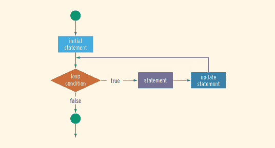

**图 5-2**  `for` 循环

`for` 循环的执行过程如下：

- 1. 执行初始化语句。
- 2. 计算循环条件。如果循环条件的求值结果为 true：
  - i. 执行 `for` 循环语句。
  - ii. 执行更新语句（圆括号中的第三个表达式）。
- 3. 重复步骤 2，直到循环条件的求值结果为 false。

初始化语句通常初始化一个变量（称为 `for` 循环控制变量或 `for` 索引变量）。

在 C++ 中，`for` 是保留字。

> **注意**  顾名思义，`for` 循环中的初始化语句是第一条执行的语句；它只执行一次。

### 示例 5-9

下面的 `for` 循环打印前 10 个非负整数：

```cpp
for (i = 0; i < 10; i++)
    cout << i << " ";
cout << endl;
```

初始化语句 `i = 0;` 将 `int` 变量 `i` 初始化为 0。接下来，计算循环条件 `i < 10`。因为 0 < 10 为 `true`，所以执行打印语句并输出 0。然后执行更新语句 `i++`，将 `i` 的值设为 1。再次计算循环条件，结果仍为 `true`，依此类推。当 `i` 变为 10 时，循环条件的求值结果为 `false`，`for` 循环终止，并执行 `for` 循环之后的第一个语句。

`for` 循环可以包含简单语句或复合语句。

下面的示例进一步说明 `for` 循环如何执行。

### 示例 5-10

- 1. 下面的 `for` 循环将 `Hello!` 和星号（各占一行）输出五次：

```cpp
for (i = 1; i <= 5; i++)
{
    cout << "Hello!" << endl;
    cout << "*" << endl;
}
```

- 2. 考虑下面的 `for` 循环：

```cpp
for (i = 1; i <= 5; i++)
    cout << "Hello!" << endl;
cout << "*" << endl;
```

该 `for` 循环的输出为：

```text
Hello!
Hello!
Hello!
Hello!
Hello!
*
```

`for` 循环只控制第一个输出语句，因为这两个输出语句没有用花括号组成复合语句。因此，第一个输出语句执行五次，因为 `for` 循环体执行五次。`for` 循环执行后，第二个输出语句只执行一次。缩进会被编译器忽略，但仍然具有误导性。


### 例 5-11

以下 `for` 循环执行五条空语句：

```cpp
for (i = 0; i < 5; i++);    //Line 1
    cout << "*" << endl;    //Line 2
```

`for` 语句末尾（输出语句之前，第 1 行）的分号终止了 `for` 循环。此 `for` 循环的动作为空，即 null。如例 5-10(2) 所示，第 2 行的缩进具有误导性。

前面的示例表明，要让 `for` 循环执行所需操作，需要小心。

以下是对 `for` 循环的一些说明：

- 如果循环条件最初为 `false`，则循环体不会执行。
- 更新表达式执行时会改变循环控制变量的值（该变量由初始表达式初始化），这种改变应最终使循环条件的值变为 `false`。如果循环条件始终为 `true`，则 `for` 循环体会无限执行。
- C++ 允许对 `double` 类型（或任何实数数据类型）的循环控制变量使用小数值。由于不同计算机可能对这些循环控制变量给出不同结果，应避免使用此类变量。
- `for` 语句末尾（紧挨循环体之前）的分号是语义错误。在这种情况下，`for` 循环的动作为空。
- 在 `for` 语句中，如果省略循环条件，则假定其为 `true`。
- 在 `for` 语句中，可以省略全部三条语句——初始化语句、循环条件和更新语句。但是，`for` 语句必须包含两个分号。以下是一个合法的 `for` 循环：

```cpp
for (;;)
    cout << "Hello" << endl;
```

这是一个无限 `for` 循环，会不断打印单词 Hello。

以下是更多 `for` 循环的示例。

### 例 5-12

如果正确设置 `for` 循环控制表达式，就可以使用 `for` 循环倒计数。

例如，考虑以下 `for` 循环：

```cpp
for (i = 10; i >= 1; i--)
    cout << " " << i;
cout << endl;
```

输出为：

10  9  8  7  6  5  4  3  2  1

在此 `for` 循环中，变量 `i` 初始化为 10。每次循环迭代后，`i` 减 1。只要 `i >= 1`，循环就继续执行。

### 例 5-13

可以按任意固定数值递增（或递减）循环控制变量。在以下 `for` 循环中，变量初始化为 1；在 `for` 循环末尾，`i` 递增 2。此 `for` 循环输出前 10 个正奇数。

```cpp
for (i = 1; i <= 20; i = i + 2)
    cout << " " << i;
cout << endl;
```

输出为：

1 3 5 7 9 11 13 15 17 19

### 例 5-14

假设 `i` 是 `int` 变量。

- 1. 考虑以下 `for` 循环：

    ```cpp
    for (i = 10; i <= 9; i++)
        cout << i << " ";
    cout << endl;
    ```

    在此 `for` 循环中，初始化语句将 `i` 设为 10。由于最初循环条件（`i <= 9`）为 `false`，所以什么也不发生。

- 2. 考虑以下 `for` 循环：

    ```cpp
    for (i = 9; i >= 10; i--)
        cout << i << " ";
    cout << endl;
    ```

    在此 for 循环中，初始化语句将 i 设为 9。由于最初循环条件（i >= 10）为 false，所以什么也不发生。

- 3. 考虑以下 for 循环：

    ```cpp
    for (i = 10; i <= 10; i++)        //Line 1
        cout << i << " ";             //Line 2
    cout << endl;                     //Line 3
    ```

    在此 for 循环中，初始化语句将 i 设为 10。循环条件（i <= 10）求值为 true，因此第 2 行中的输出语句执行，输出 10。接着，更新语句将 `i` 的值递增 1，所以 `i` 的值变为 11。现在循环条件求值为 false，for 循环终止。注意，第 2 行中的输出语句只执行一次。

- 4. 考虑以下 for 循环：

    ```cpp
    for (i = 1; i <= 10; i++); //Line 1
        cout << i << " ";      //Line 2
    cout << endl;              //Line 3
    ```

    此 for 循环对第 2 行中的输出语句没有影响。for 语句末尾的分号终止了 for 循环；因此 for 循环的动作为空。输出语句完全独立，只执行一次。

- 5. 考虑以下 for 循环：

    ```cpp
    for (i = 1; ; i++)
        cout << i << " ";
    cout << endl;
    ```

    在此 for 循环中，因为 for 语句省略了循环条件，所以循环条件始终为 true。这是一个无限循环。

- 6. 以下 for 循环输出不超过 100 的 2 的正整数次幂。

    ```cpp
    for (i = 2; i < 100; i = 2 * i)
        cout << i << " "; //output power of 2
    cout << endl;
    ```

    输出为：

    2 4 8 16 32 64

### 例 5-16（斐波那契数程序：再探）

上一节给出的编程示例：斐波那契数，使用 `while` 循环确定所需的斐波那契数。可以按如下方式用等价的 `for` 循环替换 `while` 循环：

```cpp
for (counter = 3; counter <= nthFibonacci; counter++)
{
    current = previous2 + previous1;
    previous1 = previous2;
    previous2 = current;
    counter++;
}//end for
```

使用 `for` 循环确定所需斐波那契数的程序的完整程序清单见本书配套网站。该程序名为 Ch5_FibonacciNumberUsingAForLoop.cpp。

在以下 C++ 程序中，建议你逐步走查每一步。

### 例 5-17

以下 C++ 程序求前 n 个正整数之和。

```cpp
//Program to determine the sum of the first n positive integers.

#include <iostream>

using namespace std;

int main()
{
    int counter;    //loop control variable
    int sum;        //variable to store the sum of numbers
    int n;          //variable to store the number of
                    //first positive integers to be added

    cout << "Line 1: Enter the number of positive "
         << "integers to be added: ";                     //Line 1
    cin >> n;                                              //Line 2
    sum = 0;                                               //Line 3
    cout << endl;                                          //Line 4

    for (counter = 1; counter <= n; counter++)             //Line 5
        sum = sum + counter;                               //Line 6

    cout << "Line 7: The sum of the first " << n
         << " positive integers is " << sum
         << endl;                                          //Line 7

    return 0;
}
```

**示例运行：** 在此示例运行中，用户输入以阴影显示。

第 1 行：输入要相加的正整数个数：`100`

第 7 行：前 100 个正整数之和为 5050

第 1 行中的语句提示用户输入要相加的正整数个数。第 2 行中的语句将用户输入的数存入 `n`，第 3 行中的语句将 `sum` 初始化为 0。第 5 行中的 `for` 循环执行 `n` 次。在 `for` 循环中，`counter` 初始化为 1，并在每次循环迭代后递增 1。因此，`counter` 的范围从 1 到 `n`。每次循环时，`counter` 的值被加到 `sum` 中。变量 `sum` 初始化为 0，`counter` 的范围从 1 到 `n`，并且 `counter` 的当前值被加到 `sum` 的值中。因此，`for` 循环执行后，`sum` 包含前 `n` 个值之和，在示例运行中即 100 个正整数之和。

回想一下，将一个控制结构语句放在另一个控制结构语句内部称为**嵌套**。以下编程示例演示了一个简单的嵌套实例，也很好地演示了计数。

## 编程示例：数字分类

此程序读取给定的一组整数，然后打印奇数和偶数的个数。它还输出零的个数。

该程序读取 20 个整数，但你可以轻松修改它以读取任意一组数。事实上，你可以修改程序，使其首先提示用户指定要读取多少个整数。

- **输入：** 20 个整数——正数、负数或零。
- **输出：** 零、偶数和奇数的个数。

### 问题分析与算法设计

读取一个数后，需要检查它是偶数还是奇数。假设该值存储在 `number` 中。将 `number` 除以 2 并检查余数。如果余数为 0，则 `number` 是偶数。递增偶数计数，然后检查 `number` 是否为 0。如果是，则递增零计数。如果余数不为 0，则递增奇数计数。

程序使用 `switch` 语句判断 `number` 是奇数还是偶数。假设 `number` 是奇数。如果 `number` 为正数，除以 2 得到余数 1；如果为负数，得到余数 -1。如果 `number` 是偶数，无论 `number` 是正数还是负数，除以 2 的余数都是 0。可以使用取模运算符 `%` 求余数。例如：

```
6 % 2 = 0; -4 % 2 = 0; -7 % 2 = -1; 15 % 2 = 1
```


对列表中的每个数重复前述分析一个数的过程。这段讨论可转化为以下算法：

- 1. 对列表中的每个数：
  - a. 获取该数。
  - b. 分析该数。
  - c. 将相应的计数加 1。
- 2. 输出结果。

### 变量

因为要统计零、偶数和奇数的个数，所以需要三个 int 类型变量——比如 zeros、evens 和 odds——来记录计数。还需要一个变量——比如 number——来读取并存储待分析的数字，以及另一个变量——比如 counter——来统计已分析数字的个数。因此，程序中需要以下变量：

```cpp
int counter;    //loop control variable
int number;     //variable to store the number read
int zeros;      //variable to store the zero count
int evens;      //variable to store the even count
int odds;       //variable to store the odd count
```

显然，必须将变量 zeros、evens 和 odds 初始化为 0。可以在声明这些变量时进行初始化。

### 主算法

- 1. 声明并初始化变量。
- 2. 提示用户输入 20 个数字。
- 3. 对列表中的每个数：
  - a. 读取该数。
  - b. 输出该数（回显输入）。
  - c. 如果该数是偶数：
    - i. 将偶数计数加 1。
    - ii. 如果该数为零，将零计数加 1。

    否则
    将奇数计数加 1。
- 4. 输出结果。

在编写 C++ 程序之前，让我们更详细地描述步骤 1–4。这样，用 C++ 编写指令就会容易得多。

- 1. 初始化变量。可以在声明变量 zeros、evens 和 odds 时初始化它们。
- 2. 使用输出语句提示用户输入 20 个数字。
- 3. 对于步骤 3，可以使用 `for` 循环来处理和分析这 20 个数字。用伪代码表示，这一步写为：

```text
for (counter = 1; counter <= 20; counter++)
{
    read the number;
    output number;

    switch (number % 2)    // check the remainder
    {
    case 0:
        increment even count;
        if (number == 0)
            increment zero count;
        break;
    case 1:
    case -1:
        increment odd count;
    }//end switch
}//end for
```

- 4. 输出结果。输出变量 zeros、evens 和 odds 的值。

### 完整程序清单

```cpp
/************************************************
// Author: D.S. Malik
//
// Program: Counts zeros, odds, and evens
// This program counts the number of odd and even numbers.
// The program also counts the number of zeros.
*************************************************/

#include <iostream>
#include <iomanip>

using namespace std;

const int N = 20;

int main()
{
        //Declare variables
        int counter;        //loop control variable
        int number;         //variable to store the new number
        int zeros = 0;                                      //Step 1
        int odds = 0;                                       //Step 1
        int evens = 0;                                      //Step 1

        cout << "Please enter " << N << " integers, "
             << "positive, negative, or zeros."
             << endl;                         //Step 2

        cout << "The numbers you entered are:" << endl;

        for (counter = 1; counter <= N; counter++)    //Step 3
        {
            cin >> number;                            //Step 3a
            cout << number << " ";                    //Step 3b

                           //Step 3c
            switch (number % 2)
            {
            case 0:
                evens++;
                if (number == 0)
                    zeros++;
                break;
            case 1:
            case -1:
                odds++;
            } //end switch
        } //end for loop

        cout << endl;

        cout << "There are " << evens << " evens, "
             << "which includes " << zeros << " zeros."
             << endl;
        cout << "The number of odd numbers is: " << odds
             << endl;

        return 0;
}
```

**示例运行：** 在此示例运行中，用户输入以阴影显示。

```text
Please enter 20 integers, positive, negative, or zeros.
The numbers you entered are:
0 0 -2 -3 -5 6 7 8 0 3 0 -23 -8 0 2 9 0 12 67 54
0 0 -2 -3 -5 6 7 8 0 3 0 -23 -8 0 2 9 0 12 67 54
There are 13 evens, which includes 6 zeros.
The number of odd numbers is: 7
```

建议使用上面的示例输入对此程序进行一次走查。

## do...while 循环（重复）结构

本节介绍第三种循环或重复结构，称为 do...while 循环。do...while 语句的一般形式如下：

```cpp
do
    statement
while (expression);
```

当然，语句可以是简单语句或复合语句。如果是复合语句，请将其括在花括号中。图 5–3 展示了 do...while 循环的执行流程。

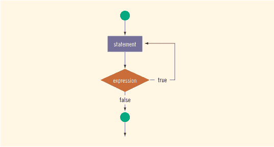

**图 5–3**  do...while 循环

在 C++ 中，do 是保留字。

语句先执行，然后对表达式求值。如果表达式的求值为 true，则语句再次执行。只要 do...while 语句中的表达式为 true，语句就会执行。为避免无限循环，你必须再次确保循环体包含最终使表达式为 false 的语句，并保证循环能正确退出。

### 例 5-18

```cpp
i = 0;

do
{
    cout << i << " ";
    i = i + 5;
}
while (i <= 20);
```

这段代码的输出是：

```text
0 5 10 15 20
```

输出 20 后，语句：

```cpp
i = i + 5;
```

将 `i` 的值改为 25，因此 `i <= 20` 变为 **false**，从而终止循环。

在 `while` 和 `for` 循环中，循环条件在循环体执行*之前*求值。因此，`while` 和 `for` 循环称为**前测循环**。另一方面，`do...while` 循环中的循环条件在循环体执行*之后*求值。因此，`do...while` 循环称为**后测循环**。

由于 `while` 和 `for` 循环都有入口条件，这些循环可能根本不会执行。另一方面，`do...while` 循环有出口条件，因此语句至少会执行一次。

### 例 5-19

考虑以下两个循环：

- a.

  ```cpp
  i = 11;
  while (i <= 10)
  {
      cout << i << " ";
      i = i + 5;
  }
  cout << endl;
  ```

- b.

  ```cpp
  i = 11;
  do
  {
      cout << i << " ";
      i = i + 5;
  }
  while (i <= 10);
  cout << endl;
  ```

在 (a) 中，`while` 循环不产生任何输出；语句从不执行。在 (b) 中，`do...while` 循环输出数字 11，并将 `i` 的值改为 16。这是符合预期的，因为在 `do...while` 中，语句必须*始终*至少执行一次。

`do...while` 循环可用于输入验证。假设程序提示用户输入一个测试分数，该分数必须大于或等于 0 且小于或等于 50。如果用户输入的分数小于 0 或大于 50，则应提示用户重新输入分数。可以使用以下 `do...while` 循环来实现此目标：

```cpp
int score;

do
{
    cout << "Enter a score between 0 and 50: ";
    cin >> score;
    cout << endl;
}
while (score < 0 || score > 50);
```

### 例 5-20：3 和 9 的整除性测试

假设 *m* 和 *n* 是整数，且 *m* 非零。若存在某个整数 *q* 使得 *n = mq*，则称 *m* 为 *n* 的**因子**；也就是说，当 *m* 整除 *n* 时，余数为 0。

设 \(n = a_k a_{k-1}a_{k-2}\cdots a_1a_0\) 为一个整数。设 \(s = a_k + a_{k-1} + a_{k-2} + \cdots + a_1 + a_0\) 为 \(n\) 的各位数字之和。已知若 \(s\) 能被 3 和 9 整除，则 \(n\) 能被 3 和 9 整除。换句话说，一个整数能被 3 和 9 整除当且仅当其各位数字之和能被 3 和 9 整除。

例如，假设 \(n = 27193257\)。则 \(s = 2 + 7 + 1 + 9 + 3 + 2 + 5 + 7 = 36\)。由于 36 同时能被 3 和 9 整除，因此 27193257 也能同时被 3 和 9 整除。

接下来，我们编写一个程序，先求出一个正整数的各位数字之和，然后检查该和是否能被 3 和 9 整除，从而判断该正整数是否能被 3 和 9 整除。

要求一个正整数的各位数字之和，需要提取该数的每一位数字。考虑数字 951372。注意 951372 % 10 = 2，这是 951372 的最后一位数字。还要注意 951372 / 10 = 95137；也就是说，当该数除以 10 时，会去掉最后一位数字。接下来，我们对数字 95137 重复此过程。当然，我们需要将提取出的数字相加。


假设 sum 和 num 是 `int` 变量，并且正整数存储在 num 中。因此，我们有以下算法来求各位数字之和：

```cpp
sum = 0;

do
{
    sum = sum + num % 10; //extract the last digit
                          //and add it to sum
    num = num / 10;       //remove the last digit
}
while (num > 0);
```

使用该算法，我们可以编写以下程序，该程序使用 `do...while` 循环来实现前面的整除性测试算法。

```cpp
//Program: Divisibility test by 3 and 9

#include <iostream>

using namespace std;

int main()
{
    int num, temp, sum;

    cout << "Enter a positive integer: ";
    cin >> num;
    cout << endl;

    temp = num;

    sum = 0;

    do
    {
        sum = sum + num % 10; //extract the last digit
                              //and add it to sum
        num = num / 10;       //remove the last digit
    }
    while (num > 0);

    cout << "The sum of the digits = " << sum << endl;

    if (sum % 9 == 0)
        cout << temp << " is divisible by 3 and 9" << endl;
    else if (sum % 3 == 0)
        cout << temp << " is divisible by 3, but not 9" << endl;
    else
        cout << temp << " is not divisible by 3 or 9" << endl;
}
```

**示例运行：** 在这些示例运行中，用户输入以阴影显示。

### 示例运行 1

输入一个正整数：`27193257`

各位数字之和 = 36  
27193257 能被 3 和 9 整除

### 示例运行 2

输入一个正整数：`609321`

各位数字之和 = 21  
609321 能被 3 整除，但不能被 9 整除

### 示例运行 3

输入一个正整数：`161905102`

各位数字之和 = 25  
161905102 不能被 3 或 9 整除

## 选择合适的循环结构

三种循环在 C++ 中各有其适用之处。如果已知并且程序可以预先确定所需的重复次数，那么 `for` 循环是正确的选择。如果未知，程序无法预先确定所需的重复次数，并且该次数可能为 0，那么 `while` 循环是正确选择。如果未知，程序无法预先确定所需的重复次数，并且该次数至少为 1，那么 `do...while` 循环是正确选择。

## `break` 和 `continue` 语句

`break` 语句在 `switch` 结构中执行时，会立即退出 `switch` 结构。同样，你可以在 `while`、`for` 和 `do...while` 循环中使用 `break` 语句立即退出循环结构。`break` 语句通常用于两个目的：

- 提前退出循环。
- 跳过 `switch` 结构的剩余部分。

`break` 语句执行后，程序继续执行该结构之后的第一个语句。在循环中使用 `break` 语句可以避免使用某些（标志）变量。以下 C++ 代码段有助于说明这一思想。（假设所有变量都已正确声明。）

```cpp
sum = 0;
isNegative = false;

cin >> num;

while (cin && !isNegative)
{
    if (num < 0)    //if num is negative, terminate the loop
                    //after this iteration
    {
        cout << "Negative number found in the data." << endl;
        isNegative = true;
    }
    else
    {
        sum = sum + num;
        cin >> num;
    }
}
```

这个 **while** 循环用于求一组正数之和。如果数据集中包含负数，循环将终止并给出适当的错误消息。这个 **while** 循环使用标志变量 **isNegative** 来表示存在负数。变量 **isNegative** 在 **while** 循环之前初始化为 **false**。在将 num 加到 sum 之前，会检查 num 是否为负数。如果 num 为负数，屏幕上会出现错误消息，并将 **isNegative** 设置为 **true**。在下一次迭代中，当计算 **while** 语句中的表达式时，其结果为 **false**，因为 **!isNegative** 为 **false**。（注意，因为 **isNegative** 为 **true**，所以 **!isNegative** 为 **false**。）

下面的 **while** 循环没有使用变量 **isNegative**：

```cpp
sum = 0;
cin >> num;

while (cin)
{
    if (num < 0)    //if num is negative, terminate the loop
    {
        cout << "Negative number found in the data." << endl;
        break;
    }

    sum = sum + num;
    cin >> num;
}
```

在这种形式的 **while** 循环中，当发现负数时，**if** 语句中的表达式的计算结果为 **true**；打印适当消息后，**break** 语句终止循环。（在循环中执行 **break** 语句后，循环中剩余的语句将被丢弃。）

> **注意**
>
> `break` 语句是避免使用额外变量控制循环并生成优雅代码的有效方法。然而，`break` 语句在循环中的使用必须非常谨慎。在循环中过度使用这些语句会产生意大利面条式代码（具有许多退出条件的循环），这类代码可能非常难以理解和管理。使用 `break` 语句时应格外小心，并确保使用 `break` 语句使代码更具可读性而不是降低可读性。如果不确定，就不要使用 `break` 语句。

`continue` 语句用于 `while`、`for` 和 `do...while` 结构中。当在循环中执行 `continue` 语句时，它会跳过循环中剩余的语句，并继续执行循环的下一次迭代。在 `while` 和 `do...while` 结构中，表达式（即循环继续测试）会在 `continue` 语句之后立即求值。在 `for` 结构中，更新语句在 `continue` 语句之后执行，然后执行循环条件（即循环继续测试）。

如果前面的程序段遇到负数，`while` 循环将终止。如果你想丢弃该负数并读取下一个数，而不是终止循环，请将 `break` 语句替换为 `continue` 语句，如下例所示：

```cpp
sum = 0;
cin >> num;

while (cin)
{
    if (num < 0)
    {
        cout << "Negative number found in the data." << endl;
        cin >> num;
        continue;
    }

    sum = sum + num;
    cin >> num;
}
```

前面已经说过，三种循环在 C++ 中各有其适用之处，并且一种循环通常可以替代另一种循环。然而，`continue` 语句的执行正是 `while` 和 `do...while` 结构与 `for` 结构的不同之处。当在 `while` 或 `do...while` 循环中执行 `continue` 语句时，更新语句可能不会执行。在 `for` 结构中，更新语句*总是*执行。

## 嵌套控制结构

本节给出示例，说明如何使用嵌套循环来获得有用的结果并处理数据。

### 例 5-21

假设你想创建以下图案：

```text
*
**
***
****
*****
```

显然，你想打印五行星号。第一行打印一个星号，第二行打印两个星号，依此类推。由于将打印五行，因此从以下 `for` 语句开始：

```cpp
for (i = 1; i <= 5; i++)
```

第一次迭代中 i 的值为 1，第二次迭代中为 2，依此类推。你可以将 i 的值用作嵌套在该循环内的另一个 `for` 循环中的限制条件，以控制一行中的星号数量。稍加思考便可得到以下代码：

```cpp
for (i = 1; i <= 5; i++)          //Line 1
{
    for (j = 1; j <= i; j++)      //Line 3
        cout << "*";              //Line 4
    cout << endl;                  //Line 5
}                                  //Line 6
```

对该代码的逐步分析表明，第 1 行的 `for` 循环从 i == 1 开始。当 i 为 1 时，第 3 行的内层 `for` 循环输出一个星号，插入点移到下一行。然后 i 变为 2，内层 `for` 循环输出两个星号，第 5 行的输出语句将插入点移到下一行，依此类推。此过程一直持续到 i 变为 6，循环停止。

如果将第 1 行的 `for` 语句替换为以下内容，这段代码会产生什么图案？

```cpp
for (i = 5; i >= 1; i--)
```


### 示例 5-22

假设你想创建下面的乘法表：

| | | | | | | | | | |
|---|---|---|---|---|---|---|---|---|---|
| 1 | 2 | 3 | 4 | 5 | 6 | 7 | 8 | 9 | 10 |
| 2 | 4 | 6 | 8 | 10 | 12 | 14 | 16 | 18 | 20 |
| 3 | 6 | 9 | 12 | 15 | 18 | 21 | 24 | 27 | 30 |
| 4 | 8 | 12 | 16 | 20 | 24 | 28 | 32 | 36 | 40 |
| 5 | 10 | 15 | 20 | 25 | 30 | 35 | 40 | 45 | 50 |

该乘法表有五行。因此，如示例 5-21 中那样，我们使用 `for` 语句如下输出这些行：

```cpp
for (i = 1; i <= 5; i++)
    //output a line of numbers
```

在第一行，我们要打印 1 的乘法表；在第二行，我们要打印 2 的乘法表；依此类推。注意，第一行以 1 开头，并且当打印这一行时，`i` 为 1。类似地，第二行以 2 开头，并且当打印这一行时，`i` 的值为 2，依此类推。如果 `i` 为 1，则 `i * 1` 为 1；如果 `i` 为 2，则 `i * 2` 为 2；依此类推。因此，要打印一行数字，我们可以把 `i` 的值作为起始数字，把 10 作为上限值。也就是说，考虑下面的 `for` 循环：

```cpp
for (j = 1; j <= 10; j++)
    cout << setw(3) << i * j;
```

让我们看一下这个 `for` 循环。假设 `i` 为 1，那么我们在打印乘法表的第一行。同时，`j` 从 1 到 10，因此这个 `for` 循环输出数字 1 到 10，也就是乘法表的第一行。类似地，如果 `i` 为 2，我们在打印乘法表的第二行。同时，`j` 从 1 到 10，因此这个 `for` 循环输出乘法表的第二行，依此类推。

稍加思考即可得到下面的嵌套循环，以输出所需的网格：

```cpp
for (i = 1; i <= 5; i++)          //Line 1
{                                //Line 2
    for (j = 1; j <= 10; j++)    //Line 3
        cout << setw(3) << i * j;//Line 4
    cout << endl;                //Line 5
}                                //Line 6
```

### 示例 5-23

考虑以下数据：

```text
65 78 65 89 25 98 -999
87 34 89 99 26 78 64 34 -999
-999
23 99 98 97 26 78 100 63 87 23 -999
62 35 78 99 12 93 19 -999
```

每行末尾的数字 -999 充当哨兵，因此不属于数据的一部分。我们的目标是求每行中数字的和并输出该和。此外，假设这些数据要从一个文件读取，比如 `Exp_5_23.txt`。我们假设输入文件已经使用输入文件流变量 `infile` 打开。

这个特定的数据集有五行输入。因此，我们可以使用 `for` 循环或计数器控制的 `while` 循环来处理每一行数据。让我们使用 `while` 循环来处理这五行。由此可知，该 `while` 循环采用以下形式：

```cpp
counter = 0;                    //Line 1
while (counter < 5)             //Line 2
{                               //Line 3
        //process the line       //Line 4

        //output the sum
        counter++;
}
```

现在让我们专注于处理一行。每一行的数据项数量各不相同。例如，第一行有六个数字，第二行有八个数字，依此类推。因为每一行都以 -999 结尾，所以我们可以使用哨兵控制的 `while` 循环，以 -999 作为哨兵值，求每一行中数字的和。考虑下面的 `while` 循环：

```cpp
sum = 0;                       //Line 4
infile >> num;                 //Line 5
while (num != -999)            //Line 6
{                              //Line 7
        sum = sum + num;       //Line 8
        infile >> num;         //Line 9
}                              //Line 10
```

第 4 行的语句将 sum 初始化为 0，第 5 行的语句读取该行的第一个数字并存入 num。第 6 行中的布尔表达式 `num != -999` 检查该数字是否为 -999。如果 num 不是 -999，则执行第 8 行和第 9 行的语句。第 8 行的语句更新 sum 的值；第 9 行的语句读取下一个数字并存入 num。只要 num 不是 -999，循环就继续执行。

由此可知，用于处理数据的嵌套循环如下。（假设所有变量都已正确声明。）

```cpp
counter = 0;                         //Line 1
while (counter < 5)                  //Line 2
{                                    //Line 3
        sum = 0;                     //Line 4
        infile >> num;               //Line 5
        while (num != -999)          //Line 6
        {                            //Line 7
                sum = sum + num;     //Line 8
                infile >> num;       //Line 9
        }                            //Line 10

        counter++;                   //Line 11
        cout << "Line " << counter   //Line 12
             << ": Sum = " << sum << endl;  //Line 13
}                                    //Line 14
```

### 示例 5-24

假设我们要处理与示例 5-23 中数据类似的数据，但输入文件的长度未指定。也就是说，每一行包含的数据与示例 5-23 中每一行的数据相同，但我们不知道输入行数。

因为我们不知道输入行数，所以必须使用 EOF 控制的 `while` 循环来处理数据。在这种情况下，所需代码如下。（假设所有变量都已正确声明，并且输入文件已经使用输入文件流变量 `infile` 打开。）

```cpp
counter = 0;                         //Line 1
infile >> num;                        //Line 2
while (infile)                         //Line 3
{                                      //Line 4
    sum = 0;                           //Line 5
    while (num != -999)                //Line 6
    {                                  //Line 7
        sum = sum + num;               //Line 8
        infile >> num;                 //Line 9
    }                                  //Line 10

    counter++;                         //Line 11
    cout << "Line " << counter        //Line 12
         << ": Sum = " << sum << endl; //Line 13
    infile >> num;                     //Line 14
}                                      //Line 15
```

注意，我们再次使用了变量 counter，这一次是为了让我们能够打印行号以及每一行的和。

### 示例 5-25

考虑以下数据：

```text
101
John Smith
65 78 65 89 25 98 -999
102
Peter Gupta
87 34 89 99 26 78 64 34 -999
103
Buddy Friend
23 99 98 97 26 78 100 63 87 23 -999
104
Doctor Miller
62 35 78 99 12 93 19 -999
...
```

一行末尾的数字 -999 充当哨兵，因此不属于数据的一部分。

假设这是某些竞选学生会主席席位的候选人的数据。

对于每个候选人，数据采用以下形式：

```text
ID
Name
Votes
```

目标是求出该候选人获得的总票数。我们假设数据从大小未知的文件 Exp_5_25.txt 输入。我们还假设输入文件已经使用输入文件流变量 infile 打开。

因为输入文件的长度未指定，所以我们使用 EOF 控制的 while 循环。对于每个候选人，第一个数据项是单独一行的 int 类型 ID；第二个数据项是姓名，可能由不止一个单词组成；第三行包含从各部门获得的票数。

为读取 ID，我们使用提取运算符 >>；为读取姓名，我们使用流函数 getline。注意，读取 ID 之后，读取标记位于 ID 之后，而 ID 之后的字符是换行符。因此，读取 ID 之后，读取标记位于 ID 之后、换行符之前（即包含 ID 的那一行的换行符）。

函数 getline 会读取到行尾。因此，如果我们在读取 ID 之后立即读取姓名，那么存入变量 name 的将是（ID 之后的）换行符。由此可知，要读取姓名，我们必须读取并丢弃 ID 之后的换行符，这可以通过使用流函数 get 来完成。因此，读取 ID 和姓名的语句如下：

```cpp
infile >> ID;            //read the ID
infile.get(ch);           //read the newline character after the ID
getline(infile, name);    //read the name
```

（假设 ch 是 char 类型的变量。）处理数据的一般循环如下：

```cpp
infile >> ID;                         //Line 1
while (infile)                         //Line 2
{
    infile.get(ch);                     //Line 4
    getline(infile, name);               //Line 5

    //process the numbers in each line   //Line 6
    //output the name and total votes
    infile >> ID;    //begin processing the next line
}
```


读取并汇总投票数据的代码如下：

```cpp
sum = 0;                         //Line 6
infile >> num;                   //Line 7; read the first number
while (num != -999)              //Line 8
{                                //Line 9
    sum = sum + num;             //Line 10; update sum
    infile >> num;               //Line 11; read the next number
}                                //Line 12
```

现在我们可以编写如下嵌套循环来处理数据：

```cpp
infile >> ID;                    //Line 1
while (infile)                   //Line 2
{                                //Line 3
    infile.get(ch);              //Line 4
    getline(infile, name);       //Line 5
    sum = 0;                     //Line 6
    infile >> num;               //Line 7; read the first number
    while (num != -999)          //Line 8
    {                            //Line 9
        sum = sum + num;         //Line 10; update sum
        infile >> num;           //Line 11; read the next number
    }

    cout << "Name: " << name
         << ", Votes: " << sum
         << endl;                //Line 12
    infile >> ID;                //Line 13; begin processing the next line
}
```

## 避免补丁，从而避免错误

前面章节中的调试部分展示了如何调试语法错误和逻辑错误，以及如何避免对概念的一知半解。在本节中，我们将说明如何避免使用软件补丁来修复代码。软件补丁是编写在现有代码之上的一段代码，用于修复原代码中的错误。

假设文件 `Ch5_LoopWithBugsData.txt` 中包含以下数据。

```text
87 78 83 94
23 89 92 70
92 78 34 56
```

目标是求出每一行数字的总和。对于每一行，输出这些数字及其总和。让我们考虑以下程序：

```cpp
#include <iostream>
#include <fstream>

using namespace std;

int main()
{
    ifstream infile;

    int i;
    int j;
    int sum;
    int num;

    infile.open("Ch5_LoopWithBugsData.txt");

    for (i = 1; i <= 4; i++)
    {
        sum = 0;

        for (j = 1; j <= 4; j++)
        {
            infile >> num;
            cout << num << " ";
            sum = sum + num;
        }

        cout << " sum = " << sum << endl;
    }

    return 0;
}
```

### 示例运行：

```text
87 78 83 94 sum = 342
23 89 92 70 sum = 274
92 78 34 56 sum = 260
56 56 56 56 sum = 224
```

示例运行表明程序中存在错误，因为文件中包含三行输入，而输出却包含四行。此外，最后一行中的数字 56 重复了四次。显然，程序中存在错误，我们必须修复代码。一些程序员，尤其是初学者，会通过添加软件补丁来处理问题的表象。在这种情况下，输出应该只有三行。初学者程序员可能会通过添加软件补丁来手动截断不需要的第四行，如下面的修改后程序所示：

```cpp
#include <iostream>
#include <fstream>

using namespace std;

int main()
{
        ifstream infile;

        int i;
        int j;
        int sum;
        int num;

        infile.open("Ch5_LoopWithBugsData.txt");

        for (i = 1; i <= 4; i++)
        {
                sum = 0;

                if (i != 4)        //software patch
                {
                        for (j = 1; j <= 4; j++)
                        {
                                infile >> num;
                                cout << num << " ";
                                sum = sum + num;
                        }

                        cout << "sum = " << sum << endl;
                }
        }

        return 0;
}
```

### 示例运行：

```text
87 78 83 94  sum = 342
23 89 92 70  sum = 274
92 78 34 56  sum = 260
```

显然，程序现在可以正确运行了。

正如我们所见，程序员只是观察到了现象，并通过添加软件补丁来解决问题。然而，如果你查看代码，不仅程序执行了多余的语句，而且这也是对概念一知半解的一个例子。看来程序员并没有很好地理解为什么之前的程序输出四行而不是三行。添加补丁消除了现象，但这是一种糟糕的编程实践。程序员必须弄清程序为什么会输出四行。仔细查看程序，我们可以发现产生四行的原因在于外层循环执行了四次。循环控制变量 i 被赋值为 1、2、3 和 4。这是典型的“差一错误”的例子。（在“差一错误”中，循环要么多执行一次，要么少执行一次。）我们可以通过正确设置循环控制变量的值来消除这个问题。例如，我们可以将循环重写如下：

```cpp
for (i = 1; i <= 3; i++)
{
    sum = 0;

    for (j = 1; j <= 4; j++)
    {
        infile >> num;
        cout << num << " ";
        sum = sum + num;
    }

    cout << "sum = " << sum << endl;
}
```

这段代码修复了原始问题，而且没有使用软件补丁。这也代表了良好的编程实践。完整的修改后程序可在本书附带的网站上获取，文件名为 `Ch5_LoopWithBugsCorrectedProgram.cpp`。

## 调试循环

正如我们在前面的调试部分中所看到的，无论程序的设计和编码多么仔细，错误仍有可能发生。如果存在语法错误，编译器会将其识别出来。但如果是逻辑错误，我们必须仔细检查代码，甚至可能需要检查设计，并设法找出错误。为了提高程序的可靠性，必须在程序发布给用户之前发现并修复错误。

算法编写完成后，下一步是验证其是否正常运行。如果算法是简单的顺序流程或包含分支，则可以手工跟踪，或者使用 IDE 提供的调试器（如果有的话）。通常，循环更难调试。可以通过使用循环不变量来验证循环的正确性。循环不变量是在每次执行循环体时都保持为真的一组语句。设 p 为循环不变量，q 为循环语句中的（逻辑）表达式。那么 p && q 在每次循环迭代之前保持为真，而 p && not(q) 在循环终止后为真。关于循环不变量的完整讨论超出了本书的范围。不过，你可以在《离散数学：理论与应用（修订版）》（D.S. Malik 和 M.K. Sen 著，Cengage Learning Asia，新加坡，2010）一书中了解循环不变量。在此，我们给出一些可用于调试循环的提示。

如前所述，与循环相关的最常见错误是差一错误。如果循环变成了无限循环，那么错误很可能出在控制循环执行的逻辑表达式中。请仔细检查逻辑表达式，看看是否颠倒了不等式、赋值语句符号是否出现在相等运算符的位置，或者 `&&` 是否出现在 `||` 的位置。如果循环会改变变量的值，你可以在每次迭代之前和/或之后打印变量的值，或者使用 IDE 的调试器（如果有的话）在每次迭代期间监视变量的值。

本书中的调试部分旨在帮助你理解调试过程。然而，你也会意识到，调试可能是一个令人厌烦的过程。如果你的程序非常糟糕，不要调试。扔掉它，重新开始。

## 快速回顾

- 1. `C++` 有三种循环（重复）结构：`while`、`for` 和 `do...while`。
- 2. `while` 语句的语法是：

    ```cpp
    while (expression)
        statement
    ```

- 3. 在 `C++` 中，`while` 是保留字。
- 4. 在 `while` 语句中，表达式（决策者）两边的括号很重要；它们标记表达式的开始和结束。
- 5. `statement` 称为循环体。
- 6. `while` 循环体必须包含一条最终将表达式置为 `false` 的语句。
- 7. 计数器控制的 `while` 循环使用计数器来控制循环。
- 8. 在计数器控制的 `while` 循环中，必须在循环之前初始化计数器，并且循环体必须包含一条改变计数器变量值的语句。
- 9. 哨兵是一个特殊值，用于标记输入数据的结束。哨兵必须与所有数据项相似但又有所不同。
- 10. 哨兵控制的 `while` 循环使用哨兵来控制循环。`while` 循环一直执行，直到读入哨兵为止。
- 11. EOF 控制的 `while` 循环使用文件结束标记来控制循环。`while` 循环一直执行，直到程序检测到文件结束标记。
- 12. 在 Windows 控制台环境中，使用 `Ctrl+Z`（按住 Ctrl 键并按 Z）输入文件结束标记。在 UNIX 环境中，使用 `Ctrl+D`（按住 Ctrl 键并按 D）输入文件结束标记。
- 13. `for` 循环简化了计数器控制 `while` 循环的编写。
- 14. 在 `C++` 中，`for` 是保留字。
- 15. `for` 循环的语法是：

    ```cpp
    for (initialize statement; loop condition; update statement)
        statement
    ```

    `statement` 称为 `for` 循环的循环体。

- 16. 在 `for` 循环末尾（循环体之前）加上分号是一个语义错误。在这种情况下，`for` 循环的动作是空的。


## 习题

习题末尾括号中的数字指的是本章开头列出的学习目标。

1. 判断以下陈述的真假。

- a. 循环是一种控制结构，它使某些语句反复执行。(1)
- b. 在计数器控制的 `while` 循环中，不必初始化循环控制变量。(2)
- c. `while` 循环的循环体可能完全不执行。(2)
- d. 在无限 `while` 循环中，`while` 表达式（判断表达式）最初为假，但在第一次迭代之后始终为真。(2)
- e. 下面的 `while` 循环：

```cpp
j = 0;
while (j <= 10)
    j++;
```

如果 `j > 10` 则终止。(2, 3)

- f. 哨兵控制的 `while` 循环是一种事件控制的 `while` 循环，其终止取决于一个特殊值。(2, 3)
- g. 要从长度未指定的文件中读取数据，EOF 控制的循环是一个不错的选择。(3)
- h. 当 `while` 循环终止时，控制首先回到 `while` 语句之前的语句，然后转到紧跟在 `while` 循环之后的语句。(2, 3)

2. 以下 C++ 代码的输出是什么？(2, 3)

```cpp
int i = 2;
int temp = 1;
while (i < 10)
{
    temp = temp * (i - 1);
    i = i + 1;
}
cout << "i = " << i << " and temp = " << temp << endl;
```

3. 以下 C++ 代码的输出是什么？(2, 3)

```cpp
int count = 0;
int sum = 0;

while (count <= 8)
{
    sum = sum + static_cast<int>(sqrt(count));
    count++;
}
cout << sum << endl;
```

4. 以下 C++ 代码的输出是什么？(2, 3)

```cpp
int num = 0;
while (num * num <= 6 * num)
{
    num = num + 1;
    cout << num << " ";
}
cout << endl;
```

5. 以下 `while` 循环何时终止？(2, 3)

```cpp
ch = 'D';
while ('A' <= ch && ch <= 'Z')
    ch = static_cast<char>(static_cast<int>(ch) + 1);
```

6. 假设输入为 1 20 35 15 28 66 -1。以下代码的输出是什么？(2, 3)

```cpp
int num;
int sum;
int count;

cin >> count;
cin >> sum;

while (count <= 4)
{
    cin >> num;
    sum = sum + num;
    count++;
}
cout << "Sum = " << sum << endl;
```

7. 假设输入为 3 4 6 7 2 -1。以下代码的输出是什么？(2, 3)

```cpp
int num;
int sum;

cin >> sum;
num = sum;

while (num != -1)
{
    cin >> num;
    sum = sum + 2 * num;
}
cout << "Sum = " << sum << endl;
```

8. 假设输入为 3 4 6 7 2 -1。以下代码的输出是什么？(2, 3)

```cpp
int num;
int sum;

cin >> num;
sum = num;

while (num != -1)
{
    sum = sum + 2 * num;
    cin >> num;
}
cout << "Sum = " << sum << endl;
```

9. 假设输入为 10 -6 12 -5 -4 0。以下代码的输出是什么？(2, 3)

```cpp
int num;
int sum = 0;

cin >> num;

while (num != 0)
{
    if (num > 0)
        sum = sum + num;
    else
        sum = sum - num;
    cin >> num;
}
cout << "Sum = " << sum << endl;
```

10. 改正以下代码，使其读取并求出 20 个数的和：(2, 3)

```cpp
int count = 0;
int sum = 0;

cin >> num;
while (count <= 20);
{
    cin >> num;
    count++;
    sum = sum + count;
}
```

11. 考虑以下程序：(2, 3)

```cpp
#include <iostream>

using namespace std;

int main()
{
    int num1, num2;
    int temp = 0;

    cout << "Enter two integers: ";
    cin >> num1 >> num2;
    cout << endl;

    while (num1 % 3 != num2 % 5)
    {
        temp = num1 + num2;
        num1 = num2;
        num2 = temp;
        cout << temp << " ";
    }
    cout << endl;

    return 0;
}
```

- a. 如果输入为 10 17，输出是什么？
- b. 如果输入为 -4 11，输出是什么？
- c. 如果输入为 2 29，输出是什么？
- d. 如果输入为 7 43，输出是什么？

12. 假设输入为：

58   23   46   75   98   150   12   176   145   -999

以下程序的输出是什么？(2, 3)

```cpp
#include <iostream>

using namespace std;

int main()
{
    int num;
    int count = 0;
    cin >> num;

    while (num != -999)
    {
        count++;
        cout << num % count << " ";
        cin >> num;
    }

    cout << endl;

    return 0;
}
```

13. 以下程序旨在输入两个数并输出它们的和。它询问用户是否想运行该程序。如果回答是 Y 或 y，则提示用户输入两个数。在将数字相加并显示结果后，它再次询问用户是否想继续添加更多数字。然而，该程序未能做到这一点。改正程序，使其正常工作。(2, 3)

```cpp
#include <iostream>
#include <iomanip>

using namespace std;

int main()
{
    char response;
    double num1;
    double num2;

    cout << "This program adds two numbers." << endl;
    cout << "Would you like to run the program: (Y/y) ";
    cin >> response;
    cout << endl;

    cout << fixed << showpoint << setprecision(2);

    while (response == 'Y' && response == 'y')
    {
        cout << "Enter two numbers: ";
        cin >> num1 >> num2;
        cout << endl;

        cout << num1 << " + " << num2 << " = " << (num1 - num2)
             << endl;

        cout << "Would you like to add again: (Y/y) ";
        cin >> response;
        cout << endl;
    }
    return 0;
}
```

14. 以下程序段的输出是什么？(2, 3)

```cpp
int count = 1;

while (count++ <= 5)
    cout << "count: " << count << endl;
```

15. 以下程序段的输出是什么？(2, 3)

```cpp
int count = 5;

while (count > 0)
    cout << count-- << " ";
cout << endl;
```

16. 以下程序段的输出是什么？(2, 3)

```cpp
int count = 5;

while (count-- > 0)
    cout << count << " ";
cout << endl;
```

17. 以下程序段的输出是什么？(2, 3)

```cpp
int count = 1;
while (count++ <= 5)
    cout << count * (count - 2) << " ";

cout << endl;
```

18. 在以下每种情形中，你将使用哪种类型的循环，例如计数器控制或哨兵控制？(3)

- a. 求以下级数之和：1 + (2 / 1) + (3 / 2) + (4 / 3) + (5 / 4) + … + (10 / 9)
- b. 求以下数字之和，但不包括最后一个数：17, 32, 62, 48, 58, -1
- c. 一个文件包含一名员工的工资。更新该员工的工资。

19. 考虑以下 for 循环：(4)

```cpp
int j, s;

s = 0;
for (j = 1; j <= 10; j++)
    s = s + j * (j - 1);
```

在这个 for 循环中，指出循环控制变量、初始化语句、循环条件、更新语句，以及更新 s 值的语句。

20. 以下程序段的输出是什么？(4)

```cpp
int num = 1;
int i;

for (i = 0; i < 5; i++)
{
    num = num * (5 - i);
    cout << num << " ";
}
cout << endl;
```

21. 以下程序段的输出是什么？(4)

```cpp
int num = 0;
int count;
int y = 0;

for (count = 1; count <= 5; ++count)
{
    num = 3 * (count - 1) + (y - count);
    cout << num << " ";
}
cout << count << " " << endl;
```

22. 假设以下代码已正确插入程序中。(4)

```cpp
int s = 0;
int i;

for (i = 0; i < 5; i++)
{
    s = 2 * s + i;
    cout << s << " ";
}
cout << endl;
```

- a. s 的最终值是什么？
  - (i) 11
  - (ii) 14
  - (iii) 26
  - (iv) 以上都不是
- b. 如果在 for 循环语句的右括号后插入一个分号，s 的最终值是什么？
  - (i) 0
  - (ii) 1
  - (iii) 2
  - (iv) 5
  - (v) 以上都不是
- c. 如果将 for 循环控制表达式中的 5 替换为 0，s 的最终值是什么？
  - (i) 0
  - (ii) 1
  - (iii) 2
  - (iv) 以上都不是

23. 指出以下各语句会产生什么输出（如果有的话）：(4)

- a.

```cpp
for (i = 1; i <= 1; i++)
    cout << "* ";
cout << endl;
```

- b.

```cpp
for (i = 2; i >= 1; i++)
    cout << "* ";
cout << endl;
```


- c.
```cpp
for (i = 1; i <= 1; i--)
    cout << "*";
cout << endl;
```

- d.
```cpp
for (i = 12; i >= 9; i--)
    cout << "*";
cout << endl;
```

- e.
```cpp
for (i = 0; i <= 5; i++)
    cout << "*";
cout << endl;
```

- f.
```cpp
for (i = 1; i <= 5; i++)
{
    cout << "*";
    i = i + 1;
}
cout << endl;
```

- **24.** 编写一个 `for` 语句，将 1 到 100 之间所有 3 的倍数相加。(4)

- **25.** 以下代码的输出是什么？变量 x 和 y 之间有关系吗？如果有，请说明这种关系？输出是什么？(4)

```cpp
int x = 19683;
int i;
int y = 0;

for (i = x; i >= 1; i = i / 3)
    y++;
cout << "x = " << x << ", y = " << y << endl;
```

- **26.** 以下代码的输出是什么？(4)

```cpp
for (int i = 1; i <= 10000; i = 5 * i)
    cout << i << " ";
cout << endl;
```

- **27.** 以下 C++ 程序段的输出是什么？假设所有变量均已正确声明。(4)

```cpp
for (j = 0; j < 8; j++)
{
    cout << j * 25 << " - ";

    if (j != 7)
        cout << (j + 1) * 25 - 1 << endl;
    else
        cout << (j + 1) * 25 << endl;
}
```

- **28.** 假设输入为 3 5 7 −6 10。以下代码的输出是什么？(4)

```cpp
int temp = 0;
int num;
int count;

cin >> temp;

for (count = 0; count <= 3; count++)
{
    cout << temp << " ";
    cin >> num;
    temp = temp + num * (count - 1);
}
cout << endl;
```

- **29.** 以下哪些仅适用于 *while* 循环？哪些仅适用于 *do...while* 循环？哪些两者都适用？(2, 5)

  - a. 它被视为条件循环。
  - b. 循环体至少执行一次。
  - c. 控制循环的逻辑表达式在进入循环之前求值。
  - d. 循环体可能完全不执行。

- **30.** 以下程序包含阻止其编译和/或运行的错误。请改正所有此类错误。(4)

```cpp
#include <iostream>

using namespace std;

const int SECRET = 111.25;

int main ()
{
    int num1, num2;
    double x, y;

    cout >> "Enter two integers: ";
    cin << num1 << num2;
    cout >> endl;

    for (count = 1 count > Secret; ++count)
    {
        x = (num1 + num2) / 2.0;
        y = (num1 - num2) % 2.0;
        num1 += num1 + num2;
        num2 /= num2 * (count = SECRET - 1);
    }
    cout << num1 << " " << num2 << " " << x % 5
         << " " << (y % 7) << endl;

    return;
}
```

- **31.** 前测试循环和后测试循环之间有什么区别？(2, 4, 5)

- **32.** 以下每个循环将执行多少次？每种情况下的输出是什么？(5)

  - a.
```cpp
x = 5;  y = 50;
do
    x = x + 10;
while (x < y);
cout << x << " " << y << endl;
```

  - b.
```cpp
x = 5;  y = 80;
do
    x = x * 2;
while (x < y);
cout << x << " " << y << endl;
```

  - c.
```cpp
x = 5;  y = 20;
do
    x = x + 2;
while (x >= y);
cout << x << " " << y << endl;
```

  - d.
```cpp
x = 5;  y = 35;
while (x < y)
    x = x + 10;
cout << x << " " << y << endl;
```

  - e.
```cpp
x = 5;  y = 30;
while (x < y)
    x = x * 2;
cout << x << " " << y << endl;
```

  - f.
```cpp
x = 5;  y = 30;
while (x > y)
    x = x + 2;
cout << x << " " << y << endl;
```

- **33.** 编写一个输入语句验证循环，提示用户输入一个小于 20 或大于 75 的数。(2, 4, 5)

- **34.** 将以下内容改写为 **for** 循环：(2, 4)

```cpp
int i = 0, value = 0;

while (i <= 20)
{
    if (i % 2 == 0 && i <= 10)
        value = value + i;
    else if (i % 2 == 0 && i > 10)
        value = value + i;
    else
        value = value - i;
    i = i + 1;
}
cout << "value = " << value << endl;
```

这个循环的输出是什么？

- **35.** 将练习 34 的 **while** 循环改写为 **do..while** 循环。(2, 5)


- **40.** 给定以下程序段：(2, 4, 5)

```cpp
int limit = 4;
int first = 5;
int j;
for (j = 1; j <= limit; j++)
{
    cout << first * j << endl;
    first = first + (j - 1);
}
cout << endl;
```

编写一个 while 循环和一个 do...while 循环，使其具有相同的输出。

- **41.** 考虑以下程序：(5)

```cpp
#include <iostream>

using namespace std;

int main()
{
    int num1, num2;
    int temp = 0;

    cout << "Enter two integers: ";
    cin >> num1 >> num2;
    cout << endl;

    do
    {
        temp = num1 + num2;
        num1 = num2;
        num2 = temp;
        cout << temp << " ";
    }
    while (((num1 + num2) % 5) != 0);

    cout << endl;

    return 0;
}
```

  - a. 如果输入为 13 16，输出是什么？
  - b. 如果输入为 -4 6，输出是什么？
  - c. 如果输入为 3 5，输出是什么？
  - d. 如果输入为 13 15，输出是什么？

- **42.** 为了了解嵌套 `for` 循环如何工作，请逐步分析以下程序段，并确定每种情况下的确切输出。(4, 7)

  - a.
```cpp
int i, j;

for (i = 1; i <= 5; i++)
{
    for (j = 1; j <= 5; j++)
        cout << setw(3) << i;
    cout << endl;
}
```

  - b.
```cpp
int i, j;
for (i = 1; i <= 5; i++)
{
    for (j = (i + 1); j <= 5; j++)
        cout << setw(5) << j;
    cout << endl;
}
```

  - c.
```cpp
int i, j;
for (i = 1; i <= 5; i++)
{
    for (j = 1; j <= i; j++)
        cout << setw(3) << j;
    cout << endl;
}
```

  - d.
```cpp
const int M = 10;
const int N = 10;
int i, j;

for (i = 1; i <= M; i++)
{
    for (j = 1; j <= N; j++)
        cout << setw(3) << M * (i - 1) + j;
    cout << endl;
}
```

  - e.
```cpp
int i, j;

for (i = 1; i <= 9; i++)
{
    for (j = 1; j <= (9 - i); j++)
        cout << " ";
    for (j = 1; j <= i; j++)
        cout << setw(1) << j;
    for (j = (i - 1); j >= 1; j--)
        cout << setw(1) << j;
    cout << endl;
}
```

- **43.** 以下程序段的输出是什么？(5)

```cpp
int count = 1;
do
    cout << count * (count - 2) << " ";
while (count++ <= 5);

cout << endl;
```

- **44.** 以下代码的输出是什么？(6)

```cpp
int num = 12;

while (num >= 0)
{
    if (num % 5 == 0)
        break;

    cout << num << " ";
    num = num - 2;
}

cout << endl;
```

- **45.** 以下代码的输出是什么？(6)

```cpp
int num = 12;

while (num >= 0)
{
    if (num % 5 == 0)
    {
        num++;
        continue;
    }

    cout << num << " ";
    num = num - 2;
}
cout << endl;
```

- **46.** break 语句在循环中起什么作用？(6)

## 编程练习

- 1. 编写一个程序，提示用户输入一个整数，然后输出该数的各位数字以及各位数字之和。例如，对于 3456，应输出各位数字 3 4 5 6；对于 8030，应输出各位数字 8 0 3 0；对于 2345526，应输出各位数字 2 3 4 5 5 2 6；对于 4000，应输出各位数字 4 0 0 0；对于 −2345，应输出各位数字 2 3 4 5。

- 2. \(\pi\) 的值可以用以下级数近似：

\[\pi = 4\left(1 - \frac{1}{3} + \frac{1}{5} - \frac{1}{7} + \cdots + \frac{1}{2n-1} + \frac{1}{2n+1}\right).\]

以下程序使用该级数求 \(\pi\) 的近似值。然而，语句顺序不正确，并且该程序中还有一个错误。请重新排列语句并去除错误，使该程序可用于近似计算 \(\pi\)。

```cpp
#include <iostream>
#include <iomanip>

using namespace std;

int main()
{
        double pi = 0;
        long i;
        long n;

        cin >> n;
        cout << "Enter the value of n: ";
        cout << endl;

        if (i % 2 == 0)
                pi = pi + (1 / (2 * i + 1));
        else
                pi = pi - (1 / (2 * i + 1));

        for (i = 0; i < n; i++)
        {
                pi = 0;
                pi = 4 * pi;
        }

        cout << endl << "pi = " << pi << endl;

        return 0;
}
```

- 3. Telephone Digits 程序只输出与大写字母对应的电话数字。请重写该程序，使其同时处理大写和小写字母，并输出相应的电话数字。如果输入的不是大写或小写字母，程序必须输出适当的错误消息。

- 4. 为了使电话号码更容易记住，一些公司使用字母来表示其电话号码。例如，使用字母时，电话号码 438-5626 可以表示为 GET LOAN。在某些情况下，为了使电话号码有意义，公司可能会使用超过七个字母。例如，225-5466 可以显示为 CALL HOME，它使用了八个


字母。编写一个程序，提示用户输入以字母表示的电话号码，并输出对应的数字电话号码。如果用户输入的字母超过七个，则只处理前七个字母。并在第三位数字后输出−（连字符）。允许用户使用大写和小写字母以及单词之间的空格。此外，程序应处理用户想要处理的任意多个电话号码。

- 5. 编写一个程序，读取一组整数，然后找出并打印偶数之和与奇数之和。

- 6. 编写一个程序，提示用户输入一个正整数，然后输出一条消息，指出该数是否为质数。*（注：偶数如果是2，则为质数。奇数如果不能被任何小于或等于该数平方根的奇数整除，则为质数。）*

- 7. 设 \(n = a_k a_{k-1}a_{k-2} \ldots a_1a_0\) 是一个整数，且 \(t = a_0 - a_1 + a_2 - \cdots + (-1)^k a_k\)。已知一个整数能被11整除当且仅当 \(t\) 能被11整除。例如，假设 \(n = 8784204\)。那么，\(t = 4 - 0 + 2 - 4 + 8 - 7 + 8 = 11\)。因为11能被11整除，所以8784204能被11整除。如果 \(n = 54063297\)，那么 \(t = 7 - 9 + 2 - 3 + 6 - 0 + 4 - 5 = 2\)。因为2不能被11整除，所以54063297不能被11整除。编写一个程序，提示用户输入一个正整数，然后使用该判定准则判断该数是否能被11整除。

- 8. 编写一个程序，使用`while`循环执行以下步骤：
  - a. 提示用户输入两个整数：`firstNum`和`secondNum`（`firstNum`必须小于`secondNum`）。
  - b. 输出`firstNum`和`secondNum`之间的所有奇数。
  - c. 输出`firstNum`和`secondNum`之间所有偶数之和。
  - d. 输出1到10之间的数字及其平方。
  - e. 输出`firstNum`和`secondNum`之间所有奇数的平方和。
  - f. 输出所有大写字母。

- 9. 使用`for`循环重做编程练习8。

- 10. 使用`do...while`循环重做编程练习8。

- 11. 编程示例：斐波那契数中的程序没有检查用户输入的第一个数是否小于或等于第二个数，也没有检查这两个数是否都非负。此外，该程序没有检查用户是否为斐波那契数列中所需数字的位置输入了有效值。重写该程序，使其检查这些事项。


- 12. 城镇A的人口少于城镇B的人口。然而，城镇A的人口增长快于城镇B的人口。编写一个程序，提示用户输入每个城镇的人口和增长率。程序输出经过多少年后城镇A的人口将大于或等于城镇B的人口，以及那时两个城镇的人口。（一个示例输入为：城镇A的人口=5000，城镇A的增长率=4%，城镇B的人口=8000，城镇B的增长率=2%。）

- 13. 假设一个序列的第一个数是x，其中x是整数。定义 a₀ = x；如果 aₙ 是偶数，则 aₙ₊₁ = aₙ/2；如果 aₙ 是奇数，则 aₙ₊₁ = 3 × aₙ + 1。那么，存在一个整数k，使得 aₖ = 1。编写一个程序，提示用户输入x的值。程序输出使 aₖ = 1 的整数k以及数 a₀, a₁, a₂, ..., aₖ。（例如，如果x = 75，则k = 14，而数 a₀, a₁, a₂, ..., a₁₄ 分别为 75, 226, 113, 340, 170, 85, 256, 128, 64, 32, 16, 8, 4, 2, 1。）针对以下x值测试你的程序：75、111、678、732、873、2048和65535。

- 14. 增强你在编程练习13中编写的程序，输出序列 a₀, a₁, a₂, ..., aₖ 中最大数的位置和最大数。（例如，序列 75, 226, 113, 340, 170, 85, 256, 128, 64, 32, 16, 8, 4, 2, 1 的最大数是340，其位置为4。）针对以下x值测试你的程序：75、111、678、732、873、2048和65535。

- 15. 示例5-6实现了数字猜谜游戏。然而，在该程序中，用户有任意多次尝试来猜正确数字。重写该程序，使用户最多只有五次尝试来猜正确数字。你的程序应打印适当消息，例如“你赢了！”或“你输了！”。

- 16. 示例5-6实现了数字猜谜游戏程序。如果猜的数字不正确，程序输出消息，指出猜测偏低还是偏高。按如下方式修改程序：假设变量`num`和`guess`如示例5-6中声明，且`diff`是一个int变量。令`diff` = (`num` - `guess`)的绝对值。如果`diff`为0，则`guess`正确，程序输出消息，指出用户猜对了数字。假设`diff`不为0。然后程序按如下方式输出消息：
  - a. 如果`diff`大于或等于50，程序输出消息，指出猜测非常高（如果`guess`大于`num`）或非常低（如果`guess`小于`num`）。
  - b. 如果`diff`大于或等于30且小于50，程序输出消息，指出猜测高（如果`guess`大于`num`）或低（如果`guess`小于`num`）。
  - c. 如果`diff`大于或等于15且小于30，程序输出消息，指出猜测中等偏高（如果`guess`大于`num`）或中等偏低（如果`guess`小于`num`）。
  - d. 如果`diff`大于0且小于15，程序输出消息，指出猜测有点高（如果`guess`大于`num`）或有点低（如果`guess`小于`num`）。
  
  与编程练习15一样，给用户不超过五次尝试来猜数字。（要计算`num` - `guess`的绝对值，使用表达式`abs(num - guess)`。函数`abs`来自头文件`cstdlib`。）

- 17. 编写一个程序，实现你在第1章练习21中设计的算法。你的程序应允许用户购买任意多件商品。

- 18. 示例5-4中的程序使用哨兵控制循环处理饼干销售数据。假设数据提供在文件中，且文件第一行指定一盒的成本。修改该程序，使其使用EOF控制的循环处理数据。

- 19. 增强你在练习18中编写的程序，按如下方式修改：当学生们开始卖饼干时，他们被告知，卖出最多盒饼干的学生将把他们筹得资金的10%捐赠给他们最喜欢的慈善组织。因此，除了你在练习18中程序生成的输出外，你的程序还应输出所有卖出最多盒饼干的学生姓名，以及将捐赠给其慈善组织的金额。

- 20. 当你借钱买房、买车或用于其他目的时，你通过在一定时期内定期付款来偿还贷款。当然，贷款公司会对贷款收取利息。每笔定期付款包括贷款利息和偿还本金的金额。具体来说，假设你以每年7.2%的利率借款$1000，并且按月付款。假设你的月供为$25。现在，年利率为7.2%，且按月付款，所以月利率为7.2/12 = 0.6%。$1000第一个月的利息是1000 × 0.006 = 6。因为付款为$25，且第一个月的利息为$6，所以偿还本金的金额为25 - 6 = 19。这意味着在完成第一次付款后，贷款金额为1000 - 19 = 981。对于第二次付款，利息基于$981计算。因此第二个月的利息为981 × 0.006 = 5.886，即约为$5.89。这意味着偿还本金的金额为25 - 5.89 = 19.11，且第二次付款后的剩余余额为981 - 19.11 = 961.89。重复这一过程，直到贷款还清。编写一个程序，接受贷款金额、年利率和月供作为输入。（以百分比形式输入利率。例如，如果年利率为7.2%，则输入7.2。）然后程序输出还清贷款需要多少个月。（注意，如果月供小于第一个月的利息，那么每次付款后，贷款金额都会增加。在这种情况下，程序必须警告借款人月供太低，按此月供，贷款金额无法还清。）


- **21.** 改进练习20中的程序：首先告诉用户最低每月还款额，然后提示用户输入每月还款额。你的最后一次还款额可能会大于剩余贷款金额及其利息。在这种情况下，输出最后一次还款前的贷款金额以及最后一次还款的实际金额。另外，输出已支付的总利息。

- **22.** 编写一个完整的程序来测试示例5–21中的代码。

- **23.** 编写一个完整的程序来测试示例5–22中的代码。

- **24.** 编写一个完整的程序来测试示例5–23中的代码。

- **25.** 编写一个完整的程序来测试示例5–24中的代码。

- **26.** 编写一个完整的程序来测试示例5–25中的代码。

- **27.（圆锥纸杯问题）** 你已获得制作瓶装水附带的小圆锥纸杯的合同。这些纸杯由半径为4英寸的圆形蜡纸制成，方法是移去一个弧长为 *x* 的扇形（见图5–4）。通过将圆的剩余部分闭合，就制成了一个圆锥形纸杯。你的目标是移去尽可能短的部分，使纸杯体积最大。

  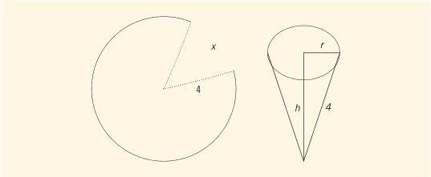

  编写一个程序，提示用户输入圆形蜡纸的半径。然后程序应输出被移除扇形的弧长，使得制作出的纸杯体积最大。将你的答案保留两位小数。

- **28.（公寓问题）** 一家房地产中介公司管理着，比如说，50套公寓单元。当租金为每月600美元时，所有单元都被租出。然而，租金每增加，比如说，40美元，就有一个单元空置。此外，每个已租出的单元平均每月需要27美元的维护费。要实现利润最大化，应该租出多少个单元？

  编写一个程序，提示用户输入：

  - a. 单元总数。
  - b. 使所有单元全部租出时的租金。
  - c. 导致一个单元空置的租金增加额。
  - d. 维护一个租出单元的费用。

  然后程序输出为实现利润最大化应租出的单元数量。

- **29.** 设 *n* 是一个非负整数。*n* 的阶乘记作 *n!*，其定义为：0! = 1；如果 *n* ≥ 1，则 *n!* = 1·2·3·⋯·*n*。例如，4! = 1·2·3·4 = 24。编写一个程序，提示用户输入一个非负整数，并输出该数的阶乘。

- **30.** 设 *n* 是一个整数。表达式 $\lim_{n\to\infty}(1+\frac{1}{n})^n$ 的值记为 *e*。这个数 *e* 出现在数学中的许多地方。例如，它出现在公式 $A=Pe^{rt}$ 中，用于计算连续复利时累积的总金额。它也出现在与指数增长和衰减相关的问题中。众所周知，*e* 是一个无理数。*e* 精确到小数点后九位的值为 *e* = 2.718281827。编写一个程序，计算该表达式在 *n* 的某些取值之间的值，然后将这些值与 *e* 进行比较。例如，你可以计算该表达式在100到10000之间（增量为100）的值，或者在1000到1000000之间（增量为1000）的值。

- **31.** 练习30定义了数 *e*。可以使用以下表达式来近似 *e* 的值：

  $$2+\frac{1}{2!}+\frac{1}{3!}+\cdots+\frac{1}{n!}$$

  其中 *n* 是正整数。编写一个程序，使用该公式近似 *e* 的值。分别用 *n* = 4、8、10 和 12 测试你的程序。

- **32.** 练习30定义了数 *e*，练习31展示了如何使用另一个表达式来近似 *e* 的值。有趣的是，*e* 的值也可以用以下表达式来近似：

  $$2+\cfrac{1}{1+\cfrac{1}{2+\cfrac{2}{3+\cfrac{3}{4+\cfrac{4}{5+5}}}}}$$

  $$\vdots$$

  $$\cfrac{(n-1)+(n-1)}{n+n}$$

  编写一个程序，使用该公式近似 *e* 的值。分别用 *n* = 3、5、10、50 和 100 测试你的程序。


# 第6章

## 用户自定义函数

**在本章中，你将会**

- 1. 了解标准（预定义）函数，并学习如何在程序中使用它们
- 2. 了解用户自定义函数
- 3. 考察返回值函数，包括实际参数和形式参数
- 4. 探讨如何在程序中构造和使用返回值的用户自定义函数
- 5. 学习函数原型
- 6. 学习如何在程序中构造和使用 void 函数
- 7. 了解值参数和引用参数之间的区别
- 8. 探讨引用参数和返回值函数
- 9. 了解标识符的作用域
- 10. 考察局部标识符和全局标识符之间的区别
- 11. 了解静态变量
- 12. 学习如何使用驱动模块和桩模块调试程序
- 13. 学习函数重载
- 14. 探讨带默认参数的函数

在第2章中，你了解到C++程序是函数的集合。其中一个这样的函数就是 main。第1章到第5章中的程序只使用了 main 函数；程序指令都被封装在一个函数中。然而，这种技术只适用于短程序。对于大型程序，将所有程序指令放入一个函数中并不实际（尽管是可能的），你很快就会发现这一点。你必须学会把问题分解成易于管理的部分。本章首先讨论预定义函数，然后讨论用户自定义函数。

让我们想象一家汽车工厂。汽车制造时并非由基本原材料直接制成，而是由先前制造好的零件组装而成。有些零件由公司自己制造，另一些则由其他公司制造。

函数就像积木。它们让你能够将复杂的程序划分为易于管理的部分。它们还有其他优点：

- 在处理某个函数时，你可以只关注程序的那一部分，构建、调试并完善它。
- 不同的人可以同时处理不同的函数。
- 如果一个函数在程序中的多个地方或不同程序中都需要用到，你可以只编写一次，然后多次使用。
- 使用函数能极大地增强程序的可读性，因为它降低了 main 函数的复杂性。

函数通常被称为模块。它们就像微型程序；你可以把它们组合起来构成更大的程序。当讨论到用户自定义函数时，你就会发现这一点。这种能力在预定义函数中不那么明显，因为我们无法获得它们的程序代码。不过，由于预定义函数已经为我们编写好了，你将先学习这些函数，以便在需要时使用它们。

### 预定义函数

在正式讨论C++中的预定义函数之前，让我们回顾一下大学代数课程中的一个概念。在代数中，函数可以被看作一种规则或对应关系，它联系着称为函数自变量的值与函数对应的唯一值。因此，如果 f(x) = 2x + 5，那么 f(1) = 7，f(2) = 9，f(3) = 11，其中1、2和3是 f 的自变量，7、9和11是函数 f 的对应值。

在C++中，函数的概念（无论是预定义函数还是用户自定义函数）与代数中函数的概念类似。例如，每个函数都有一个名称，并且会根据用户指定的值执行某种计算。本节讨论各种预定义函数。

一些预定义的数学函数包括 `pow(x, y)`、`sqrt(x)` 和 `floor(x)`。

幂函数 `pow(x, y)` 计算 `x^y`；也就是说，`pow(x, y) = x^y`。例如，`pow(2.0, 3.0) = 2.0^3 = 8.0`，`pow(2.5, 3) = 2.5^3 = 15.625`。由于 `pow(x, y)` 的值是 `double` 类型，所以我们说函数 `pow` 是 `double` 类型的，或者说函数 `pow` 返回一个 `double` 类型的值。此外，`x` 和 `y` 被称为函数 `pow` 的参数（或自变量）。函数 `pow` 有两个参数。

平方根函数 `sqrt(x)` 计算当 `x >= 0.0` 时 `x` 的非负平方根。例如，`sqrt(2.25)` 是 `1.5`。函数 `sqrt` 是 `double` 类型，并且只有一个参数。

向下取整函数 `floor(x)` 计算小于或等于 `x` 的最大整数。例如，`floor(48.79)` 是 `48.0`。函数 `floor` 是 `double` 类型，并且只有一个参数。

在C++中，预定义函数被组织到不同的库中。例如，头文件 `iostream` 包含I/O函数，头文件 `cmath` 包含数学函数。表6-1列出了一些较常用的预定义函数、每个函数规范所在头文件的名称、参数的数据类型以及函数类型。函数类型是函数返回值的数据类型。（有关其他预定义函数的列表，请参见附录F。）

### 表6-1 预定义函数

| 函数 | 头文件 | 功能 | 参数类型 | 结果 |
|---|---|---|---|---|
| `abs(x)` | `<cmath>` | 返回其参数的绝对值：`abs(-7) = 7` | `int`（`double`） | `int`（`double`） |
| `ceil(x)` | `<cmath>` | 返回不小于 `x` 的最小整数：`ceil(56.34) = 57.0` | `double` | `double` |
| `cos(x)` | `<cmath>` | 返回角度 `x` 的余弦值：`cos(0.0) = 1.0` | `double`（弧度） | `double` |
| `exp(x)` | `<cmath>` | 返回 `e^x`，其中 `e = 2.718`：`exp(1.0) = 2.71828` | `double` | `double` |
| `fabs(x)` | `<cmath>` | 返回其参数的绝对值：`fabs(-5.67) = 5.67` | `double` | `double` |


### 表 6-1 预定义函数（续）

| 函数 | 头文件 | 用途 | 参数类型 | 结果 |
|---|---|---|---|---|
| `floor(x)` | `<cmath>` | 返回不大于 x 的最大整数：`floor(45.67) = 45.00` | `double` | `double` |
| `islower(x)` | `<cctype>` | 如果 x 是小写字母，则返回 1（真）；否则返回 0（假）；`islower('h')` 为 1（真） | `int` | `int` |
| `isupper(x)` | `<cctype>` | 如果 x 是大写字母，则返回 1（真）；否则返回 0（假）；`isupper('K')` 为 1（真） | `int` | `int` |
| `pow(x, y)` | `<cmath>` | 返回 x<sup>y</sup>；如果 x 为负数，则 y 必须是整数：`pow(0.16, 0.5) = 0.4` | `double` | `double` |
| `sqrt(x)` | `<cmath>` | 返回 x 的非负平方根；x 必须非负：`sqrt(4.0) = 2.0` | `double` | `double` |
| `tolower(x)` | `<cctype>` | 如果 x 是大写字母，则返回 x 的小写值；否则返回 x | `int` | `int` |
| `toupper(x)` | `<cctype>` | 如果 x 是小写字母，则返回 x 的大写值；否则返回 x | `int` | `int` |

要在程序中使用预定义函数，必须通过 include 语句包含含有该函数说明的头文件。例如，要使用函数 pow，程序必须包含：

```cpp
#include <cmath>
```

示例 6-1 展示了如何使用一些预定义函数。

### 示例 6-1

```cpp
// How to use predefined functions.
#include <iostream>                                      //Line 1
#include <cmath>                                         //Line 2
#include <cctype>                                        //Line 3
#include <iomanip>                                       //Line 4

using namespace std;                                     //Line 5

int main()                                               //Line 6
{
    int num;                                              //Line 7
    double firstNum, secondNum;                           //Line 8
    char ch = 'T';                                        //Line 9

    cout << fixed << showpoint << setprecision (2)        //Line 10
         << endl;                                         //Line 11

    cout << "Line 12: Is " << ch
         << " a lowercase letter? "
         << islower(ch) << endl;                          //Line 12
    cout << "Line 13: Uppercase a is "
         << static_cast<char>(toupper('a')) << endl;     //Line 13

    cout << "Line 14: 4.5 to the power 6.0 = "
         << pow(4.5, 6.0) << endl;                       //Line 14

    cout << "Line 15: Enter two decimal numbers: ";      //Line 15
    cin >> firstNum >> secondNum;                         //Line 16
    cout << endl;                                         //Line 17

    cout << "Line 18: " << firstNum
         << " to the power of " << secondNum
         << " = " << pow(firstNum, secondNum) << endl;   //Line 18

    cout << "Line 19: 5.0 to the power of 4 = "
         << pow(5.0, 4) << endl;                         //Line 19

    firstNum = firstNum + pow(3.5, 7.2);                  //Line 20
    cout << "Line 21: firstNum = " << firstNum << endl;   //Line 21

    num = -32;                                            //Line 22
    cout << "Line 23: Absolute value of " << num
         << " = " << abs(num) << endl;                   //Line 23

    cout << "Line 24: Square root of 28.00 = "
         << sqrt(28.00) << endl;                         //Line 24

    return 0;                                              //Line 25
}                                                        //Line 26
```

**示例运行：** 在此示例运行中，用户输入以阴影显示。

```
Line 12: Is T a lowercase letter? 0
Line 13: Uppercase a is A
Line 14: 4.5 to the power 6.0 = 8303.77
Line 15: Enter two decimal numbers: 24.7 3.8

Line 18: 24.7 to the power of 3.80 = 195996.55
Line 19: 5.0 to the power of 4 = 625.00
Line 21: firstNum = 8290.60
Line 23: Absolute value of −32 = 32
Line 24: Square root of 28.00 = 5.29
```

该程序的工作方式如下。第 1 行到第 4 行的语句包含了使用程序中函数所需的头文件。第 7 行到第 9 行的语句声明了程序中使用的变量。第 10 行的语句将十进制数的输出设置为带两位小数的定点小数格式。第 12 行的语句使用函数 islower 判断并输出 ch 是否为小写字母。第 13 行的语句使用函数 toupper 输出与 'a' 对应的大写字母，即 A。注意，函数 toupper 返回一个 int 值。因此，表达式 toupper('a') 的值为 65，即 'A' 的 ASCII 值。要打印字符 A 而不是值 65，需要像第 13 行语句所示应用强制类型转换运算符。第 14 行的语句使用函数 pow 输出 4.5<sup>6.0</sup>。在 C++ 术语中，称为以参数 4.5 和 6.0 调用函数 pow。第 15 行到第 17 行的语句提示用户输入两个十进制数，并将用户输入的数存储到变量 firstNum 和 secondNum 中。在第 18 行的语句中，使用函数 pow 输出 firstNum<sup>secondNum</sup>。在这种情况下，以参数 firstNum 和 secondNum 调用函数 pow，并将 firstNum 和 secondNum 的值传递给函数 pow。其他语句含义类似。再次注意，程序包含头文件 cctype 和 cmath，因为它使用了这些头文件中的函数 islower、toupper、pow、abs 和 sqrt。

## 用户自定义函数

如示例 6-1 所示，在程序中使用函数极大地增强了程序的可读性，因为它降低了 main 函数的复杂性。此外，一旦你编写并正确调试了一个函数，就可以在程序（或不同程序）中反复使用它，而不必重复重写相同的代码。例如，在示例 6-1 中，函数 pow 被多次使用。

因为 C++ 并不提供你将来可能需要的每一个函数，而且设计者不可能知道用户的具体需求，所以你必须学会编写自己的函数。

C++ 中的用户自定义函数分为两类：

- **有返回值函数**——具有返回类型的函数。这些函数使用 `return` 语句返回特定数据类型的值，我们稍后将对此进行解释。注意，在我们迄今见到的每个程序中，函数 `main` 都使用了 `return` 语句返回值 0。
- **无返回值函数**——不具有返回类型的函数。这些函数*不*使用 `return` 语句返回值。

我们将首先讨论有返回值函数。关于有返回值函数讨论的许多概念也适用于无返回值函数。

## 有返回值函数

上一节介绍了一些预定义的 C++ 函数，例如 pow、abs、islower 和 toupper。这些都是有返回值函数的示例。要在程序中使用这些函数，你必须知道包含函数说明的头文件的名称。你需要使用 include 语句在程序中包含该头文件，并知道以下各项：

- 1. 函数名称
- 2. **参数**（如果有）
- 3. 每个参数的数据类型
- 4. 函数计算出的值（即函数返回的值）的数据类型，称为函数的类型

由于有返回值函数只返回一个值，你自然会以以下方式之一使用该值：

- 保存该值以供进一步计算。例如，`x = pow(3.0, 2.5);`
- 在某种计算中使用该值。例如，`area = PI * pow(radius, 2.0);`
- 打印该值。例如，`cout << abs(-5) << endl;`

这表明有返回值函数用于：

- 在赋值语句中。
- 作为函数调用中的参数。
- 在输出语句中。

也就是说，有返回值函数在表达式中使用（调用）。

在我们查看用户自定义有返回值函数的语法之前，先考虑与此类函数相关的事项。除了前面描述的四个属性外，函数（有返回值函数和无返回值函数）还关联一个事项：

- 5. 完成任务所需的代码

前四个属性构成所谓的函数**首部**（也称为**函数头**）；第五个属性称为函数**体**。这些合在一起，


这五个属性构成了所谓的函数**定义**。例如，对于函数 abs，其函数头可能如下所示：

```cpp
int abs(int number)
```

类似地，函数 abs 的定义可能如下：

```cpp
int abs(int number)
{
    if (number < 0)
        number = -number;

    return number;
}
```

在函数 abs 的函数头中声明的变量称为函数 abs 的**形式参数**。因此，abs 的形式参数是 number。

示例 6-1 中的程序包含几条使用函数 pow 的语句。也就是说，用 C++ 的术语来讲，函数 pow 被调用了多次。在本章后面，我们将讨论函数被调用时发生的情况。

假设函数 pow 的函数头如下：

```cpp
double pow(double base, double exponent)
```

从函数 pow 的函数头可知，pow 的形式参数是 base 和 exponent。考虑以下语句：

```cpp
double u = 2.5;
double v = 3.0;
double x, y;

x = pow(u, v);                                      //Line 1
y = pow(2.0, 3.2) + 5.1;                           //Line 2
cout << u << " to the power of 7 = " << pow(u, 7) << endl;  //Line 3
```

在第1行中，函数 pow 以参数 u 和 v 被调用。在这种情况下，u 和 v 的值被传递给函数 pow。实际上，u 的值被复制到 base 中，v 的值被复制到 exponent 中。在第1行调用函数 pow 时出现的变量 u 和 v 称为该调用的**实际参数**。在第2行中，函数 pow 以参数 2.0 和 3.2 被调用。在此调用中，值 2.0 被复制到 base 中，3.2 被复制到 exponent 中。此外，在此次函数 pow 的调用中，实际参数分别是 2.0 和 3.2。类似地，在第3行中，函数 pow 的实际参数是 u 和 7；u 的值被复制到 base 中，7.0 被复制到 exponent 中。

现在我们可以正式给出两个定义：

- **形式参数：** 在函数头中声明的变量。
- **实际参数：** 在函数调用中列出的变量或表达式。

对于预定义函数，你只需要关注前四个属性。软件公司通常不会提供实际的源代码，即函数体。

### 语法：返回值函数

```text
functionType functionName(formal parameter list)
{
    statements
}
```

其中，语句通常是声明语句和/或可执行语句。在此语法中，functionType 是函数返回值的类型。functionType 也称为返回值函数的数据类型或返回类型。此外，花括号括起来的语句构成函数体。

### 语法：形式参数列表

形式参数列表的语法如下：

```text
dataType identifier, dataType identifier,...
```

考虑本章前面给出的函数 abs 的定义。图 6-1 标明了该函数的各个部分。

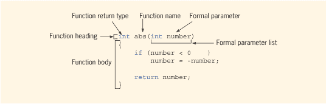

**图 6-1** 函数 `abs` 的各个部分

### 函数调用

调用返回值函数的语法如下：

```text
functionName(actual parameter list)
```

例如，在表达式 `x = abs(-5);` 中，函数 abs 被调用。

### 语法：实际参数列表

实际参数列表的语法如下：

```text
expression or variable, expression or variable, ...
```

（在此语法中，表达式可以是单个常量值。）因此，要调用返回值函数，你需要使用函数名，并在括号中给出实际参数（如果有的话）。

函数的形式参数列表可以为空。但是，如果形式参数列表为空，仍然需要括号。因此，当形式参数列表为空时，返回值函数的函数头采用以下形式：

```text
functionType functionName()
```

如果返回值函数的形式参数列表为空，那么函数调用中的实际参数也为空。在这种情况下（即形式参数列表为空），函数调用中仍然需要空括号。因此，调用具有空形式参数列表的返回值函数的形式是：

```text
functionName()
```

在函数调用中，实际参数的数量及其数据类型必须按给定顺序与形式参数相匹配。也就是说，实际参数和形式参数是一一对应的。（在本章后面，我们将讨论带有默认参数的函数。）

如前所述，返回值函数在表达式中被调用。该表达式可以是赋值语句或输出语句的一部分，也可以是函数调用中的参数。程序中的函数调用会导致被调用函数的函数体执行。

### return 语句

一旦返回值函数计算出该值，函数就会通过 return 语句返回该值。换句话说，它通过 return 语句将该值传递到函数外部。

### 语法：return 语句

return 语句的语法如下：

```cpp
return expr;
```

其中，expr 是一个变量、常量值或表达式。对 expr 求值，并返回其值。expr 计算出的值的数据类型必须与函数类型匹配。

在 C++ 中，`return` 是一个保留字。

当函数中的 `return` 语句执行时，函数立即终止，控制权返回到调用函数。此外，函数调用语句会被 `return` 语句返回的值所替换。当 `return` 语句在 main 函数中执行时，程序终止。

为了将本节讨论的思想付诸实践，让我们编写一个确定两个数中较大数的函数。由于该函数比较两个数，因此该函数有两个参数，且这两个参数都是数。我们假设这些数的数据类型是浮点型（小数）——比如 `double`。因为较大的数是 `double` 类型，所以函数的数据类型也是 `double`。我们将此函数命名为 `larger`。完成这个函数唯一需要的就是函数体。因此，按照函数的语法，你可以这样编写这个函数：

```cpp
double larger(double x, double y)
{
    double max;

    if (x >= y)
        max = x;
    else
        max = y;

    return max;
}
```

注意，函数 `larger` 使用了一个额外的变量 max（这称为局部声明，其中 max 是函数 `larger` 的局部变量）。图 6-2 描述了函数 `larger` 的各个部分。

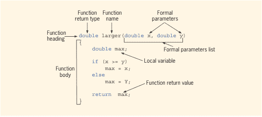

**图 6-2** 函数 `larger` 的各个部分

假设 `num`、`num1` 和 `num2` 是 `double` 变量。再假设 `num1 = 45.75`，`num2 = 35.50`。图 6-3 展示了调用函数 `larger` 的各种方式。

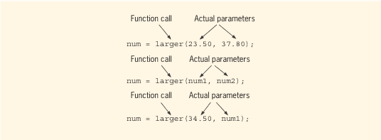

**图 6-3** 函数调用

在图 6-3 中，第一个语句中，函数 `larger` 确定 23.50 和 37.80 中的较大者，赋值语句将结果存储在 `num` 中。另外两个语句的含义类似。

你也可以将函数 `larger` 的定义编写如下：

```cpp
double larger(double x, double y)
{
    if (x >= y)
        return x;
    else
        return y;
}
```

由于函数中 `return` 语句的执行会终止该函数，因此前面的函数 `larger` 也可以写成（省略 `else` 一词）如下形式：

```cpp
double larger(double x, double y)
{
    if (x >= y)
        return x;

    return y;
}
```

请注意，函数 `larger` 的这些形式不需要你声明任何局部变量。

**注意**
- 1. 在函数 `larger` 的定义中，`x` 和 `y` 是形式参数。
- 2. `return` 语句可以出现在函数中的任何位置。回想一下，一旦 `return` 语句执行，所有后续语句都会被跳过。因此，最好在计算出值后立即返回。


### 示例 6-2

既然已经编写了函数 `larger`，下面的 C++ 代码说明了如何使用它：

```cpp
double num1 = 13.00;
double num2 = 36.53;
double maxNum;
```

考虑以下语句：

```cpp
cout << "The larger of 5 and 6 is " << larger(5, 6)
     << endl;                                      //Line 1

cout << "The larger of " << num1 << " and " << num2
     << " is " << larger(num1, num2) << endl;       //Line 2

cout << "The larger of " << num1 << " and 29 is "
     << larger(num1, 29) << endl;                   //Line 3

maxNum = larger(38.45, 56.78);                       //Line 4
```

-   第 1 行中的表达式 `larger(5, 6)` 是一次函数调用，5 和 6 是实际参数。当表达式 `larger(5, 6)` 执行时，5 被复制到 `x` 中，6 被复制到 `y` 中。因此，第 1 行中的语句输出 5 和 6 中较大的那个。

-   第 2 行中的表达式 `larger(num1, num2)` 是一次函数调用。这里，`num1` 和 `num2` 是实际参数。当表达式 `larger(num1, num2)` 执行时，`num1` 的值被复制到 `x` 中，`num2` 的值被复制到 `y` 中。因此，第 2 行中的语句输出 `num1` 和 `num2` 中较大的那个。

-   第 3 行中的表达式 `larger(num1, 29)` 也是一次函数调用。当表达式 `larger(num1, 29)` 执行时，`num1` 的值被复制到 `x` 中，29 被复制到 `y` 中。因此，第 3 行中的语句输出 `num1` 和 29 中较大的那个。注意，第一个参数 `num1` 是变量，而第二个参数 29 是常量值。

-   第 4 行中的表达式 `larger(38.45, 56.78)` 是一次函数调用。在此调用中，实际参数是 38.45 和 56.78。在此语句中，函数 `larger` 返回的值被赋给变量 `maxNum`。

> **注意**
>
> 在函数调用中，只需指定实际参数，而不是其数据类型。例如，在示例 6-2 中，第 1、2、3 和 4 行中的语句展示了如何使用实际参数调用函数 `larger`。然而，以下语句包含对函数 `larger` 的不正确调用，会导致语法错误。（假设所有变量都已正确声明。）
>
> ```cpp
> x = larger(int one, 29);          //illegal
> y = larger(int, int, 29);        //illegal
> cout << larger(int one, int two); //illegal
> ```

一旦编写好一个函数，就可以在程序中的任何位置使用它。函数 larger 比较两个数并返回两者中较大的那个。现在让我们编写另一个函数，它使用这个函数来确定三个数中的最大者。我们将这个函数称为 compareThree。

```cpp
double compareThree(double x, double y, double z)
{
    return larger(x, larger(y, z));
}
```

在函数头中，x、y 和 z 是形式参数。

让我们看一下表达式：

```cpp
larger(x, larger(y, z))
```

在函数 compareThree 的定义中。这个表达式包含两次对函数 larger 的调用。外部调用的实际参数是 x 和 larger(y, z)；内部调用的实际参数是 y 和 z。由此可见，首先计算表达式 larger(y, z)；也就是说，内部调用先执行，得到 y 和 z 中较大的那个。假设 larger(y, z) 的计算结果为，比如 t。（注意，t 要么是 y 要么是 z。）接下来，外部调用确定 x 和 t 中较大的那个。最后，return 语句返回最大的数。因此，要执行一次函数调用，必须先计算参数。例如，外部调用的实际参数 larger(y, z) 会先被计算，从而产生一个结果值，该值随 x 一起发送给对 larger 的外部调用。

注意，函数 larger 比函数 compareThree 通用得多。这里，我们只是说明：一旦编写好一个函数，就可以使用它来编写其他函数。本章后面，我们将展示如何使用函数 larger 从一组数中确定最大数。

## 函数原型

既然你对如何在程序中编写和使用函数已有一些了解，下一个问题就涉及用户定义函数在程序中应出现的顺序。例如，你是将函数 larger 放在函数 main 之前还是之后？larger 应放在 compareThree 之前还是之后？遵循“必须先声明标识符才能使用它”的规则，并且知道函数 main 使用了标识符 larger，从逻辑上讲，必须将 larger 放在 main 之前。

实际上，C++ 程序员习惯上将函数 main 放在所有其他用户定义函数之前。然而，这种组织方式可能会产生编译错误，因为函数是按照它们在程序中出现的顺序编译的。例如，如果函数 main 放在函数 larger 之前，那么在编译函数 main 时，标识符 larger 将未定义。为了解决未声明标识符的问题，我们将函数原型放在任何函数定义（包括 main 的定义）之前。

函数原型*不是*定义。它向程序提供函数名、参数的数量和数据类型以及返回值的数据类型；这些信息刚好足以让 C++ 使用该函数。它也是一项承诺：完整的定义将出现在程序后面。如果你忘记编写函数的定义，程序可能可以编译，但不会执行。

**函数原型：** 以分号 `;` 结尾、不带函数体的函数头。

### 语法：函数原型

值返回函数的函数原型的一般语法是：

```cpp
functionType functionName(parameter list);
```

（注意，函数原型以分号结尾。）

对于函数 larger，其原型是：

```cpp
double larger(double x, double y);    //function prototype
```

> **注意**
>
> 编写函数原型时，不必在参数列表中指定变量名。但是，必须指定每个参数的数据类型。
>
> 可以将函数 larger 的函数原型改写如下：
>
> ```cpp
> double larger(double, double);    //function prototype
> ```

## 最终程序

现在你已掌握足够知识，可以编写整个程序、编译并运行它。下面的程序使用函数 larger、compareThree 和 main 来确定两个或三个数中较大/最大的那个。

```cpp
//Program: Largest of three numbers

#include <iostream>

using namespace std;

double larger(double x, double y);
double compareThree(double x, double y, double z);

int main()
{
    double one, two;

    cout << "Line 2: The larger of 5 and 10 is "
         << larger(5, 10) << endl;              //Line 1

    cout << "Line 3: Enter two numbers: ";        //Line 3
    cin >> one >> two;                              //Line 4
    cout << endl;                                   //Line 5

    cout << "Line 6: The larger of " << one
         << " and " << two << " is "
         << larger(one, two) << endl;                //Line 6
    cout << "Line 7: The largest of 43.48, 34.00, "
         << "and 12.65 is "
         << compareThree(43.48, 34.00, 12.65)
         << endl;                                    //Line 7

    return 0;
}

double larger(double x, double y)
{
    double max;

    if (x >= y)
        max = x;
    else
        max = y;

    return max;
}

double compareThree (double x, double y, double z)
{
    return larger(x, larger(y, z));
}
```

**示例运行：** 在此示例运行中，用户输入以阴影显示。

```text
Line 2: The larger of 5 and 10 is 10
Line 3: Enter two numbers: 25.6 73.85

Line 6: The larger of 25.6 and 73.85 is 73.85
Line 7: The largest of 43.48, 34.00, and 12.65 is 43.48
```

> **注意** 在前面的程序中，函数 `larger` 和 `compareThree` 的函数原型出现在它们的函数定义之前。因此，函数 `larger` 和 `compareThree` 的定义可以以任意顺序出现。

## 值返回函数：一些特殊之处

值返回函数必须返回一个值。考虑下面的函数 `secret`，它接受一个 `int` 值作为参数。如果参数 `x` 的值大于 5，则返回 `x` 值的两倍。


```cpp
int main()
{
    int num = 4;

    cout << "Line 1: The value returned by funcRet1: "
         << funcRet1() << endl;                         // Line 1
    cout << "Line 2: The value returned by funcRet2: "
         << funcRet2(num) << endl;                      // Line 2

    return 0;
}

int funcRet1()
{
    int x = 45;

    return 23, x;   //only the value of x is returned
}

int funcRet2(int z)
{
    int a = 2;
    int b = 3;

    return 2 * a + b, z + b; //only the value of z + b is returned
}
```

```text
Sample Run:

Line 1: The value returned by funcRet1: 45
Line 2: The value returned by funcRet2: 7
```

尽管一个 `return` 语句可以包含多个表达式，但程序中的 return 语句应只包含一个表达式。在 `return` 语句中包含多个表达式可能导致冗余、浪费代码以及语法混乱。

## 更多返回值函数的示例

### 例 6-3

在本例中，我们编写函数 `courseGrade` 的定义。该函数接受一个 `int` 值作为参数，指定某门课程的分数，并返回该课程的成绩等级，其类型为 `char`。（我们假设考试分数是 0 到 100（含）之间的值。）

```cpp
char courseGrade(int score)
{
    switch (score / 10)
    {
        case 0:
        case 1:
        case 2:
        case 3:
        case 4:
        case 5:
            return 'F';
        case 6:
            return 'D';
        case 7:
            return 'C';
        case 8:
            return 'B';
        case 9:
        case 10:
            return 'A';
    }
}
```

你也可以编写函数 courseGrade 的等效定义，使用 if...else 结构来确定课程成绩。

### 例 6-4（掷一对骰子）

在本例中，我们编写一个函数，掷一对骰子，直到掷出的数字之和为某个特定数。我们还想知道为了得到目标总和需要掷多少次骰子。

每个骰子上的最小数字是 1，最大数字是 6。因此，掷出的数字之和最小为 2，最大为 12。假设我们有如下声明：

```cpp
int die1;
int die2;
int sum;
int rollCount = 0;
```

我们使用第 5 章讨论过的随机数生成器来随机生成一个 1 到 6 之间的数。然后，下面的语句随机生成一个 1 到 6 之间的数，并将该数存入 die1，它成为 die1 掷出的数。

```cpp
die1 = rand() % 6 + 1;
```

同样，下面的语句随机生成一个 1 到 6 之间的数，并将该数存入 die2，它成为 die2 掷出的数。

```c
die2 = rand() % 6 + 1;
```

两个骰子掷出的数字之和为：

```c
sum = die1 + die2;
```

接下来，我们判断 sum 是否包含骰子掷出的目标总和。（假设 int 变量 num 包含要掷出的目标总和。）如果 sum 不等于 num，则我们再次掷骰子。这可以通过下面的 do...while 循环完成。

```c
do
{
    die1 = rand() % 6 + 1;
    die2 = rand() % 6 + 1;
    sum = die1 + die2;
    rollCount++;
}
while (sum != num);
```

现在我们可以编写函数 rollDice，它接受要掷出的数字的目标总和作为参数，并返回为了掷出目标总和而掷骰子的次数。

```c
int rollDice(int num)
{
    int die1;
    int die2;
    int sum;
    int rollCount = 0;

    srand(time(0));

    do
    {
        die1 = rand() % 6 + 1;
        die2 = rand() % 6 + 1;
        sum = die1 + die2;
        rollCount++;
    }
    while (sum != num);

    return rollCount;
}
```

下面的程序展示了如何在程序中使用函数 `rollDice`：

```cpp
//Program: Roll dice

#include <iostream>
#include <cstdlib>
#include <ctime>

using namespace std;

int rollDice(int num);

int main()
{
    cout << "The number of times the dice are rolled to "
         << "get the sum 10 = " << rollDice(10) << endl;
    cout << "The number of times the dice are rolled to "
         << "get the sum 6 = " << rollDice(6) << endl;

    return 0;
}

int rollDice(int num)
{
    int die1;
    int die2;
    int sum;
    int rollCount = 0;

    srand(time(0));

    do
    {
        die1 = rand() % 6 + 1;
        die2 = rand() % 6 + 1;
        sum = die1 + die2;
        rollCount++;
    }
    while (sum != num);

    return rollCount;
}
```

### 示例运行：

掷骰子得到总和 10 的次数 = 11  
掷骰子得到总和 6 的次数 = 7

我们把它留作练习，让你修改这个程序，使用户能够输入要掷出的数字的目标总和。（参见本章末尾的编程练习 7。）

### 例 6-5（斐波那契数）

在第 5 章的第一个编程示例中，我们设计并实现了一个算法来求斐波那契数列中的某个数。在本例中，我们通过编写一个函数来计算并返回斐波那契数列中所需的数，从而修改主程序。由于我们已经设计并讨论过如何确定斐波那契数列中的特定数，接下来，我们给出实现该算法的函数定义。

给定第一个数、第二个数以及所需斐波那契数的位置，下面的函数返回该斐波那契数：

```cpp
int nthFibonacciNum(int first, int second, int nthFibNum)
{
    int current;
    int counter;

    if (nthFibNum == 1)
        current = first;
    else if (nthFibNum == 2)
        current = second;
    else
    {
        counter = 3;

        while (counter <= nthFibNum)
        {
            current = second + first;
            first = second;
            second = current;
            counter++;
        } //end while
    } //end else

    return current;
}
```

下面展示了如何在程序中使用这个函数。

```cpp
//Program: Fibonacci number
#include <iostream>
using namespace std;

int nthFibonacciNum(int first, int second, int position);

int main()
{
    int firstFibonacciNum;
    int secondFibonacciNum;
    int nthFibonacci;

    cout << "Enter the first two Fibonacci "
         << "numbers: ";
    cin >> firstFibonacciNum >> secondFibonacciNum;
    cout << endl;

    cout << "The first two Fibonacci numbers are "
         << firstFibonacciNum << " and "
         << secondFibonacciNum
         << endl;

    cout << "Enter the position of the desired "
         << "Fibonacci number: ";
    cin >> nthFibonacci;
    cout << endl;

    cout << "The Fibonacci number at position "
         << nthFibonacci << " is "
         << nthFibonacciNum(firstFibonacciNum, secondFibonacciNum,
                            nthFibonacci)
         << endl;

    return 0;
}

int nthFibonacciNum(int first, int second, int nthFibNum)
{
    int current;
    int counter;

    if (nthFibNum == 1)
        current = first;
    else if (nthFibNum == 2)
        current = second;
    else
    {
        counter = 3;

        while (counter <= nthFibNum)
        {
            current = second + first;
            first = second;
            second = current;
            counter++;
        } //end while
    }//end else

    return current;
}
```

### 示例运行：

在这些示例运行中，用户输入以阴影显示。

### 示例运行 1：

输入前两个斐波那契数：`12 16`

前两个斐波那契数是 12 和 16

输入所需斐波那契数的位置：`10`

位置 10 处的斐波那契数是 796

### 示例运行 2：

输入前两个斐波那契数：`1 1`

前两个斐波那契数是 1 和 1

输入所需斐波那契数的位置：`15`

位置 15 处的斐波那契数是 610

下面是一个返回布尔值的函数示例。

### 例 6-6（回文）

在本例中，设计一个函数 `isPalindrome`，如果字符串是回文则返回 **真**，否则返回 **假**。如果一个字符串正着读和倒着读都一样，那么它就是回文。例如，字符串 "madamimadam"、"5"、"434" 和 "78956987" 都是回文。

假设 `str` 是一个字符串。要判断 `str` 是否为回文，首先比较 `str` 的第一个字符和最后一个字符。如果它们不相同，则 `str` 不是回文，因此函数应返回 **假**。如果 `str` 的第一个字符和最后一个字符相同，则我们比较第二个字符与倒数第二个字符，依此类推。

注意，如果 `length = str.length()` 是 `str` 中的字符数，那么我们需要比较 `str[0]` 与 `str[length - 1]`、`str[1]` 与 `str[length - 2]`，一般地比较 `str[i]` 与 `str[length - 1 - i]`，其中 `0 <= i <= length / 2`。

下面的算法实现了这一讨论：

- 1. `int length = str.length();`
- 2. `for (int i = 0; i < length / 2; i++)`
  - `if (str[i] != str[length - 1 - i])`
    - `return false;`
  - `return true;`

下面的函数实现了该算法：

```cpp
bool isPalindrome(string str)
{
    int length = str.length();                 //Step 1
```


```cpp
for (int i = 0; i < length / 2; i++)        //Step 2
    if (str[i] != str[length - 1 - i])
        return false;

return true;
}
```

### 示例 6-7（有线电视公司）

第4章包含一个用于计算有线电视公司账单的程序。在该程序中，所有编程指令都集中在函数 main 中。这里，我们使用用户自定义函数重写同一个程序，进一步说明结构化程序设计。

由于有两类客户——住宅客户和商业客户，该程序包含两个独立的函数：一个用于计算住宅客户的账单，另一个用于计算商业客户的账单。两个函数都计算账单金额，然后将账单金额返回给函数 main。函数 main 打印应付金额。我们将计算住宅账单的函数称为 `residential`，将计算商业账单的函数称为 `business`。计算账单的公式与之前相同。

函数 `residential`：要计算住宅账单，你需要知道客户订阅的付费频道数量。根据付费频道数量，可以计算账单金额。计算账单金额后，函数使用 `return` 语句返回账单金额。以下四个步骤描述该函数：

- a. 提示用户输入付费频道数量。
- b. 读取付费频道数量。
- c. 计算应付金额。
- d. 返回应付金额。

该函数包含一条提示用户输入付费频道数量的语句（步骤 a）和一条读取付费频道数量的语句（步骤 b）。计算账单金额所需的其他项，例如基本服务连接费用和账单处理费，被定义为命名常量（在函数 main 的定义之前）。因此，为了计算账单金额，该函数不需要从函数 main 获取任何值。因此，该函数没有参数。

由前面的讨论可知，函数 `residential` 需要局部变量来存储付费频道数量和账单金额。该函数只需要这两个局部变量来计算账单金额：

```cpp
int noOfPChannels;   //number of premium channels
double bAmount;      //billing amount
```

现在可以将函数 residential 的定义写成如下形式：

```cpp
double residential()
{
    int noOfPChannels;   //number of premium channels
    double bAmount;      //billing amount

    cout << "Enter the number of premium "
         << "channels used: ";
    cin >> noOfPChannels;
    cout << endl;

    bAmount = RES_BILL_PROC_FEES +
              RES_BASIC_SERV_COST +
              noOfPChannels * RES_COST_PREM_CHANNEL;

    return bAmount;
}
```

函数 business：要计算商业账单，你需要知道客户订阅的基本服务连接数量和付费频道数量。然后，根据这些数量，可以计算账单金额。随后使用 `return` 语句返回账单金额。以下六个步骤描述该函数：

- a. 提示用户输入基本服务连接数量。
- b. 读取基本服务连接数量。
- c. 提示用户输入付费频道数量。
- d. 读取付费频道数量。
- e. 计算应付金额。
- f. 返回应付金额。

该函数包含提示用户输入基本服务连接数量和付费频道数量的语句（步骤 a 和 c）。该函数还包含输入基本服务连接数量和付费频道数量的语句（步骤 b 和 d）。计算账单金额所需的其他项，例如基本服务连接费用和账单处理费，被定义为命名常量（在函数 main 的定义之前）。因此，为了计算账单金额，该函数不需要从函数 main 获取任何值。因此，它没有参数。

由前述讨论可知，函数 business 需要变量来存储基本服务连接数量、付费频道数量以及账单金额。实际上，该函数只需要这三个局部变量来计算账单金额：

```cpp
int noOfBasicServiceConnections;
int noOfPChannels;   //number of premium channels
double bAmount;      //billing amount
```

现在可以将函数 `business` 的定义写成如下形式：

```cpp
double business()
{
    int noOfBasicServiceConnections;
    int noOfPChannels; //number of premium channels
    double bAmount;    //billing amount

    cout << "Enter the number of basic "
         << "service connections: ";
    cin >> noOfBasicServiceConnections;
    cout << endl;

    cout << "Enter the number of premium "
         << "channels used: ";
    cin >> noOfPChannels;
    cout << endl;

    if (noOfBasicServiceConnections <= 10)
        bAmount = BUS_BILL_PROC_FEES + BUS_BASIC_SERV_COST +
                  noOfPChannels * BUS_COST_PREM_CHANNEL;
    else
        bAmount = BUS_BILL_PROC_FEES + BUS_BASIC_SERV_COST +
                  (noOfBasicServiceConnections - 10) *
                  BUS_BASIC_CONN_COST +
                  noOfPChannels * BUS_COST_PREM_CHANNEL;

    return bAmount;
}
```

主程序的算法如下：

- 1. 要以带小数点和尾随零的固定小数格式输出浮点数，设置操纵符 fixed 和 showpoint。
- 2. 要将浮点数输出到两位小数，将精度设置为两位小数。
- 3. 提示用户输入账号。
- 4. 获取账号。
- 5. 提示用户输入客户类型。
- 6. 获取客户类型。
- 7.
    - a. 如果客户类型为 R 或 r，
        - i. 调用函数 `residential` 计算账单。
        - ii. 打印账单。
    - b. 如果客户类型为 B 或 b，
        - i. 调用函数 `business` 计算账单。
        - ii. 打印账单。
    - c. 如果客户类型不是 R、r、B 或 b，则为无效客户类型。

### 程序清单

```cpp
/************************************************************
// Author: D. S. Malik
//
// Program: Cable Company Billing
// This program calculates and prints a customer's bill for
// a local cable company. The program processes two types of
// customers: residential and business.
//************************************************************

#include <iostream>
#include <iomanip>
using namespace std;

                //Named constants - residential customers
const double RES_BILL_PROC_FEES = 4.50;
const double RES_BASIC_SERV_COST = 20.50;
const double RES_COST_PREM_CHANNEL = 7.50;

                //Named constants - business customers
const double BUS_BILL_PROC_FEES = 15.00;
const double BUS_BASIC_SERV_COST = 75.00;
const double BUS_BASIC_CONN_COST = 5.00;
const double BUS_COST_PREM_CHANNEL = 50.00;

double residential();   //Function prototype
double business();      //Function prototype

int main()
{
                //declare variables
    int accountNumber;
    char customerType;
    double amountDue;

    cout << fixed << showpoint;                         //Step 1
    cout << setprecision(2);                            //Step 2

    cout << "This program computes a cable bill."
         << endl;
    cout << "Enter account number: ";                   //Step 3
    cin >> accountNumber;                               //Step 4
    cout << endl;

    cout << "Enter customer type: R, r "
         << "(Residential), B, b (Business): ";         //Step 5
    cin >> customerType;                                //Step 6
    cout << endl;
```


```cpp
switch (customerType)
{
case 'r':
case 'R':
    amountDue = residential();
    cout << "Account number = "
        << accountNumber << endl;
    cout << "Amount due = $"
        << amountDue << endl;
    break;
case 'b':
case 'B':
    amountDue = business();
    cout << "Account number = "
        << accountNumber << endl;
    cout << "Amount due = $"
        << amountDue << endl;
    break;
default:
    cout << "Invalid customer type."
        << endl;
}

return 0;
}
```

```cpp
//Place the definitions of the functions residential and business here.
```

**示例运行：** 在此示例运行中，用户输入部分以阴影显示。

```
This program computes a cable bill.
Enter account number: 21341

Enter customer type: R, r (Residential), B, b (Business): B

Enter the number of basic service connections: 25

Enter the number of premium channels used: 9

Account number = 21341
Amount due = $615.00
```

## 编译与执行流程

如前所述，C++ 程序是函数的集合。回想一下，函数可以以任意顺序出现。你唯一需要记住的是，必须先声明标识符才能使用它。编译器从头到尾按顺序编译程序。因此，如果函数 main 出现在任何其他用户定义函数之前，它会首先被编译。然而，如果 main 出现在程序的末尾（或中间），那么所有定义（而非原型）出现在函数 main 之前的函数，都会按它们出现的顺序在函数 main 之前被编译。

函数原型出现在任何函数定义之前，因此编译器会首先编译这些原型。然后编译器就能正确翻译函数调用。然而，*当程序执行时，函数 main 中的第一条语句总是最先执行，无论函数 main 放在程序中的哪个位置。* 其他函数只在被调用时才执行。

函数调用将控制权转移到函数体中的第一条语句。通常，在被调用函数的最后一条语句执行后，控制权会返回到紧接函数调用之后的位置。有返回值的函数会返回一个值。因此，在执行有返回值的函数后，当控制权返回调用者时，函数返回的值会替换函数调用语句。执行从紧接函数调用之后的位置继续。

假设一个程序包含函数 funcA 和 funcB，并且 funcA 包含一条调用 funcB 的语句。假设程序调用 funcA。当包含对 funcB 调用的语句执行时，funcB 执行；而在 funcB 执行期间，funcA 当前调用的执行会暂停，直到 funcB 完成。

## 编程示例：最大数

在这个编程示例中，函数 larger 用于确定一组数字中的最大数。为了便于说明，本程序从一组 10 个数字中确定最大数。你可以轻松增强此程序，以处理任意一组数字。

**输入：** 一组 10 个数字。

**输出：** 10 个数字中的最大数。

### 问题分析与算法设计

假设输入数据为：

10  56  73  42  22  67  88  26  62  11

读取数据集中的第一个数字。由于这是到目前为止读取的唯一一个数字，可以假定它是目前的最大数，并将其称为 max。读取第二个数字，称为 num。现在比较 max 和 num，并将较大的数字存入 max。此时 max 包含前两个数字中较大的那个。读取第三个数字。将其与 max 比较，并将较大的数字存入 max。此时，max 包含前三个数字中的最大数。读取下一个数字，将其与 max 比较，并将较大的数字存入 max。对数据集中剩余的每个数字重复此过程。最终，max 将包含数据集中的最大数。这一讨论可转化为以下算法：

- 1. 读取第一个数字。由于这是到目前为止你读取的唯一一个数字，所以它是目前的最大数。将其保存到名为 `max` 的变量中。
- 2. 对于列表中的每个剩余数字：
  - a. 读取下一个数字。将其存储到名为 `num` 的变量中。
  - b. 比较 `num` 和 `max`。如果 `max < num`，则 `num` 是新的最大数，因此将 `num` 复制到 `max` 来更新 `max` 的值。如果 `max >= num`，则丢弃 `num`；也就是说，什么都不做。
- 3. 由于 `max` 现在包含最大数，将其打印出来。

为了找出两个数字中较大的那个，程序使用函数 `larger`。

### 完整程序清单

```cpp
/******************************************************
// Author: D.S. Malik
//
// This program finds the largest number of a set of 10
// numbers.
//******************************************************

#include <iostream>

using namespace std;

double larger(double x, double y);

int main()
{
        double num;  //variable to hold the current number
        double max;  //variable to hold the larger number
        int count;   //loop control variable

        cout << "Enter 10 numbers." << endl;
        cin >> num;                              //Step 1
        max = num;                               //Step 1

        for (count = 1; count < 10; count++)    //Step 2
        {
                cin >> num;                     //Step 2a
                max = larger(max, num);          //Step 2b
        }

        cout << "The largest number is " << max    //Step 3
             << endl;

        return 0;
} //end main

double larger(double x, double y)
{
    if (x >= y)
        return x;
    else
        return y;
}
```

**示例运行：** 在此示例运行中，用户输入部分以阴影显示。

```
Enter 10 numbers.
10 56 73 42 22 67 88 26 62 11
The largest number is 88
```

## 无返回值函数

本章前面，你学习了如何使用有返回值的函数。在本节中，你将总体探讨用户定义函数，特别是那些没有数据类型的 C++ 函数，称为**无返回值函数**。

无返回值函数和有返回值的函数具有相似的结构。两者都有函数头和函数体。与有返回值的函数一样，你可以将用户定义的无返回值函数放在函数 main 之前或之后。然而，程序执行总是从函数 main 中的第一条语句开始。如果你将用户定义的无返回值函数放在函数 main 之后，则应将函数原型放在函数 main 之前。无返回值函数没有数据类型。因此，函数头部分中的 functionType——即返回类型——以及无返回值函数体中的 return 语句都没有意义。但是，在无返回值函数中，你可以使用不带任何值的 return 语句；它通常用于提前退出函数。与有返回值的函数一样，无返回值函数可以有形参，也可以没有形参。

由于无返回值函数没有数据类型，它们不会在表达式中使用（调用）。对无返回值函数的调用是一条独立语句。因此，要调用无返回值函数，需要在一条独立语句中使用函数名以及实际参数（如果有）。在给出无返回值函数的示例之前，下面先给出无返回值函数的语法。

### 函数定义

带参数的无返回值函数的函数定义具有以下语法：

```cpp
void functionName(formal parameter list)
{
        statements
}
```

其中 statements 通常是声明语句和/或可执行语句。形参列表可以为空，在这种情况下，函数头中仍然需要空括号。

### 形参列表

形参列表具有以下语法：

```text
dataType& variable, dataType& variable, ...
```

在形参列表中，必须同时指定数据类型和变量名。dataType 后面的符号 & 有特殊含义；有些参数会有 &，有些则没有，我们将在本章后面解释原因。

### 函数调用

函数调用具有以下语法：

```text
functionName(actual parameter list);
```

### 实参列表

实参列表具有以下语法：

```text
expression or variable, expression or variable, ...
```

其中 expression 可以由单个常量值组成。与有返回值的函数一样，在函数调用中，实际参数的数量及其数据类型必须按给定顺序与形参匹配。实际参数和形参一一对应。（带默认参数的函数将在本章末尾讨论。）函数调用会导致被调用函数体的执行。

示例 6-8 展示了一个带参数的无返回值函数。

### 示例 6-8

```cpp
void funexp(int a, double b, char c, int x)
{
    .
    .
    .
}
```

函数 funexp 有四个参数。


## 参数类型

参数在调用函数（如 main）和被调用函数之间提供通信链接。它们使函数每次被调用时能够操作不同的数据。通常，形式参数有两种类型：**值参数**和**引用参数**。

- **值参数：** 接收相应实际参数内容副本的形式参数。
- **引用参数：** 接收相应实际参数的位置（内存地址）的形式参数。

当在函数的形式参数列表中的数据类型后附加 & 时，该数据类型后面的变量就成为引用参数。

示例 6-9 展示了一个带有值参数和引用参数的无返回值函数。

### 示例 6-9

考虑以下函数定义：

```cpp
void areaAndPerimeter(double length, double width,
                      double& area, double& perimeter)
{
    area = length * width;
    perimeter = 2 * (length + width);
}
```

函数 areaAndPerimeter 有四个参数：length 和 width 是 **double** 类型的值参数；area 和 perimeter 是 **double** 类型的引用参数。

图 6-4 描述了函数 areaAndPerimeter 的各个部分。

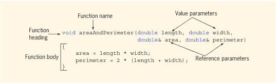

**图 6-4** 函数 areaAndPerimeter 的各个部分

### 示例 6-10

考虑以下定义：

```cpp
void averageAndGrade(int testScore, int progScore,
                     double& average, char& grade)
{
    average = (testScore + progScore) / 2.0;

    if (average >= 90.00)
        grade = 'A';
    else if (average >= 80.00)
        grade = 'B';
    else if (average >= 70.00)
        grade = 'C';
    else if (average >= 60.00)
        grade = 'D';
    else
        grade = 'F';
}
```

函数 `averageAndGrade` 有四个参数：`testScore` 和 `progScore` 是 `int` 类型的值参数，`average` 是 `double` 类型的引用参数，`grade` 是 `char` 类型的引用参数。示例 6-13、6-14 和 6-15 使用可视化图示明确展示了值参数和引用参数如何工作。

### 示例 6-11

我们编写一个程序来打印类似下面的图案（星号三角形）：

```
      *
    * *
  * * *
* * * *
```

第一行有一个星号，星号前有一些空白；第二行有两个星号，星号前有一些空白，星号之间有一个空白；依此类推。我们来编写函数 `printStars`，它有两个参数：一个参数指定一行中星号前的空白数量，第二个参数指定一行中星号的数量。具体来说，函数 `printStars` 的定义为：

```cpp
void printStars(int blanks, int starsInLine)
{
    int count;

    //print the number of blanks before the stars in a line
    for (count = 1; count <= blanks; count++)
        cout << ' ';

    //print the number of stars with a blank between stars
    for (count = 1; count <= starsInLine; count++)
        cout << " *";

    cout << endl;
} //end printStars
```

第一个参数 `blanks` 决定在星号前打印多少个空白；第二个参数 `starsInLine` 决定一行中打印多少个星号。例如，如果参数 `blanks` 的值为 30，那么函数 `printStars` 中的第一个 `for` 循环执行 30 次并打印 30 个空白。另外，因为要在星号之间打印一个空格，函数 `printStars` 中第二个 `for` 循环的每次迭代都会打印字符串 `" *"`——一个空白后跟一个星号。

接下来，考虑以下语句：

```cpp
int numberOfLines = 15;
int numberOfBlanks = 30;

for (counter = 1; counter <= numberOfLines; counter++)
{
    printStars(numberOfBlanks, counter);
    numberOfBlanks--;
}
```

`for` 循环调用函数 `printStars`。这个 `for` 循环的每次迭代使用变量 `numberOfBlanks` 和 `counter` 指定一行中要打印的空白数量以及星号数量。函数 `printStars` 的每次调用接收到的空白比上一次调用少一个，星号多一个。例如，函数 `main` 中 `for` 循环的第一次迭代指定 30 个空白和 1 个星号（它们作为参数 `numberOfBlanks` 和 `counter` 传递给函数 `printStars`）。然后，`for` 循环通过执行语句 `numberOfBlanks--;` 将空白数量减 1。在 `for` 循环结束时，星号数量为下一次迭代增加 1。这是通过执行 `for` 语句中的更新语句 `counter++` 完成的，该语句将变量 `counter` 的值增加 1。换句话说，函数 `printStars` 的第二次调用接收 29 个空白和 2 个星号作为参数。因此，前面的语句将打印一个由 15 行组成的星号三角形。

```cpp
//Program: Print a triangle of stars

#include <iostream>

using namespace std;

void printStars(int blanks, int starsInLine);

int main()
{
        int noOfLines;   //variable to store the number of lines
        int counter;     //for loop control variable
        int noOfBlanks;  //variable to store the number of blanks

        cout << "Enter the number of star lines (1 to 20) "
             << "to be printed: ";                       //Line 1

        cin >> noOfLines;                                //Line 2

        while (noOfLines < 1 || noOfLines > 20)          //Line 3
        {
                cout << "Number of star lines should be "
                     << "between 1 and 20" << endl;      //Line 4
                cout << "Enter the number of star lines "
                     << "(1 to 20) to be printed: ";     //Line 5
                cin >> noOfLines;                         //Line 6
        }

        cout << endl << endl;                             //Line 7
        noOfBlanks = 30;                                  //Line 8

        for (counter = 1; counter <= noOfLines; counter++) //Line 9
        {
                printStars(noOfBlanks, counter);          //Line 10
                noOfBlanks--;                             //Line 11
        }

        return 0;                                         //Line 12
}

void printStars(int blanks, int starsInLine)
{
        int count;

        for (count = 1; count <= blanks; count++)         //Line 13
                cout << ' ';                             //Line 14
        for (count = 1; count <= starsInLine; count++)    //Line 15
                cout << " *";                            //Line 16
        cout << endl;
}
```

**示例运行：** 在此示例运行中，用户输入以阴影显示。

```
    Enter the number of star lines (1 to 20) to be printed: 15
                                *
                              * * *
                            * * * * *
                          * * * * * * *
                        * * * * * * * * *
                      * * * * * * * * * * *
                    * * * * * * * * * * * * *
                  * * * * * * * * * * * * * * *
                * * * * * * * * * * * * * * * * *
              * * * * * * * * * * * * * * * * * * *
            * * * * * * * * * * * * * * * * * * * * *
          * * * * * * * * * * * * * * * * * * * * * * *
        * * * * * * * * * * * * * * * * * * * * * * * * *
      * * * * * * * * * * * * * * * * * * * * * * * * * * *
    * * * * * * * * * * * * * * * * * * * * * * * * * * * * *
```

在函数 main 中，首先要求用户指定要打印多少行星号（第 1 行）。（在此程序中，用户被限制为 20 行，因为最多 20 行的三角形网格可以很好地显示在屏幕上。）由于程序被限制为最多 20 行，第 3 行到第 6 行的 while 循环确保如果行数在 1 到 20 之间，程序只打印星号三角形网格。

### 值参数

上一节定义了两种类型的参数——值参数和引用参数。示例 6-11 展示了一个使用带参数函数的程序。在考虑更多带参数的无返回值函数示例之前，让我们对值参数和引用参数作如下观察。当调用函数时，实际参数的值被复制到相应的形式参数中。如果形式参数是值参数，那么在复制实际参数的值之后，形式参数和实际参数之间没有联系；也就是说，形式参数是一个单独的变量，拥有自己的数据副本。因此，在程序执行期间，形式参数操作的是存储在其自身内存空间中的数据。示例 6-12 中的程序进一步说明了值参数如何工作。


### 示例 6-12

下面的程序展示了简单数据类型的形参是如何工作的。

```cpp
//Example 6-12
//Program illustrating how a value parameter works.

#include <iostream>

using namespace std;

void funcValueParam(int num);

int main()
{
    int number = 6;

    cout << "Line 2: Before calling the function "
         << "funcValueParam, number = " << number
         << endl;                                      //Line 2

    funcValueParam(number);                            //Line 3

    cout << "Line 4: After calling the function "
         << "funcValueParam, number = " << number
         << endl;                                      //Line 4

    return 0;
}

void funcValueParam(int num)
{
    cout << "Line 5: In the function funcValueParam, "
         << "before changing, num = " << num
         << endl;                                      //Line 5

    num = 15;                                          //Line 6

    cout << "Line 7: In the function funcValueParam, "
         << "after changing, num = " << num
         << endl;                                      //Line 7
}
```

### 示例运行：

```
Line 2: Before calling the function funcValueParam, number = 6
Line 5: In the function funcValueParam, before changing, num = 6
Line 7: In the function funcValueParam, after changing, num = 15
Line 4: After calling the function funcValueParam, number = 6
```

这个程序的工作过程如下。执行从函数 `main` 开始。第 1 行的语句声明并初始化了 int 变量 `number`。第 2 行的语句在调用函数 `funcValueParam` 之前输出 `number` 的值；第 3 行的语句调用函数 `funcValueParam`。变量 `number` 的值随后被传递给形参 `num`。控制权现在转移到函数 `funcValueParam`。

第 5 行的语句在改变 `num` 的值之前输出 `num` 的值。第 6 行的语句将 `num` 的值改为 15；第 7 行的语句输出 `num` 的值。该语句执行完毕后，函数 `funcValueParam` 退出，控制权返回到函数 `main`。

第 4 行的语句在调用函数 `funcValueParam` 之后输出 `number` 的值。示例运行显示，即使形参 `num` 的值在函数 `funcValueParam` 内部被改变，`number` 的值（第 2 行和第 4 行）仍然保持不变。

输出显示了语句执行的顺序。

值参数在复制数据后，与实际参数没有任何联系，因此值参数不能将任何结果传回调用函数。当函数执行时，对形参所做的任何更改都不会以任何方式影响实参。实参对形参发生的变化一无所知。因此，值参数不能将信息传递到函数外部。值参数只提供从实参到形参的单向联系。因此，只有值参数的函数具有局限性。

## 引用变量作为参数

示例 6-12 中的程序说明了值参数是如何工作的。另一方面，假设形参是引用参数。由于引用参数接收的是实参的地址（内存位置），引用参数可以从函数传递一个或多个值，并且可以改变实参的值。

引用参数在三种情况下很有用：

- 当需要改变实参的值时
- 当你想从函数返回多个值时（回想一下，return 语句只能返回一个值）
- 当传递地址相对于复制大量数据可以节省内存空间和时间时

本书通篇说明了前两种情况。第 8 章和第 10 章讨论了第三种情况，即引入数组和类时。

回想一下，当你在函数的形参列表中的 `dataType` 后面加上 `&` 时，该数据类型后面的变量就成为了引用参数。

> **注意。** 你可以使用关键字 `const` 将引用（形参）参数声明为常量。这将防止形参改变对应实参的值。第 9 章和第 10 章讨论常量引用参数。在此之前，你使用的引用参数将按照本章定义的那样是非常量。根据引用参数的定义，常量值或表达式不能传递给非常量引用参数。如果形参是非常量引用参数，则在函数调用期间，其对应的实参必须是变量。

### 示例 6-13

### 计算成绩

下面的程序获取一个课程分数（介于 0 和 100 之间的值）并确定学生的课程成绩。该程序有三个函数：`main`、`getScore` 和 `printGrade`，如下所示：

- 1. `main`
  - a. 获取课程分数。
  - b. 打印课程成绩。
- 2. `getScore`
  - a. 提示用户输入。
  - b. 获取输入。
  - c. 打印课程分数。
- 3. `printGrade`
  - a. 计算课程成绩。
  - b. 打印课程成绩。

完整的程序如下：

```cpp
//This program reads a course score and prints the
//associated course grade.
#include <iostream>
using namespace std;

void getScore(int& score);
void printGrade(int score);

int main()
{
    int courseScore;
    cout << "Line 1: Based on the course score, \n"
         << "    this program computes the "
         << "course grade." << endl;                 //Line 1

    getScore(courseScore);                            //Line 2

    printGrade(courseScore);                          //Line 3

    return 0;
}
void getScore(int& score)
{
    cout << "Line 4: Enter course score: ";       //Line 4
    cin >> score;                                  //Line 5
    cout << "Line 6: Course score is "
         << score << endl;                        //Line 6
}

void printGrade(int cScore)
{
    cout << "Line 7: Your grade for the course is ";  //Line 7

    if (cScore >= 90)                              //Line 8
        cout << "A." << endl;
    else if (cScore >= 80)
        cout << "B." << endl;
    else if (cScore >= 70)
        cout << "C." << endl;
    else if (cScore >= 60)
        cout << "D." << endl;
    else
        cout << "F." << endl;
}
```

**示例运行：** 在此示例运行中，用户输入以阴影显示。

```
Line 1: Based on the course score,
        this program computes the course grade.
Line 4: Enter course score: 85

Line 6: Course score is 85
Line 7: Your grade for the course is B.
```

这个程序的工作过程如下。程序从第 1 行开始执行，该行打印输出的第一行（参见示例运行）。第 2 行的语句以实参 `courseScore`（在 `main` 中声明的变量）调用函数 `getScore`。因为函数 `getScore` 的形参 `score` 是引用参数，变量 `courseScore` 的地址（即内存位置）被传递给 `score`。因此，`score` 和 `courseScore` 现在都引用同一个内存位置，即 `courseScore`（参见图 6-5）。

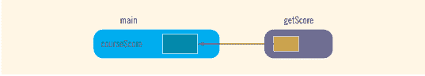

图 6-5  变量 `courseScore` 和参数 `score`

对 `score` 所做的任何更改都会立即改变 `courseScore` 的值。

控制权随后转移到函数 `getScore`，第 4 行的语句执行，打印输出的第二行。该语句提示用户输入课程分数。第 5 行的语句读取用户输入的值（示例运行中为 85）并将其存储在 `score` 中，而 `score` 实际上就是 `courseScore`（因为 `score` 是引用参数）。因此，此时两个变量 `score` 和 `courseScore` 的值都是 85（参见图 6-6）。


图 6-6  第 5 行语句执行后的变量 `courseScore` 和参数 `score`

接下来，第 6 行的语句输出 `score` 的值，如示例运行的第三行所示。在第 6 行执行完毕后，控制权返回到函数 `main`（参见图 6-7）。

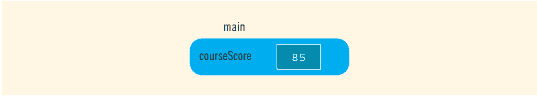

图 6-7  第 6 行语句执行后且控制权返回到 `main` 时的变量 `courseScore`

接下来执行第 3 行的语句。这是对函数 `printGrade` 的调用，实参为 `courseScore`。因为函数 `printGrade` 的形参 `cScore` 是值参数，参数 `cScore` 接收对应实参 `courseScore` 的值。因此，`cScore` 的值为 85。将 `courseScore` 的值复制到 `cScore` 后，`cScore` 与 `courseScore` 之间不再有任何联系（参见图 6-8）。


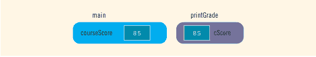

**图 6-8** 变量 `courseScore` 和参数 `cScore`

然后程序执行第 7 行中的语句，该语句输出第四行。第 8 行中的 `if...else` 语句确定并输出该课程的成绩。由于第 7 行中的输出语句不包含换行符或操纵符 `endl`，所以 `if...else` 语句的输出是输出的第四行的一部分。`if...else` 语句执行完后，控制权返回到函数 `main`。由于函数 `main` 中接下来要执行的语句是函数 `main` 的最后一条语句，因此程序终止。

在这个程序中，函数 `main` 首先调用函数 `getScore` 从用户处获取课程成绩。然后，函数 `main` 调用函数 `printGrade`，根据该课程成绩计算并打印等级。课程成绩由函数 `getScore` 获取；之后，函数 `printGrade` 使用该课程成绩。由于 `getScore` 函数获取的值会在程序后面使用，因此函数 `getScore` 必须将该值传递到函数外部。由于 `getScore` 被编写为 void 函数，所以保存该值的形式参数必须是引用参数。

## 值参数、引用参数与内存分配

调用函数时，为其形式参数以及函数体中声明的变量（称为 **局部变量**）分配的内存在函数数据区中。回想一下，对于值参数，实际参数的值会被复制到其对应形式参数的内存单元中。对于引用参数，实际参数的地址会传递给形式参数。也就是说，形式参数的内容是一个地址。在数据操作期间，形式参数中存储的地址会引导计算机操作该地址处内存单元中的数据。因此，对于引用参数，实际参数和形式参数都引用同一个内存位置。 consequently，在程序执行期间，形式参数所做的更改会永久改变实际参数的值。

> **注意** 流变量（例如 `ifstream` 和 `ofstream`）应通过引用传递给函数。打开输入/输出文件后，或者读取和/或输出数据后，输入和/或输出流的状态就可以传递到函数外部。

由于参数传递是任何编程语言的基础，例 6-14 和例 6-15 进一步说明这一概念。每个例子涵盖不同的场景。

### 例 6-14

以下程序展示了引用参数和值参数如何工作。

```cpp
//Example 6-14: Reference and value parameters

#include <iostream>

using namespace std;

void funOne(int a, int& b, char v);
void funTwo(int& x, int y, char& w);

int main()
{
    int num1, num2;
    char ch;

    num1 = 10;                                      //Line 1
    num2 = 15;                                      //Line 2
    ch = 'A';                                       //Line 3

    cout << "Line 4: Inside main: num1 = " << num1
         << ", num2 = " << num2 << ", and ch = "
         << ch << endl;                             //Line 4

    funOne(num1, num2, ch);                          //Line 5

    cout << "Line 6: After funOne: num1 = " << num1
         << ", num2 = " << num2 << ", and ch = "
         << ch << endl;                             //Line 6

    funTwo(num2, 25, ch);                            //Line 7

    cout << "Line 8: After funTwo: num1 = " << num1
         << ", num2 = " << num2 << ", and ch = "
         << ch << endl;                             //Line 8

    return 0;
}

void funOne(int a, int& b, char v)
{
    int one;

    one = a;                                         //Line 9
    a++;                                             //Line 10
    b = b * 2;                                       //Line 11
    v = 'B';                                         //Line 12

    cout << "Line 13: Inside funOne: a = " << a
         << ", b = " << b << ", v = " << v
         << ", and one = " << one << endl;                 //Line 13
}

void funTwo(int& x, int y, char& w)
{
    x++;                                               //Line 14
    y = y * 2;                                         //Line 15
    w = 'G';                                           //Line 16

    cout << "Line 17: Inside funTwo: x = " << x
         << ", y = " << y << ", and w = " << w
         << endl;                                      //Line 17
}
```

### 示例运行：

```text
Line 4: Inside main: num1 = 10, num2 = 15, and ch = A
Line 13: Inside funOne: a = 11, b = 30, v = B, and one = 10
Line 6: After funOne: num1 = 10, num2 = 30, and ch = A
Line 17: Inside funTwo: x = 31, y = 50, and w = G
Line 8: After funTwo: num1 = 10, num2 = 31, and ch = G
```

让我们逐步分析这个程序。每条语句执行之前和/或之后都会显示变量的值。

就在第 1 行中的语句执行之前，仅为函数 main 的变量分配了内存；这些内存未初始化。第 3 行中的语句执行后，变量如图 6-9 所示。

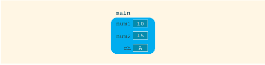

**图 6-9** 第 3 行中的语句执行后变量的值

第 4 行中的语句产生以下输出：

```text
Line 4: Inside main: num1 = 10, num2 = 15, and ch = A
```

第 5 行中的语句是对函数 funOne 的函数调用。现在函数 funOne 有三个参数（a、b 和 v）和一个局部变量（one）。为函数 funOne 的参数和局部变量分配内存。由于形式参数 b 是引用参数，它接收对应实际参数（即 num2）的地址（内存位置）。另外两个形式参数是值参数，因此它们复制其对应实际参数的值。就在第 9 行中的语句执行之前，变量如图 6-10 所示。


**图 6-10** 就在第 9 行中的语句执行之前变量的值

以下展示第 9 行至第 12 行中的每条语句执行后变量如何被操作。

| 行号 | 变量的值 | 语句与效果 |
|---|---|---|
| 9 | `main`：`num1 = 10`，`num2 = 15`，`ch = 'A'`<br>`funOne`：`a = 10`，`b` 引用 `num2`，`v = 'A'`，`one = 10` | `one = a;`<br>将 `a` 的值复制到 `one`。 |
| 10 | `main`：`num1 = 10`，`num2 = 15`，`ch = 'A'`<br>`funOne`：`a = 11`，`b` 引用 `num2`，`v = 'A'`，`one = 10` | `a++;`<br>将 `a` 的值增加 1。 |
| 11 | `main`：`num1 = 10`，`num2 = 30`，`ch = 'A'`<br>`funOne`：`a = 11`，`b` 引用 `num2`，`v = 'A'`，`one = 10` | `b = b * 2;`<br>将 `b` 的值乘以 2，并将结果存入 `b`。由于 `b` 是引用参数且包含 `num2` 的地址，因此 `num2` 的值被更新。 |
| 12 | `main`：`num1 = 10`，`num2 = 30`，`ch = 'A'`<br>`funOne`：`a = 11`，`b` 引用 `num2`，`v = 'B'`，`one = 10` | `v = 'B';`<br>将 `'B'` 存入 `v`。 |

第 13 行中的语句产生以下输出：

```text
Line 13: Inside funOne: a = 11, b = 30, v = B, and one = 10
```

第 13 行中的语句执行后，控制权返回到 main 中的第 6 行，并且为函数 funOne 的变量分配的内存被释放。图 6-11 显示函数 main 的变量的值。

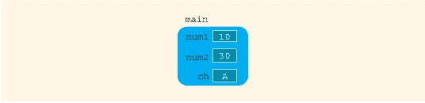

**图 6-11** 第 6 行中的语句执行后变量的值

第 6 行产生以下输出：

```text
Line 6: After funOne: num1 = 10, num2 = 30, and ch = A
```

第 7 行中的语句是对函数 funTwo 的函数调用。现在 funTwo 有三个参数：x、y 和 w。此外，x 和 w 是引用参数，y 是值参数。因此，x 接收其对应实际参数（即 num2）的地址，w 接收其对应实际参数（即 ch）的地址。变量 y 将值 25 复制到其内存单元中。图 6-12 显示第 14 行中的语句执行之前的值。


**图 6-12** 第 14 行中的语句执行之前变量的值

以下展示第 14 行至第 16 行中的每条语句执行后变量如何被操作。


| 语句所在行 | 变量的值 | 语句与效果 |
|---|---|---|
| 14 | **main：** num1 = 10, num2 = 31, ch = A<br>**funTwo：** x = 31, y = 25, w = A | `x++;`<br>将 x 的值加 1。因为 x 是引用参数，并且包含 num2 的地址，所以 num2 的值加 1。 |
| 15 | **main：** num1 = 10, num2 = 31, ch = A<br>**funTwo：** x = 31, y = 50, w = A | `y = y * 2;`<br>将 y 的值乘以 2，并将结果存入 y。 |
| 16 | **main：** num1 = 10, num2 = 31, ch = G<br>**funTwo：** x = 31, y = 50, w = G | `w = 'G';`<br>将 'G' 存入 w。因为 w 是引用参数，并且包含 ch 的地址，所以 ch 的值被更新。 |

第 17 行产生以下输出：

```text
Line 17: Inside funTwo: x = 31, y = 50, and w = G
```

第 17 行中的语句执行后，控制转到第 8 行。为函数 funTwo 的变量分配的内存被释放。函数 main 的变量的值如图 6–13 所示。

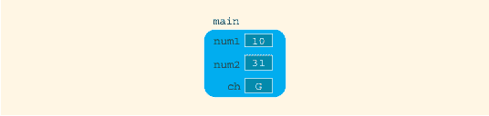

**图 6–13** 第 8 行语句执行后变量的值

第 8 行中的语句产生以下输出：

```text
Line 8: After funTwo: num1 = 10, num2 = 31, and ch = G
```

第 8 行中的语句执行后，程序终止。

### 示例 6-15

此示例还展示了引用参数如何操作实际参数。

```cpp
//Example 6-15: Reference and value parameters.
//Program: Makes you think.

#include <iostream>

using namespace std;

void addFirst(int& first, int& second);
void doubleFirst(int one, int two);
void squareFirst(int& ref, int val);

int main()
{
    int num = 5;

    cout << "Line 1: Inside main: num = " << num                 //Line 1
         << endl;

    addFirst(num, num);                                           //Line 2
    cout << "Line 3: Inside main after addFirst:"
         << " num = " << num << endl;                           //Line 3

    doubleFirst(num, num);                                        //Line 4
    cout << "Line 5: Inside main after "
         << "doubleFirst: num = " << num << endl;                //Line 5

    squareFirst(num, num);                                        //Line 6
    cout << "Line 7: Inside main after "
         << "squareFirst: num = " << num << endl;                //Line 7

    return 0;
}

void addFirst(int& first, int& second)
{
    cout << "Line 8: Inside addFirst:  first = "
         << first << ", second = " << second << endl;            //Line 8

    first = first + 2;                                            //Line 9

    cout << "Line 10: Inside addFirst:  first = "
         << first << ", second = " << second << endl;            //Line 10

    second = second * 2;                                          //Line 11

    cout << "Line 12: Inside addFirst:  first = "
         << first << ", second = " << second << endl;            //Line 12
}

void doubleFirst(int one, int two)
{
    cout << "Line 13: Inside doubleFirst: one = "
         << one << ", two = " << two << endl;        //Line 13

    one = one * 2;                                    //Line 14

    cout << "Line 15: Inside doubleFirst: one = "
         << one << ", two = " << two << endl;        //Line 15

    two = two + 2;                                    //Line 16

    cout << "Line 17: Inside doubleFirst: one = "
         << one << ", two = " << two << endl;        //Line 17
}

void squareFirst(int& ref, int val)
{
    cout << "Line 18: Inside squareFirst: ref = "
         << ref << ", val = " << val << endl;        //Line 18

    ref = ref * ref;                                  //Line 19

    cout << "Line 20: Inside squareFirst: ref = "
         << ref << ", val = " << val << endl;        //Line 20

    val = val + 2;                                    //Line 21

    cout << "Line 22: Inside squareFirst: ref = "
         << ref << ", val = " << val << endl;        //Line 22
}
```

### 示例运行

```text
Line 1: Inside main:  num = 5
Line 8: Inside addFirst: first = 5, second = 5
Line 10: Inside addFirst: first = 7, second = 7
Line 12: Inside addFirst: first = 14, second = 14
Line 3: Inside main after addFirst: num = 14
Line 13: Inside doubleFirst: one = 14, two = 14
Line 15: Inside doubleFirst: one = 28, two = 14
Line 17: Inside doubleFirst: one = 28, two = 16
Line 5: Inside main after doubleFirst: num = 14
Line 18: Inside squareFirst: ref = 14, val = 14
Line 20: Inside squareFirst: ref = 196, val = 14
Line 22: Inside squareFirst: ref = 196, val = 16
Line 7: Inside main after squareFirst: num = 196
```

函数 addFirst 的两个参数都是引用参数，而函数 doubleFirst 的两个参数都是值参数。语句：

```cpp
addFirst(num, num);
```


在函数 `main` 中（第 2 行），将 `num` 的引用传递给函数 `addFirst` 的两个形参 `first` 和 `second`，因为这两个形参对应的实参相同。也就是说，变量 `first` 和 `second` 引用同一个内存位置，即 `num`。图 6–14 说明了这种情况。

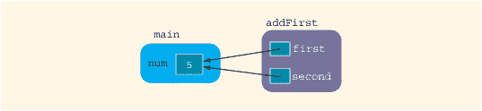

**图 6–14** 函数 `addFirst` 的参数

`first` 对其值所做的任何更改都会立即改变 `second` 和 `num` 的值。同样，`second` 对其值所做的任何更改也会立即改变 `first` 和 `num`，因为这三个变量引用同一个内存位置。（注意，`num` 被初始化为 5。）

函数 `doubleFirst` 的形参是值参数。因此，语句：

```cpp
doubleFirst(num, num);
```

在函数 `main` 中（第 4 行），将 `num` 的值复制到 `one` 和 `two`，因为这两个形参对应的实参相同。图 6–15 说明了这种情形。


**图 6–15** 函数 `doubleFirst` 的参数

因为 `one` 和 `two` 都是值参数，所以 `one` 对其值所做的任何更改都不会影响 `two` 和 `num` 的值。同样，`two` 对其值所做的任何更改也不会影响 `one` 和 `num`。（注意，函数 `doubleFirst` 执行前 `num` 的值是 14。）

函数 `squareFirst` 的形参 `ref` 是引用参数，而形参 `val` 是值参数。变量 `ref` 接收其对应实参的地址，即 `num`，而变量 `val` 复制其对应实参的值，该值也是 `num`。因此，`num` 和 `ref` 都引用同一个内存位置，即 `num`。图 6–16 说明了这种情况。

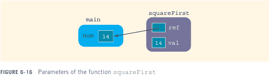

`ref` 所做的任何更改都会立即改变 `num`。`val` 所做的任何更改都不会影响 `num`。（注意，函数 `squareFirst` 执行前 `num` 的值是 14。）

我们建议你逐步运行示例 6-15 中的程序。输出显示了语句执行的顺序。

## 引用参数与有返回值函数

本章前面在讨论有返回值的函数时，你学习了如何使用值参数。你也可以在有返回值的函数中使用引用参数，尽管不推荐这种做法。根据定义，有返回值的函数返回单个值；该值通过 `return` 语句返回。如果一个函数需要返回多个值，按照良好的编程风格规则，应将其改为 void 函数，并使用适当的引用参数来返回这些值。

## 标识符的作用域

前面的几节给出了几个包含用户自定义函数的程序示例。标识符可以在函数头、块内或块外声明。自然会产生一个问题：是否允许在程序中的任何位置访问任何标识符？答案是否定的。访问标识符必须遵循某些规则。标识符的**作用域**是指程序中标识符可访问（可见）的位置。回想一下，标识符是 C++ 中某个事物的名称，例如变量名或函数名。

本节考察标识符的作用域。首先，我们定义以下两个术语：

- **局部标识符：** 在函数（或块）内声明的标识符。
- **局部标识符** 在函数（块）外部不可访问。
- **全局标识符：** 在每个函数定义之外声明的标识符。


另外，C++ 不允许函数嵌套。也就是说，你不能将一个函数的定义包含在另一个函数体中。

通常，访问标识符时适用以下规则：

- 1. 如果满足以下条件，则函数或块可以访问全局标识符（如变量）：
  - a. 该标识符在函数定义（块）之前声明，
  - b. 函数名与该标识符不同，
  - c. 函数的所有参数名都与该标识符的名称不同，并且
  - d. 所有局部标识符（如局部变量）的名称都与该标识符的名称不同。
- 2. **（嵌套块）** 在块内声明的标识符可在以下范围内访问：
  - a. 仅在该块内，从声明点开始到该块结束，并且
  - b. 如果嵌套块中没有与外部块（包围该嵌套块的块）同名的标识符，则该标识符可由嵌套在该块内的那些块访问。
- 3. 函数名的作用域类似于在任何块之外声明的标识符的作用域。也就是说，函数名的作用域与全局变量的作用域相同。

在考虑用一个示例来解释这些作用域规则之前，首先要注意 for 语句中声明的标识符的作用域。C++ 允许程序员在 for 语句的初始化语句中声明变量。例如，以下 for 语句：

```cpp
for (int count = 1; count < 10; count++)
    cout << count << endl;
```

声明了变量 count 并将其初始化为 1。变量 count 的作用域仅限于 for 循环体。

> **注意**  
> 这条针对 for 语句中声明的变量的作用域规则可能不适用于标准 C++，即非 ANSI/ISO 标准 C++。在标准 C++ 中，在初始化语句中声明的变量的作用域可以从其声明点一直延伸到紧包围 for 语句的块的末尾。（要完全确定，请查阅编译器的文档。）

以下 C++ 程序有助于说明这些作用域规则：

```cpp
#include <iostream>

using namespace std;

const double RATE = 10.50;
int z;
double t;
void one(int x, char y);
void two(int a, int b, char x);
void three(int one, double y, int z);

int main()
{
    int num, first;
    double x, y, z;
    char name, last;
    .
    .
    return 0;
}

void one(int x, char y)
{
    .
    .
}

int w;

void two(int a, int b, char x)
{
    int count;
    .
    .
}

void three(int one, double y, int z)
{
    char ch;
    int a;
    .
    .
    //Block four
    {
        int x;
        char a;
        .
        .
    }//end Block four
    .
    .
}
```

表 6–2 总结了标识符的作用域（可见性）。

### 表 6–2 标识符的作用域（可见性）

| 标识符 | 在 one 中的可见性 | 在 two 中的可见性 | 在 three 中的可见性 | 在 Block four 中的可见性 | 在 main 中的可见性 |
|---|---|---|---|---|---|
| `RATE`（在 `main` 之前） | Y | Y | Y | Y | Y |
| `z`（在 `main` 之前） | Y | Y | N | N | N |
| `t`（在 `main` 之前） | Y | Y | Y | Y | Y |
| `main` | Y | Y | Y | Y | Y |
| `main` 的局部变量 | N | N | N | N | Y |
| `one`（函数名） | Y | Y | N | N | Y |
| `x`（`one` 的形式参数） | Y | N | N | N | N |
| `y`（`one` 的形式参数） | Y | N | N | N | N |
| `w`（在函数 `two` 之前） | N | Y | Y | Y | N |
| `two`（函数名） | Y | Y | Y | Y | Y |
| `a`（`two` 的形式参数） | N | Y | N | N | N |
| `b`（`two` 的形式参数） | N | Y | N | N | N |
| `x`（`two` 的形式参数） | N | Y | N | N | N |
| `two` 的局部变量 | N | Y | N | N | N |
| `three`（函数名） | Y | Y | Y | Y | Y |
| `one`（`three` 的形式参数） | N | N | Y | Y | N |
| `y`（`three` 的形式参数） | N | N | Y | Y | N |
| `z`（`three` 的形式参数） | N | N | Y | Y | N |
| `ch`（`three` 的局部变量） | N | N | Y | Y | N |
| `a`（`three` 的局部变量） | N | N | Y | N | N |
| `x`（Block four 的局部变量） | N | N | N | Y | N |
| `a`（Block four 的局部变量） | N | N | N | Y | N |

注意，函数 three 不能调用函数 one，因为函数 three 有一个名为 one 的形式参数。类似地，函数 three 中标记为 four 的块不能使用在函数 three 中声明的 `int` 变量 a，因为块 four 有一个名为 a 的标识符。

在结束本节之前，让我们注意以下关于全局变量的内容：

- 1. 第 2 章指出 C++ 不会自动初始化变量。然而，一些编译器会将 `global` 变量初始化为其默认值。例如，如果全局变量的类型为 `int`、`char` 或 `double`，则它会被初始化为零。
- 2. 在 C++ 中，`::` 称为**作用域解析运算符**。通过使用作用域解析运算符，函数（或块）可以访问在函数（块）定义之前声明的全局变量，即使该函数（或块）有一个与该变量同名的标识符。在前面的程序中，通过使用作用域解析运算符，函数 main 可以将全局变量 z 引用为 `::z`。类似地，假设在函数（比如 funExample）定义之前声明了全局变量 t。那么，即使 funExample 有一个标识符 t，funExample 也可以使用作用域解析运算符访问变量 t。使用作用域解析运算符时，funExample 将变量 t 引用为 `::t`。此外，在前面的程序中，使用作用域解析运算符，函数 three 可以调用函数 one。
- 3. C++ 提供了一种访问在函数定义之后声明的全局变量的方法。在这种情况下，该函数必须包含一个与全局变量同名的标识符。在前面的程序中，全局变量 `w` 是在函数 one 的定义之后声明的。函数 one 不包含任何名为 `w` 的标识符；因此，只有将 `w` 声明为 one **内部的外部变量**，函数 one 才能访问 `w`。要将 `w` 声明为函数 one 内部的外部变量，函数 one 必须包含以下语句：

  ```cpp
  extern int w;
  ```

  在 C++ 中，`extern` 是保留字。上述语句中的 `extern` 一词声明 `w` 是在其他地方声明的全局变量。因此，当调用函数 one 时，不会为在 one 内部声明的 `w` 分配内存。在 C++ 中，`extern` 声明还有另一种用途，但本书不讨论。

## 全局变量、命名常量和副作用

C++ 程序可以包含全局变量，你可能会想把程序中的所有变量都设为全局变量，这样就不必担心某个函数知道哪个变量。然而，使用全局变量会有副作用。如果多个函数使用同一个全局变量并且出了问题，就很难发现出了什么问题以及问题出在哪里。程序中某一区域由全局变量引起的问题可能会被误认为是由另一区域引起的问题。

例如，考虑以下程序：

```cpp
//Global variable

#include <iostream>

using namespace std;

int t;

void funOne(int& a);

int main()
{
    t = 15;                                      //Line 1

    cout << "Line 2: In main: t = " << t << endl;       //Line 2

    funOne(t);                                   //Line 3

    cout << "Line 4: In main after funOne: "
         << " t = " << t << endl;               //Line 4

    return 0;                                    //Line 5
}

void funOne(int& a)
{
    cout << "Line 6: In funOne: a = " << a
         << " and t = " << t << endl;            //Line 6

    a = a + 12;                                  //Line 7
    cout << "Line 8: In funOne: a = " << a
         << " and t = " << t << endl;            //Line 8

    t = t + 13;                                  //Line 9

    cout << "Line 10: In funOne: a = " << a
         << " and t = " << t << endl;           //Line 10
}
```

### 示例运行结果：

```text
Line 2: In main: t = 15
Line 6: In funOne: a = 15 and t = 15
Line 8: In funOne: a = 27 and t = 27
Line 10: In funOne: a = 40 and t = 40
Line 4: In main after funOne: t = 40
```


该程序有一个变量 t，它在任何函数定义之前声明。由于没有任何函数具有标识符 t，因此变量 t 在程序的任何位置都可以访问。此外，该程序由一个带引用参数的 void 函数组成。

在第 3 行，函数 main 调用函数 funOne，传递给 funOne 的实际参数是 t。于是，funOne 的形参 a 接收到 t 的地址。a 对其值所做的任何更改都会立即改变 t。由于 t 可以在程序中的任何位置直接访问，因此在第 9 行，函数 funOne 通过使用 t 本身来改变 t 的值。因此，你可以通过引用参数或 t 本身来操作 t 的值。

在前面的程序中，如果 t 的最终值不正确，则很难确定出错的原因以及出错在程序的哪个部分。我们强烈建议不要使用全局变量，而应使用适当的参数。

在本书给出的程序中，我们通常将命名常量放置在函数 main 之前、所有函数定义之外。也就是说，我们使用的命名常量是全局命名常量。与全局变量不同，全局命名常量没有副作用，因为它们的值在程序执行期间不能改变。此外，即使命名常量只在某个函数中使用，将其放在程序开头也能提高可读性。如果之后需要修改程序并更改某个命名常量的值，将其放在程序开头会更容易找到。

### 示例 6-16（二次多项式的因式分解）

在代数课程中，人们会学习如何使用各种技巧对多项式进行因式分解。在本示例中，我们编写一个程序，对形如 $x^2 + bx + c$ 的二次多项式进行因式分解，即写成 $x^2 + bx + c = (x - u)(x - v)$。为简单起见，我们限制该程序只能对 b、c、u 和 v 均为整数的多项式进行因式分解。例如，$x^2 + 5x + 6 = (x + 2)(x + 3)$，$x^2 + 10x - 24 = (x + 12)(x - 2)$，$x^2 - 25 = (x + 5)(x - 5)$。

可以证明，u 和 v 的值由下式给出：

$$u = \frac{-b + \sqrt{b^2 - 4c}}{2}$$

$$v = \frac{-b - \sqrt{b^2 - 4c}}{2}$$

如果 $b^2 - 4c < 0$，则 u 和 v 是复数；如果 $b^2 - 4c > 0$ 且 $b^2 - 4c$ 不是某个整数的平方，则 u 和 v 不是整数。此外，如果 $b^2 - 4c$ 是某个整数的平方，且 $-b + \sqrt{b^2 - 4c}$ 和 $-b - \sqrt{b^2 - 4c}$ 不能被 2 整除，则 u 和 v 也不是整数。因此，要使 u 和 v 为整数，$-b + \sqrt{b^2 - 4c}$ 和 $-b - \sqrt{b^2 - 4c}$ 必须能被 2 整除。下面的函数以 b 和 c 的值为参数，返回 u 和 v 的值，并指示该多项式是否可因式分解。

```cpp
void factorization(int b, int c, int& u1, int& v1, bool& isFactorable)
{
    double discriminant;
    int temp;

    isFactorable = true;

    discriminant = b * b - 4 * c;

    if (discriminant < 0)
        isFactorable = false;
    else
    {
        temp = static_cast<int>(sqrt(discriminant));

        if (temp * temp != discriminant)
            isFactorable = false;
        else
        {
            if (((-b + temp) % 2 != 0) || ((-b - temp) % 2 != 0))
                isFactorable = false;
            else
            {
                u1 = (-b + temp) / 2;
                v1 = (-b - temp) / 2;
            }
        }
    }
}
```

下面的程序演示了如何在程序中使用函数 factorization。

```cpp
//Program: Second degree polynomial factorization

#include <iostream>
#include <cmath>

using namespace std;

void factorization(int b, int c, int& u1, int& v1, bool& isFactorable);

int main()
{
    int coeffOfX;
    int constantTerm;
    int u;
    int v;
    bool isPolynomialFactorable;

    cout << "Enter the coefficient of x: ";
    cin >> coeffOfX;
    cout << endl;

    cout << "Enter the constant term: ";
    cin >> constantTerm;
    cout << endl;

    factorization(coeffOfX, constantTerm, u, v,
                  isPolynomialFactorable);

    if (isPolynomialFactorable)
    {
        cout << "x^2";

        if (coeffOfX > 0)
            cout << " + " << coeffOfX << "x";
        else if (coeffOfX < 0)
            cout << " - " << abs(coeffOfX) << "x";

        if (constantTerm > 0)
            cout << " + " << constantTerm;
        else if (constantTerm < 0)
            cout << " - " << abs(constantTerm);

        cout << " = (x";
        if (u > 0)
            cout << " - " << u << ") (x";
        else if (u < 0)
            cout << " + " << abs(u) << ") (x";

        if (v > 0)
            cout << " - " << v << ")" << endl;
        else if (v < 0)
            cout << " + " << abs(v) << ")" << endl;
    }
    else
        cout << "The polynomial is not factorable." << endl;

    return 0;
}
```

`//Place the definition of the function factorization here.`

**示例运行：**在这些示例运行中，用户输入以阴影显示。

### 示例运行 1：

```text
Enter the coefficient of x: 5
Enter the constant term: 6
x^2 + 5x + 6 = (x + 3)(x + 2)
```

### 示例运行 2：

```text
Enter the coefficient of x: 0
Enter the constant term: -25
x^2 - 25 = (x - 5)(x + 5)
```

### 示例运行 3：

```text
Enter the coefficient of x: 8
Enter the constant term: 16
x^2 + 8x + 16 = (x + 4)(x + 4)
```

### 示例运行 4：

```text
Enter the coefficient of x: -13
Enter the constant term: 20
The polynomial is not factorable.
```

### 示例 6-17（菜单驱动程序）

下面是一个菜单驱动程序的示例。程序执行时，它会为用户提供一个选项列表以供选择。该程序进一步说明了值参数和引用参数的工作方式。它可以将长度从英尺和英寸转换为米和厘米，反之亦然。该程序包含三个函数：showChoices、feetAndInchesToMetersAndCent 和 metersAndCentToFeetAndInches。函数 showChoices 告知用户如何使用该程序。只要用户愿意，就可以一直运行该程序。

```cpp
//Menu-driven program.

#include <iostream>

using namespace std;

const double CONVERSION = 2.54;
const int INCHES_IN_FOOT = 12;
const int CENTIMETERS_IN_METER = 100;

void showChoices();

void feetAndInchesToMetersAndCent(int f, int in,
                                  int& mt, int& ct);
void metersAndCentToFeetAndInches(int mt, int ct,
                                  int& f, int& in);

int main()
{
    int feet, inches;
    int meters, centimeters;
    int choice;

    do
    {
        showChoices();
        cin >> choice;
        cout << endl;

        switch (choice)
        {
        case 1:
            cout << "Enter feet and inches: ";
            cin >> feet >> inches;
            cout << endl;
            feetAndInchesToMetersAndCent(feet, inches,
                                          meters, centimeters);

            cout << feet << " feet (foot), "
                 << inches << " inch(es) = "
                 << meters << " meter(s), "
                 << centimeters << " centimeter(s)." << endl;
            break;

        case 2:
            cout << "Enter meters and centimeters: ";
            cin >> meters >> centimeters;
            cout << endl;
            metersAndCentToFeetAndInches(meters, centimeters,
                                          feet, inches);

            cout << meters << " meter(s), "
                 << centimeters << " centimeter(s) = "
                 << feet << " feet (foot), "
                 << inches << " inch(es)."
                 << endl;
            break;

        case 99:
            break;

        default:
            cout << "Invalid input." << endl;
        }
    } while (choice != 99);

    return 0;
}

void showChoices()
{
    cout << "Enter--" << endl;
    cout << "1: To convert from feet and inches to meters "
         << "and centimeters." << endl;
    cout << "2: To convert from meters and centimeters to feet "
         << "and inches." << endl;
    cout << "99: To quit the program." << endl;
}

void feetAndInchesToMetersAndCent(int f, int in,
                                  int& mt, int& ct)
{
    int inches;

    inches = f * INCHES_IN_FOOT + in;
    ct = static_cast<int>(inches * CONVERSION);
    mt = ct / CENTIMETERS_IN_METER;
    ct = ct % CENTIMETERS_IN_METER;
}

void metersAndCentToFeetAndInches(int mt, int ct,
                                  int& f, int& in)
{
    int centimeters;

    centimeters = mt * CENTIMETERS_IN_METER + ct;
    in = static_cast<int>(centimeters / CONVERSION);
    f = in / INCHES_IN_FOOT;
    in = in % INCHES_IN_FOOT;
}
```

**示例运行：**在此示例运行中，用户输入以阴影显示。

```text
Enter--
1: To convert from feet and inches to meters and centimeters.
2: To convert from meters and centimeters to feet and inches.
99: To quit the program.
2

Enter meters and centimeters: 4 25

4 meter(s), 25 centimeter(s) = 13 feet(foot), 11 inch(es).

Enter--
1: To convert from feet and inches to meters and centimeters.
2: To convert from meters and centimeters to feet and inches.
99: To quit the program.
1

Enter feet and inches: 15 8

15 feet(foot), 8 inch(es) = 4 meter(s), 77 centimeter(s).

Enter--
1: To convert from feet and inches to meters and centimeters.
2: To convert from meters and centimeters to feet and inches.
99: To quit the program.
99
```

只要用户未输入 99，main 函数中的 do...while 循环就会继续执行，这使用户可以根据需要一直运行该程序。上述输出不言自明。


## 静态变量与自动变量

到目前为止讨论的变量遵循两条简单规则：

- 1. 只要程序执行，全局变量的内存就保持已分配状态。
- 2. 在块内声明的变量，其内存在进入块时分配，在退出块时释放。例如，函数的形式参数和局部变量的内存在函数被调用时分配，在函数退出时释放。

在进入块时分配内存、在退出块时释放内存的变量称为**自动变量**。只要程序执行其内存就保持已分配状态的变量称为**静态变量**。全局变量是静态变量，默认情况下，在块内声明的变量是自动变量。可以使用保留字 `static` 在块内声明静态变量。声明静态变量的语法是：

```cpp
static dataType identifier;
```

语句：

```cpp
static int x;
```

将 x 声明为 `int` 类型的静态变量。

在块内声明的静态变量是该块的局部变量，其作用域与该块中任何其他局部标识符的作用域相同。

大多数编译器会将静态变量初始化为其默认值。例如，`static int` 变量会被初始化为 0。不过，最好由你自己初始化静态变量，尤其是当初始值不是默认值时。在这种情况下，静态变量在声明时初始化。语句：

```cpp
static int x = 0;
```

将 x 声明为 `int` 类型的静态变量，并在第一次调用函数时将 x 初始化为 0。

### 示例 6-18

下面的程序展示了静态变量和自动变量的行为。

```cpp
//Program: Static and automatic variables

#include <iostream>

using namespace std;

void test();

int main()
{
    int count;

    for (count = 1; count <= 5; count++)
        test();

    return 0;
}

void test()
{
    static int x = 0;
    int y = 10;

    x = x + 2;
    y = y + 1;

    cout << "Inside test x = " << x << " and y = "
         << y << endl;
}
```

**示例运行：**

```
Inside test x = 2 and y = 11
Inside test x = 4 and y = 11
Inside test x = 6 and y = 11
Inside test x = 8 and y = 11
Inside test x = 10 and y = 11
```

在函数 test 中，x 是初始化为 0 的静态变量，y 是初始化为 10 的自动变量。函数 main 调用函数 test 五次。每次调用函数 test 时都会为变量 y 分配内存，并在函数退出时释放。因此，每次调用函数 test 时，它都会打印相同的 y 值。然而，由于 x 是静态变量，只要程序执行，x 的内存就保持已分配状态。变量 x 在第一次调用函数时被初始化一次为 0。后续对函数 test 的调用使用程序上一次离开（执行完）函数 test 时 x 所具有的值。

由于静态变量的内存在函数调用之间保持已分配状态，静态变量允许你在一次函数调用到另一次函数调用之间使用变量的值。即使你想在函数调用之间使用某些值时可以使用全局变量，静态变量的局部作用域也能防止其他函数操纵其值。

## 调试：使用驱动程序与桩函数

在本章和前面几章中，你学习了如何编写函数，将一个问题划分为若干子问题，求解每个子问题，然后组合这些函数形成完整程序，从而得到问题的解。一个程序可能包含若干函数。在复杂程序中，通常当一个函数编写完成后，会单独对其进行测试和调试。你可以编写一个单独的程序来测试该函数。用于测试函数的程序称为**驱动程序**。例如，示例 6-15 中的程序包含将长度从英尺和英寸转换为米和厘米以及反向转换的函数。在编写完整程序之前，你可以编写单独的驱动程序，以确保每个函数都能正常工作。

有时，一个函数计算出的结果在另一个函数中需要用到。在这种情况下，依赖于另一个函数的函数无法单独测试。例如，考虑下面这个确定注满游泳池所需时间的程序。

```cpp
#include <iostream>
#include <iomanip>

using namespace std;

const double GALLONS_IN_A_CUBIC_FOOT = 7.48;

double poolCapacity(double len, double wid, double dep);
void poolFillTime(double len, double wid, double dep,
                  double fRate, int& fTime);
void print(int fTime);

int main()
{
    double length, width, depth;
    double fillRate;
    int fillTime;

    cout << fixed << showpoint << setprecision(2);

    cout << "Enter the length, width, and the depth of the "
         << "pool (in feet): ";
    cin >> length >> width >> depth;
    cout << endl;

    cout << "Enter the rate of the water (in gallons per minute): ";
    cin >> fillRate;
    cout << endl;

    poolFillTime(length, width, depth, fillRate, fillTime);
    print(fillTime);

    return 0;
}

double poolCapacity(double len, double wid, double dep)
{
    double volume;
    double poolWaterCapacity;

    volume = len * wid * dep;
    poolWaterCapacity = volume * GALLONS_IN_A_CUBIC_FOOT;

    return poolWaterCapacity;
}

void poolFillTime(double len, double wid, double dep,
                  double fRate, int& fTime)
{
    double poolWaterCapacity;

    poolWaterCapacity = poolCapacity(len, wid, dep);
    fTime = static_cast<int> (poolWaterCapacity / fRate + 0.5);
}

void print(int fTime)
{
    cout << "The time to fill the pool is approximately: "
         << fTime / 60 << " hour(s) and " << fTime % 60
         << " minute(s)." << endl;
}
```

**示例运行：** 在此示例运行中，用户输入以底纹显示。

输入游泳池的长度、宽度和深度（以英尺为单位）：30 15 10

输入水的流速（以加仑/分钟为单位）：100

注满游泳池的时间约为：5 小时 37 分钟。

如你所见，该程序包含用于求出注满游泳池所需水量的函数 poolCapacity、用于求出注满游泳池所需时间的函数 poolFillTime，以及其他一些函数。现在，要计算注满游泳池的时间，你必须知道所需的水量以及水注入游泳池的速率。由于函数 poolFillTime 需要函数 poolCapacity 的结果，因此函数 poolFillTime 无法单独测试。这是否意味着我们必须按特定顺序编写这些函数？不一定，尤其是当不同的人负责程序的不同部分时。在这种情况下，我们使用函数桩。函数桩是一个尚未完整编码的函数。对于 void 函数，函数桩可能只包含函数头和一对空花括号 { }；对于有返回值的函数，它可能只包含一条 return 语句，并带有一个合理且易于使用的返回值。例如，函数 poolCapacity 的函数桩可以是：

```cpp
double poolCapacity(double len, double wid, double dep)
{
    return 1000.00;
}
```

函数的**签名**由函数名及其形式参数列表组成。如果两个函数具有不同的名称或不同的形式参数列表，则它们具有不同的签名。（注意，函数的签名不包括函数的返回类型。）

如果函数名被重载，那么该集合中的所有函数都具有相同的名称。因此，重载集合中的所有函数必须具有不同的形式参数列表。因此，以下函数头正确地重载了函数 `functionXYZ`：

```
void functionXYZ()
void functionXYZ(int x, double y)
void functionXYZ(double one, int y)
void functionXYZ(int x, double y, char ch)
```

考虑以下用于重载函数 `functionABC` 的函数头：

```
void functionABC(int x, double y)
int functionABC(int x, double y)
```

这两个函数头具有相同的名称和相同的形式参数列表。因此，这些用于重载函数 functionABC 的函数头是不正确的。在这种情况下，编译器将生成语法错误。（注意，这些函数头的返回类型不同。）

如果函数被重载，那么在调用该函数时，函数的形式参数列表决定执行哪个函数。

> **注意**
> 有些作者将函数的签名定义为形式参数列表，有些则将函数的整个函数头视为其签名。然而，在本书中，函数的签名由函数的函数头及其形式参数列表组成。如果函数名称不同，那么编译器当然可以毫无问题地识别调用的是哪个函数，并会正确地翻译代码。然而，如果函数名被重载，那么如前所述，函数的形式参数列表决定执行哪个函数体。

假设你需要编写一个函数来确定两个项中较大的那个。这两个项可以是整数、浮点数、字符或字符串。你可以编写如下几个函数：

```
int largerInt(int x, int y);
char largerChar(char first, char second);
double largerDouble(double u, double v);
string largerString(string first, string second);
```

函数 largerInt 确定两个整数中较大的那个；函数 largerChar 确定两个字符中较大的那个，依此类推。所有这些函数执行类似的操作。与其给这些函数起不同的名称，不如为每个函数使用相同的名称——比如 larger；也就是说，你可以重载函数 larger。因此，你可以将前面的函数原型简写为：


```cpp
int larger(int x, int y);
char larger(char first, char second);
double larger(double u, double v);
string larger(string first, string second);
```

例如，如果调用 `larger(5, 3)`，则执行带有 `int` 形参的版本。如果调用 `larger('A', '9')`，则执行带有 `char` 形参的版本，依此类推。

当对不同数据集执行相同操作时，可以使用函数重载。当然，要使函数重载生效，必须为每个函数提供单独的定义。

## 带默认参数的函数

**注意** 本节在第 10 章之前不需要。

本节讨论带默认参数的函数。回想一下，调用函数时，实参和形参的数量必须相同。C++ 对带默认参数的函数放宽了这一条件。默认参数的值在函数名第一次出现时指定，通常是在函数原型中。一般来说，带默认参数的函数遵循以下规则：

- 如果没有指定某个默认参数的值，则该参数使用默认值。
- 所有默认参数都必须是函数最右侧的参数。
- 假设一个函数有多个默认参数。在函数调用中，如果没有指定某个默认参数的值，那么必须省略其右侧的所有实参。
- 默认值可以是常量、全局变量或函数调用。
- 调用者可以选择为任意默认参数指定默认值以外的值。
- 不能将常量值作为引用参数的默认值。

考虑以下函数原型：

```cpp
void funcExp(int t, int u, double v, char w = 'A', int x = 67,
             char y = 'G', double z = 78.34);
```

函数 `funcExp` 有七个参数。参数 `w`、`x`、`y` 和 `z` 是默认参数。如果在调用函数 `funcExp` 时没有为 `w`、`x`、`y` 和 `z` 指定值，则使用它们的默认值。

假设有以下语句：

```cpp
int a, b;
char ch;
double d;
```

以下函数调用是合法的：

1. `funcExp(a, b, d);`
2. `funcExp(a, 15, 34.6, 'B', 87, ch);`
3. `funcExp(b, a, 14.56, 'D');`

在语句 1 中，使用 `w`、`x`、`y` 和 `z` 的默认值。在语句 2 中，`w` 的默认值被替换为 `'B'`，`x` 的默认值被替换为 `87`，`y` 的默认值被替换为 `ch` 的值，并使用 `z` 的默认值。在语句 3 中，`w` 的默认值被替换为 `'D'`，并使用 `x`、`y` 和 `z` 的默认值。

以下函数调用是非法的：

1. `funcExp(a, 15, 34.6, , 46.7);`
2. `funcExp(b, 25, 48.76, 'D', 4567, , 78.34);`

在语句 1 中，由于省略了 `w` 的值，因此必须省略所有其他默认值。在语句 2 中，由于省略了 `y` 的值，`z` 的值也应省略。

以下带默认参数的函数原型是非法的：

1. `void funcOne(int x, double z = 23.45, char ch, int u = 45);`
2. `int funcTwo(int length = 1, int width, int height = 1);`
3. `void funcThree(int x, int& y = 16, double z = 34);`

在语句 1 中，因为第二个参数 `z` 是默认参数，所以 `z` 之后的所有其他参数也必须是默认参数。在语句 2 中，因为第一个参数是默认参数，所以所有参数都必须是默认参数。在语句 3 中，不能将常量值赋给 `y`，因为 `y` 是引用参数。

示例 6-19 进一步说明了带默认参数的函数。

### 示例 6-19

```cpp
#include <iostream>
#include <iomanip>

using namespace std;

int volume(int l = 1, int w = 1, int h = 1);
void funcOne(int& x, double y = 12.34, char z = 'B');
```

> **注意**
> 在本书的程序中，并且按照推荐做法，函数 `main` 的定义放在任何用户定义函数定义之前。因此，必须在函数原型中指定参数的默认值，而且只能在函数原型中指定，*不*能在函数定义中指定，因为这必须发生在函数名第一次出现时。

## 编程示例：分类数字

在本例中，我们使用函数重写一个程序，该程序从给定的整数列表中确定奇数和偶数的数量。该程序最初是在第 5 章编写的。

主算法保持不变：

1. 将变量 `zeros`、`odds` 和 `evens` 初始化为 0。
2. 读取一个数字。
3. 如果该数字是偶数，则增加偶数计数；如果该数字也为零，则增加零计数；否则，增加奇数计数。
4. 对列表中的每个数字重复步骤 2 和 3。

程序的主要部分是：初始化变量、读取并分类数字，然后输出结果。为了简化函数 `main` 并进一步说明参数传递，程序包括：

- 一个函数 `initialize`，用于初始化诸如 `zeros`、`odds` 和 `evens` 等变量。
- 一个函数 `getNumber`，用于获取数字。
- 一个函数 `classifyNumber`，用于判断数字是奇数还是偶数（以及是否也为零）。该函数还会增加相应的计数。
- 一个函数 `printResults`，用于打印结果。

现在让我们描述这些函数中的每一个。

### initialize

函数 `initialize` 将变量初始化为其初始值。我们需要初始化的变量是 `zeros`、`odds` 和 `evens`。和之前一样，它们的初始值都是零。显然，这个函数有三个参数。由于用于初始化这些变量的形参值必须传递到函数外部，因此这些形参必须是引用参数。本质上，这个函数是：

```cpp
void initialize(int& zeroCount, int& oddCount, int& evenCount)
{
    zeroCount = 0;
    oddCount = 0;
    evenCount = 0;
}
```

### getNumber

函数 `getNumber` 读取一个数字，然后将这个数字传递给函数 `main`。因为只需要传递一个数字，所以这个函数只有一个参数。这个（void）函数的形参必须是引用参数，因为读取的数字要传递到函数外部。本质上，这个函数是：

```cpp
void getNumber(int& num)
{
    cin >> num;
}
```

你也可以将函数 `getNumber` 编写为返回值函数。请参见本编程示例末尾的注释。

### classifyNumber

函数 `classifyNumber` 判断数字是奇数还是偶数，如果数字是偶数，它还会检查数字是否为零。它还会更新某些变量 `zeros`、`odds` 和 `evens` 的值。这个函数需要知道要分析的数字；因此，必须将该数字作为参数传递。因为这个函数还会增加相应的计数，所以保存计数的变量（即 `main` 中声明的 `zeros`、`odds` 和 `evens`）必须作为参数传递给这个函数。因此，这个函数有四个参数。

因为只会分析该数字而不会修改它，所以只需传递它的值。因此，与该变量对应的形参是值参数。分析数字后，这个函数会增加某些变量 `zeros`、`odds` 和 `evens` 的值。因此，与这些变量对应的形参必须是引用参数。分析数字并增加相应计数的算法与之前相同。这个函数的定义是：

```cpp
void classifyNumber(int num, int& zeroCount, int& oddCount,
                    int& evenCount)
{
    switch (num % 2)
    {
    case 0:
        evenCount++;
        if (num == 0)
            zeroCount++;
        break;
    case 1:
    case -1:
        oddCount++;
    } //end switch
} //end classifyNumber
```

### printResults

函数 `printResults` 打印最终结果。为了打印结果（即零、奇数和偶数的数量），这个函数必须能够访问函数 `main` 中声明的变量 `zeroCount`、`odds` 和 `evens` 的值。因此，这个函数有三个参数。因为这个函数不改变……的值

变量而只是打印它们，形式参数是值参数。该函数的定义如下：

```cpp
void printResults(int zeroCount, int oddCount, int evenCount)
{
    cout << "There are " << evenCount << " evens, "
         << "which includes " << zeroCount << " zeros"
         << endl;

    cout << "The number of odd numbers is: " << oddCount
         << endl;
} //end printResults
```

现在我们给出主算法，并说明函数 main 如何调用这些函数。

## 主算法

- 1. 调用函数 initialize 初始化变量。
- 2. 提示用户输入 20 个数字。
- 3. 对于列表中的每个数字：
  - a. 调用函数 getNumber 读取一个数字。
  - b. 输出该数字。
  - c. 调用函数 classifyNumber 对该数字进行分类，并递增相应的计数。
- 4. 调用函数 printResults 打印最终结果。

## 完整程序清单

```cpp
////////////////////////////////////////////////////////////
// Author: D.S. Malik
//
// Program: Classify Numbers
// This program reads 20 numbers and outputs the number of
// zeros, odd, and even numbers.
////////////////////////////////////////////////////////////

#include <iostream>
#include <iomanip>

using namespace std;

const int N = 20;

        //Function prototypes
void initialize(int& zeroCount, int& oddCount, int& evenCount);
void getNumber(int& num);
void classifyNumber(int num, int& zeroCount, int& oddCount,
                   int& evenCount);
void printResults(int zeroCount, int oddCount, int evenCount);

int main()
{
    //Variable declaration
    int counter; //loop control variable
    int number;  //variable to store the new number
    int zeros;   //variable to store the number of zeros
    int odds;    //variable to store the number of odd integers
    int evens;   //variable to store the number of even integers

    initialize(zeros, odds, evens);                    //Step 1

    cout << "Please enter " << N << " integers."
         << endl;                                      //Step 2
    cout << "The numbers you entered are: "
         << endl;

    for (counter = 1; counter <= N; counter++)         //Step 3
    {
        getNumber(number);                             //Step 3a
        cout << number << " ";                         //Step 3b
        classifyNumber(number, zeros, odds, evens);    //Step 3c
    } // end for loop

    cout << endl;

    printResults(zeros, odds, evens);                   //Step 4

    return 0;
}

void initialize(int& zeroCount, int& oddCount, int& evenCount)
{
    zeroCount = 0;
    oddCount = 0;
    evenCount = 0;
}

void getNumber(int& num)
{
    cin >> num;
}

void classifyNumber(int num, int& zeroCount, int& oddCount,
                    int& evenCount)
{
    switch (num % 2)
    {
    case 0:
        evenCount++;
        if (num == 0)
            zeroCount++;
        break;
    case 1:
    case -1:
        oddCount++;
    } //end switch
} //end classifyNumber

void printResults(int zeroCount, int oddCount, int evenCount)
{
    cout << "There are " << evenCount << " evens, "
         << "which includes " << zeroCount << " zeros"
         << endl;

    cout << "The number of odd numbers is: " << oddCount
         << endl;
} //end printResults
```

**示例运行：** 在此示例运行中，用户输入以阴影显示。

```
Please enter 20 integers.
The numbers you entered are:
0 0 12 23 45 7 -2 -8 -3 -9 4 0 1 0 -7 23 -24 0 0 12
0 0 12 23 45 7 -2 -8 -3 -9 4 0 1 0 -7 23 -24 0 0 12
There are 12 evens, which includes 6 zeros
The number of odd numbers is: 8
```


在上一个程序中，由于假定数据从标准输入设备（键盘）输入，并且函数 getNumber 只返回一个值，因此也可以将函数 getNumber 编写为有返回值的函数。如果编写为有返回值的函数，则函数 getNumber 的定义如下：

```cpp
int getNumber()
{
    int num;

    cin >> num;

    return num;
}
```

在这种情况下，语句（函数调用）：

```cpp
getNumber(number);
```

在函数 main 中应替换为以下语句：

```cpp
number = getNumber();
```

当然，还需要更改函数原型。

## 编程示例：数据比较


本编程示例说明：

- 如何在同一个程序中从多个文件读取数据。
- 如何将输出发送到文件。
- 如何生成条形图。
- 借助函数和参数传递，如何在不同（但相似）的数据集上使用同一程序段。
- 如何使用结构化设计解决问题，以及如何执行参数传递。

本程序分为两部分。首先，学习如何从多个文件读取数据。其次，学习如何生成条形图。

当地一所大学的两组学生在夏季学期选修了某些特殊课程。这些课程是首次开设，并由不同的教师讲授。学期结束时，两组学生参加相同课程的相同测试，他们的成绩记录在单独的文件中。每个文件中的数据形式如下：

```
courseNo  score1, score2, ..., scoreN -999
courseNo  score1, score2, ..., scoreM -999
.
.
.
```

让我们编写一个程序，计算每个组每门课程的平均成绩。输出形式如下：

| 课程编号 | 组号 | 课程平均分 |
|---|---|---|
| CSC | 1 | 83.71 |
|  | 2 | 80.82 |
| ENG | 1 | 82.00 |
|  | 2 | 78.20 |
| . | . | . |
| . | . | . |
| . | . | . |

第 1 组平均分：82.04

第 2 组平均分：82.01

**输入** 由于两组数据记录在单独的文件中，因此输入数据出现在两个单独的文件中。

**输出** 如上所示。

## 问题分析与算法设计

从这两个文件读取输入数据很直接。假设第 1 组的数据存储在文件 `group1.txt` 中，第 2 组的数据存储在文件 `group2.txt` 中。处理完一个组的数据后，我们可以处理同一课程第二个组的数据，并继续直到数据用完。处理每门课程的数据类似，分为两步：

- 1.
  - a. 求该课程成绩的总和。
  - b. 统计该课程的学生人数。
  - c. 用总成绩除以学生人数，求出课程平均分。
- 2. 输出结果。

我们只比较每个组中对应课程的平均分，并且每个文件中的数据都按课程 ID 排序。为了确保只比较对应课程的平均分，我们比较每个组的课程 ID。如果对应的课程 ID 不相同，则输出错误信息并终止程序。

上述讨论表明，我们应该编写一个函数 `calculateAverage` 来求课程平均分。还应编写另一个函数 `printResult`，以给定形式输出数据。通过传递适当的参数，我们可以使用相同的函数 `calculateAverage` 和 `printResult` 来处理两个组中每门课程的数据。（在程序的第二部分，我们会修改函数 `printResult`。）

前述讨论可转化为以下算法：

- 1. 初始化变量。
- 2. 获取第 1 组和第 2 组的课程 ID。
- 3. 如果课程 ID 不同，则打印错误信息并退出程序。
- 4. 计算第 1 组和第 2 组的课程平均分。
- 5. 按上述给定形式打印结果。
- 6. 对每门课程重复步骤 2 到 5。
- 7. 打印最终结果。

## 变量（main 函数）

上述讨论表明，程序在函数 main 中需要以下变量进行数据操作：

```cpp
string courseId1;      //course ID for group 1
string courseId2;      //course ID for group 2
int numberOfCourses;
double avg1;           //average for a course in group 1
double avg2;           //average for a course in group 2
double avgGroup1;      //average group 1
double avgGroup2;      //average group 2
ifstream group1;       //input stream variable for group 1
ifstream group2;       //input stream variable for group 2

ofstream outfile;      //output stream variable
```

```cpp
courseAvg = totalScore / numberOfStudents;
} //end calculateAverage
```

### printResult

函数 printResult 打印该组的课程 ID、组号和课程平均分。输出存储在文件中。因此，我们必须向该函数传递四个参数：与输出文件关联的 ofstream 变量、组号、课程 ID 以及该组的课程平均分。ofstream 变量必须按引用传递。由于该函数只使用其他变量的值，其余三个参数应为值参数。此外，从输出可以清楚看出，我们仅在组号之前打印课程 ID。

用伪代码表示，算法为：

```text
if (group number == 1)
    print course ID
else
    print a blank

print group number and course average
```

函数 printResult 的定义如下：

```cpp
void printResult(ofstream& outp, string courseID, int groupNo,
                 double avg)
{
    if (groupNo == 1)
        outp << " " << courseID << " ";
    else
        outp << "     ";

    outp << setw(8) << groupNo << setw(17) << avg << endl;
} //end printResult
```

现在我们已经设计并定义了函数 calculateAverage 和 printResult，可以描述函数 main 的算法。不过，在概述算法之前，我们注意以下几点：两个输入文件中的数据都完全可能按课程 ID 排序，但其中一个文件可能包含另一个文件中没有的一门或多门额外课程。只有在我们处理完两个文件并发现其中一个文件还有未处理的数据之后，才会发现这个错误。请确保在打印最终答案（即第 1 组和第 2 组的平均分）之前检查这个错误。

## 主算法：函数 main

- 1. 声明变量（局部声明）。
- 2. 打开输入文件。
- 3. 如果无法打开文件，则打印一条消息并终止程序。
- 4. 打开输出文件。
- 5. 要以固定小数格式输出浮点数（带小数点和小数点后的尾随零），设置操纵符 `fixed` 和 `showpoint`。另外，要将浮点数输出到小数点后两位，请将精度设置为两位小数。
- 6. 将第 1 组的课程平均分初始化为 0.0。
- 7. 将第 2 组的课程平均分初始化为 0.0。
- 8. 将课程数初始化为 0。
- 9. 打印标题。
- 10. 获取第 1 组的课程 ID `courseId1`。
- 11. 获取第 2 组的课程 ID `courseId2`。
- 12. 对于第 1 组和第 2 组中的每门课程，
  - a. `if (courseId1 != courseId2)`
    ```cpp
    {
        cout << "Data error: Course IDs do not match.\n";
        return 1;
    }
    ```
  - b. `else`
    ```cpp
    {
    ```
    - i. 计算第 1 组的课程平均分（调用函数 `calculateAverage` 并传递适当的参数）。
    - ii. 计算第 2 组的课程平均分（调用函数 `calculateAverage` 并传递适当的参数）。
    - iii. 打印第 1 组的结果（调用函数 `printResult` 并传递适当的参数）。
    - iv. 打印第 2 组的结果（调用函数 `printResult` 并传递适当的参数）。
    - v. 更新第 1 组的平均分。
    - vi. 更新第 2 组的平均分。
    - vii. 增加课程数。
    ```cpp
    }
    ```
  - c. 获取第 1 组的课程 ID `courseId1`。
  - d. 获取第 2 组的课程 ID `courseId2`。
- 13.
  - a. 如果第 1 组 `not_end_of_file` 且第 2 组 `end_of_file`，则打印“第 2 组的数据在第 1 组之前用完”
  - b. 否则如果第 1 组 `end_of_file` 且第 2 组 `not_end_of_file`，则打印“第 1 组的数据在第 2 组之前用完”
  - c. 否则打印第 1 组和第 2 组的平均分。
- 14. 关闭输入文件和输出文件。

## 完整程序清单

```cpp
//***************************************************************
// Author: D.S. Malik
//
// Program: Comparison of Class Averages
// This program computes and compares the class averages of
// two groups of students.
//***************************************************************

#include <iostream>
#include <iomanip>
#include <fstream>
#include <string>
using namespace std;

        //Function prototypes
void calculateAverage(ifstream& inp, double& courseAvg);
void printResult(ofstream& out, string courseId,
                 int groupNo, double avg);

int main()
{
        //Step 1
        string courseId1;       //course ID for group 1
        string courseId2;       //course ID for group 2
        int numberOfCourses;
        double avg1;            //average for a course in group 1
        double avg2;            //average for a course in group 2
        double avgGroup1;       //average group 1
        double avgGroup2;       //average group 2
        ifstream group1;        //input stream variable for group 1
        ifstream group2;        //input stream variable for group 2
        ofstream outfile;       //output stream variable

        group1.open("group1.txt");                    //Step 2
        group2.open("group2.txt");                    //Step 2

        if (!group1 || !group2)                         //Step 3
        {
                cout << "Unable to open files." << endl;
                cout << "Program terminates." << endl;
                return 1;
        }

        outfile.open("student.out");                  //Step 4
        outfile << fixed << showpoint;                 //Step 5
        outfile << setprecision(2);                    //Step 5

        avgGroup1 = 0.0;                                //Step 6
        avgGroup2 = 0.0;                                //Step 7

numberOfCourses = 0;                                  //Step 8

outfile << "Course No     Group No     "
        << "Course Average" << endl;                 //Step 9


group1 >> courseId1;                                  //Step 10
group2 >> courseId2;                                  //Step 11
while (group1 && group2)                              //Step 12
{
    if (courseId1 != courseId2)                        //Step 12a
    {
        cout << "Data error: Course IDs "
             << "do not match." << endl;
        cout << "Program terminates." << endl;
        return 1;
    }
    else                                               //Step 12b
    {
        calculateAverage(group1, avg1);               //Step 12b.i
        calculateAverage(group2, avg2);               //Step 12b.ii
        printResult(outfile, courseId1,               //Step 12b.iii
                    1, avg1);
        printResult(outfile, courseId2,               //Step 12b.iv
                    2, avg2);
        avgGroup1 = avgGroup1 + avg1;                 //Step 12b.v
        avgGroup2 = avgGroup2 + avg2;                 //Step 12b.vi
        outfile << endl;
        numberOfCourses++;                            //Step 12b.vii
    }

    group1 >> courseId1;                              //Step 12c
    group2 >> courseId2;                              //Step 12d
} //end while

if (group1 && !group2)                                //Step 13a
    cout << "Ran out of data for group 2 "
         << "before group 1." << endl;
else if (!group1 && group2)                           //Step 13b
    cout << "Ran out of data for group 1 "
         << "before group 2." << endl;
else                                                //Step 13c
{
    outfile << "Avg for group 1: "
            << avgGroup1 / numberOfCourses
            << endl;
    outfile << "Avg for group 2: "
            << avgGroup2 / numberOfCourses
            << endl;
}
```


```cpp
group1.close();                         //Step 14
group2.close();                         //Step 14
outfile.close();                        //Step 14

return 0;
}

void calculateAverage(ifstream& inp, double& courseAvg)
{
    double totalScore = 0.0;
    int numberOfStudents = 0;
    int score;

    inp >> score;
    while (score != -999)
    {
        totalScore = totalScore + score;
        numberOfStudents++;
        inp >> score;
    }//end while

    courseAvg = totalScore / numberOfStudents;
} //end calculateAverage

void printResult(ofstream& outp, string courseId, int groupNo,
                double avg)
{
    if (groupNo == 1)
        outp << " " << courseId << " ";
    else
        outp << "        ";
    outp << setw(8) << groupNo << setw(17) << avg << endl;
} //end printResult
```

### 示例运行：

| 课程编号 | 组号 | 课程平均分 |
|---|---:|---:|
| CSC | 1 | 83.71 |
|  | 2 | 80.82 |
| ENG | 1 | 82.00 |
|  | 2 | 78.20 |
| HIS | 1 | 77.69 |
|  | 2 | 84.15 |
| MTH | 1 | 83.57 |
|  | 2 | 84.29 |
| PHY | 1 | 83.22 |
|  | 2 | 82.60 |

```
Avg for group 1: 82.04
Avg for group 2: 82.01
```

### 输入数据组 1

```
CSC 80 100 70 80 72 90 89 100 83 70 90 73 85 90 -999
ENG 80 90 80 94 90 74 78 63 83 80 90 -999
HIS 90 70 80 70 90 50 89 83 90 68 90 60 -999
MTH 74 80 75 89 90 73 90 82 74 90 84 100 90 79 -999
PHY 100 83 93 80 63 78 88 89 75 -999
```

### 输入数据组 2

```
CSC 90 75 90 75 80 89 100 60 80 70 80 -999
ENG 80 80 70 68 70 78 80 90 90 76 -999
HIS 100 80 80 70 90 76 88 90 90 75 90 85 80 -999
MTH 80 85 85 92 90 90 74 90 83 65 72 90 84 100 -999
PHY 90 93 73 85 68 75 67 100 87 88 -999
```

## 条形图

在商业世界中，公司高管通常喜欢以某种可视化形式查看结果，例如条形图。许多当前可用的软件包可以分析多种形式的数据，然后以可视化形式显示结果，例如条形图或饼图。本程序的第二部分旨在以条形图的形式显示前面得到的结果，如下所示：

```
Course                    Course Average
 ID       0    10    20    30    40    50    60    70    80    90   100
          |....|....|....|....|....|....|....|....|....|....|
CSC       *******************************
ENG       ###################################
          .
          .
          .
Group 1 -- ****
Group 2 -- ####

Avg for group 1: 82.04
Avg for group 2: 82.01
```

条形图中的每个符号（* 或 #）表示两分。如果某门课程的平均分低于 2，则不打印任何符号。

由于输出采用条形图形式，我们需要修改函数 `printResult`。

### 打印条形

函数 `printResult` 打印课程编号以及表示某门课程平均分的条形图。输出存储在文件中。因此，我们必须向该函数传递四个参数：与输出文件关联的 ofstream 变量、组号（用于打印 * 或 #）、课程编号以及该部门的课程平均分。要打印条形图，我们可以使用循环每两分打印一个符号。要计算要打印的符号数量，可以使用整数除法，如下所示：

```
numberOfSymbols = static_cast<int>(average) / 2;
```

例如，`static_cast<int>(78.45) / 2 = 78 / 2 = 39`。如果平均分为 78.45，我们必须打印 39 个符号来表示该平均分。

根据上述讨论，函数 `printResult` 的定义为：

```
void printResult(ofstream& out, string courseID,
                 int groupNo, double avg)
{
    int noOfSymbols;
    int count;

    if (groupNo == 1)
        out << setw(4) << courseID << "    ";
    else
        out << "             ";

    noOfSymbols = static_cast<int>(avg)/2;

    if (groupNo == 1)
        for (count = 1; count <= noOfSymbols; count++)
            out << '*';
    else
        for (count = 1; count <= noOfSymbols; count++)
            out << '#';

    out << endl;
} //end printResult
```

我们还包括一个函数 `printHeading`，用于打印输出的前两行。该函数的定义为：

```
void printHeading(ofstream& out)
{
    out << "Course          Course Average" << endl;
    out << "  ID    0    10    20    30    40    50    60    70";
    out << "    80    90    100" << endl;
    out << "        |....|....|....|....|....|....|....|....|";
    out << "....|....|" << endl;
} //end printHeading
```

替换前面程序中的函数 printResult，加入函数 printHeading，加入输出“Group 1 — ****”和“Group 2 — ####”的语句，然后重新运行程序。你的程序应生成类似于前面所示条形图的条形图。（完整程序清单可在本书配套网站上获得。）

## 快速回顾

- 1. 函数也称为模块，就像微型程序。
- 2. 函数使你能够将程序划分为可管理的任务。
- 3. C++ 系统提供标准（预定义）函数。
- 4. 要使用标准函数，你必须：
  - i. 知道包含该函数规范的头文件名称，
  - ii. 在程序中包含该头文件，并且
  - iii. 知道函数的名称和类型，以及参数（实参）的数量和类型。
- 5. 用户定义函数有两种类型：有返回值函数和 void 函数。
- 6. 在函数首部中定义的变量称为形参。
- 7. 在函数调用中使用的表达式、变量或常量值称为实参。
- 8. 在函数调用中，实参的数量及其类型必须按给定顺序与形参匹配。
- 9. 要调用函数，请使用其名称以及实参列表。
- 10. 有返回值函数会返回一个值。因此，有返回值函数用于（被调用）表达式、输出语句中，或作为函数调用中的参数。
- 11. 用户定义函数的一般语法为：

  ```cpp
  functionType functionName(formal parameter list)
  {
      statements
  }
  ```

- 12. 行 `functionType functionName(formal parameter list)` 称为函数首部（或函数头）。括在花括号（`{` 和 `}`）之间的语句称为函数体。
- 13. 函数首部和函数体称为函数的定义。
- 14. 如果函数没有参数，函数首部和函数调用中仍然需要空圆括号。
- 15. 有返回值函数通过 `return` 语句返回其值。
- 16. 一个函数可以有多个 `return` 语句。但是，每当函数中执行 `return` 语句时，其余语句将被跳过，函数退出。
- 17. `return` 语句只返回一个值。
- 18. 函数原型是去掉函数体的函数首部；函数原型以分号结尾。
- 19. 函数原型声明函数类型，以及函数中使用的参数类型和数量。
- 20. 在函数原型中，形参列表中变量的名称是可选的。
- 21. 函数原型帮助编译器正确翻译每个函数调用。
- 22. 在程序中，函数原型放在每个函数定义之前，包括 main 函数的定义。
- 23. 使用函数原型时，用户定义函数可以以任意顺序出现在程序中。
- 24. 程序执行时，执行总是从 main 函数中的第一条语句开始。
- 25. 函数仅在它们被调用时执行。
- 26. 对函数的调用将控制权从调用者转移到被调用函数。
- 27. 在函数调用语句中，你只指定实参，而不指定它们的数据类型或函数类型。
- 28. 当函数退出时，控制权返回给调用者。
- 29. 没有数据类型的函数称为 void 函数。
- 30. 不带任何值的 `return` 语句可用于 void 函数。如果在 void 函数中使用 `return` 语句，通常用于提前退出函数。
- 31. void 函数的首部以单词 void 开头。
- 32. 在 C++ 中，`void` 是保留字。
- 33. void 函数可以有参数，也可以没有参数。
- 34. 对 void 函数的调用是一条独立语句。
- 35. 要调用 void 函数，请在独立语句中使用函数名称以及实参。
- 36. 形参有两种类型：值形参和引用形参。
- 37. 值形参接收其对应实参的副本。
- 38. 引用形参接收其对应实参的地址（内存位置）。
- 39. 值形参对应的实参是表达式、变量或常量值。
- 40. 常量值不能传递给引用形参。
- 41. 引用形参对应的实参必须是变量。
- 42. 当在形参的数据类型后包含 `&` 时，该形参就成为引用形参。
- 43. 流变量应通过引用传递给函数。


- 44. 如果一个形参需要改变实参的值，那么在函数头中必须将该形参声明为引用参数。
- 45. 标识符的作用域是指程序中可以访问该标识符的那些部分。
- 46. 在函数（或块）内声明的变量称为局部变量。
- 47. 在每个函数定义（和块）之外声明的变量称为全局变量。
- 48. 函数名的作用域与在任何块之外声明的标识符的作用域相同。
- 49. 参见本章中的作用域规则（参见“标识符的作用域”一节）。
- 50. C++ 不允许嵌套函数定义。
- 51. 自动变量是在进入函数（或块）时为其分配内存、在退出函数（或块）时释放其内存的变量。
- 52. 静态变量是在程序整个执行期间内存始终保持分配的变量。
- 53. 默认情况下，全局变量是静态变量。
- 54. 在 C++ 中，函数可以被重载。
- 55. 如果两个函数具有以下情况，则称它们具有不同的形参列表：
  - 形参数量不同，或
  - 形参数量相同，并且按所列顺序的形参数据类型至少在一个位置上不同。
- 56. 一个函数的签名由函数名及其形参列表组成。如果两个函数具有不同的名称或不同的形参列表，则它们具有不同的签名。
- 57. 如果一个函数被重载，那么在对该函数的调用中，该函数的形参列表决定执行哪个函数。
- 58. C++ 允许函数具有默认参数。
- 59. 如果未指定某个默认参数的值，则对该参数使用默认值。
- 60. 所有默认参数都必须是函数最右侧的参数。
- 61. 假设一个函数有多个默认参数。在函数调用中，如果未指定某个默认参数的值，则必须省略其右侧的所有实参。
- 62. 默认值可以是常量、全局变量或函数调用。
- 63. 调用函数可以选择为任何默认参数指定默认值以外的值。
- 64. 不能将常量值作为默认值赋给引用参数。


## 练习

练习末尾括号中的数字指本章开头列出的学习目标。

- 1. 将下列语句标记为真或假：
  - a. 要在程序中使用预定义函数，只需知道函数名以及如何使用它。(1)
  - b. 有返回值函数只返回一个值。(2, 3)
  - c. 参数允许每次调用函数时使用不同的值。(2, 7, 9)
  - d. 当用户自定义函数中的 `return` 语句执行时，函数立即退出。(3, 4)
  - e. 有返回值函数只返回整数值。(4)
  - f. 变量名不能传递给值参数。(3, 6)
  - g. 如果 C++ 函数不使用参数，空参数列表周围的括号仍然是必需的。(2, 3, 6)
  - h. 在 C++ 中，对应的形参和实参的名称必须相同。(3, 4, 6)
  - i. 改变引用参数值的函数也会改变实参的值。(7)
  - j. 每当引用参数的值改变时，实参的值也会改变。(7)
  - k. 在 C++ 中，函数定义可以嵌套；也就是说，一个函数的定义可以包含在另一个函数体内。(9)
  - l. 在程序中使用全局变量比使用局部变量是更好的编程风格，因为可以避免额外的变量。(10)
  - m. 在程序中，全局常量与全局变量一样危险。(10)
  - n. 静态变量的内存在函数调用之间保持分配状态。(11)

- 2. 确定下列每个表达式的值：(1)
  - a. `static_cast<char>(toupper('7'))`
  - b. `static_cast<char>(toupper('@'))`
  - c. `static_cast<char>(toupper('s'))`
  - d. `static_cast<char>(toupper('J'))`
  - e. `static_cast<char>(tolower('*'))`
  - f. `static_cast<char>(tolower(';'))`
  - g. `static_cast<char>(tolower('W'))`
  - h. `static_cast<char>(tolower('('))`

- 3. 确定下列每个表达式的值。（对于十进制数，将答案四舍五入到小数点后两位。）(1)
  - a. abs(-25)
  - b. fabs(-56.38)
  - c. fabs(13.00)
  - d. pow(3.0, 2)
  - e. pow(6.2, 1.5)
  - f. sqrt(34.56)
  - g. sqrt(144.0)
  - h. sqrt(49.00) * pow(6.0, 3.0) / abs(-3)
  - i. floor(13.45)
  - j. ceil(6.5)
  - k. floor(5.89) + ceil(5.89)
  - l. floor(-5.89) + ceil(-2.31)
  - m. floor(-2.3) - ceil(81.2)
  - n. pow(-3.0, 5.0)
  - o. pow(3.0, -5.0)
  - p. pow(4.2, 1/5.0)

- 4. 使用表 6-1 中描述的函数，将下列每一项写成 C++ 表达式。（(e) 中的表达式表示 x + 2y - 3 的绝对值。）(1)
  - a. 8.5^3.2
  - b. sqrt(3x^2 - y)
  - c. (u+w)^(2x)
  - d. (-b + sqrt(b^2 - 4ac))/(2a)
  - e. |x + 2y - 3|

- 5. 考虑以下函数定义：

```cpp
int func(int x, double y, char u, string name)
{
    //function body
}
```

下列哪些是函数 func 的正确函数原型？(4, 6)

  - a. int func(x, y, u, name);
  - b. int func(int s, double k, char ch, string name);
  - c. int func(int, double, char, string);
  - d. func(int, double, char, string)

- 6. 考虑以下程序：(1)

```cpp
#include <iostream>
#include <cmath>
#include <iomanip>

using namespace std;

int main()
{
    int num1;
    int num2;

    cout << fixed << showpoint << setprecision(2);

    cout << "Enter two integers: ";
    cin >> num1 >> num2;
    cout << endl;

    if (num1 != 0 && num2 != 0)
        cout << sqrt(abs(num1 + num2) + 0.5) << endl;
    else if (num1 != 0)
        cout << floor(num1 + 0.5) << endl;
    else if (num2 != 0)
        cout << ceil(num2 + 0.5) << endl;
    else
        cout << 0 << endl;

    return 0;
}
```

  - a. 如果输入是 -23 8，输出是什么？
  - b. 如果输入是 12 32，输出是什么？
  - c. 如果输入是 15 0，输出是什么？
  - d. 如果输入是 0 -36，输出是什么？
  - e. 如果输入是 0 0，输出是什么？

- 7. 考虑以下语句：

```cpp
int num1, num2, num3;
double length, width, height;
double volume;
num1 = 6; num2 = 7; num3 = 4;
length = 6.2; width = 2.3; height = 3.4;
```

以及函数原型：

```cpp
double box(double, double, double);
```

下列哪些语句是有效的？如果无效，请解释原因。(4)

  - a. volume = box(length, width, height);
  - b. volume = box(length, 3.8, height);
  - c. cout << box(num1, num2) << endl;
  - d. cout << box(length, width, 7.0) << endl;
  - e. volume = box(length, num1, height);
  - f. cout << box(6.2, height) << endl;
  - g. volume = box(length + width, height);
  - h. volume = box(num1, num2 + num3);

- 8. 考虑以下函数：(4)

```cpp
int find(int num1, int num2)
{
    int first, second;

    first = num1 * num2;
    second = first - num1 + num2;

    if (second > 50)
        num1 = first / 10;
    else
        num2 = second / 20;

    return num1 + num2;
}

int discover(int one, int two)
{
    int secret = 1;
    for (int i = one; i < two; i++)
        secret = secret * i;

    return secret;
}
```

下列每个程序段的输出是什么？

  - a. `cout << find(15, 25) << endl;`
  - b. `cout << discover(3, 9) << endl;`
  - c. `cout<<find(10, 10)<<" "<<discover(10, find(10, 10))<<endl;`
  - d. `x = 20; y = 10;` `cout << discover(x, y) << endl;`

- 9. 考虑以下函数原型：

```cpp
int func1(int, double);
double func2(string, int, double);
char func3(int, int, double, char);
string join(string, string);
```

回答下列问题：(3, 4)

  - a. 函数 func1 有多少个参数？函数 func1 的类型是什么？
  - b. 函数 func2 有多少个参数？函数 func2 的类型是什么？
  - c. 函数 func3 有多少个参数？函数 func3 的类型是什么？
  - d. 函数 join 有多少个参数？函数 join 的类型是什么？
  - e. 调用函数 func1 需要多少个实参？每个实参的类型是什么，并且在调用函数 func1 时应按什么顺序使用这些参数？
  - f. 编写一条 C++ 语句，使用实参 3 和 8.5 打印函数 func1 返回的值。


- g. 编写一条C++语句，分别以实际参数 "John" 和 "Project Manager" 调用函数 `join`，并打印其返回值。
- h. 编写一条C++语句，打印函数 `func3` 返回的下一个字符。（使用你自己的实际参数。）

10. 为什么在包含用户自定义函数的程序中需要包含函数原型？

11. 编写一个函数的定义，该函数接收一个 `char` 值作为输入，如果字符是大写字母则返回 `true`；否则返回 `false`。（4）

12. 考虑以下函数：

```cpp
int mystery(int x, double y, char ch)
{
    if (x == 0 && ch > 'A')
        return(static_cast<int>(pow(y, 2)) + static_cast<int>(ch));
    else if (x > 0)
        return(x > static_cast<int>(sqrt(y)) - static_cast<int>(ch));
    else
        return(2 * x + static_cast<int>(y) - static_cast<int>(ch));
}
```

以下C++语句的输出是什么？（1, 4）

- a. `cout << mystery(0, 6.5, 'K') << endl;`
- b. `cout << mystery(4, 16.0, '#') << endl;`
- c. `cout << 2 * mystery(-11, 13.8, '8') << endl;`

13. 考虑以下函数：（4）

```cpp
int secret(int m, int n)
{
    int temp = 1;

    for (int i = 1; i < abs(n); i++)
        temp = temp * m;

    return temp;
}
```

- a. 以下C++语句的输出是什么？
  - i. `cout << secret(2, 5) << endl;`
  - ii. `cout << secret(3, -4) << endl;`
- b. 函数 secret 的功能是什么？

14. 编写一个函数的定义，该函数接收三个数字作为输入。如果第一个数字的第二个数字次方等于第三个数字，则函数返回 `true`；否则返回 `false`。（假设三个数字的类型为 `double`。）（4）

15. 考虑以下C++程序：（1, 4）

```cpp
#include <iostream>
#include <cmath>

using namespace std;

int main()
{
    int temp = 0;

    for (int counter = 1; counter <= 100; counter++)
        if (pow(float(sqrt(counter / 1.0)), 2.0) == counter)
            temp = temp + counter;

    cout << temp << endl;

    return 0;
}
```

- a. 这个程序的输出是什么？
- b. 这个程序的功能是什么？

16. 以下程序的输出是什么？（4）

```cpp
#include <iostream>

using namespace std;

int mystery(int x, int y, int z);

int main()
{
    cout << mystery(7, 8, 3) << endl;
    cout << mystery(10, 5, 30) << endl;
    cout << mystery(9, 12, 11) << endl;
    cout << mystery(5, 5, 8) << endl;
    cout << mystery(10, 10, 10) << endl;

    return 0;
}

int mystery(int x, int y, int z)
{
    if (x <= y && x <= z)
        return (y + z - x);
    else if (y <= z && y <= x)
        return (z + x - y);
    else
        return (x + y - z);
}
```

17. 编写一个函数的定义，该函数接收三个小数作为输入，并返回第一个数乘以第二个数的第三个数次方的结果。（4）

18. 考虑以下C++函数：（4）

```cpp
int mystery(int num)
{
    int y = 1;

    if (num == 0)
        return 0;
    else if (num < 0)
        for (int count = 0; count > num; count--)
            y = y - (num + count);
    else
        for (int count = 1; count < num; count++)
            y = y * (num - count);

    return y;
}
```

以下语句的输出是什么？

- a. `cout << mystery(7) << endl;`
- b. `cout << mystery(0) << endl;`
- c. `cout << mystery(-7) << endl;`
- d. `cout << mystery(10) << endl;`

19.

- a. 在 void 函数中如何使用 return 语句？（6）
- b. 为什么要在 void 函数中使用 return 语句？（6）

20. 指出下面所示程序代码中的以下各项：（5, 6）

- a. 函数原型、函数头、函数体和函数定义。
- b. 函数调用语句、形式参数和实际参数。
- c. 值参数和引用参数。
- d. 局部变量和全局变量。
- e. 命名常量。

```cpp
#include <iostream>                                      //Line 1

using namespace std;                                     //Line 2

const double NUM = 3.5;                                  //Line 3

int temp;                                                //Line 4

void func(int, double&, char);                            //Line 5

int main()                                      //Line 6
{
    int num;                                    //Line 7
    double one;                                 //Line 8
    char ch;                                    //Line 9
                                                 //Line 10
    func(num, one, ch);                         //Line 11
    cout << num << " " << one << " " << ch << endl; //Line 12
    func(16, one, '%');                         //Line 13
    cout << num << " " << one << " " << ch << endl; //Line 14
                                                 //Line 15
    return 0;                                   //Line 15
}                                               //Line 16
void func(int first, double& second, char ch)   //Line 17
{                                               //Line 18
    int num;                                    //Line 19
    double y;                                   //Line 20
    int u;                                      //Line 21
                                                 //Line 22
    num = 2 * first;                            //Line 22
    y = second * first;                         //Line 23
    u = static_cast<int> (ch);                  //Line 24
    second = num + y * u;                       //Line 25
}                                               //Line 26
```

21.

- a. 解释实际参数和形式参数之间的区别。（4, 6, 7, 10）
- b. 解释值参数和引用参数之间的区别。
- c. 解释局部变量和全局变量之间的区别。

22. 以下程序的输出是什么？（6）

```cpp
#include <iostream>
using namespace std;

void func1();
void func2();

int main()
{
    int num;

    cout << "Enter 1 or 2: ";
    cin >> num;
    cout << endl;

    cout << "Take ";

    if (num == 1)
        func1();
    else if (num == 2)
        func2();
    else
        cout << "Invalid input. You must enter a 1 or 2" << endl;

    return 0;
}

void func1()
{
    cout << "Programming I." << endl;
}

void func2()
{
    cout << "Programming II." << endl;
}
```

- a. 如果输入是1，输出是什么？
- b. 如果输入是2，输出是什么？
- c. 如果输入是3，输出是什么？
- d. 如果输入是-1，输出是什么？

23. 编写一个 void 函数的定义，该函数接收一个小数作为输入，并输出该小数值的3倍。将输出格式化为两位小数。（6, 7, 8）

24. 编写一个 void 函数的定义，该函数接收两个小数作为输入。如果第一个数不为零，则输出第二个数除以第一个数的结果；否则，输出一条消息，指示第二个数不能被第一个数除，因为第一个数为0。（6, 7, 8）

25. 编写一个 void 函数的定义，该函数具有三个引用参数，类型分别为 int、double 和 string。该函数将 int 和 double 变量的值设置为0，将 string 变量的值设置为空字符串。（6, 7, 8）

26. 编写一个 void 函数的定义，该函数接收三个 int 类型参数，例如 sum、prod 和 num。函数通过加上 num 的值来更新 sum 的值，并通过乘以 num 的值来更新 prod 的值。sum 和 prod 的新值反映在调用环境中。（6, 7, 8）

27. 以下程序的输出是什么？（6, 7, 8）

```cpp
#include <iostream>
using namespace std;

void find(int& a, int b, int& c);
```


```cpp
int main()
{
    int one, two, three;

    one = 1;
    two = 2;
    three = 3;

    find(one, two, three);
    cout << one << ", " << two << ", " << three << endl;

    find(two, one, three);
    cout << one << ", " << two << ", " << three << endl;

    find(three, two, one);
    cout << one << ", " << two << ", " << three << endl;

    find(two, three, one);
    cout << one << ", " << two << ", " << three << endl;

    return 0;
}

void find(int& a, int b, int& c)
{
    int temp;

    c = a * b + 2;
    temp = c;

    if (b == 0)
        a = c / (b + 1);
    a = a + c - b;
    c = b * temp;
}
```

- 28. 以下程序的输出是什么？(6, 7, 8)

```cpp
#include <iostream>
using namespace std;

int x;

void summer(int&, int);
void fall(int, int&);

int main()
{
    int intNum1 = 2;
    int intNum2 = 5;
    x = 6;

    summer(intNum1, intNum2);
    cout << intNum1 << " " << intNum2 << " " << x << endl;

    fall(intNum1, intNum2);
    cout << intNum1 << " " << intNum2 << " " << x << endl;
    return 0;
}

void summer(int& a, int b)
{
    int intNum1;
    intNum1 = b + 12;
    a = 2 * b + 5;
    b = intNum1 + 4;
}

void fall(int u, int& v)
{
    int intNum2;
    intNum2 = v;
    v = intNum2 * 4;
    x = u - v;
}
```

- 29. 在以下程序中，给标记的语句编号以显示它们的执行顺序（逻辑执行顺序）。另外，如果输入为10，输出是什么？(6, 7, 8)

```cpp
#include <iostream>

using namespace std;

int secret(int, int);

void func(int x, int& y);

int main()
{
    int num1, num2;

    num1 = 6;

    cout << "Enter a positive integer: ";
    cin >> num2;
    cout << endl;
    cout << secret(num1, num2) << endl;
    num2 = num2 - num1;
    cout << num1 << " " << num2 << endl;
    func(num2, num1);
    cout << num1 << " " << num2 << endl;

    return 0;
}

int secret(int a, int b)
{
    int d;

    d = a + b;
    b = a * d;

    return b;
}

void func(int x, int& y)
{
    int val1, val2;

    val1 = x + y;
    val2 = x * y;
    y = val1 + val2;
    cout << val1 << " " << val2 << endl;
}
```

- 30. 考虑以下程序：(6, 7, 8)

```cpp
#include <iostream>
#include <cmath>
#include <iomanip>

using namespace std;

void traceMe(double x, double y);

int main()
{
    double one, two;

    cout << "Enter two numbers: ";
    cin >> one >> two;
    cout << endl;

    traceMe(one, two);
    traceMe(two, one);

    return 0;
}

void traceMe(double x, double y)
{
    double z;

    if (x != 0)
        z = sqrt(y) / x;
    else
    {
        cout << "Enter a nonzero number: ";
        cin >> x;
        cout << endl;
        z = floor(pow(y, x));
    }

    cout << fixed << showpoint << setprecision(2);
    cout << x << ", " << y << ", " << z << endl;
}
```

  - a. 如果输入为3 625，输出是什么？

  - b. 如果输入为24 1024，输出是什么？

  - c. 如果输入为0 196，输出是什么？

- 31. 练习30中的函数 traceMe 输出 x、y 和 z 的值。修改该函数的定义，使其不再打印这些值，而是将这些值返回给调用环境，并由调用环境打印这些值。(6, 7, 8)

- 32. 在练习30中，确定每个标识符的作用域。(9)

- 33. 以下代码片段的输出是什么？(9)

```cpp
int alpha = 5;
int beta = 10;

if (beta >= alpha)
{
    int alpha;
    int temp;

    alpha = 20;
    temp = beta - alpha;
    beta = beta * temp;
    cout << alpha << ' ' << beta << endl;
}
cout << alpha << ' ' << beta << endl;
```

- 34. 考虑以下程序。它的确切输出是什么？像例6–14那样，显示每一行执行后变量的值。(6, 7, 8)

```cpp
#include <iostream>

using namespace std;

void funOne(int& a);

int main()
{
    int num1, num2;

    num1 = 10;

    num2 = 20;

    cout << "Line 3: In main: num1 = " << num1
         << ", num2 = " << num2 << endl;                 //Line 3
    funOne(num1);                                           //Line 4
    cout << "Line 5: In main after funOne: num1 = "
         << num1 << ", num2 = " << num2 << endl;          //Line 5

    return 0;                                               //Line 6
}

void funOne(int& a)
{
    int x = 12;
    int z;

    z = a + x;                                           //Line 7

    cout << "Line 8: In funOne: a = " << a
         << ", x = " << x
         << ", and z = " << z << endl;                 //Line 8

    x = x + 5;                                           //Line 9

    cout << "Line 10: In funOne: a = " << a
         << ", x = " << x
         << ", and z = " << z << endl;                 //Line 10

    a = a + 8;                                           //Line 11

    cout << "Line 12: In funOne: a = " << a
         << ", x = " << x
         << ", and z = " << z << endl;                 //Line 12
}
```

- 35. 以下程序的输出是什么？(11)

```cpp
#include <iostream>
using namespace std;

void tryMe(int& v);

int main()
{
    int x = 8;

    for (int count = 1; count < 5; count++)
        tryMe(x);

    return 0;
}

void tryMe(int& v)
{
    static int num = 2;

    if (v % 2 == 0)
    {
        num++;
        v = v + 3;
    }
    else
    {
        num--;
        v = v + 5;
    }
    cout << v << ", " << num << endl;
}
```

- 36. 函数的签名是什么？(13)

- 37. 考虑以下函数原型：

```cpp
void funcDefaultParam(double x = 7.3, int y = 4, string z = "*");
```

以下哪个函数调用是正确的？(14)

  - a. `funcDefaultParam();`

  - b. `funcDefaultParam(2.8);`

  - c. `funcDefaultParam(3.2, 0, "h");`

  - d. `funcDefaultParam(9.2, "*");`

  - e. `funcDefaultParam(7, 3);`

- 38. 考虑以下函数定义：

```cpp
void defaultParam(int num1, int num2 = 7, double z = 2.5)
{
    int num3;

    num1 = num1 + static_cast<int>(z);
    z = num2 + num1 * z;
    num3 = num2 - num1;
    cout << "num3 = " << num3 << endl;
}
```

以下函数调用的输出是什么？(14)

  - a. `defaultParam(7);`

  - b. `defaultParam(8, 2);`

  - c. `defaultParam(0, 1, 7.5);`

  - d. `defaultParam(1, 2, 3.0);`

## 编程练习

- 1.
  - **a.** 编写一个程序，使用例6–6（回文）中给出的函数 `isPalindrome`。在以下字符串上测试你的程序：`"madam"`、`"abba"`、`"22"`、`"67876"`、`"444244"` 和 `"trymeuymt"`。

  - **b.** 修改例6–6中的函数 `isPalindrome`，使得在判断字符串是否为回文时忽略大小写，即大写字母和小写字母视为相同。

- 2. 编写一个有返回值的函数 `isVowel`，如果给定字符是元音则返回值 `true`，否则返回 `false`。

- 3. 编写一个程序，提示用户输入一个字符序列，并输出元音的数量。（使用编程练习2中编写的函数 `isVowel`。）

- 4. 编写一个程序，定义命名常量 `PI`，即 `const double PI = 3.14159;`，它存储 π 的值。程序应使用 `PI` 和表6–1中列出的函数完成以下任务：
  - **a.** 输出 √π 的值。

  - **b.** 提示用户输入 `double` 变量 `r` 的值，该变量存储球的半径。然后程序输出以下内容：
    - i. 4πr² 的值，即球的表面积。

    - ii. (4/3)πr³ 的值，即球的体积。

- 5. 以下程序旨在求矩形的面积、圆的面积或圆柱的体积。但是，(a) 语句的顺序不正确；(b) 函数调用不正确；(c) `while` 循环中的逻辑表达式不正确；(d) 函数定义不正确。重写该程序，使其正确运行。你的程序必须正确缩进。（注意，该程序是菜单驱动的，允许用户在愿意时一直运行程序。）

```cpp
#include <iostream>

using namespace std;

const double PI = 3.14159;

double rectangle(double l, double w);

#include <iomanip>

int main()
{
    double radius;
    double height;
```

```cpp
#include <iostream>
#include <iomanip>
using namespace std;

const double PI = 3.1416;

double rectangle(double l, double w);
double circle(double r);
double cylinder(double bR, double h);

int main()
{
    int choice;
    double length, width, radius, height;

    cout << fixed << showpoint << setprecision(2) << endl;
    cout << "This program can calculate the area of a rectangle, "
         << "the area of a circle, or volume of a cylinder." << endl;
    cout << "To run the program enter: " << endl;
    cout << "1: To find the area of a rectangle." << endl;
    cout << "2: To find the area of a circle." << endl;
    cout << "3: To find the volume of a cylinder." << endl;
    cout << "-1: To terminate the program." << endl;
    cin >> choice;
    cout << endl;

    while (choice != -1)
    {
        switch (choice)
        {
        case 1:
            cout << "Enter the length and the width "
                 << "of the rectangle: ";
            cin >> length >> width;
            cout << endl;

            cout << "Area = " << rectangle(length, width) << endl;
            break;

        case 2:
            cout << "Enter the radius of the circle: ";
            cin >> radius;
            cout << endl;

            cout << "Area = " << circle(radius) << endl;
            break;

        case 3:
            cout << "Enter the radius of the base and the "
                 << "height of the cylinder: ";
            cin >> radius >> height;
            cout << endl;

            cout << "Volume = " << cylinder(radius, height) << endl;
            break;

        default:
            cout << "Invalid choice!" << endl;
        }

        cout << "To run the program enter: " << endl;
        cout << "1: To find the area of a rectangle." << endl;
        cout << "2: To find the area of a circle." << endl;
        cout << "3: To find the volume of a cylinder." << endl;
        cout << "-1: To terminate the program." << endl;
        cin >> choice;
        cout << endl;
    }

    return 0;
}

double rectangle(double l, double w)
{
    return l * w;
}

double circle(double r)
{
    return PI * r * r;
}

double cylinder(double bR, double h)
{
    return PI * bR * bR * h;
}
```

- 6. 编写一个函数 `reverseDigit`，它接受一个整数作为参数，并返回将其各位数字反转后的数。例如，`reverseDigit(12345)` 的值为 `54321`；`reverseDigit(5600)` 的值为 `65`；`reverseDigit(7008)` 的值为 `8007`；`reverseDigit(-532)` 的值为 `-235`。

- 7. 修改掷骰子程序，例6–4，使用户能够输入想要掷出的数字之和。还允许用户按需多次调用 `rollDice` 函数。

- 8. 以下公式给出笛卡尔平面中两点 $(x_1, y_1)$ 和 $(x_2, y_2)$ 之间的距离：

  $$\sqrt{(x_2-x_1)^2+(y_2-y_1)^2}$$

  给定圆心和圆上一点，你可以使用此公式求圆的半径。编写一个程序，提示用户输入圆心和圆上一点。然后程序应输出圆的半径、直径、周长和面积。程序必须至少包含以下函数：

  - a. **distance：** 该函数接受四个数作为参数，表示平面中的两个点，并返回它们之间的距离。
  - b. **radius：** 该函数接受四个数作为参数，表示圆心和圆上一点，调用 distance 函数求圆的半径，并返回圆的半径。
  - c. **circumference**：该函数接受一个数作为参数，表示圆的半径，并返回圆的周长。（如果 $r$ 是半径，则周长为 $2\pi r$。）
  - d. **area**：该函数接受一个数作为参数，表示圆的半径，并返回圆的面积。（如果 $r$ 是半径，则面积为 $\pi r^2$。）

  假设 $\pi = 3.1416$。

- 9. 重写第4章编程练习14（手机公司）中的程序，使其使用以下函数计算账单金额。（在本编程练习中，不要输出服务使用的分钟数。）

  - a. `regularBill`：该函数计算并返回常规服务的账单金额。
  - b. `premiumBill`：该函数计算并返回高级服务的账单金额。

- 10. 编写一个程序，输入五个数，输出这些数的均值（平均值）和标准差。如果这些数是 $x_1$、$x_2$、$x_3$、$x_4$ 和 $x_5$，则均值为 $\bar{x} = (x_1 + x_2 + x_3 + x_4 + x_5)/5$，标准差为：

  $$s = \sqrt{\frac{(x_1-\bar{x})^2+(x_2-\bar{x})^2+(x_3-\bar{x})^2+(x_4-\bar{x})^2+(x_5-\bar{x})^2}{5}}$$

  程序必须至少包含以下函数：一个计算并返回均值的函数，以及一个计算标准差的函数。

- 11. 当你借钱买房、买车或用于其他目的时，通常通过定期付款来偿还。假设贷款金额为 $L$，$r$ 是年利率，$m$ 是每年的付款次数，贷款期限为 $t$ 年。假设 $i=(r/m)$ 且 $r$ 为小数。则定期付款为：

  $$R=\frac{Li}{1-(1+i)^{-mt}}$$

  你还可以计算进行若干次付款后的未偿还贷款余额。例如，进行 $k$ 次付款后的未偿还余额为：

  $$L' = R\left[\frac{1-(1+i)^{-(mt-k)}}{i}\right]$$

  其中 $R$ 是定期付款。（注意，如果付款是按月进行，则 $m=12$。）

  编写一个程序，提示用户输入 $L$、$r$、$m$、$t$ 和 $k$ 的值。然后程序输出相应的值。程序必须至少包含两个函数，并带有适当的参数，用于计算定期付款和若干次付款后的未偿还余额。使程序由菜单驱动，并使用循环，以便用户可以对不同的值重复运行程序。

- 12. 在报税季，每周五，J&J会计师事务所为自行准备纳税申报表的人提供帮助。他们的收费如下：

  - a. 如果一个人收入较低（$\leq 25,000$）且咨询时间不超过30分钟，则不收费；否则，超过30分钟时间的服务费为常规小时费率的40%。
  - b. 对于其他人，如果咨询时间不超过20分钟，则不收取服务费；否则，超过20分钟时间的服务费为常规小时费率的70%。

  （例如，假设一个人收入较低，花费了1小时15分钟，小时费率为$70.00。则账单金额为 $70.00 × 0.40 × (45 / 60) = $21.00。）

  编写一个程序，提示用户输入小时费率、总咨询时间以及该人是否属于低收入。程序应输出账单金额。程序必须包含一个函数，该函数接受小时费率、总咨询时间和一个表示该人是否低收入的値作为输入。该函数应返回账单金额。程序可以提示用户以分钟为单位输入咨询时间。

- 13. 在非常寒冷的冬季，通常每个人都想知道风寒指数，尤其是在外出前。气象学家使用以下公式计算风寒指数 $W$：

  $W = 35.74 + 0.6215 * T - 35.75 * V^{0.16} + 0.4275 * T * V^{0.16}$，

  其中 $V$ 是风速（英里/小时），$T$ 是温度（华氏度）。编写一个程序，提示用户输入风速（英里/小时）和温度（华氏度）。然后程序输出风寒指数。程序必须至少包含两个函数：一个用于获取用户输入，另一个用于确定风寒指数。

- 14. 考虑函数 main 的定义：

  ```cpp
  int main()
  {
      int x, y;
      char z;
      double rate, hours;
      double amount;
      .
      .
      .
  }
  ```

下面 a 到 f 项中提到的变量 x、y、z、rate 和 hours 是函数 `main` 的变量。所描述的每个函数都必须具有适当的参数来访问这些变量。编写以下定义：

- a. 编写函数 `initialize` 的定义，该函数将 `x` 和 `y` 初始化为 0，将 `z` 初始化为空白字符。
- b. 编写函数 `getHoursRate` 的定义，该函数提示用户输入工作小时数和每小时工资率，以初始化函数 `main` 中的变量 `hours` 和 `rate`。
- c. 编写有返回值函数 `payCheck` 的定义，该函数根据工作小时数和每小时工资率计算并返回应支付给员工的金额。工作小时数和每小时工资率分别存储在函数 `main` 的变量 `hours` 和 `rate` 中。计算应支付金额的公式如下：对于前 40 小时，工资率为给定工资率；对于超过 40 小时的部分，工资率为给定工资率的 1.5 倍。
- d. 编写函数 `printCheck` 的定义，该函数打印工作小时数、每小时工资率和工资。
- e. 编写函数 `funcOne` 的定义，该函数提示用户输入一个数。然后，该函数通过将表达式“2 乘以 `x` 的（旧）值，加上 `y` 的值，再减去用户输入的值”的结果赋给 `x`，来改变 `x` 的值。
- f. 编写函数 `nextChar` 的定义，该函数将 `z` 的值设置为存储在 `z` 中的下一个字符。
- g. 编写函数 `main` 的定义，以测试这些函数中的每一个。

### 15.
考虑以下 C++ 代码：

```cpp
#include <iostream>
#include <cmath>
#include <iomanip>

using namespace std;

void func1();
void func2(/*formal parameters*/);

int main()
{
    int num1, num2;
    double num3;

    int choice;

    cout << fixed << showpoint << setprecision(2);

    do
    {
        func1();
        cin >> choice;
        cout << endl;

        if (choice == 1)
        {
            func2(num1, num2, num3);
            cout << num1 << ", " << num2 << ", " << num3 << endl;
        }
    }
    while (choice != 99);

    return 0;
}

void func1()
{
    cout << "To run the program, enter 1." << endl;
    cout << "To exit the program, enter 99." << endl;
    cout << "Enter 1 or 99: ";
}

void func2(/*formal parameters*/)
{
    //Write the body of func2.
}
```

函数 `func2` 有三个参数，类型分别为 `int`、`int` 和 `double`，假设分别为 a、b 和 c。编写函数 `func2` 的定义，使其操作如下：

- a. 提示用户输入两个整数，并分别将这两个数存储在 a 和 b 中。
- b. 如果这两个数都非零：
  - i. 如果 a >= b，则赋给 c 的值为 a 的 b 次方，即 a^b。
  - ii. 如果 a < b，则赋给 c 的值为 b 的 a 次方，即 b^a。
- c. 如果 a 非零且 b 为零，则赋给 c 的值为 a 的绝对值的平方根。
- d. 如果 b 非零且 a 为零，则赋给 c 的值为 b 的绝对值的平方根。
- e. 否则，赋给 c 的值为 0。

a、b 和 c 的值会传回调用环境。

完成 `func2` 的定义并编写其函数原型后，试运行你的程序。

### 16.
以下程序中的语句顺序不正确。重新排列这些语句，使程序输出员工每天在工作上花费的总时间。程序要求用户输入员工姓名、到达时间（到达小时、到达分钟、上午或下午）和离开时间（离开小时、离开分钟、上午或下午）。程序还允许用户按自己的意愿多次运行该程序。重新排列语句后，你的程序必须正确缩进。

```cpp
#include <iostream>
#include <string>

using namespace std;

int main()
{
    string employeeName;
    int arrivalHr;

    int departureHr;
    int departureMin;
    bool departureAM;

    char response;
    char discard;
    char isAM;

    cout << "This program calculates the total time spent by an "
         << "employee on the job." << endl;
    cout << "To run the program, enter (y/Y): ";
    cin >> response;
    cout << endl;
    cin.get(discard);

    while (response == 'y' || response == 'Y')
    {
        cout << "Enter employee's name: ";
        getline(cin, employeeName);
        cout << endl;

        if (isAM == 'y' || isAM == 'Y')
            arrivalAM = true;
        else
            arrivalAM = false;

        cout << "Enter departure hour: ";
        cin >> departureHr;
        cout << endl;
        cout << "Enter departure minute: ";
        cin >> departureMin;
        cout << endl;
        cout << "Enter (y/Y) if departure is before 12:00PM: ";
        cin >> isAM;
        cout << endl;

        if (isAM == 'y' || isAM == 'Y')
            departureAM = true;
        else
            departureAM = false;

        cout << employeeName << endl;
        timeOnJob(arrivalHr, arrivalMin, arrivalAM,
                  departureHr, departureMin, departureAM);

        cout << "Enter arrival hour: ";
        cin >> arrivalHr;
        cout << endl;
        cout << "Enter arrival minute: ";
        cin >> arrivalMin;
        cout << endl;
        cout << "Enter (y/Y) if arrival is before 12:00PM: ";
        cin >> isAM;
        cout << endl;

        int arrivalMin;
        bool arrivalAM;
        cout << "Run program again (y/Y): ";
        cin >> response;
        cout << endl;
        cin.get(discard);
    }
    return 0;
}

void timeOnJob(int arvHr, int arvMin, bool arvIsAM,
               int depHr, int depMin, bool depIsAM)
{
    int arvTimeInMin;
    int depTimeInMin;
    int timeOnJobInMin;

    else if (arvIsAM == true && depIsAM == false)
    {
        arvTimeInMin = arvHr * 60 + arvMin;
        depTimeInMin = depHr * 60 + depMin;

        timeOnJobInMin = (720 - arvTimeInMin) + depTimeInMin;
        cout << "Time spent on job: "
             << timeOnJobInMin / 60 << " hour(s) and "
             << timeOnJobInMin % 60 << " minutes." << endl;
    }
    else
        if (arvTimeInMin <= depTimeInMin)
        {
            timeOnJobInMin = depTimeInMin - arvTimeInMin;
            cout << "Time spent on job: "
                 << timeOnJobInMin / 60 << " hour(s) and "
                 << timeOnJobInMin % 60 << " minute(s)." << endl;
        }
        else
            cout << "Invalid input." << endl;
    if ((arvIsAM == true && depIsAM == true)
        || (arvIsAM == false && depIsAM == false))
    {
        cout << "Invalid input." << endl;
    }

    void timeOnJob(int arvHr, int arvMin, bool arvIsAM,
                   int depHr, int depMin, bool depIsAM);
}
```

### 17.
示例 6-13 中的函数 `printGrade` 被编写为 void 函数，用于计算并输出课程成绩。课程分数作为参数传递给函数 `printGrade`。将函数 `printGrade` 重写为有返回值的函数，使其计算并返回课程成绩。（课程成绩必须在函数 `main` 中输出。）同时，将该函数重命名为 `calculateGrade`。

### 18.
在本练习中，你要修改本章的“分类数字”编程示例。按当前写法，该程序从标准输入设备（键盘）输入数据，并将结果输出到标准输出设备（屏幕）。该程序只能处理 20 个数字。重写该程序，以满足以下要求：

- a. 程序的数据从长度未指定的文件输入；也就是说，程序事先不知道文件中有多少个数字。
- b. 将程序的输出保存到文件中。
- c. 修改函数 `getNumber`，使其从输入文件（在函数 `main` 中打开）读取一个数字，将该数字输出到输出文件（在函数 `main` 中打开），并将读取到的数字发送给函数 `main`。每行只打印 10 个数字。
- d. 让程序求出这些数字的和与平均值。
- e. 修改函数 `printResult`，使其将最终结果输出到输出文件（在函数 `main` 中打开）。除了输出相应的计数外，`printResult` 的这个新定义还应输出这些数字的和与平均值。

### 19.
编写一个程序，给定形式为月-日-年的日期，打印该日期是当年的第几天。例如，如果输入为 1-1-2006，则天数为 1；如果输入为 12-25-2006，则天数为 359。程序应检查闰年。如果年份能被 4 整除但不能被 100 整除，则该年份是闰年。例如，1992 和 2008 能被

4，但不能被100整除。能被100整除的年份如果能被400整除，则是闰年。例如，1600和2000能被400整除。然而，1800不是闰年，因为1800不能被400整除。

- 20. 编写一个程序，读取一个字符串并输出其中每个小写元音出现的次数。你的程序必须包含一个函数，其参数之一为字符串变量，并返回其中每个小写元音出现的次数。还要编写一个程序来测试你的函数。（注意，如果 `str` 是 string 类型的变量，那么 `str.at(i)` 返回第 i 个位置上的字符。第一个字符的位置是 0。此外，`str.length()` 返回 `str` 的长度，即 `str` 中字符的个数。）

- 21. 按如下要求重做编程练习20。编写一个程序，读取一个字符串并输出其中每个小写元音出现的次数。你的程序必须包含一个函数，其参数之一为 `char` 变量，并且如果该字符是元音，则递增该元音的计数。

- 22. 编写一个函数，接受一个整数（作为 `long long` 值）作为参数，并返回奇数数字、偶数数字和零数字的个数。还要编写一个程序来测试你的函数。

- 23. 成为健身中心会员的费用如下：(a) 老年人折扣为30%；(b) 如果购买并支付12个月或以上的会员费，折扣为15%；(c) 如果购买并支付超过五次私人训练课程，每节课的折扣为20%。编写一个菜单驱动程序来确定新会员的费用。你的程序必须包含一个函数，用于显示健身中心及其收费的一般信息；一个函数，用于获取确定会员费用所需的全部必要信息；以及一个函数，用于确定会员费用。使用适当的参数在函数中输入和输出信息。（不要使用任何全局变量。）

- 24. 编写一个程序，输出连续两年的通货膨胀率以及通货膨胀是在上升还是下降。要求用户输入某件物品的当前价格及其一年前和两年前的价格。要计算某一年的通货膨胀率，用一年前该物品的价格减去该年该物品的价格，然后将结果除以一年前的价格。你的程序必须至少包含以下函数：一个获取输入的函数、一个计算结果的函数和一个输出结果的函数。使用适当的参数在函数中输入和输出信息。不要使用任何全局变量。

- 25. 编写一个程序，将时间从24小时制转换为12小时制，反之亦然。你的程序必须由菜单驱动，让用户选择在两种表示法之间转换时间。此外，你的程序必须至少包含以下函数：一个将时间从24小时制转换为12小时制的函数，一个将时间从12小时制转换为24小时制的函数，一个显示选项的函数，一个或多个获取输入的函数，以及一个或多个显示结果的函数。（对于12小时制时间表示法，你的程序必须显示 AM 或 PM。）


- 26. Jason 在海滩开了一家咖啡店，出售三种规格的咖啡：小杯（9oz）、中杯（12oz）和大杯（15oz）。一小杯的价格是 $1.75，一中杯是 $1.90，一大杯是 $2.00。编写一个菜单驱动程序，使咖啡店能够运营。你的程序应允许用户执行以下操作：

  - a. 购买任意规格、任意杯数的咖啡。
  - b. 随时显示每种规格已售出的总杯数。
  - c. 随时显示已售出的咖啡总量。
  - d. 随时显示已赚取的总金额。

  你的程序应至少包含以下函数：一个向用户展示如何使用程序的函数，一个销售咖啡的函数，一个显示每种规格已售出杯数的函数，一个显示已售出咖啡总量的函数，以及一个显示已赚取总金额的函数。你的程序不应使用任何全局变量，咖啡杯规格和每杯咖啡成本等特殊值必须声明为命名常量。

- 27. **（盒子问题）** 给定一块面积为例如70平方英寸的平整硬纸板，通过从每个角剪去一个正方形并折叠侧边来制作一个无盖盒子（见图6-17）。你的目标是确定尺寸，即长度、宽度以及要从角上剪去的正方形的边长，使得所得盒子具有最大体积。

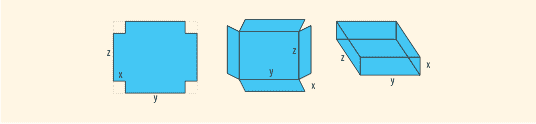

**图6-17**  硬纸板盒

编写一个程序，提示用户输入平整硬纸板的面积。然后，程序输出硬纸板的长度和宽度，以及要从角上剪去的正方形的边长，使得所得盒子具有最大体积。将答案计算到三位小数。你的程序必须包含一个函数，该函数以硬纸板的长度和宽度为输入，并返回为最大化体积而应剪去的正方形边长。该函数还返回最大体积。

### 28.（发电站问题）

一座发电站位于一条宽半英里的河的一侧，而一家工厂位于河对岸下游八英里处（见图6-18）。在陆地上铺设电线的成本为每英尺 $7，在水下铺设的成本为每英尺 $9。你的目标是确定铺设电线的最经济路径。也就是说，确定电线应在水下铺设多长、在陆地上铺设多长，以使铺设电线的总成本最低。

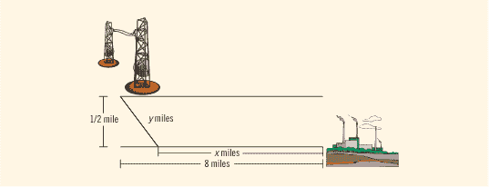

*图6-18*  发电站、河流和工厂

编写一个程序，提示用户输入：

- a. 河的宽度
- b. 工厂在河对岸下游的距离
- c. 在水下铺设电线的成本
- d. 在陆地上铺设电线的成本

然后，程序输出应在水下铺设的电线长度和应在陆地上铺设的长度，以使建造电线的成本最低。程序还应输出建造电线的总成本。

### 29.（管道问题，需要三角学）

一根管道需要绕过两条相交走廊的直角拐角搬运。假设两条相交走廊的宽度分别为5英尺和8英尺（见图6-19）。你的目标是求出能够水平绕过该直角拐角搬运的最长管道的长度，并四舍五入到最接近的英尺。


**图6-19**  管道问题

编写一个程序，提示用户输入两条走廊的宽度。然后，程序输出能够水平绕过该直角拐角搬运的最长管道的长度，并四舍五入到最接近的英尺。（注意，管道长度由 \(l = AB + BC = 8 / \sin\theta + 5 / \cos\theta\) 给出，其中 \(0 < \theta < \pi/2\)。）

- 30. 设 \(a\) 和 \(b\) 为整数，且 \(a\) 和 \(b\) 中至少一个不为零。\(a\) 和 \(b\) 的最大公约数记作 \(gcd(a, b)\)，是能同时整除 \(a\) 和 \(b\) 的最大正整数。你的程序必须包含一个函数，该函数以两个整数为输入，并返回这两个整数的 \(gcd\)。

- 31. 例6-16展示了如何编写程序来分解形如 \(x^2 + bx + c\) 的多项式，其中 \(b\) 和 \(c\) 是整数。修改该程序，使其还能分解形如 \(ax^2 + bx + c\) 的多项式，其中 \(a\)、\(b\) 和 \(c\) 是整数。注意，多项式 \(-2x^2 - 3x + 2\) 可以分解为：\(-2x^2 - 3x + 2 = (-2x + 1)(x + 2) = (2x - 1)(-x - 2)\)。


# 第7章 用户定义的简单数据类型、命名空间和 `string` 类型

### 本章你将：

- 1. 学习如何创建自己的简单数据类型——称为枚举类型
- 2. 探究赋值语句以及算术运算符和关系运算符如何作用于 `enum` 类型
- 3. 学习如何将 `for` 循环与 `enum` 类型一起使用
- 4. 学习如何将数据输入到 `enum` 变量中
- 5. 学习如何输出存储在 `enum` 变量中的数据
- 6. 探究如何编写函数来处理 `enum` 类型
- 7. 学习在定义枚举类型时如何声明变量
- 8. 熟悉匿名类型
- 9. 熟悉 `typedef` 语句
- 10. 了解 `namespace` 机制
- 11. 探究 `string` 数据类型，并学习如何使用 `string` 函数来操作字符串

在第2章中，你了解到 C++ 的简单数据类型分为三类：整型、浮点型和 `enum`。在后续章节中，你主要使用整型和浮点型数据类型。在本章中，你将学习 `enum` 类型。此外，语句 `using namespace std;`（第2章讨论过）用于每个使用 ANSI/ISO 标准 C++ 风格头文件的 C++ 程序。本章后半部分将考察这条语句的用途。实际上，你将了解 `namespace` 机制是什么。你还将学习 `string` 类型以及许多可用于有效操作字符串的有用函数。

### 枚举类型

> **注意**
>
> 可以跳过本节，不会影响连续性。

第2章将数据类型定义为一组值以及对这些值的一组操作。例如，`int` 数据类型由从 -2,147,483,648 到 2,147,483,647 的整数以及对这些数字的一组操作（即算术运算（+、-、*、/ 和 %））组成。由于程序的主要目标是操作数据，数据类型的概念成为任何编程语言的基础。通过提供数据类型，你指定了哪些值是合法的，并告诉用户允许对这些值进行哪些种类的操作。因此，系统为你提供了内置的错误检查。

到目前为止，你使用过的数据类型大多是 `int`、`bool`、`char` 和 `double`。尽管这些数据类型足以解决几乎任何问题，但有时这些数据类型不足以解决特定问题。C++ 提供了一种机制，让用户创建自己的数据类型，这极大地增强了编程语言的灵活性。

在本节中，你将学习如何创建自己的简单数据类型，称为枚举类型。在后续章节中，你将学习更高级的技术来创建复杂数据类型。

要定义**枚举类型**，你需要以下内容：

- 数据类型的名称
- 数据类型的一组值
- 对这些值的一组操作

C++ 允许你定义一个新的简单数据类型，在其中指定其名称和值，但不能指定操作。防止用户创建自己的操作有助于避免潜在的系统故障。

你为该数据类型指定的值必须是标识符。

枚举类型的语法是：

```cpp
enum typeName {value1, value2, ...};
```

其中 value1、value2、…… 是称为**枚举项**的标识符。在 C++ 中，**enum** 是保留字。

通过在花括号之间列出所有值，你还指定了这些值之间的顺序。也就是说，value1 < value2 < value3 < ……。因此，枚举类型是一个有序的值集合。此外，分配给这些枚举项的默认值从 0 开始。也就是说，分配给 value1 的默认值是 0，分配给 value2 的默认值是 1，依此类推。（在定义枚举类型时，你可以为枚举项分配不同于默认值的其他值。）还要注意，枚举项 value1、value2、…… *不是*变量。

### 例 7-1

语句：

```cpp
enum colors {BROWN, BLUE, RED, GREEN, YELLOW};
```

定义了一个名为 colors 的新数据类型，属于该数据类型的值是 BROWN、BLUE、RED、GREEN 和 YELLOW。

### 例 7-2

语句：

```cpp
enum standing {FRESHMAN, SOPHOMORE, JUNIOR, SENIOR};
```

将 standing 定义为枚举类型。属于 standing 的值是 FRESHMAN、SOPHOMORE、JUNIOR 和 SENIOR。

### 例 7-3

考虑以下语句：

```cpp
enum grades {'A', 'B', 'C', 'D', 'F'}; //illegal enumeration type
enum places {1ST, 2ND, 3RD, 4TH}; //illegal enumeration type
```

这些是非法的枚举类型，因为其中没有任何值是标识符。然而，以下是合法的枚举类型：

```cpp
enum grades {A, B, C, D, F};
enum places {FIRST, SECOND, THIRD, FOURTH};
```

如果一个值已经在某个枚举类型中使用过，那么同一块中的任何其他枚举类型都不能再使用它。同样的规则也适用于在任何块之外声明的枚举类型。例 7-4 说明了这一概念。

### 例 7-4

考虑以下语句：

```cpp
enum mathStudent {JOHN, BILL, CINDY, LISA, RON};
enum compStudent {SUSAN, CATHY, JOHN, WILLIAM}; //illegal
```

假设这些语句位于同一程序中的同一块内。第二个枚举类型 compStudent 不被允许，因为值 JOHN 已在前面的枚举类型 mathStudent 中使用过。

### 声明变量

一旦定义了数据类型，就可以声明该类型的变量。声明 enum 类型变量的语法与之前相同：

```text
dataType identifier, identifier,...;
```

语句：

```cpp
enum sports {BASKETBALL, FOOTBALL, HOCKEY, BASEBALL, SOCCER,
              VOLLEYBALL};
```

定义了一个名为 sports 的枚举类型。语句：

```cpp
sports popularSport, mySport;
```

将 popularSport 和 mySport 声明为 sports 类型的变量。

### 赋值

一旦声明了变量，就可以在其中存储值。假设有前面的声明，语句：

```cpp
popularSport = FOOTBALL;
```

将 `FOOTBALL` 存储到 popularSport 中。语句：

```cpp
mySport = popularSport;
```

将 popularSport 的值复制到 mySport 中。

### 枚举类型的操作

枚举类型不允许进行算术运算。因此以下语句是非法的：

```cpp
mySport = popularSport + 2;             //illegal
popularSport = FOOTBALL + SOCCER;       //illegal
popularSport = popularSport * 2;         //illegal
```

此外，枚举类型不允许递增和递减操作。因此以下语句是非法的：

```cpp
popularSport++; //illegal
popularSport--; //illegal
```

假设你想将 popularSport 的值递增 1。可以如下使用强制类型转换运算符：

```cpp
popularSport = static_cast<sports>(popularSport + 1);
```

当使用类型名时，编译器假定用户明白自己正在做什么。因此，前面的语句会被编译，并在执行期间将 popularSport 的值推进到列表中的下一个值。考虑以下语句：

```cpp
popularSport = FOOTBALL;
popularSport = static_cast<sports>(popularSport + 1);
```

在第二条语句之后，popularSport 的值是 HOCKEY。类似地，语句：

```cpp
popularSport = FOOTBALL;
popularSport = static_cast<sports>(popularSport - 1);
```

会将 BASKETBALL 存储到 popularSport 中。

### 关系运算符

由于枚举是一个有序的值集合，关系运算符可以用于枚举类型。再次假设你有前面定义的枚举类型 sports 以及变量 popularSport 和 mySport。那么：

```cpp
FOOTBALL <= SOCCER is true
HOCKEY > BASKETBALL is true
BASEBALL < FOOTBALL is false
```


假设：

```
popularSport = SOCCER;
mySport = VOLLEYBALL;
```

那么：

```
popularSport < mySport is true
```

## 枚举类型与循环

回顾一下，枚举类型是一种整数类型，并且使用强制类型转换运算符（即类型名），你可以对枚举类型的值进行递增、递减和比较。因此，你可以在循环中使用这些枚举类型。假设 mySport 是之前声明的变量。考虑下面的 for 循环：

```
for (mySport = BASKETBALL; mySport <= SOCCER;
                         mySport = static_cast<sports>(mySport + 1))
```

这个 for 循环有五次迭代。

在循环中使用枚举类型可以提高程序的可读性。

### 枚举类型的输入/输出

由于输入和输出只针对内置数据类型（如 int、char、double 等）定义，因此枚举类型不能（直接）输入或输出。但是，你可以间接地输入和输出枚举类型。示例 7-5 说明了这一概念。

**示例 7-5**

假设有如下语句：

```
enum courses {ALGEBRA, BASIC, PASCAL, CPP, PHILOSOPHY, ANALYSIS,
             CHEMISTRY, HISTORY};
courses registered;
```

第一条语句定义了一个枚举类型 courses；第二条声明了一个 courses 类型的变量 registered。你可以借助 char 数据类型读取（即输入）枚举类型。注意，只需读取第一个字符就可以区分枚举类型 courses 中的某些值，而另一些值则需要读取前两个字符才能区分。例如，只需读取第一个字符就可以区分 ALGEBRA 和 BASIC；通过读取前两个字符可以区分 ALGEBRA 和 ANALYSIS。要从（比如）键盘读取这些值，你需要读取两个字符，然后使用选择结构将值赋给变量 registered。因此，你需要声明两个 char 类型的变量。

```cpp
char ch1, ch2;
cin >> ch1 >> ch2; //Read two characters
```

下面的 `switch` 语句将适当的值赋给变量 `registered`。

```cpp
switch (ch1)
{
case 'a':
case 'A':
    if (ch2 == 'l' || ch2 == 'L')
        registered = ALGEBRA;
    else
        registered = ANALYSIS;
    break;
case 'b':
case 'B':
    registered = BASIC;
    break;
case 'c':
case 'C':
    if (ch2 == 'h' || ch2 == 'H')
        registered = CHEMISTRY;
    else
        registered = CPP;
    break;
case 'h':
case 'H':
    registered = HISTORY;
    break;
case 'p':
case 'P':
    if (ch2 == 'a' || ch2 == 'A')
        registered = PASCAL;
    else
        registered = PHILOSOPHY;
    break;
default:
    cout << "Illegal input." << endl;
}
```

你也可以使用 string 类型向变量 registered 输入一个值。例如，以下代码实现了这一点：

```cpp
string course;
cin >> course;
if (course == "algebra")
    registered = ALGEBRA;
else if (course == "analysis")
    registered = ANALYSIS;
else if (course == "basic")
    registered = BASIC;
else if (course == "chemistry")
    registered = CHEMISTRY;
else if (course == "cpp")
    registered = CPP;
else if (course == "history")
    registered = HISTORY;
else if (course == "pascal")
    registered = PASCAL;
else if (course == "philosophy")
    registered = PHILOSOPHY;
else
    cout << "Illegal input." << endl;
```

同样，你可以间接输出枚举类型：

```cpp
switch (registered)
{
case ALGEBRA:
    cout << "Algebra";
    break;
case ANALYSIS:
    cout << "Analysis";
    break;
case BASIC:
    cout << "Basic";
    break;
case CHEMISTRY:
    cout << "Chemistry";
    break;
case CPP:
    cout << "CPP";
    break;
case HISTORY:
    cout << "History";
    break;
case PASCAL:
    cout << "Pascal";
    break;
case PHILOSOPHY:
    cout << "Philosophy";
}
```

> **注意**
>
> 如果你试图直接输出枚举量的值，编译器将输出赋给该枚举量的值。例如，假设 `registered = ALGEBRA;`。下面的语句将输出值 0，因为赋给 `ALGEBRA` 的（默认）值是 0：
>
> ```cpp
> cout << registered << endl;
> ```
>
> 同样，下面的语句将输出 4：
>
> ```cpp
> cout << PHILOSOPHY << endl;
> ```

### 函数与枚举类型

你可以像传递任何其他简单数据类型一样，将枚举类型作为参数传递给函数——即按值传递或按引用传递。此外，就像任何其他简单数据类型一样，函数可以返回枚举类型的值。利用这一特性，你可以使用函数来输入和输出枚举类型。

下面的函数从键盘输入数据并返回枚举类型的值。假设枚举类型 courses 的定义如前：

```cpp
courses readCourses()
{
    courses registered;
    char ch1, ch2;

    cout << "Enter the first two letters of the course: "
         << endl;
    cin >> ch1 >> ch2;

    switch (ch1)
    {
    case 'a':
    case 'A':
        if (ch2 == 'l' || ch2 == 'L')
            registered = ALGEBRA;
        else
            registered = ANALYSIS;
        break;
    case 'b':
    case 'B':
        registered = BASIC;
        break;
    case 'c':
    case 'C':
        if (ch2 == 'h' || ch2 == 'H')
            registered = CHEMISTRY;
        else
            registered = CPP;
        break;
    case 'h':
    case 'H':
        registered = HISTORY;
        break;
    case 'p':
    case 'P':
        if (ch2 == 'a' || ch2 == 'A')
            registered = PASCAL;
        else
            registered = PHILOSOPHY;
        break;
    default:
        cout << "Illegal input." << endl;
    }
    return registered;
} //end readCourses
```

如前所示，你也可以在函数 `readCourses` 中使用 `string` 类型向 `courses` 类型的变量输入值。具体细节留作练习。

下面的函数输出一个枚举类型的值：

```cpp
void printEnum(courses registered)
{
    switch (registered)
    {
    case ALGEBRA:
        cout << "Algebra";
        break;
    case ANALYSIS:
        cout << "Analysis";
        break;
    case BASIC:
        cout << "Basic";
        break;
    case CHEMISTRY:
        cout << "Chemistry";
        break;
    case CPP:
        cout << "CPP";
        break;
    case HISTORY:
        cout << "History";
        break;
    case PASCAL:
        cout << "Pascal";
        break;
    case PHILOSOPHY:
        cout << "Philosophy";
    } //end switch
} //end printEnum
```

### 定义枚举类型时声明变量

在前面的章节中，你先定义枚举类型，然后声明该类型的变量。C++ 允许将这两个步骤合并为一个。也就是说，你可以在定义枚举类型时声明该枚举类型的变量。例如，语句：

```cpp
enum grades {A, B, C, D, F} courseGrade;
```

定义了一个枚举类型 `grades`，并声明了一个 `grades` 类型的变量 `courseGrade`。

同样，语句：

```cpp
enum coins {PENNY, NICKEL, DIME, HALFDOLLAR, DOLLAR} change, usCoins;
```

定义了一个枚举类型 coins，并声明了两个 coins 类型的变量 change 和 usCoins。

### 匿名数据类型

在变量声明中直接指定值而不给出类型名的数据类型称为**匿名类型**。下面的语句创建了一个匿名类型：

```cpp
enum {BASKETBALL, FOOTBALL, BASEBALL, HOCKEY} mySport;
```

这条语句指定了值并声明了一个变量 mySport，但没有为数据类型指定名称。

然而，创建匿名类型有缺点。首先，由于该类型没有名称，你不能将匿名类型作为参数传递给函数，函数也不能返回匿名类型的值。其次，在一个匿名类型中使用的值可以在另一个匿名类型中使用，但这些类型的变量会被区别对待。考虑以下语句：

```cpp
enum {ENGLISH, FRENCH, SPANISH, GERMAN, RUSSIAN} languages;
enum {ENGLISH, FRENCH, SPANISH, GERMAN, RUSSIAN} foreignLanguages;
```

尽管变量 languages 和 foreignLanguages 具有相同的值，编译器仍将它们视为不同类型的变量。因此，下面的语句是非法的：

```cpp
languages = foreignLanguages; //illegal
```

即使这些特性可用，也要谨慎使用。为了避免混淆，应先定义枚举类型，然后再声明变量。

我们现在描述 C++ 中的 **typedef** 语句。

### typedef 语句

在 C++ 中，你可以使用 **typedef** 语句为先前定义的数据类型创建同义词或别名。**typedef** 语句的一般语法是：

```cpp
typedef existingTypeName newTypeName;
```

在 C++ 中，**typedef** 是保留字。注意，**typedef** 语句不会创建任何新数据类型；它只为现有数据类型创建一个别名。


### 示例 7-6

以下语句：

```cpp
typedef int integer;
```

为数据类型 `int` 创建一个别名 integer。类似地，以下语句：

```cpp
typedef double real;
```

为数据类型 `double` 创建一个别名 real。以下语句：

```cpp
typedef double decimal;
```

为数据类型 `double` 创建一个别名 decimal。

使用 `typedef` 语句，你可以创建自己的布尔数据类型，如示例 7-7 所示。

### 示例 7-7

回顾第 4 章可知，C++ 中的逻辑（布尔）表达式求值为 1 或 0，它们实际上是 `int` 值。作为逻辑值，1 表示 `true`，0 表示 `false`。考虑以下语句：

```cpp
typedef int Boolean;        //Line 1
const Boolean TRUE = 1;     //Line 2
const Boolean FALSE = 0;    //Line 3
Boolean flag;               //Line 4
```

第 1 行的语句为数据类型 `int` 创建别名 Boolean。第 2 行和第 3 行的语句声明命名常量 TRUE 和 FALSE，并分别将它们初始化为 1 和 0。第 4 行的语句声明 flag 为 Boolean 类型的变量。由于 flag 是 Boolean 类型的变量，以下语句是合法的：

```cpp
flag = TRUE;
```

## 编程示例：石头、布、剪刀游戏


孩子们经常玩石头、布、剪刀游戏。这个游戏有两名玩家，每人从三个对象中选择一个：石头、布或剪刀。如果玩家 1 选择石头，玩家 2 选择布，则玩家 2 赢得游戏，因为布包住石头。游戏按照以下规则进行：

- 如果两名玩家选择同一个对象，则这局为平局。
- 如果一名玩家选择石头，另一名玩家选择剪刀，则选择石头的玩家赢得本局，因为石头砸坏剪刀。
- 如果一名玩家选择石头，另一名玩家选择布，则选择布的玩家赢得本局，因为布包住石头。
- 如果一名玩家选择剪刀，另一名玩家选择布，则选择剪刀的玩家赢得本局，因为剪刀剪开布。

编写一个交互式程序，让两个人可以玩这个游戏。

### 输入

该程序有两类输入：

- 当被询问是否要玩这个游戏时用户的回答。
- 玩家的选择。

### 输出

玩家的选择以及每局游戏的获胜者。游戏结束后，还应输出总游戏局数以及每位玩家获胜的次数。

### 问题分析与算法设计

两名玩家玩这个游戏。玩家通过键盘输入他们的选择。每位玩家输入 R 或 r 表示石头，P 或 p 表示布，S 或 s 表示剪刀。当第一名玩家输入选择时，第二名玩家看向别处。两个输入都完成后，如果输入有效，程序输出玩家的选择并宣布本局获胜者。游戏持续到其中一名玩家决定退出为止。游戏结束后，程序输出总游戏局数以及每位玩家获胜的次数。上述讨论可转化为以下算法：

- 1. 简要说明游戏及其玩法。
- 2. 询问用户是否想玩这个游戏。
- 3. 获取两名玩家的出拳选择。
- 4. 如果出拳选择有效，输出这些选择以及获胜者。
- 5. 更新总局数和获胜次数。
- 6. 只要用户同意玩这个游戏，就重复步骤 2 到 5。
- 7. 输出局数以及每位玩家获胜的次数。

我们将使用枚举类型来描述这些对象。

```cpp
enum objectType {ROCK, PAPER, SCISSORS};
```

### 变量（函数 main）

显然，在函数 main 中需要以下变量：

```cpp
int gameCount;   //variable to store the number of games played
int winCount1;   //variable to store the number of games won by player 1
int winCount2;   //variable to store the number of games won by player 2
int gameWinner;
char response;   //variable to get the user's response to play the game
char selection1;
char selection2;
objectType play1;   //player1's selection
objectType play2;   //player2's selection
```

本程序划分为以下函数，后续各节将详细描述。

- **displayRules:** 该函数显示关于游戏及其规则的一些简要信息。
- **validSelection:** 该函数检查玩家的选择是否有效。有效的选择只有 R、r、P、p、S 和 s。
- **retrievePlay:** 由于枚举类型不能直接读取，该函数转换输入的选择（R、r、P、p、S 或 s），并返回相应的对象类型。
- **gameResult:** 该函数输出玩家的选择以及游戏的获胜者。
- **convertEnum:** 该函数由函数 gameResult 调用，用于输出枚举类型值。
- **winningObject:** 该函数确定并返回获胜对象。
- **displayResults:** 游戏结束后，该函数显示最终结果。

### 函数 displayRules

该函数没有参数。它仅由输出语句组成，用于解释游戏和游戏规则。基本上，该函数的定义是：

```cpp
void displayRules()
{
    cout << "  Welcome to the game of Rock, Paper, "
         << "and Scissors." << endl;
    cout << "  This is a game for two players. For each "
         << "game, each" << endl;
    cout << " player selects one of the objects Rock, "
         << "Paper, or Scissors." << endl;
    cout << "The rules for winning the game are:" << endl;
    cout << "1. If both players select the same object, it "
         << "is a tie." << endl;
    cout << "2. Rock breaks Scissors: So player who selects "
         << "Rock wins." << endl;
    cout << "3. Paper covers Rock: So player who selects "
         << "Paper wins." << endl;
    cout << "4. Scissors cuts Paper: So player who selects "
         << "Scissors wins." << endl << endl;
    cout << "Enter R or r to select Rock, P or p to select "
         << "Paper, and S or s to select Scissors." << endl;
}
```

### 函数 validSelection

该函数检查玩家的选择是否有效。

```text
if selection is 'R' or 'r' or 'S' or 's' or 'P' or 'p', then
    it is a valid selection;
otherwise the selection is invalid.
```

我们使用 switch 语句检查选择是否有效。该函数的定义是：

```cpp
bool validSelection(char selection)
{
    switch (selection)
    {
    case 'R':
    case 'r':
    case 'P':
    case 'p':
    case 'S':
    case 's':
        return true;
    default:
        return false;
    }
}
```

### 函数 retrievePlay

由于枚举类型不能直接读取，该函数转换输入的选择（R、r、P、p、S 或 s），并返回相应的对象类型。因此，该函数有一个 char 类型的参数。它是一个有返回值的函数，返回 objectType 类型的值。用伪代码表示，该函数的算法是：

```text
if selection is 'R' or 'r'
    return ROCK;

if selection is 'P' or 'p'
    return PAPER;

if selection is 'S' or 's'
    return SCISSORS;
```

函数 `retrievePlay` 的定义是：

```cpp
objectType retrievePlay(char selection)
{
    objectType object;

    switch (selection)
    {
    case 'R':
    case 'r':
        object = ROCK;
        break;
    case 'P':
    case 'p':
        object = PAPER;
        break;
    case 'S':
    case 's':
        object = SCISSORS;
    }

    return object;
}
```

### 函数 gameResult

该函数判断一局游戏是平局还是哪位玩家获胜。它输出玩家的选择以及游戏的获胜者。显然，该函数有三个参数：玩家 1 的选择、玩家 2 的选择，以及一个用于返回获胜者的参数。用伪代码表示，该函数为：

- a. 如果 player1 和 player2 的选择相同，那么
  这局为平局。
- b. 否则
  {
    - 1. 确定获胜对象。（调用函数 winningObject）
    - 2. 输出每位玩家的选择。
    - 3. 确定获胜玩家。
    - 4. 通过引用参数将获胜玩家返回给
      函数 main，以便函数 main 能够更新
      获胜玩家的获胜次数。
  }

该函数的定义是：

```cpp
void gameResult(objectType play1, objectType play2,
                int& winner)
{
    objectType winnerObject;

    if (play1 == play2)
    {
        winner = 0;
        cout << "Both players selected ";
```


```cpp
convertEnum(play1);
cout << ". This game is a tie." << endl;
}
else
{
    winnerObject = winningObject(play1, play2);

    //Output each player's choice
    cout << "Player 1 selected ";
    convertEnum(play1);
    cout << " and player 2 selected ";
    convertEnum(play2);
    cout << ".";

    //Decide the winner
    if (play1 == winnerObject)
        winner = 1;
    else if (play2 == winnerObject)
        winner = 2;

    //Output the winner
    cout << "Player " << winner << " wins this game."
         << endl;
}
}
```

### 函数 `convertEnum`

由于枚举类型不能直接输出，我们来编写函数 `convertEnum`，用于输出 `enum` 类型 `objectType` 的对象。该函数有一个 `objectType` 类型的参数。它输出与 `objectType` 对应的字符串。用伪代码表示，该函数为：

```text
if object is ROCK
    output "Rock"

if object is PAPER
    output "Paper"

if object is SCISSORS
    output "Scissors"
```

函数 `convertEnum` 的定义是：

```cpp
void convertEnum(objectType object)
{
    switch (object)
    {
    case ROCK:
        cout << "Rock";
        break;
    case PAPER:
        cout << "Paper";
        break;
    case SCISSORS:
        cout << "Scissors";
    }
}
```

### 函数 `winningObject`

要判定游戏获胜者，需要查看玩家的选择，然后依据游戏规则。例如，如果一名玩家选择 ROCK，另一名选择 PAPER，则选择 PAPER 的玩家获胜。换句话说，获胜对象是 PAPER。函数 winningObject 接收两个对象，判定并返回获胜对象。显然，该函数有两个 objectType 类型的参数，且该函数返回的值也是 objectType 类型。该函数的定义是：

```cpp
objectType winningObject(objectType play1, objectType play2)
{
    if ((play1 == ROCK && play2 == SCISSORS)
        || (play2 == ROCK && play1 == SCISSORS))
        return ROCK;
    else if ((play1 == ROCK && play2 == PAPER)
             || (play2 == ROCK && play1 == PAPER))
        return PAPER;
    else
        return SCISSORS;
}
```

### 函数 `displayResults`

游戏结束后，该函数输出最终结果——即总对局数以及每位玩家获胜的对局数。总对局数存储在变量 gameCount 中，玩家 1 获胜的对局数存储在变量 winCount1 中，玩家 2 获胜的对局数存储在变量 winCount2 中。该函数有三个参数，分别对应这三个变量。本质上，该函数的定义是：

```cpp
void displayResults(int gCount, int wCount1, int wCount2)
{
    cout << "The total number of plays: " << gCount
         << endl;
    cout << "The number of plays won by player 1: "
         << wCount1 << endl;
    cout << "The number of plays won by player 2: "
         << wCount2 << endl;
}
```

现在可以编写函数 main 的算法了。

### 主算法

- 1. 声明变量。
- 2. 初始化变量。
- 3. 显示规则。
- 4. 提示用户开始游戏。
- 5. 获取用户是否进行游戏的响应。
- 6. `while`（响应为 yes）
  {
  - a. 提示玩家 1 做出选择。
  - b. 获取玩家 1 的选择。
  - c. 提示玩家 2 做出选择。
  - d. 获取玩家 2 的选择。
  - e. 如果两个选择均合法：
    {
    - i. 总对局数加 1。
    - ii. 判定本局获胜者。
    - iii. 将获胜者的获胜对局数加 1。
    }
  - f. 提示用户确定他们是否想再玩一次。
  - g. 获取玩家的响应。
  }
- 7. 输出游戏结果。

### 程序清单

```cpp
//*******************************************************
// Author: D.S. Malik
//
// Program: Rock, Paper, and Scissors
// This program plays the game of rock, paper, and scissors.
//*******************************************************

#include <iostream>

using namespace std;

enum objectType {ROCK, PAPER, SCISSORS};

//Function prototypes
void displayRules();
objectType retrievePlay(char selection);
bool validSelection(char selection);
void convertEnum(objectType);
objectType winningObject(objectType play1, objectType play2);
void gameResult(objectType play1, objectType play2, int& winner);
void displayResults(int gCount, int wCount1, int wCount2);

int main()
{
                    //Step 1
    int gameCount;   //variable to store the number of
                     //games played
    int winCount1;   //variable to store the number of games
                     //won by player 1
    int winCount2;   //variable to store the number of games
                     //won by player 2
    int gamewinner;
    char response;   //variable to get the user's response to
                     //play the game

    char selection1;
    char selection2;
    objectType play1;   //player1's selection
    objectType play2;   //player2's selection

                    //Initialize variables; Step 2
    gameCount = 0;
    winCount1 = 0;
    winCount2 = 0;

    displayRules();                              //Step 3

    cout << "Enter Y/y to play the game: ";      //Step 4
    cin >> response;                             //Step 5
    cout << endl;
    while (response == 'Y' || response == 'y')   //Step 6
    {
        cout << "Player 1 enter your choice: "; //Step 6a
        cin >> selection1;                       //Step 6b
        cout << endl;

        cout << "Player 2 enter your choice: "; //Step 6c
        cin >> selection2;                       //Step 6d
        cout << endl;

                    //Step 6e
        if (validSelection(selection1)
            && validSelection(selection2))
        {
            play1 = retrievePlay(selection1);
            play2 = retrievePlay(selection2);
            gameCount++;                         //Step 6e.i
            gameResult(play1, play2, gamewinner); //Step 6e.ii

            if (gamewinner == 1)                 //Step 6e.iii
                winCount1++;
            else if (gamewinner == 2)
                winCount2++;
        }//end if

        cout << "Enter Y/y to play the game: ";   //Step 6f
        cin >> response;                          //Step 6g
        cout << endl;
    } //end while

    displayResults(gameCount, winCount1,
                   winCount2);                //Step 7

    return 0;
} //end main

//Place the definitions of the functions displayRules,
//validSelection, retrievePlay, convertEnum, winningObject,
//gameResult, and displayResults as described previously here.
```

## 命名空间

1998 年 7 月，ANSI/ISO 标准 C++ 获得正式批准。大多数较新的编译器也与 ANSI/ISO 标准 C++ 兼容。（要完全确认，请查阅编译器的文档。）Standard C++ 和 ANSI/ISO 标准 C++ 这两个标准实际上几乎相同。ANSI/ISO 标准 C++ 语言具有一些 Standard C++ 中没有的特性，本章余下部分将讨论这些特性。在后续章节中，除非另有说明，C++ 语法适用于这两个标准。首先，我们讨论 ANSI/ISO 标准 C++ 的命名空间机制，该机制已在第 2 章中介绍。

当程序包含头文件（如 iostream）时，该头文件中的全局标识符也会成为程序中的全局标识符。因此，如果程序中的某个全局标识符与头文件中的某个全局标识符同名，编译器会产生语法错误（例如“标识符重定义”）。如果程序使用第三方库，也可能出现同样的问题。为解决此问题，第三方供应商让其全局标识符以特殊符号开头。在第 2 章中你了解到，由于编译器供应商让其全局标识符名称以下划线（_）开头，为避免链接错误，你的程序中的标识符名称不应以下划线（_）开头。

ANSI/ISO 标准 C++ 试图通过命名空间机制解决全局标识符名称重叠的问题。

语句 namespace 的一般语法为：

```cpp
namespace namespace_name
{
    members
}
```

其中，members 通常是具名常量、变量声明、函数或另一个命名空间。注意，namespace_name 是一个 C++ 标识符。


在 C++ 中，`namespace` 是保留字。

### 示例 7-8

语句：

```cpp
namespace globalType
{
    const int N = 10;
    const double RATE = 7.50;
    int count = 0;
    void printResult();
}
```

将 globalType 定义为包含四个成员的 `namespace`：命名常量 N 和 RATE、变量 count 以及函数 printResult。

`namespace` 成员的作用域局限于该 `namespace`。通常可以通过以下两种方式之一在 `namespace` 外部访问 `namespace` 成员，如下所述。

访问 `namespace` 成员的一般语法为：

```cpp
namespace_name::identifier
```

回想一下，在 C++ 中，`::` 称为作用域解析运算符。

要访问 `namespace` globalType 的成员 RATE，需要使用以下语句：

```cpp
globalType::RATE
```

要访问成员 printResult（它是一个函数），需要使用以下语句：

```cpp
globalType::printResult();
```

因此，要访问 `namespace` 的成员，需要使用 namespace_name，后跟作用域解析运算符，再后跟成员名。

为了简化对 `namespace` 成员的访问，ANSI/ISO 标准 C++ 提供了 `using` 语句的使用。使用 `using` 语句的语法如下：

- a. 为了简化对所有 `namespace` 成员的访问：

  ```cpp
  using namespace namespace_name;
  ```

- b. 为了简化对特定 `namespace` 成员的访问：

  ```cpp
  using namespace_name::identifier;
  ```

例如，`using` 语句：

```cpp
using namespace globalType;
```

简化了对 `namespace` globalType 所有成员的访问。而语句：

```cpp
using globalType::RATE;
```

简化了对 `namespace` globalType 的成员 RATE 的访问。

在 C++ 中，`using` 是保留字。

通常将 `using` 语句放在 `namespace` 声明之后。例如，对于 `namespace` globalType，通常按如下方式编写代码：

```cpp
namespace globalType
{
    const int N = 10;
    const double RATE = 7.50;
    int count = 0;
    void printResult();
}
using namespace globalType;
```

使用 `using` 语句之后，要访问 `namespace` 成员，不必在 `namespace` 成员之前放置 namespace_name 和作用域解析运算符。然而，如果 `namespace` 成员与程序中的全局标识符同名，则要在程序中访问该 `namespace` 成员，必须在 `namespace` 成员之前加上 namespace_name 和作用域解析运算符。类似地，如果 `namespace` 成员与块中的标识符同名，则要在该块中访问此 `namespace` 成员，必须在 `namespace` 成员之前加上 namespace_name 和作用域解析运算符。

示例 7–9 至 7–12 有助于阐明 `namespace` 机制的用法。

### 示例 7-9

考虑以下 C++ 代码：

```cpp
#include <iostream>

using namespace std;
.
.
int main()
{
    .
    .
    .
}
.
.
.
```

在此示例中，可以引用头文件 `iostream` 的全局标识符，例如 `cin`、`cout` 和 `endl`，而无需在标识符名称前使用前缀 `std::`。明显的限制是，引用该全局标识符（头文件 `iostream` 的全局标识符）的块（或函数）不得包含与该全局标识符同名的任何标识符。

### 示例 7-10

考虑以下 C++ 代码：

```cpp
#include <cmath>

int main()
{
    double x = 15.3;
    double y;

    y = std::pow(x, 2);
    .
    .
}
```

此示例访问头文件 `cmath` 中的函数 `pow`。

### 示例 7-11

考虑以下 C++ 代码：

```cpp
#include <iostream>
.
.
.
int main()
{
    using namespace std;
    .
    .
}
.
.
.
```

在此示例中，函数 `main` 可以引用头文件 `iostream` 的全局标识符，而无需在标识符名称前使用前缀 `std::`。`using` 语句出现在函数 `main` 内部。因此，其他函数（如果有）应在头文件 `iostream` 的全局标识符名称前使用前缀 `std::`，除非该函数有类似的 `using` 语句。

### 示例 7-12

考虑以下 C++ 代码：

```cpp
#include <iostream>

using namespace std;             //Line 1

int t;                           //Line 2
double u;                        //Line 3

namespace expN
{
        int x;                   //Line 4
        char t;                  //Line 5
        double u;                //Line 6
        void printResult();      //Line 7
}

using namespace expN;

int main()
{
        int one;                 //Line 8
        double t;                //Line 9
        double three;            //Line 10

        .
        .
        .
}

void expN::printResult() //Definition of the function printResult
{
        .
        .
        .
}
```

在此 C++ 程序中：

- 1. 要在 `main` 中引用第 2 行中的变量 `t`，请使用 *作用域解析运算符*，即 `::`（也就是说，将 `t` 引用为 `::t`），因为函数 `main` 中有一个名为 `t` 的变量（在第 9 行声明）。例如，要将 `x` 的值复制到 `t` 中，可以使用语句 `::t = x;`。

- 2. 要在 `main` 中引用命名空间 `expN` 的成员 `t`（在第 5 行声明），请对 `t` 使用前缀 `expN::`（也就是说，将 `t` 引用为 `expN::t`），因为有一个名为 `t` 的全局变量（在第 2 行声明）以及 `main` 中一个名为 `t` 的变量。

- 3. 要在 `main` 中引用命名空间 `expN` 的成员 `u`（在第 6 行声明），请对 `u` 使用前缀 `expN::`（也就是说，将 `u` 引用为 `expN::u`），因为有一个名为 `u` 的全局变量（在第 3 行声明）。

- 4. 可以在 `main` 中将命名空间 `expN` 的成员 `x`（在第 4 行声明）引用为 `x` 或 `expN::x`，因为没有名为 `x` 的全局标识符，并且函数 `main` 不包含任何名为 `x` 的标识符。

- 5. 作为命名空间成员的函数（例如 `printResult`）的定义通常像前面的程序那样写在命名空间外部。要编写函数 `printResult` 的定义，函数头中的函数名可以是 `printResult` 或 `expN::printResult`（因为没有其他全局标识符名为 `printResult`）。

> 系统提供的头文件（例如 `iostream`、`cmath` 和 `iomanip`）中的标识符定义在命名空间 `std` 中。因此，为了简化对这些头文件中标识符的访问，我们在编写的程序中一直使用以下语句：
>
> ```cpp
> using namespace std;
> ```

## string 类型

在第 2 章中，我们向您介绍了数据类型 `string`。回想一下，在 ANSI/ISO C++ 语言标准之前，标准 C++ 库并未提供 `string` 数据类型。编译器供应商通常会提供自己的、由程序员定义的 `string` 类型，而且 `string` 操作的语法和语义常常因供应商而异。

数据类型 `string` 是程序员定义的类型，并不是 C++ 语言的一部分；C++ 标准库提供了它。在使用数据类型 `string` 之前，程序必须包含头文件 `string`，如下所示：

```cpp
#include <string>
```

回想一下，在 C++ 中，`string` 是零个或多个字符的序列，字符串用双引号括起来。

语句：

```cpp
string name = "William Jacob";
```

将 name 声明为字符串变量，并将 name 初始化为 "William Jacob"。name 中第一个字符 W 的位置是 0；第二个字符 i 的位置是 1；依此类推。也就是说，字符串变量中第一个字符的位置从 0 开始，而不是从 1 开始。

变量 `name` 可以存储（几乎）任意大小的字符串。

第 3 章讨论了对 string 类型的 I/O 操作；第 4 章解释了对 string 类型的关系运算。我们建议您重新阅读第 3 章和第 4 章，复习 string 类型的 I/O 和关系运算。

其他运算符，例如二元运算符 `+`（用于允许字符串连接操作）和数组下标（索引）运算符 `[]`，也已为数据类型 `string` 定义。下面看看这些运算符如何作用于 string 数据类型。

假设有如下声明：

```cpp
string str1, str2, str3;
```

语句：

```cpp
str1 = "Hello There";
```

将字符串 "Hello There" 存储到 str1 中。语句：

```cpp
str2 = str1;
```

将 str1 的值复制到 str2 中。

如果 `str1 = "Sunny"`，则语句：

```cpp
str2 = str1 + " Day";
```

将字符串 "Sunny Day" 存储到 str2 中。

假设 `str1 = "Hello"` 且 `str2 = "There"`。语句：

```cpp
str3 = str1 + " " + str2;
```

将 "Hello There" 存储到 str3 中。此语句等价于语句：

```cpp
str3 = str1 + ' ' + str2;
```

此外，语句：

```cpp
str1 = str1 + " Mickey";
```

通过将字符串 " Mickey" 追加到 str1 的旧值来更新 str1 的值。因此，str1 的新值为 "Hello Mickey"。


**注意**

要使运算符 `+` 能与 `string` 数据类型一起使用，`+` 的操作数之一必须是 string 变量。例如，以下语句将无法工作：

```cpp
str1 = "Hello " + "there!";  //illegal
str2 = "Sunny Day" + '!';      //illegal
```

如果 `str1 = "Hello there"`，则语句：

```cpp
str1[6] = 'T';
```

将字符 `t` 替换为字符 `T`。回想一下，string 变量中第一个字符的位置是 0。因此，由于 `t` 是 `str1` 中的第七个字符，它的位置是 6。

在 C++ 中，`[]` 称为**数组下标运算符**。

如前所述，将数组下标运算符与字符位置一起使用，可以访问 string 中的单个字符。

### 示例 7-13

以下程序展示了前面语句的效果。

```cpp
//Example string operations

#include <iostream>
#include <string>

using namespace std;

int main()
{
    string name = "William Jacob";                 //Line 1
    string str1, str2, str3, str4;                  //Line 2

    cout << "Line 3: Name = " << name << endl;     //Line 3

    str1 = "Hello There";                          //Line 4
    cout << "Line 5: str1 = " << str1 << endl;     //Line 5

    str2 = str1;                                    //Line 6
    cout << "Line 7: str2 = " << str2 << endl;     //Line 7

    str1 = "Sunny";                                //Line 8
    str2 = str1 + " Day";                          //Line 9
    cout << "Line 10: str2 = " << str2 << endl;    //Line 10

    str1 = "Hello";                                //Line 11
    str2 = "There";                                //Line 12
    str3 = str1 + " " + str2;                      //Line 13
    cout << "Line 14: str3 = " << str3 << endl;    //Line 14

    str3 = str1 + ' ' + str2;                      //Line 15
    cout << "Line 16: str3 = " << str3 << endl;    //Line 16

    str1 = str1 + " Mickey";                       //Line 17
    cout << "Line 18: str1 = " << str1 << endl;    //Line 18

    str1 = "Hello there";                          //Line 19
    cout << "Line 20: str1[6] = " << str1[6]       //Line 20
         << endl;

    str1[6] = 'T';                                 //Line 21
    cout << "Line 22: str1 = " << str1 << endl;    //Line 22

    //String input operations
    cout << "Line 23: Enter a string with "        //Line 23
         << " no blanks: ";
    cin >> str1;                                   //Line 24

    char ch;                                       //Line 25
    cin.get(ch);        //Read the newline character //Line 26
    cout << endl;                                  //Line 27

    cout << "Line 28: The string you entered = "
         << str1 << endl;                          //Line 28

    cout << "Line 29: Enter a sentence: ";         //Line 29
    getline(cin, str2);                            //Line 30
    cout << endl;                                  //Line 31

    cout << "Line 32: The sentence is: " << str2
         << endl;                                  //Line 32

    return 0;
}
```

**示例运行：** 在下面的示例运行中，用户输入以阴影显示。

```text
Line 3: Name = William Jacob
Line 5: str1 = Hello There
Line 7: str2 = Hello There
Line 10: str2 = Sunny Day
Line 14: str3 = Hello There
Line 16: str3 = Hello There
Line 18: str1 = Hello Mickey
Line 20: str1[6] = t
Line 22: str1 = Hello There
Line 23: Enter a string with no blanks: Programming

Line 28: The string you entered = Programming
Line 29: Enter a sentence: Testing string operations

Line 32: The sentence is: Testing string operations
```

前面的输出本身已说明清楚，其解读留作练习。

## 其他字符串操作

数据类型 string 有一个数据类型 `string::size_type`，以及一个命名常量 `string::npos`，定义如下：

| 名称 | 描述 |
|---|---|
| `string::size_type` | 一种无符号整数（数据）类型 |
| `string::npos` | （数据）类型 `string::size_type` 的最大值，在许多机器上是一个诸如 4294967295 的数字 |

数据类型 string 还包含其他几个用于字符串操作的函数。下表描述了其中一些函数。在此表中，我们假设 `strVar` 是一个 string 变量，而 `str` 是一个 string 变量、字符串常量或字符数组。（数组将在第 8 章讨论。）

**表 7-1** 一些 string 函数

| 表达式 | 作用 |
|---|---|
| `strVar.at(index)` | 返回由 `index` 指定位置处的元素。 |
| `strVar[index]` | 返回由 `index` 指定位置处的元素。 |
| `strVar.append(n, ch)` | 将 `ch` 的 n 个副本追加到 `strVar`，其中 `ch` 是 char 变量或 char 常量。 |
| `strVar.append(str)` | 将 `str` 追加到 `strVar`。 |
| `strVar.clear()` | 删除 `strVar` 中的所有字符。 |
| `strVar.compare(str)` | 如果 `strVar > str`，则返回 1；如果 `strVar == str`，则返回 0；如果 `strVar < str`，则返回 -1。 |
| `strVar.empty()` | 如果 `strVar` 为空，则返回 true；否则返回 false。 |
| `strVar.erase()` | 删除 `strVar` 中的所有字符。 |
| `strVar.erase(pos, n)` | 从位置 `pos` 开始，从 `strVar` 中删除 n 个字符。 |
| `strVar.find(str)` | 返回 `str` 在 `strVar` 中第一次出现的索引。如果未找到 `str`，则返回特殊值 `string::npos`。 |
| `strVar.find(str, pos)` | 返回在 `strVar` 中找到 `str` 的、位于 `pos` 处或之后的一次出现的索引。 |
| `strVar.find_first_of(str, pos)` | 返回 `str` 中任意字符在 `strVar` 中第一次出现的索引。搜索从 `pos` 开始。 |
| `strVar.find_first_not_of(str, pos)` | 返回 `strVar` 中第一个不属于 `str` 的字符出现的索引。搜索从 `pos` 开始。 |
| `strVar.insert(pos, n, ch);` | 将字符 `ch` 的 `n` 次出现插入 `strVar` 的索引 `pos` 处；`pos` 和 `n` 的类型为 `string::size_type`；`ch` 是一个字符。 |
| `strVar.insert(pos, str);` | 将 `str` 的所有字符插入 `strVar` 的索引 `pos` 处。 |
| `strVar.length()` | 返回一个 `string::size_type` 类型的值，给出 `strVar` 中的字符数。 |
| `strVar.replace(pos, n, str);` | 从索引 `pos` 开始，用 `str` 的所有字符替换 `strVar` 接下来的 `n` 个字符。如果 `n` > `strVar` 的长度，则替换直到 `strVar` 末尾的所有字符。 |
| `strVar.substr(pos, len)` | 返回一个 string，它是 `strVar` 从 `pos` 开始的子字符串。子字符串的长度最多为 `len` 个字符。如果 `len` 太大，则表示“到 `strVar` 中字符串的末尾”。 |
| `strVar.size()` | 返回一个 `string::size_type` 类型的值，给出 `strVar` 中的字符数。 |
| `strVar.swap(str1);` | 交换 `strVar` 和 `str1` 的内容。`str1` 是一个 string 变量。 |

### 示例 7-14（clear、empty、erase、length 和 size 函数）

考虑以下语句：

```cpp
string firstName = "Elizabeth";
string name = firstName + " Jones";
string str1 = "It is sunny.";
string str2 = "";
string str3 = "computer science";
string str4 = "C++ programming.";
string str5 = firstName + " is taking " + str4;

string::size_type len;
```

接下来，我们展示 clear、empty、erase、length 和 size 函数的效果。

| 语句 | 效果 |
|---|---|
| `str3.clear();` | `str3 = "";` |
| `str1.empty();` | 返回 false |
| `str2.empty();` | 返回 true |
| `str4.erase(11, 4);` | `str4 = "C++ program.";` |
| `cout << firstName.length() << endl;` | 输出 9 |
| `cout << name.length() << endl;` | 输出 15 |
| `cout << str1.length() << endl;` | 输出 13 |
| `cout << str5.size() << endl;` | 输出 36 |
| `len = name.length();` | `len` 的值为 15 |

以下程序说明了 length 函数的用法。

```cpp
//Example: clear, empty, erase, length, and size functions

#include <iostream>
#include <string>

using namespace std;

int main()
{
    string firstName = "Elizabeth";                         //Line 1
    string name = firstName + " Jones";                     //Line 2
    string str1 = "It is sunny.";                           //Line 3
    string str2 = "";                                       //Line 4
    string str3 = "computer science";                       //Line 5
    string str4 = "C++ programming.";                       //Line 6
    string str5 = firstName + " is taking " + str4;         //Line 7
```


```cpp
string::size_type len;                                      //Line 8

cout << "Line 9: str3: " << str3 << endl;                 //Line 9
str3.clear();                                               //Line 10
cout << "Line 11: After clear, str3: " << str3             //Line 11
     << endl;

cout << "Line 12: str1.empty(): " << str1.empty()          //Line 12
     << endl;
cout << "Line 13: str2.empty(): " << str2.empty()          //Line 13
     << endl;

cout << "Line 14: str4: " << str4 << endl;                 //Line 14
str4.erase(11, 4);                                          //Line 15
cout << "Line 16: After erase(11, 4), str4: "              //Line 16
     << str4 << endl;

cout << "Line 17: Length of \"" << firstName << "\" = "  
     << static_cast<unsigned int> (firstName.length())
     << endl;                                               //Line 17
cout << "Line 18: Length of \"" << name << "\" = "       
     << static_cast<unsigned int> (name.length())
     << endl;                                               //Line 18
cout << "Line 19: Length of \"" << str1 << "\" = "       
     << static_cast<unsigned int> (str1.length())
     << endl;                                               //Line 19
cout << "Line 20: Size of \"" << str5 << "\" = "         
     << static_cast<unsigned int> (str5.size())
     << endl;                                               //Line 20

len = name.length();                                        //Line 21
cout << "Line 22: len = "
     << static_cast<unsigned int> (len) << endl;            //Line 22

return 0;                                                   //Line 23
}
```

### 示例运行

```
Line 9: str3: computer science
Line 11: After clear, str3:
Line 12: str1.empty(): 0
Line 13: str2.empty(): 0
Line 14: str4: C++ programming.
Line 16: After erase(11, 4), str4: C++ program.
Line 17: Length of "Elizabeth" = 9
Line 18: Length of "Elizabeth Jones" = 15
Line 19: Length of "It is sunny." = 12
Line 20: Size of "Elizabeth is taking C++ programming." = 36
Line 22: len = 15
```

该程序的输出不言自明。详细内容留作练习。请注意，该程序使用静态转换运算符来输出 `length` 函数返回的值。这是因为 `length` 函数返回的是 `string::size_type` 类型的值。如果没有转换运算符，某些编译器可能会给出以下警告信息：

```
conversion from 'size_t' to 'unsigned int', possible loss of data
```

### 示例 7-15（find 函数）

假设 `str1` 和 `str2` 是 `string` 类型。以下是对 find 函数的有效调用：

```cpp
str1.find(str2)
str1.find("the")
str1.find('a')
str1.find(str2 + "xyz")
str1.find(str2 + 'b')
```

考虑以下语句：

```cpp
string sentence = "Outside it is cloudy and warm.";
string str = "cloudy";

string::size_type position;
```

接下来，我们展示 find 函数的效果。

| 语句 | 效果 |
|---|---|
| `cout << sentence.find("is") << endl;` | 输出 11 |
| `cout << sentence.find('s') << endl;` | 输出 3 |
| `cout << sentence.find(str) << endl;` | 输出 14 |
| `cout << sentence.find("the") << endl;` | 输出 `string::npos` 的值 |
| `cout << sentence.find('i', 6) << endl;` | 输出 8 |
| `position = sentence.find("warm");` | 将 25 赋给 position |

请注意，搜索是区分大小写的。因此，字符串 sentence 中 o（小写 o）的位置是 16。

下面的程序对上述语句进行了验证。

```cpp
//Example: find function

#include <iostream>
#include <string>

using namespace std;
```

该程序的输出不言自明。详细内容留作练习。请注意，该程序使用静态转换运算符来输出 `find` 函数返回的值。这是因为 `find` 函数返回的是 `string::size_type` 类型的值。如果没有转换运算符，某些编译器可能会给出以下警告信息：

```
conversion from 'size_t' to 'unsigned int', possible loss of data
```

### 示例 7-16（insert 和 replace 函数）

假设有以下语句：

```cpp
string firstString = "Cloudy and warm.";
string secondString = "Hello there";
string thirdString = "Henry is taking programming I.";
string str1 = " very ";
string str2 = "Lisa";
```

接下来，我们展示 insert 和 replace 函数的效果。

| 语句 | 效果 |
|---|---|
| `firstString.insert(10, str1);` | `firstString = "Cloudy and very warm."` |
| `secondString.insert(11, 5, '!');` | `secondString = "Hello there!!!!!"` |
| `thirdString.replace(0, 5, str2);` | `thirdString = "Lisa is taking programming I."` |

下面的程序对上述语句进行了验证。

```cpp
//Example: insert and replace functions
#include <iostream>
#include <string>

using namespace std;

int main()
{
    string firstString = "Cloudy and warm.";                  //Line 1
    string secondString = "Hello there";                      //Line 2
    string thirdString = "Henry is taking programming I.";    //Line 3
    string str1 = " very ";                                      //Line 4
    string str2 = "Lisa";                                         //Line 5

    cout << "Line 6: firstString = " << firstString               //Line 6
         << endl;
    firstString.insert(10, str1);                                  //Line 7
    cout << "Line 8: After insert; firstString = "                //Line 8
         << firstString << endl;

    cout << "Line 9: secondString = " << secondString              //Line 9
         << endl;
    secondString.insert(11, 5, '!');                               //Line 10
    cout << "Line 11: After insert; secondString = "               //Line 11
         << secondString << endl;

    cout << "Line 12: thirdString = " << thirdString               //Line 12
         << endl;
    thirdString.replace(0, 5, str2);                               //Line 13
    cout << "Line 14: After replace, thirdString = "               //Line 14
         << thirdString << endl;

    return 0;                                                       //Line 15
}
```

### 示例运行

```
Line 6: firstString = Cloudy and warm.
Line 8: After insert; firstString = Cloudy and very warm.
Line 9: secondString = Hello there
Line 11: After insert; secondString = Hello there!!!!!
Line 12: thirdString = Henry is taking programming I.
Line 14: After replace, thirdString = Lisa is taking programming I.
```

该程序的输出不言自明。详细内容留作练习。

### 示例 7-17（substr 函数）

考虑以下语句：

```cpp
string sentence;
string str;

sentence = "It is cloudy and warm.";
```

接下来，我们展示 substr 函数的效果。

| 语句 | 效果 |
|---|---|
| cout << sentence.substr(0, 5) << endl; | 输出：It is |
| cout << sentence.substr(6, 6) << endl; | 输出：cloudy |
| cout << sentence.substr(6, 16) << endl; | 输出：cloudy and warm. |
| cout << sentence.substr(17, 10) << endl; | 输出：warm. |
| cout << sentence.substr(3, 6) << endl; | 输出：is clo |
| str = sentence.substr(0, 8); | str = "It is cl" |
| str = sentence.substr(2, 10); | str = " is cloudy" |

下面的程序演示了如何使用字符串函数 substr。

```cpp
//Example: substr function

#include <iostream>
#include <string>

using namespace std;

int main()
{
    string sentence;                        //Line 1
    string str;                              //Line 2

    sentence = "It is cloudy and warm.";     //Line 3

    cout << "Line 4: substr(0, 5) in \"" 
         << sentence << "\" = \"" 
         << sentence.substr(0, 5) << "\"" << endl;  //Line 4

    cout << "Line 5: substr(6, 6) in \"" 
         << sentence << "\" = \"" 
         << sentence.substr(6, 6) << "\"" << endl;  //Line 5

    cout << "Line 6: substr(6, 16) in \"" 
         << sentence << "\" = " << endl
         << "    \"" << sentence.substr(6, 16) 
         << "\"" << endl;                         //Line 6

    cout << "Line 7: substr(17, 10) in \"" 
         << sentence << "\" = \"" 
         << sentence.substr(17, 10) << "\"" << endl; //Line 7

    cout << "Line 8: substr(3, 6) in \"" 
         << sentence << "\" = \"" 
         << sentence.substr(3, 6) << "\"" << endl;  //Line 8
}
```


```cpp
str = sentence.substr(0, 8);                         //Line 9
cout << "Line 10: " << "str = \"" << str             //Line 10
     << "\"\n" << endl;

str = sentence.substr(2, 10);                        //Line 11
cout << "Line 12: " << "str = \"" << str             //Line 12
     << "\"\n" << endl;

return 0;
}
```

### 示例运行：

```text
Line 4: substr(0, 5) in "It is cloudy and warm." = "It is"
Line 5: substr(6, 5) in "It is cloudy and warm." = "cloudy"
Line 6: substr(6, 16) in "It is cloudy and warm." =
        "cloudy and warm."
Line 7: substr(17, 10) in "It is cloudy and warm." = "warm."
Line 8: substr(3, 6) in "It is cloudy and warm." = "is clo"
Line 10: str = "It is cl"
Line 12: str = " is cloudy"
```

该程序的输出不言自明，具体细节留作练习。

### 示例 7-18（swap 函数）

swap 函数用于交换（即互换）两个字符串变量的内容。

假设有以下语句：

```cpp
string str1 = "Warm";
string str2 = "Cold";
```

执行以下语句后，`str1` 的值为 `"Cold"`，`str2` 的值为 `"Warm"`。

```cpp
str1.swap(str2);
```

> **注意** 附录 F（头文件 `string`）中描述了其他字符串函数。

## 编程示例：Pig Latin 字符串

在这个编程示例中，我们编写一个程序，提示用户输入一个字符串，然后以 Pig Latin 形式输出该字符串。将字符串转换为 Pig Latin 形式的规则如下：

- 1. 如果字符串以元音开头，则在字符串末尾添加 **"-way"**。例如，字符串 **"eye"** 的 Pig Latin 形式为 **"eye-way"**。
- 2. 如果字符串不是以元音开头，则先在字符串末尾添加 **"-a"**，然后每次将字符串旋转一个字符；也就是说，将字符串的第一个字符移到字符串末尾，直到字符串的第一个字符变为元音。然后在末尾添加字符串 **"ay"**。例如，字符串 **"there"** 的 Pig Latin 形式为 **"ere-Thay"**。
- 3. 像 **"by"** 这样的字符串不包含元音。在这种情况下，字母 **y** 可以被视为元音。因此，对于本程序，元音为 **a, e, i, o, u, y, A, E, I, O, U 和 Y**。所以，**"by"** 的 Pig Latin 形式为 **"y-bay"**。
- 4. 像 **"1234"** 这样的字符串不包含元音。字符串 **"1234"** 的 Pig Latin 形式为 **"1234-way"**。也就是说，不包含任何元音的字符串的 Pig Latin 形式就是该字符串后面加上 **"-way"**。

**输入**  程序的输入是一个字符串。

**输出**  程序的输出是字符串的 Pig Latin 形式。

### 问题分析与算法设计

假设 `str` 表示一个字符串。要将 `str` 转换为 Pig Latin，请检查 `str` 的第一个字符 `str[0]`。如果 `str[0]` 是元音，则在 `str` 末尾添加 **"-way"**——即 `str = str + "-way"`。

假设 `str` 的第一个字符 `str[0]` 不是元音。首先，在字符串末尾添加 **"-a"**。然后，移除 `str` 的第一个字符并将其放到 `str` 的末尾。现在，`str` 的第二个字符变成了 `str` 的第一个字符。重复检查 `str` 的第一个字符，如果 `str` 的第一个字符不是元音，就将其移到 `str` 的末尾，直到 `str` 的第一个字符是元音，或者 `str` 的所有字符都被处理完（这种情况下 `str` 不包含任何元音）。

在这个程序中，我们编写一个函数 `isVowel` 来判断一个字符是否为元音，一个函数 `rotate` 将 `str` 的第一个字符移到 `str` 的末尾，以及一个函数 `pigLatinString` 来求出 `str` 的 Pig Latin 形式。以上讨论可转化为以下算法：

- 1. 获取 `str`。
- 2. 使用函数 `pigLatinString` 求 `str` 的 Pig Latin 形式。
- 3. 输出 `str` 的 Pig Latin 形式。

在编写主算法之前，先详细介绍这些函数。

**函数 isVowel**

该函数以一个字符作为参数，如果该字符是元音则返回 `true`，否则返回 `false`。函数 `isVowel` 的定义如下：

```cpp
bool isVowel(char ch)
{
    switch (ch)
    {
    case 'A':
    case 'E':
    case 'I':
    case 'O':
    case 'U':
    case 'Y':
    case 'a':
    case 'e':
    case 'i':
    case 'o':
    case 'u':
    case 'y':
        return true;
    default:
        return false;
    }
}
```

**函数 rotate**

该函数以一个字符串作为参数，移除字符串的第一个字符，并将其放到字符串的末尾。具体做法是：提取从位置 1（即第二个字符）开始到字符串末尾的子串，然后再加上字符串的第一个字符。新字符串作为该函数的返回值。本质上，函数 `rotate` 的定义如下：

```cpp
string rotate(string pStr)
{
    string::size_type len = pStr.length();

    string rStr;

    rStr = pStr.substr(1, len - 1) + pStr[0];

    return rStr;
}
```

### 函数 `pigLatinString`

该函数以一个字符串 `pStr` 作为参数，返回 `pStr` 的 Pig Latin 形式。假设 `pStr` 表示要转换为其 Pig Latin 形式的字符串。可能存在三种情况：`pStr[0]` 是元音；`pStr` 包含元音但第一个字符不是元音；或者 `pStr` 不包含元音。假设 `pStr[0]` 不是元音，则将 `pStr` 的第一个字符移到 `pStr` 的末尾。重复此过程，直到 `pStr` 的第一个字符变成元音，或者 `pStr` 的所有字符都被检查完（这种情况下 `pStr` 不包含任何元音）。以上讨论可转化为以下算法：

- 1. 如果 `pStr[0]` 是元音，则在 `pStr` 末尾添加 `"way"`。
- 2. 假设 `pStr[0]` 不是元音。
- 3. 将 `pStr` 的第一个字符移到 `pStr` 的末尾。此时 `pStr` 的第二个字符变成了 `pStr` 的第一个字符。现在 `pStr` 可能包含元音，也可能不包含。我们使用一个 bool 变量 `foundVowel`，如果 `pStr` 包含元音，则将其设为 `true`，否则设为 `false`。
  - a. 假设 `len` 表示 `pStr` 的长度。
  - b. 将 `foundVowel` 初始化为 `false`。
  - c. 如果 `pStr[0]` 不是元音，则调用函数 `rotate` 将 `pStr[0]` 移到 `pStr` 的末尾。
  - d. 重复步骤 c，直到 `pStr` 的第一个字符变成元音，或者 `pStr` 的所有字符都被检查完。
- 4. 将 `pStr` 转换为 Pig Latin 形式。
- 5. 返回 `pStr`。

函数 `pigLatinString` 的定义如下：

```cpp
string pigLatinString(string pStr)
{
    string::size_type len;

    bool foundVowel;

    string::size_type counter;

    if (isVowel(pStr[0]))                         //Step 1
        pStr = pStr + "way";
    else                                          //Step 2
    {
        pStr = pStr + '-';
        pStr = rotate(pStr);                      //Step 3

        len = pStr.length();                      //Step 3.a
        foundVowel = false;                       //Step 3.b

        for (counter = 1; counter < len - 1;
                     counter++)              //Step 3.d
            if (isVowel(pStr[0]))
            {
                foundVowel = true;
                break;
            }
            else                              //Step 3.c
                pStr = rotate(pStr);

        if (!foundVowel)                      //Step 4
            pStr = pStr.substr(1, len) + "-way";
        else
            pStr = pStr + "ay";
    }

    return pStr;                          //Step 5
}
```

### 主算法

- 1. 获取字符串。
- 2. 调用函数 `pigLatinString` 求字符串的 Pig Latin 形式。
- 3. 输出字符串的 Pig Latin 形式。

### 程序清单

```cpp
//***************************************************************
// Author: D.S. Malik
//
// Program: Pig Latin Strings
// This program reads a string and outputs the pig Latin form
// of the string.
//***************************************************************

#include <iostream>
#include <string>

using namespace std;

bool isVowel(char ch);
string rotate(string pStr);
string pigLatinString(string pStr);

int main()
{
    string str;

    cout << "Enter a string: ";
    cin >> str;
```


```cpp
cout << endl;

cout << "The pig Latin form of " << str << " is: "
     << pigLatinString(str) << endl;

return 0;
}
```

```cpp
// Place the definitions of the functions isVowel, rotate, and
// pigLatinString as described previously here.
```

**示例运行：** 在这些示例运行中，用户输入以底纹显示。

**示例运行 1：**

输入一个字符串：`eye`

eye 的猪拉丁语形式为：eye-way

**示例运行 2：**

输入一个字符串：`There`

There 的猪拉丁语形式为：ere-Thay

**示例运行 3：**

输入一个字符串：`why`

why 的猪拉丁语形式为：y-why

**示例运行 4：**

输入一个字符串：`123456`

123456 的猪拉丁语形式为：123456-way

## 快速回顾

- 1. 枚举类型是一组有序值。
- 2. C++ 的保留字 `enum` 用于创建枚举类型。
- 3. `enum` 的语法为：
  ```cpp
  enum typeName {value1, value2,...};
  ```
  其中 value1、value2、... 是标识符，且 value1 < value2 < ...
- 4. 枚举类型不允许进行算术运算。
- 5. 关系运算符可用于 `enum` 值。
- 6. 枚举类型的值不能直接输入或输出。
- 7. 枚举类型可以按值或按引用作为参数传递给函数。
- 8. 函数可以返回枚举类型的值。
- 9. 匿名类型是指在不指定任何类型名称的情况下指定变量值的类型。
- 10. C++ 的保留字 `typedef` 用于为已定义的数据类型创建同义词或别名。
- 11. 匿名类型不能作为参数传递给函数。
- 12. `namespace` 机制是 ANSI/ISO 标准 C++ 的一个特性。
- 13. `namespace` 成员通常是命名常量、变量、函数或另一个 `namespace`。
- 14. `namespace` 成员的作用域局限于该 `namespace` 内。
- 15. 在 `namespace` 外访问其成员的一种方法是在该成员名前加上 `namespace` 名和作用域解析运算符。
- 16. 在 C++ 中，`namespace` 是保留字。
- 17. 要使用 `namespace` 机制，程序必须包含 ANSI/ISO 标准 C++ 头文件——即不带 .h 扩展名的头文件。
- 18. `using` 语句简化了对 `namespace` 成员的访问。
- 19. 在 C++ 中，`using` 是保留字。
- 20. 关键字 `namespace` 必须出现在 `using` 语句中。
- 21. 在不使用 `using` 语句访问 `namespace` 成员时，`namespace` 名和作用域解析运算符必须位于该成员名之前。
- 22. 要在不使用 `namespace` 名的情况下使用标准头文件中声明的标识符，在包含所有必需的头文件后，程序中必须出现以下语句：
  ```cpp
  using namespace std;
  ```
- 23. 字符串是零个或多个字符的序列。
- 24. C++ 中的字符串用双引号括起来。
- 25. 要使用 `string` 类型，程序必须包含头文件 `string`。程序中使用的其他头文件应为 ANSI/ISO 标准 C++ 风格的头文件。
- 26. 赋值运算符可用于 `string` 类型。
- 27. 运算符 `+` 可用于连接两个 `string` 类型的值。要使运算符 `+` 能用于 `string` 数据类型，`+` 的操作数之一必须是 `string` 变量。
- 28. 第 4 章讨论的关系运算符可应用于 `string` 类型。
- 29. 在字符串中，第一个字符的位置是 0，第二个字符的位置是 1，依此类推。
- 30. 字符串的长度是字符串中的字符数。
- 31. 在 C++ 中，`[]` 称为数组下标运算符。
- 32. 要访问字符串中的单个字符，请将数组下标运算符与该字符的位置一起使用。
- 33. `string` 类型包含 `at`、`append`、`clear`、`compare`、`erase`、`find`、`find_first_of`、`find_first_not_of`、`insert`、`length`、`replace`、`size`、`substr` 和 `swap` 等函数，用于操作字符串。这些函数在表 7-1 中描述。

## 练习题

练习题末尾括号中的数字指本章开头列出的学习目标。

- 1. 判断以下陈述的真假。(1)
  - a. 以下是一个有效的 C++ 枚举类型：(1)
    ```cpp
    enum romanNumerals {I, V, X, L, C, D, M};
    ```
  - b. 给定声明：
    ```cpp
    enum cars {FORD, GM, TOYOTA, HONDA};
    cars domesticCars = FORD;
    ```
    语句
    ```cpp
    domesticCars = domesticCars + 1;
    ```
    将 `domesticCars` 的值设置为 GM。(1, 2)
  - c. 枚举类型取值域中的值称为枚举量。(1)
  - d. 枚举类型允许的唯一算术运算是递增和递减。(2)
  - e. 可以直接从标准输入设备输入枚举类型的值。(4)
  - f. 函数可以返回枚举类型的值。(6)
  - g. 以下是在 C++ 程序同一块中合法的 C++ 语句：(1)
    ```cpp
    enum mathStudent {BILL, JOHN, LISA, RON, CINDY, SHELLY};
    enum historyStudent {AMANDA, BOB, JACK, TOM, SUSAN};
    ```
  - h. 以下语句创建匿名类型：(8)
    ```cpp
    enum {A, B, C, D, F} studentGrade;
    ```
  - i. 可以将 `namespace` 机制与扩展名为 h 的头文件一起使用。(10)
  - j. 假设 `str = "ABCD";`。在执行语句 `str[1] = 'a';` 后，`str` 的值为 `"aBCD"`。(11)
  - k. 假设 `str = "abcd"`。在执行语句：
    ```
    str = str + "ABCD";
    ```
    后，`str` 的值为 `"ABCD"`。(11)

- 2. 编写完成以下操作的 C++ 语句：(1, 2, 3, 4, 5)
  - a. 定义一个枚举类型 birdType，其值为 PEACOCK、SPARROW、CANARY、PARROT、PENGUIN、OSTRICH、EAGLE、CARDINAL 和 HUMMINGBIRD。
  - b. 声明一个类型为 birdType 的变量 bird。
  - c. 将 CANARY 赋给变量 bird。
  - d. 将 bird 推进到列表中的下一个值。
  - e. 将 bird 递减到列表中的前一个值。
  - f. 输出变量 bird 的值。
  - g. 向变量 bird 中输入值。

- 3. 给定：
  ```
  enum currencyType {DOLLAR, POUND, FRANK, LIRA, MARK};
  currencyType currency;
  ```
  下列哪些语句有效？(1, 2, 3, 4, 5)
  - a. currency = DOLLAR;
  - b. cin >> currency;
  - c. currency = static_cast<currencyType>(currency + 1);
  - d. for (currency = DOLLAR; currency <= MARK; currency++)
       cout << "*";

- 4. 考虑以下声明：
  ```
  enum fruitType {ORANGE, APPLE, BANANA, GRAPE, STRAWBERRY, MANGO, GUAVA,
       PINEAPPLE, KIWI};
  fruitType fruit;
  ```
  回答以下问题。(1, 2, 3, 5)
  - a. static_cast<int>(STRAWBERRY) 的值是多少？
  - b. 以下表达式的值（如果有）是什么？
    static_cast<fruitType>(static_cast<int>(MANGO) - 2)
  - c. 以下表达式的值（如果有）是什么？
    static_cast<fruitType>(static_cast<int>(GRAPE) + 2)
  - d. 表达式 BANANA <= KIWI 的值（如果有）是什么？
  - e. 以下代码的输出（如果有）是什么？
    ```
    for (fruit = BANANA; fruit < PINEAPPLE; fruit++)
        cout << static_cast<int>(fruit) << ", ";
    cout << endl;
    ```

- 5. 假设 `enum birdType` 如练习题 2 中所定义。编写一个可用于向 `birdType` 类型变量输入值的 C++ 函数。(7)
- 6. 假设 `enum birdType` 如练习题 2 中所定义。编写一个可用于输出 `birdType` 类型变量值的 C++ 函数。(7)
- 7. 匿名类型有哪些缺点？(8)
- 8. 定义一个枚举类型 `triangleType`，其值为 `EQUILATERAL`、`RIGHT`、`ISOSCELES` 和 `SCALENE`。在定义该类型的同时，声明类型为 `triangleType` 的变量 `triangle`。(7)
- 9. 以下程序有什么问题？(10)
  ```cpp
  #include <iostream>                         //Line 1

  namespace std;                              //Line 2

  int main()                                  //Line 3
  {                                            //Line 4
      cout << "$*$" << endl;                  //Line 5

      return 0;                                //Line 6
  }                                            //Line 7
  ```
- 10. 以下程序有什么问题？(10)
  ```cpp
  #include <iostream.h>                       //Line 1

  int main()                                  //Line 2
  {                                            //Line 3
      int num;                                 //Line 4
      std::cin >> num;                         //Line 5
      std::cout << "num = " << num << endl;   //Line 6
      return 0;                                //Line 7
  }                                            //Line 8
  ```
- 11. 以下程序有什么问题？(10)
  ```cpp
  #include <iostream>                         //Line 1

  using namespace std;                         //Line 2

  int main()                                  //Line 3
  {                                            //Line 4
      int x;                                   //Line 5

      std::cin >> x;                           //Line 6
      cout << "x = " << x << endl;             //Line 7

      return 0;                                //Line 8
  }                                            //Line 9
  ```


12. 下面的程序有什么错误？(10)

```cpp
#include <iostream> //Line 1

namespace mySpace //Line 2
{ //Line 3
    const double RATE = 15.35; //Line 4
    int a; //Line 5
} //Line 6

using namespace std; //Line 7

int main() //Line 8
{ //Line 9
        int b; //Line 10

        cin >> b; //Line 11
        a = b; //Line 12
        cout << RATE << " " << a + 2 << " " << b //Line 13
             << endl;

        return 0; //Line 14
} //Line 15
```

13. 下面的程序有什么错误？(10)

```cpp
#include <iostream> //Line 1

namespace aaa //Line 2
{ //Line 3
    const int X = 0; //Line 3
    double y; //Line 4
}

using namespace std; //Line 5

int main() //Line 6
{
        y = 34.50; //Line 7
        cout << "X = " << X << ", y = " << y //Line 8
             << endl;
        return 0; //Line 9
}
```

14. 下面的程序有什么错误？(10)

```cpp
#include <iostream> //Line 1
#include <cmath> //Line 2

using name std; //Line 3

int main() //Line 4
{ //Line 5
        std::cout << sqrt (14.56) << endl; //Line 6
        return 0; //Line 7
} //Line 8
```

15. 考虑以下 C++ 代码：

```cpp
string str1;
string str2;
char ch;
int index;

cin >> str1;
cin >> str2;
cin >> index;

ch = str1[index];
str1[index] = str2[index];
str2[index] = ch;

cout << str1 << " " << str2 << endl;
```

回答以下问题：(11)

- a. 如果输入是 `Hello There 2`，输出是什么？
- b. 如果输入是 `Diamond Gold 0`，输出是什么？
- c. 如果输入是 `C++ Java 1`，输出是什么？

16. 假设有以下语句：

```cpp
string str1, str2;

cin >> str1 >> str2;

if (str1 == str2)
    cout << str1 + "!" << endl;
else if (str1 > str2)
    cout << str1 + " > " + str2 << endl;
else
    cout << str1 + " < " + str2 << endl;
```

回答以下问题：(11)

- a. 如果输入是 `Programming Project`，输出是什么？
- b. 如果输入是 `Summer Trip`，输出是什么？
- c. 如果输入是 `Winter Cold`，输出是什么？

17. 下面程序的输出是什么？(11)

```cpp
#include <iostream>
#include <string>

using namespace std;

int main()
{
    string str = "Regular exercise can reduce health insurance cost.";
    string str1;
    string str2 = "low fat diet";
    string newStr;

    string::size_type index;

    index = str.find("can");
    str1 = str.substr(0, index - 1);
    cout << str1 << endl;

    newStr = str1 + " and " + str2;
    cout << newStr << endl;
    cout << newStr.length() << endl;

    cout << str1.find("ex") << endl;
    cout << str2.find('d') << endl;

    index = str.find("health");
    newStr = str.substr(index, 17);

    cout << newStr << endl;
    cout << newStr.substr(7, 14) << endl;

    index = str.find("cost");
    cout << str.replace(index, 4, "$$$$") << endl;

    str = "Social Media!!";
    cout << str << endl;
    cout << str.length() << endl;

    str[0] = 'S';
    index = str.find('N');
    str[index] = 'M';

    cout << str << endl;

    return 0;
}
```

18. 考虑以下语句：

```cpp
string str = "Now is the time for the party!";
```

以下语句的输出是什么？（假设各部分彼此独立。）(11)

- a. `cout << str.size() << endl;`
- b. `cout << str.substr(7, 8) << endl;`
- c.
    ```cpp
    string::size_type ind = str.find('t');
    string s = str.substr(ind + 4, 9);
    cout << s << endl;
    ```
- d. `cout << str.insert(11, "best ") << endl;`
- e.
    ```cpp
    str.erase(16, 14);
    str.insert(16, "to study for the exam?");
    cout << str << endl;
    ```

## 编程练习

- **1.**
  
  - **a.** 定义枚举类型 `triangleType`，其值为 `scalene`、`isosceles`、`equilateral` 和 `noTriangle`。
  - **b.** 编写函数 `triangleShape`，以三个数为参数，每个数表示三角形一条边的长度。该函数应返回三角形的形状。*（注：在三角形中，任意两边长度之和大于第三边长度。）*
  - **c.** 编写程序，提示用户输入三角形各边的长度，并输出三角形的形状。

- **2.** 重做第4章编程练习14（手机公司），使所有命名常量都在一个命名空间中定义。

- **3.** 编程示例：Pig Latin 字符串将字符串转换为 Pig Latin 形式，但它只处理一个单词。重写该程序，使其可用于处理长度未指定的文本。如果一个单词以标点符号结尾，则在 Pig Latin 形式中，将标点放在字符串末尾。例如，`Hello!` 的 Pig Latin 形式是 `ello-Hay!`。假设文本包含以下标点符号：`,`（逗号）、`.`（句号）、`?`（问号）、`;`（分号）和 `:`（冒号）。（你的程序可以将输出存储在文件中。）

- **4.** 编写程序，提示用户输入一个字符串。然后程序使用函数 `substr` 从字符串中删除所有元音字母。例如，如果 `str = "There"`，则删除所有元音字母后，`str = "Thr"`。删除所有元音字母后，输出该字符串。你的程序必须包含一个删除所有元音字母的函数，以及一个判断字符是否为元音字母的函数。

- **5.** 编写一个可用于计算联邦税的程序。税额计算如下：对于单身人士，标准免税额为 $4,000；对于已婚人士，标准免税额为 $7,000。一个人还可以将其总收入的至多 6% 存入养老金计划。税率如下：
  
  - 在 $0 到 $15,000 之间，税率为 15%。
  - 在 $15,001 到 $40,000 之间，税额为 $2,250 加上超过 $15,000 的应纳税所得额的 25%。
  - 超过 $40,000 时，税额为 $8,460 加上超过 $40,000 的应纳税所得额的 35%。
  
  提示用户输入以下信息：
  
  - 婚姻状况
  - 如果婚姻状况为“已婚”，询问未满14岁的子女数量
  - 总工资（如果婚姻状况为“已婚”且夫妻双方均有收入，请输入合并工资。）
  - 向养老基金缴纳的总收入百分比
  
  你的程序必须至少包含以下函数：
  
  - a. 函数 getData：该函数要求用户输入相关数据。
  - b. 函数 taxAmount：该函数计算并返回应缴税款。
  
  计算应纳税所得额时，减去标准免税额、向养老金计划缴纳的金额以及个人免税额之和；个人免税额为每人 $1,500。（注意，如果一对已婚夫妇有两个未满14岁的子女，则个人免税额为 $1,500 * 4 = $6,000。）

- **6.** 编写程序，使用随机数生成器生成一个两位正整数，并允许用户执行以下一项或多项操作：
  
  - a. 将该数加倍。
  - b. 反转该数的数字。
  - c. 将该数提高到 2、3 或 4 次幂。
  - d. 求该数各位数字之和。
  - e. 如果该数是两位数，则将第一位数字提高到第二位数字的幂。
  - f. 如果该数是三位数且最后一位数字小于或等于4，则将前两位数字提高到最后一位数字的幂。
  
  执行一次操作后，如果该数小于10，则给该数加10。此外，每次操作后判断该数是否为质数。
  
  后续每次操作都应基于上一次操作生成的数执行。你的程序不应包含任何全局变量，并且这些操作中的每一个都必须由单独的函数实现。此外，你的程序应采用菜单驱动方式。

- **7.** **（分数计算器）** 编写程序，让用户对分数执行算术运算。分数形式为 *a/b*，其中 *a* 和 *b* 是整数，且 *b* ≠ 0。你的程序必须采用菜单驱动方式，允许用户选择运算（+, −, *, /），并输入每个分数的分子和分母。此外，你的程序必须至少包含以下函数：
  
  - a. 函数 menu：该函数向用户说明程序的目的，解释如何输入数据，并允许用户选择运算。
  - b. 函数 addFractions：该函数接受四个整数作为输入，分别表示两个分数的分子和分母，将这两个分数相加，并返回结果的分子和分母。（注意，该函数总共有六个参数。）


-   c. **函数 `subtractFractions`：** 此函数以四个整数作为输入，分别表示两个分数的分子和分母，对这两个分数做减法，并返回结果的分子和分母。（注意，此函数总共有六个参数。）

-   d. **函数 `multiplyFractions`：** 此函数以四个整数作为输入，分别表示两个分数的分子和分母，将这两个分数相乘，并返回结果的分子和分母。（注意，此函数总共有六个参数。）

-   e. **函数 `divideFractions`：** 此函数以四个整数作为输入，分别表示两个分数的分子和分母，将这两个分数相除，并返回结果的分子和分母。（注意，此函数总共有六个参数。）

一些示例输出为：

```
3 / 4 + 2 / 5 = 23 / 20
2 / 3 * 3 / 5 = 6 / 15
```

你的答案不必化为最简形式。

-   8. 编写一个程序，读入一行由学生姓名、社会安全号码、用户 ID 和密码组成的字符串。程序输出该字符串，其中社会安全号码的所有数字以及密码中的所有字符都替换为 x。（社会安全号码的格式为 000-00-0000，用户 ID 和密码不包含任何空格。）你的程序不应使用运算符 [] 来访问字符串元素。请使用表 7-1 中描述的适当函数。

-   9. 给定一个文件，其中学生姓名采用如下形式：`lastName, firstName middleName.`（注意，学生可能没有中间名。）编写一个程序，将每个姓名转换为如下形式：`firstName middleName lastName.`。你的程序必须将每个学生的完整姓名读入一个变量，并且包含一个函数，该函数接受一个由学生姓名组成的字符串作为输入，并返回由修改后姓名组成的字符串。使用字符串函数 `find` 查找 `,` 的索引；使用函数 `length` 查找字符串的长度；使用函数 `substr` 提取 `firstName`、`middleName` 和 `lastName`。

-   10. 当水下炼油厂管道破裂，将石油泵入水中时，会发生浮油。泄漏的石油浮在水面上，造成自然灾害。为简单起见，假设石油以圆形浮在水面上。编写一个程序，提示用户输入破裂管道泵送石油的速率（加仑/分钟）、水面上石油的厚度，以及泄漏石油覆盖该区域的天数。程序输出每天之后泄漏面积（以千米为单位）和水面上石油的体积（以加仑为单位）。


# 第8章 数组和字符串

在本章中，你将：

-   1. 了解使用数组的原因
-   2. 探讨如何声明数组并操作数组中的数据
-   3. 理解“数组索引越界”的含义
-   4. 学习如何声明和初始化数组
-   5. 熟悉数组处理的限制
-   6. 了解如何将数组作为参数传递给函数
-   7. 学习如何搜索数组
-   8. 学习如何排序数组
-   9. 了解 `auto` 声明
-   10. 学习基于范围的 `for` 循环
-   11. 学习 C 字符串
-   12. 考察使用字符串函数处理 C 字符串
-   13. 了解如何向 C 字符串输入数据以及从 C 字符串输出数据
-   14. 学习并行数组
-   15. 了解如何操作二维数组中的数据
-   16. 学习多维数组

在前面的章节中，你使用了简单数据类型。在第2章中，你了解到 C++ 数据类型分为三类：简单类型、结构化类型和指针。其中之一是结构化数据类型。本章及接下来几章重点介绍结构化数据类型。

回忆一下，如果某种类型的变量一次只能存储一个值，则该数据类型称为**简单**数据类型。相比之下，在**结构化数据类型**中，每个数据项都是其他数据项的集合。简单数据类型是结构化数据类型的构建块。我们将讨论的第一种结构化数据类型是数组。在第9章和第10章中，我们将讨论其他结构化数据类型。

在正式定义数组之前，让我们考虑以下问题。我们想编写一个 C++ 程序，读取五个数字，求它们的和，并按相反顺序打印这些数字。

在第5章中，你学习了如何读取数字、打印数字以及求和与平均值。假设给定五个测试分数，要求你编写一个程序，求出平均测试分数，并输出所有低于平均测试分数的测试分数。（为简单起见，我们只考虑五个测试分数。在介绍数组之后，我们将展示如何高效处理任意数量的测试分数。）

```cpp
//Program to find the average test score and output the average
//test score and all the test scores that are less than
//the average test score.

#include <iostream>
#include <iomanip>

using namespace std;

int main()
{
    int test0, test1, test2, test3, test4;
    double average;

    cout << fixed << showpoint << setprecision(2);

    cout << "Enter five test scores: ";
    cin >> test0 >> test1 >> test2 >> test3 >> test4;
    cout << endl;

    average = (test0 + test1 + test2 + test3 + test4) / 5.0;

    cout << "The average test score = " << average << endl;

    if (test0 < average)
        cout << test0 << " is less than the average test score." << endl;

    if (test1 < average)
        cout << test1 << " is less than the average test score." << endl;

    if (test2 < average)
        cout << test2 << " is less than the average test score." << endl;

    if (test3 < average)
        cout << test3 << " is less than the average test score." << endl;

    if (test4 < average)
        cout << test4 << " is less than the average test score." << endl;

    return 0;
}
```

**示例运行：** 在此示例运行中，用户输入以阴影显示。

```
Enter five test scores: 85 62 94 56 71

The average test score = 73.60
62 is less than the average test score.
56 is less than the average test score.
71 is less than the average test score.
```

该程序运行良好。然而，如果你需要读取并处理100个测试分数，你就必须声明100个变量，并编写许多 cin、cout 和 if 语句。因此，对于大量数据，这种类型的程序效率不高。

注意前面程序中的以下内容：

-   1. 必须声明五个变量，因为需要打印低于平均测试分数的测试分数。
-   2. 所有测试分数都具有相同的数据类型 `int`。
-   3. 这些变量的声明方式表明，用于存储这些数字的变量都具有相同的名称——除了最后一个字符，它是一个数字。
-   4. 所有 `if` 语句都相似，除了用于存储测试分数的变量名不同。

现在，(1) 告诉你必须声明五个变量。接下来，(3) 和 (4) 告诉你，如果你能以某种方式将最后一个字符（它是一个数字）放入一个计数器变量，并使用一个 `for` 循环从 0 计数到 4 来读取，再使用另一个 `for` 循环来处理这些 `if` 语句，那会很方便。最后，由于所有变量都具有相同的类型，你应该能够用比蛮力式的一组变量声明更简单的语句来指定必须声明多少个变量及其数据类型。

在 C++ 中，让你完成所有这些事情的数据结构称为数组。

### 数组

*数组* 是固定数量的分量（也称为元素）的集合，所有分量都具有相同的数据类型，并且位于连续（即相邻）的内存空间中。**一维数组** 是分量以列表形式排列的数组。本节只讨论一维数组。二维或更高维数组将在本章后面讨论。

声明一维数组的一般形式为：

```
dataType arrayName[intExp];
```


其中 intExp 指定数组中分量的个数，并且可以是任何求值为正整数的常量表达式。

### 示例 8-1

下列语句：

```cpp
int num[5];
```

声明了一个包含五个分量的数组 num。每个分量的类型为 int。分量名分别是 num[0]、num[1]、num[2]、num[3] 和 num[4]。图 8-1 说明了数组 num。

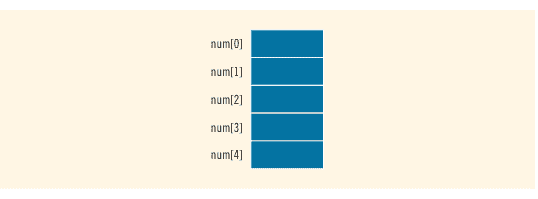

> **注意** 为了节省空间，我们也绘制一个数组，如图 8-2(a) 或 8-2(b) 所示。

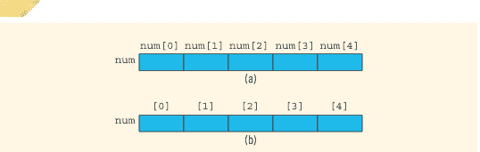

## 访问数组分量

访问数组分量所使用的一般形式（语法）是：

`arrayName[indexExp]`

其中 indexExp 称为**索引**，是任何值为非负整数的表达式。索引值指定该分量在数组中的位置。

在 C++ 中，`[]` 是一个运算符，称为**数组下标运算符**。此外，在 C++ 中，数组索引从 0 开始。

考虑以下语句：

```cpp
int list[10];
```

这条语句声明了一个包含 10 个分量的数组 list。这些分量是 `list[0]`、`list[1]`、……、`list[9]`。换句话说，我们声明了 10 个变量（见图 8-3）。

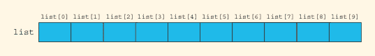

**图 8-3** 数组 list

赋值语句：

```cpp
list[5] = 34;
```

将 34 存入 `list[5]`，它是数组 list 的*第六个*分量（见图 8-4）。

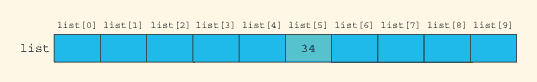

**图 8-4** 执行语句 `list[5] = 34;` 后的数组 list

假设 i 是一个 `int` 变量。那么，赋值语句：

```cpp
list[3] = 63;
```

等价于以下赋值语句：

```cpp
i = 3;
list[i] = 63;
```

接下来，考虑以下语句：

```cpp
list[3] = 10;
list[6] = 35;
list[5] = list[3] + list[6];
```

第一条语句将 10 存入 list[3]，第二条语句将 35 存入 list[6]，第三条语句将 list[3] 和 list[6] 的内容相加，并将结果存入 list[5]（见图 8-5）。

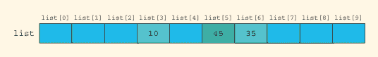

**图 8-5** 执行语句 `list[3] = 10; list[6] = 35;` 和 `list[5] = list[3] + list[6];` 后的数组 list

由此可见，数组分量是各自独立的变量，可以像任何其他变量一样使用；并且 list[0] 是数组内一个单独变量的名称。

现在，如果 i 为 4，则赋值语句：

```cpp
list[2 * i - 3] = 58;
```

将 58 存入 list[5]，因为 2 * i - 3 的求值结果为 5。首先计算索引表达式，从而得到该分量在数组中的位置。

### 示例 8-2

你也可以按如下方式声明数组：

```cpp
const int ARRAY_SIZE = 10;
int list[ARRAY_SIZE];
```

也就是说，你可以先声明一个命名常量，然后使用该命名常量的值来声明数组并指定其大小。


声明数组时，必须指定其大小。例如，你不能这样做：

```cpp
int arraySize;                         //Line 1

cout << "Enter the size of the array: "; //Line 2
cin >> arraySize;                       //Line 3
cout << endl;                           //Line 4

int list[arraySize];                    //Line 5; not allowed
```

第 2 行的语句要求用户在程序执行时输入数组的大小。第 3 行的语句将数组大小输入到 arraySize 中。当编译器编译第 1 行时，变量 arraySize 的值是未知的。因此，当编译器编译第 5 行时，数组的大小未知，编译器将不知道为该数组分配多少内存空间。在第 12 章中，你将学习如何在程序执行期间指定数组的大小，然后使用指针声明该大小的数组。在程序执行期间使用指针创建的数组称为**动态数组**。目前，每当你声明一个数组时，其大小必须是已知的。

## 处理一维数组

对一维数组执行的一些基本操作包括初始化、输入数据、输出数组中存储的数据，以及查找最大和/或最小元素。此外，如果数据是数值型的，另外一些基本操作是求数组元素的和与平均值。这些操作中的每一项都需要能够逐个遍历数组元素。使用循环很容易实现这一点。例如，假设我们有以下语句：

```cpp
int list[100];      //list is an array of size 100
int i;
```

下面的 **for** 循环逐个遍历数组 list 的每个元素，从 list 的第一个元素开始：

```cpp
for (i = 0; i < 100; i++)     //Line 1
    //process list[i]        //Line 2
```

如果处理 list 需要向 list 输入数据，则第 2 行的语句采用输入语句的形式，例如 cin 语句。例如，以下语句从键盘读取 100 个数字并将这些数字存入 list：

```cpp
for (i = 0; i < 100; i++)     //Line 1
    cin >> list[i];           //Line 2
```

类似地，如果处理 list 需要输出数据，则第 2 行的语句采用输出语句的形式。例如，以下语句输出存储在 list 中的数字。

数组中的元素。当然，如果你知道位置（即数组中最大元素的索引），就能轻松确定数组中最大元素的值。因此，让我们描述一种算法，用于确定数组中最大元素首次出现的索引——特别是数组 `sales` 中最大销售额的索引。我们将使用数组中最大元素首次出现的索引来查找最大销售额。

我们假设 `maxIndex` 将包含数组 `sales` 中最大元素首次出现的索引。一般算法很直接。最初，我们假设列表中的第一个元素是最大元素，因此将 `maxIndex` 初始化为 0。然后，我们将 `maxIndex` 指向的元素与列表中后续的每个元素进行比较。每当我们发现数组中某个元素大于 `maxIndex` 指向的元素时，就更新 `maxIndex`，使其指向新的更大元素。算法如下：

```cpp
maxIndex = 0;
for (index = 1; index < 10; index++)
    if (sales[maxIndex] < sales[index])
        maxIndex = index;
largestSale = sales[maxIndex];
```

让我们用一个例子演示该算法如何工作。假设数组 `sales` 如图 8-6 所示。

| | [0] | [1] | [2] | [3] | [4] | [5] | [6] | [7] | [8] | [9] |
|---|---|---|---|---|---|---|---|---|---|---|
| `sales` | 12.50 | 8.35 | 19.60 | 25.00 | 14.00 | 39.43 | 35.90 | 98.23 | 66.65 | 35.64 |

**图 8-6** 数组 `sales`

这里，我们确定数组 `sales` 中的最大元素。在 `for` 循环开始之前，`maxIndex` 被初始化为 0，并且 `for` 循环将 `index` 初始化为 1。下面，我们展示在 `for` 循环的每次迭代期间 `maxIndex`、`index` 以及某些数组元素的值。

| index | maxIndex | sales[maxIndex] | sales[index] | sales[maxIndex] < sales[index] |
|---:|---:|---:|---:|---|
| 1 | 0 | 12.50 | 8.35 | 12.50 < 8.35 为假 |
| 2 | 0 | 12.50 | 19.60 | 12.50 < 19.60 为真；maxIndex = 2 |
| 3 | 2 | 19.60 | 25.00 | 19.60 < 25.00 为真；maxIndex = 3 |
| 4 | 3 | 25.00 | 14.00 | 25.00 < 14.00 为假 |
| 5 | 3 | 25.00 | 39.43 | 25.00 < 39.43 为真；maxIndex = 5 |
| 6 | 5 | 39.43 | 35.90 | 39.43 < 35.90 为假 |
| 7 | 5 | 39.43 | 98.23 | 39.43 < 98.23 为真；maxIndex = 7 |
| 8 | 7 | 98.23 | 66.65 | 98.23 < 66.65 为假 |
| 9 | 7 | 98.23 | 35.64 | 98.23 < 35.64 为假 |

在 `for` 循环执行之后，maxIndex = 7，这给出了数组 sales 中最大元素的索引。因此，largestSale = sales[maxIndex] = 98.23。

> **注意** 你可以编写一个查找数组中最小元素的算法，该算法类似于查找数组中最大元素的算法。（见本章末尾的编程练习 2。）

现在我们已经知道如何声明和处理数组，让我们重写本章开头讨论的程序。回想一下，该程序读取五个测试分数，计算平均测试分数，并输出所有低于平均测试分数的测试分数。

### 示例 8-4

```cpp
//Program to find the average test score and output the average
//test score and all the test scores that are less than the
//average test score

#include <iostream>
#include <iomanip>

using namespace std;

int main()
{
    int test[5];
    int sum = 0;
    double average;
    int index;
```

```cpp
cout << fixed << showpoint << setprecision(2);

cout << "Enter five test scores: ";

for (index = 0; index < 5; index++)
{
    cin >> test[index];
    sum = sum + test[index];
}

cout << endl;

average = sum / 5.0;

cout << "The average test score = " << average << endl;

for (index = 0; index < 5; index++)
    if (test[index] < average)
        cout << test[index]
             << " is less than the average test score." << endl;
return 0;
}
```

**示例运行：** 在此示例运行中，用户输入以底纹显示。

```
Enter five test scores: 85 62 94 56 71
```

```
The average test score = 73.60
62 is less than the average test score.
56 is less than the average test score.
71 is less than the average test score.
```

## 数组下标越界

考虑以下声明：

```cpp
double num[10];
int i;
```

分量 `num[i]` 是有效的，也就是说，如果 `i = 0, 1, 2, 3, 4, 5, 6, 7, 8, or 9`，则 `i` 是有效下标。

数组的下标——比如说 `index`——如果 `index` 介于 `0` 和 `ARRAY_SIZE − 1` 之间，即 `0 <= index <= ARRAY_SIZE − 1`，则该下标在**边界内**。如果 `index` 为负数，或者 `index` 大于 `ARRAY_SIZE − 1`，则我们说该下标**越界**。

不幸的是，C++ 并不检查下标值是否在范围内——即是否介于 `0` 和 `ARRAY_SIZE − 1` 之间。如果下标越界，而程序试图访问该下标指定的分量，那么就会访问该下标所指示的任意内存位置。这种情况可能导致修改或访问你从未打算修改或访问的内存位置中的数据，或者导致试图访问受保护的内存，从而使程序立即停止。因此，如果执行期间下标越界，可能会发生若干奇怪的事情。确保下标在边界内完全是程序员的责任。

考虑以下语句：

```cpp
int list[10];
```

如下循环可以将 `list` 的下标设置为越界：

```cpp
for (int i = 0; i <= 10; i++)
    list[i] = 0;
```

当 `i` 变为 10 时，循环测试条件 `i <= 10` 求值为真，循环体执行，从而将 0 存入 `list[10]`。从逻辑上讲，`list[10]` 并不存在。

> **注意**  
> 在某些新编译器中，如果程序中的数组下标越界，程序可能会因错误消息而终止。例如，参见本书配套网站上的程序 `Example_ArrayIndexOutOfBoundsA.cpp` 和 `Example_ArrayIndexOutOfBoundsB.cpp`。

## 声明时数组初始化

像任何其他简单变量一样，数组可以在声明时初始化。例如，以下 C++ 语句声明一个具有五个分量的数组 `sales`，并初始化这些分量。

```cpp
double sales[5] = {12.25, 32.50, 16.90, 23, 45.68};
```

这些值放在花括号之间，并用逗号分隔——这里，`sales[0] = 12.25`、`sales[1] = 32.50`、`sales[2] = 16.90`、`sales[3] = 23.00` 和 `sales[4] = 45.68`。

在声明数组时初始化数组，不必指定数组的大小。大小由花括号中初始值的数量决定。但是，必须在数组名后包含方括号。因此，前面的语句等价于：

```cpp
double sales[] = {12.25, 32.50, 16.90, 23, 45.68};
```

尽管如果在声明期间初始化数组则不必指定数组大小，但这样做是一种好做法。

## 声明时数组的部分初始化

当你同时声明并初始化一个数组时，不需要初始化数组的所有分量。这个过程称为**声明时数组的部分初始化**。但是，如果在声明期间部分初始化数组，你必须小心。以下示例有助于解释声明并部分初始化数组时会发生什么。

语句：

```cpp
int list[10] = {0};
```

声明 `list` 为一个具有 10 个分量的数组，并将所有分量初始化为 0。

语句：

```cpp
int list[10] = {8, 5, 12};
```

声明 `list` 为一个具有 10 个分量的数组，并将 `list[0]` 初始化为 8、`list[1]` 初始化为 5、`list[2]` 初始化为 12，并将所有其他分量初始化为 0。因此，如果初始化语句中没有指定所有值，则未指定值的数组分量会被初始化为 0。注意，这里声明语句中数组的大小确实有影响。例如，语句：

```cpp
int list[] = {5, 6, 3};
```

声明 `list` 为一个具有三个分量的数组，并将 `list[0]` 初始化为 5、`list[1]` 初始化为 6、`list[2]` 初始化为 3。相反，语句：

```cpp
int list[25] = {4, 7};
```

声明 `list` 为一个具有 25 个分量的数组。前两个分量分别初始化为 4 和 7，所有其他分量初始化为 0。

假设你有以下语句：`int x[5] = {};`。那么某些编译器可能会将数组 `x` 的每个元素初始化为 0。

当你部分初始化数组时，最后一个未初始化元素之后的所有元素都必须未初始化。因此，以下语句将导致语法错误：

```cpp
int list[10] = {2, 5, 6, , 8}; //illegal
```

在此初始化中，因为第四个元素未初始化，所以第四个元素之后的所有元素都必须保持未初始化。

## 数组处理的一些限制

考虑以下语句：

```cpp
int myList[5] = {0, 4, 8, 12, 16};    //Line 1
int yourList[5];                        //Line 2
```

第 1 行中的语句声明并初始化数组 `myList`，第 2 行中的语句声明数组 `yourList`。注意这些数组类型相同且分量数量相同。假设你想将 `myList` 的元素复制到 `yourList` 的对应元素中。以下语句是非法的：

```cpp
yourList = myList;    //illegal
```

事实上，此语句将产生语法错误。C++ 不允许对数组进行聚合操作。对数组的聚合操作是指将整个数组作为单个单元进行操作的任何操作。

要将一个数组复制到另一个数组，必须逐分量复制——即一次复制一个分量。例如，以下语句将 `myList` 复制到 `yourList`。

```
yourList[0] = myList[0];
yourList[1] = myList[1];
yourList[2] = myList[2];
yourList[3] = myList[3];
yourList[4] = myList[4];
```

使用循环可以更高效地完成此操作，如下所示：

```
for (int index = 0; index < 5; index++)
    yourList[index] = myList[index];
```

接下来，假设你想将数据读入数组 `yourList`。以下语句是非法的，事实上会产生语法错误：

```
cin >> yourList;  //Illegal
```

要将数据读入 `yourList`，必须使用如下循环一次读取一个分量：

```
for (int index = 0; index < 5; index++)
    cin >> yourList[index];
```

类似地，判断两个数组是否具有相同元素以及打印数组内容都必须逐分量完成。注意，以下语句在不会产生语法错误的意义上是合法的；然而，它们不会给出所需结果。

```
cout << yourList;

if (myList <= yourList)
.
.
.
```

我们将在本章后面的“数组的基地址与计算机内存中的数组”一节中评论这些语句。

## 数组作为函数参数

现在你已经了解了如何使用数组，一个自然的问题出现了：数组如何作为参数传递给函数？

**仅按引用传递：** 在 C++ 中，数组仅按引用传递。

因为数组仅按引用传递，所以在将数组声明为形式参数时，你*不使用*符号 `&`。

将一维数组声明为形式参数时，通常省略数组的大小。如果在将一维数组声明为形式参数时指定其大小，编译器会忽略该大小。


### 示例 8-5

考虑以下函数：

```cpp
void funcArrayAsParam(int listOne[], double listTwo[])
{
    .
    .
    .
}
```

函数 funcArrayAsParam 有两个形参：(1) listOne，一个 int 类型的一维数组（即分量类型为 int）；(2) listTwo，一个 double 类型的一维数组。在此声明中，两个数组的大小均未指定。

有时，数组中的元素个数可能小于数组的大小。例如，存储学生数据的数组中的元素个数可能随着学生退选或选课而增加或减少。在这种情况下，我们希望只处理数组中保存实际数据的分量。要编写处理此类数组的函数，除了将一个数组声明为形参之外，还要声明另一个形参来指定数组中的元素个数，如下面的函数所示：

```cpp
void initialize(int list[], int listSize)
{
    int count;

    for (count = 0; count < listSize; count++)
        list[count] = 0;
}
```

函数 initialize 的第一个形参是任意大小的 int 数组。调用函数 initialize 时，实际数组的大小作为函数 initialize 的第二个形参传入。

## 常量数组作为形参

回顾一下，当形参是引用形参时，只要形参发生变化，实参也会随之变化。然而，尽管数组总是按引用传递，你仍然可以阻止函数修改实参。为此，只需在形参声明中使用保留字 const。考虑以下函数：

```cpp
void example(int x[], const int y[], int sizeX, int sizeY)
{
    .
    .
    .
}
```

这里，函数 example 可以修改数组 x，但不能修改数组 y。任何修改 y 的尝试都会导致编译时错误。如果你不希望函数修改数组，那么将数组声明为常量形参是一种良好的编程实践。

### 示例 8-6

本示例展示如何编写用于数组处理的函数，以及如何将数组声明为形参。

```cpp
//Function to initialize an int array to 0.
//The array to be initialized and its size are passed
//as parameters. The parameter listSize specifies the
//number of elements to be initialized.
void initializeArray(int list[], int listSize)
{
    int index;

    for (index = 0; index < listSize; index++)
        list[index] = 0;
}

//Function to read and store the data into an int array.
//The array to store the data and its size are passed as
//parameters. The parameter listSize specifies the number
//of elements to be read.
void fillArray(int list[], int listSize)
{
    int index;

    for (index = 0; index < listSize; index++)
        cin >> list[index];
}

//Function to print the elements of an int array.
//The array to be printed and the number of elements
//are passed as parameters. The parameter listSize
//specifies the number of elements to be printed.
void printArray(const int list[], int listSize)
{
    int index;

    for (index = 0; index < listSize; index++)
        cout << list[index] << " ";
}

//Function to find and return the sum of the
//elements of an int array. The parameter listSize
//specifies the number of elements to be added.
int sumArray(const int list[], int listSize)
{
    int index;
    int sum = 0;

    for (index = 0; index < listSize; index++)
        sum = sum + list[index];

    return sum;
}

//Function to find and return the index of the first
//largest element in an int array. The parameter listSize
//specifies the number of elements in the array.
int indexLargestElement(const int list[], int listSize)
{
    int index;
    int maxIndex = 0; //assume the first element is the largest

    for (index = 1; index < listSize; index++)
        if (list[maxIndex] < list[index])
            maxIndex = index;

    return maxIndex;
}

//Function to copy some or all of the elements of one array
//into another array. Starting at the position specified
//by src, the elements of list1 are copied into list2
//starting at the position specified by tar. The parameter
//numOfElements specifies the number of elements of list1 to
//be copied into list2. Starting at the position specified
//by tar, the list2 must have enough components to copy the
//elements of list1. The following call copies all of the
//elements of list1 into the corresponding positions in
//list2:
//    copyArray(list1, 0, list2, 0, numOfElements)
void copyArray(int list1[], int src, int list2[],
               int tar, int numOfElements)
{
    for (int index = src; index < src + numOfElements; index++)
    {
        list2[index] = list1[tar];
        tar++;
    }
}
```

## 数组的基地址与计算机内存中的数组

数组的基地址是数组第一个分量的地址（即内存位置）。例如，如果 list 是一个一维数组，那么 list 的基地址就是分量 list[0] 的地址。

考虑以下语句：

```cpp
int myList[5];        //Line 1
```

该语句声明 myList 是一个包含五个 int 类型分量的数组。这些分量是 myList[0]、myList[1]、myList[2]、myList[3] 和 myList[4]。计算机为这些分量分配五个内存空间，每个空间都足以存储一个 int 值。此外，这五个内存空间是连续的。

数组 myList 的基地址是分量 myList[0] 的地址。假设数组 myList 的基地址是 1000。那么，分量 myList[0] 的地址就是 1000。通常，为 int 变量分配的内存是四个字节。回顾第1章，主存是一个有序的单元序列，每个单元都有唯一地址。通常，每个单元是一个字节。因此，要将一个值存入从地址 1000 开始的 myList[0]，接下来的四个字节就分配给 myList[0]。由此可知，myList[1] 的起始地址是 1004，myList[2] 的起始地址是 1008，依此类推（见图 8-7）。

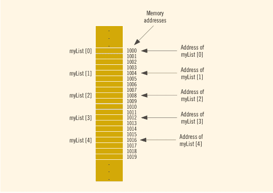

**图 8-7**  数组 *myList* 及其分量的地址

现在，myList 是一个数组名。标识符 myList 还关联着一块内存空间，数组的基地址就存储在该内存空间中。考虑以下语句：

```cpp
cout << myList << endl;                 //Line 2
```

前面我们说过，该语句不会给出期望的结果。也就是说，该语句不会输出 myList 的*分量*的值。实际上，该语句输出的是存储在 myList 中的值，即数组的基地址。这就是该语句不会产生语法错误的原因。

假设你还有以下语句：

```cpp
int yourList[5];
```

那么，在以下语句中：

```cpp
if (myList <= yourList)                 //Line 3
.
.
.
```

表达式 myList <= yourList 在数组 myList 的基地址小于数组 yourList 的基地址时求值为**真**；否则求值为**假**。*它并不*判断 myList 的元素是否小于或等于 yourList 的对应元素。

> **注意**  本书配套网站包含程序 `BaseAddressOfAnArray.cpp`，它阐明了第2行和第3行这类语句。

你可能想知道，为什么数组的基地址如此重要。原因是，当你声明一个数组时，计算机所记住的关于该数组的信息只有：数组名、它的基地址、每个分量的数据类型，以及（可能还有）分量的个数。计算机利用数组的基地址、数组分量的索引以及每个分量的字节大小，计算出某个特定分量的地址。例如，假设你想访问 myList[3] 的值。此时 myList 的基地址是 1000。myList 的每个分量都是 int 类型，因此用四个字节存储一个值，而目标分量的索引是 3。为了访问 myList[3] 的值，计算机计算地址 1000 + 4 * 3 = 1000 + 12 = 1012。也就是说，这就是 myList[3] 的起始地址。于是，从 1012 开始，计算机访问接下来的四个字节：1012、1013、1014 和 1015。

当你将数组作为参数传递时，实际数组的基地址会传递给形参。例如，假设你有以下函数：


```cpp
void arrayAsParameter(int list[], int size)
{
    .
    .
    .

    list[2] = 28;       //Line 4

    .
    .
    .
}
```

此外，假设你有以下对这个函数的调用：

```cpp
arrayAsParameter(myList, 5);   //Line 5
```

在这个语句中，`myList` 的基地址被传递给形参 `list`。因此，`list` 的基地址是 1000。函数的定义中包含语句 `list[2] = 28;`。该语句将 28 存储到 `list[2]` 中。为了访问 `list[2]`，计算机按如下方式计算地址：1000 + 4 × 2 = 1008。因此，从地址 1008 开始，计算机访问接下来的四个字节并存储 28。请注意，实际上 1008 就是 `myList[2]` 的地址（见图 8-7）。因此，在执行第 5 行的语句时，第 4 行的语句会将值 28 存储到 `myList[2]` 中。同样可以得出，在执行第 5 行的函数调用语句期间，`list[index]` 和 `myList[index]` 指向同一内存空间，其中 0 <= index 且 index < 5。

> **注意：** 如果 C++ 允许按值传递数组，那么当函数被调用时，计算机就必须为形参的各个元素分配内存，并将实际数组的内容复制到相应的形参中。如果数组很大，这个过程会浪费内存以及复制数据所需的计算机时间。这就是为什么在 C++ 中数组总是按引用传递的原因。

## 函数不能返回数组类型的值

C++ 不允许函数返回数组类型的值。请注意，前面描述的 `sumArray` 和 `indexLargestElement` 函数返回的是 `int` 类型的值。

### 示例 8-7

假设某物体在时间 t = a₁ 时行驶的距离为 d₁，在时间 t = a₂ 时行驶的距离为 d₂，其中 a₁ < a₂。那么该物体从时间 a₁ 到 a₂，即在区间 [a₁, a₂] 上的平均速度为 (d₂ − d₁)/(a₂ − a₁)。假设某物体在某些时间点行驶的距离如下表所示：

| 时间 | 0 | 10 | 20 | 30 | 40 | 50 |
|---|---:|---:|---:|---:|---:|---:|
| 行驶距离 | 0 | 18 | 27 | 38 | 52 | 64 |

那么区间 [0, 10] 上的平均速度为 (18−0)/(10−0) = 1.8，区间 [10, 20] 上的平均速度为 (27−18)/(20 − 10) = 0.9，依此类推。

下面的程序输入某物体在时间 0、10、20、30、40 和 50 时行驶的距离。然后程序输出区间 [10 * i, 10 * (i + 1)] 上的平均速度，其中 i = 0、1、2、3 和 4。程序还会输出这些区间上的最大和最小平均速度。本章末尾的编程练习 17 要求你修改这个程序，使得记录物体行驶距离的时间间隔不一定是每个 10 个时间单位。

```cpp
//Given the distance traveled by an object at every 10 units
//of time, this program determines the average speed of the object
//at each 10 unit interval of the time.

#include <iostream>
#include <iomanip>

using namespace std;

const int SIZE = 6;

void getData(double list[], int length);
void averageSpeedOverTimeInterval(double list[], int length,
                                  double avgSpeed[]);
double maxAvgSpeed(double avgSpeed[], int length);
double minAvgSpeed(double avgSpeed[], int length);
void print(double list[], int length, double avgSpeed[]);

int main()
{
    double distanceTraveled[SIZE];
    double averageSpeed[SIZE];

    cout << fixed << showpoint << setprecision(2);

    getData(distanceTraveled, SIZE);
    averageSpeedOverTimeInterval(distanceTraveled, SIZE, averageSpeed);
    print(distanceTraveled, SIZE, averageSpeed);

    cout << "Maximum average speed: "
         << maxAvgSpeed(averageSpeed, SIZE) << endl;
    cout << "Minimum average speed: "
         << minAvgSpeed(averageSpeed, SIZE) << endl;

    return 0;
}

void getData(double list[], int length)
{
    cout << "Enter the total distance traveled after "
         << "every 10 units of time." << endl;
    for (int index = 0; index < length; index++)
    {
        cout << "Enter total distance traveled at time "
             << index * 10 << " units: ";
        cin >> list[index];
        cout << endl;
    }
}

void averageSpeedOverTimeInterval(double list[], int length,
                                  double avgSpeed[])
{
    for (int index = 0; index < length - 1; index++)
        avgSpeed[index] = (list[index + 1] - list[index]) / 10;
}

double maxAvgSpeed(double avgSpeed[], int length)
{
    double max = avgSpeed[0];

    for (int index = 1; index < length - 1; index++)
        if (avgSpeed[index] > max)
            max = avgSpeed[index];

    return max;
}

double minAvgSpeed(double avgSpeed[], int length)
{
    double min = avgSpeed[0];

    for (int index = 1; index < length - 1; index++)
        if (avgSpeed[index] < min)
            min = avgSpeed[index];

    return min;
}

void print(double list[], int length, double avgSpeed[])
{
    cout << setw(7) << "Time " << setw(20) << "Distance Traveled "
         << setw(10) << "Average Speed / Time Interval" << endl;

    cout << setw(5) << 0
         << setw(14) << list[0] << setw(6) << " "
         << setw(10) << 0 << " [ 0, 0 ]" << endl;

    for (int index = 1; index < length; index++)
        cout << setw(5) << index * 10
             << setw(14) << list[index] << setw(6) << " "
             << setw(10) << avgSpeed[index - 1]
             << " [ " << (index - 1) * 10 << ", "
             << index * 10 << " ]" << endl;
}
```

示例运行：在此示例运行中，用户输入以阴影显示。

```
Enter the total distance traveled after every 10 units of time.
Enter total distance traveled at time 0 units: 0

Enter total distance traveled at time 10 units: 25

Enter total distance traveled at time 20 units: 38

Enter total distance traveled at time 30 units: 52

Enter total distance traveled at time 40 units: 60

Enter total distance traveled at time 50 units: 72
```

| 时间 | 行驶距离 | 平均速度 / 时间间隔 |
|---:|---:|---:|
| 0 | 0.00 | 0 [0, 0] |
| 10 | 25.00 | 2.50 [0, 10] |
| 20 | 38.00 | 1.30 [10, 20] |
| 30 | 52.00 | 1.40 [20, 30] |
| 40 | 60.00 | 0.80 [30, 40] |
| 50 | 72.00 | 1.20 [40, 50] |

最大平均速度：2.50
最小平均速度：0.80

这个程序的输出一目了然。具体细节我们留作练习。

## 整型数据类型和数组下标

> **注意：** 要理解本节，需要先学习第 7 章的“枚举类型”和“typedef 语句”两节。

除整数外，C++ 还允许使用任何整型类型作为数组下标。这一特性可以大大提高程序的可读性。考虑以下语句：

```cpp
enum paintType {GREEN, RED, BLUE, BROWN, WHITE, ORANGE, YELLOW};
double paintSale[7];
paintType paint;
```

下面的循环将数组 paintSale 的每个元素初始化为 0：

```cpp
for (paint = GREEN; paint <= YELLOW;
          paint = static_cast<paintType>(paint + 1))
      paintSale[paint] = 0.0;
```

下面的语句更新 RED 油漆的销售额：

```cpp
paintSale[RED] = paintSale[RED] + 75.69;
```

正如你所看到的，上面的代码比使用整数作为下标的代码容易理解得多。因此，只要可能，你应该使用枚举类型或其他整型数据类型作为数组下标。请注意，当使用枚举类型作为数组下标时，要使用枚举类型中标识符的默认值。也就是说，第一个标识符的值必须为 0，依此类推。（回顾第 7 章，枚举类型中标识符的默认值从 0 开始；但是，标识符可以被设置为其他值。）

## 声明数组的其他方式

假设一个班有 20 名学生，你需要记录他们的成绩。因为每学期学生人数可能会变化，所以可以在声明数组时不指定数组大小，而是按如下方式声明：

```cpp
const int NO_OF_STUDENTS = 20;
int testScores[NO_OF_STUDENTS];
```

用于声明数组的其他形式如下：

```cpp
const int SIZE = 50;        //Line 1
typedef double list[SIZE];  //Line 2

list yourList;               //Line 3
list myList;                 //Line 4
```

第 2 行的语句定义了一个数据类型 `list`，它是一个包含 50 个 `double` 类型元素的数组。第 3 行和第 4 行的语句声明了两个变量 `yourList` 和 `myList`。它们都是包含 50 个 `double` 类型元素的数组。当然，这些语句等价于：

```cpp
double yourList[50];
double myList[50];
```

## 在数组中搜索特定项

在列表中搜索给定项是对列表执行的最常见操作之一。我们描述的搜索算法称为**顺序搜索**或**线性搜索**。顾名思义，你从数组的第一个元素开始按顺序搜索数组。你将 `searchItem` 与数组（列表）中的元素进行比较，并继续搜索，直到找到该项，或者列表中不再有数据可与 `searchItem` 比较为止。

考虑如图 8-8 所示的七个元素的列表。

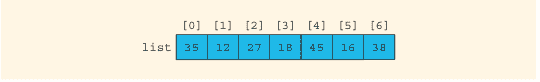

**图 8-8** 七个元素的列表


假设你想确定 27 是否在列表中。顺序查找的工作方式如下：首先，将 27 与 `list[0]` 比较，也就是将 27 与 35 比较。因为 `list[0] ≠ 27`，接着将 27 与 `list[1]` 比较，也就是与列表中的第二个项 12 比较。因为 `list[1] ≠ 27`，再将 27 与列表中的下一个元素比较，也就是将 27 与 `list[2]` 比较。因为 `list[2] = 27`，查找停止。这次查找成功。

现在让我们查找 10。和之前一样，查找从列表中的第一个元素开始，也就是从 `list[0]` 开始。按之前的方式继续进行，我们看到，这一次查找项 10 会与列表中的每一项进行比较。最终，列表中没有更多数据可与查找项比较。这是一次不成功的查找。

由此可知，一旦在列表中找到与查找项相等的元素，就必须停止查找并报告成功。（在这种情况下，通常还要报告在列表中查找到查找项的位置。）否则，在查找项与列表中的每个元素都比较过且未找到之后，必须停止查找并报告失败。

假设包含列表元素的数组名为 `list`。前面的讨论可转化为以下顺序查找算法：

```text
found is set to false
loc = 0;

while (loc < listLength and not found)
    if (list[loc] is equal to searchItem)
        found is set to true
    else
        increment loc

if (found)
    return loc;
else
    return -1;
```

下面的函数对一个列表执行顺序查找。具体来说，为了便于说明，我们假设列表元素类型为 `int`。

```cpp
int seqSearch(const int list[], int listLength, int searchItem)
{
    int loc;
    bool found = false;

    loc = 0;

    while (loc < listLength && !found)
        if (list[loc] == searchItem)
            found = true;
        else
            loc++;
```

如果函数 `seqSearch` 返回大于或等于 0 的值，则查找成功；否则，查找不成功。

从这段代码可以看出，查找开始时将 searchItem 与列表中的第一个元素比较。如果 searchItem 等于列表中的第一个元素，就退出循环；否则，loc 递增 1，指向列表中的下一个元素。然后将 searchItem 与列表中的下一个元素比较，依此类推。

### 示例 8-8

```cpp
// This program illustrates how to use a sequential search in a
// program.

#include <iostream>                              //Line 1

using namespace std;                             //Line 2

const int ARRAY_SIZE = 10;                       //Line 3

int seqSearch(const int list[], int listLength,
              int searchItem);                   //Line 4

int main()                                         //Line 5
{
    int intList[ARRAY_SIZE];                      //Line 7
    int number;                                   //Line 8

    cout << "Line 9: Enter " << ARRAY_SIZE
         << " integers." << endl;                //Line 9

    for (int index = 0; index < ARRAY_SIZE; index++) //Line 10
        cin >> intList[index];                    //Line 11

    cout << endl;                                 //Line 12

    cout << "Line 13: Enter the number to be "
         << "searched: ";                        //Line 13
    cin >> number;                                //Line 14
    cout << endl;                                 //Line 15

    int pos = seqSearch(intList, ARRAY_SIZE, number); //Line 16

    if (pos != -1)                                //Line 17
        cout << "Line 18: " << number
             << " is found at index " << pos
             << endl;                             //Line 18
    else                                          //Line 19
        cout << "Line 20: " << number
             << " is not in the list." << endl;   //Line 20

    return 0;                                     //Line 21
}                                                 //Line 22
//Place the definition of the function seqSearch
//given previously here.
```

**示例运行 1：** 在此示例运行中，用户输入以底纹显示。

```text
Line 9: Enter 10 integers.
2 56 34 25 73 46 89 10 5 16

Line 13: Enter the number to be searched: 25

Line 18: 25 is found at index 3
```

**示例运行 2：**

```text
Line 9: Enter 10 integers.
2 56 34 25 73 46 89 10 5 16

Line 13: Enter the number to be searched: 38

Line 20: 38 is not in the list.
```

## 排序

上一节讨论了一种查找算法。本节讨论如何使用一种称为**选择排序**的算法对数组进行排序。更多查找和排序算法将在第 16 章讨论。

顾名思义，在**选择排序**算法中，我们通过选择列表中的一个元素并将其移动到正确位置来重新排列列表。该算法找到列表未排序部分中最小元素的位置，并将其移动到列表未排序部分的开头。第一次，我们在整个列表中定位最小项。第二次，我们从列表的第二个元素开始，在列表中定位最小项，依此类推。

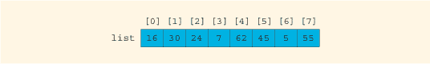

**图 8-9**  八个元素的列表

假设你有图 8-9 所示的列表。

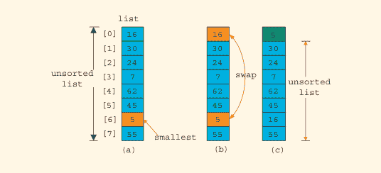

**图 8-10** 第一次迭代期间列表的元素

图 8-10 显示了第一次迭代时列表的元素。

最初，整个列表都是未排序的。因此，我们找到列表中的最小项。最小项位于位置 6，如图 8-10(a) 所示。因为这是最小项，所以必须将其移动到位置 0。于是，我们将 16（即 list[0]）与 5（即 list[6]）交换，如图 8-10(b) 所示。交换这些元素后，得到的列表如图 8-10(c) 所示。

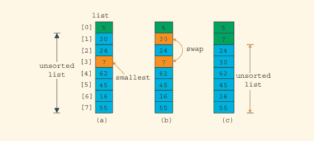

**图 8-11** 第二次迭代期间列表的元素

图 8-11 显示了第二次迭代期间列表的元素。

现在未排序列表是 list[1]...list[7]。因此，我们找到未排序列表中的最小元素。最小元素位于位置 3，如图 8-11(a) 所示。因为未排序列表中的最小元素位于位置 3，所以必须将其移动到位置 1。于是，我们将 7（即 list[3]）与 30（即 list[1]）交换，如图 8-11(b) 所示。将 7（即 list[3]）与 30 交换后，得到的列表如图 8-11(c) 所示。

现在，未排序列表是 list[2]...list[7]。因此，我们重复前面的过程：找到列表未排序部分中最小元素（的位置），并将其移动到列表未排序部分的开头。因此，选择排序涉及以下步骤。

- 在列表的未排序部分中：
  - a. 找到最小元素的位置。
  - b. 将最小元素移动到未排序列表的开头。

最初，整个列表（即 list[0]...list[length − 1]）就是未排序列表。执行步骤 a 和 b 一次后，未排序列表为 list[1]...list[length − 1]。第二次执行步骤 a 和 b 后，未排序列表为 list[2]...list[length − 1]，依此类推。这样，我们可以跟踪列表的未排序部分，并借助 for 循环重复步骤 a 和 b，如下面的伪代码所示：

```text
for (index = 0; index < length − 1; index++)
{
    a. Find the location, smallestIndex, of the smallest element in
       list[index]...list[length − 1].
    b. Swap the smallest element with list[index]. That is, swap
       list[smallestIndex] with list[index].
}
```

第一次执行循环时，我们在 list[0]...list[length − 1] 中定位最小元素，并将该最小元素与 list[0] 交换。第二次执行循环时，我们在 list[1]...list[length − 1] 中定位最小元素，并将该最小元素与 list[1] 交换，依此类推。

步骤 a 类似于本章前面讨论的查找列表中最大项索引的算法。（另见本章末尾的编程练习 2a。）这里，我们查找列表中最小项的索引。步骤 a 的一般形式为：

```text
smallestIndex = index;    //assume first element is the smallest

for (location = index + 1; location < length; location++)
    if (list[location] < list[smallestIndex])
        smallestIndex = location;    //current element in the list
                                      //is smaller than the smallest so
                                      //far, so update smallestIndex
```

步骤 b 将 list[smallestIndex] 的内容与 list[index] 的内容交换。以下语句完成此任务：


```cpp
temp = list[smallestIndex];
list[smallestIndex] = list[index];
list[index] = temp;
```

由此可见，要交换这些值，需要进行三次元素赋值。下面的函数 selectionSort 实现了选择排序算法：

```cpp
void selectionSort(int list[], int length)
{
    int index;
    int smallestIndex;
    int location;
    int temp;

    for (index = 0; index < length - 1; index++)
    {
        //Step a
        smallestIndex = index;

        for (location = index + 1; location < length; location++)
            if (list[location] < list[smallestIndex])
                smallestIndex = location;

        //Step b
        temp = list[smallestIndex];
        list[smallestIndex] = list[index];
        list[index] = temp;
    }
}
```

示例 8-9 中的程序说明了如何在程序中使用选择排序算法。

### 示例 8-9

```cpp
//Selection sort

#include <iostream>

using namespace std;

void selectionSort(int list[], int length);

int main()
{
    int list[] = {2, 56, 34, 25, 73, 46, 89, 10, 5, 16};  //Line 1
    int i;                                                   //Line 2

    selectionSort(list, 10);                                 //Line 3

    cout << "After sorting, the list elements are:"         //Line 4
         << endl;

    for (i = 0; i < 10; i++)                 //Line 5
        cout << list[i] << " ";              //Line 6

    cout << endl;                              //Line 7

    return 0;                                  //Line 8
}
```

```cpp
//Place the definition of the function selectionSort given
//previously here.
```

### 示例运行：

```text
After sorting, the list elements are:
2 5 10 16 25 34 46 56 73 89
```

第 1 行中的语句声明并将 list 初始化为一个包含 10 个 `int` 类型分量的数组。第 3 行中的语句使用函数 selectionSort 对 list 进行排序。注意，list 及其长度（其中元素的数量，即 10）都作为参数传递给函数 selectionSort。第 5 行和第 6 行中的 `for` 循环输出 list 的元素。

为了说明该程序中的选择排序算法，我们声明并初始化了数组 list。不过，你也可以在程序执行期间提示用户输入数据。

对于一个长度为 *n* 的列表，选择排序恰好进行 $\frac{n(n-1)}{2}$ 次关键字比较和 $3(n-1)$ 次元素赋值。因此，如果 *n* = 1000，那么为了对该列表排序，选择排序大约进行 500,000 次关键字比较和大约 3000 次元素赋值。下一节将介绍可减少比较次数的插入排序算法。

## 自动声明与基于范围的 `For` 循环

C++11 引入了元素的自动声明，这允许程序员在声明和初始化变量时不必指定其类型。例如，下面的语句声明变量 num，并在其中存储 15：

```cpp
auto num = 15;
```

由于初始化器（即 15）是一个 `int` 值，因此 num 的类型将是 `int`。

从第一个元素开始逐个处理数组元素的一种方法是使用一个初始化为 0 的索引变量和一个循环。例如，要处理数组 list 的元素，可以使用如下所示的 `for` 循环：

```cpp
for (int index = 0; index < length; index++)
    //process list[index]
```

本章使用这些类型的循环来处理数组的元素。C++11 提供了一种特殊类型的 `for` 循环来处理数组的元素。使用这种 `for` 循环处理数组元素的语法是：

```cpp
for (dataType identifier : arrayName)
    statements
```

其中，`identifier` 是一个变量，且 `identifier` 的数据类型与数组元素的数据类型相同。这种形式的 `for` 循环称为 **基于范围的 for** 循环。

例如，假设你有以下声明：

```cpp
double list[25];
double sum;
```

下面的代码求 `list` 中元素的和：

```cpp
sum = 0;                  //Line 1

for (double num : list)   //Line 2
    sum = sum + num;      //Line 3
```

第 2 行中的 `for` 语句读作“对于 `list` 中的每个 `num`”。变量 `num` 被初始化为 `list[0]`。在下一次迭代中，`num` 的值为 `list[1]`，依此类推。由此可见，变量 `num` 被赋予每个数组元素的内容，*而不是*其索引值；并且该循环默认从 0 开始，遍历整个数组。

你也可以在基于范围的循环中使用 `auto` 声明来处理数组的元素。例如，使用基于范围的 `for` 循环，求数组 `list` 中最大元素的 `for` 循环可以写成：

```cpp
for (auto num : list)
{
    if (max < num)
        max = num;
}
```

假设 `list` 被声明为某个用于处理数组的函数的形式参数。具体来说，考虑以下声明：

```cpp
void doSomething(int list[])
{
    //code to process list
}
```

那么在函数 `doSomething` 的定义中，基于范围的 `for` 循环不能应用于 `list`。回想一下，在 C++ 中，数组是按引用传递的参数。因此，当调用函数 `doSomething` 时，`list` 获得实际参数的基地址，也就是说，实际参数的基地址被复制到内存空间 `list` 中。所以，形式参数 `list` 实际上*不是*一个数组，而是一个用于存储某个内存位置地址的变量，因此它没有第一个（即 `list[0]`）和最后一个元素。

## C 字符串（字符数组）

到目前为止，我们一直避免讨论字符数组，原因很简单：字符数组具有特殊的重要性，而且处理它们的方式与其他数组不同。C++ 提供了许多（预定义的）函数，你可以将其用于字符数组。

**字符数组：** 一种分量类型为 `char` 的数组。

回想一下，最广泛使用的字符集是 ASCII 和 EBCDIC。ASCII 字符集中的第一个字符是空字符，它是不可打印的。另外，回想一下，在 C++ 中，空字符表示为 '\0'，即一个反斜杠后跟一个零。

语句：

```cpp
ch = '\0';
```

将空字符存储到 ch 中，其中 ch 是一个 `char` 变量。

正如你将看到的，空字符在处理字符数组时起着重要作用。因为空字符的排序序列为 0，所以空字符小于 `char` 数据集中的任何其他字符。

字符数组最常用的术语是 C 字符串。然而，字符数组和 C 字符串之间存在细微差别。回想一下，字符串是零个或多个字符的序列，并且字符串用双引号括起来。在 C++ 中，C 字符串以空字符结尾；也就是说，C 字符串中的最后一个字符始终是空字符。字符数组可能不包含空字符，但 C 字符串中的最后一个字符始终是空字符。正如你将看到的，除了最后一个位置之外，空字符不应出现在 C 字符串中的任何位置。此外，C 字符串存储在（一维）字符数组中。

以下是 C 字符串的示例：

```text
"John Johnson"
"Hello there."
```

从 C 字符串的定义可以清楚地看出，'A' 和 "A" 之间存在区别。第一个是字符 A；第二个是 C 字符串 A。因为 C 字符串以空字符结尾，所以 "A" 表示两个字符：'A' 和 '\0'。类似地，C 字符串 "Hello" 表示六个字符：'H'、'e'、'l'、'l'、'o' 和 '\0'。要存储 'A'，我们只需要一个 `char` 类型的内存单元；要存储 "A"，我们需要两个 `char` 类型的内存单元——一个用于 'A'，一个用于 '\0'。类似地，要将 C 字符串 "Hello" 存储到计算机内存中，我们需要六个 `char` 类型的内存单元。

考虑以下语句：

```cpp
char name[16];
```

该语句声明了一个包含 16 个 `char` 类型分量的数组 name。因为 C 字符串以空字符结尾，而 name 有 16 个分量，所以可以存储在 name 中的最大字符串长度为 15，以便为结尾的 '\0' 留出空间。如果你将一个长度为 10 的 C 字符串存储到 name 中，那么 name 的前 11 个分量会被使用，最后 5 个分量则未被使用。

语句：

```cpp
char name[16] = {'J', 'o', 'h', 'n', '\0'};
```


声明一个数组 name，包含 16 个 `char` 类型的元素，并将 C 字符串 "John" 存储在其中。在声明 char 数组变量时，C++ 还允许在初始化语句中使用 C 字符串表示法。因此，上述语句等价于：

```cpp
char name[16] = "John";        //Line A
```

回想一下，如果在声明期间初始化数组，则可以省略数组的大小。

以下语句：

```cpp
char name[] = "John";          //Line B
```

声明一个 C 字符串变量 name，其长度足够大——在本例中为 5——并将 "John" 存储在其中。最后两条语句之间存在差异：两条语句都将 "John" 存储在 name 中，但 Line A 中语句的 name 大小为 16，而 Line B 中语句的 name 大小为 5。

适用于其他数组的大多数规则也适用于字符数组。考虑以下语句：

```cpp
char studentName[26];
```

假设你想将 "Lisa L. Johnson" 存储在 studentName 中。由于数组不允许诸如赋值和比较之类的聚合操作，因此以下语句不合法：

```cpp
studentName = "Lisa L. Johnson"; //illegal
```

C++ 提供了一组可用于 C 字符串操作的函数。头文件 `cstring` 定义了这些函数。我们经常使用其中三个函数：`strcpy`（字符串复制，用于将 C 字符串复制到 C 字符串变量中——即赋值）；`strcmp`（字符串比较，用于比较 C 字符串）；以及 `strlen`（字符串长度，用于求 C 字符串的长度）。表 8-1 总结了这些函数。

**表 8-1** `strcpy`、`strcmp` 和 `strlen` 函数

| 函数 | 作用 |
|---|---|
| `strcpy(s1, s2)` | 将字符串 `s2` 复制到字符串变量 `s1` 中。`s1` 的长度至少应与 `s2` 一样大。 |
| `strcmp(s1, s2)` | 如果 `s1` 小于 `s2`，则返回一个小于 0 的值。如果 `s1` 和 `s2` 相同，则返回 0。如果 `s1` 大于 `s2`，则返回一个大于 0 的值。 |
| `strlen(s)` | 返回字符串 `s` 的长度，不包括空字符。 |

要使用这些函数，程序必须通过 `#include` 语句包含头文件 `cstring`。也就是说，程序中必须包含以下语句：

```cpp
#include <cstring>
```

## 字符串比较

在 C++ 中，C 字符串使用系统的排序序列逐字符进行比较。假设你使用 ASCII 字符集。

- 1. C 字符串 "Air" 小于 C 字符串 "Boat"，因为 "Air" 的第一个字符小于 "Boat" 的第一个字符。
- 2. C 字符串 "Air" 小于 C 字符串 "An"，因为两个字符串的第一个字符相同，但 "Air" 的第二个字符 'i' 小于 "An" 的第二个字符 'n'。
- 3. C 字符串 "Bill" 小于 C 字符串 "Billy"，因为 "Bill" 和 "Billy" 的前四个字符相同，但 "Bill" 的第五个字符 `'\0'`（空字符）小于 "Billy" 的第五个字符 'y'。（回想一下，C++ 中的 C 字符串以空字符结尾。）
- 4. C 字符串 "Hello" 小于 "hello"，因为 C 字符串 "Hello" 的第一个字符 'H' 小于 C 字符串 "hello" 的第一个字符 'h'。

如你所见，函数 `strcmp` 将其第一个 C 字符串参数与其第二个 C 字符串参数逐字符进行比较。

### 示例 8-10

假设你有以下语句：

```cpp
char studentName[21];
char myname[16];
char yourname[16];
```

以下语句展示了字符串函数如何工作：

| 语句 | 作用 |
|---|---|
| `strcpy(myname, "John Robinson");` | `myname = "John Robinson"` |
| `strlen("John Robinson");` | 返回 13，即字符串 "John Robinson" 的长度 |
| `int len;`<br>`len = strlen("Sunny Day");` | 将 9 存入 len |
| `strcpy(yourname, "Lisa Miller");` | `yourname = "Lisa Miller"` |
| `strcpy(studentName, yourname);` | `studentName = "Lisa Miller"` |
| `strcmp("Bill", "Lisa");` | 返回一个小于 0 的值 |
| `strcpy(yourname, "Kathy Brown");` | `yourname = "Kathy Brown"` |
| `strcpy(myname, "Mark G. Clark");` | `myname = "Mark G. Clark"` |
| `strcmp(myname, yourname);` | 返回一个大于 0 的值 |

> **注意**
>
> 在本章中，我们将 C 字符串定义为零个或多个字符的序列。C 字符串用双引号括起来。我们还说过，C 字符串以空字符结尾，因此 C 字符串 "Hello" 有六个字符，即使双引号中只括了五个字符。因此，要将 C 字符串 "Hello" 存储在计算机内存中，必须使用大小为 6 的字符数组。C 字符串的长度是双引号中实际字符的数量；例如，C 字符串 "Hello" 的长度为 5。因此，从逻辑意义上讲，C 字符串是零个或多个字符的序列，但从物理意义上讲（即，将 C 字符串存储在计算机内存中），C 字符串至少有一个字符。由于 C 字符串的长度是双引号中实际字符的数量，我们将 C 字符串定义为零个或多个字符的序列。但是，你必须记住，存储在计算机内存中 C 字符串末尾的空字符在我们比较 C 字符串时起着关键作用，尤其是像 "Bill" 和 "Billy" 这样的 C 字符串。

## 字符串的读写

如前所述，适用于数组的大多数规则也适用于 C 字符串。数组不允许诸如赋值和比较之类的聚合操作。甚至数组的输入/输出也是逐分量进行的。然而，C++ 允许对数组进行聚合操作的一个地方是 C 字符串（即字符数组）的输入和输出。

我们将使用以下声明进行讨论：

```cpp
char name[31];
```

### 字符串输入

由于 C 字符串输入允许聚合操作，因此以下语句：

```cpp
cin >> name;
```

将下一个输入的 C 字符串存储到 name 中。输入 C 字符串的长度必须小于或等于 30。如果输入字符串的长度为 4，计算机将存储输入的四个字符以及空字符 `'\0'`。如果输入 C 字符串的长度超过 30，那么由于不检查数组索引边界，计算机会继续将字符串存储到 name 后面的任意内存单元中。此过程可能导致严重问题，因为相邻内存单元中的数据将被破坏。

> **注意**
>
> 使用输入设备（如键盘）输入 C 字符串时，除非双引号是字符串的一部分，否则不要在其两侧包含双引号。例如，C 字符串 "Hello" 输入为 Hello。

回想一下，提取运算符 `>>` 会跳过所有前导空白字符，并且一旦遇到第一个空白字符或无效数据，就停止将数据读入当前变量。因此，包含空白的 C 字符串无法使用提取运算符 `>>` 读取。例如，如果名字和姓氏由空白分隔，则它们无法被读入 name。

如何将带空白的 C 字符串输入到字符数组中？函数 `get` 再次帮我们解决这个问题。回想一下，函数 `get` 用于读取字符数据。到目前为止，你使用过的函数 `get` 形式（第 3 章）只读取单个字符。然而，函数 `get` 也可以用于读取字符串。要读取 C 字符串，应使用具有两个参数的函数 `get` 形式。第一个参数是 C 字符串变量；第二个参数指定要读入字符串变量的字符数。

要读取 C 字符串，`get` 函数的一般形式（语法）与诸如 `cin` 之类的输入流变量一起使用，如下所示：

```cpp
cin.get(str, m + 1);
```

该语句将接下来的 m 个字符，或直到找到换行字符 `'\n'` 之前的所有字符，存储到 str 中。换行字符不会存储到 str 中。如果输入 C 字符串的字符数少于 m，则读取在换行字符处停止。

考虑以下语句：

```cpp
char str[31];
cin.get(str, 31);
```

如果输入为：

```
William T. Johnson
```

那么 "William T. Johnson" 将存储到 str 中。假设输入为：

```
Hello there. My name is Mickey Blair.
```

这是一个长度为 37 的字符串。由于 str 最多只能存储 30 个字符，因此 C 字符串 "Hello there. My name is Mickey" 将存储到 str 中。

现在，假设我们有这些语句：

```cpp
char str1[26];
char str2[26];
char discard;
```

以及两行输入：

```
Summer is warm.
Winter will be cold.
```

此外，假设我们想将第一个 C 字符串存储到 str1 中，将第二个 C 字符串存储到 str2 中。str1 和 str2 都可以存储长度最多为 25 个字符的 C 字符串。因为

第一行中的字符数为 15，读取在 `\n` 处停止。现在，换行符仍留在输入缓冲区中，必须手动丢弃。因此，必须读取并丢弃第一行末尾的换行符，才能将第二行存入 str2。以下语句序列将第一行存入 str1，将第二行存入 str2：

```cpp
cin.get(str1, 26);
cin.get(discard);
cin.get(str2, 26);
```

要读取并存储一行输入（包括空白字符），还可以使用流函数 getline。假设有如下声明：

```cpp
char textLine[100];
```

以下语句将读取接下来的 99 个字符，或直到换行符为止，并将它们存入 textLine。空字符将自动追加为 textLine 的最后一个字符。

```cpp
cin.getline(textLine, 100);
```

## 字符串输出

C 字符串的输出是允许对数组进行聚合操作的另一个地方。可以使用输出流变量（例如 cout）以及插入运算符 << 来输出 C 字符串。例如，以下语句：

```cpp
cout << name;
```

将 name 的内容输出到屏幕上。插入运算符 << 会继续写入 name 的内容，直到找到空字符为止。因此，如果 name 的长度为 4，上述语句只输出四个字符。如果 name 不包含空字符，那么你会看到奇怪的输出，因为插入运算符会继续输出 name 相邻内存中的数据，直到找到 '\0' 为止。例如，请参见以下程序的输出。（请注意，在你的计算机上，可能会得到不同的输出。）

```cpp
#include <iostream>

using namespace std;

int main()
{
    char name[5] = {'a', 'b', 'c', 'd', 'e'};
    int x = 50;
    int y = -30;

    cout << name << endl;

    return 0;
}
```

输出：

```
abcde��������
```

### 在执行时指定输入/输出文件

在第 3 章中，你学习了如何从文件读取数据。在后续章节中，输入文件名被包含在 open 语句中。这样做时，程序总是从同一个输入文件接收数据。在实际应用中，数据实际上可能在多个位置收集，并存储在单独的文件中。此外，为了比较目的，有人可能希望分别处理每个文件，然后将输出存储到单独的文件中。为了高效完成此任务，用户更愿意在执行时指定输入和/或输出文件的名称，而不是在编程代码中指定。C++ 允许用户这样做。

考虑以下语句：

```cpp
ifstream infile;
ofstream outfile;

char fileName[51];    //assume that the file name is at most
                      //50 characters long
```

以下语句提示并允许用户在执行时指定输入和输出文件：

```cpp
cout << "Enter the input file name: ";
cin >> fileName;

infile.open(fileName);   //open the input file
.
.
cout << "Enter the output file name: ";
cin >> fileName;

outfile.open(fileName);  //open the output file
```

本章后面给出的编程示例：代码检测，进一步说明了如何在程序执行期间指定输入和输出文件的名称。

### `string` 类型与输入/输出文件

在第 7 章中，我们讨论了数据类型 string。现在我们要指出，string 类型的值（即字符串）不是以空字符结尾的。string 类型的变量也可用于读取和存储输入/输出文件的名称。但是，函数 open 的参数必须是以空字符结尾的字符串——即 C 字符串。因此，如果我们使用 string 类型的变量读取输入/输出文件的名称，然后使用该变量打开文件，则必须（首先）将该变量的值转换为 C 字符串（即，以空字符结尾的字符串）。头文件 string 包含函数 c_str，它将 string 类型的值转换为以空字符结尾的字符数组（即 C 字符串）。使用函数 c_str 的语法为：

```cpp
strVar.c_str()
```

其中 strVar 是 string 类型的变量。

以下语句说明如何在程序执行期间使用 `string` 类型的变量读取输入/输出文件的名称并打开这些文件：

```cpp
ifstream infile;
string fileName;

cout << "Enter the input file name: ";
cin >> fileName;

infile.open(fileName.c_str());    //open the input file
```

当然，还必须在程序中包含头文件 `string`。输出文件的内容类似。

### 并行数组

如果两个（或更多）数组的对应分量保存相关信息，则称它们为**并行**数组。

假设你需要跟踪学生的课程成绩及其学号，以便在学期末公布成绩。此外，假设一个班最多有 50 名学生，且他们的学号为 5 位数字。因为可能有 50 名学生，所以需要 50 个变量存储学生学号，以及 50 个变量存储他们的成绩。可以声明两个数组：类型为 `int` 的 `studentId` 和类型为 `char` 的 `courseGrade`。每个数组有 50 个分量。此外，`studentId[0]` 和 `courseGrade[0]` 将存储第一名学生的学号和课程成绩，`studentId[1]` 和 `courseGrade[1]` 将存储第二名学生的学号和课程成绩，依此类推。

以下语句：

```cpp
int studentId[50];
char courseGrade[50];
```

声明了这两个数组。

假设你需要将数据输入这些数组，而数据以如下形式提供在文件中：

```
studentId courseGrade
```

例如，一个示例数据集为：

```
23456 A
86723 B
22356 C
92733 B
11892 D
.
.
```

假设使用 `ifstream` 变量 `infile` 打开输入文件。由于每个数组的大小为 50，因此每个数组最多可存储 50 个元素。此外，班里学生人数可能少于 50。因此，在读取数据时，我们还要统计学生人数，并确保数组下标不越界。以下循环将数据读入并行数组 studentId 和 courseGrade：

```cpp
int noOfStudents = 0;

infile >> studentId[noOfStudents] >> courseGrade[noOfStudents];

while (infile && noOfStudents < 50)
{
    noOfStudents++;
    infile >> studentId[noOfStudents]
           >> courseGrade[noOfStudents];
}
```

注意，通常当交换一个数组中的值时，并行数组中对应的值也必须交换。

## 二维和多维数组

本章其余部分讨论二维数组以及处理多维数组的方法。

在上一节中，你学习了如何使用一维数组操作数据。如果数据以列表形式提供，可以使用一维数组。然而，有时数据以表格形式提供。例如，假设你想跟踪当地经销商处某种颜色汽车的库存数量。该经销商销售六种车型、五种不同颜色。图 8-12 显示了示例数据。

| 库存 | [红色] | [棕色] | [黑色] | [白色] | [灰色] |
|---|---:|---:|---:|---:|---:|
| [通用] | 10 | 7 | 12 | 10 | 4 |
| [福特] | 18 | 11 | 15 | 17 | 10 |
| [丰田] | 12 | 10 | 9 | 5 | 12 |
| [宝马] | 16 | 6 | 13 | 8 | 3 |
| [日产] | 10 | 7 | 12 | 6 | 4 |
| [沃尔沃] | 9 | 4 | 7 | 12 | 11 |

图 8-12  inStock 表

可以看到，数据采用表格格式。该表有 30 个条目，每个条目都是整数。由于表条目类型都相同，可以声明一个包含 30 个 int 类型分量的一维数组。一维数组的前五个分量可以存储表格第一行的数据，接下来五个分量可以存储表格第二行的数据，依此类推。换句话说，可以用一维数组模拟以表格形式给出的数据。

如果这样做，操作一维数组中数据的算法会有些复杂，因为必须知道一行在哪里结束、另一行从哪里开始。还必须正确计算特定元素的下标。C++ 通过使用二维数组简化了处理表格形式数据的操作。本节首先讨论如何声明二维数组，然后探讨操作二维数组中数据的方法。

**二维数组：** 由固定数量的分量按行和列（即二维）排列而成的集合，其中所有分量都具有相同类型。

声明二维数组的语法为：

```cpp
dataType arrayName[intExp1][intExp2];
```

其中 intExp1 和 intExp2 是产生正整数值的常量表达式。这两个表达式 intExp1 和 intExp2 分别指定数组中的行数和列数。

以下语句：

```cpp
double sales[10][5];
```

声明了一个 10 行 5 列的二维数组 sales，其中每个分量都是 double 类型。与一维数组的情况一样，行编号为 0...9，列编号为 0...4（参见图 8-13）。


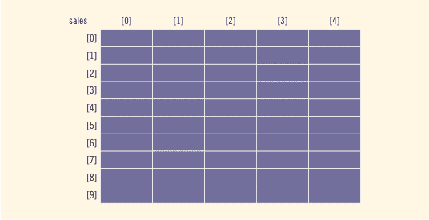

**图 8-13**  二维数组 `sales`

## 访问数组组件

要访问二维数组的组件，需要一对下标：一个表示行位置（在前），一个表示列位置（在后）。

访问二维数组组件的语法是：

```
arrayName[indexExp1][indexExp2]
```

其中 indexExp1 和 indexExp2 是产生非负整数值的表达式。indexExp1 指定行位置；indexExp2 指定列位置。

语句：

```
sales[5][3] = 25.75;
```

将 25.75 存入数组 sales 的第 5 行和第 3 列（即第六行和第四列）（见图 8-14）。

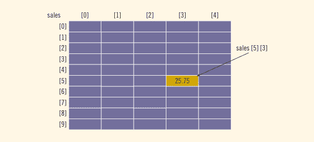

**图 8-14** `sales[5][3]`

假设：

```
int i = 5;
int j = 3;
```

那么，前面的语句：

```
sales[5][3] = 25.75;
```

等价于：

```
sales[i][j] = 25.75;
```

因此，下标也可以是变量。

## 声明期间的二维数组初始化

与一维数组一样，二维数组可以在声明时初始化。下面的示例有助于说明这个概念。考虑以下语句：

```
int board[4][3] = {{2, 3, 1},
                    {15, 25, 13},
                    {20, 4, 7},
                    {11, 18, 14}};
```

该语句将 board 声明为一个四行三列的二维数组。第一行的元素分别是 2、3 和 1；第二行的元素分别是 15、25 和 13；第三行的元素分别是 20、4 和 7；第四行的元素分别是 11、18 和 14。图 8-15 展示了数组 board。

| board | [0] | [1] | [2] |
|---|---:|---:|---:|
| [0] | 2 | 3 | 1 |
| [1] | 15 | 25 | 13 |
| [2] | 20 | 4 | 7 |
| [3] | 11 | 18 | 14 |

**图 8-15** 二维数组 *board*

要在声明二维数组时初始化它：

- 每一行的元素都放在一组花括号内，并用逗号分隔。
- 所有行的集合放在花括号内。
- 对于数值数组，如果某一行的所有组件都没有指定，则未指定的组件被初始化为 0。在这种情况下，必须至少给出一个值来初始化该行的所有组件。

## 二维数组与枚举类型

> **注意** 理解本节需要先阅读第 7 章中的“枚举类型”一节。

数组下标也可以使用枚举类型。考虑以下语句：

```
const int NUMBER_OF_ROWS = 6;
const int NUMBER_OF_COLUMNS = 5;
enum carType { GM, FORD, TOYOTA, BMW, NISSAN, VOLVO };
enum colorType { RED, BROWN, BLACK, WHITE, GRAY };

int inStock[NUMBER_OF_ROWS][NUMBER_OF_COLUMNS];
```

这些语句定义了 carType 和 colorType 枚举类型，并将 inStock 定义为六行五列的二维数组。假设 inStock 的每一行对应一种汽车类型，每一列对应一种颜色类型。也就是说，第一行对应汽车类型 GM，第二行对应汽车类型 FORD，依此类推。同样，第一列对应颜色类型 RED，第二列对应颜色类型 BROWN，依此类推。再假设 inStock 中的每个条目表示某种特定类型和颜色的汽车数量（见图 8-16）。

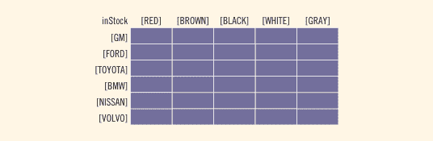

**图 8-16**  二维数组 `inStock`

语句：

```
inStock[1][3] = 15;
```

等价于以下语句（见图 8-17）：

```
inStock[FORD][WHITE] = 15;
```

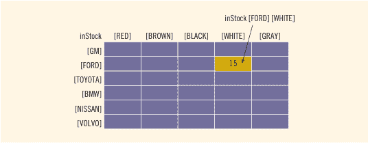

**图 8-17**  `inStock[FORD][WHITE]`

第二条语句很容易传达信息——也就是，将 WHITE FORD 汽车的数量设置为 15。这个例子说明，枚举类型可以有效地使程序可读且易于管理。

## 处理二维数组

二维数组可以通过三种方式处理：

- 处理单个元素。
- 处理整个数组。

```
for (col = 0; col < NUMBER_OF_COLUMNS; col++)
    cout << setw(5) << matrix[row][col] << " ";

    cout << endl;
}
```

### 输入

下面的 `for` 循环将数据输入到 `matrix` 的第 4 行，也就是第五行：

```
row = 4;

for (col = 0; col < NUMBER_OF_COLUMNS; col++)
    cin >> matrix[row][col];
```

和前面一样，通过将行号放入循环中，可以将数据输入到 `matrix` 的每个组件中。下面的 `for` 循环将数据输入到 `matrix` 的每个组件中：

```
for (row = 0; row < NUMBER_OF_ROWS; row++)
    for (col = 0; col < NUMBER_OF_COLUMNS; col++)
        cin >> matrix[row][col];
```

### 按行求和

下面的 `for` 循环求 `matrix` 第 4 行的和；也就是说，它将第 4 行的各组件相加：

```
sum = 0;
row = 4;
for (col = 0; col < NUMBER_OF_COLUMNS; col++)
    sum = sum + matrix[row][col];
```

同样，通过将行号放入循环中，我们可以分别求出每一行的和。以下是求每一行各自之和的 C++ 代码：

```
//Sum of each individual row
for (row = 0; row < NUMBER_OF_ROWS; row++)
{
    sum = 0;
    for (col = 0; col < NUMBER_OF_COLUMNS; col++)
        sum = sum + matrix[row][col];

    cout << "Sum of row " << row + 1 << " = " << sum << endl;
}
```

### 按列求和

与按行求和的情况一样，下面的嵌套 `for` 循环求每一列各自的和：

```
//Sum of each individual column
for (col = 0; col < NUMBER_OF_COLUMNS; col++)
{
    sum = 0;
```

当将二维数组存储到计算机内存中时，C++ 使用**行序形式**。也就是说，先存储第一行，接着存储第二行，接着存储第三行，依此类推。

对于一维数组，在将其声明为形参时，我们通常会省略数组的大小。因为 C++ 以行序形式存储二维数组，为了正确计算组件的地址，编译器必须知道一行在哪里结束、下一行从哪里开始。因此，在将二维数组声明为形参时，可以省略第一维的大小，但不能省略第二维；也就是说，必须指定列数。

假设我们有如下声明：

```
const int NUMBER_OF_ROWS = 6;
const int NUMBER_OF_COLUMNS = 5;
```

考虑以下函数 printMatrix 的定义：

```
void printMatrix(int matrix[][NUMBER_OF_COLUMNS],
                 int noOfRows)
{
    int row, col;

    for (row = 0; row < noOfRows; row++)
    {
        for (col = 0; col < NUMBER_OF_COLUMNS; col++)
            cout << setw(5) << matrix[row][col] << " ";

        cout << endl;
    }
}
```

该函数接受一个行数未指定、列数为五的二维数组作为参数，并输出该二维数组的内容。在函数调用期间，实参的列数必须与形参的列数匹配。

同样，下面的函数输出一个二维数组中每一行元素的和，该数组的元素类型为 `int`：

```
void sumRows(int matrix[][NUMBER_OF_COLUMNS], int noOfRows)
{
    int row, col;
    int sum;

              //Sum of each individual row
    for (row = 0; row < noOfRows; row++)
    {
        sum = 0;

        for (col = 0; col < NUMBER_OF_COLUMNS; col++)
            sum = sum + matrix[row][col];

        cout << "Sum of row " << (row + 1) << " = " << sum
             << endl;
    }
}
```

下面的函数确定每一行中最大的元素：

```
void largestInRows(int matrix[][NUMBER_OF_COLUMNS],
                   int noOfRows)
{
    int row, col;
    int largest;

    //Largest element in each row
    for (row = 0; row < noOfRows; row++)
    {
        largest = matrix[row][0]; //Assume that the first element
                                  //of the row is the largest.
        for (col = 1; col < NUMBER_OF_COLUMNS; col++)
            if (largest < matrix[row][col])
                largest = matrix[row][col];

        cout << "The largest element of row " << (row + 1)
             << " = " << largest << endl;
    }
}
```

同样，你可以编写函数来求每一列元素的和、将数据读入二维数组、求每一行或每一列中最大和/或最小元素，等等。

例 8-11 展示了函数 printMatrix、sumRows 和 largestInRows 如何在程序中使用。

### 例 8-11

下面的程序说明如何将二维数组作为参数传递给函数。

```
// Two-dimensional arrays as parameters to functions.

#include <iostream>
#include <iomanip>

using namespace std;

const int NUMBER_OF_ROWS = 6;
const int NUMBER_OF_COLUMNS = 5;

void printMatrix(int matrix[][NUMBER_OF_COLUMNS],
                 int NUMBER_OF_ROWS);
void sumRows(int matrix[][NUMBER_OF_COLUMNS],
             int NUMBER_OF_ROWS);
void largestInRows(int matrix[][NUMBER_OF_COLUMNS],
                   int NUMBER_OF_ROWS);

int main()
{
```


## 字符串数组

假设你需要执行一项操作，例如按字母顺序排列一个姓名列表。由于每个姓名都是一个字符串，存储姓名列表的一种方便方式是使用数组。在 C++ 中，可以使用 string 数据类型或字符数组（C 字符串）来操作字符串。此外，在某些编译器上，标准 C++（即非 ANSI/ISO 标准 C++）中可能不提供 string 数据类型。本节将说明操作字符串列表的两种方式。

### 字符串数组与 `string` 类型

使用 string 数据类型处理字符串列表很直接。假设该列表最多包含 100 个姓名。可以如下声明一个包含 100 个 string 类型分量的数组：

```
string list[100];
```

可以对 string 类型的值执行基本操作，例如赋值、比较和输入/输出。因此，可以像处理本章第一部分讨论的任何一维数组一样处理 list 中的数据。

### 字符串数组与 C 字符串（字符数组）

假设列表中最大的字符串（例如姓名）长度为 15 个字符，并且列表中有 100 个字符串。可以如下声明一个 100 行、16 列的二维字符数组（见图 8-19）：

```
char list[100][16];
```

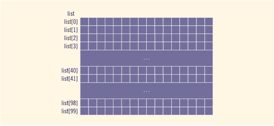

**图8-19** 字符串数组 list

现在，对于每个 `j`（`0 <= j <= 99`），`list[j]` 都是长度至多为 15 个字符的字符串。以下语句将 "Snow White" 存储到 `list[1]` 中（见图 8-20）：

```
strcpy(list[1], "Snow White");
```

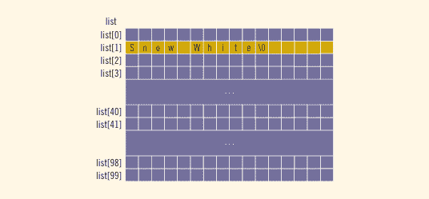

**图8-20** 数组 list，显示 `list[1]`

假设你希望读取数据并将其存储到 `list` 中，并且每行一个条目。以下 `for` 循环可完成此任务：

```
for (j = 0; j < 100; j++)
    cin.get(list[j], 16);
```

以下 `for` 循环输出每一行中的字符串：

```
for (j = 0; j < 100; j++)
    cout << list[j] << endl;
```

还可以使用其他字符串函数（例如 `strcmp` 和 `strlen`）以及 `for` 循环来操作 `list`。

> 注意：string 数据类型定义了赋值、连接和关系运算等操作。如果你使用标准 C++ 头文件，并且你的编译器支持 string 数据类型，我们建议你使用 string 数据类型来操作字符串列表。

### 声明二维数组的另一种方式

> 注意：可以跳过本节，而不会影响连续性。

如果你知道程序将要处理的表的大小，那么可以使用 `typedef` 先定义二维数组数据类型，然后声明该类型的变量。

例如，考虑以下内容：

```c
const int NUMBER_OF_ROWS = 20;
const int NUMBER_OF_COLUMNS = 10;
```

```c
typedef int tableType[NUMBER_OF_ROWS][NUMBER_OF_COLUMNS];
```

前面的语句定义了一个二维数组数据类型 `tableType`。现在可以声明该类型的变量。因此：

```c
tableType matrix;
```

声明了一个 20 行、10 列的二维数组 `matrix`。

在声明形式参数时也可以使用此数据类型，如下面的代码所示：

```c
void initialize(tableType table)
{
    int row;
    int col;

    for (row = 0; row < NUMBER_OF_ROWS; row++)
        for (col = 0; col < NUMBER_OF_COLUMNS; col++)
            table[row][col] = 0;
}
```

该函数接受任何 `tableType` 类型的变量作为参数，该类型是一个包含 20 行和 10 列的二维数组，并将该数组初始化为 0。

通过先定义数据类型，在将二维数组声明为变量或形式参数时，或在函数调用期间将数组作为参数传递时，就不需要反复检查确切的列数。

## 多维数组

在本章中，我们将数组定义为固定数量的同类型元素（称为分量）的集合。一维数组是元素以列表形式排列的数组；在二维数组中，元素以表格形式排列。我们还可以定义三维或更高维的数组。在 C++ 中，除了内存空间的限制外，数组的维数没有限制。以下是数组的一般定义。

`n` 维数组：固定数量的分量按 `n` 个维度（`n >= 1`）排列而成的集合。

声明 *n* 维数组的一般语法为：

```
dataType arrayName[intExp1][intExp2] ... [intExpn];
```

其中 intExp1、intExp2、... 和 intExpn 是产生正整数值的常量表达式。

访问 *n* 维数组分量的语法为：

```
arrayName[indexExp1][indexExp2] ... [indexExpn]
```

其中 indexExp1、indexExp2、... 和 indexExpn 是产生非负整数值的表达式。indexExpi 给出数组分量在第 *i* 维中的位置。

例如，语句：

```
double carDealers[10][5][7];
```

将 carDealers 声明为一个三维数组。第一维的大小为 10，第二维的大小为 5，第三维的大小为 7。第一维的范围是 0 到 9，第二维的范围是 0 到 4，第三维的范围是 0 到 6。数组 carDealers 的基地址是第一个数组分量的地址，即 carDealers[0][0][0] 的地址。数组 carDealers 中分量的总数为 10 × 5 × 7 = 350。

语句：

```
carDealers[5][3][2] = 15564.75;
```

将 carDealers[5][3][2] 的值设置为 15564.75。

可以使用循环来处理多维数组。例如，以下嵌套的 `for` 循环：

```
for (i = 0; i < 10; i++)
    for (j = 0; j < 5; j++)
        for (k = 0; k < 7; k++)
            carDealers[i][j][k] = 0.0;
```

将整个数组初始化为 0.0。

在函数中将多维数组声明为形式参数时，可以省略第一维的大小，但不能省略其他维度的大小。作为参数，多维数组仅按引用传递，并且函数不能返回数组类型的值。不会检查数组索引是否在边界内，因此通常建议包含某种形式的“索引在范围内”检查。

## **编程示例：** 代码检测

当消息以秘密代码通过传输通道传输时，通常以位序列（即 0 和 1）发送。由于传输通道中的噪声，传输的消息可能会损坏。也就是说，在目的地接收到的消息与发送的消息不相同；某些位可能已经改变。有几种技术可以在目的地检查所传输消息的有效性。一种技术是将同一消息传输两次。在目的地，将消息的两个副本逐位比较。如果对应位相同，则接收到的消息无错误。

让我们编写一个程序来检查在目的地接收到的消息是否无错误。为简单起见，假设表示消息的秘密代码是数字序列（0 到 9），并且消息的最大长度为 250 位数字。此外，消息中的第一个数字是消息的长度。例如，如果秘密代码是：

```
7 9 2 7 8 3 5 6
```

那么实际消息长度为 7 位数字。

上述消息按如下方式传输：

```
7 9 2 7 8 3 5 6 7 9 2 7 8 3 5 6
```

**输入** 一个包含秘密代码及其副本的文件。

**输出** 秘密代码、其副本，以及（如果接收到的代码无错误）以下形式的消息：

| 代码数字 | 代码数字 | 副本 |
|---:|---:|---|
| 9 | 9 | |
| 2 | 2 | |
| 7 | 7 | |
| 8 | 8 | |
| 3 | 3 | |
| 5 | 5 | |
| 6 | 6 | |

```
Message transmitted OK.
```

### 问题分析与算法设计

因为我们必须比较秘密代码及其副本的对应数字，所以我们首先读取秘密代码并将其存储在一个数组中。然后读取副本的第一个数字，并将其与秘密代码的第一个数字比较，依此类推。如果任何对应数字不相同，我们通过在数字旁边打印一条消息来表明这一事实。由于消息的最大长度为 250，我们使用大小为 250 的数组。秘密代码及其副本中的第一个数字都表示代码的长度。上述讨论可转化为以下算法：


- 1. 打开输入和输出文件。
- 2. 如果输入文件不存在，则退出程序。
- 3. 读取密码的长度。
- 4. 如果密码长度大于 250，则终止程序，因为本程序中密码的最大长度为 250。
- 5. 读取密码并将其存储到数组中。
- 6. 读取副本的长度。
- 7. 如果密码及其副本的长度相同，则比较密码并输出相应的消息；否则，打印错误消息。

为了简化 main 函数，让我们编写一个函数 `readCode` 来读取密码，再编写另一个函数 `compareCode` 来比较密码。

### readCode

该函数首先读取密码的长度。如果密码长度大于 250，则引用参数 bool 变量 `lenCodeOk` 被设置为 false，并且函数终止。`lenCodeOk` 的值被传递给调用函数，以指示密码是否读取成功。如果密码长度不超过 250，`readCode` 函数将读取密码并将其存储到数组中。由于输入存储在文件中，而文件是在 main 函数中打开的，因此必须将对应于输入文件的输入流变量作为参数传递给该函数。此外，在读取了密码长度和密码本身之后，`readCode` 函数必须将这些值传递给 main 函数。因此，该函数有四个参数：一个输入文件流变量、一个存储密码的数组、密码长度，以及 bool 参数 `lenCodeOk`。`readCode` 函数的定义如下：

```cpp
void readCode(ifstream& infile, int list[], int& length,
              bool& lenCodeOk)
{
    int count;

    lenCodeOk = true;

    infile >> length;  //get the length of the secret code

    if (length > MAX_CODE_SIZE)
    {
        lenCodeOk = false;
        return;
    }

    //Get the secret code.
    for (count = 0; count < length; count++)
        infile >> list[count];
}
```

### compareCode

该函数将密码与其副本进行比较。因此，它必须能够访问包含密码的数组以及密码的长度。密码的副本及其长度存储在输入文件中。因此，必须将对应于输入文件的输入流变量作为参数传递给该函数。另外，`compareCode` 函数将密码与副本进行比较，并输出相应的消息。由于输出将存储在文件中，因此还必须将对应于输出文件的输出流变量作为参数传递给该函数。因此，该函数有四个参数：一个输入文件流变量、一个输出文件流变量、包含密码的数组，以及密码的长度。据此，`compareCode` 函数的算法如下：

- a. 声明变量。
- b. 将 bool 变量 `codeOk` 设置为 true。
- c. 读取密码副本的长度。
- d. 如果密码及其副本的长度不相同，则输出相应的错误消息并终止函数。
- e. 对于输入文件中的每一位数字：
  - e.1. 读取密码副本的下一位数字。
  - e.2. 输出密码及其副本中对应的数字。
  - e.3. 如果对应数字不相同，则输出错误消息并将 bool 变量 `codeOk` 设置为 false。
- f. 如果 bool 变量 `codeOk` 为 true：
  - 输出一条表示密码已正确传输的消息。
  - 否则
  - 输出一条错误消息。

根据该算法，`compareCode` 函数的定义如下：

```cpp
void compareCode(ifstream& infile, ofstream& outfile,
                 const int list[], int length)
{
    //Step a
    int length2;
    int digit;
    bool codeOk;
    int count;

    codeOk = true;                         //Step b

    infile >> length2;                     //Step c

    if (length != length2)                 //Step d
    {
        outfile << "The original code and its copy "
                << "are not of the same length."
                << endl;
        return;
    }

    outfile << "Code Digit   Code Digit Copy"
            << endl;

    for (count = 0; count < length; count++)       //Step e
    {
        infile >> digit;                           //Step e.1
        outfile << setw(5) << list[count]          //Step e.2
                << setw(17) << digit;

        if (digit != list[count])                  //Step e.3
        {
            outfile << "  code digits are not the same"
                    << endl;
            codeOk = false;
        }
        else
            outfile << endl;
    }

    if (codeOk)                                    //Step f
        outfile << "Message transmitted OK."
                << endl;
    else
        outfile << "Error in transmission, "
                << "!! Retransmit!!" << endl;
}
```

以下是 main 函数的算法：

### main 算法

- 1. 声明变量。
- 2. 打开文件。
- 3. 调用函数 `readCode` 读取密码。
- 4. 如果 `(密码长度 <= 250)`：
  - 调用函数 `compareCode` 比较密码。
  - 否则：输出相应的错误消息。

## 完整程序清单

```cpp
//***********************************************************
// Author: D.S. Malik
//
// Program: Check Code
// This program determines whether a code is transmitted
// correctly.
//***********************************************************

#include <iostream>
#include <fstream>
#include <iomanip>

using namespace std;

const int MAX_CODE_SIZE = 250;

void readCode(ifstream& infile, int list[],
              int& length, bool& lenCodeOk);
void compareCode(ifstream& infile, ofstream& outfile,
                 const int list[], int length);

int main()
{
    //Step 1
    int codeArray[MAX_CODE_SIZE]; //array to store the secret
                                  //code
    int codeLength;               //variable to store the
                                  //length of the secret code
    bool lengthCodeOk;            //variable to indicate if the length
                                  //of the secret code is less than or
                                  //equal to 250

    ifstream incode;              //input file stream variable
    ofstream outcode;             //output file stream variable

    char inputFile[51];           //variable to store the name of the
                                  //input file
    char outputFile[51];          //variable to store the name of
                                  //the output file

    cout << "Enter the input file name: ";
    cin >> inputFile;
    cout << endl;

    //Step 2
    incode.open(inputFile);
    if (!incode)
    {
        cout << "Cannot open the input file." << endl;
        return 1;
    }

    cout << "Enter the output file name: ";
    cin >> outputFile;
    cout << endl;

    outcode.open(outputFile);

    readCode(incode, codeArray, codeLength,
             lengthCodeOk);                         //Step 3

    if (lengthCodeOk)                               //Step 4
        compareCode(incode, outcode, codeArray,
                    codeLength);
    else
        cout << "Length of the secret code "
             << "must be <= " << MAX_CODE_SIZE
             << endl;                               //Step 5

    incode.close();
    outcode.close();

    return 0;
}

//Place the definitions of the functions readCode and
//compareCode, as described previously, here.
```

**示例运行：** 在本示例运行中，用户输入以底纹显示。

请输入输入文件名：`Ch8_SecretCodeData.txt`

请输入输出文件名：`Ch8_SecretCodeOut.txt`

输入文件数据：(Ch8_SecretCodeData.txt)

7 9 2 7 8 3 5 6 7 9 2 7 8 3 5 6

输出文件数据：(Ch8_SecretCodeOut.txt)

| 代码数字 | 代码副本数字 |
|---:|---:|
| 9 | 9 |
| 2 | 2 |
| 7 | 7 |
| 8 | 8 |
| 3 | 3 |
| 5 | 5 |
| 6 | 6 |

消息传输成功。


## 编程示例：文本处理


**（行数和字母计数）** 现在让我们编写一个程序，读取给定文本，原样输出该文本，并打印文本的行数以及每个字母出现的次数。大写字母和小写字母被视为相同；也就是说，它们一起计数。

因为共有26个字母，我们使用一个包含26个分量的数组来执行字母计数。我们还需要一个变量来存储行数。

文本存储在一个文件中，我们将其称为`textin.txt`。输出将存储在一个文件中，我们将其称为`textout.out`。

**输入**  包含待处理文本的文件。

**输出**  包含文本、行数以及字母在文本中出现次数的文件。

- 问题
- 分析
- 和
- 算法
- 设计

根据期望的输出，很明显我们必须原样输出文本。也就是说，如果文本包含任何空白字符，它们也必须被输出。此外，我们必须计算文本中的行数。因此，我们必须知道行在哪里结束，这意味着我们必须捕获换行符。这一要求表明我们不能使用提取运算符来处理输入文件。因为我们还需要执行字母计数，所以我们使用`get`函数来读取文本。

让我们首先描述开发程序所必需的变量。这将简化后面的讨论。

### 变量

我们需要存储行数和字母计数。因此，我们需要一个变量来存储行数，以及26个变量来执行字母计数。我们将使用一个包含26个分量的数组来执行字母计数。我们还需要一个变量来依次读取和存储每个字符，因为输入文件将逐字符读取。由于数据要从输入文件读取，输出要保存到文件中，我们需要一个输入流变量来打开输入文件，以及一个输出流变量来打开输出文件。这些语句表明函数`main`需要（至少）以下变量：

```cpp
int lineCount;       //variable to store the line count
int letterCount[26]; //array to store the letter count
char ch;             //variable to store a character
ifstream infile;     //input file stream variable
ofstream outfile;    //output file stream variable
```

在此声明中，`letterCount[0]`存储A的计数，`letterCount[1]`存储B的计数，依此类推。显然，变量`lineCount`和数组`letterCount`必须初始化为0。

该程序的算法是：

- 1. 声明变量。
- 2. 打开输入和输出文件。
- 3. 初始化变量。
- 4. 当输入文件中还有更多数据时：
  - 4.1. 对于一行中的每个字符：
    - 4.1.1. 读取并写出该字符。
    - 4.1.2. 递增相应的字母计数。
  - 4.2. 递增行数。
- 5. 输出行数和字母计数。
- 6. 关闭文件。

为简化函数`main`，我们将其划分为四个函数：

- 函数`initialize`
- 函数`copyText`
- 函数`characterCount`
- 函数`writeTotal`

以下各节详细描述这些函数中的每一个。然后，借助这些函数，我们描述函数`main`的算法。

### initialize

此函数将变量`lineCount`和数组`letterCount`初始化为0。因此，它有两个参数：一个对应于变量`lineCount`，一个对应于数组`letterCount`。显然，对应于`lineCount`的参数必须是引用参数。此函数的定义是：

```cpp
void initialize(int& lc, int list[])
{
    int j;
    lc = 0;

    for (j = 0; j < 26; j++)
        list[j] = 0;
} //end initialize
```

### copyText

此函数读取一行并输出该行。读取一个字符后，它调用函数`characterCount`来更新字母计数。显然，此函数有四个参数：一个输入文件流变量、一个输出文件流变量、一个`char`变量以及用于更新字母计数的数组。

注意，`copyText`函数不执行字母计数，但我们仍然将数组`letterCount`传递给它。我们采取这一步骤是因为此函数调用函数`characterCount`，而该函数需要数组`letterCount`来更新相应的字母计数。因此，我们必须将数组`letterCount`传递给`copyText`函数，以便它可以将数组传递给函数`characterCount`。

```cpp
void copyText(ifstream& intext, ofstream& outtext, char& ch,
              int list[])
{
    while (ch != '\n')        //process the entire line
    {
        outtext << ch;        //output the character
        characterCount(ch, list);   //call the function
                              //character count
        intext.get(ch);       //read the next character
    }
    outtext << ch;            //output the newline character
} //end copyText
```

### characterCount

此函数递增字母计数。为了递增相应的字母计数，它必须知道字母是什么。因此，`characterCount`函数有两个参数：一个`char`变量和用于更新字母计数的数组。用伪代码表示，此函数是：

- a. 将字母转换为大写。
- b. 找到与此字母对应的数组索引。
- c. 如果索引有效，则递增相应的计数。在此步骤中，我们必须确保该字符是字母。我们只计数字母，因此其他字符——如逗号、连字符和句点——被忽略。

按照此算法，此函数的定义是：

```cpp
void characterCount(char ch, int list[])
{
    int index;

    ch = toupper(ch);                    //Step a

    index = static_cast<int>(ch)
          - static_cast<int>('A');       //Step b

    if (0 <= index && index < 26)        //Step c
        list[index]++;
} //end characterCount
```

### writeTotal

此函数输出行数和字母计数。它有三个参数：输出文件流变量、行数以及用于输出字母计数的数组。此函数的定义是：

```cpp
void writeTotal(ofstream outtext, int lc, int list[])
{
    int index;

    outtext << endl << endl;
    outtext << "The number of lines = " << lc << endl;

    for (index = 0; index < 26; index++)
        outtext << static_cast<char>(index
                                   + static_cast<int>('A'))
                << " count = " << list[index] << endl;
} //end writeTotal
```

我们现在描述函数`main`的算法。

### 主算法

- 1. 声明变量。
- 2. 打开输入文件。
- 3. 如果输入文件不存在，则退出程序。
- 4. 打开输出文件。
- 5. 初始化变量，例如`lineCount`和数组`letterCount`。
- 6. 读取第一个字符。
- 7. 当（未到达输入文件末尾）时：
  - 7.1. 处理下一行；调用函数`copyText`。
  - 7.2. 递增行数。（递增变量`lineCount`。）
  - 7.3. 读取下一个字符。
- 8. 输出行数和字母计数。调用函数`writeTotal`。
- 9. 关闭文件。

### 完整程序清单

```cpp
//***************************************************************
// Author: D.S. Malik
//
// Program: Line and Letter Count
// This program reads a text, outputs the text as is, and also
// prints the number of lines and the number of times each
// letter appears in the text. An uppercase letter and a
// lowercase letter are treated as being the same; that is,
// they are tallied together.
//***************************************************************
```


```cpp
#include <iostream>
#include <fstream>
#include <cctype>

using namespace std;

void initialize(int& lc, int list[]);
void copyText(ifstream& intext, ofstream& outtext, char& ch,
              int list[]);
void characterCount(char ch, int list[]);
void writeTotal(ofstream& outtext, int lc, int list[]);

int main()
{
    //Step 1: Declare variables
    int lineCount;
    int letterCount[26];
    char ch;
    ifstream infile;
    ofstream outfile;

    infile.open("textin.txt");                         //Step 2

    if (!infile)                                       //Step 3
    {
        cout << "Cannot open the input file."
             << endl;
        return 1;
    }

    outfile.open("textout.out");                       //Step 4

    initialize(lineCount, letterCount);                 //Step 5

    infile.get(ch);                                     //Step 6

    while (infile)                                      //Step 7
    {
        copyText(infile, outfile, ch, letterCount);     //Step 7.1
        lineCount++;                                    //Step 7.2
        infile.get(ch);                                 //Step 7.3
    }

    writeTotal(outfile, lineCount, letterCount);        //Step 8

    infile.close();                                     //Step 9
    outfile.close();                                    //Step 9

    return 0;
}

void initialize(int& lc, int list[])
{
    int j;
    lc = 0;

    for (j = 0; j < 26; j++)
        list[j] = 0;
} //end initialize

void copyText(ifstream& intext, ofstream& outtext, char& ch,
              int list[])
{
    while (ch != '\n')        //process the entire line
    {
        outtext << ch;        //output the character
        characterCount(ch, list);    //call the function
                                     //character count
        intext.get(ch);       //read the next character
    }
    outtext << ch;            //output the newline character
} //end copyText

void characterCount(char ch, int list[])
{
    int index;

    ch = toupper(ch);                         //Step a

    index = static_cast<int>(ch)
          - static_cast<int>('A');            //Step b

    if (0 <= index && index < 26)              //Step c
        list[index]++;
} //end characterCount

void writeTotal(ofstream& outtext, int lc, int list[])
{
    int index;

    outtext << endl << endl;
    outtext << "The number of lines = " << lc << endl;

    for (index = 0; index < 26; index++)
        outtext << static_cast<char>(index
                                    + static_cast<int>('A'))
                << " count = " << list[index] << endl;
} //end writeTotal
```

### 示例运行（textout.out）：

今天，我们生活在一个信息几乎以光速处理的时代。通过计算机，技术革命正在彻底改变我们生活和相互交流的方式。诸如“互联网”这样的术语，几年前还不熟悉，如今已非常普遍。借助计算机，你可以在几秒钟内向亲人发送信件并收到他们的来信。你不再需要通过邮寄简历来申请工作；在许多情况下，你可以直接通过互联网提交求职申请。你可以实时查看股票行情，并立即买卖股票。学生们经常上网“冲浪”，并使用计算机设计课堂项目。他们还使用功能强大的文字处理软件完成学期论文。许多人在计算机上维护并平衡支票簿。

```text
The number of lines = 15
A count = 53
B count = 7
C count = 30
D count = 19
E count = 81
F count = 11
G count = 10
H count = 29
I count = 41
J count = 4
K count = 3
L count = 31
M count = 26
N count = 50
O count = 59
P count = 21
Q count = 0
R count = 45
S count = 48
T count = 62
U count = 24
V count = 7
W count = 15
X count = 0
Y count = 20
Z count = 0
```

## 快速回顾

- 1. 如果某一数据类型的变量一次只能保存一个值，则该数据类型是简单数据类型。
- 2. 在结构化数据类型中，每个数据项都是其他数据项的集合。
- 3. 数组是一种具有固定分量数的结构化数据类型。每个分量都具有相同类型，并且通过分量在数组中的相对位置来访问它们。
- 4. 一维数组的元素以列表形式排列。
- 5. 不检查数组下标是否越界。
- 6. 在 C++ 中，数组下标从 0 开始。
- 7. 数组下标可以是一个求值为非负整数的表达式。下标的值必须始终小于数组的大小。
- 8. 除了字符数组（C 字符串）的输入/输出外，数组没有聚合操作。
- 9. 数组可以在声明时初始化。如果初始值少于数组大小，则其余元素初始化为 0。
- 10. 数组的基地址是第一个数组分量的地址。例如，如果 `list` 是一维数组，则 `list` 的基地址是 `list[0]` 的地址。
- 11. 将一维数组声明为形式参数时，通常省略数组大小。如果在形式参数声明中指定一维数组的大小，编译器将忽略该大小。
- 12. 在函数调用语句中，将数组作为实际参数传递时，只使用其名称。
- 13. 作为函数的参数，数组仅按引用传递。
- 14. 由于作为参数时数组仅按引用传递，因此在将数组声明为形式参数时，不要在数据类型后使用符号 `&`。
- 15. 函数不能返回数组类型的值。
- 16. 尽管作为参数时数组按引用传递，但在将数组声明为形式参数时，在数据类型前使用保留字 `const` 可防止函数修改该数组。
- 17. 单个数组分量可以作为参数传递给函数。
- 18. 顺序搜索算法从列表的第一个元素开始，在列表中搜索给定项。它继续将搜索项与列表中的其他元素进行比较，直到找到该项，或者列表中没有更多元素可与搜索项比较为止。
- 19. 选择排序通过找到列表中最小的（或等价地，最大的）元素并将其移到列表开头（或末尾）来对列表排序。
- 20. 对于长度为 \(n\) 的列表，选择排序恰好进行 \(\frac{n(n-1)}{2}\) 次关键字比较和 \(3(n-1)\) 次项赋值。


- 21. 在 C++ 中，字符串是括在双引号之间的任意字符序列。
- 22. 在 C++ 中，C 字符串以空字符结尾。
- 23. 在 C++ 中，空字符表示为 `'\0'`。
- 24. 在 ASCII 字符集中，空字符的排序序列值为 0。
- 25. C 字符串存储在字符数组中。
- 26. 字符数组可以在声明时使用字符串表示法初始化。
- 27. C 字符串的输入和输出是 C++ 允许聚合操作的唯一地方。
- 28. 头文件 `cstring` 包含可用于 C 字符串操作的函数声明。
- 29. 常用的 C 字符串操作函数包括 `strcpy`（字符串复制）、`strcmp`（字符串比较）和 `strlen`（字符串长度）。
- 30. C 字符串按字符逐个比较。
- 31. 由于 C 字符串存储在数组中，因此可以使用数组分量访问表示法访问 C 字符串中的单个字符。
- 32. 并行数组用于保存相关信息。
- 33. 在二维数组中，元素以表格形式排列。
- 34. 要访问二维数组的元素，需要一对下标：一个表示行位置，一个表示列位置。
- 35. 在二维数组中，行编号为 0 到 `ROW_SIZE − 1`，列编号为 0 到 `COLUMN_SIZE − 1`。
- 36. 如果 `matrix` 是二维数组，则 `matrix` 的基地址是数组分量 `matrix[0][0]` 的地址。
- 37. 在行处理中，二维数组一次处理一行。
- 38. 在列处理中，二维数组一次处理一列。
- 39. 将二维数组声明为形式参数时，可以省略第一维的大小，但不能省略第二维的大小。
- 40. 当二维数组作为实际参数传递时，实际数组和形式数组的列数必须匹配。
- 41. C++ 在计算机内存中以行顺序形式存储二维数组。

## 练习

练习末尾括号中的数字指本章开头列出的学习目标。

- 1. 将下列陈述标记为正确或错误。
  - a. double 类型是简单数据类型的一个例子。(1)
  - b. 一维数组是结构化数据类型的一个例子。(1)
  - c. 数组的大小在编译时确定。(1, 6)


- d. 给定声明：

  ```cpp
  int list[10];
  ```

  语句：

  ```cpp
  list[5] = list[3] + list[2];
  ```

  会更新数组 list 第五个分量的内容。(2)

- e. 如果数组下标越界，程序总是会因错误而终止。(3)

- f. 对于 `int` 数组，唯一允许的聚合操作是递增和递减操作。(5)

- g. 数组既可以按值也可以按引用作为参数传递给函数。(6)

- h. 函数可以返回数组类型的值。(6)

- i. 在 C++ 中，字符串允许某些聚合操作。(11, 12, 13)

- j. 声明：

  ```cpp
  char name[16] = "John K. Miller";
  ```

  将 name 声明为包含 15 个字符的数组，因为字符串 "John K. Miller" 只有 14 个字符。(11)

- k. 声明：

  ```cpp
  char str = "Sunny Day";
  ```

  将 str 声明为长度未指定的字符串。(11)

- l. 作为参数时，二维数组既可以按值传递，也可以按引用传递。(15, 16)

### 2. 考虑以下声明：(1, 2)

```cpp
int accountNum[75];
```

在该声明中，指出以下各项：

- a. 数组名。
- b. 数组大小。
- c. 每个数组分量的数据类型。
- d. 数组下标的取值范围。
- e. 第一个元素的下标。
- f. 最后一个元素的下标。

### 3. 指出以下数组声明中的错误（如果有）。如果语句不正确，请提供正确的语句。(1, 2)

- a. `int primeNum[99];`
- b. `int testScores[0];`
- c. `string names[60];`
- d. `int list100[0..99];`
- e. `double[50] gpa;`
- f.

  ```cpp
  const double LENGTH = 26;
  double list[LENGTH - 1];
  ```

- g.

  ```cpp
  const long SIZE = 100;
  int list[2 * SIZE];
  ```

### 4. 判断以下数组声明是否有效。如果声明无效，请解释原因。(1, 2)

- a. `string customers[];`
- b. `int numArray[50];`
- c.

  ```cpp
  const int SIZE = 30;
  double list[20 - SIZE];
  ```

- d.

  ```cpp
  int length = 50;
  double list[length - 50];
  ```

- e. `int ids[-30];`
- f. `colors[30] string;`

### 5. 大小为 99 的数组，其下标的有效范围是什么？第一个元素的下标是什么？最后一个元素的下标是什么？(1, 3)

### 6. 编写 C++ 语句完成以下操作：(1, 2)

- a. 声明一个包含 50 个 `int` 类型分量的数组 `alpha`。
- b. 将 `alpha` 的每个分量初始化为 −1。
- c. 输出数组 `alpha` 第一个分量的值。
- d. 将数组 `alpha` 第二十五个分量的值设为 62。
- e. 将 `alpha` 第十个分量的值设为 `alpha` 第五十个分量的值的三倍加 10。
- f. 使用 `for` 循环输出 `alpha` 中下标为 2 或 3 的倍数的分量的值。
- g. 输出 `alpha` 最后一个分量的值。
- h. 输出 `alpha` 的值，使每行打印 15 个分量。
- i. 使用 `for` 循环对每隔一个元素（偶数下标元素）进行递增。
- j. 使用 `for` 循环创建新数组 `diffAlpha`，其元素为 `alpha` 中相邻元素的差值。

### 7. 以下程序段的输出是什么？(2)

```cpp
int temp[5];

for (int i = 0; i < 5; i++)
    temp[i] = static_cast<int>(pow(i, 2.0));

for (int i = 0; i < 5; i++)
    cout << temp[i] << " ";
cout << endl;

temp[4] = temp[3] * temp[2];
temp[3] = temp[4] - temp[2];
temp[0] = temp[5] - temp[1];

for (int i = 0; i < 5; i++)
    cout << temp[i] << " ";
cout << endl;
```

### 8. 以下 C++ 代码执行后，list 中存储的是什么？(2)

```cpp
int list[10];

for (int i = 0; i < 5; i++)
{
    list[i] = i * (i - 1);
    if (i % 2 == 0)
        list[i] = list[i] + i;
    else if (i % 3 == 0)
        list[i] = list[i] - i;
    else if (i > 0)
        list[i] = list[i] - list[i - 1];
}
```

### 9. 以下 C++ 代码执行后，list 中存储的是什么？(2)

```cpp
int list[8];

list[0] = 1;
list[1] = 2;
for (int i = 2; i < 8; i++)
{
    list[i] = list[i - 1] * list[i - 2];
    if (i > 5)
        list[i] = list[i] - list[i - 1];
}
```

### 10. 以下 C++ 代码执行后，myList 中存储的是什么？(2)

```cpp
double myList[6];

myList[0] = 2.5;

for (int i = 1; i < 6; i++)
{
    myList[i] = i * myList[i - 1];
    if (i > 3)
        myList[i] = myList[i] / 2;
}
```

### 11. 改正以下代码，使其正确地将 myList 的每个元素的值设置为其下标。(2, 3)

```cpp
int myList[10];

for (int i = 1; i > 10; i++)
    myList[i] = i;
```

### 12. 改正以下代码，使其正确初始化并输出数组 `myList` 的元素。(2, 3)

```cpp
int myList[10];

for (int i = 1; i <= 10; i++)
    cin >> myList;

for (int i = 1; i <= 10; i++)
    cout << myList[i] << " ";
cout << endl;
```

### 13. 什么是数组下标越界？C++ 会检查数组下标是否在边界内吗？(3)

### 14. 假设 `scores` 是一个包含 10 个 `double` 类型分量的数组，并且：

`scores = {2.5, 3.9, 4.8, 6.2, 6.2, 7.4, 7.9, 8.5, 8.5, 9.9}`

以下代码本应测试 scores 的元素是否按非递减顺序排列。但是，代码中存在错误。找出并改正这些错误。(1, 2, 3)

```cpp
for (int i = 1; i <= 10; i++)
    if (scores[i] >= scores[i + 1])
        cout << " " << i << " and " << (i + 1)
             << " elements of scores are out of order." << endl;
```

### 15. 编写 C++ 语句来定义并初始化以下数组。(4)

- a. 包含 10 个 `double` 类型分量的数组 `heights`。将此数组初始化为以下值：5.2、6.3、5.8、4.9、5.2、5.7、6.7、7.1、5.10、6.0。
- b. 包含 7 个 `int` 类型分量的数组 `weights`。将此数组初始化为以下值：120、125、137、140、150、180、210。
- c. `char` 类型的数组 `specialSymbols`。将此数组初始化为以下值：'$'、'#'、'%'、'@'、'&'、'!'、'^'。
- d. 包含 4 个 `string` 类型分量的数组 `seasons`。将此数组初始化为以下值："fall"、"winter"、"spring"、"summer"。

### 16. 判断以下数组声明是否有效。如果声明有效，请确定数组的大小。(4)

- a. `int list[] = {18, 13, 14, 16};`
- b. `int x[10] = {1, 7, 5, 3, 2, 8};`
- c. `double y[4] = {2.0, 5.0, 8.0, 11.0, 14.0};`
- d. `double lengths[] = {8.2, 3.9, 6.4, 5.7, 7.3};`
- e. `int list[7] = {12, 13, , 14, 16, , 8};`
- f. `string names[8] = {"John", "Lisa", "Chris", "Katie"};`

### 17. 假设你有以下声明：

```cpp
int list[8] = {6, 10, 14, 18, 22};
```

如果该声明有效，list 的八个分量中分别存储了什么？(4)

### 18. 考虑以下声明：(2)

```cpp
int list[] = {3, 8, 10, 13, 6, 11};
```

- a. 编写 C++ 代码，输出 list 的每个分量中存储的值。
- b. 编写 C++ 代码，按如下方式设置 list 前五个分量的值：第 i 个分量的值等于第 i 个分量的值减去第 (i+1) 个分量的值的三倍。

### 19. 以下 C++ 代码的输出是什么？(2)

```cpp
#include <iostream>

using namespace std;

int main()
{
    int beta[7] = {3, 5};

    for (int i = 2; i < 7; i++)
    {
        beta[i] = 3 * i + 2;
        beta[i - 1] = beta[i - 1] + beta[i];
        beta[i - 2] = beta[i - 2] + beta[i - 1];
    }

    for (int i = 0; i < 7; i++)
        cout << beta[i] << " ";
    cout << endl;

    return 0;
}
```

### 20. 以下 C++ 代码的输出是什么？(2)

```cpp
#include <iostream>

using namespace std;

int main()
{
    int list1[5];
    int list2[15];

    for (int i = 0; i < 5; i++)
        list1[i] = i * i - 2;

    cout << "list1: ";
    for (int i = 0; i < 5; i++)
        cout << list1[i] << " ";
    cout << endl;
```


```cpp
for (int i = 0; i < 5; i++)
{
    list2[i] = list1[i] * i;
    list2[i + 5] = list1[4 - i] + i;
    list2[i + 10] = list2[9 - i] + list2[i];
}

cout << "list2: ";
for (int i = 0; i < 7; i++)
    cout << list2[i] << " ";
cout << endl;

return 0;
}
```

### 21.
考虑以下函数头：

```cpp
void tryMe(int x[], int size);
```

以及以下声明：

```cpp
int list[100];
int score[50];
double gpas[50];
```

以下哪个函数调用是合法的？(6)

- a. `tryMe(list, 100);`
- b. `tryMe(list, 75);`
- c. `tryMe(score, 100);`
- d. `tryMe(score, 49);`
- e. `tryMe(gpas, 50);`

### 22.
假设你有以下函数定义：

```cpp
void sum(int x, int y, int& z)
{
    z = x + y;
}
```

考虑以下声明：

```cpp
int list1[10], list2[10], list3[10];
int a, b, c;
```

以下哪个函数调用是合法的？(6)

- a. `sum(a, b, c);`
- b. `sum(list1[0], list2[0], a);`
- c. `sum(list1, list2, c);`
- d.
  ```cpp
  for (int i = 1; i <= 10; i++)
      sum(list1[i], list2[i], list3[i]);
  ```

### 23.
以下 C++ 代码的输出是什么？(2)

```cpp
double salary[5] = {25000, 36500, 85000, 62500, 97000};
double raise = 0.03;

cout << fixed << showpoint << setprecision(2);

for (int i = 0; i < 5; i++)
    cout << (i + 1) << " " << salary[i] << " "
         << salary[i] * raise << endl;
```

### 24.
一位汽车经销商有 10 名销售人员。每位销售人员记录每月售出的汽车数量，并在月底向管理层报告。

管理层将数据保存在一个文件中，并为每位销售人员分配编号 1 到 10。以下语句声明了一个名为 cars 的数组，包含 10 个 `int` 类型的分量，用于存储每位销售人员售出的汽车数量：

```cpp
int cars[10];
```

编写代码，将每位销售人员售出的汽车数量存储到数组 cars 中，在每月底输出售出的汽车总数，并输出售出汽车数量最多的销售人员编号。（假设数据位于文件 cars.dat 中，并且该文件已使用 `ifstream` 变量 inFile 打开。）(2)

### 25.
以下程序的输出是什么？(2)

```cpp
#include <iostream>

using namespace std;

int main()
{
    int count;
    int alpha[5];

    alpha[0] = 5;
    for (count = 1; count < 5; count++)
    {
        alpha[count] = 5 * count + 10;
        alpha[count - 1] = alpha[count] - 4;
    }

    cout << "List elements: ";
    for (count = 0; count < 5; count++)
        cout << alpha[count] << " ";
    cout << endl;

    return 0;
}
```

### 26.
以下程序的输出是什么？(2)

```cpp
#include <iostream>

using namespace std;

int main()
{
    int j;
    int one[5];
    int two[10];

    for (j = 0; j < 5; j++)
        one[j] = 5 * j + 3;

    cout << "One contains: ";
    for (j = 0; j < 5; j++)
        cout << one[j] << " ";
    cout << endl;
    for (j = 0; j < 5; j++)
    {
        two[j] = 2 * one[j] - 1;
        two[j + 5] = one[4 - j] + two[j];
    }

    cout << "Two contains: ";
    for (j = 0; j < 10; j++)
        cout << two[j] << " ";
    cout << endl;

    return 0;
}
```

### 27.
以下 C++ 代码的输出是什么？(2, 4)

```cpp
const double PI = 3.14159;
double cylinderRadii[5] = {3.5, 7.2, 10.5, 9.8, 6.5};
double cylinderHeights[5] = {10.7, 6.5, 12.0, 10.5, 8.0};
double cylinderVolumes[5];

cout << fixed << showpoint << setprecision(2);

for (int i = 0; i < 5; i++)
    cylinderVolumes[i] = 2 * PI * cylinderRadii[i]
                       * cylinderHeights[i];

for (int i = 0; i < 5; i++)
    cout << (i + 1) << " " << cylinderRadii[i] << " "
         << cylinderHeights[i] << " " << cylinderVolumes[i] << endl;
```

### 28.
当数组作为实参传递给函数时，实际传递的是什么？(6)

### 29.
在 C++ 中，数组作为实参时能按值传递吗？(6)

### 30.
使用本章讨论的选择排序算法对以下列表进行排序。显示外层 for 循环每次迭代后的列表。(8)

6, 45, 10, 25, 58, 2, 50, 30, 86

### 31.
以下 C++ 程序段的输出是什么？(9, 10)

```cpp
int list[] = {5, 7, 6, 4, 8, 15, 32, 40};

for (auto num: list)
    cout << num / 2 << " ";
cout << endl;
```

### 32.
以下 C++ 程序段的输出是什么？(9, 10)

```cpp
string names[] = {"Blair, Cindy", "Johnson, Chris", "Mann, Sheila"};
string str1, str2;
char ch = ',';
int pos, length;

for (auto &str: names)
{
    pos = str.find(ch);
    length = str.length();
    str1 = str.substr(0, pos);
    str2 = str.substr(pos + 2, length - pos - 1);
    str = str2 + ' ' + str1;
}

for (auto str: names)
    cout << str << endl;
```

### 33.
考虑以下函数头。(9, 10)

```cpp
void modifyList(int list[], int length)
```

在函数 modifyList 的定义中，能否使用基于范围的 for 循环来处理 list 的元素？请说明理由。

### 34.
给定以下声明：

```cpp
char string15[16];
```

将以下语句标记为合法或非法。如果语句非法，请解释原因。(11)

- a. `strcpy(string15, "Hello there");`
- b. `strlen(string15);`
- c. `string15 = "Jacksonville";`
- d. `cin >> string15;`
- e. `cout << string15;`
- f. `if (string15 >= "Nice day")`
  `cout << string15;`
- g. `string15[6] = 't';`

### 35.
给定以下声明：

```cpp
char str1[15];
char str2[15] = "Good day";
```

将以下语句标记为合法或非法。如果语句非法，请解释原因。(11, 12)

- a. `str1 = str2;`
- b. `if (str1 == str2)`
  `cout << "Both strings are of the same length." << endl;`
- c. `if (strlen(str1) >= strlen(str2))`
  `str1 = str2;`
- d. `if (strcmp(str1, str2) < 0)`
  `cout << "str1 is less than str2." << endl;`

### 36.
给定以下声明：

```cpp
char name[8] = "Shelly";
```

如果以下语句输出 Shelly，请将其标记为“是”。否则，将语句标记为“否”，并解释为什么它不输出 Shelly。(11)

- a. `cout << name;`
- b. `for (int j = 0; j < 6; j++)`
  `cout << name[j];`
- c. `int j = 0;`
  `while (name[j] != '\0')`
  `cout << name[j++];`
- d. `int j = 0;`
  `while (j < 8)`
  `cout << name[j++];`

### 37.
给定以下声明：(11, 12)

```cpp
char str1[21];
char str2[21];
```

- a. 编写一条 C++ 语句，将 "Sunny Day" 存储到 `str1` 中。
- b. 编写一条 C++ 语句，将 `str1` 的长度存储到 `int` 变量 `length` 中。
- c. 编写一条 C++ 语句，将 `name` 的值复制到 `str2` 中。
- d. 编写一段 C++ 代码，如果 `str1` 小于或等于 `str2`，则输出 `str1`，否则输出 `str2`。

### 38.
假设有以下声明：

```cpp
char name[21];
char yourName[21];
char studentName[31];
```

将以下语句标记为合法或非法。如果语句非法，请解释原因。(11, 12, 13)

- a. `cin >> name;`
- b. `cout << studentName;`
- c. `yourName[0] = '\0';`
- d. `yourName = studentName;`
- e. `if (yourName == name)`
  `studentName = name;`
- f. `int x = strcmp(yourName, studentName);`
- g. `strcpy(studentName, name);`
- h. `for (int j = 0; j < 21; j++)`
  `cout << name[j];`

### 39.
定义一个名为 temp 的二维数组，包含三行四列，类型为 int，其中第一行初始化为 6、8、12、9；第二行初始化为 17、5、10、6；第三行初始化为 14、13、16、20。(15)

### 40.
假设数组 temp 如练习 39 中所定义。编写 C++ 语句完成以下任务：(15)

- a. 输出 temp 中第一行第一列元素的内容。
- b. 输出 temp 中第一行最后一列元素的内容。
- c. 输出 temp 中最后一行第一列元素的内容。
- d. 输出 temp 中最后一行最后一列元素的内容。

### 41.
考虑以下声明：(15)

```cpp
const int CAR_TYPES = 5;
const int COLOR_TYPES = 6;

double sales[CAR_TYPES][COLOR_TYPES];
```

- a. 数组 sales 有多少个分量？
- b. 数组 sales 有多少行？
- c. 数组 sales 有多少列？
- d. 要按 CAR_TYPES 对销售额求和，需要哪种处理？
- e. 要按 COLOR_TYPES 对销售额求和，需要哪种处理？

### 42.
编写 C++ 语句完成以下任务：(15)

- a. 声明一个 int 类型、10 行 20 列的数组 alpha。
- b. 将数组 alpha 初始化为 0。
- c. 在第一行存储 1，在其余行存储 2。
- d. 在第一列存储 5，并确保后续每一列的值是前一列值的两倍。
- e. 每行打印数组 alpha 的一行。
- f. 每行打印数组 alpha 的一列。

### 43.
考虑以下声明：(15)

```cpp
int beta[3][3];
```


执行以下每条语句后，`beta` 中存储的是什么？

- a.

  ```cpp
  for (i = 0; i < 3; i++)
      for (j = 0; j < 3; j++)
          beta[i][j] = 0;
  ```

- b.

  ```cpp
  for (i = 0; i < 3; i++)
      for (j = 0; j < 3; j++)
          beta[i][j] = i + j;
  ```

- c.

  ```cpp
  for (i = 0; i < 3; i++)
      for (j = 0; j < 3; j++)
          beta[i][j] = i * j;
  ```

- d.

  ```cpp
  for (i = 0; i < 3; i++)
      for (j = 0; j < 3; j++)
          beta[i][j] = 2 * (i + j) % 4;
  ```

- e.

  ```cpp
  for (int i = 2; i >= 0; i--)
      for (int j = 0; j < 3; j++)
          beta[i][j] = (i * j) % 3;
  ```

- 44. 假设你有以下声明：（15）

  ```cpp
  int times[30][7];
  int speed[15][7];
  int trees[100][7];
  int students[50][7];
  ```

  - a. 编写函数 `print` 的定义，该函数可用于输出这些数组的内容。

  - b. 编写 C++ 语句，调用函数 `print` 以输出数组 `times`、`speed`、`trees` 和 `students` 的内容。

## 编程练习

- 1. 编写一个 C++ 程序，声明一个包含 50 个 `double` 类型组件的数组 `alpha`。初始化该数组，使前 25 个组件等于下标变量的平方，后 25 个组件等于下标变量的三倍。输出该数组，每行只打印 10 个元素。

- 2. 编写一个 C++ 函数 `smallestIndex`，它以 `int` 数组及其大小作为参数，并返回数组中最小元素首次出现的下标。此外，编写一个程序来测试你的函数。

- 3. 编写一个 C++ 函数 `lastLargestIndex`，它以 `int` 数组及其大小作为参数，并返回数组中最大元素最后一次出现的下标。此外，编写一个程序来测试你的函数。

- 4. 编写一个程序，读取一个包含学生考试成绩的文件，成绩范围为 0–200。然后确定分数在以下各分数段的学生人数：0–24、25–49、50–74、75–99、100–124、125–149、150–174 和 175–200。输出分数段和学生人数。（使用以下输入数据运行你的程序：76, 89, 150, 135, 200, 76, 12, 100, 150, 28, 178, 189, 167, 200, 175, 150, 87, 99, 129, 149, 176, 200, 87, 35, 157, 189。）

- 5. 编写一个程序，提示用户输入一个字符串，并以大写字母输出该字符串。（使用字符数组来存储该字符串。）

- 6. 你所在学校的历史老师需要帮助批改一份 True/False（判断题）测验。学生的学号和测验答案存储在一个文件中。文件中的第一条记录是测验答案，格式如下：

  TFFTFTTTTFTTFTTFTT

  文件中的其他每条记录都是学号，后跟一个空格，再跟学生的作答。例如，记录：

  ABC54301 TFFTFTTTT TFFT TTTT

  表示学号为 ABC54301，第 1 题的答案是 True，第 2 题的答案是 False，依此类推。这名学生没有回答第 9 题。考试共 20 题，班级有超过 150 名学生。每答对一题得 2 分，每答错一题扣 1 分，不作答得 0 分。编写一个程序来处理这些测验数据。输出应为学号、答案、测验分数和测验等级。假设等级标准如下：90–100% 为 A；80–89.99% 为 B；70–79.99% 为 C；60%–69.99% 为 D；0%–59.99% 为 F。

- 7. 编写一个程序，允许用户输入地方选举中五位候选人的姓氏以及每位候选人获得的票数。程序随后应输出每位候选人的姓名、获得的票数以及候选人获得的总选票百分比。程序还应输出选举获胜者。示例输出如下：

  | 候选人 | 获得票数 | 占总票数百分比 |
  |---|---:|---:|
  | Johnson | 5000 | 25.91 |
  | Miller | 4000 | 20.73 |
  | Duffy | 6000 | 31.09 |
  | Robinson | 2500 | 12.95 |
  | Ashton | 1800 | 9.33 |
  | 总计 | 19300 |  |

  选举获胜者是 Duffy。

- 8. 考虑以下 `main` 函数：

  ```cpp
  int main()
  {
      int inStock[10][4];
      int alpha[20];
      int beta[20];
      int gamma[4] = {11, 13, 15, 17};
      int delta[10] = {3, 5, 2, 6, 10, 9, 7, 11, 1, 8};

      .
      .
      .
  }
  ```

  - a. 编写函数 `setZero` 的定义，该函数将任意一维 `int` 类型数组初始化为 0。

  - b. 编写函数 `inputArray` 的定义，该函数提示用户输入 20 个数字并将这些数字存储到 `alpha` 中。

  - c. 编写函数 `doubleArray` 的定义，该函数将 `beta` 的元素初始化为 `alpha` 中对应元素的两倍。确保该函数不会修改 `alpha` 的元素。

  - d. 编写函数 `copyGamma` 的定义，该函数将 `inStock` 第一行的元素设置为 `gamma`，并将 `inStock` 其余各行设置为上一行的三倍。确保该函数不会修改 `gamma` 的元素。

  - e. 编写函数 `copyAlphaBeta` 的定义，该函数将 `alpha` 存储到 `inStock` 的前五行，将 `beta` 存储到 `inStock` 的后五行。确保该函数不会修改 `alpha` 和 `beta` 的元素。

  - f. 编写函数 `printArray` 的定义，该函数打印任意一维 `int` 类型数组。每行打印 15 个元素。

  - g. 编写函数 `setInStock` 的定义，该函数提示用户输入 `inStock` 第一列的元素。然后将剩余各列的元素设置为前一列对应元素的两倍，再减去 `delta` 中对应的元素。

  - h. 编写 C++ 语句，调用 a 到 g 部分中的每个函数。

  - i. 编写一个 C++ 程序，测试 `main` 函数以及 a 到 g 部分中讨论的函数。（根据需要添加其他函数，例如打印二维数组的函数。）

- 9. 编写一个程序，使用二维数组存储一年中每个月的最高温度和最低温度。程序应输出全年平均最高温度、平均最低温度，以及全年的最高温度和最低温度。你的程序必须包含以下函数：

  - a. 函数 `getData`：该函数读取数据并将数据存储到二维数组中。
  - b. 函数 `averageHigh`：该函数计算并返回全年的平均最高温度。
  - c. 函数 `averageLow`：该函数计算并返回全年的平均最低温度。
  - d. 函数 `indexHighTemp`：该函数返回数组中所有最高温度中的最高值的下标。
  - e. 函数 `indexLowTemp`：该函数返回数组中所有最低温度中的最低值的下标。

  （这些函数都必须具有适当的参数。）

- 10. 第 6 章的编程练习 10 要求你求五个数的平均值和标准差。扩展该编程练习，以求出最多 100 个数的平均值和标准差。假设 $n$ 个数 $x_1, x_2, \ldots, x_n$ 的平均值为 $\bar{x}$。那么这些数的标准差为：

  $$
  s = \sqrt{\frac{(x_1-\bar{x})^2+(x_2-\bar{x})^2+\cdots+(x_i-\bar{x})^2+\cdots+(x_n-\bar{x})^2}{n}}
  $$

- 11. **[大整数相加]** 在 C++ 中，最大的 `int` 值是 2147483647。因此，大于此值的整数无法作为整数存储和处理。类似地，如果两个正整数的和或乘积大于 2147483647，结果将不正确。存储和操作大整数的一种方法是将数字的每一位存储在一个数组中。编写一个程序，输入两个最多 20 位的正整数，并输出这两个数的和。如果两个数的和超过 20 位，则输出该和并附上适当的提示信息。你的程序至少必须包含一个将数字读取并存储到数组中的函数，以及另一个输出两个数之和的函数。*（提示：将数字作为字符串读取，并按相反顺序存储数字的各个位。）*

- 12. Jason、Samantha、Ravi、Sheila 和 Ankit 正在为即将到来的马拉松比赛做准备。一周中的每一天，他们都会跑一定的英里数并记在笔记本上。一周结束后，他们想知道每天跑的英里数、一周的总英里数以及每天的平均英里数。编写一个程序来帮助他们分析数据。你的程序必须包含平行数组：一个用于存储跑步者姓名的数组，以及一个五行七列的二维数组，用于存储每位跑步者每天跑的英里数。此外，你的程序至少必须包含以下函数：一个用于读取并存储跑步者姓名和每天跑动英里数的函数；一个用于计算每位跑步者跑动的总英里数和每天平均英里数的函数；以及一个用于输出结果的函数。（你可以假设输入数据存储在一个文件中，每行数据的形式如下：`runnerName milesDay1 milesDay2 milesDay3 milesDay4 milesDay5 milesDay6 milesDay7`。）

- 13. 编写一个程序，计算学生的平均测试成绩及其等级。你可以假设输入数据如下：

  ```text
  Johnson 85 83 77 91 76
  Aniston 80 90 95 93 48
  Cooper 78 81 11 90 73
  Gupta 92 83 30 69 87
  ```


| 姓名 | 测试1 | 测试2 | 测试3 | 测试4 | 测试5 |
|---|---|---|---|---|---|
| Blair | 23 | 45 | 96 | 38 | 59 |
| Clark | 60 | 85 | 45 | 39 | 67 |
| Kennedy | 77 | 31 | 52 | 74 | 83 |
| Bronson | 93 | 94 | 89 | 77 | 97 |
| Sunny | 79 | 85 | 28 | 93 | 82 |
| Smith | 85 | 72 | 49 | 75 | 63 |

使用三个数组：一个一维数组存储学生姓名，一个（并行的）二维数组存储测试成绩，以及一个并行的一维数组存储等级。你的程序必须至少包含以下函数：一个用于读取数据并将数据存入两个数组的函数，一个用于计算平均测试成绩和等级的函数，以及一个用于输出结果的函数。还要让程序输出班级平均分。

- **14.** 一家公司雇用了10名按小时计酬的临时工，给你一个数据文件，其中包含员工的姓氏、每位员工一周工作的小时数以及每位员工的时薪。要求你编写一个程序，计算每位员工的周薪和所有工人的平均工资。程序随后输出每位员工的周薪、平均周薪，以及所有工资大于或等于平均工资的员工姓名。如果一周工作的小时数超过40小时，则超过40小时部分的工资率为正常时薪的1.5倍。使用两个并行数组：一个一维数组存储所有员工的姓名，一个10行3列的二维数组存储员工一周工作的小时数、时薪和周薪。你的程序必须至少包含以下函数：一个从文件中读取数据到数组的函数，一个计算周薪的函数，一个输出所有工资大于或等于平均周薪的员工姓名的函数，以及一个输出每位员工数据的函数。

- **15.** 孩子们经常玩一种记忆游戏，其中使用一副包含成对匹配卡片的牌。牌被洗好后面朝下放在桌子上。玩家轮流一次选择两张牌。如果两张牌匹配，则它们保持面朝上；否则，牌被放回原位且面朝下。一旦玩家看到所选的牌对，如果牌不匹配，他们可以记住这些牌，并利用记忆选择下一对牌。游戏一直持续到所有牌都面朝上为止。编写一个程序来玩这个记忆游戏。使用一个4行4列的二维数组表示一副16张牌，其中有8对匹配的牌。你可以用数字1到8来标记这些牌。（如果你使用6乘6的数组，则需要18对匹配的牌，依此类推。）使用随机数生成器将牌对随机存储在数组中。在程序中使用适当的函数，主程序应仅仅是对函数的调用。

### 16. （飞机座位分配）

编写一个程序，用于为一架商用飞机分配座位。这架飞机有13排，每排有6个座位。第1排和第2排是头等舱，第3排到第7排是商务舱，第8排到第13排是经济舱。你的程序必须提示用户输入以下信息：

- a. 机票类型（头等舱、商务舱或经济舱）
- b. 期望的座位

按以下形式输出座位图：

|  | A | B | C | D | E | F |
|---|---|---|---|---|---|---|
| 第1排 | * | * | X | * | X | X |
| 第2排 | * | X | * | X | * | X |
| 第3排 | * | * | X | X | * | X |
| 第4排 | X | * | X | * | X | X |
| 第5排 | * | X | * | X | * | * |
| 第6排 | * | X | * | * | * | X |
| 第7排 | X | * | * | * | X | X |
| 第8排 | * | X | * | X | X | * |
| 第9排 | X | * | X | X | * | X |
| 第10排 | * | X | * | X | X | X |
| 第11排 | * | * | X | * | X | * |
| 第12排 | * | * | X | X | * | X |
| 第13排 | * | * | * | * | X | * |

这里，`*` 表示该座位可用；X 表示该座位已被占用。将其做成一个菜单驱动的程序；显示用户的选择，并允许用户做出适当的选择。

- **17.** 示例8-7中的程序输出长度为10的区间上的平均速度。修改该程序，使用户可以存储所需时间点行驶的距离，例如时间0、10、16、20、30、38、45。然后程序计算并输出物体在记录距离所指定的连续时间区间上的平均速度。例如，对于前面的时间列表，平均速度是在0到16、16到20、20到30、30到38以及38到45的时间区间上计算的。

- **18.** 如果 n > 1 且 n 的因子只有1和n，则正整数 n 称为素数。已知当 n 不能被任何素数 m ≤ √n 整除时，正整数 n > 1 是素数。第1230个素数是10007。设 t 是一个满足 2 ≤ t ≤ 100,000,000 的整数。那么 t 是素数，如果 t 等于前1230个素数之一，或者 t 不能被前1230个素数中的任何一个整除。编写一个程序，声明一个大小为1230的数组，并将前1230个素数存储在该数组中。然后程序使用前1230个素数来确定2到100,000,000之间的某个数是否为素数。如果一个数不是素数，则输出它的至少一个素数因子。

- **19.** 如果 *m* = *ab*，其中 *a* 和 *b* 是正整数且 *a* ≠ 1、*b* ≠ 1，则正整数 *m* 称为**合数**。如果 *m* 是合数，则 *m* 可以写成素数的乘积。设 *m* 是一个满足 2 ≤ *m* ≤ 100,000,000 的整数。修改练习18中的程序，使得如果 *m* 不是素数，程序将 *m* 输出为素数的乘积。

- **20.** 编写一个程序，使用一个 3 × 3 数组，并将1到9的每个整数随机放置到九个方格中。程序通过将数组中所有数字相加，然后将总和除以3来计算幻数。如果每行、每列以及每条对角线的和都等于幻数，则该 3 × 3 数组是一个幻方。你的程序必须至少包含以下函数：一个随机用数字填充数组的函数，以及一个判断数组是否为幻方的函数。将这些函数运行大量次数，例如1,000次、10,000次或1,000,000次，并观察数组为幻方的次数。

- **21.** 编写一个程序，随机生成一个 20 × 20 的二维数组 `board`，类型为 `int`。如果元素 `board[i][j]` 的所有相邻元素（任何单元格应有3、5或8个相邻元素）都小于 `board[i][j]`，或都大于 `board[i][j]`，则它是一个峰值（要么是最大值，要么是最小值）。程序应输出 `board` 中所有为峰值的元素及其索引。它还应输出峰值是最大值还是最小值。


# 第9章

© AlexTumanov/Shutterstock.com

## 记录（struct）

在本章中，你将：

- 1. 学习记录（struct）
- 2. 研究对struct的各种操作
- 3. 探索使用struct操作数据的方法
- 4. 了解struct与函数之间的关系
- 5. 考察数组与struct的区别
- 6. 发现如何在struct中使用数组
- 7. 学习如何创建struct项的数组
- 8. 学习如何在struct中创建struct

在第8章中，你学习了如何使用数组对相同类型的值进行分组。你还学习了如何处理存储在数组中的数据，以及如何执行列表操作，例如搜索和排序。

> **注意：** 跳过本章不会产生任何不连贯。

在本章中，你将学习如何对不同类型的相关值进行分组。C++提供了另一种数据结构，称为*struct*（有些语言使用术语“记录”）来对不同类型的相关项进行分组。数组是一种同构数据结构；struct通常是一种异构数据结构。本章对struct的处理类似于C语言中对struct的处理。因此，本章中的struct是一种类似C的struct。第10章介绍并讨论了另一种结构化数据类型，称为*class*。

### 记录 *(struct)*

假设您想编写一个程序来处理学生数据。一个学生记录包含学生的姓名、学号、GPA、所学课程以及课程成绩等。因此，多个不同的组件与一个学生相关联。然而，这些组件都是不同类型的。例如，学生姓名是字符串，GPA是浮点数。由于这些组件类型不同，您不能使用数组来分组与一个学生相关的所有项。C++提供了一种称为struct的结构化数据类型，用于对不同类型的项进行分组。将相关但不同类型的组件分组有几个优点。例如，单个变量可以将所有组件作为参数传递给函数。

*struct：* 固定数量组件的集合，其中组件通过名称访问。组件可以是不同类型的。

*struct* 的组件称为struct的成员。C++中*struct*的一般语法是：

```cpp
struct structName
{
    dataType1 identifier1;
    dataType2 identifier2;
    .
    .
    .
    dataType identifier;
};
```

在C++中，struct是一个保留字。struct的成员虽然被括在花括号中（即它们构成一个块），但不被视为构成复合语句。因此，分号（在右花括号之后）对于结束声明是必不可少的。


你也可以在定义 `struct` 时声明 `struct` 变量。例如，考虑以下语句：

```cpp
struct houseType
{
    string style;
    int numOfBedrooms;
    int numOfBathrooms;
    int numOfCarsGaraged;
    int yearBuilt;
    int finishedSquareFootage;
    double price;
    double tax;
} tempHouse;
```

这些语句定义了 `struct` houseType，同时将 tempHouse 声明为 houseType 类型的变量。

通常，在程序中，`struct` 会在程序中所有函数定义之前定义，以便该 `struct` 可在整个程序中使用。因此，如果你定义了一个 `struct`，同时还声明了一个 `struct` 变量（如前面的语句所示），那么该 `struct` 变量就会成为全局变量，因而可以在程序中的任何位置访问。考虑到全局变量的副作用，你应当先只定义一个 `struct`，然后再声明 `struct` 变量。

## 访问 struct 成员

在数组中，访问某个分量时，需要使用数组名以及该分量的相对位置（索引）。数组名和索引之间用方括号分隔。要访问结构成员（分量），需要使用结构变量名以及成员名；这些名称之间用点（句点）分隔。访问结构成员的语法是：

```cpp
structVariableName.memberName
```

structVariableName.memberName 就像任何其他变量一样。例如，newStudent.courseGrade 是 char 类型的变量，newStudent.firstName 是 string 变量，等等。因此，对于结构成员，你几乎可以执行通常对变量执行的所有操作。例如，你可以在赋值语句或输入/输出（在允许的情况下）语句中使用它们。

在 C++ 中，点（.）是一个运算符，称为**成员访问运算符**。

考虑以下语句：

```cpp
struct studentType
{
    string firstName;
    string lastName;
    char courseGrade;
```

从标准输入设备读取下一个字符串，并将其存储到：

```cpp
newStudent.firstName
```

语句：

```cpp
cin >> newStudent.testScore >> newStudent.programmingScore;
```

从键盘读取两个整数值，并分别存储到 `newStudent.testScore` 和 `newStudent.programmingScore` 中。

假设 score 是 `int` 类型的变量。语句：

```cpp
score = (newStudent.testScore + newStudent.programmingScore) / 2;
```

将 `newStudent.testScore` 和 `newStudent.programmingScore` 的平均值赋给 score。

以下语句确定课程成绩，并将其存储到 `newStudent.courseGrade` 中：

```cpp
if (score >= 90)
    newStudent.courseGrade = 'A';
else if (score >= 80)
    newStudent.courseGrade = 'B';
else if (score >= 70)
    newStudent.courseGrade = 'C';
else if (score >= 60)
    newStudent.courseGrade = 'D';
else
    newStudent.courseGrade = 'F';
```

### 示例 9-1

考虑上一节给出的 `struct` `houseType` 的定义以及以下语句：

```cpp
houseType ryanHouse;
houseType anitaHouse;

ryanHouse.style = "Colonial";
ryanHouse.numOfBedrooms = 3;
ryanHouse.numOfBathrooms = 2;
ryanHouse.numOfCarsGaraged = 2;
ryanHouse.yearBuilt = 2005;
ryanHouse.finishedSquareFootage = 2250;
ryanHouse.price = 290000;
ryanHouse.tax = 5000.50;
```

前两条语句将 `ryanHouse` 和 `anitaHouse` 声明为 `houseType` 类型的变量。接下来的八条语句将字符串 "Colonial" 存储到 `ryanHouse.style`，将 3 存储到 `ryanHouse.numOfBedrooms`，将 2 存储到 `ryanHouse.numOfBathrooms`，依此类推。

接下来，考虑以下语句：

```cpp
cin >> anitaHouse.style >> anitaHouse.numOfBedrooms
    >> anitaHouse.price;
```

如果输入是：

```text
Ranch 4 350000
```

那么字符串 "Ranch" 会存储到 `anitaHouse.style`，4 会存储到 `anitaHouse.numOfBedrooms`，350000 会存储到 `anitaHouse.price`。

### 赋值

我们可以使用赋值语句，将一个 `struct` 变量的值赋给另一个同类型的 `struct` 变量。假设 `newStudent` 如图 9-3 所示。

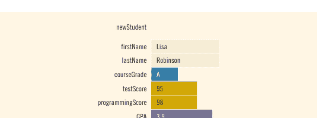

**图 9-3** `struct newStudent`

语句：

```cpp
student = newStudent;
```

将 `newStudent` 的内容复制到 `student`。执行此赋值语句后，`student` 的值如图 9-4 所示。

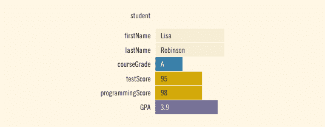

**图 9-4** `student after student = newStudent`

事实上，赋值语句：

```cpp
student = newStudent;
```

等价于以下语句：

```cpp
student.firstName = newStudent.firstName;
student.lastName = newStudent.lastName;
student.courseGrade = newStudent.courseGrade;
student.testScore = newStudent.testScore;
student.programmingScore = newStudent.programmingScore;
student.GPA = newStudent.GPA;
```

### 比较（关系运算符）

要比较 struct 变量，需要逐成员进行比较。与数组一样，不会对 struct 执行聚合关系运算。例如，假设 `newStudent` 和 `student` 已按前面所示声明。此外，假设你想判断 `student` 和 `newStudent` 是否指同一个学生。现在，如果 `newStudent` 和 `student` 具有相同的名字和相同的姓氏，则它们指同一个学生。要比较 `student` 和 `newStudent` 的值，必须按如下方式逐成员比较：

```cpp
if (student.firstName == newStudent.firstName &&
    student.lastName == newStudent.lastName)
```

尽管可以使用赋值语句将一个 struct 的内容复制到另一个同类型的 struct 中，但不能对 struct 变量使用关系运算符。因此，以下写法是非法的：

```cpp
if (student == newStudent)    //illegal
.
.
.
```

### 输入/输出

不允许对 `struct` 变量执行聚合输入/输出操作。`struct` 变量中的数据必须一次读取一个成员。同样，`struct` 变量的内容必须一次写出一个成员。

我们已经了解了如何将数据读入 `struct` 变量。现在来看看如何输出 `struct` 变量。语句：

```cpp
cout << newStudent.firstName << " " << newStudent.lastName
     << " " << newStudent.courseGrade
     << " " << newStudent.testScore
     << " " << newStudent.programmingScore
     << " " << newStudent.GPA << endl;
```

输出 `struct` 变量 newStudent 的内容。

### `struct` 变量与函数

回顾一下，数组只能按引用传递，并且函数不能返回数组类型的值。但是：

- `struct` 变量既可以按值传递，也可以按引用作为参数传递，并且
- 函数可以返回 `struct` 类型的值。

以下函数读取并存储学生的名字、姓氏、测试成绩、编程成绩和 GPA。它还会确定学生的课程成绩，并将其存储到成员 `courseGrade` 中。

```cpp
void readIn(studentType& student)
{
    int score;

    cin >> student.firstName >> student.lastName;
    cin >> student.testScore >> student.programmingScore;
    cin >> student.GPA;

    score = (student.testScore + student.programmingScore) / 2;

    if (score >= 90)
        student.courseGrade = 'A';
    else if (score >= 80)
        student.courseGrade = 'B';
    else if (score >= 70)
        student.courseGrade = 'C';
    else if (score >= 60)
        student.courseGrade = 'D';
    else
        student.courseGrade = 'F';
}
```

语句：

```cpp
readIn(newStudent);
```

调用函数 readIn。函数 readIn 将相应信息存储到变量 newStudent 中。

同样，我们可以编写一个函数来打印 struct 变量的内容。例如，以下函数在屏幕上输出 studentType 类型的 struct 变量的内容：

```cpp
void printStudent(studentType student)
{
    cout << student.firstName << " " << student.lastName
         << " " << student.courseGrade
         << " " << student.testScore
         << " " << student.programmingScore
         << " " << student.GPA << endl;
}
```

### 数组与 `structs` 对比

前面的讨论表明，`struct` 和数组既有相似之处，也有不同之处。表 9-1 总结了这一讨论。

### 表 9-1 — 数组与 `structs` 对比

| 聚合操作 | 数组 | 结构体 |
|---|---|---|
| 算术运算 | 否 | 否 |
| 赋值 | 否 | 是 |
| 输入/输出 | 否（字符串除外） | 否 |
| 比较 | 否 | 否 |
| 参数传递 | 仅按引用 | 按值或按引用 |
| 函数返回值 | 否 | 是 |


## `structs` 中的数组

列表是同一类型元素的集合。因此，列表涉及两项内容：值（即元素）和长度。由于值和长度都与列表相关，我们可以定义一个同时包含这两项的 `struct`。

```cpp
const int ARRAY_SIZE = 1000;
```

```cpp
struct listType
{
    int listElem[ARRAY_SIZE];    //array containing the list
    int listLength;              //length of the list
};
```

下面的语句将 intList 声明为 listType 类型的 `struct` 变量（见图 9-5）：

```cpp
listType intList;
```

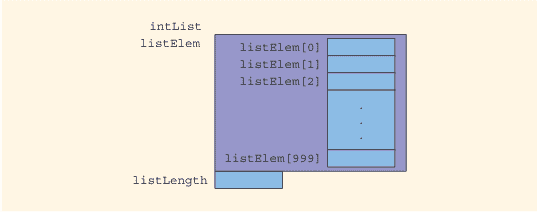

**图 9-5** `struct` 变量 `intList`

变量 intList 有两个成员：listElem，一个包含 1000 个 `int` 类型元素的数组；以及 listLength，类型为 `int`。此外，intList.listElem 访问成员 listElem，intList.listLength 访问成员 listLength。

考虑以下语句：

```cpp
intList.listLength = 0;        //Line 1
intList.listElem[0] = 12;      //Line 2
intList.listLength++;          //Line 3
intList.listElem[1] = 37;      //Line 4
intList.listLength++;          //Line 5
```

第 1 行中的语句将成员 listLength 的值设置为 0。第 2 行中的语句将 12 存入数组 listElem 的第一个元素。第 3 行中的语句将 listLength 的值增加 1。其他语句的含义类似。这些语句执行后，intList 如图 9-6 所示。

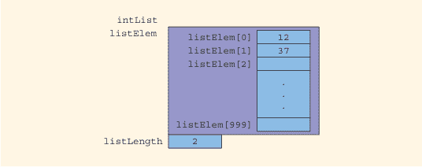

**图 9-6** 第 1 行至第 5 行语句执行后的 `intList`

接下来，我们编写顺序查找算法，以确定给定项是否在列表中。如果在列表中找到 `searchItem`，则函数返回它在列表中的位置；否则，函数返回 -1。

```cpp
int seqSearch(const listType& list, int searchItem)
{
    int loc;

    bool found = false;

    for (loc = 0; loc < list.listLength; loc++)
        if (list.listElem[loc] == searchItem)
        {
            found = true;
            break;
        }
    if (found)
        return loc;
    else
        return -1;
}
```

在这个函数中，因为 `listLength` 是 `list` 的成员，所以我们通过 `list.listLength` 访问它。类似地，我们可以通过 `list.listElem[loc]` 访问 `list` 的一个元素。

注意，函数 `seqSearch` 的形参 `list` 被声明为常量引用参数。这意味着 `list` 接收对应实参的地址，但 `list` 不能修改该实参。

回想一下，当变量按值传递时，形参会复制实参的值。因此，如果形参修改了数据，这种修改不会影响实参的数据。

假设一个 `struct` 有几个数据成员，需要大量内存来存储数据，而你需要按值传递该 `struct` 类型的变量。相应的形参随后会接收该变量数据的一份副本。编译器随后必须为形参分配内存，以便复制实参的值。这一操作除了可能需要大量存储空间外，还可能耗费相当多的计算机时间，将实参的值复制到形参中。

另一方面，如果变量按引用传递，形参只接收实参的地址。因此，将变量作为参数传递的一种高效方式是按引用传递。如果变量按引用传递，那么当形参改变时，实参也会改变。然而，有时你不希望函数能够更改实参的值。在 C++ 中，你可以按引用传递变量，同时仍防止函数更改其值。这通过在形参声明中使用关键字 `const` 来实现，如函数 `seqSearch` 的定义所示。

同样，我们也可以重写排序、二分查找以及其他列表处理函数。

## 数组中的结构体

假设一家公司有 50 名全职员工。我们需要打印他们的每月工资单，并记录年初至今已向每位员工支付了多少钱。首先，让我们定义员工记录：

```cpp
struct employeeType
{
    string firstName;
    string lastName;
    int     personID;
    string deptID;
    double yearlySalary;
    double monthlySalary;
    double yearToDatePaid;
    double monthlyBonus;
};
```

每位员工都有以下成员（组成部分）：名、姓、个人 ID、部门 ID、年薪、月薪、年初至今已支付金额和月度奖金。

因为我们有 50 名员工，且每位员工的数据类型相同，所以我们可以使用一个包含 50 个元素的数组来处理员工数据。

```cpp
employeeType employees[50];
```

这条语句声明了数组 `employees`，它包含 50 个 `employeeType` 类型的元素（见图 9-7）。`employees` 的每个元素都是一个 `struct`。例如，图 9-7 还展示了 `employees[2]`。

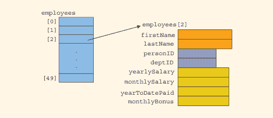

**图 9-7**  员工数组

假设我们还有以下声明：

```cpp
int  counter;
```

此外，假设每位员工的初始数据——名、姓、个人 ID、部门 ID 和年薪——都提供在一个文件中。为便于讨论，我们假设每位员工的数据存储在一个文件中，例如 employee.dat。以下 C++ 代码将数据加载到员工数组中。我们假设最初 yearToDatePaid 为 0，并且月度奖金每月根据绩效确定。

```cpp
ifstream infile;  //input stream variable
                 //assume that the file employee.dat has been opened

for (counter = 0; counter < 50; counter++)
{
    infile >> employees[counter].firstName
           >> employees[counter].lastName
           >> employees[counter].personID
           >> employees[counter].deptID
           >> employees[counter].yearlySalary;
    employees[counter].monthlySalary =
                 employees[counter].yearlySalary / 12;
    employees[counter].yearToDatePaid = 0.0;
    employees[counter].monthlyBonus = 0.0;
}
```

假设对于某个月，月度奖金已经存储在每位员工的记录中，而我们需要计算该月工资单并更新 yearToDatePaid 金额。以下循环计算并打印员工当月的工资单：

```cpp
double payCheck;  //variable to calculate the paycheck

for (counter = 0; counter < 50; counter++)
{
    cout << employees[counter].firstName << " "
         << employees[counter].lastName << "\n";

    payCheck = employees[counter].monthlySalary +
               employees[counter].monthlyBonus;

    employees[counter].yearToDatePaid =
               employees[counter].yearToDatePaid +
               payCheck;

    cout << setprecision(2) << payCheck << endl;
}
```

## 结构体中的结构体

你已经看到结构体和数组数据结构如何组合起来组织信息。你也看到了这样的示例：结构体的一个成员是数组，而数组类型是结构体。在本节中，你将学习在哪些情况下使用另一个结构体来组织结构体中的数据是有益的。

让我们考虑以下员工记录：

```cpp
struct  employeeType
{
    string firstname;
    string middlename;
    string lastname;
    string empID;
    string address1;
    string address2;
    string city;
    string state;
    string zip;
    int hiremonth;
    int hireday;
    int hireyear;
    int quitmonth;
    int quitday;
    int quityear;
    string phone;
    string cellphone;
    string fax;
    string pager;
    string email;
    string deptID;
    double salary;
};
```

如你所见，一个结构体中打包了大量信息。这个结构体有 22 个成员。该结构体的一些成员会比其他成员更频繁地被访问，并且一些成员之间的关联比其他成员更紧密。此外，有些成员将

具有相同的底层结构。例如，入职日期和离职日期的数据类型都是 `int`。让我们按如下方式重新组织这个 `struct`：

```cpp
struct nameType
{
    string first;
    string middle;
    string last;
};
```

```cpp
struct addressType
{
    string address1;
    string address2;
    string city;
    string state;
    string zip;
};
```

```cpp
struct dateType
{
    int month;
    int day;
    int year;
};
```

```cpp
struct contactType
{
    string phone;
    string cellphone;
    string fax;
    string pager;
    string email;
};
```

我们已经将员工的姓名、地址和联系方式类型划分为子类别。此外，我们还定义了一个 `struct` dateType。让我们按如下方式重建员工记录：

```cpp
struct employeeType
{
    nameType name;
    string empID;
    addressType address;
    dateType hireDate;
    dateType quitDate;
    contactType contact;
    string deptID;
    double salary;
};
```

这个员工结构体中的信息比之前那个更容易管理。这个结构体中的一些内容可以复用来构建另一个结构体。例如，假设你想定义客户记录。每个客户都有名、姓和中间名，以及地址和联系方式。因此，你可以使用结构体 nameType、addressType、contactType 以及客户特有的成员，快速组合出客户记录。

接下来，让我们声明一个 employeeType 类型的变量，并讨论如何访问其成员。

考虑以下语句：

```cpp
employeeType newEmployee;
```

这条语句将 newEmployee 声明为 employeeType 类型的结构体变量（见图 9-8）。


图 9-8 结构体变量 newEmployee

以下语句：

```cpp
newEmployee.salary = 45678.00;
```

将 `newEmployee` 的工资设置为 `45678.00`。以下语句：

```cpp
newEmployee.name.first = "Mary";
newEmployee.name.middle = "Beth";
newEmployee.name.last = "Simmons";
```

分别将 `newEmployee` 的名、中间名和姓设置为 "Mary"、"Beth" 和 "Simmons"。注意，`newEmployee` 有一个名为 `name` 的成员。我们通过 `newEmployee.name` 访问这个成员。还要注意，`newEmployee.name` 是一个 `struct`，并且有三个成员。我们应用成员访问规则来访问结构体 `newEmployee.name` 的成员 `first`。因此，`newEmployee.name.first` 是我们存储名字的成员。

以下语句：

```cpp
cin >> newEmployee.name.first;
```

读取一个字符串并将其存储到 `newEmployee.name.first` 中。以下语句：

```cpp
newEmployee.salary = newEmployee.salary * 1.05;
```

更新 `newEmployee` 的工资。

以下语句将 employees 声明为包含 100 个分量的数组，其中每个分量的类型都是 employeeType：

```cpp
employeeType employees[100];
```

以下 for 循环：

```cpp
for (int j = 0; j < 100; j++)
    cin >> employees[j].name.first >> employees[j].name.middle
        >> employees[j].name.last;
```

读取 100 名员工的姓名并将其存储到数组 `employees` 中。因为 `employees` 是一个数组，所以访问分量时我们使用索引。例如，`employees[50]` 是数组 `employees` 的第 51 个分量（回想一下，数组索引从 0 开始）。因为 `employees[50]` 是一个 `struct`，所以我们应用成员访问规则来选择特定成员。

## 编程示例：销售数据分析

一家公司有六名销售人员。每个月，他们都会出差去销售公司的产品。每个月末，每名销售人员的总销售额，连同该销售人员的 ID 和月份，都会记录在一个文件中。每年年末，公司经理希望以如下表格格式查看这份报告：

| ID | 第1季度 | 第2季度 | 第3季度 | 第4季度 | 总计 |
|---|---:|---:|---:|---:|---:|
| 12345 | 1892.00 | 0.00 | 494.00 | 322.00 | 2708.00 |
| 32214 | 343.00 | 892.00 | 9023.00 | 0.00 | 10258.00 |
| 23422 | 1395.00 | 1901.00 | 0.00 | 0.00 | 3296.00 |
| 57373 | 893.00 | 892.00 | 8834.00 | 0.00 | 10619.00 |
| 35864 | 2882.00 | 1221.00 | 0.00 | 1223.00 | 5326.00 |
| 54654 | 893.00 | 0.00 | 392.00 | 3420.00 | 4705.00 |
| 总计 | 8298.00 | 4906.00 | 18743.00 | 4965.00 | |

销售人员最高销售额：ID = 57373，金额 = $10619.00

季度最高销售额：季度 = 3，金额 = $18743.00

在这份报告中，QT1 表示第 1 季度（第 1 至 3 月），QT2 表示第 2 季度（第 4 至 6 月），QT3 表示第 3 季度（第 7 至 9 月），QT4 表示第 4 季度（第 10 至 12 月）。

销售人员的 ID 存储在一个文件中；销售数据存储在另一个文件中。销售数据的形式如下：

```
salesPersonID    saleAmount
.
.
.
```

此外，销售数据没有特定顺序；它不是按 ID 排序的。

销售数据示例如下：

```
12345 1 893
32214 1 343
23422 3 903
57373 2 893
.
.
.
```

让我们编写一个程序，以指定格式生成输出。

- **输入** 一个包含每名销售人员 ID 的文件，以及另一个包含销售数据的文件。
- **输出** 一个包含上述格式年度销售报告的文件。

### 问题分析与算法设计

根据问题需求，很明显每名销售人员的主要组成部分是销售人员 ID、季度销售额和年度总销售额。由于这些组成部分的类型不同，我们可以借助一个 `struct` 将它们分组，定义如下：

```cpp
struct salesPersonRec
{
    string ID;          // salesperson's ID
    double saleByQuarter[4];   // array to store the total
                                // sales for each quarter
    double totalSale;   // salesperson's yearly sales amount
};
```

因为有六名销售人员，我们使用一个包含六个分量的数组，其中每个分量的类型都是 salesPersonRec，定义如下：

```cpp
salesPersonRec salesPersonList[NO_OF_SALES_PERSON];
```

其中 NO_OF_SALES_PERSON 的值为 6。

因为程序要求我们求出公司每个季度的总销售额，所以我们需要一个包含四个分量的数组来存储数据。注意，这些数据将用于确定销售额最高的季度。因此，程序还需要以下数组：

```cpp
double totalSaleByQuarter[4];
```

回想一下，在 C++ 中，数组索引从 0 开始。因此，totalSaleByQuarter[0] 存储第 1 季度的数据，totalSaleByQuarter[1] 存储第 2 季度的数据，依此类推。

我们将在整个讨论中引用这些变量。

数组 salesPersonList 如图 9-9 所示。


图 9-9 数组 salesPersonList

程序的第一步是将销售人员的 ID 读入数组 *salesPersonList*，并将每名销售人员的季度销售额和总销售额初始化为 0。完成这一步后，数组 *salesPersonList* 如图 9-10 所示。


图 9-10 初始化后的数组 salesPersonList

下一步是处理销售数据。处理销售数据相当直接。对于包含销售数据的文件中的每一项，

- 1. 读取销售人员的 ID、月份和该月的销售额。
- 2. 在数组 `salesPersonList` 中搜索，定位与该销售人员对应的分量。
- 3. 确定该月份对应的季度。
- 4. 通过加上该月的销售额来更新该季度的销售额。

处理完销售数据文件后：

- 1. 计算每名销售人员的总销售额。
- 2. 计算每个季度的总销售额。
- 3. 打印报告。

上述讨论可转化为以下算法：

- 1. 初始化数组 `salesPersonList`。
- 2. 处理销售数据。
- 3. 计算每个季度的总销售额。
- 4. 计算每名销售人员的总销售额。
- 5. 打印报告。
- 6. 计算并打印每名销售人员的最高销售额。
- 7. 计算并打印每个季度的最高销售额。

为了降低主程序的复杂性，让我们为这七个步骤分别编写一个单独的函数。

### 函数 initialize

该函数从输入文件中读取销售人员的 ID，并将该销售人员的 ID 存储到数组 `salesPersonList` 中。它还将每名销售人员的季度销售额和总销售额初始化为 0。该函数的定义如下：

```cpp
void initialize(ifstream& indata, salesPersonRec list[],
                int listSize)
{
    int index;
    int quarter;

    for (index = 0; index < listSize; index++)
    {
        indata >> list[index].ID; // get salesperson’s ID

        for (quarter = 0; quarter < 4; quarter++)
            list[index].salesByQuarter[quarter] = 0.0;

        list[index].totalSale = 0.0;
    }
} //end initialize
```


### 函数 `getData`

此函数从输入文件中读取销售数据，并将相应信息存储到数组 `salesPersonList` 中。该函数的算法如下：

- 1. 读取销售人员的 ID、月份以及该月的销售额。
- 2. 在数组 `salesPersonList` 中查找与该销售人员对应的元素。（由于销售人员的 ID 未排序，我们将使用顺序查找来搜索该数组。）
- 3. 确定该月份对应的季度。
- 4. 将该月的销售额加到该季度的销售额中，以更新该季度的销售额。

假设读取到的条目为：

```
57373 2 350
```

这里，销售人员的 ID 为 57373，月份为 2，销售额为 350。假设数组 `salesPersonList` 如图 9-11 所示。

| salesPersonList | ID | salesByQuarter Q1 | salesByQuarter Q2 | salesByQuarter Q3 | salesByQuarter Q4 | totalSale |
|---|---|---|---|---|---|---|
| salesPersonList[0] | 12345 | 150.80 | 0.0 | 0.0 | 654.92 | 0.0 |
| salesPersonList[1] | 32214 | 0.0 | 439.90 | 0.0 | 0.0 | 0.0 |
| salesPersonList[2] | 23422 | 0.0 | 0.0 | 0.0 | 564.76 | 0.0 |
| salesPersonList[3] | 57373 | 354.80 | 0.0 | 0.0 | 0.0 | 0.0 |
| salesPersonList[4] | 35864 | 0.0 | 0.0 | 763.90 | 0.0 | 0.0 |
| salesPersonList[5] | 54654 | 783.45 | 0.0 | 0.0 | 563.80 | 0.0 |

**图 9-11** 数组 `salesPersonList`

现在，ID 57373 对应数组元素 `salesPersonList[3]`，月份 2 对应第 1 季度。因此，将 350 加到 354.80 上，得到新金额 704.80。处理完该条目后，数组 `salesPersonList` 如图 9-12 所示。


函数 `getData` 的定义如下：

```cpp
void getData(ifstream& infile, salesPersonRec list[],
             int listSize)
{
    int index;
    int quarter;
    string sID;
    int month;
    double amount;

    infile >> sID;      //get salesperson's ID

    while (infile)
    {
        infile >> month >> amount;  //get the sale month and
                                    //the sale amount

        for (index = 0; index < listSize; index++)
            if (sID == list[index].ID)
                break;

        if (1 <= month && month <= 3)
            quarter = 0;
        else if (4 <= month && month <= 6)
            quarter = 1;
        else if (7 <= month && month <= 9)
            quarter = 2;
        else
            quarter = 3;

        if (index < listSize)
            list[index].saleByQuarter[quarter] += amount;
        else
            cout << "Invalid salesperson's ID." << endl;

        infile >> sID;
    } //end while
} //end getData
```

### 函数 `saleByQuarter`

此函数求出公司每个季度的总销售额。为了求出每个季度的总销售额，我们将每位销售人员在该季度的销售额相加。显然，此函数必须能够访问数组 salesPersonList 和数组 totalSaleByQuarter。此函数还需要知道每个数组的行数。因此，此函数有三个参数。此函数的定义如下：

```cpp
void saleByQuarter(salesPersonRec list[], int listSize,
                   double totalByQuarter[])
{
    int quarter;
    int index;

    for (quarter = 0; quarter < 4; quarter++)
        totalByQuarter[quarter] = 0.0;

    for (quarter = 0; quarter < 4; quarter++)
        for (index = 0; index < listSize; index++)
            totalByQuarter[quarter] +=
                list[index].saleByQuarter[quarter];
} //end saleByQuarter
```

### 函数 `totalSaleByPerson`

此函数求出每位销售人员的年度销售额。为了求出一名员工的年度销售额，我们将该员工四个季度的销售额相加。显然，此函数必须能够访问数组 salesPersonList。此函数还需要知道数组的大小。因此，此函数有两个参数。

此函数的定义如下：

```cpp
void totalSaleByPerson(salesPersonRec list[], int listSize)
{
    int index;
    int quarter;

    for (index = 0; index < listSize; index++)
        for (quarter = 0; quarter < 4; quarter++)
            list[index].totalSale +=
                list[index].saleByQuarter[quarter];
} // end totalSaleByPerson
```

### 函数 `printReport`

此函数按指定格式打印年度报告。其伪代码算法如下：

- 1. 打印表头——即输出的前三行。
- 2. 打印每位销售人员的数据。
- 3. 打印表格的最后一行。

注意，接下来的两个函数将生成输出的最后两行。

显然，printReport 函数必须能够访问数组 salesPersonList 和数组 totalSaleByQuarter。另外，由于输出将存储在文件中，此函数必须能够访问与输出文件关联的 ofstream 变量。因此，此函数有四个参数：一个对应于数组 salesPersonList 的参数、一个对应于数组 totalSaleByQuarter 的参数、一个指定数组大小的参数，以及一个对应于 ofstream 变量的参数。此函数的定义如下：

```cpp
void printReport(ofstream& outfile, salesPersonRec list[],
                 int listSize, double saleByQuarter[])
{
    int index;
    int quarter;

    outfile << "------------ Annual Sales Report ----------"
            << "---------" << endl;
    outfile << endl;
    outfile << "       ID         Q1         Q2         Q3         "
            << "Q4       Total" << endl;
    outfile << "----------------------------------------------"
            << "-----------------" << endl;

    for (index = 0; index < listSize; index++)
    {
        outfile << list[index].ID << "  ";

        for (quarter = 0; quarter < 4; quarter++)
            outfile << setw(10)
                    << list[index].saleByQuarter[quarter];

        outfile << setw(10) << list[index].totalSale << endl;
    }

    outfile << "Total ";

    for (quarter = 0; quarter < 4; quarter++)
        outfile << setw(10) << saleByQuarter[quarter];

    outfile << endl << endl;
} //end printReport
```

### 函数 `maxSaleByPerson`

此函数打印销售额最高的销售人员的姓名。为了确定这位销售人员，我们查看每位销售人员的销售总额，并找出最大销售额。由于每位员工的销售总额保存在数组 salesPersonList 中，此函数必须能够访问数组 salesPersonList。另外，由于输出将存储在文件中，此函数必须能够访问与输出文件关联的 ofstream 变量。因此，此函数有三个参数：一个对应于数组 salesPersonList 的参数、一个指定该数组大小的参数，以及一个对应于输出文件的参数。

查找最大销售额的算法类似于查找数组中最大元素的算法（第 8 章已讨论）。此函数的定义如下：

```cpp
void maxSaleByPerson(ofstream& outData, salesPersonRec list[],
                     int listSize)
{
    int maxIndex = 0;
    int index;

    for (index = 1; index < listSize; index++)
        if (list[maxIndex].totalSale < list[index].totalSale)
            maxIndex = index;

    outData << "Max Sale by SalesPerson: ID = "
            << list[maxIndex].ID
            << ", Amount = " << list[maxIndex].totalSale
            << endl;
} //end maxSaleByPerson
```

### 函数 `maxSaleByQuarter`

此函数打印销售额最大的季度。为了确定这个季度，我们查看每个季度的总销售额，并找出最大销售额。由于每个季度的销售总额存放在数组 totalSaleByQuarter 中，此函数必须能够访问数组 totalSaleByQuarter。另外，由于输出将存储在文件中，此函数必须能够访问与输出文件关联的 ofstream 变量。因此，此函数有两个参数：一个对应于数组 totalSaleByQuarter 的参数，以及一个对应于输出文件的参数。

查找最大销售额的算法与查找数组中最大元素的算法相同（第 8 章已讨论）。此函数的定义如下：

```cpp
void maxSaleByQuarter(ofstream& outData,
                      double saleByQuarter[])
```


```cpp
{
    int quarter;
    int maxIndex = 0;

    for (quarter = 0; quarter < 4; quarter++)
        if (saleByQuarter[quarter] > saleByQuarter[maxIndex])
            maxIndex = quarter;

    outData << "Max Sale by Quarter: Quarter = "
            << maxIndex + 1
            << ", Amount = $" << saleByQuarter[maxIndex]
            << endl;
} //end maxSaleByQuarter
```

为了使程序更灵活，我们将在程序执行期间提示用户指定输入文件和输出文件。

现在我们可以编写函数 main 的算法了。

### 主算法

- 1. 声明变量。
- 2. 提示用户输入包含销售员 ID 数据的文件名。
- 3. 读取输入文件名。
- 4. 打开输入文件。
- 5. 如果输入文件不存在，则退出程序。
- 6. 初始化数组 `salesPersonList`。调用函数 `initialize`。
- 7. 关闭包含销售员 ID 数据的输入文件，并清除输入流。
- 8. 提示用户输入包含销售数据的文件名。
- 9. 读取输入文件名。
- 10. 打开输入文件。
- 11. 如果输入文件不存在，则退出程序。
- 12. 提示用户输入输出文件名。
- 13. 读取输出文件名。
- 14. 打开输出文件。
- 15. 要以固定小数格式输出浮点数，并带小数点和尾随零，请设置操纵器 fixed 和 showpoint。此外，要将浮点数输出到两位小数，请将精度设置为两位小数。
- 16. 处理销售数据。调用函数 `getData`。
- 17. 计算按季度总销售额。调用函数 `salesByQuarter`。
- 18. 计算每位销售员的总销售额。调用函数 `totalSaleByPerson`。
- 19. 以表格格式打印报告。调用函数 `printReport`。
- 20. 查找并打印年度销售额最大的销售员。调用函数 `maxSaleByPerson`。
- 21. 查找并打印年度销售额最大的季度。调用函数 `maxSaleByQuarter`。
- 22. 关闭文件。

## 程序清单

```cpp
/************************************************************
// Author: D.S. Malik
//
// Program: Sales Data Analysis
// This program processes sales data for a company. For each
// salesperson, it outputs the ID, the total sales by each
// quarter, and the total sales for the year. It also outputs
// the salesperson's ID generating the maximum sale for the
// year and the sales amount. The quarter generating the
// maximum sale and the sales amount is also output.
************************************************************/

#include <iostream>
#include <fstream>
#include <iomanip>
#include <string>

using namespace std;

const int NO_OF_SALES_PERSON = 6;

struct salesPersonRec
{
    string ID;          // salesperson's ID
    double saleByQuarter[4];  // array to store the total
                              // sales for each quarter
    double totalSale;   // salesperson's yearly sales amount
};

void initialize(ifstream& indata, salesPersonRec list[],
                int listSize);
void getData(ifstream& infile, salesPersonRec list[],
             int listSize);
void salesByQuarter(salesPersonRec list[], int listSize,
                   double totalByQuarter[]);
void totalSaleByPerson(salesPersonRec list[], int listSize);
void printReport(ofstream& outfile, salesPersonRec list[],
                 int listSize, double saleByQuarter[]);
void maxSaleByPerson(ofstream& outData, salesPersonRec list[],
                     int listSize);
void maxSaleByQuarter(ofstream& outData, double saleByQuarter[]);

int main()
{
        //Step 1
        ifstream infile;      //input file stream variable
        ofstream outfile;     //output file stream variable

        string inputFile;     //variable to hold the input file name
        string outputFile;    //variable to hold the output file name

        double totalSaleByQuarter[4];    //array to hold the
                                         //sale by quarter

        salesPersonRec salesPersonList[NO_OF_SALES_PERSON]; //array
                                     //to hold the salesperson's data

        cout << "Enter the salesPerson ID file name: ";  //Step 2
        cin >> inputFile;                                 //Step 3
        cout << endl;

        infile.open(inputFile.c_str());                   //Step 4

        if (!infile)                                      //Step 5
        {
                cout << "Cannot open the input file."
                     << endl;
                return 1;
        }

        initialize(infile, salesPersonList,
                   NO_OF_SALES_PERSON);                   //Step 6

        infile.close();                                   //Step 7
        infile.clear();                                   //Step 7

        cout << "Enter the sales data file name: ";      //Step 8
        cin >> inputFile;                                 //Step 9
        cout << endl;

        infile.open(inputFile.c_str());                   //Step 10

        if (!infile)
        {
                cout << "Cannot open the input file."
                     << endl;
                return 1;
        }

        cout << "Enter the output file name: ";
        cin >> outputFile;
        cout << endl;

        outfile.open(outputFile.c_str());
        outfile << fixed << setprecision(2);

        getData(infile, salesPersonList,
                NO_OF_SALES_PERSON);

        salesByQuarter(salesPersonList,
                       NO_OF_SALES_PERSON,
                       totalSaleByQuarter);

        totalSaleByPerson(salesPersonList,
                          NO_OF_SALES_PERSON);

        printReport(outfile, salesPersonList,
                    NO_OF_SALES_PERSON,
                    totalSaleByQuarter);

        maxSaleByPerson(outfile, salesPersonList,
                        NO_OF_SALES_PERSON);

        maxSaleByQuarter(outfile, totalSaleByQuarter);

        infile.close();
        outfile.close();

        return 0;
}

//Place the definitions of the functions initialize,
//getData, salesByQuarter, totalSaleByPerson,
//printReport, maxSaleByPerson, and maxSaleByQuarter here.
```

**示例运行：** 在此示例运行中，用户输入以阴影显示。

```text
Enter the salesPerson ID file name: Ch9_SalesManID.txt
Enter the sales data file name: Ch9_SalesData.txt
Enter the output file name: Ch9_SalesDataAnalysis.txt
```

## 快速回顾

- 1. `struct` 是固定数量组件的集合。
- 2. `struct` 的组件可以具有不同的类型。
- 3. 定义 `struct` 的语法是：

```cpp
struct structName
{
    dataType1 identifier1;
    dataType2 identifier2;
    .
    .
    .
    dataTypen identifiern;
};
```

- 4. 在 C++ 中，`struct` 是保留字。
- 5. 在 C++ 中，`struct` 是一种定义；不会分配内存。只有声明 `struct` 变量时，才会为这些变量分配内存。
- 6. `struct` 的组件称为 `struct` 的成员。
- 7. `struct` 的组件通过名称访问。
- 8. 在 C++ 中，点（.）运算符称为成员访问运算符。
- 9. `struct` 的成员通过使用点（.）运算符访问。例如，如果 employeeType 是一个 `struct`，employee 是 employeeType 类型的变量，name 是 employee 的成员，那么表达式 employee.name 访问成员 name。也就是说，employee.name 是一个变量，可以像其他变量一样被操作。
- 10. 对 `struct` 唯一的内置操作是赋值和成员访问操作。
- 11. 不允许对 `struct(s)` 进行算术运算或关系运算。
- 12. 作为函数的参数，`struct` 可以按值传递或按引用传递。
- 13. 函数可以返回 `struct` 类型的值。
- 14. 一个 `struct` 可以是另一个 `struct` 的成员。

## 练习

练习末尾括号中的数字指本章开头列出的学习目标。

- 1. 判断以下陈述为真或假。
  - a. `struct` 的所有成员必须具有不同的类型。(1)
  - b. `struct` 是一种定义，而不是声明。(1)
  - c. `struct` 变量必须在 `struct` 定义之后声明。(1)


- d. 使用运算符 `.` 访问结构体成员。(2)
- e. 对结构体唯一允许的操作是赋值和成员选择。(2)
- f. 因为结构体具有有限数量的分量，所以允许对结构体进行关系运算。(2)
- g. 允许对结构体变量进行某些聚合输入/输出操作。(2)
- h. 结构体变量既可以按值传递，也可以按引用作为参数传递。(4)
- i. 函数不能返回 `struct` 类型的值。(4)
- j. 数组可以是结构体的成员。(6, 7)
- k. 结构体的成员可以是另一个结构体。(8)

- **2.** 定义一个结构体 `carType`，用于存储关于汽车的以下数据：制造商（string）、型号（string）、车型（string）、颜色（string）、车门数（int）、城市每加仑英里数（int）、高速公路每加仑英里数（int）、汽车制造年份（int）以及价格（double）。(1)

- **3.** 假设习题2的定义。声明一个 `carType` 变量，并编写 C++ 语句存储以下信息：制造商—GMT，型号—Cylone，类型—sedan，颜色—blue，车门数—4，城市每加仑英里数—28，高速公路每加仑英里数—32，汽车制造年份—2006，价格—25000.00。(2)

- **4.** 定义一个结构体 `fruitType`，用于存储关于水果的以下数据：水果名称（string）、颜色（string）、脂肪（int）、糖（int）、碳水化合物（int）。(1)

- **5.** 假设习题4的定义。声明一个 `fruitType` 类型的变量，用于存储以下数据：水果名称—banana，颜色—yellow，脂肪—1，糖—15，碳水化合物—22。(2)

- **6.** 考虑本章给出的结构体 `houseType` 的声明。编写 C++ 语句完成以下操作：(2, 3)
  - a. 声明 `houseType` 类型的变量 `oldHouse` 和 `newHouse`。
  - b. 将以下信息存入 `oldHouse`：样式—Two-story，卧室数—5，浴室数—3，车库车位数—4，建造年份—1975，完工平方英尺—3500，价格—675000，税—12500。
  - c. 将 `oldHouse` 各分量的值复制到 `newHouse` 的对应分量中。

- **7.** 考虑本章给出的结构体 `houseType` 的声明。假设 `firstHouse` 和 `secondHouse` 是 `houseType` 类型的变量。编写 C++ 语句比较 `firstHouse` 和 `secondHouse` 的样式和价格。如果对应值相同则输出 true；否则输出 false。(2, 3)

- **8.**
  - a. 编写一个 C++ 函数 `getHouseInput`，读取数据并存入 `houseType` 类型的变量中。(4)
  - b. 编写一个 C++ 函数 `printHouseInfo`，输出存储在 `houseType` 类型变量中的数据。使用适当的标签标识每个分量。(4)

- **9.** 哪些允许用于 `struct` 变量的聚合操作不允许用于数组变量？(5)

- **10.** 考虑以下语句：

    ```cpp
    struct nameType
    {
        string first;
        string last;
    };

    struct courseType
    {
        string name;
        int callNum;
        int credits;
        char grade;
    };

    struct studentType
    {
        nameType name;
        double gpa;
        courseType course;
    };

    studentType student;
    studentType classList[100];
    courseType course;
    nameType name;
    ```

    将以下语句标记为有效或无效。如果语句无效，请解释原因。(2, 3, 6, 7, 8)

  - a. `student.course.callNum = "CSC230";`
  - b. `cin >> student.name;`
  - c. `classList[0] = name;`
  - d. `classList[1].gpa = 3.45;`
  - e. `name = classList[15].name;`
  - f. `student.name = name;`
  - g. `cout << classList[10] << endl;`
  - h. `for (int j = 0; j < 100; j++)`
    `classList[j].name = name;`
  - i. `classList.course.credits = 3;`
  - j. `course = studentType.course;`

- **11.** 假设习题10的声明。编写 C++ 语句将以下信息存入 `student`：(2, 3, 6, 7, 8)
  - 姓名：Linda Brown
  - gpa：3.78
  - 课程名称：Calculus
  - 课程编号：23827
  - 课程学分：4
  - 课程成绩：A

- **12.** 假设习题10的声明。编写 C++ 语句完成以下操作：(2, 3, 6, 7, 8)
  - a. 将以下信息存入 `course`：
    ```text
    name: Programming I
    callNum: 13452
    credits: 3
    grade: ""
    ```
  - b. 在数组 `classList` 中，将每个 `gpa` 初始化为 `0.0`。
  - c. 将数组 `classList` 第31个分量的信息复制到 `student` 中。
  - d. 将数组 `classList` 中第10个学生的 `gpa` 在其先前值上加 `0.75` 进行更新。

- **13.** 考虑以下语句（`nameType` 如习题10所定义）：

    ```cpp
    struct employeeType
    {
        nameType name;
        int performanceRating;
        int pID;
        string dept;
        double salary;
    };
    employeeType employees[100];
    employeeType newEmployee;
    ```

    将以下语句标记为有效或无效。如果语句无效，请解释原因。(2, 3, 6, 7, 8)

  - a. `newEmployee.name = "John Smith";`
  - b. `cout << newEmployee.name;`
  - c. `employees[35] = newEmployee;`
  - d.
    ```cpp
    if (employees[45].pID == 55533444)
        employees[45].performanceRating = 1;
    ```
  - e. `employees.salary = 0;`

- **14.** 假设习题10和13的声明。编写 C++ 语句完成以下操作。(2, 3, 6, 7, 8)
  - a. 将以下信息存入 `newEmployee`：
    ```text
    name: Mickey Doe
    pID: 11111111
    performanceRating: 2
    dept: ACCT
    salary: 34567.78
    ```
  - b. 在数组 `employees` 中，将每个 `performanceRating` 初始化为 `0`。
  - c. 将数组 `employees` 第20个分量的信息复制到 `newEmployee` 中。
  - d. 将数组 `employees` 中第50名员工的工资在其先前值上加 5735.87 进行更新。

- **15.** 假设你有以下 `struct` 定义：

    ```cpp
    struct partsType
    {
        string partName;
        int partNum;
        double price;
        int quantitiesInStock;
    };
    ```

    声明一个包含100个 `partsType` 类型分量的数组 `inventory`。(7)

- **16.** 假设习题15的定义。(7)
  - a. 编写 C++ 代码，按如下方式初始化 `inventory` 的每个分量：`partName` 为空字符串，`partNum` 为 −1，`price` 为 0.0，`quantitiesInStock` 为 0。
  - b. 编写 C++ 代码，使用循环输出存储在 `inventory` 中的数据。假设变量 length 表示 `inventory` 中元素的数量。

- **17.** 假设习题15的定义和声明。编写一个 void 函数的定义，可用于向 `partsType` 类型的变量输入数据。还要编写 C++ 代码，使用你的函数向 `inventory` 输入数据。(4, 7)

- **18.** 假设你有以下定义：(8)

    ```cpp
    struct timeType
    {
        int hr;
        double min;
        int sec;
    };

    struct tourType
    {
        string cityName;
        int distance;
        timeType travelTime;
    };
    ```

  - a. 声明 `tourType` 类型的变量 `destination`。
  - b. 编写 C++ 语句将以下数据存入 `destination`：`cityName`—Chicago，`distance`—550 英里，`travelTime`—9 小时 30 分钟。
  - c. 编写一个函数的定义，输出存储在 `tourType` 类型变量中的数据。
  - d. 编写一个值返回函数的定义，向 `tourType` 类型的变量输入数据。
  - e. 编写一个 `void` 函数（带 `tourType` 类型的引用参数）的定义，向 `tourType` 类型的变量输入数据。

## 编程练习

- **1.** 假设习题4的定义，其中定义了结构体 `fruitType`。编写一个程序，声明 `fruitType` 类型的变量，提示用户输入水果数据，并输出水果数据。

- **2.** 编写一个程序，读取学生姓名及其测试分数。程序应输出每个学生的姓名、测试分数和相关等级。还应查找并打印最高测试分数以及拥有最高测试分数的学生姓名。

  学生数据应存储在 `studentType` 类型的结构体变量中，该变量有四个分量：`studentFName` 和 `studentLName`（类型为 `string`），`testScore`（类型为 `int`，`testScore` 介于 0 和 100 之间），以及 `grade`（类型为 `char`）。假设班级有20名学生。使用包含20个 `studentType` 类型分量的数组。

  你的程序必须至少包含以下函数：

  - a. 一个将学生数据读入数组的函数。
  - b. 一个为每个学生分配相关等级的函数。
  - c. 一个查找最高测试分数的函数。
  - d. 一个打印拥有最高测试分数的学生姓名的函数。

  你的程序必须按以下形式输出每个学生的姓名：姓后跟逗号，再跟空格，再跟名；姓名必须左对齐。此外，除了声明变量和打开输入输出文件外，函数 `main` 应仅为一组函数调用。

- **3.** 定义一个结构体 `menuItemType`，包含两个分量：`menuItem`（类型 `string`）和 `menuPrice`（类型 `double`）。

- **4.** 编写一个程序，帮助当地餐馆自动化其早餐计费系统。程序应完成以下操作：
  - a. 向顾客显示餐馆提供的不同早餐项目。
  - b. 允许顾客从菜单中选择多个项目。
  - c. 计算并打印账单。

  假设餐馆提供以下早餐项目（每项价格显示在项目右侧）：

| 项目 | 价格 |
| --- | --- |
| 原味鸡蛋 | $1.45 |
| 培根和鸡蛋 | $2.45 |
| 松饼 | $0.99 |
| 法式吐司 | $1.99 |
| 水果篮 | $2.49 |
| 麦片 | $0.69 |
| 咖啡 | $0.50 |
| 茶 | $0.75 |


使用 `struct menuItemType` 的数组 `menuList`，如编程练习 3 中所定义。你的程序必须至少包含以下函数：

- **函数 `getData`：** 该函数将数据加载到数组 `menuList` 中。
- **函数 `showMenu`：** 该函数显示餐厅提供的不同项目，并告诉用户如何选择这些项目。
- **函数 `printCheck`：** 该函数计算并打印账单。（注意，账单金额应包含 5% 的税。）

示例输出为：

```
Welcome to Johnny's Restaurant
Bacon and Egg       $2.45
Muffin               $0.99
Coffee               $0.50
Tax                  $0.20
Amount Due           $4.14
```

输出格式保留两位小数。输出中每个项目的名称必须左对齐。可以假设用户只选择某一类型的一个项目。

- 5. 重做练习 4，使顾客可以选择某一类型的多个项目。这种情况下的示例输出为：

  ```
  Welcome to Johnny's Restaurant
  1 Bacon and Egg      $2.45
  2 Muffin              $1.98
  1 Coffee              $0.50
  Tax                   $0.25
  Amount Due            $5.18
  ```

- 6. 编写一个程序，其主函数仅是一组变量声明和函数调用。该程序读取一个文本，并输出字母及其计数，如下文函数 `printResults` 中所述。（不能有全局变量！所有信息都必须通过函数传入和传出。使用结构体存储信息。）你的程序必须至少包含以下函数：

  - **函数 `openFile`：** 打开输入文件和输出文件。必须将文件流作为参数传递（当然是通过引用）。如果文件不存在，程序应打印适当的消息并退出。程序必须询问用户输入文件和输出文件的名称。
  - **函数 `count`：** 统计在函数 `openFile` 中打开的文本文件里大写字母 A–Z 和小写字母 a–z 的每次出现。此信息必须存入一个结构体数组。该数组必须作为参数传递，文件标识符也必须作为参数传递。
  - **函数 `printResults`：** 打印大写字母和小写字母的数量，以及每个字母 A–Z 的大写字母百分比和每个字母 a–z 的小写字母百分比。百分比应如下所示："25%"。此信息必须来自一个结构体数组，并且该数组必须作为参数传递。

- 7. 编写一个程序，声明一个结构体来存储橄榄球运动员的数据（运动员姓名、位置、达阵次数、接球次数、传球码数、接球码数和冲球码数）。声明一个包含 10 个分量的数组，用于存储 10 名橄榄球运动员的数据。你的程序必须包含一个输入数据的函数和一个输出数据的函数。添加函数以搜索数组，查找特定运动员的索引，并更新某个运动员的数据。（可以假设输入数据存储在文件中。）在程序终止之前，给用户提供将数据保存到文件中的选项。你的程序应是菜单驱动的，向用户提供各种选择。


# 第10章

## 类与数据抽象

### 类

本章中，你将：

- 1. 了解类
- 2. 了解类的 `private`、`protected` 和 `public` 成员
- 3. 探索类是如何实现的
- 4. 认识访问器函数和修改器函数
- 5. 考察构造函数和析构函数
- 6. 了解抽象数据类型（ADT）
- 7. 探索如何使用类实现 ADT
- 8. 认识 `struct` 与 `class` 之间的差异
- 9. 了解信息隐藏
- 10. 探索信息隐藏在 C++ 中是如何实现的
- 11. 了解类的 `static` 成员

在第 9 章中，你学习了如何使用 `struct` 将不同类型的数据项分组。第 9 章给出的 `struct` 定义类似于 C 结构体的定义。然而，C++ `struct` 的成员既可以是数据项，也可以是函数。C++ 提供了另一种结构化数据类型，称为 `class`，它专门用于将数据和函数分组。本章首先介绍类并解释如何使用类，然后讨论 `struct` 与 `class` 之间的相似之处和差异。

> **注意**
>
> 第 9 章不是本章的先修内容。事实上，结构体和类具有相似的能力，正如本章“结构体与类”一节所讨论的那样。

第 1 章介绍了称为**面向对象设计（OOD）**的问题求解方法。在 OOD 中，第一步是识别称为**对象**的组件。对象将数据和对该数据的操作组合在一个单元中。在 C++ 中，允许将数据和对该数据的操作组合在一个单元中的机制称为类。既然你已知道如何在计算机内存中存储和操作数据，以及如何构造自己的函数，现在就可以学习对象是如何构造的了。本章及后续章节将使用 OOD 开发和实现程序。本章首先解释如何定义类并在程序中使用类。

**类**是固定数量组件的集合。类的组件称为类的**成员**。

定义类的一般语法是：

```cpp
class classIdentifier
{
    classMembersList
};
```

其中 `classMembersList` 由变量声明和/或函数组成。也就是说，类的成员可以是变量（用于存储数据）或函数（用于操作数据）。

例如，以下语句定义了 `class courseType`，其中包含变量和函数，以实现课程的基本属性。

```cpp
class courseType
{
public:
    void setCourseInfo(string cName, string cNo, int credits);
    void print() const;
    int getCredits();
    string getCourseNumber();
    string getCourseName();

private:
    string courseName;
    string courseNo;
    int courseCredits;
};
```

请注意以下几点：

- 如果类的成员是变量，就像声明任何其他变量一样声明它。另外，在类的定义中，不能在声明变量时初始化它。
- 如果类的成员是函数，通常使用函数原型来声明该成员。
- 如果类的成员是函数，它可以（直接）访问类的任何成员——成员变量和成员函数。也就是说，当你编写成员函数的定义时，可以直接访问类的任何成员变量，而无需将其作为参数传递。唯一条件是必须先声明标识符才能使用它。

在 C++ 中，`class` 是保留字，它只定义一种数据类型；不会分配内存。它宣告一个类的声明。此外，注意右花括号后的分号（`;`）。分号是语法的一部分。因此，缺少分号将导致语法错误。

`class` 的成员分为三类：`private`、`public` 和 `protected`。本章主要讨论前两种类型：`private` 和 `public`。

在 C++ 中，`private`、`protected` 和 `public` 是保留字，称为成员访问说明符。

以下是关于类的 `public` 和 `private` 成员的一些事实：

- 默认情况下，类的所有成员都是 `private`。
- 如果类的成员是 `private`，则不能从类外部直接访问它。（例 10-1 说明了这一概念。）
- `public` 成员可以在 `class` 外部访问。（例 10-1 说明了这一概念。）
- 要使类的成员成为 `public`，使用成员访问说明符 `public` 加冒号 `:`。

假设我们想定义一个类，在程序中实现一天中的时间。由于时钟给出一天中的时间，我们把这个类称为 clockType。此外，为了在计算机内存中表示时间，我们使用三个 `int` 变量：一个表示小时，一个表示分钟，一个表示秒。

假设这三个变量是：

```cpp
int hr;
int min;
int sec;
```


我们还希望对该时间执行以下操作：

- 1. 设置时间。
- 2. 获取时间。
- 3. 打印时间。
- 4. 将时间增加一秒。
- 5. 将时间增加一分钟。
- 6. 将时间增加一小时。
- 7. 比较两个时间是否相等。

为了实现这七种操作，我们将编写七个函数——setTime、getTime、printTime、incrementSeconds、incrementMinutes、incrementHours 和 equalTime。

由此可见，类 clockType 有 10 个成员：三个成员变量和七个成员函数。

类 clockType 的某些成员将是私有的，另一些将是公有的。决定哪些成员设为公有、哪些设为私有取决于成员的性质。一般规则是：任何需要在该类外部直接访问的成员都声明为公有；任何不应由用户直接访问的成员都应声明为私有。例如，用户应能够设置时间和打印时间。因此，设置时间和打印时间的成员应声明为公有。

类似地，递增时间以及比较两个时间是否相等的成员应声明为公有。另一方面，为了防止直接操作成员变量 hr、min 和 sec，我们将把它们声明为私有。此外，请注意，如果用户可以直接访问成员变量，则不需要诸如 setTime 之类的成员函数。本章第二部分（从“信息隐藏”一节开始）解释了为什么某些成员需要是公有的，而另一些成员应是私有的。

以下语句定义了类 clockType：

```
class clockType
{
public:
    void setTime(int, int, int);
    void getTime(int&, int&, int&) const;
    void printTime() const;
    void incrementSeconds();
    void incrementMinutes();
    void incrementHours();
    bool equalTime(const clockType&) const;

private:
    int hr;
    int min;
    int sec;
};
```

在此定义中：

- `class` `clockType` 有七个成员函数：`setTime`、`getTime`、`printTime`、`incrementSeconds`、`incrementMinutes`、`incrementHours` 和 `equalTime`。它有三个成员变量：`hr`、`min` 和 `sec`。
- 三个成员变量——`hr`、`min` 和 `sec`——是该类的**私有**成员，不能在类外访问。（例 10–1 说明了这一概念。）
- 七个成员函数——`setTime`、`getTime`、`printTime`、`incrementSeconds`、`incrementMinutes`、`incrementHours` 和 `equalTime`——是**公有**成员，可以在类外直接访问。它们也可以直接访问成员变量（`hr`、`min` 和 `sec`）。换句话说，当我们编写这些函数的定义时，不将这些成员变量作为参数传递给成员函数。
- 在函数 `equalTime` 中，形参是常量引用参数。也就是说，在调用函数 `equalTime` 时，形参接收实参的地址，但形参不能修改实参的值。你本可以将形参声明为值参数，但那样会要求形参复制实参的值，这可能导致性能不佳。（解释见本章“引用参数与类对象（变量）”一节。）
- 成员函数 `getTime`、`printTime` 和 `equalTime` 末尾的 `const` 一词指定这些函数不能修改 `clockType` 类型变量的成员变量。

**注意** **私有**和**公有**成员可以以任意顺序出现。如果愿意，可以先声明**私有**成员，再声明**公有**成员。本章“类的**公有**和**私有**成员的顺序”一节讨论了这个问题。

**注意** 在 `class` `clockType` 的定义中，所有成员变量都是**私有**的，所有成员函数都是**公有**的。然而，成员函数也可以是**私有**的。例如，如果一个成员函数只用于实现该类的其他成员函数，而用户不需要访问该函数，就将其设为**私有**。类似地，类的成员变量也可以是**公有**的。

请注意，我们尚未编写该类成员函数的定义。你很快就会学习如何编写它们。

函数 `setTime` 将三个成员变量——`hr`、`min` 和 `sec`——设置为给定值。给定值作为参数传递给函数 `setTime`。函数 `printTime` 打印时间，即 `hr`、`min` 和 `sec` 的值。函数 `incrementSeconds` 将时间增加一秒，函数 `incrementMinutes` 将时间增加一分钟，函数 `incrementHours` 将时间增加一小时，函数 `equalTime` 比较两个时间是否相等。

注意，函数 `equalTime` 只有一个参数，尽管进行比较需要两个对象。我们将在本章后面“成员函数的实现”一节中借助一个示例来解释这一点。

## 统一建模语言类图

可以使用称为**统一建模语言**（UML）表示法的记号，以图形方式描述类及其成员。例如，**图 10-1** 显示了类 `clockType` 的 UML 类图。


**图 10-1** 类 `clockType` 的 UML 类图

顶部框包含类名。中间框包含成员变量及其数据类型。最后一个框包含成员函数名、参数列表和函数的返回类型。成员名前的 +（加号）表示该成员是**公有**成员；–（减号）表示该成员是**私有**成员。成员名前的 # 符号表示该成员是**保护**成员。

## 变量（对象）声明

定义类之后，就可以声明该类型的变量。在 C++ 术语中，类变量称为**类对象**或**类实例**。为了帮助你熟悉这一术语，从现在起，我们将使用术语“类对象”，或简称为**对象**，来表示类变量。

声明类对象的语法与声明任何其他变量的语法相同。以下语句声明两个 `clockType` 类型的对象：

```
clockType myClock;
clockType yourClock;
```

每个对象有 10 个成员：七个成员函数和三个成员变量。每个对象都为 hr、min 和 sec 分配了单独的内存。

实际上，只为每个类对象的成员变量分配内存。C++ 编译器只为类的成员函数生成一份物理副本，每个类对象执行同一份成员函数副本。因此，每当我们绘制类对象的图时，只显示成员变量。例如，图 10-2 显示了对象 myClock 和 yourClock 及其成员变量中的值。


**图 10-2** 对象 `myClock` 和 `yourClock`

## 访问类成员

声明类的对象后，该对象就可以访问类的成员。对象访问类成员的一般语法是：

```
classObjectName.memberName
```

类对象可以访问哪些类成员取决于对象在何处声明。

- 如果对象是在类的某个成员函数的定义中声明的，则该对象可以访问**公有**和**私有**成员。（在本章后面“成员函数的实现”一节中编写类 `clockType` 的成员函数 `equalTime` 的定义时，我们将详细说明这一点。）
- 如果对象是在其他地方（例如在用户程序中）声明的，则该对象只能访问类的**公有**成员。

回想一下，在 C++ 中，点号 .（句点）是一个称为**成员访问运算符**的运算符。


示例 10-1 说明了如何访问类的成员。

### 示例 10-1

假设我们有如下声明（例如，在用户程序中）：

```cpp
clockType myClock;
clockType yourClock;
```

考虑以下语句：

```cpp
myClock.setTime(5, 2, 30);
myClock.printTime();
yourClock.setTime(x, y, z);    //assume x, y, and z are
                              //variables of type int
if (myClock.equalTime(yourClock))
.
.
.
```

这些语句是合法的；也就是说，它们在语法上是正确的。

在第一条语句 myClock.setTime(5, 2, 30); 中，成员函数 setTime 被执行。值 5、2 和 30 作为参数传递给函数 setTime，该函数使用这些值将 myClock 的三个成员变量 hr、min 和 sec 的值分别设置为 5、2 和 30。类似地，第二条语句执行成员函数 printTime，并输出 myClock 的三个成员变量的内容。在第三条语句中，变量 x、y 和 z 的值用于设置 yourClock 的三个成员变量的值。

在第四条语句中，成员函数 equalTime 执行，并将 myClock 的三个成员变量与 yourClock 的对应成员变量进行比较。因为在这条语句中 equalTime 是对象 myClock 的成员，所以它可以直接访问 myClock 的三个成员变量。因此，它还需要另一个对象来进行比较，在本例中这个对象就是 yourClock。本质上，equalTime 需要两个对象进行比较。它通过点运算符作用的对象 myClock 是一个，而参数 yourClock 是另一个。这解释了为什么函数 equalTime 只有一个参数。

对象 myClock 和 yourClock 只能访问类 clockType 的公有成员。因此，以下语句是非法的，因为 hr 和 min 被声明为类 clockType 的私有成员，因而不能由对象 myClock 和 yourClock 访问。

```cpp
myClock.hr = 10;                  //illegal
myClock.min = yourClock.min;  //illegal
```

### 类的内置操作

C++ 的大多数内置操作不适用于类。你不能使用算术运算符对类对象执行算术运算（除非它们被重载；见第 13 章）。例如，你不能使用运算符 + 将两个类对象相加，比如 clockType 类型的对象。此外，你不能使用关系运算符比较两个类对象是否相等（除非它们被重载；见第 13 章）。

对类对象有效的两种内置操作是成员访问（.）和赋值（=）。你已经看到如何通过使用类对象名、然后一个点、然后成员名来访问类的单个成员。（例如，如果 myClock 是一个 clockType 对象，那么在语句 `myClock.incrementSeconds();` 中，myClock 访问成员 incrementSeconds。）

现在我们借助一个例子来说明赋值语句如何工作。

### 赋值运算符与类

假设 myClock 和 yourClock 是如前定义的 clockType 对象。此外，假设 myClock 和 yourClock 的值如图 10-3(a) 所示。


**图 10-3** *执行语句 myClock = yourClock; 之前和之后的 myClock 和 yourClock*

语句：

```cpp
myClock = yourClock;      //Line 1
```

将 yourClock 的值复制到 myClock 中。也就是说，

- yourClock.hr 的值被复制到 myClock.hr，
- yourClock.min 的值被复制到 myClock.min，以及
- yourClock.sec 的值被复制到 myClock.sec。

换句话说，yourClock 的三个成员变量的值被复制到 myClock 的对应成员变量中。因此，赋值语句执行的是逐成员复制。第 1 行中的语句执行后，myClock 和 yourClock 的值如图 10-3(b) 所示。

### 类作用域

类对象可以是自动的（即每次控制流到达其声明时创建，并在控制流退出外围块时销毁），也可以是静态的（即只创建一次，在控制流到达其声明时创建，并在程序终止时销毁）。此外，你还可以声明类对象数组。类对象与其他变量具有相同的作用域。类的成员与结构体的成员具有相同的作用域。也就是说，类的成员在类内是局部的。在类外访问类成员时，使用类对象名和成员访问运算符（.）。

### 函数与类

以下规则描述了函数与类之间的关系：

- 类对象可以作为参数传递给函数，也可以作为函数值返回。
- 作为函数参数，类对象既可以按值传递，也可以按引用传递。
- 如果类对象按值传递，则实参的成员变量内容会被复制到形参的对应成员变量中。

### 引用参数与类对象（变量）

回想一下，当变量按值传递时，形参会复制实参的值。也就是说，会为形参分配用于复制实参值的内存空间。类对象作为参数时可以按值传递。

假设一个类有几个成员变量，需要大量内存来存储数据，而你需要按值传递一个变量。相应的形参随后会接收该变量数据的一份副本。也就是说，编译器必须为形参分配内存，以便复制实参的成员变量的值。除了需要大量存储空间外，这个操作还可能花费相当多的计算机时间，将实参的值复制到形参中。

另一方面，如果变量按引用传递，形参只接收实参的地址。因此，将变量作为参数传递的一种高效方式是按引用传递。如果变量按引用传递，那么当形参改变时，实参也会改变。然而，有时你不希望函数能够更改成员变量的值。在 C++ 中，你可以按引用传递变量，同时通过在形参声明中使用关键字 const 来防止函数更改其值。例如，考虑下面的函数定义：

```cpp
void testTime(const clockType& otherClock)
{
    clockType dClock;
    .
    .
    .
}
```

函数 testTime 包含一个引用参数 otherClock。参数 otherClock 使用关键字 const 声明。因此，在调用函数 testTime 时，形参 otherClock 接收实参的地址，但 otherClock 不能修改实参的内容。例如，在以下语句执行后，myClock 的值不会被改变：

```cpp
testTime(myClock);
```

事实上，如果函数 testTime 试图修改 otherClock，编译器将生成语法错误。

通常，如果你想将类对象声明为值参数，可以如前所述，使用关键字 const 将其声明为引用参数。

回想一下，如果形参是值参数，那么在函数定义内，你可以更改形参的值。也就是说，你可以使用赋值语句更改形参的值（当然，这不会影响实参）。然而，如果形参是常量引用参数，那么你不能在函数内使用赋值语句更改其值，也不能使用任何其他函数更改其值。因此，在函数 testTime 的定义内，你不能改变 otherClock 的值。例如，在函数 testTime 的定义中，以下语句将是非法的：

```cpp
otherClock.setTime(5, 34, 56); //illegal
otherClock = dClock;           //illegal
```

### 成员函数的实现

当我们定义类 clockType 时，只包含了成员函数的函数原型。为了使这些函数正常工作，我们必须编写相关算法。实现这些函数的一种方式是在类本身中提供函数定义而不是函数原型。不幸的是，这样类定义会变得非常长且难以理解。提供函数原型而不是函数定义的另一个原因与信息隐藏有关；也就是说，我们希望隐藏对数据操作的细节。我们将在本章后面的“信息隐藏”一节中讨论这个问题。


接下来，让我们编写类 `clockType` 的成员函数的定义。也就是说，我们将编写函数 `setTime`、`getTime`、`printTime`、`incrementSeconds`、`equalTime` 等的定义。因为标识符 `setTime`、`printTime` 等是类内部的局部标识符，我们不能在类外部（直接）引用它们。为了引用这些标识符，我们使用**作用域解析运算符** `::`（双冒号）。在函数定义的头部，函数名由类名、作用域解析运算符和函数名依次组成。例如，函数 `setTime` 的定义如下：

```cpp
void clockType::setTime(int hours, int minutes, int seconds)
{
    if (0 <= hours && hours < 24)
        hr = hours;
    else
        hr = 0;

    if (0 <= minutes && minutes < 60)
        min = minutes;
    else
        min = 0;

    if (0 <= seconds && seconds < 60)
        sec = seconds;
    else
        sec = 0;
}
```

注意，函数 `setTime` 的定义检查了小时、分钟和秒的取值是否有效。如果这些值超出范围，成员变量 `hr`、`min` 和 `sec` 会被初始化为 0。现在让我们解释当 `clockType` 类型的对象访问成员函数 `setTime` 时，它是如何工作的。

成员函数 `setTime` 是一个 void 函数，有三个参数。因此：

-   对此函数的调用是一个独立语句。
-   在调用此函数时，我们必须使用三个参数。

此外，请记住，因为 `setTime` 是类 `clockType` 的成员，它可以直接访问成员变量 `hr`、`min` 和 `sec`，正如 `setTime` 的定义所示。

假设 `myClock` 是一个 `clockType` 类型的对象（如前所述声明）。对象 `myClock` 有三个成员变量，如图 10-4(a) 所示。


**图 10-4** 执行语句 myClock.setTime(3, 48, 52); 之前和之后的 myClock

考虑下面的语句：

```cpp
myClock.setTime(3, 48, 52);
```

现在，函数 `setTime` 被调用时传入了参数 3、48 和 52。因此，函数 `setTime` 的形式参数 `hours`、`minutes` 和 `seconds` 的值分别为 3、48 和 52。接下来，在语句 `myClock.setTime(3, 48, 52);` 中，`setTime` 由对象 `myClock` 访问。因此，函数 `setTime` 函数体中所引用的三个变量——`hr`、`min` 和 `sec`——就是 `myClock` 的三个成员变量。当函数 `setTime` 的函数体执行时，`hours` 的值被复制到 `myClock.hr`，`minutes` 的值被复制到 `myClock.min`，`seconds` 的值被复制到 `myClock.sec`。本质上，前面语句中作为参数传递的 3、48 和 52 这三个值，由函数 `setTime` 分别赋给了 `myClock` 的三个成员变量（参见函数 `setTime` 的函数体）。前面的语句执行完毕后，对象 `myClock` 如图 10-4(b) 所示。

接下来，我们给出类 `clockType` 的其他成员函数的定义。这些函数的定义简单且易于理解：

```cpp
void clockType::getTime(int& hours, int& minutes,
                        int& seconds) const
{
    hours = hr;
    minutes = min;
    seconds = sec;
}

void clockType::printTime() const
{
    if (hr < 10)
        cout << "0";
    cout << hr << ":";

    if (min < 10)
        cout << "0";
    cout << min << ":";

    if (sec < 10)
        cout << "0";
    cout << sec;
}
```

```cpp
void clockType::incrementHours()
{
    hr++;
    if (hr > 23)
        hr = 0;
}
```

```cpp
void clockType::incrementMinutes()
{
    min++;
    if (min > 59)
    {
        min = 0;
        incrementHours(); //increment hours
    }
}
```

```cpp
void clockType::incrementSeconds()
{
    sec++;

    if (sec > 59)
    {
        sec = 0;
        incrementMinutes(); //increment minutes
    }
}
```

从 `incrementMinutes` 和 `incrementSeconds` 函数的定义可以清楚地看到，类的成员函数可以调用该类的其他成员函数。

函数 `equalTime` 的定义如下：

```cpp
bool clockType::equalTime(const clockType& otherClock) const
{
    return (hr == otherClock.hr
            && min == otherClock.min
            && sec == otherClock.sec);
}
```

让我们看看成员函数 `equalTime` 是如何工作的。

假设 `myClock` 和 `yourClock` 是 `clockType` 类型的对象，如前所述声明。进一步假设我们拥有如图 10-5 所示的 `myClock` 和 `yourClock`。


**图 10-5** 对象 `myClock` 和 `yourClock`

考虑下面的语句：

```cpp
if (myClock.equalTime(yourClock))
.
.
.
```

在表达式：

```cpp
myClock.equalTime(yourClock)
```

中，对象 `myClock` 访问成员函数 `equalTime`。因为 `otherClock` 是一个引用参数，实际参数 `yourClock` 的地址被传递给形式参数 `otherClock`，如图 10-6 所示。


**图 10-6** 对象 `myClock` 和参数 `otherClock`

`otherClock` 的成员变量 `hr`、`min` 和 `sec` 的值分别为 14、25 和 54。换句话说，当 `equalTime` 的函数体执行时，`otherClock.hr` 的值是 14，`otherClock.min` 的值是 25，`otherClock.sec` 的值是 54。函数 `equalTime` 是 `myClock` 的一个成员。当 `equalTime` 执行时，其函数体中的变量 `hr`、`min` 和 `sec` 是对象 `myClock` 的成员变量。因此，`myClock` 的成员 `hr` 与 `otherClock.hr` 比较，`myClock` 的成员 `min` 与 `otherClock.min` 比较，`myClock` 的成员 `sec` 与 `otherClock.sec` 比较。

同样，从 `equalTime` 函数的定义可以清楚地看出，为什么它只有一个参数。

让我们再看一下 `equalTime` 函数的定义。注意，在该函数的定义中，对象 `otherClock` 访问了成员变量 `hr`、`min` 和 `sec`。然而，这些成员变量是私有的。那么是否存在违规呢？答案是否定的。函数 `equalTime` 是类 `clockType` 的一个成员，而 `hr`、`min` 和 `sec` 是成员变量。此外，`otherClock` 是 `clockType` 类型的对象。因此，对象 `otherClock` 可以在 `equalTime` 函数的定义中访问其私有成员变量。

对于类的任何成员函数也是如此。一般来说，当你编写某个类（比如 `dummyClass`）的成员函数（比如 `dummyFunction`）的定义，并且该函数使用了该类的一个对象（`dummyObject`）时，那么在 `dummyFunction` 的定义中，对象 `dummyObject` 可以访问其私有成员变量（事实上，可以访问该类的任何私有成员）。

一旦一个类被正确定义和实现，它就可以在程序中使用。使用和操作类的对象的程序或软件被称为该类的**客户端**。

当你声明 `clockType` 类的对象时，每个对象都拥有成员变量 `hr`、`min` 和 `sec` 的自己的副本。在面向对象的术语中，诸如 `hr`、`min` 和 `sec` 这样的变量被称为类的**实例变量**，因为每个对象实例都有自己的数据副本。

## 访问器与修改器函数

让我们看看类 `clockType` 的成员函数。函数 `setTime` 将成员变量的值设置为用户指定的值。换句话说，它改变或修改成员变量的值。类似地，函数 `incrementSeconds`、`incrementMinutes` 和 `incrementHours` 也会修改成员变量。另一方面，诸如 `getTime`、`printTime` 和 `equalTime` 之类的函数只访问成员变量的值，不会修改成员变量。因此，我们可以将类 `clockType` 的成员函数分为两类：修改成员变量的成员函数，以及访问但不修改成员变量的成员函数。

这通常适用于任何类。也就是说，每个类都有只访问但不修改成员变量的成员函数，称为访问器函数，以及修改成员变量的成员函数，称为修改器函数。

**访问器函数：** 类的成员函数，只访问（即不修改）成员变量的值。

**修改器函数：** 类的成员函数，修改成员变量的值。


因为访问器函数只访问成员变量的值，所以作为一种保护措施，我们通常会在这些函数的函数头末尾加上保留字 *const*。此外，类的常量成员函数不能修改该类的成员变量。例如，参见类 clockType 的成员函数 getTime、printTime 和 equalTime 的函数头。

如果一个成员函数的函数头末尾包含保留字 const，则该成员函数称为**常量函数**。例如，**类 clockType** 的成员函数 getTime、printTime 和 equalTime 都是常量函数。类的常量成员函数不能修改该类的成员变量，因此这些函数是访问器函数。关于常量成员函数，需要记住的一点是：类的常量成员函数*只能*调用该类的其他常量成员函数。因此，在将成员函数设为常量函数时应当小心。

示例 10-2 展示了如何在程序中使用**类 clockType**。注意，我们将类的定义、成员函数的定义和主函数组合在一起，形成了一个完整的程序。在本章后面，你将学习如何使用三个文件，将**类 clockType** 的定义、成员函数的定义和主程序分开。

### 示例 10-2

```cpp
//The program listing of the program that defines
//and uses the class clockType

#include <iostream>
using namespace std;

class clockType
{
public:
    void setTime(int, int, int);
    void getTime(int&, int&, int&) const;
    void printTime() const;
    void incrementSeconds();
    void incrementMinutes();
    void incrementHours();
    bool equalTime(const clockType&) const;

private:
    int hr;
    int min;
    int sec;
};

int main()
{
    clockType myClock;
    clockType yourClock;
    int hours;
    int minutes;
    int seconds;

    //Set the time of myClock
    myClock.setTime(5, 4, 30);                              //Line 1

    cout << "Line 2: myClock: ";                         //Line 2
    myClock.printTime();  //print the time of myClock      //Line 3
    cout << endl;                                          //Line 4

    cout << "Line 5: yourClock: ";                        //Line 5
    yourClock.printTime(); //print the time of yourClock   //Line 6
    cout << endl;                                          //Line 7

    //Set the time of yourClock
    yourClock.setTime(5, 45, 16);                          //Line 8

    cout << "Line 9: After setting yourClock: ";           //Line 9
    yourClock.printTime(); //print the time of yourClock  //Line 10
    cout << endl;                                          //Line 11

    //Compare myClock and yourClock
    if (myClock.equalTime(yourClock))                       //Line 12
        cout << "Line 13: Both times are equal."
             << endl;                                      //Line 13
    else                                                    //Line 14
        cout << "Line 15: The two times are not equal."
             << endl;                                      //Line 15

    cout << "Line 16: Enter the hours, minutes, and "      //Line 16
         << "seconds: ";
    cin >> hours >> minutes >> seconds;                    //Line 17
    cout << endl;                                          //Line 18

    //Set the time of myClock using the value of the
    //variables hours, minutes, and seconds
    myClock.setTime(hours, minutes, seconds);               //Line 19

    cout << "Line 20: New myClock: ";                       //Line 20
    myClock.printTime();  //print the time of myClock      //Line 21
    cout << endl;                                          //Line 22

    //Increment the time of myClock by one second
    myClock.incrementSeconds();                             //Line 23

    cout << "Line 24: After incrementing myClock by "
         << "one second, myClock: ";                       //Line 24
    myClock.printTime();  //print the time of myClock      //Line 25
    cout << endl;                                          //Line 26

    //Retrieve the hours, minutes, and seconds of the
    //object myClock
    myClock.getTime(hours, minutes, seconds);              //Line 27

    //Output the value of hours, minutes, and seconds
    cout << "Line 28: hours = " << hours
         << ", minutes = " << minutes
         << ", seconds = " << seconds << endl;            //Line 28

    return 0;
}//end main

void clockType::setTime(int hours, int minutes, int seconds)
{
    if (0 <= hours && hours < 24)
        hr = hours;
    else
        hr = 0;

    if (0 <= minutes && minutes < 60)
        min = minutes;
    else
        min = 0;

    if (0 <= seconds && seconds < 60)
        sec = seconds;
    else
        sec = 0;
}

//Place the definitions of the remaining functions, getTime,
//incrementHours, incrementMinutes, incrementSeconds, printTime,
//and equalTime, of the class clockType, as described
//previously.
```

**示例运行：** 在此示例运行中，用户输入以阴影显示。

```
Line 2: myClock: 05:04:30
Line 5: yourClock: -858993460:-858993460:-858993460
Line 9: After setting yourClock: 05:45:16
Line 15: The two times are not equal.
Line 16: Enter the hours, minutes, and seconds: 5 23 59

Line 20: New myClock: 05:23:59
Line 24: After incrementing myClock by one second, myClock: 05:24:00
Line 28: hours = 5, minutes = 24, seconds = 0
```

yourClock 的值（如输出第二行（第 5 行）所示）取决于机器；你可能会得到不同的值。

```cpp
public:
    void setTime(int, int, int);
    void getTime(int&, int&, int&) const;
    void printTime() const;
    void incrementSeconds();
    void incrementMinutes();
    void incrementHours();
    bool equalTime(const clockType&) const;
};
```

### 示例 10-5

```cpp
class clockType
{
    int hr;
    int min;
    int sec;

public:
    void setTime(int, int, int);
    void getTime(int&, int&, int&) const;
    void printTime() const;
    void incrementSeconds();
    void incrementMinutes();
    void incrementHours();
    bool equalTime(const clockType&) const;
};
```

在示例 10-5 中，由于标识符 hr、min 和 sec 没有跟在任何成员访问说明符之后，因此它们默认是*私有*的。

通常的做法是先列出所有*公有*成员，然后列出*私有*成员。这样，你可以将注意力集中在*公有*成员上。

## 构造函数

在示例 10-2 的程序中，当我们没有调用函数 setTime 就打印 yourClock 的值时，输出是一些奇怪的数字（参见示例运行中第 5 行的输出）。这是因为 C++ 不会自动初始化变量。由于类的*私有*成员不能在类外部访问（在我们的例子中，是成员变量），如果用户忘记通过调用函数 setTime 来初始化这些变量，程序将产生错误结果。

为了保证类的成员变量被初始化，可以使用构造函数。构造函数有两种类型：带参数的和不带参数的。不带参数的构造函数称为**默认构造函数**。

构造函数具有以下属性：

- 构造函数的名称与类的名称相同。
- 构造函数是一个函数，并且它没有类型。也就是说，它既不是有返回值的函数，也不是 void 函数。
- 一个类可以有多个构造函数。但是，一个类的所有构造函数都具有相同的名称。
- 如果一个类有多个构造函数，则这些构造函数必须具有不同的形参列表。也就是说，它们的形参数量不同；或者，如果形参数量相同，那么按你列出的顺序，形参的数据类型必须至少在一个位置上不同。换句话说，与函数重载类似，构造函数的名字被重载。
- 当声明类对象并进入其作用域时，构造函数会自动执行。由于它们没有类型，因此不能像其他函数那样被调用。
- 执行哪个构造函数取决于声明类对象时传递给该类对象的值类型。

让我们通过包含两个构造函数来扩展 `class clockType` 的定义：

```cpp
class clockType
{
public:
    void setTime(int, int, int);
    void getTime(int&, int&, int&) const;
    void printTime() const;
    void incrementSeconds();
    void incrementMinutes();
    void incrementHours();
    bool equalTime(const clockType&) const;
    clockType(int, int, int);  //constructor with parameters
    clockType();               //default constructor

private:
    int hr;
    int min;
    int sec;
};
```

这个 `class clockType` 的定义包含两个构造函数：一个带三个参数，一个不带任何参数。现在让我们编写这些构造函数的定义：

```cpp
clockType::clockType(int hours, int minutes, int seconds)
{
    if (0 <= hours && hours < 24)
        hr = hours;
    else
        hr = 0;

    if (0 <= minutes && minutes < 60)
        min = minutes;
    else
        min = 0;

    if (0 <= seconds && seconds < 60)
        sec = seconds;
    else
        sec = 0;
}
```

```cpp
clockType::clockType()  //default constructor
{
    hr = 0;
    min = 0;
    sec = 0;
}
```

从这些构造函数的定义可以看出，默认构造函数将三个成员变量——hr、min 和 sec——设置为0。此外，带参数的构造函数将成员变量设置为赋给形参的值。而且，我们可以通过调用函数 setTime 来编写带参数构造函数的定义，如下所示：

```cpp
clockType::clockType(int hours, int minutes, int seconds)
{
    setTime(hours, minutes, seconds);
}
```

## 调用构造函数

回想一下，当声明一个类对象时，构造函数会自动执行。因为一个类可能有多个构造函数，包括默认构造函数，接下来我们讨论如何调用特定的构造函数。

### 调用默认构造函数

假设一个类包含默认构造函数。调用默认构造函数的语法是：

```cpp
className classObjectName;
```

例如，语句：

```cpp
clockType yourClock;
```

声明 `yourClock` 为 `clockType` 类型的对象。在这种情况下，默认构造函数会执行，因为声明中不包含参数，并且 `yourClock` 的成员变量被初始化为0。

> **注意**
>
> 如果声明一个对象并希望执行默认构造函数，则在对象声明语句中，对象名后的空括号不是必需的。事实上，如果不小心包含了空括号，编译器会生成语法错误消息。例如，以下声明对象 `yourClock` 的语句是非法的：

```cpp
clockType yourClock();   //illegal object declaration
```

### 调用带参数的构造函数

假设一个类包含带参数的构造函数。调用带参数构造函数的语法是：

```cpp
className classObjectName(argument1, argument2, ...);
```

其中 argument1、argument2 等可以是变量或表达式。

注意以下事项：

- 实参的数量及其类型应与某个构造函数的形参（按给定顺序）匹配。
- 如果实参的类型与任何构造函数的形参（按给定顺序）都不匹配，C++ 会使用类型转换并寻找最佳匹配。例如，整数值可能被转换为小数部分为零的浮点值。任何歧义都会导致编译时错误。

考虑以下语句：

```cpp
clockType myClock(5, 12, 40);
```

这条语句声明了一个 `clockType` 类型的对象 `myClock`。这里，我们传递了三个 `int` 类型的值，它们与带参数构造函数的形参类型匹配。因此，类 `clockType` 的带参数构造函数会执行，并且对象 `myClock` 的三个成员变量被设置为5、12和40。

示例 10-6 进一步说明了构造函数如何执行。

### 示例 10-6

考虑以下类定义：

```cpp
class inventory
{
public:
    inventory();                         //Line 1
    inventory(string);                   //Line 2
    inventory(string, int, double);      //Line 3
    inventory(string, int, double, int); //Line 4

    //Add additional functions

private:
    string name;
    int itemNum;
    double price;
    int unitsInStock;
};
```

这个类有四个构造函数和四个成员变量。假设这些构造函数的定义如下：

```cpp
inventory::inventory() //default constructor
{
    name = "";
    itemNum = -1;
    price = 0.0;
    unitsInStock = 0;
}

inventory::inventory(string n)
{
    name = n;
    itemNum = -1;
    price = 0.0;
    unitsInStock = 0;
}

inventory::inventory(string n, int iNum, double cost)
{
    name = n;
    itemNum = iNum;
    price = cost;
    unitsInStock = 0;
}

inventory::inventory(string n, int iNum, double cost, int inStock)
{
    name = n;
    itemNum = iNum;
    price = cost;
    unitsInStock = inStock;
}
```

考虑以下声明：

```cpp
inventory item1;
inventory item2("Dryer");
inventory item3("Washer", 2345, 278.95);
inventory item4("Toaster", 8231, 34.49, 200);
```

对于 item1，第1行中的默认构造函数会执行，因为没有向该变量传递任何值。对于 item2，第2行中的构造函数会执行，因为只传递了一个 string 类型的参数，并且它与第2行中的构造函数匹配。对于 item3，第3行中的构造函数会执行，因为向 item3 传递了三个参数，并且它们与第3行中的构造函数匹配。类似地，对于 item4，第4行中的构造函数会执行（参见图 10-7）。


**图 10-7** 构造函数对对象的影响

> **注意：** 如果传递给类对象的值与任何构造函数的参数都不匹配，并且无法进行类型转换，则会生成编译时错误。

## 构造函数与默认参数

构造函数也可以有默认参数。在这种情况下，声明形参的规则与在函数中声明默认形参的规则相同。此外，传递给带默认参数构造函数的实参按照带默认参数函数的规则进行传递。（第6章讨论带默认参数的函数。）使用定义默认参数的规则，在 `class` clockType 的定义中，你可以将以下两个构造函数

```cpp
clockType(int, int, int);
clockType();
```

替换为以下语句。（回想一下，在函数原型中，形参的名称是可选的。）

```cpp
clockType(int = 0, int = 0, int = 0);    //Line 1
```

在实现文件中，这个构造函数的定义与带参数构造函数的定义相同。

如果用第1行中的构造函数（带默认参数的构造函数）替换 `class` clockType 的构造函数，那么可以如下声明具有零个、一个、两个或三个实参的 clockType 对象：

```cpp
clockType clock1;                 //Line 2
clockType clock2(5);               //Line 3
clockType clock3(12, 30);          //Line 4
clockType clock4(7, 34, 18);       //Line 5
```

clock1 的成员变量被初始化为0。clock2 的成员变量 hr 被初始化为5，clock2 的成员变量 min 和 sec 被初始化为0。clock3 的成员变量 hr 被初始化为12，clock3 的成员变量 min 被初始化为30，clock3 的成员变量 sec 被初始化为0。clock4 的成员变量 hr 被初始化为7，clock4 的成员变量 min 被初始化为34，clock4 的成员变量 sec 被初始化为0。

使用这些约定，我们可以说，没有参数或所有参数都是默认参数的构造函数称为**默认构造函数**。

## 类与构造函数：注意事项

如前一部分所述，构造函数提供对象成员变量的有保证的初始化。通常，默认构造函数用于将成员变量初始化为某些默认值，并且该构造函数没有参数。带参数的构造函数用于将成员变量初始化为某些特定值。

我们已经看到，如果一个类没有构造函数，那么创建的对象是未初始化的，因为 C++ 在声明变量时不会自动初始化变量。实际上，如果一个类没有构造函数，那么 C++ 会自动提供默认构造函数。然而，这个默认构造函数*不会*初始化正在声明的对象。


关于类和构造函数，需要记住的重要事项如下：

- 如果一个类没有构造函数，C++ *会自动*提供默认构造函数。然而，所声明的对象仍然是未初始化的。
- 另一方面，假设一个`class`（比如`dummyClass`）包含带参数的构造函数，但不包含默认构造函数。在这种情况下，C++ *不会*为`class dummyClass`提供默认构造函数。因此，当声明`class dummyClass`的对象时，我们必须在声明中包含适当的参数。

以下代码进一步说明了这一点。考虑以下类的定义：

```cpp
class dummyClass
{
public:
    void print() const;

    dummyClass(int dX, int dY);

private:
    int x;
    int y;
};
```

类`dummyClass`有一个带参数的构造函数。它*没有*为其编写默认构造函数，并且C++不会自动提供一个，因为至少已经为它编写了一个构造函数。鉴于`class dummyClass`的这个定义，以下对象声明是合法的：

```cpp
dummyClass myObject(10, 25);   //object declaration is legal
```

然而，由于`class dummyClass`不包含默认构造函数，以下声明是不正确的，会产生语法错误：

```cpp
dummyClass dummyObject;   //incorrect object declaration
```

因此，为了避免此类陷阱，如果一个类有构造函数，该类还应该包含默认构造函数。

## 数据成员的内联初始化和默认构造函数

C++11标准允许在类中声明数据成员时对其进行初始化。例如，`class clockType`的定义也可以写成如下形式：

```cpp
class clockType
{
public:
    void setTime(int, int, int);
    void getTime(int&, int&, int&) const;
    void printTime() const;
    void incrementSeconds();
    void incrementMinutes();
    void incrementHours();
    bool equalTime(const clockType&) const;
    clockType(int, int, int); //constructor with parameters

private:
    int hr = 0;
    int min = 0;
    int sec = 0;
};
```

在这个类定义中，数据成员`hr`、`min`和`sec`既被声明也被初始化。这称为数据成员的内联初始化，在许多情况下可以省去默认构造函数的声明。当`clockType`类的对象不带参数声明时，该对象使用内联初始化的值进行初始化。如果对象带参数声明，则默认值会被带参数的构造函数覆盖。例如，考虑以下语句：

```cpp
clockType myTime;
clockType yourTime(3, 40, 18);
```

`myTime`的`hr`、`min`和`sec`均设置为0，而`yourTime`的`hr`、`min`和`sec`分别设置为3、40和18。

在编写本书时，我们用来创建和测试代码的编译器尚未实现C++11的这一特性。因此，我们将在类的定义中继续包含默认构造函数。

## 类对象（变量）数组和构造函数

如果一个类有构造函数，并且你声明了该类对象的数组，那么该类应该具有默认构造函数。默认构造函数通常用于初始化每个（数组）类对象。

例如，如果你声明一个包含100个类对象的数组，那么为每个组件指定不同的构造函数是不切实际的（如果不是不可能的话）。（我们将在本节末尾进一步说明这一点。）

假设你有100名按小时计酬的员工，并且需要记录他们的到达和离开时间。你可以声明两个数组——`arrivalTimeEmp`和`departureTimeEmp`——每个数组有100个组件，其中每个组件都是`clockType`类型的对象。

考虑以下语句：

```cpp
clockType arrivalTimeEmp[100];             //Line 1
```

第1行中的语句创建了对象数组`arrivalTimeEmp[0]`、`arrivalTimeEmp[1]`、...、`arrivalTimeEmp[99]`，如图10-8所示。


**图10-8** 数组`arrivalTimeEmp`

现在可以使用`clockType`类的函数来操作每位员工的时间。例如，以下语句将第50名员工的到达时间，即`hr`、`min`和`sec`，分别设置为8、5和10（见图10-9）。

```cpp
arrivalTimeEmp[49].setTime(8, 5, 10);        // Line 2
```


**图10-9** 设置员工49的时间后的数组`arrivalTimeEmp`

要输出每位员工的到达时间，可以使用循环，例如：

```cpp
for (int j = 0; j < 100; j++)                 // Line 3
{
    cout << "Employee " << (j + 1)
         << " arrival time: ";
    arrivalTimeEmp[j].printTime();             // Line 4
    cout << endl;
}
```

第4行中的语句以`hr:min:sec`的形式输出员工的到达时间。

要记录每位员工的离开时间，可以使用数组`departureTimeEmp`。

类似地，你可以使用数组来管理名称列表或其他对象。

> **注意** 在结束关于类对象数组的讨论之前，我们想指出以下几点：本节开头提到，如果你声明一个类对象数组，并且该类有构造函数，那么该类应该具有默认构造函数。编译器使用默认构造函数来初始化对象数组。如果数组规模很大，那么为每个对象指定一个带参数的不同构造函数是不切实际的。对于小规模的数组，我们可以设法指定带参数的不同构造函数。

例如，以下语句将`clocks`声明为一个包含两个组件的数组。第一个组件的成员变量分别初始化为8、35和42。第二个组件的成员变量分别初始化为6、52和39。

```cpp
clockType clocks[2] = {clockType(8, 35, 42), clockType(6, 52, 39)};
```

实际上，表达式`clockType(8, 35, 42)`创建了`class clockType`的一个匿名对象；将其成员变量分别初始化为8、35和42；然后使用逐成员复制来初始化对象`clocks[0]`。

考虑以下语句，它创建对象`myClock`并将其成员变量分别初始化为10、45和38。这就是我们一直在创建和初始化对象的方式。实际上，该语句：

```cpp
clockType myClock(10, 45, 38);
```

等价于以下语句：

```cpp
clockType myClock = clockType(10, 45, 38);
```

然而，第一条语句更高效。它不需要先创建一个匿名对象，然后为了初始化`myClock`而进行逐成员复制。

我们在此强调并在前一节讨论过的要点如下：为了避免任何陷阱，如果一个类有构造函数，它也应该有默认构造函数。

## 析构函数

与构造函数一样，析构函数也是函数。此外，与构造函数一样，析构函数没有类型。也就是说，它既不是返回值函数，也不是void函数。然而，一个类只能有一个析构函数，并且析构函数没有参数。析构函数的名称是波浪号字符（`~`），后跟类名。例如，`class clockType`的析构函数的名称是：

```cpp
~clockType();
```

当类对象超出作用域时，析构函数会自动执行。析构函数的使用将在后续章节中讨论。

## 数据抽象、类和抽象数据类型

对于我们所驾驶的汽车，我们大多数人都想知道如何启动和驾驶它。大多数人不关心发动机工作的复杂性。通过将汽车发动机的设计细节与其使用分开，制造商帮助驾驶员专注于如何驾驶汽车。我们的日常生活还有其他类似的例子。在很大程度上，我们只关心如何使用某些物品，而不关心它们如何工作。

将设计细节（即汽车发动机如何工作）与其使用分开称为**抽象**。换句话说，抽象关注发动机做什么，而不是它如何工作。因此，抽象是将逻辑属性与实现细节分离的过程。驾驶汽车是一个逻辑属性；发动机的构造构成实现细节。我们对发动机做什么有一个抽象的看法，但对发动机的实际实现不感兴趣。

抽象也可以应用于数据。本章前面的部分定义了数据类型`clockType`。数据类型`clockType`有三个成员变量和以下基本操作：

- 1. 设置时间。
- 2. 返回时间。
- 3. 打印时间。
- 4. 将时间增加一秒。
- 5. 将时间增加一分钟。
- 6. 将时间增加一小时。
- 7. 比较两个时间是否相等。

这些操作的实际实现，即`clockType`类成员函数的定义，被推迟了。

数据抽象被定义为将数据的逻辑属性与其实现分离的过程。`clockType`的定义及其基本操作是逻辑属性；在计算机中存储`clockType`对象以及执行这些操作的算法是`clockType`的实现细节。

**抽象数据类型（ADT）：** 一种将逻辑属性与实现细节分开的数据类型。


与任何其他数据类型（例如 `int`）一样，ADT 有三个与之相关的内容：ADT 的名称，称为**类型名**；属于该 ADT 的值的集合，称为**域**；以及对该数据的**操作**集合。（例如，对于数据类型 `int`，类型名是 `int`，域是 -2147483648 到 2147483647（含两端）之间的整数集合，而 `int` 类型上的操作是 +、-、*、/ 和 %。）遵循这些约定，我们可以如下定义 `clockType` ADT：

```
dataTypeName
    clockType
domain
    Each clockType value is a time of day in the form of hours,
    minutes, and seconds.
operations
    Set the time.
    Return the time.
    Print the time.
    Increment the time by one second.
    Increment the time by one minute.
    Increment the time by one hour.
    Compare the two times to see whether they are equal.
```

### 示例 10-7

列表被定义为同一类型值的集合。由于列表中的所有值都属于同一类型，表示和处理列表的一种便捷方式是使用数组。你可以如下将一个列表定义为 ADT：

```
dataTypeName
    listType
domain
    Every listType value is an array of, say, 1000 numbers
operations
    Check to see whether the list is empty.
    Check to see whether the list is full.
    Search the list for a given item.
    Delete an item from the list.
    Insert an item in the list.
    Sort the list.
    Destroy the list.
    Print the list.
```

接下来显而易见的问题是：如何在程序中实现 ADT。要实现 ADT，必须表示数据并编写算法来执行这些操作。

上一节使用类将数据和函数组合在一起。此外，我们对类的定义只包含操作的规范；实现这些操作的函数是单独编写的。因此，我们看到类是实现 ADT 的一种便捷方式。事实上，在 C++ 中，类就是专门为处理 ADT 而设计的。

接下来，我们定义 `class listType`，以将列表实现为 ADT。通常，在列表中，我们不仅存储元素，还会记录列表中元素的数量。因此，我们的 `class listType` 有两个成员变量：一个用于存储元素，另一个用于记录列表中元素的数量。下面的类 `listType` 将列表定义为 ADT。

```cpp
class listType
{
public:
    bool isEmptyList() const;
    bool isFullList() const;
    int search(int searchItem) const;
    void insert(int newElement);
    void remove(int removeElement);
    void destroyList();
    void printList() const;
    listType(); //constructor

private:
    int list[1000];
    int length;
};
```

图 10-10 显示了类 `listType` 的 UML 类图。


图 10-10 类 `listType` 的 UML 类图

## 结构体与类

第 9 章将 `struct` 定义为组件的固定集合，其中组件可以具有不同的类型。`struct` 中组件的这种定义只包含成员变量。然而，C++ 的 `struct` 与 C++ 类非常相似。与 `class` 一样，`struct` 的成员也可以是函数，包括构造函数和析构函数。`struct` 与 `class` 的唯一区别在于：默认情况下，`struct` 的所有成员都是 `public`，而 `class` 的所有成员都是 `private`。你可以在 `struct` 中使用成员访问说明符 `private` 使某个成员成为私有。

在 C 中，`struct` 的定义与第 9 章给出的 C++ 中 `struct` 的定义相似。由于 C++ 是从 C 演变而来的，标准 C 结构体在 C++ 中完全可以接受。然而，C++ 中 `struct` 的定义已扩展为包括成员函数、构造函数和析构函数。将来，由于 `class` 是语法上独立的实体，专门设计用于处理 ADT，`class` 的定义可能会以与类 C 的 `struct` 的定义完全不同的方式演变。

C++ 的 `classes` 和 `structs` 都具有相同的能力。然而，大多数程序员限制结构体的用法，以遵循其类 C 的结构形式，因此不用它们包含成员函数。换句话说，如果一个 `class` 的所有成员变量都是 `public`，并且该 `class` 没有成员函数，那么你通常使用 `struct` 来组合这些成员变量。事实上，本书就是这样做的。

## 信息隐藏

上一节定义了 `class clockType`，以在程序中实现时间。然后我们编写了一个使用 `class clockType` 的程序。事实上，我们将 `class clockType` 与函数定义组合在一起，以实现这些操作，并结合 main 函数来完成程序。也就是说，`class clockType` 的规范细节和实现细节被直接纳入程序中。

将类的规范细节和实现细节包含在程序中是一种好做法吗？绝对不是。不这样做有几个原因。假设类的定义和成员函数的定义被直接包含在用户程序中。那么用户就可以直接访问类的定义和成员函数的定义。因此，用户可以随意以任何方式修改这些操作。用户也可以随意以任何方式修改对象的成员变量。因此，从这个意义上说，对象的 `private` 成员变量不再是对该对象私有的。

如果多个程序员在项目中使用同一个对象，并且他们可以直接访问该对象的内部部分，那么就无法保证每个程序员都会以完全相同的方式使用同一个对象。因此，我们必须隐藏实现细节。用户只应知道对象做什么，而不应知道它如何做。隐藏实现细节可以使用户不必将这段额外的代码放入程序中。此外，通过隐藏细节，我们可以确保在整个项目中以完全相同的方式使用对象。而且，一旦一个对象被编写、调试并正确测试，它就会变得（并保持）无错误。

本节讨论如何隐藏对象的实现细节。为便于说明，我们将使用 `class clockType`。

要在程序中实现 `clockType`，用户必须声明 `clockType` 类型的对象，并知道允许哪些操作以及这些操作做什么。因此，用户必须能够访问规范细节。由于用户不关心实现细节，我们必须将这些细节放在一个单独的文件中，该文件称为**实现文件**。此外，由于规范细节可能太长，我们必须使用户不必将它们直接包含在程序中。然而，用户必须能够查看规范细节，以便正确调用函数等。因此，我们必须将规范细节放在一个单独的文件中。包含规范细节的文件称为**头文件（或接口文件）**。

实现文件包含实现对象操作的函数定义。该文件除其他内容（例如预处理器指令）外，还包含 C++ 语句。由于一个 C++ 程序只能有一个 `main` 函数，因此实现文件不包含 main 函数。只有用户程序包含 main 函数。由于实现文件不包含 main 函数，我们无法从该文件生成可执行代码。事实上，我们从实现文件生成所谓的目标代码。然后，用户将实现文件生成的目标代码与使用该类的程序的目标代码链接起来，以创建最终的可执行代码。

最后，头文件的扩展名为 h，而实现文件的扩展名为 cpp。假设类 `clockType` 的规范细节位于名为 `clockType` 的文件中。那么该文件的完整名称应为 `clockType.h`。如果类 `clockType` 的实现细节位于一个文件中——比如 `clockTypeImp`——则该文件的名称必须是 `clockTypeImp.cpp`。

文件 `clockTypeImp.cpp` 只包含函数的定义，而不包含类的定义。因此，为了解决未声明标识符（例如函数名和变量名）的问题，我们借助 `#include` 语句在文件 `clockTypeImp.cpp` 中包含头文件 `clockType.h`。任何使用类 `clockType` 的程序，以及为该类 `clockType` 定义操作的实现文件，都需要下面这条 include 语句：

```
#include "clockType.h"
```

注意，头文件 `clockType.h` 是用双引号括起来的，而不是尖括号。头文件 `clockType.h` 称为用户定义的头文件。通常，所有用户定义的头文件都用双引号括起来，而系统提供的头文件（例如 `iostream`）则括在尖括号之间。另外，注意前面的 `include` 语句假定头文件 `clockType.h` 与 `.cpp` 文件（用户程序）位于同一目录中。

实现文件包含函数的定义，而这些定义对用户是隐藏的，因为通常*只*向用户提供目标代码。


然而，类的用户应当了解某个特定函数的作用以及如何使用它。因此，在包含函数原型的规范文件中，我们会加入注释，简要描述该函数，并说明任何前置条件和/或后置条件。

**前置条件：** 一条说明在调用函数之前必须为真的条件的语句。

**后置条件：** 一条说明在函数调用完成后什么为真的语句。

以下是**类** `clockType` 的规范文件和实现文件：

```cpp
//clockType.h, the specification file for the class clockType

class clockType
{
public:
    void setTime(int hours, int minutes, int seconds);
        //Function to set the time.
        //The time is set according to the parameters.
        //Postcondition: hr = hours; min = minutes;
        //              sec = seconds;
        //              The function checks whether the
        //              values of hours, minutes, and seconds
        //              are valid. If a value is invalid, the
        //              default value 0 is assigned.

    void getTime(int& hours, int& minutes, int& seconds) const;
        //Function to return the time.
        //Postcondition: hours = hr; minutes = min;
        //              seconds = sec;

    void printTime() const;
        //Function to print the time.
        //Postcondition: The time is printed in the form
        //              hh:mm:ss.

    void incrementSeconds();
        //Function to increment the time by one second.
        //Postcondition: The time is incremented by one second.
        //              If the before-increment time is
        //              23:59:59, the time is reset to 00:00:00.

    void incrementMinutes();
        //Function to increment the time by one minute.
        //Postcondition: The time is incremented by one minute.
        //              If the before-increment time is
        //              23:59:53, the time is reset to 00:00:53.

    void incrementHours();
        //Function to increment the time by one hour.
        //Postcondition: The time is incremented by one hour.
```

```cpp
using namespace std;
.
.

//Place the definitions of the function main and the other
//user-defined functions here
.
.
```

> **注意**
>
> 为了节省篇幅，我们没有提供实现文件和包含用户程序的文件的完整细节。但是，你可以在本书配套的网站上找到这些文件以及规范（头）文件。

## 可执行代码

上一节讨论了如何隐藏类的实现细节。要在程序中使用对象，在执行期间，程序必须能够访问对象的实现细节（即实现对象操作的算法）。本节讨论客户程序如何获得对对象实现细节的访问。为便于说明，我们将使用类 clockType。

如前所述，要使用类 clockType，程序必须通过 include 语句包含头文件 clockType.h。例如，下面的程序段包含了头文件 clockType.h：

```cpp
//Program testClockClass.cpp

#include "clockType.h"
.
.
.
int main()
{
    .
    .
    .
}
```

程序 testClockClass.cpp 必须只包含头文件，而不是实现文件。要创建可执行代码来运行程序 testClockClass.cpp，需要以下步骤：

1. 我们单独编译文件 clockTypeImp.cpp 并创建目标代码文件 clockTypeImp.obj。目标代码文件包含机器语言代码，但该代码不是可执行形式。

   假设命令 `cc` 在计算机的系统命令行上调用 C++ 编译器或链接器，或二者兼有。命令：

   ```
   cc -c clockTypeImp.cpp
   ```

   会创建目标代码文件 `clockTypeImp.obj`。

2. 要为源代码文件 `testClockClass.cpp` 创建可执行代码，我们编译源代码文件 `testClockClass.cpp`，创建目标代码文件 `testClockClass.obj`，然后链接文件 `testClockClass.obj` 和 `clockTypeImp.obj` 以创建可执行文件 `testClockClass.exe`。系统命令行上的以下命令会创建可执行文件 `testClockClass.exe`：

   ```
   cc testClockClass.cpp clockTypeImp.obj
   ```

**注意**

1. 要为任何源代码文件创建目标代码文件，我们在系统命令行上使用命令行选项 `-c`。例如，要为名为 `exercise.cpp` 的源代码文件创建目标代码文件，我们在系统命令行上使用以下命令：

   ```
   cc -c exercise.cpp
   ```

2. 要将多个目标代码文件与一个源代码文件链接，我们在系统命令行上列出所有目标代码文件。例如，要将 `A.obj` 和 `B.obj` 与源代码文件 `test.cpp` 链接，我们使用以下命令：

   ```
   cc test.cpp A.obj B.obj
   ```

3. 如果源代码文件被修改，则必须重新编译。

4. 如果一个源文件中的修改影响其他文件，则其他文件必须重新编译并重新链接。

5. 用户必须能够访问头文件和目标代码文件。需要访问头文件以查看对象做什么以及如何使用它们。需要访问目标代码文件，以便用户可以将程序与目标代码链接以生成可执行代码。用户不需要访问包含实现细节的源代码文件。

如第1章所述，IDE（集成开发环境）Visual C++ 2012 Express、Visual Studio 2012 和 C++ Builder 将编辑器、编译器和链接器整合到一个包中。使用一条命令，程序便会与其他必要文件一起编译和链接。这些系统还以项目的形式管理多文件程序。因此，一个项目由若干文件组成，这些文件称为项目文件。这些系统通常有一条命令，称为 **build**、**rebuild** 或 **make**。（请查阅你系统的文档。）当 build、rebuild 或 make 命令应用于项目时，系统会自动编译并链接创建可执行代码所需的所有文件。当项目中的一个或多个文件发生变化时，你可以使用这些命令重新编译并重新链接这些文件。

## 更多类示例

在本节中，我们给出各种类以及如何在程序中使用它们的示例。

### 示例 10-8

以下语句定义了类 `circleType`，以实现圆的基本属性：

```cpp
class circleType
{
public:
    void setRadius(double r);
        //Function to set the radius.
        //Postcondition: if (r >= 0) radius = r;
        //                otherwise radius = 0;

    double getRadius();
        //Function to return the radius.
        //Postcondition: The value of radius is returned.

    double area();
        //Function to return the area of a circle.
        //Postcondition: Area is calculated and returned.

    double circumference();
        //Function to return the circumference of a circle.
        //Postcondition: Circumference is calculated and returned.

    circleType(double r = 0);
        //Constructor with a default parameter.
        //Radius is set according to the parameter.
        //The default value of the radius is 0.0;
        //Postcondition: radius = r;

private:
    double radius;
};
```

成员函数的定义如下：

```cpp
void circleType::setRadius(double r)
{
    if (r >= 0)
        radius = r;
    else
        radius = 0;
}

double circleType::getRadius()
{
    return radius;
}

double circleType::area()
{
    return 3.1416 * radius * radius;
}

double circleType::circumference()
{
    return 2 * 3.1416 * radius;
}

circleType::circleType(double r)
{
    setRadius(r);
}
```

下面演示如何在程序中使用类 `circleType`：

```cpp
//The user program that uses the class circleType

#include <iostream>
#include <iomanip>
#include "circleType.h"

using namespace std;

int main()                                      //Line 1
{                                               //Line 2
        circleType circle1(8);                 //Line 3
        circleType circle2;                    //Line 4

        double radius;                         //Line 5

        cout << fixed << showpoint << setprecision(2); //Line 6

        cout << "Line 7: circle1 = "
             << "radius: " << circle1.getRadius()
             << ", area: " << circle1.area()
             << ", circumference: " << circle1.circumference()
             << endl;                          //Line 7

        cout << "Line 8: circle2 = "
             << "radius: " << circle2.getRadius()
             << ", area: " << circle2.area()
             << ", circumference: " << circle2.circumference()
             << endl << endl;                  //Line 8

        cout << "Line 9: Enter the radius of a circle: "; //Line 9
        cin >> radius;                          //Line 10
        cout << endl;                            //Line 11
```

```cpp
circle2.setRadius(radius);                         //Line 12
cout << "Line 13: After setting the radius." << endl;  //Line 13
cout << "Line 14: circle2 - "
     << " radius: " << circle2.getRadius()
     << ", area: " << circle2.area()
     << ", circumference: " << circle2.circumference()
     << endl;                                      //Line 14

return 0;                                         //Line 15
}//end main                                        //Line 16
```

**示例运行：** 在此示例运行中，用户输入以阴影显示。

```
Line 7: circle1 - radius: 8.00, area: 201.06, circumference: 50.27
Line 8: circle2 - radius: 0.00, area: 0.00, circumference: 0.00

Line 9: Enter the radius of a circle: 5.5

Line 13: After setting the radius.
Line 14: circle2 - radius: 5.50, area: 95.03, circumference: 34.56
```

上述程序的工作原理如下。第3行和第4行的语句创建对象 circle1 和 circle2。circle1 的半径设置为 8，circle2 的半径通过构造函数使用默认值设置为 0。第7行和第8行的语句输出 circle1 和 circle2 的数据。第9行和第10行的语句提示用户输入圆的半径，并将半径存储在变量 radius 中。第12行的语句使用成员函数 setRadius 和 radius 的值来设置 circle2 的半径。第14行的语句输出 circle2 的（新）数据。

### 示例 10-9

在第6章的示例 6-4 中，函数 rollDice 掷一对骰子，直到掷出的数字之和为给定数字，并返回掷骰子得到所需总和的次数。实际上，我们可以设计一个实现骰子基本属性的类。请考虑以下类 die 的定义。

```cpp
class die
{
public:
    die();
        //Default constructor
        //Sets the default number rolled by a die to 1

    void roll();
        //Function to roll a die.
        //This function uses a random number generator to randomly
        //generate a number between 1 and 6, and stores the number
        //in the instance variable num.

    int getNum() const;
        //Function to return the number on the top face of the die.
        //Returns the value of the instance variable num.

private:
    int num;
};
```

下面给出成员函数的定义。

```cpp
die::die()
{
    num = 1;
    srand(time(0));
}

void die::roll()
{
    num = rand() % 6 + 1;
}

int die::getNum() const
{
    return num;
}
```

以下程序展示了如何在程序中使用类 die：

```cpp
//The user program that uses the class die

#include <iostream>
#include "die.h"

using namespace std;

int main()                                      //line 1
{                                               //line 2
    die die1;                                   //line 3
    die die2;                                   //line 4

    cout << "Line 5: die1: " << die1.getNum() << endl;   //line 5
    cout << "Line 6: die2: " << die2.getNum() << endl;   //line 6

    die1.roll();                                //line 7
    cout << "Line 8: After rolling die1: "
         << die1.getNum() << endl;             //line 8

    die2.roll();                                //line 9
    cout << "Line 10: After rolling die2: "
         << die2.getNum() << endl;             //line 10

    cout << "Line 11: The sum of the numbers rolled"
         << " by the dice is: "
         << die1.getNum() + die2.getNum() << endl; //line 11

    die1.roll();                                      //Line 12
    die2.roll();                                      //Line 13

    cout << "Line 14: After again rolling, the sum of "
         << "the numbers rolled is: "
         << die1.getNum() + die2.getNum() << endl;     //Line 14

    return 0;                                          //Line 15
}//end main                                         //Line 16
```

### 示例运行：

```
Line 5: die1: 1
Line 6: die2: 1
Line 8: After rolling die1: 2
Line 10: After rolling die2: 6
Line 11: The sum of the numbers rolled by the dice is: 8
Line 14: After again rolling, the sum of the numbers rolled is: 5
```

上述程序的工作原理如下。第3行和第4行的语句创建对象 die1 和 die2，并使用默认构造函数将两个骰子都设置为 1。第5行和第6行的语句输出两个骰子的数字。第7行的语句掷 die1，第8行的语句输出掷出的数字。类似地，第9行的语句掷 die2，第10行的语句输出掷出的数字。第11行的语句输出 die1 和 die2 掷出的数字之和。第12行和第13行的语句再次掷两个骰子，第14行的语句输出掷出的数字之和。

在示例 10-10 中设计的 personType 类非常有用；我们将在后续章节中使用这个类。

### 示例 10-10

一个人最常见的属性是名字和姓氏。对一个人名字的典型操作是设置名字和打印名字。以下语句定义了一个具有这些属性的类。

```cpp
#include <string>

using namespace std;

class personType
{
public:
    void print() const;
        //Function to output the first name and last name
        //in the form firstName lastName.

    void setName(string first, string last);
        //Function to set firstName and lastName according
        //to the parameters.
        //Postcondition: firstName = first; lastName = last;

    string getFirstName() const;
        //Function to return the first name.
        //Postcondition: The value of firstName is returned.

    string getLastName() const;
        //Function to return the last name.
        //Postcondition: The value of lastName is returned.

    personType(string first = "", string last = "");
        //Constructor
        //Sets firstName and lastName according to the parameters.
        //The default values of the parameters are null strings.
        //Postcondition: firstName = first; lastName = last;

private:
    string firstName;  //variable to store the first name
    string lastName;   //variable to store the last name
};
```

图 10-11 显示了 personType 类的 UML 类图。


**图 10-11** personType 类的 UML 类图

现在我们给出 personType 类成员函数的定义。

```cpp
void personType::print() const
{
    cout << firstName << " " << lastName;
}
```

```cpp
void personType::setName(string first, string last)
{
    firstName = first;
    lastName = last;
}
```

### 示例 10-11

在本例中，我们设计并实现一个用于操作整数的类。考虑整数 90237104628012645。可以对该整数执行的一些操作有：统计偶数位、奇数位和零的个数；求各位数字之和；反转各位数字；将数字按三位一组拆分；并求这些数字的和。以下类定义了其中一些操作。

```cpp
class integerManipulation
{
public:
    void setNum(long long n);
        //Function to set num.
        //Postcondition: num = n;

    long long getNum();
        //Function to return num.
        //Postcondition: The value of num is returned.

    void reverseNum();
        //Function to reverse the digits of num.
        //Postcondition: revNum is set to num with digits in
        //              the reverse order.

    void classifyDigits();
        //Function to count the even, odd, and zero digits of num.
        //Postcondition: evensCount = the number of even digits in num.
        //              oddsCount = the number of odd digits in num.
        //              zerosCount = the number of zeros in num.

    int getEvensCount();
        //Function to return the number of even digits in num.
        //Postcondition: The value of evensCount is returned.
```


```cpp
int getOddsCount();
    //Function to return the number of odd digits in num.
    //Postcondition: The value of oddsCount is returned.

int getZerosCount();
    //Function to return the number of zeros in num.
    //Postcondition: The value of zerosCount is returned.

int sumDigits();
    //Function to return the sum of the digits of num.
    //Postcondition: The sum of the digits is returned.

integerManipulation(long long n = 0);
    //Constructor with a default parameter.
    //The instance variable num is set according to the parameter,
    //and other instance variables are set to zero.
    //The default value of num is 0;
    //Postcondition: num = n; revNum = 0; evensCount = 0;
    //              oddsCount = 0; zerosCount = 0;

private:
    long long num;
    long long revNum;
    int evensCount;
    int oddsCount;
    int zerosCount;
};
```

部分成员函数的定义如下：

```cpp
void integerManipulation::setNum(long long n)
{
    num = n;
}

long long integerManipulation::getNum()
{
    return num;
}

void integerManipulation::reverseNum()
{
    cout << "See Programming Exercise 6 in Chapter 6." << endl;
}

void integerManipulation::classifyDigits()
{
    long long temp;

    temp = abs(num);

    int digit;

    while (temp != 0)
    {
        digit = temp - (temp / 10) * 10;
        temp = temp / 10;

        if (digit % 2 == 0)
        {
            evensCount++;
            if (digit == 0)
                zerosCount++;
        }
        else
            oddsCount++;
    }
}

int integerManipulation::getEvensCount()
{
    return evensCount;
}

int integerManipulation::getOddsCount()
{
    return oddsCount;
}

int integerManipulation::getZerosCount()
{
    return zerosCount;
}

int integerManipulation::sumDigits()
{
    cout << "See Programming Exercise 1 in Chapter 5." << endl;

    return 0;
}

integerManipulation::integerManipulation(long long n)
{
    num = n;
    revNum = 0;
    evensCount = 0;
    oddsCount = 0;
    zerosCount = 0;
}
```

以下程序展示了如何在程序中使用这个类。

```cpp
//The user program that uses the class integerManipulation

#include <iostream>
#include "integerManipulation.h"

using namespace std;

int main()                          //Line 1
{                                   //Line 2
    integerManipulation number;     //Line 3

    long long num;                  //Line 4
    cout << "Enter an integer: ";                         //Line 5
    cin >> num;                                           //Line 6
    cout << endl;                                         //Line 7

    number.setNum(num);                                   //Line 8

    number.classifyDigits();                              //Line 9

    cout << number.getNum() << " " << endl
         << "The number of even digits: "
         << number.getEvensCount() << endl
         << "The number of zeros: "
         << number.getZerosCount() << endl
         << "The number of odd digits: "
         << number.getOddsCount() << endl;                //Line 10

    return 0;                                         //Line 11
}//end main                                           //Line 12
```

**示例运行：** 在此示例运行中，用户输入以阴影显示。

```text
Enter an integer: 90237104628012645
90237104628012645-------
The number of even digits: 11
The number of zeros: 3
The number of odd digits: 6
```

本章末尾的编程练习21要求你编写`class integerManipulation`中未给出的函数的定义。

## 类的静态成员

> **注意** 本节可以跳过，不会影响后续内容的学习。

第6章介绍了两种类型的变量：自动变量和`static`变量。回想一下，如果函数的局部变量是`static`，那么它在函数调用之间持续存在。与`static`变量类似，类可以有`static`成员、函数或变量。关于类的`static`成员，我们注意以下几点：

- 如果类的函数是`static`，则在类定义中，其函数头使用关键字`static`进行声明。
- 如果类的成员变量是`static`，则使用关键字`static`进行声明，如第6章所述，并在示例10-12中说明。
- 类的`public static`成员、函数或变量可以使用类名和作用域解析运算符访问。

示例10-12说明了关键字`static`的作用。

### 示例 10-12

考虑以下类`illustrate`的定义：

```cpp
class illustrate
{
public:
    static int count;    //public static variable

    void print() const;
        //Function to output x, y, and count.

    void setX(int a);
        //Function to set x.
        //Postcondition: x = a;

    static void increment();
        //Static function
        //Function to increment y by 1.
        //Postcondition: y = y + 1

    illustrate(int a = 0);
        //constructor
        //Postcondition: x = a;
        //                If no value is specified for a, x = 0;

private:
    int x;
    static int y;  //private static variable
};
```

假设类`illustrate`的静态成员变量和成员函数的定义如下。（这些语句都放在实现文件中。另外，请注意，所有静态成员变量都已初始化，如下所示。）

```cpp
int illustrate::count = 0;
int illustrate::y = 0;

void illustrate::print() const
{
    cout << "x = " << x << ", y = " << y
         << ", count = " << count << endl;
}
```

```cpp
void illustrate::setX(int a)
{
    x = a;
}
```

```cpp
void illustrate::increment()
{
    y++;
}
```

```cpp
illustrate::illustrate(int a)
{
    x = a;
}
```

因为函数`increment`是静态且公有的，所以以下语句是合法的：

```cpp
illustrate::increment();
```

类似地，因为成员变量`count`是静态且公有的，所以以下语句是合法的：

```cpp
illustrate::count++;
```

接下来，我们再详细说明一下静态成员变量。假设有一个类，比如`myClass`，它具有成员变量（静态和非静态）。当创建`myClass`类型的对象时，只有类`myClass`的非静态成员变量会成为每个对象的成员变量。对于类的每个静态成员变量，C++只分配一个内存空间。所有`myClass`对象都引用同一内存空间。事实上，即使不存在该类型的任何对象，类的静态成员变量也存在。可以在类外访问公有静态成员变量，如本节前面所述。

接下来，我们说明如何为类的静态和非静态成员变量分配内存空间。

假设有示例10-12中给出的类`illustrate`。此时存在用于静态成员变量`y`和`count`的内存空间。

考虑以下语句：

```cpp
illustrate illusObject1(3);    //Line 1
illustrate illusObject2(5);    //Line 2
```

第1行和第2行中的语句将`illusObject1`和`illusObject2`声明为`illustrate`类型的对象（见图10-12）。


图10-12  illusObject1 和 illusObject2

现在，考虑以下语句：

```cpp
illustrate::increment();
illustrate::count++;
```

这些语句执行后，对象和静态成员如图10-13所示。


图10-13  语句 illustrate::increment(); 和 illustrate::count++; 执行后的 illusObject1 和 illusObject2

以下语句的输出：

```cpp
illusObject1.print();
```

为：

```text
x = 3, y = 1, count = 1
```

类似地，以下语句的输出：

```cpp
illusObject2.print();
```

为：

```text
x = 5, y = 1, count = 1
```


注意，函数 `print` 输出每个实例各自的 **x** 值，以及 **y** 和 **count** 的公共静态变量值。现在考虑以下语句：

```cpp
illustrate::count++;
```

执行该语句后，对象和静态成员如图 10–14 所示。


**图 10-14** 执行语句 `illustrate::count++;` 后的 illusObject1 和 illusObject2

以下语句的输出：

```cpp
illusObject1.print();
illusObject2.print();
```

为：

```
x = 3, y = 1, count = 2
x = 5, y = 1, count = 2
```

注意，函数 `print` 为 illusObject1 和 illusObject2 输出了相同的递增后的 count 值。

示例 10–13 中的程序进一步说明了类的 **静态** 成员如何工作。

### 示例 10–13

```cpp
#include <iostream>

#include "illustrate.h"

using namespace std;

int main()
{
    illustrate illusObject1(3);                 //Line 1
    illustrate illusObject2(5);                 //Line 2
    illustrate::incrementY();                 //Line 3
    illustrate::count++;                       //Line 4
    illusObject1.print();                      //Line 5
    illusObject2.print();                      //Line 6
    cout << "Line 7: ***Increment Y using "    //Line 7
         << "illusObject1***" << endl;

    illusObject1.incrementY();                  //Line 8
    illusObject1.setX(8);                       //Line 9
    illusObject1.print();                       //Line 10
    illusObject2.print();                       //Line 11

    cout << "Line 12: ***Increment Y using "   //Line 12
         << "illusObject2***" << endl;

    illusObject2.incrementY();                  //Line 13
    illusObject2.setX(23);                      //Line 14
    illusObject1.print();                       //Line 15
    illusObject2.print();                       //Line 16

    return 0;
}
```

### 示例运行：

```
x = 3, y = 1, count = 1
x = 5, y = 1, count = 1
Line 7: ***Increment Y using illusObject1***
x = 8, y = 2, count = 1
x = 5, y = 2, count = 1
Line 12: ***Increment Y using illusObject2***
x = 8, y = 3, count = 1
x = 23, y = 3, count = 1
```

前面的程序按如下方式工作。静态成员变量 y 和 count 被初始化为 0。第 1 行的语句将 illusObject1 声明为类 illustrate 的对象，并将其成员变量 x 初始化为 3。第 2 行的语句将 illusObject2 声明为类 illustrate 的对象，并将其成员变量 x 初始化为 5。

第 3 行的语句使用类 illustrate 的名称和函数 incrementY 来递增 y。现在，count 是类 illustrate 的公有静态成员。因此，第 4 行的语句使用类 illustrate 的名称直接访问 count，并将其递增 1。第 5 行和第 6 行的语句输出对象 illusObject1 和 illusObject2 中存储的数据。注意，两个对象的 y 值相同。类似地，两个对象的 count 值也相同。

第 7 行的语句是一条输出语句。第 8 行的语句使用对象 `illusObject1` 和函数 `incrementY` 来递增 y。第 9 行的语句将 `illusObject1` 的成员变量 x 的值设置为 8。第 10 行和第 11 行输出对象 `illusObject1` 和 `illusObject2` 中存储的数据。注意，两个对象的 y 值相同。类似地，两个对象的 count 值也相同。此外，注意第 9 行的语句只改变了 `illusObject1` 的成员变量 x 的值，因为 x *不是* 类 `illustrate` 的静态成员。

第 13 行的语句使用对象 `illusObject2` 和函数 `incrementY` 来递增 y。第 14 行的语句将 `illusObject2` 的成员变量 x 的值设置为 23。第 15 行和第 16 行输出对象 `illusObject1` 和 `illusObject2` 中存储的数据。注意，两个对象的 y 值相同。类似地，两个对象的 count 值也相同。此外，注意第 14 行的语句只改变了 `illusObject2` 的成员变量 x 的值，因为 x *不是* 类 `illustrate` 的静态成员。

> **注意** 以下是关于类的 *静态* 成员的一些补充说明。正如本节所见，类的 *静态* 成员函数不需要任何对象即可被调用。如示例所示，可以使用类名和作用域解析运算符来调用它。因此，*静态* 成员函数不能使用任何依赖于调用对象的内容。换句话说，在 *静态* 成员函数的定义中，不能使用非静态成员变量或非静态函数，除非在局部声明了一个对象来访问该非静态成员变量或非静态成员函数。

让我们再次考虑示例 10–12 中定义的类 `illustrate`。该类同时包含静态和非静态成员变量。当我们声明该类的对象时，每个对象都有自己的非静态成员变量 y 的副本，而所有对象共享静态成员变量 y 和 count。本章前面，我们使用类 `clockType` 定义了类的实例变量这一术语。然而，当时我们没有讨论类的静态成员变量。一个类可以同时拥有静态和非静态成员变量。因此，我们可以给出一般性表述：类的非静态成员变量称为该类的实例变量。

## 编程示例：**果汁机**


购买果汁的一个常见场所是自动售货机。健身房新购买了一台果汁机，但它运行不正常。该机器出售以下类型的果汁：橙汁、苹果汁、芒果汁和草莓香蕉汁。有人要求你为这台果汁机编写一个程序，以便它可以投入使用。

该程序应完成以下操作：

- 1. 向顾客展示果汁机出售的不同产品。
- 2. 让顾客进行选择。
- 3. 向顾客显示所选商品的价格。
- 4. 接收顾客支付的金额。
- 5. 放出商品。

**输入** 商品选择和商品价格。

**输出** 选中的商品。

## 问题分析与算法设计

果汁机有两个主要组成部分：内置收银机和若干用于存放和放出商品的分发器。

### 收银机

让我们先讨论收银机的属性。收银机中有一些备用现金，它接收顾客支付的金额；如果存入的金额大于商品价格，那么——如果可能——它会找回零钱。为简单起见，我们假设用户存入的钱大于或等于商品价格。收银机还应能够随时向果汁机所有者显示收银机中的金额。下面的类定义了收银机的属性：

```cpp
class CashRegister
{
public:
    int getCurrentBalance() const;
        //Function to show the current amount in the cash
        //register
        //Postcondition: The value of cashOnHand is returned.

    void acceptAmount(int amount);
        //Function to receive the amount deposited by
        //the customer and update the amount in the register.
        //Postcondition: cashOnHand = cashOnHand + amount;

    CashRegister(int cashIn = 500);
        //Constructor
        //Sets the cash in the register to a specific amount.
        //Postcondition: cashOnHand = cashIn;
        //
        //               If no value is specified when the
        //               object is declared, the default value
        //               assigned to cashOnHand is 500.

private:
    int cashOnHand;    //variable to store the cash
                       //in the register
};
```

图 10-15 显示了 `class` `cashRegister` 的 UML 类图。


**图 10-15** `class` `cashRegister` 的 UML 类图

接下来，我们给出实现 `class` `cashRegister` 操作的函数定义。这些函数的定义非常简单且易于理解。

函数 `getCurrentBalance` 显示收银机中的当前金额。它返回 `private` 成员变量 `cashOnHand` 的值。因此其定义为：

```cpp
int cashRegister::getCurrentBalance() const
{
    return cashOnHand;
}
```

函数 `acceptAmount` 接收顾客存入的金额。它通过将顾客存入的金额加到收银机中先前的金额上，来更新收银机中的现金。实质上，该函数的定义是：

```cpp
void cashRegister::acceptAmount(int amountIn)
{
    cashOnHand = cashOnHand + amountIn;
}
```

在 `class` `cashRegister` 的定义中，构造函数声明带有默认值。因此，如果用户在声明对象时未指定任何值，则使用默认值初始化成员变量 `cashOnHand`。回想一下，因为我们在构造函数的参数中指定了默认值，在


类的定义。在构造函数的定义头部，我们没有指定默认值。构造函数的定义如下：

```cpp
cashRegister::cashRegister(int cashIn)
{
    if (cashIn >= 0)
        cashOnHand = cashIn;
    else
        cashOnHand = 500;
}
```

请注意，构造函数的定义会检查参数 cashIn 的有效值。如果 cashIn 的值小于 0，则赋给成员变量 cashOnHand 的值为 500。

## 售货机

售货机在非空时放出所选物品。它应显示售货机中物品的数量以及物品的成本。下面的类定义了售货机的属性。我们称这个类为 dispenserType：

```cpp
class dispenserType
{
public:
    int getNoOfItems() const;
        //Function to show the number of items in the machine.
        //Postcondition: The value of numberOfItems is returned.

    int getCost() const;
        //Function to show the cost of the item.
        //Postcondition: The value of cost is returned.

    void makeSale();
        //Function to reduce the number of items by 1.
        //Postcondition: numberOfItems--;

    dispenserType(int setNoOfItems = 50, int setCost = 50);
        //Constructor
        //Sets the cost and number of items in the dispenser
        //to the values specified by the user.
        //Postcondition: numberOfItems = setNoOfItems;
        //              cost = setCost;
        //              If no value is specified for a
        //              parameter, its default value is
        //              assigned to the corresponding member
        //              variable.

private:
    int numberOfItems;  //Variable to store the number of
                        //items in the dispenser
    int cost;           //Variable to store the cost of an item
};
```

图 10-16 显示了 `class dispenserType` 的 UML 类图。


**图 10-16** `class dispenserType` 的 UML 类图

因为果汁机销售四种物品，我们将声明四个 `dispenserType` 类型的对象。例如，语句：

```cpp
dispenserType apple(100, 65);
```

将 apple 声明为 `dispenserType` 类型的对象，将售货机中苹果汁瓶的数量设置为 100，并将每瓶苹果汁的成本设置为 65 美分（见图 10-17）。


**图 10-17** 对象 `apple`

接下来，我们讨论实现 `class dispenserType` 操作的函数定义。

函数 `getNoOfItems` 返回特定产品的物品数量。由于售货机中当前的物品数量存储在 `private` 成员变量 `numberOfItems` 中，因此该函数返回 `numberOfItems` 的值。此函数的定义是：

```cpp
int dispenserType::getNoOfItems() const
{
    return numberOfItems;
}
```

函数 `getCost` 返回产品的成本。由于产品的成本存储在 `private` 成员变量 `cost` 中，因此该函数返回 `cost` 的值。此函数的定义是：

```cpp
int dispenserType::getCost() const
{
    return cost;
}
```

当产品售出时，该售货机中的物品数量减少 1。因此，函数 `makeSale` 将售货机中的物品数量减少 1。也就是说，它将 `private` 成员变量 `numberOfItems` 的值减 1。此函数的定义是：

```cpp
void dispenserType::makeSale()
{
    numberOfItems--;
}
```

构造函数的定义检查参数值是否有效。如果这些值小于 0，则将默认值赋给成员变量。构造函数的定义是：

```cpp
//constructor
dispenserType::dispenserType(int setNoOfItems, int setCost)
{
    if (setNoOfItems >= 0)
        numberOfItems = setNoOfItems;
    else
        numberOfItems = 50;

    if (setCost >= 0)
        cost = setCost;
    else
        cost = 50;
}
```

## 主程序

程序执行时，必须完成以下操作：

- 1. 显示果汁机销售的不同产品。
- 2. 显示如何选择特定产品。
- 3. 显示如何终止程序。

此外，这些指令必须在处理完每次选择后显示（退出程序除外），这样用户如果想购买两件或更多物品，就不必记住该怎么做。一旦用户做出适当的选择，果汁机必须相应地采取行动。如果用户选择购买某产品且该产品有货，果汁机应显示该产品的成本，并要求用户投入钱币。如果投入的金额至少等于该物品的成本，果汁机应售出该物品并显示相应的信息。

用伪代码表示，该函数的算法如下：

- 1. 如果售货机不为空，
  - a. 显示并提示顾客输入该物品的成本。
  - b. 获取顾客输入的金额。
  - c. 如果顾客输入的金额小于产品的成本，
    - i. 显示并提示顾客输入额外金额。
    - ii. 计算顾客输入的总额。
  - d. 如果顾客输入的金额至少等于产品的成本，
    - i. 通过加上用户输入的金额来更新收银机中的金额。
    - ii. 售出产品——也就是说，将售货机中的物品数量减 1。
    - iii. 显示相应的信息。
  - e. 如果用户输入的金额小于该物品的成本，退回该金额。
- 2. 如果售货机为空，告诉用户该产品已售罄。

sellProduct 函数的定义如下：

```cpp
void sellProduct(dispenserType product,
                 cashRegister& pCounter)
{
    int amount;   //variable to hold the amount entered
    int amount2;  //variable to hold the extra amount needed

    if (product.getNoOfItems() > 0)  //if the dispenser is not
                                    //empty
    {
        cout << "Please deposit " << product.getCost()
             << " cents" << endl;
        cin >> amount;

        if (amount < product.getCost())
        {
            cout << "Please deposit another "
                 << product.getCost() - amount
                 << " cents" << endl;
            cin >> amount2;
            amount = amount + amount2;
        }

        if (amount >= product.getCost())
        {
            pCounter.acceptAmount(amount);
            product.makeSale();
            cout << "Collect your item at the bottom and "
                 << "enjoy." << endl;
        }
        else
            cout << "The amount is not enough. "
                 << "Collect what you deposited." << endl;

        cout << "*-*-*-*-*-*-*-*-*-*-*-*-*-*-*-*-*-*-*"
             << endl << endl;
    }
    else
        cout << "Sorry, this item is sold out." << endl;
}//end sellProduct
```


现在我们已经描述了函数 showSelection 和 sellProduct，下面将描述函数 main。

函数 main 的算法如下：

- 1. 创建收银机——也就是说，声明一个 `cashRegister` 类型的对象。
- 2. 创建四个售货机——也就是说，声明四个 `dispenserType` 类型的对象并初始化这些对象。例如，语句：
  `dispenserType orange(100, 50);`
  创建一个售货机对象，用于存放果汁。售货机中的物品数量为 100，每个物品的成本为 50 美分。
- 3. 根据需要声明其他变量。
- 4. 显示选择；调用函数 `showSelection`。
- 5. 获取选择。
- 6. 当尚未完成时（选择 9 退出程序），
  - a. 售出产品；调用函数 `sellProduct`。
  - b. 显示选择；调用函数 `showSelection`。
  - c. 获取选择。

函数 main 的定义如下：

```cpp
int main()
{
    cashRegister counter;
    dispenserType orange(100, 50);
    dispenserType apple(100, 65);
```


```cpp
dispenserType mango(75, 80);
dispenserType strawberryBanana(100, 85);

int choice;  //variable to hold the selection

showSelection();
cin >> choice;

while (choice != 9)
{
    switch (choice)
    {
    case 1:
        sellProduct(orange, counter);
        break;
    case 2:
        sellProduct(apple, counter);
        break;
    case 3:
        sellProduct(mango, counter);
        break;
    case 4:
        sellProduct(strawberryBanana, counter);
        break;
    default:
        cout << "Invalid selection." << endl;
    }//end switch

    showSelection();
    cin >> choice;
}//end while

return 0;
}//end main
```

### 完整程序清单

在前面的小节中，我们设计了实现收银机的类和实现果汁机的分配器。在本节中，为了完整起见，我们给出这些类的完整定义、实现文件以及实现果汁机的用户程序。

```cpp
//******************************************************************
// Author: D.S. Malik
//
// class cashRegister
// This class specifies the members to implement a cash
// register.
//******************************************************************

class cashRegister
{
public:
    int getCurrentBalance() const;
        //Function to show the current amount in the cash
        //register.
        //Postcondition: The value of cashOnHand is returned.

    void acceptAmount(int amountIn);
        //Function to receive the amount deposited by
        //the customer and update the amount in the register.
        //Postcondition: cashOnHand = cashOnHand + amountIn;

    cashRegister(int cashIn = 500);
        //Constructor
        //Sets the cash in the register to a specific amount.
        //Postcondition: cashOnHand = cashIn;
        //
        //                 If no value is specified when the
        //                 object is declared, the default value
        //                 assigned to cashOnHand is 500.

private:
    int cashOnHand;    //variable to store the cash
                      //in the register

};

//************************************************************
// Author: D.S. Malik
//
// class dispenserType
// This class specifies the members to implement a dispenser.
//************************************************************

class dispenserType
{
public:
    int getNoOfItems() const;
        //Function to show the number of items in the machine.
        //Postcondition: the value of numberOfItems is returned.

    int getCost() const;
        //Function to show the cost of the item.
        //Postcondition: The value of cost is returned.

    void makeSale();
        //Function to reduce the number of items by 1.
        //Postcondition: numberOfItems--;

    dispenserType(int setNoOfItems = 50, int setCost = 50);
        //Constructor
        //Sets the cost and number of items in the dispenser
        //to the values specified by the user.
        //Postcondition: numberOfItems = setNoOfItems;
        //              cost = setCost;
        //
        //              If no value is specified for a
        //              parameter, its default value is
        //              assigned to the corresponding member
        //              variable.

private:
    int numberOfItems;      //variable to store the number of
                            //items in the dispenser
    int cost;   //variable to store the cost of an item
};
```

```cpp
//************************************************************
// Author: D. S. Malik
//
// Implementation file juiceMachineImp.cpp
// This file contains the definitions of the functions to
// implement the operations of the classes cashRegister and
// dispenserType
//************************************************************

#include <iostream>
#include "juiceMachine.h"

using namespace std;

int cashRegister::getCurrentBalance() const
{
    return cashOnHand;
}

void cashRegister::acceptAmount(int amountIn)
{
    cashOnHand = cashOnHand + amountIn;
}

cashRegister::cashRegister(int cashIn)
{
    if (cashIn >= 0)
        cashOnHand = cashIn;
    else
        cashOnHand = 500;
}

int dispenserType::getNoOfItems() const
{
    return numberOfItems;
}

int dispenserType::getCost() const
{
    return cost;
}

void dispenserType::makeSale()
{
    numberOfItems--;
}

dispenserType::dispenserType(int setNoOfItems, int setCost)
{
    if (setNoOfItems >= 0)
        numberOfItems = setNoOfItems;
    else
        numberOfItems = 50;

    if (setCost >= 0)
        cost = setCost;
    else
        cost = 50;
}
```

```cpp
//******************************************************
// Author: D.S. Malik
//
// This program uses the classes cashRegister and
// dispenserType to implement a juice machine.
//******************************************************

#include <iostream>
#include "juiceMachine.h"

using namespace std;

void showSelection();
void sellProduct(dispenserType & product,
                 cashRegister & counter);

int main()
{
    cashRegister counter;
    dispenserType orange(100, 50);
    dispenserType apple(100, 65);
    dispenserType mango(75, 80);
    dispenserType strawberryBanana(100, 85);

    int choice; //variable to hold the selection

    showSelection();
    cin >> choice;

    while (choice != 9)
    {
        switch (choice)
        {
        case 1:
            sellProduct(orange, counter);
            break;
        case 2:
            sellProduct(apple, counter);
            break;
        case 3:
            sellProduct(mango, counter);
            break;
        case 4:
            sellProduct(strawberryBanana, counter);
            break;
        default:
            cout << "Invalid selection." << endl;
        }//end switch

        showSelection();
        cin >> choice;
    }//end while

    return 0;
}//end main

void showSelection()
{
    cout << "*** Welcome to Shelly's Juice Shop ***" << endl;
    cout << "To select an item, enter " << endl;
    cout << "1 for orange juice (50 cents)" << endl;
    cout << "2 for apple juice (65 cents)" << endl;
    cout << "3 for mango juice (80 cents)" << endl;
    cout << "4 for strawberry banana juice (85 cents)" << endl;
    cout << "9 to exit" << endl;
}//end showSelection

void sellProduct(dispenserType & product,
                 cashRegister & pCounter)
{
    int amount;  //variable to hold the amount entered
    int amount2; //variable to hold the extra amount needed

    if (product.getNoOfItems() > 0) //if the dispenser is not
                                    //empty
    {
        cout << "Please deposit " << product.getCost()
             << " cents" << endl;
        cin >> amount;

        if (amount < product.getCost())
        {
            cout << "Please deposit another "
                 << product.getCost() - amount
                 << " cents" << endl;
            cin >> amount;
            amount = amount + amount2;
        }

        if (amount >= product.getCost())
        {
            pCounter.acceptAmount(amount);
            product.makeSale();
            cout << "Collect your item at the bottom and "
                 << "enjoy." << endl;
        }
        else
            cout << "The amount is not enough. "
                 << "Collect what you deposited." << endl;

        cout << "*-*-*-*-*-*-*-*-*-*-*-*-*-*-*-*-*"
             << endl << endl;
    }
    else
        cout << "Sorry, this item is sold out." << endl;
}//end sellProduct
```

**示例运行：** 在此示例运行中，用户输入以阴影显示。

```text
*** Welcome to Shelly's Juice Shop ***
To select an item, enter
1 for orange juice (50 cents)
2 for apple juice (65 cents)
3 for mango juice (80 cents)
4 for strawberry banana juice (85 cents)
9 to exit
1
Please deposit 50 cents
50
Collect your item at the bottom and enjoy.
*-*-*-*-*-*-*-*-*-*-*-*-*-*-*-*-*

*** Welcome to Shelly's Juice Shop ***
To select an item, enter
1 for orange juice (50 cents)
2 for apple juice (65 cents)
3 for mango juice (80 cents)
4 for strawberry banana juice (85 cents)
9 to exit
9
```

> **注意** 我们将类 cashRegister 和 dispenserType 的定义放在同一个头文件 juiceMachine.h 中。但是，你也可以将这些类的定义放在单独的头文件中，并在使用这些类的文件中包含这些头文件，例如这些类的实现文件和包含主程序的文件。同样，你也可以为这些类创建单独的实现文件。本书配套网站包含这些头文件和实现文件。

## 快速复习

- 1. 类是一定数量组件的集合。
- 2. 类的组件称为类的成员。
- 3. 类的成员通过名称访问。
- 4. 在 C++ 中，class 是保留字。
- 5. 类的成员被归类为以下三类之一：private、protected 和 public。


- 6. `class` 的 `private` 成员不能在 `class` 外部直接访问。
- 7. `class` 的 `public` 成员可以在 `class` 外部直接访问。
- 8. 默认情况下，`class` 的所有成员都是 `private`。
- 9. `public` 成员使用成员访问说明符 `public` 和冒号 `:` 声明。
- 10. `private` 成员使用成员访问说明符 `private` 和冒号 `:` 声明。
- 11. `class` 的成员可以是函数或变量。
- 12. 如果 `class` 的某个成员是函数，通常使用函数原型来声明它。
- 13. 如果 `class` 的某个成员是变量，则像声明其他任何变量一样声明它。
- 14. 在 `class` 的定义中，声明变量时不能初始化该变量。
- 15. 如果 `class` 的成员函数的头部末尾包含保留字 `const`，则该成员函数称为常量函数。此外，`class` 的常量成员函数不能修改该 `class` 的成员变量。
- 16. 在 `class` 的统一建模语言（UML）图中，顶部框包含 `class` 的名称。中间框包含成员变量及其数据类型。最后一个框包含成员函数名、参数列表和函数的返回类型。成员前面的 `+`（加号）表示该成员是 `public` 成员。成员前面的 `-`（减号）表示该成员是 `private` 成员。成员名前面的符号 `#` 表示该成员是 `protected` 成员。
- 17. 在 C++ 中，`class` 是一种定义。不会为 `class` 本身分配内存；当你声明 `class` 变量时，才会为这些变量分配内存。
- 18. 在 C++ 中，`class` 变量称为 `class` 对象或 `class` 实例，或者简称为对象。
- 19. 访问 `class` 成员时，使用 `class` 变量名，后跟点运算符（`.`），再跟成员名。
- 20. 对类而言，唯一的内置操作是赋值和成员选择。
- 21. 作为函数参数，类可以按值或按引用传递。
- 22. 函数可以返回 `class` 类型的值。例如，函数可以返回 `clockType` 类型的值。
- 23. 任何使用 `class` 的程序（或软件）都称为该 `class` 的客户。
- 24. `class` 中修改成员变量值的成员函数称为修改器函数。
- 25. `class` 中仅访问（即不修改）成员变量值的成员函数称为访问器函数。
- 26. `class` 的常量成员函数只能调用该 `class` 的其他常量成员函数。
- 27. 构造函数保证在声明对象时成员变量被初始化。
- 28. 构造函数的名称与类名相同。
- 29. 一个类可以有多个构造函数。
- 30. 不带参数的构造函数称为默认构造函数。
- 31. 当类对象进入其作用域时，构造函数自动执行。
- 32. 当类对象离开其作用域时，析构函数自动执行。
- 33. 一个类只能有一个析构函数，并且析构函数没有参数。
- 34. 析构函数的名称是波浪号（~），后跟类名（中间不留空格）。
- 35. 构造函数和析构函数是没有类型的函数；也就是说，它们既不返回值也不是 void。因此，不能像其他函数那样调用它们。
- 36. 将逻辑属性与实现细节分离的数据类型称为抽象数据类型（ADT）。
- 37. C++ 中的类就是专门为处理 ADT 而设计的。
- 38. 要实现 ADT，必须表示数据并编写相关算法来实现操作。
- 39. 前置条件是一条语句，指定在调用函数之前必须为真的条件。
- 40. 后置条件是一条语句，指定函数调用完成后为真的内容。
- 41. 类的公有静态成员、函数或变量可以使用类名和作用域解析运算符 `::` 访问。
- 42. 对于类的每个静态变量，C++ 只分配一个内存空间。该类的所有对象都引用同一内存空间。
- 43. 即使不存在该类类型的对象，类的 `static` 成员变量也存在。
- 44. 类的非静态成员变量称为该类的实例变量。

## 练习

练习末尾括号中的数字指的是本章开头列出的学习目标。

- 1. 判断下列陈述为真或假。
  - a. 类的成员变量必须具有相同类型。（1）
  - b. 类的成员函数必须是公有的。（2）
  - c. 一个类可以有多个构造函数。（5）
  - d. 一个 `class` 可以有多个析构函数。（5）
  - e. 构造函数和析构函数都可以有参数。（5）

- 2. 找出以下 `class` 定义中的语法错误。（1、2、5）

```cpp
class mystery                         //Line 1
{                                      //Line 2
public:                                //Line 3
    void print() const;                //Line 4
    void setXY(double, double);        //Line 5
    int add();                         //Line 6
    double mystery();                  //Line 7
private:                               //Line 8
    double x;                          //Line 9
    double y;                          //Line 10
};                                     //Line 11
```

- 3. 找出以下 `class` 定义中的语法错误。（1、2、5）

```cpp
class temp                            //Line 1
{                                      //Line 2
public:                                //Line 3
    bool isEqual();                    //Line 4
    print() const;                     //Line 5
    void temp(int = 0, int = 0);       //Line 6
private:                               //Line 7
    int first;                         //Line 8
    int second;                        //Line 9
};                                     //Line 10
```

- 4. 找出以下 `class` 定义中的语法错误。（1、2、5）

```cpp
class secret                          //Line 1
{                                      //Line 2
public:                                //Line 3
    set (int x, int y);                //Line 4
    get (int& x, int& y);              //Line 5
    int multiply();                    //Line 6
    void print() const;                //Line 7
    secret(int = 0, int = 0) const;    //Line 8
private:                               //Line 9
    int num1;                          //Line 10
    int num2;                          //Line 11
};                                     //Line 12
```

- 5. 找出以下 `class` 定义中的语法错误。（1、2、5）

```cpp
class discover()                      //Line 1
{                                      //Line 2
public:                                //Line 3
    void set(string, int, int);        //Line 4
    void print() const;                //Line 5
    discover();                        //Line 6
    discover(string, int, int);        //Line 7
    bool discover(string, int, int);   //Line 8
private;
    string type;                  //Line 9
    int l;                        //Line 10
    int w;                        //Line 11
                                  //Line 12
}                                 //Line 13
```

- 6. 考虑以下声明：（1、2、5、7）

```cpp
class bagType
{
public:
    void set(string, double, double, double, double);
    void print() const;
    string getStyle() const;
    double getPrice() const;
    void get(double, double, double, double);
    bagType();
    bagType(string, double, double, double, double);
private:
    string style;
    double l;
    double w;
    double h;
    double price;
};
```

```cpp
bagType newBag;  //variable declaration
```

  - a. `class bagType` 有多少个成员？
  - b. `class bagType` 有多少个 **私有** 成员？
  - c. `class bagType` 有多少个构造函数？
  - d. `class bagType` 有多少个常量函数？
  - e. 使用哪个构造函数来初始化对象 `newBag`？

- 7. 假设 `class bagType` 的定义如练习 6 所示。回答以下问题：（1、2、3、5、7）
  - a. 编写成员函数 `set` 的定义，使 **私有** 成员根据参数设置。
  - b. 编写成员函数 `print` 的定义，打印数据成员的值。
  - c. 编写 `class bagType` 的默认构造函数定义，使 **私有** 成员变量分别初始化为 `"", 0.0, 0.0, 0.0, 0.0`。
  - d. 编写一条 C++ 语句，打印对象 `newBag` 的值。
  - e. 编写一条 C++ 语句，声明 `bagType` 类型的对象 `tempBag`，并将 `tempBag` 的成员变量分别初始化为 `"backPack", 15, 8, 20, and 49.99`。


8. 考虑以下类的定义：（1, 2, 3, 5, 7）

```cpp
class employee                       //Line 1
{                                    //Line 2
public:                              //Line 3
    employee();                      //Line 4
    employee(string, int, double);   //Line 5
    employee(int, double);           //Line 6
    employee(string);                //Line 7

    void setData(string, int, double); //Line 8
    void print() const;                //Line 9
    void updateSalary(double x);       //Line 10
    int getNumOfServiceYears() const;  //Line 11
    double getSalary() const;          //Line 12

private:                               //Line 13
    string name;                       //Line 14
    int numOfServiceYears;             //Line 15
    double salary;                     //Line 16
};                                     //Line 17
```

- a. 给出以下每个声明中执行的构造函数所在的行号：
  - i. `employee tempEmployee;`
  - ii. `employee newEmployee("Harry Miller", 0, 25000);`
  - iii. `employee oldEmployee("Bill Dunbar", 15, 55000);`
- b. 写出第4行构造函数的定义，使实例变量分别初始化为 “”、0 和 0.0。
- c. 写出第5行构造函数的定义，使实例变量根据参数进行初始化。
- d. 写出第6行构造函数的定义，使实例变量 name 初始化为空字符串，其余实例变量根据参数进行初始化。

9. 考虑练习8中给出的类 employee 的定义。哪些函数成员是访问器（accessors），哪些是修改器（mutators）？（4）

10. 考虑练习8中给出的类 employee 的定义。回答以下问题：（1, 2, 3, 5）

- a. 写出函数 setData 的定义，使实例变量根据参数进行设置。
- b. 写出函数 print 的定义，以输出实例变量的值。
- c. 写出函数 updateSalary 的定义，通过加上参数的值来更新实例变量 salary 的值。
- d. 写出函数 getNumOfServiceYears 的定义，返回实例变量 numOfServiceYears 的值。
- e. 写出函数 `getSalary` 的定义，返回实例变量 `salary` 的值。
- f. 编写一个程序来测试 `class employee`。

11. 考虑以下声明：（1, 2, 3, 5, 7）

```cpp
class houseType
{
public:
    void set(string, int, int, int, int, int, double, double);
    void print() const;
    void setStyle(string);
    string getStyle() const;
    void setNumOfBedrooms(int);
    int getNumOfBedrooms() const;
    void setNumOfBathrooms(int);
    int getNumOfBathrooms() const;
    void setNumOfCarsGarage(int);
    int getNumOfCarsGarage() const;
    void setYearBuilt(int);
    int getYearBuilt() const;
    void setFinishedSquareFootage(int);
    int getFinishedSquareFootage() const;
    void setPrice(double);
    double getPrice() const;
    void setTax(double);
    double getTax() const;
    houseType(string = "", int = 0, int = 0, int = 0, int = 0,
              int = 0, double = 0, double = 0);
private:
    string style;
    int numOfBedrooms;
    int numOfBathrooms;
    int numOfCarsGarage;
    int yearBuilt;
    int finishedSquareFootage;
    double price;
    double tax;
};
```

`houseType newHouse;`  // 变量声明

- a. `class houseType` 有多少个成员？
- b. `class houseType` 有多少个 `private` 成员？
- c. `class houseType` 有多少个构造函数？
- d. `class houseType` 有多少个常量函数？

- b. 写出成员函数 `manipulate` 的定义，使其返回一个小数，规则如下：如果 `description` 的值为 “rectangle”，则返回 `first * second`；如果 `description` 的值为 “circle”，则返回半径为 `first` 的圆的面积；如果 `description` 的值为 “sphere”，则返回半径为 `first` 的球的体积；如果 `description` 的值为 “cylinder”，则返回半径为 `first`、高为 `second` 的圆柱体的体积；否则返回 -1。
- c. 写出函数 `print` 的定义，输出实例变量的值以及函数 `manipulate` 返回的值。例如，如果 `description == "rectangle"`，`first == 8.5`，`second == 5`，则应输出：

```
rectangle: length = 8.50, width = 5.00, area = 42.50
```

- d. 写出构造函数的定义，使用函数 `set` 初始化实例变量。
- e. 写出其余函数的定义，用于设置或获取实例变量的值。注意，函数 `get` 获取所有实例变量的值。

15. 假设练习13中定义的类 `temporary` 如下。以下语句的效果是什么？（1, 5）

```
temporary object1;
temporary object2("rectangle", 3.0, 5.0);    //Line 2
temporary object3("circle", 6.5, 0.0);        //Line 3
temporary object4("cylinder", 6.0, 3.5);      //Line 4
```

16. 假设练习13中定义的类 `temporary` 以及练习14中指定的成员函数和构造函数的定义如下。以下语句的输出是什么？（3, 5）

```
temporary object1;
temporary object2("rectangle", 8.5, 5);
temporary object3("circle", 6, 0);
temporary object4("cylinder", 6, 3.5);

cout << fixed << showpoint << setprecision(2);

object1.print();
object2.print();
object3.print();
object4.print();

object1.set("sphere", 4.5, 0);
object1.print();
```

17. 类的内置操作是什么？（3）

18. `struct` 和 `class` 的主要区别是什么？（8）

19. 考虑以下类的定义：（1, 2, 3, 5, 7）

```cpp
class testClass
{
public:
    int sum();
        //返回私有成员变量的和
    void print() const;
        //打印私有成员变量的值
    testClass();
        //默认构造函数
        //将私有成员变量初始化为0
    testClass(int a, int b);
        //带参数的构造函数
        //将私有成员变量初始化为参数
        //指定的值
        //后置条件：x = a; y = b;
private:
    int x;
    int y;
};
```

- a. 按照类 testClass 定义中的描述，写出成员函数的定义。
- b. 编写一个测试程序，测试类 testClass 的各种操作。

20. 给定带有构造函数的类 clockType 的定义（如本章所述），以下 C++ 代码的输出是什么？（1, 2, 3, 5）

```cpp
clockType clock1;
clockType clock2(23, 13, 75);

clock1.printTime();
cout << endl;
clock2.printTime();
cout << endl;

clock1.setTime(6, 59, 39);
clock1.printTime();
cout << endl;

clock1.incrementMinutes();
clock1.printTime();
cout << endl;

clock1.setTime(0, 13, 0);

if (clock1.equalTime(clock2))
    cout << "clock1 time is the same as clock2 time."
         << endl;

else
    cout << "The two times are different." << endl;
```

21. 假设本章中给出的类 `personType` 的定义如下。（1, 3）

- a. 写一条 C++ 语句，声明 `student` 为 `personType` 对象，并将其名字初始化为 “Buddy”，姓氏初始化为 “Arora”。
- b. 写一条 C++ 语句，输出对象 `student` 中存储的数据。
- c. 写一条 C++ 语句，将 `student` 的名字改为 “Susan”，姓氏改为 “Gilbert”。

22. 解释为什么类中需要同时有 `public` 和 `private` 成员。（2, 9, 10）

23. 什么是构造函数？为什么要在类中包含构造函数？（5）

24. 以下哪个字符出现在析构函数名称的前面？（5）

- a. `#`
- b. `!`
- c. `~`
- d. `$`

25. 什么是析构函数？它的作用是什么？（5）

26. 写出一个类的定义，该类具有以下属性：（1, 2, 3, 5）

- a. 类名为 `secretType`。
- b. 类 `secretType` 有四个成员变量：`name` 类型为 `string`，`age` 和 `weight` 类型为 `int`，`height` 类型为 `double`。
- c. 类 `secretType` 有以下成员函数。（使每个访问器函数为常量函数。）
  - `print`——输出存储在成员变量中的数据，并带有适当的标题
  - `setName`——设置名字的函数
  - `setAge`——设置年龄的函数
  - `setWeight`——设置体重的函数
  - `setHeight`——设置身高的函数
  - `getName`——返回名字的返回函数
  - `getAge`——返回年龄的返回函数
  - `getWeight`——返回体重的返回函数
  - `getHeight`——返回身高的返回函数
  - `constructor`——带默认参数的构造函数：`name` 的默认值为空字符串 `""`，`age`、`weight` 和 `height` 的默认值为 0。
- d. 按照 c 部分的描述，写出类 `secretType` 的成员函数的定义。


## 27. 考虑以下类 MyClass 的定义：（11）

```cpp
class myClass
{
public:
    void setX(int a);
        //Function to set the value of x.
        //Postcondition: x = a;
    void printX() const;
        //Function to output x.
    static void printCount();
        //Function to output count.
    static void incrementCount();
        //Function to increment count.
        //Postcondition: count++;
    myClass(int a = 0);
        //constructor with default parameters
        //Postcondition: x = a;
        //If no value is specified for a, x = 0;

private:
    int x;
    static int count;
};
```

- a. 编写一条 C++ 语句，将成员变量 count 初始化为 0。
- b. 编写一条 C++ 语句，将 count 的值增加 1。
- c. 编写一条 C++ 语句，输出 count 的值。
- d. 按照类 myClass 定义中的描述，编写该类函数的定义。
- e. 编写一条 C++ 语句，声明 myObject1 为一个 myClass 对象，并将其成员变量 x 初始化为 5。
- f. 编写一条 C++ 语句，声明 myObject2 为一个 myClass 对象，并将其成员变量 x 初始化为 7。
- g. 以下哪些语句是合法的？（假设 myObject1 和 myObject2 如 e 和 f 部分所声明。）

```cpp
myObject1.printCount();    //Line 1
myObject1.printX();        //Line 2
myClass.printCount();      //Line 3
myClass.printX();          //Line 4
myClass::count++;          //Line 5
```

- h. 假设 myObject1 和 myObject2 如 e 和 f 部分所声明。以下 C++ 代码的输出是什么？

```cpp
myObject1.printX();
cout << endl;
myObject1.incrementCount();
myClass::incrementCount();
myObject1.printCount();
cout << endl;
myObject2.printCount();
cout << endl;
myObject2.printX();
cout << endl;
myObject1.setX(14);
myObject1.incrementCount();
myObject1.printX();
cout << endl;
myObject1.printCount();
cout << endl;
myObject2.printCount();
cout << endl;
```

## 28. 在示例 10–9 中，我们设计了类 die。使用这个类，声明一个名为 rolls、包含 100 个 die 类型分量的数组。编写 C++ 语句来掷数组 rolls 中的每个 die，找出并输出掷出的最大数字以及该数字被掷出的次数，并找出并输出被掷出次数最多的数字及其次数。还要编写一个程序来测试你的语句。（1, 3）

## 编程练习

- 1. 第 9 章定义了结构体 studentType，以实现学生的基本属性。定义一个类 studentType，其组成部分与结构体 studentType 相同，并添加成员函数来操作数据成员。（注意，类 studentType 的数据成员必须是私有的。）编写一个程序说明如何使用类 studentType。

- 2. 编写一个程序，使用练习 11 和 12 中定义的类 houseType。

- 3. 编写一个程序，说明如何使用本章练习 13 和 14 中设计的类 temporary。你的程序不应使用练习 15 和 16 中给出的语句。此外，你的程序必须包含这样的语句：要求用户输入某个对象的数据，并使用成员函数 set 初始化该对象。

- 4. 编写一个程序，将输入的罗马数字转换为正整数。你的程序应包含一个类，例如 romanType。romanType 类型的对象应执行以下操作：

  - a. 将该数字存储为罗马数字。
  - b. 将该数字转换并存储为正整数。
  - c. 根据用户要求，将该数字打印为罗马数字或正整数。

  罗马数字的整数值如下：

  | 罗马数字 | 值 |
  |---|---:|
  | M | 1000 |
  | D | 500 |
  | C | 100 |
  | L | 50 |
  | X | 10 |
  | V | 5 |
  | I | 1 |

  - d. 使用以下罗马数字测试你的程序：MCXIV、CCCLIX、MDCLXVI。

- 5. 设计并实现一个**类** `dayType`，在程序中实现星期几。**类** `dayType` 应存储星期几，例如用 Sun 表示星期日。程序应能对 `dayType` 类型的对象执行以下操作：

  - a. 设置星期几。
  - b. 打印星期几。
  - c. 返回星期几。
  - d. 返回下一天。
  - e. 返回前一天。
  - f. 通过向当前日期加上若干天来计算并返回星期几。例如，如果当前天是星期一，加上 4 天，则返回的天是星期五。类似地，如果今天是星期二，加上 13 天，则返回的天是星期一。
  - g. 添加适当的构造函数。

- 6. 编写函数定义，以实现编程练习 5 中定义的**类** `dayType` 的操作。还要编写一个程序来测试这个**类**的各种操作。

- 7. 本章定义了**类** `clockType`，在程序中实现时间。向这个**类**添加函数，使得使用这个**类**的程序可以仅设置小时、分钟或秒，并仅获取小时、分钟或秒。还要编写一个程序来测试你的**类**。

- 8. 增强编程练习 7，向**类** `clockType` 添加函数，使得使用这个类的程序可以执行以下操作：

  - a. 返回时钟当天已经过的时间（以秒为单位）。
  - b. 返回时钟当天剩余的时间（以秒为单位）。

  

  - c. 确定并输出两个时钟在时间上相差多少。以 `hr:min:sec` 的形式输出时间。

  还要编写一个程序来测试你的类。

- 9. 示例 10-10 定义了类 `personType` 来存储一个人的姓名。我们包含的成员函数仅打印姓名和设置一个人的姓名。重新定义类 `personType`，使得除了现有类所做的之外，还可以：

  - a. 仅设置名。
  - b. 仅设置姓。
  - c. 存储并设置中间名。
  - d. 检查给定的名是否与此人的名相同。
  - e. 检查给定的姓是否与此人的姓相同。

  编写成员函数的定义，以实现这个类的操作。还要编写一个程序来测试这个类的各种操作。

- 10.
  - a. 一本书的一些特征包括书名、作者、出版社、ISBN、价格和出版年份。设计一个类 `bookType`，将书定义为 ADT。
    - i. 类 `bookType` 的每个对象可以保存一本书的以下信息：书名、最多四位作者、出版社、ISBN、价格和库存副本数。为了跟踪作者数量，再添加一个成员变量。
    - ii. 包含成员函数，以对 `bookType` 类型的对象执行各种操作。例如，可以对书名执行的常见操作包括显示书名、设置书名，以及检查某个书名是否与书的实际书名相同。类似地，可以对库存副本数执行的典型操作包括显示库存副本数、设置库存副本数、更新库存副本数，以及返回库存副本数。为出版社、ISBN、书价和作者添加类似操作。添加适当的构造函数和析构函数（如果需要）。
  - b. 编写类 `bookType` 的成员函数的定义。
  - c. 编写一个程序，使用类 `bookType` 并测试类 `bookType` 对象上的各种操作。声明一个包含 100 个 `bookType` 类型分量的数组。你应该执行的一些操作包括按书名查找一本书、按 ISBN 查找，以及更新一本书的副本数。

- 11. 在本练习中，你将设计一个类 `memberType`。
  - a. `memberType` 的每个对象可以保存某人的姓名、会员 ID、已购书籍数量和消费金额。


- b. 包含成员函数，以对 memberType 的对象执行各种操作——例如，修改、设置和显示一个人的姓名。类似地，更新、修改和显示已购书籍的数量以及花费的金额。

- c. 添加适当的构造函数。

- d. 编写 memberType 的成员函数的定义。

- e. 编写一个程序来测试你的类 memberType 的各种操作。

- 12. 使用编程练习10和11中设计的类，编写一个程序来模拟书店。书店有两类顾客：书店会员和仅偶尔从书店购书的人。每位会员需支付 \$10 的年费，并在购买每本书时享受 5% 的折扣。
  
  对于每位会员，书店跟踪已购书籍的数量和总花费金额。会员每购买第 11 本书时，书店会取最近购买的 10 本书总金额的平均值，将此金额作为折扣，然后将总花费金额重置为 0。
  
  编写一个程序，最多可处理 1000 个书名和 500 名会员。你的程序应包含一个菜单，为用户提供不同选项以有效运行程序；换句话说，你的程序应由用户驱动。

- 13. 果汁机编程示例中的方法 sellProduct 只给用户两次机会输入足够的钱来购买产品。重写方法 sellProduct 的定义，使其在用户尚未输入足够的钱购买产品时一直提示用户输入更多的钱。同时，编写一个程序来测试你的方法。

- 14. 编写一个类 swimmingPool 的定义，以实现游泳池的属性。你的类应包含实例变量，用于存储长度（英尺）、宽度（英尺）、深度（英尺）、向池中注水的速率（加仑/分钟）以及从池中排水的速率（加仑/分钟）。添加适当的构造函数来初始化实例变量。还要添加成员函数以完成以下操作：确定填满空池或部分填充的池所需的水量，确定完全或部分注满或排空池所需的时间，以及在特定时间段内加水或排水。

- 15. （井字棋）编写一个程序，允许两名玩家玩井字棋游戏。你的程序必须包含类 ticTacToe，以实现一个 ticTacToe 对象。包含一个 3×3 的二维数组作为私有成员变量，以创建棋盘。如有需要，可包含额外的成员变量。对 ticTacToe 对象的一些操作包括打印当前棋盘、获取走法、检查走法是否有效，以及在每次走法后确定获胜者。根据需要添加额外操作。


- 16. 直线的标准形式方程为 $ax + by = c$，其中 $a$ 和 $b$ 不能同时为零，且 $a$、$b$、$c$ 为实数。如果 $b \ne 0$，那么 $-a/b$ 是该直线的斜率。如果 $a = 0$，则它是一条水平线；如果 $b = 0$，则它是一条垂直线。垂直线的斜率未定义。如果两条直线斜率相同或都是垂直线，则它们平行。如果其中一条直线是水平线而另一条是垂直线，或者它们的斜率乘积为 $-1$，则两条直线垂直。设计类 `LineType` 来存储一条直线。要存储一条直线，需要存储 $a$（$x$ 的系数）、$b$（$y$ 的系数）和 $c$ 的值。你的类必须包含以下操作：
  
  - a. 如果直线不是垂直的，则确定其斜率。
  
  - b. 判断两条直线是否相等。（两条直线 $a_1x + b_1y = c_1$ 和 $a_2x + b_2y = c_2$ 相等，如果对于某个实数 $k$，有 $a_1 = a_2$、$b_1 = b_2$、$c_1 = c_2$，或者 $a_1 = ka_2$、$b_1 = kb_2$、$c_1 = kc_2$。）
  
  - c. 判断两条直线是否平行。
  
  - d. 判断两条直线是否垂直。
  
  - e. 如果两条直线不平行，则求交点。
  
  添加适当的构造函数来初始化 `LineType` 的变量。同时编写一个程序来测试你的类。

- 17. 通常，每个人都会定期存钱，用于退休、买房或其他目的。如果你在为退休存钱，那么存入退休基金的钱是免税的，而且你的雇主也会向你的退休基金缴纳一些款项。在本练习中，为简单起见，我们假设钱存入一个支付固定利率的账户，并在指定期末存入账户。假设一个人每年向账户存入 $R$ 美元 $m$ 次，该账户每年按 $r\%$ 的利率复利 $m$ 次，持续 $t$ 年。那么 $t$ 年末累计总额由 $R\left[\frac{(1+r/m)^{mt}-1}{r/m}\right]$ 给出。例如，假设你每月末向一个年利率 4.8%、按月复利、期限 25 年的账户存入 \$500。那么该账户累计的总金额为 $\$500\left[(1+0.048/12)^{300}-1\right]/(0.048/12)=\$289,022.42$。
  
  另一方面，假设你想在 $t$ 年内累积 $S$ 美元，并想知道每年 $m$ 次应向一个每年按 $r\%$ 利率复利 $m$ 次的账户存入多少钱。定期支付额由公式 $\frac{S(r/m)}{(1+r/m)^{mt}-1}$ 给出。
  
  设计一个类，使用上述公式来确定账户累计总额以及为累积特定金额所需的定期存款。你的类应包含实例变量，用于存储定期存款额、$m$ 的值、利率以及储蓄年数。添加适当的构造函数来初始化实例变量，添加函数来设置实例变量的值，添加函数来获取实例变量的值，以及添加函数来执行必要的计算并输出结果。

- 18. 定义类 `bankAccount`，以实现银行账户的基本属性。该类的对象应存储以下数据：账户持有人姓名（string）、账号（int）、账户类型（string，支票/储蓄）、余额（double）和利率（double）。（将利率存储为小数。）添加适当的成员函数来操作对象。在类中使用静态成员来自动分配账号。同时声明一个包含 10 个 `bankAccount` 类型分量的数组，以处理最多 10 名客户，并编写一个程序来说明如何使用你的类。

- 19. 假设你掷一组 n 个骰子。那么最小的和为 n，最大的和为 6n。例如，如果 n = 10，则最小和为 10，最大和为 60。设 m 为所掷点数的期望和。那么 n ≤ m ≤ 6n。如果 n = 10，则 10 ≤ m ≤ 60。编写一个程序，使用如示例 10-9 中所述的 `class` 来掷 10 个骰子。（使用大小为 10 的数组来实现 10 个骰子。）程序提示用户输入期望和以及掷骰子的次数。程序输出期望和出现的次数以及掷出期望和的概率。测试运行你的程序，以期望和 6、25、40 和 60 分别掷 10 个骰子 10,000、100,000、1,000,000、10,000,000 和 100,000,000 次。当掷出的和为 60 时，你预期期望和会出现多少次？

- 20. 编程练习19提示用户输入掷骰子的次数和期望和，程序输出期望和出现的次数。按如下方式修改编程练习19：假设你掷 4 个骰子 1000 次。将每次掷出的点数之和存储到一个数组中，然后使用该数组打印一个条形图，类似于随附的“示例数据比较”（第6章）中的条形图。使用 4、5 和 6 个骰子以及掷骰次数 2500、3000 和 5000 测试运行你的程序。你的条形图形状类似于哪种类型的曲线？

- 21. 编写类 `integerManipulation` 中未在示例 10-11 中给出的成员函数的定义。同时向该类添加以下操作：（1）从右到左将数字拆分为 n 位数字块，并求这些 n 位数字的和。（注意最后一个块可能不足 n 位。如有需要，添加额外的实例变量。）（2）判断该数是否为素数。（3）求该数的质因数分解。


# 第11章 继承与组合

在本章中，你将：

- 1. 学习继承
- 2. 学习派生类和基类
- 3. 探讨如何重定义基类的成员函数
- 4. 考察基类和派生类的构造函数如何工作
- 5. 学习基类和派生类的析构函数如何工作
- 6. 学习如何构建派生类的头文件
- 7. 了解流类的层次结构
- 8. 探讨三种继承类型：`public`、`protected` 和 `private`
- 9. 学习组合（聚合）
- 10. 熟悉面向对象设计的三个基本原则

第10章介绍了类、抽象数据类型（ADT）以及在C++中实现ADT的方法。通过使用类，你可以将数据和操作组合在单个单元中。因此，对象成为自包含的实体。操作可以直接访问数据，但对象的内部状态不能直接被操作。

除了实现ADT之外，类还有其他特性。例如，类可以从现有类创建新类。这一重要特性促进了代码复用。在C++中，你可以以多种方式关联两个或多个类。以有意义的方式关联类的两种常见方式是：

- **继承**（“is-a”关系）
- **组合**（聚合）（“has-a”关系）

## 继承

假设你想设计一个类 `partTimeEmployee`，以实现并处理兼职员工的特征。兼职员工的主要特征包括姓名、工资率和工作时间。在第10章的示例10-10中，我们设计了一个类来实现人的姓名。每个兼职员工都是一个人。因此，我们希望不是从头设计 `partTimeEmployee` 类，而是能够通过添加其他成员（数据和/或函数）来扩展 `personType` 类（来自示例10-10）的定义。

当然，我们不想直接对 `personType` 类进行必要的更改——也就是说，编辑 `personType` 类并添加和/或删除成员。事实上，我们希望在不对 `personType` 类做任何物理更改的情况下，通过仅添加必要的成员来创建 `partTimeEmployee` 类。例如，由于 `personType` 类已经有成员来存储名字和姓氏，我们不会在 `partTimeEmployee` 类中包含任何此类成员。实际上，这些成员变量将从 `personType` 类继承。（我们将在示例11-3中设计这样的类。）

在第10章中，我们深入研究和设计了 `clockType` 类，以在程序中实现一天中的时间。`clockType` 类有三个成员变量来存储时、分、秒。某些应用程序除了时、分、秒之外，可能还需要存储时区。在这种情况下，我们希望扩展 `clockType` 类的定义并创建一个 `extClockType` 类，以适应这一新信息。也就是说，我们希望通过添加一个成员变量（比如 `timeZone`）以及必要的成员函数来操作时间，从而派生出 `extClockType` 类（参见本章末尾的编程练习1）。在C++中，允许我们完成此任务的机制是继承原理。继承是一种“is-a”关系；例如，“每个员工都是一个人”。

继承让我们可以从现有类创建新类。我们从现有类创建的新类称为**派生类**；现有类称为**基类**。派生类继承基类的属性。因此，与其从头创建全新的类，我们可以利用继承来降低软件开发复杂性。

每个派生类反过来又可以成为将来派生类的基类。继承可以是单继承或多继承。在**单继承**中，派生类是从单个基类派生的；在**多继承**中，派生类是从多个基类派生的。本章集中讨论单继承。

继承可以被视为树状或层次结构，其中基类与其派生类一起显示。考虑图11-1中所示的树形图。


图11-1 继承层次

在此图中，`shape` 是基类。`circle` 和 `rectangle` 类派生自 `shape`，而 `square` 类派生自 `rectangle`。每个圆和每个矩形都是一个形状。每个正方形都是一个矩形。

派生类的一般语法是：

```cpp
class className: memberAccessSpecifier baseClassName
{
    member list
};
```

其中 `memberAccessSpecifier` 是 `public`、`protected` 或 `private`。当未指定 `memberAccessSpecifier` 时，默认为 `private` 继承。（我们将在本章后面讨论 `protected` 继承。）

**示例 11-1**

假设我们已经定义了一个名为 `shape` 的类。以下语句指定 `circle` 类派生自 `shape`，并且是 `public` 继承。

```cpp
class circle: public shape
{
    .
    .
    .
};
```

另一方面，考虑以下 `circle` 类的定义：

```cpp
class circle: private shape
{
    .
    .
    .
};
```

这是 `private` 继承。在此定义中，`shape` 的 `public` 成员成为 `circle` 类的 `private` 成员。因此，任何 `circle` 类型的对象都不能直接访问这些成员。上述 `circle` 的定义等价于：

```cpp
class circle: shape
{
    .
    .
    .
};
```

也就是说，如果我们不使用 `memberAccessSpecifier` `public` 或 `private`，基类的 `public` 成员默认作为 `private` 成员被继承。

关于基类和派生类，应牢记以下事实。

- 1. 基类的 `private` 成员对基类保持 `private`；因此，派生类的成员不能直接访问它们。换句话说，当你编写派生类的成员函数定义时，即使基类的 `private` 成员是派生类的成员，派生类也不能直接访问它们。
- 2. 基类的 `public` 成员可以被派生类继承为 `public` 成员或 `private` 成员。也就是说，基类中的 `public` 成员可以保持为派生类中的 `public` 成员，也可以变成 `private` 成员。
- 3. 派生类可以包含其他成员——数据和/或函数。
- 4. 派生类可以重定义基类的 `public` 成员函数。也就是说，在派生类中，你可以有一个与基类中函数具有相同名称、数量和参数类型的成员函数，但函数体中的代码不同。但是，此重定义仅适用于派生类的对象，不适用于基类的对象。
- 5. 基类的所有成员变量也是派生类的成员变量。类似地，基类的成员函数（除非被重定义）也是派生类的成员函数。（在派生类中访问基类成员时，请记住规则1。）

接下来的部分描述与继承相关的两个重要问题。第一个问题是在派生类中重定义基类的成员函数。在讨论这个问题的同时，我们还将探讨如何在派生类中访问基类的 `private`（数据）成员。第二个关键继承问题与构造函数有关。派生类的构造函数不能直接访问基类的 `private` 成员变量。因此，我们需要确保当派生类的构造函数执行时，从基类继承的 `private` 成员变量也被初始化。

### 重定义（覆盖）基类的成员函数

假设 `derivedClass` 类派生自 `baseClass` 类。进一步假设 `derivedClass` 和 `baseClass` 都有一些成员变量。那么，`derivedClass` 类的成员变量包括它自身的成员变量以及 `baseClass` 的成员变量。假设 `baseClass` 包含一个函数 `print`，用于打印 `baseClass` 的成员变量的值。现在 `derivedClass` 除了从 `baseClass` 继承的成员变量外，还包含成员变量。假设你想包含一个函数来打印 `derivedClass` 的成员变量的值。你可以给这个函数起任何名称。但是，在 `derivedClass` 类中，你也可以将此函数命名为 `print`（与 `baseClass` 使用的名称相同）。这称为重定义（或覆盖）基类的成员函数。接下来，我们通过一个示例说明如何重定义基类的成员函数。

> **注意**
>
> 要在派生类中重定义基类的 `public` 成员函数，派生类中相应的函数必须具有相同的名称、数量和参数类型。换句话说，派生类中被重定义的函数必须与基类中的函数具有相同的名称和相同的参数集合。如果基类和派生类中相应的函数具有相同的名称但参数集合不同，则这是派生类中的函数重载，也是允许的。


考虑以下类的定义：

```cpp
class rectangleType
{
public:
    void setDimension(double l, double w);
        //Function to set the length and width of the rectangle.
        //Postcondition: length = l; width = w;

    double getLength() const;
        //Function to return the length of the rectangle.
        //Postcondition: The value of length is returned.

    double getWidth() const;
        //Function to return the width of the rectangle.
        //Postcondition: The value of width is returned.

    double area() const;
        //Function to return the area of the rectangle.
        //Postcondition: The area of the rectangle is
        //               calculated and returned.

    double perimeter() const;
        //Function to return the perimeter of the rectangle.
        //Postcondition: The perimeter of the rectangle is
        //               calculated and returned.

    void print() const;
        //Function to output the length and width of
        //the rectangle.

    rectangleType();
        //Default constructor
        //Postcondition: length = 0; width = 0;

    rectangleType(double l, double w);
        //Constructor with parameters
        //Postcondition: length = l; width = w;

private:
    double length;
    double width;
};
```

图11-2展示了类rectangleType的UML类图。


图11-2 类rectangleType的UML类图

类rectangleType有10个成员。

假设类rectangleType的成员函数定义如下：

```cpp
void rectangleType::setDimension(double l, double w)
{
    if (l >= 0)
        length = l;
    else
        length = 0;

    if (w >= 0)
        width = w;
    else
        width = 0;
}

double rectangleType::getLength() const
{
    return length;
}

double rectangleType::getWidth() const
{
    return width;
}

double rectangleType::area() const
{
    return length * width;
}

double rectangleType::perimeter() const
{
    return 2 * (length + width);
}

void rectangleType::print() const
{
    cout << "Length = " << length
         << " Width = " << width;
}

rectangleType::rectangleType(double l, double w)
{
    setDimension(l, w);
}

rectangleType::rectangleType()
{
    length = 0;
    width = 0;
}
```

现在考虑以下类`boxType`的定义，它派生自类`rectangleType`：

```cpp
class boxType: public rectangleType
{
public:
    void setDimension(double l, double w, double h);
        //Function to set the length, width, and height
        //of the box.
        //Postcondition: length = l; width = w; height = h;

    double getHeight() const;
        //Function to return the height of the box.
        //Postcondition: The value of height is returned.

    double area() const;
        //Function to return the surface area of the box.
        //Postcondition: The surface area of the box is
        //               calculated and returned.

    double volume() const;
        //Function to return the volume of the box.
        //Postcondition: The volume of the box is
        //               calculated and returned.

    void print() const;
        //Function to output the length, width, and height of a box.

    boxType();
        //Default constructor
        //Postcondition: length = 0; width = 0; height = 0;

    boxType(double l, double w, double h);
        //Constructor with parameters
        //Postcondition: length = l; width = w; height = h;

private:
    double height;
};
```

图11-3展示了类`boxType`的UML类图及继承层次结构。


**图11-3** 类`boxType`的UML类图及继承层次结构

从类`boxType`的定义可以清楚地看出，类`boxType`派生自类`rectangleType`，并且是公有继承。因此，类`rectangleType`的所有公有成员都是类`boxType`的公有成员。类`boxType`还重写（重新定义）了函数`print`和`area`。

一般来说，在编写派生类成员函数的定义以指定对基类公有成员函数的调用时，我们这样做：

- 如果派生类重写了基类的`public`成员函数，那么要指定对基类该公有成员函数的调用，需要使用基类名，后跟作用域解析运算符`::`，再跟函数名及适当的参数列表。例如，要调用类`rectangleType`的函数`area`，语句为：`rectangleType::area()`。
- 如果派生类没有重写基类的`public`成员函数，则可以通过使用函数名和适当的参数列表来指定对该公有成员函数的调用。（关于在派生类中重载的基类成员函数，请参见下面的注意。）

> **注意**
>
> 如果派生类*重载*了基类的公有成员函数，那么在编写派生类成员函数的定义时，要指定对基类该（重载的）成员函数的调用（取决于编译器），可能需要使用基类名，后跟作用域解析运算符`::`，再跟函数名及适当的参数列表。示例请参见本节后面给出的（类`boxType`的）函数`setDimension`的定义。

接下来，让我们编写类`boxType`的成员函数`print`的定义。

类`boxType`有三个成员变量：`length`、`width`和`height`。类`boxType`的成员函数`print`打印这些成员变量的值。要编写类`boxType`的函数`print`的定义，请记住以下几点：

- 成员变量`length`和`width`是类`rectangleType`的私有成员，因此不能在类`boxType`中直接访问。因此，在编写类`boxType`的函数`print`的定义时，我们不能直接访问`length`和`width`。
- 类`rectangleType`的成员变量`length`和`width`只能通过类`rectangleType`的公有成员函数被类`boxType`访问。因此，在编写类`boxType`的成员函数`print`的定义时，必须调用类`rectangleType`的成员函数`print`来打印`length`和`width`的值。打印`length`和`width`的值之后，我们可以直接输出`height`的值，因为它是类`boxType`的成员。

要在`boxType`的成员函数`print`的定义中调用`rectangleType`的成员函数`print`，必须使用以下语句：

```cpp
rectangleType::print();
```

该语句确保我们调用的是基类`rectangleType`的成员函数`print`，而不是类`boxType`的成员函数`print`。

类`boxType`的成员函数`print`的定义为：

```cpp
void boxType::print() const
{
    rectangleType::print(); //to print the length and width
    cout << "; Height = " << height;
}
```

让我们编写类`boxType`其余成员函数的定义。

函数setDimension的定义为：

```cpp
void boxType::setDimension(double l, double w, double h)
{
    rectangleType::setDimension(l, w);

    if (h >= 0)
        height = h;
    else
        height = 0;
}
```

注意，在前面的函数setDimension定义中，对类rectangleType的成员函数setDimension的调用前加上了类名和作用域解析运算符，尽管类boxType是重载——而不是重写——函数setDimension。

函数getHeight的定义为：

```cpp
double boxType::getHeight() const
{
    return height;
}
```

类boxType的成员函数area确定盒子的表面积。要确定盒子的表面积，我们需要访问盒子的length和width，它们被声明为类rectangleType的私有成员。因此，我们使用类rectangleType的成员函数getLength和getWidth分别获取length和width。因为类boxType不包含任何名为getLength或getWidth的成员函数，所以我们可以调用类rectangleType的这些成员函数，而不必将其与基类名关联起来。

```cpp
double boxType::area() const
{
    return 2 * (getLength() * getWidth()
              + getLength() * height
              + getWidth() * height);
}
```

类boxType的成员函数volume确定盒子的体积。要确定盒子的体积，可以将盒子的length、width和height相乘，或者将盒子底面的面积乘以height。让我们使用第二种方式编写成员函数volume的定义。为此，可以使用类rectangleType的成员函数area来确定底面的面积。因为类boxType重写了成员函数area，所以要指定对类rectangleType的成员函数area的调用，我们使用基类名和作用域解析运算符，如下面的定义所示：

```cpp
double boxType::volume() const
{
    return rectangleType::area() * height;
}
```


在下一节中，我们将讨论在编写派生类构造函数的定义时，如何指定对基类构造函数的调用。

## 派生类和基类的构造函数

派生类可以拥有自己的私有成员变量，因此派生类可以显式地包含自己的构造函数来初始化这些变量。当我们声明一个派生类对象时，该对象会继承基类的成员，但派生类对象不能直接访问基类的私有（数据）成员。派生类的成员函数也是如此。也就是说，派生类的成员函数不能直接访问基类的私有成员。

因此，派生类的构造函数只能（直接）初始化从派生类的基类继承来的（公有数据）成员。于是，当声明一个派生类对象时，还必须触发执行基类的某个构造函数。此外，这种对基类构造函数的触发是在派生类构造函数的*定义的首部*中指定的。

首先，让我们编写类 boxType 的默认构造函数的定义。回顾一下，如果一个类包含默认构造函数，并且在声明对象时没有指定任何值，那么默认构造函数会执行并初始化该对象。因为类 rectangleType 包含默认构造函数，所以在编写类 boxType 的默认构造函数的定义时，我们不指定基类的任何构造函数。

```cpp
boxType::boxType()
{
    height = 0.0;
}
```

要编写带参数的类 boxType 构造函数的定义，我们首先编写类 boxType 构造函数的首部，其中包含*基类构造函数和派生类构造函数所需的所有参数*；也就是说，包含 boxType 和 rectangleType 两者所需的所有参数。然后，为了触发带参数的基类构造函数执行，我们在派生类构造函数的定义首部中，在首部后添加一个冒号（:），后面跟上基类构造函数的名称及其参数。实际上，我们通过冒号将基类构造函数“附加”到派生类构造函数上。派生类构造函数获得它自身和基类构造函数所需的所有参数，然后将基类参数传递给基类构造函数。

考虑以下类 `boxType` 的带参数构造函数的定义：

```cpp
boxType::boxType (double l, double w, double h)
             : rectangleType(l, w)
{
    if (h >= 0)
        height = h;
    else
        height = 0;
}
```

在这个定义中，我们指定了 `rectangleType` 的带两个参数的构造函数。当 `boxType` 的这个构造函数执行时，它会触发类 `rectangleType` 的带两个 double 类型参数的构造函数执行。

考虑以下语句：

```cpp
rectangleType myRectangle(5.0, 3.0);    //Line 1
boxType myBox(6.0, 5.0, 4.0);            //Line 2
```

第 1 行中的语句创建了 `rectangleType` 对象 `myRectangle`。因此，对象 `myRectangle` 有两个成员变量：length 和 width。第 2 行中的语句创建了 `boxType` 对象 `myBox`。因此，对象 `myBox` 有三个成员变量：length、width 和 height（见图 11-4）。


**图 11-4** 对象 `myRectangle` 和 `myBox`

考虑以下语句：

```cpp
myRectangle.print();       //Line 3
cout << endl;              //Line 4
myBox.print();             //Line 5
cout << endl;              //Line 6
```

在第 3 行中的语句中，执行类 `rectangleType` 的成员函数 `print`。在第 5 行中的语句中，执行与类 `boxType` 关联的函数 `print`。回顾一下，如果派生类重写了基类的成员函数，那么重定义只适用于派生类的对象。因此，第 3 行中的语句输出为（如类 `rectangleType` 中所定义）：

```text
Length = 5.0; Width = 3.0
```

第 5 行中的语句输出为（如类 `boxType` 中所定义）：

Length = 6.0; Width = 5.0; Height = 4.0

当对象 `myBox` 进入其作用域时，类 `rectangleType` 和 `boxType` 的构造函数都会执行。注意，基类的构造函数不会被派生类继承。因此，如果基类包含 `private` 数据成员，那么只有基类构造函数才能构造基类，包括派生类的基类部分。在这种情况下，派生类构造函数只能构造其定义中指定的额外成员。这意味着，派生类构造函数的定义中必须包含对基类构造函数的调用。

当派生类构造函数执行时，首先执行基类的构造函数以初始化从基类继承的数据成员，然后执行派生类的构造函数以初始化派生类声明的数据成员。因此，首先执行类 `rectangleType` 的构造函数来初始化实例变量 length 和 width，然后执行类 `boxType` 的构造函数来初始化实例变量 height。

示例 11-2 中的程序展示了基类对象和派生类对象的行为。

### 示例 11-2

在本示例中，我们编写一个程序来解决以下问题：

- 1. Jim 的草坪护理店专门为小农场和家庭草坪围栅栏，并为农场和草坪施肥。为简单起见，我们假设庭院和农场都是矩形的。为了围栅栏，程序需要知道周长；为了施肥，程序需要知道面积。我们将编写一个程序，使用类 `rectangleType` 存储庭院或农场的尺寸。程序还会提示用户输入庭院或农场的尺寸（以英尺为单位）、围栅栏的成本（每英尺）以及施肥的成本（每平方英尺）。然后程序将输出围栅栏和施肥的成本。
- 2. Linda 的礼品店专门包装小包裹。为简单起见，我们假设包裹是一个具有特定长、宽、高的盒子形状。我们将编写一个程序，使用类 `boxType` 记录包裹的尺寸。程序会要求用户输入包裹的尺寸以及包装包裹的成本（每平方英尺）。然后程序将输出包装该包裹的成本。（程序假设包装一个包裹的最低成本为 1.00 美元。）

考虑以下 C++ 程序：

```cpp
#include <iostream>                                      //Line 1
#include <iomanip>                                       //Line 2
#include "rectangleType.h"                              //Line 3
#include "boxType.h"                                    //Line 4
using namespace std;                                         //Line 5

int main()                                                   //Line 6
{                                                            //Line 7
    rectangleType yard;                                      //Line 8
    double fenceCostPerFoot;                                 //Line 9
    double fertilizerCostPerSquareFoot;                      //Line 10
    double length, width;                                    //Line 11
    double billingAmount;                                    //Line 12

    cout << fixed << showpoint << setprecision(2);           //Line 13

    cout << "Line 14: Enter the length and width of the "    //Line 14
         << "yard (in feet): ";                              //Line 15
    cin >> length >> width;                                  //Line 16
    cout << endl;

    yard.setDimension(length, width);                        //Line 17

    cout << "Line 18: Enter the cost of fence "              //Line 18
         << "(per foot): $";                                 //Line 19
    cin >> fenceCostPerFoot;                                 //Line 20
    cout << endl;

    cout << "Line 21: Enter the cost of fertilizer "         //Line 21
         << "(per square foot): $";                          //Line 22
    cin >> fertilizerCostPerSquareFoot;                      //Line 23
    cout << endl;

    billingAmount = yard.perimeter() * fenceCostPerFoot
                  + yard.area() * fertilizerCostPerSquareFoot; //Line 24

    cout << "Line 25: Amount due: $" << billingAmount        //Line 25
         << endl;

    boxType package;                                         //Line 26
    double height;                                           //Line 27
    double wrappingCostPerSquareFeet;                        //Line 28

    cout << "Line 29: Enter the length, width, and height "  //Line 29
         << "of the package (in feet): ";                    //Line 30
    cin >> length >> width >> height;                        //Line 31
    cout << endl;

    package.setDimension(length, width, height);             //Line 32

    cout << "Line 33: Enter the cost (25 to 50 cents) of "   //Line 33
         << "wrapping per square foot: ";                    //Line 34
    cin >> wrappingCostPerSquareFeet;                        //Line 35
    cout << endl;

    billingAmount = wrappingCostPerSquareFeet
                  * package.area() / 100;                    //Line 36

    if (billingAmount < 1.00)                                //Line 37
        billingAmount = 1.00;                                //Line 38
```


```cpp
cout << "Line 39: Amount due: $" << billingAmount
     << endl;                        //Line 39
return 0;                            //Line 40
}                                    //Line 41
```

**示例运行：** 在此示例运行中，用户输入以阴影显示。

- 第14行：输入院子的长度和宽度（英尺）：`70 50`
- 第18行：输入围栏的成本（每英尺）：`$10.00`
- 第21行：输入肥料成本（每平方英尺）：`$0.25`
- 第25行：应付金额：`$3275.00`
- 第29行：输入包裹的长度、宽度和高度（英尺）：`3 2 0.25`
- 第33行：输入每平方英尺包装成本（25至50美分）：`25`
- 第39行：应付金额：`$3.63`

上述程序的运行过程如下：第8至12行和第26至28行的语句声明了程序中使用的变量和对象。（注意，第8行的语句创建了对象yard，第26行的语句创建了对象package。）第14行的语句提示用户输入院子的长度和宽度，第15行的语句分别将这些值输入到变量length和width中。第17行的语句使用函数setDimension来初始化对象yard的实例变量。第18至23行的语句提示用户输入围栏搭建和院子施肥的成本，并将这些值存储在变量fenceCostPerFoot和fertilizerCostPerSquareFoot中。第24行的语句计算应付金额。注意，该语句使用类rectangleType的函数perimeter和area来计算围栏长度和院子面积。随后第25行的语句输出应付金额。

第29行的语句提示用户输入包裹的长度、宽度和高度，第30行的语句分别将这些值输入到变量length、width和height中。第32行的语句使用函数setDimension来初始化对象package的实例变量。第33行的语句提示用户输入包裹的包装成本（每平方英尺），第34行的语句将该成本存储在变量wrappingCostPerSquareFoot中。第36行的语句计算应付金额。注意，该语句使用类boxType的函数area来计算包裹的表面积。第37行的语句检查应付金额是否小于$1.00，第38行的语句将应付金额设置为1.00。随后第39行的语句输出应付金额。

注意，在本程序中，院子的长度为70英尺，宽度为50英尺。因此，院子的周长为2 * (70 + 50) = 240英尺，院子的面积为70 * 50 = 3500平方英尺。搭建围栏和施肥的总成本 = $ (240 * 10 + 3500 * 0.25) = $(2400 + 875) = $3275.00。接下来，包裹的长度、宽度和高度分别为3英尺、2英尺和0.25英尺。因此，包裹的表面积 = 2 * (3 * 2 + 3 * 0.25 + 2 * 0.25) = 14.50平方英尺。因此，包裹的包装成本为$14.50 * 25 / 100 = $3.625 = $3.63（四舍五入到小数点后两位）。

现在，类rectangleType和boxType都有函数setDimension和area。由此可见，程序正确地调用了每个类的setDimension函数来初始化对象yard和package。类似地，对于yard，调用类rectangleType的area函数来计算院子面积；对于package，调用类boxType的area函数来计算包裹的表面积。

从该程序的输出可以看出，类boxType中函数setDimension和area的重定义仅适用于boxType类型的对象。

**注意**

本书随附网站上的Ch11_InheritanceAndConstructors文件夹中包含一个程序，进一步说明了如何在程序中使用类rectangleType和boxType。

**注意**

（带默认参数的构造函数与继承层次）回顾一下，类可以拥有带默认参数的构造函数。因此，派生类也可以拥有带默认参数的构造函数。例如，假设类rectangleType的定义如下所示。（为节省空间，这些定义没有文档注释。）

```cpp
class rectangleType
{
public:
    void setDimension(double l, double w);
    double getLength() const;
    double getWidth() const;
    double area() const;
    double perimeter() const;
    void print() const;
    rectangleType(double l = 0, double w = 0);
        //Constructor with default parameters

private:
    double length;
    double width;
};
```

假设构造函数的定义是：

```cpp
rectangleType::rectangleType(double l, double w)
{
    setDimension(l, w);
}
```

现在假设类`boxType`的定义是：

```cpp
class boxType: public rectangleType
{
public:
    void setDimension(double l, double w, double h);
    double getHeight() const;
    double area() const;
    double volume() const;
    void print() const;
    boxType(double l = 0, double w = 0, double h = 0);
    //Constructor with default parameters

private:
    double height;
};
```

你可以将类`boxType`的构造函数定义写成如下形式：

```cpp
boxType::boxType(double l, double w, double h)
    : rectangleType(l, w)
{
    if (h >= 0)
        height = h;
    else
        height = 0;
}
```

注意，这个定义同时处理了类`boxType`的默认构造函数。

**注意**

假设基类`baseClass`具有私有成员变量和构造函数。再假设类`derivedClass`派生自`baseClass`，并且`derivedClass`没有成员变量。因此，`derivedClass`的成员变量是从`baseClass`继承而来的。构造函数不能像其他函数一样被调用，并且`baseClass`的成员变量不能被`derivedClass`的成员函数直接访问。为了保证`derivedClass`类型的对象中继承的成员变量被初始化，即使`derivedClass`没有成员变量，它也必须具有适当的构造函数。`derivedClass`的构造函数（带参数）只是调用`baseClass`的构造函数（带参数）。因此，当你编写`derivedClass`的构造函数（带参数）的定义时，构造函数定义的头部包含对`baseClass`的适当构造函数（带参数）的调用，而构造函数体是空的——也就是说，它只包含左花括号和右花括号。

### 示例 11-3

假设你想要定义一个类来对员工的属性进行分组。员工分为全职员工和兼职员工。兼职员工根据工作小时数和小时工资率获得报酬。假设你想要定义一个类来跟踪兼职员工的信息，例如姓名、工资率和工作小时数。然后你可以将员工的姓名以及其工资一起打印出来。因为每个员工都是一个人，而示例10-10（第10章）定义了类personType来存储名字和姓氏以及必要的姓名操作，所以我们可以基于类personType定义一个类partTimeEmployee。你还可以重定义print函数来打印适当的信息。

```cpp
class partTimeEmployee: public personType
{
public:
    void print() const;
        //Function to output the first name, last name, and
        //the wages
        //Postcondition: Outputs
        //              firstName lastName wages are $$$$.$$

    double calculatePay() const;
        //Function to calculate and return the wages.
        //Postcondition: Pay is calculated and returned

    void setNameRateHours(string first, string last,
                          double rate, double hours);
        //Function to set the first name, last name, payRate,
        //and hoursWorked according to the parameters.
        //Postcondition: firstName = first; lastName = last;
        //              payRate = rate; hoursWorked = hours

    partTimeEmployee(string first = "", string last = "",
                     double rate = 0, double hours = 0);
        //Constructor with parameters
        //Sets the first name, last name, payRate, and hoursWorked
        //according to the parameters. If no value is specified,
        //the default values are assumed.
        //Postcondition: firstName = first; lastName = last;
        //              payRate = rate; hoursWorked = hours

private:
    double payRate;      //variable to store the pay rate
    double hoursWorked;  //variable to store the hours worked
};
```

图11-5展示了类partTimeEmployee的UML类图和继承层次结构。


**图 11-5** 类 `partTimeEmployee` 的 UML 类图及继承层次结构

类 `partTimeEmployee` 的成员函数定义如下：

```cpp
void partTimeEmployee::print() const
{
    personType::print();    //print the name of the employee
    cout << " wages are: $" << calculatePay() << endl;
}

double partTimeEmployee::calculatePay() const
{
    return (payRate * hoursWorked);
}

void partTimeEmployee::setNameRateHours(string first,
                                         string last, double rate, double hours)
{
    personType::setName(first, last);
    payRate = rate;
    hoursWorked = hours;
}

//Constructor
partTimeEmployee::partTimeEmployee(string first, string last,
                                    double rate, double hours)
    : personType(first, last)
{
    if (rate >= 0)
        payRate = rate;
    else
        payRate = 0;

    if (hours >= 0)
        hoursWorked = hours;
    else
        hoursWorked = 0;
}
```

## 派生类中的析构函数

回顾第 10 章，类可以有析构函数。正如我们将在下一章看到的，析构函数通常用于释放分配给类对象的动态内存。（在执行期间分配的内存空间称为动态内存空间。下一章将解释如何创建和使用动态内存。）假设基类及其派生类都有析构函数。当派生类对象超出作用域时，它会自动调用其析构函数。当派生类的析构函数执行时，它会自动调用基类的析构函数。因此，在编写派生类析构函数的定义时，不需要显式调用基类的析构函数。此外，当派生类的析构函数执行时，它先执行自己的代码，然后调用基类的析构函数。例如，假设类 three 派生自类 two，类 two 派生自类 one，并且这些类都有析构函数。当类 three 的对象超出作用域时，首先执行类 three 的析构函数，然后执行类 two 的析构函数，最后执行类 one 的析构函数。也就是说，析构函数按相反的顺序执行。

## 派生类的头文件

上一节解释了如何从先前定义的类派生新类。要定义新类，需要创建新的头文件。基类已经定义，头文件中包含它们的定义。因此，要基于先前定义的类创建新类，新类的头文件包含命令，告诉计算机在哪里查找基类的定义。回顾一下，要在用户程序中包含系统提供的头文件（如 `iostream`），需要将头文件括在尖括号中；要在程序中包含用户定义的头文件，需要将头文件括在双引号中。

假设类 `personType` 的定义放在头文件 `personType.h` 中。要创建类 `partTimeEmployee` 的定义，头文件——比如 `partTimeEmployee.h`——必须包含预处理指令：

```cpp
#include "personType.h"
```

位于类 `partTimeEmployee` 的定义之前。具体来说，头文件 `partTimeEmployee.h` 如下所示。

```cpp
//Header file partTimeEmployee

#include "personType.h"

class partTimeEmployee: public personType
{
public:
    void print() const;
        //Function to output the first name, last name, and
        //the wages
        //Postcondition: Outputs
        //              firstName lastName wages are $$$$.$$

    double calculatePay() const;
        //Function to calculate and return the wages.
        //Postcondition: Pay is calculated and returned

    void setNameRateHours(string first, string last,
                          double rate, double hours);
        //Function to set the first name, last name, payRate,
        //and hoursWorked according to the parameters.
        //Postcondition: firstName = first; lastName = last;
        //                payRate = rate; hoursWorked = hours

    partTimeEmployee(string first = "", string last = "",
                     double rate = 0, double hours = 0);
        //Constructor with parameters
        //Sets the first name, last name, payRate, and hoursWorked
        //according to the parameters. If no value is specified,
        //the default values are assumed.
        //Postcondition: firstName = first; lastName = last;
        //                payRate = rate; hoursWorked = hours

private:
    double payRate;       //variable to store the pay rate
    double hoursWorked;   //variable to store the hours worked
};
```

类 `partTimeEmployee` 的成员函数定义可以放在单独的文件中。

### 头文件的多重包含

上一节讨论了如何创建派生类的头文件。要在程序中包含头文件，需使用预处理命令。回顾一下，在程序编译之前，预处理器会先处理程序。考虑以下头文件：

```cpp
//Header file test.h

const int ONE = 1;
const int TWO = 2;
```

假设头文件 `testA.h` 包含文件 `test.h`，以便使用标识符 ONE 和 TWO，其内容如下所示：

```cpp
//Header file testA.h

#include "test.h"
.
.
```

下面的类使用公有继承扩展了类 `integerManipulation` 的定义。

```cpp
#ifndef primeFactorization_H
#define primeFactorization_H

#include "integerManipulation.h"

class primeFactorization: public integerManipulation
{
public:

    void factorization();
        //Function to output the prime factorization of num
        //Postcondition: Prime factorization of num is printed;

    primeFactorization(long long n = 0);
        //Constructor with a default parameter.
        //The instance variables of the base class are set according
        //to the parameters and the array first125000Primes is
        //created.
        //Postcondition: num = n; revNum = 0; evensCount = 0;
        //    oddsCount = 0; zerosCount = 0;
        //    first125000Primes = first 125000 prime numbers.
private:
    long long first125000Primes[125000];

    void first125000PrimeNum(long long list[], int length);
        //Function to determine and store the first 125000 prime
        //integers.
        //Postcondition: The first 125000 prime numbers are
        //    determined and stored in the array first125000Primes;

        //Add additional functions as needed.

};

#endif
```

在类 `primeFactorization` 的定义中，根据需要添加额外的成员函数作为私有成员。接下来我们只给出构造函数的定义，其他函数的定义留作练习（参见本章末尾的编程练习 14）。

```cpp
primeFactorization::primeFactorization(long long n)
    : integerManipulation(n)
{
    first125000PrimeNum(first125000Primes, 125000);
}

void primeFactorization::factorization()
{
    //See Programming Exercise 14 at the end of this chapter.
}
```

下面的程序使用类 `primeFactorization` 求一个数的质因数分解。注意，该程序不检查用户是否输入了有效的数。你将在编程练习 14 中编写的程序必须确保用户输入有效的数。

```cpp
#include <iostream>
#include "primeFactorization.h"

using namespace std;

int main()
{
    primeFactorization number;

    long long num;

    cout << "Enter an integer between 2 and "
         << "270,000,000,000,000: ";
    cin >> num;
    cout << endl;

    number.setNum(num);

    number.factorization();

    return 0;
} //end main
```

**示例运行：** 在这些示例运行中，用户输入以底纹显示。

### 示例运行 1：

```text
Enter an integer between 2 and 270,000,000,000,000: 898329840343

898329840343 is not a prime number. Its factorization is:
898329840343 = 13 * 237701 * 290711
```

### 示例运行 2：

```text
Enter an integer between 2 and 270,000,000,000,000: 24578290120000

24578290120000 is not a prime number. Its factorization is:
24578290120000 = 2 * 2 * 2 * 2 * 2 * 2 * 5 * 5 * 5 * 5 * 5 * 614457253
```

### 示例运行 3：

```text
Enter an integer between 2 and 270,000,000,000,000: 54149933

54149933 is a prime number. Its factorization is:
54149933 = 54149933
```


## C++ 流类

第3章详细描述了如何使用标准I/O设备和文件I/O执行输入/输出（I/O）。特别是，你使用了对象`cin`、提取运算符`>>`以及诸如`get`和`ignore`之类的函数从标准输入设备读取数据。你还使用了对象`cout`和插入运算符`<<`将输出发送到标准输出设备。为了使用`cin`和`cout`，程序包含了头文件`iostream`，其中包含类`istream`和`ostream`的定义。此外，对于文件I/O，程序包含了头文件`fstream`，并使用`ifstream`类型的对象进行文件输入，使用`ofstream`类型的对象进行文件输出。本节简要描述流类在C++中如何关联和实现。

在C++中，流类通过继承机制实现，如图11-6所示。


**图11-6** C++流类层次结构

图11-6展示了我们在前面章节中遇到的流类。从该图可以看出，类`ios`是所有流类的基类。类`istream`和`ostream`直接从类`ios`派生。类`ifstream`从类`istream`派生，类`ofstream`从类`ostream`派生。此外，利用多重继承机制，类`iostream`（不要与头文件`iostream`混淆——它们是不同的东西）和类`fstream`从类`ios`派生。（本书不讨论类`iostream`和`fstream`。）

类`ios`包含格式化标志以及访问和/或修改这些标志设置的成员函数。为了标识I/O状态，类`ios`包含一个整数状态字。该整数状态字提供持续更新，报告流的状态。

类`istream`和`ostream`负责提供内存与设备之间数据传输的操作。类`istream`定义了提取运算符`>>`以及诸如`get`和`ignore`之类的函数。类`ostream`定义了插入运算符`<<`，对象`cout`使用该运算符。

类`ifstream`从类`istream`派生，以提供文件输入操作。类似地，类`ofstream`从类`ostream`派生，以提供文件输出操作。`ifstream`类型的对象用于文件输入；`ofstream`类型的对象用于文件输出。头文件`fstream`包含类`ifstream`和`ofstream`的定义。

## 类的保护成员

类的私有成员对类来说是私有的，不能在类外直接访问。只有该类的成员函数才能访问私有成员。如前所述，派生类不能直接访问基类的私有成员。然而，有时派生类需要直接访问基类的私有成员（例如，为了提高效率和/或简化代码）。如果让私有成员变成公有，那么任何人都可以访问该成员。回顾一下，类的成员分为三类：公有、私有和保护。派生类可以直接访问基类的保护成员。因此，如果基类希望允许其派生类访问某个成员，同时又阻止该类外部直接访问该成员，就必须在成员访问说明符 protected 下声明该成员。这样，类的保护成员的访问性介于公有和私有之间。

总之，如果基类的某个成员需要被派生类访问，那么该成员就在成员访问说明符 protected 下声明。

## 公有、保护或私有继承

假设类B从类A派生。那么，B不能直接访问A的私有成员。也就是说，A的私有成员在B中被隐藏。那么A的公有和保护成员呢？本节给出访问基类成员时通常适用的规则。

考虑以下语句：

```cpp
class B: memberAccessSpecifier A
{
    .
    .
    .
};
```

在该语句中，memberAccessSpecifier 可以是 public、protected 或 private。

- 1. 如果 memberAccessSpecifier 是 public——即继承是公有继承——那么：
  - a. A的公有成员是B的公有成员。它们可以在类B中直接访问。
  - b. A的保护成员是B的保护成员。它们可以被B的成员函数（和友元函数）直接访问。
  - c. A的**私有**成员在B中被隐藏。它们不能在B中直接访问。它们可以通过A的**公有**或**保护**成员被B的成员函数（和**友元**函数）访问。
- 2. 如果 memberAccessSpecifier 是 **protected**——即继承是**保护**继承——那么：
  - a. A的**公有**成员是B的**保护**成员。它们可以被B的成员函数（和**友元**函数）访问。
  - b. A的**保护**成员是B的**保护**成员。它们可以被B的成员函数（和**友元**函数）访问。
  - c. A的**私有**成员在B中被隐藏。它们不能在B中直接访问。它们可以通过A的**公有**或**保护**成员被B的成员函数（和**友元**函数）访问。
- 3. 如果 memberAccessSpecifier 是 **private**——即继承是**私有**继承——那么：
  - a. A的**公有**成员是B的**私有**成员。它们可以被B的成员函数（和**友元**函数）访问。
  - b. A的**保护**成员是B的**私有**成员。它们可以被B的成员函数（和**友元**函数）访问。
  - c. A的**私有**成员在B中被隐藏。它们不能在B中直接访问。它们可以通过A的**公有**或**保护**成员被B的成员函数（和**友元**函数）访问。

> **注意** 第13章将描述*友元*函数。

示例11-5说明了派生类的成员函数如何直接访问基类的**保护**成员。

### 示例11-5

### 在派生类中访问保护成员

考虑类`bClass`的以下定义：

```cpp
class bClass
{
public:
    void setData(double);
    void setData(char, double);
    void print() const;
    bClass(char ch = '*', double u = 0.0);

protected:
    char bCh;

private:
    double bX;
};
```

类`bClass`的定义包含一个类型为`char`的保护成员变量`bCh`和一个类型为`double`的私有成员变量`bX`。它还包含一个重载的成员函数`setData`。一个版本用于同时设置两个成员变量；另一个版本仅用于设置私有成员变量。该类还有一个带默认参数的构造函数。假设成员函数和构造函数的定义如下：

```cpp
void bClass::setData(double u)
{
    bX = u;
}

void bClass::setData(char ch, double u)
{
    bCh = ch;
    bX = u;
}

void bClass::print() const
{
    cout << "Base class: bCh = " << bCh << ", bX = " << bX
         << endl;
}

bClass::bClass(char ch, double u)
{
    bCh = ch;
    bX = u;
}
```

接下来，我们使用公有继承从类`bClass`派生一个类`dClass`，如下所示：

```cpp
class dClass: public bClass
{
public:
    void setData(char, double, int);
    void print() const;

    dClass(char ch = '*', double u = 0.0, int x = 0);

private:
    int dA;
};
```

类`dClass`包含一个类型为`int`的私有成员变量`dA`。它还包含一个构造函数、一个带三个参数的成员函数`setData`以及函数`print`。

现在让我们编写函数`setData`的定义。因为`bCh`是类`bClass`的`protected`成员变量，所以在函数`setData`的定义中可以直接访问它。然而，由于`bX`是类`bClass`的`private`成员变量，函数`setData`不能直接访问它。因此，函数`setData`必须通过类`bClass`的`setData`函数来设置`bX`。类`dClass`的`setData`函数的定义可以编写如下：

```cpp
void dClass::setData(char ch, double v, int a)
{
    bClass::setData(v);

    bCh = ch;  // initialize bCh using the assignment statement
    dA = a;
}
```

注意，函数`setData`的定义调用了函数`bClass::setData`，该调用带一个参数来设置成员变量`bX`，然后直接设置`bCh`的值。

现在我们编写类`dClass`的定义。注意，在类`bClass`的定义中，成员函数`print`没有像成员函数`setData`那样被重载。它打印两个成员变量`bCh`和`bX`的值。成员变量`bX`是`private`成员变量，因此不能在类`dClass`中直接访问。尽管`bCh`是`protected`成员变量，可以在类`dClass`中直接访问，但我们必须使用类`bClass`的`print`函数打印它的值，因为我们希望该函数输出`bCh`（是`protected`）和`bX`（是`private`，`dClass`无法访问）两者的值。因此，我们首先调用函数`bClass::print`输出`bCh`和`bX`，然后输出`dA`的值。函数`print`的定义是：

```cpp
void dClass::print() const
{
    bClass::print();

    cout << "Derived class dA = " << dA << endl;
}
```

构造函数的定义是：

```cpp
dClass::dClass(char ch, double u, int x)
    : bClass(ch, u)
{
    dA = x;
}
```

注意，`dClass`构造函数为`dClass`和`bClass`构造函数所需的所有值提供了参数，它使用其中一个参数设置自己的成员，然后将剩余参数传递给`bClass`构造函数。


下面的程序说明了 bClass 和 dClass 的对象如何工作。我们假设类 bClass 的定义在头文件 protectMembClass.h 中，而 dClass 的定义在头文件 protectMembDerivedCl.h 中。

```cpp
//Accessing protected members of a base class in the derived
//class.

#include <iostream>
#include "protectMembClass.h"
#include "protectMembDerivedCl.h"

using namespace std;

int main()
{
    bClass bObject;                                      //Line 1
    dClass dObject;                                      //Line 2

    bObject.print();                                     //Line 3
    cout << endl;                                        //Line 4

    cout << "*** Derived class object ***" << endl;      //Line 5

    dObject.setData('&', 2.5, 7);                        //Line 6

    dObject.print();                                     //Line 7

    return 0;
}
```

### 示例运行：

```text
Base class: bCh = *, bX = 0

*** Derived class object ***
Base class: bCh = &, bX = 2.5
Derived class dA = 7
```

当你编写类 dClass 的成员函数定义时，可以直接访问受保护成员变量 bCh。然而，dClass 对象不能直接访问 bCh。也就是说，下面的语句是非法的（事实上，它是一个语法错误）：

```cpp
dObject.bCh = '&';    //illegal
```

## 组合（聚合）

组合（聚合）是关联两个类的另一种方式。在**组合（聚合）**中，一个类的一个或多个成员是另一个类类型的对象。组合是一种“has-a”关系；例如，“每个人都有出生日期。”

第 10 章中的例 10–10 定义了一个名为 personType 的类。类 personType 存储一个人的名和姓。假设我们想记录一个人的附加信息，例如个人 ID（例如社会保障号）和出生日期。因为每个人都有个人 ID 和出生日期，我们可以定义一个新类，称为 `personalInfo`，其中一个成员是 `personType` 类型的对象。我们可以声明额外的成员，为类 `personalInfo` 存储个人 ID 和出生日期。

首先，我们定义另一个类 `dateType`，仅用于存储一个人的出生日期。然后，我们由类 `personType` 和 `dateType` 构造类 `personalInfo`。这样，我们可以演示如何使用两个类定义一个新类。

要定义类 `dateType`，我们需要三个成员变量——分别存储月、日和年。需要对日期执行的一些操作是设置日期和打印日期。下面的语句定义了类 `dateType`。

```cpp
class dateType
{
public:
    void setDate(int month, int day, int year);
        //Function to set the date.
        //The member variables dMonth, dDay, and dYear are set
        //according to the parameters.
        //Postcondition: dMonth = month; dDay = day;
        //              dYear = year
        //

    int getDay() const;
        //Function to return the day.
        //Postcondition: The value of dDay is returned.

    int getMonth() const;
        //Function to return the month.
        //Postcondition: The value of dMonth is returned.

    int getYear() const;
        //Function to return the year.
        //Postcondition: The value of dYear is returned.

    void printDate() const;
        //Function to output the date in the form mm-dd-yyyy.

    dateType(int month = 1, int day = 1, int year = 1900);
        //Constructor to set the date.
        //The member variables dMonth, dDay, and dYear are set
        //according to the parameters.
        //Postcondition: dMonth = month; dDay = day; dYear = year;
        //              If no values are specified, the default
        //              values are used to initialize the member
        //              variables.

private:
    int dMonth; //variable to store the month
    int dDay;   //variable to store the day
    int dYear;  //variable to store the year
};
```

图 11-7 显示了类 dateType 的 UML 类图。


**图 11-7 类 dateType 的 UML 类图**

类 dateType 的成员函数定义如下：

```cpp
void dateType::setDate(int month, int day, int year)
{
    dMonth = month;
    dDay = day;
    dYear = year;
}
```

函数 setDate 的定义在将日期存入成员变量之前，不检查日期是否有效。也就是说，它不确认 month 是否在 1 到 12 之间、year 是否大于 0，以及 day 是否有效（例如，对于一月，day 应在 1 到 31 之间）。在本章末尾的编程练习 2 中，要求你重写函数 setDate 的定义，以便在将日期存入成员变量之前对日期进行验证。其余成员函数的定义如下：

```cpp
int dateType::getDay() const
{
    return dDay;
}

int dateType::getMonth() const
{
    return dMonth;
}

int dateType::getYear() const
{
    return dYear;
}

void dateType::printDate() const
{
    cout << dMonth << "-" << dDay << "-" << dYear;
}

//Constructor with parameters
dateType::dateType(int month, int day, int year)
{
    dMonth = month;
    dDay = day;
    dYear = year;
}
```

同样，与 setDate 的情况一样，在编程练习 2 中，要求你重写构造函数的定义，以便在将日期存入成员变量之前检查 month、day 和 year 的有效值。

接下来，我们给出类 personalInfo 的定义：

```cpp
class personalInfo
{
public:
    void setpersonalInfo(string first, string last, int month,
                         int day, int year, int ID);
    //Function to set the personal information.
    //The member variables are set according to the
    //parameters.
    //Postcondition: firstName = first; lastName = last;
    //               dMonth = month; dDay = day;
    //               dYear = year; personID = ID;

    void printpersonalInfo() const;
    //Function to print the personal information.

    personalInfo(string first = "", string last = "",
                 int month = 1, int day = 1, int year = 1900,
                 int ID = 0);
    //Constructor
    //The member variables are set according to the
    //parameters.
    //Postcondition: firstName = first; lastName = last;
    //               dMonth = month; dDay = day;
    //               dYear = year; personID = ID;
    //               If no values are specified, the default
    //               values are used to initialize the member
    //               variables.

private:
    personType name;
    dateType bDay;
    int personID;
};
```

图 11-8 显示了类 `personalInfo` 以及组合（聚合）的 UML 类图。


**图 11-8 类 `personalInfo` 以及组合（聚合）的 UML 类图**

在给出类 `personalInfo` 的成员函数定义之前，让我们讨论对象 `bDay` 和 `name` 的构造函数如何被调用。

回想一下，当类对象进入其作用域时，类构造函数会自动执行。假设我们有以下语句：

```cpp
personalInfo student;
```

当对象 `student` 进入其作用域时，作为 `student` 成员的对象 `bDay` 和 `name` 也进入它们的作用域。结果，它们的其中一个构造函数被执行。因此，我们需要知道如何向成员对象（即 `bDay` 和 `name`）的构造函数传递参数，这在我们给出类的构造函数定义时发生。回想一下，构造函数没有类型，因此不能像其他函数那样被调用。成员对象（例如 `bDay`）的构造函数的参数在类的构造函数定义的首部中指定。此外，类的成员对象按照它们被声明的顺序（而不是它们在构造函数的成员初始化列表中列出的顺序）构造（即初始化），并且在包含它们的类对象构造之前构造。另一种理解方式是，构成 `personalInfo` 实例的所有组件都必须在该实例本身能够构造之前构造。因此，在我们的例子中，对象 name 首先被初始化，因为它是列出的第一个成员（在类 `personalInfo` 的私有部分中），然后是 `bDay`（列出的第二个成员），最后是 `student`（我们正在声明的 `personalInfo` 实例）。

下面的语句说明了如何向成员对象 `name` 和 `bDay` 的构造函数传递参数：

```cpp
personalInfo::personalInfo(string first, string last, int month,
                           int day, int year, int ID)
    : name(first, last), bDay(month, day, year)
{
    .
    .
    .
}
```

类 `personalInfo` 的成员函数定义如下：

```cpp
void personalInfo::setpersonalInfo(string first, string last,
                                   int month, int day, int year, int ID)
{
    name.setName(first, last);
    bDay.setDate(month, day, year);
    personID = ID;
}
```

```cpp
void personalInfo::printpersonalInfo() const
{
    name.print();
    cout << "'s date of birth is ";
    bDay.printDate();
    cout << endl;
    cout << "and personal ID is " << personID;
}
```

```cpp
personalInfo::personalInfo(string first, string last, int month,
                           int day, int year, int ID)
    : name(first, last), bDay(month, day, year)
{
    personID = ID;
}
```

> **注意** 在继承的情况下，使用类名调用基类的构造函数。在组合的情况下，使用成员对象名调用其自身的构造函数。

## 面向对象设计（OOD）与面向对象编程（OOP）

本书前11章使用自顶向下的编程方法（也称为结构化编程）来编写程序。问题被分解为模块，每个模块解决问题的特定部分。识别数据需求，并编写函数来操作数据。函数和数据保持分离，函数以被动方式作用于数据。因此，结构化编程具有某些局限性。在结构化编程中，函数依赖于数据，函数是专门为解决特定问题而设计的。将一个程序中编写的函数复用到另一个程序相当困难，甚至不可能。由于其中一些原因，结构化编程对大型软件开发而言效率不高。

第10章从类的介绍开始。我们学习了如何定义和使用类。该章后面，我们集中讨论问题的数据需求以及对这些数据的逻辑操作。借助类，我们将数据——以及对这些数据的操作——组合（或封装）到一个单元中。此外，借助类，我们能够将数据与操作数据的算法分离。然而，实现数据操作的函数可以直接访问数据。本章说明如何通过继承和组合从现有类创建新类。此外，对象能够隐藏信息细节。这些是面向对象设计（OOD）的一些特征。

OOD的三条基本原则如下：

- **封装**——将数据和作用于这些数据的操作组合到一个单元中的能力。
- **继承**——从现有对象（类）创建新对象（类）的能力。
- **多态**——使用同一表达式表示不同操作的能力。

在OOD中，类是基本实体；在结构化编程中，函数是基本实体。在OOD中，我们调试类；在结构化编程中，我们调试函数。在OOD中，程序是相互交互的对象的集合；在结构化编程中，程序是相互交互的函数的集合。此外，OOD鼓励代码复用。一旦类变得无错误，它就可以在许多程序中复用，因为它是一个自包含实体。函数也是如此。但对象包含的函数（方法）并非为解决特定编程问题而设计。它们被构建为通用服务函数，可在任何程序中使用。它们自带一组变量，不需要程序员花时间重新思考应将什么数据放入程序解决方案中。它们还隐藏实现细节，提供比结构化程序更大的变量值控制能力。面向对象编程（OOP）实现OOD。

要创建对象，我们必须知道如何表示数据，并编写函数来操作这些数据。因此，我们必须掌握第2章到第8章所学的全部内容。前八章对任何类型的编程都是必不可少的，无论是结构化编程还是面向对象编程。

C++通过使用类来支持OOP。我们已在本章和第10章考察了OOP的前两个特征：封装和继承。第13章讨论OOP的第三个特征：多态。多态函数或运算符有多种形式。

在C++中，函数名以及+、-、*和/等运算符可以重载。函数重载的一个例子是：调用函数或运算符时，根据所使用的实参决定使用哪个具体版本。例如，如果两个操作数都是整数，除法运算符产生整数结果；否则，除法运算符产生小数结果。假设一个类有构造函数。如果声明对象时没有向对象传递实参，则执行默认构造函数；否则执行某个带参数的构造函数。然而，所有构造函数具有相同的名称。

C++还提供参数化多态。在参数化多态中，（数据）类型保持未指定，随后再实例化。模板（第13章讨论）提供参数化多态。此外，C++提供虚函数，作为在继承层次结构中实现多态的一种手段，这允许在运行时选择合适的成员函数。（第12章讨论虚函数。）

如今存在多种OOP语言，包括Ada、Modula-2、Object Pascal、Turbo Pascal、Eiffel、C++、Java和Smalltalk。最早的OOP语言是Simula，于1967年开发。OOP术语受到Smalltalk词汇的影响，Smalltalk是20世纪70年代主要在施乐研究中心开发的一种OOP语言。OOP语言使用许多“花哨”的词语，如方法、消息传递等。

OOP是一种自然且直观的看待编程过程的方式。当我们看待一个对象时，会立即想到它能做什么。例如，当我们想到汽车时，也会想到对汽车的操作，例如启动汽车和驾驶汽车。当程序员想到列表时，也会想到对列表的操作，例如查找、排序和插入。OOP允许创建和使用ADT。在C++中，我们通过使用类来实现ADT。

声明类变量时创建对象。对象通过函数调用相互交互。每个对象都有内部状态和外部状态。**private** 成员构成内部状态；**public** 成员构成外部状态。只有对象本身可以操纵其内部状态。

## 识别类、对象和操作

在本书前9章中，在问题分析阶段，我们分析问题、识别数据并概述算法。为了降低函数 main 的复杂性，我们编写函数来操作数据。在第10章中，我们使用OOD技术，首先识别构成整个问题的对象。这些对象独立于主程序进行设计和实现。OOD中最难的部分是识别类和对象。本节介绍一种常见而简单的识别类和对象的技术。

我们先描述问题，然后识别所有名词和动词。我们从名词列表中选择类，从动词列表中选择操作。

例如，假设我们要编写一个程序，计算并打印圆柱的体积和表面积。我们可以将该问题表述如下：

*编写一个**程序**，输入**圆柱**的**尺寸**，并**计算**和**打印**其**表面积**和**体积**。*

在此表述中，名词为粗体，动词为斜体。从名词列表——**程序**、**尺寸**、**圆柱**、**表面积**和**体积**——我们可以很容易地想象

将**cylinder**视为一个类——比如`cylinderType`——我们可以从中创建许多不同尺寸的圆柱体对象。名词**dimensions**、**surface area**和**volume**是**cylinder**的特征，因此很难被视为类。

在确定一个类之后，下一步是确定三类信息：

- 该类型的对象可以执行的操作
- 可以对该类型的对象执行的操作
- 该类型的对象必须维护的信息

从问题描述中识别出的动词列表中，我们选择该类的对象可以执行或已经对自身执行的可能操作列表。例如，从圆柱体问题描述的动词列表——*write*、*input*、*calculate*和*print*——中，圆柱体对象的可能操作是*input*、*calculate*和*print*。

对于`class cylinderType`，尺寸表示数据。底面中心、底面半径和圆柱体的高度是尺寸的特征。可以通过构造函数或修改器函数向对象输入数据。

动词*calculate*适用于确定体积和表面积。由此，可以推断出操作：`cylinderVolume`和`cylinderSurfaceArea`。类似地，动词*print*适用于在输出设备上显示体积和表面积。在本章末尾的编程练习3中，要求你设计一个类来实现圆柱体的特征。

通过问题描述中的名词和动词来识别类并不是唯一可行的技术。文献中还有其他几种面向对象设计（OOD）技术。然而，对于本书中的编程练习，这种技术已经足够。

## 编程示例：成绩报告


这个编程示例进一步说明了继承和组合的概念。

你当地大学的期中时间即将到来。教务办公室希望在学生的成绩记录后尽快准备成绩报告。然而，一些已注册的学生尚未缴纳学费。

- 1. 如果学生已缴纳学费，成绩会连同平均绩点（GPA）一起显示在成绩报告上。
- 2. 如果学生未缴纳学费，则不打印成绩。对于这些学生，成绩报告包含一条消息，说明因未缴纳学费而暂缓公布成绩。成绩报告还会显示应缴金额。

教务办公室和财务办公室希望你能帮助编写一个程序，该程序可以分析学生数据并打印相应的成绩报告。数据以如下形式存储在文件中：

```
numberOfStudents tuitionRate
studentName studentID isTuitionPaid numberOfCourses
courseName courseNumber creditHours grade
courseName courseNumber creditHours grade
.
.
.
studentName studentID isTuitionPaid numberOfCourses
courseName courseNumber creditHours grade
courseName courseNumber creditHours grade
.
.
.
```

第一行表示已注册的学生人数和每学分时的学费率。之后给出学生数据。

示例输入文件如下：

```
3 345
Lisa Miller 890238 Y 4
Mathematics MTH345 4 A
Physics PHY357 3 B
ComputerSci CSC478 3 B
History HIS356 3 A
.
.
.
```

第一行表示输入文件包含三个学生的数据，学费率为每学分时345美元。接下来给出学生Lisa Miller的课程数据：Lisa Miller的ID是890238，她已缴纳学费，并且正在修读四门课程。她所修数学课程的课程编号是MTH345，该课程有四个学分时，她的期中成绩是A，依此类推。

每个学生的期望输出形式如下：

```
Student Name: Lisa Miller
Student ID: 890238
Number of courses enrolled: 4
```

| 课程编号 | 课程名称 | 学分 | 成绩 |
|---|---|---:|---|
| CSC478 | ComputerSci | 3 | B |
| HIS356 | History | 3 | A |
| MTH345 | Mathematics | 4 | A |
| PHY357 | Physics | 3 | B |

```
Total number of credits: 13
Mid-Semester GPA: 3.54
```

从这个输出可以明显看出，课程必须按课程编号排序。为了计算GPA，我们假设成绩A相当于4分，B相当于3分，C相当于2分，D相当于1分，F相当于0分。

**输入**  一个包含前述形式数据的文件。为便于参考，假设输入文件名为`stData.txt`。

**输出**  一个包含前述形式输出的文件。

## 问题分析与算法设计

我们必须首先确定程序的主要组成部分。大学有学生，每个学生都要修读课程。因此，两个主要组成部分是学生和课程。

让我们先描述课程组件。

### 课程

课程的主要特征是课程名称、课程编号和学分时数。

需要对课程类型的对象执行的一些基本操作包括：

- 1. 设置课程信息。
- 2. 打印课程信息。
- 3. 显示学分时数。
- 4. 显示课程编号。

下面的类将课程定义为ADT：

```cpp
class courseType
{
public:
    void setCourseInfo(string cName, string cNo, int credits);
        //Function to set the course information.
        //The course information is set according to the
        //parameters.
        //Postcondition: courseName = cName; courseNo = cNo;
        //              courseCredits = credits;

    void print(ostream& outF);
        //Function to print the course information.
        //This function sends the course information to the
        //output device specified by the parameter outF. If the
        //actual parameter to this function is the object cout,
        //then the output is shown on the standard output device.
        //If the actual parameter is an ofstream variable, say
        //outFile, then the output goes to the file specified by
        //outFile.

    int getCredits();
        //Function to return the credit hours.
        //Postcondition: The value of courseCredits is returned.

    string getCourseNumber();
        //Function to return the course number.
        //Postcondition: The value of courseNo is returned.

    string getCourseName();
        //Function to return the course name.
        //Postcondition: The value of courseName is returned.

    courseType(string cName = "", string cNo = "",
               int credits = 0);
        //Constructor
        //The object is initialized according to the parameters.
        //Postcondition: courseName = cName; courseNo = cNo;
        //              courseCredits = credits;

private:
    string courseName;    //variable to store the course name
    string courseNo;      //variable to store the course number
    int courseCredits;    //variable to store the credit hours
};
```

图11-9显示了类`courseType`的UML类图。


**图11-9**  类`courseType`的UML类图

实现类`courseType`操作的函数定义相当直接，易于理解。

函数`setCourseInfo`根据参数值设置私有成员变量的值。其定义如下：

```cpp
void courseType::setCourseInfo(string cName, string cNo,
                               int credits)
{
    courseName = cName;
    courseNo = cNo;
    courseCredits = credits;
} //end setCourseInfo
```

函数print打印课程信息。参数outF指定输出设备。另外，我们以左对齐而不是右对齐（默认）方式打印课程名称和课程编号。因此，需要设置左对齐操纵符。在打印学分时数之前，将操纵符设置为右对齐。以下步骤描述该函数：

- 1. 设置左对齐操纵符。
- 2. 打印课程编号。
- 3. 打印课程名称。
- 4. 设置右对齐操纵符。
- 5. 打印学分时数。

函数print的定义如下：

```cpp
void courseType::print(ostream& outF)
{
    outF << left;                           //Step 1
    outF << setw(8) << courseNo << "   ";   //Step 2
    outF << setw(15) << courseName;         //Step 3
    outF << right;                          //Step 4
    outF << setw(3) << courseCredits << "   "; //Step 5
} //end print
```

构造函数使用默认值声明。如果在声明courseType对象时未指定值，构造函数使用默认值按如下方式初始化对象：courseNo为空白，courseName为空白，courseCredits为0。否则，使用对象声明中指定的值初始化对象。其定义如下：

```cpp
courseType::courseType(string cName, string cNo, int credits)
{
    courseName = cName;
    courseNo = cNo;
    courseCredits = credits;
} //end default constructor
```


- 3. 计算所修学分学时数。
- 4. 计算 GPA。
- 5. 计算账单金额。
- 6. 由于成绩报告将按课程升序打印课程，因此请根据课程编号对课程进行排序。

下面的类将 `studentType` 定义为 ADT。我们假设每个学生每学期最多修六门课程，因此我们将课程信息存储在一个包含六个成绩对象的数组中。

```cpp
class studentType: public personType
{
public:
    void setInfo(string fName, string lName, int ID,
                 int noOfCourses, bool isTPaid,
                 courseType courses[], char courseGrades[]);
    //Function to set the student's information.
    //Postcondition: The member variables are set
    //              according to the parameters.

    void print(ostream& outF, double tuitionRate);
    //Function to print the student's grade report.
    //If the member variable isTuitionPaid is true, the grades
    //are shown; otherwise, three stars are printed. If the
    //actual parameter corresponding to outF is the object
    //cout, then the output is shown on the standard output
    //device. If the actual parameter corresponding to outF
    //is an ofstream object, say outFile, then the output
    //goes to the file specified by outFile.

    studentType();
    //Default constructor
    //The member variables are initialized.

    int getHoursEnrolled();
    //Function to return the credit hours a student is
    //enrolled in.
    //Postcondition: The number of credit hours is
    //              calculated and returned.

    double getGpa();
    //Function to return the grade point average.
    //Postcondition: The gpa is calculated and returned.

    double billingAmount(double tuitionRate);
    //Function to return the tuition fees.
    //Postcondition: The billing amount is calculated
    //and returned.

private:
    void sortCourses();
    //Function to sort the courses.
    //Postcondition: The array coursesEnrolled is sorted.
    //               For each course, its grade is stored in
    //               the array coursesGrade. Therefore, when
    //               the array coursesEnrolled is sorted, the
    //               corresponding entries in the array
    //               coursesGrade are adjusted.

    int sId;                    //variable to store the student ID
    int numberOfCourses;        //variable to store the number
                                //of courses
    bool isTuitionPaid;         //variable to indicate whether the
                                //tuition is paid
    courseType coursesEnrolled[6]; //array to store the courses
    char coursesGrade[6];       //array to store the course grades
};
```

图 11–10 展示了类 `studentType` 的 UML 类图，以及继承和组合（聚合）关系。


**图 11–10** 类 `studentType` 的 UML 类图，以及继承和组合（聚合）关系。

在编写类 `studentType` 的成员函数定义之前，我们作如下说明。

> **注意** 请注意，在 `class studentType` 的定义中，`print` 和 `getGpa` 等成员函数是访问器函数。这个类还有其他访问器函数。如第 10 章所述，我们通常在这些函数头末尾使用关键字 `const` 来定义访问器函数。我们将此留作练习：重新定义这个类，使访问器函数声明为常量函数。（参见本章末尾的编程练习 12。）

请注意，用于对数组 `coursesEnrolled` 排序的成员函数 `sortCourses` 是类 `studentType` 的 `private` 成员。这是因为该函数用于内部数据处理，类的用户不需要访问这个成员。

接下来，我们讨论实现类 `studentType` 各操作的函数定义。

函数 `setInfo` 首先将 `private` 成员变量初始化为传入的参数值。然后，该函数调用函数 `sortCourses`，按课程编号对数组 `coursesEnrolled` 进行排序。类 `studentType` 派生自类 `personType`，用于存储名和姓的变量是该类的 `private` 成员变量。因此，我们调用类 `personType` 的成员函数 `setName`，传入适当的变量来设置名和姓。函数 `setInfo` 的定义如下：

```cpp
void studentType::setInfo(string fName, string lName, int ID,
                           int noOfCourses, bool isTPaid,
                           courseType courses[], char cGrades[])
{
    int i;

    setName(fName, lName);             //set the name

    sId = ID;                          //set the student ID
    isTuitionPaid = isTPaid;           //set isTuitionPaid
    numberOfCourses = noOfCourses;     //set the number of courses

    //set the course information
    for (i = 0; i < numberOfCourses; i++)
    {
        coursesEnrolled[i] = courses[i];
        coursesGrade[i] = cGrades[i];
    }

    sortCourses();    //sort the array coursesEnrolled
} //end setInfo
```

默认构造函数将私有成员变量初始化为默认值。请注意，由于私有成员变量 `coursesEnrolled` 是 `courseType` 类型的数组，类 `courseType` 的默认构造函数会自动执行，整个数组会被初始化。

```cpp
studentType::studentType()
{
    numberOfCourses = 0;
    sId = 0;
    isTuitionPaid = false;

    for (int i = 0; i < 6; i++)
        coursesGrade[i] = '*';
} //end default constructor
```

函数 print 打印成绩报告。参数 outF 指定输出设备。如果学生已缴纳学费，则显示成绩和 GPA。否则，每个成绩的位置打印三个星号，不显示 GPA，并显示一条消息说明因未缴学费而暂不公布成绩，同时显示应付金额。该函数有以下步骤：

- 1. 输出学生姓名。
- 2. 输出学生 ID。
- 3. 输出学生注册的课程数量。
- 4. 输出表头：
  ```text
  Course No  Course Name  Credits  Grade
  ```
- 5. 打印每门课程的信息。
  对每门课程，打印：
  - a. 课程编号、课程名称、学分
  - b. 如果 `isTuitionPaid` 为 true
    输出成绩
    否则
    输出三个星号。
- 6. 打印总学分学时。
- 7. 要按带小数点和尾随零的定点小数格式输出 GPA 和账单金额，请设置必要的标志。同时将精度设为两位小数。
- 8. 如果 `isTuitionPaid` 为 true
  输出 GPA
  否则
  输出账单金额以及一条关于暂不公布成绩的消息。

函数 print 的定义如下：

```cpp
void studentType::print(ostream& outF, double tuitionRate)
{
    int i;

    outF << "Student Name: " << getFirstName()
         << " " << getLastName() << endl;             //Step 1

    outF << "Student ID: " << sId << endl;             //Step 2

    outF << "Number of courses enrolled: "
         << numberOfCourses << endl;                    //Step 3
    outF << endl;

    outF << left;
    outF << "Course No" << setw(15) << " Course Name"
         << setw(8) << "Credits"
         << setw(6) << "Grade" << endl;                //Step 4

    outF << right;
    for (i = 0; i < numberOfCourses; i++)               //Step 5
    {
        coursesEnrolled[i].print(outF);                 //Step 5a

        if (isTuitionPaid)                               //Step 5b
            outF << setw(4) << coursesGrade[i] << endl;
        else
            outF << setw(4) << "****" << endl;
    }
    outF << endl;

    outF << "Total number of credit hours: "
         << getHoursEnrolled() << endl;                 //Step 6

    outF << fixed << showpoint << setprecision(2);       //Step 7

    if (isTuitionPaid)                                   //Step 8
        outF << "Mid-Semester GPA: " << getGpa()
             << endl;
    else
    {
        outF << "*** Grades are being held for not paying "
             << "the tuition. ***" << endl;
        outF << "Amount Due: $" << billingAmount(tuitionRate)
             << endl;
    }

    outF << "*-*-*-*-*-*-*-*-*-*-*-*-*-*-*-*-*-*-*"
         << "-*-*-*-*" << endl << endl;
} //end print
```


我们现在讨论函数 getGpa。该函数计算学生的 GPA。为了求出 GPA，我们找出每个成绩对应的绩点，将各绩点相加，然后除以该学生正在修读的总学分。该函数的定义如下：

```cpp
double studentType::getGpa()
{
    int i;
    double sum = 0.0;

    for (i = 0; i < numberOfCourses; i++)
    {
        switch (coursesGrade[i])
        {
        case 'A':
            sum += coursesEnrolled[i].getCredits() * 4;
            break;
        case 'B':
            sum += coursesEnrolled[i].getCredits() * 3;
            break;
        case 'C':
            sum += coursesEnrolled[i].getCredits() * 2;
            break;
        case 'D':
            sum += coursesEnrolled[i].getCredits() * 1;
            break;
        case 'F':
            break;
        default:
            cout << "Invalid Course Grade." << endl;
        }
    }

    return sum / getHoursEnrolled();
} //end getGpa
```

函数 sortCourses 按课程编号对数组 coursesEnrolled 进行排序。为了对该数组排序，我们使用选择排序算法。因为我们要比较课程编号，而课程编号是字符串且是类 courseType 的私有成员变量，所以我们首先取出课程编号并存入局部变量。

```cpp
void studentType::sortCourses()
{
    int i, j;
    int minIndex;
    courseType temp;     //variable to swap the data
    char tempGrade;      //variable to swap the grades
    string course1;
    string course2;

    for (i = 0; i < numberOfCourses - 1; i++)
    {
        minIndex = i;

        for (j = i + 1; j < numberOfCourses; j++)
        {
            //get the course numbers
            course1 =
                coursesEnrolled[minIndex].getCourseNumber();
            course2 = coursesEnrolled[j].getCourseNumber();

            if (course1 > course2)
                minIndex = j;
        }//end for

        temp = coursesEnrolled[minIndex];
        coursesEnrolled[minIndex] = coursesEnrolled[i];
        coursesEnrolled[i] = temp;

        tempGrade = coursesGrade[minIndex];
        coursesGrade[minIndex] = coursesGrade[i];
        coursesGrade[i] = tempGrade;
    }//end for
}//end sortCourses
```

### 主程序

既然我们已经设计了类 courseType 和 studentType，接下来我们将使用这些类来完成程序。

我们将程序限制为最多处理 10 名学生。注意，该程序可以很容易地增强以处理任意数量的学生。

因为类的 print 函数会执行必要的计算以打印最终成绩报告，所以主程序要做的工作很少。（注意，由于 print 函数的定义，我们已经将大量编程代码从文件作用域中的函数转移到对象作用域中的函数。）事实上，主程序剩下的全部工作就是声明对象来保存学生数据、将数据载入这些对象，然后打印成绩报告。由于输入来自文件，输出也将发送到文件，我们声明流变量来访问输入文件和输出文件。本质上，该程序的主算法是：

- 1. 声明变量。
- 2. 打开输入文件。
- 3. 如果输入文件不存在，则退出程序。
- 4. 打开输出文件。
- 5. 获取注册学生人数和学费费率。
- 6. 载入学生数据。
- 7. 打印成绩报告。

```cpp
string cName;       //variable to store the course name
string cNo;         //variable to store the course number
int credits;        //variable to store the course credit hours

int count;          //loop control variable
int i;              //loop control variable

courseType courses[6]; //array of objects to store the
                       //course information
char cGrades[6];       //array to hold the course grades

for (count = 0; count < numberOfStudents; count++)
{
    infile >> fName >> lName >> ID >> isPaid;  //Step 1

    if (isPaid == 'Y')                          //Step 2
        isTuitionPaid = true;
    else
        isTuitionPaid = false;

    infile >> noOfCourses;                      //Step 3

    for (i = 0; i < noOfCourses; i++)           //Step 4
    {
        infile >> cName >> cNo >> credits;      //Step 4.a
               >> cGrades[i];
        courses[i].setCourseInfo(cName, cNo,
                                 credits);      //Step 4.b
    }
    studentList[count].setInfo(fName, lName, ID,
                               noOfCourses,
                               isTuitionPaid,
                               courses, cGrades); //Step 5
} //end for
} //end getStudentData
```

函数 printGradeReports 该函数打印成绩报告。对于每名学生，它调用类 studentType 的函数 printGrade 来打印成绩报告。函数 printGradeReports 的定义如下：

```cpp
void printGradeReports(ostream& outfile,
                       studentType studentList[],
                       int numberOfStudents,
                       double tuitionRate)
{
    int count;
    for (count = 0; count < numberOfStudents; count++)
        studentList[count].print(outfile, tuitionRate);
} //end printGradeReports
```

### 程序清单

```cpp
//************************************************************
// Author: D.S. Malik
//
// class courseType
// This class specifies the members to implement a course's
// information.
//************************************************************

#ifndef H_courseType
#define H_courseType

#include <iostream>
#include <string>

using namespace std;

//The definition of the class courseType goes here.
.
.
#endif


//************************************************************
// Author: D.S. Malik
//
// Implementation file courseTypeImp.cpp
// This file contains the definitions of the functions to
// implement the operations of the class courseType.
//************************************************************

#include <iostream>
#include <fstream>
#include <string>
#include <iomanip>
#include "courseType.h"

using namespace std;

//The definitions of the member functions of the class
//courseType go here.
.
.
.
```

```cpp
//********************************************************
// Author: D.S. Malik
//
// class personType
// This class specifies the members to implement a person's
// first name and last name.
//********************************************************

#ifndef H_personType
#define H_personType

#include <string>

using namespace std;

//The definition of the class personType goes here.
.
.
.
#endif


//********************************************************
// Author: D.S. Malik
//
// Implementation file personTypeImp.cpp
// This file contains the definitions of the functions to
// implement the operations of the class personType.
//********************************************************

#include <iostream>
#include <string>
#include "personType.h"

using namespace std;

//The definitions of the member functions of the class
//personType go here.
.
.
.


//************************************************************
// Author: D.S. Malik
//
// class studentType
// This class specifies the members to implement a student's
// information.
//************************************************************

#ifndef H_studentType
#define H_studentType

#include <fstream>
#include <string>
#include "personType.h"
#include "courseType.h"

using namespace std;

//The definition of the class studentType goes here.
.
.
.

#endif


//************************************************************
// Author: D.S. Malik
//
// Implementation file studentTypeImp.cpp
// This file contains the definitions of the functions to
// implement the operations of the class studentType.
//************************************************************

#include <iostream>
#include <iomanip>
#include <fstream>
#include <string>
#include "personType.h"
#include "courseType.h"
#include "studentType.h"

using namespace std;

//The definitions of the member functions of the class
//studentType go here.
.
.
.

//************************************************************
// Author: D.S. Malik
//
// This program reads students' data from a file and outputs
// the grades. If a student has not paid the tuition, the
// grades are not shown, and an appropriate message is
// output. The output is stored in a file.
//************************************************************
```

```cpp
#include <iostream>
#include <fstream>
#include <string>
#include "studentType.h"

using namespace std;

const int MAX_NO_OF_STUDENTS = 10;

void getStudentData(ifstream& infile,
                    studentType studentList[],
                    int numberOfStudents);

void printGradeReports(ofstream& outfile,
                       studentType studentList[],
                       int numberOfStudents,
                       double tuitionRate);

int main()
{
    studentType studentList[MAX_NO_OF_STUDENTS];

    int noOfStudents;
    double tuitionRate;
    ifstream infile;
    ofstream outfile;

    infile.open("stData.txt");

    if (!infile)
    {
        cout << "The input file does not exist. "
             << "Program terminates." << endl;
        return 1;
    }

    outfile.open("sDataOut.txt");

    infile >> noOfStudents; //get the number of students
    infile >> tuitionRate; //get the tuition rate

    getStudentData(infile, studentList, noOfStudents);
    printGradeReports(outfile, studentList,
                      noOfStudents, tuitionRate);

    return 0;
}

//Place the definitions of the functions getStudentData and
//printGradeReports here.
```

### 示例运行

学生姓名：丽莎·米勒
学生 ID：890238
已选课程数：4

| 课程编号 | 课程名称 | 学分 | 成绩 |
| --- | --- | --- | --- |
| CSC478 | 计算机科学 | 3 | B |
| HIS356 | 历史 | 3 | A |
| MTH345 | 数学 | 4 | A |
| PHY357 | 物理 | 3 | B |

总学分时数：13
期中 GPA：3.54
-*-*-*-*-*-*-*-*-*-*-*-*-*-*-*-*-*-*-*-*-*-

学生姓名：比尔·威尔顿
学生 ID：798324
已选课程数：5

| 课程编号 | 课程名称 | 学分 | 成绩 |
| --- | --- | --- | --- |
| BIO234 | 生物学 | 4 | *** |
| CHM256 | 化学 | 4 | *** |
| ENG378 | 英语 | 3 | *** |
| MTH346 | 数学 | 3 | *** |
| PHL534 | 哲学 | 3 | *** |

总学分时数：17
*** 因未缴学费，成绩暂缓公布。***
应缴金额：$5865.00
-*-*-*-*-*-*-*-*-*-*-*-*-*-*-*-*-*-*-*-*-*-

学生姓名：丹迪·戈特
学生 ID：746333
已选课程数：6

| 课程编号 | 课程名称 | 学分 | 成绩 |
| --- | --- | --- | --- |
| BUS128 | 商业 | 3 | C |
| CHM348 | 化学 | 4 | B |
| CSC201 | 计算机科学 | 3 | B |
| ENG328 | 英语 | 3 | B |
| HIS101 | 历史 | 3 | A |
| MTH137 | 数学 | 3 | A |

总学分时数：19
期中 GPA：3.16
-*-*-*-*-*-*-*-*-*-*-*-*-*-*-*-*-*-*-*-*-*-

## 输入文件

```
3 345
Lisa Miller 890238 Y 4
Mathematics MTH345 4 A
Physics PHY357 3 B
ComputerSci CSC478 3 B
History HIS356 3 A

Bill Wilton 798234 N 5
English ENG378 3 B
Philosophy PHL534 3 A
Chemistry CHM256 4 C
Biology BIO234 4 A
Mathematics MTH346 3 C

Dandy Goat 746333 Y 6
History HIS101 3 A
English ENG328 3 B
Mathematics MTH137 3 A
Chemistry CHM348 4 B
ComputerSci CSC201 3 B
Business BUS128 3 C
```

## 快速回顾

- 1. 继承与组合（聚合）是将两个或多个类关联起来的有意义的方式。
- 2. 继承是一种“is-a”（是）关系。
- 3. 组合（聚合）是一种“has-a”（有）关系。
- 4. 在单继承中，派生类仅从一个称为基类的现有类派生。
- 5. 在多继承中，派生类从多个基类派生。
- 6. 基类的私有成员对基类是私有的。派生类不能直接访问它们。
- 7. 基类的公有成员可以由派生类以公有或私有方式继承。
- 8. 派生类可以重定义基类的成员函数，但这种重定义仅适用于派生类的对象。
- 9. 对基类构造函数（带参数）的调用在派生类构造函数定义头部指定。
- 10. 如果在派生类构造函数定义头部未指定对基类构造函数（带参数）的调用，那么在派生类对象声明和初始化期间，将执行基类的默认构造函数（如果有）。
- 11. 初始化派生类对象时，先执行基类的构造函数。
- 12. 复习本章给出的继承规则。
- 13. 在组合（聚合）中，一个类的成员是另一个类的对象。
- 14. 在组合（聚合）中，对成员对象构造函数的调用在类构造函数定义头部指定。
- 15. 面向对象设计（OOD）的三个基本原则是封装、继承和多态。
- 16. 识别类、对象和操作的一种简单方法是用英语描述问题，然后找出所有名词和动词。从名词列表中选择类（对象），从动词列表中选择操作。

## 练习

练习末尾括号中的数字指本章开头列出的学习目标。

- 1. 判断以下陈述为真或假。
  - a. 在单继承中，一个基类只能创建一个派生类。(1)
  - b. 基类的 `public` 成员在派生类中只能作为 `public` 成员继承。(2)
  - c. 要在派生类中重定义（或覆盖）基类的成员函数，相应的成员函数必须具有相同的名称、数量和参数类型。(3)
  - d. 如果派生类没有覆盖基类的 `public` 成员函数，可以通过使用该函数名和适当的参数列表来指定对该 `public` 成员函数的调用。(3)
  - e. 派生类的构造函数可以在函数定义头部指定对基类构造函数的调用。(4)
  - f. 派生类的构造函数可以使用类名指定对基类构造函数的调用。(4)
  - g. 假设 x 和 y 是类，x 的一个成员变量是 y 类型的对象，且两个类都有构造函数。x 的构造函数通过使用 y 类型对象名来指定对 y 的构造函数的调用。(4)
  - h. 当派生类的析构函数执行时，它会自动调用基类的析构函数。(5)

```cpp
double getZ();
double power();
    //returns x to the power of z.

private:
    double z;
};
```

- 10. 假设类 `temp` 的定义如练习 9 所示。考虑以下类定义：(2, 3, 4)

```cpp
class derivedFromTemp: public temp
{
public:
    void print();
        //outputs the values of all the instance variables.
    void set(double);
        //sets the value of z according to the parameter.
    double getZ();
        //returns the value of z.
    double power() const;
        //returns x to the power of z.

    derivedFromTemp();
        //sets the values of instance variables to "",
        //0.0, and 0.0, respectively.
    derivedFromTemp(string, double, double);
        //sets the values of instance variables according
        //to the parameters.
private:
    double z;
};
```

  - a. 指出并改正 `derivedFromTemp` 类定义中的错误（如果有），并给出该类的正确��义。
  - b. 改正 `derivedFromTemp` 类定义中的错误（如果有）后，编写该类成员函数的定义。

- 11. 考虑以下语句：(3)

```cpp
class base                 class derived: public base
{                          {
public:                    public:
    void print() const;       .
    void set(int, int);       .
    void get(int&, int&);     .
    base();                   private:
    base(int, int);               int c;
private:                    };
    int a;
    int b;
};
```

  - a. 假设 `class derived` 覆盖了 `class base` 的函数 `print`。在 `class derived` 中，函数 `print` 的头部是什么？
  - b. 假设该类重载了 `class base` 的函数 `set` 和 `get`。在 `class derived` 中，这些函数的头部是什么？

- 12. 解释在派生类中覆盖和重载基类成员函数之间的区别。(3)
- 13. 假设类 `three` 派生自类 `two`，类 `two` 派生自类 `one`，且每个类都有实例变量。假设类 `three` 的对象进入作用域，因此这些类的构造函数将执行。确定这些类构造函数的执行顺序。(4)
- 14. 考虑以下类定义：(2, 8)

```cpp
class smart
{
public:
    void print() const;
    void set(int, int);
    int sum();
    smart();
    smart(int, int);
private:
    int x;
    int y;
    int secret();
};

class superSmart: public smart
{
public:
    void print() const;
    void set(int, int, int);
    int manipulate();
    superSmart();
    superSmart(int, int, int);
private:
    int z;
};
```

  - a. `smart` 的哪些私有成员（如果有）是 `superSmart` 的公有成员？
  - b. 在 `class superSmart` 中，`class smart` 的哪些成员、函数和/或数据可以直接访问？

- 15. 假设类 `smart` 和 `superSmart` 的定义如练习 14 所示。假设以下语句位于用户程序（客户端代码）中：

```cpp
smart smartObject;
superSmart superSmartObject;
```

判断以下语句是有效还是无效。如果语句无效，请解释原因。(2, 3, 4)

  - a.

```cpp
int smart::sum()
{
    return x + y + z;
}
```


- b.

```cpp
smartObject.secret();
superSmartObject.z = 0;
```

- c.

```cpp
void superSmart::set(int a, int b, int c)
{
    smart::set(a, b);
    z = c;
}
```

- d. 假设以下语句位于用户程序中：

`smart.print();`

- e. 假设以下语句位于用户程序中：

`cout << superSmart.sum() << superSmart.z << endl;`

- 16. 假设采用习题14的声明。（3, 4）

  - a. 编写 `smart` 的默认构造函数的定义，使 `smart` 的实例变量初始化为0。
  - b. 编写 `superSmart` 的默认构造函数的定义，使 `superSmart` 的实例变量初始化为0。
  - c. 编写 `smart` 的成员函数 `set` 的定义，使实例变量根据参数进行初始化。
  - d. 编写类 `smart` 的成员函数 `sum` 的定义，使其返回实例变量之和。
  - e. 编写类 `superSmart` 的成员函数 `manipulate` 的定义，使其返回 `(x + y)^z`，即返回 x 加 y 的 z 次幂。

- 17. 假设类 `two` 派生自类 `one`。为避免这些类被多次包含，在包含这些类定义的头文件中使用了哪些预处理指令。请举例说明你的答案。（7）

- 18. 
  - a. 类 `ifstream` 派生自哪个类？（7）
  - b. 类 `ofstream` 派生自哪个类？（7）

- 19. 解释在私有继承中，基类的成员如何被派生类继承。（8）

- 20. 解释在保护继承中，基类的成员如何被派生类继承。（8）

- 21. 解释在公有继承中，基类的成员如何被派生类继承。（8）

- 22. 解释类的私有成员和保护成员之间的区别。（8）

- 23. 解释类的保护成员和公有成员之间的区别。（8）

- 24. 考虑以下类定义：

```cpp
class first
{
public:
    void setX();
    void print() const;
protected:
    int y;
    void setY(int a);
private:
    int x;
};
```

假设类 second 使用以下语句派生自类 first：

```cpp
class second: private first
```

确定类 first 的哪些成员在类 second 中是私有、保护和公有的。（8）

- 25. 假设采用习题24的声明。假设类 third 使用以下语句派生自类 first：

```cpp
class third: protected first
```

确定类 first 的哪些成员在类 third 中是私有、保护和公有的。（8）

- 26. 假设采用习题24的声明。假设类 fourth 使用以下语句派生自类 first：

```cpp
class fourth: public first
```

确定类 first 的哪些成员在类 fourth 中是私有、保护和公有的。（8）

- 27. 假设采用习题24的声明。假设类 fifth 使用以下语句派生自类 first：

```cpp
class fifth: first
```

确定类 first 的哪些成员在类 fifth 中是私有、保护和公有的。（8）

- 28. 以下代码有什么错误？（8）

```cpp
class classA
{
protected:
    void setX(int a);                 //Line 1
        //Postcondition: x = a;        //Line 2

private:                              //Line 3
    int x;                             //Line 4
};
```


```cpp
int main()
{
    classA aObject;                 //Line 5

    aObject.setX(4);                //Line 6
    return 0;                       //Line 7
}
```

- 29. 考虑以下代码：（3, 8）

```cpp
class one
{
public:
    void print() const;
        //Output the values of x and y
protected:
    void setData(int u, int v);
        //Postcondition: x = u; y = v;
private:
    int x;
    int y;
};

class two: public one
{
public:
    void setData(int a, int b, int c);
        //Postcondition: x = a; y = b; z = c;
    void print() const;
        //Output the values of x, y, and z
private:
    int z;
};
```

  - a. 编写类 two 的函数 setData 的定义。
  - b. 编写类 two 的函数 print 的定义。

- 30. 以下 C++ 程序的输出是什么？（1, 2, 3, 4, 8）

```cpp
#include <iostream>
#include <string>

using namespace std;

class baseClass
{
public:
    void print() const;

    baseClass(string s = " ", int a = 0);
        //Postcondition: str = s; x = a;

protected:
    int x;

private:
    string str;
};

class derivedClass: public baseClass
{
public:
    void print() const;

    derivedClass(string s = "", int a = 0, int b = 0);
    //Postcondition: str = s; x = a; y = b;

private:
    int y;
};

int main()
{
    baseClass baseObject("This is the base class", 2);
    derivedClass derivedObject("DDDDDD", 3, 7);

    baseObject.print();
    derivedObject.print();

    return 0;
}
void baseClass::print() const
{
    cout << x << " " << str << endl;
}

baseClass::baseClass(string s, int a)
{
    str = s;
    x = a;
}

void derivedClass::print() const
{
    cout << "Derived class: " << y << endl;
    baseClass::print();
}

derivedClass::derivedClass(string s, int a, int b)
                         :baseClass("Hello Base", a + b)
{
    y = b;
}
```

## 编程练习

- 1. 在第10章中，设计了类 `clockType` 来实现程序中的一天中的时间。某些应用除了小时、分钟和秒之外，可能还要求存储时区。通过添加一个用于存储时区的成员变量，从类 `clockType` 派生类 `extClockType`。添加必要的成员函数和构造函数，使该类能够正常工作。同时，编写成员函数和构造函数的定义。最后，编写一个测试程序来测试你的类。

- 2. 在本章中，设计了类 `dateType` 来实现程序中的日期，但成员函数 `setDate` 和构造函数在将日期存储到成员变量之前没有检查日期是否有效。重写函数 `setDate` 和构造函数的定义，以便在将日期存储到成员变量之前检查月、日和年的值。添加一个成员函数 `isLeapYear`，用于检查某一年是否为闰年。此外，编写一个测试程序来测试你的类。

- 3. 第10章定义了类 `circleType` 来实现圆的基本属性。（向该类添加函数 print，以输出圆的半径、面积和周长。）现在每个圆柱都有一个底面和高度，其中底面是一个圆。设计一个类 `cylinderType`，它能够表示圆柱的属性并对圆柱执行常见操作。从第10章设计的类 `circleType` 派生该类。可以对圆柱执行的一些操作如下：计算并打印体积，计算并打印表面积，设置高度，设置底面半径，以及设置底面圆心。此外，编写一个程序来测试对圆柱的各种操作。

- 4. Amanda 和 Tyler 开了一家专门用圆柱形容器运输液体（如牛奶、果汁和水）的企业。运费取决于容器中液体的量。（为简单起见，可以假设容器装到顶部。）他们还提供以合理价格给容器外表面上漆的选项。编写一个程序，完成以下操作：

  - a. 提示用户输入容器的尺寸（以英尺为单位）（底面半径和高度）。
  - b. 提示用户输入每升运费。
  - c. 提示用户输入每平方英尺的油漆成本。（假设包括顶部和底部在内的整个容器都需要上漆。）
  - d. 分别输出运费和油漆成本。你的程序必须使用类 `cylinderType`（在编程练习3中设计）来存储底面半径和容器高度。（注意：1立方英尺 = 28.32升，或1升 = 0.353146667立方英尺。）


## 5. 使用类设计一个在线通讯录，用于记录家庭成员、亲密朋友和某些业务联系人的姓名、地址、电话号码和出生日期。你的程序应能处理最多 500 条记录。

- a. 定义一个可存储街道地址、城市、州和邮政编码的 `class addressType`。使用适当的函数来打印和存储地址。同时，使用构造函数自动初始化成员变量。

- b. 使用 `class personType`（定义于第 10 章示例 10-10）、`class dateType`（设计于本章编程练习 2）以及上面的 `class addressType`，定义一个 `class extPersonType`。向该类添加一个成员变量，用于将联系人分类为家庭成员、朋友或业务联系人。还要添加一个成员变量来存储电话号码。添加（或重写）打印和存储相应信息的函数。使用构造函数自动初始化成员变量。

- c. 使用前面定义的类定义 `class addressBookType`。一个 `addressBookType` 类型的对象应能处理最多 500 条记录。

  程序应执行以下操作：

  - i. 从磁盘将数据加载到通讯录中。
  - ii. 按姓氏对通讯录排序。
  - iii. 按姓氏搜索某人。
  - iv. 打印指定人员的地址、电话号码和出生日期（如果存在）。
  - v. 打印生日在指定月份的人员姓名。
  - vi. 打印姓氏位于两个姓氏之间的所有人员姓名。
  - vii. 根据用户请求，打印所有家庭成员、朋友或业务联系人的姓名。

## 6. 在编程练习 2 中，`class dateType` 被设计和实现用于记录日期，但其操作非常有限。请重新定义 `class dateType`，使其除了已有的操作之外，还能对日期执行以下操作：

- a. 设置月份。
- b. 设置日。
- c. 设置年份。
- d. 返回月份。
- e. 返回日。
- f. 返回年份。
- g. 判断该年是否为闰年。
- h. 返回该月中的天数。例如，如果日期是 3-12-2017，则应返回 31，因为 3 月有 31 天。
- i. 返回该年已过去的天数。例如，如果日期是 3-18-2017，则该年已过去 77 天。注意，返回的天数包含当天。
- j. 返回该年剩余的天数。例如，如果日期是 3-18-2017，则该年剩余 288 天。
- k. 通过向日期加上一个固定的天数来计算新日期。例如，如果日期是 3-18-2017，要加的天数为 25，则新日期是 4-12-2017。

## 7. 编写函数定义，以实现编程练习 6 中为 `class dateType` 定义的操作。

## 8. 编程练习 6 中定义的 `class dateType` 以数字形式打印日期。某些应用程序可能要求以其他形式打印日期，例如 March 24, 2017。请派生 `class extDateType`，使日期能够以任一种形式打印。

为 `class extDateType` 添加一个成员变量，使月份也可以字符串形式存储。添加一个成员函数，以字符串格式输出月份，后跟年份——例如，以 March 2017 的形式。

编写函数定义，以实现 `class extDateType` 的操作。

## 9. 使用 `class extDateType`（编程练习 8）和 `dayType`（第 10 章编程练习 5），设计 `class calendarType`，使得给定月份和年份后，我们能打印该月的日历。要打印月历，你必须知道该月的第一天和该月的天数。因此，你必须存储该月的第一天（其类型为 `dayType`），以及日历的月份和年份。显然，月份和年份可以存储在一个 `extDateType` 类型的对象中，只需将日期的“日”分量设置为 1，月份和年份按用户指定即可。因此，`class calendarType` 有两个成员变量：一个 `dayType` 类型的对象和一个 `extDateType` 类型的对象。

设计 `class calendarType`，使程序能打印从 1500 年 1 月 1 日开始的任意月份的日历。注意，1500 年 1 月 1 日是星期一。要计算某个月的第一天，你可以从 1500 年 1 月 1 日这个星期一起加上相应的天数。

对于 `class calendarType`，包含以下操作：

- a. 确定将要打印日历的月份的第一天。将此操作命名为 `firstDayOfMonth`。
- b. 设置月份。
- c. 设置年份。
- d. 返回月份。
- e. 返回年份。
- f. 打印指定月份的日历。
- g. 添加适当的构造函数来初始化成员变量。

## 10. 编写 `class calendarType`（在编程练习 9 中设计）的成员函数定义，以实现 `class calendarType` 的操作。

- a. 编写一个测试程序，打印特定月份或特定年份的日历。例如，2017 年 9 月的日历为：

```
                 September 2017
Sun    Mon    Tue    Wed    Thu    Fri    Sat
                                      1      2
  3      4      5      6      7      8      9
 10     11     12     13     14     15     16
 17     18     19     20     21     22     23
 24     25     26     27     28     29     30
```

## 11. 在本练习中，你将设计多个类并编写一个程序，使医院的计费系统计算机化。

- a. 设计 `class doctorType`，它继承自第 10 章定义的 `class personType`，并增加一个数据成员来存储医生的专业。添加适当的构造函数和成员函数，以初始化、访问和操作这些数据成员。

- b. 设计 `class billType`，其数据成员用于存储患者 ID 和患者的医院费用，例如药品的药房费用、医生诊疗费和床位费。添加适当的构造函数和成员函数，以初始化、访问和操作这些数据成员。

- c. 设计 `class patientType`，它继承自第 10 章定义的 `class personType`，并增加数据成员来存储患者 ID、年龄、出生日期、主治医生姓名、患者入院日期和患者出院日期。（使用 `class dateType` 存储出生日期、入院日期、出院日期，使用 `class doctorType` 存储主治医生姓名。）添加适当的构造函数和成员函数，以初始化、访问和操作这些数据成员。

编写一个程序来测试你的这些类。

## 12. 在“编程示例：成绩报告”中，`courseType` 和 `studentType` 类的定义里，访问器函数并未被设为常量函数；也就是说，它们的函数头末尾没有使用保留字 `const`。请重新定义这些类，使所有访问器函数都是常量函数。相应地修改访问器函数的定义，并重新运行程序。

## 13.

- a. 定义 `bankAccount` 类，用于存储银行客户的账号和余额。假设账号类型为 `int`，余额类型为 `double`。你的类至少应提供以下操作：设置账号、获取账号、获取余额、存款和取款，以及打印账户信息。添加适当的构造函数。

- b. 每家银行都提供支票账户。从 `bankAccount` 类（在 (a) 中设计）派生 `checkingAccount` 类。该类从基类继承存储账号和余额的成员。拥有支票账户的客户通常会获得利息、维持最低余额，如果余额低于最低余额，则需要支付服务费。添加成员变量来存储这些附加信息。除了从基类继承的操作外，该类还应提供以下操作：设置利率、获取利率、设置最低余额、获取最低余额、设置服务费、获取服务费、结算利息、检查余额是否低于最低余额、开支票、取款（重写基类的方法）以及打印账户信息。添加适当的构造函数。

- c. 每家银行都提供储蓄账户。从 `bankAccount` 类（在 (a) 中设计）派生 `savingsAccount` 类。该类从基类继承存储账号和余额的成员。拥有储蓄账户的客户通常会获得利息、存款和取款。除了从基类继承的操作外，该类还应提供以下操作：设置利率、获取利率、结算利息、取款（重写基类的方法）以及打印账户信息。添加适当的构造函数。

- d. 编写一个程序来测试你在 (b) 和 (c) 中设计的类。

## 14. 编写 `primeFactorization` 类（示例 11-4）的函数定义，并编写一个程序，使用该类输出一个整数的质因数分解。


# 第12章 指针数据类型和指针变量

在第 2 章中，你了解到 C++ 的数据类型分为三类：简单类型、结构类型和指针类型。到目前为止，你只学习了前两种数据类型。本章讨论第三种数据类型，称为指针数据类型。你将首先学习如何声明指针变量（简称指针）并操作它们所指向的数据。之后，在学习动态数组和链表时，你将用到这些概念。链表将在第 14 章讨论。

第 2 章将数据类型定义为值的集合以及一组操作。回想一下，值的集合称为数据类型的域。除了这两个属性之外，到目前为止，你遇到的所有数据类型还都与另一项内容相关：数据类型的名称。例如，有一种数据类型叫 `int`。属于该数据类型的值包括 −2147483648 到 2147483647 之间的整数，而允许对这些值执行的操作是第 2 章中描述的算术运算符。要操作 −2147483648 到 2147483647 范围内的整数数据，可以使用 `int` 这个词声明变量。数据类型名称使你能够声明该类型的变量。接下来，我们描述指针数据类型。

属于指针数据类型的值是计算机的内存地址。与许多其他语言一样，C++ 中指针数据类型没有关联的名称。由于域——也就是指针数据类型的值集合——是内存中的地址（位置），所以指针变量是一种内容为地址的变量，也就是一个内存位置，并且称该指针变量指向该内存位置。

**指针变量：** 一种内容为地址（即内存地址）的变量，因此称其指向一个内存地址。

### 声明指针变量

如前所述，指针数据类型没有关联的名称。此外，指针变量存储内存地址。那么显而易见的问题是：如果指针数据类型没有关联的名称，如何声明指针变量？

指针变量的值是一个地址，或一个通常包含某些数据的内存空间。因此，声明指针变量时，还要指定将存储在指针变量所指向的内存位置中的值的数据类型。例如，如果一个指针变量包含某个内存位置的地址，而该内存位置包含一个 `int` 值，则称它为 `int` 指针或 `int` 类型的指针（变量）。与普通变量一样，指针绑定到一种数据类型，并且只能包含（或指向）其创建时所指定数据类型的变量的地址。

在 C++ 中，通过在数据类型和变量名之间使用星号（*）来声明指针变量。声明指针变量的一般语法是：

```cpp
dataType *identifier;
```

例如，考虑以下语句：

```c
int *p;
char *ch;
```

在这些语句中，`p` 和 `ch` 都是指针变量。`p` 的内容（在正确赋值后）指向一个 `int` 类型的内存位置，而 `ch` 的内容指向一个 `char` 类型的内存位置。因此，`p` 是 `int` 类型的指针变量，`ch` 是 `char` 类型的指针变量。

在讨论指针如何工作之前，我们先做以下观察。语句：

```c
int *p;
```

等价于语句：

```c
int* p;
```

也等价于语句：

```c
int * p;
```

因此，字符 `*` 可以出现在数据类型名称和变量名之间的任何位置。

现在，考虑以下语句：

```c
int* p, q;
```

在这条语句中，只有 `p` 是指针变量，`q` 不是。这里，`q` 是一个 `int` 变量。每个变量都必须在其左侧有自己的 `*` 字符，才能成为指针变量。为避免混淆，我们更倾向于将字符 `*` 附着到变量名上。因此，前面的语句写成：

```c
int *p, q;
```

当然，语句：

```c
int *p, *q;
```

将 `p` 和 `q` 都声明为 `int` 类型的指针变量。

既然你已经知道如何声明指针，接下来我们将讨论如何让指针指向一个内存空间，以及如何操作存储在这些内存位置中的数据。

因为指针的值是一个内存地址，所以指针可以存储指定类型的内存空间的地址。例如，如果 `p` 是 `int` 类型的指针，`p` 可以存储任何 `int` 类型内存空间的地址。C++ 提供了两个运算符——取地址运算符（`&`）和解引用运算符（`*`）——来处理指针。接下来的两节将描述这些运算符。

## 取地址运算符（&）

在 C++ 中，& 符号（`&`）称为**取地址运算符**，是一个一元运算符，返回其操作数的地址。例如，给定以下语句：

```cpp
int x;
int *p;
```

语句：

```cpp
p = &x;
```

将 `x` 的地址赋给 `p`。也就是说，`x` 和 `p` 的值指向同一个内存位置。

我们来比较名称和指针。在以下两个声明中，`num1` 和 `num2` 是 `int` 变量，`numptr` 是一个 `int` 指针的名称：

```cpp
int num1, num2;
int *numptr;
```

名称 `num1` 现在代表一个 `int` 内存位置，并且可以被赋值为 −2147483648 到 2147483647 之间的任意整数。例如，以下语句将 100 存储到 `num1` 中：

```cpp
num1 = 100;
```

通过使用赋值运算符，可以轻松地将名为 `num1` 的内存位置中保存的值直接复制到另一个整数内存位置。例如，如果我们想把内存位置 `num1` 中的整数 100 复制到内存位置 `num2`，可以使用以下语句：

```cpp
num2 = num1;
```

名称 `num1` 在某种意义上表示“名为 `num1` 的内存位置中保存的值”。这个值被复制到名为 `num2` 的内存位置中。

另一方面，当我们使用语句：

```cpp
numptr = &num1;
```

我们是在要求程序将 `num1` 内存位置的地址复制到 `numptr`，而不是复制它保存的整数值。指针 `numptr` 将*不*包含 100，而是 `num1` 由操作系统分配的实际地址。（从某种意义上说，由于名称 `num1` 代表 `num1` 的值的存储地址，而 `numptr` 包含 `num1` 的地址，所以 `numptr` 实际上保存的是名称 `num1`。这使 `numptr` 成为对 `num1` 的*引用*。）

现在，如果我们使用以下语句输出 `num1` 和 `numptr`：

```cpp
cout << num1 << endl;
cout << numptr << endl;
```

第一行将在屏幕上输出 100，而第二行将输出一个通常以十六进制数字显示的地址。

在下一节中，讨论解引用运算符之后，我们将解释如何输出地址存储在 `numptr` 中的内存位置的值。

## 解引用运算符（*）

到目前为止的每一章都将星号字符 `*` 用作二元乘法运算符。C++ 还将 `*` 用作一元运算符。当作为一元运算符使用时，`*`（通常称为**解引用运算符**或**间接运算符**）指代其操作数（即指针）所指向的对象。例如，给定以下语句：

```cpp
int x = 25;
int *p;
p = &x;    //store the address of x in p
```

语句：

```cpp
cout << *p << endl;
```

将打印存储在 `p` 所指向的内存空间中的值，即 `x` 的值。此外，语句：

```cpp
*p = 55;
```

将 55 存储到 `p` 所指向的内存位置中——也就是存储到 `x` 中。

### 示例 12-1

让我们考虑以下语句：

```cpp
int *p;
int num;
```

在这些语句中，`p` 是 `int` 类型的指针变量，`num` 是 `int` 类型的变量。假设为 `p` 分配了内存位置 1200，为 `num` 分配了内存位置 1800。（见图 12-1。）


**图 12-1**  变量 `p` 和 `num`


考虑以下语句：

- 1. `num = 78;`
- 2. `p = &num;`
- 3. `*p = 24;`

下面显示了每条语句执行后变量的值。

| 执行语句后 | 变量的值 | 说明 |
|---|---|---|
| 1 | `p` = 1200；`num` = 1800；`num` 的内存位置包含 `78` | 语句 `num = 78;` 将 78 存入 `num`。 |
| 2 | `p` = 1800；`num` = 1800；`num` 的内存位置包含 `78` | 语句 `p = &num;` 将 `num` 的地址（即 1800）存入 `p`。 |
| 3 | `p` = 1800；`num` = 1800；`num` 的内存位置包含 `24` | 语句 `*p = 24;` 将 24 存入 `p` 所指向的内存位置。因为 `p` 的值为 1800，所以语句 3 将 24 存入内存位置 1800。注意，`num` 的值也发生了变化。 |

让我们总结前面的讨论。

- 1. 诸如 `int *p;` 这样的声明只为 `p` 分配内存，而不为 `*p` 分配内存。稍后，你将学习如何为 `*p` 分配内存。
- 2. `p` 的内容只指向一个 `int` 类型的内存位置。
- 3. `&p`、`p` 和 `*p` 的含义各不相同。
- 4. `&p` 表示 `p` 的地址——即 1200（在图 12-1 中）。
- 5. `p` 表示 `p` 的内容，在语句 `p = &num;` 执行后为 1800。
- 6. `*p` 表示 `p` 所指向的内存位置的内容。注意，在语句 `p = &num;` 执行后，`*p` 的值为 78；在语句 `*p = 24;` 执行后，`*p` 的值为 24。

### 例 12-2

考虑以下语句：

```cpp
int *p;
int x;
```

假设 p 和 x 的内存分配如图 12-2 所示。


**图 12-2** 变量 p 和 x

`&p`、`p`、`*p`、`&x` 和 `x` 的值如下：

| 表达式 | 值 |
|---|---|
| &p | 1400 |
| p | ?（未知） |
| *p | 不存在（未定义） |
| &x | 1750 |
| x | ?（未知） |

假设以下语句按给定顺序执行：

```cpp
x = 50;
p = &x;
*p = 38;
```

在每条语句执行后，`&p`、`p`、`*p`、`&x` 和 `x` 的值如下所示。

在语句 `x = 50;` 执行后，`&p`、`p`、`*p`、`&x` 和 `x` 的值如下：

| 表达式 | 值 |
|---|---|
| &p | 1400 |
| p | ?（未知） |
| *p | 不存在（未定义） |
| &x | 1750 |
| x | 50 |

在语句 `p = &x;` 执行后，`&p`、`p`、`*p`、`&x` 和 `x` 的值如下：

| 表达式 | 值 |
|---|---|
| &p | 1400 |
| p | 1750 |
| *p | 50 |
| &x | 1750 |
| x | 50 |

在语句 `*p = 38;` 执行后，`&p`、`p`、`*p`、`&x` 和 `x` 的值如下。（因为 `*p` 和 `x` 引用同一内存空间，所以 `x` 的值也变为 38。）

| 表达式 | 值 |
|---|---|
| &p | 1400 |
| p | 1750 |
| *p | 38 |
| &x | 1750 |
| x | 38 |

让我们注意以下几点：

- 1. `p` 是一个指针变量。
- 2. `p` 的内容只指向一个 `int` 类型的内存位置。
- 3. 内存位置 `x` 存在且类型为 `int`。因此，赋值语句：

       p = &x;

   是合法的。执行此赋值语句后，`*p` 有效且有意义。

例 12-3 中的程序进一步说明了指针变量如何工作。

### 例 12-3

以下程序说明了指针变量如何工作：

```cpp
//Chapter 12: Example 12-3

#include <iostream>                                          //Line 1
#include <iomanip>                                           //Line 2

using namespace std;                                         //Line 3

const double PI = 3.1416;                                    //Line 4

int main()                                                   //Line 5
{                                                            //Line 6
    double radius;                                           //Line 7
    double *radiusPtr;                                       //Line 8

    cout << fixed << showpoint << setprecision(2);           //Line 9

    radius = 2.5;                                            //Line 10
    radiusPtr = &radius;                                     //Line 11

    cout << "Line 12: Radius = " << radius
         << ", area = " << PI * radius * radius << endl;     //Line 12

    cout << "Line 13: Radius = " << *radiusPtr
         << ", area = "
         << PI * (*radiusPtr) * (*radiusPtr) << endl;        //Line 13

    cout << "Line 14: Enter the radius: ";                   //Line 14
    cin >> *radiusPtr;                                       //Line 15
    cout << endl;                                            //Line 16

    cout << "Line 17: Radius = " << radius << ", area = "
         << PI * radius * radius << endl;                  //Line 17
    cout << "Line 18: Radius = " << *radiusPtr
         << ", area = "
         << PI * (*radiusPtr) * (*radiusPtr) << endl
         << endl;                                          //Line 18

    cout << "Line 19: Address of radiusPtr: "
         << &radiusPtr << endl;                            //Line 19
    cout << "Line 20: Value stored in radiusPtr: "
         << radiusPtr << endl;                              //Line 20
    cout << "Line 21: Address of radius: "
         << &radius << endl;                                //Line 21
    cout << "Line 22: Value stored in radius: "
         << radius << endl;                                 //Line 22

    return 0;                                               //Line 23
}                                                           //Line 24
```

**示例运行：** 在此示例运行中，用户输入以阴影显示。

```text
Line 12: Radius = 2.50, area = 19.64
Line 13: Radius = 2.50, area = 19.64
Line 14: Enter the radius: 4.90

Line 17: Radius = 4.90, area = 75.43
Line 18: Radius = 4.90, area = 75.43

Line 19: Address of radiusPtr: 0012FF50
Line 20: Value stored in radiusPtr: 0012FF5C
Line 21: Address of radius: 0012FF5C
Line 22: Value stored in radius: 4.90
```

前面的程序按如下方式工作。第 7 行中的语句将 radius 声明为 **double** 类型的变量，第 8 行中的语句将 radiusPtr 声明为 **double** 类型的指针变量。第 10 行中的语句将 2.5 存入 radius，第 11 行中的语句将 radius 的地址存入 radiusPtr。第 12 行中的语句使用内存位置 radius 中存储的值输出圆的半径和面积。第 13 行中的语句使用 radiusPtr 所指向的内存位置中存储的值输出圆的半径和面积。注意，第 12 行和第 13 行中语句的输出相同，因为 radiusPtr 指向 radius。接下来，第 14 行中的语句提示用户输入半径，第 15 行中的语句将半径存入 radiusPtr 所指向的内存位置。接下来，与第 12 行和第 13 行中的语句类似，第 17 行和第 18 行中的语句使用变量 radius 和 radiusPtr 输出半径和面积。第 19 行至第 22 行中的语句输出 radiusPtr 的地址、radiusPtr 中存储的值、radius 的地址以及 radius 中存储的值。

从第 20 行和第 21 行中语句的输出可知，radiusPtr 存储的是变量 radius 的地址。（注意，第 19、20 和 21 行的输出分别显示的 radiusPtr 的地址、radiusPtr 的值和 radius 的地址依赖于机器。当你在自己的机器上运行此程序时，很可能会得到不同的值。此外，指针值（即地址）默认以十六进制打印。）

## 类、结构体和指针变量

在上一节中，你学习了如何声明和操作简单数据类型（如 int 和 char）的指针。你也可以声明指向其他数据类型（如类）的指针。现在你将学习如何声明和操作指向类和结构体的指针。（回想一下，类和结构体具有相同的能力。类和结构体之间的唯一区别是，默认情况下，类的所有成员都是 private，而默认情况下，结构体的所有成员都是 public。因此，以下讨论对两者都适用。）

考虑以下结构体声明：

```cpp
struct studentType
{
    char name[26];
    double gpa;
    int sID;
    char grade;
};

studentType student;
studentType *studentPtr;
```

在前面的声明中，student 是 studentType 类型的对象，studentPtr 是 studentType 类型的指针变量。以下语句将 student 的地址存入 studentPtr：

```cpp
studentPtr = &student;
```

以下语句将 3.9 存入对象 student 的成员 gpa：

```cpp
(*studentPtr).gpa = 3.9;
```

表达式 `(*studentPtr).gpa` 是指针解引用和类成员选择的混合。在 C++ 中，点运算符 `.` 的优先级高于解引用运算符。

让我们对此稍作说明。在表达式 `(*studentPtr).gpa` 中，运算符 `*` 首先求值，因此表达式 `*studentPtr` 首先求值。因为 `studentPtr` 是 `studentType` 类型的指针变量，所以 `*studentPtr` 指的是一个类型为

studentType，它是一个 `struct`。因此，`(*studentPtr).gpa` 指的是该 `struct` 的组件 gpa。

考虑表达式 `(*studentPtr).gpa`。让我们看看这个表达式是如何求值的。因为 .（点）的优先级高于 *，所以先对表达式 `studentPtr.gpa` 求值。表达式 `studentPtr.gpa` 会导致语法错误，因为 `studentPtr` 不是 `struct` 变量，所以它没有 gpa 这样的组件。

如你所见，在表达式 `(*studentPtr).gpa` 中，圆括号很重要。然而，拼写错误可能会带来问题。因此，为了简化通过指针访问 `class` 或 `struct` 组件的过程，C++ 提供了另一个运算符，称为**成员访问运算符箭头**，即 `->`。运算符 `->` 由两个连续符号组成：一个连字符和“大于”号。

使用运算符 `->` 访问 `class`（`struct`）成员的语法是：

```
pointerVariableName->classMemberName
```

因此，语句：

```cpp
(*studentPtr).gpa = 3.9;
```

等价于语句：

```cpp
studentPtr->gpa = 3.9;
```

因此，使用运算符 `->` 通过指针访问 `class`（`struct`）组件，消除了对圆括号和解引用运算符的使用。由于拼写错误不可避免，而缺少圆括号可能导致程序异常终止或产生错误结果，因此在通过指针访问 `class`（`struct`）组件时，本书使用箭头表示法。

示例 12–4 说明了指针如何与类成员函数配合工作。

### 示例 12-4

考虑下面的类：

```cpp
class classExample
{
public:
        void setX(int a);
                //Function to set the value of x
                //Postcondition: x = a;
        void print() const;
                //Function to output the value of x

private:
        int x;
};
```

在第 4 行的语句中，指针 `cExpPtr` 访问成员函数 `setX` 来设置成员变量 `x` 的值（见图 12-4）。


**图 12-4** 在语句 `cExpPtr->setX(5);` 执行后，`cExpObject` 和 `cExpPtr` 的状态

在第 5 行的语句中，指针 `cExpPtr` 访问成员函数 `print` 来打印 `x` 的值，如上所示。

## 初始化指针变量

因为 C++ 不会自动初始化变量，所以如果你不希望指针变量指向任何东西，就必须初始化它们。指针变量使用常量值 0 来初始化，这个值称为**空指针**。因此，语句 `p = 0;` 将空指针存入 `p`，也就是说，`p` 不指向任何东西。有些程序员使用命名常量 `NULL` 来初始化指针变量。命名常量 `NULL` 定义在头文件 `cstdlib` 中。下面两条语句是等价的：

```
p = NULL;
p = 0;
```

数字 0 是唯一可以直接赋给指针变量的数字。

## 使用 `nullptr` 初始化指针变量

C++11 标准提供了空指针 `nullptr` 来初始化指针变量。值为 `nullptr` 的指针不指向任何东西，称为**空指针**。`nullptr` 具有一种特殊的值类型，可以转换为任何指针类型。下面的语句声明 `p` 是一个 `int` 类型的指针，并且还将其初始化为空指针：

```cpp
int *p = nullptr;
```

因为我们用来测试代码的编译器已经实现了 C++11 标准的这一特性，所以我们可以使用 `int` 值 0、使用另一个相同类型的指针变量，或使用 `nullptr` 来初始化指针变量。


## 动态变量

在前面的小节中，你学习了如何声明指针变量、如何将变量的地址存入与该变量类型相同的指针变量，以及如何使用指针操作数据。然而，你只学习了如何使用指针操作那些由其他变量创建的内存空间中的数据。换句话说，这些指针操作的是已经存在的内存空间中的数据。但你本来可以通过创建这些内存空间时所使用的变量来访问它们。那么，使用指针的好处是什么呢？在本节中，你将了解指针背后的强大能力。特别是，你将学习如何在程序执行期间使用指针分配和释放内存。

在程序执行期间创建的变量称为**动态变量**。借助指针，C++ 可以创建动态变量。C++ 提供了两个运算符，**new** 和 **delete**，分别用于创建和销毁动态变量。当程序需要一个新变量时，使用运算符 **new**。当程序不再需要某个动态变量时，使用运算符 **delete**。

在 C++ 中，**new** 和 **delete** 是保留字。

### 运算符 `new`

运算符 **new** 有两种形式：一种用于分配单个变量，另一种用于分配变量数组。使用运算符 **new** 的语法是：

```cpp
new dataType;             // to allocate a single variable
new dataType[intExp];     // to allocate an array of variables
```

其中 `intExp` 是任何求值为正整数的表达式。

运算符 **new** 分配指定类型的内存（作为一个变量），并返回指向它的指针——即这块已分配内存的地址。此外，所分配的内存是未初始化的。

考虑下面的声明：

```cpp
int *p;
char *q;
int x;
```

语句：

```cpp
p = &x;
```

将 x 的地址存入 p。然而，并没有分配新的内存。另一方面，考虑下面的语句：

```cpp
p = new int;
```

这条语句在程序执行期间在内存某处创建一个变量，并将所分配内存的地址存入 p。通过指针解引用——即 *p——来访问所分配的内存。类似地，语句：

```cpp
q = new char[16];
```

创建一个包含 16 个 char 类型组件的数组，并将该数组的基地址存入 q。

因为动态变量没有名字，所以不能直接访问它。它通过 new 返回的指针间接访问。下面的语句说明了这个概念：

```cpp
int *p;          // p is a pointer of type int
char *name;      //name is a pointer of type char
string *str;     //str is a pointer of type string

p = new int;     //allocates memory of type int
                 //and stores the address of the
                 //allocated memory in p
*p = 28;         //stores 28 in the allocated memory

name = new char[5];   //allocates memory for an array of
                      //five components of type char and
                      //stores the base address of the array
                      //in name
strcpy(name, "John"); //stores John in name

str = new string;     //allocates memory of type string
                      //and stores the address of the
                      //allocated memory in str
*str = "Sunny Day";   //stores the string "Sunny Day" in
                      //the memory pointed to by str
```

> **注意。** 回想一下，运算符 `new` 分配特定类型的内存空间，并返回该已分配内存空间的地址。然而，如果运算符 `new` 无法分配所需的内存空间（例如，没有足够的内存空间），那么它会抛出一个 `bad_alloc` 异常；如果未处理该异常，程序会以错误消息终止。第 14 章详细讨论了异常。本章还讨论了 `bad_alloc` 异常。

### 运算符 delete

假设你有下面的声明：

```cpp
int *p;
```

这条语句声明 p 是一个 int 类型的指针变量。接下来，考虑下面的语句：

```cpp
p = new int;   //Line 1
*p = 54;        //Line 2
```


手头的问题是如何避免内存泄漏。当一个动态变量不再需要时，可以销毁它；也就是说，可以释放其内存。C++ 操作符 `delete` 用于销毁动态变量。使用操作符 `delete` 的语法有两种形式：

```cpp
delete pointerVariable;        // deallocate a single
                               // dynamic variable
delete [] pointerVariable;     // to deallocate a dynamically
                               // created array
```

因此，给定上一节的声明，以下语句：

```cpp
delete p;
delete [] name;
delete str;
```

会释放指针 `p`、`name` 和 `str` 所指向的内存空间。

假设 `p` 和 `name` 是指针变量，如前面所声明的那样。注意，像这样的表达式：

```cpp
delete p;
```

或：

```cpp
delete [] name;
```

只是将指针变量所指向的内存空间标记为已释放。取决于特定的操作系统，在以上语句执行后，这些指针变量可能仍然包含已释放内存空间的地址。在这种情况下，我们说这些指针是悬空的。因此，如果之后在没有正确初始化这些指针的情况下通过它们访问内存空间，那么取决于特定系统，程序可能会访问错误的内存空间，从而可能破坏存储在这些空间中的数据，或者程序可能会以错误消息终止。避免这个陷阱的一种方法是在 `delete` 操作后将指针设置为 `NULL`。还要注意，要使操作符 `delete` 正常工作，指针必须指向有效的内存空间。

在示例 12-3 中，我们使用指针变量 `radiusPtr` 来访问变量 `radius` 的内存位置。然而，在那个示例中，`radiusPtr` 指向一个已存在的内存，该内存并不是在程序执行期间创建的。在下面的示例中，我们说明如何使用 `new` 和 `delete` 操作符来分配和释放动态内存。

### 示例 12-5

下面的程序说明了如何使用操作符 `new` 和 `delete`。

```cpp
//This program illustrates how to use the operators new and delete.

#include <iostream>                                      //Line 1
#include <iomanip>                                       //Line 2

using namespace std;                                              //Line 3
const double PI = 3.1416;                                          //Line 4

int main()                                                         //Line 5
{                                                                  //Line 6
    double *radiusPtr;                                             //Line 7

    cout << fixed << showpoint << setprecision(2);                 //Line 8

    radiusPtr = new double;                                        //Line 9

    cout << "Line 10: Enter the radius: ";                         //Line 10
    cin >> *radiusPtr;                                             //Line 11
    cout << endl;                                                  //Line 12

    cout << "Line 13: Radius = " << *radiusPtr
         << ", area = " << PI * (*radiusPtr) * (*radiusPtr)
         << endl << endl;                                          //Line 13

    cout << "Line 14: Address of radiusPtr: "
         << &radiusPtr << endl;                                    //Line 14
    cout << "Line 15: Value stored in radiusPtr: "
         << radiusPtr << endl;                                     //Line 15
    cout << "Line 16: Value stored in the memory "
         << "location to which \n              radiusPtr "
         << "is pointing: " << *radiusPtr << endl;                 //Line 16

    delete radiusPtr;                                              //Line 17

    cout << "Line 18: After using the delete operator, "
         << "the value stored in the location\n"
         << "to which radiusPtr is pointing: "
         << *radiusPtr << endl;                                    //Line 18

    double *lengthPtr = new double;                                //Line 19
    radiusPtr = new double;                                        //Line 20

    *radiusPtr = 5.38;                                             //Line 21

    cout << "Line 22: Address of radiusPtr: "
         << &radiusPtr << endl;                                    //Line 22
    cout << "Line 23: Value stored in radiusPtr: "
         << radiusPtr << endl;                                     //Line 23
    cout << "Line 24: Value stored in the memory "
         << "location to which radiusPtr is pointing: "
         << *radiusPtr << endl;                                    //Line 24
    cout << "Line 25: Value stored in lengthPtr: "
         << lengthPtr << endl;                                     //Line 25

    return 0;                                                      //Line 26
}                                                                  //Line 27
```

**样例运行：** 在此样例运行中，用户输入以阴影显示。

```
Line 10: Enter the radius: 2.5

Line 13: Radius = 2.50, area = 19.64

Line 14: Address of radiusPtr: 0012FF60
Line 15: Value stored in radiusPtr: 003450A8
Line 16: Value stored in the memory location to which
         radiusPtr is pointing: 2.50
Line 18: After using the delete operator, the value stored in the location
         to which radiusPtr is pointing: -14568159901474629000000000000000
0000000000000000000000000000000000000000000000000000000000000000000000000000
0000000000000000000000000000000000000000000000000000000000000000000000000000
Line 22: Address of radiusPtr: 0012FF60
Line 23: Value stored in radiusPtr: 00345550
Line 24: Value stored in the memory location to which radiusPtr is pointing:
5.38
Line 25: Value stored in lengthPtr: 003450A8
```

在大多数情况下，前面的程序与示例 12-3 中的程序相同。但是，请注意以下几点：第 9 行的语句分配了类型为 `double` 的内存，并将所分配内存的地址存储在 `radiusPtr` 中。第 15 行语句的输出显示所分配内存的地址是 003450A8。接下来，第 17 行的语句释放了 `radiusPtr` 所指向的内存空间。第 18 行的语句输出 `radiusPtr` 所指向的内存位置中存储的值。正如该语句的输出所示，存储的值是一个奇怪的数字。这是因为在第 17 行的 `delete` 操作之后，`radiusPtr` 不再指向有效的内存位置。接下来，第 19 行的语句声明了指针变量 `lengthPtr`，分配类型为 `double` 的内存空间，并将所分配内存空间的地址存储在 `lengthPtr` 中。第 20 行的语句分配（另一块）类型为 `double` 的内存空间，并将所分配内存空间的地址存储在 `radiusPtr` 中；第 21 行的语句将 5.38 存储到所分配的内存空间中。第 22 到 25 行的语句输出了如显示所示的地址。（注意，第 18 行语句打印的地址和值依赖于机器。当你在自己的机器上运行该程序时，很可能会得到不同的值。）

## 指针变量的操作

允许对指针变量进行的操作有赋值操作、关系操作以及一些有限的算术操作。一个指针变量的值可以赋给另一个相同类型的指针变量。

例如，假设我们有以下语句：

```cpp
int *p, *q;
```

语句：

```cpp
p = q;
```

将 `q` 的值复制到 `p`。此语句执行后，`p` 和 `q` 都指向同一个内存位置。对 `*p` 所做的任何更改都会自动更改 `*q` 的值，反之亦然。

相同类型的两个指针变量可以比较是否相等，等等。表达式：

```cpp
p == q
```

如果 `p` 和 `q` 具有相同的值——即它们指向同一个内存位置——则计算结果为 `true`。类似地，表达式：

```cpp
p != q
```

如果 `p` 和 `q` 指向不同的内存位置，则计算结果为 `true`。

可以将整数值加到指针变量上，也可以从指针变量中减去整数值。一个指针变量的值可以从另一个指针变量中减去。允许的算术运算与对数字的算术运算有所不同。首先，让我们用以下语句来解释指针变量的递增和递减操作：

```cpp
int *p;
double *q;
char *chPtr;
studentType *stdPtr;    //studentType is as defined before
```

回想一下，为 `int` 变量分配的内存大小是 4 字节，`double` 变量是 8 字节，`char` 变量是 1 字节。为 `studentType` 类型的变量分配的内存则是 40 字节。

语句：

```cpp
p++;   or   p = p + 1;
```

将 `p` 的值增加 4 字节，因为 `p` 是类型为 `int` 的指针。类似地，语句：

```cpp
q++;
chPtr++;
```

分别将 `q` 的值增加 8 字节，将 `chPtr` 的值增加 1 字节。语句：

```cpp
stdPtr++;
```

将 `stdPtr` 的值增加 40 字节。

递增操作符将指针变量的值增加其所指向的数据类型或结构的大小。类似地，递减操作符将指针变量的值减少其所指向的数据类型或结构的大小。


`*p = 25;`

将25存入第一个内存位置，而语句：

```cpp
p++;       // p 指向下一个数组分量
*p = 35;
```

将35存入第二个内存位置。因此，通过使用自增和自减操作，你可以访问数组的分量。当然，在执行几次自增操作之后，可能会丢失第一个数组分量的踪迹。C++允许我们使用数组表示法来访问这些内存位置。例如，以下语句：

```cpp
p[0] = 25;
p[1] = 35;
```

分别将25和35存入第一个和第二个数组分量。也就是说，p[0]引用第一个数组分量，p[1]引用第二个数组分量，依此类推。一般来说，p[i]引用第(i + 1)个数组分量。与使用指针算术不同，在执行完前面的语句后，p仍然指向第一个数组分量。下面的for循环将每个数组分量初始化为0：

```cpp
for (j = 0; j < 10; j++)
    p[j] = 0;
```

其中j是一个int变量。

当使用数组表示法处理p所指向的数组时，p保持固定在第一个内存位置。此外，p是在程序执行期间创建的动态数组。

下面的语句：

```cpp
int list[5];
```

将list声明为具有五个int类型分量的数组。回顾第8章，list本身是一个变量，存储在list中的值是数组的基地址——即第一个数组分量的地址。假设第一个数组分量的地址是1000。图12-6显示了list和数组list。


**图12-6** list和数组list

因为`list`的值（即1000）是一个内存地址，所以`list`是一个指针变量。然而，存储在`list`中的值（即1000）在程序执行期间不能被改变。也就是说，`list`的值是常量。因此，自增和自减操作不能应用于`list`。实际上，任何对`list`使用自增或自减操作的尝试都会导致编译时错误。

请注意，这里我们只是说`list`的值不能被改变。然而，数组`list`中的数据可以像之前一样被操作。例如，语句`list[0] = 25;`将25存入第一个数组分量。类似地，语句`list[3] = 78;`将78存入`list`的第四个分量（见图12-7）。


**图12-7** 执行语句`list[0] = 25;`和`list[3] = 78;`后的数组`list`

如果`p`是一个`int`类型的指针变量，那么语句：

```cpp
p = list;
```

将`list`的值（即1000，数组的基地址）复制到`p`中。与`list`名称的情况不同，我们可以对指针`p`执行自增和自减操作。

*数组名是一个常量指针。*

### 示例12-6

下面的程序段演示了如何在程序执行期间获取用户的响应以得到数组大小，并创建一个动态数组。考虑以下语句：

```cpp
int *intList;                         //第1行
int arraySize;                         //第2行

cout << "Enter array size: ";         //第3行
cin >> arraySize;                      //第4行
cout << endl;                          //第5行

intList = new int[arraySize];          //第6行
```

第1行的语句将intList声明为int类型的指针，第2行的语句将arraySize声明为int变量。第3行的语句提示用户输入数组的大小，第4行的语句将数组大小输入到变量arraySize中。第6行的语句创建一个由arraySize指定大小的数组，并将数组的基地址存储在intList中。从这一点开始，你可以像对待任何其他数组一样对待intList。例如，你可以使用数组表示法来处理intList的元素，并将intList作为参数传递给函数。

### 数组与基于范围的`for`循环（回顾）

第8章介绍了基于范围的for循环，这是C++11标准的一个特性，并讨论了如何有效地使用它来处理数组的元素。我们还指出，如果函数的形参是一个数组，则不能在该形参上使用基于范围的for循环。在本节中，我们解释为什么会出现这种情况。

考虑以下语句：

```cpp
int *list;                       //第1行

list = new int[5];               //第2行

for (int i = 0; i < 5; i++)      //第3行
    list[i] = i * i;             //第4行

for (int x: list)                //第5行；非法的基于范围的for循环
    cout << x << " ";            //第6行
```

第1行的语句将list声明为int类型的指针变量。在执行期间，第2行的语句创建一个具有五个int类型分量的数组，并将数组的基地址存储到指针list中。第3行和第4行的语句初始化list所指向的数组。现在，list所指向的数组是一个动态数组。因此，在编译时，指针list虽然会包含一个数组的基地址，但它没有第一个元素和最后一个元素。因此，在第5行的for循环中，x不能被初始化为数组list的第一个元素。因此，第5行中的基于范围的for循环是非法的，将导致语法（编译）错误。本质上，基于范围的for循环不能用于动态数组。下面的代码显示了在动态数组上使用基于范围的for循环时编译器生成的语法错误类型。

```cpp
1. #include <iostream>
2. 
3. using namespace std;
4. 
5. int main()
6. {
int *list;

list = new int[5];

for (int i = 0; i < 5; i++)
    list[i] = i * i;

for (auto x : list)
    cout << x << " ";
cout << endl;

return 0;
}
```

### 编译器生成的语法错误：

```text
Ch12_Example_RangeBased_For_Loops.cpp
c:\ch12_example_rangebased_for_loops.cpp(15): error C3312: no callable 'begin' function found for type 'int *'
c:\ch12_example_rangebased_for_loops.cpp(15): error C3312: no callable 'end' function found for type 'int *'
c:\ch12_example_rangebased_for_loops.cpp(15): error C2065: 'x': undeclared identifier
```

请注意，在前面的编程代码中，左侧的数字不是代码的一部分。这些数字只是为了显示行号。编译器生成的语法错误显示语法错误在第15行。这是因为指针list没有第一个元素和最后一个元素，因此不能对list调用begin和end函数。

接下来，考虑下面的函数：

```cpp
void testFunc(int *p, int list[])
{
}
```

函数testFunc有两个形参：p是一个int类型的指针变量，list是一个int类型的数组。现在p是一个int类型的指针，所以它可以包含int变量的地址和int数组的基地址。假设在调用函数testFunc时，p包含一个数组的基地址。然而，在编译期间p没有第一个元素和最后一个元素，因此在函数testFunc的定义中，不能对p使用基于范围的for循环。接下来，考虑形参list。尽管list被声明为数组，但它仍然是一个int类型的指针，只能包含任何int类型数组的基地址。然而，在编译期间list没有第一个元素和最后一个元素，因此在函数testFunc的定义中，不能对list使用基于范围的for循环。

### 函数与指针

指针变量可以作为参数按值或按引用传递给函数。要在函数头中将指针声明为值参数，可以使用与声明变量相同的机制。要使形参成为引用参数，在函数头中声明形参时需要使用&。因此，要将形参声明为引用指针参数，在数据类型名称和标识符名称之间，必须包含*以使标识符成为指针，并包含&以使其成为引用参数。显而易见的问题是：在数据类型名称和标识符之间，&和*应该按什么顺序出现，才能将指针声明为引用参数？在C++中，要在函数头中将指针作为引用参数，*出现在&之前，位于数据类型名称和标识符之间。下面的示例说明了这一概念：

```cpp
void pointerParameters(int* &p, double * q)
{
    .
    .
    .
}
```

在函数pointerParameters中，p和q都是指针。参数p是引用参数；参数q是值参数。此外，函数pointerParameters可以改变*q的值，但不能改变q的值。然而，函数pointerParameters可以同时改变p和*p的值。

### 指针与函数返回值

在C++中，函数的返回类型可以是指针。例如，以下函数的返回类型：

```cpp
int* testExp(...)
{
    .
    .
    .
}
```

是int指针类型。

### 动态二维数组

本节开头讨论了如何创建动态一维数组。你也可以创建动态多维数组。在本节中，我们讨论如何创建动态二维数组。动态多维数组的创建方式类似。

有各种方法可以创建动态二维数组。一种方法如下。考虑语句：

```cpp
int *board[4];
```


该语句将 `board` 声明为一个包含四个指针的数组，其中每个指针都是 `int` 类型。由于 `board[0]`、`board[1]`、`board[2]` 和 `board[3]` 都是指针，现在可以使用这些指针来创建 `board` 的各行。假设 `board` 的每一行有六列。那么，下面的 `for` 循环会创建 `board` 的各行。

```cpp
for (int row = 0; row < 4; row++)
    board[row] = new int[6];
```

注意，表达式 `new int[6]` 创建一个包含六个 `int` 类型分量的数组，并返回该数组的基地址。然后，赋值语句将返回的地址存入 `board[row]`。由此可知，在执行前面的 `for` 循环之后，`board` 就是一个四行六列的二维数组。

在前面的 `for` 循环中，如果将数字 6 替换为数字 10，那么该循环将创建一个四行十列的二维数组。换句话说，`board` 的列数可以在执行期间指定。然而，按照 `board` 的声明方式，行数是固定的。因此，实际上 `board` 并不是真正的动态二维数组。

接下来，考虑下面的语句：

```cpp
int **board;
```

该语句将 `board` 声明为一个指向指针的指针。换句话说，`board` 和 `*board` 都是指针。现在，`board` 可以存储一个指针的地址，或一个 `int` 类型指针数组的地址；而 `*board` 可以存储一个 `int` 内存空间的地址，或一个 `int` 值数组的地址。

假设希望 `board` 是一个 10 行 15 列的数组。为此，首先创建一个包含 10 个 `int` 类型指针的数组，并将该数组的地址赋给 `board`。下面的语句完成这一操作：

```cpp
board = new int* [10]; //create an array of 10 int pointers
```

由于 `board` 的元素是 `int` 指针，因此其中每个元素都可以指向一个 `int` 值数组。

接下来，我们创建 `board` 的各列。下面的 `for` 循环完成这一操作：

```cpp
for (int row = 0; row < 10; row++)
    board[row] = new int[15];
```

要访问 `board` 的分量，可以使用第 8 章中讨论的数组下标表示法。

注意，`board` 的行数和列数都可以在程序执行期间指定。下面的程序进一步说明如何创建二维数组。

```cpp
void print(int **p, int rowSize, int columnSize)
{
    for (int row = 0; row < rowSize; row++)
    {
        for (int col = 0; col < columnSize; col++)
            cout << setw(5) << p[row][col];
        cout << endl;
    }
}
```

**示例运行：** 在此示例运行中，用户输入以阴影显示。

```text
Line 4: Enter the number of rows and columns: 3 4
Enter 4 number(s) for row number 0: 1 2 3 4
Enter 4 number(s) for row number 1: 5 6 7 8
Enter 4 number(s) for row number 2: 9 10 11 12
Line 11: Board:
    1    2    3    4
    5    6    7    8
    9   10   11   12
```

前面的程序包含 `fill` 和 `print` 函数。`fill` 函数提示用户输入 `int` 类型二维数组的元素。`print` 函数输出 `int` 类型二维数组的元素。

前面输出的大部分内容应该都很清楚。让我们看看 `main` 函数中的语句。第 1 行的语句将 `board` 声明为一个指向 `int` 类型指针的指针。第 2 行和第 3 行的语句声明 `int` 变量 `rows` 和 `columns`。第 4 行的语句提示用户输入行数和列数。第 5 行的语句将行数存入变量 `rows`，将列数存入变量 `columns`。第 7 行的语句创建 `board` 的各行，第 8 行和第 9 行的 `for` 循环创建 `board` 的各列。第 10 行的语句使用 `fill` 函数填充数组 `board`，第 12 行的语句使用 `print` 函数输出 `board` 的元素。

## 浅拷贝与深拷贝以及指针

在前面的小节中，我们讨论了指针算术，并说明如果不小心，一个指针可能会访问另一个（完全无关的）指针的数据。这种情况可能导致意想不到或错误的结果。这里，我们讨论指针的另一个特殊之处。为便于讨论，我们将使用图示来展示指针及其相关的内存。

考虑下面的语句：

```cpp
int *first;
int *second;

first = new int[10];
```

前两条语句声明 `first` 和 `second` 两个 `int` 类型指针变量。第三条语句创建一个包含 10 个分量的数组，并将该数组的基地址存入 `first`（见图 12-8）。（注意，`first` 连同箭头表示 `first` 指向已分配的内存。）


**图 12-8** 指针 `first` 及其指向的数组

假设 `first` 所指向的数组中存储了一些有意义的数据。具体来说，假设该数组如图 12-9 所示。


**图 12-9** 指针 `first` 及其数组

接下来，考虑下面的语句：

```cpp
second = first;    //Line A
```

该语句将 `first` 所持有的内存地址复制到 `second`。执行该语句后，`first` 和 `second` 都指向同一个数组，如图 12-10 所示。


**图 12-10** 执行语句 `second = first;` 之后的 `first` 和 `second`

接下来执行下面的语句：

```cpp
delete [] second;
```

执行该语句后，`second` 所指向的数组被删除。此操作的结果如图 12-11 所示。


**图 12-11** 执行语句 `delete [] second;` 之后的 `first` 和 `second`

由于 `first` 和 `second` 指向同一个数组，在执行语句：

```cpp
delete [] second;
```

之后，`first` 变为无效，也就是说，`first`（以及 `second`）现在是悬空指针。因此，如果程序之后试图访问 `first` 所指向的内存，程序要么会访问错误的内存，要么会因错误而终止。这种情况是浅拷贝的一个例子。更正式地说，在**浅拷贝**中，两个或多个同类型的指针指向同一块内存；也就是说，它们指向同一份数据。

另一方面，假设我们没有使用前面的语句 `second = first;`（位于第 A 行），而是使用下面的语句：

```cpp
second = new int[10];

for (int j = 0; j < 10; j++)
    second[j] = first[j];
```

第一条语句创建一个包含 10 个 `int` 类型分量的数组，并将该数组的基地址存入 `second`。第二条语句将 `first` 所指向的数组复制到 `second` 所指向的数组（见图 12-12）。


**图 12-12** *first 和 second 都指向各自的数据*

现在 `first` 和 `second` 都指向各自的数据。如果 `second` 删除其内存，不会影响 `first`。这种情况是深拷贝的一个例子。更正式地说，在**深拷贝**中，两个或多个同类型的指针指向各自的数据副本。

从前面的讨论可知，必须知道何时使用浅拷贝、何时使用深拷贝。

## 类与指针：一些特殊之处

在前一节中，我们讨论了当指针变量是类类型时，如何使用箭头表示法通过指针访问类成员。由于类可以拥有指针成员变量，本节讨论此类类的一些特殊之处。为便于讨论，我们将使用下面的类：

```cpp
class ptrMemberVarType
{
public:
    .
    .
    .
private:
    int x;
    int lenP;
    int *p;
};
```


另外，考虑下面的语句（见图 12-13）：

```cpp
ptrMemberVarType objectOne;
ptrMemberVarType objectTwo;
```


**图 12-13** 对象 *objectOne* 和 *objectTwo*

### 析构函数

对象 *objectOne* 有一个指针成员变量 `p`。假设在程序执行期间，指针 `p` 创建了一个动态数组。当 `objectOne` 离开作用域时，`objectOne` 的所有成员变量都会被销毁。然而，`p` 创建了一个动态数组，而动态内存必须使用运算符 `delete` 释放。因此，如果指针 `p` 不使用 `delete` 运算符释放该动态数组，那么该动态数组的内存空间将仍然被标记为已分配，即使无法访问它。我们如何确保当 `p` 被销毁时，由 `p` 创建的动态内存也被销毁？假设 `objectOne` 如图 12-14 所示。


**图 12-14** 对象 *objectOne* 及其数据


**图 12-15** 对象 `objectOne` 和 `objectTwo`

回想一下，类的内置操作之一是赋值运算符。例如，语句：

```cpp
objectTwo = objectOne;
```

将 `objectOne` 的成员变量复制到 `objectTwo` 中。也就是说，`objectOne.x` 的值被复制到 `objectTwo.x`，`objectOne.p` 的值被复制到 `objectTwo.p`。由于 `p` 是一个指针，这种逐成员的数据复制会导致数据的浅复制。也就是说，`objectTwo.p` 和 `objectOne.p` 都指向同一块内存空间，如图 12-16 所示。


**图 12-16** 语句 `objectTwo = objectOne;` 执行后的对象 `objectOne` 和 `objectTwo`

现在，如果 `objectTwo.p` 释放了它所指向的内存空间，`objectOne.p` 将变得无效。如果类 `ptrMemberVarType` 有一个析构函数，当 `ptrMemberVarType` 类型的对象超出作用域时，该析构函数会释放 `p` 所指向的内存空间，这种情况就很有可能发生。这表明必须有一种方法来避免这个陷阱。为了避免具有指针成员变量的类进行数据的浅复制，C++ 允许程序员扩展赋值运算符的定义。这个过程称为重载赋值运算符。第 13 章将解释如何通过运算符重载来完成这项任务。一旦赋值运算符被正确重载，`objectOne` 和 `objectTwo` 都拥有自己的数据，如图 12-17 所示。


**图 12-17** 对象 `objectOne` 和 `objectTwo`

## 复制构造函数

在声明类对象时，可以使用同类型的现有对象的值来初始化它。例如，考虑以下语句：

```cpp
ptrMemberVarType objectThree(objectOne);
```

对象 `objectThree` 正在被声明，并且使用 `objectOne` 的值进行初始化。也就是说，`objectOne` 的成员变量的值被复制到 `objectThree` 对应的成员变量中。这种初始化称为默认的逐成员初始化。默认的逐成员初始化是由编译器提供的**复制构造函数**实现的。与赋值运算符的情况一样，由于类 `ptrMemberVarType` 的成员变量是指针，这种默认初始化会导致数据的浅复制，如图 12-18 所示。（假设 `objectOne` 如前所示。）


**图 12-18** 对象 `objectOne` 和 `objectThree`

在描述如何克服这个缺陷之前，让我们再描述一种也可能导致数据浅复制的情况。这两个问题的解决方案是相同的。

回想一下，作为函数的参数，类对象可以通过引用或值传递。请记住，类 `ptrMemberVarType` 有一个析构函数，它会释放 `p` 所指向的内存空间。假设 `objectOne` 如图 12-19 所示。


**图 12-19** 对象 `objectOne`

让我们考虑以下函数原型：

```cpp
void destroyList(ptrMemberVarType paramObject);
```

函数 `destroyList` 有一个形式值参数 `paramObject`。现在考虑以下语句：

```cpp
destroyList(objectOne);
```

在这个语句中，`objectOne` 作为参数传递给函数 `destroyList`。由于 `objectOne` 按值传递给 `paramObject`，复制构造函数将 `objectOne` 的成员变量复制到 `paramObject` 对应的成员变量中。与前面的情况一样，`paramObject.p` 和 `objectOne.p` 会指向同一块内存空间，如图 12-20 所示。


**图 12-20** 对象 `objectOne` 和 `paramObject` 的指针成员变量指向同一个数组

由于 `objectOne` 是按值传递的，`paramObject` 的成员变量应该拥有自己的一份数据副本。特别是，`paramObject.p` 应该有自己的内存空间。我们如何确保事实确实如此呢？

如果一个类有指针成员变量：

- 在对象声明期间，如果允许默认的逐成员数据复制，使用另一个对象的值初始化一个对象将导致数据的浅复制。
- 如果对象作为参数按值传递，并且允许默认的逐成员数据复制，则会导致数据的浅复制。

在这两种情况下，为了强制每个对象拥有自己的数据副本，我们必须覆盖编译器提供的复制构造函数的定义；也就是说，我们必须提供自己的复制构造函数定义。这通常通过在类的定义中包含复制构造函数声明，然后编写复制构造函数的定义来完成。然后，每当需要执行复制构造函数时，系统将执行我们提供的定义，而不是编译器提供的定义。因此，对于类 `ptrMemberVarType`，我们可以通过在类 `ptrMemberVarType` 中包含复制构造函数来克服这个浅复制问题。示例 12-8 对此进行了说明。

复制构造函数在三种情况下自动执行（前两种已在前面描述过）。

- 当对象被声明并使用另一个对象的值初始化时
- 当对象作为参数按值传递时
- 当函数的返回值是一个对象时

因此，一旦为类 `ptrMemberVarType` 正确定义了复制构造函数，`objectOne.p` 和 `objectThree.p` 都将拥有各自的数据副本。类似地，`objectOne.p` 和 `paramObject.p` 也将拥有各自的数据副本，如图 12-21 所示。


**图 12-21** 对象 `objectOne` 和 `paramObject` 的指针成员变量及其各自的数据

当函数 `destroyList` 退出时，形式参数 `paramObject` 超出作用域，对象 `paramObject` 的析构函数会释放 `paramObject.p` 所指向的内存空间。然而，这种释放对 `objectOne` 没有影响。

在类的定义中包含复制构造函数的一般语法是：

```cpp
className(const className& otherObject);
```

请注意，复制构造函数的形式参数是一个常量引用参数。

示例 12-8 说明了如何在类中包含复制构造函数以及它是如何工作的。

### 示例 12-8

考虑以下类：

```cpp
class ptrMemberVarType
{
public:
    void print() const;
        //Function to output the data stored in the array p.

    void insertAt(int index, int num);
        //Function to insert num into the array p at the
        //position specified by index.
        //If index is out of bounds, the program is terminated.
        //If index is within bounds, but greater than the index
        //of the last item in the list, num is added at the end
        //of the list.

    ptrMemberVarType(int size = 10);
        //Constructor
        //Creates an array of the size specified by size.
        //Parameter size: the default array size is 10.

    ~ptrMemberVarType();
        //Destructor
        //deallocates the memory space occupied by the array p.

    ptrMemberVarType(const ptrMemberVarType& otherObject);
        //Copy constructor

private:
    int maxSize;  //variable to store the maximum size of p
    int length;   //variable to store the number elements in p
    int *p;       //pointer to an int array
};
```

假设类 `ptrMemberVarType` 的成员定义如下：

```cpp
void ptrMemberVarType::print() const
{
    for (int i = 0; i < length; i++)
        cout << p[i] << " ";
}

void ptrMemberVarType::insertAt(int index, int num)
{
    //if index is out of bounds, terminate the program
    assert(index >= 0 && index < maxSize);

    if (index < length)
        p[index] = num;
    else
    {
        p[length] = num;
        length++;
    }
}

ptrMemberVarType::ptrMemberVarType(int size)
{
    if (size <= 0)
    {
        cout << "The array size must be positive." << endl;
        cout << "Creating an array of the size 10." << endl;

        maxSize = 10;
    }
    else
        maxSize = size;

    length = 0;

    p = new int[maxSize];
}

ptrMemberVarType::~ptrMemberVarType()
{
    delete [] p;
}

//copy constructor
ptrMemberVarType::ptrMemberVarType
                    (const ptrMemberVarType& otherObject)
{
    maxSize = otherObject.maxSize;
    length = otherObject.length;
```


```cpp
    p = new int[maxSize];

    for (int i = 0; i < length; i++)
        p[i] = otherObject.p[i];
}
```

考虑下面的函数 main。（我们假设类 ptrMemberVarType 的定义位于头文件 ptrMemberVarType.h 中。）

```cpp
#include <iostream>
#include "ptrMemberVarType.h"

using namespace std;

void testCopyConst(ptrMemberVarType temp);

int main()
{
    ptrMemberVarType listOne;                    //Line 1

    int num;                                     //Line 2
    int index;                                   //Line 3

    cout << "Line 4: Enter 5 integers." << endl; //Line 4

    for (index = 0; index < 5; index++)          //Line 5
    {
        cin >> num;                              //Line 6
        listOne.insertAt(index, num);            //Line 7
    }

    cout << "Line 8: listOne: ";                 //Line 8
    listOne.print();                             //Line 9
    cout << endl;                                //Line 10

        //Declare listTwo and initialize it using listOne
    ptrMemberVarType listTwo(listOne);           //Line 11

    cout << "Line 12: listTwo: ";                //Line 12
    listTwo.print();                             //Line 13
    cout << endl;                                //Line 14

    listTwo.insertAt(5, 34);                     //Line 15
    listTwo.insertAt(2, -76);                    //Line 16

    cout << "Line 17: After modifying listTwo: "; //Line 17
    listTwo.print();                             //Line 18
    cout << endl;                                //Line 19

    cout << "Line 20: After modifying listTwo, "
         << "listOne: ";                         //Line 20
    listOne.print();                             //Line 21
    cout << endl;                                //Line 22

cout << "Line 23: Calling the function testCopyConst"
     << endl;                                      //Line 23

//Call function testCopyConst
testCopyConst(listOne);                              //Line 24

cout << "Line 25: After a call to the function "
     << "testCopyConst, " << endl;                 //Line 25
cout << "        listOne is: ";

listOne.print();                                   //Line 26
cout << endl;                                      //Line 27

return 0;                                          //Line 28
}

void testCopyConst(ptrMemberVarType temp)
{
    cout << "Line 29: *** Inside the function "
         << "testCopyConst ***" << endl;           //Line 29

    cout << "Line 30: Object temp data: ";         //Line 30
    temp.print();                                   //Line 31
    cout << endl;                                   //Line 32

    temp.insertAt(3, -100);                         //Line 33
    cout << "Line 34: After changing temp: ";      //Line 34
    temp.print();                                   //Line 35
    cout << endl;                                   //Line 36

    cout << "Line 37: *** Exiting the function "
         << "testCopyConst ***" << endl;           //Line 37
}
```

**示例运行：** 在此示例运行中，用户输入以阴影显示。

```
Line  4: Enter 5 integers.
14 8 34 2 58
Line  8: listOne: 14 8 34 2 58
Line 12: listTwo: 14 8 34 2 58
Line 17: After modifying listTwo: 14 8 -76 2 58 34
Line 20: After modifying listTwo, listOne: 14 8 34 2 58
Line 23: Calling the function testCopyConst
Line 29: *** Inside the function testCopyConst ***
Line 30: Object temp data: 14 8 34 2 58
Line 34: After changing temp: 14 8 34 -100 58
Line 37: *** Exiting the function testCopyConst ***
Line 25: After a call to the function testCopyConst,
        listOne is: 14 8 34 2 58
```

在前面的程序中，第 1 行的语句将 listOne 声明为 ptrMemberVarType 类型的对象。listOne 的成员变量 p 是一个大小为 10 的数组，这是默认数组大小。第 5 行中的 **for** 循环读取五个整数并将它们存储在 `listOne.p` 中。第 9 行的语句输出存储在 `listOne` 中的数字，即存储在 `p` 中的五个数字。（参见示例运行中标记为第 8 行的输出。）

第 11 行的语句将 `listTwo` 声明为 `ptrMemberVarType` 类型的对象，并使用 `listOne` 的值初始化 `listTwo`。第 13 行的语句输出存储在 `listTwo` 中的数字。（参见示例运行中标记为第 12 行的输出。）

第 15 行和第 16 行的语句修改 `listTwo`，第 18 行的语句输出 `listTwo` 修改后的数据。（参见示例运行中标记为第 17 行的输出。）第 21 行的语句输出存储在 `listOne` 中的数据。注意，存储在 `listOne` 中的数据没有改变，即使 `listTwo` 修改了其数据。由此可知，用于在第 11 行使用 `listOne` 中的数据初始化 `listTwo` 的复制构造函数为 `listTwo` 提供了自己的数据副本。

第 23 行到第 28 行的语句表明，当 `listOne` 按值作为参数传递给函数 `testCopyConst`（见第 24 行）时，相应的形参 `temp` 拥有自己的数据副本。注意，函数 `testCopyConst` 修改了对象 `temp`；然而，对象 `listOne` 保持不变。参见示例运行中标记为第 23 行（调用函数 `testCopyConst` 之前）和第 25 行（函数 `testCopyConst` 终止之后）的行的输出。还要注意，当函数 `testCopyConst` 终止时，类 `ptrMemberVarType` 的析构函数释放 `temp.p` 占用的内存空间，这对 `listOne.p` 没有影响。

对于带有指针成员变量的类，通常要做三件事：

- 1. 在类中包含析构函数。
- 2. 为该类重载赋值运算符。
- 3. 包含复制构造函数。

第 13 章讨论重载赋值运算符。在此之前，每当我们讨论带有指针成员变量的类时，在前一个列表的三项中，我们将只实现析构函数和复制构造函数。

## 继承、指针与虚函数

回想一下，作为参数，类对象既可以按值传递，也可以按引用传递。前面的章节还说过，实参和形参的类型必须匹配。然而，对于类的情况，C++ 允许用户将派生类的对象传递给基类类型的形参。这是因为派生类以基类为基础。形参识别派生类中属于基类的部分，并允许其通过。

首先，让我们讨论形参是引用参数或指针的情况。具体来说，让我们考虑以下类：

```cpp
class petType
{
public:
        void print();
        petType(string n = "");
private:
        string name;
};

class dogType: public petType
{
public:
        void print();
        dogType(string n = "", string b = "");
private:
        string breed;
};
```

`class petType` 有三个成员。`class dogType` 派生自 `class petType`，并有自己的三个成员。两个类都有一个成员函数 print。假设两个类的成员函数定义如下：

```cpp
void petType::print()
{
    cout << "Name: " << name;
}

petType::petType(string n)
{
    name = n;
}
```

```cpp
void dogType::print()
{
    petType::print();
    cout << ", Breed: " << breed << endl;
}
```

考虑用户程序（客户端代码）中的以下函数：

```cpp
void callPrint (petType& p)
{
    p.print();
}
```

函数 `callPrint` 有一个 `petType` 类型的形参引用 `p`。你可以使用 `petType` 类型或 `dogType` 类型的对象作为参数来调用函数 `callPrint`。此外，函数 `callPrint` 的函数体调用成员函数 `print`。考虑下面的函数 `main`：

```cpp
int main()
{
    petType pet("Lucky");                      //Line 1
    dogType dog("Tommy", "German Shepherd");   //Line 2

    pet.print();                               //Line 3
    cout << endl;                              //Line 4
    dog.print();                               //Line 5
}
```


```cpp
cout << "*** Calling the function callPrint ***"
     << endl;                         //Line 6
callPrint(pet);                        //Line 7
cout << endl;                          //Line 8
callPrint(dog);                        //Line 9
cout << endl;                          //Line 10

return 0;
}
```

### 示例运行：

```text
Name: Lucky
Name: Tommy, Breed: German Shepherd
*** Calling the function callPrint ***
Name: Lucky
Name: Tommy
```

第1行到第6行的语句相当直观。让我们看看第7行和第9行的语句。第7行的语句调用函数callPrint并将对象pet作为参数传递；它生成输出的第四行。第9行的语句同样调用函数callPrint，但将对象dog作为参数传递；它生成输出的第五行。第7行和第9行语句生成的输出仅显示name的值，即使每次传递的是不同的类对象作为参数。因为在第9行中，对象dog作为参数传递给了函数callPrint，人们可能会期望第9行语句生成的输出应与输出的第二行相同。实际发生的情况是，对于这两个语句（第7行和第9行），执行的都是基类petType的成员函数print。这是因为函数callPrint体内成员函数print的绑定发生在编译时。由于函数callPrint的形参p的类型是petType，编译器将类petType的print函数关联到语句`p.print();`上。更具体地说，在编译时绑定中，调用特定函数所需的代码由编译器生成。（编译时绑定也称为静态绑定或早期绑定。）

对于第9行的语句，实际参数的类型是dogType。因此，当函数callPrint的函数体执行时，逻辑上应该执行对象dog的print函数，但事实并非如此。那么，在程序执行过程中，C++如何通过提供虚函数机制来纠正这个问题呢？虚函数的绑定发生在程序执行时，而不是编译时。这种绑定称为运行时绑定、后期绑定或动态绑定。更正式地说，在运行时绑定中，编译器不会生成调用特定函数的代码。相反，它生成足够的信息，使运行时系统能够为适当的函数调用生成特定代码。运行时绑定也称为动态绑定。

在C++中，使用保留字 *virtual* 声明虚函数。让我们利用这一特性重新定义之前的类。

```cpp
q = new petType("Lucky");                         //Line 3
r = new dogType("Tommy", "German Shepherd");   //Line 4
q->print();                                      //Line 5
cout << endl;                                    //Line 6
r->print();                                      //Line 7

cout << "*** Calling the function callPrint ***"  
     << endl;                                    //Line 8
callPrint(q);                                    //Line 9
cout << endl;                                    //Line 10
callPrint(r);                                    //Line 11

return 0;
}

void callPrint(petType *p)
{
    p->print();
}
```

### 示例运行：

```text
Name: Lucky
Name: Tommy, Breed: German Shepherd
*** Calling the function callPrint ***
Name: Lucky
Name: Tommy, Breed: German Shepherd
```

前面的示例表明，如果某个类类型的形参（比如p）是引用参数或指针，并且p使用基类的虚函数，那么我们可以有效地将派生类对象作为实参传递给p。

然而，如果p是值参数，那么这种将派生类对象作为实参传递给p的机制将不起作用，即使p使用了虚函数。回想一下，如果形参是值参数，实参的值会被复制到形参中。因此，如果形参是类类型，实参对象的成员变量会被复制到形参对应的成员变量中。

假设我们有上述类——即petType和dogType。考虑下面的函数定义：

```cpp
void callPrint(petType p)  //p is a value parameter
{
    p.print();
}
```

进一步假设我们有以下声明：

```cpp
dogType dog;
```

对象dog有两个成员变量：name和breed。成员变量name是从基类继承的。考虑下面的函数调用：

```cpp
callPrint(dog);
```

在此语句中，由于形参p是值参数，dog的成员变量会被复制到p的成员变量中。然而，由于p是petType类型的对象，它只有一个成员变量。因此，dog的成员变量name只会被复制到p的成员变量name中。此外，由于函数体内的语句：

`p.print();`

将print链接到petType对象p，这将导致执行类petType的成员函数print。

下面程序的输出进一步说明了这一概念。（和之前一样，我们假设类petType的定义在头文件petType.h中，类dogType的定义在头文件dogType.h中。）

```cpp
//Chapter 12: Virtual Functions and Value Parameters

#include <iostream>
#include "petType.h"
#include "dogType.h"

using namespace std;

void callPrint(petType p);

int main()
{
        petType pet("Lucky");                 //Line 1
        dogType dog("Tommy", "German Shepherd");    //Line 2

        pet.print();                            //Line 3
        cout << endl;                           //Line 4
        dog.print();                            //Line 5

        cout << "*** Calling the function callPrint ***"
             << endl;                           //Line 6
        callPrint(pet);                         //Line 7
        cout << endl;                           //Line 8
        callPrint(dog);                         //Line 9
        cout << endl;                           //Line 10

        return 0;
}

void callPrint(petType p)  //p is a value parameter
{
        p.print();
}
```

### 示例运行：

```text
Name: Lucky
Name: Tommy, Breed: German Shepherd
*** Calling the function callPrint ***
Name: Lucky
Name: Tommy
```


仔细观察第7行和第9行语句的输出（输出的最后两行）。在第9行中，由于形参`p`是值参数，`dog`的成员变量被复制到`p`对应的成员变量中。然而，由于`p`是基类`petType`的对象，它只有一个成员变量`name`。因此，`dog`的成员变量`name`被复制到`p`的成员变量`name`中。此外，函数`callPrint`中的语句`p.print();`执行的是基类`petType`的`print`函数，而不是派生类`dogType`的`print`函数。因此，输出的最后一行只显示了`name`的值（`dog`的成员变量）。

> **注意：** 基类类型的对象不能传递给派生类类型的形参，因为它缺少派生类的“部分”。

在结束本节之前，我们讨论另一个与虚函数相关的问题。

假设类`petType`的定义与之前相同，而类`dogType`的定义稍微修改如下：

```cpp
class dogType: public petType
{
public:
    void print();
    void setBreed(string b = "");
    dogType(string n = "", string b = "");

private:
    string breed;
};
```

考虑下面的语句：

```cpp
petType pet("Lucky");
dogType dog("Tommy", "German Shepherd");

pet = dog;
```

C++允许这种类型的赋值，即派生类对象的值可以复制到基类对象中。（注意，反向语句，即`dog = pet;`是不允许的。）现在，由于对象`pet`只有一个数据成员（`name`），`dog`的数据成员`name`的值只会被复制到`pet`的数据成员`name`中。这称为**切片问题**。下面的语句将导致编译时错误。

```cpp
pet.setBreed("Siberian Husky");
```

C++提供了指针，作为一种将`dogType`对象视为`petType`对象而不丢失类`dogType`额外属性的方式。


例如，假设有以下语句：

```
petType *pet;
dogType *dog;

dog = new dogType("Tommy", "German Shepherd");
dog->setBreed("Siberian Husky");

pet = dog;
```

最后一条语句将 dog 的值（它是指向对象 dog 的引用）复制到 pet 中。因此，指针 pet 指向对象 dog。所以，语句 pet->print(); 的输出为：

```
is: Name: Tommy, Breed: Siberian Husky
```

## 类与虚析构函数

对于带有指针成员变量的类，建议这些类应具有析构函数。当类对象离开作用域时，析构函数会自动执行。因此，如果对象创建了动态内存空间，可以将析构函数设计为释放该内存空间。如果将派生类对象传递给基类类型的形式参数，则无论派生类对象是按引用传递还是按值传递，基类的析构函数都会执行。然而，从逻辑上讲，当派生类对象离开作用域时，应当执行派生类的析构函数。

要纠正此问题，基类的析构函数必须是虚函数。基类的**虚析构函数**会自动使派生类的析构函数成为虚函数。当派生类对象传递给基类类型的形式参数时，那么当该对象离开作用域时，会执行派生类的析构函数。在执行派生类的析构函数之后，会执行基类的析构函数。因此，当派生类对象被销毁时，派生类对象的基类部分（即从基类继承的成员）也会被销毁。

如果基类包含虚函数，请将基类的析构函数设为虚函数。

## 抽象类与纯虚函数

前面几节讨论了虚函数。除了强制函数进行运行时绑定外，虚函数还有另一种用途，本节将对此进行讨论。第 11 章讨论了 OOD 的第二条原则——继承。通过继承，我们可以派生新类，而不必从头设计它们。派生类除了继承基类的现有成员外，还可以添加自己的成员，并可以重新定义或覆盖基类的公有成员函数和保护成员函数。基类可以包含你希望每个派生类实现的函数。在许多场景中，让一个类作为多个派生类的基类是可取的；然而，派生类可能包含某些在基类中没有有意义定义的函数。

让我们考虑第 11 章中给出的 `class shape`。如该章所述，从 `class shape` 可以派生其他类，例如 rectangle、circle、ellipse 等。每个形状共有的一些内容包括其中心、使用中心将形状移动到不同位置以及绘制形状。我们可以将这些内容包含在 `class shape` 中。例如，`class shape` 的定义可以类似于以下内容：

```
    class shape
    {
    public:
        virtual void draw();
            //Function to draw the shape.

        virtual void move(double x, double y);
            //Function to move the shape at the position
            //(x, y);

        .
        .
        .
    };
```

由于函数 draw 和 move 的定义特定于某个形状，每个派生类都可以为这些函数提供适当的定义。请注意，我们已将函数 draw 和 move 设为 `virtual`，以强制这些函数进行运行时绑定。

`class shape` 的这个定义要求你编写函数 draw 和 move 的定义。然而，此时没有可绘制或移动的形状。因此，这些函数体没有代码。处理此问题的一种方法是使这些函数体为空。这种解决方案可行，但有一个缺点。一旦我们编写了 `class shape` 的函数定义，就可以创建该类的对象，并调用空的 draw 和 move 函数。由于没有可处理的形状，我们希望阻止用户创建 `class shape` 的对象。因此，我们希望做以下两件事——不包含函数 draw 和 move 的定义，并阻止用户创建 `class shape` 的对象。

因为我们不想包含 `class shape` 的函数 draw 和 move 的定义，所以必须将这些函数转换为**纯虚函数**。在这种情况下，这些函数的原型是：

```
    virtual void draw() = 0;
    virtual void move(double x, double y) = 0;
```

请注意分号前的表达式 = 0。一旦在 `class shape` 中将这些函数设为纯虚函数，就不再需要为 `class shape` 提供这些函数的定义。

一旦一个类包含一个或多个纯虚函数，则该类称为**抽象类**。因此，`class shape` 的抽象定义类似于以下内容：

```cpp
class shape
{
public:
    virtual void draw() = 0;
    //Function to draw the shape. Note that this is a
    //pure virtual function.
    virtual void move(double x, double y) = 0;
    //Function to move the shape at the position
    //(x, y). Note that this is a pure virtual
    //function.
    .
    .
    .
};
```

由于抽象类（或其实现文件）不包含某些函数的定义，因此它*不是*一个完整的类，并且不能创建该类的对象。

现在假设我们从 **类** shape 派生 **类** rectangle。要使 rectangle 成为非抽象类，以便我们可以创建该类的对象，该类（或其实现文件）必须提供其基类（即 **类** shape）的纯*虚*函数的定义。

请注意，除了纯虚函数外，抽象类还可以包含实例变量、构造函数以及非纯虚函数。但是，抽象类必须提供构造函数和非纯虚函数的定义。以下示例进一步说明抽象类如何工作。

### 示例 12-9

在第 11 章中，我们定义了 **类** partTimeEmployee，它派生自 **类** personType，以说明继承。我们还指出，员工有两种类型：全职和兼职。全职员工的基本工资通常一年固定不变。此外，全职员工可能会获得奖金。另一方面，兼职员工的工资通常根据每小时工资率和工作小时数计算。在本例中，我们首先定义 **类** employeeType，它派生自 **类** personType，用于存储员工的姓名和 ID。我们包含用于设置 ID 和获取 ID 的函数。我们还包含*虚*函数 print 和 calculatePay，用于打印员工数据，其中包括员工的 ID、姓名和工资。

从 **类** employeeType 中，我们派生 **类** fullTimeEmployee 和 partTimeEmployee，并提供 **类** employeeType 的纯*虚*函数的定义。

类 `employeeType` 的定义是：

```
#include "personType.h"

class employeeType: public personType
{
public:
    virtual void print() const = 0;
        //Function to output employee's data
    virtual double calculatePay() const = 0;
        //Function to calculate and return the wages.
        //Postcondition: Pay is calculated and returned

    void setId(long id);
        //Function to set the salary.
        //Postcondition: personId = id;

    long getId() const;
        //Function to retrieve the id.
        //Postcondition: returns personId

    employeeType(string first = "", string last = "",
                 long id = 0);
        //Constructor with parameters
        //Sets the first name, last name, payRate, and
        //hoursWorked according to the parameters. If
        //no value is specified, the default values are
        //assumed.
        //Postcondition: firstName = first;
        //               lastName = last; personId = id;

private:
    long personId;      //stores the id
};
```

类 `employeeType` 中非纯虚的构造函数和函数的定义是：

```
void employeeType::setId(long id)
{
    personId = id;
}

long employeeType::getId() const
{
    return personId;
}

employeeType::employeeType(string first, string last, long id)
    : personType(first, last)
{
    personId = id;
}
```


`class fullTimeEmployee` 的定义如下：

```cpp
#include "employeeType.h"

class fullTimeEmployee: public employeeType
{
public:
    void set(string first, string last, long id,
             double salary, double bonus);
        //Function to set the first name, last name,
        //id, and salary according to the parameters.
        //Postcondition: firstName = first; lastName = last;
        //               personId = id; empSalary = salary;
        //               empBonus = bonus;

    void setSalary(double salary);
        //Function to set the salary.
        //Postcondition: empSalary = salary;

    double getSalary();
        //Function to retrieve the salary.
        //Postcondition: returns empSalary

    void setBonus(double bonus);
        //Function to set the bonus.
        //Postcondition: empBonus = bonus;

    double getBonus();
        //Function to retrieve the bonus.
        //Postcondition: returns empBonus;

    void print() const;
        //Function to output the first name, last name,
        //and the wages.
        //Postcondition: Outputs
        //              Id:
        //              Name: firstName lastName
        //              Wages: $$$$.$$

    double calculatePay() const;
        //Function to calculate and return the wages.
        //Postcondition: Pay is calculated and returned

    fullTimeEmployee(string first = "", string last = "",
                     long id = 0, double salary = 0,
                     double bonus = 0);
        //Constructor with default parameters.
        //Sets the first name, last name, id, salary, and
        //bonus according to the parameters. If
        //no value is specified the default values are
        //assumed.
        //Postcondition: firstName = first; lastName = last;
        //               personId = id; empSalary = salary;
        //               empBonus = bonus;

private:
    double empSalary;
    double empBonus;
};
```

类 `fullTimeEmployee` 的构造函数和函数的定义如下：

```cpp
void fullTimeEmployee::set(string first, string last,
                           long id,
                           double salary, double bonus)
{
    setName(first, last);
    setId(id);
    empSalary = salary;
    empBonus = bonus;
}

void fullTimeEmployee::setSalary(double salary)
{
    empSalary = salary;
}

double fullTimeEmployee::getSalary()
{
    return empSalary;
}

void fullTimeEmployee::setBonus(double bonus)
{
    empBonus = bonus;
}

double fullTimeEmployee::getBonus()
{
    return empBonus;
}

void fullTimeEmployee::print() const
{
    cout << "Id: " << getId() << endl;
    cout << "Name: ";
    personType::print();
    cout << endl;
    cout << "Wages: $" << calculatePay() << endl;
}

double fullTimeEmployee::calculatePay() const
{
    return empSalary + empBonus;
}

fullTimeEmployee::fullTimeEmployee(string first, string last,
                                   long id, double salary,
                                   double bonus)
                                 : employeeType(first, last, id)
{
    empSalary = salary;
    empBonus = bonus;
}
```

类 partTimeEmployee 的定义如下：

```cpp
#include "employeeType.h"

class partTimeEmployee: public employeeType
{
public:
    void set(string first, string last, long id, double rate,
             double hours);
        //Function to set the first name, last name, id,
        //payRate, and hoursWorked according to the
        //parameters.
        //Postcondition: firstName = first; lastName = last;
        //                personId = id;
        //                payRate = rate; hoursWorked = hours

    double calculatePay() const;
        //Function to calculate and return the wages.
        //Postcondition: Pay is calculated and returned.

    void setPayRate(double rate);
        //Function to set the salary.
        //Postcondition: payRate = rate;

    double getPayRate();
        //Function to retrieve the salary.
        //Postcondition: returns payRate;

    void setHoursWorked(double hours);
        //Function to set the bonus.
        //Postcondition: hoursWorked = hours

    double getHoursWorked();
        //Function to retrieve the bonus.
        //Postcondition: returns empBonus;

    void print() const;
        //Function to output the id, first name, last name,
        //and the wages.
        //Postcondition: Outputs
        //              Id:
        //              Name: firstName lastName
        //              Wages: $$$$.$$

    partTimeEmployee(string first = "", string last = "",
                     long id = 0,
                     double rate = 0, double hours = 0);
        //Constructor with parameters
        //Sets the first name, last name, payRate, and
        //hoursWorked according to the parameters. If
        //no value is specified, the default values are
        //assumed.
        //Postcondition: firstName = first; lastName = last;
        //               personId = id, payRate = rate;
        //               hoursWorked = hours;

private:
    double payRate;     //stores the pay rate
    double hoursWorked; //stores the hours worked
};
```

类 partTimeEmployee 的构造函数和函数的定义如下：

```cpp
void partTimeEmployee::set(string first, string last, long id,
                          double rate, double hours)
{
    setName(first, last);
    setId(id);
    payRate = rate;
    hoursWorked = hours;
}

void partTimeEmployee::setPayRate(double rate)
{
    payRate = rate;
}

double partTimeEmployee::getPayRate()
{
    return payRate;
}

void partTimeEmployee::setHoursWorked(double hours)
{
    hoursWorked = hours;
}

double partTimeEmployee::getHoursWorked()
{
    return hoursWorked;
}

void partTimeEmployee::print() const
{
    cout << "Id: " << getId() << endl;
    cout << "Name: ";
    personType::print();
    cout << endl;
    cout << "Wages: $" << calculatePay() << endl;
}

double partTimeEmployee::calculatePay() const
{
    return (payRate * hoursWorked);
}

//constructor
partTimeEmployee::partTimeEmployee(string first, string last,
                                   long id,
                                   double rate, double hours)
                                   : employeeType(first, last, id)
{
    payRate = rate;
    hoursWorked = hours;
}
```

以下函数 main 测试这些类：

```cpp
#include <iostream>
#include "partTimeEmployee.h"
#include "fullTimeEmployee.h"

int main()
{
    fullTimeEmployee newEmp("John", "Smith", 75, 56000, 5700);
    partTimeEmployee tempEmp("Bill", "Nielson", 275, 15.50, 57);

    newEmp.print();
    cout << endl;
    tempEmp.print();

    return 0;
}
```

### 示例运行：

```text
Id: 75
Name: John Smith
Wages: $61700

Id: 275
Name: Bill Nielson
Wages: $883.5
```

前面的输出不言自明。我们将细节留作练习。


## 基于数组的列表

本章前面的一节讨论了如何使用指针创建动态数组。第8章简要说明了如何使用循环处理存储在数组中的元素。此外，本章前面几节讨论了抽象类。利用这些特性，本节讨论如何使用数组来操作列表。让我们首先给出以下定义。

**列表：** 一组相同类型的元素。

列表的**长度**是列表中元素的数量。对列表执行的一些操作如下：

- 1. 创建列表。列表被初始化为空状态。
- 2. 判断列表是否为空。
- 3. 判断列表是否已满。
- 4. 求列表的大小。
- 5. 销毁或清空列表。
- 6. 判断某项是否与给定的列表元素相同。
- 7. 在列表的指定位置插入一项。
- 8. 从列表的指定位置删除一项。
- 9. 用另一项替换指定位置的项。
- 10. 从列表的指定位置检索一项。
- 11. 在列表中搜索给定项。

我们创建的列表可以是有序的或无序的。然而，无论列表是有序还是无序，实现某些操作的算法是相同的。例如，无论列表是有序还是无序，如果列表的长度为空，则列表为空。然而，有序列表和无序列表的搜索算法通常是不同的。因此，接下来我们创建实现其中一些操作的抽象类。我们将分别描述用于创建有序列表和无序列表的类。然而，我们必须首先决定如何将列表存储在计算机内存中。

因为列表的所有元素类型相同，处理列表的一种有效、方便且常见的方法是将其存储在数组中。最初，保存列表元素的数组大小通常大于列表中的元素数量，以便在后续阶段列表可以增长到特定大小。因此，我们必须知道数组有多满，也就是说，我们必须跟踪存储在数组中的列表元素数量。现在，C++ 允许程序员创建动态数组。因此，我们将让用户指定数组的大小。数组的大小可以在声明列表对象时指定。由此可知，为了在数组中维护和处理列表，我们需要以下三个变量：


```cpp
virtual void insertAt(int location, int insertItem) = 0;
    //Function to insert insertItem in the list at the
    //position specified by location.
    //Note that this is an abstract function.
    //Postcondition: Starting at location, the elements of
    //              the list are shifted down,
    //              list[location] = insertItem; length++;
    //              If the list is full or location is out of
    //              range, an appropriate message is displayed.

virtual void insertEnd(int insertItem) = 0;
    //Function to insert insertItem at the end of
    //the list. Note that this is an abstract function.
    //Postcondition: list[length] = insertItem; and length++;
    //              If the list is full, an appropriate
    //              message is displayed.

void removeAt(int location);
    //Function to remove the item from the list at the
    //position specified by location.
    //Postcondition: The list element at list[location] is
    //              removed and length is decremented by 1.
    //              If location is out of range, an
    //              appropriate message is displayed.

void retrieveAt(int location, int& retItem) const;
    //Function to retrieve the element from the list at the
    //position specified by location.
    //Postcondition: retItem = list[location]
    //              If location is out of range, an
    //              appropriate message is displayed.

virtual void replaceAt(int location, int repItem) = 0;
    //Function to replace repItem the element in the list
    //at the position specified by location.
    //Note that this is an abstract function.
    //Postcondition: list[location] = repItem
    //              If location is out of range, an
    //              appropriate message is displayed.

void clearList();
    //Function to remove all the elements from the list
    //After this operation, the size of the list is zero.
    //Postcondition: length = 0;

virtual int seqSearch(int searchItem) const = 0;
    //Function to search the list for searchItem.
    //Note that this is an abstract function.
    //Postcondition: If the item is found, returns the
    //              location in the array where the item is
    //              found; otherwise, returns -1.

virtual void remove(int removeItem) = 0;
    //Function to remove removeItem from the list.
    //Note that this is an abstract function.
    //Postcondition: If removeItem is found in the list,
    //              it is removed from the list and length
    //              is decremented by one.

arrayListType(int size = 100);
    //Constructor
    //Creates an array of the size specified by the
    //parameter size. The default array size is 100.
    //Postcondition: The list points to the array, length = 0,
    //               and maxSize = size.

arrayListType(const arrayListType &otherList);
    //Copy constructor

virtual ~arrayListType();
    //Destructor
    //Deallocate the memory occupied by the array.

protected:
    int *list;       //array to hold the list elements
    int length;      //variable to store the length of the list
    int maxSize;     //size of the list

};
```

图 12-22 展示了类 `arrayListType` 的 UML 类图。注意，在 UML 类图中，抽象类和抽象函数的名称以斜体显示。


**图 12-22** 类 `arrayListType` 的 UML 图

请注意，类 `arrayListType` 的成员变量被声明为 `protected`。此外，请注意，函数 `insertAt`、`insertEnd`、`replaceAt`、`seqSearch`、`insert` 和 `remove` 被声明为抽象函数。这是因为，如前所述，我们通常处理两种类型的列表——元素按某种标准排列的列表（如有序列表）和元素没有特定顺序的列表（无序列表）。对于有序列表和无序列表，实现搜索、插入和删除操作的算法略有不同。因此，利用继承原则，实际上我们将从类 `arrayListType` 中派生出两个类：`orderedArrayListType` 和 `unorderedArrayListType`。

类 `unorderedArrayListType` 的对象将列表元素按任意顺序排列，也就是说，这些列表是无序的。另一方面，类 `orderedArrayListType` 的对象将根据某种比较标准（通常是大于或等于）排列元素。也就是说，这些列表将按升序排列。此外，在有序列表中插入或删除一个元素后，得到的列表仍然是有序的。因此，我们将分别描述无序列表和有序列表实现搜索、插入和删除操作的算法。由于 `orderedArrayListType` 和 `unorderedArrayListType` 类都将分别提供函数 `insertAt`、`insertEnd`、`replaceAt`、`seqSearch`、`insert` 和 `remove` 的定义，并且这些函数需要访问实例变量，为了直接访问实例变量，实例变量被声明为 protected。

接下来，我们编写非抽象函数的定义。

如果 length 为 0，则列表为空；如果 length 等于 `maxSize`，则列表已满。因此，函数 `isEmpty` 和 `isFull` 的定义如下：

```cpp
bool arrayListType::isEmpty() const
{
    return (length == 0);
} //end isEmpty

bool arrayListType::isFull() const
{
    return (length == maxSize);
} //end isFull
```

类 `arrayListType` 的成员变量 `length` 存储列表中当前元素的个数。类似地，由于保存列表元素的数组大小存储在成员变量 `maxSize` 中，因此 `maxSize` 指定了列表的最大大小。因此，函数 `listSize` 和 `maxListSize` 的定义如下：

```cpp
int arrayListType::listSize() const
{
    return length;
} //end listSize
```

```cpp
int arrayListType::maxListSize() const
{
    return maxSize;
} //end maxListSize
```

成员函数 `print` 输出列表中的元素。我们假设输出发送到标准输出设备：

```cpp
void arrayListType::print() const
{
    for (int i = 0; i < length; i++)
        cout << list[i] << " ";
    cout << endl;
} //end print
```

函数 `isItemAtEqual` 的定义很直接。如果位置 location 处的元素与 item 相同，则返回 `true`。如果 location 超出范围或 item 不在列表中，则返回 `false`。该函数的定义如下：

```cpp
bool arrayListType::isItemAtEqual(int location, int item) const
{
    if (location < 0 || location >= length)
    {
        cout << "The location of the item to be removed "
             << "is out of range." << endl;

        return false;
    }
    else
        return (list[location] == item);
} //end isItemAtEqual
```

函数 `removeAt` 从列表中的特定位置移除一个元素。要移除的元素的位置作为参数传递给该函数。从列表中移除该元素后，列表的长度减 1。如果要移除的元素位于列表中间，移除该元素后，我们必须将某些元素向前移动一个数组槽，因为不能在包含列表的数组部分留下空洞。图 12–23 说明了这一概念。


**图 12-23** 数组列表

列表中当前元素个数为 6，因此 length 为 6。因此，移除一个元素后，列表长度为 5。假设要移除的元素位于位置 3。显然，我们必须按顺序将 list[4] 移动到 list[3]，将 list[5] 移动到 list[4]。

函数 `removeAt` 的定义如下：

```cpp
void arrayListType::removeAt(int location)
{
    if (location < 0 || location >= length)
        cout << "The location of the item to be removed "
             << "is out of range." << endl;
```


```cpp
else
{
    for (int i = location; i < length - 1; i++)
        list[i] = list[i+1];
    length--;
} //end removeAt
```

函数 retrieveAt 的定义很直接。要检索项的索引以及要检索该项的位置作为参数传递给该函数。该函数的定义如下：

```cpp
void arrayListType::retrieveAt(int location, int& retItem) const
{
    if (location < 0 || location >= length)
        cout << "The location of the item to be retrieved is "
             << "out of range" << endl;
    else
        retItem = list[location];
} //end retrieveAt
```

函数 clearList 从列表中删除元素，使列表为空。由于成员变量 length 表示列表中元素的数量，因此只需将 length 设为 0 即可删除这些元素。因此，该函数的定义如下：

```cpp
void arrayListType::clearList()
{
    length = 0;
} //end clearList
```

现在讨论构造函数和析构函数的定义。构造函数创建用户指定大小的数组，并将列表的 length 初始化为 0，将 maxSize 初始化为用户指定的数组大小。数组大小作为参数传递给构造函数。默认数组大小为 100。析构函数释放保存列表元素的数组所占用的内存。构造函数和析构函数的定义如下：

```cpp
arrayListType::arrayListType(int size)
{
    if (size <= 0)
    {
        cout << "The array size must be positive. Creating "
             << "an array of the size 100." << endl;

        maxSize = 100;
    }
    else
        maxSize = size;

    length = 0;

    list = new int[maxSize];
} //end constructor
```

```cpp
arrayListType::~arrayListType()
{
    delete [] list;
} //end destructor
```

接下来描述复制构造函数。回想一下，当对象作为（值）参数传递给函数时，以及当使用同类型另一个对象的值声明并初始化对象时，会调用复制构造函数。它将实际对象的成员变量值复制到形参以及正在创建的对象的相应成员变量中。其定义如下：

```cpp
arrayListType::arrayListType(const arrayListType& otherList)
{
    maxSize = otherList.maxSize;
    length = otherList.length;

    list = new int[maxSize]; //create the array

    for (int j = 0; j < length; j++)  //copy otherList
        list[j] = otherList.list[j];
} //end copy constructor
```

### 无序列表

如上一节所述，我们从抽象类 arrayListType 派生出类 unorderedArrayListType，并实现操作 insertAt、insertEnd、replaceAt、seqSearch、insert 和 remove。

类 unorderedArrayListType 的定义如下：（为节省篇幅，我们列出成员函数时不附带文档说明。这些函数的描述与类 arrayListType 中函数的描述相同。）

```cpp
class unorderedArrayListType: public arrayListType
{
public:
    void insertAt(int location, int insertItem);
    void insertEnd(int insertItem);
    void replaceAt(int location, int repItem);
    int seqSearch(int searchItem) const;
    void remove(int removeItem);

    unorderedArrayListType(int size = 100);
      //Constructor.
};
```

我们将类 unorderedArrayListType 的 UML 类图及其继承层次结构留作练习。

函数 insertAt 将一项插入列表中的特定位置。要插入的项以及数组中的插入位置作为参数传递给该函数。为了将该项插入列表中间某处，我们必须先为新项腾出空间。也就是说，我们需要将某些元素向下移动一个数组槽位。考虑图 12-24 中的列表。


当前列表中的元素数量为 6，因此 length 为 6。因此，插入一个新元素后，列表的 length 为 7。如果要将该项插入到例如位置 6，我们可以通过将该项复制到 list[6] 中轻松完成。另一方面，如果要将该项插入到例如位置 3，我们首先需要将元素 list[3]、list[4] 和 list[5] 向右移动一个数组槽位，以便为新项腾出空间。因此，我们必须按此顺序先将 list[5] 复制到 list[6]，将 list[4] 复制到 list[5]，并将 list[3] 复制到 list[4]。然后就可以将新项复制到 list[3] 中。

当然，诸如尝试向已满列表插入等特殊情况必须单独处理。其中一些情况可以通过其他成员函数完成。

函数 insertAt 的定义如下：

```cpp
    void unorderedArrayListType::insertAt(int location,
                                          int insertItem)
    {
        if (location < 0 || location >= maxSize)
            cout << "The position of the item to be inserted "
                 << "is out of range." << endl;
        else if (length >= maxSize)  //list is full
            cout << "Cannot insert in a full list" << endl;
        else
        {
            for (int i = length; i > location; i--)
                list[i] = list[i - 1];  //move the elements down

            list[location] = insertItem;  //insert the item at
                                          //the specified position

            length++;  //increment the length
        }
    } //end insertAt
```

函数 insertEnd 可以通过使用函数 insertAt 来实现。然而，函数 insertEnd 不需要移动元素。因此，我们直接给出其定义。

```cpp
    void unorderedArrayListType::insertEnd(int insertItem)
    {
        if (length >= maxSize)  //the list is full
            cout << "Cannot insert in a full list." << endl;
        else
        {
            list[length] = insertItem; //insert the item at the end
            length++; //increment the length
        }
    } //end insertEnd
```

第 8 章描述了**顺序或线性**查找。为便于参考并保证完整性，下面给出基于数组的列表的顺序查找算法：

```cpp
int unorderedArrayListType::seqSearch(int searchItem) const
{
    int loc;
    bool found = false;

    loc = 0;

    while (loc < length && !found)
        if (list[loc] == searchItem)
            found = true;
        else
            loc++;

    if (found)
        return loc;
    else
        return -1;
} //end seqSearch
```

函数 remove 从列表中删除一项。要删除的项作为参数传递给该函数。为了删除该项，该函数调用成员函数 seqSearch 来确定要删除的项是否在列表中。如果要删除的项在列表中找到，则从列表中删除该项，并将列表的 length 减 1。如果要删除的项在列表中找到，函数 seqSearch 返回要删除的项在列表中的索引。现在可以使用函数 seqSearch 返回的索引，并使用函数 removeAt 从列表中删除该项。因此，函数 remove 的定义如下：

```cpp
void unorderedArrayListType::remove(int removeItem)
{
    int loc;

    if (length == 0)
        cout << "Cannot delete from an empty list." << endl;
    else
    {
        loc = seqSearch(removeItem);

        if (loc != -1)
            removeAt(loc);
        else
            cout << "The item to be deleted is not in the list."
                 << endl;
    }
} //end remove
```

函数 replaceAt 的定义如下：

```cpp
void unorderedArrayListType::replaceAt(int location, int repItem)
{
    if (location < 0 || location >= length)
        cout << "The location of the item to be "
             << "replaced is out of range." << endl;
```


```cpp
else
        list[location] = repItem;
} //end replaceAt
```

构造函数的定义如下：

```cpp
unorderedArrayListType::unorderedArrayListType(int size)
                         : arrayListType(size)
{
} //end constructor
```

以下程序测试无序列表上的各种操作。

### 示例 12-10

```cpp
#include <iostream>
#include "unorderedArrayListType.h"

using namespace std;

int main()
{
        unorderedArrayListType intList(25);                 //Line 1

        int number;                                         //Line 2

        cout << "List 3: Enter 8 integers: ";              //Line 3

        for (int count = 0; count < 8; count++)            //Line 4
        {
                cin >> number;                             //Line 5
                intList.insertEnd(number);                  //Line 6
        }

        cout << endl;                                       //Line 7
        cout << "Line 8: intList: ";                       //Line 8
        intList.print();                                    //Line 9
        cout << endl;                                       //Line 10

        cout << "Line 11: Enter the number to be "         //Line 11
             << "deleted: ";                               //Line 12
        cin >> number;                                      //Line 13
        cout << endl;                                       //Line 14

        intList.remove(number);                             //Line 14

        cout << "Line 15: After removing " << number
             << " intList: ";                              //Line 15
        intList.print();                                    //Line 16
        cout << endl;                                       //Line 17

        cout << "Line 18: Enter the search item: ";        //Line 18

        cin >> number;                                      //Line 19
        cout << endl;                                       //Line 20

        if (intList.seqSearch(number) != -1)                //Line 21
                cout << "Line 22: \"" << number
                     << "\" found in intList" << endl;     //Line 22
        else
                cout << "Line 24: " << number        //Line 23
                     << " is not in intList." << endl; //Line 24

        return 0;
}
```

**示例运行：** 在此示例运行中，用户输入以底纹显示。

```text
List 3: Enter 8 integers: 23 89 54 32 56 11 88 39
Line 8: intList: 23 89 54 32 56 11 88 39
Line 11: Enter the number to be deleted: 23
Line 15: After removing 23 intList: 89 54 32 56 11 88 39
Line 18: Enter the search item: 11
Line 22: 11 found in intList.
```

前面的程序不言自明。我们将细节留作练习。

> **注意**
>
> 本书附带的网站包含程序 `testProgUnorderedList_II.cpp`，它说明了 `unorderedArrayListType` 对象上的复制构造函数如何工作。

> **注意**
>
> **（无序集合）** 回顾一下，列表是相同类型元素的集合。然而，在列表中元素可以重复。也就是说，列表中的元素不必互不相同。另一方面，集合也是相同类型元素的集合。然而，集合中的元素互不相同。因此，集合是元素互不相同的列表。本节我们设计了类 `unorderedArrayListType` 来处理无序列表。注意，函数 `insertAt` 和 `insertEnd` 不检查要插入的项是否已经在列表中。类似地，函数 `replaceAt` 不检查要替换的项是否已经在列表中。正如可以设计类来操作列表一样，也可以设计类来操作集合。本章末尾的编程练习12要求你设计派生自类 `unorderedArrayListType` 的类 `unorderedSetType`，以操作集合。

## 有序列表

如前所述，我们从抽象类 `arrayListType` 派生出两个类：`unorderedArrayListType` 和 `orderedArrayListType`。`unorderedArrayListType` 对象的元素没有特定顺序。然而，`orderedArrayListType` 对象的元素按升序排列。上一节描述了类 `unorderedArrayListType` 的操作。本节描述类 `orderedArrayListType`。

类 `orderedArrayListType` 还包含函数 `insert`，用于将项插入列表中的适当位置。以下类将基于数组的有序 `int` 列表定义为 ADT。（为节省篇幅，我们列出成员函数时未附任何文档，文档留作你的练习。）

```cpp
class orderedArrayListType: public arrayListType
{
public:
    void insertAt(int location, int insertItem);
    void insertEnd(int insertItem);
    void replaceAt(int location, int repItem);
    int seqSearch(int searchItem) const;
    void insert(int insertItem);
    void remove(int removeItem);

    orderedArrayListType(int size = 100);
        //Constructor
};
```

我们将类 orderedArrayListType 的 UML 类图及其继承层次结构留作你的练习。

我们只给出函数 insert 的定义，其他函数留作你的练习。

函数 insert 将新项插入列表中的适当位置，并将列表长度增加 1。该函数的定义如下：

```cpp
void orderedArrayListType::insert(int insertItem)
{
    if (length == 0)            //list is empty
        list[length++] = insertItem;    //insert insertItem
                                        //and increment length
    else if (length == maxSize)
        cout << "Cannot insert in a full list." << endl;
    else
    {
        //Find the location in the list where to insert
        //insertItem.
        int loc;

        bool found = false;

        for (loc = 0; loc < length; loc++)
        {
            if (list[loc] >= insertItem)
            {
                found = true;
                break;
            }
        }

        for (int i = length; i > loc; i--)
            list[i] = list[i - 1]; //move the elements down

        list[loc] = insertItem; //insert insertItem
        length++;  //increment the length

    }

} //end insert
```

**（有序集合）** 有序集合是相同类型的不同元素的集合。本章末尾的编程示例13要求你设计派生自 `class orderedArrayListType` 的 `class orderedSetType`，以操作有序集合。

## 取地址运算符与类

本章使用了取地址运算符 &，将变量的地址存入指针变量。取地址运算符也用于创建对象的别名。考虑以下语句：

```cpp
int x;
int &y = x;
```

第一条语句将 x 声明为 **int** 变量，第二条语句将 y 声明为 x 的别名。也就是说，x 和 y 都指向同一内存位置。因此，y 类似于常量指针变量。语句：

```cpp
y = 25;
```

将 y 的值（因而也将 x 的值）设置为 25。类似地，语句：

```cpp
x = 2 * x + 30;
```

更新 x 的值（因而也更新 y 的值）。

取地址运算符还可用于返回类的 **private** 成员变量的地址。然而，如果不小心，此操作可能导致程序中出现严重错误。以下示例有助于说明这一想法。

考虑以下类定义：

```cpp
//header file testadd.h

#ifndef H_testAdd
#define H_testAdd

class testAddress
{
public:
    void setX(int);
    void printX() const;
    int& addressOfX();   //this function returns the address
                         //of the x
private:
    int x;
};

#endif
```


实现成员函数的函数定义如下：

```cpp
//Implementation file testAdd.cpp
#include <iostream>
#include "testAdd.h"

using namespace std;

void testAddress::setX(int inX)
{
    x = inX;
}
void testAddress::printX() const
{
    cout << x;
}

int& testAddress::addressOfX()
{
    return x;
}
```

由于函数 addressOfX 的返回类型 `int&` 是 int 内存位置的地址，语句 `return x;` 的效果是返回 x 的地址。

接下来，让我们编写一个简单程序，使用类 testAddress 并说明可能出现的问题。稍后，我们将展示如何修复该问题。

```cpp
//Test program.
#include <iostream>
#include "testAdd.h"

using namespace std;

int main()
{
    testAddress a;
    int &y = a.addressOfX();

    a.setX(50);
    cout << "x in class testAddress = ";
    a.printX();
    cout << endl;

    y = 25;
    cout << "After y = 25, x in class testAddress = ";
    a.printX();
    cout << endl;

    return 0;
}
```


## 快速复习

- 1. 指针变量的值是其他变量的地址。
- 2. 在 C++ 中，指针数据类型没有关联名称。
- 3. 指针变量通过数据类型和变量之间的星号 `*` 来声明。例如，语句：
  
  ```cpp
  int *p;
  char *ch;
  ```
  
  将 p 和 ch 声明为指针变量。p 的值指向 int 类型的内存空间，ch 的值指向 char 类型的内存空间。通常，p 称为 int 类型的指针变量，ch 称为 char 类型的指针变量。
- 4. 在 C++ 中，`&` 称为取地址运算符。
- 5. 取地址运算符返回其操作数的地址。例如，如果 p 是 int 类型的指针变量，num 是 int 变量，则语句：
  
  ```cpp
  p = &num;
  ```
  
  将 p 的值设置为 num 的地址。
- 6. 当作为一元运算符使用时，`*` 称为解引用运算符。
- 7. 通过解引用运算符 `*` 访问指针变量的值所指示的内存位置。例如，如果 p 是 int 类型的指针变量，则语句：
  
  ```cpp
  *p = 25;
  ```
  
  将 p 的值所指示的内存位置的值设置为 25。
- 8. 可以使用成员访问运算符箭头 `->` 访问指针所指向对象的组件。
- 9. 指针变量使用 0（整数零）、NULL、`nullptr` 或同类型变量的地址进行初始化。
- 10. 唯一可以直接赋给指针变量的数字是 0。
- 11. 允许对指针变量进行的算术运算只有递增（`++`）、递减（`--`）、将整数加到指针变量、从指针变量减去整数，以及从一个指针减去另一个指针。
- 12. 指针算术不同于普通算术。当一个整数加到指针上时，加到指针变量值上的值是该整数乘以指针所指向对象的大小。类似地，当从指针中减去一个整数时，从指针变量值中减去的值是该整数乘以指针所指向对象的大小。
- 13. 可以使用关系运算符比较指针变量。（比较同类型的指针是有意义的。）
- 14. 一个指针变量的值可以赋给另一个同类型的指针变量。
- 15. 程序执行期间创建的变量称为动态变量。
- 16. 运算符 `new` 用于创建动态变量。
- 17. 运算符 `delete` 用于释放动态变量占用的内存。
- 18. 在 C++ 中，`new` 和 `delete` 都是保留字。
- 19. 运算符 `new` 有两种形式：一种创建单个动态变量，另一种创建动态变量数组。
- 20. 如果 `p` 是 `int` 类型的指针，则语句：
  
  `p = new int;`
  
  在内存某处分配 `int` 类型的存储空间，并将所分配存储空间的地址存入 `p`。
- 21. 运算符 `delete` 有两种形式：一种释放单个动态变量占用的内存，另一种释放动态变量数组占用的内存。
- 22. 如果 `p` 是 `int` 类型的指针，则语句：
  
  `delete p;`
  
  释放 `p` 所指向的内存。
- 23. 数组名是常量指针。它始终指向同一内存位置，即第一个数组元素的位置。
- 24. 要创建动态数组，使用创建动态变量数组的 `new` 运算符形式。例如，如果 `p` 是 `int` 类型的指针，则语句：
  
  `p = new int[10];`
  
  创建一个包含 10 个 `int` 类型元素的数组。数组的基地址存储在 `p` 中。我们称 `p` 为动态数组。
- 25. 可以使用数组表示法访问动态数组的元素。例如，假设 `p` 是包含 10 个元素的动态数组。那么，`p[0]` 表示第一个数组元素，`p[1]` 表示第二个数组元素，依此类推。特别地，`p[i]` 表示数组的第 `(i + 1)` 个元素。
- 26. 程序执行期间创建的数组称为动态数组。
- 27. 如果 `p` 是动态数组，则语句：
  
  `delete [] p;`
  
  释放 `p` 占用的内存——即 `p` 的各元素。
- 28. C++ 允许程序创建动态多维数组。


- 29. 在语句 `int **board;` 中，变量 board 是指向指针的指针。
- 30. 在浅拷贝中，两个或多个同类型的指针指向同一内存空间；也就是说，它们指向同一数据。
- 31. 在深拷贝中，两个或多个同类型的指针拥有各自的数据副本。
- 32. 如果类有析构函数，则每当类对象离开作用域时，析构函数自动执行。
- 33. 如果类有指针成员变量，内置赋值运算符提供数据的浅拷贝。
- 34. 当声明对象并使用另一个对象的值初始化它时，以及当对象作为参数按值传递时，拷贝构造函数执行。
- 35. C++ 允许用户将派生类的对象传递给基类类型的形参。
- 36. 虚函数的绑定发生在执行时，而不是编译时，称为动态绑定或运行时绑定。
- 37. 在 C++ 中，虚函数使用保留字 `virtual` 声明。
- 38. 如果类包含一个或多个纯虚函数，则称为抽象类。
- 39. 因为抽象类*不是*完整的类——因为它（或其实现文件）不包含某些函数的定义——所以不能创建该类的对象。
- 40. 除了纯虚函数外，抽象类还可以包含实例变量、构造函数和非纯虚函数。但是，抽象类必须提供构造函数和非纯虚函数的定义。
- 41. 列表是相同类型元素的集合。
- 42. 对列表常执行的操作如下：创建列表，判断列表是否为空，判断列表是否已满，求列表大小，销毁或清空列表，判断某项是否与给定列表元素相同，在列表指定位置插入项，从列表指定位置删除项，用另一项替换指定位置的项，从列表指定位置检索项，以及在列表中搜索给定项。
- 43. 取地址运算符可用于返回类的私有成员变量的地址。

## 练习

每道练习题末尾括号中的数字指本章开头列出的学习目标。

- 1. 判断以下陈述为真或假。
  - a. 在 C++ 中，pointer 是保留字。(1)
  - b. 在 C++ 中，指针变量使用单词 pointer 声明。(2)
  - c. 取地址运算符返回其操作数的地址和值。(3)
  - d. 如果 p 是指针变量，那么 *p 指的是 p 所指向的内存位置。(3)
  - e. 在 C++ 中，解引用运算符的优先级高于点运算符。(4)
  - f. 程序执行期间创建的变量称为动态变量。(5)
  - g. 动态变量使用运算符 new 销毁。(5, 6)
  - h. 语句 `delete p;` 释放变量指针 p。(6)
  - i. 语句 `delete p;` 释放 p 所指向的动态变量。(6)
  - j. 如果 p 是指针变量，那么语句 `p = p * 2;` 在 C++ 中是合法的。(7)
  - k. 给定声明：`int list[10];` `int *p;` 语句：`p = list;` 在 C++ 中是合法的。(8)
  - l. 给定声明：`int *p;` 语句：`p = new int[50];` 动态分配一个包含 50 个 `int` 类型元素的数组，并且 p 包含该数组的基地址。(8)
  - m. 如果指针 p 指向动态数组，则可以使用基于范围的 for 循环处理 p 的元素。(9)
  - n. 在 C++ 中，函数的返回类型可以是指针。(10)
  - o. 在浅拷贝中，两个或多个同类型的指针指向同一内存。(11)
  - p. 虚函数的绑定发生在编译时。(13)


2. 给定以下声明：

```cpp
int num;
int *ptr1;
int *ptr2;
double *ptr3;
```

将以下语句标记为有效或无效。如果语句无效，请解释原因。(2, 3)

- a. `ptr1 = ptr2;`
- b. `num = ptr1;`
- c. `ptr3 = ptr1;`
- d. `*ptr3 = *ptr2;`
- e. `*ptr1 = *ptr2;`
- f. `num = *ptr2;`
- g. `ptr1 = &ptr2;`
- h. `ptr1 = &num;`
- i. `num = &ptr1;`

3.
- a. `*` 如何用于创建指针？举例说明你的答案。(2)
- b. `*` 如何用于解引用指针？举例说明你的答案。(2)

4. 考虑以下语句：

`int* p, q;`

这条语句可能导致哪种类型的误解？(2)

5. 假设你有声明 `int *numPtr`。表达式 `*numPtr` 和 `&numPtr` 之间有什么区别？(3)

6. 以下 C++ 代码的输出是什么？(2, 3)

```cpp
int x;
int y;
int *p = &x;
int *q = &y;
x = 62;
y = 38;
q = p;
*p = 55;
x = *q;
cout << x << " " << y << endl;
cout << *p << " " << *q << endl;
```

7. 给定以下语句：

```cpp
int num;
int *numPtr;
```

编写使用变量 numPtr 递增变量 num 的值的 C++ 语句。(2, 3)

8. 以下 C++ 代码的输出是什么？(2, 3)

```cpp
string *str;
string fName, lName;
str = &fName;
*str = "Miller";
str = &lName;
*str = "Wommy";
cout << fName << " " << lName << endl;
```

9. 以下 C++ 代码的输出是什么？(2, 3)

```cpp
int num1;
int num2 = 14;
int *p = &num1;
*p = 35;
p = &num2;
num1 = num2 * 3;
p = &num1;
num2 = 28;
*p = 37;
cout << *p << " " << num1 << " " << num2 << endl;
```

10. 以下 C++ 代码的输出是什么？(2, 3, 6)

```cpp
int *length;
int *width;
length = new int;
*length = 5;
width = length;
length = new int;
*length = 2 * (*width);
cout << *length << " " << *width << " " << (*length) * (*width)
     << endl;
```

11. 以下 C++ 代码的输出是什么？(2, 3, 6)

```cpp
int *first = new int;
int *second;
*first = 26;
second = first;
*second = *second + 8;
second = new int;
*second = *first - 7;
cout << *first << " " << *second << endl;
```

12. 以下 C++ 代码的输出是什么？(2, 3, 6)

```cpp
int *p = new int;
int *q = new int;
*p = 32;
*q = 20;
cout << 2 * (*p) << " " << (*q - 5) << endl;
q = p;
*p = 10;
cout << *p << " " << *q << endl;
p = new int;
*p = 12;
*q = 62;
cout << *p << " " << *q << endl;
```


13. 以下 C++ 代码的输出是什么？（假设十进制数输出两位小数。）(2, 3, 6)

```cpp
double *test1 = new double;
double *test2 = new double;
double *average;
average = test1;
*test1 = 45.00;
*test2 = 90.00;
test1 = test2;
test2 = new double;
*test2 = 86.00;
*average = ((*test1) + (*test2)) / 2;
cout << *test1 << " " << *test2 << " " << *average << endl;
```

14. 以下 C++ 代码有什么问题？(2, 3, 6)

```cpp
double *deposit; //Line 1
double *intRate; //Line 2
double interest; //Line 3

deposit = new double; //Line 4
*deposit = 25000; //Line 5

interest = (*deposit) * (*intRate); //Line 6

cout << interest << endl; //Line 7
```

15. 以下 C++ 代码有什么问题？(2, 3, 6)

```cpp
double *firstPtr = new double; //Line 1
double *nextPtr = new double; //Line 2

*firstPtr = 62; //Line 3
nextPtr = firstPtr; //Line 4
delete firstPtr; //Line 5
delete nextPtr; //Line 6
firstPtr = new double; //Line 7
*firstPtr = 28; //Line 8

cout << *firstPtr << " " << *nextPtr << endl; //Line 9
```

16. 以下 C++ 代码的输出是什么？(2, 3, 6)

```cpp
int *p;
int *q = new int;
```

27. 解释数据的浅拷贝和深拷贝之间的区别。(11)

28. 以下 C++ 代码有什么问题？(8, 11)

```cpp
int *p;                         //Line 1
int *q;                         //Line 2

p = new int[5];                 //Line 3
*p = 2;                         //Line 4

for (int i = 1; i < 5; i++)     //Line 5
    p[i] = p[i - 1] + i;        //Line 6

q = p;                          //Line 7

delete [] p;                    //Line 8

for (int j = 0; j < 5; j++)     //Line 9
    cout << q[j] << " ";        //Line 10

cout << endl;                   //Line 11
```

29. 以下 C++ 代码的输出是什么？(8, 11)

```cpp
int *myList = new int[5];
int *yourList = new int[10];

myList[0] = 3;

for (int i = 1; i < 5; i++)
    myList[i] = myList[i - 1] + i;

for (int i = 0; i < 5; i++)
{
    yourList[i] = myList[i] + 4;
    yourList[i + 5] = myList[4 - i] - 3;
}

cout << "myList: ";
for (int i = 0; i < 5; i++)
    cout << myList[i] << " ";
cout << endl;

cout << "yourList: ";
for (int i = 0; i < 10; i++)
    cout << yourList[i] << " ";

cout << endl;
```

30.
- a. 编写一条语句，将 sales 声明为指向 `double` 类型指针的指针。(2)
- b. 编写 C++ 代码，动态创建一个五行七列的二维数组，并且 sales 包含该数组的基地址。(8)
- c. 编写 C++ 代码，从标准输入设备将数据输入到数组 `sales` 中。(8)
- d. 编写 C++ 代码，释放 `sales` 所指向的二维数组占用的内存空间。(8)

31. 拷贝构造函数的目的是什么？(12)

32. 列举拷贝构造函数执行的两种情形。(12)

33. 列举对于具有指针成员变量的类应该做的三件事。(12)

34. 假设你有以下类 classA 和 classB：

```cpp
class classA
{
public:
    virtual void print() const;
    void doubleNum();
    classA(int a = 0);

private:
    int x;
};

void classA::print() const
{
    cout << "ClassA x: " << x << endl;
}

void classA::doubleNum()
{
    x = 2 * x;
}

classA::classA(int a)
{
    x = a;
}

class classB: public classA
{
public:
    void print() const;
    void doubleNum();
    classB(int a = 0, int b = 0);

private:
    int y;
};

void classB::print() const
{
    classA::print();
    cout << "ClassB y: " << y << endl;
}

void classB::doubleNum()
{
    classA::doubleNum();
    y = 2 * y;
}

classB::classB(int a, int b)
    : classA(a)
{
    y = b;
}
```

以下函数 main 的输出是什么？(4, 12)

```cpp
int main()
{
    classA *ptrA;
    classA objectA(2);

    classB objectB(3, 5);

    ptrA = &objectA;
    ptrA->doubleNum();
    ptrA->print();
    cout << endl;

    ptrA = &objectB;

    ptrA->doubleNum();
    ptrA->print();
    cout << endl;

    return 0;
}
```

35. 如果 classA 的定义替换为以下定义，练习 34 中函数 main 的输出是什么？(13)

```cpp
class classA
{
public:
    virtual void print() const;
    virtual void doubleNum();
    classA(int a = 0);

private:
    int x;
};
```

36. 编译时绑定和运行时绑定之间有什么区别？(13)

37. 一个所有成员函数都是纯虚函数的抽象类是否合法？(14)

38. 考虑以下类 studentType 的定义：

```cpp
class studentType: public personType
{
public:
    void print();
    void calculateGPA();
    void setID(long id);
    void setCourses(const string c[], int noOfC);
    void setGrades(const char cG[], int noOfC);

    void getID();
    void getCourses(string c[], int noOfC);
    void getGrades(char cG[], int noOfC);
    studentType(string fName = "", string lastName = "",
               long id, string c[] = NULL,
               char cG[] = NULL, int noOfC = 0);

private:
    long studentID;
    string courses[6];
    char coursesGrade[6];
    int noOfCourses;
};
```

重写类 studentType 的定义，使函数 print 和 calculateGPA 成为纯虚函数。(14)

39. 假设类 employeeType、fullTimeEmployee 和 partTimeEmployee 的定义如本章示例 12-9 所示。以下哪些语句是合法的？(14)

- a. employeeType tempEmp;
- b. fullTimeEmployee newEmp();
- c. partTimeEmployee pEmp("Molly", "Burton", 101, 0.0, 0);

40. 以下语句的效果是什么？(15)

- a. unorderedArrayListType intList1(50);
- b. unorderedArrayListType intList2(1000);
- c. unorderedArrayListType intList3(-10);

## 编程练习

- 1. 使用动态数组重做第 8 章的编程练习 5。
- 2. 使用动态数组重做第 8 章的编程练习 6。


- 3. 使用动态数组重做第 8 章的编程练习 7。你必须询问用户候选人的数量，然后创建适当的数组来保存数据。

- 4. 第 8 章的编程练习 11 说明了如何使用数组相加大整数。然而，在该练习中，程序最多只能相加 20 位的整数。本章说明如何使用动态整数。设计一个名为 `largeIntegers` 的**类**，使得该类的对象可以存储任意位数的整数。添加操作，以对两个对象中存储的整数进行加、减、乘和比较。还要添加构造函数以正确初始化对象，并添加函数以设置、获取和打印对象的值。

- 5. 银行提供各种类型的账户，例如储蓄账户、支票账户、定期存单和货币市场账户，以吸引客户并满足他们的特定需求。最常用的两种账户是储蓄账户和支票账户。这些账户中的每一种都有多种选项。例如，你可能有一个不要求最低余额但利率较低的储蓄账户。类似地，你可能有一个限制可签发支票数量的支票账户。另一种用于长期存钱的账户类型是定期存单（CD）。

  在本编程练习中，你使用抽象类和纯虚函数来设计用于操作各种类型账户的类。为简单起见，假设银行提供三种类型的账户：储蓄账户、支票账户和定期存单，如下所述。

  **储蓄账户：** 假设银行提供两种储蓄账户：一种不要求最低余额且利率较低，另一种要求最低余额且利率较高。

  **支票账户：** 假设银行提供三种支票账户：一种收取月度服务费、限制支票签发、不要求最低余额且无利息；另一种不收取月度服务费、要求最低余额、可无限签发支票且利率较低；第三种不收取月度服务费、最低余额要求更高、利率更高且可无限签发支票。

  **定期存单（CD）：** 在这种类型的账户中，资金会存放一段时间，这些账户的利率高于储蓄账户或支票账户。假设你购买了一张六个月期的 CD。那么我们说该 CD 将在六个月后到期。提前支取的罚金很重。

  图 12-25 显示了这些银行账户的继承层次结构。

  无服务费支票账户的。此外，这种账户支付的利息更高，并且要求的最低余额高于无服务费支票账户。

  **savingsAccount：** 储蓄账户是一种银行账户。因此，它继承银行账户的所有属性。此外，储蓄账户还支付利息。

  **highInterestSavings：** 高息储蓄账户是一种储蓄账户。因此，它继承储蓄账户的所有属性。它还要求最低余额。

  **certificateOfDeposit：** 定期存单账户是一种银行账户。因此，它继承银行账户的所有属性。此外，它具有实例变量，用于存储 CD 到期月数、利率和当前 CD 月份。

  编写本编程练习中描述的类的定义，以及一个测试这些类的程序。


- 11. 编写本章未给出的 `orderedArrayListType` 类的函数定义。同时，编写一个程序来测试该类的各种操作。

- 12. **（无序集合）** 如本章所述，集合是同一类型的不同元素的集合。设计类 `unorderedSetType`，它派生自类 `orderedArrayListType`，用于操作集合。注意，你只需重新定义函数 `insertAt`、`insertEnd` 和 `replaceAt`。如果要插入的项已在列表中，函数 `insertAt` 和 `insertEnd` 输出适当消息。类似地，如果要替换的项已在列表中，函数 `replaceAt` 输出适当消息。同时，编写一个程序来测试你的类。

- 13. **（有序集合）** 编程练习 12 要求你定义类 `unorderedSetType` 来操作集合。`unorderedSetType` 对象的元素各不相同，但没有特定顺序。设计类 `orderedSetType`，它派生自类 `orderedArrayListType`，用于操作有序集合。`orderedSetType` 对象的元素各不相同，并按升序排列。注意，你只需重新定义函数 `insert` 和 `replaceAt`。如果要插入的项已在列表中，函数 `insert` 输出适当消息。类似地，如果要替换的项已在列表中，函数 `replaceAt` 输出适当消息。同时，编写一个程序来测试你的类。


# 第13章 重载与模板

本章中，你将：

- 1. 了解重载
- 2. 熟悉运算符重载的限制
- 3. 考察指针 `this`
- 4. 了解友元函数
- 5. 学习如何将运算符重载为类的成员和非成员
- 6. 探索如何重载各种运算符
- 7. 熟悉具有指针成员变量的类的要求
- 8. 了解模板
- 9. 探索如何构造函数模板和类模板

**类 clockType** 的灵活性大幅提高。更具体地说，我们更愿意使用以下语句，而不是之前的语句：

```
cout << myClock;

myClock++;

if (myClock == yourClock)
.
.
.
```

回顾一下，类上唯一的内置操作是赋值运算符和成员选择运算符。因此，默认情况下，其他运算符不能直接应用于类对象。然而，C++ 允许程序员扩展运算符的定义，例如关系运算符、算术运算符、用于数据输出的插入运算符和用于数据输入的提取运算符——以便它们可以应用于类。在 C++ 术语中，这称为 **运算符重载**。

### 运算符重载

回顾算术运算符 / 如何工作。如果 / 的两个操作数都是整数，则结果是整数；否则，结果是浮点数。这意味着，当两个操作数都是整数时，/ 运算符有一种定义；而当某个操作数是浮点数时，它有另一种定义。使用哪种定义取决于它所使用的操作数的数据类型。类似地，流插入运算符 << 和流提取运算符 >> 也被重载了。运算符 >> 既用作流提取运算符，也用作右移运算符。运算符 << 既用作流插入运算符，也用作左移运算符。这些都是运算符重载的示例。（注意，运算符 << 和 >> 也已针对各种数据类型进行了重载，例如 **int**、**double** 和 **string**。）

其他重载运算符的示例是 + 和 −。对于整数运算、浮点运算和指针运算，+ 和 − 的结果不同。

C++ 允许用户重载大多数运算符，以便这些运算符能在特定应用中有效工作。它不允许用户创建新运算符。大多数现有运算符都可以重载，以操作类对象。

为了重载运算符，必须编写函数（即函数头和函数体），以定义重载运算符应执行什么操作。重载运算符的函数的名称是保留字 **operator**，后跟要重载的运算符。例如，重载运算符 >= 的函数名称是：

```
operator>=
```

**运算符函数：** 重载运算符的函数。


## 运算符函数的语法

运算的结果是一个值。因此，运算符函数是一个返回值函数。

运算符函数头的语法为：

```
returnType operator operatorSymbol(formal parameter list)
```

在 C++ 中，`operator` 是保留字。

回顾一下，类上唯一的内置操作是赋值（=）和成员选择。要在类对象上使用其他运算符，必须显式重载它们。运算符重载为用户定义的数据类型提供了与内置数据类型相同的简洁表达式。

要为类重载运算符：

- 1. 在类的定义中包含声明该运算符重载函数（即运算符函数）的函数原型的语句。
- 2. 编写该运算符函数的定义。

在类定义中包含运算符函数时，必须遵循某些规则。这些规则将在本章后面的“运算符函数作为成员函数和非成员函数”一节中描述。

## 重载运算符：一些限制

重载运算符时，请记住以下几点：

- 1. 不能改变运算符的优先级。
- 2. 不能改变结合性。（例如，算术运算符加法的结合性是从左到右的，并且不能改变。）
- 3. 重载运算符不能使用默认参数。
- 4. 不能改变运算符所接收的参数个数。
- 5. 不能创建新运算符。只能重载已有的运算符。
- 6. 不能重载的运算符包括：
    - `.` `.*` `::` `?:` `sizeof`
- 7. 运算符作用于内置类型（如 `int`）时的含义保持不变。也就是说，不能重新定义运算符作用于内置数据类型的方式。
- 8. 既可以针对用户定义类型的对象重载运算符，也可以针对用户定义类型对象与内置类型对象的组合重载运算符。

### 示例 13-1

在本章开头，我们提到，如果能为类重载各种运算符，就可以提高类的灵活性。既然我们已经了解了为类重载运算符的语法以及运算符重载的某些限制，在本例中，我们只说明如何为类 `clockType` 重载关系运算符 `==`。在一般性地讨论与运算符重载相关的各种概念之后，本章后面的编程示例 clockType 将展示如何为类 `clockType` 重载其他运算符，例如 `>>`、`<<` 和 `++`（前置递增）。

为类 `clockType` 重载相等运算符的函数原型是：

```cpp
bool operator==(const clockType& otherClock) const;
```

因此，这条语句必须包含在类 `clockType` 的定义中。由于在本例中我们只说明如何重载运算符 `==`，所以不包含递增时间的函数。因此，考虑以下类 `clockType` 的定义：

```cpp
class clockType
{
public:
    void setTime(int hours, int minutes, int seconds);
    void printTime() const;

    bool operator==(const clockType& otherClock) const;
        //Overload the operator ==

    clockType(int = 0, int = 0, int = 0);

private:
    int hr;
    int min;
    int sec;
};
```

接下来，我们必须编写函数 `operator==` 的定义，如下所示：

```cpp
bool clockType::operator==(const clockType& otherClock) const
{
    return (hr == otherClock.hr && min == otherClock.min
            && sec == otherClock.sec);
}
```

请注意，函数 `operator==` 的函数体与第 10 章给出的函数 `equalTime` 的函数体相同。此外，类 `clockType` 的其他函数的定义也与第 10 章给出的定义相同。

以下程序说明如何使用类 clockType 的修改后定义：

```cpp
#include <iostream>
#include "clockType.h"

using namespace std;

int main()
{
        clockType myClock(8, 23, 50);
        clockType yourClock(8, 23, 50);
        clockType tempClock(9, 16, 25);

        cout << "Line 6: myClock: ";
        myClock.printTime();
        cout << endl;

        cout << "Line 9: yourClock: ";
        yourClock.printTime();
        cout << endl;

        cout << "Line 12: tempClock: ";
        tempClock.printTime();
        cout << endl;

                //Compare myClock and yourClock
        if (myClock == yourClock) {
                cout << "Line 16: The time of myClock and "
                     << "yourClock are equal." << endl;
        }
        else
                cout << "Line 18: The time of myClock and "
                     << "yourClock are not equal." << endl;

                //Compare myClock and tempClock
        if (myClock == tempClock)
                cout << "Line 20: The time of myClock and "
                     << "tempClock are equal." << endl;
        else
                cout << "Line 22: The time of myClock and "
                     << "tempClock are not equal." << endl;

        return 0;
}//end main
```

### 示例运行：

```
Line 6: myClock: 08:23:50
Line 9: yourClock: 08:23:50
Line 12: tempClock: 09:16:25
Line 16: The time of myClock and yourClock are equal.
Line 22: The time of myClock and tempClock are not equal.
```

该示例运行很容易理解。但请注意，第 15 行的语句使用运算符 `==` 比较 myClock 和 yourClock 的时间。同样，第 19 行的语句使用运算符 `==` 比较 myClock 和 tempClock 的时间。第 16 行和第 22 行的语句输出表明，运算符 `==` 已成功为类 `clockType` 重载。

在一般性地讨论运算符重载之前，接下来两节将讨论与运算符重载相关的两个重要概念。

### 指针 `this`

类的成员函数可以（间接）访问该类的给定对象的成员变量。有时，成员函数需要将对象作为一个整体来引用，而不是引用对象的各个成员变量。在成员函数的定义中，如何将对象作为一个整体（即作为一个单一单元）来引用，尤其是在对象未作为参数传递时？类的每个对象都维护一个指向自身的（隐藏）指针，这个指针的名称是 `this`。在 C++ 中，`this` 是保留字。指针 `this`（在成员函数中）可供你使用。当对象调用成员函数时，该成员函数会引用该对象的指针 `this`。例如，假设 `test` 是一个类，并且有一个名为 `one` 的成员函数。再假设 one 的定义如下所示：

```cpp
test test::one()
{
    .
    .
    .
    return *this;
}
```

如果 x 和 y 是 test 类型的对象，则语句：

```cpp
y = x.one();
```

将对象 x 的值复制到对象 y 中。也就是说，x 的成员变量被复制到 y 的相应成员变量中。当对象 x 调用函数 one 时，成员函数 one 定义中的指针 `this` 指向对象 x，因此 `this` 表示 x 的地址，而 `*this` 表示 x 的内容。另一方面，在语句

```cpp
x = y.one();
```

中，成员函数 one 定义中的指针 `this` 指向对象 y，因此 `this` 表示 y 的地址，而 `*this` 表示 y 的内容。所以该语句将对象 y 的内容复制到对象 x 中。

以下示例说明指针 `this` 如何工作。

### 示例 13-2

在第 11 章中，我们定义了 `class` rectangleType。我们将向该类添加一个函数，以说明指针 `this` 如何工作。我们不给出该类的完整定义。我们只展示使用指针 `this` 返回整个对象的函数。完整定义可在本书的配套网站上找到。

```cpp
class rectangleType
{
public:
    //The functions setDimension, getLength, getWidth, area,
    //perimeter, print, and the constructors are the same as before.

    rectangleType doubleDimensions();
    //Postcondition: length = 2 * length;
    //              width = 2 * width;

private:
    double length;
    double width;
};
```

假设成员函数 `doubleDimensions` 的定义是：

```cpp
rectangleType rectangleType::doubleDimensions()
{
    length = 2 * length;
    width = 2 * width;

    return *this;
}
```

函数 `doubleDimensions` 将对象的长度和宽度都加倍，并使用指针 `this` 返回整个对象的值。

考虑以下函数 main：

```cpp
//Chapter 13: this pointer illustration

#include <iostream>                              //Line 1
#include <iomanip>                               //Line 2
#include "rectangleType.h"                       //Line 3

using namespace std;                             //Line 4

int main()                                       //Line 5
{                                                //Line 6
    rectangleType oldYard(20.00, 10.00);         //Line 7
    rectangleType newYard;                       //Line 8

    cout << fixed << showpoint << setprecision(2); //Line 9
```


```cpp
cout << "Line 10: Area of oldYard = "
     << oldYard.area() << endl;                    //Line 10
newYard = oldYard.doubleDimensions();              //Line 11
cout << "Line 12: Area of newYard = "
     << newYard.area() << endl;                    //Line 12

return 0;                                          //Line 13
}                                                  //Line 14
```

### 示例运行

```text
Line 10: Area of oldYard = 200.00
Line 12: Area of newYard = 800.00
```

大部分情况下，输出不言自明。第7行的语句创建对象 oldYard，并将长度和宽度分别设置为 20.00 和 10.00。第8行的语句创建对象 newYard，并使用默认构造函数将长度和宽度分别设置为 0.00 和 0.00。第10行的语句输出 oldYard 的面积。第11行的语句将 oldYard 的尺寸加倍，然后指针 this 返回具有新长度和宽度的对象 oldYard。随后赋值运算符将 oldYard 的值复制到 newYard。第12行的语句输出 newYard 的面积。

下面的示例展示了指针 `this` 的另一种工作方式。

### 示例 13-3

考虑以下类：

```cpp
class rectangleType
{
public:
    void setDimension(double l, double w);
    double getLength() const;
    double getWidth() const;
    double area() const;
    double perimeter() const;
    void print() const;

    rectangleType& setLength(double l);
        //Function to set the length.
        //Postcondition: length = l
        //              After setting the length, a reference to the object,
        //              that is, the address of the object, is returned.
    rectangleType& setWidth(double w);
        //Function to set the width.
        //Postcondition: width = w
        //              After setting the width, a reference to the object,
        //              that is, the address of the object, is returned.

    rectangleType(double l = 0.0, double w = 0.0);

private:
    double length;
    double width;
};
```

注意，类 rectangleType 的定义与第11章给出的定义相同，不同之处在于，这里在类 rectangleType 的定义中添加了函数 setLength 和 setWidth，分别设置矩形的长度和宽度，然后返回整个对象。我们还将构造函数替换为带默认参数的构造函数。

函数 print、setDimension、getLength、getWidth、area 和 perimeter 的定义与之前相同。带默认参数的构造函数的定义与带参数构造函数的定义相同。函数 setLength 和 setWidth 的定义如下：

```cpp
rectangleType& rectangleType::setLength(double l)
{
    length = l;
    return *this;
}

rectangleType& rectangleType::setWidth(double w)
{
    width = w;
    return *this;
}
```

以下程序展示如何使用类 rectangleType。（我们假设类 rectangleType 的定义位于文件 rectangleType.h 中。）

```cpp
//Test Program: class rectangleType

#include <iostream>                                       //Line 1
#include <iomanip>                                        //Line 2
#include "rectangleType.h"                                //Line 3

using namespace std;                                      //Line 4

int main()                                                //Line 5
{                                                         //Line 6
    rectangleType myRectangle;                            //Line 7
    rectangleType yourRectangle;                          //Line 8

    cout << fixed << showpoint << setprecision(2);        //Line 9

    myRectangle.setLength(15.25).setWidth(12.00);         //Line 10

    cout << "Line 11 -- myRectangle: ";                   //Line 11
    myRectangle.print();                                  //Line 12
    cout << endl;                                         //Line 13

    yourRectangle.setLength(18.50);                       //Line 14

    cout << "Line 15 -- yourRectangle: ";                 //Line 15
    yourRectangle.print();                                //Line 16
    cout << endl;                                         //Line 17

    yourRectangle.setWidth(7.50);                         //Line 18

    cout << "Line 19 -- yourRectangle: ";                 //Line 19
    yourRectangle.print();                                //Line 20
    cout << endl;                                         //Line 21

    return 0;                                             //Line 22
}                                                         //Line 23
```

### 示例运行

```text
Line 11 -- myRectangle: Length = 15.25; Width = 12.00
Line 15 -- yourRectangle: Length = 18.50; Width = 0.00
Line 19 -- yourRectangle: Length = 18.50; Width = 7.50
```

第7行和第8行的语句声明对象 myRectangle 和 yourRectangle，并使用带默认参数的构造函数将它们初始化为默认值。考虑第10行的语句，即：

```cpp
myRectangle.setLength(15.25).setWidth(12.00);
```

首先执行表达式：

```cpp
myRectangle.setLength(15.25)
```

因为点运算符的结合性是从左到右。该表达式将 myRectangle 的长度设置为 15.25，并返回调用对象的引用，即 myRectangle。因此，返回的 `*this` 指针使接下来执行的表达式等价于

```cpp
myRectangle.setWidth(12.00)
```

该表达式将 myRectangle 的宽度设置为 12.00。通过返回解引用后的 this 指针，成员函数可以像这样“链式”调用。第12行的语句输出 myRectangle 的值。

第14行的语句将对象 yourRectangle 的长度设置为 18.50，并忽略返回的 `*this` 值。第16行的语句输出 yourRectangle 的值。注意第15行的输出。为宽度打印的值是 0.00，这是在第8行声明该对象时存储的值。接下来，第18行的语句设置 yourRectangle 的宽度，第20行的语句输出 yourRectangle 的值。

## 类的友元函数

类的**友元函数**是该类的非成员函数，但可以访问该类的所有成员（*公有*或*非公有*）。要使一个函数成为某个类的友元，保留字 *friend* 要放在函数原型之前（在类定义中）。单词 *friend* 只出现在类定义中的函数原型里，而不出现在*友元函数*的定义中。换言之，友元关系总是由类授予，而绝不会由函数获取。

考虑以下语句：

```cpp
class classIllusFriend
{
    friend void two(/*parameters*/);
    .
    .
    .
};
```

在类 *classIllusFriend* 的定义中，*two* 被声明为类 *classIllusFriend* 的*友元*。也就是说，它是类 *classIllusFriend* 的非成员函数。当你编写函数 *two* 的定义时，任何 *classIllusFriend* 类型的对象（在定义中作为 *two* 的局部变量或 *two* 的形式参数出现）都可以在函数 *two* 的定义内访问其*私有*成员。（示例 13-4 说明了这一概念。）此外，因为*友元函数*不是类的成员，所以它的声明可以放在类的*私有*、*受保护*或*公有*部分中。不过，它们通常放在任何成员函数声明之前。

### *友元*函数的定义

编写*友元*函数的定义时，类名和作用域解析运算符不出现在函数头中*友元*函数名的前面，因为它不是类的成员函数。另外，回想一下，单词 *friend* 不出现在*友元*函数定义的头中。因此，前一个类 *classIllusFriend* 中函数 *two* 的定义是：

```cpp
void two(/*parameters*/)
{
    .
    .
    .
}
```

当然，我们会将*友元*函数的定义放在实现文件中。

下一节将说明当我们为特定类重载某些运算符时，成员函数与非成员函数（*友元*函数）之间的区别。

下面的示例展示*友元*函数如何访问类的*私有*成员。


### 示例 13-4

在这个示例中，我们使用 `class` rectangleType 来说明 `friend` 函数如何工作。在下面的定义中，我们不会记录这些函数。该类的完整定义可在本书的配套网站中找到。

```cpp
class rectangleType
{
    friend void rectangleFriend(rectangleType recObject);
public:
    void setDimension(double l, double w);
    double getLength() const;
    double getWidth() const;
    double area() const;
    double perimeter() const;
    void print() const;

    rectangleType();
    rectangleType(double l, double w);

private:
    double length;
    double width;
};
```

在 `class` rectangleType 的定义中，rectangleFriend 被声明为友元函数。假设函数 rectangleFriend 的定义如下：

```cpp
void rectangleFriend(rectangleType recFriendObject)
{
    cout << "recFriendObject area: " << recFriendObject.area()
         << endl;

    recFriendObject.length = recFriendObject.length + 5;
    recFriendObject.width = recFriendObject.width + 5;

    cout << "After increasing length and width by 5 units "
         << "each, \n         recFriendObject area: "
         << recFriendObject.area() << endl;
}
```

函数 rectangleFriend 包含一个类型为 rectangleType 的（值）形参 recFriendObject。（注意，由于 recFriendObject 是值形参，它将复制其实参的值。）第一条语句输出对象 recFriendObject 的面积。接下来的两条语句将 recFriendObject 的长度和宽度分别增加 5 个单位。下一条语句使用新的长度和宽度输出对象 recFriendObject 的面积。注意，recFriendObject 访问了其私有成员变量 length 和 width，并且这些值增加了 5 个单位。如果 `rectangleFriend` 没有被声明为 `class` rectangleType 的 `friend` 函数，那么这条语句将导致语法错误，因为对象不能直接访问其私有成员。

`class` rectangleType 的其余函数和构造函数的定义与第 11 章给出的一样。

现在考虑以下函数 main 的定义：

```cpp
//Friend Function Illustration

#include <iostream>                                      //Line 1
#include <iomanip>                                       //Line 2
#include "rectangleType.h"                              //Line 3

using namespace std;                                     //Line 4

int main()                                               //Line 5
{                                                        //Line 6
        rectangleType myYard(25, 18);                    //Line 7

        cout << fixed << showpoint << setprecision(2);   //Line 8

        cout << "myYard area: " << myYard.area()        //Line 9
             << endl;

        cout << "Passing object myYard to the friend "
             << " function rectangleFriend." << endl;   //Line 10

        rectangleFriend(myYard);                         //Line 11

        return 0;                                        //Line 12
}                                                        //Line 13
```

### 运行示例

```
myYard area: 450.00
Passing object myYard to the friend function rectangleFriend.
recFriendObject area: 450.00
After increasing length and width by 5 units each,
    recFriendObject area: 690.00
```

输出的大部分内容不言自明。第 9 行中的语句输出 `myYard` 的面积。第 11 行中的语句调用函数 `rectangleFriend`（`class` rectangleType 的友元函数），并将对象 `myYard` 作为实参传递。注意，函数 `rectangleFriend` 生成了输出的最后三行。

在本章后面，你将了解到，对于类而言，流插入运算符和流提取运算符只能重载为友元函数。

## 运算符函数作为成员函数和非成员函数

本章开头指出，在类的定义中包含运算符函数时，必须遵循某些规则。本节介绍这些规则。

大多数运算符函数既可以是成员函数，也可以是非成员函数——即类的 `friend` 函数。要使运算符函数成为类的成员函数或非成员函数，请记住以下几点：

- 1. 为类重载运算符 `()`、`[]`、`->` 或 `=` 中任何一个的函数，都必须声明为该类的成员。
- 2. 假设为某个类重载了运算符 op——例如，opOverClass。（这里，op 表示可以重载的运算符，例如 + 或 >>。）
  - a. 如果 op 的最左操作数是不同类型的对象（即不是 opOverClass 类型），那么为 opOverClass 重载运算符 op 的函数必须是非成员函数——即类 opOverClass 的友元。
  - b. 如果为类 opOverClass 重载运算符 op 的运算符函数是类 opOverClass 的成员，那么当对 opOverClass 类型的对象应用 op 时，op 的最左操作数必须是 opOverClass 类型。

在类定义中包含运算符函数时，必须遵循这些规则。

你将在本章后面看到，为类重载插入运算符 << 和提取运算符 >> 的函数必须是非成员函数——即该类的友元函数。

除了前面提到的某些运算符之外，运算符既可以重载为成员函数，也可以重载为非成员函数。下面的讨论展示了这两类函数之间的区别。

为了便于讨论运算符重载，我们将使用下面给出的类 rectangleType。（尽管第 11 章定义了这个类，但第 11 章并不是本章的先修内容。为便于参考，我们重新给出这个类的定义以及成员函数的定义。）

```cpp
class rectangleType
{
public:
    void setDimension(double l, double w);
        //Function to set the length and width of the rectangle.
        //Postcondition: length = l; width = w;

    double getLength() const;
        //Function to return the length of the rectangle.
        //Postcondition: The value of length is returned.

    double getWidth() const;
        //Function to return the width of the rectangle.
        //Postcondition: The value of width is returned.

    double area() const;
        //Function to return the area of the rectangle.
        //Postcondition: The area of the rectangle is
        //              calculated and returned.

    double perimeter() const;
        //Function to return the perimeter of the rectangle.
        //Postcondition: The perimeter of the rectangle is
        //              calculated and returned.

    void print() const;
        //Function to output the length and width of
        //the rectangle.

    rectangleType();
        //Default constructor
        //Postcondition: length = 0; width = 0;

    rectangleType(double l, double w);
        //Constructor with parameters
        //Postcondition: length = l; width = w;

private:
    double length;
    double width;
};
```

`class` rectangleType 的成员函数的定义如下：

```cpp
void rectangleType::setDimension(double l, double w)
{
    if (l >= 0)
        length = l;
    else
        length = 0;

    if (w >= 0)
        width = w;
    else
        width = 0;
}

double rectangleType::getLength() const
{
    return length;
}

double rectangleType::getWidth() const
{
    return width;
}

double rectangleType::area() const
{
    return length * width;
}

double rectangleType::perimeter() const
{
    return 2 * (length + width);
}

void rectangleType::print() const
{
    cout << "Length = " << length
         << " Width = " << width;
}

rectangleType::rectangleType(double l, double w)
{
    setDimension(l, w);
}

rectangleType::rectangleType()
{
    length = 0;
    width = 0;
}
```

**类** rectangleType 有两个私有成员变量：length 和 width，二者的类型均为 **double**。在重载运算符时，我们将向 **类** rectangleType 添加运算符函数。

另外，假设有以下语句：

```cpp
rectangleType myRectangle;
rectangleType yourRectangle;
rectangleType tempRect;
```

也就是说，myRectangle、yourRectangle 和 tempRect 是 rectangleType 类型的对象。

C++ 既包含二元运算符，也包含一元运算符。它还有一个三目运算符 ?，该运算符*不能*重载。接下来的几节讨论如何重载各种二元运算符和一元运算符。


## 重载二元运算符

假设 # 表示要为类 rectangleType 重载的二元运算符（算术运算符，如 +；或关系运算符，如 ==）。该运算符可以被重载为类的成员函数，也可以被重载为友元函数。我们将介绍重载该运算符的两种方式。

### 将二元运算符重载为成员函数

假设 # 被重载为类 rectangleType 的成员函数。为类 rectangleType 重载 # 的函数名称为：

```
operator#
```

由于 myRectangle 和 yourRectangle 都是 rectangleType 类型的对象，因此你可以执行以下操作：

```
myRectangle # yourRectangle
```

编译器将该表达式转换为以下表达式：

```
myRectangle.operator#(yourRectangle)
```

该表达式清楚地表明，函数 operator# 只有一个参数，即 yourRectangle。operator# 左侧的对象是调用函数 operator# 的对象，而 operator# 右侧的对象作为参数传递给该函数。

因为 operator# 是类 rectangleType 的成员，而 myRectangle 是 rectangleType 类型的对象，所以在上述语句中，operator# 可以直接访问对象 myRectangle 的私有成员。

### 将二元（算术或关系）运算符重载为成员函数的一般语法

本节介绍将二元运算符重载为类成员函数的函数的一般形式。

**函数原型**（包含在类的定义中）：

```cpp
returnType operator#(const className&) const;
```

其中 # 表示要重载的二元算术或关系运算符；returnType 是函数返回值的类型；className 是要重载运算符的类的名称。

### 函数定义：

```cpp
returnType className::operator#
                         (const className& otherObject) const
{
    //algorithm to perform the operation

    return value;
}
```

重载关系运算符的函数的返回类型为 **bool**。

### 示例 13-5

让我们为类 rectangleType 重载 +、*、== 和 !=。这些运算符被重载为成员函数。

```cpp
class rectangleType
{
public:
        void setDimension(double l, double w);
        double getLength() const;
        double getWidth() const;
        double area() const;
        double perimeter() const;
        void print() const;

        rectangleType operator+(const rectangleType&) const;
        //Overload the operator +
        rectangleType operator*(const rectangleType&) const;
        //Overload the operator *

        bool operator==(const rectangleType&) const;
        //Overload the operator ==
        bool operator!=(const rectangleType&) const;
        //Overload the operator !=

        rectangleType();
        rectangleType(double l, double w);

private:
        double length;
        double width;
};
```

函数 `operator+` 的定义如下：

```cpp
rectangleType rectangleType::operator+
                         (const rectangleType& rectangle) const
{
    rectangleType tempRect;

    tempRect.length = length + rectangle.length;
    tempRect.width = width + rectangle.width;

    return tempRect;
}
```

注意，`operator+` 将两个矩形的对应长度和宽度相加。

函数 `operator*` 的定义如下：

```cpp
rectangleType rectangleType::operator*
                         (const rectangleType& rectangle) const
{
    rectangleType tempRect;

    tempRect.length = length * rectangle.length;
    tempRect.width = width * rectangle.width;

    return tempRect;
}
```

注意，`operator*` 将两个矩形的对应长度和宽度相乘。

如果两个矩形的长度和宽度分别相等，则这两个矩形相等。因此，重载运算符 `==` 的函数的定义为：

```cpp
bool rectangleType::operator==
                         (const rectangleType& rectangle) const
{
    return (length == rectangle.length &&
            width == rectangle.width);
}
```

如果两个矩形的长度不相等或宽度不相等，则这两个矩形不相等。因此，重载运算符 `!=` 的函数的定义为：

```cpp
bool rectangleType::operator!=
                         (const rectangleType& rectangle) const
{
    return (length != rectangle.length ||
            width != rectangle.width);
}
```

（注意，在编写了重载运算符 `==` 的函数的定义之后，你可以利用它来编写重载运算符 `!=` 的函数的定义。具体细节留作练习。）

考虑以下程序。（我们假设 `class rectangleType` 的定义位于头文件 `rectangleType.h` 中。）

```cpp
//This program shows how to use the class rectangleType.
#include <iostream>
#include "rectangleType.h"

using namespace std;

int main()
{
        rectangleType rectangle1(23, 45);             //Line 1
        rectangleType rectangle2(12, 10);             //Line 2
        rectangleType rectangle3;                     //Line 3
        rectangleType rectangle4;                     //Line 4

        cout << "Line 5: rectangle1: ";              //Line 5
        rectangle1.print();                           //Line 6
        cout << endl;                                 //Line 7

        cout << "Line 8: rectangle2: ";              //Line 8
        rectangle2.print();                           //Line 9
        cout << endl;                                 //Line 10

        rectangle3 = rectangle1 + rectangle2;         //Line 11

        cout << "Line 12: rectangle3: ";             //Line 12
        rectangle3.print();                            //Line 13
        cout << endl;                                 //Line 14

        rectangle4 = rectangle1 * rectangle2;         //Line 15

        cout << "Line 16: rectangle4: ";             //Line 16
        rectangle4.print();                            //Line 17
        cout << endl;                                 //Line 18
        if (rectangle1 == rectangle2)                 //Line 19
                cout << "Line 20: rectangle1 and "
                     << "rectangle2 are equal." << endl; //Line 20
        else                                           //Line 21
                cout << "Line 22: rectangle1 and "
                     << "rectangle2 are not equal."
                     << endl;                          //Line 22

        if (rectangle1 != rectangle3)                 //Line 23
                cout << "Line 24: rectangle1 and "
                     << "rectangle3 are not equal."
                     << endl;                          //Line 24
        else                                           //Line 25
                cout << "Line 25: rectangle1 and "
                     << "rectangle3 are equal." << endl; //Line 26

        return 0;
}
```

### 示例运行：

```
Line 5: rectangle1: Length = 23; Width = 45
Line 8: rectangle2: Length = 12; Width = 10
Line 12: rectangle3: Length = 35; Width = 55
Line 16: rectangle4: Length = 276; Width = 450
Line 22: rectangle1 and rectangle2 are not equal.
Line 24: rectangle1 and rectangle3 are not equal.
```

在很大程度上，上述输出是不言自明的。然而，让我们看一下第 11、15、19 和 23 行中的语句。第 11 行中的语句使用运算符 `+` 将 rectangle1 和 rectangle2 的长度相加，并将结果存储在 rectangle3 中。（也就是说，在执行该语句之后，rectangle3 的长度是 rectangle1 和 rectangle2 的长度之和，rectangle3 的宽度是 rectangle1 和 rectangle2 的宽度之和。第 13 行中的语句输出 rectangle3 的长度和宽度。）类似地，第 15 行中的语句使用运算符 `*` 将 rectangle1 和 rectangle2 的长度和宽度相乘，并将结果存储在 rectangle4 中。（第 19 行中的语句使用关系运算符 `==` 来确定 rectangle1 和 rectangle2 的尺寸是否相同。类似地，第 23 行中的语句使用关系运算符 `!=` 来确定 rectangle1 和 rectangle3 的尺寸是否相同。）

### 将二元（算术或关系）运算符重载为非成员函数

假设 `#` 表示要重载为类 `rectangleType` 的*非成员*函数的二元运算符（算术或关系运算符）。

进一步假设要执行以下操作：

```
myRectangle # yourRectangle
```

在这种情况下，该表达式被编译为：

```
operator#(myRectangle, yourRectangle)
```

在这里，我们看到 myRectangle 和 yourRectangle 都作为参数传递给了函数 operator#。函数 operator# 不是对象 myRectangle 或对象 yourRectangle 的成员，因此不能被它们中的任何一个调用。

要在类的定义中将运算符函数 operator# 作为类的非成员函数包含进来，保留字 *friend* 必须出现在函数头之前。此外，函数 operator# 必须为其两个操作数各提供一个参数。


在前面的定义中，将 `firstRect` 和 `secondRect` 对应的成员变量相加，结果存储在 `tempRect` 中。回想一下，类的*私有*成员是该类局部的，因此不能在类外部访问。如果遵循这条规则，那么由于 `operator+` 不是类 `rectangleType` 的成员，在其定义中，诸如 `firstRect.length` 这样的表达式应当是非法的，因为 `length` 是 `firstRect` 的*私有*成员。然而，由于 `operator+` 被声明为类 `rectangleType` 的友元函数，类型为 `rectangleType` 的对象可以在 `operator+` 的定义中访问其私有成员。另外请注意，在函数头中，类名——即 `rectangleType`——和作用域解析运算符*不包含*在函数 `operator+` 的名称之前，因为函数 `operator+` 不是该类的成员。

要将运算符函数 `operator==` 作为类 `rectangleType` 的非成员函数包含进来，其在 `rectangleType` 定义中的原型为：

```cpp
friend bool operator==(const rectangleType&,
                       const rectangleType&);
```

函数 `operator==` 的定义如下：

```cpp
bool operator==(const rectangleType& firstRect,
                const rectangleType& secondRect)
{
    return (firstRect.length == secondRect.length &&
            firstRect.width == secondRect.width);
}
```

你可以编写一个类似于例 13–5 中的程序，来测试将运算符 `+` 和 `==` 作为非成员函数进行重载。

## 重载流插入（`<<`）和提取（`>>`）运算符

如果运算符函数是类的成员函数，那么该运算符最左边的操作数*必须*是该类的对象。因此，为类重载插入运算符 `<<` 或提取运算符 `>>` 的运算符函数必须是该类的非成员函数。

考虑表达式：

```cpp
cout << myRectangle;
```

在这个表达式中，`<<` 最左边的操作数（即 `cout`）是一个 ostream 对象，而不是 `rectangleType` 类型的对象。由于 `<<` 最左边的操作数不是 `rectangleType` 类型的对象，为 `rectangleType` 重载插入运算符的运算符函数必须是类 `rectangleType` 的*非成员*函数。

类似地，为 `rectangleType` 重载流提取运算符的运算符函数也必须是类 `rectangleType` 的非成员函数。

### 重载流插入运算符 (<<)

下面描述为类重载流插入运算符 `<<` 的一般语法。

**函数原型**（应包含在类的定义中）：

```cpp
friend ostream& operator<<(ostream&, const className&);
```

**函数定义：**

```cpp
ostream& operator<<(ostream& osObject, const className& cObject)
{
    //local declaration, if any
    //Output the members of cObject.
    //osObject << . . .

    //Return the stream object.
    return osObject;
}
```

在此函数定义中：

- 两个参数都是引用参数。
- 第一个参数——即 `osObject`——是对 `ostream` 对象的引用。
- 第二个参数通常是对某个特定类的 `const` 引用，因为（回顾第 10 章）将对象作为参数传递给类的最有效方式是通过引用。在这种情况下，形参不需要复制实参的成员变量。`const` 一词出现在类名之前，是因为我们只想打印对象的成员变量。也就是说，该函数不应修改对象的成员变量。
- 函数返回类型是对 `ostream` 对象的引用。

重载运算符 `<<` 的函数的返回类型必须是 `ostream` 对象的引用，原因如下。

假设为类 `rectangleType` 重载了运算符 `<<`。语句：

```cpp
cout << myRectangle;
```

等价于语句：

```cpp
operator<< (cout, myRectangle);
```

这是一个完全合法的语句，因为两个实参都是对象，而不是对象的值。第一个参数 `cout` 的类型是 `ostream`；第二个参数 `myRectangle` 的类型是 `rectangleType`。

现在考虑以下语句：

```cpp
cout << myRectangle << yourRectangle;
```

该语句等价于语句：

```cpp
operator<<(operator<<(cout, myRectangle), yourRectangle); //Line A
```

因为运算符 << 的结合性是从左到右。

要执行前面的语句，必须首先执行表达式：

```cpp
cout << myRectangle
```

即表达式：

```cpp
operator<<(cout, myRectangle)
```

在执行这个表达式（它输出 myRectangle 的值）之后，函数 operator<< 返回的任何内容都将成为运算符 << 的左侧参数（即函数 operator<< 的第一个参数），以便输出对象 yourRectangle 的值（见 A 行中的语句）。运算符 << 的左侧参数必须是 ostream 类型的对象，因此表达式：

```cpp
cout << myRectangle
```

必须将对象 cout（而不是它的值）返回到第二个运算符 << 的左侧，以便输出 yourRectangle 的值。

因此，函数 operator<< 的返回类型必须是对 ostream 类型对象的引用。

### 重载流提取运算符 (>>)

下面描述为类重载流提取运算符 >> 的一般语法。

**函数原型**（应包含在类的定义中）：

```cpp
friend istream& operator>>(istream&, className&);
```

**函数定义：**

```cpp
istream& operator>>(istream& isObject, className& oObject)
{
    //local declaration, if any
    //Read the data into oObject.
    //isObject >> . . .

    //Return the stream object.
    return isObject;
}
```

在此函数定义中：

- 两个参数都是引用参数。
- 第一个参数——即 `isObject`——是对 `istream` 对象的引用。
- 第二个参数通常是对某个特定类的引用。读取的数据将存储在该对象中。
- 函数返回类型是对 `istream` 对象的引用。

出于前面解释过的相同原因（当我们重载插入运算符 `<<` 时），函数 `operator>>` 的返回类型必须是对 `istream` 对象的引用。这样我们就能成功执行以下类型的语句：

```cpp
cin >> myRectangle >> yourRectangle;
```

例 13-7 展示了如何为 `class` `rectangleType` 重载流插入和提取运算符。

### 例 13-7

`class` `rectangleType` 的定义以及运算符函数的定义如下：

```cpp
#include <iostream>

using namespace std;

class rectangleType
{
        //Overload the stream insertion and extraction operators
        friend ostream& operator<< (ostream&, const rectangleType&);
        friend istream& operator>> (istream&, rectangleType&);

public:
        void setDimension(double l, double w);
        double getLength() const;
        double getWidth() const;
        double area() const;
        double perimeter() const;

        rectangleType operator+(const rectangleType&) const;
        //Overload the operator +
        rectangleType operator*(const rectangleType&) const;
        //Overload the operator *

        bool operator==(const rectangleType&) const;
        //Overload the operator ==
        bool operator!=(const rectangleType&) const;
        //Overload the operator !=

        rectangleType();
        rectangleType(double l, double w);

private:
    double length;
    double width;
};
```

注意，我们移除了成员函数 `print`，因为我们正在重载流插入运算符 `<<`。

```cpp
//The definitions of the functions operator+, operator*,
//operator==, and operator!= are the same as in Example 13-6.
```

```cpp
ostream& operator<< (ostream& osObject,
                     const rectangleType& rectangle)
{
    osObject << "Length = " << rectangle.length
             << " Width = " << rectangle.width;

    return osObject;
}
```

```cpp
istream& operator>> (istream& isObject,
                     rectangleType& rectangle)
{
    isObject >> rectangle.length >> rectangle.width;

    return isObject;
}
```

考虑以下程序。（我们假设 `class` `rectangleType` 的定义位于头文件 `rectangleType.h` 中。）

```cpp
//This program shows how to use the modified class rectangleType.

#include <iostream>

#include "rectangleType.h"

using namespace std;

int main()
{
    rectangleType myRectangle(23, 45);             //Line 1
    rectangleType yourRectangle;                   //Line 2

    cout << "Line 3: myRectangle: " << myRectangle
         << endl;                                  //Line 3

    cout << "Line 4: Enter the length and width "
         << "of a rectangle: ";                    //Line 4
    cin >> yourRectangle;                           //Line 5
    cout << endl;                                   //Line 6
}
```


```cpp
        cout << "Line 7: yourRectangle: "
             << yourRectangle << endl;                //Line 7

        cout << "Line 8: myRectangle + yourRectangle: "
             << myRectangle + yourRectangle << endl;  //Line 8
        cout << "Line 9: myRectangle * yourRectangle: "
             << myRectangle * yourRectangle << endl;  //Line 9

        return 0;
}
```

**示例运行：** 在此示例运行中，用户输入以底纹显示。

```
Line 3: myRectangle: Length = 23; Width = 45
Line 4: Enter the length and width of a rectangle: 32 15

Line 7: yourRectangle: Length = 32; Width = 15
Line 8: myRectangle + yourRectangle: Length = 55; Width = 60
Line 9: myRectangle * yourRectangle: Length = 736; Width = 675
```

第1行和第2行中的语句声明并初始化 myRectangle 和 yourRectangle 为 rectangleType 类型的对象。第3行中的语句使用 cout 和插入运算符输出 myRectangle 的值。第5行中的语句使用 cin 和提取运算符将数据输入到 yourRectangle 中。第7行中的语句使用 cout 和插入运算符输出 yourRectangle 的值。第8行中的 cout 语句将 myRectangle 和 yourRectangle 的长度和宽度相加并输出结果。类似地，第9行中的 cout 语句将 myRectangle 和 yourRectangle 的长度和宽度相乘并输出结果。输出表明，流插入运算符和流提取运算符都已被成功重载。

## 重载赋值运算符（=）

类上的内置操作之一是赋值操作。赋值运算符会导致该类成员变量的逐成员复制。例如，语句：

```cpp
myRectangle = yourRectangle;
```

等价于以下语句：

```cpp
myRectangle.length = yourRectangle.length;
myRectangle.width = yourRectangle.width;
```

回顾第12章可知，内置赋值运算符适用于没有指针成员变量的类，但不适用于有指针成员变量的类。因此，对于有指针成员变量的类，为了避免数据的浅复制，我们必须显式重载赋值运算符。

回顾一下，要为某个类重载赋值运算符 =，运算符函数 operator= 必须是该类的成员。

### 为类重载赋值运算符 = 的通用语法

下面描述为类重载赋值运算符 = 的通用语法。

**函数原型**（需包含在类的定义中）：

```cpp
const className& operator=(const className&);
```

**函数定义：**

```cpp
const className& className::operator=
                         (const className& rightObject)
{
        //local declaration, if any

        if (this != &rightObject)  //avoid self-assignment
        {
                //algorithm to copy rightObject into this object
        }

        //Return the object assigned.
        return *this;
}
```

在函数 operator= 的定义中：

- 只有一个形参。
- 该形参通常是对某个特定类的 const 引用。
- 函数的返回类型是对某个特定类的 const 引用。

现在解释为什么函数 operator= 的返回类型应为类类型的引用。

假设已为类 rectangleType 重载赋值运算符 =。语句：

```cpp
myRectangle = yourRectangle;
```

等价于语句：

```cpp
myRectangle.operator=(yourRectangle);
```

也就是说，对象 yourRectangle 成为函数：

```cpp
operator=
```

的实际参数。

现在考虑语句：

```cpp
myRectangle = yourRectangle = tempRect;
```

由于运算符 = 的结合性是从右到左，该语句等价于语句：

```cpp
myRectangle.operator=(yourRectangle.operator=(tempRect)); //Line A
```

显然，我们必须先执行表达式：

```cpp
yourRectangle.operator=(tempRect)
```

即表达式：

```cpp
yourRectangle = tempRect
```

表达式：

```cpp
yourRectangle.operator=(tempRect)
```

返回的值将成为函数 `operator=` 的参数，以便为对象 myRectangle 赋值（见第 A 行中的语句）。由于函数 `operator=` 的形参是引用参数，表达式：

```cpp
yourRectangle.operator=(tempRect)
```

必须返回对对象的引用，而不是其值。也就是说，它必须返回对对象 yourRectangle 的引用，而不是 yourRectangle 的值。因此，为类重载赋值运算符 = 的函数的返回类型必须是对该类类型的引用。

现在考虑以下语句：

```cpp
myRectangle = myRectangle;                 //Line B
```

这里，我们试图将 myRectangle 的值复制到 myRectangle 中；也就是说，该语句是自赋值。我们必须防止这类赋值的一个原因是它们会浪费计算机时间。不过，首先我们解释赋值运算符的函数体如何防止这类赋值。

如上所述，函数 `operator=` 的函数体确实会防止诸如第 B 行中给出的赋值。我们来看看是如何做到的。

考虑运算符函数 `operator=` 函数体中的 `if` 语句：

```cpp
if (this != &rightObject)   //avoid self-assignment
{
    //algorithm to copy rightObject into this object
}
```

语句：

```cpp
myRectangle = myRectangle;
```

会被编译为语句：

```cpp
myRectangle.operator=(myRectangle);
```

因为函数 `operator=` 由对象 myRectangle 调用，所以函数 `operator=` 函数体中的指针 `this` 指向对象 myRectangle。此外，由于 myRectangle 也是函数 `operator=` 的参数，形参 `rightObject` 也指向对象 `myRectangle`。因此，在表达式：

```cpp
this != &rightObject
```

中，`this` 和 `rightObject` 都表示 `myRectangle` 的地址。因此，该表达式将求值为 `false`，并且 `if` 语句的函数体将被跳过。

> **注意** 本注说明运算符函数的函数体必须防止自赋值的另一个原因。让我们考虑以下类：
>
> ```cpp
> class arrayClass
> {
> public:
>     const arrayClass& operator=(const arrayClass&);
>     .
>     .
>     .
> private:
>     int * list;
>     int length;
>     int maxSize;
> };
> ```
>
> 类 `arrayClass` 有一个指针成员变量 `list`，用于创建存储整数的数组。假设为类 `arrayClass` 重载赋值运算符的函数的定义在没有 `if` 语句的情况下编写，如下所示：
>
> ```cpp
> const arrayClass& arrayClass::operator=
>                          (const arrayClass& otherList)
> {
>     delete [] list;                         //Line 1
>     maxSize = otherList.maxSize;            //Line 2
>     length = otherList.length;              //Line 3
>
>     list = new int[maxSize];                 //Line 4
>
>     for (int i = 0; i < length; i++)         //Line 5
>         list[i] = otherList.list[i];        //Line 6
>
>     return *this;                            //Line 7
> }
> ```
>
> 假设在用户程序中有以下声明：
>
> ```cpp
> arrayClass myList;
> ```
>
> 考虑以下语句：
>
> ```cpp
> myList = myList;
> ```

```cpp
void print() const;
//Function to print the list

void insertEnd(int item);
//Function to insert an item at the end of the list
//Postcondition: if the list is not full,
//              length++; list[length] = item;
//              if the list is full,
//              output an appropriate message

void destroyList();
//Function to destroy the list
//Postcondition: length = 0; maxSize = 0; list = NULL;

cAssignmentOpOverload(int size = 0);
//Constructor
//Postcondition: length = 0; maxSize = size;
//              list is an array of size maxSize

private:
    int maxSize;
    int length;
    int *list;
};
```

类 cAssignmentOpOverload 的成员函数的定义如下：

```cpp
void cAssignmentOpOverload::print() const
{
    if (length == 0)
        cout << "The list is empty." << endl;
    else
    {
        for (int i = 0; i < length; i++)
            cout << list[i] << " ";
        cout << endl;
    }
}

void cAssignmentOpOverload::insertEnd(int item)
{
    if (length == maxSize)
        cout << "List is full" << endl;
    else
        list[length++] = item;
}

void cAssignmentOpOverload::destroyList()
{
    delete [] list;
    list = nullptr;
    length = 0;
    maxSize = 0;
}
```


```cpp
cAssignmentOpOverload::cAssignmentOpOverload(int size)
{
    maxSize = size;
    length = 0;

    if (maxSize == 0)
        list = nullptr;
    else
        list = new int[maxSize];
}

const cAssignmentOpOverload& cAssignmentOpOverload::operator=
                              (const cAssignmentOpOverload& otherList)
{
    if (this != &otherList)   //avoid self-assignment; Line 1
    {
        delete [] list;                         //Line 2
        maxSize = otherList.maxSize;            //Line 3
        length = otherList.length;              //Line 4

        list = new int[maxSize];                //Line 5

        for (int i = 0; i < length; i++)        //Line 6
            list[i] = otherList.list[i];        //Line 7
    }

    return *this;                               //Line 8
}
```

重载赋值运算符的函数工作如下。第 1 行的语句检查一个对象是否在复制自身。第 2 行的语句销毁 list。第 3 行和第 4 行的语句分别将 otherList 的成员变量 maxSize 和 length 的值复制到 list 的成员变量 maxSize 和 length 中。第 5 行的语句创建用于存储数字的数组。第 6 行的 for 循环将 otherList 复制到 list。第 8 行的语句返回这个对象的地址，因为函数 operator= 的返回类型是引用类型。

以下程序测试类 cAssignmentOpOverload：

```cpp
#include <iostream>

#include "classAssignmentOverload.h"

using namespace std;
int main()
{
    cAssignmentOpOverload intList1(10);                 //Line 9
    cAssignmentOpOverload intList2;                     //Line 10
    cAssignmentOpOverload intList3;                     //Line 11
    int i;                          //Line 12
    int number;                     //Line 13

    cout << "Line 14: Enter 5 integers: ";  //Line 14

    for (i = 0; i < 5; i++)         //Line 15
    {
        cin >> number;              //Line 16
        intList1.insertEnd(number); //Line 17
    }

    cout << endl;                   //Line 18
    cout << "Line 19: intList1: ";  //Line 19
    intList1.print();               //Line 20

    intList3 = intList2 = intList1; //Line 21

    cout << "Line 22: intList2: ";  //Line 22
    intList2.print();               //Line 23

    intList2.destroyList();         //Line 24

    cout << endl;                   //Line 25
    cout << "Line 26: intList2: ";  //Line 26
    intList2.print();               //Line 27

    cout << "Line 28: After destroying intList2, "
         << "intList1: ";           //Line 28
    intList1.print();               //Line 29

    cout << "Line 30: After destroying intList2, "
         << "intList3: ";           //Line 30
    intList3.print();               //Line 31
    cout << endl;                   //Line 32

    return 0;
}
```

**示例运行：** 在此示例运行中，用户输入以阴影显示。

```
Line 14: Enter 5 integers: 8 5 3 7 2

Line 19: intList1: 8 5 3 7 2
Line 22: intList2: 8 5 3 7 2

Line 26: intList2: The list is empty.
Line 28: After destroying intList2, intList1: 8 5 3 7 2
Line 30: After destroying intList2, intList3: 8 5 3 7 2
```

第 9 行的语句创建大小为 10 的 intList1；第 10 行和第 11 行的语句创建（默认）大小为 50 的 intList2 和 intList3。第 15 行到第 17 行的语句将数据输入 intList1，第 20 行的语句输出 intList1。第 21 行的语句将 `intList1` 复制到 `intList2`，然后将 `intList2` 复制到 `intList3`。第 23 行的语句输出 `intList2`（参见示例运行中的第 22 行，其中包含第 22 行和第 23 行的输出）。第 24 行的语句销毁 `intList2`。第 27 行的语句输出 `intList2`，此时它为空。（参见示例运行中的第 26 行，其中包含第 26 行和第 27 行的输出。）销毁 `intList2` 后，程序输出 `intList1` 和 `intList3` 的内容（参见示例运行中的第 28 行和第 30 行）。示例运行清楚地表明，销毁 `intList2` 既不影响 `intList1` 也不影响 `intList3`，因为 `intList1` 和 `intList3` 各自拥有自己的数据。

## 重载一元运算符

重载一元运算符的过程与重载二元运算符的过程类似。唯一的区别在于，对于二元运算符，运算符有两个操作数。对于一元运算符，运算符只有一个参数。因此，要为类重载一元运算符：

- 1. 如果运算符函数是类的成员，则它没有参数。
- 2. 如果运算符函数是非成员——即类的 `friend` 函数——则它有一个参数。

接下来，我们描述如何重载递增和递减运算符。

### 重载递增（++）和递减（--）运算符

递增运算符有两种形式：前置递增（++u）和后置递增（u++），其中 u 是一个变量，比如 `int` 类型。对于前置递增 ++u，变量 u 的值在表达式中使用之前先加 1。对于后置递增，u 的值先在表达式中使用，然后再加 1。

*重载前置递增运算符。* 重载前置递增运算符非常直接。在函数定义中，首先递增对象的值，然后使用指针 `this` 返回对象的值。

例如，假设我们为 `class` `rectangleType` 重载前置递增运算符，使矩形的长度和宽度都加 1。还假设运算符函数 `operator++` 是 `class` `rectangleType` 的成员。那么运算符函数 `operator++` 没有参数，我们使用指针 `this` 返回对象递增后的值。

```cpp
rectangleType rectangleType::operator++()
{
    //increment the length and width
    ++length;
    ++width;
    return *this; //return the incremented value of the object
}
```

因为 myRectangle 是 rectangleType 类型的对象，所以语句：

`++myRectangle;`

会将 myRectangle 的长度和宽度值加 1。此外，与 myRectangle 关联的指针 `this` 返回 myRectangle 递增后的值，在此例中该值被忽略。

现在，yourRectangle 也是 rectangleType 类型的对象，所以语句：

`yourRectangle = ++myRectangle;`

会将 myRectangle 的长度和宽度加 1，并且与 myRectangle 关联的指针 `this` 返回 myRectangle 递增后的值，该值被复制到 yourRectangle 中。

### 将前置递增运算符 ++ 作为成员函数重载的通用语法

下面描述将前置递增运算符 ++ 作为成员函数重载的通用语法。

**函数原型**（应包含在类定义中）：

```cpp
className operator++();
```

**函数定义：**

```cpp
className className::operator++()
{
    // increment the value of the object by 1
    return *this;
}
```

用于重载前置递增运算符的运算符函数也可以不是类 rectangleType 的成员，接下来我们描述这种情况。

如果运算符函数 `operator++` 是类 rectangleType 的非成员函数，则它有一个参数，该参数是 rectangleType 类型的对象。（如前所述，我们假设递增运算符将矩形的长度和宽度都加 1。）

```cpp
rectangleType operator++(rectangleType rectangle)
{
    // increment the length and width of the rectangle
    (rectangle.length)++;
    (rectangle.width)++;
    return rectangle;  // return the incremented
                       // value of the object
}
```

### 将前置递增运算符 ++ 作为非成员函数重载的通用语法

下面描述将前置递增运算符 ++ 作为非成员函数重载的通用语法。

**函数原型**（应包含在类定义中）：

```cpp
friend className operator++(className&);
```

**函数定义：**

```cpp
className operator++(className& incObj)
{
    //increment incObj by 1
    return incObj;
}
```

### 重载后置递增运算符

现在我们讨论如何重载后置递增运算符。与前置递增运算符的情况一样，我们首先描述将该运算符作为类成员进行重载。

让我们为类 `rectangleType` 重载后置递增运算符。在前置递增和后置递增两种情况下，运算符函数的名称相同——`operator++`。为了区分前置递增和后置递增运算符重载，我们在运算符函数的函数头中使用一个*哑参数*（类型为 `int`）。该哑参数在函数定义中不使用。它唯一的作用是区分 `operator++` 的前置递增版本和后置递增版本。因此，类 `rectangleType` 的后置递增运算符的函数原型是：

```cpp
rectangleType operator++(int);
```

语句：

```cpp
myRectangle++;
```

会被编译器编译为语句：

```cpp
myRectangle.operator++(0);
```

于是带参数的函数 `operator++` 执行。注意，参数 0 仅用于区分前置递增和后置递增运算符函数。

后置递增运算符先在表达式中使用对象的值，然后递增对象的值。因此，实现该函数所需的步骤如下：

- 1. 保存对象的值——例如保存到 temp 中。
- 2. 递增对象的值。
- 3. 返回保存在 temp 中的值。

类 `rectangleType` 的后置递增运算符的函数定义是：

```cpp
rectangleType rectangleType::operator++(int u)
```


```cpp
{
    rectangleType temp = *this;   //use this pointer to copy
                                  //the value of the object

    //increment the length and width
    length++;
    width++;

    return temp;   //return the old value of the object
}
```

### 将后置自增运算符 ++ 重载为成员函数的通用语法

下面描述将后置自增运算符 ++ 重载为成员函数的通用语法。

**函数原型**（应包含在类定义中）：

```cpp
className operator++(int);
```

**函数定义：**

```cpp
className className::operator++(int u)
{
    className temp = *this;    //use this pointer to copy
                               //the value of the object

    //increment the object

    return temp;  //return the old value of the object
}
```

后置自增运算符也可以重载为类的非成员函数。在这种情况下，运算符函数 `operator++` 有两个参数。将类 `rectangleType` 的后置自增运算符重载为非成员函数的函数定义如下：

```cpp
rectangleType operator++(rectangleType& rectangle, int u)
{
    rectangleType temp = rectangle; //copy rectangle into temp

    //increment the length and width of rectangle
    (rectangle.length)++;
    (rectangle.width)++;

    return temp;    //return the old value of the object
}
```

### 将后置自增运算符 ++ 重载为非成员函数的通用语法

下面描述将后置自增运算符 ++ 重载为非成员函数的通用语法。

### 函数原型（应包含在类定义中）：

```cpp
friend className operator++(className&, int);
```

### 函数定义：

```cpp
className operator++(className& incObj, int u)
{
    className temp = incObj; //copy incObj into temp

    //increment incObj

    return temp;    //return the old value of the object
}
```

自减运算符可以用类似的方式重载，具体细节留作练习。

现在让我们编写类 rectangleType 的定义，并展示运算符函数在类定义中的呈现方式。由于某些运算符既可以重载为成员函数，也可以重载为非成员函数，我们给出类 rectangleType 的两个等价定义。在第一个定义中，自增、自减、算术和关系运算符被重载为成员函数。在第二个定义中，自增、自减、算术和关系运算符被重载为非成员函数。

类 rectangleType 的定义如下：

```cpp
//Definition of the class rectangleType
//The increment, decrement, arithmetic, and relational
//operator functions are members of the class.

#include <iostream>

using namespace std;

class rectangleType
{
    //Overload the stream insertion and extraction operators
    friend ostream& operator<<(ostream&, const rectangleType &);
    friend istream& operator>>(istream&, rectangleType &);

public:
    void setDimension(double l, double w);
    double getLength() const;
    double getWidth() const;
    double area() const;
    double perimeter() const;

    //Overload the arithmetic operators
    rectangleType operator+(const rectangleType &) const;
    rectangleType operator-(const rectangleType &) const;

    //Overload the increment and decrement operators
    friend rectangleType operator++(rectangleType&);
    //pre-increment
    friend rectangleType operator++(rectangleType&, int);
    //post-increment
    friend rectangleType operator--(rectangleType&);
    //pre-decrement
    friend rectangleType operator--(rectangleType&, int);
    //post-decrement

    //Overload the relational operators
    friend bool operator==(const rectangleType&,
                           const rectangleType&);
    friend bool operator!=(const rectangleType&,
                           const rectangleType&);
    friend bool operator<=(const rectangleType&,
                           const rectangleType&);
    friend bool operator>=(const rectangleType&,
                           const rectangleType&);
    friend bool operator<(const rectangleType&,
                          const rectangleType&);
    friend bool operator>(const rectangleType&,
                          const rectangleType&);

public:
    void setDimension(double l, double w);
    double getLength() const;
    double getWidth() const;
    double area() const;
    double perimeter() const;

    //Constructors
    rectangleType();
    rectangleType(double l, double w);

private:
    double length;
    double width;
};
```

为类 `rectangleType` 重载这些运算符的函数定义留作练习。（参见本章末尾的编程练习 1 和 2。）

## 运算符重载：成员函数与非成员函数

前面几节讨论并说明了如何重载运算符。某些运算符必须重载为类的成员函数，而有些必须重载为非成员（友元）函数。那么，对于那些既可以重载为成员函数、也可以重载为非成员函数的运算符，又该如何呢？例如，二元算术运算符 + 既可以重载为成员函数，也可以重载为非成员函数。如果将 + 重载为成员函数，那么运算符 + 可以直接访问其中一个对象的成员变量，并且只需要将一个对象作为参数传递。另一方面，如果将 + 重载为非成员函数，那么必须将两个对象都作为参数传递。当两个对象都作为参数传递时，代码可能会变得更清晰一些。因此，除了要遵守运算符重载的限制之外，将 + 重载为成员函数还是非成员函数只是个人偏好问题。在本章余下部分，如果我们将某个运算符重载为成员函数，那么将其重载为非成员函数将留作练习。

## 类和指针成员变量（再探）

第 12 章介绍了带指针成员变量的类的特殊性。既然我们已经讨论了如何重载各种运算符，为了完整起见，让我们回顾一下带指针成员变量的类的特殊性，以及如何避免这些问题。

回想一下，类上唯一的内置操作是赋值和成员选择。赋值运算符提供数据的逐成员复制。也就是说，一个对象的成员变量被复制到同一类型的另一个对象的对应成员变量中。我们已经看到，这种逐成员复制对于带指针成员变量的类并不适用。带指针成员变量的类可能出现的其他问题，涉及对象离开作用域时释放动态内存，以及按值将类对象作为参数传递。要解决这些问题，带指针成员变量的类必须：

- 1. 显式重载赋值运算符
- 2. 包含复制构造函数
- 3. 包含析构函数

## 运算符重载：最后一点说明

接下来，我们看三个说明运算符重载的示例。在深入这些示例之前，你必须记住以下内容：假设某个运算符 op 为某个类（比如 rectangleType）进行了重载。每当我们对 rectangleType 类型的对象使用运算符 op 时，为类 rectangleType 重载运算符 op 的函数体就会执行。因此，你在该函数体中放入的任何代码都会执行。

## **编程示例：** `ClockType`


第 10 章定义了一个类 `ClockType`，用于在程序中实现一天中的时间。我们使用函数实现了打印时间、递增时间以及比较两个时间是否相等的操作。本示例重新定义了类 `ClockType`。它还重载了流插入和提取运算符以便于输入和输出，重载了用于比较的关系运算符，以及用于使时间增加一秒的自增运算符。使用类 `ClockType` 的程序要求用户以 `hr:min:sec` 的形式输入时间。


`class clockType` 的定义如下：

```cpp
//Header file newClock.h

#ifndef H_newClock
#define H_newClock

#include <iostream>

using namespace std;

class clockType
{
    friend ostream& operator<<(ostream&, const clockType&);
    friend istream& operator>>(istream&, clockType&);

public:
    void setTime(int hours, int minutes, int seconds);
        //Function to set the member variables hr, min, and sec.
        //Postcondition: hr = hours; min = minutes; sec = seconds;

    void getTime(int& hours, int& minutes, int& seconds) const;
        //Function to return the time.
        //Postcondition: hours = hr; minutes = min; seconds = sec;

    clockType operator++();
        //Overload the pre-increment operator.
        //Postcondition: The time is incremented by one second.

    bool operator==(const clockType& otherClock) const;
        //Overload the equality operator.
        //Postcondition: Returns true if the time of this clock
        //              is equal to the time of otherClock,
        //              otherwise it returns false.

    bool operator!=(const clockType& otherClock) const;
        //Overload the not equal operator.
        //Postcondition: If the time of this clock
        //              is not equal to the time of otherClock,
        //              otherwise it returns false.

    bool operator<=(const clockType& otherClock) const;
        //Overload the less than or equal to operator.
        //Postcondition: Returns true if the time of this clock
        //              is less than or equal to the time of
        //              otherClock, otherwise it returns false.

    bool operator<(const clockType& otherClock) const;
        //Overload the less than operator.
        //Postcondition: Returns true if the time of this clock
        //              is less than the time of otherClock,
        //              otherwise it returns false.

    bool operator>=(const clockType& otherClock) const;
        //Overload the greater than or equal to operator.
        //Postcondition: Returns true if the time of this clock
        //              is greater than or equal to the time of
        //              otherClock, otherwise it returns false.

    bool operator>(const clockType& otherClock) const;
        //Overload the greater than operator.
        //Postcondition: Returns true if the time of this clock
        //              is greater than the time of otherClock,
        //              otherwise it returns false.

    clockType(int hours = 0, int minutes = 0, int seconds = 0);
        //Constructor to initialize the object with the values
        //specified by the user. If no values are specified,
        //the default values are assumed.
        //Postcondition: hr = hours; min = minutes;
        //               sec = seconds;

private:
    int hr;   //variable to store the hours
    int min;  //variable to store the minutes
    int sec;  //variable to store the seconds
};

#endif
```

图13-1 展示了类 `clockType` 的 UML 类图。


**图13-1** 类 `clockType` 的 UML 类图

现在我们来编写实现 `clockType` 类操作的函数定义。注意，`clockType` 类只重载了前置自增运算符。然而，为了一致性，该类还应重载后置自增运算符。这一步留作练习。（参见本章末尾的编程练习5。）

首先，我们编写函数 `operator++` 的定义。将时间增加一秒的算法如下：

-   a. 将秒数加 1。
-   b. 如果秒数 > 59，
    -   1. 将秒数设为 0。
    -   2. 将分钟数加 1。
    -   3. 如果分钟数 > 59，
        -   1. 将分钟数设为 0。
        -   2. 将小时数加 1。
        -   3. 如果小时数 > 23，
            -   1. 将小时数设为 0。
-   c. 返回该对象递增后的值。

函数 `operator++` 的定义为：

```cpp
//Overload the pre-increment operator
clockType clockType::operator++()
{
    sec++;                         //Step a

    if (sec > 59)                  //Step b
    {
        sec = 0;                   //Step b.1
        min++;                     //Step b.2

        if (min > 59)              //Step b.3
        {
            min = 0;               //Step b.3.1
            hr++;                   //Step b.3.2

            if (hr > 23)            //Step b.3.3
            {
                hr = 0;             //Step b.3.3.1
            }
        }
    }

    return *this;                   //Step c
}
```

函数 `operator==` 的定义非常简单。如果两个时间的小时、分钟和秒都相同，则它们相同。因此，函数 `operator==` 的定义为：

```cpp
//Overload the equality operator
bool clockType::operator==(const clockType& otherClock) const
{
    return (hr == otherClock.hr && min == otherClock.min
            && sec == otherClock.sec);
}
```

接下来给出函数 `operator<=` 的定义。如果满足以下条件，则第一个时间小于或等于第二个时间：

-   1. 第一个时间的小时数小于第二个时间的小时数，或者
-   2. 第一个时间与第二个时间的小时数相同，但第一个时间的分钟数小于第二个时间的分钟数，或者
-   3. 第一个时间与第二个时间的小时数和分钟数都相同，但第一个时间的秒数小于或等于第二个时间的秒数。

函数 `operator<=` 的定义为：

```cpp
//Overload the less than or equal to operator.
bool clockType::operator<=(const clockType& otherClock) const
{
    return ((hr < otherClock.hr) ||
            (hr == otherClock.hr && min < otherClock.min) ||
            (hr == otherClock.hr && min == otherClock.min &&
             sec <= otherClock.sec));
}
```

用类似的方式，我们可以编写其他关系运算符函数的定义，如下所示：

```cpp
//Overload the not equal operator.
bool clockType::operator!=(const clockType& otherClock) const
{
    return (hr != otherClock.hr || min != otherClock.min
            || sec != otherClock.sec);
}

//Overload the less than operator.
bool clockType::operator<(const clockType& otherClock) const
{
    return ((hr < otherClock.hr) ||
            (hr == otherClock.hr && min < otherClock.min) ||
            (hr == otherClock.hr && min == otherClock.min &&
             sec < otherClock.sec));
}

//Overload the greater than or equal to operator.
bool clockType::operator>=(const clockType& otherClock) const
{
    return ((hr > otherClock.hr) ||
            (hr == otherClock.hr && min > otherClock.min) ||
            (hr == otherClock.hr && min == otherClock.min &&
             sec >= otherClock.sec));
}

//Overload the greater than operator.
bool clockType::operator>(const clockType& otherClock) const
{
    return ((hr > otherClock.hr) ||
            (hr == otherClock.hr && min > otherClock.min) ||
            (hr == otherClock.hr && min == otherClock.min &&
             sec > otherClock.sec));
}
```

（请注意，在编写重载运算符 == 的函数定义后，可以使用运算符 == 来编写重载运算符 != 的函数定义。类似地，可以使用运算符 == 和 < 来编写重载运算符 <= 的函数定义，依此类推。我们将细节留作练习。）

函数 `setTime` 和 `getTime` 的定义与第10章给出的相同。为完整起见，这里将它们包含在内。此外，我们修改了构造函数的定义，使其使用函数 `setTime` 来设置时间。定义如下：

```cpp
void clockType::setTime(int hours, int minutes, int seconds)
{
    if (0 <= hours && hours < 24)
        hr = hours;
    else
        hr = 0;

    if (0 <= minutes && minutes < 60)
        min = minutes;
    else
        min = 0;

    if (0 <= seconds && seconds < 60)
        sec = seconds;
    else
        sec = 0;
}

void clockType::getTime(int& hours, int& minutes,
                        int& seconds) const
{
    hours = hr;
    minutes = min;
    seconds = sec;
}
```


```cpp
//构造函数
clockType::clockType(int hours, int minutes, int seconds)
{
    setTime(hours, minutes, seconds);
}
```

现在我们来讨论函数 `operator<<` 的定义。时间必须按如下形式输出：

```
hh:mm:ss
```

按此格式输出时间的算法与第10章中给出的 `clockType` 的 `printTime` 函数体相同。这里，在以之前的格式打印时间后，我们必须返回 `ostream` 对象。因此，函数 `operator<<` 的定义为：

```cpp
//重载流插入运算符。
ostream& operator<<(ostream& osObject, const clockType& timeOut)
{
    if (timeOut.hr < 10)
        osObject << '0';
    osObject << timeOut.hr << ':';

    if (timeOut.min < 10)
        osObject << '0';
    osObject << timeOut.min << ':';

    if (timeOut.sec < 10)
        osObject << '0';
    osObject << timeOut.sec;

    return osObject;  //返回 ostream 对象
}
```

现在我们来讨论函数 `operator>>` 的定义。程序的输入形式为：

```
hh:mm:ss
```

也就是说，输入是小时，后跟冒号，再跟分钟，然后冒号，最后是秒。输入时间的算法为：

- a. 获取输入，这是一个数字，将其存储在成员变量 `hr` 中。同时检查输入是否有效。
- b. 获取下一个输入，这是一个冒号，将其丢弃。
- c. 获取下一个输入，这是一个数字，将其存储在成员变量 `min` 中。同时检查输入是否有效。
- d. 获取下一个输入，这是一个冒号，将其丢弃。
- e. 获取下一个输入，这是一个数字，将其存储在成员变量 `sec` 中。同时检查输入是否有效。
- f. 返回 `istream` 对象。

显然，我们需要一个 `char` 类型的局部变量来读取冒号。

函数 `operator>>` 的定义为：

```cpp
//重载流提取运算符
istream& operator>> (istream& is, clockType& timeIn)
{
    char ch;

    is >> timeIn.hr;                         //步骤 a

    if (timeIn.hr < 0 || timeIn.hr >= 24)   //步骤 a
        timeIn.hr = 0;

    is.get(ch);                              //读取并丢弃冒号：步骤 b

    is >> timeIn.min;                        //步骤 c

    if (timeIn.min < 0 || timeIn.min >= 60)  //步骤 c
        timeIn.min = 0;

    is.get(ch);                              //读取并丢弃冒号：步骤 d

    is >> timeIn.sec;                        //步骤 e

    if (timeIn.sec < 0 || timeIn.sec >= 60)  //步骤 e
        timeIn.sec = 0;

    return is;                               //步骤 f
}
```

下面的测试程序使用了`clockType`类：

```cpp
//****************************************************
// 作者：D.S. Malik
//
// 该程序演示如何使用 clockType 类。
//****************************************************

#include <iostream>
#include "newClock.h"

using namespace std;

int main()
{
    clockType myClock(5, 6, 23);                       //第 1 行
    clockType yourClock;                               //第 2 行

    cout << "Line 3: myClock = " << myClock
         << endl;                                      //第 3 行

    cout << "Line 4: yourClock = " << yourClock
         << endl;                                      //第 4 行

    cout << "Line 5: Enter the time in the form "
         << "hr:min:sec ";                             //第 5 行
    cin >> myClock;                                     //第 6 行
    cout << endl;                                       //第 7 行

    cout << "Line 8: The new time of myClock = "
         << myClock << endl;                            //第 8 行

    ++myClock;                                          //第 9 行

    cout << "Line 10: After incrementing the time, "
         << "myClock = " << myClock << endl;            //第 10 行

    yourClock.setTime(13, 35, 38);                      //第 11 行

    cout << "Line 12: After setting the time, "
         << "yourClock = " << yourClock << endl;        //第 12 行

    if (myClock == yourClock)                            //第 13 行
        cout << "Line 14: The times of myClock and "
             << "yourClock are equal." << endl;         //第 14 行
    else                                                //第 15 行
        cout << "Line 16: The times of myClock and "
             << "yourClock are not equal." << endl;     //第 16 行

    if (myClock <= yourClock)                            //第 17 行
        cout << "Line 18: The time of myClock is "
             << "less than or equal to " << endl
             << "the time of yourClock." << endl;       //第 18 行
    else                                                //第 19 行
        cout << "Line 20: The time of myClock is "
             << "greater than the time of "
             << "yourClock." << endl;                   //第 20 行

    return 0;
}
```

**示例运行：** 在此示例运行中，用户输入以阴影显示。

```
Line 3: myClock = 05:06:23
Line 4: yourClock = 00:00:00
Line 5: Enter the time in the form hr:min:sec  4:50:59

Line 8: The new time of myClock = 04:50:59
Line 10: After incrementing the time, myClock = 04:51:00
Line 12: After setting the time, yourClock = 13:35:38
Line 16: The times of myClock and yourClock are not equal.
Line 18: The time of myClock is less than or equal to
the time of yourClock.
```

## 编程示例：复数

形如 *a + ib* 的数（其中 *i² = −1*，*a* 和 *b* 是实数）称为**复数**。我们把 *a* 称为 *a + ib* 的实部，把 *b* 称为虚部。复数也可以表示为有序对 (*a*, *b*)。复数的加法和乘法由以下规则定义：

$(a + ib) + (c + id) = (a + c) + i(b + d)$

$(a + ib) * (c + id) = (ac − bd) + i(ad + bc)$

使用有序对表示法，这些规则写为：

$(a, b) + (c, d) = ((a + c), (b + d))$

$(a, b) * (c, d) = ((ac − bd), (ad + bc))$

C++ 没有内置的数据类型可以让我们操作复数。在本例中，我们将构造一个数据类型 `complexType`，用于处理复数。我们将重载流插入运算符和流提取运算符，以便于输入和输出。我们还将重载运算符 `+` 和 `*`，以执行复数的加法和乘法。如果 `x` 和 `y` 是复数，我们可以计算诸如 `x + y` 和 `x * y` 的表达式。

```cpp
//规范文件 complexType.h

#ifndef H_complexNumber
#define H_complexNumber

#include <iostream>
using namespace std;

class complexType
{
        //重载流插入和提取运算符
        friend ostream& operator<<(ostream&, const complexType&);
        friend istream& operator>>(istream&, complexType&);

public:
        void setComplex(const double& real, const double& imag);
                //根据参数设置复数的函数。
                //后置条件：realPart = real; imaginaryPart = imag;

        void getComplex(double& real, double& imag) const;
                //获取复数的函数。
                //后置条件：real = realPart; imag = imaginaryPart;

        complexType(double real = 0, double imag = 0);
                //构造函数
                //根据参数初始化复数。
                //后置条件：realPart = real; imaginaryPart = imag;

        complexType operator+
                    (const complexType& otherComplex) const;
                //重载运算符 +

        complexType operator*
                    (const complexType& otherComplex) const;
                //重载运算符 *

        bool operator== (const complexType& otherComplex) const;
                //重载运算符 ==

private:
        double realPart;       //变量，用于存储实部
        double imaginaryPart;  //变量，用于存储
                               //虚部
};
#endif
```

图 13-2 显示了类 `complexType` 的 UML 类图。


**图 13-2** 类 `complexType` 的 UML 类图

接下来，我们编写函数的定义，以实现类 `complexType` 的各种操作。

其中大多数函数的定义都很直接。我们只讨论重载流插入运算符 `<<` 和流提取运算符 `>>` 的函数定义。


```cpp
isObject >> ch;                         //Step c
isObject >> complex.imaginaryPart;      //Step d
isObject >> ch;                         //Step e

}
return isObject;        //return the istream object
```

其他函数的定义如下：

```cpp
bool complexType::operator==
                         (const complexType& otherComplex) const
{
    return (realPart == otherComplex.realPart &&
            imaginaryPart == otherComplex.imaginaryPart);
}

//Constructor
complexType::complexType(double real, double imag)
{
    realPart = real;
    imaginaryPart = imag;
}

//Function to set the complex number after the object
//has been declared.
void complexType::setComplex(const double& real,
                             const double& imag)
{
    realPart = real;
    imaginaryPart = imag;
}

void complexType::getComplex(double& real, double& imag) const
{
    real = realPart;
    imag = imaginaryPart;
}

//overload the operator +
complexType complexType::operator+
                         (const complexType& otherComplex) const
{
    complexType temp;

    temp.realPart = realPart + otherComplex.realPart;
    temp.imaginaryPart = imaginaryPart
                            + otherComplex.imaginaryPart;

    return temp;
}
```

```cpp
// overload the operator *
complexType complexType::operator*
                            (const complexType& otherComplex) const
{
    complexType temp;
    temp.realPart = (realPart * otherComplex.realPart) -
                    (imaginaryPart * otherComplex.imaginaryPart);
    temp.imaginaryPart = (realPart * otherComplex.imaginaryPart)
                       + (imaginaryPart * otherComplex.realPart);
    return temp;
}
```

下面的程序演示了 `class complexType` 的用法：

```cpp
/************************************************************
// Author: D.S. Malik
//
// This program shows how to use the class complexType.
************************************************************/

#include <iostream>
#include "complexType.h"

using namespace std;

int main()
{
        complexType num1(23, 34);                    //Line 1
        complexType num2;                            //Line 2
        complexType num3;                            //Line 3

        cout << "Line 4: Num1 = " << num1 << endl;  //Line 4
        cout << "Line 5: Num2 = " << num2 << endl;  //Line 5

        cout << "Line 6: Enter the complex number ";
        cout << "in the form (a, b) ";              //Line 6
        cin >> num2;                                 //Line 7
        cout << endl;                                 //Line 8

        cout << "Line 9: New value of num2 = "
             << num2 << endl;                        //Line 9

        num3 = num1 + num2;                           //Line 10

        cout << "Line 11: Num3 = " << num3 << endl;  //Line 11

        cout << "Line 12: " << num1 << " + " << num2
             << " = " << num1 + num2 << endl;        //Line 12

        cout << "Line 13: " << num1 << " * " << num2
             << " = " << num1 * num2 << endl;        //Line 13

        return 0;
}
```

**示例运行：** 在此示例运行中，用户输入以阴影显示。

Line 4: Num1 = (23, 34)  
Line 5: Num2 = (0, 0)  
Line 6: Enter the complex number in the form (a, b) (3, 4)  
Line 9: New value of num2 = (3, 4)  
Line 11: Num3 = (26, 38)  
Line 12: (23, 34) + (3, 4) = (26, 38)  
Line 13: (23, 34) * (3, 4) = (-67, 194)

你可以扩展此数据类型，以对复数执行减法和除法。

接下来，我们将定义一个名为 `newString` 的类，并重载赋值运算符和关系运算符。也就是说，当我们声明一个 `newString` 类型的变量时，我们将能够使用赋值运算符将一个字符串复制到另一个字符串中，并使用关系运算符比较这两个字符串。

然而，在讨论类 `newString` 之前，我们将考察运算符 `[]` 的重载。回顾一下，我们曾使用运算符 `[]` 访问数组的各个分量。要访问 `newString` 类型字符串中的单个字符，我们必须为类 `newString` 重载运算符 `[]`。

## 重载数组索引（下标）运算符（`[]`）

回顾一下，为类重载运算符 `[]` 的函数必须是该类的成员。此外，由于数组可以声明为常量或非常量，我们需要重载运算符 `[]` 以处理这两种情况。

将运算符函数 `operator[]` 声明为类成员以用于非常量数组的语法是：

```cpp
Type& operator[](int index);
```

将运算符函数 `operator[]` 声明为类成员以用于常量数组的语法是：

```cpp
const Type& operator[](int index) const;
```

其中 Type 是数组元素的数据类型。

假设 classTest 是一个具有数组成员变量的类。为重载运算符 [] 而给出的 classTest 定义如下：

```cpp
class classTest
{
public:
    Type& operator[](int index);              //Overload the operator for nonconstant arrays
    const Type& operator[](int index) const;  //Overload the operator for constant arrays
    .
    .
private:
    Type * list; //pointer to the array
    int arraySize;
};
```

其中 Type 是数组元素的数据类型。

为 classTest 重载运算符 [] 的函数的定义如下：

```cpp
//Overload the operator [] for nonconstant arrays
Type& classTest::operator[](int index)
{
    assert(0 <= index && index < arraySize);
    return list[index];    //return a pointer of the
                           //array component
}

//Overload the operator [] for constant arrays
const Type& classTest::operator[](int index) const
{
    assert(0 <= index && index < arraySize);
    return list[index];    //return a pointer of the
                           //array component
}
```

**注意**  前面的函数定义使用了 `assert` 语句。（关于 assert 语句的解释，见第 4 章或附录。）

考虑以下语句：

```cpp
classTest list1;
classTest list2;
const classTest list3;
```

对于语句：

```cpp
list1[2] = list2[3];
```

将执行用于非常量数组的运算符函数 `operator[]` 的函数体。对于语句：

```cpp
list1[2] = list3[5];
```

首先，将执行用于常量数组的运算符函数 `operator[]` 的函数体，因为 list3 是常量数组。接着，将执行用于非常量数组的运算符函数 `operator[]` 的函数体，以完成 list1 的赋值语句的执行。

## 编程示例：newString

第 8 章讨论了 C 字符串。回顾一下：

- 1. C 字符串是一个或多个字符的序列。
- 2. C 字符串括在双引号中。
- 3. C 字符串以空字符终止。
- 4. C 字符串存储在字符数组中。

C 字符串上唯一允许的聚合操作是输入和输出。要使用其他操作，程序员需要包含头文件 *cstring*，其中包含许多用于字符串操作的函数的规范。

最初，C++ 没有提供任何内置数据类型来处理 C 字符串。然而，较新版本的 C++ 提供了一个 *string* 类来处理 C 字符串及对 C 字符串的操作。

本示例的目标是定义我们自己的类来进行 C 字符串操作，同时进一步说明运算符重载。更具体地说，我们重载赋值运算符、关系运算符以及流插入和提取运算符，以便于输入和输出。我们将这个类称为 `class newString`。首先，我们给出 `class newString` 的定义。

```cpp
//Header file myString.h

#ifndef H_myString
#define H_myString

#include <iostream>

using namespace std;

class newString
{
    //Overload the stream insertion and extraction operators.
    friend ostream& operator << (ostream&, const newString&);
    friend istream& operator >> (istream&, newString&);

public:
    const newString& operator=(const newString&);
    //overload the assignment operator
    newString(const char *);
    //constructor; conversion from the char string
    newString();
    //Default constructor to initialize the string to null
    newString(const newString&);
    //Copy constructor
```

```cpp
~newString();
    //Destructor
char &operator[](int);
const char &operator[](int) const;

    //overload the relational operators
bool operator==(const newString&) const;
bool operator!=(const newString&) const;
bool operator<=(const newString&) const;
bool operator<(const newString&) const;
bool operator>=(const newString&) const;
bool operator>(const newString&) const;

private:
    char *strPtr;      //pointer to the char array
                       //that holds the string
    int strLength;     //variable to store the length
                       //of the string
};

#endif
```

类 newString 有两个私有成员变量：一个用于存储 C 字符串，一个用于存储 C 字符串的长度。

接下来，我们给出实现 newString 操作的函数定义。实现文件包含了头文件 cassert，因为我们使用了函数 assert。（关于函数 assert 的说明，见第 4 章或附录中的头文件 cassert。）

```cpp
//Implementation file myStringImp.cpp
#include <iostream>
#include <iomanip>
#include <cstring>
#include <cassert>
#include "myString.h"

using namespace std;

    //Constructor: conversion from the char string to newString
newString::newString(const char *str)
{
    strLength = strlen(str);
    strPtr = new char[strLength + 1]; //allocate memory to
                                      //store the char string
    strcpy(strPtr, str);  //copy string into strPtr
}

//Default constructor to store the null string
newString::newString()
{
    strLength = 0;
    strPtr = new char[1];
    strcpy(strPtr, "");
}

newString::newString(const newString& rightStr)  //copy constructor
{
    strLength = rightStr.strLength;
    strPtr = new char[strLength + 1];
    strcpy(strPtr, rightStr.strPtr);
}

newString::~newString()  //destructor
{
    delete [] strPtr;
}

//overload the assignment operator
const newString& newString::operator=(const newString& rightStr)
{
    if (this != &rightStr)  //avoid self-copy
    {
        delete [] strPtr;
        strLength = rightStr.strLength;
        strPtr = new char[strLength + 1];
        strcpy(strPtr, rightStr.strPtr);
    }

    return *this;
}

char& newString::operator[](int index)
{
    assert(0 <= index && index < strLength);
    return strPtr[index];
}

const char& newString::operator[](int index) const
{
    assert(0 <= index && index < strLength);
    return strPtr[index];
}

//overload the relational operators.
bool newString::operator==(const newString& rightStr) const
{
    return (strcmp(strPtr, rightStr.strPtr) == 0);
}

bool newString::operator<(const newString& rightStr) const
{
    return (strcmp(strPtr, rightStr.strPtr) < 0);
}

bool newString::operator<=(const newString& rightStr) const
{
    return (strcmp(strPtr, rightStr.strPtr) <= 0);
}

bool newString::operator>(const newString& rightStr) const
{
    return (strcmp(strPtr, rightStr.strPtr) > 0);
}

bool newString::operator>=(const newString& rightStr) const
{
    return (strcmp(strPtr, rightStr.strPtr) >= 0);
}

bool newString::operator!=(const newString& rightStr) const
{
    return (strcmp(strPtr, rightStr.strPtr) != 0);
}

//Overload the stream insertion operator <<
ostream& operator << (ostream& osObject, const newString& str)
{
    osObject << str.strPtr;

    return osObject;
}

//Overload the stream extraction operator >>
istream& operator >> (istream& isObject, newString& str)
{
    char temp[81];

    isObject >> setw(81) >> temp;
    str = temp;
    return isObject;
}
```

考虑下面的语句：

```cpp
isObject >> setw(81) >> temp;
```

在函数 `operator>>` 的定义中。由于 temp 被声明为大小为 81 的数组，因此可存储到 temp 中的最大字符串长度为 80。此语句（即输入语句）中的操纵符 setw 确保读入 temp 的字符不超过 80 个。

这些函数大多相当直接。下面说明重载转换构造函数、赋值运算符和复制构造函数的相关函数。

**转换构造函数**是一个单参数函数，它将其参数转换为构造函数所属类的对象。在此例中，转换构造函数将一个字符串转换为 newString 类型的对象。

注意，赋值运算符仅为 newString 类型的对象显式重载。然而，如果我们想要将 C 字符串存储到 newString 对象中，重载的赋值运算符同样有效。考虑如下声明：

```cpp
newString str;
```

以及语句：

```cpp
str = "Hello there";
```

编译器将此语句转换为：

```cpp
str.operator=("Hello there");
```

- 1. 首先，编译器自动调用转换构造函数，创建一个 newString 类型的对象，用于临时存储字符串 “Hello there”。
- 2. 其次，编译器调用重载的赋值运算符，将临时 newString 对象赋值给对象 str。

因此，没有必要为了将 C 字符串存储到 newString 类型的对象中而显式重载赋值运算符。

接下来，我们编写一个 C++ 程序来测试类 newString 的某些操作。

```cpp
//******************************************************************
// Author: D.S. Malik
//
// This program shows how to use the class newString.
//******************************************************************

#include <iostream>
#include "myString.h"

using namespace std;

int main()
{
    newString str1 = "Sunny";       //initialize str1 using
                                   //the assignment operator
    const newString str2("Warm");  //initialize str2 using the
                                   //conversion constructor

    newString str3; //initialize str3 to the empty string
    newString str4; //initialize str4 to the empty string

    cout << "Line 1: " << str1 << "  " << str2
         << "***" << str3 << "###" << endl;        //Line 1

    if (str1 <= str2)
        cout << "Line 3: " << str1 << " is less "
             << "than or equal to" << str2 << endl;  //Line 3
    else
        cout << "Line 5: " << str2 << " is less "
             << "than " << str1 << endl;             //Line 5

    cout << "Line 6: Enter a string with a length "
         << "of at least 7: ";                        //Line 6
    cin >> str1;                                      //input str1;
    cout << endl;                                     //Line 8

    cout << "Line 9: The new value of "
         << "str1 = " << str1 << endl;               //Line 9

    str4 = str3 = "Birth Day";                       //Line 10

    cout << "Line 11: str3 = " << str3
         << ", str4 = " << str4 << endl;             //Line 11

    str3 = str1;                                      //Line 12
    cout << "Line 13: The new value of str3 = "
         << str3 << endl;                             //Line 13

    str1 = "Bright Sky";                             //Line 14
    str3[1] = str1[5];                                //Line 15
    cout << "Line 16: After replacing the second "
         << "character of str3 = " << str3 << endl;  //Line 16

    str3[2] = str2[0];                                //Line 17
    cout << "Line 18: After replacing the third "
         << "character of str3 = " << str3 << endl;  //Line 18

    str3[5] = 'g';                                    //Line 19
    cout << "Line 20: After replacing the sixth "
         << "character of str3 = " << str3 << endl;  //Line 20

    return 0;
}
```

**示例运行：** 在此示例运行中，用户输入以阴影显示。

```text
Line 1: Sunny  Warm***###
Line 3: Sunny is less than or equal to Warm
Line 6: Enter a string with a length of at least 7: 123456789
Line 9: The new value of str1 = 123456789
Line 11: str3 = Birth Day, str4 = Birth Day
Line 13: The new value of str3 = 123456789
Line 16: After replacing the second character of str3 = 1t3456789
Line 18: After replacing the third character of str3 = 1tW456789
Line 20: After replacing the sixth character of str3 = 1tW45g789
```

前面的程序运行如下。第 1 行的语句输出 str1、str2 和 str3 的值。注意，str3 的值应打印在 *** 和 ### 之间。由于 str3 为空，*** 和 ### 之间不打印任何内容；参见示例运行中的第 1 行。第 2 至第 5 行的语句比较 str1 和 str2，并输出结果。第 7 行的语句将长度至少为 7 的字符串输入到 str1 中，第 9 行的语句输出 str1 的新值。注意在语句中（见第 10 行）：

```cpp
str4 = str3 = "Birth Day";
```

由于赋值运算符的结合性是从右到左，首先执行语句 `str3 = "Birth Day";`，然后执行语句 `str4 = str3;`。第 11 行的语句输出 str3 和 str4 的值。第 15、17 和 19 行的语句使用数组下标运算符 [] 分别操作 str3 中的字符。其余语句的含义不言自明。

## 函数重载

上一节讨论了运算符重载。运算符重载为程序员提供了与内置类型相同简洁的表示法，用于用户自定义数据类型。运算符所使用的参数类型决定了要采取的操作。与运算符重载类似，C++ 允许程序员重载函数名。第 6 章介绍了函数重载。为了便于下文讨论，让我们回顾一下这个概念。

回想一下，一个类可以有多个构造函数，但一个类的所有构造函数都具有相同的名称，即类的名称。这是函数重载的一个例子。进一步回顾，函数重载是指有多个名称相同但参数列表不同的函数。参数列表决定执行哪个函数。

要使函数重载生效，我们必须给出每个函数的定义。下一节将教你如何使用单个代码段重载函数，并将为各个函数生成代码的工作留给编译器。


## 模板

模板是C++中一个非常强大的特性。它允许你为一组相关函数编写单一代码段，称为**函数模板**，以及为一组相关类编写单一代码段，称为**类模板**。我们用于模板的语法是：

```cpp
template <class Type>
declaration;
```

其中 `Type` 是一种数据类型的名称，可以是内置类型或用户自定义类型，而 `declaration` 可以是函数声明或类声明。在C++中，**template** 是一个保留字。标题中的 **class** 一词指的是任何用户自定义类型或内置类型。`Type` 被称为模板的形式参数。（注意，在第一行 `template <class Type>` 中，关键字 **class** 可以被关键字 **typename** 替换。）

类似于变量是函数的参数，类型（即数据类型）是模板的参数。

### 函数模板

在第6章中，当我们介绍函数重载时，函数 `larger` 被重载以找出两个整数、字符、浮点数或字符串中较大的一个。为了实现函数 `larger`，我们需要为这些数据类型编写四个函数定义：一个用于 `int`，一个用于 `char`，一个用于 `double`，还有一个用于 `string`。然而，每个函数的主体是相似的。C++通过提供函数模板简化了这种函数重载的过程。

函数模板的语法是：

```cpp
template <class Type>
function definition;
```

其中 `Type` 被称为模板的形式参数。它用于指定函数的参数类型、函数的返回类型，并在函数内声明变量。

以下语句：

```cpp
template <class Type>
Type larger(Type x, Type y)
{
    if (x >= y)
        return x;
    else
        return y;
}
```

定义了一个函数模板 `larger`，它返回两个项目中较大的一个。在函数标题中，形式参数 `x` 和 `y` 的类型是 `Type`，这将在函数调用时由实际参数的类型来指定。语句：

```cpp
cout << larger(5, 6) << endl;
```

是对函数模板 `larger` 的一次调用。因为 `5` 和 `6` 是 `int` 类型，所以数据类型 `int` 被替换为 `Type`，编译器生成相应的代码。

请注意，函数模板 `larger` 仅适用于那些已经定义了运算符 `>=` 的数据类型。

如果我们省略函数模板定义中的函数体，那么函数模板（和往常一样）就是原型。

以下示例说明了函数模板的使用。

### 示例 13-9

以下程序使用函数模板 `larger` 来确定两个项目中较大的一个。

```cpp
// Template larger
#include <iostream>
#include "myString.h"

using namespace std;

template <class Type>
Type larger(Type x, Type y);

int main()
{
    cout << "Line 1: Larger of 5 and 6 = "
         << larger(5, 6) << endl;                 //Line 1
    cout << "Line 2: Larger of A and B = "
         << larger('A', 'B') << endl;             //Line 2
    cout << "Line 3: Larger of 5.6 and 3.2 = "
         << larger(5.6, 3.2) << endl;             //Line 3

    newString str1 = "Hello";                     //Line 4
    newString str2 = "Happy";                     //Line 5

    cout << "Line 6: Larger of " << str1 << " and "
         << str2 << " = " << larger(str1, str2)
         << endl;                                  //Line 6

    return 0;
}

template <class Type>
Type larger(Type x, Type y)
{
    if (x >= y)
        return x;
    else
        return y;
}
```

**示例运行：**

```text
Line 1: Larger of 5 and 6 = 6
Line 2: Larger of A and B = B
Line 3: Larger of 5.6 and 3.2 = 5.6
Line 6: Larger of Hello and Happy = Hello
```

### 类模板

与函数模板一样，类模板用于为一组相关的类编写单一代码段。例如，在第10章中，我们将列表定义为一个抽象数据类型（ADT）；我们的列表元素类型是 `int`。如果列表元素类型从 `int` 改为，比如 `char`、`double` 或 `string`，我们需要为每种元素类型编写单独的类。在很大程度上，列表上的操作以及实现这些操作的算法保持不变。使用类模板，我们可以创建通用类 `listType`，编译器可以为特定实现生成适当的源代码。

我们用于类模板的语法是：

```cpp
template <class Type>
class declaration
```

类模板被称为 **参数化类型**，因为基于参数类型，会生成一个特定的类。

以下语句将 `listType` 定义为一个类模板：

```cpp
template <class elemType>
class listType
{
public:
        bool isEmpty() const;
            //Function to determine whether the list is empty.
            //Postcondition: Returns true if the list is empty,
            //               otherwise it returns false.

        bool isFull() const;
            //Function to determine whether the list is full.
            //Postcondition: Returns true if the list is full,
            //               otherwise it returns false.

        bool search(const elemType& searchItem) const;
            //Function to search the list for searchItem.
            //Postcondition: Returns true if searchItem
            //               is found in the list, and
            //               false otherwise.

        void insert(const elemType& newElement);
            //Function to insert newElement in the list.
            //Precondition: Prior to insertion, the list must
            //             not be full.
            //Postcondition: The list is the old list plus
            //               newElement.

        void remove(const elemType& removeElement);
            //Function to remove removeElement from the list.
            //Postcondition: If removeElement is found in the list,
            //               it is deleted from the list, and the
            //               list is the old list minus removeElement.
            //               If the list is empty, output the message
            //               "Cannot delete from the empty list."

        void destroyList();
            //Function to destroy the list.
            //Postcondition: length = 0.

        void printList();
            //Function to output the elements of the list.

        listType();
            //Default constructor
            //Sets the length of the list to 0.
            //Postcondition: length = 0;

protected:
    elemType list[100];   //array to hold the list elements
    int length;           //variable to store the number of
                         //elements in the list
};
```

这个 `listType` 类模板的定义是一个通用定义，并且只包含列表的基本操作。为了从这个列表派生出特定的列表并添加或重写操作，我们将包含列表元素的数组和列表长度声明为 `protected`。

接下来，我们描述一个特定的列表。假设你想创建一个处理整数数据的列表。语句：

```cpp
listType<int> intList;                 //Line 1
```

声明 `intList` 是 `listType` 的一个对象。`protected` 成员 `list` 是一个包含100个组件的数组，每个组件都是 `int` 类型。类似地，语句：

```cpp
listType<newString> stringList;        //Line 2
```

声明 `stringList` 是 `listType` 的一个对象。`protected` 成员 `list` 是一个包含100个组件的数组，每个组件都是 `newString` 类型。

在第1行和第2行的语句中，`listType<int>` 和 `listType<newString>` 被称为类模板 `listType<elemType>` 的 *模板实例化* 或 *实例化*，其中 `elemType` 是模板头中的类参数。模板实例化可以使用内置类型或用户自定义类型创建。

类模板的函数成员被视为函数模板。因此，在给出类模板的函数成员的定义时，我们必须遵循函数模板的定义。例如，类 `listType` 的成员 `insert` 的定义是：

```cpp
template <class elemType>
void listType<elemType>::insert(elemType newElement)
{
    .
    .
    .
}
```

在成员函数定义的标题中，类的名称需要与参数 `elemType` 一起指定。

第1行中的语句声明 `intList` 是一个由100个组件组成的列表。当编译器为 `intList` 生成代码时，它会在类 `listType` 的定义中将单词 `elemType` 替换为 `int`。在类 `listType` 的成员函数定义中（例如，`insert` 的定义中的 `elemType`）的模板参数也会被替换为 `int`。

### 类模板的头文件和实现文件

到目前为止，我们将类的定义（放在头文件中）和成员函数的定义（放在实现文件中）放在不同的文件中。目标代码是从实现文件生成的，并与用户代码链接。然而，这种将类定义和成员函数定义分离的机制不适用于类模板。向函数传递参数在运行时起作用，而向类模板传递参数在编译时起作用。由于类的实际参数是在用户代码中指定的，而且编译器在没有模板实际参数的情况下无法实例化函数模板，我们不能再独立于用户代码编译实现文件。

这个问题有几种可能的解决方案。我们可以将类定义和函数模板的定义直接放在客户端代码中，或者我们可以将类定义和函数模板的定义放在同一个头文件中。另一种替代方案是（像往常一样）将类定义和函数定义放在不同的文件中，但在头文件的末尾包含一条指向实现文件的指令。无论哪种情况，函数定义和客户端代码都会一起编译。为了便于说明，我们将类定义和函数定义放在同一个头文件中。


## 基于数组的列表（再论）

在第12章中，我们设计了类 `arrayListType`、`unorderedArrayListType` 和 `orderedArrayListType`，用于处理数组中的列表。然而，按照第12章的设计，这些类只能处理元素类型为 `int` 的列表。既然我们已经讨论了如何使用类模板来创建泛型代码，那么在本节中，我们将重新设计这些类，使它们能够用于处理任意类型的列表。此外，在本章中，我们讨论了如何重载赋值运算符。因此，除了第12章中讨论的操作之外，我们还为类 `arrayListType` 重载了赋值运算符，因为它有一个指针成员变量。

下面的类模板将抽象类 `arrayListType` 定义为 ADT。（为节省篇幅，我们只列出这些函数。这些函数的文档说明与第12章给出的类似。本书配套网站上的源代码文件包含这些函数的文档说明。）

```cpp
template <class elemType>
class arrayListType
{
public:
    const arrayListType<elemType>&
                    operator=(const arrayListType<elemType>&);

                    //Overloads the assignment operator

    bool isEmpty() const;
    bool isFull() const;
    int listSize() const;
    int maxListSize() const;
    void print() const;
    bool isItemAtEqual(int location, const elemType& item) const;
    virtual void insertAt(int location, const elemType& insertItem) = 0;
    virtual void insertEnd(const elemType& insertItem = 0);
    void removeAt(int location);
    void retrieveAt(int location, elemType& retItem) const;
    virtual void replaceAt(int location, const elemType& repItem) = 0;
    void clearList();
    virtual int seqSearch(const elemType& searchItem) const = 0;
    virtual void remove(const elemType& removeItem) = 0;
    arrayListType(int size = 100);
    arrayListType (const arrayListType<elemType>& otherList);
    virtual ~arrayListType();

protected:
    elemType *list;  //array to hold the list elements
    int length;      //variable to store the length of the list
    int maxSize;     //variable to store the maximum
                     //size of the list
};
```

实现类 `arrayListType` 各操作的函数定义与第12章给出的类似。在这里，实现这些操作的函数是函数模板。例如，函数 `print`、`isItemAtEqual`、`removeAt`、`retrieveAt`、构造函数和析构函数的定义如下：

```cpp
template <class elemType>
void arrayListType<elemType>::print() const
{
    for (int i = 0; i < length; i++)
        cout << list[i] << " ";
    cout << endl;
}

template <class elemType>
bool arrayListType<elemType>::isItemAtEqual(int location,
                                            const elemType& item) const
{
    if (location < 0 || location >= length)
    {
        cout << "The location of the item to be removed "
             << "is out of range." << endl;
        return false;
    }
    else
        return (list[location] == item);
} //end isItemAtEqual

template <class elemType>
void arrayListType<elemType>::removeAt(int location)
{
    if (location < 0 || location >= length)
        cout << "The location of the item to be removed "
             << "is out of range." << endl;
    else
    {
        for (int i = location; i < length - 1; i++)
            list[i] = list[i + 1];

        length--;
    }
} //end removeAt

template <class elemType>
void arrayListType<elemType>::retrieveAt(int location,
                                         elemType& retItem) const
{
    if (location < 0 || location >= length)
        cout << "The location of the item to be retrieved is "
             << "out of range" << endl;
    else
        retItem = list[location];
} //end retrieveAt
```

```cpp
template <class elemType>
arrayListType<elemType>::arrayListType(int size)
{
    if (size <= 0)
    {
        cout << "The array size must be positive. Creating "
             << "an array of the size 100. " << endl;

        maxSize = 100;
    }
    else
        maxSize = size;

    length = 0;

    list = new elemType[maxSize];
}
```

```cpp
template <class elemType>
arrayListType<elemType>::~arrayListType()
{
    delete [] list;
}
```

接下来，由于我们正在为类 arrayListType 重载赋值运算，因此给出用于重载赋值运算符的函数模板的定义。

```cpp
template <class elemType>
const arrayListType<elemType>& arrayListType<elemType>::
    operator=(const arrayListType<elemType>& otherList)
{
    if (this != &otherList)    //avoid self-assignment
    {
        delete [] list;
        maxSize = otherList.maxSize;
        length = otherList.length;

        list = new elemType[maxSize];

        for (int i = 0; i < length; i++)
            list[i] = otherList.list[i];
    }
    return *this;
}
```

我们将为类 arrayListType 提供其余函数模板的定义留作练习。（参见本章末尾的编程练习20。）

回顾一下，类 arrayListType 是一个抽象类，因此不能实例化它的对象。接下来我们描述派生自类 arrayListType 的非抽象类 unorderedArrayListType。

```cpp
template <class elemType>
class unorderedArrayListType: public arrayListType <elemType>
{
public:
    void insertAt(int location, const elemType& insertItem);
    void insertEnd(const elemType& insertItem);
    void replaceAt(int location, const elemType& repItem);
    int seqSearch(const elemType& searchItem) const;
    void remove(const elemType& removeItem);

    unorderedArrayListType(int size = 100);
        //Constructor
};
```

与类 arrayListType 的情况一样，类 unorderedArrayListType 的成员函数定义与第12章给出的类似。例如，函数 insertEnd、seqSearch、replaceAt 和 remove 以及构造函数的定义如下：

```cpp
template <class elemType>
void unorderedArrayListType<elemType>::insertEnd
                  (const elemType& insertItem)
{
    if (length >= maxSize) //the list is full
        cout << "Cannot insert in a full list." << endl;
    else
    {
        list[length] = insertItem; //insert the item at the end
        length++; //increment the length
    }
} //end insertEnd
```

```cpp
template <class elemType>
int unorderedArrayListType<elemType>::seqSearch
                  (const elemType& searchItem) const
{
    int loc;
    bool found = false;

    for (loc = 0; loc < length; loc++)
        if (list[loc] == searchItem)
        {
            found = true;
            break;
        }

    if (found)
        return loc;
    else
        return -1;
} //end seqSearch
```

```cpp
template <class elemType>
void unorderedArrayListType<elemType>::remove
                                      (const elemType& removeItem)
{
    int loc;

    if (length == 0)
        cout << "Cannot delete from an empty list." << endl;
    else
    {
        loc = seqSearch(removeItem);

        if (loc != -1)
            removeAt(loc);
        else
            cout << "The item to be deleted is not in the list."
                 << endl;
    }
} //end remove

template <class elemType>
void unorderedArrayListType<elemType>::replaceAt(int location,
                                      const elemType& repItem)
{
    if (location < 0 || location >= length)
        cout << "The location of the item to be "
             << "replaced is out of range." << endl;
    else
        list[location] = repItem;
} //end replaceAt

template <class elemType>
unorderedArrayListType<elemType>::
          unorderedArrayListType(int size)
              : arrayListType<elemType>(size)
{
}
```

我们将为类 unorderedArrayListType 提供其余函数模板的定义留作练习。（参见本章末尾的编程练习20。）

下面的示例说明如何使用类 unorderedArrayListType 处理字符串列表。


### 示例 13-10

下面的程序测试基于数组的列表上的各种操作。

```cpp
#include <iostream>
#include <string>
#include "unorderedArrayListType.h"

using namespace std;

int main()
{
    unorderedArrayListType<string> stringList(25);  //Line 1

    string str;                                      //Line 2

    cout << "List 3: Enter 5 strings: ";             //Line 3

    for (int count = 0; count < 5; count++)          //Line 4
    {
        cin >> str;                                  //Line 5
        stringList.insertEnd(str);                   //Line 6
    }

    cout << endl;                                    //Line 7
    cout << "Line 8: stringList: ";                 //Line 8
    stringList.print();                              //Line 9
    cout << endl;                                    //Line 10

    cout << "Line 11: Enter the string to be "
         << "deleted: ";                            //Line 11
    cin >> str;                                      //Line 12
    cout << endl;                                    //Line 13

    stringList.remove(str);                          //Line 14
    cout << "Line 15: After removing " << str
         << " stringList: ";                         //Line 15
    stringList.print();                              //Line 16
    cout << endl;                                    //Line 17

    cout << "Line 18: Enter the search item: ";      //Line 18

    cin >> str;                                      //Line 19
    cout << endl;                                    //Line 20

    if (stringList.seqSearch(str) != -1)             //Line 21
        cout << "Line 22: " << str
             << " found in stringList." << endl;     //Line 22
    else                                             //Line 23
        cout << "Line 24: " << str
             << " is not in stringList." << endl;    //Line 24

    return 0;
}
```

**示例运行：** 在此示例运行中，用户输入以阴影显示。

```text
List 3: Enter 5 strings: `hello sunny warm winter summer`
Line 8: stringList: hello sunny warm winter summer
Line 11: Enter the string to be deleted: `hello`
Line 15: After removing hello stringList: sunny warm winter summer
Line 18: Enter the search item: `winter`
Line 22: winter found in stringList.
```

上述程序的工作过程如下。第 1 行的语句将 stringList 声明为 unorderedArrayListType 类型的对象。stringList 的成员变量 list 是一个包含 25 个分量的数组，分量类型为 string。第 2 行的语句声明字符串变量 str。第 3 行的语句提示用户输入 5 个字符串。第 5 行的语句从输入流中获取下一个字符串。第 6 行的语句使用 stringList 的成员函数 insertEnd 将该字符串存入 stringList。第 9 行的语句使用 stringList 的成员函数 print 输出 stringList 的元素。第 11 行的语句提示用户输入要从 stringList 中删除的字符串，第 12 行的语句从输入流中获取要删除的字符串。第 14 行的语句使用 stringList 的成员函数 remove 从 stringList 中删除该字符串。第 16 行的语句输出修改后的 stringList。

第 18 行到第 24 行的语句测试函数 seqSearch。

**注意：** 本书配套网站包含其他程序，说明如何使用 `class template unorderedArrayListType` 创建由 `double` 元素和 `clockType` 对象组成的列表。

正如我们可以从抽象类模板 `arrayListType` 派生出 `class template unorderedArrayListType` 来操作无序列表一样，我们也可以派生出 `class template orderedArrayListType` 来操作有序列表。（参见本章末尾的编程练习 21。）

## 快速回顾

- 1. 对不同的数据类型具有不同含义的运算符称为被重载的运算符。
- 2. 在 C++ 中，`>>` 既用作流提取运算符，也用作右移运算符。同样，`<<` 既用作流插入运算符，也用作左移运算符。两者都是运算符重载的例子。
- 3. 任何重载运算符的函数都称为运算符函数。
- 4. 运算符函数头部的语法是：`returnType operator operatorSymbol(parameters)`
- 5. 在 C++ 中，`operator` 是保留字。
- 6. 运算符函数是有返回值的函数。
- 7. 除赋值运算符和成员选择运算符外，要在类对象上使用运算符，必须重载该运算符。赋值运算符执行默认的逐成员复制。
- 8. 对于含有指针成员变量的类，必须显式重载赋值运算符。
- 9. 运算符重载为用户定义的数据类型提供了与内置数据类型相同的简洁表示法。
- 10. 重载运算符时，不能改变其优先级，不能改变其结合性，不能使用默认参数，不能改变该运算符接受的参数个数，并且运算符与内置数据类型配合工作的方式保持不变。
- 11. 不能创建新的运算符。只能重载已有的运算符。
- 12. 大多数 C++ 运算符都可以重载。
- 13. 不能重载的运算符是 `.`、`.*`、`::`、`?:` 和 `sizeof`。
- 14. 指针 `this` 指代整个对象。
- 15. 为类重载运算符 `()`、`[]`、`->` 或 `=` 的运算符函数必须是该类的成员。
- 16. `friend` 函数是类的非成员。
- 17. `friend` 函数的原型头部前面有单词 `friend`。
- 18. 在 C++ 中，`friend` 是保留字。
- 19. 如果运算符函数是类的成员，则该运算符最左边的操作数必须是该运算符所属类的类对象（或类对象的引用）。
- 20. 作为类成员的二元运算符函数只有一个参数；作为类的非成员时，它有两个参数。
- 21. 为类重载流插入运算符 `<<` 和流提取运算符 `>>` 的运算符函数必须是该类的 `friend` 函数。
- 22. 如果运算符函数是类的成员，要为类重载前置自增（`++`）运算符，它必须没有参数。同样，如果运算符函数是类的成员，要为类重载前置自减（`--`）运算符，它必须没有参数。
- 23. 如果运算符函数是类的成员，要为类重载后置自增（`++`）运算符，它必须有一个 `int` 类型的参数。用户不为该参数指定任何值。函数头部中的哑参数有助于编译器生成正确的代码。后置自减运算符也有类似的约定。
- 24. 转换构造函数是单参数函数。
- 25. 转换构造函数将其实参转换为该构造函数所属类的对象。编译器会隐式调用此类构造函数。
- 26. 含有指针成员变量的类必须重载赋值运算符，并同时包含复制构造函数和析构函数。
- 27. 在 C++ 中，函数名可以重载。
- 28. 在 C++ 中，template 是保留字。
- 29. 使用模板，可以为一系列相关函数编写单个代码段——称为函数模板。
- 30. 使用模板，可以为一系列相关类编写单个代码段——称为类模板。
- 31. 模板的语法为：

    ```cpp
    template <class Type>
    declaration;
    ```

    其中 Type 是用户定义的标识符，用于将类型（即数据类型）作为参数传递，而 declaration 要么是函数，要么是类。头部中的单词 class 指任何用户定义的数据类型或内置数据类型。

- 32. 类模板称为参数化类型。
- 33. 在类模板中，参数 Type 指定如何定制泛型类模板以形成特定的模板类。
- 34. 参数 Type 出现在每个类头部和成员函数定义中。
- 35. 假设 cType 是类模板，func 是 cType 的成员函数。func 的函数定义头部是：

    ```cpp
    template <class Type>
    funcType cType<Type>::func(parameters)
    ```

    其中 funcType 是函数的类型，例如 void。

- 36. 假设 cType 是类模板，它可以接受 int 作为参数。语句：

    ```cpp
    cType<int> x;
    ```

    将 x 声明为 cType 类型的对象，并且传递给类 cType 的类型是 int。


## 练习

练习题末尾括号中的数字指本章开头列出的学习目标。

- 1. 判断以下陈述为真或假。
  - a. 重载运算符的函数称为运算符函数。(1)
  - b. 在 C++ 中，所有运算符都可以针对用户自定义数据类型进行重载。(2)
  - c. 在 C++ 中，不能为内置类型重新定义运算符。(2)
  - d. C++ 允许用户创建自己的运算符。(2)
  - e. 运算符的优先级不能改变，但其结合性可以改变。(2)
  - f. 类的友元函数是该类的非成员函数，因此它不能访问该类的成员。(4)
  - g. 编写友元函数的定义时，关键字 `friend` 必须出现在函数头中。(4)
  - h. 在 C++ 中，所有运算符都可以重载为类的成员函数。(5)
  - i. 重载函数的每个实例都具有相同数量的参数。(1, 2, 5, 6)
  - j. 对于只有 `int` 成员变量的类，不必重载关系运算符。(1, 5, 6)
  - k. 用于重载前置递增运算符 (++) 和后置递增运算符 (++) 的运算符函数的函数头相同，因为这两个运算符具有相同的符号。(6)
  - l. 模板提供了软件复用的能力。(8)
  - m. 类模板的成员函数是函数模板。(9)

- 2. 为类重载运算符需要哪两件事？(1, 2)

- 3. 说出不能重载的运算符。(2)

- 4. 在运算符函数的定义中，如何引用整个对象？(3)

- 5. 语句 `return this;` 和 `return *this;` 之间有什么区别？(3)

- 6. 什么是友元函数？(3)

- 7. 类的 `friend` 函数与类的成员函数之间有什么区别？(3)

- 8. 考虑第 11 章给出的类 `dateType` 的定义。(3)
  - a. 编写一条语句，在类 `dateType` 中包含一个名为 `before` 的 `friend` 函数，该函数以两个 `dateType` 类型的对象为参数，如果第一个对象表示的日期早于第二个对象表示的日期，则返回 true；否则，该函数返回 false。
  - b. 编写你在 a 部分定义的函数定义。

- 9. 假设要为用户自定义类 `mystery` 重载运算符 `<<`。为什么必须将 `<<` 重载为友元函数？(3)

- 10. 假设二元运算符 `+` 被重载为类 `strange` 的成员函数。函数 `operator+` 有多少个参数？(5, 6)

- 11. 哪些运算符必须重载为类的成员？(5)

- 12. 考虑以下声明：(6)

```cpp
class strange
{
    .
    .
    .
};
```

  - a. 编写一条语句，展示在类 `strange` 中重载运算符 `>>` 的声明。
  - b. 编写一条语句，展示在类 `strange` 中重载运算符 `=` 的声明。
  - c. 编写一条语句，展示在类 `strange` 中将二元运算符 `+` 重载为成员函数的声明。
  - d. 编写一条语句，展示在类 `strange` 中将运算符 `==` 重载为成员函数的声明。
  - e. 编写一条语句，展示在类 `strange` 中将后置递增运算符 `++` 重载为成员函数的声明。

- 13. 假设练习 12 中的声明。(6)
  - a. 编写一条语句，展示在类 `strange` 中将二元运算符 `+` 重载为友元函数的声明。
  - b. 编写一条语句，展示在类 `strange` 中将运算符 `==` 重载为友元函数的声明。
  - c. 编写一条语句，展示在类 `strange` 中将后置递增运算符 `++` 重载为友元函数的声明。

- 14. 找出以下代码中的错误：(6)

```cpp
class secret                                      //Line 1
{                                                 //Line 2
public:                                           //Line 3
    secret operator>=(secret);                    //Line 4
    secret();                                     //Line 5
    secret(int, int);                             //Line 6
private:                                          //Line 7
    int a;                                        //Line 8
    int b;                                        //Line 9
};                                                //Line 10
```

- 15. 找出以下代码中的错误：(6)

```cpp
class temp                                        //Line 1
{                                                   //Line 2
public:                                             //Line 3
    int operator*(const temp& obj);                //Line 4
        //Returns the object containing the
        //product of the corresponding members
        //of this object and obj.
    temp();                                         //Line 5
    temp(int, int);                                 //Line 6
private:                                            //Line 7
    int a;                                          //Line 8
    int b;                                          //Line 9
};                                                  //Line 10
```

- 16. 找出以下代码中的错误：(6)

```cpp
class discover                                     //Line 1
{                                                   //Line 2
public:                                             //Line 3
    discover operator+(const discover& a,
                       const discover& b);         //Line 4
        //Returns the object containing
        //sum of the corresponding members
        //of the objects a and b.

    discover();                                     //Line 5
    discover(int, int);                             //Line 6
private:                                            //Line 7
    int first;                                      //Line 8
    int second;                                     //Line 9
};                                                  //Line 10
```

- 17. 找出以下代码中的错误：(6)

```cpp
class mystery                                      //Line 1
{                                                   //Line 2
    friend mystery operator<(const mystery& a,
                             const mystery& b);    //Line 3
        //Return true if object a is less than
        //object b; otherwise it returns false
    .
    .
    .
private:
    double r;
};                                      //Line 4
                                                //Line 5
                                                //Line 6
```

- 18. 找出以下代码中的错误：(6)

```cpp
class mystery                                      //Line 1
{                                                  //Line 2
    friend mystery operator+(const mystery& a,
                             const mystery& b) const; //Line 3

    //Return true if object a is less than
    //object b; otherwise it returns false
    .
    .
    .
private:                                           //Line 4
    double r;                                       //Line 5
};                                                 //Line 6
```

- 19. 找出以下代码中的错误：(6)

```cpp
class discover                                      //Line 1
{                                                  //Line 2
    friend double operator+(const discover&,
                            const discover&);      //Line 3
public:                                            //Line 4
    discover();                                    //Line 5
    discover(double, double);                      //Line 6
private:                                           //Line 7
    double first;                                   //Line 8
    double second;                                  //Line 9
};                                                 //Line 10

double discover::operator+(const discover& a,      //Line 11
                            const discover& b)      //Line 12
{
    discover temp;
    temp.first = a.first + b.first;                //Line 13
    temp.second = a.second + b.second;             //Line 14
    return temp;                                    //Line 15
}                                                  //Line 16
```

- 20.
  - a. 在类中，为什么将重载流插入运算符 << 的函数包含为 **友元** 函数？(5, 6)
  - b. 在类中，为什么将重载流提取运算符 >> 的函数包含为 **友元** 函数？(5, 6)

- 21. 为类重载运算符 << 的函数返回什么？(6)

- 22. 为类重载运算符 << 的函数返回什么？(6)

- 23. 在类中重载后置递增或后置递减运算符的函数中，占位参数的作用是什么？(6)

- 24. 重载关系运算符的函数应返回什么类型的值？(6)


- 25. 将一个类的前置递增运算符重载为成员函数需要几个参数？(6)
- 26. 将一个类的前置递增运算符重载为友元函数需要几个参数？(6)
- 27. 将一个类的后置递增运算符重载为成员函数需要几个参数？(6)
- 28. 将一个类的后置递增运算符重载为友元函数需要几个参数？(6)
- 29. 设 a + ib 是一个复数。a + ib 的共轭是 a - ib，a + ib 的绝对值为 √(a^2 + b^2)。通过重载运算符 `~` 和 `!` 作为成员函数，扩展编程示例“复数”中 `complexType` 类的定义，使 `~` 返回复数的共轭，`!` 返回绝对值。同时，编写这些运算符函数的定义。(6)
- 30. 重做练习 29，将运算符 `~` 和 `!` 重载为非成员函数。(6)
- 31. 一个类何时应重载赋值运算符并定义复制构造函数？(7)
- 32. 对于含有指针成员变量的类，必须做哪三件事？(7)
- 33. 找出下列代码中的错误：(8, 9)

  ```cpp
  template <class type>          //Line 1
  class strange                  //Line 2
  {
      :
      :
  };

  strange<int> s1;               //Line 3
  strange<type> s2;              //Line 4
  ```

- 34. 考虑下列声明：(8, 9)

  ```cpp
  template <class type>
  class strange
  {
      :
      :
  private:
      type a;
      type b;
  };
  ```

  - **a.** 编写一条语句，声明 sObj 为 `strange` 类型的对象，使得私有成员变量 a 和 b 的类型为 int。
  - **b.** 编写一条语句，表明在类 `strange` 中将运算符 `==` 重载为成员函数。
  - **c.** 假设两个 `strange` 类型的对象，如果它们对应的成员变量相等，则这两个对象相等。编写类 `strange` 中重载为成员函数的 `operator==` 函数的定义。
- 35. 考虑下列函数模板的定义：(8, 9)

  ```cpp
  template <class Type>
  Type surprise(Type x, Type y)
  {
      return x + y;
  }
  ```

  下列语句的输出是什么？

  - **a.** `cout << surprise(5, 7) << endl;`
  - **b.**

    ```cpp
    string str1 = "Sunny";
    string str2 = " Day";
    cout << surprise(str1, str2) << endl;
    ```

- 36. 考虑下列函数模板的定义：(8, 9)

  ```cpp
  template <class type>
  type funcExp(type list[], int size)
  {
      type x = list[0];
      type y = list[size - 1];

      for (int j = 1; j < size - 1; j++)
      {
          if (x < list[j])
              x = list[j];
          if (y > list[size - 1 - j])
              y = list[size - 1 - j];
      }

      return y + x;
  }
  ```

  进一步假设你有以下声明：

  ```cpp
  double sales[7] = {280.50, 320.00, 56.00, 78.90, 300.00,
                      100.00, 250.00};
  string names[] = {"Mike", "Lisa", "Nancy", "Robinson",
                    "Miller", "Sam"};
  ```

  下列语句的输出是什么？

  - **a.** `cout << funcExp(sales, 7) << endl;`
  - **b.** `cout << funcExp(names, 6) << endl;`

- 37. 编写一个函数模板的定义，用于交换两个变量的内容。(8, 9)
- 38.
  - **a.** 重载 `newString` 类的运算符 `+` 以执行字符串连接。例如，如果 s1 是 "Hello "，s2 是 "there"，则语句：

    ```cpp
    s3 = s1 + s2;
    ```

    应将 "Hello there" 赋给 s3，其中 s1、s2 和 s3 是 `newString` 对象。(6)

  - **b.** 重载 `newString` 类的运算符 `+=` 以执行下列字符串连接。假设 s1 是 "Hello "，s2 是 "there"。那么语句：

    ```cpp
    s1 += s2;
    ```

    应将 "Hello there" 赋给 s1，其中 s1 和 s2 是 `newString` 对象。(6)

## 编程练习

- 1. 本章使用 `rectangleType` 类来说明如何重载运算符 `+`、`*`、`==`、`!=`、`>`、`>>` 和 `<<`。在本练习中，首先将实例变量声明为 `protected` 来重新定义 `rectangleType` 类，然后按 a 到 c 部分的定义重载附加运算符。

  - **a.** 重载前置和后置递增及递减运算符，分别将矩形的长度和宽度增加或减少一个单位。（注意：递减后长度和宽度必须保持为正数。）
  - **b.** 重载二元运算符 `-`，将一个矩形的尺寸从另一个矩形的相应尺寸中减去。如果结果尺寸不是正数，则输出适当消息并且不执行该操作。
  - **c.** 运算符 `==` 和 `!=` 通过考虑矩形的长度和宽度来重载。重新定义这些函数，改为按矩形的面积重载关系运算符，规则如下：若两个矩形面积相同，则这两个矩形相同；否则，这两个矩形不相同。类似地，如果 yard1 的面积大于 yard2 的面积，则矩形 yard1 大于矩形 yard2。使用类似的定义重载其余关系运算符。
  - **d.** 编写 a 到 c 部分中定义的运算符重载函数的定义。
  - **e.** 编写一个测试程序，测试 `rectangleType` 类的各种运算。

- 2.
  - **a.** 重做编程练习 1，将运算符重载为 `rectangleType` 类的非成员函数。
  - **b.** 编写一个测试程序，测试 `rectangleType` 类的各种运算。

- 3.
  - **a.** 第 11 章通过扩展 `rectangleType` 类的定义定义了 `boxType` 类。在本练习中，从练习 1 中定义的 `rectangleType` 类派生 `boxType` 类，并添加函数以将运算符 `+`、`-`、`*`、`==`、`!=`、`<=`、`<`、`>=`、`>` 以及前置和后置递增和递减运算符重载为 `boxType` 类的成员函数。同时重载运算符 `<<` 和 `>>`。通过考虑盒子的体积来重载关系运算符。例如，如果两个盒子的体积相同，则它们相同。
  - **b.** 编写 a 部分中定义的 `boxType` 类的成员函数定义。
  - **c.** 编写一个测试程序，测试 `rectangleType` 类的各种运算。

- 4.
  - **a.** 重做编程练习 3，将运算符重载为 `boxType` 类的非成员函数。
  - **b.** 编写一个测试程序，测试 `boxType` 类的各种运算。

- 5.
  - **a.** 通过将后置递增运算符函数重载为 `clockType` 类的成员函数，扩展 `clockType` 类的定义。
  - **b.** 编写 a 部分中定义的 `clockType` 类后置递增运算符重载函数的定义。

- 6.
  - **a.** `clockType` 类中的递增和关系运算符是作为成员函数重载的。重写 `clockType` 类的定义，使这些运算符重载为非成员函数。同时，将 `clockType` 类的后置递增运算符重载为非成员函数。
  - **b.** 编写 a 部分中设计的 `clockType` 类成员函数的定义。
  - **c.** 编写一个测试程序，测试 a 和 b 部分设计的类的各种运算。

- 7.
  - **a.** 扩展 `complexType` 类的定义，使其执行减法和除法运算。为该类重载减法和除法运算符作为成员函数。

    如果 `(a, b)` 和 `(c, d)` 是复数：

    \[
    (a, b) - (c, d) = (a - c, b - d)。
    \]

    如果 `(c, d)` 不为零：

    \[
    (a, b) / (c, d) = \left(\frac{ac + bd}{c^2 + d^2}, \frac{-ad + bc}{c^2 + d^2}\right)。
    \]

  - **b.** 编写 a 部分中定义的运算符 `-` 和 `/` 的重载函数定义。
  - **c.** 编写一个测试程序，测试 `complexType` 类的各种运算。将你的答案格式化为保留两位小数。


**8.**

- a. 重写 `class complexType` 的定义，使算术运算符和关系运算符被重载为非成员函数。
- b. 编写按 a 部分设计的 `class complexType` 成员函数的定义。
- c. 编写一个测试程序，测试按 a、b 部分设计的 `class complexType` 上的各种操作。答案保留两位小数。

**9.**

- a. 按如下方式扩展 `class newString` 的定义：
  - i. 重载运算符 `+` 和 `+=`，以执行字符串连接操作。
  - ii. 添加函数 `length`，以返回字符串的长度。
- b. 编写实现 a 部分所定义操作的函数定义。
- c. 编写一个测试程序，测试 `newString` 对象上的各种操作。

**10.** 有理分数具有 $a / b$ 的形式，其中 $a$ 和 $b$ 是整数且 $b \ne 0$。在本题中，“分数”指有理分数。假设 $a / b$ 和 $c / d$ 是分数。分数上的算术运算由以下规则定义：

$$a / b + c / d = (ad + bc) / bd$$

$$a / b - c / d = (ad - bc) / bd$$

$$a / b \times c / d = ac / bd$$

$$(a / b) / (c / d) = ad / bc,$$ 其中 $c / d \ne 0$。

分数比较如下：如果 $ad$ op $bc$，则 $a / b$ op $c / d$，其中 op 是任意有理运算。例如，如果 $ad < bc$，则 $a / b < c / d$。

设计一个 `class`——比如 `fractionType`——对分数执行算术和关系运算。重载算术和关系运算符，以便可以使用适当的符号执行运算。还要重载流插入和流提取运算符，以便于输入和输出。

编写一个 C++ 程序，使用 `class fractionType` 对分数执行运算。

除其他事项外，测试以下内容：假设 x、y 和 z 是 fractionType 类型的对象。如果输入为 2/3，则在以下语句中：

```
cin >> x;
```

应将 2/3 存入 x。以下语句：

```
cout << x + y << endl;
```

应以分数形式输出 **x + y** 的值。以下语句：

```
z = x + y;
```

应以分数形式将 **x** 和 **y** 的和存入 **z**。你的答案不必化为最简形式。

**11.** 回顾在 C++ 中，不检查数组下标越界。然而，程序执行期间，数组下标越界可能导致严重问题。此外，在 C++ 中，数组下标从 0 开始。

设计并实现类 `myArray`，解决数组下标越界问题，并允许用户从任意整数（正数或负数）开始数组下标。`myArray` 类型的每个对象都是 `int` 类型的数组。执行期间，访问数组组件时，如果下标越界，程序必须终止并给出适当的错误消息。考虑以下语句：

```
myArray<int> list(5);                         //Line 1
myArray<int> myList(2, 13);                    //Line 2
myArray<int> yourList(-5, 9);                  //Line 3
```

第1行中的语句声明 list 为一个包含5个组件的数组，组件类型为 int，组件为：list[0]、list[1]、……、list[4]；第2行中的语句声明 myList 为一个包含11个组件的数组，组件类型为 int，组件为：myList[2]、myList[3]、……、myList[12]；第3行中的语句声明 yourList 为一个包含14个组件的数组，组件类型为 int，组件为：yourList[-5]、yourList[-4]、……、yourList[0]、……、yourList[8]。编写一个程序测试 myArray 类。

**12.** 编程练习11只处理 int 数组。使用类模板重新设计类 `myArray`，使该类可用于任何需要数组处理数据的应用。

**13.** 设计一个执行各种矩阵运算的类。矩阵是按行和列排列的一组数。因此，矩阵的每个元素都有行位置和列位置。如果 A 是一个5行6列的矩阵，我们说矩阵 A 的大小为 5 × 6，有时记为 A₅×₆。显然，存储矩阵的方便位置是二维数组。如果两个矩阵大小相同，则它们可以相加和相减。假设 A = [aᵢⱼ] 和 B = [bᵢⱼ] 是两个大小为 \(m \times n\) 的矩阵，其中 \(a_{ij}\) 表示 A 中第 \(i\) 行第 \(j\) 列的元素，依此类推。A 和 B 的和与差由下式给出：

\(A + B = [a_{ij} + b_{ij}]\)

\(A - B = [a_{ij} - b_{ij}]\)

仅当 A 的列数与 B 的行数相同时，才定义 A 与 B 的乘法（\(A * B\)）。如果 A 的大小为 \(m \times n\)，B 的大小为 \(n \times t\)，则 \(A * B = [c_{ik}]\) 的大小为 \(m \times t\)，且元素 \(c_{ik}\) 由以下公式给出：

\(c_{ik} = a_{i1}b_{1k} + a_{i2}b_{2k} + \cdots + a_{in}b_{nk}\)

设计并实现一个 **matrixType 类**，可以存储任意大小的矩阵。分别重载运算符 +、- 和 * 以执行加法、减法和乘法运算，并重载运算符 << 以输出矩阵。还要编写一个测试程序测试矩阵的各种操作。

**14.**

- **a.** 在第10章编程练习4中，我们定义了 **romanType 类**，在程序中实现罗马数字。在该练习中，我们还实现了一个函数 **romanToPositiveInteger**，将罗马数字转换为等价的整数。

  修改 **romanType 类** 的定义，使成员变量声明为 **protected（受保护）**。使用编程练习9中设计的 **newString 类** 来操作字符串。此外，重载流插入和流提取运算符，以便于输入和输出。流插入运算符以罗马格式输出罗马数字。

  还要包含一个成员函数 **positiveIntegerToRoman**，将整数转换为等价的罗马数字格式。编写成员函数 **positiveIntegerToRoman** 的定义。

  为简单起见，我们假设只有字母 I 可以出现在另一个字母前面，并且它只出现在字母 V 和 X 前面。例如，4 表示为 IV，9 表示为 IX，39 表示为 XXXIX，49 表示为 XXXXIX。此外，40 将表示为 XXXX，190 将表示为 CLXXXX，依此类推。

- **b.** 从 **romanType 类** 派生一个 **extRomanType 类**，执行以下操作：在 **extRomanType 类** 中，重载算术运算符 +、-、* 和 /，以便可对罗马数字执行算术运算。还要重载前置和后置自增及自减运算符，作为 **extRomanType 类** 的成员函数。

  要对罗马数字进行加（减、乘、除），分别对其整数表示进行加（减、乘、除），然后将结果转换为罗马数字格式。对于减法，如果第一个数小于第二个数，输出一条消息，说明“因为第一个数小于第二个数，所以这些数不能相减”。类似地，对于除法，分子必须大于分母。对自增和自减运算符采用类似的约定。

- **c.** 编写重载 b 部分所述运算符的函数定义。

- **d.** 编写一个程序测试你的类。

**15.** 考虑第11章给出的类 `dateType`。在该类中，添加函数以重载自增和自减运算符，分别将日期增加一天和减少一天；添加关系运算符以比较两个日期；并添加流运算符以便于输入和输出。（假设日期以 MM–DD–YYYY 形式输入和输出。）还要编写一个程序测试你的类。

**16.** 第10章编程练习16描述了如何设计类 `lineType` 来实现一条直线。重做该编程练习，使类 `lineType`：

- a. 重载流插入运算符 `<<`，以便于输出。
- b. 重载流提取运算符 `>>`，以便于输入。（直线 $ax + by = c$ 以 $(a, b, c)$ 的形式输入。）
- c. 重载赋值运算符，将一条直线复制到另一条直线。
- d. 作为成员函数重载一元运算符 `+`，使得如果直线是垂直的则返回 `true`；否则返回 `false`。
- e. 作为成员函数重载一元运算符 `−`，使得如果直线是水平的则返回 `true`；否则返回 `false`。
- f. 作为成员函数重载运算符 `==`，使得如果两条直线相等则返回 `true`；否则返回 `false`。
- g. 作为成员函数重载运算符 `||`，使得如果两条直线平行则返回 `true`；否则返回 `false`。
- h. 作为成员函数重载运算符 `&&`，使得如果两条直线垂直则返回 `true`；否则返回 `false`。

编写一个程序测试你的类。

**17.** 考虑第10章编程示例“Juice Machine”中给出的类 `cashRegister` 和 `dispenserType`。

- a. 在类 `cashRegister` 中，添加函数以重载二元运算符 `+` 和 `−`，用于在收银机中增加和减少金额；添加关系运算符以比较两个收银机中的金额；并添加流插入运算符以便于输出。


- b. 第10章编程示例“果汁机”中的**类**`dispenserType`旨在实现一个用于存放和释放产品的分配器。在该类中，添加重载自增运算符和自减运算符的函数，分别使物品数量增加和减少一个，并添加流插入运算符以便于输出。
- c. 编写一个程序，测试a和b部分设计的类。

## 18.（股市）

编写一个程序，帮助当地一家股票交易公司实现其系统自动化。该公司只投资股市。每个交易日结束时，公司希望生成并发布其股票列表，以便投资者了解其持仓当天的表现。我们假设公司投资于，比如10只不同的股票。期望输出是生成两个列表：一个按股票代码排序，另一个按涨幅百分比从高到低排序。

输入数据在文件中以以下格式提供：

```
symbol openingPrice closingPrice todayHigh todayLow
prevClose volume
```

例如，样本数据为：

```
MSMT 112.50 115.75 116.50 111.75 113.50 6723823
CBA 67.50 75.50 78.75 67.50 65.75 378233
.
.
.
```

第一行表示股票代码为MSMT，今日开盘价为112.50，收盘价为115.75，今日最高价为116.50，今日最低价为111.75，昨日收盘价为113.50，当前持有股数为6723823。

按股票代码排序的列表必须采用以下形式：

```
********* First Investor's Heaven **********
*********          Financial Report       **********
```

| 股票代码 | 开盘价 | 收盘价 | 最高价 | 最低价 | 前收盘价 | 涨幅百分比 | 成交量 |
|---|---|---|---|---|---|---|---|
| ABC | 123.45 | 130.95 | 132.00 | 125.00 | 120.50 | 8.67% | 10000 |
| AOLK | 80.00 | 75.00 | 82.00 | 74.00 | 83.00 | -9.64% | 5000 |
| CSOC | 100.00 | 102.00 | 105.00 | 98.00 | 101.00 | 0.99% | 25000 |
| IBD | 68.00 | 71.00 | 72.00 | 67.00 | 75.00 | -5.33% | 15000 |
| MSET | 120.00 | 140.00 | 145.00 | 140.00 | 115.00 | 21.74% | 30920 |

```
Closing Assets: $9628300.00
**-*-*-*-*-*-*-*-*-*-*-*-*-*-*-*-*-*-*-*-*
```

分两步完成本编程练习。第一步（a部分），设计并实现一个股票对象。第二步（b部分），设计并实现一个用于维护股票列表的对象。

- a. （股票对象）设计并实现股票对象。将捕获股票对象各种特征的类命名为`stockType`。

  股票的主要组成部分是股票代码、股票价格和股数。此外，我们还需要输出开盘价、收盘价、最高价、最低价、前收盘价以及当天的涨幅/跌幅百分比。这些也都是股票的特征。因此，股票对象应存储所有这些信息。

  对每个股票对象执行以下操作：

  - i. 设置股票信息。
  - ii. 打印股票信息。
  - iii. 显示不同价格。
  - iv. 计算并打印涨幅/跌幅百分比。
  - v. 显示股数。

  - a.1. 股票列表的自然顺序是按股票代码排序。重载关系运算符，以便按代码比较两个股票对象。
  - a.2. 重载插入运算符`<<`，以便于输出。
  - a.3. 由于数据存储在文件中，重载流提取运算符`>>`，以便于输入。

  例如，假设`infile`是一个`ifstream`对象，并且输入文件是使用对象`infile`打开的。再假设`myStock`是一个股票对象。那么，语句：

  ```cpp
  infile >> myStock;
  ```

  从输入文件读取数据并将其存储到对象`myStock`中。（注意，该语句读取数据并将其存储到`myStock`的相关成员中。）

- b. 既然你已经在程序中设计并实现了类`stockType`来实现股票对象，现在是时候创建一个股票对象列表了。

  让我们将实现股票对象列表的类称为`stockListType`。

  类`stockListType`必须派生自类`listType`，后者是你在上一练习中设计和实现的。然而，类`stockListType`是一个非常具体的类，旨在创建股票对象列表。因此，类`stockListType`不再是模板。

  添加和/或重写类`listType`的操作，以实现股票列表所需的操作。

  以下语句从类`listType`派生类`stockListType`。

  ```cpp
  class stockListType: public listType<stockType>
  {
      member list
  };
  ```

  用于保存列表元素、列表长度和最大列表大小的成员变量在类`listType`中声明为`protected`。因此，这些成员可以在类`stockListType`中直接访问。

  由于公司还要求你生成按涨幅/跌幅百分比排序的列表，你需要按此组成部分对股票列表进行排序。但是，你不能按涨幅/跌幅百分比这一组成部分对列表进行物理排序。相反，你将针对此组成部分提供一种逻辑排序。

  为此，添加一个成员变量（一个数组），用于保存按涨幅/跌幅百分比排序的股票列表索引。将此数组命名为`sortIndicesGainLoss`。在打印按涨幅/跌幅百分比排序的列表时，使用数组`sortIndicesGainLoss`来打印列表。数组`sortIndicesGainLoss`的元素将指示接下来打印股票列表的哪个组成部分。

- c. 编写一个程序，使用这两个类来自动化公司的股票数据分析。

- 19. 编写本章未给出的类`arrayListType`和`unorderedArrayListType`的成员函数定义。同时编写一个程序测试你的函数。

- 20. 编写从类`arrayListType`派生的类模板`orderedArrayListType`的定义，以实现有序列表。如同第12章，向该类添加函数insert。提供非抽象函数的定义。同时编写一个程序测试你的类。

- 21. **（无序集合）** 使用模板重做第12章编程练习12。

- 22. **（有序集合）** 使用模板重做第12章编程练习13。


# 第14章
## 异常处理

### 本章你将

- 1. 了解什么是异常
- 2. 学习如何在程序内处理异常
- 3. 学习如何使用`try/catch`块处理异常
- 4. 学习如何抛出异常
- 5. 熟悉C++异常类以及如何在程序中使用它们
- 6. 学习如何创建自己的异常类
- 7. 发现如何抛出和重新抛出异常
- 8. 探索异常处理技术
- 9. 探索栈展开

异常是在程序执行期间可以检测到的不期望情况的发生。例如，除以零就是一种异常。类似地，尝试打开一个不存在的输入文件也是一种异常，数组索引越界同样如此。到目前为止，我们通过使用`if`语句或`assert`函数来处理某些异常。例如，在示例5–3和5–4中，在将sum除以counter或count之前，我们检查了counter或count是否为零。类似地，在编程示例*newString*（第13章）中，我们使用`assert`函数来确定数组索引是否在边界内。

另一方面，有些地方我们干脆忽略了异常。例如，在确定字符串中的子串时（第7章），我们从未检查子串的起始位置是否在范围内。此外，我们也没有处理数组索引越界异常。然而，在所有这些情况下，如果程序执行期间发生异常，要么我们加入了终止程序的代码，要么程序以适当的错误消息终止。例如，如果我们在函数`main`中打开一个输入文件，而该输入文件不存在，我们就终止函数`main`，因此程序被终止。

有些情况下异常发生了，但你不希望程序简单地忽略异常并终止。例如，一个监控股票表现的程序不应在账户余额低于某一水平时自动卖出。它应通知股东并请求采取适当行动。类似地，一个监控患者心跳的程序不能在血压变得很高时终止。一个监控太空中卫星的程序不能在卫星某部分出现临时断电时终止。

处理异常的代码取决于你开发的应用类型。提供异常处理代码的一种常见方式是在可能发生错误的位置添加异常处理代码。这种技术使阅读代码的程序员能够将异常处理代码与实际代码一起看到，并判断错误检查代码是否实现正确。这种方法缺点是程序可能会充斥着异常处理代码，这会使理解和维护程序变得困难。这可能会使程序员分心，无法确保程序正确运行。

### 在程序内处理异常

在第3章中，我们指出，如果你试图向变量输入无效数据，输入流会进入失败状态，因此发生异常。例如，当你试图将字母输入到`int`变量中时，就会发生这种情况。第3章还展示了如何清除并恢复输入流。第4章介绍了`assert`函数，并解释了如何使用它来避免某些不可预见的错误，例如除以零。尽管函数`assert`可以检查表达式是否满足所需条件，但如果条件不满足，它会终止程序。如上一节所述，有些情况下，如果出了什么问题，程序不应简单地终止。


本节讨论如何处理异常。不过，我们首先给出一些示例，说明如果异常未被处理会发生什么。我们还会回顾一些处理异常的方法。

示例 14-1 中的程序展示了当发生除以零且该问题未被处理时会发生什么。

### 示例 14-1

```cpp
// Division by zero.

#include <iostream>

using namespace std;

int main()
{
    int dividend, divisor, quotient;                 //Line 1

    cout << "Line 2: Enter the dividend: ";          //Line 2
    cin >> dividend;                                  //Line 3
    cout << endl;                                     //Line 4

    cout << "Line 5: Enter the divisor: ";           //Line 5
    cin >> divisor;                                   //Line 6
    cout << endl;                                     //Line 7

    quotient = dividend / divisor;                    //Line 8
    cout << "Line 9: Quotient = " << quotient
         << endl;                                     //Line 9

    return 0;                                         //Line 10
}
```

**示例运行 1：**

```
Line 2: Enter the dividend: 12

Line 5: Enter the divisor: 5

Line 9: Quotient = 2
```

**示例运行 2：**

```
Line 2: Enter the dividend: 24

Line 5: Enter the divisor: 0
```

CPP_Proj1.exe 遇到了问题，需要关闭。对此造成的不便，我们深表歉意。

在示例运行 1 中，divisor 的值为非零，因此不会发生异常。程序计算并输出商，然后正常终止。

在示例运行 2 中，为 divisor 输入的值是 0。第 8 行的语句用 dividend 除以 divisor。然而，程序在用 dividend 除以 divisor 之前没有检查 divisor 是否为 0。因此程序崩溃并显示所示消息。注意，该错误消息与平台无关，即取决于 IDE。有些 IDE 可能不会给出此错误消息，而可能只是挂起。

接下来，考虑示例 14-2。这与示例 14-1 中的程序相同，只是第 8 行中程序会检查 divisor 是否为零。

### 示例 14-2

```cpp
// Checking division by zero.

#include <iostream>

using namespace std;

int main()
{
    int dividend, divisor, quotient;                 //Line 1

    cout << "Line 2: Enter the dividend: ";         //Line 2
    cin >> dividend;                                  //Line 3
    cout << endl;                                     //Line 4

    cout << "Line 5: Enter the divisor: ";           //Line 5
    cin >> divisor;                                   //Line 6
    cout << endl;                                     //Line 7

    if (divisor != 0)                                 //Line 8
    {
        quotient = dividend / divisor;                //Line 9
        cout << "Line 10: Quotient = " << quotient   //Line 10
             << endl;
    }
    else                                             //Line 11
        cout << "Line 12: Cannot divide by zero."   //Line 12
             << endl;

    return 0;                                         //Line 13
}
```

**示例运行 1：**

```
Line 2: Enter the dividend: 12

Line 5: Enter the divisor: 5

Line 10: Quotient = 2
```

**示例运行 2：**

```
Line 2: Enter the dividend: 24
Line 5: Enter the divisor: 0
Line 12: Cannot divide by zero.
```

在示例运行 1 中，divisor 的值为非零，因此不会发生异常。程序计算并输出商，然后正常终止。

在示例运行 2 中，为 divisor 输入的值是 0。在第 8 行，程序检查 divisor 是否为 0。因为 divisor 为 0，所以 `if` 语句中的表达式为假，因此 `else` 部分执行，输出示例运行的第三行。

示例 14-3 中的程序使用函数 `assert` 判断 divisor 是否为零。如果 divisor 为零，函数 `assert` 会终止程序并给出错误消息。

### 示例 14-3

```cpp
// Division by zero and the assert function.

#include <iostream>
#include <cassert>

using namespace std;

int main()
{
    int dividend, divisor, quotient;                 //Line 1

    cout << "Line 2: Enter the dividend: ";         //Line 2
    cin >> dividend;                                 //Line 3
    cout << endl;                                    //Line 4

    cout << "Line 5: Enter the divisor: ";          //Line 5
    cin >> divisor;                                  //Line 6
    cout << endl;                                    //Line 7

    assert(divisor != 0);                            //Line 8
    quotient = dividend / divisor;                   //Line 9

    cout << "Line 10: Quotient = " << quotient
         << endl;                                    //Line 10

    return 0;                                        //Line 11
}
```

**示例运行 1：**

```
Line 2: Enter the dividend: 26
Line 5: Enter the divisor: 7
Line 10: Quotient = 3
```

**示例运行 2：**

```
Line 2: Enter the dividend: 24
Line 5: Enter the divisor: 0
Assertion failed: divisor!=0, file c:\chapter 14 source code\ch14_exp3.cpp,
line 20
```

在示例运行 1 中，divisor 的值为非零，因此不会发生异常。程序计算并输出商，然后正常终止。

在示例运行 2 中，为 divisor 输入的值是 0。在第 8 行，函数 assert 检查 divisor 是否非零。因为 divisor 为 0，所以 assert 语句中的表达式求值为 false，函数 assert 终止程序，并显示输出第三行中的错误消息。

## C++ 异常处理机制

示例 14-1 到 14-3 展示了程序中发生异常且未被处理时会发生什么。本节描述如何包含必要的代码来处理程序中的异常。

### try/catch 块

可能生成异常的语句放在 try 块中。try 块还包含在发生异常时不应执行的语句。try 块之后是一个或多个 catch 块。catch 块指定它可以捕获的异常类型，并包含异常处理器。

try/catch 块的一般语法是：

```
try
{
    //statements
}
catch (dataType identifier)
{
    //exception-handling code
}
.
.
catch (dataType)
{
    //exception-handling code
}
.
.
catch (...)
{
    //exception-handling code
}
```

假设有一条可能生成异常的语句，例如除以 0。通常，在执行这样的语句之前，我们会检查是否满足某些条件。例如，在执行除法之前，我们会检查 divisor 是否非零。如果不满足条件，我们通常会生成异常，这在 C++ 术语中称为抛出异常。这通常使用 `throw` 语句完成，我们很快就会解释。我们将说明通常会抛出什么来生成异常。

现在让我们注意以下关于 `try`/`catch` 块的要点。

- 如果 `try` 块中没有抛出异常，则与该 `try` 块关联的所有 `catch` 块都会被忽略，程序执行将在最后一个 `catch` 块之后继续。
- 如果 `try` 块中抛出异常，则该 `try` 块中剩余的语句会被忽略。程序按 `catch` 块出现在 `try` 块之后的顺序搜索这些 `catch` 块，并寻找合适的异常处理器。如果抛出的异常类型与某个 `catch` 块中的参数类型匹配，则该 `catch` 块的代码执行，并且此 `catch` 块之后的其余 `catch` 块会被忽略。
- 带有省略号（三个点）的最后一个 `catch` 块用于捕获任何类型的异常。

考虑以下 `catch` 块：

```
catch (int x)
{
    //exception-handling code
}
```

在这个 `catch` 块中：

- 标识符 x 充当参数。实际上，它被称为 catch 块参数。
- 数据类型 `int` 指定此 `catch` 块可以捕获 `int` 类型的异常。
- 一个 `catch` 块至多可以有 *至多一个* `catch` 块参数。

本质上，`catch` 块参数成为抛出的值的占位符。在这种情况下，x 成为任何 `int` 类型抛出值的占位符。换言之，如果抛出的值被此 `catch` 块捕获，则抛出的值存储在 `catch` 块参数中。这样，如果异常处理代码想对该值执行某些操作，可以通过 `catch` 块参数访问它。

假设在 `catch` 块头部只指定了数据类型，也就是说，没有 `catch` 块参数。那么抛出的值 *可能无法* 在 `catch` 块的异常处理代码中访问。

### 抛出异常

为了使异常在 `try` 块中发生并被 `catch` 块捕获，必须在 `try` 块中抛出该异常。抛出异常的一般语法是：

```
throw expression;
```


其中 **expression** 是常量值、变量或对象。被抛出的对象既可以是特定对象，也可以是匿名对象。由此可知，在 C++ 中，*异常是一个值*。

在 C++ 中，`throw` 是保留字。

示例14-4说明了如何使用 `throw` 语句。

### 示例 14-4

假设有如下声明：

```cpp
int num = 5;
string str = "Something is wrong!!!";
```

| `throw expression` | 效果 |
|---|---|
| `throw 4;` | 抛出常量值 4。 |
| `throw x;` | 抛出变量 x 的值。 |
| `throw str;` | 抛出对象 str。 |
| `throw string("Exception found!");` | 抛出一个包含字符串 "Exception found!" 的匿名 string 对象。 |

## `catch` 块的顺序

一个 `catch` 块既可以捕获特定类型的所有异常，也可以捕获所有类型的异常。`catch` 块的头部指定了它处理的异常类型。如前所述，带有省略号（三个点）的 `catch` 块旨在捕获任何类型的异常。因此，如果我们把这个 `catch` 块放在最前面，那么这个 `catch` 块就能捕获所有类型的异常。

假设一个异常在 `try` 块中发生，并被某个 `catch` 块捕获。那么与该 `try` 块关联的其余 `catch` 块将被忽略。因此，应当注意在 `try` 块之后列出 `catch` 块的顺序。例如，考虑下面这组 `try`/`catch` 块：

```cpp
try              //Line 1
{
    //statements
}
catch (...)      //Line 2
{
    //statements
}
catch (int x)    //Line 3
{
    //statements
}
```

假设在 `try` 块中抛出了一个异常。因为第 2 行的 `catch` 块可以捕获所有类型的异常，所以第 3 行的 `catch` 块无法到达。对于这组 `try`/`catch` 块，某些编译器实际上可能会给出语法错误（请查阅编译器的文档）。

在一组 `try`/`catch` 块中，如果需要带有省略号（在头部中）的 `catch` 块，那么它应该是该序列中的最后一个 `catch` 块。

## 在程序中使用 try/catch 块

接下来，我们提供示例来说明 `try`/`catch` 块在程序中可能如何出现。

进行数值计算时可能出现的一个常见错误是整数除以零。如果在程序执行期间发生整数除以零且程序未处理该情况，程序可能会因错误消息而终止，或者可能直接挂起。示例14-5展示了如何处理除以零异常。

### 示例 14-5

此示例说明如何捕获和处理除以零异常。它还展示了 `try`/`catch` 块在程序中可能如何出现。

```cpp
// Handling division by zero exception.

#include <iostream>

using namespace std;

int main()
{
    int dividend, divisor, quotient;                 //Line 1

    try                                             //Line 2
    {
        cout << "Line 3: Enter the dividend: ";   //Line 3
        cin >> dividend;                            //Line 4
        cout << endl;                               //Line 5

        cout << "Line 6: Enter the divisor: ";    //Line 6
        cin >> divisor;                             //Line 7
        cout << endl;                               //Line 8

        if (divisor == 0)                           //Line 9
            throw 0;                                //Line 10

        quotient = dividend / divisor;              //Line 11

        cout << "Line 12: Quotient = " << quotient //Line 12
             << endl;
    }
    catch (int)                                      //Line 13
    {
        cout << "Line 14: Division by 0." << endl;  //Line 14
    }

    return 0;                                      //Line 15
}
```

**示例运行 1：** 在此示例运行中，用户输入以阴影显示。

第 3 行：输入被除数：`17`

第 6 行：输入除数：`8`

第 12 行：商 = 2

**示例运行 2：** 在此示例运行中，用户输入以阴影显示。

第 3 行：输入被除数：`34`

第 6 行：输入除数：`0`

第 14 行：除以 0。

该程序的工作方式如下。第 1 行的语句声明了 `int` 变量 dividend、divisor 和 quotient。`try` 块从第 2 行开始。第 3 行的语句提示用户输入被除数的值；第 4 行的语句将该数字存入变量 dividend。第 6 行的语句提示用户输入除数的值，第 7 行的语句将该数字存入变量 divisor。第 9 行的语句检查 divisor 的值是否为 0。如果 divisor 的值为 0，第 10 行的语句抛出常量值 0。第 11 行的语句计算商并将其存入 quotient。第 12 行的语句输出 quotient 的值。

`catch` 块从第 13 行开始，并捕获 `int` 类型的异常。

在示例运行 1 中，程序没有抛出任何异常。

在示例运行 2 中，输入的 divisor 值为 0。因此，第 10 行的语句抛出 0，该异常被从第 13 行开始的 `catch` 块捕获。第 14 行的语句输出相应的消息。

示例14-6中的程序与示例14-5中的程序相同，不同之处在于 `throw` 语句抛出变量 `divisor` 的值。

### 示例 14-6

```cpp
// Handling division by zero exception.

#include <iostream>

using namespace std;

int main()
{
    int dividend, divisor, quotient;                         //Line 1

    try                                                     //Line 2
    {
        cout << "Line 3: Enter the dividend: ";            //Line 3
        cin >> dividend;                                    //Line 4
        cout << endl;                                       //Line 5

        cout << "Line 6: Enter the divisor: ";             //Line 6
        cin >> divisor;                                     //Line 7
        cout << endl;                                       //Line 8

        if (divisor == 0)                                   //Line 9
            throw divisor;                                  //Line 10

        quotient = dividend / divisor;                      //Line 11

        cout << "Line 12: Quotient = " << quotient
             << endl;                                       //Line 12
    }
    catch (int x)                                           //Line 13
    {
        cout << "Line 14: Division by " << x
             << endl;                                       //Line 14
    }

    return 0;                                               //Line 15
}
```

**示例运行 1：** 在此示例运行中，用户输入以阴影显示。

第 3 行：输入被除数：14

第 6 行：输入除数：5

第 12 行：商 = 2

**示例运行 2：** 在此示例运行中，用户输入以阴影显示。

第 3 行：输入被除数：23

第 6 行：输入除数：0

第 14 行：除以 0

该程序的工作方式与示例14-5中的程序相同。

示例14-7中的程序说明如何处理除以零、除以负整数以及输入失败异常。它还展示了如何抛出和捕获对象。该程序与示例14-5和14-6中的程序类似。

### 示例 14-7

```cpp
// Handle division by zero, division by a negative integer,
// and input failure exceptions.

#include <iostream>
#include <string>

using namespace std;

int main()
{
    int dividend, divisor = 1, quotient;             //Line 1

    string inpStr
        = "The input stream is in the fail state.";  //Line 2

    try                                           //Line 3
    {
        cout << "Line 4: Enter the dividend: ";  //Line 4
        cin >> dividend;                         //Line 5
        cout << endl;                             //Line 6

        cout << "Line 7: Enter the divisor: ";   //Line 7
        cin >> divisor;                           //Line 8
        cout << endl;                              //Line 9

        if (divisor == 0)                         //Line 10
            throw divisor;                        //Line 11
        else if (divisor < 0)                     //Line 12
            throw string("Negative divisor.");   //Line 13
        else if (!cin)                             //Line 14
            throw inpStr;                          //Line 15

        quotient = dividend / divisor;             //Line 16

        cout << "Line 17: Quotient = " << quotient //Line 17
             << endl;
    }
    catch (int x)                                  //Line 18
    {
        cout << "Line 19: Division by " << x      //Line 19
             << endl;
    }
    catch (string s)                               //Line 20
    {
        cout << "Line 21: " << s << endl;          //Line 21
    }

    return 0;                                      //Line 22
}
```


**示例运行 1：** 在此示例运行中，用户输入以底纹标示。  
第 4 行：输入被除数：23  
第 7 行：输入除数：6  
第 17 行：商 = 3

**示例运行 2：** 在此示例运行中，用户输入以底纹标示。  
第 4 行：输入被除数：34  
第 7 行：输入除数：-6  
第 21 行：负除数。

**示例运行 3：** 在此示例运行中，用户输入以底纹标示。  
第 4 行：输入被除数：34  
第 7 行：输入除数：0  
第 21 行：输入流处于失败状态。

在这个程序中，第 1 行和第 2 行的语句声明了程序中使用的变量。注意，字符串对象 inpStr 也被初始化了。

第 4 行到第 9 行的语句将数据输入到变量 dividend 和 divisor 中。第 10 行的语句检查 divisor 是否为 0，第 12 行的语句检查 divisor 是否为负，第 14 行的语句检查标准输入流是否处于失败状态。

第 11 行的语句抛出变量 divisor，第 13 行的语句抛出一个匿名字符串对象，其字符串为“Negative divisor.”，第 15 行的语句抛出对象 inpStr。

第 18 行的 catch 块捕获 int 类型的异常，第 20 行的 catch 块捕获 string 类型的异常。如果异常由第 11 行的语句抛出，则由第 18 行的 catch 块捕获并处理。如果异常由第 13 行或第 15 行的语句抛出，则由第 20 行的 catch 块捕获并处理。

在示例运行 1 中，程序没有遇到任何问题。在示例运行 2 中，发生了除以负数的情况。在示例运行 3 中，标准输入流进入失败状态。

## 使用 C++ 异常类

C++ 通过类的层次结构提供处理异常的支持。`class exception` 是用于处理异常的类的基类。除此之外，该类还包含函数 what。函数 what 返回一个包含适当消息的字符串。`class exception` 的所有派生类都会重写函数 `what`，以发出自己的错误消息。

有两个类直接派生自 `class exception`：`logic_error` 和 `runtime_error`。这两个类都定义在头文件 `stdexcept` 中。

为了处理程序中的逻辑错误，例如字符串下标越界或函数调用的参数无效，有几个类派生自 `class logic_error`。例如，`class invalid_argument` 旨在处理函数调用中使用的非法参数。`class out_of_range` 处理字符串下标越界错误。如果使用的长度大于字符串对象允许的最大长度，则 `class length_error` 处理此错误。例如，回想一下，每个字符串对象都有一个最大长度（见第 7 章）。如果使用的长度大于字符串允许的最大长度，则会生成 `length_error` 异常。如果运算符 `new` 无法分配内存空间，则该运算符会抛出 `bad_alloc` 异常。

`class runtime_error` 旨在处理只能在程序执行期间检测到的错误。例如，为了处理算术溢出和下溢异常，`class overflow_error` 和 `underflow_error` 派生自 `class runtime_error`。

示例 14–8 和 14–9 说明了如何使用 C++ 的异常类来处理程序中的异常。

示例 14–8 中的程序展示了如何处理 `out_of_range` 和 `length_error` 异常。注意，在此程序中，这些异常由字符串函数 `substr` 和字符串连接运算符 `+` 抛出。因为这些异常由这些函数抛出，所以我们在 `try` 块中不包含任何 `throw` 语句。

### 示例 14-8

```cpp
// Handling out_of_range and length_error exceptions.

#include <iostream>
#include <string>

using namespace std;

int main()
{
    string sentence;                              //Line 1
    string str1, str2, str3;                      //Line 2

    try                                          //Line 3
    {
        sentence = "Testing string exceptions!"; //Line 4
        cout << "Line 5: sentence = " << sentence
             << endl;                             //Line 5
        cout << "Line 6: sentence.length() = "
             << static_cast<int>(sentence.length())        //Line 6
             << endl;

        str1 = sentence.substr(8, 20);                     //Line 7
        cout << "Line 8: str1 = " << str1
             << endl;                                      //Line 8

        str2 = sentence.substr(28, 10);                    //Line 9
        cout << "Line 10: str2 = " << str2
             << endl;                                      //Line 10

        str3 = "Exception handling. " + sentence;         //Line 11
        cout << "Line 12: str3 = " << str3
             << endl;                                      //Line 12
    }
    catch (out_of_range re)                            //Line 13
    {
        cout << "Line 14: In the out_of_range "
             << "catch block: " << re.what()
             << endl;                                  //Line 14
    }
    catch (length_error le)                            //Line 15
    {
        cout << "Line 16: In the length_error "
             << "catch block: " << le.what()
             << endl;                                  //Line 16
    }

    return 0;                                          //Line 17
}
```

**示例运行：**

```text
Line 5: sentence = Testing string exceptions!
Line 6: sentence.length() = 26
Line 8: str1 = string exceptions!
Line 14: In the out_of_range catch block: invalid string position
```

在此程序中，第 7 行的语句使用函数 substr 确定字符串对象 sentence 中的一个子字符串。字符串 sentence 的长度为 26。因为子字符串的起始位置为 8，小于 26，所以不会抛出异常。然而，在第 9 行的语句中，子字符串的起始位置为 28，大于 26（sentence 的长度）。因此，函数 substr 抛出一个 out_of_range 异常，该异常由第 13 行的 catch 块捕获并处理。注意，在第 14 行的语句中，对象 re 使用函数 what 返回错误消息：无效的字符串位置。

示例 14-9 中的程序说明了如何处理由运算符 new 抛出的 bad_alloc 异常。

### 示例 14-9

```cpp
// Handling bad_alloc exception thrown by the operator new.

#include <iostream>

using namespace std;

int main()
{
    int *list[100];                              //Line 1

    try
    {                                            //Line 2
        for (int i = 0; i < 100; i++)            //Line 3
        {
            list[i] = new int[50000000];         //Line 4
            cout << "Line 4: Created list[" << i
                 << "] of 50000000 components."
                 << endl;                        //Line 5
        }
    }
    catch (bad_alloc be)                         //Line 6
    {
        cout << "Line 7: In the bad_alloc catch "
             << "block: " << be.what() << "."   //Line 7
             << endl;
    }

    return 0;                                    //Line 8
}
```

**示例运行：**

```text
Line 4: Created list[0] of 50000000 components.
Line 4: Created list[1] of 50000000 components.
Line 4: Created list[2] of 50000000 components.
Line 4: Created list[3] of 50000000 components.
Line 4: Created list[4] of 50000000 components.
Line 4: Created list[5] of 50000000 components.
Line 4: Created list[6] of 50000000 components.
Line 4: Created list[7] of 50000000 components.
Line 7: In the bad_alloc catch block: bad allocation.
```

前面的程序工作方式如下。第 1 行的语句将 list 声明为包含 100 个指针的数组。第 3 行中 *for* 循环的主体设计为执行 100 次。对于 *for* 循环的每次迭代，第 4 行的语句使用运算符 new 分配一个包含 50000000 个 *int* 类型分量的数组。如示例运行所示，运算符 new 能够创建八个各包含 50000000 个分量的数组。在第九次迭代中，运算符 new 无法创建该数组，并抛出一个 bad_alloc。

异常。该异常由第6行的`catch`块捕获并处理。注意表达式`e.what()`返回字符串bad allocation。（此外，`e.what()`返回的字符串依赖于实现。某些实现可能返回字符串bad_alloc。）第7行语句执行后，控制流退出`try/catch`块，第8行语句终止程序。


## 创建自己的异常类

每当你创建自己的类或编写程序时，异常都可能发生。如你所见，C++提供了许多异常类来处理这些情况。然而，它并未提供你将来需要的所有异常类。因此，C++使程序员能够创建自己的异常类，以处理C++异常类未覆盖的异常以及他们自己的异常。本节介绍如何创建自己的异常类。

C++处理你定义的异常所用的机制与处理内置异常的机制相同。但是，你必须使用`throw`语句抛出自己的异常。

在C++中，任何类都可以被视为异常类。因此，异常类就是一个类。它不必继承自`exception`类。一个类之所以成为异常类，在于你如何使用它。

你定义的异常类可以非常简单，即不包含任何成员。例如，以下代码可以被视为一个异常类：

```cpp
class dummyExceptionClass
{
};
```

示例14-10中的程序使用一个用户定义的类（不含成员）来抛出异常。

### 示例 14-10

```cpp
// Using a user-defined exception class.

#include <iostream>

using namespace std;

class divByZero
{};

int main()
{
    int dividend, divisor, quotient;                 //Line 1

    try                                      //Line 2
    {
        cout << "Line 3: Enter the dividend: ";  //Line 3
        cin >> dividend;                         //Line 4
        cout << endl;                             //Line 5

        cout << "Line 6: Enter the divisor: ";   //Line 6
        cin >> divisor;                           //Line 7
        cout << endl;                             //Line 8

        if (divisor == 0)                         //Line 9
            throw divByZero();                    //Line 10

        quotient = dividend / divisor;            //Line 11
        cout << "Line 12: Quotient = " << quotient
             << endl;                             //Line 12
    }
    catch (divByZero)                             //Line 13
    {
        cout << "Line 14: Division by zero!"
             << endl;                             //Line 14
    }

    return 0;                                     //Line 15
}
```

**示例运行 1：** 在此示例运行中，用户输入以阴影显示。

第3行：输入被除数：34

第6行：输入除数：5

第12行：商 = 6

**示例运行 2：** 在此示例运行中，用户输入以阴影显示。

第3行：输入被除数：56

第6行：输入除数：0

第14行：除以零！

前面的程序按如下方式工作。如果用户为除数输入0，则第10行的语句抛出类divByZero的一个匿名对象。类divByZero没有成员，因此我们实际上无法对抛出的对象做任何操作。因此，在第13行的catch块中，我们只指定数据类型名而不指定参数名。第14行的语句输出相应的错误消息。

让我们再次考虑第10行的语句`throw divByZero();`。注意，在此语句中，`divByZero`是类名，表达式`divByZero()`创建该类的一个匿名对象，而`throw`语句抛出该对象。

示例14-10中设计并使用的异常类`divByZero`没有成员。接下来，我们说明如何创建带成员的异常类。

如果你希望在异常类中包含成员，通常需要包含构造函数和函数`what`。考虑以下类`divisionByZero`的定义。

```cpp
// User-defined exception class.

#include <iostream>
#include <string>

using namespace std;

class divisionByZero                         //Line 1
{                                             //Line 2
public:                                       //Line 3
    divisionByZero()                          //Line 4
    {
        message = "Division by zero";        //Line 5
    }                                         //Line 6

    divisionByZero(string str)                //Line 7
    {                                         //Line 8
        message = str;                        //Line 9
    }                                         //Line 10

    string what()                             //Line 11
    {                                         //Line 12
        return message;                       //Line 13
    }                                         //Line 14

private:                                      //Line 15
    string message;                           //Line 16
};                                            //Line 17
```

类`divisionByZero`的定义包含两个构造函数：默认构造函数和带参数的构造函数。默认构造函数将字符串"Division by zero"存储在一个对象中。带参数的构造函数允许用户创建自己的错误消息。函数`what`用于返回对象中存储的字符串。

> **注意** 在类`divisionByZero`的定义中，构造函数也可以写成：
> 
> ```cpp
> divisionByZero() : message("Division by zero"){}
> divisionByZero(string str) : message(str){}
> ```

示例14-11中的程序使用前面的类来抛出异常。

### 示例 14-11

```cpp
// Using user-defined exception class divisionByZero with
// default error message.

#include <iostream>
#include "divisionByZero.h"

using namespace std;

int main()
{
    int dividend, divisor, quotient;                 //Line 1

    try                                            //Line 2
    {
        cout << "Line 3: Enter the dividend: ";    //Line 3
        cin >> dividend;                           //Line 4
        cout << endl;                               //Line 5

        cout << "Line 6: Enter the divisor: ";     //Line 6
        cin >> divisor;                             //Line 7
        cout << endl;                               //Line 8

        if (divisor == 0)                           //Line 9
            throw divisionByZero();                //Line 10

        quotient = dividend / divisor;             //Line 11
        cout << "Line 12: Quotient = " << quotient
             << endl;                               //Line 12
    }
    catch (divisionByZero divByZeroObj)             //Line 13
    {
        cout << "Line 14: In the divisionByZero "
             << "catch block: "
             << divByZeroObj.what() << endl;        //Line 14
    }

    return 0;                                       //Line 15
}
```

**示例运行 1：** 在此示例运行中，用户输入以阴影显示。

第3行：输入被除数：`34`

第6行：输入除数：`5`

第12行：商 = 6

**示例运行 2：** 在此示例运行中，用户输入以阴影显示。

第3行：输入被除数：56

第6行：输入除数：0

第14行：在 divisionByZero 的 catch 块中：除以零

在此程序中，如果用户为除数输入0，则第10行的语句抛出类`divisionByZero`的一个对象（异常）。这个抛出的异常由第13行的`catch`块捕获并处理。`catch`块中的参数`divByZeroObj`捕获所抛出对象的值，并执行返回对象中存储的字符串的函数。第14行的语句输出相应的错误消息。

示例14-12中的程序与示例14-11中的程序类似。这里，抛出的对象仍然是匿名对象，但错误消息由用户指定（见第10行的语句）。

### 示例 14-12

```cpp
// Using user-defined exception class divisionByZero with a
// specific error message.

#include <iostream>
#include "divisionByZero.h"

using namespace std;

int main()
{
    int dividend, divisor, quotient;                         //Line 1

    try                                                   //Line 2
    {
        cout << "Line 3: Enter the dividend: ";          //Line 3
        cin >> dividend;                                  //Line 4
        cout << endl;                                     //Line 5

        cout << "Line 6: Enter the divisor: ";           //Line 6
        cin >> divisor;                                   //Line 7
        cout << endl;                                     //Line 8

        if (divisor == 0)                                 //Line 9
            throw divisionByZero("Found division by zero"); //Line 10

        quotient = dividend / divisor;                    //Line 11
        cout << "Line 12: Quotient = " << quotient
             << endl;                                     //Line 12
    }
}
```


```cpp
catch (divisionByZero divByZeroObj)                         //Line 13
{
    cout << "Line 14: In the divisionByZero "
         << "catch block: "
         << divByZeroObj.what() << endl;                    //Line 14

    return 0;                                               //Line 15
}
```

**示例运行 1：** 在此示例运行中，用户输入以底纹显示。

第 3 行：输入被除数：34

第 6 行：输入除数：5

第 12 行：商 = 6

**示例运行 2：** 在此示例运行中，用户输入以底纹显示。

第 3 行：输入被除数：56

第 6 行：输入除数：0

第 14 行：在 divisionByZero catch 块中：发现除数为零

该程序的工作方式与示例 14-11 中的程序相同。细节留作练习。

在示例 14-11 和 14-12 的程序中，数据操作在函数 main 中完成。因此，异常在函数 main 中抛出、捕获和处理。示例 14-13 中的程序使用用户自定义函数 doDivision 来操作数据。因此，异常在函数 doDivision 中抛出、捕获和处理。

### 示例 14-13

```cpp
// Handling an exception thrown by a function.

#include <iostream>
#include "divisionByZero.h"

using namespace std;

void doDivision();

int main()
{
    doDivision();                                             //Line 1

    return 0;                                                  //Line 2
}

void doDivision()
{
    int dividend, divisor, quotient;                         //Line 3

    try
    {
        cout << "Line 4: Enter the dividend: ";             //Line 4
        cin >> dividend;                                     //Line 5
        cout << endl;                                        //Line 6

        cout << "Line 7: Enter the divisor: ";              //Line 7
        cin >> divisor;                                      //Line 8
        cout << endl;                                        //Line 9

        if (divisor == 0)                                    //Line 10
            throw divisionByZero();                          //Line 11

        quotient = dividend / divisor;                        //Line 12
        cout << "Line 13: Quotient = " << quotient
             << endl;                                        //Line 13
    }
    catch (divisionByZero divByZeroObj)                       //Line 14
    {
        cout << "Line 15: In the function "
             << "doDivision: " << divByZeroObj.what() << endl; //Line 15
    }
}
```

**示例运行 1：** 在此示例运行中，用户输入以底纹显示。

第 4 行：输入被除数：34

第 7 行：输入除数：5

第 13 行：商 = 6

**示例运行 2：** 在此示例运行中，用户输入以底纹显示。

第 4 行：输入被除数：56

第 7 行：输入除数：0

第 15 行：在函数 doDivision 中：除数为零

### 示例 14-14

示例 10-8 定义了 **类** `circleType` 来实现圆的基本属性。如果一个 `circleType` 对象试图将半径设置为负数，则该类的函数 `setRadius` 会将半径设置为 0。在本例中，我们首先定义 **类** `negativeNumber` 来处理负数异常，然后使用该类在 `circleType` 对象试图将半径设置为负数时抛出异常。因此，考虑以下类：

```cpp
// User-defined exception class.

#include <iostream>
#include <string>

using namespace std;

class negativeNumber
{
public:
    negativeNumber()
    {
        message = "Number cannot be negative";
    }

    negativeNumber(string str)
    {
        message = str + " cannot be negative";
    }

    string what()
    {
        return message;
    }

private:
    string message;
};
```

注意，**类** `negativeNumber` 的定义与 **类** `divisionByZero` 的定义类似。

**类** `circleType` 的定义与示例 10-8 中相同，不同之处在于函数 `setRadius` 的定义。该函数的修改后定义如下：

```cpp
void circleType::setRadius(double r)
{
    if (r < 0)
        throw negativeNumber("Radius");

    radius = r;
}
```

如果参数 `r` 的值为负数，则函数 `setRadius` 抛出一个 `negativeNumber` 对象。在这种情况下，所抛出对象的实例变量 `message` 的值为 "Radius cannot be negative."。用户程序将处理该函数抛出的异常（如果有）。

考虑以下程序：

```cpp
// The user program that uses the class circleType

#include <iostream>
#include <iomanip>
#include "circleType.h"
#include "negativeNumber.h"

using namespace std;                                      //Line 1
int main()                                                //Line 2
{                                                         //Line 3
    circleType circle;

    double radius;                                         //Line 4

    cout << fixed << showpoint << setprecision(2);        //Line 5
    try                                                   //Line 6
    {                                                     //Line 7
        cout << "Line 8: Enter the radius of a circle: "; //Line 8
        cin >> radius;                                    //Line 9
        cout << endl;                                     //Line 10

        circle.setRadius(radius);                         //Line 11

        cout << "Line 12: circle - "
             << "radius: " << circle.getRadius()
             << ", area: " << circle.area()
             << ", circumference: "
             << circle.circumference() << endl;           //Line 12
    }                                                     //Line 13
    catch (negativeNumber obj)                             //Line 14
    {                                                     //Line 15
        cout << "Line 16: " << obj.what() << endl;        //Line 16
    }                                                     //Line 17

    return 0;                                             //Line 18
}//end main                                               //Line 19
```

**示例运行 1：** 在此示例运行中，用户输入以底纹显示。

第 8 行：输入圆的半径：4.75

第 12 行：circle - 半径：4.75，面积：70.88，周长：29.85

**示例运行 2：** 在此示例运行中，用户输入以底纹显示。

第 8 行：输入圆的半径：-2.65

第 16 行：半径不能为负数

前面的程序按如下方式工作。第 3 行中的语句创建 circleType 对象 circle，并使用默认构造函数将半径设置为 0.0。第 4 行中的语句声明 **double** 变量 radius。第 7 行到第 17 行之间的 **try/catch** 块包含提示用户输入圆半径的代码，并根据用户输入的值生成输出。例如，如果用户输入非负半径，则第 11 行中的语句设置圆的半径，第 12 行中的语句输出圆的半径、面积和周长。如果用户输入负数，则第 11 行中的语句抛出一个异常（即 negativeNumber 对象），并由 **catch** 块处理该异常。在示例运行 1 中，用户输入 4.75（一个非负数），程序输出圆的半径、面积和周长。在示例运行 2 中，用户输入 −2.65（一个负数），第 16 行中的语句输出半径不能为负数。

## 重新抛出和抛出异常

当 `try` 块中发生异常时，控制权会立即转移到某个 `catch` 块。通常，`catch` 块要么处理该异常，要么部分处理该异常后重新抛出同一异常，或者重新抛出另一个异常，以便调用环境处理该异常。示例 14–4 到 14–14 中的 `catch` 块会处理异常。在 `catch` 块捕获异常但无法处理异常，或者 `catch` 块决定该异常应由调用块或环境处理的情况下，重新抛出或抛出异常的机制非常有用。这允许程序员将异常处理代码集中在一处提供。

要重新抛出或抛出异常，我们使用 `throw` 语句。重新抛出由 `catch` 块捕获的异常的一般语法是：

```cpp
throw;
```

（在这种情况下，会重新抛出同一异常）或者：

```cpp
throw expression;
```

其中 `expression` 是常量值、变量或对象。被抛出的对象可以是特定对象，也可以是匿名对象。

函数在其头部使用 `throw` 子句指定它抛出的异常（以便在某处处理）。例如，以下函数指定它抛出 `int`、`string` 和 `divisionByZero` 类型的异常，其中 `divisionByZero` 是前面定义的类。

```cpp
void expThrowExcep(int x) throw (int, string, divisionByZero)
{
    .
    .
    .
    //include the appropriate throw statements
    .
}
```

示例 14–15 中的程序进一步解释了函数如何指定它抛出的异常。

### 示例 14-15

```cpp
// Handling an exception, in the main function, thrown by another
// function. The function throws the same exception object.

#include <iostream>
#include "divisionByZero.h"
```


```cpp
using namespace std;

void doDivision() throw (divisionByZero);

int main()
{
    try                                      //Line 1
    {
        doDivision();                       //Line 2
    }
    catch (divisionByZero divByZeroObj)       //Line 3
    {
        cout << "Line 4: In main: "
             << divByZeroObj.what() << endl; //Line 4
    }

    return 0;                               //Line 5
}

void doDivision() throw (divisionByZero)
{
    int dividend, divisor, quotient;        //Line 6

    try                                      //Line 7
    {
        cout << "Line 8: Enter the dividend: "; //Line 8
        cin >> dividend;                    //Line 9
        cout << endl;                        //Line 10

        cout << "Line 11: Enter the divisor: "; //Line 11
        cin >> divisor;                      //Line 12
        cout << endl;                        //Line 13

        if (divisor == 0)                    //Line 14
            throw divisionByZero("Found division by 0!"); //Line 15

        quotient = dividend / divisor;       //Line 16
        cout << "Line 17: Quotient = " << quotient
             << endl;                        //Line 17
    }
    catch (divisionByZero)                   //Line 18
    {
        throw;                               //Line 19
    }
}
```

**示例运行 1：** 在此示例运行中，用户输入部分以底纹标示。

```text
Line 8: Enter the dividend: 34
Line 11: Enter the divisor: 5
Line 17: Quotient = 6
```

**示例运行 2：** 在此示例运行中，用户输入部分以底纹标示。

```text
Line 8: Enter the dividend: 56
Line 11: Enter the divisor: 0
Line 4: In main: Found division by 0!
```

在该程序中，如果 divisor 的值为 0，则第 15 行的语句会抛出一个 divisionByZero 类型的异常，它是 divisionByZero 类的一个匿名对象，并带有如下消息字符串：

> “发现除以 0！”

第 19 行位于 catch 块中的语句会抛出相同的异常值，在本例中该值是一个对象。

在示例运行 1 中，没有抛出异常。

让我们看看示例运行 2 中会发生什么。函数 main 在 try 块中调用函数 doDivision。在函数 doDivision 中，divisor 的值为 0，因此第 15 行的语句抛出一个异常。该异常由第 18 行的 catch 块捕获。第 19 行的语句重新抛出同一个异常。换言之，catch 块捕获并重新抛出同一个异常。因此，第 2 行的函数调用语句会导致抛出异常。该异常由第 3 行的 catch 块捕获并处理。

### 示例 14-16

```cpp
// Handling exception in the main function, thrown by another
// function. The function throws a different exception object.

#include <iostream>
#include "divisionByZero.h"

using namespace std;

void doDivision() throw (divisionByZero);

int main()
{
    try                                      //Line 1
    {
        doDivision();                        //Line 2
    }
    catch (divisionByZero divByZeroObj)      //Line 3
    {
        cout << "Line 4: In main: "
             << divByZeroObj.what() << endl; //Line 4
    }

    return 0;                                //Line 5
}

void doDivision() throw (divisionByZero)
{
    int dividend, divisor, quotient;                 //Line 6
    try                                             //Line 7
    {
        cout << "Line 8: Enter the dividend: ";     //Line 8
        cin >> dividend;                            //Line 9
        cout << endl;                               //Line 10

        cout << "Line 11: Enter the divisor: ";    //Line 11
        cin >> divisor;                             //Line 12
        cout << endl;                               //Line 13

        if (divisor == 0)                           //Line 14
            throw divisionByZero();                 //Line 15

        quotient = dividend / divisor;              //Line 16
        cout << "Line 17: Quotient = " << quotient  //Line 17
        << endl;
    }
    catch (divisionByZero)                           //Line 18
    {
        throw
            divisionByZero("Division by zero found!"); //Line 19
    }
}
```

**示例运行 1：** 在此示例运行中，用户输入部分以底纹标示。

```text
Line 8: Enter the dividend: 34
Line 11: Enter the divisor: 5
Line 17: Quotient = 6
```

**示例运行 2：** 在此示例运行中，用户输入部分以底纹标示。

```text
Line 8: Enter the dividend: 56
Line 11: Enter the divisor: 0
Line 4: In main: Division by zero found!
```

该程序的工作方式与示例 14-15 中的程序相同。唯一区别在于，这里的第 18 行 `catch` 块重新抛出一个不同的异常值，即一个对象。

示例 14-15 和 14-16 中的程序说明了函数如何重新抛出同一个异常或另一个异常，以供调用函数处理。这种机制非常有用，因为它允许程序在一个位置处理所有异常，而不是将异常处理代码分散到整个程序中。

## 异常处理技术

当程序中发生异常时，程序员通常有三种选择：终止程序、在程序中加入代码以从异常中恢复，或者记录错误并继续运行。以下各节将分别讨论这些情况。

### 终止程序

在某些情况下，最好在发生异常时让程序终止。假设你编写了一个从文件输入数据的程序。如果程序执行时输入文件不存在，那么继续运行该程序就没有意义。在这种情况下，程序可以输出适当的错误消息并终止。

### 修复错误并继续

在其他情况下，你会希望处理异常并让程序继续运行。假设你有一个以整数为输入的程序。如果用户输入字母而不是数字，输入流将进入失败状态。在这种情况下，你可以加入必要的代码，不断提示用户输入数字，直到输入有效为止。示例 14-17 中的程序说明了这种情况。

### 示例 14-17

```cpp
// Handle exceptions by fixing the errors. The program continues to
// prompt the user until a valid input is entered.

#include <iostream>
#include <string>

using namespace std;

int main()
{
    int number;                                      //Line 1
    bool done = false;                               //Line 2

    string str =
            "The input stream is in the fail state."; //Line 3

    do                                               //Line 4
    {                                                //Line 5
        try                                          //Line 6
        {                                            //Line 7
            cout << "Line 8: Enter an integer: ";   //Line 8
            cin >> number;                           //Line 9
            cout << endl;                            //Line 10

            if (!cin)                                //Line 11
                throw str;                           //Line 12
            done = true;                              //Line 13
            cout << "Line 14: Number = " << number     //Line 14
                 << endl;                               //Line 15
        }
        catch (string messageStr)                  //Line 16
        {
            cout << "Line 18: " << messageStr       //Line 18
                 << endl;                           //Line 19
            cout << "Line 19: Restoring the "       //Line 19
                 << "input stream.";                //Line 20
            cin.clear();                             //Line 21
            cin.ignore(100, '\n');                   //Line 22
        }
    }
    while (!done);                              //Line 23

    return 0;                                    //Line 24
}
```

**示例运行：** 在此示例运行中，用户输入部分以底纹标示。

```text
Line 8: Enter an integer: r5

Line 18: The input stream is in the fail state.
Line 19: Restoring the input stream.
Line 8: Enter an integer: d45

Line 18: The input stream is in the fail state.
Line 19: Restoring the input stream.
Line 8: Enter an integer: hw3

Line 18: The input stream is in the fail state.
Line 19: Restoring the input stream.
Line 8: Enter an integer: 48

Line 14: Number = 48
```

该程序提示用户输入一个整数。如果输入无效，标准输入流将进入失败状态。在 `try` 块中，第 12 行的语句抛出一个异常，该异常是一个 string 对象。控制权转移到 `catch` 块，异常被捕获并处理。第 21 行的语句将输入流恢复到正常状态，第 22 行的语句清除该行剩余的输入。`do...while` 循环会继续提示用户，直到用户输入有效数字。

### 记录错误并继续

发生异常时终止的程序通常假定这种终止是相当安全的。然而，如果你的程序旨在运行核反应堆或持续监控卫星，那么发生异常时它不能被终止。这些程序应报告异常，但程序必须继续运行。


例如，考虑一个分析航空公司票务交易的程序。由于每天会发生大量票务交易，因此在每天结束时运行一个程序来验证当天的交易。这类程序将花费大量时间来处理交易，并使用异常来识别任何错误条目。相反，当发生异常时，程序应将异常写入文件并继续分析交易。

## 栈展开

本章给出的示例展示了如何捕获和处理异常。特别是，你学习了如何在同一块中捕获和处理异常，以及在调用环境中处理捕获到的异常。

当在（比如）函数中抛出异常时，该函数可以执行以下操作：

- 不做任何事。
- 部分处理异常，并抛出同一异常或新异常。
- 抛出一个新异常。

在每种情况下，函数调用栈都会被展开，以便异常可以在下一个 `try/catch` 块中被捕获。当函数调用栈展开时，未捕获和/或重新抛出异常的函数将终止，其局部变量的内存会被销毁。栈展开会持续进行，直到某个 `try/catch` 处理该异常，或者程序不处理该异常。如果程序不处理该异常，则会调用函数 `terminate` 来终止程序。

示例 14-18 和 14-19 说明了异常是如何传播的。为此，让我们定义以下异常类：

```cpp
// User-defined myException class.

#include <string>

using namespace std;

class myException
{
public:
    myException()
    {
        message = "Something is wrong!";
    }

    myException(string str)
    {
        message = str;
    }

    string what()
    {
        return message;
    }

private:
    string message;
};
```

> **注意**
> 在 `class` myException 的定义中，构造函数也可以写成如下形式：
>
> ```cpp
> myException() : message("Something is wrong!"){}
> myException(string str) : message(str){}
> ```

示例 14-18 中的程序说明了在函数中抛出的异常如何在调用环境中被处理。

### 示例 14-18

```cpp
// Processing exceptions thrown by a function in the calling
// environment.

#include <iostream>
#include "myException.h"

using namespace std;

void functionA() throw (myException);
void functionB() throw (myException);
void functionC() throw (myException);

int main()
{
    try
    {
        functionA();
    }
    catch (myException me)
    {
        cout << me.what() << " Caught in main." << endl;
    }

    return 0;
}

void functionA() throw (myException)
{
    functionB();
}

void functionB() throw (myException)
{
    functionC();
}

void functionC() throw (myException)
{
    throw myException("Exception generated in function C.");
}
```

### 运行结果：

在函数 C 中生成异常。在 main 中捕获。

在该程序中，函数 main 调用 functionA，functionA 调用 functionB，functionB 调用 functionC。函数 functionC 创建并抛出一个 myException 类型的异常。函数 functionA 和 functionB 不处理 functionC 抛出的异常。

函数 main 在 `try` 块中调用 functionA，并捕获 functionC 抛出的异常。`catch` 块标题中的参数 me 捕获异常值，然后使用函数 what 返回该对象中存储的字符串。`catch` 块中的输出语句输出相应消息。

示例 14-19 中的程序与示例 14-18 中的程序类似。在这里，异常由直接调用环境捕获并处理。

### 示例 14-19

```cpp
// Processing exceptions, thrown by a function, in the
// immediate calling environment.

#include <iostream>
#include "myException.h"

using namespace std;

void functionA();
void functionB();
void functionC() throw (myException);

int main()
{
    try
    {
        functionA();
    }
    catch (myException e)
    {
        cout << e.what() << " Caught in main." << endl;
    }

    return 0;
}

void functionA()
{
    functionB();
}

void functionB()
{
    try
    {
        functionC();
    }
    catch (myException me)
    {
        cout << me.what() << " Caught in functionB." << endl;
    }
}

void functionC() throw (myException)
{
    throw myException("Exception generated in functionC.");
}
```

### 运行结果：

在 functionC 中生成异常。在 functionB 中捕获。

在该程序中，异常由 functionB 捕获并处理。尽管函数 main 包含 try/catch 块，但 try 块不会抛出任何异常，因为 functionC 抛出的异常由 functionB 捕获并处理。

## 快速复习

- 1. 异常是在程序执行期间可以检测到的不期望情况的发生。
- 2. 处理异常的一些典型方法是使用 if 语句或 assert 函数。
- 3. 函数 assert 可以检查表达式是否满足所需条件。如果不满足条件，则终止程序。
- 4. try/catch 块用于处理程序中的异常。
- 5. 可能生成异常的语句放在 try 块中。try 块还包含在发生异常时不应执行的语句。
- 6. try 块后面跟着一个或多个 catch 块。
- 7. catch 块指定它可以捕获的异常类型，并包含异常处理程序。
- 8. 如果 catch 块的标题包含 ...（省略号）代替参数，则该 catch 块可以捕获所有类型的异常。
- 9. 如果 `try` 块中没有抛出异常，则与该 `try` 块关联的所有 `catch` 块都会被忽略，程序执行会在最后一个 `catch` 块之后恢复。
- 10. 如果 `try` 块中抛出异常，`try` 块中的其余语句会被忽略。程序按 `catch` 块在 `try` 块之后出现的顺序搜索这些 `catch` 块，并寻找合适的异常处理程序。如果抛出的异常类型与某个 `catch` 块中的参数类型匹配，则执行该 `catch` 块中的代码，并忽略此 `catch` 块之后的其余 `catch` 块。
- 11. `catch` 块参数的数据类型指定该 `catch` 块可以捕获的异常类型。
- 12. 一个 `catch` 块最多只能有一个 `catch` 块参数。
- 13. 如果 `catch` 块标题中只指定了数据类型，也就是说，如果没有 `catch` 块参数，那么在 `catch` 块异常处理代码中可能无法访问抛出的值。
- 14. 要使异常在 `try` 块中发生并被 `catch` 块捕获，异常必须在 `try` 块中抛出。
- 15. `throw` 异常的一般语法是：
  `throw expression;`
  其中 `expression` 是常量值、变量或对象。被抛出的对象可以是特定对象或匿名对象。
- 16. C++ 通过类层次结构提供处理异常的支持。
- 17. 类 `exception` 是 C++ 提供的异常类的基类。
- 18. 函数 `what` 返回包含 C++ 内置异常类所抛出的异常对象的字符串。
- 19. 类 `exception` 包含在头文件 `exception` 中。
- 20. 直接派生自类 `exception` 的两个类是 `logic_error` 和 `runtime_error`。这两个类都定义在头文件 `stdexcept` 中。
- 21. 类 `invalid_argument` 旨在处理函数调用中使用的非法参数。
- 22. 类 `out_of_range` 处理字符串下标 `out_of_range` 错误。
- 23. 如果使用的长度大于字符串对象允许的最大长度，则类 `length_error` 处理此错误。
- 24. 如果运算符 `new` 无法分配内存空间，则该运算符抛出 `bad_alloc` 异常。
- 25. 类 `runtime_error` 旨在处理只能在程序执行期间检测到的错误。例如，为了处理算术

溢出和下溢异常，类 `overflow_error` 和 `underflow_error` 派生自类 `runtime_error`。

- 26. `catch` 块通常处理异常，或者部分处理异常，然后要么重新抛出同一异常，要么重新抛出另一个异常，以便调用环境处理该异常。

- 27. C++ 使程序员能够创建自己的异常类，以处理 C++ 异常类未涵盖的异常以及他们自己的异常。

- 28. C++ 处理你定义的异常所使用的机制与处理内置异常相同。但是，你必须使用 `throw` 语句抛出你自己的异常。

- 29. 在 C++ 中，任何类都可以被视为异常类。它不必继承自类 `exception`。使一个类成为异常类的是它的使用方式。

- 30. 重新抛出由 `catch` 块捕获的异常的一般语法是：

```cpp
throw;
```

（在这种情况下，重新抛出同一异常）或：

```cpp
throw expression;
```

其中 `expression` 是常量值、变量或对象。被抛出的对象可以是特定对象或匿名对象。

- 31. 函数使用 `throw` 子句在其头部指定它抛出的异常。

- 32. 当函数中抛出异常时，该函数可以执行以下操作：什么也不做，部分处理异常并抛出该异常或新异常，或抛出新的异常。在每种情况下，函数调用栈都会展开，以便异常可以在下一个 `try`/`catch` 块中被捕获。栈展开会一直持续，直到某个 `try`/`catch` 处理该异常，或者程序不处理该异常。

- 33. 如果程序不处理该异常，则调用函数 `terminate` 来终止程序。

## 练习

练习末尾括号中的数字指本章开头列出的学习目标。

- 1. 将下列陈述标记为正确或错误。

  - a. 除以零是一种异常，而打开不存在的输入文件不是异常。(1)

  - b. 假设你使用 `assert` 函数检查某些条件是否满足。如果条件不满足，则 `assert` 函数会终止程序。(2)

  - c. 处理异常的一种方法是打印错误消息并退出程序。(2)

  - d. 所有异常都需要报告，以避免编译错误。(2)

  - e. 每个 `try` 块都必须有一个 `catch` 块。(3)

  - f. `catch` 块的列出顺序不重要。(3)

  - g. 如果在 `try` 块中抛出异常，则在执行 `catch` 块之后，会执行该 `try` 块中剩余的语句。(3)

  - h. 在 C++ 中，异常是一个值。(3)

  - i. 类 `out_of_range` 处理字符串下标 `out_of_range` 错误。(5)

  - j. 在 C++ 中，任何类都可以被视为异常类。(6)

  - k. 异常类必须至少包含一个成员。(6)

  - l. 异常既可以在其发生的函数中被捕获，也可以在导致调用该方法的任何函数中被捕获。(7)

  - m. 当函数调用栈展开时，捕获异常的函数会终止，但其局部变量的内存仍然保持分配状态。(9)

- 2. `try` 块和 `catch` 块之间有什么区别？(3)

- 3. 如果抛出异常但未被捕获，会发生什么？(3)

- 4. 如果 `try` 块中没有抛出异常，会发生什么？(3)

- 5. 如果 `try` 块中抛出了异常，会发生什么？(3)

- 6. 哪些 `catch` 块捕获哪些类型的异常？(3)

- 7. 一个 `catch` 块可以有多少个参数？(3)

- 8. 如果在 catch 块头部只指定了数据类型，也就是说没有 catch 块参数，会发生什么？(3)

- 9. 抛出异常的一般语法是什么？(4)

- 10. 下面的 C++ 代码有什么问题？同时提供正确的代码。(3, 4)

```cpp
double balance = 25000;
double intRate;

catch (double x)
{
    cout << "Negative interest rate: " << x << endl;
}
try
{
    cout << "Enter the interest rate: ";
    cin >> intRate;
    cout << endl;

    if (intRate < 0.0)
        throw intRate;

    cout << "Interest: $" << balance * intRate / 100 << endl;
}
```

- 11. 下面的 C++ 代码有什么问题？同时提供正确的代码。(3, 4)

```cpp
double radius;

try
{
    cout << "Enter the radius: ";
    cin >> radius;
    cout << endl;

    if (radius < 0.0)
        throw radius;

    cout << "Area: " << 3.1416 * radius * radius << endl;
}
cout << "Entering the catch block." << endl;
catch (double x)
{
    cout << "Negative radius: " << x << endl;
}
```

- 12. 考虑以下 C++ 代码：(3, 4)

```cpp
double balance;

try
{
    cout << "Enter the balance: ";
    cin >> balance;
    cout << endl;

    if (balance < 1000.00)
        throw balance;

    cout << "Leaving the try block." << endl;
}
catch (double x)
{
    cout << "Current balance: " << x << endl;
    cout << "Balance must be greater than 1000.00" << endl;
}
```

  - a. 在这段代码中，指出 `try` 块。

  - b. 在这段代码中，指出 `catch` 块。

  - c. 在这段代码中，指出 `catch` 块参数及其类型。

  - d. 在这段代码中，指出 `throw` 语句。

- 13. 假设使用练习 12 中给出的代码。(3, 4)

  - a. 如果输入为 1200，输出是什么？

  - b. 如果输入为 975，输出是什么？

  - c. 如果输入为 −2000，输出是什么？

- 14. 考虑以下 C++ 代码：(3, 4)

```cpp
int lowerLimit;
.
.
.
try
{
    cout << "Entering the try block." << endl;

    if (lowerLimit < 100)
        throw exception("Lower limit violation.");

    cout << "Exiting the try block." << endl;
}
catch (exception eObj)
{
    cout << "Exception: " << eObj.what() << endl;
}
cout << "After the catch block" << endl;
```

如果以下情况，输出是什么：

  - a. lowerLimit 的值为 50？

  - b. lowerLimit 的值为 150？

- 15. 考虑以下 C++ 代码：(3, 4)

```cpp
int lowerLimit;
int divisor;
int result;

try
{
    cout << "Entering the try block." << endl;

    if (divisor == 0)
        throw 0;
    if (lowerLimit < 100)
        throw string("Lower limit violation.");

    result = lowerLimit / divisor;
    cout << "Exiting the try block." << endl;
}
catch (int x)
{
    cout << "Exception: " << x << endl;
    result = 120;
}
catch (string str)
{
    cout << "Exception: " << str << endl;
}

cout << "After the catch block" << endl;
```

如果以下情况，输出是什么：

  - a. `lowerLimit` 的值为 50，且 `divisor` 的值为 10？

  - b. `lowerLimit` 的值为 50，且 `divisor` 的值为 0？

  - c. `lowerLimit` 的值为 150，且 `divisor` 的值为 10？

  - d. `lowerLimit` 的值为 150，且 `divisor` 的值为 0？

- 16. 哪些类直接派生自类 `exception`？(5)

- 17. 哪个类用于处理函数调用中使用的非法参数？(5)

- 18. 如果你定义自己的异常类，该类中通常包含什么？(6)

- 19. 使用什么类型的语句来重新抛出异常？(7)

- 20. 定义一个名为 `tornadoException` 的异常类。该类应有两个构造函数，包括默认构造函数。如果使用默认构造函数抛出异常，则方法 `what` 应返回 "Tornado: Take cover immediately!"。另一个构造函数有一个 `int` 类型的单参数，例如 m。如果使用此构造函数抛出异常，则方法 `what` 应返回 "Tornado: m miles away; and approaching!" (6, 7)

- 21. 编写一个 C++ 程序来测试练习 20 中指定的类 `tornadoException`。(6, 7)

- 22. 假设异常类 `myException` 定义如下：(6, 7)

```cpp
class myException
{
public:
    myException()
    {
        message = "myException thrown!";
        cout << "Immediate attention required!"
             << endl;
    }

    myException(string msg)
    {
        message = msg;
        cout << "Attention required!" << endl;
    }

    string what()
    {
        return message;
    }

private:
    string message;
};
```


# 第15章 递归

### 本章中，你将：

- 1. 学习递归定义
- 2. 探讨递归定义的基准情况和一般情况
- 3. 了解什么是递归算法
- 4. 学习递归函数
- 5. 熟悉直接递归和间接递归
- 6. 探讨如何使用递归函数实现递归算法
- 7. 了解递归与迭代的对比

在前面的章节中，为了设计问题的解决方案，我们使用了最常见的技术，称为迭代。然而，对于某些问题，使用迭代技术来获得解决方案相当复杂。本章介绍另一种称为递归的问题求解技术，并提供若干示例来演示递归如何工作。

### 递归定义

通过将问题缩减为自身更小版本而解决问题的方法称为**递归**。

递归是解决某些问题的一种非常强大的方法，否则这些问题的解决方案会非常复杂。让我们考虑一个大多数人都熟悉的问题。

在数学中，非负整数的阶乘定义如下：

$$0! = 1 \qquad\qquad\qquad (15-1)$$

$$n! = n \times (n - 1)! \quad \text{若 } n > 0 \qquad (15-2)$$

在这个定义中，0! 定义为 1；如果 n 是大于 0 的整数，首先求 (n − 1)!，然后将其乘以 n。为了求 (n − 1)!，我们再次应用该定义。如果 (n − 1) > 0，则使用公式 15-2；否则，使用公式 15-1。因此，对于大于 0 的整数 n，n! 的求法是先求 (n − 1)!（也就是说，将 n! 缩减为自身更小的版本），然后将 (n − 1)! 乘以 n。

让我们应用这个定义来求 3!。这里 n = 3。因为 n > 0，我们使用公式 15-2 得到：

$$3! = 3 \times 2!$$

接下来，我们求 2!。这里 n = 2。因为 n > 0，我们使用公式 15-2 得到：

$$2! = 2 \times 1!$$

现在，为了求 1!，我们再次使用公式 15-2，因为 n = 1 > 0。因此：

$$1! = 1 \times 0!$$

最后，我们使用公式 15-1 求 0!，其值为 1。将 0! 代入 1! 得到 1! = 1。由此得到 2! = 2 × 1! = 2 × 1 = 2，进而得到 3! = 3 × 2! = 3 × 2 = 6。

公式 15-1 中的解是直接的——也就是说，等式右边不包含阶乘记号。公式 15-2 中的解称为递归的，因为在这种情况下，解是由自身更小的版本得到的。公式 15-1 和 15-2 给出的阶乘定义称为**递归定义**。公式 15-1 称为**基准情况**（即直接获得解的情况）；公式 15-2 称为**一般情况**。

**递归定义：** 一种用自身更小版本来定义某事物的定义。

从前面的示例（阶乘）可以清楚地看出：

- 1. 每个递归定义必须有一个（或多个）基准情况。
- 2. 一般情况最终必须缩减为基准情况。
- 3. 基准情况终止递归。

计算机科学中的递归概念也类似地发挥作用。这里，我们讨论递归算法和递归函数。通过将问题缩减为自身更小版本而找到给定问题解的算法称为**递归算法**。递归算法必须有一个或多个基准情况，并且一般解最终必须缩减为基准情况。

调用自身的函数称为**递归函数**。也就是说，递归函数体中包含一条语句，该语句在完成当前调用之前使同一函数再次执行。递归算法使用递归函数实现。

接下来，让我们编写实现阶乘函数的递归函数。

```cpp
int fact(int num)
{
    if (num == 0)
        return 1;
    else
        return num * fact(num - 1);
}
```

图15-1 跟踪了以下语句的执行过程：

```cpp
cout << fact(3) << endl;
```


**图15-1** fact(3) 的执行过程

前面 cout 语句的输出是：

6

在图15-1 中，向下箭头表示对函数 *fact* 的连续调用，向上箭头表示返回给调用者（即调用函数）的值。

从前面涉及阶乘函数的示例中，我们注意以下几点。

- 从逻辑上讲，可以将递归函数看作拥有无限多个自身的副本。
- 对递归函数的每次调用——即每次递归调用——都有自己的代码以及自己的参数和局部变量集合。
- 在完成某个特定的递归调用后，控制权返回到调用环境，即前一次调用。当前（递归）调用必须完全执行后，控制权才会返回到前一次调用。前一次调用中的执行从紧接递归调用之后的点开始。

### 直接递归和间接递归

如果函数调用自身，则称为**直接递归**。如果一个函数调用另一个函数，并最终导致调用原函数，则称该函数为**间接递归**。例如，如果函数 A 调用函数 B，函数 B 调用函数 A，那么函数 A 是间接递归的。间接递归可以有好几层深。例如，假设函数 A 调用函数 B，函数 B 调用函数 C，函数 C 调用函数 D，函数 D 调用函数 A。那么函数 A 是间接递归的。

间接递归需要与直接递归一样仔细的分析。必须识别基准情况，并为它们提供适当的解。然而，跟踪间接递归可能很繁琐。因此，在设计间接递归函数时，必须格外小心。为简单起见，本书中的问题只涉及直接递归。

如果最后执行的语句是递归调用，则这种递归函数称为**尾递归函数**。函数 fact 是尾递归函数的一个示例。

### 无限递归

图15-1 表明，递归调用序列最终到达一个不再进行进一步递归调用的调用。也就是说，递归调用序列最终到达一个基准情况。另一方面，如果每次递归调用都导致另一次递归调用，则称该递归函数（算法）具有无限递归。理论上，无限递归会永远执行下去。对递归函数的每次调用都需要系统为局部变量和形参分配内存。系统还会保存这些信息，以便在完成调用后，控制权可以转回正确的调用者。因此，由于计算机内存是有限的，如果在计算机上执行无限递归函数，该函数会一直执行到系统内存耗尽，并导致程序异常终止。

必须仔细设计和分析递归函数（算法）。必须确保每次递归调用最终都缩减为一个基准情况。本章提供了若干示例，说明如何设计和实现递归算法。

要设计递归函数，必须完成以下步骤：

- a. 理解问题需求。
- b. 确定限制条件。例如，对于一个列表，限制条件是列表中元素的数量。
- c. 识别基准情况，并为每个基准情况提供直接解。
- d. 识别一般情况，并针对每个一般情况给出用自身更小版本表示的解。

### 使用递归解决问题

示例 15-1 至 15-3 说明如何开发递归算法，以及如何使用递归函数在 C++ 中实现它们。

### 示例 15-1：数组中的最大元素

在第 8 章中，我们使用循环来查找数组中的最大元素。在本例中，我们使用递归算法来查找数组中的最大元素。考虑图15-2 给出的 list。

| | [0] | [1] | [2] | [3] | [4] | [5] |
|---|---|---|---|---|---|---|
| **list** | 5 | 8 | 2 | 10 | 9 | 4 |

**图15-2** 包含六个元素的 list

图15-2 中 list 的最大元素是 10。

假设 list 是包含列表元素的数组名。还假设 list[a]...list[b] 表示数组元素 list[a]、list[a + 1]、……和 list[b]。例如，list[0]...list[5] 表示数组元素 list[0]、list[1]、list[2]、list[3]、list[4] 和 list[5]。类似地，list[1]...list[5] 表示数组元素 list[1]、list[2]、list[3]、list[4] 和 list[5]。为了编写查找 list 中最大元素的递归算法，让我们从递归的角度来思考。

如果 list 的长度为 1，那么 list 只有一个元素，该元素就是最大元素。假设 list 的长度大于 1。为了找到……中的最大元素

要在`list[a]...list[b]`中找到最大元素，我们首先找到`list[a + 1]...list[b]`中的最大元素，然后将这个最大元素与`list[a]`进行比较。也就是说，`list[a]...list[b]`中的最大元素由下式给出：

```text
maximum(list[a], largest(list[a + 1]...list[b]))
```

让我们应用这个公式来找到图15-2中所示列表的最大元素。这个列表有六个元素，由`list[0]...list[5]`给出。现在，`list`中的最大元素是：

```text
maximum(list[0], largest(list[1]...list[5]))
```

也就是说，`list`中的最大元素是`list[0]`与`list[1]...list[5]`中最大元素的最大值。为了找到`list[1]...list[5]`中的最大元素，我们使用相同的公式，因为这个列表的长度大于1。那么`list[1]...list[5]`中的最大元素是：

```text
maximum(list[1], largest(list[2]...list[5]))
```

以此类推。我们看到，每次使用前面的公式查找子列表中的最大元素时，下一次调用中子列表的长度都会减一。最终，子列表的长度为1，此时子列表只包含一个元素，这个元素就是子列表中的最大元素。从这时起，我们通过递归调用回溯。上述讨论转化为以下递归算法，用伪代码表示：

```text
Base Case:  The size of the list is 1
             The only element in the list is the largest element

General Case:  The size of the list is greater than 1
              To find the largest element in list[a]...list[b]

              a. Find the largest element in list[a + 1]...list[b]
                 and call it max
              b. Compare the elements list[a] and max
                 if (list[a] >= max)
                     the largest element in list[a]...list[b] is list[a]
                 otherwise
                     the largest element in list[a]...list[b] is max
```

这个算法转化为以下C++函数，用于查找数组中的最大元素：

```cpp
int largest(const int list[], int lowerIndex, int upperIndex)
{
    int max;

    if (lowerIndex == upperIndex) //size of the sublist is one
        return list[lowerIndex];
    else
    {
        max = largest(list, lowerIndex + 1, upperIndex);

        if (list[lowerIndex] >= max)
            return list[lowerIndex];
        else
            return max;
    }
}
```

考虑图15-3中给出的列表。


**图15-3**  包含四个元素的列表

让我们跟踪以下语句的执行：

```cpp
cout << largest(list, 0, 3) << endl;
```

这里，upperIndex = 3，列表有四个元素。图15-4跟踪了`largest(list, 0, 3)`的执行。


**图15-4**  `largest(list, 0, 3)`的执行

表达式`largest(list, 0, 3)`返回的值是12，它是`list`中的最大元素。

以下C++程序使用函数`largest`来确定列表中的最大元素。

```cpp
//Largest Element in an Array

#include <iostream>

using namespace std;

int largest(const int list[], int lowerIndex, int upperIndex);

int main()
{
    int intArray[10] = {23, 43, 35, 38, 67, 12, 76, 10, 34, 8};

    cout << "The largest element in intArray: ";
    cout << largest(intArray, 0, 9);
    cout << endl;

    return 0;
}

int largest(const int list[], int lowerIndex, int upperIndex)
{
    int max;

    if (lowerIndex == upperIndex) //size of the sublist is one
        return list[lowerIndex];
    else
    {
        max = largest(list, lowerIndex + 1, upperIndex);

        if (list[lowerIndex] >= max)
            return list[lowerIndex];
        else
            return max;
    }
}
```

### 示例运行：

```text
The largest element in intArray: 76
```

### 示例15-2：斐波那契数

在第5章中，我们设计了一个程序来确定所需的斐波那契数。在这个示例中，我们编写一个递归函数`rFibNum`来确定所需的斐波那契数。函数`rFibNum`接受三个参数：表示斐波那契数列前两个数的两个数，以及一个数n，即所需的第n个斐波那契数。函数`rFibNum`返回数列中的第n个斐波那契数。

回想一下，第三个斐波那契数是前两个斐波那契数之和。数列中的第四个斐波那契数是第二个和第三个斐波那契数之和。因此，要计算第四个斐波那契数，我们将第二个斐波那契数与第三个斐波那契数相加（第三个斐波那契数本身是前两个斐波那契数之和）。以下递归算法计算第n个斐波那契数，其中a表示第一个斐波那契数，b表示第二个斐波那契数，n表示第n个斐波那契数。

$$
rFibNum(a,b,n) =
\begin{cases}
a & \text{if } n = 1 \\
b & \text{if } n = 2 \\
rFibNum(a,b,n - 1) + rFibNum(a,b,n - 2) & \text{if } n > 2.
\end{cases}
\quad (15-3)
$$

假设我们想要确定：

`rFibNum(2, 5, 4)`

这里，a = 2，b = 5，n = 4。也就是说，我们想要确定第一个数为2、第二个数为5的数列的第四个斐波那契数。因为n为4 > 2：

- 1. `rFibNum(2, 5, 4) = rFibNum(2, 5, 3) + rFibNum(2, 5, 2)`

  接下来，我们确定`rFibNum(2, 5, 3)`和`rFibNum(2, 5, 2)`。让我们先确定`rFibNum(2, 5, 3)`。这里，a = 2，b = 5，n为3。因为n为3：

  - 1.a. `rFibNum(2, 5, 3) = rFibNum(2, 5, 2) + rFibNum(2, 5, 1)`

    该语句要求我们确定`rFibNum(2, 5, 2)`和`rFibNum(2, 5, 1)`。在`rFibNum(2, 5, 2)`中，a = 2，b = 5，n = 2。因此，根据公式15-3中给出的定义，可得：

    - 1.a.1. `rFibNum(2, 5, 2) = 5`

      为了求`rFibNum(2, 5, 1)`，注意a = 2，b = 5，n = 1。因此，根据公式15-3中给出的定义：

      - 1.a.2. `rFibNum(2, 5, 1) = 2`

我们将`rFibNum(2, 5, 2)`和`rFibNum(2, 5, 1)`的值代入(1.a)，得到：

`rFibNum(2, 5, 3) = 5 + 2 = 7`

接下来，我们确定`rFibNum(2, 5, 2)`。如(1.a.1)中那样，`rFibNum(2, 5, 2) = 5`。我们可以将`rFibNum(2, 5, 3)`和`rFibNum(2, 5, 2)`的值代入(1)，得到：

`rFibNum(2, 5, 4) = 7 + 5 = 12`

以下递归函数实现了这个算法：

```cpp
int rFibNum(int a, int b, int n)
{
    if (n == 1)
        return a;
    else if (n == 2)
        return b;
    else
        return rFibNum(a, b, n - 1) + rFibNum(a, b, n - 2);
}
```

让我们跟踪以下语句的执行：

```cpp
cout << rFibNum(2, 3, 5) << endl;
```

在这个语句中，第一个数是2，第二个数是3，我们想要确定数列的第五个斐波那契数。图15-5跟踪了表达式`rFibNum(2,3,5)`的执行。返回的值是13，它是第一个数为2、第二个数为3的数列的第五个斐波那契数。


**图15-5**  `rFibNum(2, 3, 5)`的执行

以下C++程序使用函数`rFibNum`：

```cpp
//Chapter 15: Fibonacci Number

#include <iostream>

using namespace std;

int rFibNum(int a, int b, int n);

int main()
{
    int firstFibNum;
    int secondFibNum;
    int nth;

    cout << "Enter the first Fibonacci number: ";
    cin >> firstFibNum;
    cout << endl;

    cout << "Enter the second Fibonacci number: ";
    cin >> secondFibNum;
    cout << endl;

    cout << "Enter the position of the desired Fibonacci number: ";
    cin >> nth;
    cout << endl;

    cout << "The Fibonacci number at position " << nth
         << " is: " << rFibNum(firstFibNum, secondFibNum, nth)
         << endl;

    return 0;
}

int rFibNum(int a, int b, int n)
{
    if (n == 1)
        return a;
    else if (n == 2)
        return b;
    else
        return rFibNum(a, b, n - 1) + rFibNum(a, b, n - 2);
}
```

**示例运行：** 在这些示例运行中，用户输入用底纹表示。

### 示例运行1

```text
Enter the first Fibonacci number: 2

Enter the second Fibonacci number: 5

Enter the position of the desired Fibonacci number: 6

The Fibonacci number at position 6 is: 31
```

### 示例运行2

```text
Enter the first Fibonacci number: 12

Enter the second Fibonacci number: 18

Enter the position of the desired Fibonacci number: 15

The Fibonacci number at position 15 is: 9582
```


### 示例 15-3：汉诺塔

19世纪，一种名为汉诺塔的游戏在欧洲流行起来。这个游戏表现的是梵天寺中正在进行的工作。相传在宇宙创生之时，梵天寺的祭司们得到了三根钻石针，其中一根针上放着64个金盘。每个金盘都比下面的圆盘略小。祭司的任务是把全部64个圆盘从第一根针移到第三根针。移动圆盘的规则如下：

- 1. 一次只能移动一个圆盘。
- 2. 取下的圆盘必须放在其中一根针上。
- 3. 较大的圆盘不能放在较小的圆盘上面。

祭司们被告知，一旦他们把全部圆盘从第一根针移到第三根针，宇宙就会终结。

我们的目标是编写一个程序，打印将圆盘从第一根针转移到第三根针所需的移动序列。图15-6展示了三盘汉诺塔问题。


**图 15-6** 三盘汉诺塔问题

和之前一样，我们从递归的角度来思考。让我们先考虑第一根针上只有一个圆盘的情况。此时，圆盘可以直接从第1根针移到第3根针。所以让我们考虑第一根针上只有两个圆盘的情况。此时，首先把第一个圆盘从第1根针移到第2根针，然后把第二个圆盘从第1根针移到第3根针。最后，把第一个圆盘从第2根针移到第3根针。接下来，我们考虑第一根针上有三个圆盘的情况，然后将其推广到64个圆盘的情形（事实上，推广到任意数量的圆盘）。

假设第1根针上有三个圆盘。为了把3号圆盘移到第3根针，必须先把上面两个圆盘移到第2根针。然后，3号圆盘就可以从第1根针移到第3根针。为了把上面两个圆盘从第2根针移到第3根针，我们采用与之前相同的策略。这一次，我们用第1根针作为中间针。图15-7展示了三盘汉诺塔问题的一种解法。


**图 15-7** 三盘汉诺塔问题的解法

现在让我们把这个问题推广到64个圆盘的情形。开始时，第一根针上有全部64个圆盘。除非上面63个圆盘都在第二根针上，否则64号圆盘无法从第1根针移到第3根针。因此，首先把上面63个圆盘从第1根针移到第2根针，然后把64号圆盘从第1根针移到第3根针。现在上面63个圆盘都在第2根针上。为了把63号圆盘从第2根针移到第3根针，我们首先把上面62个圆盘从第2根针移到第1根针，然后把63号圆盘从第2根针移到第3根针。为了移动剩下的62个圆盘，我们采用类似的过程。这段讨论可转化为下面伪代码给出的递归算法。假设第1根针上有 n 个圆盘，其中 n ≥ 1。

- 1. 借助第3根针作为中间针，把上面的 *n − 1* 个圆盘从第1根针移到第2根针。
- 2. 把第 *n* 号圆盘从第1根针移到第3根针。
- 3. 借助第1根针作为中间针，把上面的 *n − 1* 个圆盘从第2根针移到第3根针。

这个递归算法可转化为以下 C++ 函数：

```cpp
void moveDisks(int count, int needle1, int needle3, int needle2)
{
    if (count > 0)
    {
        moveDisks(count - 1, needle1, needle2, needle3);

        cout << "Move disk " << count << " from " << needle1
             << " to " << needle3 << endl;

        moveDisks(count - 1, needle2, needle3, needle1);
    }
}
```

## 汉诺塔：分析

让我们确定把全部64个圆盘从第1根针移到第3根针需要多长时间。如果第1根针上有三个圆盘，那么把全部三个圆盘从第1根针移到第3根针所需的移动次数是 2³ − 1 = 7。类似地，如果第1根针上有64个圆盘，那么把全部64个圆盘从第1根针移到第3根针所需的移动次数是 2⁶⁴ − 1。

因为 2¹⁰ = 1024 ≈ 1000 = 10³，所以有：

2⁶⁴ = 2⁴ × 2⁶⁰ ≈ 2⁴ × 10¹⁸ = 16 × 10¹⁸

一年中的秒数约为 3.2 × 10⁷。假设祭司每秒移动一个圆盘，而且不休息。现在：

1.6 × 10¹⁹ = 5 × 3.2 × 10¹⁸ = 5 × (3.2 × 10⁷) × 10¹¹ = (3.2 × 10⁷) × (5 × 10¹¹)

把全部64个圆盘从第1根针移到第3根针所需的时间约为 5 × 10¹¹ 年。据估计，我们的宇宙大约有150亿年历史（1.5 × 10¹⁰）。并且，5 × 10¹¹ = 50 × 10¹⁰ ≈ 33 × (1.5 × 10¹⁰)。这个计算表明，我们的宇宙还将持续大约相当于其已有年龄33倍的时间。

假设一台计算机每秒可以生成10亿（10⁹）次移动。那么该计算机一年内可以生成的移动次数为：

(3.2 × 10⁷) × 10⁹ = 3.2 × 10¹⁶

因此，生成 2⁶⁴ 次移动所需的计算机时间为：

2⁶⁴ ≈ 1.6 × 10¹⁹ = 1.6 × 10¹⁶ × 10³ = (3.2 × 10¹⁶) × 500

因此，以每秒10亿次移动的速度生成 2⁶⁴ 次移动，计算机大约需要500年。

## 递归还是迭代？

在第5章中，我们设计了一个程序来确定所需的斐波那契数。该程序使用循环来执行计算。换句话说，第5章中的程序使用迭代控制结构来重复一组语句。更正式地说，迭代**控制结构**使用循环结构（如 while、for 或 do...while）来重复一组语句。在示例15-2中，我们设计了一个递归函数来计算斐波那契数。从这里的例子可以看出，在递归中，一组语句通过让函数调用自身来重复。此外，递归中使用选择控制结构来控制重复调用。

类似地，在第8章中，我们使用迭代控制结构（for 循环）来确定列表中的最大元素。在本章中，我们使用递归来确定列表中的最大元素。此外，本章一开始设计了一个递归函数来求非负整数的阶乘。使用迭代控制结构，我们也可以编写算法来求非负整数的阶乘。对阶乘问题给出递归解的唯一原因是为了说明递归如何工作。

因此我们看到，解决特定问题通常有两种方法——迭代和递归。显而易见的问题是：哪种方法更好——迭代还是递归？没有简单的答案。除了问题的性质之外，确定最佳解决方法的另一个关键因素是效率。

示例6-13（第6章）在跟踪问题的执行过程时向我们表明，每当调用一个函数时，都会为其形参和（自动）局部变量分配内存空间。当函数终止时，该内存空间随后被释放。

本章在跟踪递归函数的执行过程时也向我们表明，每次（递归）调用都有自己的一组参数和（自动）局部变量。也就是说，每次（递归）调用都要求系统为其形参和（自动）局部变量分配内存空间，并在函数退出时释放该内存空间。因此，执行（递归）函数在内存空间和计算机时间两方面都会带来开销。因此，递归函数比其迭代对应版本执行得更慢。在较慢的计算机上，尤其是内存空间有限的计算机上，递归函数的（缓慢）执行会变得很明显。

然而，今天的计算机速度快，内存也便宜。因此，递归函数的执行并不明显。考虑到当今计算机的能力，在迭代还是递归这两种选择之间做决定取决于问题的性质。当然，对于任务控制系统之类的问题，效率绝对至关重要，因此效率因素将决定解决方法。

作为一般规则，如果你认为迭代解比递归解更直观、更容易理解，那就使用迭代解，因为它会更高效。另一方面，有些问题的递归解更直观或更容易构造，例如汉诺塔问题。（事实上，为汉诺塔问题构造迭代解是很困难的。）考虑到递归的强大能力，如果问题的定义本质上是递归的，那么你应该考虑递归解。


```cpp
if (binaryNumber > 0)
{
    bit = binaryNumber % 10;        // extract the rightmost bit
    decimal = decimal + bit * power(2, weight);
    binaryNumber = binaryNumber / 10; // remove the rightmost
                                      // bit

    weight++;
    convert the binaryNumber into decimal
}
```

该算法假设在使用之前，内存位置 decimal 和 weight 已被初始化为0。该算法可转化为以下 C++ 递归函数：

```cpp
void binToDec(int binaryNumber, int& decimal, int& weight)
{
    int bit;

    if (binaryNumber > 0)
    {
        bit = binaryNumber % 10;
        decimal = decimal
                + bit * static_cast<int>(pow(2.0, weight));
        binaryNumber = binaryNumber / 10;
        weight++;
        binToDec(binaryNumber, decimal, weight);
    }
}
```

在这个函数中，decimal 和 weight 都是引用参数。与这些参数对应的实际参数被初始化为0。提取最右位后，该函数会更新十进制数以及下一位的权重。假设 decimalNumber 和 bitWeight 是 int 变量。考虑以下语句：

```cpp
decimalNumber = 0;
bitWeight = 0;
binToDec(1101, decimalNumber, bitWeight);
```

图15-8跟踪了最后一条语句（即 binToDec(1101, decimalNumber, bitWeight)）的执行过程。它在每次函数调用旁边显示了变量 decimalNumber 和 bitWeight 的内容。


**图 15-8** `binToDec(1101, decimalNumber, bitWeight);` 的执行过程

在图15-8中，每个向下箭头表示相继的函数调用。因为函数 `binToDec` 的最后一条语句是一个函数调用，所以这条语句执行后不会发生任何事情。在语句 `binToDec(1101, decimalNumber, bitWeight);` 执行后，变量 decimalNumber 的值为13。

以下 C++ 程序测试函数 binToDec：

```cpp
//**********************************************************
// Author: D. S. Malik
//
// Program: Binary to decimal
// This program uses recursion to find the decimal
// representation of a binary number.
//**********************************************************

#include <iostream>
#include <cmath>

using namespace std;

void binToDec(int binaryNumber, int& decimal, int& weight);

int main()
{
    int decimalNumber;
    int bitWeight;
    int binaryNum;

    decimalNumber = 0;
    bitWeight = 0;

    cout << "Enter number in binary: ";
    cin >> binaryNum;
    cout << endl;

    binToDec(binaryNum, decimalNumber, bitWeight);
    cout << "Binary " << binaryNum << " = " << decimalNumber
         << " decimal" << endl;

    return 0;
}

void binToDec(int binaryNumber, int& decimal, int& weight)
{
    int bit;

    if (binaryNumber > 0)
    {
        bit = binaryNumber % 10;
        decimal = decimal
                + bit * static_cast<int>(pow(2.0, weight));
        binaryNumber = binaryNumber / 10;
        weight++;
        binToDec(binaryNumber, decimal, weight);
    }
}
```

**示例运行：** 在此示例运行中，用户输入以底纹显示。

```
Enter a number in binary: 11010110
Binary 11010110 = 214 decimal
```

### 编程示例：将数从十进制转换为二进制

上一个编程示例讨论并设计了一个程序，用于将数从二进制表示转换为十进制格式——即从基2转换为基10。本编程示例讨论并设计一个程序，该程序使用递归将一个十进制格式（即基10）的非负整数转换为等价的二进制数（即基2）。首先，我们定义一些术语。

设 *x* 为一个整数。我们将 *x* 除以2后的余数称为 *x* 的**最右位**。因此，33的最右位是1，因为33 % 2为1；28的最右位是0，因为28 % 2为0。

我们首先借助一个示例来说明将基10整数转换为等价二进制格式数的算法。

假设我们想求35的二进制表示。首先，我们将35除以2。商为17，余数——即35的**最右位**——为1。接着，我们将17除以2。商为8，余数——即17的**最右位**——为1。接着，我们将8除以2。商为4，余数——即8的**最右位**——为0。我们继续这一过程，直到商变为0。

35的**最右位**要等到打印出17的**最右位**之后才能打印。17的**最右位**要等到打印出8的**最右位**之后才能打印，依此类推。因此，35的二进制表示是17的二进制表示（即35除以2后的商），后面接35的**最右位**。

因此，要将基10整数 *num* 转换为等价的二进制数，我们首先将商 *num* / 2 转换为等价的二进制数，然后将 *num* 的**最右位**追加到 *num* / 2 的二进制表示后面。

上述讨论可转化为以下递归算法，其中 `binary(num)` 表示 *num* 的二进制表示。

- 1. 如果 `num = 0`，则 `binary(num) = num`。
- 2. 如果 `num > 0`，则 `binary(num) = binary(num / 2)` 后接 `num % 2`。

以下递归函数实现了该算法：

```cpp
void decToBin(int num, int base)
{
    if (num > 0)
    {
        decToBin(num / base, base);
        cout << num % base;
    }
}
```

图15-9跟踪了以下语句的执行过程：

```cpp
decToBin(13, 2);
```

其中 num 为13，base 为2。


**图 15-9** `decToBin(13, 2)` 的执行过程

- c. 找出基本情况，并为每个基本情况提供直接解。
- d. 找出一般情况，并用其自身的较小版本来为每个一般情况提供解。


## 练习

每道练习题末尾括号中的数字指本章开头列出的学习目标。

- 1. 判断以下陈述为真或假。

  - a. 问题的递归解法将问题化简为自身的较小版本。(1)
  - b. 每个递归定义都必须有一个或多个基本情况。(2)
  - c. 一般情况会停止递归。(2, 3)
  - d. 在一般情况下，问题的解是直接得到的。(2, 3)
  - e. 递归函数不一定需要基本情况，因为一般情况提供了问题的解。(2, 4)
  - f. 递归函数总是返回一个值。(4)
  - g. 每次调用递归函数都有自己的代码以及自己的一组参数和局部变量。(4)
  - h. 调用自身的函数称为直接递归函数。(5)

- 2. 什么是基本情况？(2)
- 3. 什么是递归情况？(2)
- 4. 什么是直接递归？(5)
- 5. 什么是间接递归？(5)
- 6. 什么是尾递归？(1, 5)

- 7. 考虑以下递归函数：(2, 3, 4, 6)

  ```cpp
  int mystery(int number)                 //Line 1
  {
      if (number == 0)                      //Line 2
          return number;                    //Line 3
      else                                 //Line 4
          return(mystery(number + 1) - number); //Line 5
  }
  ```

  - a. 找出基本情况。
  - b. 找出一般情况。
  - c. 哪些有效值可以作为参数传递给函数 `mystery`？
  - d. 如果 `mystery(0)` 是有效调用，它的值是什么？如果不是，请解释原因。
  - e. 如果 `mystery(10)` 是有效调用，它的值是什么？如果不是，请解释原因。
  - f. 如果 `mystery(-3)` 是有效调用，它的值是什么？如果不是，请解释原因。


11. 考虑以下递归函数：

```cpp
void exercise(int x)
{
    if (x > 0 && x < 10)
    {
        cout << x << " ";
        exercise(x + 1);
    }
}
```

以下语句的输出是什么？(4, 6)

- a. `exercise(0);`
- b. `exercise(5);`
- c. `exercise(10);`
- d. `exercise(-5);`

12. 考虑以下函数：

```cpp
int test(int x, int y)
{
    if (x <= y)
        return y - x;
    else
        return test(x - 1, y + 1);
}
```

以下语句的输出是什么？(4, 6)

- a. `cout << test(3, 100) << endl;`
- b. `cout << test(15, 7) << endl;`

13. 考虑以下函数：

```cpp
int func(int x)
{
    if (x == 0)
        return 2;
    else if (x == 1)
        return 3;
    else
        return (func(x - 1) + func(x - 2));
}
```

以下语句的输出是什么？(4, 6)

- a. `cout << func(0) << endl;`
- b. `cout << func(1) << endl;`
- c. `cout << func(2) << endl;`
- d. `cout << func(5) << endl;`

14. 考虑以下递归函数：

```cpp
void recFun(int x, int y)
{
    if (x > 0 && y > 0)
    {
        if (x >= y && y != 0)
        {
            cout << x % y << " ";
            recFun(x - y, y);
        }
        else if (y > x && x != 0)
        {
            cout << y % x << " ";
            recFun(y - x, x);
        }
        else
        {
            cout << x + y << endl;
        }
    }
}
```

以下语句的输出是什么？(4, 6)

- a. `recFun(180, 38);`
- b. `recFun(75, 26);`
- c. `recFun(13, 86);`
- d. `recFun(56, 148);`

15. 考虑以下函数：

```cpp
int test(int x, int y)
{
    if (abs(x - y) <= 1)
        return x + y;
    else if (x > y)
        return test(x - 1, y + 1);
    else if (y > x)
        return test(x + 1, y - 1);
}
```

以下语句的输出是什么？(4, 6)

- a. `cout << test(8, 2) << endl;`
- b. `cout << test(5, 16) << endl;`
- c. `cout << test(-25, 2) << endl;`
- d. `cout << test(8, -6) << endl;`
- e. `cout << test(-20, -36) << endl;`

16. 假设 intArray 是一个整数数组，length 指定 intArray 中元素的个数。还假设 low 和 high 是两个整数，使得 0 <= low < length、0 <= high < length，且 low < high。也就是说，low 和 high 是 intArray 中的两个索引。编写一个递归定义，将 intArray 中 low 和 high 之间的元素反转。(2, 3, 4, 6)

17. 编写一个递归算法，使用重复加法将两个正整数 m 和 n 相乘。说明基本情况与一般情况。(2, 3, 4, 6)

18. 考虑以下问题：从 10 个人中选出一个四人委员会，有多少种选法？还有许多其他类似问题，要求你求出从给定的一组物品中选取一组物品的方法数。一般问题可以表述如下：求从 *n* 个物品的集合中选取 *r* 个不同物品的方法数，其中 *r* 和 *n* 是非负整数且 *r* ≤ *n*。假设 C(*n*, *r*) 表示从 *n* 个物品的集合中选取 *r* 个不同物品的方法数。那么，C(*n*, *r*) 由以下公式给出：

$$C(n,r)=\frac{n!}{r!(n-r)!}$$

其中感叹号表示阶乘函数。此外，C(*n*, 0) = C(*n*, *n*) = 1。还已知 C(*n*, *r*) = C(*n* − 1, *r* − 1) + C(*n* − 1, *r*)，(2, 3, 4, 6)。

- a. 编写一个递归算法来确定 C(*n*, *r*)。确定基本情况。
- b. 使用你的递归算法，确定 C(5, 3) 和 C(9, 4)。

## 编程练习

- 1. 编写一个递归函数，接受一个非负整数作为参数，并生成以下星号图案。如果非负整数为 4，则生成的图案为：

```text
****
***
**
*
*
**
***
****
```

另外，编写一个程序，提示用户输入图案的行数，并使用该递归函数生成图案。例如，指定 4 作为行数会生成上述图案。

- 2. 编写一个递归函数，生成以下星号图案：

```text
   *
  * *
 * * *
* * * *
 * * *
  * *
   *
```

另外，编写一个程序，提示用户输入图案的行数，并使用该递归函数生成图案。例如，指定 4 作为行数会生成上述图案。

- 3. 编写一个递归函数 `vowels`，返回字符串中元音字母的个数。另外，编写一个程序测试你的函数。

- 4. 编写一个名为 `sumSquares` 的递归函数，返回从 0 到 num 的各个数字的平方和，其中 num 是一个非负 int 变量。不要使用全局变量；使用适当的参数。另外编写一个程序测试你的函数。

- 5. 编写一个递归函数，求并返回一个 int 数组中元素的和。另外，编写一个程序测试你的函数。

- 6. 回文是一个正向和反向读都相同的字符串。例如，字符串 "madam" 是回文。编写一个程序，使用递归函数检查字符串是否为回文。你的程序必须包含一个有返回值的递归函数：如果字符串是回文则返回 `true`，否则返回 `false`。不要使用任何全局变量；使用适当的参数。

- 7. 编写一个递归函数，返回 int 数组中的最小元素和最大元素。另外，编写一个程序测试你的函数。

- 8. 编写一个递归函数：如果正整数的各位数字按递增顺序排列，则返回 `true`；否则，该函数返回 `false`。另外，编写一个程序测试你的函数。

- 9. 编写一个递归函数 `reverseDigits`，接受一个整数作为参数，并返回各位数字反转后的数。另外，编写一个程序测试你的函数。

- 10. 编写一个递归函数 `sumDigits`，接受一个整数作为参数，并返回该整数各位数字之和。另外，编写一个程序测试你的函数。

- 11. 编写一个递归函数 `power`，接受两个整数 $x$ 和 $y$ 作为参数，其中 $x$ 非零，并返回 $x^y$。你可以使用以下递归定义来计算 $x^y$。如果 $y \ge 0$：

$$
\operatorname{power}(x,y)=
\begin{cases}
1 & \text{if } y=0\\
x & \text{if } y=1\\
x \times \operatorname{power}(x,y-1) & \text{if } y>1.
\end{cases}
$$

如果 $y<0$：

$$
\operatorname{power}(x,y)=\frac{1}{\operatorname{power}(x,-y)}.
$$

另外，编写一个程序测试你的函数。

- 12. **（最大公约数）** 给定两个整数 $x$ 和 $y$，以下递归定义确定 $x$ 和 $y$ 的最大公约数，记作 $\operatorname{gcd}(x,y)$：

$$
\operatorname{gcd}(x,y)=
\begin{cases}
x & \text{if } y=0\\
\operatorname{gcd}(y,x\%y) & \text{if } y\ne 0
\end{cases}
$$

*注意：* 在此定义中，% 是取模运算符。

编写一个递归函数 `gcd`，接受两个整数作为参数，并返回这两个数的最大公约数。另外，编写一个程序测试你的函数。

- 13. **（阿克曼函数）** 阿克曼函数定义如下：

$$
A(m,n)=
\begin{cases}
 n+1, & \text{if } m=0\\
 A(m-1,1), & \text{if } n=0\\
 A(m-1,A(m,n-1)), & \text{otherwise.}
\end{cases}
$$

其中 $m$ 和 $n$ 是非负整数。编写一个递归函数来实现阿克曼函数。另外编写一个程序测试你的函数。当你用 $m=4$ 和 $n=3$ 调用该函数时会发生什么？

- 14. 编写一个递归函数来实现练习 16 的递归算法（反转数组中两个索引之间的元素）。另外，编写一个程序测试你的函数。

- 15. 编写一个递归函数来实现练习 17 的递归算法（使用重复加法将两个正整数相乘）。另外，编写一个程序测试你的函数。

- 16. 编写一个递归函数来实现练习 18 的递归算法（确定从给定的一组物品中选取一组物品的方法数）。另外，编写一个程序测试你的函数。

- 17. **（递归顺序查找）** 第 8 章给出的顺序查找算法是非递归的。编写并实现顺序查找算法的递归版本。

- 18. 在本章给出的编程示例“将十进制数转换为二进制数”中，你学习了如何将十进制数转换为等价的二进制数。计算机科学家还关注另外两种数制：八进制（基数为 8）和十六进制（基数为 16）。事实上，在 C++ 中，你可以指示计算机以八进制或十六进制存储一个数。（附录 C 描述了这些数制。）

八进制数制中的数字是 0、1、2、3、4、5、6 和 7。十六进制数制中的数字是 0、1、2、3、4、5、6、7、8、9、A、B、C、D、E 和 F。所以十六进制中的 A 是十进制中的 10，十六进制中的 B 是十进制中的 11，依此类推。

将正十进制数转换为等价的八进制（或十六进制）数的算法与前面讨论的二进制数算法相同。这里，我们将十进制数除以 8（用于八进制）和除以 16（用于十六进制）。假设 $a_b$ 表示基数为 $b$ 的数 $a$。例如，$75_{10}$ 表示基数为 10 的 75（即十进制），$83_{16}$ 表示基数为 16 的 83（即十六进制）。那么 $753_{10}=1753_{8}=2F1_{16}$。

编写一个程序，使用递归函数将十进制数转换为八进制或十六进制。


19. 头文件 `cmath` 中的函数 `sqrt` 可用于求非负实数的平方根。使用牛顿法，也可以编写一个算法，在给定容差内求非负实数的平方根，如下所示：假设 `x` 是非负实数，`a` 是 `x` 的近似平方根，`epsilon` 是容差。从 `a = x` 开始。

- a. 如果 |a^2 - x| ≤ epsilon，则 a 是在容差内 x 的平方根；否则：
- b. 用 (a^2 + x) / (2a) 替换 a，并重复步骤 a，其中 |a^2 - x| 表示 a^2 - x 的绝对值。

编写一个递归函数实现该算法，以求非负实数的平方根。同时，编写一个程序测试你的函数。


# 第16章
## 链表

**本章你将：**

- 1. 学习链表
- 2. 熟悉链表的基本属性
- 3. 探索链表上的插入和删除操作
- 4. 了解如何构建和操作链表
- 5. 学习如何将链表实现为 ADT
- 6. 学习如何创建链表迭代器
- 7. 学习如何实现链表的基本操作
- 8. 学习如何创建无序链表
- 9. 学习如何创建有序链表
- 10. 学习如何构造双向链表
- 11. 熟悉循环链表

你已经看到如何使用称为*顺序表*的数组来组织和顺序处理数据。你已经对顺序表执行了多种操作，例如排序、插入、删除和查找。你还发现，如果数据未排序，那么在列表中查找一项可能非常耗时，尤其是对于大型列表。一旦数据排序后，你可以使用二分查找并改进查找算法。然而，在这种情况下，插入和删除会变得耗时，尤其是对于大型列表，因为这些操作需要移动数据。此外，由于数组大小在执行期间必须固定，因此只有在有空间时才能添加新项。因此，用数组组织数据时存在一些限制。

本章帮助你克服其中一些问题。第12章展示了如何使用指针动态分配和释放内存（变量）。本章使用指针来组织和处理称为**链表**的列表中的数据。回想一下，当数据存储在数组中时，数组各组成部分的内存是连续的——也就是说，这些块一个接一个地分配。然而，正如我们将看到的，链表的组成部分（称为节点）不必连续。

### 链表

链表是称为**节点**的组成部分的集合。每个节点（最后一个节点除外）都包含下一个节点的地址。因此，链表中的每个节点都有两个组成部分：一个用于存储相关信息（即数据），另一个用于存储列表中下一个节点的地址，该地址称为**链接**。列表中第一个节点的地址存储在一个单独的位置，称为**头**或**首**。图16-1是一个节点的图示表示。


**图16-1** 节点的结构

**链表：** 一个项的列表，这些项称为**节点**，其中节点的顺序由每个节点中存储的地址（称为**链接**）决定。

图16-2中的列表是链表的一个示例。


**图16-2** 链表

每个节点中的箭头表示该节点中存储着它所指向的节点的地址。最后一个节点中的向下箭头表示该链接字段为 **nullptr**。

为了更好地理解这种表示法，假设第一个节点位于内存位置1200，第二个节点位于内存位置1575。于是我们得到图16-3。


**图16-3** 链表及链接的值

头部的值为1200，第一个节点的数据部分为45，第一个节点的链接组成部分包含1575，即第二个节点的地址。如果没有歧义，那么在绘制链表图时，我们将使用箭头表示法。

为简单起见，也为了便于理解并保持清晰，图16-3到图16-6使用十进制整数作为内存地址的值。然而，在计算机内存中，内存地址是二进制的。

由于链表的每个节点都有两个组成部分，我们需要将每个节点声明为类或结构体。每个节点的数据类型取决于具体应用——也就是说，取决于正在处理的是哪种数据。然而，每个节点的链接组成部分是一个指针。这个指针变量的数据类型就是节点类型本身。对于前面的链表，节点的定义如下。（假设数据类型为 int。）

```cpp
struct nodeType
{
    int info;
    nodeType *link;
};
```

变量声明为：

```cpp
nodeType *head;
```

### 链表：一些性质

为了帮助你更好地理解链表和节点的概念，下面描述链表的一些重要性质。

考虑图16-4中的链表。


**图16-4** 具有四个节点的链表

这个链表有四个节点。第一个节点的地址存储在指针 `head` 中。每个节点有两个组成部分：`info`，用于存储信息；`link`，用于存储下一个节点的地址。为简单起见，我们假设 `info` 的类型为 `int`。

假设第一个节点位于位置2000，第二个节点位于位置2800，第三个节点位于位置1500，第四个节点位于位置3600。因此，`head` 的值为2000，第一个节点的组成部分 `link` 的值为2800，第二个节点的组成部分 `link` 的值为1500，依此类推。此外，最后一个节点的组成部分 `link` 中的向下箭头表示该值为 `nullptr`。每个节点顶部的数字是该节点的地址。下表显示了图16-4所示列表中 `head` 和其他一些节点的值。

| 表达式 | 值 | 说明 |
|---|---:|---|
| `head` | 2000 | |
| `head->info` | 17 | 因为 head 为 2000，且位置 2000 处节点的 info 为 17 |
| `head->link` | 2800 | |
| `head->link->info` | 92 | 因为 head->link 为 2800，且位置 2800 处节点的 info 为 92 |

假设 `current` 是一个与指针 `head` 类型相同的指针。那么，语句：

```cpp
current = head;
```

将 `head` 的值复制到 `current` 中（见图16-5）。


**图16-5** 语句 `current = head;` 执行后的链表

显然，在图16-5中：

| 表达式 | 值 |
|---|---:|
| `current` | 2000 |
| `current->info` | 17 |
| `current->link` | 2800 |
| `current->link->info` | 92 |

现在考虑语句：

```cpp
current = current->link;
```

该语句将 current->link 的值（即2800）复制到 current 中。因此，该语句执行后，current 指向列表中的第二个节点。（在处理链表时，我们通常使用这类语句将指针推进到列表中的下一个节点。）见图16-6。


**图16-6** 语句 `current = current->link;` 执行后的列表

在图16-6中：

| 表达式 | 值 |
|---|---:|
| `current` | 2800 |
| `current->info` | 92 |
| `current->link` | 1500 |
| `current->link->info` | 63 |

最后，注意在图16-6中：

| 表达式 | 值 |
|---|---:|
| `head->link->link` | 1500 |
| `head->link->link->info` | 63 |
| `head->link->link->link` | 3600 |
| `head->link->link->link->info` | 45 |
| `current->link->link` | 3600 |
| `current->link->link->info` | 45 |
| `current->link->link->link` | `nullptr` |
| `current->link->link->link->info` | 不存在 |

从现在起，在处理链表时，我们将只使用箭头表示法。

### 遍历链表

链表的基本操作如下：查找列表以确定某个特定项是否在列表中，在列表中插入一项，以及从列表中删除一项。


这些操作需要遍历链表。也就是说，给定指向链表第一个节点的指针，我们必须逐个经过链表中的节点。

假设指针 head 指向链表中的第一个节点，并且最后一个节点的 link 为 nullptr。我们不能使用指针 head 遍历链表，因为如果用 head 遍历链表，就会丢失链表中的节点。出现这个问题是因为链接只有一个方向。指针 head 包含第一个节点的地址，第一个节点包含第二个节点的地址，第二个节点包含第三个节点的地址，依此类推。如果把 head 移到第二个节点，第一个节点就会丢失（除非保存指向该节点的指针）。如果继续把 head 推进到下一个节点，就会丢失链表中的所有节点（除非在推进 head 之前保存指向每个节点的指针，但这不切实际，因为维护链表需要额外的计算机时间和内存空间）。

因此，我们始终希望 head 指向第一个节点。由此可知，我们必须使用另一个同类型的指针来遍历链表。假设 current 是与 head 同类型的指针。以下代码遍历链表：

```cpp
current = head;

while (current != nullptr)
{
    //Process the current node
    current = current->link;
}
```

例如，假设 head 指向一个数字链表。以下代码输出每个节点中存储的数据：

```cpp
current = head;

while (current != nullptr)
{
    cout << current->info << " ";
    current = current->link;
}
```

## 项的插入与删除

本节讨论如何向链表中插入项以及从链表中删除项。考虑以下节点定义。（为简单起见，我们假设 info 类型为 int。下一节将讨论使用模板将链表作为抽象数据类型（ADT），并使用节点的通用定义。）

```cpp
struct nodeType
{
    int info;
    nodeType *link;
};
```

我们将使用以下变量声明：

```cpp
nodeType *head, *p, *q, *newNode;
```

### 插入

考虑图 16-7 所示的链表。


图 16-7  插入项之前的链表

假设 p 指向 info 为 65 的节点，并且要创建一个 info 为 50 的新节点并将其插入到 p 之后。考虑以下语句：

```cpp
newNode = new nodeType;   //create newNode
newNode->info = 50;       //store 50 in the new node
newNode->link = p->link;
p->link = newNode;
```

表 16-1 显示了这些语句的效果。

**表 16-1  在链表中插入节点**

| 语句 | 效果 |
|---|---|
| `newNode = new nodeType;` | 创建一个新节点。原链表仍为 `head -> 45 -> 65 -> 34 -> 76 -> null`，其中 `p` 指向包含 `65` 的节点；`newNode` 尚未有 info 值。 |
| `newNode->info = 50;` | 新节点的 info 字段被设置为 `50`；原链表保持不变。 |
| `newNode->link = p->link;` | 新节点的 link 被设置为 `p` 之后的节点，因此新节点指向 `34`。 |
| `p->link = newNode;` | `p` 现在指向新节点，产生链表 `head -> 45 -> 65 -> 50 -> 34 -> 76 -> null`。 |

注意，插入节点的语句顺序非常重要，因为要在链表中插入 newNode，我们只使用一个指针 p 来调整链表中节点的链接。假设我们颠倒语句顺序，并按以下顺序执行语句：

```cpp
p->link = newNode;
newNode->link = p->link;
```

图 16-8 显示了这些语句执行后的结果链表。


**图 16-8**  执行语句 `p->link = newNode;` 后再执行语句 `newNode->link = p->link;` 之后的链表

从图 16-8 可以清楚地看出，newNode 指向它自己，链表的其余部分丢失了。

使用两个指针，我们可以在一定程度上简化插入代码。假设 q 指向 info 为 34 的节点（见图 16-9）。


**图 16-9**  带有指针 p 和 q 的链表

以下语句将 newNode 插入到 p 和 q 之间。

```cpp
newNode->link = q;
p->link = newNode;
```

这些语句的执行顺序无关紧要。为了说明这一点，假设我们按以下顺序执行这些语句：

```cpp
p->link = newNode;
newNode->link = q;
```

表 16-2 显示了这些语句的效果。

**表 16-2  使用两个指针在链表中插入节点**

| 语句 | 效果 |
|---|---|
| `p->link = newNode;` | 显示 `newNode` 插入到 `p` 之后、`q` 之前的链表指针图。 |
| `newNode->link = q;` | 显示 `newNode` 链接到 `q` 的链表指针图。 |

### 删除

考虑图 16-10 所示的链表。


图 16-10  待删除的节点具有 `info 34`

假设要从链表中删除具有 `info 34` 的节点。以下语句从链表中移除该节点：

```cpp
p->link = p->link->link;
```

图 16-11 显示了前一条语句执行后的结果链表。


图 16-11  执行语句 `p->link = p->link->link;` 之后的链表

从图 16-11 可以清楚地看出，具有 `info 34` 的节点已从链表中移除。然而，该节点仍占用内存，而且这块内存无法访问；也就是说，该节点处于悬空状态。要释放内存，我们需要一个指向该节点的指针。以下语句从链表中删除该节点，并释放该节点占用的内存。

```cpp
q = p->link;
p->link = q->link;
delete q;
```

表 16-3 显示了这些语句的效果。

**表 16-3 — 从链表中删除节点**

| 语句 | 效果 |
|---|---|
| `q = p->link;` | 显示 `head` 指向节点 `45 → 65 → 34 → 76`，并带有指针 `p` 和 `q` 的链表图。 |
| `p->link = q->link;` | 显示 `head` 指向节点 `45 → 65 → 34 → 76`，并带有指针 `p` 和 `q` 的链表图。 |
| `delete q;` | 显示 `head` 指向节点 `45 → 65 → 76`，且已删除节点被移除的链表图。 |

## 构建链表

现在我们已经知道如何在链表中插入节点，接下来看看如何构建链表。首先，我们一般性地考虑链表。如果我们读取的数据未排序，链表也将是未排序的。这样的链表可以用两种方式构建：正向和反向。在正向方式中，新节点总是插入到链表的末尾。在反向方式中，新节点总是插入到链表的开头。我们将考虑这两种情况。

### 正向构建链表

假设节点采用通常的 `info-link` 形式，并且 `info` 的类型为 `int`。让我们假设处理以下数据：

```
2  15  8  24  34
```

构建链表需要三个指针：一个指向链表中的第一个节点，且不能移动；一个指向链表中的最后一个节点；还有一个用于创建新节点。考虑以下变量声明：

```cpp
nodeType *first, *last, *newNode;
int num;
```

假设 first 指向链表中的第一个节点。最初，链表为空，因此 first 和 last 都是 nullptr。因此，我们必须有这些语句：

```cpp
first = nullptr;
last = nullptr;
```

以将 first 和 last 初始化为 nullptr。

接下来，考虑以下语句：

```cpp
1  cin >> num;                                  //read and store a number in num
2  newNode = new nodeType;                      //allocate memory of type nodeType
   //and store the address of the
   //allocated memory in newNode
3  newNode->info = num;                         //copy the value of num into the
   //info field of newNode
4  newNode->link = nullptr;                     //initialize the link field of
   //newNode to nullptr
5  if (first == nullptr)                        //if first is nullptr, the list is empty;
   //make first and last point to newNode
{
5a    first = newNode;
5b    last = newNode;
6  } else                                      //list is not empty
{
6a    last->link = newNode;                   //insert newNode at the end of the list
6b    last = newNode;                         //set last so that it points to the
   //actual last node in the list
}
```

现在让我们执行这些语句。最初，first 和 last 都是 nullptr。因此，我们得到如图 16-12 所示的链表。


**图 16-12 空链表**

语句 1 执行后，num 为 2。语句 2 创建一个节点，并将该节点的地址存储在 newNode 中。语句 3 将 2 存储在 newNode 的 info 字段中，语句 4 将 nullptr 存储在 newNode 的 link 字段中（见图 16-13）。


**图 16-13 info 为 2 的 newNode**


因为 `first` 是 `nullptr`，我们执行语句 5a 和 5b。图 16-14 展示了结果链表。


**图 16-14** 在其中插入 `newNode` 后的链表

现在我们重复语句 1 到 6b。语句 1 执行后，num 为 15。语句 2 创建一个节点，并将该节点的地址存入 `newNode`。语句 3 将 15 存入 `newNode` 的 info 字段，语句 4 将 `nullptr` 赋给 `newNode` 的 link 字段（见图 16-15）。


**图 16-15** 链表和 info 为 15 的 `newNode`

因为 `first` 不是 `nullptr`，我们执行语句 6a 和 6b。图 16-16 展示了结果链表。


**图 16-16** 在末尾插入 `newNode` 后的链表

现在我们再将语句 1 到 6b 重复三次。图 16-17 展示了结果链表。


**图 16-17** 插入 8、24 和 34 后的链表

为了构建链表，我们可以将前面的语句放入循环中，并执行该循环直到满足某些条件。实际上，我们可以编写一个 C++ 函数来构建链表。

假设我们读取一个以 -999 结尾的整数列表。下面的函数 buildListForward 以（向前的方式）构建链表，并返回所构建链表的指针：

```cpp
nodeType* buildListForward()
{
    nodeType * first, *newNode, *last;
    int num;

    cout << "Enter a list of integers ending with -999."
         << endl;
    cin >> num;
    first = nullptr;

    while (num != -999)
    {
        newNode = new nodeType;
        newNode->info = num;
        newNode->link = nullptr;

        if (first == nullptr)
        {
            first = newNode;
            last = newNode;
        }
        else
        {
            last->link = newNode;
            last = newNode;
        }
        cin >> num;
    } //end while

    return first;
} //end buildListForward
```

## 反向构建链表

现在考虑反向构建链表的情况。对于之前给出的数据——2、15、8、24 和 34——链表如图 16-18 所示。


**图 16-18** 反向构建后的链表

因为新节点总是插入在链表开头，所以不需要知道链表的末尾，因此不需要指针 `last`。此外，在开头插入新节点后，新节点成为链表中的第一个节点。因此，我们需要更新指针 `first` 的值，使其正确指向链表中的第一个节点。于是我们看到，构建链表只需要两个指针：一个指向链表，一个用于创建新节点。由于初始时链表为空，指针 `first` 必须初始化为 `nullptr`。用伪代码表示，算法为：

- 1. 将 `first` 初始化为 `nullptr`。
- 2. 对于列表中的每一项，
    - a. 创建新节点 `newNode`。
    - b. 将该项存入 `newNode`。
    - c. 在 `first` 之前插入 `newNode`。
    - d. 更新指针 `first` 的值。

下面的 C++ 函数反向构建链表，并返回所构建链表的指针：

```cpp
nodeType* buildListBackward()
{
    nodeType * first, *newNode;
    int num;

    cout << "Enter a list of integers ending with -999."
         << endl;
    cin >> num;
    first = nullptr;

    while (num != -999)
    {
        newNode = new nodeType;    //create a node
        newNode->info = num;       //store the data in newNode
        newNode->link = first;     //put newNode at the beginning
                                   //of the list
        first = newNode;           //update the head pointer of
                                   //the list, that is, first
        cin >> num;                //read the next number
    }

    return first;
} //end buildListBackward
```

## 作为 ADT 的链表

前面的章节介绍了链表的基本性质以及如何构造和操作链表。由于链表是一种非常重要的数据结构，本节不讨论具体的链表（例如整数链表或字符串链表），而是将链表作为抽象数据类型（ADT）来讨论。本节使用模板给出链表的通用定义，该定义将在下一节以及本书后续内容中使用。本章末尾的编程示例也使用链表的这一通用定义。

链表的基本操作包括：

- 1. 初始化链表。
- 2. 判断链表是否为空。
- 3. 打印链表。
- 4. 求链表的长度。
- 5. 销毁链表。
- 6. 获取第一个节点中包含的信息。
- 7. 获取最后一个节点中包含的信息。
- 8. 在链表中查找给定项。
- 9. 在链表中插入一项。
- 10. 从链表中删除一项。
- 11. 复制链表。

一般来说，链表有两种类型——有序链表，其元素按照某种标准排列；无序链表，其元素没有特定顺序。实现查找、插入和删除操作的算法对于有序链表和无序链表略有不同。因此，我们将定义类 `linkedListType` 作为抽象类来实现链表的基本操作。利用继承原则，我们实际上将从类 `linkedListType` 派生出两个类——`unorderedLinkedList` 和 `orderedLinkedList`。

类 `unorderedLinkedList` 的对象将不按特定顺序排列链表元素，也就是说，这些链表可能未排序。另一方面，类 `orderedLinkedList` 的对象将按照某种比较标准排列元素，通常为小于或等于。也就是说，这些链表将按升序排列。此外，在有序链表中插入或删除元素后，得到的链表仍将有序。

如果链表是无序的，我们可以将新项插入到末尾或开头。此外，可以按向前方式或反向方式构建这样的链表。函数 buildListForward 将新项插入到末尾，而函数 buildListBackward 将新项插入到开头。为了支持这两种操作，我们将编写两个函数：insertFirst 用于将新项插入链表开头，insertLast 用于将新项插入链表末尾。另外，为了使算法更高效，我们将在链表中使用两个指针：first，指向链表中的第一个节点；last，指向链表中的最后一个节点。

### 链表节点的结构

回顾一下，链表的每个节点必须存储数据以及链表中下一个节点的地址（链表最后一个节点除外）。因此，节点有两个成员变量。为了简化插入和删除等操作，我们将实现链表节点的类定义为结构体。结构体 nodeType 的定义为：

```cpp
//Definition of the node

template <class Type>
struct nodeType
{
    Type info;
    nodeType<Type> *link;
};
```

> **注意**
> 实现链表节点的类被声明为结构体。本章末尾的编程练习 9 要求你重新定义实现链表节点的类，使类 nodeType 的成员变量为私有。

### 类 linkedListType 的成员变量

为了维护链表，我们使用两个指针：first 和 last。指针 first 指向链表中的第一个节点，last 指向链表中的最后一个节点。我们还记录链表中节点的数量。因此，类 linkedListType 有三个成员变量，如下所示：

```cpp
protected:
    int count;         //variable to store the number of
                       //elements in the list
    nodeType<Type> *first; //pointer to the first node
                           //of the list
    nodeType<Type> *last;  //pointer to the last node
                           //of the list
```


## 函数的复合

已知 f(x) = 2x + 3，g(x) = x²，求 (f ∘ g)(x)。

解：(f ∘ g)(x) = f(g(x)) = 2(x²) + 3 = 2x² + 3。

图16–19 显示了 `class linkedListIterator` 的 UML 类图。


**图16-19** `class linkedListIterator` 的 UML 类图

`class linkedListIterator` 各函数的定义如下：

```cpp
template <class Type>
linkedListIterator<Type>::linkedListIterator()
{
    current = nullptr;
}

template <class Type>
linkedListIterator<Type>::linkedListIterator(nodeType<Type> *ptr)
{
    current = ptr;
}

template <class Type>
Type linkedListIterator<Type>::operator*()
{
    return current->info;
}

template <class Type>
linkedListIterator<Type>& linkedListIterator<Type>::operator++()
{
    current = current->link;

    return *this;
}

template <class Type>
bool linkedListIterator<Type>::operator==
    (const linkedListIterator<Type>& right) const
{
    return (current == right.current);
}
```

```cpp
virtual bool search(const Type& searchItem) const = 0;
    //Function to determine whether searchItem is in the list.
    //Postcondition: Returns true if searchItem is in the
    //              list, otherwise the value false is
    //              returned.
    //

virtual void insertFirst(const Type& newItem) = 0;
    //Function to insert newItem at the beginning of the list.
    //Postcondition: first points to the new list, newItem is
    //              inserted at the beginning of the list,
    //              last points to the last node in the list,
    //              and count is incremented by 1.
    //

virtual void insertLast(const Type& newItem) = 0;
    //Function to insert newItem at the end of the list.
    //Postcondition: first points to the new list, newItem
    //              is inserted at the end of the list,
    //              last points to the last node in the list,
    //              and count is incremented by 1.
    //

virtual void deleteNode(const Type& deleteItem) = 0;
    //Function to delete deleteItem from the list.
    //Postcondition: if found, the node containing
    //              deleteItem is deleted from the list.
    //              first points to the first node, last
    //              points to the last node of the updated
    //              list, and count is decremented by 1.
    //

linkedListIterator<Type> begin();
    //Function to return an iterator at the beginning of the
    //linked list.
    //Postcondition: Returns an iterator such that current is
    //              set to first.
    //

linkedListIterator<Type> end();
    //Function to return an iterator one element past the
    //last element of the linked list.
    //Postcondition: Returns an iterator such that current is
    //              set to nullptr.
    //

linkedListType();
    //default constructor
    //Initializes the list to an empty state.
    //Postcondition: first = nullptr, last = nullptr, count = 0;

linkedListType(const linkedListType<Type>& otherList);
    //copy constructor

~linkedListType();
    //destructor
    //Deletes all the nodes from the list.
    //Postcondition: The list object is destroyed.

protected:
    int count;      //variable to store the number of
                    //elements in the list
    nodeType<Type> *first;  //pointer to the first node of the list
    nodeType<Type> *last;   //pointer to the last node of the list

private:
    void copyList(const linkedListType<Type>& otherList);
    //Function to make a copy of otherList.
    //Postcondition: A copy of otherList is created and
    //               assigned to this list.
};
```

图16-20 显示了类 `linkedListType` 的 UML 类图。


**图16-20** 类 `linkedListType` 的 UML 类图

注意，通常，在 UML 图中，抽象类和抽象函数的名称以斜体显示。

如前所述，类 `linkedListType` 的实例变量 `first` 和 `last` 是受保护的，而不是私有的，因为如前所述，我们将从类 `linkedListType` 派生出类 `unorderedLinkedList` 和 `orderedLinkedList`。由于类 `unorderedLinkedList` 和 `orderedLinkedList` 中的每一个都会提供函数 `search`、`insertFirst`、`insertLast` 和 `deleteNode` 的单独定义，并且由于这些函数会访问实例变量，为了提供对实例变量的直接访问，这些实例变量被声明为受保护的。

类 `linkedListType` 的定义包含一个用于重载赋值运算符的成员函数。对于包含指针数据成员的类，必须显式重载赋值运算符（见第 12 章和第 13 章）。出于同样的原因，该类的定义还包含一个复制构造函数。

注意，类 `linkedListType` 的定义包含成员函数 `copyList`，它被声明为私有成员。这是因为该函数仅用于实现复制构造函数和重载赋值运算符。

接下来，我们编写类 `linkedListType` 的非抽象函数的定义。

如果 `first` 为 `nullptr`，则链表为空。因此，实现该操作的函数 `isEmptyList` 的定义如下：

```cpp
template <class Type>
bool linkedListType<Type>::isEmptyList() const
{
    return (first == nullptr);
}
```

## 默认构造函数

默认构造函数 `linkedListType` 非常直接。它只是将链表初始化为空状态。回想一下，当声明一个 `linkedListType` 类型的对象且未传递任何值时，默认构造函数会自动执行。

```cpp
template <class Type>
linkedListType<Type>::linkedListType() //default constructor
{
    first = nullptr;
    last = nullptr;
    count = 0;
}
```

## 销毁链表

函数 `destroyList` 释放每个节点占用的内存。我们从第一个节点开始遍历链表，并通过调用运算符 `delete` 释放内存。我们需要一个临时指针来释放内存。一旦整个链表被销毁，我们必须将指针 `first` 和 `last` 设置为 `nullptr`，并将 `count` 设置为 0。

```cpp
template <class Type>
void linkedListType<Type>::destroyList()
{
    nodeType<Type> *temp;    //pointer to deallocate the memory
                             //occupied by the node

    while (first != nullptr)  //while there are nodes in the list
    {
        temp = first;         //set temp to the current node
        first = first->link;  //advance first to the next node
        delete temp;          //deallocate the memory occupied by temp
    }
    last = nullptr;           //initialize last to nullptr; first has already
                              //been set to nullptr by the while loop
    count = 0;
}
```

## 初始化链表

函数 initializeList 将链表初始化为空状态。注意，当链表对象被声明时，默认构造函数或复制构造函数已经初始化了链表。实际上，此操作会将链表重新初始化为空状态，因此它必须从链表中删除节点（如果有）。此任务可以通过使用 destroyList 操作来完成，该操作还会将指针 first 和 last 重置为 nullptr，并将 count 设置为 0。

```cpp
template <class Type>
void linkedListType<Type>::initializeList()
{
    destroyList(); //if the list has any nodes, delete them
}
```

## 打印链表

成员函数 print 打印每个节点中包含的数据。为此，我们必须从第一个节点开始遍历链表。由于指针 first 始终指向链表中的第一个节点，我们需要另一个指针来遍历链表。（如果我们使用 first 遍历链表，整个链表将会丢失。）

```cpp
template <class Type>
void linkedListType<Type>::print() const
{
    nodeType<Type> *current;  //pointer to traverse the list

    current = first;           //set current so that it points to
                              //the first node
    while (current != nullptr) //while more data to print
    {
        cout << current->info << " ";
        current = current->link;
    }
}//end print
```

## 链表的长度

链表的长度（即链表中有多少个节点）存储在变量 count 中。因此，该函数返回此变量的值：


```cpp
template <class Type>
int linkedListType<Type>::length() const
{
    return count;
}
```

## 获取第一个节点的数据

函数 front 返回第一个节点中包含的信息，其定义很直接：

```cpp
template <class Type>
Type linkedListType<Type>::front() const
{
    assert(first != nullptr);

    return first->info; // return the info of the first node
}//end function
```

注意，如果链表为空，assert 语句会终止程序。因此，在调用此函数之前，请检查链表是否非空。

## 获取最后一个节点的数据

函数 back 返回最后一个节点中包含的信息，其定义很直接：

```cpp
template <class Type>
Type linkedListType<Type>::back() const
{
    assert(last != nullptr);

    return last->info; // return the info of the last node
}//end function
```

注意，如果链表为空，assert 语句会终止程序。因此，在调用此函数之前，请检查链表是否非空。

## begin 与 end

函数 begin 返回指向链表中第一个节点的迭代器，函数 end 返回指向链表中最后一个节点之后位置的迭代器。它们的定义是：

```cpp
template <class Type>
linkedListIterator<Type> linkedListType<Type>::begin()
{
    linkedListIterator<Type> temp(first);

    return temp;
}
```

```cpp
template <class Type>
linkedListIterator<Type> linkedListType<Type>::end()
{
    linkedListIterator<Type> temp(nullptr);

    return temp;
}
```

## 复制链表

函数 copyList 制作链表的完全相同的副本。因此，我们从第一个节点开始遍历要复制的链表。对于原链表中的每个节点，我们：

- a. 创建一个节点，并将其称为 newNode。
- b. 将该节点（原链表中）的信息复制到 newNode 中。
- c. 将 newNode 插入到正在创建的链表的末尾。

函数 copyList 的定义是：

```cpp
template <class Type>
void linkedListType<Type>::copyList
                         (const linkedListType<Type>& otherList)
{
    nodeType<Type> *newNode;  //pointer to create a node
    nodeType<Type> *current;  //pointer to traverse the list

    if (first != nullptr)  //if the list is nonempty, make it empty
        destroyList();

    if (otherList.first == nullptr)  //otherList is empty
    {
        first = nullptr;
        last = nullptr;
        count = 0;
    }
    else
    {
        current = otherList.first;  //current points to the
                                    //list to be copied
        count = otherList.count;

                    //copy the first node
        first = new nodeType<Type>;  //create the node
        first->info = current->info; //copy the info
        first->link = nullptr;       //set the link field of
                                     //the node to nullptr
        last = first;                //make last point to the
                                     //first node
        current = current->link;     //make current point to
                                     //the next node

        // copy the remaining list
        while (current != nullptr)
        {
            newNode = new nodeType<Type>;  //create a node
            newNode->info = current->info;  //copy the info
            newNode->link = nullptr;        //set the link of
                                            //newNode to nullptr
            last->link = newNode;           //attach newNode after last
            last = newNode;                 //make last point to
                                            //the actual last node
            current = current->link;        //make current point
                                            //to the next node
        }//end while
    }//end else
}//end copyList
```

## 析构函数

当类对象超出作用域时，析构函数释放链表节点占用的内存。由于内存是动态分配的，仅重置指针 first 和 last 并不会释放链表中节点占用的内存。我们必须从第一个节点开始遍历链表，并删除链表中的每个节点。可以通过调用函数 destroyList 来销毁链表。因此，析构函数的定义是：

```cpp
template <class Type>
linkedListType<Type>::~linkedListType() //destructor
{
    destroyList();
}
```

## 复制构造函数

因为类 linkedListType 包含指针数据成员，所以该类的定义包含复制构造函数。回想一下，如果形参是值参数，复制构造函数会为该形参提供其自己的数据副本。当使用另一个对象声明并初始化一个对象时，复制构造函数也会执行。（更多信息请参见第 12 章。）

复制构造函数制作链表的完全相同的副本。这可以通过调用函数 copyList 来完成。因为函数 copyList 通过检查 first 的值来检查原链表是否为空，所以在调用函数 copyList 之前，我们必须先将指针 first 初始化为 nullptr。

复制构造函数的定义是：

```cpp
template <class Type>
linkedListType<Type>::linkedListType
                    (const linkedListType<Type>& otherList)
{
    first = nullptr;
    copyList(otherList);
}//end copy constructor
```

## 重载赋值运算符

为类 linkedListType 重载赋值运算符的函数的定义与复制构造函数的定义类似。为完整起见，我们给出其定义。

```cpp
//overload the assignment operator
template <class Type>
const linkedListType<Type>& linkedListType<Type>::operator=
                              (const linkedListType<Type>& otherList)
{
    if (this != &otherList) //avoid self-copy
    {
        copyList(otherList);
    }//end else

    return *this;
}
```

## 无序链表

如前一节所述，我们从抽象类 linkedListType 派生类 unorderedLinkedList，并实现操作 search、insertFirst、insertLast 和 deleteNode。

以下类将无序链表定义为 ADT：

```cpp
template <class Type>
class unorderedLinkedList: public linkedListType<Type>
{
public:
    bool search(const Type& searchItem) const;
        //Function to determine whether searchItem is in the list.
        //Postcondition: Returns true if searchItem is in the
        //               list, otherwise the value false is
        //               returned.

    void insertFirst(const Type& newItem);
        //Function to insert newItem at the beginning of the list.
        //Postcondition: first points to the new list, newItem is
        //               inserted at the beginning of the list,
        //               last points to the last node in the
        //               list, and count is incremented by 1.

    void insertLast(const Type& newItem);
        //Function to insert newItem at the end of the list.
        //Postcondition: first points to the new list, newItem
        //               is inserted at the end of the list,
        //               last points to the last node in the
        //               list, and count is incremented by 1.

    void deleteNode(const Type& deleteItem);
        //Function to delete deleteItem from the list.
        //Postcondition: If found, the node containing
        //                 deleteItem is deleted from the list.
        //                 first points to the first node, last
        //                 points to the last node of the updated
        //                 list, and count is decremented by 1.
};
```

图 16-21 显示了类 unorderedLinkedList 的 UML 类图以及继承层次结构。


**图 16-21**  类 unorderedLinkedList 的 UML 类图及继承层次结构

接下来，我们给出类 unorderedLinkedList 的成员函数的定义。

### 搜索链表

成员函数 search 在链表中搜索给定项。如果找到该项，则返回 `true`；否则返回 `false`。由于链表不是随机访问数据结构，我们必须从第一个节点开始按顺序搜索链表。

此函数有以下步骤：

- 1. 将搜索项与链表中的当前节点进行比较。如果当前节点的信息与搜索项相同，则停止搜索；否则，将下一个节点设为当前节点。
- 2. 重复步骤 1，直到找到该项，或者链表中没有更多数据可与搜索项比较。

```cpp
template <class Type>
bool unorderedLinkedList<Type>::
                 search(const Type& searchItem) const
{
    nodeType<Type> *current; //pointer to traverse the list
    bool found = false;
    current = first; //set current to point to the first
                     //node in the list


```cpp
while (current != nullptr && !found)  //search the list
    if (current->info == searchItem)  //searchItem is found
        found = true;
    else
        current = current->link;  //make current point to
                                   //the next node
return found;
}//end search
```

> **注意** 函数 search 也可以写成：

```cpp
template <class Type>
bool unorderedLinkedList<Type>::search(const Type& searchItem) const
{
    nodeType<Type> * current;  //pointer to traverse the list

    current = first;  //set current to point to the first
                      //node in the list

    while (current != nullptr)             //search the list
        if (current->info == searchItem)   //searchItem is found
            return true;
        else
            current = current->link;      //make current point to
                                           //the next node

    return false;  //searchItem is not in the list, return false
}//end search
```

## 插入第一个节点

函数 insertFirst 将新元素插入到链表开头——也就是说，插入到由 first 指向的节点之前。实现该函数所需的步骤如下：

- 1. 创建一个新节点。
- 2. 将新元素存储到新节点中。
- 3. 将该节点插入到 first 之前。
- 4. 将 count 加 1。

```cpp
template <class Type>
void unorderedLinkedList<Type>::insertFirst(const Type& newItem)
{
    nodeType<Type> * newNode;  //pointer to create the new node
    newNode = new nodeType<Type>;  //create the new node
    newNode->info = newItem;  //store the new item in the node
    newNode->link = first;     //insert newNode before first
    first = newNode;            //make first point to the
                                //actual first node
    count++;                    //increment count

    if (last == nullptr)        //if the list was empty, newNode is also
                                //the last node in the list
        last = newNode;
}//end insertFirst
```

## 插入最后一个节点

成员函数 insertLast 的定义与成员函数 insertFirst 的定义类似。这里，我们将新节点插入到 last 之后。函数 insertLast 本质上如下：

```cpp
template <class Type>
void unorderedLinkedList<Type>::insertLast(const Type& newItem)
{
    nodeType<Type> * newNode;  //pointer to create the new node

    newNode = new nodeType<Type>;  //create the new node
    newNode->info = newItem;       //store the new item in the node
    newNode->link = nullptr;       //set the link field of newNode
                                   //to nullptr

    if (first == nullptr)          //if the list is empty, newNode is
                                   //both the first and last node
    {
        first = newNode;
        last = newNode;
        count++;                   //increment count
    }
    else                           //the list is not empty, insert newNode after last
    {
        last->link = newNode;      //insert newNode after last
        last = newNode;            //make last point to the actual
                                   //last node in the list
        count++;                   //increment count
    }
}//end insertLast
```

## 删除节点

接下来，我们讨论成员函数 deleteNode 的实现，该函数从链表中删除具有给定 info 的节点。我们需要考虑几种情况：

- 1. **情况1：** 链表为空。
- 2. **情况2：** 第一个节点就是具有给定 info 的节点。在这种情况下，我们需要调整指针 `first`。

**情况3：** 具有给定 info 的节点位于链表中的某个位置。如果要删除的节点是最后一个节点，那么我们必须调整指针 last。

**情况4：** 链表中不包含具有给定 info 的节点。

如果链表为空，我们只需输出一条表示链表为空的消息。如果链表不为空，我们在链表中搜索具有给定 info 的节点，如果找到这样的节点，就删除该节点。删除节点后，count 减 1。用伪代码表示，算法如下：

```
if list is empty
    Output(cannot delete from an empty list);
else
{
    if the first node is the node with the given info
        adjust the head pointer, that is, first, and deallocate
        the memory;
    else
    {
        search the list for the node with the given info
        if such a node is found, delete it and adjust the
        values of last (if necessary) and count.
    }
}
```

**情况1：** 链表为空。

如果链表为空，则输出如伪代码所示的错误消息。

**情况2：** 链表不为空。要删除的节点是第一个节点。

这种情况有两种情形：链表只有一个节点，以及链表有多个节点。考虑如图 16–22 所示的只有一个节点的链表。


*图 16-22* 只有一个节点的链表

假设我们要删除 37。删除后，链表变为空。因此，删除后，first 和 last 都被设置为 `nullptr`，count 被设置为 0。

现在考虑如图 16–23 所示的具有多个节点的链表。


**图 16-23** 具有多个节点的链表

假设要删除的节点是 28。删除该节点后，第二个节点成为第一个节点。因此，删除该节点后，指针 first 的值发生变化；也就是说，删除后，first 包含 info 为 17 的节点的地址，并且 count 减 1。图 16-24 显示了删除 28 后的链表。


**图 16-24** 删除 info 为 28 的节点后的链表

**情况3：** 要删除的节点不是第一个节点，而是位于链表中的某个位置。

这种情况有两个子情况：(a) 要删除的节点不是最后一个节点，(b) 要删除的节点是最后一个节点。下面说明这两种情况。

**情况3a：** 要删除的节点不是最后一个节点。

考虑图 16-25 所示的链表。


**图 16-25** 删除 37 之前的链表

假设要删除的节点是 37。删除该节点后，得到的链表如图 16-26 所示。（注意，删除 37 不需要我们更改

由情况2、情况3和情况4可知，删除节点需要遍历链表。由于链表不是随机存取数据结构，我们必须顺序搜索链表。我们单独处理情况1，因为它不需要遍历链表。我们从第二个节点开始顺序搜索链表。如果要删除的节点位于链表中间，我们需要调整该节点前一个节点的 link 字段。因此，我们需要一个指向前一个节点的指针。当我们搜索具有给定 info 的节点时，使用两个指针：一个用于检查当前节点的 info，另一个用于跟踪当前节点之前的节点。如果要删除的节点是最后一个节点，我们必须调整指针 last。

函数 deleteNode 的定义如下：

```cpp
template <class Type>
void unorderedLinkedList<Type>::deleteNode(const Type& deleteItem)
{
    nodeType<Type> *current; //pointer to traverse the list
    nodeType<Type> *trailCurrent; //pointer just before current
    bool found;

    if (first == nullptr)    //Case 1: the list is empty
        cout << "Cannot delete from an empty list."
             << endl;
    else
    {
        if (first->info == deleteItem) //Case 2
        {
            current = first;
            first = first->link;
            count--;

            if (first == nullptr)    //the list has only one node
                last = nullptr;

            delete current;
        }
        else //search the list for the node with the given info
        {
            found = false;
            trailCurrent = first;    //set trailCurrent to point
                                     //to the first node
            current = first->link;   //set current to point to
                                     //the second node

            while (current != nullptr && !found)
            {
                if (current->info != deleteItem)
                {
                    trailCurrent = current;
                    current = current->link;
                }
                else
                    found = true;
            }//end while
        }
    }
}
```


```cpp
if (found) //Case 3; if found, delete the node
{
    trailCurrent->link = current->link;
    count--;

    if (last == current)      //node to be deleted
                               //was the last node
        last = trailCurrent;   //update the value
                               //of last
    delete current;            //delete the node from the list
}
else
    cout << "The item to be deleted is not in "
         << "the list." << endl;
}//end else
}//end deleteNode
```

## 无序链表的头文件

为了完整起见，我们将展示如何创建定义类 unorderedListType 及此类链表操作的头文件。（我们假设类 linkedListType 的定义以及实现这些操作的函数定义位于头文件 linkedlist.h 中。）

```cpp
#ifndef H_UnorderedLinkedList
#define H_UnorderedLinkedList

#include "linkedList.h"

using namespace std;

template <class Type>
class unorderedLinkedList: public linkedListType<Type>
{
public:
    bool search(const Type& searchItem) const;
        //Function to determine whether searchItem is in the list.
        //Postcondition: Returns true if searchItem is in the
        //              list, otherwise false value is
        //              returned.

    void insertFirst(const Type& newItem);
        //Function to insert newItem at the beginning of the list.
        //Postcondition: first points to the new list, newItem is
        //              inserted at the beginning of the list,
        //              last points to the last node in the
        //              list, and count is incremented by 1.

    void insertLast(const Type& newItem);
        //Function to insert newItem at the end of the list.
        //Postcondition: first points to the new list, newItem
        //              is inserted at the end of the list,
        //              last points to the last node in the
        //              list, and count is incremented by 1.

    void deleteNode(const Type& deleteItem);
        //Function to delete deleteItem from the list.
        //Postcondition: If found, the node containing
        //              deleteItem is deleted from the list.
        //              first points to the first node, last
        //              points to the last node of the updated
        //              list, and count is decremented by 1.
};
//Place the definitions of the functions search,
//insertFirst, insertLast, and deleteNode here.
.
.
.
#endif
```

> **注意** 与本书配套的网站包含若干演示如何使用类 unorderedLinkedList 的程序。

## 有序链表

上一节介绍了无序链表上的操作。本节讨论有序链表。如前所述，我们从类 linkedListType 派生类 orderedLinkedList，并提供抽象函数 insertFirst、insertLast、search 和 deleteNode 的定义，以利用有序链表的元素按某种排序准则排列这一事实。为简单起见，我们假设有序链表的元素按升序排列。

由于有序链表的元素是有序的，我们包含函数 insert，用于将元素插入有序链表中的适当位置。

下面的类将有序链表定义为 ADT：

```cpp
template <class Type>
class orderedLinkedList: public linkedListType<Type>
{
public:
    bool search(const Type& searchItem) const;
        //Function to determine whether searchItem is in the list.
        //Postcondition: Returns true if searchItem is in the list,
        //               otherwise the value false is returned.

    void insert(const Type& newItem);
        //Function to insert newItem in the list.
        //Postcondition: first points to the new list, newItem
        //               is inserted at the proper place in the
        //               list, and count is incremented by 1.

    void insertFirst(const Type& newItem);
        //Function to insert newItem at the beginning of the list.
        //Postcondition: first points to the new list, newItem is
        //
        //        inserted at the proper place in the list,
        //        last points to the last node in the
        //        list, and count is incremented by 1.
        //
    void insertLast(const Type& newItem);
        //Function to insert newItem at the end of the list.
        //Postcondition: first points to the new list, newItem is
        //        inserted at the proper place in the list,
        //        last points to the last node in the
        //        list, and count is incremented by 1.

    void deleteNode(const Type& deleteItem);
        //Function to delete deleteItem from the list.
        //Postcondition: If found, the node containing
        //        deleteItem is deleted from the list;
        //        first points to the first node of the
        //        new list, and count is decremented by 1.
        //        If deleteItem is not in the list, an
        //        appropriate message is printed.
        //
};
```

图 16-29 展示了类 orderedLinkedList 的 UML 类图及继承层次。


**图 16-29** 类 orderedLinkedList 的 UML 类图及继承层次

接下来，我们给出类 orderedLinkedList 的成员函数的定义。

### 查找链表

首先，我们讨论查找操作。实现查找操作的算法与前面讨论的通用链表查找算法类似。这里，由于链表已排序，我们可以对查找算法略作改进。和之前一样，我们从链表的第一个节点开始查找。一旦在链表中找到 info 大于或等于查找项的节点，或者已经查找完整个链表，就停止查找。

以下步骤描述该算法：

- 1. 将查找项与链表中的当前节点进行比较。如果当前节点的 info 大于或等于查找项，则停止查找；否则，将下一个节点设为当前节点。
- 2. 重复步骤 1，直到找到链表中大于或等于查找项的项，或者链表中没有更多数据可与查找项比较为止。

注意，该循环不会显式检查查找项是否等于链表中的某个项。因此，在循环执行后，必须检查查找项是否等于链表中的项。

```cpp
template <class Type>
bool orderedLinkedList<Type>::
search(const Type& searchItem) const
{
    bool found = false;
    nodeType<Type> *current; //pointer to traverse the list

    current = first; //start the search at the first node

    while (current != nullptr && !found)
        if (current->info >= searchItem)
            found = true;
        else
            current = current->link;

    if (found)
        found = (current->info == searchItem); // test for equality

    return found;
}//end search
```

### 插入节点

要在有序链表中插入一个项，首先找到新项应放置的位置，然后将该项插入链表中。为了找到新项的位置，和之前一样，我们查找链表。这里，我们使用两个指针 current 和 trailCurrent 来查找链表。指针 current 指向其 info 正在与被插入项进行比较的节点，而 trailCurrent 指向 current 之前的节点。由于链表有序，查找算法与之前相同。会出现以下情况：

- **情况 1：** 链表初始为空。包含新项的节点是唯一的节点，因此是链表中的第一个节点。
- **情况 2：** 新项小于链表中的最小项。新项放在链表开头。在这种情况下，需要调整链表的头指针，即 first。同时，count 加 1。
- **情况 3：** 该项要插入链表中的某个位置。


- 3a：新项大于列表中的所有项。在这种情况下，新项插入到列表末尾。因此，current 的值为 `nullptr`，并且新项插入到 `trailCurrent` 之后。此外，count 增 1。

- 3b：新项将插入到列表中间的某个位置。在这种情况下，新项插入到 `trailCurrent` 与 `current` 之间。此外，count 增 1。

以下语句可以完成情况 3a 和 3b。假设 `newNode` 指向新节点。

```cpp
trailCurrent->link = newNode;
newNode->link = current;
```

接下来我们说明这些情况。

### 情况 1：列表为空。

考虑图 16-30(a) 所示的列表。


**图 16-30** 列表

假设我们想在列表中插入 27。为了完成此任务，我们创建一个节点，将 27 复制到该节点中，将该节点的 link 设置为 `nullptr`，并让 `first` 指向该节点。图 16-30(b) 显示了结果列表。注意，插入 27 后，`first` 和 `count` 的值都会改变。

### 情况 2：列表非空，且待插入项小于列表中的最小项。

考虑图 16-31 所示的列表。


**图 16-31** 非空列表：插入 10 之前

假设要插入 10。在列表中插入 10 后，信息为 10 的节点成为列表的第一个节点。这要求我们改变 first 的值。此外，count 增 1。图 16-32 显示了结果列表。


**图 16-32** 插入 10 后的列表

### 情况 3：列表非空，且待插入项大于列表中的第一项。

如前所述，这种情况有两种情形。

**情况 3a：** 待插入项大于列表中的最大项；也就是说，它将插入到列表末尾。考虑图 16-33 所示的列表。


**图 16-33** 插入 65 之前的列表

假设我们想在列表中插入 65。插入 65 后，得到的列表如图 16-34 所示。


**图 16-34** 插入 65 后的列表

```cpp
bool found;

newNode = new nodeType<Type>; //create the node
newNode->info = newItem;     //store newItem in the node
newNode->link = nullptr;     //set the link field of the node
                             //to nullptr

if (first == nullptr) //Case 1
{
    first = newNode;
    last = newNode;
    count++;
}
else
{
    current = first;
    found = false;

    while (current != nullptr && !found) //search the list
        if (current->info >= newItem)
            found = true;
        else
        {
            trailCurrent = current;
            current = current->link;
        }

    if (current == first) //Case 2
    {
        newNode->link = first;
        first = newNode;
        count++;
    }
    else                                      //Case 3
    {
        trailCurrent->link = newNode;
        newNode->link = current;

        if (current == nullptr)
            last = newNode;

        count++;
    }
} //end else
} //end insert
```

## 插入首部与插入尾部

函数 insertFirst 将新项插入到列表开头。然而，由于结果列表必须有序，新项必须插入到合适的位置。类似地，函数 insertLast 也必须将新项插入到合适的位置。

因此，我们使用函数 `insertNode` 将新项插入到其合适的位置。这些函数的定义如下：

```cpp
template <class Type>
void orderedLinkedList<Type>::insertFirst(const Type& newItem)
{
    insert(newItem);
}//end insertFirst
```

```cpp
template <class Type>
void orderedLinkedList<Type>::insertLast(const Type& newItem)
{
    insert(newItem);
}//end insertLast
```

注意，实际上，函数 `insertFirst` 和 `insertLast` 并不适用于有序链表，因为新项必须插入到列表中合适的位置。然而，由于这些函数在父类中声明为抽象函数，你必须提供它们的定义。

## 删除节点

要从有序链表中删除给定项，首先我们搜索列表，以查看待删除项是否在列表中。实现此操作的函数与一般链表上的删除操作相同。在这里，由于列表已排序，我们可以在一定程度上改进有序链表的算法。

与 `insertNode` 的情况一样，我们使用两个指针 current 和 trailCurrent 搜索列表。与 `insertNode` 操作类似，会出现以下几种情况：

- **情况 1：** 列表最初为空。此时发生错误。不能从空列表中删除。
- **情况 2：** 待删除项包含在列表的第一个节点中。我们必须调整列表的头指针，即 `first`。
- **情况 3：** 待删除项位于列表中的某个位置。在这种情况下，`current` 指向包含待删除项的节点，而 `trailCurrent` 指向 `current` 所指向节点的前一个节点。
- **情况 4：** 列表非空，但待删除项不在列表中。

删除节点后，count 减 1。函数 `deleteNode` 的定义如下：

```cpp
template <class Type>
void orderedLinkedList<Type>::deleteNode(const Type& deleteItem)
{
    nodeType<Type> *current;  //pointer to traverse the list
    nodeType<Type> *trailCurrent;  //pointer just before current
    bool found;

    if (first == nullptr) //Case 1
        cout << "Cannot delete from an empty list." << endl;
    else
    {
        current = first;
        found = false;

        while (current != nullptr && !found) //search the list
            if (current->info >= deleteItem)
                found = true;
            else
            {
                trailCurrent = current;
                current = current->link;
            }

        if (current == nullptr)   //Case 4
            cout << "The item to be deleted is not in the "
                 << "list." << endl;
        else
            if (current->info == deleteItem) //the item to be
                                            //deleted is in the list
            {
                if (first == current)       //Case 2
                {
                    first = first->link;

                    if (first == nullptr)
                        last = nullptr;

                    delete current;
                }
                else                        //Case 3
                {
                    trailCurrent->link = current->link;

                    if (current == last)
                        last = trailCurrent;

                    delete current;
                }
                count--;
            }
            else                            //Case 4
                cout << "The item to be deleted is not in the "
                     << "list." << endl;
    }//end deleteNode
}
```

## 有序链表的头文件

为了完整起见，我们将展示如何创建定义类 `orderedListType` 以及此类列表操作的头文件。（我们假设类 linkedListType 的定义以及实现这些操作的函数定义位于头文件 linkedList.h 中）

```cpp
#ifndef H_orderedListType
#define H_orderedListType

#include "linkedList.h"

using namespace std;

template <class Type>
class orderedLinkedList: public linkedListType<Type>
{
public:
    bool search(const Type& searchItem) const;
        //Function to determine whether searchItem is in the list.
        //Postcondition: Returns true if searchItem is in the list,
        //              otherwise the value false is returned.

    void insert(const Type& newItem);
        //Function to insert newItem in the list.
        //Postcondition: first points to the new list, newItem
        //              is inserted at the proper place in the
        //              list, and count is incremented by 1.
        //

    void insertFirst(const Type& newItem);
        //Function to insert newItem in the list.
        //Because the resulting list must be sorted, newItem is
        //inserted at the proper place in the list.
        //This function uses the function insert to insert newItem.
        //Postcondition: first points to the new list, newItem is
        //              inserted at the proper place in the list,
        //              and count is incremented by 1.

    void insertLast(const Type& newItem);
        //Function to insert newItem in the list.
        //Because the resulting list must be sorted, newItem is
        //inserted at the proper place in the list.
        //This function uses the function insert to insert newItem.
        //Postcondition: first points to the new list, newItem is
        //              inserted at the proper place in the list,
        //              and count is incremented by 1.

    void deleteNode(const Type& deleteItem);
        //Function to delete deleteItem from the list.
        //Postcondition: If found, the node containing
        //              deleteItem is deleted from the list,
        //              first points to the first node of the
        //              new list, and count is decremented by 1.
        //              If deleteItem is not in the list, an
        //              appropriate message is printed.

};

//Place the definitions of the functions search, insert,
//insertFirst, insertLast, and deleteNode here.
.
.
.
#endif
```


下面的程序测试有序链表上的各种操作：

```cpp
//Program to test the various operations on an ordered linked list
#include <iostream>
#include "OrderedLinkedList.h"

using namespace std;

int main()
{
    orderedLinkedList<int> list1, list2;        //Line 1
    int num;                                     //Line 2

    cout << "Line 3: Enter numbers ending "
         << "with -999." << endl;              //Line 3
    cin >> num;                                  //Line 4
    while (num != -999)                          //Line 5
    {
        list1.insert(num);                       //Line 6
        cin >> num;                              //Line 7
    }

    cout << endl;                                //Line 8

    cout << "Line 9: list1: ";                  //Line 9
    list1.print();                               //Line 10
    cout << endl;                                //Line 11

    list2 = list1; //test the assignment operator  //Line 12

    cout << "Line 13: list2: ";                 //Line 13
    list2.print();                               //Line 14
    cout << endl;                                //Line 15

    cout << "Line 16: Enter the number to be "
         << "deleted: ";                        //Line 16
    cin >> num;                                  //Line 17
    cout << endl;                                //Line 18

    list2.deleteNode(num);                       //Line 19

    cout << "Line 20: After deleting "
         << num << ", list2: " << endl;         //Line 20
    list2.print();                               //Line 21
    cout << endl;                                //Line 22

    return 0;
}
```

示例运行：在此示例运行中，用户输入以阴影显示。

```text
Line 3: Enter numbers ending with -999.
23 65 34 72 12 82 36 55 29 -999
Line 9: list1: 12 23 29 34 36 55 65 72 82
Line 13: list2: 12 23 29 34 36 55 65 72 82
Line 16: Enter the number to be deleted: 34
Line 20: After deleting 34, list2:
12 23 29 36 55 65 72 82
```

前面的输出不言自明。具体细节留作练习。

> **注意**
>
> 请注意，函数 `insert` 不会检查要插入的项是否已经在链表中，也就是说，它不检查重复项。本章末尾的编程练习 8 要求你修改函数 `insert` 的定义，使其在插入项之前检查该项是否已经在链表中。如果要插入的项已经在链表中，该函数会输出相应的错误消息。换句话说，不允许重复。

## 逆序打印链表（重新审视递归）

有序链表（如前所述构造）的节点按升序排列。然而，某些应用可能要求按降序打印数据，这意味着我们必须反向打印链表。现在我们讨论函数 `reversePrint`。给定指向链表的指针，该函数按逆序打印链表中的元素。

考虑图 16-37 中所示的链表。


**图 16-37** 链表

对于图 16-37 中的链表，输出应采用以下形式：

```text
20 15 10 5
```

由于链接只有一个方向，我们无法从最后一个节点开始向后遍历链表。让我们看看如何有效地利用递归来逆序打印链表。

让我们从递归的角度来思考。在打印完链表的其余部分（即第一个节点的尾部）之前，我们无法打印第一个节点的信息。类似地，在打印完第二个节点的尾部之前，我们无法打印第二个节点的信息，依此类推。每次考虑某个节点的尾部时，我们都将链表的大小减 1。最终，链表的大小会减小到零，此时递归将停止。我们先用伪代码编写该算法。（假设 current 是指向链表的指针。）

```cpp
if (current != nullptr)
{
    reversePrint(current->link);    //print the tail
    cout << current->info << endl;  //print the node
}
```

这里，我们看不到基本情况；它是隐藏的。只有当指向链表的指针不是 nullptr 时，才会打印链表。此外，在 if 语句体中，递归调用作用于链表的尾部。由于最终链表的尾部将为空，下一次调用中的 if 语句将失败，递归将停止。另外，请注意，语句（例如打印节点信息）出现在递归调用之后；因此，当控制权返回调用函数时，我们必须执行剩余的语句。回想一下，函数只有在最后一条语句执行完之后才会退出。（这里的“最后一条语句”不是指物理上的最后一条语句，而是指逻辑上的最后一条语句。）

让我们用 C++ 编写前面的函数，然后将其应用于链表。

```cpp
template <class Type>
void linkedListType<Type>::reversePrint
                (nodeType<Type> *current) const
{
    if (current != nullptr)
    {
        reversePrint(current->link);    //print the tail
        cout << current->info << " ";   //print the node
    }
}
```

考虑以下语句：

```cpp
reversePrint(first);
```

其中 `first` 是 `nodeType<Type>` 类型的指针。

让我们针对图 16-37 中所示的链表，跟踪这条语句（它是一个函数调用）的执行过程。因为形参是值参数，所以实参的值被传递给形参。参见图 16-38。


**图 16-38** 语句 `reversePrint(first);` 的执行

### printListReverse

既然我们已经编写了函数 `reversePrint`，现在可以编写函数 `printListReverse` 的定义了。其定义如下：

```cpp
template <class Type>
void linkedListType<Type>::printListReverse() const
{
    reversePrint(first);
    cout << endl;
}
```

## 双向链表

双向链表是一种链表，其中每个节点都有一个 next 指针和一个 back 指针。换句话说，每个节点都包含下一个节点的地址（最后一个节点除外），并且每个节点都包含前一个节点的地址（第一个节点除外）（参见图 16-39）。


**图 16-39** 双向链表

双向链表可以沿任一方向遍历。也就是说，我们可以从第一个节点开始遍历链表；或者，如果给定指向最后一个节点的指针，我们也可以从最后一个节点开始遍历链表。

和之前一样，双向链表的典型操作包括：

- 1. 初始化链表。
- 2. 销毁链表。
- 3. 判断链表是否为空。
- 4. 在链表中搜索给定项。
- 5. 获取链表的第一个元素。
- 6. 获取链表的最后一个元素。
- 7. 在链表中插入一项。
- 8. 从链表中删除一项。
- 9. 求链表的长度。
- 10. 打印链表。
- 11. 复制双向链表。

接下来，我们描述有序双向链表的这些操作。下面的类将双向链表定义为 ADT：

```cpp
//Definition of the node
template <class Type>
struct nodeType
{
    Type info;
    nodeType<Type> *next;
    nodeType<Type> *back;
};
```

```cpp
template <class Type>
class doublyLinkedList
{
public:
    const doublyLinkedList<Type>& operator=
                              (const doublyLinkedList<Type>&);
    //Overload the assignment operator.

    void initializeList();
       //Function to initialize the list to an empty state.
       //Postcondition: first = nullptr; last = nullptr; count = 0;

    bool isEmptyList() const;
       //Function to determine whether the list is empty.
       //Postcondition: Returns true if the list is empty,
       //               otherwise returns false.

    void destroy();
       //Function to delete all the nodes from the list.
       //Postcondition: first = nullptr; last = nullptr; count = 0;

    void print() const;
       //Function to output the info contained in each node.

    void reversePrint() const;
       //Function to output the info contained in each node
       //in reverse order.

    int length() const;
       //Function to return the number of nodes in the list.
       //Postcondition: The value of count is returned.

    Type front() const;
       //Function to return the first element of the list.
       //Precondition: The list must exist and must not be empty.
       //Postcondition: If the list is empty, the program
       //               terminates; otherwise, the first
       //               element of the list is returned.

    Type back() const;
       //Function to return the last element of the list.
       //Precondition: The list must exist and must not be empty.
       //Postcondition: If the list is empty, the program
       //               terminates; otherwise, the last
       //               element of the list is returned.

    bool search(const Type& searchItem) const;
       //Function to determine whether searchItem is in the list.
       //Postcondition: Returns true if searchItem is found in
       //               the list, otherwise returns false.
};
```

```cpp
void insert(const Type& insertItem);
    //Function to insert insertItem in the list.
    //Precondition: If the list is nonempty, it must be in
    //              order
    //Postcondition: insertItem is inserted at the proper place
    //               in the list; first points to the first
    //               node, last points to the last node of the
    //               new list, and count is incremented by 1.

void deleteNode(const Type& deleteItem);
    //Function to delete deleteItem from the list.
    //Postcondition: If found, the node containing deleteItem
    //               is deleted from the list; first points
    //               to the first node of the new list, last
    //               points to the last node of the new list,
    //               and count is decremented by 1; otherwise
    //               an appropriate message is printed.

doublyLinkedList();
    //default constructor
    //Initializes the list to an empty state.
    //Postcondition: first = nullptr; last = nullptr; count = 0;

doublyLinkedList(const doublyLinkedList<Type>& otherList);
    //copy constructor
~doublyLinkedList();
    //destructor
    //Postcondition: The list object is destroyed.

    protected:
        int count;
        nodeType<Type> *first;   //pointer to the first node
        nodeType<Type> *last;    //pointer to the last node

    private:
        void copyList(const doublyLinkedList<Type>& otherList);
            //Function to make a copy of otherList.
            //Postcondition: A copy of otherList is created and
            //               assigned to this list.

};
```

我们将类 doublyLinkedList 的 UML 类图留作练习。

实现双向链表操作的函数与前面讨论的函数类似。这里，因为每个节点有两个指针 back 和 next，有些操作需要调整每个节点中的两个指针。对于插入和删除操作，因为我们可以沿任一方向遍历链表，所以只使用一个指针遍历链表。我们将这个指针称为 current。我们可以通过使用 current 指针以及 current 所指向节点的 back 指针来设置 trailCurrent 的值。这里给出每个函数的定义，但有四个例外。函数 copyList、复制构造函数、重载赋值运算符和析构函数的定义留作练习。（参见本章末尾的编程练习 11。）此外，函数 copyList 仅用于实现复制构造函数和重载赋值运算符。

### 默认构造函数

默认构造函数将双向链表初始化为空状态。它将 first 和 last 设置为 nullptr，并将 count 设置为 0。

```cpp
template <class Type>
doublyLinkedList<Type>::doublyLinkedList()
{
        first = nullptr;
        last = nullptr;
        count = 0;
}
```

### isEmptyList

如果链表为空，此操作返回 true；否则返回 false。如果指针 first 为 nullptr，则链表为空。

```cpp
template <class Type>
bool doublyLinkedList<Type>::isEmptyList() const
{
        return (first == nullptr);
}
```

### 销毁链表

此操作删除链表中的所有节点，使链表处于空状态。我们从第一个节点开始遍历链表，然后删除每个节点。此外，将 count 设置为 0。

```cpp
template <class Type>
void doublyLinkedList<Type>::destroy()
{
        nodeType<Type> *temp; //pointer to delete the node

        while (first != nullptr)
        {
                temp = first;
                first = first->next;
                delete temp;
        }

        last = nullptr;
        count = 0;
}
```

### 初始化链表

此操作将双向链表重新初始化为空状态。此任务可以通过使用 destroy 操作来完成。函数 initializeList 的定义为：

```cpp
template <class Type>
void doublyLinkedList<Type>::initializeList()
{
    destroy();
}
```

### 链表的长度

链表的长度（即链表中有多少个节点）存储在变量 count 中。因此，此函数返回该变量的值。

```cpp
template <class Type>
int doublyLinkedList<Type>::length() const
{
    return count;
}
```

### 打印链表

函数 print 输出每个节点中包含的 info。我们从第一个节点开始遍历链表。

```cpp
template <class Type>
void doublyLinkedList<Type>::print() const
{
    nodeType<Type> *current; //pointer to traverse the list
    current = first; //set current to point to the first node

    while (current != nullptr)
    {
        cout << current->info << "  "; //output info
        current = current->next;
    }//end while
}//end print
```

### 逆序打印链表

此函数按逆序输出每个节点中包含的 info。我们从最后一个节点开始，按逆序遍历链表。其定义为：

```cpp
template <class Type>
void doublyLinkedList<Type>::reversePrint() const
{
    nodeType<Type> *current; //pointer to traverse
                             //the list
    current = last;    //set current to point to the
                       //last node

    while (current != nullptr)
    {
        cout << current->info << " ";
        current = current->back;
    }//end while
}//end reversePrint
```

### 搜索链表

如果在链表中找到 searchItem，函数 search 返回 true；否则返回 false。搜索算法与有序链表的搜索算法完全相同。

```cpp
template <class Type>
bool doublyLinkedList<Type>::search(const Type& searchItem) const
{
    bool found = false;
    nodeType<Type> *current;  //pointer to traverse the list

    current = first;

    while (current != nullptr && !found)
        if (current->info >= searchItem)
            found = true;
        else
            current = current->next;

    if (found)
        found = (current->info == searchItem);  //test for
                                                //equality

    return found;
}//end search
```

### 第一个和最后一个元素

函数 front 返回链表的第一个元素，函数 back 返回链表的最后一个元素。如果链表为空，这两个函数都会终止程序。它们的定义为：

```cpp
template <class Type>
Type doublyLinkedList<Type>::front() const
{
    assert(first != nullptr);

    return first->info;
}
```

```cpp
template <class Type>
Type doublyLinkedList<Type>::back() const
{
    assert(last != nullptr);

    return last->info;
}
```

## 插入节点

因为我们要在双向链表中插入一个项，所以在某些情况下，在链表中插入节点需要调整两个指针。和之前一样，我们找到新项应插入的位置，创建节点，存储新项，并调整新节点以及链表中其他特定节点的链接字段。有四种情况：

- **情况 1：** 在空链表中插入
- **情况 2：** 在非空链表的开头插入
- **情况 3：** 在非空链表的末尾插入
- **情况 4：** 在非空链表的某处插入

情况 1 和情况 2 都要求我们改变指针 `first` 的值。情况 3 和情况 4 类似。插入一个项后，`count` 增加 1。接下来，我们展示情况 4。

考虑图 16-40 所示的双向链表。


**图 16-40**  插入 20 之前的双向链表

假设要在链表中插入 20。插入 20 后，得到的链表如图 16-41 所示。


**图 16-41**  插入 20 之后的双向链表

从图 16-41 可以看出，节点 15 的 next 指针、节点 24 的 back 指针，以及节点 20 的 next 和 back 指针都需要调整。

函数 insert 的定义为：

```cpp
template <class Type>
void doublyLinkedList<Type>::insert(const Type& insertItem)
{
    nodeType<Type> *current;       //pointer to traverse the list
    nodeType<Type> *trailCurrent;   //pointer just before current
    nodeType<Type> *newNode;        //pointer to create a node
    bool found;

    newNode = new nodeType<Type>;   //create the node
    newNode->info = insertItem;     //store the new item in the node
    newNode->next = nullptr;
    newNode->back = nullptr;

    if (first == nullptr) //if the list is empty, newNode is
                          //the only node
    {
        first = newNode;
        last = newNode;
        count++;
    }
    else
    {
        found = false;
        current = first;

        while (current != nullptr && !found) //search the list
            if (current->info >= insertItem)
                found = true;
            else
            {
                trailCurrent = current;
                current = current->next;
            }
```


```cpp
if (current == first) //insert newNode before first
{
    first->back = newNode;
    newNode->next = first;
    first = newNode;
    count++;
}
else
{
    //insert newNode between trailCurrent and current
    if (current != nullptr)
    {
        trailCurrent->next = newNode;
        newNode->back = trailCurrent;
        newNode->next = current;
        current->back = newNode;
    }
    else
    {
        trailCurrent->next = newNode;
        newNode->back = trailCurrent;
        last = newNode;
    }

    count++;
}//end else
}//end insert
```

## 删除节点

此操作从双向链表中删除给定项（如果找到）。和之前一样，我们首先搜索链表，查看要删除的项是否在链表中。搜索算法与之前相同。与 insertNode 操作类似，此操作（如果要删除的项在链表中）需要调整某些节点中的两个指针。删除操作有几种情况：

- **情况 1：** 链表为空。
- **情况 2：** 要删除的项位于链表的第一个节点中，这需要我们修改指针 first 的值。
- **情况 3：** 要删除的项位于链表中的某个位置。
- **情况 4：** 要删除的项不在链表中。

删除节点后，count 减 1。我们来演示情况 3。考虑图 16-42 所示的链表。


**图 16-42** 删除 17 之前的双向链表

假设要删除的项是 17。首先，我们用两个指针搜索链表，找到 info 为 17 的节点，然后调整受影响节点的链接字段（见图 16-43）。


**图 16-43** 调整 info 为 17 的节点前后节点的链接后的链表

接下来，我们删除 current 所指向的节点（见图 16-44）。


**图 16-44** 删除 info 为 17 的节点后的链表

函数 `deleteNode` 的定义如下：

```cpp
template <class Type>
void doublyLinkedList<Type>::deleteNode(const Type& deleteItem)
{
        nodeType<Type> *current; //pointer to traverse the list
        nodeType<Type> *trailCurrent; //pointer just before current

        bool found;

        if (first == nullptr)
                cout << "Cannot delete from an empty list." << endl;
        else if (first->info == deleteItem) //node to be deleted is
                                            //the first node
        {
                current = first;
                first = first->next;

                if (first != nullptr)
                        first->back = nullptr;
                else
                        last = nullptr;

                count--;

                delete current;
        }
        else
        {
                found = false;
                current = first;

                while (current != nullptr && !found) //search the list
                        if (current->info == deleteItem)
                                found = true;
                        else
                                current = current->next;

                if (current == nullptr)
                        cout << "The item to be deleted is not in "
                             << "the list." << endl;
                else if (current->info == deleteItem) //check for
                                                      //equality
                {
                        trailCurrent = current->back;
                        trailCurrent->next = current->next;

                        if (current->next != nullptr)
                                current->next->back = trailCurrent;

                        if (current == last)
                                last = trailCurrent;

                        count--;
                        delete current;
                }
                else
                        cout << "The item to be deleted is not in list."
                             << endl;
        }//end else
}//end deleteNode
```

## 循环链表

最后一个节点指向第一个节点的链表称为**循环链表**。图 16-45 展示了各种循环链表。


**图 16-45** 循环链表

在具有多个节点的循环链表中，如图 16-45(c) 所示，方便的做法是让指针 `first` 指向链表的最后一个节点。然后，通过使用 `first`，你可以访问链表的第一个和最后一个节点。例如，`first` 指向最后一个节点，而 `first->link` 指向第一个节点。

和之前一样，循环链表的常见操作有：

- 1. 初始化链表（置为空状态）。
- 2. 判断链表是否为空。
- 3. 销毁链表。
- 4. 打印链表。
- 5. 求链表长度。
- 6. 在链表中查找给定项。
- 7. 在链表中插入一项。
- 8. 从链表中删除一项。
- 9. 复制链表。

我们将设计一个类来实现有序循环链表留作练习。（见本章末尾的编程练习 13。）

## 编程示例：DVD 商店


对于家庭或个人来说，周末或节假日喜欢去的地方之一是 DVD 商店租电影。你附近的一家新 DVD 商店即将开业。然而，它还没有用于跟踪其 DVD 和客户的程序。商店经理希望有人为他们的系统编写一个程序，以便 DVD 商店能够运作。该程序应能执行以下操作：

- 1. 租借 DVD；即借出 DVD。
- 2. 归还，或称还入，DVD。
- 3. 创建商店拥有的 DVD 列表。
- 4. 显示特定 DVD 的详细信息。
- 5. 打印商店中所有 DVD 的列表。
- 6. 检查商店中是否有特定 DVD。
- 7. 维护客户数据库。
- 8. 打印每位客户租借的所有 DVD 的列表。

我们来为 DVD 商店编写一个程序。这个示例进一步说明了面向对象的设计方法，特别是继承和重载。

编程需求告诉我们，DVD 商店有两个主要组成部分：DVD 和客户。我们将详细描述这两个组成部分。我们还需要维护以下列表：

- 商店中所有 DVD 的列表
- 商店所有客户的列表
- 客户当前租借的 DVD 列表

我们将分两部分开发该程序。在第 1 部分中，我们设计、实现并测试 DVD 组件。在第 2 部分中，我们设计并实现客户组件，然后将其添加到第 1 部分开发的 DVD 组件中。也就是说，完成第 1 部分和第 2 部分后，我们就可以执行前面列出的所有操作。

### 第 1 部分：DVD 组件

#### DVD 对象

这是第一阶段，我们在此讨论 DVD 组件。与 DVD 相关的常见信息有：

- 电影名称
- 主演姓名
- 制片人姓名
- 导演姓名
- 制作公司名称
- 商店中的副本数量

从这个列表可以看出，对 DVD 对象要执行的一些操作有：

- 1. 设置 DVD 信息——即片名、主演、制作公司等。
- 2. 显示特定 DVD 的详细信息。
- 3. 检查商店中的副本数量。
- 4. 借出（即租借）DVD。换句话说，如果副本数量大于零，则将副本数量减一。
- 5. 还入（即归还）DVD。要还入 DVD，首先必须检查商店是否拥有这样的 DVD；如果拥有，则将副本数量加一。
- 6. 检查特定 DVD 是否可借——即检查商店当前副本数量是否大于零。

从 DVD 列表中删除 DVD 时，需要在列表中搜索要删除的 DVD。因此，我们需要检查 DVD 的片名，以确定要从列表中删除哪个 DVD。为简单起见，我们假设如果两个 DVD 的片名相同，则它们相同。

下面的类将 DVD 对象定义为 ADT。

```cpp
    //******************************************************************
    // Author: D.S. Malik
    //
    // class dvdType
    // This class specifies the members to implement a DVD.
    //******************************************************************

    #include <iostream>
    #include <string>

    using namespace std;

    class dvdType
    {
        friend ostream& operator<< (ostream&, const dvdType&);

        public:
        void setDVDInfo(string title, string star1,
                        string star2, string producer,
                        string director, string productionCo,
                        int setInStock);
          //Function to set the details of a DVD.
          //The member variables are set according to the
          //parameters.
```


```cpp
//Postcondition: dvdTitle = title; movieStar1 = star1;
//              movieStar2 = star2; movieProducer = producer;
//              movieDirector = director;
//              movieProductionCo = productionCo;
//              copiesInStock = setInStock;

int getNoOfCopiesInStock() const;
//Function to check the number of copies in stock.
//Postcondition: The value of copiesInStock is returned.

void checkOut();
//Function to rent a DVD.
//Postcondition: The number of copies in stock is
//              decremented by one.

void checkIn();
//Function to check in a DVD.
//Postcondition: The number of copies in stock is
//              incremented by one.

void printTitle() const;
//Function to print the title of a movie.

void printInfo() const;
//Function to print the details of a DVD.
//Postcondition: The title of the movie, stars,
//              director, and so on are displayed
//              on the screen.

bool checkTitle(string title);
//Function to check whether the title is the same as the
//title of the DVD.
//Postcondition: Returns the value true if the title
//              is the same as the title of the DVD;
//              false otherwise.

void updateInStock(int num);
//Function to increment the number of copies in stock by
//adding the value of the parameter num.
//Postcondition: copiesInStock = copiesInStock + num;

void setCopiesInStock(int num);
//Function to set the number of copies in stock.
//Postcondition: copiesInStock = num;

string getTitle() const;
//Function to return the title of the DVD.
//Postcondition: The title of the DVD is returned.

dvdType(string title = "", string star1 = "",
        string star2 = "", string producer = "",
        string director = "", string productionCo = "",
        int setInStock = 0);
//constructor
//The member variables are set according to the
//incoming parameters. If no values are specified, the
//default values are assigned.
//Postcondition: dvdTitle = title; movieStar1 = star1;
//               movieStar2 = star2;
//               movieProducer = producer;
//               movieDirector = director;
//               movieProductionCo = productionCo;
//               copiesInStock = setInStock;

//Overload the relational operators
bool operator==(const dvdType&) const;
bool operator!=(const dvdType&) const;

private:
    string dvdTitle;       //variable to store the name
                           //of the movie
    string movieStar1;     //variable to store the name
                           //of the star
    string movieStar2;     //variable to store the name
                           //of the star
    string movieProducer;  //variable to store the name
                           //of the producer
    string movieDirector;  //variable to store the name
                           //of the director
    string movieProductionCo; //variable to store the name
                              //of the production company
    int copiesInStock;     //variable to store the number of
                           //copies in stock
};
```

我们将类 `dvdType` 的 UML 图留作练习。

为便于输出，我们将为类 `dvdType` 重载输出流插入运算符 `<<`。

接下来，我们将编写类 `dvdType` 中每个函数的定义。下面给出的这些函数定义非常直接，易于理解。

```cpp
void dvdType::setDVDInfo(string title, string star1,
                          string star2, string producer,
                          string director,
                          string productionCo,
                          int setInStock)
{
    dvdTitle = title;
    movieStar1 = star1;
    movieStar2 = star2;
    movieProducer = producer;
    movieDirector = director;
    movieProductionCo = productionCo;
    copiesInStock = setInStock;
}

void dvdType::checkOut()
{
    if (getNoOfCopiesInStock() > 0)
        copiesInStock--;
    else
        cout << "Currently out of stock" << endl;
}

void dvdType::checkIn()
{
    copiesInStock++;
}

int dvdType::getNoOfCopiesInStock() const
{
    return copiesInStock;
}

void dvdType::printTitle() const
{
    cout << "DVD Title: " << dvdTitle << endl;
}

void dvdType::printInfo() const
{
    cout << "DVD Title: " << dvdTitle << endl;
    cout << "Stars: " << movieStar1 << " and "
         << movieStar2 << endl;
    cout << "Producer: " << movieProducer << endl;
    cout << "Director: " << movieDirector << endl;
    cout << "Production Company: " << movieProductionCo
         << endl;
    cout << "Copies in stock: " << copiesInStock
         << endl;
}

bool dvdType::checkTitle(string title)
{
    return(dvdTitle == title);
}

void dvdType::updateInStock(int num)
{
    copiesInStock += num;
}

void dvdType::setCopiesInStock(int num)
{
    copiesInStock = num;
}

string dvdType::getTitle() const
{
    return dvdTitle;
}

dvdType::dvdType(string title, string star1,
                 string star2, string producer,
                 string director,
                 string productionCo, int setInStock)
{
    setDVDInfo(title, star1, star2, producer, director,
               productionCo, setInStock);
}

bool dvdType::operator==(const dvdType& other) const
{
    return (dvdTitle == other.dvdTitle);
}

bool dvdType::operator!=(const dvdType& other) const
{
    return (dvdTitle != other.dvdTitle);
}

ostream& operator<<(ostream& osObject, const dvdType& dvd)
{
    osObject << endl;
    osObject << "DVD Title: " << dvd.dvdTitle << endl;
    osObject << "Stars: " << dvd.movieStar1 << " and "
             << dvd.movieStar2 << endl;
    osObject << "Producer: " << dvd.movieProducer << endl;
    osObject << "Director: " << dvd.movieDirector << endl;
    osObject << "Production Company: "
             << dvd.movieProductionCo << endl;
    osObject << "Copies in stock: " << dvd.copiesInStock
             << endl;
    osObject << "________________________________________"
             << endl;

    return osObject;
}
```

### DVD 列表

该程序要求我们维护商店中所有 DVD 的列表。我们还应该能够向列表中添加新的 DVD。一般来说，我们不会知道商店中有多少张 DVD，而从商店中添加或删除 DVD 会改变商店中 DVD 的数量。因此，我们将使用链表来创建 DVD 列表（见图 16-46）。


**图 16-46**  `dvdList`

在本章前面，我们定义了类 `unorderedLinkedList` 来创建对象的链表。我们还定义了基本操作，例如在列表中插入和删除 DVD。然而，有些操作是 DVD 列表特有的，例如借出 DVD、归还 DVD、设置 DVD 的副本数量等。这些操作在类 `unorderedLinkedList` 中不可用。因此，我们将从类 `unorderedLinkedList` 派生一个类 `dvdListType`，并添加这些操作。

类 `dvdListType` 的定义如下：

```cpp
//************************************************************
// Author: D.S. Malik
//
// class dvdListType
// This class specifies the members to implement a list of
// DVDs.
//************************************************************

#include <string>
#include "unorderedLinkedList.h"
#include "dvdType.h"

using namespace std;

class dvdListType : public unorderedLinkedList<dvdType>
{
public:
    bool dvdSearch(string title) const;
        //Function to search the list to see whether a
        //particular title, specified by the parameter title,
        //is in the store.
        //Postcondition: Returns true if the title is found,
        //               and false otherwise.

    bool isDVDAvailable(string title) const;
        //Function to determine whether a copy of a particular
        //DVD is in the store.
        //Postcondition: Returns true if at least one copy of the
        //               DVD specified by title is in the store,
        //               and false otherwise.
```


模板。因为我们现在处理的是非常具体的数据类型，`class dvdListType` 不再需要是模板。因此，链表中每个节点的 `info` 类型现在是 `dvdType`。通过 `class dvdType` 的成员函数，现在可以访问某些成员——例如 `dvdType` 类型对象的 `dvdTitle` 和 `copiesInStock`。

接下来给出实现 `class dvdListType` 操作的函数定义。

DVD列表的主要操作是归还DVD和借出DVD。这两个操作都需要搜索列表，并在DVD列表中找到正在归还或借出的DVD的位置。其他操作，如判断某张DVD是否在店中、更新某张DVD的副本数量等，也需要搜索列表。为简化搜索过程，我们将编写一个函数，在DVD列表中搜索特定DVD。如果找到该DVD，就将参数 found 设为 `true`，并返回指向该DVD的指针，以便对该DVD对象执行归还、借出和其他操作。注意，函数 `searchDVDList` 是 `class dvdListType` 的私有数据成员，因为它仅用于内部操作。首先，我们描述搜索过程。

考虑图16-47所示的DVD列表节点。


**图16-47** DVD列表的节点

组件 `info` 的类型是 `dvdType`，包含某张DVD的必要信息。实际上，节点的组件 `info` 有七个成员：`dvdTitle`、`movieStar1`、`movieStar2`、`movieProducer`、`movieDirector`、`movieProductionCo` 和 `copiesInStock`。（参见 `class dvdType` 的定义。）因此，DVD列表的节点具有图16-48所示的形式。


**图16-48** 显示 `info` 各组件的DVD列表节点

这些成员变量都是私有的，不能直接访问。`dvdType` 类的成员函数将帮助我们检查和/或设置特定组件的值。

假设一个指针——比如 `current`——指向DVD列表中的一个节点（见图16-49）。


**图16-49** 指针 `current` 与DVD列表节点

现在：

```cpp
current->info
```

指节点的 info 部分。假设我们想知道存储在此节点中的DVD标题是否与变量 `title` 指定的标题相同。表达式：

```cpp
current->info.checkTitle(title)
```

如果存储在此节点中的DVD标题与参数 `title` 指定的标题相同，则为真；否则为假。（注意，成员函数 `checkTitle` 是一个返回值函数。参见它在 `dvdType` 类中的声明。）

再举一例，假设我们要将此节点的 `copiesInStock` 设置为10。因为 `copiesInStock` 是私有成员，不能直接访问。因此，语句：

```cpp
current->info.copiesInStock = 10;  //illegal
```

是错误的，并会产生编译时错误。我们必须按如下方式使用成员函数 `setCopiesInStock`：

```cpp
current->info.setCopiesInStock(10);
```

现在我们已经知道如何访问存储在节点中的DVD的成员变量，下面描述搜索DVD列表的算法。

```
while (not found)
    if the title of the current DVD is the same as the desired
        title, stop the search
    else
        check the next node
```

下面的函数定义执行所需的搜索：

```cpp
void dvdListType::searchDVDList(string title, bool& found,
                              nodeType<dvdType>* &current) const
{
    found = false;    //set found to false

    current = first; //set current to point to the first node
                     //in the list

    while (current != nullptr && !found)       //search the list
        if (current->info.checkTitle(title))   //the item is found
            found = true;
        else
            current = current->link; //advance current to
                                      //the next node
}//end searchDVDList
```

如果搜索成功，参数 found 被设为 true，参数 current 指向包含该DVD信息的节点。如果搜索不成功，found 被设为 false，current 将为 nullptr。

`dvdListType` 类其他函数的定义如下：

```cpp
bool dvdListType::isDVDAvailable(string title) const
{
    bool found;
    nodeType<dvdType> *location;

    searchDVDList(title, found, location);

    if (found)
        found = (location->info.getNoOfCopiesInStock() > 0);
    else
        found = false;

    return found;
}

void dvdListType::dvdCheckIn(string title)
{
    bool found = false;
    nodeType<dvdType> *location;

    searchDVDList(title, found, location); //search the list

    if (found)
        location->info.checkIn();
    else
        cout << "The store does not carry " << title
             << endl;
}

void dvdListType::dvdCheckOut(string title)
{
    bool found = false;
    nodeType<dvdType> *location;

    searchDVDList(title, found, location); //search the list

    if (found)
        location->info.checkOut();
    else
        cout << "The store does not carry " << title
             << endl;
}

bool dvdListType::dvdCheckTitle(string title) const
{
    bool found = false;
    nodeType<dvdType> *location;

    searchDVDList(title, found, location); //search the list

    return found;
}

void dvdListType::dvdUpdateInStock(string title, int num)
{
    bool found = false;
    nodeType<dvdType> *location;

    searchDVDList(title, found, location); //search the list

    if (found)
        location->info.updateInStock(num);
    else
        cout << "The store does not carry " << title
             << endl;
}

void dvdListType::dvdSetCopiesInStock(string title, int num)
{
    bool found = false;
    nodeType<dvdType> *location;

    searchDVDList(title, found, location);

    if (found)
        location->info.setCopiesInStock(num);
    else
        cout << "The store does not carry " << title
             << endl;
}

bool dvdListType::dvdSearch(string title) const
{
    bool found = false;
    nodeType<dvdType> *location;

    searchDVDList(title, found, location);

    return found;
}

void dvdListType::dvdPrintTitle() const
{
    nodeType<dvdType>* current;

    current = first;
    while (current != nullptr)
    {
        current->info.printTitle();
        current = current->link;
    }
}
```

## 第2部分：客户组件

### 客户对象

客户对象存储有关客户的信息，例如名字、姓氏、账号以及该客户租借的DVD列表。

每个客户都是一个人。我们已经在例10-10（第10章）中设计了 `class personType`，并描述了针对人员姓名所需的操作。因此，我们可以从 `class personType` 派生 `class customerType`，并添加所需的额外成员。不过，首先必须重新定义 `class personType`，以利用你已学习过的面向对象设计新特性（如运算符重载），然后再派生 `class customerType`。

回想一下，`personType` 类型对象的基本操作是：

- 1. 打印姓名。
- 2. 设置姓名。
- 3. 显示名字。
- 4. 显示姓氏。

类似地，`customerType` 类型对象的基本操作是：

- 1. 打印姓名、账号和租借的DVD列表。
- 2. 设置姓名和账号。
- 3. 租借DVD；即将租借的DVD添加到列表中。
- 4. 归还DVD；即从列表中删除已租借的DVD。
- 5. 显示账号。

实现客户组件的细节留作练习。（参见本章末尾的编程练习14。）

### 主程序

现在我们将编写主程序来测试DVD对象。我们假设DVD所需的数据存储在一个文件中。我们将打开该文件并创建

- 3. 归还一张 DVD
- 4. 查询某张 DVD 是否有库存
- 5. 仅打印所有 DVD 的标题
- 6. 打印所有 DVD 的列表
- 7. 退出

用伪代码表示，步骤 4（主程序的）如下：

```text
a. get choice
b.
    while (choice != 9)
    {
        switch (choice)
        {
        case 1:
            a. get the movie name
            b. search the DVD list
            c. if found, report success
                else report "failure"
            break;
        case 2:
            a. get the movie name
            b. search the DVD list
            c. if found, check out the DVD
                else report "failure"
            break;
        case 3:
            a. get the movie name
            b. search the DVD list
            c. if found, check in DVD
                else report "failure"
            break;
        case 4:
            a. get the movie name
            b. search the DVD list
            c. if found, check whether the DVD is in stock
                if number of copies > 0
                    report "success"
                else
                    report "currently out of stock"
            else report "failure"
            break;
        case 5:
            print the titles of the DVDs
            break;
        case 6:
            print all the DVDs in the store
            break;
        default: invalid selection
        } //end switch
        displayMenu();
        get choice;
    }//end while
```

### 程序清单

```cpp
/********************************************************************
 // Author: D.S. Malik
 //
 // This program uses the classes dvdType and dvdListType to
 // create a list of DVDs for a DVD store. It also performs
 // basic operations such as find and check out DVDs.
 //********************************************************************

#include <iostream>
#include <fstream>
#include <string>
#include "dvdType.h"
#include "dvdListType.h"

using namespace std;

void createDVDList(ifstream& infile,
                   dvdListType& dvdList);
void displayMenu();

int main()
{
    dvdListType dvdList;
    int choice;
    char ch;
    string title;

    ifstream infile;

        //open the input file
    infile.open("dvdDat.txt");
    if (!infile)
    {
        cout << "The input file does not exist. "
             << "The program terminates!!!" << endl;
        return 1;
    }

        //create the DVD list
    createDVDList(infile, dvdList);
    infile.close();

        //show the menu
    displayMenu();
    cout << "Enter your choice: ";
    cin >> choice;       //get the request
    cin.get(ch);
    cout << endl;

        //process the requests
    while (choice != 9)
    {
        switch (choice)
        {
        case 1:
            cout << "Enter the title: ";
            getline(cin, title);
            cout << endl;

            if (dvdList.dvdSearch(title))
                cout << "The store carries " << title
                     << endl;
            else
                cout << "The store does not carry "
                     << title << endl;
            break;

        case 2:
            cout << "Enter the title: ";
            getline(cin, title);
            cout << endl;

            if (dvdList.dvdSearch(title))
            {
                if (dvdList.isDVDAvailable(title))
                {
                    dvdList.dvdCheckOut(title);
                    cout << "Enjoy your movie: "
                         << title << endl;
                }
                else
                    cout << "Currently " << title
                         << " is out of stock." << endl;
            }
            else
                cout << "The store does not carry "
                     << title << endl;
            break;

        case 3:
            cout << "Enter the title: ";
            getline(cin, title);
            cout << endl;

            if (dvdList.dvdSearch(title))
            {
                dvdList.dvdCheckIn(title);
                cout << "Thanks for returning "
                     << title << endl;
            }
            else
                cout << "The store does not carry "
                     << title << endl;
            break;

        case 4:
            cout << "Enter the title: ";
            getline(cin, title);
            cout << endl;

            if (dvdList.dvdSearch(title))
            {
                if (dvdList.isDVDAvailable(title))
                    cout << title << " is currently in "
                         << "stock." << endl;
                else
                    cout << title << " is currently out "
                         << "of stock." << endl;
            }
            else
                cout << "The store does not carry "
                     << title << endl;
            break;

        case 5:
            dvdList.dvdPrintTitle();
            break;

        case 6:
            dvdList.print();
            break;

        default:
            cout << "Invalid selection." << endl;
        }//end switch

        displayMenu();    //display menu

        cout << "Enter your choice: ";
        cin >> choice;    //get the next request
        cin.get(ch);
        cout << endl;
    }//end while

    return 0;

}

void createDVDList(ifstream& infile,
                   dvdListType& dvdList)
{
    string title;
    string star1;
    string star2;
    string producer;
    string director;
    string productionCo;

    char ch;
    int inStock;

    dvdType newDVD;

    getline(infile, title);

    while (infile)
    {
        getline(infile, star1);
        getline(infile, star2);
        getline(infile, producer);
        getline(infile, director);
        getline(infile, productionCo);
        infile >> inStock;
        infile.get(ch);
        newDVD.setDVDInfo(title, star1, star2, producer,
                          director, productionCo, inStock);
        dvdList.insertFirst(newDVD);

        getline(infile, title);
    }//end while
}//end createDVDList

void displayMenu()
{
    cout << "Select one of the following:" << endl;
    cout << "1: To check whether the store carries a "
         << "particular DVD." << endl;
    cout << "2: To check out a DVD." << endl;
    cout << "3: To check in a DVD." << endl;
    cout << "4: To know whether a particular DVD is "
         << "in stock." << endl;
    cout << "5: To print only the titles of all the DVDs."
         << endl;
    cout << "6: To print a list of all the DVDs." << endl;
    cout << "9: To exit" << endl;
}//end displayMenu
```

### 快速复习

- 1. 链表是由称为节点的项组成的列表，其中节点的顺序由每个节点中存储的称为链接的地址决定。
- 2. 指向链表的指针——即指向链表中第一个节点的指针——存储在称为**头**或**首**的单独位置。
- 3. 链表是一种动态数据结构。
- 4. 链表的长度是链表中节点的数量。
- 5. 在链表中插入和删除项不需要移动数据；只需调整指针。
- 6. （单）链表只能沿一个方向遍历。
- 7. 在链表上的搜索是顺序搜索。
- 8. 链表的第一个（或头）指针始终固定，指向链表中的第一个节点。
- 9. 要遍历链表，程序必须使用一个不同于链表头指针的指针，并将其初始化为链表中的第一个节点。
- 10. 在双向链表中，每个节点有两个链接：一个指向下一个节点，一个指向前一个节点。
- 11. 双向链表可以沿任一方向遍历。
- 12. 在双向链表中，插入和删除项需要调整节点中的两个指针。
- 13. 最后一个节点指向第一个节点的链表称为循环链表。

### 练习

练习题末尾括号中的数字指本章开头列出的学习目标。

- 1. 判断以下陈述为真或假。
  - a. 链表中的每个节点都有两个组成部分：一个用于存储相关信息，一个用于存储地址。(1)
  - b. 在链表中，元素的顺序由为存储元素而创建节点的顺序决定。(1)
  - c. 在链表中，为节点分配的内存是连续的。(1, 2)
  - d. 在链表中，通常最后一个节点的链接字段指向其自身。(1, 2)
  - e. 假设链表的节点采用通常的 info-link 形式，并且 current 指向链表中的某个节点。那么 current = current.link; 会将 current 推进到链表中的下一个节点。(2)
  - f. 要在链表中插入一个新项，需要创建一个节点，将新项存储在该节点中，并将该节点插入链表中。(3)
  - g. 要正向构建链表，需要将新节点插入到链表的末尾。(4)


- h. 单链表可以沿任一方向遍历。(2, 4, 5)
- i. 在链表中，节点总是插入在开头或末尾，因为链表不是随机访问数据结构。(4, 5, 8, 9)
- j. 链表的头指针不应用于遍历链表。(2, 4, 7)
- k. 迭代器上最常见的两个操作是 `++` 和 `*`（解引用运算符）。(6)
- l. 类 `linkedListType` 的函数 `initializeList` 仅通过将指针 `first` 和 `last` 设置为 `nullptr` 来初始化链表。(7)
- m. 类 `unorderedLinkedList` 的函数 `search` 按顺序搜索链表，而类 `orderedLinkedList` 的函数 `search` 使用二分查找算法搜索链表，因为 `orderedLinkedList` 对象中的数据是有序的。(8, 9)
- n. 双向链表可以沿任一方向遍历。(10)

- 2. 描述单链表节点的两个典型组成部分。(1)
- 3. 非空单链表的最后一个节点的 link 字段中存储什么？(2)
- 4. 假设 `first` 是指向链表的指针。`first` 中存储什么？(2)
- 5. 假设要删除链表的第四个节点，且 `p` 指向第四个节点。为什么需要指向链表第三个节点的指针？(3)

考虑图 16-50 所示的链表。假设节点采用通常的 info-link 形式。使用该链表回答练习 6 至 14。如有必要，声明额外的变量。（假设 list、current、temp、trail 和 last 是 nodeType 类型的指针。）


**图 16-50** 用于练习 6 至 14 的链表

- 6. 下列每条 C++ 语句的输出（如果有）是什么？(3, 4)
  - a. `cout << current->info;`
  - b.
    ```cpp
    current = current->link;
    cout << current->info;
    ```
  - c. `cout << temp->link->link->info;`
  - d.
    ```cpp
    trail->link = nullptr;
    cout << trail->info;
    ```
  - e. `cout << last->link->info;`

- 7. 下列每个关系表达式的值是什么？(3, 4)
  - a. `current->link == temp`
  - b. `temp->link->link->info == 50`
  - c. `trail->link->link == 0`
  - d. `last->link == nullptr`
  - e. `list == current`

- 8. 下列每条 C++ 语句的影响（如果有）是什么？(3, 4)
  - a.
    ```cpp
    trail->link = nullptr;
    delete last;
    ```
  - b. `temp->link = trail;`
  - c. `list->info = 19;`
  - d.
    ```cpp
    current = current->link;
    current->link = temp->link;
    ```

- 9. 编写 C++ 语句完成以下操作：(3, 4)
  - a. 将第二个节点的 info 设置为 52。
  - b. 使 current 指向 info 为 10 的节点。
  - c. 使 trail 指向 temp 之前的节点。
  - d. 使 temp 指向空链表。
  - e. 将 trail 之前的节点的值设置为 36。
  - f. 编写一个 while 循环，使 current 指向 info 为 10 的节点。

- 10. 将下列每条语句标记为有效或无效。如果语句无效，请解释原因。(3, 4)
  - a. `current = list;`
  - b. `temp->link->link = nullptr;`
  - c. `trail->link = 0;`
  - d. `*temp = last;`
  - e. `list = 75;`
  - f. `temp->link->info = 75;`
  - g. `current->info = trail->link;`
  - h. `*list = *last;`
  - i. `current = last;`
  - j. `cout << trail->link->link->info;`

- 11. 编写 C++ 语句完成以下操作：(3, 4)
  - a. 编写一段 C++ 代码，使 current 遍历整个链表。
  - b. 创建 info 为 68 的节点，并将其插入 trail 和 last 之间。
  - c. 删除链表的最后一个节点，并释放该节点占用的内存。删除节点后，使 `last` 指向链表的最后一个节点，且最后一个节点的 link 必须为 `nullptr`。
  - d. 删除 `info` 为 10 的节点。同时，释放该节点占用的内存。

- 12. 下列 C++ 代码的输出是什么？(3, 4)

a.
```cpp
while (current != nullptr)
    cout << current->info << " ";
current = current->link;
cout << endl;
```

b.
```cpp
while (current != last)
    current = current->link;
cout << current->info << " ";
cout << endl;
```

- 13. 如果下列 C++ 代码有效，请显示输出。如果无效，请解释原因。(3, 4)

```cpp
temp = current;                 //Line 1
current = current->link;        //Line 2
current->link = last;           //Line 3
trail = current->link;          //Line 4
trail = trail->link;            //Line 5
cout << current->info
     << trail->info << endl;    //Line 6
```

- 14. 如果下列 C++ 代码有效，请显示输出。如果无效，请解释原因。(3, 4)

```cpp
current = temp->link;
trail = list;
temp = list->link;
trail = temp;
temp->link = current->link;
current = trail->link;
cout << trail->info << " " << current->info << endl;
```

- 15. 显示下列 C++ 代码产生的结果。假设节点采用通常的 info-link 形式，且 info 的类型为 `int`。（list、trail 和 current 是 nodeType 类型的指针。）(3, 4)

```cpp
list = new nodeType;
list->info = 28;
trail = new nodeType;
trail->info = 33;
trail->link = list;
list->link = nullptr;
current = new nodeType;
current->info = 62;
trail->link = current;
current->link = list;
list = trail;
current = list->link;
trail = current->link;
cout << list->info << " " << current->info << " "
     << trail->info << endl;
```

- 16. 显示下列 C++ 代码产生的结果。假设节点采用通常的 info-link 形式，且 info 的类型为 int。（list、trail 和 current 是 nodeType 类型的指针。）(3, 4)

```cpp
current = new nodeType;
current->info = 72;
current->link = nullptr;
trail = current;
current = new nodeType;
current->info = 46;
current->link = trail;
list = current;
current = new nodeType;
current->info = 52;
list->link = current;
current->link = trail;
trail = current;
current = new nodeType;
current->info = 91;
current->link = trail->link;
trail->link = current;
current = list;
while (current != nullptr)
{
    cout << current->info << " ";
    current = current->link;
}
cout << endl;
```

- 17. 假设链表的节点采用通常的 info-link 形式，且 info 的类型为 int。以下数据（如 (a) 至 (d) 部分所述）将插入一个初始为空的链表：72、43、8、12。假设 head 是 nodeType 类型的指针。创建链表后，head 应指向链表的第一个节点。根据需要声明额外的变量。编写 C++ 代码创建该链表。创建链表后，编写代码打印该链表。你的代码输出是什么？(3, 4)
  - a. 将 72 插入空链表。
  - b. 将 43 插入到 72 之前。
  - c. 将 8 插入到链表末尾。
  - d. 将 12 插入到 43 之后。

- 18. 假设链表的节点采用通常的 info-link 形式，且 info 的类型为 int。（list 和 ptr 是 nodeType 类型的指针。）下列代码创建一个链表：

```cpp
ptr = new nodeType;
ptr->info = 16;
list = new nodeType;
list->info = 25;
list->link = ptr;
ptr = new nodeType;
ptr->info = 12;
ptr->link = nullptr;
list->link->link = ptr;
```

使用这段代码创建的链表回答以下问题。（这些问题彼此独立。）如有需要，声明额外的指针。(3, 4)

  - a. 哪个指针指向链表的第一个节点？
  - b. 确定链表中节点的顺序。
  - c. 编写一段 C++ 代码，创建 info 为 45 的节点并将其插入到 info 为 16 的节点之后。
  - d. 编写一段 C++ 代码，创建 info 为 58 的节点并将其插入到 info 为 25 的节点之前。这是否需要你更改原先指向链表第一个节点的指针的值？
  - e. 编写一段 C++ 代码，删除 info 为 25 的节点。这是否需要你更改原先指向链表第一个节点的指针的值？

- 19.
  - a. 类 linkedListType 的函数 begin 做什么？(5, 6)
  - b. 类 linkedListType 的函数 end 做什么？(5, 6)

- 20. 类 unorderedLinkedList 的函数 insertFirst 与类 orderedLinkedList 的函数 insertFirst 有何不同？(7, 8)

- 21. 考虑下列 C++ 语句。（类 `unorderedLinkedList` 如本章所定义。）(6, 8)

```cpp
unorderedLinkedList<int> list;

list.insertFirst(26);
list.insertFirst(36);
list.insertLast(15);
list.insertFirst(72);
list.insertLast(48);
list.insertLast(45);
list.insertFirst(88);
list.deleteNode(66);
list.insertFirst(82);
list.deleteNode(15);
list.deleteNode(82);

linkedListIterator<int> it;

for (it = list.begin(); it != list.end(); ++it)
    cout << *it << " ";
cout << endl;
```

该程序段的输出是什么？

- 22. 假设输入为：

  `45 35 12 83 40 23 11 98 64 120 16 -999`


以下C++代码的输出是什么？（类`unorderedLinkedList`如本章所定义。）（8）

```cpp
unorderedLinkedList<int> list;
unorderedLinkedList<int> copyList;
int num;

cin >> num;
while (num != -999)
{
    if (num % 4 == 0 || num % 3 == 0)
        list.insertFirst(num);
    else
        list.insertLast(num);
    cin >> num;
}

cout << "list = ";
list.print();
cout << endl;

copyList = list;

copyList.deleteNode(33);
copyList.deleteNode(58);

cout << "copyList = ";
copyList.print();
cout << endl;
```

- 23. 绘制本章讨论的类`doublyLinkedList`的UML图。（10）

- 24. 绘制DVD Store编程示例中类`dvdType`的UML图。

- 25. 绘制DVD Store编程示例中类`dvdListType`的UML图。

## 编程练习

- 1. **（重新讨论在线通讯录）** 第11章的编程练习5最多只能处理500个条目。使用链表重做该程序，以处理所需数量的条目。向程序中添加以下操作：
  - a. 向通讯录添加或删除新条目。
  - b. 允许用户保存通讯录中的数据。

- 2. 通过添加以下操作来扩展类`linkedListType`：
  - a. 查找并删除链表中信息最小的节点。（仅删除第一次出现的节点，并且只遍历链表一次。）
  - b. 查找并删除链表中给定信息的所有出现。（只遍历链表一次。）

  将这些作为抽象函数添加到`class linkedListType`中，并在`class unorderedLinkedList`中提供这些函数的定义。同时，编写一个程序来测试这些函数。

- 3. 通过添加以下操作来扩展`class linkedListType`：
  - a. 编写一个函数，返回链表中第*k*个元素的信息。如果不存在这样的元素，则终止程序。
  - b. 编写一个函数，删除链表中第*k*个元素。如果不存在这样的元素，则终止程序。

  在`class linkedListType`中提供这些函数的定义。同时，编写一个程序来测试这些函数。（使用`class unorderedLinkedList`或`class orderedLinkedList`来测试你的函数。）

- 4. （反向打印单链表）

  将本章讨论的函数`reversePrint`和`recursiveReversePrint`包含在`class linkedListType`中。同时，编写一个程序函数来反向打印（单）链表。（使用`class unorderedLinkedList`或`class orderedLinkedList`来测试你的函数。）

- 5. （将链表划分为两个大小几乎相等的子链表）
  - a. 按如下方式向`class linkedListType`添加操作`divideMid`：

```cpp
void divideMid(linkedListType<Type> &sublist);
//This operation divides the given list into two sublists
//of (almost) equal sizes.
//Postcondition: first points to the first node and last
//              points to the last node of the first
//              sublist.
//              sublist.first points to the first node
//              and sublist.last points to the last node
//              of the second sublist.
```

  考虑以下语句：

  `unorderedLinkedList<int> myList;`
  `unorderedLinkedList<int> subList;`

  假设myList指向包含元素34 65 27 89 12（按此顺序）的链表。语句：

  `myList.divideMid(subList);`

  将myList划分为两个子链表：myList指向包含元素34 65 27的链表，subList指向包含元素89 12的子链表。

  - b. 编写函数模板的定义以实现操作`divideMid`。同时，编写一个程序来测试你的函数。

- 6. **在给定节点处将链表拆分为两个子链表**
  - a. 向`class linkedListType`添加以下操作：

```cpp
void divideAt(linkedListType<Type> & secondList,
              const Type& item);
//Divide the list at the node with the info item into two
//sublists.
//Postcondition: first and last point to the first and
//              last nodes of the first sublist.
//              secondList.first and secondList.last
//              point to the first and last nodes of the
//              second sublist.
//
```

  考虑以下语句：

```cpp
unorderedLinkedList<int> myList;
unorderedLinkedList<int> otherList;
```

  假设myList指向包含元素34 65 18 39 27 89 12（按此顺序）的链表。语句：

```cpp
myList.divideAt(otherList, 18);
```

  将myList划分为两个子链表：myList指向包含元素34 65的链表，otherList指向包含元素18 39 27 89 12的子链表。

  - b. 编写函数模板的定义以实现操作`divideAt`。同时，编写一个程序来测试你的函数。

- 7. a. 向`class orderedLinkedList`添加以下操作：

```cpp
void mergeLists(orderedLinkedList<Type>& list1,
                orderedLinkedList<Type>& list2);
//This function creates a new list by merging the
//elements of list1 and list2.
//Postcondition: first points to the merged list
//              list1 and list2 are empty
//
```

  考虑以下语句：

```cpp
orderedLinkedList<int> newList;
orderedLinkedList<int> list1;
orderedLinkedList<int> list2;
```

  假设list1指向包含元素2 6 7的链表，list2指向包含元素3 5 8的链表。语句：

```cpp
newList.mergeLists(list1, list2);
```

  创建一个新链表，其中元素顺序为2 3 5 6 7 8，并且对象newList指向该链表。此外，在执行上述语句后，list1和list2为空。

  - b. 编写函数模板`mergeLists`的定义以实现操作`mergeLists`。

- 8. 类`orderedLinkedList`的函数`insert`不检查要插入的项是否已经在链表中；也就是说，它不检查重复项。重写函数`insert`的定义，使其在插入项之前检查要插入的项是否已经在链表中。如果要插入的项已经在链表中，该函数输出适当的错误消息。同时，编写一个程序来测试你的函数。

- 9. 在本章中，用于实现链表节点的类被定义为`struct`。下面重写了`struct` `nodeType`的定义，使其声明为类，并且成员变量为`private`。

```cpp
template <class Type>
class nodeType
{
public:
    const nodeType<Type>& operator=(const nodeType<Type>&);
        //Overload the assignment operator.

    void setInfo(const Type& elem);
        //Function to set the info of the node.
        //Postcondition: info = elem;

    Type getInfo() const;
        //Function to return the info of the node.
        //Postcondition: The value of info is returned.

    void setLink(nodeType<Type> *ptr);
        //Function to set the link of the node.
        //Postcondition: link = ptr;

    nodeType<Type>* getLink() const;
        //Function to return the link of the node.
        //Postcondition: The value of link is returned.

    nodeType();
        //Default constructor
        //Postcondition: link = nullptr;

    nodeType(const Type& elem, nodeType<Type> *ptr);
        //Constructor with parameters
        //Sets info to point to the object elem points to, and
        //link is set to point to the object ptr points to.
        //Postcondition: info = elem; link = ptr

    nodeType(const nodeType<Type>& otherNode);
        //Copy constructor
    ~nodeType();
        //Destructor

private:
    Type info;
    nodeType<Type> *link;
};
```

- 18. a. 按如下方式从`class unorderedLinkedList`派生`class intLinkedList`：

```cpp
class intLinkedList: public unorderedLinkedList<int>
{
public:
    void splitEvensOddsList(intLinkedList &evensList,
                            intLinkedList &oddsList);

    //Function to rearrange the nodes of the linked list so
    //that evensList consists of even integers and oddsList
    //consists of odd integers.
    //Postcondition: evensList consists of even integers.
    //              oddsList consists of odd integers.
    //              The original list is empty.
};
```

  同时编写函数`splitEvensOddsList`的定义。注意，该函数不创建任何新节点，它只重新排列原链表的节点，使包含偶数的节点位于`evensList`中，包含奇数的节点位于`oddsList`中。

  - b. 编写一个程序，使用`class intLinkedList`创建一个整数链表，然后使用函数`splitEvensOddsList`将该链表拆分为两个子链表。


# 第17章

## 栈和队列

本章你将：

- 1. 学习栈
- 2. 考察各种栈操作
- 3. 学习如何用数组实现栈
- 4. 学习如何用链表实现栈
- 5. 学习中缀、前缀和后缀表达式，以及如何使用栈求值后缀表达式
- 6. 学习如何使用栈消除递归
- 7. 学习队列
- 8. 考察各种队列操作
- 9. 学习如何用数组实现队列
- 10. 学习如何用链表实现队列
- 11. 了解如何使用队列解决模拟问题

本章讨论两种非常有用的数据结构：栈和队列。栈和队列在计算机科学中都有大量应用。

### 栈

假设你有一个包含多个函数的程序。具体来说，假设程序中有函数 A、B、C 和 D。现在假设函数 A 调用函数 B，函数 B 调用函数 C，函数 C 调用函数 D。当函数 D 终止时，控制权返回到函数 C；当函数 C 终止时，控制权返回到函数 B；当函数 B 终止时，控制权返回到函数 A。在程序执行期间，你认为计算机如何跟踪函数调用？递归函数呢？计算机如何跟踪递归调用？在第16章中，我们设计了一个递归函数来反向打印链表。如果你想编写一个非递归算法来反向打印链表，该怎么办？

本节讨论一种称为**栈**的数据结构，计算机用它来实现函数调用。你也可以使用栈将递归算法转换为非递归算法，尤其是非尾递归的递归算法。栈在计算机科学中有大量应用。在开发出实现栈所需的工具之后，我们将考察栈的一些应用。

栈是同类元素的列表，其中元素的添加和删除只在一端进行，这一端称为栈的**栈顶**。例如，在自助餐厅中，只有先取走第一个托盘，才能取走一摞托盘中的第二个托盘。再例如，要拿到你最喜欢的计算机科学书，而它在你的数学书和历史书下面，你必须先移走数学书和历史书。移走这些书后，计算机科学书就成为最上面的书——也就是栈的栈顶元素。图17-1 展示了栈的一些示例。


**图17-1** 各种类型的栈

栈底元素在栈中停留的时间最长。栈顶元素是最后添加到栈中的元素。由于元素只从一端（即栈顶）添加和删除，因此最后添加的元素将最先被删除。因此，栈也称为**后进先出（LIFO）**数据结构。

**栈：** 一种只在一端添加和删除元素的数据结构；一种**后进先出（LIFO）**数据结构。

既然你已经知道什么是栈，下面来看看可以对栈执行哪些操作。由于可以向栈中添加新项，我们可以执行添加操作，称为**入栈**（push），将一个元素添加到栈中。类似地，由于可以检索和/或删除栈顶项，我们可以执行**取栈顶**（top）操作来检索栈的栈顶元素，并执行**出栈**（pop）操作来删除栈的栈顶元素。

**入栈**（push）、**取栈顶**（top）和**出栈**（pop）操作的工作方式如下：假设地板上放着一些箱子，需要把它们堆放到桌子上。最初，所有箱子都在地板上，栈为空（见图17-2）。


**图17-2** 空栈

首先，我们将箱子 A 入栈。入栈操作后，栈如图17-3(a)所示。


**图17-3** 栈操作

然后，我们将箱子 B 入栈。此次入栈操作后，栈如图17-3(b)所示。接着，我们将箱子 C 入栈。此次入栈操作后，栈如图17-3(c)所示。接下来，我们查看，也就是窥视，栈的栈顶元素。此操作后，栈保持不变，如图17-3(d)所示。然后，我们将箱子 D 入栈。此次入栈操作后，栈如图17-3(e)所示。接下来，我们执行出栈。此次出栈操作后，栈如图17-3(f)所示。

只有当栈中有元素时，才能从栈中删除元素；只有当栈有空间时，才能向栈中添加元素。紧随入栈、取栈顶和出栈之后的两个操作是 **isFullStack**（检查栈是否满）和 **isEmptyStack**（检查栈是否为空）。由于在添加和删除元素时栈不断变化，因此在首次开始使用栈之前，栈必须为空。因此，我们需要另一个操作，称为 **initializeStack**，它将栈初始化为空状态。因此，要成功实现一个栈，我们至少需要这六个操作，下一节将描述它们。根据具体实现，我们可能还需要对栈执行其他操作。

### 栈操作

- **initializeStack**：将栈初始化为空状态。
- **isEmptyStack**：判断栈是否为空。如果栈为空，返回 true；否则返回 false。
- **isFullStack**：判断栈是否已满。如果栈已满，返回 true；否则返回 false。
- **push**：向栈顶添加一个新元素。该操作的输入包括栈和新元素。在此操作之前，栈必须存在且不能为满。
- **top**：返回栈的栈顶元素。在此操作之前，栈必须存在且不能为空。
- **pop**：删除栈的栈顶元素。在此操作之前，栈必须存在且不能为空。

下面的抽象类 StackADT 将这些操作定义为 ADT：

```cpp
template <class Type>
class StackADT
{
public:
    virtual void initializeStack() = 0;
        //Method to initialize the stack to an empty state.
        //Postcondition: Stack is empty.

    virtual bool isEmptyStack() const = 0;
        //Function to determine whether the stack is empty.
        //Postcondition: Returns true if the stack is empty,
        //              otherwise returns false.

    virtual bool isFullStack() const = 0;
        //Function to determine whether the stack is full.
        //Postcondition: Returns true if the stack is full,
        //               otherwise returns false.

    virtual void push(const Type& newItem) = 0;
        //Function to add newItem to the stack.
        //Precondition: The stack exists and is not full.
        //Postcondition: The stack is changed and newItem
        //               is added to the top of the stack.

    virtual Type top() const = 0;
        //Function to return the top element of the stack.
        //Precondition: The stack exists and is not empty.
        //Postcondition: If the stack is empty, the program
        //               terminates; otherwise, the top element
        //               of the stack is returned.

    virtual void pop() = 0;
        //Function to remove the top element of the stack.
        //Precondition: The stack exists and is not empty.
        //Postcondition: The stack is changed and the top
        //               element is removed from the stack.
};
```

图17-4 显示了类 `StackADT` 的 UML 类图。


**图17-4** 类 `StackADT` 的 UML 类图

现在我们考虑抽象栈数据结构的实现。由于栈的所有元素都是同一类型，栈既可以实现为数组，也可以实现为链式结构。这两种实现都很有用，本章都会讨论。


## 用数组实现栈

因为栈的所有元素类型相同，所以可以使用数组来实现栈。栈的第一个元素可以放在数组的第一个槽位，栈的第二个元素放在数组的第二个槽位，依此类推。栈顶是最后加入栈的元素的索引。

在这种栈的实现中，栈元素存储在数组中，而数组是一种随机访问数据结构；也就是说，可以直接访问数组中的任意元素。然而，根据定义，栈是一种只在一端访问（弹出或压入）元素的数据结构——即后进先出数据结构。因此，栈元素只能通过栈顶访问，不能通过底部或中间访问。栈的这一特性极其重要，一开始就必须认识到。

为了跟踪数组的顶部位置，我们可以简单地声明另一个名为`stackTop`的变量。

下面的类`stackType`实现了抽象类`stackADT`的功能。通过使用指针，我们可以动态分配数组，因此我们将让用户指定数组的大小（即栈的大小）。我们假设默认栈大小为100。因为类`stackType`有一个指针成员变量（指向存储栈元素的数组的指针），所以必须重载赋值运算符，并包含复制构造函数和析构函数。此外，我们给出栈的通用定义。根据具体应用，我们可以在声明栈对象时传入栈元素类型。

```cpp
template <class Type>
class stackType: public stackADT<Type>
{
public:
    const stackType<Type>& operator=(const stackType<Type>&);
        //Overload the assignment operator.

    void initializeStack();
        //Function to initialize the stack to an empty state.
        //Postcondition: stackTop = 0;

    bool isEmptyStack() const;
        //Function to determine whether the stack is empty.
        //Postcondition: Returns true if the stack is empty,
        //              otherwise returns false.

    bool isFullStack() const;
        //Function to determine whether the stack is full.
        //Postcondition: Returns true if the stack is full,
        //              otherwise returns false.

    void push(const Type& newItem);
        //Function to add newItem to the stack.
        //Precondition: The stack exists and is not full.
        //Postcondition: The stack is changed and newItem
        //               is added to the top of the stack.
```


**图17-5** 类`stackType`的UML类图

> **注意**
>
> 因为C++数组从索引0开始，我们需要区分`stackTop`的值与`stackTop`所指示的数组位置。如果`stackTop`为0，栈为空；如果`stackTop`非零，则栈非空，且栈顶元素由`stackTop − 1`给出。
>
> 注意，函数`copyStack`作为**私有**成员包含在内。这是因为我们希望仅使用该函数来实现复制构造函数和重载赋值运算符。要将一个栈复制到另一个栈，程序可以使用赋值运算符。

图17-6展示了这种数据结构，其中`stack`是`stackType`类型的对象。注意，`stackTop`的范围可以从0到`maxStackSize`。如果`stackTop`非零，则`stackTop − 1`是栈顶元素的索引。假设`maxStackSize = 100`。


**图17-6** 栈的示例

注意，指针`list`包含数组（存放栈元素）的基地址——即第一个数组分量的地址。接下来，我们讨论如何实现类`stackType`的成员函数。

### 初始化栈

考虑`initializeStack`操作。因为`stackTop`的值指示栈是否为空，我们可以简单地将`stackTop`设为0来初始化栈（见图17-7）。


**图17-7** 空栈

函数`initializeStack`的定义为：

```
template <class Type>
void stackType<Type>::initializeStack()
{
    stackTop = 0;
}//end initializeStack
```

### 空栈

我们已经看到，`stackTop`的值指示栈是否为空。如果`stackTop`为0，栈为空；否则栈非空。函数`isEmptyStack`的定义为：

```
template <class Type>
bool stackType<Type>::isEmptyStack() const
{
    return (stackTop == 0);
}//end isEmptyStack
```

### 满栈

接下来考虑`isFullStack`操作。由此可知，如果`stackTop`等于`maxStackSize`，栈为满。函数`isFullStack`的定义为：

```
template <class Type>
bool stackType<Type>::isFullStack() const
{
    return (stackTop == maxStackSize);
} //end isFullStack
```

### 压入

向栈中添加（或压入）元素是一个两步过程。回顾一下，`stackTop`的值指示栈中元素个数，而`stackTop − 1`给出栈顶元素的位置。因此，压入操作如下：

- 1. 将`newItem`存储在`stackTop`所指示的数组分量中。
- 2. 递增`stackTop`。

图17-8和图17-9说明了压入操作。

假设压入操作之前，栈如图17-8所示。


**图17-8** 压入y之前的栈

假设`newItem`为`'y'`。压入操作之后，栈如图17-9所示。


**图17-9** 压入y之后的栈

使用前面的算法，函数`push`的定义为：

```
template <class Type>
void stackType<Type>::push(const Type& newItem)
{
    if (!isFullStack())
    {
        list[stackTop] = newItem;    //add newItem to the
                                     //top of the stack
        stackTop++;
    }
    else
        cout << "Cannot add to a full stack." << endl;
}//end push
```

如果试图向满栈添加新项，产生的条件称为**溢出**。溢出错误检查可以用不同方式处理。一种方式如前所示。或者，我们可以在调用函数`push`之前检查溢出，如下所示（假设`stack`是`stackType`类型的对象）。

```
if (!stack.isFullStack())
    stack.push(newItem);
```

### 返回栈顶元素

操作`top`返回栈的栈顶元素。其定义为：

```
template <class Type>
Type stackType<Type>::top() const
{
    assert(stackTop != 0);             //if stack is empty,
                                       //terminate the program
    return list[stackTop - 1];         //return the element of the
                                       //stack indicated by
                                       //stackTop - 1
}//end top
```

### 弹出

要从栈中删除（或弹出）元素，我们只需将`stackTop`减1。

图17-10和图17-11说明了弹出操作。

假设弹出操作之前，栈如图17-10所示。


**图17-10** 弹出D之前的栈

弹出操作之后，栈如图17-11所示。


**图17-11** 弹出D之后的栈

函数`pop`的定义为：

```
template <class Type>
void stackType<Type>::pop()
{
    if (!isEmptyStack())
        stackTop--;              //decrement stackTop
    else
        cout << "Cannot remove from an empty stack." << endl;
}//end pop
```

如果试图从空栈中删除项，产生的条件称为**下溢**。下溢错误检查可以用不同方式处理。一种方式如函数`pop`的定义所示。或者，我们可以在调用函数`pop`之前检查下溢，如下所示（假设`stack`是`stackType`类型的对象）。

```
if (!stack.isEmptyStack())
    stack.pop();
```

### 复制栈

函数`copyStack`复制一个栈。要复制的栈作为参数传递给函数`copyStack`。实际上，我们将使用该函数来实现复制构造函数并重载赋值运算符。该函数的定义为：

```
template <class Type>
void stackType<Type>::copyStack(const stackType<Type>& otherStack)
{
    delete [] list;
    maxStackSize = otherStack.maxStackSize;
    stackTop = otherStack.stackTop;

    list = new Type[maxStackSize];

                //copy otherStack into this stack
    for (int j = 0; j < stackTop; j++)
        list[j] = otherStack.list[j];
} //end copyStack
```

### 构造函数和析构函数

实现构造函数和析构函数的函数很直接。带参数的构造函数将栈大小设为用户指定的大小，将`stackTop`设为0，并创建合适的数组来存储栈元素。如果用户未指定用于存储栈元素的数组大小，构造函数使用默认值100创建大小为100的数组。析构函数只是释放数组（即栈）占用的内存，并将`stackTop`设为0。构造函数和析构函数的定义如下：

```cpp
template <class Type>
stackType<Type>::stackType(int stackSize)
{
    if (stackSize <= 0)
    {
        cout << "Size of the array to hold the stack must "
             << "be positive." << endl;
        cout << "Creating an array of size 100." << endl;

        maxStackSize = 100;
    }
    else
        maxStackSize = stackSize;    //set the stack size to
                                     //the value specified by
                                     //the parameter stackSize

    stackTop = 0;                    //set stackTop to 0
    list = new Type[maxStackSize];   //create the array to
                                     //hold the stack elements
}//end constructor
```

### 复制构造函数

当栈对象作为（值）参数传递给函数时，会调用复制构造函数。它将实参的成员变量值复制到形参对应的成员变量中。其定义如下：

```cpp
template <class Type>
stackType<Type>::stackType(const stackType<Type>& otherStack)
{
    list = nullptr;

    copyStack(otherStack);
}//end copy constructor
```

### 重载赋值运算符（=）

回想一下，对于带有指针成员变量的类，必须显式重载赋值运算符。为 stackType 类重载赋值运算符的函数定义如下：

```cpp
template <class Type>
const stackType<Type>& stackType<Type>::operator=
                  (const stackType<Type>& otherStack)
{
    if (this != &otherStack) //avoid self-copy
        copyStack(otherStack);

    return *this;
} //end operator=
```

### 栈头文件

既然你已经知道如何实现栈操作，就可以将类定义与实现栈操作的函数定义放在一起，创建栈头文件。为完整起见，接下来描述该头文件。（为节省篇幅，仅展示类定义；不提供文档说明。）假设包含 `class stackType` 定义的头文件名为 `myStack.h`。我们将在任何使用栈的程序中引用该头文件。

```cpp
//Header file: myStack.h

#ifndef H_StackType
#define H_StackType

#include <iostream>
#include <cassert>

#include "stackADT.h"

using namespace std;

template <class Type>
class stackType: public stackADT<Type>
{
public:
    const stackType<Type>& operator=(const stackType<Type>&);

    void initializeStack();

    bool isEmptyStack() const;

    bool isFullStack() const;

    void push(const Type& newItem);

    Type top() const;

    void pop();

    stackType(int stackSize = 100);

    stackType(const stackType<Type>& otherStack);

    ~stackType();

private:
    int maxStackSize;  //variable to store the maximum stack size
    int stackTop;      //variable to point to the top of the stack
    Type *list;        //pointer to the array that holds the
                       //stack elements

    void copyStack(const stackType<Type>& otherStack);
};

template <class Type>
void stackType<Type>::initializeStack()
{
    stackTop = 0;
}//end initializeStack

template <class Type>
bool stackType<Type>::isEmptyStack() const
{
    return (stackTop == 0);
}//end isEmptyStack

template <class Type>
bool stackType<Type>::isFullStack() const
{
    return (stackTop == maxStackSize);
} //end isFullStack

template <class Type>
void stackType<Type>::push(const Type& newItem)
{
    if (!isFullStack())
    {
        list[stackTop] = newItem;     //add newItem to the
                                      //top of the stack
        stackTop++; //increment stackTop
    }
    else
        cout << "Cannot add to a full stack." << endl;
}//end push

template <class Type>
Type stackType<Type>::top() const
{
    assert(stackTop != 0);             //if stack is empty,
                                       //terminate the program
    return list[stackTop - 1];          //return the element of the
                                       //stack indicated by
                                       //stackTop - 1
}//end top

template <class Type>
void stackType<Type>::pop()
{
    if (!isEmptyStack())
        stackTop--;                    //decrement stackTop
    else
        cout << "Cannot remove from an empty stack." << endl;
}//end pop

template <class Type>
stackType<Type>::stackType(int stackSize)
{
    if (stackSize <= 0)
    {
        cout << "Size of the array to hold the stack must "
             << "be positive." << endl;
        cout << "Creating an array of size 100." << endl;

        maxStackSize = 100;
    }
    else
        maxStackSize = stackSize;    //set the stack size to
                                     //the value specified by
                                     //the parameter stackSize

    stackTop = 0;                    //set stackTop to 0
    list = new Type[maxStackSize];   //create the array to
                                     //hold the stack elements
}//end constructor

template <class Type>
stackType<Type>::~stackType()         //destructor
{
    delete [] list;                  //deallocate the memory occupied
                                     //by the array
}//end destructor

template <class Type>
void stackType<Type>::copyStack(const stackType<Type>& otherStack)
{
    delete [] list;
    maxStackSize = otherStack.maxStackSize;
    stackTop = otherStack.stackTop;

    list = new Type[maxStackSize];

             //copy otherStack into this stack
    for (int j = 0; j < stackTop; j++)
        list[j] = otherStack.list[j];
} //end copyStack

template <class Type>
stackType<Type>::stackType(const stackType<Type>& otherStack)
{
    list = nullptr;

    copyStack(otherStack);
}//end copy constructor

template <class Type>
const stackType<Type>& stackType<Type>::operator=
                         (const stackType<Type>& otherStack)
{
    if (this != &otherStack)  //avoid self-copy
        copyStack(otherStack);

    return *this;
} //end operator=

#endif
```

### 示例 17-1

在给出编程示例之前，让我们先编写一个使用 `class` stackType 的简单程序，并测试一些栈操作。其中，我们将测试赋值运算符和复制构造函数。该程序及其输出如下：

```cpp
//Program to test the various operations of a stack

#include <iostream>
#include "myStack.h"

using namespace std;

void testCopyConstructor(stackType<int> otherStack);

int main()
{
        stackType<int> stack(50);
        stackType<int> copyStack(50);
        stackType<int> dummyStack(100);

        stack.initializeStack();
        stack.push(23);
        stack.push(45);
        stack.push(38);
        copyStack = stack;  //copy stack into copyStack

        cout << "The elements of copyStack: ";

        while (!copyStack.isEmptyStack())  //print copyStack
        {
                cout << copyStack.top() << " ";
                copyStack.pop();
        }
        cout << endl;

        copyStack = stack;
        testCopyConstructor(stack);  //test the copy constructor

        if (!stack.isEmptyStack())
                cout << "The original stack is not empty." << endl
                     << "The top element of the original stack: "
                     << copyStack.top() << endl;

        dummyStack = stack;  //copy stack into dummyStack
        cout << "The elements of dummyStack: ";

        while (!dummyStack.isEmptyStack())  //print dummyStack
        {
            cout << dummyStack.top() << " ";
            dummyStack.pop();
        }
        cout << endl;

        return 0;
}

void testCopyConstructor(stackType<int> otherStack)
{
    if (!otherStack.isEmptyStack())
        cout << "otherStack is not empty." << endl
             << "The top element of otherStack: "
             << otherStack.top() << endl;
}
```

### 示例运行

```text
The elements of copyStack: 38 45 23
otherStack is not empty.
The top element of otherStack: 38
The original stack is not empty.
The top element of the original stack: 38
The elements of dummyStack: 38 45 23
```

建议你逐步演练该程序。

## 编程示例：最高 GPA


在本示例中，我们编写一个 C++ 程序，读取一个数据文件，其中包含每位学生的 GPA 及其后的学生姓名。然后，程序打印最高 GPA 以及所有获得该 GPA 的学生姓名。该程序只扫描输入文件一次。此外，我们假设班级中最多有 100 名学生。

**输入** 程序读取一个输入文件，其中包含每位学生的 GPA，其后是学生姓名。示例数据如下：

```text
3.4 Randy
3.2 Kathy
2.5 Colt
3.4 Tom
3.8 Ron
3.8 Mickey
3.6 Peter
```


## 问题分析与算法设计

**输出** 最高 GPA 以及所有与该最高 GPA 关联的姓名。例如，对于上述数据，最高 GPA 是 3.8，而具有该 GPA 的学生是 Ron 和 Mickey。

我们读取第一个 GPA 和学生姓名。由于该数据是读取的第一个条目，因此它是到目前为止的最高 GPA。接下来，我们读取第二个 GPA 和学生姓名。然后，我们将这个（第二个）GPA 与到目前为止的最高 GPA 进行比较。会出现三种情况：

- 1. 新的 GPA 大于到目前为止的最高 GPA。在这种情况下，我们：
  - a. 更新到目前为止的最高 GPA 的值。
  - b. 初始化栈——即从栈中移除学生姓名。
  - c. 将到目前为止具有最高 GPA 的学生姓名保存到栈中。
- 2. 新的 GPA 等于到目前为止的最高 GPA。在这种情况下，我们将新学生的姓名添加到栈中。
- 3. 新的 GPA 小于到目前为止的最高 GPA。在这种情况下，我们丢弃具有该成绩的学生姓名。

然后，我们读取下一个 GPA 和学生姓名，并重复步骤 1 到 3。我们继续此过程，直到到达输入文件的末尾。

从上述讨论可以清楚地看出，我们需要以下变量：

```cpp
double GPA;             //variable to hold the current GPA
double highestGPA;      //variable to hold the highest GPA
string name;            //variable to hold the name of the student
stackType<string> stack(100); //object to implement the stack
```

前面的讨论可转化为以下算法：

- 1. 声明变量并初始化 stack。
- 2. 打开输入文件。
- 3. 如果输入文件不存在，则退出程序。
- 4. 将浮点数的输出设置为带小数点和尾随零的固定小数格式。同时，将精度设置为两位小数。
- 5. 读取 GPA 和学生姓名。
- 6. `highestGPA = GPA;`
- 7. `while`（未到文件末尾）
  {
  7.1. `if`（GPA > highestGPA）
  {
  7.1.1. `clearStack(stack);`
  7.1.2. `push(stack, student name);`
  7.1.3. `highestGPA = GPA;`
  }
  7.2. `else`
  `if`（GPA 等于 highestGPA）
  `push(stack, student name);`
  7.3. 读取 GPA 和学生姓名；
  }
- 8. 输出最高 GPA。
- 9. 输出具有最高 GPA 的学生姓名。

## 程序清单

```cpp
/************************************************************
// Author: D.S. Malik
//
// This program uses the class myStack to determine the
// highest GPA from a list of students with their GPA.
// The program also outputs the names of the students
// who received the highest GPA.
************************************************************/

#include <iostream>
#include <iomanip>
#include <fstream>
#include <string>

#include "myStack.h"

using namespace std;

int main()
{
        //Step 1
        double GPA;
        double highestGPA;
        string name;

        stackType<string> stack(100);

        ifstream infile;

        infile.open("HighestGPAData.txt");                 //Step 2

        if (!infile)                                      //Step 3
        {
            cout << "The input file does not exist. "
                 << "Program terminates!"
                 << endl;
            return 1;
        }

        cout << fixed << showpoint;                       //Step 4
        cout << setprecision(2);                          //Step 4

        infile >> GPA >> name;                            //Step 5

        highestGPA = GPA;                                 //Step 6

        while (infile)                                    //Step 7
        {
            if (GPA > highestGPA)                         //Step 7.1
            {
                stack.initializeStack();                 //Step 7.1.1

                if (!stack.isFullStack())                //Step 7.1.2
                    stack.push(name);

                highestGPA = GPA;                         //Step 7.1.3
            }
            else if (GPA == highestGPA)                   //Step 7.2
                if (!stack.isFullStack())
                    stack.push(name);
                else
                {
                    cout << "Stack overflows. "
                         << "Program terminates!"
                         << endl;
                    return 1; //exit program
                }

            infile >> GPA >> name;                        //Step 7.3
        }

        cout << "Highest GPA = " << highestGPA
             << endl;                                     //Step 8
        cout << "The students holding the "
             << "highest GPA are:" << endl;

        while (!stack.isEmptyStack())                     //Step 9
        {
            cout << stack.top() << endl;
            stack.pop();
        }

        cout << endl;

        return 0;
}
```

示例运行：

```text
Input File (HighestGPAData.txt)

3.4 Randy
3.2 Kathy
2.5 Colt
3.4 Tom
3.8 Ron
3.8 Mickey
3.6 Peter
3.5 Donald
3.8 Cindy
3.7 Dome
3.9 Andy
3.8 Fox
3.9 Minnie
2.7 Gilda
3.9 Vinay
3.4 Danny

Output

Highest GPA = 3.90
The students holding the highest GPA are:
Vinay
Minnie
Andy
```

请注意，具有最高 GPA 的学生姓名是相对于它们在输入中出现的顺序按相反顺序输出的，这是因为栈顶元素是最后添加到栈中的元素。

## 栈的链式实现

由于数组大小是固定的，在栈的数组（线性）表示中，只能将固定数量的元素压入栈。如果在程序中要压入的元素数量超过数组大小，程序可能因错误而终止。我们必须克服这些问题。

我们已经看到，通过使用指针变量，可以动态分配和释放内存；通过使用链表，可以动态组织数据（例如有序表）。接下来，我们将使用这些概念来动态实现栈。

回想一下，在栈的线性表示中，`stackTop` 的值表示栈中元素的数量，而 `stackTop − 1` 的值指向栈顶项。借助 `stackTop`，我们可以做几件事：找到栈顶元素、检查栈是否为空，等等。

与线性表示类似，在链式表示中，`stackTop` 用于定位栈顶元素。然而，有一个细微差别。在前一种情况下，`stackTop` 给出数组的索引。在后一种情况下，`stackTop` 给出栈顶元素的地址（内存位置）。

以下类实现了抽象类 `stackADT` 的函数：

```cpp
//Definition of the node
template <class Type>
struct nodeType
{
        Type info;
        nodeType<Type> *link;
};

template <class Type>
class linkedStackType: public stackADT<Type>
{
public:
        const linkedStackType<Type>& operator=
                                      (const linkedStackType<Type>&);
                //Overload the assignment operator.

        bool isEmptyStack() const;
                //Function to determine whether the stack is empty.
                //Postcondition: Returns true if the stack is empty;
                //              otherwise returns false.

        bool isFullStack() const;
                //Function to determine whether the stack is full.
                //Postcondition: Returns false.

        void initializeStack();
                //Function to initialize the stack to an empty state.
                //Postcondition: The stack elements are removed.
                //              stackTop = nullptr;

        void push(const Type& newItem);
                //Function to add newItem to the stack.
                //Precondition: The stack exists and is not full.
                //Postcondition: The stack is changed and newItem
                //              is added to the top of the stack.
```


图 17-12 空链栈与非空链栈

在图 17-12(b) 中，栈顶元素是 C；也就是说，最后压入栈的元素是 C。

接下来，我们讨论实现链栈操作的相关函数定义。

### 默认构造函数

我们考虑的第一个操作是默认构造函数。默认构造函数在声明栈对象时将栈初始化为空状态。因此，该函数将 stackTop 设置为 nullptr。该函数的定义如下：

```cpp
template <class Type>
linkedStackType<Type>::linkedStackType()
{
    stackTop = nullptr;
}
```

### 空栈与满栈

操作 isEmptyStack 和 isFullStack 非常直接。如果 stackTop 为 nullptr，则栈为空。此外，由于栈元素的内存是动态分配和释放的，栈永远不会满。（只有当我们耗尽内存时，栈才会满。）因此，函数 isFullStack 始终返回值 false。实现这些操作的函数定义如下：

```cpp
template <class Type>
bool linkedStackType<Type>::isEmptyStack() const


```cpp
{
    return (stackTop == nullptr);
} //end isEmptyStack

template <class Type>
bool linkedStackType<Type>::isFullStack() const
{
    return false;
} //end isFullStack
```

回顾一下，在栈的链式实现中，函数 isFullStack 并不适用，因为从逻辑上讲，栈永远不会满。但是，你必须提供它的定义，因为它在父类 `stackADT` 中作为抽象函数包含。

## 初始化栈

操作 initializeStack 将栈重新初始化为空状态。由于栈中可能包含一些元素，并且我们使用的是栈的链式实现，因此必须释放栈元素占用的内存，并将 stackTop 设置为 `nullptr`。该函数的定义如下：

```cpp
template <class Type>
void linkedStackType<Type>::initializeStack()
{
    nodeType<Type> *temp; //pointer to delete the node

    while (stackTop != nullptr)   //while there are elements in
                                  //the stack
    {
        temp = stackTop;          //set temp to point to the
                                   //current node
        stackTop = stackTop->link; //advance stackTop to the
                                    //next node
        delete temp;               //deallocate memory occupied by temp
    }
} //end initializeStack
```

接下来，我们考虑 push、top 和 pop 操作。从图 17-12(b) 可以清楚地看出，在 push 的情况下，newElement 将被添加到 stackTop 所指向的链表的开头。在 pop 的情况下，stackTop 所指向的节点将被删除。在这两种情况下，指针 stackTop 的值都会更新。top 操作返回 stackTop 所指向节点的 info。

## 入栈

考虑图 17-13 所示的栈。


**图 17-13**  入栈操作前的栈

图 17-14 展示了入栈操作的步骤。（假设要入栈的新元素是 'D'。）


**图 17-14**  入栈操作

以下语句：

```cpp
newNode = new nodeType<Type>(); //create the new node
newNode->info = newElement;
```

创建一个节点，将该节点的地址存入变量 `newNode`，并将 `newElement` 存入 `newNode` 的 `info` 字段。见图 17-14(a)。

以下语句：

```cpp
newNode->link = stackTop;
```

将 `newNode` 插入到栈顶，如图 17-14(b) 所示。

最后，以下语句：

```cpp
stackTop = newNode;
```

更新 `stackTop` 的值，从而得到图 17-14(c)。

函数 push 的定义如下：

```cpp
template <class Type>
void linkedStackType<Type>::push(const Type& newElement)
{
    nodeType<Type> *newNode;  //pointer to create the new node

    newNode = new nodeType<Type>; //create the node

    newNode->info = newElement; //store newElement in the node
    newNode->link = stackTop; //insert newNode before stackTop
    stackTop = newNode;        //set stackTop to point to the
                               //top node
} //end push
```

在将元素入栈之前，我们不需要检查栈是否已满，因为在这种实现中，从逻辑上讲，栈永远不会满。

## 返回栈顶元素

返回栈顶元素的操作非常直接。其定义如下：

```cpp
template <class Type>
Type linkedStackType<Type>::top() const
{
    assert(stackTop != nullptr); //if stack is empty,
                                 //terminate the program

    return stackTop->info;        //return the top element
} //end top
```

## 出栈

现在考虑出栈操作，它删除栈顶元素。考虑图 17-15 所示的栈。


**图 17-15** 出栈操作前的栈

图 17-16 展示了出栈操作。


**图 17-16** 出栈操作

以下语句：

```cpp
temp = stackTop;
```

使 temp 指向栈顶。见图 17-16(a)。接下来，以下语句：

```cpp
stackTop = stackTop->link;
```

使栈的第二个元素成为栈顶元素。见图 17-16(b)。

最后，以下语句：

```cpp
delete temp;
```

释放 temp 所指向的内存。见图 17-16(c)。

函数 pop 的定义如下：

```cpp
template <class Type>
void linkedStackType<Type>::pop()
{
    nodeType<Type> *temp;    //pointer to deallocate memory

    if (stackTop != nullptr)
    {
        temp = stackTop;    //set temp to point to the top node

        stackTop = stackTop->link;    //advance stackTop to the
                                      //next node
        delete temp;    //delete the top node
    }
    else
        cout << "Cannot remove from an empty stack." << endl;
}//end pop
```

## 复制栈

函数 copyStack 创建栈的完全相同副本。其定义类似于第 16 章给出的链表 copyList 的定义。函数 copyStack 的定义如下：

```cpp
template <class Type>
void linkedStackType<Type>::copyStack
                       (const linkedStackType<Type>& otherStack)
{
    nodeType<Type> *newNode, *current, *last;

    if (stackTop != nullptr) //if stack is nonempty, make it empty
        initializeStack();

    if (otherStack.stackTop == nullptr)
        stackTop = nullptr;
    else
    {
        current = otherStack.stackTop;    //set current to point
                                          //to the stack to be copied

        //copy the stackTop element of the stack
        stackTop = new nodeType<Type>;    //create the node

        stackTop->info = current->info;   //copy the info
        stackTop->link = nullptr; //set the link field of the
                                 //node to nullptr
        last = stackTop;         //set last to point to the node
        current = current->link; //set current to point to
                                 //the next node

            //copy the remaining stack
        while (current != nullptr)
        {
            newNode = new nodeType<Type>;

            newNode->info = current->info;
            newNode->link = nullptr;
            last->link = newNode;
            last = newNode;
            current = current->link;
        }//end while
    }//end else
} //end copyStack
```

## 构造函数和析构函数

我们已经讨论了默认构造函数。为了完成栈操作的实现，接下来给出实现复制构造函数、析构函数以及重载赋值运算符的函数的定义。（这些函数类似于第 16 章中讨论的链表函数。）

```cpp
        //copy constructor
template <class Type>
linkedStackType<Type>::linkedStackType(
                             const linkedStackType<Type>& otherStack)
{
    stackTop = nullptr;
    copyStack(otherStack);
}//end copy constructor
```

```cpp
        //destructor
template <class Type>
linkedStackType<Type>::~linkedStackType()
{
    initializeStack();
}//end destructor
```

## 重载赋值运算符（=）

为类 linkedStackType 重载赋值运算符的函数的定义如下：

```cpp
template <class Type>
const linkedStackType<Type>& linkedStackType<Type>::operator=
                             (const linkedStackType<Type>& otherStack)
{
    if (this != &otherStack) //avoid self-copy
        copyStack(otherStack);

    return *this;
}//end operator=
```

栈的定义以及前面讨论的实现栈操作的函数都是泛型的。此外，正如栈的数组表示一样，在栈的链式表示中，我们必须将栈的定义和实现栈操作的函数一起放入一个（头）文件中。客户端程序可以通过 `include` 语句包含该头文件。

示例 17-3 说明了如何在程序中使用 `linkedStack` 对象。

### 示例 17-3

我们假设 `class linkedStackType` 的定义以及实现栈操作的函数包含在头文件 "linkedStack.h" 中。

```cpp
//This program tests various operations of a linked stack
#include <iostream>
#include "linkedStack.h"

using namespace std;

void testCopy(linkedStackType<int> OStack);

int main()
{
        linkedStackType<int> stack;
        linkedStackType<int> otherStack;
        linkedStackType<int> newStack;

        //Add elements into stack
        stack.push(34);
        stack.push(43);
        stack.push(27);

        //Use the assignment operator to copy the elements
        //of stack into newStack
        newStack = stack;

        cout << "After the assignment operator, newStack: "
             << endl;

        //Output the elements of newStack
        while (!newStack.isEmptyStack())
        {
                cout << newStack.top() << endl;
                newStack.pop();
        }
}
```


```cpp
//Use the assignment operator to copy the elements
//of stack into otherStack
otherStack = stack;

cout << "Testing the copy constructor." << endl;

testCopy(otherStack);

cout << "After the copy constructor, otherStack: " << endl;

while (!otherStack.isEmptyStack())
{
    cout << otherStack.top() << endl;
    otherStack.pop();
}

return 0;
}

//Function to test the copy constructor
void testCopy(linkedStackType<int> OStack)
{
    cout << "Stack in the function testCopy:" << endl;

    while (!OStack.isEmptyStack())
    {
        cout << OStack.top() << endl;
        OStack.pop();
    }
}
```

### 示例运行：

```text
After the assignment operator, newStack:
27
43
34
Testing the copy constructor.
Stack in the function testCopy:
27
43
34
After the copy constructor, otherStack:
27
43
34
```

## 从 unorderedLinkedList 类派生的栈

如果我们将栈的 push 函数与第 16 章中为一般列表讨论的 insertFirst 函数进行比较，就会发现实现这些操作的算法是相似的。对其他函数——例如 initializeStack 和 initializeList、isEmptyList 和 isEmptyStack 等——的比较表明，类 linkedStackType 可以从类 unorderedLinkedListType 派生。此外，函数 pop 和 isFullStack 可以像上一节那样实现。注意，类 linkedListType 是一个抽象类，并没有实现所有操作。然而，类 unorderedLinkedListType 派生自类 linkedListType，并提供了类 linkedListType 的抽象函数的定义。因此，我们可以从类 unorderedLinkedListType 派生出类 linkedStackType。

接下来，我们定义派生自类 unorderedLinkedList 的类 linkedStackType。同时给出实现栈操作的函数定义。

```cpp
#include <iostream>
#include "unorderedLinkedList.h"

using namespace std;

template <class Type>
class linkedStackType: public unorderedLinkedList<Type>
{
public:
    void initializeStack();
    bool isEmptyStack() const;
    bool isFullStack() const;
    void push(const Type& newItem);
    Type top() const;
    void pop();
};

template <class Type>
void linkedStackType<Type>::initializeStack()
{
    unorderedLinkedList<Type>::initializeList();
}

template <class Type>
bool linkedStackType<Type>::isEmptyStack() const
{
    return unorderedLinkedList<Type>::isEmptyList();
}

template <class Type>
bool linkedStackType<Type>::isFullStack() const
{
    return false;
}

template <class Type>
void linkedStackType<Type>::push(const Type& newElement)
{
    unorderedLinkedList<Type>::insertFirst(newElement);
}

template <class Type>
Type linkedStackType<Type>::top() const
{
    return unorderedLinkedList<Type>::front();
}

template <class Type>
void linkedStackType<Type>::pop()
{
    nodeType<Type> *temp;

    temp = first;
    first = first->link;
    delete temp;
}
```

## 栈的应用：后缀表达式计算器

书写算术表达式的常用记法（我们在小学学到的记法）称为**中缀**记法，其中运算符写在操作数之间。例如，在表达式 *a* + *b* 中，运算符 + 位于操作数 *a* 和 *b* 之间。在中缀记法中，运算符具有优先级。也就是说，我们必须从左到右对表达式求值，并且乘法和除法的优先级高于加法和减法。如果我们想以不同的顺序对表达式求值，就必须加上括号。例如，在表达式 *a* + *b* \* *c* 中，我们首先使用操作数 *b* 和 *c* 对 \* 求值，然后使用操作数 *a* 和 *b* \* *c* 的结果对 + 求值。

20 世纪 20 年代初，波兰数学家扬·武卡谢维奇（Jan Lukasiewicz）发现，如果把运算符写在操作数之前（**前缀**或**波兰**表示法；例如 + *a* *b*），就可以省略括号。20 世纪 50 年代末，澳大利亚哲学家、早期计算机科学家查尔斯·L·汉布林（Charles L. Hamblin）提出了一种方案，让运算符*跟随*操作数（后缀运算符），从而产生了**逆波兰**表示法。这种表示法的优点是运算符按计算所需的顺序出现。

例如，表达式：

*a* + *b* \* *c*

的后缀表达式是：

*a* *b* *c* \* +

下面的例子展示了各种中缀表达式及其等价的后缀表达式。

读取第一个符号 6，它是一个数字。将该数字压入栈中（见图 17–17(a)）。读取下一个符号 3，它是一个数字。将该数字压入栈中（见图 17–17(b)）。读取下一个符号 +，它是一个运算符。因为一个运算符需要两个操作数才能求值，所以从栈中弹出两次（见图 17–17(c)）。执行该运算，并将结果放回栈中（见图 17–17(d)）。

读取下一个符号 2，它是一个数字。将该数字压入栈中（见图 17–17(e)）。读取下一个符号 *，它是一个运算符。因为一个运算符需要两个操作数才能求值，所以从栈中弹出两次（见图 17–17(f)）。执行该运算，并将结果放回栈中（见图 17–17(g)）。

扫描下一个符号 =，它是等号，表示表达式的结束。因此，打印结果。表达式的结果在栈中，所以弹出并打印（见图 17–17(h)）。

表达式 6 3 + 2 * = 18 的值为 18。

从以上讨论可以清楚地看出，当我们读取一个不是数字的符号时，会出现以下情况：

- 1. 我们读取的符号是以下之一：+、-、*、/ 或 =。
  - a. 如果符号是 +、-、* 或 /，则该符号是运算符，因此我们必须对其求值。因为一个运算符需要两个操作数，所以栈中必须至少有两个元素；否则，表达式有错误。
  - b. 如果符号是 =（等号），则表达式结束，我们必须打印答案。在此步骤中，栈中必须恰好包含一个元素；否则，表达式有错误。
- 2. 我们读取的符号不是 +、-、*、/ 或 =。在这种情况下，表达式包含非法运算符。

同样清楚的是，当在表达式中遇到操作数（数字）时，它会被压入栈中，因为运算符位于操作数之后。

考虑以下表达式：

- a. 7 6 + 3 ; 6 - =
- b. 14 + 2 3 * =
- c. 14 2 3 + =

表达式 (a) 含有一个非法运算符，表达式 (b) 没有足够的操作数用于 +，而表达式 (c) 的操作数过多。对于表达式 (c)，当我们遇到等号（=）时，栈中将有两个元素，并且直到我们准备打印表达式的值时才能发现这个错误。

为了使输入更易于阅读，我们假设后缀表达式采用以下形式：

```text
#6 #3 + #2 * =
```

符号 # 位于表达式中每个数字之前。如果扫描到的符号是 #，则下一个输入是一个数字（即一个操作数）。如果扫描到的符号不是 #，那么它要么是一个运算符（可能是非法的），要么是一个等号（表示表达式的结束）。此外，我们假设每个表达式只包含 +、-、* 和 / 运算符。

该程序输出整个后缀表达式及其答案。如果表达式有错误，则丢弃该表达式。在这种情况下，程序会输出该表达式以及相应的错误消息。由于一个表达式可能包含错误，因此我们必须在处理下一个表达式之前清空栈。此外，栈必须初始化；也就是说，栈必须为空。

### 主算法

根据前面的讨论，主算法的伪代码如下：

```text
Read the first character
while not the end of input data
{
    a. initialize the stack
    b. process the expression
    c. output result
    d. get the next expression
}
```

为了简化 main 函数的复杂性，我们编写四个函数：evaluateExpression、evaluateOpr、discardExp 和 printResult。函数 evaluateExpression 在可能的情况下对表达式求值，并将结果留在栈中。如果后缀表达式没有错误，函数 printResult 输出结果。函数 evaluateOpr 对一个运算符求值，而函数 discardExp 在表达式中存在任何错误时丢弃当前表达式。

### 函数 `evaluateExpression`

函数 `evaluateExpression` 对每个后缀表达式求值。每个表达式以符号 = 结束。一般算法如下：

```text
while (ch is not = '=')  //process each expression
                         //= marks the end of an expression
{
    switch (ch)
    {
    case '#':
        read a number
        output the number;
        push the number onto the stack;
        break;
    default:
        assume that ch is an operation
        evaluate the operation;
    } //end switch
```


```cpp
if no error was found, then
{
    read next ch;
    output ch;
}
else
    Discard the expression
} //end while
```

从这个算法可以看出，该方法有五个参数——一个用于访问输入文件，一个用于访问输出文件，一个用于访问栈，一个用于传入表达式中的一个字符，还有一个用于指示表达式中是否有错误。该函数的定义如下：

```cpp
void evaluateExpression(ifstream& inpF, ofstream& outF,
                        stackType<double>& stack,
                        char& ch, bool& isExpOk)
{
    double num;

    while (ch != '=')
    {
        switch (ch)
        {
        case '#':
            inpF >> num;
            outF << num << " ";
            if (!stack.isFullStack())
                stack.push(num);
            else
            {
                cout << "Stack overflow. "
                     << "Program terminates!" << endl;
                exit(0);  //terminate the program
            }
            break;
        default:
            evaluateOpr(outF, stack, ch, isExpOk);
        }//end switch

        if (isExpOk)  //if no error
        {
            inpF >> ch;
            outF << ch;

            if (ch != '=')
                outF << " ";
        }
        else
            discardExp(inpF, outF, ch);
    } //end while (ch != '=')
}
```

注意，函数 `exit` 会终止程序。

### 函数 `evaluateOpr`

该函数（如果可能）会对表达式求值。对运算求值需要两个操作数，而操作数保存在栈中。因此，栈中必须至少包含两个数。如果栈中包含的数少于两个，则表达式有错误。在这种情况下，整个表达式会被丢弃，并打印一条适当的消息。该函数还会检查任何非法运算。用伪代码表示，该函数为：

```
if stack is empty
{
    error in the expression
    set expressionOk to false
}
else
{
    retrieve the top element of stack into op2
    pop stack

    if stack is empty
    {
        error in the expression
        set expressionOk to false
    }
    else
    {
        retrieve the top element of stack into op1
        pop stack

        //If the operation is legal, perform the
        //operation and push the result onto the stack.
        switch (ch)
        {
        case '+':
            //Perform the operation and push the result
            //onto the stack.
            stack.push(op1 + op2);
            break;
        case '-':
            //Perform the operation and push the result
            //onto the stack.
            stack.push(op1 - op2);
            break;
        case '*':
            //Perform the operation and push the
            //result onto the stack.
            stack.push(op1 * op2);
            break;
        case '/':
            //If (op2 != 0), perform the operation and
            //push the result onto the stack.
            stack.push(op1 / op2);
            //Otherwise, report the error.
            //Set expressionOk to false.
            break;
        otherwise operation is illegal
        {
            output an appropriate message;
            set expressionOk to false;
        } //end switch
        }
    }
}
```

按照这个伪代码，函数 evaluateOpr 的定义为：

```cpp
void evaluateOpr(ostream& out, stackType<double>& stack,
                char& ch, bool& isExpOk)
{
    double op1, op2;

    if (stack.isEmptyStack())
    {
        out << " (Not enough operands)";
        isExpOk = false;
    }
    else
    {
        op2 = stack.top();
        stack.pop();

        if (stack.isEmptyStack())
        {
            out << " (Not enough operands)";
            isExpOk = false;
        }
        else
        {
            op1 = stack.top();
            stack.pop();

            switch (ch)
            {
            case '+':
                stack.push(op1 + op2);
                break;
            case '-':
                stack.push(op1 - op2);
                break;
            case '*':
                stack.push(op1 * op2);
                break;
            case '/':
                if (op2 != 0)
                    stack.push(op1 / op2);
                else
                {
                    out << " (Division by 0)";
                    isExpOk = false;
                }
                break;
            default:
                out << " (Illegal operator)";
                isExpOk = false;
            } //end switch
        } //end else
    } //end else
} //end evaluateOpr
```

### 函数 `discardExp`

每当在表达式中发现错误时，就会调用该函数。它读取并写出输入数据，直到输入为 `=`，即表达式的末尾。该函数的定义如下：

```cpp
void discardExp(ifstream& in, ofstream& out, char& ch)
{
    while (ch != '=')
    {
        in.get(ch);
        out << ch;
    }
} //end discardExp
```

### 函数 `printResult`

如果后缀表达式不包含错误，函数 `printResult` 会打印结果；否则，它会输出一条适当的消息。表达式的结果在栈中，输出会发送到文件。因此，该函数必须能够访问栈和输出文件。假设方法 `evaluateExpression` 没有遇到任何错误。如果栈中只有一个元素，那么表达式无错误，并打印栈顶元素。如果栈为空或包含多个元素，则后缀表达式中有错误。在这种情况下，该方法会输出一条适当的错误消息。该方法的定义如下：

```cpp
void printResult(ofstream& outF, stackType<double>& stack,
                bool isExpOk)
{
    double result;

    if (isExpOk) //if no error, print the result
    {
        if (!stack.isEmptyStack())
        {
            result = stack.top();
            stack.pop();

            if (stack.isEmptyStack())
                outF << result << endl;
            else
                outF << " (Error: Too many operands)" << endl;
        } //end if
        else
            outF << " (Error in the expression)" << endl;
    }
    else
        outF << " (Error in the expression)" << endl;

    outF << "________________________________________"
         << endl << endl;
} //end printResult
```

## 程序清单

```cpp
/*************************************************************
// Author: D.S. Malik
//
// Program: Postfix Calculator
// This program evaluates postfix expressions.
/*************************************************************

#include <iostream>
#include <iomanip>
#include <fstream>
#include "mystack.h"

using namespace std;

void evaluateExpression(ifstream& inpF, ofstream& outF,
                        stackType<double>& stack,
                        char& ch, bool& isExpOk);
void evaluateOpr(ostream& out, stackType<double>& stack,
                 char& ch, bool& isExpOk);
void discardExp(ifstream& in, ofstream& out, char& ch);
void printResult(ofstream& outF, stackType<double>& stack,
                 bool isExpOk);

int main()
{
    bool expressionOk;
    char ch;
    stackType<double> stack(100);
    ifstream infile;
    ofstream outfile;

    infile.open("RpnData.txt");

    if (!infile)
    {
        cout << "Cannot open the input file. "
             << "Program terminates!" << endl;
        return 1;
    }

    outfile.open("RpnOutput.txt");

    outfile << fixed << showpoint;
    outfile << setprecision(2);

    infile >> ch;
    while (infile)
    {
        stack.initializeStack();
        expressionOk = true;
        outfile << ch;

        evaluateExpression(infile, outfile, stack, ch,
                           expressionOk);
        printResult(outfile, stack, expressionOk);
        infile >> ch; //begin processing the next expression
    } //end while

    infile.close();
    outfile.close();

    return 0;
} //end main
//Place the definitions of the function evaluateExpression,
//evaluateOpr, discardExp, and printResult as described
//previously here.
```

示例运行：

输入文件

```text
#35 #27 + #3 * =
#26 #28 + #32 #2 ; - #5 / =
#23 #30 #15 * / =
#2 #3 #4 + =
#20 #29 #9 * ; =
#25 #23 - + =
#34 #24 #12 #7 / * + #23 - =
```


```text
Output

#35.00 #27.00 + #3.00 * = 186.00
______________________________
#26.00 #28.00 + #32.00 #2.00 ; (Illegal operator) — #5 /= (Error in the expression)
______________________________
#23.00 #30.00 #15.00 * / = 0.05
______________________________
#2.00 #3.00 #4.00 + = (Error: Too many operands)
______________________________
#20.00 #29.00 #9.00 * ; (Illegal operator) = (Error in the expression)
______________________________
#25.00 #23.00 − + (Not enough operands) = (Error in the expression)
______________________________
#34.00 #24.00 #12.00 #7.00 / * + #23.00 − = 52.14
______________________________
```

## 消除递归：逆序打印链表的非递归算法

在第16章中，我们使用递归来逆序打印链表。在本节中，你将学习如何使用栈来设计一个逆序打印链表的非递归算法。

考虑图17-18所示的链表。


图17-18 链表

要逆序打印链表，首先需要到达链表的最后一个节点，这可以通过从第一个节点开始遍历链表来实现。然而，一旦到达最后一个节点，我们如何回到前一个节点，尤其是考虑到链接只沿一个方向？你当然可以使用适当的循环终止条件再次遍历链表，但这种方法可能会浪费大量计算机时间，尤其是当链表非常大时。此外，如果对链表中的每个节点都这样做，程序的执行速度可能会非常慢。接下来，我们将展示如何有效地使用栈来逆序打印链表。

在打印某个节点的 info 信息后，我们需要移动到紧挨在该节点后面的节点。例如，在打印15之后，我们需要移动到 info 为10的节点。因此，在最初遍历链表以到达最后一个节点时，我们必须保存指向每个节点的指针。例如，对于图17-18中的链表，我们必须保存分别指向 info 为5和10的节点的指针。打印15之后，我们回到 info 为10的节点；打印10之后，我们回到 info 为5的节点。由此可知，我们必须将指向每个节点的指针保存在一个栈中，以实现后进先出原则。

由于链表中节点的数量通常未知，我们将使用栈的链式实现。假设 stack 是 linkedListType 类型的对象，current 是与指针 first 同类型的指针。考虑以下语句：

```cpp
current = first;                 //Line 1

while (current != nullptr)       //Line 2
{
    stack.push(current);         //Line 3
    current = current->link;      //Line 4
}
```

第1行的语句执行后，current 指向第一个节点（见图17-19）。


因为 current 不是 nullptr，第3行和第4行的语句执行（见图17-20）。


第4行的语句执行后，重新计算第2行的循环条件。因为 current 不是 nullptr，循环条件的计算结果为 true，所以第3行和第4行的语句执行（见图17-21）。


**图17-21** 执行语句 `stack.push(current);` 和 `current = current->link;` 后的链表和栈

第4行的语句执行后，再次计算第2行的循环条件。因为 current 不是 nullptr，循环条件的计算结果为 true，所以第3行和第4行的语句执行（见图17-22）。


**图17-22** 执行语句 `stack.push(current);` 和 `current = current->link;` 后的链表和栈

第4行的语句执行后，再次计算第2行的循环条件。因为 current 是 nullptr，循环条件的计算结果为 false，第2行的 while 循环终止。从图17-22可以看出，链表中每个节点的指针都保存在栈中。栈顶元素包含指向链表中最后一个节点的指针，依此类推。现在让我们执行以下语句：

```cpp
while (!stack.isEmptyStack())        //Line 5
{
    current = stack.top();           //Line 6
    stack.pop();                     //Line 7
    cout << current->info << " ";    //Line 8
}
```

第5行的循环条件计算结果为 true，因为栈非空。因此，第6、7、8行的语句执行。第6行的语句执行后，current 指向最后一个节点。第7行的语句删除栈顶元素（见图17-23）。


图17-23 执行语句 current = stack.top(); 和 stack.pop(); 后的链表和栈

第8行的语句输出 current->info，即15。接下来，计算第5行的循环条件。因为循环条件的计算结果为 true，第6、7、8行的语句执行。第6行和第7行的语句执行后，得到图17-24所示的结果。


图17-24 执行语句 current = stack.top(); 和 stack.pop(); 后的链表和栈

第8行的语句输出 `current->info`，即10。接下来，计算第5行的循环条件。因为循环条件的计算结果为 **true**，第6、7、8行的语句执行。第6行和第7行的语句执行后，得到图17-25所示的结果。


**图17-25** 执行语句 `current = stack.top();` 和 `stack.pop();` 后的链表和栈

第8行的语句输出 `current->info`，即5。接下来，计算第5行的循环条件。因为循环条件的计算结果为 **false**，while 循环终止。第5行的 while 循环产生以下输出：

15 10 5

## 队列

本节讨论另一种重要的数据结构，称为**队列**。计算机科学中队列的概念与日常生活中所熟悉的排队概念相同。银行或杂货店里有顾客排队，汽车排队等待通过收费站。类似地，由于计算机发送打印请求的速度可能快于打印机打印的速度，因此打印机处通常有一队文档等待打印。处理队列中元素的一般规则是：队首的顾客接下来接受服务；当新顾客到达时，他/她站在队列末尾。也就是说，队列是一种先进先出数据结构。

队列在计算机科学中有大量应用。每当系统按照先进先出原则建模时，就会使用队列。在本节末尾，我们将讨论队列最广泛使用的应用之一：计算机模拟。不过，首先我们需要开发实现队列所必需的工具。接下来的几节将讨论如何设计类来将队列作为抽象数据类型（ADT）实现。

队列是同一类型元素的集合，其中元素从一端加入，这一端称为**队尾**（back 或 rear），并从另一端删除，这一端称为**队头**（front）。例如，考虑银行里排队的一队顾客，这些顾客正在等待取款/存款或办理其他业务。每个新顾客都站到队尾。每当柜员准备好接待新顾客时，队首的顾客就会接受服务。

每当向队列添加新元素时，访问队列的尾部；每当从队列删除元素时，访问队列的队头。与栈一样，即使队列元素存储在数组中，队列的中间元素也无法直接访问。

**队列：** 一种数据结构，其中元素从一端加入，这一端称为队尾，并从另一端删除，这一端称为队头；它是一种先进先出（FIFO）数据结构。

### 队列操作

从队列的定义可以看出，两个关键操作是添加和删除。我们将添加操作称为 **addQueue**，将删除操作称为 **deleteQueue**。由于既不能从空队列中删除元素，也不能向满队列中添加元素，因此为了成功实现 **addQueue** 和 **deleteQueue** 操作，我们还需要两个操作：**isEmptyQueue**（检查队列是否为空）和 **isFullQueue**（检查队列是否已满）。

我们还需要一个操作 **initializeQueue**，用于将队列初始化为空状态。此外，为了获取队列的第一个和最后一个元素，我们还包括 **front** 和 **back** 操作，如下表所述。队列的部分操作如下：

- **initializeQueue**：将队列初始化为空状态。
- **isEmptyQueue**：判断队列是否为空。如果队列为空，则返回 **true**；否则返回 **false**。
- **isFullQueue**：判断队列是否已满。如果队列已满，则返回 **true**；否则返回 **false**。
- **front**：返回队头，即队列的第一个元素。该操作的输入是队列。执行此操作前，队列必须存在且不能为空。
- **back**：返回队列的最后一个元素。该操作的输入是队列。执行此操作前，队列必须存在且不能为空。
- **addQueue**：向队列尾部添加一个新元素。该操作的输入是队列和新元素。执行此操作前，队列必须存在且不能为满。
- **deleteQueue**：从队列中删除队头元素。该操作的输入是队列。执行此操作前，队列必须存在且不能为空。

与栈的情况一样，队列可以存储在数组中，也可以存储在链式结构中。我们将考虑这两种实现。由于元素从一端加入并从另一端删除，我们需要两个指针来跟踪队列的队头和队尾，分别称为 **queueFront** 和 **queueRear**。


下面的抽象类queueADT将这些操作定义为ADT：

```cpp
template <class Type>
class queueADT
{
public:
    virtual bool isEmptyQueue() const = 0;
        //Function to determine whether the queue is empty.
        //Postcondition: Returns true if the queue is empty,
        //              otherwise returns false.

    virtual bool isFullQueue() const = 0;
        //Function to determine whether the queue is full.
        //Postcondition: Returns true if the queue is full,
        //              otherwise returns false.

    virtual void initializeQueue() = 0;
        //Function to initialize the queue to an empty state.
        //Postcondition: The queue is empty.
    virtual Type front() const = 0;
        //Function to return the first element of the queue.
        //Precondition: The queue exists and is not empty.
        //Postcondition: If the queue is empty, the program
        //               terminates; otherwise, the first
        //               element of the queue is returned.

    virtual Type back() const = 0;
        //Function to return the last element of the queue.
        //Precondition: The queue exists and is not empty.
        //Postcondition: If the queue is empty, the program
        //               terminates; otherwise, the last
        //               element of the queue is returned.

    virtual void addQueue(const Type& queueElement) = 0;
        //Function to add queueElement to the queue.
        //Precondition: The queue exists and is not full.
        //Postcondition: The queue is changed and queueElement
        //               is added to the queue.

    virtual void deleteQueue() = 0;
        //Function to remove the first element of the queue.
        //Precondition: The queue exists and is not empty.
        //Postcondition: The queue is changed and the first
        //               element is removed from the queue.
};
```

我们把它留作练习，请你画出类queueADT的UML类图。

## 队列的数组实现

在给出将队列实现为ADT的类定义之前，我们需要确定实现队列需要多少个成员变量。当然，我们需要一个数组来存储队列元素，需要变量queueFront和queueRear来跟踪队列的第一个和最后一个元素，还需要变量maxQueueSize来指定队列的最大容量。因此，我们至少需要四个成员变量。

在编写实现队列操作的算法之前，我们需要决定如何使用queueFront和queueRear来访问队列元素。queueFront和queueRear如何表示队列为空或已满？假设queueFront给出队列第一个元素的索引，queueRear给出队列最后一个元素的索引。要向队列添加元素，首先将queueRear推进到下一个数组位置，然后将元素添加到queueRear所指向的位置。要从队列删除元素，首先取出queueFront所指向的元素，然后将queueFront推进到队列的下一个元素。因此，每次deleteQueue操作后queueFront都会变化，每次addQueue操作后queueRear都会变化。

让我们看看在deleteQueue操作后queueFront变化、在addQueue操作后queueRear变化时会发生什么。假设用于保存队列元素的数组大小为100。

初始时，队列为空。执行以下操作后：

```cpp
addQueue(queue, 'A');
```

该数组如图17-26所示。


**图17-26** 第一次`addQueue`操作后的队列

再执行两次`addQueue`操作后：

```cpp
addQueue(queue, 'B');
addQueue(queue, 'C');
```

该数组如图17-27所示。


**图17-27** 再执行两次`addQueue`操作后的队列

现在考虑`deleteQueue`操作：

```cpp
deleteQueue();
```

执行此操作后，包含该队列的数组如图17-28所示。


**图17-28** 执行`deleteQueue`操作后的队列

这种队列设计可行吗？假设A表示向队列添加（即`addQueue`）一个元素，D表示从队列删除（即`deleteQueue`）一个元素。考虑以下操作序列：

```text
AAADADADADADA . . .
```

这个操作序列最终会使索引`queueRear`指向最后一个数组位置，给人一种队列已满的印象。然而，队列中只有两三个元素，而数组的前部是空的（见图17-29）。


**图17-29** 执行操作序列`AAADADADADADA . . .`后的队列

这个问题的一种解决方案是：当队列在尾部溢出（即`queueRear`指向最后一个数组位置）时，我们可以检查索引`queueFront`的值。如果`queueFront`的值表明数组前部还有空间，那么当`queueRear`到达最后一个数组位置时，我们可以将所有队列元素向数组的第一个位置滑动。如果队列规模很小，这种解决方案很好；否则，程序可能执行得更慢。

这个问题的另一种解决方案是假设数组是循环的——即第一个数组位置紧接在最后一个数组位置之后（见图17-30）。


**图17-30** 循环队列

我们将把包含队列的数组视为循环的，尽管我们仍会像以前一样绘制保存队列元素的数组图。

假设我们有如图17-31(a)所示的队列。


**图17-31** 添加操作之前和之后的队列

执行`addQueue(Queue, 'Z');`操作后，队列如图17-31(b)所示。

因为包含队列的数组是循环的，所以我们可以使用以下语句将`queueRear`（`queueFront`）推进到下一个数组位置：

```cpp
queueRear = (queueRear + 1) % maxQueueSize;
```

如果`queueRear < maxQueueSize - 1`，那么`queueRear + 1 <= maxQueueSize - 1`，所以`(queueRear + 1) % maxQueueSize = queueRear + 1`。如果`queueRear == maxQueueSize - 1`（即`queueRear`指向最后一个数组位置），则`queueRear + 1 == maxQueueSize`，所以`(queueRear + 1) % maxQueueSize = 0`。在这种情况下，`queueRear`将被设置为0，即第一个数组位置。

这种队列设计似乎运行良好。在编写实现队列操作的算法之前，请考虑以下两种情况。

**情况1：** 假设经过某些操作后，包含队列的数组如图17-32(a)所示。


**图17-32** 删除操作之前和之后的队列

执行`deleteQueue();`操作后，得到的数组如图17-32(b)所示。

**情况2：** 现在让我们考虑图17-33(a)所示的队列。


**图17-33** 添加操作之前和之后的队列

执行`addQueue(Queue, 'Z');`操作后，得到的数组如图17-33(b)所示。

图17-32(b)和图17-33(b)中的数组具有相同的`queueFront`和`queueRear`值。然而，图17-32(b)中得到的数组表示空队列，而图17-33(b)中得到的数组表示满队列。这种最新的队列设计带来了另一个问题：区分空队列和满队列。

这个问题有几种解决方案。一种解决方案是维护一个计数。除了成员变量`queueFront`和`queueRear`之外，我们还需要另一个变量`count`来实现队列。每当向队列添加新元素时，count的值递增；每当从队列移除元素时，它递减。在这种情况下，函数`initializeQueue`将count初始化为0。如果队列的使用者经常需要知道队列中的元素数量，这种解决方案非常有用。

另一种解决方案是让`queueFront`指示队列第一个元素*之前*的数组位置的索引，而不是（实际的）第一个元素本身的索引。在这种情况下，假设`queueRear`仍然指示队列中最后一个元素的索引，如果`queueFront == queueRear`，则队列为空。在这种解决方案中，由索引`queueFront`指示的槽位（即第一个真实元素之前的槽位）是保留的。如果下一个可用空间是由`queueFront`指示的特殊保留槽位，则队列将满。最后，因为由`queueFront`指示的数组位置要保持为空，所以如果数组大小比如为100，那么队列中只能存储99个元素（见图17-34）。


**图17-34** 带保留槽位、用于存储队列元素的数组

让我们使用第一种解决方案来实现队列。也就是说，我们使用变量`count`来指示队列是空还是满。下面的类实现了抽象类`queueADT`的函数。因为数组可以动态分配，所以我们将让用户指定用于实现队列的数组大小。数组的默认大小为100。

```cpp
template <class Type>
class queueType: public queueADT<Type>
{
public:
    const queueType<Type>& operator=(const queueType<Type>&);
        //Overload the assignment operator.
```


```cpp
bool isEmptyQueue() const;
    //Function to determine whether the queue is empty.
    //Postcondition: Returns true if the queue is empty,
    //               otherwise returns false.

bool isFullQueue() const;
    //Function to determine whether the queue is full.
    //Postcondition: Returns true if the queue is full,
    //               otherwise returns false.

void initializeQueue();
    //Function to initialize the queue to an empty state.
    //Postcondition: The queue is empty.

Type front() const;
    //Function to return the first element of the queue.
    //Precondition: The queue exists and is not empty.
    //Postcondition: If the queue is empty, the program
    //               terminates; otherwise, the first
    //               element of the queue is returned.

Type back() const;
    //Function to return the last element of the queue.
    //Precondition: The queue exists and is not empty.
    //Postcondition: If the queue is empty, the program
    //               terminates; otherwise, the last
    //               element of the queue is returned.

void addQueue(const Type& queueElement);
    //Function to add queueElement to the queue.
    //Precondition: The queue exists and is not full.
    //Postcondition: The queue is changed and queueElement
    //               is added to the queue.

void deleteQueue();
    //Function to remove the first element of the queue.
    //Precondition: The queue exists and is not empty.
    //Postcondition: The queue is changed and the first
    //               element is removed from the queue.

queueType(int queueSize = 100);
    //Constructor

queueType(const queueType<Type>& otherQueue);
    //Copy constructor

~queueType();
    //Destructor

private:
    int maxQueueSize; //variable to store the maximum queue size
    int count;        //variable to store the number of
                      //elements in the queue
    int queueFront;   //variable to point to the first
                      //element of the queue
    int queueRear;    //variable to point to the last
                      //element of the queue
    Type *list;       //pointer to the array that holds
                      //the queue elements
};
```

我们将类 `queueType` 的 UML 类图留作练习。（参见本章末尾的练习 34。）

接下来，我们考虑队列操作的实现。

### 空队列与满队列

如前所述，如果 `count == 0`，则队列为空；如果 `count == maxQueueSize`，则队列为满。因此，实现这些操作的函数如下：

```cpp
template <class Type>
bool queueType<Type>::isEmptyQueue() const
{
    return (count == 0);
} //end isEmptyQueue

template <class Type>
bool queueType<Type>::isFullQueue() const
{
    return (count == maxQueueSize);
} //end isFullQueue
```

### 初始化队列

该操作将队列初始化为空状态。第一个元素添加在数组的第一个位置。因此，我们将 `queueFront` 初始化为 0，将 `queueRear` 初始化为 `maxQueueSize - 1`，并将 `count` 初始化为 0（见图 17-35）。


图 17-35 空队列

函数 `initializeQueue` 的定义如下：

```cpp
template <class Type>
void queueType<Type>::initializeQueue()
{
    queueFront = 0;
    queueRear = maxQueueSize - 1;
    count = 0;
} //end initializeQueue
```

### FRONT

该操作返回队列的第一个元素。如果队列非空，则返回由索引 `queueFront` 指示的队列元素；否则，程序终止。

```cpp
template <class Type>
Type queueType<Type>::front() const
{
    assert(!isEmptyQueue());
    return list[queueFront];
} //end front
```

### BACK

该操作返回队列的最后一个元素。如果队列非空，则返回由索引 queueRear 指示的队列元素；否则，程序终止。

```cpp
template <class Type>
Type queueType<Type>::back() const
{
    assert(!isEmptyQueue());
    return list[queueRear];
} //end back
```

### addQueue

接下来，我们实现 addQueue 操作。由于 queueRear 指向队列的最后一个元素，因此要向队列添加新元素，我们首先将 queueRear 推进到下一个数组位置，然后将新元素添加到由 queueRear 指示的数组位置。我们还将 count 加 1。因此，函数 addQueue 如下：

```cpp
template <class Type>
void queueType<Type>::addQueue(const Type& newElement)
{
    if (!isFullQueue())
    {
        queueRear = (queueRear + 1) % maxQueueSize; //use the
                                                    //mod operator to advance queueRear
                                                    //because the array is circular
        count++;
        list[queueRear] = newElement;
    }
    else
        cout << "Cannot add to a full queue." << endl;
} //end addQueue
```

### deleteQueue

要实现 deleteQueue 操作，我们访问索引 queueFront。由于 queueFront 指向包含队列第一个元素的数组位置，为了删除第一个队列元素，我们将 count 减 1，并将 queueFront 推进到下一个队列元素。因此，函数 deleteQueue 如下：

```cpp
template <class Type>
void queueType<Type>::deleteQueue()
{
    if (!isEmptyQueue())
    {
        count--;
        queueFront = (queueFront + 1) % maxQueueSize; //use the
                                                       //mod operator to advance queueFront
                                                       //because the array is circular
    }
    else
        cout << "Cannot remove from an empty queue." << endl;
} //end deleteQueue
```

### 构造函数与析构函数

为了完成队列操作的实现，我们接下来考虑构造函数和析构函数的实现。构造函数从用户处获取 maxQueueSize，将变量 maxQueueSize 设置为用户指定的值，并创建一个大小为 maxQueueSize 的数组。如果用户未指定队列大小，则构造函数使用默认值 100 来创建大小为 100 的数组。构造函数还初始化 queueFront 和 queueRear，以表示队列为空。实现构造函数的函数定义如下：

```cpp
template <class Type>
queueType<Type>::queueType(int queueSize)
{
    if (queueSize <= 0)
    {
        cout << "Size of the array to hold the queue must "
             << "be positive." << endl;
        cout << "Creating an array of size 100." << endl;

        maxQueueSize = 100;
    }
    else
        maxQueueSize = queueSize;       //set maxQueueSize to
                                        //queueSize

    queueFront = 0;                     //initialize queueFront
    queueRear = maxQueueSize - 1;       //initialize queueRear
    count = 0;
    list = new Type[maxQueueSize];      //create the array to
                                        //hold the queue elements
} //end constructor
```

用于存储队列元素的数组是动态创建的。因此，当队列对象离开作用域时，析构函数只需释放存储队列元素的数组所占用的内存。实现析构函数的函数定义如下：

```cpp
template <class Type>
queueType<Type>::~queueType()
{
    delete [] list;
}
```

复制构造函数的实现以及赋值运算符的重载留作练习。（这些函数的定义与之前讨论的链表和栈类似。）

## 队列的链式实现

由于用于存储队列元素的数组大小是固定的，因此数组中只能存储有限数量的队列元素。此外，队列的数组实现要求结合索引 queueFront 和 queueRear 的值，以特殊方式处理数组。队列的链式实现简化了数组实现中的许多特殊情况，并且由于存储队列元素的内存是动态分配的，队列永远不会满。本节讨论队列的链式实现。

由于元素在一端添加、从另一端删除，我们需要知道队列的队首和队尾。因此，我们需要两个指针 queueFront 和 queueRear 来维护队列。以下类实现了抽象类 queueADT 的函数：

```cpp
//Definition of the node
template <class Type>
struct nodeType
{
    Type info;
    nodeType<Type> *link;
};

template <class Type>
class linkedQueueType: public queueADT<Type>
{
public:
    const linkedQueueType<Type>& operator=
                              (const linkedQueueType<Type>&);
        //Overload the assignment operator.

    bool isEmptyQueue() const;
        //Function to determine whether the queue is empty.
        //Postcondition: Returns true if the queue is empty,
        //               otherwise returns false.

    bool isFullQueue() const;
        //Function to determine whether the queue is full.
        //Postcondition: Returns true if the queue is full,
        //               otherwise returns false.
```


类`linkedQueueType`的UML类图留作练习。（参见本章末尾的练习35。）

接下来，我们编写类`linkedQueueType`中函数的定义。

## 空队列和满队列

如果queueFront为nullptr，则队列为空。存储队列元素的内存是动态分配的。因此，队列永远不会满，所以实现`isFullQueue`操作的函数返回值**false**。（只有当我们耗尽内存时，队列才会满。）

```cpp
template <class Type>
bool linkedQueueType<Type>::isEmptyQueue() const
{
    return (queueFront == nullptr);
} //end

template <class Type>
bool linkedQueueType<Type>::isFullQueue() const
{
    return false;
} //end isFullQueue
```

注意，实际上，在队列的链式实现中，函数`isFullQueue`并不适用，因为从逻辑上讲队列永远不会满。但是，你必须提供它的定义，因为它作为抽象函数包含在父类`queueADT`中。

## 初始化队列

操作`initializeQueue`将队列初始化为空状态。如果队列中没有元素，则队列为空。注意，构造函数在声明队列对象时初始化队列。因此，此操作必须从队列中移除所有元素（如果有的话）。因此，此操作从第一个节点开始遍历包含队列的链表，并释放队列元素占用的内存。该函数的定义是：

```cpp
template <class Type>
void linkedQueueType<Type>::initializeQueue()
{
    nodeType<Type>* temp;

    while (queueFront != nullptr)    //while there are elements left
                                    //in the queue
    {
        temp = queueFront;           //set temp to point to the
                                    //current node
        queueFront = queueFront->link; //advance first to
                                       //the next node
        delete temp;                 //deallocate memory occupied by temp
    }

    queueRear = nullptr;  //set rear to nullptr
} //end initializeQueue
```

## addQueue、front、back 和 deQueue 操作

`addQueue`操作在队列末尾添加新元素。为了实现此操作，我们访问指针`queueRear`。

如果队列非空，操作front返回队列的第一个元素，因此返回由指针queueFront指示的队列元素。如果队列为空，函数front终止程序。

如果队列非空，操作back返回队列的最后一个元素，因此返回由指针queueRear指示的队列元素。如果队列为空，函数back终止程序。类似地，如果队列非空，操作deleteQueue移除队列的第一个元素，因此我们访问指针queueFront。

实现这些操作的函数定义是：

```cpp
template <class Type>
void linkedQueueType<Type>::addQueue(const Type& newElement)
{
    nodeType<Type> *newNode;

    newNode = new nodeType<Type>;   //create the node

    newNode->info = newElement; //store the info
    newNode->link = nullptr;    //initialize the link field to nullptr

    if (queueFront == nullptr) //if initially the queue is empty
    {
        queueFront = newNode;
        queueRear = newNode;
    }
    else          //add newNode at the end
    {
        queueRear->link = newNode;
        queueRear = queueRear->link;
    }
}//end addQueue

template <class Type>
Type linkedQueueType<Type>::front() const
{
    assert(queueFront != nullptr);
    return queueFront->info;
} //end front

template <class Type>
Type linkedQueueType<Type>::back() const
{
    assert(queueRear != nullptr);
    return queueRear->info;
} //end back
```

```cpp
template <class Type>
void linkedQueueType<Type>::deleteQueue()
{
    nodeType<Type> *temp;

    if (!isEmptyQueue())
    {
        temp = queueFront;              //make temp point to the
                                        //first node
        queueFront = queueFront->link;  //advance queueFront

        delete temp;                    //delete the first node

        if (queueFront == nullptr)      //if after deletion the
                                        //queue is empty
            queueRear = nullptr;        //set queueRear to nullptr
    }
    else
        cout << "Cannot remove from an empty queue" << endl;
}//end deleteQueue
```

默认构造函数的定义是：

```cpp
template<class Type>
linkedQueueType<Type>::linkedQueueType()
{
    queueFront = nullptr;  //set front to nullptr
    queueRear = nullptr;   //set rear to nullptr
} //end default constructor
```

当队列对象超出作用域时，析构函数销毁队列；也就是说，它释放队列元素占用的内存。实现析构函数的函数定义与函数initializeQueue的定义类似。此外，实现复制构造函数和重载赋值运算符的函数与栈的对应函数类似。实现这些操作留作练习。

### 示例 17-5

以下程序测试队列上的各种操作。它使用`class` linkedQueueType来实现队列。

```cpp
//Test Program linked queue

#include <iostream>
#include "linkedQueue.h"

using namespace std;
int main()
{
    linkedQueueType<int> queue;
    int x, y;

    queue.initializeQueue();
    x = 4;
    y = 5;
    queue.addQueue(x);
    queue.addQueue(y);
    x = queue.front();
    queue.deleteQueue();
    queue.addQueue(x + 5);
    queue.addQueue(16);
    queue.addQueue(y - 3);

    cout << "Queue Elements: ";

    while (!queue.isEmptyQueue())
    {
        cout << queue.front() << " ";
        queue.deleteQueue();
    }

    cout << endl;

    return 0;
}
```

**示例运行：**

队列元素：5 9 16 4 2

## 从`unorderedLinkedListType`类派生的队列

从实现队列操作的函数定义可以明显看出，队列的链式实现类似于以前向方式创建的链表的实现（参见第16章）。`addQueue`操作类似于`insertFirst`操作。同样，操作`initializeQueue`与`initializeList`、`isEmptyQueue`与`isEmptyList`也类似。`deleteQueue`操作可以像之前一样实现。指针`queueFront`与指针`first`相同，指针`queueRear`与指针`last`相同。这种对应关系表明，我们可以从类`linkedListType`派生类来实现队列（参见第16章）。注意，类`linkedListType`是一个抽象类，并未实现所有操作。但是，类`unorderedLinkedListType`派生自类`linkedListType`，并提供了类`linkedListType`中抽象函数的定义。因此，我们可以从类`unorderedLinkedListType`派生类`linkedQueueType`。


我们留作练习，请你编写由`unorderedLinkedListType`类派生出的`linkedQueueType`类的定义。请参阅本章末尾的编程练习17。

## 队列的应用：模拟

一种系统模拟另一种系统行为的技术称为模拟。例如，物理模拟器包括用于实验汽车车身设计的风洞，以及用于培训民航飞行员的飞行模拟器。当对真实系统进行实验成本过高或过于危险时，就会使用模拟技术。你也可以设计计算机模型来研究真实系统的行为。（我们稍后将介绍一些由计算机建模的真实系统。）

使用计算机模型模拟成本高昂或危险的实验，通常比使用真实系统更便宜，而且是在不危及人身安全的情况下深入了解系统的好方法。此外，对于难以构建数学模型的复杂系统，计算机模拟尤其有用。对于这类系统，计算机模型可以保持描述的准确性。在计算机模拟中，程序的步骤被用来模拟真实系统的行为。让我们考虑这样一个问题。

当地一家电影院的管理者收到顾客投诉，反映排队买票的等待时间太长。该影院目前只有一名收银员。附近另一家影院即将开业，管理者担心顾客流失。管理者希望雇佣足够的收银员，使顾客不用等待太久就能买到票，但又不想在试运行基础上额外雇佣收银员，以免浪费时间和金钱。管理者想知道的一件事是顾客平均需要等待多长时间才能获得服务。管理者希望有人编写一个程序来模拟影院的行为。

在计算机模拟中，被研究的对象通常表示为数据。对于影院问题，部分对象是顾客和收银员。收银员为顾客服务，我们希望确定顾客的平均等待时间。动作通过字符串算法实现，而在编程语言中，这些算法借助函数实现。因此，函数用于实现对象的动作。在C++中，我们可以借助类将数据及对数据的操作组合成单一单元。因此，对象可以表示为类。类的成员变量描述对象的属性，函数成员描述对数据的操作。如果改变数据的值或修改函数的定义（即修改实现动作的算法），模拟结果也会随之改变。计算机模拟的主要目标是生成显示现有系统性能的结果，或预测拟议系统的性能。

在影院问题中，当收银员正在服务一位顾客时，其他顾客必须等待。由于顾客按先来先服务的原则接受服务，而队列是实现先进先出系统的有效方式，因此队列是计算机模拟中重要的数据结构。本节将研究以队列为基本数据结构的计算机模拟。这些模拟对系统的行为进行建模，此类系统称为**排队系统**，其中对象队列等待各种服务器提供服务。换言之，排队系统由服务器和等待服务的对象队列组成。我们日常会接触各种排队系统。例如，杂货店和银行系统都是排队系统。此外，当你向多人共享的网络打印机发送打印请求时，你的打印请求会进入队列。在你之前发送的打印请求通常会在你的请求之前完成。因此，当文档队列等待打印时，打印机充当服务器。


### 设计排队系统

在本节中，我们描述一种可应用于多种场景的排队系统，例如银行、杂货店、电影院、打印机，或多人试图使用相同处理器执行程序的大型机环境。为了描述排队系统，我们用术语**服务器**指代提供服务的对象。例如，在银行中，柜员是服务器；在杂货店或电影院中，收银员是服务器。我们将接受服务的对象称为**顾客**，将服务时间——即服务一位顾客所需的时间——称为**事务时间**。

由于排队系统由服务器和等待对象的队列组成，我们将对一个由服务器列表和保存待服务顾客的等待队列组成的系统进行建模。队列前端的顾客等待下一个可用的服务器。当某个服务器空闲时，队列前端的顾客移动到该空闲服务器接受服务。

当第一位顾客到达时，所有服务器都空闲，顾客移动到第一个服务器。当下一位顾客到达时，如果有服务器可用，顾客立即移动到可用服务器；否则，顾客在队列中等待。为了对排队系统进行建模，我们需要知道服务器的数量、顾客的预期到达时间、顾客到达的时间间隔，以及影响系统的事件数量。

让我们再次考虑影院系统。系统的性能取决于有多少可用的服务器、服务一位顾客需要多长时间，以及顾客多久到达一次。如果服务顾客耗时过长且顾客频繁到达，则需要更多服务器。该系统可以建模为时间驱动模拟。在**时间驱动模拟**中，时钟实现为计数器，例如一分钟的流逝可以通过将计数器加1来实现。模拟运行固定时长。如果模拟需要运行100分钟，计数器从1开始，增加到100，这可以通过循环实现。

对于本节描述的模拟，我们希望确定顾客的平均等待时间。为了计算顾客的平均等待时间，我们需要将每位顾客的等待时间相加，然后除以已到达的顾客人数。当顾客到达时，他或她走到队列末尾，该顾客的等待时间开始计时。如果队列为空且某个服务器空闲，顾客会立即得到服务，因此该顾客的等待时间为零。另一方面，如果顾客到达时队列非空或所有服务器都忙，则该顾客必须等待下一个可用的服务器，因此该顾客的等待时间开始计时。我们可以通过为每位顾客使用计时器来跟踪顾客的等待时间。当顾客到达时，计时器设置为0，之后每个时间单位递增1。

假设平均而言，服务器服务一位顾客需要五分钟。当某个服务器空闲且等待顾客的队列非空时，队列前端的顾客开始进行事务。因此，我们必须跟踪顾客与服务器相处的时间。当顾客到达服务器时，事务时间设置为5，之后每个时间单位递减1。当事务时间变为零时，服务器被标记为空闲。因此，实现排队系统的时间驱动计算机模拟所需的两个对象是顾客和服务器。

接下来，在设计实现模拟的主算法之前，我们设计类来实现这两个对象：*顾客*和*服务器*。

### 顾客

每位顾客都有顾客编号、到达时间、等待时间、事务时间和离开时间。如果我们知道到达时间、等待时间和事务时间，则可以通过将这三个时间相加来确定离开时间。我们将实现顾客对象的类称为customerType。由此可见，类customerType有四个成员变量：customerNumber、arrivalTime、waitingTime和transactionTime，每个变量的数据类型都是int。必须对customerType类型的对象执行的基本操作如下：设置顾客编号、到达时间和等待时间；将等待时间增加一个时间单位；返回等待时间；返回到达时间；返回事务时间；返回顾客编号。以下类customerType将顾客实现为ADT：

```cpp
class customerType
{
public:
    customerType(int cN = 0, int arrvTime = 0, int wTime = 0,
                 int tTime = 0);

    //Constructor to initialize the instance variables
    //according to the parameters.
    //If no value is specified in the object declaration,
    //the default values are assigned.
    //Postcondition: customerNumber = cN;
    //              arrivalTime = arrvTime;
    //              waitingTime = wTime;
    //              transactionTime = tTime;
    //
```


```cpp
void setCustomerInfo(int customerN = 0, int arrvTime = 0,
                     int wTime = 0, int tTime = 0);
    //Function to initialize this instance variables.
    //Instance variables are set according to the parameters.
    //Postcondition: customerNumber = customerN;
    //                arrivalTime = arrvTime;
    //                waitingTime = wTime;
    //                transactionTime = tTime;

int getWaitingTime() const;
    //Function to return the waiting time of a customer.
    //Postcondition: The value of waitingTime is returned.

void setWaitingTime(int time);
    //Function to set the waiting time of a customer.
    //Postcondition: waitingTime = time;

void incrementWaitingTime();
    //Function to increment the waiting time by one time unit.
    //Postcondition: waitingTime++;

int getArrivalTime() const;
    //Function to return the arrival time of a customer.
    //Postcondition: The value of arrivalTime is returned.

int getTransactionTime() const;
    //Function to return the transaction time of a customer.
    //Postcondition: The value of transactionTime is returned.

int getCustomerNumber() const;
    //Function to return the customer number.
    //Postcondition: The value of customerNumber is returned.

private:
    int customerNumber;
    int arrivalTime;
    int waitingTime;
    int transactionTime;
};
```

图 17–36 展示了类 `customerType` 的 UML 类图。


**图 17-36** 类 `customerType` 的 UML 类图

类 `customerType` 的成员函数定义可轻松地由其描述得出。接下来，我们给出类 `customerType` 的成员函数的定义。

函数 `setCustomerInfo` 使用参数值初始化 `customerNumber`、`arrivalTime`、`waitingTime` 和 `transactionTime`。`setCustomerInfo` 的定义为：

```cpp
void customerType::setCustomerInfo(int customerN, int arrvTime,
                                   int wTime, int tTime)
{
    customerNumber = customerN;
    arrivalTime = arrvTime;
    waitingTime = wTime;
    transactionTime = tTime;
}
```

构造函数的定义与函数 `setCustomerInfo` 的定义类似。它使用参数值初始化 `customerNumber`、`arrivalTime`、`waitingTime` 和 `transactionTime`。为使调试更容易，我们使用函数 `setCustomerInfo` 来编写构造函数的定义，如下所示：

```cpp
customerType::customerType(int customerN, int arrvTime,
                           int wTime, int tTime)
{
    setCustomerInfo(customerN, arrvTime, wTime, tTime);
}
```

函数 getWaitingTime 返回当前等待时间。函数 getWaitingTime 的定义为：

```cpp
int customerType::getWaitingTime() const
{
    return waitingTime;
}
```

函数 incrementWaitingTime 将 waitingTime 的值递增。其定义为：

```cpp
void customerType::incrementWaitingTime()
{
    waitingTime++;
}
```

函数 setWaitingTime、getArrivalTime、getTransactionTime 和 getCustomerNumber 的定义留作练习。

## 服务器

在任意给定时间单位，服务器要么正忙于服务顾客，要么空闲。我们使用一个字符串变量来设置服务器的状态。每个服务器都有一个计时器；并且，由于程序可能需要知道哪个顾客由哪个服务器服务，服务器还存储正在服务的顾客的信息。因此，一个服务器关联三个成员变量：status、transactionTime 和 currentCustomer。必须对服务器执行的一些基本操作如下：检查服务器是否空闲；将服务器设置为空闲；将服务器设置为忙；设置交易时间（即服务顾客需要多长时间）；返回剩余交易时间（以判断是否应将服务器设置为空闲）；在每个时间单位之后，如果服务器忙，则将交易时间减少一个时间单位；等等。下面的类 serverType 将服务器实现为 ADT：

```cpp
class serverType
{
public:
    serverType();
    //Default constructor
    //Sets the values of the instance variables to their default
    //values.
    //Postcondition: currentCustomer is initialized by its
    //               default constructor; status = "free"; and
    //               the transaction time is initialized to 0.

    bool isFree() const;
    //Function to determine if the server is free.
    //Postcondition: Returns true if the server is free,
    //               otherwise returns false.

    void setBusy();
    //Function to set the status of the server to busy.
    //Postcondition: status = "busy";

    void setFree();
    //Function to set the status of the server to "free".
    //Postcondition: status = "free";

    void setTransactionTime(int t);
    //Function to set the transaction time according to the
    //parameter t.
    //Postcondition: transactionTime = t;

    void setTransactionTime();
    //Function to set the transaction time according to
    //the transaction time of the current customer.
    //Postcondition:
    //    transactionTime = currentCustomer.transactionTime;

    int getRemainingTransactionTime() const;
    //Function to return the remaining transaction time.
    //Postcondition: The value of transactionTime is returned.

    void decreaseTransactionTime();
    //Function to decrease the transactionTime by one unit.
    //Postcondition: transactionTime--;

    void setCurrentCustomer(customerType cCustomer);
    //Function to set the info of the current customer
    //according to the parameter cCustomer.
    //Postcondition: currentCustomer = cCustomer;

    int getCurrentCustomerNumber() const;
    //Function to return the customer number of the current
    //customer.
    //Postcondition: The value of customerNumber of the
    //                current customer is returned.

    int getCurrentCustomerArrivalTime() const;
    //Function to return the arrival time of the current
    //customer.
    //Postcondition: The value of arrivalTime of the current
    //                customer is returned.

    int getCurrentCustomerWaitingTime() const;
    //Function to return the current waiting time of the
    //current customer.
    //Postcondition: The value of waitingTime is
    //                returned.

    int getCurrentCustomerTransactionTime() const;
    //Function to return the transaction time of the
    //current customer.
    //Postcondition: The value of transactionTime of the
    //                current customer is returned.

private:
    customerType currentCustomer;
    string status;
    int transactionTime;
};
```

图 17–37 展示了类 `serverType` 的 UML 类图。


**图 17-37** 类 `serverType` 的 UML 类图

类 `serverType` 的部分成员函数的定义为：

```cpp
serverType::serverType()
{
    status = "free";
    transactionTime = 0;
}
```

```cpp
bool serverType::isFree() const
{
    return (status == "free");
}
```

```cpp
void serverType::setBusy()
{
    status = "busy";
}
```

```cpp
void serverType::setFree()
{
    status = "free";
}

void serverType::setTransactionTime(int t)
{
    transactionTime = t;
}

void serverType::setTransactionTime()
{
    int time;

    time = currentCustomer.getTransactionTime();

    transactionTime = time;
}

void serverType::decreaseTransactionTime()
{
    transactionTime--;
}
```

函数 `getRemainingTransactionTime`、`setCurrentCustomer`、`getCurrentCustomerNumber`、`getCurrentCustomerArrivalTime`、`getCurrentCustomerWaitingTime` 和 `getCurrentCustomerTransactionTime` 的定义留作练习。

因为我们正在设计一个可用于多种应用的模拟程序，所以还需要设计另外两个类：一个用于创建和处理服务器列表，另一个用于创建和处理等待顾客队列。接下来的两节分别描述这两个类。

## 服务器列表

服务器列表是一组服务器。在任意给定时间，一个服务器要么空闲，要么忙。对于队列前端的顾客，我们需要在列表中找到一台空闲的服务器。如果所有服务器都忙，那么该顾客必须等到其中一台服务器变为空闲。因此，实现服务器列表的类有两个成员变量：一个存储服务器数量，另一个维护服务器列表。使用动态数组，根据用户指定的服务器数量，在程序执行期间创建服务器列表。必须对服务器列表执行的一些操作如下：返回空闲服务器的服务器编号；当顾客准备办理业务且服务器可用时，将服务器设置为忙；当模拟结束时，一些服务器可能仍处于忙状态，因此返回忙服务器的数量；在每个时间单位之后，将每个忙服务器的 `transactionTime` 减少一个时间单位；如果某台服务器的 `transactionTime` 变为零，则将该服务器设置为空闲。下面的类 `serverListType` 将服务器列表实现为 ADT：


```cpp
class serverListType
{
public:
        serverListType(int num = 1);
        //Constructor to initialize a list of servers
        //Postcondition: numOfServers = num
        //               A list of servers, specified by num,
        //               is created and each server is
        //               initialized to "free".

        ~serverListType();
        //Destructor
        //Postcondition: The list of servers is destroyed.

        int getFreeServerID() const;
        //Function to search the list of servers.
        //Postcondition: If a free server is found, returns
        //               its ID; otherwise, returns -1.

        int getNumberOfBusyServers() const;
        //Function to return the number of busy servers.
        //Postcondition: The number of busy servers is returned.

        void setServerBusy(int serverID, CustomerType cCustomer,
                           int tTime);
        //Function to set a server as busy.
        //Postcondition: The server specified by serverID is set
        //               to "busy", to serve the customer
        //               specified by cCustomer, and the
        //               transaction time is set according to the
        //               parameter tTime.

        void setServerBusy(int serverID, CustomerType cCustomer);
        //Function to set a server as busy.
        //Postcondition: The server specified by serverID is set
        //               to "busy", to serve the customer
        //               specified by cCustomer.

        void updateServers(ostream& outFile);
        //Function to update the status of a server.
        //Postcondition: The transaction time of each busy
        //               server is decremented by one unit. If
        //               the transaction time of a busy server
        //               is reduced to zero, the server is set
        //               to "free". Moreover, if the actual
        //               parameter corresponding to outFile is
        //               cout, a message indicating which customer
        //               has been served is printed on the screen,
        //               together with the customer's departing
        //               time. Otherwise, the output is sent to
        //               a file specified by the user.

private:
    int numOfServers;
    serverType *servers;
};
```

图 17-38 展示了类 `serverListType` 的 UML 类图。


**图 17-38** 类 `serverListType` 的 UML 类图

以下是类 `serverListType` 的成员函数的定义。构造函数和析构函数的定义很直接。

```cpp
serverListType::serverListType(int num)
{
    numOfServers = num;
    servers = new serverType[num];
}
```

```cpp
serverListType::~serverListType()
{
    delete [] servers;
}
```

函数 `getFreeServerID` 搜索服务器列表。如果找到空闲服务器，则返回该服务器的 ID；否则返回 -1，表示所有服务器都忙。该函数的定义如下：

```cpp
int serverListType::getFreeServerID() const
{
    int serverID = -1;

    int i;

    for (i = 0; i < numOfServers; i++)
        if (servers[i].isFree())
```

服务器被设置为空闲。如果一个忙碌服务器的 transactionTime 减至零，那么该服务器正在服务的顾客的交易就完成了。如果与 outFile 对应的实参是 cout，则在屏幕上打印一条消息，指明哪位顾客已被服务，以及该顾客的离开时间。否则，输出被发送到用户指定的文件。该函数的定义如下：

```cpp
void serverListType::updateServers(ostream& outFile)
{
    int i;

    for (i = 0; i < numOfServers; i++)
        if (!servers[i].isFree())
        {
            servers[i].decreaseTransactionTime();

            if (servers[i].getRemainingTransactionTime() == 0)
            {
                outFile << "From server number " << (i + 1)
                        << " customer number "
                        << servers[i].getCurrentCustomerNumber()
                        << "\n    departed at time unit "
                        << servers[i].getCurrentCustomerArrivalTime()
                        + servers[i].getCurrentCustomerWaitingTime()
                        + servers[i].getCurrentCustomerTransactionTime()
                        << endl;
                servers[i].setFree();
            }
        }
}
```

## 等待顾客队列

当顾客到达时，他或她走到队列末尾。当某台服务器变为可用时，队列前端的顾客离开去进行交易。每经过一个时间单位，队列中每位顾客的等待时间就增加 1。本章设计的 ADT queueType 具有实现队列所需的全部操作，唯独缺少将队列中每位顾客的等待时间增加一个时间单位的操作。我们将从类 queueType 派生一个类 waitingCustomerQueueType，并添加额外操作来实现顾客队列。类 waitingCustomerQueueType 的定义如下：

```cpp
class waitingCustomerQueueType: public queueType<customerType>
{
public:
    waitingCustomerQueueType(int size = 100);
    //Constructor
    //Postcondition: The queue is initialized according to
    //               the parameter size. The value of size
    //               is passed to the constructor of queueType.

    void updateWaitingQueue();
    //Function to increment the waiting time of each
    //customer in the queue by one time unit.
};
```


**注意** 类 `waitingCustomerQueueType` 派生自类 `queueType`，后者用数组实现队列。你也可以从类 `linkedQueueType` 派生它，后者用链表实现队列。我们将细节留作练习。

下面给出成员函数的定义。构造函数的定义如下：

```cpp
waitingCustomerQueueType::waitingCustomerQueueType(int size)
                         :queueType<customerType>(size)
{
}
```

函数 `updateWaitingQueue` 将队列中每位顾客的等待时间增加一个时间单位。类 `waitingCustomerQueueType` 派生自类 `queueType`。由于 `queueType` 的成员变量是私有的，函数 `updateWaitingQueue` 不能直接访问队列元素。访问队列元素的唯一方式是使用 `deleteQueue` 操作。增加等待时间后，可以使用 `addQueue` 操作将该元素放回队列。

`addQueue` 操作将元素插入队列末尾。如果我们对队列中的每个元素依次执行 `deleteQueue` 操作和 `addQueue` 操作，那么最终前端元素会再次成为前端元素。既然每个 `deleteQueue` 操作之后都跟着一个 `addQueue` 操作，我们如何确定队列中的所有元素都已处理完毕？我们不能在队列上使用 `isEmptyQueue` 或 `isFullQueue` 操作，因为队列永远不会为空或满。

这个问题的一种解决方案是创建一个临时队列。原队列中的每个元素都被移除、处理并插入临时队列。当原队列变为空时，队列中的所有元素都已处理完毕。然后我们可以将元素从临时队列复制回原队列。然而，这种解决方案需要使用额外的内存空间，这可能相当可观。此外，如果队列很大，将元素从临时队列复制回原队列还需要额外的计算机时间。让我们研究另一种解决方案。

在第二种解决方案中，在开始更新队列元素之前，我们可以插入一个等待时间例如为 -1 的哑顾客。在更新过程中，当我们遇到等待时间为 -1 的顾客时，我们可以停止更新过程，而不处理等待时间为 -1 的顾客。如果我们不处理等待时间为 -1 的顾客，该顾客会从队列中移除，并且在处理完所有


队列中的元素，队列将不包含多余元素。该解决方案不需要我们创建临时队列，因此我们不需要额外的计算机时间来将元素复制回原队列。我们将使用该解决方案来更新队列。因此，函数 updateWaitingQueue 的定义为：

```cpp
void waitingCustomerQueueType::updateWaitingQueue()
{
    customerType cust;

    cust.setWaitingTime(-1);
    int wTime = 0;

    addQueue(cust);

    while (wTime != -1)
    {
        cust = front();
        deleteQueue();

        wTime = cust.getWaitingTime();
        if (wTime == -1)
            break;
        cust.incrementWaitingTime();
        addQueue(cust);
    }
}
```

## 主程序

要运行模拟，我们首先需要获取以下信息：

- 模拟应运行的时间单位数。假设每个时间单位为一分钟。
- 服务器数量。
- 服务一位顾客所需的时间——即交易时间。
- 顾客到达之间的近似时间。

这些信息称为模拟参数。通过改变这些参数的值，我们可以观察系统性能的变化。我们可以编写一个函数 setSimulationParameters，提示用户指定这些值。该函数的定义为：

```cpp
void setSimulationParameters(int& sTime, int& numOfServers,
                             int& transTime,
                             int& tBetweenArrival)
{
    cout << "Enter the simulation time: ";
    cin >> sTime;
    cout << endl;

    cout << "Enter the number of servers: ";
    cin >> numOfServers;
    cout << endl;

    cout << "Enter the transaction time: ";
    cin >> transTime;
    cout << endl;

    cout << "Enter the time between customer arrivals: ";
    cin >> tBetweenArrival;
    cout << endl;
}
```

当一台服务器空闲且顾客队列非空时，我们可以将队列前端的顾客移到空闲服务器上接受服务。此外，当顾客开始交易时，等待时间结束。该顾客的等待时间会被加到总等待时间中。开始交易的一般算法（假设 serverID 表示空闲服务器的 ID）为：

- 1. 从队列前端移除该顾客。

    ```cpp
    customer = customerQueue.front();
    customerQueue.deleteQueue();
    ```

- 2. 通过将当前顾客的等待时间加到先前的总等待时间上，更新总等待时间。

    ```cpp
    totalWait = totalWait + customer.getWaitingTime();
    ```

- 3. 设置空闲服务器开始交易。

    ```cpp
    serverList.setServerBusy(serverID, customer, transTime);
    ```

要运行模拟，我们需要知道在给定时间单位内到达的顾客数量以及服务顾客所需的时间。我们使用统计学中的泊松分布，它表示在给定时间内发生 $\gamma$ 个事件的概率由以下公式给出：

$$P(\gamma)=\frac{\lambda^\gamma e^{-\lambda}}{\gamma!},\quad \gamma=0,1,2,\ldots,$$

其中 $\lambda$ 是在该时间发生 $\gamma$ 个事件的期望值。假设平均每四分钟到达一位顾客。在这四分钟期间，顾客可能在这四分钟中的任意一分钟到达。假设这四分钟中每一分钟的可能性相同，因此顾客在四分钟中每一分钟到达的期望值为 $1/4=.25$。接下来，我们需要确定顾客是否真的在给定分钟到达。

现在，$P(0)=e^{-\lambda}$ 是在给定时间没有事件发生的概率。泊松分布的基本假设之一是，在短时间间隔内发生多于一个结果的概率可以忽略不计。为简单起见，我们假设在给定时间单位内只有一位顾客到达。因此，我们使用 $e^{-\lambda}$ 作为截止点来确定顾客是否在给定时间单位到达。假设平均每四分钟到达一位顾客。那么，$\lambda = 0.25$。当我们使用算法生成一个 0 到 1 之间的数时，如果生成的数值 $> e^{-0.25}$，我们可以假设顾客在特定时间单位到达了。例如，假设 $rNum$ 是一个随机数，满足 $0 \leq rNum < 1$。如果 $rNum > e^{-0.25}$，则顾客在该时间单位到达。

我们现在描述实现模拟的函数 `runSimulation`。假设我们运行模拟 100 个时间单位，顾客在时间单位 93、96 和 100 到达。平均交易时间为五分钟——即五个时间单位。为简单起见，假设我们只有一台服务器，并且该服务器在时间单位 97 变为空闲，且在时间单位 93 之前到达的所有顾客都已被服务。当服务器在时间单位 97 变为空闲时，在时间单位 93 到达的顾客开始交易。由于在时间单位 93 到达的顾客的交易从时间单位 97 开始，并且完成一次交易需要五分钟，因此当模拟循环结束时，在时间单位 93 到达的顾客仍在服务器上。此外，在时间单位 96 和 100 到达的顾客在队列中。为简单起见，我们假设当模拟循环结束时，服务器上的顾客被视为已服务。该函数的一般算法为：

- 1. 声明并初始化变量，例如模拟参数、顾客编号、时钟、总等待时间和平均等待时间、已到达顾客数、已服务顾客数、仍在等待队列中的顾客数、仍在服务器上的顾客数、`waitingCustomersQueue` 以及剩余服务器列表。

- 2. 主循环为：

    ```cpp
    for (clock = 1; clock <= simulationTime; clock++)
    {
    ```

    - 2.1. 更新服务器列表，将每个忙碌服务器的交易时间减少一个时间单位。
    - 2.2. 如果顾客队列非空，将每位顾客的等待时间增加一个时间单位。
    - 2.3. 如果有顾客到达，将顾客数量加 1，并将新顾客加入队列。
    - 2.4. 如果有一台服务器空闲且顾客队列非空，则从队列前端移除一位顾客，并将该顾客发送到空闲服务器。

    ```cpp
    }
    ```

- 3. 输出适当的结果。结果必须包括队列中剩余的顾客数、仍在服务器上的顾客数、已到达的顾客数以及实际完成交易的顾客数。

```
Customer number 19 arrived at time unit 78
From server number 1 customer number 14
    departed at time unit 82
From server number 1 customer number 15
    departed at time unit 87
Customer number 20 arrived at time unit 90
From server number 1 customer number 16
    departed at time unit 92
Customer number 21 arrived at time unit 92
From server number 1 customer number 17
    departed at time unit 94

The simulation ran for 100 time units
Number of servers: 1
Average transaction time: 5
Average arrival time difference between customers: 4
Total waiting time: 269
Number of customers that completed a transaction: 17
Number of customers left in the servers: 1
The number of customers left in the queue: 3
Average waiting time: 12.81
************* END SIMULATION ************
```

## 快速复习

- 1. 栈是一种数据结构，其中元素只从一端添加和删除。
- 2. 栈是一种后进先出（LIFO）数据结构。
- 3. 栈的基本操作如下：将元素压入栈、从栈中弹出元素、检索栈顶元素、初始化栈、检查栈是否为空，以及检查栈是否已满。
- 4. 栈可以实现为数组或链表。
- 5. 不应直接访问栈的中间元素。
- 6. 栈是数组和链表的受限版本。
- 7. 后缀表示法不需要使用括号来强制运算符优先级。
- 8. 在后缀表示法中，运算符写在操作数之后。
- 9. 后缀表达式根据以下规则求值：
    - a. 从左到右扫描表达式。
    - b. 如果找到一个运算符，则回退以获取所需数量的操作数，计算该运算符，然后继续。
- 10. 队列是一种数据结构，其中元素从一端添加，并从另一端移除。
- 11. 队列是一种先进先出（FIFO）数据结构。
- 12. 队列的基本操作如下：向队列添加元素、从队列移除元素、检索队列的第一个或最后一个元素


入队、初始化队列、检查队列是否为空，以及检查队列是否已满。

13. 队列可以用数组或链表实现。
14. 不应直接访问队列的中间元素。
15. 队列是数组和链表的受限版本。

## 练习

练习末尾括号中的数字指的是本章开头列出的学习目标。

1. 判断以下陈述为真或假。
    a. 栈是同质元素组成的列表，其中元素的添加和删除只在一端发生。(1)
    b. 栈是一种先进后出的数据结构。(1)
    c. 在栈的数组实现中，`stackTop` 包含栈中栈顶元素的索引。(2)
    d. 在栈的数组实现中，要删除栈顶元素，如果栈非空，操作 `pop` 会将 `stackTop` 的值减 1。(3)
    e. 在栈的数组实现中，操作 `top` 返回栈顶元素的索引。(3)
    f. 在栈的链式实现中，`stackTop` 包含栈中栈顶元素的地址。(4)
    g. 在栈的链式实现中，如果栈已满，操作 `isEmptyStack` 返回 `true`。(4)
    h. 在后缀表达式中，操作数写在运算符之后。(5)
    i. 队列是一种先进先出的数据结构。(7)
    j. 在队列中，新元素添加到队列末尾。(8)
    k. 在队列的数组实现中，操作 `deleteQueue` 将 `count` 减 1，并将 `queueFront` 前进到下一个元素。(9)
    l. 在队列的链式实现中，如果 `queueFront == queueRear`，则队列为空。(10)
    m. 在计算机模拟中，被研究的对象通常表示为操作。(11)
    n. 模拟问题使用栈来解决。(11)

2. 假设 `stack` 是 `stackType<int>` 类型的对象。`stack.stackTop` 和 `stack.stackTop - 1` 之间有什么区别？(3)

3. 假设 `stack` 是 `stackType<double>` 类型的对象，且 `stack.stackTop` 的值为 5。栈顶元素的索引是多少？(3)

4. 假设 `stack` 是 `stackType<string>` 类型的对象，且 `stack.stackTop - 1` 的值为 2。栈中有多少个元素？(3)

5. 考虑以下语句：(3)

下列代码段输出什么：

```
stackType<int> stack;
int num1, num2;

stack.push(12);
stack.push(5);
num1 = stack.top() + 3;
stack.push(num1 + 5);
num2 = stack.top();
stack.push(num1 + num2);
num2 = stack.top();
stack.pop();
stack.push(15);
num1 = stack.top();
stack.pop();
while (!stack.isEmptyStack())
{
    cout << stack.top() << " ";
    stack.pop();
}
cout << endl;
cout << "num1 = " << num1 << endl;
cout << "num2 = " << num2 << endl;
```

6. 考虑以下语句：(3)

假设输入为：

```text
31 47 86 39 62 71 15 63
```

下列代码段输出什么：

```cpp
stackType<int> stack(50);
int num;

cin >> num;

while (cin)
{
    if (!stack.isFullStack())
    {
        if (num % 2 == 0 || num % 3 == 0)
            stack.push(num);
        else if (!stack.isEmptyStack())
        {
            cout << stack.top() << " ";
            stack.pop();
        }
    }
    else
        stack.push(num + 3);
}
```

   c.  ((x - y) + (z - w) / t) * u
   d.  x - y / (z + w) * t / u + (v - s)

11. 写出以下后缀表达式的等价中缀表达式：(5)

    a.  x y + z * w -
    b.  x y * z / w +
    c.  x y z + * w -

12. 下列程序的输出是什么？(3)

```cpp
#include <iostream>
#include <string>
#include "myStack.h"

using namespace std;

template <class type>
void mystery(stackType<type>& s1, stackType<type>& s2,
             stackType<type>& s3);

int main()
{
    stackType<string> stack1;
    stackType<string> stack2;
    stackType<string> newStack;

    string fNames[] = {"Chelsea", "Kirk", "David", "Stephanie",
                       "Bianca", "Katie", "Holly"};
    string lNames[] = {"Jackson", "McCarthy", "Miller", "Pratt",
                       "Holman", "Smith", "Klien"};

    for (int i = 0; i < 7; i++)
    {
        stack1.push(fNames[i]);
        stack2.push(lNames[i]);
    }

    mystery(stack1, stack2, newStack);

    while (!newStack.isEmptyStack())
    {
        cout << newStack.top() << endl;
        newStack.pop();
    }
}

template <class type>
void mystery(stackType<type>& s1, stackType<type>& s2,
             stackType<type>& s3)
{
    while (!s1.isEmptyStack() && !s2.isEmptyStack())
    {
        s3.push(s1.top() + " " + s2.top());
        s1.pop();
        s2.pop();
    }
}
```

13. 下列程序的输出是什么？(3)

```cpp
#include <iostream>
#include <cmath>
#include "myStack.h"

using namespace std;

void mystery(stackType<int>& s, stackType<double>& t);

int main()
{
    int list[] = { 1, 2, 3, 4, 5};

    stackType<int> s1;
    stackType<double> s2;

    for (int i = 0; i < 5; i++)
        s1.push(list[i]);

    mystery(s1, s2);

    while (!s2.isEmptyStack())
    {
        cout << s2.top() << " ";
        s2.pop();
    }
    cout << endl;
}

void mystery(stackType<int>& s, stackType<double>& t)
{
    double x = 1.0;

    while (!s.isEmptyStack())
    {
        t.push(pow(s.top(), x));
        s.pop();
        x = x + 1;
    }
}
```

14. 解释为什么在栈的链式实现中，不需要实现用于判断栈是否已满的操作。(4)

15. 假设 stack 是 `linkedStackType<int>` 类型的对象。语句 `stack.top();` 和 `stack.pop();` 之间有什么区别？(4)

16. 编写函数模板 `printListReverse` 的定义，该函数使用栈按逆序打印链表。假设该函数是第16章设计的类 `linkedListType` 的成员。(6)

17. 编写方法 `second` 的定义，该方法以栈对象为参数并返回栈的第二个元素。原栈保持不变。(3, 4)

18. 考虑以下语句：(8, 9)

```cpp
queueType<int> queue;
int num;
```

下列代码段输出什么：

```cpp
num = 7;
queue.addQueue(6);
queue.addQueue(num);
num = queue.front();
queue.deleteQueue();
queue.addQueue(num + 5);
queue.addQueue(14);
queue.addQueue(num - 2);
queue.addQueue(25);
queue.deleteQueue();

cout << "Queue elements: ";
while (!queue.isEmptyQueue())
{
    cout << queue.front() << " ";
    queue.deleteQueue();
}
cout << endl;
```

19. 考虑以下语句：(4, 10)

```cpp
linkedStackType<int> stack;
linkedQueueType<int> queue;
int num;
```

假设输入为：

48 35 72 88 92 11 10 15 44 52 67 36

下列代码段会输出什么：

```cpp
stack.push(0);
queue.addQueue(0);
cin >> num;

while (cin)
{
    switch (num % 3)
    {
        case 0:
            stack.push(num);
            break;
        case 1:
            queue.addQueue(num);
            break;
        case 2:
            if (!stack.isEmptyStack())
            {
                cout << stack.top() << " ";
                stack.pop();
            }
            else if (!queue.isEmptyQueue())
            {
                cout << queue.front() << " ";
                queue.deleteQueue();
            }
            else
                cout << "Stack and queue are empty." << endl;
            break;
    } //end switch

    cin >> num;
} //end while
cout << endl;
cout << "stack: ";
while (!stack.isEmptyStack())
{
    cout << stack.top() << " ";
    stack.pop();
}

cout << endl;
cout << "queue: ";
while (!queue.isEmptyQueue())
{
    cout << queue.front() << " ";
    queue.deleteQueue();
}
cout << endl;
```


20. 以下函数做什么？(3, 9)

```cpp
void mystery(queueType<int>& q)
{
    stackType<int> s;

    while (!q.isEmptyQueue())
    {
        s.push(q.front());
        q.deleteQueue();
    }

    while (!s.isEmptyStack())
    {
        q.addQueue(2 * s.top());
        s.pop();
    }
}
```


- 21. 假设 `queue` 是一个 `queueType` 对象，实现队列的数组大小为 100。另外，假设 `queueFront` 的值为 50，`queueRear` 的值为 99。（9）
  - a. 向 `queue` 添加一个元素后，`queueFront` 和 `queueRear` 的值分别是多少？
  - b. 从 `queue` 删除一个元素后，`queueFront` 和 `queueRear` 的值分别是多少？

- 22. 假设 `queue` 是一个 `queueType` 对象，实现队列的数组大小为 100。另外，假设 `queueFront` 的值为 99，`queueRear` 的值为 25。（9）
  - a. 向 `queue` 添加一个元素后，`queueFront` 和 `queueRear` 的值分别是多少？
  - b. 从 `queue` 删除一个元素后，`queueFront` 和 `queueRear` 的值分别是多少？

- 23. 假设 `queue` 是一个 `queueType` 对象，实现队列的数组大小为 100。另外，假设 `queueFront` 的值为 25，`queueRear` 的值为 75。（9）
  - a. 向 `queue` 添加一个元素后，`queueFront` 和 `queueRear` 的值分别是多少？
  - b. 从 `queue` 删除一个元素后，`queueFront` 和 `queueRear` 的值分别是多少？

- 24. 假设 `queue` 是一个 `queueType` 对象，实现队列的数组大小为 100。另外，假设 `queueFront` 的值为 99，`queueRear` 的值为 25。（9）
  - a. 向 `queue` 添加一个元素后，`queueFront` 和 `queueRear` 的值分别是多少？
  - b. 从 `queue` 删除一个元素后，`queueFront` 和 `queueRear` 的值分别是多少？

- 25. 假设 `queue` 使用带有特殊保留槽的数组实现，如本章所述。另外，假设实现队列的数组大小为 100。如果 `queueFront` 的值为 50，第一个队列元素的位置是什么？（9）

- 26. 假设 `queue` 使用带有特殊保留槽的数组实现，如本章所述。假设实现队列的数组大小为 100。另外，假设 `queueFront` 的值为 74，`queueRear` 的值为 99。（9）
  - a. 向 `queue` 添加一个元素后，`queueFront` 和 `queueRear` 的值分别是多少？
  - b. 从 `queue` 删除一个元素后，`queueFront` 和 `queueRear` 的值分别是多少？另外，被删除的队列元素原来的位置在哪里？

- 27. 考虑以下语句：

```cpp
linkedQueueType<int> queue;
linkedStackType<int> stack;
long long num;
int digit1, digit2;
```

如果输入为 837298651020706，写出下面代码段的输出：（4, 10）

```cpp
cin >> num;
num = abs(num);

while (num > 0)
{
    stack.push(num % 10);
    num = num / 10;
}

while (!stack.isEmptyStack())
{
    queue.addQueue(stack.top());
    stack.pop();
}

if (!queue.isEmptyQueue())
{
    digit1 = queue.front();
    queue.deleteQueue();
}

while (!queue.isEmptyQueue())
{
    digit2 = queue.front();
    queue.deleteQueue();
    cout << digit1 - digit2 << " ";
    digit1 = digit2;
}

cout << endl;
```

- 28. 练习题 27 中的程序段做了什么？（4, 10）

- 29. 编写一个函数模板 reverseStack，它以一个栈对象作为参数，并使用一个队列对象反转栈中的元素。（3, 4, 9, 10）

- 30. 编写一个函数模板 reverseQueue，它以一个队列对象作为参数，并使用一个栈对象反转队列中的元素。（3, 4, 9, 10）

- 31. 为 queueType 类（队列的数组实现）添加操作 queueCount，该操作返回队列中元素的个数。编写实现该操作的函数模板定义。（9）

- 32. 绘制 linkedStackType 类的 UML 类图。（4）

- 33. 绘制 `class queueADT` 的 UML 类图。（8）

- 34. 绘制 `class queueType` 的 UML 类图。（9）

- 35. 绘制 `class linkedQueueType` 的 UML 类图。（10）

## 编程练习

- 1. 两个相同类型的栈，如果它们的元素个数相同，并且对应位置上的元素也相同，则这两个栈相同。为 `class stackType` 重载关系运算符 `==`：如果两个相同类型的栈相同，则返回 `true`；否则返回 `false`。另外，编写重载该运算符的函数模板定义。

- 2. 针对 `class linkedStackType` 重复编程练习 1。

- 3a. 向 `class stackType` 添加以下操作。

```cpp
void reverseStack(stackType<Type> &otherStack);
```

该操作将一个栈中的元素按逆序复制到另一个栈中。

考虑以下语句：

```cpp
stackType<int> stack1;
stackType<int> stack2;
```

语句：

```cpp
stack1.reverseStack(stack2);
```

将 stack1 中的元素按逆序复制到 stack2 中。也就是说，stack1 的栈顶元素成为 stack2 的栈底元素，依此类推。stack2 的旧内容被销毁，stack1 保持不变。

- 3b. 编写实现 `reverseStack` 操作的函数模板定义。

- 4. 针对 `class linkedStackType` 重复编程练习 3a 和 3b。

- 5. 编写一个程序，输入一个算术表达式。程序输出该表达式是否包含匹配的分组符号。例如，算术表达式 `{25 + (3 − 6) * 8}` 和 `7 + 8 * 2` 包含匹配的分组符号。但是，表达式 `5 + {{13 + 7) / 8 − 2 * 9` 不包含匹配的分组符号。

- 6. 编写一个程序，使用栈按降序打印一个正整数的质因数。

- 7. 第 15 章中的编程示例“将二进制数转换为十进制数”使用递归将二进制数转换为等价的十进制数。编写一个程序，使用栈将二进制数转换为等价的十进制数。

- 8. 第 15 章中的编程示例“将十进制数转换为二进制数”包含一个使用递归将十进制数转换为二进制数的程序。编写一个程序，使用栈将十进制数转换为等价的二进制数。

- 9. 编写一个程序，读取一个由正整数或正小数组成的字符串，并将该数字转换为数值格式。如果字符串由一个小数组成，程序必须使用栈将该小数转换为数值格式。

- 10. **（中缀转后缀）** 编写一个程序，将中缀表达式转换为等价的后缀表达式。

将中缀表达式转换为等价的后缀表达式的规则如下：

假设 infix 表示中缀表达式，pfx 表示后缀表达式。将 infix 转换为 pfx 的规则如下：

  - a. 将 pfx 初始化为空表达式，并同时初始化栈。

  - b. 从 infix 获取下一个符号 sym。

    - b.1. 如果 sym 是操作数，则将 sym 追加到 pfx。

    - b.2. 如果 sym 是 '('，则将 sym 压入栈。

    - b.3. 如果 sym 是 ')'，则从栈中弹出符号并追加到 pfx，直到遇到最近的左括号。弹出并丢弃该左括号。

    - b.4. 如果 sym 是运算符：

      - b.4.1. 弹出栈中位于最近的左括号之上、且优先级大于或等于 sym 的所有运算符，并将它们追加到 pfx。

      - b.4.2. 将 sym 压入栈。

  - c. 处理完 infix 后，栈中可能仍留有部分运算符。将栈中的所有内容弹出并追加到 pfx。

在本程序中，你需要考虑以下（二元）算术运算符：+、−、* 和 /。可以假设你要处理的表达式都是无错误的。

设计一个类，用于存储中缀和后缀字符串。该类必须包含以下操作：

- `getInfix`：存储中缀表达式。

- `showInfix`：输出中缀表达式。

- `showPostfix`：输出后缀表达式。

你可能需要的其他操作如下：

- `convertToPostfix`：将中缀表达式转换为后缀表达式。转换后的后缀表达式存储在 `pfx` 中。


- **优先级**：确定两个运算符之间的优先级。如果第一个运算符的优先级高于或等于第二个运算符，则返回`true`；否则返回`false`。

包括用于自动初始化和动态内存释放的构造函数和析构函数。

用以下表达式测试你的程序：

- a. `A + B − C;`
- b. `(A + B) * C;`
- c. `(A + B) * (C − D);`
- d. `A + ((B + C) * (E − F) − G) / (H − I);`
- e. `A + B * (C + D) − E / F * G + H;`

对于每个表达式，你的答案必须采用以下形式：

```text
Infix Expression: A + B − C;
Postfix Expression: A B + C −
```

- 11. 编写为`class queueType`重载赋值运算符和复制构造函数的函数定义。同时，编写一个程序来测试这些操作。

- 12. 编写为`class linkedQueueType`重载赋值运算符和复制构造函数的函数定义。同时，编写一个程序来测试这些操作。

- 13. 本章介绍队列的数组实现，它使用一个特殊的数组槽位（称为保留槽位）来区分空队列和满队列。编写该队列设计的类定义和函数成员定义。同时，编写一个测试程序来测试队列上的各种操作。

- 14. 编写函数`moveNthFront`的定义，该函数接受一个正整数*n*作为参数。该函数将队列中的第*n*个元素移到队首。其余元素的顺序保持不变。

  例如，假设：

  ```text
  queue = {5, 11, 34, 67, 43, 55} and n = 3.
  ```

  调用函数`moveNthFront`后：

  ```text
  queue = {34, 5, 11, 67, 43, 55}.
  ```

  将此函数添加到`class queueType`中。同时，编写一个程序来测试你的方法。

- 15. 编写一个程序，读取一行文本，将每个大写字母转换为小写字母，并将每个字母同时放入一个队列和一个栈中。然后程序应验证该行文本是否为回文（无论正读还是反读都相同的一组字母或数字）。


- 16. 本章给出的队列数组实现使用变量count来确定队列是空还是满。你也可以使用变量count返回队列中元素的个数。另一方面，类`linkedQueueType`不使用这样的变量来跟踪队列中的元素个数。通过添加变量count来跟踪队列中的元素个数，重新定义类`linkedQueueType`。根据需要修改函数`addQueue`和`deleteQueue`的定义。添加函数`queueCount`以返回队列中元素的个数。同时，编写一个程序来测试你所定义类的各种操作。

- 17. 编写类`linkedQueueType`的定义，该类派生自类`unorderedLinkedList`，如本章所述。同时，编写一个程序来测试该类的各种操作。

- 18.
  - a. 编写在“队列的应用：模拟”一节中定义的类`customerType`的函数`setWaitingTime`、`getArrivalTime`、`getTransactionTime`和`getCustomerNumber`的定义。
  - b. 编写在“队列的应用：模拟”一节中定义的类`serverType`的函数`getRemainingTransactionTime`、`setCurrentCustomer`、`getCurrentCustomerNumber`、`getCurrentCustomerArrivalTime`、`getCurrentCustomerWaitingTime`和`getCurrentCustomerTransactionTime`的定义。
  - c. 编写函数`runSimulation`的定义，以完成计算机模拟程序的设计（参见“队列的应用：模拟”一节）。用多种数据测试运行你的程序。此外，使用随机数生成器来决定在给定时间单位是否有顾客到达。


# 第18章

## 查找与排序算法

本章中，你将：

- 1. 了解各种查找算法
- 2. 探讨如何实现顺序查找算法及其性能
- 3. 探讨如何实现二分查找算法及其性能
- 4. 了解算法分析中使用的渐近记号Big-O
- 5. 熟悉基于比较的查找算法的下界
- 6. 了解各种排序算法
- 7. 探讨如何实现冒泡排序算法及其性能
- 8. 熟悉选择排序算法的性能
- 9. 探讨如何实现插入排序算法及其性能
- 10. 熟悉基于比较的排序算法的下界
- 11. 探讨如何实现快速排序算法及其性能
- 12. 探讨如何实现归并排序算法及其性能

第12章和第13章介绍了如何使用数组将数据组织到计算机内存中，以及如何对该数据执行基本操作。第16章介绍了如何使用链表组织数据。可以对列表执行的最重要操作是查找算法。使用查找算法，你可以执行以下操作：

- 确定列表中是否存在特定项。
- 如果数据经过特殊组织（例如排序），找到可将新项插入列表中的位置。
- 找到要删除项的位置。

因此，查找算法的性能至关重要。如果查找很慢，完成任务将耗费大量计算机时间；如果查找很快，你就能快速完成任务。

本章第一部分介绍查找算法：顺序查找和二分查找。某些查找算法仅适用于已排序数据。因此，本章后半部分讨论各种排序算法。

### 查找与排序算法

我们介绍的查找与排序算法是通用的。由于查找和排序需要比较数据，因此这些算法应适用于能够提供适当函数来比较数据项的数据类型。现在可以借助数组或链表来组织数据。你可以创建数据项数组，也可以使用`class unorderedLinkedList`来组织数据。我们介绍的算法应适用于这两种组织方式。因此，我们将编写函数模板来实现特定算法。本章介绍的所有算法（归并排序算法除外）都针对基于数组的列表。由于存储问题和其他一些开销，归并排序更适合链表。因此，在介绍归并排序算法之后，我们会将其作为函数添加到`class unorderedLinkedList`中。我们还将展示如何在`class unorderedArrayListType`的对象上使用查找和排序算法。此外，我们会将所有基于数组的查找和排序函数放入头文件`searchSortAlgorithms.h`中。因此，如果你需要使用本章设计的某个查找和/或排序函数，你的程序可以包含此头文件并使用该函数。

### 查找算法

第12章、第13章和第16章介绍了如何实现顺序查找算法。本章讨论其他查找算法并对其进行分析。对算法的分析使程序员能够决定针对特定应用使用哪种算法。在探讨这些算法之前，我们先做以下说明。

数据集中每一项都关联着一个特殊成员，该成员唯一标识数据集中的该项。例如，如果你有一个由学生记录组成的数据集，那么学号唯一标识特定学校中的每个学生。项的这个唯一成员称为该项的**键**。数据集中各项的键用于查找、排序、插入和删除等数据操作。例如，当我们在数据集中查找特定项时，会将所查找项的键与数据集中各项的键进行比较。

在分析查找和排序算法时，键比较是指将查找项的键与列表中某项的键进行比较。键比较次数是指在（查找和排序等算法中）将查找项的键与列表中各项的键进行比较的次数。

### 顺序查找

基于数组的列表上的顺序查找（也称为线性查找）已在第12章和第13章中介绍，链表上的顺序查找已在第16章中讨论。顺序查找在基于数组的列表和链表上的工作方式相同。查找总是从列表中的第一个元素开始，并持续到在列表中找到该项或搜索完整个列表为止。

由于我们关注顺序查找的性能（即对此类查找的分析），为便于参考并保证完整性，我们给出基于数组的列表的顺序查找算法（如第12章和第13章所述）。如果找到查找项，则返回其索引（即其在数组中的位置）。如果查找不成功，则返回−1。注意，下面的顺序查找不要求列表元素按任何特定顺序排列。

```cpp
template <class elemType>
int seqSearch(const elemType list[], int length,
              const elemType& item)
{
    int loc;
    bool found = false;

    loc = 0;

    while (loc < length && !found)
        if (list[loc] == item)
            found = true;
        else
            loc++;

    if (found)
        return loc;
    else
        return -1;
} //end seqSearch
```


> **注意** 这里给出的顺序查找算法使用迭代控制结构（`while` 循环）将查找项与列表元素进行比较。你也可以编写递归算法来实现顺序查找算法。（参见本章末尾的编程练习 1。）

## 顺序查找分析

本节分析顺序查找算法在最坏情况和平均情况下的性能。

循环之前和之后的语句只执行一次，因此只需要很少的计算机时间。`while` 循环中的语句则是会重复执行若干次的语句。对于循环的每次迭代，都会将查找项与列表中的一个元素进行比较，并执行少量其他语句，包括一些其他比较。显然，一旦在列表中找到查找项，循环就会终止。因此，循环中其他语句的执行与关键字比较的结果直接相关。此外，不同的程序员可能会以不同方式实现同一算法，尽管关键字比较的次数通常相同。计算机的速度也很容易影响算法执行所需的时间，但这当然不会影响所需的关键字比较次数。

因此，在分析查找算法时，我们统计关键字比较的次数，因为这个次数能为我们提供最有用的信息。此外，统计关键字比较次数的标准同样适用于其他查找算法。

假设 L 是长度为 n 的列表。我们想要确定在列表 L 中查找给定项时，顺序查找所进行的关键字比较次数。

如果查找项不在列表中，那么我们将查找项与列表中的每个元素进行比较，共进行 n 次比较。这是不成功的情况。

假设查找项在列表中。那么，关键字比较次数取决于查找项在列表中的位置。如果查找项是 L 的第一个元素，我们只进行 1 次关键字比较。这是最好情况。另一方面，如果查找项是列表中的最后一个元素，算法会进行 n 次比较。这是最坏情况。每次应用顺序查找时，最好情况和最坏情况都不太可能发生。对于列表而言，如果我们能确定算法的平均行为，会更有帮助。也就是说，我们需要确定顺序查找算法在成功情况下的平均关键字比较次数。

为了确定顺序查找算法在成功情况下的平均比较次数：

- 1. 考虑所有可能的情况。
- 2. 求出每种情况下的比较次数。
- 3. 将比较次数相加，再除以情况数。

如果查找项（称为*目标*）是列表中的第一个元素，则需要进行 1 次比较。如果目标是列表中的第二个元素，则需要进行 2 次比较。类似地，如果目标是列表中的第 *k* 个元素，则需要进行 *k* 次比较。我们假设目标可以是列表中的任意元素；也就是说，所有列表元素成为目标的可能性相同。假设列表中有 *n* 个元素。下面的表达式给出了平均比较次数：

$$\frac{1+2+\cdots+n}{n}$$

已知：

$$1+2+\cdots+n=\frac{n(n+1)}{2}.$$

因此，下面的表达式给出了顺序查找在成功情况下的平均比较次数：

$$\frac{1+2+\cdots+n}{n}=\frac{1}{n}\frac{n(n+1)}{2}=\frac{n+1}{2}.$$

该表达式表明，平均而言，一次成功的顺序查找会查找列表的一半。由此可知，如果列表大小为 1,000,000，那么平均而言，顺序查找会进行 500,000 次比较。因此，对于大型列表，顺序查找效率不高。

## 二分查找

如你所见，对于大型列表，顺序查找效率不高，因为它平均会查找列表的一半。因此，我们介绍另一种查找算法，称为**二分查找**，它非常快。然而，二分查找只能在有序列表上执行。因此，我们假设列表是有序的。本章后面将介绍几种排序算法。

二分查找算法使用“分而治之”技术来查找列表。首先，将查找项与列表的中间元素进行比较。如果查找项小于列表的中间元素，我们将查找范围限制在列表的前半部分；否则，我们查找列表的后半部分。

考虑图 18-1 中 `length = 12` 的有序列表。


**图 18-1** 长度为 12 的列表

假设我们要确定 75 是否在列表中。最初，整个列表就是查找列表（见图 18-2）。


**图 18-2** 查找列表，`list[0]...list[11]`

首先，我们将 75 与该列表的中间元素 `list[5]`（其值为 39）进行比较。因为 75 ≠ `list[5]` 且 75 > `list[5]`，所以我们将查找范围限制在列表 `list[6]...list[11]`，如图 18-3 所示。


**图 18-3** 查找列表，`list[6]...list[11]`

现在，对列表 `list[6]...list[11]`（一个长度为 6 的列表）重复此过程。

由于我们需要频繁确定列表的中间元素，二分查找算法通常针对基于数组的列表实现。为了确定列表的中间元素，我们将查找列表的起始索引 first 和结束索引 last 相加，然后除以 2 来计算其索引。即：

$$\mathrm{mid} = \frac{\mathrm{first} + \mathrm{last}}{2}$$

初始时，`first = 0` 且 `last = length - 1`（这是因为 C++ 中的数组索引从 0 开始，而 length 表示列表中元素的个数）。

下面的 C++ 函数实现了二分查找算法。如果在列表中找到该项，则返回其位置；如果查找项不在列表中，则返回 -1。

```cpp
template <class elemType>
int binarySearch(const elemType list[], int length,
                const elemType& item)
{
    int first = 0;
    int last = length - 1;
    int mid;

    bool found = false;

    while (first <= last && !found)
    {
        mid = (first + last) / 2;

        if (list[mid] == item)
            found = true;
        else if (list[mid] > item)
            last = mid - 1;
        else
            first = mid + 1;
    }

    if (found)
        return mid;
    else
        return -1;
} //end binarySearch
```

在二分查找算法中，每次执行循环时，我们都会进行两次关键字比较。唯一的例外是在成功情况下；最后一次执行循环时，只进行 1 次关键字比较。

> **注意** 本章给出的二分查找算法使用迭代控制结构（`while` 循环）将查找项与列表元素进行比较。你也可以编写递归算法来实现二分查找算法。（参见本章末尾的编程练习 2。）

例 18-1 进一步说明了二分查找算法的工作原理。

### 例 18-1

考虑图 18-4 中给出的列表。


**图 18-4** 用于二分查找的有序列表

该列表的大小为 12；也就是说，长度为 12。假设我们要查找项 89。表 18-1 显示了每次执行循环时 `first`、`last` 和 `mid` 的值。它还显示了每次执行循环时该项与列表中某个元素进行比较的次数。

### **表 18-1** 查找项 89 的 `first`、`last` 和 `mid` 值以及比较次数

| 迭代 | `first` | `last` | `mid` | `list[mid]` | 比较次数 |
|---:|---:|---:|---:|---:|---:|
| 1 | 0 | 11 | 5 | 39 | 2 |
| 2 | 6 | 11 | 8 | 66 | 2 |
| 3 | 9 | 11 | 10 | 89 | 1（`found` 为 `true`） |

该项在位置 10 处找到，总比较次数为 5。

接下来，让我们在列表中查找项 34。表 18-2 显示了每次执行循环时 `first`、`last` 和 `mid` 的值。它还显示了每次执行循环时该项与列表中某个元素进行比较的次数。


**表 18-2** 查找项 34 的 first、last 和 mid 值以及比较次数

| 迭代 | first | last | mid | list[mid] | 比较次数 |
|---|---|---|---|---|---|
| 1 | 0 | 11 | 5 | 39 | 2 |
| 2 | 0 | 4 | 2 | 19 | 2 |
| 3 | 3 | 4 | 3 | 25 | 2 |
| 4 | 4 | 4 | 4 | 34 | 1（found 为 true） |

该项在位置 4 找到，总比较次数为 7。

现在让我们查找项 22，如表 18-3 所示。

**表 18-3** 查找项 22 的 first、last 和 mid 值以及比较次数

| 迭代 | first | last | mid | list[mid] | 比较次数 |
|---|---|---|---|---|---|
| 1 | 0 | 11 | 5 | 39 | 2 |
| 2 | 0 | 4 | 2 | 19 | 2 |
| 3 | 3 | 4 | 3 | 25 | 2 |
| 4 | 3 | 2 | 循环停止（因为 first > last） | | |

这是一次不成功的查找。总比较次数为 6。

例 18-2 说明了如何在程序中使用二分查找算法。

### 例 18-2

```cpp
#include <iostream>
#include "searchSortAlgorithms.h"

using namespace std;

int main()
{
    int intList[] = {2, 16, 34, 45, 53,
                     56, 69, 70, 75, 96};             //Line 1

    int pos;                                           //Line 2

    pos = binarySearch(intList, 10, 45);               //Line 3

    if (pos != -1)                                     //Line 4
        cout << "Line 5: " << 45
             << " found at position "
             << pos << endl;                           //Line 5
    else                                                //Line 6
        cout << "Line 7: " << 45
             << " is not in intList" << endl;          //Line 7

    return 0;
}
```

**样例运行：**

Line 5: 45 found at position 3

前面的程序工作如下。第 1 行中的语句创建数组 intList。（注意，数组 intList 已排序。）第 2 行中的语句声明 pos 为 `int` 变量。第 3 行中的语句使用二分查找算法确定 45 是否在 intList 中。注意，数组 intList、其长度以及查找项 45 都作为参数传递给函数 binarySearch。第 4 行到第 7 行中的语句输出查找结果，该查找是成功的。

## 二分查找的性能

假设 *L* 是一个大小为 1024 的有序列表，我们想要确定项 *x* 是否在 *L* 中。由二分查找算法可知，`while` 循环的每次迭代都会将查找列表的大小减半。（例如，参见图 18-2 和 18-3。）因为 1024 = 2¹⁰，所以 `while` 循环最多需要 11 次迭代来确定 *x* 是否在 *L* 中。因为 `while` 循环的每次迭代都会进行两次项（键）比较，也就是说，*x* 会与 *L* 中的元素比较两次，所以二分查找最多需要 22 次比较来确定 *x* 是否在 *L* 中。另一方面，回想一下，顺序查找平均需要 512 次比较来确定 *x* 是否在 *L* 中。

为了更好地理解二分查找与顺序查找相比有多快，假设 *L* 的大小为 1048576。因为 1048576 = 2²⁰，所以二分查找中的 `while` 循环最多需要 21 次迭代来确定一个元素是否在 *L* 中。`while` 循环的每次迭代都会进行两次键（即项）比较。因此，为了确定一个元素是否在 *L* 中，二分查找最多进行 42 次项比较。

注意，42 = 2 × 21 = 2 × (log₂ 2²⁰ + 1) = 2 × (log₂(1048576) + 1)。

一般而言，假设 *L* 是一个大小为 *n* 的有序列表。此外，假设 *n* 是 2 的幂，即对于某个非负整数 *m*，有 *n* = 2^m。在 `while` 循环的每次迭代之后，大约有一半的元素留下来待查找，也就是说，下一次迭代的查找子列表大小是当前子列表大小的一半。例如，在第一次迭代之后，查找子列表大小约为 *n*/2 = 2^(m−1)。很容易看出，`while` 循环的最大迭代次数约为 *m* + 1。此外，*m* = log₂*n*。每次迭代进行两次键比较。因此，确定元素 *x* 是否在 *L* 中所需的最大比较次数为 2(*m* + 1) = 2(log₂*n* + 1) = 2log₂*n* + 2。

在成功查找的情况下，可以证明，对于长度为 *n* 的列表，二分查找平均进行 2log₂*n* − 3 次键比较。在不成功查找的情况下，可以证明，对于长度为 *n* 的列表，二分查找大约进行 2log₂*n* 次键比较。

## 二分查找算法与 `class orderedArrayListType`

第 13 章设计的 `class orderedArrayListType` 不包含二分查找算法。既然你已经知道如何实现二分查找算法，现在可以学习如何在 `class orderedArrayListType` 中使用它。

为了在 `class orderedArrayListType` 中使用二分查找算法，我们将函数 `binSearch` 添加到该类中，并使用适当的参数调用函数 `binarySearch`。

```cpp
#include "arrayListType.h"
#include "searchSortAlgorithms.h"

template <class elemType>
class orderedArrayListType: public arrayListType<elemType>
{
public:
    void insertAt(int location, const elemType& insertItem);
    void insertEnd(const elemType& insertItem);
    void replaceAt(int location, const elemType& repItem);
    int seqSearch(const elemType& searchItem) const;
    void insert(const elemType& insertItem);
    void remove(const elemType& removeItem);

    int binSearch(const elemType& item) const;

    orderedArrayListType(int size = 100);
        //Constructor
};
```

成员函数 `binSearch` 的定义为：

```cpp
template <class elemType>
int orderedArrayListType<elemType>::binSearch(const elemType& item) const
{
    return binarySearch(list, length, item);
}
```

## 渐近记号：大 O 记号

正如在编写算法和计算机程序之前要分析问题一样，在设计算法之后，也应该对其进行分析。通常，设计某个特定算法有多种方式。有些算法执行所需的计算机时间很少，而另一些算法则需要相当多的时间。考虑以下示例。

### 例 18-3

考虑以下算法（假设所有变量都已正确声明）：

```cpp
cout << "Enter the first number: ";                 //Line 1
cin >> num1;                                      //Line 2
cout << endl;                                     //Line 3

cout << "Enter the second number: ";                //Line 4
cin >> num2;                                      //Line 5
cout << endl;                                     //Line 6

if (num1 >= num2)                                //Line 7
    max = num1;                                   //Line 8
else                                             //Line 9
    max = num2;                                   //Line 10

cout << "The maximum number is: " << max << endl;  //Line 11
```

第 1 行到第 6 行各有一个操作，即 `<<` 或 `>>`。第 7 行有一个操作，即 `>=`。第 8 行或第 10 行有一个操作；每一行都有一个操作。第 11 行有三个操作，即 `<<`。因此，前面代码中执行的操作总数为 6 + 1 + 1 + 3 = 11。在这个算法中，执行的操作数是固定的。

### 例 18-4

考虑以下算法（假设所有变量都已正确声明）：

```cpp
cout << "Enter positive integers ending with -1"       //Line 1
     << endl;                                        

count = 0;                                           //Line 2
sum = 0;                                             //Line 3

cin >> num;                                         //Line 4

while (num != -1)                         //Line 5
{
    sum = sum + num;                       //Line 6
    count++;                               //Line 7
    cin >> num;                            //Line 8
}

cout << "The sum of the numbers is: " << sum
     << endl;                              //Line 9

if (count != 0)                            //Line 10
    average = sum / count;                 //Line 11
else                                       //Line 12
    average = 0;                           //Line 13

cout << "The average is: " << average << endl; //Line 14
```

该算法在 **while** 循环之前有五个操作（第 1 行到第 4 行）。类似地，在 **while** 循环之后有九个或八个操作，具体取决于执行的是第 11 行还是第 13 行。

第 5 行有一个操作，而 **while** 循环内部有四个操作（第 6 行到第 8 行）。因此，第 5 行到第 8 行共有五个操作。如果 **while** 循环执行 10 次，这五个操作会执行 10 次，另外第 5 行还会执行一个额外操作来终止循环。因此，从第 5 行到第 8 行执行的操作数为 51。

如果 **while** 循环执行 10 次，执行的操作总数为：

5 × 10 + 1 + 5 + 9 或 5 × 10 + 1 + 5 + 8。

即：

5 × 10 + 15 或 5 × 10 + 14。

我们可以将其推广到 **while** 循环执行 *n* 次的情况。如果 **while** 循环执行 *n* 次，执行的操作数为：

5n + 15 或 5n + 14。

在这些表达式中，对于非常大的 *n* 值，5n 项成为主导项，而 15 和 14 项变得可忽略不计。

通常，在一个算法中，某些操作是主导操作。例如，在例 18-4 的算法中，为了对数字求和，主导操作在第 6 行。类似地，在查找算法中，由于查找项会与列表中的项进行比较，主导操作将是比较，即关系运算。因此，对于查找算法，我们统计比较次数。


假设一个算法执行 \(f(n)\) 次基本操作来完成一项任务，其中 \(n\) 是问题规模。假设要确定某个元素是否在列表中，且列表规模为 \(n\)。为了确定该元素是否在列表中，有多种算法。然而，基本方法是将该元素与列表中的元素进行比较。因此，算法的性能取决于比较次数。

因此，在查找的情况下，\(n\) 是列表规模，而 \(f(n)\) 成为计数函数；也就是说，\(f(n)\) 给出查找算法所做的比较次数。假设在某台特定计算机上，执行一次操作需要 \(c\) 个计算机时间单位。因此，执行 \(f(n)\) 次操作所需的计算机时间为 \(cf(n)\)。显然，常数 \(c\) 取决于计算机速度，因此因计算机而异。然而，基本操作次数 \(f(n)\) 在每台计算机上是相同的。如果我们知道函数 \(f(n)\) 随问题规模增长而如何增长，就可以确定算法的效率。考虑表18-4。

**表18-4 各种函数的增长率**

| \(n\) | \(\log_2 n\) | \(n\log_2 n\) | \(n^2\) | \(2^n\) |
|---:|---:|---:|---:|---:|
| 1 | 0 | 0 | 1 | 2 |
| 2 | 1 | 2 | 4 | 4 |
| 4 | 2 | 8 | 16 | 16 |
| 8 | 3 | 24 | 64 | 256 |
| 16 | 4 | 64 | 256 | 65536 |
| 32 | 5 | 160 | 1024 | 4294967296 |

表18-4显示了某些函数如何随参数 \(n\)（问题规模）的增长而增长。假设问题规模加倍。由表18-4可知，如果基本操作次数是函数 \(f(n)=n^2\)，则基本操作次数变为原来的四倍。如果基本操作次数是函数 \(f(n)=2^n\)，则基本操作次数变为原来的平方。然而，如果操作次数是函数 \(f(n)=\log_2 n\)，则基本操作次数的变化微不足道。

假设一台计算机每秒可以执行10亿步。表18-5显示了该计算机执行 \(f(n)\) 步所需的时间。

**表18-5 在每秒执行10亿条指令的计算机上执行 \(f(n)\) 条指令所需的时间**

| \(n\) | \(f(n)=n\) | \(f(n)=\log_2 n\) | \(f(n)=n\log_2 n\) | \(f(n)=n^2\) | \(f(n)=2^n\) |
|---:|---:|---:|---:|---:|---:|
| 10 | 0.01μs | 0.003μs | 0.033μs | 0.1μs | 1μs |
| 20 | 0.02μs | 0.004μs | 0.086μs | 0.4μs | 1ms |
| 30 | 0.03μs | 0.005μs | 0.147μs | 0.9μs | 1s |
| 40 | 0.04μs | 0.005μs | 0.213μs | 1.6μs | 18.3分钟 |
| 50 | 0.05μs | 0.006μs | 0.282μs | 2.5μs | 13天 |
| 100 | 0.10μs | 0.007μs | 0.664μs | 10μs | 4 × 10¹³年 |
| 1000 | 1.00μs | 0.010μs | 9.966μs | 1ms |  |
| 10000 | 10μs | 0.013μs | 130μs | 100ms |  |
| 100000 | 0.10ms | 0.017μs | 1.67ms | 10s |  |
| 1000000 | 1 ms | 0.020μs | 19.93ms | 16.7分钟 |  |
| 10000000 | 0.01s | 0.023μs | 0.23s | 1.16天 |  |
| 100000000 | 0.10s | 0.027μs | 2.66s | 115.7天 |  |

在表18-5中，\(1μs = 10^{-6}\) 秒，\(1ms = 10^{-3}\) 秒。

图18-5显示了表18-5中函数的增长率。


**图18-5 各种函数的增长率**

本节其余部分建立一种记号，用以表示函数 \(f(n)\) 在 \(n\) 无限增大时如何增长。也就是说，我们建立一种有助于描述算法行为的记号，这种记号能给出关于算法最有用的信息。首先，我们定义术语“渐近”。

设 \(f\) 是 \(n\) 的函数。所谓**渐近**，是指当 \(n\) 无限增大时对函数 \(f\) 的研究。

考虑函数 \(g(n)=n^2\) 和 \(f(n)=n^2+4n+20\)。显然，函数 \(g\) 不含任何线性项；也就是说，\(g\) 中 \(n\) 的系数为零。考虑表18-6。

**表18-6 \(n^2\) 和 \(n^2+4n+20\) 的增长率**

| \(n\) | \(g(n)=n^2\) | \(f(n)=n^2+4n+20\) |
|---:|---:|---:|
| 10 | 100 | 160 |
| 50 | 2500 | 2720 |
| 100 | 10000 | 10420 |
| 1000 | 1000000 | 1004020 |
| 10000 | 100000000 | 100040020 |

这意味着：

\(f(n)=n^2+3n+2\le n^2+n^2\le 2n^2=2g(n)\)，对所有 \(n\ge 4\)。

令 \(c=2\)，\(n_0=4\)。则对所有 \(n\ge 4\)，有 \(f(n)\le cg(n)\)。由此可得 \(f(n)=O(g(n))=O(n^2)\)。

一般地，我们可以证明以下定理。这里不加证明地陈述该定理。

**定理：** 设 \(f(n)\) 是一个非负实值函数，满足：

\(f(n)=a_mn^m+a_{m-1}n^{m-1}+\cdots+a_1n+a_0,\)

其中 \(a_i\) 是实数，\(a_m\ne 0\)，\(n\ge 0\)，且 \(m\) 是非负整数。则：

\(f(n)=O(n^m)\)。

在例18-8中，我们使用前述定理来确定某些函数的大O。

### 例18-8

在以下各式中，\(f(n)\) 是非负实值函数。

| 函数 | 大O |
|---|---|
| \(f(n)=an+b\)，其中 \(a\) 和 \(b\) 是实数且 \(a\) 非零 | \(f(n)=O(n)\) |
| \(f(n)=n^2+5n+1\) | \(f(n)=O(n^2)\) |
| \(f(n)=4n^6+3n^3+1\) | \(f(n)=O(n^6)\) |
| \(f(n)=10n^7+23\) | \(f(n)=O(n^7)\) |
| \(f(n)=6n^{15}\) | \(f(n)=O(n^{15})\) |

### 例18-9

假设 \(f(n)=2\log_2 n+a\)，其中 \(a\) 是实数。可以证明 \(f(n)=O(\log_2 n)\)。

### 例18-10

考虑以下代码，其中 **m** 和 **n** 是 `int` 变量，且它们的值非负：

```cpp
for (int i = 0; i < m; i++)        // Line 1
    for (int j = 0; j < n; j++)    // Line 2
        cout << i * j << endl;     // Line 3
```

这段代码包含嵌套的 `for` 循环。第1行的外层 `for` 循环执行 **m** 次。对于外层循环的每次迭代，第2行的内层循环执行 **n** 次。对于内层循环的每次迭代，第3行的输出语句执行。因此，嵌套 `for` 循环的总迭代次数为 **mn**。所以第3行语句执行的次数为 **mn**。因此，该算法为 **O(mn)**。注意，如果 **m = n**，则该算法为 **O(n²)**。

表18-7显示了算法分析中出现的一些常见大O函数。设 **f(n) = O(g(n))**，其中 **n** 是问题规模。

**表18-7 算法分析中出现的一些大O函数**

| 函数 \(g(n)\) | \(f(n)\) 的增长率 |
|---|---|
| \(g(n)=1\) | 增长率为常数，因此不依赖于问题规模 \(n\)。 |
| \(g(n)=\log_2 n\) | 增长率是 \(\log_2 n\) 的函数。由于对数函数增长缓慢，函数 \(f\) 的增长率也缓慢。 |
| \(g(n)=n\) | 增长率为线性。\(f\) 的增长率与问题规模成正比。 |
| \(g(n)=n\log_2 n\) | 增长率快于线性算法。 |
| \(g(n)=n^2\) | 此类函数的增长率随问题规模迅速增加。当问题规模加倍时，增长率变为原来的四倍。 |
| \(g(n)=2^n\) | 增长率为指数级。当问题规模加倍时，增长率变为原来的平方。 |

> **注意** 可以证明：
> 
> \(O(1) \le O(\log_2 n) \le O(n) \le O(n\log_2 n) \le O(n^2) \le O(2^n)\)。

使用本节建立的记号，我们可以得出结论：例18-3中的算法阶为 \(O(1)\)，例18-4中的算法阶为 \(O(n)\)。表18-8总结了前面讨论的查找算法的算法分析。

**表18-8 长度为 \(n\) 的列表的比较次数**

| 算法 | 成功查找 | 不成功查找 |
|---|---|---|
| 顺序查找 | \(\frac{n+1}{2}=\frac{1}{2}n+\frac{1}{2}=O(n)\) | \(n=O(n)\) |
| 二分查找 | \(2\log_2 n-3=O(\log_2 n)\) | \(2\log_2 n=O(\log_2 n)\) |

## 基于比较的查找算法的下界

顺序查找算法和二分查找算法通过将目标元素与列表元素进行比较来查找列表。因此，这些算法称为**基于比较的查找算法**。本章前面的章节表明，顺序查找的阶为 \(n\)，二分查找的阶为 \(\log_2 n\)，其中 \(n\) 是列表规模。显而易见的问题是：我们能否设计出一种阶小于 \(\log_2 n\) 的查找算法？在回答这个问题之前，首先我们给出基于比较的查找算法所需比较次数的下界。

**定理：** 设 \(L\) 是规模为 \(n>1\) 的列表。假设 \(L\) 的元素已排序。如果 \(SRH(n)\) 表示在最坏情况下，使用基于比较的算法识别元素 \(x\) 是否在 \(L\) 中所需的最小比较次数，则 \(SRH(n)\ge \log_2(n+1)\)。

**推论：** 二分查找算法是用比较方法解决查找问题的最优最坏情况算法。

由这些结果可知，如果我们想设计一个阶小于 \(\log_2 n\) 的查找算法，那么它不能基于比较。

## 排序算法

文献中有多种排序算法。本章讨论一些常用排序算法。为了比较它们的性能，我们也给出这些算法的一些分析。这些排序算法既可用于基于数组的列表，也可用于链表。我们将说明所开发的算法是针对基于数组的列表还是链表。

### 排序列表：冒泡排序

文献中有许多排序算法。本节介绍使用称为**冒泡排序**的排序算法对列表进行排序。


假设 `list[0...n − 1]` 是一个包含 n 个元素的列表，索引从 0 到 n − 1。我们想要重新排列，也就是排序，使 `list` 中的元素按递增顺序排列。冒泡排序算法的工作方式如下。

在一系列 n − 1 次迭代中，依次比较列表中的相邻元素 `list[index]` 和 `list[index + 1]`。如果 `list[index]` 大于 `list[index + 1]`，则交换元素 `list[index]` 和 `list[index + 1]`。

由此可知，较小的元素向顶部移动，较大的元素向底部移动。

在第一次迭代中，我们考虑 `list[0...n − 1]`。正如第一次迭代后你将看到的，列表中的最大元素被移动到列表的最后一个位置，即位置 n − 1。在第二次迭代中，我们考虑 `list[0...n − 2]`。第二次迭代后，列表中第二大的元素被移动到位置 n − 2，即列表的倒数第二个位置。在第三次迭代中，我们考虑 `list[0...n − 3]`，依此类推。正如你将看到的，每次迭代后，列表中未排序部分的大小都会缩小。

考虑包含五个元素的 `list[0...4]`，如图 18-6 所示。


**图 18-6** 五个元素的列表

### 第 1 次迭代：排序 `list[0...4]`。图 18-7 展示了第一次迭代中 `list` 的元素如何重新排列。


**图 18-7** 第一次迭代期间列表中的元素

注意，在图 18-7 的第一个图中，`list[0] > list[1]`。因此，`list[0]` 和 `list[1]` 被交换。在第二个图中，比较 `list[1]` 和 `list[2]`。因为 `list[1] < list[2]`，所以它们不交换。图 18-7 的第三个图比较 `list[2]` 与 `list[3]`；因为 `list[2] > list[3]`，所以 `list[2]` 与 `list[3]` 交换。然后，在第四个图中，我们比较 `list[3]` 与 `list[4]`。因为 `list[3] > list[4]`，所以 `list[3]` 和 `list[4]` 被交换。

第一次迭代后，最大元素位于最后一个位置。因此，在下一次迭代中，我们考虑 `list[0...3]`。

### 第 2 次迭代：排序 `list[0...3]`。图 18-8 展示了第二次迭代中列表的元素如何重新排列。


**图 18-8** 第二次迭代期间列表中的元素

元素的比较和交换与第一次迭代中相同。这里只考虑列表元素 `list[0]` 到 `list[3]`。第二次迭代后，最后两个元素已处于正确位置。因此，在下一次迭代中，我们考虑 `list[0...2]`。

### 第 3 次迭代：排序 `list[0...2]`。图 18-9 展示了第三次迭代中列表的元素如何重新排列。


**图 18-9** 第三次迭代期间列表中的元素

### 第 4 次迭代：排序 `list[0...1]`。图 18-10 展示了第四次迭代中列表的元素如何重新排列。

第三次迭代后，最后三个元素已处于正确位置。因此，在下一次迭代中，我们考虑 `list[0...1]`。


**图 18-10** 第四次迭代期间列表中的元素

第四次迭代后，列表已排序。

以下 C++ 函数实现了冒泡排序算法：

```cpp
template <class elemType>
void bubbleSort(elemType list[], int length)
{
    for (int iteration = 1; iteration < length; iteration++)
    {
        for (int index = 0; index < length - iteration;
             index++)
        {
            if (list[index] > list[index + 1])
            {
                elemType temp = list[index];
                list[index] = list[index + 1];
                list[index + 1] = temp;
            }
        }
    }
} //end bubbleSort
```

示例 18-11 说明了如何在程序中使用冒泡排序算法。

### 示例 18-11（冒泡排序）

```cpp
#include <iostream>
#include "searchSortAlgorithms.h"

using namespace std;

template <class elemType>
void print(elemType list[], int length);
```

假设要用冒泡排序对长度为 $n$ 的列表 $L$ 进行排序。考虑本章给出的函数 `bubbleSort`。该函数包含嵌套的 *for* 循环。因为 $L$ 的长度为 $n$，所以外层循环执行 $n-1$ 次。对于外层循环的每次迭代，内层循环执行一定次数。让我们考虑外层循环的第一次迭代。在外层循环的第一次迭代期间，内层循环的迭代次数为 $n-1$。因此有 $n-1$ 次比较。类似地，在外层循环的第二次迭代期间，内层循环的迭代次数为 $n-2$，依此类推。因此，比较总次数为：

$$(n-1)+(n-2)+\cdots+2+1=\frac{n(n-1)}{2}=\frac{1}{2}n^2-\frac{1}{2}n=O(n^2).$$

在最坏情况下，*if* 语句体总是执行。因此，在最坏情况下，赋值次数为：

$$3\frac{n(n-1)}{2}=\frac{3}{2}n^2-\frac{3}{2}n=O(n^2).$$

如果列表已经有序，即最好情况，则赋值次数为 0。可以证明，平均而言，冒泡排序大约进行 $\frac{n(n-1)}{4}$ 次元素赋值。然而，本章给出的冒泡排序的比较次数始终为 $\frac{n(n-1)}{2}$。因此，要对大小为 1000 的列表进行排序，冒泡排序大约进行 500,000 次关键字比较和 250,000 次元素赋值。下一节介绍减少元素赋值次数的选择排序算法。

> **注意**
>
> 本章末尾的习题 9 给出了冒泡排序算法的一个版本，其中最好情况下的比较次数为 $O(n)$。

## 冒泡排序算法与 `class` `unorderedArrayListType`

第 13 章设计的类 `unorderedArrayListType` 不包含任何排序算法。既然你已经知道如何实现冒泡排序算法，就可以学习如何在类 `unorderedArrayListType` 中使用它。

为了在类 `unorderedArrayListType` 中使用二分查找算法，我们向该类添加函数 `sort`，并用适当的参数调用函数 `bubbleSort`。（注意，我们还添加了用于二分查找算法的函数。）

```cpp
template <class elemType>
class unorderedArrayListType: public arrayListType<elemType>
{
public:
    void insertAt(int location, const elemType& insertItem);
    void insertEnd(const elemType& insertItem);
    void replaceAt(int location, const elemType& repItem);
    int seqSearch(const elemType& searchItem) const;
    void remove(const elemType& removeItem);

    void sort();
    int binSearch(const elemType& item) const;

    unorderedArrayListType(int size = 100);
        //Constructor
};
```

成员函数 binSearch 和 sort 的定义如下：

```cpp
template <class elemType>
int unorderedArrayListType<elemType>::
                         binSearch(const elemType& item) const
{
    return binarySearch(list, length, item);
}
```

```cpp
template <class elemType>
void unorderedArrayListType<elemType>::sort()
{
    selectionSort(list, length);
}
```

我们把它留作练习，请你编写一个程序来测试成员函数 sort 和 binSearch。

## 选择排序：基于数组的列表

第 8 章介绍了基于数组的列表的选择排序算法。然而，第 8 章给出的选择排序算法只适用于 int 类型的数组。本节使用模板给出一个通用的选择排序算法。注意，这里给出的算法与第 8 章给出的算法略有不同。

假设 list 是要排序的数组，length 表示长度，即 list 中元素的数量。如第 9 章所述，选择排序包括以下步骤：

- a. 找到最小元素的位置。
- b. 将最小元素移到未排序列表的开头。

给定列表的起始索引 first 和结束索引 last，以下 C++ 函数返回 list[first]...list[last] 中最小元素的索引。


```cpp
template <class elemType>
int minLocation(elemType list[], int first, int last)
{
    int loc, minIndex;

    minIndex = first;
    for (loc = first + 1; loc <= last; loc++)
        if (list[loc] < list[minIndex])
            minIndex = loc;

    return minIndex;
} //end minLocation
```

给定列表中要交换元素的位置，下面的 C++ 函数 swap 交换这些元素：

```cpp
template <class elemType>
void swap(elemType list[], int first, int second)
{
    elemType temp;

    temp = list[first];
    list[first] = list[second];
    list[second] = temp;
} //end swap
```

现在我们可以完成函数 selectionSort 的定义：

```cpp
template <class elemType>
void selectionSort(elemType list[], int length)
{
    int loc, minIndex;

    for (loc = 0; loc < length; loc++)
    {
        minIndex = minLocation(list, loc, length - 1);
        swap(list, loc, minIndex);
    }
} //end selectionSort
```

我们将编写一个程序来测试选择排序算法留作练习。（参见本章末尾的编程练习6。）

**注意**

- 1. 选择排序也可以通过选择列表中未排序部分的最大元素并将其移到列表末尾来实现。你可以通过修改函数 `minLocation` 中的 `if` 语句，并向相应函数和函数 `swap` 传递适当的参数（当这些函数在函数 `selectionSort` 中被调用时），轻松实现这种形式的选择排序。
- 2. 选择排序也可以应用于链表。一般算法相同，细节留作练习。参见本章末尾的编程练习7。

## 分析：选择排序

假设要用选择排序算法对长度为 $n$ 的列表 $L$ 进行排序。函数 `swap` 执行三次元素赋值，并且执行 $n-1$ 次。因此，元素赋值的次数为 $3(n-1)=O(n)$。

关键比较由函数 `minLocation` 完成。对于长度为 $k$ 的列表，函数 `minLocation` 进行 $k-1$ 次关键比较。此外，函数 `minLocation` 被（函数 `selectionSort`）执行 $n-1$ 次。第一次，函数 `minLocation` 找到整个列表中最小关键项的索引，因此进行 $n-1$ 次比较。第二次，函数 `minLocation` 找到长度为 $n-1$ 的子列表中最小的元素的索引，因此进行 $n-2$ 次比较，依此类推。因此，关键比较次数如下：

$$\begin{aligned}
(n-1)+(n-2)+\cdots+2+1 &= \frac{n(n-1)}{2}\\
&= \frac{1}{2}n^2-\frac{1}{2}n\\
&= \frac{1}{2}n^2+O(n)\\
&= O(n^2).
\end{aligned}$$

由此可知，如果 $n=1000$，选择排序算法进行的关键比较次数为：

$$\frac{1}{2}(1000)^2-\frac{1}{2}(1000)=499500\approx 500000.$$

注意，选择排序算法不依赖于数据的初始排列。比较次数总是 $O(n^2)$，赋值次数为 $O(n)$。一般来说，该算法适用于小型列表，因为 $O(n^2)$ 随 $n$ 增长而迅速增大。然而，如果数据移动开销很大而比较次数开销不大，那么与其他算法相比，该算法可能是更好的选择。

## 插入排序：基于数组的列表

上一节描述并分析了选择排序算法。已经说明，如果 $n=1000$，关键比较次数约为 500,000，这相当高。本节介绍一种称为**插入排序**的排序算法，它试图改进——即减少——关键比较次数。

插入排序算法通过将每个元素移动到列表已排序部分中的适当位置来对列表进行排序。考虑图18-11给出的列表。


**图18-11** `list`

该列表的长度为 8。在此列表中，元素 `list[0]`、`list[1]`、`list[2]` 和 `list[3]` 是有序的。也就是说，`list[0]...list[3]` 已排序（见图18-12）。


**图18-12** `list` 的已排序部分和未排序部分

接下来，我们考虑元素 `list[4]`，即未排序列表的第一个元素。因为 `list[4]` < `list[3]`，我们需要将元素 `list[4]` 移到其适当位置。因此，元素 `list[4]` 应移到 `list[2]`（见图18-13）。


**图18-13** 将 `list[4]` 移到 `list[2]` 中

为了将 `list[4]` 移到 `list[2]` 中，首先将 `list[4]` 复制到 `temp`（一个临时内存空间）中（见图18-14）。


**图18-14** 将 `list[4]` 复制到 `temp` 中

接下来，我们将 `list[3]` 复制到 `list[4]`，然后将 `list[2]` 复制到 `list[3]`（见图18-15）。


**图18-15** 将 `list[3]` 复制到 `list[4]`，再将 `list[2]` 复制到 `list[3]` 之前的列表

将 `list[3]` 复制到 `list[4]`，并将 `list[2]` 复制到 `list[3]` 后，列表如图18-16所示。


**图18-16** 将 `list[3]` 复制到 `list[4]`，再将 `list[2]` 复制到 `list[3]` 之后的列表

现在我们将 temp 复制到 `list[2]` 中。图18-17显示了结果列表。


现在 `list[0]...list[4]` 已排序，而 `list[5]...list[7]` 未排序。我们对结果列表重复此过程，将未排序列表的第一个元素移到已排序列表中的适当位置。

从这一讨论中可以看出，在排序阶段，包含该列表的数组被分成两个子列表：**已排序**和**未排序**。已排序子列表中的元素是有序的；未排序子列表中的元素要逐个移到已排序子列表中的适当位置。我们使用一个索引——例如 `firstOutOfOrder`——指向未排序子列表中的第一个元素；也就是说，`firstOutOfOrder` 给出数组中未排序部分第一个元素的索引。初始时，`firstOutOfOrder` 被初始化为 1。

这一讨论可转化为以下伪代码算法：

```
for (firstOutOfOrder = 1; firstOutOfOrder < length; firstOutOfOrder++)
    if (list[firstOutOfOrder] is less than list[firstOutOfOrder - 1])
    {
        copy list[firstOutOfOrder] into temp

        initialize location to firstOutOfOrder

        do
        {
            a. copy list[location - 1] into list[location]
            b. decrement location by 1 to consider the next element
               of the sorted portion of the array
        } while (location > 0 && the list element at location - 1 is
                  greater than temp)

        copy temp into list[location]
    }
```

以下 C++ 函数实现了前面的算法：

```cpp
template <class elemType>
void insertionSort(elemType list[], int length)
{
    for (int firstOutOfOrder = 1; firstOutOfOrder < length;
         firstOutOfOrder++)
    {
        if (list[firstOutOfOrder] < list[firstOutOfOrder - 1])
        {
            elemType temp = list[firstOutOfOrder];
            int location = firstOutOfOrder;

            do
            {
                list[location] = list[location - 1];
                location--;
            }
            while (location > 0 && list[location - 1] > temp);

            list[location] = temp;
        }
    }
} //end insertionSort
```

我们将编写一个程序来测试插入排序算法留作练习。（参见本章末尾的编程练习8。）

> **注意** 插入排序也可以应用于链表。一般算法相同，细节留作练习。参见本章末尾的编程练习9。

## 分析：插入排序

设 L 是长度为 n 的列表。假设要用插入排序对 L 进行排序。for 循环执行 n − 1 次。在最好情况下，当列表已经有序时，对于 for 循环的每次迭代，if 语句求值为 false，因此有 n − 1 次关键比较。因此，在最好情况下，关键比较次数为 n − 1 = O(n)。让我们考虑最坏情况。在这种情况下，对于 for 循环的每次迭代，if 语句求值为 true。此外，在最坏情况下，对于 for 循环的每次迭代，while 循环执行 firstOutOfOrder − 1 次。由此可知，在最坏情况下，关键比较次数为：

$$1 + 2 + \cdots + (n - 1) = n(n - 1)/2 = O(n^2).$$

可以证明，插入排序算法中的平均关键比较次数和平均元素赋值次数为：

$$\frac{1}{4}n^2 + O(n) = O(n^2).$$


### 表18-9 长度为*n*的列表的冒泡排序、选择排序和插入排序算法的平均情况行为

| 算法 | 比较次数 | 交换次数 |
|---|---|---|
| 冒泡排序 | $\frac{n(n-1)}{2}=O(n^2)$ | $\frac{n(n-1)}{4}=O(n^2)$ |
| 选择排序 | $\frac{n(n-1)}{2}=O(n^2)$ | $3(n-1)=O(n)$ |
| 插入排序 | $\frac{1}{4}n^2+O(n)=O(n^2)$ | $\frac{1}{4}n^2+O(n)=O(n^2)$ |

## 基于比较的排序算法的下界

在前面的章节中，我们讨论了选择排序和插入排序算法，并指出这些算法的平均情况行为是 $O(n^2)$。这两种算法都是基于比较的；也就是说，通过比较列表中各自的键来对列表排序。在讨论任何其他排序算法之前，让我们先讨论基于比较的排序算法的最佳情况。

我们可以通过使用一个称为**比较树**的图来追踪基于比较的算法的执行过程。设 $L$ 是包含 $n$ 个不同元素的列表，其中 $n>0$。对于任意 $j$ 和 $k$，其中 $1\leq j\leq n$ 且 $1\leq k\leq n$，要么 $L[j]<L[k]$，要么 $L[j]>L[k]$。由于键的每次比较都有两个结果，因此比较树是一棵**二叉树**。绘制此图时，我们将每次比较画成一个称为**节点**的圆。该节点标记为 $jk$，表示将 $L[j]$ 与 $L[k]$ 进行比较。如果 $L[j]<L[k]$，则沿左分支；否则沿右分支。图18-18展示了一个长度为3的列表的比较树。（在图18-18中，矩形称为**叶结点**，表示节点的最终排序顺序。）


**图18-18** 对三个项进行排序的比较树

我们将图中最顶部的节点称为根节点。连接两个节点的直线称为**分支**。从节点 *x* 到另一个节点 *y* 的一系列分支称为从 *x* 到 *y* 的*路径*。

从根到叶结点的每条路径都与 *L* 中元素的一个唯一排列相关联。这种唯一性成立，因为排序算法只移动数据并进行比较。此外，无论初始输入如何，从根到叶结点的任意路径上的数据移动都是相同的。对于包含 *n* 个元素的列表，*n* > 0，存在 *n*! 种不同的排列。这些 *n*! 种排列中的任何一种都可能是 *L* 的正确顺序。因此，比较树必须至少有 *n*! 个叶结点。

现在让我们考虑所有基于比较的排序算法的最坏情况。我们不加证明地陈述以下结果。

**定理：** 设 *L* 是包含 *n* 个不同元素的列表。任何仅通过比较键来对 *L* 排序的排序算法，在最坏情况下至少进行 $\Omega(n\log_2 n)$ 次键比较。

正如前面章节所分析的，选择排序和插入排序算法都是 $O(n^2)$ 阶的。本章其余部分将讨论平均情况下为 $O(n\log_2 n)$ 阶的排序算法。

## 快速排序：基于数组的列表

在上一节中，我们指出基于比较的算法的下界是 $\Omega(n\log_2 n)$。本章前面讨论的排序算法——冒泡排序、选择排序和插入排序——都是 $O(n^2)$ 阶的。在本节以及接下来的两节中，我们将讨论 $O(n\log_2 n)$ 阶的排序算法。第一个算法是快速排序算法。

快速排序算法使用分治技术对列表进行排序。列表被划分为两个子列表，然后对这两个子列表进行排序，并以使合并后的列表有序的方式合并为一个列表。因此，通用算法为：

```
if (the list size is greater than 1)
{
    a. Partition the list into two sublists, say lowerSublist and
        upperSublist.
    b. Quick sort lowerSublist.
    c. Quick sort upperSublist.
    d. Combine the sorted lowerSublist and sorted upperSublist.
}
```

将列表划分为名为 lowerSublist 和 upperSublist 的两个子列表后，使用快速排序算法对这些子列表进行排序。换句话说，我们使用*递归*来实现快速排序算法。

这里描述的快速排序算法适用于基于数组的列表。用于链表的算法可以用类似方式开发，并留作练习。

在快速排序算法中，列表的划分方式使得合并已排序的 lowerSublist 和 upperSublist 变得非常简单。因此，在快速排序中，所有排序工作都在划分列表时完成。由于所有排序工作都发生在列表划分期间，我们首先详细描述划分过程。

要将列表划分为两个子列表，首先我们选择列表中的一个元素，称为**枢轴**。枢轴用于将列表划分为两个子列表：lowerSublist 和 upperSublist。lowerSublist 中的元素小于枢轴，upperSublist 中的元素大于或等于枢轴。例如，考虑图18-19中的列表。

| | [0] | [1] | [2] | [3] | [4] | [5] | [6] | [7] | [8] |
|---|---|---|---|---|---|---|---|---|---|
| 列表 | 45 | 32 | 25 | 94 | 50 | 60 | 78 | 32 | 92 |

**图18-19** *分区前的列表*

确定枢轴的方法有多种。然而，选择枢轴时希望 lowerSublist 和 upperSublist 的大小接近相等。为说明起见，让我们选择列表的中间元素作为枢轴。我们描述的划分过程使用作为中间元素的枢轴（在我们的例子中是50）来划分此列表，如图18-20所示。


**图18-20** *分区后的列表*

从图18-20可以看出，在将列表划分为 lowerSublist 和 upperSublist 后，枢轴处于正确的位置。因此，在对 lowerSublist 和 upperSublist 排序后，合并这两个已排序的子列表就很简单了。

划分算法如下（我们假设枢轴选为列表的中间元素）。

- 1. 确定枢轴，并将枢轴与列表的第一个元素交换。

  假设索引 `smallIndex` 指向最后一个小于枢轴的元素。索引 `smallIndex` 初始化为列表的第一个元素。

- 2. 对于列表中的其余元素（从第二个元素开始）：

  如果当前元素小于枢轴，

  - a. 递增 `smallIndex`。
  - b. 将当前元素与 `smallIndex` 所指向的数组元素交换。

- 3. 将第一个元素（即枢轴）与 `smallIndex` 所指向的数组元素交换。

步骤2可以使用 `for` 循环实现，循环从列表的第二个元素开始。

步骤1确定枢轴并将枢轴移到数组的第一个位置。在步骤2执行期间，列表元素按图18-21所示进行排列。（假设包含列表元素的数组名为 list。）


**图18-21** 执行步骤2期间的列表

如图18-21所示，枢轴位于数组的第一个位置。下子列表中的元素小于枢轴；上子列表中的元素大于或等于枢轴。变量 `smallIndex` 包含下子列表最后一个元素的索引；变量 `index` 包含需要移动的下一个元素的索引，该元素可能位于下子列表或上子列表中。如步骤2所述，如果列表的下一个元素（即 `list[index]`）小于枢轴，我们将 `smallIndex` 推进到下一个数组位置，并交换 `list[index]` 与 `list[smallIndex]`。接下来，我们说明步骤2。

假设列表如图18-22所示。


**图18-22** 排序前的列表

步骤1要求我们确定枢轴，并将其与数组的第一个元素交换。对于图18-22中的列表，中间元素位于位置 (0 + 13) / 2 = 6。也就是说，枢轴位于位置6。因此，在将枢轴与数组的第一个元素交换后，列表如图18-23所示。（注意，在图18-23中，52与32交换。）


**图18-23** 将枢轴移到数组第一个位置后的列表

假设在执行步骤2若干次后，列表如图18-24所示。


**图18-24** 执行步骤2若干次迭代后的列表


如图 18–24 所示，列表中下一个需要移入子表的元素由 `index` 指示。因为 `list[index] < pivot`，所以需要将元素 `list[index]` 移入下子表。为此，我们首先将 `smallIndex` 推进到下一个数组位置，然后将 `list[smallIndex]` 与 `list[index]` 交换。结果列表如图 18–25 所示。（注意，11 与 58 发生了交换。）


**图 18-25** 将 11 移入下子表后的列表

现在考虑图 18–26 中的列表。


**图 18-26** 将 58 移入子表之前的列表

对于图 18–26 中的列表，`list[index]` 为 58，它大于枢轴。因此，`list[index]` 将被移入上子表。实现方法是：将 58 保留在其位置，并将上子表的大小增加一个位置，即扩展到下一个数组位置。将 58 移入上子表后，列表如图 18–27 所示。


**图 18-27** 将 58 移入上子表后的列表

在将小于枢轴的元素移入下子表、将大于枢轴的元素移入上子表之后（即完全执行完第 2 步之后），得到的列表如图 18-28 所示。


接下来，我们执行第 3 步，将 52（枢轴）移到列表中合适的位置。这是通过将 52 与 45 交换来实现的。得到的列表如图 18-29 所示。


如图 18-29 所示，前面算法中的第 1、2、3 步将列表划分为两个子表。小于枢轴的元素位于下子表中；大于或等于枢轴的元素位于上子表中。

为了将列表划分为下子表和上子表，我们只需要跟踪下子表的最后一个元素，以及列表中下一个需要移入下子表或上子表的元素。实际上，上子表位于两个索引 `smallIndex` 和 `index` 之间。

现在编写函数 `partition` 来实现前面的划分算法。在重新排列列表元素之后，函数 `partition` 返回枢轴的位置，以便我们可以确定子表的起始和结束位置。函数 `partition` 的定义为：

```cpp
template <class elemType>
int partition(elemType list[], int first, int last)
{
    elemType pivot;

    int index, smallIndex;

    swap(list, first, (first + last) / 2);

    pivot = list[first];
    smallIndex = first;

    for (index = first + 1; index <= last; index++)
        if (list[index] < pivot)
        {
            smallIndex++;
            swap(list, smallIndex, index);
        }

    swap(list, first, smallIndex);

    return smallIndex;
} //end partition
```

注意，形参 `first` 和 `last` 分别指定要划分的列表子表的起始索引和结束索引。如果 `first = 0` 且 `last = length - 1`，则对整个列表进行划分。

从函数 `partition` 的定义可以看出，列表中的某些元素需要交换。下面的函数 `swap` 完成此任务。（注意，这个 `swap` 函数与本章前面为选择排序算法给出的 `swap` 函数相同。）

```cpp
template <class elemType>
void swap(elemType list[], int first, int second)
{
    elemType temp;

    temp = list[first];
    list[first] = list[second];
    list[second] = temp;
} //end swap
```

一旦列表被划分为 `lowerSublist` 和 `upperSublist`，我们再次应用快速排序函数对这两个子表进行排序。由于两个子表都使用相同的快速排序算法排序，实现该算法最简单的方法是使用递归。因此，本节给出快速排序算法的递归版本。如前所述，在重新排列列表元素之后，函数 `partition` 返回枢轴的索引，以便可以确定子表的起始索引和结束索引。

给定列表的起始索引和结束索引，下面的函数 `recQuickSort` 实现快速排序算法的递归版本：

```cpp
template <class elemType>
void recQuickSort(elemType list[], int first, int last)
{
    int pivotLocation;

    if (first < last)
    {
        pivotLocation = partition(list, first, last);
        recQuickSort(list, first, pivotLocation - 1);
        recQuickSort(list, pivotLocation + 1, last);
    }
} //end recQuickSort
```

最后，我们编写快速排序函数 `quickSort`，它在原始列表上调用函数 `recQuickSort`：

```cpp
template <class elemType>
void quickSort(elemType list[], int length)
{
    recQuickSort(list, 0, length - 1);
} //end quickSort
```

我们将编写程序测试快速排序算法留作练习。参见本章末尾的编程练习 10。

## 分析：快速排序

快速排序算法的一般分析超出了本书范围。不过，让我们确定最坏情况下的比较次数。假设列表 L 是一个包含 n 个元素的列表，n ≥ 0。在快速排序中，所有排序工作都由函数 `partition` 完成。从函数 `partition` 的定义可知，要划分长度为 k 的列表，函数 `partition` 进行 k − 1 次关键字比较。此外，在最坏情况下，划分之后，一个子表的长度为 k − 1，另一个子表的长度为 0。

由此可知，在最坏情况下，函数 `partition` 的第一次调用进行 n − 1 次关键字比较。在第二次调用中，函数 `partition` 划分长度为 n − 1 的列表，因此进行 n − 2 次关键字比较，依此类推。现在可以得出结论：在最坏情况下，要对长度为 n 的列表进行排序，快速排序进行的关键字比较总次数为：

(n − 1) + (n − 2) + ⋯ + 2 + 1 = n(n − 1)/2 = O(n²)。

表 18-10 总结了长度为 n 的列表的快速排序算法的行为。

**表 18-10 长度为 n 的列表的快速排序算法分析**

|  | 比较次数 | 交换次数 |
|---|---|---|
| 平均情况 | (1.39) log₂ n + O(n) = O(n log₂ n) | (0.69) log₂ n + O(n) = O(n log₂ n) |
| 最坏情况 | n²/2 − n/2 = O(n²) | n²/2 + 3n/2 − 2 = O(n²) |

## 归并排序：基于链表的列表

上一节中，我们描述了快速排序算法，并指出快速排序的平均情况行为为 O(n log₂ n)。然而，快速排序的最坏情况行为为 O(n²)。本节描述行为始终为 O(n log₂ n) 的排序算法。

与快速排序算法一样，归并排序算法使用分治技术对列表进行排序。归并排序算法也会将列表划分为两个子表，对子表排序，然后将已排序的子表合并为一个有序列表。本节描述基于链表的列表的归并排序算法。我们将基于数组的列表的归并排序算法留给你开发，可以使用为链表描述的技术来完成。

归并排序和快速排序算法在划分列表的方式上不同。如前所述，快速排序首先选择列表中的一个元素，称为枢轴，然后划分列表，使一个子表中的元素小于枢轴，另一个子表中的元素大于或等于枢轴。相比之下，归并排序将列表划分为两个大小几乎相等的子表。例如，考虑元素如下的列表：

```text
list: 35  28  18  45  62  48  30  38
```

归并排序算法将该列表划分为两个子表，如下所示：

```text
first sublist: 35  28  18  45
second sublist: 62  48  30  38
```

这两个子表使用与原始列表相同的算法（即归并排序）进行排序。假设我们已经对两个子表进行了排序。也就是说，假设这些列表现在如下所示：

```text
first sublist: 18  28  35  45
second sublist: 30  38  48  62
```

接下来，归并排序算法将两个已排序的子表合并（即归并）为一个有序列表。

图 18–30 进一步说明了归并排序过程。


**图18-30** 归并排序算法

从图18-30可以清楚地看到，在归并排序算法中，大部分排序工作都在合并已排序的子列表时完成。

归并排序的一般算法如下：

```
if (the list is of a size greater than 1)
{
    a. Divide the list into two sublists.
    b. Merge sort the first sublist.
    c. Merge sort the second sublist.
    d. Merge the first sublist and the second sublist.
}
```

如前所述，将列表分成两个子列表——第一个子列表和第二个子列表后，两个子列表使用归并排序算法进行排序。换句话说，我们使用递归来实现归并排序算法。

接下来，我们描述必要的算法，以完成以下任务：

- 将列表分成两个大小几乎相等的子列表。
- 对两个子列表进行归并排序。
- 合并已排序的子列表。

### 划分

由于数据存储在链表中，我们不知道列表的长度。此外，链表不是一种随机访问数据结构。因此，要将列表分成两个子列表，我们需要找到列表的中间节点。

考虑图18-31中的列表。


为了找到列表的中间位置，我们用两个指针遍历列表——比如 `middle` 和 `current`。指针 `middle` 被初始化为列表的第一个节点。由于这个列表有两个以上的节点，我们将 `current` 初始化为第三个节点。（回顾一下，只有当列表的元素多于一个时我们才会排序，因为大小为1的列表已经有序。此外，如果列表只有两个节点，我们将 `current` 设置为 `nullptr`。）考虑如图18-32所示的列表。


每次将 `middle` 向前移动一个节点，我们也将 `current` 向前移动一个节点。将 `current` 向前移动一个节点后，如果 `current` 不是 `nullptr`，我们再次将 `current` 向前移动一个节点。也就是说，在大多数情况下，每当 `middle` 向前移动一个节点，`current` 就向前移动两个节点。最终，`current` 变为 `nullptr`，并且 `middle` 指向第一个子列表的最后一个节点。例如，对于图18-32中的列表，当 `current` 变为 `nullptr` 时，`middle` 指向 info 为25的节点（见图18-33）。


**图18-33** 遍历列表后的 middle

现在很容易将列表分成两个子列表。首先，使用 **middle** 的链域，我们让一个指针指向 **middle** 之后的节点。然后，将 **middle** 的链域设置为 **nullptr**。图18-34显示了由此产生的子列表。


**图18-34** 分成两个列表后的列表

这一讨论转化为下面的 C++ 函数 **divideList**：

```cpp
template <class Type>
void unorderedLinkedList<Type>::
                 divideList(nodeType<Type>* first1,
                             nodeType<Type>* &first2)
{
    nodeType<Type>* middle;
    nodeType<Type>* current;

    if (first1 == nullptr)    //list is empty
        first2 = nullptr;
    else if (first1->link == nullptr)  //list has only one node
        first2 = nullptr;
    else
    {
        middle = first1;
        current = first1->link;

        if (current != nullptr)       //list has more than two nodes
            current = current->link;
        while (current != nullptr)
```


**图18-36** 设置 `newHead` 和 `lastMerged` 并向前移动 `first1` 后的子列表

在图18-36中，`first1` 指向第一个子列表中尚未与第二个子列表合并的第一个节点。因此，我们再次比较 `first1` 和 `first2` 所指向的节点，并调整较小节点的链域以及合并后列表的最后一个节点的链域，以便将较小节点移动到合并后列表的末尾。对于图18-36所示的子列表，在调整必要的链域后，我们得到图18-37。


**图18-37** 将 info 为20的节点放到合并后列表末尾后的合并列表

我们对两个子列表的剩余元素继续此过程。每次将一个节点移动到合并列表时，我们将 `first1` 或 `first2` 向前移动到下一个节点。最终，`first1` 或 `first2` 变为 `nullptr`。如果 `first1` 变为 `nullptr`，则第一个子列表首先被耗尽，因此我们将第二个子列表的剩余节点连接到部分合并列表的末尾。如果 `first2` 变为 `nullptr`，则第二个子列表首先被耗尽，因此我们将第一个子列表的剩余节点连接到部分合并列表的末尾。

根据这一讨论，我们现在可以编写 C++ 函数 `mergeList` 来合并两个已排序的子列表。两个子列表的第一个节点的指针作为参数传递给函数 `mergeList`。

```cpp
template <class Type>
nodeType<Type>* unorderedLinkedList<Type>::
                mergeList(nodeType<Type>* first1,
                          nodeType<Type>* first2)
```

```cpp
template <class Type>
void unorderedLinkedList<Type>::recMergeSort(
                         nodeType<Type>* &head)
{
    nodeType<Type>* otherHead;

    if (head != nullptr)    //if the list is not empty
        if (head->link != nullptr) //if the list has more than
                                      //one node
        {
            divideList(head, otherHead);
            recMergeSort(head);
            recMergeSort(otherHead);
            head = mergeList(head, otherHead);
        }
} //end recMergeSort
```

现在我们可以给出函数 `mergeSort` 的定义，它应该作为类 `unorderedLinkedList` 的公有成员。（注意，函数 `divideList`、`mergeList` 和 `recMergeSort` 可以作为类 `unorderedLinkedList` 的私有成员，因为这些函数仅用于实现函数 `mergeSort`。）函数 `mergeSort` 调用函数 `recMergeSort`，并将 `first` 传递给该函数。它还将 `last` 设置为指向列表的最后一个节点。函数 `mergeSort` 的定义如下：

```cpp
template <class Type>
void unorderedLinkedList<Type>::mergeSort()
{
    recMergeSort(first);

    if (first == nullptr)
        last = nullptr;
    else
    {
        last = first;
        while (last->link != nullptr)
            last = last->link;
    }
} //end mergeSort
```

我们把它留作练习，请你编写一个程序来测试归并排序算法。请参阅本章末尾的编程练习13。

### 分析：归并排序

假设 $L$ 是一个包含 $n$ 个元素的列表，其中 $n > 0$。假设 $n$ 是2的幂，即对于某个非负整数 $m$，$n = 2^m$，这样我们可以将列表分成两个子列表，每个子列表的大小为：

$$
\frac{n}{2} = \frac{2^m}{2} = 2^{m-1}.
$$

此外，每个子列表也可以分成两个大小相同的子列表。每次调用函数 `recMergeSort` 都会对函数 `recMergeSort` 进行两次递归调用，且每次调用都会将子列表分成两个大小相同的子列表。假设 $m = 3$，即 $n = 2^3 = 8$。因此，原始列表的长度为8。第一次调用函数 `recMergeSort` 将原始列表分成两个子列表，每个大小为4。然后第一次调用对函数 `recMergeSort` 进行两次递归调用。这些递归调用中的每一个都将大小为4的子列表分成两个大小为2的子列表。现在我们有四个大小为2的子列表。下一组递归调用将每个大小为2的子列表分成大小为1的子列表。所以，现在我们有八个大小为1的子列表。因此，$2^3$ 中的指数3表示递归的层次（见图18-38）。


**图18-38** 长度为8的列表调用 `recMergeSort` 的递归层次

让我们考虑一般情况 $n = 2^m$。注意递归层次数为 $m$。还要注意，要将大小为 $s$ 的已排序列表与大小为 $t$ 的已排序列表合并，最大比较次数为 $s + t - 1$。

考虑函数 `mergeList`，它将两个已排序列表合并成一个已排序列表。注意，实际工作（比较和赋值）是在这里完成的。在第0层对函数 `recMergeSort` 的初始调用产生两个子列表，每个大小为 $n/2$。排序后要合并这两个列表，最大比较次数为：

$$
\frac{n}{2} + \frac{n}{2} - 1 = n - 1 = O(n).
$$

在第1层，我们合并两组已排序列表，其中每个子列表的大小为 $n/4$。要合并两个已排序子列表（每个大小为 $n/4$），我们最多需要：

$$
\frac{n}{4} + \frac{n}{4} - 1 = \frac{n}{2} - 1
$$


比较。因此，在递归的第1层，比较次数为 $2(n / 2 - 1) = n - 2 = O(n)$。一般来说，在递归的第 $k$ 层，对函数 `mergeList` 的调用总数为 $2^k$。这些调用中的每一个都合并两个子列表，每个子列表的大小为 $n / 2^{k+1}$，这最多需要 $n / 2^k - 1$ 次比较。因此，在递归的第 $k$ 层，最大比较次数为：

$2^k\left(\frac{n}{2^k}-1\right)=n-2^k=O(n)$。

由此可知，递归每一层的最大比较次数为 $O(n)$。由于递归层数为 $m$，归并排序算法所作的最大比较次数为 $O(nm)$。现在，$n=2^m$ 意味着 $m=\log_2 n$。因此，归并排序算法所作的最大比较次数为 $O(n\log_2 n)$。

如果用 $W(n)$ 表示排序 $L$ 在最坏情况下的关键字比较次数，那么 $W(n)=O(n\log_2 n)$。

令 $A(n)$ 表示平均情况下的关键字比较次数。在平均情况下，归并过程中，其中一个子列表会先于另一个列表耗尽。由此可知，平均而言，当合并两个总规模为 $n$ 的有序子列表时，比较次数将小于 $n-1$。平均而言，可以证明归并排序的比较次数由以下公式给出：如果 $n$ 是2的幂，则 $A(n)=n\log_2 n-1.25n=O(n\log_2 n)$。当 $n$ 不是2的幂时，这也是一个很好的近似。

**注意** 我们也可以通过构造并求解某些方程来获得对归并排序算法的分析，如下所示。如前所述，在归并排序中，所有比较都在过程 `mergeList` 中进行，该过程合并两个有序子列表。如果一个子列表的大小为 $s$，另一个子列表的大小为 $t$，那么在最坏情况下合并这些列表最多需要 $s+t-1$ 次比较。因此：

$W(n)=W(s)+W(t)+s+t-1$。

注意 $s=n/2$ 且 $t=n/2$。假设 $n=2^m$。那么，$s=2^{m-1}$ 且 $t=2^{m-1}$。由此可得 $s+t=n$。因此：

$W(n)=W(n/2)+W(n/2)+n-1=2W(n/2)+n-1,\ n>0$。

此外：

$W(1)=0$。

已知当 $n$ 是2的幂时，$W(n)$ 由以下公式给出：

$W(n)=n\log_2 n-(n-1)=O(n\log_2 n)$。

> **注意：** *（堆排序）* 本章还讨论堆排序算法。所需材料在文件 Heap_Sort.pdf 中。该文件可在 *www.cengagebrain.com* 获取。要找到该文件，请通过输入本文的 ISBN 导航到本书页面，然后单击 Free Materials。

## 编程示例：选举结果


你们当地大学的学生会主席选举即将举行。选举委员会主席希望将投票计算机化，并已要求你编写一个程序来分析数据并报告获胜者。

该大学有四个主要分区，每个分区有若干系。在选举中，这四个分区分别标记为区域1、区域2、区域3和区域4。每个分区中的每个系自行处理投票，并将每位候选人获得的票数报告给选举委员会。投票数据按以下形式报告：

```
firstName lastName regionNumber numberOfVotes
```

选举委员会希望输出为以下表格形式：

```
------------------Election Results------------------
```

| 候选人姓名 | 票数：区域1 | 票数：区域2 | 票数：区域3 | 票数：区域4 | 总计 |
|---|---|---|---|---|---|
| Sheila Bower | 23 | 70 | 133 | 267 | 493 |
| Danny Dillion | 25 | 71 | 156 | 97 | 349 |
| Lisa Fisher | 110 | 158 | 0 | 0 | 268 |
| Greg Goldy | 75 | 34 | 134 | 0 | 243 |
| Peter Lamba | 285 | 56 | 0 | 46 | 387 |
| Mickey Miller | 112 | 141 | 156 | 67 | 476 |

获胜者：Sheila Bower，获得票数：493

总投票数：2216

输出中候选人姓名必须按字母顺序排列。

对于本程序，我们假设有六名候选人竞选学生会主席职位。该程序可以增强以处理任意数量的候选人。

数据提供在两个文件中。一个文件 `candData.txt` 包含竞选主席职位的候选人姓名。该文件中候选人姓名的顺序不限。在第二个文件 `voteData.txt` 中，每一行由以下形式的投票结果组成：

```
firstName lastName regionNumber numberOfVotes
```

文件 voteData.txt 中的每一行由候选人姓名、区域编号以及该候选人在该区域获得的票数组成。每行一个条目。例如，包含投票数据的输入文件如下所示：

```
Greg Goldy 2 34
Mickey Miller 1 56
Lisa Fisher 2 56
Peter Lamba 1 78
Danny Dillion 4 29
Sheila Bower 4 78
.
.
.
```

第一行表示 Greg Goldy 从区域2获得了34票。

- **输入**  两个文件：一个包含候选人姓名，另一个包含如前所述的投票数据。
- **输出**  以表格形式呈现的选举结果（如前所述）以及获胜者的姓名。

### 问题分析与算法设计

从输出可以清楚地看出，程序必须按区域组织投票数据，计算每位候选人获得的总票数以及整个选举的总投票数。此外，候选人姓名必须按字母顺序出现。

本程序的主要组成部分是候选人。因此，首先我们将设计 `class` candidateType 来实现一个候选人对象。此外，在本程序中，我们使用一个 candidateType 对象数组来实现候选人列表。

每位候选人都有姓名并获得票数。由于有四个区域，我们可以使用一个包含四个分量的数组。在示例10–10（第10章）中，我们设计了 `class` personType 来实现人的姓名。回顾一下，personType 类型的对象可以存储名和姓。既然我们已经讨论了运算符重载，我们将重新设计 `class` personType，并定义关系运算符，以便可以比较两个人的姓名。我们还将重载赋值运算符以便于赋值，并使用流提取和插入运算符进行输入/输出。由于每位候选人都是一个人，我们将从 `class` personType 派生 `class` candidateType。

### personType

`class` personType 实现一个人的名和姓。因此，`class` personType 有两个成员变量：firstName 用于存储名，lastName 用于存储姓。我们将这些声明为 protected，以便可以轻松扩展 `class` personType 的定义，以适应实现人名所需的特定应用程序的要求。`class` personType 的定义如下。

```cpp
/************************************************************
// Author: D.S. Malik
//
// class personType
// This class specifies the members to implement a person's
// name. It overloads the stream insertion and extraction
// operators and relational operators for comparison.
//************************************************************

#include <string>

using namespace std;

class personType
{
    friend istream& operator>>(istream&, personType&);
    friend ostream& operator<<(ostream&, const personType&);

public:
    void setName(string first, string last);
        //Function to set firstName and lastName according
        //to the parameters.
        //Postcondition: firstName = first; lastName = last

    string getFirstName() const;
        //Function to return the first name.
        //Postcondition: The value of firstName is returned.

    string getLastName() const;
        //Function to return the last name.
        //Postcondition: The value of lastName is returned.

    personType(string first = "", string last = "");
        //Constructor
        //Sets firstName and lastName according to the
        //parameters. The default values of the parameters are
        //empty strings.
        //Postcondition: firstName = first; lastName = last

        //overload the relational operators
    bool operator==(const personType& right) const;
    bool operator!=(const personType& right) const;
    bool operator<(const personType& right) const;
    bool operator<=(const personType& right) const;
    bool operator>(const personType& right) const;
    bool operator>=(const personType& right) const;

protected:
    string firstName; //variable to store the first name
    string lastName;  //variable to store the last name
};
```


现在我们给出实现 `personType` 类各种操作的函数定义。

成员函数 `setName`、`getFirstName`、`getLastName` 以及构造函数的定义与第 10 章给出的定义相同。因此，我们考虑重载关系运算符和流运算符的函数的定义。

如果两个人的名和姓都相同，则他们的姓名相同。因此，重载相等运算符的函数的定义如下：

```cpp
bool personType::operator==(const personType& right) const
{
    return (firstName == right.firstName
            && lastName == right.lastName);
}
```

如果两个人的名或姓不同，则他们的姓名不同。因此，重载不等于运算符的函数的定义如下：

```cpp
bool personType::operator!=(const personType& right) const
{
    return (firstName != right.firstName
            || lastName != right.lastName);
}
```

类似地，重载其余关系运算符的函数的定义如下：

```cpp
bool personType::operator<=(const personType& right) const
{
    return (lastName <= right.lastName ||
            (lastName == right.lastName &&
             firstName <= right.firstName));
}
```

```cpp
bool personType::operator<(const personType& right) const
{
    return (lastName < right.lastName ||
            (lastName == right.lastName &&
             firstName < right.firstName));
}
```

```cpp
bool personType::operator>=(const personType& right) const
{
    return (lastName >= right.lastName ||
            (lastName == right.lastName &&
             firstName >= right.firstName));
}
```

```cpp
bool personType::operator>(const personType& right) const
{
    return (lastName > right.lastName ||
            (lastName == right.lastName &&
             firstName > right.firstName));
}
```

接下来给出重载流提取运算符和流插入运算符的函数的定义。

```cpp
istream& operator>>(istream& isObject, personType& pName)
{
    isObject >> pName.firstName >> pName.lastName;

    return isObject;
}
```

```cpp
ostream& operator<<(ostream& osObject, const personType& pName)
{
    osObject << pName.firstName << " " << pName.lastName;

    return osObject;
}
```

如前所述，本程序的主要组件是 candidate。每位候选人都有一个姓名，并且可以接收选票。因为有四个地区，我们可以使用一个包含四个组件的数组来存储所获得的选票。

共有六位候选人。因此，我们声明一个包含六个 `candidateType` 类型候选人的列表。本章通过说明如何包含本章开发的搜索和排序算法，扩展了 `unorderedArrayListType` 类。我们将使用这个类来维护候选人列表。这个候选人列表将被排序和搜索。因此，我们必须为 `candidateType` 类定义（即重载）赋值运算符和关系运算符，因为搜索和排序算法会使用这些运算符。

包含候选人数据的文件中的数据仅由候选人姓名组成。因此，除了重载赋值运算符以便一个对象的值可以赋给另一个对象之外，我们还为 `candidateType` 类重载赋值运算符，以便只能将候选人的姓名（`personType` 的）赋给一个 candidate 对象。也就是说，我们重载赋值运算符两次：一次用于 `candidateType` 类型的对象，一次用于 `candidateType` 和 `personType` 类型的对象。

```cpp
//***************************************************************
// Author: D.S. Malik
//
// class candidateType
// This class specifies the members to implement the properties
// of a candidate. It overloads the assignment operator
// and relational operators for comparison.
//************************************************************

#include <string>
#include "personType.h"

const int NO_OF_REGIONS = 4;

class candidateType: public personType
{
public:
    const candidateType& operator=(const candidateType&);
        //Overload the assignment operator for objects of the
        //type candidateType.

    const candidateType& operator=(const personType&);
        //Overload the assignment operator for objects so that
        //the value of an object of type personType can be
        //assigned to an object of type candidateType.

    void updateVotesByRegion(int region, int votes);
        //Function to update the votes of a candidate for a
        //particular region.
        //Postcondition: Votes for the region specified by
        //               the parameter are updated by adding
        //               the votes specified by the parameter
        //               votes.

    void setVotes(int region, int votes);
        //Function to set the votes of a candidate for a
        //particular region.
        //Postcondition: Votes for the region specified by
        //               the parameter region are set to the votes
        //               specified by the parameter votes.

    void calculateTotalVotes();
        //Function to calculate the total votes received by a
        //candidate.
        //Postcondition: The votes in each region are added
        //               and assigned to totalVotes.

    int getTotalVotes() const;
        //Function to return the total votes received by a
        //candidate.
        //Postcondition: The value of totalVotes is returned.

    void printData() const;
        //Function to output the candidate's name, the votes
        //received in each region, and the total votes received.

    candidateType();
        //Default constructor.
        //Postcondition: Candidate's name is initialized to
        //              blanks, the number of votes in each
        //              region, and the total votes are
        //              initialized to 0.

    //Overload the relational operators.
    bool operator==(const candidateType& right) const;
    bool operator!=(const candidateType& right) const;
    bool operator<(const candidateType& right) const;
    bool operator<=(const candidateType& right) const;
    bool operator>(const candidateType& right) const;
    bool operator>=(const candidateType& right) const;

private:
    int votesByRegion[NO_OF_REGIONS];    //array to store the
                                         //votes received in
                                         //each region
    int totalVotes; //variable to store the total votes
};
```

图 18-39 展示了类 `candidateType` 的 UML 图。


**图 18-39**  类 `candidateType` 的 UML 类图

接下来给出 `candidateType` 类的函数定义。

要设置特定地区的选票，将地区编号和选票数量作为参数传递给函数 `setVotes`。因为数组索引从 0 开始，所以地区 1 对应于位置 0 的数组组件，依此类推。因此，要设置正确数组组件的值，需要从地区编号中减去 1。函数 `setVotes` 的定义如下：

```cpp
void candidateType::setVotes(int region, int votes)
{
    votesByRegion[region - 1] = votes;
}
```

要更新特定地区的选票，将地区编号和该地区的选票数量作为参数传递。然后将选票加到该地区的先前值上。函数 `updateVotesByRegion` 的定义如下：

```cpp
void candidateType::updateVotesByRegion(int region, int votes)
{
    votesByRegion[region - 1] = votesByRegion[region - 1]
                             + votes;
}
```

函数 `calculateTotalVotes`、`getTotalVotes`、`printData` 以及默认构造函数的定义相当直接，如下所示。

```cpp
void candidateType::calculateTotalVotes()
{
    int i;

    totalVotes = 0;

    for (i = 0; i < NO_OF_REGIONS; i++)
        totalVotes += votesByRegion[i];
}

int candidateType::getTotalVotes() const
{
    return totalVotes;
}

void candidateType::printData() const
{
    cout << left
         << setw(8) << firstName << " "
         << setw(8) << lastName << " ";

    cout << right;
    for (int i = 0; i < NO_OF_REGIONS; i++)
        cout << setw(8) << votesByRegion[i] << " ";
    cout << setw(7) << totalVotes << endl;
}
```


```cpp
candidateType::candidateType()
{
    for (int i = 0; i < NO_OF_REGIONS; i++)
        votesByRegion[i] = 0;

    totalVotes = 0;
}
```

为了重载类 `candidateType` 的关系运算符，需要对候选人的姓名进行比较。例如，如果两个候选人的姓名相同，则他们是同一个人。这些函数的定义与类 `personType` 的重载关系运算符函数的定义类似，具体如下所示。

```cpp
bool candidateType::operator==(const candidateType& right) const
{
    return (firstName == right.firstName
            && lastName == right.lastName);
}

bool candidateType::operator!=(const candidateType& right) const
{
    return (firstName != right.firstName
            || lastName != right.lastName);
}

bool candidateType::operator<=(const candidateType& right) const
{
    return (lastName <= right.lastName ||
            (lastName == right.lastName &&
             firstName <= right.firstName));
}

bool candidateType::operator<(const candidateType& right) const
{
    return (lastName < right.lastName ||
            (lastName == right.lastName &&
             firstName < right.firstName));
}

bool candidateType::operator>=(const candidateType& right) const
{
    return (lastName >= right.lastName ||
            (lastName == right.lastName &&
             firstName >= right.firstName));
}

bool candidateType::operator>(const candidateType& right) const
{
    return (lastName > right.lastName ||
            (lastName == right.lastName &&
             firstName > right.firstName));
}
```


**图 18-40** `candidateList`

在图 18-40 中，数组 `votesByRegion` 和变量 `totalVotes` 由类 `candidateType` 的默认构造函数初始化为 0。为了节省空间，在需要时我们会将对象 `candidateList` 绘制成如图 18-41 所示的形式。


**图 18-41** `candidateList`

程序要做的第一件事是将候选人的姓名读入 `candidateList`。因此，我们编写一个函数来完成此任务。文件 `candData.txt` 在函数 `main` 中打开。因此，输入文件的名称和 `candidateList` 作为参数传递给函数 `fillNames`。由于对象 `candidateList` 的成员变量 `list` 是 `protected` 的，因此不能直接访问。因此，我们创建一个 `candidateType` 类型的对象 `temp` 来存储候选人的姓名，并使用（`list` 的）函数 `insertEnd` 将每位候选人的姓名存储到对象 `candidateList` 中。函数 `fillNames` 的定义如下：

```cpp
void fillNames(ifstream& inFile,
               unorderedLinkedListType<candidateType>& cList)
{
    string firstN;
    string lastN;
    int i;
    candidateType temp;

    for (i = 0; i < NO_OF_CANDIDATES; i++)
    {
        inFile >> firstN >> lastN;
        temp.setName(firstN, lastN);
        cList.insertEnd(temp);
    }
}
```

图 18-42 显示了调用函数 `fillNames` 之后对象 `candidateList` 的状态。


**图 18-42** 调用函数 `fillNames` 后的对象 `candidateList`

## 排序姓名

读取候选人的姓名后，接下来我们使用本章讨论的任何一种（基于数组的）排序算法对对象 `candidateList` 的数组列表进行排序。由于 `candidateList` 是 `unorderedArrayListType` 类型的对象，我们使用成员函数 `sort` 对 `candidateList` 进行排序。（为了便于说明，我们在函数 `sort` 中使用选择排序。实际上，你可以使用本章讨论的任何基于数组的排序算法。）以下语句完成此任务：

```cpp
candidateList.sort();
```

此语句执行后，`candidateList` 如图 18-43 所示。


**图 18-43** 语句 `candidateList.sort();` 执行后的对象 `candidateList`

## 处理投票数据

处理投票数据非常简单。文件 `voteData.txt` 中的每个条目格式如下：

```
firstName lastName regionNumber numberOfVotes
```

从文件 `voteData.txt` 读取一个条目后，我们在数组 `list`（即对象 `candidateList` 的）中找到与特定候选人对应的行，并更新由 `regionNumber` 指定的条目。

分量 `votesByRegion` 是数组 `list` 的每个分量的**私有**成员。此外，`list` 是 `candidateList` 的**私有**成员。要更新某位候选人的票数，唯一的方法是先将该候选人的记录复制到一个临时对象中，更新该对象，然后用临时对象的新值替换旧值，将其复制回 `list`。我们可以使用成员函数 `retrieveAt` 复制需要更新票数的候选人记录。更新临时对象后，我们可以使用成员函数 `replaceAt` 将临时对象复制回 `list`。假设读取到的下一个条目是：

```
Lisa Fisher 2 35
```

该条目表示 Lisa Fisher 从第 2 选区获得了 35 票。假设在处理该条目之前，`candidateList` 如图 18-44 所示。


**图 18-44** 处理条目 `Lisa Fisher 2 35` 之前的对象 `candidateList`

我们复制与 Lisa Fisher 对应的行（见图 18-45）。


**图 18-45** 对象 `temp`

接下来，以下语句更新第 2 选区的投票数据。（此处，region = 2，votes = 35。）

```cpp
temp.updateVotesByRegion(region, votes);
```

此语句执行后，对象 `temp` 如图 18-46 所示。


**图 18-46** `temp.updateVotesByRegion(region, votes);` 执行后的对象 `temp`

现在我们将对象 `temp` 复制到 `list` 中（见图 18-47）。


**图 18-47** 复制 `temp` 后的 `candidateList`

由于 `candidateList` 的成员 `list` 已排序，我们可以使用二分查找算法在 `list` 中找到需要更新票数的候选人所在的行位置。本质上，函数 `processVotes` 的定义如下：

```cpp
void processVotes(ifstream& inFile,
                  unorderedArrayListType<candidateType>& cList)
{
    string firstN;
    string lastN;
    int region;
    int votes;
    int candLocation;

    candidateType temp;

    inFile >> firstN >> lastN >> region >> votes;

    temp.setName(firstN, lastN);
    temp.setVotes(region, votes);

    while (inFile)
    {
        candLocation = cList.binSearch(temp);

        if (candLocation != -1)
        {
            cList.retrieveAt(candLocation, temp);
            temp.updateVotesByRegion(region, votes);
            cList.replaceAt(candLocation, temp);
        }

        inFile >> firstN >> lastN >> region >> votes;

        temp.setName(firstN, lastN);
        temp.setVotes(region, votes);
    }
}
```

## 累加票数

处理完投票数据后，下一步是计算每位候选人获得的总票数。这可以通过将每个选区的票数相加来完成。

现在 `votesByRegion` 是 `candidateType` 的私有成员，而 `list` 是 `candidateList` 的受保护成员。因此，要为每位候选人累加票数，我们使用函数 `retrieveAt` 制作每位候选人数据的临时副本，在临时对象中累加票数，然后将临时对象复制回 `candidateList`。以下函数完成此操作：

```cpp
void addVotes(unorderedArrayListType<candidateType>& cList)
{
    int i;

    candidateType temp;

    for (i = 0; i < NO_OF_CANDIDATES; i++)
    {
        cList.retrieveAt(i, temp);
        temp.calculateTotalVotes();
        cList.replaceAt(i, temp);
    }
}
```


图18-48显示了在为每位候选人添加选票之后——即调用函数 `addVotes` 之后——的 `candidateList`。


**图18-48** 调用函数 `addVotes` 后的 `candidateList`

## 打印标题和打印结果

为了完成程序，我们加入一个打印标题的函数，它输出结果的前四行。下面的函数完成了这一任务：

```cpp
void printHeading()
{
    cout << "       --------------------Election Results---------"
         << "----------" << endl << endl;
    cout << "                            Votes" << endl;
    cout << "       Candidate Name   Region1   Region2   Region3   "
         << "Region4   Total" << endl;
    cout << "       -----------   -------   -------   -------   "
         << "-------   -----" << endl;
}
```

下面我们描述函数 `printResults`，它负责打印结果。假设变量 `sumVotes` 保存选举中投出的总票数，变量 `largestVotes` 保存某位候选人获得的最高票数，变量 `winLoc` 保存获胜候选人在数组列表中的索引。另外，假设 `temp` 是 `candidateType` 类型的一个对象。该函数的算法如下：

- 1. 将 `sumVotes`、`largestVotes` 和 `winLoc` 初始化为 0。
- 2. 对每位候选人：
  - a. 将候选人的数据取到 `temp` 中。
  - b. 打印候选人的姓名和相关数据。
  - c. 获取该候选人获得的总票数，并更新 `sumVotes`。
  - d. 如果 `largestVotes < temp.getTotalVotes()`：

    ```cpp
    {
        largestVotes = temp.getTotalVotes();
        winLoc = i;
    }
    ```
- 3. 输出最后的几行结果。

我们将函数 `printResults` 的定义留作练习（见编程练习18）。

## 程序清单（主程序）

```cpp
//******************************************************************
// Author: D. S. Malik
//
// This program processes voting data for the student council
// president’s post. It outputs each candidate’s name and the
// votes they received. The name of the winner is also printed.
//******************************************************************

#include <iostream>
#include <string>
#include <fstream>
#include "candidateType.h"
#include "unorderedArrayListType.h"

using namespace std;

const int NO_OF_CANDIDATES = 6;

void fillNames(ifstream& inFile,
               unorderedArrayListType<candidateType>& cList);
void processVotes(ifstream& inFile,
                  unorderedArrayListType<candidateType>& cList);
void addVotes(unorderedArrayListType<candidateType>& cList);

void printHeading();
void printResults
             (const unorderedArrayListType<candidateType>& cList);

int main()
{
    unorderedArrayListType<candidateType>
                  candidateList(NO_OF_CANDIDATES);
    candidateType temp;

    ifstream inFile;

    inFile.open("candData.txt");
    if (!inFile)
    {
        cout << "Input file (candData.txt) does not exist. "
             << "Program terminates!!" << endl;
        return 1;
    }

    fillNames(inFile, candidateList);

    candidateList.sort();

    inFile.close();
    inFile.clear();

    inFile.open("voteData.txt");
    if (!inFile)
    {
        cout << "Input file (voteData.txt) does not exist. "
             << "Program terminates!!" << endl;
        return 1;
    }

    processVotes(inFile, candidateList);
    addVotes(candidateList);

    printHeading();
    printResults(candidateList);

    return 0;
}

//Place the definitions of the functions fillNames,
//addVotes, processVotes, and printHeading here. Also, write and place
//the definition of the function printResults here.
```

**示例运行：** 在编写完 `candidateType` 类各函数及 `printResults` 函数的定义并运行程序后，程序应产生以下输出（见编程练习18）。

### 选举结果

| 候选人姓名 | 地区1 | 地区2 | 地区3 | 地区4 | 总计 |
|---|---:|---:|---:|---:|---:|
| Sheila Bower | 23 | 70 | 133 | 267 | 493 |
| Danny Dillion | 25 | 71 | 156 | 97 | 349 |
| Lisa Fisher | 110 | 158 | 0 | 0 | 268 |
| Greg Goldy | 75 | 34 | 134 | 0 | 243 |
| Peter Lamba | 285 | 56 | 0 | 46 | 387 |
| Mickey Miller | 112 | 141 | 156 | 67 | 476 |

获胜者：Sheila Bower，得票数：493

总投票数：2216

## 输入文件

```
candData.txt

Greg Goldy
Mickey Miller
Lisa Fisher
Peter Lamba
Danny Dillion
Sheila Bower
```

```
voteData.txt

Greg Goldy 2 34
Mickey Miller 1 56
Lisa Fisher 2 56
Peter Lamba 1 78
Danny Dillion 4 29
Sheila Bower 4 78
Mickey Miller 2 63
Lisa Fisher 1 23
Peter Lamba 2 56
Danny Dillion 1 25
Sheila Bower 2 70
Peter Lamba 4 23
Danny Dillion 4 12
Greg Goldy 3 134
Sheila Bower 4 100
Mickey Miller 3 67
Lisa Fisher 2 67
Danny Dillion 3 67
Sheila Bower 1 23
Mickey Miller 1 56
Lisa Fisher 2 35
Sheila Bower 3 78
Peter Lamba 1 27
Danny Dillion 2 34
Greg Goldy 1 75
Peter Lamba 4 23
Sheila Bower 3 55
Mickey Miller 4 67
Peter Lamba 1 23
Danny Dillion 3 89
Mickey Miller 3 89
Peter Lamba 1 67
Danny Dillion 2 37
Sheila Bower 4 89
Mickey Miller 2 78
Lisa Fisher 1 87
Peter Lamba 1 90
Danny Dillion 4 56
```

## 快速回顾

- 1. 顺序查找算法从列表的第一个元素开始，在列表中查找给定项。它不断将待查找项与列表中的元素进行比较，直到找到该项，或者列表中不再有可与之比较的元素为止。
- 2. 平均而言，顺序查找算法会查找列表的一半。
- 3. 对于长度为 $n$ 的列表，在成功查找时，顺序查找平均进行 $\frac{n+1}{2}=O(n)$ 次比较。
- 4. 对于大型列表，顺序查找效率不高。
- 5. 二分查找比顺序查找快得多。
- 6. 二分查找要求列表元素有序，即已排序。
- 7. 要在长度为1024的列表中查找一个项，二分查找最多需要11次循环迭代，因此最多进行22次比较。
- 8. 对于长度为 $n$ 的列表，在成功查找时，二分查找平均进行 $2\log_2 n-3$ 次键比较。
- 9. 设 $f$ 是 $n$ 的函数。术语“渐近”是指研究当 $n$ 不断增大、无界时函数 $f$ 的性质。
- 10. 设 $f$ 和 $g$ 是实值函数。假设 $f$ 和 $g$ 非负，即对所有实数 $n$，$f(n)\geq 0$ 且 $g(n)\geq 0$。如果存在正常数 $c$ 和 $n_0$，使得对所有 $n\geq n_0$ 都有 $f(n)\leq cg(n)$，则称 $f(n)$ 是 $g(n)$ 的大O，记为 $f(n)=O(g(n))$。
- 11. 设 $f(n)$ 是一个非负实值函数，满足 $f(n)=a_mn^m+a_{m-1}n^{m-1}+\cdots+a_1n+a_0$，其中 $a_i$ 是实数，$a_m\neq 0$，$n\geq 0$，$m$ 是非负整数。则 $f(n)=O(n^m)$。
- 12. 设 \(L\) 是大小为 \(n > 1\) 的列表。假设 \(L\) 的元素已排序。如果 \(SRH(n)\) 是使用基于比较的算法在最坏情况下判断元素 \(x\) 是否在 \(L\) 中所需的最少比较次数，那么 \(SRH(n) \geq \log_2(n+1)\)。
- 13. 二分查找算法是使用比较方法解决查找问题时最坏情况下最优的算法。
- 14. 要构造阶数低于 \(\log_2 n\) 的查找算法，不能采用基于比较的方法。
- 15. 对于长度为 \(n\) 的列表，冒泡排序算法平均进行 \(\frac{n(n-1)}{2}\) 次键比较和约 \(\frac{n(n-1)}{4}\) 次元素赋值。
- 16. 选择排序算法通过找到列表中最小（或等价地，最大）的元素并将其移到列表开头（或末尾）来对列表排序。
- 17. 对于长度为 \(n\)（其中 \(n > 0\)）的列表，选择排序算法进行 \(\frac{1}{2}n^2 - \frac{1}{2}n\) 次键比较和 \(3(n-1)\) 次元素赋值。
- 18. 对于长度为 \(n\)（其中 \(n > 0\)）的列表，平均而言，插入排序算法进行 \(\frac{1}{4}n^2 + O(n)\) 次键比较和 \(\frac{1}{4}n^2 + O(n)\) 次元素赋值。
- 19. 设 \(L\) 是包含 \(n\) 个互不相同元素的列表。任何仅通过比较键来对 \(L\) 排序的排序算法，在最坏情况下至少进行 \(\Omega(n\log_2 n)\) 次键比较。
- 20. 快速排序算法和归并排序算法都通过分区来对列表排序。
- 21. 为了对列表进行分区，快速排序算法首先从列表中选择一个称为基准（pivot）的项。然后算法重新排列元素，使其中一个子列表中的元素小于基准，另一个子列表中的元素大于或等于基准。
- 22. 在快速排序中，排序工作是在对列表进行分区时完成的。
- 23. 平均情况下，快速排序中的键比较次数为 \(O(n\log_2 n)\)。最坏情况下，快速排序中的键比较次数为 \(O(n^2)\)。
- 24. 归并排序算法通过在中间分割列表来对列表进行分区。
- 25. 在归并排序中，排序工作是在合并列表时完成的。
- 26. 归并排序中的键比较次数为 \(O(n\log_2 n)\)。

## 习题

习题末尾括号中的数字对应本章开头列出的学习目标。

- 1. 判断下列陈述是否正确。
  - a. 唯一标识一个数据项的成员称为该数据项的键。(1)


- b. 对表进行顺序查找时，假设表中的元素按升序排列。(2)
- c. 对表进行二分查找时，假设表已排序。(3)
- d. 二分查找在有序表上更快，在无序表上更慢。(3)
- e. 二分查找在大表上更快，而顺序查找在小表上更快。(2, 3)
- f. 对于长度为 128 的有序表，要确定某个数据项是否在表中，二分查找算法最多进行 16 次比较。(3)
- g. 设 $f(n)=n^4-8n^3+2$，其中 $n$ 是非负整数。则 $f(n)=O(4^n)$。(4)
- h. 设 $n$ 是非负整数。则 $O(n)<O(\log_2 n)$。(4)
- i. 对于长度为 100 的表，本章给出的冒泡排序对该表排序恰好进行 4950 次关键字比较。(7)
- j. 对于长度为 100 的表，本章给出的选择排序对该表排序恰好进行 297 次数据项赋值。(8)
- k. 对于长度为 100 的表，在最坏情况下，本章给出的插入排序对该表排序恰好进行 5050 次关键字比较。(9)
- l. 设 $L$ 是一个包含 $n$ 个不同元素的表。任何仅通过关键字比较对 $L$ 排序的排序算法，在最坏情况下至少进行 $O(n\log_2 n)$ 次关键字比较。(10)
- m. 快速排序算法将表划分为两个子表，使得第一个子表中的元素小于枢轴，第二个子表中的元素大于枢轴。(11)
- n. 归并排序算法将表划分为两个子表，使得第一个子表中的元素个数小于第二个子表中的元素个数。(12)

2. 考虑下列表：

11, 72, 50, 18, 36, 88, 66, 35, 45

使用本章描述的顺序查找，确定下列数据项是否在表中需要多少次比较？（回顾一下，这里的比较是指数据项比较，而不是索引比较。）(2)

- a. 66
- b. 11
- c. 37
- d. 90

3.
- a. 编写一个可用于查找有序表的顺序查找算法版本。(1, 2)
- b. 考虑下列表：

  4, 16, 28, 36, 48, 64, 69, 80, 84, 92, 148, 150

  使用你在 (a) 中设计的有序表顺序查找，确定下列数据项是否在表中需要多少次比较？（回顾一下，这里的比较是指数据项比较，而不是索引比较。）(1, 2)

  - i. 48
  - ii. 70
  - iii. 92
  - iv. 4

4. 考虑下列表：

5, 12, 25, 32, 38, 46, 58, 62, 85, 90, 97, 105, 110

使用本章描述的二分查找，确定下列数据项是否在表中需要多少次比较？显示循环每次迭代后 `first`、`last` 和 `middle` 的值以及比较次数。(3)

- a. 32
- b. 20
- c. 105
- d. 60

5. 假设 L 是一个包含 4096 个元素的有序表。本章给出的二分查找算法确定某个数据项是否在 L 中时，最多进行多少次比较？(3)

6. 下列每个表达式表示某些算法的操作次数。每个表达式的阶是多少？(4)

- a. n^2 + 6n + 4
- b. 5n^3 + 2n + 8
- c. (n^2 + 1) (3n + 5)
- d. 5(6n + 4)

7. 设 L 是一个大小为 1000 的有序表。在最坏情况下，要确定元素 x 是否在 L 中，基于比较的查找算法至少需要多少次比较？(5)

8. 使用本章讨论的冒泡排序算法对下列表进行排序。显示外层 for 循环每次迭代后的表。(7)

38, 60, 43, 5, 70, 58, 15, 10

9.
- a. 本章给出的冒泡排序算法在最好情况下的比较次数为 O(n^2)。证明下面版本的冒泡排序算法将冒泡排序算法在最好情况下的比较次数减少到 O(n)。(6)

```
//list - list to be sorted
//elemType - type of the list elements
//length - length of the list

bool isSorted = false;

for (int iteration = 1; (iteration < length) && !isSorted; iteration++)
{
    isSorted = true; //assume that the sublist is sorted

    for (int index = 0; index < length - iteration; index++)
    {
        if (list[index] > list[index + 1])
        {
            elemType temp = list[index];
            list[index] = list[index + 1];
            list[index + 1] = temp;
            isSorted = false;
        }
    }
}
```
- b. 使用 (a) 部分给出的算法，求对下列表排序所需的迭代次数：(6)

  65, 14, 52, 43, 75, 25, 80, 90, 95

10. 使用本章讨论的冒泡排序算法对下列表进行排序。显示外层 for 循环每次迭代后的表。(7)

46, 58, 16, 25, 83, 98, 8, 70, 5, 62

11. 假设下列关键字表：

2, 5, 18, 32, 4, 16, 28

前四个关键字已有序。使用本章描述的插入排序算法将 4 移到其正确位置，恰好执行多少次关键字比较？(9)

12. 假设下列关键字表：

12, 38, 45, 50, 55, 5, 30

前五个关键字已有序。使用本章描述的插入排序算法将 5 移到其正确位置，恰好执行多少次关键字比较？(9)

13. 假设下列关键字表：

90, 12, 2, 80, 55, 11, 17, 15, 58, 98, 36

将使用本章描述的、用于基于数组的表的插入排序算法对该表排序。显示排序阶段七趟之后——即 for 循环七次迭代之后——得到的表。(9)

14. 回顾本章讨论的插入排序算法（连续版本）。假设下列关键字表：

30, 20, 35, 27, 96, 82, 56, 60, 48, 75, 5, 80

使用插入排序算法对该表排序恰好执行多少次关键字比较？(9)

15. 假设 L 是一个包含 10,000 个元素的表。求冒泡排序、选择排序和插入排序对 L 排序的平均比较次数。(7, 8, 9)

16. 设 L 是一个包含 1024 个不同元素的表。假设使用基于比较的算法对 L 排序。在最坏情况下，对 L 排序至少需要多少次关键字比较？(10)

17. 归并排序和快速排序算法都通过划分表来对表排序。解释归并排序算法在划分表方面与快速排序算法有何不同。(11, 12)

18. 假设下列关键字表：

`36, 55, 89, 95, 65, 75, 13, 62, 86, 9, 23, 74, 2, 100, 98`

将使用本章讨论的快速排序算法对该表排序。以表的中间元素作为枢轴。(11)

- a. 给出调用函数 `partition` 一次后得到的表。
- b. 函数 `partition` 所划分的表的大小是多少？
- c. 函数 `partition` 创建的两个子表的大小分别是多少？

19. 假设关键字表如习题 18 所示，并且将使用本章讨论的快速排序算法对该表排序。以表的中间元素作为枢轴。(11)

- a. 给出调用函数 `partition` 两次后得到的表。
- b. 函数 `partition` 所划分的表的大小是多少？
- c. 函数 `partition` 创建的两个子表的大小分别是多少？

20. 假设关键字表如习题 18 所示。使用本章讨论的快速排序算法，确定完全排序该表时函数 `partition` 被调用的次数。(11)

21. 假设下列关键字表：

`48, 30, 66, 50, 9, 95, 80, 15, 25, 18, 94, 55, 3, 22, 62`

将使用本章讨论的快速排序算法对该表排序。以表的第一个、最后一个和中间元素的中位数作为枢轴。(11)

- a. 枢轴是什么？
- b. 给出调用函数 `partition` 一次后得到的表。
- c. 函数 `partition` 所划分的表的大小是多少？
- d. 函数 `partition` 创建的两个子表的大小分别是多少？

22. 假设关键字表如习题 21 所示，并且将使用本章讨论的快速排序算法对该表排序。以表的第一个、最后一个和中间元素的中位数作为枢轴。(11)

- a. 函数 `partition` 第二次调用期间的枢轴是什么？
- b. 给出调用函数 `partition` 两次后得到的表。
- c. 函数 `partition` 所划分的表的大小是多少？
- d. 函数 `partition` 创建的两个子表的大小分别是多少？


- 23. 假设键列表如练习21所给。使用本章讨论的快速排序算法，确定完全排序该列表时函数 `partition` 被调用的次数。(11)

- 24. 假设 *L* 是一个包含 11 个元素的列表，并且使用归并排序算法对其进行排序。(12)
  - a. 第一次执行函数 `divide` 后，第一个和第二个子列表的大小分别是多少？
  - b. 为排序 *L*，函数 `divide` 被调用多少次？

- 25. 假设 *L* 是一个包含 10,000 个元素的列表。求快速排序和归并排序对 *L* 排序时平均比较次数。(11, 12)

- 26. 假设列表元素按降序排列，并且需要将它们按升序排列。编写一个 C++ 函数，其输入为按降序排列的元素数组以及数组中元素的个数。该函数将数组元素重新排列为升序。你的函数不得包含任何排序算法，也就是说，不应进行任何元素比较。

## 编程练习

- 1. **（递归顺序查找）** 本章给出的顺序查找算法是非递归的。编写并实现顺序查找算法的递归版本。

- 2. **（递归二分查找）** 本章给出的二分查找算法是非递归的。编写并实现二分查找算法的递归版本。同时，编写一个程序测试你的算法。

- 3. 编写一个程序测试你在练习3中设计的函数。

- 4. 编写一个程序，按如下方式求使用 `binarySearch` 和顺序查找算法时的比较次数：

  假设 `list` 是包含 1000 个元素的数组。

  - a. 使用随机数生成器填充 `list`。
  - b. 使用任意排序算法对 `list` 排序。
  - c. 按如下方式在 `list` 中查找某些项：
    - i. 使用二分查找算法搜索该列表。（你可能需要修改本章给出的算法以统计比较次数。）
    - ii. 使用二分查找算法搜索该列表，当搜索列表的大小减小到小于 15 时，改用顺序查找。（对有序列表使用顺序查找算法。）
  - d. 输出步骤 c(i) 和 c(ii) 的比较次数。如果在列表中找到该项，则输出其位置。

- 5. **（改进的冒泡排序）** 编写一个完整的 C++ 函数模板，实现本章练习9中给出的改进冒泡排序算法。将该函数命名为 `modifiedBubbleSort`。同时，编写一个程序测试你的函数。

- 6. 编写一个程序测试本章给出的基于数组的列表的选择排序算法。

- 7. 编写并测试用于链表的选择排序算法版本。

- 8. 编写一个程序测试本章给出的基于数组的列表的插入排序算法。

- 9. 编写并测试用于链表的插入排序算法版本。

- 10. 编写一个程序测试本章给出的基于数组的列表的快速排序算法。

- 11. **(C. A. R. Hoare)** 设 \(L\) 是一个大小为 \(n\) 的列表。快速排序算法可用于在 \(0 \le k \le n - 1\) 的情况下找出 \(L\) 中第 \(k\) 小的项，而无需完全排序 \(L\)。编写并实现一个 C++ 函数 `kthSmallestItem`，该函数使用快速排序算法的一个版本，在不完全排序 \(L\) 的情况下确定 \(L\) 中第 \(k\) 小的项。

- 12. 使用快速排序算法按如下方式对包含 10,000 个元素的数组排序：
  - a. 使用数组中间元素作为枢轴对数组排序。
  - b. 使用数组第一个、最后一个和中间元素的中位数作为枢轴对数组排序。
  - c. 使用数组中间元素作为枢轴对数组排序。但是，当任何子列表的大小减小到小于 20 时，使用插入排序对该子列表排序。
  - d. 使用数组第一个、最后一个和中间元素的中位数作为枢轴对数组排序。当任何子列表的大小减小到小于 20 时，使用插入排序对该子列表排序。
  - e. 计算并输出前面四个步骤各自的 CPU 时间。

  要查找当前 CPU 时间，声明一个 `clock_t` 类型的变量，比如 `x`。语句 `x = clock();` 将当前 CPU 时间存入 `x`。你可以在程序特定阶段之前和之后检查 CPU 时间。然后，要得到程序该特定阶段的 CPU 时间，用之后的时间减去之前的时间。此外，必须包含头文件 `ctime` 才能使用数据类型 `clock_t` 和函数 `clock`。使用随机数生成器初始化该数组。

- 13. 编写一个程序测试本章给出的用于链表的归并排序算法。

- 14. 编写并测试用于基于数组的列表的归并排序算法版本。

```cpp
//Function to update the number of votes for
//a particular candidate for a particular region.
//The name of the candidate, the region number, and
//the number of votes are passed as parameters.
void addVotes();
//Function to find the total number of votes
//received by each candidate.
void printResult();
//Function to output the voting data.
};
```

因为类 candidateListType 派生自类 unorderedArrayListType，而 list 是类 orderedArrayListType（继承自类 arrayListType）的受保护成员，所以类 candidateListType 的成员可以直接访问 list。

编写类 candidateListType 的成员函数的定义。使用类 candidateListType 重写并运行你的程序。


# 第19章 二叉树

本章中，你将：

- 1. 学习二叉树
- 2. 学习二叉树中使用的基本术语：左子树和右子树、路径、高度、节点的层次、叶子、节点的父节点
- 3. 探索各种二叉树遍历算法
- 4. 探索如何实现二叉树的基本操作
- 5. 学习二叉搜索树
- 6. 学习如何在二叉搜索树中组织数据
- 7. 学习如何在二叉搜索树中插入和删除项
- 8. 探索非递归二叉树遍历算法
- 9. 探索二叉树遍历算法以及将函数作为参数

在组织数据时，程序员的首要任务是使项的插入、删除和查找（搜索）都很快。你已经了解了如何在数组中存储和处理数据。由于数组是一种随机访问数据结构，如果数据组织得当（比如已排序），那么我们可以使用搜索算法，例如二分查找，来有效地从列表中查找和检索项。然而，我们知道在数组中存储数据有其局限性。例如，项的插入（尤其是数组已排序时）和项的删除可能非常耗时，特别是当列表非常大时，因为这些操作都需要移动数据。为了加快项的插入和删除，我们使用了链表。链表中的项插入和删除不需要任何数据移动；我们只需调整链表中的一些链接。然而，链表的一个缺点是必须按顺序处理它们。也就是说，要插入或删除一项，或者只是要在列表中搜索某一项，我们必须从链表的第一个节点开始搜索。如你所知，顺序查找只适用于非常小的列表，因为顺序查找的平均查找长度是列表大小的一半。

### 二叉树

本章讨论如何动态地组织数据，使项的插入、删除和查找更加高效。

我们首先介绍一些定义，以便于讨论。

**定义：** 二叉树 *T* 要么为空，要么满足以下条件：

- 1. *T* 有一个称为**根**节点的特殊节点；
- 2. *T* 有两组节点，*L_T* 和 *R_T*，分别称为 *T* 的**左子树**和**右子树**；并且
- 3. *L_T* 和 *R_T* 是二叉树。

假设 *T* 是一棵以节点 *A* 为根节点的二叉树。令 *L_A* 表示 *A* 的左子树，*R_A* 表示 *A* 的右子树。现在 *L_A* 和 *R_A* 都是二叉树。假设 *B* 是 *L_A* 的根节点，*C* 是 *R_A* 的根节点。*B* 称为 *A* 的**左孩子**；*C* 称为 *A* 的**右孩子**。此外，*A* 称为 *B* 和 *C* 的**父节点**。

二叉树可以用图形表示。在二叉树的示意图中，二叉树的每个节点用一个圆圈表示，圆圈用该节点标记。二叉树的根节点画在顶部。根节点的左孩子（如果有）画在根节点的下方偏左。类似地，根节点的右孩子（如果有）画在根节点的下方偏右。孩子通过从父节点指向孩子的箭头与父节点相连。箭头通常称为**有向边**或**有向分支**（或简称为**分支**）（见图19-1）。因为 *L_A* 的根节点 *B* 已经画出，我们对 *L_A* 的其余部分应用同样的（递归）过程来绘制。*R_A* 也类似地绘制。例如，如果一个节点没有左孩子，我们就从该节点向左画一个箭头，并以三条堆叠线结尾。也就是说，箭头末端的三条线表示该子树为空。


**图 19-1** 二叉树

在图 19-1 中，这棵二叉树的根节点是 A。根节点的左子树（记为 L_A）是集合 L_A = {B, D, E, G}，根节点的右子树（记为 R_A）是集合 R_A = {C, F, H}。根节点 A 的左子树的根节点——即 L_A 的根节点——是节点 B。R_A 的根节点是 C，依此类推。显然，L_A 和 R_A 都是二叉树。因为箭头末端的三条线表示该子树为空，所以 D 的左子树为空。另外，注意对于节点 F，左孩子是 H，且节点 F 没有右孩子。

例 19-1 展示了非空二叉树。

### 例 19-1

图 19-2 展示了含一个、两个或三个节点的二叉树。


**图 19-2** 含一个、两个或三个节点的二叉树

在图 19-2(a) 的二叉树中，根节点是 A，L_A = 空，R_A = 空。

在图 19-2(b) 的二叉树中，根节点是 A，L_A = {B}，R_A = 空。L_A 的根节点是 B，L_B = 空，R_B = 空。

在图 19-2(c) 的二叉树中，根节点是 A，L_A = 空，R_A = {C}。R_A 的根节点是 C，L_C = 空，R_C = 空。

在图 19-2(d) 的二叉树中，根节点是 A，L_A = {B}，R_A = {C}。L_A 的根节点是 B，L_B = 空，R_B = 空。R_A 的根节点是 C，L_C = 空，R_C = 空。

### 例 19-2

图 19-3 展示了含三个节点的非空二叉树的其他情形。


**图 19-3** 含三个节点的各种二叉树

从前面的例子可以看出，二叉树中的每个节点最多有两个孩子。因此，每个节点除了存储自身信息外，还必须跟踪其左子树和右子树。这意味着每个节点有两个指针，例如 `lLink` 和 `rLink`。指针 `lLink` 指向该节点左子树的根节点；指针 `rLink` 指向该节点右子树的根节点。

下面的 `struct` 定义了二叉树的节点：

```cpp
template <class elemType>
struct nodeType
{
    elemType info;
    nodeType<elemType> *lLink;
    nodeType<elemType> *rLink;
};
```

从节点定义可以清楚看出，对于每个节点：

- 1. 数据存储在 `info` 中。
- 2. 指向左孩子的指针存储在 `lLink` 中。
- 3. 指向右孩子的指针存储在 `rLink` 中。

此外，指向二叉树根节点的指针存储在二叉树之外的一个指针变量中，该变量通常称为**根**，类型为 `nodeType`。因此，一般来说，二叉树看起来如图 19-4 所示。


**图 19-4** 二叉树

为简单起见，我们将继续像以前一样绘制二叉树。也就是说，我们将用圆圈表示节点，用向左和向右的箭头表示链接。和以前一样，箭头末端的三条线表示该子树为空。

在结束本节之前，让我们定义几个术语。

二叉树中没有左孩子和右孩子的节点称为*叶子*。设 *U* 和 *V* 是二叉树 *T* 中的两个节点。如果存在从 *U* 到 *V* 的分支，则称 *U* 是 *V* 的**父节点**。二叉树中从节点 *X* 到节点 *Y* 的*路径*是一个节点序列 *X₀, X₁, …, Xₙ*，满足：

- i. *X* = *X₀*，*Xₙ* = *Y*
- ii. 对所有 *i* = 1, 2, …, *n*，*Xᵢ₋₁* 是 *Xᵢ* 的父节点。也就是说，存在从 *X₀* 到 *X₁*、从 *X₁* 到 *X₂*、……、从 *Xₙ₋₁* 到 *Xₙ* 的分支。

如果 *X₀, X₁, …, Xₙ* 是从节点 *X* 到节点 *Y* 的路径，有时我们将其表示为 *X* = *X₀* → *X₁* → … → *Xₙ₋₁* → *Xₙ* = *Y*，或简写为 *X* → *X₁* → *X₂* → … → *Xₙ₋₁* → *Y*。

由于分支只从父节点指向其孩子，因此从前面的讨论可以清楚看出，在二叉树中，从根到二叉树中的每个节点都存在唯一路径。

**定义：** 二叉树中路径的*长度*是该路径上的分支数。

**定义：** 二叉树中节点的**层次**是从根到该节点的路径上的分支数。

显然，二叉树根节点的层次为 0，根节点的孩子们的层次为 1。

**定义：** 二叉树的**高度**是从根到叶子的最长路径上的节点数。

### 例 19-3

考虑图 19-5 中的二叉树。在本例中，诸如节点 **A** 和（信息为 **A** 的节点）这样的术语含义相同。


**图 19-5** 二叉树

在这棵二叉树中，节点 **I**、**E** 和 **H** 没有左孩子和右孩子。因此，节点 **I**、**E** 和 **H** 是叶子。

存在从节点 **A** 到节点 **B** 的分支。因此，节点 **A** 是节点 **B** 的父节点。类似地，节点 **A** 是节点 **C** 的父节点，节点 **B** 是节点 **D** 和 **E** 的父节点，节点 **C** 是节点 **F** 的父节点，节点 **D** 是节点 **G** 的父节点，依此类推。

**A-B-D-G** 是从节点 **A** 到节点 **G** 的路径。因为这条路径上有三个分支，所以这条路径的长度为 3。类似地，**B-D-G-I** 是从节点 **B** 到节点 **I** 的路径。

这棵二叉树中有三个叶子，即 **I**、**E** 和 **H**。此外，从根到这些叶子的路径分别是：**A-B-D-G-I**、**A-B-E** 和 **A-C-F-H**。显然，从根到叶子的最长路径是 A-B-D-G-I。这条路径上的节点数为 5。因此，这棵二叉树的高度为 5。

假设给定指向二叉树根节点的指针 p。接下来我们描述一个 C++ 函数 height，用于求二叉树的高度。指向根节点的指针作为参数传递给函数 height。

如果二叉树为空，则高度为 0。假设二叉树非空。为了求二叉树的高度，我们首先求左子树的高度和右子树的高度。然后取这两个高度中的最大值并加 1，以求得二叉树的高度。为了求左（右）子树的高度，我们应用相同的过程，因为左（右）子树也是一棵二叉树。因此，求二叉树高度的一般算法如下。假设 height(p) 表示以 p 为根的二叉树的高度。

```
if (p is nullptr)
    height(p) = 0
else
    height(p) = 1 + max(height(p->lLink), height(p->rLink))
```

显然，这是一个递归算法。下面的函数实现了该算法：

```cpp
template <class elemType>
int height(nodeType<elemType> *p)
{
    if (p == nullptr)
        return 0;
    else
        return 1 + max(height(p->lLink), height(p->rLink));
}
```

函数 height 的定义使用函数 max 来确定两个整数中较大的一个。函数 max 可以很容易地实现如下。

类似地，我们可以实现求二叉树中节点数和叶子数的算法。

### 复制树

二叉树的一个有用操作是制作一棵二叉树的相同副本。二叉树是一种动态数据结构；也就是说，二叉树节点的内存在程序执行期间分配和释放。因此，如果我们仅使用根节点指针的值来复制一棵二叉树，就会得到数据的浅拷贝。要制作一棵二叉树的相同副本，我们需要创建与被复制二叉树中节点数量相同的节点。此外，在复制后的树中，这些节点必须按照它们在原始二叉树中相同的顺序出现。

给定指向二叉树根节点的指针，接下来我们描述一个函数，用于复制给定的二叉树。这个函数在实现复制构造函数和重载赋值运算符时也相当有用，正如本章后面所述（参见“实现二叉树”）。


```cpp
template <class elemType>
void copyTree(nodeType<elemType>*& copiedTreeRoot,
              nodeType<elemType>* otherTreeRoot)
{
    if (otherTreeRoot == nullptr)
        copiedTreeRoot = nullptr;
    else
    {
        copiedTreeRoot = new nodeType<elemType>;
        copiedTreeRoot->info = otherTreeRoot->info;
        copyTree(copiedTreeRoot->lLink, otherTreeRoot->lLink);
        copyTree(copiedTreeRoot->rLink, otherTreeRoot->rLink);
    }
} //end copyTree
```

当我们重载赋值运算符并实现复制构造函数时，将使用函数 copyTree。

## 二叉树遍历

插入、删除和查找操作都要求对二叉树进行遍历。因此，对二叉树执行的最常见操作就是遍历二叉树，即访问二叉树的每个结点。从二叉树的示意图可以看出，遍历必须从根结点开始，因为存在指向二叉树根结点的指针。对于每个结点，我们有两种选择：

- 先访问该结点。
- 先访问子树。

这些选择引出了三种常用的二叉树遍历方式：

- 中序遍历
- 前序遍历
- 后序遍历

### 中序遍历

在中序遍历中，二叉树的遍历方式如下：

- 1. 遍历左子树。
- 2. 访问该结点。
- 3. 遍历右子树。

### 前序遍历

在前序遍历中，二叉树的遍历方式如下：

- 1. 访问该结点。
- 2. 遍历左子树。
- 3. 遍历右子树。

### 后序遍历

在后序遍历中，二叉树的遍历方式如下：

- 1. 遍历左子树。
- 2. 遍历右子树。
- 3. 访问该结点。

显然，这些遍历算法中的每一个都是递归的。

由二叉树的中序遍历产生的结点列表称为**中序序列**。由前序遍历产生的结点列表称为**前序序列**，由后序遍历产生的结点列表称为**后序序列**。

### 例 19-4

考虑图 19-6 中的二叉树。设 *T* 是一棵二叉树。假设 *T* 非空，且 *T* 的根结点为 A。那么 inorder(*T*) 或 inorder(A) 表示按中序序列列出 *T* 的结点，root(*T*) 表示 *T* 的根结点。为简单起见，我们假设访问一个结点意味着输出该结点中存储的数据。在“二叉树遍历与函数作为参数”一节中，我们将解释如何修改二叉树遍历算法，使得用户可以通过函数指定访问结点时对该结点执行的操作。


**图 19-6** 用于中序遍历的二叉树

设 *T* 表示图 19-6 中的二叉树。那么 root(*T*) = A。因此，我们从 A 开始遍历。也就是说，确定 inorder(A)。由于二叉树非空，要确定 inorder(A)，我们执行以下操作：

- 1. 确定 inorder($L_A$)，其中 $L_A$ 是 $A$ 的左子树。注意 $L_A = \{B, D, F\}$。
- 2. 访问 $A$。
- 3. 确定 inorder($R_A$)，其中 $R_A$ 是 $A$ 的右子树。注意 $R_A = \{C, E, G\}$。

现在，在完成步骤 1 之前，我们无法执行步骤 2。

- 1. **inorder($L_A$)：** 现在 $L_A$ 是一棵二叉树，且 root($L_A$) = $B$。因此，要确定 inorder($L_A$)，我们执行以下操作：
  - 1.1. 确定 inorder($L_B$)，其中 $L_B = \{D, F\}$。
  - 1.2. 访问 $B$。
  - 1.3. 确定 inorder($R_B$)，其中 $R_B = \emptyset$。

如前所述，我们先完成步骤 1.1，再继续步骤 1.2。

- 1.1. **inorder($L_B$)：** 现在 $L_B$ 是一棵二叉树，且 root($L_B$) = $D$。因此，要确定 inorder($L_B$)，我们执行以下操作：
  - 1.1.1. 确定 inorder($L_D$)，其中 $L_D = \emptyset$。
  - 1.1.2. 访问 $D$。
  - 1.1.3. 确定 inorder($R_D$)，其中 $R_D = \{F\}$。

因为 $L_D = \emptyset$，所以步骤 1.1.1 已完成，于是我们继续执行步骤 1.1.2，该步骤输出 $D$。因为步骤 1.1.2 也已完成，所以我们继续执行步骤 1.1.3。

- 1.1.3. 确定 inorder($R_D$)，其中 $R_D = \{F\}$。现在 $R_D$ 是一棵二叉树，且 root($R_D$) = $F$。因此，要确定 inorder($R_D$)，我们执行以下操作：
  - 1.1.3.1. 确定 inorder($L_F$)，其中 $L_F = \emptyset$。
  - 1.1.3.2. 访问 $F$。
  - 1.1.3.3. 确定 inorder($R_F$)，其中 $R_F = \emptyset$。

因为 $L_F = \emptyset$，所以步骤 1.1.3.1 已完成，于是我们继续执行步骤 1.1.3.2，该步骤输出 $F$。因为步骤 1.1.3.2 也已完成，所以我们继续执行步骤 1.1.3.3。因为 $R_F = \emptyset$，所以该步骤也已完成。因此，步骤 1.1.3 已完成，这反过来又完成了步骤 1.1.1。

接下来，我们继续执行步骤 1.2，该步骤输出 $B$。完成步骤 1.2 后，我们继续执行步骤 1.3。现在步骤 1.3 要求我们确定 inorder($R_B$)。然而，$R_B = \emptyset$，所以步骤 1.3 已完成，这反过来又完成了步骤 1。

- 2. 接下来，我们继续执行步骤 2，该步骤输出 $A$。此时，我们已经完成了 inorder($L_A$) 并访问了 $A$。

- 3. 现在，我们继续执行步骤 3，也就是确定 inorder($R_A$)，其中 $R_A = \{C, E, G\}$。现在 $R_A$ 是一棵非空二叉树，且 root($R_A$) = $C$，因此要确定 inorder($R_A$)，我们需要执行以下操作：
  - 3.1. 确定 inorder($L_C$)，其中 $L_C = \emptyset$。
  - 3.2. 访问 $C$。

现在 $L_C = \emptyset$，所以步骤 3.1 已完成。接下来，在步骤 3.2 中，我们输出 $C$，从而完成该步骤。完成步骤 3.2 后，我们继续执行步骤 3.3。

- 3.3. 确定 inorder($R_C$)，其中 $R_C = \{E, G\}$。现在 $R_C$ 是一棵非空二叉树，且 root($R_C$) = $E$。因此，inorder($R_C$) 要求我们完成以下步骤：
  - 3.3.1. 确定 inorder($L_E$)，其中 $L_E = \{G\}$。
  - 3.3.2. 访问 $E$。
  - 3.3.3. 确定 inorder($R_E$)，其中 $R_E = \emptyset$。

要完成步骤 3.3.1，我们必须确定 inorder($L_E$)，其中 $L_E = \{G\}$。现在 $L_E$ 是一棵二叉树，且 root($L_E$) = $G$。因此，要确定 inorder($L_E$)，我们必须完成以下步骤：

    - 3.3.1.1. 确定 inorder($L_G$)，其中 $L_G = \emptyset$。
    - 3.3.1.2. 访问 $G$。
    - 3.3.1.3. 确定 inorder($R_G$)，其中 $R_G = \emptyset$。

现在 $L_G = \emptyset$，所以步骤 3.3.1.1 已完成。接下来，步骤 3.3.1.2 输出 $G$，从而完成该步骤。因为 $R_G = \emptyset$，所以步骤 3.3.1.3 也已完成。这反过来又完成了步骤 3.3.1。

完成步骤 3.3.1 后，要完成步骤 3.3.2，我们输出 $E$。接下来，因为 $R_E = \emptyset$，所以步骤 3.3.3 也已完成，这反过来又完成了步骤 3.3。

因为步骤 3.3 已完成，所以步骤 3 也已完成，也就是说，我们已经确定了 inorder($R_A$)。由此可得：

inorder($A$) = $DFBACGE$

以类似方式，前序遍历和后序遍历按以下顺序输出结点：

preorder($A$) = $ABDFCEG$

postorder($A$) = $FDBGECA$

从中序遍历的逐步演示可以看出，在访问一个结点的左子树之后，我们必须回到该结点本身。链接只有一个方向；也就是说，父结点指向左、右孩子，但每个孩子都没有指向父结点的指针。因此，在前往某个孩子结点之前，我们必须以某种方式保存指向父结点的指针。一种方便的做法是编写递归的 inorder 函数，因为在递归调用中，完成某次调用后，控制权会返回调用者。（稍后，我们将讨论如何编写非递归遍历函数。）实现中序遍历算法的函数的递归定义如下：

```cpp
template <class elemType>
void inorder(nodeType<elemType> *p) const
{
    if (p != nullptr)
    {
        inorder(p->lLink);
        cout << p->info << " ";
        inorder(p->rLink);
    }
}
```

要对二叉树进行中序遍历，需要将二叉树的根结点作为参数传递给函数 inorder。例如，如果 root 指向二叉树的根结点，则对函数 inorder 的调用如下：

```cpp
inorder(root);
```

同样，我们可以编写实现前序遍历和后序遍历的函数。这些函数的定义如下：

```cpp
template <class elemType>
void preorder(nodeType<elemType> *p) const
{
    if (p != nullptr)
    {
        cout << p->info << " ";
        preorder(p->lLink);
        preorder(p->rLink);
    }
}
```

```cpp
template <class elemType>
void postorder(nodeType<elemType> *p) const
{
    if (p != nullptr)
    {
        postorder(p->lLink);
        postorder(p->rLink);
        cout << p->info << " ";
    }
}
```

> **注意**  
> 本节介绍了二叉树遍历算法 inorder、preorder 和 postorder。如果你想在复制二叉树时保留其结构，可以使用前序遍历。若要删除二叉树的所有结点，可以使用后序遍历。本章后面将讨论二叉搜索树。对二叉搜索树进行中序遍历会按排序顺序访问各结点。


> 注意
>
> 除了中序、前序和后序遍历之外，二叉树还可以**逐层**遍历，也称为**广度优先遍历**。在第20章中，我们讨论图。二叉树也是一种图。我们讨论如何为图实现广度优先遍历算法。你可以修改该算法，以对二叉树进行广度优先遍历。

## 实现二叉树

前面几节描述了可以对二叉树执行的各种操作，以及实现这些操作的函数。本节将二叉树描述为抽象数据类型（ADT）。在设计将二叉树实现为 ADT 的类之前，让我们列出通常对二叉树执行的各种操作。

- 1. 判断二叉树是否为空。
- 2. 在二叉树中搜索特定项。
- 3. 在二叉树中插入一项。
- 4. 从二叉树中删除一项。
- 5. 求二叉树的高度。
- 6. 求二叉树中的节点数。
- 7. 求二叉树中的叶子数。
- 8. 遍历二叉树。
- 9. 复制二叉树。

项搜索、插入和删除操作都需要遍历二叉树。然而，由于二叉树的节点没有特定顺序，这些算法在任意二叉树上效率不高。也就是说，不存在指导在这些二叉树上进行搜索的标准，正如我们将在下一节中看到的。因此，我们将在讨论特殊二叉树时讨论这些算法。

下面的类将二叉树定义为 ADT。节点的定义与前面相同。然而，为了完整性和便于参考，我们先给出节点的定义，然后给出类的定义：

```cpp
//Definition of the Node
template <class elemType>
struct nodeType
{
    elemType info;
    nodeType<elemType> *lLink;
    nodeType<elemType> *rLink;
};
```

```cpp
//Definition of the class
template <class elemType>
class binaryTreeType
{
public:
    const binaryTreeType<elemType>& operator=
                 (const binaryTreeType<elemType>&);
       //Overload the assignment operator.

    bool isEmpty() const;
       //Function to determine whether the binary tree is empty.
       //Postcondition: Returns true if the binary tree is empty;
       //               otherwise, returns false.

    void inorderTraversal() const;
       //Function to do an inorder traversal of the binary tree.
       //Postcondition: Nodes are printed in inorder sequence.

    void preorderTraversal() const;
       //Function to do a preorder traversal of the binary tree.
       //Postcondition: Nodes are printed in preorder sequence.

    void postorderTraversal() const;
       //Function to do a postorder traversal of the binary tree.
       //Postcondition: Nodes are printed in postorder sequence.

    int treeHeight() const;
       //Function to determine the height of a binary tree.
       //Postcondition: Returns the height of the binary tree.

    int treeNodeCount() const;
       //Function to determine the number of nodes in a
       //binary tree.
       //Postcondition: Returns the number of nodes in the
       //               binary tree.

    int treeLeavesCount() const;
       //Function to determine the number of leaves in a
       //binary tree.
       //Postcondition: Returns the number of leaves in the
       //               binary tree.

    void destroyTree();
       //Function to destroy the binary tree.
       //Postcondition: Memory space occupied by each node
       //               is deallocated.
       //               root = nullptr;

    virtual bool search(const elemType& searchItem) const = 0;
       //Function to determine if searchItem is in the binary
       //tree.
       //Postcondition: Returns true if searchItem is found in
       //               the binary tree; otherwise, returns
       //               false.

    virtual void insert(const elemType& insertItem) = 0;
    //Function to insert insertItem in the binary tree.
    //Postcondition: If there is no node in the binary tree
    //              that has the same info as insertItem, a
    //              node with the info insertItem is created
    //              and inserted in the binary search tree.

    virtual void deleteNode(const elemType& deleteItem) = 0;
    //Function to delete deleteItem from the binary tree.
    //Postcondition: If a node with the same info as
    //              deleteItem is found, it is deleted from
    //              the binary tree.
    //              If the binary tree is empty or
    //              deleteItem is not in the binary tree,
    //              an appropriate message is printed.

    binaryTreeType(const binaryTreeType<elemType>& otherTree);
    //Copy constructor

    binaryTreeType();
    //Default constructor

    ~binaryTreeType();
    //Destructor

protected:
    nodeType<elemType> *root;

private:
    void copyTree(nodeType<elemType>* copiedTreeRoot,
                  nodeType<elemType>*& otherTreeRoot);
    //Makes a copy of the binary tree to which
    //otherTreeRoot points.
    //Postcondition: The pointer copiedTreeRoot points to
    //              the root of the copied binary tree.

    void destroy(nodeType<elemType>*& p);
    //Function to destroy the binary tree to which p points.
    //Postcondition: Memory space occupied by each node, in
    //              the binary tree to which p points, is
    //              deallocated.
    //              p = nullptr;

    void inorder(nodeType<elemType> *p) const;
    //Function to do an inorder traversal of the binary
    //tree to which p points.
    //Postcondition: Nodes of the binary tree, to which p
    //              points, are printed in inorder sequence.

    void preorder(nodeType<elemType> *p) const;
    //Function to do a preorder traversal of the binary
    //tree to which p points.
    //Postcondition: Nodes of the binary tree, to which p
    //              points, are printed in preorder
    //              sequence.

    void postorder(nodeType<elemType> *p) const;
    //Function to do a postorder traversal of the binary
    //tree to which p points.
    //Postcondition: Nodes of the binary tree, to which p
    //              points, are printed in postorder
    //              sequence.

    int height(nodeType<elemType> *p) const;
    //Function to determine the height of the binary tree
    //to which p points.
    //Postcondition: Height of the binary tree to which
    //              p points is returned.

    int max(int x, int y) const;
    //Function to determine the larger of x and y.
    //Postcondition: Returns the larger of x and y.

    int nodeCount(nodeType<elemType> *p) const;
    //Function to determine the number of nodes in
    //the binary tree to which p points.
    //Postcondition: The number of nodes in the binary
    //              tree to which p points is returned.
    int leavesCount(nodeType<elemType> *p) const;
    //Function to determine the number of leaves in
    //the binary tree to which p points.
    //Postcondition: The number of leaves in the binary
    //              tree to which p points is returned.
};
```

我们将类 `binaryTreeType` 的 UML 类图留作练习。参见本章末尾的练习33。

函数 search、insert 和 deleteNode 在类 `binaryTreeType` 的定义中被声明为抽象函数。这是因为在本节中，我们讨论的是任意二叉树。对于任意二叉树，实现这些操作效率不高，甚至可能无法实现，正如我们将在“二叉搜索树”一节中讨论的那样。由于类 `binaryTreeType` 包含抽象函数，因此该类是抽象类。所以，你不能创建该类的对象。在“二叉搜索树”一节中，我们将从类 `binaryTreeType` 派生一个类，并提供这些函数的定义。

注意，类 `binaryTreeType` 的定义包含重载赋值运算符、复制构造函数和析构函数的语句。这是因为类 `binaryTreeType` 包含指针成员变量。回想一下，对于带指针成员变量的类，我们必须显式重载赋值运算符、包含复制构造函数并包含析构函数。

类 `binaryTreeType` 的定义包含若干作为该类私有成员的成员函数。这些函数用于实现该类的公有成员函数。例如，为了进行中序遍历，函数 inorderTraversal 调用函数 inorder，并将指针 root 作为参数传递给该函数。此外，指针 root 被声明为保护成员，以便我们以后可以派生特殊的二叉树。


接下来，我们给出`class binaryTreeType`的非抽象成员函数的定义。

如果 root 为 `nullptr`，则二叉树为空。因此，函数`isEmpty`的定义为：

```cpp
template <class elemType>
bool binaryTreeType<elemType>::isEmpty() const
{
    return (root == nullptr);
}
```

默认构造函数将二叉树初始化为空状态；也就是说，它将指针 root 设置为 `nullptr`。因此，默认构造函数的定义为：

```cpp
template <class elemType>
binaryTreeType<elemType>::binaryTreeType()
{
    root = nullptr;
}
```

其他函数的定义如下：

```cpp
template <class elemType>
void binaryTreeType<elemType>::inorderTraversal() const
{
    inorder(root);
}
```

```cpp
template <class elemType>
void binaryTreeType<elemType>::preorderTraversal() const
{
    preorder(root);
}
```

```cpp
template <class elemType>
void binaryTreeType<elemType>::postorderTraversal() const
{
    postorder(root);
}
```

```cpp
template <class elemType>
int binaryTreeType<elemType>::treeHeight() const
{
    return height(root);
}
```

```cpp
template <class elemType>
int binaryTreeType<elemType>::treeNodeCount() const
{
    return nodeCount(root);
}
```

```cpp
template <class elemType>
int binaryTreeType<elemType>::treeLeavesCount() const
{
    return leavesCount(root);
}
```

```cpp
template <class elemType>
void binaryTreeType<elemType>::inorder
                    (nodeType<elemType> *p) const
{
    if (p != nullptr)
    {
        inorder(p->lLink);
        cout << p->info << " ";
        inorder(p->rLink);
    }
}
```

```cpp
template <class elemType>
void binaryTreeType<elemType>::preorder
                    (nodeType<elemType> *p) const
{
    if (p != nullptr)
    {
        cout << p->info << " ";
        preorder(p->lLink);
        preorder(p->rLink);
    }
}
```

```cpp
template <class elemType>
void binaryTreeType<elemType>::postorder
                    (nodeType<elemType> *p) const
{
    if (p != nullptr)
    {
        postorder(p->lLink);
        postorder(p->rLink);
        cout << p->info << " ";
    }
}
```

```cpp
template <class elemType>
int binaryTreeType<elemType>::height
                    (nodeType<elemType> *p) const
{
    if (p == nullptr)
        return 0;
    else
        return 1 + max(height(p->lLink), height(p->rLink));
}
```

```cpp
template <class elemType>
int binaryTreeType<elemType>::max(int x, int y) const
{
    if (x >= y)
        return x;
    else
        return y;
}
```

函数 nodeCount 和 leavesCount 的定义留作练习。参见本章末尾的编程练习1和2。

接下来，我们给出函数 copyTree、destroy、destroyTree、复制构造函数和析构函数的定义。我们还重载赋值运算符。

函数 copyTree 的定义与之前相同；在这里，该函数是类 binaryTreeType 的成员。

```cpp
template <class elemType>
void binaryTreeType<elemType>::copyTree
    (nodeType<elemType>* &copiedTreeRoot,
     nodeType<elemType>* otherTreeRoot)
{
    if (otherTreeRoot == nullptr)
        copiedTreeRoot = nullptr;
    else
    {
        copiedTreeRoot = new nodeType<elemType>;
        copiedTreeRoot->info = otherTreeRoot->info;
        copyTree(copiedTreeRoot->lLink, otherTreeRoot->lLink);
        copyTree(copiedTreeRoot->rLink, otherTreeRoot->rLink);
    }
} //end copyTree
```

要销毁一棵二叉树，对于每个节点，首先销毁其左子树，然后销毁其右子树，最后销毁该节点本身。我们必须使用 delete 运算符来释放该节点占用的内存。函数 destroy 的定义为：

```cpp
template <class elemType>
void binaryTreeType<elemType>::destroy(nodeType<elemType>* &p)
{
    if (p != nullptr)
    {
        destroy(p->lLink);
        destroy(p->rLink);
        delete p;
        p = nullptr;
    }
}
```

为了实现函数 destroyTree，我们使用函数 destroy，并将二叉树的根节点传递给函数 destroy。函数 destroyTree 的定义为：

```cpp
template <class elemType>
void binaryTreeType<elemType>::destroyTree()
{
    destroy(root);
}
```

回想一下，当类对象按值传递时，复制构造函数会将实参的值复制到形参中。由于类 binaryTreeType 具有指针成员变量，并且指针用于创建动态内存，因此我们必须提供复制构造函数的定义，以避免数据的浅拷贝。下面给出的复制构造函数定义使用函数 copyTree 来创建作为参数传递的二叉树的完全相同副本。

```cpp
//copy constructor
template <class elemType>
binaryTreeType<elemType>::binaryTreeType
                         (const binaryTreeType<elemType>& otherTree)
{
    if (otherTree.root == nullptr) //otherTree is empty
        root = nullptr;
    else
        copyTree(root, otherTree.root);
}
```

析构函数的定义非常直接。当 binaryTreeType 类型的对象超出作用域时，析构函数会释放二叉树节点占用的内存。析构函数的定义使用函数 destroy 来完成此任务。

```cpp
//Destructor
template <class elemType>
binaryTreeType<elemType>::~binaryTreeType()
{
    destroy(root);
}
```

接下来，我们讨论重载赋值运算符的函数的定义。为了将一棵二叉树的值赋给另一棵二叉树，我们使用函数 copyTree 创建要赋值的二叉树的完全相同副本。重载赋值运算符的函数的定义为：

```cpp
//Overload the assignment operator
template <class elemType>
const binaryTreeType<elemType>& binaryTreeType<elemType>::
                         operator=(const binaryTreeType<elemType>& otherTree)
{
    if (this != &otherTree) //avoid self-copy
    {
        if (root != nullptr)    //if the binary tree is not empty,
            destroy(root);      //destroy the binary tree

        if (otherTree.root == nullptr) //otherTree is empty
            root = nullptr;
        else
            copyTree(root, otherTree.root);
    } //end else

    return *this;
}
```

## 二叉搜索树

既然你已经了解了二叉树的基本操作，本节将讨论一种特殊类型的二叉树，称为二叉搜索树。

考虑图19–7中的二叉树。


**图 19-7** 任意二叉树

假设我们要确定 53 是否在二叉树中。为此，我们可以使用前面任意一种遍历算法访问每个节点，并将搜索项与节点中存储的数据进行比较。然而，这可能要求我们遍历二叉树的大部分，因此搜索会很慢。我们需要访问二叉树中的每个节点，直到找到该项或遍历完整棵二叉树，原因是没有任何准则可以指导我们的搜索。这种情况就像任意链表：我们必须从第一个节点开始搜索，并继续查看每个节点，直到找到该项或搜索完整个链表。

另一方面，考虑图19–8中的二叉树。


**图 19-8** 二叉搜索树

在图19–8的二叉树中，每个节点中的数据：

- 大于其左孩子中的数据
- 小于其右孩子中的数据

图19–8中的二叉树对其节点有一定顺序。假设我们要确定 58 是否在这棵二叉树中。和之前一样，我们必须从根节点开始搜索。我们将 58 与根节点中的数据进行比较；也就是说，我们将 58 与 60 进行比较。因为 58 ≠ 60 且 58 < 60，所以可以保证 58 不会在根节点的右子树中。因此，如果 58 在这棵二叉树中，那么它一定在根节点的左子树中。我们沿着根节点的左指针来到 info 为 50 的节点。现在我们在该节点应用相同的准则。因为 58 > 50，所以我们必须沿着该节点的右指针来到 info 为 58 的节点。在这个节点，我们找到了 58。

这个例子表明，每当我们向下移动到一个孩子节点时，就会从搜索中排除该节点的一棵子树。如果二叉树构造得足够好，那么这种搜索就非常类似于对数组的二分搜索。

图19–8中给出的二叉树是一种特殊类型的二叉树，称为二叉搜索树。（在下面的定义中，节点的 key 一词指的是唯一标识该项的数据项的键。）

**定义：** 一棵二叉搜索树 *T* 或者为空，或者：

- i. *T* 有一个称为**根**节点的特殊节点；
- ii. *T* 有两组节点，*L_T* 和 *R_T*，分别称为 *T* 的左子树和右子树；


- iii. 根节点中的键大于左子树中的每个键，并且小于右子树中的每个键；并且
- iv. $L_T$ 和 $R_T$ 是二叉搜索树。

通常对二叉搜索树执行以下操作。

- 1. 判断二叉搜索树是否为空。
- 2. 在二叉搜索树中查找特定项。
- 3. 在二叉搜索树中插入一项。
- 4. 从二叉搜索树中删除一项。
- 5. 求二叉搜索树的高度。
- 6. 求二叉搜索树中的节点数。
- 7. 求二叉搜索树中的叶子数。
- 8. 遍历二叉搜索树。
- 9. 复制二叉搜索树。

显然，每棵二叉搜索树都是一棵二叉树。二叉搜索树的高度的确定方式与二叉树的高度相同。类似地，求节点数、求叶子数，以及对二叉搜索树进行中序、前序和后序遍历的操作，都与二叉树的相应操作相同。因此，我们可以从二叉树继承所有这些操作。也就是说，我们可以利用继承原理扩展二叉树的定义，从而定义二叉搜索树。

下面的类通过扩展二叉树的定义，将二叉搜索树定义为一种 ADT：

```cpp
template <class elemType>
class binarySearchTreeType: public binaryTreeType<elemType>
{
public:
    bool search(const elemType& searchItem) const;
    //Function to determine if searchItem is in the binary
    //              search tree.
    //Postcondition: Returns true if searchItem is found in
    //              the binary search tree; otherwise,
    //              returns false.
    //
    void insert(const elemType& insertItem);
    //Function to insert insertItem in the binary search tree.
    //Postcondition: If there is no node in the binary search
    //              tree that has the same info as
    //              insertItem, a node with the info
    //              insertItem is created and inserted in the
    //              binary search tree.

    void deleteNode(const elemType& deleteItem);
    //Function to delete deleteItem from the binary search tree.
    //Postcondition: If a node with the same info as deleteItem
    //              is found, it is deleted from the binary
    //              search tree.
    //              If the binary tree is empty or deleteItem
    //              is not in the binary tree, an appropriate
    //              message is printed.

private:
    void deleteFromTree(nodeType<elemType>* &p);
        //Function to delete the node to which p points is
        //deleted from the binary search tree.
        //Postcondition: The node to which p points is deleted
        //              from the binary search tree.
};
```

我们将其留作练习：画出类 bSearchTreeType 的 UML 类图以及继承层次结构。参见本章末尾的练习 34。

接下来，我们描述这些操作中的每一个。

## 查找

函数 search 在二叉搜索树中查找给定项。如果在二叉搜索树中找到该项，则返回 true；否则返回 false。由于指针 root 指向二叉搜索树的根节点，我们必须从根节点开始查找。此外，由于 root 必须始终指向根节点，我们需要一个指针——比如 current——来遍历二叉搜索树。指针 current 初始化为 root。

如果二叉搜索树非空，我们首先将查找项与根节点中的 info 进行比较。如果它们相同，则停止查找并返回 true。否则，如果查找项小于该节点中的 info，则沿 lLink 进入左子树；否则，沿 rLink 进入右子树。我们对下一个节点重复此过程。如果查找项在二叉搜索树中，则查找结束于包含该查找项的节点；否则，查找结束于空子树。因此，一般算法为：

```text
if root is nullptr
    Cannot search an empty tree, returns false.
else
{
    current = root;
    while (current is not nullptr and not found)
        if (current->info is the same as the search item)
            set found to true
        else
            if (current->info is greater than the search item)
                follow the lLink of current
            else
                follow the rLink of current
}
```

```text
{
        trailCurrent = current;
        if (current->info is the same as the insertItem)
                Error: Cannot insert duplicate
                exit
        else
                if (current->info > insertItem)
                        Follow LLink of current
                else
                        Follow RLink of current
}

//insert the new node in the binary tree

if (trailCurrent->info > insertItem)
        make the new node the left child of trailCurrent
else
        make the new node the right child of trailCurrent
}
```

该伪代码算法转换为以下 C++ 函数：

```cpp
template <class elemType>
void bSearchTree<elemType>::insert
                         (const elemType& insertItem)
{
        nodeType<elemType> *current;    //pointer to traverse the tree
        nodeType<elemType> *trailCurrent; // pointer behind current
        nodeType<elemType> *newNode;     //pointer to create the node

        newNode = new nodeType<elemType>;
        newNode->info = insertItem;
        newNode->lLink = nullptr;
        newNode->rLink = nullptr;

        if (root == nullptr)
                root = newNode;
        else
        {
                current = root;

                while (current != nullptr)
                {
                        trailCurrent = current;

                        if (current->info == insertItem)
                        {
                                cout << "The item to be inserted is already ";
                                cout << "in the tree -- duplicates are not ";
                                cout << "allowed." << endl;
                                return;
                        }
                        else if (current->info > insertItem)
                                current = current->lLink;
                        else
                                current = current->rLink;
                } //end while

                if (trailCurrent->info > insertItem)
                    trailCurrent->lLink = newNode;
                else
                    trailCurrent->rLink = newNode;
        }
}//end insert
```

## 删除

和之前一样，首先在二叉搜索树中查找要删除的节点。为了帮助你更好地理解删除操作，在描述从二叉搜索树中删除项的函数之前，让我们考虑图 19–9 中的二叉搜索树。


**图 19-9**  删除节点之前的二叉搜索树

删除所需项（如果它存在于二叉搜索树中）之后，结果树必须是一棵二叉搜索树。删除操作有以下四种情况：

- **情况 1：** 要删除的节点没有左子树和右子树；也就是说，要删除的节点是叶子。例如，info 为 45 的节点是叶子。

- **情况 2：** 要删除的节点没有左子树；也就是说，左子树为空，但它有一个非空右子树。例如，info 为 40 的节点的左子树为空，其右子树非空。

- **情况 3：** 要删除的节点没有右子树；也就是说，右子树为空，但它有一个非空左子树。例如，info 为 80 的节点的右子树为空，其左子树非空。

- **情况 4：** 要删除的节点具有非空左子树和右子树。例如，info 为 50 的节点的左子树和右子树都非空。

图 19-10 说明了这四种情况。


**图 19-10**  删除各种项之后的图 19-9 中的二叉树


**情况 1：** 假设我们要从图 19-9 的二叉搜索树中删除 45。我们搜索这棵二叉树并到达包含 45 的节点。由于该节点是叶节点且是其父节点的左孩子，我们可以简单地将父节点的 lLink 设为 `nullptr`，并释放该节点占用的内存。删除该节点后，图 19-10(a) 展示了所得的二叉搜索树。

**情况 2：** 假设我们要从图 19-9 的二叉搜索树中删除 30。在这种情况下，待删除节点没有左子树。由于 30 是其父节点的左孩子，我们令父节点的 lLink 指向 30 的右孩子，然后释放 30 占用的内存。图 19-10(b) 展示了所得的二叉树。

**情况 3：** 假设我们要从图 19-9 的二叉搜索树中删除 80。包含 80 的节点没有右孩子，并且是其父节点的右孩子。因此，我们令 80 的父节点——即 70——的 rLink 指向 80 的左孩子。图 19-10(c) 展示了所得的二叉树。

**情况 4：** 假设我们要从图 19-9 的二叉搜索树中删除 50。信息为 50 的节点有一个非空左子树和一个非空右子树。这里，我们首先按如下方式将这种情况归约为情况 2 或情况 3。具体来说，假设我们将其归约为情况 3——即待删除节点没有右子树。对于这种情况，我们在这棵二叉树中寻找 50 的直接前驱，即 48。具体做法是：先转到 50 的左孩子，然后定位 50 的左子树中最右端的节点。为此，我们沿着节点的 rLink 前进。由于二叉搜索树是有限的，我们最终会到达一个没有右子树的节点。接下来，我们将待删除节点中的信息与其直接前驱的信息交换。在这种情况下，我们将 48 与 50 交换。这样就将待删除节点没有右子树的情况归约了。现在我们应用情况 3 来删除该节点。（注意：因为我们将从二叉树中删除直接前驱，所以实际上我们只是将直接前驱的信息复制到待删除节点中。）从图 19-9 的二叉搜索树中删除 50 后，所得的二叉树如图 19-10(d) 所示。

在每种情况下，我们都能清楚地看到，所得的二叉树仍然是一棵二叉搜索树。由上述讨论可知，要从二叉搜索树中删除一个项，我们必须执行以下操作：

- 1. 找到包含待删除项（如果有）的节点。
- 2. 删除该节点。

我们通过一个单独的函数来完成第二步，我们将其称为 deleteFromTree。给定指向待删除节点的指针，该函数会考虑前面的四种情况来删除该节点。

从前面的示例可以清楚地看出，每当我们从二叉树中删除一个节点时，我们都会调整父节点的一个指针。由于调整必须在父节点中进行，因此我们必须使用父节点的适当指针来调用函数 deleteFromTree。例如，假设待删除节点是 35，它是其父节点的右孩子。假设 trailCurrent 指向包含 30 的节点，即 35 的父节点。对函数 deleteFromTree 的调用如下：

```cpp
deleteFromTree(trailCurrent->rLink);
```

当然，如果待删除节点是根节点，那么对函数 deleteFromTree 的调用如下：

```cpp
deleteFromTree(root);
```

现在我们定义 C++ 函数 deleteFromTree：

```cpp
template <class elemType>
void bSearchTreeType<elemType>::deleteFromTree
                  (nodeType<elemType>* &p)
{
    nodeType<elemType> *current; //pointer to traverse the tree
    nodeType<elemType> *trailCurrent; //pointer behind current
    nodeType<elemType> *temp;        //pointer to delete the node

    if (p == nullptr)
        cout << "Error: The node to be deleted does not exist."
             << endl;
    else if (p->lLink == nullptr && p->rLink == nullptr)
    {
        temp = p;
        p = nullptr;
        delete temp;
    }
    else if (p->lLink == nullptr)
    {
        temp = p;
        p = temp->rLink;
        delete temp;
    }
    else if (p->rLink == nullptr)
    {
        temp = p;
        p = temp->lLink;
        delete temp;
    }
    else
    {
        current = p->lLink;
        trailCurrent = nullptr;

        while (current->rLink != nullptr)
        {
            trailCurrent = current;
            current = current->rLink;
        }//end while

        p->info = current->info;

        if (trailCurrent == nullptr) //current did not move;
            //current == p->lLink; adjust p
            p->lLink = current->lLink;
        else
            trailCurrent->rLink = current->lLink;

        delete current;
    } //end else
} //end deleteFromTree
```

接下来，我们描述函数 deleteNode。函数 deleteNode 首先搜索二叉搜索树，以找到包含待删除项的节点。待删除项 deleteItem 作为参数传递给该函数。如果在二叉搜索树中找到包含 deleteItem 的节点，函数 deleteNode 会调用函数 deleteFromTree 来删除该节点。函数 deleteNode 的定义如下。

```cpp
template <class elemType>
void bSearchTreeType<elemType>::deleteNode
                                      (const elemType& deleteItem)
{
    nodeType<elemType> * current; //pointer to traverse the tree
    nodeType<elemType> * trailCurrent; //pointer behind current
    bool found = false;

    if (root == nullptr)
        cout << "Cannot delete from an empty tree."
             << endl;
    else
    {
        current = root;
        trailCurrent = root;

        while (current != nullptr && !found)
        {
            if (current->info == deleteItem)
                found = true;
            else
            {
                trailCurrent = current;

                if (current->info > deleteItem)
                    current = current->lLink;
                else
                    current = current->rLink;
            }
        }//end while

        if (current == nullptr)
            cout << "The item to be deleted is not in the tree."
                 << endl;
        else if (found)
        {
            if (current == root)
                deleteFromTree(root);
            else if (trailCurrent->info > deleteItem)
                deleteFromTree(trailCurrent->lLink);
            else
                deleteFromTree(trailCurrent->rLink);
        }
        else
            cout << "The item to be deleted is not in the tree."
                 << endl;
    }
} //end deleteNode
```

## 二叉搜索树：分析

设 $T$ 是一棵有 $n$ 个节点的二叉搜索树，其中 $n > 0$。假设我们要确定一个项 $x$ 是否在 $T$ 中。搜索算法的性能取决于 $T$ 的形状。让我们首先考虑最坏情况。在最坏情况下，$T$ 是线性的。也就是说，$T$ 是图 19-11 所示的形式之一。


**图 19-11** 线性二叉搜索树

因为 $T$ 是线性的，所以搜索算法在 $T$ 上的性能与其在线性表上的性能相同。因此，在成功的情况下，平均而言，搜索算法进行 $\frac{n+1}{2}=O(n)$ 次关键字比较。在不成功的情况下，它进行 $n$ 次比较。

现在让我们考虑平均情况下的行为。在成功的情况下，搜索会在某个节点结束。因为有 $n$ 个项，所以关键字有 $n!$ 种可能的排列。我们假设所有 $n!$ 种关键字排列都是可能的。令 $S(n)$ 表示平均成功情况下的比较次数，并令 $U(n)$ 表示平均不成功情况下的比较次数。

确定 $x$ 是否在 $T$ 中所需的比较次数，比将 $x$ 插入 $T$ 中所需的比较次数多一。此外，……的数量

在 *T* 中插入 *x* 所需的比较次数与不成功搜索中所做的比较次数相同，这反映出 *x* 不在 *T* 中。由此可知：

$$S(n)=1+\frac{U(0)+U(1)+\cdots+U(n-1)}{n} \tag{19-1}$$

还已知：

$$S(n)=\left(1+\frac{1}{n}\right)U(n)-3 \tag{19-2}$$

求解方程 (19–1) 和 (19–2)，可以证明：

$$U(n)\approx 2.77\log_2 n=O(\log_2 n)$$

以及：

$$S(n)\approx 2.77\log_2 n=O(\log_2 n)$$

现在可以表述如下结果。

**定理：** 设 *T* 是一棵有 *n* 个节点的二叉搜索树，其中 *n* > 0。在 *T* 中搜索时平均访问节点数约为 1.39 log₂ n = O(log₂ n)，关键字比较次数约为 2.77 log₂ n = O(log₂ n)。

## 非递归二叉树遍历算法

前面几节描述了如何执行以下操作：

- 使用中序、前序和后序方法遍历二叉树。
- 构造二叉树。
- 在二叉树中插入一项。
- 从二叉树中删除一项。

前面讨论的遍历算法——中序、前序和后序——都是递归的。由于遍历二叉树是一项基本操作，本节讨论非递归中序、前序和后序遍历算法。

### 非递归中序遍历

在二叉树的中序遍历中，对于每个节点，先访问左子树，然后访问该节点，再访问右子树。因此，在中序遍历中，第一个被访问的节点是二叉树的最左节点。例如，在图 19-12 的二叉树中，最左节点是 info 为 28 的节点。


**图 19-12** 二叉树；最左节点为 28

要到达二叉树的最左节点，我们从根节点开始遍历二叉树，然后沿着每个节点的左链接前进，直到某个节点的左链接变为空。从这一点开始，我们回溯到父节点，访问该节点，然后移动到右节点。由于链接只沿一个方向指向，为了返回到某个节点，我们必须在移动到子节点之前保存指向该节点的指针。此外，必须按照节点被遍历的顺序回溯这些节点。因此，在回溯时，必须以先进后出的方式访问节点。这可以通过使用栈来完成。因此，我们将指向节点的指针保存在栈中。一般算法如下：

1. `current = root; //start traversing the binary tree at the root node`
2. 

```text
while (current is not nullptr or stack is nonempty)
    if (current is not nullptr)
    {
        push current onto stack;
        current = current->lLink;
    }
    else
    {
        current = stack.top();
        pop stack;
        visit current;              //visit the node
        current = current->rLink;   //move to the right child
    }
```

以下函数实现了二叉树的非递归中序遍历：

```cpp
template <class elemType>
void binaryTreeType<elemType>::nonRecursiveInTraversal() const
{
    stackType<nodeType<elemType>*> stack;
    nodeType<elemType> *current;
    current = root;

    while ((current != nullptr) || (!stack.isEmptyStack()))
        if (current != nullptr)
        {
            stack.push(current);
            current = current->lLink;
        }
        else
        {
            current = stack.top();
            stack.pop();
            cout << current->info << " ";
            current = current->rLink;
        }

    cout << endl;
} //end nonRecursiveInTraversal
```

### 非递归前序遍历

在二叉树的前序遍历中，对于每个节点，首先访问该节点，然后访问左子树，再访问右子树。与中序遍历的情况一样，在访问一个节点之后、移动到左子树之前，我们必须保存指向该节点的指针，以便在访问完左子树之后可以访问右子树。一般算法如下：

1. `current = root; //start the traversal at the root node`
2. 

```text
while (current is not nullptr or stack is nonempty)
    if (current is not nullptr)
    {
        visit current node;
        push current onto stack;
        current = current->lLink;
    }
    else
    {
        current = stack.top();
        pop stack;
        current = current->rLink; //move to the right child
    }
```

以下函数实现了非递归前序遍历算法：

```cpp
template <class elemType>
void binaryTreeType<elemType>::nonRecursivePreTraversal() const
{
    stackType<nodeType<elemType>*> stack;
    nodeType<elemType> *current;

    current = root;

    while ((current != nullptr) || (!stack.isEmptyStack()))
        if (current != nullptr)
        {
            cout << current->info << " ";
            stack.push(current);
            current = current->lLink;
        }
        else
        {
            current = stack.top();
            stack.pop();
            current = current->rLink;
        }

    cout << endl;
} //end NonRecursivePreTraversal
```

### 非递归后序遍历

在二叉树的后序遍历中，对于每个节点，先访问左子树，然后访问右子树，再访问该节点。与中序遍历的情况一样，在后序遍历中，第一个被访问的节点是二叉树的最左节点。因为——对于每个节点——在访问该节点之前要先访问其左子树和右子树，所以我们必须向该节点表明左子树和右子树是否已被访问。在访问一个节点的左子树之后、访问该节点之前，我们必须访问其右子树。因此，在从左子树返回之后，必须告诉该节点需要访问右子树；而在访问完右子树之后，必须告诉该节点现在可以访问它了。为此，除了保存指向该节点的指针（以便返回到右子树和该节点本身）之外，我们还在移动到左子树之前保存一个整数值 1，并在移动到右子树之前保存一个整数值 2。每当从栈中弹出元素时，与该指针关联的整数值也会被弹出。这个整数值表明一个节点的左子树和右子树是否已被访问。

一般算法为：

1. `current = root;` //从根节点开始遍历
2. `v = 0;`
3. 如果 `current` 为 `nullptr`，则二叉树为空。
4. 如果 `current` 不为 `nullptr`：
   a. 将 `current` 压入栈；
   b. 将 1 压入栈；
   c. `current = current->lLink;`
   d. 当 `stack` 非空时：
      `if (current is not nullptr and v is 0)`

```cpp
{
    push current and 1 onto stack;
    current = current->lLink;
}
else
{
    assign the top element of stack to current and v;
    pop stack;
    if (v == 1)
    {
        push current and 2 onto stack;
        current = current->rLink;
        v = 0;
    }
    else
        visit current;
}
```

我们将使用两个（并行）栈：一个用于保存指向节点的指针，另一个用于保存与该指针关联的整数值（1 或 2）。我们将编写实现上述后序遍历算法的 C++ 函数定义留作练习。参见本章末尾的编程练习 6。

### 二叉树遍历算法与函数作为参数

假设您已将员工数据存储在二叉搜索树中，并且要在年底为每位员工加薪或发放奖金。该任务要求访问二叉搜索树中的每个节点，并更新每位员工的工资。前面几节讨论了遍历二叉树的各种方法。然而，在这些遍历算法——中序、前序和后序——中，每当我们访问一个节点时，为了简单和说明目的，我们只输出每个节点中包含的数据。我们如何使用遍历算法访问每个节点并更新每个节点中的数据呢？一种做法是首先创建另一棵二叉搜索树，其中每个节点中的数据是原二叉搜索树更新后的数据，然后销毁旧的二叉搜索树。这将需要额外的计算机时间，或许还需要额外的内存，因此效率不高。另一种解决方案是编写单独的遍历算法来更新数据。这种解决方案要求您频繁修改实现二叉搜索树的类的定义。然而，如果用户可以编写适当的函数来更新每位员工的数据，然后将该函数作为参数传递给遍历算法，我们就可以显著增强程序的灵活性。本节描述如何将函数作为参数传递给其他函数。

在 C++ 中，不带任何括号的函数名被视为指向该函数的指针。要将一个函数指定为另一个函数的形式参数，我们指定函数类型，后跟作为指针的函数名，再后跟该函数的参数类型。例如，考虑以下语句：

```cpp
void fParamFunc1(void (*visit) (int));        //Line 1
void fParamFunc2(void (*visit) (elemType));   //Line 2
```


第 1 行的语句将 `fParamFunc1` 声明为一个函数，该函数接受任意一个带有一个 `int` 类型值参数的 `void` 函数作为参数。第 2 行的语句将 `fParamFunc2` 声明为一个函数，该函数接受任意一个带有一个 `elemType` 类型引用参数的 `void` 函数作为参数。

现在，我们可以重写，比如说，`class` `binaryTreeType` 的中序遍历函数。或者，我们可以重载现有的中序遍历函数。为了进一步说明函数重载，我们将重载中序遍历函数。因此，我们在 `class` `binaryTreeType` 的定义中包含以下语句：

```cpp
void inorderTraversal(void (*visit) (elemType&)) const;
//Function to do an inorder traversal of the binary tree.
//The parameter visit, which is a function, specifies
//the action to be taken at each node.
//Postcondition: The action specified by the function
//              visit is applied to each node of the
//              binary tree.

void inorder(nodeType<elemType> * p,
             void (*visit) (elemType&)) const;
//Function to do an inorder traversal of the binary tree
//Starting at the node specified by the parameter p.
//The parameter visit, which is a function, specifies the
//action to be taken at each node.
//Postcondition: The action specified by the function visit
//              is applied to each node of the binary tree
//              to which p points.
```

这些函数的定义如下：

```cpp
template <class elemType>
void binaryTreeType<elemType>::inorderTraversal
                         (void (*visit) (elemType& item)) const
{
    inorder(root, *visit);
}
```

```cpp
template <class elemType>
void binaryTreeType<elemType>::inorder(nodeType<elemType>* p,
                         void (*visit) (elemType& item)) const
{
    if (p != nullptr)
    {
        inorder(p->lLink, *visit);
        (*visit)(p->info);
        inorder(p->rLink, *visit);
    }
}
```

语句：

```cpp
(*visit)(p->info);
```

在函数 `inorder` 的定义中，该语句调用由指针 `visit` 所指向的、带有一个 `elemType` 类型引用参数的函数。

```cpp
cout << endl << "Line 15: Tree Height: "
     << treeRoot.treeHeight() << endl;          //Line 15
return 0;                                      //Line 16
}

void print(int& x)                             //Line 17
{
    cout << x << " ";                          //Line 18
}
void update(int& x)                            //Line 19
{
    x = 2 * x;                                 //Line 20
}
```

**示例运行：** 在此示例运行中，用户输入以阴影显示。

```
Line 3: Enter numbers ending with -999.
```

```
56 87 23 65 34 45 12 90 66 -999
```

```
Line 8: Tree nodes in inorder: 12 23 34 45 56 65 66 87 90
Line 10: Tree Height: 4
```

```
Line 11: ******** Update Nodes ********
Line 13: Tree nodes in inorder after the update:
         24 46 68 90 112 130 132 174 180
Line 15: Tree Height: 4
```

该程序的工作方式如下。第 1 行的语句将 `treeRoot` 声明为一个二叉搜索树对象，其中每个节点中的数据类型为 `int`。第 4 行到第 7 行的语句构建二叉搜索树。第 9 行的语句使用 `treeRoot` 的成员函数 `inorderTraversal` 遍历二叉搜索树 `treeRoot`。第 9 行中函数 `inorderTraversal` 的参数是函数 `print`（定义于第 17 行）。因为函数 `print` 输出其参数的值，所以第 9 行的语句输出二叉搜索树 `treeRoot` 各节点的数据。第 10 行的语句输出二叉搜索树的高度。

第 12 行的语句使用成员函数 `inorderTraversal` 遍历二叉搜索树 `treeRoot`。在第 12 行中，函数 `inorderTraversal` 的实参是函数 `update`（定义于第 19 行）。函数 `update` 将其参数的值翻倍。因此，第 12 行的语句通过将该值翻倍来更新二叉搜索树每个节点的数据。第 14 行和第 15 行的语句输出二叉搜索树的节点和高度。

**注意** **(AVL 树)** 本章还讨论 AVL 树。所需材料位于文件 AVL Trees.pdf 中。该文件可在 www.cengagebrain.com 获取。要找到该文件，请通过输入本书的 ISBN 导航到该书页面，然后单击 Free Materials。

## 编程示例：DVD 商店（重访）


在第 16 章中，我们设计了一个程序，帮助 DVD 商店自动化其 DVD 租赁流程。该程序使用一个（无序）链表来跟踪商店中的 DVD 库存。因为链表中的搜索算法是顺序的，而且链表相当大，所以搜索可能很耗时。在本章中，你学习了如何将数据组织成二叉树。如果二叉树构建良好（即它不是线性的），那么搜索算法可以得到显著改进。此外，一般来说，二叉搜索树中的项插入和删除比链表中更快。因此，我们将重新设计 DVD 商店程序，以便 DVD 库存可以维护在二叉树中。与第 16 章一样，我们将客户列表的二叉树设计留作你的练习。

### DVD 对象

在第 16 章中，使用链表来维护商店中的 DVD 列表。因为该链表是无序的，所以为了查看某个特定 DVD 是否有库存，顺序搜索算法使用相等运算符进行比较。然而，在二叉树的情况下，我们需要其他关系运算符来进行搜索、插入和删除操作。因此，我们将重载所有关系运算符。除了这一差异外，`dvdType` 类与之前相同。不过，为了完整性，我们给出它的定义。

```cpp
//***************************************************************
// Author: D.S. Malik
//
// class dvdType
// This class specifies the members to implement a DVD. It
// overloads the stream insertion operator and relational
// operators.
//***************************************************************

class dvdType
{
    friend ostream& operator<< (ostream&, const dvdType&);

public:
    void setDVDInfo(string title, string star1,
                    string star2, string producer,
                    string director, string productionCo,
                    int setInStock);
    //Function to set the details of a DVD.
    //The member variables are set according to
    //parameters.
    //Postcondition: dvdTitle = title; movieStar1 = star1;
    //                movieStar2 = star2;
    //                movieProducer = producer;
    //                movieDirector = director;
    //                movieProductionCo = productionCo;
    //                copiesInStock = setInStock;

    int getNoOfCopiesInStock() const;
    //Function to check the number of copies in stock.
    //Postcondition: The value of copiesInStock is returned.

    void checkOut();
    //Function to rent a DVD.
    //The number of copies in stock is decremented by one.
    //Postcondition: copiesInStock--;

    void checkIn();
    //Function to check in a DVD.
    //The number of copies in stock is incremented by one.
    //Postcondition: copiesInStock++;

    void printTitle() const;
    //Function to print the title of a movie.

    void printInfo() const;
    //Function to print the details of a DVD.
    //Postcondition: The title of the movie, stars, director,
    //              and so on are output on the screen.

    bool checkTitle(string title);
    //Function to check whether the title is the same as the
    //title of the DVD.
    //Postcondition: Returns the value true if the title is
    //              the same as the title of the DVD, and
    //              false otherwise.

    void updateInStock(int num);
    //Function to increment the number of copies in stock by
    //adding the value of the parameter num.
    //Postcondition: copiesInStock = copiesInStock + num;

    void setCopiesInStock(int num);
    //Function to set the number of copies in stock.
    //Postcondition: copiesInStock = num;

    string getTitle() const;
    //Function to return the title of the DVD.
    //Postcondition: The title of the DVD is returned.

    dvdType(string title = "", string star1 = "",
            string star2 = "", string producer = "",
            string director = "", string productionCo = "",
            int setInStock = 0);
    //Constructor
    //The member variables are set according to the incoming
    //parameters. If no values are specified, the default
    //values are assigned.
```


```cpp
        //Postcondition: dvdTitle = title; movieStar1 = star1;
        //               movieStar2 = star2;
        //               movieProducer = producer;
        //               movieDirector = director;
        //               movieProductionCo = productionCo;
        //               copiesInStock = setInStock;

        //Overload relational operators
bool operator==(const dvdType&) const;
bool operator!=(const dvdType&) const;
bool operator<(const dvdType&) const;
bool operator<=(const dvdType&) const;
bool operator>(const dvdType&) const;
bool operator>=(const dvdType&) const;

private:
    string dvdTitle;        //variable to store the name
                            //of the movie
    string movieStar1;      //variable to store the name
                            //of the star
    string movieStar2;      //variable to store the name
                            //of the star
    string movieProducer;   //variable to store the name
                            //of the producer
    string movieDirector;   //variable to store the name
                            //of the director
    string movieProductionCo; //variable to store the name
                              //of the production company
    int copiesInStock;      //variable to store the number of
                            //copies in stock
};
```

类 `dvdType` 的成员函数定义与第 16 章中的相同。由于这里我们重载了所有关系运算符，因此只给出这些成员函数的定义。

```cpp
        //Overload the relational operators
bool dvdType::operator==(const dvdType& right) const
{
    return (dvdTitle == right.dvdTitle);
}

bool dvdType::operator!=(const dvdType& right) const
{
    return (dvdTitle != right.dvdTitle);
}

bool dvdType::operator<(const dvdType& right) const
{
    return (dvdTitle < right.dvdTitle);
}

bool dvdType::operator<=(const dvdType& right) const
{
    return (dvdTitle <= right.dvdTitle);
}

bool dvdType::operator>(const dvdType& right) const
{
    return (dvdTitle > right.dvdTitle);
}

bool dvdType::operator>=(const dvdType& right) const
{
    return (dvdTitle >= right.dvdTitle);
}
```

### DVD 列表

DVD 列表保存在二叉搜索树中。因此，我们从 `bSearchTreeType` 类派生出 `dvdBinaryTree` 类。`dvdBinaryTree` 类的定义如下：

```cpp
//**********************************************************
// Author: D. S. Malik
//
// class dvdBinaryTree
// This class extends the class bSearchTreeType to create
// a DVD list.
//**********************************************************

class dvdBinaryTree: public bSearchTreeType<dvdType>
{
public:
    bool dvdSearch(string title);
        //Function to search the list to see whether a
        //particular title, specified by the parameter title,
        //is in the store.
        //Postcondition: Returns true if the title is found,
        //               and false otherwise.

    bool isDVDAvailable(string title);
        //Function to determine whether a copy of a particular
        //DVD is in the store.
        //Postcondition: Returns true if at least one copy of
        //               the DVD specified by title is in the
        //               store, and false otherwise.

    void dvdCheckIn(string title);
        //Function to check in a DVD returned by a customer.
        //Postcondition: copiesInStock is incremented by one.

    void dvdCheckOut(string title);
        //Function to check out a DVD, that is, rent a DVD.
        //Postcondition: copiesInStock is decremented by one.

    bool dvdCheckTitle(string title) const;
        //Function to determine whether a particular DVD is in
        //the store.
        //Postcondition: Returns true if the DVD’s title is
        //                 the same as title, and false otherwise.

    void dvdUpdateInStock(string title, int num);
        //Function to update the number of copies of a DVD
        //by adding the value of the parameter num. The
        //parameter title specifies the name of the DVD for
        //which the number of copies is to be updated.
        //Postcondition: copiesInStock = copiesInStock + num;

    void dvdSetCopiesInStock(string title, int num);
        //Function to reset the number of copies of a DVD.
        //The parameter title specifies the name of the DVD
        //for which the number of copies is to be reset, and
        //the parameter num specifies the number of copies.
        //Postcondition: copiesInStock = num;

    void dvdPrintTitle() const;
        //Function to print the titles of all the DVDs in
        //the store.

private:
    void searchDVDList(string title, bool& found,
                       nodeType<dvdType>* &current) const;
        //This function searches the DVD list for a
        //particular DVD, specified by the parameter title.
        //If the DVD is found, the parameter found is set to
        //true, otherwise false; the parameter current points
        //to the node containing the DVD.

    void inorderTitle(nodeType<dvdType> *p) const;
        //This function prints the titles of all the DVDs
        //in stock.
};
```

类 `dvdBinaryTree` 的成员函数 `isDVDAvailable`、`dvdCheckIn`、`dvdCheckOut`、`dvdCheckTitle`、`dvdUpdateInStock`、`dvdSetCopiesInStock` 和 `dvdSearch` 的定义与第 16 章中给出的这些函数的定义类似。唯一区别在于，这里它们是 `dvdBinaryTree` 类的成员。你可以在随书的网站上找到这些函数的完整定义。接下来，我们讨论 `dvdBinaryTree` 类其余函数的定义。

函数 `searchDVDList` 使用与本章前面给出的二叉搜索树搜索算法类似的算法。如果在列表中找到搜索项，则返回 true。它还返回一个指向包含搜索项的节点的指针。该函数的定义如下：

```cpp
void dvdBinaryTree::searchDVDList(string title,
                                  bool& found,
                                  nodeType<dvdType> *&current) const
{
    found = false;

    dvdType temp;

    temp.setDVDInfo(title, "", "", "", "", "", 0);

    if (root == nullptr) //tree is empty
        cout << "Cannot search an empty list. " << endl;
    else
    {
        current = root; //set current point to the root node
                        //of the binary tree
        found = false; //set found to false

        while (current != nullptr && !found) //search the tree
            if (current->info == temp) //item is found
                found = true;
            else if (current->info > temp)
                current = current->llink;
            else
                current = current->rlink;
    } //end else
} //end searchDVDList
```

给定一个指向包含 DVD 的二叉树根节点的指针，函数 `inorderTitle` 使用中序遍历算法打印 DVD 的标题。注意，此函数只输出 DVD 标题。该函数的定义如下：

```cpp
void dvdBinaryTree::inorderTitle
                   (nodeType<dvdType> *p) const
{
    if (p != nullptr)
    {
        inorderTitle(p->llink);
        p->info.printTitle();
        inorderTitle(p->rlink);
    }
}
```

函数 `dvdPrintTitle` 使用函数 `inorderTitle` 打印商店中所有 DVD 的标题。该函数的定义是：

```cpp
void dvdBinaryTree::dvdPrintTitle() const
{
    inorderTitle(root);
}
```

## 主程序

主程序与之前相同。这里，我们仅给出该程序的清单。我们假设包含 `dvdBinaryTree` 类定义的头文件名为 `dvdBinaryTree.h`，等等。

```cpp
/************************************************************
// Author: D.S. Malik
//
// This program uses the classes dvdType and dvdBinaryTree
// to create a list of DVDs for a DVD store. It performs
// basic operations such as check in and check out DVDs.
//************************************************************

#include <iostream>
#include <fstream>
#include <string>
#include "binarySearchTree.h"
#include "dvdType.h"
#include "dvdBinaryTree.h"

using namespace std;

void createDVDList(ifstream& infile,
                   dvdBinaryTree& dvdList);
void displayMenu();

int main()
{
        dvdBinaryTree  dvdList;
        int choice;
        string title;

        ifstream infile;

        infile.open("dvdDat.txt");
        if (!infile)
        {
                cout << "The input file does not exist. "
                     << "Program terminates!" << endl;
                return 1;
        }

        createDVDList(infile, dvdList);
        infile.close();

        displayMenu();             //show the menu
        cout << "Enter your choice: ";
        cin >> choice;             //get the request
        cin.ignore(100, '\n');    //ignore the remaining
                                   //characters in the line

        cout << endl;

        while (choice != 9)
```


```cpp
{
    switch (choice)
    {
    case 1:
        cout << "Enter the title: ";
        getline(cin, title);
        cout << endl;

        if (dvdList.dvdSearch(title))
            cout << "The store carries " << title << endl;
        else
            cout << "The store does not carry " << title
                 << endl;
        break;

    case 2:
        cout << "Enter the title: ";
        getline(cin, title);
        cout << endl;

        if (dvdList.dvdSearch(title))
        {
            if (dvdList.isDVDAvailable(title))
            {
                dvdList.dvdCheckOut(title);
                cout << "Enjoy your movie: " << title
                     << endl;
            }
            else
                cout << "Currently " << title
                     << " is out of stock." << endl;
        }
        else
            cout << "The store does not carry " << title
                 << endl;
        break;

    case 3:
        cout << "Enter the title: ";
        getline(cin, title);
        cout << endl;

        if (dvdList.dvdSearch(title))
        {
            dvdList.dvdCheckIn(title);
            cout << "Thanks for returning " << title
                 << endl;
        }
        else
            cout << "The store does not carry " << title
                 << endl;
        break;

    case 4:
        cout << "Enter the title: ";
        getline(cin, title);
        cout << endl;

        if (dvdList.dvdSearch(title))
        {
            if (dvdList.isDVDAvailable(title))
                cout << title << " is currently in "
                     << "stock." << endl;
            else
                cout << title << " is currently out "
                     << "of stock." << endl;
        }
        else
            cout << "The store does not carry " << title
                 << endl;
        break;

    case 5:
        dvdList.dvdPrintTitle();
        break;

    case 6:
        dvdList.inorderTraversal();
        break;

    default:
        cout << "Invalid selection." << endl;
    } //end switch

    displayMenu();              //display the menu
    cout << "Enter your choice: ";
    cin >> choice;               //get the next request
    cin.ignore(100, '\n');       //ignore the remaining
                                 //characters in the line
    cout << endl;
} //end while

return 0;
}

void createDVDList(ifstream& infile,
                   dvdBinaryTree<dvdType>& dvdList)
{
    string title;
    string star1;
    string star2;
    string producer;
    string director;
    string productionCo;
    int inStock;

    dvdType newDVD;

    getline(infile, title);

    while (infile)
    {
        getline(infile, star1);
        getline(infile, star2);
        getline(infile, producer);
        getline(infile, director);
        getline(infile, productionCo);
        infile >> inStock;
        infile.ignore(100, '\n');
        newDVD.setDVDInfo(title, star1, star2, producer,
                          director, productionCo, inStock);
        dvdList.insert(newDVD);

        getline(infile, title);
    } //end while
} //end createDVDList

void displayMenu()
{
    cout << "Select one of the following:" << endl;
    cout << "1: To check whether the store carries a "
         << "particular DVD." << endl;
    cout << "2: To check out a DVD." << endl;
    cout << "3: To check in a DVD." << endl;
    cout << "4: To check whether a particular DVD is "
         << "in stock." << endl;
    cout << "5: To print only the titles of all the DVDs."
         << endl;
    cout << "6: To print a list of all the DVDs." << endl;
    cout << "9: To exit" << endl;
}
```

## 快速复习

- 1. 二叉树要么为空，要么有一个称为根节点的特殊节点。如果树非空，则根节点有两组节点，分别称为左子树和右子树，并且左子树和右子树也都是二叉树。
- 2. 二叉树的节点中有两个链接。
- 3. 二叉树中没有左孩子和右孩子的节点称为叶节点。
- 4. 如果从 U 到 V 有一条分支，则节点 U 称为节点 V 的父节点。
- 5. 二叉树中从节点 X 到节点 Y 的路径是一个节点序列 X<sub>0</sub>, X<sub>1</sub>, ..., X<sub>n</sub>，满足 (a) X = X<sub>0</sub>，X<sub>n</sub> = Y，且 (b) 对所有 i = 1, 2, ..., n，X<sub>i−1</sub> 是 X<sub>i</sub> 的父节点。也就是说，存在从 X<sub>0</sub> 到 X<sub>1</sub>、从 X<sub>1</sub> 到 X<sub>2</sub>、...、从 X<sub>i−1</sub> 到 X<sub>i</sub>、...、从 X<sub>n−1</sub> 到 X<sub>n</sub> 的分支。
- 6. 二叉树中路径的长度是该路径上的分支数。
- 7. 二叉树中节点的层次是从根到该节点的路径上的分支数。
- 8. 二叉树根节点的层次为 0，根节点的孩子的层次为 1。
- 9. 二叉树的高度是从根到叶子的最长路径上的节点数。
- 10. 在中序遍历中，二叉树的遍历方式如下：
  - a. 遍历左子树。
  - b. 访问该节点。
  - c. 遍历右子树。
- 11. 在前序遍历中，二叉树的遍历方式如下：
  - a. 访问该节点。
  - b. 遍历左子树。
  - c. 遍历右子树。
- 12. 在后序遍历中，二叉树的遍历方式如下：
  - a. 遍历左子树。
  - b. 遍历右子树。
  - c. 访问该节点。
- 13. 二叉搜索树 T 要么为空，要么：
  - i. T 有一个称为根节点的特殊节点；
  - ii. T 有两组节点 L<sub>T</sub> 和 R<sub>T</sub>，分别称为 T 的左子树和右子树；
  - iii. 根节点中的关键字大于左子树中的每个关键字，并且小于右子树中的每个关键字；且
  - iv. L<sub>T</sub> 和 R<sub>T</sub> 都是二叉搜索树。
- 14. 要从一棵左子树和右子树都非空的二叉搜索树中删除一个节点，首先定位其直接前驱，然后将前驱的信息复制到该节点中，最后删除该前驱。

## 练习

每道练习末尾括号中的数字指本章开头列出的学习目标。

- 1. 判断以下陈述是否正确。
  - a. 二叉树必须非空。(1, 2)
  - b. 根节点的层次为 0。(1, 2)
  - c. 如果一棵树只有一个节点，则树的高度为 0，因为层数为 0。(2)
  - d. 二叉树中节点的层次是从根到该节点的路径上的分支数。(2)
  - e. 二叉树的中序遍历总是按升序输出数据。(3)
  - f. 在二叉树的前序遍历中，先访问该节点，再访问左子树和右子树。(3)
  - g. 在二叉搜索树中，节点中的数据大于其左孩子（如果有）中的数据。(5)
  - h. 在二叉搜索树中，节点的左子树和右子树都是二叉搜索树。(5)
  - i. 要在二叉搜索树中插入一个新项，首先搜索该二叉搜索树，找到要插入新项的位置。(7)
  - j. 通常，使用栈来实现二叉树的非递归遍历算法。(8)
  - k. 在 C++ 中，不带任何括号的函数名被视为指向该函数的指针。(9)
- 2. 有 14 棵具有四个节点的不同二叉树。画出所有这些二叉树。(1, 2)

图 19-13 中的二叉树将用于练习 3 到 20。


图 19-14 练习 21 至 25 用图

- 21. 列出从信息为 68 的节点到信息为 90 的节点的路径。(2, 5)
- 22. 将信息为 58 的节点插入树中。列出 insert 函数为插入 58 所访问的节点。画出插入 58 后的树。(7)
- 23. 删除节点 60 并重画二叉树。(7)
- 24. 按此顺序删除节点 50 和 95。每次删除后重画二叉树。(7)
- 25. 删除节点 75 并重画二叉树。(7)
- 26. 将 28、25、26、42、47、30、45、29、5 插入一棵初始为空的二叉搜索树。画出最终的二叉搜索树。(6, 7)
- 27. 证明一棵有 n 个节点的二叉树恰好有 n + 1 个空子树（nullptr）。(1, 2)
- 28. 假设给定与中序序列和前序序列相对应的两个元素序列。证明可以重构出唯一的二叉树。(1, 3)
- 29. 下面按两种不同顺序列出二叉树中的节点：
  前序：ABCDEFGHIJKLM
  中序：CEDFBAHJIKGML
  画出该二叉树。(1, 3)


- 30. 已知二叉树的前序序列和后序序列中的结点，证明可能无法重建一棵唯一的二叉树。(3)

图 19-15 中的二叉树将用于练习 31 和 32。


**图 19-15** 练习 31 和 32 的图

- 31. 回顾本章给出的二叉树的非递归中序遍历算法。对图 19-15 中的二叉树进行中序遍历。显示每次入栈和出栈操作后的栈内容。(8)
- 32. 回顾本章给出的二叉树的非递归前序遍历算法。对图 19-15 中的二叉树进行前序遍历。显示每次入栈和出栈操作后的栈内容。(8)
- 33. 绘制类 `binaryTreeType` 的 UML 类图。
- 34. 绘制类 `bSearchTreeType` 的 UML 类图。同时，展示继承层次结构。

## 编程练习

- 1. 编写函数 `nodeCount` 的定义，该函数返回二叉树中结点的数量。将此函数添加到类 `binaryTreeType` 中，并创建一个程序来测试该函数。
- 2. 编写函数 `leavesCount` 的定义，该函数接受一个指向二叉树根结点的指针作为参数，并返回二叉树中叶子结点的数量。将此函数添加到类 `binaryTreeType` 中，并创建一个程序来测试该函数。
- 3. 编写函数 `swapSubtrees`，交换二叉树的所有左子树和右子树。将此函数添加到类 `binaryTreeType` 中，并创建一个程序来测试该函数。
- 4. 编写函数 `singleParent`，返回二叉树中只有一个子结点的结点数量。将此函数添加到类 `binaryTreeType` 中，并创建一个程序来测试该函数。（*注意：* 首先创建一棵二叉搜索树。）
- 5. 编写一个程序来测试二叉搜索树上的各种操作。
- 6.
    - a. 编写用于实现非递归后序遍历算法的函数定义。
    - b. 编写一个程序来测试非递归中序、前序和后序遍历算法。（*注意：* 首先创建一棵二叉搜索树。）
- 7. 编写前序遍历算法的一个版本，其中可以将用户定义的函数作为参数传入，以指定访问结点时的条件。同时，编写一个程序来测试你的函数。
- 8. 编写后序遍历算法的一个版本，其中可以将用户定义的函数作为参数传入，以指定访问结点时的条件。同时，编写一个程序来测试你的函数。
- 9. 编写一个函数，将二叉树的结点插入一个有序链表中。同时编写一个程序来测试你的函数。
- 10. 编写一个程序完成以下操作：
    - a. 构建一棵二叉搜索树 T₁。
    - b. 对 T₁ 进行后序遍历，并在进行后序遍历时，将结点插入第二棵二叉搜索树 T₂。
    - c. 对 T₂ 进行前序遍历，并在进行前序遍历时，将结点插入第三棵二叉搜索树 T₃。
    - d. 对 T₃ 进行中序遍历。
    - e. 输出三棵二叉搜索树各自的高度和叶子结点数量。
- 11. （*DVD 商店程序*）在第 16 章编程练习 14 中，要求你设计并实现一个类，以在链表中维护客户数据。由于在链表上的搜索是顺序的，因此可能很耗时，设计并实现类 `customerBTreeType`，以便将这些客户数据存储在二叉搜索树中。类 `customerBTreeType` 必须派生自本章所设计的类 `bSearchTreeType`。（要输出客户租借的 DVD 数量，请像编程练习 1 那样，编写类 `binaryTreeType` 中函数 `nodeCount` 的定义。）
- 12. （*DVD 商店程序*）使用类来实现 DVD 数据、DVD 列表数据、客户数据和客户列表数据，如本章和编程练习 11 中所设计，设计并完成程序，使 DVD 商店投入运行。（要输出客户租借的 DVD 数量，请像编程练习 1 那样，编写类 `binaryTreeType` 中函数 `nodeCount` 的定义。）


# 第20章 图

© Ilan Ftomaz/Shutterstock.com

### 本章中，你将：

- 1. 学习图
- 2. 熟悉图论的基本术语
- 3. 了解如何在计算机内存中表示图
- 4. 探究作为抽象数据类型（ADT）的图
- 5. 考查并实现各种图遍历算法
- 6. 学习如何实现最短路径算法
- 7. 考查并实现最小生成树算法

在前几章中，你学习了表示和操作数据的各种方法。本章讨论如何实现和操作图，图在计算机科学中有众多应用。

### 引言

1736 年，有人提出了以下问题。在柯尼斯堡镇（现称加里宁格勒），普雷格尔河（普列戈利亚河）环绕克奈普霍夫岛，然后分成两条支流（见图 20-1）。


**图 20-1** 柯尼斯堡桥问题

如图所示，这条河有四个陆地区域（A、B、C、D）。这些陆地区域通过七座桥连接，如图 20-1 所示。这些桥分别标记为 a、b、c、d、e、f 和 g。柯尼斯堡桥问题如下：从一个陆地区域出发，是否可能恰好走过所有桥一次，并回到出发的陆地区域？1736 年，欧拉将柯尼斯堡桥问题表示为一个图，如图 20-2 所示，并对该问题给出了否定答案。这标志着（据记载）图论的诞生。


**图 20-2** 柯尼斯堡桥问题的图表示

> **注意**  
> 柯尼斯堡桥问题的解答见附录 H 中列出的*《离散数学：理论及应用（修订版）》*一书。

在过去的 200 年里，图论已被应用于各种场景。图被用于对电路、化合物、公路地图等进行建模。它们也被用于电路分析、寻找最短路线、项目规划、语言学、遗传学、社会科学等。本章中，你将学习图及其在计算机科学中的应用。

### 图的定义与记号

为便于并简化讨论，我们从集合论中借用一些定义和术语。设 $X$ 是一个集合。如果 $a$ 是 $X$ 的元素，则记作 $a \in X$。（符号“∈”表示“属于”。）如果 $Y$ 的每个元素也都是 $X$ 的元素，则称集合 $Y$ 是 $X$ 的**子集**。如果 $Y$ 是 $X$ 的子集，则记作 $Y \subseteq X$。（符号“⊆”表示“是……的子集”。）集合 $A$ 和 $B$ 的**交集**记作 $A \cap B$，它是所有既在 $A$ 中又在 $B$ 中的元素构成的集合；即 $A \cap B = \{x \mid x \in A \text{ 且 } x \in B\}$。（符号“∩”表示“交集”。）集合 $A$ 和 $B$ 的**并集**记作 $A \cup B$，它是所有在 $A$ 中或在 $B$ 中的元素构成的集合；即 $A \cup B = \{x \mid x \in A \text{ 或 } x \in B\}$。（符号“∪”表示“并集”。）此外，注意 $x \in A \cup B$ 表示 $x$ 在 $A$ 中，或 $x$ 在 $B$ 中，或 $x$ 同时在 $A$ 和 $B$ 中。另外，符号“|”读作“使得”。

对于集合 $A$ 和 $B$，集合 $A \times B$ 是由 $A$ 和 $B$ 中元素构成的所有有序对组成的集合；即 $A \times B = \{(a, b) \mid a \in A, b \in B\}$。

**图** $G$ 是一个二元组 $G = (V, E)$，其中 $V$ 是一个有限非空集合，称为 $G$ 的**顶点**集合，且 $E \subseteq V \times V$。也就是说，$E$ 的元素是 $V$ 中元素构成的对。$E$ 称为**边**集合。

设 $V(G)$ 表示图 $G$ 的顶点集，$E(G)$ 表示图 $G$ 的边集。如果 $E(G)$ 的元素是有序对，则称 $G$ 为**有向图**或**有向图（digraph）**；否则，称 $G$ 为**无向图**。在无向图中，对 $(u, v)$ 和 $(v, u)$ 表示同一条边。如果 $(u, v)$ 是有向图中的一条边，则有时称顶点 $u$ 为该边的**起点**，称顶点 $v$ 为该边的**终点**。

设 $G$ 是一个图。如果 $V(H) \subseteq V(G)$ 且 $E(H) \subseteq E(G)$，则称图 $H$ 是 $G$ 的**子图**；也就是说，$H$ 的每个顶点都是 $G$ 的顶点，且 $H$ 中的每条边都是 $G$ 中的边。

> **注意**  
> 想进一步了解集合和图论术语的读者，可参阅附录 H 中列出的*《离散数学：理论及应用（修订版）》*一书。


图可以用图形方式表示。顶点画成圆，圆内的标签表示该顶点。在无向图中，边用线段绘制。在有向图中，边用箭头绘制。此外，在有向图中，图形化有向边的尾部是起点，头部是终点。

### 示例 20-1

图 20-3 展示了一些无向图的示例。


**图 20-3** 各种无向图

### 示例 20-2

图 20-4 展示了一些有向图的示例。


**图 20-4** 各种有向图

对于图 20-4 中的图，有

$V(G_1)=\{1,2,3,4,5\}$  
$E(G_1)=\{(1,2),(1,4),(2,3),(2,5),(4,2),(4,3),(4,5)\}$  
$V(G_2)=\{0,1,2,3,4,5,6,7,8\}$  
$E(G_2)=\{(0,1),(0,3),(1,2),(1,5),(2,0),(2,7),(3,4),(3,6),(4,8),(5,4),(6,0),(8,5),(8,6)\}$

设 $G$ 是一个无向图，$u$ 和 $v$ 是 $G$ 中的两个顶点。如果它们之间存在一条从其中一个顶点到另一个顶点的边，即 $(u,v)\in E(G)$，则称 $u$ 和 $v$ **邻接**。设 $e=(u,v)$ 是 $G$ 中的一条边，则称边 $e$ **关联于**顶点 $u$ 和 $v$。关联于同一个顶点的边称为**自环**。如果两条边 $e_1$ 和 $e_2$ 关联于同一对顶点，则称 $e_1$ 和 $e_2$ 为**平行边**。如果一个图没有自环也没有平行边，则称为**简单图**。如果存在顶点序列 $u_1,u_2,\ldots,u_n$，使得 $u=u_1$、$u_n=v$，且对所有 $i=1,2,\ldots,n-1$，$(u_i,u_{i+1})$ 都是一条边，则称从 $u$ 到 $v$ 存在一条**路径**。如果从 $u$ 到 $v$ 存在路径，则称顶点 $u$ 和 $v$ **连通**。**简单路径**是这样一个路径：除第一个和最后一个顶点外，所有顶点均互不相同。$G$ 中的**环**是首尾顶点相同的简单路径。如果从任意一个顶点到任意另一个顶点都存在路径，则称 $G$ **连通**。一个极大的连通顶点子集称为 $G$ 的一个**连通分量**。

设 $G$ 是一个有向图，$u$ 和 $v$ 是 $G$ 中的两个顶点。如果存在一条从 $u$ 到 $v$ 的边，即 $(u,v)\in E(G)$，则称 $u$ **邻接至** $v$，而 $v$ **邻接自** $u$。$G$ 中路径和环的定义与无向图中的类似。如果 $G$ 中任意两个顶点都连通，则称 $G$ **强连通**。

- 4. 遍历图。
- 5. 打印图。

在本章后面讨论具体应用或特定图时，我们将为图增加更多操作。

图在计算机内存中的表示方式取决于具体应用。为便于说明，我们使用图的邻接表（链表）表示。因此，对于每个顶点 *v*，与 *v* 邻接的顶点（在有向图中也称为**直接后继**）存储在关联到 *v* 的链表中。

为了管理链表中的数据，我们使用第 16 章讨论的 `class unorderedLinkedList`。

图顶点的标号取决于具体应用。如果要处理城市图，可以用城市名称来标记顶点。然而，为了编写操作图的算法并简化算法，顶点必须具有某种顺序。也就是说，我们必须指定第一个顶点、第二个顶点，依此类推。因此，为简单起见，在本章中我们假设图的 *n* 个顶点编号为 0、1、…、*n* − 1。此外，由此可知，我们将设计用于实现图算法的类将*不是*模板。

## 图作为 ADT

本节描述将图实现为抽象数据类型（ADT）的类，并给出实现图操作的相关函数定义。

下面的类将图定义为 ADT：

```cpp
class graphType
{
public:
    bool isEmpty() const;
        //Function to determine whether the graph is empty.
        //Postcondition: Returns true if the graph is empty;
        //               otherwise, returns false.

    void createGraph();
        //Function to create a graph.
        //Postcondition: The graph is created using the
        //               adjacency list representation.

    void clearGraph();
        //Function to clear graph.
        //Postcondition: The memory occupied by each vertex
        //               is deallocated.

    void printGraph() const;
        //Function to print graph.
        //Postcondition: The graph is printed.

    void depthFirstTraversal();
        //Function to perform the depth first traversal of
        //the entire graph.
        //Postcondition: The vertices of the graph are printed
        //              using depth first traversal algorithm.

    void dftAtVertex(int vertex);
        //Function to perform the depth first traversal of
        //the graph at a node specified by the parameter vertex.
        //Postcondition: Starting at vertex, the vertices are
        //              printed using depth first traversal
        //              algorithm.
        //

    void breadthFirstTraversal();
        //Function to perform the breadth first traversal of
        //the entire graph.
        //Postcondition: The vertices of the graph are printed
        //              using breadth first traversal algorithm.

    graphType(int size = 0);
        //Constructor
        //Postcondition: gSize = 0; maxSize = size;
        //              graph is an array of pointers to linked
        //              lists.

    ~graphType();
        //Destructor
        //The storage occupied by the vertices is deallocated.

protected:
    int maxSize;     //maximum number of vertices
    int gSize;       //current number of vertices
    unorderedLinkedList<int> *graph; //array to create
                                     //adjacency lists

private:
    void dft(int v, bool visited[]);
    //Function to perform the depth first traversal of
    //the graph at a node specified by the parameter vertex.
    //This function is used by the public member functions
    //depthFirstTraversal() and dftAtVertex.
    //Postcondition: Starting at vertex, the vertices are
    //              printed using depth first traversal
    //              algorithm.
    //
};
```

我们将类 `graphType` 的 UML 类图留作练习。

接下来讨论类 `graphType` 中各函数的定义。

如果顶点数为零，即 `gSize` 为 0，则图为空。因此，函数 `isEmpty` 的定义为：

```cpp
bool graphType::isEmpty() const
{
    return (gSize == 0);
}
```

函数 `createGraph` 的定义取决于数据如何输入到程序中。为便于说明，我们假设程序的数据从文件输入。程序会提示用户输入文件名。文件中的数据形式如下：

```text
5
0 2 4 ... -999
1 3 6 8 ... -999
...
```

输入的第一行指定图中顶点的数量。其余各行中的第一个条目指定顶点，而该行中其余所有条目（最后一个除外）指定与该顶点邻接的顶点。每一行都以数字 −999 结束。

使用这些约定，函数 `createGraph` 的定义如下：

```cpp
void graphType::createGraph()
{
    ifstream infile;
    char fileName[50];

    int index;
    int vertex;
    int adjacentVertex;

    if (gSize != 0)  //if the graph is not empty, make it empty
        clearGraph();

    cout << "Enter input file name: ";
    cin >> fileName;
    cout << endl;

    infile.open(fileName);

    if (!infile)
    {
        cout << "Cannot open input file." << endl;
        return;
    }

    infile >> gSize;    //get the number of vertices

    for (index = 0; index < gSize; index++)
    {
        infile >> vertex;
        infile >> adjacentVertex;


```cpp
while (adjacentVertex != -999)
{
    graph[vertex].insertLast(adjacentVertex);
    infile >> adjacentVertex;
} //end while
} // end for

infile.close();
} //end createGraph
```

函数 clearGraph 通过释放每个链表占用的存储空间，然后将顶点数设置为零来清空图。

```cpp
void graphType::clearGraph()
{
    int index;

    for (index = 0; index < gSize; index++)
        graph[index].destroyList();

    gSize = 0;
} //end clearGraph
```

下面给出函数 printGraph 的定义。

```cpp
void graphType::printGraph() const
{
    int index;

    for (index = 0; index < gSize; index++)
    {
        cout << index << " ";
        graph[index].print();
        cout << endl;
    }

    cout << endl;
} //end printGraph
```

构造函数和析构函数的定义如下：

```cpp
//Constructor
graphType::graphType(int size)
{
    maxSize = size;
    gSize = 0;
    graph = new unorderedLinkedList<int>[size];
}

//Destructor
graphType::~graphType()
{
    clearGraph();
}
```

## 图的遍历

处理图需要具备遍历图的能力。本节讨论图的遍历算法。

遍历图与遍历二叉树类似，只不过遍历图要稍微复杂一些。回顾一下，二叉树没有环。此外，从根节点开始，我们可以遍历整棵树。另一方面，图可能有环，并且我们可能无法从单个顶点遍历整个图（例如，如果图不连通）。因此，我们必须跟踪已经访问过的顶点。我们还必须从图中每个尚未访问的顶点出发遍历图。这确保整个图都被遍历。

两种最常见的图遍历算法是**深度优先遍历**和**广度优先遍历**，下面将分别介绍。为简单起见，我们假设访问一个顶点时输出其索引。此外，每个顶点只访问一次。我们使用 `bool` 数组 `visited` 来跟踪已访问的顶点。

### 深度优先遍历

**深度优先遍历**类似于二叉树的前序遍历。一般算法如下：

```text
for each vertex, v, in the graph
    if v is not visited
        start the depth first traversal at v
```

考虑图 20-6 中的图 G。


**图 20-6** 有向图 *G*

图 20-6 中图 G 的顶点的一种深度优先排序为

0, 1, 4, 3, 2, 5, 7, 8, 6, 9

对于图 20-6 中的图，深度优先搜索从顶点 0 开始。在访问完从顶点 0 开始可以到达的所有顶点后，深度优先搜索从下一个尚未访问的顶点开始。除顶点 6 和 9 外，从顶点 0 到其他每个顶点都存在路径。因此，当深度优先搜索从顶点 0 开始时，除 6 和 9 之外的所有顶点都会在这些顶点之前被访问。完成从顶点 0 开始的深度优先搜索后，深度优先搜索从顶点 6 开始，然后从顶点 9 开始。注意，从顶点 6 到顶点 9 没有路径。因此，完成从顶点 6 开始的深度优先搜索后，深度优先搜索从顶点 9 开始。

在给定节点 v 处进行深度优先遍历的一般算法如下：

- 1. 将节点 v 标记为已访问
- 2. 访问该节点
- 3. 对与 v 相邻的每个顶点 u
  - 如果 u 尚未访问
    - 从 u 开始深度优先遍历

显然，这是一个递归算法。我们使用递归函数 `dft` 来实现该算法。深度优先遍历的起始顶点以及 `bool` 数组 visited 作为参数传递给该函数：

```cpp
void graphType::dft(int v, bool visited[])
{
    visited[v] = true;
    cout << " " << v << " ";   //visit the vertex

    linkedListIterator<int> graphIt;

        //for each vertex adjacent to v
    for (graphIt = graph[v].begin(); graphIt != graph[v].end();
                                                    ++graphIt)
    {
        int w = *graphIt;
        if (!visited[w])
            dft(w, visited);
    } //end for
} //end dft
```

在前面的代码中，注意以下语句：

```cpp
linkedListIterator<int> graphIt;
```

将 graphIt 声明为一个迭代器。在 `for` 循环中，我们使用它来遍历指针 graph[v] 所指向的链表（邻接表）。接下来，让我们看看以下语句：

```cpp
int w = *graphIt;
```

表达式 `*graphIt` 返回 graphIt 所指向的、与顶点 v 相邻的顶点的标号。

接下来，我们给出函数 `depthFirstTraversal` 的定义，以实现图的深度优先遍历：

```cpp
void graphType::depthFirstTraversal()
{
    bool *visited; //pointer to create the array to keep
                    //track of the visited vertices
    visited = new bool[gSize];

    int index;

    for (index = 0; index < gSize; index++)
        visited[index] = false;

    //For each vertex that is not visited, do a depth
    //first traversal
    for (index = 0; index < gSize; index++)
        if (!visited[index])
            dft(index, visited);
    delete [] visited;
} //end depthFirstTraversal
```

函数 `depthFirstTraversal` 对整个图执行深度优先遍历。函数 `dftAtVertex` 在给定顶点处执行深度优先遍历，其定义如下：

```cpp
void graphType::dftAtVertex(int vertex)
{
    bool *visited;

    visited = new bool[gSize];

    for (int index = 0; index < gSize; index++)
        visited[index] = false;

    dft(vertex, visited);

    delete [] visited;
} // end dftAtVertex
```

### 广度优先遍历

图的**广度优先遍历**类似于逐层遍历二叉树（每一层的节点从左到右访问）。任意一层 *i* 的所有节点都在访问第 *i* + 1 层的节点之前被访问。

图 G（图 20-6）的顶点的一种广度优先排序为：

0, 1, 3, 4, 2, 5, 7, 8, 6, 9

对于图 G，我们从顶点 0 开始广度优先遍历。访问顶点 0 之后，接下来我们访问与它直接相连且尚未访问的顶点，即 1 和 3。接下来，我们访问与 1 直接相连且尚未访问的顶点，即 4。之后，我们访问与 3 直接相连且尚未访问的顶点，在这个例子中就是单个顶点 2。之后，我们访问与 2 直接相连且尚未访问的顶点，依此类推。

与深度优先遍历的情况一样，由于可能无法从单个顶点遍历整个图，广度优先遍历也会从每个尚未访问的顶点出发遍历图。从第一个顶点开始，尽可能多地遍历图；然后转到下一个尚未访问的顶点。为了实现广度优先搜索算法，我们使用一个队列。一般算法如下：

- a. `for` 图中的每个顶点 v
  - `if` v 尚未访问
    - 将 v 加入队列 //从 v 开始广度优先搜索
- b. 将 v 标记为已访问
- c. `while` 队列不为空
  - c.1. 从队列中移除顶点 u
  - c.2. 获取与 u 相邻的顶点
  - c.3. `for` 与 u 相邻的每个顶点 w
    - `if` w 尚未访问
      - c.3.1. 将 w 加入队列
      - c.3.2. 将 w 标记为已访问

下面的 C++ 函数 breadthFirstTraversal 实现了该算法：

```cpp
void graphType::breadthFirstTraversal()
{
    linkedQueueType<int> queue;

    bool *visited;
    visited = new bool[gSize];

    for (int ind = 0; ind < gSize; ind++)
        visited[ind] = false;    //initialize the array
                                 //visited to false

    linkedListIterator<int> graphIt;

    for (int index = 0; index < gSize; index++)
        if (!visited[index])
        {
            queue.addQueue(index);
            visited[index] = true;
            cout << " " << index << " ";
```


```cpp
while (!queue.isEmptyQueue())
{
    int u = queue.front();
    queue.deleteQueue();

    for (graphIt = graph[u].begin();
         graphIt != graph[u].end(); ++graphIt)
    {
        int w = *graphIt;
        if (!visited[w])
        {
            queue.addQueue(w);
            visited[w] = true;
            cout << " " << w << " ";
        }
    }
} //end while

delete [] visited;
} //end breadthFirstTraversal
```

随着我们继续讨论图算法，我们将编写 C++ 函数来实现特定算法，因此我们将从类 graphType 派生（使用继承）新类。

## 最短路径算法


图论有许多应用。例如，我们可以用图来表示不同化学物质之间的关联，或表示航线。图也可以用来表示一个城市、州或国家的高速公路结构。连接两个顶点的边可以赋予一个非负实数，称为**边的权值**。如果图表示高速公路结构，则权值可以表示两地之间的距离或从一地到另一地的行驶时间。这样的图称为**加权图**。

设 *G* 是一张加权图。设 *u* 和 *v* 是 *G* 中的两个顶点，并设 *P* 是 *G* 中从 *u* 到 *v* 的一条路径。路径 *P* 的**权值**是路径 *P* 上所有边的权值之和，也称为从 *u* 经 *P* 到 *v* 的**权值**。

设 *G* 是一张表示高速公路结构的加权图。假设一条边的权值表示行驶时间。例如，为了规划每月的商务旅行，一名销售人员想找出从她或他所在城市到图中其他每个城市的**最短路径**（即权值最小的路径）。许多这类问题都存在：我们希望找出从给定顶点（称为**源点**）到图中其他每个顶点的最短路径。

本节介绍由 Dijkstra 提出的**最短路径算法**，也称为**贪心算法**。

设 $G$ 是一张有 $n$ 个顶点的图，其中 $n > 0$。设 $V(G) = \{v_1, v_2, \ldots, v_n\}$。设 $W$ 是一个二维 $n \times n$ 矩阵，使得：

$$W(i,j)=\begin{cases} w_{ij} & \text{if }(v_i,v_j)\text{ is an edge in }G\text{ and }w_{ij}\text{ is the weight of the edge }(v_i,v_j)\\ \infty & \text{if there is no edge from }v_i\text{ to }v_j\end{cases}$$

程序的输入是图以及与该图关联的权值矩阵。为了更容易输入数据，我们（使用继承）扩展类 graphType 的定义，并添加函数 createWeightedGraph 来创建图以及与该图关联的权值矩阵。我们将这个类称为 weightedGraphType。用于实现最短路径算法的函数也将添加到这个类中。

```cpp
class weightedGraphType: public graphType
{
public:
    void createWeightedGraph();
        //Function to create the graph and the weight matrix
        //Postcondition: The graph using adjacency lists and
        //              its weight matrix is created.

    void shortestPath(int vertex);
        //Function to determine the weight of a shortest path
        //from vertex, that is source, to every other vertex
        //in the graph.
        //Postcondition: The weight of the shortest path from
        //              vertex to every other vertex in the
        //              graph is determined.

    void printShortestDistance(int vertex);
        //Function to print the shortest weight from vertex
        //to the other vertex in the graph.
        //Postcondition: The weight of the shortest path from
        //              vertex to every other vertex in the
        //              graph is printed.

    weightedGraphType(int size = 0);
        //Constructor
        //Postcondition: gSize = 0; maxSize = size;
        //              graph is an array of pointers to linked
        //              lists.
        //              weights is a two-dimensional array to
        //              store the weights of the edges.
        //              smallestWeight is an array to store the
        //              smallest weight from source to vertices.

    ~weightedGraphType();
        //Destructor
        //The storage occupied by the vertices and the arrays
        //weights and smallestWeight is deallocated.

protected:
    double **weights;      //pointer to create weight matrix
    double *smallestWeight; //pointer to create the array to
                            //store the smallest weight from
                            //source to vertices
};
```

我们将类 `weightedGraphType` 的 UML 类图和继承层次结构留作练习。函数 `createWeightedGraph` 的定义也留作练习。接下来，我们介绍最短路径算法。

### 最短路径

给定一个顶点，比如 `vertex`（即源点），本节介绍最短路径算法。

一般算法如下：

- 1. 初始化数组 `smallestWeight`，使得：
  - `smallestWeight[u] = weights[vertex, u]`
- 2. 将 `smallestWeight[vertex] = 0`。
- 3. 找出离该顶点最近、且尚未确定最短路径的顶点 `v`。
- 4. 将 `v` 标记为（下一个）已找到最小权值的顶点。
- 5. 对于 `G` 中的每个顶点 `w`，如果从 `vertex` 到 `w` 的最短路径尚未确定，且存在边 `(v, w)`，那么若经 `v` 到 `w` 的路径权值小于 `w` 的当前权值，则将 `w` 的权值更新为 `v` 的权值加上边 `(v, w)` 的权值。

因为有 *n* 个顶点，所以步骤 3 到步骤 5 重复 *n - 1* 次。

示例 20-5 演示了最短路径算法。（我们使用 `bool` 数组 `weightFound` 来跟踪那些已找到从源顶点出发的最小权值的顶点。如果某个顶点从源点出发的最小权值已找到，则将该顶点在数组 `weightFound` 中的对应项设为 `true`；否则，对应项为 `false`。）

### 示例 20-5

设 $G$ 是图 20-7 所示的图。


**图 20-7**   加权图 $G$

假设 $G$ 的源顶点为 0。图中给出了每条边的权值。步骤 1 和步骤 2 执行后，得到的图如图 20-8 所示。


**图 20-8**   执行步骤 1 和步骤 2 后的图

**步骤 3 到步骤 5 的第 1 次迭代：** 在步骤 3 中，我们选择一个离顶点 0 最近且尚未找到最短路径的顶点。具体做法是在数组 `smallestWeight` 中找出权值最小、且在数组 `weightFound` 中的对应项为 `false` 的顶点。因此，在这次迭代中，我们选择顶点 3。在步骤 4 中，我们将 `weightFound[3]` 标记为 `true`。在步骤 5 中，我们考虑顶点 1 和 4，因为从顶点 3 到这些顶点存在边，且从 0 到这些顶点的最短路径尚未找到。然后我们检查从顶点 0 经顶点 3 到顶点 1 和 4 的路径是否能被改进。从 0 到 1 的路径 0–3–1 的权值小于路径 0–1 的权值。因此我们将 `smallestWeight[1]` 更新为 14。路径 0–3–4 的权值为 2 + 7 = 9，大于路径 0–4 的权值 3。因此不更新顶点 4 的权值。图 20–9 显示了得到的图。（虚线箭头表示从源点——即从 0——到该顶点的最短路径。）


**图 20-9**  步骤 3、4 和 5 第一次迭代后的图

**步骤 3 到步骤 5 的第 2 次迭代：** 在步骤 3 中，我们选择顶点 4，因为这是数组 `smallestWeight` 中权值最小、且在数组 `weightFound` 中的对应项为 `false` 的顶点。接下来，我们执行步骤 4 和步骤 5。在步骤 4 中，我们将 `weightFound[4]` 设为 `true`。在步骤 5 中，我们考虑顶点 1 和 2，因为从顶点 4 到这些顶点存在边，且从 0 到这些顶点的最短路径尚未找到。然后我们检查从顶点 0 经顶点 4 到顶点 1 和 2 的路径是否能被改进。显然，路径 0–4–1 的权值为 13，小于顶点 1 的当前权值 14。因此我们更新 `smallestWeight[1]`。类似地，我们更新 `smallestWeight[2]`。图 20–10 显示了得到的图。


**步骤 3 到 5 的第 4 次迭代：** 在步骤 3 中，选择顶点 1；在步骤 4 中，将 `weightFound[1]` 设置为 `true`。在此迭代中，步骤 5 的操作是空的，因为从顶点 0 到图中其他每个顶点的最短路径已经确定。图 20-12 显示了最终图。


**图 20-12** 执行步骤 3、4 和 5 的第四次迭代后的图

以下 C++ 函数 `shortestPath` 实现了前面的算法：

```cpp
void weightedGraphType::shortestPath(int vertex)
{
    for (int j = 0; j < gSize; j++)
        smallestWeight[j] = weights[vertex][j];

    bool *weightFound;
    weightFound = new bool[gSize];

    for (int j = 0; j < gSize; j++)
        weightFound[j] = false;

    weightFound[vertex] = true;
    smallestWeight[vertex] = 0;

    for (int i = 0; i < gSize - 1; i++)
    {
        double minWeight = DBL_MAX;
        int v;
        for (int j = 0; j < gSize; j++)
            if (!weightFound[j])
                if (smallestWeight[j] < minWeight)
                {
                    v = j;
                    minWeight = smallestWeight[v];
                }

        weightFound[v] = true;

        for (int j = 0; j < gSize; j++)
            if (!weightFound[j])
                if (minWeight + weights[v][j] < smallestWeight[j])
                    smallestWeight[j] = minWeight + weights[v][j];
    } // end for
} //end shortestPath
```

注意，函数 `shortestPath` 只记录从源点到某个顶点的最短路径的权重。我们把这个函数的修改留给你，使其也记录从源点到某个顶点的最短路径。此外，该函数使用了常量 DBL_MAX，它定义在头文件 `cfloat` 中。

函数 `printShortestDistance` 以及构造函数和析构函数的定义如下：

```cpp
void weightedGraphType::printShortestDistance(int vertex)
{
    cout << "Source Vertex: " << vertex << endl;
    cout << "Shortest Distance from Source to each Vertex."
         << endl;
    cout << "Vertex   Shortest_Distance" << endl;

    for (int j = 0; j < gSize; j++)
        cout << setw(4) << j << setw(12) << smallestWeight[j]
             << endl;
    cout << endl;
} //end printShortestDistance

//Constructor
weightedGraphType::weightedGraphType(int size)
                    :graphType(size)
{
    weights = new double*[size];

    for (int i = 0; i < size; i++)
        weights[i] = new double[size];

    smallestWeight = new double[size];
}

//Destructor
weightedGraphType::~weightedGraphType()
{
    for (int i = 0; i < gSize; i++)
        delete [] weights[i];

    delete [] weights;
    delete [] smallestWeight;
}
```

## 最小生成树

考虑图 20-13 中的图，它表示一家公司在七座城市之间的航线连接。每条边上的数字表示维护城市之间连接的某种成本因子。


**图 20-13** 城市之间的航线连接以及维护这些连接的成本因子

由于财务困难，公司需要关闭尽可能多的连接，同时仍能从一个城市飞往另一个城市（航班不必是直飞）。图 20-14(a)、(b) 和 (c) 中的图给出了三种不同的解决方案。


**图 20-14** 图 20-13 的图的可能解决方案

图 20-14(a) 中维护剩余连接的总成本因子为 33，图 20-14(b) 中为 28，图 20-14(c) 中为 25。显然，在这三种解决方案中，期望的解决方案是图 20-14(c) 的图所示方案，因为它给出的成本因子最低。图 20-14 中的图称为图 20-13 的生成树。

从图 20-14 的图中我们注意到以下几点。每个图都是图 20-13 的子图，并且从一个节点到任何其他节点都有唯一路径。这样的图称为树。还有许多其他情形，在给定加权图时，我们需要确定一个权重最小的图，如图 20-14 所示。在本节中，我们给出一个确定此类图的算法。不过，首先我们介绍一些术语。

一棵**（自由）树** $T$ 是一个简单图，使得如果 $u$ 和 $v$ 是 $T$ 中的两个顶点，则从 $u$ 到 $v$ 存在唯一路径。将某个特定顶点指定为根的树称为**有根树**。如果为 $T$ 中的边分配了权重，则称 $T$ 为**加权树**。如果 $T$ 是一棵加权树，则 $T$ 的权重（记为 $W(T)$）是 $T$ 中所有边的权重之和。

如果 $T$ 是图 $G$ 的子图且满足 $V(T) = V(G)$，即 $G$ 的所有顶点都在 $T$ 中，则称树 $T$ 为图 $G$ 的**生成树**。

假设 $G$ 表示图 20-13 的图。那么，图 20-14 中的图给出了 $G$ 的三棵生成树。我们注意到以下定理。

**定理：** 图 $G$ 有生成树当且仅当 $G$ 是连通的。

由该定理可知，为了确定一个图的生成树，该图必须是连通的。

设 $G$ 是一棵加权图。$G$ 的**最小生成树**是具有最小权重的生成树。

Prim 算法和 Kruskal 算法是两种著名算法，可用于求图的最小生成树。本节讨论用 Prim 算法求最小生成树。感兴趣的读者可以在附录 H 列出的离散结构书或数据结构书中找到 Kruskal 算法。

Prim 算法通过迭代添加边来构建树，直到得到最小生成树。我们从指定的顶点开始，称其为源顶点。在每次迭代中，向树中添加一条不会形成环的新边。

设 $G$ 是一棵加权图，使得 $V(G) = \{v_0, v_1, \ldots, v_{n-1}\}$，其中顶点数 $n$ 已指定。设 $v_0$ 为源顶点。设 $T$ 为部分构建的树。初始时，$V(T)$ 包含源顶点，$E(T)$ 为空。在下一次迭代中，将一个不在 $V(T)$ 中的新顶点加入 $V(T)$，使得从 $T$ 中某个顶点到该新顶点存在一条边，并且对应边具有最小权重。将对应边加入 $E(T)$。

Prim 算法的一般形式如下。（设 $n$ 为 $G$ 中的顶点数。）

```
1.  Set V(T) = {source}
2.  Set E(T) = empty
3.  for i = 1 to n
    3.1.  minWeight = infinity;
    3.2.  for j = 1 to n
              if v_j is in V(T)
                  for k = 1 to n
                      if v_k is not in T and weight[v_j, v_k] < minWeight
                      {
                          endVertex = v_k;
                          edge = (v_j, v_k);
                          minWeight = weight[v_j, v_k];
                      }
    3.3.  V(T) = V(T) ∪ {endVertex};
    3.4.  E(T) = E(T) ∪ {edge};
```

我们使用图 20-15 的图 $G$（它与图 20-13 的图相同）来说明 Prim 算法。


**图 20-15** 加权图 *G*

设 $N$ 表示 $G$ 中不在 $T$ 中的顶点集合。假设源顶点为 0。在步骤 1 和 2 执行后，$V(T)$、$E(T)$ 和 $N$ 如图 20-16(a) 所示。


**图 20-16** 用 Prim 算法求最小生成树

在图 20-16(a) 中，步骤 3.2 检查该图中所示的边，并找出权重最小的边。图 20-16(b) 显示了结果图、*V(T)*、*E(T)* 和 *N*。（虚线表示 *T* 中的边。）在下一次迭代中，步骤 3.2 检查图 20-16(b) 中所示的边，并找出权重最小的边，从而得到图 20-16(c) 的图。因此，在图 20-16 中，对每个图，我们确定 *V(T)*、*E(T)* 和 *N*；确定步骤 3.2 检查的边；并确定权重最小的边。每个图中的虚线也都表示 *T* 中的边。在图 20-16(g) 中，虚线显示了 *G* 的一棵权重为 25 的最小生成树。

注意，图 20-16(b) 中的图是在步骤 3 的第一次迭代后得到的，图 20-16(c) 中的图是在步骤 3 的第二次迭代后得到的，依此类推。最后，图 20-16(g) 中的图是在步骤 3 的第六次迭代后得到的。

在给出实现 Prim 算法的函数定义之前，我们首先将生成树定义为一个 ADT。

设 *mstv* 是一个 **bool** 数组，如果顶点 *vⱼ* 在 *T* 中，则 *mstv[j]* 为 **true**，否则为 **false**。设 *edges* 是一个数组，如果存在连接顶点 *vⱼ* 和 *vₖ* 的边，则 *edges[j] == k*。假设边 (*vᵢ*, *vⱼ*) 在最小生成树中。设 *edgeWeights* 是一个数组，其中 *edgeWeights[j]* 是边 (*vᵢ*, *vⱼ*) 的权重。

使用这些约定，以下类将生成树定义为一个 ADT：

```cpp
class mstTreeType: public graphType
{
public:
    void createSpanningGraph();
        //Function to create the graph and the weight matrix.
        //Postcondition: The graph using adjacency lists and
        //              its weight matrix is created.

    void minimalSpanning(int sVertex);
        //Function to create a minimal spanning tree with
        //root as sVertex.
        //Postcondition: A minimal spanning tree is created.
        //              The weight of the edges is also
        //              saved in the array edgeWeights.

    void printTreeAndWeight();
        //Function to output the edges of the minimal
        //spanning tree and the weights of the minimal
        //spanning tree.
        //Postcondition: The edges of a minimal spanning tree
        //              and their weights are printed.

    mstTreeType(int size = 0);
        //Constructor
        //Postcondition: gSize = 0; maxSize = size;
        //              graph is an array of pointers to linked
        //              lists.
        //              weights is a two-dimensional array to
```


```cpp
//                  store the weights of the edges.
//                  edges is an array to store the edges
//                  of a minimal spanning tree.
//                  edgeWeight is an array to store the
//                  weights of the edges of a minimal
//                  spanning tree.

~msTreeType();
//Destructor
//The storage occupied by the vertices and the arrays
//weights, edges, and edgeWeights is deallocated.

protected:
    int source;
    double **weights;
    int *edges;
    double *edgeWeights;
};
```

我们将类 `msTreeType` 的 UML 类图和继承层次结构留作练习。函数 `createSpanningGraph` 的定义也留作练习。该函数创建图以及与该图关联的权重矩阵。

下面的 C++ 函数 `minimalSpanning` 实现前面描述的普里姆算法：

```cpp
void msTreeType::minimalSpanning(int sVertex)
{
    int startVertex, endVertex;
    double minWeight;

    source = sVertex;

    bool *mstv;
    mstv = new bool[gSize];

    for (int j = 0; j < gSize; j++)
    {
        mstv[j] = false;
        edges[j] = source;
        edgeWeights[j] = weights[source][j];
    }

    mstv[source] = true;
    edgeWeights[source] = 0;

    for (int i = 0; i < gSize - 1; i++)
    {
        minWeight = DBL_MAX;

        for (int j = 0; j < gSize; j++)
            if (!mstv[j])
                for (int k = 0; k < gSize; k++)
                    if (!mstv[k] && weights[j][k] < minWeight)
                    {
                        endVertex = k;
                        startVertex = j;
                        minWeight = weights[j][k];
                    }

        mstv[endVertex] = true;
        edges[endVertex] = startVertex;
        edgeWeights[endVertex] = minWeight;
    } //end for
} //end minimalSpanning
```

函数 `minimalSpanning` 的定义包含三个嵌套的 for 循环。因此，在最坏情况下，本节给出的普里姆算法的阶为 $O(n^3)$。可以设计出阶为 $O(n^2)$ 的普里姆算法。本章末尾的编程练习 5 要求你完成这一点。

函数 `printTreeAndWeight` 的定义为：

```cpp
void msTreeType::printTreeAndWeight()
{
    double treeWeight = 0;

    cout << "Source Vertex: " << source << endl;
    cout << "Edges    Weight" << endl;

    for (int j = 0; j < gSize; j++)
    {
        if (edges[j] != j)
        {
            treeWeight = treeWeight + edgeWeights[j];
            cout << "(" << edges[j] << ", " << j << ")     "
                 << edgeWeights[j] << endl;
        }
    }

    cout << endl;
    cout << "Minimal Spanning Tree Weight: "
         << treeWeight << endl;
} //end printTreeAndWeight
```

构造函数和析构函数的定义如下：

```cpp
msTreeType::msTreeType(int size)
        :graphType(size)
{
    weights = new double*[size];

    for (int i = 0; i < size; i++)
        weights[i] = new double[size];

    edges = new int[size];

    edgeWeights = new double[size];
}
```

```cpp
//Destructor
msTreeType::~msTreeType()
{
    for (int i = 0; i < gSize; i++)
        delete [] weights[i];

    delete [] weights;
    delete [] edges;
    delete [] edgeWeights;
}
```

**注意** **（拓扑排序）** 本章还讨论拓扑排序。必要材料在文件 TopologicalOrder.pdf 中。该文件可在 *www.cengagebrain.com* 获取。要找到该文件，请输入本书的 ISBN 导航到本书页面，然后单击 Free Materials。

## 快速复习

- 1. 图 G 是一个二元组 G = (V, E)，其中 V 是一个有限非空集合，称为 G 的顶点集；E ⊂ V × V，称为边集。
- 2. 在无向图 G = (V, E) 中，E 的元素是无序对。
- 3. 在有向图 G = (V, E) 中，E 的元素是有序对。
- 4. 设 G 是一个图。如果 H 的每个顶点都是 G 的顶点，且 H 中的每条边都是 G 中的边，则称图 H 是 G 的子图。
- 5. 在无向图中，如果两个顶点 u 和 v 之间存在一条连接它们的边，则称 u 和 v 相邻。
- 6. 设 e = (u, v) 是无向图 G 中的一条边。称边 e 关联于顶点 u 和 v。
- 7. 关联于单个顶点的边称为自环。
- 8. 在无向图中，如果两条边 e₁ 和 e₂ 与同一对顶点相关联，则称 e₁ 和 e₂ 为平行边。
- 9. 如果一个图没有自环也没有平行边，则称该图为简单图。
- 10. 从顶点 u 到顶点 v 的路径是一个顶点序列 u₁, u₂, …, uₙ，满足 u = u₁，uₙ = v，且对于所有 i = 1, 2, …, n − 1，(uᵢ, uᵢ₊₁) 是一条边。
- 11. 如果存在从 u 到 v 的路径，则称顶点 u 和 v 连通。
- 12. 简单路径是指除可能的第一和最后一个顶点外，所有顶点均不同的路径。
- 13. G 中的回路是一条首尾顶点相同的简单路径。
- 14. 如果无向图 $G$ 中任意两个顶点之间都存在路径，则称 $G$ 是连通的。
- 15. 连通顶点的极大子集称为 $G$ 的连通分量。
- 16. 假设 $u$ 和 $v$ 是有向图 $G$ 中的顶点。如果存在从 $u$ 到 $v$ 的边，即 $(u,v) \in E$，则称 $u$ 邻接到 $v$，且 $v$ 邻接自 $u$。
- 17. 如果有向图 $G$ 中任意两个顶点都连通，则称 $G$ 是强连通的。
- 18. 设 $G$ 是一个具有 $n$ 个顶点的图，其中 $n > 0$。设 $V(G)=\{v_1,v_2,\ldots,v_n\}$。邻接矩阵 $A_G$ 是一个 $n \times n$ 二维矩阵，如果存在从 $v_i$ 到 $v_j$ 的边，则 $A_G$ 的第 $(i,j)$ 项为 1；否则，第 $(i,j)$ 项为 0。
- 19. 在邻接表表示中，每个顶点 $v$ 对应一个链表，该链表的每个结点包含顶点 $u$，且 $(v,u) \in E(G)$。
- 20. 图的深度优先遍历类似于二叉树的前序遍历。
- 21. 图的广度优先遍历类似于二叉树的逐层遍历。
- 22. 最短路径算法给出从给定结点到图中其他每个结点的最短距离。
- 23. 在带权图中，每条边都有一个非负权值。
- 24. 路径 $P$ 的权值是路径 $P$ 上所有边的权值之和，也称为从 $u$ 经 $P$ 到 $v$ 的权值。
- 25. （自由）树 $T$ 是一种简单图，使得如果 $u$ 和 $v$ 是 $T$ 中的两个顶点，则从 $u$ 到 $v$ 存在唯一路径。
- 26. 如果将某个特定顶点指定为根，则这样的树称为有根树。
- 27. 假设 $T$ 是一棵树。如果为 $T$ 中的边赋予权值，则称 $T$ 为带权树。
- 28. 如果 $T$ 是带权树，则 $T$ 的权值（记为 $W(T)$）是 $T$ 中所有边的权值之和。
- 29. 如果树 $T$ 是图 $G$ 的子图，且满足 $V(T)=V(G)$，即 $G$ 的所有顶点都在 $T$ 中，则称 $T$ 为图 $G$ 的生成树。

## 练习

练习末尾括号中的数字指本章开头列出的学习目标。

- 1. 判断以下陈述为真或假。
  - a. 简单图没有自环，也没有平行边。(2)
  - b. 如果两个顶点关联于同一条边，则称这两个顶点连通。(2)
  - c. 如果图 G 中任意两个顶点都连通，则 G 是强连通的。(2)
  - d. 如果图的邻接矩阵中某一项为 1，则对应的顶点相邻。(3)
  - e. 在图 G 的邻接表表示中，对于每个顶点 v，都有一个数组，使得从 v 邻接的每个顶点都存储在该数组中。(3)
  - f. 图的广度优先遍历类似于逐层遍历二叉树。(5)
  - g. 路径的权值是该路径上边的最大权值。(6)
  - h. 每个图都有生成树。(7)
  - i. 图的最小生成树是具有最小权值的生成树。(7)

练习 2 到 10 使用图 20–17 中的图。


**图 20-17** 练习 2 到 10 所用的图

- 2. 在图 20–17(a) 中，找到一条从顶点 0 到顶点 6 的路径。(2)
- 3. 在图 20–17(a) 中，找到一条从顶点 1 出发、经过顶点 3 到顶点 10 的路径。你找到的路径长度是多少？(2)


- 4. 在图 20-17(a) 中，判断该图是否为简单图。并判断该图中是否存在环。(2)

- 5. 在图 20-17(a) 中，判断顶点 0 和 9 是否连通。如果这些顶点连通，求从顶点 0 到顶点 9 的一条路径。(2)

- 6. 在图 20-17(b) 中，判断顶点 3 和 8 是否连通。如果这些顶点连通，求从顶点 3 到顶点 8 的一条路径。(2)

- 7. 在图 20-17(b) 中，判断顶点 0 和 5 是否连通。如果这些顶点连通，求从顶点 0 到顶点 5 的一条路径。(2)

- 8. 在图 20-17(b) 中，求从顶点 0 到顶点 7 的一条具有 6 条边的路径（如果存在）。(2)

- 9. 在图 20-17(b) 中，求从顶点 0 到顶点 11 的一条具有 6 条边的路径（如果存在）。(2)

- 10. 在图 20-17(b) 中，判断该图是否为简单图。并判断该图中是否存在环。(2)

使用图 20-18 中的图形完成习题 11 至 16。


**图 20-18** 习题 11 至 16 所用的图

- 11. 求图 20-18(a) 中图的邻接矩阵。(3)

- 12. 画出图 20-18(a) 中图的邻接表。(3)

- 13. 按深度优先遍历列出图 20-18(a) 中图的节点。(5)

- 14. 按广度优先遍历列出图 20-18(a) 中图的节点。(5)

- 15. 按广度优先遍历列出图 20-18(b) 中图的节点。(5)

- 16. 按深度优先遍历列出图 20-18(b) 中图的节点。(5)

- 17. 求图 20-19 中图的权重矩阵。(6)


**图 20-19** 习题 17 所用的图

- 18. 考虑图 20-20 中的图。求从节点 0 到图中其他每个节点的最短距离。(6)


**图 20-20** 习题 18 所用的图

- 19. 求图 20-21 中图的一棵生成树。(7)


**图 20-21** 习题 19 所用的图

- 20. 求图 20-22 中图的一棵生成树。(7)


**图 20-22** 习题 20 所用的图

- 21. 使用本章给出的算法，求图 20-23 中图的最小生成树。(7)


**图 20-23** 习题 21 所用的图

## 编程练习

- 1. 编写一个程序，按深度优先遍历输出图的节点。

- 2. 编写一个程序，按广度优先遍历输出图的节点。

- 3. 编写一个程序，输出从给定节点到图中其他每个节点的最短距离。

- 4. 编写一个程序，输出给定图的最小生成树。

- 5. 本章给出的确定最小生成树的算法复杂度为 \(O(n^3)\)。下面是 Prim 算法的一种替代算法，其复杂度为 \(O(n^2)\)。

**输入：** 一个具有 \(n\) 个顶点（编号为 0, 1, …, \(n-1\)）的连通加权图 \(G=(V,E)\)；从顶点 \(s\) 开始，权重矩阵为 \(W\)。

**输出：** 最小生成树。

```text
Prim2(G, W, n, s)
Let T = (V, E), where E = ∅.
for (j = 0; j < n; j++)
{
    edgeWeights[j] = W(s, j);
    edges[j] = s;
    visited[j] = false;
}
edgeWeights[s] = 0;
visited[s] = true;
while (not all nodes are visited)
{
    Choose the node that is not visited and has the smallest weight, and call it k.
    visited[k] = true;
    E = E ∪ {(k, edges[k])}
    V = V ∪ {k}
    for each node j that is not visited
        if (W(k, j) < edgeWeights[j])
        {
            edgeWeights[j] = W(k, j);
            edges[j] = k;
        }
}
return T;
```

编写函数 Prim2 的定义以实现该算法，并将此函数添加到类 msTreeType 中。此外，编写一个程序测试这个版本的 Prim 算法。


# 第21章

## 标准模板库（STL）

### 本章将：

- 1. 了解标准模板库（STL）

- 2. 熟悉 STL 的三个基本组成部分：容器、迭代器和算法

- 3. 熟悉 vector 对象的基本操作

- 4. 了解所有容器共有的成员函数

- 5. 了解所有序列容器共有的成员函数

- 6. 学习如何使用 copy 算法

- 7. 探索如何使用基于范围的 for 循环

- 8. 探索各种容器（如 deque 和 list）如何在程序中用于操作数据

- 9. 了解各种类型的迭代器及其用法

- 10. 探索如何使用关联容器 set、multiset、map 和 multimap

- 11. 探索如何使用容器适配器：栈和队列

- 12. 熟悉各种类型的 STL 算法

- 13. 了解函数对象：算术函数对象和关系函数对象

- 14. 熟悉插入迭代器

- 15. 探索如何使用各种泛型算法

第 13 章详细介绍并考查了模板。借助类模板，我们开发（并使用）了处理列表的泛型代码。例如，我们使用类 `list<Type>` 处理整数列表和字符串列表。在第 16 章和第 17 章中，我们学习了三种最重要的数据结构：链表、栈和队列。在这些章节中，我们使用类模板开发了处理链表的泛型代码。此外，利用面向对象编程（OOP）的第二条原则，我们开发了处理有序列表的泛型代码。而且，在第 17 章中，我们使用类模板开发了实现栈和队列的泛型代码。在此过程中，你看到了模板是一种促进代码复用的强大工具。

ANSI/ISO 标准 C++ 配备了标准模板库（STL）。STL 提供了类模板来处理列表（连续或链接的）、栈和队列等。本章讨论 STL 的许多重要特性，并展示如何在程序中使用 STL 提供的工具。

## STL 的组件

程序的主要目标是操作数据并生成结果。实现这一目标需要能够将数据存储到计算机内存中、访问特定的数据项，以及编写算法来操作数据。

例如，如果所有数据项类型相同，并且我们对数据项数量有一定了解，就可以使用数组来存储数据。然后可以使用索引访问数组的特定分量。利用循环和数组索引，可以逐个遍历数组元素。诸如初始化数组、排序和查找等算法用于操作存储在数组中的数据。另一方面，如果我们不想关心数据大小，可以使用链表来处理数据。如果数据需要按后进先出（LIFO）方式处理，可以使用栈。类似地，如果数据需要按先进先出（FIFO）方式处理，可以使用队列。

STL 配备了这些功能，以便有效操作数据。更正式地说，STL 有三个主要组件：

- 容器

- 迭代器

- 算法

容器和迭代器是类模板。迭代器用于逐个遍历容器中的元素。算法用于操作数据。以下各节将详细讨论这些组件中的每一个。

### 容器类型

容器用于管理给定类型的对象。STL 容器分为以下三类：

- 序列容器（也称为顺序容器）

- 关联容器

- 容器适配器

### 序列容器

序列容器中的每个对象都有一个特定位置。三个预定义序列容器是：

- vector

- deque

- list

在总体讨论容器类型之前，让我们先简要描述序列容器 vector。这样做是因为 vector 容器与数组相似，因此可以像数组一样处理。此外，借助 vector 容器，我们可以描述所有容器共有的一些属性。事实上，所有容器对共同操作使用相同的名称。当然，有些操作是特定容器所特有的，这些将在描述特定容器时讨论。

### 序列容器：vector

vector 容器在动态数组中存储和管理其对象。因为数组是随机访问数据结构，所以可以随机访问 vector 的元素。在数组中间或开头插入项很耗时，尤其是数组很大时。然而，在末尾插入项相当快。

实现 vector 容器的类名是 vector。（回想一下，容器是类模板。）包含类 vector 的头文件名是 vector。因此，要在程序中使用 vector 容器，程序必须包含以下语句：

```cpp
#include <vector>
```

此外，要定义 vector 类型的对象，必须指定对象的类型，因为类 vector 是类模板。例如，语句：

```cpp
vector<int> intList;
```

将 intList 声明为一个 vector，其元素类型为 int。类似地，语句：

```cpp
vector<string> stringList;
```

将 stringList 声明为一个 vector 容器，其元素类型为 string。


## 声明 vector 对象

类 vector 包含多个构造函数，包括默认构造函数。因此，可以用多种方式声明和初始化 vector 容器。表 21-1 描述了如何声明和初始化特定类型的 vector 容器。

**表 21-1** 声明和初始化 vector 容器的多种方式

| 语句 | 作用 |
|---|---|
| `vector<elemType> vecList;` | 创建空的 vector 容器 `vecList`。（调用默认构造函数。） |
| `vector<elemType> vecList(otherVecList);` | 创建 vector 容器 `vecList`，并将 `vecList` 初始化为 vector `otherVecList` 的元素。`vecList` 和 `otherVecList` 类型相同。 |
| `vector<elemType> vecList(size);` | 创建大小为 `size` 的 vector 容器 `vecList`。`vecList` 使用默认构造函数初始化。 |
| `vector<elemType> vecList(n, elm);` | 创建大小为 `n` 的 vector 容器 `vecList`。`vecList` 使用元素 `elm` 的 `n` 个副本初始化。 |
| `vector<elemType> vecList(beg, end);` | 创建 vector 容器 `vecList`。`vecList` 初始化为范围 [beg, end) 中的元素，即范围 `beg, ..., end-1` 中的所有元素。`beg` 和 `end` 都是指针，在 STL 术语中称为迭代器。（本章后面将解释迭代器的用法。） |

现在我们已经知道如何声明 vector 序列容器，接下来讨论如何操作存储在 vector 容器中的数据。为了操作 vector 容器中的数据，我们必须了解以下基本操作：

- 项插入
- 项删除
- 遍历 vector 容器的元素

使用表 21-2 给出的操作可以直接访问 vector 容器中的元素。函数名以粗体显示。

**表 21-2** 访问 vector 容器元素的操作

| 表达式 | 描述 |
|---|---|
| `vecList.at(index)` | 返回由 `index` 指定位置处的元素。 |
| `vecList[index]` | 返回由 `index` 指定位置处的元素。 |
| `vecList.front()` | 返回第一个元素。（不检查容器是否为空。） |
| `vecList.back()` | 返回最后一个元素。（不检查容器是否为空。） |

从表 21-2 可以看出，vector 中的元素可以像在数组中一样进行处理。参见例 21-1。（回想一下，在 C++ 中，数组从位置 0 开始。类似地，vector 容器中的第一个元素位于位置 0。）

### 例 21-1

考虑以下语句，它声明 `intList` 为一个大小为 5、元素类型为 `int` 的 vector 容器：

```cpp
vector<int> intList(5);
```

可以使用如下循环将元素存储到 `intList` 中：

```cpp
for (int j = 0; j < 5; j++)
    intList[j] = j;
```

类似地，可以使用 `for` 循环输出 `intList` 的元素。

类 vector 还包含成员函数，可用于查找容器中当前元素的数量、可插入容器的最大元素数量等。表 21-3 描述了其中一些操作。函数名以粗体显示。（假设 `vecCont` 是一个 vector 容器。）

**表 21-3** 确定 vector 容器大小的操作

| 表达式 | 描述 |
|---|---|
| `vecCont.capacity()` | 返回在不重新分配内存的情况下，可插入容器 `vecCont` 的最大元素数。 |
| `vecCont.empty()` | 如果容器 `vecCont` 为空，则返回 true；否则返回 false。 |
| `vecCont.size()` | 返回容器 `vecCont` 中当前元素的数量。 |
| `vecCont.max_size()` | 返回可插入容器 `vecCont` 的最大元素数。 |

类 vector 还包含成员函数，这些函数可用于操作 vector 容器中的数据，以及插入和删除项。假设 `vecList` 是 vector 类型的容器。`vecList` 中的项插入和删除通过表 21-4 给出的操作完成。这些操作实现为类 vector 的成员函数，并以粗体显示。表 21-4 还展示了如何使用这些操作。

**表 21-4** vector 容器的各种操作

| 语句 | 作用 |
|---|---|
| `vecList.clear()` | 删除容器中的所有元素。 |
| `vecList.erase(position)` | 删除由 position 指定位置处的元素。 |
| `vecList.erase(beg, end)` | 删除从 beg 开始直到 end-1 的所有元素。 |
| `vecList.insert(position, elem)` | 在由 position 指定的位置插入 elem 的一个副本。返回新元素的位置。 |
| `vecList.insert(position, n, elem)` | 在由 position 指定的位置插入 elem 的 n 个副本。 |
| `vecList.insert(position, beg, end)` | 将从 beg 开始直到 end-1 的元素的副本插入到 `vecList` 中由 position 指定的位置。 |
| `vecList.push_back(elem)` | 将 elem 的一个副本插入到 `vecList` 的末尾。 |
| `vecList.pop_back()` | 删除最后一个元素。 |
| `vecList.resize(num)` | 将元素数量改为 num。如果 `size()` 增加，则默认构造函数创建新元素。 |
| `vecList.resize(num, elem)` | 将元素数量改为 num。如果 `size()` 增加，则新元素是 elem 的副本。 |

> **注意**
>
> 在表 21-4 中，STL 术语中的标识符 `position`、`beg` 和 `end` 称为迭代器。迭代器就像指针。通常，迭代器用于遍历容器中的元素。换言之，借助迭代器，我们可以遍历容器中的元素并逐个处理它们。由于迭代器是 STL 的组成部分，本章后面“迭代器”一节将讨论它们。

例 21-1 使用 `for` 循环和数组下标运算符 `[]` 来访问 `intList` 的元素。我们声明 `intList` 为一个大小为 5 的 vector 对象。这是否意味着我们只能在 `intList` 中存储五个元素？答案是否定的。事实上，我们可以向 `intList` 添加更多元素。然而，因为声明 `intList` 时指定其大小为 5，为了添加位置 4 之后的元素，我们使用函数 `push_back`。此外，如果我们最初声明一个 vector 对象并且不指定其大小，那么要向该 vector 对象添加元素，我们使用函数 `push_back`。例 21-2 说明了如何使用函数 `push_back`。

### 例 21-2

以下语句声明 `intList` 为一个大小为 0 的 vector 对象：

```cpp
vector<int> intList;
```

要向 `intList` 添加元素，可以按如下方式使用函数 `push_back`：

```cpp
intList.push_back(34);
intList.push_back(55);
```

这些语句执行后，`intList` 的大小为 2，并且：

```cpp
intList = {34, 55}
```

在例 21-2 中，因为 `intList` 被声明为大小为 0，所以我们使用函数 `push_back` 向 `intList` 添加元素。然而，我们也可以使用 `resize` 函数增大 `intList` 的大小，然后使用数组下标运算符。例如，假设 `intList` 如例 21-2 中那样声明。那么，以下语句将 `intList` 的大小设置为 10：

```cpp
intList.resize(10);
```

类似地，以下语句将 `intList` 的大小增加 10：

```cpp
intList.resize(intList.size() + 10);
```

然而，有时 `push_back` 函数更方便，因为它不需要知道 vector 的大小；它只是将元素添加到末尾。

接下来，我们描述如何在 vector 容器中声明迭代器。

## 声明指向 vector 容器的迭代器

`class vector` 包含一个 `typedef iterator`，它被声明为 `public` 成员。指向 vector 容器的迭代器使用 `typedef iterator` 声明。例如，以下语句：

```cpp
vector<int>::iterator intVecIter;
```

声明 `intVecIter` 为 `int` 类型 vector 容器中的迭代器。


因为 iterator 是在 `class vector` 内部定义的 `typedef`，所以使用 `typedef` iterator 时，必须使用容器名（即 `vector`）、容器元素类型以及作用域解析运算符。

表达式：

```cpp
++intVecIter
```

将迭代器 `intVecIter` 推进到容器中的下一个元素，而表达式：

```cpp
*intVecIter
```

返回当前迭代器位置处的元素。

请注意，这些操作与第 12 章讨论的指针操作相同。回想一下，当 `*` 用作一元运算符时，称为解引用运算符。

现在我们讨论如何在 vector 容器中使用迭代器来操作存储在 vector 容器中的数据。

假设有如下语句。

```cpp
vector<int> intList;                 //Line 1
vector<int>::iterator intVecIter;     //Line 2
```

第 1 行的语句将 `intList` 声明为 vector 容器，元素类型为 `int`。第 2 行的语句将 `intVecIter` 声明为元素类型为 `int` 的 vector 容器中的迭代器。

## 容器以及函数 begin 和 end

每个容器都有成员函数 `begin` 和 `end`。函数 `begin` 返回容器中第一个元素的位置；函数 `end` 返回容器中最后一个元素之后的位置。此外，这些函数没有参数。

执行以下语句后：

```cpp
intVecIter = intList.begin();
```

迭代器 `intVecIter` 指向容器 `intList` 中的第一个元素。

以下 `for` 循环将 `intList` 的元素输出到标准输出设备。

```cpp
for (intVecIter = intList.begin(); intVecIter != intList.end();
                              ++intVecIter)
    cout << *intVecIter << " ";
```

示例 21-3 展示了函数 `insert` 如何作用于 `vector` 对象。

### 示例 21-3

考虑以下语句：

```cpp
int intArray[7] = {1, 3, 5, 7, 9, 11, 13};    //Line 1
vector<int> vecList(intArray, intArray + 7);      //Line 2
vector<int> intVec;                               //Line 3
```

第 2 行的语句声明并初始化 vector 容器 `vecList`。现在考虑以下语句：

```cpp
intVecIter = vecList.begin();                     //Line 4
++intVecIter;                                     //Line 5
vecList.insert(intVecIter, 22);                  //Line 6
```

第 4 行的语句将迭代器 `intVecIter` 初始化为指向 `vecList` 的第一个元素；第 5 行的语句将 `intVecIter` 推进到 `vecList` 的第二个元素。第 6 行的语句在 `intVecIter` 指定的位置插入 22。第 6 行的语句执行后，`vecList = {1, 22, 3, 5, 7, 9, 11, 13}`。注意，容器的大小也会增加。

以下示例说明如何在程序中使用 vector 容器，以及如何处理 vector 容器中的元素。

### 示例 21-4

```cpp
#include <iostream>
#include <vector>

using namespace std;

int main()
{
    vector<int> intList;                         //Line 1
    int i;                                       //Line 2

    intList.push_back(13);                       //Line 3
    intList.push_back(75);                       //Line 4
    intList.push_back(28);                       //Line 5
    intList.push_back(35);                       //Line 6

    cout << "Line 7: List elements: ";          //Line 7
    for (i = 0; i < 4; i++)                     //Line 8
        cout << intList[i] << " ";              //Line 9
    cout << endl;                                //Line 10

    for (i = 0; i < 4; i++)                     //Line 11
        intList[i] *= 2;                        //Line 12

    cout << "Line 13: List elements: ";              //Line 13
    for (i = 0; i < 4; i++)                         //Line 14
        cout << intList[i] << " ";                  //Line 15
    cout << endl;                                    //Line 16

    vector<int>::iterator listIt;                    //Line 17

    cout << "Line 18: List elements: ";             //Line 18
    for (listIt = intList.begin();                   //Line 19
         listIt != intList.end(); ++listIt)           //Line 20
        cout << *listIt << " ";                      //Line 21
    cout << endl;

    listIt = intList.begin();                         //Line 22
    ++listIt;                                         //Line 23
    ++listIt;                                         //Line 24

    //Insert 88 at the position specified
    //by listIt
    intList.insert(listIt, 88);                       //Line 25

    cout << "Line 25: List elements: ";              //Line 26
    for (listIt = intList.begin();                    //Line 27
         listIt != intList.end(); ++listIt)            //Line 28
        cout << *listIt << " ";                       //Line 29
    cout << endl;                                     //Line 30

    return 0;
}
```

### 示例运行：

```text
Line 7: List elements: 13 75 28 35
Line 13: List elements: 26 150 56 70
Line 18: List elements: 26 150 56 70
Line 25: List elements: 26 150 56 70 88
```

第 1 行的语句声明一个元素类型为 `int` 的 vector 容器（简称 vector）`intList`。第 2 行的语句将 `i` 声明为 `int` 变量。第 3 行到第 6 行的语句使用 `push_back` 操作将四个数——13、75、28 和 35——插入 `intList`。第 8 行和第 9 行的语句使用 `for` 循环和数组下标运算符 `[]` 输出 `intList` 的元素。在输出中，请查看标记为 Line 7 的那一行，它包含第 7 行到第 10 行的输出。第 11 行和第 12 行的语句使用 `for` 循环将 `intList` 的每个元素值加倍；第 14 行和第 15 行的语句输出 `intList` 的元素。在输出中，请查看标记为 Line 13 的那一行，它包含第 13 行到第 16 行的输出。

第 17 行的语句将 `listIt` 声明为 vector 迭代器，它处理元素类型为 `int` 的任意 vector 容器。使用迭代器 `listIt`，第 19 行和第 20 行的语句输出 `intList` 的元素。第 22 行的语句执行后，`listIt` 指向 `intList` 的第一个元素。第 23 行和第 24 行的语句将 `listIt` 推进两次；这些语句执行后，`listIt` 指向

## 表 21-5 所有容器共有的操作（续）

| 成员函数 | 说明 |
|---|---|
| `ct.max_size()` | 返回可插入容器 `ct` 中的最大元素数量。 |
| `ct1.swap(ct2)` | 交换容器 `ct1` 和 `ct2` 的元素。 |
| `ct.begin()` | 返回指向容器 `ct` 中第一个元素的迭代器。 |
| `ct.end()` | 返回指向容器 `ct` 中最后一个元素之后位置的迭代器。 |
| `ct.rbegin()` | 反向 begin。返回指向容器 `ct` 中最后一个元素的指针。此函数用于按逆序处理 `ct` 的元素。 |
| `ct.rend()` | 反向 end。返回指向容器 `ct` 中第一个元素之前位置的指针。 |
| `ct.insert(position,elem)` | 在 `position` 指定的位置将 `elem` 插入容器 `ct`。注意，这里的 `position` 是迭代器。 |
| `ct.erase(beg, end)` | 从容器 `ct` 中删除 `beg...end-1` 之间的所有元素。`beg` 和 `end` 都是迭代器。 |
| `ct.clear()` | 删除容器中的所有元素。调用此函数后，容器 `ct` 为空。 |
| **运算符函数** |  |
| `ct1 = ct2;` | 将 `ct2` 的元素复制到 `ct1`。此操作后，两个容器中的元素相同。 |
| `ct1 == ct2` | 如果容器 `ct1` 和 `ct2` 相等，则返回 `true`，否则返回 `false`。 |
| `ct1 != ct2` | 如果容器 `ct1` 和 `ct2` 不相等，则返回 `true`，否则返回 `false`。 |

> **注意：** 由于这些操作是所有容器共有的，因此在讨论特定容器时，为节省篇幅，将不再列出这些操作。


## 序列容器共有的成员函数

上一节描述了所有容器共有的成员函数。除了这些成员函数，表 21-6 还描述了所有序列容器共有的成员函数，即 `vector`、`deque` 和 `list` 类型的容器。函数名称以粗体显示。（假设 `seqCont` 是一个序列容器。）

**表 21-6** 所有序列容器共有的成员函数

| 表达式 | 描述 |
| --- | --- |
| `seqCont.insert(position, elem)` | 将 `elem` 的一个副本插入到迭代器 `position` 指定的位置。返回新元素的位置。 |
| `seqCont.insert(position, n, elem)` | 将 `elem` 的 `n` 个副本插入到迭代器 `position` 指定的位置。 |
| `seqCont.insert(position, beg, end)` | 将从 `beg` 开始到 `end-1` 的元素副本插入到 `seqCont` 中迭代器 `position` 指定的位置。其中 `beg` 和 `end` 也是迭代器。 |
| `seqCont.push_back(elem)` | 将 `elem` 的一个副本插入到 `seqCont` 的末尾。 |
| `seqCont.pop_back()` | 删除最后一个元素。 |
| `seqCont.erase(position)` | 删除迭代器 `position` 指定位置的元素。 |
| `seqCont.erase(beg, end)` | 删除从 `beg` 开始到 `end-1` 的所有元素。`beg` 和 `end` 都是迭代器。 |
| `seqCont.clear()` | 删除容器中的所有元素。 |
| `seqCont.resize(num)` | 将元素个数改为 `num`。如果 `size()` 增大，新元素由默认构造函数创建。 |
| `seqCont.resize(num, elem)` | 将元素个数改为 `num`。如果 `size()` 增大，新元素是 `elem` 的副本。 |

## copy 算法

示例 21-4 使用 `for` 循环输出 vector 容器的元素。STL 借助函数 copy 提供了一种便捷的方式来输出容器的元素。函数 copy 是通用算法的一部分，可用于任何容器类型。由于我们经常需要输出容器的元素，在继续讨论容器之前，先介绍这个函数。

函数 copy 的功能不仅仅是输出容器的元素。总的来说，它允许我们将元素从一个地方复制到另一个地方。例如，要输出 vector 的元素或将 vector 的元素复制到另一个 vector，我们可以使用函数 copy。函数模板 copy 的原型如下：

```cpp
template <class inputIterator, class outputIterator>
outputIterator copy(inputIterator first1, inputIterator last,
                    outputIterator first2);
```

参数 `first1` 指定开始复制元素的位置；参数 `last` 指定结束位置。参数 `first2` 指定复制到的位置。因此，参数 `first1` 和 `last` 指定源；参数 `first2` 指定目标。

注意，复制的是 `first1...last-1` 范围内的元素。

函数模板 copy 的定义包含在头文件 algorithm 中。因此，要使用函数 copy，程序必须包含语句：

```cpp
#include <algorithm>
```

函数 copy 的工作方式如下。考虑以下语句：

```cpp
int intArray[] = {5, 6, 8, 3, 40, 36, 98, 29, 75};
```

该语句创建了一个名为 intArray 的数组，包含九个元素。这里，intArray[0] = 5，intArray[1] = 6，以此类推。

语句：

```cpp
vector<int> vecList(9);
```

创建了一个包含九个元素的 vector 类型空容器，元素类型为 int。

回顾一下，数组名 intArray 实际上是一个指针，包含数组的基地址。因此，intArray 指向数组的第一个元素，intArray + 1 指向数组的第二个元素，以此类推。

现在考虑语句：

```cpp
copy(intArray, intArray + 9, vecList.begin());
```

该语句将起始于位置 intArray（即数组 intArray 的第一个元素）直到 intArray + 9 - 1（即 intArray + 8，数组 intArray 的最后一个元素）的元素复制到容器 `vecList` 中。（注意，这里 `first1` 是 `intArray`，`last` 是 `intArray + 9`，`first2` 是 `vecList.begin()`。）

执行上述语句后：

```cpp
vecList = {5, 6, 8, 3, 40, 36, 98, 29, 75}
```

接下来，考虑语句：

```cpp
copy(intArray + 1, intArray + 9, intArray);
```

这里，`first1` 是 `intArray + 1`；也就是说，`first1` 指向数组 `intArray` 第二个元素的位置，`last` 是 `intArray + 9`。另外，`first2` 是 `intArray`；也就是说，`first2` 指向数组 `intArray` 第一个元素的位置。因此，第二个数组元素被复制到第一个数组分量，第三个数组元素被复制到第二个数组分量，以此类推。执行上述语句后：

```cpp
intArray = {6, 8, 3, 40, 36, 98, 29, 75, 75}
```

显然，数组 `intArray` 的元素向左移动了一个位置。

现在考虑语句：

```cpp
copy(vecList.rbegin() + 2, vecList.rend(), vecList.rbegin());
```

回顾一下，函数 `rbegin`（反向开始）返回指向容器中最后一个元素的指针；它用于逆序处理容器的元素。因此，`vecList.rbegin() + 2` 返回指向容器 `vecList` 中倒数第三个元素的指针。类似地，函数 `rend`（反向结束）返回指向容器中第一个元素的指针。上述语句将容器 `vecList` 的元素向右移动两个位置。执行上述语句后，容器 `vecList` 为：

```cpp
vecList = {5, 6, 5, 6, 8, 3, 40, 36, 98}
```

示例 21-5 使用 C++ 程序展示了上述语句的效果。在讨论示例 21-5 之前，让我们介绍一种特殊类型的迭代器，称为 **ostream 迭代器**。这些迭代器与函数 `copy` 配合使用，可以将容器的元素复制到输出流。

### ostream 迭代器与函数 copy

输出容器内容的一种方法是使用 `for` 循环、用函数 `begin` 初始化 `for` 循环控制变量，并用函数 `end` 设置限制。或者，可以使用函数 `copy` 来输出容器的元素。在这种情况下，ostream 类型的迭代器指定目标。（本章后面将详细讨论 ostream 迭代器。）当我们创建 ostream 类型的迭代器时，还需要指定迭代器将输出的元素类型。

以下语句说明了如何创建 int 类型的 ostream 迭代器：

```cpp
ostream_iterator<int> screen(cout, " ");     //Line A
```

该语句创建 `screen` 为元素类型为 `int` 的 ostream 迭代器。迭代器 screen 有两个参数：对象 cout 和一个空格。因此，迭代器 screen 使用对象 cout 进行初始化。当该迭代器输出元素时，元素之间用空格分隔。

语句：

```cpp
copy(intArray, intArray + 9, screen);
```

将 intArray 的元素输出到屏幕上。

类似地，语句：

```cpp
copy(vecList.begin(), vecList.end(), screen);
```

将容器 vecList 的元素输出到屏幕上。

我们将经常使用函数 copy 配合 ostream 迭代器来输出容器的元素。另外，在详细讨论 ostream 迭代器之前，我们将使用与 Line A 类似的语句来创建 ostream 迭代器。

当然，我们可以直接在函数 copy 中指定 ostream 迭代器。例如，语句（前面已展示）：

```cpp
copy(vecList.begin(), vecList.end(), screen);
```

等价于语句：

```cpp
copy(vecList.begin(), vecList.end(),
     ostream_iterator<int>(cout, " "));
```

最后，语句：

```cpp
copy(vecList.begin(), vecList.end(),
     ostream_iterator<int>(cout, ", "));
```

输出 vecList 的元素，元素之间用逗号和空格分隔。

示例 21-5 展示了如何在程序中使用函数 copy 和 ostream 迭代器。

### 示例 21-5

```cpp
#include <algorithm>
#include <vector>
#include <iterator>
#include <iostream>

using namespace std;

int main()
{
    int intArray[] = {5, 6, 8, 3, 40,
                      36, 98, 29, 75};             //Line 1
```


```cpp
vector<int> vecList(9);                                      //Line 2
ostream_iterator<int> screen(cout, " ");                     //Line 3
cout << "Line 4: intArray: ";                                //Line 4
copy(intArray, intArray + 9, screen);                         //Line 5
cout << endl;                                                 //Line 6

copy(intArray, intArray + 9, vecList.begin());                //Line 7

cout << "Line 8: vecList: ";                                 //Line 8
copy(vecList.begin(), vecList.end(), screen);                 //Line 9
cout << endl;                                                 //Line 10

copy(intArray + 1, intArray + 9, intArray);                    //Line 11

cout << "Line 12: After shifting the elements "
     << "one position to the left, " << endl
     << "               intArray: ";                          //Line 12
copy(intArray, intArray + 9, screen);                         //Line 13
cout << endl;                                                 //Line 14

copy(vecList.rbegin() + 2, vecList.rend(),
     vecList.rbegin());                                       //Line 15
cout << "Line 16: After shifting the elements "
     << "down by two positions, " << endl
     << "               vecList: ";                           //Line 16
copy(vecList.begin(), vecList.end(), screen);                 //Line 17
cout << endl;                                                 //Line 18

return 0;
}
```

### 示例运行：

```text
Line 4: intArray: 5 6 8 3 40 36 98 29 75
Line 8: vecList: 5 6 8 3 40 36 98 29 75
Line 12: After shifting the elements one position to the left,
         intArray: 6 8 3 40 36 98 29 75 75
Line 16: After shifting the elements down by two positions,
         vecList: 5 6 5 6 8 3 40 36 98
```

## 基于范围的 for 循环

在上一节中，我们介绍了如何使用 copy 函数输出 vector 容器的元素。此外，第 8 章介绍了基于范围的 for 循环，这是 C++11 标准的一项特性，并讨论了如何有效地使用它来处理数组的元素。在第 12 章中，我们解释了如果函数的形参是数组，则不能在该形参上使用基于范围的 `for` 循环，并且解释了为什么不能对动态数组使用基于范围的 `for` 循环。然而，基于范围的 `for` 循环可以用于序列容器，例如 `vector` 对象，即使它们被声明为函数的形参。接下来，我们解释如何使用基于范围的 `for` 循环来处理 `vector` 对象的元素。

考虑以下语句：

```cpp
vector<int> intList;    //Line 1

intList.push_back(13);   //Line 2
intList.push_back(75);   //Line 3
intList.push_back(28);   //Line 4
intList.push_back(35);   //Line 5
```

与示例 21-4 一样，第 1 行的语句声明了 `vector` `intList`，其类型为 `int`。第 2 行到第 5 行的语句使用函数 `push_back` 将四个数字——13、75、28 和 35——插入 `intList`。

接下来，考虑以下 `for` 循环：

```cpp
for (auto p : intList)
    cout << p << " ";
cout << endl;
```

在这个 `for` 循环中，语句 `auto p : intList` 执行后，`p` 将指向 `intList` 的第一个元素。我们使用 `auto`，以便编译器能够推断出 `p` 的正确类型。在这个 `for` 循环中，`p` 遍历 `intList` 的元素。你可以将其读作“对于 `intList` 中的所有 `p`”。正如我们所看到的，这个 `for` 循环输出 `intList` 的元素。

在示例 21-4 中，我们使用 `for` 循环将 `intList` 的每个元素乘以 2。接下来，我们说明如何使用基于范围的 `for` 循环将 `intList` 的每个元素乘以 2。实际上，我们编写一个函数，该函数使用类型为 `vector<int>` 的形参，将类型为 `int` 的 `vector` 对象的每个元素乘以 2。因此，考虑以下函数：

```cpp
void doubleList(vector<int> &list)
{
    for (auto &p : list) //p is a reference to allow us to change
                         //the elements of list
        p = p * 2;
}
```

函数 `doubleList` 接受一个对 `vector<int>` 类型对象的引用作为参数。（注意，函数 `doubleList` 的形参 `list` 是一个引用参数。）该函数体将 `list` 的每个元素乘以 2。请注意，该函数的定义使用基于范围的 `for` 循环来处理 `list` 的元素。

示例 21-6 进一步说明了如何在 `vector` 对象上使用基于范围的 `for` 循环。

### 示例运行：

```text
intList: 13 75 28 35
intList after multiplying each element by 2: 26 150 56 70
```

这个示例很容易理解。不过，请注意，前面的程序使用函数 `printList` 输出 `intList` 的元素，并使用函数 `doubleList` 将 `intList` 的每个元素乘以 2。这两个函数都使用基于范围的 `for` 循环来处理 `vector<int>` 类型对象的元素。

## 在声明期间初始化 vector 对象

C++ 允许简单数据类型的变量或数组在声明时进行初始化。例如，考虑以下语句：

```cpp
int x = 90;
int list[4] = {2, 3, 4, 5};
```

第一条语句声明 x 是一个 int 变量，并将其初始化为 90。第二条语句声明 list 是一个包含 4 个 int 类型元素的数组，并将 list 的元素分别初始化为 2、3、4 和 5。在示例 21–4 和 21–6 中，我们声明 intList 是一个 int 类型的 vector 对象，然后使用函数 push_back 将 int 值存储到 intList 中。具体来说，以下语句用于声明 intList 是一个 vector<int> 对象，并在 intList 中存储 13、75、28 和 35：

```cpp
vector<int> intList;

intList.push_back(13);
intList.push_back(75);
intList.push_back(28);
intList.push_back(35);
```

C++11 允许在声明 vector 对象的同时对其进行初始化。例如，以下语句声明 intList 是一个 vector<int> 对象，并在其中存储 13、75、28 和 35。

```cpp
vector<int> intList = {13, 75, 28, 35};
```

也就是说，在 C++11 中，前面用于声明并初始化 intList 的五条语句可以用上述语句替换。然而，在撰写本书时，我们用于测试 C++ 代码的编译器尚未实现 C++11 的这一特性。因此，我们将继续使用数组下标运算符或函数 push_back（以适用者为准）来存储数据或初始化 vector 对象。

## 序列容器：deque

本节介绍 **deque** 序列容器。deque 一词代表双端队列。deque 容器实现为动态数组，其元素可以在两端插入。因此，deque 可以向任一方向扩展。元素也可以插入到中间。在开头或末尾插入元素很快；然而，在中间插入元素很耗时，因为队列中的元素需要移动。

定义 deque 容器的类名是 deque。类 deque 的定义以及用于实现对 deque 对象各种操作的函数也包含在头文件 deque 中。因此，要在程序中使用 deque 容器，程序必须包含以下语句：

```cpp
#include <deque>
```

类 deque 包含多个构造函数。因此，deque 对象在声明时可以通过多种方式进行初始化，如表 21-7 所述。

**表 21-7** 声明 deque 对象的各种方式

| 语句 | 描述 |
|---|---|
| `deque<elementType> deq;` | 创建一个空的 deque 容器 deq。（调用默认构造函数。） |
| `deque<elementType> deq(otherDeq);` | 创建 deque 容器 deq，并将其初始化为 otherDeq 的元素；deq 和 otherDeq 类型相同。 |
| `deque<elementType> deq(size);` | 创建一个大小为 size 的 deque 容器 deq。deq 使用默认构造函数初始化。 |
| `deque<elementType> deq(n, elm);` | 创建一个大小为 n 的 deque 容器 deq。deq 使用元素 elm 的 n 个副本进行初始化。 |
| `deque<elementType> deq(beg, end);` | 创建 deque 容器 deq。deq 被初始化为范围 [beg, end) 中的元素，即范围 beg...end-1 中的所有元素。beg 和 end 都是迭代器。 |


除了所有顺序容器共有的操作（表 21-6）之外，表 21-8 还描述了可用于操作 deque 容器元素的操作。实现这些操作的函数名以粗体显示。每条语句还展示了如何使用某个特定函数。假设 `deq` 是一个 deque 容器。

### 表 21-8 可对 deque 对象执行的各种操作

| 表达式 | 描述 |
|---|---|
| `deq.assign(n,elem)` | 将 elem 的 n 个副本赋值给容器。 |
| `deq.assign(beg, end)` | 赋值范围 `beg...end-1` 中的所有元素。 |
| `deq.push_front(elem)` | 将 elem 插入 deq 的开头。 |
| `deq.pop_front()` | 从 deq 中删除第一个元素。 |
| `deq.at(index)` | 返回由 index 指定位置处的元素。 |
| `deq[index]` | 返回由 index 指定位置处的元素。 |
| `deq.front()` | 返回第一个元素。（不检查容器是否为空。） |
| `deq.back()` | 返回最后一个元素。（不检查容器是否为空。） |

示例 21-7 说明了如何在程序中使用 deque 容器。

### 示例 21-7

```cpp
//deque Example
#include <iostream>
#include <deque>
#include <algorithm>
#include <iterator>

using namespace std;

int main()
{
    deque<int> intDeq;
    ostream_iterator<int> screen(cout, " ");                 // Line 2

    intDeq.push_back(13);                                     // Line 3
    intDeq.push_back(75);                                     // Line 4
    intDeq.push_back(28);                                     // Line 5
    intDeq.push_back(35);                                     // Line 6

    cout << "Line 7: intDeq: ";                               // Line 7
    copy(intDeq.begin(), intDeq.end(), screen);               // Line 8
    cout << endl;                                             // Line 9

    intDeq.push_front(0);                                     // Line 10
    intDeq.push_back(100);                                    // Line 11

    cout << "Line 12: After adding two more "
         << "elements, one at the front " << endl
         << "          and one at the back, intDeq: ";        // Line 12
    copy(intDeq.begin(), intDeq.end(), screen);               // Line 13
    cout << endl;                                             // Line 14

    intDeq.pop_front();                                       // Line 15
    intDeq.pop_front();                                       // Line 16

    cout << "Line 17: After removing the first "
         << "two elements, " << endl
         << "          intDeq: ";                             // Line 17
    copy(intDeq.begin(), intDeq.end(), screen);               // Line 18
    cout << endl;                                             // Line 19

    intDeq.pop_back();                                        // Line 20
    intDeq.pop_back();                                        // Line 21

    cout << "Line 22: After removing the last "
         << "two elements, " << endl
         << "          intDeq = ";                            // Line 22
    copy(intDeq.begin(), intDeq.end(), screen);               // Line 23
    cout << endl;                                             // Line 24

    deque<int>::iterator deqIt;                               // Line 25

    deqIt = intDeq.begin();                                   // Line 26
    ++deqIt;                  //deqIt points to the
                              //second element              // Line 27

    intDeq.insert(deqIt, 444); //insert 444 at the
                              //location deqIt               // Line 28

    cout << "Line 29: After inserting 444, "
         << "intDeq: ";                         //Line 29
    copy(intDeq.begin(), intDeq.end(), screen);  //Line 30
    cout << endl;                                //Line 31

    intDeq.assign(2, 45);                        //Line 32

    cout << "Line 33: After assigning two "
         << "copies of 45, intDeq: ";            //Line 33
    copy(intDeq.begin(), intDeq.end(), screen);  //Line 34
    cout << endl;                                //Line 35

    intDeq.push_front(-10);                      //Line 36
    intDeq.push_back(-999);                      //Line 37

    cout << "Line 38: After inserting two "
         << "elements, one at the front " << endl
         << "       and one at the back, intDeq: "; //Line 38
    copy(intDeq.begin(), intDeq.end(), screen);  //Line 39
    cout << endl;                                //Line 40

    return 0;
}
```

### 示例运行结果：

```text
Line 7: intDeq: 13 75 28 35
Line 12: After adding two more elements, one at the front
         and one at the back, intDeq: 0 13 75 28 35 100
Line 17: After removing the first two elements,
         intDeq: 75 28 35 100
Line 22: After removing the last two elements,
         intDeq = 75 28
Line 29: After inserting 444, intDeq: 75 444 28
Line 33: After assigning two copies of 45, intDeq: 45 45
Line 38: After inserting two elements, one at the front
         and one at the back, intDeq: -10 45 45 -999
```

第 1 行的语句声明了一个类型为 int 的 deque 容器 intDeq；也就是说，intDeq 的所有元素都是 int 类型。第 2 行的语句将 screen 声明为一个初始化为标准输出设备的 ostream 迭代器。第 3 行至第 6 行的语句使用 push_back 操作将四个数字——13、75、28 和 35——插入 intDeq。第 8 行的语句输出 intDeq 的元素。在输出中，请查看标记为 Line 7 的那一行，其中包含第 7 行至第 9 行语句的输出。

第 10 行的语句在 intDeq 的开头插入 0；第 11 行的语句在 intDeq 的末尾插入 100。第 13 行的语句输出修改后的 intDeq。

第 15 行和第 16 行的语句使用函数 pop_front 删除 intDeq 的前两个元素；第 18 行的语句输出修改后的 intDeq。第 20 行和第 21 行的语句使用函数 `pop_back` 删除 `intDeq` 的后两个元素，第 23 行的语句输出修改后的 `intDeq`。

第 25 行的语句将 `deqIt` 声明为一个 deque 迭代器，该迭代器可处理所有元素类型为 `int` 的 deque 容器。第 26 行的语句执行后，`deqIt` 指向 `intDeq` 的第一个元素。第 27 行的语句将 `deqIt` 前进到 `intDeq` 的下一个元素。第 28 行的语句将 444 插入 `intDeq` 中由 `deqIt` 指定的位置。第 30 行的语句输出 `intDeq`。

第 32 行的语句将 45 的两个副本赋值给 `intDeq`。第 32 行的语句执行后，`intDeq` 的旧元素被删除，`intDeq` 现在只包含 45 的两个副本。第 34 行语句的输出说明了这一点。在输出中，请查看标记为 Line 33 的那一行，其中包含程序中第 33 行至第 35 行语句的输出。

其余语句的含义不言自明。

## 顺序容器：list

本节介绍顺序容器 `list`。list 容器实现为双向链表。因此，list 中的每个元素都指向其直接前驱和直接后继（第一个和最后一个元素除外）。回想一下，链表不是像数组那样的随机访问数据结构。因此，要访问 list 中的第五个元素，我们必须先遍历前四个元素。

包含类 `list` 定义的类名是 `list`。类 `list` 的定义，以及用于实现 list 上各种操作的函数定义，都包含在头文件 `list` 中。因此，要在程序中使用 `list`，程序必须包含以下语句：

```cpp
#include <list>
```

与其他容器类一样，类 `list` 包含多个构造函数。因此，在声明 list 对象时，可以通过多种方式初始化它，如表 21-9 所述。


## 表 21-9 声明 `list` 对象的各种方式

| 语句 | 描述 |
|---|---|
| `list<elementType> listCont;` | 创建空的 `list` 容器 `listCont`。（调用默认构造函数。） |
| `list<elementType> listCont(otherList);` | 创建 `list` 容器 `listCont`，并将其初始化为 `otherList` 的元素。`listCont` 和 `otherList` 类型相同。 |
| `list<elementType> listCont(size);` | 创建大小为 `size` 的 `list` 容器 `listCont`。`listCont` 使用默认构造函数初始化。 |
| `list<elementType> listCont(n, elem);` | 创建大小为 `n` 的 `list` 容器 `listCont`。`listCont` 使用元素 `elem` 的 `n` 个副本初始化。 |
| `list<elementType> listCont(beg, end);` | 创建 `list` 容器 `listCont`。将 `listCont` 初始化为范围 `[beg, end)` 内的元素，即 `beg...end-1` 范围内的所有元素。`beg` 和 `end` 均为迭代器。 |

表 21-5 描述了所有容器共有的操作。表 21-6 描述了所有顺序容器共有的操作。除这些共有操作外，表 21-10 还描述了 list 容器特有的操作。实现该操作的函数名以粗体显示。

在表 21-10 中，`listCont` 是类型为 list 的容器。

## 表 21-10 `list` 容器特有的各种操作

| 表达式 | 描述 |
| --- | --- |
| `listCont.assign(n, elem)` | 赋值 `elem` 的 n 个副本。 |
| `listCont.assign(beg, end)` | 赋值范围 `beg...end-1` 中的所有元素。`beg` 和 `end` 均为迭代器。 |
| `listCont.push_front(elem)` | 在 `listCont` 的开头插入 `elem`。 |
| `listCont.pop_front()` | 从 `listCont` 中删除第一个元素。 |
| `listCont.front()` | 返回第一个元素。（不检查容器是否为空。） |
| `listCont.back()` | 返回最后一个元素。（不检查容器是否为空。） |
| `listCont.remove(elem)` | 删除所有等于 `elem` 的元素。 |
| `listCont.remove_if(oper)` | 删除所有使 `oper` 为真的元素。 |
| `listCont.unique()` | 如果 `listCont` 中的连续元素具有相同值，则删除重复项。 |
| `listCont.unique(oper)` | 如果 `listCont` 中的连续元素具有相同值，则删除使 `oper` 为真的重复项。 |
| `listCont1.splice(pos, listCont2)` | 将 `listCont2` 的所有元素移动到 `listCont1` 中由迭代器 `pos` 指定的位置之前。此操作后，`listCont2` 为空。 |
| `listCont1.splice(pos, listCont2, pos2)` | 将 `listCont2` 中从 `pos2` 开始的所有元素移动到 `listCont1` 中由迭代器 `pos` 指定的位置之前。 |
| `listCont1.splice(pos, listCont2, beg, end)` | 将 `listCont2` 中范围 `beg...end-1` 内的所有元素移动到 `listCont1` 中由迭代器 `pos` 指定的位置之前。`beg` 和 `end` 均为迭代器。 |
| `listCont.sort()` | 对 `listCont` 的元素排序。排序标准为 `<`。 |
| `listCont.sort(oper)` | 对 `listCont` 的元素排序。排序标准由 `oper` 指定。 |
| `listCont1.merge(listCont2)` | 假设 `listCont1` 和 `listCont2` 的元素已排序。此操作将 `listCont2` 的所有元素移动到 `listCont1` 中。此操作后，`listCont1` 中的元素有序。此外，此操作后，`listCont2` 为空。 |
| `listCont1.merge(listCont2, oper)` | 假设 `listCont1` 和 `listCont2` 的元素已按排序标准 `oper` 排序。此操作将 `listCont2` 的所有元素移动到 `listCont1` 中。此操作后，`listCont1` 中的元素按排序标准 `oper` 有序。 |
| `listCont.reverse()` | 反转 `listCont` 中的元素。 |

例 21-8 说明了如何使用 list 容器上的各种操作。

### 例 21-8

```cpp
// List Container Example
#include <iostream>
#include <list>
#include <iterator>
#include <algorithm>

using namespace std;

int main()
{
    list<int> intList1, intList2, intList3, intList4;     // line 1

    ostream_iterator<int> screen(cout, " ");              // line 2

    intList1.push_back(23);                               // line 3
    intList1.push_back(58);                               // line 4
    intList1.push_back(58);                               // line 5
    intList1.push_back(58);                               // line 6
    intList1.push_back(36);                               // line 7
    intList1.push_back(15);                               // line 8
    intList1.push_back(93);                               // line 9
    intList1.push_back(98);                               // line 10
    intList1.push_back(58);                               // line 11
    cout << "Line 12: intList1: ";                        // line 12
    copy(intList1.begin(), intList1.end(), screen);       // line 13
    cout << endl;                                         // line 14

    intList2 = intList1;                                  // line 15

    cout << "Line 16: intList2: ";                        // line 16
    copy(intList2.begin(), intList2.end(), screen);       // line 17
    cout << endl;                                         // line 18

    intList1.unique();                                    // line 19

    cout << "Line 20: After removing the consecutive "
         << "duplicates," << endl
         << "        intList1: ";                         // line 20
    copy(intList1.begin(), intList1.end(), screen);       // line 21
    cout << endl;                                         // line 22

    intList2.sort();                                      // line 23

    cout << "Line 24: After sorting, intList2: ";         // line 24
    copy(intList2.begin(), intList2.end(), screen);       // line 25
    cout << endl;                                         // line 26

    intList3.push_back(13);                               // line 27
    intList3.push_back(23);                               // line 28
    intList3.push_back(25);                               // line 29
    intList3.push_back(136);                              // line 30
    intList3.push_back(198);                              // line 31

    cout << "Line 32: intList3: ";                        // line 32
    copy(intList3.begin(), intList3.end(), screen);       // line 33
    cout << endl;                                         // line 34

    intList4.push_back(-2);                               // line 35
    intList4.push_back(-7);                               // line 36
    intList4.push_back(-8);                               // line 37

    cout << "Line 38: intList4: ";                        // line 38
    copy(intList4.begin(), intList4.end(), screen);       // line 39
    cout << endl;                                         // line 40

    intList3.splice(intList3.begin(), intList4);          // line 41

    cout << "Line 42: After moving the elements of "
         << "intList4 into intList3," << endl
         << "        intList3: ";                         // line 42
    copy(intList3.begin(), intList3.end(), screen);       // line 43
    cout << endl;                                         // line 44

    intList3.sort();                                      // line 45

    cout << "Line 46: After sorting, intList3: ";         // line 46
    copy(intList3.begin(), intList3.end(), screen);       // line 47
    cout << endl;                                         // line 48
    intList2.merge(intList3);                             // line 49

    cout << "Line 50: After merging intList2 and "
         << "intList3, intList2: " << endl
         << "        ";
    copy(intList2.begin(), intList2.end(), screen);       // line 50
    cout << endl;                                         // line 51
    // line 52

    intList2.unique();                                    // line 53

    cout << "Line 54: After removing the consecutive "
         << "duplicates, intList2: " << endl
         << "        ";
    copy(intList2.begin(), intList2.end(), screen);       // line 54
    cout << endl;                                         // line 55
    // line 56

    return 0;
}
```

### 示例运行

```text
Line 12: intList1: 23 58 58 58 36 15 93 98 58
Line 16: intList2: 23 58 58 58 36 15 93 98 58
Line 20: After removing the consecutive duplicates,
         intList1: 23 58 36 15 93 98 58
Line 24: After sorting, intList2: 15 23 36 58 58 58 58 93 98
Line 32: intList3: 13 23 25 136 198
Line 38: intList4: -2 -7 -8
Line 42: After moving the elements of intList4 into intList3,
         intList3: -2 -7 -8 13 23 25 136 198
Line 46: After sorting, intList3: -8 -7 -2 13 23 25 136 198
Line 50: After merging intList2 and intList3, intList2:
         -8 -7 -2 13 15 23 23 25 36 58 58 58 58 93 98 136 198
Line 54: After removing the consecutive duplicates, intList2:
         -8 -7 -2 13 15 23 25 36 58 93 98 136 198
```

大体而言，前一个程序的输出很直观。第 3 行到第 11 行的语句将数字元素 23、58、58、58、36、15、93、98 和 58（按此顺序）插入 intList1。第 15 行的语句将 intList1 的元素复制到 intList2。该语句执行后，intList1 和 intList2 相同。第 19 行的语句删除任何连续出现的相同元素。例如，数字 58 连续出现三次。unique 操作删除了 58 的两个重复出现。请注意，此操作对 intList1 末尾出现的 58 没有影响。

第 23 行的语句对 intList2 排序。第 27 行到第 31 行的语句将 13、23、25、136 和 198 插入 intList3。类似地，第 35 行到第 37 行的语句将 -2、-7 和 -8 插入 intList4。第 41 行的语句使用 splice 操作将 intList4 的元素移动到 intList3 的开头。splice 操作后，intList4 为空。第 45 行的语句对 intList3 排序，第 49 行的语句将 intList2 和 intList3 合并到 intList2 中。合并操作后，intList3 为空。其余语句的含义类似。


> **注意**
>
> 示例 21-6 展示了如何在 vector 对象上使用基于范围的 `for` 循环。现在，基于范围的 `for` 循环是 C++11 标准的一项特性，它们可用于处理任何序列容器对象（例如 `list` 和 `deque`）的元素。例如，在示例 21-8 中，第 13 行输出 `intList1` 元素的语句也可以写成：

```cpp
for (auto p : intList1)
    cout << p << " ";
```

> 类似地，第 17、21、25 和 33 行中的语句也可以使用基于范围的 `for` 循环来编写。本书配套网站提供的文件 `STL_Example21-8_list_Modified.cpp` 包含示例 21-8 中给出的修改后程序，该程序使用基于范围的 `for` 循环输出 `list` 容器 `intList1`、`intList2` 和 `intList3` 的元素。

示例 21-5、21-7 和 21-8 进一步说明，迭代器对于高效处理容器元素非常重要。在描述关联容器之前，让我们较为详细地讨论迭代器。

## 迭代器

迭代器类似于指针。通常，迭代器指向容器（序列容器或关联容器）中的元素。因此，借助迭代器，我们可以依次访问容器中的每个元素。

迭代器上最常见的两种操作是 `++`（自增运算符）和 `*`（解引用运算符）。假设 `cntItr` 是指向某个容器的迭代器。语句：

```cpp
++cntItr;
```

会使 `cntItr` 前进，使其指向容器中的下一个元素。类似地，语句：

```cpp
*cntItr;
```

可访问 `cntItr` 所指向的容器元素。

### 迭代器类型

迭代器有五种类型：

- 输入迭代器
- 输出迭代器
- 前向迭代器
- 双向迭代器
- 随机访问迭代器

以下各节将描述这些迭代器。

### 输入迭代器

输入迭代器具有读访问权限，逐个元素向前移动；因此，它们逐个元素返回值。这些迭代器用于从输入流读取数据。

假设 inputIterator 是一个输入迭代器。表 21-11 描述了 inputIterator 上的操作。

**表 21-11 输入迭代器上的操作**

| 表达式 | 作用 |
| --- | --- |
| `*inputIterator` | 访问 `inputIterator` 指向的元素。 |
| `inputIterator->member` | 访问该元素的成员。 |
| `++inputIterator` | 向前移动，返回新位置（前置递增）。 |
| `inputIterator++` | 向前移动，返回旧位置（后置递增）。 |
| `inputIt1 == inputIt2` | 如果两个迭代器相同，则返回 `true`，否则返回 `false`。 |
| `inputIt1 != inputIt2` | 如果两个迭代器不相同，则返回 `true`，否则返回 `false`。 |

### 输出迭代器

输出迭代器具有写访问权限，逐个元素向前移动。这些迭代器用于将数据写入输出流。它们也用作插入器。

假设 outputIterator 是一个输出迭代器。表 21-12 描述了 outputIterator 上的操作。

**表 21-12 输出迭代器上的操作**

| 表达式 | 作用 |
| --- | --- |
| `*outputIterator = value;` | 在 `outputIterator` 指定的位置写入值。 |
| `++outputIterator` | 向前移动，返回新位置（前置递增）。 |
| `outputIterator++` | 向前移动，返回旧位置（后置递增）。 |

> **注意**  输出迭代器不能用于对某个范围迭代两次。因此，如果我们在同一位置写入数据两次，不能保证新值会替换旧值。

### 前向迭代器

前向迭代器结合了输入迭代器的全部功能以及输出迭代器的几乎所有功能。假设 `forwardIterator` 是一个前向迭代器。表 21-13 描述了 `forwardIterator` 上的操作。

**表 21-13 前向迭代器上的操作**

| 表达式 | 作用 |
| --- | --- |
| `*forwardIterator` | 访问 `forwardIterator` 指向的元素。 |
| `forwardIterator->member` | 访问该元素的成员。 |
| `++forwardIterator` | 向前移动，返回新位置（前置递增）。 |
| `forwardIterator++` | 向前移动，返回旧位置（后置递增）。 |
| `forwardIt1 == forwardIt2` | 如果两个迭代器相同，则返回 `true`，否则返回 `false`。 |
| `forwardIt1 != forwardIt2` | 如果两个迭代器不相同，则返回 `true`，否则返回 `false`。 |
| `forwardIt1 = forwardIt2` | 赋值 |

> **注意**  前向迭代器可以引用同一集合中的同一元素，并多次处理该元素。

### 双向迭代器

双向迭代器是前向迭代器，也可以反向遍历元素。假设 `BidirectionalIterator` 是一个双向迭代器。为前向迭代器定义的操作（表 21-13）同样适用于双向迭代器。为了向后步进，还为 `BidirectionalIterator` 定义了递减操作。表 21-14 显示了双向迭代器上的附加操作。

**表 21-14 双向迭代器上的附加操作**

| 表达式 | 作用 |
| --- | --- |
| `--biDirectionalIterator` | 向后移动，返回新位置（前置递减）。 |
| `biDirectionalIterator--` | 向后移动，返回旧位置（后置递减）。 |

> **注意**
>
> 双向迭代器可用于 vector、deque、list、set、multiset、map 和 multimap 类型的容器。

### 随机访问迭代器

随机访问迭代器是双向迭代器，可以随机处理容器中的元素。这些迭代器可用于 vector、deque 和 string 类型的容器以及数组。为双向迭代器定义的操作（例如表 21-13 和表 21-14）同样适用于随机访问迭代器。表 21-15 描述了为随机访问迭代器定义的附加操作。假设 rAccessIterator 是一个随机访问迭代器。

**表 21-15 随机访问迭代器上的附加操作**

| 表达式 | 作用 |
| --- | --- |
| `rAccessIterator[n]` | 访问第 n 个元素。 |
| `rAccessIterator += n` | 如果 n >= 0，将 `rAccessIterator` 向前移动 n 个元素；如果 n < 0，则向后移动。 |
| `rAccessIterator -= n` | 如果 n >= 0，将 `rAccessIterator` 向后移动 n 个元素；如果 n < 0，则向前移动。 |
| `rAccessIterator + n` | 返回指向后面第 n 个元素的迭代器。 |
| `n + rAccessIterator` | 返回指向后面第 n 个元素的迭代器。 |
| `rAccessIterator - n` | 返回指向前面第 n 个元素的迭代器。 |
| `rAccessIt1 - rAccessIt2` | 返回迭代器 `rAccessIt1` 和 `rAccessIt2` 之间的距离。 |
| `rAccessIt1 < rAccessIt2` | 如果 `rAccessIt1` 在 `rAccessIt2` 之前，则返回 `true`，否则返回 `false`。 |
| `rAccessIt1 <= rAccessIt2` | 如果 `rAccessIt1` 在 `rAccessIt2` 之前或与之相等，则返回 `true`，否则返回 `false`。 |
| `rAccessIt1 > rAccessIt2` | 如果 `rAccessIt1` 在 `rAccessIt2` 之后，则返回 `true`，否则返回 `false`。 |
| `rAccessIt1 >= rAccessIt2` | 如果 `rAccessIt1` 在 `rAccessIt2` 之后或与之相等，则返回 `true`，否则返回 `false`。 |

图 21-1 显示了迭代器层次结构。


图 21-1 迭代器层次结构

现在您已经了解了不同类型的迭代器，接下来我们将描述如何声明指向容器的迭代器。

### typedef 迭代器

每个容器（序列容器或关联容器）都包含一个 typedef 迭代器。因此，指向容器的迭代器是使用 typedef 迭代器声明的。例如，语句：

```cpp
vector<int>::iterator intVecIter;
```

声明 intVecIter 为指向 int 类型 vector 容器的迭代器。

因为 iterator 是在容器（即类）内部定义的 typedef，例如 vector，所以我们必须使用适当的容器名、容器元素类型和作用域解析运算符来使用 typedef 迭代器。


## `typedef CONST_ITERATOR`

因为迭代器的工作方式类似指针，借助指向容器的迭代器和解引用运算符 `*`，我们可以修改容器中的元素。然而，如果容器被声明为 const，那么我们必须防止迭代器修改容器中的元素，尤其是意外修改。为了处理这种情况，每个容器都包含另一个 `typedef const_iterator`。例如，以下语句：

```cpp
vector<int>::const_iterator intConstVecIt;
```

声明 intConstVecIt 为一个指向 vector 容器的迭代器，该容器的元素类型为 int。迭代器 intConstVecIt 用于处理那些被声明为 `vector<int>` 类型的常量 vector 容器的元素。

`const_iterator` 类型的迭代器是只读迭代器。

## `typedef REVERSE_ITERATOR`

每个容器还包含 typedef reverse_iterator。这种类型的迭代器用于反向遍历容器中的元素。

## `typedef CONST_REVERSE_ITERATOR`

这种类型的迭代器是只读迭代器，用于反向遍历容器中的元素。如果容器被声明为 const，并且我们需要反向遍历容器中的元素，就需要使用它。

除了前面的四个 typedef 之外，还有几个其他 typedef 是所有容器共有的，表 21-16 对它们进行了说明。

### 表 21-16 所有容器共有的各种 typedef

| typedef | 作用 |
|---|---|
| `difference_type` | 两个指向同一容器的迭代器相减所得结果的类型。 |
| `pointer` | 指向容器中所存储元素类型的指针。 |
| `reference` | 对容器中所存储元素类型的引用。 |
| `const_reference` | 对容器中所存储元素类型的常量引用。常量引用是只读的。 |
| `size_type` | 用于对容器中元素进行计数的类型。该类型也用于对序列容器（list 容器除外）进行索引。 |
| `value_type` | 容器元素的类型。 |

## 流迭代器

另一组有用的迭代器是流迭代器——istream 迭代器和 ostream 迭代器。本节介绍这两种迭代器。

### istream_iterator

istream 迭代器用于从输入流向程序输入数据。类 istream_iterator 包含输入流迭代器的定义。使用 istream 迭代器的一般语法是：

```cpp
istream_iterator<Type> isIdentifier(istream&);
```

其中 Type 是内置类型或用户定义的类类型，并且为其定义了输入迭代器。标识符 isIdentifier 使用构造函数进行初始化，该构造函数的参数是 istream 类对象（例如 cin）或任何公开定义的 istream 子类型（例如 ifstream）。

### ostream_iterator

ostream 迭代器用于将程序中的数据输出到输出流。这些迭代器在本章前面已经定义过。为了完整性，我们在这里回顾它们。

类 ostream_iterator 包含输出流迭代器的定义。使用 ostream 迭代器的一般语法是：

```cpp
ostream_iterator<Type> osIdentifier(ostream&);
```

或者：

```cpp
ostream_iterator<Type> osIdentifier(ostream&, char* deLimit);
```

其中 Type 是内置类型或用户定义的类类型，并且为其定义了输出迭代器。标识符 osIdentifier 使用构造函数进行初始化，该构造函数的参数是 ostream 类对象（例如 cout）或任何公开定义的 ostream 子类型（例如 ofstream）。在用于声明 ostream 迭代器的第二种形式中，通过使用初始化构造函数的第二个参数（分隔符），我们可以指定一个用于分隔输出的字符。

## 关联容器

本节讨论关联容器。关联容器中的元素会根据某种排序准则自动排序。默认的排序准则是关系运算符 <（小于）。用户也可以选择指定自己的排序准则。

由于关联容器中的元素会自动排序，因此当向容器中插入新元素时，它会插入到合适的位置。实现这类数据结构的一种方便而快速的方法是使用二叉搜索树。事实上，关联容器就是这样实现的。因此，容器中的每个元素都有一个父节点（根节点除外），并且至多有两个子节点。对于每个元素，父节点中的键大于左子节点中的键，并且小于右子节点中的键。

STL 中预定义的关联容器有：

- 集合（set）
- 多重集合（multiset）
- 映射（map）
- 多重映射（multimap）

本书只讨论关联容器 set 和 multiset。

### 关联容器：set 和 multiset

如前所述，容器 set 和 multiset 都会根据某种排序准则自动对其元素排序。默认的排序准则是关系运算符 <（小于）；也就是说，元素按升序排列。用户也可以指定其他排序准则。对于用户定义的数据类型（例如类），必须正确重载关系运算符。

容器 set 和 multiset 之间的唯一区别是：容器 multiset 允许重复元素，而容器 set 不允许。

定义容器 set 的类名是 set；定义容器 multiset 的类名是 multiset。包含类 set 和 multiset 的定义，以及用于实现这些容器各种操作的函数定义的头文件名是 set。因此，要使用这些容器中的任意一个，程序必须包含以下语句：

```cpp
#include <set>
```

### 声明 set 或 multiset 关联容器

类 set 和 multiset 包含多个构造函数，用于声明并初始化这些类型的容器。本节讨论声明和初始化这些类型关联容器的各种方式。表 21-17 说明了如何声明和初始化特定类型的 set/multiset 容器。

```cpp
set<int> intSet;                                      //Line 1
set<int, greater<int> > otherIntSet;                  //Line 2
multiset<string> multiStringMultiSet;                 //Line 3
multiset<string, greater<string> > otherStringMultiSet; //Line 4
```

第 1 行语句将 intSet 声明为一个空 set 容器，元素类型为 int，排序准则为默认排序准则。第 2 行语句将 otherIntSet 声明为一个空 set 容器，元素类型为 int，排序准则为大于。也就是说，容器 otherIntSet 中的元素将按降序排列。第 3 行和第 4 行语句具有类似的约定。

函数 greater 定义在头文件 functional 中。该头文件中的其他函数及其用途将在本章后面的“函数对象”一节中讨论。

第 2 行和第 4 行语句说明了如何指定降序排序准则。

> **注意**
>
> 在第 2 行和第 4 行语句中，请注意两个 > 符号之间的空格——即 `greater<int>` 和 `>` 之间的空格。如果使用的是旧编译器，那么这个空格很重要，因为 `>>` 在 C++ 中也是移位运算符。不过，C++11 中已经取消了这一限制，并且本书编写程序所使用的编译器已经实现了该特性。因此，在 C++11 中，第 2 行和第 4 行语句可以写成：
>
> ```cpp
> set<int, greater<int>> otherIntSet;                    //Line 2
> multiset<string, greater<string>> otherStringMultiSet; //Line 4
> ```

### 从 `set/multiset` 插入和删除元素

假设 `ct` 的类型为 `set` 或 `multiset`。表 21-18 描述了可用于从 set 中插入或删除元素的操作，还说明了如何使用这些操作。函数名以粗体显示。

### 表 21-18 — 从 Set 插入或删除元素的操作

| 表达式 | 作用 |
|---|---|
| `ct.insert(elem)` | 将 `elem` 的副本插入 `ct`。对于 set，它还返回插入操作是否成功。 |
| `ct.insert(position, elem)` | 将 `elem` 的副本插入 `ct`。返回插入 `elem` 的位置。第一个参数 `position` 提示从何处开始搜索插入位置。参数 `position` 是一个迭代器。 |
| `ct.insert(beg, end);` | 将从位置 `beg` 开始直到 `end-1` 的所有元素的副本插入 `ct`。`beg` 和 `end` 都是迭代器。 |


### 表 21-18 从集合中插入或删除元素的操作（续）

| 表达式 | 效果 |
|---|---|
| `ct.erase(elem);` | 删除所有值为 `elem` 的元素。返回被删除元素的个数。 |
| `ct.erase(position);` | 删除迭代器 position 所指定位置处的元素。不返回值。 |
| `ct.erase(beg, end);` | 删除从位置 `beg` 开始直到位置 `end-1` 的所有元素。`beg` 和 `end` 都是迭代器。不返回值。 |
| `ct.clear();` | 删除容器 `ct` 中的所有元素。执行此操作后，容器 `ct` 为空。 |

示例 21-9 展示了对 set/multiset 容器的各种操作。

### 示例 21-9

```cpp
#include <iostream>
#include <set>
#include <string>
#include <iterator>
#include <algorithm>
#include <functional>

using namespace std;

int main()
{
        set<int> intSet;                                      //Line 1
        set<int, greater<int> > intSetA;                      //Line 2

        set<int, greater<int> >::iterator intGtIt;             //Line 3

        ostream_iterator<int> screen(cout, " ");              //Line 4

        intSet.insert(16);                                     //Line 5
        intSet.insert(8);                                      //Line 6
        intSet.insert(20);                                     //Line 7
        intSet.insert(3);                                      //Line 8

        cout << "Line 9: intSet: ";                           //Line 9
        copy(intSet.begin(), intSet.end(), screen);            //Line 10
        cout << endl;                                          //Line 11

        intSetA.insert(36);                                    //Line 12
        intSetA.insert(84);                                    //Line 13
        intSetA.insert(30);                                    //Line 14
        intSetA.insert(39);                                    //Line 15
        intSetA.insert(59);                                    //Line 16
        intSetA.insert(238);                                   //Line 17
        intSetA.insert(156);                                   //Line 18

        cout << "Line 19: intSetA: ";
        copy(intSetA.begin(), intSetA.end(), screen);      //Line 20
        cout << endl;                                      //Line 21

        intSetA.erase(59);                                 //Line 22

        cout << "Line 23: After removing 59, intSetA: ";   //Line 23
        copy(intSetA.begin(), intSetA.end(), screen);      //Line 24
        cout << endl;                                      //Line 25

        intGtIt = intSetA.begin();                         //Line 26
        ++intGtIt;                                         //Line 27
        ++intGtIt;                                         //Line 28
        ++intGtIt;                                         //Line 29

        intSetA.erase(intGtIt);                            //Line 30

        cout << "Line 31: After removing the fourth "
             << "element, " << endl
             << "        intSetA: ";                       //Line 31
        copy(intSetA.begin(), intSetA.end(), screen);      //Line 32
        cout << endl;                                      //Line 33

        set<int, greater<int> > intSetB(intSetA);          //Line 34

        cout << "Line 35: intSetB: ";                      //Line 35
        copy(intSetB.begin(), intSetB.end(), screen);      //Line 36
        cout << endl;                                      //Line 37

        intSetB.clear();                                   //Line 38

        cout << "Line 39: After removing all elements, "
             << endl << "        intSetB: ";               //Line 39
        copy(intSetB.begin(), intSetB.end(), screen);      //Line 40
        cout << endl;                                      //Line 41

        multiset<string, greater<string> > namesMultiSet;  //Line 42
        multiset<string, greater<string> >::iterator iter; //Line 43

        ostream_iterator<string> pScreen(cout, " ");       //Line 44

        namesMultiSet.insert("Donny");                     //Line 45
        namesMultiSet.insert("Zippy");                     //Line 46
        namesMultiSet.insert("Goofy");                     //Line 47
        namesMultiSet.insert("Hungry");                    //Line 48
        namesMultiSet.insert("Goofy");                     //Line 49
        namesMultiSet.insert("Donny");                     //Line 50

        cout << "Line 51: namesMultiSet: ";                //Line 51
        copy(namesMultiSet.begin(), namesMultiSet.end(),
             pScreen);                                      //Line 52
        cout << endl;                                       //Line 53

        return 0;
}
```

### 示例运行：

```text
Line 9: intSet: 3 8 16 20
Line 19: intSetA: 238 156 84 59 39 36 30
Line 23: After removing 59, intSetA: 238 156 84 39 36 30
Line 31: After removing the fourth element,
         intSetA: 238 156 84 36 30
Line 35: intSetB: 238 156 84 36 30
Line 39: After removing all the elements,
         intSetB:
Line 51: namesMultiSet: Zippy Hungry Goofy Goofy Donny Donny
```

第 1 行的语句声明 intSet 为一个 set 容器。第 2 行的语句声明 intSetA 为一个 set 容器，其元素按降序排列。第 3 行的语句声明 intGtIt 为一个 set 迭代器。迭代器 intGtIt 可以处理任何元素类型为 int 且按降序排列的 set 容器中的元素。第 4 行的语句声明 screen 为一个输出流迭代器，它输出任何元素类型为 int 的容器中的元素。

第 5 行到第 8 行的语句将 16、8、20 和 3 插入 intSet，第 10 行的语句输出 intSet 的元素。在输出中，参见标有 Line 9 的行；它包含第 9 行到第 11 行语句的输出。

第 12 行到第 18 行的语句将 36、84、30、59、238 和 156 插入 intSetA，第 20 行的语句输出 intSetA 的元素。在输出中，参见标有 Line 19 的行。它包含第 19 行到第 21 行语句的输出。注意，intSetA 的元素按降序出现。

第 22 行的语句从 intSetA 中删除 59。第 26 行的语句执行后，intGtIt 指向 intSetA 的第一个元素。第 27 行的语句将 intGtIt 推进到 intSetA 的下一个元素。第 29 行的语句执行后，intGtIt 指向 intSetA 的第四个元素。第 30 行的语句删除 intGtIt 所指向的 intSetA 元素。第 34 行到第 41 行语句的含义类似。

第 42 行的语句声明 namesMultiSet 为一个 multiset 类型的容器。namesMultiSet 中的元素为 string 类型，并按降序排列。第 43 行的语句声明 iter 为一个 multiset 迭代器。

第 45 行到第 50 行的语句将 Donny、Zippy、Goofy、Hungry、Goofy 和 Donny 插入 `namesMultiSet`。第 52 行的语句输出 `namesMultiSet` 的元素。

## 容器适配器

前面几节讨论了几种类型的容器。除了在通用框架中工作的容器之外，STL 还提供了一些容器来适应特殊情形。这些容器称为**容器适配器**，它们是经过改造的标准 STL 容器，以便在特定环境中工作。三种容器适配器是：

- 栈
- 队列
- 优先队列

容器适配器不支持任何类型的迭代器。也就是说，迭代器不能用于这些类型的容器。接下来两节介绍两种容器适配器：栈和队列。

### 栈

第 17 章详细讨论了数据结构栈。由于栈是一种重要的数据结构，STL 提供了一个类，以便在程序中实现栈。定义栈的类名为 `stack`；包含类 `stack` 定义的的头文件名为 `stack`。表 21-19 定义了栈容器类支持的各种操作。

### 表 21-19 对 `stack` 对象的各种操作

| 操作 | 描述 |
|---|---|
| `size` | 返回栈中元素的实际个数。 |
| `empty` | 如果栈为空，则返回 `true`；否则返回 `false`。 |
| `push(item)` | 将 `item` 的一个副本插入栈中。 |
| `top` | 返回栈顶元素，但不从栈中删除该元素。此操作实现为值返回函数。 |
| `pop` | 删除栈顶元素。 |


除了操作 size、empty、push、top 和 pop 之外，栈容器类还提供关系运算符来比较两个栈。例如，关系运算符 == 可用于判断两个栈是否相同。

示例 21-10 中的程序演示了如何使用栈容器类。

### 示例 21-10

```cpp
#include <iostream>
#include <stack>

using namespace std;

int main()
{
    stack<int> intStack;                              //Line 1

    intStack.push(16);                                //Line 2
    intStack.push(8);                                 //Line 3
    intStack.push(20);                                //Line 4
    intStack.push(3);                                 //Line 5

    cout << "Line 6: The top element of intStack: "
         << intStack.top() << endl;                   //Line 6

    intStack.pop();                                   //Line 7

    cout << "Line 8: After the pop operation, "
         << "the top element of intStack: "
         << intStack.top() << endl;                   //Line 8

    cout << "Line 9: intStack elements: ";           //Line 9

    while (!intStack.empty())                         //Line 10
    {
        cout << intStack.top() << " ";               //Line 11
        intStack.pop();                               //Line 12
    }

    cout << endl;                                     //Line 13

    return 0;
}
```

### 示例运行：

```
Line 6: The top element of intStack: 3
Line 8: After the pop operation, the top element of intStack: 20
Line 9: intStack elements: 20 8 16
```

前面的输出不言自明。细节留作练习。

## 队列

第 17 章详细讨论了数据结构队列。由于队列是一种重要的数据结构，STL 提供了一个类来在程序中实现队列。定义队列的类名为 `queue`，包含类 `queue` 定义的头文件名为 `queue`。表 21-20 定义了队列容器类支持的各种操作。

**表 21-20** `queue` 对象上的各种操作

| 操作 | 描述 |
|---|---|
| `size` | 返回队列中元素的实际数量。 |
| `empty` | 如果队列为空，则返回 `true`，否则返回 `false`。 |
| `push(item)` | 将 item 的副本插入队列。 |
| `front` | 返回队列中的下一个元素（即第一个元素），但不从队列中移除该元素。此操作实现为有返回值的函数。 |
| `back` | 返回队列中的最后一个元素，但不从队列中移除该元素。此操作实现为有返回值的函数。 |
| `pop` | 移除队列中的下一个元素。 |

除了操作 `size`、`empty`、`push`、`front`、`back` 和 `pop` 之外，队列容器类还提供关系运算符来比较两个队列。例如，关系运算符 `==` 可用于判断两个队列是否相同。

示例 21-11 中的程序演示了如何使用队列容器类。

### 示例 21-11

```cpp
#include <iostream>
#include <queue>

using namespace std;

int main()
{
    queue<int> intQueue;                         //Line 1

    intQueue.push(26);                           //Line 2
    intQueue.push(18);                           //Line 3
    intQueue.push(50);                           //Line 4
    intQueue.push(33);                           //Line 5

    cout << "Line 6: The front element of intQueue: "
         << intQueue.front() << endl;            //Line 6

    cout << "Line 7: The last element of intQueue: "
         << intQueue.back() << endl;             //Line 7

    intQueue.pop();                              //Line 8

    cout << "Line 9: After the pop operation, "
         << "the front element of intQueue: "
         << intQueue.front() << endl;            //Line 9

    cout << "Line 10: intQueue elements: ";      //Line 10
    while (!intQueue.empty())                    //Line 11
    {
        cout << intQueue.front() << " ";         //Line 12
        intQueue.pop();                          //Line 13
    }

    cout << endl;                                //Line 14

    return 0;
}
```

### 示例运行：

```
Line 6: The front element of intQueue: 26
Line 7: The last element of intQueue: 33
Line 9: After the pop operation, the front element of intQueue: 18
Line 10: intQueue elements: 18 50 33
```

前面的输出不言自明。细节留作练习。

## 容器、关联头文件与迭代器支持

前面几节讨论了各种类型的容器。回想一下，每个容器都是一个类。实现特定容器的类的定义包含在头文件中。表 21-21 描述了容器、其关联的头文件以及该容器支持的迭代器类型。

**表 21-21** 容器、其关联头文件以及每个容器支持的迭代器类型

| 容器类别 | 容器 | 关联头文件 | 迭代器支持类型 |
|---|---|---|---|
| 序列容器 | `vector` | `<vector>` | 随机访问 |
| 序列容器 | `deque` | `<deque>` | 随机访问 |
| 序列容器 | `list` | `<list>` | 双向 |
| 关联容器 | `map` | `<map>` | 双向 |
| 关联容器 | `multimap` | `<map>` | 双向 |
| 关联容器 | `set` | `<set>` | 双向 |
| 关联容器 | `multiset` | `<set>` | 双向 |
| 适配器 | `stack` | `<stack>` | 不支持迭代器 |
| 适配器 | `queue` | `<queue>` | 不支持迭代器 |
| 适配器 | `priority_queue` | `<queue>` | 不支持迭代器 |

## 算法

可以为容器定义多种操作。有些操作非常特定于某个容器，因此作为容器定义的一部分提供（即作为实现该容器的类的成员函数）。然而，有些操作——例如 `find`、`sort` 和 `merge`——是所有容器共有的。这些操作作为泛型算法提供，可应用于所有容器以及内置数组类型。算法通过一对迭代器绑定到特定容器。

泛型算法包含在头文件 `algorithm` 中。本节介绍其中几种算法，并演示如何在程序中使用它们。由于算法是借助函数实现的，因此在本节中，术语*函数*和*算法*含义相同。

### STL 算法分类

在前面几节中，你对序列容器应用了各种操作，例如 `clear`、`sort`、`merge` 等。然而，那些算法在特定类的成员方面与特定容器绑定。所有这些算法以及一些其他算法也以更通用的形式提供，称为**泛型算法**，可应用于各种情况。本节讨论其中一些泛型算法。

STL 包含只查看容器中元素以及移动容器元素的算法。它还具有可执行特定计算的算法，例如求数值容器中元素的总和。此外，STL 还包含用于基本集合论运算的算法，例如集合并集和交集。你已经遇到了一些泛型算法，例如 `copy` 算法。该算法将给定元素范围内的元素复制到另一个位置，例如另一个容器或屏幕。STL 中的算法可分为以下类别：

- 非修改算法
- 修改算法
- 数值算法
- 堆算法

接下来的四节将介绍这些算法。大多数泛型算法包含在头文件 `algorithm` 中。某些算法（例如数值算法）包含在头文件 `numeric` 中。

### 非修改算法

非修改算法不修改容器中的元素；它们仅检查元素。表 21-22 列出了非修改算法。

**表 21-22** 非修改算法

|  |  |  |
|---|---|---|
| `adjacent_find` | `find_end` | `max` |
| `binary_search` | `find_first_of` | `max_element` |
| `count` | `find_if` | `min` |
| `count_if` | `for_each` | `min_element` |
| `equal` | `includes` | `search` |
| `equal_range` | `lower_bound` | `search_n` |
| `find` | `mismatch` | `upper_bound` |


## 修改算法

修改算法，顾名思义，通过重新排列、删除或更改元素的值来修改容器中的元素。表 21-23 列出了修改算法。

### 表 21-23 修改算法

|  |  |  |
|---|---|---|
| `copy` | `prev_permutation` | `rotate_copy` |
| `copy_backward` | `random_shuffle` | `set_difference` |
| `fill` | `remove` | `set_intersection` |
| `fill_n` | `remove_copy` | `set_symmetric_difference` |
| `generate` | `remove_copy_if` | `set_union` |
| `generate_n` | `remove_if` | `sort` |
| `inplace_merge` | `replace` | `stable_partition` |
| `iter_swap` | `replace_copy` | `stable_sort` |
| `merge` | `replace_copy_if` | `swap` |
| `next_permutation` | `replace_if` | `swap_ranges` |
| `nth_element` | `reverse` | `transform` |
| `partial_sort` | `reverse_copy` | `unique` |
| `partial_sort_copy` | `rotate` | `unique_copy` |
| `partition` |  |  |

修改元素顺序但不修改其值的修改算法也称为变异算法。例如，next_permutation、partition、prev_permutation、random_shuffle、reverse、reverse_copy、rotate、rotate_copy 和 stable_partition 都是变异算法。

## 数值算法

数值算法旨在对容器中的元素执行数值计算。表 21-24 列出了这些算法。

### 表 21-24 数值算法

|  |  |
|---|---|
| `accumulate` | `inner_product` |
| `adjacent_difference` | `partial_sum` |

## 堆算法

一种特殊类型的排序算法，称为堆排序算法，用于对存储在数组中的数据进行排序。在堆排序算法中，包含数据的数组被视为一棵二叉树。因此，堆是以数组形式表示的二叉树。在堆中，第一个元素是最大元素，位置 *i* 处的元素（如果存在）大于位置 2*i* 和 2*i* + 1 处的元素（如果存在）。在堆排序算法中，首先将包含数据的数组转换为堆，然后使用一种特殊类型的排序算法对数组进行排序。表 21-25 列出了堆排序算法所需的基本算法。

### 表 21-25 堆算法

|  |  |
|---|---|
| `make_heap` | `push_heap` |
| `pop_heap` | `sort_heap` |

本章后面将解释大多数 STL 算法。大多数情况下，这些算法的函数原型会连同每个算法功能的简要说明一起给出。然后，你将借助一个 C++ 程序学习如何使用这些算法。STL 算法非常强大，能完成惊人的结果。此外，它们已被通用化，也就是说，除了使用自然操作来操作容器外，它们还允许用户指定操作准则。例如，自然的排序顺序是升序，但用户可以指定准则以按降序对容器进行排序。因此，每个算法通常都是借助重载函数实现的。在开始描述这些算法之前，我们先讨论**函数对象**，它允许用户指定操作准则。

## 函数对象

为了使泛型算法灵活，STL 通常使用函数重载机制提供算法的两种形式。算法的第一种形式使用自然操作来实现此目标。在第二种形式中，用户可以指定准则，算法根据这些准则处理元素。例如，算法 `adjacent_find` 搜索容器并返回前两个相等元素的位置。在该算法的第二种形式中，我们可以指定准则（例如“小于”）来查找前两个元素，使得第二个元素小于第一个元素。这些准则作为函数对象传递。更正式地说，**函数对象**包含一个函数，该函数可以使用函数调用运算符 `()` 被视为函数。事实上，函数对象是一个类模板，它重载了函数调用运算符 `operator()`。

除了允许你创建自己的函数对象外，STL 还提供算术、关系和逻辑函数对象，表 21-26 对此进行了描述。STL 的函数对象包含在头文件 `functional` 中。

### 表 21-26 算术 STL 函数对象

| 函数对象名称 | 描述 |
|---|---|
| `plus<Type>` | `plus<int> addNum;`<br>`int sum = addNum(12, 35);`<br>sum 的值为 47。 |
| `minus<Type>` | `minus<int> subtractNum;`<br>`int difference = subtractNum(56, 35);`<br>difference 的值为 21。 |
| `multiplies<Type>` | `multiplies<int> multiplyNum;`<br>`int product = multiplyNum(6, 3);`<br>product 的值为 18。 |
| `divides<Type>` | `divides<int> divideNum;`<br>`int quotient = divideNum(16, 3);`<br>quotient 的值为 5。 |
| `modulus<Type>` | `modulus<int> remainder;`<br>`int rem = remainder(16, 7);`<br>rem 的值为 2。 |
| `negate<Type>` | `negate<int> num;`<br>`int opposite = num(-25);`<br>opposite 的值为 25。 |

示例 21-12 展示了如何使用 STL 的函数对象。

### 示例 21-12

```cpp
#include <iostream>
#include <string>
#include <algorithm>
#include <numeric>
#include <iterator>
#include <vector>
#include <functional>
using namespace std;

int funcAdd(plus<int>, int, int);

int main()
{
    plus<int> addNum;                                      //Line 1
    int num = addNum(34, 56);                              //Line 2

    cout << "Line 3: num = " << num << endl;               //Line 3

    plus<string> joinString;                               //Line 4

    string str1 = "Hello ";                                //Line 5
    string str2 = "World";                                 //Line 6

    string str = joinString(str1, str2);                    //Line 7

    cout << "Line 8: str = " << str << endl;               //Line 8

    cout << "Line 9: Sum of 34 and 26 = "
         << funcAdd(addNum, 34, 26) << endl;               //Line 9

    int list[8] = {1, 2, 3, 4, 5, 6, 7, 8};                //Line 10

    vector<int> intList(list, list + 8);                   //Line 11
    ostream_iterator<int> screenOut(cout, " ");            //Line 12

    cout << "Line 13: intList: ";                          //Line 13
    copy(intList.begin(), intList.end(), screenOut);       //Line 14
    cout << endl;                                           //Line 15

        //accumulate function
    int sum = accumulate(intList.begin(),
                         intList.end(), 0);                //Line 16

    cout << "Line 17: Sum of the elements of "
         << "intList = " << sum << endl;                   //Line 17

    int product = accumulate(intList.begin(),
                             intList.end(),
                             1, multiplies<int>());         //Line 18

    cout << "Line 19: Product of the elements of "
         << "intList = " << product << endl;              //Line 19

    return 0;
}

int funcAdd (plus<int> sum, int x, int y)
{
    return sum(x, y);
}
```

### 示例运行：

```text
Line 3: num = 90
Line 8: str = Hello World
Line 9: Sum of 34 and 26 = 60
Line 13: intList: 1 2 3 4 5 6 7 8
Line 17: Sum of the elements of intList = 36
Line 19: Product of the elements of intList = 40320
```

表 21-27 描述了关系 STL 函数对象。

| 函数对象名称 | 描述 |
|---|---|
| `equal_to<Type>` | 如果两个参数相等则返回 true，否则返回 false。例如，`equal_to<int> compare;` `bool isEqual = compare(5, 5);` isEqual 的值为 true。 |
| `not_equal_to<Type>` | 如果两个参数不相等则返回 true，否则返回 false。例如，`not_equal_to<int> compare;` `bool isNotEqual = compare(5, 6);` isNotEqual 的值为 true。 |
| `greater<Type>` | 如果第一个参数大于第二个参数则返回 true，否则返回 false。例如，`greater<int> compare;` `bool isGreater = compare(8, 5);` isGreater 的值为 true。 |
| `greater_equal<Type>` | 如果第一个参数大于或等于第二个参数则返回 true，否则返回 false。例如，`greater_equal<int> compare;` `bool isGreaterEqual = compare(8, 5);` isGreaterEqual 的值为 true。 |


### 表 21-27 关系型 STL 函数对象（续）

| 函数对象名称 | 描述 |
| --- | --- |
| `less<Type>` | 如果第一个参数小于第二个参数，则返回 `true`，否则返回 `false`。例如，<br>`less<int> compare;`<br>`bool isLess = compare(3, 5);`<br>`isLess` 的值为 `true`。 |
| `less_equal<Type>` | 如果第一个参数小于或等于第二个参数，则返回 `true`，否则返回 `false`。例如，<br>`less_equal<int> compare;`<br>`bool isLessEqual = compare(8, 15);`<br>`isLessEqual` 的值为 `true`。 |

STL 关系型函数对象也可应用于容器，如下所示。STL 算法 adjacent_find 搜索容器并返回容器中两个元素相等的位置。该算法有第二种形式，允许用户指定比较标准。例如，考虑以下 vector，vecList：

```cpp
vecList = {2, 3, 4, 5, 1, 7, 8, 9};
```

vecList 的元素假定按升序排列。为了查看元素是否乱序，我们可以如下使用算法 adjacent_find：

```cpp
intItr1 = adjacent_find(vecList.begin(), vecList.end(),
            greater<int>());
```

其中 intItr1 是 vector 类型的迭代器。函数 adjacent_find 从位置 vecList.begin() 开始——即 vecList 的第一个元素——查找第一组连续元素，使得第一个元素大于第二个。该函数返回指向元素 5 的指针，该指针存储在 intItr1 中。

示例 21-13 中的程序进一步说明如何使用关系型函数对象。

### 示例 21-13

本示例展示关系型 STL 函数对象如何工作。

```cpp
#include <iostream>
#include <string>
#include <algorithm>
#include <iterator>
#include <vector>
#include <functional>

using namespace std;

int main()
{
    equal_to<int> compare;                         //Line 1
    bool isEqual = compare(6, 6);                  //Line 2

    cout << "Line 3: isEqual = " << isEqual << endl; //Line 3

    greater<string> greaterStr;                    //Line 4

    string str1 = "Hello";                         //Line 5
    string str2 = "There";                         //Line 6

    if (greaterStr(str1, str2))                     //Line 7
        cout << "Line 8: \"" << str1 << "\" is "
             << "greater than \"" << str2 << "\""
             << endl;                              //Line 8
    else                                           //Line 9
        cout << "Line 10: \"" << str1 << "\" is "
             << "not greater than \"" << str2
             << "\"" << endl;                    //Line 10

    int temp[8] = {2, 3, 4, 5, 1, 7, 8, 9};       //Line 11

    vector<int> vecList(temp, temp + 8);           //Line 12
    vector<int>::iterator intItr1, intItr2;        //Line 13
    ostream_iterator<int> screen(cout, " ");      //Line 14

    cout << "Line 15: vecList: ";                 //Line 15
    copy(vecList.begin(), vecList.end(), screen);  //Line 16
    cout << endl;                                  //Line 17

    intItr1 = adjacent_find(vecList.begin(),
                              vecList.end(),
                              greater<int>());      //Line 18
    intItr2 = intItr1 + 1;                        //Line 19

    cout << "Line 20: In vecList, the first set of"
         << " out-of-order elements is: " << *intItr1
         << " " << *intItr2 << endl;              //Line 20
    cout << "Line 21: In vecList, the first out-of-"
         << "order element is at position "
         << vecList.end() - intItr2 << endl;      //Line 21

    return 0;
}
```

### 示例运行：

```
Line 3: isEqual = 1
Line 10: "Hello" is not greater than "There"
Line 15: vecList: 2 3 4 5 1 7 8 9
Line 20: In vecList, the first set of out-of-order elements is: 5 1
Line 21: In vecList, the first out-of-order element is at position 4
```

表 21-28 描述逻辑 STL 函数对象。

### 表 21-28 逻辑 STL 函数对象

| 函数对象名称 | 作用 |
| --- | --- |
| `logical_not<Type>` | 如果其操作数的计算结果为 **false**，则返回 **true**；否则返回 **false**。这是一元函数对象。 |
| `logical_and<Type>` | 如果两个操作数的计算结果均为 **true**，则返回 **true**；否则返回 **false**。这是二元函数对象。 |
| `logical_or<Type>` | 如果其至少一个操作数的计算结果为 **true**，则返回 **true**；否则返回 **false**。这是二元函数对象。 |

## 谓词

谓词是返回布尔值的特殊类型函数对象。谓词有两种类型：一元谓词和二元谓词。一元谓词检查单个参数的特定属性；二元谓词检查一对参数——即两个参数——的特定属性。谓词通常用于指定搜索或排序标准。在 STL 中，谓词对相同的值必须始终返回相同的结果。因此，修改其内部状态的函数不能被视为谓词。

## 插入迭代器

考虑以下语句：

```cpp
int list[5] = {1, 3, 6, 9, 12}; //Line 1
vector<int> vList;                  //Line 2
```

第 1 行的语句将 list 声明并初始化为包含五个分量的数组。第 2 行的语句将 vList 声明为 vector。由于没有为 vList 指定大小，因此没有为 vList 的元素保留内存空间。现在假设我们想将 list 的元素复制到 vList 中。语句：

```cpp
copy(list, list + 5, vList.begin());
```

将无法工作，因为没有为 `vList` 的元素分配内存空间，并且 copy 函数使用赋值运算符将元素从源复制到目标。此问题的一种解决方案是使用 `for` 循环遍历 `list` 的元素，并使用 `vList` 的函数 `push_back` 复制 `list` 的元素。然而，有一个更好的解决方案，它方便且适用于目标处未分配内存空间的情况。STL 提供了三个迭代器，称为**插入迭代器**，用于在目标处插入元素：`back_inserter`、`front_inserter` 和 `inserter`。

- **back_inserter**：此插入器使用容器上的 `push_back` 操作代替赋值运算符。此迭代器的参数是容器本身。例如，对于前面的问题，我们可以通过使用 `back_inserter` 将 `list` 的元素复制到 `vList` 中，如下所示：

  `copy(list, list + 5, back_inserter(vList));`

- **front_inserter**：此插入器使用容器上的 `push_front` 操作代替赋值运算符。此迭代器的参数是容器本身。由于 vector 类不支持 `push_front` 操作，因此此迭代器不能用于 vector 容器。

- **inserter**：此插入器使用容器的 `insert` 操作代替赋值运算符。此迭代器有两个参数：第一个参数是容器本身；第二个参数是指向容器的迭代器，指定插入应开始的位置。

示例 21-14 中的程序说明插入器对容器的效果。

### 示例 21-14

```cpp
//Inserters
#include <iostream>
#include <algorithm>
#include <iterator>
#include <vector>
#include <list>

using namespace std;

int main()
{
    int temp[8] = {1, 2, 3, 4, 5, 6, 7, 8};             //Line 1

    vector<int> vecList1;                               //Line 2
    vector<int> vecList2;                               //Line 3

    ostream_iterator<int> screenOut(cout, " ");        //Line 4

    copy(temp, temp + 8, back_inserter(vecList1));      //Line 5

    cout << "Line 6: vecList1: ";                    //Line 6
    copy(vecList1.begin(), vecList1.end(),             //Line 7
         screenOut);
    cout << endl;                                      //Line 8

    copy(vecList1.begin(), vecList1.end(),
         inserter(vecList2, vecList2.end()));          //Line 9

    cout << "Line 10: vecList2: ";                    //Line 10
    copy(vecList2.begin(), vecList2.end(),             //Line 11
         screenOut);                                   //Line 12

    cout << endl;                                      //Line 12
    list<int> tempList;                                //Line 13

    copy(vecList2.begin(), vecList2.end(),
         front_inserter(tempList));                    //Line 14

    cout << "Line 15: tempList: ";                    //Line 15
    copy(tempList.begin(), tempList.end(),             //Line 16
         screenOut);                                   //Line 17
    cout << endl;

    return 0;
}
```

### 示例运行：

```
Line 6: vecList1: 1 2 3 4 5 6 7 8
Line 10: vecList2: 1 2 3 4 5 6 7 8
Line 15: tempList: 8 7 6 5 4 3 2 1
```

## STL 算法

以下各节描述大多数 STL 算法。对于每个算法，我们给出函数原型、算法功能的简要描述，以及展示如何使用它的程序。在函数原型中，参数类型指示算法适用于哪种类型的容器。例如，如果参数类型为 randomAccessIterator，则该算法仅适用于随机访问类型容器，例如 vector。全文使用缩写，如 outputItr 表示输出迭代器，inputItr 表示输入迭代器，forwardItr 表示前向迭代器，等等。

### 函数 `fill` 和 `fill_n`

函数 fill 用于用元素填充容器；函数 fill_n 用于填充接下来的 n 个元素。用作填充元素的元素作为参数传递给这些函数。这两个函数都定义在头文件 algorithm 中。这些函数的原型是：

第 1 行和第 2 行的语句将 vecList 声明为大小为 8 的顺序容器，并将 screen 声明为一个 ostream 迭代器，它被初始化为 cout，分隔字符为空格。第 3 行的语句使用函数 fill 将 vecList 填充为 2；也就是说，vecList 的全部八个元素都被设置为 2。回想一下，vecList.begin() 返回指向 vecList 第一个元素的迭代器，而 vecList.end() 返回指向 vecList 最后一个元素之后位置的迭代器。第 5 行的语句使用 copy 函数输出 vecList 的元素。第 7 行的语句使用函数 fill_n 将 5 存储到 vecList 的元素中。fill_n 的第一个参数是 vecList.begin()，它指定开始复制的起始位置。fill_n 的第二个参数是 3，它指定要填充的元素个数。第三个参数 5 指定填充值。因此，5 被复制到 vecList 的前三个元素中。第 9 行的语句输出 vecList 的元素。

## 函数 generate 和 generate_n

函数 generate 和 generate_n 用于生成元素并填充序列。这些函数定义在头文件 algorithm 中。这些函数的原型如下：

```cpp
template <class forwardItr, class function>
void generate(forwardItr first, forwardItr last, function gen);

template <class forwardItr, class size, class function>
void generate_n(forwardItr first, size n, function gen);
```

函数 generate 通过连续调用函数 gen() 填充范围 first...last−1 中的序列。函数 generate_n 通过连续 n 次调用函数 gen() 填充范围 first...first+n−1 中的序列——也就是说，从位置 first 开始。注意，gen 也可以是指向函数的指针。此外，如果 gen 是一个函数，它必须是一个无参数且返回值的函数。示例 21-16 中的程序说明了如何使用这些函数。

### 示例 21-16

```cpp
//STL functions generate and generate_n

#include <iostream>
#include <algorithm>
#include <iterator>
#include <vector>

using namespace std;

int nextNum();

int main()
{
    vector<int> vecList(8);
    ostream_iterator<int> screen(cout, " ");
    generate(vecList.begin(), vecList.end(), nextNum);
    cout << "Line 4: vecList after filling with "
         << "numbers: ";
    copy(vecList.begin(), vecList.end(), screen);
    cout << endl;
    generate_n(vecList.begin(), 3, nextNum);
    cout << "Line 8: vecList after filling the "
         << "first three elements " << endl
         << "         with the next number: ";
    copy(vecList.begin(), vecList.end(), screen);
    cout << endl;
    return 0;
}

int nextNum()
{
    static int n = 1;
    return n++;
}
```

### 样例运行：

```text
Line 4: vecList after filling with numbers: 1 2 3 4 5 6 7 8
Line 8: vecList after filling the first three elements
         with the next number: 9 10 11 4 5 6 7 8
```

该程序包含一个返回值函数 nextNum，其中含有一个初始化为 1 的静态变量 n。调用该函数会返回 n 的当前值，然后递增 n 的值。因此，第一次调用 nextNum 返回 1，第二次调用返回 2，依此类推。

第 1 行和第 2 行的语句将 vecList 声明为大小为 8 的顺序容器，并将 screen 声明为一个 ostream 迭代器，它被初始化为 cout，分隔字符为空格。第 3 行的语句使用函数 generate 通过连续调用函数 nextNum 来填充 vecList。注意，第 3 行的语句执行后，nextNum 的静态变量 n 的值为 9。第 5 行的语句输出 vecList 的元素。第 7 行的语句调用函数 generate_n，通过调用函数 nextNum 三次来填充 vecList 的前三个元素。起始位置是 vecList.begin()，即 vecList 的第一个元素，而要填充的元素个数为 3，由 generate_n 的第二个参数给出（见第 7 行）。第 9 行的语句输出 vecList 的元素。

## 函数 find、find_if、find_end 和 find_first_of

函数 find、find_if、find_end 和 find_first_of 用于在给定范围中查找元素。这些函数定义在头文件 algorithm 中。函数 find 和 find_if 的原型如下：

```cpp
template <class inputItr, class size, class Type>
inputItr find(inputItr first, inputItr last,
              const Type& searchValue);

template <class inputItr, class unaryPredicate>
inputItr find_if(inputItr first, inputItr last, unaryPredicate op);
```

函数 find 在范围 first...last−1 的元素中查找元素 searchValue。如果在范围中找到 searchValue，则该函数返回该范围中找到 searchValue 的位置；否则返回 last。find_if 在范围 first...last−1 的元素中查找使 op(rangeElement) 为真的元素。如果找到满足 op(rangeElement) 为真的元素，则返回给定范围中找到该元素的位置；否则返回 last。

示例 21–17 中的程序说明了如何使用函数 find 和 find_if。

### 示例 21–17

```cpp
//STL Functions find and find_if

#include <iostream>
#include <cctype>
#include <algorithm>
#include <iterator>
#include <vector>

using namespace std;

int main()
{
    char cList[10] = {'a', 'i', 'C', 'd', 'e',
                      'f', 'o', 'H', 'u', 'j'};       //Line 1

    vector<char> charList(cList, cList + 10);     //Line 2

    ostream_iterator<char> screen(cout, " ");        //Line 3
    cout << "Line 4: Character list: ";                  //Line 4
    copy(charList.begin(), charList.end(), screen);      //Line 5
    cout << endl;                                        //Line 6

    vector<char>::iterator position;                     //Line 7

        //find
    position = find(charList.begin(),
                   charList.end(), 'd');                 //Line 8

    if (position != charList.end())                      //Line 9
        cout << "Line 10: The element is found at "
             << "position "
             << (position - charList.begin())
             << endl;                                    //Line 10
    else                                                 //Line 11
        cout << "Line 12: The element is not in "
             << "the list." << endl;                     //Line 12

        //find_if
    position = find_if(charList.begin(),
                       charList.end(), isupper);         //Line 13

    if (position != charList.end())                      //Line 14
        cout << "Line 15: The first uppercase "
             << "letter is found at position "
             << (position - charList.begin())
             << endl;                                    //Line 15
    else                                                 //Line 16
        cout << "Line 17: The element is not in "
             << "the list." << endl;                     //Line 17

    return 0;
}
```

### 样例运行：

```text
Line 4: Character list: a i C d e f o H u j
Line 10: The element is found at position 3
Line 15: The first uppercase letter is found at position 2
```

第 1 行的语句创建并初始化一个包含 10 个分量的字符数组 cList。第 2 行的语句创建 vector 容器 charList，并使用字符数组 cList 初始化它。第 3 行的语句创建一个 ostream 迭代器。第 5 行的语句输出 charList。（在输出中，标有 Line 4 的行包含程序第 4 行到第 6 行的输出。）第 7 行的语句声明类型为 vector<char> 的迭代器 position。第 8 行的语句在 charList 中搜索 'd' 的第一次出现，并返回一个迭代器，该迭代器存储在 position 中。第 9 行到第 12 行的语句输出搜索结果。因为 'd' 是 charList 中的第四个字符，所以其位置为 3。（在输出中，

参见标有 Line 10 的行。Line 13 中的语句使用函数 `find_if` 查找 `charList` 中的第一个大写字符。注意，头文件 `<cctype>` 中的函数 `isupper` 被作为第三个参数传递给函数 `find_if`（参见 Line 13）。Line 14 到 Line 17 中的语句输出搜索结果。`charList` 中的第一个大写字符是 `'C'`，它是 `charList` 的第三个元素；其位置为 2。（在输出中，参见标有 Line 15 的行。）

接下来，我们描述函数 `find_end` 和 `find_first_of`。这两个函数都有两种形式。函数 `find_end` 的原型为：

```cpp
template <class forwardItr1, class forwardItr2>
forwardItr1 find_end(forwardItr1 first1, forwardItr1 last1,
                     forwardItr2 first2, forwardItr2 last2);
```

```cpp
template <class forwardItr1, class forwardItr2,
          class binaryPredicate>
forwardItr1 find_end(forwardItr1 first1, forwardItr1 last1,
                     forwardItr2 first2, forwardItr2 last2,
                     binaryPredicate op);
```

函数 `find_end` 的两种形式都在范围 `first1...last1−1` 中搜索范围 `first2...last2−1` 作为子范围的最后一次出现。如果搜索成功，函数返回匹配发生在 `first1...last1−1` 中的位置；否则，它返回 `last1`。也就是说，函数 `find_end` 返回子范围 `first2...last2−1` 在范围 `first1...last1−1` 中最后一次出现的位置。在第一种形式中，元素按相等性比较；在第二种形式中，比较 `op(elementFirstRange, elementSecondRange)` 必须为 `true`。

函数 `find_first_of` 的原型为：

```cpp
template <class forwardItr1, class forwardItr2>
forwardItr1 find_first_of(forwardItr1 first1, forwardItr1 last1,
                          forwardItr2 first2, forwardItr2 last2);
```

```cpp
template <class forwardItr1, class forwardItr2,
          class binaryPredicate>
forwardItr1 find_first_of(forwardItr1 first1, forwardItr1 last1,
                          forwardItr2 first2, forwardItr2 last2,
                          binaryPredicate op);
```

第一种形式返回范围 `first1...last1−1` 中第一个同时也位于范围 `first2...last2−1` 中的元素在 `first1...last1−1` 内的位置。第二种形式返回范围 `first1...last1−1` 中第一个使 `op(elemRange1, elemRange2)` 为 `true` 的元素在 `first1...last1−1` 内的位置。如果未找到匹配项，两种形式都返回 `last1`。

示例 21–18 中的程序说明了如何使用函数 `find_end` 和 `find_first_of`。

### 示例 21-18

```cpp
//STL Functions find_end and find_first_of

#include <iostream>
#include <algorithm>
#include <iterator>

using namespace std;

int main()
{
    int list1[10] = {12, 34, 56, 21, 34,
                     78, 34, 56, 12, 25};                 //Line 1
    int list2[2] = {34, 56};                               //Line 2
    int list3[3] = {56, 21, 35};                            //Line 3
    int list4[5] = {33, 48, 21, 34, 73};                   //Line 4

    int* location;                                          //Line 5

    ostream_iterator<int> screenOut(cout, " ");             //Line 6

    cout << "Line 7: list1: ";                             //Line 7
    copy(list1, list1 + 10, screenOut);                     //Line 8
    cout << endl;                                           //Line 9

    cout << "Line 10: list2: ";                            //Line 10
    copy(list2, list2 + 2, screenOut);                      //Line 11
    cout << endl;                                           //Line 12

    //find_end
    location = find_end(list1, list1+10,
                        list2, list2 + 2);                  //Line 13

    if (location != list1 + 10)                             //Line 14
        cout << "Line 15: list2 is found in list 1."
             << "The last occurrence of \n"
             << "list2 in list 1 is at position "
             << (location - list1) << endl;                 //Line 15
    else                                                   //Line 16
        cout << "Line 17: list2 is not in list1."
             << endl;                                       //Line 17

    cout << "Line 18: list3: ";                            //Line 18
    copy(list3, list3 + 3, screenOut);                      //Line 19
    cout << endl;                                           //Line 20

    location = find_end(list1, list1 + 10,
                        list3, list3 + 3);                  //Line 21

    if (location != list1 + 10)                         //Line 22
        cout << "Line 23: list3 is found in list 1. "
             << "The last occurrence of list3 in "
             << endl << "list 1 is at position "
             << (location - list1) << endl;              //Line 23
    else                                                   //Line 24
        cout << "Line 25: list3 is not in list1."
             << endl;                                     //Line 25

    //find_first_of
    cout << "Line 26: list4: ";                           //Line 26
    copy(list4, list4 + 5, screenOut);                    //Line 27
    cout << endl;                                         //Line 28

    location = find_first_of(list1, list1 + 10,
                             list4, list4 + 5);           //Line 29

    if (location != list1 + 10)                            //Line 30
        cout << "Line 31: The first element "
             << " of list4 is found in "
             << endl << " list 1 at position "
             << (location - list1) << endl;               //Line 31
    else                                                   //Line 32
        cout << "Line 33: No element of list4 is "
             << "in list1." << endl;                      //Line 33

    return 0;
}
```

### 示例运行

```text
Line 7: list1: 12 34 56 21 34 78 34 56 12 25
Line 10: list2: 34 56
Line 15: list2 is found in list 1. The last occurrence of
         list2 in list 1 is at position 6
Line 18: list3: 56 21 35
Line 25: list3 is not in list1.
Line 26: list4: 33 48 21 34 73
Line 31: The first element 34 of list4 is found in
         list 1 at position 1
```

Line 1 到 Line 4 中的语句创建并初始化 `int` 数组 list1、list2、list3 和 list4。Line 5 和 Line 6 中的语句分别声明一个 `int` 指针和一个 ostream 迭代器。Line 8 和 Line 11 中的语句输出 list1 和 list2 的值。（在输出中，参见标有 Line 7 和 Line 10 的行。）Line 13 中的语句使用函数 `find_end` 查找 list2 作为子序列在 list1 中的最后一次出现。list2 在 list1 中的最后一次出现从位置 6 开始（即第七个元素处）。Line 14 到 Line 17 中的语句输出搜索结果。（在输出中，参见 Line 15。）Line 19 中的语句输出 list3。Line 21 中的语句使用函数 `find_end` 查找 list3 作为子序列在 list1 中的最后一次出现。因为 list3 没有作为子序列出现在 list1 中，所以这是一次不成功的搜索。Line 27 中的语句输出 list4。Line 29 中的语句使用函数 `find_first_of` 查找 list4 中第一个同时也是 list1 元素的元素在 list1 中出现的位置。该元素是 34。它在 list1 中的位置是 1，即 list1 的第二个元素。Line 30 到 Line 33 中的语句输出搜索结果。（在输出中，参见 Line 31。）

## 函数 remove、remove_if、remove_copy 和 remove_copy_if

函数 `remove` 用于从序列中移除某些元素，函数 `remove_if` 用于根据某些条件从序列中移除元素。函数 `remove_copy` 通过排除第一个序列中的某些元素，将该序列的元素复制到另一个序列中。类似地，函数 `remove_copy_if` 使用某些条件排除第一个序列中的某些元素，将该序列的元素复制到另一个序列中。这些函数定义在头文件 `algorithm` 中。

函数 `remove` 和 `remove_if` 的原型为：

```cpp
template <class forwardItr, class Type>
forwardItr remove(forwardItr first, forwardItr last,
                  const Type& value);
```

```cpp
template <class forwardItr, class unaryPredicate>
forwardItr remove_if(forwardItr first, forwardItr last,
                     unaryPredicate op);
```

函数 `remove` 移除范围 `first..last-1` 中给定元素的每一次出现。要移除的元素作为第三个参数传递给该函数。函数 `remove_if` 移除范围 `first..last-1` 中使 `op(element)` 为 true 的那些元素。这两个函数都返回 `forwardItr`，它指向新元素范围中最后一个元素之后的位置。这些函数不会修改容器的大小；事实上，元素被移动到容器的开头。例如，如果序列是 {3, 7, 2, 5, 7, 9}，要移除的元素是 7，那么移除 7 后，结果序列为 {3, 2, 5, 9, 9, 9}。该函数返回指向元素 9 的指针（该元素在 5 之后）。

示例 21-18 中的程序进一步说明了这个返回的 `forwardItr` 的重要性。（参见 Line 8、Line 10、Line 12 和 Line 14。）

现在让我们看看函数 `remove_copy` 和 `remove_copy_if` 的原型。

```cpp
template <class inputItr, class outputItr, class Type>
outputItr remove_copy(inputItr first1, inputItr last1,
                      outputItr destFirst, const Type& value);
```

```cpp
template <class inputItr, class outputItr, class unaryPredicate>
outputItr remove_copy_if(inputItr first1, inputItr last1,
                         outputItr destFirst,
                         unaryPredicate op);
```

函数 remove_copy 会将范围 first1...last1-1 中除指定值以外的所有元素复制到从位置 destFirst 开始的序列中。类似地，函数 remove_copy_if 会将范围 first1...last1-1 中除满足 op(element) 为 true 的元素以外的所有元素复制到从位置 destFirst 开始的序列中。这两个函数都返回一个 outputItr，它指向最后一个被复制元素之后的位置。

示例 21-19 中的程序展示了如何使用函数 remove、remove_if、remove_copy 和 remove_copy_if。

### 示例 21-19

```cpp
//STL Functions remove, remove_if, remove_copy, and
//        remove_copy_if

#include <iostream>
#include <cctype>
#include <algorithm>
#include <iterator>
#include <vector>

using namespace std;

bool lessThanEqualTo50(int num);

int main()
{
    char cList[10] = {'A', 'a', 'A', 'B', 'A',
                      'c', 'D', 'e', 'F', 'A'};

    vector<char> charList(cList, cList + 10);        //Line 2
    vector<char>::iterator lastElem, newLastElem;    //Line 3

    ostream_iterator<char> screen(cout, " ");        //Line 4

    cout << "Line 6: Character list: ";              //Line 5
    copy(charList.begin(), charList.end(), screen);  //Line 6
    cout << endl;                                    //Line 7

    //remove
    lastElem = remove(charList.begin(),
                      charList.end(), 'A');          //Line 8

    cout << "Line 9: Character list after "
         << "removing A: ";                          //Line 9

    copy(charList.begin(), lastElem, screen);        //Line 10
    cout << endl;                                    //Line 11

    //remove_if
    newLastElem = remove_if(charList.begin(),
                            lastElem, isupper);      //Line 12
    cout << "Line 13: Character list after "
         << " removing the uppercase " << endl
         << "                 letters:";             //Line 13
    copy(charList.begin(), newLastElem, screen);     //Line 14
    cout << endl;                                    //Line 15

    int list[10] = {12, 34, 56, 21, 34,
                    78, 34, 55, 12, 25};             //Line 16

    vector<int> intList(list, list + 10);            //Line 17
    vector<int>::iterator endElement;                 //Line 18

    ostream_iterator<int> screenOut(cout, " ");      //Line 19

    cout << "Line 20: intList: ";
    copy(intList.begin(), intList.end(), screenOut); //Line 21
    cout << endl;                                    //Line 22

    vector<int> temp1(10);                           //Line 23

    //remove_copy
    endElement = remove_copy(intList.begin(),
                             intList.end(),
                             temp1.begin(), 34);     //Line 24

    cout << "Line 25: temp1 list after copying "
         << "all the elements of intList "
         << " and all " << " except 34: ";           //Line 25
    copy(temp1.begin(), endElement, screenOut);      //Line 26
    cout << endl;                                    //Line 27

    vector<int> temp2(10, 0);                        //Line 28

    //remove_copy_if
    remove_copy_if(intList.begin(), intList.end(),
                   temp2.begin(), lessThanEqualTo50); //Line 29

    cout << "Line 30: temp2 after copying all the "
         << "elements of intList except " << endl
         << "           numbers less than 50: ";     //Line 30
    copy(temp2.begin(), temp2.end(), screenOut);     //Line 31
    cout << endl;                                    //Line 32

    return 0;
}

bool lessThanEqualTo50(int num)
{
    return (num <= 50);
}
```

### 示例运行：

```text
Line 6: Character list: A a A B A c D e F A
Line 9: Character list after removing A: a B c D e F
Line 13: Character list after removing the uppercase
        letters: a c e
Line 20: intList: 12 34 56 21 34 78 34 55 12 25
Line 25: temp1 list after copying all the elements of intList
        except 34: 12 56 21 78 55 12 25
Line 30: temp2 after copying all the elements of intList except
        numbers less than 50: 56 78 55 0 0 0 0 0 0 0
```

第 2 行中的语句创建了一个 **char** 类型的向量 charList，并使用第 1 行中创建的数组 cList 初始化 charList。第 3 行中的语句声明了两个向量迭代器：lastElem 和 newLastElem。第 4 行中的语句声明了一个 ostream 迭代器 screen。第 6 行中的语句输出 charList 的值。第 8 行中的语句使用函数 remove 从 charList 中删除所有出现的 'A'。该函数返回一个指针，指向新范围中最后一个元素之后的位置，并将其存储在 lastElem 中。第 10 行中的语句输出新范围中的元素。（注意，第 10 行中的语句输出范围 `charList.begin()...lastElem-1` 中的元素。）第 12 行中的语句使用函数 remove_if 从列表 charList 中删除大写字母，并将函数 remove_if 返回的指针存储在 newLastElem 中。第 14 行中的语句输出新范围中的元素。

第 17 行中的语句创建了一个 **int** 类型的向量 intList，并使用第 16 行中创建的数组 list 初始化 intList。第 21 行中的语句输出 intList 的元素。第 24 行中的语句将 intList 中除 34 以外的所有元素复制到 temp1 中。列表 intList 不会被修改。第 26 行中的语句输出 temp1 的元素。第 28 行中的语句创建了一个包含 10 个分量的 int 类型向量 temp2，并将 temp2 的所有元素初始化为 0。第 29 行中的语句使用函数 remove_copy_if 复制 intList 中大于 50 的那些元素。第 31 行中的语句输出 temp2 的元素。

## 函数 `replace`、`replace_if`、`replace_copy` 和 `replace_copy_if`

函数 replace 用于将给定范围内所有出现的给定元素替换为新值。函数 replace_if 用于将给定范围内满足特定条件的元素值替换为新值。这些函数的原型如下：

```cpp
template <class forwardItr, class Type>
void replace(forwardItr first, forwardItr last,
             const Type& oldValue, const Type& newValue);

template <class forwardItr, class unaryPredicate, class Type>
void replace_if(forwardItr first, forwardItr last,
                unaryPredicate op, const Type& newValue);
```

函数 replace 将范围 first...last-1 中所有值等于 oldValue 的元素替换为 newValue 指定的值。函数 replace_if 将范围 first...last-1 中所有满足 op(element) 为 true 的元素替换为 newValue 指定的值。

函数 replace_copy 是 replace 和 copy 的组合。类似地，函数 replace_copy_if 是 replace_if 和 copy 的组合。让我们先看看函数 replace_copy 和 replace_copy_if 的原型。

```cpp
template <class forwardItr, class outputItr, class Type>
outputItr replace_copy(forwardItr first, forwardItr last,
                       outputItr destFirst,
                       const Type& oldValue,
                       const Type& newValue);
```

```cpp
template <class forwardItr, class outputItr,
          class unaryPredicate, class Type>
outputItr replace_copy_if(forwardItr first, forwardItr last,
                          outputItr destFirst,
                          unaryPredicate op,
                          const Type& newValue);
```

函数 replace_copy 将范围 first...last-1 中的所有元素复制到从 destFirst 开始的容器中。如果该范围中某个元素的值等于 oldValue，则将其替换为 newValue。函数 replace_copy_if 将范围 first...last-1 中的所有元素复制到从 destFirst 开始的容器中。如果该范围中任一元素满足 op(element) 为 true，则在目标位置将其值替换为 newValue。这两个函数都返回一个 outputItr（指针），它指向目标位置最后一个被复制元素之后的位置。

示例 21-20 中的程序展示了如何使用函数 replace、replace_if、replace_copy 和 replace_copy_if。

### 示例 21-20

```cpp
//STL Functions replace, replace_if, replace_copy, and
//             replace_copy_if

#include <iostream>
#include <cctype>
#include <algorithm>
#include <iterator>
#include <vector>
```

```cpp
using namespace std;

bool lessThanEqualTo50(int num);

int main()
{
    char cList[10] = {'A', 'a', 'A', 'B', 'A',
                      'c', 'D', 'e', 'F', 'A'};        //Line 1

    vector<char> charList(cList, cList + 10);          //Line 2

    ostream_iterator<char> screen(cout, " ");         //Line 3

    cout << "Line 4: Character list: ";               //Line 4
    copy(charList.begin(), charList.end(), screen);    //Line 5
    cout << endl;                                      //Line 6

        //replace
    replace(charList.begin(), charList.end(),
            'A', 'Z');                                //Line 7

    cout << "Line 8: Character list after replacing "
         << "A with Z: " << endl
         << "       ";                                //Line 8
    copy(charList.begin(), charList.end(), screen);    //Line 9
    cout << endl;                                      //Line 10

        //replace_if
    replace_if(charList.begin(), charList.end(),
               isupper, '*');                         //Line 11

    cout << "Line 12: Character list after "
         << " replacing uppercase " << endl
         << "     letters with *: ";                   //Line 12
    copy(charList.begin(), charList.end(), screen);    //Line 13
    cout << endl;                                      //Line 14

    int list[10] = {12, 34, 56, 21, 34,
                    78, 34, 55, 12, 25};             //Line 15

    vector<int> intList(list, list + 10);              //Line 16

    ostream_iterator<int> screenOut(cout, " ");       //Line 17

    cout << "Line 18: intList: ";                    //Line 18
    copy(intList.begin(), intList.end(), screenOut);   //Line 19
    cout << endl;                                      //Line 20

    vector<int> temp1(10);                             //Line 21

        //replace_copy
    replace_copy(intList.begin(), intList.end(),
                 temp1.begin(), 34, 0);                //Line 22

    cout << "Line 23: temp1 list after copying "
         << "intList and " << endl
         << "       replacing 34 with 0: ";        //Line 23
    copy(temp1.begin(), temp1.end(), screenOut);   //Line 24
    cout << endl;                                  //Line 25

    vector<int> temp2(10);                         //Line 26

    //replace_copy_if
    replace_copy_if(intList.begin(), intList.end(),
                   temp2.begin(), lessThanEqualTo50, 50); //Line 27

    cout << "Line 28: temp2 after copying intList "
         << "and replacing any " << endl
         << "       numbers less than 50 "
         << "with 50: " << endl << "   ";         //Line 28
    copy(temp2.begin(), temp2.end(), screenOut);   //Line 29
    cout << endl;                                  //Line 30

    return 0;
}
bool lessThanEqualTo50(int num)
{
    return (num <= 50);
}
```

**运行示例：**

```text
Line 4: Character list: A a A B A c D e F A
Line 8: Character list after replacing A with Z:
        Z a Z B Z c D e F Z
Line 12: Character list after replacing uppercase
         letters with *: * a * * * c * e *
Line 18: intList: 12 34 56 21 34 78 34 55 12 25
Line 23: temp1 list after copying intList and
         replacing 34 with 0: 12 0 56 21 0 78 0 55 12 25
Line 28: temp2 after copying intList and replacing any
         numbers less than 50 with 50:
         50 50 56 50 50 78 50 55 50 50
```

第 2 行的语句创建一个 `char` 类型的向量 `charList`，并使用第 1 行创建的数组 `cList` 初始化 `charList`。第 3 行的语句声明一个 `ostream_iterator`，名为 `screen`。第 5 行的语句输出 `charList` 的值。第 7 行的语句使用函数 `replace` 将 `charList` 中所有出现的 `'A'` 替换为 `'Z'`。第 9 行的语句输出 `charList` 的元素。在输出中，标记为 Line 8 的行包含第 8 行到第 10 行的输出。第 11 行的语句使用函数 `replace_if` 将列表 `charList` 中的大写字母替换为 `'*'`。第 13 行的语句输出 `charList` 的元素。在输出中，标记为 Line 12 的行包含第 12 行到第 14 行的输出。

第 16 行的语句创建一个 `int` 类型的向量 `intList`，并使用第 15 行创建的数组 `list` 初始化 `intList`。第 19 行的语句输出 `intList` 的元素。第 21 行的语句声明一个 `int` 类型的向量 `temp1`。第 22 行的语句复制 `intList` 的所有元素，并将 34 替换为 0。列表 `intList` 未被修改。第 24 行的语句输出 `temp1` 的元素。第 26 行的语句创建一个 `int` 类型的向量 `temp2`，包含 10 个分量。第 27 行的语句使用函数 `replace_copy_if` 复制 `intList` 的元素，并将所有小于 50 的元素替换为 50。第 29 行的语句输出 `temp2` 的元素。在输出中，标记为 Line 28 的行包含第 28 行到第 30 行的输出。

## 函数 `swap`、`iter_swap` 和 `swap_ranges`

函数 `swap`、`iter_swap` 和 `swap_ranges` 用于交换元素。这些函数定义在头文件 `algorithm` 中。这些函数的原型如下：

```cpp
template <class Type>
void swap(Type& object1, Type& object2);

template <class ForwardItr1, class ForwardItr2>
void iter_swap(ForwardItr1 first, ForwardItr2 second);

template <class ForwardItr1, class ForwardItr2>
ForwardItr2 swap_ranges(ForwardItr1 first1, ForwardItr1 last1,
                        ForwardItr2 first2);
```

函数 `swap` 交换 `object1` 和 `object2` 的值。函数 `iter_swap` 交换迭代器 `first` 和 `second` 所指向的值。

函数 `swap_ranges` 将范围 `first1...last1−1` 中的元素与从位置 `first2` 开始的连续元素交换。它返回第二个范围中指向最后一个被交换元素之后位置的迭代器。示例 21-21 中的程序说明了如何使用这些函数。

### 示例 21-21

```cpp
//STL functions swap, iter_swap, and swap_ranges

#include <iostream>
#include <algorithm>
#include <vector>
#include <iterator>

using namespace std;

int main()
{
    char cList[10] = {'A', 'B', 'C', 'D', 'F',
                      'G', 'H', 'I', 'J', 'K'};

    vector<char> charList(cList, cList + 10);
    vector<char>::iterator charItr;

    ostream_iterator<char> screen(cout, " ");

    cout << "Line 5: Character list: ";
    copy(charList.begin(), charList.end(), screen);
    cout << endl;

    swap(charList[0], charList[1]);

    cout << "Line 9: Character list after swapping "
         << "the first and second " << endl
         << "    elements: ";
    copy(charList.begin(), charList.end(), screen);
    cout << endl;

    iter_swap(charList.begin() + 2,
              charList.begin() + 3);

    cout << "Line 13: Character list after swapping "
         << "the third and fourth " << endl
         << "    elements: ";
    copy(charList.begin(), charList.end(), screen);
    cout << endl;

    charItr = charList.begin() + 4;
    iter_swap(charItr, charItr + 1);

    cout << "Line 18: Character list after swapping "
         << "the fifth and sixth " << endl
         << "    elements: ";
    copy(charList.begin(), charList.end(), screen);
    cout << endl;

    int list[10] = {1, 2, 3, 4, 5, 6, 7, 8, 9, 10};

    vector<int> intList(list, list + 10);

    ostream_iterator<int> screenOut(cout, " ");

    cout << "Line 24: intList: ";
    copy(intList.begin(), intList.end(), screenOut);
    cout << endl;

    //swap_ranges
    swap_ranges(intList.begin(), intList.begin() + 4,
                intList.begin() + 5);                  //Line 27

    cout << "Line 28: intList after swapping the first "
         << "four elements " << endl
         << "        with four elements starting at "
         << "the sixth element " << endl
         << "         of intList: ";
    copy(intList.begin(), intList.end(), screenOut);   //Line 28
    cout << endl;                                      //Line 29
                                                       //Line 30
    swap_ranges(list, list + 10, intList.begin());     //Line 31

    cout << "Line 32: list and intList after "
         << "swapping their elements " << endl;        //Line 32
    cout << "Line 33: list: ";                         //Line 33
    copy(list, list+10, screenOut);                    //Line 34
    cout << endl;                                      //Line 35
    cout << "Line 36: intList: ";                      //Line 36
    copy(intList.begin(), intList.end(), screenOut);   //Line 37
    cout << endl;                                      //Line 38

    return 0;
}
```

**运行示例：**

```text
Line 5: Character list: A B C D F G H I J K
Line 9: Character list after swapping the first and second
        elements: B A C D F G H I J K
Line 13: Character list after swapping the third and fourth
        elements: B A D C F G H I J K
Line 18: Character list after swapping the fifth and sixth
        elements: B A D C G F H I J K
Line 24: intList: 1 2 3 4 5 6 7 8 9 10
Line 28: intList after swapping the first four elements
        with four elements starting at the sixth element
        of intList: 6 7 8 9 5 1 2 3 4 10
Line 32: list and intList after swapping their elements
Line 33: list: 6 7 8 9 5 1 2 3 4 10
Line 36: intList: 1 2 3 4 5 6 7 8 9 10
```

第 2 行的语句创建向量 charList，并使用第 1 行声明的数组 cList 初始化它。第 6 行的语句输出 charList 的值。第 8 行的语句交换 charList 的第一个和第二个元素。第 12 行的语句使用函数 iter_swap 交换 charList 的第三个和第四个元素。（回想一下，charList 中第一个元素的位置是 0。）第 16 行的语句执行后，charItr 指向 charList 的第五个元素。第 17 行的语句使用迭代器 charItr 交换 charList 的第五个和第六个元素。第 19 行的语句输出 charList 各元素的值。


（在输出中，标记为 Line 18 的那一行包含程序第 18 行至第 20 行的输出。）

第 22 行的语句创建向量 intList，并使用第 21 行声明的数组对其进行初始化。第 25 行的语句输出 intList 各元素的值。第 27 行的语句使用函数 swap_ranges 将 intList 的前四个元素与 intList 中从第六个元素开始的四个元素交换。第 29 行的语句输出 intList 的元素。（在输出中，标记为 Line 28 的那一行包含程序第 28 行至第 30 行的输出。）

第 31 行的语句将数组 list 的元素与向量 intList 的元素交换。第 34 行的语句输出数组 list 的元素，第 37 行的语句输出 intList。

## 函数 `search`、`search_n`、`sort` 和 `binary_search`

函数 search、search_n、sort 和 binary_search 用于搜索和排序元素。这些函数定义在头文件 algorithm 中。


函数 search 的原型为：

```cpp
template <class forwardItr1, class forwardItr2>
forwardItr1 search(forwardItr1 first1, forwardItr1 last1,
                   forwardItr2 first2, forwardItr2 last2);
```

```cpp
template <class forwardItr1, class forwardItr2,
          class binaryPredicate>
forwardItr1 search(forwardItr1 first1, forwardItr1 last1,
                  forwardItr2 first2, forwardItr2 last2,
                  binaryPredicate op);
```

给定两个元素范围 first1...last1−1 和 first2...last2−1，函数 search 在范围 first1...last1−1 中搜索范围 first2...last2−1 作为其子范围首次出现的位置。第一种形式对两个范围的元素进行相等比较。对于第二种形式，比较 op(elemFirstRange, elemSecondRange) 必须为 true。如果找到匹配项，函数返回范围 first1...last1−1 中发生匹配的位置；否则，函数返回 last1。

函数 search_n 的原型为：

```cpp
template <class forwardItr, class size, class Type>
forwardItr search_n(forwardItr first, forwardItr last,
                     size count, const Type& value);
```

```cpp
using namespace std;

int main()
{
    int intList[15] = {12, 34, 56, 34, 34,
                       78, 38, 43, 12, 25,
                       34, 56, 62, 5, 49};

    vector<int> vecList(intList, intList + 15);
    int list[2] = {34, 56};

    vector<int>::iterator location;

    ostream_iterator<int> screenOut(cout, " ");

    cout << "Line 6: vecList: ";
    copy(vecList.begin(), vecList.end(), screenOut);
    cout << endl;

    cout << "Line 9: list: ";
    copy(list, list + 2, screenOut);
    cout << endl;

    //search
    location = search(vecList.begin(), vecList.end(),
                      list, list + 2);

    if (location != vecList.end())
        cout << "Line 14: list found in vecList. "
             << "The first occurrence of " << endl
             << "the list in vecList is at "
             << "the position "
             << (location - vecList.begin()) << endl;
    else
        cout << "Line 16: list is not in vecList."
             << endl;

    //search_n
    location = search_n(vecList.begin(),
                        vecList.end(), 2, 34);

    if (location != vecList.end())
        cout << "Line 19: two consecutive "
             << "occurrences of 34 found in " << endl
             << "vecList at the position "
             << (location - vecList.begin()) << endl;
    else
        cout << "Line 21: vecList does not contain "
             << "two consecutive occurrences of 34."
             << endl;

    //sort
    sort(vecList.begin(), vecList.end());

    cout << "Line 23: vecList after sorting:"
         << endl << "        ";                  //Line 23
    copy(vecList.begin(), vecList.end(), screenOut); //Line 24
    cout << endl;                                  //Line 25

                 //binary_search
    bool found;                                    //Line 26

    found = binary_search(vecList.begin(),
                          vecList.end(), 78);      //Line 27

    if (found)                                     //Line 28
        cout << "Line 29: 78 found in vecList."
             << endl;                              //Line 29
    else                                           //Line 30
        cout << "Line 31: 78 not in vecList."
             << endl;                              //Line 31

    return 0;
}
```

### 示例运行：

```text
Line 6: vecList: 12 34 56 34 34 78 38 43 12 25 34 56 62 5 49
Line 9: list: 34 56
Line 14: list found in vecList. The first occurrence of
         list in vecList is at the position 1
Line 19: two consecutive occurrences of 34 found in
         vecList at the position 3
Line 23: vecList after sorting:
         5 12 12 25 34 34 34 34 38 43 49 56 56 62 78
Line 29: 78 found in vecList.
```

第 2 行的语句创建一个向量 vecList，并使用第 1 行创建的数组 intList 对其进行初始化。第 3 行的语句创建一个包含两个分量的数组 list，并初始化 list。第 7 行的语句输出 vecList。第 12 行的语句使用函数 search 搜索 vecList，以查找 list 作为子序列在 vecList 中首次出现的位置。第 13 行至第 16 行的语句输出搜索结果；参见输出中标记为 Line 14 的那一行。

第 17 行的语句使用函数 search_n 查找 vecList 中连续两个 34 出现的位置。第 18 行至第 21 行的语句输出搜索结果。

第 22 行的语句使用函数 sort 对 vecList 进行排序。第 24 行的语句输出 vecList。在输出中，标记为 Line 23 的那一行包含第 23 行至第 25 行语句的输出。

第 27 行的语句使用函数 binary_search 搜索 vecList。第 28 行至第 31 行的语句输出搜索结果。

## 函数 `adjacent_find`、`merge` 和 `inplace_merge`

算法 `adjacent_find` 用于查找满足特定条件的连续元素首次出现的位置。实现该算法的函数原型为：

```cpp
template <class forwardItr>
forwardItr adjacent_find(forwardItr first, forwardItr last);

template <class forwardItr, class binaryPredicate>
forwardItr adjacent_find(forwardItr first, forwardItr last,
                          binaryPredicate op);
```

`adjacent_find` 的第一种形式使用相等条件；也就是说，它查找同一元素首次连续出现的位置。在第二种形式中，算法返回范围 `first...last−1` 中某个元素的迭代器，使得 `op(elem, nextElem)` 为 true，其中 elem 是范围 `first...last−1` 中的一个元素，nextElem 是该范围中紧邻 elem 的下一个元素。如果未找到匹配元素，则两种算法都返回 `last`。

算法 `merge` 合并已排序的列表。结果是已排序的列表。两个列表必须按相同条件排序。例如，两个列表都应按升序或降序排列。实现 merge 算法的函数原型为：

```cpp
template <class inputItr1, class inputItr2, class outputItr>
outputItr merge(inputItr1 first1, inputItr1 last1,
                inputItr2 first2, inputItr2 last2,
                outputItr destFirst);
```

```cpp
template <class inputItr1, class inputItr2,
          class outputItr, class binaryPredicate>
outputItr merge(inputItr1 first1, inputItr1 last1,
                inputItr2 first2, inputItr2 last2,
                outputItr destFirst, binaryPredicate op);
```

算法 `merge` 的两种形式都合并已排序范围 `first1...last1−1` 和 `first2...last2−1` 的元素。以迭代器 `destFirst` 开始的目标范围包含合并后的元素。第一种形式使用小于运算符 < 对元素排序。第二种形式使用二元谓词 op 对元素排序；也就是说，`op(elemRange1, elemRange2)` 必须为 true。两种形式都返回目标范围中最后一个被复制元素的位置。此外，源范围不会被修改，并且目标范围不应与源范围重叠。

算法 `inplace_merge` 用于合并已排序的连续序列。实现该算法的函数原型为：

```cpp
template <class biDirectionalItr>
void inplace_merge(biDirectionalItr first,
                   biDirectionalItr middle,
                   biDirectionalItr last);

template <class biDirectionalItr, class binaryPredicate>
void inplace_merge(biDirectionalItr first,
                   biDirectionalItr middle,
                   biDirectionalItr last,
                   binaryPredicate op);
```

两种形式都将已排序的连续序列 first...middle-1 和 middle...last-1 合并。合并后的元素会覆盖从 first 开始的两个区间。第一种形式使用小于准则来合并这两个连续序列。第二种形式使用二元谓词 op 来合并序列；也就是说，对于两个序列的元素，op(elemSeq1, elemSeq2) 必须为真。例如，假设

```cpp
vecList = {1, 3, 5, 7, 9, 2, 4, 6, 8}
```

其中 vecList 是一个 vector 容器。再假设 vecItr 是一个指向元素 2 的 vector 迭代器。那么，在执行以下语句之后：

```cpp
inplace_merge(vecList.begin(), vecItr, vecList.end());
```

vecList 中的元素按以下顺序排列：

```cpp
vecList = {1, 2, 3, 4, 5, 6, 7, 8, 9}
```

示例 21-23 中的程序说明了这些算法如何工作。

### 示例 21-23

```cpp
//STL Functions adjacent_find, merge, and inplace_merge

#include <iostream>
#include <functional>
#include <algorithm>
#include <iterator>
#include <vector>
#include <list>

using namespace std;

int main()
{
    int list1[10] = {1, 3, 5, 7, 9, 0, 2, 4, 6, 8};    //Line 1
    int list2[10] = {0, 1, 1, 2, 3, 4, 4, 5, 6, 6};    //Line 2

    int list3[5] = {0, 2, 4, 6, 8};                   //Line 3
    int list4[5] = {1, 3, 5, 7, 9};                   //Line 4

    list<int> intList(list2, list2 + 10);                 //Line 5
    list<int>::iterator listItr;                          //Line 6

    vector<int> vecList(list1, list1 + 10);               //Line 7
    vector<int>::iterator intItr;                         //Line 8

    ostream_iterator<int> screen(cout, " ");              //Line 9

    cout << "Line 10: intList : ";                       //Line 10
    copy(intList.begin(), intList.end(), screen);         //Line 11
    cout << endl;                                         //Line 12

        //adjacent_find
    listItr = adjacent_find(intList.begin(),
                            intList.end());               //Line 13

    if (listItr != intList.end())
        cout << "Line 15: Adjacent equal "
             << "elements are found " << endl
             << "             The first set of"
             << " adjacent equal elements: "
             << *listItr << endl;                         //Line 15
    else
        cout << "Line 17: No adjacent equal "
             << "element found" << endl;                  //Line 17

    intList.clear();                                      //Line 18

        //merge
    merge(list3, list3 + 5, list4, list4 + 5,
          back_inserter(intList));                        //Line 19

    cout << "Line 20: intList after merging list3 "
         << "and " << "list4:\n"
         << "            ";                               //Line 20
    copy(intList.begin(), intList.end(), screen);         //Line 21
    cout << endl;                                         //Line 22

        //adjacent_find; second form
    intItr = adjacent_find(vecList.begin(),
                           vecList.end(),
                           greater<int>());               //Line 23

    cout << "Line 24: Last element of first "
         << "sorted sublist: " << *intItr << endl;        //Line 24
    intItr++;                                             //Line 25
    cout << "Line 26: First element of second "
         << "sorted sublist: " << *intItr << endl;        //Line 26

    cout << "Line 27: vecList before "
         << "inplace_merge: ";                            //Line 27
    copy(vecList.begin(), vecList.end(), screen);         //Line 28
    cout << endl;                                         //Line 29

            //inplace_merge
    inplace_merge(vecList.begin(), intItr,
                  vecList.end());                         //Line 30

    cout << "Line 31: vecList after inplace_merge: ";     //Line 31
    copy(vecList.begin(), vecList.end(), screen);         //Line 32
    cout << endl;                                         //Line 33

    return 0;
}
```

运行示例：

```text
Line 10: intList : 0 1 1 2 3 4 4 5 6 6
Line 15: Adjacent equal elements are found
         The first set of adjacent equal elements: 1
Line 20: intList after merging list3 and list4:
         0 1 2 3 4 5 6 7 8 9
Line 24: Last element of first sorted sublist: 9
Line 26: First element of second sorted sublist: 0
Line 27: vecList before inplace_merge: 1 3 5 7 9 0 2 4 6 8
Line 31: vecList after inplace_merge: 0 1 2 3 4 5 6 7 8 9
```

第5行的语句创建一个 `list<int>` 类型的 `intList` 对象，并使用 `list2` 初始化 `intList`。因此，`intList` 是一个链表。第7行的语句创建 `int` 类型的 `vector` 对象 `vecList`，并使用 `list1` 初始化它。第11行的语句输出 `intList`。第13行的语句使用函数 `adjacent_find` 查找第一组连续相同元素的位置。该函数返回指向第一组连续元素的指针，该指针存储在 `listItr` 中。第14行到第17行的语句输出这些连续相同元素（如果找到）。注意，第15行的语句输出 `*listItr`——即 `listItr` 所指向内存空间的内容。

第18行的语句通过删除 `intList` 的所有元素来清空 `intList`。第19行的语句使用函数 `merge` 合并 `list3` 和 `list4`。第19行中函数 `merge` 的第五个参数是对 `back_inserter` 的调用，它将合并后的列表放入 `intList`。第19行的语句执行后，`intList` 包含合并后的列表。第21行的语句输出 `intList`。在输出中，请查看标记为 Line 20 的行，它包含第20行到第22行语句的输出。

注意，`vecList` 为 {1, 3, 5, 7, 9, 0, 2, 4, 6, 8}，其中包含两个已排序的子序列。第23行的语句使用函数 `adjacent_find` 的第二种形式来查找第二个子序列的起始位置。注意，函数 `adjacent_find` 的第三个参数是二元谓词 `greater`，它返回 `vecList` 中第一个元素大于第二个元素的位置。返回的位置存储在迭代器 `intItr` 中，此时它指向元素 9。第25行的语句将 `intItr` 前移，使其指向元素 0，即第二个子序列的第一个元素。第30行的语句使用了函数

算法 `rotate_copy` 是 `rotate` 和 `copy` 的组合。也就是说，源元素按旋转后的顺序复制到目标位置。源不会被修改。实现该算法的函数原型为：

```cpp
template <class forwardItr, class outputItr>
outputItr rotate_copy(forwardItr first, forwardItr middle,
                      forwardItr last,
                      outputItr destFirst);
```

范围 `first...last-1` 中的元素按旋转后的顺序复制到从 `destFirst` 开始的目标范围，使得范围 `first...last-1` 中由 `middle` 指定的元素成为目标的第一个元素。该函数还返回目标位置中最后一个被复制元素之后的位置。

算法 `reverse`、`reverse_copy`、`rotate` 和 `rotate_copy` 包含在头文件 `<algorithm>` 中。示例 21–24 中的程序说明了如何使用这些算法。

### 示例 21-24

```cpp
//STL Functions: reverse, reverse_copy, rotate, and rotate_copy

#include <iostream>
#include <algorithm>
#include <iterator>
#include <list>

using namespace std;

int main()
{
    int temp[10] = {1, 3, 5, 7, 9, 0, 2, 4, 6, 8};      //line 1

    list<int> intList(temp, temp + 10);                  //line 2
    list<int> resultList;                                //line 3
    list<int>::iterator listItr;                         //line 4

    ostream_iterator<int> screen(cout, " ");             //line 5

    cout << "Line 6: intList: ";                         //line 6
    copy(intList.begin(), intList.end(), screen);        //line 7
    cout << endl;                                         //line 8

                    //reverse
    reverse(intList.begin(), intList.end());             //line 9

    cout << "Line 10: intList after reversal: ";        //line 10
    copy(intList.begin(), intList.end(), screen);        //line 11
    cout << endl;                                         //line 12
```

```cpp
//reverse_copy
reverse_copy(intList.begin(), intList.end(),
             back_inserter(resultList));        //line 13

cout << "Line 14: resultList: ";              //line 14
copy(resultList.begin(), resultList.end(),       //line 15
     screen);
cout << endl;                                    //line 16

listItr = intList.begin();                       //line 17
listItr++;
listItr++;                                      //line 19

cout << "Line 20: intList before rotating: ";   //line 20
copy(intList.begin(), intList.end(), screen);    //line 21
cout << endl;                                    //line 22

//rotate
rotate(intList.begin(), listItr, intList.end()); //line 23

cout << "Line 24: intList after rotating: ";    //line 24
copy(intList.begin(), intList.end(), screen);    //line 25
cout << endl;                                    //line 26

//rotate_copy
resultList.clear();                              //line 27

rotate_copy(intList.begin(), listItr,
            intList.end(),
            back_inserter(resultList));          //line 28

cout << "Line 29: intList after rotating and "
     << "copying:\n"
     << "    ";                                 //line 29
copy(intList.begin(), intList.end(), screen);    //line 30
cout << endl;                                    //line 31

cout << "Line 32: resultList after rotating "
     << "and copying:\n"
     << "    ";                                 //line 32
copy(resultList.begin(), resultList.end(),       //line 33
     screen);
cout << endl;                                    //line 34

resultList.clear();                              //line 35

rotate_copy(intList.begin(),
            find(intList.begin(), intList.end(), 6),
            intList.end(),
            back_inserter(resultList));          //line 36

cout << "Line 37: resultList after rotating and "
     << "copying:\n"
     << "        ";                                      //Line 37
copy(resultList.begin(), resultList.end(), screen); //Line 38
cout << endl;                                       //Line 39

return 0;
}
```

### 示例运行：

```text
Line 6: intList: 1 3 5 7 9 0 2 4 6 8
Line 10: intList after reversal: 8 6 4 2 0 9 7 5 3 1
Line 14: resultList: 1 3 5 7 9 0 2 4 6 8
Line 20: intList before rotating: 8 6 4 2 0 9 7 5 3 1
Line 24: intList after rotating: 4 2 0 9 7 5 3 1 8 6
Line 29: intList after rotating and copying:
             4 2 0 9 7 5 3 1 8 6
Line 32: resultList after rotating and copying:
             0 9 7 5 3 1 8 6 4 2
Line 37: resultList after rotating and copying:
             6 4 2 0 9 7 5 3 1 8
```

## 函数 count、count_if、max、max_element、min、min_element 和 random_shuffle

算法 count 统计给定值在给定范围内出现的次数。实现该算法的函数原型为：

```cpp
template <class InputItr, class Type>
iterator_traits<InputItr>::difference_type
        count(InputItr first, InputItr last, const Type& value);
```

函数 count 返回参数 value 指定的值在范围 first...last-1 中出现的次数。

算法 count_if 统计给定范围内满足某一条件的给定值的出现次数。实现该算法的函数原型为：

```cpp
template <class InputItr, class unaryPredicate>
iterator_traits<InputItr>::difference_type
        count_if(InputItr first, InputItr last, unaryPredicate op);
```

函数 count_if 返回范围 first...last-1 中满足 op(elem) 为真的元素个数。

算法 `max` 用于确定两个值中的最大值。它有两种形式，如下列原型所示：

```cpp
template <class Type>
const Type& max(const Type& aVal, const Type& bVal);

template <class Type, class compare>
const Type& max(const Type& aVal, const Type& bVal, compare comp);
```

第一种形式使用与 Type 关联的大于运算符。第二种形式使用由 comp 指定的比较操作。

算法 `max_element` 用于确定给定范围内的最大元素。该算法有两种形式，如下列原型所示：

```cpp
template <class forwardItr>
forwardItr max_element(forwardItr first, forwardItr last);

template <class forwardItr, class compare>
forwardItr max_element(forwardItr first, forwardItr last,
                       compare comp);
```

第一种形式使用与范围 `first...last-1` 中元素的数据类型关联的大于运算符。第二种形式使用由 comp 指定的比较操作。两种形式都返回一个迭代器，指向范围 `first...last-1` 中包含最大值的元素。

算法 `min` 用于确定两个值中的最小值。它有两种形式，如下列原型所示：

```cpp
template <class Type>
const Type& min(const Type& aVal, const Type& bVal);

template <class Type, class compare>
const Type& min(const Type& aVal, const Type& bVal, compare comp);
```

第一种形式使用与 Type 关联的小于运算符。第二种形式使用由 comp 指定的比较操作。

算法 `min_element` 用于确定给定范围内的最小元素。该算法有两种形式，如下列原型所示：

```cpp
template <class forwardItr>
forwardItr min_element(forwardItr first, forwardItr last);

template <class forwardItr, class compare>
forwardItr min_element(forwardItr first, forwardItr last,
                       compare comp);
```

第一种形式使用与范围 `first...last-1` 中元素的数据类型关联的小于运算符。第二种形式使用由 comp 指定的比较操作。两种形式都返回一个迭代器，指向范围 `first...last-1` 中包含最小值的元素。

算法 random_shuffle 用于随机排列给定范围内的元素。该算法有两种形式，如下列原型所示：

```cpp
template <class randomAccessItr>
void random_shuffle(randomAccessItr first,
                    randomAccessItr last);

template <class randomAccessItr, class randomAccessGenerator>
void random_shuffle(randomAccessItr first,
                    randomAccessItr last,
                    randomAccessGenerator rand);
```

第一种形式使用均匀分布随机数生成器重新排列范围 first...last-1 中的元素。第二种形式使用随机数生成函数对象或函数指针重新排列范围 first...last-1 中的元素。

示例 21-25 说明了如何使用这些函数。

### 示例 21-25

```cpp
//STL Functions count, count_if, min_element,
//              max_element, random_shuffle

#include <iostream>
#include <cctype>
#include <algorithm>
#include <iterator>
#include <vector>

using namespace std;

void doubleNum(int num);

int main()
{
    char cList[10] = {'Z', 'a', 'Z', 'B', 'Z',
                      'c', 'D', 'e', 'F', 'Z'};        //Line 1

    vector<char>  charList(cList, cList + 10);         //Line 2

    ostream_iterator<char> screen(cout, " ");          //Line 3

    cout << "Line 4: charList: ";                      //Line 4
    copy(charList.begin(), charList.end(), screen);    //Line 5
    cout << endl;                                      //Line 6

    //count
    int noOfZs = count(charList.begin(),
                       charList.end(), 'Z');           //Line 7

    cout << "Line 8: Number of Zs in charList = "
         << noOfZs << endl;                         //Line 8
    //count_if
    int noOfUpper = count_if(charList.begin(),
                             charList.end(), isupper); //Line 9

    cout << "Line 10: Number of uppercase letters"
         << " in charList = " << noOfUpper << endl; //Line 10

    int list[10] = {12, 34, 56, 21, 34,
                    78, 34, 55, 12, 25};           //Line 11

    ostream_iterator<int> screenOut(cout, " ");     //Line 12

    cout << "Line 13: list: ";                       //Line 13
    copy(list, list + 10, screenOut);                //Line 14
    cout << endl;                                    //Line 15

    //max_element
    int *maxLoc = max_element(list, list + 10);      //Line 16
    cout << "Line 17: Largest element in list = "
         << *maxLoc << endl;                         //Line 17

    //min_element
    int *minLoc = min_element(list, list + 10);      //Line 18

    cout << "Line 19: Smallest element in list = "
         << *minLoc << endl;                         //Line 19

    //random_shuffle
    random_shuffle(list, list + 10);                  //Line 20

    cout << "Line 21: list after random shuffle:\n"
         << "     ";                                //Line 21
    copy(list, list + 10, screenOut);                //Line 22
    cout << endl;                                    //Line 23

    return 0;
}
void doubleNum(int num)
{
    cout << 2 * num << " ";
}
```

### 示例运行：

```text
Line 4: charList: Z a Z B Z c D e F Z  
Line 8: Number of Zs in charList = 4  
Line 10: Number of uppercase letters in charList = 7  
Line 13: list: 12 34 56 21 34 78 34 55 12 25
```


```
Line 17: Largest element in list = 78
Line 19: Smallest element in list = 12
Line 21: list after random shuffle:
             12 34 25 56 12 78 55 21 34 34
```

前面的输出本身已经说明问题。具体细节留作练习。

## for_each 和 transform 函数

算法 for_each 用于通过应用作为参数传入的函数来访问并处理给定范围内的每个元素。实现该算法的函数原型为：

```cpp
template <class inputItr, class function>
function for_each(inputItr first, inputItr last, function func);
```

由参数 func 指定的函数会应用到范围 first...last-1 中的每个元素。函数 func 可以修改该元素。函数 for_each 的返回值通常被忽略。

算法 transform 有两种形式。实现该算法的函数原型为：

```cpp
template <class inputItr, class outputItr,
          class unaryOperation>
outputItr transform(inputItr first, inputItr last,
                   outputItr destFirst,
                   unaryOperation op);
```

```cpp
template <class inputItr1, class inputItr2,
          class outputItr, class binaryOperation>
outputItr transform(inputItr1 first1, inputItr1 last1,
                    inputItr2 first2,
                    outputItr destFirst,
                    binaryOperation bOp);
```

函数 transform 的第一种形式有四个参数。该函数通过对范围 first1...last1-1 中的每个元素应用一元操作 op，在目标位置从 destFirst 开始创建一个元素序列。该函数返回目标位置中已复制最后一个元素之后的位置。

函数 transform 的第二种形式有五个参数。该函数通过将二元操作 bOp（即 bOp(elemRange1, elemRange2)）应用到范围 first1...last1-1 与从 first2 开始的范围中的对应元素，来创建一个元素序列。所得序列放置在目标位置，并从 destFirst 开始。该函数返回目标位置中已复制最后一个元素之后的位置。

示例 21-26 说明了如何使用这些函数。

### 示例 21-26

```cpp
//STL Functions for for_each and transform

#include <iostream>
#include <cctype>
#include <algorithm>
#include <iterator>
#include <vector>

using namespace std;

void doubleNum(int& num);

int main()
{
    char cList[5] = {'a', 'b', 'c', 'd', 'e'};      //Line 1

    vector<char> charList(cList, cList + 5);        //Line 2

    ostream_iterator<char> screen(cout, " ");       //Line 3

    cout << "Line 4: cList: ";                      //Line 4
    copy(charList.begin(), charList.end(), screen); //Line 5
    cout << endl;                                   //Line 6

        //transform
    transform(charList.begin(), charList.end(),
              charList.begin(), toupper);           //Line 7

    cout << "Line 8: cList after changing all "
         << "lowercase letters to \n"
         << "          uppercase: ";                //Line 8
    copy(charList.begin(), charList.end(), screen); //Line 9
    cout << endl;                                   //Line 10

    int list[7] = {2, 8, 5, 1, 7, 11, 3};           //Line 11

    ostream_iterator<int> screenOut(cout, " ");     //Line 12

    cout << "Line 13: list: ";                      //Line 13
    copy(list, list + 7, screenOut);                //Line 14
    cout << endl;                                   //Line 15

    cout << "Line 16: The effect of for_each "
         << "function:\n        ";                  //Line 16

        //for_each
    for_each(list, list + 7, doubleNum);            //Line 17
    cout << endl;                                   //Line 18

    cout << "Line 19: list after a call to "
         << "for_each function:\n        ";         //Line 19
    copy(list, list + 7, screenOut);                //Line 20
    cout << endl;                                   //Line 21

    return 0;
}

void doubleNum(int& num)
{
    num = 2 * num;

    cout << num << " ";
}
```

### 运行示例：

```
Line 4: cList: a b c d e
Line 8: cList after changing all lowercase letters to
         uppercase: A B C D E
Line 13: list: 2 8 5 1 7 11 3
Line 16: The effect of for_each function:
          4 16 10 2 14 22 6
Line 19: list after a call to for_each function:
          4 16 10 2 14 22 6
```

第 7 行的语句使用函数 transform 将 charList 中的每个小写字母转换为其对应的大写字母。第 9 行的语句输出 charList 的元素。在输出中，标记为 Line 8 的行包含程序中第 8 行至第 10 行语句的输出。注意，函数 transform（第 7 行中）的第四个参数是头文件 cctype 中的函数 toupper。

第 17 行的语句调用函数 for_each，使用函数 doubleNum 处理 list 中的每个元素。函数 doubleNum 有一个 int 类型的引用参数 num。此外，该函数将 num 的值加倍，然后输出 num 的值。由于 num 是引用参数，实参的值会被改变。在输出中，标记为 Line 16 的行包含函数 doubleNum 中的 cout 语句产生的输出，而该函数作为函数 for_each 的第三个参数传入（见第 17 行）。第 20 行的语句输出 list 中元素的值。在输出中，Line 19 包含第 19 行至第 20 行语句的输出。

## 函数 includes、set_intersection、set_union、set_difference 和 set_symmetric_difference

本节介绍集合论操作 includes（子集）、set_intersection、set_union、set_difference 和 set_symmetric_difference。所有这些算法都假定每个给定范围内的元素已经排序。

算法 includes 判断一个范围内的元素是否出现在另一个范围中。该函数有两种形式，如下列原型所示：

```cpp
template <class inputItr1, class inputItr2>
bool includes(inputItr1 first1, inputItr1 last1,
              inputItr2 first2, inputItr2 last2);

template <class inputItr1, class inputItr2,
          class binaryPredicate>
bool includes(inputItr1 first1, inputItr1 last1,
              inputItr2 first2, inputItr2 last2,
              binaryPredicate op);
```

函数 includes 的两种形式都假定范围 first1...last1-1 和 first2...last2-1 中的元素按相同的排序准则排序。如果范围 first2...last2-1 中的所有元素也都在 first1...last1-1 中，则该函数返回 true。换句话说，如果 first1...last1-1 包含范围 first2...last2-1 中的所有元素，则该函数返回 true。第一种形式假定两个范围中的元素都按升序排列。第二种形式使用操作 op 来确定元素的顺序。

示例 21-27 说明了函数 includes 如何工作。

### 示例 21-27

```cpp
//STL function includes
//This function assumes that the elements in the given ranges
//are ordered according to some sorting criteria

#include <iostream>
#include <algorithm>
#include <iterator>

using namespace std;

int main()
{
    char setA[5] = {'A', 'B', 'C', 'D', 'E'};       //Line 1
    char setB[10] = {'A', 'B', 'C', 'D', 'E',
                     'F', 'I', 'J', 'K', 'L'};      //Line 2
    char setC[5] = {'A', 'E', 'I', 'O', 'U'};       //Line 3

    ostream_iterator<char> screen(cout, " ");       //Line 4
    cout << "Line 5: setA: ";                       //Line 5
    copy(setA, setA + 5, screen);                   //Line 6
    cout << endl;                                   //Line 7

    cout << "Line 8: setB: ";                       //Line 8
    copy(setB, setB + 10, screen);                  //Line 9
    cout << endl;                                   //Line 10

    cout << "Line 11: setC: ";                      //Line 11
    copy(setC, setC + 5, screen);                   //Line 12
    cout << endl;                                   //Line 13

    if (includes(setB, setB + 10, setA, setA + 5))  //Line 14
        cout << "Line 15: setA is a subset of "
             << " setB." << endl;
    else
        cout << "Line 17: setA is not a subset "
             << "of setB." << endl;                 //Line 17

    if (includes(setB, setB + 10, setC, setC + 5))  //Line 18
        cout << "Line 19: setC is a subset of "
             << " setB." << endl;
    else
        cout << "Line 21: setC is not a subset "
             << "of setB." << endl;                 //Line 21

    return 0;
}
```

### 运行示例：

```
Line 5: setA: A B C D E
Line 8: setB: A B C D E F I J K L
Line 11: setC: A E I O U
Line 15: setA is a subset of setB
Line 21: setC is not a subset of setB
```

前面的输出本身已经说明问题。具体细节留作练习。

算法 set_intersection 用于查找两个元素范围中共有的元素。该算法有两种形式，如下列原型所示：

```cpp
template <class inputItr1, class inputItr2,
          class outputItr>
outputItr set_intersection(inputItr1 first1, inputItr1 last1,
                          inputItr2 first2, inputItr2 last2,
                          outputItr destFirst);
```


```cpp
template <class inputItr1, class inputItr2,
          class outputItr, class binaryPredicate>
outputItr set_intersection(inputItr1 first1, inputItr1 last1,
                           inputItr2 first2, inputItr2 last2,
                           outputItr destFirst,
                           binaryPredicate op);
```

两种形式都会创建一个有序元素序列，这些元素是两个有序范围 first1...last1 - 1 和 first2...last2 - 1 所共有的。创建的序列被放入从 destFirst 开始的容器中。两种形式都返回一个迭代器，该迭代器指向复制到目标范围的最后一个元素之后的位置。第一种形式假定元素按升序排列；第二种形式假定两个范围都使用 op 指定的操作进行排序。源范围中的元素不会被修改。

假设：

```cpp
setA[5] = {2, 4, 5, 7, 8};
setB[7] = {1, 2, 3, 4, 5, 6, 7};
setC[5] = {2, 5, 8, 8, 15};
setD[6] = {1, 4, 4, 6, 7, 12};
setE[7] = {2, 3, 4, 4, 5, 6, 10};
```

那么：

```cpp
AintersectB = {2, 4, 5, 7}
AintersectC = {2, 5, 8}
DintersectE = {4, 4, 6}
```

注意，因为 8 在 setA 中只出现一次，所以 8 在 AintersectC 中也只出现一次，尽管 8 在 setC 中出现两次。然而，因为 4 在 setD 和 setE 中都出现两次，所以 4 在 DintersectE 中也出现两次。

`set_union` 算法用于找出包含在两个元素范围中的元素。该算法有两种形式，如下列原型所示：

```cpp
template <class inputItr1, class inputItr2,
          class outputItr>
outputItr set_union(inputItr1 first1, inputItr1 last1,
                   inputItr2 first2, inputItr2 last2,
                   outputItr destFirst);
```

```cpp
template <class inputItr1, class inputItr2,
          class outputItr, class binaryPredicate>
outputItr set_union(inputItr1 first1, inputItr1 last1,
                    inputItr2 first2, inputItr2 last2,
                    outputItr result,
                    binaryPredicate op);
```

两种形式都会创建一个有序元素序列，这些元素出现在两个有序范围 first1...last1 - 1 或 first2...last2 - 1 中的任意一个中。创建的序列被放入从 destFirst 开始的容器中。两种形式都返回一个迭代器，该迭代器指向复制到目标范围的最后一个元素之后的位置。第一种形式假定元素按升序排列。第二种形式假定两个范围都使用 `op` 指定的操作进行排序。源范围中的元素不会被修改。

假设你已经定义了前面所述的 setA、setB、setC、setD 和 setE。那么：

```cpp
AunionB = {1, 2, 3, 4, 5, 6, 7, 8}
AunionC = {2, 4, 5, 7, 8, 8, 15}
BunionD = {1, 2, 3, 4, 4, 5, 6, 7, 12}
DunionE = {1, 2, 3, 4, 4, 5, 6, 7, 10, 12}
```

注意，因为 8 在 setC 中出现两次，所以它在 AunionC 中也出现两次。因为 4 在 setD 和 setE 中都出现两次，所以 4 在 DunionE 中也出现两次。

例 21–28 说明了函数 `set_union` 和 `set_intersection` 如何工作。

### 示例 21-28

```cpp
//STL set theory functions set_union and set_intersection
//These functions assume that the elements in the given ranges
//are ordered according to some sorting criteria.

#include <iostream>
#include <algorithm>
#include <iterator>

using namespace std;

int main()
{
    int setA[5] = {2, 4, 5, 7, 8};             //Line 1
    int setB[7] = {1, 2, 3, 4, 5, 6, 7};       //Line 2
    int setC[5] = {2, 5, 8, 8, 15};            //Line 3
    int setD[6] = {1, 4, 4, 6, 7, 12};         //Line 4

    int AunionB[10];                            //Line 5
    int AunionC[10];                            //Line 6
    int BunionD[15];                            //Line 7
    int AintersectB[10];                        //Line 8
    int AintersectC[10];                        //Line 9

    int *lastElem;                              //Line 10

    ostream_iterator<int> screen(cout, " ");  //Line 11

    cout << "Line 12: setA = ";                 //Line 12
    copy(setA, setA + 5, screen);                //Line 13
    cout << endl;                                //Line 14

    cout << "Line 15: setB = ";                 //Line 15
    copy(setB, setB + 7, screen);                //Line 16
    cout << endl;                                //Line 17

    cout << "Line 18: setC = ";                    //Line 18
    copy(setC, setC + 5, screen);                  //Line 19
    cout << endl;                                  //Line 20

    cout << "Line 21: setD = ";                    //Line 21
    copy(setD, setD + 6, screen);                  //Line 22
    cout << endl;                                  //Line 23

    lastElem = set_union(setA, setA + 5,
                         setB, setB + 7,
                         AunionB);                  //Line 24

    cout << "Line 25: Set AunionB: ";              //Line 25
    copy(AunionB, lastElem, screen);               //Line 26
    cout << endl;                                  //Line 27

    lastElem = set_union(setA, setA + 5,
                         setC, setC + 5,
                         AunionC);                  //Line 28

    cout << "Line 29: Set AunionC: ";              //Line 29
    copy(AunionC, lastElem, screen);               //Line 30
    cout << endl;                                  //Line 31

    lastElem = set_union(setB, setB + 7,
                         setD, setD + 6,
                         BunionD);                  //Line 32

    cout << "Line 33: Set BunionD: ";              //Line 33
    copy(BunionD, lastElem, screen);               //Line 34
    cout << endl;                                  //Line 35

    lastElem = set_intersection(setA, setA + 5,
                                setB, setB + 7,
                                AintersectB);       //Line 36

    cout << "Line 37: Set AintersectB: ";          //Line 37
    copy(AintersectB, lastElem, screen);           //Line 38
    cout << endl;                                  //Line 39

    lastElem = set_intersection(setA, setA + 5,
                                setC, setC + 5,
                                AintersectC);       //Line 40

    cout << "Line 41: Set AintersectC: ";          //Line 41
    copy(AintersectC, lastElem, screen);           //Line 42
    cout << endl;                                  //Line 43

    return 0;
}
```

### 示例运行结果：

```text
Line 12: setA = 2 4 5 7 8
Line 15: setB = 1 2 3 4 5 6 7
Line 18: setC = 2 5 8 8 15
Line 21: setD = 1 4 4 6 7 12
Line 25: Set AunionB: 1 2 3 4 5 6 7 8
Line 29: Set AunionC: 2 4 5 7 8 8 15
Line 33: Set BunionD: 1 2 3 4 4 5 6 7 12
Line 37: Set AintersectB: 2 4 5 7
Line 41: Set AintersectC: 2 5 8
```

前面的输出不言自明。具体细节留作练习。

`set_difference` 算法用于找出一个元素范围中未出现在另一个元素范围中的元素。该算法有两种形式，如下列原型所示：

```cpp
template <class inputItr1, class inputItr2,
          class outputItr>
outputItr set_difference(inputItr1 first1, inputItr1 last1,
                         inputItr2 first2, inputItr2 last2,
                         outputItr destFirst);
```

```cpp
template <class inputItr1, class inputItr2,
          class outputItr, class binaryPredicate>
outputItr set_difference(inputItr1 first1, inputItr1 last1,
                         inputItr2 first2, inputItr2 last2,
                         outputItr destFirst,
                         binaryPredicate op);
```

两种形式都会创建一个有序元素序列，这些元素位于有序范围 first1...last1 - 1 中，但不在有序范围 first2...last2 - 1 中。创建的序列被放入从 destFirst 开始的容器中。两种形式都返回一个迭代器，该迭代器指向复制到目标范围的最后一个元素之后的位置。第一种形式假定元素按升序排列。第二种形式假定两个范围都使用 `op` 指定的操作进行排序。源范围中的元素不会被修改。

假设：

```cpp
setA = {2, 4, 5, 7, 8}
setC = {1, 5, 6, 8, 15}
setD = {2, 5, 5, 6, 9}
setE = {1, 5, 7, 9, 12}
```

那么：

```cpp
AdifferenceC = {2, 4, 7}
DdifferenceE = {2, 5, 6}
```

因为 5 在 setD 中出现两次，但在 setE 中只出现一次，所以 5 在 DdifferenceE 中出现一次。


算法 `set_symmetric_difference` 有两种形式，如下面的原型所示：

```cpp
template <class inputItr1, class inputItr2,
          class outputItr>
outputItr set_symmetric_difference(inputItr1 first1,
                                   inputItr1 last1,
                                   inputItr2 first2,
                                   inputItr2 last2,
                                   outputItr destFirst);

template <class inputItr1, class inputItr2,
          class outputItr, class binaryPredicate>
outputItr set_symmetric_difference(inputItr1 first1,
                                   inputItr1 last1,
                                   inputItr2 first2,
                                   inputItr2 last2,
                                   outputItr destFirst,
                                   binaryPredicate op);
```

两种形式都会创建一个有序元素序列，其中的元素位于有序范围 `first1...last1-1` 中但不在 `first2...last2-1` 中，或者位于有序范围 `first2...last2-1` 中但不在 `first1...last1-1` 中。换言之，由 `set_symmetric_difference` 创建的元素序列包含位于 `range1_difference_range2` 与 `range2_difference_range1` 的并集中的元素。所创建的序列被放入从 `destFirst` 开始的容器中。两种形式都返回一个迭代器，指向目标范围中最后复制元素的下一个位置。第一种形式假定元素按升序排列。第二种形式假定两个范围都使用 `op` 指定的操作进行排序。源范围中的元素不会被修改。可以证明，`set_symmetric_difference` 创建的序列包含位于 `range1_union_range2` 中但不在 `range1_intersection_range2` 中的元素。

假设：

```text
setB = {3, 4, 5, 6, 7, 8, 10}
setC = {1, 5, 6, 8, 15}
setD = {2, 5, 5, 6, 9}
```

注意，`BdifferenceC = {3, 4, 7, 10}` 且 `CdifferenceB = {1, 15}`。因此：

```text
BsymDiffC = {1, 3, 4, 7, 10, 15}
```

现在 `DdifferenceC = {2, 5, 9}` 且 `CdifferenceD = {1, 8, 15}`。因此：

```text
DsymDiffC = {1, 2, 5, 8, 9, 15}
```

例 21-20 说明了函数 `set_difference` 和 `set_symmetric_difference` 的工作方式。

### 例 21-20

```cpp
//STL set theory functions: set_difference and
//                       set_symmetric_difference.
//These functions assume that the elements in the given
//ranges are ordered according to some sorting criteria.

#include <iostream>
#include <algorithm>
#include <iterator>

using namespace std;

int main()
{
    int setA[5] = {2, 4, 5, 7, 8};                         //Line 1
    int setB[7] = {3, 4, 5, 6, 7, 8, 10};                  //Line 2
    int setC[5] = {1, 5, 6, 8, 15};                        //Line 3

    int AdifferenceC[5];                                   //Line 4
    int BsymDiffC[10];                                      //Line 5

    int *lastElem;                                          //Line 6

    ostream_iterator<int> screen(cout, " ");              //Line 7

    cout << "Line 8: setA = ";                            //Line 8
    copy(setA, setA + 5, screen);                          //Line 9
    cout << endl;                                           //Line 10

    cout << "Line 11: setB = ";                           //Line 11
    copy(setB, setB + 7, screen);                          //Line 12
    cout << endl;                                           //Line 13

    cout << "Line 14: setC = ";                           //Line 14
    copy(setC, setC + 5, screen);                          //Line 15
    cout << endl;                                           //Line 16

    lastElem = set_difference(setA, setA + 5,
                              setC, setC + 5,
                              AdifferenceC);                //Line 17

    cout << "Line 18: AdifferenceC: ";                    //Line 18
    copy(AdifferenceC, lastElem, screen);                   //Line 19
    cout << endl;                                           //Line 20

    lastElem = set_symmetric_difference(setB, setB + 7,
                                        setC, setC + 5,
                                        BsymDiffC);          //Line 21

    cout << "Line 22: BsymDiffC: ";                 //Line 22
    copy(BsymDiffC, lastElem, screen);               //Line 23
    cout << endl;                                   //Line 24

    return 0;
}
```

### 运行示例：

```text
Line  8: setA = 2 4 5 7 8
Line 11: setB = 3 4 5 6 7 8 10
Line 14: setC = 1 5 6 8 15
Line 18: AdifferenceC: 2 4 7
Line 22: BsymDiffC: 1 3 4 7 10 15
```

前面的输出不言自明。详细过程留作练习。

## 函数 accumulate、adjacent_difference、inner_product 和 partial_sum

算法 accumulate、adjacent_difference、inner_product 和 partial_sum 是数值函数，因此用于处理数值数据。这些函数每一个都有两种形式。第一种形式使用自然操作来处理数据。例如，算法 accumulate 求给定范围内所有元素的和。在第二种形式中，我们可以指定要应用于该范围元素的操作。例如，不是对给定范围的元素求和，而是可以为算法 accumulate 指定乘法操作，以对范围内的元素求积。接下来给出这些算法各自的原型，并附简要说明。这些算法包含在头文件 numeric 中。

```cpp
template<class inputItr, class Type>
Type accumulate(inputItr first, inputItr last, Type init);

template<class inputItr, class Type, class binaryOperation>
Type accumulate(inputItr first, inputItr last,
                Type init, binaryOperation op);
```

算法 accumulate 的第一种形式将范围 first...last-1 中的所有元素加到由参数 init 指定的初始值上。例如，如果 init 的值为 0，该算法返回所有元素的和。在第二种形式中，我们可以指定一个二元操作（例如乘法）应用于该范围的元素。例如，如果 init 的值为 1 且二元操作为乘法，该算法返回该范围中元素的乘积。

接下来介绍算法 adjacent_difference。其原型为：

```cpp
template <class inputItr, class outputItr>
outputItr adjacent_difference(inputItr first, inputItr last,
                              outputItr destFirst);

template <class inputItr, class outputItr,
          class binaryOperation>
outputItr adjacent_difference(inputItr first, inputItr last,
                              outputItr destFirst,
                              binaryOperation op);
```

第一种形式创建一个元素序列，其中第一个元素与范围 first ... last-1 中的第一个元素相同，而所有其他元素都是当前元素与前一个元素之差。例如，如果元素范围为：

```text
{2, 5, 6, 8, 3, 7}
```

则由函数 adjacent_difference 创建的序列为：

```text
{2, 3, 1, 2, -5, 4}
```

第一个元素与原范围中的第一个元素相同。第二个元素等于原范围中的第二个元素减去原范围中的第一个元素。类似地，第三个元素等于原范围中的第三个元素减去原范围中的第二个元素，依此类推。

在 adjacent_difference 的第二种形式中，二元操作 op 应用于该范围内的元素。结果序列被复制到由 destFirst 指定的目标位置。例如，如果序列为 {2, 5, 6, 8, 3, 7} 且操作为乘法，则结果序列为 {2, 10, 30, 48, 24, 21}。

两种形式都返回一个迭代器，指向目标位置中最后复制元素的下一个位置。

算法 inner_product 用于处理两个范围中的元素。该算法的原型为：

```cpp
template <class inputItr1, class inputItr2, class Type>
Type inner_product(inputItr1 first1, inputItr1 last1,
                   inputItr2 first2, Type init);

template <class inputItr1, class inputItr2, class Type,
          class binaryOperation1, class binaryOperation2>
Type inner_product(inputItr1 first1, inputItr1 last1,
                   inputItr2 first2, Type init,
                   binaryOperation1 op1, binaryOperation2 op2);
```

第一种形式将范围 first1...last1-1 中的对应元素与从 first2 开始的元素范围中的对应元素相乘。然后，将这些元素的乘积加到由参数 init 指定的值上。具体来说，假设 elem1 遍历第一个范围，elem2 遍历从 first2 开始的第二个范围。第一种形式计算：

```text
init = init + elem1 * elem2
```

对于所有对应元素。例如，假设两个范围分别为 {2, 4, 7, 8} 和 {1, 4, 6, 9}，且 init 为 0。该函数计算并返回：

```text
0 + 2 * 1 + 4 * 4 + 7 * 6 + 8 * 9 = 132
```


在第二种形式中，默认加法可由 op1 指定的运算替代，默认乘法可由 op2 指定的运算替代。实际上，这种形式计算的是：

```cpp
init = init op1 (elem1 op2 elem2);
```

算法 `partial_sum` 有两种形式，如下列原型所示：

```cpp
template <class InputItr, class OutputItr>
OutputItr partial_sum(InputItr first, InputItr last,
                      OutputItr destFirst);
```

```cpp
template <class InputItr, class OutputItr,
          class binaryOperation>
OutputItr partial_sum(InputItr first, InputItr last,
                      OutputItr destFirst, binaryOperation op);
```

第一种形式创建一个元素序列，其中每个元素是该元素位置之前 `first...last-1` 范围内所有元素之和。例如，新序列的第一个元素与 `first...last-1` 范围内的第一个元素相同，第二个元素是 `first...last-1` 范围内前两个元素之和，新序列的第三个元素是 `first...last-1` 范围内前三个元素之和，依此类推。例如，对于元素序列：

```cpp
{1, 3, 4, 6}
```

函数 `partial_sum` 生成以下序列：

```cpp
{1, 4, 8, 14}
```

在第二种形式中，默认加法可由 op 指定的运算替代。例如，如果序列是：

```cpp
{1, 3, 4, 6}
```

并且运算为乘法，则函数 `partial_sum` 生成以下序列：

```cpp
{1, 3, 12, 72}
```

所创建的序列被复制到 destFirst 指定的目标位置，并返回一个迭代器，该迭代器指向目标位置中最后一个被复制元素之后的位置。

示例 21-30 说明了本节中这些函数如何工作。

### 示例 21-30

```cpp
//Numeric algorithms: accumulate, adjacent_difference,
//                 inner_product, and partial_sum

#include <iostream>
#include <algorithm>
#include <numeric>
#include <iterator>
#include <vector>
#include <functional>

using namespace std;

void print(vector<int> vList);

int main()
{
    int list[8] = {1, 2, 3, 4, 5, 6, 7, 8};                  //Line 1

    vector<int> vecList(list, list + 8);                     //Line 2
    vector<int>     newVList(8);                             //Line 3

    cout << "Line 4: vecList: ";                             //Line 4
    print(vecList);                                          //Line 5

    //accumulate function
    int sum = accumulate(vecList.begin(),
                         vecList.end(), 0);                  //Line 6

    cout << "Line 7: Sum of the elements of "
         << "vecList = " << sum << endl;                     //Line 7

    int product = accumulate(vecList.begin(),
                             vecList.end(),
                             1, multiplies<int>());          //Line 8

    cout << "Line 9: Product of the elements of "
         << "vecList = " << product << endl;                 //Line 9

    //adjacent_difference function
    adjacent_difference(vecList.begin(),
                        vecList.end(),
                        newVList.begin());                   //Line 10

    cout << "Line 11: newVList: ";                           //Line 11
    print(newVList);                                         //Line 12

    adjacent_difference(vecList.begin(), vecList.end(),
                        newVList.begin(),
                        multiplies<int>());                  //Line 13

    cout << "Line 14: newVList: ";                           //Line 14
    print(newVList);                                         //Line 15

    //inner_product function
    sum = inner_product(vecList.begin(), vecList.end(),
                        newVList.begin(), 0);                //Line 16

    cout << "Line 17: Inner product of vecList "
         << "and newVList: " << sum << endl;                 //Line 17

    sum = inner_product(vecList.begin(), vecList.end(),
                        newVList.begin(), 0,
                        plus<int>(), minus<int>());          //Line 18

    cout << "Line 19: Inner product of vecList and "
         << "newVList, using - for * "
         << sum << endl;                                     //Line 19

    //partial_sum function
    partial_sum(vecList.begin(), vecList.end(),
                newVList.begin());                           //Line 20

    cout << "Line 21: newVList with partial sums: ";         //Line 21
    print(newVList);                                         //Line 22

    //partial_sum: the default + is replaced by *
    partial_sum(vecList.begin(), vecList.end(),
                newVList.begin(), multiplies<int>());        //Line 23

    cout << "Line 24: newVList with partial "
         << "multiplication: " << endl
         << "         ";                                     //Line 24
    print(newVList);                                         //Line 25

    return 0;
}

void print(vector<int> vList)
{
    ostream_iterator<int> screenOut(cout, " ");              //Line 26

    copy(vList.begin(), vList.end(), screenOut);             //Line 27
    cout << endl;                                            //Line 28
}
```

### 示例运行

```text
Line 4: vecList: 1 2 3 4 5 6 7 8
Line 7: Sum of the elements of vecList = 36
Line 9: Product of the elements of vecList = 40320
Line 11: newVList: 1 1 1 1 1 1 1 1
Line 14: newVList: 1 2 6 12 20 30 42 56
Line 17: Inner product of vecList and newVList: 1093
Line 19: Inner product of vecList and newVList, using - for *: -133
Line 21: newVList with partial sums: 1 3 6 10 15 21 28 36
Line 24: newVList with partial multiplication:
         1 2 6 24 120 720 5040 40320
```

前面的输出不言自明。细节留作练习。

## 快速回顾

- 1. STL 的三个主要组成部分是容器、迭代器和算法。
- 2. STL 容器是类模板。
- 3. 迭代器用于遍历容器中的元素。
- 4. 算法用于操作容器中的元素。
- 5. 容器的主要类别是顺序容器、关联容器和容器适配器。
- 6. 三种预定义的顺序容器是 vector、deque 和 list。
- 7. vector 容器在动态数组中存储和管理其对象。
- 8. 由于数组是随机访问数据结构，因此可以随机访问 vector 的元素。
- 9. 实现 vector 容器的类名是 vector。
- 10. vector 容器中的元素插入通过 insert 和 push_back 操作完成。
- 11. vector 容器中的元素删除通过 pop_back、erase 和 clear 操作完成。
- 12. vector 容器的迭代器使用 typedef iterator 声明，该 typedef 声明为类 vector 的公共成员。
- 13. 所有容器共有的成员函数包括默认构造函数、带参数的构造函数、复制构造函数、析构函数、empty、size、max_size、swap、begin、end、rbegin、rend、insert、erase、clear 以及关系运算符函数。
- 14. 成员函数 begin 返回指向容器中第一个元素的迭代器。
- 15. 成员函数 end 返回指向容器中最后一个元素之后位置的迭代器。
- 16. 除上面第 13 项列出的成员函数外，所有顺序容器共有的其他成员函数还有 insert、push_back、pop_back、erase、clear 和 resize。
- 17. `copy` 算法用于将给定范围内的元素复制到另一个位置。
- 18. 使用 `ostream` 迭代器的函数 `copy` 也可用于输出容器中的元素。
- 19. 当我们创建 `ostream` 类型的迭代器时，还要指定该迭代器将输出的元素类型。
- 20. Deque 容器以动态数组的方式实现，使得元素可以在数组两端插入。
- 21. `deque` 可以向任一方向扩展。
- 22. 包含类 `deque` 定义的类名是 `deque`。
- 23. 除所有容器共有的操作外，可用于操作 `deque` 元素的其他操作还有 `assign`、`push_front`、`pop_front`、`at`、数组下标运算符 `[]`、`front` 和 `back`。
- 24. list 容器实现为双向链表。因此，列表中的每个元素都指向其直接前驱和直接后继（第一个和最后一个元素除外）。
- 25. 包含类 `list` 定义的类名是 `list`。
- 26. 除顺序容器共有的操作外，可用于操作 list 容器中元素的其他操作还有 `assign`、`push_front`、`pop_front`、`front`、`back`、`remove`、`remove_if`、`unique`、`splice`、`sort`、`merge` 和 `reverse`。
- 27. 迭代器的五个类别是输入迭代器、输出迭代器、前向迭代器、双向迭代器和随机访问迭代器。
- 28. 输入迭代器用于从输入流输入数据。
- 29. 输出迭代器用于向输出流输出数据。
- 30. 前向迭代器可以在同一集合中多次引用同一元素并多次处理同一元素。
- 31. 双向迭代器是前向迭代器，也可以向后遍历元素。
- 32. 双向迭代器可用于 `list`、`set`、`multiset`、`multimap` 和 `map` 类型的容器。
- 33. 随机访问迭代器是双向迭代器，可以随机处理容器中的元素。
- 34. 随机访问迭代器可用于 `vector`、`deque` 和 `string` 类型的容器以及数组。


- 35. 关联容器中的元素会按照某种排序准则自动排序。默认排序准则是关系运算符小于 `<`。
- 36. STL 中的预定义关联容器有 `set`、`multiset`、`map` 和 `multimap`。
- 37. `set` 类型的容器不允许重复元素。
- 38. `multiset` 类型的容器允许重复元素。
- 39. 定义容器 `set` 的类名是 `set`。
- 40. 定义容器 `multiset` 的类名是 `multiset`。
- 41. 包含类 `set` 和 `multiset` 的定义，以及用于实现这些容器各种操作的函数定义的（头）文件名是 `set`。
- 42. 操作 `insert`、`erase` 和 `clear` 可用于向集合中插入元素或从集合中删除元素。
- 43. 大多数泛型算法都包含在头文件 `algorithm` 中。
- 44. STL 算法的主要类别有非修改型、修改型、数值型和堆算法。
- 45. 非修改算法不修改容器中的元素。
- 46. 修改算法通过重新排列、移除和/或更改元素的值来修改容器中的元素。
- 47. 改变元素顺序而不改变其值的修改算法也称为变异算法。
- 48. 数值算法旨在对容器中的元素执行数值计算。
- 49. 函数对象是重载了函数调用运算符 `operator()` 的类模板。
- 50. 预定义的算术函数对象有 `plus`、`minus`、`multiplies`、`divides`、`modulus` 和 `negate`。
- 51. 预定义的关系函数对象有 `equal_to`、`not_equal_to`、`greater`、`greater_equal`、`less` 和 `less_equal`。
- 52. 预定义的逻辑函数对象有 `logical_not`、`logical_and` 和 `logical_or`。
- 53. 谓词是返回布尔值的特殊类型的函数对象。
- 54. 一元谓词针对单个参数检查特定属性；二元谓词针对一对参数——即两个参数——检查特定属性。
- 55. 谓词通常用于指定搜索或排序准则。
- 56. 在 STL 中，对于相同的值，谓词必须始终返回相同的结果。
- 57. 修改其内部状态的函数不能视为谓词。
- 58. STL 提供了三个迭代器——`back_inserter`、`front_inserter` 和 `inserter`——称为插入迭代器，用于在目标位置插入元素。
- 59. `back_inserter` 使用容器的 `push_back` 操作代替赋值运算符。
- 60. `front_inserter` 使用容器的 `push_front` 操作代替赋值运算符。
- 61. 因为 vector 类不支持 `push_front` 操作，所以该迭代器不能用于 vector 容器。
- 62. 插入器迭代器使用容器的 `insert` 操作代替赋值运算符。
- 63. 函数 `fill` 用于用元素填充容器，函数 `fill_n` 用于填充接下来的 n 个元素。
- 64. 函数 `generate` 和 `generate_n` 用于生成元素并填充序列。
- 65. 函数 `find`、`find_if`、`find_end` 和 `find_first_of` 用于在给定范围内查找元素。
- 66. 函数 `remove` 用于从序列中移除某些元素。
- 67. 函数 `remove_if` 用于使用指定准则从序列中移除元素。
- 68. 函数 `remove_copy` 通过从第一个序列中排除某些元素，将序列中的元素复制到另一个序列中。
- 69. 函数 `remove_copy_if` 通过使用指定准则从第一个序列中排除某些元素，将序列中的元素复制到另一个序列中。
- 70. 函数 `swap`、`iter_swap` 和 `swap_ranges` 用于交换元素。
- 71. 函数 `search`、`search_n`、`sort` 和 `binary_search` 用于搜索元素。
- 72. 函数 `adjacent_find` 用于查找满足某一准则的连续元素的首次出现。
- 73. 算法 `merge` 合并两个已排序列表。
- 74. 算法 `inplace_merge` 用于合并两个已排序的连续序列。
- 75. 算法 `reverse` 反转给定范围内元素的顺序。
- 76. 算法 `reverse_copy` 在复制到目标范围的同时反转给定范围内的元素。源范围不会被修改。
- 77. 算法 `rotate` 旋转给定范围内的元素。
- 78. 算法 `rotate_copy` 以旋转后的顺序将源元素复制到目标位置。
- 79. 算法 `count` 统计给定值在给定范围内出现的次数。
- 80. 算法 `count_if` 统计给定范围内满足某一准则的给定值出现次数。
- 81. 算法 `max` 用于确定两个值中的最大值。
- 82. 算法 `max_element` 用于确定给定范围内的最大元素。
- 83. 算法 `min` 用于确定两个值中的最小值。
- 84. 算法 `min_element` 用于确定给定范围内的最小元素。
- 85. 算法 `random_shuffle` 用于随机排列给定范围内的元素。
- 86. 算法 `for_each` 用于通过应用作为参数传入的函数来访问并处理给定范围内的每个元素。
- 87. 函数 `transform` 通过对给定范围内的每个元素应用某些操作来创建元素序列。
- 88. 算法 `includes` 判断一个范围内的元素是否出现在另一个范围中。
- 89. 算法 `set_intersection` 用于查找两个元素范围共有的元素。
- 90. 算法 `set_union` 用于查找包含在两个元素范围中的元素。
- 91. 算法 `set_difference` 用于查找一个元素范围中未出现在另一个元素范围中的元素。
- 92. 给定两个元素范围，算法 `set_symmetric_difference` 确定位于第一个范围但不在第二个范围中的元素，或位于第二个范围但不在第一个范围中的元素。
- 93. 算法 `accumulate`、`adjacent_difference`、`inner_product` 和 `partial_sum` 是数值函数，用于处理数值数据。

## 练习

练习题末尾括号中的数字指本章开头列出的学习目标。

- 1. 判断以下陈述为真或假。
  - a. 容器和迭代器是类模板。(1, 2)
  - b. STL 容器分为以下类别：序列容器和关联容器。(2)
  - c. vector 容器在动态数组中存储和管理其对象。(3)
  - d. 当声明一个 vector 对象并将其大小指定为 10 时，该对象中只能存储 10 个元素。(4)

  

  - e. 假设 `vecList` 是 vector 对象。表达式 `vecList.capacity()` 返回当前可以添加到 `vecList` 中的元素数量。(4)
  - f. 函数 `resize` 是所有容器共有的。(4)
  - g. 函数 `end` 返回容器中最后一个元素的位置。(5)
  - h. 函数 `copy` 用于将元素从一个位置复制到另一个位置。(6)
  - i. 即使序列容器被声明为函数的形式参数，也可以对其使用基于范围的 for 循环。(7)
  - j. 在 deque 容器中，不能在中间插入元素。(8)
  - k. list 容器实现为单链表。(8)
  - l. 关联容器中的元素按照某种排序准则排序。(10)
  - m. 可以使用迭代器逐步遍历容器适配器的元素。(11)
  - n. 函数对象是重载函数调用运算符的类模板。(13)
  - o. 谓词函数对象返回 `int` 值。(13)
  - p. 函数 `replace_if` 将给定范围内给定元素的所有出现替换为新值。(14)
  - q. 函数 `adjacent_find` 用于查找满足某些准则的连续元素的首次出现。(14)
- 2. STL 容器和 STL 迭代器之间有什么区别？(2)
- 3. STL 容器和 STL 算法之间有什么区别？(2)
- 4. set 和 multiset 之间有什么区别？(10)
- 5. 什么是 STL 函数对象？(13)
- 6. 假设 `vecList` 是 vector 容器，并且：

  ```cpp
  vecList = { 22, 44, 3, 90, 13, 5, 75, 80, 10, 60}
  ```

  执行以下语句后，显示 `vecList`：(3)

  ```cpp
  copy(vecList.begin() + 4, vecList.end(), vecList.begin() + 2);
  ```

- 7. 假设 `vecList` 是 vector 容器，并且：

  ```cpp
  vecList = { 14, 22, 60, 55, 12, 9, 45, 16, 25, 92, 11, 6}
  ```

  执行以下语句后，显示 `vecList`：(3)

  ```cpp
  copy(vecList.rbegin() + 1, vecList.rend(), vecList.rbegin());
  ```


- **8.** 以下 C++ 代码的输出是什么？(7, 8)

```cpp
list<int> intList;
int i;

for (i = 0; i < 5; i++)
    intList.push_back(i * (i + 1));

for (auto p : intList)
    cout << p << " ";
cout << endl;
```

- **9.** 以下 C++ 代码的输出是什么？(7, 8)

```cpp
list<int> intList(5);

int x = 0;

for (auto &p : intList)
{
    if (x % 2 == 0)
        p = x * (x + 2);
    else
        p = (x - 1) * (x + 3);

    x++;
}

for (auto p : intList)
    cout << p << " ";
cout << endl;
```

- **10.** 假设 `intList` 是一个 list 容器，并且：(8)

```cpp
intList = {7, 12, 12, 7, 38, 27, 12, 38, 38, 70, 45};
```

以下语句执行后，显示 `intList` 的内容：

```cpp
intList.unique();
```

- **11.** 假设 `intList1`、`intList2` 和 `intList3` 是 list 容器，并且：(8)

```cpp
intList1 = {13, 15, 16, 18, 90, 30, 11, 88, 26};
intList2 = {7, 8, 19, 90, 15};
intList3 = {12, 12, 14, 20, 20, 13, 13, 13};
```

  - **a.** 以下语句执行后，显示 `intList1` 的内容：

```cpp
intList1.splice(intList1.begin(), intList2);
```

  - **b.** 以下语句执行后，显示 `intList1` 的内容。（注意：这部分与 a 部分无关。）

```cpp
intList1.splice(intList1.begin(), intList3);
intList1.unique();
```

- **12.** 什么是谓词？(13)

- **13.** `back_inserter` 和 `front_inserter` 有什么区别？(14)

- **14.** 假设有以下语句：

```cpp
int numList[] = { 7, 6, 9, 1, 2, 3, 4};
vector<int> intVec;
list<int> intList;
```

  - **a.** 以下语句执行后，`intVec` 的内容是什么？(14)

```cpp
copy(numList, numList + 7, back_inserter(intVec));
```

  - **b.** 以下语句执行后，`intList` 的内容是什么？(14)

```cpp
copy(numList, numList + 7, front_inserter(intList));
```

- **15.** 假设有以下语句：

```cpp
vector<int> vec;
vector<int>::iterator intItr;
```

假设 `vec = { 10, 9, 8, 7, 6, 5, 5, 8, 2 }`。以下语句的输出是什么？(15)

```cpp
intItr = adjacent_find(vec.begin(), vec.end(), less_equal<int>());
cout << *intItr << endl;
```

- **16.** 假设有以下语句：

```cpp
char list[10] = {'A', 'B', 'C', 'D', 'E', 'F', '*', '%', '$', '&'};
ostream_iterator<char> screen(cout, " ");
vector<char> charVec(list, list + 10);
swap_ranges(charVec.begin(), charVec.begin() + 3,
             charVec.begin() + 6);
```

以下语句的输出是什么？(15)

```cpp
copy(charVec.begin(), charVec.end(), screen);
```

- **17.** 假设有以下语句：

```cpp
char list[10] = {'A', 'B', 'C', '*', 'E', '%', 'F', '$', 'H', '8'};
vector<char> charVec(list, list + 10);
ostream_iterator<char> screen(cout, " ");
transform(charVec.begin(), charVec.end(),
          charVec.begin(), tolower);
```

以下语句的输出是什么？(15)

```cpp
copy(charVec.begin(), charVec.end(), screen);
```

- **18.** 假设 `charList` 是一个 vector 容器，并且：

```cpp
charList = {' ', 'A', '\t', 'B', '\n', 'c', '*',
            '9', '\r', 'h', '8'};
```

进一步假设：

```cpp
lastElem = remove_if(charList.begin(), charList.end(), isspace);
ostream_iterator<char> screen(cout, " ");
```

其中 `lastElem` 是一个指向 `char` 类型 vector 容器的 vector 迭代器。以下语句的输出是什么？(15)

```cpp
copy(charList.begin(), lastElem, screen);
```

- **19.** 假设 `intList` 是一个 vector 容器，并且：

```cpp
intList = {18, 24, 24, 5, 11, 56, 27, 24, 11, 2, 24, 18,
           78, 30, 24, 35, 48, 18, 11, 36, 11};
```

此外，假设：

```cpp
vector<int>::iterator lastElem = intList.end();
ostream_iterator<int> screen(cout, " ");
int tempList[] = {11, 18, 24};
```

以下语句的输出是什么？(15)

```cpp
for (int i = 0; i < 3; i++)
    lastElem = remove_copy(intList.begin(), lastElem,
                           intList.begin(), tempList[i]);
```

```cpp
copy(intList.begin(), lastElem, screen);
```

```cpp
cout << endl;
```

- **20.** 假设 `intList` 是一个 vector 容器，并且：

```cpp
intList = {8, 2, 9, 11, 15, 14, 6};
```

以下语句执行后，`result` 的值是什么？(15)

```cpp
result = accumulate(intList.begin(), intList.end(), -5);
```

- **21.** 假设 `intList` 是一个 vector 容器，并且：

```cpp
intList = {3, 3, 3, 3};
```

以下语句执行后，`result` 的值是什么？(15)

```cpp
result = accumulate(intList.begin(), intList.end(),
                    729, divides<int>());
```

- **22.** 假设 `setA`、`setB`、`setC` 和 `setD` 定义如下：

```cpp
int setA[] = {1, 3, 4, 6, 7, 9, 10, 12};
int setB[] = {2, 5, 7, 8, 10, 12, 15};
int setC[] = {2, 6, 7, 11};
int setD[] = {3, 5, 5, 11, 15, 18};
```

进一步假设有以下声明：

```cpp
int AunionB[12];
int AunionC[11];
int BunionD[11];
int AintersectB[3];
int AintersectC[2];
```

以下语句执行后，`AunionB`、`AunionC`、`BunionD`、`AintersectB` 和 `AintersectC` 中存储的是什么？(15)

```cpp
set_union(setA, setA + 8, setB, setB + 7, AunionB);
set_union(setA, setA + 8, setC, setC + 5, AunionC);
set_union(setB, setB + 7, setD, setD + 6, BunionD);
set_intersection(setA, setA + 8, setB, setB + 7, AintersectB);
set_intersection(setA, setA + 8, setC, setC + 5, AintersectC);
```

## 编程练习

- **1.** 重做第 18 章的“选举结果”编程示例，使其使用 STL 类 `list` 处理候选人数据。

- **2.** 重做第 16 章的“DVD 商店”编程示例，使其使用 STL 类 `list` 处理 DVD 列表。

- **3.** 重做第 16 章编程练习 14，使其使用 STL 类 `list` 处理客户租借的 DVD 列表和商店会员列表。

- **4.** 重做第 16 章编程练习 15，使其使用 STL 类 `list` 处理商店拥有的 DVD 列表、每位客户租借的 DVD 列表和商店会员列表。

- **5.** 重做第 17 章的“后缀表达式计算器”程序，使其使用 STL 类 `stack` 求值后缀表达式。

- **6.** 重做第 17 章编程练习 10，使其使用 STL 类 `stack` 将中缀表达式转换为后缀表达式。

- **7.** 重做第 17 章的模拟程序，使其使用 STL 类 `queue` 维护等待客户列表。

- **8.** 编写一个玩猜牌游戏的程序。程序必须向用户提供以下选择：
  - **a.** 只猜牌面值。
  - **b.** 只猜花色。
  - **c.** 同时猜牌面值和花色。

  游戏开始前，创建一副牌。每次猜测前，使用函数 `random_shuffle` 随机洗牌。


© HumThanas/Shutterstock.com

# 附录 A

## 保留字

|  |  |  |  |
|---|---|---|---|
| `and_eq` | `double` | `new` | `switch` |
| `and` | `dynamic_cast` | `not_eq` | `template` |
| `asm` | `else` | `not` | `this` |
| `auto` | `enum` | `nullptr` | `throw` |
| `bitand` | `explicit` | `operator` | `true` |
| `bitor` | `export` | `or_eq` | `try` |
| `bool` | `extern` | `or` | `typedef` |
| `break` | `false` | `private` | `typeid` |
| `case` | `float` | `protected` | `typename` |
| `catch` | `for` | `public` | `union` |
| `char` | `friend` | `register` | `unsigned` |
| `class` | `goto` | `reinterpret_cast` | `using` |
| `compl` | `if` | `return` | `virtual` |
| `const_cast` | `include` | `short` | `void` |
| `const` | `inline` | `signed` | `volatile` |
| `continue` | `int` | `sizeof` | `wchar_t` |
| `default` | `long` | `static_cast` | `while` |
| `delete` | `mutable` | `static` | `xor` |
| `do` | `namespace` | `struct` |  |


# 附录 B 运算符优先级

下表显示了 C++ 中运算符的优先级（从高到低）和结合性。

| 运算符 | 结合性 |
|---|---|
| `::`（二元作用域解析） | 从左到右 |
| `::`（一元作用域解析） | 从右到左 |
| `()` | 从左到右 |
| `[]` `->` `.`（作为后缀运算符） | 从左到右 |
| `++` `--`（作为后缀运算符） | 从右到左 |
| `typedef`   `dynamic_cast` | 从右到左 |
| `static_cast`   `const_cast` | 从右到左 |
| `reinterpret_cast` | 从右到左 |
| `++`   `--`（作为前缀运算符）   `!`   `+`（一元）   `-`（一元） | 从右到左 |
| `~`   `&`（取地址）   `*`（解引用） | 从右到左 |
| `new`   `delete`   `sizeof` | 从右到左 |
| `->*`   `.*` | 从左到右 |
| `*`   `/`   `%` | 从左到右 |
| `+`   `-` | 从左到右 |
| `<<`   `>>` | 从左到右 |
| `<`   `<=`   `>`   `>=` | 从左到右 |
| `==`   `!=` | 从左到右 |
| `&` | 从左到右 |
| `^` | 从左到右 |
| `\|` | 从左到右 |
| `&&` | 从左到右 |
| `\|\|` | 从左到右 |
| `?:` | 从右到左 |
| `=` `+=` `-=` `*=` `/=` `%=` | 从右到左 |
| `<<=` `>>=` `&=` `\|=` `^=` | 从右到左 |
| `throw` | 从右到左 |
| `,`（顺序运算符） | 从左到右 |


# 附录 C 字符集

## ASCII（美国信息交换标准代码）

下表显示了 ASCII 字符集。

|   | 0 | 1 | 2 | 3 | 4 | 5 | 6 | 7 | 8 | 9 |
|---|---|---|---|---|---|---|---|---|---|---|
| 0 | nul | soh | stx | etx | eot | enq | ack | bel | bs | ht |
| 1 | lf | vt | ff | cr | so | si | dle | dc1 | dc2 | dc3 |
| 2 | dc4 | nak | syn | etb | can | em | sub | esc | fs | gs |
| 3 | rs | us | b | ! | " | # | $ | % | & | ' |
| 4 | ( | ) | * | + | , | - | . | / | 0 | 1 |
| 5 | 2 | 3 | 4 | 5 | 6 | 7 | 8 | 9 | : | ; |
| 6 | < | = | > | ? | @ | A | B | C | D | E |
| 7 | F | G | H | I | J | K | L | M | N | O |
| 8 | P | Q | R | S | T | U | V | W | X | Y |
| 9 | Z | [ | \\ | ] | ^ | _ | \` | a | b | c |
| 10 | d | e | f | g | h | i | j | k | l | m |
| 11 | n | o | p | q | r | s | t | u | v | w |
| 12 | x | y | z | { | \| | } | ~ | del |  |  |

第一列中的数字 0–12 指定左位数字，第二行中的数字 0–9 指定 ASCII 数据集中每个字符的右位数字。例如，标记为 6 的行（第一列中的数字）与标记为 5 的列（第二行中的数字）交叉处的字符是 A。因此，位置 65（即第 66 个字符）处的字符是 A。此外，位置 32 处的字符 b 表示空格字符。

前 32 个字符，即位置 00–31 和位置 127 的字符，是不可打印字符。下表显示了这些字符的缩写和含义。

|  |  |  |  |  |  |
|---|---|---|---|---|---|
| nul | 空字符 | ff | 换页 | can | 取消 |
| soh | 标题开始 | cr | 回车 | em | 介质结束 |
| stx | 文本开始 | so | 移出 | sub | 替换 |
| etx | 文本结束 | si | 移入 | esc | 转义 |
| eot | 传输结束 | dle | 数据链路转义 | fs | 文件分隔符 |
| enq | 询问 | dc1 | 设备控制 1 | gs | 组分隔符 |
| ack | 确认 | dc2 | 设备控制 2 | rs | 记录分隔符 |
| bel | 响铃 | dc3 | 设备控制 3 | us | 单元分隔符 |
| bs | 退格 | dc4 | 设备控制 4 | b | 空格 |
| ht | 水平制表 | nak | 否定确认 | del | 删除 |
| lf | 换行 | syn | 同步空闲 |  |  |
| vt | 垂直制表 | etb | 传输块结束 |  |  |

## EBCDIC（扩展二进制编码的十进制交换码）

下表显示了 EBCDIC 字符集中的部分字符。

| EBCDIC | 0 | 1 | 2 | 3 | 4 | 5 | 6 | 7 | 8 | 9 |
|---|---|---|---|---|---|---|---|---|---|---|
| 6 |  |  |  |  | b |  |  |  |  |  |
| 7 |  |  |  |  |  | . | < | ( | + | \| |
| 8 | & |  |  |  |  |  |  |  |  |  |
| 9 | ! | $ | * | ) | ; | ¬ | - | / |  |  |
| 10 |  |  |  |  |  |  | , | % | _ |  |
| 11 | > | ? |  |  |  |  |  |  |  |  |
| 12 |  |  | : | # | @ |  |  | = |  | a |
| 13 | b | c | d | e | f | g | h | i |  |  |
| 14 |  |  |  |  |  | j | k | l | m | n |
| 15 | o | p | q | r |  |  |  |  |  |  |
| 16 |  | ~ | s | t | u | v | w | x | y | z |
| 17 |  |  |  |  |  |  |  |  |  |  |
| 18 | [ | ] |  |  |  |  |  |  |  |  |
| 19 |  |  |  | A | B | C | D | E | F | G |
| 20 | H | I |  |  |  |  |  |  |  | J |
| 21 | K | L | M | N | O | P | Q | R |  |  |
| 22 |  |  |  |  |  |  | S | T | U | V |
| 23 | W | X | Y | Z |  |  |  |  |  |  |
| 24 | 0 | 1 | 2 | 3 | 4 | 5 | 6 | 7 | 8 | 9 |

第一列中的数字 6–24 指定左侧数字，第二行中的数字 0–9 指定 EBCDIC 数据集中字符的右侧数字。例如，标记为 19 的行（第一列中的数字）与标记为 3 的列（第二行中的数字）交叉处的字符是 A。因此，位置 193（即第 194 个字符）处的字符是 A。此外，位置 64 处的字符 b 表示空格字符。上表并未显示 EBCDIC 字符集中的所有字符。事实上，位置 00–63 和 250–255 处的字符是不可打印的控制字符。


# 附录 D 运算符重载

© HanThomas/SoftwareX.com

下表列出了可重载的运算符。

| 可重载的运算符 | | | | | | | |
|---|---|---|---|---|---|---|---|
| + | - | * | / | % | ^ | & | \| |
| ! | && | \|\| | = | == | < | <= | > |
| >= | != | += | -= | *= | /= | %= | ^= |
| \|= | &= | << | >> | >>= | <<= | ++ | -- |
| ->* | , | -> | [] | () | ~ | new | delete |

下表列出了不可重载的运算符。

| 不可重载的运算符 | | | | |
|---|---|---|---|---|
| . | .* | :: | ?: | sizeof |


# 附录 E 其他 C++ 主题

## 非负整数的二进制（基 2）表示

### 将基 10 数转换为二进制数（基 2）

第 1 章提到，A 是 ASCII 字符集中的第 66 个字符，但其位置是 65，因为第一个字符的位置是 0。此外，二进制数 1000001 是 65 的二进制表示。我们日常使用的数制称为**十进制数制**或**基 10 数制**。计算机使用的数制称为**二进制数制**或**基 2 数制**。本节描述如何求一个非负整数的二进制表示，以及反之。

考虑 65。注意：

$65 = 1 \times 2^6 + 0 \times 2^5 + 0 \times 2^4 + 0 \times 2^3 + 0 \times 2^2 + 0 \times 2^1 + 1 \times 2^0$

类似地：

$711 = 1 \times 2^9 + 0 \times 2^8 + 1 \times 2^7 + 1 \times 2^6 + 0 \times 2^5 + 0 \times 2^4 + 0 \times 2^3 + 1 \times 2^2 +$
$\qquad 1 \times 2^1 + 1 \times 2^0$

一般来说，如果 $m$ 是非负整数，那么 $m$ 可以写成：

$m = a_k \times 2^k + a_{k-1} \times 2^{k-1} + a_{k-2} \times 2^{k-2} + \cdots + a_1 \times 2^1 + a_0 \times 2^0,$

其中 $k$ 是某个非负整数，并且对于每个 $i = 0, 1, 2, \ldots, k$，$a_i = 0$ 或 1。二进制数 $a_ka_{k-1}a_{k-2} \ldots a_1a_0$ 称为 $m$ 的**二进制**或**基 2 表示**。在这种情况下，我们通常写作：

$m_{10} = (a_ka_{k-1}a_{k-2} \ldots a_1a_0)_2$

并称基 10 的 $m$ 为基 2 的 $a_ka_{k-1}a_{k-2} \ldots a_1a_0$。

例如，对于整数 65，$k = 6$，$a_6 = 1$，$a_5 = 0$，$a_4 = 0$，$a_3 = 0$，$a_2 = 0$，$a_1 = 0$，$a_0 = 1$。因此，$a_6a_5a_4a_3a_2a_1a_0 = 1000001$，所以 65 的二进制表示是 1000001，即：

$65_{10} = (1000001)_2$。

如果不产生混淆，我们将 $(1000001)_2$ 写作 $1000001_2$。


类似地，对于数字 711，\(k = 9\)，\(a_9 = 1\)，\(a_8 = 0\)，\(a_7 = 1\)，\(a_6 = 1\)，\(a_5 = 0\)，\(a_4 = 0\)，\(a_3 = 0\)，\(a_2 = 1\)，\(a_1 = 1\)，且 \(a_0 = 1\)。因此：

\(711_{10} = 1011000111_2\)。

由此可见，要找到非负整数的二进制表示，我们需要求出 2 的各个幂次对应的系数，这些系数为 0 或 1。不过，下面介绍一种简单的算法，可用于求非负整数的二进制表示。首先请注意：

\(0_{10} = 0_2\)，\(1_{10} = 1_2\)，\(2_{10} = 10_2\)，\(3_{10} = 11_2\)，\(4_{10} = 100_2\)，\(5_{10} = 101_2\)，\(6_{10} = 110_2\)，以及 \(7_{10} = 111_2\)。

让我们考虑整数 65。注意 65 / 2 = 32，65 % 2 = 1，其中 % 是模运算符。接下来，32 / 2 = 16，32 % 2 = 0，依此类推。可以证明，\(a_0 = 65 \% 2 = 1\)，\(a_1 = 32 \% 2 = 0\)，以此类推。我们可以借助图 E-1 来展示这种连续相除并得出余数的过程。


**图 E-1**  确定 65 的二进制表示

请注意，在图 E-1(a) 中，从第二行开始，第二列包含前一行中的数字除以 2 所得的商，第三列包含该除法的余数。例如，在第二行中，65 / 2 = 32，65 % 2 = 1。在第三行中，32 / 2 = 16，32 % 2 = 0，依此类推。对于每一行，第二列中的数字都除以 2，商写在下一行（当前行的下方），余数写在第三列。使用图 E-1 这样的图示来求非负整数的二进制表示时，通常我们只像图 E-1(b) 那样显示商和余数。你可以从第三列的最后一个余数开始写出该数的二进制表示，然后是倒数第二个余数，依此类推。因此：

$65_{10}=1000001_2.$

接下来，考虑数字 711。图 E-2 展示了商和余数。


**图 E-2** 确定 711 的二进制表示

从图 E-2 可以得出：

$711_{10}=1011000111_2.$

## 将二进制数（基 2）转换为十进制

要将数字从基 2 转换为基 10，我们首先求出二进制数中每一位的权重。二进制数中每一位的权重从右到左分配。最右边一位的权重为 0。紧挨着最右边一位左边的位的权重为 1，其左边的位权重为 2，依此类推。考虑二进制数 1001101。每一位的权重如下：

| 权重 | 6 | 5 | 4 | 3 | 2 | 1 | 0 |
|---:|---:|---:|---:|---:|---:|---:|---:|
|  | 1 | 0 | 0 | 1 | 1 | 0 | 1 |

我们利用每一位的权重来求等价的十进制数。对于每一位，我们将该位乘以 2 的权重次幂，然后将所有结果相加。对于上述二进制数，等价的十进制数为：

$$1 \times 2^6 + 0 \times 2^5 + 0 \times 2^4 + 1 \times 2^3 + 1 \times 2^2 + 0 \times 2^1 + 1 \times 2^0$$

$$= 64 + 0 + 0 + 8 + 4 + 0 + 1$$

$$= 77.$$

## 将二进制数（基 2）转换为八进制（基 8）和十六进制（基 16）

前面的章节介绍了如何将二进制数转换为十进制数（基 10）。尽管计算机的语言是二进制，但如果二进制数太长，手动处理起来会非常困难。为了有效处理二进制数，另外两种数制——八进制（基 8）和十六进制（基 16）——引起了计算机科学家的关注。

八进制数制中的数字为 0、1、2、3、4、5、6 和 7。十六进制数制中的数字为 0、1、2、3、4、5、6、7、8、9、A、B、C、D、E 和 F。因此，十六进制中的 A 相当于十进制中的 10，十六进制中的 B 相当于十进制中的 11，依此类推。

将二进制数转换为等价的八进制（或十六进制）数的算法相当简单。在描述具体方法之前，我们先回顾一些记号。假设 $a_b$ 表示以 $b$ 为基的数 $a$。例如，$2A0_{16}$ 表示以 16 为基的数 2A0，$63_8$ 表示以 8 为基的数 63。

首先我们介绍如何将二进制数转换为等价的八进制数，反之亦然。表 E-1 描述了前八个八进制数。

**表 E-1** 前八个八进制数的二进制表示

| 二进制 | 八进制 | 二进制 | 八进制 |
|---:|---:|---:|---:|
| 000 | 0 | 100 | 4 |
| 001 | 1 | 101 | 5 |
| 010 | 2 | 110 | 6 |
| 011 | 3 | 111 | 7 |

考虑二进制数 1101100010101。为了求出等价的八进制数，我们从右到左每三位一组来考虑，并写出它们的八进制表示。注意，二进制数 1101100010101 只有 13 位。因此，当我们每三位一组时，最后会只剩下一位。在这种情况下，我们只需在二进制数的左边补两个 0；等价的二进制数为 $001101100010101_2$。因此，

$1101100010101_2 = 001101100010101_2$

$= 001\ 101\ 100\ 010\ 101_2$

$= 15425_8$，因为 $001_2 = 1_8$，$101_2 = 5_8$，$100_2 = 4_8$，$010_2 = 2_8$，且 $101_2 = 5_8$。

因此，$1101100010101_2 = 15425_8$。

要将八进制数转换为等价的二进制数，使用表 E-1，写出该数中每个八进制数字的二进制表示。例如，

$3761_8 = 011\ 111\ 110\ 001_2$

$= 011111110001_2$

$= 11111110001_2$

因此，$3761_8 = 11111110001_2$。

接下来我们将讨论如何将二进制数转换为等价的十六进制数，反之亦然。方法与将数从二进制转换为八进制及反向转换类似，只是这里我们以四个二进制位为一组。表 E-2 给出了前 16 个十六进制数的二进制表示。

**表 E-2** 前 16 个十六进制数的二进制表示

| 二进制 | 十六进制 | 二进制 | 十六进制 |
|---:|---:|---:|---:|
| 0000 | 0 | 1000 | 8 |
| 0001 | 1 | 1001 | 9 |
| 0010 | 2 | 1010 | A |
| 0011 | 3 | 1011 | B |
| 0100 | 4 | 1100 | C |
| 0101 | 5 | 1101 | D |
| 0110 | 6 | 1110 | E |
| 0111 | 7 | 1111 | F |

考虑二进制数 $1111101010001010101_2$。现在，

$1111101010001010101_2 = 111\ 1101\ 0100\ 0101\ 0101_2$

$= 0111\ 1101\ 0100\ 0101\ 0101_2$，在左边补一个 0

$= 7D455_{16}$

因此，$1111101010001010101_2 = 7D455_{16}$。

接下来，要将十六进制数转换为等价的二进制数，写出该数中每个十六进制数字对应的四位二进制表示。例如，

$A7F32_{16} = 1010\ 0111\ 1111\ 0011\ 0010_2$

$= 10100111111100110010_2$

因此，$A7F32_{16} = 10100111111100110010_2$。

## 关于文件输入/输出的更多内容

在第 3 章中，你已经学习了如何从文件读取数据和向文件写入数据。本节将扩展该章介绍的概念。

### 二进制文件

在第 3 章中，你已经学习了如何让程序从文件读取数据和向文件写入数据。然而，到目前为止程序所用的文件称为文本文件。文本文件中的数据以字符格式存储。例如，考虑数字 45。如果 45 存储在文件中，那么它是以两个字符的序列存储的——字符 '4' 后跟字符 '5'。'4' 的八位机器表示是 00110100，而 '5' 的八位机器表示是 00110101。因此，在文本文件中，45 存储为 0011010000110101。当这个数字被 C++ 程序读取时，它必须先转换为其二进制格式。假设整数以 16 位二进制数表示，那么 45 的 16 位二进制表示就是 0000000000101101。类似地，当程序将数字 45 存储在文本文件中时，它必须先转换为其文本格式。由此可见，从文本文件读取数据和向文本文件写入数据效率不高，因为数据必须在文本格式和二进制格式之间进行转换。

另一方面，当数据以二进制格式存储在文件中时，读取和写入数据会更快，因为没有时间浪费在将数据从一种格式转换为另一种格式上。这样的文件称为二进制文件。更正式地说，二进制文件是以二进制格式存储数据的文件。文本文件中的数据也称为**格式化数据**，而二进制文件中的数据称为**原始数据**。

C++ 允许程序员创建二进制文件。本节将说明如何创建二进制文件，以及如何从二进制文件读取数据。


要创建二进制文件，必须以二进制模式打开该文件。假设 outFile 是一个 ofstream 变量（对象）。考虑以下语句：

```cpp
outFile.open("employee.dat", ios::binary);
```

该语句打开文件 employee.dat。此文件中的数据将以其二进制格式写入。因此，文件打开模式 ios::binary 指定以二进制模式打开该文件。

接下来，使用流函数 write 将数据写入文件 employee.dat。使用函数 write 的语法如下：

```cpp
fileVariableName.write(reinterpret_cast<const char *> (buffer),
                       sizeof(buffer));
```

其中 fileVariableName 是用于打开输出文件的对象，第一个参数 buffer 指定数据在内存中存储位置的起始地址。表达式 sizeof(buffer) 指定要写入数据的大小（以字节为单位）。

例如，假设 num 是一个 int 变量。以下语句将 num 的值以二进制格式写入与 outFile 关联的文件：

```cpp
outFile.write(reinterpret_cast<const char *> (&num),
             sizeof(num));
```

类似地，假设 empSalary 是一个包含比如 100 个元素的数组，且元素类型为 double。以下语句将整个数组写入与 outFile 关联的文件：

```cpp
outFile.write(reinterpret_cast<const char *> (empSalary),
             sizeof(empSalary));
```

接下来，我们讨论如何从二进制文件读取数据。从二进制文件读取数据的操作类似于向二进制文件写入数据。首先，必须打开二进制文件。例如，假设 inFile 是一个 ifstream 变量，并且程序已经创建了二进制文件 employee.dat。以下语句打开此文件：

```cpp
inFile.open("employee.dat");
```

或者：

```cpp
inFile.open("employee.dat", ios::binary);
```

要以二进制格式读取数据，使用流函数 read。使用函数 read 的语法如下：

```cpp
fileVariableName.read(reinterpret_cast<char *> (buffer),
                      sizeof(buffer));
```

第一个参数 `buffer` 指定数据要存储到内存中位置的起始地址。表达式 `sizeof(buffer)` 指定要读取数据的大小（以字节为单位）。

以下示例中的程序进一步说明了如何创建二进制文件以及如何从二进制文件读取数据。

## 示例 E-1

```cpp
//Creating and reading binary files

#include <iostream>
#include <fstream>

using namespace std;

struct studentType
{
    char firstName[15];
    char lastName[15];
    int ID;
};

int main()
{
    //create and initialize an array of students' IDs
    int studentIDs[5] = {11111, 222222, 333333,
                         444444, 555555};                  //Line 1

    //declare and initialize the struct newStudent
    studentType newStudent = {"John", "Wilson",
                              777777};                     //Line 2

    ofstream outFile;                                     //Line 3

    //open the output file as a binary file
    outFile.open("ids.dat", ios::binary);                 //Line 4

    //write the array in the binary format
    outFile.write(reinterpret_cast<const char *> (studentIDs),
                  sizeof(studentIDs));                    //Line 5
    //write the newStudent data in the binary format
    outFile.write(reinterpret_cast<const char *> (&newStudent),
                  sizeof(newStudent));                    //Line 6

    outFile.close();  //close the file                  //Line 7

    ifstream inFile;                                      //Line 8
    int arrayID[5];                                       //Line 9
    studentType student;                                  //Line 10

    //open the input file
    inFile.open("ids.dat");                                      //Line 11

    if (!inFile)                                                   //Line 12
    {
        cout << "The input file does not exist.";
        cout << "The program terminates!!!!" << endl;              //Line 13
        return 1;                                                   //Line 14
    }

    //input the data into the array arrayID
    inFile.read(reinterpret_cast<char *> (arrayID),
                sizeof(arrayID));                                  //Line 15
    //output the data of the array arrayID
    for (int i = 0; i < 5; i++)                                    //Line 16
        cout << arrayID[i] << " ";                                 //Line 17
    cout << endl;                                                   //Line 18

    //read the student's data
    inFile.read(reinterpret_cast<char *> (&student),
                sizeof(student));                                  //Line 19

    //output studentData
    cout << student.ID << " " << student.firstName
         << " " << student.lastName << endl;                       //Line 20

    inFile.close();    //close the file                              //Line 21

    return 0;                                                        //Line 22
}
```

### 示例运行：

```text
11111 222222 333333 444444 555555
777777 John Wilson
```

前面程序的输出不言自明。详细内容留作练习。

> **注意**  在示例 E-1 的程序中，第 2 行的语句声明了 `struct` 变量 `newStudent` 并对其进行了初始化。因为 `newStudent` 有三个成员，而我们希望初始化所有成员，所以在花括号中指定了三个用逗号分隔的值。换句话说，`struct` 变量也可以在声明时进行初始化。

以下示例中的程序进一步说明了如何创建二进制文件，然后从这些二进制文件读取数据。

## 示例 E-2

```cpp
//Creating and reading a binary file consisting of
//bank customers' data

#include <iostream>
#include <fstream>
#include <iomanip>

using namespace std;

struct customerType
{
        char firstName[15];
        char lastName[15];
        int ID;
        double balance;
};

int main()
{
        customerType cust;                              //Line 1
        ifstream inFile;                                //Line 2
        ofstream outFile;                               //Line 3

        inFile.open("customerData.txt");                //Line 4

        if (!inFile)                                    //Line 5
        {
                cout << "The input file does not exist. "
                     << "The program terminates!!!!" << endl; //Line 6
                return 1;                               //Line 7
        }

        outFile.open("customer.dat", ios::binary);      //Line 8

        inFile >> cust.ID >> cust.firstName >> cust.lastName
               >> cust.balance;                         //Line 9

        while (inFile)                                  //Line 10
        {
                outFile.write(reinterpret_cast<const char *> (&cust),
                              sizeof(cust));            //Line 11
                inFile >> cust.ID >> cust.firstName >> cust.lastName
                       >> cust.balance;                 //Line 12
        }

        inFile.close();                                 //Line 13
        inFile.clear();                                 //Line 14
        outFile.close();                                //Line 15

        inFile.open("customer.dat", ios::binary);                 //Line 16

        if (!inFile)                                              //Line 17
        {
            cout << "The input file does not exist. "
                 << "The program terminates!!!" << endl;          //Line 18
            return 1;                                             //Line 19
        }

        cout << left << setw(8) << "ID"
             << setw(16) << "First Name"
             << setw(16) << "Last Name"
             << setw(10) << " Balance" << endl;                   //Line 20
        cout << fixed << showpoint << setprecision(2);            //Line 21

            //read and output the data from the binary
            //file customer.dat
        inFile.read(reinterpret_cast<char *> (&cust),
                    sizeof(cust));                                //Line 22
        while (inFile)                                            //Line 23
        {
            cout << left << setw(8) << cust.ID
                 << setw(16) << cust.firstName
                 << setw(16) << cust.lastName
                 << right << setw(10) << cust.balance
                 << endl;                                         //Line 24
            inFile.read(reinterpret_cast<char *> (&cust),
                        sizeof(cust));                            //Line 25
        }

        inFile.close();       //close the file                 //Line 26

        return 0;                                                 //Line 27
}
```

### 示例运行：

| ID | 名 | 姓 | 余额 |
| --- | --- | --- | --- |
| 77234 | Ashley | White | 4563.50 |
| 12345 | Brad | Smith | 128923.45 |
| 87123 | Lisa | Johnson | 2345.93 |
| 81234 | Sheila | Robinson | 674.00 |
| 11111 | Rita | Gupta | 14863.50 |
| 23422 | Ajay | Kumar | 72682.90 |
| 22222 | Jose | Ramey | 25345.35 |
| 54234 | Sheila | Duffy | 65222.00 |
| 55555 | Tommy | Pitts | 892.85 |
| 23452 | Salma | Quade | 2812.90 |
| 32657 | Jennifer | Ackerman | 9823.89 |
| 82722 | Steve | Sharma | 78932.00 |


## 随机文件访问

在第3章和上一节中，你学习了如何从文件读取数据以及向文件写入数据。更具体地说，你使用了 `fstream` 对象从文件读取数据，并使用 `ofstream` 对象向文件写入数据。然而，这些文件都是顺序读取和/或写入的。对于多种应用程序来说，顺序读取文件数据的效果并不理想。例如，考虑一个处理银行客户数据的程序。通常，银行里有成千上万甚至数百万的客户。假设我们要从包含这些数据的文件中访问某个客户的数据，比如用于账户更新。如果顺序访问数据，从第一个位置开始读取，直到找到目标客户的数据，这个过程可能非常耗时。类似地，在航空公司的预订系统中，顺序访问乘客的预订信息也可能非常耗时。在这种情况下，数据检索必须高效。一种便捷的方式是能够从文件中随机读取数据，即随机访问文件中的任意记录。

在上一节中，你学习了如何使用流函数 `read` 读取指定数量的字节，以及使用函数 `write` 写入指定数量的字节。

流函数 `seekg` 用于将读取位置移动到文件中的任意字节。使用 `seekg` 函数的一般语法是：

```cpp
fileVariableName.seekg(offset, position);
```

流函数 `seekp` 用于将写入位置移动到文件中的任意字节。使用 `seekp` 函数的一般语法是：

```cpp
fileVariableName.seekp(offset, position);
```

offset 指定了读取/写入位置需要移动的字节数，position 指定了从何处开始计算偏移量。偏移量可以从文件开头、文件末尾或文件中的当前位置开始计算。此外，offset 是一个表示偏移量的长整数。表 E-3 显示了可用于 position 的值。

**表 E-3** position 的值

| position | 描述 |
|---|---|
| `ios::beg` | 从文件开头计算偏移量。 |
| `ios::cur` | 从文件中读取标记的当前位置计算偏移量。 |
| `ios::end` | 从文件末尾计算偏移量。 |

### 示例 3

假设你在一个文件中存储了以下一行文本，比如 `digitsAndLetters.txt`：

```text
0123456789ABCDEFGHIJKLMNOPQRSTUVWXYZ
```

另外，假设 `inFile` 是一个 `ifstream` 对象，并且文件 `digitsAndLetters.txt` 已使用对象 `inFile` 打开。存储这一行文本中的每个字符使用一个字节。此外，第一个字符的位置为 0。

| 语句 | 解释 |
|---|---|
| `inFile.seekg(10L, ios::beg);` | 将 `inFile` 中的读取位置设置为第 11 个字节（字符），即位置 10。也就是说，它将读取位置设置在数字 9 之后或字母 A 之前。 |
| `inFile.seekg(5L, ios::cur);` | 将 `inFile` 中的读取位置从其当前位置向右移动五个字节。 |
| `inFile.seekg(-6L, ios::end);` | 将 `inFile` 中的读取位置设置为从末尾数起的第六个字节（字符）。也就是说，它将读取位置设置在字母 U 之前。 |

下一个示例中的程序进一步解释了函数 `seekg` 和 `seekp` 是如何工作的。

### 示例 4

```cpp
#include <iostream>
#include <fstream>

using namespace std;

int main()
{
    char ch;                                      //Line 1
    ifstream inFile;                              //Line 2

    inFile.open("digitsAndAlphabet.txt");         //Line 3

    if (!inFile)                                  //Line 4
    {
        cout << "The input file does not exist. "
             << "The program terminates!!!!" << endl;  //Line 5
        return 1;                                  //Line 6
    }

    inFile.get(ch);                               //Line 7
    cout << "Line 8: The first byte: " << ch << endl;  //Line 8

    //position the reading marker six bytes to the
    //right of its current position
    inFile.seekg(6L, ios::cur);                   //Line 9
    inFile.get(ch);                               //read the character          //Line 10
    cout << "Line 11: Current byte read: " << ch
         << endl;                                 //Line 11

    //position the reading marker seven bytes
    //from the beginning
    inFile.seekg(7L, ios::beg);                   //Line 12
    inFile.get(ch);                               //read the character          //Line 13
    cout << "Line 14: Seventh byte from the beginning: "
         << ch << endl;                           //Line 14

    //position the reading marker 26 bytes
    //from the end
    inFile.seekg(-26L, ios::end);                 //Line 15
    inFile.get(ch);                               //read the character          //Line 16
    cout << "Line 17: Byte 26 from the end: " << ch
         << endl;                                 //Line 17

    return 0;                                     //Line 18
}
```

**示例输出：**

```text
Line 8: The first byte: 0
Line 11: Current byte read: 7
Line 14: Seventh byte from the beginning: 7
Line 17: Byte 26 from the end: A
```

输入文件包含以下一行文本：

```text
0123456789ABCDEFGHIJKLMNOPQRSTUVWXYZ
```

下面的程序说明了 `seekg` 函数如何与结构体配合使用。

### 示例 5

假设 `customerType` 是一个结构体，定义如下：

```cpp
struct customerType
{
    char firstName[15];
    char lastName[15];
    int ID;
    double balance;
};
```

示例 E-2 中的程序创建了包含某些客户数据的二进制文件 `customer.dat`。你可以使用 `seekg` 函数将该文件的读取位置移动到任意记录。假设 `inFile` 是用于打开二进制文件 `customer.dat` 的 `ifstream` 对象。

下面的语句计算 `customerType` 结构体的大小，并将其存储在变量 `custSize` 中：

```cpp
long custSize = sizeof(customerType);
```

我们可以使用变量 `custSize` 的值将读取位置移动到文件中的特定记录。例如，考虑以下语句：

```cpp
inFile.seekg(6 * custSize, ios::beg);
```

该语句将读取位置移动到第六个客户记录之后，也就是第七个客户记录之前。

下面的程序进一步说明了 `seekg` 函数如何与结构体配合使用。

### 示例 E-6

```cpp
//Reading a file randomly

#include <iostream>
#include <fstream>
#include <iomanip>

using namespace std;

struct customerType
{
    char firstName[15];
    char lastName[15];
    int ID;
    double balance;
};

void printCustData(const customerType& customer);

int main()
{
    customerType cust;                         //Line 1
    ifstream inFile;                            //Line 2

    long custSize = sizeof(cust);               //Line 3

    inFile.open("customer.dat", ios::binary);  //Line 4
    if (!inFile)                                //Line 5
    {
        cout << "The input file does not exist. "
             << "The program terminates!!!!" << endl;   //Line 6
        return 1;                                      //Line 7
    }

    cout << fixed << showpoint << setprecision(2);     //Line 8

    //randomly read the records and output them
    inFile.seekg(6 * custSize, ios::beg);              //Line 9
    inFile.read(reinterpret_cast<char *> (&cust),
               sizeof(cust));                          //Line 10
    cout << "Seventh customer's data: " << endl;       //Line 11
    printCustData(cust);                                //Line 12

    inFile.seekg(8 * custSize, ios::beg);              //Line 13
    inFile.read(reinterpret_cast<char *> (&cust),
               sizeof(cust));                          //Line 14
    cout << "Ninth customer's data: " << endl;         //Line 15
    printCustData(cust);

    inFile.seekg(-8 * custSize, ios::end);             //Line 16
    inFile.read(reinterpret_cast<char *> (&cust),
               sizeof(cust));                          //Line 17
    cout << "Eighth (from the end) customer's data: "
         << endl;                                      //Line 18
    printCustData(cust);                               //Line 19

    inFile.close();    //close the file               //Line 20

    return 0;                                        //Line 21
}

void printCustData(const customerType& customer)
{
    cout << "  ID: " << customer.ID << endl
         << "  First Name: " << customer.firstName << endl
         << "  Last Name: " << customer.lastName << endl
         << "  Account Balance: $" << customer.balance
         << endl;
}
```

**示例输出：**

```text
Seventh customer's data:
    ID: 22222
    First Name: Jose
    Last Name: Ramey
    Account Balance: $25345.35
Ninth customer's data:
    ID: 55555
    First Name: Tommy
    Last Name: Pitts
```


```text
Account Balance: $892.85
Eighth (from the end) customer's data:
    ID: 11111
    First Name: Rita
    Last Name: Gupta
    Account Balance: $14863.50
```

示例E-6中的程序演示了seekg函数的工作原理。使用seekg函数，可以将文件中的读取位置移动到文件的任意位置。类似地，seekp函数可用于将文件中的写入位置移动到任意位置。此外，这些函数可用于创建二进制文件，其中数据按某个变量或结构体的特定成员的值来组织。例如，假设一个班级中最多有100名学生。每名学生都有一个范围在1到100之间的唯一ID。利用学生ID，我们可以创建一个随机访问二进制文件，使得文件中学生的数据写入到由其ID指定的位置。这就像把文件当作数组来对待。优点是，一旦创建了该文件，就可以直接使用学生ID从文件中读取某位学生的数据。另一个优点是，在文件中，数据是按ID排序的。

这里，我们假设学生ID在1到100之间。然而，如果你使用，比如，三位、四位或五位数字作为学生ID，而班级里只有少数学生，那么文件中的数据可能会分散。换句话说，大量空间可能仅用于存储少数学生的数据。在这种情况下，需要使用更高级的技术来组织数据，以便能够高效地访问这些数据。

示例E-7中的程序说明了如何使用学生ID来组织二进制文件中的数据。该程序还演示了如何输出该文件。

### 示例 E-7

```cpp
//Creating and reading a random access file.

#include <iostream>
#include <fstream>
#include <iomanip>

using namespace std;

struct studentType
{
    char firstName[15];
    char lastName[15];
    int ID;
    double GPA;
};

void printStudentData(const studentType& student);

int main()
{
    studentType st;
    ifstream inFile;                     //Line 1
    ofstream outFile;                    //Line 3

    long studentSize = sizeof(st);       //Line 4

    //open the input file, which is a text file
    inFile.open("studentData.txt");      //Line 5

    if (!inFile)                         //Line 6
    {
        cout << "The input file does not exist. "
             << "The program terminates!!!" << endl; //Line 7
        return 1;                        //Line 8
    }

    //open a binary output file
    outFile.open("student.dat", ios::binary); //Line 9

    inFile >> st.ID >> st.firstName      //Line 10
           >> st.lastName >> st.GPA;

    while (inFile)                       //Line 11
    {
        outFile.seekp((st.ID - 1) * studentSize,
                      ios::beg);         //Line 12
        outFile.write(reinterpret_cast<const char *>(&st),
                      sizeof(st));       //Line 13
        inFile >> st.ID >> st.firstName  //Line 14
               >> st.lastName >> st.GPA;
    }

    inFile.close();                      //Line 15
    inFile.clear();                      //Line 16
    outFile.close();                     //Line 17

    cout << left << setw(3) << "ID"
         << setw(16) << "First Name"
         << setw(16) << "Last Name"
         << setw(12) << "Current GPA" << endl; //Line 18
    cout << fixed << showpoint << setprecision(2); //Line 19

    //open the input file, which is a binary file
    inFile.open("student.dat", ios::binary); //Line 20

    if (!inFile)                         //Line 21
    {
        cout << "The input file does not exist. "
             << "The program terminates!!!" << endl; //Line 22
        return 1;                        //Line 23
    }

    //read the data at location 0 in the file
    inFile.read(reinterpret_cast<char *>(&st),
                sizeof(st));             //Line 24
    while (inFile)                       //Line 25
    {
        if (st.ID != 0)                  //Line 26
            printStudentData(st);        //Line 27

        //read the data at the current reading position
        inFile.read(reinterpret_cast<char *>(&st),
                    sizeof(st));         //Line 28
    }

    return 0;                            //Line 29
}

void printStudentData(const studentType& student)
{
    cout << left << setw(3) << student.ID
         << setw(16) << student.firstName
         << setw(16) << student.lastName
         << right << setw(10) << student.GPA
         << endl;
}
```

### 示例运行

| ID | 名字 | 姓氏 | 当前GPA |
|---:|---|---|---:|
| 2 | Sheila | Duffy | 4.00 |
| 10 | Ajay | Kumar | 3.60 |
| 12 | Ashley | White | 3.90 |
| 16 | Tommy | Pitts | 2.40 |
| 23 | Rita | Gupta | 3.40 |
| 34 | Brad | Smith | 3.50 |
| 36 | Salma | Quade | 3.90 |
| 41 | Steve | Sharma | 3.50 |
| 45 | Sheila | Robinson | 2.50 |
| 56 | Lisa | Johnson | 2.90 |
| 67 | Jose | Ramey | 3.80 |
| 75 | Jennifer | Ackerman | 4.00 |

文件studentData.txt中的数据如下：

```text
12 Ashley White 3.9
34 Brad Smith 3.5
56 Lisa Johnson 2.9
45 Sheila Robinson 2.5
23 Rita Gupta 3.4
10 Ajay Kumar 3.6
67 Jose Ramey 3.8
2 Sheila Duffy 4.0
16 Tommy Pitts 2.4
36 Salma Quade 3.9
75 Jennifer Ackerman 4.0
41 Steve Sharma 3.5
```

## ANSI/ISO标准C++和标准C++中头文件的命名约定

本书中的程序均使用ANSI/ISO标准C++编写。如第1章所述，C++有两个版本——ANSI/ISO标准C++和标准C++。在很大程度上，这两个标准是相同的。标准C++的头文件扩展名为.h，而ANSI/ISO标准C++的头文件没有扩展名。此外，某些头文件（如math.h）在ANSI/ISO标准C++中以前缀字母c开头。C++语言是由C语言演变而来的。因此，某些头文件（如math.h、stdlib.h和string.h）是从C语言引入C++的。而像iostream.h、iomanip.h和fstream.h这样的头文件则是专为C++设计的。回想一下，当程序中包含一个头文件时，该头文件的全局标识符也会成为程序的全局标识符。在ANSI/ISO标准C++中，为了利用命名空间机制，所有头文件都被修改，使标识符在命名空间内声明。回顾一下，这个命名空间的名字是std。

在ANSI/ISO标准C++中，专为C++设计的头文件的扩展名.h被去掉了。对于从C语言引入C++的头文件，扩展名.h也被去掉，并且这些头文件的名称以字母c开头。以下是标准C++和ANSI/ISO标准C++中最常用的头文件名称：

| 标准C++头文件名 | ANSI/ISO标准C++头文件名 |
|---|---|
| `assert.h` | `cassert` |
| `ctype.h` | `cctype` |
| `float.h` | `cfloat` |
| `fstream.h` | `fstream` |
| `iomanip.h` | `iomanip` |
| `iostream.h` | `iostream` |
| `limits.h` | `climits` |
| `math.h` | `cmath` |
| `stdlib.h` | `cstdlib` |
| `string.h` | `cstring` |

要包含一个头文件，例如 `iostream`，需要以下语句：

```cpp
#include <iostream>
```

此外，要使用诸如 cin、cout、endl 等标识符，程序应使用以下语句之一：

```cpp
using namespace std;
```

或者在标识符前加上前缀 `std::`。

# 附录 F 头文件

C++标准库包含许多预定义函数、命名常量和专用数据类型。本附录讨论了一些最常用的库例程（以及几个命名常量）。关于函数、命名常量等的更多解释和信息，请查阅你的系统文档。标准C++头文件的名称在括号中给出。

## 头文件 cassert（cassert.h）

下表描述了函数 `assert`。其规范包含在头文件 cassert（cassert.h）中。

| 函数 | 描述 | 行为 |
|---|---|---|
| `assert(expression)` | `expression` 是任意 `int` 表达式；`expression` 通常是逻辑表达式 | - 如果 `expression` 的值非零（`true`），程序继续执行。<br>- 如果 `expression` 的值为0（`false`），程序立即终止执行。将显示该表达式、包含源代码的文件名以及源代码中的行号。 |

> **注意**  
> 要禁用所有assert语句，请将预处理指令 `#define NDEBUG` 放在指令 `#include <cassert>` 之前。


## 头文件 `cctype` (`ctype.h`)

下表展示了头文件 cctype (ctype.h) 中的各种函数。

| 函数名和参数 | 参数类型 | 函数返回值 |
|---|---|---|
| `isalnum(ch)` | ch 是 `char` 值 | 函数返回一个 `int` 值，如下所示：<br>- 如果 ch 是字母或数字字符，即（`'A'–'Z'`、`'a'–'z'`、`'0'–'9'`），则返回非零值（`true`）<br>- 否则返回 0（`false`） |
| `iscntrl(ch)` | ch 是 `char` 值 | 函数返回一个 `int` 值，如下所示：<br>- 如果 ch 是控制字符（在 ASCII 中，字符值为 0–31 或 127），则返回非零值（`true`）<br>- 否则返回 0（`false`） |
| `isdigit(ch)` | ch 是 `char` 值 | 函数返回一个 `int` 值，如下所示：<br>- 如果 ch 是数字（`'0'–'9'`），则返回非零值（`true`）<br>- 否则返回 0（`false`） |
| `islower(ch)` | ch 是 `char` 值 | 函数返回一个 `int` 值，如下所示：<br>- 如果 ch 是小写字母（`'a'–'z'`），则返回非零值（`true`）<br>- 否则返回 0（`false`） |
| `isprint(ch)` | ch 是 `char` 值 | 函数返回一个 `int` 值，如下所示：<br>- 如果 ch 是可打印字符，包括空白字符（在 ASCII 中，`' '` 到 `'~'`），则返回非零值（`true`）<br>- 否则返回 0（`false`） |
| `ispunct(ch)` | ch 是 `char` 值 | 函数返回一个 `int` 值，如下所示：<br>- 如果 ch 是标点字符，则返回非零值（`true`）<br>- 否则返回 0（`false`） |
| `isspace(ch)` | ch 是 `char` 值 | 函数返回一个 `int` 值，如下所示：<br>- 如果 ch 是空白字符（空格、换行、制表符、回车、换页），则返回非零值（`true`）<br>- 否则返回 0（`false`） |
| `isupper(ch)` | `ch` 是 `char` 值 | 函数返回一个 `int` 值，如下所示：<br>- 如果 `ch` 是大写字母（`'A'–'Z'`），则返回非零值（`true`）<br>- 否则返回 `0`（`false`） |
| `tolower(ch)` | `ch` 是 `char` 值 | 函数返回一个 `int` 值，如下所示：<br>- 如果 `ch` 是大写字母，则返回 `ch` 对应小写字母的 ASCII 值<br>- 否则返回 `ch` 的 ASCII 值 |
| `toupper(ch)` | `ch` 是 `char` 值 | 函数返回一个 `int` 值，如下所示：<br>- 如果 `ch` 是小写字母，则返回 `ch` 对应大写字母的 ASCII 值<br>- 否则返回 `ch` 的 ASCII 值 |

## 头文件 `cfloat` (`float.h`)

在第 2 章中，我们列出了浮点数据类型所属的最大值和最小值。我们还指出，这些值依赖于系统。这些最大值和最小值存储在命名常量中。头文件 `cfloat` 包含许多这样的命名常量。下表列出了其中一些常量。

| 命名常量 | 描述 |
|---|---|
| `FLT_DIG` | `float` 值中有效数字的近似位数 |
| `FLT_MAX` | 最大正 `float` 值 |
| `FLT_MIN` | 最小正 `float` 值 |
| `DBL_DIG` | `double` 值中有效数字的近似位数 |
| `DBL_MAX` | 最大正 `double` 值 |
| `DBL_MIN` | 最小正 `double` 值 |
| `LDBL_DIG` | `long double` 值中有效数字的近似位数 |
| `LDBL_MAX` | 最大正 `long double` 值 |
| `LDBL_MIN` | 最小正 `long double` 值 |

与下面类似的程序可以在你的系统上打印这些命名常量的值：

```cpp
#include <iostream>
#include <cfloat>

using namespace std;

int main()
{
    cout << "Approximate number of significant digits "
         << "in a float value " << FLT_DIG << endl;
    cout << "Maximum positive float value " << FLT_MAX
         << endl;
    cout << "Minimum positive float value " << FLT_MIN
         << endl;
    cout << "Approximate number of significant digits "
         << "in a double value " << DBL_DIG << endl;
    cout << "Maximum positive double value " << DBL_MAX
         << endl;
    cout << "Minimum positive double value " << DBL_MIN
         << endl;
    cout << "Approximate number of significant digits "
         << "in a long double value " << LDBL_DIG << endl;
    cout << "Maximum positive long double value " << LDBL_MAX
         << endl;
    cout << "Minimum positive long double value " << LDBL_MIN
         << endl;

    return 0;
}
```

## 头文件 `climits` (`limits.h`)

在第 2 章中，我们列出了整数数据类型所属的最大值和最小值。我们还指出，这些值依赖于系统。这些最大值和最小值存储在命名常量中。头文件 climits 包含许多这样的命名常量。下表列出了其中一些常量。

| 命名常量 | 描述 |
|---|---|
| CHAR_BIT | 一个字节中的位数 |
| CHAR_MAX | 最大 char 值 |
| CHAR_MIN | 最小 char 值 |
| SHRT_MAX | 最大 short 值 |
| SHRT_MIN | 最小 short 值 |
| `INT_MAX` | 最大 int 值 |
| `INT_MIN` | 最小 int 值 |
| `LONG_MAX` | 最大 long 值 |
| `LONG_MIN` | 最小 long 值 |
| `LLONG_MAX` | 最大 long long 值 |
| `LLONG_MIN` | 最小 long long 值 |
| `UCHAR_MAX` | 最大 unsigned char 值 |
| `USHRT_MAX` | 最大 unsigned short 值 |
| `UINT_MAX` | 最大 unsigned int 值 |
| `ULONG_MAX` | 最大 unsigned long 值 |

与下面类似的程序可以在你的系统上打印这些命名常量的值：

```cpp
#include <iostream>
#include <climits>

using namespace std;

int main()
{
    cout << "Number of bits in a byte " << CHAR_BIT << endl;
    cout << "Maximum char value " << CHAR_MAX << endl;
    cout << "Minimum char value " << CHAR_MIN << endl;
    cout << "Maximum short value " << SHRT_MAX << endl;
    cout << "Minimum short value " << SHRT_MIN << endl;
    cout << "Maximum int value " << INT_MAX << endl;
    cout << "Minimum int value " << INT_MIN << endl;
    cout << "Maximum long value " << LONG_MAX << endl;
    cout << "Minimum long value " << LONG_MIN << endl;
    cout << "Maximum long long value " << LLONG_MAX << endl;
    cout << "Minimum long long value " << LLONG_MIN << endl;
    cout << "Maximum unsigned char value " << UCHAR_MAX
         << endl;
    cout << "Maximum unsigned short value " << USHRT_MAX
         << endl;
    cout << "Maximum unsigned int value " << UINT_MAX << endl;
    cout << "Maximum unsigned long value " << ULONG_MAX
         << endl;

    return 0;
}
```

## 头文件 `cmath` (`math.h`)

下表展示了各种数学函数。

| 函数名和参数 | 参数类型 | 函数返回值 |
|---|---|---|
| acos(x) | x 是浮点表达式，-1.0 ≤ x ≤ 1.0 | x 的反余弦，值在 0.0 和 π 之间 |
| asin(x) | x 是浮点表达式，-1.0 ≤ x ≤ 1.0 | x 的反正弦，值在 -π/2 和 π/2 之间 |
| atan(x) | x 是浮点表达式 | x 的反正切，值在 -π/2 和 π/2 之间 |
| ceil(x) | x 是浮点表达式 | ≥ x 的最小整数（x 的“向上取整”） |
| cos(x) | x 是浮点表达式，x 以弧度为单位 | 该角的三角余弦 |
| cosh(x) | x 是浮点表达式 | x 的双曲余弦 |
| exp(x) | x 是浮点表达式 | e 的 x 次方的值；（e = 2.718...） |
| fabs(x) | x 是浮点表达式 | x 的绝对值 |
| floor(x) | x 是浮点表达式 | ≤ x 的最大整数（x 的“向下取整”） |
| log(x) | x 是浮点表达式，其中 x > 0.0 | x 的自然对数（以 e 为底） |
| log10(x) | x 是浮点表达式，其中 x > 0.0 | x 的常用对数（以 10 为底） |
| pow(x,y) | x 和 y 是浮点表达式。如果 x = 0.0，则 y 必须为正；如果 x < 0.0，则 y 必须为整数。 | x 的 y 次幂 |
| sin(x) | x 是浮点表达式；x 以弧度为单位 | 该角的三角正弦 |
| sinh(x) | x 是浮点表达式 | x 的双曲正弦 |


| 函数名与参数 | 参数类型 | 函数返回值 |
|---|---|---|
| `sqrt(x)` | x 是浮点表达式，其中 x ≥ 0.0 | x 的平方根 |
| `tan(x)` | x 是浮点表达式；x 以弧度为单位 | 角度的三角正切 |
| `tanh(x)` | x 是浮点表达式 | x 的双曲正切 |

## 头文件 `cstddef (stddef.h)`

除其他内容外，此头文件包含以下符号常量的定义：

NULL：系统相关的空指针（通常为 0）

## 头文件 `cstring (string.h)`

下表列出各种字符串函数。

| 函数名与参数 | 参数类型 | 函数返回值 |
|---|---|---|
| `strcat(destStr, srcStr)` | destStr 和 srcStr 是以空字符结尾的 char 数组；destStr 必须足够大以容纳结果 | 返回 destStr 的基地址；srcStr（包括空字符）被连接到 destStr 的末尾 |
| `strcmp(str1, str2)` | str1 和 str2 是以空字符结尾的 char 数组 | 返回值如下：<br><br>- 若 `str1 < str2`，返回一个小于 0 的 int 值<br>- 若 `str1 = str2`，返回 int 值 0<br>- 若 `str1 > str2`，返回一个大于 0 的 int 值 |

| 表达式 | 作用 |
|---|---|
| `strVar.capacity()` | 返回为 `strVar` 分配的存储大小。 |
| `strVar.erase(pos);` | `pos` 是 `string::size_type` 类型的参数。<br><br>从索引 `pos` 开始删除 `strVar` 中的所有字符。 |
| `strVar.resize(n, ch);` | 将 `strVar` 的存储分配大小改为 `n`。如果 `n` 小于 `strVar` 当前的存储大小，则字符串的存储大小被截断为 `n`。如果 `n` 大于当前存储大小，则字符串扩展到大小 `n`，并用 `char` 变量 `ch` 指定的字符的副本填充额外空间。 |

# 附录 G 系统上的内存大小和随机数生成器


© HanifSherman/StudentStock.com

一个类似下面的程序会打印系统中内置数据类型的内存大小。（该程序的输出显示了运行此程序时内置数据类型的大小。）

```cpp
#include <iostream>

using namespace std;

int main()
{
    cout << "Size of char = " << sizeof(char) << endl;
    cout << "Size of int = " << sizeof(int) << endl;
    cout << "Size of short = " << sizeof(short) << endl;
    cout << "Size of unsigned int = " << sizeof(unsigned int) << endl;
    cout << "Size of long = " << sizeof(long) << endl;
    cout << "Size of long long = " << sizeof(long long) << endl;
    cout << "Size of bool = " << sizeof(bool) << endl;
    cout << "Size of float = " << sizeof(float) << endl;
    cout << "Size of double = " << sizeof(double) << endl;
    cout << "Size of long double = " << sizeof(long double) << endl;
    cout << "Size of unsigned short = "
         << sizeof(unsigned short) << endl;
    cout << "Size of unsigned long = "
         << sizeof(unsigned long) << endl;

    return 0;
}
```

**示例运行：**

```text
Size of char = 1
Size of int = 4
Size of short = 2
Size of unsigned int = 4
Size of long = 4
Size of long long = 8
Size of bool = 1
Size of float = 4
Size of double = 8
Size of long double = 8
Size of unsigned short = 2
Size of unsigned long = 4
```

## 随机数生成器

要生成随机数，可以使用 C++ 函数 rand。要使用函数 rand，程序必须包含头文件 cstdlib。头文件 cstdlib 还包含常量 RAND_MAX。通常，RAND_MAX 的值为 32767。要查找 RAND_MAX 的准确值，请查看系统文档。函数 rand 生成一个介于 0 和 RAND_MAX 之间的整数。下面的程序说明如何使用函数 rand。它还打印 RAND_MAX 的值：

```cpp
#include <iostream>
#include <cstdlib>
#include <iomanip>

using namespace std;

int main()
{
    cout << fixed << showpoint << setprecision(5);
    cout << "The value of RAND_MAX: " << RAND_MAX << endl;
    cout << "A random number: " << rand() << endl;
    cout << "A random number between 0 and 9: "
         << rand() % 10 << endl;
    cout << "A random number between 0 and 1: "
         << static_cast<double>(rand())
         / static_cast<double>(RAND_MAX)
         << endl;

    return 0;
}
```

**示例运行：**

```text
The value of RAND_MAX: 32767
A random number: 41
A random number between 0 and 9: 7
A random number between 0 and 1: 0.19330
```


# 附录 H 参考文献

© HunTomas/Shutterstock.com

- 1. G. Booch, *Object-Oriented Analysis and Design*, 2nd ed., Addison-Wesley, Reading, MA, 1995.
- 2. E. Horowitz, S. Sahni, and S. Rajasekaran, *Computer Algorithms C++*, Computer Science Press, 1997.
- 3. N.M. Josuttis, *The C++ Standard Library: A Tutorial and Reference*, Addison-Wesley, Reading, MA, 1999.
- 4. D.E. Knuth, *The Art of Computer Programming, Volume 1: Fundamental Algorithms*, 3rd ed., Addison-Wesley, Reading, MA, 1997.
- 5. D.E. Knuth, *The Art of Computer Programming, Volume 2: Seminumerical Algorithms*, 3rd ed., Addison-Wesley, Reading, MA, 1998.
- 6. D.E. Knuth, *The Art of Computer Programming, Volume 3: Searching and Sorting*, 2nd ed., Addison-Wesley, Reading, MA, 1998.
- 7. S.B. Lippman and J. Lajoie, *C++ Primer*, 3rd ed., Addison-Wesley, Reading, MA, 1998.
- 8. D.S. Malik and M.K. Sen, *Discrete Mathematics: Theory and Applications (Revised Edition)*, Cengage Learning Asia, Singapore, 2010.
- 9. E.M. Reingold and W.J. Hansen, *Data Structures in Pascal*, Little Brown and Company, Boston, MA, 1988.
- 10. R. Sedgewick, *Algorithms in C*, 3rd ed., Addison-Wesley, Reading, MA, Parts 1–4, 1998; Part 5, 2002.
- 11. B. Stroustrup, *The Design and Evolution of C++*, Addison-Wesley, Reading, MA, 1994.


# 附录 I 奇数编号习题答案

## 第 1 章

- 1. a. 真；b. 真；c. 假；d. 真；e. 真；f. 真；g. 假；h. 真；i. 真；j. 假；k. 真；l. 真；m. 假；n. 假

- 3. 所有程序在执行前都必须加载到主存中。同样，所有数据在程序能够处理之前都必须调入主存。

- 5. 操作系统监视计算机的整体活动并提供服务。

- 7. 在机器语言中，程序使用二进制代码编写；而在高级语言中，程序更接近自然语言。为执行程序，高级语言程序会被翻译成机器语言，而机器语言无需翻译成任何其他语言。

- 9. 将可执行程序加载到主存中。

- 11. 编译器报告语法错误。

- 13.
  - a. 分析问题，概述问题及其求解需求，并设计解决问题的算法。
  - b. 用编程语言（如 C++）实现该算法，并验证算法是否有效。
  - c. 通过使用程序并在问题领域发生变化时修改程序来维护程序。

- 15. 要计算四个测试分数的加权平均值，首先需要知道每个测试分数及其权重。接下来，将每个测试分数乘以其权重，再将这些数相加得到平均值。因此：
  - 1. 获取 testScore1、weightTestScore1
  - 2. 获取 testScore2、weightTestScore2
  - 3. 获取 testScore3、weightTestScore3
  - 4. 获取 testScore4、weightTestScore4

```cpp
weightedAverage = testScore1 * weightTestScore1 +
testScore2 * weightTestScore2 +
testScore3 * weightTestScore3 +
testScore4 * weightTestScore4;
```

- 17. 要求每平方英寸的价格，首先需要求披萨的面积。然后用披萨价格除以披萨面积。设 radius 表示半径，area 表示圆面积，price 表示披萨价格。同时设 pricePerSquareInch 表示每平方英寸价格。
  - a. 获取 radius
  - b. area = π * radius * radius
  - c. 获取 price
  - d. pricePerSquareInch = price / area

- 19. 假设 radius 表示球半径，volume 表示球体积，surfaceArea 表示球表面积。以下算法计算球的体积和表面积。

| 算法 | C++ 指令（代码） |
|---|---|
| 1. 获取半径。 | `cin >> radius;` |
| 2. 计算体积。 | `volume = (4.0 / 3.0) * 3.1416 * radius * radius * radius;` |
| 3. 计算表面积。 | `surfaceArea = 4.0 * 3.1416 * radius * radius;` |

- 21. 假设 billingAmount 表示总账单金额，numOfItemsOrdered 表示订购物品数量，shippingAndHandlingFee 表示运输和处理费，price 表示物品价格。以下算法计算并输出账单金额。
  - a. 输入购买物品的数量。
  - b. 获取 numOfItemsOrdered
  - c. billingAmount = 0.0;
  - d. shippingAndHandlingFee = 0.0;
  - e. 对购买的每个物品重复以下步骤。
    - i. 输入该物品的价格
    - ii. 获取 price
    - iii. billingAmount = billingAmount + price;
  - f. 如果 billingAmount < 200
    shippingAndHandlingFee = 10 * numOfItemsOrdered;
  - g. billingAmount = billingAmount + shippingAndHandlingFee;
  - h. 打印 billingAmount


23. 假设 x1 和 x2 是该二次方程的实数根。

- a. 获取 a
- b. 获取 b
- c. 获取 c
- d. if (b * b − 4 * a * c < 0)

```
Print "The equation has no real roots."
Otherwise
{
    temp = b * b − 4 * a * c;
    x1 = (−b + temp) / (2 * a);
    x2 = (−b − temp) / (2 * a);
}
```

25. 假设 averageTestScore 表示平均测试成绩，highestScore 表示最高测试成绩，testScore 表示一个测试成绩，sum 表示所有测试成绩之和，count 表示班级中的学生人数，studentName 表示一个学生的姓名。

- a. 首先，你设计一个算法来求平均测试成绩。为了求平均测试成绩，首先需要统计班级中的学生人数，并将每个学生的测试成绩相加。然后，用总和除以 count 来求平均测试成绩。求平均测试成绩的算法如下：
  - i. 将 sum 和 count 设为 0。
  - ii. 对班级中的每个学生重复以下操作。
    1. 获取 testScore
    2. 将 count 递增，并通过将当前测试成绩加到 sum 来更新 sum 的值。
  - iii. 使用以下公式求平均测试成绩：

```
if (count is 0)
    averageTestScore = 0;
otherwise
    averageTestScore = sum / count;
```

- b. 以下算法确定并打印所有测试成绩低于平均测试成绩的学生的姓名。
  - 对班级中的每个学生重复以下操作：
  - i. 获取 studentName 和 testScore
  - ii. 如果（testScore 小于 averageTestScore）
      打印 studentName

- c. 以下算法确定最高测试成绩。
  - i. 获取第一个学生的测试成绩，并将其称为 highestTestScore。
  - ii. 对班级中其余每个学生重复以下操作：

- c. grade = "B+" ;
- d. str = "seventh edition";
- e. totalInches = 12 * feet + inches;
- f. i = i + 1;
- g. v = 4 / 3 * (3.1416 * r * r * r);
- h. s = 2 * (3.1416 * r * r) + 2 * (3.1416 * r) * h;
- i. (a + b) / c * (e * f) - g * h
- j. (-b + (b * b - 4 * a * c)) / (2 * a)

- 15. x = 101
  - y = 28
  - z = 28
  - w = 117.3
  - t = 29.25

- 17. a. -40; b. 11.5; c. 17.75; d. 18.7; e. 20; f. 88.25; g. 4.0;

- 19. a 和 c 正确。

- 21. a. int num1;
       int num2;
    b. cout << "Enter two numbers separated by spaces." << endl;
    c. cin >> num1 >> num2;
    d. cout << "num1 = " << num1 << "num2 = " << num2
            << "2 * num1 - num2 = " << 2 * num1 - num2 << endl;

- 23. 一个正确答案是：

```
#include <iostream>

using namespace std;

const char STAR = '*';
const int PRIME = 71;

int main()
{
    int count, sum;
    double x;

    int newNum;    //declare newNum

    count = 1;
    sum = count + PRIME;
    x = 25.67;
    newNum = count * 1 + 2;    //newNum = count * ONE + 2;
    sum++;    //(x + sum)++;
    sum = sum + count;    //sum = count + sum;
    x = x + sum * count;    //x = x + sum * COUNT;
    sum += 3;    //sum += 3--;
    cout << " count = " << count << ", sum = " << sum
         << ", PRIME = " << PRIME << endl;
    return 0;
}
```

25. 变量必须先声明才能使用。

- 27.
  - a. `x *= 2;`
  - b. `x += y - 2;`
  - c. `sum += num;`
  - d. `z *= x + 2;`
  - e. `y /= x + 5;`

29.

表达式：
- `a = (b++);`
- `c = 2 * a + (++b);`
- `b = 2 * (++a) + (++a);`

| a | b | c |
|---|---|---|
| 9 | 7 | und |
| 9 | 8 | 26 |
| 10 | 45 | 27 |

31.（用户输入以阴影显示。）

```text
firstNum = 62
Enter three numbers: 35 10.5 27

The numbers you entered are 35, 10.5, and 27
z = 33
Enter grade: B
The letter that follows your grade is: C
```

33.

```cpp
#include <iostream>
#include <string>

using namespace std;

const double X = 13.45;
const int Y = 34;
const char BLANK = ' ';

int main()
{
    string firstName, lastName;
    int num;
    double salary;

    cout << "Enter first name: ";
    cin >> firstName;
    cout << endl;

    cout << "Enter last name: ";
    cin >> lastName;
    cout << endl;

    cout << "Enter a positive integer less than 70: ";
    cin >> num;
    cout << endl;

    salary = num * X;
    cout << "Name: " << firstName << BLANK << lastName << endl;
    cout << "Wages: $" << salary << endl;
    cout << "X = " << X << endl;
    cout << "X + Y = " << X + Y << endl;

    return 0;
}
```

## 第 3 章

- 1. a. 假；b. 真；c. 假；d. 假；e. 假；f. 假；g. 真；h. 假；i. 真；j. 假；k. 真

- 3. 
  - a. `num1 = 28, num2 = 67, x = 35, y = 0.3`
  - b. `num1 = 35, num2 = 67, x = 28.3, y = 12.5`
  - c. `num1 = 67, num2 = 12, x = 35, y = 28.3`
  - d. `num1 = 35, num2 = 28, x = 0.3, y = 67`
  - e. `num1 = 35, num2 = 12, x = 28.3, y = 67`
  - f. 输入失败：`num1 = 28, x = 35`，试图将 `.`（句点）读入 `num2`。

- 5. 
  - a. `12.8 15 Bill`
  - b. `0.8 12 Bill`
  - c. 输入失败：试图将 `B` 读入 `y`，而 `y` 是 int 变量。`x = 12.8`、`y = 18`，且 `name = "Lisa"`。`y` 和 `name` 的值保持不变。

- 7. `cmath`

- 9. `iomanip`

- 11. `iomanip`

- 13. `iostream`

- 15. 函数 `getline` 会一直读取，直到到达当前行的末尾。换行字符也会被读取，但不会存储到字符串变量中。

- 17. 
  - a. `name = "Lance Grant", age = 23`
  - b. `name = " ", age = 23`

19.

```cpp
#include <iostream>
#include <fstream>
using namespace std;

int main()
{
    int num1, num2;
    ifstream infile;
    ofstream outfile;

    infile.open("input.dat");
    outfile.open("output.dat");

    infile >> num1 >> num2;
    outfile << "Sum = " << num1 + num2 << endl;

    infile.close();
    outfile.close();

    return 0;
}
```

- 21. `fstream`

- 23.
  - a. 与之前相同。
  - b. 文件中包含程序产生的输出。
  - c. 文件中包含程序产生的输出。旧内容会被删除。
  - d. 程序会准备该文件，并将输出存储到该文件中。

- 25.
  - a. `outfile.open("travel.dat");`
  - b. `outfile >> fixed >> showpoint >> setprecision(2);`
  - c. `outfile >> day >> " " >> distance >> " " >> speed >> endl;`
  - d. `travelTime = distance / speed;`
    `outfile >> travelTime;`
  - e. `fstream` 和 `iomanip`。

## 第 4 章

- 1. a. 假；b. 假；c. 假；d. 真；e. 假；f. 假；g. 假；h. 假；i. 假；j. 真；k. 真

- 3. a. 真；b. 假；c. 真；d. 假；e. 真

- 5.
  - a. `x == z`: 0
  - b. `y != z - 9`: 0
  - c. `x - y == z + 10`: 1
  - d. `!(z < w)`: 1
  - e. `w - y < x - 2 * w`: 0

- 7.
  - a. `//-`
  - b. `8 12 - 4`
  - c. `^:`
  - d. `++c`
  - e. `Amy`
    `Amy < Bob`
  - f. `-12`
    `**`

- 9.
  - a. `?%!`
  - b. `a b c d`
    `##`
  - c. `Flying Coding`

- 11. done 的值为：0

- 13. 省略 `else` 后的分号。正确的语句是：

```cpp
if (score >= 60)
    cout << "You pass." << endl;
else
    cout << "You fail." << endl;
```

- 15. 正确的代码是：

```cpp
if (numOfItemsBought > 10)
    shippingCharges = 0.0;
else if (5 <= numOfItemsBought && numOfItemsBought <= 10)
    shippingCharges = 3.00 * numOfItemsBought;
else if (0 < numOfItemsBought && numOfItemsBought < 5)
    shippingCharges = 7.00 * numOfItemsBought;
```

- 17. 1 18

- 19.

```cpp
if (sale > 20000)
    bonus = 0.10
else if (sale > 10000 && sale <= 20000)
    bonus = 0.05;
else
    bonus = 0.0;
```

- 21. a. 输出为：Discount = 10%。if 语句末尾的分号终止了 if 语句。因此，cout 语句不属于 if 语句。无论 if 语句中的表达式求值为 true 还是 false，cout 语句都会执行。

- b. 输出为：Discount = 10%。if 语句末尾的分号终止了 if 语句。因此，cout 语句不属于 if 语句。无论 if 语句中的表达式求值为 true 还是 false，cout 语句都会执行。

- 23. a. `(x >= y) ? z = x - y : z = y - x;`

- b. `(hours >= 40.0) ? wages = 40 * 7.50 + 1.5 * 7.5 * (hours - 40) : wages = hours * 7.50;`

- c. `(score >= 60) ? str = "Pass" : str = "Fail";`

- 25. a. 40.00

- b. 40.00

- c. 55.00

- 27. a. 0 &nbsp;&nbsp;&nbsp;&nbsp; b. 4 &nbsp;&nbsp;&nbsp;&nbsp; c. 10 &nbsp;&nbsp;&nbsp;&nbsp; d. 25

- 29. a. 3 &nbsp;&nbsp;&nbsp;&nbsp; b. −20 &nbsp;&nbsp;&nbsp;&nbsp; c. 3 &nbsp;&nbsp;&nbsp;&nbsp; d. 5

31.

```cpp
#include <iostream>

using namespace std;
const int SECRET = 5;

int main()
```


```cpp
{
    int x, y, w, z;

    z = 9;

    if (z > 10)
    {
        x = 12;
        y = 5;
        w = x + y + SECRET;
    }
    else
    {
        x = 12;
        y = 4;
        w = x + y + SECRET;
    }

    cout << "w = " << w << endl;

    return 0;
}
```

- **33.**

```cpp
switch (classStanding)
{
    case 'f':
        dues = 150.00;
        break;
    case 's':
        if (gpa >= 3.75)
            dues = 75.00;
        else
            dues = 120.00;
        break;
    case 'j':
        if (gpa >= 3.75)
            dues = 50.00;
        else
            dues = 100.00;
        break;
    case 'n':
        if (gpa >= 3.75)
            dues = 25.00;
        else
            dues = 75.00;
        break;
    default:
        cout << "Invalid class standing code." << endl;
}
```

- **27.**
  - 0 – 24
  - 25 – 49
  - 50 – 74
  - 75 – 99
  - 100 – 124
  - 125 – 149
  - 150 – 174
  - 175 – 200

- **29.**
  - a. 两者都
  - b. do...while
  - c. while
  - d. while

- **31.** 在前测循环中，循环条件在执​​行循环体之前求值。在后测循环中，循环条件在执行循环体之后求值。后测循环至少执行一次，而前测循环可能一次也不执行。

```cpp
int num;
do
{
    cout << "Enter a number less than 20 or greater than 75: ";
    cin >> num;
}
while (20 <= num && num <= 75);
```

```cpp
int i = 0, value = 0;
do
{
    if (i % 2 == 0 && i <= 10)
        value = value + i * i;
    else if (i % 2 == 0 && i > 10)
        value = value + i;
    else
        value = value - i;
    i = i + 1;
}
while (i <= 20);

cout << "value = " << value << endl;
```

```cpp
cin >> number;
while (number != -1)
{
    total = total + number;
    cin >> number;
}
cout << endl;
cout << total << endl;
```

- **39.**
  - **a.**

    ```cpp
    number = 1;
    while (number <= 10)
    {
        cout << setw(3) << number;
        number++;
    }
    ```

  - **b.**

    ```cpp
    number = 1;
    do
    {
        cout << setw(3) << number;
        number++;
    }
    while (number <= 10);
    ```

- **41.**
  - **a.** 29
  - **b.** 2 8
  - **c.** 8 13 21 34
  - **d.** 28 43 71 114

- **43.** −1 0 3 8 15 24

- **45.** 12 11 9 7 6 4 2 1

## 第6章

- **1.** a. 假；b. 真；c. 真；d. 真；e. 假；f. 假；g. 真；h. 假；i. 真；j. 真；k. 假；l. 假；m. 假；n. 真。

- **3.**
  - **a.** 25
  - **b.** 56.38
  - **c.** 13.00
  - **d.** 9.00
  - **e.** 15.44
  - **f.** 5.88
  - **g.** 12.00
  - **h.** 504.00
  - **i.** 13.00
  - **j.** 7.00
  - **k.** 11.00
  - **l.** −8.00
  - **m.** −85.00
  - **n.** −243.00
  - **o.** 0.00
  - **p.** 1.33

- **5.** b 和 c

- **7.** a、b、c、d、e 是合法的。在 f 中，函数调用中的第二个参数缺失。在 g 和 h 中，函数调用还需要一个参数。

- **9.**
  - **a.** 2；`int`
  - **b.** 3；`double`
  - **c.** 4；`char`
  - **d.** 2；`string`
  - **e.** 函数 `func1` 需要 2 个实参。这些参数的类型和顺序为：`int, double`
  - **f.** `cout << func1(3, 8.5) << endl;`
  - **g.** `cout << join("John", "Project Manager") << endl;`
  - **h.** `cout << static_cast<char>(static_cast<int>(func3(4, 3, 17.6, 'A') + 1)) << endl;`

- **11.**

```cpp
bool isUppercaseLetter(char ch)
{
    if (isupper(ch))
        return true;
    else
        return false;
}
```

- **13.**
  - a. (i) 16 (ii) 27
  - b. 该函数计算 m^(k-1)，其中 m 和 n 是函数的参数，且 k = abs(n)。

- **15.**
  - a. 385
  - b. 该函数计算 1+4+9+16+25+36+49+64+81+100

- **17.**

```cpp
double funcEx17(double x, double y, double z)
{
    return x * pow(y, z);
}
```

- **19.**
  - a. 在 void 函数中，return 语句不带任何值使用，例如 `return;`。
  - b. 在 void 函数中，return 语句用于提前退出函数。

- **21.**
  - a. 在函数定义头部声明的变量称为形参。在函数调用中使用的变量或表达式称为实参。
  - b. 值参数接收实参数据的副本。引用参数接收实参的地址。
  - c. 在函数或块内声明的变量称为局部变量。在每个函数定义之外声明的变量称为全局变量。

- **23.**

```cpp
void funcThreeTimes(double x)
{
    cout << fixed << showpoint << setprecision(2);
    cout << 3 * x << endl;
}
```

- **25.**

```cpp
void initialize(int& x, double& y, string& str)
{
    x = 0;
    y = 0;
    str = "";
}
```

- **27.**

```text
3, 2, 8
3, 7, 24
1190, 7, 187
245157, 1131, 187
```

- **29.**

```cpp
#include <iostream>

using namespace std;

int secret(int, int);

void func(int x, int& y);

int main()
{
    int num1, num2;

    // 1
    num1 = 6;

    // 2
    cout << "Enter a positive integer: ";
    // 3
    cin >> num2;
    // 4
    cout << endl;
    // 8
    cout << secret(num1, num2) << endl;
    // 9
    num2 = num2 - num1;
    // 10
    cout << num1 << " " << num2 << endl;
    // 15
    func(num2, num1);
    // 16
    cout << num1 << " " << num2 << endl;

    // 17
    return 0;
}

int secret(int a, int b)
{
    int d;

    // 5
    d = a + b;
    // 6
    b = a * d;

    // 7
    return b;
}

void func(int x, int& y)
{
    int val1, val2;

    // 11
    val1 = x + y;
    // 12
    val2 = x * y;
    // 13
    y = val1 + val2;
    // 14
    cout << val1 << " " << val2 << endl;
}
```

如果输入为 10，则输出为：

```text
96
6 4
10 24
34 4
```

- **31.**

```cpp
void traceMe(double& x, double y, double& z)
{
    if (x != 0)
        z = sqrt(y / x);
    else
    {
        cout << "Enter a nonzero number: ";
        cin >> x;
        cout << endl;
        z = floor(pow(y, x));
    }
}
```

- **33.**

```text
20 −100
5 −100
```

- **35.**

```text
11, 3
16, 2
19, 3
24, 2
```

- **37.** a、b、c 和 e 正确。

## 第7章

- **1.** a. 真；b. 假；c. 真；d. 假；e. 假；f. 真；g. 真；h. 真；i. 假；j. 假；k. 假

- **3.** 只有 a 和 c 合法。

- **5.**

```cpp
birdType readInt()
{
    string str;
    birdType bird = 0;

    cin >> str;

    if (str == "Peacock")
        bird = PEACOCK;
    else if (str == "Sparrow")
        bird = SPARROW;
    else if (str == "Canary")
        bird = CANARY;
    else if (str == "Parrot")
        bird = PARROT;
    else if (str == "Penguin")
        bird = PENGUIN;
    else if (str == "Ostrich")
        bird = OSTRICH;
    else if (str == "Eagle")
        bird = EAGLE;
    else if (str == "Cardinal")
        bird = CARDINAL;
    else if (str == "Hummingbird")
        bird = HUMMINGBIRD;
    else
        cout << "Invalid bird name." << endl;
    return bird;
}
```

- **7.** 由于匿名类型没有名称，不能将匿名类型作为参数传递给函数，函数也不能返回匿名类型的值。此外，用于一个匿名类型的值可以用于另一个匿名类型，但这些类型的变量会被区别对待。

- **9.** 第 2 行的语句应为：

```cpp
using namespace std;                         //Line 2
```

- **11.** 第 2 行的语句应为：

```cpp
using namespace std;                         //Line 2
```

- **13.** 要么在函数 main 之前包含以下语句：

```cpp
using namespace aaa;
```

要么将 main 中的标识符 x 和 y 分别称为 `aaa::x` 和 `aaa::y`。

- **15.**
  - a. Heello Thre
  - b. Giamond Dold
  - c. Ca† J†va

- **17.**

```text
Regular exercise
Regular exercise and low fat diet
33
8
8
health insurance
insurance
Regular exercise can reduce health insurance $$$$.
$ocial Nedia!!
14
$ocial Media!!
```

## 第8章

- **1.** a. 真；b. 真；c. 真；d. 假；e. 假；f. 假；g. 假；h. 假；i. 真；j. 假；k. 假；l. 假

- **3.**
  - a. 该声明正确。
  - b. 数组大小必须为正。一个正确答案是：`int testScores[10];`
  - c. 该声明正确。
  - d. 数组大小必须是正整数，而不是一个范围。一个正确答案是：`int list100[100];`


## 第9章

- e. `qpa` 是一个大小为 50 的数组。表达式 `[50]` 应位于 `qpa` 之后。正确的语句是：`double qpa[50];`

- f. `LENGTH` 必须声明为整型，例如 `int`。正确的语句是：`const int LENGTH = 26;`

- g. 此声明是正确的。

- 5. 0 到 98

- 7. 0 1 4 9 16  
  32 1 4 32 36

- 9. 1 2 2 4 8 32 224 6944

- 11. `int myList[10];`

```cpp
for (int i = 0; i < 10; i++)
    myList[i] = i;
```

- 13. 如果数组索引小于 0 或大于 `arraySize - 1`，则称该数组索引越界。C++ 不检查数组索引是否在界内。

- 15.
  - a. `double heights[10] = {5.2, 6.3, 5.8, 4.9, 5.2, 5.7, 6.7, 7.1, 5.10, 6.0};`  
    或  
    `double heights[] = {5.2, 6.3, 5.8, 4.9, 5.2, 5.7, 6.7, 7.1, 5.10, 6.0};`
  - b. `int weights[7] = {120, 125, 137, 140, 150, 180, 210};`  
    或  
    `int weights[] = {120, 125, 137, 140, 150, 180, 210};`
  - c. `char specialSymbols[] = {'$', '#', '%', '@', '&', '!', '^'};`
  - d. `string seasons[4] = {"fall", "winter", "spring", "summer"};`  
    或  
    `string seasons[] = {"fall", "winter", "spring", "summer"};`

- 17. `list[0] = 6`, `list[1] = 10`, `list[2] = 14`, `list[3] = 18`, `list[4] = 22`, `list[5] = 0`, `list[6] = 0`.

- 19. 16 32 44 56 66 87 20

- 21.
  - a. 正确。
  - b. 正确。
  - c. 错误。`score` 的大小为 50，因此调用应为 `tryMe(score, 50);`
  - d. 正确。
  - e. 错误。数组 `qpa` 的类型为 `double`，而 `tryMe` 的参数 `x` 的类型为 `int`。因此会出现数据类型不匹配错误。

- 23.
  - 1. 25000.00 750.00
  - 2. 36500.00 1095.00
  - 3. 85000.00 2550.00
  - 4. 62500.00 1875.00
  - 5. 97000.00 2910.00

- 25. 列表元素：11 16 21 26 30

- 27.
  - 1. 3.50 10.70 235.31
  - 2. 7.20 6.50 294.05
  - 3. 10.50 12.00 791.68
  - 4. 9.80 10.50 646.54
  - 5. 6.50 8.00 326.73

- 29. 否。

- 31. 2 3 3 2 4 7 16 20

- 33. 否，因为在编译时形参列表没有第一个或最后一个元素。

- 35.
  - a. 无效；C字符串未定义赋值运算符。
  - b. 无效；C字符串未定义关系运算符。
  - c. 无效；C字符串未定义赋值运算符。
  - d. 有效

- 37.

```cpp
a. strcpy(str1, "Sunny Day");
b. length = strlen(str1);
c. strcpy(str2, name);
d. if (strcmp(str1, str2) <= 0)
       cout << str1 << endl;
   else
       cout << str2 << endl;
```

- 39.

```cpp
int temp[3][4] = {{6, 8, 12, 9},
                  {17, 5, 10, 6},
                  {14, 13, 16, 20}};
```

- 41. a. 30；b. 5；c. 6；d. 行；e. 列

- 43.
  - a. beta 被初始化为 0。
  - b. beta 的第一行：0 1 2  
      beta 的第二行：1 2 3  
      beta 的第三行：2 3 4
  - c. beta 的第一行：0 0 0  
      beta 的第二行：0 1 2  
      beta 的第三行：0 2 4
  - d. beta 的第一行：0 2 0  
      beta 的第二行：2 0 2  
      beta 的第三行：0 2 0
  - e. beta 的第一行：0 0 0  
      beta 的第二行：0 1 2  
      beta 的第三行：0 2 1

## 第10章

- 1. a. 假；b. 真；c. 假；d. 假；e. 假；f. 假；g. 假；h. 真；i. 假；j. 真；k. 真

- 3.

```cpp
carType newCar;

newCar.manufacturer = "GMC";
newCar.model = "Cyclone";
newCar.modelType = "sedan";
newCar.color = "blue";
newCar.numOfDoors = 4;
newCar.cityMilesPerGallon = 28;
newCar.highwayMilesPerGallon = 32;
newCar.yearBuilt = 2006;
newCar.price = 25000.00;
```

- 5.

```cpp
fruitType fruit;

fruit.name = "banana";
fruit.color = "yellow";
fruit.fat = 1;
fruit.sugar = 15;
fruit.carbohydrate = 22;
```

- 7.

```cpp
if (firstHouse.style == secondHouse.style &&
    firstHouse.price == secondHouse.price)
    cout << "true" << endl;
else
    cout << "false" << endl;
```

- 9. 赋值语句和函数返回值。

- 11.

```cpp
student.name.first = "Linda";
student.name.last = "Brown";
student.gpa = 3.78;
student.course.name = "Calculus";
student.course.callNum = 23827;
student.course.credits = 4;
student.course.grade = 'A';
```

- 13.
  - a. 无效；`newEmployee` 的成员 name 是一个结构体。应指定成员名来存储值 "John Smith"。例如：

```cpp
newEmployee.name.first = "John";
newEmployee.name.last = "Smith";
```

  - b. 无效；`newEmployee` 的成员 name 是一个结构体。结构体没有聚合输出操作。正确的语句是：

```cpp
cout << newEmployee.name.first << " "
     << newEmployee.name.last << endl;
```

  - c. 有效
  - d. 有效
  - e. 无效；`employees` 是一个数组。数组没有聚合赋值操作。

- 15. `partsType inventory[100];`

- 17.

```cpp
void getData(partsType& pType)
{
    for (int j = 0; j < length; j++)
    {
        cin >> pType.partName;
        cin >> pType.partNum;
        cin >> pType.price;
        cin >> pType.quantitiesInStock;
    }
}

for (int j = 0; j < 100; j++)
    getData(inventory[j]);
```

- 1. a. 假；b. 假；c. 真；d. 假；e. 假

- 3. 函数 `print` 缺少类型。此外，构造函数没有类型。第 5 行和第 6 行的语句应为：

```cpp
void print() const;              //Line 5
temp(int = 0, int = 0);          //Line 6
```

- 5. 类不是函数。`private` 后的分号应为冒号，`}` 后缺少分号，并且构造函数没有类型。第 1、8、9 和 13 行的语句应为：

```cpp
class discover                      //Line 1

discover(string, int, int);         //Line 8
private:                            //Line 9
};                                  //Line 13
```

- 7.
  - a. `void bagType::set(string s, double a, double b, double c, double d)`

```cpp
{
    style = s;
    l = a;
    w = b;
    h = c;
    price = d;
}
```

  - b. `void bagType::print() const`

```cpp
{
    cout << "Bag Type: " << style << ", length = " << l
         << ", width = " << w << ", height = " << h
         << ", price = $ " << price << endl;
}
```

  - c. `bagType::bagType()`

```cpp
{
    style = "";
    l = 0.0;
    w = 0.0;
    h = 0.0;
    price = 0.0;
}
```

  - d. `newBag.print();`
  - e. `bagType tempBag("backPack", 15, 8, 20, 49.99);`

- 9. 函数 `print`、`getSalary` 和 `getNumOfServiceYears` 是访问器；函数 `setData` 和 `updateSalary` 是修改器。

- 11. a. 27；b. 8；c. 1；d. 9

- 13.
  - a. 14
  - b. 3
  - c. 类 `temporary` 只有一个构造函数。由于这是一个带默认参数的构造函数，因此可以在不指定任何参数的情况下初始化对象。例如，以下语句创建对象 `newObject`，其实例变量分别初始化为 `""`、`0` 和 `0`：`temporary newObject;`

- 15. 第 1 行的语句创建 `object1`，并将该对象的实例变量初始化为 `""`、`0`、`0`，即 `object1.description = ""`、`object1.first = 0.0` 和 `object1.second = 0.0`；第 2 行的语句创建 `object2`，并按如下方式初始化该对象的实例变量：`object2.description = "rectangle"`；`object2.first = 3.0`；以及 `object2.second = 5.0`；第 3 行的语句创建 `object3`，并按如下方式初始化该对象的实例变量：`object3.description = "circle"`；`object3.first = 6.5`；以及 `object3.second = 0.0`；第 4 行的语句创建 `object4`，并按如下方式初始化该对象的实例变量：`object4.description = "cylinder"`；`object4.first = 6.0`；以及 `object4.second = 3.5`。

- 17. 类对象有两种内置操作：成员访问（.）和赋值（=）。

- 19.

```cpp
a. int testClass::sum()
{
    return x + y;
}

void testClass::print() const
{
```


```cpp
cout << "x = " << x << ", y = " << y << endl;
}

testClass::testClass()
{
    x = 0;
    y = 0;
}

testClass::testClass(int a, int b)
{
    x = a;
    y = b;
}
```

- b. 一种可能的解决方案。（我们假设包含类 `testClass` 定义的头部文件名是 `Exercise19Ch10.h`。）

```cpp
#include <iostream>
#include "Exercise19Ch10.h"

int main()
{
    testClass one;
    testClass two(4, 5);

    one.print();
    two.print();

    return 0;
}
```

- 21.
  - a. `personType student("Buddy", "Arora");`
  - b. `student.print();`
  - c. `student.setName("Susan", "Gilbert");`

- 23. 构造函数是类的成员，当实例化类对象并且在对象声明中指定了对构造函数的调用时，它会自动执行。类中包含构造函数，是为了在声明对象时正确地初始化对象。

- 25. 析构函数是类的成员，如果类中包含它，那么当类对象离开作用域时它会自动执行。其主要目的是释放对象创建的动态内存。

- 27.
  - a. `myClass::count = 0;`
  - b. `myClass.incrementCount();`
  - c. `myClass.printCount();`
  - d. `int myClass::count = 0;`

  ```cpp
  void myClass::setX(int a)
  {
      x = a;
  }

  void myClass::printX() const
  {
      cout << x;
  }

  void myClass::printCount()
  {
      cout << count;
  }

  void myClass::incrementCount()
  {
      count++;
  }

  myClass::myClass(int a)
  {
      x = a;
  }
  ```

  - e. `myClass myObject1(5);`
  - f. `myClass myObject2(7);`
  - g. 第 1 行和第 2 行中的语句是有效的。

    第 3 行中的语句应为：`myClass::printCount();`。

    第 4 行中的语句无效，因为成员函数 `printX` 不是类的静态成员，因此不能通过使用类名来调用。

    第 5 行中的语句无效，因为 `count` 是类的私有静态成员变量。

  - h. 5
    2
    2
    3
    14
    3
    3

## 第11章

- 1. a. 假；b. 假；c. 真；d. 真；e. 真；f. 真；g. 真；h. 真；i. 假；j. 假；k. 真

- 3. 可以添加到类 `employeeType` 的一些成员变量是：`department`、`employeeCategory`（例如主管和总裁）以及 `employeeID`。一些成员函数是：`setInfo`、`setSalary`、`getSalary`、`setDepartment`、`getDepartment`、`setCategory`、`getCategory`、`setID` 和 `getID`。

```cpp
class employeeType: public personType
{
public:
    void setInfo(string, string, string, double, string, string);
    void setSalary(double);
    void setDepartment(string);
    void setCategory(string);
    void setID(string);
    double getSalary() const;
    string getDepartment() const;
    string getCategory() const;
    string getID() const;

private:
    string department;
    double salary;
    string employeeCategory;
    string employeeID;
};
```

- 5.
  - a. 基类是 computers，派生类是 personalComputers。
  - b. 这是公有继承。

- 7. 对象 newCylinder 的私有成员是 xCoordinate、yCoordinate、radius 和 height。

- 9. 第一条语句缺少 `:`。第一条语句应为：

  ```cpp
  class derivedFromTemp: public temp
  ```

  另外，`}` 后缺少 `;`。它应为

  ```cpp
  };
  ```

- 11.
  - a. `void print() const;`
  - b. `void set(int, int, int);`
    `void get(int&, int&, int&);`

- 13. 首先会执行 `class one` 的构造函数，然后执行 `class two` 的构造函数，最后执行 `class three` 的构造函数。

- 15.
  - a. 无效。`z` 是派生类的实例变量，`class smart` 的成员不能访问它。
  - b. 无效。`secret` 是 `class smart` 的私有成员。不能在类外直接访问它。此外，`z` 是 `class superSmart` 的私有成员。不能在类外直接访问它。
  - c. 有效
  - d. 无效。`smart` 是一个类名，而不是该类的对象。不能用它调用其成员函数 `print`。
  - e. 无效。`superSmart` 是一个类名。不能用它访问其成员。

- 17. 在预处理指令 `#ifndef` 和 `#endif` 之间，可以按如下方式将类 one 和类 two 的定义放在这些指令之间：

  ```cpp
  #ifndef H_one                    #ifndef H_two
  #define H_one                    #define H_two

  //place the definition of the     //place the definition of the
  //class one here                  //class two here

  #endif                           #endif
  ```

- 19. 在 `private` 继承中，基类的 `public` 成员是派生类的 `private` 成员。它们可以由派生类的成员函数（以及 `friend` 函数）访问。基类的 `protected` 成员是派生类的 `private` 成员。它们可以由派生类的成员函数（以及 `friend` 函数）访问。基类的 `private` 成员在派生类中被隐藏。它们不能在派生类中被直接访问。它们可以由派生类的成员函数（以及 `friend` 函数）通过基类的 `public` 或 `protected` 成员访问。

- 21. 在 `public` 继承中，基类的 `public` 成员是派生类的 `public` 成员。它们可以在派生类中被直接访问。基类的 `protected` 成员是派生类的 `protected` 成员。它们可以由派生类的成员函数（以及 `friend` 函数）直接访问。基类的 `private` 成员在派生类中被隐藏。它们不能在派生类中被直接访问。它们可以由派生类的成员函数（以及 `friend` 函数）通过基类的 `public` 或 `protected` 成员访问。

- 23. 基类的 `protected` 成员可以由派生类的成员函数直接访问，但在使用该类的程序中不能直接访问。类的 `public` 成员可以由任何派生类的成员函数直接访问，也可以在使用该类的程序中直接访问。

- 25. 成员 `setX`、`print`、`y` 和 `setY` 是 `class third` 中的 `protected` 成员。`class first` 的 `private` 成员 `x` 在 `class third` 中被隐藏，在 `class third` 中只能通过 `class first` 的 `protected` 和 `public` 成员访问它。

- 27. 因为没有指定 `memberAccessSpecifier`，所以它是私有继承。因此，`class first` 的所有成员在 `class fifth` 中都成为私有成员。

- 29.
  - a.
    ```cpp
    void two::setData(int a, int b, int c)
    {
        one::setData(a, b);
        z = c;
    }
    ```
  - b.
    ```cpp
    void two::print() const
    {
        one::print();
        cout << z << endl;
    }
    ```

## 第12章

- 1. a. 假；b. 假；c. 假；d. 真；e. 假；f. 真；g. 假；h. 假；i. 真；j. 假；k. 真；l. 真；m. 假；n. 真；o. 真；p. 假

- 3.
  - a. 在变量声明中创建指针时，运算符 * 放在数据类型和变量名之间。例如，语句 `int *p;` 声明 p 是 `int` 类型的指针。
  - b. 要在表达式中解引用指针，运算符 * 放在指针的左侧。例如，如果 p 是 `int` 类型的指针，表达式 `cout << *p << endl;` 会输出 p 所指向的内存空间中存储的数据。

- 5. `*numPtr` 给出 numPtr 所指向的内存位置的地址，而 `&numPtr` 给出 numPtr 的地址。

- 7.
  `numPtr = &num;`
  `(*numPtr)++;`

- 9. 37 37 28

- 11. 34 27

- 13. 90.00 86.00 88.00

- 15. 在第 6 行，运算符 `delete` 释放 `nextPtr` 所指向的内存空间。因此第 9 行中的表达式 `*nextPtr` 没有有效值。

- 17. 12 8 7 25 16 24 36

- 19. `numPtr = 1058` 和 `gpaPtr = 2024`

- 21. 运算符 `delete` 释放指针所指向的内存空间。

- 23.
  - a. `num = new int[10];`
  - b.
    ```cpp
    for (int j = 0; j < 10; j++)
        cin >> num[j];
    ```
  - c. `delete [] num;`

- 25. 因为在编译时动态数组没有第一个和最后一个元素，所以不能在动态数组上调用函数 begin 和 end。

- 27. 在数据的浅拷贝中，两个或多个指针指向同一内存空间。在数据的深拷贝中，每个指针都有自己的数据副本。

- 29.
  `myList: 3 4 6 9 13`
  `yourList: 7 8 10 13 17 10 6 3 1 0`


- 31. 复制构造函数生成实际变量的副本。
- 33. 具有指针数据成员的类应包含析构函数，重载赋值运算符，并通过在类定义中包含复制构造函数并提供其定义来显式提供复制构造函数。
- 35.
    ```text
    ClassA x: 4

    ClassA x: 6
    ClassB y: 10
    ```
- 37. 是。
- 39.
    - a. 因为 employeeType 是抽象类，所以不能实例化该类的对象。因此，这条语句非法。
    - b. 这条语句合法。
    - c. 这条语句合法。

## 第13章
- 1. a. 真；b. 假；c. 真；d. 假；e. 假；f. 假；g. 假；h. 假；i. 真；j. 假；k. 假；l. 真；m. 真
- 3. `.`、`.*`、`::`、`?:` 和 `sizeof`
- 5. 语句 `return this;` 返回对象的地址，而语句 `return *this;` 返回对象的值。
- 7. 友元函数是类的非成员，而成员函数是类的成员。
- 9. 因为 << 的左操作数是流对象，它不是 mystery 类型。
- 11. `()`、`[]`、`->` 和 `=`
- 13.
    ```cpp
    a. friend strange operator+(const strange&, const strange&);
    b. friend bool operator==(const strange&, const strange&);
    c. friend strange operator<<(strange&, int&);
    ```
- 15. 在第4行中，函数 `operator*` 的返回类型应为 `temp`。正确的语句是：
    ```cpp
    temp operator*(const temp& obj);        //Line 4
    ```
- 17. 在第3行中，函数 `operator<` 的返回类型应为 `bool`。正确的语句是：
    ```cpp
    friend bool operator<(const mystery& a,
                         const mystery& b);  //Line 3
    ```
- 19. 在第3行和第11行中，函数 `operator+` 的返回类型应为 `discover`。另外，由于 `operator+` 是该类的友元函数，第11行函数头中的类名和作用域解析运算符不需要。正确的语句是：
    ```cpp
    friend discover operator+(const discover&,
                             const discover&);        //Line 3
    ```
    ```cpp
    discover operator+(const discover& a,
                       const discover& b)        //Line 11
    ```
- 21. 对类 `istream` 对象的引用。
- 23. 假设一个类（例如 `temp`）重载了前置和后置自增运算符 `++`，并且 `tempObj` 是类 `temp` 的对象。那么，语句 `++tempObj;` 被编译为 `tempObj.operator++();`，而语句 `tempObj++;` 被编译为 `tempObj.operator++(0);`。哑参数用于区分前置和后置自增运算符函数。前置和后置自增运算符也采用类似的约定。
- 25. 无。
- 27. 一个。
- 29. 这个问题的答案可在本书配套网站上获取。
- 31. 当类具有指针数据成员时。
- 33. 第4行有错误。模板实例化只能针对内置类型或用户定义类型。尖括号之间的单词“type”必须替换为内置类型或用户定义类型。
- 35. a. 12 b. Sunny Day
- 37.
    ```cpp
    template <class Type>
    void swap(Type &x, Type &y)
    {
        Type temp;
        temp = x;
        x = y;
        y = temp;
    }
    ```

## 第14章
- 1. a. 假；b. 真；c. 真；d. 假；e. 真；f. 假；g. 假；h. 真；i. 假；j. 真；k. 假；l. 真；m. 假
- 3. 程序将终止并显示一条错误消息。
- 5. 如果在 try 块中抛出异常，该 try 块中的其余语句将被忽略。程序按 catch 块在 try 块之后出现的顺序搜索这些 catch 块，并寻找合适的异常处理器。如果抛出的异常类型与某个 catch 块中的参数类型匹配，则执行该 catch 块的代码，并忽略该 catch 块之后的其余 catch 块。
- 7. 至多一个。
- 9. `throw expression;`
    其中 expression 是常量值、变量或对象。
- 11. `catch` 块没有关联的 `try` 块，也就是说，该 `catch` 块没有跟在任何 `try` 块之后。另外，`try` 块没有关联的 `catch` 块，也就是说，该 `try` 块之后没有 `catch` 块。`catch` 块之前的 cout 语句使 `catch` 块与 `try` 块分离。正确的代码是：
    ```cpp
    double radius;

    try
    {
        cout << "Enter the radius: ";
        cin >> radius;
        cout << endl;

        if (radius < 0.0)
            throw radius;

        cout << "Area: " << 3.1416 * radius * radius << endl;
    }
    catch (double x)
    {
        cout << "Negative radius: " << x << endl;
    }
    ```
- 13.
    - a. 离开 `try` 块。
    - b. 当前余额：975
         余额必须大于 1000.00
    - c. 当前余额：-2000
         余额必须大于 1000.00
- 15.
    - a. 进入 `try` 块。
         异常：违反下限。
         在 `catch` 块之后
    - b. 进入 `try` 块。
         异常：0
         在 `catch` 块之后
    - c. 进入 `try` 块。
         退出 `try` 块。
         在 `catch` 块之后
    - d. 进入 `try` 块。
         异常：0
         在 `catch` 块之后
- 17. 无效参数
- 19. throw 语句。
- 21. （假设类 `tornadoException` 的定义在头文件 tornadoException.h 中。）
    ```cpp
    #include <iostream>
    #include "tornadoException.h"

    using namespace std;

    int main()
    {
        int miles;

        try
        {
            cout << "Enter the miles: ";
            cin >> miles;
            cout << endl;

            if (miles < 5)
                throw tornadoException();
            else
                throw tornadoException(miles);
        }
        catch (tornadoException tE)
        {
            cout << tE.what() << endl;
        }

        return 0;
    }
    ```
- 23. 函数在其函数头中使用 throw 子句指定它抛出的异常。
- 25. (1) 什么都不做；(2) 部分处理异常并抛出同一异常或新异常；(3) 抛出新的异常。

## 第15章
- 1. a. 真；b. 真；c. 假；d. 假；e. 假；f. 假；g. 真；h. 真
- 3. 解用其自身更小版本来定义的情况。
- 5. 一个函数调用另一个函数并最终导致原函数调用，称为间接递归。
- 7.
    - a. 第2行和第3行中的语句。
    - b. 第4行和第5行中的语句。
    - c. 任何非正整数。
    - d. 这是一个有效调用。mystery(0) 的值为 0。
    - e. 这是一个无效调用。它将导致无限递归。
    - f. 这是一个有效调用。mystery(-3) 的值为 6。
- 9. a. 8 5 2  b. 7  c. 6 3  d. -85
- 11.
    - a. 它不产生任何输出。
    - b. 5 6 7 8 9
    - c. 它不产生任何输出。
    - d. 它不产生任何输出。
- 13. a. 2；b. 3；c. 5；d. 21
- 15. a. 10  b. 21  c. −23  d. 2  e. −56
- 17. $\operatorname{multiply}(m,n)=\begin{cases}0 & \text{if } n=0\\m & \text{if } n=1\\m+\operatorname{multiply}(m,n-1) & \text{otherwise}\end{cases}$

    基本情况是 $n=0$ 或 $n=1$。一般情况由 otherwise 选项指定。

## 第16章
- 1. a. 真；b. 假；c. 假；d. 假；e. 假；f. 真；g. 真；h. 假；i. 假；j. 真；k. 真；l. 假；m. 假；n. 真
- 3. `nullptr`
- 5. 删除前，第三个结点的链接字段存储第四个结点的地址。删除后，第三个结点的链接字段将存储下一个结点（即原来的第五个结点）的地址。如果没有第五个结点，那么删除后，链接字段将存储值 `nullptr`。因此，删除第四个结点后，第三个结点的链接字段发生了变化。所以需要一个指向第三个结点的指针。
- 7. a. 假；b. 真；c. 真；d. 真；e. 真
- 9.
    ```text
    a. current->link->info = 52;
    b. current = temp->link;
    c. trail = current->link;
    d. temp = nullptr;
    e. temp->link->link->link->info = 36;
    f. while (current->info != 10)
           current = current->link;
    ```
- 11.
    ```text
    a. while (current != nullptr)
           current = current->link;

    b. temp = new nodeType;
       temp->info = 68;
       temp->link = last;
       trail->link = temp;

    c. delete last;
       trail->link = nullptr;
       last = trail;

    d. trail = temp->link;
       temp->link = trail->link;
       delete trail;
    ```

- 13. 执行第 5 行的语句后，`trail` 为 `nullptr`，因此 `trail->info` 不存在。这段代码将导致运行时错误。

- 15. 33 62 28

- 17.

```cpp
nodeType *head, *p, *q;

head = new nodeType;
head->info = 72;
head->link = nullptr;
p = new nodeType;
p->info = 43;
p->link = head;
head = p;
p = head->link;
q = new nodeType;
q->info = 8;
q->link = nullptr;
p->link = q;
q = new nodeType;
q->info = 12;
q->link = p;
head->link = q;

p = head;
while (p != nullptr)
{
    cout << p->info << " ";
    p = p->link;
}
cout << endl;
```

此代码的输出为：43 12 72 8

- 19. a. 函数 `begin` 返回指向链表第一个节点的迭代器。
    b. 函数 `end` 返回指向链表最后一个节点之后位置的迭代器。

- 21. 要删除的项不在列表中。

    88 72 36 26 48 45

- 23. 本题答案可在本书配套网站上获取。

- 25. 本题答案可在本书配套网站上获取。

## 第17章

- 1. a. 真；b. 假；c. 假；d. 真；e. 假；f. 真；g. 假；h. 假；i. 真；j. 假；k. 真；l. 假；m. 假；n. 假

- 3. 4

- 5. 13 5 12

    num1 = 15
    num2 = 21

- 7. secretNum = 226

- 9. a. 40   b. 11   c. 2   d. 70

- 11.
    a. (x + y) * z - w
    b. x * y / z + w
    c. x * (y + z) - w

- 13. 1 16 27 16 5

- 15. 如果栈非空，语句 `stack.top();` 返回栈顶元素，语句 `stack.pop();` 移除栈顶元素。

- 17.

```cpp
template <class elemType>
elemType second(stackType<elemType> stack)
{
    elemType temp1, temp2;

    if (stack.isEmptyStack())
    {
        cout << "Stack is empty." << endl;
        exit(0); //terminate the program
    }

    temp1 = stack.top();
    stack.pop();

    if (stack.isEmptyStack())
    {
        cout << "Stack has only one element." << endl;
        exit(0); //terminate the program
    }

    temp2 = stack.top();
    stack.push(temp1);

    return temp2;
}
```

- 19. 48 72 0 15
    栈：36
    队列：0 88 10 52 67

- 21. a. queueFront = 50；queueRear = 0。
    b. queueFront = 51；queueRear = 99。

```cpp
for (loc = 0; loc < length; loc++)
    if (list[loc] >= item)
    {
        found = true;
        break;
    }

if (found)
    if (list[loc] == item)
        return loc;
    else
        return -1;
else
    return -1;
} //end seqOrdSearch
```

- b. i. 6  ii. 8  iii. 11  iv. 2

- 5. 26

- 7. 10

- 9. a. 假设列表长度为 *n*。则 length = *n*。考虑外层 **for** 循环的第一次迭代，即 iteration = 1 时。此时内层循环执行 *n* - 1 次。在内层 **for** 循环执行之前，变量 **isSorted** 被设为 true，假定列表已排序。如果列表已经有序，那么 **if** 语句中的表达式 `list[index] > list[index + 1]` 始终求值为 false，因此 **if** 语句体永远不会执行。由于内层循环执行 *n* - 1 次，因此有 *n* - 1 次比较。在外层循环的第二次迭代中，由于变量 **isSorted** 为 true，循环条件 `(iteration < length) && !isSorted` 求值为 false，因此外层 **for** 循环终止。由此可知，如果列表已经有序，外层 **for** 循环只执行一次。因此，比较的总次数为 *n* - 1 = O(*n*)。

    b. 30

- 11. 4

- 13. 2, 11, 12, 15, 17, 55, 90, 80, 58, 98, 36

- 15. 冒泡排序：49,995,000；选择排序：49,995,000；插入排序：25,007,499

- 17. 在快速排序中，列表根据其一个称为枢轴（pivot）的元素进行划分。划分后，第一个子列表中的元素小于枢轴，第二个子列表中的元素大于枢轴。归并排序通过从中间将列表分成两个大小几乎相等的子列表来划分列表。

- 19. a. 9, 2, 13, 36, 55, 23, 62, 95, 86, 65, 75, 74, 89, 100, 98
    b. 6
    c. 2 和 3

- 21. a. 48
    b. 22, 30, 9, 15, 25, 18, 3, 48, 66, 95, 94, 55, 80, 50, 62
    c. 15
    d. 7 和 7

- 23. 函数 partition 被调用 9 次，排序该列表所需的比较次数为 37。

- 25. 快速排序：10000 × log₂(10000) = 132878；归并排序：132878。

## 第19章

- 1. a. 假；b. 真；c. 假；d. 真；e. 假；f. 真；g. 假；h. 真；i. 真；j. 真；k. 真

- 3. L_A = {B, D, E, H, I, J, L, M, O, P}。

- 5. L_B = {D, H, I, L, O, P}。

- 7. L_E = {J, M}。

- 9. 4

- 11. 5

- 13. 2

- 15. 3

- 17. A、B、D、H 和 L

- 19. A、B、D、H、L、O、P、I、E、J、M、C、F、K、N、Q、R、G

- 21. 68–95–75–80–85–90

- 23. 删除 60 后的二叉搜索树。


- 25. 删除节点 75 并重画该二叉树。


- 27. 每个节点有两个指针。因此，二叉树的所有节点中共有 $2n$ 个指针。指向根节点的指针是外部指针。其余 $n-1$ 个节点中，每个节点都有一个指向它的指针，即来自父节点的指针。所有节点中剩余的指针数为 $2n-(n-1)=n+1$，这些指针都是 `nullptr`。这意味着该二叉树有 $n+1$ 个空子树。

- 29.


- 31.


- 33. 本题答案可在本书配套网站上获取。

## 第20章

- 1. a. 真；b. 假；c. 真；d. 真；e. 假；f. 真；g. 假；h. 假；i. 真

- 3. 1–4–3–7–10；该路径的长度为 4。

- 5. 顶点 0 和 9 连通。从顶点 0 到顶点 9 的一条路径为 0–4–3–8–9。

- 7. 顶点 0 和 5 不连通。

- 9. 0–6–10–9–8–7–11

- 11.

| 0 | 1 | 1 | 0 | 0 | 0 | 0 | 0 | 0 |
|---|---|---|---|---|---|---|---|---|
| 0 | 0 | 0 | 0 | 1 | 0 | 0 | 0 | 0 |
| 0 | 1 | 0 | 0 | 0 | 1 | 0 | 0 | 0 |
| 0 | 1 | 1 | 0 | 1 | 1 | 0 | 0 | 0 |
| 0 | 0 | 0 | 0 | 0 | 0 | 0 | 0 | 0 |
| 0 | 0 | 0 | 0 | 1 | 0 | 0 | 0 | 0 |
| 0 | 0 | 0 | 0 | 0 | 0 | 0 | 1 | 1 |
| 0 | 0 | 0 | 0 | 0 | 0 | 0 | 0 | 1 |
| 0 | 0 | 0 | 0 | 0 | 0 | 0 | 0 | 0 |

- 13. 0, 1, 4, 2, 5, 3, 6, 7, 8

- 15. 0, 1, 2, 5, 7, 3, 6, 10, 11, 9, 4, 8

- 17.

| ∞ | 10 | 6 | ∞ | ∞ | ∞ | ∞ |
|---|---|---|---|---|---|---|
| ∞ | ∞ | ∞ | ∞ | ∞ | ∞ | ∞ |
| ∞ | ∞ | ∞ | ∞ | ∞ | 4 | ∞ |
| 3 | ∞ | ∞ | ∞ | 11 | ∞ | ∞ |
| ∞ | ∞ | ∞ | ∞ | ∞ | ∞ | ∞ |
| ∞ | 6 | ∞ | ∞ | ∞ | ∞ | ∞ |
| ∞ | ∞ | ∞ | ∞ | ∞ | ∞ | ∞ |

- 19.


- 21.


源顶点：0

| 边 | 权重 |
|-------|--------|
| (3, 1) | 3 |
| (1, 2) | 2 |
| (6, 3) | 2 |
| (0, 4) | 3 |
| (2, 5) | 1 |
| (4, 6) | 3 |
| (5, 7) | 5 |

最小生成树权重：19

## 第21章

- 1. a. 真；b. 假；c. 真；d. 假；e. 真；f. 假；g. 假；h. 真；i. 真；j. 假；k. 假；l. 真；m. 假；n. 真；o. 假；p. 假；q. 真

- 3. 容器用于存储数据，而算法用于操作容器中存储的数据。

- 5. STL 函数对象包含一个函数，该函数可使用函数调用运算符当作函数来使用。

- 7. `vecList = {14, 22, 60, 60, 55, 12, 9, 45, 16, 25, 92, 11}`

- 9. `0 0 8 12 24`

- 11.
    a. `intList1 = {7, 8, 19, 90, 15, 13, 15, 16, 18, 90, 30, 11, 88, 26}`
    b. `intList1 = {12, 14, 20, 13, 15, 16, 18, 90, 30, 11, 88, 26}`

- 13. 一个 `back_inserter` 使用容器的 `push_back` 操作，而一个 `front_inserter` 使用容器的 `push_front` 操作来向容器添加元素。此外，`front_inserter` 不能用于 `vector` 容器。

- 15. 5

- 17. a b c * e % f $ h 8

- 19. 5 56 27 2 78 30 35 48 36

- 21. 9


# 索引


*注：粗体页码表示关键术语。*

## A

- 算盘, **2**
- abs 函数, **347, 350–353**
- 绝对值, **21**
- 抽象类, **860–867**
- 抽象数据类型（ADT）, **680–681, 774**
  - 二叉搜索树, 1369–1379
  - 二叉树, 1359–1367
  - 图, 1410–1413
  - 实现, 681–682
  - 链表, 1085–1097, 1106–1117
  - 列表, 681–682, 869
- 抽象, **680**
- acceptAmount 函数, **705–706**
- 访问器函数, **664–667, 780, 783**
- accumulate 算法, **1493**
- accumulate 函数, **1546–1551**
- A 类, **763**
- 动作语句, **190**
- 实参列表, **354**
- 实参, **352**
  - 改变值, 384
  - 与形参对应, 354, 377
  - 虚函数, 856
- Ada, **774**
- addFirst 函数, **395–397**
- additionalBonus 变量, **16**
- 加法复合运算符（+=）, **94–95**
- 加法运算符（+）, **45, 93, 922**
  - 重载, 923
- 加法操作, **1216–1217**
- addQueue 函数, **1216, 1218, 1220–1221, 1225, 1229–1230, 1232, 1246**
- 地址, **4–5**
- 取地址运算符（&）, **814, 881–883**
- addressOf 函数, **882, 883**
- addressType 结构体, **624–625**
- addVotes 函数, **1333**
- 邻接表, **1409**
- 邻接矩阵, **1408**
- 相邻, **1407**
  - adjacent_difference 函数, 1493, 1546–1551
  - adjacent_find 函数, 1491, 1493, 1497, 1524–1528
- 从……邻接, **1407**
- 邻接到, **1407**
- ADT。参见抽象数据类型（ADT）
- A 函数, **1042**
- age 变量, **66, 141–197, 210**
- 聚合操作, **331, 554**
- 聚合, **738, 767–772**。另见组合（聚合）
- 霍华德·艾肯, **3**
- algorithm 头文件, **1455, 1490, 1501, 1505, 1510, 1517, 1520, 1529**
- 算法, **11–13, 1442**
  - 分类, 1491
  - 确定性, 1277
  - 函数重载, 1493
  - 泛型, 1491
  - 堆排序算法, 1493
  - 实现, 21
  - 修改算法, 1492
  - 非发散算法, 1491
  - 数值算法, 1492–1493
  - 递归算法, 1041
  - 重复, 21
  - 子问题与, 13
- 别名, **881–883**
- 分配内存。参见内存分配
- 美国国家标准学会（ANSI）, **22**
- 美国信息交换标准代码（ASCII）, **7, 40–41, 203**
- amountDue 变量, **14–15, 57**
- 模拟信号, **6**
- 分析机, **2**
- 与（&&）逻辑运算符, **197–203, 209–210, 213**
- 与运算符（&）, **200**
- Android, **5**
- antiAliasValue 变量, **615**
- 匿名数据类型, **475**
- ANSI。参见美国国家标准学会（ANSI）
- ANSI/ISO 标准 C++, **22, 485**
  - 命名空间机制, 81, 485–490
  - 标准模板库（STL）, 1442–1551
  - 字符串数据类型, 53
- append 函数, **494**
- 苹果计算机, **3**
- apple 对象, **708**
- 应用程序, **5**
- areaAddOrderItem, **378**
- area 函数, **689–690, 742–745, 747, 752–753, 910**
- area 变量, **19, 33**
- 参数, **131, 134**
- 算术表达式, **30, 45**
  - 浮点（十进制）表达式, 48–49
  - 用圆括号 () 分组, 46
  - 中缀表示法, 1201
  - 整型表达式, 48–49
  - 混合表达式, 48, 49–50
  - 操作数, 45
  - 波兰表示法, 1201
  - 后缀表示法, 1202
  - 前缀表示法, 1201
  - 逆波兰表示法, 1201
- 算术函数对象, 1494
- 算术运算符, 43–45
  - 加法运算符（+）, 43, 45
  - 结合性, 46
  - 除法运算符（/）, 43, 45
  - 浮点数据类型, 43
  - 整型数据类型, 43–44
  - 取模（mod）运算符（%）, 43–45
  - 乘法运算符（*）, 43–45
  - 负号运算符（−）, 43, 45
  - 优先级顺序, 46–47, 200
  - 求余运算符（%）, 43–45
  - 减法运算符（−）, 43, 45
- 算术溢出和下溢异常, 1010
- arrayAsParameter 函数, 538
- 基于数组的列表, 868–875, 972–978
  - 二分搜索算法, 1270
  - 插入排序, 1292–1297
  - 枢轴, 1299–1303
  - 快速排序算法, 1298–1306
  - 选择排序, 1290–1292
  - 顺序查找, 1267–1269
  - 顺序查找算法, 877
  - 子列表, 1299
- arrayClass 类, 932–933
- 数组下标运算符（[]），重载, 958–966
- arrayListType 类, 869–872, 875, 879, 972, 975, 978
  - 作为抽象数据类型（ADT）, 727
- 数组, 21, 520, 521
  - 访问分量, 523–524
  - 聚合操作, 531, 554
  - 元素的自动声明, 549–550
  - 基地址, 535–538
  - 在界内, 529
  - 循环, 1220–1221
  - 类对象, 658, 677–679
  - 分量, 523–524
  - 逐分量复制, 532
  - 常量数组作为形参, 533–535
  - 构造函数, 677–679
  - 在数组间复制元素, 531–532, 535
  - C 字符串, 572–573
  - 声明, 542
  - 默认大小, 874, 1222
  - 动态, 525, 831–833, 868
  - 元素, 521
  - 实现队列, 1218–1227
  - 实现栈, 1170–1188
  - 索引, 523, 527, 535
  - 索引越界, 529–530
  - 初始化, 526, 534
  - 声明时初始化, 530, 552, 1461
  - 整型数据类型与索引, 541–542
  - 最大元素, 526–528, 1043–1046
  - for 循环, 22
  - 操作列表, 868–875
  - 内存位置, 535–538
  - 多维, 574–575
  - 分量数量, 522
  - 一维, 521
  - 输出数据, 525–526
  - 并行, 558–559
  - 函数参数, 532–533
  - 声明时部分初始化, 530–531
  - 按引用传递, 532–533
  - 按值传递, 538
  - 指向数组的指针, 840
  - 打印, 526, 534
  - 处理, 525–529, 531–533
  - 随机访问数据结构, 1170
  - 基于范围的 for 循环, 834–835
  - 读入数据, 526, 534
  - 查找特定项, 542–549
  - 选择排序, 545–549
  - 顺序列表, 1072
  - 大小, 525, 530–531, 552, 831, 868–869, 872
  - 最小元素, 528
  - 已排序和未排序子列表, 1295
  - 排序, 545–549
  - 静态, 831
  - 用循环遍历, 525–528
  - 字符串, 572
  - 数组中的结构体数据类型, 621–623
  - 结构体中的数组, 619–621
  - 与结构体比较, 618
  - 元素求和, 534–535
  - 二维, 560–574
  - 变量, 524, 824–825
- arraySize 变量, 525
- 数组下标运算符（[]）, 491–492, 523
- arrivalTimeEmp 数组, 677–678
- arrivalTime 变量, 1235
- 人工智能, 3
- ASCII。参见美国信息交换标准代码（ASCII）
- ASCII 字符集, 188, 280, 551
- 汇编程序, 8
- 汇编语言, 8
- assert 函数, 234–236, 961, 998, 1001–1002, 1094
- assert 语句, 235, 959
- assign 函数, 1463, 1468
- 赋值运算符（=）, 43, 58–59, 187, 814, 844, 903, 1172, 1453
  - 结合性, 61, 966
  - 类, 657–658, 843–844
  - 与相等关系运算符（==）比较, 220–221
  - 优先级顺序, 200
  - 重载, 929–937, 974, 1092, 1179–1180, 1197–1198, 1362, 1366–1367
  - 指针变量, 829–830
- 赋值语句, 43, 57–61
  - 给结构体变量赋值, 615–616
  - 复合, 94–95
  - 初始化变量, 66–69
  - peek 函数, 137
  - 简单, 94, 95
  - 有返回值函数, 351
- 关联容器
  - 自动排序元素, 1479–1480
  - 二叉搜索树, 1480
    - 多重集合关联容器, 1480–1486
    - 集合关联容器, 1480–1486
- 结合性, 46, 200
  - 赋值运算符（=）, 61
  - 运算符, 904
  - 关系运算符, 211–213
- 渐近记号, 1276–1284, 1280
- at 函数, 494, 1445, 1463
- 奥古斯塔·阿达，洛夫莱斯伯爵夫人, 2
- 自动声明与基于范围的 for 循环, 549–550
- 自动变量, 409–410, 698
- average 函数, 376, 681, 691
- averageGrade 函数, 379
- average 参数, 379
- average 变量, 18, 301
- AVL 树, 1386

## B

- 查尔斯·巴贝奇, 2
- 尾部, 1215–1216
- back 函数, 1094, 1125–1126, 1216, 1225, 1229–1230, 1445, 1463, 1468, 1488
- back_inserter 插入迭代器, 1500, 1527
- back 指针变量, 1122, 1126–1127
- 反斜杠转义序列（`\`）, 78
- 退格转义序列（`\b`）, 78
- bad_alloc, 1013
- bad_alloc 异常, 825, 1010–1013
- 条形图, 431–432
- 基数 2, 7
- 基数 10, 7
- 基本情况, 1040–1041
- 基类, 741, 754
- 基类, 739–741, 855, 859–861
  - 构造函数, 748–756
  - 将派生类对象的值复制到基类中, 858
  - 析构函数, 757, 859
  - 私有成员, 748, 750
  - 重定义（覆盖）基类的成员函数, 741–748
  - 虚析构函数, 859
- baseSalary 变量, 16
- 二进制系统, 1055, 1059
- 十进制系统, 1055, 1059
- Basic, 8
- bch 变量, 765–767
- B 类, 753
- Bclass 类, 764–767
- bDay 对象, 771
- begin 函数, 835, 1094–1095, 1449, 1455, 1463, 1500, 1505
- beg 迭代器, 1444, 1447, 1454, 1462, 1467, 1481
- beg 指针, 1444
- 贝尔实验室, 22
- B 函数, 1042
- 双向迭代器, 1475–1476
- 双向迭代器, 1475–1476
- 大 O 记号, 1276–1280, 1281–1284
- billingAmount 函数, 781, 786
- 二进制代码, 6
- 二进制位, 6
- 二进制数, 6–7
  - 将十进制数转换为二进制数, 1059–1062
  - 转换为十进制, 1055–1059
- 二元运算符（+）, 491–492
- 二元运算符, 45
  - 重载, 918–924
  - 作为成员函数重载, 918–922
  - 作为非成员函数重载, 922–924
  - 运算符, 904
- 二分搜索, 1289, 1276
- 二分搜索算法, 1269
  - 基于数组的列表, 1270
  - 分治技术, 1269
  - 关键比较, 1271, 1274–1275
  - 递归算法, 1271
  - 与顺序查找比较, 1276–1277
- binarySearch 函数, 1274
- binary_search 函数, 1491, 1520–1523
- 二叉搜索树, 1368
  - 抽象数据类型（ADT）, 1369–1379
  - 分析, 1378–1379
  - 关联容器, 1480
  - 删除节点, 1373–1378
  - 高度, 1369
  - 插入项, 1371
  - 关键比较, 1378–1379
  - 根节点中的键, 1369
  - 左子树, 1368–1369, 1373–1375
  - 右子树, 1368–1369, 1373–1375
  - 根节点, 1368–1369
  - 搜索算法, 1378–1379
  - 搜索, 1370–1371
  - 遍历, 1370–1371
- 二进制系统, 7, 1055
- 二叉树, 1297, 1348
  - 抽象数据类型（ADT）, 1359–1367
  - 二叉搜索树, 1368–1379
  - 分支, 1348, 1352
  - 广度优先遍历, 1359
  - 子节点, 1348, 1350
  - 复制, 1353–1354, 1358, 1366
  - 删除节点, 1358
  - 销毁, 1365
  - 有向边, 1348
  - 有向边, 1348
  - 空, 1353
  - 函数作为参数, 1383–1386
  - 高度, 1352–1353
  - 实现, 1359–1367
  - 中序序列, 1355
  - 中序遍历, 1354–1359
  - 叶子, 1351
  - 左孩子, 1348, 1368
  - 左子树, 1348, 1349
  - 路径长度, 1351
  - 逐层遍历, 1359
  - 叶子节点, 1352
  - 节点, 1348–1351, 1353
  - 非递归中序遍历, 1379–1381
  - 非递归后序遍历, 1382–1383
  - 非递归前序遍历, 1381–1382
  - 非递归遍历算法, 1379–1383
  - 父节点, 1348, 1351
  - 路径长度, 1351
  - 后序序列, 1355
  - 后序遍历, 1355–1359
  - 前序序列, 1355
  - 前序遍历, 1354–1359


## 二叉树 *（续）*

- 右孩子，**1348**，1368
- 右子树，**1348–1349**
- 根节点，**1348–1350**，1353
- 数据的浅拷贝，1353
- 遍历算法，1383–1386
- 遍历，1354–1359，1367
- 按排序顺序访问节点，1358
- binaryTreeType 类，1360–1367，1384–1385
- 绑定，854
- binSearch 函数，1275–1276，1290
- binToDec 函数，1056–1059
- 位，6
- bitWeight 变量，1056–1059
- 空白字符（' '），40
- blanks 参数，380
- 空白特殊符号，35
- 语句块，**205**
- 块，398，409
- Bloodshed Software，11
- board 数组，562，571，837，839
- board 指针，837
- *board 指针，837
- 主体，351
- bool 数据类型，38–40，189，196–197
- 布尔别名，476
- bool 保留字，40，196
- bool 变量
  - 标志变量，281–284
  - 逻辑（布尔）表达式，202–203
- 自底向上设计，280
- boxType 类，744–750，752–754
- 括号，90
- 分支控制结构，189–192
- 分支，186，**1298, 1348**，1351
- 广度优先遍历，1359
- 广度优先遍历算法，**1414**，1416–1418
- breadthFirstTraversal 函数，1417–1418
- break 保留字，225
- break 语句，226–227，229–230，234，311–313
- breed 变量，856
- bSearchTreeType 类，1369–1379，1385–1386
- 冒泡排序，**1284–1290**
- 冒泡排序算法，1289–1290
- bubbleSort 函数，1287–1290
- 缺陷
  - 避免，213–217，232–234
  - 补丁，319–322
- build 命令，11，688
- buildListBackward 函数，1084–1085
- buildListForward 函数，1083
- 业务函数，369–373
- b 变量，61，71–72
- bx 变量，765–766
- 字节，6–7

## C

- C，8
- C#，8
- C++，2，8，22，80，774
  - 区分大小写，36
  - 集成开发环境（IDE），10，11
- C++11，22
- calBurnedInAWeek 变量，265–266
- calBurnedInOneDay 变量，265–266
- calculateAverage 函数，424–426
- calculatePay 函数，756，861
- calculateTotalVotes 函数，123
- callPrint 函数，853–854，856
- candidateList 对象，1325–1329，1331
- candidateType 类，1317，1320–1326，1332
- capacity 函数，1446
- carDealers 多维数组，575
- carType 枚举类型，563
- case 保留字，225–226
- 区分大小写，36
- case 语句，226–227，229–231，234
- cashOnHand 成员变量，706
- cashRegister 类，705–707
- cassert 头文件，235，961
- cAssignmentOpOverload 类，933–937
- 类型转换，51–53
- 类型转换运算符，51–53，350，469–470，500
- catch 块参数，1003
- catch 块，1002–1006，1006，1009，1011，1013–1014，1017，1022，1024，1027
- 捕获异常，1027
- C++ Builder，11，688
- cctype 头文件，348，350，1507，1537
- cCustomer 对象，1244
- ceil 函数，347
- celsius 变量，158–159
- CENTIMETERS_PER_INCH 常量，91
- 中央处理器（CPU），4
- cExpObject 对象，822
- cExpPtr 指针，822–823
- cfloat 头文件，1425
- change 变量，475
- 字符数组，551–558，572
- characterCount 函数，583，584
- 字符，40–41
  - 算术运算，46
  - ASCII 值，280
  - 字节，7
  - char 变量，67
  - 整理顺序，188–189
  - 比较，40
  - 编码方案，7
  - 行中忽略的最大字符数，135–136
  - 下一个可用字符，137–139
  - 将输入流中最后一个字符放回，137–139
  - 读取，134，137–139
  - 字符串中的相对位置，53
  - 存储在内存中，137–139
  - 字符串，53–54
- 字符集，40–41
- char 数据类型，38–41，470–471
  - 算术运算，46
  - 转换为 int 数据类型，53
  - 提取运算符（>>），126–130
  - 指针变量，813
  - 读取值，134
  - 关系运算符，188–189
- charItr 迭代器，159
- charList 向量，1506–1507，1519，1537
- charList 向量列表，1513，1516
- char 变量，67，584
- checkTitle 函数，1142
- chExp 变量，135
- 子节点，1350
- 芯片，3
- ch 指针变量，813
- ch 变量，551，582
- cin（通用输入语句），19，36，63–66，79，80–81，124–125，161，244，455，556，762
  - 提取运算符（>>）与，125–130
  - get 函数，133–134
  - ignore 函数，135–136
- cindex 标识符，139
- cin 变量，139，285
- circle 类，739–740，860
- circle 类对象，691
- circle1 对象，691
- circle2 对象，691
- circleType 类，689–691，1019–1021
- 循环数组，1220–1221
- 循环链表，1131
- circumference 函数，689，690
- cityList 变量，14–15
- 类，21，139，850，773
  - 抽象类，860–867
  - 抽象数据类型（ADT），681–682
  - 取地址运算符（&），881–883
  - 赋值运算符（=），657–658
  - 赋值运算符，843–844
  - 基类，849
  - 内置操作，657
  - 类模板，967，969–971
  - 客户，664
  - 组件，650
  - 构造函数，669–671，675
  - 拷贝构造函数，845–848，847–848
  - 声明变量，11
  - 定义，650–651，768–772
  - 派生类，738–739
  - 析构函数，679–680，842–843
  - 示例，689–698
  - 异常类，1009–1013
  - 形参，855
  - 友元函数，912–914
  - 函数，658–659，821–823
  - 标识，774–775
  - 继承，738–767，859
  - 实例变量，664
  - 操作集合，879
  - 成员访问运算符（.），657
  - 成员，680
  - 节点作为类，1073
  - 非静态成员变量，700–702
  - 面向对象设计（OOD），773
  - 面向对象编程（OOP），773
  - 指针，821–823
  - 指针变量，841–852，944
  - 私有成员，651–653，668–669，683，763，820，881–882
  - 受保护成员，763
  - 公有成员，651–653，668–669，763
  - 纯虚函数，860–861
  - 关联，738
  - 重用，773
  - 静态成员，698–704
  - 与结构体比较，682–683
  - 统一建模语言（UML）图，654
  - 虚析构函数，859
- classExample 类，821–823
- classifyDigits 函数，695–698
- classifyNumber 函数，418–420
- classIlluFriend 类，912
- 类实例，654–655，124–125，161，244，455，762
- 类成员，650–651，655–666，658
- 类对象，654–655，658–659
  - 数组，677–679
  - 初始化，677
- class 保留字，651
- 类模板，967，969–971
- 容器类，1018
- class1 对象，958–959
- clear 函数，142–143，156，494，496–497，1447，1453–1454，1483
- clearGraph 函数，1413
- clearList 函数，874
- 客户，664
- 类 C 类型转换，53
- clrscr 数组，1506，1516，1519
- clock 类，679
- clockType 抽象数据类型（ADT），681
- clockType 类，651–653，655，657，659–660，664–665，668–670，675–679，683–687，738，902–903，905–907，944–952
- clockType 变量，684，687
- clockType 对象，978
- 关闭文件流函数，162–163
- cmath 头文件，79，81，131–133，211，347–348，350，488，490
- const_iterator，1473
- COBOL，8
- 代码片段，11
- codeOk 变量，578
- coins 枚举类型，475
- 整理顺序，40，203
- colors 枚举类型，467
- colorType 枚举类型，563
- 列处理，565
- 组合，912–916，839
- 命令，3
- 逗号，3，35，90
- 注释，31，34–35
- 通用输入，124
- 通用输出，124
- compareCode 函数，578–579
- compare 函数，494
- compareThree 函数，358–360
- 基于比较的查找算法，1284，1297
- 基于比较的排序算法，1297–1298
- 比较树，1297–1298
- 编译器，9–11
  - 复数，13
  - 整型数据类型，39
  - 语法错误，85–89
- 编译时绑定，854
- 复数，953–958
- complexType 类，953–958
- 组件，1407，765
  - 分组不同类型，610–626
- 组合（聚合），738，767–772，775–796
- 复合赋值语句，94–95
- 复合语句，205，215


- compStudent 枚举类型，468
- 计算机历史博物馆，2
- 计算机程序，28
- 计算机，3–5
  - 语言，5–7
  - 机器语言，6
  - 处理程序，186
  - 软件，5
- 连接字符串，491
- 条件表达式，221
- 条件运算符 (?:)，221–222
- 连通顶点，1407
- 常量函数，665
- 常量
  - 将引用参数声明为常量，385
  - 内存分配，54–57
  - 命名常量，55–56
- const 保留字，55, 385, 533, 621, 653, 658–659, 780, 783
- 构造函数，669–671, 966
  - 实参，672
  - 数组，677–679
  - 自动执行，670, 771
  - 基类，748–756
  - 容器，1452
  - 默认构造函数，670
  - 默认参数，675, 753
  - 派生类，748–756
  - 形参列表，670
  - 调用，671–674
  - 构造函数名称，670
  - 实参数量，672
  - 参数，670, 675–676
  - 向构造函数传递实参，771–772
  - 无参构造函数，670, 675–676
- contactType 结构体，624–625
- 容器适配器，1486–1489
- 容器，1442
  - 关联容器，1479–1489
  - 类模板，1443
  - 构造函数，1452
  - 复制构造函数，1452
  - 复制元素，1455–1458
  - 默认构造函数，1452
  - 析构函数，1452
  - 填充元素，1501–1503
  - 头文件，1489–1490
  - 迭代器，1477–1478, 1489–1490
  - for 循环，227
  - 成员函数，1452–1453
  - 元素数量，1446
  - 操作，1490
  - 输出容器元素，1455–1458
  - 指针，1456
  - 元素位置，1449
  - 顺序容器，1443–1452, 1466–1472
  - 遍历元素，1447
- continue 语句，311–313
- 控制语句，206–210
- 控制结构，21, 186
  - 关系运算符的结合性，211–213
  - 语句块，205
  - bool 数据类型与逻辑（布尔）表达式，196–197
  - 比较浮点数，210–211
  - 复合语句，205
  - do...while 循环，307–311
  - if 语句，189–192
  - int 数据类型与逻辑（布尔）表达式，196
  - 逻辑表达式，187–222
  - for 循环，295–306
  - 多分支选择，205–208
  - 嵌套，278, 314–319
  - 单向选择，189–192
  - 关系运算符与字符串数据类型，203–204
  - 重复，186–187, 264–266
  - 选择，186–222
  - switch 结构，225–232
  - 双向选择，192–196
  - while 循环，267–295
- 转换构造函数，964
- CONVERSION 命名常量，55
- convertEnum 函数，478, 481–482
- copiesInStock 变量，1140, 1142
- copy 算法，1455–1458, 1491–1492
- copyArray 元素，535
- copy_backward 算法，1492
- 复制构造函数，845–848, 875
  - 容器，1452
  - 重载，1362
- copy 函数，1455–1458, 1499–1500
- copyList 函数，1092, 1095–1096, 1123
- copyStack 函数，1172, 1178
- copyText 函数，583–584
- copyTree 函数，1354, 1365–1366
- cos 函数，347
- cost 成员变量，709
- costOfOneBox 变量，274, 277
- 计数式 for 循环，295
- 计数器控制的 while 循环，272–275, 316
- 计数器变量，43, 272, 274–275, 293, 304, 317, 380, 998
- count 函数，1491, 1521, 1531–1535
- count_if 函数，1491, 1531–1535
- count 变量，70, 290, 398, 699–700, 703, 998, 1086, 1099, 1101, 1108–1110, 1123, 1128, 1222, 1224–1225
- course 枚举类型，470
- courseGrade 数组，558–559
- courseGrade 函数，362–363
- courseGrade 变量，474, 614, 617
- courseScore 参数，386–388
- courseEnrolled 数组，783, 787
- courses 枚举类型，473–474
- courseType 类，650–651, 777–780, 783, 786–787
- cout（控制台输出）语句，31, 72–81, 124–125, 138, 161, 488, 556, 762, 1547
  - 调试，157–160
  - 精度操纵符，145
  - switch 语句与 break 语句，234
- cout 变量，139
- .cpp 扩展名，9, 82, 684
- C++ 程序
  - 另请参见程序
  - 创建，81–85
  - 表达式，30
  - 函数，31–32, 34, 81
  - 头文件，80–82
  - main 函数，31–32, 34
  - 多行注释 (/* */)，35
  - 输出语句，29, 30–31
  - 预处理器指令，82
  - 处理，9–11
  - 单行注释 (//)，31, 34–35
  - 子程序，34

- CPU。参见中央处理器 (CPUs)
- createDVDList 函数，1145
- createGraph 函数，1412–1414
- createSpanningGraph 函数，1431
- createWeightedGraph 函数，1419–1420
- creditCardBalance 变量，191
- cScore 形参，387
- cstddef 头文件，823
- cstdlib 头文件，282
- c_str 函数，557
- C-string 头文件，552–553, 960
- C 字符串，551–558, 572, 960–966
  - 聚合操作，554
  - 字符串数组，557–573
  - 字符数组，551
  - 比较，552–553
  - 复制，552
  - 双引号 (" ")，554–555
  - 函数，552–553
  - 长度，552, 554
  - 以 null 结尾，551, 554
  - 输出，556
  - 读取，555–556
  - 存储在内存中，551
- C 结构体，683
- ct 容器，1452–1453
- ctime 头文件，282
- 花括号 ({ })，90
- currentCustomer 变量，1238
- current 参数，1143
- current 指针，1074–1076, 1108–1109, 1111, 1113, 1122, 1129, 1141–1142, 1212–1214, 1308, 1370–1371, 1371
- current 变量，292–293
- customerNumber 变量，1235, 1237
- 客户，1234, 1238, 1246
- customerType 类，1145, 1235–1238
- c 变量，61
- 环，1407, 1408
- 圆柱体，774–775
- cylinderType 类，774–775

## D

- 悬空指针，827, 841
- 数据
  - 先进先出（FIFO），1442
  - 固定，55–56
  - 后进先出（LIFO），1442
  - 列表形式，559
  - 操作，21, 38, 81, 124
  - 逐成员复制，844, 847
  - 修改，56–57
  - 节点，1072
  - 数据操作，681
  - 检索，124
  - 浅复制，844–847
  - 表格形式，559–560
  - 写入输出流，1474–1475
- 数据抽象，680
- dataTypeName，51
- 数据类型，38–42
  - 匿名，475
  - bool 数据类型，38–40
  - char 数据类型，38–40
  - 比较值，189
  - 转换，51–53
  - 定义，611
  - 域，812
  - double 数据类型，41–42
  - 枚举类型，38, 466–475
  - 显式类型转换，51–53
  - float 数据类型，41–42
  - 浮点数据类型，38, 41–42
  - 形参列表，377
  - 隐式类型转换，51
  - int 数据类型，38–40
  - 整型，38–41
  - long 数据类型，38
  - long double 数据类型，41
  - long long 数据类型，22, 38–39
  - 名称，812
  - 运算符，904
  - 参数，351
  - short 数据类型，38
  - 简单数据类型，38–41, 57, 520
  - 字符串数据类型，53–54
  - 结构化，520
  - 同义词或别名，475–476
  - unsigned char 数据类型，38
  - unsigned int 数据类型，38
  - unsigned long 数据类型，38
  - unsigned short 数据类型，38
  - 用户定义，38, 466–475
  - 返回值函数，353
  - 变量，42–43, 61, 468
- datatype 类，768–770
- datatype 结构体，624
- .data 扩展名，162
- da 变量，766
- DBL_MAX 常量，1425
- dClass 类，765–767
- dDay 变量，769–770
- 调试
  - cout 语句，157–160
  - 驱动程序，411–413
  - 逻辑错误，157–160
  - 循环，322
  - 软件补丁，319–322
  - 桩，412–413
  - 语法错误，85–88
- decimal 别名，476
- decimal 数据类型，42
- 十进制数，38, 41–42
  - 将二进制数转换为十进制数，1055–1059
  - 转换为二进制数，1059–1062
  - 小数点与尾随零，146–149
  - 精度，42
- decimalNumber 变量，1056–1059
- decimal 引用参数，1056–1059
- 十进制系统，7, 1055
- 决策，190, 267
  - if 语句，220
  - 程序，21
- 声明语句，83
- 声明性语句，82
- decreaseTransactionTime 函数，1241
- 自减运算符 (--)，70–72, 830, 832–833
  - 重载，937–938


- 递减函数, 1060-1062
- 深拷贝, 841
  - 与浅拷贝对比, 839-841
- 默认构造函数, 670, 675-676
  - 自动提供, 676
  - 容器, 745-748
  - 调用, 671-672
- 默认参数, 415-417, 675
- default 保留字, 225
- #define NDEBUG 预处理语句, 236
- #define 语句, 759
- 定义
  - deleteFromTree 函数, 1375-1377
  - deleteItem 项, 1377
  - deleteNode 函数, 1092, 1097, 1100-1106, 1113-1114, 1130-1131, 1362, 1377-1378
  - delete 操作, 1216-1217
  - delete 运算符, 829-832, 842, 1092, 1365
  - deleteQueue 函数, 1216, 1218-1219, 1221, 1225-1226, 1229-1232, 1246
- denominator 变量, 235
- departureTimeExp 数组, 677, 679
- 深度优先遍历算法, 1414-1416
- depthFirstTraversal 函数, 1416
- deque 类, 1462
- deque 迭代器, 1466
- deque 类, 1462
- deque 容器与双向迭代器, 1476
- deque 头文件, 1462
- deque 对象, 1462
- deque 容器, 1454, 1462-1466
- 解引用容器, 1454, 1462-1466
- **解引用运算符 (*)**, 815, 1087, 1449, 1478
  - 迭代器, 1473
  - 优先级, 820-821
- 派生类, 741, 754
- 派生类, 738-739, 859, 860-861
  - 实参到形参, 856
  - 基类, 763
  - 构造函数, 748-756
  - 将值复制到基类对象, 858
  - 析构函数, 757-758, 859
  - 基类的形参, 852-853
  - 函数, 859-860
  - 头文件, 757-758
  - 成员变量, 741, 754
  - 私有成员, 740
  - 私有成员变量, 748
  - 受保护成员, 764-767
  - 公有成员函数, 745, 746
  - 基类的公有成员, 740
  - 重定义（覆盖）基类的成员函数, 741-748
- destFirst 迭代器, 1524
- 目标, 1405
- destroy 函数, 1123, 1365-1366
- 析构函数, 646, 848-849, 1092-1093, 1096
- destroyTree 函数, 1365-1366
- 析构函数, 679-680, 842-843
  - 基类, 757
  - 容器, 1452
  - 派生类, 757-758
  - 命名, 679
  - 覆盖, 1362
- DevC++ IDE, 11
- dFAVertex 函数, 1416
- dft 函数, 1415
- die 类, 691-693
- die 默认构造函数, 691-692
- 差分机, 2
- **数字信号**, 6
- 有向图, 1405
- 维度, 574-575
- 有向分支, 1348
- 有向边, 1348
- 有向图, 1405-1410
- **直接递归函数**, 1042
- **discardExp 函数**, 1204, 1208
- discardMsgs 函数, 1412
- Disk 类, 307-308
- **判别式**, 257
- dispenserType 类, 707-709
- displayMenu 函数, 1145
- displayResults 函数, 478, 482
- displayRules 函数, 478-479
- divisionByZero 类, 1014-1016
- divByZero() 参数, 1017
- divideList 函数, 1309-1310, 1312-1313
- divided 变量, 1000, 1006, 1009
- divides 函数对象, 1494
- 除零, 234-236
- divisionByZero 类, 1016-1017, 1022
- divisionByZero 异常, 1024
- 除零异常, 998, 999-1002, 1005-1009
- 除法复合运算符 (/=), 94-95
- 除法运算符 (/), 43, 45, 903
- 除数, 308
- **do**, 999-1002, 1006, 1009, 1017, 1024
- do...while 语句, 769-770
- 为程序编写文档, 92
- doDivision 函数, 1018, 1024
- dog 对象, 854, 856-859
- dogType 类, 853, 855-858
- 美元符号 ($), 72
- 域, 681, 812
- do 保留字, 307
- doSomething 函数, 550
- 点表示法, 139
- 点运算符 (.), 820-821
- **double**, 42, 44, 56, 126-130, 355, 542
- doubleArray 类, 1463
- 双端队列, 1462-1466
- doubleFirst 函数, 395-397
- doubleList 函数, 1459
- doubleNum 函数, 1537
- **双精度**, 42
- 双引号序列 (\"), 78
- **doublyLinkedList 类**, 1120-1131
- 双向链表
  - 后向指针, 1120
  - 删除节点, 1123, 1128-1131
  - 空状态, 1123
  - 插入一个节点, 1125-1126
  - 初始化, 1124
  - 插入节点, 1126-1128
  - 最后一个元素, 1125-1126
  - 长度, 1124
  - list 序列容器, 1466
  - 命名, 679, 1120
  - 打印, 1124
  - 逆序打印, 1124-1125
  - 查找, 1125
  - 遍历, 1120
- do...while 循环, 307–311, 313, 364, 408, 1027, 1054, 1296
- draw 函数, 860
- 驱动程序, 411–413
- drivingCode 变量, 220–221
- dummyClass 类, 676
- dummyExceptionClass 类, 1013
- 哑参数, 939
- d 变量, 61
- dvdBinaryTree 类, 1390–1392
- dvdCheckIn 函数, 1391
- dvdCheckOut 函数, 1391
- dvdCheckTitle 函数, 1391
- dvdListType 类, 1138–1140, 1143–1145, 1148–1151
- dvdPrintTitle 函数, 1392
- dvdSearch 函数, 1391
- dvdSetCopiesInStock 函数, 1391
- dvdTitle 变量, 1140
- dvdType 类, 1133–1135, 1141–1151, 1387–1390
- dvdUpdateInStock 函数, 1391
- dyear 变量, 769–770
- 动态数组, 525, 831–833, 868
  - 访问分量, 832
  - 释放, 842
  - deque 序列容器, 1462
  - list 指针变量指向, 834
  - new 运算符, 831
  - 基于范围的 for 循环, 834–835, 1459
  - 二维, 836–839
  - vector 序列容器, 1443
- 动态绑定, 854
- 动态内存, 757
- 动态二维数组, 836–839
- 动态变量, 824–827

## E

- 早期绑定, 854
- EBCDIC。见扩展二进制编码的十进制交换码 (EBCDIC)
- 边, 1405–1407
- edges 数组, 1430
- edgeWeights 数组, 1430
- Eiffel, 774
- 电信号, 6
- 电子数值积分计算机 (ENIAC), 3
- elem 元素, 1524
- 元素
  - auto 声明, 549–550
  - 数组间复制, 531–532
  - 最大元素, 526–528
  - 返回值, 1474
  - 最小元素, 528
  - 元素之和, 550
- elemNext 元素, 1524
- elemType 参数, 971, 1384
- ellipse 类, 860
- else 保留字, 193
  - 与 if 语句配对, 206–208, 216
- else 语句, 195, 280
- employee.dat 文件, 622
- employees 数组, 621–622, 626
- employeeType 类, 861–862
- employeeType 结构体数据类型, 621, 623–626
- empty 函数, 494–497, 1446, 1452, 1486, 1488
- 空字符串, 53
- 封装, 773, 902
- 编码方案, 7
- end 函数, 835, 1094–1095, 1449, 1453, 1456, 1503
- #endif 语句, 759
- end 迭代器, 1444, 1447, 1454, 1462, 1467, 1481
- endl 关键字, 30–31, 488
- endl 操纵符, 72, 75, 144, 156
- 文件结束 (EOF) 控制的 while 循环, 284–290
- end 指针, 1444
- 枚举类型, 38, 466, 477
  - 算术运算, 469
  - 强制类型转换运算符, 469–470
  - 声明变量, 468, 474–475
  - 标识符, 466–467
  - 非法, 467–468
  - 递增和递减运算, 469
  - 索引, 542
  - 输入/输出 (I/O), 470–472
  - 合法, 468
  - 循环, 470
  - 对其的运算, 469
  - 作为函数参数, 473–474
  - 关系运算符, 469–470
  - 二维数组, 563–566
- 枚举成员, 467
- enum 保留字, 467
- EOF 控制的 while 循环, 317–318
- eof 函数, 285–290
- equal 算法, 1491
- equal_range 算法, 1491
- equalTime 函数, 652–656, 660, 662–665, 686, 905
- equal_to 函数对象, 1496
- 等于运算符 (==), 187, 830, 905–907, 1453, 1487–1488
  - 与赋值运算符 (=) 对比, 220–221
  - 重载, 923–924
- erase 函数, 494–497, 1447, 1453–1454, 1483
- 错误消息
  - 编译器, 13
  - 用户定义的异常类, 1015
- error 变量, 150–151
- 转义字符 (\\), 73, 162
- 转义序列, 78–79
- evaluateExpression 函数, 1204–1205, 1208
- evaluateOp 函数, 104, 1206–1208
- events 变量, 304–305, 418–419
- 艾字节 (EB), 6
- example 函数, 534–535
- 异常类, 1009–1010
- 异常类, 1009–1013
  - 用户定义, 1013–1021
- 异常处理
  - 除零异常, 999–1002
  - 异常类, 1009–1013
  - 修复错误并继续, 1026–1027
  - 记录错误并继续, 1027–1028
  - 机制, 1002–1009
  - 栈展开, 1028–1031
  - 终止程序, 1026
  - try/catch 块, 1002–1009
  - 用户定义的异常类, 1013–1021
- 异常, 998
  - 捕获, 1027
  - 除零, 999–1002


### 异常（续）

- 日志记录，1027–1028
- 在函数调用环境中处理抛出的异常，1029–1031
- 传播，1028–1029
- 抛出，1003–1004，1013–1021
- 抛出与重新抛出，1022–1025
- 可执行代码，82，687–688
- 可执行语句，82–83
- +exe 文件扩展名，82
- exit 函数，1206
- 专家系统，3
- exp 函数，347
- 显式类型转换，51–53
- expN 命名空间，490
- 表达式，30
  - 将值赋给变量，61
  - 列超出所需列，151–153
  - if 语句，220
  - 左对齐输出，154–155
  - 按列输出值，149–153
  - 优先级，202
  - 右对齐输出，151–152，154–155
  - 保存其值，53，61–62
  - switch 语句，225–227，230
  - 真或假，187
  - while 循环，267，269，271，290–291
- extClockType 类，738
- 扩展二进制编码十进制交换码（EBCDIC），7，40，55，581
- 外部变量，602
- extern 保留字，401
- 提取运算符（>>），63–66，133–134，156–157，161，284，318，555，762，903
  - 二进制，125
  - char 数据类型，126–130
  - cin（通用输入）语句，125–130
  - double 数据类型，126–130
  - 文件流变量，162
  - int 数据类型，126–130
  - 换行符，130，134
  - 操作数，125
  - 重载，924，926–929
  - 读取多个数据项，126
  - 空白字符，130，156
- 结束，284–290
- 打开，161，163
- 从中读取数据，162
- 文件流变量，161–163
- fileStreamVariable 变量，161
- fillArray 函数，534
- fill 函数，156，839，1492，1501–1503
- fillNames 函数，1327
- fill_n 函数，1492，1501–1503
- find_end 函数，1491，1507–1510
- find_first_of 函数，495，1491，1507–1510
- find 函数，495，498–500，1490–1491，1505–1507
- find_if 函数，1491，1505–1507
- finishedSquareFootage 成员，611
- first，1072
- 第一个形参，395，1304
- 先进先出（FIFO），1234，1442
  - 队列，1215
- 第一个迭代器，1517
- first 成员，626
- firstName 变量，65–66，613，1317
- firstNum 变量，85，350
- firstOutOfOrder 索引，1295，1296
- first1 参数，1455–1456
- first2 参数，1455–1456
- first1 指针，1310–1311
- first2 指针，1310–1311
- first 指针变量，840–841，1084，1086，1092–1093，1096，1099–1101，1103，1108–1109，1113，1123，1126，1128，1131，1232，1313
- first25000Premium 函数，760
- firstRect 变量，924
- first 变量，58，62–63，395，1081–1082，1091–1092，1270–1273，1290
- 固定数据，55–56
- 固定小数格式，145–146，194
- fixed 操纵符，145–146，147–149，156，371
- 标志控制的 while 循环，281–284，290
- 标志变量，281–284，476
- float 数据类型，41–42，56
- 浮点数据类型，38，41–43
- 浮点（十进制）表达式，48–49
- 浮点表示法，41
- 浮点数，49
  - 绝对值，211
  - 比较是否相等，210–211
  - 转换为整数，51–52
  - 小数点与尾随零，146–149
  - 默认类型，56，145
  - 除法运算符（/），903
  - double 数据类型，42，56
  - 固定小数格式，145–146，194
  - 格式化，144–145
  - 精度，144–145
  - 科学记数法，144–146
- floor 函数，347–348
- for_each 函数，141，1491，1535–1537
- 外语，变量，475
- for 索引变量，296
- for 循环控制，296
- for 循环，22，305，316，380，527–528，839，1012，1054，1296，1300，1415，1448–1449，1451，1456
  - 元素的自动声明，549–550
  - 循环体，296
  - break 语句，311
  - 逐分量复制，532
  - continue 语句，313
  - 计数型，295
    - 计数器，303
      - 倒计数，299
        - 立即退出，311–312
        - 索引式，295
    - 无限，298，300
    - 初始化数组分量，832
  - 初始化语句，296–298
  - 输入数据，567
  - 最大元素，568
  - 循环条件，296–298，300，308
  - 循环控制变量（LCV），299
  - 嵌套，314–315，1289
  - 基于范围的，550，834–835，1458–1461
  - 标识符的作用域，398
  - 简单或复合语句，297
  - 对列表排序，567
  - 遍历数组元素，525–528
  - 终止，300
  - 二维数组，565–566
  - 更新语句，296–298，313
  - 与 while 循环的比较，301–302

## F

- fabs 函数，211，347
- fact 函数，1041–1042，1042
- factorization 函数，760
- fahrenheit 变量，158–159
- FALSE 命名常量，476
- false 保留字，40，196
- feetAndInchesToMetersAndCent 函数，406–408
- feet 变量，64，66
- fenceCostPerFoot 变量，752
- fertilizerCostPerSquareFoot 变量，752
- 斐波那契数，291–295，366–368，1047–1050
- 斐波那契数列，291–292，366
- 文件 I/O（输入/输出），160–163
- 文件，160
  - 追加，164
  - 关闭，162–163
- 形参列表，353–354，413，414
  - 与，384
    - 关联的，670
    - 数据类型，377
- 形参，352，834
  - 实参，354，377，620
  - 传递给它的基地址，537–538
  - 基类对象，852–853
  - 更改其值，659
  - const 参数，353，535
  - const 保留字，533
  - 内存分配，388
  - 作为指针，852–853，855–856
  - 与基于范围的 for 循环，1459
  - 引用参数，378，836，852–853，856
  - 值参数，378，856–857
  - 虚函数，860
  - void 函数，376
- 格式化标志，762
- FORTRAN，3，8
- forwardIterator 前向迭代器，1475
- 前向迭代器，1475
- forwardListIterator，1510
- fParamFunc1，1140，1143
- fParamFunc1 函数，1384
- 自由树，1427
- 友元函数，912
  - 提取运算符（>>），915
  - 插入运算符（<<），915
  - 作为友元函数的运算符函数，913–917
    - 二元，943–944
    - 前置递增运算符（++），939
- friend 保留字，912
- front，1215–1216
- front 函数，1094，1125–1126，1216，1225，1229–1230，1445，1463，1488
- 前插迭代器，1500
- fstream 类，762
- fstream 头文件，160–161，762–763
- fullTimeEmployee 类，861–865
- funcA 函数，374
- funcArrayAsParam 函数，533
- funcB 函数，374
- funcBxp 函数，416
- func 参数，1535
- functionAABC 函数，414
- 函数，483，763
- 函数头文件，1482
- functionB 函数，1030–1031
- 函数调用，131，357，374
- functionC 函数，1030–1031
- 函数头，351
- 函数对象，1493，1494–1499
  - 算术，1494
  - 逻辑，1494
  - 谓词，1499
  - 关系，1496–1499
- 函数重载，413–415，966–969
  - 算法，1493
  - 函数原型，358–360，374，416，651，659
- 函数，21，31–32，34，81，186，346
  - 实参，131，134
  - 作为参数的数组，532–533
  - 函数体，351
  - 调用，353–354
  - 类与函数，658
  - 类成员，650–651
  - 构造函数，867–871
  - 数据类型，377
  - C 字符串，552–553
  - 默认参数，415–417
  - 定义，352，659，684
  - 依赖于另一个函数，411–413
  - 派生类，859–860
  - 派生类与函数，852–853
  - 直接递归，1042
  - 空，860
  - 作为参数的枚举类型，473–474
  - 由函数抛出的异常，1022
  - 形参列表，354，413–414
  - 形参，352，834
  - 虚函数，860
  - 全局标识符访问，398
  - 头文件，131
  - 函数头，351，352，414
  - 标识符，373
  - 非法实参，1010
  - 立即退出，218–219
  - 无法嵌套，388
  - 间接递归，1042
  - 无限递归，1042–1043
  - I/O，347
  - istream（输入流）数据类型，130
  - 局部变量，388
  - 修改，917
  - 名称，398，413
  - 重载运算符，903
  - 重载，773–774
  - 参数，131，134，347，1383–1386
  - 按引用传递，388
  - 指针，836，1383
  - 指针变量，836
  - 预定义，34，131–140，346–350
  - 处理抛出的异常，1029–1031
  - 纯虚函数，860–861
  - 递归，1041–1042


## 函数*（续）*

- 从函数返回多个值，384
- 函数复用，350
- 运行时绑定，860
- 搜索算法增长率，1278–1281
- 函数签名，414
- 栈实现函数调用，1166
- 栈展开，1028–1031
- 标准函数，34
- 静态函数，698–704
- 字符串数据类型，494–503
- 结构化编程，773
- 结构体变量与函数，617–618
- 尾递归函数，1042
- 函数测试，411–413
- 抛出和重新抛出异常，1022–1025
- 二维数组作为参数，568–571
- 用户自定义函数，350–351
- 返回值函数，351–375
- 虚函数，860
- void 函数，351, 376–382
- 使用其他函数编写函数，358
- functionSeven 函数，413
- functionSix 函数，413
- 函数桩，412–413
- 函数模板，902, 967–969, 971, 974, 976
- 函数类型，347
- functionXYZ 函数，414
- funcValueParam 函数，383–384
- funExample 函数，401
- funOne 函数，390–393
- funTwo 函数，392–393
- getLength 函数，742–743, 747, 910
- getline 函数，156–157, 318, 556
- getMonth 函数，768–769
- getNoOfItems 函数，707–708
- getNumber 函数，418–420, 422
- getNumberOfBusyServers 函数，1244
- getNum 函数，691–692, 695–698
- getOddsCount 函数，696–698
- getRadius 函数，689, 690
- getRemainingTransactionTime 函数，1241
- getScore 函数，358–388
- getStudentData 函数，789–790
- getTime 函数，652–653, 660–661, 664–665, 685, 949
- getTotalVotes 函数，1323
- getTransactionTime 函数，1238, 1241
- getWaitingTime 函数，1238
- getWeight 函数，742–743, 747, 910
- getYear 函数，768, 770
- getZerosCount 函数，696–698
- 吉字节（GB），6
- 全局标识符，397–398
  - 头文件，485
  - iostream 头文件，488–489
- 全局命名常量，403
- 全球定位系统（GPS），3
- globalType 命名空间，486–487
- 全局变量，401–403
  - 内存分配，409
  - 作用域解析运算符（::），401
  - 静态变量，409
  - 结构体变量，612
- gpa 组件，820–821
- gpa 变量，153
- grade 枚举类型，474
- grade 参数，379
- grade 变量，18, 43, 227, 232, 290
- 图形和二叉树，1359
- graphIt 迭代器，1415
- graph 指针，1415
- 图，1405
  - 抽象数据类型（ADT），1410–1413
  - 邻接表，1409–1410
  - 邻接矩阵，1408
  - 应用，1418
  - 广度优先遍历算法，1414, 1416–1418
  - 环，1407–1408
  - 定义，1405–1408
  - 深度优先遍历算法，1414–1416
  - 目标节点，1405
  - 有向图，1405–1408
  - 边，1405–1406
  - 空图，1411, 1413
  - 自由树，1427
  - 最小生成树，1427–1433
  - 符号表示，1405–1408
  - 图的操作，1409–1410
  - 边的起点，1405
  - 路径，1407
  - 打印，1413
  - 表示方法，1408–1409
  - 有根树，1427
  - 最短路径，1418–1426
  - 简单图，1407
  - 源顶点，1428
  - 生成树，1427
  - 强连通，1407
  - 子图，1405

## G

- gameCount 变量，478
- gameResult 函数，478, 480–481
- gamewinner 变量，478
- 一般情况，**1040**
- generate 函数，1492, 1503–1505
- generate_n 函数，1492, 1503–1505
- 泛型算法，**1491**
- gen 函数，1503
- getArrivalTime 函数，1238
- getCost 函数，707, 709
- getCourseName 函数，778, 780
- getCourseNumber 函数，778, 780
- getCredits 函数，777, 780, 786
- getCurrentBalance 函数，705, 706
- getCurrentCustomerArrivalTime 函数，1241
- getCurrentCustomerNumber 函数，1241
- getCurrentCustomerTransactionTime 函数，1241
- getCurrentCustomerWaitingTime 函数，1241
- getCustomerNumber 函数，1238
- getData 函数，631–633
- getDay 函数，768–769
- getEventsCount 函数，695–698
- getFirstName 函数，694–695, 1317
- getFreeServerID 函数，1243–1244
- get 函数，130, 133–134, 137–139, 155, 161, 318, 555, 582, 762
- getGpa 函数，781, 787
- getHeight 函数，744, 747
- getHoursEnrolled 函数，781, 786
- getLastName 函数，694–695, 1317
- 自增运算符（++），70–72, 830, 832–833, 902, 1087
  - 迭代器，1473
- 自增运算符（++）
  - 重载，937–938
  - 后置自增运算符（++），937, 939–943
  - 前置自增运算符（++），937–939
- incrementSeconds 函数，652–654, 660, 662, 664, 685
- incrementWaitingTime 函数，1238
- incrementY 函数，699–700, 703–704
- inData 变量，161
- 缩进，222
  - 嵌套 if 语句，206–208
- 索引 for 循环，295
- 索引，523, 527
  - 枚举类型，542
  - 整型数据类型，541–542
  - 越界，529–530
  - 二维数组，561–566
- indexLargestElement 函数，535, 538
- index 变量，527, 1301
- 间接寻址运算符（*），815
- 间接递归函数，1042
- inFile 流变量，316–318, 558, 582, 622, 789
- inFile 变量，290
- inFile 变量，217–218, 286
- 无限循环，267, 270
  - for 循环，300
- 无限递归，1042–1043
- 中缀表达式，1201–1202
- 中缀表示法，1201
- info 组件，1074, 1094–1095, 1098, 1103–1104, 1107–1108, 1110, 1118, 1129, 1211–1212, 1310, 1351
- 信息隐藏，683–687
- 继承，738–767, 773–796, 859
  - 多重继承，739
  - 私有成员，739–740, 763–764
  - 受保护成员，763–764
  - 公有成员，740, 763–764
  - 单一继承，739
  - 流类，762–763
- initializeArray 函数，534
- initialize 函数，418, 420, 533, 574, 583, 630
- initializeList 函数，1093, 1124, 1200, 1232
- initializeQueue 函数，1216, 1222, 1224, 1229, 1232
- initializeStack 函数，1168, 1173–1174, 1192, 1200
- 初始化变量，58
- init 参数，1547
- inner_product 函数，1493, 1546–1551
- inorder 函数，1358, 1362, 1364, 1384
- 中序序列，1355
- inorderTitle 函数，1392
- 中序遍历递归算法，1379–1381
- inorderTraversal 函数，1362–1363, 1384, 1386
- inplace_merge 函数，1492, 1524–1528
- 输入对象，1000
  - 丢弃部分输入，135–136
  - 字符串，554–556
- 输入设备，5, 160–163
- 输入失败，130, 140–143
  - if 语句，217–219
- 输入文件
  - 扩展名，162
  - 不存在的文件，217, 998
  - 读取文件末尾之后的内容，217
  - 在执行时指定文件，557
- 输入文件流，160
- inputIterator 输入迭代器，1474
- 输入/输出（I/O），79, 85, 762
  - 枚举类型，470–472
  - 文件，160–163
  - 预定义操作，124
  - 流，124
  - 字符串数据类型，156–157, 557–558
  - 输入/输出（I/O）函数，139
- 输入（读取）语句，63–66
- 输入流，124, 137–139
  - 失败状态，140–143, 217, 285
  - 下一个可用字符，137–139
  - 打开不存在的输入文件，217–218
  - 读取无效数据，217
  - 恢复到正常工作状态，142–143
- 输入流变量，125
  - if 语句，217
  - 输入字符串，55
  - 将字符串读入变量，156–157
  - 返回 true 或 false，285
  - 返回值，284–285
- insertAt 函数，872, 875–876, 879
- insertEnd 函数，872, 875–876, 879, 975, 978, 1327
- 插入整数迭代器，1500
- insertFirst 函数，1092, 1097, 1099–1100, 1106, 1112–1113, 1200, 1232
- 插入函数，495, 500–501, 872, 875, 879–880, 971, 1106, 1111–1112, 1117, 1127–1128, 1362, 1371–1373, 1447, 1449–1450, 1453–1454, 1482
- 插入运算符（<<），32, 59, 72, 161, 556, 762, 902–903
  - 结合性，926
  - 文件流变量，162
  - 友元函数，915
  - 重载，924–929
  - setprecision 操纵符，145
  - 语法错误，87
- 插入点，72–76
- 插入排序，1292
  - 分析，1296–1297
  - 基于数组的列表，1292–1297
  - 平均情况行为，1297
  - 键比较，1292, 1296
- insertionSort 函数，1296
- insertItem 项，1371
- 插入迭代器，1500–1501
- insertLast 函数，1092, 1097, 1099, 1106, 1112–1113
- insertNode 函数，1113
- 实例变量，664
- instock 数组，563–564
- intArray 数组，1455–1456
- intConstVec 迭代器，1478
- int 数据类型，38–40, 681, 812
  - 转换为 char 数据类型，53
  - 提取运算符（>>），126–130
  - 逻辑（布尔）表达式，196
  - 指针变量，813
- intDeque deque 容器，1465–1466
- 整数别名，476
- integerManipulation 类，695–698, 759–760
- 整数，38–40, 49
  - 将浮点数转换为整数，51–52
  - 除法运算符（/），903
  - 两个数中的较大者，223
  - 关系运算符，187–188


## I
- 整型数据类型，38–41
  - 算术运算符，43–45
  - 数组索引，541–542
  - 整型表达式，48–49
- 集成电路，3
- 集成开发环境（IDE），10, 11
  - 所提供的资源，82
  - 创建 `_t.txt` 文件，162
- `interestRate` 变量，43
- 接口文件，684
- 国际标准化组织（ISO），22
- 交集，1405
- `intExp` 变量，135
- `intGtIt` 迭代器，1485
- `intItr` 迭代，147, 1528
- `intList` 数组，1274, 1288, 1523, 1527
- `intList` 列表，971
- `intList1` 列表容器，1472, 1473
- `intList2` 列表容器，1472, 1473
- `intList3` 列表容器，1472, 1473
- `intList4` 列表容器，1472
- `intList` 对象，970
- `intList1` 对象，936–937
- `intList2` 对象，936–937
- `intList3` 结构体变量，681
- `intList` 向量，1517, 1520
- `intList` 向量容器，1445, 1449, 1451, 1452, 1459, 1513
- `intList` 向量对象，1448, 1461
- `int` 指针，812
- `int` 保留字，92
- `intSet` 集合关联容器，1485
- `intSet` 集合关联容器，1482, 1485
- `int` 变量
  - 逻辑（布尔）表达式，202–203
  - 内存分配，830
- `intVecT` 迭代器，1448–1450
- `invalid_argument` 类，1010
- 无效字符串位置错误消息，1011
- `inventory` 类，673–674
- I/O 函数，347
- `iomanip` 头文件，81, 145, 148–149, 152, 156, 490
- `ios` 类，762
- `istream` 类，782
- `iostream` 头文件，79–80, 85, 124–125, 156, 160, 347, 757, 762
  - 全局标识符，488–489
  - 标识符，490
- I/O 流变量，139
- “is-a”关系，738–767
- `isDVDavailable` 函数，1391
- `isEmpty` 函数，872, 1363, 1411–1412
- `isEmptyList` 函数，1092, 1123, 1200, 1232
- `isEmptyQueue` 函数，1216, 1229, 1232, 1246
- `isEmptyStack` 函数，1168, 1174, 1191–1192, 1200
- `isFull` 变量，281
- `isGuess` 变量，282, 284
- `isIdentifier` 标识符，1479
- `isItemAtEqual` 函数，873, 973
- `isLower` 函数，348, 350–351
- `isNegative` 变量，312
- ISO。参见 国际标准化组织（ISO）
- `isObject` 参数，927
- `isPalindrome` 函数，368–369
- `istreamVar` 变量，137
- `isTallEnough` 变量，281
- `istream` 类，762–763
- `istream` 类对象，1479
- `istream`（输入流）数据类型，124–125, 130, 139, 285
- `istream_iterator` 类，1479
- `istream` 迭代器，1479
- `istream` 对象，139, 927
- `istreamVar` 输入流变量，156, 285
- `istream` 函数，348, 1507
- `isVowel` 函数，504, 505
- 迭代与问题求解，1054
- 迭代控制结构，1053–1054
- 迭代器，1087–1089, 1442, 1489–1490
  - 迭代器声明，1475–1476
  - 声明，1477–1478
  - 解引用运算符（*），1473
  - 前向迭代器，1475–1476
  - 递增运算符（++），1473
  - 输入迭代器，1474
  - 链表，1094–1095
  - 输出迭代器，1474–1475
  - 随机访问迭代器，1476–1477
  - 流迭代器，1479
  - vector 迭代器声明，1448–1449
- `iter` 迭代器，1485
- `iter_swap` 函数，1492, 1517–1520
- `i` 变量，269–271, 299–300, 308, 314–315, 321, 523, 1451

## J
- 雅卡尔，约瑟夫，2
- Java，78, 774
- 乔布斯，史蒂夫，3
- `j` 变量，832

## K
- 键盘，124
- 键，1267
- 关键字，36
- 千字节（KB），6
- 克鲁斯卡尔算法，1427–1428

## L
- `languages` 变量，475
- `larger` 函数，355–360, 374–376, 967
  - 局部声明，355
  - 重载，414–415
- `larger` 函数模板，968–969
- `largerInt` 函数，414
- `largest` 函数，1044–1046
- `largestInRows` 函数，570–571
- `largestVotes` 变量，1333–1334
- `lastElem` 向量迭代器，1513
- 最后一个形式参数，304
- 后进先出（LIFO），1167, 1170, 1212, 1442
- `last` 成员，626
- `lastMerged` 指针，1310
- `lastName` 变量，65–66, 613, 1317
- `last` 参数，1455–1456
- `last` 指针变量，1081, 1084, 1086, 1091–1093, 1096, 1099, 1101, 1103–1104, 1123, 1232, 1313
- `last` 变量，1270–1273, 1290
- 迟绑定，854
- 叶节点，1297, 1351
- `leaveCount` 函数，1365
- 左孩子，1348, 1368
- `left` 操纵符，154–156, 779
- 左子树，1348–1350, 1368–1369, 1373–1375
- `legalAge` 变量，196–197
- `lenCodeOk` 变量，577
- 长度，868, 1351
- `length_error` 类，1010–1011
- `length` 函数，131–133, 495–498, 1094, 1124
- `length` 标识符，58
- `lengthPtr` 指针变量，829
- `length` 变量，13, 33, 742, 744, 746, 749–750, 752, 869, 872, 874, 876, 913, 917, 924, 935, 1271, 1290
- `less_equal` 函数对象，1497
- `less` 函数对象，1497
- 小于运算符（<），187, 1479–1480
- 小于或等于运算符（<=），187
- `letterCount` 数组，583–584
- `letterCount` 变量，582
- `letter` 变量，280–281
- 层，1352
- 逐层遍历，1359
- 库，11, 79–80
  - 预定义函数，347
- 线性搜索，542–545, 877, 1267
- `lineCount` 变量，582–583
- 链接组件，1074–1075, 1409
- 队列的链接实现，1227–1232
- 栈的链接实现，1188–1201
  - 添加节点，1192–1194
  - 复制，1196–1197
  - 空栈，1191–1192
  - 满栈，1191–1192
  - 初始化栈，1192
  - 重载赋值运算符（=），1197–1198
  - 删除元素，1194–1196
  - 栈顶元素，1194
- 基于链表的列表
  - 归并排序算法，1306–1315
  - 合并子列表，1310–1313
  - 中间节点，1308
  - 子列表，1306–1315
- `linkedListIterator` 类，1087–1089
- 链表，1072
  - 抽象数据类型（ADT），1085–1097, 1106–1117
  - 向后构建，1084–1085
  - 向前构建，1080–1083
  - 循环链表，1131
  - 复制构造函数，1096
  - 复制，1095–1096
  - 释放内存，1092–1093
  - 删除项，1076, 1079–1080
  - 析构函数，1096
  - 双向链表，1120–1131
  - first（首指针），1072
  - head（头指针），1072
  - 实现栈，1188–1201
  - 初始化，1093
  - 插入项，1076–1078
  - 迭代器，1087–1089, 1094–1095
  - 长度，1093–1094
  - 链接，1072
  - 节点，1072–1075
  - 有序，1106–1117
  - 重载赋值运算符（=），1097
  - 指针，1080
  - 打印，1093
  - 反向打印，1211–1215
  - 逆序打印，1117–1119
  - 处理节点，1087
  - 属性，1073–1075
  - 快速排序算法，1299
  - 从节点检索数据，1094
  - 选择排序，1291
  - 顺序搜索，1267
  - 已排序，1085
  - 节点结构，1086
  - 遍历，1075–1076, 1087, 1096, 1211–1212
  - 无序，1085, 1097–1106
- `linkedListType` 类，1085, 1089–1097, 1106, 1200, 1232
  - 默认构造函数，1092
  - 迭代器，1087–1089
  - 成员变量，1086
- `linkedQueueType` 类，1227–1233
- `linkedStackType` 类，1189–1201
- `linkedStackType` 函数，1191
- 链接器，11
- 链接，1072, 1076
- Linux，5
- `list` 数组，525, 530–531, 535, 543, 546–549, 572–573, 832–834, 869, 933, 935, 970, 1012, 1043–1046, 1101, 1110, 1290, 1293–1295, 1300–1306, 1325, 1461, 1499–1500, 1517, 1520, 1523, 1537
- `list1` 数组，959, 1509–1510
- `list2` 数组，1509
- `list3` 数组，959, 1509
- `list4` 数组，1509, 1510
- `list` 类，1466
- `list` 容器与双向迭代器，1476
- `listConst` 列表容器，1467
- `listElem` 成员，619–620
- `list` 形式参数，620, 835, 1459
- `list` 头文件，1466
- `listIt` 迭代器，1451–1452
- `listLength` 成员，619–620
- `list` 列表容器
  - 冒泡排序，1285–1290
  - 操作，1468–1472
- `list` 对象，1467
- `listOne` 对象，851–852
- `listOne` 参数，533
- `list` 指针，1173
- `list` 指针变量，834–835
- 列表，619
  - 抽象数据类型（ADT），681–682, 869
  - 基于数组，868–875, 972–978
  - 空，872
  - 相等项，873
  - 满，872
  - 索引，874
  - 长度，868, 872
  - 链表，1072
  - 最大大小，872
  - 对列表执行的操作，868


- 有序，879–880
- 输出元素，873
- 从列表中移除元素，873–874
- 重复元素，879
- 搜索，620
- 顺序的，1072
- 有序或无序，868, 872
- 排序，1284–1290
- 无序的，875–879
- list 序列容器，1454, 1466–1472
- listSize 函数，872
- listTwo 对象，852
- listTwo 参数，533
- listType 类，682, 969–971, 1442
- listType 类模板，969–971
- listType 结构体，619
- list 变量，832–833, 978, 1327, 1329, 1331–1332
- 链接指针，1350–1351, 1370, 1375
- 加载器，11
- 局部声明，355
- 局部标识符，397–398
- 局部变量，388
- logical_and 函数对象，1499
- 逻辑（布尔）表达式，40, 189, 196, 476
  - assert 函数，235
  - 关系运算符的结合性，211–213
  - bool 数据类型，196–197
  - bool 变量，202–203
  - 求值，209
  - int 数据类型，196–203
  - int 变量，202–203
  - 逻辑表达式，197–199
  - 优先级顺序，199–203
  - 反转值，198
  - 短路求值，209–210
  - 真值和假值，201
- 逻辑（布尔）运算符，
  - 逻辑表达式，197–199
  - 作为运算符的逻辑值，197
  - 优先级顺序，199–203
- 逻辑错误
  - if 语句，195
  - 静默杀手，221
- 逻辑表达式，187–222
  - if...else 语句，193
  - if 语句中的输入流变量，217
  - 逻辑（布尔）运算符，197–209
- 逻辑函数对象，1499
- logical_not 函数对象，1499
- logical_or 函数对象，1499
- logic_error 类，1010
- 逻辑错误，157–160, 1010
- long 数据类型，38
- long double 数据类型，41
- \*long long 数据类型，22, 38–39
- 循环条件，1212–1215
- 循环控制变量（LCV），270–272, 281, 298–299
- 循环不变式，322
- 循环，186, 1407
  - 循环体，267
  - break 语句，311
  - 逐分量复制，532
  - 调试，322
  - do...while 循环，307–311
  - 枚举类型，470
  - 提前退出，311
  - 索引越界，530
  - 无限循环，267, 270
  - 迭代控制结构，1053–1054
  - for 循环，295–306
  - 多维数组，575
  - 迭代次数，301
  - “差一错误，” 322
  - 后测试，308
  - 前测试，308
  - 哨兵，275–278
  - 遍历数组元素，525–528
  - 用循环不变式验证，322
  - while 循环，267–295
- lower_bound 算法，1491
- lowerSubList 子列表，1299–1306
- Lukasiewicz, Jan，1201, 1202
- luxuryTax 变量，14–15

## M

- 机器语言，6–9, 9, 62, 1055
- Mac OS X，5
- main 函数，31–34, 81–82, 85, 89, 130, 217–218, 346, 351, 355, 359–360, 374, 376, 380, 382–383, 385–388, 390–393, 395, 401, 403, 424, 488–490, 577, 684, 712–713, 822, 839, 850–851, 854, 958, 1018, 1024, 1030–1031, 1145, 1204, 1327
- 主存，4–5, 62
- make 命令，688
- make_heap 算法，1493
- makeSale 函数，707, 709
- 操作数据，81
- 操纵器，72, 81, 156
- map 容器与双向迭代器，1476
- Mark I，3
- 数学函数，79, 81, 347
- mathStudent 枚举类型，468
- 矩阵数组，565–571, 574
- max_element 函数，1491, 1531–1535
- max 函数，1353, 1365, 1491
- maxIndex 变量，527–528
- maxListSize 函数，872
- maxQueueSize 变量，1218, 1224, 1226
- maxSaleByPerson 函数，635
- maxSaleByQuarter 函数，635–636
- maxSize 函数，1446, 1453
- maxSize 变量，869, 872, 935
- maxStacksSize 变量，1172, 1174
- max 变量，355, 374
- 兆字节（MB），6
- 成员访问运算符（.），139, 612, 655, 657
- 箭头成员访问运算符（->），821
- 成员函数，907–911
  - 二元运算符，918–922
  - 调用成员函数，662
  - 常量函数，665
  - 定义，660
  - 实现，659–664
  - 成员变量，664–667, 907
  - 对象，655
  - 作为成员函数的运算符函数，915–917
  - 重载运算符，915, 943–944
  - 作为成员函数的后缀自增运算符（++），940
  - 作为成员函数的前缀自增运算符（++），938
  - 从基类重定义（覆盖），741–748
- 成员对象向构造函数传递参数，771–772
- 成员选择运算符，903
- 成员变量
  - 由成员函数访问而不修改，664–667
  - 基类，741
  - 派生类，741
  - 初始化，675
  - 成员函数修改，664–667
  - 逐成员复制，929
    - 对象，655
- 内存
  - 设备与内存之间的数据传输，762
    - 优化使用，39
- 内存分配
  - 常量，54–57
  - 动态变量，826
  - 形参，388
  - 全局变量，409
  - int 变量，830
  - new 运算符，824–825
  - 非静态成员变量，700–702
  - 递归函数，1054
  - 引用参数，388–397
  - 静态成员变量，700–702
  - 值参数，388–397
  - 变量，54–57, 388, 409
- 内存单元，4
- 内存泄漏，826–827
- merge 函数，1313, 1469–1470, 1472, 1490, 1492, 1524–1528
- mergeList 函数，1311–1312, 1314–1315
- 归并排序算法
  - 分析，1313–1315
  - 分治技术，1306
  - 基于链表的列表，1306–1315
  - 合并子列表，1310–1313
  - 划分列表，1306–1310
  - 基准，1306
- mergeSort 函数，1313
- 合并有序列表，1524–1528
- message 变量，1020
- metersAndCentToFeetAndInches 函数，406–408
- 方法学。参见编程方法学
- 微处理器，3
- 中间成员，626
- 中间指针变量，1308–1309
- mid 变量，1272–1273
- miles 变量，63, 150–151
- min_element 函数，1491, 1531–1535
- min 函数，1491, 1531–1535
- 最小生成树，1427–1432
- minLocation 函数，1291–1292
- min 变量，651–654, 656–657, 660, 663–664, 671, 675, 677–678, 902, 950
- mismatch 算法，1491
- 混合表达式，48, 49–50
- 助记符，8
- 移动计算应用，3
- 修改算法，1492
- mod 运算符（%），303
- Modula-2，774
- 模块化编程，20
- 模块，346
- 取模复合运算符（%=），94–95
- 取模函数对象，1494
- 取模（mod）运算符（%），43–45, 48
- month 变量，209
- 移动函数，1053
- moveDirector 变量，1140
- movieProducer 变量，1140
- movieProductionCompany 变量，1140
- movieStar1 变量，1140
- movieStar2 变量，1140
- msTreeType 类与抽象数据类型（ADT），1430–1431
- mst 数组，1430
- 多维数组，574–575
  - 动态，836–839
- multimap 容器与双向迭代器，1476
- 多重继承，739
- 多行注释（/\* \*/），35
- 多重选择，205–208
- 乘法复合运算符（*=），94–95
- 乘法运算符（*），43–45
- multiples 函数对象，1494
- multiset 关联容器，1480–1486
- multiset 容器与双向迭代器，1476
- 修改器函数，664–667
  - 变量，1283
- myBox 对象，749–750
- myClass 类，700
- myClock 对象，655–658, 660–663, 672, 902, 907
- myException 类，1028–1029
- myList 数组，531–532, 536–538
- myList 变量，542
- myRectangle 对象，749, 911, 917–918, 922, 929, 931–932, 938
- myRectangle 参数，925–926
- mySport 变量，468–470, 475
- myStack 类，1186–1188
- myStack.h 头文件，1180–1183
- myString 变量，157
- myTime 对象，677
- myYard 对象，914

## N

- name 数组，551–552, 554
- 命名常量，55–56
  - 声明，81
  - 全局，403
  - 标识符，55, 91
- name 成员，626
- name 对象，771
- name 指针变量，827, 854
- namesMultiSet multiset 关联容器，1485–1486
- 命名空间机制，80–81
- 命名空间成员，486–487
- 命名空间名称标识符，485, 487
- 命名空间保留字，81, 486
- 命名空间，485–490
- nameType 结构体，624–625
- name 变量，57, 141, 153, 156, 274, 277–278, 491, 556, 856–858
- n 维数组，574–575
- negate 函数对象，143, 1494
- 负号运算符（-），43, 45
- 负整数操作数与取模（mod）运算符（%），48
- negativeNumber 类，1019–1021


- 负数，45
- 嵌套，207
  - 块，398
  - 控制语句，206–208
  - 控制结构，278，314–319
  - `if...else` 语句，278
  - `if` 语句，205–208
  - `for` 循环，314–315，566–568，1289，1432
  - `switch` 语句，231–232
  - `while` 循环，278
- `newElement` 变量，1194
- `newEmployee` 结构体变量，625–626
- `newHead` 变量，1310
- `newHouse` 结构体变量，611
- `newItem` 变量，1174–1175
- `newLastElem` vector 迭代器，1513
- 换行转义序列（`\n`），40–41，73，75–76，78，156，555–556
  - 提取运算符（`>>`），130
- `newNode` 节点，1078，1081–1082，1084，1095，1109
- `newNode` 变量，1194
- `newNum` 变量，301
- `new` 运算符，1010–1012
  - 动态数组，831
  - 内存分配，824–825
- `newString` 类，958，960–966，998
- `newString` 数据类型，964，970
- `newStudent` 结构体变量，612–618
- `newYard` 对象，909
- `nextNum` 函数，1504
- `next_permutation` 算法，1492
- next 指针变量，1122，1127
- `nodeCount` 函数，1365
- 节点，1072–1075，1297
  - 二叉树，1348–1351，1353
  - 子节点，1350
  - 作为类或结构体，1073
  - 基于比较的搜索算法，1297
  - 数据，1072
  - 释放内存，1079–1080，1096
  - 删除，1100–1104，1113，1123，1128–1131，1358
  - info 分量，1074，1094–1095，1098，1103–1104，1107–1108，1110，1118，1129，1211–1212，1310，1351
  - 插入，1077–1078，1108–1113，1126–1128
  - 指向首尾的迭代器，1094–1095
  - 层，1352
  - 链接分量，1074
  - 链表，1086
  - 链接，1072
  - 路径，1351
  - 指针，1212，1350–1351
  - 处理，1087
  - 从中检索数据，1094
  - 根节点，1348
  - 按排序顺序访问，1358
- `nodeType` 结构体，1086，1350，1359
- `nodeType` 类型，1351
- 非成员函数
  - 二元运算符作为非成员函数，922–924
  - 运算符函数作为非成员函数，915–917
  - 运算符重载，915，943–944
  - 后置递增运算符（`++`）作为非成员函数，940–941
  - 前置递增运算符（`++`）作为非成员函数，939
- 非修改算法，1491
- 不可打印字符，126
- 非递归算法
  - 将递归算法转换为非递归算法，1166
  - 反向打印链表，1211–1215
- 非递归中序遍历，1379–1381
- `nonRecursiveInTraversal` 函数，1380–1381
- 非递归后序遍历，1382–1383
- 非递归前序遍历，1381–1382
- `nonRecursivePreTraversal` 函数，1381–1382
- 非递归遍历算法
  - 二叉树，1379–1383
  - 中序遍历，1379–1381
  - 后序遍历，1382–1383
  - 前序遍历，1381–1382
- 非静态成员变量的内存分配，700–702
- `noOfGuesses` 变量，290
- `noOfServiceYears` 变量，16
- `NO_OF_STUDENTS` 命名常量，55
- `noOfStudents` 变量，789
- `Notepad`，1622
- 不等于函数对象，1496
- 不等于运算符（`!=`），187，830，1453
- 逻辑非运算符（`!`），197–198，203
- `nth_element` 算法，1492
- `nthFibonacciNum` 函数，366–368
- `nthFibonacci` 变量，293
- 空字符（`\0`），41，551
- `NULL` 命名常量，823，827
- 空指针（`0`），823
- `nullptr` 空指针，823，1072，1074，1076，1081–1082，1084，1092–1093，1101，1109，1111，1123，1191–1192，1212–1213，1228，1308–1309，1311，1363，1375
- 空字符串，53
- 以空字符结尾的字符串，557–558
- num 数组，522
- `NUMBER` 命名常量，85
- `numberOfBlanks` 变量，380
- `numberOfItems` 变量，707–709
- `numberOfStudents` 变量，425
- 数字
  - 从二进制转换为十进制，1055–1059
  - 从十进制转换为二进制，1059–1062
  - double 数据类型，355
  - 输入，64
  - 较大的数，355–357
  - 操作，1546–1551
  - 按列输出，149–151
  - 读取，65–66
  - 将字符作为数字读取，137–139
- `number` 变量，303–304，383–384
- 数值算法，1492–1493
- numeric 头文件，1546
- num 标识符，87
- `numOfBathrooms` 成员，611，615
- `numOfBedrooms` 成员，611，615
- `numOfBoxesSold` 变量，274，277
- `numOfCarsGarage` 成员，611
- `numOfVolunteers` 变量，274–275，277
- `numPtr` 指针变量，814
- num 引用参数，1537
- num 变量，17，59，74，91，134，212–213，229，284，310，312，316，356，364，374，384，395，550，815，1081
- `num1` 变量，58–60，356–357，814
- `num2` 变量，58，60，356–357，814
- `num3` 变量，60
- n 变量，303，1283，1504
- out_of_range 异常，1011
- 输出，72–79，144–155
  - 列，149–151
  - 浮点数，144–145
  - 格式化，72，81，144–155
  - 生成，31
  - 左对齐，154–155
  - 换行，75–76，144
  - 右对齐，151–152，154–155
  - 发送到输出设备、屏幕或文件，786
- 输出设备，5，152–153
- 输出文件
  - 扩展名，162
  - 在执行时指定，557
- 输出文件流，160
- outputIterator 输出迭代器，1474
- 输出迭代器，1474–1475
- 输出运算符（<<）重载，1135
- 输出语句，29–31，59，72–79，351
- 输出流
  - 向其中写入数据，1474–1475
- 输出流变量，125，556
- 溢出，1175
- overflow_error 类，1010
- 重载运算符，903–904，915
- 重载
  - 数组下标运算符（[]），958–966
  - 赋值运算符（=），929–937，974，1092，1097，1179–1180，1197–1198，1362，1366–1367
  - 二元运算符，918–924
  - 复制构造函数，1362
  - 递减运算符（--），937–938
  - 析构函数，1362
  - 提取运算符（>>），924，926–929
  - 函数名，413–415
  - 函数，966–969
  - 递增运算符（++），937–938
  - 插入运算符（<<），924–929
  - 运算符，1319–1320，1324–1325
  - 输出运算符（<<），1135
  - 后置递增运算符（u++），939–943
  - 前置递增运算符（++u），937–939
  - 一元运算符，937–943

## P

- 包对象，752，753
- printSale 数组，541
- 回文，368–369
- 并行数组，558–559
- 平行边，1407
- 参数化流操纵器，156
- 参数化类型，969
- 参数传递，389–397
- 参数，131，134
  - 数组，532–533
  - 数据类型，351
  - 默认，414–417
  - 作为参数的函数，1383–1386
  - 操纵器，156
  - 名称，398
  - 作为参数的对象，658
  - 按引用传递，925
  - 预定义函数，351
  - 作为参数的引用变量，384–388
  - 结构体变量，617–618
  - 二维数组传递，568–571
  - void 函数，377–378
- 参数多态，774
- paramObject 形参，846–848
- paramObject 对象，848
- 父节点，1348，1351
- p 数组，851–852
- partial_sort 算法，1492
- partial_sort_copy 算法，1492
- partial_sum 函数，1493，1546–1551
- partition 函数，1303–1305，1492
- PartTimeEmployee 类，738，755–757，861，865–867
- PartTimeEmployee.h 头文件，757–758
- 布莱士·帕斯卡，2
- 帕斯卡计算器，2
- 按引用传递
  - 数组，532–533
  - 结构体数据类型，621
  - 结构体变量，617–618
  - 二维数组，568–571
  - 变量，658
- 按值传递
  - 数组，538
  - 类对象，658
  - 结构体数据类型，621
  - 结构体变量，617–618
  - 变量，620，658
- 补丁，319–322
- 路径，1298，1351，1407
- payCheck 变量，622
- payment 变量，192
- payRate 变量，125–126，162
- PC。参见个人计算机（PC）
- p 动态数组，832
- peek 函数，130，136–139，161
- perimeter 函数，742，744，752，910
- perimeter 变量，19，33
- 个人计算机（PC），3
- personalInfo 类，768，770–772
- personalInfo 构造函数，770，772
- personType 类，693–695，738，755，757，767–768，780，783，861，1145，1317–1320
- personType.h 头文件，757
- 拍字节（PB），6
- pet 对象，854，858
- pet 指针，859
- petType 类，852–854，856–858
- petType.h 头文件，855，857
- p 形参，853–854，856–858
- PigLatinString 函数，505，506–507
- PI 命名常量，148–149
- 枢轴，1299–1304，1306
- play1 变量，478
- play2 变量，478
- plus 函数对象，1494
- p 成员变量，851
- p 对象，857–858
- 指针算术，830–831
- 指针数据类型，812
- pointer/parameters 函数，836
- 指针，1072
  - 访问类或结构体分量，821
  - 取地址运算符（&），814


- 指针（*续*）
  - 指向数组，840
  - 类成员函数与指针，821–823
  - 悬空指针，827，841
  - 数据类型，812
  - 解引用，820，825
  - 解引用运算符（*），815
  - 动态变量，824–827
  - 容器第一个元素，1456
  - 形参，852–853
  - 指向函数，1383
  - 容器最后一个元素，1456
  - 内存空间，827
  - 节点，1212，1350–1351
  - 相关内存，839–840
  - 函数返回类型，836
  - 根节点，1351，1353
  - 浅拷贝与深拷贝，839–841
  - 值参数，836
- 指针变量，812
  - 将值赋给另一个指针变量，829–830
  - 赋值运算符（=），829–830
  - 星号符号（*）与指针变量，812–813
  - char 数据类型，813
  - 类与指针，841–852，944
  - 比较是否相等，830
  - 数据类型，812
  - 声明，812–813
  - 函数，836
  - 递增和递减操作，830
  - 初始化，823
  - int 数据类型，813
  - 整数值，830–831
  - 对指针的操作，829–831
  - 根指针，1351
  - 存储内存地址，812，881–883
  - 指针的值，812
- 变量 point1X，133
- 变量 point2X，133
- 变量 point1Y，133
- 变量 point2Y，133
- 泊松分布，1248
- 波兰表示法，1201
- 多态，773–774
- 多项式，因式分解，403–406
- 函数 poolCapacity，412–413
- 函数 poolFillTime，412
- 函数 pop_back，1447，1454，1466
- 函数 pop_front，1463，1465，1468
- 函数 pop，1176–1178，1192，1194–1196，1200，1486，1488
- 算法 pop_heap，1453
- pop 操作，1167–1168
- 变量 popularSport，468–470
- 位置迭代器，1447，1454，1506
- 正整数，40
- 后置条件，685
- 后递减运算符（variable--），70
- 后缀表达式，1201–1202
  - 求值，1204–1208
  - 操作数，1206–1208
  - 运算符，1203
  - 打印结果，1208–1209
  - # 符号，1203–1204
- 后缀表示法，1202
- 后递增运算符（u++），70，937
  - 重载，939–943
- 函数 postorder，1358，1364
- 后序序列，1355
- 后序遍历与非递归遍历算法，1382–1383
- 函数 postorderTraversal，1363
- 后测试循环，308
- 变量 pos，1274
- 函数 power，131
- 函数 pow，131–133，347–348，350–352，488
- 指针 p，1353
- 指针变量 p，813–815，824–827，831，833，835–836，842–844，1077–1078，1080
- 精度，42
- 前置条件，685
- 前递减运算符（--variable），70
- 预定义函数，34，131–140，346–351
- 预定义标识符，36
- 谓词，1499
- 引用参数 p，836
- 前缀表示法，1201
- 前递增运算符（++u），70
  - 重载，937–939
- 函数 preorder，1358，1364
- 前序序列，1355
- 前序遍历与非递归遍历算法，1381–1382
- 函数 preorderTraversal，1363
- 预处理器，9，79–80
- 预处理指令，10，79–82，759
- 前测试循环，308
- 变量 previous1，292–293
- 变量 previous2，292–293
- 算法 prev_permutation，1492
- 预先编写的代码，11
- 成员 price，611，615
- 类 primeFactorization，760–761
- Prim 算法，1427–1433
- 函数 printArray，534
- 函数 printData，1323
- 函数 printDate，768，770
- 函数 print，693–695，699–702，741–742，744，746，749，755–756，766，777，779，781，783–786，788，839，853–855，857，861，873，910，928，973，1093，1124，1338，1386
- 函数 printGrade，385–388
- 函数 printGradeReports，790
- 函数 printGraph，1413
- 函数 printHeading，432
- 打印
  - 数组，526，534
  - 双向链表，1124
  - 图，1413
  - 反向打印链表，1211–1215
  - 链表，1093
  - 按逆序打印链表，1117–1119
  - 后缀表达式结果，1208–1209
  - 逆序双向链表，1124–1125
  - 结构体变量内容，618
  - 二维数组，566–567
- 函数 printMatrix，570–571
- 函数 printPersonalInfo，770，772
- 函数 printReport，634–635
- 函数 printResult，424，426，431–432，486，490，1204，1208–1209
- 函数 printResults，418–420，1333–1334
- 函数 printShortcuts，1420
- 函数 printStars，379–382
- 函数 printTime，652–654，660–662，664–665，685，950
- 函数 printTreeAndWeight，1432
- 私有访问说明符，651，683
- 私有继承，739–740
- 私有成员，651–653，656，668–669，763–764，774
- 私有成员变量，881–882
- 问题分析-编码-执行周期，11–19
- 问题
  - 分析，1
  - 面向对象设计（OOD），21
  - 结构化设计，21
  - 子问题，18
- 问题求解，11
  - 识别对象，20
  - 迭代，1054
  - 数组中的最大元素，1043–1046
  - 递归，1040，1043–1054
  - 子问题，20
- 问题求解技术，11–13
- 函数 processVoices，1331–1332
- 程序开发环境，80
- 编程，28
  - 问题分析-编码-执行周期，11–19
  - 问题求解，11
  - 结构化，772–775
- 编程语言，2，3，7–9，34
  - 相等运算符（==），220
  - 高级语言，8–9
  - 语义规则，34
  - 语义，90
  - 语法，10，13
  - 语法错误，10，11
  - 语法规则，34
- 编程方法学
  - 面向对象设计（OOD），20–21
  - 结构化设计，20
- 成员 programmingScore，614
- 程序，2，28，774–775
  - 另见 C++ 程序
  - 改变执行的顺序流程，186
  - 基本操作，124
  - 空白字符，90，92
  - 括号，90
  - 逗号（,），90
  - 花括号（{ }），90
  - 决策，21，189
  - 文档，92
  - 错误消息，234–236，530
  - 执行，13
  - 表达式，30
  - 修复异常并继续，1026–1027
  - 函数，31–32，34，186
  - 处理异常，998–1013
  - 头文件，80–81
  - 标识符，36–37，90–91
  - 缩进，222
  - 关键字，36
  - 行号，74–75
  - 记录异常并继续，1027–1028
  - 逻辑错误，1010
  - 机器语言版本，10
  - main 函数，31–32，34
  - 菜单驱动，406–408
  - 多行注释（/* */），35
  - 数值数据，64
  - 面向对象设计（OOD），773
  - 输出语句，29，30–31
  - 放置并缩进花括号（{ }），222
  - 预定义函数，131–140
  - 处理，9–11，186
  - 提示行，91–92
  - 正确结构，89
  - 伪代码，223–225
  - 从文件读取数据，162
  - 重复处理，186
  - 保留字，36
  - 运行时错误，1010
  - 选择，21
  - 有选择地处理，186
  - 顺序处理，186
  - 单行注释（//），31，34–35
  - 特殊符号，35
  - 结构化编程，773
  - 风格与形式，89–94
  - 子程序，34
  - 语法错误，92
  - 语法规则，89
  - 终止，217–219，234–236，530，1026
  - 标记，35–36
  - 将伪代码转换为程序，223–224
  - try/catch 块，1005–1009
  - 空白字符，37
- 参数 progScore，379
- 项目文件，688
- 提示行，91–92
- 受保护访问说明符，651，763
- 受保护成员，763–767
- 受保护变量，872
- 伪，223
- 伪代码，223–225
- 类 ptrMemberVarType，841–850
- 文件 ptrMemberVarType.h，850
- 公有访问说明符，651，668
- 公有继承，740
- 公有成员函数，745–746
- 公有成员，651–653，656，668–669，763–764，774
- 公有静态成员，699
- 纯虚函数，860–861
- 函数 push_back，1447–1448，1451，1454，1459，1461，1465，1500
- 函数 push_front，1463，1468
- 函数 push，1174–1176，1192–1194，1200，1486，1488
- 算法 push_heap，1493
- push 操作，1167–1168
- 函数 push_back，130，136–139，161
- 参数 p，856

## Q

- 指针变量 q，813，825，836，1078，1080
- 类 queueADT，1217，1222
  - 抽象数据类型（ADT），1217
- 类 queue，1488–1489
- 指针变量 queueFront，1216，1218，1220，1222，1224–1228，1230，1232


- 队列头文件，1488
- queueRear 指针变量，1216, 1218–1222, 1224–1227, 1229, 1232
- 队列，1215–1233
  - 添加元素，1216–1218, 1221, 1225, 1229–1230, 1246
  - 后端，1215–1216
  - 广度优先遍历算法，1417
  - 构造函数，1226–1227
  - 删除元素，1216–1219, 1221, 1225–1226, 1230–1231, 1246
  - 析构函数，1226–1227
  - 双端，1462–1466
  - 空，1216, 1224, 1228–1229
  - 第一个元素，1218, 1220, 1224–1225
  - 先进先出结构，1215, 1234
  - 前端，1215–1216
  - 满，1216, 1224, 1228–1229
  - 数组实现，1218–1227
  - 初始化，1216, 1224, 1229
  - 最后一个元素，1218, 1220, 1222, 1225, 1230
  - 链式实现，1227–1232
  - 最大大小，1218, 1224
  - 中间元素，1216
  - 操作，1216–1217
  - 尾部，1215
  - 关系运算符，1488
  - 临时的，1246
  - 等待顾客队列，1245–1247
- 队列模拟，1233–1251
- queueType 类，1222–1227, 1245–1246
- 排队系统，1234
  - 顾客，1234–1238
  - 设计，1234–1235
  - 主程序，1247–1251
  - 服务器列表，1241–1245
  - 服务器，1234, 1238–1241
  - 事务时间，1234–1235
  - 等待顾客队列，1245–1247
  - 等待时间，1234–1235
- 快速排序算法
  - 分析，1305–1306
  - 基于数组的列表，1298–1306
  - 分治技术，1299
  - 关键比较，1305
  - for 循环，1300
  - 划分列表，1299–1306
  - 递归，1305
- 商变量，235, 1006
- q 值参数，836
- 数组，834–835
- 自动声明，550
- 动态数组，834–835, 1459
- 形式参数，1459
- 序列容器，1473
- 语法错误，834–835
- vector 对象，1459–1461, 1473
- 范围
  - 通过应用函数访问和处理元素，1535–1537
  - 满足条件的连续元素，1524–1528
  - 复制元素，1513–1517
  - 统计值出现次数，1531–1535
  - 出现在另一个范围中的元素，1538–1546
  - 两个范围共有的元素，1538–1546
  - 未出现在另一个范围中的元素，1538–1546
  - 前面元素的累加和，1546–1551
  - 查找元素，1505–1507
  - 最大元素，1531–1535
  - 最后一个元素，1507–1510
  - 值的最大值，1531–1535
  - 值的最小值，1531–1535
  - 多个元素相乘，1546–1551
  - 随机排列值，1531–1535
  - 替换元素，1513–1517
  - 反转元素顺序，1528–1531
  - 旋转元素，1528–1531
  - 搜索元素，1520–1523
  - 元素序列，1535–1537
  - 最小元素，1531–1535
  - 排序元素，1520–1523
  - 子范围，1507–1510
  - 对元素求和，1546–1551
  - 交换元素，1517–1520

## R

- randomAccessIterator 随机访问迭代器，1476–1477
- radiusPtr 指针变量，819–820, 827, 829
- radius 变量，148–149, 691, 819–820, 827, 1021
- RAM。参见随机存取存储器（RAM）
- rand 函数，282
- 随机访问数据结构，1170
- 随机访问迭代器，1476–1477
- 随机存取存储器（RAM），4–5
- 随机数生成器，363
- 随机数，17, 282
- random_shuffle 函数，1492, 1531–1535
- 基于范围的 for 循环，550, 1458–1461
- RATE 成员，486–487
- rate 变量，146, 194, 235
- rbegin 函数，1453, 1456
- readCode 函数，577
- readCourses 函数，473–474
- readIn 函数，617–618
- read 语句，66–69
- real 别名，476
- 实数与关系运算符，187–188
- 尾部，1215
- rebuild 命令，1, 688
- recFriendObject 形式参数，913
- recMergeSort 函数，1312–1314
- 记录，610–626
- recQuickSort 函数，1305
- rectangle 类，739, 750, 860–861
- rectangleFriend 函数，913–914
- rectangle1 对象，922
- rectangle2 对象，922
- rectangle3 对象，922
- rectangle4 对象，922
- rectangleType 类，742–743, 745, 747–750, 752–753, 908–911, 914–918, 922–929, 937–944
  - 重载二元运算符，919–922
  - 私有成员，746
- rectangleType 构造函数，742, 744, 753–754
- 递归，1040
  - 直接，1042
  - 斐波那契数，1047–1050
  - 间接，1042
  - 无限，1042–1043
  - 数组中的最大元素，1043–1046
  - 逆序打印链表，1117–1119
  - 问题求解，1043–1054
  - 快速排序算法，1305
  - 删除，1211–1215
  - 选择控制结构，1054
  - 汉诺塔，1051–1053
- 递归算法，1041, 1043–1053, 1353
  - 基本情况，1041
  - 二分查找算法，1271
  - 转换为非递归算法，1166
  - 数组中的最大元素，1043–1046
  - 顺序查找算法，1268
- 递归定义，1040
  - 基本情况，1040
  - 直接递归函数，1042
  - 一般情况，1040
  - 间接递归函数，1042
  - 无限递归，1042–1043
  - 递归算法，1041
  - 递归函数，1041–1042
  - 尾递归函数，1042
- 递归函数，1041
  - 设计，1043
  - 局部变量，1054
  - 内存分配，1054
  - 参数，1054
  - 自身的无限副本，1042
- 引用参数，378, 406–408
  - 与 &，378
  - 更改参数的值，384
  - 类对象，658–659
  - 声明为常量，385
  - 形式参数，836, 852–853
  - 操作实际参数，394–397
  - 内存分配，388–397
  - 有返回值函数，397
- 引用变量作为参数，384–388
- ref 形式参数，395
- regionNumber 变量，1329
- 寄存器变量，470–471
- 关系函数对象，1469–1499
- 关系运算符，187, 616–617, 902–903
  - 结合性，211–213
  - 二元运算符，187
  - char 数据类型，188
  - 枚举类型，469–470
  - 整数，187–188
  - 优先级顺序，200
  - 队列，1488
  - 实数，187–188
  - 简单数据类型，187–188
  - 栈，1487
  - string 数据类型，203–204
- 求余运算符（%），43–45
- removeAt 函数，873–874, 877, 973
- remove_copy 函数，1492, 1510–1513
- remove_copy_if 函数，1492, 1510–1513
- remove 函数，872, 875, 877, 975, 1468, 1492, 1510–1513
- remove_if 函数，1468, 1492, 1510–1513
- rend 函数，1453, 1456
- re 对象，1011
- 重复，21, 186–187, 264–266
  - do...while 循环，307–311
  - for 循环，295–306
  - while 循环，267–295
- replaceAt 函数，872, 875, 877–879, 975, 1329
- replace_copy 函数，1492, 1513–1517
- replace_copy_if 函数，1492, 1513–1517
- replace 函数，495, 500–501, 1492, 1513–1517
- replace_if 函数，1492, 1513–1517
- 保留字，36, 390
- residential 函数，369–373
- resize 函数，1447–1448, 1454
- 重新抛出异常，1022–1025
- retrieveAt 函数，874, 973, 1329, 1332
- retrievePlay 函数，478–480
- 回车转义序列（\r），78
- return 保留字，35
- return 语句，85, 217–218, 369
  - 仅返回一个值，361–362
  - secret 函数，361
  - 有返回值函数，351, 354–355
  - void 函数，376
- reverse_copy 函数，1492, 1528–1531
- reverse 函数，1470, 1492, 1528–1531
- reverseNum 函数，695–698
- 逆波兰表示法，1201
- reversePrint 函数，1117–1119, 1124–1125
- rFibNum 函数，1047–1050
- 右孩子，1348, 1368
- right 操纵符，154–155, 779
- 最右位，1059
- rightObj 对象形式参数，932
- 右子树，1348–1350, 1368–1369, 1373–1375
- rLink 指针，1350–1351, 1370–1373
- rollDice 函数，363–365, 691
- roll 函数，691–692
- 根，1351
- 有根树，1427
- 根节点，1298, 1348–1350
  - 二叉搜索树，1368, 1370
  - 层次，1352
  - 指针，1351, 1353
- 根指针，1362–1363, 1370
- rotate_copy 函数，1492, 1528–1531
- rotate 函数，504–505, 1492, 1528–1531
- 行序形式，569
- 行处理，565
- rows 变量，839
- runSimulation 函数，1249–1250
- 运行时绑定，854, 860
- runtime_error 类，1010
- 运行时错误，1010
- 连写词，55, 91
- ryanHouse 变量，615

## S

- saleByQuarter 函数，633
- salePrice 变量，14–15
- sales 数组，526, 527–528, 530, 560, 561
- salesPersonList 数组，628–631, 633–635
- salesPersonRec 结构体数据类型，628
- salesTax 变量，14–15
- sales 变量，58
- scholarship 变量，153
- scientific 操纵符，145–146, 156
- 科学计数法，41, 144–146


- 作用域
  - 类成员，658
  - 函数名，398
  - 标识符，397-401
  - 命名空间成员，486
- 作用域解析运算符 (::)，401, 486-487, 489, 660, 704, 745-747, 1449, 1477
- 作用域参数，386-388
- 作用域变量，195-196, 207, 230, 232, 425, 614, 1245
- 屏幕，124
- 屏幕 ostream 迭代器，1457, 1465, 1485, 1503-1504, 1513
- 查找算法，1266-1276, 1491
  - 渐近记号，1271-1284
  - 二分查找，1269-1276
  - 二叉搜索树，1378-1379
  - 基于比较的查找算法，1284
  - 主导操作，1277-1278
  - 函数的增长率，1278-1281
  - 键，1267
  - 比较次数，1278-1281
  - 顺序查找算法，877, 1267-1269
  - while 循环，1277
- searchDVDList 函数，1140, 1142, 1391-1392
- search 函数，1092, 1097-1099, 1106, 1108, 1125, 1362, 1371, 1520-1523
- 查找
  - 在数组中查找特定元素，542-549
  - 条件，1499
  - 双向链表，1125
  - 元素，1520-1523
  - 线性查找，542-545, 877
  - 有序链表，1107-1108
  - 顺序查找，542-545, 877
  - 服务器列表，1243-1244
  - 无序链表，1098-1099
- searchItem 函数，542, 544
- searchItem 变量，620
- search_n 函数，1491, 1520-1523
- searchValue 元素，386
- 第二个形参，395
- 第二个迭代器，1517
- secondNum 变量，85, 350
- 第二个指针变量，840-841
- secondRect 变量，924
- 第二个值，62-63, 395
- secret 函数，361, 467
- sec 变量，651-654, 656-657, 660, 663-664, 671, 675, 677-678, 902, 950
- 选择控制结构，1054
  - 选择，21, 186-222
    - 多重，205-208, 232
    - 单向，189-192, 215
    - 双向，192-196
- 选择排序，545-549, 1290-1292, 1297
- selectionSort 函数，548-549, 1291-1292
- 选择结构
  - if...else 语句，225
  - if 语句，225-231
  - switch 结构，225-232
- selection1 变量，478
- selection2 变量，478
- 选择器，226
- 自赋值，931-933
- 自文档化标识符，91
- selfProduct 函数，710-712
- 语义错误，90
  - if 语句，192, 195-196
    - for 循环末尾的分号 (;)，298
- 语义规则，34
- 语义，90
- 哨兵控制循环，175
- 哨兵对象，1011
- 哨兵，275-278, 316, 318
- 哨兵控制 while 循环，275-281, 316
- seqCont 序列容器，1454
- seqSearch 函数，543-545, 620-621, 872, 875, 877, 975, 978
- 序列容器
  - deque 序列容器，1462-1466
  - list 序列容器，1466-1472
  - 成员函数，1454
  - 基于范围的 for 循环，1459-1461, 1473
  - vector 序列容器，1443-1449
- 序列，1267
  - 复制元素，1510-1513
  - 填充，1503-1505
  - 删除元素，1510-1513
  - 顺序列表，1072
  - 顺序查找，542-545, 877
    - 基于数组的列表，1267-1269
    - 链表，1267
    - 顺序查找算法，1267-1269
      - 基于数组的列表，877
- serverID 变量，1244
- 服务器列表，1241-1245
- serverListType 类，1241-1245
- 服务器，1095, 1241-1245
  - setCustomer 函数，1244-1245
  - 一组，1241-1245
- serverType 类，1238-1241
- set 关联容器
  - 声明，1480-1482
  - 插入和删除元素，1482-1483
  - 操作，1485-1486
- setBusy 函数，1240
- set 容器和双向迭代器，1476
- setCoinsInStock 函数，1142
- setCourseInfo 函数，777-779
- setCurrentCustomer 函数，1241
- setCustomer 函数，1237
- setData 函数，765-766
- setDate 函数，768-769
- set_difference 函数，1492, 1538-1546
- setDimension 函数，742-744, 747, 752-753, 910
- setfill 操纵符，152-153, 156, 161
- setFree 函数，1241
- setInfo 函数，781-783
- set_intersection 函数，1492, 1538-1546
- setLength 函数，910
- setName 函数，694-695, 783, 1317
- setNameRateHours 函数，756
- setNum 函数，695-698
- setPersonalInfo 函数，770, 772
- setCustomerInfo 函数，144-145, 147-149, 156
- setRadius 函数，689, 691, 1019-1020
- 集合，879
  - 操作，879
  - 有序，881
- setServerBusy 函数，1244
- setSimulationParameters 函数，1247-1248
- set_symmetric_difference 函数，1492, 1538-1546
- setTime 函数，652-654, 656, 660-661, 664, 669, 685, 949
- setTransactionTime 函数，1241
- set_union 函数，1492, 1538-1546
- setVotes 函数，1323
- setWaitingTime 函数，1238
- setWidth 函数，910
- setw 操纵符，149-152, 156, 963
- setX 函数，699-700
- 浅拷贝，841
  - 与深拷贝对比，839-841
- shape 类，739-740, 860-861
- 移位运算符 (>>)，1482
- 短路求值，209-210
- short 数据类型，38
- 最短路径，1418-1426
- 最短路径算法，1418-1426
- shortestPath 函数，1424-1425
- showChoices 函数，406-408
- showpoint 操纵符，146-149, 156, 371
- showSelection 函数，710
- 签名，414
- 有效数字精度，42
- 无声杀手，221
- 简单赋值语句，94, 95
- 简单数据类型，38-41, 57, 520
  - 声明时初始化，1461
  - 关系运算符，187-188
  - 有效输入，127-130
  - 变量，125-127
- 简单图，1407
- 简单路径，1407
- Simula，774
- 模拟参数，1247
- 模拟
  - 实现，1249-1250
  - 队列，1233-1251
  - 时间驱动，1234
- 单继承，739
- 单行 (//) 注释，31, 34-35
- 单精度，42
- 单引号转义序列 (')，78
- size 函数，495-497, 1446, 1452, 1486, 1488
- 切片问题，858
- smallestWeight 数组，1420-1423
- smallIndex 变量，1300-1303
- Smalltalk，774
- 软件，2, 5
  - 补丁，319-322
- sortCourses 函数，782-783, 787-788
- 有序链表，1085-1086
- 有序列表，868, 872
  - 二分查找，1269-1276
  - 合并，1524-1528
- sort 函数，1289-1290, 1328, 1469, 1490, 1492, 1520-1523
- sort_heap 算法，1493
- 排序
  - 数组，545-549
  - 条件，1499
  - 元素，1502-1523
  - 列表，1284-1290
  - 选择排序，545-549
- 排序算法，1266, 1284-1316
  - 冒泡排序，1284-1290
  - 基于比较的，1297-1298
  - 插入排序，1292-1297
  - 键比较，1288-1289
  - 归并排序算法，1306-1315
  - 快速排序算法，1298-1306
  - 选择排序，1290-1292
- 源，1418
- 源代码，9, 82, 688
- 源代码文件，82
- 源文件，82
- sourceName 函数，161
- 源程序，9
- 源顶点，1428
- 生成树，1427
- 特殊符号，35
- speed 变量，150-151
- sphereRadius 变量，133
- sphereVolume 变量，133
- splice 函数，1469, 1472
- sports 枚举类型，468-469
- sqrt 函数，131-133, 347-348, 350
- square 类，739
- squareFirst 函数，395
- srand 函数，282
- stable_partition 算法，1492
- stable_sort 算法，1492
- stackADT 类，1168-1169, 1189-1190, 1192
- stack 类，1486-1487
- stack 头文件，1486
- stack 对象，1172, 1175, 1178, 1190, 1212
- 栈，1166-1168, 1486-1487
  - 添加元素，1168, 1192-1194
  - 数组基地址，1173
  - 比较，1487
  - 将递归算法转换为非递归算法，1166
  - 复制，1172, 1178
  - 空，1172, 1174, 1191-1192
  - 满，1191-1192
  - 使用数组实现，1170-1188
  - 实现函数调用，1166
  - 初始化，1173-1174, 1192
  - 后进先出 (LIFO) 数据结构，1167, 1170
  - 链表实现，1188-1201
  - 溢出，1175
  - pop 操作，1167-1168
  - push 操作，1167-1168, 1174-1176
  - 关系运算符，1487
  - 删除元素，1168, 1176-1178
  - 栈顶元素，1172, 1176, 1194
  - top 操作，1166-1168
  - 下溢，1178
  - unorderedLinkedList 类，1200-1201
  - 展开，1028-1031
- stackTop 变量，1170, 1172-1174, 1176, 1178-1179, 1189, 1191-1192
- stackType 类，1170-1184
- 独立 else 语句，195
- 标准 C++，22, 398, 485
- 标准函数，34
- 标准输入设备，63-66, 124
- 标准输出设备，72, 124
- 标准模板库 (STL)，1442
  - 算法，1442, 1490-1551
  - 关联容器，1479-1489


### 标准模板库（STL）*(续)*

- 组件，1442–1473
- 容器适配器，1486–1489
- 容器，1442–1473
- 函数对象，1493, 1494–1499
- 插入迭代器，1500–1501
- 迭代器，1442, 1473–1479
- 强类型枚举类型，467
- 静态内联参数类型，380
- 语句，81–82
  - 重复，264–266
  - 自赋值，931–933
  - 语句终止符（;），90
- stateSales 静态变量，14–15
- 静态数组，831
- 静态绑定，854
- `static_cast` 保留字，51–53
- 静态函数，698–704
- 静态成员，698–704
- 静态成员变量的内存分配，700–702
- static 保留字，409, 698–699
- 静态变量，409–410, 698–704
- 状态变量，1238
- stdexcept 头文件，1010
- std 命名空间，80–81, 490
- 逐步细化，20
- STL。参见标准模板库（STL）
- `strcmp` 函数，552–554
- `strcpy` 函数，552–554
- 流类，762–763
- 流提取运算符（>>），63–66, 903
  - 重载，924, 926–929
- 流函数，130, 156
- 流插入运算符（<<），32, 59, 72, 903
  - 重载，924, 925–926
  - 语法错误，87
- 流操纵符，156
- 流成员函数，130
- 流对象，139
- 流，124
- 流变量，125
  - 按引用传递给函数，388
- 字符串连接运算符（+），1010
- string 数据类型，53–54, 471–474, 572
  - 其他操作，494–503
  - 二元运算符（+），491–492
  - 函数，494–503
  - 输入/输出（I/O），156–157, 557–558
  - 预定义操作，573
  - 处理字符串数组，572
  - 关系运算符，203–204
  - 用法，81
  - 变量，558
- string 头文件，81, 131–133, 490, 557
- stringList 对象，970, 978
- StringList 向量容器，1443
- `string::npos` 命名常量，494
- string 对象，1010
- 字符串，30–31, 53–54, 551
  - 访问其中的单个字符，492
  - 数组，572
  - 逐字符比较，203–204
  - 清空，496–497
  - 连接，491
  - 包含空白，156
  - 包含消息，1010
  - 转换为以 null 结尾的字符串，557–558
  - 空，53, 496–497
  - 输入，554–556
  - 插入，500–501
  - 长度，53–54, 131–133, 496–498
  - 操作，54
  - 多行，78
  - null，53
  - 以 null 结尾，557–558
  - 输出，77–78, 149–151, 556
  - 输出语句，77–78
  - 回文，368–369
  - 读取，65–66, 156–157, 554–555, 555
  - 字符的相对位置，53
  - 替换，500–501
  - 搜索，498–500
  - 大小，496–497
  - 其中的反斜杠（\\），162
  - 存储在 string 变量中，67
  - 下标越界错误，1010
  - 子字符串，502–503
  - 写入，554
- `string::size_type` 数据类型，494, 498, 500
- string 变量，67, 491–492, 503
- `strlen` 函数，552–554
- 强连通，1407
- 斯特劳斯特卢普，本贾尼，22
- `str` 指针，827
- `str` 字符串变量，494
- struct 数据类型
  - 访问成员，612–615
  - 数组，619–623
  - 与数组比较，618
  - 与类比较，682–683
  - 组成部分，682
  - 定义，611–612
  - 长度，619–621
  - 成员，610
  - 按引用传递，621
  - 按值传递，621
  - 公有成员，683
- struct 数据类型，623–626
  - 值，619–621
- struct 保留字，610
- 结构体
  - 使用指针访问组成部分，821
  - 声明，820
  - 作为结构体的节点，1073, 1086
  - 公有成员，820
- struct 语句，610–611
- 结构化数据类型，520
- 结构化设计，20–21
- 结构化编程，20, 772–775
- 结构体变量
  - 赋值，615–616
  - 逐成员比较，616–617
  - 声明，611–612
  - 函数与结构体变量，617–618
  - 全局变量，612
  - 输入/输出（I/O），617
  - 名称，612
  - 按值或按引用作为参数传递，617–618
  - 打印内容，618
  - 读取和写入，617
- str 变量，58, 978
- str1 变量，491, 498, 966
- str2 变量，491, 498, 966
- str3 变量，491, 966
- strVar 字符串变量，156, 494, 557
- 桩，412-413
- studentID 数组，558-559
- studentList 数组，789
- studentName 数组，552
- student 对象，771, 820
- studentPtr 指针变量，820-821
- student 结构体变量，616
- studentType 类，780-788
- studentType 结构体，820-821
- studentType 结构体变量，618
- style 成员，611
- 子图，1405
- 子问题，18, 20
- 子程序，34
- 下标运算符（[]），1448, 1451
  - 重载，958-966
- 子集，1405
- `substr` 函数，495, 502–503, 1010–1011
- 减法复合运算符（-=），94-95
- 减法运算符（-），43, 45, 903
- 子树，1353
- sumArray 函数，534-535, 538
- sumDigits 函数，696-698
- sumRows 函数，569-571
- sum 变量，290, 301, 303, 310, 312, 316, 364, 998
- sumVotes 变量，1333-1334
- 表面积，774-776
- swap 函数，495, 503, 1291-1292, 1304, 1453, 1492, 1517-1520
- swap_ranges 函数，1492, 1517-1520
- switch 保留字，225
- switch 语句，189, 281, 290, 303, 471
  - break 语句，227, 234, 311
  - case 标号，226-227
  - default 标号，227
  - 将表达式求值为逻辑值，231
  - 表达式，225-227, 230
  - 一般规则，226-227
  - 标识符，226
  - 立即退出，227, 311
  - 多重选择，232
  - 嵌套，231-232
  - 值范围，232
  - 选择器，226
  - 跳过其余部分，311
- switch 结构，225-232
- 语法，13
- 语法错误，10-11, 92, 157
  - 以自顶向下方式纠正，87
  - 检测，89
  - 识别，85
  - 基于范围的 for 循环，834-835
  - if...else 语句中表达式后的分号（;），224
  - 双向选择，194-195
  - 理解并修复，85-88
- 语法规则，34, 89
- 系统程序，5
- 系统提供的头文件，684, 757

## T

- 制表符转义序列（\t），78, 79
- tableType 数据类型，574
- 尾递归函数，1042
- 目标，1269
- targetLabel，611
- temp 数组，963
- temperature 变量，208
- temp 形参，852
- tempHouse 变量，612
- 模板实例化，971
- template 保留字，967
- 模板，774, 902, 967-978
  - 类模板，967, 969-971
  - 函数模板，967-969
- tempNum 变量，87
- 临时对象，1330-1331, 1334
- 临时队列，1246
- tempRect 对象，917
- tempRect 变量，924
- temp 变量，939, 1293
- temp1 向量，1513, 1517
- temp2 向量，1513, 1517
- 太字节（TB），6
- terminate 函数，1028
- 三元运算符，221
- testAddress 类，881-883
- test.h 头文件，758-759
- test 类，907
- testCopyConstr 函数，852
- testExp() 函数，836
- testExp 函数，835
- test 函数，410
- test.h 头文件，758-759
- testScore 成员，614
- testScore 参数，379
- testScore 变量，173, 233-234, 290
- test 变量，173
- test1 变量，173
- test2 变量，173
- test3 变量，173
- test4 变量，173
- test5 变量，173
- 文本编辑器，9, 11
- textField，162
- t 全局变量，401
- this 指针，931-932, 938
  - 运算符重载，907-911
- this 保留字，907
- three 类，757
- three 函数，401
- 抛出异常，1003-1004, 1013-1025
- throw 保留字，1004
- throw 语句，1003, 1006, 1013, 1022
- 时间驱动模拟，1234
- time 函数，282
- timeZone 变量，738
- title 参数，1142
- t 成员，490
- 记号，35-36
- tolerance 变量，146
- tolower 函数，348
- 自顶向下设计，20
- top 函数，1176, 1192, 1194, 1486


- 拓扑排序，**1433**
- top 操作，**1166–1168**
- totalAverage 变量，**18–19**
- totalNumOfBoxesSold 变量，**274–275, 277**
- totalSaleByPerson 函数，**633–634**
- totalSaleByQuarter 数组，**628, 633–635**
- totalSales 变量，**16**
- totalScore 变量，**425**
- totalVotes 变量，**1326**
- toupper 函数，**348, 350–351, 1537**
- 尾指针，**1108–1109, 1111, 1113, 1122, 1371, 1375**
- 事务时间，**1234–1235**
- transactionTime 函数，**1241**
- transactionTime 变量，**1235, 1237–1238, 1244–1245**
- 事务，**3**
- 遍历算法与二叉树，**1383–1386**
- treeHeight 函数，**1363**
- treeLeavesCount 函数，**1364**
- treeNodeCount 函数，**1363**
- treeRoot 对象，**1386**
- TRUE 命名常量，**476**
- true 保留字，**40, 196**
- try 块，**1002–1003, 1005–1006, 1010, 1022, 1027**
- try/catch 块，**1002–1009, 1013, 1028, 1031**
- time 参数，**1244**
- tuitionRate 变量，**789**
- Turbo Pascal，**774**
- t 变量，**403, 489–490**
- 两个类，**757**
- 二维数组，**560**
  - 访问分量，**561–562**
  - 列处理，**565**
  - 声明，**569, 573–574**
  - 动态，**836–839**
  - 输入元素，**839**
  - 枚举类型，**563–566**
  - 索引，**561–566**
  - 声明期间初始化，**562–563**
  - 初始化，**566**
  - 输出元素，**839**
  - 作为参数传递给函数，**568–571**
  - 按引用传递，**568–571**
  - 打印，**566–567**
  - 处理，**564–566**
  - 行序形式，**569**
  - 行处理，**565**
  - 单元素处理，**565**
  - 存储在内存中，**569**
  - 表格式数据，**560**
- 两个形参，**912**
- 两个函数，**912**
- 两个局部变量，**912**
- 两个值参数，**395**
- 两个变量，**758, 759**
- 双向选择，**192–196**
- .txt 扩展名，**162**
- 类型强制转换，**51–53**
- 类型转换，**51–53**
- type 数据类型，**959**
- typedef const_iterator iterator，**1478**
- typedef const_reverse_iterator，**1478**
- typedef const_reverse_iterator iterator，**1478**
- typedef difference_type pointer，**1478**
- typedef iterator，**1448–1449, 1477–1478**
- typedef pointer iterator，**1478**
- typedef reference iterator，**1478**
- typedef 保留字，**475, 574**
- typedef reverse_iterator iterator，**1478**
- typedef size_type iterator，**1478**
- typedef 语句，**475–476**
- typedef value_type iterator，**1478**
- 类型形参，**967**
- 类型名，**681**
- typename 关键字，**967**

## U

- u 成员，**490**
- 一元运算符，**45**
  - 重载，**937–943**
- 下溢，**1178**
- underflow_error 类，**1010**
- 无向图，**1405–1408**
- Unicode，**7**
- 统一建模语言（UML）图，**654**
- 联合体，**1405**
- unique_copy 算法，**1492**
- unique 函数，**1468, 1472, 1492**
- 通用自动计算机（UNIVAC），**3**
- 宾夕法尼亚大学，**3**
- UNIX，文件结束标记，**286**
- unorderedArrayListType 类，**872, 875–879, 972, 975, 978, 1320**
  - 冒泡排序算法，**1289–1290**
  - 函数模板，**976**
- unorderedLinkedList 类，**1085, 1091, 1097–1106, 1138, 1266, 1313, 1410**
  - 由其派生的队列，**1232–1233**
  - 由其派生的栈，**1200–1201**
- 无序链表，**1085**
  - 删除节点，**1100–1104**
  - 元素无序，**1085**
  - 头文件，**1105–1106**
  - 插入第一个节点，**1099–1100**
  - 插入项，**1086**
  - 插入最后一个节点，**1099**
  - 查找，**1098–1099**
- 无序列表，**868, 872, 875–879**
  - 插入项，**875–876**
  - 长度，**876**
  - 从中移除项，**877**
  - 替换项，**877–878**
  - 遍历，**1104**
- unorderedListType 类，**1105–1106**
- 无序集合，**879**
- unorderedSetType 类，**879**
- unorderedLinkedList 类，**1139**
- unsetf 流成员函数，**145, 154**
- unsigned char 数据类型，**38**
- unsigned int 数据类型，**38**
- unsigned long 数据类型，**38**
- unsigned long long 数据类型，**38**
- unsigned short 数据类型，**38**
- 栈展开，**1028–1031**
- update 函数，**1386**
- updateServers 函数，**1244–1245**
- updateVotesByRegion 函数，**1323**
- updatedWaitingQueue 函数，1246-1247
- 上界算法，1491
- upperSubList 子列表，1299-1306
- 美国人口普查局，3
- uacons 变量，475
- 用户自定义数据类型，58，466-475
- 用户自定义异常类
  - 匿名对象，1014-1015
  - 错误消息，1015
  - 抛出异常，1013-1021
- 用户自定义函数，350-351
  - 在程序中的顺序，358
  - 标识符作用域，297-401
  - 有返回值函数，351-375
  - void 函数，351，376-382
- 用户自定义头文件，684，757
- 用户自定义标识符，36
- 用户自定义变量，161
- using namespace 语句，85
- using 语句，486-489
- u 变量，490

## V

- validSelection 函数，478-479
- 值参数，378，382-384，406-408
  - 类对象作为值参数，659
  - 形参作为值参数，856-857
  - 内存分配，388-397
  - 不将结果传回调用函数，384
- 有返回值函数
  - 实参列表，354
  - 赋值语句，351
  - 调用，353-354
  - 数据类型，353
  - 形参列表，353-354
  - 函数原型，358-360
  - 函数桩，412
  - 局部声明，355
  - 输出语句，351
  - 作为函数调用中的参数，351
  - 引用参数，397
  - 返回值，360-361，374
  - return 语句，351，354-355，361，397
  - 返回类型，353
  - 语法，353
  - 使用值，351
- 值
  - 函数无法返回数组类型的值，538-541
  - 值的有序集合，467
  - 通过序列跟踪，61
- val 值参数，395
- varChar 变量，134
- 变量，33，56-57
  - 分配，824-825
  - 数组，524
  - 为变量赋值，57-61
  - auto 声明，22
  - 自动变量，409-410，698
  - 改变值，68-69
  - 作为类成员，650-651
  - 数据类型，42-43，61，468
  - 在块内声明，409
  - 声明，42-43，56-57，61，81，83，92，194
  - 声明并初始化，62-63，549-550
  - 定义枚举类型时声明，474-475
  - 动态变量，824-827
  - 递增和递减值，70-72
  - 初始化，58，62-63，69，418
  - int 数据类型，812
  - 无效数据，998
  - 内存分配，54-57，388，409
  - 命名，57
    - 未初始化，224，669
    - 标识符作用域，297-401
    - 按引用传递，658
    - 按值传递，620，658
    - 受保护，872
    - 将数据放入变量，57-61
    - 将字符串读入变量，156-157
    - 简单数据类型，125-127
    - 标准输入设备，63-66
    - 静态变量，409-410，698-704
    - 在变量中存储值，43，468-469
    - string 数据类型，203-204，558
    - 使用未初始化的值，67
    - 未声明或初始化就使用，213
- vector 容器，1445
- vector 迭代器，1525，1528
- vector 列表，1497，1503-1505，1523，1525，1527-1528
- vectorList vector 容器，1444，1446，1450，1456-1457
- vector 类，1443-1449
- vector 容器，1443，1473
  - 开头，1446
  - 声明迭代器，1448-1449
  - 第一个元素 0（零），1445
  - 操作数据，1445-1447
  - 元素数量，1446
  - 处理元素，1450-1452
  - vector 操作，1446
- vector 文件，1443
- vector 对象
  - 声明，1444-1445
  - 声明期间初始化，1461
  - 插入元素，1449-1450
  - 将每个元素乘以 2，1459
  - 基于范围的 for 循环，1459-1461，1473
- vector 顺序容器，1443-1449，1454
- 顶点分量，1409，1420
- 顶点，1405，1406
  - 相邻，1407
  - 从……相邻，1407
  - 与……相邻，1407
  - 有序集合，467
  - 连通，1407
  - 环，1407，1408
  - 深度优先排序，1414-1415
  - 关联，1407
  - 标记，1410
  - 自环，1407
  - 简单路径，1407
  - 源点，1418
  - 边的权值，1418
- 虚析构函数，859
- 虚函数，774，854-856，859-860
- virtual 保留字，854
- visited 数组，1415


<!-- no content -->
