# C++ 编程：程序设计（含数据结构），国际版


## 献给

**我的父母**


## 前言

欢迎使用 *C++程序设计：程序设计与数据结构* 第六版。本书为两个学期（CS1和CS2）的C++课程设计，将为您和您的学生带来一股清新之风。CS1和CS2课程是计算机科学课程的基石。我的首要目标是激励并激发所有入门编程学生，无论其水平如何。动力孕育学习热情。动力和热情是编程学生成功的关键因素。本书是我五十多个学期向计算机科学学生教授成功编程的课堂笔记的结晶与发展。

> **警告：** 本书可预期会大幅减少办公时间对编程帮助的需求。其他副作用包括学习编程时学生对他人的依赖显著降低。

*C++程序设计：程序设计与数据结构* 最初是为了补充大学所用教材而收集的简短示例、练习和较长编程示例的集合。它很快发展成一个规模足以成书的集合。*事实上，本书采用的方法是由学生对清晰性和可读性的需求驱动的。* 材料经过反复撰写和改写，直到学生觉得舒适易懂。本书大多数示例来自课堂上的学生互动。

与任何职业一样，实践必不可少。烹饪专业学生练习菜谱。初学小提琴者练习音阶。新程序员必须练习解决问题和编写代码。这不是一本C++食谱。我们不只是列出C++语法然后给出示例；我们会剖析所有概念背后的“为什么”。每个主题在首次介绍时都会回答关键的“为什么？”问题。这种方法为学习C++架起桥梁。学生必须理解“为什么？”才能被激励去学习。

传统上，C++编程初学者需要具备另一门编程语言的工作知识。本书假定读者没有编程经验。但是，需要具备一定的数学背景，例如大学代数。

关于枚举类型的这一节，可以在初次阅读时略过而不会感到任何不连贯，随后再学习这一节。


图算法在第20章讨论。在介绍基本图论术语之后，讨论了图在计算机内存中的表示。本章还讨论图遍历算法、最短路径算法和最小生成树算法。本章也讨论拓扑排序，并可在本书配套网站上获取。

C++配备了一个强大的数据结构和算法库——标准模板库（STL），可在各种应用中有效使用。第21章详细介绍STL。在介绍STL的三个基本组成部分之后，展示序列容器如何在程序中使用。还讨论特殊容器，如栈和队列。本章后半部分展示各种STL算法如何在程序中使用。本章相当长；根据可用时间，教师至少可以涵盖序列容器、迭代器、类stack和queue以及某些算法。

附录A列出C++中的保留字。附录B展示C++运算符的优先级和结合性。附录C列出ASCII（美国信息交换标准代码）和EBCDIC（扩展二进制编码十进制交换代码）字符集。附录D列出可重载的C++运算符。

附录E有三个目标。首先，我们讨论如何将数字从十进制转换为二进制以及从二进制转换为十进制。然后详细讨论二进制文件和随机访问文件。最后，描述ANSI/ISO标准C++和标准C++中头文件的命名约定。附录F讨论一些最广泛使用的库例程，并包括标准C++头文件的名称。附录G中的程序展示如何打印系统中内置数据类型的内存大小以及如何使用随机数生成器。附录H给出供进一步学习的精选参考文献。附录I提供本书奇数编号练习的答案。

在图1中，虚线表示前一章用于该章的某一节，而不一定是下一章的先修内容。例如，第8章详细讨论数组。在第9章和第10章中，我们分别展示数组与结构体以及数组与类之间的关系。然而，如果先学习第10章再学习第8章，那么第10章中处理数组的那一节可以跳过而不会造成任何中断。这一特定小节可以在学习第8章之后学习。

建议按顺序涵盖前六章。涵盖前六章后，如果读者有兴趣尽早学习OOD和OOP，那么可以在第6章之后立即学习第10章。第7章可以在第6章之后的任何时候学习。按顺序学习前六章后，一些学习路径是：

1. 按以下顺序学习各章：8、9、10、11、12、13、14、15、16、17、18、19、20、21。
2. 按以下顺序学习各章：8、10、12、13、11、15、16、17、14、18、19、20、21。
3. 按以下顺序学习各章：10、8、12、13、11、15、16、17、14、18、19、20、21。

如章节依赖图所示，第17章和第18章可以按任意顺序涵盖。然而，通常第17章和第18章按顺序学习。理想情况下，应按顺序学习第16、17、18和19章。第20章和第21章可以按任意顺序学习。

## 如何使用本书

本书可以多种方式使用。图1展示各章的依赖关系。

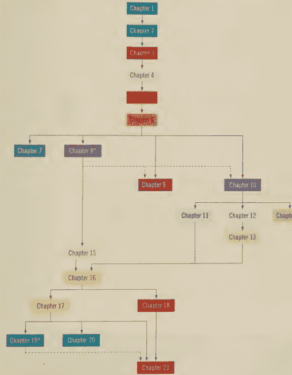

**图1** 章节依赖图

第2章将程序定义为一系列语句，其目标是完成某项任务。到目前为止你检查的程序简单直接。要处理一个程序，计算机从第一个可执行语句开始，按顺序执行语句直到到达末尾。在本章和第5章中，你将学习如何告诉计算机它不必遵循简单的语句顺序；它还可以做出决策，并重复执行某些语句，直到满足某些条件。

## 控制结构

计算机可以按以下方式之一处理程序：按顺序；通过做出选择有选择地执行，这也称为分支；通过使用称为循环的结构反复执行语句来重复；或通过调用函数。图4-1说明前三种程序流程。（在第6章中，我们将展示函数调用如何工作。）第2章和第3章中的编程示例包括简单的顺序程序。对于这样的程序，计算机从开头开始，按顺序遵循语句。不做选择；没有重复。控制结构为顺序程序执行提供了替代方案，并用于改变执行流程的顺序。最常见的控制结构是选择和重复。在选择中，程序根据某些条件执行特定语句。在重复中，程序根据某些条件重复执行特定语句一定次数。

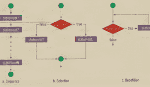

**图4-1** 执行流程

在C++中，标识符可以任意长度。

### 示例 2-2

以下是在C++中的合法标识符：

- `first`
- `conversion`
- `payRate`
- `counter`

表2-1展示一些非法标识符并解释它们为什么非法。

### 表2-1 非法标识符示例

| 非法标识符 | 描述 |
|---|---|
| `employee Salary` | employee和Salary之间不能有空格。 |
| `Hello!` | 感叹号不能用于标识符中。 |
| `one+two` | 符号+不能用于标识符中。 |
| `2nd` | 标识符不能以数字开头。 |

> 编译器供应商通常以下划线（_）开头某些标识符。当链接器将目标程序与集成开发环境（IDE）提供的系统资源链接时，可能会发生某些错误。因此，建议你不要在程序中的标识符以下划线（_）开头。

## 空白

每个C++程序都包含空白。空白包括空格、制表符和换行符。在C++程序中，空白用于分隔特殊符号、保留字和标识符。空白是不可打印的，因为当它们打印在白纸上时，特殊符号、保留字和标识符之间的空间是白色的。在程序中正确利用空白很重要。它们可以用来使程序更具可读性。

## 数据类型

C++程序的目标是操作数据。不同的程序操作不同的数据。设计用于计算员工工资的程序将加、减、乘、除数字，其中一些数字可能表示工作小时数和工资率。类似地，设计用于按字母顺序排列班级名单的程序将操作姓名。你不会用樱桃派食谱来帮助你烤饼干。类似地，你不会用

> 编号示例通过其相关性说明关键概念。这些示例中的编程代码后面跟着示例运行。然后进行解释，描述代码中每一行的作用。

> 注释强调本章介绍的概念的重要事实。

## 编程示例：转换长度


编写一个程序，输入以英尺和英寸表示的长度。程序应然后将长度转换为厘米并输出。假设给定的英尺和英寸长度是整数。

**输入：** 以英尺和英寸表示的长度。

**输出：** 以厘米表示的等效长度。

长度以英尺和英寸给出，你需要找到以厘米表示的等效长度。一英寸等于2.54厘米。程序需要做的第一件事是将以英尺和英寸给出的长度转换为总英寸。然后可以使用转换公式1英寸=2.54厘米来找到以厘米表示的等效长度。要将长度从英尺和英寸转换为英寸，将英尺数乘以12，因为1英尺等于12英寸，再加上给定的英寸数。

例如，假设输入是5英尺7英寸。然后按如下方式计算总英寸数：

```
totalInches = (12 * feet) + inches
             = 12 * 5 + 7
             = 67
```

然后可以应用转换公式1英寸=2.54厘米来找到以厘米表示的长度。

```
centimeters = totalInches * 2.54
             = 67 * 2.54
             = 170.18
```

基于对问题的分析，可以设计如下算法：

1. 获取以英尺和英寸表示的长度。
2. 将长度转换为总英寸。
3. 将总英寸转换为厘米。
4. 输出厘米。

程序的输入是两个整数值：一个用于英尺，一个用于英寸。因此，需要两个变量：一个存储英尺，另一个存储英寸。由于程序首先将给定长度转换为英寸，需要另一个变量存储总英寸。还需要一个变量存储以厘米表示的等效长度。总之，需要以下变量：

```
int feet;             //variable to hold given feet
int inches;           //variable to hold given inches
int totalInches;      //variable to hold total inches
double centimeters;   //variable to hold length in centimeters
```


## 练习

- 1. 将下列陈述标记为真或假。
  - a. 类的成员变量必须具有相同的类型。
  - b. 类的成员函数必须是公有的。
  - c. 一个类可以有多个构造函数。
  - d. 一个类可以有多个析构函数。
  - e. 构造函数和析构函数都可以有参数。

- 2. 找出以下类定义中的语法错误：

  ```cpp
  class mystery                    //Line 1
  {
  public:                           //Line 3
      void print() const;           //Line 4
      void setNum(double, double);  //Line 5
      int power();                  //Line 6
      double mystery();             //Line 7
      double mystery(double, double); //Line 8
  private:                          //Line 9
      double x;                      //Line 10
      double y                       //Line 11
  };                                //Line 12
  ```

- 3. 找出以下类定义中的语法错误：

  ```cpp
  class secret                       //Line 1
  {
  public:                            //Line 3
      bool multiply();               //Line 4
      print() const;                 //Line 5
      secret(int = 0, int = 0);      //Line 6
  private:                           //Line 7
      int one;                        //Line 8
      int two;                        //Line 9
  };                                 //Line 10
  ```

- 4. 找出以下类定义中的语法错误：

  ```cpp
  class secret                       //Line 1
  {
  public:                            //Line 3
      bool compare();                //Line 4
      void print() const;            //Line 5
      secret(int = 0, int = 0) const; //Line 6
  private:                           //Line 7
      string str;                     //Line 8
      int one;                        //Line 9
      int two;                        //Line 10
  };                                 //Line 11
  ```

练习进一步巩固学习，并确保学生确实已经掌握了这些材料。

```cpp
cin >> firstNum >> secondNum;
cout << endl;

// Missing statements
________ 0;
```

- 33. 假设 classStanding 是 char 变量，gpa 和 dues 是 double 变量。编写一个 switch 语句，按如下方式给 dues 赋值：如果 classStanding 为 'f'，则 dues 为 $150.00；如果 classStanding 为 's' 且 gpa 至少为 3.75，则 dues 为 $75.00；否则，dues 为 $120.00；如果 classStanding 为 'j' 且 gpa 至少为 3.75，则 dues 为 $50.00；否则，dues 为 $100.00；如果 classStanding 为 's'，则 dues 为 $100.00。（注意，switch 语句中的代码应包含代码 '$'，且不需要 break 语句。）

- 34. 假设 amount 是 double 变量，表示你需要向百货商店支付的金额。如果你支付最低金额，你将在下一期账单中获得 $10.00 或该账单金额的 1%（以较小者为准）作为抵扣；如果你支付至少账单金额的 50%，罚金为余额的 8%；如果你支付至少账单金额的 20% 且少于账单金额的 50%，罚金为余额的 10%；否则，罚金为余额的 20%。设计一个算法，提示用户输入账单金额和期望付款金额。然后该算法计算并输出抵扣金额或剩余余额。如果金额未全额支付，该算法还应输出罚金金额。

## 编程练习

- 1. 编写一个程序，提示用户输入一个数。然后程序应输出该数，并输出一条消息说明该数是正数、负数还是零。

- 2. 编写一个程序，提示用户输入三个数。然后程序应按升序输出这些数。

- 3. 编写一个程序，提示用户输入一个 0 到 35 之间的整数。如果该数在 0 到 9 之间，程序应输出该数；否则，应输出一个字母。例如，如果用户输入 10，程序应输出字母 A。

- 4. 以下程序中的语句顺序不正确。重新排列这些语句，使它们提示用户输入形状类型（矩形、圆形或圆柱体）以及该形状的相应尺寸。

编程练习要求学生编写具有指定结果的 C++ 程序。


## 补充资源

### CourseMate

在一个地方获取成功所需的一切，充分利用学习时间。在线阅读教材、高亮并做笔记、复习闪卡、观看视频，并在线参加练习测验。了解更多信息，请访问 *www.cengage.com/coursemate*。

C++ 编程 CourseMate 包含以下功能：

- **视频**逐步讲解每章的程序，而集成测验提供即时反馈，以评估你的理解程度。
- **实验手册**让你通过大量实用的动手练习应用所学内容。
- **交互式测验和学习游戏**强化各章关键概念，而开放式**作业**培养批判性思维能力。
- **交互式电子书**、闪卡等！

教师可以将 CourseMate 添加到教材包中，学生也可以直接通过 *www.cengagebrain.com* 购买 CourseMate。

### 源代码

源代码采用 ANSI/ISO 标准 C++，学生可在 www.cengagebrain.com 以及通过本书提供的 CourseMate 下载。这些文件也提供给教师，位于教师资源 CD 和 login.cengage.com 上。运行某些程序所需的输入文件也包含在源代码中。

### 教师资源

当本书用于课堂环境时，可使用以下补充材料。所有教师教学工具都随本书提供在一张 CD-ROM 上。许多资源也可在 login.cengage.com 下载。

### 电子版教师手册

教师手册按章节顺序配合教材，包含帮助规划和组织有效且引人入胜的课程的材料。

该手册包括概述、章目标、教学提示、快速测验、课堂讨论主题、额外项目、额外资源和关键术语。还提供**示例教学大纲**。

### ExamView®

本教材配有 ExamView，这是一个强大的测试软件包，允许教师创建和管理打印考试、计算机（局域网）考试和互联网考试。ExamView 包含数百道与本教材所涵盖主题相对应的题目，使学生能够生成详细的学习指南，其中包含页码引用以便进一步复习。这些基于计算机和互联网的测试组件允许学生在自己的计算机上参加考试，并为教师节省时间，因为每份考试都会自动评分。题库还提供与 **Blackboard、WebCT 和 Angel** 兼容的格式。

### PowerPoint 演示文稿

本书附有配合各章的 PowerPoint 幻灯片。幻灯片可用于指导课堂演示、提供给学生用于章节复习，或打印为课堂讲义。教师可以为自己向班级介绍的其他主题添加自己的幻灯片，并使用本书完整的**图片文件**来自定义幻灯片。

### 解答文件

所有编程练习的解答文件采用 ANSI/ISO C++，可在本书配套网站 *login.cengage.com* 获取，也可在教师资源 CD-ROM 上获取。运行某些编程练习所需的输入文件也包含在解答文件中。

## 致谢


有许多人我必须感谢，他们以各种方式为本书的成功做出了贡献。首先，我要感谢所有学生，他们在准备过程中主动告诉我某些部分是否需要改写，以便更好地理解和更清晰地阅读。其次，我要感谢那些通过电子邮件发送大量意见以改进第五版的人。我感谢 S.C. Cheng 教授和 Randall Crist 教授对本项目的持续支持。我也非常感谢审阅本书早期版本的审稿人，他们提供了许多关于如何改进本书的重要建议。

我非常感谢以下审稿人，他们为改进本版教材提供了有益而关键的建议：Gary Bricher：Lane Community College；Cliff Brozo：Monroe College；以及 Marie Pullan：Farmingdale State College。

接下来，我要感谢组稿编辑 Brandi Shailer，感谢她认识到本项目的重要性和独特性。如果没有高级产品经理 Alyssa Pratt 的周密规划，这一切都不可能实现。我向 Alyssa 以及内容项目经理 Matthew Hutchinson 表示诚挚的感谢。我特别感谢 Stephanie Lorenz，她运用自己的专业知识仔细编辑了视频。我也感谢 Integra Software Services 的 Sreemannarayana Reddy 协助我们使项目按计划进行。我要感谢 Cengage Learning 的 Chris Scriver 和 Serge Palladino 耐心而仔细地测试代码，并发现拼写错误和错误。

本书献给我的父母，感谢他们的祝福。

最后，我感谢妻子 Sadhana，尤其是女儿 Shelly 的支持。在撰写本书期间，每当我感到不堪重负时，她们都会鼓励我。欢迎对本书提出任何意见。意见可发送至以下电子邮件地址：malik@creighton.edu。

D. S. Malik


## 计算机与编程语言概述

### 本章中，你将：

- 了解不同类型的计算机
- 探索计算机系统的硬件和软件组成
- 了解计算机的语言
- 了解编程语言的演变
- 考察高级编程语言
- 了解什么是编译器以及它的作用
- 考察一个C++程序
- 探索C++程序是如何被处理的
- 了解什么是算法，并探索解决问题的技术
- 探索结构化和面向对象的计算机编程方法
- 了解标准C++和ANSI/ISO标准C++。

### 引言

像“互联网”这样的术语，在20年前还很陌生，如今已司空见惯。小学生经常“上网冲浪”，并使用计算机设计课堂项目。许多人使用互联网查找信息并与他人交流。这一切都得益于各种软件（也称为计算机程序）的可用性。没有软件，计算机毫无用处。软件是通过使用编程语言开发的。编程语言C++特别适合开发完成特定任务的软件。我们的主要目标是帮助你学习如何用C++编程语言编写程序。在开始编程之前，了解一些基本术语和计算机的不同组成部分是很有用的。我们先概述计算机的历史。

### 计算机历史简要概述

已知最早执行计算的装置是算盘。算盘发明于亚洲，但曾用于古巴比伦、中国以及整个欧洲，直到中世纪晚期。算盘使用在框架中滑动算珠的系统来进行加法和减法。1642年，法国哲学家和数学家布莱兹·帕斯卡发明了称为帕斯卡计算器的计算装置。它有八个装在轮子上的可移动表盘，可以计算长达八位数字的和。算盘和帕斯卡计算器都只能执行加法和减法运算。17世纪后期，戈特弗里德·威廉·莱布尼茨发明了一种能够加、减、乘、除的装置。1819年，法国织工约瑟夫·雅卡尔发现，他的织机的编织指令可以存储在打孔的卡片上。当卡片按顺序在织机中移动时，针穿过孔洞，选取正确的颜色和纹理。织工可以重新排列卡片，改变正在编织的图案。本质上，这些卡片为织机编程，以在织物上织出图案。纺织业似乎与计算机业几乎没有共同之处。然而，通过在卡片上打孔来存储信息的想法，在后来计算机的发展中证明极为重要。

19世纪早期至中期，英国数学家和物理学家查尔斯·巴贝奇设计了两种计算机器：差分机和分析机。差分机可以自动执行诸如求数字平方之类的复杂运算。巴贝奇建造了差分机的原型，但没有建造实际装置。第一台完整的差分机于2002年在伦敦完成，距其设计完成已有153年。它由8000个零件组成，重5吨，长11英尺。差分机的复制品于2008年完成，并在加利福尼亚州山景城的计算机历史博物馆展出（http://www.computerhistory.org/babbage/）。巴贝奇的大部分工作是通过其同事、洛夫莱斯伯爵夫人阿达·奥古斯塔的著作而为人所知的。奥古斯塔被认为是第一位计算机程序员。

19世纪末，美国人口普查官员需要帮助来准确汇总人口普查数据。赫尔曼·霍勒瑞斯发明了一种靠电力运行并使用打孔卡片存储数据的计算机器。霍勒瑞斯的机器取得了巨大成功。霍勒瑞斯创立了制表机公司，该公司后来成为著名的计算机和技术公司IBM。

第一台类似计算机的机器是Mark I。它于1944年由IBM和哈佛大学在霍华德·艾肯的领导下联合建造。打孔卡片被用来向机器输入数据。Mark I长52英尺，重50吨，有75万个零件。1946年，ENIAC（电子数字积分计算机）在宾夕法尼亚大学建成。它包含18000个真空管，重约30吨。

我们今天所知的计算机采用约翰·冯·诺依曼在20世纪40年代末提出的设计规则。他的设计包括算术逻辑单元、控制单元、存储器以及输入/输出设备等组件。这些组件将在下一节中描述。冯·诺依曼的计算机设计使得将编程指令和数据存储在同一内存空间中成为可能。1951年，UNIVAC（通用自动计算机）建成并出售给美国人口普查局。

1956年，晶体管的发明带来了更小、更快、更可靠且更节能的计算机。这一时期还见证了软件开发行业的兴起，推出了FORTRAN和COBOL这两种早期编程语言。在下一项重大技术进步中，晶体管被微小的集成电路（即“芯片”）所取代。芯片比晶体管更小、更便宜，并且可以在单个芯片上包含数千个电路。它们赋予计算机极高的处理速度。

1970年，微处理器（将整个CPU集成在单个芯片上）被发明。1977年，斯蒂芬·沃兹尼亚克和史蒂夫·乔布斯在车库里设计并建造了第一台苹果电脑。1981年，IBM推出了其个人计算机（PC）。20世纪80年代，IBM PC的兼容机使个人计算机更加经济实惠。到20世纪90年代中期，各行各业的人们都买得起它们。随着技术进步，计算机继续变得更快、更便宜。

现代计算机功能强大、可靠且易于使用。它们可以接受语音指令，并通过人工智能模仿人类推理。专家系统辅助医生进行诊断。移动计算应用正在显著增长。使用手持设备，送货司机可以访问全球定位卫星（GPS），以核实取货和送货的客户位置。手机让你可以查看电子邮件、预订机票、查看股票行情并访问银行账户。

尽管计算机有几种类型，如大型机、中型机和微型机，但所有计算机都共享一些基本要素，这些将在下一节中描述。


### 计算机系统的组成要素

计算机是一种能够执行命令的电子设备。计算机执行的基本命令包括输入（获取数据）、输出（显示结果）、存储以及执行算术和逻辑运算。计算机系统有两个主要组成部分：硬件和软件。在接下来的几节中，我们将简要概述这些组件。我们先来看硬件。

#### 硬件

主要硬件组件包括中央处理单元（CPU）、主存储器（MM）（也称为随机存取存储器（RAM））、输入/输出设备和辅助存储器。输入设备的例子有键盘、鼠标和辅助存储器。输出设备的例子有屏幕、打印机和辅助存储器。让我们更详细地查看这些组件。

#### 中央处理单元和主存储器

**中央处理单元**是计算机的“大脑”，也是计算机中最昂贵的单个硬件部件。CPU越强大，计算机速度越快。算术和逻辑运算在CPU内部执行。图1-1(a)展示了一些硬件组件。

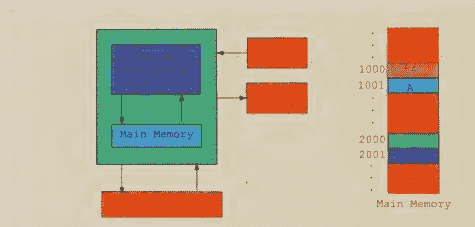

**图1-1** 计算机的硬件组件和主存储器

**主存储器**（即**随机存取存储器**）直接连接到CPU。所有程序必须先加载到主存储器中才能执行。同样，所有数据必须先送入主存储器，程序才能对其进行操作。当计算机关闭时，主存储器中的所有内容都会丢失。

主存储器是按顺序排列的单元序列，这些单元称为**存储单元**。每个单元在主存储器中都有一个唯一的位置，称为该单元的**地址**。这些地址帮助你访问存储在单元中的信息。图1-1(b)展示了带有一些数据的主存储器。


当今的计算机配备的主存储器由数百万到数十亿个存储单元组成。尽管图1-1(b)显示数据存储在存储单元中，但一个存储单元的内容既可以是编程指令，也可以是数据。此外，该图将数据显示为数字和字母。然而，正如本章后文所解释的，主存储器将所有内容都存储为0和1的序列。内存地址也表示为0和1的序列。

## 辅助存储

由于程序和数据在处理前必须存储在主存储器中，而且计算机关闭时主存储器中的所有内容都会丢失，因此存储在主存储器中的信息必须转移到其他设备以进行永久存储。永久存储信息的设备（除非该设备变得无法使用，或者你通过重写来更改信息）称为**辅助存储**。为了能够将信息从主存储器传输到辅助存储，这些组件必须直接相互连接。辅助存储的例子包括硬盘、闪存驱动器、软盘、ZIP盘、CD-ROM和磁带。

## 输入/输出设备

计算机要执行有用的任务，必须能够接收数据和程序并显示计算结果。将数据和程序输入计算机的设备称为**输入设备**。键盘、鼠标和辅助存储是输入设备的例子。计算机用来显示结果的设备称为**输出设备**。显示器、打印机和辅助存储是输出设备的例子。图1-2展示了一些输入和输出设备。

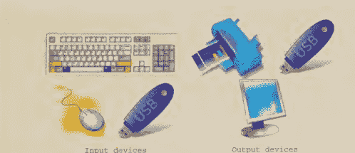

**图1-2** 一些输入和输出设备

## 软件

软件是为执行特定任务而编写的程序。例如，文字处理程序是你用来写信、论文甚至书籍的程序。所有软件都是用编程语言编写的。程序有两种类型：系统程序和应用程序。

**系统程序**控制计算机。打开个人计算机时首先加载的系统程序称为操作系统。没有操作系统，计算机毫无用处。**操作系统**监控计算机的整体活动并提供服务。其中一些服务包括内存管理、输入/输出活动和存储管理。操作系统有一个特殊程序来组织辅助存储，以便你可以方便地访问信息。

**应用程序**执行特定任务。文字处理程序、电子表格和游戏是应用程序的例子。操作系统是运行应用程序的程序。

## 计算机语言

当你在键盘上按A时，计算机在屏幕上显示A。但计算机主存储器内部实际存储的是什么？计算机的语言是什么？它如何存储你在键盘上输入的任何内容？

请记住，计算机是一种电子设备。计算机内部使用电信号来处理信息。电信号有两种类型：模拟信号和数字信号。**模拟信号**是用于表示声音等事物的连续波形。例如，录音带以模拟信号存储数据。**数字信号**用0和1的序列表示信息。0表示低电压，1表示高电压。数字信号是比模拟信号更可靠的信息载体，并且可以从一个设备复制到另一个设备，且精度完全一致。你可能已经注意到，当你复制录音带时，副本的音质不如原带。另一方面，当你复制CD时，副本与原版一样好。计算机使用数字信号。

由于数字信号在计算机内部处理，计算机的语言——称为**机器语言**——是0和1的序列。数字0或1称为**二进制位**，或**位**。有时，0和1的序列被称为**二进制代码**或**二进制数**。

**位：** 一个二进制数字0或1。

八个位的序列称为**字节**。此外，2^10字节 = 1024字节称为**千字节（KB）**。表1-1总结了用于描述各种字节数的术语。

**表1-1 二进制单位**

| 单位 | 符号 | 位/字节 |
|---|---|---|
| 字节 |  | 8位 |
| 千字节 | KB | 2^10字节 = 1024字节 |
| 兆字节 | MB | 1024 KB = 2^10 KB = 2^20字节 = 1,048,576字节 |
| 吉字节 | GB | 1024 MB = 2^10 MB = 2^30字节 = 1,073,741,824字节 |
| 太字节 | TB | 1024 GB = 2^10 GB = 2^40字节 = 1,099,511,627,776字节 |
| 拍字节 | PB | 1024 TB = 2^10 TB = 2^50字节 = 1,125,899,906,842,624字节 |
| 艾字节 | EB | 1024 PB = 2^10 PB = 2^60字节 = 1,152,921,504,606,846,976字节 |
| 泽字节 | ZB | 1024 EB = 2^10 EB = 2^70字节 = 1,180,591,620,717,411,303,424字节 |

键盘上的每个字母、数字或特殊符号（例如 * 或 { ）都被编码为位序列，每个都有唯一的表示。个人计算机上最常用的编码方案是七位**美国信息交换标准代码（ASCII）**。ASCII数据集由128个字符组成，编号从0到127。也就是说，在ASCII数据集中，第一个字符的位置是0，第二个字符的位置是1，依此类推。在这种方案中，A被编码为二进制数1000001。事实上，A是ASCII字符代码中的第66个字符，但其位置是65，因为第一个字符的位置是0。此外，二进制数1000001是65的二进制表示。字符3被编码为0110011。注意，在ASCII字符集中，字符3的位置是51，因此字符3是ASCII集中的第52个字符。由此也可知，0110011是51的二进制表示。有关可打印ASCII字符集的完整列表，请参阅附录C。


我们在日常生活中使用的数制称为**十进制**，或**基10**。由于计算机内部的所有内容都表示为0和1的序列，也就是二进制数，因此计算机使用的数制称为**二进制**，或**基2**。我们在上一段指出，数字1000001是65的二进制表示。附录E描述了如何将数字从基10转换为基2，以及反之。

在计算机内部，每个字符都表示为八个位的序列，也就是一个字节。现在，65的八位二进制表示是01000001。注意，我们在65的七位表示的左侧添加了0，将其转换为八位表示。类似地，51的八位二进制表示是00110011。

ASCII是一种七位代码。因此，要在计算机内部表示每个ASCII字符，必须将ASCII字符的七位二进制表示转换为八位二进制表示。这是通过在字符的七位ASCII编码左侧添加0来实现的。因此，在计算机内部，字符A表示为01000001，字符3表示为00110011。

还有其他编码方案，例如EBCDIC（由IBM使用）和Unicode，后者是较新的发展。EBCDIC由256个字符组成；Unicode由65,536个字符组成。要存储属于Unicode的字符，需要两个字节。

## 编程语言的演变

计算机最基本的语言——机器语言——以位提供程序指令。尽管大多数计算机执行相同类型的操作，但计算机的设计者可能选择了不同的二进制代码集来执行这些操作。因此，一台机器的机器语言不一定与另一台机器的机器语言相同。计算机之间唯一的一致性在于，在任何现代计算机中，所有数据都存储和操作为二进制代码。

早期的计算机用机器语言编程。为了了解指令如何用机器语言编写，假设你想使用以下等式：

```
wages = rate * hours
```

来计算周工资。此外，假设二进制代码100100表示加载，100110表示乘法，100010表示存储。在机器语言中，你可能需要以下指令序列来计算周工资：

```
100100 010001
100110 010010
100010 010011
```

为了用机器语言表示周工资等式，程序员必须记住各种操作的机器语言代码。此外，为了操作数据，程序员必须记住数据在主存储器中的位置。这种记住特定代码的需要使编程不仅非常困难，而且容易出错。

汇编语言是为了让程序员的工作更容易而开发的。在汇编语言中，指令是一种易于记忆的形式，称为助记符。表1-2展示了汇编语言指令的一些示例及其对应的机器语言代码。


### 表 1-2 汇编语言和机器语言的指令示例

| 汇编语言 | 机器语言 |
| --- | --- |
| LOAD | 100100 |
| STOR | 100010 |
| MULT | 100110 |
| ADD | 100101 |
| SUB | 100011 |

使用汇编语言指令，你可以编写如下代码来计算每周的工资：

```
LOAD rate
MULT hours
STOR wages
```

正如你所见，用汇编语言编写指令要容易得多。然而，计算机不能直接执行汇编语言指令。这些指令首先必须被翻译成机器语言。一种叫做**汇编程序:**的程序将汇编语言指令翻译成机器语言。

**汇编程序:** 一种将用汇编语言编写的程序翻译成等价的机器语言程序的程序。

从机器语言发展到汇编语言使编程变得更加容易，但程序员仍然被迫以单个机器指令的方式思考。使编程更容易的下一步是设计更接近自然语言（如英语、法语、德语和西班牙语）的**高级语言**。Basic、FORTRAN、COBOL、Pascal、C、C++、C# 和 Java 都是高级语言。你将在本书中学习高级语言 C++。

在 C++ 中，你编写每周工资的等式如下：

```
wages = rate * hours;
```

用 C++ 编写的指令更容易理解，对于熟悉基本算术的新手用户来说，它是不言自明的。然而，与汇编语言的情况一样，计算机不能直接执行用高级语言编写的指令。要在计算机上运行，这些 C++ 指令首先需要被翻译成机器语言。一种叫做**编译器:**的程序将用高级语言编写的指令翻译成机器代码。

**编译器:** 一种将用高级语言编写的指令翻译成等价的机器语言的程序。

## 处理 C++ 程序

在前面的章节中，我们讨论了机器语言和高级语言，并展示了一个 C++ 程序。因为计算机只能理解机器语言，所以现在是时候回顾处理用 C++ 编写的程序所需的步骤了。

考虑以下 C++ 程序：

```cpp
#include <iostream>

using namespace std;

int main()
{
    cout << "My first C++ program." << endl;

    return 0;
}
```

目前，你不需要过于关注该程序的细节。但是，如果你运行（执行）此程序，它将在屏幕上显示以下行：

我的第一个 C++ 程序。

请记住，计算机只能理解机器语言。因此，为了成功运行该程序，代码必须首先被翻译成机器语言。在本节中，我们回顾执行用 C++ 编写的程序所需的步骤。

如图 1-3 所示，处理 C++ 程序需要以下步骤。

- 1. 你使用文本编辑器按照高级语言的规则（即*语法*）创建 C++ 程序。该程序称为**源代码**或**源程序**。程序必须保存在扩展名为 `.cpp` 的文本文件中。例如，如果你将前面的程序保存为名为 `FirstCPPProgram` 的文件，那么它的完整名称就是 `FirstCPPProgram.cpp`。
  
  **源程序:** 用高级语言编写的程序。

- 2. 前面给出的 C++ 程序包含语句 `#include <iostream>`。在 C++ 程序中，以符号 `#` 开头的语句称为**预处理指令**。这些语句由称为**预处理程序**的程序处理。

- 3. 处理完预处理指令后，下一步是验证程序是否遵守编程语言的规则——即程序在语法上是否正确——并将程序翻译成等价的机器语言。**编译器**检查程序的语法错误，如果没有发现错误，则将程序翻译成等价的机器语言。等价的机器语言程序称为**目标程序**。

  **目标程序**: 高级语言程序的机器语言版本。

- 4. 你用高级语言编写的程序是在集成开发环境（IDE）中开发的。IDE 包含许多对创建程序有用的程序。例如，它包含显示程序结果所需的代码（程序）和一些数学函数，以使程序员的工作更容易一些。因此，如果某些代码已经可用，你可以使用这些代码而不是自己编写代码。一旦程序开发完成并成功编译，你仍然必须将 IDE 中使用的资源代码引入到你的程序中，以生成计算机可以执行的最终程序。这些预编写的代码（程序）存放在称为**库**的地方。一种称为**链接程序**:的程序将目标程序与库中的程序组合起来。

  **链接程序**: 一种将目标程序与库中的其他程序组合起来，并在程序中用于创建可执行代码的程序。

- 5. 接下来，你必须将可执行程序加载到主存中以便执行。一种称为**加载程序**:的程序完成此任务。

  **加载程序**: 一种将可执行程序加载到主存中的程序。

- 6. 最后一步是执行程序。

图 1-3 显示了一个典型的 C++ 程序是如何被处理的。

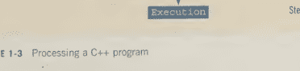

**图 1-3** C++ 程序的处理过程

作为程序员，你只需要关注步骤 1。也就是说，你必须学习、理解并掌握编程语言的规则，以创建源程序。

如前所述，程序是使用 IDE 开发的。用于创建高级语言 C++ 程序的著名 IDE 包括 Visual C++ 2008 Express、Visual C++ 2010 Express、Visual Studio 2010（来自微软）和 C++ Builder（来自 Borland）。你也可以使用 Bloodshed Software 的 Dev-C++ IDE 来创建和测试 C++ 程序。这些 IDE 包含用于创建源程序的文本编辑器、用于检查源程序语法错误的编译器、用于将目标代码与 IDE 资源链接的程序以及用于执行程序的程序。

这些 IDE 非常用户友好。当你编译程序时，编译器不仅会识别语法错误，而且通常会建议如何纠正这些错误。此外，只需一条简单的命令，目标代码就会与 IDE 中使用的资源相链接。例如，在 Visual C++ 2008 Express、Visual C++ 2010 Express 和 Visual Studio 2010 中执行链接的命令是 **Build** 或 **Rebuild**。（有关这些命令使用的进一步说明，请查看这些 IDE 的文档。）如果程序尚未编译，这些命令中的每一个都会先编译程序，然后链接并生成可执行代码。

网站 http://msdn.microsoft.com/en-us/beginner/bb964629.aspx 包含一个视频，解释了如何使用 Visual C++ 2008 Express 编写 C++ 程序。

## 采用问题分析–编码–执行循环进行编程

*编程是一个解决问题的过程。*

不同的人使用不同的技术来解决问题。有些技术组织得很好，并且易于遵循。它们不仅解决问题，而且深入了解解决方案是如何达成的。如果问题的领域发生变化，这些解决问题的技术可以很容易地进行修改。

要成为一个好的问题解决者和一个好的程序员，你必须遵循良好的问题解决技术。一种常见的问题解决技术包括分析问题、概述问题需求以及设计称为**算法:**的步骤来解决问题。

**算法:** 一种逐步解决问题的过程，在有限的时间内得出解决方案。

在编程环境中，问题解决过程需要以下三个步骤：

- 1. 分析问题，概述问题及其解决方案需求，并设计解决问题的算法。
- 2. 用编程语言（如 C++）实现该算法，并验证该算法是否有效。
- 3. 通过使用程序并在问题领域发生变化时修改程序来维护程序。

图 1-4 总结了这个三步编程过程。


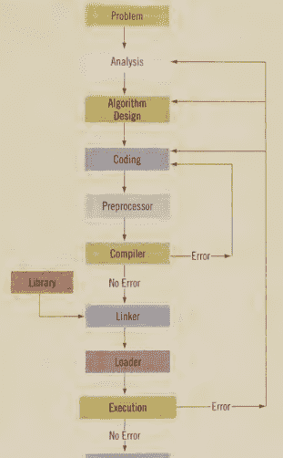

图 1-4 问题分析—编码—执行周期

要开发一个程序来解决问题，首先要分析问题。然后设计算法；用高级语言编写程序指令，或对程序进行编码；并将程序输入计算机系统。

分析问题是第一步，也是最重要的一步。这一步要求你完成以下工作：

- 1. 彻底理解问题。
- 2. 理解问题需求。需求可以包括程序是否需要与用户交互、是否处理数据、是否产生输出，以及输出是什么样子。如果程序处理数据，程序员必须知道数据是什么以及如何表示数据。也就是说，你需要查看一些数据。如果程序产生输出，你应该知道结果应如何生成和格式化。
- 3. 如果问题复杂，则将问题划分为子问题，并重复步骤1和步骤2。也就是说，对于复杂问题，需要分析每个子问题并理解每个子问题的需求。

仔细分析问题之后，下一步是设计解决问题的算法。如果你将问题分解为子问题，则需要为每个子问题设计算法。设计算法后，需要检查其正确性。有时可以使用样本数据测试算法的正确性。其他时候，可能需要执行一些数学分析来测试算法的正确性。

设计算法并验证其正确性之后，下一步是将其转换为等价的编程代码。然后使用文本编辑器将编程代码或程序输入计算机。接下来，必须确保程序遵循语言的语法。为了验证语法的正确性，需要让代码通过编译器。如果编译器生成错误消息，必须找出代码中的错误，将其删除，然后再次让代码通过编译器。当所有语法错误都被删除后，编译器生成等价的机器码，链接器将机器码与系统资源链接起来，加载器将程序放入主存以便执行。

最后一步是执行程序。编译器仅保证程序遵循语言的语法。它并不保证程序会正确运行。在执行期间，程序可能因逻辑错误（例如除零）而异常终止。即使程序正常终止，它仍可能产生错误结果。在这种情况下，你可能必须重新检查代码、算法，甚至问题分析。

如果在尝试编写编程指令之前花足够时间完成问题分析，你的整体编程体验将会成功。通常，你要用钢笔或铅笔在纸上完成这项工作。采用这种仔细的编程方法有许多优点。对于经过良好分析和设计的程序，发现错误要容易得多。此外，经过仔细分析和设计的程序更容易理解和修改。即使是最有经验的程序员，也会花大量时间分析问题并设计算法。

在本书中，你不仅将学习用 C++ 编写程序的规则，还将学习问题求解技术。大多数章节都包含讨论编程问题的编程示例。这些编程示例教授如何分析和解决问题、设计算法、将算法编码为 C++，并帮助你理解本章讨论的概念。为了充分受益于本书，我们建议你认真完成这些编程示例。

接下来，我们提供各种问题分析和算法设计技术的示例。

### 示例 1-1

在本例中，我们设计一个算法来求矩形的周长和面积。

要计算矩形的周长和面积，需要知道矩形的长度和宽度。

矩形的周长和面积由以下公式给出：

```
perimeter = 2 · (length + width)
area = length · width
```

求矩形周长和面积的算法如下：

- 1. 获取矩形的长度。
- 2. 获取矩形的宽度。
- 3. 使用以下等式求周长：

  ```
  perimeter = 2 · (length + width)
  ```

- 4. 使用以下等式求面积：

  ```
  area = length · width
  ```

### 示例 1-2

在本例中，我们设计一个算法，计算在某个州销售的商品销售税和价格。

销售税计算如下：州销售税部分为 4%，市销售税部分为 1.5%。如果商品是奢侈品，例如价格超过 50,000 美元的汽车，则需缴纳 10% 的奢侈品税。

要计算商品价格，需要计算州销售税部分、市销售税部分，以及商品为奢侈品时的奢侈品税。假设 salePrice 表示商品的销售价格，stateSalesTax 表示州销售税，citySalesTax 表示市销售税，luxuryTax 表示奢侈品税，salesTax 表示总销售税，amountDue 表示商品的最终价格。

要计算销售税，必须知道商品的销售价格以及该商品是否为奢侈品。

stateSalesTax 和 citySalesTax 可用以下公式计算：

```
stateSalesTax = salePrice · 0.04
citySalesTax = salePrice · 0.015
```

接下来，可按如下方式确定 luxuryTax：

```
if (item is a luxury item)
    luxuryTax = salePrice * 0.1
otherwise
    luxuryTax = 0
```

接下来，可按如下方式确定 salesTax：

```
salesTax = stateSalesTax + citySalesTax + luxuryTax
```

最后，可按如下方式计算 amountDue：

```
amountDue = salePrice + salesTax
```

因此，确定 salesTax 和 amountDue 的算法如下：

- 1. 获取商品的销售价格。
- 2. 确定商品是否为奢侈品。
- 3. 使用以下公式计算州销售税部分：

  ```
  stateSalesTax = salePrice * 0.04
  ```

- 4. 使用以下公式计算市销售税部分：

  ```
  citySalesTax = salePrice * 0.015
  ```

- 5. 使用以下公式计算奢侈品税：

  ```
  if (item is a luxury item)
      luxuryTax = salePrice * 0.1
  otherwise
      luxuryTax = 0
  ```

- 6. 使用以下公式计算 salesTax：

  ```
  salesTax = stateSalesTax + citySalesTax + luxuryTax
  ```

- 7. 使用以下公式计算 amountDue：

  ```
  amountDue = salePrice + salesTax
  ```

### 示例 1-3


在本例中，我们设计一个算法，计算当地百货商店一名销售员的月薪。

每位销售员都有基本工资。销售员还会根据以下标准在每月末获得奖金：如果销售员在商店工作五年或以下，则奖金为每工作一年 10 美元。如果销售员在商店工作超过五年，则奖金为每工作一年 20 美元。销售员还可以获得额外奖金，具体如下：如果销售员当月总销售额至少为 5,000 美元但低于 10,000 美元，则可获得销售额 3% 的佣金。如果销售员当月总销售额至少为 10,000 美元，则可获得销售额 6% 的佣金。

要计算销售员的月薪，需要知道基本工资、销售员在公司工作的年数以及该销售员当月的总销售额。假设 baseSalary 表示基本工资，noOfServiceYears 表示销售员在商店工作的年数，bonus 表示奖金，totalSales 表示销售员当月的总销售额，additionalBonus 表示额外奖金。

可按如下方式确定奖金：

```
if (noOfServiceYears is less than or equal to five)
    bonus = 10 * noOfServiceYears
otherwise
    bonus = 20 * noOfServiceYears
```

接下来，可按如下方式确定销售员的额外奖金：

```
if (totalSales is less than 5000)
    additionalBonus = 0
otherwise
    if (totalSales is greater than or equal to 5000 and
             totalSales is less than 10000)
        additionalBonus = totalSales * (0.03)
    otherwise
        additionalBonus = totalSales * (0.06)
```

根据以上讨论，现在可以设计计算销售员月薪的算法：

- 1. 获取 baseSalary。
- 2. 获取 noOfServiceYears。
- 3. 使用以下公式计算 bonus：

  ```
  if (noOfServiceYears is less than or equal to five)
      bonus = 10 * noOfServiceYears
  otherwise
      bonus = 20 * noOfServiceYears
  ```

- 4. 获取 totalSales。
- 5. 使用以下公式计算 additionalBonus：

  ```
  if (totalSales is less than 5000)
      additionalBonus = 0
  otherwise
      if (totalSales is greater than or equal to 5000 and
              totalSales is less than 10000)
          additionalBonus = totalSales * (0.03)
      otherwise
          additionalBonus = totalSales * (0.06)
  ```


- 6. 使用以下等式计算 payCheck：

```
payCheck = baseSalary + bonus + additionalBonus
```

## 示例 1-4

在本例中，我们设计了一个用于猜数字游戏的算法。

目标是随机生成一个大于或等于0且小于100的整数。然后提示玩家（用户）猜测这个数字。如果玩家猜对了数字，则输出相应的消息。否则，检查猜测的数字是否小于随机数。如果猜测的数字小于生成的随机数，则输出消息：“你猜的数字低于该数字。请再猜一次！”否则，输出消息：“你猜的数字高于该数字。请再猜一次！”然后提示玩家再次输入数字。系统将反复提示玩家猜测随机数，直到玩家输入正确的数字。

第一步是生成一个随机数，如上所述。C++ 提供了实现该功能的方法，这将在第5章中讨论。假设 num 代表随机数，guess 代表玩家猜测的数字。

玩家输入猜测的数字后，你可以按如下方式将猜测的数字与随机数进行比较：

```
if (guess is equal to num)
    Print "You guessed the correct number."
otherwise
    if guess is less than num
        Print "Your guess is lower than the number. Guess again!"
    otherwise
        Print "Your guess is higher than the number. Guess again!"
```

现在，你可以按如下方式设计算法：

- 1. 生成一个随机数并将其命名为 num。
- 2. *重复*以下步骤，直到玩家猜中正确的数字：
  - a. 提示玩家输入猜测的数字。
  - b.

```
if (guess is equal to num)
    Print "You guessed the correct number."
otherwise
    if guess is less than num
        Print "Your guess is lower than the number. Guess again!"
    otherwise
        Print "Your guess is higher than the number. Guess again!"
```

在第5章中，我们将使用该算法编写一个 C++ 程序来实现猜数字游戏。

## 示例 1-5

一个班有10名学生。每名学生参加了五次测试，每次测试满分为100分。我们要设计一个算法来计算每名学生的成绩以及班级平均分。成绩的评定如下：如果平均测试分数大于或等于90，则成绩为 A；如果平均测试分数大于或等于80且小于90，则成绩为 B；如果平均测试分数大于或等于70且小于80，则成绩为 C；如果平均测试分数大于或等于60且小于70，则成绩为 D；否则，成绩为 F。请注意，数据由学生姓名及其测试分数组成。

这个问题可以分解为如下子问题：共有五次测试，因此你需要设计一个算法来求出平均测试分数。接下来，你需要设计一个算法来确定成绩。这两个子问题分别是确定平均测试分数和确定成绩。

让我们先设计一个算法来确定平均测试分数。要求平均测试分数，先将五次测试分数相加，然后将总和除以5。因此，算法如下：

- 1. 获取五次测试分数。
- 2. 将五次测试分数相加。假设 `sum` 表示测试分数的总和。
- 3. 假设 `average` 表示平均测试分数。那么 `average = sum / 5;`

接下来，设计一个算法来确定成绩。假设 `grade` 表示分配给学生的成绩。以下算法确定成绩：

```
if average is greater than or equal to 90
    grade = A
otherwise
    if average is greater than or equal to 80 and less than 90
        grade = B
    otherwise
        if average is greater than or equal to 70 and less than 80
            grade = C
        otherwise
            if average is greater than or equal to 60 and less than 70
                grade = D
            otherwise
                grade = F
```

你可以使用这些子问题的解决方案来设计主算法，如下所示：（假设 `totalAverage` 表示每位学生平均测试分数的总和。）

- 1. `totalAverage = 0;`
- 2. 对班上的每名学生重复以下步骤：
  - a. 获取学生姓名。
  - b. 使用上述算法求出平均测试分数。
  - c. 使用上述算法确定成绩。
  - d. 通过加上当前学生的平均测试分数来更新 `totalAverage`。
- 3. 按如下方式确定班级平均分：
  `classAverage = totalAverage / 10`

第8章中的一道编程练习题要求你编写一个 C++ 程序，以确定一个班级中每名学生的平均测试分数和成绩。

## 编程方法论

编程设计的两种流行方法是结构化方法和面向对象方法，概述如下。

### 结构化编程

将问题分解为更小的子问题称为结构化设计。然后分析每个子问题，并得到解决该子问题的方案。然后将所有子问题的方案组合起来解决整体问题。这种实现结构化设计的过程称为**结构化编程**。结构化设计方法也被称为**自顶向下设计**、**自底向上设计**、**逐步求精**和**模块化编程**。

### 面向对象编程

**面向对象设计（OOD）**是一种广泛使用的编程方法论。在 OOD 中，解决问题过程的第一步是识别称为对象的组件，这些组件构成解决方案的基础，并确定这些对象如何相互作用。例如，假设你想编写一个程序，使本地视频租赁店的视频租赁过程自动化。该问题中的两个主要对象是视频和顾客。

识别对象后，下一步是为每个对象指定相关数据以及可对这些数据执行的操作。例如，对于视频对象，数据可能包括：

- 电影名称
- 主演
- 制片人
- 制作公司
- 库存副本数量

视频对象的一些操作可能包括：

- 查看电影名称
- 租出一份副本后，将库存副本数量减一
- 顾客归还特定视频后，将库存副本数量加一

这说明每个对象都由数据及对这些数据的操作组成。对象将数据及其操作组合成一个单一单元。在 OOD 中，最终程序是相互交互的对象的集合。实现 OOD 的编程语言称为**面向对象编程（OOP）**语言。你将在后续章节中了解 OOD 的诸多优点。

由于对象由数据及对这些数据的操作组成，因此在设计和运用对象之前，你需要学习如何在计算机内存中表示数据、如何操作数据以及如何实现操作。在第2章中，你将学习 C++ 的基本数据类型，并了解如何在计算机内存中表示和操作数据。第3章讨论如何向 C++ 程序输入数据以及输出 C++ 程序生成的结果。

要创建操作，你需要编写算法并用编程语言实现它们。由于复杂程序中的数据元素通常具有许多操作，为了将操作彼此分离并有效方便地使用它们，可以使用函数来实现算法。在第2章和第3章简要介绍之后，你将在第6章学习函数的详细内容。某些算法要求程序做出决策，这一过程称为选择。另一些算法可能要求某些语句重复执行，直到满足特定条件，这一过程称为重复。还有一些算法可能同时需要选择和重复。你将在第4章和第5章学习称为控制结构的选择和重复机制。此外，在第8章中，你将学习使用一种称为数组的机制，在数据项类型相同（例如销售数据列表中的项目）时，如何操作数据。

最后，要使用对象，你需要知道如何将数据及对数据的操作组合成单个单元。在 C++ 中，允许你将数据及对数据的操作组合成单个单元的机制称为类。你将在“类与数据抽象”一章（本书后面部分）中学习类如何工作、如何使用类以及如何创建类。

如你所见，在使用 OOD 方法之前，你需要学习不少东西。为了使学习更轻松、更有效，本书特意将控制结构分为两章（第4章和第5章）。

对于某些问题，结构化程序设计方法将非常有效。另一些问题则更适合采用 OOD 来解决。例如，如果某个问题需要使用数学函数操作一组数字，你可以采用结构化设计方法，并概述获得解决方案所需的步骤。C++ 库提供了大量函数，你可以有效地使用它们来操作数字。另一方面，如果你想编写一个使糖果机运行起来的程序，OOD 方法会更有效。C++ 是专门为实现 OOD 而设计的。此外，*OOD 效果很好，并与结构化设计结合使用。*


无论是结构化设计还是面向对象设计（OOD）方法，都要求你掌握一种编程语言的基本组成部分，才能成为一名高效的程序员。在第2章到第8章中，你将学习C++的基本组成部分，如数据类型、输入/输出、控制结构、用户自定义函数和数组，这些都是两种编程方式所需要的。我们将使用结构化编程方法来演示这些概念是如何工作的。从“类与数据抽象”一章开始，我们将采用面向对象设计方法。

## ANSI/ISO 标准 C++

C++ 编程语言由 C 语言发展而来，由比雅尼·斯特劳斯特鲁普（Bjarne Stroustrup）于20世纪80年代初在贝尔实验室设计。从20世纪80年代初到90年代初，出现了多种 C++ 编译器。尽管所有编译器中的 C++ 基本特性大体相同，但本书所称的“标准 C++”语言在不同编译器中以略有不同的方式演变。因此，C++ 程序并不总能从一个编译器移植到另一个编译器。

为了解决这个问题，20世纪90年代初，美国国家标准协会（ANSI）和国际标准化组织（ISO）成立了一个联合委员会，以标准化 C++ 的语法。1998年年中，ANSI/ISO C++ 语言标准获得批准。如今大多数编译器都遵循这些新标准。在过去的几年中，C++ 委员会多次开会以进一步标准化 C++ 的语法。2010年年中，C++ 的第二个标准经投票通过并获批。该标准（称为 C++0X，或暂定为 C++11）的主要目标是使 C++ 代码更简洁、更高效。例如，新标准引入了 long long 数据类型来处理大整数，使用初始化语句进行变量的 auto 声明，增强了 for 循环的功能以有效处理数组和容器，并引入了新算法。然而，并非所有当前可用的编译器都已实现该新标准的所有新特性。在本书中，我们介绍已知已被知名编译器实现的 C++ 新特性，并也会评论那些未来将会实现的特性。

本书重点介绍经 ANSI/ISO 批准的 C++ 语法，即 ANSI/ISO 标准 C++。

## 快速复习

- 1. 计算机是一种能够执行算术运算和逻辑运算的电子设备。
- 2. 计算机系统有两个组成部分：硬件和软件。
- 3. 中央处理器（CPU）和主存是硬件组件的例子。
- 4. 所有程序在执行之前都必须装入主存。
- 5. 当电源关闭时，主存中的所有内容都会丢失。
- 6. 辅助存储器为信息提供永久存储。硬盘、闪存盘、软盘、ZIP 磁盘、CD-ROM 和磁带是辅助存储器的例子。
- 7. 计算机通过输入设备进行输入。两种常见的输入设备是键盘和鼠标。
- 8. 计算机将输出发送到输出设备，例如计算机屏幕。
- 9. 软件是计算机运行的程序。
- 10. 操作系统监控计算机的整体活动并提供服务。
- 11. 计算机最基本的语言是由 0 和 1 组成的序列，称为机器语言。每台计算机都直接理解自己的机器语言。
- 12. 位（bit）是二进制数字，0 或 1。
- 13. 字节（byte）是 8 个位的序列。
- 14. 由 0 和 1 组成的序列称为二进制代码或二进制数。
- 15. 1 千字节（KB）是 2¹⁰ = 1024 字节；1 兆字节（MB）是 2²⁰ = 1,048,576 字节；1 吉字节（GB）是 2³⁰ = 1,073,741,824 字节；1 太字节（TB）是 2⁴⁰ = 1,099,511,627,776 字节；1 拍字节（PB）是 2⁵⁰ = 1,125,899,906,842,624 字节；1 艾字节（EB）是 2⁶⁰ = 1,152,921,504,606,846,976 字节；1 泽字节（ZB）是 2⁷⁰ = 1,180,591,620,717,411,303,424 字节。
- 16. 汇编语言使用易于记忆的指令，称为助记符。
- 17. 汇编程序是将用汇编语言编写的程序翻译成机器语言的程序。
- 18. 编译器是将用高级语言编写的程序翻译成机器代码（称为目标代码）的程序。
- 19. 链接器将目标代码与集成开发环境（IDE）提供并在程序中使用的其他程序链接起来，以生成可执行代码。
- 20. 通常，执行 C++ 程序需要六个步骤：编辑、预处理、编译、链接、加载和执行。
- 21. 加载器将可执行代码传送到主存中。
- 22. 算法是一种一步一步解决问题的过程，在有限时间内得出解决方案。
- 23. 解决问题的过程有三个步骤：分析问题并设计算法，用编程语言实现算法，以及维护程序。
- 24. 使用结构化设计方法编写的程序更容易理解、更容易测试和调试、也更容易修改。
- 25. 在结构化设计中，一个问题被划分为更小的子问题。每个子问题被解决，然后将所有子问题的解决方案组合起来解决整个问题。


- 26. 在面向对象设计（OOD）中，程序是相互作用的对象集合。
- 27. 对象由数据以及对这些数据的操作组成。
- 28. ANSI/ISO 标准 C++ 语法于 1998 年年中获得批准。

## 练习

- 1. 将下列陈述标记为真或假。
  - a. 已知第一台执行计算的设备是帕斯卡计算器。
  - b. 现代计算机可以接受口头指令，但不能模仿人类推理。
  - c. 在 ASCII 编码中，每个字符被编码为 8 位的序列。
  - d. 编译器将高级语言程序翻译为汇编语言。
  - e. 算术运算在 CPU 内部执行，如果发现错误，它会输出逻辑错误。
  - f. 由 0 和 1 组成的序列称为十进制代码。
  - g. 链接器将目标代码从主存链接并加载到 CPU 中执行。
  - h. C++ 程序的开发包括六个步骤。
  - i. 用高级编程语言编写的程序称为源程序。
  - j. ZB 代表零字节。
  - k. 解决问题的第一步是分析问题。
  - l. 在面向对象设计中，程序是相互作用的函数的集合。
- 2. 计算机执行的基本命令有哪些？
- 3. 说出三种硬件组件。
- 4. 为什么需要辅助存储器？
- 5. 操作系统的功能是什么？
- 6. 程序有哪两种类型？
- 7. 机器语言和高级语言之间有什么区别？
- 8. 什么是源程序？
- 9. 为什么需要编译器？
- 10. 编译器会报告哪些类型的错误？
- 11. 为什么需要将用高级语言编写的程序翻译成机器语言？
- 12. 为什么你更愿意用高级语言而不是机器语言编写程序？
- 13. 什么是链接？
- 14. 与直接用高级语言编写程序相比，问题分析和算法设计有哪些优点？
- 15. 设计一个算法来求四次测试成绩的加权平均值。四次测试成绩及其各自的权重按以下格式给出：

    ```
    testScore1 weightTestScore1
    ...
    ```

    例如，示例数据如下：

    ```
    75 0.20
    95 0.35
    85 0.15
    65 0.30
    ```

- 16. 设计一个算法，将给定的 25 美分、10 美分、5 美分和 1 美分硬币转换为美分。
- 17. 给定披萨的半径（英寸）和价格，设计一个算法来计算每平方英寸披萨的价格。
- 18. 为了盈利，家具店所售商品的价格加价 80%。加价后，每件商品又以 10% 的折扣出售。设计一个算法来求家具店所售商品的售价。要找到售价，你需要哪些信息？
- 19. 假设 a、b 和 c 表示三角形的边长。那么三角形的面积可以使用以下公式计算：

    √(s(s-a)(s-b)(s-c))，

    其中 s = (1/2)(a + b + c)。设计一个使用此公式求三角形面积的算法。要找到面积，你需要哪些信息？

- 20. 杰森通常使用互联网购买各种物品。如果一次订购的商品总价为 200 美元或以上，则免运费和手续费；否则，每件商品的运费和手续费为 10 美元。设计一个算法，提示杰森输入订购的商品数量以及每件商品的价格。然后该算法输出总账单金额。你的算法必须使用循环（重复结构）来获取每件商品的价格。（为简单起见，你可以假设杰森一次订购不超过五件商品。）
- 21. 假设发送国际传真的费用按如下方式计算：服务费为 3.00 美元，前 10 页每页 0.20 美元，之后每增加一页 0.10 美元。设计一个算法，要求用户输入要传真的页数。然后该算法根据要传真的页数计算应付金额。
- 22. ATM 允许客户每天最多取款 500 美元。如果客户取款超过 300 美元，服务费为超过 300 美元部分的 4%。如果客户账户余额不足，ATM 会通知客户余额不足，并向客户提供


取款需支付 $25.00 的服务费。如果账户中没有钱，或者账户余额为负，ATM 不允许客户取任何钱。如果要取款的金额大于 $500，ATM 会告知客户可提取的最高金额。编写一个算法，允许客户输入要取款的金额。然后该算法检查账户中的总金额，将钱支付给客户，并从账户中扣除取款金额和服务费（如有）。

23. 给定一份学生姓名及其测试成绩的列表。设计一个算法，完成以下操作：

- a. 计算平均测试成绩。
- b. 确定并打印所有测试成绩低于平均测试成绩的学生姓名。
- c. 确定最高测试成绩。
- d. 打印所有测试成绩与最高测试成绩相同的学生姓名。

（你必须将此问题划分为如下子问题：第一个子问题确定平均测试成绩。第二个子问题确定并打印所有测试成绩低于平均测试成绩的学生姓名。第三个子问题确定最高测试成绩。第四个子问题打印所有测试成绩与最高测试成绩相同的学生姓名。主算法组合各子问题的解决方案。）


## 第 2 章

## C++ 的基本元素

### 本章中，你将：

- 熟悉 C++ 程序的基本组成部分，包括函数、特殊符号和标识符
- 探索简单数据类型
- 了解如何使用算术运算符
- 考查程序如何对算术表达式求值
- 学习什么是赋值语句以及它的作用
- 熟悉字符串数据类型
- 了解如何使用输入语句将数据输入内存
- 熟悉自增和自减运算符的使用
- 考查使用输出语句输出结果的方式
- 学习如何使用预处理指令以及为什么需要它们
- 学习如何调试语法错误
- 探索如何正确组织程序结构，包括使用注释为程序编写文档
- 学习如何编写 C++ 程序

在本章中，你将学习 C++ 的基础知识。由于你的目标是学习 C++ 编程语言，自然会产生两个问题。第一，什么是计算机程序？第二，什么是编程？**计算机程序**，或称程序，是一系列语句，其目标是完成一项任务。**编程**是规划和创建程序的过程。这两个定义道出了编程的真相，但并非全部真相。要给出一个良好且令人满意的编程定义，完全可能需要一整本书。你也许可以通过类比更好地把握编程的本质，因此让我们转向一个几乎人人都有些了解的话题——烹饪。一份食谱也是一份程序，而每个有一定烹饪经验的人都会认同以下几点：

1. 通常，照着食谱做比创作一份食谱更容易。
2. 有好的食谱，也有糟糕的食谱。
3. 有些食谱容易照着做，有些则不容易。
4. 有些食谱能产生可靠的结果，有些则不能。
5. 你必须具备一些关于如何使用烹饪工具的知识，才能按照食谱完成烹饪。
6. 要创作出好的新食谱，你必须拥有大量知识，并对烹饪有良好的理解。

这同样的六点也适用于编程。让我们把烹饪类比再推进一步。假设你需要教某人如何成为厨师。你会怎么做？你会先让这个人接触美食，希望培养出对美食的品味吗？你会让这个人照着食谱一份接一份地做，希望其中一些能潜移默化地学会吗？还是会先教他们使用工具、了解食材（食物和香料）的性质，并解释它们如何搭配在一起？正如在如何教授烹饪上存在分歧一样，在如何教授编程上也存在分歧。

学习一门编程语言就像学习成为厨师或学习演奏乐器。这三者都需要与工具直接互动。你不能只靠阅读食谱就成为好厨师，甚至成为差厨师也不行。同样，你不能只靠阅读关于乐器的书就成为演奏者。编程也是如此。你必须具备该语言的基础知识，并且必须在计算机上测试你的程序，以确保每个程序都能完成它应完成的任务。

### 快速浏览一个 C++ 程序

在本章中，你将学习 C++ 编程语言的基本元素和概念，以创建 C++ 程序。除了给出示例来说明各种概念外，我们还将展示 C++ 程序来阐明这些概念。在本节中，我们提供一个计算矩形周长和面积的 C++ 程序示例。此时你不必过于关注该程序的细节。你只需了解 `output` 语句的作用，本章会介绍它。

在示例 1-1（第 1 章）中，我们设计了一个求矩形周长和面积的算法。给定矩形的长度和宽度，示例 2-1 中的 C++ 程序会计算并显示其周长和面积。

### 示例 2-1

```cpp
//***************************************************************
// Given the length and width of a rectangle, this C++ program
// computes and outputs the perimeter and area of the rectangle.
//***************************************************************

#include <iostream>

using namespace std;

int main()
{
    double length;
    double width;
    double area;
    double perimeter;

    cout << "Program to compute and output the perimeter and "
         << "area of a rectangle." << endl;

    length = 6.0;
    width = 4.0;
    perimeter = 2 * (length + width);
    area = length * width;

    cout << "Length = " << length << endl;
    cout << "Width = " << width << endl;
    cout << "Perimeter = " << perimeter << endl;
    cout << "Area = " << area << endl;

    return 0;
}
```

**示例运行：**（编译并执行该程序时，屏幕上会显示以下五行。）

```text
Program to compute and output the perimeter and area of a rectangle.
Length = 6
Width = 4
Perimeter = 20
Area = 24
```

这些行是通过执行以下语句显示的：

```cpp
cout << "Program to compute and output the perimeter and "
     << "area of a rectangle." << endl;

cout << "Length = " << length << endl;
cout << "Width = " << width << endl;
cout << "Perimeter = " << perimeter << endl;
cout << "Area = " << area << endl;
```

接下来我们解释这是如何发生的。让我们先考虑以下语句：

```cpp
cout << "Program to compute and output the perimeter and "
     << "area of a rectangle." << endl;
```

这是一个 C++ 输出语句的示例。它使计算机对符号对 `<<` 之后的*表达式*求值，并将结果显示在屏幕上。

通常，一个 C++ 程序包含各种类型的表达式，例如算术表达式和字符串。例如，`length + width` 是一个算术表达式。双引号中的任何内容都是*字符串*。例如，"Program to compute and output the perimeter and" 是一个字符串。类似地，"area of a rectangle." 也是一个字符串。通常，字符串求值为其自身。算术表达式根据算术运算规则求值，这些规则通常你在代数课程中会学到。本章后面，我们将解释算术表达式和字符串是如何形成和求值的。

另请注意，在输出语句中，`endl` 会使插入点移到下一行的开头。（注意，在 `endl` 中，最后一个字母是小写 `l`。另外，在屏幕上，插入点就是光标所在的位置。）因此，前面的语句使系统在屏幕上显示以下行。

```text
Program to compute and output the perimeter and area of a rectangle.
```

现在让我们考虑以下语句：

```cpp
cout << "Length = " << length << endl;
```

这个输出语句由两个表达式组成。第一个表达式（在第一个 `<<` 之后）是 "Length = "，第二个表达式（在第二个 `<<` 之后）由标识符 `length` 组成。表达式 "Length = " 是一个字符串，求值为其自身。（注意 `=` 后面的空格。）第二个表达式由标识符 `length` 组成，求值为 length 的值。因为赋给 length 的值是 6.0，所以 length 求值为 6.0。因此，前面语句的输出是：

```text
Length = 6
```

注意，length 的值输出为 6，而不是 6.0。我们将在下一章解释如何强制程序将 length 的值输出为 6.0。其余输出语句的含义类似。


最后一条语句，即

```
return 0;
```

在程序终止时向操作系统返回值 0。我们将在本章后面详细说明这条语句。

在我们识别 C++ 程序的各个部分之前，让我们再看一个输出语句。考虑以下语句：

```
cout << "7 + 8 = " << 7 + 8 << endl;
```

在这个输出语句中，表达式 "7 + 8 = " 是一个字符串，其求值结果就是它本身。让我们考虑第二个表达式 7 + 8。这个表达式由数字 7 和 8 以及 C++ 算术运算符 + 组成。因此，表达式 7 + 8 的结果是 7 和 8 的和，即 15。于是，前面那条语句的输出是：

```
7 + 8 = 15
```

在下一章中，在我们解释如何正确构造 C++ 程序之前，我们将使用诸如前面那些输出语句来解释各种概念。完成第 2 章后，你应该能够编写足够好的 C++ 程序来进行一些计算并显示结果。

接下来，让我们注意关于前面那个 C++ 程序的以下几点。一个 C++ 程序是函数的集合，其中之一是函数 main。粗略地说，函数是一组语句，其目标是完成某件事。前面的程序只包含函数 main；所有 C++ 程序都需要一个函数 main。

程序的前四行以符号对 //（显示为绿色）开头，这些是注释。注释是给用户看的；它们通常解释程序的目的，即语句的含义。（我们将在本章后面详细说明如何在程序中包含注释。）程序的下一行，即

```
#include <iostream>
```

允许我们使用（预定义对象）cout 来生成输出，以及（操纵器）endl。语句

```
using namespace std;
```

允许你使用 cout 和 endl 而无需前缀 std::。这意味着，如果你不包含这条语句，那么 cout 应使用为 std::cout，endl 应使用为 std::endl。我们将在本章后面详细说明这一点。

接下来考虑以下行：

```
int main()
```

这是函数 main 的头部。下一行由一个左花括号组成。这标志着函数 main 的（函数体）的开始。右花括号（在程序的最后一行）与此左花括号匹配，标志着函数 main 的函数体的结束。我们将在本书后面解释其他术语的含义，例如以蓝色显示的那些术语。注意，在 C++ 中，<< 是一个运算符，称为*流插入运算符*。

在结束本节之前，让我们识别图 2-1 中 C++ 程序的某些部分。

```cpp
//*******************************************************
// Given the length and width of a rectangle, this C++ program
// computes and outputs the perimeter and area of the rectangle.
//*******************************************************

#include <iostream>

using namespace std;

int main()
{
    double length;
    double width;
    double area;
    double perimeter;

    cout << "Program to compute and output the perimeter and "
         << "area of a rectangle." << endl;

    length = 6.0;

    width = 4.0;
    perimeter = 2 * (length + width);

    area = length * width;

    cout << "Length = " << length << endl;
    cout << "Width = " << width << endl;
    cout << "Perimeter = " << perimeter << endl;
    cout << "Area = " << area << endl;

    return 0;
}
```

变量声明。诸如 `double length;` 这样的语句指示系统分配内存空间并将其命名为 length。

赋值语句。这条语句指示系统将 6.0 存储到内存空间 length 中。

赋值语句。这条语句指示系统计算表达式 `length * width` 并将结果存储到内存空间 area 中。

输出语句。输出语句指示系统显示结果。

*图 2-1*  C++ 程序的各个部分

你将在全书中遇到并且在图 2-1 中也标识出来的一个术语是变量。因此，我们在本节介绍这个术语。回忆第 1 章，所有数据在被操作之前都必须加载到主存中。例如，给定长度和宽度，图 2-1 中的程序计算并输出矩形的面积和周长。这意味着长度和宽度的值必须存储在主存中。此外，回忆第 1 章，主存是一个有序的单元序列，每个单元都有一个地址。在计算机内部，内存单元的地址是二进制的。一旦我们存储了长度和宽度的值，并且因为这些值可能在程序中的多个地方需要，我们希望知道这些值存储的位置以及如何访问那些内存位置。C++ 使程序员很容易指定这些位置，因为程序员可以简单地为每个位置应用一个字母名称。当然，我们必须遵循规则来指定名称。例如，在图 2-1 的程序中，我们告诉系统分配四个内存空间，并分别将它们命名为 length、width、area 和 perimeter。（我们将在本章后面解释以蓝色显示的单词 double 的含义。）本质上，变量是一个内容可以更改的内存位置。因此 length、width、area 和 perimeter 是变量。同样在程序执行期间，系统将分配四个足够大以存储十进制数的内存位置，并且这些内存位置将分别命名为 length、width、area 和 perimeter，见图 2-2。


图 2-2  内存分配

语句 length = 6.0; 将导致系统将 6.0 存储到内存位置 length 中，见图 2-3。例 2-14 和例 2-19 进一步说明数据如何在变量中被操作。


图 2-3  语句 length = 6.0; 执行后的内存空间

随着我们继续本章，我们将解释图 2-1 中标识的其余部分的含义。

### C++ 程序的基础

在上一节中，我们给出了一个 C++ 程序的示例，并标识了程序的某些部分。一般来说，C++ 程序是一个或多个子程序（称为函数）的集合。粗略地说，子程序或函数是语句的集合，当它被激活或执行时，它会完成某件事。有些函数称为**预定义**函数或**标准**函数，它们已经编写好并作为系统的一部分提供。但为了完成大多数任务，程序员必须学会编写自己的函数。

每个 C++ 程序都有一个称为 main 的函数。因此，如果一个 C++ 程序只有一个函数，那它必须是函数 main。直到第 6 章，除了使用一些预定义函数外，你将主要处理函数 main。到本章结束时，你将学会如何编写函数 main。

如果你从未见过用编程语言编写的程序，例 2-1 中的 C++ 程序可能看起来像一门外语。要用外语造出有意义的句子，你必须学习它的字母表、单词和语法。编程语言也是如此。要编写有意义的程序，你必须学习编程语言的特殊符号、单词和语法规则。**语法规则**告诉你哪些语句（指令）是合法的或有效的，即哪些被编程语言接受，哪些不被接受。你还必须学习**语义规则**，它决定指令的含义。编程语言的规则、符号和特殊单词使你能够编写程序来解决问题。

**编程语言：** 一组规则、符号和特殊单词。

在本节的剩余部分，你将了解 C++ 程序的一些特殊符号。其他特殊符号将在后续章节中遇到其他概念时介绍。同样，语法和语义规则将在全书中介绍和讨论。

### 注释

你编写的程序不仅应该对你清晰，而且应该对你的程序读者清晰。良好编程的一部分是在程序中包含注释。通常，注释可用于标识程序的作者、给出程序编写或修改的日期、给出程序的简要说明，以及解释程序中关键语句的含义。在编程示例中，对于我们编写的程序，我们不会包含程序编写的日期，这与编写此类书籍的标准惯例一致。

注释是给读者看的，而不是给编译器看的。因此，当编译器编译程序以检查语法错误时，它会完全忽略注释。在本书中，注释显示为绿色。


示例 2-1 中的程序包含以下注释：

```cpp
//***************************************************************
// Given the length and width of a rectangle, this C++ program
// computes and outputs the perimeter and area of the rectangle.
//***************************************************************
```

C++ 程序中有两种常见的注释类型——单行注释和多行注释。

单行注释以 // 开头，可以放在该行的任何位置。编译器会忽略该行中 // 之后遇到的所有内容。例如，考虑以下语句：

```cpp
cout << "7 + 8 = " << 7 + 8 << endl;
```

你可以按如下方式在这一行末尾添加注释：

```cpp
cout << "7 + 8 = " << 7 + 8 << endl; //prints: 7 + 8 = 15
```

这条注释对初学者程序员可能很有意义。

多行注释包含在 /* 和 */ 之间。编译器会忽略出现在 /* 和 */ 之间的任何内容。例如，下面是一个多行注释的示例：

```cpp
/*
   You can include comments that can
   occupy several lines.
*/
```

在多行注释中，许多程序员在每一行都使用单行注释，以便让注释对读者更加醒目（如示例 2-1 的程序中所做的那样）。

### 特殊符号

用任何语言编写的程序中最小的独立单元称为**标记（token）**。C++ 的标记分为特殊符号、单词符号和标识符。

以下是一些特殊符号：

```text
+    -    *    /
.    ;    ?    '
<=   !=   ==   >=
```

第一行包括加法、减法、乘法和除法的数学符号。第二行由取自英语语法的标点符号组成。注意，逗号也是一种特殊符号。在 C++ 中，逗号用于分隔列表中的项。分号也是特殊符号，用于结束 C++ 语句。注意，上面未显示的空白字符也是一种特殊符号。在键盘上按空格键（仅一次）即可创建空白符号。第三行由两个字符组成的标记构成，这两个字符被视为一个符号。标记中的两个字符之间不能插入任何字符，甚至不能插入空白字符。

### 保留字（关键字）

第二类标记是保留字符号。一些保留字符号包括以下内容：

int, float, double, char, const, void, return

保留字也称为**关键字**。组成保留字的字母始终是小写。与特殊符号一样，每个保留字都被视为一个符号。此外，单词符号不能在任何程序中重新定义；也就是说，它们不能用于其预期用途之外的任何用途。完整的保留字列表见附录 A。

> **注意：** 在本书中，保留字以蓝色显示。

### 标识符

第三类标记是标识符。标识符是程序中出现的各种事物的名称，例如变量、常量和函数。所有标识符都必须遵守 C++ 的标识符规则。

**标识符：** C++ 标识符由字母、数字和下划线字符（_）组成，并且必须以字母或下划线开头。

有些标识符是预定义的；另一些由用户定义。在示例 2-1 的 C++ 程序中，cout 是预定义标识符，length 是用户定义标识符。你会经常遇到的两个预定义标识符是 cout 和 cin。你已经看到了 cout 的作用。在本章后面，你将学习用于输入数据的 cin 如何工作。与保留字不同，预定义标识符可以重新定义，但这样做并不明智。

标识符只能由字母、数字和下划线字符组成；不允许使用其他符号构成标识符。

> **注意：** C++ 区分大小写——大写字母和小写字母被视为不同。因此，标识符 NUMBER 与标识符 number 不相同。同样，标识符 X 和 x 也不同。

在 C++ 中，标识符可以任意长度。

### 示例 2-2

以下是 C++ 中的合法标识符：

- `first`
- `conversion`
- `payRate`
- `counter1`

表 2-1 展示了一些非法标识符，并解释了它们为什么非法。

**表 2-1** 非法标识符示例

| 非法标识符 | 描述 |
|---|---|
| `employee Salary` | 在 employee 和 Salary 之间不能有空格。 |
| `Hello!` | 感叹号不能用于标识符中。 |
| `one+two` | 符号 + 不能用于标识符中。 |
| `2nd` | 标识符不能以数字开头。 |


> 编译器厂商通常会让某些标识符以下划线（_）开头。
> 当链接器将目标程序与集成开发环境（IDE）提供的系统资源链接时，可能会发生某些错误。因此，建议你程序中的标识符不要以下划线（_）开头。

### 空白字符

每个 C++ 程序都包含空白字符。空白字符包括空格、制表符和换行字符。在 C++ 程序中，空白字符用于分隔特殊符号、保留字和标识符。空白字符是不可打印的，因为当它们打印在白纸上时，特殊符号、保留字和标识符之间的空白是白色的。在程序中正确利用空白字符很重要。它们可以用来使程序更具可读性。

### 数据类型

C++ 程序的目标是处理数据。不同的程序处理不同的数据。一个旨在计算员工薪水的程序会加、减、乘、除数字，其中一些数字可能表示工作小时数和工资率。同样，一个旨在按字母顺序排列班级名单的程序会处理姓名。你不会用樱桃派食谱来帮你烤饼干。同样，你不会用

内存大小让人少操心一件事。为了有效使用内存，程序员可以查看程序将要使用的数据类型，从而确定应使用哪种数据类型。（对于为手表等应用编写的程序，内存限制可能仍然是一个问题。）

较新的编程语言只有五类简单数据类型：整数、实数、char、bool 和枚举类型。本书中使用的整型数据类型是 int、bool 和 char。

表 2-2 给出了与这三种数据类型相关的可能取值范围，以及为处理这些值所分配的内存大小。

**表 2-2** 三种简单数据类型的取值和内存分配

| 数据类型 | 取值 | 存储（字节） |
|---|---|---|
| int | -2147483648 到 2147483647 | 4 |
| bool | true 和 false | 1 |
| char | -128 到 127 | 1 |

> **注意**
>
> 本表仅供参考。不同的编译器可能允许不同的取值范围。请查阅编译器的文档。要查找特定系统上整型数据类型的准确大小，可以运行附录 G（系统内存大小）中给出的程序。此外，要查找这些数据类型的最大值和最小值，可以运行附录 F（头文件 climits）中给出的另一个程序。

> **注意**
>
> 为了处理大整数，C++ 的新标准引入了数据类型 long long。long long 数据值的内存空间为 64 位，属于该数据类型的取值范围是 -9223372036854775808（−2^63）到 9223372036854775807（2^63 − 1）。

### `int` 数据类型

本节描述 int 数据类型。这里的讨论也适用于其他整型数据类型。

C++ 中的整数与数学中一样，是如下这样的数：

−6728, −67, 0, 78, 36782, +763

注意这些示例中的以下两条规则：

- 1. 正整数前面不需要 + 号。
- 2. 整数内部不使用逗号。回想一下，在 C++ 中，逗号用于分隔列表中的项。因此，36,782 会被解释为两个整数：36 和 782。

### bool 数据类型

数据类型 bool 只有两个值：true 和 false。此外，true 和 false 称为逻辑（布尔）值。该数据类型的核心目的是处理逻辑（布尔）表达式。逻辑（布尔）表达式将在第 4 章中正式定义并详细讨论。在 C++ 中，bool、true 和 false 是保留字。

### char 数据类型

数据类型 char 是最小的整型数据类型。它主要用于表示单个字符——即字母、数字和特殊符号。因此，char 数据类型可以表示键盘上的每个按键。使用 char 数据类型时，要将所表示的每个字符括在单引号中。属于 char 数据类型的值示例包括以下内容：

`'A'`, `'a'`, `'0'`, `'*'`, `'+'`, `'$'`, `'&'`, `' '`

注意，空格是一个字符，写作 `' '`，单引号之间有一个空格。

数据类型 char 只允许在单引号之间放置一个符号。因此，值 `'abc'` 不属于 char 类型。此外，即使 `'<='` 和类似的特殊符号被视为一个符号，它们也不被视为 char 数据类型的可能值。键盘上所有可打印的单个符号都可以被视为 char 数据类型的可能值。

目前使用着几种不同的字符数据集。最常见的是美国信息交换标准代码（ASCII）和扩展二进制编码十进制交换代码（EBCDIC）。ASCII 字符集有 128 个值。EBCDIC 字符集有 256 个值，由 IBM 创建。这两个字符集都在附录 C 中描述。

ASCII 字符集的 128 个值中的每一个都表示一个不同的字符。例如，值 65 表示 'A'，值 43 表示 '+'。因此，每个字符都有一个预定义的顺序，该顺序由与该字符关联的数值表示。这种顺序在集合中称为排序序列。比较字符时会使用排序序列。例如，表示 'B' 的值是 66，所以 'A' 小于 'B'。同样，'+' 小于 'A'，因为 43 小于 65。

ASCII 字符集中的第 14 个字符称为换行字符，表示为 `'\n'`。（注意，换行字符在 ASCII 中的位置

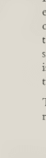

字符集是13，因为第一个字符的位置是0。）尽管换行符由两个字符组合而成，但它被当作一个字符处理。类似地，水平制表符在C++中表示为`\t`，空字符表示为`\0`（反斜杠后跟零）。此外，ASCII字符集中的前32个字符是不可打印的。（这些字符的说明见附录C。）

### 浮点数据类型

为了处理十进制数，C++提供了浮点数据类型，本节将讨论它。为便于讨论，让我们回顾高中或大学代数课程中的一个概念。

你可能熟悉科学记数法。例如：

```text
43872918 = 4.3872918 * 10^7      { 10 to the power of seven }
.0000265 = 2.65 * 10^-5         { 10 to the power of minus five }
47.9832 = 4.79832 * 10^1          { 10 to the power of one }
```

为了表示十进制数，C++使用一种称为**浮点记数法**的科学记数法形式。表2-3展示了C++如何使用某台机器对浮点记数法的解释来打印一组十进制数。在C++浮点记数法中，字母E代表指数。

**表2-3** 科学记数法和C++浮点记数法中的十进制数示例

| 十进制数 | 科学记数法 | C++浮点记数法 |
|---|---|---|
| 75.924 | 7.5924 × 10^1 | 7.592400E1 |
| 0.18 | 1.8 × 10^-1 | 1.800000E-1 |
| 0.0000453 | 4.53 × 10^-5 | 4.530000E-5 |
| -1.482 | -1.482 × 10^0 | -1.482000E0 |
| 7800.0 | 7.8 × 10^3 | 7.800000E3 |

C++提供了三种用于处理十进制数的数据类型：float、double和long double。与整数数据类型的情况一样，数据类型float、double和long double的区别在于可表示的值的集合。

> 在大多数较新的编译器上，数据类型double和long double相同。因此，这里只描述数据类型float和double。

`float`：数据类型float在C++中用于表示−3.4 * 10^38到3.4 * 10^38之间的任意十进制数。为float数据类型的值分配的内存为四个字节。

`double`：数据类型double在C++中用于表示−1.7 * 10^308到1.7 * 10^308之间的任意十进制数。为double数据类型的值分配的内存为八个字节。

数据类型float和double的最大值和最小值取决于系统。要查找特定系统上的这些值，可以查阅编译器的文档，或者运行附录F（头文件cfloat）中给出的程序。

除了值的集合之外，数据类型float和double还有一个区别。float值中的最大有效数字位数——即小数位数——是六位或七位。属于double类型的值的最大有效数字位数是15位。

> **注意：** 对于double类型的值，为了获得更好的精度，某些编译器可能会给出超过15位有效数字。请查阅编译器的文档。

最大有效数字位数称为**精度**。有时float值称为**单精度**，而double类型的值称为**双精度**。如果要处理十进制数，大多数情况下只需要float类型；如果需要精确到六位或七位以上小数，可以使用double类型。

> **注意：** 在C++中，默认情况下，浮点数被视为double类型。因此，如果在程序中使用数据类型float来处理浮点数，某些编译器可能会给出警告消息，例如“从double到float的截断”。为避免此类警告消息，应使用double数据类型。为达到目的并避免编程示例中出现此类警告消息，本书主要使用double数据类型来处理浮点数。

### 数据类型与变量

既然我们已经知道如何定义标识符、什么是数据类型以及变量这个术语，就可以展示如何声明变量了。声明变量时，我们不仅指定变量的名称，还指定变量可以存储的数据类型。声明变量的语法规则是：

```text
dataType identifier;
```

例如，考虑以下语句：

```cpp
int counter;
double interestRate;
char grade;
```

在第一条语句中，我们告诉系统分配一块足够大的内存空间来存储int值，并将该内存空间命名为counter。也就是说，counter是一个可以存储int值的变量。类似地，interestRate是一个可以存储double类型值的变量；grade是一个可以存储char类型值的变量。

### 算术运算符、运算符优先级和表达式

计算机最重要的用途之一是其计算能力。可以使用标准算术运算符来操作整数和浮点数据类型。共有五个算术运算符：

**算术运算符：** +（加法）、−（减法或取负）、*（乘法）、/（除法）、%（mod，模或求余）

这些运算符的工作方式如下：

- 运算符+、−、*和/可用于整数和浮点数据类型。
  - 运算符+、−、*和/处理浮点数据类型（十进制数）的方式，与你在大学代数课程中学到的相同。
  - 运算符+、−、*和/处理整数数据类型的方式，与你在大学代数课程中学到的相同。
- %只能用于整数数据类型，用于求普通除法中的余数。
- 当对整数数据类型使用/时，它给出普通除法中的商。也就是说，整数除法会截断任何小数部分；不会进行舍入。

例2-3展示了运算符`/`和`%`如何用于整数数据类型。

### 示例 2-3

| 算术表达式 | 结果 | 说明 |
|---|---:|---|
| `5 / 2` | 2 | 在除法`5 / 2`中，商为2，余数为1。因此，使用整数操作数的`5 / 2`求值为商，即2。 |
| `14 / 7` | 2 | 在除法`14 / 7`中，商为2。 |
| `34 % 5` | 4 | 在除法`34 / 5`中，商为6，余数为4。因此，`34 % 5`求值为余数，即4。 |
| `4 % 6` | 4 | 在除法`4 / 6`中，商为0，余数为4。因此，`4 % 6`求值为余数，即4。 |

在下面的示例中，我们说明如何将运算符`/`和`%`用于整数数据类型。

### 示例 2-4

给定以英寸表示的长度，我们编写一个程序，确定并输出等效的英尺数和（剩余的）英寸数。一英尺有12英寸。因此，100英寸等于8英尺4英寸；类似地，55英寸等于4英尺7英寸。注意，100 / 12 = 8，100 % 12 = 4；类似地，55 / 12 = 4，55 % 12 = 7。从这些示例可知，我们可以有效地使用`/`运算符和`%`来完成我们的任务。所需程序如下：

```cpp
// Given length in inches, this program outputs the equivalent
// length in feet and remaining inch(es).

#include <iostream>

using namespace std;

int main()
{
    int inches; //variable to store total inches

    inches = 100;  //store 100 in the variable inches

    cout << inches << " inch(es) = ";  //output the value of
                                       //inches and the equal sign
    cout << inches / 12 << " feet (foot) and "; //output maximum
                                                //number of feet (foot)
    cout << inches % 12 << " inch(es)" << endl; //output
                                                //remaining inches
    return 0;
}
```

### 示例运行：

```text
100 inch(es) = 8 feet (foot) and 4 inch(es)
```

注意，每次运行此程序时，它都会输出100英寸的值。要转换其他英寸值，需要编辑此程序并在变量inches中存储不同的值，这不太方便。本章后面将说明如何在程序中包含语句，指示用户输入不同的值。不过，如果你此时好奇想知道，可以将语句

```cpp
inches = 100;  //store 100 in the variable inches
```

替换为以下语句并重新运行程序：

```cpp
cout << "Enter total inches and press Enter: "; //prompt
cin >> inches;   //store the value entered by the user
                 //into the variable inches
cout << endl;
```

修改后的程序可在本书配套网站上获得，名称为Example2_4_Modified.cpp。

考虑以下表达式，你从高中起就习惯使用它们：-5、8 - 7、3 + 4、2 + 3 * 5、5.6 + 6.2 * 3，以及x + 2 * 5 + 6 / y，其中x和y是未知数。这些是**算术表达式**的示例。表达式中出现的数字称为**操作数**。用于对某个运算符求值的数字称为该运算符的操作数。

在表达式-5中，符号-表示数字5为负数。在此表达式中，-只有一个操作数。只有一个操作数的运算符称为**一元运算符**。

在表达式8 - 7中，符号-用于从8中减去7。在此表达式中，-有两个操作数：8和7。有两个操作数的运算符称为**二元运算符**。

**一元运算符：** 只有一个操作数的运算符。

**二元运算符：** 有两个操作数的运算符。

在表达式3 + 4中，3和4是运算符+的操作数。在此表达式中，运算符+有两个操作数，是二元运算符。此外，在表达式+27中，运算符+表示数字27为正数。这里，+只有一个操作数，因此作为一元运算符起作用。

从前面的讨论可知，-和+既是一元算术运算符，也是二元算术运算符。然而，作为算术运算符，*、/和%是二元运算符，因此必须有两个操作数。


### 优先级顺序

当一个表达式中使用多个算术运算符时，C++ 使用运算符优先级规则来求值该表达式。根据算术运算符的优先级顺序规则，

- `*`、`/`、`%` 的优先级高于 `+`、`-`

注意，运算符 `*`、`/` 和 `%` 具有相同的优先级。类似地，运算符 `+` 和 `-` 具有相同的优先级。

当运算符具有相同优先级时，运算从左到右执行。为了避免混淆，你可以使用括号对算术表达式进行分组。例如，使用优先级顺序规则，

```
3 * 7 - 6 + 2 * 5 / 4 + 6
```

意味着以下内容：

```
(((3 * 7) - 6) + ((2 * 5) / 4)) + 6
= ((21 - 6) + (10 / 4)) + 6        (Evaluate *)
= ((21 - 6) + 2) + 6              (Evaluate /; note that this is an integer division.)
= (15 + 2) + 6                    (Evaluate -)
= 17 + 6                          (Evaluate first +)
= 23                              (Evaluate +)
```

注意，第二个示例中括号的使用阐明了优先级顺序。你也可以使用括号来覆盖优先级顺序规则。

由于算术运算符在使用优先级规则时是从左到右求值的，除非存在括号，否则称算术运算符的结合性为从左到右。

> **注意——字符算术**
>
> 因为 char 数据类型也是整型数据类型，所以 C++ 允许你对 char 数据进行算术运算。然而，你应谨慎使用这一能力。字符 `'8'` 和整数 8 之间存在区别。整数 8 的整数值是 8。`'8'` 的整数值是 56，这是字符 `'8'` 的 ASCII 排序序列值。
>
> 在求值算术表达式时，8 + 7 = 15；`'8'` + `'7'` = 56 + 55，结果为 111；`'8'` + 7 = 56 + 7，结果为 63。此外，因为 `'8'` * `'7'` = 56 * 55 = 3080，而 ASCII 字符集只有 128 个值，所以 `'8'` * `'7'` 在 ASCII 字符数据集中是未定义的。
>
> 这些示例说明，执行字符算术时很多事情都可能出错。如果必须使用它们，请谨慎地对 char 数据类型进行算术运算。

以下示例展示算术运算符的工作方式。

### 示例 2-5

```cpp
// This program illustrates how arithmetic operators work.

#include <iostream>

using namespace std;

int main()
{
    cout << "2 + 5 = " << 2 + 5 << endl;
    cout << "13 + 89 = " << 13 + 89 << endl;
    cout << "34 - 20 = " << 34 - 20 << endl;
    cout << "45 - 90 = " << 45 - 90 << endl;
    cout << "2 * 7 = " << 2 * 7 << endl;
    cout << "5 / 2 = " << 5 / 2 << endl;
    cout << "14 / 7 = " << 14 / 7 << endl;
    cout << "34 % 5 = " << 34 % 5 << endl;
    cout << "4 % 6 = " << 4 % 6 << endl << endl;

    cout << "5.0 + 3.5 = " << 5.0 + 3.5 << endl;
    cout << "3.0 + 9.4 = " << 3.0 + 9.4 << endl;
    cout << "16.3 - 5.2 = " << 16.3 - 5.2 << endl;
    cout << "4.2 * 2.5 = " << 4.2 * 2.5 << endl;
    cout << "5.0 / 2.0 = " << 5.0 / 2.0 << endl;
    cout << "34.5 / 6.0 = " << 34.5 / 6.0 << endl;
    cout << "34.5 / 6.5 = " << 34.5 / 6.5 << endl;

    return 0;
}
```

### 示例运行

```text
2 + 5 = 7
13 + 89 = 102
34 - 20 = 14
45 - 90 = -45
2 * 7 = 14
5 / 2 = 2
14 / 7 = 2
34 % 5 = 4
4 % 6 = 4

5.0 + 3.5 = 8.5
3.0 + 9.4 = 12.4
16.3 - 5.2 = 11.1
4.2 * 2.5 = 10.5
5.0 / 2.0 = 2.5
34.5 / 6.0 = 5.75
34.5 / 6.5 = 5.30769
```

> 在使用负整数操作数求值取模（mod）运算符时应小心。你可能得不到预期的答案。例如，-34 % 5 = -4，因为在除法 -34 / 5 中，商为 -6，余数为 -4。类似地，34 % -5 = 4，因为在除法 34 / -5 中，商为 -6，余数为 4。另外，-34 % -5 = -4，因为在除法 -34 / -5 中，商为 6，余数为 -4。

### 表达式

C++ 中的算术表达式有三种类型：

- **整型表达式**——表达式中的所有操作数都是整数。整型表达式产生整型结果。
- **浮点（十进制）表达式**——表达式中的所有操作数都是浮点（十进制）数。浮点表达式产生浮点结果。
- **混合表达式**——表达式中同时包含整数和十进制数。

查看一些示例有助于阐明这些定义。

### 示例 2-6

考虑以下 C++ 整型表达式：

```
2 + 3 * 5
3 + x - y / 7
x + 2 * (y - z) + 18
```

在这些表达式中，x、y 和 z 表示整型变量；也就是说，它们可以保存整数值。

### 示例 2-7

考虑以下 C++ 浮点表达式：

```
12.8 * 17.5 - 34.50
x * 10.5 + y - 16.2
```

这里，x 和 y 表示浮点型变量；也就是说，它们可以保存浮点值。

求值整型表达式或浮点表达式很直接。和之前一样，当运算符具有相同优先级时，表达式从左到右求值。你始终可以使用括号对操作数和运算符进行分组，以避免混淆。

接下来，我们讨论混合表达式。

### 混合表达式

一个具有不同数据类型操作数的表达式称为**混合表达式**。混合表达式同时包含整数和浮点数。以下表达式是混合表达式的示例：

```text
2 + 3.5
6 / 4 + 3.9
5.4 * 2 - 13.6 + 18 / 2
```

在第一个表达式中，运算符 + 有一个整数操作数和一个浮点操作数。在第二个表达式中，运算符 / 的两个操作数都是整数，+ 的第一个操作数是 6 / 4 的结果，+ 的第二个操作数是浮点数。第三个示例是整数和浮点数更复杂的混合。一个显而易见的问题是：C++ 如何求值混合表达式？

求值混合表达式时适用两条规则：

- **1.** 在求值混合表达式中的运算符时：
  - **a.** 如果运算符具有相同类型的操作数（即两个都是整数或两个都是浮点数），则根据操作数的类型对该运算符求值。因此，整数操作数产生整型结果；浮点数产生浮点结果。
  - **b.** 如果运算符同时具有两种类型的操作数（即一个是整数，另一个是浮点数），则在计算过程中，将整数转换为小数部分为零的浮点数，然后对该运算符求值。结果为浮点数。
- **2.** 整个表达式按照优先级规则求值；乘法、除法和取模运算符先于加法和减法运算符求值。具有相同优先级的运算符从左到右求值。为了清晰起见，允许使用括号进行分组。

由这些规则可知，在求值混合表达式时，你一次专注于一个运算符，并使用优先级规则。如果要计算的运算符具有相同数据类型的操作数，则使用规则 1(a) 对该运算符求值。也就是说，带整数操作数的运算符将产生整型结果，带浮点操作数的运算符将产生浮点结果。如果要计算的运算符有一个整数操作数和一个浮点操作数，则在计算该运算符之前，将整数操作数转换为小数部分为 0 的浮点数。以下示例展示如何求值混合表达式。

### 示例 2-8

| 混合表达式 | 求值 | 应用的规则 |
|---|---|---|
| `3 / 2 + 5.5` | `= 1 + 5.5`<br>`= 6.5` | `3 / 2 = 1`（整数除法；规则 1(a)）<br>`(1) + 5.5`<br>`= 1.0 + 5.5`（规则 1(b)）<br>`= 6.5` |
| `15.6 / 2 + 5` | `= 7.8 + 5`<br>`= 12.8` | `15.6 / 2`<br>`= 15.6 / 2.0`（规则 1(b)）<br>`= 7.8`<br>`7.8 + 5`<br>`= 7.8 + 5.0`（规则 1(b)）<br>`= 12.8` |
| `4 + 5 / 2.0` | `= 4 + 2.5`<br>`= 6.5` | `5 / 2.0 = 5.0 / 2.0`（规则 1(b)）<br>`= 2.5`<br>`4 + 2.5 = 4.0 + 2.5`（规则 1(b)）<br>`= 6.5` |
| `4 * 3 + 7 / 5 - 25.5` | `= 12 + 7 / 5 - 25.5`<br>`= 12 + 1 - 25.5`<br>`= 13 - 25.5`<br>`= -12.5` | `4 * 3 = 12`（规则 1(a)）<br>`7 / 5 = 1`（整数除法；规则 1(a)）<br>`12 + 1 = 13`（规则 1(a)）<br>`13 - 25.5 = 13.0 - 25.5`（规则 1(b)）<br>`= -12.5` |

以下 C++ 程序求值前面的表达式：

```cpp
// This program illustrates how mixed expressions are evaluated.

#include <iostream>

using namespace std;

int main()
{
    cout << "3 / 2 + 5.5 = " << 3 / 2 + 5.5 << endl;
    cout << "15.6 / 2 + 5 = " << 15.6 / 2 + 5 << endl;
    cout << "4 + 5 / 2.0 = " << 4 + 5 / 2.0 << endl;
    cout << "4 * 3 + 7 / 5 - 25.5 = "
         << 4 * 3 + 7 / 5 - 25.5
         << endl;

    return 0;
}
```

### 示例运行

```text
3 / 2 + 5.5 = 6.5
15.6 / 2 + 5 = 12.8
4 + 5 / 2.0 = 6.5
4 * 3 + 7 / 5 - 25.5 = -12.5
```


这些示例说明，除非要计算的运算符有一个整数操作数和一个浮点操作数，否则整数不会转换为浮点数。

### 类型转换（强制类型转换）

在上一节中，你了解到，在计算算术表达式时，如果运算符具有混合操作数，则整数值会转换为小数部分为零的浮点值。当一种数据类型的值自动变为另一种数据类型的值时，就说发生了隐式类型强制转换。正如上一节中的示例所示，如果不注意数据类型，隐式类型强制转换可能会产生意想不到的结果。

为了避免隐式类型强制转换，C++ 通过使用强制类型转换运算符提供显式类型转换。**强制类型转换运算符**，也称为**类型转换**或**类型强制转换**，采用以下形式：

```cpp
static_cast<dataTypeName>(expression)
```

首先，计算表达式的值。然后将其值转换为由 dataTypeName 指定的类型的值。在 C++ 中，static_cast 是保留字。

使用强制类型转换运算符将浮点（十进制）数转换为整数时，只需去掉浮点数的小数部分。也就是说，浮点数被截断。示例 2-9 展示了强制类型转换运算符如何工作。请务必理解最后两个表达式为何得到那样的计算结果。

### 示例 2-9

| 表达式 | 计算结果为 |
|---|---|
| `static_cast<int>(7.9)` | `7` |
| `static_cast<int>(3.3)` | `3` |
| `static_cast<double>(25)` | `25.0` |
| `static_cast<double>(5 + 3)` | `= static_cast<double>(8) = 8.0` |
| `static_cast<double>(15) / 2` | `= 15.0 / 2`<br>（因为 `static_cast<double>(15) = 15.0`）<br>`= 15.0 / 2.0`<br>`= 7.5` |
| `static_cast<double>(15 / 2)` | `= static_cast<double>(7)`（因为 `15 / 2 = 7`）<br>`= 7.0` |
| `static_cast<int>(7.8 + 7.5)` | `= static_cast<int>(15.3)`<br>`= 15` |
| `static_cast<int>(7.8 + static_cast<double>(15 / 2))` | `= static_cast<int>(7.8 + 7.0)`<br>`= static_cast<int>(14.8)`<br>`= 14` |

以下 C++ 程序计算前面的表达式：

```cpp
// This program illustrates how explicit type conversion works.

#include <iostream>
using namespace std;

int main()
{
    cout << "static_cast<int>(7.9) = "
         << static_cast<int>(7.9)
         << endl;
    cout << "static_cast<int>(3.3) = "
         << static_cast<int>(3.3)
         << endl;
    cout << "static_cast<double>(25) = "
         << static_cast<double>(25)
         << endl;
    cout << "static_cast<double>(5 + 3) = "
         << static_cast<double>(5 + 3)
         << endl;
    cout << "static_cast<double>(15) / 2 = "
         << static_cast<double>(15) / 2
         << endl;
    cout << "static_cast<double>(15 / 2) = "
         << static_cast<double>(15 / 2)
         << endl;
    cout << "static_cast<int>(7.8 + static_cast<double>(15) / 2) = "
         << static_cast<int>(7.8 + static_cast<double>(15) / 2)
         << endl;
    cout << "static_cast<int>(7.8 + static_cast<double>(15 / 2)) = "
         << static_cast<int>(7.8 + static_cast<double>(15 / 2))
         << endl;

    return 0;
}
```

**示例运行：**

```text
static_cast<int>(7.9) = 7
static_cast<int>(3.3) = 3
static_cast<double>(25) = 25
static_cast<double>(5 + 3) = 8
static_cast<double>(15) / 2 = 7.5
static_cast<double>(15 / 2) = 7
static_cast<int>(7.8 + static_cast<double>(15) / 2) = 15
static_cast<int>(7.8 + static_cast<double>(15 / 2)) = 14
```

注意，表达式 static_cast<double>(25) 的值是 25.0。然而，它输出为 25 而不是 25.0。这是因为我们尚未讨论如何输出小数部分为零的十进制数，以显示小数点和末尾的零。第 3 章说明如何以所需格式输出十进制数。类似地，其他小数部分为零的十进制数的输出不带小数点和零小数部分。

在 C++ 中，强制类型转换运算符也可以采用 `dataType(expression)` 形式。这种形式称为 C 风格强制类型转换。例如，`double(5) = 5.0` 和 `int(17.6) = 17`。然而，`static_cast` 比 C 风格强制类型转换更稳定。

你还可以使用强制类型转换运算符将 char 数据值显式转换为 int 数据值，并将 int 数据值转换为 char 数据值。要将 char 数据值转换为 int 数据值，需使用排序序列。例如，在 ASCII 字符集中，`static_cast<int>('A')` 为 65，`static_cast<int>('8')` 为 56。类似地，`static_cast<char>(65)` 为 `'A'`，`static_cast<char>(56)` 为 `'8'`。

本章前面，你学习了 C++ 中算术表达式如何形成和求值。如果要在另一个表达式中使用一个表达式的值，首先必须保存该表达式的值。保存表达式值的原因有很多。有些表达式很复杂，可能需要相当多的计算机时间来计算。通过计算一次值并将其保存以供后续使用，你不仅可以节省计算机时间并创建执行更快的程序，还可以避免可能的输入错误。在 C++ 中，表达式会被求值，如果值未保存，就会丢失。也就是说，除非保存，否则表达式的值不能在后续计算中使用。本章后面，你将学习如何保存表达式的值并在后续计算中使用它。

在结束数据类型的讨论之前，让我们再讨论一种数据类型——string。

### string 类型

数据类型 string 是程序员定义的数据类型。它不像前面讨论的简单数据类型那样可以直接在程序中使用。要使用此数据类型，需要访问库中的程序组件，本章后面将讨论这一点。数据类型 string 是 ANSI/ISO 标准 C++ 的一个特性。

在 ANSI/ISO C++ 语言标准之前，标准 C++ 库不提供 string 数据类型。编译器供应商通常提供自己的程序员定义 string 类型，而 string 操作的语法和功能往往因供应商而异。

**string** 是由零个或多个字符组成的序列。C++ 中的字符串用双引号括起来。不包含任何字符的字符串称为**空**（null）或**空**（empty）字符串。以下是字符串示例。注意，`""` 是空字符串。

```text
"William Jacob"
"Mickey"
""
```

字符串中的每个字符在字符串中都有一个相对位置。第一个字符的位置是 0，第二个字符的位置是 1，依此类推。字符串的长度是其中字符的数量。

**注意**

如前所述，浮点数的默认类型是 double。因此，如果声明 float 类型的命名常量，则必须按如下方式指定该值为 float 类型：

```cpp
const float CONVERSION = 2.54f;
```

否则，编译器将生成警告消息。注意，2.54f 表示它是一个 float 值。回想一下，float 值的内存大小为四字节；double 值为八字节。由于如今内存大小已不太重要，如前所述，我们将主要使用 double 类型来处理浮点值。

使用命名常量存储固定数据，而不是使用数据值本身，有一个主要优点。如果固定数据发生变化，你不需要编辑整个程序并在使用旧值的所有位置将旧值改为新值。（例如，在计算销售税的程序中，销售税率可能会变化。）相反，你只需在一个地方进行更改，重新编译程序，并在整个程序中使用新值执行。此外，通过存储一个值并在需要该值时引用该内存位置，可以避免一遍又一遍地输入相同的值，并防止意外输入错误。如果常量值位置的名称拼写错误，计算机将通过错误消息警告你，但如果值输入错误，它不会警告你。

### 变量

本章前面，我们介绍了术语“变量”以及如何声明变量。现在我们回顾这一概念，并给出声明变量的一般语法。

在某些程序中，数据需要在程序执行期间修改。例如，每次测验后，平均测验分数和已进行的测验数量会变化。类似地，每次加薪后，员工的工资会变化。这类数据必须存储在内容可在程序执行期间修改的内存单元中。在 C++ 中，内容可在程序执行期间修改的内存单元称为变量。

**变量：** 其内容在程序执行期间可能发生变化的内存位置。

声明一个或多个变量的语法是：

```cpp
dataType identifier, identifier, . . .;
```

### 示例 2-12

考虑以下语句：

```cpp
double amountDue;
int counter;
char ch;
int x, y;
string name;
```


第一条语句告诉编译器分配足够的内存来存储一个 `double` 类型的值，并将其命名为 `amountDue`。第二条和第三条语句采用类似的约定。第四条语句告诉编译器分配两个不同的内存空间，每个空间都足够大，可以存储一个 `int` 类型的值；将第一个内存空间命名为 `x`，将第二个内存空间命名为 `y`。第五条语句告诉编译器分配内存空间来存储一个字符串，并将其命名为 `name`。

与给命名常量命名一样，变量命名没有成文规则。不过，C++ 程序员通常使用小写字母来声明变量。如果变量名由多个单词组合而成，那么除第一个单词外，每个单词的首字母都大写。（例如，参见上一个示例中的变量 `amountDue`。）

从现在起，当我们说“变量”时，指的是可变的内存位置。

> 在 C++ 中，必须先声明所有标识符，然后才能使用它们。如果引用某个标识符却没有声明它，编译器将生成错误消息（语法错误），指出该标识符未声明。因此，要使用命名常量或变量，必须先声明它。

既然已经定义并讨论了数据类型、变量和常量，现在可以给出简单数据类型的正式定义。如果某种类型的变量或命名常量一次只能存储一个值，则该数据类型称为**简单**数据类型。例如，如果 `x` 是一个 `int` 变量，那么在某一时刻，`x` 中只能存储一个值。

### 将数据放入变量

既然已经知道如何声明变量，下一个问题是：如何将数据放入这些变量？在 C++ 中，可以通过两种方式将数据放入变量：

- 1. 使用 C++ 的赋值语句。
- 2. 使用输入（读取）语句。

### 赋值语句

赋值语句采用以下形式：

```cpp
variable = expression;
```

在赋值语句中，表达式的值应与变量的数据类型匹配。先计算右侧表达式的值，再将其值赋给左侧的变量（因而赋给一个内存位置）。

当第一次将值放入变量时，称该变量已**初始化**。

在 C++ 中，`=` 称为**赋值运算符**。

**示例 2-13**

假设有以下变量声明：

```cpp
int num1, num2;
double sale;
char first;
string str;
```

现在考虑以下赋值语句：

```cpp
num1 = 4;
num2 = 4 * 5 - 11;
sale = 0.02 * 1000;
first = 'D';
str = "It is a sunny day.";
```

对于这些语句中的每一条，计算机首先计算右侧的表达式，然后将该值存储到由左侧标识符命名的内存位置中。第一条语句将值 4 存储到 num1 中，第二条语句将 9 存储到 num2 中，第三条语句将 20.00 存储到 sale 中，第四条语句将字符 D 存储到 first 中。第五条语句将字符串 "It is a sunny day." 存储到变量 str 中。

以下 C++ 程序展示了上述语句的效果：

```cpp
// This program illustrates how data in the variables are
// manipulated.

#include <iostream>
#include <string>

using namespace std;

int main()
{
    int num1, num2;
    double sale;
    char first;
    string str;

    num1 = 4;
    cout << "num1 = " << num1 << endl;

    num2 = 4 * 5 - 11;
    cout << "num2 = " << num2 << endl;

    sale = 0.02 * 1000;
    cout << "sale = " << sale << endl;

    first = 'D';
    cout << "first = " << first << endl;

    str = "It is a sunny day.";
    cout << "str = " << str << endl;

    return 0;
}
```

**示例运行：**

```text
num1 = 4
num2 = 9
sale = 20
first = D
str = It is a sunny day.
```

上述程序大部分都很直接。让我们看一下输出语句：

```cpp
cout << "num1 = " << num1 << endl;
```

这条输出语句由字符串 "num1 = "、运算符 << 和变量 num1 组成。这里先输出字符串 "num1 = " 的值，然后输出变量 num1 的值。其他输出语句的含义类似。

如下 C++ 语句：

```cpp
num = num + 2;
```

表示“计算 num 中的值，将其加 2，再把新值赋给内存位置 num”。必须先计算右侧的表达式；然后将该值赋给左侧变量所指定的内存位置。因此，下面这组 C++ 语句：

```cpp
num = 6;
num = num + 2;
```

与下面这条语句：

```cpp
num = 8;
```

都会将 8 赋给 num。注意，如果 num 尚未初始化，语句 num = num + 2 可能会产生意外结果，并且/或者编译器可能生成警告消息，指出该变量尚未初始化。

语句 num = 5; 读作“num 变为 5”或“num 得到 5”或“num 被赋值为 5”。将该语句读作“num 等于 5”是不正确的，尤其是对于 num = num + 2; 这样的语句。每当给 num 赋一个新值时，旧值就会被覆盖。（回想一下，这些语句中的等号是赋值运算符，而不是表示相等。）

**示例 2-14**

假设 num1、num2 和 num3 是 int 变量，并且以下语句按顺序执行。

- 1. num1 = 18;
- 2. num1 = num1 + 27;
- 3. num1 = num2;
- 4. num3 = num2 / 5;
- 5. num3 = num3 / 4;

下表显示了每条语句执行后变量的值。（? 表示值未知。方框中的橙色表示该变量的值已更改。）

| | 变量的值 | 说明 |
|---|---|---|
| 执行语句 1 前 | num1: ?<br>num2: ?<br>num3: ? | |
| 执行语句 1 后 | num1: 18<br>num2: ?<br>num3: ? | |
| 执行语句 2 后 | num1: 45<br>num2: ?<br>num3: ? | num1 + 27 = 18 + 27 = 45。将该值赋给 num1，替换 num1 的旧值。 |
| 执行语句 3 后 | num1: 45<br>num2: 45<br>num3: ? | 将 num1 的值复制到 num2 中。 |
| 执行语句 4 后 | num1: 45<br>num2: 45<br>num3: 9 | num2 / 5 = 45 / 5 = 9。将该值赋给 num3。因此 num3 = 9。 |
| 执行语句 5 后 | num1: 45<br>num2: 45<br>num3: 2 | num3 / 4 = 9 / 4 = 2。将该值赋给 num3，替换 num3 的旧值。 |

因此，在执行第 5 行的语句后，num1 = 45、num2 = 45、num3 = 2。

通过一个语句序列跟踪值（称为**走查**）是一种很有价值的学习和练习工具。请试着对上面的序列进行走查。本章后面将进一步介绍如何走查一系列 C++ 语句。

假设 x、y 和 z 是 int 变量。下面是一条合法的 C++ 语句：

```cpp
x = y = z;
```

在这条语句中，首先将 z 的值赋给 y，然后将 y 的新值赋给 x。由于赋值运算符 = 从右到左求值，因此称赋值运算符的结合性为从右到左。

### 保存和使用表达式的值

既然已经知道如何声明变量并将数据放入变量，现在可以学习如何保存表达式的值。之后，你可以在后续表达式中使用该值，而不必再次使用表达式本身，从而回答本章前面提出的问题。要保存表达式的值并在后续表达式中使用它，请按以下步骤操作：

- 1. 声明一个具有适当数据类型的变量。例如，如果表达式的结果是整数，则声明一个 int 变量。
- 2. 使用赋值语句将表达式的值赋给已声明的变量。此操作会将表达式的值保存到变量中。
- 3. 每当需要该表达式的值时，使用保存该值的变量。下面的示例进一步说明这一概念。

**示例 2-15**

假设有以下声明：

```cpp
int a, b, c, d;
int x, y;
```

进一步假设，你想计算表达式 -b + (b² − 4ac) 和 -b − (b² − 4ac)，并分别将这些表达式的值赋给 x 和 y。由于表达式 b² − 4ac 在两个表达式中都出现，你可以先计算该表达式的值，并将其保存到 d 中。然后可以使用 d 的值来计算这些表达式，如下列语句所示：

```cpp
d = b * b - 4 * a * c;
x = -b + d;
y = -b - d;
```

前面已经了解到，如果在表达式中使用变量，则只有在该变量先被初始化时，表达式才会产生有意义的值。你还了解到，在声明变量后，可以使用赋值语句将其初始化。也可以在声明变量的同时进行初始化。在讨论如何使用输入（读取）语句之前，我们先处理这个重要问题。


### 声明和初始化变量

当声明一个变量时，C++可能不会自动为其放入有意义的值。换句话说，C++可能不会自动初始化变量。例如，int和double变量可能不会像某些编程语言那样被初始化为0。然而，这并不意味着变量在声明后没有值。当声明一个变量时，会为其分配内存。

回顾第1章，主存是一个有序的单元序列，每个单元能够存储一个值。另外，回忆一下机器语言是0和1的序列，即比特。因此，内存单元中的数据是一个比特序列。这些比特不过是电信号，所以当计算机开启时，一些比特为1，一些为0。这些比特的状态取决于系统如何运行。然而，当你指示计算机在内存单元中存储特定值时，比特会根据所存储的数据进行设置。

在数据操作过程中，计算机取出特定单元中存储的值并进行计算。如果你声明了一个变量但没有在其中存储值，内存单元仍然有一个值——通常是这些比特上次使用后的值——而你无法知道这个值是什么。

如果你只声明一个变量而没有指示计算机将数据放入该变量，那么该变量的值就是垃圾值。然而，计算机不会警告我们，而是将内存中的任何值视为合法值，并使用这些内存值进行计算。在表达式中使用未初始化的变量会产生错误的结果。为了避免这些陷阱，C++允许你在声明变量的同时初始化它们。例如，考虑以下C++语句，其中变量先声明然后初始化：

```
int first, second;
char ch;
double x;

first = 13;
second = 10;
ch = ' ';
x = 12.6;
```

你可以使用以下C++语句同时声明并初始化这些变量：

```
int first = 13, second = 10;
char ch = ' ';
double x = 12.6;
```

第一条C++语句声明了两个int变量first和second，并将13存入first，将10存入second。其他语句的含义类似。

例2-17进一步解释了如何将数值数据输入到程序中。

### 示例 2-17

假设我们有以下语句：

```
int feet;
int inches;
```

假设输入为：

```
23 7
```

接下来，考虑以下语句：

```
cin >> feet >> inches;
```

该语句首先将数字23存入变量feet，然后将数字7存入变量inches。注意，当通过键盘输入这些数字时，它们用一个空格分隔。实际上，它们可以用一个或多个空格、换行甚至制表符分隔。

以下C++程序展示了前面输入语句的效果：

```
// This program illustrates how input statements work.

#include <iostream>

using namespace std;

int main()
{
    int feet;
    int inches;

    cout << "Enter two integers separated by one or more spaces: ";
    cin >> feet >> inches;
    cout << endl;

    cout << "Feet = " << feet << endl;
    cout << "Inches = " << inches << endl;

    return 0;
}
```

**示例运行：** 在此示例运行中，用户输入以阴影显示。

```
Enter two integers separated by one or more spaces: 23 7
Feet = 23
Inches = 7
```

例2-18中的C++程序说明了如何读取字符串和数值数据。

### 示例 2-18

```cpp
// This program illustrates how to read strings and numeric data.

#include <iostream>
#include <string>

using namespace std;

int main()
{
    string firstName;                          //Line 1
    string lastName;                           //Line 2
    int age;                                   //Line 3
    double weight;                             //Line 4

    cout << "Enter first name, last name, age, "
         << "and weight, separated by spaces."
         << endl;                              //Line 5

    cin >> firstName >> lastName;              //Line 6
    cin >> age >> weight;                      //Line 7

    cout << "Name: " << firstName << " "
         << lastName << endl;                  //Line 8

    cout << "Age: " << age << endl;            //Line 9
    cout << "Weight: " << weight << endl;      //Line 10

    return 0;                                  //Line 11
}
```

**示例运行：** 在此示例运行中，用户输入以阴影显示。

```
Enter first name, last name, age, and weight, separated by spaces.
Sheila Mann 23 120.5
Name: Sheila Mann
Age: 23
Weight: 120.5
```

前面的程序工作如下：第1到第4行的语句声明了string类型的变量firstName和lastName、int类型的age以及double类型的weight。第5行的语句是输出语句，告诉用户要做什么。（这样的输出语句称为提示行。）如示例运行所示，程序的输入是：

```
Sheila Mann 23 120.5
```

第6行的语句首先读取字符串Sheila并存入变量`firstName`，然后跳过Sheila后的空格，读取字符串Mann并存入变量`lastName`。接下来，第7行的语句首先跳过Mann后的空格，读取23并存入变量`age`，然后跳过23后的空格，读取120.5并存入变量`weight`。

第8、9和10行的语句产生示例运行的第三、第四和第五行。

> 在程序执行期间，如果在一行中输入多个值，这些值必须至少用一个空格或制表符分隔。或者，也可以每行输入一个值。

### 变量初始化

记住，初始化变量有两种方式：使用赋值语句和使用读取语句。考虑以下声明：

```
int feet;
int inches;
```

考虑以下两组代码：

```
(a)  feet = 35;
     inches = 6;
     cout << "Total inches = ";
     cout << 12 * feet + inches;

(b)  cout << "Enter feet: ";
     cin >> feet;
     cout << endl;
     cout << "Enter inches: ";
     cin >> inches;
     cout << endl;
     cout << "Total inches = ";
     cout << 12 * feet + inches;
```

在（a）中，feet和inches使用赋值语句初始化，而在（b）中，这些变量使用输入语句初始化。然而，每次执行（a）中的代码时，除非你编辑源代码、更改值、重新编译并运行，否则feet和inches都会被初始化为相同的值。另一方面，在（b）中，每次程序运行时，都会提示你输入feet和inches的值。因此，读取语句比赋值语句灵活得多。

有时需要使用赋值语句来初始化变量。如果变量仅用于内部计算而不用于读取和存储数据，则尤其如此。

回想一下，C++在声明变量时不会自动初始化变量。有些变量可以在声明时初始化，而另一些变量必须使用赋值语句或读取语句进行初始化。

> 注意：当程序编译时，如果程序在使用变量值之前没有正确初始化该变量，一些较新的IDE可能会给出警告消息。在这种情况下，如果你忽略警告并执行程序，程序可能会异常终止并显示错误消息。

> 注意：假设你想使用输入语句将一个字符存入`char`变量。在程序执行期间，当你输入该字符时，不要包含单引号。例如，假设`ch`是一个`char`变量。考虑以下输入语句：
>
> ```
> cin >> ch;
> ```
>
> 如果你想使用此语句将K存入`ch`，在程序执行期间，你只需输入K。类似地，如果你想使用输入语句将字符串存入`string`变量，在程序执行期间，你只需输入字符串，不要包含双引号。

### 示例 2-19

此示例进一步说明了赋值语句和输入语句如何操作变量。考虑以下声明：

```
int firstNum, secondNum;
double z;
char ch;
string name;
```

另外，假设以下语句按给定顺序执行：

- 1. `firstNum = 4;`
- 2. `secondNum = 2 * firstNum + 6;`
- 3. `z = (firstNum + 1) / 2.0;`
- 4. `ch = 'A';`
- 5. `cin >> secondNum;`
- 6. `cin >> z;`
- 7. `firstNum = 2 * secondNum + static_cast<int>(z);`
- 8. `cin >> name;`
- 9. `secondNum = secondNum + 1;`
- 10. `cin >> ch;`
- 11. `firstNum = firstNum + static_cast<int>(ch);`
- 12. `z = firstNum - z;`


此外，假设输入为：

```
8 16.3 Jenny D
```

这一行有四个值：8、16.3、Jenny 和 D，每个值之间用一个空格分隔。

现在让我们确定最后一条语句执行后所声明变量的值。为了明确展示某条特定语句如何改变变量的值，下面会显示每条语句执行后各变量的值。（在下列图中，方框中的问号 [?] 表示该方框中的值未知。）

在语句 1 执行之前，所有变量均未初始化，如图 2-4 所示。


接下来，我们展示每条语句执行后变量的值。

| 执行语句后 | 变量的值 | 说明 |
| --- | --- | --- |
| 1 | firstNum: 4; secondNum: ?; z: ?; ch: ?; name: ? | 将 4 存入 firstNum。 |
| 2 | firstNum: 4; secondNum: 14; z: ?; ch: ?; name: ? | 2 * firstNum + 6 = 2 * 4 + 6 = 14。将 14 存入 secondNum。 |
| 3 | firstNum: 4; secondNum: 14; z: 2.5; ch: ?; name: ? | (firstNum + 1) / 2.0 = (4 + 1) / 2.0 = 5 / 2.0 = 2.5。将 2.5 存入 z。 |
| 4 | firstNum: 4; secondNum: 14; z: 2.5; ch: 'A'; name: ? | 将 'A' 存入 ch。 |
| 5 | firstNum: 4; secondNum: 8; z: 2.5; ch: 'A'; name: ? | 从键盘读取一个数字（即 8）并将其存入 secondNum。这条语句用这个新值替换了 secondNum 的旧值。 |

如果将求值结果为浮点值的表达式（未使用强制类型转换运算符）赋给 `int` 类型的变量，则小数部分会被丢弃。在这种情况下，编译器很可能会发出关于隐式类型转换的警告消息。

### 自增和自减运算符

既然你已经知道如何声明变量以及如何将数据输入变量，本节将介绍另外两个运算符：**自增**和**自减运算符**。C++ 程序员经常使用这些运算符，它们是有用的编程工具。

假设 `count` 是一个 `int` 变量。语句：

```cpp
count = count + 1;
```

将 count 的值增加 1。为执行这条赋值语句，计算机首先计算右侧的表达式，即 `count + 1`。然后，它将这个值赋给左侧的变量，即 count。

正如你将在后续章节中看到的，此类语句经常用于记录某些事情发生了多少次。为了加快此类语句的执行，C++ 提供了**自增运算符** `++`（将变量的值增加 1）和**自减运算符** `--`（将变量的值减少 1）。自增和自减运算符各有两种形式：前置和后置。自增运算符的语法为：

**前置自增：** `++variable`  
**后置自增：** `variable++`

自减运算符的语法为：

**前置自减：** `--variable`  
**后置自减：** `variable--`

让我们看一些示例。语句：

```cpp
++count;
```

或：

```cpp
count++;
```

将 count 的值增加 1。类似地，语句：

```cpp
--count;
```

或：

```cpp
count--;
```

将 count 的值减少 1。

另一方面，在执行以下语句之后：

```
a = 5;
b = 2 + (a++);
```

a 的值为 6，而 b 的值为 7。

本书最常将自增和自减运算符与变量一起用在独立语句中。也就是说，使用自增或自减运算符的变量不会成为任何表达式的一部分。

### 输出

在前面的各节中，你已经了解了如何将数据放入计算机内存，以及如何操作这些数据。我们还使用了一些输出语句在*标准输出设备*上显示结果。本节将较为详细地解释如何进一步使用输出语句来生成所需的结果。

> **注意：** 标准输出设备通常是屏幕。

在 C++ 中，标准输出设备上的输出通过使用 cout 和运算符 << 来完成。cout 与 << 一起使用的一般语法为：

```
cout << expression or manipulator << expression or manipulator;
```

这称为**输出语句**。在 C++ 中，<< 称为**流插入运算符**。使用 cout 生成输出遵循两条规则：

- 1. 表达式会被求值，其值会打印在输出设备的当前插入点处。
- 2. 操纵符用于格式化输出。最简单的操纵符是 endl（最后一个字符是字母 el），它使插入点移动到下一行的开头。

> **注意：** 在屏幕上，插入点就是光标所在的位置。

下一个示例说明输出语句如何工作。在输出语句中，字符串或只涉及一个变量或单个值的表达式，其求值结果就是其自身。

当输出语句输出 `char` 值时，它只输出字符，而不输出单引号（除非单引号是输出语句的一部分）。

例如，假设 `ch` 是一个 `char` 变量，且 `ch = 'A'`。语句：

`cout << ch;`

或：

`cout << 'A';`

输出：

`A`

类似地，当输出语句输出字符串的值时，它只输出字符串，而不输出双引号（除非你将双引号作为输出的一部分）。

### 示例 2-21

考虑以下语句。每条语句右侧显示了输出。

| # | 语句 | 输出 |
|---:|---|---|
| 1 | `cout << 29 / 4 << endl;` | `7` |
| 2 | `cout << "Hello there." << endl;` | `Hello there.` |
| 3 | `cout << 12 << endl;` | `12` |
| 4 | `cout << "4 + 7" << endl;` | `4 + 7` |
| 5 | `cout << 4 + 7 << endl;` | `11` |
| 6 | `cout << 'A' << endl;` | `A` |
| 7 | `cout << "4 + 7 = " << 4 + 7 << endl;` | `4 + 7 = 11` |
| 8 | `cout << 2 + 3 * 5 << endl;` | `17` |
| 9 | `cout << "Hello \nthere." << endl;` | `Hello`<br>`there.` |

看看语句 9 的输出。回想一下，在 C++ 中，换行字符是 `\n`；它使插入点在打印 there. 之前移动到下一行的开头。因此，当 `\n` 出现在输出语句的字符串中时，它会使插入点在输出设备上移动到下一行的开头。这一事实解释了为什么 Hello 和 there. 会打印在不同行。

在 C++ 中，`\` 称为转义字符，`\n` 称为换行转义序列。

回想一下，所有变量都必须正确初始化；否则，存储在其中的值可能没有太大意义。还要记住，C++ 不会自动初始化变量。

如果 `num` 是一个 int 变量，那么只要 `num` 已被赋值，以下 C++ 语句的输出就有意义：

```cpp
cout << num << endl;
```

例如，以下 C++ 语句序列：

```cpp
num = 45;
cout << num << endl;
```

将产生输出 45。

### 示例 2-22

考虑以下 C++ 程序：

```cpp
// This program illustrates how output statements work.

#include <iostream>

using namespace std;

int main()
{
    int a, b;

    a = 65;                         //Line 1
    b = 78;                         //Line 2

    cout << 29 / 4 << endl;         //Line 3
    cout << 30.0 / 2 << endl;       //Line 4
    cout << "Hello there.\n";       //Line 5
    cout << 7 << endl;              //Line 6
    cout << 3 + 5 << endl;          //Line 7
    cout << "3 + 5";                //Line 8
    cout << "***";                  //Line 9
    cout << endl;                   //Line 10
    cout << 2 + 3 << 6 << endl;     //Line 11
    cout << "a" << endl;            //Line 12
    cout << a << endl;              //Line 13
    cout << b << endl;              //Line 14

    return 0;
}
```

在下面的输出中，标有“语句输出位置”的列和行号不属于输出的一部分。此列中显示行号是为了便于看出哪个输出对应哪条语句。


| 输出 | 语句所在行 |
|---|---|
| 7 | 第3行 |
| 1.5 | 第4行 |
| Hello there. | 第5行 |
| 7 | 第6行 |
| 8 | 第7行 |
| 3 + 5 ** | 第8行和第9行 |
| 20 | 第11行 |
| a | 第12行 |
| 65 | 第13行 |
| 78 | 第14行 |

大部分情况下，输出很直接。看看第7、8、9和10行语句的输出。第7行的语句输出 3 + 5 的结果，即 8，并将插入点移到下一行开头。第8行的语句输出字符串 3 + 5。注意，第8行的语句仅由字符串 3 + 5 组成。因此，在打印 3 + 5 之后，插入点仍位于 5 之后；它不会移到下一行开头。第9行语句的下一个输出会在插入点输出一个空格和 `**`，该插入点此前位于 5 之后。

第10行的输出语句只包含操纵符 endl，它将插入点移到下一行开头。因此，当第11行的语句执行时，输出从该行开头开始。注意，在此输出中，列“语句所在行”不包含第10行。这是因为第10行的语句不产生任何可打印输出。它只是将插入点移到下一行开头。接下来，第11行的语句输出 2 + 3 * 6 的值，即 20。然后，操纵符 endl 将插入点移到下一行开头。

> 在表达式中输出或访问变量的值不会破坏或修改变量的内容。

现在让我们仔细看看换行符 '\n'。考虑以下 C++ 语句：

```cpp
cout << "Hello there.";
cout << "My name is James.";
```

如果这些语句依次执行，输出为：

```
Hello there.My name is James.
```

现在考虑以下 C++ 语句：

```cpp
cout << "Hello there.\n";
cout << "My name is James.";
```

这些 C++ 语句的输出为：

```
Hello there.
My name is James.
```

当在字符串中遇到 `\n` 时，插入点会定位到下一行开头。还要注意，`\n` 可以出现在字符串中的任何位置。例如，以下语句的输出：

```cpp
cout << "Hello \nthere. \nMy name is James.";
```

为：

```
Hello
there.
My name is James.
```

另外，请注意以下语句的输出：

```cpp
cout << '\n';
```

与以下语句的输出相同：

```cpp
cout << "\n";
```

这等价于以下语句的输出：

```cpp
cout << endl;
```

因此，以下语句序列的输出：

```cpp
cout << "Hello there.\n";
cout << "My name is James.";
```

等价于以下语句序列的输出：

```cpp
cout << "Hello there." << endl;
cout << "My name is James.";
```

### 示例 2-23

考虑以下 C++ 语句：

```cpp
cout << "Hello there.\nMy name is James.";
```

或者：

```cpp
cout << "Hello there.";
cout << "\nMy name is James.";
```

或者：

```cpp
cout << "Hello there.";
cout << endl << "My name is James.";
```

在每种情况下，这些语句的输出为：

```
Hello there.
My name is James.
```

### 示例 2-24

以下 C++ 语句的输出：

```cpp
cout << "Count...\n....1\n.....2\n.....3";
```

或者：

```cpp
cout << "Count..." << endl << ".....1" << endl
     << ".....2" << endl << ".....3";
```

为：

```
Count...
.....1
.....2
.....3
```

### 示例 2-25

假设你想将以下句子作为一条消息的一部分输出在一行中：

It is sunny, warm, and not a windy day. We can go golfing.

显然，你会使用一条输出语句来产生这个输出。然而，在编程代码中，作为输出语句的一部分，这条语句可能无法放在一行中。当然，你可以像下面这样使用多条输出语句：

```cpp
cout << "It is sunny, warm, and not a windy day. ";
cout << "We can go golfing." << endl;
```

注意第一条语句末尾的分号，以及第二条语句开头的标识符 cout。另外，注意第一条语句末尾没有操纵符 endl。这里使用了两条输出语句来在一行中输出该句子。

等价地，你可以使用以下输出语句来输出这个句子：

```cpp
cout << "It is sunny, warm, and not a windy day. "
     << "We can go golfing." << endl;
```

在这条语句中，注意第一行末尾没有分号，并且标识符 cout 没有出现在第二行开头。由于第一行末尾没有分号，这条输出语句会延续到第二行。另外，注意每一行句子开头和结尾的双引号。该字符串被分成两个字符串，但这两个字符串都是同一条输出语句的一部分。

如果输出语句中出现的字符串很长，而你想在一行中输出该字符串，可以使用前面两种方法中的任意一种来拆分字符串。然而，以下语句将是非法的：

```cpp
cout << "It is sunny, warm, and not a windy day.
       We can go golfing." << endl; //illegal
```

换句话说，键盘上的回车（Enter）键不能成为字符串的一部分。也就是说，在编程代码中，不能通过按键盘上的回车（Enter）键将字符串拆分成多行。

回想一下，换行符是 \n，它会使插入点移到下一行开头。C++ 中有许多转义序列，可让你控制输出。表 2-4 列出了一些常用转义序列。

### 表 2-4 常用转义序列

| 转义序列 | 描述 |
|---|---|
| `\n` | 换行——光标移到下一行开头 |
| `\t` | 制表符——光标移到下一个制表位 |
| `\b` | 退格——光标向左移动一个空格 |
| `\r` | 回车——光标移到当前行开头（而不是下一行） |
| `\\` | 反斜杠——打印反斜杠 |
| `\'` | 单引号——打印单引号 |
| `\"` | 双引号——打印双引号 |

以下示例展示其中一些转义序列的效果。

### 示例 2-26

以下语句的输出：

```cpp
cout << "The newline escape sequence is \\n" << endl;
```

为：

```
The newline escape sequence is \n
```

以下语句的输出：

```cpp
cout << "The tab character is represented as \'\\t\'" << endl;
```

为：

The tab character is represented as `'\t'`

注意，单引号也可以在不使用转义序列的情况下打印。因此，前面的语句等价于以下输出语句：

```cpp
cout << "The tab character is represented as '\\t'" << endl;
```

以下语句的输出：

```cpp
cout << "The string \"Sunny\" contains five characters." << endl;
```

为：

The string "Sunny" contains five characters.

> **注意：** 与本文配套的网站包含一个 C++ 程序，用于展示示例 2-26 中语句的效果。该程序名为 `Example2_26.cpp`。

要在程序中使用 `cin` 和 `cout`，必须包含某个头文件。下一节将解释这个头文件是什么、如何在程序中包含头文件，以及为什么程序中需要头文件。第3章将详细解释 `cin` 和 `cout`。

### 预处理指令

C++ 中只明确定义了少量操作，例如算术和赋值操作。运行 C++ 程序所需的许多函数和符号都以库的集合形式提供。每个库都有一个名称，并通过头文件来引用。例如，执行输入/输出（I/O）所需函数的描述包含在头文件 `iostream` 中。类似地，一些非常有用的数学函数（如幂、绝对值和正弦）的描述包含在头文件 `cmath` 中。如果你想使用 I/O 或数学函数，就需要告诉计算机在哪里找到必要的代码。你使用预处理指令和头文件名来告诉计算机库中提供的代码的位置。预处理指令由称为**预处理器**的程序处理。


预处理器指令是提供给预处理器的命令，使预处理器在编译 C++ 程序之前修改其文本。所有预处理器命令都以 # 开头。预处理器命令末尾没有分号，因为它们不是 C++ 语句。要在 C++ 程序中使用头文件，请使用预处理器指令 #include。

在 C++ 程序中包含头文件（由 IDE 提供）的一般语法是：

```cpp
#include <headerFileName>
```

例如，以下语句在 C++ 程序中包含头文件 iostream：

```cpp
#include <iostream>
```

用于包含头文件的预处理器指令放在程序的第一行，以便这些头文件中声明的标识符可以在整个程序中使用。（回想一下，在 C++ 中，标识符必须先声明才能使用。）

C++ 提供了某些头文件。附录 F 描述了一些常用头文件。单个程序员也可以创建自己的头文件，这将在本书后面的“类与数据抽象”一章中讨论。

注意，预处理器命令在程序进入编译器之前由预处理器处理。

从图 1-3（第 1 章）可以得出结论，C++ 系统有三个基本组成部分：程序开发环境、C++ 语言和 C++ 库。这三个组成部分都是 C++ 系统不可或缺的部分。程序开发环境由图 1-3 所示的六个步骤组成。当你在本书中学习 C++ 语言时，我们将根据需要讨论 C++ 库的组成部分。

### 命名空间以及在程序中使用 cin 和 cout

前面你了解到，cin 和 cout 都是预定义标识符。在 ANSI/ISO 标准 C++ 中，这些标识符声明在头文件 iostream 中，但位于一个命名空间内。这个命名空间的名字是 std。（命名空间机制将在第 7 章正式定义并详细讨论。现在，你只需要知道如何使用 cin 和 cout，实际上，还包括头文件 iostream 中的任何其他标识符。）

有几种方法可以使用在命名空间 std 中声明的标识符。使用 cin 和 cout 的一种方法是在整个程序中将它们称为 std::cin 和 std::cout。

另一种选择是在程序中包含以下语句：

```cpp
using namespace std;
```

该语句应出现在 `#include <iostream>` 语句之后。然后你就可以引用 `cin` 和 `cout`，而无需使用前缀 `std::`。为了简化 `cin` 和 `cout` 的使用，本书采用第二种形式。也就是说，为了在程序中使用 `cin` 和 `cout`，程序将包含以下两条语句：

```cpp
#include <iostream>
using namespace std;
```

在 C++ 中，namespace 和 using 是保留字。

命名空间机制是 ANSI/ISO 标准 C++ 的一个特性。随着你学习更多的 C++ 编程，你会了解到其他头文件。例如，头文件 `cmath` 包含许多有用的数学函数的规范。同样，头文件 `iomanip` 包含许多有用的函数和操纵符的规范，它们有助于你以特定方式格式化输出。然而，就像头文件 `iostream` 中的标识符一样，ANSI/ISO 标准 C++ 头文件中的标识符都声明在一个命名空间内。

每个这些头文件中的命名空间名称都是 `std`。因此，每当讨论 ANSI/ISO 标准 C++ 中头文件的某些特性时，本书将引用标识符而不带前缀 `std::`。此外，为了简化程序中标识符的访问，将包含语句 `using namespace std;`。另外，如果一个程序使用多个头文件，只需要一条 using 语句。因此，using 语句通常出现在所有头文件之后。

### 在程序中使用 string 数据类型

回想一下，string 数据类型是程序员定义的数据类型，不能直接在程序中使用。要使用 string 数据类型，你需要从头文件 string 中访问其定义。因此，要在程序中使用 string 数据类型，必须包含以下预处理器指令：

```cpp
#include <string>
```

### 创建 C++ 程序

在前面的几节中，你已经学习了足够的 C++ 概念来编写有意义的程序。现在你已准备好创建一个完整的 C++ 程序。

C++ 程序是函数的集合，其中之一是函数 main。因此，如果一个 C++ 程序只包含一个函数，那么它必须是函数 main。此外，函数是一组旨在完成特定任务的指令。在第 6 章之前，你将主要处理函数 main。

声明变量的语句、操作数据的语句（如赋值）以及输入和输出数据的语句都放在函数 main 内。声明命名常量的语句通常放在函数 main 外。

本书中使用的函数 main 的语法具有以下形式：

```cpp
int main()
{
    statement_1
        .
        .
        .
    statement_n
    return 0;
}
```

在函数 main 的语法中，每条语句（statement_1、...、statement_n）通常是声明语句或可执行语句。语句 return 0; 必须包含在函数 main 中，并且必须是最后一条语句。如果语句 return 0; 在函数 main 的主体中位置不当，程序生成的结果可能不合你意。语句 return 0; 的完整含义将在第 6 章讨论。目前，请将此语句视为程序结束语句。在 C++ 中，return 是保留字。

C++ 程序可能会使用 IDE 提供的资源，例如输入数据所需的代码，这将要求你的程序包含某些头文件。因此，你可以将 C++ 程序分为两部分：预处理器指令和程序。预处理器指令告诉编译器在程序中包含哪些头文件。程序包含可完成有意义结果的语句。预处理器指令和程序语句共同构成 C++ 源代码。回想一下，为了有用，源代码必须保存在扩展名为 .cpp 的文件中。例如，如果源代码保存在文件 firstProgram 中，那么该文件的完整名称是 firstProgram.cpp。包含源代码的文件称为源代码文件或源文件。

编译程序时，编译器生成目标代码，目标代码保存在扩展名为 .obj 的文件中。当目标代码与系统资源链接时，会生成可执行代码，并保存在扩展名为 .exe 的文件中。通常，包含目标代码的文件名和包含可执行代码的文件名与包含源代码的文件名相同。例如，如果源代码位于名为 firstProg.cpp 的文件中，则包含目标代码的文件名为 firstProg.obj，包含可执行代码的文件名为 firstProg.exe。

上一段给出的扩展名——即 .cpp、.obj 和 .exe——因系统而异。此外，一些 IDE 以项目形式维护程序。项目名称和源文件名称不必相同。可执行文件的名称可能是项目名称加 .exe 扩展名。要确定这一点，请查阅你的系统或 IDE 文档。

由于编程指令放在函数 main 中，让我们详细说明这个函数。

函数 main 的基本部分是函数头和函数体。函数 main 的第一行，即：

```cpp
int main()
```

称为函数 main 的函数头。

花括号（{ 和 }）之间括起来的语句构成函数 main 的函数体。函数 main 的函数体包含两种类型的语句：

- 声明语句
- 可执行语句

**声明语句**用于声明事物，例如变量。

在 C++ 中，标识符（例如变量）可以在程序中的任何位置声明，但必须先声明才能使用。

### 示例 2-27

以下语句是变量声明的示例：

```cpp
int a, b, c;
double x, y;
```

**可执行语句**执行计算、操作数据、创建输出、接受输入等。

到目前为止你遇到的一些可执行语句是赋值语句、输入语句和输出语句。

### 示例 2-28

以下语句是可执行语句的示例：

```cpp
a = 4;                              //assignment statement
cin >> b;                           //input statement
cout << a << " " << b << endl;    //output statement
```

以骨架形式表示，一个 C++ 程序如下所示：

```cpp
//comments, if needed

preprocessor directives to include header files

using statement

named constants, if necessary
```


示例运行：在此示例运行中，用户输入以底纹显示。

```
Line 9: firstNum = 18
Line 10: Enter an integer: 15
Line 13: secondNum = 15
Line 15: The new value of firstNum = 60
```

前面的程序工作方式如下：第 1 行的语句包含头文件 *iostream*，以便程序能够执行输入/输出。第 2 行的语句使用 *using namespace* 语句，以便头文件 *iostream* 中声明的标识符（如 *cin*、*cout* 和 *endl*）无需使用前缀 *std::* 即可使用。第 3 行的语句声明命名常量 *NUMBER* 并将其值设为 12。第 4 行的语句包含函数 *main* 的标题，第 5 行的左花括号标记函数 *main* 的开始。第 6 行和第 7 行的语句声明变量 *firstNum* 和 *secondNum*。

第 8 行的语句将 *firstNum* 的值设为 18，第 9 行的语句输出 *firstNum* 的值。接下来，第 10 行的语句提示用户输入一个整数。第 11 行的语句读取该整数并将其存储到变量 *secondNum* 中，在示例运行中该值为 15。第 12 行的语句将屏幕上的光标定位到下一行的开头。第 13 行的语句输出 *secondNum* 的值。第 14 行的语句计算表达式：

```
firstNum + NUMBER + 2 * secondNum
```

并将该表达式的值赋给变量 *firstNum*，在示例运行中该值为 60。第 15 行的语句输出 *firstNum* 的新值。第 16 行的语句包含 *return* 语句，这是最后一条可执行语句。第 17 行的右花括号标记函数 *main* 的结束。

### 调试：理解并修复语法错误

本章前面的各节介绍了 C++ 程序的基本组成部分。当你输入程序时，拼写错误和无意的语法错误很可能会出现。因此，当你编译程序时，编译器将识别语法错误。在本节中，我们将展示如何识别并修复语法错误。

考虑以下 C++ 程序：

```
1. #include <iostream>
2. 
3. using namespace std;
4. 
5. int main()
6.  {
7.      int num
8.
9.      num = 18;
10.
11.     tempNum = 2 * num;
12.
13.     cout << "Num = " << num << ", tempNum = " < tempNum << endl;
14.
15.     return ;
16. }
```

（注意，左侧的数字 1 到 16 不是程序的一部分。我们给语句编号以便参考。）该程序包含语法错误。当你编译该程序时，编译器会产生以下错误。（该程序使用 Microsoft Visual Studio 2010 编译。）

```
ExampleCh2_Syntax_Errors.cpp
c:\examplech2_syntax_errors.cpp(9): error C2146: syntax error : missing ';'
 before identifier 'num'
c:\examplech2_syntax_errors.cpp(11): error C2065: 'tempNum' : undeclared identifier
c:\examplech2_syntax_errors.cpp(13): error C2065: 'tempNum' : undeclared identifier
c:\examplech2_syntax_errors.cpp(13): error C2563: mismatch in formal parameter list
c:\examplech2_syntax_errors.cpp(13): error C2568: '<<' : unable to resolve
 function overload
        c:\program files\microsoft visual studio
10.0\vc\include\ostream(1021): could be 'std::basic_ostream<_Elem,_Traits>
&std::endl(std::basic_ostream<_Elem,_Traits> &)'
        with
            [
                _Elem=unsigned short,
                _Traits=std::char_traits<unsigned short>
            ]
        c:\program files\microsoft visual studio
10.0\vc\include\ostream(1011): or       'std::basic_ostream<_Elem,_Traits>
&std::endl(std::basic_ostream<_Elem,_Traits> &)'
        with
            [
                _Elem=wchar_t,
                _Traits=std::char_traits<wchar_t>
            ]
        c:\program files\microsoft visual studio
10.0\vc\include\ostream(1003): or       'std::basic_ostream<_Elem,_Traits>
&std::endl(std::basic_ostream<_Elem,_Traits> &)'
        with
            [
                _Elem=char,
                _Traits=std::char_traits<char>
            ]
c:\program files\microsoft visual studio 10.0\vc\include\ostream(977):
or		'std::basic_ostream<_Elem, _Traits>&
&std::endl(std::basic_ostream<_Elem, _Traits>&)'
c:\examplech2_syntax_errors.cpp(15): error C2561: 'main' : function must return a
value
c:\examplech2_syntax_errors.cpp(5) : see declaration of 'main'
```

最好尝试自上而下地纠正错误，因为第一个错误可能会使编译器混淆，并在较早行实际上只有一个错误时标记多个后续错误。因此，让我们先考虑以下错误：

```
c:\examplech2_syntax_errors.cpp(9): error C2146: syntax error : missing ';'
before identifier 'num'
```

表达式 examplech2_syntax_errors.cpp(9) 表明第 9 行存在错误。该错误的其余部分指明在标识符 num 之前缺少 ;。如果我们查看第 7 行，会发现语句 int num 末尾缺少分号。因此，我们必须在第 7 行语句末尾插入 ;。

接下来，考虑第二个错误：

```
c:\examplech2_syntax_errors.cpp(11): error C2065: 'tempNum' : undeclared identifier
```

此错误发生在第 11 行，并指明标识符 tempNum 未声明。当我们查看代码时，发现该标识符尚未声明。因此，我们必须将 tempNum 声明为 int 变量。

错误：

```
c:\examplech2_syntax_errors.cpp(13): error C2065: 'tempNum' : undeclared identifier
```

发生在第 13 行，并指明标识符 tempNum 未声明。与前一个错误一样，我们必须声明 tempNum。请注意，一旦我们声明 tempNum 并重新编译，此错误和前一个错误都将消失。

下一个错误是：

```
c:\examplech2_syntax_errors.cpp(13): error C2563: mismatch in formal parameter list
```

此错误发生在第 13 行，并表明某个形参列表不匹配。对于初学者来说，这个错误有些难以理解。（在第 13 章中，我们将解释运算符 << 的形参列表。）然而，随着实践，你将学会如何解释和纠正语法错误。如果你查看下一个错误，这个错误就会变得清楚，其部分内容为：

```
c:\examplech2_syntax_errors.cpp(13): error C2568: '<<' : unable to resolve
function overload
```

它告诉我们，此错误与运算符 << 有关。当我们仔细查看第 13 行的语句，即：

```
cout << "Num = " << num << ", tempNum = " < tempNum << endl;
```

我们发现，在表达式 < tempNum 中，我们无意中使用了 < 代替了 <<。因此，我们必须纠正此错误。

让我们看看最后一个错误，即：

```
c:\examplech2_syntax_errors.cpp(15): error C2561: 'main': function must return a value
    c:\examplech2_syntax_errors.cpp(5): see declaration of 'main'
```

此错误发生在第 15 行。然而，此时给出的解释，尤其是对初学者来说，有些不清楚。但是，如果你查看第 15 行中的语句 `return ;` 并记住函数 main 的语法以及本书中给出的所有程序，我们会发现缺少数字 0，也就是说，该语句必须是 `return 0;`

从编译器报告的错误中，我们看到编译器不仅识别错误，还指明错误发生的行号和错误类型。我们可以有效地利用这些信息来修复语法错误。

纠正所有语法错误后，正确的程序是：

```
#include <iostream>

using namespace std;

int main()
{
    int num;
    int tempNum;

    num = 18;

    tempNum = 2 * num;

    cout << "Num = " << num << ", tempNum = " << tempNum << endl;

    return 0;
}
```

输出是：

```
Num = 18, tempNum = 36
```

当你学习 C++ 并练习编写和执行程序时，你将学会如何发现并修复语法错误。编译器报告的错误列表可能比程序本身还长。这是因为，如上所述，一行中的语法错误可能导致后续行出现语法错误。在这种情况下，按列出的顺序纠正语法错误并编译程序。如有必要，在每次纠正后重新编译。你会看到语法错误列表迅速缩短。重要的是不要惊慌。

在下一节中，我们将描述一些可以遵循的简单规则，以便你的程序结构正确。


### 程序风格与格式

在前几节中，你已经学习了足够的 C++ 概念来编写有意义的程序。然而，在开始编写程序之前，你还需要学习程序应有的结构等。采用合理的结构编写 C++ 程序，会使其更容易理解，也便于后续修改。没有什么比试图读懂甚至修改一个虽然语法正确却毫无结构的程序更令人沮丧的了。

此外，每个 C++ 程序都必须满足语言的特定规则。C++ 程序必须包含 `main` 函数，还必须遵循语法规则；与文法规则一样，这些语法规则规定了在该语言中什么是正确的、什么是错误的，什么是合法的、什么是非法的。其他规则则用于赋予语言精确的含义，也就是说，它们支撑着语言的语义。

以下各节旨在帮助你学会如何使用目前所学的 C++ 编程元素来创建一个可运行的程序。这些部分涵盖了语法、空白的用法、分号/花括号/逗号的用法、语义、标识符命名、提示行、文档（包括注释），以及格式与风格。

### 语法

一种语言的语法规则规定什么是合法的、什么是非法的。语法错误会在编译期间被检测出来。例如，考虑下面的 C++ 语句：

```cpp
int x;          //Line 1
int y;          //Line 2
double z;       //Line 3

y = w + x;      //Line 4
```

当这些语句被编译时，第 2 行会出现编译错误，因为变量 `y` 的声明后面缺少分号。第 4 行会出现第二个编译错误，因为使用了标识符 `w`，但它尚未声明。

正如第 1 章所讨论的，你需要使用文本编辑器将程序输入计算机。在输入程序时，错误几乎不可避免。因此，编译程序时，你很可能会看到语法错误。某个地方的语法错误很可能导致后续若干语句也出现语法错误。非常常见的情况是，仅仅漏掉一个字符就会产生四五条错误信息。然而，当第一个语法错误被修正并重新编译程序后，由该错误引发的后续语法错误可能会消失。因此，你应当按照编译器列出的顺序修正语法错误。随着你对 C++ 越来越熟悉、经验越来越丰富，你会学会如何快速发现并修复语法错误。此外，编译器不仅能发现语法错误，还能给出提示，有时甚至会告诉用户语法错误的位置以及如何修复它们。

### 空白的用法

在 C++ 中，输入数据时，可以使用一个或多个空格来分隔数字。空格也用于将保留字和标识符彼此分开，并将它们与其他符号分开。保留字或标识符内部绝不能出现空格。

### 分号、花括号和逗号的用法

所有 C++ 语句都必须以分号结尾。分号也称为**语句终止符**。

请注意，花括号 `{` 和 `}` 本身并不是 C++ 语句，尽管它们经常单独占一行。你可以将花括号视为分隔符，因为它们包围函数体并将其与程序的其他部分隔开。花括号还有其他用途，将在第 4 章中说明。

回想一下，逗号用于分隔列表中的各项。例如，在声明同一数据类型的多个变量时，需要使用逗号。

### 语义

赋予语言含义的规则集合称为**语义**。例如，算术运算符的优先级规则就是语义规则。

如果程序包含语法错误，编译器会警告你。如果程序包含语义错误，会发生什么？你有可能消除程序中的所有语法错误并让它运行。即使它能运行，也可能不会按照你的意图行事。例如，下面两行代码都是语法正确的表达式，但它们的含义不同：

```cpp
2 + 3 * 5
```

和：

```cpp
(2 + 3) * 5
```

如果在程序中把其中一行代码替换为另一行，即使数字相同，得到的结果也会不同——因为语义不同。你将在这本书中通篇学习语义相关内容。

### 标识符命名

考虑下面两组语句：

```cpp
const double A = 2.54;      //conversion constant
double x;                 //variable to hold centimeters
double y;                 //variable to hold inches

x = y * a;
```

不仅告诉用户要输入一个数字，还告诉用户该数字应在 1 到 10 之间。

### 文档注释

你编写的程序不仅要对你自己清晰，也要对其他人清晰。因此，你必须为程序编写适当的文档注释。一个文档良好的程序，即使过了很久，也更容易理解和修改。你可以使用注释来为程序添加文档。程序中应当出现注释，用于解释程序的目的、标识程序的作者，并解释特定语句的用途。

### 格式与风格

你可能会觉得 C++ 的规则太多了。然而在实践中，这些规则给了 C++ 很大的自由度。例如，考虑下面两种声明变量的方式：

```cpp
int feet, inches;
double x, y;
```

和

```cpp
int feet,inches;double x,y;
```

计算机理解这两种格式都没有任何困难，但第一种格式更易于阅读和理解。当然，无论是哪种格式，只要漏掉一个逗号或分号，就可能导致各种奇怪的错误信息。

那么空格呢？它们在哪里有意义，在哪里没有意义？考虑下面两条语句：

```cpp
int a,b,c;
```

和

```cpp
int    a,   b,   c;
```

这两个声明意思相同。在这里，第二条语句中标识符之间的空格是没有意义的。另一方面，考虑下面这条语句：

```cpp
inta,b,c;
```

这条语句包含一个语法错误。`int` 与标识符 `a` 之间缺少空格，使得保留字 `int` 和标识符 `a` 变成了一个新的标识符 `inta`。

语法和语义规则的清晰性使你可以自由采用自己喜欢且更易于理解的格式。


下面的示例进一步阐述了这一点。

### 示例 2-30

考虑下面的 C++ 程序：

```cpp
//An improperly formatted C++ program.

#include <iostream>
#include <string>
using namespace std;

int main()
{
int num; double height;
string name;
cout << "Enter an integer: "; cin >> num; cout << endl;
    cout<<"num: "<<num<<endl;
cout<<"Enter the name: "; cin>>name;
    cout<<endl; cout <<"Enter the height: ";
cin>>height; cout <<endl;

cout<<"Name: "<<name<<endl; cout<<"Height: "
<<height; cout <<endl;return 0;
}
```

这个程序在语法上是正确的。C++ 编译器阅读并编译这个程序不会有任何困难。然而，这个程序非常难读。你编写的程序应该正确缩进并格式化。注意程序被格式化后的不同：

```cpp
//A properly formatted C++ program.

#include <iostream>
#include <string>

using namespace std;

int main()
{
    int num;
    double height;
    string name;

    cout << "Enter an integer: ";
    cin >> num;
    cout << endl;
    cout << "num: " << num << endl;

    cout << "Enter the first name: ";
    cin >> name;
    cout << endl;
    cout << "Enter the height: ";
    cin >> height;
    cout << endl;

    cout << "Name: " << name << endl;
    cout << "Height: " << height << endl;

    return 0;
}
```

如你所见，这个程序更易读。你的程序应该正确缩进并格式化。为了注释变量，程序员通常每行声明一个变量。此外，运算符前后要始终留一个空格。使用 IDE 输入程序时，程序通常会自动缩进。

### 更多关于赋值语句的内容

到目前为止，你看到的赋值语句称为**简单赋值语句**。在某些情况下，你可以使用称为**复合赋值语句**的特殊赋值语句，以更简洁的记法编写简单赋值语句。

与五种算术运算符 +、-、*、/ 和 % 相对应，C++ 分别提供了五种复合运算符：+=、-=、*=、/= 和 %=。考虑下面这条简单赋值语句，其中 `x` 和 `y` 是 `int` 变量：

```cpp
x = x * y;
```

使用复合运算符 `*=`，这条语句可以写成：

```cpp
x *= y;
```

一般而言，使用复合运算符 `*=`，你可以将简单赋值语句：

```cpp
variable = variable * (expression);
```

重写为：

```cpp
variable *= expression;
```


其他算术复合运算符也有类似的约定。例如，使用复合运算符 `+=`，你可以将简单赋值语句：

```
variable = variable + (expression);
```

改写为：

```
variable += expression;
```

复合赋值语句通过将算术运算符与赋值运算符组合在一起，使你能够以简洁的方式编写简单赋值语句。

### 示例 2-31

这个示例展示了几条复合赋值语句，它们等价于简单赋值语句。

| 简单赋值语句 | 复合赋值语句 |
|---|---|
| `i = i + 5;` | `i += 5;` |
| `counter = counter + 1;` | `counter += 1;` |
| `sum = sum + number;` | `sum += number;` |
| `amount = amount * (interest + 1);` | `amount *= interest + 1;` |
| `x = x / (y + 5);` | `x /= y + 5;` |

> 任何复合赋值语句都可以转换为简单赋值语句。然而，简单赋值语句可能无法（轻易地）转换为复合赋值语句。例如，考虑下面的简单赋值语句：
>
> `x = x * y + z - 5;`
>
> 要将这条语句写成复合赋值语句，变量 `x` 必须是右侧的公因子，但这里并非如此。因此，你不能立即将这条语句转换为复合赋值语句。事实上，等价的复合赋值语句是：
>
> `x *= y + (z - 5)/x;`
>
> 它比简单赋值语句更复杂。此外，在前面的复合语句中，`x` 不能为 0。我们建议避免使用这样的复合表达式。

> 在编程代码中，本书通常只使用复合运算符 `+=`。因此，像 `a = a + b;` 这样的语句会写成 `a += b;`。

### 编程示例：转换长度


编写一个程序，输入以英尺和英寸表示的长度。然后，程序应将长度转换为厘米并输出。假设给定的英尺和英寸长度都是整数。

| 输入 | 以英尺和英寸表示的长度。 |
|---|---|
| 输出 | 以厘米表示的等效长度。 |

### 问题分析与算法设计

长度以英尺和英寸给出，你需要求出以厘米表示的等效长度。1 英寸等于 2.54 厘米。程序需要做的第一件事是将以英尺和英寸表示的长度转换为总英寸数。然后，你可以使用转换公式 1 英寸 = 2.54 厘米来求以厘米表示的等效长度。要将以英尺和英寸表示的长度转换为英寸，你需要将英尺数乘以 12（因为 1 英尺等于 12 英寸），再加上给定的英寸数。

例如，假设输入是 5 英尺 7 英寸。然后，你按如下方式计算总英寸数：

```
totalInches = (12 * feet) + inches
             = 12 * 5 + 7
             = 67
```

然后，你可以应用转换公式 1 英寸 = 2.54 厘米来求以厘米表示的长度。

```
centimeters = totalInches * 2.54
             = 67 * 2.54
             = 170.18
```

基于对问题的这一分析，你可以设计如下算法：

- 1. 获取以英尺和英寸表示的长度。
- 2. 将长度转换为总英寸数。
- 3. 将总英寸数转换为厘米。
- 4. 输出厘米数。

### 变量

程序的输入是两个数字：一个表示英尺，一个表示英寸。因此，你需要两个变量：一个存储英尺，另一个存储英寸。由于程序会先将给定长度转换为英寸，你还需要另一个变量来存储总英寸数。你还需要一个变量来存储以厘米表示的等效长度。总之，你需要以下变量：

```
int feet;          // variable to hold given feet
int inches;        // variable to hold given inches
int totalInches;   // variable to hold total inches
double centimeters; // variable to hold length in centimeters
```

### 命名常量

要计算以厘米表示的等效长度，你需要将总英寸数乘以 2.54。与其在程序中直接使用数值 2.54，不如将这个值声明为命名常量。同样，要求总英寸数，你需要将英尺数乘以 12 再加上英寸数。与其在程序中直接使用 12，你也要将这个值声明为命名常量。使用命名常量可以让以后修改程序更容易。

```
const double CENTIMETERS_PER_INCH = 2.54;
const int INCHES_PER_FOOT = 12;
```

### 主算法

在前面的几节中，我们分析了问题并确定了用于计算所需的公式。我们还确定了必要的变量和命名常量。现在，我们可以扩展“问题分析与算法设计”一节中给出的算法，以求解本编程示例开头给出的问题。

- 1. 提示用户输入。（如果没有提示行，用户将盯着空白屏幕，不知道要做什么。）
- 2. 获取数据。
- 3. 回显输入——即输出程序读取到的输入。（如果没有这一步，程序执行后，你将不知道输入是什么。）
- 4. 求出以英寸表示的长度。
- 5. 输出以英寸表示的长度。
- 6. 将长度转换为厘米。
- 7. 输出以厘米表示的长度。

### 整合起来

既然已经分析了问题并设计了算法，下一步就是将算法转换为 C++ 代码。因为这是你编写的第一个完整的 C++ 程序，让我们按顺序回顾必要的步骤。

程序将以注释开头，说明其目的和功能。由于这个程序既有输入（以英尺和英寸表示的长度），也有输出（以厘米表示的等效长度），你将使用系统资源进行输入/输出。换句话说，程序将使用输入语句将数据读入程序，并使用输出语句打印结果。因为数据将从键盘输入，输出将显示在屏幕上，所以程序必须包含头文件 iostream。因此，程序在如上所述的注释之后的第一条语句，将是包含该头文件的预处理指令。

这个程序需要两种类型的内存位置来进行数据操作：命名常量和变量。通常，命名常量保存特殊数据，例如 CENTIMETERS_PER_INCH。根据命名常量的性质，它可以放在函数 main 之前，也可以放在函数 main 内部。如果命名常量要在整个程序中使用，那么它通常放在函数 main 之前。关于在程序中放置命名常量的更多说明，我们将在第 6 章讨论一般用户自定义函数时进一步评论。在此之前，通常我们会将命名常量放在函数 main 之前，以便它们可以在整个程序中使用。

这个程序只有一个函数，即函数 main，它的函数体将包含所有编程指令。此外，程序需要变量来操作数据，这些变量将在函数 main 的函数体中声明。在函数 main 的函数体中声明变量的原因将在第 6 章解释。函数 main 的函数体还将包含实现该算法的 C++ 语句。因此，函数 main 的函数体具有以下形式：

```cpp
int main()
{
    declare variables

    statements

    return 0;
}
```

要编写完整的长度转换程序，请遵循以下步骤：

- 1. 以用于文档说明的注释开始程序。
- 2. 包含程序中所使用的任何头文件。
- 3. 声明任何命名常量。
- 4. 编写函数 main 的定义。

## 完整程序清单

```cpp
//********************************************************
// Author: D. S. Malik
//
// Program Convert Measurements: This program converts
// measurements in feet and inches into centimeters using
// the formula that 1 inch is equal to 2.54 centimeters.
//********************************************************

    //Header file
#include <iostream>

using namespace std;

    //Named constants
const double CENTIMETERS_PER_INCH = 2.54;
const int INCHES_PER_FOOT = 12;
```


```cpp
int main ()
{
    //Declare variables
    int feet, inches;
    int totalInches;
    double centimeter;

    //Statements: Step 1 - Step 7
    cout << "Enter two integers, one for feet and "
         << "one for inches: ";                 //Step 1
    cin >> feet >> inches;                       //Step 2
    cout << endl;
    cout << "The numbers you entered are " << feet
         << " for feet and " << inches
         << " inches." << endl;                 //Step 3

    totalInches = INCHES_PER_FOOT * feet + inches; //Step 4

    cout << "The total number of inches = "
         << totalInches << endl;                 //Step 5

    centimeter = CENTIMETERS_PER_INCH * totalInches; //Step 6

    cout << "The number of centimeters = "
         << centimeter << endl;                  //Step 7

    return 0;
}
```

**示例运行：** 在此示例运行中，用户输入以阴影显示。

输入两个整数，一个表示英尺，一个表示英寸：15 7

您输入的数字是英尺 15 和英寸 7。
总英寸数 = 187
厘米数 = 474.98

### 编程示例：找零

编写一个程序，输入以美分为单位的任意零钱。然后计算应兑换的半美元、25美分硬币、10美分硬币、5美分硬币和1美分硬币的数量，并尽可能多地兑换半美元，然后按该顺序兑换25美分硬币、10美分硬币、5美分硬币和1美分硬币。例如，483 美分应兑换为 9 个半美元、1 个25美分硬币、1 个5美分硬币和 3 个1美分硬币。

- **输入：** 以美分为单位的零钱。
- **输出：** 等值的半美元、25美分硬币、10美分硬币、5美分硬币和1美分硬币零钱。

### 问题分析与算法设计

假设给定的零钱是 646 美分。要找出半美元的数量，可将 646 除以 50（即一个半美元的价值），得到商 12 和余数 46。商 12 是半美元的数量，余数 46 是剩余零钱。

接下来，将剩余零钱除以 25，求出25美分硬币的数量。由于剩余零钱是 46，除以 25 得到商 1，即25美分硬币的数量，余数为 21，即剩余零钱。对10美分硬币和5美分硬币继续此过程。要在整数除法中计算余数，可使用取模运算符 %。

将上述讨论应用于 646 美分，得到以下计算：

- 1. 零钱 = 646
- 2. 半美元数量 = 646 / 50 = 12
- 3. 剩余零钱 = 646 % 50 = 46
- 4. 25美分硬币数量 = 46 / 25 = 1
- 5. 剩余零钱 = 46 % 25 = 21
- 6. 10美分硬币数量 = 21 / 10 = 2
- 7. 剩余零钱 = 21 % 10 = 1
- 8. 5美分硬币数量 = 1 / 5 = 0
- 9. 1美分硬币数量 = 剩余零钱 = 1 % 5 = 1

上述讨论可转化为以下算法：

- 1. 获取以美分为单位的零钱。
- 2. 求半美元的数量。
- 3. 计算剩余零钱。
- 4. 求25美分硬币的数量。
- 5. 计算剩余零钱。
- 6. 求10美分硬币的数量。
- 7. 计算剩余零钱。
- 8. 求5美分硬币的数量。
- 9. 计算剩余零钱，即1美分硬币的数量。

### 变量

从上述讨论和算法来看，程序似乎需要变量来保存半美元、25美分硬币等的数量。然而，半美元、25美分硬币等的数量在后续计算中不会使用，因此程序可以直接输出这些值，而无需将每个值保存在变量中。唯一不断变化的是零钱，因此程序实际上只需要一个变量：

```
int change;
```

### 命名常量

为了计算等值零钱，程序使用半美元的价值 50、25美分硬币的价值 25、10美分硬币的价值 10 和5美分硬币的价值 5 进行计算。由于这些数据特殊，且程序会多次使用这些值，因此将它们声明为命名常量是合理的。使用命名常量还可简化程序的后续修改：

```
const int HALF_DOLLAR = 50;
const int QUARTER = 25;
const int DIME = 10;
const int NICKEL = 5;
```

### 主算法

- 1. 提示用户输入。
- 2. 获取输入。
- 3. 通过在屏幕上显示输入的零钱来回显输入。
- 4. 计算并打印半美元的数量。
- 5. 计算剩余零钱。
- 6. 计算并打印25美分硬币的数量。
- 7. 计算剩余零钱。
- 8. 计算并打印10美分硬币的数量。
- 9. 计算剩余零钱。
- 10. 计算并打印5美分硬币的数量。
- 11. 计算剩余零钱。
- 12. 打印剩余零钱。

### 完整程序清单

```cpp
//***********************************************************
// Author: D. S. Malik
//
// Program Make Change: Given any amount of change expressed
// in cents, this program computes the number of half-dollars,
// quarters, dimes, nickels, and pennies to be returned,
// returning as many half-dollars as possible, then quarters,
// dimes, nickels, and pennies in that order.
//***********************************************************

    //Header file
#include <iostream>

    using namespace std;

        //Named constants
const int HALF_DOLLAR = 50;
const int QUARTER = 25;
const int DIME = 10;
const int NICKEL = 5;

int main()
{
        //Declare variable
        int change;

        //Statements: Step 1 - Step 12
        cout << "Enter change in cents: ";                 //Step 1
        cin >> change;                                     //Step 2
        cout << endl;

        cout << "The change you entered is " << change     //Step 3
             << endl;

        cout << "The number of half-dollars to be returned "
             << "is " << change / HALF_DOLLAR              //Step 4
             << endl;

        change = change % HALF_DOLLAR;                      //Step 5

        cout << "The number of quarters to be returned is "
             << change / QUARTER << endl;                   //Step 6

        change = change % QUARTER;                          //Step 7

        cout << "The number of dimes to be returned is "
             << change / DIME << endl;                      //Step 8

        change = change % DIME;                             //Step 9

        cout << "The number of nickels to be returned is "
             << change / NICKEL << endl;                    //Step 10

        change = change % NICKEL;                           //Step 11

        cout << "The number of pennies to be returned is "
             << change << endl;                             //Step 12

        return 0;
}
```

**示例运行：** 在此示例运行中，用户输入以阴影显示。

```
Enter change in cents: 583

The change you entered is 583
The number of half-dollars to be returned is 11
The number of quarters to be returned is 1
The number of dimes to be returned is 0
The number of nickels to be returned is 1
The number of pennies to be returned is 3
```

### 快速复习

- 1. C++ 程序是函数的集合。
- 2. 每个 C++ 程序都有一个名为 `main` 的函数。
- 3. 单行注释以符号对 `//` 开始，可位于行中任意位置。
- 4. 多行注释括在 `/*` 和 `*/` 之间。
- 5. 编译器会跳过注释。
- 6. 保留字不能用作程序中的标识符。
- 7. C++ 中的所有保留字都由小写字母组成（见附录 A）。
- 8. 在 C++ 中，标识符是事物的名称。
- 9. C++ 标识符由字母、数字和下划线组成，并且必须以字母或下划线开头。
- 10. 空白字符包括空格、制表符和换行字符。
- 11. 数据类型是一组值以及一组操作。
- 12. C++ 数据类型分为以下三类：简单类型、结构化类型和指针。
- 13. 简单数据有三类：整型、浮点型和枚举型。
- 14. 整型数据类型分为九类：char、short、int、long、bool、unsigned char、unsigned short、unsigned int 和 unsigned long。
- 15. int 数据类型的取值范围是 −2147483648（= −2³¹）到 2147483647（= 2³¹ − 1）。
- 16. bool 数据类型只有两个值：true 和 false。
- 17. 最常见的字符集是 ASCII（有 128 个值）和 EBCDIC（有 256 个值）。
- 18. 字符的排序序列是其在字符数据集中的预设编号。
- 19. C++ 提供三种数据类型来处理十进制数：float、double 和 long double。
- 20. 在 C++ 中，float 数据类型用于表示 −3.4 × 10³⁸ 到 3.4 × 10³⁸ 之间的任意实数。为 float 数据类型的值分配的内存是四字节。
- 21. 在 C++ 中，double 数据类型用于表示 −1.7 × 10³⁰⁸ 到 1.7 × 10³⁰⁸ 之间的任意实数。为 double 数据类型的值分配的内存是八字节。
- 22. C++ 中的算术运算符有加法（+）、减法（−）、乘法（*）、除法（/）和取模（%）。


- 23. 取模运算符`%`只接受整数操作数。
- 24. 算术表达式根据算术运算符的优先级和结合性求值。
- 25. 整型表达式（或整数表达式）中的所有操作数都是整数，浮点表达式中的所有操作数都是小数。
- 26. 混合表达式是同时包含整数和小数的表达式。
- 27. 当对表达式中的运算符求值时，仅当该运算符具有混合操作数时，整数才会转换为小数部分为0的浮点数。
- 28. 可以使用强制类型转换运算符显式地将值从一种数据类型转换为另一种数据类型。
- 29. 字符串是零个或多个字符的序列。
- 30. C++中的字符串用双引号括起来。
- 31. 不含任何字符的字符串称为空字符串（null 或 empty string）。
- 32. 字符串中的每个字符在字符串中都有一个相对位置。第一个字符的位置是0，第二个字符的位置是1，依此类推。
- 33. 字符串的长度是其中字符的个数。
- 34. 在程序执行期间，命名常量的内容不能更改。
- 35. 命名常量通过使用保留字`const`声明。
- 36. 命名常量在声明时初始化。
- 37. 所有变量在使用前必须声明。
- 38. C++不会自动初始化变量。
- 39. 每个变量都有名称、值、数据类型和大小。
- 40. 当给变量赋新值时，旧值会丢失。
- 41. 只有赋值语句或输入（读取）语句可以更改变量的值。
- 42. 在C++中，`>>`称为流提取运算符。
- 43. 从标准输入设备输入通过使用`cin`和流提取运算符`>>`完成。
- 44. 当在程序中输入数据时，数据项（例如数字）通常由空格、换行或制表符分隔。
- 45. 在C++中，`<<`称为流插入运算符。
- 46. 程序向标准输出设备的输出通过使用`cout`和流插入运算符`<<`完成。
- 47. 操纵符`endl`将插入点定位到输出设备下一行的开头。
- 48. 在表达式中输出或访问变量的值不会破坏或修改变量的内容。
- 49. 字符`\`称为转义字符。
- 50. 序列`\n`称为换行转义序列。
- 51. 所有预处理命令都以符号`#`开头。
- 52. 预处理命令在程序进入编译器之前由预处理器处理。
- 53. 预处理命令`#include <iostream>`指示预处理器在程序中包含头文件`iostream`。
- 54. 要使用`cin`和`cout`，程序必须包含头文件`iostream`，并且要么包含语句`using namespace std;`，要么将这些标识符称为`std::cin`和`std::cout`。
- 55. 所有C++语句都以分号结束。C++中的分号称为语句终止符。
- 56. C++系统有三个组成部分：环境、语言和标准库。
- 57. 标准库不是C++语言的一部分。它们包含执行操作的函数，例如数学运算。
- 58. 包含C++程序的文件通常以扩展名`.cpp`结尾。
- 59. 提示行是告诉用户要做什么的可执行语句。
- 60. 对应于五个算术运算符`+`、`-`、`*`、`/`和`%`，C++分别提供五个复合运算符：`+=`、`-=`、`*=`、`/=`和`%=`。

### 练习

- 1. 将下列语句标记为真或假。
  - a. 标识符可以是数字和字母的任意序列。
  - b. 在C++中，保留字和预定义标识符没有区别。
  - c. C++标识符可以以数字开头。
  - d. 取模运算符的操作数必须是整数。
  - e. 如果`a = 4;`且`b = 3;`，那么执行语句`a = b;`后，`b`的值仍然是3。
  - f. 在语句`cin >> y;`中，`y`只能是`int`或`double`变量。
  - g. 在输出语句中，换行字符可以是字符串的一部分。
  - h. 以下是一个合法的C++程序：

    ```cpp
    int main()
    {
        return 0;
    }
    ```

  - i. 在混合表达式中，所有操作数都转换为浮点数。
  - j. 假设`x = 5`。执行语句`y = x++;`后，`y`是5，`x`是6。
  - k. 假设`a = 5`。执行语句`++a;`后，`a`的值仍然是5，因为表达式的值没有保存到另一个变量中。

- 2. 以下哪些是有效的C++标识符？
  - a. `firstCPPProject`
  - b. `POP_QUIZ`
  - c. `++Program2`
  - d. `quiz7`
  - e. `ProgrammingLecture2`
  - f. `3feet1Yard`
  - g. `Mike'sFirstAttempt`
  - h. `Update Grade`
  - i. `4th`
  - j. `New_Student`

- 3. 以下哪个是C++中的保留字？
  - a. `Const`
  - b. `include`
  - c. `Char`
  - d. `void`
  - e. `int`
  - f. `Return`

- 4. 关键字和用户定义标识符之间有什么区别？

- 5. 标识符`firstName`和`FirstName`相同吗？

- 6. 计算下列表达式：
  - a. `36 / 5`
  - b. `18 - 32 / 6 * 3`
  - c. `80 * 11`
  - d. `6 - 8 * 11`
  - e. `22.0 / 5`
  - f. `27 - 12 / 8.0`
  - g. `25 - 7 * 3 + 8 / 3`
  - h. `18.0 + 5.0 * 3.0 / 4.0`

- 7. 如果`x = 5`、`y = 6`、`z = 4`且`w = 3.5`，尽可能计算下列各语句。如果不可能，请说明原因。
  - a. `(x + z) % y`
  - b. `(x + y) % w`
  - c. `(y + w) % x`
  - d. `(x + y) * w`
  - e. `(x % y) % z`
  - f. `(y % z) % x`
  - g. `(x % z) % y`
  - h. `((x * y) * w) * z`

- 8. 已知：

  ```cpp
  int num1, num2, newNum;
  double x, y;
  ```

  以下哪些赋值有效？如果某个赋值无效，请说明原因。

  未给出时，假设每个变量都已声明。

  - a. `num1 = 35;`
  - b. `newNum = num1 - num2;`
  - c. `num1 = 5; num2 = 2 + num1; num1 = num2 / 3;`
  - d. `num1 * num2 = newNum;`
  - e. `x = 12 * num1 - 15.3;`
  - f. `num1 * 2 = newNum + num2;`
  - g. `x / y == x * y;`
  - h. `num2 = num1 % 2.0;`
  - i. `newNum = static_cast<int> (x) % 5;`
  - j. `x = x + y - 5;`
  - k. `newNum = num1 + static_cast<int> (4.6 / 2);`

- 9. 逐步执行以求出赋给`e`的值。假设所有变量都已正确声明。

  ```cpp
  a = 3;
  b = 4;
  c = (a % b) * 6;
  d = c / b;
  e = (a + b + c + d) / 4;
  ```

- 10. 以下哪些变量声明正确？如果变量声明不正确，请给出原因并提供正确的变量声明。

  ```cpp
  55 = age;                                      //Line 1
  char letter = '';                              //Line 2
  string message = "First test is on Monday"       //Line 3
  int one = 5;                                    //Line 4
  int prime;                                      //Line 5
  double x, y, z;                                 //Line 6
  ```

- 11. 以下哪些是有效的C++赋值语句？假设`i`、`x`和`percent`是double变量。
  - a. `i = i + 5;`
  - b. `x + 2 = x;`
  - c. `x = 2.5 * x;`
  - d. `percent = 10%;`

- 12. 编写完成以下任务的C++语句：
  - a. 声明`int`变量`x`和`y`。将`x`初始化为25，将`y`初始化为18。
  - b. 声明并初始化一个`int`变量`temp`为10，以及一个`char`变量`ch`为`'A'`。
  - c. 通过给`int`变量`x`加5来更新其值。
  - d. 声明并初始化一个`double`变量`payRate`为12.50。
  - e. 将`int`变量`firstNum`的值复制到`int`变量`tempNum`中。
  - f. 交换`int`变量`x`和`y`的内容。（如有必要，声明额外变量。）
  - g. 假设`x`和`y`是`double`变量。输出`x`、`y`以及表达式`x + 12 / y - 18`的内容。
  - h. 声明一个`char`变量`grade`，并将`grade`的值设为`'A'`。
  - i. 声明`int`变量以存储四个整数。
  - j. 将`double`变量`z`的值复制到最接近的整数，存入`int`变量`x`。


### 13. 将下列各项写成 C++ 表达式：

- a. 32 乘以 a 加 b
- b. 表示 8 的字符
- c. 表示名字 Julie Nelson 的字符串
- d. (b² - 4ac) / 2a
- e. (a + b) / c(erf) - gh
- f. (-b + (b² - 4ac)) / 2a

### 14. 假设 x、y、z 和 w 是 int 变量。最后一条语句执行后，这些变量各自被赋什么值？

```cpp
x = 4; y = 11;
z = y - 2 * x;
x = z + y;
y = x + 5 + z;
w = x - y + 2 * z;
x = y + w + x;
-w;
```

### 15. 假设 x、y 和 z 是 int 变量，w 和 t 是 double 变量。最后一条语句执行后，这些变量各自被赋什么值？

```cpp
x = 23;
y = 35;
x = x + y / 4 - 3;
z = x % 3;
w = 28 / 3 + 6.5 * 2;
t = x / 4.0 + 15 % 4 - 3.5;
```

### 16. 假设 x、y 和 z 是 int 变量，且 x = 2、y = 5、z = 6。下列各语句的输出分别是什么？

```cpp
a. cout << "x = " << x << ", y = " << y << ", z = " << z << endl;
b. cout << "x + y = " << x + y << endl;
c. cout << "Sum of " << x << " and " << z << " is " << x + z << endl;
d. cout << "z / x = " << z / x << endl;
e. cout << "2 times " << x << " = " << 2 * x << endl;
```

### 17. 下列语句的输出是什么？假设 a 和 b 是 int 变量，c 是 double 变量，且 a = 13、b = 5、c = 17.5。

```cpp
a. cout << a + b - c << endl;
b. cout << 15 / 2 + c << endl;
c. cout << a / static_cast<double>(b) + 2 * c << endl;
d. cout << 14 % 3 + 6.3 + b / a << endl;
e. cout << static_cast<int>(c) % 5 + a - b << endl;
f. cout << 13.5 / 2 + 4.0 * 3.5 + 18 << endl;
```

### 18. 编写完成下列任务的 C++ 语句：

- a. 输出换行符。
- b. 输出制表符。
- c. 输出双引号。

### 19. 下列哪些是正确的 C++ 语句？

- a. `cout << "Hello There!" << endl;`
- b.
  ```cpp
  cout << "Hello";
  << "There!" << endl;
  ```
- c.
  ```cpp
  cout << "Hello"
  << "There!" << endl;
  ```
- d. `cout << 'Hello There!' << endl;`

### 20. 为下列变量给出有意义的标识符：

- a. 用于存储学生名字的变量。
- b. 用于存储商品折扣价格的变量。
- c. 用于存储果汁瓶数的变量。
- d. 用于存储行驶英里数的变量。
- e. 用于存储最高测试成绩的变量。

### 21. 编写完成下列任务的 C++ 语句：

- a. 声明 int 变量 num1 和 num2。
- b. 提示用户输入两个数。
- c. 将第一个数输入到 num1，第二个数输入到 num2。
- d. 输出 num1、num2，以及 2 乘以 num1 减去 num2。你的输出必须标明每个数和该表达式。

### 22. 下列程序存在语法错误。请改正它们。对于后续每一行，假设前面所有错误都已改正。

```cpp
#include <iostream>

const int TOP_NUM = 753,409;
const PAY_RATE = 18.35

main() int
{
    int testScore, projectScore;
    double temp;
    double payCheck

    testScore = 88;
    projectScore = 22;

    cout << testScore << " " << projectScore << endl;

    temp = 82;
    newTemp = testScore + 2 * projectScore;

    first = 2 * TOP_NUM;
    TOP_NUM = TOP_NUM - 919;

    cout << first << " " TOP_NUM << endl;

    paycheck = hoursWorked * PAY_RATE

    cout << "Wages = " << paycheck << endl;

    return 0;
}
```

### 23. 下列程序存在语法错误。请改正它们。对于后续每一行，假设前面所有错误都已改正。

```cpp
const char = STAR = '*'
const int PRIME = 71;

int main
{
    int count, sum;
    double x;

    count = 1;
    sum = count + PRIME;
    x = 25.67;
    newNum = count * ONE + 2;
    sum + count == sum;
    x = x + sum * COUNT;
    cout << " count = " << count << ", sum = " << sum
         << ", PRIME = " << Prime << endl;
}
```

### 24. 下列程序存在语法错误。请改正它们。对于后续每一行，假设前面所有错误都已改正。

```cpp
#include <iostream>

using namespace std;

int main()
{
    int temp;
    string first;

    cout << "Enter first name: ;
    cin >> first
    cout << endl;

    cout << "Enter last name: ;
    cin >> last;
    cout << endl;

    cout << "Enter today's temperature: ";
    cin >> temperature;
    cout << endl;

    cout << first << " " << last << " today's temperature is ";
         << temperature << endl;

    return 0;
}
```

### 25. 在程序中使用变量之前，必须采取什么操作？

### 26. 预处理指令以下列哪个符号开头：

- a. `*`
- b. `#`
- c. `$`
- d. `!`
- e. 以上都不是。

### 27. 如果可能，编写等价的复合语句。

- a. `x = 2 * x`
- b. `x = x + y - 2;`
- c. `sum = sum + num;`
- d. `z = z + x + 2;`
- e. `y = y / (x + 5);`

### 28. 将下列复合语句写成等价的简单语句。

- a. `x += 5 - z;`
- b. `y *= 2 * x + 5 - z;`
- c. `w += 2 * z + 4;`
- d. `x += z + y - t;`
- e. `sum += num;`

### 29. 假设 a、b 和 c 是 int 变量，且 a = 5、b = 6。每条语句执行后，每个变量被赋什么值？如果某变量在某条语句处未定义，请报告 UND（未定义）。

| 语句 | a | b | c |
|---|---|---|---|
| `a = (b++) + 3;` |  |  |  |
| `c = 2 * a + (++b);` |  |  |  |
| `b = 2 * (++c - a++);` |  |  |  |

### 30. 假设 a、b 和 sum 是 int 变量，c 是 double 变量。每条语句执行后，每个变量被赋什么值？假设 a = 3、b = 5、c = 14.1。

| 语句 | a | b | c | sum |
|---|---|---|---|---|
| `sum = a + b + c;` |  |  |  |  |
| `c /= a;` |  |  |  |  |
| `b += c - a;` |  |  |  |  |
| `a *= 2 * b + c;` |  |  |  |  |

### 31. 下列程序打印什么？假设输入为：

`20 15`

```cpp
#include <iostream>

using namespace std;

const int NUM = 10;
const double X = 20.5;

int main()
{
    int a, b;
    double z;
    char grade;

    a = 25;

    cout << "a = " << a << endl;

    cout << "Enter two integers: ";
    cin >> a >> b;
    cout << endl;

    cout << "The numbers you entered are "
         << a << " and " << b << endl;

    z = X + 2 * a - b;
    cout << "z = " << z << endl;

    grade = 'A';
    cout << "Your grade is " << grade << endl;

    a = 2 * NUM + z;
    cout << "The value of a = " << a << endl;

    return 0;
}
```

### 32. 下列程序打印什么？假设输入为：

- Miller
- 34
- 340

```cpp
#include <iostream>
#include <string>

using namespace std;

const int PRIME_NUM = 11;

int main()
{
    const int SECRET = 17;

    string name;
    int id;
    int num;
    int mysteryNum;

    cout << "Enter last name: ";
    cin >> name;
    cout << endl;

    cout << "Enter a two digit number: ";
    cin >> num;
    cout << endl;

    id = 100 * num + SECRET;

    cout << "Enter a positive integer less than 1000: ";
    cin >> num;
    cout << endl;

    mysteryNum = num * PRIME_NUM - 3 * SECRET;

    cout << "Name: " << name << endl;
    cout << "Id: " << id << endl;
    cout << "Mystery number: " << mysteryNum << endl;

    return 0;
}
```

### 33. 重写下列程序，使其格式正确。

```cpp
#include <iostream>
#include <string>
using namespace std;
const double X = 13.45; const int Y=34;
const char BLANK= ' ';
int main()
{ string firstName,lastName;int num;
  double salary;
  cout<<"Enter first name: "; cin>> firstName; cout<<endl;
  cout<<"Enter last name: "; cin
  >>lastName;cout<<endl;
      cout<<"Enter a positive integer less than 70:";
  cin>>num;cout<<endl; salary=num*X;
  cout<<"Name: "<<firstName<<BLANK<<lastName<<endl;cout
  <<"Wages: $"<<salary<<endl; cout<<"X = "<<X<<endl;
  cout<<"X+Y = " << X+Y << endl; return 0;
}
```

### 34. 下列程序需要什么类型的输入，并且需要按什么顺序提供输入？

```cpp
#include <iostream>

using namespace std;

int main()
{
    int invoiceNumber;
    double salesTaxRate;
    double productPrice;
    string productName;
```


```cpp
cin >> productName;
cin >> salesTaxRate >> productPrice;
cin >> invoiceNumber;

return 0;
}
```

### 编程练习

- 1. 编写一个程序，产生以下输出：

```text
*************************************
*     Programming Assignment 1      *
*     Computer Programming I        *
*           Author: ???             *
* Due Date: Thursday, Jan. 24       *
*************************************
```

在你的程序中，将 ??? 替换为你自己的名字。如有必要，调整星号的位置和数量，以构成一个矩形。

- 2. 编写一个程序，产生以下输出：

```text
CCCCCCCCC        ++             ++
CC               ++             ++
CC         +++++++++++++   +++++++++++++
CC         +++++++++++++   +++++++++++++
CC              ++             ++
CCCCCCCCC       ++             ++
```

- 3. 考虑以下程序段

```cpp
//include statement(s)
//using namespace statement

int main()
{
    //variable declaration

    //executable statements

    //return statement
}
```

  - a. 编写包含头文件 iostream 的 C++ 语句。

  - b. 编写一条 C++ 语句，使你可以使用 cin、cout 和 endl，而无需前缀 std::。

  - c. 编写 C++ 语句，声明以下变量：类型为 int 的 num1、num2、num3 和 average。

  - d. 编写 C++ 语句，将 125 存入 num1，将 28 存入 num2，将 -25 存入 num3。

  - e. 编写一条 C++ 语句，将 num1、num2 和 num3 的平均值存入 average。

  - f. 编写 C++ 语句，输出 num1、num2、num3 和 average 的值。

  - g. 编译并运行你的程序。

- 4. 通过将 num1、num2 和 num3，以及 average 声明为 double 类型，重复练习 3。将 75.35 存入 num1，将 -35.56 存入 num2，将 15.76 存入 num3。

- 5. 考虑以下 C++ 程序，其中语句的顺序不正确。重新排列这些语句，使其提示用户输入圆的半径，并输出圆的面积和周长。

```cpp
#include <iostream>
{
    int main()

    cout << "Enter the radius: ";
    cin >> radius;
    cout << endl;

    double radius;
    double area;

    using namespace std;

    return 0;

    cout << "Area = " << area << endl;

    area = PI * radius * radius;

    circumference = 2 * PI * radius;

    cout << "Circumference = " << circumference << endl;

    const double PI = 3.14;

    double circumference;
}
```

- 6. 考虑以下程序段：

```cpp
//include statement(s)
//using namespace statement

int main()
{
    //variable declaration

    //executable statements

    //return statement
}
```

  - a. 编写包含头文件 iostream 和 string 的 C++ 语句。
  - b. 编写一条 C++ 语句，使你可以使用 cin、cout 和 endl，而无需前缀 std::。
  - c. 编写 C++ 语句，声明以下变量：类型为 string 的 name 和类型为 double 的 studyHours。
  - d. 编写 C++ 语句，提示用户输入一个字符串到 name，并输入一个 double 值到 studyHours。
  - e. 编写一条 C++ 语句，用适当的文本输出 name 和 studyHours 的值。例如，如果 name 的值为 "Donald"，studyHours 的值为 4.5，则输出为：

    你好，Donald！星期六，你需要为考试学习 4.5 小时。

  - f. 编译并运行你的程序。

- 7. 编写一个程序，提示用户输入一个十进制数，并输出将该数四舍五入到最接近整数的结果。

- 8. 考虑以下程序段：

```cpp
//include statement(s)
//using namespace statement

int main()
{
    //variable declaration

    //executable statements

    //return statement
}
```

  - a. 编写包含头文件 iostream 和 string 的 C++ 语句。
  - b. 编写一条 C++ 语句，使你可以使用 cin、cout 和 endl，而无需前缀 std::。
  - c. 编写 C++ 语句，声明并初始化以下命名常量：类型为 int 的 SECRET 初始化为 11，类型为 double 的 RATE 初始化为 12.50。
  - d. 编写 C++ 语句，声明以下变量：类型为 int 的 num1、num2 和 newNum；类型为 string 的 name；以及类型为 double 的 hoursWorked 和 wages。
  - e. 编写 C++ 语句，提示用户输入两个整数，并将第一个数存入 num1，第二个数存入 num2。
  - f. 编写 C++ 语句，输出 num1 和 num2 的值，并指明哪个是 num1、哪个是 num2。例如，如果 num1 为 8、num2 为 5，则输出为：

    num1 的值为 8，num2 的值为 5。

  - g. 编写一条 C++ 语句，将 num1 的值乘以 2，再加上 num2 的值，然后将结果存入 newNum。然后，编写一条 C++ 语句输出 newNum 的值。
  - h. 编写一条 C++ 语句，通过加上命名常量 SECRET 的值来更新 newNum 的值。然后，编写一条 C++ 语句，用适当的消息输出 newNum 的值。
  - i. 编写 C++ 语句，提示用户输入一个人的姓氏，然后将该姓氏存入变量 name。
  - j. 编写 C++ 语句，提示用户输入一个 0 到 70 之间的十进制数，然后将输入的数存入 hoursWorked。
  - k. 编写一条 C++ 语句，将命名常量 RATE 的值与 hoursWorked 的值相乘，然后将结果存入变量 wages。
  - l. 编写 C++ 语句，产生以下输出：

    ```text
    Name:        //output the value of the variable name
    Pay Rate: $  //output the value of the variable rate
    Hours Worked:  //output the value of the variable
                   //hoursWorked
    Salary: $      //output the value of the variable wages
    ```

    例如，如果 name 的值为 "Rainbow"，hoursWorked 为 45.50，则输出为：

    姓名：Rainbow
    时薪：$12.50
    工作时长：45.50
    工资：$568.75

  - m. 编写一个 C++ 程序，测试你在 a 到 l 部分编写的每条 C++ 语句。将这些语句放在前面 C++ 程序段中的适当位置。用以下输入数据测试运行你的程序（两次）：

    - a. `num1 = 13, num2 = 28; name = "Jacobson"; hoursWorked = 48.30.`
    - b. `num1 = 32, num2 = 15; name = "Crawford"; hoursWorked = 58.45.`

- 9. 编写一个程序，提示用户输入五个测试分数，然后打印平均测试分数。（假设测试分数为十进制数。）

- 10. 编写一个程序，提示用户输入五个十进制数。然后，程序应将这五个十进制数相加，将和转换为最接近的整数，并打印结果。

- 11. 编写一个程序，执行以下操作：

  - a. 提示用户输入五个十进制数。
  - b. 打印这五个十进制数。
  - c. 将每个十进制数转换为最接近的整数。
  - d. 将这五个整数相加。
  - e. 打印这五个整数的和与平均值。

- 12. 编写一个程序，提示输入汽车油箱的容量（以加仑为单位）以及汽车每加仑可行驶的英里数。程序输出汽车在不加油的情况下可行驶的英里数。

- 13. 编写一个 C++ 程序，提示用户输入某一事件经过的时间（以秒为单位）。然后，程序以小时、分钟和秒输出经过的时间。（例如，如果经过的时间是 9630 秒，则输出为 2:40:30。）

- 14. 编写一个 C++ 程序，提示用户输入某一事件经过的时间（以小时、分钟和秒为单位）。然后，程序以秒为单位输出经过的时间。

- 15. 为了盈利，当地一家商店将商品价格按一定百分比加价。编写一个 C++ 程序，读取所售商品的原始价格、加价百分比和销售税率。然后，程序输出商品的原始价格、加价百分比、商店对该商品的售价、销售税率、销售税以及商品的最终价格。（商品的最终价格是售价加上销售税。）

- 16. **（硬盘存储容量）** 如果你购买一块 40GB 硬盘，那么该硬盘的实际存储容量很可能不是 40GB。这是因为制造商通常将 1000 字节作为 1K 字节的值，

以1000KB作为1MB的值，以1000MB作为1GB的值。因此，一块40GB的硬盘包含40,000,000,000字节。然而，在计算机内存中，如表1-1（第1章）所示，1KB等于1024字节，依此类推。所以，一块40GB硬盘的实际存储容量约为37.25GB。（下次购买硬盘时，你也许可以读一读细则。）编写一个程序，提示用户输入硬盘制造商在硬盘包装盒上标明的硬盘大小，并输出该硬盘的实际存储容量。

- 17. 编写一个程序，实现并测试你为第1章练习17设计的算法。（可以假设π = 3.14159265358979323846。在程序中，声明一个名为PI的命名常量来存储该值。）

- 18. 一个牛奶盒可装3.78升牛奶。每天早晨，一家奶牛场将盒装牛奶运送到当地杂货店。生产一升牛奶的成本为$0.38，每盒牛奶的利润为$0.27。编写一个程序，完成以下操作：
  
  - a. 提示用户输入早晨生产的牛奶总量。
  - b. 输出容纳牛奶所需的牛奶盒数量。（将答案四舍五入到最接近的整数。）
  - c. 输出生产牛奶的成本。
  - d. 输出生产牛奶的利润。

- 19. 重做编程练习18，使用户还可以输入生产一升牛奶的成本和每盒牛奶的利润。

- 20. 你找到了一份令人兴奋的暑期工作，为期五周。这份工作每小时支付比如$15.50。假设你暑期工作收入的总税额为14%。缴税后，你将净收入的10%用于购买新衣服和其他下一学年的配件，1%用于购买学习用品。购买衣服和学习用品后，你使用剩余钱的25%购买储蓄债券。你每花1美元购买储蓄债券，你的父母就花$0.50为你购买额外的储蓄债券。编写一个程序，提示用户输入每小时的工资率以及你每周工作的小时数。然后程序输出以下内容：
  
  - a. 你暑期工作税前和税后的收入。
  - b. 你花在衣服和其他配件上的钱。
  - c. 你花在学习用品上的钱。
  - d. 你用于购买储蓄债券的钱。
  - e. 你父母为你购买额外储蓄债券所花的钱。

- 21. 三个对象*a*、*b*和*c*的排列是将这些对象排成一行的任意排列。例如，这些对象的一些排列是*abc*、*bca*和*cab*。三个对象的排列数为六。假设这三个对象是字符串。编写一个程序，提示用户输入三个字符串。然后程序输出这些字符串的六种排列。

- 22. 编写一个程序，提示用户输入25美分硬币、10美分硬币和5美分硬币的数量。然后程序以1美分（便士）为单位输出这些硬币的总价值。

- 23. 牛顿定律指出，质量分别为*M₁*和*M₂*的两个物体之间的力*F*由下式给出：
  
  \[
  F = k\left(\frac{M_1M_2}{d^2}\right)
  \]
  
  其中*k*是引力常数，*d*是两物体之间的距离。*k*的值约为\(6.67 \times 10^{-8}\) dyn·cm²/g²。编写一个程序，提示用户输入两物体的质量以及两物体之间的距离。然后程序输出两物体之间的力。

- 24. 一公吨约等于2205磅。编写一个程序，提示用户输入一袋大米的质量（以磅为单位）。程序输出存储一公吨大米所需的袋数。

- 25. Cindy使用一家经纪公司的服务来买卖股票。该公司对每笔交易（无论买入还是卖出）的总金额收取1.5%的服务费。当Cindy卖出股票时，她想知道某项投资是盈利还是亏损。编写一个程序，允许Cindy输入卖出的股票数量、每股买入价格和每股卖出价格。程序输出投资金额、服务费总额、盈利或亏损金额，以及卖出股票后收到的金额。


## 第 3 章：输入/输出

**本章中，你将：**

- 了解什么是流，并考察输入流和输出流
- 探索如何从标准输入设备读取数据
- 学习如何在程序中使用预定义函数
- 探索如何使用输入流函数`get`、`ignore`、`putback`和`peek`
- 熟悉输入失败
- 学习如何将数据写入标准输出设备
- 了解如何在程序中使用操纵器来格式化输出
- 学习如何使用`string`数据类型执行输入和输出操作
- 学习如何调试逻辑错误
- 熟悉文件输入和输出

在第2章中，你已经接触了C++的一些输入/输出（I/O）指令，这些指令将数据输入程序并将结果打印到屏幕上。你使用`cin`和提取运算符`>>`从键盘获取数据，并使用`cout`和插入运算符`<<`将输出发送到屏幕。由于I/O操作是任何编程语言的基础，因此在本章中，你将更详细地学习C++的I/O操作。首先，你将学习从标准输入设备提取输入并将输出发送到标准输出设备的语句。然后，你将学习如何使用操纵器格式化输出。此外，你将了解与标准输入/输出设备相关的I/O操作的局限性，并学习如何将这些操作扩展到其他设备。

### I/O流与标准I/O设备

程序执行三项基本操作：获取数据、处理数据并输出结果。在第2章中，你学习了如何使用算术运算处理数值数据。在后续章节中，你将学习如何处理非数值数据。由于编写I/O程序相当复杂，C++通过提供大量预编写的I/O操作来为I/O操作提供广泛支持，其中一些你在第2章中已经遇到过。在本章中，你将学习各种I/O操作，这些操作可以极大地增强程序的灵活性。

在C++中，I/O是从源到目的地的一串字节序列，称为流。除非程序需要其他类型的信息（例如图形图像或数字语音），否则这些字节通常是字符。因此，流是从源到目的地的字符序列。流有两种类型：

- **输入流：** 从输入设备到计算机的字符序列。
- **输出流：** 从计算机到输出设备的字符序列。

回顾一下，标准输入设备通常是键盘，标准输出设备通常是屏幕。为了从键盘接收数据并将输出发送到屏幕，每个C++程序都必须使用头文件`iostream`。该头文件除其他内容外，还包含两种数据类型的定义：`istream`（输入流）和`ostream`（输出流）。该头文件还包含两个变量声明：一个用于`cin`（读作“see-in”），它代表**通用输入**；另一个用于`cout`（读作“see-out”），它代表**通用输出**。

这些变量声明类似于以下C++语句：

```cpp
istream cin;
ostream cout;
```

要使用`cin`和`cout`，每个C++程序都必须使用预处理指令：

```cpp
#include <iostream>
```

> 回顾第2章，除了使用头文件iostream来使用cin和cout之外，你还一直使用语句`using namespace std;`。如果没有语句`using namespace std;`，则需将这些标识符称为`std::cin`和`std::cout`。在第7章中，你将详细了解语句`using namespace std;`的含义。

`istream`类型的变量称为**输入流变量**；`ostream`类型的变量称为**输出流变量**。流变量要么是输入流变量，要么是输出流变量。

由于cin和cout已经定义并具有特定含义，为避免混淆，你不应在程序中重新定义它们。

变量cin可以访问可用于从标准输入设备提取数据的运算符和函数。你已经简要使用过提取运算符>>从标准输入设备输入数据。下一节将详细描述提取运算符>>的工作原理。在后续各节中，你将学习如何使用函数get、ignore、peek和putback以特定方式输入数据。

### cin与提取运算符 >>

在第2章中，你了解了如何使用cin和提取运算符>>从标准输入设备输入数据。假设payRate是一个double变量。考虑以下C++语句：

```cpp
cin >> payRate;
```

当计算机执行该语句时，它会输入键盘上键入的下一个数字，并将该数字存储到payRate中。因此，如果用户键入15.50，则存储在payRate中的值为15.50。

提取运算符>>是二元运算符，因此接受两个操作数。左侧操作数必须是输入流变量，例如cin。由于输入语句的目的是读取值并将其存储到内存位置，而且只有变量才指代内存位置，因此右侧操作数是一个变量。

> 提取运算符>>仅定义用于将数据放入简单数据类型的变量中。因此，提取运算符>>的右侧操作数是简单数据类型的变量。然而，C++允许程序员扩展提取运算符>>的定义，以便通过输入语句也可以将数据放入其他类型的变量中。你将在本书后面的第13章学习这一机制。

使用cin和提取运算符>>的输入语句的语法为：

```cpp
cin >> variable >> variable; ...;
```


如前面的语法所示，单个输入语句可以通过多次使用运算符`>>`读取多个数据项。每次出现`>>`都会从输入流中提取下一个数据项。例如，您可以使用以下代码通过单个输入语句读取`payRate`和`hoursWorked`：

```cpp
cin >> payRate >> hoursWorked;
```

上面的输入语句与下面两条输入语句没有区别。使用哪种形式是方便和个人风格的问题。

```cpp
cin >> payRate;
cin >> hoursWorked;
```

提取运算符`>>`是如何工作的？在扫描下一个输入时，`>>`会跳过所有空白字符。回想一下，空白字符由空格和某些不可打印字符组成，例如制表符和换行符。因此，无论您是使用换行还是空格分隔输入数据，提取运算符`>>`都只是在输入流中找到下一个输入数据。例如，假设`payRate`和`hoursWorked`是double变量。考虑以下输入语句：

```cpp
cin >> payRate >> hoursWorked;
```

无论输入是：

```text
15.50 48.30
```

还是：

```text
15.50   48.30
```

或者是：

```text
15.50
48.30
```

上面的输入语句都会将15.50存储到`payRate`中，将48.30存储到`hoursWorked`中。请注意，第一个输入由空格分隔，第二个输入由制表符分隔，第三个输入由换行符分隔。

现在假设输入是2。提取运算符`>>`如何区分字符2和数字2？提取运算符`>>`的右侧操作数决定了这一区别。如果右侧操作数是`char`数据类型的变量，则输入2被视为字符2，在这种情况下，存储的是2的ASCII值。如果右侧操作数是`int`或`double`数据类型的变量，则输入2被视为数字2。

接下来，考虑输入25和语句：

```cpp
cin >> a;
```

其中a是某种简单数据类型的变量。如果a是`char`数据类型，则只将单个字符2存储到a中。如果a是`int`数据类型，则将25存储到a中。如果a是`double`数据类型，则输入25会被转换为十进制数25.0。表3-1通过显示简单数据类型变量的有效输入来总结这一讨论。

### 表3-1 简单数据类型变量的有效输入

| a的数据类型 | a的有效输入 |
|---|---|
| `char` | 除空格外的可打印字符 |
| `int` | 整数，可能以+或−符号开头 |
| `double` | 十进制数，可能以+或−符号开头。如果实际输入数据是整数，则转换为小数部分为零的十进制数。 |

当将数据读入char变量时，在跳过任何前导空白字符后，提取运算符`>>`只查找并存储下一个字符；读取在单个字符后停止。要将数据读入int或double变量，在跳过所有前导空白字符并读取加号或减号（如果有）后，提取运算符`>>`读取数字的各位数字，包括浮点变量的小数点，并在遇到空白字符或非数字字符时停止。

### 示例3-1

```cpp
int a, b;
double z;
char ch;
```

下面的语句展示了提取运算符`>>`是如何工作的。

| 语句 | 输入 | 内存中存储的值 |
|---|---|---|
| 1. `cin >> ch;` | A | `ch = 'A'` |
| 2. `cin >> ch;` | AB | `ch = 'A'，'B'保留供后续输入` |
| 3. `cin >> a;` | 48 | `a = 48` |
| 4. `cin >> a;` | 46.35 | `a = 46`，.35保留供后续输入 |
| 5. `cin >> z;` | 74.35 | `z = 74.35` |
| 6. `cin >> z;` | 39 | `z = 39.0` |
| 7. `cin >> z >> a;` | 65.78 38 | `z = 65.78, a = 38` |
| 8. `cin >> a >> b;` | `4 60` | `a = 4, b = 60` |
| 9. `cin >> a >> z;` | `46 32.4 68` | `a = 46, z = 32.4, 68保留供后续输入` |

### 示例3-2

假设您有以下变量声明：

```cpp
int a;
double z;
char ch;
```

下面的语句展示了提取运算符`>>`是如何工作的。

| 语句 | 输入 | 内存中存储的值 |
|---|---|---|
| 1. `cin >> a >> ch >> z;` | `57 A 26.9` | `a = 57, ch = 'A', z = 26.9` |
| 2. `cin >> a >> ch >> z;` | `57 A`<br>`26.9` | `a = 57, ch = 'A', z = 26.9` |
| 3. `cin >> a >> ch >> z;` | `57`<br>`A`<br>`26.9` | `a = 57, ch = 'A', z = 26.9` |
| 4. `cin >> a >> ch >> z;` | `57A26.9` | `a = 57, ch = 'A', z = 26.9` |

请注意，语句1到4中的输入语句是相同的；然而，数据的输入方式不同。对于语句1，数据在同一行输入，由空格分隔。对于语句2，数据在两行输入：前两个输入值由两个空格分隔，第三个输入在下一行。对于语句3，三个输入值都由换行分隔；对于语句4，三个输入值在同一行，但它们之间没有空格。请注意，第二个输入是非数字字符。这些语句的工作方式如下。

语句1、2和3很容易理解。让我们看看语句4。

在语句4中，首先提取运算符`>>`从输入流中提取57并将其存储到a中。然后，提取运算符`>>`从输入流中提取字符'A'并将其存储到ch中。接下来，提取26.9并存储到z中。

请注意，语句1、2和3说明，无论输入是由空格还是换行分隔，提取运算符`>>`总能找到下一个输入。

### 示例3-3

假设您有以下变量声明：

```cpp
int a;
double z;
char ch, ch1, ch2;
```

下面的语句展示了提取运算符`>>`是如何工作的。

| 语句 | 输入 | 内存中存储的值 |
|---|---|---|
| 1. `cin >> z >> ch >> a;` | `36.78B34` | `z = 36.78, ch = 'B', a = 34` |
| 2. `cin >> z >> ch >> a;` | `36.78 B34` | `z = 36.78, ch = 'B', a = 34` |
| 3. `cin >> a >> b >> z;` | `11 34` | `a = 11, b = 34，计算机等待下一个数字` |
| 4. `cin >> a >> z;` | `78.49` | `a = 78, z = 0.49` |
| 5. `cin >> ch >> a;` | `256` | `ch = '2', a = 56` |
| 6. `cin >> a >> ch;` | `256` | `a = 256，计算机等待ch的输入值` |
| 7. `cin >> ch1 >> ch2;` | `A B` | `ch1 = 'A', ch2 = 'B'` |

在语句1中，因为`>>`的第一个右侧操作数是double变量，所以从输入流中提取36.78，并将值36.78存储到z中。接下来，提取'B'并存储到ch中。最后，提取34并存储到a中。语句2的工作方式类似。

在语句3中，11存储到a中，34存储到b中，但输入流中没有足够的输入数据来填充每个变量。在这种情况下，计算机等待（一直等待，一直等待...）输入下一个输入。在输入下一个值之前，计算机不会继续执行。

在语句4中，提取运算符`>>`的第一个右侧操作数是int类型的变量，输入是78.49。对于int变量，在输入数字的各位数字后，读取在第一个空白字符或非数字字符处停止。因此，运算符`>>`将78存储到a中。`>>`的下一个右侧操作数是变量z，其类型为double。因此，下一个运算符`>>`将值.49作为0.49存储到z中。

在语句5中，提取运算符`>>`的第一个右侧操作数是char变量，因此从输入流中提取第一个非空白字符'2'。字符'2'被存储到变量ch中。提取运算符`>>`的下一个右侧操作数是int变量，因此下一个输入值56被提取并存储到a中。

在语句6中，提取运算符`>>`的第一个右侧操作数是int变量，因此从输入流中提取第一个数据项256并存储到a中。现在计算机等待ch的下一个数据项。

在语句7中，'A'存储到ch1中。然后提取运算符`>>`跳过空格，'B'存储到ch2中。

> 回想一下，在程序执行期间，输入字母等字符数据时，不要输入字符周围的单引号。

如果输入流中的数据项多于程序所需，会发生什么？程序终止后，输入流中剩余的任何值都会被丢弃。当您输入数据进行处理时，数据值应与输入语句中变量的数据类型相对应。回想一下，为`double`变量输入数字时，输入的数字不必有小数部分。如果输入的数字是整数且没有小数部分，它会被转换为十进制值。然而，计算机不容忍任何其他类型的不匹配。例如，将`char`值输入到`int`或`double`变量会导致严重错误，称为**输入失败**。输入失败将在本章后面讨论。

提取运算符在扫描输入流中的下一个输入时，会跳过空格和换行符等空白字符。然而，在某些情况下，这些字符也必须被存储和处理。例如，如果您正在逐行处理文本，您必须知道换行符在输入流中的位置。如果不识别换行符的位置，程序就无法知道一行在哪里结束，另一行在哪里开始。接下来的几节将教您如何使用输入函数（如get、ignore、putback和peek）将数据输入到程序中。这些函数与`istream`数据类型相关联，被称为**istream成员函数**。诸如get之类的I/O函数通常被称为**流成员函数**。

在您学习本章中使用的输入函数get、ignore、putback、peek和其他I/O函数之前，您需要先理解什么是函数以及它如何工作。您将在第6章详细学习函数并学习如何编写自己的函数。

### 在程序中使用预定义函数

如第2章所述，函数（也称为子程序）是一组指令。当函数执行时，它会完成某些任务。正如您在第2章看到的，函数`main`在您运行程序时自动执行。其他函数执行


只有当它们被激活——也就是被调用时——才会执行。C++ 提供了大量已经编写好的函数，这些函数称为**预定义函数**。在本节中，你将学习如何使用 C++ 系统提供的一些预定义函数。在本章后面，你将学习如何使用流函数来执行特定的输入/输出操作。

回顾第2章可知，预定义函数以库（称为头文件）的形式组织。一个特定的头文件可能包含多个函数。因此，要使用一个特定的函数，你需要知道该函数的名称以及其他一些内容，这些内容稍后将作说明。

一个非常有用的函数 pow（称为幂函数）可用于在程序中计算 x^y。也就是说，pow(x, y) = x^y。例如，pow(2.0, 3.0) = 2.0^3.0 = 8.0，pow(4.0, 0.5) = 4.0^0.5 = √4.0 = 2.0。在函数 pow 中使用的数字 2.0 和 3.0 称为函数 pow 的**实参**或**参数**。例如，在 pow(2.0, 3.0) 中，参数是 2.0 和 3.0。

像 pow(2.0, 3.0) 这样的表达式称为**函数调用**，它会导致附加到预定义函数 pow 的代码执行，并在这种情况下计算 2.0^3.0。头文件 cmath 包含函数 pow 的声明。

要在程序中使用预定义函数，你需要知道包含该函数声明的头文件的名称，并在程序中包含该头文件。此外，你需要知道函数名、函数所需的参数个数以及每个参数的类型。你还必须清楚该函数将执行什么操作。例如，要使用函数 pow，你必须包含头文件 cmath。函数 pow 有两个参数，它们是小数。该函数计算第一个参数的第二个参数次幂。（附录 F 描述了一些常用的头文件和预定义函数。）

以下示例中的程序说明了如何在程序中使用预定义函数。更具体地说，我们使用了来自头文件 cmath 的一些数学函数，以及来自头文件 string 的字符串函数 length。请注意，函数 length 用于确定字符串的长度。

### 示例 3-4

```cpp
//How to use predefined functions.
//This program uses the math functions pow and sqrt to determine
//and output the volume of a sphere, the distance between two
//points, respectively, and the string function length to find
//the number of characters in a string.
//If the radius of the sphere is r, then the volume of the sphere
//is (4/3)*PI*r^3. If (x1,y1) and (x2,y2) are the coordinates of two
//points in the x-y plane, then the distance between these points is
//sqrt((x2-x1)^2 + (y2-y1)^2).

#include <iostream>
#include <cmath>
#include <string>
using namespace std;

const double PI = 3.1416;

int main()
{
    double sphereRadius;                         //Line 1
    double sphereVolume;                         //Line 2
    double point1X, point1Y;                     //Line 3
    double point2X, point2Y;                     //Line 4
    double distance;                             //Line 5

    string str;                                  //Line 6

    cout << "Line 7: Enter the radius of the sphere: ";   //Line 7
    cin >> sphereRadius;                         //Line 8
    cout << endl;                                //Line 9

    sphereVolume = (4 / 3) * PI * pow(sphereRadius, 3);   //Line 10

    cout << "Line 11: The volume of the sphere is: "
         << sphereVolume << endl << endl;        //Line 11

    cout << "Line 12: Enter the coordinates of two "
         << "points in the X-Y plane: ";         //Line 12
    cin >> point1X >> point1Y >> point2X >> point2Y;      //Line 13
    cout << endl;                                //Line 14

    distance = sqrt(pow(point2X - point1X, 2)
                  + pow(point2Y - point1Y, 2));  //Line 15

    cout << "Line 16: The distance between the points "
         << "(" << point1X << ", " << point1Y << ") and "
         << "(" << point2X << ", " << point2Y << ") is: "
         << distance << endl << endl;            //Line 16

    str = "Programming with C++";                //Line 17

    cout << "Line 18: The number of characters, "
         << "including blanks, in \"" << str << "\" is: "
         << str.length() << endl;                //Line 18

    return 0;                                    //Line 19
}
```

示例运行：在此示例运行中，用户输入以阴影显示。

```
Line 7: Enter the radius of the sphere: 9
Line 11: The volume of the sphere is: 84.8232
Line 12: Enter the coordinates of two points in the X-Y plane: 4 7 9 -5
Line 16: The distance between the points (4, 7) and (9, -5) is: 13
Line 18: The number of characters, including blanks, in "Programming with C++" is: 20
```

逐行处理输入的数据。由于提取运算符 `>>` 会跳过换行符，除非程序捕获换行符，否则计算机无法知道一行在哪里结束以及下一行从哪里开始。

变量 cin 可以访问流函数 get，该函数用于读取字符数据。get 函数从输入流中读取下一个字符（包括空白字符），并将其存储在其参数指示的内存位置。get 函数有多种形式。接下来，我们讨论用于读取字符的一种形式。

cin 与 get 函数一起读取一个字符的语法如下：

```cpp
cin.get(varChar);
```

在 `cin.get` 语句中，`varChar` 是一个 char 变量。`varChar` 出现在函数名后的括号中，称为函数的**实参**或**参数**。前面语句的效果是将下一个输入字符存储在变量 `varChar` 中。

现在再次考虑以下输入：

```
A 25
```

要将 'A' 存储到 ch1，将空格存储到 ch2，将 25 存储到 num，你可以有效地使用 get 函数，如下所示：

```cpp
cin.get(ch1);
cin.get(ch2);
cin >> num;
```

由于这种形式的 get 函数只有一个参数并且只读取一个字符，而你需要从输入流中读取两个字符，因此你需要调用此函数两次。请注意，不能使用 get 函数将数据读入变量 num，因为 num 是 int 变量。上述形式的 get 函数只读取 char 数据类型的值。

前面的一组 cin.get 语句等价于以下语句：

```cpp
cin >> ch1;
cin.get(ch2);
cin >> num;
```

> 该函数还有其他形式，其中一种将在第8章学习。在接下来的几章中，你只需要这里介绍的 get 函数的形式。

### cin 与 ignore 函数

当你只想处理部分数据（例如，一行内的数据）时，可以使用流函数 ignore 来丢弃一部分输入。使用函数 ignore 的语法如下：

```cpp
cin.ignore(intExp, chExp);
```

这里，intExp 是一个产生整数值的整数表达式，chExp 是一个产生字符值的字符表达式。实际上，表达式 intExp 的值指定了一行中要忽略的最大字符数。

假设 intExp 产生的值为 100。这条语句表示忽略接下来的 100 个字符，或者忽略输入直到遇到 chExp 指定的字符，以先到者为准。具体来说，考虑以下语句：

```cpp
cin.ignore(100, '\n');
```

当此语句执行时，它忽略接下来的 100 个字符，或忽略所有字符直到找到换行符，以先到者为准。例如，如果接下来的 120 个字符不包含换行符，则只丢弃前 100 个字符，下一个输入数据是第 101 个字符。但是，如果第 75 个字符是换行符，则丢弃前 75 个字符，下一个输入数据是第 76 个字符。类似地，以下语句的确切操作：

```cpp
cin.ignore(100, 'A');
```

结果是忽略前 100 个字符，或忽略所有字符直到找到字符 'A'，以先到者为准。

### 示例 3-5

考虑以下声明：

```cpp
int a, b;
```

以及输入：

```
25 67 89 43 72
12 78 34
```

现在考虑以下语句：

```cpp
cin >> a;
cin.ignore(100, '\n');
cin >> b;
```

第一条语句 cin >> a; 将 25 存储到 a 中。第二条语句 cin.ignore(100, '\n'); 丢弃第一行中剩余的所有数字。第三条语句 cin >> b; 将（下一行的）12 存储到 b 中。


### 示例 3-6

考虑以下声明：

```cpp
char ch1, ch2;
```

以及输入：

```text
Hello there. My name is Mickey.
```

- a. 考虑以下语句：

    ```cpp
    cin >> ch1;
    cin.ignore(100, '.');
    cin >> ch2;
    ```

    第一条语句 `cin >> ch1;` 将 `'H'` 存入 `ch1`。第二条语句 `cin.ignore(100, '.');` 导致丢弃所有字符直到 `.`（句点）。第三条语句 `cin >> ch2;` 将字符 `'M'`（来自同一行）存入 `ch2`。（记住，提取运算符 `>>` 会跳过所有前导空白字符。因此，提取运算符会跳过 `.`（句点）后的空格，并将 `'M'` 存入 `ch2`。）

- b. 假设我们有以下语句：

    ```cpp
    cin >> ch1;
    cin.ignore(5, '.');
    cin >> ch2;
    ```

    第一条语句 `cin >> ch1;` 将 `'H'` 存入 `ch1`。第二条语句 `cin.ignore(5, '.');` 导致丢弃接下来的五个字符，即直到 `.`。第三条语句 `cin >> ch2;` 将字符 `'t'`（来自同一行）存入 `ch2`。

当 ignore 函数不带任何参数使用时，它只跳过紧接着的下一个字符。例如，以下语句将跳过紧接着的下一个字符：

```cpp
cin.ignore();
```

该语句通常用于跳过换行符。

### putback 和 peek 函数

假设你正在处理由数字和字符混合而成的数据。此外，数字必须作为数字读取和处理。你还查看过许多组样本数据，却无法确定下一个输入是字符还是数字。你可以逐字符读取整个数据集，并检查某个字符是否为数字。如果找到数字，你可以接着读取该数字剩余的各位数字，并以某种方式将这些字符转换为数字。这样的编程代码会有些复杂。幸运的是，C++ 提供了两个非常有用的流函数，可以在这类情况下有效使用。

流函数 putback 允许你将 get 函数从输入流中提取的最后一个字符放回输入流。流函数 peek 查看输入流，并告诉你下一个字符是什么，而不将其从输入流中移除。通过使用这些函数，在确定下一个输入是数字后，你可以将其作为数字读取。你不必先将数字的各位作为字符读取，再将这些字符转换为该数字。

使用 putback 函数的语法是：

```cpp
istreamVar.putback(ch);
```

这里，istreamVar 是输入流变量，例如 cin，ch 是 char 变量。

peek 函数从输入流返回下一个字符，但不从该流中移除该字符。换句话说，peek 函数查看输入流并检查下一个输入字符的身份。此外，在检查输入流中的下一个输入字符后，它可以将该字符存储到指定的内存位置，而不将其从输入流中移除。也就是说，当你使用 peek 函数时，下一个输入字符保持不变，即使你现在已经知道它是什么。

使用 peek 函数的语法是：

```cpp
ch = istreamVar.peek();
```

这里，istreamVar 是输入流变量，例如 cin，ch 是 char 变量。

注意 peek 函数是如何使用的。首先，peek 函数用在赋值语句中。它不像 get、ignore 和 putback 那样是独立语句。其次，peek 函数带有空括号。在你能够熟练使用函数并学会编写函数之前，要密切注意如何使用预定义函数。

以下示例说明如何使用 peek 和 putback 函数。

### 示例 3-7

```cpp
//Functions peek and putback

#include <iostream>

using namespace std;

int main()
{
    char ch;

    cout << "Line 1: Enter a string: ";        //Line 1
    cin.get(ch);                               //Line 2
    cout << endl;                              //Line 3

    cout << "Line 4: After first cin.get(ch); "        //Line 4
         << "ch = " << ch << endl;
    cin.get(ch);                                      //Line 5
    cout << "Line 6: After second cin.get(ch); "       //Line 6
         << "ch = " << ch << endl;

    cin.putback(ch);                                  //Line 7
    cin.get(ch);                                      //Line 8
    cout << "Line 9: After putback and then "          //Line 9
         << "cin.get(ch); ch = " << ch << endl;

    ch = cin.peek();                                  //Line 10
    cout << "Line 11: After cin.peek(); ch = "        //Line 11
         << ch << endl;

    cin.get(ch);                                      //Line 12
    cout << "Line 13: After cin.get(ch); ch = "       //Line 13
         << ch << endl;

    return 0;
}
```

**示例运行：** 在此示例运行中，用户输入用底纹表示。

第1行：输入一个字符串：`abcd`

第4行：第一次 cin.get(ch); 之后，ch = a
第6行：第二次 cin.get(ch); 之后，ch = b
第9行：putback 之后，再执行 cin.get(ch); 后，ch = b
第11行：cin.peek(); 之后，ch = c
第13行：cin.get(ch); 之后，ch = c

用户输入 abcd 让你看到前面程序中 get、putback 和 peek 函数的效果。第1行的语句提示用户输入一个字符串。第2行中，语句 `cin.get(ch);` 从输入流中提取第一个字符并将其存入变量 ch。第2行执行后，ch 的值为 'a'。

第4行的 cout 语句输出 ch 的值。第5行中的语句 `cin.get(ch);` 从输入流中提取下一个字符，即 'b'，并将其存入 ch。此时，ch 的值为 'b'。

第6行的 cout 语句输出 ch 的值。第7行中的 `cin.putback(ch);` 语句将 get 函数先前提取的字符（即 'b'）放回输入流。因此，要从输入流中提取的字符是 'b'。

第8行中的 `cin.get(ch);` 语句从输入流中提取下一个字符，该字符仍然是 'b'，并将其存入 ch。现在 ch 的值为 'b'。第9行的 cout 语句输出 ch 的值为 'b'。

第10行中，语句 `ch = cin.peek();` 检查输入流中的下一个字符，即 'c'，并将其存入 ch。ch 的值现在为 'c'。第11行的 cout 语句输出 `ch` 的值。第12行中的 `cin.get(ch);` 语句从输入流中提取下一个字符并存入 `ch`。第13行的 `cout` 语句输出 `ch` 的值，该值仍为 `'c'`。

注意，第10行中的语句 `ch = cin.peek();` 并没有从输入流中移除字符 `'c'`；它只是窥视了输入流。第11行和第13行的输出演示了这一功能。

### I/O 流变量与 I/O 函数之间的点记法：注意事项

前面几节中，你学习了如何操作输入流以将数据读入程序。你还学习了如何使用 `get`、`ignore`、`peek` 和 `putback` 函数。重要的是，要完全按所示方式使用这些函数。例如，要使用 `get` 函数，你会使用如下语句：

```cpp
cin.get(ch);
```

省略点号——即变量 `cin` 与函数名 `get` 之间的句点——会导致语法错误。例如，在以下语句中：

```cpp
cin.get(ch);
```

`cin` 和 `get` 是由点号分隔的两个独立标识符。在以下语句中：

```cpp
cinget(ch);
```

`cinget` 成为一个新标识符。如果在程序中使用 `cinget(ch);`，编译器会尝试解析一个未声明的标识符，从而产生错误。同样，缺少括号（如 `cin.getch`）会导致语法错误。另外，请记住，必须将输入函数与输入流变量一起使用。如果你试图单独使用任何输入函数——即不使用输入流变量——编译器可能会生成诸如“未声明的标识符”之类的错误消息。例如，语句 `get(ch);` 可能导致语法错误。

如你所见，多个函数与 iostream 变量相关联，每个函数执行特定任务。回想一下，`get`、`ignore` 等函数是数据类型 `istream` 的成员。点号将输入流变量名与成员（或函数）名分开，这称为**点记法**。事实上，在 C++ 中，点号是一个称为**成员访问运算符**的运算符。

> **C++** 对数据类型 `istream` 和 `ostream` 有一个特殊名称。数据类型 `istream` 和 `ostream` 称为类。变量 `cin` 和 `cout` 也有特殊名称，称为对象。因此，`cin` 称为 istream 对象，`cout` 称为 ostream 对象。事实上，流变量称为流对象。你将在本书后面的第11章学习这些概念。


### 输入失败

程序执行过程中可能出很多问题。语法正确的程序也可能产生错误结果。例如，假设兼职员工的工资按以下公式计算：

```cpp
wages = payRate * hoursWorked;
```

如果你不小心把 * 误输入为 +，那么即使包含 + 的语句在语法上是正确的，计算出的工资也会是错误的。

那么尝试读取无效数据会怎样呢？例如，如果你试图把字母输入到 int 变量中，会发生什么？如果输入数据与相应变量不匹配，程序就会遇到问题。例如，试图把字母读入 int 或 double 变量会导致输入失败。考虑以下语句：

```cpp
int a, b, c;
double x;
```

如果输入是：

```
W 54
```

那么语句：

```cpp
cin >> a >> b;
```

会导致输入失败，因为你试图把字符 'W' 输入到 int 变量 a 中。如果输入是：

```
35 67.93 48
```

那么输入语句：

```cpp
cin >> a >> x >> b;
```

会把 35 存入 a，把 67.93 存入 x，把 48 存入 b。

现在用前面的输入（包含三个值的输入）考虑下面的读取语句：

```cpp
cin >> a >> b >> c;
```

该语句把 35 存入 a，把 67 存入 b。读取在小数点处停止。因为下一个变量 c 的数据类型是 int，计算机会试图把 . 读入 c，这是一个错误。随后输入流进入一种称为失败状态的状态。

当输入流进入失败状态时，实际会发生什么？一旦输入流进入失败状态，使用该流的所有后续 I/O 语句都会被忽略。不幸的是，程序会带着变量中存储的任何值悄悄继续执行，并产生错误结果。示例 3-8 中的程序演示了输入失败。该程序在你的系统上可能产生不同结果。

### 示例 3-8

```cpp
//Input Failure program
#include <iostream>
#include <string>

using namespace std;

int main()
{
    string name;                                      //Line 1
    int age = 0;                                      //Line 2
    int weight = 0;                                   //Line 3
    double height = 0.0;                              //Line 4

    cout << "Line 5: Enter name, age, weight, and "
         << "height: ";                              //Line 5
    cin >> name >> age >> weight >> height;           //Line 6
    cout << endl;                                     //Line 7

    cout << "Line 8: Name: " << name << endl;         //Line 8
    cout << "Line 9: Age: " << age << endl;           //Line 9
    cout << "Line 10: Weight: " << weight << endl;   //Line 10
    cout << "Line 11: Height: " << height << endl;   //Line 11

    return 0;                                         //Line 12
}
```

**示例运行：** 在这些示例运行中，用户输入以加粗表示。

### 示例运行 1

```
Line 5: Enter name, age, weight, and height: **Sam 35 q56 6.2**
```

```
Line 8: Name: Sam
Line 9: Age: 35
Line 10: Weight: 0
Line 11: Height: 0
```

第 1、2、3、4 行中的语句声明变量 name、age、weight 和 height，并且还初始化变量 age、weight 和 height。第 5 行中的语句提示用户输入一个人的姓名、年龄、体重和身高；第 6 行中的语句将这些值分别输入变量 name、age、weight 和 height。

在此示例运行中，第三个输入是 q56，cin 语句试图将其输入变量 weight。然而，输入 q56 以字符 'q' 开头，而 weight 是 int 类型变量，因此 cin 认为该输入无效。注意，如第 10 行和第 11 行语句的输出所示，变量 weight 和 height 的打印值保持不变。

### 示例运行 2

```
Line 5: Enter name, age, weight, and height: Sam 35.0 156 6.2

Line 8: Name: Sam
Line 9: Age: 35
Line 10: Weight: 0
Line 11: Height: 0
```

在此示例运行中，在把 Sam 输入 name、把 35 输入 age 之后，第 6 行 cin 语句的读取在小数点处停止。接着 cin 语句试图把小数点输入 weight，而 weight 是 int 变量。因此输入流进入失败状态，weight 和 height 的值保持不变，如第 10 行和第 11 行语句的输出所示。

### `clear` 函数

当输入流进入失败状态时，系统会忽略使用该流的所有后续 I/O。你可以使用流函数 clear 将输入流恢复到工作状态。

使用函数 clear 的语法是：

```cpp
istreamVar.clear();
```

这里，istreamVar 是输入流变量，例如 cin。

使用函数 clear 将输入流恢复到工作状态后，你仍然需要清除输入流中剩余的垃圾数据。这可以通过使用函数 ignore 来完成。示例 3-9 说明了这种情况。

### 示例 3-9

```cpp
// Input failure and the clear function
#include <iostream>
#include <string>

using namespace std;

int main()
{
    string name;                         //Line 1
    int age = 0;                         //Line 2
    int weight = 0;                      //Line 3
    double height = 0.0;                 //Line 4

    cout << "Line 5: Enter name, age, weight, and "
         << "height: ";                  //Line 5

    cin >> name >> age >> weight >> height;        //Line 6
    cout << endl;                                   //Line 7

    cout << "Line 8: Name: " << name << endl;      //Line 8
    cout << "Line 9: Age: " << age << endl;        //Line 9
    cout << "Line 10: Weight: " << weight << endl;  //Line 10
    cout << "Line 11: Height: " << height << endl;  //Line 11

    cin.clear();                  //Restore input stream; Line 12

    cin.ignore(200,'\n');        //Clear the buffer; Line 13

    cout << "\nLine 14: Enter name, age, weight, "      //Line 14
         << "and height: ";
    cin >> name >> age >> weight >> height;          //Line 15
    cout << endl;                                    //Line 16

    cout << "Line 17: Name: " << name << endl;       //Line 17
    cout << "Line 18: Age: " << age << endl;         //Line 18
    cout << "Line 19: Weight: " << weight << endl;   //Line 19
    cout << "Line 20: Height: " << height << endl;   //Line 20

    return 0;                                        //Line 21
}
```

**示例运行：** 在此示例运行中，用户输入以加粗表示。

```
Line 5: Enter name, age, weight, and height: Sam 35 q56 6.2

Line 8: Name: Sam
Line 9: Age: 35
Line 10: Weight: 0
Line 11: Height: 0

Line 14: Enter name, age, weight, and height: Sam 35 156 6.2

Line 17: Name: Sam
Line 18: Age: 35
Line 19: Weight: 156
Line 20: Height: 6.2
```

第 1、2、3、4 行中的语句声明变量 name、age、weight 和 height，并且还初始化变量 age、weight 和 height。第 5 行中的语句提示用户输入一个人的姓名、年龄、体重和身高；第 6 行中的语句将这些值分别输入变量 name、age、weight 和 height。

如示例 3-8 中那样，当 cin 语句试图把 q56 输入 weight 时，它进入失败状态。第 12 行中的语句使用函数 clear 恢复输入流，第 13 行中的语句忽略剩余输入。第 14 行中的语句再次提示用户输入一个人的姓名、年龄、体重和身高；第 15 行中的语句将这些值分别存入 name、age、weight 和 height。接着，第 17 行到第 20 行中的语句输出 name、age、weight 和 height 的值。

你将 `setprecision` 操纵符与 `cout` 和插入运算符一起使用。例如，语句：

```cpp
cout << setprecision(2);
```

将十进制数的输出格式化为两位小数，直到后续类似语句改变精度。注意，小数位数（即精度值）作为参数传递给 `setprecision`。

要使用操纵符 `setprecision`，程序必须包含头文件 `iomanip`。因此，需要以下 include 语句：

```cpp
#include <iomanip>
```

### fixed 操纵符

要进一步控制浮点数的输出，你可以使用其他操纵符。要以固定小数格式输出浮点数，你可以使用操纵符 `fixed`。以下语句将标准输出设备上浮点数的输出设置为固定小数格式：

```cpp
cout << fixed;
```

执行前面的语句后，所有浮点数都会以固定小数格式显示，直到操纵符 `fixed` 被禁用。你可以使用流成员函数 `unsetf` 禁用操纵符 `fixed`。例如，要禁用标准输出设备上的操纵符 `fixed`，你使用以下语句：

```cpp
cout.unsetf(ios::fixed);
```

操纵符 `fixed` 被禁用后，浮点数的输出恢复为默认设置。操纵符 `scientific` 用于以科学格式输出浮点数。

> **注意**
>
> 在某些编译器上，语句 `cin>>fixed;` 和 `cin>>scientific;` 可能不起作用。在这种情况下，你可以用 `cin.setf(ios::fixed);` 代替 `cin>>fixed;`，并用 `cin.setf(ios::scientific);` 代替 `cin>>scientific;`。

### 示例 3-10

```cpp
//Example: scientific and fixed

#include <iostream>

using namespace std;
```


```cpp
int main()
{
    double hours = 35.45;
    double rate = 15.00;
    double tolerance = 0.01000;

    cout << "hours = " << hours << ", rate = " << rate
         << ", pay = " << hours * rate
         << ", tolerance = " << tolerance << endl << endl;

    cout << scientific;
    cout << "Scientific notation: " << endl;
    cout << "hours = " << hours << ", rate = " << rate
         << ", pay = " << hours * rate
         << ", tolerance = " << tolerance << endl << endl;

    cout << fixed;
    cout << "Fixed decimal notation: " << endl;
    cout << "hours = " << hours << ", rate = " << rate
         << ", pay = " << hours * rate
         << ", tolerance = " << tolerance << endl << endl;

    return 0;
}
```

### 示例运行：

```text
hours = 35.45, rate = 15, pay = 531.75, tolerance = 0.01

Scientific notation:
hours = 3.545000e+001, rate = 1.500000e+001, pay = 5.317500e+002, tolerance = 1.000000e-002

Fixed decimal notation:
hours = 35.450000, rate = 15.000000, pay = 531.750000, tolerance = 0.010000
```

示例运行表明，当未设置 scientific 或 fixed 操纵符而打印 rate 和 hours 的值时，末尾零不会显示；对于 rate，小数点也不会显示。设置操纵符后，这些值会打印到小数点后六位。在下一节中，我们将介绍 showpoint 操纵符，以强制系统显示小数点和末尾零。然后，我们将给出一个示例，说明如何使用 setprecision、fixed 和 showpoint 操纵符来获得所需的输出。

### showpoint 操纵符

假设一个十进制数的小数部分为零。在这种情况下，当你指示计算机以定点十进制格式输出该十进制数时，输出可能不会显示小数点和该小数部分。要强制输出显示小数点和末尾零，可以使用 showpoint 操纵符。下面的语句将带小数点和末尾零的十进制数输出到标准输出设备：

`cout << showpoint;`

当然，下面的语句将以定点十进制格式表示的浮点数（带小数点和末尾零）输出到标准输出设备：

`cout << fixed << showpoint;`

例 3-11 中的程序演示了如何使用 setprecision、fixed 和 showpoint 操纵符。

### 示例 3-11

```cpp
//Example: setprecision, fixed, showpoint

#include <iostream>                                      //Line 1
#include <iomanip>                                       //Line 2

using namespace std;                                     //Line 3

const double PI = 3.14159265;                            //Line 4

int main()                                               //Line 5
{                                                        //Line 6
    double radius = 12.67;                               //Line 7
    double height = 12.00;                               //Line 8

    cout << fixed << showpoint;                          //Line 9

    cout << setprecision(2)
         << "Line 10: setprecision(2)" << endl;          //Line 10
    cout << "Line 11: radius = " << radius << endl;      //Line 11
    cout << "Line 12: height = " << height << endl;      //Line 12
    cout << "Line 13: volume = "
         << PI * radius * radius * height << endl;       //Line 13
    cout << "Line 14: PI = " << PI << endl << endl;      //Line 14

    cout << setprecision(3)
         << "Line 15: setprecision(3)" << endl;          //Line 15
    cout << "Line 16: radius = " << radius << endl;      //Line 16
    cout << "Line 17: height = " << height << endl;      //Line 17
    cout << "Line 18: volume = "
         << PI * radius * radius * height << endl;       //Line 18
    cout << "Line 19: PI = " << PI << endl << endl;      //Line 19

    cout << setprecision(4)
         << "Line 20: setprecision(4)" << endl;          //Line 20
    cout << "Line 21: radius = " << radius << endl;      //Line 21
    cout << "Line 22: height = " << height << endl;      //Line 22

    cout << "Line 23: volume = "
         << PI * radius * radius * height << endl;    //Line 23
    cout << "Line 24: PI = " << PI << endl;           //Line 24

    cout << "Line 25: "
         << setprecision(3) << radius << ", "
         << setprecision(2) << height << ", "
         << setprecision(5) << PI << endl;             //Line 25

    return 0;                                          //Line 26
}                                                      //Line 27
```

### 示例运行：

```text
Line 10: setprecision(2)
Line 11: radius = 12.67
Line 12: height = 12.00
Line 13: volume = 6051.80
Line 14: PI = 3.14

Line 15: setprecision(3)
Line 16: radius = 12.670
Line 17: height = 12.000
Line 18: volume = 6051.797
Line 19: PI = 3.142

Line 20: setprecision(4)
Line 21: radius = 12.6700
Line 22: height = 12.0000
Line 23: volume = 6051.7969
Line 24: PI = 3.1416

Line 25: 12.670, 12.00, 3.14159
```

在这个程序中，第 2 行的语句包含了头文件 iomanip，第 4 行的语句声明了命名常量 PI 并将其值设置为八位小数。第 7 行和第 8 行的语句声明并初始化变量 radius 和 height，用于存储圆柱底面的半径和圆柱的高度。第 9 行的语句将浮点数以带小数点和末尾零的定点十进制格式输出。

第 11、12、13 和 14 行的语句将 radius、height、volume 和 PI 的值输出到小数点后两位。

第 16、17、18 和 19 行的语句将 radius、height、volume 和 PI 的值输出到小数点后三位。

第 21、22、23 和 24 行的语句将 radius、height、volume 和 PI 的值输出到小数点后四位。

第 25 行的语句将 radius 的值输出到小数点后三位，将 height 的值输出到小数点后两位，将 PI 的值输出到小数点后五位。

请注意第 11、16 和 21 行中 `radius` 的值是如何打印的。第 16 行中打印的 `radius` 值包含一个末尾 0。这是因为 `radius` 的存储值只有两位小数；第三位小数处打印了一个 0。类似地，第 12、17 和 22 行中打印了 `height` 的值。

另外，请注意第 13、18 和 23 行的语句如何分别计算并输出 volume 到小数点后两位、三位和四位。

注意，第 24 行打印的 PI 值是经过舍入的。

第 25 行的语句首先将浮点数的输出设置为小数点后三位，然后将 radius 的值输出到小数点后三位。打印 radius 的值后，第 25 行的语句将浮点数的输出设置为小数点后两位，然后将 height 的值输出到小数点后两位。接下来，它将浮点数的输出设置为小数点后五位，然后将 PI 的值输出到小数点后五位。

如果省略第 9 行的语句，并重新编译和运行程序，你将看到十进制数的默认输出。更具体地说，计算 volume 的表达式的值可能会以科学记数法打印。

### setw

setw 操纵符用于按指定列数输出表达式的值。表达式的值可以是字符串或数字。表达式 `setw(n)` 在 n 列中输出下一个表达式的值。输出是右对齐的。因此，例如，如果你指定列数为 8，而输出只需要四列，那么前四列将留空。此外，如果指定的列数小于输出所需的列数，输出会自动扩展到所需的列数；输出不会被截断。例如，如果 x 是一个 `int` 变量，下面的语句将在标准输出设备上以五列输出 x 的值：

`cout << setw(5) << x << endl;`

要使用 setw 操纵符，程序必须包含头文件 iomanip。因此，需要以下 include 语句：

`#include <iomanip>`

与 setprecision 不同（它会控制所有浮点数的输出，直到被重置），setw 只控制下一个表达式的输出。

### 示例 3-12

```cpp
//Example: setw

#include <iostream>
#include <iomanip>
```


```cpp
using namespace std;

int main()
{
    int x = 19;                              //Line 1
    int a = 345;                             //Line 2
    double y = 76.384;                       //Line 3

    cout << fixed << showpoint;              //Line 4

    cout << "12345678901234567890" << endl;  //Line 5

    cout << setw(5) << x << endl;            //Line 6
    cout << setw(5) << a << setw(5) << "Hi"
         << setw(5) << x << endl;            //Line 7

    cout << setprecision(2);                 //Line 8
    cout << setw(6) << a << setw(6) << y
         << setw(6) << x << endl;            //Line 9
    cout << setw(6) << x << setw(6) << a
         << setw(6) << y << endl;            //Line 10

    cout << setw(5) << a << x << endl;       //Line 11
    cout << setw(2) << a << setw(4) << x << endl; //Line 12

    return 0;
}
```

### 示例运行：

```text
12345678901234567890
       19
      345   Hi    19

     345  76.38     19
       19     345  76.38

34519
345  19
```

第 1、2、3 行中的语句声明变量 x、a 和 y，并分别将这些变量初始化为 19、345 和 76.384。第 4 行中的语句将浮点数的输出设置为带小数点和尾随零的定点十进制格式。第 5 行语句的输出显示了打印这些特定值时的列位置；它是输出的第一行。

第 6 行中的语句在五列中输出 x 的值。因为 x 只有两位数，所以输出其值只需要两列。因此，在输出的第二行中，前三列留空。第 7 行中的语句在前五列中输出 a 的值，在接下来的五列中输出字符串 "Hi"，然后在随后的五列中输出 x 的值。因为字符串 "Hi" 只包含两个字符，而设置了五列来输出这两个字符，所以前三列留空。操纵符 `setfill` 将标准输出设备上的填充字符设置为 `'#'`。

要使用操纵符 `setfill`，程序必须包含头文件 `iomanip`。

示例 3-13 中的程序说明了在程序中使用 `setfill` 的效果。

### 示例 3-13

```cpp
//Example: setfill

#include <iostream>
#include <iomanip>

using namespace std;

int main()
{
    int x = 15;                                      //Line 1
    int y = 7634;                                    //Line 2

    cout << "12345678901234567890" << endl;         //Line 3
    cout << setw(5) << x << setw(7) << y
         << setw(8) << "Warm" << endl;              //Line 4

    cout << setfill('*');                            //Line 5
    cout << setw(5) << x << setw(7) << y
         << setw(8) << "Warm" << endl;              //Line 6

    cout << setw(5) << x << setw(7) << setfill('#')
         << y << setw(8) << "Warm" << endl;         //Line 7

    cout << setw(5) << setfill('@') << x
         << setw(7) << setfill('#') << y
         << setw(8) << setfill('^') << "Warm"
         << endl;                                    //Line 8
    cout << setfill(' ');                            //Line 9
    cout << setw(5) << x << setw(7) << y
         << setw(8) << "Warm" << endl;              //Line 10

    return 0;
}
```

### 示例运行：

```text
12345678901234567890
     15  7634     Warm
***15***7634****Warm
@@@15###7634^^^^Warm
     15  7634     Warm
```

第 1 行和第 2 行中的语句声明变量 x 和 y，并分别将它们初始化为 15 和 7634。第 3 行语句的输出——即输出的第一行——显示了后续语句输出变量值时的列位置。第 4 行中的语句在五列中输出 x 的值，在七列中输出 y 的值，在八列中输出字符串 "Warm"。在这条语句中，填充字符是空白字符，如输出的第二行所示。

第 5 行中的语句将填充字符设置为 *。第 6 行中的语句在五列中输出 x 的值，在七列中输出 y 的值，在八列中输出字符串 "Warm"。因为 x 是两位数，而分配了五列来输出其值，所以前三列未被 x 使用，因此由填充字符 * 填充。为了打印 y 的值，分配了七列；然而 y 是四位数，所以填充字符填充前三列。类似地，为了打印字符串 "Warm" 的值，分配了八列；字符串 "Warm" 只有四个字符，所以填充字符填充前四列。参见输出的第三行。

第 7 行语句的输出——即输出的第四行——与第 6 行语句的输出类似，不同之处在于 x 和字符串 "Warm" 的填充字符是 #。在第 8 行语句的输出（输出的第五行）中，x 的填充字符是 @，y 的填充字符是 #，字符串 "Warm" 的填充字符是 ^。操纵符 setfill 设置这些填充字符。

第 9 行中的语句将填充字符设置为空白。第 10 行中的语句使用空白填充字符输出 x、y 和字符串 "Warm" 的值，如输出的第六行所示。

### left 和 right 操纵符

回想一下，如果 setw 操纵符中指定的列数超过下一个表达式所需的列数，默认输出是右对齐的。有时，你可能希望输出左对齐。要使输出左对齐，可以使用 left 操纵符。

设置 left 操纵符的语法是：

```cpp
ostreamVar << left;
```

其中 ostreamVar 是输出流变量。例如，以下语句将标准输出设备上的输出设置为左对齐：

```cpp
cout << left;
```

可以使用流函数 unsetf 禁用 left 操纵符。禁用 left 操纵符的语法是：

```cpp
ostreamVar.unsetf(ios::left);
```

其中 ostreamVar 是输出流变量。禁用 left 操纵符会使输出恢复为默认输出格式的设置。例如，以下语句在标准输出设备上禁用 left 操纵符：

```cpp
cout.unsetf(ios::left);
```

设置 right 操纵符的语法是：

```cpp
ostreamVar << right;
```

其中 ostreamVar 是输出流变量。例如，以下语句将标准输出设备上的输出设置为右对齐：

```cpp
cout << right;
```

> **注意**
>
> 在某些编译器上，语句 `cin>> left;` 和 `cin>> right;` 可能不起作用。在这种情况下，可以使用 `cin.setf(ios::left);` 代替 `cin>> left;`，并使用 `cin.setf(ios::right);` 代替 `cin>> right;`

示例 3-14 中的程序说明了 left 和 right 操纵符的效果。

### 示例 3-14

```cpp
//Example: left justification

#include <iostream>
#include <iomanip>

using namespace std;

int main()
{
    int x = 15;                           //Line 1
    int y = 7634;                         //Line 2

    cout << left;                         //Line 3

    cout << "12345678901234567890" << endl;   //Line 4
    cout << setw(5) << x << setw(7) << y      //Line 5
         << setw(8) << "Warm" << endl;

    cout << setfill('*');                 //Line 6

    cout << setw(5) << x << setw(7) << y      //Line 7
         << setw(8) << "Warm" << endl;

    cout << setw(5) << x << setw(7) << setfill('*') //Line 8
         << y << setw(8) << "Warm" << endl;

    cout << setw(5) << setfill('@') << x
         << setw(7) << setfill('#') << y
         << setw(8) << setfill('^') << "Warm"
         << endl;                                      //Line 9

    cout << right;                                    //Line 10
    cout << setfill(' ');                             //Line 11

    cout << setw(5) << x << setw(7) << y
         << setw(8) << "Warm" << endl;               //Line 12

    return 0;
}
```

### 示例运行：

```text
12345678901234567890
15    7634   Warm
15***7634***Warm***
15***7634###Warm###
15@@@7634###Warm^^^
    15   7634    Warm
```

该程序的输出与示例 3-13 的输出相同。这里唯一的区别是，对于第 4 行到第 9 行的语句，输出是左对齐的。鼓励你对这个程序进行逐步分析。


本章讨论了几个流函数和流操纵符。要在程序中使用 `get`、`ignore`、`fill` 和 `clear` 等流函数，程序必须包含头文件 `iostream`。

操纵符有两种类型：带参数的和不带参数的。带参数的操纵符称为**带参数的流操纵符**。例如，`setprecision`、`setw` 和 `setfill` 等操纵符是带参数的。另一方面，`endl`、`fixed`、`scientific`、`showpoint` 和 `left` 等操纵符不带参数。

要在程序中使用带参数的流操纵符，必须包含头文件 `iomanip`。不带参数的操纵符是 `iostream` 头文件的一部分，因此不需要包含头文件 `iomanip`。

### 输入/输出与 `string` 类型

可以使用输入流变量（如 `cin`）和提取运算符 `>>`，将字符串读入 `string` 数据类型的变量。例如，如果输入是字符串 "Shelly"，以下代码会将此输入存储到字符串变量 name 中：

```cpp
string name;    //variable declaration
cin >> name;    //input statement
```


回顾一下，提取运算符（extraction operator）会跳过任何前导空白字符，并且在遇到空白字符时停止读取。因此，你不能使用提取运算符来读取包含空格的字符串。例如，假设变量 `name` 按前面所述定义。如果输入是：

```text
Alice Wonderland
```

那么在语句：

```cpp
cin >> name;
```

执行后，变量 `name` 的值为 "Alice"。

要读取包含空格的字符串，可以使用 `getline` 函数。

使用 `getline` 函数的语法是：

```cpp
getline(istreamVar, strVar);
```

其中 `istreamVar` 是输入流变量，`strVar` 是字符串变量。读取以换行符 `'\n'` 作为定界符。

`getline` 函数会一直读取，直到到达当前行的末尾。换行符也会被读取，但不会存储在字符串变量中。

考虑以下语句：

```cpp
string myString;
```

如果输入是 29 个字符：

```text
bbbbHello there. How are you?
```

其中 b 代表空格，在执行语句：

```cpp
getline(cin, myString);
```

之后，`myString` 的值是：

```text
myString = "    Hello there. How are you?"
```

所有 29 个字符，包括前四个空格，都被存储到 `myString` 中。

类似地，你可以使用输出流变量（如 `cout`）和插入运算符 `<<` 来输出 `string` 数据类型变量的内容。

### 调试：理解逻辑错误并用 cout 语句调试

在第 2 章的调试部分，我们演示了如何理解和修正语法错误。正如我们所见，语法错误由编译器报告，编译器不仅报告语法错误，还会对错误给出一些解释。另一方面，逻辑错误通常不会被编译器捕获，除了一些简单的问题，比如使用未正确初始化的变量。在本节中，我们演示如何使用 `cout` 语句来发现和修正逻辑错误。假设我们要编写一个程序，输入华氏温度并输出对应的摄氏温度。转换公式为：摄氏温度 = 5 / 9 * (华氏温度 − 32)。考虑以下程序：

```cpp
#include <iostream> //Line 1

using namespace std; //Line 2

int main() //Line 3
{
    int fahrenheit; //Line 5
    int celsius; //Line 6

    cout << "Enter temperature in Fahrenheit: "; //Line 7
    cin >> fahrenheit; //Line 8
    cout << endl; //Line 9

    celsius = 5 / 9 * (fahrenheit - 32); //Line 10

    cout << fahrenheit << " degree F = " //Line 11
         << celsius << " degree C." << endl;

    return 0; //Line 12
} //Line 13
```

**示例运行 1：** 在此示例运行中，用户输入以阴影显示。

Enter temperature in Fahrenheit: **32**

32 degree F = 0 degree C.

**示例运行 2：** 在此示例运行中，用户输入以阴影显示。

Enter temperature in Fahrenheit: **110**

110 degree F = 0 degree C.

第一次计算显示的结果看起来是正确的。然而，第二次计算的结果显然不正确，尽管使用了相同的公式，因为 110 华氏度等于 43 摄氏度。这意味着第 10 行计算的 `celsius` 值不正确。现在，`celsius` 的值由表达式 `5 / 9 * (fahrenheit - 32)` 给出。所以我们应该仔细看这个表达式。为了查看这次计算的效果，我们可以分别打印两个表达式 `5 / 9` 和 `fahrenheit - 32` 的值。这可以通过临时插入一条输出语句来实现，如下面的程序所示：

```cpp
#include <iostream> //Line 1

using namespace std; //Line 2

int main() //Line 3
{
    int fahrenheit; //Line 5
    int celsius; //Line 6

    cout << "Enter temperature in Fahrenheit: "; //Line 7
    cin >> fahrenheit; //Line 8
    cout << endl; //Line 9

    cout << "5 / 9 = " << 5 / 9
         << "; fahrenheit - 32 = "
         << fahrenheit - 32 << endl; //Line 9a

    celsius = 5 / 9 * (fahrenheit - 32); //Line 10

    cout << fahrenheit << " degree F = "
         << celsius << " degree C. " << endl; //Line 11

    return 0; //Line 12
} //Line 13
```

**示例运行：** 在此示例运行中，用户输入以阴影显示。

```text
Enter temperature in Fahrenheit: 110

5 / 9 = 0;  fahrenheit - 32 = 78
110 degree F = 0 degree C.
```

让我们看一下示例运行。我们看到 `5 / 9 = 0`，`fahrenheit - 32 = 78`。因为 `fahrenheit = 110`，表达式 `fahrenheit - 32` 的值是正确的。现在再看表达式 `5 / 9`。该表达式的值是 0。因为运算符 `/` 的两个操作数 5 和 9 都是整数，使用整数除法，该表达式的值为 0。也就是说，表达式 `5 / 9 = 0` 的计算也是正确的。因此，根据运算符的优先级，无论 `fahrenheit` 的值是多少，表达式 `5 / 9 * (fahrenheit - 32)` 的值都将始终为 0。所以问题出在整数除法上。我们可以将表达式 `5 / 9` 替换为 `5.0 / 9`。在这种情况下，表达式 `5.0 / 9 * (fahrenheit - 32)` 的值将是一个十进制数。因为 `fahrenheit` 和 `celsius` 是 `int` 变量，我们可以使用强制转换运算符将该值转换为整数，即使用以下表达式：

```cpp
celsius = static_cast<int> (5.0 / 9 * (fahrenheit - 32) + 0.5);
```

（注意，在前面的表达式中，我们添加了 0.5 以将该数字四舍五入到最接近的整数。）

修改后的程序是：

```cpp
#include <iostream> //Line 1

using namespace std; //Line 2

int main() //Line 3
{
    int fahrenheit; //Line 4
    int celsius; //Line 5

    cout << "Enter temperature in Fahrenheit: "; //Line 7
    cin >> fahrenheit; //Line 8
    cout << endl; //Line 9

    celsius = static_cast<int>
              (5.0 / 9 * (fahrenheit - 32) + 0.5); //Line 10

    cout << fahrenheit << " degree F = "
         << celsius << " degree C." << endl; //Line 11

    return 0; //Line 12
} //Line 13
```

**示例运行：** 在此示例运行中，用户输入以阴影显示。

Enter temperature in Fahrenheit: 110

110 degree F = 43 degree C.

正如我们所见，使用临时的 `cout` 语句，我们找到了问题所在。修正问题后，临时的 `cout` 语句被删除。

温度转换程序包含的是逻辑错误，而不是语法错误。使用 `cout` 语句打印表达式和/或变量的值来查看计算结果，是一种发现和修正逻辑错误的有效方法。

### 文件输入/输出

前面的章节详细讨论了如何从键盘（标准输入设备）获取输入以及将输出发送到屏幕（标准输出设备）。然而，从键盘获取输入和向屏幕发送输出有一些局限性。只要输入量很小，从键盘向程序输入数据是很方便的。如果数据量不大（不超过屏幕大小），并且你不想以打印格式向他人分发输出，那么将输出发送到屏幕效果很好。

但是，如果输入数据量很大，每次运行程序时都在键盘上键入这些数据效率就很低。除了输入大量数据的不便之外，键入还可能产生错误，并意外地导致错误的结果。你必须有一些方法从其他来源将数据传入程序。通过使用替代数据源，你可以在运行程序之前准备好数据，程序每次运行时都可以访问这些数据。

假设你想在会议上展示程序的输出。分发程序输出的打印副本是比在屏幕上显示输出更好的方法。例如，在一次重要会议之前，你可能会给委员会的每位成员一份打印报告。此外，有时必须保存输出，以便一个程序产生的输出可以用作其他程序的输入。

本节讨论如何从其他输入设备（如磁盘，即辅助存储器）获取数据，以及如何将输出保存到磁盘。C++ 允许程序从


直接从辅助存储读取数据，并将输出直接保存到辅助存储。程序可以使用文件 I/O 从文件读取数据或向文件写入数据。正式地，文件定义如下：

**文件：** 辅助存储中用于保存信息的区域。

标准 I/O 头文件 iostream 包含仅用于从标准输入设备输入和向标准输出设备输出的数据类型和变量。此外，C++ 提供了一个名为 fstream 的头文件，用于文件 I/O。其中，fstream 头文件包含两种数据类型的定义：ifstream，表示输入文件流，类似于 istream；以及 ofstream，表示输出文件流，类似于 ostream。

变量 cin 和 cout 已经定义，并与标准输入/输出设备关联。此外，`>>`、get、ignore、putback、peek 等可以与 cin 一起使用，而 `<<`、setfill 等可以与 cout 一起使用。这些相同的运算符和函数也可用于文件 I/O，但头文件 fstream 并未声明使用它们的变量。你必须声明称为文件流变量的变量，其中包括用于输入的 ifstream 变量和用于输出的 ofstream 变量。然后，将这些变量与 `>>`、`<<` 或其他 I/O 函数一起使用。请记住，C++ 不会自动初始化用户定义的变量。声明流变量后，必须将这些文件变量与输入/输出源关联起来。

文件 I/O 是一个五步过程：

- 1. 在程序中包含头文件 fstream。
- 2. 声明文件流变量。
- 3. 将文件流变量与输入/输出源关联起来。
- 4. 将文件流变量与 `>>`、`<<` 或其他输入/输出函数一起使用。
- 5. 关闭文件。

现在我们将详细描述这五个步骤。然后，一个骨架程序展示了这些步骤在程序中可能的样子。

步骤 1 要求程序中包含头文件 fstream。以下语句完成此任务：

```cpp
#include <fstream>
```

步骤 2 要求你声明文件流变量。考虑以下语句：

```cpp
ifstream inData;
ofstream outData;
```

第一条语句将 inData 声明为输入文件流变量。第二条语句将 outData 声明为输出文件流变量。

步骤 3 要求你将文件流变量与输入/输出源关联起来。此步骤称为打开文件。流成员函数 open 用于打开文件。打开文件的语法是：

```cpp
fileStreamVariable.open(sourceName);
```

这里，`fileStreamVariable` 是文件流变量，`sourceName` 是输入/输出文件的名称。

假设你在程序中包含步骤 2 中的声明。再假设输入数据存储在名为 `prog.dat` 的文件中。以下语句将 `inData` 与 `prog.dat` 关联，将 `outData` 与 `prog.out` 关联。也就是说，打开文件 `prog.dat` 用于输入数据，打开文件 `prog.out` 用于输出数据。

```cpp
inData.open("prog.dat");  //open the input file;  Line 1
outData.open("prog.out");  //open the output file; Line 2
```

**注意：** Visual Studio .Net 等 IDE 以项目的形式管理程序。也就是说，首先创建一个项目，然后向项目中添加源文件。第 1 行中的语句假设文件 `prog.dat` 与你的项目位于同一目录（子目录）中。但是，如果它位于不同的目录（子目录）中，则必须指定文件所在的路径以及文件名。例如，假设文件 `prog.dat` 位于 H 盘的闪存中。那么第 1 行中的语句应修改如下：

```cpp
inData.open("h:\\prog.dat");
```

注意，h: 后面有两个 `\`。回忆第 2 章的内容：在 C++ 中，`\` 是转义字符。因此，要在字符串中生成一个 `\`，需要 `\\`。（要完全确定如何指定输入文件存储的源，例如驱动器 h:\，请查阅系统的文档。）

第 2 行中的语句遵循类似的约定。

**注意：** 假设程序从文件中读取数据。由于不同计算机的驱动器标签不同，为简单起见，在本书中，我们假设包含数据的文件与从该文件读取数据的程序位于同一目录（子目录）中。

**注意：** 我们通常使用 `.dat`、`.out` 或 `.txt` 作为输入和输出文件的扩展名，并使用记事本、写字板或 TextPad 创建和打开这些文件。你也可以使用 IDE 的编辑器（如果有）创建 `.txt`（文本）文件。（要完全确定这一点，请查阅 IDE 的文档。）

步骤 4 通常按如下方式工作。你将文件流变量与 `>>`、`<<` 或其他输入/输出函数一起使用。将 `>>` 或 `<<` 与文件流变量一起使用的语法与使用 `cin` 和 `cout` 的语法完全相同。但是，你使用的不是 `cin` 和 `cout`，而是已声明的文件流变量名。例如，以下语句：

```cpp
inData >> payRate;
```

从文件 `prog.dat` 读取数据，并将其存储到变量 `payRate` 中。以下语句：

```cpp
outData << "The paycheck is: $" << pay << endl;
```

将输出——The paycheck is: $565.78——存储到文件 `prog.out` 中。此语句假设工资计算为 565.78。

一旦 I/O 完成，步骤 5 要求关闭文件。关闭文件意味着文件流变量与存储区域解除关联并被释放。一旦这些变量被释放，它们就可以重新用于其他文件 I/O。此外，关闭输出文件可确保输出被发送到文件；也就是说，缓冲区被清空。你通过使用流函数 `close` 来关闭文件。例如，假设程序包含步骤 2 和步骤 3 中列出的声明，则关闭文件的语句是：

```cpp
inData.close();
outData.close();
```

> 在某些系统上，不必关闭文件。程序终止时，文件会自动关闭。尽管如此，自行关闭文件是一种好习惯。另外，如果你想使用同一个文件流变量打开另一个文件，必须先关闭用该文件流变量打开的文件。

以骨架形式表示，使用文件 I/O 的程序通常采用以下形式：

```cpp
#include <fstream>

//Add additional header files you use

using namespace std;

int main()
{
        //Declare file stream variables such as the following
    ifstream inData;
    ofstream outData;
    .
    .
    .

        //Open the files
    inData.open("prog.dat");  //open the input file
    outData.open("prog.out"); //open the output file

        //Code for data manipulation

        //Close files
    inData.close();
    outData.close();

    return 0;
}
```

回想一下，步骤 3 要求打开文件以进行文件 I/O。打开文件会将程序中声明的文件流变量与源处的物理文件（例如磁盘）关联起来。对于输入文件，文件必须在 open 语句执行之前存在。如果文件不存在，则 open 语句失败，输入流进入失败状态。输出文件在打开之前不必存在；如果输出文件不存在，计算机会准备一个空文件用于输出。如果指定的输出文件已存在，默认情况下，打开文件时会擦除旧内容。

> **注意**
>
> 要将输出添加到现有文件的末尾，可以如下使用选项 `ios::app`。假设 `outData` 像之前一样声明，并且你想将输出添加到现有文件（例如 `firstProg.out`）的末尾。打开此文件的语句是：

```cpp
outData.open("firstProg.out", ios::app);
```

> 如果文件 `firstProg.out` 不存在，则系统会创建一个空文件。

> **注意**
>
> 附录 E 讨论二进制文件和随机访问文件。

### 编程示例：电影票销售与慈善捐赠


当地一家影院的一部电影非常受欢迎。为了帮助当地的慈善机构，影院老板决定将电影产生的总收入的一部分捐赠给慈善机构。本示例设计并实现一个程序，提示用户输入电影名称、成人票价、儿童票价、售出的成人票数、售出的儿童票数，以及捐赠给慈善机构的总收入百分比。程序的输出如下。

```
    **************************************************
    Movie Name: .................... Journey to Mars
    Number of Tickets Sold: ........ 2650
    Gross Amount: ................... $ 9150.00
    Percentage of Gross Amount Donated: 10.00%
    Amount Donated: ................. $ 915.00
    Net Sale: ....................... $ 8235.00
    **************************************************
```

请注意，第一列中的字符串（例如 "Movie Name:"）左对齐，右列中的数字右对齐，十进制数字输出时保留两位小数。


## 问题分析与算法设计

### 输入

程序的输入包括电影名称、成人票价格、儿童票价格、售出的成人票数量、售出的儿童票数量以及捐赠给慈善机构的总收入百分比。

### 输出

输出如上所示。

要计算捐赠给本地慈善机构的金额和净销售额，首先需要确定总收入。计算总收入时，将售出的成人票数量乘以成人票价格，将售出的儿童票数量乘以儿童票价格，然后将这两个数值相加。即：

```
grossAmount = adultTicketPrice * noOfAdultTicketsSold
             + childTicketPrice * noOfChildTicketsSold;
```

接下来，确定捐赠给慈善机构的金额百分比，然后通过从总收入中减去捐赠金额来计算净销售额。计算捐赠金额和净销售额的公式如下。该分析得出以下算法：

- 1. 获取电影名称。
- 2. 获取成人票价格。
- 3. 获取儿童票价格。
- 4. 获取售出的成人票数量。
- 5. 获取售出的儿童票数量。
- 6. 获取捐赠给慈善机构的总收入百分比。
- 7. 使用以下公式计算总收入：

    ```
    grossAmount = adultTicketPrice * noOfAdultTicketsSold
                 + childTicketPrice * noOfChildTicketsSold;
    ```

- 8. 使用以下公式计算捐赠给慈善机构的金额：

    ```
    amountDonated = grossAmount * percentDonation / 100;
    ```

- 9. 使用以下公式计算净销售额：

    ```
    netSaleAmount = grossAmount - amountDonated;
    ```

## 变量

从前面的讨论可知，需要变量来存储电影名称、成人票价格、儿童票价格、售出的成人票数量、售出的儿童票数量、捐赠给慈善机构的总收入百分比、总收入、捐赠金额和净销售额。因此，需要以下变量：

```cpp
string movieName;
double adultTicketPrice;
double childTicketPrice;
int noOfAdultTicketsSold;
int noOfChildTicketsSold;
double percentDonation;
double grossAmount;
double amountDonated;
double netSaleAmount;
```

因为 movieName 被声明为 string 变量，所以需要包含头文件 string。因此，程序需要（除其他外）以下 include 语句：

```cpp
#include <string>
```

## 格式化输出

在输出中，第一列左对齐，第二列的数字右对齐。因此，打印第一列的值时使用操纵符 left；在打印第二列的值之前，使用操纵符 right。第一列和第二列之间的空白用点填充；程序使用操纵符 setfill 来实现这一目标。在显示总收入、捐赠金额和净销售额的行中，$ 符号与数字之间的空白用空格填充。因此，程序使用操纵符 setfill 将填充字符设置为空格。以下语句实现了所需输出：

```cpp
cout << "*-*-*-*-*-*-*-*-*-*-*-*-*-*-*" << endl;
cout << setfill('.') << left << setw(35) << "Movie Name: "
     << right << " " << movieName << endl;
cout << left << setw(35) << "Number of Tickets Sold: "
     << setfill(' ') << right << setw(10)
     << noOfAdultTicketsSold + noOfChildTicketsSold
     << endl;
cout << setfill('.') << left << setw(35) << "Gross Amount: "
     << setfill(' ') << right << "$ "
     << setw(8) << grossAmount << endl;
cout << setfill('.') << left << setw(35)
     << "Percentage of Gross Amount Donated: "
     << setfill(' ') << right
     << setw(9) << percentDonation << '%' << endl;
cout << setfill('.') << left << setw(35) << "Amount Donated: "
     << setfill(' ') << right << "$ "
     << setw(8) << amountDonated << endl;
cout << setfill('.') << left << setw(35) << "Net Sale: "
     << setfill(' ') << right << "$ "
     << setw(8) << netSaleAmount << endl;
```

## 主算法

在前面的章节中，我们分析了问题并确定了进行计算的公式。我们还确定了必要的变量和命名常量。现在，我们可以扩展前面的算法来解决本编程示例开头给出的问题。

- 1. 声明变量。
- 2. 将浮点数的输出设置为固定十进制格式，保留两位小数，并带有小数点和末尾零。包含头文件 iomanip。
- 3. 提示用户输入电影名称。
- 4. 输入（读取）电影名称。由于电影名称可能包含多个单词（因此可能包含空格），程序使用 getline 函数输入电影名称。
- 5. 提示用户输入成人票价格。
- 6. 输入（读取）成人票价格。
- 7. 提示用户输入儿童票价格。
- 8. 输入（读取）儿童票价格。
- 9. 提示用户输入售出的成人票数量。
- 10. 输入（读取）售出的成人票数量。
- 11. 提示用户输入售出的儿童票数量。
- 12. 输入（读取）售出的儿童票数量。
- 13. 提示用户输入捐赠的总收入百分比。
- 14. 输入（读取）捐赠的总收入百分比。
- 15. 计算总收入。
- 16. 计算捐赠金额。
- 17. 计算净销售额。
- 18. 输出结果。

## 完整程序清单

```cpp
//***********************************************************
// Author: D.S. Malik
//
// Program: Movie Tickets Sale
// This program determines the money to be donated to a
// charity. It prompts the user to input the movie name, adult
// ticket price, child ticket price, number of adult tickets
// sold, number of child tickets sold, and percentage of the
// gross amount to be donated to the charity.
//***********************************************************

#include <iostream>
#include <iomanip>
#include <string>

using namespace std;

int main()
{
    //Step 1
    string movieName;
    double adultTicketPrice;
    double childTicketPrice;
    int noOfAdultTicketsSold;
    int noOfChildTicketsSold;
    double percentDonation;
    double grossAmount;
    double amountDonated;
    double netSaleAmount;

    cout << fixed << showpoint << setprecision(2);    //Step 2

    cout << "Enter the movie name: ";                 //Step 3
    getline(cin, movieName);
    cout << endl;                                      //Step 4

    cout << "Enter the price of an adult ticket: ";   //Step 5
    cin >> adultTicketPrice;
    cout << endl;                                      //Step 6

    cout << "Enter the price of a child ticket: ";    //Step 7
    cin >> childTicketPrice;                           //Step 8
    cout << endl;
    cout << "Enter the number of adult tickets "
         << "sold: ";                                 //Step 9
    cin >> noOfAdultTicketsSold;                       //Step 10
    cout << endl;

    cout << "Enter the number of child tickets "
         << "sold: ";                                 //Step 11
    cin >> noOfChildTicketsSold;                       //Step 12
    cout << endl;

    cout << "Enter the percentage of donation: ";      //Step 13
    cin >> percentDonation;                             //Step 14
    cout << endl << endl;

            //Step 15
    grossAmount = adultTicketPrice * noOfAdultTicketsSold +
                  childTicketPrice * noOfChildTicketsSold;

            //Step 16
    amountDonated = grossAmount * percentDonation / 100;

    netSaleAmount = grossAmount - amountDonated;        //Step 17

            //Step 18: Output results
    cout << "*-*-*-*-*-*-*-*-*-*-*-*-*-*-*"
         << "*-*-*-*-*-*-*-*-*-*-*-*-*-*-*" << endl;
```


```cpp
cout << setfill('.') << left << setw(35) << "Movie Name: "
     << right << " " << movieName << endl;
cout << left << setw(35) << "Number of Tickets Sold: "
     << setfill(' ') << right << setw(10)
     << noOfAdultTicketsSold + noOfChildTicketsSold
     << endl;
cout << setfill('.') << left << setw(35)
     << "Gross Amount: "
     << setfill(' ') << right << " $" 
     << setw(8) << grossAmount << endl;
cout << setfill('.') << left << setw(35)
     << "Percentage of Gross Amount Donated: "
     << setfill(' ') << right
     << setw(9) << percentDonation << '%' << endl;
cout << setfill('.') << left << setw(35)
     << "Amount Donated: "
     << setfill(' ') << right << " $" 
     << setw(8) << amountDonated << endl;
cout << setfill('.') << left << setw(35) << "Net Sale: "
     << setfill(' ') << right << " $" 
     << setw(8) << netSaleAmount << endl;

return 0;
}
```

**示例运行：** 在此示例运行中，用户输入以底纹显示。

```text
Enter movie name: Journey to Mars

Enter the price of an adult ticket: 4.50

Enter the price of a child ticket: 3.00

Enter number of adult tickets sold: 800

Enter number of child tickets sold: 1850

Enter the percentage of donation: 10

* * * * * * * * * * * * * * * * * * * * * * * * * * * * * *
Movie Name: ........................ Journey to Mars
Number of Tickets Sold: ........... 2650
Gross Amount: ..................... $ 9150.00
Percentage of Gross Amount Donated: 10.00%
Amount Donated: ................... $ 915.00
Net Sale: ......................... $ 8235.00
```

注意，输出的前六行获取必要数据，以按需生成输出的后六行。

### 编程示例：学生成绩

编写一个程序，读取学生姓名，然后读取五个测试分数。该程序应输出学生姓名、五个测试分数和平均测试分数。将平均测试分数输出为保留两位小数的定点格式。

要读取的数据存储在名为 test.txt 的文件中。输出应存储在名为 testavg.out 的文件中。

**输入** 一个包含学生姓名和五个测试分数的文件。示例输入为：

`Andrew Miller 87.50 89 65.75 37 98.50`

**输出** 学生姓名、五个测试分数以及五个测试分数的平均值，保存到文件中。

### 问题分析与算法设计

要求五个测试分数的平均值，需要将五个测试分数相加，然后除以 5。输入数据的形式如下：学生姓名后跟五个测试分数。因此，必须先读取学生姓名，然后读取五个测试分数。这一问题分析可转化为以下算法：

- 1. 读取学生姓名和五个测试分数。
- 2. 输出学生姓名和五个测试分数。
- 3. 计算平均值。
- 4. 输出平均值。

以保留两位小数的定点十进制格式输出平均测试分数。

### 变量

程序需要读取学生的名和姓以及五个测试分数。因此，需要两个变量来存储学生姓名，五个变量来存储五个测试分数。

要求平均值，必须将五个测试分数相加，然后除以 5。因此，需要一个变量来存储平均测试分数。此外，由于输入数据位于文件中，需要一个 ifstream 变量来打开输入文件。由于程序输出将存储在文件中，需要一个 ofstream 变量来打开输出文件。因此，程序至少需要以下变量：

```cpp
    ifstream inFile;    //input file stream variable
    ofstream outFile;   //output file stream variable

    double test1, test2, test3, test4, test5; //variables to
                                              //read the five test scores
    double average;     //variable to store the average test score
    string firstName;   //variable to store the first name
    string lastName;    //variable to store the last name
```

### 主算法

在前面的几节中，我们分析了问题并确定了执行计算所需的公式。我们还确定了必要的变量，并命名了

```cpp
int main()
{
    //Declare variables; Step 1
    ifstream inFile;
    ofstream outFile;

    double test1, test2, test3, test4, test5;
    double average;

    string firstName;
    string lastName;

    inFile.open("test.txt");                         //Step 2
    outFile.open("testavg.out");                     //Step 3

    outFile << fixed << showpoint;                    //Step 4
    outFile << setprecision(2);                       //Step 4

    cout << "Processing data" << endl;

    inFile >> firstName >> lastName;                  //Step 5
    outFile << "Student name: " << firstName
            << " " << lastName << endl;              //Step 6

    inFile >> test1 >> test2 >> test3
           >> test4 >> test5;                         //Step 7
    outFile << "Test scores: " << setw(6) << test1
            << setw(6) << test2 << setw(6) << test3
            << setw(6) << test4 << setw(6) << test5
            << endl;                                  //Step 8

    average = (test1 + test2 + test3 + test4
               + test5) / 5.0;                       //Step 9

    outFile << "Average test score: " << setw(6)
            << average << endl;                       //Step 10

    inFile.close();                                   //Step 11
    outFile.close();                                  //Step 11

    return 0;
}
```

### 示例运行：

**输入文件**（文件 test.txt 的内容）：

`Andrew Miller 87.50 89 65.75 37 98.50`

**输出文件**（文件 testavg.out 的内容）：

```text
Student name: Andrew Miller
Test scores: 87.50 89.00 65.75 37.00 98.50
Average test score: 75.55
```

前面的程序使用五个变量——test1、test2、test3、test4 和 test5——来读取五个测试分数，然后求平均测试分数。本书配套网站包含该程序的一个修改版本，该版本只使用一个变量 testScore 来读取测试分数，并使用另一个变量 sum 来求测试分数之和。该程序名为 Ch3_AverageTestScoreVersion2.cpp。

### 快速复习

- 1. C++ 中的流是从源到目的地的无限字符序列。
- 2. 输入流是从源到计算机的流。
- 3. 输出流是从计算机到目的地的流。
- 4. `cin`（代表通用输入）是一个输入流对象，通常初始化为标准输入设备，即键盘。
- 5. `cout`（代表通用输出）是一个输出流对象，通常初始化为标准输出设备，即屏幕。
- 6. 当二元运算符 `>>` 与输入流对象（如 `cin`）一起使用时，称为流提取运算符。`>>` 的左侧操作数必须是输入流变量，如 `cin`；右侧操作数必须是变量。
- 7. 当二元运算符 `<<` 与输出流对象（如 `cout`）一起使用时，称为流插入运算符。`<<` 的左侧操作数必须是输出流变量，如 `cout`；`<<` 的右侧操作数必须是表达式或操纵符。
- 8. 将数据输入变量时，运算符 `>>` 会跳过所有前导空白字符。
- 9. 要使用 `cin` 和 `cout`，程序必须包含头文件 `iostream`。
- 10. 函数 `get` 用于逐字符读取数据，并且不跳过任何空白字符。
- 11. 函数 `ignore` 用于跳过一行中的数据。
- 12. 函数 `putback` 将函数 `get` 最后取回的字符放回输入流。
- 13. 函数 `peek` 返回输入流中的下一个字符，但不会从输入流中移除该字符。
- 14. 尝试将无效数据读入变量会导致输入流进入失败状态。
- 15. 一旦发生输入失败，可使用函数 `clear` 将输入流恢复到工作状态。


- 16. 操纵符`setprecision`用于将浮点数的输出格式化为指定的小数位数。
- 17. 操纵符`fixed`以固定小数格式输出浮点数。
- 18. 操纵符`showpoint`输出带有小数点和尾随零的浮点数。
- 19. 操纵符`setw`将表达式的输出格式化为指定的列数；默认输出为右对齐。
- 20. 如果`setw`参数中指定的列数小于打印表达式值所需的列数，则输出不会被截断，表达式的输出会扩展到所需的列数。
- 21. 操纵符`setfill`用于在输出设备上用空格以外的字符填充未使用的列。
- 22. 如果`setw`操纵符中指定的列数超过下一个表达式所需的列数，则输出为右对齐。若要使输出左对齐，可使用操纵符`left`。
- 23. 要在标准I/O中使用流函数`get`、`ignore`、`putback`、`peek`、`clear`和`unsetf`，程序必须包含头文件`iostream`。
- 24. 要使用操纵符`setprecision`、`setw`和`setfill`，程序必须包含头文件`iomanip`。
- 25. 头文件`fstream`包含`ifstream`和`ofstream`的定义。
- 26. 对于文件I/O，必须使用语句`#include <fstream>`将头文件`fstream`包含在程序中。还必须执行以下操作：为文件输入声明`ifstream`类型的变量，为文件输出声明`ofstream`类型的变量，并使用open语句打开输入和输出文件。可以将`<<`、`>>`、`get`、`ignore`、`peek`、`putback`或`clear`与文件流变量一起使用。
- 27. 要关闭由`ifstream`变量`inFile`指示的文件，可使用语句`inFile.close();`。要关闭由`ofstream`变量`outFile`指示的文件，可使用语句`outFile.close();`。

### 练习

- 1. 判断下列语句为真还是假。
  - a. 提取运算符`>>`在输入流中搜索下一个数据时会跳过所有前导空白字符。
  - b. 在语句`cin >> x;`中，x必须是一个变量。
  - c. 语句`cin >> x >> y;`要求x和y的输入值出现在同一行。

```cpp
c.  cin >> y;
    cin.ignore(100, '\n');
    cin >> x >> symbol;

d.  cin.get(symbol);
    cin.ignore(100, '*');
    cin >> x;
    cin.ignore(100, '\n');
    cin >> y;

e.  cin.ignore(100, '\n');
    cin >> x >> symbol;
    cin.ignore(100, '&');
    cin >> y;
```

- 5. 给定输入：

```text
46 A 49
```

以及C++代码：

```cpp
int x = 10, y = 18;
char z = 'A';
cin >> x >> y >> z;
cout << x << " " << y << " " << z << endl;
```

输出是什么？

- 6. 假设x和y是int变量，z是double变量，ch是char变量。假设输入语句为：

```cpp
cin >> x >> y >> ch >> z;
```

如果输入如下，x、y、z和ch中会存储什么值（如果有的话）？

  - a. 35 62.78
  - b. 86 32A 92.6
  - c. 12 .45A 32

- 7. 要使用函数setprecision()，必须包含哪个头文件？
- 8. 要使用函数pow，必须包含哪个头文件？
- 9. 要使用函数sqrt，必须包含哪个头文件？
- 10. 以下程序的输出是什么？

```cpp
#include <iostream>
#include <cmath>
#include <string>

using namespace std;

int main()
{
    int x, y;
    string message;
    double z;

    x = 4;
    y = 3;
    z = 2.5;

    cout << static_cast<int>(pow(x, 2.0)) << endl;
    cout << static_cast<int>(pow(z, y)) << endl;

    cout << pow(x, z) << endl;

    cout << sqrt(36.0) << endl;

    z = pow(9.0, 2.5);
    cout << z << endl;

    message = "Using C++ predefined function";

    cout << "Length of message = "
         << message.length() << endl;

    return 0;
}
```

- 11. 要在程序中使用函数peek和putback，程序中必须包含哪个（些）头文件？
- 12. 假设`num`是`int`变量，`discard`是`char`变量。假设有以下输入数据：

  `#34`

  以下每条语句执行后，`num`和`discard`会被赋予什么值（如果有的话）？（每条语句使用相同的输入。）

  - a. `cin.get(discard);`
    `cin >> num;`
  - b. `discard = cin.peek();`
    `cin >> num;`
  - c. `cin.get(discard);`
    `cin.putback(discard);`
    `cin >> discard;`
    `cin >> num;`

- 13. 假设`name`是`string`类型的变量。编写输入语句，将输入`Brenda Clinton`读取并存储到`name`中。（假设输入来自标准输入设备。）
- 14. 编写一条C++语句，使用操纵符`setfill`输出一行包含35个星号的文本，如下所示：

***********************************

- 15. 假设age是int变量，name是string变量。执行以下输入语句后，age和name的值是什么？

```cpp
cin >> age;
getline(cin, name);
```

如果输入是：

  - a. `23 Lance Grant`
  - b. `23`
    `Lance Grant`

- 16. 假设age是int变量，ch是char变量，name是string变量。执行以下输入语句后，age和name的值是什么？

```cpp
cin >> age;
cin.get(ch);
getline(cin, name);
```

如果输入是：

  - a. `23 Lance Grant`
  - b. `23`
    `Lance Grant`

- 17. 以下程序本应从名为input.dat的文件中读取两个数字，并将它们的和写入名为output.dat的文件中。然而，它没有做到这一点。请重写该程序，使其完成预期功能。（另外，包含关闭文件的语句。）

```cpp
#include <iostream>
#include <fstream>
using namespace std;

int main()
{
        int num1, num2;
        ifstream infile;

        outfile.open("output.dat");
        infile >> num1 >> num2;
        outfile << "Sum = " << num1 + num2 << endl;
        return 0;
}
```

### 编程练习

- 1. 考虑以下不完整的C++程序：

```cpp
    #include <iostream>

    int main()
    {
        ...
    }
```

  - a. 编写一条语句，在该程序中包含头文件fstream、string和iomanip。
  - b. 编写语句，将inFile声明为ifstream变量，将outFile声明为ofstream变量。
  - c. 程序将从文件inData.txt中读取数据，并将输出写入文件outData.txt。编写语句打开这两个文件，将inFile与inData.txt关联，将outFile与outData.txt关联。
  - d. 假设文件inData.txt包含以下数据：

```text
    10.20 5.35
    15.6
    Randy Gill 31
    18500 3.5
    A
```

第一行中的数字分别表示矩形的长度和宽度。第二行中的数字表示圆的半径。第三行包含一个人的名字、姓氏和年龄。第四行中的第一个数字是月初的储蓄账户余额，第二个数字是年利率。（假设π = 3.1416。）第五行包含一个大写字母，在A到Y（含）之间。编写语句，使程序执行后，outData.txt文件的内容如下所示。如有必要，声明其他变量。你的语句应具有足够的通用性，以便如果输入文件的内容发生变化并再次运行程序（无需编辑和重新编译），程序会输出相应的正确结果。

```text
    Rectangle:
    Length = 10.20, width = 5.35, area = 54.57, perimeter = 31.10

    Circle:
    Radius = 15.60, area = 764.54, circumference = 98.02

    Name: Randy Gill, age: 31
    Beginning balance = $18500.00, interest rate = 3.50
    Balance at the end of the month = $18553.96

    The character that comes after A in the ASCII set is B
```


- e. 编写关闭输入文件和输出文件的语句。
- f. 编写一个 C++ 程序，测试 a 到 e 部分中的语句。

- 2. 考虑以下程序，其中语句的顺序不正确。重新排列这些语句，使程序提示用户输入圆柱体的高度和底面半径，并输出圆柱体的体积和表面积。将输出格式化为两位小数。

```cpp
#include <iomanip>
#include <cmath>

int main()
{ }

    double height;

    cout << "Volume of the cylinder = "
         << PI * pow(radius, 2.0) * height << endl;

    cout << "Enter the height of the cylinder: ";
    cin >> radius;
    cout << endl;

    return 0;

    double radius;

    cout << "Surface area: "
         << 2 * PI * radius * height + 2 * PI * pow(radius, 2.0)
         << endl;
    cout << fixed << showpoint << setprecision(2);

    cout << "Enter the radius of the base of the cylinder: ";
    cin >> height;
    cout << endl;

#include <iostream>
const double PI = 3.14159;

using namespace std;
```

- 3. 编写一个程序，提示用户输入一个人的体重（千克），并输出等效的磅数。输出两个体重值，均四舍五入到两位小数。（注意 1 千克 = 2.2 磅。）将输出格式化为两位小数。

- 4. 每年夏天，John 和 Jessica 都会在后院种植蔬菜，并从当地苗圃购买种子和肥料。该苗圃提供不同袋装规格的多种蔬菜肥料。购买某种肥料时，他们想知道该肥料每磅的价格以及每平方英尺的施肥成本。以下程序提示用户输入一袋肥料的重量（磅）、该袋肥料的成本，以及该袋肥料可覆盖的面积（平方英尺）。程序应输出所需结果。但是，该程序包含逻辑错误。找出并纠正逻辑错误，使程序正常工作。

```cpp
//Logic errors.

#include <iostream>
#include <iomanip>

using namespace std;

int main()
{
    double cost;
    double area;

    double bagSize;

    cout << fixed << showpoint << setprecision(2);

    cout << "Enter the amount of fertilizer, in pounds, "
         << "in one bag: ";
    cin >> bagSize;
    cout << endl;

    cout << "Enter the cost of the " << bagSize
         << " pound fertilizer bag: ";
    cin >> cost;
    cout << endl;

    cout << "Enter the area, in square feet, that can be "
         << "fertilized by one bag: ";
    cin >> area;
    cout << endl;

    cout << "The cost of the fertilizer per pound is: $"
         << bagSize / cost << endl;
    cout << "The cost of fertilizing per square foot is: $"
         << area / cost << endl;

    return 0;
}
```

- 5. 一位足球场经理希望你编写一个程序，计算每场比赛后的门票销售总额。门票有四种类型——包厢票、边线票、贵宾票和普通票。每场比赛后，数据按以下形式存储在文件中：

| 票价 | 售出门票数量 |
|---|---|
| ... | ... |

示例数据如下：

| 票价 | 售出门票数量 |
|---|---:|
| 250 | 5750 |
| 100 | 28000 |
| 50 | 35750 |
| 25 | 18570 |

第一行表示票价为 250 美元，并且以该价格售出了 5750 张门票。输出售出的门票数量和总销售额。将输出格式化为两位小数。

- 6. 重做第 2 章中的编程练习 21，使每个字符串都能存储一行文本。

- 7. 一家公司的三名员工即将获得一次特殊的加薪。给定一个文件，例如 `Ch3_Ex7Data.txt`，其中包含以下数据：

```text
Miller Andrew 65789.87 5
Green Shiloh 75892.56 6
Sethi Amit 74900.50 6.1
```

每个输入行由员工的姓、名、当前工资和工资增长百分比组成。例如，在第一个输入行中，员工的姓是 Miller，名是 Andrew，当前工资是 65789.87，工资增长为 5%。编写一个程序，从指定文件读取数据，并将输出存储到文件 `Ch3_Ex7Output.dat` 中。对于每位员工，数据必须按以下形式输出：

`firstName lastName updatedSalary`。将十进制数的输出格式化为两位小数。

- 8. 编写一个程序，接受质量（克）和密度（克/立方厘米）作为输入，并使用公式 `volume = mass / density` 输出物体的体积。将输出格式化为两位小数。

- 9. 信用卡未付余额的利息使用平均每日余额计算。假设 `netBalance` 是账单中显示的余额，`payment` 是已支付的款项，`d1` 是账单周期内的天数，`d2` 是在账单周期前支付款项的天数。那么，平均每日余额为：

$$averageDailyBalance = \frac{netBalance * d1 - payment * d2}{d1}$$

如果月利率为，例如 0.0152，则未付余额的利息为：

$$interest = averageDailyBalance * 0.0152$$

编写一个程序，接受 *净余额*、还款额、d1、d2 和月利率作为输入。程序输出利息。将输出格式化为两位小数。

- 10. Linda 正在创办一家新的化妆品和服装企业，并希望在支付所有费用（包括商品成本、店铺租金、员工工资和店铺电费）后获得约 10% 的净利润。她想知道商品应加价多少，以便在年底支付所有费用后，她能获得约商品成本 10% 的净利润。注意，在给商品加价后，她希望将该商品按 15% 的折扣销售。编写一个程序，提示 Linda 输入商品总成本、员工工资（包括她自己的工资）、年租金和预计电费。然后程序输出商品应加价多少，以便 Linda 获得期望的利润。


## 第 4 章

## 控制结构 I（选择）

### 本章中，你将：

- 学习控制结构
- 考察关系运算符和逻辑运算符
- 探索如何构造和求值逻辑（布尔）表达式
- 了解如何在程序中使用选择控制结构 `if`、`if...else` 和 `switch`
- 学习如何通过避免一知半解的概念来避免错误
- 学习使用 `assert` 函数终止程序

第 2 章将程序定义为一系列语句，其目标是完成某项任务。到目前为止你检查过的程序都很简单直接。为了处理程序，计算机从第一条可执行语句开始，按顺序执行语句，直到结束。在本章和第 5 章中，你将学习如何告诉计算机它不必遵循简单的顺序语句顺序；它还可以做出决策，并反复执行某些语句，直到满足某些条件。

### 控制结构

计算机可以通过以下方式之一处理程序：按顺序；有选择地，通过做出选择，这也称为分支；重复地，通过反复执行语句，使用称为循环的结构；或通过调用函数。图 4-1 说明了前三种程序流程。（在第 6 章中，我们将展示函数调用如何工作。）第 2 章和第 3 章中的编程示例包括简单的顺序程序。对于这样的程序，计算机从开头开始并按顺序执行语句。没有做出选择；没有重复。控制结构提供了顺序程序执行的替代方案，并用于改变顺序执行流程。两种最常见的控制结构是选择和重复。在选择中，程序根据某些条件执行特定语句。在重复中，程序根据某些条件将特定语句重复一定次数。

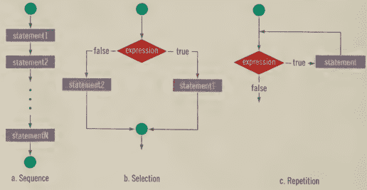

图 4-1 执行流程


在学习选择结构和循环结构之前，你必须理解条件语句的本质以及如何使用它们。请考虑以下三条语句：

- 1. `if (score is greater than or equal to 90)`  
     `grade is A`
- 2. `if (hours worked are less than or equal to 40)`  
     `wages = rate * hours`  
     `otherwise`  
     `wages = (rate * 40) + 1.5 * (rate * (hours - 40))`
- 3. `if (temperature is greater than 70 degrees and it is not raining)`  
     `Go golfing!`

这些语句是条件语句的示例。你可以看到，某些语句只有在满足特定条件时才会执行。如果条件的求值结果为 true，则该条件得到满足。例如，在语句 1 中：

```
score is greater than or equal to 90
```

如果 score 的值大于或等于 90，则该表达式为 true；否则为 false。例如，如果 score 的值为 95，则该语句的求值结果为 true。类似地，如果 score 的值为 86，则该语句的求值结果为 false。

如果计算机能够识别这些类型的语句在适当取值下为 true，那将会很有用。此外，在某些情况下，一条语句的真假可能取决于多个条件。例如，在语句 3 中，“温度高于 70 度”和“没有下雨”这两个条件都必须为 true，才会建议去打高尔夫球。

如你所见，计算机要做出决策并重复执行语句，就必须能够对程序执行时存在的条件做出反应。接下来几节将讨论如何在 C++ 中表示和求值条件语句。

### 关系运算符

要做出决策，你必须能够表达条件并进行比较。例如，支票账户的利率和服务费可能取决于月末余额。如果余额低于某个最低余额，不仅利率会更低，而且通常还会收取服务费。因此，要确定利率，你必须能够说明最低余额，并将账户余额与最低余额进行比较（这是一个条件）。保险单的保费也通过说明条件和进行比较来确定。例如，要确定保险费，你必须能够检查投保人的吸烟状况。不吸烟者（条件）比吸烟者支付更低的保费。这两个例子都涉及比较项目。某些项目针对特定条件进行相等性比较；另一些项目针对特定条件进行不等性比较（大于或小于）。


在 C++ 中，条件由逻辑（布尔）表达式表示。取值为 true 或 false 的表达式称为**逻辑（布尔）表达式**。此外，true 和 false 是**逻辑（布尔）值**。假设 *i* 和 *j* 是整数。考虑以下表达式：

```
i > j
```

如果该表达式是逻辑表达式，那么当 *i* 的值大于 *j* 的值时，它的值为 true；否则，它的值为 false。符号 > 称为关系运算符。**关系运算符**允许你在程序中进行比较。

C++ 包含六个关系运算符，可让你说明条件并进行比较。表 4-1 列出了这些关系运算符。

**表 4-1** C++ 中的关系运算符

| 运算符 | 描述 |
|---|---|
| `==` | 等于 |
| `!=` | 不等于 |
| `<` | 小于 |
| `<=` | 小于或等于 |
| `>` | 大于 |
| `>=` | 大于或等于 |


在 C++ 中，由两个等号组成的符号 == 称为相等运算符。回想一下，符号 = 称为赋值运算符。请记住，相等运算符 == 判断两个表达式是否相等，而赋值运算符 = 将表达式的值赋给变量。

每个关系运算符都是二元运算符；也就是说，它需要两个操作数。由于比较的结果是 true 或 false，使用这些运算符的表达式求值结果为 true 或 false。

### 关系运算符与简单数据类型

你可以将关系运算符用于所有三种简单数据类型。在下面的示例中，这些表达式同时使用了整数和实数：

**示例 4-1**

| 表达式 | 含义 | 值 |
|---|---|---|
| `8 < 15` | 8 小于 15 | true |
| `6 != 6` | 6 不等于 6 | false |
| `2.5 > 5.8` | 2.5 大于 5.8 | false |
| `5.9 <= 7.5` | 5.9 小于或等于 7.5 | true |

### 比较字符

对于 char 值，使用关系运算符的表达式求值为 true 还是 false，取决于机器的排序序列。部分字符的排序序列如下：

| ASCII 值 | 字符 | ASCII 值 | 字符 | ASCII 值 | 字符 | ASCII 值 | 字符 |
|---:|:---:|---:|:---:|---:|:---:|---:|:---:|
| 32 | `' '` | 61 | `=` | 81 | `Q` | 105 | `i` |
| 33 | `!` | 62 | `>` | 82 | `R` | 106 | `j` |
| 34 | `"` | 65 | `A` | 83 | `S` | 107 | `k` |
| 42 | `*` | 66 | `B` | 84 | `T` | 108 | `l` |
| 43 | `+` | 67 | `C` | 85 | `U` | 109 | `m` |
| 45 | `-` | 68 | `D` | 86 | `V` | 110 | `n` |
| 47 | `/` | 69 | `E` | 87 | `W` | 111 | `o` |
| 48 | `0` | 70 | `F` | 88 | `X` | 112 | `p` |
| 49 | `1` | 71 | `G` | 89 | `Y` | 113 | `q` |
| 50 | `2` | 72 | `H` | 90 | `Z` | 114 | `r` |
| 51 | `3` | 73 | `I` | 97 | `a` | 115 | `s` |
| 52 | `4` | 74 | `J` | 98 | `b` | 116 | `t` |
| 53 | `5` | 75 | `K` | 99 | `c` | 117 | `u` |
| 54 | `6` | 76 | `L` | 100 | `d` | 118 | `v` |
| 55 | `7` | 77 | `M` | 101 | `e` | 119 | `w` |
| 56 | `8` | 78 | `N` | 102 | `f` | 120 | `x` |
| 57 | `9` | 79 | `O` | 103 | `g` | 121 | `y` |
| 60 | `<` | 80 | `P` | 104 | `h` | 122 | `z` |

ASCII 字符集在附录 C 中描述。

现在，因为 `32 < 97`，并且 `' '` 的 ASCII 值是 32、`'a'` 的 ASCII 值是 97，所以可以得出 `' ' < 'a'` 为 true。类似地，使用前面的 ASCII 值：

```
'R' > 'T' is false
'+' < '*' is false
'A' <= 'a' is true
```

请注意，比较不同数据类型的值可能会产生不可预测的结果。例如，下面的表达式比较一个整数和一个字符：

```
    8 < '5'
```

在这个表达式中，在特定机器上，8 会与 '5' 的排序序列值（即 53）进行比较。也就是说，8 与 53 进行比较，这使得这个特定表达式的求值结果为 true。

诸如 `4 < 6` 和 `'R' > 'T'` 这样的表达式是逻辑（布尔）表达式的示例。当 C++ 对逻辑表达式求值时，如果逻辑表达式的求值结果为 true，则返回整数值 1；否则返回整数值 0。在 C++ 中，任何非零值都被视为 true。

> 第 2 章介绍了数据类型 bool。回想一下，数据类型 bool 有两个值：true 和 false。在 C++ 中，true 和 false 是保留字。标识符 true 被设置为 1，标识符 false 被设置为 0。为了可读性，只要使用逻辑表达式，这里都会使用标识符 true 和 false 作为逻辑表达式的值。

### 关系运算符与 string 类型

关系运算符可应用于 string 类型的变量。string 类型的变量会逐字符进行比较，从第一个字符开始，并使用 ASCII 排序序列。逐字符比较会持续进行，直到发现不匹配，或者比较完最后一个字符且它们相等为止。下面的示例展示了如何比较 string 类型的变量。

**示例 4-2**

假设你有以下语句：

```
    string str1 = "Hello";
    string str2 = "Hi";
    string str3 = "Air";
    string str4 = "Bill";
    string str5 = "Big";
```

下面的表达式展示了 string 关系表达式的求值方式。

| 表达式 | 值/说明 |
|---|---|
| `str1 < str2` | true<br>`str1 = "Hello"` 和 `str2 = "Hi"`。`str1` 和 `str2` 的第一个字符相同，但 `str1` 的第二个字符 `'e'` 小于 `str2` 的第二个字符 `'i'`。因此，`str1 < str2` 为 true。 |


| 表达式 | 值/说明 |
| --- | --- |
| `str1 > "Hen"` | **假**<br>`str1 = "Hello"`。str1 和 "Hen" 的前两个字符相同，但 str1 的第三个字符 'l' 小于 "Hen" 的第三个字符 'n'。因此，`str1 > "Hen"` 为假。 |
| `str3 < "An"` | **真**<br>`str3 = "Air"`。str3 和 "An" 的第一个字符相同，但 "Air" 的第二个字符 'i' 小于 "An" 的第二个字符 'n'。因此，`str3 < "An"` 为真。 |
| `str1 == "hello"` | **假**<br>`str1 = "Hello"`。str1 的第一个字符 'H' 小于 "hello" 的第一个字符 'h'，因为 'H' 的 ASCII 值为 72，而 'h' 的 ASCII 值为 104。因此，`str1 == "hello"` 为假。 |
| `str3 <= str4` | **真**<br>`str3 = "Air"` 且 `str4 = "Bill"`。str3 的第一个字符 'A' 小于 str4 的第一个字符 'B'。因此，`str3 <= str4` 为真。 |
| `str2 > str4` | **真**<br>`str2 = "Hi"` 且 `str4 = "Bill"`。str2 的第一个字符 'H' 大于 str4 的第一个字符 'B'。因此，`str2 > str4` 为真。 |

如果比较两个长度不同的字符串，并且逐字符比较直到较短字符串的最后一个字符都相等，那么较短字符串会被判定为小于较长的字符串，如下所示。

| 表达式 | 值/说明 |
| --- | --- |
| `str4 >= "Billy"` | **假**<br>`str4 = "Bill"`。它有四个字符，而 "Billy" 有五个字符。因此，str4 是较短的字符串。str4 的全部四个字符都与 "Billy" 对应的前四个字符相同，并且 "Billy" 是较长的字符串。因此，`str4 >= "Billy"` 为假。 |
| `str5 <= "Bigger"` | **真**<br>`str5 = "Big"`。它有三个字符，而 "Bigger" 有六个字符。因此，str5 是较短的字符串。str5 的全部三个字符都与 "Bigger" 对应的前三个字符相同，并且 "Bigger" 是较长的字符串。因此，`str5 <= "Bigger"` 为真。 |

本书配套网站上的程序 Chapter4_StringComparisons.cpp 展示了前面这些表达式的结果。

### 逻辑（布尔）运算符与逻辑表达式

本节介绍如何构造和求值由其他逻辑表达式组合而成的逻辑表达式。逻辑（布尔）运算符使你能够组合逻辑表达式。C++ 有三种逻辑（布尔）运算符，如表 4-2 所示。

**表 4-2 C++ 中的逻辑（布尔）运算符**

| 运算符 | 描述 |
| --- | --- |
| ! | 非 |
| && | 与 |
| \|\| | 或 |

逻辑运算符只接受逻辑值作为操作数，并且只产生逻辑值作为结果。运算符 ! 是一元的，因此只有一个操作数。运算符 && 和 || 是二元运算符。表 4-3、4-4 和 4-5 定义了这些运算符。

表 4-3 定义了运算符 !（非）。使用 ! 运算符时，!true 为假，!false 为真。将 ! 放在逻辑表达式前面会反转该逻辑表达式的值。

**表 4-3 !（非）运算符**

| 表达式 | !(表达式) |
| --- | --- |
| 真（非零） | 假（0） |
| 假（0） | 真（1） |

### 示例 4-3

| 表达式 | 值 | 说明 |
| --- | --- | --- |
| !('A' > 'B') | 真 | 因为 'A' > 'B' 为假，所以 !('A' > 'B') 为真。 |
| !(6 <= 7) | 假 | 因为 6 <= 7 为真，所以 !(6 <= 7) 为假。 |

### 示例 4-5

| 表达式 | 值 | 说明 |
| --- | --- | --- |
| `(14 >= 5) \|\| ('A' > 'B')` | `true` | 因为 `(14 >= 5)` 为真，`('A' > 'B')` 为假，并且 `true \|\| false` 为真，所以该表达式的求值为真。 |
| `(24 >= 35) \|\| ('A' > 'B')` | `false` | 因为 `(24 >= 35)` 为假，`('A' > 'B')` 为假，并且 `false \|\| false` 为假，所以该表达式的求值为假。 |
| `('A' <= 'a') \|\| (7 != 7)` | `true` | 因为 `('A' <= 'a')` 为真，`(7 != 7)` 为假，并且 `true \|\| false` 为真，所以该表达式的求值为真。 |

### 优先级顺序

复杂的逻辑表达式可能难以求值。考虑以下逻辑表达式：

```
11 > 5 || 6 < 15 && 7 >= 8
```

该逻辑表达式会得到不同的结果，具体取决于先计算 || 还是先计算 &&。如果先计算 ||，则该表达式的求值为假。如果先计算 &&，则该表达式的求值为真。

一个表达式可能包含算术、关系和逻辑运算符，如下面的表达式：

```
5 + 3 <= 9 && 2 > 3
```

要处理复杂的逻辑表达式，必须有一套用于计算运算符的优先级方案。表 4-6 列出了一些 C++ 运算符的优先级顺序，包括算术、关系和逻辑运算符。（所有 C++ 运算符的优先级见附录 B。）

**表 4-6 运算符的优先级**

| 运算符 | 优先级 |
| --- | --- |
| `!, +, -`（一元运算符） | 第一 |
| `*, /, %` | 第二 |
| `+, -` | 第三 |
| `<, <=, >=, >` | 第四 |
| `==, !=` | 第五 |
| `&&` | 第六 |
| \|\| | 第七 |
| `=`（赋值运算符） | 最后 |

> **注意**
>
> 在 C++ 中，`&` 和 `|` 也是运算符。这些运算符的含义与 `&&` 和 `||` 的含义不同。用 `&` 代替 `&&`，或用 `|` 代替 `||`——这可能是排版错误造成的——会产生非常奇怪的结果。

在表达式中使用优先级规则时，关系运算符和逻辑运算符从左到右求值。由于关系运算符和逻辑运算符从左到右求值，因此这些运算符的结合性被称为从左到右。

示例 4-6 说明了由变量组成的逻辑表达式如何求值。

### 示例 4-6

假设有如下声明：

```cpp
bool found = true;
int age = 20;
double hours = 45.30;
double overTime = 15.00;
int count = 20;
char ch = 'B';
```

考虑以下表达式：

| 表达式 | 值/说明 |
| --- | --- |
| `!found` | `false`<br>因为 found 为真，所以 `!found` 为假。 |
| `hours > 40.00` | `true`<br>因为 hours 为 45.30，且 45.30 > 40.00 为真，所以表达式 `hours > 40.00` 的求值为真。 |
| `!age` | `false`<br>age 为 20，是非零值，所以 age 为真。因此，`!age` 为假。 |
| `!found && (age >= 18)` | `false`<br>`!found` 为假；age >= 18 即 20 >= 18 为真。因此，`!found && (age >= 18)` 为 false && true，其求值为假。 |
| `! (found && (age >= 18))` | `false`<br>现在，`found && (age >= 18)` 为 true && true，其求值为真。因此，`! (found && (age >= 18))` 为 !true，其求值为假。 |

| 表达式 | 值/说明 |
| --- | --- |
| `hours + overTime <= 75.00` | **真**<br>因为 hours + overTime 为 45.30 + 15.00 = 60.30，且 60.30 <= 75.00 为真，所以 hours + overTime <= 75.00 的求值为真。 |
| `(count >= 0) && (count <= 100)` | **真**<br>现在，count 为 20。因为 20 >= 0 为真，所以 count >= 0 为真。另外，20 <= 100 为真，所以 count <= 100 为真。因此，(count >= 0) && (count <= 100) 为 true && true，其求值为真。 |
| `('A' <= ch && ch <= 'Z')` | **真**<br>这里，ch 为 'B'。因为 'A' <= 'B' 为真，所以 'A' <= ch 的求值为真。另外，因为 'B' <= 'Z' 为真，所以 ch <= 'Z' 的求值为真。因此，('A' <= ch && ch <= 'Z') 为 true && true，其求值为真。 |

下面的程序会计算并输出这些逻辑表达式的值。注意，如果逻辑表达式的求值为真，则相应输出为 1；如果逻辑表达式的求值为假，则相应输出为 0，如程序末尾的输出所示。（回想一下，如果逻辑表达式的值为真，则其求值为 1；如果逻辑表达式的值为假，则其求值为 0。）

```cpp
//Chapter 4 Logical operators.

#include <iostream>
#include <iomanip>

using namespace std;

int main()
{
    bool found = true;
    int age = 20;
    double hours = 45.30;
    double overTime = 15.00;
    int count = 20;
    char ch = 'B';

    cout << fixed << showpoint << setprecision(2);
    cout << "found = " << found << ", age = " << age
         << ", hours = " << hours << ", overTime = " << overTime
         << ", count = " << count
         << ", ch = " << ch << endl << endl;

    cout << "!found evaluates to " << !found << endl;
    cout << "hours > 40.00 evaluates to " << (hours > 40.00) << endl;
    cout << "!age evaluates to " << !age << endl;
    cout << "(!found && (age >= 18)) evaluates to "
         << (!found && (age >= 18)) << endl;
```


```cpp
cout << "!(found && (age >= 18)) evaluates to ";
cout << (!(found && (age >= 18))) << endl;
cout << "hours + overTime <= 75.00 evaluates to ";
cout << (hours + overTime <= 75.00) << endl;
cout << "(count >= 0) && (count <= 100) evaluates to ";
cout << ((count >= 0) && (count <= 100)) << endl;
cout << "('A' <= ch && ch <= 'Z') evaluates to ";
cout << (('A' <= ch && ch <= 'Z')) << endl;

return 0;
}
```

### 示例运行：

```text
found = 1, age = 20, hours = 45.30, overTime = 15.00,
count = 20, ch = B

!found evaluates to 0
hours > 40.00 evaluates to 1
!age evaluates to 0
!(found && (age >= 18)) evaluates to 0
hours + overTime <= 75.00 evaluates to 1
(count >= 0) && (count <= 100) evaluates to 1
('A' <= ch && ch <= 'Z') evaluates to 1
```

你可以将括号插入到表达式中以明确其含义。你也可以使用括号来覆盖运算符的优先级。按照标准优先级顺序，表达式：

```cpp
11 > 5 || 6 < 15 && 7 >= 8
```

等价于：

```cpp
11 > 5 || (6 < 15 && 7 >= 8)
```

在此表达式中，11 > 5 为 true，6 < 15 为 true，7 >= 8 为 false。将这些值代入表达式 11 > 5 || (6 < 15 && 7 >= 8) 中，得到 true || (true && false) = true || false = true。因此，表达式 11 > 5 || (6 < 15 && 7 >= 8) 的求值结果为 true。

在 C++ 中，逻辑（布尔）表达式可以通过两种方式之一进行操作或处理：使用 int 变量或使用 bool 变量。以下各节将介绍这些方法。

### int 数据类型与逻辑（布尔）表达式

早期的 C++ 版本没有提供具有逻辑（或布尔）值 true 和 false 的内置数据类型。由于逻辑表达式的求值结果为 1 或 0，因此逻辑表达式的值被存储在 int 数据类型的变量中。因此，你可以使用 int 数据类型来处理逻辑（布尔）表达式。

回顾一下，非零值被视为 true。现在，考虑以下声明：

```cpp
int legalAge;
int age;
```

以及赋值语句：

```cpp
legalAge = 21;
```

如果你将 `legalAge` 视为逻辑变量，则该语句赋给 `legalAge` 的值为 true。

赋值语句：

```cpp
legalAge = (age >= 21);
```

如果 `age` 的值大于或等于 21，则将值 1 赋给 `legalAge`。如果 `age` 的值小于 21，则该语句将值 0 赋给 `legalAge`。

### bool 数据类型与逻辑（布尔）表达式

较新版本的 C++ 包含一个内置数据类型 `bool`，它具有逻辑（布尔）值 `true` 和 `false`。因此，你可以使用 `bool` 数据类型来处理逻辑（布尔）表达式。回顾一下，在 C++ 中，`bool`、`true` 和 `false` 是保留字。此外，标识符 `true` 的值为 1，标识符 `false` 的值为 0。现在，考虑以下声明：

```cpp
bool legalAge;
int age;
```

语句：

```cpp
legalAge = true;
```

将变量 `legalAge` 的值设置为 true。语句：

```cpp
legalAge = (age >= 21);
```

如果 `age` 的值大于或等于 21，则将值 true 赋给 `legalAge`。如果 `age` 的值小于 21，则该语句将值 false 赋给 `legalAge`。例如，如果 age 的值为 25，则赋给 `legalAge` 的值为 true——即 1。类似地，如果 age 的值为 16，则赋给 `legalAge` 的值为 false——即 0。

你可以使用 `int` 变量或 `bool` 变量来存储逻辑表达式的值。为了清晰起见，本书使用 `bool` 变量来存储逻辑表达式的值。

### 选择：if 和 if...else

尽管逻辑值只有 true 和 false 两个，但它们却非常有用，因为程序可以借此纳入决策机制，从而改变处理流程。本章其余部分将讨论如何在程序中加入决策。在 C++ 中，有两种选择（或称分支控制结构）：if 语句和 switch 结构。本节讨论如何使用 if 和 if...else 语句来实现单向选择、双向选择和多向选择。switch 结构将在本章后面讨论。

### 单向选择

银行希望在客户的支票账户余额低于要求的最低余额时向客户发送通知。也就是说，如果账户余额低于要求的最低余额，则应向客户发送通知；否则不执行任何操作。类似地，如果保险单的投保人是非吸烟者，公司希望对保单保费给予 10% 的折扣。这两个例子都涉及单向选择。在 C++ 中，单向选择通过 if 语句实现。单向选择的语法为：

```text
if (expression)
    statement
```

请注意此语法的各个要素。它以保留字 if 开头，后跟括在括号内的表达式，再后跟一条语句。请注意，表达式周围的括号是语法的一部分。该表达式有时被称为**决策器**，因为它决定是否执行其后的语句。该表达式通常是逻辑表达式。如果表达式的值为 true，则执行该语句。如果值为 false，则不执行该语句，计算机继续执行程序中的下一条语句。表达式后面的语句有时被称为**动作语句**。图 4-2 显示了 if 语句（单向选择）的执行流程。

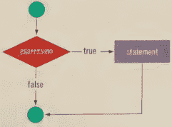

**图 4-2** 单向选择

### 示例 4-7

```cpp
if (score >= 60)
    grade = 'P';
```

在这段代码中，如果表达式 (score >= 60) 的求值结果为 true，则执行赋值语句 grade = 'P';。如果表达式的求值结果为 false，则执行 if 结构之后的语句（如果有）。例如，如果 score 的值为 65，则赋给变量 grade 的值为 'P'。

### 示例 4-8

```cpp
//Program to compute and output the penalty on an unpaid
//credit card balance. The program assumes that the interest
//rate on the unpaid balance is 1.5% per month.
#include <iostream>                                      //Line 1
#include <iomanip>                                       //Line 2

using namespace std;                                     //Line 3

const double INTEREST_RATE = 0.015;                      //Line 4

int main ()                                               //Line 5
{
    double creditCardBalance;                             //Line 6
    double payment;                                       //Line 7
    double balance;                                       //Line 8
    double penalty = 0.0;                                 //Line 10

    cout << fixed << showpoint << setprecision(2);        //Line 11

    cout << "Line 12: Enter credit card balance: ";      //Line 12
    cin >> creditCardBalance;                             //Line 13
    cout << endl;                                         //Line 14

    cout << "Line 15: Enter the payment: ";              //Line 15
    cin >> payment;                                       //Line 16
    cout << endl;                                         //Line 17

    balance = creditCardBalance - payment;                //Line 18

    if (balance > 0)                                      //Line 19
        penalty = balance * INTEREST_RATE;                //Line 20

    cout << "Line 21: The balance is: $" << balance << endl; //Line 21
    cout << "Line 22: The penalty to be added to your "   //Line 22
         << "next month bill is: $" << penalty << endl;

    return 0;                                             //Line 23
}                                                        //Line 24
```

**示例运行：** 在此示例运行中，用户输入以阴影显示。

```text
Line 12: Enter credit card balance: 2500.00
Line 15: Enter the payment: 275.00

Line 21: The balance is: $2225.00
Line 22: The penalty to be added to your next month bill is: $33.38
```

第 7 行到第 10 行的语句声明了程序中使用的变量。第 12 行的语句提示用户输入信用卡账单金额。第 13 行的语句将金额输入到变量 creditCardBalance。第 15 行的语句提示用户输入付款金额。第 16 行的语句将付款金额输入到变量 payment。第 18 行的语句计算未付余额。第 19 行的 if 语句判断未付余额是否为正。如果未付余额为正，则第 20 行的语句计算罚金。第 21 行和第 22 行的语句输出结果。该程序假设未付余额的年利率为 18%（即每月 1.5%）。如你所见，未付余额的利率会迅速累积，不仅会破坏你的信用评级，还会使你陷入财务困境。

### 示例 4-9

考虑以下语句：

```cpp
if score >= 60     //syntax error
    grade = 'P';
```

该语句演示了一个不正确的 if 语句版本。逻辑表达式周围的括号缺失，这是一个语法错误。

在 if 语句中，表达式后的括号后面（即语句之前）加上分号是语义错误。如果分号紧跟在右括号后面，则 if 语句将对空语句进行操作。

### 示例 4-10

考虑以下 C++ 语句：

```cpp
if (score >= 60);        //Line 1
    grade = 'P';         //Line 2
```

由于表达式末尾有一个分号（参见第 1 行），第 1 行的 if 语句终止。该 if 语句的动作是空的，第 2 行的语句不属于第 1 行 if 语句的一部分。因此，无论 if 语句如何求值，第 2 行的语句都会执行。


### 双向选择

在许多编程场景中，你必须在两个备选方案之间做出选择。例如，如果一名兼职员工加班，工资就使用加班工资计算公式来计算；否则，工资就使用常规公式来计算。这是一个双向选择的例子。为了在两个备选方案之间做出选择——也就是实现双向选择——C++ 提供了 if...else 语句。双向选择使用以下语法：

```cpp
if (expression)
    statement1
else
    statement2
```

花点时间检查一下这个语法。它以保留字 if 开头，后面是包含在圆括号内的逻辑表达式，接着是一条语句，然后是保留字 else，最后是第二条语句。语句 1 和语句 2 可以是任何有效的 C++ 语句。在双向选择中，如果表达式的值为 true，就执行 statement1。如果表达式的值为 false，就执行 statement2。图 4-3 展示了 if...else 语句（双向选择）的执行流程。

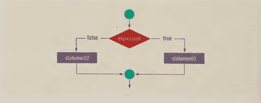

**图 4-3** 双向选择

### 示例 4-11

考虑以下语句：

```cpp
if (hours > 40.0)                         //Line 1
    wages = 40.0 * rate +
            1.5 * rate * (hours - 40.0); //Line 2
else                                      //Line 3
    wages = hours * rate;                 //Line 4
```

如果变量 hours 的值大于 40.0，工资就包含加班费。假设 hours 为 50。第 1 行中 if 语句里的表达式求值为 true，因此执行第 2 行中的语句。另一方面，如果 hours 为 30 或任何小于等于 40 的数，第 1 行中 if 语句里的表达式求值为 false。在这种情况下，程序跳过第 2 行中的语句，执行第 4 行中的语句——也就是执行保留字 else 后面的语句。

在双向选择语句中，如果在表达式之后、statement1 之前放置分号，就会产生语法错误。如果 if 语句以分号结束，statement1 就不再是 if 语句的一部分，而 if...else 语句中的 else 部分就会完全独立存在。C++ 中不存在独立的 else 语句。也就是说，else 不能与 if 语句分离。

### 示例 4-12

以下语句展示了一个语法错误的例子：

```cpp
if (hours > 40.0);                         //Line 1
    wages = 40.0 * rate +
           1.5 * rate * (hours - 40.0);      //Line 2
else                                       //Line 3
    wages = hours * rate;                   //Line 4
```

if 语句末尾的分号（见第 1 行）结束了 if 语句，因此第 2 行中的语句把 else 子句与 if 语句分隔开。也就是说，else 完全独立存在。由于 C++ 中不存在独立的 else 语句，这段代码会产生语法错误。如例 4-10 所示，在单向选择中，if 语句末尾的分号是逻辑错误；而如本例所示，在双向选择中，它是语法错误。

### 示例 4-13

以下程序计算员工的周工资。如果工作小时数超过 40，工资就包含加班费。

```cpp
//Program: Weekly wages

#include <iostream>
#include <iomanip>

using namespace std;

int main()
{
    double wages, rate, hours;

    cout << fixed << showpoint << setprecision(2);    //Line 1
    cout << "Line 2: Enter working hours and rate: ";   //Line 2
    cin >> hours >> rate;                                //Line 3

    if (hours > 40.0)                                    //Line 4
        wages = 40.0 * rate +
                1.5 * rate * (hours - 40.0);              //Line 5
    else                                                  //Line 6
        wages = hours * rate;                             //Line 7

    cout << endl;                                         //Line 8
    cout << "Line 9: The wages are $" << wages
         << endl;                                         //Line 9

    return 0;
}
```

**示例运行：** 在此示例运行中，用户输入以阴影显示。

Line 2: Enter working hours and rate: `56.45 12.50`

Line 9: The wages are $808.44

第 1 行中的语句将浮点数的输出设置为固定小数格式，包含小数点、尾随零和两位小数。第 2 行中的语句提示用户输入工作小时数和时薪。第 3 行中的语句将这些值分别输入变量 hours 和 rate。第 4 行中的语句检查变量 hours 的值是否大于 40.0。如果 hours 大于 40.0，则由第 5 行中的语句计算工资，其中包含加班费。否则，由第 7 行中的语句计算工资。第 9 行中的语句输出工资。

现在让我们考虑 if 语句的另一个例子，并检查一些可能发生的语义错误。

### 示例 4-14

考虑以下语句：

```cpp
if (score >= 60)                 //Line 1
    cout << "Passing" << endl;   //Line 2
cout << "Failing" << endl;        //Line 3
```

如果表达式 (score >= 60) 求值为 false，第 2 行中的输出语句不会执行。因此输出将是 Failing。也就是说，这组语句执行的操作与 if...else 语句相同。它将执行第 3 行中的输出语句，而不是第 2 行中的输出语句。例如，如果 score 的值为 50，这些语句将输出以下行：

Failing

然而，如果表达式 (score >= 60) 求值为 true，程序将执行两个输出语句，产生非常不理想的结果。例如，如果 score 的值为 70，这些语句将输出以下行：

```
Passing
Failing
```

if 语句只控制第 2 行中语句的执行。第 3 行中的语句始终会执行。

根据 score 的值打印 Passing 或 Failing 的正确代码是：

```cpp
if (score >= 60)
    cout << "Passing" << endl;
else
    cout << "Failing" << endl;
```

### 复合语句（语句块）

if 和 if...else 结构一次只控制一条语句。然而，假设当 if 或 if...else 语句中的表达式求值为 true 时，你想执行多条语句。为了允许更复杂的语句，C++ 提供了一种称为复合语句或语句块的结构。复合语句采用以下形式：

```
{
    statement_1
    statement_2
    .
    .
    .
    statement_n
}
```

也就是说，复合语句由一系列括在花括号 { 和 } 中的语句组成。在 if 或 if...else 结构中，复合语句的作用就像一条语句。因此，与下面代码所示的简单双向选择不同：

```cpp
if (age >= 18)
    cout << "Eligible to vote." << endl;
else
    cout << "Not eligible to vote." << endl;
```

你可以包含复合语句，类似下面的代码：

```cpp
if (age >= 18)
{
    cout << "Eligible to vote." << endl;
    cout << "No longer a minor." << endl;
}
else
{
    cout << "Not eligible to vote." << endl;
    cout << "Still a minor." << endl;
}
```

复合语句非常有用，将用于本章大多数结构化语句中。

### 多重选择：嵌套 if

在前面的章节中，你学习了如何在程序中实现单向选择和双向选择。有些问题需要实现两个以上的备选方案。例如，假设如果支票账户余额超过 $50,000，利率为 7%；如果余额在 $25,000 到 $49,999.99 之间，利率为 5%；如果余额在 $1,000 到 $24,999.99 之间，利率为 3%；否则，利率为 0%。这个特定问题有四个备选方案——也就是多条选择路径。如果动作语句本身是 if 或 if...else 语句，你可以通过使用 if...else 结构在程序中包含多条选择路径。当一个控制语句位于另一个控制语句内部时，就称其为嵌套。

例 4-15 说明了如何使用嵌套 if...else 结构来实现多重选择。

### 示例 4-15

假设 balance 和 interestRate 是 double 类型的变量。以下语句根据 balance 的值确定 interestRate：

```cpp
if (balance > 50000.00)              //Line 1
    interestRate = 0.07;             //Line 2
else                                 //Line 3
    if (balance >= 25000.00)         //Line 4
        interestRate = 0.05;         //Line 5
    else                             //Line 6
        if (balance >= 1000.00)      //Line 7
            interestRate = 0.03;     //Line 8
        else                         //Line 9
            interestRate = 0.00;     //Line 10
```

嵌套 if...else 结构要求回答一个重要问题：你如何知道哪个 else 与哪个 if 配对？回想一下，C++ 中不存在独立的 else 语句。每个 else 都必须与一个 if 配对。将 else 与 if 配对的规则如下：

**将 else 与 if 配对。** 在嵌套 if 语句中，C++ 将 else 与最近的未完成 if 关联起来——也就是最近一个尚未与 else 配对的 if。

使用这条规则，在例 4-15 中，第 3 行的 else 与第 1 行的 if 配对。第 6 行的 else 与第 4 行的 if 配对，第 9 行的 else 与第 7 行的 if 配对。


为了避免过度缩进，示例 4-15 中的代码可以改写如下：

```cpp
if (balance > 50000.00)            //Line 1
    interestRate = 0.07;           //Line 2
else if (balance >= 25000.00)      //Line 3
    interestRate = 0.05;           //Line 4
else if (balance >= 1000.00)       //Line 5
    interestRate = 0.03;           //Line 6
else
    interestRate = 0.00;           //Line 8
```

以下示例将帮助你了解如何使用嵌套的 if 结构实现多重选择的各种方式。

### 示例 4-16

假设 score 是 int 类型的变量。根据 score 的值，以下代码输出成绩：

```cpp
if (score >= 90)
    cout << "The grade is A." << endl;
else if (score >= 80)
    cout << "The grade is B." << endl;
else if (score >= 70)
    cout << "The grade is C." << endl;
else if (score >= 60)
    cout << "The grade is D." << endl;
else
    cout << "The grade is F." << endl;
```

### 示例 4-17

假设所有变量都已正确声明，并考虑以下语句：

```cpp
if (temperature >= 50)                          //Line 1
    if (temperature >= 80)                      //Line 2
        cout << "Good day for swimming." << endl;  //Line 3
    else                                        //Line 4
        cout << "Good day for golfing." << endl;   //Line 5
else                                            //Line 6
    cout << "Good day to play tennis." << endl;    //Line 7
```

在这段 C++ 代码中，第 4 行的 else 与第 2 行的 if 配对，第 6 行的 else 与第 1 行的 if 配对。注意，第 4 行的 else 不能与第 1 行的 if 配对。如果你将第 4 行的 else 与第 1 行的 if 配对，那么第 2 行的 if 就变成了第 1 行的 if 的动作语句部分，使第 6 行的 else 悬空。此外，第 2 行到第 5 行的语句构成了第 1 行的 if 的语句部分。缩进并不决定配对，但应被用来传达配对关系。

### 示例 4-18

假设所有变量都已正确声明，并考虑以下语句：

```cpp
if (temperature >= 70)                         //Line 1
    if (temperature >= 80)                     //Line 2
        cout << "Good day for swimming." << endl; //Line 3
    else                                      //Line 4
        cout << "Good day for golfing." << endl;  //Line 5
```

在这段代码中，第 4 行的 else 与第 2 行的 if 配对。注意，对于第 4 行的 else，最近未完成的 if 是第 2 行的 if。第 1 行的 if 没有 else，因此它是一个单向选择。同样，缩进不决定配对，但它传达了配对关系。

### 示例 4-19

假设所有变量都已正确声明，并考虑以下语句：

```cpp
if (gender == 'M')                         //Line 1
    if (age < 21)                            //Line 2
        policyRate = 0.05;                   //Line 3
    else                                     //Line 4
        policyRate = 0.035;                  //Line 5
else if (gender == 'F')                     //Line 6
    if (age < 21)                            //Line 7
        policyRate = 0.04;                   //Line 8
    else                                     //Line 9
        policyRate = 0.03;                   //Line 10
```

在这段代码中，第 4 行的 else 与第 2 行的 if 配对。注意，对于第 4 行的 else，最近未完成的 if 是第 2 行的 if。第 6 行的 else 与第 1 行的 if 配对。第 9 行的 else 与第 7 行的 if 配对。同样，缩进不决定配对，但它传达了配对关系。

### 比较 if...else 语句和一系列 if 语句

考虑以下 C++ 程序段，它们都能完成相同的任务：

- a.

```cpp
if (month == 1)                           //Line 1
    cout << "January" << endl;             //Line 2
else if (month == 2)                       //Line 3
    cout << "February" << endl;            //Line 4
else if (month == 3)                       //Line 5
    cout << "March" << endl;               //Line 6
else if (month == 4)                       //Line 7
    cout << "April" << endl;               //Line 8
else if (month == 5)                 //Line 9
    cout << "May" << endl;           //Line 10
else if (month == 6)                 //Line 11
    cout << "June" << endl;          //Line 12
```

- b.

```cpp
if (month == 1)
    cout << "January" << endl;
if (month == 2)
    cout << "February" << endl;
if (month == 3)
    cout << "March" << endl;
if (month == 4)
    cout << "April" << endl;
if (month == 5)
    cout << "May" << endl;
if (month == 6)
    cout << "June" << endl;
```

程序段 (a) 是作为一系列 if...else 语句编写的；程序段 (b) 是作为一系列 if 语句编写的。两个程序段完成相同的工作。如果 month 是 3，两个程序段都输出 March。如果 month 是 1，则在程序段 (a) 中，第 1 行 if 语句中的表达式求值为 true。与该 if 关联的语句（第 2 行）随后执行；结构的其余部分，即该 if 语句的 else 部分，被跳过；其余 if 语句不再求值。在程序段 (b) 中，由于没有 else 语句，计算机必须对每个 if 语句中的表达式求值。因此，程序段 (b) 比程序段 (a) 执行得更慢。

### 短路求值

C++ 中的逻辑表达式使用一种高效算法进行求值。该算法借助以下语句进行说明：

```cpp
(x > y) || (x == 5)      //Line 1
(a == b) && (x >= 7)     //Line 2
```

在第 1 行的语句中，运算符 || 的两个操作数是表达式 (x > y) 和 (x == 5)。如果操作数 (x > y) 为真或操作数 (x == 5) 为真，则该表达式求值为 true。采用短路求值时，计算机从左到右求值逻辑表达式。一旦整个逻辑表达式的值已知，计算机就会停止。例如，在语句 1 中，如果操作数 (x > y) 求值为 true，则整个表达式求值为 true，因为 true || true 为 true，且 true || false 为 true。因此，操作数 (x == 5) 的值对最终结果没有影响。

类似地，在第 2 行的语句中，运算符 && 的两个操作数是 (a == b) 和 (x >= 7)。如果操作数 (a == b) 求值为 false，则整个表达式求值为 false，因为 false && true 为 false，且 false && false 为 false。

**短路求值**（逻辑表达式的）：计算机从左到右求值逻辑表达式，一旦表达式的值已知就停止的过程。

### 示例 4-20

考虑以下表达式：

```cpp
(age >= 21) || (x == 5)        //Line 1
(grade == 'A') && (x >= 7)      //Line 2
```

对于第 1 行的表达式，假设 age 的值为 25。由于 (25 >= 21) 为 true 且表达式中使用的逻辑运算符是 ||，因此该表达式求值为 true。由于短路求值，计算机不会求值表达式 (x == 5)。类似地，对于第 2 行的表达式，假设 grade 的值为 'B'。由于 ('B' == 'A') 为 false 且表达式中使用的逻辑运算符是 &&，因此该表达式求值为 false。计算机不会求值 (x >= 7)。

### 比较浮点数是否相等：注意事项

对浮点数进行相等性比较可能不会如你所预期的那样。例如，考虑以下程序：

```cpp
#include <iostream>
#include <iomanip>
#include <cmath>

using namespace std;

int main()
{
        double x = 1.0;
        double y = 3.0 / 7.0 + 2.0 / 7.0 + 2.0 / 7.0;

        cout << fixed << showpoint << setprecision(17);

        cout << "3.0 / 7.0 + 2.0 / 7.0 + 2.0 / 7.0 = "
             << 3.0 / 7.0 + 2.0 / 7.0 + 2.0 / 7.0 << endl;

        cout << "x = " << x << endl;
        cout << "y = " << y << endl;

        if (x == y)
                cout << "x and y are the same." << endl;
        else
                cout << "x and y are not the same." << endl;

        if (fabs(x - y) < 0.000001)
                cout << "x and y are the same within the tolerance "
                     << "0.000001." << endl;
```


```cpp
else
    cout << "x and y are not the same within the "
         << "tolerance 0.000001." << endl;

    return 0;
}
```

### 示例运行

```text
3.0 / 7.0 + 2.0 / 7.0 + 2.0 / 7.0 = 0.99999999999999989
x = 1.0000000000000000
y = 0.99999999999999989
x and y are not the same.
x and y are the same within the tolerance 0.000001.
```

在这个程序中，x 被初始化为 1.0，y 被初始化为 3.0 / 7.0 + 2.0 / 7.0 + 2.0 / 7.0。现在，由于舍入，如输出所示，这个表达式的求值结果为 0.99999999999999989。因此，表达式 (x == y) 的求值结果为假。然而，如果你用纸和铅笔手工计算表达式 3.0 / 7.0 + 2.0 / 7.0 + 2.0 / 7.0，你会得到 3.0 / 7.0 + 2.0 / 7.0 + 2.0 / 7.0 = (3.0 + 2.0 + 2.0) / 7.0 = 7.0 / 7.0 = 1.0。也就是说，该表达式的值应为 1.0。

前面的程序及其输出表明，在比较浮点数是否相等时应小心。检查两个浮点数是否相等的一种方法是检查它们之差的绝对值是否小于某个容差。例如，假设容差为 0.000001。那么，如果 (x − y) 的绝对值小于 0.000001，则 x 和 y 相等。要求绝对值，可以使用头文件 cmath 中的函数 fabs，如程序所示。因此，表达式 fabs (x − y) < 0.000001 判断 (x − y) 的绝对值是否小于 0.000001。

### 关系运算符的结合性：注意事项

有时逻辑表达式不会像你预期的那样工作，如下面的程序所示，该程序判断一个数是否在 0 到 10 之间（含 0 和 10）。

```cpp
#include <iostream>

using namespace std;

int main()
{
    int num;

    cout << "Enter an integer: ";
    cin >> num;
    cout << endl;

    if (0 <= num <= 10)
        cout << num << " is within 0 and 10." << endl;
    else
        cout << num << " is not within 0 and 10." << endl;

    return 0;
}
```

### 示例运行

### 示例运行 1

输入一个整数：`5`

5 在 0 到 10 之间。

### 示例运行 2

输入一个整数：`20`

20 在 0 到 10 之间。

### 示例运行 3

输入一个整数：`-10`

-10 在 0 到 10 之间。

显然，示例运行 1 是正确的，而示例运行 2 和 3 不正确。因为 if 语句判断一个整数是否在 0 到 10 之间，所以问题出在 if 语句中的表达式上。那么，让我们看看这个表达式，即：

`0 <= num <= 10`

尽管这个语句是合法的 C++ 表达式，但你不会得到期望的结果。让我们针对 num 的某些值对该表达式求值。假设 num 的值为 5。那么：

| 0 <= num <= 10 | = 0 <= 5 <= 10 |  |
|---|---|---|
|  | = (0 <= 5) <= 10 | 因为关系运算符从左到右求值 |
|  | = 1 <= 10 | 因为 0 <= 5 为真，所以 0 <= 5 求值为 1 |
|  | = 1（真） |  |

现在，假设 num = 20。那么：

| 0 <= num <= 10 | = 0 <= 20 <= 10 |  |
|---|---|---|
|  | = (0 <= 20) <= 10 | 因为关系运算符从左到右求值 |
|  | = 1 <= 10 | 因为 0 <= 20 为真，所以 0 <= 20 求值为 1 |
|  | = 1（真） |  |

现在，你可以看到为什么当 num 为 20 时，该表达式的求值结果为真。同样，如果 num 为 −10，表达式 0 <= num <= 10 的求值结果也为真。事实上，无论 num 是什么，这个表达式都会求值为真。这是因为表达式 0 <= num 的求值结果为 0 或 1，而 0 <= 10 为真，且 1 <= 10 为真。那么，表达式 0 <= num <= 10 有什么问题呢？它缺少逻辑运算符 &&。在 C++ 中编写这个表达式的一种正确方式是：

```cpp
0 <= num && num <= 10
```

在构造逻辑表达式时必须小心。创建复杂的逻辑表达式时，必须使用正确的逻辑运算符。

### 通过避免一知半解的概念和技术来避免缺陷

第 2 章和第 3 章中的调试部分说明了如何理解和修复语法错误和逻辑错误。在本节中，我们将说明如何通过避免一知半解的概念和技术来避免缺陷。

到目前为止，你编写的程序应该已经说明：像在变量声明末尾漏掉分号，或使用变量前没有正确声明它这样的小错误，都可能导致程序无法成功编译。同样，未正确初始化就使用变量可能导致程序无法正确运行。回想一下，与 if 语句关联的条件必须放在圆括号中。因此，下面的表达式会导致语法错误：

```cpp
if score >= 90
```

例 4-12 说明了以下 if 语句条件后一个意外的分号：

```cpp
if (hours > 40.0);
```

可能会阻止程序成功编译或正确执行。

你解决问题所采用的方法必须正确使用概念和技术，否则，你的解决方案要么不正确，要么有缺陷。如果你没有完全理解某个概念或技术，那么在完全理解之前不要使用它。使用一知半解的概念和技术所带来的问题，可以用下面的程序来说明。

假设我们要编写一个分析学生 GPA 的程序。如果 GPA 大于或等于 3.9，该学生就进入院长荣誉名单。如果 GPA 小于 2.00，就向该学生发送一封警告信，说明其 GPA 低于毕业要求。因此，考虑下面的程序：

```cpp
//GPA program with bugs.

#include <iostream>                         //Line 1

using namespace std;                         //Line 2

int main()                                   //Line 3
{                                           //Line 4
    double gpa;                              //Line 5

    cout << "Enter the GPA: ";              //Line 6
    cin >> gpa;                              //Line 7
    cout << endl;                            //Line 8

    if (gpa >= 2.0)                          //Line 9
        if (gpa >= 3.9)                      //Line 10
            cout << "Dean's Honor List." << endl; //Line 11
    else                                     //Line 12
        cout << "The GPA is below the graduation "
             << "requirement. \nSee your "
             << "academic advisor." << endl;        //Line 13

    return 0;                                //Line 14
}                                           //Line 15
```

**示例运行：** 在这些示例运行中，用户输入以底纹显示。

### 示例运行 1

输入 GPA：`3.91`

院长荣誉名单。

### 示例运行 2

输入 GPA：`3.8`

GPA 低于毕业要求。  
请咨询你的学业导师。

### 示例运行 3

输入 GPA：`1.95`

让我们看看这些示例运行。显然，示例运行 1 的输出是正确的。在示例运行 2 中，输入是 3.8，输出表明该 GPA 低于毕业要求。然而，GPA 为 3.8 的学生会以某种荣誉毕业。因此，示例运行 2 的输出不正确。在示例运行 3 中，输入是 1.95，输出没有显示任何警告消息。因此，示例运行 3 的输出也不正确。这意味着第 9 行到第 13 行的 if...else 语句不正确。让我们看看这些语句，即：

```cpp
if (gpa >= 2.0)                          //Line 9
    if (gpa >= 3.9)                      //Line 10
        cout << "Dean's Honor List." << endl; //Line 11
else                                     //Line 12
    cout << "The GPA is below the graduation "
         << "requirement. \nSee your "
         << "academic advisor." << endl;        //Line 13
```

按照 else 与 if 配对的规则，第 12 行的 else 与第 10 行的 if 配对。换句话说，使用正确的缩进，代码如下：

```cpp
if (gpa >= 2.0)                         //Line 9
    if (gpa >= 3.9)                     //Line 10
        cout << "Dean's Honor List." << endl; //Line 11
    else                                //Line 12
        cout << "The GPA is below the graduation "
             << "requirement. \nSee your "
             << "academic advisor." << endl;   //Line 13
```

现在，我们可以看到第 9 行的 if 语句是单向选择。因此，如果输入数字小于 2.0，就不会执行任何操作，也就是说，不会打印警告消息。现在，假设输入是 3.8。那么，第 9 行的表达式求值为真，因此第 10 行的表达式会被求值，而它求值为假。这意味着第 13 行的输出语句会执行，从而产生不理想的结果。

事实上，程序只应在 GPA 小于 2.0 时打印警告消息；而在 GPA 大于或等于 3.9 时，应打印消息：

院长荣誉名单。

为了实现这一结果，第 12 行的 else 需要与第 9 行的 if 配对。要将第 12 行的 else 与第 9 行的 if 配对，需要使用复合语句，如下所示：

```cpp
if (gpa >= 2.0)                         //Line 9
{
    if (gpa >= 3.9)                     //Line 10
        cout << "Dean's Honor List." << endl; //Line 11
}
else                                    //Line 12
    cout << "The GPA is below the graduation "
         << "requirement. \nSee your "
         << "academic advisor." << endl;       //Line 13
```

正确的程序如下：

```cpp
//Correct GPA program.

#include <iostream>                         //Line 1

using namespace std;                        //Line 2

int main()                                    //Line 3
{                                             //Line 4
    double gpa;                               //Line 5

    cout << "Enter the GPA: ";                //Line 6
    cin >> gpa;                               //Line 7
    cout << endl;                             //Line 8
```


```cpp
if (gpa >= 2.0)                         //Line 9
{
    if (gpa >= 3.9)                     //Line 11
        cout << "Dean’s Honor List." << endl; //Line 12
}                                       //Line 13
else                                    //Line 14
    cout << "The GPA is below the graduation "
         << " requirement. \nSee your "
         << "academic advisor." << endl;       //Line 15

    return 0;                           //Line 16
}                                       //Line 17
```

**示例运行：** 在这些示例运行中，用户输入以阴影显示。

- **示例运行 1：**

  输入 GPA：`3.91`

  院长荣誉名单。

- **示例运行 2：**

  输入 GPA：`3.8`

- **示例运行 3：**

  输入 GPA：`1.95`

  GPA 低于毕业要求。  
  请咨询你的学术顾问。

在此类情况下，一般规则是不能查看代码块内部（即花括号内部）来将 else 与 if 配对。第 14 行中的 else 不能与第 11 行中的 if 配对，因为第 11 行中的 if 语句被包含在花括号内，而第 14 行中的 else 不能查看这些花括号内部。因此，第 14 行中的 else 与第 9 行中的 if 配对。

在这本书中，C++ 编程概念和技术按逻辑顺序呈现。当这些概念和技术按逻辑顺序逐一学习时，它们足够简单，可以完全理解。在使用某个概念或技术之前完全理解它，将为你节省大量调试时间。

### 输入失败与 if 语句

在第 3 章中，你看到尝试读取无效数据会导致输入流进入失败状态。一旦输入流进入失败状态，与该输入流关联的所有后续输入语句都会被忽略，计算机继续执行程序，从而产生错误结果。你可以使用 if 语句检查输入流变量的状态，并且如果输入流进入失败状态，可以包含停止程序执行的指令。

除了读取无效数据之外，其他事件也可能导致输入流进入失败状态。另外两个常见的输入失败原因如下：

- 尝试打开不存在的输入文件
- 尝试读取超过输入文件末尾的内容

解决这些输入失败原因的一种方法是检查输入流变量的状态。你可以通过在 `if` 语句中将输入流变量用作逻辑表达式来检查状态。如果上一次输入成功，则输入流变量求值为 `true`；如果上一次输入失败，则求值为 `false`。

语句：

```cpp
if (cin)
    cout << "Input is OK." << endl;
```

输出：

输入正常。

如果上一次从标准输入设备输入成功。类似地，如果 `inFile` 是 `ifstream` 变量，则语句：

```cpp
if (!inFile)
    cout << "Input failed." << endl;
```

输出：

输入失败。

如果与流变量 `inFile` 关联的上一次输入失败。

假设一个输入流变量尝试打开文件以将数据输入程序。如果输入文件不存在，你可以使用输入流变量的值，结合 `return` 语句来终止程序。

回想一下，函数 `main` 中包含的最后一条语句是：

```cpp
return 0;
```

该语句在程序终止时向操作系统返回值 0。值 0 表示程序正常终止，并且程序执行期间没有发生错误。也可以通过 `return` 语句向操作系统返回除 0 以外的 `int` 类型值。然而，返回除 0 以外的任何值都表示程序执行期间出现了问题。

`return` 语句可以出现在程序中的任何位置。每当执行 `return` 语句时，它会立即退出所在的函数。对于函数 `main` 而言，当执行 `return` 语句时程序终止。你可以利用 `return` 语句的这些属性，在输入流失败时终止函数 `main`。当程序尝试打开输入文件时，这种技术特别有用。考虑以下语句：

```cpp
{
    cout << "Cannot open the input file. "
         << "The program terminates." << endl;
    return 1;
}

outFile.open("testavg.out");  //open the output file

outFile << fixed << showpoint;
outFile << setprecision(2);

cout << "Processing data" << endl;

inFile >> firstName >> lastName;
outFile << "Student name: " << firstName
        << " " << lastName << endl;

inFile >> test1 >> test2 >> test3
       >> test4 >> test5;
outFile << "Test scores: " << setw(4) << test1
        << setw(4) << test2 << setw(4) << test3
        << setw(4) << test4 << setw(4) << test5
        << endl;

average = (test1 + test2 + test3 + test4 + test5) / 5.0;

outFile << "Average test score: " << setw(6)
        << average << endl;

inFile.close();
outFile.close();
return 0;
}
```

### 相等运算符（==）与赋值运算符（=）之间的混淆

回想一下，如果 if 语句中的决策表达式求值为 true，则执行 if 语句的语句部分。此外，该表达式通常是逻辑表达式。然而，C++ 允许你在 if 语句中使用任何可求值为 true 或 false 的表达式作为表达式。考虑以下语句：

```cpp
if (x = 5)
    cout << "The value is five." << endl;
```

if 语句中的表达式——即决策表达式——是 x = 5。表达式 x = 5 被称为赋值表达式，因为表达式中出现了运算符 =，并且末尾没有分号。

该表达式的求值过程如下。首先，求运算符 = 右侧的值，结果为 5。然后将值 5 赋给 x。此外，值 5——即 **x** 的新值——也成为 `if` 语句中表达式的值——即赋值表达式的值。因为 5 非零，所以 `if` 语句中的表达式求值为 true，因此 `if` 语句的语句部分输出：值为五。

无论程序员多么有经验，几乎每个人都会在某个时候犯下用 `=` 代替 `==` 的错误。这两个运算符经常被混淆的一个原因是，大多数编程语言使用 `==` 作为相等运算符。因此，使用其他编程语言的经验可能会造成混淆。有时错误只是打字错误，这也是输入代码时要小心的另一个原因。

尽管赋值表达式可以用作表达式，但在程序中使用赋值运算符代替相等运算符可能会导致严重问题。例如，假设汽车保险保单的折扣基于被保险人的驾驶记录。驾驶记录为 1 意味着驾驶员无事故，并获得保单 25% 的折扣。语句：

```cpp
if (drivingCode == 1)
    cout << "The discount on the policy is 25%." << endl;
```

输出：

保单折扣为 25%。

仅当 `drivingCode` 的值为 1 时。然而，语句：

```cpp
if (drivingCode = 1)
    cout << "The discount on the policy is 25%." << endl;
```

总是输出：

保单折扣为 25%。

因为赋值表达式右侧求值为 1，它非零，因此求值为 true。因此，`if` 语句中的表达式求值为 true，输出以下文本行：保单折扣为 25%。此外，值 1 被赋给变量 `drivingCode`。假设在 `if` 语句执行之前，变量 `drivingCode` 的值为 4。在 `if` 语句执行之后，不仅输出错误，而且新赋的值替换了旧的驾驶代码。

用 `=` 代替 `==` 的出现就像一个无声的杀手。它不是语法错误，因此编译器不会警告你出错。相反，它是逻辑错误。

> 使用 `=` 代替 `==` 可能导致严重问题，尤其是当它发生在循环语句中时。第 5 章讨论循环结构。

相等运算符出现在赋值运算符的位置也可能导致程序错误。例如，假设 x、y 和 z 是 `int` 变量。语句：

```cpp
x = y + z;
```


将表达式 `y + z` 的值赋给 `x`。语句：

```cpp
x = y + z;
```

将表达式 `y + z` 的值与 `x` 的值进行比较；不过，`x` 的值保持不变。如果程序中的其他地方你指望 `x` 的值为 `y + z`，就会发生逻辑错误，程序输出将不正确，而且编译器不会就这种情况给出任何警告。编译器只提供关于语法错误的反馈，而不提供关于逻辑错误的反馈。因此，在使用相等运算符和赋值运算符时必须格外小心。

### 条件运算符（?:）

> **注意** 读者可以跳过本节，不会造成任何中断。

某些 `if...else` 语句可以通过使用 C++ 的条件运算符写得更简洁。**条件运算符**写作 `?:`，是一个**三元运算符**，这意味着它接受三个参数。使用条件运算符的语法是：

```text
expression1 ? expression2 : expression3
```

这种语句称为**条件表达式**。条件表达式的求值如下。如果 `expression1` 求值为非零整数（即真），则条件表达式的结果为 `expression2`。否则，条件表达式的结果为 `expression3`。

考虑以下语句：

```cpp
if (a >= b)
    max = a;
else
    max = b;
```

你可以使用条件运算符将这条 `if...else` 语句简化如下：

```cpp
max = (a >= b) ? a : b;
```

### 程序风格与形式（再论）：缩进

在第 2 章的“程序风格与形式”一节中，我们规定了一些编写程序的准则。既然我们已经开始讨论控制结构，那么在本节中，我们将给出一些正确缩进程序的通用准则。

在编写程序时，拼写错误和错误是不可避免的。如果你的程序缩进正确，就可以快速发现并修复错误，正如本章中的几个示例所示。通常，你使用的 IDE 会自动缩进你的程序。如果由于某种原因你的 IDE 没有缩进你的程序，你可以自己缩进程序。

正确的缩进可以显示语句的自然分组。你应该在自然分开的语句之间插入一个空行。在本书中，花括号内的语句、选择结构的语句以及 if 语句内的 if 语句都向右缩进四个空格。在整本书中，我们使用四个空格来缩进语句，尤其是为了显示其他控制结构内部的控制结构层级。你也可以使用四个空格进行缩进。

放置花括号有两种常用风格。在本书中，我们将花括号单独放在一行。此外，匹配的左花括号和右花括号位于同一列，也就是说，它们与程序左侧相距相同数量的空格。这种放置花括号的风格可以轻松显示语句的分组，并且也便于匹配左右花括号。你也可以遵循这种风格来放置和缩进花括号。

在第二种放置花括号的风格中，左花括号不必单独占一行。通常，对于控制结构，左花括号放在（逻辑）表达式的最后一个右括号之后，而右花括号单独占一行。这种风格可能节省一些空间。然而，有时这种风格可能无法立即显示语句块的分组。

无论你使用哪种缩进风格，都应该在程序内保持一致，并且缩进应该显示程序的结构。

### 使用伪代码开发、测试和调试程序

开发程序有几种方法。一种方法涉及使用 C++ 和普通语言的非正式混合体，称为**伪代码**，或简称**伪码**。有时，伪码是在将程序转换为正式 C++ 代码之前概述和完善程序的有用手段。当你构建涉及复杂嵌套控制结构的程序时，伪码可以帮助你快速开发出正确的程序结构，并避免犯常见错误。

一个有用的程序段确定两个整数中较大的一个。如果 x 和 y 是整数，使用伪码，你可以快速写出以下内容：

```text
a.    if (x > y) then
      x is larger

b.    if (y > x) then
      y is larger
```

如果 (a) 中的语句为真，则 x 较大。如果 (b) 中的语句为真，则 y 较大。然而，要使这段代码协同工作以确定两个整数中较大的一个，计算机需要求值两个表达式：

`(x > y)` 和 `(y > x)`

即使第一个语句为真也是如此。对两个表达式都求值是浪费计算机时间。

让我们将这段伪码改写如下：

```text
if (x > y) then
    x is larger
else
    y is larger
```

在这里，只需要求值一个条件。这段代码看起来没问题，所以让我们把它转换成 C++。

```cpp
#include <iostream>

using namespace std;

int main()
{
    if (x > y)
```

等等……一旦你开始将伪码转换为 C++ 程序，你应该立即注意到没有地方存储 x 或 y 的值。这些变量没有被声明，这是一个非常常见的疏忽，尤其是对于新程序员而言。如果你检查伪码，你会发现程序需要三个变量，而且你也不妨让伪码具有自说明性。让我们重新开始编写程序代码：

```cpp
#include <iostream>

using namespace std;

int main()
{
    int num1, num2, larger;    //Line 1

    if (num1 > num2);          //Line 2; error
        larger = num1;         //Line 3
    else                       //Line 4
        larger = num2;         //Line 5

    return 0;
}
```

编译这个程序将导致识别出一个常见的语法错误（在第 2 行）。回想一下，在 if ... else 语句的表达式中不能出现分号。然而，即使你修正了这个语法错误，程序仍然不会给出令人满意的结果，因为它试图使用没有值的标识符。这些变量没有被初始化，这是另一个常见错误。此外，由于没有输出语句，你将无法看到程序的结果。


由于程序中错误太多，你应该尝试进行一次走查，看看它是否根本能工作。在走查中，你应始终使用各种不同的值，以在尽可能多的不同情况下评估程序。例如，如果一个数为零，如果一个数为负数而另一个数为正数，如果两个数都为负数，或者如果两个数相同，这个程序能工作吗？检查这个程序，你可以看到它没有检查两个数是否相等。考虑到所有这些点，你可以将程序改写如下：

```cpp
//Program: Compare Numbers
//This program compares two integers and outputs the largest.

#include <iostream>

using namespace std;

int main()
{
    int num1, num2;

    cout << "Enter any two integers: ";
    cin >> num1 >> num2;
    cout << endl;

    cout << "The two integers entered are " << num1
         << " and " << num2 << endl;

    if (num1 > num2)
        cout << "The larger number is " << num1 << endl;
    else if (num2 > num1)
        cout << "The larger number is " << num2 << endl;
    else
        cout << "Both numbers are equal." << endl;

    return 0;
}
```

**示例运行：** 在此示例运行中，用户输入以阴影显示。

```text
Enter any two integers: 78 90
The two integers entered are 78 and 90
The larger number is 90
```

你可以从前面的程序中学到的一件事是，你必须首先用纸和笔开发程序。尽管一个最初写在一张纸上的程序


### 示例 4-21

考虑以下语句，其中 grade 是 char 类型的变量：

```cpp
switch (grade)
{
    case 'A':
        cout << "The grade point is 4.0.";
        break;
    case 'B':
        cout << "The grade point is 3.0.";
        break;
    case 'C':
        cout << "The grade point is 2.0.";
        break;
    case 'D':
        cout << "The grade point is 1.0.";
        break;
    case 'F':
        cout << "The grade point is 0.0.";
        break;
    default:
        cout << "The grade is invalid.";
}
```

在这个示例中，switch 语句中的表达式是一个变量标识符。变量 grade 的类型是 char，属于整型。grade 的可能值为 'A'、'B'、'C'、'D' 和 'F'。每个 case 标签指定一个不同的动作，具体取决于 grade 的值。如果 grade 的值为 'A'，则输出为：

成绩点是 4.0。

### 示例 4-22

下面的程序说明 break 语句的作用。它要求用户输入一个 0 到 10 之间的数。

```cpp
//Program: Effect of break statements in a switch structure

#include <iostream>

using namespace std;

int main()
{
    int num;

    cout << "Enter an integer between 0 and 7: ";    //Line 1
    cin >> num;                                      //Line 2
    cout << endl;                                    //Line 3
```

### 示例运行 4：

```text
Enter an integer between 0 and 7: 5
The number you entered is 5
This program shows the effect of the break statement.
Out of the switch structure.
```

### 示例运行 5：

```text
Enter an integer between 0 and 7: 7
The number you entered is 7
of the break statement.
Out of the switch structure.
```

### 示例运行 6：

```text
Enter an integer between 0 and 7: 8
The number you entered is 8
The number is out of range.
Out of the switch structure.
```

使用 switch 表达式 num 的某些值来逐步分析这个程序，可以帮助你理解 break 语句如何起作用。如果 num 的值为 0，则 switch 表达式的值与 case 值 0 匹配。case 0: 之后的所有语句都会执行，直到出现 break 语句。

第一个 break 语句出现在第 13 行，就在 case 值 4 之前。即使 switch 表达式的值不匹配任何 case 值（即 1、2 或 3），这些值后面的语句仍会执行。

当 switch 表达式的值与某个 case 值匹配时，会执行所有语句，直到遇到 break；程序会跳过其间的所有 case 标签。类似地，如果 num 的值为 3，则它与 case 值 3 匹配，此标签后面的语句会一直执行，直到在第 13 行遇到 break 语句。如果 num 的值为 4，则它与 case 值 4 匹配。在这种情况下，动作是空的，因为 case 值 4 后面只有第 15 行的一条 break 语句。

### 示例 4-23

尽管 switch 结构的 case 值（标签）有限，但 switch 语句的表达式可以按需要任意复杂。例如，考虑以下 switch 语句：

```cpp
switch (score / 10)
{
case 0:
case 1:
case 2:
case 3:
case 4:
case 5:
    grade = 'F';
    break;
case 6:
    grade = 'D';
    break;
case 7:
    grade = 'C';
    break;
case 8:
    grade = 'B';
    break;
case 9:
case 10:
    grade = 'A';
    break;
default:
    cout << "Invalid test score." << endl;
}
```

假设 score 是一个 int 变量，取值在 0 到 100 之间。如果 score 为 75，则 score / 10 = 75 / 10 = 7，赋予的成绩为 'C'。如果 score 的值在 0 到 59 之间，则成绩为 'F'。如果 score 在 0 到 59 之间，那么 score / 10 为 0、1、2、3、4 或 5。这些值中的每一个都对应成绩 'F'。

因此，在这个 switch 结构中，case 0、case 1、case 2、case 3、case 4 和 case 5 的动作语句全都相同。不必为 case 值 0、1、2、3、4 和 5 分别写出语句 `grade = 'F';` 及其后的 break 语句，你可以先指定所有 case 值（如前面的代码所示），再指定所需的动作语句，从而简化程序代码。case 值 9 和 10 也遵循类似的约定。

除了可以是变量标识符或复杂表达式之外，switch 表达式还可以求值为逻辑值。考虑以下语句：

```cpp
switch (age >= 18)
{
case 1:
    cout << "Old enough to be drafted." << endl;
    cout << "Old enough to vote." << endl;
    break;
case 0:
    cout << "Not old enough to be drafted." << endl;
    cout << "Not old enough to vote." << endl;
}
```

如果 age 的值为 25，则表达式 age >= 18 求值为 1——即 true。如果表达式求值为 1，则 case 标签 1 后面的语句会执行。如果 age 的值为 14，则表达式 age >= 18 求值为 0——即 false——并且 case 标签 0 后面的语句会执行。

你可以在 case 标签中分别使用 true 和 false 代替 1 和 0，并将前面的 switch 语句重写如下：

```cpp
switch (age >= 18)
{
case true:
    cout << "Old enough to be drafted." << endl;
    cout << "Old enough to vote." << endl;
    break;
case false:
    cout << "Not old enough to be drafted." << endl;
    cout << "Not old enough to vote." << endl;
}
```

从前面的示例可以看出，switch 语句是实现多重选择的一种优雅方式。你将在本章末尾的编程示例中看到 switch 语句的使用。尽管没有固定规则可用于决定是使用 if...else 结构还是 switch 结构来实现多重选择，但应记住以下考虑因素。如果多重选择涉及一个值范围，则应使用 if...else 结构或 switch 结构，并将每个范围转换为有限的值集合。

例如，在示例 4-23 中，grade 的值取决于 score 的值。如果 score 在 0 到 59 之间，则 grade 为 'F'。因为 score 是 int 变量，所以有 60 个值对应成绩 'F'。如果你将所有 60 个值都列为 case 值，switch 语句可能会非常长。然而，除以 10 可将这 60 个值减少为仅 6 个值：0、1、2、3、4 和 5。

如果值范围包含无限多个值，并且无法将它们缩减为包含有限个值的集合，则必须使用 if...else 结构。例如，如果 score 恰好是 double 变量，则 0 到 60 之间的值有无限多个。然而，你可以使用表达式 static_cast<int>(score) / 10，仍然将这个无限多的值缩减为仅六个值。

### 避免因对概念和技术一知半解而引发错误（再论）

本章前面讨论了概念或技术的一知半解如何导致程序错误。在本节中，我们给出另一个示例来说明使用一知半解的概念和技术所带来的问题。在示例 4-23 中，我们说明了如何根据 0 到 100 之间的测试分数来赋予成绩。接下来，考虑下面这个根据测试分数赋予成绩的程序：

```cpp
//Grade program with bugs.

#include <iostream>                                      //Line 1

using namespace std;                                    //Line 2

int main()                                      //Line 3
{                                               //Line 4
    int testScore;                              //Line 5

    cout << "Enter the test score: ";          //Line 6
    cin >> testScore;                           //Line 7
    cout << endl;                               //Line 8

    switch (testScore / 10)                     //Line 9
    {                                           //Line 10
    case 0:                                     //Line 11
    case 1:                                     //Line 12
    case 2:                                     //Line 13
    case 3:                                     //Line 14
    case 4:                                     //Line 15
    case 5:                                     //Line 16
        cout << "The grade is F." << endl;     //Line 17
    case 6:                                     //Line 18
        cout << "The grade is D." << endl;     //Line 19
    case 7:                                     //Line 20
        cout << "The grade is C." << endl;     //Line 21
    case 8:                                     //Line 22
        cout << "The grade is B." << endl;     //Line 23
    case 9:                                     //Line 24
    case 10:                                    //Line 25
        cout << "The grade is A." << endl;     //Line 26
    default:                                    //Line 27
        cout << "Invalid test score." << endl; //Line 28
    }                                           //Line 29

    return 0;                                   //Line 30
}                                               //Line 31
```

**示例运行：** 在这些示例运行中，用户输入以底纹显示。

**示例运行 1：**

输入测试分数：`110`

无效的测试分数。

**示例运行 2：**

输入测试分数：`70`

无效的测试分数。

**示例运行 3：**

输入测试分数：`75`

成绩为 C。
成绩为 B。
成绩为 A。
无效的测试分数。


从这些示例运行可以得出，如果 `testScore` 的值小于 0 或大于 100，程序会产生正确结果；但如果 `testScore` 的值在 0 到 100 之间，比如 75，程序会产生错误结果。你能看出原因吗？

正如示例运行 3 中那样，假设 `testScore` 的值为 75。那么，`testScore % 10 == 7`，而这个值与 case 标签 7 匹配。因此，按照我们的意图，它应该打印 The grade is C。然而，输出却是：

```text
The grade is C.
The grade is B.
The grade is A.
Invalid test score.
```

但为什么会这样？显然，每个 case 标签最多只关联一个 `cout` 语句。问题源于对 `switch` 结构工作方式只有部分理解。正如我们所见，`switch` 语句没有包含任何 `break` 语句。因此，在执行与匹配的 case 标签关联的语句之后，执行会继续执行与下一个 case 标签关联的语句，从而导致打印出这四行非预期内容。

要正确输出结果，`switch` 结构必须在每个 `cout` 语句之后包含一个 `break` 语句，最后一个 `cout` 语句除外。我们把它留作练习，由你修改该程序，使其输出正确结果。

我们再次看到，对概念的一知半解可能会导致程序中出现严重错误。因此，花时间彻底理解每个概念和技术，将为你节省数小时的调试时间。

### 用 assert 函数终止程序

程序中可能会出现某些非常难以捕获的错误。例如，使用你目前所学的任何编程技术，除零错误都可能很难捕获。C++ 包含一个预定义函数 `assert`，它在发生某些难以捉摸的错误时有助于停止程序执行。对于除零错误，你可以使用 `assert` 函数确保程序终止，并给出适当的错误消息，指明错误类型以及发生错误的程序位置。

考虑以下语句：

```cpp
int numerator;
int denominator;
int quotient;
double hours;
double rate;
double wages;
char ch;
```

- 1. `quotient = numerator / denominator;`
- 2. `if (hours > 0 && (0 < rate && rate <= 15.50))`  
  `wages = rate * hours;`
- 3. `if ('A' <= ch && ch <= 'Z')`

在第一条语句中，如果 denominator 为 0，那么从逻辑上讲你不应执行除法。然而在执行期间，计算机会尝试执行除法。如果 denominator 为 0，程序会终止，并给出错误消息，说明发生了非法操作。

第二条语句的设计目的是仅当 hours 大于 0 且 rate 为正数且小于或等于 15.50 时才计算工资。第三条语句的设计目的是仅当 ch 是大写字母时才执行某些语句。

对于所有这些语句（就此而言，在任何必须满足某些条件的情况下），如果条件未满足，那么用一条消息停止程序执行并指明程序中发生错误的位置会很有用。你可以通过在程序中包含输出语句和 return 语句来处理这些类型的情况。然而，C++ 通过 assert 函数提供了一种有效方法，在所需条件未满足时停止程序。

使用 assert 函数的语法是：

```cpp
assert(expression);
```

这里，expression 是任意逻辑表达式。如果 expression 求值为 true，则执行下一条语句。如果 expression 求值为 false，则程序终止，并指明程序中发生错误的位置。

assert 函数的规范位于头文件 cassert 中。因此，程序要使用 assert 函数，必须包含以下语句：

```cpp
#include <cassert>
```

使用 assert 函数的语句有时称为 assert 语句。

回到前面的语句，你可以使用 assert 函数重写语句 1（`quotient = numerator / denominator;`）。因为只有在 denominator 非零时才应计算 quotient，所以要在赋值语句之前包含一条 assert 语句，如下所示：

```cpp
assert(denominator);
quotient = numerator / denominator;
```

现在，如果 denominator 为 0，assert 语句会停止程序执行，并给出类似下面的错误消息：

```text
Assertion failed: denominator, file c:\temp\assertfunction\assertfunction.cpp, line 20
```

该错误消息表明 denominator 的断言失败。错误消息还给出了包含源代码的文件名以及断言失败所在的行号。

你也可以使用断言语句重写语句 2，如下所示：

```cpp
assert(hours > 0 && (0 < rate && rate <= 15.50));
if (hours > 0 && (0 < rate && rate <= 15.50))
    wages = rate * hours;
```

如果 assert 语句中的表达式失败，程序会终止，并给出类似下面的错误消息：

```text
Assertion failed: hours > 0 && (0 < rate && rate <= 15.50), file c:\temp\assertfunction\assertfunction.cpp, line 26
```

在程序开发和测试期间，assert 语句对于强制执行编程约束非常有用。正如你所见，assert 语句不仅会停止程序，还会指出断言失败所在的表达式、包含源代码的文件名以及断言失败所在的行号。

尽管 assert 语句在程序开发期间很有用，但在程序开发完成并投入使用后，如果 assert 语句由于某种原因失败，最终用户将完全不明白该错误的含义。因此，在开发和测试完程序后，你可能希望删除或禁用 assert 语句。在非常大的程序中，删除开发期间使用的所有 assert 语句可能很繁琐，甚至可能不可能做到。此外，如果你计划将来修改程序，你可能希望保留 assert 语句。因此，合乎逻辑的选择是保留这些语句但禁用它们。你可以使用以下预处理指令禁用 assert 语句：

```cpp
#define NDEBUG
```

这个预处理指令 `#define NDEBUG` 必须放在指令 `#include <cassert>` 之前。

### 编程示例：有线电视公司计费


这个编程示例演示了一个为本地有线电视公司计算客户账单的程序。客户有两种类型：住宅客户和商业客户。计算有线电视账单有两种费率，一种用于住宅客户，一种用于商业客户。对于住宅客户，适用以下费率：

- 账单处理费：$4.50
- 基本服务费：$20.50
- 付费频道：每频道 $7.50

对于商业客户，适用以下费率：

- 账单处理费：$15.00
- 基本服务费：前 10 个连接 $75.00，之后每个额外连接 $5.00
- 付费频道：无论连接数多少，每频道 $50.00

程序应要求用户输入账号（一个整数）和客户代码。假设 R 或 r 代表住宅客户，B 或 b 代表商业客户。

**输入**  客户的账号、客户代码、用户订阅的付费频道数，以及对于商业客户而言的基本服务连接数。

**输出**  客户的账号和账单金额。

### 问题分析与算法设计

本程序的目的是计算并打印账单金额。要计算账单金额，你需要知道为哪个客户计算账单金额（该客户是住宅客户还是商业客户）以及该客户订阅的付费频道数。对于商业客户，你还需要知道基本服务连接数和付费频道数。计算账单所需的其他数据，例如账单处理费和付费频道的费用，都是已知量。程序应将账单金额打印到小数点后两位，这是金额的标准做法。这一问题的分析可转化为以下算法：

- 1. 将精度设置为小数点后两位。
- 2. 提示用户输入账号和客户类型。
- 3. 根据客户类型，确定付费频道数和基本服务连接数，计算账单，并打印账单。
  - a. 如果客户类型是 R 或 r，
    - i. 提示用户输入付费频道数。
    - ii. 计算账单。
    - iii. 打印账单。
  - b. 如果客户类型是 B 或 b，
    - i. 提示用户输入基本服务连接数和付费频道数。
    - ii. 计算账单。
    - iii. 打印账单。


## 变量

因为程序会要求用户输入客户账号、客户代码、付费频道数量以及基本服务连接数量，所以你需要变量来存储所有这些信息。此外，因为程序会计算账单金额，所以你需要一个变量来存储账单金额。因此，程序至少需要以下变量来计算并打印账单：

```cpp
int accountNumber;       //variable to store the customer's
                         //account number
char customerType;       //variable to store the customer code
int numOfPremChannels;   //variable to store the number
                         //of premium channels to which the
                         //customer subscribes
int numOfBasicServConn;  //variable to store the
                         //number of basic service connections
                         //to which the customer subscribes
double amountDue;        //variable to store the billing amount
```

## 命名常量

如你所见，账单处理费、基本服务连接费用和付费频道费用都是固定的，计算账单需要这些值。尽管这些值在程序中是常量，但有线电视公司可能会在几乎没有预警的情况下更改它们。为了简化以后修改程序的过程，不应在程序中直接使用这些值，而应将它们声明为命名常量。根据问题分析，你需要声明以下命名常量：

```cpp
//Named constants - residential customers
const double RES_BILL_PROC_FEES = 4.50;
const double RES_BASIC_SERV_COST = 20.50;
const double RES_COST_PREM_CHANNEL = 7.50;

//Named constants - business customers
const double BUS_BILL_PROC_FEES = 15.00;
const double BUS_BASIC_SERV_COST = 75.00;
const double BUS_BASIC_CONN_COST = 5.00;
const double BUS_COST_PREM_CHANNEL = 50.00;
```

## 公式

程序使用若干公式来计算账单金额。要计算住宅用户账单，你只需知道用户订阅的付费频道数量。以下语句计算住宅客户的账单金额：

```cpp
amountDue = RES_BILL_PROC_FEES + RES_BASIC_SERV_COST
          + numOfPremChannels * RES_COST_PREM_CHANNEL;
```

要计算商业用户账单，你需要知道用户订阅的基本服务连接数量和付费频道数量。如果基本服务连接数量小于或等于 10，则基本服务连接费用是固定的。如果基本服务连接数量超过 10，则必须为超过 10 的每个连接增加费用。以下语句计算商业客户的账单金额：

```cpp
if (numOfBasicServConn <= 10)
    amountDue = BUS_BILL_PROC_FEES + BUS_BASIC_SERV_COST
                 + numOfPremChannels * BUS_COST_PREM_CHANNEL;
else
    amountDue = BUS_BILL_PROC_FEES + BUS_BASIC_SERV_COST
                 + (numOfBasicServConn - 10)
                   * BUS_BASIC_CONN_COST
                 + numOfPremChannels * BUS_COST_PREM_CHANNEL;
```

## 主算法

基于前面的讨论，你现在可以编写主算法。

- 1. 要以带小数点和尾随零的固定小数格式输出浮点数，请设置操纵符 fixed 和 showpoint。另外，要以两位小数输出浮点数，请将精度设置为两位小数。回想一下，要使用这些操纵符，程序必须包含头文件 iomanip。
- 2. 提示用户输入账号。
- 3. 获取客户账号。
- 4. 提示用户输入客户代码。
- 5. 获取客户代码。
- 6. 如果客户代码为 r 或 R，
  - a. 提示用户输入付费频道数量。
  - b. 获取付费频道数量。
  - c. 计算账单金额。
  - d. 打印账号和账单金额。
- 7. 如果客户代码为 b 或 B，
  - a. 提示用户输入基本服务连接数量。
  - b. 获取基本服务连接数量。
  - c. 提示用户输入付费频道数量。
  - d. 获取付费频道数量。
  - e. 计算账单金额。
  - f. 打印账号和账单金额。
- 8. 如果客户代码不是 r、R、b 或 B，则输出错误消息。

对于步骤 6 和 7，程序使用 `switch` 语句计算所需客户的账单。

```cpp
switch (customerType)
{
case 'r':                                      //Step 6
    cout << "Enter the number"
         << " of premium channels: ";           //Step 6a
    cin >> numOfPremChannels;                  //Step 6b
    cout << endl;

    amountDue = RES_BILL_PROC_FEES             //Step 6c
              + RES_BASIC_SERV_COST
              + numOfPremChannels *
                RES_COST_PREM_CHANNEL;

    cout << "Account number: "
         << accountNumber
         << endl;                               //Step 6d
    cout << "Amount due: $"
         << amountDue
         << endl;                               //Step 6d
    break;

case 'b':                                      //Step 7
case 'B':
    cout << "Enter the number of basic "
         << "service connections: ";            //Step 7a
    cin >> numOfBasicServConn;                 //Step 7b
    cout << endl;

    cout << "Enter the number"
         << " of premium channels: ";           //Step 7c
    cin >> numOfPremChannels;                  //Step 7d
    cout << endl;

    if (numOfBasicServConn <= 10)              //Step 7e
        amountDue = BUS_BILL_PROC_FEES
                  + BUS_BASIC_SERV_COST
                  + numOfPremChannels *
                    BUS_COST_PREM_CHANNEL;
    else
        amountDue = BUS_BILL_PROC_FEES
                  + BUS_BASIC_SERV_COST
                  + (numOfBasicServConn - 10) *
                    BUS_BASIC_CONN_COST
                  + numOfPremChannels *
                    BUS_COST_PREM_CHANNEL;

    cout << "Account number: "
         << accountNumber << endl;             //Step 7f
    cout << "Amount due: $" << amountDue
         << endl;                              //Step 7f
    break;

default:
    cout << "Invalid customer type." << endl;    //Step 8
}//end switch

return 0;
}
```

**示例运行：** 在此示例运行中，用户输入以阴影显示。

```
This program computes a cable bill.
Enter account number (an integer): 12345

Enter customer type: R or r (Residential), B or b (Business): b

Enter the number of basic service connections: 16

Enter the number of premium channels: 8

Account number: 12345
Amount due: $520.00
```

### 快速复习

- 1. 控制结构会改变正常的控制流。
- 2. 两种最常见的控制结构是选择结构和重复结构。
- 3. 选择结构将决策纳入程序。
- 4. 关系运算符包括 ==（等于）、<（小于）、<=（小于或等于）、>（大于）、>=（大于或等于）和 !=（不等于）。
- 5. 在关系运算符 ==、<=、>= 和 != 之间包含空格会造成语法错误。
- 6. 字符使用机器的排序序列进行比较。
- 7. 逻辑表达式的求值结果为 1（或非零值）或 0。逻辑值 1（或任何非零值）被视为真；逻辑值 0 被视为假。
- 8. 在 C++ 中，int 变量可用于存储逻辑表达式的值。
- 9. 在 C++ 中，bool 变量可用于存储逻辑表达式的值。
- 10. 在 C++ 中，逻辑运算符是 !（非）、&&（与）和 ||（或）。
- 11. C++ 中有两种选择结构。
- 12. 单向选择采用以下形式：

```cpp
if (expression)
    statement
```

如果 expression 为真，则执行 statement；否则，计算机执行 if 语句之后的语句。


- 13. 双路选择采用以下形式：

  ```cpp
  if (expression)
      statement1
  else
      statement2
  ```

  如果表达式为真，则执行 statement1；否则，执行 statement2。

- 14. if 或 if...else 结构中的表达式通常是逻辑表达式。

- 15. 在单路选择中，如果在语句之前加上分号，会产生语义错误。在这种情况下，if 语句的动作是空的。

- 16. 在双路选择中，如果在 statement1 之前加上分号，会产生语法错误。

- 17. C++ 中没有独立的 else 语句。每个 else 都有一个与之关联的 if。

- 18. else 与最近的、尚未与其他 else 匹配的 if 配对。

- 19. 由花括号 { 和 } 括起来的一组语句称为复合语句或语句块。复合语句被视为单个语句。

- 20. 可以在 if 语句中使用输入流变量来确定输入流的状态。

- 21. 使用赋值运算符代替相等运算符会产生语义错误。这可能导致程序中出现严重错误。

- 22. switch 结构用于处理多路选择。

- 23. 在 switch 语句中执行 break 语句会立即退出 switch 结构。

- 24. 如果程序中的某些条件未得到满足，可以使用 assert 函数终止程序。

### 习题

- 1. 判断下列陈述为真还是假：

  - a. 逻辑表达式的结果不能赋值给 int 变量。

  - b. 在单路选择中，如果在 if 语句的表达式后放置分号，则 if 语句中的表达式始终为真。

  - c. 每个 if 语句都必须有对应的 else。

  - d. if 语句中的表达式：

    ```cpp
    if (score = 30)
        grade = 'A';
    ```

    总是求值为真。

  - e. 如果 `ch < 'A'` 或 `ch > 'Z'`，则表达式 `(ch >= 'A' && ch <= 'Z')` 求值为假。

  - f. 假设输入是 5。代码

    ```cpp
    cin >> num;
    if (num > 5)
        cout << num;
        num = 0;
    else
        cout << "Num is zero" << endl;
    ```

    的输出是：Num is zero

  - g. switch 语句中的表达式应求值为简单数据类型的值。

  - h. 表达式 `(! x > 0)` 只有在 x 为负数时才为真。

  - i. 在 C++ 中，`!` 和 `!=` 都是逻辑运算符。

  - j. 程序中语句执行的顺序称为控制流。

- 2. 计算下列表达式：

  - a. `5 + 6 == 3 + 7`

  - b. `2 * 6 - 4 >= 9 - 1`

  - c. `'U' >= 't'`

  - d. `'A' <= 'a'`

  - e. `'#' <= '+'`

  - f. `6.28 / 3 < 3 - 1.2`

- 3. 假设 x、y 和 z 是 int 变量，且 x = 10，y = 15，z = 20。判断以下表达式的值为真还是假：

  - a. `!(x > 10)`

  - b. `x <= 15 || y < 15`

  - c. `(x != 5) && (y != z)`

  - d. `x >= z || (x + y >= z)`

  - e. `(x <= y - 2) && (y >= z) || (z - 2 != 20)`

- 4. 假设 str1、str2 和 str3 是 string 变量，且 str1 = "English"，str2 = "Computer Science"，str3 = "Programming"。计算以下表达式：

  - a. `str1 >= str2`

  - b. `str1 != "English"`

  - c. `str3 < str2`

  - d. `str2 > "Chemistry"`


- 5. 假设 x、y、z 和 w 是 int 变量，且 x = 3，y = 4，z = 7，w = 1。以下语句的输出是什么？

  - a. `cout << "x == y: " << (x == y) << endl;`

  - b. `cout << "x != z: " << (x != z) << endl;`

  - c. `cout << "y == z - 3: " << (y == z - 3) << endl;`

  - d. `cout << "z > w: " << (z > w) << endl;`

  - e. `cout << "x + y < z: " << (x + y < z) << endl;`

- 6. 以下哪些是关系运算符？

  - a. `<`

  - b. `<=`

  - c. `=`

  - d. `!=`

  - e. `<>`

- 7. 以下语句的输出是什么？

  - a.

    ```cpp
    if ('+' < '*')
        cout << "+*";
    cout << "%%" << endl;
    ```

  - b.

    ```cpp
    if (10 <= 2 * 5)
        cout << "10";
    cout << "2 * 5";
    cout << endl;
    ```

  - c.

    ```cpp
    if ('a' < 'A')
        cout << 'a';
    cout << 'A';
    cout << endl;
    ```

  - d.

    ```cpp
    if ("C++" > "C--")
        cout << "C++" << endl;
    cout << "C--" << endl;
    ```

  - e.

    ```cpp
    if ("Sam" <= "Tom")
        cout << "Sam Tom" << endl;
    cout << "Tom Sam" << endl;
    ```

  - f.

    ```cpp
    if (6 == 2 * 4 - 2)
        cout << 3 * 4 / 6 - 8 << endl;
    cout << "***" << endl;
    ```

- 8. 以下哪些是逻辑（布尔）运算符？

  - a. `!`

  - b. `!=`

  - c. `&&`

- 9. 以下语句的输出是什么？

  - a.

    ```cpp
    if ('R' < '$' && '&' <= '#')
        cout << "$R";
    cout << "R#";
    cout << endl;
    ```

  - b.

    ```cpp
    if ('4' > '3' || 2 < -10)
        cout << "1 2 3 4" << endl;
    cout << "$$" << endl;
    ```

  - c.

    ```cpp
    if ("Jack" <= "John" && "Business" >= "Accounting")
        cout << "Jack Accounting" << endl;
        cout << "John Business" << endl;
    ```

- 10. 以下代码的输出是什么？

  ```cpp
  int num = 10;          //Line 1
  double temp = 4.5;     //Line 2
  bool found;            //Line 3

  found = (num == 2 * static_cast<int>(temp) + 1);  //Line 4
  cout << "The value of found is: " << found << endl; //Line 5
  ```

- 11. 如果将习题 10 中第 4 行的语句替换为以下语句，输出会如何变化？

  ```cpp
  found = (num == 2 * static_cast<int>(temp + 1));   //Line 4
  ```

- 12. 以下程序的输出是什么？

  ```cpp
  #include <iostream>

  using namespace std;

  int main()
  {
      int x;
      int a = 265;

      cout << (x == 25) << endl;
      cout << (x == 90) << endl;
      cout << (x > 10) << endl;
      cout << (3 * x < a) << endl;
      cout << (10 * x == a - 15) << endl;

      return 0;
  }
  ```

- 13. 更正以下代码，使其输出正确的消息：

  ```cpp
  if (score >= 60)
      cout << "You pass." << endl;
  else
      cout << "You fail." << endl;
  ```

- 14. 编写 C++ 语句：如果性别是 'M'，输出 Male；如果性别是 'F'，输出 Female；否则输出 invalid gender。

- 15. 如果购买的商品数量少于 5，每件商品的运费为 $5.00；如果购买的商品数量至少为 5 但少于 10，每件商品的运费为 $2.00；如果购买的商品数量至少为 10，则免运费。更正以下代码，使其计算正确的运费。

  ```cpp
  if (0 < numOfItemsBought || numOfItemsBought <> 5)
      shippingCharges = 5.00 * numOfItemsBought;
  else if (5 <= numOfItemsBought && numOfItemsBought < 10)
      shippingCharges = 2.00 * numOfItemsBought;
  else
      shippingCharges = 0.00;
  ```

- 16. 以下 C++ 代码的输出是什么？

  ```cpp
  int x = 10;
  int y = 20;
  if (x < 20 && y > 20)
  {
      x = 2 * x;
      y = y / 2;
      cout << x << " " << y << " " << x - y << endl;
  }
  else
  {
      x = y / x;
      cout << x << " " << y << " " << x * x + y * y << endl;
  }
  ```

- 17. 以下程序的输出是什么？

  ```cpp
  #include <iostream>

  using namespace std;

  int main()
  {
      int myNum = 10;
      int yourNum = 30;

      if (yourNum % myNum == 3)
      {
          yourNum = 3;
          myNum = 1;
      }
      else if (yourNum % myNum == 2)
      {
          yourNum = 2;
          myNum = 2;
      }
      else
      {
          yourNum = 1;
          myNum = 3;
      }

      cout << myNum << " " << yourNum << endl;

      return 0;
  }
  ```


- 18.
  - a. 如果 myNum = 5 且 yourNum = 12，练习 17 中程序的输出是什么？
  - b. 如果 myNum = 30 且 yourNum = 33，练习 17 中程序的输出是什么？

- 19. 假设 sale 和 bonus 是 double 变量。编写一个 if...else 语句，按如下方式为 bonus 赋值：如果 sale 大于 $20,000，则赋给 bonus 的值为 0.10；如果 sale 大于 $10,000 且小于或等于 $20,000，则赋给 bonus 的值为 0.05；否则，赋给 bonus 的值为 0。

- 20. 假设 overSpeed 和 fine 是 double 变量。按如下方式为 fine 赋值：如果 0 < overSpeed <= 5，则赋给 fine 的值为 $20.00；如果 5 < overSpeed <= 10，则赋给 fine 的值为 $75.00；如果 10 < overSpeed <= 15，则赋给 fine 的值为 $150.00；如果 overSpeed > 15，则赋给 fine 的值为 $150.00 加上超过 15 的每英里 $20.00。

- 21. 假设 score 是 int 变量。考虑以下 if 语句：

  ```cpp
  if (score >= 90);
      cout << "Discount = 10%" << endl;
  ```

  - a. 如果 score 的值为 95，输出是什么？请说明理由。
  - b. 如果 score 的值为 85，输出是什么？请说明理由。

- 22. 假设 score 是 int 变量。考虑以下 if 语句：

  ```cpp
  i. if (score == 70)
          cout << "Grade is C." << endl;

  ii. if (score = 70)
          cout << "Grade is C." << endl;
  ```

  回答以下问题：

  - a. 如果 score 的值为 70，(i) 和 (ii) 中的输出分别是什么？if 语句执行后 score 的值是多少？
  - b. 如果 score 的值为 80，(i) 和 (ii) 中的输出分别是什么？if 语句执行后 score 的值是多少？

- 23. 使用条件运算符重写以下表达式。（假设所有变量都已正确声明。）

  ```cpp
  a. if (x >= y)
          z = x - y;
      else
          z = y - x;

  b. if (hours >= 40.0)
          wages = 40 * 7.50 + 1.5 * 7.5 * (hours - 40);
      else
          wages = hours * 7.50;

  c. if (score >= 60)
          str = "Pass";
      else
          str = "Fail";
  ```

- 24. 使用 if...else 语句重写以下表达式。（假设所有变量都已正确声明。）

  - a. `(x < 5) ? y = 10 : y = 20;`
  - b. `(fuel >= 10) ? drive = 150 : drive = 30;`
  - c. `(booksBought >= 3) ? discount = 0.15 : discount = 0.0;`

- 25. 假设有以下条件表达式。（假设所有变量都已正确声明。）

  ```cpp
  (0 < backyard && backyard <= 5000) ? fertilizingCharges = 40.00
                                       : fertilizingCharges = 40.00 + (backyard - 5000) * 0.01;
  ```

  - a. 如果 backyard 的值为 3000，fertilizingCharges 的值是多少？
  - b. 如果 backyard 的值为 5000，fertilizingCharges 的值是多少？
  - c. 如果 backyard 的值为 6500，fertilizingCharges 的值是多少？

- 26. 说明以下是否为有效的 switch 语句。如果不是，请解释原因。假设 n 和 digit 是 int 变量。

  ```cpp
  a. switch (n <= 2)
  {
      case 0:
          cout << "Draw." << endl;
          break;
      case 1:
          cout << "Win." << endl;
          break;
      case 2:
          cout << "Lose." << endl;
          break;
  }
  ```

  ```cpp
  b. switch (digit / 4)
  {
      case 0:
      case 1:
          cout << "low." << endl;
          break;
      case 1:
      case 2:
          cout << "middle." << endl;
          break;
      case 3:
          cout << "high." << endl;
  }
  ```

- 27. 假设 alpha 是 int 变量。考虑以下 C++ 代码：

  ```cpp
  cin >> alpha;
  switch (alpha % 6)
  {
      case 0:
          alpha--;
          break;
      case 1: case 2:
          alpha = alpha * 2;
          break;
      case 3:
          break;
      case 4:
          alpha = alpha - 5;
      case 5:
          alpha++;
          break;
      default:
          alpha = alpha / 3;
  }
  ```

  - a. 如果输入为 8，输出是什么？
  - b. 如果输入为 3，输出是什么？
  - c. 如果输入为 17，输出是什么？
  - d. 如果输入为 24，输出是什么？

- 28. 假设 beta 是 int 变量。考虑以下 C++ 代码：

  ```cpp
  cin >> beta;
  switch (beta % 7)
  {
  case 0:
  case 1:
      beta = beta * beta;
      break;
  case 2:
      beta++;
      break;
  case 3:
      beta = static_cast<int>(sqrt(beta * 1.0));
      break;
  case 4:
      beta = beta + 4;
  case 5:
      beta--;
      break;
  default:
      beta = -10;
  }
  ```

  - a. 如果输入为 11，输出是什么？
  - b. 如果输入为 12，输出是什么？
  - c. 如果输入为 0，输出是什么？
  - d. 如果输入为 16，输出是什么？

- 29. 假设 num 是 int 变量。考虑以下 C++ 代码：

  ```cpp
  cin >> num;
  if (num >= 0)
      switch (num)
      {
      case 0:
          num = static_cast<int>(pow(num, 3.0));
          break;
      case 2:
          num = ++num;
          break;
      case 4:
          num = num - 4;
          break;
      case 5:
          num = num * 4;
      case 6:
          num = num / 6;
          break;
      case 10:
          num--;
          break;
      default:
          num = 20;
      }
  else
      num = num + 10;
  ```

  - a. 如果输入为 5，输出是什么？
  - b. 如果输入为 26，输出是什么？
  - c. 如果输入为 2，输出是什么？
  - d. 如果输入为 -5，输出是什么？

- 30. 在以下代码中，改正任何会导致程序无法编译或运行的错误：

  ```cpp
  #include <iostream>

  main ()
  {
      int num1, num2;
      bool found;

      cout << "Enter two integers: ";
      cin >> num1 >> num2;
      cout << endl;

      if (num1 >= num2) && num2 > 0
          switch (num1 % num2)
          {
          case 1
              found = (num1 / num2) >= 6;
              break;
          case 2: case 3
              num1 = num2 / 2;
              break;
          default:
              num2 = num1 * num2;
          }
      else
      {
          found = (2 * num2 < num1);
          if found
              cin >> num2
              num1 = num2 - num1;
              temp = (num1 + num2) / 10;
          if num2
          {
              num1 = num2;
              num2 = temp;
          }

          cout << num1 << " " << num2 << endl;
      }
  }
  ```

  改正代码后，回答以下问题。（如有需要，插入提示行以告知用户输入。）

  - a. 如果输入为 10 8 6，输出是什么？
  - b. 如果输入为 4 9 11，输出是什么？

- 31. 以下程序包含错误。改正它们，使程序能够运行并输出 w = 21。

  ```cpp
  #include <iostream>

  using namespace std;

  const int SECRET = 5

  main ()
  {
      int x, y, w, z;
      z = 9;

      if z > 10
          x = 12; y = 5, w = x + y + SECRET;
      else
          x = 12; y = 4, w = x + y + SECRET;

      cout << "w = " << w << endl;
  }
  ```

- 32. 在以下程序中编写缺失的语句，使其提示用户输入两个数。如果其中一个数为 0，程序应输出一条消息，指出两个数都必须非零。如果第一个数大于第二个数，则输出第一个数除以第二个数的结果；如果第一个数小于第二个数，则输出第二个数除以第一个数的结果；否则，输出这两个数的乘积。

  ```cpp
  #include <iostream>
  using namespace std;

  int main()
  {
      double firstNum, secondNum;

      cout << "Enter two nonzero numbers: ";
  ```

形状。然后程序输出以下关于该形状的信息：对于矩形，输出面积和周长；对于圆，输出面积和周长；对于圆柱体，输出体积和表面积。重新排列语句后，程序应正确缩进。

```cpp
using namespace std;

#include <iostream>

int main()
{
    string shape;
    double height;

#include <string>

    cout << "Enter the shape type: (rectangle, circle, cylinder) ";
    cin >> shape;
    cout << endl;

    if (shape == "rectangle")
    {
        cout << "Area of the circle = "
             << PI * pow(radius, 2.0) << endl;

        cout << "Circumference of the circle: "
             << 2 * PI * radius << endl;

        cout << "Enter the height of the cylinder: ";
        cin >> height;
        cout << endl;

        cout << "Enter the width of the rectangle: ";
        cin >> width;
        cout << endl;

        cout << "Perimeter of the rectangle = "
             << 2 * (length + width) << endl;
        double width;

        cout << "Surface area of the cylinder: "
             << 2 * PI * radius * height + 2 * PI * pow(radius, 2.0)
             << endl;
    }
    else if (shape == "circle")
    {
        cout << "Enter the radius of the circle: ";
        cin >> radius;
        cout << endl;
```


```cpp
cout << "Volume of the cylinder: "
     << (PI * pow(radius, 2.0) * height) << endl;
}
double length;
return 0;
else if (shape == "cylinder")
{
    double radius;

    cout << "Enter the length of the rectangle: ";
    cin >> length;
    cout << endl;

    #include <iomanip>

    cout << "Enter the radius of the base of the cylinder: ";
    cin >> radius;
    cout << endl;

    const double PI = 3.1416;
    cout << "Area of the rectangle = "
         << length * width << endl;
}
else
    cout << "The program does not handle " << shape << endl;
    cout << fixed << showpoint << setprecision(2);

#include <cmath>
}
```

- 5. 编写程序实现你在第1章习题21中设计的算法。

- 6. 在直角三角形中，一条边长的平方等于另外两条边长的平方和。编写程序，提示用户输入三角形三条边的长度，然后输出消息说明该三角形是否为直角三角形。

- 7. 一盒饼干可装24块饼干，一个容器可装75盒饼干。编写程序，提示用户输入饼干总数、每盒饼干数和每个容器的饼干盒数。然后程序输出运送这些饼干所需的盒数和容器数。注意，每盒必须装指定数量的饼干，每个容器必须装指定数量的盒子。如果最后一盒饼干少于指定饼干数，可以丢弃该盒并输出剩余的饼干数。同样，如果最后一个容器少于指定盒数，可以丢弃该容器并输出剩余的盒数。

- 8. 二次方程 \(ax^2 + bx + c = 0\)（\(a \ne 0\)）的根由以下公式给出：

  $$\frac{-b \pm \sqrt{b^2 - 4ac}}{2a}$$

  在该公式中，\(b^2 - 4ac\) 称为**判别式**。如果 \(b^2 - 4ac = 0\)，则方程有一个（重）根。如果 \(b^2 - 4ac > 0\)，则方程有两个实根。如果 \(b^2 - 4ac < 0\)，则方程有两个复根。编写程序，提示用户输入 \(a\)（\(x^2\) 的系数）、\(b\)（\(x\) 的系数）和 \(c\)（常数项）的值，并输出方程根的类型。此外，如果 \(b^2 - 4ac \ge 0\)，程序应输出二次方程的根。*（提示：使用头文件 cmath 中的函数 pow 计算平方根。第2章解释了函数 pow 的用法。）*

- 9. 编写一个模拟计算器的程序。程序应接受两个整数和要执行的操作作为输入，然后输出这些数字、运算符和结果。（对于除法，如果分母为零，输出适当的消息。）以下是一些示例输出：

  ```
  3 + 4 = 7
  13 * 5 = 65
  ```

- 10. 重做习题9以处理浮点数。（将输出格式化为两位小数。）

- 11. 重做第2章编程习题20，并考虑你的父母会按如下方式为你额外购买储蓄债券：

  - a. 如果你不花任何钱购买储蓄债券，那么由于你做过暑期工作，你的父母会为你购买储蓄债券，金额等于你在缴税以及购买衣服、其他配饰和学习用品后储蓄的钱的1%。

  - b. 如果你将最多25%的净收入用于购买储蓄债券，那么你每花1美元购买储蓄债券，你的父母就支出0.25美元，另加相当于你在缴税以及购买衣服、其他配饰和学习用品后储蓄的钱的1%的金额。

  - c. 如果你将超过25%的净收入用于购买储蓄债券，那么你每花1美元购买储蓄债券，你的父母就支出0.40美元，另加相当于你在缴税以及购买衣服、其他配饰和学习用品后储蓄的钱的2%的金额。

- 12. 编写程序实现示例1-3（第1章）中给出的算法，该算法确定销售人员的月工资。

- 13. 编写程序实现你在本章习题34中设计的算法。

- 14. 一张纸上可打印的行数取决于纸张尺寸、一行中每个字符的磅值、行是双倍行距还是单倍行距、上下页边距以及纸张的左右页边距。假设所有字符的磅值相同，且所有行均为单倍行距或双倍行距。注意，1英寸 = 72磅。此外，假设行沿纸张宽度方向打印。例如，如果纸张长11英寸、宽8.5英寸，则一行的最大长度为8.5英寸。编写程序，根据用户以下输入计算一行中的字符数以及一张纸上可打印的行数：

  - a. 纸张的长和宽（英寸）
  - b. 上、下、左、右页边距
  - c. 一行的磅值
  - d. 如果行采用双倍行距，则将每个字符的磅值加倍

- 15. 编写程序计算并打印一家移动电话公司的账单。该公司提供两种服务：普通服务和高级服务。其费率根据服务类型而有所不同。费率计算如下：

  普通服务：10.00美元；前50分钟免费。超过50分钟的费用为每分钟0.20美元。

  高级服务：25.00美元，另加：

  - a. 对于上午6:00至下午6:00拨打的电话，前75分钟免费；超过75分钟的部分为每分钟0.10美元。
  - b. 对于下午6:00至次日上午6:00拨打的电话，前100分钟免费；超过100分钟的部分为每分钟0.05美元。

  程序应提示用户输入账号、服务代码（字符类型）以及该服务的使用分钟数。服务代码 r 或 R 表示普通服务；服务代码 p 或 P 表示高级服务。将任何其他字符视为错误。程序应输出账号、服务类型、电话服务使用分钟数以及用户应付金额。

  对于高级服务，客户可能在白天和夜间使用服务。因此，计算账单时，必须要求用户输入白天使用服务的分钟数和夜间使用服务的分钟数。

- 16. 编写程序实现你在第1章习题22中设计的算法。（假设账户余额存储在文件 `Ch4_Ex16_Data.txt` 中。）程序应输出取款前和取款后的账户余额以及服务费。还要将取款后的账户余额保存到文件 `Ch4_Ex16_Output.txt` 中。

- 17. 一位新作者正在协商一部新言情小说的合同。出版商提供三种选择。在第一种方案中，作者在交付最终手稿时获得5,000美元，在小说出版时获得20,000美元。在第二种方案中，每售出一本小说，作者获得小说净价的12.5%。在第三种方案中，前4000本按净价的10%支付，超过4000本的部分按净价的14%支付。作者对销量有一定了解，并希望估算每种方案产生的版税。编写程序，提示作者输入每本小说的净价和预计销量。然后程序输出每种方案下的版税以及作者可选择的最佳方案。（使用适当的命名常量存储版税率和固定版税等特殊值。）

- 18. 萨曼莎和维卡斯正打算在一个新开发项目中买房。看过各种模型后，他们喜欢的三款模型是殖民地式、错层式和单层式。建筑商给了他们这三款模型的基础价格和完工面积（平方英尺）。他们想知道每平方英尺价格最低的模型。编写程序，输入三款模型的基础价格和完工面积（平方英尺）。程序输出每平方英尺价格最低的模型（可能为一个或多个）。

- 19. 衡量一个人有多健康的方法之一是测量其体脂。女性和男性的体脂计算公式如下：

  女性体脂公式：

  - A1 = （体重 × 0.732）+ 8.987
  - A2 = 腕围（最粗处）/ 3.140
  - A3 = 腰围（肚脐处）× 0.157
  - A4 = 臀围（最丰满处）× 0.249
  - A5 = 前臂围（最粗处）× 0.434
  - B = A1 + A2 − A3 − A4 + A5
  - 体脂 = 体重 − B
  - 体脂百分比 = 体脂 × 100 / 体重


## 男性体脂计算公式：

A1 = (体重 × 1.082) + 94.42  
A2 = 腕围 × 4.15  
B = A1 − A2  
体脂 = 体重 − B  
体脂百分比 = 体脂 × 100 / 体重

编写一个程序来计算一个人的体脂。


## 第 5 章
## 控制结构 II（重复）

在本章中，你将

-   学习重复（循环）控制结构
-   探索如何构造和使用计数器控制、哨兵控制、标志控制和 EOF 控制的重复结构
-   考察 break 和 continue 语句
-   了解如何形成和使用嵌套控制结构
-   学习如何通过避免打补丁来避免程序错误
-   学习如何调试循环

在第4章中，你看到了决策如何被纳入程序。在本章中，你将学习重复如何被纳入程序。

### 为什么需要重复？

假设你想将五个数相加来求它们的平均值。根据你到目前为止所学的内容，你可以按如下方式进行（假设所有变量都已正确声明）：

```cpp
cin >> num1 >> num2 >> num3 >> num4 >> num5; //read five numbers
sum = num1 + num2 + num3 + num4 + num5;     //add the numbers
average = sum / 5;                          //find the average
```

但假设你想对100个、1000个或更多个数求和并求平均值。你将不得不声明那么多变量，并在 cin 语句中再次列出它们，也许还要在输出语句中再次列出。这会占用极其大量的空间和时间。此外，如果你想用不同的值或不同数量的值再次运行此程序，就必须重写程序。

假设你想将以下数字相加：

5 3 7 9 4

考虑以下语句，其中 sum 和 num 是 int 类型的变量：

-   1. sum = 0;
-   2. cin >> num;
-   3. sum = sum + num;

第一条语句将 sum 初始化为0。让我们执行语句2和3。语句2将5存入 num；语句3通过将 num 加到 sum 上来更新 sum 的值。执行语句3后，sum 的值为5。

让我们重复语句2和3。执行语句2后（在程序代码读取下一个数之后）：

```
num = 3
```

执行语句3后：

```
sum = sum + num = 5 + 3 = 8
```

此时，sum 包含前两个数的和。让我们再次重复语句2和3（第三次）。执行语句2后（在代码读取下一个数之后）：

```
num = 7
```

执行语句3后：

```
sum = sum + num = 8 + 7 = 15
```

现在，sum 包含前三个数的和。如果你再将语句2和3重复两次，sum 将包含所有五个数的和。

如果你想将10个数相加，可以将语句2和3重复十次。如果你想将100个数相加，可以将语句2和3重复一百次。无论哪种情况，你都不必像第一段代码那样声明任何额外的变量。你可以使用这段 C++ 代码来求任意一组数的和，而较早的代码则要求你大幅修改代码。

还有许多其他情况需要重复一组语句。例如，对于班级中的每个学生，确定课程成绩的公式都是相同的。C++ 有三种重复（或循环）结构，可让你反复执行语句，直到满足某些条件。本章介绍全部三种循环（重复）结构。下一节讨论第一种重复结构，称为 while 循环。

### while 循环（重复）结构

在上一节中，你看到有时需要将一组语句重复多次。重复一组语句的一种方法是在程序中一遍又一遍地键入这组语句。例如，如果你想将一组语句重复100次，就在程序中键入这组语句100次。然而，这种重复一组语句的解决方案即使并非不可能，也是不切实际的。幸运的是，有一种更好的方法来重复一组语句。如前所述，C++ 有三种重复（或循环）结构，允许你重复一组语句，直到满足某些条件。本节讨论第一种循环结构，称为 while 循环。

while 语句的一般形式是：

```cpp
while (expression)
    statement
```

在 C++ 中，while 是保留字。当然，语句可以是简单语句或复合语句。表达式充当**决策者**，通常是逻辑表达式。该语句称为循环体。注意，表达式两侧的圆括号是语法的一部分。图5-1显示了 while 循环的执行流程。


表达式提供进入条件。如果它最初求值为 true，则执行该语句。然后重新求值循环条件——即表达式。如果它再次求值为 true，则再次执行该语句。该语句（循环体）继续执行，直到表达式不再为 true。无限继续执行的循环称为**无限循环**。为避免无限循环，请确保循环体包含一些语句，以保证退出条件——while 语句中的表达式——最终会变为 false。

### 示例 5-1

考虑以下 C++ 程序段：（假设 i 是 int 变量。）

```cpp
i = 0;                       //Line 1

while (i <= 20)              //Line 2
{
    cout << i << " ";        //Line 3
    i = i + 5;                //Line 4
}

cout << endl;
```

示例运行：

```text
0  5  10  15  20
```

在第1行中，变量 i 被设为0。求值 while 语句（第2行）中的表达式 i <= 20。由于表达式 i <= 20 求值为 true，接下来执行 while 循环的循环体。while 循环的循环体由第3行和第4行中的语句组成。第3行中的语句输出 i 的值，即0。第4行中的语句将 i 的值改为5。执行第3行和第4行中的语句后，再次求值 while 循环（第2行）中的表达式。由于 i 为5，表达式 i <= 20 求值为 true，并再次执行 while 循环的循环体。这个求值表达式并执行 while 循环体的过程一直持续到表达式 i <= 20（第2行）不再求值为 true 为止。

表达式中的变量 i（在例5-1的第2行中）称为**循环控制变量**。

注意例5-1中的以下内容：

-   a. 在循环内，i 变为25，但不会被打印，因为进入条件为 false。
-   b. 如果你省略语句：
  ```cpp
  i = i + 5;
  ```
  从循环体中省略该语句，你将得到一个无限循环，不断打印一行行的零。
-   c. 在执行循环之前，必须初始化循环控制变量 `i`。如果省略语句：
  ```
  i = 0;
  ```
  （在第1行中），则循环可能根本不会执行。（回想一下，C++ 中的变量不会自动初始化。）
-   d. 在例5-1中，如果循环体中的两条语句互换，可能会极大地改变结果。例如，考虑以下语句：
  ```
  i = 0;

  while (i <= 20)
  {
      i = i + 5;
      cout << i << " ";
  }

  cout << endl;
  ```
  这里，输出为：
  ```
  5 10 15 20 25
  ```
  通常，这将是一个语义错误，因为你很少希望 `i <= 20` 的条件为 true，却产生 `i > 20` 的结果。
-   e. 如果你在 while 循环的末尾（逻辑表达式之后）放置一个分号，那么 while 循环的操作就是空的或 null。例如，以下 while 循环的操作是空的。
  ```
  i = 0;

  while (i <= 20);
  {
      i = i + 5;
      cout << i << " ";
  }

  cout << endl;
  ```
  花括号内的语句不构成 while 循环的循环体。

### 设计 while 循环

如例5-1所示，只有当 while 语句中的表达式求值为 true 时，才会执行 while 的循环体。通常，表达式检查称为循环控制变量（LCV）的一个或多个变量是否满足某些条件。例如，在例5-1中，while 语句中的表达式检查 i <= 20 是否成立。LCV 必须在 while 循环之前正确初始化，并且它应该

最终使该表达式的求值为 `false`。我们通过在 `while` 循环体中更新或重新初始化 LCV 来做到这一点。因此，通常 `while` 循环会写成以下形式：

```cpp
//initialize the loop control variable(s)

while (expression)  //expression tests the LCV
{
   .
   .
   .
   //update the loop control variable(s)
   .
   .
   .
}
```

例如，在示例 5-1 中，第 1 行的语句将 LCV `i` 初始化为 0。第 2 行的表达式 `i <= 20` 检查 `i` 是否小于等于 20，第 4 行的语句更新 `i` 的值。

### 示例 5-2

考虑以下 C++ 程序段：

```cpp
i = 20;                  //Line 1
while (i < 20)           //Line 2
{
    cout << i << " ";    //Line 3
    i = i + 5;           //Line 4
}
cout << endl;            //Line 5
```

很容易忽略本示例与示例 5-1 之间的区别。在本示例中，第 1 行将 `i` 设为 20。由于 `i` 为 20，`while` 语句（第 2 行）中的表达式 `i < 20` 求值为 `false`。由于一开始循环进入条件 `i < 20` 就是 `false`，所以 `while` 循环体永远不会执行。因此不会输出任何值，`i` 的值仍为 20。

接下来几节介绍 `while` 循环的各种形式。

### 情况 1：计数器控制的 `while` 循环

假设你确切知道某些语句需要执行多少次。例如，假设你确切知道需要读取多少个数据项（或条目）。在这种情况下，`while` 循环采用**计数器控制的 `while` 循环**形式。假设一组语句需要执行 *N* 次。你可以设置一个计数器（在 `while` 语句之前初始化为 0），用于跟踪已读取多少个项。在执行 `while` 语句的循环体之前，会将计数器与 N 进行比较。如果 counter < N，则执行 `while` 语句的循环体。循环体会继续执行，直到 counter >= N。因此，在 `while` 语句的循环体内部，计数器在读取一个新项后递增。在这种情况下，`while` 循环可能如下所示：

```cpp
counter = 0;          //initialize the loop control variable

while (counter < N) //test the loop control variable
{
    .
    .
    .
    counter++;        //update the loop control variable
    .
    .
    .
}
```

如果 *N* 表示文件中的数据项数，则可以通过几种方式确定 *N* 的值。程序可以提示你指定文件中的项数；输入语句可以读取该值；或者你可以将文件中的第一项指定为文件中的项数，这样就不必记住输入值（项）的数量。如果由程序员以外的人输入数据，这会很有用。考虑示例 5-3。

### 示例 5-3

当地一所中学的学生自愿出售新鲜烘焙的饼干，以筹集资金为计算机实验室增加计算机数量。每位学生报告了他/她售出的盒数。我们将编写一个程序，输出售出的饼干总盒数、销售饼干产生的总收入，以及每位学生平均售出的盒数。所提供的数据采用以下形式：

`studentName numOfBoxesSold`

考虑以下程序：

```cpp
//Program: Counter-Controlled Loop
//This program computes and outputs the total number of boxes of
//cookies sold, the total revenue, and the average number of
//boxes sold by each volunteer.

#include <iostream>                           //Line 1
#include <string>                             //Line 2
#include <iomanip>                            //Line 3

using namespace std;                          //Line 4

int main()                                    //Line 5
{
    string name;                                      //Line 6
    int numOfVolunteers;                              //Line 7
    int numOfBoxesSold;                               //Line 8
    int totalNumOfBoxesSold;                          //Line 9
    int counter;                                      //Line 10
    double costOfOneBox;                              //Line 12

    cout << fixed << showpoint << setprecision(2);    //Line 13

    cout << "Line 14: Enter the number of "
         << "volunteers: ";                          //Line 14
    cin >> numOfVolunteers;                           //Line 15
    cout << endl;                                     //Line 16

    totalNumOfBoxesSold = 0;                          //Line 17
    counter = 0;                                      //Line 18

    while (counter < numOfVolunteers)                 //Line 19
    {
        cout << "Line 21: Enter the volunteer's name"
             << " and the number of boxes sold: ";    //Line 21
        cin >> name >> numOfBoxesSold;                //Line 22
        cout << endl;                                 //Line 23
        totalNumOfBoxesSold = totalNumOfBoxesSold
                            + numOfBoxesSold;         //Line 24
        counter++;                                    //Line 25
    }                                                //Line 26

    cout << "Line 27: The total number of boxes sold: "
         << totalNumOfBoxesSold << endl;              //Line 27

    cout << "Line 28: Enter the cost of one box: ";   //Line 28
    cin >> costOfOneBox;                              //Line 29
    cout << endl;                                     //Line 30

    cout << "Line 31: The total money made by selling "
         << "cookies: $"
         << totalNumOfBoxesSold * costOfOneBox << endl; //Line 31

    if (counter != 0)                                //Line 32
        cout << "Line 33: The average number of "
             << "boxes sold by each volunteer: "
             << totalNumOfBoxesSold / counter << endl; //Line 33
    else                                               //Line 34
        cout << "Line 35: No input," << endl;         //Line 35

    return 0;                                         //Line 36
}                                                    //Line 37
```

### 示例运行：

在此示例运行中，用户输入以底纹显示。

```text
Line 14: Enter the number of volunteers: 5
Line 21: Enter the volunteer’s name and the number of boxes sold: Sara 120
Line 21: Enter the volunteer’s name and the number of boxes sold: Lisa 128
Line 21: Enter the volunteer’s name and the number of boxes sold: Cindy 359
Line 21: Enter the volunteer’s name and the number of boxes sold: Nicole 267
Line 21: Enter the volunteer’s name and the number of boxes sold: Blair 165
Line 27: The total number of boxes sold: 1039
Line 28: Enter the cost of one box: 3.50
Line 31: The total money made by selling cookies: $3636.50
Line 33: The average number of boxes sold by each volunteer: 207
```

该程序的工作方式如下。第 7 行至第 12 行的语句声明程序中使用的变量。第 14 行的语句提示用户输入学生志愿者人数。第 15 行的语句将此数字输入变量 numOfVolunteers。第 17 行和第 18 行的语句初始化变量 totalNumOfBoxesSold 和 counter。（变量 counter 是循环控制变量。）

第 19 行的 while 语句检查 counter 的值，以确定已读取多少名学生的数据。如果 counter 小于 numOfVolunteers，则 while 循环继续下一次迭代。第 21 行的语句提示用户输入学生姓名和学生售出的盒数。第 22 行的语句将学生姓名输入变量 name，并将学生售出的盒数输入变量 numOfBoxesSold。第 24 行的语句通过将 numOfBoxesSold 的值加到先前的值上来更新 totalNumOfBoxesSold 的值，第 25 行的语句将 counter 的值递增 1。第 27 行的语句输出售出的总盒数，第 28 行的语句提示用户输入一盒饼干的成本，第 29 行的语句将成本输入变量 costOfOneBox。第 31 行的语句输出销售饼干所得总金额，第 32 行至第 35 行的语句输出每位志愿者平均售出的盒数。

注意，在此程序中，第 17 行将 totalNumOfBoxesSold 初始化为 0。在第 22 行中，读取一名学生售出的盒数后，程序会将其加到当前盒数之前所有已售盒数的总和中。读取到的第一个 numOfBoxesSold 会加到零上（因为 totalNumOfBoxesSold 被初始化为 0），从而得到第一个数字的正确总和。要计算平均值，请将 totalNumOfBoxesSold 除以 counter。如果 counter 为 0，那么除以零将终止程序，并会收到错误消息。因此，在将 totalNumOfBoxesSold 除以 counter 之前，必须检查 counter 是否为 0。

注意，在此程序中，第 18 行的语句将 LCV counter 初始化为 0。第 19 行的表达式 counter < numOfVolunteers 判断 counter 是否小于 numOfVolunteers。第 25 行的语句更新 counter 的值。


### 案例 2：哨兵控制的 `while` 循环

你并不总是知道需要读取多少条数据（或条目），但你可能知道最后一条条目是一个特殊值，称为 **哨兵**。在这种情况下，你在 while 语句之前读取第一个项。如果该项不等于哨兵，则执行 while 语句的主体。只要程序尚未读取到哨兵，while 循环就会继续执行。这样的 while 循环称为 **哨兵控制的 while 循环**。在这种情况下，while 循环可能如下所示：

```cpp
cin >> variable;             //initialize the loop control variable

while (variable != sentinel) //test the loop control variable
{
    .
    .
    .
    cin >> variable;         //update the loop control variable
    .
    .
}
```

### 示例 5-4

示例 5-3 中的程序计算并输出售出的饼干盒总数、总收入以及每名学生售出的平均盒数。然而，该程序假设程序员知道志愿者的确切人数。现在假设程序员不知道志愿者的确切人数。再一次假设数据采用以下格式：学生姓名后跟一个空格，然后是学生售出的盒数。由于我们不知道确切人数，我们假设 -1 将标记数据的结束。因此，考虑以下程序：

```cpp
//Program: Sentinel-Controlled Loop
//This program computes and outputs the total number of boxes of
//cookies sold, the total revenue, and the average number of
//boxes sold by each volunteer.

#include <iostream>                                      //Line 1
#include <string>                                        //Line 2
#include <iomanip>                                       //Line 3

using namespace std;                                     //Line 4

const string SENTINEL = "-1";                           //Line 5

int main()                                               //Line 6
{
    string name;                                         //Line 8
    int numOfVolunteers;                                  //Line 9
    int numOfBoxesSold;                  //Line 10
    int totalNumOfBoxesSold;             //Line 11
    double costOfOneBox;                 //Line 12

    cout << fixed << showpoint << setprecision(2);   //Line 13

    cout << "Line 14: Enter volunteers data ending "  //Line 14
         << "with -1: " << endl;

    totalNumOfBoxesSold = 0;             //Line 15
    numOfVolunteers = 0;                 //Line 16

    cin >> name;                         //Line 17

    while (name != SENTINEL)             //Line 18
    {                                    //Line 19
        cin >> numOfBoxesSold;           //Line 20
        totalNumOfBoxesSold = totalNumOfBoxesSold
                             + numOfBoxesSold; //Line 21
        numOfVolunteers++;               //Line 22
        cin >> name;                     //Line 23
    }                                    //Line 24

    cout << endl;                        //Line 25

    cout << "Line 26: The total number of boxes sold: "
         << totalNumOfBoxesSold << endl; //Line 26

    cout << "Line 27: Enter the cost of one box: "; //Line 27
    cin >> costOfOneBox;                 //Line 28
    cout << endl;                        //Line 29

    cout << "Line 30: The total money made by selling "
         << "cookies: $"
         << totalNumOfBoxesSold * costOfOneBox << endl; //Line 30

    if (numOfVolunteers != 0)            //Line 31
        cout << "Line 32: The average number of "
             << "boxes sold by each volunteer: "
             << totalNumOfBoxesSold / numOfVolunteers
             << endl;                    //Line 32
    else
        cout << "Line 34: No input." << endl; //Line 34

    return 0;                            //Line 35
}                                        //Line 36
```

**示例运行：** 在此示例运行中，用户输入以底纹显示。

```text
Line 14: Enter volunteers data ending with -1:
Sara 120
Lisa 128
Cindy 359
Nicole 267
Blair 165
Abby 290
Amy 190
Megan 450
Elizabeth 280
Meredith 290
Leslie 430
Chelsea 378
-1

Line 26: The total number of boxes sold: 3347
Line 27: Enter the cost of one box: 3.50

Line 30: The total money made by selling cookies: $11714.50
Line 32: The average number of boxes sold by each volunteer: 278
```

该程序的工作方式如下。第 8 行到第 12 行的语句声明程序中使用的变量。第 14 行的语句提示用户输入以 -1 结束的数据。第 15 行和第 16 行的语句初始化变量 totalNumOfBoxesSold 和 numOfVolunteers。第 17 行的语句读取第一个姓名并将其存储在 name 中。第 18 行的 while 语句检查 name 是否不等于 SENTINEL。（变量 name 是循环控制变量。）如果 name 不等于 SENTINEL，则执行 while 循环的主体。第 20 行的语句读取学生售出的盒数并将其存储在变量 numOfBoxesSold 中，第 21 行的语句通过将 numOfBoxesSold 加到 totalNumOfBoxesSold 上来更新 totalNumOfBoxesSold 的值。第 22 行的语句将 numOfVolunteers 的值递增 1，第 23 行的语句读取下一个姓名并将其存储到 name 中。第 20 行到第 23 行的语句重复执行，直到程序读取到 SENTINEL。第 26 行的语句输出变量 totalNumOfBoxesSold 中学生售出的盒总数，第 28 行的语句将成本输入变量 costOfOneBox 中。第 30 行的语句输出通过销售饼干获得的总收入，第 31 行到第 34 行的语句输出每名志愿者售出的平均盒数。

请注意，第 17 行的语句初始化 LCV name。第 18 行中的表达式 name != SENTINEL 检查 name 的值是否不等于 SENTINEL。第 23 行的语句重新初始化 LCV name。

接下来，考虑哨兵控制的 while 循环的另一个示例。在此示例中，提示用户输入要处理的值。如果用户想要停止程序，可以输入哨兵。

### 示例 5-5：电话号码数字

以下程序读取字母代码 A 到 Z，并打印对应的电话数字。该程序使用哨兵控制的 while 循环。要停止程序，系统会提示用户输入哨兵，即 #。这也是一个嵌套控制结构的示例，其中 if...else、switch 和 while 循环相互嵌套。

```cpp
//**********************************************************
// Program: Telephone Digits
// This is an example of a sentinel-controlled loop. This
// program converts uppercase letters to their corresponding
// telephone digits.
//**********************************************************

#include <iostream>

using namespace std;

int main()
{
    char letter;                                      //Line 1

    cout << "Program to convert uppercase "
         << "letters to their corresponding "
         << "telephone digits." << endl;              //Line 2

    cout << "To stop the program enter #."
         << endl;                                     //Line 3

    cout << "Enter a letter: ";                       //Line 4
    cin >> letter;                                    //Line 5
    cout << endl;                                     //Line 6

    while (letter != '#')                             //Line 7
    {
        cout << "The letter you entered is: "
             << letter << endl;                       //Line 8
        cout << "The corresponding telephone "
             << "digit is: ";                         //Line 9

        if (letter >= 'A' && letter <= 'Z')           //Line 10
            switch (letter)                           //Line 11
            {
                case 'A':
                case 'B':
                case 'C':
                    cout << 2 << endl;                //Line 12
                    break;                            //Line 13
```


```cpp
case 'D':
case 'E':
case 'F':
    cout << 3 << endl;                  //Line 14
    break;                               //Line 15
case 'G':
case 'H':
case 'I':
    cout << 4 << endl;                  //Line 16
    break;                               //Line 17
case 'J':
case 'K':
case 'L':
    cout << 5 << endl;                  //Line 18
    break;                               //Line 19
case 'M':
case 'N':
case 'O':
    cout << 6 << endl;                  //Line 20
    break;                               //Line 21
case 'P':
case 'Q':
case 'R':
case 'S':
    cout << 7 << endl;                  //Line 22
    break;                               //Line 23
case 'T':
case 'U':
case 'V':
    cout << 8 << endl;                  //Line 24
    break;                               //Line 25
case 'W':
case 'X':
case 'Y':
case 'Z':
    cout << 9 << endl;                  //Line 26
}
else                                  //Line 27
    cout << "Invalid input." << endl;  //Line 28

cout << "\nEnter another uppercase "
     << "letter to find its "
     << "corresponding telephone digit. "
     << endl;                          //Line 29
cout << "To stop the program enter #."
     << endl;                          //Line 30

cout << "Enter a letter: ";              //Line 31
cin >> letter;                          //Line 32
cout << endl;                            //Line 33
} //end while

return 0;
}
```

**示例运行：** 在这段示例运行中，用户输入以底纹显示。

```text
Program to convert uppercase letters to their corresponding telephone digits.
To stop the program enter #.
Enter a letter: A
The letter you entered is: A
The corresponding telephone digit is: 2

Enter another uppercase letter to find its corresponding telephone digit.
To stop the program enter #.
Enter a letter: D
The letter you entered is: D
The corresponding telephone digit is: 3

Enter another uppercase letter to find its corresponding telephone digit.
To stop the program enter #.
Enter a letter: #
```

该程序的工作方式如下。第2行和第3行的语句告诉用户要做什么。第4行的语句提示用户输入一个字母；第5行的语句读取该字母并将其存储到变量letter中。第7行的while循环检查该字母不是#。如果用户输入的字母不是#，则执行while循环体。第8行的语句输出用户输入的字母。第10行的if语句检查用户输入的字母是否为大写字母。该if语句的语句体是switch语句（第11行）。如果用户输入的字母是大写字母，则if语句（第11行）中的表达式求值为true，并执行switch语句；如果用户输入的字母不是大写字母，则执行else语句（第27行）。第12行到第26行的语句确定对应的电话数字。

处理完当前字母后，第29行和第30行的语句会再次告知用户接下来要做什么。第31行的语句提示用户输入一个字母；第32行的语句读取该字母并将其存储到变量letter中。（注意，第29行的语句与第2行的语句类似，第30行到第33行的语句与第3行到第6行的语句相同。）第33行的语句（位于while循环末尾）执行后，控制权回到while循环顶部，并再次开始相同的过程。当用户输入#时，程序终止。

注意，在此程序中，变量letter是循环控制变量。首先，它在第5行由输入语句初始化，然后在第32行更新。第7行的表达式检查letter是否不是#。

> **注意：** 在示例5-5的程序中，你可以使用switch语句编写第10行到第28行之间的语句。（参见本章末尾的编程练习3。）

### 情形3：标志控制的 while 循环

一个**标志控制的 while 循环**使用bool变量来控制循环。假设found是一个bool变量。标志控制的 while 循环采用以下形式：

```text
found = false;        //initialize the loop control variable

while (!found)        //test the loop control variable
{
    .
    .
    .
    if (expression)
        found = true;  //update the loop control variable
    .
    .
    .
}
```

用于控制while循环执行的变量found称为**标志变量**。

示例5-6进一步说明了标志控制的 while 循环的用法。

### 示例5-6

### 猜数字游戏

以下程序随机生成一个大于或等于0且小于100的整数。然后程序提示用户猜这个数。如果用户猜对了这个数，程序会输出相应的消息。否则，程序检查所猜的数是否小于随机数。如果所猜的数小于程序生成的随机数，程序输出消息“你猜的数比这个数小。再猜一次！”；否则，程序输出消息“你猜的数比这个数大。再猜一次！”。然后程序提示用户输入另一个数。程序会提示用户猜这个随机数，直到用户输入正确的数。

要生成随机数，可以使用头文件cstdlib中的函数rand。例如，表达式rand()返回一个介于0和32767之间的int值。因此，语句：

```cpp
cout << rand() << ", " << rand() << endl;
```

将输出两个看起来随机的数。然而，每次运行程序时，这条语句都会输出相同的随机数。这是因为函数rand使用的算法在同一个系统上每次执行程序时都会产生相同的随机数序列。要在每次执行程序时生成不同的随机数，你还可以使用头文件cstdlib中的函数srand。函数srand接受一个unsigned int作为输入，它充当算法的种子。通过指定不同的种子值，每次执行程序时，函数rand将生成不同的随机数序列。要指定不同的种子，可以使用头文件ctime中的函数time，它返回自1970年1月1日以来经过的秒数。例如，考虑以下语句：

```cpp
srand(time(0));
num = rand() % 100;
```

第一条语句设置种子，第二条语句生成一个大于或等于0且小于100的随机数。注意函数time是如何使用的。它带有一个参数，即形参，该参数为0。

该程序使用bool变量isGuessed来控制循环。bool变量isGuessed被初始化为false。当用户猜对数字时，它被设置为true。

```cpp
//Flag-controlled while loop.
//Number guessing game.

#include <iostream>
#include <cstdlib>
#include <ctime>

using namespace std;

int main()
{
        //declare the variables
        int num;          //variable to store the random
                         //number
        int guess;        //variable to store the number
                         //guessed by the user
        bool isGuessed;   //boolean variable to control
                         //the loop

        srand(time(0));                                  //Line 1
        num = rand() % 100;                              //Line 2

        isGuessed = false;                               //Line 3

        while (!isGuessed)                               //Line 4
        {                                                 //Line 5
            cout << "Enter an integer greater"
                 << " than or equal to 0 and "
                 << " less than 100: ";                  //Line 6

            cin >> guess;                                //Line 7
            cout << endl;                                //Line 8

            if (guess == num)                            //Line 9
            {                                             //Line 10
                cout << "You guessed the correct "
                     << " number." << endl;              //Line 11
                isGuessed = true;                        //Line 12
            }                                             //Line 13
            else if (guess < num)                        //Line 14
                cout << "Your guess is lower than the "
                     << " number.\n Guess again!"
                     << endl;                             //Line 15
```


```cpp
else                                      //Line 16
    cout << "Your guess is higher than "
         << "the number.\nGuess again!"
         << endl;                            //Line 17
} //end while                              //Line 18

return 0;
}
```

**示例运行：** 在此示例运行中，用户输入以阴影显示。

请输入一个大于或等于 0 且小于 100 的整数：**45**

你猜的数比这个数大。
再猜一次！
请输入一个大于或等于 0 且小于 100 的整数：**20**

你猜的数比这个数小。
再猜一次！
请输入一个大于或等于 0 且小于 100 的整数：**35**

你猜的数比这个数大。
再猜一次！
请输入一个大于或等于 0 且小于 100 的整数：**28**

你猜的数比这个数小。
再猜一次！
请输入一个大于或等于 0 且小于 100 的整数：**32**

你猜对了这个数。

前面的程序按如下方式工作：第 2 行中的语句创建一个大于或等于 0 且小于 100 的整数，并将这个数存储在变量 num 中。第 3 行中的语句将 bool 变量 isGuessed 设置为 false。第 4 行中 while 循环的表达式会对 !isGuessed 求值。如果 isGuessed 为 false，则 !isGuessed 为 true，while 循环体执行；如果 isGuessed 为 true，则 !isGuessed 为 false，因此 while 循环终止。

第 6 行中的语句提示用户输入一个大于或等于 0 且小于 100 的整数。第 7 行中的语句将用户输入的数存储在变量 guess 中。第 9 行中 if 语句里的表达式判断 guess 的值是否与 num 相同，也就是说，判断用户是否猜对了这个数。如果 guess 的值与 num 相同，则第 11 行中的语句输出以下消息：

你猜对了这个数。

第 12 行中的语句将变量 isGuessed 设置为 true。然后控制权返回到第 4 行。因为 isGuessed 为 true，所以 !isGuessed 为 false，while 循环终止。如果第 9 行中的表达式求值为 false，则第 14 行中的 else 语句判断 guess 的值是小于还是大于 num，并输出相应的消息。

### 案例 4：由 EOF 控制的 `while` 循环

如果数据文件经常被改动（例如经常添加或删除数据），最好不要使用哨兵值来读取数据。有人可能会不小心删除哨兵值，或在哨兵值之后添加数据，尤其是当程序员和数据录入人员不是同一个人时。此外，有时很难选择一个合适的哨兵值。在这种情况下，可以使用**由文件结束符 (EOF) 控制的 while 循环**。

到目前为止，我们一直使用输入流变量（例如 `cin`）和提取运算符 `>>` 来读取数据并将数据存储到变量中。然而，输入流变量在读取数据后也可以返回一个值，如下所示：

1. 如果程序已经到达输入数据的末尾，则输入流变量返回逻辑值 `false`。
2. 如果程序读取到任何错误数据（例如将 `char` 值读入 `int` 变量），则输入流进入失败状态。一旦流进入失败状态，使用该流进行的任何进一步 I/O 操作都会被视为空操作；也就是说，它们不会产生任何效果。不幸的是，计算机不会停止程序，也不会给出任何错误消息。它只会继续执行程序，并静默忽略每一次额外使用该流的尝试。在这种情况下，输入流变量返回值 `false`。
3. 在（1）和（2）以外的情况下，输入流变量返回逻辑值 `true`。

可以使用输入流变量返回的值来判断程序是否已经到达输入数据的末尾。由于输入流变量返回逻辑值 `true` 或 `false`，因此在 `while` 循环中，它可以被视为一个逻辑表达式。

下面是一个由 EOF 控制的 `while` 循环的示例：

```cpp
cin >> variable;    //initialize the loop control variable

while (cin)         //test the loop control variable
{
    .
    .
    .
    cin >> variable; //update the loop control variable
    .
}
```

请注意，在这里，变量 `cin` 充当循环控制变量。

### eof 函数

除了检查输入流变量（例如 `cin`）的值来判断是否已到达文件末尾之外，C++ 还提供了一个函数，你可以将其与输入流变量一起使用来判断文件结束状态。该函数称为

变为 true，因此 while 语句中的表达式 `!infile.eof()` 变为 false，循环终止。


在 Windows 控制台环境中，使用 Ctrl+z（按住 Ctrl 键并按 z）输入文件结束标记。在 UNIX 环境中，使用 Ctrl+d（按住 Ctrl 键并按 d）输入文件结束标记。

### 示例 5-7

以下代码使用由 EOF 控制的 while 循环来求一组数的和：

```cpp
int sum = 0;
int num;

cin >> num;

while (cin)
{
    sum = sum + num;    //Add the number to sum
    cin >> num;         //Get the next number
}

cout << "Sum = " << sum << endl;
```

### 示例 5-8

假设给定一个文件，其中包含学生姓名及其测试成绩，成绩是 0 到 100（含 0 和 100）之间的一个数。文件中的每一行由一个学生姓名后跟测试成绩组成。我们希望程序输出每个学生的姓名，随后输出测试成绩，再输出等级。该程序还需要输出班级的平均测试成绩。考虑以下程序：

```cpp
// This program reads data from a file consisting of students'
// names and their test scores. The program outputs each student's
// name followed by the test score and the grade. The program also
// outputs the average test score for all the students.

#include <iostream>                              //Line 1
#include <fstream>                               //Line 2
#include <string>                                //Line 3
#include <iomanip>                               //Line 4

using namespace std;                             //Line 5

int main()                                            //Line 6
{                                                     //Line 7
    //Declare variables to manipulate data            //Line 8
    string firstName;                                 //Line 9
    string lastName;                                  //Line 10
    double testScore;                                 //Line 11
    char grade = ' ';                                 //Line 12
    double sum = 0;                                   //Line 13
    int count = 0;                                    //Line 13

    //Declare stream variables
    ifstream inFile;                                  //Line 14
    ofstream outFile;                                 //Line 15

    //Open input file
    inFile.open("Ch5_stData.txt");                    //Line 16

    if (!inFile)                                      //Line 17
    {                                                 //Line 18
        cout << "Cannot open input file. "            //Line 19
             << "Program terminates!" << endl;        //Line 20
        return 1;                                     //Line 21
    }
    //Open output file
    outFile.open("Ch5_stData.out");                   //Line 22

    outFile << fixed << showpoint << setprecision(2); //Line 23

    inFile >> firstName >> lastName;  //read the name     Line 24
    inFile >> testScore;              //read the test score Line 25

    while (inFile)                                    //Line 26
    {                                                 //Line 27
        sum = sum + testScore; //update sum           //Line 28
        count++;              //increment count       //Line 29

        //determine the grade
        switch (static_cast<int> (testScore) / 10)    //Line 30
        {                                             //Line 31
        case 0:                                       //Line 32
        case 1:                                       //Line 33
        case 2:                                       //Line 34
        case 3:                                       //Line 35
        case 4:                                       //Line 36
        case 5:                                       //Line 37
            grade = 'F';                              //Line 38
            break;                                    //Line 39

        case 6:                                       //Line 40
            grade = 'D';                              //Line 41
            break;                                    //Line 42

        case 7:                                       //Line 43
            grade = 'C';                              //Line 44
            break;                                    //Line 45
```


```cpp
case 8:
    grade = 'B';                         //Line 46
    break;                                //Line 47

case 9:                                   //Line 49
case 10:                                  //Line 50
    grade = 'A';                         //Line 51
    break;                                //Line 52

default:                                  //Line 53
    cout << "Invalid score." << endl;    //Line 54
}//end switch                              //Line 55

outFile << left << setw(12) << firstName
        << setw(12) << lastName
        << right << setw(4) << testScore
        << setw(2) << grade << endl;     //Line 56

inFile >> firstName >> lastName; // read the name  //Line 57
inFile >> testScore;             // read the test score //Line 58
}//end while                              //Line 59

outFile << endl;                         //Line 60

if (count != 0)                          //Line 61
    outFile << "Class Average: " << sum / count
            << endl;                     //Line 62
else                                      //Line 63
    outFile << "No data." << endl;      //Line 64

inFile.close();                          //Line 65
outFile.close();                         //Line 66

return 0;                                //Line 67
}                                         //Line 68
```

### 示例运行：

### 输入文件：

```text
Steve Gill 89
Rita Johnson 91.5
Randy Brown 85.5
Seema Arora 76.5
Samir Mann 73
Samantha McCoy 88.5
```

### 输出文件：

```text
Steve      Gill       89.00 B
Rita       Johnson    91.50 A
Randy      Brown      85.50 B
Seema      Arora      76.50 C
Samir      Mann       73.00 C
Samantha   McCoy      88.50 B

Class Average: 84.00
```

前面的程序按如下方式工作。第 8 行到第 13 行的语句声明并初始化程序所需的变量。第 14 行和第 15 行的语句将 `inFile` 声明为 `ifstream` 变量，将 `outFile` 声明为 `ofstream` 变量。第 16 行的语句使用变量 `inFile` 打开输入文件。如果输入文件不存在，第 17 行到第 21 行的语句将输出相应的消息并终止程序。第 22 行的语句使用变量 `outFile` 打开输出文件。第 23 行的语句将浮点数的输出设置为固定形式，保留两位小数并带尾随零。

第 24 行和第 25 行的语句以及第 26 行的 while 循环读取每个学生的名、姓和测试成绩，然后依次输出姓名、测试成绩和等级。具体来说，第 24 行和第 57 行的语句读取名和姓；第 25 行和第 58 行的语句读取测试成绩。第 28 行的语句更新 `sum` 的值。（读取完所有数据后，`sum` 的值存储所有测试成绩的总和。）第 29 行的语句更新 `count` 的值。（变量 `count` 存储班级中的学生人数。）第 30 行到第 55 行的 switch 语句根据 `testScore` 确定等级，并将其存储在变量 `grade` 中。第 56 行的语句输出学生的名、姓、测试成绩和等级。

第 61 行到第 64 行的 if...else 语句输出班级平均分，第 65 行和第 66 行的语句关闭文件。

编程示例：支票账户余额（可在本书配套网站上获取）进一步说明了如何在程序中使用由 EOF 控制的 while 循环。

### 关于 `while` 语句中表达式的更多内容

在前面几节的示例中，while 语句中的表达式相当简单。换句话说，while 循环由单个变量控制。然而，有些情况下 while 语句中的表达式可能更复杂。

例如，示例 5-6 中的程序使用由标志控制的 while 循环来实现猜数字游戏。然而，该程序允许用户进行任意次尝试来猜这个数。假设你希望给用户最多五次尝试来猜这个数。如果用户在五次尝试内没有正确猜出这个数，那么程序会输出程序生成的随机数，以及一条你已输掉游戏的消息。在这种情况下，你可以按如下方式编写 while 循环（假设 `noOfGuesses` 是一个初始化为 0 的 int 变量）：

```cpp
while ((noOfGuesses < 5) && (!isGuessed))
{
    cout << "Enter an integer greater than or equal to 0 and "
         << "less than 100: ";
    cin >> guess;
    cout << endl;

    noOfGuesses++;
    if (guess == num)
    {
        cout << "Winner! You guessed the correct number."
             << endl;
        isGuessed = true;
    }
    else if (guess < num)
        cout << "Your guess is lower than the number.\n"
             << "Guess again!" << endl;
    else
        cout << "Your guess is higher than the number.\n"
             << "Guess again!" << endl;
} //end while
```

如果用户无法在五次尝试内猜出正确的数，你还需要在 while 循环之后包含以下代码：

```cpp
if (!isGuessed)
    cout << "You lose! The correct number is " << num << endl;
```

本章末尾的编程练习 16 要求你编写一个完整的 C++ 程序来实现猜数字游戏，其中用户最多有五次尝试来猜这个数。

从前面的 while 循环可以看出，while 语句中的表达式可以很复杂。while 循环的主要目标是重复执行某些语句，直到满足某些条件。

### 编程示例：斐波那契数


到目前为止，你已经看到了几个循环示例。回顾一下，在 C++ 中，当某些语句必须重复执行直到满足某些条件时，就会使用 while 循环。下面是一个使用 while 循环求一个斐波那契数的 C++ 程序。

考虑以下数字序列：

1, 1, 2, 3, 5, 8, 13, 21, 34, ...

这个序列称为**斐波那契数列**。给定该序列的前两个数（例如 $a_1$ 和 $a_2$），则该序列中满足 $n \ge 3$ 的数 $a_n$ 由下式给出：

$a_n = a_{n-1} + a_{n-2}$

因此：

$a_3 = a_2 + a_1 = 1 + 1 = 2,$

$a_4 = a_3 + a_2 = 2 + 1 = 3,$

依此类推。

注意 $a_2 = 1$ 且 $a_1 = 1$。然而，给定任意前两个数，使用这个过程，你可以确定该序列的第 n 个数 $a_n$（$n \ge 3$）。我们仍将这样的序列称为**斐波那契数列**。假设 $a_2 = 6$ 且 $a_1 = 3$。

那么：

$a_3 = a_2 + a_1 = 6 + 3 = 9; a_4 = a_3 + a_2 = 9 + 6 = 15$

接下来，我们编写一个程序，在给定前两个数的情况下确定第 n 个斐波那契数。

**输入** 前两个斐波那契数以及所期望的斐波那契数。

**输出** 第 n 个斐波那契数。

### 问题分析与算法设计

比如，要找出一个序列的第十个斐波那契数，你必须先找出 $a_9$ 和 $a_8$，这又需要你找出 $a_7$ 和 $a_6$，依此类推。因此，要找出 $a_{10}$，你必须先找出 $a_3$、$a_4$、$a_5$、...、$a_9$。这段讨论可转化为以下算法：

1. 获取前两个斐波那契数。
2. 获取所期望的斐波那契数。也就是说，获取该斐波那契数在序列中的位置 n。
3. 通过将斐波那契数列中前面的两个元素相加来计算下一个斐波那契数。
4. 重复第 3 步，直到求出第 n 个斐波那契数。
5. 输出第 n 个斐波那契数。

注意，该程序假设斐波那契数列的第一个数小于或等于第二个数，并且两个数均为非负。此外，该程序还假设用户为所期望的数在斐波那契数列中的位置输入了有效值；也就是说，它是一个正整数。（参见本章末尾的编程练习 12。）

### 变量

由于为了求出当前斐波那契数，必须知道最近的两个数，因此你需要以下变量：两个变量——比如 previous1 和 previous2——用于保存斐波那契数列中前面的两个数；以及一个变量——比如 current——用于保存当前斐波那契数。算法第 3 步重复的次数取决于你所计算的斐波那契数的位置。例如，如果你想计算第十个斐波那契数，就必须执行第 3 步八次。（记住——用户给出斐波那契数列的前两个数。）因此，你需要一个变量来存储第 3 步应执行的次数。你还需要一个变量来跟踪第 3 步已经执行的次数，即循环控制变量。因此，你需要五个变量来进行数据操作：

```c
int previous1;    //variable to store the first Fibonacci number
int previous2;    //variable to store the second Fibonacci number
```


```cpp
int current;       // variable to store the current
                    // Fibonacci number
int counter;       // loop control variable
int nthFibonacci;  // variable to store the desired
                    // Fibonacci number
```

要计算第三个斐波那契数，将 previous1 和 previous2 的值相加，并将结果存入 current。要计算第四个斐波那契数，将第二个斐波那契数（即 previous2）的值与第三个斐波那契数（即 current）的值相加。因此，当计算第四个斐波那契数时，不再需要第一个斐波那契数。在计算出一个斐波那契数以确定下一个斐波那契数之后，current 变为 previous2，previous2 变为 previous1，而不是声明额外的变量（那样变量可能太多）。因此，可以再次使用变量 current 来存储下一个斐波那契数。重复此过程，直到计算出所需的斐波那契数。初始时，previous1 和 previous2 是序列的前两个元素，由用户提供。由前述讨论可知，需要五个变量。

### 主要算法

- 1. 提示用户输入前两个数，即 previous1 和 previous2。
- 2. 将前两个数读入（输入）到 previous1 和 previous2。
- 3. 输出前两个斐波那契数。（回显输入。）
- 4. 提示用户输入所需斐波那契数的位置。
- 5. 将所需斐波那契数的位置读入 nthFibonacci。
- 6.
  - a. `if (nthFibonacci == 1)`
    所需的斐波那契数是第一个斐波那契数。
    将 previous1 的值复制到 current。
  - b. `else if (nthFibonacci == 2)`
    所需的斐波那契数是第二个斐波那契数。
    将 previous2 的值复制到 current。
  - c. `else` 按如下方式计算所需的斐波那契数：
    因为已经知道序列的前两个斐波那契数，所以从确定第三个斐波那契数开始。
    - c.1. 将 counter 初始化为 3，以跟踪已计算的斐波那契数。
    - c.2. 按如下方式计算下一个斐波那契数：
      `current = previous2 + previous1;`
    - c.3. 将 previous2 的值赋给 previous1。
    - c.4. 将 current 的值赋给 previous2。
    - c.5. 递增 counter。

重复步骤 c.2 到 c.5，直到计算出所需的斐波那契数。

下面的 while 循环执行步骤 c.2 到 c.5，并确定第 n 个斐波那契数。

```cpp
while (counter <= nthFibonacci)
{
    current = previous2 + previous1;
    previous1 = previous2;
    previous2 = current;
    counter++;
}
```

- 7. 输出第 nthFibonacci 个斐波那契数，即 current。

### 完整程序清单

```cpp
/************************************************************
// Authors: D.S. Malik
//
// Program: nth Fibonacci number
// Given the first two numbers of a Fibonacci sequence, this
// program determines and outputs the desired number of the
// Fibonacci sequence.
/************************************************************/

#include <iostream>

using namespace std;

int main()
{
            //Declare variables
            int previous1;
            int previous2;
            int current;
            int counter;
            int nthFibonacci;

            cout << "Enter the first two Fibonacci "
                 << "numbers: ";                         //Step 1
            cin >> previous1 >> previous2;                 //Step 2
            cout << endl;
            cout << "The first two Fibonacci numbers are "
                 << previous1 << " and " << previous2
                 << endl;                                  //Step 3
            cout << "Enter the position of the desired "  //Step 4
                 << "Fibonacci number: ";
            cin >> nthFibonacci;                            //Step 5
            cout << endl;

            if (nthFibonacci == 1)                          //Step 6.a
                current = previous1;
            else if (nthFibonacci == 2)                    //Step 6.b
                current = previous2;
            else                                             //Step 6.c
            {
                counter = 3;                                 //Step 6.c.1

                            //Steps 6.c.2 - 6.c.5
                while (counter <= nthFibonacci)
                {
                    current = previous2 + previous1;         //Step 6.c.2
                    previous1 = previous2;                   //Step 6.c.3
                    previous2 = current;                     //Step 6.c.4
                    counter++;                               //Step 6.c.5
                }                                           //end while
            }                                               //end else

            cout << "The Fibonacci number at position "
                 << nthFibonacci << " is " << current
                 << endl;                                    //Step 7

            return 0;
}                                               //end main;
```

**示例运行：** 在这些示例运行中，用户输入以阴影表示。

### 示例运行 1

Enter the first two Fibonacci numbers: 12 16

The first two Fibonacci numbers are 12 and 16
Enter the position of the desired Fibonacci number: 10

The Fibonacci number at position 10 is 796

### 示例运行 2

Enter the first two Fibonacci numbers: 1 1

The first two Fibonacci numbers are 1 and 1
Enter the position of the desired Fibonacci number: 15

The Fibonacci number at position 15 is 610

### for 循环（重复）结构

上一节讨论的 while 循环足够通用，可以实现大多数形式的重复。这里讨论的 C++ for 循环结构是 while 循环的一种特殊形式。其主要目的是简化计数器控制循环的编写。因此，for 循环通常称为计数型或索引型 for 循环。

`for` 语句的一般形式为：

```text
for (initial statement; loop condition; update statement)
    statement
```

括号内的初始语句、循环条件和更新语句（称为 `for` 循环控制语句）控制 `for` 语句的主体（语句）。图 5-2 展示了 `for` 循环的执行流程。

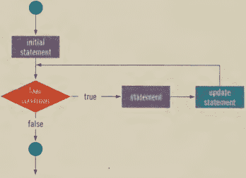

**图 5-2** `for` 循环

`for` 循环的执行方式如下：

- 1. 执行初始语句。
- 2. 计算循环条件。如果循环条件求值为 true：
  - i. 执行 `for` 循环语句。
  - ii. 执行更新语句（括号中的第三个表达式）。
- 3. 重复步骤 2，直到循环条件求值为 false。

初始语句通常初始化一个变量（称为 `for` 循环控制变量或 `for` 索引变量）。

在 C++ 中，`for` 是保留字。

> **注意** 顾名思义，`for` 循环中的初始语句是第一条执行的语句；它只执行一次。

### 例 5-9

下面的 for 循环输出前 10 个非负整数：

```cpp
for (i = 0; i < 10; i++)
    cout << i << " ";
cout << endl;
```

初始语句 i = 0; 将 int 变量 i 初始化为 0。接下来，计算循环条件 i < 10。因为 0 < 10 为 true，所以执行打印语句并输出 0。然后执行更新语句 i++，将 i 的值设置为 1。再次计算循环条件，它仍然为 true，如此继续。当 i 变为 10 时，循环条件求值为 false，for 循环终止，并执行 for 循环之后的语句。

for 循环可以包含简单语句或复合语句。

下面的示例进一步说明 for 循环如何执行。

### 例 5-10

- 1. 下面的 for 循环输出 Hello! 和一个星号（各占一行）五次：

    ```cpp
    for (i = 1; i <= 5; i++)
    {
        cout << "Hello!" << endl;
        cout << "*" << endl;
    }
    ```

- 2. 考虑下面的 for 循环：

    ```cpp
    for (i = 1; i <= 5; i++)
        cout << "Hello!" << endl;
    cout << "*" << endl;
    ```

    该循环输出 Hello! 五次，而星号只输出一次。注意，for 循环只控制第一个输出语句，因为这两个输出语句没有组成复合语句。因此，第一个输出语句执行五次，因为 for 循环体执行五次。for 循环执行后，第二个输出语句只执行一次。编译器会忽略缩进，因此这种缩进会造成误导。


### 示例 5-11

下面的 `for` 循环执行五条空语句：

```cpp
for (i = 0; i < 5; i++);    //Line 1
    cout << "*" << endl;    //Line 2
```

`for` 语句末尾（输出语句之前，第 1 行）的分号会终止 for 循环。这个 for 循环的动作是空的，即 null。

前面的示例表明，要让 `for` 循环执行所需动作需要小心。

以下是关于 `for` 循环的一些说明：

- 如果循环条件最初为假，则循环体不执行。
- 更新表达式执行时会改变循环控制变量（由初始化表达式初始化）的值，最终使循环条件的值为假。如果循环条件始终为真，则 `for` 循环体会无限执行。
- C++ 允许对 double 类型（或任何实数数据类型）的循环控制变量使用小数值。由于不同计算机可能给这些循环控制变量不同结果，应避免使用此类变量。
- `for` 语句末尾（正好在循环体之前）的分号是语义错误。在这种情况下，`for` 循环的动作是空的。
- 在 `for` 语句中，如果省略循环条件，则假定为真。
- 在 `for` 语句中，可以省略全部三条语句——初始化语句、循环条件和更新语句。下面是一个合法的 `for` 循环：

```cpp
for (;;)
    cout << "Hello" << endl;
```

这是一个无限 `for` 循环，会不断打印单词 Hello。

下面是更多 `for` 循环的示例。

### 示例 5-12

如果正确设置 for 循环控制表达式，可以使用 for 循环倒计数。

例如，考虑下面的 for 循环：

```cpp
for (i = 10; i >= 1; i--)
    cout << " " << i;
cout << endl;
```

输出为：

10 9 8 7 6 5 4 3 2 1

在此 for 循环中，变量 i 初始化为 10。每次循环迭代后，i 减 1。只要 i >= 1，循环就继续执行。

### 示例 5-13

可以按任意固定数增加（或减少）循环控制变量。在下面的 for 循环中，变量初始化为 1；在 for 循环末尾，i 增加 2。这个 for 循环输出前 10 个正奇数。

```cpp
for (i = 1; i <= 20; i = i + 2)
    cout << " " << i;
cout << endl;
```

### 示例 5-14

假设 i 是一个 int 变量。

- 1. 考虑下面的 for 循环：

```cpp
for (i = 10; i <= 9; i++)
    cout << i << " ";
cout << endl;
```

在此 for 循环中，初始化语句将 i 设为 10。因为循环条件（i <= 9）最初为假，所以什么也不发生。

- 2. 考虑下面的 for 循环：

```cpp
for (i = 9; i >= 10; i--)
    cout << i << " ";
cout << endl;
```

在此 for 循环中，初始化语句将 i 设为 9。因为循环条件（i >= 10）最初为假，所以什么也不发生。

- 3. 考虑下面的 for 循环：

```cpp
for (i = 10; i <= 10; i++)        //Line 1
    cout << i << " ";             //Line 2
cout << endl;                     //Line 3
```

在此 for 循环中，初始化语句将 i 设为 10。循环条件（i <= 10）求值为真，因此第 2 行中的输出语句执行，输出 10。

接下来，更新语句将 i 的值增加 1，因此 i 的值变为 11。现在循环条件求值为假，for 循环终止。注意第 2 行中的输出语句只执行一次。

- 4. 考虑下面的 for 循环：

```cpp
for (i = 1; i <= 10; i++);   //Line 1
    cout << i << " ";        //Line 2
    cout << endl;              //Line 3
```

这个 for 循环对第 2 行中的输出语句没有影响。for 语句末尾的分号终止了 for 循环；因此 for 循环的动作是空的。输出语句独立存在，只执行一次。

- 5. 考虑下面的 for 循环：

```cpp
for (i = 1; ; i++)
    cout << i << " ";
    cout << endl;
```

在此 for 循环中，因为 for 语句省略了循环条件，所以循环条件始终为真。这是一个无限循环。

### 示例 5-15

在此示例中，for 循环读取五个数字并求它们的和与平均值。考虑下面的程序代码，其中 i、newNum、sum 和 average 是 int 变量。

```cpp
sum = 0;

for (i = 1; i <= 5; i++)
{
    cin >> newNum;
    sum = sum + newNum;
}

average = sum / 5;
cout << "The sum is " << sum << endl;
cout << "The average is " << average << endl;
```

在前面的 for 循环中，读取 newNum 后，将该值加到此前已计算的（部分）和中，该和包含当前数字之前读取的所有数字。变量 sum 在 for 循环之前初始化为 0。因此，程序读取第一个数字并将其加到 sum 的值后，变量 sum 保存第一个数字的正确和。

for 循环的语法如下：

```cpp
for (initial expression; logical expression; update expression)
    statement
```

在功能上等价于下面的 while 语句：

```cpp
initial expression
while (expression)
{
    statement
    update expression
}
```

例如，下面的 for 和 while 循环等价：

```cpp
for (int i = 0; i < 10; i++)
    cout << i << " ";
cout << endl;
```

```cpp
int i = 0;
while (i < 10)
{
    cout << i << " ";
    i++;
}
cout << endl;
```

如果循环的迭代次数已知或可以预先确定，程序员通常使用 for 循环。

### 示例 5-16（斐波那契数程序：再访）

上一节给出的编程示例：斐波那契数使用 while 循环来确定所需的斐波那契数。可以按如下方式用等价的 for 循环替换 while 循环：

```cpp
for (counter = 3; counter <= nthFibonacci; counter++)
{
    current = previous2 + previous1;
    previous1 = previous2;
    previous2 = current;
}//end for
```

使用 for 循环确定所需斐波那契数的程序的完整程序清单见本书配套网站。该程序名为 Ch5_FibonacciNumberUsingAForLoop.cpp。

在下面的 C++ 程序中，我们建议你逐步走查每一步。

### 示例 5-17

下面的 C++ 程序求前 n 个正整数的和。

```cpp
//Program to determine the sum of the first n positive integers.

#include <iostream>

using namespace std;

int main()
{
    int counter;    //loop control variable
    int sum;        //variable to store the sum of numbers
    int n;          //variable to store the number of
                   //first positive integers to be added

    cout << "Line 1: Enter the number of positive "
         << "integers to be added: ";                 //Line 1
    cin >> n;                                          //Line 2
    sum = 0;                                           //Line 3
    cout << endl;                                      //Line 4

    for (counter = 1; counter <= n; counter++)         //Line 5
        sum = sum + counter;                           //Line 6

    cout << "Line 7: The sum of the first " << n
         << " positive integers is " << sum
         << endl;                                      //Line 7

    return 0;
}
```

**示例运行：** 在此示例运行中，用户输入以阴影显示。

Line 1: Enter the number of positive integers to be added: 100

Line 7: The sum of the first 100 positive integers is 5050

第 1 行中的语句提示用户输入要相加的正整数个数。第 2 行中的语句将用户输入的数字存入 n，第 3 行中的语句将 sum 初始化为 0。第 5 行中的 for 循环执行 n 次。在 for 循环中，counter 初始化为 1，并在每次循环迭代后增加 1。因此，counter 的范围从 1 到 n。每次通过循环时，counter 的值被加到 sum。变量 sum 初始化为 0，counter 的范围从 1 到 n，并且 counter 的当前值被加到 sum 的值。因此，for 循环执行后，sum 包含前 n 个值的和，在示例运行中即 100 个正整数。

回想一下，将一个控制结构语句放在另一个控制结构语句内部称为**嵌套**。下面的编程示例演示了一个简单的嵌套实例。它还很好地演示了计数。


### 编程示例：数字分类

该程序读取一组给定的整数，然后输出奇数和偶数的个数，同时输出零的个数。

程序读取20个整数，但你可以轻松修改它以读取任意数量的数字。事实上，你可以修改程序，使其首先提示用户指定要读取多少个整数。

- **输入** 20个整数——正数、负数或零。
- **输出** 零、偶数和奇数的个数。

### 问题分析与算法设计

读取一个数字后，你需要检查它是偶数还是奇数。假设该值存储在`number`中。将`number`除以2并检查余数。如果余数为0，则`number`是偶数。递增偶数计数，然后检查`number`是否为0。如果是，则递增零计数。如果余数不为0，则递增奇数计数。

程序使用switch语句来判断`number`是奇数还是偶数。假设`number`是奇数。若`number`为正数，除以2的余数为1；若为负数，余数为-1。若`number`是偶数，无论正负，除以2的余数都为0。你可以使用取模运算符`%`来求余数。例如：

```text
6 % 2 = 0; -4 % 2 = 0; -7 % 2 = -1; 15 % 2 = 1
```

对列表中的每个数字重复上述分析过程。

这一讨论可转化为以下算法：

- 1. 对列表中的每个数字：
  - a. 获取该数字。
  - b. 分析该数字。
  - c. 递增相应的计数。
- 2. 输出结果。

**变量**

由于需要统计零、偶数和奇数的个数，你需要三个int类型的变量——比如`zeros`、`evens`和`odds`——来跟踪计数。你还需要一个变量——比如`number`——来读取并存储待分析的数字，以及另一个变量——比如`counter`——来计数已分析的数字。因此，程序中需要以下变量：

```cpp
int counter;    //loop control variable
int number;     //variable to store the number read
int zeros;      //variable to store the zero count
int evens;      //variable to store the even count
int odds;       //variable to store the odd count
```

显然，你必须将变量`zeros`、`evens`和`odds`初始化为0。你可以在声明这些变量时进行初始化。

### 主算法

- 1. 初始化变量。
- 2. 提示用户输入20个数字。
- 3. 对列表中的每个数字：
  - a. 读取该数字。
  - b. 输出该数字（回显输入）。
  - c. 如果该数字是偶数：
    ```text
    {
        i. 递增偶数计数。
        ii. 如果该数字为零，递增零计数。
    }
    否则
        递增奇数计数。
    ```
- 4. 输出结果。

在编写C++程序之前，让我们更详细地描述步骤1–4。这样你会更容易用C++编写指令。

- 1. 初始化变量。你可以在声明变量`zeros`、`evens`和`odds`时初始化它们。
- 2. 使用输出语句提示用户输入20个数字。
- 3. 对于步骤3，你可以使用`for`循环来处理和分析这20个数字。用伪代码表示，该步骤可写成：

    ```cpp
    for (counter = 1; counter <= 20; counter++)
    {
        read the number;
        output number;

        switch (number % 2)    // check the remainder
        {
            case 0:
                increment even count;
                if (number == 0)
                    increment zero count;
                break;
            case 1:
            case -1:
                increment odd count;
        } //end switch
    } //end for
    ```

- 4. 输出结果。输出变量`zeros`、`evens`和`odds`的值。

### 完整程序清单

```cpp
//************************************************************
// Author: D.S. Malik
//
// Program: Counts zeros, odds, and evens
// This program counts the number of odd and even numbers.
// The program also counts the number of zeros.
//************************************************************

#include <iostream>
#include <iomanip>

using namespace std;

const int N = 20;

int main()
{
        //Declare variables
        int counter;    //loop control variable
        int number;     //variable to store the new number
        int zeros = 0;                                  //Step 1
        int odds = 0;                                   //Step 1
        int evens = 0;                                  //Step 1

        cout << "Please enter " << N << " integers, "
             << "positive, negative, or zeros."
             << endl;                                   //Step 2

        cout << "The numbers you entered are:" << endl;

        for (counter = 1; counter <= N; counter++)      //Step 3
        {
                cin >> number;                         //Step 3a
                cout << number << " ";                  //Step 3b

                //Step 3c
                switch (number % 2)
                {
                case 0:
                        evens++;
                        if (number == 0)
                                zeros++;
                        break;
                case 1:
                case -1:
                        odds++;
                } //end switch
        } //end for loop

        cout << endl;       //Step 4

        cout << "There are " << evens << " evens, "
             << "which includes " << zeros << " zeros."
             << endl;
        cout << "The number of odd numbers is: " << odds
             << endl;

        return 0;
}
```

**示例运行：** 在此示例运行中，用户输入以阴影显示。

Please enter 20 integers, positive, negative, or zeros.
The numbers you entered are:

0 0 -2 -3 -5 6 7 8 0 3 0 -23 -8 0 2 9 0 12 67 54

There are 8 evens, which includes 6 zeros.
The number of odd numbers is: 7

我们建议你使用上述示例输入对该程序进行走查。

### do...while 循环（重复）结构

本节介绍第三种类型的循环或重复结构，称为 do...while 循环。do...while 语句的一般形式如下：

```text
do
    statement
while (expression);
```

当然，statement 可以是简单语句或复合语句。如果是复合语句，请用花括号将其括起来。图5-3展示了 do...while 循环的执行流程。

在 while 和 for 循环中，循环条件在执行循环体之前被求值。因此，while 和 for 循环被称为**前测循环**。另一方面，do...while 循环的循环条件在执行循环体之后被求值。因此，do...while 循环被称为**后测循环**。

由于 while 和 for 循环都有入口条件，这些循环可能永远不会激活。而 do...while 循环具有出口条件，因此其语句至少执行一次。

### 示例5-19

考虑以下两个循环：

```cpp
a.  i = 11;
    while (i <= 10)
    {
        cout << i << " ";
        i = i + 5;
    }
    cout << endl;

b.  i = 11;
    do
    {
        cout << i << " ";
        i = i + 5;
    }
    while (i <= 10);

    cout << endl;
```

在 (a) 中，while 循环不产生任何输出。在 (b) 中，do...while 循环输出数字11，并将 i 的值改为16。

do...while 循环可用于输入验证。假设某程序提示用户输入一个测试分数，该分数必须大于等于0且小于等于50。如果用户输入的分数小于0或大于50，则应提示用户重新输入分数。以下 do...while 循环可实现此目标：

```cpp
int score;

do
{
    cout << "Enter a score between 0 and 50: ";
    cin >> score;
    cout << endl;
}
while (score < 0 || score > 50);
```

### 示例 5-20

### 被3和9整除的测试

假设 m 和 n 是整数，且 m 非零。那么，如果存在某个整数 r 使得 n = mr，则称 m 是 n 的**除数**；也就是说，当 m 整除 n 时，余数为0。

设 n = dₖdₖ₋₁...d₁d₀ 是一个整数。令 s = dₖ + dₖ₋₁ + dₖ₋₂ + ... + d₁ + d₀ 为 n 的各数字之和。已知 n 能被3整除当且仅当 s 能被3整除；n 能被9整除当且仅当 s 能被9整除。换句话说，一个整数能被3和9整除，当且仅当其数字之和能被3和9整除。

例如，假设 n = 27193257。那么 s = 2 + 7 + 1 + 9 + 3 + 2 + 5 + 7 = 36。由于36既能被3整除也能被9整除，因此27193257既能被3整除也能被9整除。

接下来，我们编写一个程序，通过先求一个正整数的数字之和，再检查该和是否能被3和9整除，来判断该正整数是否能被3和9整除。

为了求一个正整数的数字之和，我们需要提取该数的每一位数字。考虑数字951372。注意 951372 % 10 = 2，这是951372的最后一位数字。还要注意 951372 / 10 = 95137；也就是说，当该数除以10时，会移除最后一位数字。接下来，我们对95137重复这一过程。当然，我们需要将提取的数字相加。

假设 sum 和 num 是 int 变量，且正整数存储在 num 中。于是我们有以下求数字之和的算法：

```cpp
sum = 0;

do
{
    sum = sum + num % 10;  //extract the last digit
                           //and add it to sum
    num = num / 10;        //remove the last digit
}
while (num > 0);
```

使用该算法，我们可以编写以下程序，该程序使用 do...while 循环实现上述整除性测试算法。

```cpp
//Program: Divisibility test by 3 and 9

#include <iostream>

using namespace std;

int main()
{
    int num, temp, sum;

    cout << "Enter a positive integer: ";
    cin >> num;
```


### 选择合适的循环结构

这三种循环在 C++ 中各有其适用场景。如果你知道，或者程序能够预先确定所需的重复次数，那么 for 循环就是正确的选择。如果你不知道，且程序无法预先确定所需的重复次数，并且次数可能为 0，那么 while 循环就是正确的选择。如果你不知道，且程序无法预先确定所需的重复次数，并且次数至少为 1，那么 do...while 循环就是正确的选择。

### break 和 continue 语句

break 语句在 switch 结构中执行时，会立即退出该 switch 结构。同样，你也可以在 while、for 和 do...while 循环中使用 break 语句。当 break 语句在重复结构中执行时，它会立即退出该结构。break 语句通常用于两个目的：

- 提前退出循环。
- 跳过 switch 结构的剩余部分。

break 语句执行后，程序继续执行该结构之后的第一个语句。在循环中使用 break 语句可以省去某些标志变量的使用。下面的 C++ 代码段有助于说明这一思路。（假设所有变量都已正确声明。）

```cpp
    sum = 0;
    isNegative = false;

    cin >> num;

    while (cin && !isNegative)
    {
        if (num < 0)    //if num is negative, terminate the loop
                        //after this iteration
        {
            cout << "Negative number found in the data." << endl;
            isNegative = true;
        }
        else
        {
            sum = sum + num;
            cin >> num;
        }
    }
```

这个 while 循环旨在求一组正数之和。如果数据集中包含负数，循环会终止，并给出相应的错误消息。这个 while 循环使用标志变量 isNegative 来实现预期结果。变量 isNegative 在 while 循环之前初始化为 false。在将 num 加到 sum 之前，检查 num 是否为负数。如果 num 为负数，屏幕上会出现错误消息，并将 isNegative 设为 true。在下一次迭代中，当 while 语句中的表达式求值时，结果为 false，因为 !isNegative 为 false。（注意，由于 isNegative 为 true，所以 !isNegative 为 false。）

下面的 while 循环没有使用变量 isNegative：

```cpp
sum = 0;
cin >> num;

while (cin)
{
    if (num < 0)    //if num is negative, terminate the loop
    {
        cout << "Negative number found in the data." << endl;
        break;
    }

    sum = sum + num;
    cin >> num;
}
```

在这种形式的 while 循环中，当发现负数时，if 语句中的表达式求值为 true；打印相应消息后，break 语句会终止循环。（在循环中执行 break 语句后，循环中剩余的语句会被丢弃。）

> **注意** break 语句是避免使用额外变量控制循环并生成优雅代码的有效方法。但是，在循环中必须非常节制地使用 break 语句。在循环中过度使用这些语句会产生面条式代码（spaghetti-code，即包含许多退出条件的循环），这类代码可能非常难以理解和管理。使用 break 语句时应格外小心，并确保使用 break 语句能使代码更具可读性，而不是降低可读性。如果不确定，就不要使用 break 语句。

continue 语句用于 while、for 和 do...while 结构中。当 continue 语句在循环中执行时，它会跳过循环中剩余的语句，并继续执行循环的下一次迭代。在 while 和 do...while 结构中，表达式（即循环继续测试）会在 continue 语句之后立即求值。在 for 结构中，更新语句会在 continue 语句之后执行，然后执行循环条件（即循环继续测试）。

如果前面的程序段遇到负数，while 循环会终止。如果你想丢弃该负数并读取下一个数，而不是终止循环，请将 break 语句替换为 continue 语句，如下例所示：

```cpp
sum = 0;
cin >> num;

while (cin)
{
    if (num < 0)
    {
        cout << "Negative number found in the data." << endl;
        cin >> num;
        continue;
    }

    sum = sum + num;
    cin >> num;
}
```

前面已经说过，这三种循环在 C++ 中各有其适用场景，而且一种循环常常可以替代另一种循环。然而，continue 语句的执行方式正是 while 和 do...while 结构与 for 结构的不同之处。当 continue 语句在 while 或 do...while 循环中执行时，更新语句可能不会执行。在 for 结构中，更新语句总是会执行。

### 嵌套控制结构

本节给出一些示例，说明如何使用嵌套循环来获得有用的结果并处理数据。

### 示例 5-21

假设你想创建以下图案：

```
*
**
***
****
*****
```

显然，你想打印五行星号。第一行打印一个星号，第二行打印两个星号，依此类推。因为将打印五行，所以从下面的 for 语句开始：

```cpp
for (i = 1; i <= 5; i++)
```

第一次迭代时 i 的值为 1，第二次迭代时为 2，依此类推。你可以将 i 的值作为嵌套在此循环内的另一个 for 循环的限制条件，以控制一行中的星号数量。再稍加思考，就会得到以下代码：

```cpp
for (i = 1; i <= 5; i++)        //Line 1
{                               //Line 2
    for (j = 1; j <= i; j++)    //Line 3
        cout << "*";            //Line 4
    cout << endl;                //Line 5
}                               //Line 6
```

### 示例 5-23

考虑以下数据：

```
65 78 65 89 25 98 -999
87 34 89 99 26 78 64 34 -999
23 99 98 97 26 78 100 63 87 23 -999
62 35 78 99 12 93 19 -999
```

每行末尾的数字 -999 充当哨兵，因此不属于数据的一部分。我们的目标是求每一行中数字之和并输出该和。此外，假设这些数据要从文件中读取，比如 Exp_5_23.txt。我们假设输入文件已使用输入文件流变量 infile 打开。

这个特定的数据集有四行输入。因此，我们可以使用 for 循环或计数器控制的 while 循环来处理每一行数据。让我们使用 while 循环来处理这四行。由此，while 循环采用以下形式：

```cpp
counter = 0;                  //Line 1
while (counter < 4)           //Line 2
{                              //Line 3
    //process the line        //Line 4

    //output the sum
    counter++;
}
```

现在让我们集中处理一行。每一行的数据项数量各不相同。例如，第一行有六个数，第二行有八个数，依此类推。因为每一行都以 -999 结尾，所以我们可以使用哨兵控制的 while 循环来求每一行中数字之和。（还记得哨兵控制的循环是如何工作的吗？）考虑以下 while 循环：

```cpp
sum = 0;                      //Line 4
infile >> num;                //Line 5
while (num != -999)           //Line 6
{                             //Line 7

    sum = sum + num;          //Line 8
    infile >> num;            //Line 9
}                             //Line 10
```

第 4 行的语句将 sum 初始化为 0，第 5 行的语句读取输入行的第一个数并将其存储到 num 中。第 6 行中的布尔表达式 num != -999 检查该数是否为 -999。如果 num 不是 -999，则执行第 8 行和第 9 行的语句。第 8 行的语句更新 sum 的值；第 9 行的语句读取下一个数并将其存储到 num 中。只要 num 不是 -999，循环就会继续执行。

由此可知，用于处理数据的嵌套循环如下。（假设所有变量都已正确声明。）


### 示例 5-24

假设我们想要处理与示例 5-23 中类似的数据，但输入文件的长度未指定。也就是说，每一行包含的数据与示例 5-23 中每一行的数据相同，但我们不知道输入的行数。

由于我们不知道输入的行数，因此必须使用由 EOF 控制的 while 循环来处理数据。在这种情况下，所需代码如下。（假设所有变量都已正确声明，并且已使用输入文件流变量 infile 打开输入文件。）

```cpp
counter = 0;                         //Line 1
while (counter < 4)                   //Line 2
{
    sum = 0;                           //Line 4
    infile >> num;                     //Line 5
    while (num != -999)                //Line 6
    {
        sum = sum + num;               //Line 8
        infile >> num;                 //Line 9
    }                                  //Line 10

    cout << "Line " << counter + 1
         << ": Sum = " << sum << endl; //Line 11
    counter++;                         //Line 12
}                                      //Line 13
```

请注意，我们再次使用了变量 counter。这样做的唯一原因是我们希望打印行号以及每一行的和。

### 示例 5-25

考虑以下数据：

```
101
John Smith
65 78 65 89 25 98 -999
102
Peter Gupta
87 34 89 99 26 78 64 34 -999
103
Buddy Friend
283 99 98 97 26 78 100 63 87 23 -999
104
Doctor Miller
62 35 78 99 12 93 19 -999
...
```

一行末尾的数字 -999 充当哨兵，因此不属于数据的一部分。

假设这是某些竞选学生会主席职位的候选人的数据。

对于每位候选人，数据采用以下形式：

- ID
- 姓名
- 票数

目标是求出该候选人获得的总票数。我们假设数据从大小未知的文件 Exp_5_25.txt 输入。我们还假设已使用输入文件流变量 infile 打开输入文件。

由于输入文件的长度未指定，我们使用由 EOF 控制的 while 循环。对于每位候选人，第一个数据项是 int 类型的 ID，并且单独占一行；第二个数据项是姓名，可能包含多个单词；第三行包含从各部门获得的票数。

为了读取 ID，我们使用提取运算符 >>；为了读取姓名，我们使用流函数 getline。请注意，读取 ID 后，读取标记位于 ID 之后，而 ID 之后的字符是换行符。因此，读取 ID 后，读取标记位于 ID 之后、换行符之前（即包含 ID 的那一行的换行符之前）。

函数 getline 会一直读取到行尾。因此，如果我们在读取 ID 后立即读取姓名，那么变量 name 中存储的会是（ID 之后的）换行符。由此可知，要读取姓名，我们必须读取并丢弃 ID 之后的换行符，这可以通过流函数 get 完成。因此，读取 ID 和姓名的语句如下：

```cpp
infile >> ID;          //read the ID
infile.get(ch);        //read the newline character after the ID
getline(infile, name); //read the name
```

（假设 `ch` 是 `char` 类型的变量。）处理数据的一般循环如下：

```cpp
infile >> ID;                         //Line 1
while (infile)                        //Line 2
{
    infile.get(ch);                   //Line 4
    getline(infile, name);             //Line 5

    //process the numbers in each line  //Line 6
    //output the name and total votes
    infile >> ID;     //begin processing the next line
}
```

读取并汇总投票数据的代码如下：

```cpp
sum = 0;                            //Line 6
infile >> num;                       //Line 7; read the first number
while (num != -999)                  //Line 8
{
    sum = sum + num;                 //Line 10; update sum
    infile >> num;                   //Line 11; read the next number
}                                    //Line 12
```

现在，我们可以编写以下嵌套循环来处理数据，如下所示：

```cpp
infile >> ID;                         //Line 1
while (infile)                        //Line 2
{
    infile.get(ch);                   //Line 4
    getline(infile, name);             //Line 5
    sum = 0;                           //Line 6
    infile >> num;                     //Line 7; read the first number
    while (num != -999)                //Line 8
    {
        sum = sum + num;               //Line 10; update sum
        infile >> num;                 //Line 11; read the next number
    }

    cout << "Name: " << name
         << ", Votes: " << sum
         << endl;                       //Line 12

    infile >> ID;       //Line 13; begin processing the next line
}
```

### 通过避免补丁来避免错误

前几章中的调试部分说明了如何调试语法错误和逻辑错误，以及如何避免一知半解的概念。在本节中，我们说明如何避免用软件补丁来修复代码。软件补丁是写在现有代码之上的一段代码，旨在修复原始代码中的错误。

假设文件 Ch5_LoopWithBugsData.txt 中包含以下数据。

```
87 78 83 94
23 89 92 70
92 78 34 56
```

目标是求出每一行中数字的和。对于每一行，输出这些数字及其和。让我们考虑以下程序：

```cpp
#include <iostream>
#include <fstream>

using namespace std;

int main()
{
    ifstream infile;

    int i;
    int j;
    int sum;
    int num;

    infile.open("Ch5_LoopWithBugsData.txt");

    for (i = 1; i <= 4; i++)
    {
        sum = 0;

        for (j = 1; j <= 4; j++)
        {
            infile >> num;
            cout << num << " ";
            sum = sum + num;
        }

        cout << "sum = " << sum << endl;
    }

    return 0;
}
```

### 示例运行：

```
87 78 83 94 sum = 342
23 89 92 70 sum = 274
92 78 34 56 sum = 260
56 56 56 56 sum = 224
```

示例运行表明程序中存在一个错误，因为文件包含三行输入，而输出却包含四行。此外，最后一行的数字 56 重复了四次。显然，程序中存在错误，我们必须修复代码。有些程序员，尤其是一些初学者，会通过添加软件补丁来处理问题的表象。在这种情况下，输出应当只包含三行输出。

初学者程序员可能会通过添加软件补丁来修复代码，如下面的修改后程序所示：

```cpp
#include <iostream>
#include <fstream>

using namespace std;

int main()
{
    ifstream infile;

    int i;
    int j;
    int sum;
    int num;

    infile.open("Ch5_LoopWithBugsData.txt");

    for (i = 1; i <= 4; i++)
    {
        sum = 0;

        if (i != 4)
        {
            for (j = 1; j <= 4; j++)
            {
                infile >> num;
                cout << num << " ";
                sum = sum + num;
            }

            cout << "sum = " << sum << endl;
        }
    }
    return 0;
}
```

### 示例运行：

```
87 78 83 94 sum = 342
23 89 92 70 sum = 274
92 78 34 56 sum = 260
```

显然，程序现在可以正确运行了。

正如我们所看到的，程序员只是观察到了表象，并通过添加软件补丁来处理问题。然而，如果你看看代码，不仅程序执行了多余的语句，而且它还是一个有缺陷的结构化概念的示例。看起来程序员并没有很好地理解为什么先前的程序产生四行而不是三行。添加补丁消除了表象，但这是一种糟糕的编程实践。程序员必须弄清楚为什么程序产生了四行。看看

仔细观察程序，我们可以看到之所以产生四行输出，是因为外层循环执行了四次。赋给循环控制变量 i 的值是 1、2、3 和 4。这是经典的“差一错误”（off-by-one）问题的一个例子。（在“差一错误”中，循环要么多执行一次，要么少执行一次。）我们可以通过正确设置循环控制变量的值来消除这个问题。例如，我们可以按如下方式重写循环：

```cpp
for (i = 1; i <= 3; i++)
{
    sum = 0;

    for (j = 1; j <= 4; j++)
    {
        infile >> num;
        cout << num << " ";
        sum = sum + num;
    }

    cout << "sum = " << sum << endl;
}
```

这段代码在不使用软件补丁的情况下修复了原来的问题。它也体现了良好的编程实践。完整的修改后程序可在本书配套网站上获得，文件名为 Ch5_LoopWithBugsCorrectedProgram.cpp。

### 调试循环

正如我们在前面的调试章节中所看到的，无论程序设计和编码得多么仔细，错误仍然很可能出现。如果有语法错误，编译器会识别它们。然而，如果有逻辑错误，我们必须仔细检查代码，甚至可能检查设计，并努力找出错误。为了提高程序的可靠性，必须在程序发布给用户之前发现并修复错误。

一旦算法编写完成，下一步就是验证它能否正确工作。如果算法是简单的顺序流程或包含分支，可以手工跟踪，也可以使用 IDE 提供的调试器（如果有的话）。通常，循环更难调试。循环的正确性可以通过循环不变式来验证。循环不变式是一组语句，在每次执行循环体时都保持为真。设 p 为循环不变式，q 为循环语句中的（逻辑）表达式。那么，在循环的每次迭代之前 p && q 保持为真，而在循环终止之后 p && not(q) 为真。对循环不变式的完整讨论超出了本书的范围。不过，你可以在以下书中学习循环不变式：*离散数学：理论及应用*（修订版），D.S. Malik 和 M.K. Sen，Cengage Learning Asia，新加坡，2010。这里，我们给出一些可用于调试循环的提示。

正如上一节所讨论的，与循环相关的最常见错误是差一错误。如果一个循环变成了无限循环，错误很可能出在控制循环执行的逻辑表达式中。仔细检查逻辑表达式，看看是否把不等号写反了、是否在相等运算符的位置出现了赋值语句符号，或者是否在应使用 || 的地方出现了 &&。如果循环会改变变量的值，你可以在每次迭代之前和/或之后打印变量的值，也可以使用 IDE 的调试器（如果有的话），并在每次迭代期间观察变量的值。

本书中的调试章节旨在帮助你理解调试过程。然而，你将会意识到，调试可能是一个令人疲惫的过程。如果你的程序非常糟糕，不要调试它。把它扔掉，重新开始。

### 快速回顾

- 1. C++ 有三种循环（重复）结构：`while`、`for` 和 `do...while`。
- 2. `while` 语句的语法是：

    ```cpp
    while (expression)
        statement
    ```

- 3. 在 C++ 中，`while` 是保留字。
- 4. 在 `while` 语句中，表达式（决策者）两边的圆括号很重要；它们标记表达式的开始和结束。
- 5. 该语句称为循环体。
- 6. `while` 循环的循环体必须包含最终将表达式设置为 `false` 的语句。
- 7. 计数器控制的 `while` 循环使用计数器来控制循环。
- 8. 在计数器控制的 `while` 循环中，必须在循环之前初始化计数器，并且循环体必须包含改变计数器变量值的语句。
- 9. 哨兵是一个特殊值，用于标记输入数据的结束。哨兵必须与所有数据项相似，但又不同于它们。
- 10. 哨兵控制的 `while` 循环使用哨兵来控制 `while` 循环。`while` 循环会持续执行，直到读取到哨兵为止。
- 11. EOF 控制的 `while` 循环会持续执行，直到程序检测到文件结束标记。
- 12. 在 Windows 控制台环境中，使用 Ctrl+Z（按住 Ctrl 键并按 z）输入文件结束标记。在 UNIX 环境中，使用 Ctrl+D（按住 Ctrl 键并按 d）输入文件结束标记。
- 13. `for` 循环简化了计数器控制的 `while` 循环的编写。
- 14. 在 C++ 中，`for` 是保留字。
- 15. `for` 循环的语法是：

    ```cpp
    for (initialize statement; loop condition; update statement)
        statement
    ```

    该语句称为 `for` 循环的循环体。
- 16. 在 `for` 循环末尾（`for` 循环体之前）放置分号是语义错误。在这种情况下，`for` 循环的动作是空的。
- 17. `do...while` 语句的语法是：

    ```cpp
    do
        statement;
    while (expression);
    ```

    该语句称为 `do...while` 循环的循环体。
- 18. `while` 和 `for` 循环都称为预测试循环。`do...while` 循环称为后测试循环。
- 19. `while` 和 `for` 循环可能完全不执行，但 `do...while` 循环总是至少执行一次。
- 20. 在循环体中执行 `break` 语句会立即终止循环。
- 21. 在循环体中执行 `continue` 语句会跳过循环的剩余语句，并继续下一次迭代。
- 22. 当在 `while` 或 `do...while` 循环中执行 `continue` 语句时，循环体中的表达式更新语句可能不会执行。
- 23. 在 `for` 循环中执行 `continue` 语句后，下一条执行的语句是更新语句。

### 练习

- 1. 将下列陈述标记为真或假。

  - a. 在计数器控制的 `while` 循环中，不需要初始化循环控制变量。
  - b. `while` 循环的循环体可能完全不执行。
  - c. 在无限 `while` 循环中，`while` 表达式（决策者）最初为假，但在第一次迭代之后它始终为真。
  - d. `while` 循环：

        ```cpp
        j = 0;
        while (j <= 10)
            j++;
        ```

        如果 `j > 10`，则终止。
  - e. 哨兵控制的 `while` 循环是一种事件控制的 `while` 循环，其终止取决于一个特殊值。
  - f. 循环是一种控制结构，它使某些语句反复执行。
  - g. 要从长度未指定的文件中读取数据，EOF 控制的循环是一个不错的选择。

- 7. 假设输入为 25 36 18 16 −1。以下代码的输出是什么？

    ```cpp
    int num;
    int sum;
    cin >> sum;
    num = sum;

    while (num != -1)
    {
        cin >> num;
        sum = sum + num;
    }
    cout << "Sum = " << sum << endl;
    ```

- 8. 假设输入为 25 36 18 16 −1。以下代码的输出是什么？

    ```cpp
    int num;
    int sum;

    cin >> num;
    sum = num;

    while (num != -1)
    {
        sum = sum + num;
        cin >> num;
    }
    cout << "Sum = " << sum << endl;
    ```

- 9. 假设输入为 10 −6 12 −5 −4 0。以下代码的输出是什么？

    ```cpp
    int num;
    int sum = 0;

    cin >> num;

    while (num != 0)
    {
        if (num > 0)
            sum = sum + num;
        else
            sum = sum - num;
        cin >> num;
    }
    cout << "Sum = " << sum << endl;
    ```

- 10. 改正以下代码，使其读取并求出 20 个数的和：

    ```cpp
    int count = 0;
    int sum = 0;

    cin >> num;
    while (count <= 20);
    ```


```cpp
while (num != -999)
{
    cout << num % 25 << " ";
    cin >> num;
}

cout << endl;

return 0;
}
```

13. 以下程序旨在输入两个数并输出它们的和。它会询问用户是否想运行该程序。如果回答是 Y 或 y，则提示用户输入两个数。将数字相加并显示结果后，它会再次询问用户是否想继续添加更多数字。然而，该程序未能做到这一点。请改正程序，使其正常工作。

```cpp
#include <iostream>
#include <iomanip>

using namespace std;

int main()
{
    char response;
    double num1;
    double num2;

    cout << "This program adds two numbers." << endl;
    cout << "Would you like to run the program: (Y/y) ";
    cin >> response;
    cout << endl;

    cout << fixed << showpoint << setprecision(2);

    while (response == 'Y' && response == 'y')
    {
        cout << "Enter two numbers: ";
        cin >> num1 >> num2;
        cout << endl;

        cout << num1 << " + " << num2 << " = " << (num1 - num2)
             << endl;

        cout << "Would you like to add again: (Y/y) ";
        cin >> response;
        cout << endl;
    }

    return 0;
}
```

14. 以下程序段的输出是什么？

```cpp
int count = 0;

while (count++ < 10)
    cout << "This loop can repeat statements." << endl;
```

15. 以下程序段的输出是什么？

```cpp
int count = 5;

while (--count > 0)
    cout << count << " ";
cout << endl;
```

16. 以下程序段的输出是什么？

```cpp
int count = 5;

while (count-- > 0)
    cout << count << " ";
cout << endl;
```

17. 以下程序段的输出是什么？

```cpp
int count = 1;
while (count++ <= 5)
    cout << count * (count - 2) << " ";

cout << endl;
```

18. 在以下每种情况下，你将使用哪种类型的循环，例如计数器控制和哨兵控制？

- a. 对以下级数求和：1 + (2 / 1) + (3 / 2) + (4 / 3) + (5 / 4) + ... + (10 / 9)

- b. 对以下数字求和，最后一个数字除外：17, 32, 62, 48, 58, −1

- c. 一个文件包含一名员工的工资。更新该员工的工资。

19. 考虑以下 for 循环：

```cpp
int j, s;

s = 0;
for (j = 1; j <= 10; j++)
    s = s + j * (j - 1);
```

在这个 for 循环中，指出循环控制变量、初始化语句、循环条件、更新语句以及更新 s 值的语句。

20. 以下程序段的输出是什么？

```cpp
int num = 1;
int i;

for (i = 0; i < 5; i++)
{
    num = num * (5 - i);
    cout << num << " ";
}
cout << endl;
```

21. 以下程序段的输出是什么？

```cpp
int num = 0;
int count;
int y = 0;

for (count = 1; count <= 5; ++count)
{
    num = 3 * (count - 1) + (y - count);
    cout << num << " ";
}
cout << count << " " << endl;
```

22. 假设以下代码已正确插入程序中：

```cpp
int s = 0;
int i;

for (i = 0; i < 5; i++)
{
    s = 2 * s + i;
    cout << s << " ";
}
cout << endl;
```

- a. s 的最终值是什么？
  (i) 11          (ii) 4          (iii) 26          (iv) 以上都不是

- b. 如果在 for 循环语句的右括号后插入一个分号，s 的最终值是什么？
  (i) 0          (ii) 1          (iii) 2          (iv) 5          (v) 以上都不是

- c. 如果在 for 循环控制表达式中将 5 替换为 0，s 的最终值是什么？
  (i) 0          (ii) 1          (iii) 2          (iv) 以上都不是

23. 指出以下每条语句产生的输出（如果有）：

- a.
  ```cpp
  for (i = 1; i <= 1; i++)
      cout << "*";
  cout << endl;
  ```

- b.
  ```cpp
  for (i = 2; i >= 1; i++)
      cout << "*";
  cout << endl;
  ```

- c.
  ```cpp
  for (i = 1; i <= 1; i--)
      cout << "*";
  cout << endl;
  ```

- d.
  ```cpp
  for (i = 12; i >= 9; i--)
      cout << "*";
  cout << endl;
  ```

- e.
  ```cpp
  for (i = 0; i <= 5; i++)
      cout << "*";
  cout << endl;
  ```

- f.
  ```cpp
  for (i = 1; i <= 5; i++)
  {
      cout << "*";
      i = i + 1;
  }
  cout << endl;
  ```

24. 编写一个 for 语句，将 1 到 100 之间所有 3 的倍数相加。

25. 以下代码的输出是什么？变量 x 和 y 之间是否存在关系？如果存在，请说明该关系。输出是什么？

```cpp
int x = 19683;
int i;
int y = 0;

for (i = x; i >= 1; i = i / 3)
    y++;
cout << "x = " << x << ", y = " << y << endl;
```

26. 假设输入为 5 3 8。以下代码的输出是什么？假设所有变量都已正确声明。

```cpp
cin >> a >> b >> c;
for (j = 1; j < a; j++)
{
    d = b + c;
    b = c;
    c = d;
    cout << c << " ";
}
cout << endl;
```

27. 以下 C++ 程序段的输出是什么？假设所有变量都已正确声明。

```cpp
for (j = 0; j < 8; j++)
{
    cout << j * 25 << " - ";

    if (j != 7)
        cout << (j + 1) * 25 - 1 << endl;
    else
        cout << (j + 1) * 25 << endl;
}
```

28. 假设输入为 3 5 7 -6 10。以下代码的输出是什么？

```cpp
int temp = 0;
int num;
int count;
```

- a.
  ```cpp
  x = 5;  y = 50;
  do
      x = x + 10;
  while (x < y);
  cout << x << " " << y << endl;
  ```

- b.
  ```cpp
  x = 5;  y = 80;
  do
      x = x * 2;
  while (x < y);
  cout << x << " " << y << endl;
  ```

- c.
  ```cpp
  x = 5;  y = 20;
  do
      x = x + 2;
  while (x >= y);
  cout << x << " " << y << endl;
  ```

- d.
  ```cpp
  x = 5;  y = 35;
  while (x < y)
      x = x + 10;
  cout << x << " " << y << endl;
  ```

- e.
  ```cpp
  x = 5;  y = 30;
  while (x <= y)
      x = x * 2;
  cout << x << " " << y << endl;
  ```

- f.
  ```cpp
  x = 5;  y = 30;
  while (x > y)
      x = x + 2;
  cout << x << " " << y << endl;
  ```

33. 编写一个输入语句验证循环，提示用户输入一个小于 20 或大于 75 的数。

34. 将以下代码改写为 for 循环：

```cpp
int i = 0, value = 0;

while (i <= 20)
{
    if (i % 2 == 0 && i <= 10)
        value = value + i * i;
    else if (i % 2 == 0 && i > 10)
        value = value + i;
    else
        value = value - i;
    i = i + 1;
}

cout << "value = " << value << endl;
```

这个循环的输出是什么？

35. 将练习 34 中的 while 循环改写为 do...while 循环。

36. 以下程序中的 do...while 循环本应读取一些数字，直到到达哨兵值（在本例中为 -1）。它本应将除哨兵值以外的所有数字相加。如果数据如下所示：

12    5    30    48    -1

该程序未能正确地将这些数字相加。请改正程序，使其能正确相加。

```cpp
#include <iostream>

using namespace std;
int main()
{
    int total = 0,
        count = 0,
        number;
    do
    {
        cin >> number;
        total = total + number;
        count++;
    }
    while (number != -1);

    cout << "The number of data read is " << count << endl;
    cout << "The sum of the numbers entered is " << total
         << endl;

    return 0;
}
```

37. 使用与练习 36 相同的数据，以下循环同样失败。请改正它。

```cpp
cin >> number;
while (number != -1)
    total = total + number;
    cin >> number;
cout << endl;
cout << total << endl;
```

38. 使用与练习 36 相同的数据，以下循环同样失败。请改正它。

```cpp
cin >> number;
while (number != -1)
{
    cin >> number;
    total = total + number;
}
cout << endl;
cout << total << endl;
```

39. 给定以下程序段：

```cpp
for (number = 1; number <= 10; number++)
    cout << setw(3) << number;
```

编写一个 while 循环和一个 do...while 循环，使其具有相同的输出。


- 40. 给定以下程序段：

```cpp
int limit = 4;
int first = 5;
int j;

for (j = 1; j <= limit; j++)
{
    cout << first * j << endl;
    first = first * (j - 1);
}
cout << endl;
```

  编写一个 while 循环和一个 do...while 循环，使其输出相同。

- 41. 考虑以下程序：

```cpp
#include <iostream>

using namespace std;

int main()
{
    int num1, num2;
    int temp = 0;

    cout << "Enter two integers: ";
    cin >> num1 >> num2;
    cout << endl;

    do
    {
        temp = num1 + num2;
        num1 = num2;
        num2 = temp;
        cout << temp << " ";
    }
    while (((num1 + num2) % 5) != 0);

    cout << endl;

    return 0;
}
```

  - a. 如果输入为 13 16，输出是什么？
  - b. 如果输入为 −4 6，输出是什么？
  - c. 如果输入为 3 5，输出是什么？
  - d. 如果输入为 13 15，输出是什么？

- 42. 为了了解嵌套 for 循环如何工作，请逐步分析以下程序段，并在每种情况下确定确切输出。

  - a.
    ```cpp
    int i, j;

    for (i = 1; i <= 5; i++)
    {
        for (j = 1; j <= 5; j++)
            cout << setw(3) << i;
        cout << endl;
    }
    ```
  - b.
    ```cpp
    int i, j;
    for (i = 1; i <= 5; i++)
    {
        for (j = (i + 1); j <= 5; j++)
            cout << setw(5) << j;
        cout << endl;
    }
    ```
  - c.
    ```cpp
    int i, j;
    for (i = 1; i <= 5; i++)
    {
        for (j = 1; j <= i; j++)
            cout << setw(3) << j;
        cout << endl;
    }
    ```
  - d.
    ```cpp
    const int M = 10;
    const int N = 10;
    int i, j;

    for (i = 1; i <= M; i++)
    {
        for (j = 1; j <= N; j++)
            cout << setw(3) << M * (i - 1) + j;
        cout << endl;
    }
    ```
  - e.
    ```cpp
    int i, j;

    for (i = 1; i <= 9; i++)
    {
        for (j = 1; j <= (9 - i); j++)
            cout << " ";
        for (j = 1; j <= i; j++)
            cout << setw(1) << j;
        for (j = (i - 1); j >= 1; j--)
            cout << setw(1) << j;
        cout << endl;
    }
    ```

- 43. 以下程序段的输出是什么？

```cpp
int count = 1;
do
    cout << count * (count - 2) << " ";
while (count++ <= 5);

cout << endl;
```

- 44. 以下代码的输出是什么？

```cpp
int num = 12;

while (num >= 0)
{
    if (num % 5 == 0)
        break;

    cout << num << " ";
    num = num - 2;
}

cout << endl;
```

- 45. 以下代码的输出是什么？

```cpp
int num = 12;

while (num >= 0)
{
    if (num % 5 == 0)
    {
        num++;
        continue;
    }

    cout << num << " ";
    num = num - 2;
}
cout << endl;
```

- 46. 循环中的 break 语句有什么作用？

### 编程练习

- 1. 编写一个程序，提示用户输入一个整数，然后输出该数的各个单独数字以及这些数字之和。例如，对于 3456，应输出各个单独数字为 3 4 5 6；对于 8030，输出为 8 0 3 0；对于 2345526，输出为 2 3 4 5 5 2 6；对于 4000，输出为 4 0 0 0；对于 −2345，输出为 2 3 4 5。
- 2. π 的值可以通过以下级数近似：

  π = 4(1 − 1/3 + 1/5 − 1/7 + 1/9 + ⋯ + 1/(2n − 1) + 1/(2n + 1))。

  以下程序使用该级数求 π 的近似值。然而，语句顺序不正确，并且程序中还有一个 bug。重新排列语句，并找出并移除该 bug，使该程序可用于近似计算 π。

  ```cpp
  #include <iostream>
  #include <iomanip>

  using namespace std;

  int main()
  {
      double pi = 0;
      long i;
      long n;

      cin >> n;
      cout << "Enter the value of n: ";
      cout << endl;

      if (i % 2 == 0)
          pi = pi + (1 / (2 * i + 1));
      else
          pi = pi - (1 / (2 * i + 1));

      for (i = 0; i < n; i++)
      {
          pi = 0;
          pi = 4 * pi;
      }

      cout << endl << "pi = " << pi << endl;

      return 0;
  }
  ```

- 3. 重写例 5-5 中的 Telephone Digits 程序。替换第 10 行到第 28 行的语句，使程序仅使用 switch 结构来查找与大写字母对应的数字。
- 4. Telephone Digits 程序只输出与大写字母对应的电话号码数字。重写该程序，使其同时处理大写和小写字母，并输出对应的电话号码数字。如果输入不是大写或小写字母，程序必须输出适当的错误消息。
- 5. 为了使电话号码更容易记住，一些公司使用字母来表示其电话号码。例如，使用字母时，电话号码 438-5626 可显示为 GET LOAN。在某些情况下，为了使电话号码有意义，公司可能使用超过七个字母。例如，225-5466 可显示为 CALL HOME，其中使用了八个字母。编写一个程序，提示用户输入电话号码。如果用户输入的字母超过七个，则只处理前七个字母。还要在第三个数字后输出 -（连字符）。允许用户使用大写和小写字母以及单词之间的空格。此外，程序应按用户需要处理尽可能多的电话号码。
- 6. 编写一个程序，读取一组整数，然后求并打印偶数和奇数的和。
- 7. 编写一个程序，提示用户输入一个正整数。然后输出一条消息，表明该数是否为素数。*（注：偶数若为 2 则是素数。奇数若不能被任何小于或等于该数平方根的奇数整除，则是素数。）*
- 8. 设 $n=a_k a_{k-1}a_{k-2}\ldots a_1a_0$ 是一个整数，且 $t=a_0-a_1+a_2-\cdots+(-1)^k a_k$。已知 $n$ 能被 11 整除当且仅当 $t$ 能被 11 整除。例如，假设 $n=8784204$。则 $t=4-0+2-4+8-7+8=11$。因为 11 能被 11 整除，所以 8784204 能被 11 整除。如果 $n=54063297$，则 $t=9-7+2-3+6-0+4-5=2$。因为 2 不能被 11 整除，所以 54063297 不能被 11 整除。编写一个程序，提示用户输入一个正整数，然后使用该准则判断该数是否能被 11 整除。
- 9. 编写一个程序，使用 while 循环执行以下步骤：

  - a. 提示用户输入两个整数：firstNum 和 secondNum（firstNum 必须小于 secondNum）。
  - b. 输出 firstNum 和 secondNum 之间的所有奇数。
  - c. 输出 firstNum 和 secondNum 之间所有偶数的和。
  - d. 输出 1 到 10 之间的数及其平方。
  - e. 输出 firstNum 和 secondNum 之间所有奇数的平方和。
  - f. 输出所有大写字母。

- 10. 使用 for 循环重做编程练习 9。
- 11. 使用 do...while 循环重做编程练习 9。
- 12. 编程示例：斐波那契数中的程序不检查用户输入的第一个数是否小于或等于第二个数，也不检查这两个数是否都为非负数。此外，该程序不检查用户是否为斐波那契序列中所需数字的位置输入了有效值。重写该程序，使其检查这些事项。
- 13. 城镇 $A$ 的人口少于城镇 $B$ 的人口。然而，城镇 $A$ 的人口增长快于城镇 $B$。编写一个程序，提示用户输入每个城镇的人口和增长率。程序输出多少年后城镇 $A$ 的人口将大于或等于城镇 $B$ 的人口，以及那时两个城镇的人口。（一个示例输入为：城镇 $A$ 的人口=5000，城镇 $A$ 的增长率=4%，城镇 $B$ 的人口=8000，城镇 $B$ 的增长率=2%。）
- 14. 假设一个序列的第一个数为 $x$，其中 $x$ 是整数。定义 $a_0=x$；如果 $a_n$ 是偶数，则 $a_{n+1}=a_n/2$；如果 $a_n$ 是奇数，则 $a_{n+1}=3\times a_n+1$。那么，本练习是找到一个 $k$，使得 $a_k=1$。编写一个程序，提示用户输入 $x$ 的值。程序输出整数 $k$，使得 $a_k=1$，并输出数字 $a_0$、$a_1$、$a_2$、...、$a_k$。（例如，如果 $x=75$，则 $k=14$，数字为 75、226、113、340、170、85、256、128、64、32、16、8、4、2、1。）用以下 $x$ 值测试你的程序：75、111、678、732、873、2048 和 65535。
- 15. 增强编程练习 14 中的程序，输出序列 $a_0$、$a_1$、...、$a_k$ 中最大数的位置和最大数。（例如，序列 75、226、113、340、170、85、256、128、64、32、16、8、4、2、1 的最大数是 340，其位置是 4。）用以下 $x$ 值测试你的程序：75、111、678、732、873、2048 和 65535。
- 16. 例 5-6 中的程序实现了猜数字游戏。然而，在该程序中，用户有任意多次尝试来猜正确数字。重写该程序，使用户最多有五次尝试来猜正确数字。你的程序应打印适当消息，例如“你赢了！”或“你输了！”。
- 17. 例 5-6 实现了猜数字游戏程序。如果猜的数字不正确，程序输出一条消息，表明猜得偏低还是偏高。按如下方式修改程序：假设变量 `num` 和 `guess` 按例 5-6 中声明，且 `diff` 是 `int` 变量。令 `diff` = (`num − guess`) 的绝对值。如果 `diff` 为 0，则猜得正确，程序输出一条消息，表明用户猜对了数字。假设 `diff` 不为 0。然后程序按如下方式输出消息：

  - a. 如果 `diff` 大于或等于 50，程序输出消息，表明猜得非常高（如果 guess 大于 num）或非常低（如果 guess 小于 num）。
  - b. 如果 `diff` 大于或等于 30 且小于 50，程序输出消息，表明猜得高（如果 guess 大于 num）或低（如果 guess 小于 num）。
  - c. 如果 `diff` 大于或等于 15 且小于 30，程序输出消息，表明猜得中等偏高（如果 guess 大于 num）或中等偏低（如果 guess 小于 num）。
  - d. 如果 `diff` 大于 0 且小于 15，程序输出消息，表明猜得稍高（如果 guess 大于 num）或稍低（如果 guess 小于 num）。

  如同编程练习 16，给用户最多五次尝试来猜数字。（要求 `num − guess` 的绝对值，使用表达式 `abs(num − guess)`。函数 `abs` 来自头文件 `cstdlib`。）


- 18. 编写一个程序，实现你在第 1 章习题 20 中设计的算法。你的程序应允许用户购买任意数量的商品。

- 19. 示例 5-4 中的程序使用哨兵控制循环来处理饼干销售数据。假设数据由文件提供，并且文件的第一行指定一盒的成本。修改该程序，使其使用由 EOF 控制的循环来处理数据。

- 20. 增强你在习题 19 中编写的程序，按如下方式修改：当学生们开始卖饼干时，他们被告知，卖出最多盒数的学生将把他们筹得金额的 10% 捐赠给他们最喜欢的慈善组织。因此，除了你的程序在习题 19 中生成的输出外，你的程序还应输出所有卖出最多盒数的学生姓名，以及将捐赠给他们慈善组织的金额。

- 21. 当你借钱买房、买车或用于其他目的时，你会在一段特定时间内通过定期付款来偿还贷款。当然，贷款公司会对贷款收取利息。每次定期付款由贷款利息和偿还本金的付款额组成。具体来说，假设你以每年 7.2% 的利率借款 $1000，并且每月付款。假设你的月供是 $25。现在，年利率为 7.2%，且每月付款，因此月利率为 7.2/12 = 0.6%。第一个月对 $1000 的利息是 1000 × 0.006 = 6。因为付款是 $25，第一个月的利息是 $6，所以偿还本金的付款额为 25 − 6 = 19。这意味着支付第一笔款后，贷款金额为 1000 − 19 = 981。对于第二次付款，利息按 $981 计算。因此第二个月的利息是 981 × 0.006 = 5.886，即约为 $5.89。这意味着偿还本金的付款额为 25 − 5.89 = 19.11，第二次付款后的剩余余额为 981 − 19.11 = 961.89。重复此过程，直到贷款还清。编写一个程序，接受贷款金额、年利率和月供作为输入。（以百分比形式输入利率。例如，如果年利率为 7.2%，则输入 7.2。）然后程序输出还清贷款所需的月数。（注意，如果月供小于第一个月的利息，那么每次付款后，贷款金额都会增加。在这种情况下，程序必须警告借款人月供太低，按此月供无法还清贷款。）

- 22. 增强习题 21 中的程序，先告诉用户最低月供，然后提示用户输入月供。你的最后一次付款可能超过剩余贷款金额及其利息。在这种情况下，输出最后一次付款前的贷款金额和最后一次付款的实际金额。还要输出支付的总利息。

- 23. 编写一个完整程序来测试示例 5-21 中的代码。

- 24. 编写一个完整程序来测试示例 5-22 中的代码。

- 25. 编写一个完整程序来测试示例 5-23 中的代码。

- 26. 编写一个完整程序来测试示例 5-24 中的代码。

- 27. 编写一个完整程序来测试示例 5-25 中的代码。

### 28. 圆锥形纸杯问题

你获得了一份制作随瓶装水提供的小型圆锥形杯子的合同。这些杯子将用半径为 4 英寸的圆形蜡纸制作，方法是去掉一段长度为 *x* 的扇形（见图 5-4）。将圆的剩余部分闭合，即可制成一个圆锥形杯子。你的目标是去掉该扇形，使杯子的容积最大。

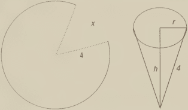

**图 5-4**  圆锥形纸杯

编写一个程序，提示用户输入圆形蜡纸的半径。然后程序应输出所去掉扇形的长度，使制成的杯子容积最大。计算结果保留两位小数。

### 29. **公寓问题**

一家房地产办公室管理着比如 50 套公寓单元。当租金为比如每月 600 美元时，所有单元都有人租住。然而，租金每增加比如 40 美元，就会有一套单元空置。此外，每个已租出的单元平均每月需要 27 美元的维护费。应租出多少套单元才能使利润最大化？

编写一个程序，提示用户输入：

- a. 使所有单元都租出时的租金。

- b. 导致一套单元空置的租金增加额。

- c. 维护一套已租出单元的费用。

然后程序输出为使利润最大化应租出的单元数。


## 用户自定义函数

### 本章你将：

- 了解标准（预定义）函数，并探索如何在程序中使用它们
- 了解用户自定义函数
- 考察有返回值函数，包括实参和形参
- 探索如何在程序中构造和使用有返回值的用户自定义函数
- 学习如何在程序中构造和使用无返回值函数
- 了解值参数和引用参数之间的区别
- 探索引用参数和有返回值函数
- 了解标识符的作用域
- 考察局部标识符和全局标识符之间的差异
- 了解静态变量
- 学习如何使用驱动程序和桩程序调试程序
- 学习函数重载
- 探索带默认参数的函数

### 表 6-1 预定义函数（续）

| 函数 | 头文件 | 用途 | 参数类型 | 返回结果 |
|---|---|---|---|---|
| floor(x) | `<cmath>` | 返回不大于 x 的最大整数：floor(45.67) = 45.00 | double | double |
| islower(x) | `<cctype>` | 如果 x 是小写字母，则返回 1（真）；否则返回 0（假）；islower('h') = 1（真） | int | int |
| isupper(x) | `<cctype>` | 如果 x 是大写字母，则返回 1（真）；否则返回 0（假）；isupper('K') = 1（真） | int | int |
| pow(x, y) | `<cmath>` | 返回 x^y；如果 x 为负数，则 y 必须是整数：pow(0.16, 0.5) = 0.4 | double | double |
| sqrt(x) | `<cmath>` | 返回 x 的非负平方根；x 必须非负：sqrt(4.0) = 2.0 | double | double |
| tolower(x) | `<cctype>` | 如果 x 是大写字母，则返回 x 的小写值；否则返回 x | int | int |
| toupper(x) | `<cctype>` | 如果 x 是小写字母，则返回 x 的大写值；否则返回 x | int | int |

要在程序中使用预定义函数，必须通过 include 语句包含含有该函数声明的头文件。例如，要使用函数 pow，程序必须包含：

```cpp
#include <cmath>
```

示例 6-1 展示如何使用一些预定义函数。

### 示例 6-1

```cpp
// How to use predefined functions.
#include <iostream>                                      //Line 1
#include <cmath>                                         //Line 2
#include <cctype>                                        //Line 3
#include <iomanip>                                       //Line 4

using namespace std;                                     //Line 5

int main()                                               //Line 6
{
    int num;                                             //Line 8
    double firstNum, secondNum;                          //Line 9
    char ch = 'T';                                       //Line 10

    cout << fixed << showpoint << setprecision(2)
         << endl;                                        //Line 11

    cout << "Line 12: Is " << ch
         << " a lowercase letter? "
         << islower(ch) << endl;                         //Line 12
    cout << "Line 13: Uppercase a is "
         << static_cast<char>(toupper('a')) << endl;     //Line 13

    cout << "Line 14: 4.5 to the power 6.0 "
         << pow(4.5, 6.0) << endl;                      //Line 14

    cout << "Line 15: Enter two decimal numbers: ";
    cin >> firstNum >> secondNum;                        //Line 16
    cout << endl;                                        //Line 17

    cout << "Line 18: " << firstNum
         << " to the power of " << secondNum
         << " = " << pow(firstNum, secondNum) << endl;  //Line 18

    cout << "Line 19: 5.0 to the power of 4 = "
         << pow(5.0, 4) << endl;

    firstNum = firstNum + pow(3.5, 7.2);                 //Line 20
    cout << "Line 21: firstNum = " << firstNum << endl;  //Line 21

    num = -32;                                           //Line 22
    cout << "Line 23: Absolute value of " << num
         << " = " << abs(num) << endl;                  //Line 23

    cout << "Line 24: Square root of 28.00 = "
         << sqrt(28.00) << endl;                        //Line 24

    return 0;                                            //Line 25
}                                                       //Line 26
```


**示例运行：** 在此示例运行中，用户输入以阴影显示。

```
Line 12: Is T a lowercase letter?  0
Line 13: Uppercase a is A
Line 14: 4.5 to the power 6.0 = 8303.77
Line 15: Enter two decimal numbers: 24.7 3.8

Line 18: 24.70 to the power of 3.80 = 195996.55
Line 19: 5.0 to the power of 4 = 625.00
Line 21: firstNum = 8290.60
Line 23: Absolute value of -32 = 32
Line 24: Square root of 28.00 = 5.29
```

该程序的工作方式如下。第 1 行至第 4 行的语句包含了使用程序中函数所必需的头文件。第 8 行至第 10 行的语句声明了程序中使用的变量。第 11 行的语句将十进制数的输出设置为保留两位小数的定点小数格式。第 12 行的语句使用函数 islower 判断并输出 ch 是否为小写字母。第 13 行的语句使用函数 toupper 输出与 'a' 对应的大写字母，即 'A'。注意，函数 toupper 返回一个 int 值。因此，表达式 toupper('a') 的值为 65，也就是 'A' 的 ASCII 值。要输出 A 而不是 65，需要像第 13 行的语句那样应用强制类型转换运算符。第 14 行的语句使用函数 pow 输出 4.5^6.0。用 C++ 术语来说，就是使用参数 4.5 和 6.0 调用函数 pow。第 15 行至第 17 行的语句提示用户输入两个十进制数，并将用户输入的数存储到变量 firstNum 和 secondNum 中。在第 18 行的语句中，函数 pow 用于输出 firstNum^secondNum。在这种情况下，使用参数 firstNum 和 secondNum 调用函数 pow，并将 firstNum 和 secondNum 的值传递给函数 pow。其他语句的含义类似。再次注意，该程序包含了头文件 cctype 和 cmath，因为它使用了这些头文件中的函数 islower、toupper、pow、abs 和 sqrt。

## 用户自定义函数

正如示例 6-1 所示，在程序中使用函数可以极大地提高程序的可读性，因为它降低了函数 main 的复杂性。此外，一旦编写并正确调试了一个函数，就可以在程序或不同程序中反复使用它，而无需反复重写相同的代码。例如，在示例 6-1 中，函数 pow 被使用了不止一次。

由于 C++ 不可能提供你所需要的每一个函数，而且设计者也不可能知道用户的具体需求，因此你必须学会编写自己的函数。

C++ 中的用户自定义函数分为两类：

- **有返回值的函数**——具有返回类型的函数。这些函数使用 `return` 语句返回特定数据类型的值，我们很快会解释该语句。
- **void 函数**——没有返回类型的函数。这些函数不使用 return 语句返回值。

我们将首先讨论有返回值的函数。关于有返回值函数讨论的许多概念也适用于 void 函数。

## 有返回值的函数

上一节介绍了一些预定义的 C++ 函数，例如 pow、abs、islower 和 toupper。这些都是有返回值的函数的示例。因此，要在程序中使用这些函数，必须知道包含这些函数规范的头文件的名称。需要使用 include 语句将此头文件包含到程序中，并了解以下各项：

- 1. 函数名
- 2. **参数**的个数（如果有）
- 3. 每个参数的数据类型
- 4. 函数所计算（即返回）的值的数据类型，称为函数的类型

由于有返回值的函数返回的值是唯一的，因此你自然会以下列三种方式之一使用该值：

- 保存该值以供进一步计算。例如，`x = pow(3.0, 2.5);`
- 在某种计算中使用该值。例如，`area = PI * pow(radius, 2.0);`
- 输出该值。例如，`cout << abs(-5) << endl;`

这表明，有返回值的函数可用于：

- 在赋值语句中。
- 作为函数调用中的参数。
- 在输出语句中。

也就是说，有返回值的函数是在表达式中使用（调用）的。

在查看用户自定义的有返回值函数的语法之前，让我们先考虑与此类函数相关的内容。除了前面描述的四个属性外，函数（无论是有返回值的函数还是 void 函数）还关联着另一项内容：

- 5. 完成任务所需的代码

前四个属性构成所谓的函数**头部**（也称为**函数头**）；第五个属性称为函数的**函数体**。这五个属性共同构成所谓的函数**定义**。例如，对于函数 abs，其函数头可能如下所示：

```
int abs(int number)
```

类似地，函数 abs 可能有以下定义：

```
int abs(int number)
{
    if (number < 0)
        number = -number;

    return number;
}
```

在函数 abs 的函数头中声明的变量称为函数 abs 的**形参**。因此，abs 的形参是 number。

示例 6-1 中的程序包含若干使用函数 pow 的语句。也就是说，用 C++ 术语来说，函数 pow 被调用了多次。本章后面将讨论调用函数时会发生什么。

假设函数 pow 的函数头为：

```
double pow(double base, double exponent)
```

从函数 pow 的函数头可以看出，pow 的形参是 base 和 exponent。考虑以下语句：

```
double u = 2.5;
double v = 3.0;
double x, y;

x = pow(u, v);                                      //Line 1
y = pow(2.0, 3.2) + 5.1;                           //Line 2
cout << u << " to the power of 7 = " << pow(u, 7) << endl;  //Line 3
```

在第 1 行中，使用参数 u 和 v 调用函数 pow。在这种情况下，u 和 v 的值被传递给函数 pow。实际上，u 的值被复制到 base 中，v 的值被复制到 exponent 中。第 1 行调用函数 pow 时出现的变量 u 和 v 称为该调用的**实参**。在第 2 行中，使用参数 2.0 和 3.2 调用函数 pow。在此调用中，值 2.0 被复制到 base 中，3.2 被复制到 exponent 中。此外，在函数 pow 的此次调用中，实参分别是 2.0 和 3.2。类似地，在第 3 行中，函数 pow 的实参是 u 和 7；u 的值被复制到 base 中，7.0 被复制到 exponent 中。

现在我们可以正式给出两个定义：

**形参：**在函数头中声明的变量。

**实参：**在函数调用中列出的变量或表达式。

对于预定义函数，你只需要关注前四个属性。软件公司通常不会公开实际的源代码，也就是函数体。否则，软件成本会过高。

### 语法：有返回值的函数

有返回值函数的语法为：

```
{
    functionType functionName(formal parameter list)
    statements
}
```

其中 statements 通常是声明语句和/或可执行语句。在此语法中，functionType 是函数返回值的类型。functionType 也称为有返回值函数的数据类型或返回类型。此外，花括号之间的语句构成函数体。

### 语法：形参列表

形参列表的语法为：

```
dataType identifier, dataType identifier, ...
```

考虑本章前面给出的函数 abs 的定义。图 6-1 标出了该函数的各个部分。

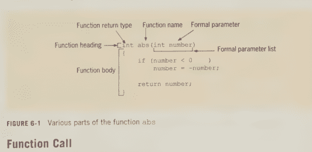

### 函数调用

调用有返回值函数的语法为：

```
functionName(actual parameter list)
```

例如，在表达式 x = abs(-5); 中，调用了函数 abs。


## 语法：实际参数列表

实际参数列表的语法是：

```
expression or variable, expression or variable, ...
```

（在此语法中，expression 可以是单个常量值。）因此，要调用有返回值的函数，需使用其名称，并将实际参数（如果有）放在括号中。

函数的形参列表可以为空。然而，如果形参列表为空，仍然需要括号。因此，当形参列表为空时，有返回值函数的函数首部采用以下形式：

```
functionType functionName()
```

如果有返回值函数的形参列表为空，则在函数调用中实际参数也为空。在这种情况下（即形参列表为空），函数调用中仍然需要空括号。因此，对形参列表为空的有返回值函数的调用如下：

```
functionName()
```

在函数调用中，实际参数的数量及其数据类型必须按给定顺序与形式参数匹配。也就是说，实际参数和形式参数一一对应。（本章后面将讨论带默认参数的函数。）

如前所述，有返回值的函数在表达式中调用。该表达式可以是赋值语句或输出语句的一部分，也可以是函数调用中的参数。程序中的函数调用会使被调用函数体执行。

## return 语句

一旦有返回值的函数计算出值，该函数就通过 return 语句返回此值。换句话说，它通过 return 语句将此值传递到函数外部。

### 语法：return 语句

return 语句具有以下语法：

```
return expr;
```

其中 expr 是变量、常量值或表达式。会计算 expr，并返回其值。expr 计算所得值的数据类型必须与函数类型匹配。

在 C++ 中，`return` 是保留字。

当函数中的 return 语句执行时，函数立即终止，控制权返回到调用者。此外，函数调用语句会被 return 语句返回的值替换。当 return 语句在函数 main 中执行时，程序终止。

为了将本讨论中的想法付诸实践，让我们编写一个确定两个数中较大者的函数。由于该函数比较两个数，因此该函数有两个参数，并且这两个参数都是数。假设这些数的数据类型为浮点型（十进制）——例如 double。由于较大的数是 double 类型，因此函数的数据类型也是 double。我们将此函数命名为 larger。完成此函数唯一需要做的就是函数体。因此，按照函数的语法，可以如下编写此函数：

```cpp
double larger(double x, double y)
{
    double max;

    if (x >= y)
        max = x;
    else
        max = y;

    return max;
}
```

注意，函数 larger 使用了一个额外变量 max（称为局部声明，其中 max 是函数 larger 的局部变量）。图 6-2 描述了函数 larger 的各个部分。

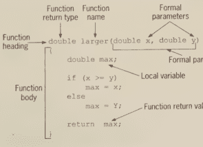

**图 6-2** 函数 larger 的各个部分

假设 `num`、`num1` 和 `num2` 是 double 变量。还假设 `num1 = 45.75` 且 `num2 = 35.50`。图 6-3 展示了对函数 `larger` 的各种调用。

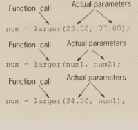

**图 6-3** 函数调用

可以如下编写函数 `larger` 的定义：

```cpp
double larger(double x, double y)
{
    if (x >= y)
        return x;
    else
        return y;
}
```

由于函数中 `return` 语句的执行会终止该函数，因此前面的函数 `larger` 也可以（去掉 `else` 一词）写成：

```cpp
double larger(double x, double y)
{
    if (x >= y)
        return x;

    return y;
}
```

注意，函数 `larger` 的这些形式不要求声明任何局部变量。

- 1. 在函数 `larger` 的定义中，`x` 和 `y` 是形式参数。
- 2. `return` 语句可以出现在函数中的任何位置。回顾一下，一旦 `return` 语句执行，所有后续语句都会被跳过。因此，最好在值计算出来后立即返回该值。

## 示例 6-2

既然函数 larger 已经编写好，以下 C++ 代码说明了如何使用它：

```cpp
double one = 13.00;
double two = 36.53;
double maxNum;
```

考虑以下语句：

```cpp
cout << "The larger of 5 and 6 is " << larger(5, 6)
     << endl;                                      //Line 1

cout << "The larger of " << one << " and " << two
     << " is " << larger(one, two) << endl;       //Line 2

cout << "The larger of " << one << " and 29 is "
     << larger(one, 29) << endl;                   //Line 3

maxNum = larger(38.45, 56.78);                     //Line 4
```

- 第 1 行中的表达式 `larger(5, 6)` 是函数调用，5 和 6 是实际参数。当表达式 `larger(5, 6)` 执行时，5 被复制到 `x`，6 被复制到 `y`。因此，第 1 行中的语句输出 5 和 6 中较大的数。
- 第 2 行中的表达式 `larger(one, two)` 是函数调用。这里，`one` 和 `two` 是实际参数。当表达式 `larger(one, two)` 执行时，`one` 的值被复制到 `x`，`two` 的值被复制到 `y`。因此，第 2 行中的语句输出 one 和 two 中较大的数。
- 第 3 行中的表达式 `larger(one, 29)` 也是函数调用。当表达式 `larger(one, 29)` 执行时，`one` 的值被复制到 `x`，`29` 被复制到 `y`。因此，第 3 行中的语句输出 one 和 29 中较大的数。注意，第一个参数 `one` 是变量，而第二个参数 `29` 是常量值。
- 第 4 行中的表达式 `larger(38.45, 56.78)` 是函数调用。在此调用中，实际参数是 38.45 和 56.78。在此语句中，函数 larger 返回的值被赋给变量 `maxNum`。

> **注意：** 在函数调用中，只需指定实际参数，而不指定其数据类型。例如，在示例 6-2 中，第 1、2、3 和 4 行中的语句展示了如何使用实际参数调用函数 larger。然而，以下语句包含对函数 larger 的不正确调用，会导致语法错误。（假设所有变量都已正确声明。）

```cpp
x = larger(int one, 29);          //illegal
y = larger(int one, int 29);      //illegal
cout << larger(int one, int two); //illegal
```

一旦函数编写完成，就可以在程序中的任何位置使用它。函数 `larger` 比较两个数并返回两者中较大的数。现在让我们编写另一个函数，它使用此函数来确定三个数中的最大者。我们将此函数称为 `compareThree`。

```cpp
double compareThree(double x, double y, double z)
{
    return larger(x, larger(y, z));
}
```

在函数首部中，x、y 和 z 是形式参数。

让我们看一下表达式：

```
larger(x, larger(y, z))
```

它位于函数 compareThree 的定义中。此表达式包含两次对函数 larger 的调用。外部调用的实际参数是 x 和 larger(y, z)；内部调用的实际参数是 y 和 z。由此可知，首先计算表达式 larger(y, z)；也就是说，内部调用先执行，得到 y 和 z 中较大的数。假设 larger(y, z) 的计算结果为 t。（注意，t 是 y 或 z。）接下来，外部调用确定 x 和 t 中较大的数。最后，return 语句返回最大的数。因此可知，要执行函数调用，首先会计算参数。例如，外部调用的实际参数 larger(y, z) 会先计算。

注意，函数 larger 比函数 compareThree 通用得多。这里，我们只是说明：一旦编写好一个函数，就可以使用它来编写其他函数。本章后面将展示如何使用函数 larger 从一组数中确定最大数。

## 函数原型

现在你已经对如何在程序中编写和使用函数有了一些了解，下一个问题涉及用户自定义函数在程序中应出现的顺序。例如，你是将函数 larger 放在函数 main 之前还是之后？larger 应放在 compareThree 之前还是之后？遵循“必须先声明标识符才能使用它”的规则，并且知道函数 main 使用了标识符 larger，从逻辑上讲，必须将 larger 放在 main 之前。

实际上，C++ 程序员通常将函数 main 放在所有其他用户自定义函数之前。然而，这种组织方式可能产生编译器错误，因为函数是按照它们在程序中出现的顺序编译的。例如，如果将函数 main 放在函数 larger 之前，那么在编译函数 main 时，标识符 larger 是未定义的。为了解决未声明标识符的问题，我们将**函数原型**放在任何函数定义（包括 main 的定义）之前。

**函数原型：** 不带函数体的函数首部。


```cpp
cout << "Line 7: The largest of 43.48, 34.00, "
     << "and 12.65 is "
     << compareThree(43.48, 34.00, 12.65)             //Line 7
     << endl;

return 0;
}

double larger(double x, double y)
{
    double max;

    if (x >= y)
        max = x;
    else
        max = y;

    return max;
}

double compareThree(double x, double y, double z)
{
    return larger(x, larger(y, z));
}
```

**示例运行：** 在此示例运行中，用户输入以阴影显示。

第 2 行：5 和 10 中较大的是 10。
第 3 行：输入两个数：`25.6 73.85`

第 6 行：25.6 和 73.85 中较大的是 73.85
第 7 行：43.48、34.00 和 12.65 中最大的是 43.48

> **注意：** 在前面的程序中，函数 larger 和 compareThree 的函数原型出现在它们的函数定义之前。因此，函数 larger 和 compareThree 的定义可以以任意顺序出现。

## 返回值函数：一些特殊之处

返回值函数必须返回一个值。考虑下面的函数 secret，它接受一个 int 值作为参数。如果参数 x 的值大于 5，则返回 x 值的两倍；否则，x 的值保持不变。

```cpp
int secret(int x)
{
    if (x > 5)             //Line 1
        return 2 * x;      //Line 2
}
```

由于这是一个 int 类型的返回值函数，因此它必须返回一个 int 类型的值。假设 x 的值为 10，那么第 1 行中的表达式 x > 5 求值为 true。因此，第 2 行中的返回语句返回 20。现在假设 x 为 3，第 1 行中的表达式 x > 5 现在求值为 false。因此 if 语句失败，第 2 行中的返回语句不会执行。然而，函数体中已经没有更多要执行的语句。在这种情况下，函数会返回一个奇怪的值。由此可知，如果 x 的值小于或等于 5，该函数不包含任何有效的返回语句来返回 x 的值。

函数 secret 的正确定义是：

```cpp
int secret(int x)
{
    if (x > 5)             //Line 1
        return 2 * x;      //Line 2

    return x;              //Line 3
}
```

这里，如果 x 的值小于或等于 5，则第 3 行中的返回语句执行，返回 x 的值。另一方面，如果 x 的值比如为 10，则第 2 行中的返回语句执行，返回 20，并终止该函数。

回顾一下，在返回值函数中，返回语句返回该值。考虑下面的返回语句：

```cpp
return x, y;    //only the value of y will be returned
```

这是一条合法的返回语句。你可能认为这条返回语句返回 x 和 y 的值。然而，事实并非如此。记住，返回语句只返回一个值，即使该返回语句包含多个表达式。如果返回语句包含多个表达式，则只返回最后一个表达式的值。因此，对于上面的返回语句，返回的是 y 的值。下面的程序进一步说明了这一概念：

```cpp
// This program illustrates that a value-returning function
// returns only one value, even if the return statement
// contains more than one expression. This is a legal, but not
// a recommended code.

#include <iostream>

using namespace std;

int funcRet1();
int funcRet2(int z);

int main()
{
    int num = 4;

    cout << "Line 1: The value returned by funcRet1: "
         << funcRet1() << endl;                         // Line 1
    cout << "Line 2: The value returned by funcRet2: "
         << funcRet2(num) << endl;                 // Line 2

    return 0;
}

int funcRet1()
{
    int x = 45;

    return 23, x;  //only the value of x is returned
}

int funcRet2(int z)
{
    int a = 2;
    int b = 3;

    return 2 * a + b, z + b; //only the value of z + b is returned
}
```

**示例运行：**

```text
Line 1: The value returned by funcRet1: 45
Line 2: The value returned by funcRet2: 7
```

尽管返回语句可以包含多个表达式，但程序中的返回语句应当只包含一个表达式。在返回语句中包含多个表达式可能导致冗余、浪费代码以及令人困惑的语法。

## 返回值函数的更多示例

### 例 6-3

在本例中，我们编写函数 courseGrade 的定义。该函数接受一个 int 值作为参数，指定某门课程的分数，并返回该课程的等级，即一个 char 类型的值。（我们假设测试分数是 0 到 100（含）之间的值。）

```cpp
char courseGrade(int score)
{
    switch (score / 10)
    {
        case 0:
        case 1:
        case 2:
        case 3:
        case 4:
        case 5:
            return 'F';
        case 6:
            return 'D';
        case 7:
            return 'C';
        case 8:
            return 'B';
        case 9:
        case 10:
            return 'A';
    }
}
```

你也可以使用 if...else 结构来确定课程等级，从而编写函数 courseGrade 的等价定义。

### 例 6-4（掷一对骰子）

在本例中，我们编写一个函数，反复掷一对骰子，直到掷出的数字之和为某个特定数字。我们还想知道掷多少次骰子才能得到期望的和。

每个骰子上的最小数字是 1，最大数字是 6。因此，掷出的数字之和最小为 2，最大为 12。假设我们有以下声明：

```cpp
int die1;
int die2;
int sum;
int rollCount = 0;
```

我们使用第 5 章讨论的随机数生成器，随机生成 1 到 6 之间的一个数。然后，下面的语句随机生成 1 到 6 之间的一个数，并将该数存入 die1，它就成为 die1 掷出的数字。

```cpp
die1 = rand() % 6 + 1;
```

类似地，下面的语句随机生成 1 到 6 之间的一个数，并将该数存入 die2，它就成为 die2 掷出的数字。

```cpp
die2 = rand() % 6 + 1;
```

两个骰子掷出的数字之和是：

```cpp
sum = die1 + die2;
```

接下来，我们判断 `sum` 是否包含骰子掷出的数字的期望和。如果 `sum` 不包含期望和，则再次掷骰子。这可以通过下面的 `do...while` 循环完成。（假设 `int` 变量 `num` 包含要掷出的期望和。）

```cpp
do
{
    die1 = rand() % 6 + 1;
    die2 = rand() % 6 + 1;
    sum = die1 + die2;
    rollCount++;
}
while (sum != num);
```

现在，我们可以编写函数 `rollDice`，它接受要掷出的数字的期望和作为参数，并返回掷出期望和所需的掷骰次数。

```cpp
int rollDice(int num)
{
    int die1;
    int die2;
    int sum;
    int rollCount = 0;

    srand(time(0));

    do
    {
        die1 = rand() % 6 + 1;
        die2 = rand() % 6 + 1;
        sum = die1 + die2;
        rollCount++;
    }
    while (sum != num);

    return rollCount;
}
```

下面的程序展示了如何在程序中使用函数 `rollDice`：

```cpp
//Program: Roll dice

#include <iostream>
#include <cstdlib>
#include <ctime>

using namespace std;

int rollDice(int num);

int main()
{
    cout << "The number of times the dice are rolled to "
         << "get the sum 10 = " << rollDice(10) << endl;
    cout << "The number of times the dice are rolled to "
         << "get the sum 6 = " << rollDice(6) << endl;

    return 0;
}

int rollDice(int num)
{
    int die1;
    int die2;
    int sum;
    int rollCount = 0;

    srand(time(0));

    do
    {
        die1 = rand() % 6 + 1;
        die2 = rand() % 6 + 1;
        sum = die1 + die2;
        rollCount++;
    }
    while (sum != num);

    return rollCount;
}
```

**示例运行：**

```text
The number of times the dice are rolled to get the sum 10 = 11
The number of times the dice are rolled to get the sum 6 = 7
```

我们将其留作练习：修改此程序，使用户能够输入要掷出的数字的期望和。（参见本章末尾的编程练习 7。）

下面是一个返回布尔值的函数示例。

### 例 6-5（回文）

在本例中，设计了一个函数 isPalindrome，如果字符串是回文则返回 true，否则返回 false。如果字符串正读和反读都相同，则该字符串是回文。例如，字符串 "madamimadam"、"5"、"434" 和 "78965987" 都是回文。


### 函数 residential

该函数使用 return 语句返回账单金额。以下四个步骤描述了该函数：

- a. 提示用户输入付费频道数量。
- b. 读取付费频道数量。
- c. 计算账单。
- d. 返回应付金额。

该函数包含一条提示用户输入付费频道数量的语句（步骤 a）和一条读取付费频道数量的语句（步骤 b）。计算账单金额所需的其他项，例如基本服务连接费用和账单处理费，被定义为命名常量（在函数 main 的定义之前）。因此，为了计算账单金额，该函数不需要从函数 main 获取任何值。因此，该函数没有参数。

根据前面的讨论可知，函数 residential 需要变量来存储付费频道数量和账单金额。该函数只需要两个局部变量来计算账单金额：

```
int noOfPChannels;  //number of premium channels
double bAmount;     //billing amount
```

现在可以将函数 residential 的定义写成如下形式：

```cpp
double residential()
{
    int noOfPChannels;  //number of premium channels
    double bAmount;     //billing amount

    cout << "Enter the number of premium "
         << "channels used: ";
    cin >> noOfPChannels;
    cout << endl;

    bAmount = RES_BILL_PROC_FEES +
              RES_BASIC_SERV_COST +
              noOfPChannels * RES_COST_PREM_CHANNEL;

    return bAmount;
}
```

### 函数 business

要计算商业客户账单，需要知道基本服务连接数和客户订阅的付费频道数。然后，根据这些数字计算账单金额。随后使用 return 语句返回账单金额。以下六个步骤描述了该函数：

- a. 提示用户输入基本服务连接数。
- b. 读取基本服务连接数。
- c. 提示用户输入付费频道数量。
- d. 读取付费频道数量。
- e. 计算账单。
- f. 返回应付金额。

该函数包含提示用户输入基本服务连接数和付费频道数量的语句（步骤 a 和 c）。该函数还包含输入基本服务连接数和付费频道数量的语句（步骤 b 和 d）。计算账单金额所需的其他项，例如基本服务连接费用和账单处理费，被定义为命名常量（在函数 main 的定义之前）。由此可知，为了计算账单金额，该函数不需要从函数 main 获取任何值。因此，它没有参数。

根据前面的讨论可知，函数 business 需要变量来存储基本服务连接数、付费频道数量以及账单金额。实际上，该函数只需要三个局部变量来计算账单金额：

```
int noOfBasicServiceConnections;
int noOfPChannels; //number of premium channels
double bAmount;     //billing amount
```

现在可以将函数 business 的定义写成如下形式：

```cpp
double business()
{
    int noOfBasicServiceConnections;
    int noOfPChannels; //number of premium channels
    double bAmount;    //billing amount

    cout << "Enter the number of basic "
         << "service connections: ";
    cin >> noOfBasicServiceConnections;
    cout << endl;

    cout << "Enter the number of premium "
         << "channels used: ";
    cin >> noOfPChannels;
    cout << endl;

    if (noOfBasicServiceConnections <= 10)
        bAmount = BUS_BILL_PROC_FEES + BUS_BASIC_SERV_COST +
                  noOfPChannels * BUS_COST_PREM_CHANNEL;
    else
        bAmount = BUS_BILL_PROC_FEES + BUS_BASIC_SERV_COST +
                  (noOfBasicServiceConnections - 10) *
                  BUS_BASIC_CONN_COST +
                  noOfPChannels * BUS_COST_PREM_CHANNEL;

    return bAmount;
}
```

主程序的算法如下：

- 1. 要以固定小数格式输出浮点数，并带小数点和小数点后的尾随零，请设置操纵器 fixed 和 showpoint。
- 2. 要将浮点数输出到两位小数，请将精度设置为两位小数。
- 3. 提示用户输入账号。
- 4. 获取账号。
- 5. 提示用户输入客户类型。
- 6. 获取客户类型。
- 7.
  - a. 如果客户类型为 R 或 r，
    - i. 调用函数 `residential` 计算账单。
    - ii. 打印账单。
  - b. 如果客户类型为 B 或 b，
    - i. 调用函数 `business` 计算账单。
    - ii. 打印账单。
  - c. 如果客户类型不是 R、r、B 或 b，则为无效客户类型。

## 程序清单

```cpp
//*******************************************************
// Author: D. S. Malik
//
// Program: Cable Company Billing
// This program calculates and prints a customer's bill for
// a local cable company. The program processes two types of
// customers: residential and business.
//*******************************************************

#include <iostream>
#include <iomanip>
using namespace std;

        //Named constants - residential customers
const double RES_BILL_PROC_FEES = 4.50;
const double RES_BASIC_SERV_COST = 20.50;
const double RES_COST_PREM_CHANNEL = 7.50;

        //Named constants - business customers
const double BUS_BILL_PROC_FEES = 15.00;
const double BUS_BASIC_SERV_COST = 75.00;
const double BUS_BASIC_CONN_COST = 5.00;
const double BUS_COST_PREM_CHANNEL = 50.00;

double residential();    //Function prototype
double business();       //Function prototype

int main()
{
        //declare variables
        int accountNumber;
        char customerType;
        double amountDue;

        cout << fixed << showpoint;                       //Step 1
        cout << setprecision(2);                          //Step 2

        cout << "This program computes a cable bill."
             << endl;
        cout << "Enter account number: ";                 //Step 3
        cin >> accountNumber;                             //Step 4
        cout << endl;

        cout << "Enter customer type: R, r "
             << "(Residential), B, b (Business): ";        //Step 5
        cin >> customerType;                               //Step 6
        cout << endl;

        switch (customerType)                              //Step 7
        {
        case 'r':                                           //Step 7a
        case 'R':
             amountDue = residential();                   //Step 7a.i
             cout << "Account number = "
                  << accountNumber << endl;                //Step 7a.ii
             cout << "Amount due = $"
                  << amountDue << endl;                    //Step 7a.ii
             break;
        case 'b':                                           //Step 7b
        case 'B':
             amountDue = business();                      //Step 7b.i
             cout << "Account number = "
                  << accountNumber << endl;                //Step 7b.ii
             cout << "Amount due = $"
                  << amountDue << endl;                    //Step 7b.ii
             break;
        default:
             cout << "Invalid customer type."
                  << endl;                                 //Step 7c
        }

        return 0;
}

//Place the definitions of the functions residential and business here.
```

### 示例运行

在此示例运行中，用户输入以阴影显示。

```
This program computes a cable bill.
Enter account number: 21341

Enter customer type: R, r (Residential), B, b (Business): B

Enter the number of basic service connections: 25

Enter the number of premium channels used: 9

Account number = 21341
Amount due = $615.00
```

## 执行流程

如前所述，C++ 程序是函数的集合。回想一下，函数可以以任意顺序出现。你唯一需要记住的是，必须先声明标识符，然后才能使用它。编译器按从头到尾的顺序依次编译程序。因此，如果函数 main 出现在任何其他用户定义函数之前，它就会首先被编译。然而，如果 main 出现在程序的末尾（或中间），那么所有定义（不是原型）出现在函数 main 之前的函数都会按照它们放置的顺序在函数 main 之前被编译。

函数原型出现在任何函数定义之前，因此编译器会首先转换这些原型。然后编译器就可以正确地转换函数调用。*然而，当程序执行时，函数 main 中的第一条语句总是先执行，无论函数 main 在程序中放在什么位置。* 其他函数仅在它们被调用时才执行。

函数调用语句将控制权转移到函数体中的第一条语句。一般来说，在被调用函数的最后一条语句执行之后，控制权会返回到紧跟在函数调用之后的位置。有返回值的函数会返回一个值。因此，在执行有返回值的函数之后，当控制权返回给调用者时，函数返回的值会替换函数调用语句。执行将从紧跟在函数调用之后的位置继续。

假设一个程序包含函数 funcA 和 funcB，并且 funcA 包含一条调用 funcB 的语句。假设程序调用 funcA。当包含对 funcB 调用的语句执行时，funcB 执行；在 funcB 执行期间，funcA 当前这次调用的执行会暂停，直到 funcB 执行完毕。


## 编程示例：最大数

在这个编程示例中，函数 `larger` 用于确定一组数中的最大数。为了说明问题，本程序从 10 个数中确定最大数。你可以轻松增强此程序，使其适用于任意一组数。

**输入**

一组 10 个数。

**输出**

10 个数中的最大数。

### 问题分析与算法设计

假设输入数据为：

15 20 7 8 28 21 43 12 35 3

读取数据集的第一个数。因为这是到目前为止读取的唯一一个数，所以可以假定它是目前最大的数，并将其称为 `max`。读取第二个数，并将其称为 `num`。现在比较 `max` 和 `num`，并将较大的数存入 `max`。此时，`max` 包含前两个数中较大的那个。读取第三个数。将其与 `max` 比较，并将较大的数存入 `max`。此时，`max` 包含前三个数中最大的那个。读取下一个数，将其与 `max` 比较，并将较大的数存入 `max`。对数据集中剩余的每个数重复此过程。最终，`max` 将包含数据集中最大的数。上述讨论可转化为以下算法：

- 1. 读取第一个数。因为这是你到目前为止读取的唯一一个数，所以它是目前最大的数。将其保存在名为 `max` 的变量中。
- 2. 对列表中剩余的每个数：
  - a. 读取下一个数。将其存入名为 `num` 的变量中。
  - b. 比较 `num` 和 `max`。如果 `max < num`，则 `num` 是新的最大数，因此通过将 `num` 复制到 `max` 来更新 `max` 的值。如果 `max >= num`，则丢弃 `num`；也就是说，什么都不做。
- 3. 因为 `max` 现在包含最大数，所以打印它。

为了找出两个数中较大的那个，程序使用函数 `larger`。

### 完整程序清单

```cpp
//*******************************************************
// Author: D.S. Malik
//
// This program finds the largest number of a set of 10
// numbers.
//*******************************************************

#include <iostream>

using namespace std;

double larger(double x, double y);

int main()
{
    double num; //variable to hold the current number
    double max; //variable to hold the larger number
    int count;  //loop control variable

    cout << "Enter 10 numbers." << endl;        //Step 1
    cin >> num;                                 //Step 1
    max = num;                                  //Step 1

    for (count = 1; count < 10; count++)        //Step 2
    {
        cin >> num;                             //Step 2a
        max = larger(max, num);                 //Step 2b
    }

    cout << "The largest number is " << max
         << endl;                               //Step 3
    return 0;
} //end main

double larger(double x, double y)
{
    if (x >= y)
        return x;
    else
        return y;
}
```

**示例运行：** 在此示例运行中，用户输入以底纹显示。

```text
Enter 10 numbers.
10 56 73 42 22 67 88 26 62 11
The largest number is 88
```

在本章前面，你学习了如何使用有返回值的函数。在本节中，你将一般性地探讨用户自定义函数，特别是那些没有数据类型的 C++ 函数，称为 **void函数**。

## void函数

void函数和有返回值的函数具有相似的结构。二者都有函数头和函数体。与有返回值的函数一样，你可以将用户自定义的 void函数放在 main函数之前或之后。然而，程序执行总是从 main函数中的第一条语句开始。如果将用户自定义的 void函数放在 main函数之后，则应在 main函数之前放置函数原型。void函数没有数据类型。因此，void函数函数头部分中的 functionType（即返回类型）以及函数体中的 return 语句都是没有意义的。不过，在 void函数中，可以使用不带任何值的 return 语句；它通常用于提前退出函数。与有返回值的函数一样，void函数可以有形参，也可以没有形参。

由于 void函数没有数据类型，因此它们不会在表达式中被使用（调用）。对 void函数的调用是一条独立语句。因此，要调用 void函数，应在一条独立语句中使用函数名以及实参（如果有）。在给出 void函数的示例之前，下面先给出 void函数的语法。

### 函数定义

带参数的 void函数的函数定义具有以下语法：

```cpp
void functionName(formal parameter list)
{
    statements
}
```

其中语句通常是声明语句和/或可执行语句。形参列表可以为空；在这种情况下，函数头中仍然需要空圆括号。

### 形参列表

形参列表具有以下语法：

```cpp
dataType variable, dataType variable,...
```

在形参列表中必须同时指定数据类型和变量名。dataType 后面的符号 & 具有特殊含义；它仅用于某些形参，本章后面会讨论。

### 函数调用

函数调用具有以下语法：

```cpp
functionName (actual parameter list);
```

### 实参列表

实参列表具有以下语法：

```cpp
expression or variable, expression or variable, ...
```

其中表达式可以由单个常量值组成。与有返回值的函数一样，在函数调用中，实参的数量及其数据类型必须按给定顺序与形参匹配。实参与形参一一对应。（带有默认参数的函数将在本章末尾讨论。）函数调用会导致执行被调用函数的函数体。

示例6-7展示了一个带参数的 void函数。

### 示例 6-7

```cpp
void funexp(int a, double b, char c, int x)
{
    .
    .
    .
}
```

函数 funexp 有四个参数。

### 参数类型

参数在调用函数（如 main）和被调用函数之间提供通信链路。它们使函数每次被调用时都能处理不同的数据。通常，形参有两种类型：**值参数**和**引用参数**。

- **值参数：** 接收对应实参内容副本的形参。
- **引用参数：** 接收对应实参的位置（内存地址）的形参。

当在函数的形参列表中于 dataType 后面加上 & 时，该 dataType 后面的变量就会成为引用参数。

示例6-8展示了一个带值参数和引用参数的 void函数。

### 示例 6-8

考虑以下函数定义：

```cpp
void areaAndPerimeter(double length, double width,
                      double& area, double& perimeter)
{
    area = length * width;
    perimeter = 2 * (length + width);
}
```

函数 areaAndPerimeter 有四个参数：length 和 width 是 double 类型的值参数；area 和 perimeter 是 double 类型的引用参数。

下图描述了函数 areaAndPerimeter 的各个部分。

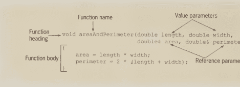

**图 6-4** 函数 areaAndPerimeter 的各个部分

### 示例 6-9

考虑以下定义：

```cpp
void averageAndGrade(int testScore, int progScore,
                     double& average, char& grade)
{
    average = (testScore + progScore) / 2.0;

    if (average >= 90.00)
        grade = 'A';
    else if (average >= 80.00)
        grade = 'B';
    else if (average >= 70.00)
        grade = 'C';
    else if (average >= 60.00)
        grade = 'D';
    else
        grade = 'F';
}
```

函数 averageAndGrade 有四个参数：testScore 和 progScore 是 int 类型的值参数，average 是 double 类型的引用参数，grade 是 char 类型的引用参数。

### 示例 6-10

我们编写一个程序来打印类似下图的图案（星号三角形）：


第一行有一个星号，星号前有一些空白；第二行有两个星号，星号前有一些空白，两个星号之间有一个空白；依此类推。

我们来编写函数 printStars，它有两个参数：一个参数指定一行中星号前的空白数量，第二个参数指定一行中的星号数量。具体来说，函数 printStars 的定义如下：

```cpp
void printStars(int blanks, int starsInLine)
{
    int count;

    //print the number of blanks before the stars in a line
    for (count = 1; count <= blanks; count++)
        cout << ' ';

    //print the number of stars with a blank between stars
    for (count = 1; count <= starsInLine; count++)
        cout << " *";

    cout << endl;
} //end printStars
```

第一个参数 blanks 决定在星号前打印多少个空白；第二个参数 starsInLine 决定一行中打印多少个星号。例如，如果参数 blanks 的值为 30，那么函数 printStars 中的第一个 for 循环将执行 30 次并打印 30 个空白。此外，由于希望在星号之间打印一个空格，函数 printStars 中第二个 for 循环的每次迭代都会打印字符串 " *"——一个空白后跟一个星号。


接下来，考虑以下语句：

```cpp
int numberOfLines = 15;
int numberOfBlanks = 30;

for (counter = 1; counter <= numberOfLines; counter++)
{
    printStars(numberOfBlanks, counter);
    numberOfBlanks--;
}
```

for 循环调用函数 printStars。该 for 循环的每次迭代都会使用变量 numberOfBlanks 和 counter 指定要在一行中打印的空格数以及随后的星号数。每次调用函数 printStars 时，收到的空格数都比上一次调用少一个，星号数多一个。例如，主程序中 for 循环的第一次迭代指定 30 个空格和 1 个星号（它们作为参数 numberOfBlanks 和 counter 传递给函数 printStars）。然后，for 循环通过执行语句 numberOfBlanks--; 将空格数减 1。在 for 循环末尾，星号数会为下一次迭代增加 1。这是通过执行 for 语句中的更新语句 counter++ 来完成的，该语句将变量 counter 的值增加 1。换句话说，第二次调用函数 printStars 时，接收 29 个空格和 2 个星号作为参数。因此，前面的语句将打印一个由 15 行组成的星号三角形。

```cpp
//Program: Print a triangle of stars

#include <iostream>

using namespace std;

void printStars(int blanks, int starsInLine);

int main()
{
    int noOfLines;    //variable to store the number of lines
    int counter;      //for loop control variable
    int noOfBlanks;   //variable to store the number of blanks

    cout << "Enter the number of star lines (1 to 20) "
         << "to be printed: ";                         //Line 1

    cin >> noOfLines;                                   //Line 2

    while (noOfLines < 0 || noOfLines > 20)             //Line 3
    {
        cout << "Number of star lines should be "
             << "between 1 and 20" << endl;             //Line 4
        cout << "Enter the number of star lines "
             << "(1 to 20) to be printed: ";            //Line 5
        cin >> noOfLines;                                //Line 6
    }

    cout << endl << endl;                         //Line 7
    noOfBlanks = 30;                              //Line 8

    for (counter = 1; counter <= noOfLines; counter++) //Line 9
    {
        printStars(noOfBlanks, counter);          //Line 10
        noOfBlanks--;                              //Line 11
    }

    return 0;                                     //Line 12
}

void printStars(int blanks, int starsInLine)
{
    int count;

    for (count = 1; count <= blanks; count++)  //Line 13
        cout << ' ';                           //Line 14
    for (count = 1; count <= starsInLine; count++) //Line 15
        cout << "*";                           //Line 16
    cout << endl;
}
```

**示例运行：** 在此示例运行中，用户输入以阴影显示。

输入要打印的星线行数（1 到 20）：**15**

```
              *
             * *
            * * *
           * * * *
          * * * * *
         * * * * * *
        * * * * * * *
       * * * * * * * *
      * * * * * * * * *
     * * * * * * * * * *
    * * * * * * * * * * *
   * * * * * * * * * * * *
  * * * * * * * * * * * * *
 * * * * * * * * * * * * * *
* * * * * * * * * * * * * * *
```

在函数 main 中，首先要求用户指定要打印多少行星号（第 1 行）。（在此程序中，用户被限制为最多 20 行，因为最多 20 行的三角形网格可以很好地适应屏幕。）由于程序限制为最多 20 行，因此第 3 行到第 6 行的 while 循环确保：当行数在 1 到 20 之间时，程序只打印星号三角形网格。

## 值参数

上一节定义了两种参数——值参数和引用参数。示例 6–10 展示了一个使用带参数函数的程序。在考虑更多带参数的 void 函数示例之前，我们先对值参数和引用参数作如下观察。调用函数时，实际参数的值会被复制到相应的形式参数中。如果形式参数是值参数，那么在复制实际参数的值之后，形式参数和实际参数之间就没有联系；也就是说，形式参数拥有自己的一份数据副本。因此，在程序执行期间，形式参数操作的是存储在其自身内存空间中的数据。示例 6–11 中的程序进一步说明了值参数如何工作。

### 示例 6-11

下面的程序展示了简单数据类型的形式参数如何工作。

```cpp
//Example 6-11
//Program illustrating how a value parameter works.

#include <iostream>

using namespace std;

void funcValueParam(int num);

int main()
{
    int number = 6;                                      //Line 1

    cout << "Line 2: Before calling the function "
         << "funcValueParam, number = " << number
         << endl;                                        //Line 2

    funcValueParam(number);                              //Line 3

    cout << "Line 4: After calling the function "
         << "funcValueParam, number = " << number
         << endl;                                        //Line 4

    return 0;
}

void funcValueParam(int num)
{
    cout << "Line 5: In the function funcValueParam, "
         << "before changing, num = " << num
         << endl;                                        //Line 5

    num = 15;                                             //Line 6
```

引用参数在三种情况下很有用：

- 当需要更改实际参数的值时
- 当希望从函数返回多个值时（回想一下，return 语句只能返回一个值）
- 当传递地址相对于复制大量数据可以节省内存空间和时间时

本书通篇都说明了前两种情况。第 8 章和第 10 章在介绍数组和类时讨论第三种情况。

回想一下，当你在函数的形式参数列表中在 dataType 后附加 & 时，该 dataType 后面的变量就会成为引用参数。

> 你可以使用关键字 `const` 将引用（形式）参数声明为常量。第 9 章和第 10 章将讨论常量引用参数。在此之前，你将使用的引用参数都是本章所定义的非恒定引用参数。从引用参数的定义可知，常量值或表达式不能传递给非恒定引用参数。如果形式参数是非恒定引用参数，那么在函数调用期间，其对应的实际参数必须是变量。

### 示例 6-12：计算成绩

下面的程序接收课程分数（0 到 100 之间的值），并确定学生的课程成绩。该程序有三个函数：`main`、`getScore` 和 `printGrade`，如下所示：

1. `main`
   - 获取课程分数。
   - 打印课程成绩。
2. `getScore`
   - 提示用户输入。
   - 获取输入。
   - 打印课程分数。
3. `printGrade`
   - 计算课程成绩。
   - 打印课程成绩。

完整程序如下：

```cpp
//This program reads a course score and prints the
//associated course grade.

#include <iostream>
using namespace std;

void getScore(int& score);
void printGrade(int score);

int main()
{
    int courseScore;

    cout << "Line 1: Based on the course score, \n"
         << "    this program computes the "
         << "course grade." << endl;        //Line 1

    getScore(courseScore);                   //Line 2

    printGrade(courseScore);                 //Line 3

    return 0;
}

void getScore(int& score)
{
    cout << "Line 4: Enter course score: ";  //Line 4
    cin >> score;                            //Line 5
    cout << "Line 6: Course score is "
         << score << endl;                   //Line 6
}

void printGrade(int cScore)
{
    cout << "Line 7: Your grade for the course is "; //Line 7

    if (cScore >= 90)
        cout << "A." << endl;               //Line 8
    else if (cScore >= 80)
        cout << "B." << endl;
    else if (cScore >= 70)
        cout << "C." << endl;
    else if (cScore >= 60)
        cout << "D." << endl;
    else
        cout << "F." << endl;
}
```


**示例运行：** 在此示例运行中，用户输入以底纹显示。

```text
Line 1: Based on the course score,
        this program computes the course grade.
Line 4: Enter course score: 85

Line 6: Course score is 85
Line 7: Your grade for the course is B.
```

该程序的工作方式如下。程序从第 1 行开始执行，打印输出的第一行（见示例运行）。第 2 行中的语句调用函数 getScore，实参为 courseScore（在 main 中声明的变量）。因为函数 getScore 的形参 score 是引用参数，所以地址（即变量 courseScore 的内存位置）会传递给 score。因此，score 和 courseScore 都指向同一内存位置，即 courseScore（见图 6-5）。


**图 6-5** 变量 courseScore 和形参 score

对 score 所做的任何更改都会立即改变 courseScore 的值。

随后控制权转移到函数 getScore，第 4 行中的语句执行，打印输出的第二行。该语句提示用户输入课程成绩。第 5 行中的语句读取用户输入的值（示例运行中为 85），并将其存储在变量 score 中，而该变量实际上就是 courseScore（因为 score 是引用参数）。因此，此时变量 score 和 courseScore 的值均为 85（见图 6-6）。


**图 6-6** 第 5 行语句执行后变量 courseScore 和形参 score

接下来，第 6 行中的语句输出 score 的值，如示例运行的第三行所示。第 6 行执行后，控制权返回到函数 main（见图 6-7）。


**图 6-7** 第 6 行语句执行且控制权返回 main 后的变量 courseScore

接下来执行第 3 行中的语句。这是对函数 printGrade 的函数调用，实参为 courseScore。因为函数 printGrade 的形参 cScore 是值参数，所以形参 cScore 接收对应实参 courseScore 的值。因此，cScore 的值为 85。将 courseScore 的值复制到 cScore 后，cScore 和 courseScore 之间不再存在联系（见图 6-8）。


**图 6-8** 变量 courseScore 和形参 cScore

然后程序执行第 7 行中的语句，输出第四行。第 8 行中的 if...else 语句确定并输出课程等级。因为第 7 行中的输出语句不包含换行符或操纵符 endl，所以 if...else 语句的输出是输出第四行的一部分。if...else 语句执行后，控制权返回到函数 main。因为函数 main 中接下来要执行的语句是函数 main 的最后一条语句，所以程序终止。

在此程序中，函数 main 首先调用函数 getScore 从用户处获取课程成绩。然后函数 main 调用函数 printGrade，根据该课程成绩计算并打印等级。课程成绩由函数 getScore 获取；之后，该课程成绩由函数 printGrade 使用。因为 getScore 函数获取的值在程序后面会用到，所以函数 getScore 必须将该值传递到函数外部。因为 getScore 被编写为 void 函数，所以保存该值的形参必须是引用参数。

## 值参数、引用参数与内存分配

调用函数时，为其形参以及函数体中声明的变量（称为局部变量）分配的内存位于函数数据区中。回想一下，对于值参数，实参的值会被复制到其对应形参的内存单元中。对于引用参数，实参的地址会传递给形参。也就是说，形参的内容是一个地址。在数据操作期间，形参的内容指示计算机操作由其内容所指示的内存单元中的数据。因此，对于引用参数，实参和形参都指向同一内存位置。因此，在程序执行期间，形参所做的更改会永久改变实参的值。

> 流变量（例如 `ifstream` 和 `ofstream`）应按引用传递给函数。打开输入/输出文件或读取和/或输出数据后，输入和/或输出流的状态随后可以传递到函数外部。

由于参数传递是任何编程语言的基础，示例 6-13 和 6-14 进一步说明了这一概念。每个示例涵盖不同的场景。

### 示例 6-13

以下程序展示了引用参数和值参数的工作方式。

```cpp
//Example 6-13: Reference and value parameters

#include <iostream>

using namespace std;

void funOne(int a, int& b, char v);
void funTwo(int& x, int y, char& w);

int main()
{
    int num1, num2;
    char ch;

    num1 = 10;                              //Line 1
    num2 = 15;                              //Line 2
    ch = 'A';                               //Line 3

    cout << "Line 4: Inside main: num1 = " << num1
         << ", num2 = " << num2 << ", ch = "
         << ch << endl;                     //Line 4

    funOne(num1, num2, ch);                 //Line 5
    cout << "Line 6: After funOne: num1 = " << num1
         << ", num2 = " << num2 << ", and ch = "
         << ch << endl;                     //Line 6

    funTwo(num2, 25, ch);                   //Line 7
    cout << "Line 8: After funTwo: num1 = " << num1
         << ", num2 = " << num2 << ", and ch = "
         << ch << endl;                     //Line 8

    return 0;
}

void funOne(int a, int& b, char v)
{
    int one;

    one = a;                                //Line 9
    a++;                                    //Line 10
    b = b * 2;                              //Line 11
    v = 'B';                                //Line 12

    cout << "Line 13: Inside funOne: a = " << a
         << ", b = " << b << ", v = " << v
         << ", and one = " << one << endl;  //Line 13
}

void funTwo(int& x, int y, char& w)
{
    x++;                                    //Line 14
    y = y * 2;                              //Line 15
    w = 'G';                                //Line 16

    cout << "Line 17: Inside funTwo: x = " << x
         << ", y = " << y << ", and w = " << w
         << endl;                           //Line 17
}
```

**示例运行：**

```text
Line 4: Inside main: num1 = 10, num2 = 15, and ch = A
Line 13: Inside funOne: a = 11, b = 30, v = B, and one = 10
Line 6: After funOne: num1 = 10, num2 = 30, and ch = A
Line 17: Inside funTwo: x = 31, y = 50, and w = G
Line 8: After funTwo: num1 = 10, num2 = 50, and ch = G
```

让我们逐步分析这个程序。变量的值显示在每条语句执行之前和/或之后。

就在第 1 行中的语句执行之前，仅为函数 main 的变量分配了内存；该内存未初始化。第 3 行中的语句执行后，变量如图 6-9 所示。


**图 6-9** 第 3 行中的语句执行后各变量的值

第 4 行中的语句产生以下输出：

```text
Line 4: Inside main: num1 = 10, num2 = 15, and ch = A
```

第 5 行中的语句是对函数 funOne 的函数调用。现在函数 funOne 有三个形参和一个局部变量。为函数 funOne 的形参和局部变量分配内存。因为形参 b 是引用参数，所以它接收对应实参的地址（内存位置），即 num2。另外两个形参是值参数，因此它们复制对应实参的值。就在第 9 行中的语句执行之前，变量如图 6-10 所示。


**图 6-10** 第 9 行中的语句执行前各变量的值


第9行的语句 `one = a;` 执行后，变量如图6-11所示。

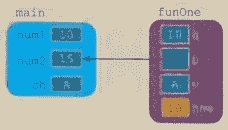

**图 6-11** 第9行语句执行后变量的值

第10行的语句 `a++;` 执行后，变量如图6-12所示。

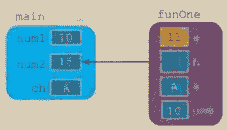

**图 6-12** 第10行语句执行后变量的值

第11行的语句 `b = b * 2;` 执行后，变量如图6-13所示。（注意，变量 b 改变了 num2 的值。）

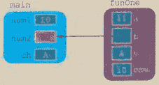

**图 6-13** 第11行语句执行后变量的值

第12行的语句 `v = 'B'` 执行后，变量如图6-14所示。


**图 6-14** 第12行语句执行后变量的值

第13行的语句产生以下输出：

```text
Line 13: Inside funOne: a = 11, b = 30, v = B, and one = 10
```

第13行的语句执行后，控制返回到第6行，为函数 funOne 的变量分配的内存被释放。图6-15显示了函数 main 的变量值。


**图 6-15** 控制返回到第6行时变量的值

第6行产生以下输出：

```text
Line 6: After funOne: num1 = 10, num2 = 30, and ch = A
```

第7行的语句是对函数 funTwo 的函数调用。现在 funTwo 有三个参数：x、y 和 w。此外，x 和 w 是引用参数，y 是值参数。因此，x 接收其对应实参的地址，即 num2；w 接收其对应实参的地址，即 ch。变量 y 将值 25 接收到其内存单元中。图6-16显示了第14行语句执行前的值。

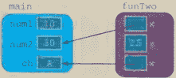

**图 6-16** 第14行语句执行前变量的值

第14行的语句 `x++` 执行后，变量如图6-17所示。（注意，变量 `x` 改变了 `num2` 的值。）

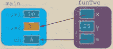

**图 6-17** 第14行语句执行后变量的值

第15行的语句 `y = y * 2` 执行后，变量如图6-18所示。

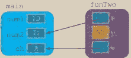

**图 6-18** 第15行语句执行后变量的值

第16行的语句 `w = 'G'` 执行后，变量如图6-19所示。（注意，变量 `w` 改变了 `ch` 的值。）

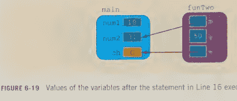

第17行产生以下输出：

```text
Line 17: Inside funTwo: x = 31, y = 50, and w = G
```

第17行的语句执行后，控制转到第8行。为函数 funTwo 的变量分配的内存被释放。函数 main 的变量值如图6-20所示。


第8行的语句产生以下输出：

```text
Line 8: After funTwo: num1 = 10, num2 = 31, and ch = G
```

第8行的语句执行后，程序终止。

## 示例 6-14

此示例还展示了引用参数如何操作实参。

```cpp
//Example 6-14: Reference and value parameters.
//Program: Makes you think.

#include <iostream>

using namespace std;

void addFirst(int& first, int& second);
void doubleFirst(int one, int two);
void squareFirst(int& ref, int val);

int main()
{
    int num = 5;

    cout << "Line 1: Inside main: num = " << num
         << endl;                                  //Line 1

    addFirst(num, num);                             //Line 2
    cout << "Line 3: Inside main after addFirst:"
         << " num = " << num << endl;              //Line 3

    doubleFirst(num, num);                          //Line 4
    cout << "Line 5: Inside main after "
         << "doubleFirst: num = " << num << endl;  //Line 5

    squareFirst(num, num);                          //Line 6
    cout << "Line 7: Inside main after "
         << "squareFirst: num = " << num << endl;  //Line 7

    return 0;
}

void addFirst(int& first, int& second)
{
    cout << "Line 8: Inside addFirst:  first = "
         << first << ", second = " << second << endl; //Line 8

    first = first + 2;                              //Line 9

    cout << "Line 10: Inside addFirst:  first = "
         << first << ", second = " << second << endl; //Line 10

    second = second * 2;                            //Line 11

    cout << "Line 12: Inside addFirst:  first = "
         << first << ", second = " << second << endl; //Line 12
}

void doubleFirst(int one, int two)
{
    cout << "Line 13: Inside doubleFirst:  one = "
         << one << ", two = " << two << endl;      //Line 13

    one = one * 2;                                  //Line 14

    cout << "Line 15: Inside doubleFirst: one = "
         << one << ", two = " << two << endl;      //Line 15

    two = two + 2;                                  //Line 16

    cout << "Line 17: Inside doubleFirst: one = "
         << one << ", two = " << two << endl;          //Line 17
}

void squareFirst(int& ref, int val)
{
    cout << "Line 18: Inside squareFirst: ref = "
         << ref << ", val = " << val << endl;       //Line 18

    ref = ref * ref;                                 //Line 19

    cout << "Line 20: Inside squareFirst: ref = "
         << ref << ", val = " << val << endl;       //Line 20

    val = val + 2;                                   //Line 21

    cout << "Line 22: Inside squareFirst: ref = "
         << ref << ", val = " << val << endl;       //Line 22
}
```

### 示例运行：

```text
Line 1: Inside main:  num = 5
Line 8: Inside addFirst:  first = 5, second = 5
Line 10: Inside addFirst:  first = 7, second = 7
Line 12: Inside addFirst:  first = 14, second = 14
Line 3: Inside main after addFirst:  num = 14
Line 13: Inside doubleFirst: one = 14, two = 14
Line 15: Inside doubleFirst: one = 28, two = 14
Line 17: Inside doubleFirst: one = 28, two = 14
Line 5: Inside main after doubleFirst:  num = 14
Line 18: Inside squareFirst: ref = 14, val = 14
Line 20: Inside squareFirst: ref = 196, val = 14
Line 22: Inside squareFirst: ref = 196, val = 16
Line 7: Inside main after squareFirst:  num = 196
```

函数 addFirst 的两个参数都是引用参数，函数 doubleFirst 的两个参数都是值参数。函数 main 中的语句：

```cpp
addFirst(num, num);
```

（第2行）将 num 的引用传递给函数 addFirst 的两个形参 first 和 second，因为这两个形参对应的实参相同。也就是说，变量 first 和 second 引用同一内存位置，即 num。图6-21说明了这种情况。


**图 6-21** 函数 `addFirst` 的参数

first 对其值所做的任何更改都会立即改变 second 和 num 的值。类似地，second 对其值所做的任何更改都会立即改变 first 和 num 的值，因为这三个变量引用同一内存位置。（注意，num 已初始化为 5。）

函数 `doubleFirst` 的形参是值参数。因此，函数 `main` 中的语句：

```cpp
doubleFirst(num, num);
```

（第4行）将 `num` 的值复制到 one 和 two，因为这两个形参对应的实参相同。图6-22说明了这种情况。

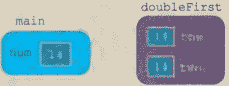

**图 6-22** 函数 `doubleFirst` 的参数

因为 one 和 two 都是值参数，one 对其值所做的任何更改都不会影响 two 和 num 的值。类似地，two 对其值所做的任何更改都不会影响 one 和 num 的值。（注意，在函数 `doubleFirst` 执行之前，num 的值为 14。）

函数 `squareFirst` 的形参 `ref` 是引用参数，形参 `val` 是值参数。变量 `ref` 接收其对应实参的地址，即 `num`；变量 `val` 复制其对应实参的值，该实参也是 `num`。因此，`num` 和 `ref` 都引用同一内存位置，即 `num`。图6-23说明了这种情况。


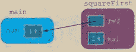

**图 6-23** 函数 `squareFirst` 的参数

ref 所做的任何更改都会立即改变 num。val 所做的任何更改都不会影响 num。（注意，在函数 squareFirst 执行之前，num 的值是 14。）

我们建议你逐步运行示例 6-14 中的程序。输出显示了语句执行的顺序。

## 引用参数与有返回值的函数

本章前面在讨论有返回值的函数时，你学习了如何使用值参数。你也可以在有返回值的函数中使用引用参数，尽管不推荐这种做法。根据定义，有返回值的函数返回单个值；该值通过 return 语句返回。如果一个函数需要返回多个值，按照良好编程风格的规则，你应该将其改为 void 函数，并使用适当的引用参数来返回这些值。

## 标识符的作用域

前面几节给出了几个包含用户自定义函数的程序示例。标识符可以在函数头中、块内或块外声明。自然会产生一个问题：是否允许在程序中的任何位置访问任何标识符？答案是否定的。访问标识符必须遵循某些规则。标识符的作用域是指程序中可以访问（可见）标识符的位置。回想一下，标识符是 C++ 中某个事物的名称，例如变量名或函数名。

本节考察标识符的作用域。首先，我们定义以下两个术语：

**局部标识符：** 在函数（或块）内声明的标识符。
局部标识符在函数（块）外不可访问。

**全局标识符：** 在每个函数定义之外声明的标识符。

此外，C++ 不允许函数嵌套。也就是说，你不能在一个函数体中包含另一个函数的定义。

一般来说，访问标识符时适用以下规则：

- 1. 全局标识符（如变量）可由函数或块访问，如果：
  - a. 该标识符在函数定义（块）之前声明，
  - b. 函数名与该标识符不同，
  - c. 函数的所有参数名称都不同于该标识符的名称，并且
  - d. 所有局部标识符（如局部变量）的名称都不同于该标识符的名称。
- 2. **（嵌套块）** 在块内声明的标识符可在以下情况下访问：
  - a. 仅在该块内，从声明处到该块结束处，并且
  - b. 由嵌套在该块内的那些块访问，前提是嵌套块没有与外部块（包围嵌套块的块）同名的标识符。
- 3. 函数名的作用域类似于在任何块之外声明的标识符的作用域。也就是说，函数名的作用域与全局变量的作用域相同。

在考虑用示例解释这些作用域规则之前，首先注意 for 语句中声明的标识符的作用域。C++ 允许程序员在 for 语句的初始化语句中声明变量。例如，以下 for 语句：

```cpp
for (int count = 1; count < 10; count++)
    cout << count << endl;
```

声明变量 count 并将其初始化为 1。变量 count 的作用域仅限于 for 循环体。

> 这条针对 for 语句中声明变量的作用域规则可能不适用于标准 C++。在标准 C++ 中，初始化语句中声明的变量的作用域可能从声明处一直延伸到紧邻包围 for 语句的块的末尾。（要完全确定，请查阅编译器的文档。）

以下 C++ 程序有助于说明这些作用域规则：

```cpp
#include <iostream>

using namespace std;

const double RATE = 10.50;
int z;
double t;

void one(int x, char y);
void two(int a, int b, char x);
void three(int one, double y, int z);

int main()
{
    int num, first;
    double x, y, z;
    char name, last;
    .
    .
    .
    return 0;
}

void one(int x, char y)
{
    .
    .
    .
}

int w;

void two(int a, int b, char x)
{
    int count;
    .
    .
    .
}

void three(int one, double y, int z)
{
    char ch;
    int a;
    .
    .
    .
    //Block four
    {
        int x;
        char a;
        .
        .
    } //End Block four
    .
    .
    .
}
```

表 6-2 总结了标识符的作用域（可见性）。

**表 6-2** 标识符的作用域（可见性）

| 标识符 | 在 one 中的可见性 | 在 two 中的可见性 | 在 three 中的可见性 | 在块 four 中的可见性 | 在 main 中的可见性 |
|---|---|---|---|---|---|
| RATE（main 之前） | 是 | 是 | 是 | 是 | 是 |
| z（main 之前） | 是 | 是 | 否 | 否 | 否 |
| t（main 之前） | 是 | 是 | 是 | 是 | 是 |
| main | 是 | 是 | 是 | 是 | 是 |
| main 的局部变量 | 否 | 否 | 否 | 否 | 是 |
| one（函数名） | 是 | 是 | 否 | 否 | 是 |
| x（one 的形参） | 是 | 否 | 否 | 否 | 否 |
| y（one 的形参） | 是 | 否 | 否 | 否 | 否 |
| w（函数 two 之前） | 否 | 是 | 是 | 是 | 否 |
| two（函数名） | 是 | 是 | 是 | 是 | 是 |
| a（two 的形参） | 否 | 是 | 否 | 否 | 否 |
| b（two 的形参） | 否 | 是 | 否 | 否 | 否 |
| x（two 的形参） | 否 | 是 | 否 | 否 | 否 |
| two 的局部变量 | 否 | 是 | 否 | 否 | 否 |
| three（函数名） | 是 | 是 | 是 | 是 | 是 |
| one（three 的形参） | 否 | 否 | 是 | 是 | 否 |
| y（three 的形参） | 否 | 否 | 是 | 是 | 否 |
| z（three 的形参） | 否 | 否 | 是 | 是 | 否 |
| ch（three 的局部变量） | 否 | 否 | 是 | 是 | 否 |
| a（three 的局部变量） | 否 | 否 | 是 | 否 | 否 |
| x（块 four 的局部变量） | 否 | 否 | 否 | 是 | 否 |
| a（块 four 的局部变量） | 否 | 否 | 否 | 是 | 否 |

注意，函数 three 不能调用函数 one，因为函数 three 有一个名为 one 的形参。类似地，函数 three 中标记为 four 的块不能使用在函数 three 中声明的 int 变量 a，因为块 four 有一个名为 a 的标识符。

在结束本节之前，让我们注意以下关于全局变量的内容：

- 1. 第 2 章指出 C++ 不会自动初始化变量。然而，一些编译器会将全局变量初始化为其默认值。例如，如果全局变量的类型是 int、char 或 double，则它会被初始化为零。
- 2. 在 C++ 中，`::` 称为**作用域解析运算符**。通过使用作用域解析运算符，在函数（块）定义之前声明的全局变量可以由该函数（或块）访问，即使该函数（或块）有一个与该变量同名的标识符。在前面的程序中，通过使用作用域解析运算符，函数 main 可以将全局变量 z 称为 `::z`。类似地，假设在函数（比如 funExample）定义之前声明了一个全局变量 t。那么，即使 funExample 有一个标识符 t，funExample 也可以使用作用域解析运算符访问变量 t。使用作用域解析运算符时，funExample 将全局变量 t 称为 `::t`。此外，在前面的程序中，使用作用域解析运算符，函数 three 可以调用函数 one。
- 3. C++ 提供了一种访问在函数定义之后声明的全局变量的方法。在这种情况下，函数不能包含任何与全局变量同名的标识符。在前面的程序中，全局变量 w 是在函数 one 的定义之后声明的。函数 one 不包含任何名为 w 的标识符；因此，只有你在 one 内部将 w 声明为外部变量时，函数 one 才能访问 w。要在函数 one 内部将 w 声明为外部变量，函数 one 必须包含以下语句：

  ```cpp
  extern int w;
  ```

  在 C++ 中，extern 是保留字。上述语句中的 extern 一词声明 w 是在其他地方声明的全局变量。因此，当调用函数 one 时，不会为在 one 内部声明的 w 分配内存。在 C++ 中，外部声明还有另一种用途，但本书不讨论。

## 全局变量、命名常量和副作用

一个 C++ 程序可以包含全局变量，你可能会想把程序中的所有变量都设为全局变量，这样就不必担心某个函数知道哪些变量。然而，使用全局变量会有副作用。如果

当多个函数使用同一个全局变量并且出了问题时，就很难发现出了什么问题以及在哪里出的问题。程序某一区域中由全局变量引起的问题，可能会被误认为是另一区域中引起的问题。

例如，考虑下面的程序：

```cpp
//Global variable

#include <iostream>

using namespace std;

int t;

void funOne(int& a);

int main()
{
        t = 15;                                      //Line 1

        cout << "Line 2: In main: t = " << t << endl; //Line 2

        funOne(t);                                    //Line 3

        cout << "Line 4: In main after funOne:"
             << " t = " << t << endl;               //Line 4

        return 0;                                     //Line 5
}

void funOne(int& a)
{
        cout << "Line 6: In funOne: a = " << a
             << " and t = " << t << endl;            //Line 6

        a = a + 12;                                   //Line 7
        cout << "Line 8: In funOne: a = " << a
             << " and t = " << t << endl;            //Line 8

        t = t + 13;                                   //Line 9

        cout << "Line 10: In funOne: a = " << a
             << " and t = " << t << endl;            //Line 10
}
```

这个程序有一个变量 t，它在任何函数定义之前声明。由于没有任何函数拥有标识符 t，因此变量 t 在程序中的任何位置都可以访问。此外，该程序包含一个带引用参数的 void 函数。

在第 3 行，函数 main 调用函数 funOne，传递给 funOne 的实参是 t。因此，funOne 的形参 a 接收了 t 的地址。a 对其值所做的任何更改都会立即改变 t。由于 t 可以在程序中的任何位置直接访问，在第 9 行，函数 funOne 通过使用 *t* 本身来改变 t 的值。因此，你可以通过引用参数或 *t* 本身来操纵 *t* 的值。

在前面的程序中，如果 *t* 的最终值不正确，就很难确定出了什么问题以及问题出在程序的哪一部分。我们强烈建议你*不要使用全局变量*；而应使用适当的参数。

在本书给出的程序中，我们通常将命名常量放在函数 `main` 之前、每个函数定义之外。也就是说，我们使用的命名常量是*全局命名常量*。与全局变量不同，全局命名常量没有副作用，因为它们的值在程序执行期间不能改变。此外，将命名常量放在程序开头可以提高可读性，即使它只在一个函数中使用。如果你以后需要修改程序并改变命名常量的值，把它放在程序开头会更容易找到。

### 示例 6-15（菜单驱动程序）

下面是一个菜单驱动程序的示例。当程序执行时，它会向用户提供一个选择列表供其选择。这个程序进一步说明了值参数和引用参数如何工作。它将长度从英尺和英寸转换为米和厘米，反之亦然。该程序包含三个函数：`showChoices`、`feetAndInchesToMetersAndCent` 和 `metersAndCentToFeetAndInches`。函数 `showChoices` 告知用户如何使用该程序。用户可以根据自己的意愿选择运行该程序多久。

```cpp
//Menu-driven program.

#include <iostream>

using namespace std;

const double CONVERSION = 2.54;
const int INCHES_IN_FOOT = 12;
const int CENTIMETERS_IN_METER = 100;

void showChoices();

void feetAndInchesToMetersAndCent(int f, int in,
                                  int& mt, int& ct);
void metersAndCentToFeetAndInches(int mt, int& ct,
                                  int& f, int& in);

int main()
{
    int feet, inches;
    int meters, centimeters;
    int choice;

    do
    {
        showChoices();
        cin >> choice;
        cout << endl;

        switch (choice)
        {
        case 1:
            cout << "Enter feet and inches: ";
            cin >> feet >> inches;
            cout << endl;
            feetAndInchesToMetersAndCent(feet, inches,
                                         meters, centimeters);
            cout << feet << " feet(foot), "
                 << inches << " inch(es) = "
                 << meters << " meter(s), "
                 << centimeters << " centimeter(s)." << endl;
            break;

        case 2:
            cout << "Enter meters and centimeters: ";
            cin >> meters >> centimeters;
            cout << endl;
            metersAndCentToFeetAndInches(meters, centimeters,
                                         feet, inches);

            cout << meters << " meter(s), "
                 << centimeters << " centimeter(s) = "
                 << feet << " feet(foot), "
                 << inches << " inch(es)."
                 << endl;
            break;

        case 99:
            break;

        default:
            cout << "Invalid input." << endl;
        }
    }
    while (choice != 99);

    return 0;
}

void showChoices()
{
    cout << "Enter--" << endl;
    cout << "1: To convert from feet and inches to meters "
         << "and centimeters." << endl;
    cout << "2: To convert from meters and centimeters to feet "
         << "and inches." << endl;
    cout << "99: To quit the program." << endl;
}
```

## 静态变量和自动变量

到目前为止讨论的变量遵循两条简单规则：

- 1. 只要程序执行，全局变量的内存就保持分配状态。
- 2. 在块内声明的变量，其内存在进入块时分配，在退出块时释放。例如，函数的形式参数和局部变量的内存会在函数被调用时分配，并在函数退出时释放。

在进入块时分配内存、在退出块时释放内存的变量称为**自动变量**。只要程序执行，其内存就保持分配状态的变量称为**静态变量**。全局变量是静态变量，而默认情况下，在块内声明的变量是自动变量。你可以使用保留字 static 在块内声明静态变量。声明静态变量的语法是：

```cpp
static dataType identifier;
```

语句：

```cpp
static int x;
```

将 x 声明为 int 类型的静态变量。

在块内声明的静态变量是该块的局部变量，其作用域与该块中任何其他局部标识符的作用域相同。

大多数编译器会将静态变量初始化为其默认值。例如，static int 变量会被初始化为 0。然而，自己初始化静态变量是一种好做法，尤其是当初始值不是默认值时。在这种情况下，静态变量会在声明时被初始化。语句：

```cpp
static int x = 0;
```

将 x 声明为 int 类型的静态变量，并将 x 初始化为 0。

### 示例 6-16

下面的程序展示了静态变量和自动变量的行为。

```cpp
//Program: Static and automatic variables

#include <iostream>

using namespace std;

void test();

int main()
{
    int count;

    for (count = 1; count <= 5; count++)
        test();

    return 0;
}

void test()
{
    static int x = 0;
    int y = 10;

    x = x + 2;
    y = y + 1;

    cout << "Inside test x = " << x << " and y = "
         << y << endl;
}
```

### 示例运行：

```text
Inside test x = 2 and y = 11
Inside test x = 4 and y = 11
Inside test x = 6 and y = 11
Inside test x = 8 and y = 11
Inside test x = 10 and y = 11
```

在函数 test 中，x 是一个初始化为 0 的静态变量，y 是一个初始化为 10 的自动变量。函数 main 调用函数 test 五次。变量 y 的内存在每次调用函数 test 时分配，并在函数退出时释放。因此，每次调用函数 test 时，它都会为 y 打印相同的值。然而，由于 x 是静态变量，x 的内存在程序执行期间保持分配状态。变量 x 只初始化一次为 0。函数 test 的后续调用使用 x 的当前值。

由于静态变量的内存在函数调用之间保持分配状态，静态变量允许你将一个变量在一次函数调用中的值用于另一次函数调用。即使你想将某些值从一次函数调用用于另一次函数调用时可以使用全局变量，静态变量的局部作用域可以防止其他函数操纵其值。

## 调试：使用驱动程序和桩程序

在本章和前面的章节中，你学习了如何编写函数来将一个问题划分为子问题、求解每个子问题，然后组合这些函数形成完整程序，从而得到问题的解。一个程序可能包含许多函数。在复杂程序中，通常当编写一个函数时，会单独测试和调试它。你可以编写一个单独的程序来测试该函数。测试函数的程序称为驱动程序。例如，示例 6-15 中的程序包含将长度从英尺和英寸转换为米和厘米的函数。

反之亦然。在编写完整程序之前，你可以编写独立的驱动程序，以确保每个函数都能正常工作。

有时，一个函数计算出的结果会被另一个函数使用。在这种情况下，依赖于另一个函数的函数无法单独测试。例如，考虑下面这个确定游泳池注水时间的程序。

```cpp
#include <iostream>
#include <iomanip>

using namespace std;

const double GALLONS_IN_A_CUBIC_FOOT = 7.48;

double poolCapacity(double len, double wid, double dep);
void poolFillTime(double len, double wid, double dep,
                  double fRate, int& fTime);
void print(int fTime);

int main()
{
    double length, width, depth;
    double fillRate;
    int fillTime;

    cout << fixed << showpoint << setprecision(2);

    cout << "Enter the length, width, and the depth of the "
         << "pool (in feet): ";
    cin >> length >> width >> depth;
    cout << endl;

    cout << "Enter the rate of the water (in gallons per minute): ";
    cin >> fillRate;
    cout << endl;

    poolFillTime(length, width, depth, fillRate, fillTime);
    print(fillTime);

    return 0;
}

double poolCapacity(double len, double wid, double dep)
{
    double volume;
    double poolWaterCapacity;

    volume = len * wid * dep;
    poolWaterCapacity = volume * GALLONS_IN_A_CUBIC_FOOT;

    return poolWaterCapacity;
}

void poolFillTime(double len, double wid, double dep,
                  double fRate, int& fTime)
{
    double poolWaterCapacity;

    poolWaterCapacity = poolCapacity(len, wid, dep);
    fTime = static_cast<int> (poolWaterCapacity / fRate + 0.5);
}

void print(int fTime)
{
    cout << "The time to fill the pool is approximately: "
         << fTime / 60 << " hour(s) and " << fTime % 60
         << " minute(s)." << endl;
}
```

**示例运行：** 在此示例运行中，用户输入以底纹显示。

输入游泳池的长度、宽度和深度（单位：英尺）：`30 15 10`

输入水流速率（单位：加仑/分钟）：`100`

注满游泳池的时间大约为：5 小时 37 分钟。

如你所见，该程序包含函数 poolCapacity，用于求出注满游泳池所需的水量；包含函数 poolFillTime，用于求出注满游泳池所需的时间；还包含一些其他函数。现在，要计算注满游泳池的时间，你必须知道所需的水量以及水注入游泳池的速率。由于函数 poolFillTime 需要使用函数 poolCapacity 的结果，因此函数 poolFillTime 无法单独测试。这是否意味着我们必须按特定顺序编写这些函数？不一定，尤其是当不同的人负责程序的不同部分时。在这种情况下，我们使用函数桩。函数桩是一种未完全编码的函数。对于 void 函数，函数桩可能只包含一个函数头和一对空花括号 { }；对于有返回值的函数，它可能只包含一条带有一个合理返回值的 return 语句。例如，函数 poolCapacity 的函数桩可以是：

```cpp
double poolCapacity(double len, double wid, double dep)
{
    return 1000.00;
}
```

这使得在编写程序期间可以调用函数 poolCapacity。最终，函数 poolCapacity 的桩会被替换为一个根据参数值正确计算注满游泳池所需水量的函数。在此期间，函数桩允许程序中调用函数 poolCapacity 的其他部分继续工作。

在我们查看一些编程示例之前，还有一个关于函数的概念值得提及：函数重载。

## 函数重载：简介

在 C++ 程序中，多个函数可以具有相同的名称。这称为**函数重载**，或**重载函数名**。在陈述重载函数的规则之前，我们先定义以下内容：

- 形式参数的数量不同，或
- 如果形式参数的数量相同，那么按你列出的顺序，形式参数的数据类型必须至少在一个位置上不同。

例如，考虑以下函数头：

```
void functionOne(int x)
void functionTwo(int x, double y)
void functionThree(double y, int x)
int functionFour(char ch, int x, double y)
int functionFive(char ch, int x, string name)
```

这些函数都具有不同的形式参数列表。

现在考虑以下函数头：

```
void functionSix(int x, double y, char ch)
void functionSeven(int one, double u, char firstCh)
```

函数 functionSix 和 functionSeven 都有三个形式参数，并且对应参数的数据类型相同。因此，这些函数具有相同的形式参数列表。

要重载一个函数名，该函数的任意两个定义必须具有不同的形式参数列表。

**函数重载。** 创建多个具有相同名称的函数。

函数的**签名**由函数名及其形式参数列表组成。如果两个函数具有不同的名称或不同的形式参数列表，则它们具有不同的签名。（注意，函数的签名不包括函数的返回类型。）

如果一个函数的名称被重载，那么该集合中的所有函数都具有相同的名称。因此，如果该集合中的所有函数具有不同的形式参数列表，则它们具有不同的签名。因此，以下函数头正确地重载了函数 functionXYZ：

```
void functionXYZ()
void functionXYZ(int x, double y)
void functionXYZ(double one, int y)
void functionXYZ(int x, double y, char ch)
```

考虑以下用于重载函数 functionABC 的函数头：

```
void functionABC(int x, double y)
int functionABC(int x, double y)
```

这两个函数头具有相同的名称和相同的形式参数列表。因此，这些用于重载函数 functionABC 的函数头是不正确的。在这种情况下，编译器将生成语法错误。（注意，这些函数头的返回类型不同。）

如果一个函数被重载，那么在调用该函数时，签名——即函数的形式参数列表——决定执行哪个函数。

> **注意**
>
> 有些作者将函数的签名定义为形式参数列表，而有些作者将函数的整个函数头视为其签名。然而，在本书中，函数的签名由函数名及其形式参数列表组成。如果函数名不同，那么编译器当然可以毫无问题地识别调用的是哪个函数，并会正确翻译代码。然而，如果函数名被重载，那么如前所述，函数的形式参数列表决定执行哪个函数体。

假设你需要编写一个函数来确定两个项中较大的一个。这两个项可以是整数、浮点数、字符或字符串。你可以编写如下几个函数：

```cpp
int largerInt(int x, int y);
char largerChar(char first, char second);
double largerDouble(double u, double v);
string largerString(string first, string second);
```

函数 largerInt 确定两个整数中较大的一个；函数 largerChar 确定两个字符中较大的一个，依此类推。所有这些函数执行类似的操作。与其为这些函数赋予不同的名称，你可以为每个函数使用相同的名称——比如 larger；也就是说，你可以重载函数 larger。因此，你可以将前面的函数原型简单地写为：

```cpp
int larger(int x, int y);
char larger(char first, char second);
double larger(double u, double v);
string larger(string first, string second);
```

例如，如果调用是 larger(5, 3)，则执行第一个函数。如果调用是 larger('A', '9')，则执行第二个函数，依此类推。

当你对不同数据集执行相同操作时，会使用函数重载。当然，要使函数重载生效，你必须给出每个函数的定义。

### 带默认参数的函数

> **注意**
>
> 本节直到第 10 章才会用到。


本节讨论带默认参数的函数。回顾一下，调用函数时，实参和形参的数量必须相同。C++ 对带默认参数的函数放宽了这一条件。默认参数的值在函数名第一次出现时指定，例如在原型中。通常，以下规则适用于带默认参数的函数：

- 如果不指定某个默认参数的值，则对该参数使用默认值。
- 所有默认参数都必须是函数最右侧的参数。
- 假设一个函数有多个默认参数。在函数调用中，如果未指定某个默认参数的值，则必须省略其右侧的所有实参。
- 默认值可以是常量、全局变量或函数调用。
- 调用者可以选择为任何默认参数指定非默认值。
- 不能将常量值作为默认值赋给引用参数。

考虑以下函数原型：

```cpp
void funcExp(int x, int y, double t, char z = 'A', int u = 67,
              char v = 'G', double w = 78.34);
```

函数 funcExp 有七个参数。参数 z、u、v 和 w 是默认参数。如果在调用函数 funcExp 时没有为 z、u、v 和 w 指定值，则使用它们的默认值。

假设有以下语句：

```cpp
int a, b;
char ch;
double d;
```

以下函数调用是合法的：

- 1. `funcExp(a, b, d);`
- 2. `funcExp(a, 15, 34.6, 'B', 87, ch);`
- 3. `funcExp(b, a, 14.56, 'D');`

在语句 1 中，使用 z、u、v 和 w 的默认值。在语句 2 中，z 的默认值被替换为 'B'，u 的默认值被替换为 87，v 的默认值被替换为 ch 的值，而 w 的默认值被使用。在语句 3 中，z 的默认值被替换为 'D'，并使用 u、v 和 w 的默认值。

以下函数调用是非法的：

- 1. `funcExp(a, 15, 34.6, 46.7);`
- 2. `funcExp(b, 25, 48.76, 'D', 4567, 78.34);`

在语句 1 中，因为省略了 z 的值，所以必须省略所有其他默认值。在语句 2 中，因为省略了 v 的值，所以也应省略 w 的值。

以下是带默认参数的非法函数原型：

- 1. `void funcOne(int x, double z = 23.45, char ch, int u = 45);`
- 2. `int funcTwo(int length = 1, int width, int height = 1);`
- 3. `void funcThree(int x, int& y = 16, double z = 34);`

在语句 1 中，因为第二个参数 z 是默认参数，所以 z 之后的所有其他参数都必须是默认参数。在语句 2 中，因为第一个参数是默认参数，所以所有参数都必须是默认参数。在语句 3 中，不能将常量值赋给 y，因为 y 是引用参数。

示例 6-17 进一步说明带默认参数的函数。

## 示例 6-17

```cpp
#include <iostream>
#include <iomanip>

using namespace std;

int volume(int l = 1, int w = 1, int h = 1);
void funcOne(int& x, double y = 12.34, char z = 'B');

int main()
{
    int a = 23;
    double b = 48.78;
    char ch = 'M';

    cout << fixed << showpoint;
    cout << setprecision(2);

    cout << "Line 1: a = " << a << ", b = "
         << b << ", ch = " << ch << endl;       //Line 1
    cout << "Line 2: Volume = " << volume()
         << endl;                                //Line 2
    cout << "Line 3: Volume = " << volume(5, 4)
         << endl;                                //Line 3
    cout << "Line 4: Volume = " << volume(34)
         << endl;                                //Line 4
    cout << "Line 5: Volume = "
         << volume(6, 4, 5) << endl;             //Line 5

    funcOne(a);                                  //Line 6
    funcOne(a, 42.68);                           //Line 7
    funcOne(a, 34.65, 'Q');                      //Line 8

    cout << "Line 9: a = " << a << ", b = "
         << b << ", ch = " << ch << endl;       //Line 9

    return 0;
}

int volume(int l, int w, int h)
{
    return l * w * h;                         //Line 10
}

void funcOne(int& x, double y, char z)
{
    x = 2 * x;                                //Line 11
    cout << "Line 12: x = " << x << ", y = "
         << y << ", z = " << z << endl;      //Line 12
}
```

### 示例运行

```text
Line 1: a = 23, b = 48.78, ch = M
Line 2: Volume = 1
Line 3: Volume = 20
Line 4: Volume = 34
Line 5: Volume = 120
Line 12: x = 46, y = 12.34, z = B
Line 12: x = 92, y = 42.68, z = B
Line 12: x = 184, y = 34.65, z = Q
Line 9: a = 184, b = 48.78, ch = M
```

> **注意** 在本书的程序中，并且按照推荐做法，函数 `main` 的定义放在任何用户定义函数的定义之前。因此，必须仅在函数原型中指定默认值，而不是在函数定义中指定，因为这必须发生在函数名第一次出现时。

## 编程示例：数字分类

在本例中，我们使用函数重写一个程序，该程序从给定的整数列表中确定奇数和偶数的数量。这个程序最初是在第 5 章编写的。

主算法保持不变：

- 1. 将变量 zeros、odds 和 evens 初始化为 0。
- 2. 读取一个数。
- 3. 如果该数是偶数，则增加偶数计数；如果该数同时也是零，则增加零计数；否则，增加奇数计数。
- 4. 对列表中的每个数重复步骤 2 和 3。

程序的主要部分是：初始化变量，读取并分类数字，然后输出结果。为了简化函数 main 并进一步说明参数传递，程序包括：

- 一个函数 `initialize`，用于初始化变量，例如 zeros、odds 和 evens。
- 一个函数 `getNumber`，用于获取数字。
- 一个函数 `classifyNumber`，用于确定数字是奇数还是偶数（以及是否也为零）。该函数还会递增相应的计数器。
- 一个函数 `printResults`，用于打印结果。

现在让我们描述这些函数中的每一个。

### initialize

函数 initialize 将变量初始化为其初始值。我们需要初始化的变量是 zeros、odds 和 evens。和之前一样，它们的初始值都是零。显然，这个函数有三个参数。因为用于初始化这些变量的形参的值必须传递到函数外部，所以这些形参必须是引用参数。本质上，这个函数是：

```cpp
void initialize(int& zeroCount, int& oddCount, int& evenCount)
{
    zeroCount = 0;
    oddCount = 0;
    evenCount = 0;
}
```

### getNumber

函数 getNumber 读取一个数，然后将这个数传递给函数 main。因为只需要传递一个数，所以这个函数只有一个参数。这个（void）函数的形参必须是引用参数，因为读取到的数要传递到函数外部。本质上，这个函数是：

```cpp
void getNumber(int& num)
{
    cin >> num;
}
```

你也可以将函数 getNumber 编写为值返回函数。请参阅本编程示例末尾的注释。

### classifyNumber

函数 classifyNumber 确定数字是奇数还是偶数，如果数字是偶数，它还会检查该数字是否为零。它还会更新一些变量的值，即 zeros、odds 和 evens。这个函数需要知道要分析的数字；因此，该数字必须作为参数传递。因为这个函数还会递增相应的计数，所以保存计数的变量（即在 main 中声明的 zeros、odds 和 evens）必须作为参数传递给这个函数。因此，这个函数有四个参数。

因为只会分析该数字，所以只需要传递它的值。因此，对应于该变量的形参是值参数。分析数字后，这个函数会递增一些变量的值，即 zeros、odds 和 evens。因此，对应于这些变量的形参

必须是引用参数。分析数字并递增相应计数的算法与之前相同。该函数的定义如下：

```cpp
void classifyNumber(int num, int& zeroCount, int& oddCount,
                    int& evenCount)
{
    switch (num % 2)
    {
    case 0:
        evenCount++;
        if (num == 0)
            zeroCount++;
        break;
    case 1:
    case -1:
        oddCount++;
    } //end switch
} //end classifyNumber
```

### printResults

函数 printResults 打印最终结果。为了打印结果（即零、奇数和偶数的数量），该函数必须能够访问在函数 main 中声明的变量 zeros、odds 和 evens 的值。因此，该函数有三个参数。由于该函数不改变变量的值，只是打印它们，所以形参是值参数。该函数的定义如下：

```cpp
void printResults(int zeroCount, int oddCount, int evenCount)
{
    cout << "There are " << evenCount << " evens, "
         << "which includes " << zeroCount << " zeros"
         << endl;

    cout << "The number of odd numbers is: " << oddCount
         << endl;
} //end printResults
```

现在给出主算法，并说明函数 main 如何调用这些函数。

### 主算法

- 1. 调用函数 `initialize` 初始化变量。
- 2. 提示用户输入 20 个数字。
- 3. 对于列表中的每个数字：
  - a. 调用函数 `getNumber` 读取一个数字。
  - b. 输出该数字。
  - c. 调用函数 `classifyNumber` 对该数字进行分类，并递增相应的计数。
- 4. 调用函数 `printResults` 打印最终结果。

### 完整程序清单

```cpp
//********************************************************************
// Author: D.S. Malik
//
// Program: Classify Numbers
// This program reads 20 numbers and outputs the number of
// zeros, odd, and even numbers.
//********************************************************************

#include <iostream>
#include <iomanip>

using namespace std;

const int N = 20;

        //Function prototypes
void initialize(int& zeroCount, int& oddCount, int& evenCount);
void getNumber(int& num);
void classifyNumber(int num, int& zeroCount, int& oddCount,
                   int& evenCount);
void printResults(int zeroCount, int oddCount, int evenCount);

int main()
{
        //Variable declaration
        int counter;  //loop control variable
        int number;   //variable to store the new number
        int zeros;    //variable to store the number of zeros
        int odds;     //variable to store the number of odd integers
        int evens;    //variable to store the number of even integers

        initialize(zeros, odds, evens);                 //Step 1

        cout << "Please enter " << N << " integers."
             << endl;                                  //Step 2
        cout << "The numbers you entered are: "
             << endl;

        for (counter = 1; counter <= N; counter++)     //Step 3
        {
                getNumber(number);                     //Step 3a
                cout << number << " ";                 //Step 3b
                classifyNumber(number, zeros, odds, evens); //Step 3c
        } //end of for loop

        cout << endl;

        printResults(zeros, odds, evens);            //Step 4
        return 0;
}

void initialize(int& zeroCount, int& oddCount, int& evenCount)
{
    zeroCount = 0;
    oddCount = 0;
    evenCount = 0;
}

void getNumber(int& num)
{
    cin >> num;
}

void classifyNumber(int num, int& zeroCount, int& oddCount,
                    int& evenCount)
{
    switch (num % 2)
    {
    case 0:
        evenCount++;
        if (num == 0)
            zeroCount++;
        break;
    case 1:
    case -1:
        oddCount++;
    } //end switch
} //end classifyNumber

void printResults(int zeroCount, int oddCount, int evenCount)
{
    cout << "There are " << evenCount << " evens, "
         << "which includes " << zeroCount << " zeros"
         << endl;

    cout << "The number of odd numbers is: " << oddCount
         << endl;
} //end printResults
```

示例运行：在此示例运行中，用户输入以阴影显示。

```text
Please enter 20 integers.
The numbers you entered are:
0 0 12 23 45 7 -2 -8 -3 -9 4 0 1 0 -7 23 -24 0 0 12
0 0 12 23 45 7 -2 -8 -3 -9 4 0 1 0 -7 23 -24 0 0 12
There are 12 evens, which includes 6 zeros
The number of odd numbers is: 8
```

> **注意** 在前面的程序中，由于假定数据从标准输入设备（键盘）输入，并且函数 `getNumber` 只返回一个值，你也可以将函数 `getNumber` 编写为值返回函数。如果编写为值返回函数，则函数 `getNumber` 的定义为：
>
> ```cpp
> int getNumber()
> {
>     int num;
>
>     cin >> num;
>
>     return num;
> }
> ```
>
> 在这种情况下，函数 main 中的语句（函数调用）：
>
> `getNumber(number);`
>
> 应替换为语句：
>
> `number = getNumber();`
>
> 当然，还需要修改函数原型。

## 编程示例：数据比较


本编程示例说明：

- 如何在同一个程序中从多个文件读取数据。
- 如何将输出发送到文件。
- 如何生成条形图。
- 借助函数和参数传递，如何将同一程序段用于不同（但相似）的数据集。
- 如何使用结构化设计解决问题，以及如何执行参数传递。

该程序分为两部分。首先，学习如何从多个文件读取数据。其次，学习如何生成条形图。

某地方大学的两组学生在夏季学期选修了某些特殊课程。这些课程是首次开设，由不同的教师讲授。学期结束时，两组学生参加相同课程的相同测试，他们的成绩记录在单独的文件中。每个文件中的数据形式如下：

```text
courseNo  score1, score2, ..., scoreN -999
courseNo  score1, score2, ..., scoreM -999
.
.
.
```

让我们编写一个程序，求出每组中每门课程的平均成绩。输出形式如下：

| 课程编号 | 组号 | 课程平均分 |
|---|---:|---:|
| CSC | 1 | 83.71 |
|  | 2 | 80.82 |
| ENG | 1 | 82.00 |
|  | 2 | 78.20 |

第 1 组平均分：82.04

第 2 组平均分：82.01

### 输入

由于两组的数据记录在单独的文件中，因此输入数据出现在两个单独的文件中。

### 输出

如上所示。

从两个文件读取数据很直接。假设第 1 组的数据存储在文件 group1.txt 中，第 2 组的数据存储在文件 group2.txt 中。处理完一组的数据后，我们可以处理第二组中同一门课程的数据，并继续直到数据用完。处理每门课程的数据类似，是一个两步过程：

- 1.
  - a. 对该课程的成绩求和。
  - b. 统计该课程的学生人数。
  - c. 用总成绩除以学生人数，求出课程平均分。
- 2. 输出结果。

我们只比较每组中对应课程的平均分，并且每个文件中的数据按课程 ID 排序。为了确保只比较对应课程的平均分，我们比较每组的课程 ID。如果对应的课程 ID 不相同，则输出错误信息并终止程序。

以上讨论表明，我们应该编写一个函数 calculateAverage 来求课程平均分。我们还应该编写另一个函数 printResult，以给定形式输出数据。通过传递适当的参数，我们可以使用相同的函数 calculateAverage 和 printResult 来处理两组中每门课程的数据。（在程序的第二部分，我们修改函数 printResult。）


上述讨论可转化为以下算法：

- 1. 初始化变量。
- 2. 获取第1组和第2组的课程ID。
- 3. 如果课程ID不同，则打印错误信息并退出程序。
- 4. 计算第1组和第2组的课程平均分。
- 5. 按上述给定格式打印结果。
- 6. 对每门课程重复步骤2到步骤5。
- 7. 打印最终结果。

## 变量（函数 `main`）

上述讨论表明，程序在函数 main 中需要以下变量进行数据操作：

```cpp
string courseId1;     //course ID for group 1
string courseId2;     //course ID for group 2
int numberOfCourses;
double avg1;          //average for a course in group 1
double avg2;          //average for a course in group 2
double avgGroup1;     //average group 1
double avgGroup2;     //average group 2
ifstream group1;      //input stream variable for group 1
ifstream group2;      //input stream variable for group 2

ofstream outfile;     //output stream variable
```

接下来，我们讨论函数 calculateAverage 和 printResult。然后，我们将把函数 main 组合起来。

## calculateAverage

此函数计算一门课程的平均分。由于输入存储在文件中，并且输入文件在函数 main 中打开，我们必须将与输入文件关联的 ifstream 变量传递给此函数。此外，在计算课程平均分后，此函数必须将课程平均分传回函数 main。因此，此函数有两个参数，并且两个参数都必须是引用参数。

要计算课程平均分，我们必须先求出该课程所有分数的总和以及选修该课程的学生人数，然后将总和除以学生人数。因此，我们需要一个变量来求分数总和，一个变量来统计学生人数，以及一个变量来读取并存储一个分数。当然，我们必须将用于求总和的变量和用于统计学生人数的变量初始化为零。

### 局部变量（函数 `calculateAverage`）

在之前关于数据操作的讨论中，我们为函数 calculateAverage 确定了三个变量：

```cpp
double totalScore = 0.0;
int numberOfStudents = 0;
int score;
```

上述讨论可转化为函数 calculateAverage 的以下算法：

- 1. 声明并初始化变量。
- 2. 获取（下一门）课程分数 score。
- 3. 当分数不是 -999 时
  - a. 将课程分数加到 totalScore 以更新 totalScore。
  - b. 将 numberOfStudents 增加 1。
  - c. 获取（下一门）课程分数 score。
- 4. courseAvg = totalScore / numberOfStudents;

现在我们可以编写函数 calculateAverage 的定义了。

```cpp
void calculateAverage(ifstream& inp, double& courseAvg)
{
    double totalScore = 0.0;
    int numberOfStudents = 0;
    int score;

    inp >> score;
    while (score != -999)
    {
        totalScore = totalScore + score;
        numberOfStudents++;
        inp >> score;
    } //end while

    courseAvg = totalScore / numberOfStudents;
} //end calculateAverage
```

函数 printResult 打印该组的课程ID、组号和课程平均分。输出存储在文件中。因此，我们必须向此函数传递四个参数：与输出文件关联的 ofstream 变量、组号、课程ID以及该组的课程平均分。ofstream 变量必须按引用传递。由于该函数只使用其他变量的值，其余三个参数应为值参数。此外，从输出可以清楚地看出，我们只在组号之前打印课程ID。

- 1. 用伪代码表示，算法为：

```cpp
if (group number == 1)
    print course ID
else
    print a blank

print group number and course average
```

函数 `printResult` 的定义如下：

```cpp
void printResult(ofstream& outp, string courseID, int groupNo,
                 double avg)
{
    if (groupNo == 1)
        outp << " " << courseID << " ";
    else
        outp << "        ";

    outp << setw(8) << groupNo << setw(17) << avg << endl;
} //end printResult
```

既然我们已经设计并定义了函数 calculateAverage 和 printResult，现在可以描述函数 main 的算法了。然而，在概述该算法之前，我们注意以下几点：两个输入文件中的数据都很可能是按课程ID排序的，但一个文件中的课程可能比另一个文件少。直到处理完两个文件并发现其中一个文件还有未处理的数据时，我们才会发现这个错误。在打印最终答案（即第1组和第2组的平均分）之前，务必检查此错误。

## 主算法：函数 main

- 1. 声明变量（局部声明）。
- 2. 打开输入文件。
- 3. 如果无法打开文件，则打印一条消息并终止程序。
- 4. 打开输出文件。
- 5. 要以带小数点和尾随零的固定十进制格式输出浮点数，请设置操纵符 fixed 和 showpoint。另外，要将浮点数输出到两位小数，请将精度设置为两位小数。
- 6. 将第1组的课程平均分初始化为 0.0。
- 7. 将第2组的课程平均分初始化为 0.0。
- 8. 将课程数量初始化为 0。
- 9. 打印标题。
- 10. 获取第1组的课程ID courseId1。
- 11. 获取第2组的课程ID courseId2。
- 12. 对于第1组和第2组中的每门课程，
  - a. if (courseId1 != courseId2)
    {
        cout << "Data error: Course IDs do not match.\n";
        return 1;
    }

```cpp
//Function prototypes
void calculateAverage(ifstream& inp, double& courseAvg);
void printResult(ofstream& output, string courseId,
                 int groupNo, double avg);

int main()
{
    //Step 1
    string courseId1;       //course ID for group 1
    string courseId2;       //course ID for group 2
    int numberOfCourses;    //number of courses
    double avg1;            //average for a course in group 1
    double avg2;            //average for a course in group 2
    double avgGroup1;       //average group 1
    double avgGroup2;       //average group 2
    ifstream group1;        //input stream variable for group 1
    ifstream group2;        //input stream variable for group 2
    ofstream outfile;       //output stream variable

    group1.open("group1.txt");                       //Step 2
    group2.open("group2.txt");                       //Step 2

    if (!group1 || !group2)                          //Step 3
    {
        cout << "Unable to open files." << endl;
        cout << "Program terminates." << endl;
        return 1;
    }

    outfile.open("student.out");                     //Step 4
    outfile << fixed << showpoint;                   //Step 5
    outfile << setprecision(2);                      //Step 5

    avgGroup1 = 0.0;                                 //Step 6
    avgGroup2 = 0.0;                                 //Step 7

    numberOfCourses = 0;                             //Step 8

    outfile << "Course No        Group No     "
            << "Course Average" << endl;             //Step 9

    group1 >> courseId1;                             //Step 10
    group2 >> courseId2;                             //Step 11
    while (group1 && group2)                         //Step 12
    {
        if (courseId1 != courseId2)                  //Step 12a
        {
            cout << "Data error: Course IDs "
                 << "do not match." << endl;
```


```cpp
inp >> score;
while (score != -999)
{
    totalScore = totalScore + score;
    numberOfStudents++;
    inp >> score;
} //end while

courseAvg = totalScore / numberOfStudents;
} //end calculateAverage

void printResult(ofstream& outp, string courseID, int groupNo,
                double avg)
{
    if (groupNo == 1)
        outp << "  " << courseID << "  ";
    else
        outp << "        ";
    outp << setw(8) << groupNo << setw(17) << avg << endl;
} //end printResult
```

## 示例运行

| 课程编号 | 组号 | 课程平均分 |
|---|---:|---:|
| CSC | 1 | 83.71 |
|  | 2 | 80.82 |
| ENG | 1 | 82.00 |
|  | 2 | 78.20 |
| HIS | 1 | 77.69 |
|  | 2 | 84.15 |
| MTH | 1 | 83.57 |
|  | 2 | 84.29 |
| PHY | 1 | 83.22 |
|  | 2 | 82.60 |

第 1 组平均分：82.04
第 2 组平均分：82.01

### 输入数据组 1

```text
CSC 80 100 70 80 72 90 89 100 83 70 90 73 85 90 -999
ENG 80 90 80 94 90 74 78 63 83 80 90 -999
HIS 90 70 80 70 90 50 89 83 90 68 90 60 80 -999
MTH 74 80 75 89 90 73 90 82 74 90 84 100 90 79 -999
PHY 100 83 93 80 63 78 88 89 75 -999
```

### 输入数据组 2

```text
CSC 90 75 90 75 80 89 100 60 80 70 80 -999
ENG 80 80 70 68 70 78 80 90 90 76 -999
HIS 100 80 80 70 90 76 88 90 90 75 90 85 80 -999
MTH 80 85 85 92 90 90 74 90 83 65 72 90 84 100 -999
PHY 90 93 73 85 68 75 67 100 87 88 -999
```

在商业领域，公司高管通常喜欢以某种可视化的形式查看结果，例如条形图。许多现有的软件包可以用多种形式分析数据，然后以可视化形式（如条形图或饼图）显示结果。本程序的第二部分旨在以条形图的形式显示之前得到的结果，如下所示：

```text
Course                      Course Average
  ID       0  10  20  30  40  50  60  70  80  90 100
           |....|....|....|....|....|....|....|....|....|....|
CSC        ****************************************
           ########################################
ENG        ***************************************
           #######################################
.
.
Group 1 -- ****
Group 2 -- ####

Avg for group 1: 82.04
Avg for group 2: 82.01
```

条形图中的每个符号（* 或 #）代表两个分数。如果某门课程的平均分低于 2 分，则不打印任何符号。

由于输出采用条形图的形式，我们需要修改函数 printResult。

## 打印条形图

函数 printResult 打印课程 ID 和表示该课程平均分的条形图。输出存储在文件中。因此，我们必须向此函数传递四个参数：与输出文件关联的 ofstream 变量、组号（用于打印 * 或 #）、课程 ID 以及该系的课程平均分。要打印条形图，我们可以使用循环为每两个分数打印一个符号。例如，如果平均分是 78.45，我们必须打印 39 个符号来表示该平均分。要找出要打印的符号数量，我们可以使用整数除法，如下所示：

```cpp
noOfSymbols = static_cast<int>(avg) / 2;
```

例如，static_cast<int>(78.45) / 2 = 78 / 2 = 39。

根据上述讨论，函数 printResult 的定义为：

```cpp
void printResult(ofstream& out, string courseID,
                 int groupNo, double avg)
{
    int noOfSymbols;
    int count;

    if (groupNo == 1)
        out << setw(4) << courseID << "    ";
    else
        out << "          ";

    noOfSymbols = static_cast<int>(avg)/2;

    if (groupNo == 1)
        for (count = 1; count <= noOfSymbols; count++)
            out << '*';
    else
        for (count = 1; count <= noOfSymbols; count++)
            out << '#';

    out << endl;
} //end printResult
```

我们还包含一个函数 printHeading，用于打印输出的前两行。该函数的定义为：

```cpp
void printHeading(ofstream& out)
{
    out << "Course        Course Average" << endl;
    out << "  ID     0    10    20    30    40    50    60    70"
        << "    80    90   100" << endl;
    out << "      |....|....|....|....|....|....|....|....|"
        << "....|....|....|" << endl;
} //end printHeading
```

在之前的程序中替换函数 printResult，包含函数 printHeading，添加输出“Group 1 -- ****”和“Group 2 -- ####”的语句，然后重新运行程序。你的程序应生成一个类似于前面所示的条形图。（完整的程序清单可在随本书附带的网站上找到。）

## 快速回顾

- 1. 函数类似于微型程序，被称为模块。
- 2. 函数使你能将程序划分为易于管理的任务。
- 3. C++ 系统提供了标准（预定义）函数。
- 4. 要使用标准函数，你必须：
  - i. 知道包含该函数规范的头文件名，
  - ii. 在程序中包含该头文件，并且
  - iii. 知道该函数的名称和类型，以及参数（实参）的数量和类型。
- 5. 用户自定义函数有两种类型：返回值的函数和 void 函数。
- 6. 在函数头中定义的变量称为形式参数。
- 7. 在函数调用中使用的表达式、变量或常量值称为实际参数。
- 8. 在函数调用中，实际参数的数量及其类型必须按给定顺序与形式参数匹配。
- 9. 要调用函数，需要使用其名称以及实际参数列表。
- 10. 返回值函数会返回一个值。因此，返回值函数在表达式、输出语句中，或作为函数调用中的参数被使用（调用）。
- 11. 用户自定义函数的一般语法为：

    ```cpp
    functionType  functionName(formal parameter list)
    {
        statements
    }
    ```

- 12. 行 `functionType functionName(formal parameter list)` 称为函数头（或函数首部）。用花括号（`{` 和 `}`）括起来的语句称为函数体。
- 13. 函数头和函数体合称为函数定义。
- 14. 如果函数没有参数，在函数头和函数调用中仍然需要空括号。
- 15. 返回值函数通过 return 语句返回其值。
- 16. 一个函数可以有多个 return 语句。然而，只要函数中执行了一个 return 语句，其余语句将被跳过，函数退出。
- 17. return 语句只返回一个值。
- 18. 函数原型是函数头但没有函数体；函数原型以分号结束。
- 19. 函数原型声明函数类型，以及函数中使用的参数类型和数量。
- 20. 在函数原型中，形式参数列表中的变量名是可选的。
- 21. 函数原型帮助编译器正确翻译每个函数调用。
- 22. 在程序中，函数原型放在每个函数定义（包括 main 函数的定义）之前。
- 23. 使用函数原型时，用户自定义函数可以按任意顺序出现在程序中。
- 24. 当程序执行时，执行总是从 main 函数中的第一条语句开始。
- 25. 用户自定义函数只有在被调用时才执行。
- 26. 对函数的调用将控制权从调用者转移到被调用的函数。
- 27. 在函数调用语句中，你只指定实际参数，而不指定它们的数据类型或函数类型。
- 28. 当函数退出时，控制权返回给调用者。
- 29. 没有数据类型的函数称为 void 函数。
- 30. 不带任何值的 return 语句可以用在 void 函数中。如果在 void 函数中使用 return 语句，通常用于提前退出函数。
- 31. void 函数的函数头以关键字 void 开头。
- 32. 在 C++ 中，void 是一个保留字。
- 33. void 函数可以有参数，也可以没有参数。
- 34. 对 void 函数的调用是一条独立的语句。
- 35. 要调用 void 函数，可以在独立语句中使用函数名称以及实际参数。
- 36. 形式参数有两种类型：值参数和引用参数。
- 37. 值参数接收其对应实际参数的副本。
- 38. 引用参数接收其对应实际参数的地址（内存位置）。
- 39. 值参数对应的实际参数可以是表达式、变量或常量值。
- 40. 常量值不能传递给引用参数。
- 41. 引用参数对应的实际参数必须是变量。
- 42. 当你在形式参数的数据类型后加上 & 时，该形式参数就变成引用参数。
- 43. 流变量应通过引用传递给函数。
- 44. 如果形式参数需要改变实际参数的值，在函数头中，你必须将此形式参数声明为引用参数。


- 45. 标识符的作用域是指程序中可以访问该标识符的那些部分。

- 46. 在函数（或块）内声明的变量称为局部变量。

- 47. 在每个函数定义（和块）之外声明的变量称为全局变量。

- 48. 函数名的作用域与在任何块之外声明的标识符的作用域相同。

- 49. 本章中的作用域规则（“标识符的作用域”一节）。

- 50. C++ 不允许嵌套函数定义。

- 51. 自动变量是一种在进入函数（或块）时分配内存、在退出函数（或块）时释放内存的变量。

- 52. 静态变量是一种在程序整个执行期间都保持分配内存的变量。

- 53. 默认情况下，全局变量是静态变量。

- 54. 在 C++ 中，函数可以被重载。

- 55. 如果两个函数满足以下条件，则称它们具有不同的形参列表：
    - 形参数量不同，或者
    - 如果形参数量相同，那么按你列出的顺序，形参的数据类型必须至少在一个位置上不同。

- 56. 函数的签名由函数名及其形参列表组成。如果两个函数具有不同的名称或不同的形参列表，则它们具有不同的签名。

- 57. 如果函数被重载，那么在调用该函数时，签名——即函数的形参列表——决定执行哪个函数。

- 58. C++ 允许函数具有默认参数。

- 59. 如果你不指定某个默认参数的值，则该参数使用默认值。

- 60. 所有默认参数必须是函数最右侧的参数。

- 61. 假设一个函数有多个默认参数。在函数调用中，如果没有指定某个默认参数的值，那么必须省略其右侧的所有实参。

- 62. 默认值可以是常量、全局变量或函数调用。

- 63. 调用函数可以选择为任何默认参数指定默认值以外的值。

- 64. 不能将常量值作为默认值赋给引用参数。

## 练习

- 1. 将下列陈述标记为真或假：
    - a. 要在程序中使用预定义函数，你只需要知道函数名以及如何使用它。
    - b. 有返回值的函数只返回一个值。
    - c. 参数允许你在每次调用函数时使用不同的值。
    - d. 当用户定义函数中的 `return` 语句执行时，函数会立即退出。
    - e. 有返回值的函数只返回整数值。
    - f. 改变引用参数值的函数也会改变实际参数的值。
    - g. 变量名不能传递给值参数。
    - h. 如果 C++ 函数不使用参数，空参数列表外的圆括号仍然是必需的。
    - i. 在 C++ 中，对应的形参和实参的名称必须相同。
    - j. 每当引用参数的值改变时，实际参数的值也会改变。
    - k. 在 C++ 中，函数定义可以嵌套；也就是说，一个函数的定义可以包含在另一个函数体中。
    - l. 在程序中使用全局变量比使用局部变量是更好的编程风格，因为这样可以避免额外的变量。
    - m. 在程序中，全局常量与全局变量一样危险。
    - n. 静态变量的内存在函数调用之间保持分配。

- 2. 确定下列每个表达式的值：
    - a. `static_cast<char>(toupper('$'))`
    - b. `static_cast<char>(toupper('3'))`
    - c. `static_cast<char>(toupper('#'))`
    - d. `static_cast<char>(toupper('d'))`
    - e. `static_cast<char>(tolower('+'))`
    - f. `static_cast<char>(tolower('?'))`
    - g. `static_cast<char>(tolower('H'))`
    - h. `static_cast<char>(tolower('%'))`

- 3. 确定下列每个表达式的值：
    - a. `abs(12)`
    - b. `fabs(23.45)`
    - c. `fabs(-7.8)`
    - d. `pow(4.8, 2)`
    - e. `pow(4.0, 2.5)`
    - f. `sqrt(49.0)`
    - g. `sqrt(7.29)`
    - h. `pow(6.0, 3.0) / abs(-36)`
    - i. `floor(36.27)`
    - j. `ceil(18.3)`

- 4. 使用表 6-1 中描述的函数，将下列每个表达式写成 C++ 表达式。（(e) 中的表达式表示 $x + 2y - 3$ 的绝对值。）
    - a. $3.75^{6.8}$
    - b. $\sqrt{x - 2y}$
    - c. $w^4$
    - d. $\frac{b + \sqrt{b^2 - 4ac}}{2a}$
    - e. $|x + 2y - 3|$

- 5. 考虑以下函数定义：

```
int func(int x, double y, char u, string name)
{
    //function body
}
```

    以下哪些是函数 `func` 的正确函数原型？

    - a. `int func(x, y, u, name);`
    - b. `int func(int s, double k, char ch, string name);`
    - c. `int func(int, double, char, string);`
    - d. `func(int, double, char, string)`

- 6. 考虑以下程序：

```
#include <iostream>
#include <cmath>

using namespace std;

int main()
{
    int num1;
    int num2;

    cout << "Enter two integers: ";
    cin >> num1 >> num2;
    cout << endl;

    if (num1 != 0 && num2 != 0)
        cout << sqrt(fabs(num1 + num2 + 0.0)) << endl;
    else if (num1 != 0)
        cout << floor(num1 + 0.0) << endl;
    else if (num2 != 0)
        cout << ceil(num2 + 0.0) << endl;
    else
        cout << 0 << endl;

    return 0;
}
```

    - a. 如果输入为 12 4，输出是什么？
    - b. 如果输入为 3 27，输出是什么？
    - c. 如果输入为 25 0，输出是什么？
    - d. 如果输入为 0 49，输出是什么？

- 7. 考虑以下语句：

```
int num1, num2, num3;
double length, width, height;
double volume;
num1 = 6; num2 = 7; num3 = 4;
length = 6.2; width = 2.3; height = 3.4;
```

    以及函数原型：

```
double box(double, double, double);
```

    以下哪些语句是有效的？如果它们无效，请解释原因。

    - a. `volume = box(length, width, height);`
    - b. `volume = box(length, 3.8, height);`
    - c. `cout << box(num1, num3, num2) << endl;`
    - d. `cout << box(length, width, 7.0) << endl;`
    - e. `volume = box(length, num1, height);`
    - f. `cout << box(6.2, height) << endl;`
    - g. `volume = box(length + width, height);`
    - h. `volume = box(num1, num2 + num3);`

- 8. 考虑以下函数：

```
int find(int num)
{
    int first, second;

    first = num * num;
    second = first + num;

    if (second > 100)
        num = first / 10;
    else
        num = first / 20;

    return num + 2;
}
```

```
int discover(int one, int two)
{
    int secret = 0;

    for (int i = one; i < two; i++)
        secret = secret + i * i;

    return secret;
}
```

    下列每个程序段的输出是什么？

    - a. `cout << find(15) << endl;`
    - b. `cout << discover(3, 9) << endl;`
    - c. `cout << find(10) << " " << discover(10, find(10)) << endl;`
    - d.
      ```
      x = 12; y = 8;
      cout << discover(y, x) << endl;
      ```

- 9. 考虑以下函数原型：

```
int func1(int, double);
double func2(string, int, double);
char func3(int, int, double, char);
string join(string, string);
```

    回答以下问题：

    - a. 函数 func1 有多少个参数？函数 func1 的类型是什么？
    - b. 函数 func2 有多少个参数？函数 func2 的类型是什么？
    - c. 函数 func3 有多少个参数？函数 func3 的类型是什么？
    - d. 函数 join 有多少个参数？函数 join 的类型是什么？
    - e. 调用函数 func1 需要多少个实际参数？每个实际参数的类型是什么，在调用函数 func1 时这些参数应按什么顺序使用？
    - f. 编写一条 C++ 语句，打印函数 func1 在实参为 3 和 8.5 时返回的值。
    - g. 编写一条 C++ 语句，打印函数 join 在实参分别为 "John" 和 "Project Manager" 时返回的值。
    - h. 编写一条 C++ 语句，打印函数 func3 返回的下一个字符。（使用你自己的实际参数。）

- 10. 为什么在包含用户定义函数的程序中需要包含函数原型？

- 11. 编写一个函数的定义，该函数接受一个 char 值作为输入，如果该字符是大写字母则返回 true；否则返回 false。

- 12. 考虑以下函数：

```
int mystery(int x, double y, char ch)
{
    if (x == 0 && ch > 'A')
        return(static_cast<int>(pow(y, 2)) + static_cast<int>(ch));
    else if (x > 0)
        return(x + static_cast<int>(sqrt(y)) - static_cast<int>(ch));
}
```

16. 以下程序的输出是什么？

```cpp
#include <iostream>

using namespace std;

int mystery(int x, int y, int z);

int main()
{
    cout << mystery(7, 8, 3) << endl;
    cout << mystery(10, 5, 30) << endl;
    cout << mystery(9, 12, 11) << endl;
    cout << mystery(5, 5, 8) << endl;
    cout << mystery(10, 10, 10) << endl;

    return 0;
}

int mystery(int x, int y, int z)
{
    if (x <= y && x <= z)
        return (y + z - x);
    else if (y <= z && y <= x)
        return (z + x - y);
    else
        return (x + y - z);
}
```

17. 编写一个函数的定义，该函数接受三个十进制数作为输入，并返回第一个数乘以第二个数的第三个数次方。

18. 考虑以下 C++ 函数：

```cpp
int mystery(int num)
{
    int y = 1;

    if (num == 0)
        return 1;
    else if (num < 0)
        return -1;
    else
        for (int count = 1; count < num; count++)
            y = y * (num - count);

    return y;
}
```

以下语句的输出是什么？

- a. `cout << mystery(6) << endl;`
- b. `cout << mystery(0) << endl;`
- c. `cout << mystery(-5) << endl;`
- d. `cout << mystery(10) << endl;`

19.

- a. 你如何在 void 函数中使用 return 语句？
- b. 为什么你想在 void 函数中使用 return 语句？

20. 在下面所示的程序代码中，识别以下项目：

- a. 函数原型、函数头、函数体和函数定义。
- b. 函数调用语句、形式参数和实际参数。
- c. 值参数和引用参数。
- d. 局部变量和全局变量。
- e. 命名常量。

```cpp
#include <iostream>                                      //Line 1

using namespace std;                                     //Line 2

const double NUM = 3.5;                                  //Line 3

int temp;                                                //Line 4

void func(int, double&, char);                           //Line 5

int main()                                               //Line 6
{                                                        //Line 7
    int num;                                             //Line 8
    double one;                                          //Line 9
    char ch;                                             //Line 10

    func(num, one, ch);                                  //Line 11
    cout << num << " " << one << " " << ch << endl;      //Line 12
    func(16, 9, '?');                                    //Line 13
    cout << num << " " << one << " " << ch << endl;      //Line 14

    return 0;                                             //Line 15
}                                                        //Line 16

void func(int first, double& second, char ch)             //Line 17
{                                                        //Line 18
    int num;                                             //Line 19
    double y;                                            //Line 20
    int u;                                               //Line 21

    num = 2 * first;                                     //Line 22
    y = second * first;                                  //Line 23
    u = static_cast<int>(ch);                            //Line 24
    second = num + y * u;                                //Line 25
}                                                        //Line 26
```

21.

- a. 解释实际参数和形式参数之间的区别。
- b. 解释值参数和引用参数之间的区别。
- c. 解释局部变量和全局变量之间的区别。

22. 以下程序的输出是什么？

```cpp
#include <iostream>
using namespace std;

void func1();
void func2();

int main()
{
    int num;

    cout << "Enter 1 or 2: ";
    cin >> num;
    cout << endl;

    cout << "Take ";

    if (num == 1)
        func1();
    else if (num == 2)
        func2();
    else
        cout << "Invalid input. You must enter a 1 or 2" << endl;

    return 0;
}

void func1()
{
    cout << "Programming I." << endl;
}

void func2()
{
    cout << "Programming II." << endl;
}
```

- a. 如果输入是 1，输出是什么？
- b. 如果输入是 2，输出是什么？
- c. 如果输入是 3，输出是什么？
- d. 如果输入是 −1，输出是什么？

23. 编写一个 void 函数的定义，该函数接受一个十进制数作为输入，并输出该十进制数数值的 3 倍。将输出格式化为保留两位小数。

24. 编写一个 void 函数的定义，该函数接受两个十进制数作为输入。如果第一个数不为零，它输出第二个数除以第一个数的结果；否则，它输出一条消息，指示第二个数不能被第一个数除，因为第一个数是 0。

25. 编写一个 void 函数的定义，该函数具有三个引用参数，类型分别为 int、double 和 string。该函数将 int 和 double 变量的值设置为 0，并将 string 变量的值设置为空字符串。

26. 编写一个 void 函数的定义，该函数接受两个 int 类型的参数，比如 sum 和 testScore。该函数通过加上 testScore 的值来更新 sum 的值。sum 的新值会在调用环境中体现。

27. 以下程序的输出是什么：

```cpp
#include <iostream>
using namespace std;

void find(int a, int& b, int& c);

int main()
{
    int one, two, three;

    one = 5;
    two = 10;
    three = 15;

    find(one, two, three);
    cout << one << ", " << two << ", " << three << endl;

    find(two, one, three);
    cout << one << ", " << two << ", " << three << endl;

    find(three, two, one);
    cout << one << ", " << two << ", " << three << endl;

    find(two, three, one);
    cout << one << ", " << two << ", " << three << endl;

    return 0;
}

void find(int a, int& b, int& c)
{
    int temp;

    c = a + b;
    temp = a;
    a = b;
    b = 2 * temp;
}
```

28. 以下程序的输出是什么？

```cpp
#include <iostream>
using namespace std;

int x;

void summer(int&, int);
void fall(int, int&);

int main()
{
    int intNum1 = 2;
    int intNum2 = 5;
    x = 6;

    summer(intNum1, intNum2);
    cout << intNum1 << " " << intNum2 << " " << x << endl;

    fall(intNum1, intNum2);
    cout << intNum1 << " " << intNum2 << " " << x << endl;
    return 0;
}

void summer(int& a, int b)
{
    int intNum1;
    intNum1 = b + 12;
    a = 2 * b + 5;
    b = intNum1 + 4;
}

void fall(int u, int& v)
{
    int intNum2;
    intNum2 = x;
    v = intNum2 * 4;
    x = u - v;
}
```

29. 在以下程序中，给标注的语句编号以显示它们将执行的顺序（执行的逻辑顺序）。另外，如果输入是 10，输出是什么？

```cpp
#include <iostream>

using namespace std;

int secret(int, int);

void func(int x, int& y);

int main()
{
    int num1, num2;

    num1 = 6;

    cout << "Enter a positive integer: ";
    cin >> num2;
    cout << endl;
    cout << secret(num1, num2) << endl;
    num2 = num2 - num1;
    cout << num1 << " " << num2 << endl;
    func(num2, num1);
    cout << num1 << " " << num2 << endl;

    return 0;
}

int secret(int a, int b)
{
    int d;

    d = a + b;
    b = a * d;

    return b;
}

void func (int x, int& y)
{
    int val1, val2;

    val1 = x + y;
    val2 = x * y;
    y = val1 + val2;
    cout << val1 << " " << val2 << endl;
}
```

30. 考虑以下程序：

```cpp
#include <iostream>
#include <cmath>
#include <iomanip>

using namespace std;

void traceMe(double x, double y);

int main()
{
    double one, two;

    cout << "Enter two numbers: ";
    cin >> one >> two;
    cout << endl;
```


```cpp
traceMe(one, two);
traceMe(two, one);

return 0;
}

void traceMe(double x, double y)
{
    double z;

    if (x != 0)
        z = sqrt(y) / x;
    else
    {
        cout << "Enter a nonzero number: ";
        cin >> x;
        cout << endl;
        z = floor(y / x);
    }

    cout << fixed << showpoint << setprecision(2);
    cout << x << ", " << y << ", " << z << endl;
}
```

- a. 如果输入为 3 625，输出是什么？
- b. 如果输入为 24 1024，输出是什么？
- c. 如果输入为 10 196，输出是什么？

- 31. 练习30中的函数 `traceMe` 输出 x、y 和 z 的值。修改该函数的定义，使其不再打印这些值，而是将这些值传回调用环境，并由调用环境打印这些值。

- 32. 在练习30中，确定每个标识符的作用域。

- 33. 以下代码片段的输出是什么？（注意：alpha 和 beta 是 int 变量。）

```cpp
alpha = 5;
beta = 10;

if (beta >= 10)
{
    int alpha = 10;
    beta = beta + alpha;
    cout << alpha << " " << beta << endl;
}

cout << alpha << " " << beta << endl;
```

- 34. 考虑以下程序。它的确切输出是什么？像例6-13那样，展示每一行执行后变量的值。

```cpp
#include <iostream>

using namespace std;

void funOne(int& a);

int main()
{
    int num1, num2;

    num1 = 10;                                      //Line 1
    num2 = 20;                                      //Line 2

    cout << "Line 3: In main: num1 = " << num1
         << ", num2 = " << num2 << endl;            //Line 3

    funOne(num1);                                   //Line 4
    cout << "Line 5: In main after funOne: num1 = "
         << num1 << ", num2 = " << num2 << endl;    //Line 5

    return 0;                                       //Line 6
}

void funOne(int& a)
{
    int x = 12;
    int z;

    z = a + x;                                      //Line 7

    cout << "Line 8: In funOne: a = " << a
         << ", x = " << x
         << ", and z = " << z << endl;              //Line 8

    x = x + 5;                                      //Line 9

    cout << "Line 10: In funOne: a = " << a
         << ", x = " << x
         << ", and z = " << z << endl;              //Line 10

    a = a + 8;                                      //Line 11

    cout << "Line 12: In funOne: a = " << a
         << ", x = " << x
         << ", and z = " << z << endl;              //Line 12
}
```

- 35. 以下程序的输出是什么？

```cpp
#include <iostream>
using namespace std;

void tryMe(int& v);

int main()
{
    int x = 8;

    for (int count = 1; count < 5; count++)
        tryMe(x);

    return 0;
}

void tryMe(int& v)
{
    static int num = 2;

    if (v % 2 == 0)
    {
        num++;
        v = v + 3;
    }
    else
    {
        num--;
        v = v + 5;
    }
    cout << v << ", " << num << endl;
}
```

- 36. 函数的签名是什么？

- 37. 考虑以下函数原型：

  void funcDefaultParam(double x = 7.3, int y = 4, char z = '*');

  以下哪个函数调用是正确的？

  - a. `funcDefaultParam();`
  - b. `funcDefaultParam(2.8);`
  - c. `funcDefaultParam(3.2, 0, 'h');`
  - d. `funcDefaultParam(9.2, '*');`
  - e. `funcDefaultParam(7, 3);`

- 38. 考虑以下函数定义：

```cpp
void defaultParam(int num1, int num2 = 7, double z = 2.5)
{
    int num3;

    num1 = num1 + static_cast<int>(z);
    z = num2 + num1 * z;
    num3 = num2 + num1;
    cout << "num3 = " << num3 << endl;
}
```

以下函数调用的输出是什么？

- a. `defaultParam(7);`
- b. `defaultParam(8, 2);`
- c. `defaultParam(0, 1, 7.5);`
- d. `defaultParam(1, 2, 3.0);`

## 编程练习

- 1. 编写一个程序，使用例6-5（回文）中给出的函数 `isPalindrome`。用以下字符串测试你的程序："madam"、"abba"、"22"、"67876"、"444244" 和 "trymememurt"。

- 2. 编写一个返回值函数 `isVowel`，如果给定字符是元音，则返回值 `true`，否则返回 `false`。

- 3. 编写一个程序，提示用户输入一串字符，并输出元音的数量。（使用编程练习2中编写的函数 `isVowel`。）

- 4. 编写一个程序，定义命名常量 `PI`，即 `const double PI = 3.1419;`，它存储 π 的值。程序应使用 `PI` 和表6-1中列出的函数完成以下任务：
  - a. 输出 √π 的值。
  - b. 提示用户输入 double 变量 `r` 的值，该变量存储球的半径。然后程序输出以下内容：
    - i. `4πr²` 的值，即球的表面积。
    - ii. `(4/3)πr³` 的值，即球的体积。

- 5. 以下程序旨在计算矩形的面积、圆的面积或圆柱的体积。但是，(a) 语句顺序不正确；(b) 函数调用不正确；(c) `while` 循环中的逻辑表达式不正确；(d) 函数定义不正确。重写该程序，使其正确运行。你的程序必须正确缩进。（注意，该程序是菜单驱动的，并且允许用户按自己的意愿多次运行程序。）

```cpp
#include <iostream>

using namespace std;

const double PI = 3.1419;

double rectangle(double l, double w);

#include <iomanip>
int main()
{
    double radius;
    double height;

    cout << fixed << showpoint << setprecision(2) << endl;
    cout << "This program can calculate the area of a rectangle, "
         << "the area of a circle, or volume of a cylinder." << endl;
    cout << "To run the program enter: " << endl;
    cout << "1: To find the area of a rectangle." << endl;
    cout << "2: To find the area of a circle." << endl;
    cout << "3: To find the volume of a cylinder." << endl;
    cout << "-1: To terminate the program." << endl;
    cin >> choice;
    cout << endl;

    int choice;

    while (choice == -1)
    {
        {
            case 1:
                cout << "Enter the radius of the base and the "
                     << "height of the cylinder: ";
                cin >> radius >> height;
                cout << endl;

                cout << "Area = " << circle(length, height) << endl;
                break;

            case 3:
                double length, width;
                cout << "Enter the radius of the circle: ";
                cin >> radius;
                cout << endl;

                cout << "Area = " << rectangle(radius)
                     << endl;
                break;

    case 2:
        cout << "Enter the length and the width "
             << "of the rectangle: ";
        cin >> length >> width;
        cout << endl;

        cout << "Volume = " << cylinder(radius, height)
             << endl;
        break;
    default:
        cout << "Invalid choice!" << endl;
    }
    switch (choice)
    }

    double circle(double r)
    double cylinder(double bR, double h);

    cout << "To run the program enter: " << endl;
    cout << "2: To find the area of a circle." << endl;
    cout << "1: To find the area of rectangle." << endl;
    cout << "3: To find the volume of a cylinder." << endl;
    cout << "-1: To terminate the program." << endl;
    cin >> choice;
    cout << endl;

    }
    return 0;
}

double rectangle(double l, double w)
{
    return l * w;
}

double circle(double r)
{
    return PI * r * r;
}

double cylinder(double bR, double h)
{
    return PI * bR * bR * h;
}
```

- 6. 编写一个函数 `reverseDigit`，它接受一个整数作为参数，并返回数字反转后的数。例如，`reverseDigit(12345)` 的值是 54321；`reverseDigit(5600)` 的值是 65；`reverseDigit(7008)` 的值是 8007；`reverseDigit(-532)` 的值是 -235。

- 7. 修改掷骰子程序（例6-4），使其允许用户输入希望掷出的数字之和。还要允许用户按自己的意愿多次调用 `rollDice` 函数。


### 8.

以下公式给出笛卡尔平面中两点 \((x_1, y_1)\) 和 \((x_2, y_2)\) 之间的距离：

$$\sqrt{(x_2-x_1)^2+(y_2-y_1)^2}$$

给定圆心和圆上一点，你可以使用该公式求出圆的半径。编写一个程序，提示用户输入圆心和圆上一点。然后程序应输出圆的半径、直径、周长和面积。你的程序至少必须包含以下函数：

- **a. distance：** 此函数以表示平面中两个点的四个数为参数，并返回它们之间的距离。
- **b. radius：** 此函数以表示圆心和圆上一点的四个数为参数，调用函数 distance 求圆的半径，并返回圆的半径。
- **c. circumference：** 此函数以一个表示圆半径的数为参数，并返回圆的周长。（如果 *r* 是半径，则周长为 \(2\pi r\)。）
- **d. area：** 此函数以一个表示圆半径的数为参数，并返回圆的面积。（如果 *r* 是半径，则面积为 \(\pi r^2\)。）

假设 \(\pi = 3.1416\)。

### 9.

重写第4章编程练习15（手机公司）中的程序，使其使用以下函数计算账单金额。（在本编程练习中，不要输出使用服务的时间分钟数。）

- **a. regularBill：** 此函数计算并返回常规服务的账单金额。
- **b. premiumBill：** 此函数计算并返回高级服务的账单金额。

### 10.

编写一个程序，输入五个数，并输出这些数的均值（平均数）和标准差。如果这些数为 \(x_1\)、\(x_2\)、\(x_3\)、\(x_4\) 和 \(x_5\)，则均值为 \(\bar{x} = (x_1 + x_2 + x_3 + x_4 + x_5)/5\)，标准差为：

$$s=\sqrt{\frac{(x_1-\bar{x})^2+(x_2-\bar{x})^2+(x_3-\bar{x})^2+(x_4-\bar{x})^2+(x_5-\bar{x})^2}{5}}$$

你的程序至少必须包含以下函数：一个计算并返回均值的函数，以及一个计算标准差的函数。

### 11.

当你借钱买房、买车或用于其他目的时，通常通过定期还款来偿还。假设贷款金额为 $L$，$r$ 是年利率，$m$ 是一年中的还款次数，贷款期限为 $t$ 年。假设 $i = (r / m)$，且 $r$ 为小数形式。则定期还款额为：

$$R = \frac{Li}{1 - (1+i)^{-mt}}$$

你也可以计算进行若干次还款后的未偿还贷款余额。例如，进行 $k$ 次还款后的未偿还余额为：

$$L' = R\left[\frac{1 - (1+i)^{-(mt-k)}}{i}\right]$$

其中 $R$ 是定期还款额。（注意，如果按月还款，则 \(m = 12\)。）

编写一个程序，提示用户输入 $L$、$r$、$m$、$t$ 和 $k$ 的值。然后程序输出相应的值。你的程序至少必须包含两个函数，并带有适当的参数，分别计算定期还款额和进行若干次还款后的未偿还余额。使程序采用菜单驱动方式，并使用循环，以便用户可以针对不同的值重复运行程序。

### 12.

在报税季的每个星期五，J&J 会计师事务所为自行准备纳税申报表的人提供帮助。他们的收费如下：

- **a.** 如果一个人属于低收入（<= 25,000），且咨询时间小于或等于30分钟，则不收费；否则，服务费为超过30分钟部分按正常小时费率的40%计算。
- **b.** 对于其他人，如果咨询时间小于或等于20分钟，则不收取服务费；否则，服务费为超过20分钟部分按正常小时费率的70%计算。

（例如，假设一个人属于低收入，花费了1小时15分钟，小时费率为 \$70.00。则账单金额为 \$70.00 × 0.40 × (45 / 60) = \$21.00。）

编写一个程序，提示用户输入小时费率、总咨询时间以及该人是否属于低收入。程序应输出账单金额。你的程序必须包含一个函数，该函数以小时费率、总咨询时间以及一个表示该人是否属于低收入的值作为输入。该函数应返回账单金额。你的程序可以提示用户以分钟为单位输入咨询时间。

### 13.

在非常寒冷的冬季，通常每个人都想知道风寒指数，尤其是在外出之前。气象学家使用以下公式计算风寒指数 $W$：

$W = 35.74 + 0.6215 * T - 35.75 * V^{0.16} + 0.4275 * T * V^{0.16}$,

其中 \(V\) 是风速，单位为英里/小时，\(T\) 是温度，单位为华氏度。编写一个程序，提示用户输入风速（英里/小时）和温度（华氏度）。然后程序输出风寒指数。你的程序至少必须包含两个函数：一个用于获取用户输入，另一个用于确定风寒指数。

### 14.

考虑函数 `main` 的定义：

```cpp
int main()
{
    int x, y;
    char z;
    double rate, hours;
    double amount;
    .
    .
    .
}
```

下面 a 到 g 项中提到的变量 x、y、z、rate 和 hours 是函数 main 的变量。所描述的每个函数都必须具有适当的参数来访问这些变量。编写以下定义：

- **a.** 编写函数 `initialize` 的定义，该函数将 x 和 y 初始化为 0，将 z 初始化为空白字符。
- **b.** 编写函数 `getHoursRate` 的定义，该函数提示用户输入工作小时数和每小时费率，以初始化函数 main 的变量 hours 和 rate。
- **c.** 编写有返回值的函数 `payCheck` 的定义，该函数根据工作小时数和每小时费率计算并返回应支付给员工的金额。工作小时数和每小时费率分别存储在函数 main 的变量 hours 和 rate 中。计算应支付金额的公式如下：前40小时按给定费率计算；超过40小时的部分按给定费率的1.5倍计算。
- **d.** 编写函数 `printCheck` 的定义，该函数打印工作小时数、每小时费率和工资。
- **e.** 编写函数 `funcOne` 的定义，该函数提示用户输入一个数。然后该函数通过将表达式“2 乘以 x 的（旧）值加上 y 的值再减去用户输入的数值”的值赋给 x 来改变 x 的值。
- **f.** 编写函数 `nextChar` 的定义，该函数将 `z` 的值设置为存储在 `z` 中的下一个字符。
- **g.** 编写函数 `main` 的定义，以测试这些函数中的每一个。

### 15.

考虑以下 C++ 代码：

```cpp
#include <iostream>
#include <cmath>
#include <iomanip>

using namespace std;

void func1();
void func2(/*formal parameters*/);

int main()
{
    int num1, num2;
    double num3;

    int choice;

    cout << fixed << showpoint << setprecision(2);

    do
    {
        func1();
        cin >> choice;
        cout << endl;

        if (choice == 1)
        {
            func2(num1, num2, num3);
            cout << num1 << ", " << num2 << ", " << num3 << endl;
        }
    }
    while (choice != 99);

    return 0;
}

void func1()
{
    cout << "To run the program, enter 1." << endl;
    cout << "To exit the program, enter 99." << endl;
    cout << "Enter 1 or 99: ";
}

void func2(/*formal parameters*/)
{
    //Write the body of func2.
}
```

函数 `func2` 有三个参数，类型分别为 `int`、`int` 和 `double`，假设分别为 `a`、`b` 和 `c`。编写 `func2` 的定义，使其操作如下：

- **a.** 提示用户输入两个整数，并分别将这两个数存储到 `a` 和 `b` 中。
- **b.** 如果两个数均非零：
  - i. 如果 `a >= b`，则赋给 `c` 的值为 `a` 的 `b` 次方，即 `a^b`。
  - ii. 如果 `a < b`，则赋给 `c` 的值为 `b` 的 `a` 次方，即 `b^a`。
- **c.** 如果 `a` 非零且 `b` 为零，则赋给 `c` 的值为 `a` 的绝对值的平方根。
- **d.** 如果 `b` 非零且 `a` 为零，则赋给 `c` 的值为 `b` 的绝对值的平方根。
- **e.** 否则，赋给 `c` 的值为 0。

`a`、`b` 和 `c` 的值会传回调用环境。

完成 `func2` 原型定义后，试运行你的程序。

### 16.

以下程序中的语句顺序不正确。重新排列这些语句，使程序输出员工每天在工作上花费的总时间。程序要求用户输入员工姓名、到达时间（到达小时、到达分钟、上午或下午）和离开时间（离开小时、离开分钟、上午或下午）。程序还允许用户按自己的意愿反复运行程序。重新排列语句后，你的程序必须正确缩进。

```cpp
#include <iostream>
#include <string>

using namespace std;

int main()
{
    string employeeName;
    int arrivalHr;

    int departureHr;
    int departureMin;
    bool departureAM;

    char response;
    char discard;
    char isAM;

    cout << "This program calculates the total time spent by an "
         << "employee on the job." << endl;
    cout << "To run the program, enter (y/Y): ";
    cin >> response;
    cout << endl;
    cin.get(discard);
```

```cpp
while (response == 'y' || response == 'Y')
{
    cout << "Enter employee's name: ";
    getline(cin, employeeName);
    cout << endl;

    if (isAM == 'y' || isAM == 'Y')
        arrivalAM = true;
    else
        arrivalAM = false;

    cout << "Enter departure hour: ";
    cin >> departureHr;
    cout << endl;
    cout << "Enter departure minute: ";
    cin >> departureMin;
    cout << endl;
    cout << "Enter (y/Y) if departure is before 12:00PM: ";
    cin >> isAM;
    cout << endl;

    if (isAM == 'y' || isAM == 'Y')
        departureAM = true;
    else
        departureAM = false;

    cout << employeeName << endl;
    timeOnJob(arrivalHr, arrivalMin, arrivalAM,
              departureHr, departureMin, departureAM);

    cout << "Enter arrival hour: ";
    cin >> arrivalHr;
    cout << endl;
    cout << "Enter arrival minute: ";
    cin >> arrivalMin;
    cout << endl;
    cout << "Enter (y/Y) if arrival is before 12:00PM: ";
    cin >> isAM;
    cout << endl;

    int arrivalMin;
    bool arrivalAM;
    cout << "Run program again (y/Y): ";
    cin >> response;
    cout << endl;
    cin.get(discard);
}

return 0;
}
```

```cpp
void timeOnJob(int arvHr, int arvMin, bool arvIsAM,
               int depHr, int depMin, bool depIsAM)
{
    int arvTimeInMin;
    int depTimeInMin;
    int timeOnJobInMin;

    if (arvIsAM == true && depIsAM == false)
    {
        arvTimeInMin = arvHr * 60 + arvMin;
        depTimeInMin = depHr * 60 + depMin;

        timeOnJobInMin = (720 - arvTimeInMin) + depTimeInMin;
        cout << "Time spent on job: "
             << timeOnJobInMin / 60 << " hour(s) and "
             << timeOnJobInMin % 60 << " minutes." << endl;
    }

    else if (arvTimeInMin <= depTimeInMin)
    {
        timeOnJobInMin = depTimeInMin - arvTimeInMin;
        cout << "Time spent on job: "
             << timeOnJobInMin / 60 << " hour(s) and "
             << timeOnJobInMin % 60 << " minutes." << endl;
    }
    else
        cout << "Invalid input." << endl;
    if ((arvIsAM == true && depIsAM == true)
        || (arvIsAM == false && depIsAM == false))
    {
        cout << "Invalid input." << endl;
    }

    void timeOnJob(int arvHr, int arvMin, bool arvIsAM,
                   int depHr, int depMin, bool depIsAM);
}
```

- **17.** 例6-12中的函数printGrade被编写为void函数，用于计算并输出课程成绩。课程分数作为参数传递给函数printGrade。将函数printGrade重写为值返回函数，使其计算并返回课程成绩。（课程成绩必须在函数main中输出。）同时，将函数名改为calculateGrade。

- **18.** 在本练习中，你要修改本章中的Classify Numbers编程示例。按目前写法，程序从标准输入设备（键盘）输入数据，并将结果输出到标准输出设备（屏幕）。该程序只能处理20个数字。重写该程序以满足以下要求：
    - a. 程序的数据从长度未指定的文件输入；也就是说，程序事先不知道文件中有多少个数字。
    - b. 将程序的输出保存到文件中。
    - c. 修改函数`getNumber`，使其从输入文件（在函数`main`中打开）读取一个数字，将该数字输出到输出文件（在函数`main`中打开），并将读取的数字发送给函数`main`。每行只打印10个数字。
    - d. 让程序求这些数字的和与平均值。
    - e. 修改函数`printResult`，使其将最终结果输出到输出文件（在函数`main`中打开）。除了输出相应的计数外，函数`printResult`的这个新定义还应输出这些数字的和与平均值。

- **19.** 编写一个程序，给定月-日-年格式的日期，输出该日期是这一年的第几天。例如，如果输入为1-1-2006，则天数为1；如果输入为12-25-2006，则天数为359。程序应检查闰年。如果年份能被4整除但不能被100整除，则该年是闰年。例如，1992和2008能被4整除，但不能被100整除。能被100整除的年份如果能被400整除，则是闰年。例如，1600和2000能被400整除。然而，1800不是闰年，因为1800不能被400整除。

- **20.** 编写一个程序，读取一个字符串并输出其中每个小写元音出现的次数。程序必须包含一个函数，其一个参数为字符串变量，并返回每个小写元音在其中出现的次数。还要编写一个程序来测试你的函数。（注意，如果`str`是string类型的变量，那么`str.at(i)`返回第i个位置上的字符。第一个字符的位置是0。另外，`str.length()`返回`str`的长度，即`str`中的字符数。）

- **21.** 按如下方式重做编程练习20。编写一个程序，读取一个字符串并输出其中每个小写元音出现的次数。程序必须包含一个函数，其一个参数为char变量，如果该字符是元音，则递增该元音的计数。

- **22.** 编写一个函数，接受一个整数（作为long值）作为参数，并返回奇数、偶数和零数字的个数。还要编写一个程序来测试你的函数。

- **23.** 成为健身中心会员的费用如下：(a) 老年人折扣为30%；(b) 如果购买并支付12个月或以上的会员费，折扣为15%；(c) 如果购买并支付超过五次私人训练课程，每节课的折扣为20%。编写一个菜单驱动程序，确定新会员的费用。程序必须包含一个显示健身中心及其收费一般信息的函数、一个获取确定会员费用所需全部信息的函数，以及一个确定会员费用的函数。使用适当的参数在函数中传入和传出信息。（不要使用任何全局变量。）

- **24.** 编写一个程序，输出连续两年的通货膨胀率以及通货膨胀是上升还是下降。要求用户输入某物品的当前价格及其一年前和两年前的价格。要计算某一年的通货膨胀率，用一年前的物品价格减去该年的物品价格，然后将结果除以一年前的价格。程序必须至少包含以下函数：获取输入的函数、计算结果的函数和输出结果的函数。使用适当的参数在函数中传入和传出信息。不要使用任何全局变量。

- **25.** 编写一个程序，将时间从24小时制转换为12小时制，反之亦然。程序必须是菜单驱动的，让用户选择在两种表示法之间转换时间。此外，程序必须至少包含以下函数：将时间从24小时制转换为12小时制的函数、将时间从12小时制转换为24小时制的函数、显示选项的函数、获取输入的函数，以及显示结果的函数。（对于12小时制时间表示法，程序必须显示AM或PM。）

- **26.** Jason在海滩开了一家咖啡店，销售三种规格的咖啡：小杯（9盎司）、中杯（12盎司）和大杯（15盎司）。一杯小杯的成本为1.75美元，一杯中杯为1.90美元，一杯大杯为2.00美元。编写一个菜单驱动程序，使咖啡店能够运营。程序应允许用户执行以下操作：
    - a. 购买任意规格和任意杯数的咖啡。
    - b. 随时显示每种规格售出的总杯数。
    - c. 随时显示售出的咖啡总量。
    - d. 随时显示总收入。

程序至少应包含以下函数：向用户展示如何使用程序的函数、销售咖啡的函数、显示每种规格售出杯数的函数、显示售出咖啡总量的函数，以及显示总收入的函数。程序不应使用任何全局变量，咖啡杯规格和咖啡杯成本等特殊值必须声明为命名常量。

- **27.（盒子问题）** 你得到一块面积为70平方英寸的平纸板，要从每个角上剪去一个正方形并折起边来制作一个开口盒子（见图6-24）。你的目标是确定尺寸，即长度和宽度，以及要从角上剪去的正方形的边长，使得到的盒子体积最大。


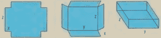

编写一个程序，提示用户输入扁平纸板的面积。程序随后输出纸板的长度和宽度，以及应从角落切下的正方形的边长，以使生成的盒子体积最大。将计算结果保留到三位小数。程序必须包含一个函数，该函数以纸板的长度和宽度作为输入，并返回为使体积最大而应切下的正方形的边长。该函数还应返回最大体积。

### 28. （发电站问题）

一座发电站位于一条宽半英里的河的一侧，一座工厂位于河对岸下游八英里处（参见图 6-25）。陆上铺设电力线路每英尺成本为 7 美元，水下铺设每英尺成本为 9 美元。我们的目标是确定铺设电力线路最经济的路径。也就是说，确定电力线路在水下铺设多长、在陆上铺设多长，才能使铺设电力线路的总成本最低。


编写一个程序，提示用户输入：

- a. 河流的宽度
- b. 工厂在河对岸下游的距离
- c. 水下铺设电力线路的成本
- d. 陆上铺设电力线路的成本

程序随后输出电力线路应水下铺设的长度和陆上铺设的长度，以使建设电力线路的成本最低。程序还应输出建设电力线路的总成本。

### 29. （管道问题，需要三角学知识）

一根管道需要绕过两条相交走廊的直角拐角。假设两条相交走廊的宽度分别为 5 英尺和 8 英尺（参见图 6-26）。你的目标是求出能水平绕过该直角拐角的最长管道长度，结果四舍五入到最近的英尺。

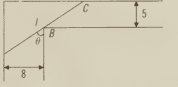

编写一个程序，提示用户输入两条走廊的宽度。程序随后输出能水平绕过该直角拐角的最长管道长度，结果四舍五入到最近的英尺。（注意，管道长度为 \(l = AB + BC = 8 / \sin \theta + 5 / \cos \theta\)，其中 \(0 < \theta < \pi/2\)。）


## 第 7 章

## 用户自定义简单数据类型、命名空间和 `string` 类型

在本章中，你将：

- 学习如何创建和操作你自己的简单数据类型，即枚举类型
- 熟悉 `typedef` 语句
- 了解命名空间机制
- 探索 `string` 数据类型，并学习如何使用各种 `string` 函数来操作字符串

在第 2 章中，你学习了 C++ 的简单数据类型分为三类：整型、浮点型和枚举型。在随后的章节中，你主要使用整型和浮点型数据类型。在本章中，你将学习枚举类型。此外，`using namespace std;` 语句（在第 2 章中讨论过）在每个使用 ANSI/ISO 标准 C++ 风格头文件的 C++ 程序中都会用到。本章后半部分将探讨该语句的用途。事实上，你将了解命名空间机制是什么。你还将学习 `string` 类型以及许多可用于有效操作字符串的有用函数。

### 枚举类型

> 可以跳过本节而不影响连续性。

第 2 章将数据类型定义为一组值以及对这些值的一组操作。例如，`int` 数据类型由从 −2,147,483,648 到 2,147,483,647 的整数值以及对这些数字的一组操作（即算术运算 `+`、`−`、`*`、`/` 和 `%`）组成。由于程序的主要目标是操作数据，因此数据类型的概念对任何编程语言都至关重要。通过提供数据类型，你可以指定哪些值是合法的，并告知用户对这些值允许进行哪些类型的操作。系统从而为你提供了针对错误的内置检查。

到目前为止，你使用的数据类型主要是 `int`、`bool`、`char` 和 `double`。尽管这些数据类型足以解决几乎任何问题，但在某些情况下，这些数据类型不足以解决特定问题。C++ 提供了一种机制，允许用户创建自己的数据类型，这大大增强了编程语言的灵活性。

在本节中，你将学习如何创建自己的简单数据类型，即枚举类型。在后续章节中，你将学习更高级的技术来创建复杂的数据类型。

要定义**枚举类型**，你需要以下内容：

- 数据类型的名称
- 数据类型的一组值
- 对这些值的一组操作

C++ 允许你定义新的简单数据类型，其中你可以指定其名称和值，但不能指定操作。阻止用户创建自己的操作有助于避免潜在的系统故障。

你为数据类型指定的值必须是标识符。

枚举类型的语法为：

```
enum typeName {value1, value2, ...};
```

其中 value1、value2、... 是称为**枚举器**的标识符。在 C++ 中，enum 是保留字。

通过在大括号之间列出所有值，你也就指定了这些值之间的顺序。也就是说，value1 < value2 < value3 < ...。因此，枚举类型是一个有序的值集合。此外，分配给这些枚举器的默认值从 0 开始。也就是说，分配给 value1 的默认值为 0，分配给 value2 的默认值为 1，依此类推。（在定义枚举类型时，你可以为枚举器分配不同于默认值的值。）还要注意，枚举器 value1、value2、... *不是*变量。

### 示例 7.1

语句：

```
enum colors {BROWN, BLUE, RED, GREEN, YELLOW};
```

定义了一个名为 colors 的新数据类型，属于该数据类型的值为 BROWN、BLUE、RED、GREEN 和 YELLOW。

### 示例 7.2

语句：

```
enum standing {FRESHMAN, SOPHOMORE, JUNIOR, SENIOR};
```

将 standing 定义为枚举类型。属于 standing 的值为 FRESHMAN、SOPHOMORE、JUNIOR 和 SENIOR。

### 示例 7.3

考虑以下语句：

```
enum grades {'A', 'B', 'C', 'D', 'F'}; //非法的枚举类型
enum places {1ST, 2ND, 3RD, 4TH}; //非法的枚举类型
```

这些是非法枚举类型，因为这些值都不是标识符。然而，以下是合法的枚举类型：

```
enum grades {A, B, C, D, F};
enum places {FIRST, SECOND, THIRD, FOURTH};
```

如果一个值已在某个枚举类型中使用过，则它不能在同一块中的任何其他枚举类型中使用。该规则同样适用于在任何块之外声明的枚举类型。示例 7-4 说明了这一概念。

### 示例 7-4

考虑以下语句：

```
enum mathStudent {JOHN, BILL, CINDY, LISA, RON};
enum compStudent {SUSAN, CATHY, JOHN, WILLIAM}; //非法
```

假设这些语句位于同一程序的同一块中。第二个枚举类型 compStudent 是不允许的，因为值 JOHN 已在之前的枚举类型 mathStudent 中使用过。

### 声明变量

一旦定义了数据类型，你就可以声明该类型的变量。声明枚举类型变量的语法与之前相同：

```
dataType identifier, identifier,...;
```

语句：

```
enum sports {BASKETBALL, FOOTBALL, HOCKEY, BASEBALL, SOCCER,
             VOLLEYBALL};
```

定义了一个名为 sports 的枚举类型。语句：

```
sports popularSport, mySport;
```

将 popularSport 和 mySport 声明为 sports 类型的变量。

### 赋值

一旦声明了变量，你就可以在其中存储值。假设有前面的声明，语句：

```
popularSport = FOOTBALL;
```


将 FOOTBALL 存储到 popularSport 中。语句：

```cpp
mySport = popularSport;
```

将 popularSport 的值复制到 mySport 中。

## 枚举类型上的操作

枚举类型上不允许进行算术运算。因此以下语句是非法的：

```cpp
mySport = popularSport + 2;                 //illegal
popularSport = FOOTBALL + SOCCER;             //illegal
popularSport = popularSport + 2;               //illegal
```

此外，枚举类型也不允许进行自增和自减运算。因此以下语句是非法的：

```cpp
popularSport++; //illegal
popularSport--; //illegal
```

假设你想将 popularSport 的值增加 1。可以按如下方式使用强制类型转换运算符：

```cpp
popularSport = static_cast<sports>(popularSport + 1);
```

使用类型名时，编译器会假定用户清楚自己在做什么。因此，前面的语句会被编译，并在执行期间将 popularSport 的值推进到列表中的下一个值。考虑以下语句：

```cpp
popularSport = FOOTBALL;
popularSport = static_cast<sports>(popularSport + 1);
```

执行第二条语句后，popularSport 的值为 HOCKEY。类似地，以下语句：

```cpp
popularSport = FOOTBALL;
popularSport = static_cast<sports>(popularSport - 1);
```

会将 BASKETBALL 存储到 popularSport 中。

## 关系运算符

由于枚举是一组有序的值，因此关系运算符可用于枚举类型。再次假设你有前面定义的枚举类型 sports 以及变量 popularSport 和 mySport。那么：

```cpp
FOOTBALL <= SOCCER is true
HOCKEY > BASKETBALL is true
BASEBALL < FOOTBALL is false
```

假设：

```cpp
popularSport = SOCCER;
mySport = VOLLEYBALL;
```

那么：

```cpp
popularSport < mySport is true
```

## 枚举类型与循环

回想一下，枚举类型是一种整型，并且使用强制类型转换运算符（即类型名），你可以对枚举类型的值进行自增、自减和比较。因此，你可以在循环中使用这些枚举类型。假设 mySport 是前面声明的变量。考虑以下 for 循环：

```cpp
for (mySport = BASKETBALL; mySport <= SOCCER;
                         mySport = static_cast<sports>(mySport + 1))
.
.
.
```

这个 for 循环有五次迭代。

在循环中使用枚举类型可以提高程序的可读性。

## 枚举类型的输入/输出

由于输入和输出只为内置数据类型（如 int、char、double 等）定义，因此枚举类型不能（直接）输入或输出。不过，你可以间接地输入和输出枚举。示例 7-5 说明了这一概念。

### 示例 7-5

假设有以下语句：

```cpp
enum courses {ALGEBRA, BASIC, PASCAL, CPP, PHILOSOPHY, ANALYSIS,
               CHEMISTRY, HISTORY};
courses registered;
```

第一条语句定义了一个枚举类型 courses；第二条语句声明了一个 courses 类型的变量 registered。你可以借助 char 数据类型来读取（即输入）枚举类型。注意，对于枚举类型 courses 中的某些值，只需读取第一个字符即可区分；而另一些值则需要读取前两个字符。例如，只需读取第一个字符就可以区分 ALGEBRA 和 BASIC；读取前两个字符可以区分 ALGEBRA 和 ANALYSIS。要从键盘等位置读取这些值，你先读取两个字符，然后使用选择结构将值赋给变量 registered。因此，你需要声明两个 char 类型的变量。

```cpp
char ch1, ch2;
cin >> ch1 >> ch2; //Read two characters
```

以下 switch 语句将适当的值赋给变量 registered：

```cpp
switch (ch1)
{
case 'a':
case 'A':
    if (ch2 == 'l' || ch2 == 'L')
        registered = ALGEBRA;
    else
        registered = ANALYSIS;
    break;
case 'b':
case 'B':
    registered = BASIC;
    break;
case 'c':
case 'C':
    if (ch2 == 'h' || ch2 == 'H')
        registered = CHEMISTRY;
    else
        registered = CPP;
    break;
case 'h':
case 'H':
    registered = HISTORY;
    break;
case 'p':
case 'P':
    if (ch2 == 'a' || ch2 == 'A')
        registered = PASCAL;
    else
        registered = PHILOSOPHY;
    break;
default:
    cout << "Illegal input." << endl;
}
```

你也可以使用 string 类型向变量 registered 输入一个值。例如，以下代码实现了这一点：

```cpp
string course;
cin >> course;
if (course == "algebra")
    registered = ALGEBRA;
else if (course == "analysis")
    registered = ANALYSIS;
else if (course == "basic")
    registered = BASIC;
else if (course == "chemistry")
    registered = CHEMISTRY;
else if (course == "cpp")
    registered = CPP;
else if (course == "history")
    registered = HISTORY;
else if (course == "pascal")
    registered = PASCAL;
else if (course == "philosophy")
    registered = PHILOSOPHY;
else
    cout << "Illegal input." << endl;
```

类似地，你可以间接输出枚举类型：

```cpp
switch (registered)
{
case ALGEBRA:
    cout << "Algebra";
    break;
case ANALYSIS:
    cout << "Analysis";
    break;
case BASIC:
    cout << "Basic";
    break;
case CHEMISTRY:
    cout << "Chemistry";
    break;
case CPP:
    cout << "CPP";
    break;
case HISTORY:
    cout << "History";
    break;
case PASCAL:
    cout << "Pascal";
    break;
case PHILOSOPHY:
    cout << "Philosophy";
}
```

如果你尝试直接输出枚举量的值，计算机会输出分配给该枚举量的值。例如，假设 `registered = ALGEBRA;` 以下语句将输出值 0，因为分配给 ALGEBRA 的（默认）值为 0：

```cpp
cout << registered << endl;
```

类似地，以下语句将输出 4：

```cpp
cout << PHILOSOPHY << endl;
```

## 函数与枚举类型

你可以像传递任何其他简单数据类型一样，将枚举类型作为参数传递给函数——即按值或按引用传递。此外，就像任何其他简单数据类型一样，函数可以返回枚举类型的值。利用这一特性，你可以使用函数来输入和输出枚举类型。

以下函数从键盘输入数据并返回一个枚举类型的值。假设枚举类型 courses 与前面定义的一样：

```cpp
courses readCourses()
{
    courses registered;
    char ch1, ch2;

    cout << "Enter the first two letters of the course: "
         << endl;
    cin >> ch1 >> ch2;

    switch (ch1)
    {
    case 'a':
    case 'A':
        if (ch2 == 'l' || ch2 == 'L')
            registered = ALGEBRA;
        else
            registered = ANALYSIS;
        break;
    case 'b':
    case 'B':
        registered = BASIC;
        break;
    case 'c':
    case 'C':
        if (ch2 == 'h' || ch2 == 'H')
            registered = CHEMISTRY;
        else
            registered = CPP;
        break;
    case 'h':
    case 'H':
        registered = HISTORY;
        break;
    case 'p':
    case 'P':
        if (ch2 == 'a' || ch2 == 'A')
            registered = PASCAL;
        else
            registered = PHILOSOPHY;
        break;
    default:
        cout << "Illegal input." << endl;
    }
    return registered;
} //end readCourses
```

如前所示，你也可以在函数 readCourses 中使用 string 类型，向 courses 类型的变量输入一个值。我们将细节留作练习。

以下函数输出一个枚举类型的值：

```cpp
void printEnum(courses registered)
{
    switch (registered)
    {
    case ALGEBRA:
        cout << "Algebra";
        break;
    case ANALYSIS:
        cout << "Analysis";
        break;
    case BASIC:
        cout << "Basic";
        break;
    case CHEMISTRY:
        cout << "Chemistry";
        break;
    case CPP:
        cout << "CPP";
        break;
    case HISTORY:
        cout << "History";
        break;
    case PASCAL:
        cout << "Pascal";
        break;
    case PHILOSOPHY:
        cout << "Philosophy";
    }//end switch
}//end printEnum
```

## 定义枚举类型时声明变量

在前面的章节中，你先定义枚举类型，然后声明该类型的变量。C++ 允许将这两个步骤合并为一个。也就是说，你可以在定义枚举类型时声明该枚举类型的变量。例如，以下语句：

```cpp
enum grades {A, B, C, D, F} courseGrade;
```

定义了一个枚举类型 grades，并声明了一个 grades 类型的变量 courseGrade。


类似地，语句：

```cpp
enum coins {PENNY, NICKEL, DIME, HALFDOLLAR, DOLLAR} change, usCoins;
```

定义了枚举类型 coins，并声明了两个类型为 coins 的变量 change 和 usCoins。

## 匿名数据类型

在变量声明中直接指定值而不给出类型名的数据类型称为匿名类型。以下语句创建了一个匿名类型：

```cpp
enum {BASKETBALL, FOOTBALL, BASEBALL, HOCKEY} mySport;
```

该语句指定了值并声明了变量 mySport，但没有为数据类型命名。

然而，创建匿名类型有其缺点。首先，因为该类型没有名称，所以不能将匿名类型作为参数传递给函数，函数也不能返回匿名类型的值。其次，在一个匿名类型中使用的值可以在另一个匿名类型中使用，但这些类型的变量会被区别对待。考虑以下语句：

```cpp
enum {ENGLISH, FRENCH, SPANISH, GERMAN, RUSSIAN} languages;
enum {ENGLISH, FRENCH, SPANISH, GERMAN, RUSSIAN} foreignLanguages;
```

即使变量 languages 和 foreignLanguages 具有相同的值，编译器仍将它们视为不同类型的变量。因此，以下语句是非法的：

```cpp
languages = foreignLanguages; //illegal
```

即使可以使用这些功能，也要谨慎使用。为避免混淆，应先定义枚举类型，再声明变量。

现在描述 C++ 中的 typedef 语句。

## typedef 语句

在 C++ 中，可以使用 typedef 语句为先前定义的数据类型创建同义词或别名。typedef 语句的一般语法为：

```cpp
typedef existingTypeName newTypeName;
```

在 C++ 中，typedef 是保留字。注意，typedef 语句不会创建任何新数据类型；它只为已有数据类型创建别名。

### 示例 7-6

语句：

```cpp
typedef int integer;
```

为数据类型 int 创建别名 integer。类似地，语句：

```cpp
typedef double real;
```

为数据类型 double 创建别名 real。语句：

```cpp
typedef double decimal;
```

为数据类型 double 创建别名 decimal。

使用 typedef 语句，可以创建自己的布尔数据类型，如示例 7-7 所示。

### 示例 7-7

回顾第 4 章，C++ 中的逻辑（布尔）表达式求值为 1 或 0，实际上它们是 int 值。作为逻辑值，1 表示真，0 表示假。考虑以下语句：

```cpp
typedef int Boolean;        //Line 1
const Boolean TRUE = 1;     //Line 2
const Boolean FALSE = 0;    //Line 3
Boolean flag;               //Line 4
```

第 1 行语句为数据类型 int 创建别名 Boolean。第 2 行和第 3 行语句声明命名常量 TRUE 和 FALSE，并分别将它们初始化为 1 和 0。第 4 行语句声明 flag 为 Boolean 类型的变量。因为 flag 是 Boolean 类型的变量，所以以下语句合法：

```cpp
flag = TRUE;
```

## 编程示例：石头、布、剪刀游戏

儿童经常玩石头、布、剪刀游戏。这个游戏有两名玩家，每人从石头、布或剪刀三个对象中选择一个。如果玩家 1 选择石头，玩家 2 选择布，则玩家 2 获胜，因为布包住石头。游戏按照以下规则进行：

- 如果两名玩家选择相同的对象，则本轮为平局。
- 如果一名玩家选择石头，另一名选择剪刀，则选择石头的玩家赢得本轮，因为石头砸坏剪刀。
- 如果一名玩家选择石头，另一名选择布，则选择布的玩家赢得本轮，因为布包住石头。
- 如果一名玩家选择剪刀，另一名选择布，则选择剪刀的玩家赢得本轮，因为剪刀剪开布。

编写一个交互式程序，让两个人玩这个游戏。

### 输入

该程序有两类输入：

- 用户在被询问是否玩游戏时的回答。
- 玩家的选择。

### 输出

玩家的选择以及每轮获胜者。游戏结束后，还应输出总轮数以及每位玩家获胜的次数。

两名玩家玩这个游戏。玩家通过键盘输入选择。每位玩家输入 R 或 r 表示石头，P 或 p 表示布，S 或 s 表示剪刀。当第一位玩家输入选择时，第二位玩家看向别处。两个输入都完成后，如果输入有效，程序输出玩家的选择并宣布本轮获胜者。游戏继续，直到其中一位玩家决定退出游戏。游戏结束后，程序输出总轮数以及每位玩家获胜的次数。上述讨论可转化为以下算法：

- 1. 提供关于游戏及其玩法的简要说明。
- 2. 询问用户是否想玩这个游戏。
- 3. 获取两位玩家的出拳。
- 4. 如果出拳有效，输出出拳和获胜者。
- 5. 更新总游戏计数和获胜计数。
- 6. 当用户同意玩游戏时，重复步骤 2 到 5。
- 7. 输出游戏轮数以及每位玩家获胜的次数。

我们将使用枚举类型来描述这些对象。

```cpp
enum objectType {ROCK, PAPER, SCISSORS};
```


很明显，在函数 `main` 中需要以下变量：

```cpp
int gameCount;    //variable to store the number of
                  //games played
int winCount1;    //variable to store the number of games
                  //won by player 1
int winCount2;    //variable to store the number of games
                  //won by player 2
int gamewinner;
char response;    //variable to get the user's response to
                  //play the game
char selection1;
char selection2;
objectType play1; //player1's selection
objectType play2; //player2's selection
```

本程序分为以下函数，后续各节将详细描述这些函数。

- **displayRules：** 该函数显示有关游戏及其规则的简要信息。
- **validSelection：** 该函数检查玩家的选择是否有效。唯一有效的选择是 R、r、P、p、S 和 s。
- **retrievePlay：** 因为枚举类型不能直接读取，该函数将输入的选项（R、r、P、p、S 或 s）转换为相应的对象类型并返回。
- **gameResult：** 该函数输出玩家的选择以及游戏获胜者。
- **convertEnum：** 该函数由函数 gameResult 调用，用于输出枚举类型值。
- **winningObject：** 该函数确定并返回获胜对象。
- **displayResults：** 游戏结束后，该函数显示最终结果。

### 函数 displayRules

该函数没有参数。它只包含输出语句，用于解释游戏和游戏规则。本质上，该函数的定义是：

```cpp
void displayRules()
{
    cout << " Welcome to the game of Rock, Paper, ";
    cout << " and Scissors." << endl;
    cout << " This is a game for two players. For each "
         << " game, each" << endl;
    cout << " player selects one of the objects Rock, "
         << "Paper, or Scissors." << endl;
    cout << "The rules for winning the game are: " << endl;
    cout << "1. If both players select the same object, it "
         << "is a tie." << endl;
    cout << "2. Rock breaks Scissors: So player who selects "
         << "Rock wins." << endl;
    cout << "3. Paper covers Rock: So player who selects "
         << "Paper wins." << endl;
    cout << "4. Scissors cuts Paper: So player who selects "
         << "Scissors wins." << endl << endl;
    cout << "Enter R or r to select Rock, P or p to select "
         << "Paper, and S or s to select Scissors." << endl;
}
```

### 函数 validSelection

该函数检查玩家的选择是否有效。

```text
if selection is 'R' or 'r' or 'S' or 's' or 'P' or 'p', then
    it is a valid selection;
otherwise the selection is invalid.
```

让我们使用 `switch` 语句检查选择是否有效。该函数的定义是：

```cpp
bool validSelection(char selection)
{
    switch (selection)
    {
    case 'R':
    case 'r':
    case 'P':
    case 'p':
    case 'S':
    case 's':
        return true;
    default:
        return false;
    }
}
```

### 函数 retrievePlay

因为枚举类型不能直接读取，该函数将输入的选项（R、r、P、p、S 或 s）转换为相应的对象类型并返回。因此，该函数有一个 char 类型的参数。它是一个有返回值的函数，返回 objectType 类型的值。用伪代码表示，该函数的算法是：

```text
if selection is 'R' or 'r'
    return ROCK;

if selection is 'P' or 'p'
    return PAPER;

if selection is 'S' or 's'
    return SCISSORS;
```


```cpp
convertEnum(play1);
cout << ". This game is a tie." << endl;
}
else
{
    winnerObject = winningObject(play1, play2);

    //Output each player's choice
    cout << "Player 1 selected ";
    convertEnum(play1);
    cout << " and player 2 selected ";
    convertEnum(play2);
    cout << ".";

    //Decide the winner
    if (play1 == winnerObject)
        winner = 1;
    else if (play2 == winnerObject)
        winner = 2;

    //Output the winner
    cout << "Player " << winner << " wins this game."
         << endl;
}
}
```

因为枚举类型不能直接输出，我们来编写函数 `convertEnum` 来输出枚举类型 `objectType` 的对象。这个函数有一个参数，类型为 `objectType`。它输出与 `objectType` 对应的字符串。用伪代码表示，这个函数是：

```text
if object is ROCK
    output "Rock"

if object is PAPER
    output "Paper"

if object is SCISSORS
    output "Scissors"
```

函数 `convertEnum` 的定义是：

```cpp
void convertEnum(objectType object)
{
    switch (object)
    {
        case ROCK:
            cout << "Rock";
            break;
        case PAPER:
            cout << "Paper";
            break;
        case SCISSORS:
            cout << "Scissors";
    }
}
```

### 函数 winningObject

要决定游戏的赢家，你需要查看玩家的选择，然后依据游戏的获胜对象规则。例如，如果一个玩家选择 ROCK，另一个选择 PAPER，那么选择 PAPER 的玩家获胜。换句话说，获胜对象是 PAPER。函数 winningObject 在给定两个对象后，决定并返回获胜对象。显然，这个函数有两个类型为 objectType 的参数，该函数返回的值也是 objectType 类型。这个函数的定义是：

```cpp
objectType winningObject(objectType play1, objectType play2)
{
    if ((play1 == ROCK && play2 == SCISSORS)
        || (play2 == ROCK && play1 == SCISSORS))
        return ROCK;
    else if ((play1 == ROCK && play2 == PAPER)
             || (play2 == ROCK && play1 == PAPER))
        return PAPER;
    else
        return SCISSORS;
}
```

### 函数 displayResults

游戏结束后，这个函数输出最终结果——即总游戏次数和每位玩家赢得的游戏次数。总游戏次数存储在变量 gameCount 中，玩家 1 赢得的次数存储在变量 winCount1 中，玩家 2 赢得的次数存储在变量 winCount2 中。这个函数有三个参数，分别对应这三个变量。本质上，这个函数的定义是：

```cpp
void displayResults(int gCount, int wCount1, int wCount2)
{
    cout << "The total number of plays: " << gCount
         << endl;
    cout << "The number of plays won by player 1: "
         << wCount1 << endl;
    cout << "The number of plays won by player 2: "
         << wCount2 << endl;
}
```

我们现在准备好编写函数 main 的算法了。

- **主算法**
- 1. 声明变量。
- 2. 初始化变量。
- 3. 显示规则。
- 4. 提示用户玩游戏。
- 5. 获取用户是否玩游戏的回答。
- 6. while（回答为是）
  {
  - a. 提示玩家 1 做出选择。
  - b. 获取玩家 1 的选择。
  - c. 提示玩家 2 做出选择。
  - d. 获取玩家 2 的选择。
  - e. 如果两个选择都合法：
    {
    - i. 增加总游戏次数。
    - ii. 宣布本局赢家。
    - iii. 将赢家的获胜次数加 1。
    }
  - f. 提示用户是否还想再玩一次。
  - g. 获取玩家的回答。
  }
- 7. 输出游戏结果。

## 程序清单

```cpp
//***********************************************************
// Author: D.S. Malik
//
// Program: Rock, Paper, and Scissors
// This program plays the game of rock, paper, and scissors.
//***********************************************************

#include <iostream>

using namespace std;

enum objectType {ROCK, PAPER, SCISSORS};

        //Function prototypes
void displayRules();
objectType retrievePlay(char selection);
bool validSelection(char selection);
void convertEnum(objectType object);
objectType winningObject(objectType play1, objectType play2);
void gameResult(objectType play1, objectType play2, int& winner);
void displayResults(int gCount, int wCount1, int wCount2);

int main()
{
    //Step 1
    int gameCount; //variable to store the number of
                   //games played
    int winCount1; //variable to store the number of games
                   //won by player 1
    int winCount2; //variable to store the number of games
                   //won by player 2
    int gamewinner;
    char response; //variable to get the user's response to
                   //play the game
    char selection1;
    char selection2;
    objectType play1; //player1's selection
    objectType play2; //player2's selection

    //Initialize variables; Step 2
    gameCount = 0;
    winCount1 = 0;
    winCount2 = 0;

    displayRules();                                      //Step 3

    cout << "Enter Y/y to play the game: ";              //Step 4
    cin >> response;                                     //Step 5
    cout << endl;
    while (response == 'Y' || response == 'y')           //Step 6
    {
        cout << "Player 1 enter your choice: ";          //Step 6a
        cin >> selection1;                               //Step 6b
        cout << endl;

        cout << "Player 2 enter your choice: ";          //Step 6c
        cin >> selection2;                               //Step 6d
        cout << endl;

        //Step 6e
        if (validSelection(selection1)
            && validSelection(selection2))
        {
            play1 = retrievePlay(selection1);
            play2 = retrievePlay(selection2);
            gameCount++;                                 //Step 6e.i
            gameResult(play1, play2, gamewinner);        //Step 6e.ii

            if (gamewinner == 1)                         //Step 6e.iii
                winCount1++;
            else if (gamewinner == 2)
                winCount2++;
        }//end if

        cout << "Enter Y/y to play the game: ";    //Step 6f
        cin >> response;                            //Step 6g
        cout << endl;
    }//end while

    displayResults(gameCount, winCount1,
                   winCount2);                     //Step 7

    return 0;
}//end main

//Place the definitions of the functions displayRules,
//validSelection, retrievePlay, convertEnum, winningObject,
//gameResult, and displayResults as described previously here.
```

## 命名空间

1998 年 7 月，ANSI/ISO 标准 C++ 被正式批准。大多数最新的编译器也都兼容 ANSI/ISO 标准 C++。（要完全确定，请查看你的编译器文档。）这两个标准——标准 C++ 和 ANSI/ISO 标准 C++——几乎是相同的。ANSI/ISO 标准 C++ 语言具有一些标准 C++ 中没有的特性，本章的其余部分将介绍这些特性。在后续章节中，除非另有说明，C++ 语法同时适用于这两个标准。首先，我们讨论 ANSI/ISO 标准 C++ 的命名空间机制，这在第 2 章中已经介绍过。

当程序中包含一个头文件（如 iostream）时，头文件中的全局标识符也会成为程序中的全局标识符。因此，如果程序中的某个全局标识符与头文件中的某个全局标识符同名，编译器就会生成一个语法错误（例如“标识符重定义”）。如果程序使用第三方库，也会出现同样的问题。为了克服这个问题，第三方供应商会用一个特殊符号作为其全局标识符的开头。在第 2 章中，你了解到，因为编译器供应商用下划线（_）作为全局标识符的开头，为了避免链接错误，你不应该在程序中的标识符开头使用下划线（_）。

ANSI/ISO 标准 C++ 试图通过命名空间机制来解决这种全局标识符重叠的问题。

语句 namespace 的通用语法是：

```cpp
namespace namespace_name
{
    members
}
```

其中 members 通常是命名常量、变量声明、函数或另一个命名空间。注意 namespace_name 是一个 C++ 标识符。


在C++中，namespace是一个保留字。

### 示例7-8

语句

```cpp
namespace globalType
{
    const int N = 10;
    const double RATE = 7.50;
    int count = 0;
    void printResult();
}
```

将globalType定义为具有四个成员的命名空间：命名常量N和RATE、变量count以及函数printResult。

命名空间成员的作用域是相对于该命名空间本地的。通常可以通过以下两种方式之一在命名空间外部访问命名空间成员，如下所述。

访问命名空间成员的一般语法为：

```cpp
namespace_name::identifier
```

回忆一下，在C++中，::被称为作用域解析运算符。

要访问命名空间globalType的成员RATE，需要使用以下语句：

```cpp
globalType::RATE
```

要访问成员printResult（它是一个函数），需要使用以下语句：

```cpp
globalType::printResult();
```

因此，要访问命名空间的成员，需要使用命名空间名称，后跟作用域解析运算符，再跟成员名。

为了简化对命名空间成员的访问，ANSI/ISO标准C++提供了using语句的使用。使用using语句的语法如下：

- a. 为了简化对所有命名空间成员的访问：

```cpp
using namespace namespace_name;
```

- b. 为了简化对特定命名空间成员的访问：

```cpp
using namespace_name::identifier;
```

例如，using语句：

```cpp
using namespace globalType;
```

简化了对命名空间globalType所有成员的访问。语句：

```cpp
using globalType::RATE;
```

简化了对命名空间globalType成员RATE的访问。在C++中，using是一个保留字。

通常应将using语句放在命名空间声明之后。例如，对于命名空间globalType，通常编写如下代码：

```cpp
namespace globalType
{
    const int N = 10;
    const double RATE = 7.50;
    int count = 0;
    void printResult();
}
using namespace globalType;
```

在使用using语句之后，访问命名空间成员时，不必在成员前面加上命名空间名称和作用域解析运算符。但是，如果命名空间成员与程序中的全局标识符同名，则在程序中访问该命名空间成员时，必须在成员前面加上命名空间名称和作用域解析运算符。类似地，如果命名空间成员与块中的标识符同名，则在块中访问该命名空间成员时，必须在成员前面加上命名空间名称和作用域解析运算符。

示例7-9到7-12有助于阐明命名空间机制的使用。

### 示例7-9

考虑以下C++代码：

```cpp
#include <iostream>

using namespace std;
.
.
int main()
{
    .
    .
    .
}
.
.
.
```

在此示例中，可以引用头文件iostream中的全局标识符，如cin、cout和endl，而无需在标识符名称前加上前缀std::。明显的限制是，引用（头文件iostream的）全局标识符的块（或函数）不能包含与该全局标识符同名的任何标识符。

### 示例7-10

考虑以下C++代码：

```cpp
#include <cmath>

int main()
{
    double x = 15.3;
    double y;

    y = std::pow(x, 2);
    .
    .
    .
}
```

此示例访问头文件cmath中的pow函数。

### 示例7-11

考虑以下C++代码：

```cpp
#include <iostream>
.
.
int main()
{
    using namespace std;
    .
    .
    .
}
.
.
.
```

在此示例中，main函数可以引用头文件iostream中的全局标识符，而无需在标识符名称前加上前缀std::。using语句出现在main函数内部。因此，其他函数（如果有）在使用头文件iostream的全局标识符名称前应使用前缀std::，除非该函数有类似的using语句。

### 示例7-12

考虑以下C++代码：

```cpp
#include <iostream>

using namespace std;           //Line 1

int t;                         //Line 2
double u;                      //Line 3

namespace expN
{
    int x;                     //Line 4
    char t;                    //Line 5
    double u;                  //Line 6
    void printResult();        //Line 7
}

using namespace expN;

int main()
{
    int one;                   //Line 8
    double t;                  //Line 9
    double three;              //Line 10

    .
    .
    .
}

void expN::printResult() //Definition of the function printResult
{
    .
    .
    .
}
```

在这个C++程序中：

- 1. 要在main中引用第2行的变量`t`，请使用*作用域解析运算符*，即`::`（也就是说，将`t`引用为`::t`），因为函数main中有一个名为`t`的变量（在第9行声明）。例如，要将`x`的值复制到`t`中，可以使用语句`::t = x;`。

- 2. 要在main中引用命名空间expN的成员t（在第5行声明），请在t前加上前缀expN::（也就是说，将t引用为expN::t），因为存在一个名为t的全局变量（在第2行声明）以及main中名为t的变量。

- 3. 要在main中引用命名空间expN的成员u（在第6行声明），请在u前加上前缀expN::（也就是说，将u引用为expN::u），因为存在一个名为u的全局变量（在第3行声明）。

- 4. 可以在main中将命名空间expN的成员x（在第4行声明）引用为x或expN::x，因为不存在名为x的全局标识符，且函数main不包含任何名为x的标识符。

- 5. 命名空间成员函数（如printResult）的定义通常像前面的程序那样写在命名空间外部。要编写函数printResult的定义，函数头中的函数名可以是printResult或expN::printResult（因为不存在其他名为printResult的全局标识符）。

系统提供的头文件（如iostream、cmath和iomanip）中的标识符定义在命名空间std中。因此，为了简化对这些头文件中标识符的访问，我们在编写的程序中使用以下语句：

```cpp
using namespace std;
```

## string类型

在第2章中，您已经了解了string数据类型。回忆一下，在ANSI/ISO C++语言标准之前，标准C++库不提供string数据类型。编译器厂商通常提供自己程序员定义的string类型，而且字符串操作的语法和语义往往因厂商而异。

string数据类型是一种程序员定义的类型，不是C++语言的一部分；它由C++标准库提供。在使用string数据类型之前，程序必须包含头文件string，如下所示：

```cpp
#include <string>
```

回忆一下，在C++中，字符串是零个或多个字符的序列，字符串用双引号括起来。

语句：

```cpp
string name = "William Jacob";
```

将name声明为string变量，并将其初始化为"William Jacob"。name中第一个字符W的位置是0；第二个字符i的位置是1；依此类推。也就是说，字符串变量中第一个字符的位置从0开始，而不是1。

变量name可以存储（几乎）任何大小的字符串。

第3章讨论了string类型的I/O操作；第4章解释了string类型的关系操作。我们建议您重新阅读第3章和第4章，回顾string类型的I/O和关系操作。

其他运算符，如二元运算符+（用于字符串连接操作）和数组下标运算符[ ]，也已被定义为string数据类型的运算符。让我们看看这些运算符如何作用于string数据类型。

假设有以下声明：

```cpp
string str1, str2, str3;
```

语句：

```cpp
str1 = "Hello There";
```

将字符串"Hello There"存储到str1中。语句：

```cpp
str2 = str1;
```

将str1的值复制到str2中。

如果str1 = "Sunny"，语句：

```cpp
str2 = str1 + " Day";
```

将字符串"Sunny Day"存储到str2中。

假设str1 = "Hello"，str2 = "There"。语句：

```cpp
str3 = str1 + " " + str2;
```

将"Hello There"存储到str3中。此语句等效于语句：

```cpp
str3 = str1 + ' ' + str2;
```

此外，语句：


## 表7-1 一些字符串函数（续）

| 表达式 | 作用 |
| --- | --- |
| `strVar.find(str)` | 返回 `str` 在 `strVar` 中首次出现的索引。如果未找到 `str`，则返回特殊值 `string::npos`。 |
| `strVar.find(str, pos)` | 返回 `str` 在 `strVar` 中从 `pos` 处或之后首次出现的索引。 |
| `strVar.find_first_of(str, pos)` | 返回 `strVar` 中 `str` 的任一字符首次出现的索引。搜索从 `pos` 开始。 |
| `strVar.find_first_not_of(str, pos)` | 返回第一个不在 `str` 中的字符的索引。搜索从 `pos` 开始。 |
| `strVar.insert(pos, n, ch);` | 将字符 `ch` 的 `n` 次重复插入到 `strVar` 中索引 `pos` 处；`pos` 和 `n` 是 `string::size_type` 类型；`ch` 是字符。 |
| `strVar.insert(pos, str);` | 将 `str` 的所有字符插入到 `strVar` 中索引 `pos` 处。 |
| `strVar.length()` | 返回 `string::size_type` 类型的值，表示 `strVar` 中字符的数量。 |
| `strVar.replace(pos, n, str);` | 从索引 `pos` 开始，用 `str` 的所有字符替换 `strVar` 中接下来的 `n` 个字符。如果 `n` 大于 `strVar` 的长度，则替换直到 `strVar` 末尾的所有字符。 |
| `strVar.substr(pos, len)` | 返回从 `pos` 开始的 `strVar` 的子字符串。子字符串的长度最多为 `len` 个字符。如果 `len` 过大，则表示 `strVar` 中字符串的“末尾”。 |
| `strVar.size()` | 返回 `string::size_type` 类型的值，表示 `strVar` 中字符的数量。 |
| `strVar.swap(str1);` | 交换 `strVar` 和 `str1` 的内容。`str1` 是字符串变量。 |

接下来，我们展示其中一些函数的使用方法。

### 示例 7-14（clear、empty、erase、length 和 size 函数）

考虑以下语句：

```cpp
string firstName = "Elizabeth";
string name = firstName + " Jones";
string str1 = "It is sunny.";
string str2 = "";
string str3 = "computer science";
string str4 = "C++ programming.";
string str5 = firstName + " is taking " + str4;

string::size_type len;
```

接下来，我们展示 clear、empty、erase、length 和 size 函数的效果。

| 语句 | 效果 |
| --- | --- |
| `str3.clear();` | `str3 = "";` |
| `str1.empty();` | 返回 false； |
| `str2.empty();` | 返回 true； |
| `str4.erase(11, 4);` | `str4 = "C++ program.";` |
| `cout << firstName.length() << endl;` | 输出 9 |
| `cout << name.length() << endl;` | 输出 15 |
| `cout << str1.length() << endl;` | 输出 12 |
| `cout << str5.size() << endl;` | 输出 36 |
| `len = name.length();` | len 的值为 15 |

以下程序演示了 length 函数的使用。

```cpp
//Example: clear, empty, erase, length, and size functions

#include <iostream>
#include <string>

using namespace std;

int main()
{
    string firstName = "Elizabeth";                         //Line 1
    string name = firstName + " Jones";                     //Line 2
    string str1 = "It is sunny.";                           //Line 3
    string str2 = "";                                       //Line 4
    string str3 = "computer science";                       //Line 5
    string str4 = "C++ programming.";                       //Line 6
    string str5 = firstName + " is taking " + str4;         //Line 7

    string::size_type len;                              //Line 8

    cout << "Line 9: str3: " << str3 << endl;          //Line 9
    str3.clear();                                        //Line 10
    cout << "Line 11: After clear, str3: " << str3
         << endl;                                        //Line 11

    cout << "Line 12: str1.empty(): " << str1.empty()
         << endl;                                        //Line 12
    cout << "Line 13: str2.empty(): " << str2.empty()
         << endl;                                        //Line 13

    cout << "Line 14: str4: " << str4 << endl;          //Line 14
    str4.erase(11, 4);                                   //Line 15
    cout << "Line 16: After erase(11, 4), str4: "
         << str4 << endl;                                //Line 16

    cout << "Line 17: Length of \"" << firstName << "\" = "
         << static_cast<unsigned int> (firstName.length())
         << endl;                                        //Line 17
    cout << "Line 18: Length of \"" << name << "\" = "
         << static_cast<unsigned int> (name.length())
         << endl;                                        //Line 18
    cout << "Line 19: Length of \"" << str1 << "\" = "
         << static_cast<unsigned int> (str1.length())
         << endl;                                        //Line 19
    cout << "Line 20: Size of \"" << str5 << "\" = "
         << static_cast<unsigned int> (str5.size())
         << endl;                                        //Line 20

    len = name.length();                                 //Line 21
    cout << "Line 22: len = "
         << static_cast<unsigned int> (len) << endl;     //Line 22

    return 0;                                            //Line 23
}
```

### 示例运行：

```text
Line 9: str3: computer science
Line 11: After clear, str3:
Line 12: str1.empty(): 0
Line 13: str2.empty(): 1
Line 14: str4: C++ programming.
Line 16: After erase(11, 4), str4: C++ program.
Line 17: Length of "Elizabeth" = 9
Line 18: Length of "Elizabeth Jones" = 15
Line 19: Length of "It is sunny." = 12
Line 20: Size of "Elizabeth is taking C++ programming." = 36
Line 22: len = 15
```

该程序的输出不言自明。具体细节留给读者作为练习。请注意，该程序使用 `static_cast` 运算符来输出 `length` 函数返回的值。


这是因为 `length` 函数返回的是 `string::size_type` 类型的值。如果没有强制转换运算符，某些编译器可能会给出以下警告信息：

> 从 'size_t' 转换为 'unsigned int'，可能会丢失数据

### 示例 7-15（find 函数）

假设 `str1` 和 `str2` 是 string 类型。以下是对 `find` 函数的有效调用：

```cpp
str1.find(str2)
str1.find("the")
str1.find('a')
str1.find(str2 + "xyz")
str1.find(str2 + 'b')
```

考虑以下语句：

```cpp
string sentence = "Outside it is cloudy and warm.";
string str = "cloudy";

string::size_type position;
```

接下来，我们展示 find 函数的效果。

| 语句 | 效果 |
| --- | --- |
| `cout << sentence.find("is") << endl;` | 输出 11 |
| `cout << sentence.find('s') << endl;` | 输出 3 |
| `cout << sentence.find(str) << endl;` | 输出 14 |
| `cout << sentence.find("the") << endl;` | 输出 `string::npos` 的值 |
| `cout << sentence.find('i', 6) << endl;` | 输出 8 |
| `position = sentence.find("warm");` | 将 25 赋给 position |

请注意，搜索区分大小写。因此，在字符串 sentence 中，字符 o（小写 o）的位置是 16。

以下程序对上述语句进行验证。

```cpp
//Example: find function

#include <iostream>
#include <string>

using namespace std;

int main()
{
    string sentence = "Outside it is cloudy and warm.";        //Line 1
    string str = "cloudy";                                  //Line 2

    string::size_type position;                              //Line 3

    cout << "Line 4: sentence = \"" << sentence
         << "\n" << endl;                                   //Line 4

    cout << "Line 5: The position of \"is\" in sentence = "
         << static_cast<unsigned int> (sentence.find("is"))
         << endl;                                             //Line 5

    cout << "Line 6: The position of 's' in sentence = "
         << static_cast<unsigned int> (sentence.find('s'))
         << endl;                                             //Line 6

    cout << "Line 7: The position of \"" << str
         << "\" in sentence = "
         << static_cast<unsigned int> (sentence.find(str))
         << endl;                                             //Line 7

    cout << "Line 8: The position of \"the\" in sentence = "
         << static_cast<unsigned int> (sentence.find("the"))
         << endl;                                             //Line 8

    cout << "Line 9: The first occurrence of \'i\' in "
         << "sentence \n        after position 6 = "
         << static_cast<unsigned int> (sentence.find('i', 6))
         << endl;                                             //Line 9

    position = sentence.find("warm");                         //Line 10
    cout << "Line 11: Position = "
         << position << endl;                                 //Line 11

    return 0;                                                 //Line 12
}
```

### 示例运行：

```text
Line 4: sentence = "Outside it is cloudy and warm."
Line 5: The position of "is" in sentence = 11
Line 6: The position of 's' in sentence = 3
Line 7: The position of "cloudy" in sentence = 14
Line 8: The position of "the" in sentence = 4294967295
Line 9: The first occurrence of 'i' in sentence
         after position 6 = 8
Line 11: Position = 25
```


该程序的输出不言自明。具体细节留作练习。请注意，此程序使用 `static_cast` 运算符来输出函数 `find` 返回的值。这是因为函数 `find` 返回的是 `string::size_type` 类型的值。如果没有强制转换运算符，某些编译器可能会给出以下警告消息：

```text
conversion from 'size_t' to 'unsigned int', possible loss of data
```

## 示例 7-16（插入和替换函数）

假设有以下语句：

```cpp
string firstString = "Cloudy and warm.";
string secondString = "Hello there";
string thirdString = "Henry is taking programming I.";
string str1 = " very ";
string str2 = "Lisa";
```

接下来，我们展示插入和替换函数的效果。

| 语句 | 效果 |
|---|---|
| `firstString.insert(10, str1);` | `firstString = "Cloudy and very  warm."` |
| `secondString.insert(11, 5, '!');` | `secondString = "Hello there!!!!!"` |
| `thirdString.replace(0, 5, str2);` | `thirdString = "Lisa is taking programming I."` |

以下程序对上述语句进行求值。

```cpp
//Example: insert and replace functions

#include <iostream>
#include <string>

using namespace std;

int main()
{
    string firstString = "Cloudy and warm.";             //Line 1
    string secondString = "Hello there";                //Line 2
    string thirdString = "Henry is taking programming I."; //Line 3
    string str1 = " very ";
    string str2 = "Lisa";

    cout << "Line 6: firstString = " << firstString
         << endl;
    firstString.insert(10, str1);
    cout << "Line 8: After insert; firstString = "
         << firstString << endl;

    cout << "Line 9: secondString = " << secondString
         << endl;
    secondString.insert(11, 5, '!');
    cout << "Line 11: After insert; secondString = "
         << secondString << endl;

    cout << "Line 12: thirdString = " << thirdString
         << endl;
    thirdString.replace(0, 5, str2);
    cout << "Line 14: After replace, thirdString = "
         << thirdString << endl;

    return 0;
}
```

### 示例运行：

```text
Line 6: firstString = Cloudy and warm.
Line 8: After insert; firstString = Cloudy and very  warm.
Line 9: secondString = Hello there
Line 11: After insert; secondString = Hello there!!!!!
Line 12: thirdString = Henry is taking programming I.
Line 14: After replace, thirdString = Lisa is taking programming I.
```

该程序的输出不言自明。具体细节留作练习。

## 示例 7-17（substr 函数）

考虑以下语句：

```cpp
string sentence;
string str;

sentence = "It is cloudy and warm.";
```

接下来，我们展示 substr 函数的效果。

| 语句 | 效果 |
| --- | --- |
| `cout << sentence.substr(0, 5) << endl;` | 输出：It is |
| `cout << sentence.substr(6, 6) << endl;` | 输出：cloudy |
| `cout << sentence.substr(6, 16) << endl;` | 输出：cloudy and warm. |
| `cout << sentence.substr(17, 10) << endl;` | 输出：warm. |
| `cout << sentence.substr(3, 6) << endl;` | 输出：is clo |
| `str = sentence.substr(0, 8);` | str = "It is cl" |
| `str = sentence.substr(2, 10);` | str = " is cloudy" |

以下程序演示了如何使用字符串函数 substr。

```cpp
//Example: substr function

#include <iostream>
#include <string>

using namespace std;

int main()
{
    string sentence;                                  //Line 1
    string str;                                       //Line 2

    sentence = "It is cloudy and warm.";              //Line 3

    cout << "Line 4: substr(0, 5) in \""
         << sentence << "\" = \""
         << sentence.substr(0, 5) << "\"" << endl;    //Line 4

    cout << "Line 5: substr(6, 6) in \""
         << sentence << "\" = \""
         << sentence.substr(6, 6) << "\"" << endl;    //Line 5

    cout << "Line 6: substr(6, 16) in \""
         << sentence << "\" = \""
         << "        " << sentence.substr(6, 16)
         << "\"" << endl;                              //Line 6

    cout << "Line 7: substr(17, 10) in \""
         << sentence << "\" = \""
         << sentence.substr(17, 10) << "\"" << endl;  //Line 7

    cout << "Line 8: substr(3, 6) in \""
         << sentence << "\" = \""
         << sentence.substr(3, 6) << "\"" << endl;    //Line 8

    str = sentence.substr(0, 8);                         //line 9
    cout << "Line 10: " << "str = \"" << str
         << "\"\n" << endl;                          //line 10

    str = sentence.substr(2, 10);                        //line 11
    cout << "Line 12: " << "str = \"" << str
         << "\"\n" << endl;                          //line 12

    return 0;
}
```

### 示例运行：

```text
Line 4: substr(0, 5) in "It is cloudy and warm." = "It is"
Line 5: substr(6, 6) in "It is cloudy and warm." = "cloudy"
Line 6: substr(6, 16) in "It is cloudy and warm." =
        "cloudy and warm."
Line 7: substr(17, 10) in "It is cloudy and warm." = "warm."
Line 8: substr(3, 6) in "It is cloudy and warm." = "is clo"
Line 10: str = "It is cl"
Line 12: str = " is cloudy"
```

该程序的输出不言自明。具体细节留作练习。

## 示例 7-18（swap 函数）

swap 函数用于交换两个字符串变量的内容。

假设有以下语句：

```cpp
string str1 = "Warm";
string str2 = "Cold";
```

执行以下语句后，str1 的值为 "Cold"，str2 的值为 "Warm"。

```cpp
str1.swap(str2);
```


其他字符串函数在附录 F（头文件 string）中描述。

## 编程示例：猪拉丁字符串

在此编程示例中，我们编写一个程序，提示用户输入一个字符串，然后以猪拉丁形式输出该字符串。将字符串转换为猪拉丁形式的规则如下：

- 1. 如果字符串以元音开头，则在字符串末尾添加 "-way"。例如，字符串 "eye" 的猪拉丁形式是 "eye-way"。
- 2. 如果字符串不是以元音开头，首先在字符串末尾添加 "-"。然后每次旋转一个字符；也就是说，将字符串的第一个字符移到字符串末尾，直到字符串的第一个字符成为元音。然后在末尾添加 "-ay"。例如，字符串 "There" 的猪拉丁形式是 "ere-Thay"。
- 3. 像 "by" 这样的字符串不含元音。在这种情况下，字母 y 可以被视为元音。因此，对于该程序，元音是 a、e、i、o、u、y、A、E、I、O、U 和 Y。因此，"by" 的猪拉丁形式是 "y-bay"。
- 4. 像 "1234" 这样的字符串不含元音。字符串 "1234" 的猪拉丁形式是 "1234-way"。也就是说，没有元音的字符串的猪拉丁形式是字符串后跟 "-way"。

**输入**  程序的输入是一个字符串。

**输出**  程序的输出是猪拉丁形式的字符串。

### 问题分析与算法设计

假设 str 表示一个字符串。要将 str 转换为猪拉丁形式，请检查 str 的第一个字符 str[0]。如果 str[0] 是元音，则在 str 末尾添加 "-way"——即 str = str + "-way"。

假设 str 的第一个字符 str[0] 不是元音。首先，在字符串末尾添加 "-"。然后，从 str 中移除 str 的第一个字符并将其放到 str 的末尾。现在，str 的第二个字符成为 str 的第一个字符。重复此过程：检查 str 的第一个字符，如果它不是元音，则将其移动到 str 的末尾，直到 str 的第一个字符是元音，或者 str 的所有字符都被处理，在这种情况下，str 不包含任何元音。

在此程序中，我们编写一个函数 `isVowel` 来确定一个字符是否为元音，一个函数 `rotate` 将 str 的第一个字符移动到 str 的末尾，以及


一个函数 `pigLatinString`，用于求 `str` 的 pig Latin 形式。前面的讨论可转化为以下算法：

- 1. 获取 `str`。
- 2. 使用函数 `pigLatinString` 求 `str` 的 pig Latin 形式。
- 3. 输出 `str` 的 pig Latin 形式。

在编写主算法之前，下面将详细描述这些函数。

### 函数 isVowel

该函数接收一个字符作为参数，如果该字符是元音则返回 `true`，否则返回 `false`。函数 `isVowel` 的定义为：

```cpp
bool isVowel(char ch)
{
    switch (ch)
    {
    case 'A':
    case 'E':
    case 'I':
    case 'O':
    case 'U':
    case 'Y':
    case 'a':
    case 'e':
    case 'i':
    case 'o':
    case 'u':
    case 'y':
        return true;
    default:
        return false;
    }
}
```

### 函数 rotate

该函数接收一个字符串作为参数，删除该字符串的第一个字符，并将其放到字符串末尾。具体做法是提取从位置 1（即第二个字符）开始直到字符串末尾的子串，然后再加上该字符串的第一个字符。新字符串作为该函数的返回值返回。本质上，函数 `rotate` 的定义为：

```cpp
string rotate(string pStr)
{
    string::size_type len = pStr.length();

    string rStr;

    rStr = pStr.substr(1, len - 1) + pStr[0];

    return rStr;
}
```

## 函数 pigLatinString

该函数接收一个字符串 pStr 作为参数，并返回 pStr 的 pig Latin 形式。假设 pStr 表示要转换为其 pig Latin 形式的字符串。

有三种可能情况：pStr[0] 是元音；pStr 包含元音且 pStr 的第一个字符不是元音；或者 pStr 不包含任何元音。假设 pStr[0] 不是元音。将 pStr 的第一个字符移到 pStr 末尾。重复此过程，直到 pStr 的第一个字符变为元音，或者 pStr 的所有字符都已检查完毕；在后一种情况下，pStr 不包含任何元音。前面的讨论可转化为以下算法：

- 1. 如果 pStr[0] 是元音，则在 pStr 末尾添加 "-way"。
- 2. 假设 pStr[0] 不是元音。
- 3. 将 pStr 的第一个字符移到 pStr 末尾。pStr 的第二个字符成为 pStr 的第一个字符。现在 pStr 可能包含元音，也可能不包含元音。我们使用一个 bool 变量 foundVowel，如果 pStr 包含元音则将其设为 true，否则设为 false。
   a. 假设 len 表示 pStr 的长度。
   b. 将 foundVowel 初始化为 false。
   c. 如果 pStr[0] 不是元音，则调用函数 rotate 将 pStr[0] 移到 pStr 末尾。
   d. 重复步骤 b，直到 pStr 的第一个字符变为元音，或者 pStr 的所有字符都已检查完毕。
- 4. 将 pStr 转换为 pig Latin 形式。
- 5. 返回 pStr。

函数 pigLatinString 的定义为：

```cpp
string pigLatinString(string pStr)
{
    string::size_type len;

    bool foundVowel;

    string::size_type counter;

    if (isVowel(pStr[0]))
        pStr = pStr + "-way";               //Step 1
    else                                    //Step 2
    {
        pStr = pStr + '-'; 
        pStr = rotate(pStr);                //Step 3

        len = pStr.length();                //Step 3.a
        foundVowel = false;                 //Step 3.b

        for (counter = 1; counter <= len - 1;
                     counter++)             //Step 3.d
            if (isVowel(pStr[0]))
            {
                foundVowel = true;
                break;
            }
            else                            //Step 3.c
                pStr = rotate(pStr);

        if (!foundVowel)                    //Step 4
            pStr = pStr.substr(1, len) + "way";
        else
            pStr = pStr + "ay";
    }

    return pStr;                            //Step 5
}
```

## 主算法

- 1. 获取字符串。
- 2. 调用函数 `pigLatinString` 求该字符串的 pig Latin 形式。
- 3. 输出该字符串的 pig Latin 形式。

## 程序清单

```cpp
/************************************************************
// Author: D.S. Malik
//
// Program: Pig Latin Strings
// This program reads a string and outputs the pig Latin form
// of the string.
************************************************************/

#include <iostream>
#include <string>

using namespace std;

bool isVowel(char ch);
string rotate(string pStr);
string pigLatinString(string pStr);

int main()
{
    string str;

    cout << "Enter a string: ";
    cin >> str;

    cout << endl;

    cout << "The pig Latin form of " << str << " is: "
         << pigLatinString(str) << endl;

    return 0;
}

//Place the definitions of the functions isVowel, rotate, and
//pigLatinString and as described previously here.
```

### 示例运行：

在这些示例运行中，用户输入以阴影显示。

**示例运行 1：**

输入一个字符串：`eye`

eye 的 pig Latin 形式是：eye-way

**示例运行 2：**

输入一个字符串：`There`

There 的 pig Latin 形式是：ere-Thay

**示例运行 3：**

输入一个字符串：`why`

why 的 pig Latin 形式是：y-whay

**示例运行 4：**

输入一个字符串：`123456`

123456 的 pig Latin 形式是：123456-way

## 快速复习

- 1. 枚举类型是一组有序值。
- 2. C++ 的保留字 `enum` 用于创建枚举类型。
- 3. enum 的语法为：

    ```cpp
    enum typeName {value1, value2,...};
    ```

    其中 value1、value2、... 是标识符，且 value1 < value2 < . . .

- 4. 不允许对枚举类型进行算术运算。
- 5. 关系运算符可用于 enum 值。
- 6. 枚举类型的值不能直接输入或输出。
- 7. 枚举类型可以按值或按引用作为参数传递给函数。
- 8. 函数可以返回枚举类型的值。
- 9. 匿名类型是指在不指定任何类型名的情况下指定变量值的类型。
- 10. C++ 的保留字 `typedef` 用于为先前定义的数据类型创建同义词或别名。
- 11. 匿名类型不能作为参数传递给函数。
- 12. 命名空间机制是 ANSI/ISO 标准 C++ 的一项特性。
- 13. 命名空间成员通常是具名常量、变量、函数或另一个命名空间。
- 14. 命名空间成员的作用域局限于该命名空间。
- 15. 在命名空间外访问命名空间成员的一种方法是，在命名空间成员名之前加上命名空间名和作用域解析运算符。
- 16. 在 C++ 中，namespace 是保留字。
- 17. 要使用命名空间机制，程序必须包含 ANSI/ISO 标准 C++ 头文件——即不带扩展名 h 的头文件。
- 18. using 语句简化了对命名空间成员的访问。
- 19. 在 C++ 中，using 是保留字。
- 20. 关键字 namespace 必须出现在 using 语句中。
- 21. 在不使用 using 语句访问命名空间成员时，命名空间名和作用域解析运算符必须位于命名空间成员名之前。
- 22. 要使用标准头文件中声明的标识符而不带命名空间名，在包含所有必要头文件之后，程序中必须出现以下语句：

    ```cpp
    using namespace std;
    ```

- 23. 字符串是零个或多个字符的序列。
- 24. C++ 中的字符串括在双引号中。
- 25. 要使用 string 类型，程序必须包含头文件 string。程序中使用的其他头文件应为 ANSI/ISO 标准 C++ 风格的头文件。
- 26. 赋值运算符可用于 string 类型。
- 27. 运算符 + 可用于连接两个 string 类型的值。要使运算符 + 能与 string 数据类型一起工作，+ 的操作数之一必须是 string 变量。
- 28. 第 4 章讨论的关系运算符可应用于 string 类型。
- 29. 在字符串中，第一个字符的位置是 0，第二个字符的位置是 1，依此类推。
- 30. 字符串的长度是字符串中的字符数。
- 31. 在 C++ 中，[] 称为数组下标运算符。
- 32. 要访问字符串中的单个字符，请使用数组下标运算符以及该字符的位置。
- 33. string 类型包含 at、append、clear、compare、erase、find、find_first_of、find_first_not_of、insert、length、replace、size 和 swap 等函数，用于操作字符串。这些函数在表 7-1 中描述。

## 练习

- 1. 判断以下陈述为真还是假。

  - a. 以下是一个有效的 C++ 枚举类型：

    ```cpp
    enum romanNumerals {I, V, X, L, C, D, M};
    ```

  - b. 给定声明：

    ```cpp
    enum cars {FORD, GM, TOYOTA, HONDA};
    cars domesticCars = FORD;
    ```

    语句：

    ```cpp
    domesticCars = domesticCars + 1;
    ```

    会将 domesticCars 的值设为 GM。

  - c. 函数可以返回枚举类型的值。

  - d. 可以直接从标准输入设备输入枚举类型的值。

  - e. 枚举类型允许的唯一算术运算是递增和递减。

  - f. 枚举类型取值域中的值称为枚举器。

  - g. 以下语句在 C++ 程序的同一块中是合法的 C++ 语句：

    ```cpp
    enum mathStudent {BILL, JOHN, LISA, RON, CINDY, SHELLY};
    enum historyStudent {AMANDA, BOB, JACK, TOM, SUSAN};
    ```

  - h. 以下语句创建匿名类型：

    ```cpp
    enum {A, B, C, D, F} studentGrade;
    ```

  - i. 可以将命名空间机制与扩展名为 h 的头文件一起使用。


- j. 假设 `str = "ABCD"`。在执行语句 `str[1] = 'a';` 之后，`str` 的值是 "ABCD"。
- k. 假设 `str = "abcd"`。在执行语句：

```cpp
str = str + "ABCD";
```

之后，`str` 的值是 "ABCD"。

**2.** 编写完成下列操作的 C++ 语句：

- a. 定义一个 `enum` 类型 `courseType`，其值为 `ALGEBRA`、`BEGINNING_SPANISH`、`ASTRONOMY`、`GENERAL_CHEMISTRY`、`PHYSICS` 和 `LOGIC`。
- b. 声明一个 `courseType` 类型的变量 `newClass`。
- c. 将 `ASTRONOMY` 赋值给变量 `newClass`。
- d. 将 `newClass` 前进到列表中的下一个值。
- e. 输出变量 `newClass` 的值。
- f. 输入一个值到变量 `newClass` 中。

**3.** 给定：

```cpp
enum currencyType {DOLLAR, POUND, FRANC, LIRA, MARK};
currencyType currency;
```

下列哪些语句是有效的？

- a. `currency = DOLLAR;`
- b. `cin >> currency;`
- c. `currency = static_cast<currencyType>(currency + 1);`
- d.

```cpp
for (currency = DOLLAR; currency <= MARK; currency++)
    cout << "*";
```

**4.** 考虑下面的声明：

```cpp
enum seasonType {FALL, WINTER, SPRING, SUMMER, RAINY};
seasonType season;
```

回答下列问题：

- a. `static_cast<int>(SPRING)` 的值是多少？
- b. 下列表达式的值（如果有的话）是多少？

```cpp
static_cast<seasonType>(static_cast<int>(RAINY) - 1)
```

- c. 下列表达式的值（如果有的话）是多少？

```cpp
static_cast<seasonType>(static_cast<int>(WINTER) + 2)
```

- d. 表达式 `WINTER <= SUMMER` 的值（如果有的话）是多少？
- e. 下列代码的输出（如果有的话）是什么？

```cpp
for (season = FALL; season < SUMMER; season++)
    cout << "$";
cout << endl;
```

**5.** 假设枚举类型 `courseType` 如练习 2 中所定义。编写一个 C++ 函数，用于向 `courseType` 类型的变量输入一个值。

**6.** 假设枚举类型 `courseType` 如练习 2 中所定义。编写一个 C++ 函数，用于输出 `courseType` 类型的变量的值。

**7.** 匿名类型有哪些缺点？

**8.** 定义一个枚举类型 `triangleType`，其值为 `EQUILATERAL`、`RIGHT`、`ISOSCELES` 和 `SCALENE`。同时在定义该类型时声明一个 `triangleType` 类型的变量 `triangle`。

**9.** 下面的程序有什么问题？

```cpp
#include <iostream>                         //Line 1

namespace std;                              //Line 2

int main()                                  //Line 3
{
    cout << "*$*" << endl;                  //Line 4

    return 0;                                //Line 6
}                                            //Line 7
```

**10.** 下面的程序有什么问题？

```cpp
#include <iostream.h>                       //Line 1

int main()                                  //Line 2
{
    int num = 5;                             //Line 4
    std::cout << "num = " << num << endl;   //Line 5
    return 0;                                //Line 6
}                                            //Line 7
```

**11.** 下面的程序有什么问题？

```cpp
#include <iostream>                         //Line 1

using namespace std;                         //Line 2

int main()                                  //Line 3
{
    int x;                                    //Line 5

    std::cin >> x;                            //Line 6
    cout << "x = " << x << endl;             //Line 7

    return 0;                                //Line 8
}                                            //Line 9
```

**12.** 下面的程序有什么问题？

```cpp
#include <iostream>                         //Line 1

namespace mySpace                            //Line 2
{
    const double RATE = 15.35;               //Line 4
    int a;                                    //Line 5
}                                            //Line 6

using namespace std;                          //Line 7

int main()                                   //Line 8
{
    int b;                                    //Line 10

    cin >> b;                                 //Line 11
    a = b;                                    //Line 12
    cout << RATE << " " << a + 2 << " " << b
         << endl;                             //Line 13

    return 0;                                 //Line 14
}                                            //Line 15
```

**13.** 下面的程序有什么问题？

```cpp
#include <iostream>                         //Line 1

namespace aaa                              //Line 2
{
    const int X = 0;                         //Line 3
    double y;                                //Line 4
}

using namespace std;                         //Line 5

int main()                                  //Line 6
{
    y = 34.50;                               //Line 7
    cout << "X = " << X << ", y = " << y
         << endl;                            //Line 8

    return 0;                                //Line 9
}
```

**14.** 下面的程序有什么问题？

```cpp
#include <iostream>                         //Line 1
#include <cmath>                             //Line 2

using std;                                   //Line 3

int main()                                   //Line 4
{
    std::cout << pow(3, 4.0) << endl;        //Line 6
    return 0;                                 //Line 7
}                                            //Line 8
```

**15.** 考虑下面的 C++ 代码：

```cpp
string str1;
string str2;
char ch;
int index;

cin >> str1;
cin >> str2;
cin >> index;

ch = str1[index];
str1[index] = str2[index];
str2[index] = ch;

cout << str1 << " " << str2 << endl;
```

回答下列问题：

- a. 如果输入是 Hello There 2，输出是什么？
- b. 如果输入是 Diamond Gold 0，输出是什么？
- c. 如果输入是 C++ Java 1，输出是什么？

**16.** 假设有以下语句：

```cpp
string str1, str2;

cin >> str1 >> str2;

if (str1 == str2)
    cout << str1 + "!" << endl;
else if (str1 > str2)
    cout << str1 + " > " + str2 << endl;
else
    cout << str1 + " < " + str2 << endl;
```

回答下列问题：

- a. 如果输入是 Programming Project，输出是什么？
- b. 如果输入是 Summer Trip，输出是什么？
- c. 如果输入是 Winter Cold，输出是什么？

**17.** 下面的程序输出是什么？

```cpp
#include <iostream>
#include <string>

using namespace std;

int main()
{
    string str1 = "Trip to Hawaii";
    string str2 = "Summer or Fall";
    string newStr;

    newStr = str2 + ' ' + str1;

    cout << newStr << endl;
    cout << str1 + " in " + str2 << endl;
    cout << newStr.length() << endl;
    cout << str1.find('H') << endl;
    cout << str2.find("or") << endl;
    cout << newStr.substr(10, 19) << endl;
    cout << newStr.replace(23, 6, "******") << endl;

    string str = "C++ Programming";
    cout << str << endl;
    cout << str.length() << endl;

    str[0] = 'J';
    str[2] = '$';

    cout << str << endl;

    return 0;
}
```

**18.** 考虑下面的语句：

```cpp
string str = "Now is the time for the party!";
```

下列语句的输出是什么？（假设所有部分相互独立。）

- a.

```cpp
cout << str.size() << endl;
```

- b.

```cpp
cout << str.substr(7, 8) << endl;
```

- c.

```cpp
string::size_type ind = str.find('f');
string s = str.substr(ind + 4, 9);
cout << s << endl;
```

- d.

```cpp
cout << str.insert(11, "best ") << endl;
```

- e.

```cpp
str.erase(16, 14);
str.insert(16, "to study for the exam?");
cout << str << endl;
```

## 编程练习

- **1.**
  - **a.** 定义一个枚举类型 `triangleType`，其值为 `scalene`、`isosceles`、`equilateral` 和 `noTriangle`。
  - **b.** 编写一个函数 `triangleShape`，它以三个数字为参数，每个数字表示三角形一条边的长度。该函数应返回三角形的形状。*（注意：在三角形中，任意两边长度之和大于第三边的长度。）*
  - **c.** 编写一个程序，提示用户输入三角形各边的长度，并输出三角形的形状。


- 6. 编写一个程序，使用随机数生成器生成一个两位正整数，并允许用户执行以下一项或多项操作：
  - a. 将该数加倍。
  - b. 反转该数的各位数字。
  - c. 将该数分别求 2、3 或 4 次幂。
  - d. 求该数各位数字之和。
  - e. 如果该数是两位数，则将第一位数字求第二位数字次幂。
  - f. 如果该数是三位数且最后一位数字小于或等于 4，则将前两位数字求最后一位数字次幂。

执行一次操作后，如果该数小于 10，则给该数加 10。此外，每次操作后，判断该数是否为质数。

后续每次操作都应基于上一次操作生成的数进行。程序不应包含任何全局变量，并且这些操作中的每一个都必须由单独的函数实现。此外，程序应使用菜单驱动。

### 7. （分数计算器）

编写一个程序，让用户对分数执行算术运算。分数的形式为 a/b，其中 a 和 b 是整数且 b ≠ 0。程序必须采用菜单驱动，允许用户选择运算（+、−、* 或 /），并输入每个分数的分子和分母。此外，程序必须至少包含以下函数：

- a. **函数 menu:** 该函数向用户说明程序用途，解释如何输入数据，并允许用户选择操作。
- b. **函数 addFractions:** 该函数接收四个整数作为输入，分别表示两个分数的分子和分母，将这两个分数相加，并返回结果的分子和分母。（注意，该函数总共有六个参数。）
- c. **函数 subtractFractions:** 该函数接收四个整数作为输入，分别表示两个分数的分子和分母，将这两个分数相减，并返回结果的分子和分母。（注意，该函数总共有六个参数。）
- d. **函数 multiplyFractions:** 该函数接收四个整数作为输入，分别表示两个分数的分子和分母，将这两个分数相乘，并返回结果的分子和分母。（注意，该函数总共有六个参数。）
- e. **函数 divideFractions:** 该函数接收四个整数作为输入，分别表示两个分数的分子和分母，将这两个分数相除，并返回结果的分子和分母。（注意，该函数总共有六个参数。）

一些示例输出如下：

```
3 / 4 + 2 / 5 = 23 / 20
2 / 3 * 3 / 5 = 6 / 15
```

你的答案不必化为最简形式。

- 8. 编写一个程序，读入一行，该行由学生姓名、社会保障号、用户 ID 和密码组成。程序输出一个字符串，其中社会保障号的所有数字以及密码中的所有字符都被替换为 x。（社会保障号的格式为 000-00-0000，用户 ID 和密码不包含任何空格。）程序不应使用运算符 `[]` 访问字符串元素。请使用表 7-1 中描述的适当函数。

- 9. 给定一个文件，其中包含以下形式的学生姓名：`lastName, firstName middleName`。（注意，学生可能没有中间名。）编写一个程序，将每个姓名转换为以下形式：`firstName middleName lastName`。程序必须将每个学生的完整姓名读入一个变量，并且必须包含一个函数，该函数接收由学生姓名组成的字符串作为输入，并返回由修改后姓名组成的字符串。使用字符串函数 `find` 查找 `,` 的索引；使用函数 `length` 查找字符串的长度；使用函数 `substr` 提取 firstName、middleName 和 lastName。


## 第 8 章

## 数组和字符串

### 本章内容：

- 了解数组
- 探讨如何声明数组以及如何操作数组中的数据
- 了解“数组下标越界”
- 熟悉数组处理的限制
- 了解如何将数组作为参数传递给函数
- 学习如何搜索数组
- 学习如何排序数组
- 了解 C 字符串
- 考察使用字符串函数处理 C 字符串
- 了解如何向 C 字符串输入数据以及从 C 字符串输出数据
- 了解并行数组
- 了解如何操作二维数组中的数据
- 了解多维数组

在前面的章节中，你使用了简单数据类型。在第 2 章中，你了解到 C++ 数据类型分为三类。其中一类是结构化数据类型。本章及接下来几章重点讨论结构化数据类型。

回想一下，如果某种数据类型的变量一次只能存储一个值，则该数据类型称为**简单**数据类型。相反，在**结构化数据类型**中，每个数据项都是其他数据项的集合。简单数据类型是结构化数据类型的构建块。我们将讨论的第一种结构化数据类型是数组。在第 9 章和第 10 章中，我们将讨论其他结构化数据类型。

在正式定义数组之前，让我们考虑以下问题。我们要编写一个 C++ 程序，读取五个数，求它们的和，并按相反顺序打印这些数。

在第 5 章中，你学习了如何读取数字、打印数字以及求和和求平均值。假设给定五个测试成绩，并要求你编写一个程序，求出平均测试成绩，并输出所有低于平均测试成绩的测试成绩。（为简单起见，我们只考虑五个测试成绩。在介绍数组之后，我们将展示如何有效处理五个以上的测试成绩。）

```cpp
//Program to find the average test score and output the average
//test score and all the test scores that are less than
//the average test score.

#include <iostream>
#include <iomanip>

using namespace std;

int main()
{
    int test0, test1, test2, test3, test4;
    double average;

    cout << fixed << showpoint << setprecision(2);

    cout << "Enter five test scores: ";
    cin >> test0 >> test1 >> test2 >> test3 >> test4;
    cout << endl;

    average = (test0 + test1 + test2 + test3 + test4) / 5.0;

    cout << "The average test score = " << average << endl;

    if (test0 < average)
        cout << test0 << " is less than the average test score." << endl;

    if (test1 < average)
        cout << test1 << " is less than the average test score." << endl;

    if (test2 < average)
        cout << test2 << " is less than the average test score." << endl;

    if (test3 < average)
        cout << test3 << " is less than the average test score." << endl;

    if (test4 < average)
        cout << test4 << " is less than the average test score." << endl;

    return 0;
}
```

**示例运行：** 在此示例运行中，用户输入以底纹显示。

输入五个测试成绩：85 62 94 56 71

平均测试成绩 = 73.60  
62 小于平均测试成绩。  
56 小于平均测试成绩。  
71 小于平均测试成绩。

这个程序运行良好。然而，如果你需要读取并处理 100 个（或更多）测试成绩，你就必须声明 100 个变量，并编写许多 cin、cout 和 if 语句。因此，对于大量数据，这种程序并不理想。

请注意前面程序中的以下几点：

- 1. 必须声明五个变量，因为需要打印低于平均测试成绩的测试成绩。
- 2. 所有测试成绩都是 int 类型，即同一数据类型。
- 3. 这些变量的声明方式表明，用于存储这些数字的变量都具有相同的名称，只是最后一个字符是数字。
- 4. 所有 if 语句都相似，只是用于存储测试成绩的变量名不同。

第 1 条说明必须声明五个变量。第 3 条和第 4 条说明，如果你能以某种方式将最后一个字符（它是一个数字）放入一个计数器变量，并使用一个 for 循环从 0 到 4 进行 cout 以读取数据，再使用另一个 for 循环处理 if 语句，那会很方便。最后，由于所有变量都是同一类型，你应该能够用一个比之前所用语句更简单的语句来指定必须声明多少个变量以及它们的数据类型。

在 C++ 中，能让你完成所有这些事情的数据结构称为数组。

### 数组

数组是固定数量的组件的集合，所有组件都具有相同的数据类型。**一维数组**是组件按列表形式排列的数组。本节只讨论一维数组。二维或更高维数组将在本章后面讨论。

声明一维数组的一般形式为：

```
dataType arrayName[intExp];
```

其中 `intExp` 是任何求值为正整数的常量表达式。此外，`intExp` 指定数组中分量的数量。

### 示例 8-1

语句：

```
int num[5];
```

声明一个包含五个分量的数组 `num`。每个分量的类型为 `int`。这些分量是 `num[0]`、`num[1]`、`num[2]`、`num[3]` 和 `num[4]`。图 8-1 说明了数组 `num`。

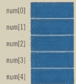

**图 8-1**  数组 `num`

> 为节省空间，我们也绘制一个数组，如图 8-2(a) 或 8-2(b) 所示。

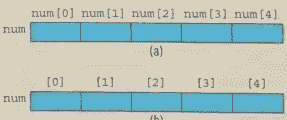

**图 8-2**  数组 `num`

## 访问数组分量

访问数组分量所用的一般形式（语法）为：

```
arrayName[indexExp]
```

其中 `indexExp` 称为索引，是值为非负整数的任意表达式。索引值指定分量在数组中的位置。

在 C++ 中，`[]` 是一个运算符，称为数组下标运算符。此外，在 C++ 中，数组索引从 0 开始。

考虑以下语句：

```
int list[10];
```

该语句声明一个包含 10 个分量的数组 `list`。这些分量是 `list[0]`、`list[1]`、…、`list[9]`。换句话说，我们声明了 10 个变量（见图 8-3）。


**图 8-3**  数组 `list`

赋值语句：

```
list[5] = 34;
```

将 34 存入 `list[5]`，它是数组 `list` 的第六个分量（见图 8-4）。

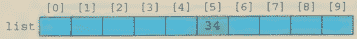

**图 8-4**  执行语句 `list[5] = 34;` 后的数组 `list`

假设 `i` 是一个 `int` 变量。那么，赋值语句：

```
list[3] = 63;
```

等价于以下赋值语句

```
i = 3;
list[i] = 63;
```


声明数组时，其大小必须是已知的。例如，不能这样做：

```
int arraySize;                         //Line 1

cout << "Enter the size of the array: ";  //Line 2
cin >> arraySize;                         //Line 3
cout << endl;                              //Line 4

int list[arraySize];                       //Line 5; not allowed
```

第 2 行中的语句要求用户在程序执行时输入数组的大小。第 3 行中的语句将数组大小输入到 `arraySize` 中。当编译器编译第 1 行时，变量 `arraySize` 的值是未知的。因此，当编译器编译第 5 行时，数组大小未知，编译器将不知道为该数组分配多少内存空间。在第 12 章中，你将学习如何在程序执行期间指定数组大小，然后使用指针声明该大小的数组。在程序执行期间使用指针创建的数组称为动态数组。目前，无论何时声明数组，其大小必须是已知的。

## 处理一维数组

对一维数组执行的一些基本操作包括初始化、输入数据、输出数组中存储的数据，以及查找最大和/或最小元素。此外，如果数据是数值型的，另一些基本操作是求数组元素的和与平均值。这些操作中的每一个都要求能够遍历数组元素。使用循环很容易做到这一点。例如，假设我们有以下语句：

```
int list[100];    //list is an array of size 100
int i;
```

下面的 `for` 循环从 `list` 的第一个元素开始，遍历数组 `list` 的每个元素：

```
for (i = 0; i < 100; i++)    //Line 1
    //process list[i]          //Line 2
```

如果处理该数组需要向 `list` 输入数据，则第 2 行中的语句采用输入语句的形式，例如 `cin` 语句。例如，以下语句从键盘读取 100 个数字并将这些数字存入 `list`：

```
for (i = 0; i < 100; i++)    //Line 1
    cin >> list[i];             //Line 2
```

类似地，如果处理 `list` 需要输出数据，则第 2 行中的语句采用输出语句的形式。示例 8-3 进一步说明如何处理一维数组。


### 示例 8-3

本示例展示如何使用循环处理数组。本示例通篇使用以下声明：

```
double sales[10];
int index;
double largestSale, sum, average;
```

第一条语句声明一个包含 10 个分量的数组 `sales`，每个分量的类型为 `double`。其他语句的含义很清楚。

- a. **初始化数组：** 以下循环将数组 `sales` 的每个分量初始化为 0.0。

  ```
  for (index = 0; index < 10; index++)
      sales[index] = 0.0;
  ```

- b. **将数据读入数组：** 以下循环将数据输入到数组 `sales` 中。为简单起见，我们假设数据从键盘输入。

  ```
  for (index = 0; index < 10; index++)
      cin >> sales[index];
  ```

- c. **打印数组：** 以下循环输出数组 `sales`。为简单起见，我们假设输出到屏幕。

  ```
  for (index = 0; index < 10; index++)
      cout << sales[index] << " ";
  ```

- d. **求数组的和与平均值：** 因为数组 `sales` 正如其名，表示某些销售数据，所以自然要求总销售额和平均销售额。以下 C++ 代码求数组 `sales` 各元素之和以及平均销售额：

  ```
  sum = 0;
  for (index = 0; index < 10; index++)
      sum = sum + sales[index];

  average = sum / 10;
  ```

- e. **数组中的最大元素：** 我们现在讨论查找数组中最大元素第一次出现的算法——也就是第一个具有最大值的数组分量。然而，一般来说，用户更感兴趣的是确定数组中最大元素的位置。当然，如果知道位置（即数组中最大元素的索引），就能很容易地确定数组中最大元素的值。因此，让我们描述确定数组中最大元素第一次出现的索引的算法——特别是数组 `sales` 中最大销售额的索引。我们将使用数组中最大元素第一次出现的索引来查找最大销售额。我们假设 `maxIndex` 将包含数组 `sales` 中最大元素第一次出现的索引。该通用算法很直接。最初，我们假设列表中的第一个元素是最大元素，因此 `maxIndex` 初始化为 0。然后，我们将 `maxIndex` 所指向的元素与列表中后续的每个元素进行比较。每当我们发现数组中有元素大于 `maxIndex` 所指向的元素时，就更新 `maxIndex`，使其指向新的更大元素。算法如下：

  ```
  maxIndex = 0;
  for (index = 1; index < 10; index++)
      if (sales[maxIndex] < sales[index])
          maxIndex = index;
  largestSale = sales[maxIndex];
  ```

让我们用一个例子演示该算法如何工作。假设数组 `sales` 如图 8-6 所示。


**图 8-6**  数组 `sales`

这里，我们确定数组 `sales` 中的最大元素。在 `for` 循环开始之前，`maxIndex` 被初始化为 0，而 `for` 循环将 `index` 初始化为 1。在下表中，我们展示 `for` 循环每次迭代期间 `maxIndex`、`index` 以及当前数组元素的值。

| index | maxIndex | sales[maxIndex] | sales[index] | sales[maxIndex] < sales[index] |
|---:|---:|---:|---:|---|
| 1 | 0 | 12.50 | 8.35 | 12.50 < 8.35 为假 |
| 2 | 0 | 12.50 | 19.60 | 12.50 < 19.60 为真；maxIndex = 2 |
| 3 | 2 | 19.60 | 25.00 | 19.60 < 25.00 为真；maxIndex = 3 |
| 4 | 3 | 25.00 | 14.00 | 25.00 < 14.00 为假 |
| 5 | 3 | 25.00 | 39.43 | 25.00 < 39.43 为真；maxIndex = 5 |
| 6 | 5 | 39.43 | 35.90 | 39.43 < 35.90 为假 |
| 7 | 5 | 39.43 | 98.23 | 39.43 < 98.23 为真；maxIndex = 7 |
| 8 | 7 | 98.23 | 66.65 | 98.23 < 66.65 为假 |
| 9 | 7 | 98.23 | 35.64 | 98.23 < 35.64 为假 |

`for` 循环执行后，`maxIndex = 7`，给出数组 `sales` 中最大元素的索引。因此，`largestSale = sales[maxIndex] = 98.23`。


你可以编写一个算法来查找数组中的最小元素，该算法类似于查找数组中最大元素的算法。（参见本章末尾的编程练习2。）

既然我们已经知道了如何声明和处理数组，让我们重写本章开头讨论的程序。回忆一下，该程序读取五个测试分数，求平均测试分数，并输出所有低于平均测试分数的测试分数。

### 示例8-4

```cpp
//Program to find the average test score and output the average
//test score and all the test scores that are less than the
//average test score.

#include <iostream>
#include <iomanip>

using namespace std;

int main()
{
    int test[5];
    int sum = 0;
    double average;
    int index;

    cout << fixed << showpoint << setprecision(2);

    cout << "Enter five test scores: ";

    for (index = 0; index < 5; index++)
    {
        cin >> test[index];
        sum = sum + test[index];
    }

    cout << endl;

    average = sum / 5.0;

    cout << "The average test score = " << average << endl;

    for (index = 0; index < 5; index++)
        if (test[index] < average)
            cout << test[index]
                 << " is less than the average test score." << endl;
    return 0;
}
```

**示例运行：** 在此示例运行中，用户输入已用底纹标示。

```
Enter five test scores: 85 62 94 56 71

The average test score = 73.60
62 is less than the average test score.
56 is less than the average test score.
71 is less than the average test score.
```


C++0X 引入了**基于范围**的`for`语句来处理数组。例如，考虑以下语句：

```cpp
int list[10];

for (int & x : list)
    cout << x << endl;
```

变量 x 遍历 list 中的元素。然而，在编写本书时，我们使用的编译器尚未实现这一特性。一旦实现，它将简化列表元素的处理。事实上，C++0X 还引入了元素的自动声明，它允许程序员在声明和初始化变量时无需指定其类型。例如，以下语句声明了变量 num 并将 15 存储在其中。

```cpp
auto num = 15;
```

因为初始化器 15 是一个 int 值，所以 num 的类型将是 int。然而，在编写本书时，我们使用的编译器尚未实现这一特性。一旦这些新特性实现，我们就可以在基于范围的 for 语句中使用自动声明，而无需知道数组的类型。

## 数组索引越界

考虑以下声明：

```cpp
double num[10];
int i;
```

分量 num[i] 是有效的，即如果 i = 0, 1, 2, 3, 4, 5, 6, 7, 8 或 9，则 i 是一个有效索引。

如果索引 >= 0 且索引 <= `ARRAY_SIZE - 1`，则数组的索引（例如 index）是**在边界内**的。如果索引 < 0 或索引 > `ARRAY_SIZE - 1`，那么我们称该索引**越界**。

不幸的是，在 C++ 中，对于越界索引没有防护措施。因此，C++ 不检查索引值是否在范围内——即介于 0 和 `ARRAY_SIZE - 1` 之间。如果索引越界并且程序试图访问该索引指定的分量，那么将会访问索引所指示的任何内存位置。这种情况可能导致修改或访问你从未打算修改或访问的内存位置的数据。因此，如果索引在执行期间越界，可能会发生许多奇怪的事情。确保索引在边界内完全是程序员的责任。

像下面这样的循环可能会导致索引越界：

```cpp
for (i = 0; i <= 10; i++)
    list[i] = 0;
```

这里，我们假设 list 是一个包含 10 个分量的数组。当 i 变为 10 时，循环测试条件 i <= 10 计算结果为 true，于是执行循环体，这会导致将 0 存储到 list[10] 中。从逻辑上讲，list[10] 并不存在。

> 在一些新的编译器上，如果程序中的数组索引越界，程序可能会以错误消息终止。例如，请参阅本书随附网站上的程序 `Example_ArrayIndexOutOfBoundsA.cpp` 和 `Example_ArrayIndexOutOfBoundsB.cpp`。

## 声明时的数组初始化

与其他简单变量一样，数组可以在声明时进行初始化。例如，下面的 C++ 语句声明了一个包含五个分量的数组 sales，并初始化了这些分量。

```cpp
double sales[5] = {12.25, 32.50, 16.90, 23, 45.68};
```

这些值放在花括号之间并用逗号分隔——这里，sales[0] = 12.25，sales[1] = 32.50，sales[2] = 16.90，sales[3] = 23.00，sales[4] = 45.68。

在声明数组时进行初始化时，无需指定数组的大小。大小由花括号中初始值的数量决定。但是，你必须保留数组名后面的方括号。因此，前面的语句等价于

```cpp
double sales[] = {12.25, 32.50, 16.90, 23, 45.68};
```

尽管如果在声明时初始化数组，则无需指定数组大小，但这样做是一个好的实践。

## 声明时数组的部分初始化

当你同时声明和初始化数组时，不需要初始化数组的所有分量。这个过程称为**声明时数组的部分初始化**。但是，如果在声明时部分初始化数组，你必须格外小心。下面的示例有助于解释当你声明并部分初始化数组时会发生什么。

语句：

```cpp
int list[10] = {0};
```

将 list 声明为包含 10 个分量的数组，并将所有分量初始化为 0。语句：

```cpp
int list[10] = {8, 5, 12};
```

将 list 声明为包含 10 个分量的数组，并将 list[0] 初始化为 8，list[1] 初始化为 5，list[2] 初始化为 12，所有其他分量初始化为 0。因此，如果在初始化语句中未指定所有值，则未指定值的数组分量将被初始化为 0。注意，这里声明语句中数组的大小并不重要。例如，语句：

```cpp
int list[] = {5, 6, 3};
```

将 list 声明为包含三个分量的数组，并将 list[0] 初始化为 5，list[1] 初始化为 6，list[2] 初始化为 3。相比之下，语句：

```cpp
int list[25] = {4, 7};
```

将 list 声明为包含 25 个分量的数组。前两个分量分别被初始化为 4 和 7，所有其他分量被初始化为 0。

当你部分初始化数组时，最后一个已初始化元素之后的所有元素都必须保持未初始化。因此，下面的语句将导致语法错误：

```cpp
int list[10] = {2, 5, 6, , 8}; //illegal
```

在此初始化中，由于第四个元素未初始化，因此第四个元素之后的所有元素都必须保持未初始化。

## 数组处理的一些限制

考虑以下语句：

```cpp
int myList[5] = {0, 4, 8, 12, 16};   //Line 1
int yourList[5];   //Line 2
```

第1行的语句声明并初始化了数组 myList，第2行的语句声明了数组 yourList。注意，这两个数组类型相同，并且具有相同的分量数量。假设你想将 myList 的元素复制到 yourList 的相应元素中。下面的语句是非法的：

```cpp
yourList = myList;   //illegal
```

事实上，这条语句将产生一个语法错误。C++ 不允许对数组进行聚合操作。数组的聚合操作是将整个数组作为单个单元进行操作的任何操作。

要将一个数组复制到另一个数组，你必须逐分量复制——即一次复制一个分量。这可以使用循环来完成，例如：

```cpp
for (int index = 0; index < 5; index++)
    yourList[index] = myList[index];
```

接下来，假设你想将数据读入数组 yourList。下面的语句是非法的，事实上会产生一个语法错误：

```cpp
cin >> yourList;  //illegal
```


要将数据读入 yourList，必须一次读取一个分量，使用类似下面的循环：

```cpp
for (int index = 0; index < 5; index++)
    cin >> yourList[index];
```

同样，判断两个数组是否包含相同元素以及打印数组内容，也必须逐个分量进行。注意，下列语句是非法的，这里的“非法”是指它们不会产生语法错误；但是，它们不会给出期望的结果。

```cpp
cout << yourList;

if (myList <= yourList)
.
.
.
```

本章稍后的“数组的基地址与计算机内存中的数组”一节将讨论这些语句。

## 数组作为函数参数

既然你已经了解了如何使用数组，一个自然的问题就出现了：数组如何作为参数传递给函数？

**仅按引用传递：** 在 C++ 中，数组仅按引用传递。

由于数组仅按引用传递，因此在将数组声明为形参时，*不要*使用符号 &。

### 示例 8-5

考虑下面的函数：

```cpp
void funcArraysParam(int listOne[], double listTwo[])
{
    .
    .
}
```

函数 funcArraysParam 有两个形参：(1) listOne，一个 int 类型的一维数组（即分量类型为 int）；(2) listTwo，一个 double 类型的一维数组。在此声明中，两个数组的大小均未指定。

有时，数组中的元素个数可能小于数组的大小。例如，存储学生数据的数组中的元素个数可能会随着学生退课或选课而增加或减少。在这种情况下，我们只想处理数组中保存实际数据的分量。要编写处理此类数组的函数，除了将数组声明为形参外，还要声明另一个形参来指定数组中的元素个数，如下面的函数所示：

```cpp
void initialize(int list[], int listSize)
{
    int count;

    for (count = 0; count < listSize; count++)
        list[count] = 0;
}
```

函数 initialize 的第一个参数是一个任意大小的 int 数组。调用函数 initialize 时，实际数组的大小作为函数 initialize 的第二个参数传递。

## 常量数组作为形参

回想一下，当形参是引用参数时，只要形参发生变化，实参也会随之变化。然而，尽管数组总是按引用传递，你仍然可以阻止函数更改实参。为此，可以在形参声明中使用保留字 const。考虑下面的函数：

```cpp
void example(int x[], const int y[], int sizeX, int sizeY)
{
    .
    .
    .
}
```

这里，函数 example 可以修改数组 x，但不能修改数组 y。任何更改 y 的尝试都会导致编译时错误。如果你不希望函数修改数组，那么将数组声明为常量形参是一种良好的编程实践。

### 示例 8-6

本示例展示如何编写用于数组处理的函数，以及如何将数组声明为形参。

```cpp
//Function to initialize an int array to 0.
//The array to be initialized and its size are passed
//as parameters. The parameter listSize specifies the
//number of elements to be initialized.
void initializeArray(int list[], int listSize)
{
    int index;

    for (index = 0; index < listSize; index++)
        list[index] = 0;
}

//Function to read and store the data into an int array.
//The array to store the data and its size are passed as
//parameters. The parameter listSize specifies the number
//of elements to be read.
void fillArray(int list[], int listSize)
{
    int index;

    for (index = 0; index < listSize; index++)
        cin >> list[index];
}

//Function to print the elements of an int array.
//The array to be printed and the number of elements
//are passed as parameters. The parameter listSize
//specifies the number of elements to be printed.
void printArray(const int list[], int listSize)
{
    int index;

    for (index = 0; index < listSize; index++)
        cout << list[index] << " ";
}

//Function to find and return the sum of the
//elements of an int array. The parameter listSize
//specifies the number of elements to be added.
int sumArray(const int list[], int listSize)
{
    int index;
    int sum = 0;

    for (index = 0; index < listSize; index++)
        sum = sum + list[index];

    return sum;
}

//Function to find and return the index of the first
//largest element in an int array. The parameter listSize
//specifies the number of elements in the array.
int indexLargestElement(const int list[], int listSize)
{
    int index;
    int maxIndex = 0; //assume the first element is the largest

    for (index = 1; index < listSize; index++)
        if (list[maxIndex] < list[index])
            maxIndex = index;

    return maxIndex;
}

//Function to copy some or all of the elements of one array
//into another array. Starting at the position specified
//by src, the elements of list1 are copied into list2
//starting at the position specified by tar. The parameter
//numOfElements specifies the number of elements of list1 to
//be copied into list2. Starting at the position specified
//by tar, the list2 must have enough components to copy the
//elements of list1. The following loop copies all of the
//elements of list1 into the corresponding positions in
//list2:
//void copyArray(list1[], 0, list2, 0, numOfElements);
void copyArray(int list1[], int src, int list2[],
               int tar, int numOfElements)
{
    for (int index = src; index < src + numOfElements; index++)
    {
        list2[index] = list1[tar];
        tar++;
    }
}
```

示例 8-7 将说明如何在程序中使用其中一些函数。

## 数组的基地址与计算机内存中的数组

数组的基地址是第一个数组分量的地址（即内存位置）。例如，如果 list 是一个一维数组，那么 list 的基地址就是分量 list[0] 的地址。

考虑下面的语句：

```cpp
int myList[5];        //line 1
```

这条语句将 myList 声明为一个包含五个 int 类型分量的数组。这些分量是 myList[0]、myList[1]、myList[2]、myList[3] 和 myList[4]。计算机为这些分量分配五个内存空间，每个空间都足以存储一个 int 值。此外，这五个内存空间是连续的。

数组 myList 的基地址是分量 myList[0] 的地址。假设数组 myList 的基地址是 1000。那么，分量 myList[0] 的地址就是 1000。通常，为 int 变量分配的内存是四个字节。回想第 1 章的内容：主存是一个有序的单元序列，每个单元都有唯一地址。通常，每个单元是一个字节。因此，要将一个值存储到 myList[0] 中，从地址 1000 开始，接下来的四个字节分配给 myList[0]。由此可知，myList[1] 的起始地址是 1004，myList[2] 的起始地址是 1008，依此类推（见图 8-7）。

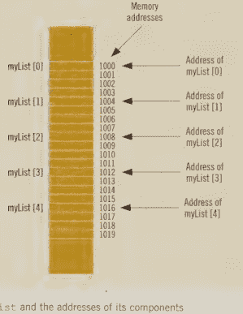

现在，`myList` 是一个数组名。还有一个与标识符 `myList` 关联的内存空间，数组的基地址就存储在该内存空间中。考虑下面的语句：

```cpp
cout << myList << endl;                  //Line 2
```

前面我们说过，这条语句不会给出期望的结果。也就是说，这条语句不会输出 `myList` 各分量的值。事实上，这条语句输出的是 `myList` 的值，也就是数组的基地址。这就是该语句不会产生语法错误的原因。

假设你还有下面的语句：

```cpp
int yourList[5];
```

然后，在以下语句中：

```cpp
if (myList <= yourList)          //Line 3
.
.
```

表达式 `myList <= yourList` 在数组 `myList` 的基地址小于数组 `yourList` 的基地址时求值为真；否则求值为假。它并不判断 `myList` 的元素是否小于或等于 `yourList` 的对应元素。

> 本书配套网站包含程序 `BaseAddressOfAnArray.cpp`，它阐明了第 2 行和第 3 行等语句。

你可能想知道为什么数组的基地址如此重要。原因在于，当你声明一个数组时，计算机所记住的关于该数组的信息只有数组名、基地址、每个分量的数据类型，以及（可能还有）分量的数量。利用数组的基地址和数组分量的下标，计算机可以确定某个特定分量的地址。例如，假设你想访问 `myList[3]` 的值。现在，`myList` 的基地址是 1000。`myList` 的每个分量都是 `int` 类型，因此使用四个字节存储一个值，并且下标是 3。为了访问 `myList[3]` 的值，计算机计算地址 1000 + 4 * 3 = 1000 + 12 = 1012。也就是说，这是 `myList[3]` 的起始地址。因此，从 1012 开始，计算机访问接下来的四个字节。

当你将数组作为参数传递时，实际数组的基地址会传递给形参。例如，假设你有以下函数：

```cpp
void arrayAsParameter(int list[], int size)
{
    .
    .
    .

    list[2] = 28;       //Line 4

    .
    .
    .
}
```

另外，假设你有以下对该函数的调用：

```cpp
arrayAsParameter(myList, 5);  //Line 5
```

在此语句中，`myList` 的基地址被传递给形参 `list`。因此，`list` 的基地址是 1000。该函数的定义包含语句 `list[2] = 28;`。这条语句将 28 存储到 `list[2]` 中。为了访问 `list[2]`，计算机按如下方式计算地址：1000 + 4 * 2 = 1000 + 8 = 1008。因此，从地址 1008 开始，计算机访问接下来的四个字节并存储 28。请注意，实际上 1008 就是 myList[2] 的地址（见图 8-7）。由此可知，在执行第 5 行的语句期间，第 4 行的语句会将值 28 存储到 myList[2] 中。同样由此可知，在执行第 5 行的函数调用语句期间，list[index] 和 myList[index] 引用同一内存空间，其中 0 <= index 且 index < 5。

> **注意** 如果 C++ 允许按值传递数组，那么计算机就必须为形参的分量分配内存，并在调用函数时将实际数组的内容复制到相应的形参中。如果数组很大，这个过程既会浪费内存，也会浪费复制数据所需的计算机时间。这就是为什么在 C++ 中数组总是按引用传递。

## 函数不能返回数组类型的值

C++ 不允许函数返回数组类型的值。请注意，前面描述的 sumArray 和 indexLargestElement 函数返回 `int` 类型的值。

## 示例 8-7

以下程序说明了数组如何在函数调用中作为实参传递。（请注意，该程序使用了示例 8-6 中编写的函数。）

```cpp
//Arrays as parameters to functions
#include <iostream>

using namespace std;

const int ARRAY_SIZE = 10;

void initializeArray(int x[],int sizeX);
void fillArray(int x[],int sizeX);
void printArray(const int x[],int sizeX);
int sumArray(const int x[],int sizeX);
int indexLargestElement(const int x[],int sizeX);
void copyArray(int list1[], int src, int list2[],
               int tar, int numOfElements);
int main()
{
    int listA[ARRAY_SIZE] = {0};    //Declare the array listA
                                   //of 10 components and
                                   //initialize each component
                                   //to 0.

    int listB[ARRAY_SIZE];          //Declare the array listB
                                   //of 10 components.

    cout << "Line 1: listA elements: ";                    //Line 1

    //Output the elements of listA using
    //the function printArray
    printArray(listA, ARRAY_SIZE);                          //Line 2
    cout << endl;                                           //Line 3

    //Initialize listB using the function
    //initializeArray
    initializeArray(listB, ARRAY_SIZE);                     //Line 4

    cout << "Line 5: listB elements: ";                     //Line 5

    //Output the elements of listB
    printArray(listB, ARRAY_SIZE);                          //Line 6
    cout << endl << endl;                                   //Line 7

    cout << "Line 8: Enter " << ARRAY_SIZE
         << " integers: ";                                  //Line 8

    //Input data into listA using the
    //function fillArray
    fillArray(listA, ARRAY_SIZE);                           //Line 9
    cout << endl;                                           //Line 10

    cout << "Line 11: After filling listA, "
         << "the elements are:" << endl;                    //Line 11

    //Output the elements of listA
    printArray(listA, ARRAY_SIZE);                          //Line 12
    cout << endl << endl;                                   //Line 13

    //Find and output the sum of the elements
    //of listA
    cout << "Line 14: The sum of the elements of "
         << "listA is: "
         << sumArray(listA, ARRAY_SIZE) << endl             //Line 14
         << endl;

    //Find and output the position of the largest
    //element in listA
    cout << "Line 15: The position of the largest "
         << "element in listA is: "
         << indexLargestElement(listA, ARRAY_SIZE)
         << endl;                                           //Line 15

    //Find and output the largest element
    //in listA
    cout << "Line 16: The largest element in "
         << "listA is: "
         << listA[indexLargestElement(listA, ARRAY_SIZE)]
         << endl << endl;                                   //Line 16

    //Copy the elements of listA into listB using the
    //function copyArray
    copyArray(listA, 0, listB, 0, ARRAY_SIZE);        //Line 17

    cout << "Line 18: After copying the elements "
         << "of listA into listB," << endl
         << "              listB elements are: ";     //Line 18

    //Output the elements of listB
    printArray(listB, ARRAY_SIZE);                    //Line 19
    cout << endl;                                     //Line 20

    return 0;
}

//Place the definitions of the functions initializeArray,
//fillArray, and so on here. Example 8-6 gives the definitions
//of these functions.
```

**示例运行：** 在此示例运行中，用户输入以阴影显示。

```text
Line 1: listA elements: 0 0 0 0 0 0 0 0 0 0
Line 5: listB elements: 0 0 0 0 0 0 0 0 0 0

Line 8: Enter 10 integers: 33 77 25 63 56 48 98 39 5 12

Line 11: After filling listA, the elements are:
33 77 25 63 56 48 98 39 5 12

Line 14: The sum of the elements of listA is: 456

Line 15: The position of the largest element in listA is: 6
Line 16: The largest element in listA is: 98

Line 18: After copying the elements of listA into listB,
         listB elements are: 33 77 25 63 56 48 98 39 5 12
```

该程序的输出很直接。首先，我们声明包含 10 个分量的数组 listA，并将 listA 的每个分量初始化为 0。然后，我们声明包含 10 个分量的数组 listB。第 2 行的语句调用函数 printArray，并输出存储在 listA 中的值。第 9 行的语句调用函数 fillArray，将数据输入 listA。第 14 行的语句调用函数 sumArray，并输出 listA 所有元素的和。类似地，第 16 行的语句输出 listA 中最大元素的值。

## 整型数据类型与数组下标

理解本节需要先阅读第 7 章中的“枚举类型”和“typedef 语句”两节。


除了整数之外，C++ 还允许将任何整型类型用作数组下标。这一特性可以极大地提高程序的可读性。考虑以下语句：

```cpp
enum paintType {GREEN, RED, BLUE, BROWN, WHITE, ORANGE, YELLOW};
double paintSale[7];
paintType paint;
```

下面的循环将数组 paintSale 的每个分量初始化为 0：

```cpp
for (paint = GREEN; paint <= YELLOW;
             paint = static_cast<paintType>(paint + 1))
    paintSale[paint] = 0.0;
```

下面的语句更新 RED 油漆的销售额：

```cpp
paintSale[RED] = paintSale[RED] + 75.69;
```

如您所见，上述代码比使用整数作为下标的代码更容易理解。因此，只要有可能，就应该使用枚举类型或其他整型数据类型作为数组下标。请注意，当使用枚举类型作为数组下标时，应使用枚举类型中标识符的默认值。也就是说，第一个标识符的值必须为 0，依此类推。（回想第 7 章，枚举类型中标识符的默认值从 0 开始；但是，标识符也可以设置为其他值。）

## 声明数组的其他方式

假设一个班有 20 名学生，您需要记录他们的成绩。由于学生人数每学期都可能变化，您可以在声明数组时不指定数组大小，而是按如下方式声明数组：

```cpp
const int NO_OF_STUDENTS = 20;
int testScores[NO_OF_STUDENTS];
```

用于声明数组的其他形式如下：

```cpp
const int SIZE = 50;          //Line 1
typedef double list[SIZE];    //Line 2

list yourList;                //Line 3
list myList;                  //Line 4
```

第 2 行的语句定义了一个数据类型 list，它是一个由 50 个 double 类型分量组成的数组。第 3 行和第 4 行的语句声明了两个变量 yourList 和 myList。它们都是包含 50 个 double 类型分量的数组。当然，这些语句等价于：

```cpp
double yourList[50];
double myList[50];
```

## 在数组中搜索特定项

在列表中搜索给定项是对列表执行的最常见操作之一。我们描述的搜索算法称为顺序搜索或线性搜索。顾名思义，您从数组的第一个元素开始，按顺序搜索数组。您将 searchItem 与数组（列表）中的元素进行比较，并继续搜索，直到找到该项，或者列表中不再有数据可与 searchItem 进行比较。

考虑如图 8-8 所示的包含七个元素的列表。

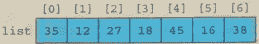

**图 8-8** 七个元素的列表

假设您想确定 27 是否在列表中。顺序搜索的工作原理如下：首先，将 27 与 list[0] 比较，即 27 与 35 比较。因为 list[0] ≠ 27，所以将 27 与 list[1] 比较，即与列表中的第二项 12 比较。因为 list[1] ≠ 27，所以将 27 与列表中的下一个元素比较，即将 27 与 list[2] 比较。因为 list[2] = 27，搜索停止。这次搜索成功。

现在让我们搜索 10。和之前一样，搜索从列表的第一个元素 list[0] 开始。按之前的步骤进行，这次搜索项 10 会与列表中的每一项进行比较。最终，列表中不再有数据可与搜索项进行比较。这是一次不成功的搜索。

由此可见，一旦您在列表中找到与搜索项相等的元素，就必须停止搜索并报告成功。（在这种情况下，您还应报告搜索项在列表中的位置。）否则，在将搜索项与列表中的每个元素进行比较都失败后，您必须停止搜索并报告失败。

假设包含列表元素的数组名为 list。前面的讨论转化为以下顺序搜索算法：

```
found is set to false
loc = 0

while (loc < listLength and not found)
    if (list[loc] is equal to searchItem)
        found is set to true
    else
        increment loc

if (found)
    return loc;
else
    return -1;
```

以下函数对列表执行顺序搜索。具体来说，为了便于说明，我们假设列表元素为 int 类型。

```cpp
int seqSearch(const int list[], int listLength, int searchItem)
{
    int loc;
    bool found = false;

    loc = 0;

    while (loc < listLength && !found)
        if (list[loc] == searchItem)
            found = true;
        else
            loc++;

    if (found)
        return loc;
    else
        return -1;
}
```

如果函数 seqSearch 返回的值大于或等于 0，则搜索成功；否则，搜索不成功。

从这段代码可以看出，您通过将 searchItem 与列表的第一个元素进行比较来开始搜索。如果 searchItem 等于列表的第一个元素，则退出循环；否则，loc 递增 1 以指向列表中的下一个元素。然后您将 searchItem 与列表中的下一个元素进行比较，依此类推。

### 示例 8-8

```cpp
// This program illustrates how to use a sequential search in a
// program.

#include <iostream>                                      //Line 1

using namespace std;                                     //Line 2

const int ARRAY_SIZE = 10;                               //Line 3

int seqSearch(const int list[], int listLength,          //Line 4
              int searchItem);

int main()                                               //Line 5
{
    int intList[ARRAY_SIZE];                              //Line 6
    int number;                                           //Line 7

    cout << "Line 9: Enter " << ARRAY_SIZE                //Line 9
         << " integers." << endl;

    for (int index = 0; index < ARRAY_SIZE; index++)      //Line 10
        cin >> intList[index];                            //Line 11

    cout << endl;                                         //Line 12

    cout << "Line 13: Enter the number to be "            //Line 13
         << "searched: ";
    cin >> number;                                        //Line 14
    cout << endl;                                         //Line 15

    int pos = seqSearch(intList, ARRAY_SIZE, number);     //Line 16

    if (pos != -1)                                        //Line 17
        cout << "Line 18: " << number
             << " is found at position " << pos
             << endl;                                     //Line 18
    else                                                  //Line 19
        cout << "Line 20: " << number
             << " is not in the list." << endl;           //Line 20

    return 0;                                             //Line 21
}                                                         //Line 22

//place the definition of the function seqSearch
//given previously here.
```

**示例运行 1：** 在此示例运行中，用户输入以阴影显示。

第 9 行：输入 10 个整数。

`2 56 34 25 73 46 89 10 5 16`

第 13 行：输入要搜索的数字：**25**

第 18 行：25 在位置 3 找到。

**示例运行 2：**

第 9 行：输入 10 个整数。

`2 56 34 25 73 46 89 10 5 16`

第 13 行：输入要搜索的数字：**38**

第 20 行：38 不在列表中。

## 选择排序

上一节讨论了一种搜索算法。在本节中，我们讨论如何使用一种称为**选择排序**的算法对数组进行排序。第 16 章将讨论更多的搜索和排序算法。

顾名思义，在**选择排序**算法中，我们通过选择列表中的一个元素并将其移动到正确位置来重新排列列表。该算法找到列表中未排序部分最小元素的位置，并将其移动到未排序部分的顶部。第一次，我们在整个列表中定位最小的项。第二次，我们从列表的第二个元素开始定位最小的项，依此类推。

假设您有如图 8-9 所示的列表。


**图 8-9** 八个元素的列表

图 8-10 显示了第一次迭代中列表的元素。

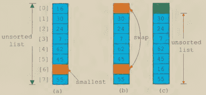

**图 8-10** 第一次迭代期间列表的元素

最初，整个列表是未排序的。因此，我们找到列表中最小的项。最小的项位于位置 6，如图 8-10(a) 所示。这是最小的项，必须将其移动到位置 0。因此，我们将 16（即 list[0]）与 5（即 list[6]）交换，如图 8-10(b) 所示。交换这些元素后，得到的列表如图 8-10(c) 所示。


图8–11展示了第二次迭代期间 `list` 的元素。

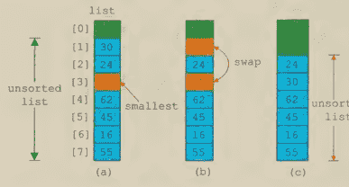

**图8–11** 第二次迭代期间 list 的元素

现在，未排序列表是 `list[1]...list[7]`。因此，我们在未排序列表中寻找最小元素。最小元素位于位置 3，如图8–11(a)所示。由于未排序列表中的最小元素位于位置 3，因此必须将其移动到位置 1。所以，我们将 7（即 `list[3]`）与 30（即 `list[1]`）交换，如图8–11(b)所示。将 `list[1]` 与 `list[3]` 交换后，得到的列表如图8–11(c)所示。

现在，未排序列表是 `list[2]...list[7]`。因此，我们重复前面的过程：找到列表中未排序部分最小元素的位置，并将其移动到列表未排序部分的开头。因此，选择排序包括以下步骤。

在列表的未排序部分中：

- a. 找到最小元素的位置。
- b. 将最小元素移动到未排序列表的开头。

最初，整个列表（即 `list[0]...list[length - 1]`）是未排序列表。执行步骤 a 和 b 一次后，未排序列表是 `list[1]...list[length - 1]`。第二次执行步骤 a 和 b 后，未排序列表是 `list[2]...list[length - 1]`，依此类推。这样，我们就可以跟踪列表的未排序部分，并借助 `for` 循环重复步骤 a 和 b，如下面的伪代码所示：

```text
for (index = 0; index < length - 1; index++)
{
    a.  Find the location, smallestIndex, of the smallest element in
        list[index]...list[length - 1].
    b.  Swap the smallest element with list[index]. That is, swap
        list[smallestIndex] with list[index].
}
```

第一次执行循环时，我们在 `list[0]...list[length - 1]` 中定位最小元素，并将该最小元素与 `list[0]` 交换。第二次执行循环时，我们在 `list[1]...list[length - 1]` 中定位最小元素，并将该最小元素与 `list[1]` 交换，依此类推。

步骤 a 类似于本章前面讨论的查找列表中最大项索引的算法。（另见本章末尾的编程练习 2。）在这里，我们要查找列表中最小项的索引。步骤 a 的一般形式是：

```cpp
    smallestIndex = index;  //assume first element is the smallest

    for (location = index + 1; location < length; location++)
        if (list[location] < list[smallestIndex])
            smallestIndex = location;  //current element in the list
                                       //is smaller than the smallest so
                                       //far, so update smallestIndex
```

步骤 b 将 `list[smallestIndex]` 的内容与 `list[index]` 交换。以下语句完成此任务：

```cpp
    temp = list[smallestIndex];
    list[smallestIndex] = list[index];
    list[index] = temp;
```

由此可见，要交换这些值，需要进行三次项赋值。下面的函数 `selectionSort` 实现了选择排序算法：

```cpp
    void selectionSort(int list[], int length)
    {
        int index;
        int smallestIndex;
        int location;
        int temp;

        for (index = 0; index < length - 1; index++)
        {
            //Step a
            smallestIndex = index;

            for (location = index + 1; location < length; location++)
                if (list[location] < list[smallestIndex])
                    smallestIndex = location;

            //Step b
            temp = list[smallestIndex];
            list[smallestIndex] = list[index];
            list[index] = temp;
        }
    }
```

示例 8-9 中的程序说明了如何在程序中使用选择排序算法。

### 示例 8-9

```cpp
//Selection sort

#include <iostream>

using namespace std;

void selectionSort(int list[], int length);

int main()
{
    int list[] = {2, 56, 34, 25, 73, 46, 89, 10, 5, 16};    //Line 1
    int i;                                                   //Line 2

    selectionSort(list, 10);                                //Line 3

    cout << "After sorting, the list elements are:" << endl; //Line 4
    for (i = 0; i < 10; i++)                                //Line 5
        cout << list[i] << " ";                             //Line 6

    cout << endl;                                            //Line 7

    return 0;                                                //Line 8
}

//Place the definition of the function selectionSort given
//previously here.
```

### 示例运行结果：

```text
After sorting, the list elements are:
2 5 10 16 25 34 46 56 73 89
```

第 1 行中的语句声明 `list` 并将其初始化为一个包含 10 个 `int` 类型分量的数组。第 3 行中的语句使用函数 `selectionSort` 对 `list` 进行排序。注意，`list` 及其长度（其中元素的数量，即 10）都作为参数传递给函数 `selectionSort`。第 5 行和第 6 行中的 `for` 循环输出 `list` 的元素。

为了说明此程序中的选择排序算法，我们声明并初始化了数组 `list`。不过，你也可以提示用户在程序执行期间输入数据。

对于长度为 *n* 的列表，选择排序恰好进行 \(\frac{n(n-1)}{2}\) 次关键比较和 \(3(n-1)\) 次项赋值。因此，如果 *n* = 1000，那么为了对该列表排序，选择排序大约进行 500,000 次关键比较和大约 3000 次项赋值。下一节将介绍可减少比较次数的插入排序算法。

## C 字符串（字符数组）

到目前为止，我们一直避免讨论字符数组，原因很简单：字符数组具有特殊的意义，而且处理它们的方式与处理其他数组不同。C++ 提供了许多（预定义的）函数，可用于字符数组。

**字符数组：** 一种其分量为 `char` 类型的数组。

回想一下，最广泛使用的字符集是 ASCII 和 EBCDIC。ASCII 字符集中的第一个字符是空字符，它是不可打印的。另外，回想一下，在 C++ 中，空字符表示为 `'\0'`，即一个反斜杠后跟一个零。

语句：

```cpp
ch = '\0';
```

将空字符存入 `ch`，其中 `ch` 是一个 `char` 变量。

正如你将看到的，空字符在处理字符数组时起着重要作用。由于空字符的排序序列为 0，因此空字符小于 `char` 数据集中的任何其他字符。

字符数组最常用的术语是 C 字符串。然而，字符数组和 C 字符串之间存在细微差别。回想一下，字符串是零个或多个字符的序列，并且字符串用双引号括起来。在 C++ 中，C 字符串以空字符结尾；也就是说，C 字符串中的最后一个字符始终是空字符。字符数组可能不包含空字符，但 C 字符串中的最后一个字符始终是空字符。正如你将看到的，除了最后一个位置之外，空字符不应出现在 C 字符串中的任何位置。此外，C 字符串存储在（一维）字符数组中。

以下是 C 字符串的示例：

```text
"John L. Johnson"
"Hello there."
```

从 C 字符串的定义可以清楚地看出，`'A'` 和 `"A"` 之间存在区别。第一个是字符 A；第二个是 C 字符串 A。由于 C 字符串以空字符结尾，`"A"` 表示两个字符：`'A'` 和 `'\0'`。类似地，C 字符串 `"Hello"` 表示六个字符：`'H'`、`'e'`、`'l'`、`'l'`、`'o'` 和 `'\0'`。要存储 `'A'`，我们只需要一个 `char` 类型的内存单元；要存储 `"A"`，我们需要两个 `char` 类型的内存单元——一个用于 `'A'`，一个用于 `'\0'`。类似地，要将 C 字符串 `"Hello"` 存储到计算机内存中，我们需要六个 `char` 类型的内存单元。

考虑以下语句：

```cpp
char name[16];
```

此语句声明一个数组 `name`，它包含 16 个 `char` 类型的分量。由于 C 字符串以空字符结尾，并且 `name` 有 16 个分量，因此可以存储在 `name` 中的最大字符串长度为 15。如果将长度为 10 的 C 字符串存入 `name`，则使用 `name` 的前 11 个分量，最后 5 个分量保持未使用。

语句：

```cpp
char name[16] = {'J', 'o', 'h', 'n', '\0'};
```

声明一个数组 `name`，它包含 16 个 `char` 类型的分量，并将 C 字符串 `"John"` 存入其中。在声明 `char` 数组变量时，C++ 允许在初始化语句中使用 C 字符串表示法。因此，上述语句等价于：

```cpp
char name[16] = "John";          //Line A
```

回想一下，如果在声明期间初始化数组，则可以省略数组的大小。

语句：

```cpp
char name[] = "John";            //Line B
```

声明一个长度足够大的 C 字符串变量 `name`——在这里是 5——并将 `"John"` 存入其中。最后两条语句之间存在区别：两条语句都将 `"John"` 存入 `name`，但第 A 行语句中 `name` 的大小为 16，而第 B 行语句中 `name` 的大小为 5。

适用于其他数组的大多数规则也适用于字符数组。考虑以下语句：

```cpp
char studentName[26];
```

假设你想将 `"Lisa L. Johnson"` 存入 `studentName`。由于数组不允许赋值和比较等聚合操作，因此以下语句不合法：

```cpp
studentName = "Lisa L. Johnson"; //illegal
```

C++ 提供了一组可用于 C 字符串操作的函数。头文件 `cstring` 描述了这些函数。我们经常使用其中三个函数：`strcpy`（字符串复制，用于将 C 字符串复制到 C 字符串变量中——即赋值）；`strcmp`


表 8-1 总结了这些函数。

**表 8-1 `strcpy`、`strcmp` 和 `strlen` 函数**

| 函数 | 作用 |
|---|---|
| `strcpy(s1, s2)` | 将字符串 `s2` 复制到字符串变量 `s1` 中<br>`s1` 的长度至少应与 `s2` 一样大 |
| `strcmp(s1, s2)` | 如果 `s1` 小于 `s2`，则返回一个 < 0 的值<br>如果 `s1` 和 `s2` 相同，则返回 0<br>如果 `s1` 大于 `s2`，则返回一个 > 0 的值 |
| `strlen(s)` | 返回字符串 `s` 的长度，不包括空字符 |

要使用这些函数，程序必须通过 `#include` 语句包含头文件 `cstring`。也就是说，程序中必须包含以下语句：

```cpp
#include <cstring>
```

## 字符串比较

在 C++ 中，C 字符串使用系统的排序序列逐字符进行比较。假设你使用 ASCII 字符集。

- C 字符串 "Air" 小于 C 字符串 "Boat"，因为 "Air" 的第一个字符小于 "Boat" 的第一个字符。
- C 字符串 "Air" 小于 C 字符串 "An"，因为两个字符串的第一个字符相同，但 "Air" 的第二个字符 `'i'` 小于 "An" 的第二个字符 `'n'`。
- C 字符串 "Bill" 小于 C 字符串 "Billy"，因为 "Bill" 和 "Billy" 的前四个字符相同，但 "Bill" 的第五个字符是 `\0`（空字符），它小于 "Billy" 的第五个字符 `'y'`。（回想一下，C++ 中的 C 字符串以空字符结尾。）
- C 字符串 "Hello" 小于 "hello"，因为 C 字符串 "Hello" 的第一个字符 `'H'` 小于 C 字符串 "hello" 的第一个字符 `'h'`。

如你所见，函数 `strcmp` 会逐字符地将其第一个 C 字符串参数与其第二个 C 字符串参数进行比较。

### 示例 8-10

假设你有以下语句：

```c
char studentName[21];
char myname[16];
char yourname[16];
```

以下语句展示了字符串函数如何工作：

| 语句 | 作用 |
|---|---|
| `strcpy(myname, "John Robinson");` | `myname = "John Robinson"` |
| `strlen("John Robinson");` | 返回 13，即字符串 "John Robinson" 的长度 |
| `int len;` | |
| `len = strlen("Sunny Day");` | 将 9 存入 len |
| `strcpy(yourname, "Lisa Miller");` | `yourname = "Lisa Miller"` |
| `strcpy(studentName, yourname);` | `studentName = "Lisa Miller"` |
| `strcmp("Bill", "Lisa");` | 返回一个 < 0 的值 |
| `strcpy(yourname, "Kathy Brown");` | `yourname = "Kathy Brown"` |
| `strcpy(myname, "Mark G. Clark");` | `myname = "Mark G. Clark"` |
| `strcmp(myname, yourname);` | 返回一个 > 0 的值 |

> **注意**
>
> 在本章中，我们将 C 字符串定义为由零个或多个字符组成的序列。C 字符串用双引号括起来。我们还说过，C 字符串以空字符结尾，因此 C 字符串 "Hello" 有六个字符，尽管双引号中只括起了五个字符。因此，要将 C 字符串 "Hello" 存储到计算机内存中，必须使用大小为 6 的字符数组。C 字符串的长度是双引号中括起的实际字符数，例如，C 字符串 "Hello" 的长度是 5。因此，从逻辑意义上说，C 字符串是由零个或多个字符组成的序列，但从物理意义上说（也就是说，要将 C 字符串存储到计算机内存中），C 字符串至少有一个字符。由于 C 字符串的长度是双引号中括起的实际字符数，我们将 C 字符串定义为由零个或多个字符组成的序列。然而，你必须记住，存储在计算机内存中 C 字符串末尾的空字符在我们比较 C 字符串时起着关键作用，尤其是像 "Bill" 和 "Billy" 这样的 C 字符串。

## 读取和写入字符串

如前所述，适用于数组的大多数规则也适用于 C 字符串。数组不允许进行聚合操作，例如赋值和比较。甚至数组的输入/输出也是逐分量进行的。然而，C++ 允许对数组进行聚合操作的一个地方是 C 字符串（即字符数组）的输入和输出。

我们将使用以下声明进行讨论：

```cpp
char name[31];
```

### 字符串输入

由于 C 字符串输入允许聚合操作，因此语句：

```cpp
cin >> name;
```

会将下一个输入的 C 字符串存储到 name 中。输入的 C 字符串的长度必须小于或等于 30。如果输入的长度为 4，计算机将存储输入的四个字符以及空字符 `'\0'`。如果输入的 C 字符串长度大于 30，那么，由于没有检查数组索引边界，计算机会继续将字符串存储到 name 后面的任意内存单元中。这个过程可能导致严重问题，因为相邻内存单元中的数据会被破坏。

> **注意**
>
> 当你使用输入设备（例如键盘）输入 C 字符串时，除非双引号是字符串的一部分，否则不要在其两侧包含双引号。例如，C 字符串 "Hello" 输入为 Hello。

回想一下，提取运算符 `>>` 会跳过所有前导空白字符，并在遇到第一个空白字符或无效数据时立即停止将数据读入当前变量。因此，包含空格的 C 字符串无法使用提取运算符 `>>` 读取。例如，如果名字和姓氏由空格分隔，它们无法被读入一个变量。

如何将包含空格的 C 字符串输入到字符数组中？函数 `get` 再次来帮助我们。回想一下，函数 `get` 用于读取字符数据。到目前为止，你使用过的函数 `get` 的形式（第 3 章）只读取单个字符。然而，函数 `get` 也可以用于读取字符串。要读取 C 字符串，你需要使用具有两个参数的函数 `get` 形式。第一个参数是 C 字符串变量；第二个参数指定要读入字符串变量的字符数。

要读取 C 字符串，函数 `get` 的一般形式（语法）与输入流变量（例如 `cin`）一起使用如下：

```cpp
cin.get(str, m + 1);
```

该语句会将接下来的 m 个字符，或直到找到换行字符 `'\n'` 之前的所有字符，存储到 str 中。换行字符不会存储到 str 中。如果输入的 C 字符串少于 m 个字符，那么读取会在换行字符处停止。

考虑以下语句：

```cpp
char str[31];
cin.get(str, 31);
```

如果输入是：

```
William T. Johnson
```

那么 "William T. Johnson" 会存储到 str 中。假设输入是：

```
Hello there. My name is Mickey Blair.
```

那么，由于 str 最多只能存储 30 个字符，C 字符串 "Hello there. My name is Mickey" 会存储到 str 中。

现在，假设我们有这些语句：

```cpp
char str1[26];
char str2[26];
char discard;
```

以及两行输入：

```
Summer is warm.
Winter will be cold.
```

此外，假设我们想将第一个 C 字符串存储到 str1 中，将第二个 C 字符串存储到 str2 中。str1 和 str2 都可以存储长度最多为 25 个字符的 C 字符串。因为第一行中的字符数为 15，所以读取会在 `'\n'` 处停止。你必须读取并丢弃第一行末尾的换行字符，才能将第二行存储到 str2 中。以下语句序列将第一行存储到 str1 中，将第二行存储到 str2 中：

```cpp
cin.get(str1, 26);
cin.get(discard);
cin.get(str2, 26);
```

要读取并存储一行输入（包括空白字符），你还可以使用流函数 `getline`。假设你有以下声明：

```cpp
char textLine[100];
```

以下语句将读取接下来的 99 个字符，或直到换行字符之前的内容，并存储到 textLine 中。空字符将自动追加为 textLine 的最后一个字符。

```cpp
cin.getline(textLine, 100);
```

### 字符串输出

C 字符串的输出是另一个允许对数组进行聚合操作的地方。你可以通过将输出流变量（例如 `cout`）与插入运算符 `<<` 一起使用来输出 C 字符串。例如，语句：

```cpp
cout << name;
```

会将 name 的内容输出到屏幕上。插入运算符 `<<` 会继续写入 name 的内容，直到找到空字符为止。因此，如果 name 的长度为 4，上述语句只输出四个字符。如果 name 不包含空字符


以下语句说明如何在程序执行期间使用 `string` 类型的变量读取输入/输出文件的名称，并打开这些文件：

```
ifstream infile;
string fileName;

cout << "Enter the input file name: ";
cin >> fileName;

infile.open(fileName.c_str());   //open the input file
```

当然，还必须在程序中包含头文件 `string`。输出文件也有类似的约定。

## 并行数组

如果两个（或更多）数组的对应分量保存相关信息，则称它们为并行数组。

假设你需要记录学生的课程成绩及其学号，以便在学期末公布成绩。进一步假设一个班最多有 50 名学生，且他们的学号为 5 位数字。由于可能有 50 名学生，你需要 50 个变量来存储学生学号，以及 50 个变量来存储他们的成绩。你可以声明两个数组：类型为 int 的 studentId 和类型为 char 的 courseGrade。每个数组有 50 个分量。此外，studentId[0] 和 courseGrade[0] 将存储第一个学生的学号和课程成绩，studentId[1] 和 courseGrade[1] 将存储第二个学生的学号和课程成绩，依此类推。

语句：

```
int studentId[50];
char courseGrade[50];
```

声明这两个数组。

假设你需要将数据输入这些数组，并且数据以如下形式提供在文件中：

```
studentId courseGrade
```

例如，一个示例数据集是：

```
23456 A
86723 B
22356 C
92733 B
11892 D
.
.
.
```

假设输入文件使用 `ifstream` 变量 `infile` 打开。因为每个数组的大小为 50，所以每个数组最多可存储 50 个元素。此外，班级中的学生人数可能少于 50。因此，在读取数据时，我们还要统计学生人数，并确保数组下标不越界。下面的循环将数据读入并行数组 `studentId` 和 `courseGrade`：

```
int noOfStudents = 0;

infile >> studentId[noOfStudents] >> courseGrade[noOfStudents];

while (infile && noOfStudents < 50)
{
    noOfStudents++;
    infile >> studentId[noOfStudents]
           >> courseGrade[noOfStudents];
}
```

注意，通常在一个数组中交换值时，并行数组中的对应值也必须交换。

## 二维数组和多维数组

本章剩余部分讨论二维数组以及处理多维数组的方法。

在上一节中，你学习了如何使用一维数组来操作数据。如果数据以列表形式提供，你可以使用一维数组。然而，有时数据以表格形式提供。例如，假设你想跟踪当地一家经销商库存中某种颜色的汽车数量。该经销商销售五种不同颜色的六种汽车。图 8-12 显示了示例数据。

| inStock | 红色 | 棕色 | 黑色 | 白色 | 灰色 |
|---|---:|---:|---:|---:|---:|
| GM | 10 | 7 | 12 | 10 | 7 |
| FORD | 18 | 11 | 13 | 17 | 10 |
| TOYOTA | 12 | 10 | 13 | 11 | 12 |
| BMW | 16 | 9 | 13 | 5 | 3 |
| NISSAN | 10 | 7 | 15 | 6 | 4 |
| VOLVO | 9 | 4 | 7 | 9 | 11 |

**图 8-12** 表 `inStock`

你可以看到，数据以表格形式呈现。该表有 30 个条目，每个条目都是一个整数。由于表中的条目都是同一类型，你可以声明一个包含 30 个 `int` 类型分量的一维数组。该一维数组的前五个分量可以存储表格第一行的数据，接下来的五个分量可以存储表格第二行的数据，依此类推。换句话说，你可以用一维数组模拟以表格形式给出的数据。

如果这样做，操作一维数组中数据的算法会有些复杂，因为你必须知道一行在哪里结束、另一行在哪里开始。

你还必须正确计算特定元素的下标。C++ 通过使用二维数组简化了以表格形式操作数据的处理。本节首先讨论如何声明二维数组，然后探讨操作二维数组中数据的方法。

**二维数组：** 由固定数量的分量按行和列（即二维）排列而成的集合，其中所有分量都具有相同类型。

声明二维数组的语法是：

```cpp
dataType arrayName[intExp1][intExp2];
```

其中 intExp1 和 intExp2 是产生正整数值的常量表达式。这两个表达式 intExp1 和 intExp2 分别指定数组中的行数和列数。

语句：

```cpp
double sales[10][5];
```

声明一个 10 行 5 列的二维数组 sales，其中每个分量都是 double 类型。与一维数组的情况一样，行编号为 0 . . . 9，列编号为 0 . . . 4（见图 8-13）。

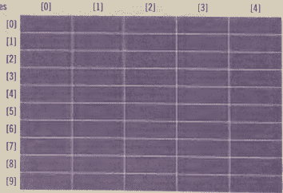

**图 8-13** 二维数组 sales

### 访问数组分量

要访问二维数组的分量，需要一对下标：一个表示行位置，一个表示列位置。

访问二维数组分量的语法是：

```
arrayName[indexExp1][indexExp2]
```

其中 indexExp1 和 indexExp2 是产生非负整数值的表达式。indexExp1 指定行位置；indexExp2 指定列位置。

语句：

```
sales[5][3] = 25.75;
```

将 25.75 存储到数组 sales 的第 5 行第 3 列（即第六行第四列）（见图 8-14）。

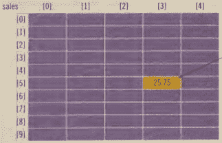

**图 8-14** `sales[5][3]`

假设：

```
int i = 5;
int j = 3;
```

那么前面的语句：

```
sales[5][3] = 25.75;
```

等价于：

```
sales[i][j] = 25.75;
```

因此下标也可以是变量。

### 声明期间初始化二维数组

像一维数组一样，二维数组也可以在声明时初始化。下面的例子有助于说明这个概念。考虑以下语句：

```c
int board[4][3] = {{2, 3, 1},
                   {15, 25, 13},
                   {20, 4, 7},
                   {11, 18, 14}};
```

该语句将 board 声明为一个四行三列的二维数组。第一行的分量是 2、3 和 1；第二行的分量是 15、25 和 13；第三行的分量是 20、4 和 7；第四行的分量分别是 11、18 和 14。图 8-15 显示了数组 board。

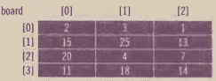

**图 8-15** 二维数组 board

要在声明二维数组时初始化它：

- 1. 每一行的元素括在花括号中，并用逗号分隔。
- 2. 所有行都括在花括号中。
- 3. 对于数值数组，如果未指定某一行的所有分量，则未指定的分量初始化为 0。在这种情况下，必须至少给出一个值来初始化一行的所有分量。

### 二维数组与枚举类型

> **注意**
> 理解本节需要先阅读第 7 章中的“枚举类型”一节。

你也可以将枚举类型用于数组下标。考虑以下语句：

```c
const int NUMBER_OF_ROWS = 6;
const int NUMBER_OF_COLUMNS = 5;
enum carType {GM, FORD, TOYOTA, BMW, NISSAN, VOLVO};
enum colorType {RED, BROWN, BLACK, WHITE, GRAY};

int inStock[NUMBER_OF_ROWS][NUMBER_OF_COLUMNS];
```

这些语句定义了 carType 和 colorType 枚举类型，并将 inStock 定义为六行五列的二维数组。假设 inStock 中的每一行对应一种汽车类型，每一列对应一种颜色类型。也就是说，第一行对应汽车类型 GM，第二行对应汽车类型 FORD，依此类推。类似地，第一列对应颜色类型 RED，第二列对应颜色类型 BROWN，依此类推。进一步假设 inStock 中的每个条目表示某种类型和颜色的汽车数量（见图 8-16）。

| inStock | 红色 | 棕色 | 黑色 | 白色 | 灰色 |
|---|---|---|---|---|---|
| GM |  |  |  |  |  |
| FORD |  |  |  |  |  |
| TOYOTA |  |  |  |  |  |
| BMW |  |  |  |  |  |
| NISSAN |  |  |  |  |  |
| VOLVO |  |  |  |  |  |

**图 8-16** 二维数组 inStock

语句：

```
inStock[1][3] = 15;
```

等价于以下语句（见图 8-17）：

```
inStock[FORD][WHITE] = 15;
```

| inStock | 红色 | 棕色 | 黑色 | 白色 | 灰色 |
|---|---|---|---|---|---|
| GM |  |  |  |  |  |
| FORD |  |  |  | **15** |  |
| TOYOTA |  |  |  |  |  |
| BMW |  |  |  |  |  |
| NISSAN |  |  |  |  |  |
| VOLVO |  |  |  |  |  |

**图 8-17** `inStock[FORD][WHITE]`


与处理一维数组的算法类似。我们借助前面声明的二维数组 matrix 进一步解释这个概念。

假设要处理 matrix 的第 5 行（即 matrix 的第 6 行）。matrix 第 5 行的各分量为：

```text
matrix[5][0], matrix[5][1], matrix[5][2], matrix[5][3], matrix[5][4], matrix[5][5]
```

我们看到，在这些分量中，第一个下标（行位置）固定为 5，第二个下标（列位置）从 0 到 5。因此，可以使用下面的 for 循环处理第 5 行：

```text
for (col = 0; col < NUMBER_OF_COLUMNS; col++)
    process matrix[5][col]
```

显然，这个 for 循环等价于下面的 for 循环：

```text
row = 5;
for (col = 0; col < NUMBER_OF_COLUMNS; col++)
    process matrix[row][col]
```

类似地，假设要处理 matrix 的第 2 列（即 matrix 的第 3 列）。这一列的各分量为：

```text
matrix[0][2], matrix[1][2], matrix[2][2], matrix[3][2], matrix[4][2], matrix[5][2], matrix[6][2]
```

这里，第二个下标（即列位置）固定为 2，第一个下标（即行位置）从 0 到 6。在这种情况下，可以使用下面的 for 循环处理 matrix 的第 2 列：

```text
for (row = 0; row < NUMBER_OF_ROWS; row++)
    process matrix[row][2]
```

显然，这个 for 循环等价于下面的 for 循环：

```text
col = 2;
for (row = 0; row < NUMBER_OF_ROWS; row++)
    process matrix[row][col]
```

接下来，我们讨论具体的处理算法。

### 初始化

假设要将第 4 行（即第 5 行）初始化为 0。如前所述，下面的 for 循环可完成此操作：

```cpp
row = 4;
for (col = 0; col < NUMBER_OF_COLUMNS; col++)
    matrix[row][col] = 0;
```

如果要将整个 matrix 初始化为 0，也可以将第一个下标（即行位置）放入循环中。使用下面的嵌套 for 循环，可以将 matrix 的每个分量初始化为 0：

```cpp
for (row = 0; row < NUMBER_OF_ROWS; row++)
    for (col = 0; col < NUMBER_OF_COLUMNS; col++)
        matrix[row][col] = 0;
```

### 输出

通过使用嵌套 for 循环，可以输出 matrix 的各分量。下面的嵌套 for 循环打印 matrix 的各分量，每行输出为一行：

```cpp
for (row = 0; row < NUMBER_OF_ROWS; row++)
{
    for (col = 0; col < NUMBER_OF_COLUMNS; col++)
        cout << setw(5) << matrix[row][col] << " ";

    cout << endl;
}
```

### 输入

下面的 for 循环将数据输入到 matrix 的第 4 行（即第 5 行）：

```cpp
row = 4;

for (col = 0; col < NUMBER_OF_COLUMNS; col++)
    cin >> matrix[row][col];
```

与前面一样，通过将行号放入循环中，可以将数据输入到 matrix 的每个分量。下面的 for 循环将数据输入到 matrix 的每个分量：

```cpp
for (row = 0; row < NUMBER_OF_ROWS; row++)
    for (col = 0; col < NUMBER_OF_COLUMNS; col++)
        cin >> matrix[row][col];
```

### 按行求和

下面的 for 循环求 matrix 第 4 行元素之和；也就是说，它把第 4 行的各分量相加：

```cpp
sum = 0;
row = 4;
for (col = 0; col < NUMBER_OF_COLUMNS; col++)
    sum = sum + matrix[row][col];
```

再一次，通过将行号放入循环中，可以分别求每一行的和。下面是求每一行各自之和的 C++ 代码：

```cpp
//Sum of each individual row
for (row = 0; row < NUMBER_OF_ROWS; row++)
{
    sum = 0;
    for (col = 0; col < NUMBER_OF_COLUMNS; col++)
        sum = sum + matrix[row][col];

    cout << "Sum of row " << row + 1 << " = " << sum << endl;
}
```

### 按列求和

与按行求和的情况一样，下面的嵌套 for 循环求每一列各自之和。

```cpp
//Sum of each individual column
for (col = 0; col < NUMBER_OF_COLUMNS; col++)
{
    sum = 0;
    for (row = 0; row < NUMBER_OF_ROWS; row++)
        sum = sum + matrix[row][col];

    cout << "Sum of column " << col + 1 << " = " << sum
         << endl;
}
```

### 每一行和每一列中的最大元素

如前所述，二维数组的另外两种操作是求每一行和每一列中的最大元素，以及求两条对角线之和。接下来，我们给出执行这些操作的 C++ 代码。

下面的 for 循环确定第 4 行中的最大元素：

```cpp
row = 4;
largest = matrix[row][0]; //Assume that the first element of
                           //the row is the largest.
for (col = 1; col < NUMBER_OF_COLUMNS; col++)
    if (largest < matrix[row][col])
        largest = matrix[row][col];
```

下面的 C++ 代码确定每一行和每一列中的最大元素：

```cpp
//Largest element in each row
for (row = 0; row < NUMBER_OF_ROWS; row++)
{
    largest = matrix[row][0]; //Assume that the first element
                               //of the row is the largest.
    for (col = 1; col < NUMBER_OF_COLUMNS; col++)
        if (largest < matrix[row][col])
            largest = matrix[row][col];

    cout << "The largest element in row " << row + 1 << " = "
         << largest << endl;
}

//Largest element in each column
for (col = 0; col < NUMBER_OF_COLUMNS; col++)
{
    largest = matrix[0][col]; //Assume that the first element
                               //of the column is the largest.
    for (row = 1; row < NUMBER_OF_ROWS; row++)
        if (largest < matrix[row][col])
            largest = matrix[row][col];

    cout << "The largest element in column " << col + 1
         << " = " << largest << endl;
}
```

## 将二维数组作为参数传递给函数

二维数组可以作为参数传递给函数，并且按引用传递。基地址（即实际参数第一个分量的地址）被传递给形式参数。如果 `matrix` 是二维数组的名称，那么 `matrix[0][0]` 是 `matrix` 的第一个分量。

在计算机内存中存储二维数组时，C++ 使用**行优先形式**。也就是说，先存储第一行，再存储第二行，再存储第三行，依此类推。

对于一维数组，在将其声明为形式参数时，通常省略数组的大小。由于 C++ 以行优先形式存储二维数组，为了正确计算某个分量的地址，编译器必须知道一行在哪里结束、下一行从哪里开始。因此，在将二维数组声明为形式参数时，可以省略第一维的大小，但不能省略第二维；也就是说，必须指定列数。

假设有如下声明：

```cpp
const int NUMBER_OF_ROWS = 6;
const int NUMBER_OF_COLUMNS = 5;
```

考虑函数 `printMatrix` 的如下定义：

```cpp
void printMatrix(int matrix[][NUMBER_OF_COLUMNS],
                int noOfRows)
{
    int row, col;

    for (row = 0; row < noOfRows; row++)
    {
        for (col = 0; col < NUMBER_OF_COLUMNS; col++)
            cout << setw(5) << matrix[row][col] << " ";

        cout << endl;
    }
}
```

该函数接受一个行数未指定、列数为 5 的二维数组作为参数，并输出该二维数组的内容。在函数调用期间，实际参数的列数必须与形式参数的列数匹配。

类似地，下面的函数输出一个二维数组每一行元素之和，该二维数组的元素类型为 `int`：

```cpp
void sumRows(int matrix[][NUMBER_OF_COLUMNS], int noOfRows)
{
    int row, col;
    int sum;

    //Sum of each individual row
    for (row = 0; row < noOfRows; row++)
    {
        sum = 0;
        for (col = 0; col < NUMBER_OF_COLUMNS; col++)
            sum = sum + matrix[row][col];

        cout << "Sum of row " << (row + 1) << " = " << sum
             << endl;
    }
}
```

下面的函数确定每一行中的最大元素：

```cpp
void largestInRows(int matrix[][NUMBER_OF_COLUMNS],
                   int noOfRows)
{
    int row, col;
    int largest;

    //Largest element in each row
    for (row = 0; row < noOfRows; row++)
    {
        largest = matrix[row][0]; //Assume that the first element
                                  //of the row is the largest.
        for (col = 1; col < NUMBER_OF_COLUMNS; col++)
            if (largest < matrix[row][col])
                largest = matrix[row][col];

        cout << "The largest element of row " << (row + 1)
             << " = " << largest << endl;
    }
}
```

同样，可以编写函数来求每一列元素之和、将数据读入二维数组、求每一行或每一列中的最大和/或最小元素，等等。

例 8-11 展示了如何在程序中使用函数 `printMatrix`、`sumRows` 和 `largestInRows`。

### 例 8-11

下面的程序说明如何将二维数组作为参数传递给函数。

```cpp
// Two-dimensional arrays as parameters to functions.

#include <iostream>
#include <iomanip>

using namespace std;

const int NUMBER_OF_ROWS = 6;
const int NUMBER_OF_COLUMNS = 5;
```


```c
void printMatrix(int matrix[][NUMBER_OF_COLUMNS],
                 int NUMBER_OF_ROWS);
void sumRows(int matrix[][NUMBER_OF_COLUMNS],
             int NUMBER_OF_ROWS);
void largestInRows(int matrix[][NUMBER_OF_COLUMNS],
                   int NUMBER_OF_ROWS);

int main()
{
    int board[NUMBER_OF_ROWS][NUMBER_OF_COLUMNS]
              = {{23, 5, 6, 15, 18},
                 {4, 16, 24, 67, 10},
                 {12, 54, 23, 76, 11},
                 {1, 12, 34, 22, 8},
                 {81, 54, 32, 67, 33},
                 {12, 34, 76, 78, 9}};       //Line 1

    printMatrix(board, NUMBER_OF_ROWS);             //Line 2
    cout << endl;                                    //Line 3
    sumRows(board, NUMBER_OF_ROWS);                 //Line 4
    cout << endl;                                    //Line 5
    largestInRows(board, NUMBER_OF_ROWS);           //Line 6

    return 0;
}

//Place the definitions of the functions printMatrix,
//sumRows, and largestInRows as described previously here.
```

## 示例运行：

```text
23    5     6     15    18
4     16    24    67    10
12    54    23    76    11
1     12    34    22    8
81    54    32    67    33
12    34    76    78    9

Sum of row 1 = 67
Sum of row 2 = 121
Sum of row 3 = 176
Sum of row 4 = 77
Sum of row 5 = 267
Sum of row 6 = 209

The largest element in row 1 = 23
The largest element in row 2 = 67
The largest element in row 3 = 76
The largest element in row 4 = 34
The largest element in row 5 = 81
The largest element in row 6 = 78
```

在这个程序中，第 1 行的语句将 board 声明并初始化为一个六行五列的二维数组。第 2 行的语句使用

现在，对于每个 `j`，`0 <= j <= 99`，`list[j]` 是一个长度至多 15 个字符的字符串。下面的语句将 "Snow White" 存储到 `list[1]` 中（见图 8-20）：

```c
strcpy(list[1], "Snow White");
```

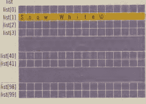

**图 8-20**  数组 `list`，显示 `list[1]`

假设你想读取数据并将其存储到 `list` 中，并且每行有一个条目。下面的 `for` 循环完成此任务：

```c
for (j = 0; j < 100; j++)
    cin.get(list[j], 16);
```

下面的 `for` 循环输出每一行中的字符串：

```c
for (j = 0; j < 100; j++)
    cout << list[j] << endl;
```

你也可以使用其他字符串函数（如 `strcmp` 和 `strlen`）以及 `for` 循环来操作 `list`。

> 数据类型 `string` 为其定义了赋值、串联和关系运算等操作。如果你使用标准 C++ 头文件，并且你的编译器支持数据类型 `string`，我们建议你使用数据类型 `string` 来操作字符串列表。

## 声明二维数组的另一种方法

> 可以跳过本节，而不会影响内容的连贯性。

如果你知道程序将要处理的表格的大小，那么你可以使用 `typedef` 先定义一种二维数组数据类型，然后声明该类型的变量。

例如，考虑以下内容：

```c
const int NUMBER_OF_ROWS = 20;
const int NUMBER_OF_COLUMNS = 10;
```

```c
typedef int tableType[NUMBER_OF_ROWS][NUMBER_OF_COLUMNS];
```

前面的语句定义了一种二维数组数据类型 tableType。现在我们可以声明这种类型的变量。因此：

```c
tableType matrix;
```

声明了一个 20 行 10 列的二维数组 matrix。

在声明形式参数时，你也可以使用这种数据类型，如下面的代码所示：

```c
void initialize(tableType table)
{
    int row;
    int col;

    for (row = 0; row < NUMBER_OF_ROWS; row++)
        for (col = 0; col < NUMBER_OF_COLUMNS; col++)
            table[row][col] = 0;
}
```

这个函数接受任何 tableType 类型的变量（即二维数组）作为参数，并将该数组初始化为 0。

通过先定义一种数据类型，当你在将二维数组声明为变量或形式参数时，或者在函数调用期间将数组作为参数传递时，就不需要反复检查确切的列数。

## 多维数组

在本章中，我们将数组定义为由固定数量的同类型元素（称为分量）组成的集合。一维数组是元素以列表形式排列的数组；在二维数组中，元素以表格形式排列。我们也可以定义三维或更大维度的数组。在 C++ 中，数组的维度没有限制。以下是数组的一般定义。

**n 维数组：** 由固定数量的元素（称为分量）组成，这些元素按 *n* 个维度（*n* >= 1）排列的集合。

声明一个 *n* 维数组的一般语法是：

```c
dataType arrayName[intExp1][intExp2] ... [intExpn];
```

其中 intExp1、intExp2、…… 和 intExpn 是产生正整数值的常量表达式。

访问一个 *n* 维数组分量的语法是：

```c
arrayName[indexExp1][indexExp2] ... [indexExpn]
```

其中 indexExp1、indexExp2、…… 和 indexExpn 是产生非负整数值的表达式。indexExp1 给出该数组分量在第 *i* 维中的位置。

例如，下面的语句：

```c
double carDealers[10][5][7];
```

将 carDealers 声明为一个三维数组。第一维的大小是 10，第二维的大小是 5，第三维的大小是 7。第一维的范围是 0 到 9，第二维的范围是 0 到 4，第三维的范围是 0 到 6。数组 carDealers 的基地址是第一个数组分量的地址——即 carDealers[0][0][0] 的地址。数组 carDealers 中分量的总数为 10 * 5 * 7 = 350。

下面的语句：

```c
carDealers[5][3][2] = 15564.75;
```

将分量 carDealers[5][3][2] 的值设置为 15564.75。

你可以使用循环来处理多维数组。例如，下面的嵌套 for 循环：

```c
for (i = 0; i < 10; i++)
    for (j = 0; j < 5; j++)
        for (k = 0; k < 7; k++)
            carDealers[i][j][k] = 0.0;
```

将整个数组初始化为 0.0。

在函数中将多维数组声明为形式参数时，你可以省略第一维的大小，但不能省略其他维度。作为参数，多维数组仅通过引用传递，并且函数不能返回数组类型的值。系统不会检查数组下标是否在边界内。

## 编程示例：代码检测

当消息以秘密代码通过传输通道传输时，通常以比特序列（即 0 和 1）的形式发送。由于传输通道中的噪声，传输的消息可能会损坏。也就是说，在目的地接收到的消息与发送的消息不相同；某些比特可能已经改变。有几种技术可以在目的地检查所传输消息的有效性。一种技术是将同一条消息传输两次。在目的地，将消息的两份副本逐位比较。如果对应比特相同，则接收到的消息无错误。

让我们编写一个程序来检查在目的地接收到的消息是否无错误。为简单起见，假设表示消息的秘密代码是一个数字序列（0 到 9），并且消息的最大长度为 250 个数字。此外，消息中的第一个数字是消息的长度。例如，如果秘密代码是：

```text
7 9 2 7 8 3 5 6
```

那么实际消息长度为 7 个数字，并且它被传输了两次。

上述消息传输为：

```text
7 9 2 7 8 3 5 6 7 9 2 7 8 3 5 6
```

| 输入 | 一个包含秘密代码及其副本的文件 |
|---|---|
| 输出 | 秘密代码、其副本以及一条消息——如果接收到的代码无错误——格式如下： |

| 代码 | 数字 | 代码 | 数字 | 副本 |
|---:|---:|---:|---:|---|
|  | 9 |  | 9 |  |
|  | 2 |  | 2 |  |
|  | 7 |  | 7 |  |
|  | 8 |  | 8 |  |
|  | 3 |  | 3 |  |
|  | 5 |  | 5 |  |
|  | 6 |  | 6 |  |
|  |  |  |  | 消息传输正常。 |

## 问题分析与算法设计

因为我们必须比较秘密代码及其副本的对应数字，所以我们首先读取秘密代码并将其存储在一个数组中。然后读取副本的第一个数字，并将其与秘密代码的第一个数字进行比较，依此类推。如果任何对应数字不相同，我们就通过在数字旁边打印一条消息来指出这一事实。因为消息的最大长度是 250，所以我们使用一个包含 250 个分量的数组。秘密代码中以及秘密代码副本中的第一个数字表示代码的长度。这一讨论转化为以下算法：


1. 打开输入文件和输出文件。
2. 如果输入文件不存在，则退出程序。
3. 读取秘密代码的长度。
4. 如果秘密代码的长度大于 250，则终止程序，因为本程序中代码的最大长度为 250。
5. 读取秘密代码并将其存储到数组中。
6. 读取副本的长度。
7. 如果秘密代码及其副本的长度相同，则比较代码。否则，输出错误消息。

为了简化函数 main，我们编写一个函数 `readCode` 来读取秘密代码，再编写另一个函数 `compareCode` 来比较代码。

## readCode

该函数首先读取秘密代码的长度。如果秘密代码的长度大于 250，则将作为引用参数的 bool 变量 `lenCodeOk` 设置为 false，并终止该函数。`lenCodeOk` 的值会传递给调用函数，以指示秘密代码是否已成功读取。如果代码长度小于 250，则 `readCode` 函数读取秘密代码并将其存储到数组中。由于输入存储在文件中，并且该文件是在函数 main 中打开的，因此必须将与输入文件对应的输入流变量作为参数传递给该函数。此外，在读取秘密代码的长度以及代码本身之后，`readCode` 函数必须将这些值传递给函数 main。因此，该函数有四个参数：一个输入文件流变量、一个用于存储秘密代码的数组、代码长度以及 bool 参数 `lenCodeOk`。函数 `readCode` 的定义如下：

```cpp
void readCode(ifstream& infile, int list[], int& length,
              bool& lenCodeOk)
{
    int count;

    lenCodeOk = true;

    infile >> length;    //get the length of the secret code

    if (length > MAX_CODE_SIZE)
    {
        lenCodeOk = false;
        return;
    }

    //Get the secret code.
    for (count = 0; count < length; count++)
        infile >> list[count];
}
```

该函数将秘密代码与其副本进行比较。因此，它必须能够访问包含秘密代码的数组以及秘密代码的长度。秘密代码的副本及其长度存储在输入文件中。因此，必须将与输入文件对应的输入流变量作为参数传递给该函数。此外，`compareCode` 函数会比较秘密代码与副本，并输出相应的消息。由于输出将存储在文件中，因此还必须将与输出文件对应的输出流变量作为参数传递给该函数。因此，该函数有四个参数：一个输入文件流变量、一个输出文件流变量、包含秘密代码的数组以及秘密代码的长度。上述讨论可转化为函数 `compareCode` 的以下算法：

- a. 声明变量。
- b. 将 bool 变量 `codeOk` 设置为 true。
- c. 读取秘密代码副本的长度。
- d. 如果秘密代码及其副本的长度不相同，则输出相应的错误消息并终止该函数。
- e. 对于输入文件中的每个数字：
  1. 读取秘密代码副本的下一个数字。
  2. 输出秘密代码及其副本中对应的数字。
  3. 如果对应数字不相同，则输出错误消息，并将 bool 变量 `codeOk` 设置为 false。
- f. 如果 bool 变量 `codeOk` 为 true：
  输出一条消息，指示秘密代码已正确传输。

  否则
  输出错误消息。

按照该算法，函数 `compareCode` 的定义如下：

```cpp
void compareCode(ifstream& infile, ofstream& outfile,
                 const int list[], int length)
{
        //Step a
        int length2;
        int digit;
        bool codeOk;
        int count;

        codeOk = true;                         //Step b

        infile >> length2;                     //Step c

        if (length != length2)                         //Step d
        {
            cout << "The original code and its copy "
                 << "are not of the same length."
                 << endl;
            return;
        }

        outfile << "Code Digit    Code Digit Copy"
                << endl;

        for (count = 0; count < length; count++)       //Step e
        {
            infile >> digit;                           //Step e.1
            outfile << setw(5) << list[count]
                    << setw(17) << digit;              //Step e.2

            if (digit != list[count])                  //Step e.3
            {
                outfile << "  code digits are not the same"
                        << endl;
                codeOk = false;
            }
            else
                outfile << endl;
        }

        if (codeOk)                                    //Step f
            outfile << "Message transmitted OK."
                    << endl;
        else
            outfile << "Error in transmission. "
                    << "Retransmit!!" << endl;
}
```

以下是函数 `main` 的算法：

**主算法**

1. 声明变量。
2. 打开文件。
3. 调用函数 `readCode` 读取秘密代码。
4. 如果 `(length of the secret code <= 250)`：
   - 调用函数 `compareCode` 比较代码。
   - 否则，输出相应的错误消息。

## 完整程序清单

```cpp
/************************************************************
// Author: D.S. Malik
//
// Program: Check Code
// This program determines whether a code is transmitted
// correctly.
//************************************************************

#include <iostream>
#include <fstream>
#include <iomanip>

using namespace std;

const int MAX_CODE_SIZE = 250;

void readCode(ifstream& infile, int list[],
              int& length, bool& lenCodeOk);
void compareCode(ifstream& infile, ofstream& outfile,
                 const int list[], int length);

int main()
{
        //Step 1
        int codeArray[MAX_CODE_SIZE]; //array to store the secret
                                      //code
        int codeLength;               //variable to store the
                                      //length of the secret code
        bool lengthCodeOk;            //variable to indicate if the length
                                      //of the secret code is less than or
                                      //equal to 250

        ifstream incode;    //input file stream variable
        ofstream outcode;   //output file stream variable

        char inputFile[51];  //variable to store the name of the
                             //input file
        char outputFile[51]; //variable to store the name of
                             //the output file

        cout << "Enter the input file name: ";
        cin >> inputFile;
        cout << endl;

        //Step 2
        incode.open(inputFile);
        if (!incode)
        {
             cout << "Cannot open the input file." << endl;
             return 1;
        }

        cout << "Enter the output file name: ";
        cin >> outputFile;
        cout << endl;

        outcode.open(outputFile);

        readCode(incode, codeArray, codeLength,
                 lengthCodeOk);                       //Step 3

        if (lengthCodeOk)                            //Step 4
            compareCode(incode, outcode, codeArray,
                        codeLength);
        else
            cout << "Length of the secret code "
                 << "must be <= " << MAX_CODE_SIZE
                 << endl;                             //Step 5

        incode.close();
        outcode.close();

        return 0;
}

//Place the definitions of the functions readCode and
//compareCode, as described previously, here.
```

### 示例运行：

在此示例运行中，用户输入以阴影显示。

请输入输入文件名：`Ch8_SecretCodeData.txt`

请输入输出文件名：`Ch8_SecretCodeOut.txt`

输入文件数据：（`Ch8_SecretCodeData.txt`）

`7 9 2 7 8 3 5 6 7 9 2 7 8 3 5 6`

输出文件数据：（`Ch8_SecretCodeOut.txt`）

| 代码数字 | 代码数字副本 |
|---|---|
| 9 | 9 |
| 2 | 2 |
| 7 | 7 |
| 8 | 8 |
| 3 | 3 |
| 5 | 5 |
| 6 | 6 |

消息传输正常。


## 编程示例：文本处理


**（行数和字母计数）** 现在让我们编写一个程序，它读取给定文本，原样输出该文本，并打印文本的行数以及每个字母在文本中出现的次数。大写字母和小写字母被视为相同；也就是说，它们被合并计数。

因为有26个字母，我们使用一个包含26个分量的数组来进行字母计数。我们还需要一个变量来存储行数。

文本存储在一个文件中，我们将其称为 `textin.txt`。输出将存储在一个文件中，我们将其称为 `textout.txt`。

- **输入：** 一个包含待处理文本的文件。
- **输出：** 一个包含文本、行数以及字母在文本中出现次数的文件。

### 问题分析与算法设计

根据期望的输出，很明显我们必须原样输出文本。也就是说，如果文本包含任何空白字符，它们也必须被输出。此外，我们必须统计文本中的行数。因此，我们必须知道行在哪里结束，这意味着我们必须捕获换行符。这一要求表明我们不能使用提取运算符来处理输入文件。由于我们还需要进行字母计数，我们使用 `get` 函数来读取文本。

让我们首先描述开发该程序所必需的变量。这将简化后续的讨论。

### 变量

我们需要存储行数和字母计数。因此，我们需要一个变量来存储行数，以及26个变量来进行字母计数。我们将使用一个包含26个分量的数组来进行字母计数。我们还需要一个变量来依次读取和存储每个字符，因为输入文件需要逐字符读取。由于数据要从输入文件读取，输出要保存到文件中，我们需要一个输入流变量来打开输入文件，以及一个输出流变量来打开输出文件。这些语句表明函数 main 需要（至少）以下变量：

```cpp
int lineCount;       //variable to store the line count
int letterCount[26];  //array to store the letter count
char ch;              //variable to store a character
ifstream infile;      //input file stream variable
ofstream outfile;     //output file stream variable
```

在这个声明中，`letterCount[0]` 存储 A 的计数，`letterCount[1]` 存储 B 的计数，依此类推。显然，变量 `lineCount` 和数组 `letterCount` 必须初始化为 0。

该程序的算法是：

- 1. 声明变量。
- 2. 打开输入文件和输出文件。
- 3. 初始化变量。
- 4. 当输入文件中还有更多数据时：
  - 4.1. 对于一行中的每个字符：
    - 4.1.1. 读取并写入该字符。
    - 4.1.2. 递增相应字母的计数。
  - 4.2. 递增行数。
- 5. 输出行数和字母计数。
- 6. 关闭文件。

为了简化函数 main，我们将其分为四个函数：

- 函数 initialize
- 函数 copyText
- 函数 characterCount
- 函数 writeTotal

以下各节将详细描述这些函数中的每一个。然后，借助这些函数，我们描述函数 main 的算法。

### initialize

该函数将变量 lineCount 和数组 letterCount 初始化为 0。因此，它有两个参数：一个对应于变量 lineCount，一个对应于数组 letterCount。显然，对应于 lineCount 的参数必须是引用参数。该函数的定义是：

```cpp
void initialize(int& lc, int list[])
{
    int j;
    lc = 0;

    for (j = 0; j < 26; j++)
        list[j] = 0;
} //end initialize
```

### copyText

该函数读取一行并输出该行。读取一个字符后，它调用函数 characterCount 来更新字母计数。显然，该函数有四个参数：一个输入文件流变量、一个输出文件流变量、一个 char 变量，以及用于字母计数的数组。

请注意，copyText 函数并不执行字母计数，但我们仍然将数组 letterCount 传递给它。我们采取这一步是因为该函数调用函数 characterCount，而后者需要数组 letterCount 来更新相应字母的计数。因此，我们必须将数组 `letterCount` 传递给 `copyText` 函数，以便它可以将该数组传递给函数 `characterCount`。

```cpp
void copyText(ifstream& intext, ofstream& outtext, char& ch,
              int list[])
{
    while (ch != '\n')        //process the entire line
    {
        outtext << ch;        //output the character
        characterCount(ch, list);   //call the function
                                   //character count
        intext.get(ch);       //read the next character
    }
    outtext << '\n';          //output the newline character
} //end copyText
```

### characterCount

该函数递增字母计数。为了递增相应字母的计数，它必须知道该字母是什么。因此，`characterCount` 函数有两个参数：一个 `char` 变量和用于更新字母计数的数组。用伪代码表示，该函数是：

- a. 将该字母转换为大写。
- b. 找到与该字母对应的数组索引。
- c. 如果索引有效，则递增相应的计数。在这一步，我们必须确保该字符是一个字母。我们只统计字母，因此其他字符——例如逗号、连字符和句点——会被忽略。

遵循该算法，该函数的定义是：

```cpp
void characterCount(char ch, int list[])
{
    int index;

    ch = toupper(ch);                  //Step a

    index = static_cast<int>(ch)
          - static_cast<int>('A');     //Step b

    if (0 <= index && index < 26)      //Step c
        list[index]++;
} //end characterCount
```

### writeTotal

该函数输出行数和字母计数。它有三个参数：输出文件流变量、行数，以及用于输出字母计数的数组。该函数的定义是：

```cpp
void writeTotal(ofstream& outtext, int lc, int list[])
{
    int index;

    outtext << endl << endl;
    outtext << "The number of lines = " << lc << endl;

    for (index = 0; index < 26; index++)
        outtext << static_cast<char>(index
                         + static_cast<int>('A'))
                << " count = " << list[index] << endl;
} //end writeTotal
```

### 主算法

现在我们描述函数 main 的算法。

- 1. 声明变量。
- 2. 打开输入文件。
- 3. 如果输入文件不存在，则退出程序。
- 4. 打开输出文件。
- 5. 初始化变量，例如 lineCount 和数组 letterCount。
- 6. 读取第一个字符。
- 7. 当（未到输入文件末尾）时：
  - 7.1. 处理下一行；调用函数 copyText。
  - 7.2. 递增行数。（递增变量 lineCount。）
  - 7.3. 读取下一个字符。
- 8. 输出行数和字母计数。调用函数 writeTotal。
- 9. 关闭文件。

### 完整程序清单

```cpp
//*************************************************************
// Author: S. Malik
//
// Program: Line and Letter Count
// This program reads a text, outputs the text as is, and also
// prints the number of lines and the number of times each
// letter appears in the text. An uppercase letter and a
// lowercase letter are treated as being the same; that is,
// they are tallied together.
//*************************************************************

#include <iostream>
#include <fstream>
#include <cctype>

using namespace std;

void initialize(int& lc, int list[]);
void copyText(ifstream& intext, ofstream& outtext, char& ch,
               int list[]);
void characterCount(char ch, int list[]);
void writeTotal(ofstream& outtext, int lc, int list[]);

int main()
{
    //Step 1: Declare variables
    int lineCount;
    int letterCount[26];
    char ch;
    ifstream infile;
    ofstream outfile;

    infile.open("textin.txt");                      //Step 2

    if (!infile)                                    //Step 3
    {
        cout << "Cannot open the input file."
             << endl;
        return 1;
    }

    outfile.open("textout.out");                    //Step 4

    initialize(lineCount, letterCount);             //Step 5

    infile.get(ch);                                 //Step 6

    while (infile)                                  //Step 7
    {
        copyText(infile, outfile, ch, letterCount); //Step 7.1
        lineCount++;                                //Step 7.2
        infile.get(ch);                             //Step 7.3
    }

    writeTotal(outfile, lineCount, letterCount);    //Step 8

    infile.close();                                 //Step 9
    outfile.close();                                //Step 9

    return 0;
}
```


```cpp
void initialize(int& lc, int list[])
{
    int i;
    lc = 0;

    for (i = 0; i < 26; i++)
        list[i] = 0;
} //end initialize

void copyText(ifstream& intext, ofstream& outtext, char ch,
              int list[])
{
    while (ch != '\n')       //process the entire line
    {
        outtext << ch;        //output the character

        characterCount(ch, list);   //call the function
                                     //character count
        intext.get(ch);       //read the next character
    }
    outtext << ch;            //output the newline character
} //end copyText

void characterCount(char ch, int list[])
{
    int index;

    ch = toupper(ch);                         //Step a

    index = static_cast<int>(ch)
          - static_cast<int>('A');            //Step b

    if (0 <= index && index < 26)              //Step c
        list[index]++;
} //end characterCount

void writeTotal(ofstream& outtext, int lc, int list[])
{
    int index;

    outtext << endl << endl;
    outtext << "The number of lines = " << lc << endl;

    for (index = 0; index < 26; index++)
        outtext << static_cast<char>(index
                         + static_cast<int>('A'))
                << " count = " << list[index] << endl;
} //end writeTotal
```

## 示例运行（textout.out）：

今天，我们生活在一个信息几乎以光速被处理的时代。通过计算机，技术革命正在急剧改变我们生活和相互交流的方式。诸如“互联网”这样的术语，几年前还很陌生，如今已非常普遍。借助计算机，你可以在几秒钟内向亲人发送信件并收到他们的来信。你不再需要通过邮寄简历来申请工作；在许多情况下，你可以直接通过互联网提交求职申请。你可以实时查看股票行情，并即时买卖股票。学生们经常上网“冲浪”，并使用计算机设计课堂项目。他们还使用功能强大的文字处理软件完成学期论文。许多人在计算机上维护和平衡自己的支票簿。

```text
The number of lines = 15
A count = 53
B count = 7
C count = 30
D count = 19
E count = 81
F count = 11
G count = 10
H count = 29
I count = 41
J count = 4
K count = 3
L count = 31
M count = 26
N count = 50
O count = 59
P count = 21
Q count = 0
R count = 45
S count = 48
T count = 62
U count = 24
V count = 7
W count = 15
X count = 0
Y count = 20
Z count = 0
```

## 快速复习

- 1. 如果某种类型的变量一次只能保存一个值，则该数据类型是简单数据类型。
- 2. 在结构化数据类型中，每个数据项是其他数据项的集合。
- 3. 数组是一种具有固定分量数量的结构化数据类型。每个分量都具有相同的类型，并且通过分量在数组中的相对位置来访问它们。
- 4. 一维数组的元素以列表形式排列。
- 5. 不会检查数组下标是否越界。
- 6. 在 C++ 中，数组下标从 0 开始。
- 7. 数组下标可以是任何求值为非负整数的表达式。下标的值必须始终小于数组的大小。
- 8. 除了字符数组（C 字符串）的输入/输出外，数组没有聚合操作。
- 9. 数组可以在声明期间初始化。如果初始值少于数组大小，则其余元素初始化为 0。
- 10. 数组的基地址是第一个数组分量的地址。例如，如果 list 是一维数组，则 list 的基地址是 list[0] 的地址。
- 11. 将一维数组声明为形参时，通常省略数组大小。如果在形参声明中指定一维数组的大小，编译器将忽略该大小。
- 12. 在函数调用语句中，将数组作为实参传递时，只使用其名称。
- 13. 作为函数参数，数组只能按引用传递。
- 14. 由于数组作为参数只能按引用传递，因此将数组声明为形参时，不要在数据类型后使用符号 &。
- 15. 函数不能返回数组类型的值。
- 16. 尽管数组作为参数是按引用传递的，但在将数组声明为形参时，在数据类型前使用保留字 const 可防止函数修改该数组。
- 17. 单个数组分量可以作为参数传递给函数。
- 18. 顺序查找算法在列表中查找给定项，从列表中的第一个元素开始。它继续将查找项与列表中的其他元素进行比较，直到找到该项，或者列表中没有更多元素可与查找项比较为止。
- 19. 选择排序通过找到列表中最小的（或等价地，最大的）元素并将其移到列表的开头（或末尾）来对列表排序。
- 20. 对于长度为 n 的列表，选择排序恰好进行 n(n − 1)/2 次关键比较和 3(n − 1) 次元素赋值。
- 21. 在 C++ 中，字符串是包含在双引号之间的任意字符序列。
- 22. 在 C++ 中，C 字符串以空字符结尾。
- 23. 在 C++ 中，空字符表示为 '\0'。
- 24. 在 ASCII 字符集中，空字符的排序序列为 0。
- 25. C 字符串存储在字符数组中。
- 26. 字符数组可以在声明期间使用字符串表示法初始化。
- 27. C 字符串的输入和输出是 C++ 允许聚合操作的唯一地方。
- 28. 头文件 cstring 包含可用于 C 字符串操作的函数规范。
- 29. 常用的 C 字符串操作函数包括 strcpy（字符串复制）、strcmp（字符串比较）和 strlen（字符串长度）。
- 30. C 字符串逐字符进行比较。
- 31. 由于 C 字符串存储在数组中，因此可以使用数组分量访问表示法访问 C 字符串中的单个字符。
- 32. 并行数组用于保存相关信息。
- 33. 在二维数组中，元素以表格形式排列。
- 34. 要访问二维数组的元素，需要一对下标：一个表示行位置，一个表示列位置。
- 35. 在二维数组中，行编号为 0 到 ROW_SIZE - 1，列编号为 0 到 COLUMN_SIZE - 1。
- 36. 如果 matrix 是二维数组，则 matrix 的基地址是数组分量 matrix[0][0] 的地址。
- 37. 在行处理中，二维数组一次处理一行。
- 38. 在列处理中，二维数组一次处理一列。
- 39. 将二维数组声明为形参时，可以省略第一维的大小，但不能省略第二维的大小。
- 40. 将二维数组作为实参传递时，实参数组和形参数组的列数必须匹配。
- 41. C++ 在计算机内存中按行顺序形式存储二维数组。

## 练习

- 1. 判断以下陈述为真或假。
  - a. double 类型是简单数据类型的一个例子。
  - b. 一维数组是结构化数据类型的一个例子。
  - c. 数组既可以按值也可以按引用作为参数传递给函数。
  - d. 函数可以返回数组类型的值。
  - e. 数组的大小在编译时确定。
  - f. 对 `int` 数组唯一允许的聚合操作是递增和递减操作。
  - g. 给定声明：
    ```c
    int list[10];
    ```
    语句：
    ```c
    list[5] = list[3] + list[2];
    ```
    更新数组 list 第五个分量的内容。
  - h. 如果数组下标越界，程序总是因错误而终止。
  - i. 在 C++ 中，字符串允许某些聚合操作。
  - j. 声明：
    ```c
    char name[16] = "John K. Miller";
    ```
    将 name 声明为 15 个字符的数组，因为字符串 "John K. Miller" 只有 14 个字符。
  - k. 声明：
    ```c
    char str = "Sunny Day";
    ```
    将 str 声明为长度未指定的字符串。
  - l. 作为参数，二维数组既可以按值也可以按引用传递。
- 2. 考虑以下声明：
  ```c
  double passwords[100];
  ```
  在此声明中，标识以下内容：
  - a. 数组名。
  - b. 数组大小。
  - c. 每个数组分量的数据类型。
  - d. 数组下标的取值范围。
- 3. 指出以下数组声明中的错误（如果有）。如果语句不正确，请提供正确的语句。
  - a. `double weights[100];`
  - b. `int age[0..80];`
  - c. `string students[101];`
  - d. `int list[100];`
  - e. `double[50] salaries;`
  - f.
    ```c
    const double LENGTH = 30.00;
    double list[LENGTH];
    ```
  - g.
    ```c
    const int SIZE = 100;
    int list[SIZE - 1];
    ```


4. 判断以下数组声明是否有效。如果声明无效，请解释原因。

- a. `string employees[82];`
- b. `int myArray[50];`
- c. `int SIZE;`  
  `double list[SIZE];`
- d. `int X = 50;`  
  `double list[X - 60];`
- e. `int ids[-30];`
- f. `names string[10];`

5. 大小为 64 的数组，其索引的有效范围是什么？

6. 编写 C++ 语句完成以下操作：

- a. 声明一个包含 20 个 `double` 类型分量的数组 beta。
- b. 将数组 beta 的每个分量初始化为 0。
- c. 输出数组 beta 第五个分量的值。
- d. 将数组 beta 第九个分量的值设置为 70.50。
- e. 将 beta 第十二个分量的值设置为 beta 第八个分量的值的四倍再减去 15。
- f. 使用 for 循环输出 beta 中索引为 3 的倍数的分量的值。
- g. 输出 beta 最后一个分量的值。
- h. 输出 beta 的值，使每行打印十个分量。

7. 以下程序段的输出是什么？

```cpp
double temp[5];

for (int i = 0; i < 5; i++)
    temp[i] = pow(i, 2.0) + 2;

for (int i = 0; i < 5; i++)
    cout << temp[i] << " ";
cout << endl;

temp[0] = pow(temp[1], 3);
temp[1] = temp[4] - temp[2];
temp[2] = temp[0] - 5;

for (int i = 0; i < 5; i++)
    cout << temp[i] << " ";
cout << endl;
```

8. 以下 C++ 代码执行后，`list` 中存储的是什么？

```cpp
int list[10];

for (int i = 0; i < 5; i++)
{
    list[i] = i * i - 5;
    if (i % 3 == 0)
        list[i] = list[i] + i;
    else
        list[i] = list[i] - i;
}
```

9. 以下 C++ 代码执行后，`list` 中存储的是什么？

```cpp
int list[10];

list[0] = 2;
list[1] = 3;
for (int i = 2; i < 10; i++)
{
    list[i] = list[i - 1] + list[i - 2];
    if (i > 7)
        list[i] = 2 * list[i] - list[i - 2];
}
```

10. 以下 C++ 代码执行后，`myList` 中存储的是什么？

```cpp
double myList[5];

myList[0] = 3.0;
myList[1] = 4.0;

for (int i = 2; i < 5; i++)
{
    myList[i] = myList[i - 1] * myList[i - 2];
    if (i > 3)
        myList[i] = myList[i] / 4;
}
```

11. 改正以下代码，使其正确地将 `myList` 每个元素的值设置为其索引。

```cpp
int myList[10];

for (int i = 1; i <= 10; i--)
    myList[i] = i;
```

12. 改正以下代码，使其正确地初始化和输出数组 `myList` 的元素。

```cpp
int myList[10];

for (int i = 1; i <= 10; i++)
    cin >> myList;

for (int i = 1; i <= 10; i++)
    cout << myList[i] << " ";
cout << endl;
```

13. 什么是数组索引越界？C++ 会检查数组索引是否在边界内吗？

14. 假设 `scores` 是一个包含 10 个 `double` 类型分量的数组，并且：

```cpp
scores = {2.5, 3.9, 4.8, 6.2, 6.2, 7.4, 7.9, 8.5, 8.5, 9.9}
```

以下代码本应确保 `scores` 的元素按非递减顺序排列。但是，代码中存在错误。找出并改正这些错误。

```cpp
for (int i = 1; i <= 10; i++)
    if (scores[i] >= scores[i + 1])
        cout << i << " and " << (i + 1)
             << " elements of scores are out of order." << endl;
```

15. 编写 C++ 语句定义并初始化以下数组。

- a. 包含 10 个 `double` 类型分量的数组 heights。将该数组初始化为以下值：5.2, 6.3, 5.8, 4.9, 5.2, 5.7, 6.7, 7.1, 5.10, 6.0。
- b. 包含 7 个 `int` 类型分量的数组 weights。将该数组初始化为以下值：120, 125, 137, 140, 150, 180, 210。
- c. `char` 类型的数组 `specialSymbols`。将该数组初始化为以下值：'$', '#', '%', '@', '!', '^', '*'。
- d. 包含 4 个 `string` 类型分量的数组 seasons。将该数组初始化为以下值："fall", "winter", "spring", "summer"。

16. 判断以下数组声明是否有效。如果声明有效，请确定数组的大小。

- a. `int list[] = {18, 13, 14, 16};`
- b. `int x[10] = {1, 7, 5, 3, 2, 8};`
- c. `double y[4] = {2.0, 5.0, 8.0, 11.0, 14.0};`
- d. `double lengths[] = {8.2, 3.9, 6.4, 5.7, 7.3};`
- e. `int list[7] = {12, 13, 14, 16, 8};`
- f. `string names[8] = {"John", "Lisa", "Chris", "Katie"};`

17. 假设你有以下声明：

```cpp
int list[7] = {6, 10, 14, 18, 22};
```

如果该声明有效，`list` 的每个分量中存储的是什么？

18. 考虑以下声明：

```cpp
int list[] = {3, 8, 10, 13, 6, 11};
```

- a. 编写 C++ 代码，输出 `list` 每个分量中存储的值。
- b. 编写 C++ 代码，按如下方式设置 `list` 前五个分量的值：第 i 个分量的值是第 (i+1) 个分量的值减去第 (i+1) 个分量的值的三倍。

19. 以下 C++ 代码的输出是什么？

```cpp
#include <iostream>

using namespace std;

int main()
{
    int beta[7] = {3, 5};

    for (int i = 2; i < 7; i++)
    {
        beta[i] = 3 * i + 2;
        beta[i - 1] = beta[i - 1] + beta[i];
        beta[i - 2] = beta[i - 2] + beta[i - 1];
    }

    for (int i = 0; i < 7; i++)
        cout << beta[i] << " ";
    cout << endl;

    return 0;
}
```

20. 以下 C++ 代码的输出是什么？

```cpp
#include <iostream>

using namespace std;

int main()
{
    int list1[5];
    int list2[15];

    for (int i = 0; i < 5; i++)
        list1[i] = i * i - 2;

    cout << "list1: ";
    for (int i = 0; i < 5; i++)
        cout << list1[i] << " ";
    cout << endl;

    for (int i = 0; i < 5; i++)
    {
        list2[i] = list1[i] * i;
        list2[i + 5] = list1[4 - i] + i;
        list2[i + 10] = list2[9 - i] + list2[i];
    }

    cout << "list2: ";
    for (int i = 0; i < 15; i++)
        cout << list2[i] << " ";
    cout << endl;

    return 0;
}
```

21. 考虑以下函数头：

```cpp
void tryMe(int x[], int size);
```

以及以下声明：

```cpp
int list[100];
int score[50];
double gpas[50];
```

以下哪些函数调用有效？

- a. tryMe(list, 100);
- b. tryMe(list, 75);
- c. tryMe(score, 100);
- d. tryMe(score, 49);
- e. tryMe(gpas, 50);

22. 假设你有以下函数定义：

```cpp
void sum(int x, int y, int& z)
{
    z = x + y;
}
```

考虑以下声明：

```cpp
int list1[10], list2[10], list3[10];
int a, b, c;
```

以下哪些函数调用有效？

- a. sum(a, b, c);
- b. sum(list1[0], list2[0], a);
- c. sum(list1, list2, c);
- d. for (int i = 1; i <= 10; i++)  
  sum(list1[i], list2[i], list3[i]);

23. 以下 C++ 代码的输出是什么？

```cpp
double salary[5] = {25000, 36500, 85000, 62500, 97000};
double raise = 0.03;

cout << fixed << showpoint << setprecision(2);

for (int i = 0; i < 5; i++)
    cout << (i + 1) << " " << salary[i] << " "
         << salary[i] * raise << endl;
```

24. 一家汽车经销商有 10 名销售人员。每名销售人员记录每月售出的汽车数量，并在月末报告给管理层。管理层将数据保存在文件中，并为每名销售人员分配编号 1 到 10。以下语句声明了一个包含 10 个 `int` 类型分量的数组 cars，用于存储每名销售人员售出的汽车数量：

```cpp
int cars[10];
```

编写代码，将每名销售人员售出的汽车数量存储到数组 `cars` 中，输出每月末售出的汽车总数，并输出售出汽车数量最多的销售人员编号。（假设数据在文件 `cars.dat` 中，并且该文件已使用 ifstream 变量 `inFile` 打开。）

25. 以下程序的输出是什么？

```cpp
#include <iostream>

using namespace std;

int main()
{
    int count;
    int alpha[5];

    alpha[0] = 5;
    for (count = 1; count < 5; count++)
    {
        alpha[count] = 5 * count + 10;
        alpha[count - 1] = alpha[count] - 4;
    }

    cout << "List elements:";
    for (count = 0; count < 5; count++)
        cout << alpha[count] << " ";
    cout << endl;

    return 0;
}
```

26. 以下程序的输出是什么？

```cpp
#include <iostream>

using namespace std;

int main()
{
    int j;
    int one[5];
    int two[10];

    for (j = 0; j < 5; j++)
        one[j] = 5 * j + 3;

    cout << "One contains: ";
    for (j = 0; j < 5; j++)
        cout << one[j] << " ";
```


```cpp
cout << endl;
for (j = 0; j < 5; j++)
{
    two[j] = 2 * one[j] - 1;
    two[j + 5] = one[4 - j] + two[j];
}

cout << "Two contains: ";
for (j = 0; j < 10; j++)
    cout << two[j] << " ";
cout << endl;

return 0;
}
```

- **27.** 以下 C++ 代码的输出是什么？

```cpp
const double PI = 3.14159;
double cylinderRadii[5] = {3.5, 7.2, 10.5, 9.8, 6.5};
double cylinderHeights[5] = {10.7, 6.5, 12.0, 10.5, 8.0};
double cylinderVolumes[5];

cout << fixed << showpoint << setprecision(2);

for (int i = 0; i < 5; i++)
    cylinderVolumes[i] = 2 * PI * cylinderRadii[i]
                         * cylinderHeights[i];

for (int i = 0; i < 5; i++)
    cout << (i + 1) << " " << cylinderRadii[i] << " "
         << cylinderHeights[i] << " " << cylinderVolumes[i] << endl;
```

- **28.** 当数组作为实参传递给函数时，实际传递的是什么？

- **29.** 在 C++ 中，数组作为实参可以按值传递吗？

- **30.** 使用本章讨论的选择排序算法对下列列表进行排序。显示外层 for 循环每次迭代后的列表。

  6, 45, 10, 25, 58, 2, 50, 30, 86

- **31.** 使用本章讨论的选择排序算法对下列列表进行排序。显示外层 for 循环每次迭代后的列表。

  36, 55, 17, 35, 63, 85, 12, 48, 3, 66

- **32.** 给定以下声明：

  ```cpp
  char string15[16];
  ```

  将下列语句标记为有效或无效。如果语句无效，请解释原因。

  - a. `strcpy(string15, "Hello there");`
  - b. `strlen(string15);`
  - c. `string15 = "Jacksonville";`

- **36.** 假设有以下声明：

  ```cpp
  char name[21];
  char yourName[21];
  char studentName[31];
  ```

  将下列语句标记为有效或无效。如果语句无效，请解释原因。

  - a. `cin >> name;`
  - b. `cout << studentName;`
  - c. `yourName[0] = '\0';`
  - d. `yourName = studentName;`
  - e.
    ```cpp
    if (yourName == name)
        studentName = name;
    ```
  - f. `int x = strcmp(yourName, studentName);`
  - g. `strcpy(studentName, name);`
  - h.
    ```cpp
    for (int j = 0; j < 21; j++)
        cout << name[j];
    ```

- **37.** 定义一个名为 `temp` 的 `int` 类型二维数组，三行四列，使得第一行初始化为 6, 8, 12, 9；第二行初始化为 17, 5, 10, 6；第三行初始化为 14, 13, 16, 20。

- **38.** 假设数组 `temp` 如习题 37 所定义。编写 C++ 语句完成以下操作：

  - a. 输出 `temp` 中第一行第一列元素的内容。
  - b. 输出 `temp` 中第一行最后一列元素的内容。
  - c. 输出 `temp` 中最后一行第一列元素的内容。
  - d. 输出 `temp` 中最后一行最后一列元素的内容。

- **39.** 考虑以下声明：

  ```cpp
  const int CAR_TYPES = 5;
  const int COLOR_TYPES = 6;

  double sales[CAR_TYPES][COLOR_TYPES];
  ```

  - a. 数组 `sales` 有多少个分量？
  - b. 数组 `sales` 有多少行？
  - c. 数组 `sales` 有多少列？
  - d. 要按 `CAR_TYPES` 对销售额求和，需要哪种处理？
  - e. 要按 `COLOR_TYPES` 对销售额求和，需要哪种处理？

- **40.** 编写完成以下操作的 C++ 语句：

  - a. 声明一个 `int` 类型的数组 `alpha`，10 行 20 列。
  - b. 将数组 `alpha` 初始化为 0。
  - c. 在第一行存储 1，在其余行存储 2。
  - d. 在第一列存储 5，并确保后续每一列的值是前一列值的两倍。
  - e. 打印数组 `alpha`，每行打印一行。
  - f. 打印数组 `alpha`，每行打印一列。

- **41.** 考虑以下声明：

  ```cpp
  int beta[3][3];
  ```

  下列每条语句执行后，`beta` 中存储的是什么？

  - a.
    ```cpp
    for (i = 0; i < 3; i++)
        for (j = 0; j < 3; j++)
            beta[i][j] = 0;
    ```
  - b.
    ```cpp
    for (i = 0; i < 3; i++)
        for (j = 0; j < 3; j++)
            beta[i][j] = i + j;
    ```
  - c.
    ```cpp
    for (i = 0; i < 3; i++)
        for (j = 0; j < 3; j++)
            beta[i][j] = i * j;
    ```
  - d.
    ```cpp
    for (i = 0; i < 3; i++)
        for (j = 0; j < 3; j++)
            beta[i][j] = 2 * (i + j) % 4;
    ```

- **42.** 假设你有以下声明：

  ```cpp
  int times[30][7];
  int speed[15][7];
  int trees[100][7];
  int students[50][7];
  ```

  - a. 编写函数 `print` 的定义，该函数可用于输出这些数组的内容。
  - b. 编写调用函数 `print` 以输出数组 `times`、`speed`、`trees` 和 `students` 内容的 C++ 语句。

## 编程练习

- **1.** 编写一个 C++ 程序，声明一个包含 50 个 `double` 类型分量的数组 `alpha`。初始化该数组，使前 25 个分量等于索引变量的平方，后 25 个分量等于索引变量的三倍。输出该数组，使每行打印 10 个元素。
- **2.** 编写一个 C++ 函数 `smallestIndex`，它接收一个 `int` 数组及其大小作为参数，并返回该数组中最小元素第一次出现的索引。同时，编写一个程序测试你的函数。
- **3.** 编写一个 C++ 函数 `largestIndex`，它接收一个 `int` 数组及其大小作为参数，并返回该数组中最大元素最后一次出现的索引。同时，编写一个程序测试你的函数。

- **8.** 考虑以下函数 `main`：

  ```cpp
  int main()
  {
      int inStock[10][4];
      int alpha[20];
      int beta[20];
      int gamma[4] = {11, 13, 15, 17};
      int delta[10] = {3, 5, 2, 6, 10, 9, 7, 11, 1, 8};

      .
      .
      .
  }
  ```

  - a. 编写函数 `setZero` 的定义，该函数将任意 `int` 类型的一维数组初始化为 0。
  - b. 编写函数 `inputArray` 的定义，该函数提示用户输入 20 个数字，并将这些数字存储到 `alpha` 中。
  - c. 编写函数 `doubleArray` 的定义，该函数将 `beta` 的元素初始化为 `alpha` 中对应元素的两倍。确保防止该函数修改 `alpha` 的元素。
  - d. 编写函数 `copyGamma` 的定义，该函数将 `inStock` 第一行的元素设置为 `gamma`，并将 `inStock` 其余行设置为 `inStock` 前一行的三倍。确保防止该函数修改 `gamma` 的元素。
  - e. 编写函数 `copyAlphaBeta` 的定义，该函数将 `alpha` 存储到 `inStock` 的前五行，将 `beta` 存储到 `inStock` 的后五行。确保防止该函数修改 `alpha` 和 `beta` 的元素。
  - f. 编写函数 `printArray` 的定义，该函数打印任意 `int` 类型的一维数组。每行打印 15 个元素。
  - g. 编写函数 `setInStock` 的定义，该函数提示用户输入 `inStock` 第一列的元素。然后，该函数应将剩余列中的元素设置为前一列对应元素的两倍减去 `delta` 中对应元素。
  - h. 编写 C++ 语句，调用 a 到 g 部分中的每个函数。
  - i. 编写一个 C++ 程序，测试函数 `main` 以及 a 到 g 部分讨论的函数。（根据需要添加其他函数，例如打印二维数组。）

- **9.** 编写一个程序，使用二维数组存储一年中每个月的最高和最低温度。该程序应输出全年平均最高温度、平均最低温度以及最高和最低温度。你的程序必须包含以下函数：

  - a. **函数 `getData`：** 该函数读取数据并存储到二维数组中。
  - b. **函数 `averageHigh`：** 该函数计算并返回全年平均最高温度。
  - c. **函数 `averageLow`：** 该函数计算并返回全年平均最低温度。
  - d. **函数 `indexHighTemp`：** 该函数返回数组中最高高温的索引。
  - e. **函数 `indexLowTemp`：** 该函数返回数组中最低低温的索引。

  *（这些函数都必须具有适当的参数。）*

- **10.** 第 6 章中的编程练习 10 要求你求五个数的均值和标准差。扩展该编程练习，求最多 100 个数的均值和标准差。假设 *n* 个数 *x₁, x₂, ..., xₙ* 的均值（平均数）为 *x̄*。那么，这些数的标准差为：

  $$s = \sqrt{\frac{(x_1 - \bar{x})^2 + (x_2 - \bar{x})^2 + \cdots + (x_i - \bar{x})^2 + \cdots + (x_n - \bar{x})^2}{n}}$$

- **11.（大整数相加）** 在 C++ 中，最大的 `int` 值是 2147483647。因此，比它更大的整数不能作为整数存储和处理。同样，如果两个正整数的和或积大于 2147483647，结果将不正确。存储和操作大整数的一种方法是将数字的每一位分别存储在数组中。编写一个程序，输入两个最多 20 位的正整数，并输出这些数的和。如果这些数的和超过 20 位，请输出该和并给出适当消息。你的程序必须至少包含一个函数，用于读取数字或将数字存储到数组中，以及另一个函数，用于输出这些数字的和。*（提示：将数字作为字符串读取，并按相反顺序存储该数字的各位数字。）*

- **12.** Jason、Samantha、Ravi、Sheila 和 Ankit 正在为即将到来的马拉松做准备。一周中的每一天，他们都会跑一定数量的英里，并把它们写进笔记本。周末时，他们想知道每天跑过的英里数、本周总英里数以及每天平均跑过的英里数。编写一个程序帮助他们分析数据。你的程序必须包含并行数组：一个数组存储跑步者的姓名，一个五行七列的二维数组存储每位跑步者每天跑过的英里数。此外，你的程序必须至少包含以下函数：一个函数用于读取并存储跑步者的姓名以及每天跑过的英里数；一个函数用于求每位跑步者跑过的总英里数以及平均数值

每天跑过的英里数；以及一个输出结果的函数。（你可以假设输入数据存储在文件中，每行数据格式如下：`runnerName milesDay1 milesDay2 milesDay3 milesDay4 milesDay5 milesDay6 milesDay7`。）

**13.** 编写一个程序来计算学生的平均测试成绩和他们的等级。你可以假设输入数据如下：

```
Johnson 85 83 77 91 76
Aniston 80 90 95 93 48
Cooper 78 81 11 90 73
Gupta 92 83 30 69 87
Blair 23 45 96 38 59
Clark 60 85 45 39 67
Kennedy 77 31 52 74 83
Bronson 93 94 89 77 97
Sunny 79 85 28 93 82
Smith 85 72 49 75 63
```

使用三个数组：一个一维数组存储学生姓名，一个（并行的）二维数组存储测试成绩，以及一个并行的一维数组存储等级。你的程序必须至少包含以下函数：一个读取数据并将数据存储到两个数组中的函数，一个计算平均测试成绩和等级的函数，以及一个输出结果的函数。让你的程序也输出班级平均分。

**14.** 一家公司雇用了10名按小时计酬的临时工，你得到一个数据文件，其中包含员工的姓氏、每位员工一周内工作的小时数以及每位员工的小时工资率。要求你编写一个程序，计算每位员工的周薪和所有工人的平均工资。然后程序输出每位员工的周薪、平均周薪，以及工资大于或等于平均工资的所有员工的姓名。如果一周内工作的小时数超过40小时，则超过40小时部分的工资率是常规小时工资率的1.5倍。使用两个并行数组：一个一维数组存储所有员工的姓名，以及一个10行3列的二维数组来存储员工一周内工作的小时数、小时工资率和周薪。你的程序必须至少包含以下函数——一个从文件读取数据到数组中的函数，一个计算周薪的函数，一个输出工资大于或等于平均周薪的所有员工姓名的函数，以及一个输出每位员工数据的函数。

**15.** 孩子们经常玩一种记忆游戏，其中使用一副包含匹配对的卡片。卡片被洗牌并面朝下放在桌子上。然后玩家轮流一次选择两张卡片。如果两张卡片匹配，它们就保持面朝上；否则，卡片被放回原来的位置面朝下。一旦玩家看到所选的一对卡片，如果卡片不匹配，他们就可以记住这些卡片，并利用记忆选择下一对卡片。游戏一直持续到所有卡片都面朝上为止。编写一个程序来玩这个记忆游戏。使用一个4行4列的二维数组来使用一副16张卡片，其中有8个匹配对，你可以用数字1到8来标记卡片。（如果你使用6乘6的数组，那么你将需要18个匹配对，以此类推。）使用随机数生成器随机地将这些对存储在数组中。在你的程序中使用适当的函数，主程序应该只是对函数的调用。

16. **（飞机座位分配）** 编写一个可用于为商用飞机分配座位的程序。飞机有13排，每排6个座位。第1排和第2排是头等舱，第3排到第7排是商务舱，第8排到第13排是经济舱。你的程序必须提示用户输入以下信息：

- a. 机票类型（头等舱、商务舱或经济舱）
- b. 期望的座位

按以下形式输出座位图：

|       | A | B | C | D | E | F |
|-------|---|---|---|---|---|---|
| 第1排 | * | * | X | * | X | X |
| 第2排 | * | X | * | X | * | X |
| 第3排 | * | * | X | X | * | X |
| 第4排 | X | * | X | * | X | X |
| 第5排 | * | X | * | X | * | * |
| 第6排 | * | X | * | * | * | X |
| 第7排 | X | * | * | * | X | X |
| 第8排 | * | X | * | X | X | * |
| 第9排 | X | * | X | X | * | X |
| 第10排 | * | X | * | X | X | X |
| 第11排 | * | * | X | * | X | * |
| 第12排 | * | * | X | X | * | X |
| 第13排 | * | * | * | * | X | * |

这里，* 表示座位可用；X 表示座位已被占用。将此程序制作成菜单驱动程序；显示用户的选择并允许用户进行适当的选择。

## 第9章：记录（结构体）

在本章中，你将：

- 学习记录（结构体）
- 考察对结构体的各种操作
- 探索使用结构体操作数据的方法
- 学习结构体与函数之间的关系
- 发现数组如何在结构体中使用
- 学习如何创建结构体项数组

在第8章中，你学习了如何使用数组对相同类型的值进行分组。你还学习了如何处理存储在数组中的数据，以及如何执行列表操作，例如搜索和排序。

> **注意：** 跳过本章不会造成任何不连贯。

在本章中，你将学习如何对相关但不同类型的值进行分组。C++提供了另一种结构化数据类型，称为结构体（有些语言使用术语“record”），用于对不同类型的相关项进行分组。数组是同类数据结构；结构体通常是异类数据结构。本章对结构体的处理与C语言中对结构体的处理类似。因此，本章中的结构体是类似C语言的结构体。第10章介绍并讨论另一种结构化数据类型，称为类。

### 记录（结构体）

假设你想编写一个程序来处理学生数据。一条学生记录除其他信息外，还包括学生的姓名、学生ID、平均绩点、所修课程和课程成绩。因此，有各种组件与学生相关联。然而，这些组件都是不同类型的。例如，学生姓名是字符串，平均绩点是浮点数。由于这些组件类型不同，你不能使用数组来分组与学生关联的所有项。C++提供了一种名为结构体的结构化数据类型，用于对不同类型的项进行分组。将相关但类型不同的组件分组有几个优点。例如，单个变量可以将所有组件作为参数传递给函数。

结构体：固定数量的组件的集合，其中组件通过名称访问。这些组件可以是不同类型的。

结构体的组件称为结构体的成员。C++中结构体的一般语法是：

```cpp
struct structName
{
    dataType1 identifier1;
    dataType2 identifier2;
    .
    .
    .
    dataType_n identifier_n;
};
```

在C++中，struct是一个保留字。结构体的成员，即使它们被括在大括号中（即它们形成一个块），也不被视为构成复合语句。因此，分号（在右大括号之后）对于结束定义是必不可少的。

你还可以在定义`struct`时声明`struct`变量。例如，考虑以下语句：

```cpp
struct houseType
{
    string style;
    int numOfBedrooms;
    int numOfBathrooms;
    int numOfCarsGarage;
    int yearBuilt;
    int finishedSquareFootage;
    double price;
    double tax;
} tempHouse;
```

这些语句定义了`struct` houseType，并同时声明tempHouse是houseType类型的变量。

通常，在程序中，结构体在程序中所有函数的定义之前定义，以便结构体可以在整个程序中使用。因此，如果你定义一个结构体，并且同时声明一个结构体变量（如前面的语句），那么该结构体变量将成为全局变量，从而可以在程序中的任何地方访问。考虑到全局变量的副作用，你应该先只定义结构体，然后再声明结构体变量。

### 访问`struct`成员

在数组中，通过使用数组名以及组件的相对位置（索引）来访问组件。数组名和索引使用方括号分隔。要访问结构体成员（组件），你使用结构体变量名以及成员名；这些名称用点（句点）分隔。访问结构体成员的语法是：

```cpp
structVariableName.memberName
```

structVariableName.memberName就像任何其他变量一样。例如，newStudent.courseGrade是char类型的变量，newStudent.firstName是字符串变量，等等。因此，你可以对结构体成员做几乎任何你通常对变量做的事情。例如，你可以在赋值语句或输入/输出（在允许的情况下）语句中使用它们。

在C++中，点（.）是一个称为成员访问运算符的运算符。

考虑以下语句：

```cpp
struct studentType
{
    string firstName;
    string lastName;
    char courseGrade;
```


```cpp
int testScore;
int programmingScore;
double GPA;
};
```

```cpp
//variables
studentType newStudent;
studentType student;
```

假设你想将 `newStudent` 的成员 `GPA` 初始化为 0.0。下面的语句可以完成此任务：

```cpp
newStudent.GPA = 0.0;
```

类似地，语句：

```cpp
newStudent.firstName = "John";
newStudent.lastName = "Brown";
```

将 `"John"` 存储在 `newStudent` 的成员 `firstName` 中，将 `"Brown"` 存储在成员 `lastName` 中。

在前面的三条赋值语句执行后，`newStudent` 如图 9-2 所示。


**图 9-2** struct newStudent

语句：

```cpp
cin >> newStudent.firstName;
```

从标准输入设备读取下一个字符串，并将其存储到：

```cpp
newStudent.firstName
```

语句：

```cpp
cin >> newStudent.testScore >> newStudent.programmingScore;
```

从键盘读取两个整数值，并分别将它们存储到 `newStudent.testScore` 和 `newStudent.programmingScore` 中。

假设 `score` 是一个 `int` 类型的变量。语句：

```cpp
score = (newStudent.testScore + newStudent.programmingScore) / 2;
```

将 `newStudent.testScore` 和 `newStudent.programmingScore` 的平均值赋给 `score`。

下面的语句确定课程成绩，并将其存储在 `newStudent.courseGrade` 中：

```cpp
if (score >= 90)
    newStudent.courseGrade = 'A';
else if (score >= 80)
    newStudent.courseGrade = 'B';
else if (score >= 70)
    newStudent.courseGrade = 'C';
else if (score >= 60)
    newStudent.courseGrade = 'D';
else
    newStudent.courseGrade = 'F';
```

## 赋值

我们可以通过赋值语句将一个结构体变量的值赋给另一个相同类型的结构体变量。假设 `newStudent` 如图 9-3 所示。

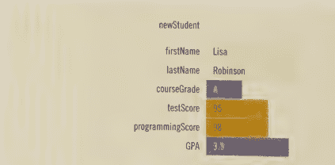

图 9-3 struct newStudent

```cpp
if (student.firstName == newStudent.firstName &&
    student.lastName == newStudent.lastName)
.
.
.
```

虽然可以使用赋值语句将一个结构体的内容复制到另一个相同类型的结构体中，但不能对结构体变量使用关系运算符。因此，下面的写法是非法的：

```cpp
if (student == newStudent)    //illegal
.
.
.
```

## 输入/输出

不允许对结构体变量进行聚合输入/输出操作。结构体变量中的数据必须一次读写一个成员。类似地，结构体变量的内容也必须一次写出一个成员。

我们已经了解了如何将数据读入结构体变量。现在让我们看看如何输出一个结构体变量。语句：

```cpp
cout << newStudent.firstName << " " << newStudent.lastName
     << " " << newStudent.courseGrade
     << " " << newStudent.testScore
     << " " << newStudent.programmingScore
     << " " << newStudent.GPA << endl;
```

输出结构体变量 `newStudent` 的内容。

## 结构体变量与函数

回顾一下，数组只能按引用传递，并且函数不能返回数组类型的值。但是：

- 结构体变量可以作为参数按值或按引用传递，并且
- 函数可以返回结构体类型的值。

下面的函数读取并存储学生的名字、姓氏、测试成绩、编程成绩和 GPA。它还确定学生的课程成绩并将其存储在成员 `courseGrade` 中。

```cpp
void readIn(studentType& student)
{
    int score;

    cin >> student.firstName >> student.lastName;
    cin >> student.testScore >> student.programmingScore;
    cin >> student.GPA;

    score = (student.testScore + student.programmingScore) / 2;

    if (score >= 90)
        student.courseGrade = 'A';
    else if (score >= 80)
        student.courseGrade = 'B';
    else if (score >= 70)
        student.courseGrade = 'C';
    else if (score >= 60)
        student.courseGrade = 'D';
    else
        student.courseGrade = 'F';
}
```

语句：

```cpp
readIn(newStudent);
```

调用函数 `readIn`。函数 `readIn` 将适当的信息存储到变量 `newStudent` 中。

类似地，我们可以编写一个函数来打印结构体变量的内容。例如，下面的函数在屏幕上输出一个 `studentType` 类型的结构体变量的内容。

```cpp
void printStudent(studentType student)
{
    cout << student.firstName << " " << student.lastName
         << " " << student.courseGrade
         << " " << student.testScore
         << " " << student.programmingScore
         << " " << student.GPA << endl;
}
```

### 数组与结构体

前面的讨论表明，结构体和数组既有相似之处也有不同之处。表 9-1 总结了这一讨论。

表 9-1 数组与结构体的比较

| 聚合操作 | 数组 | 结构体 |
|---|---|---|
| 算术运算 | 否 | 否 |
| 赋值 | 否 | 是 |
| 输入/输出 | 否（字符串除外） | 否 |
| 比较 | 否 | 否 |
| 参数传递 | 仅按引用 | 按值或按引用 |
| 函数返回值 | 否 | 是 |

## 结构体中的数组

列表是一组相同类型的元素。因此，列表有两个相关的东西：值（即元素）和长度。因为值和长度都与列表相关，所以我们可以定义一个包含这两项的结构体。

```cpp
const int ARRAY_SIZE = 1000;

struct listType
{
    int listElem[ARRAY_SIZE];    //array containing the list
    int listLength;               //length of the list
};
```

下面的语句声明 `intList` 为 `listType` 类型的结构体变量（见图 9-5）：

```cpp
listType intList;
```

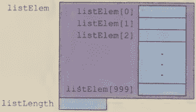

**图 9-5** struct 变量 intList

变量 `intList` 有两个成员：`listElem`（一个包含 1000 个 `int` 类型元素的数组）和 `listLength`（`int` 类型）。此外，`intList.listElem` 访问成员 `listElem`，`intList.listLength` 访问成员 `listLength`。

考虑下面的语句：

```cpp
intList.listLength = 0;       //Line 1
intList.listElem[0] = 12;     //Line 2
intList.listLength++;          //Line 3
intList.listElem[1] = 37;     //Line 4
intList.listLength++;          //Line 5
```

第 1 行中的语句将成员 `listLength` 的值设置为 0。第 2 行中的语句将 12 存储到数组 `listElem` 的第一个分量中。第 3 行中的语句将成员 `listLength` 的值加 1。其他语句的含义类似。这些语句执行后，`intList` 如图 9-6 所示。

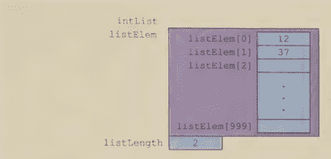

**图 9-6** 执行第 1 行到第 5 行语句后的 intList

接下来，我们编写顺序查找算法来确定给定项是否在列表中。如果在列表中找到 `searchItem`，函数返回它在列表中的位置；否则，函数返回 -1。

```cpp
    int seqSearch(const listType& list, int searchItem)
    {
        int loc;

        bool found = false;

        for (loc = 0; loc < list.listLength; loc++)
            if (list.listElem[loc] == searchItem)
            {
                found = true;
                break;
            }

        if (found)
            return loc;
        else
            return -1;
    }
```

在这个函数中，因为 `listLength` 是 `list` 的成员，所以我们通过 `list.listLength` 访问它。类似地，我们可以通过 `list.listElem[loc]` 访问 `list` 的一个元素。

注意，函数 `seqSearch` 的形式参数 `list` 被声明为常量引用参数。这意味着 `list` 接收相应实际参数的地址，但 `list` 不能修改实际参数。

回顾一下，当变量按值传递时，形式参数会复制实际参数的值。因此，如果形式参数修改了数据，这种修改不会影响实际参数的数据。


假设一个结构体有若干数据成员，需要大量内存来存储数据，而你需要按值传递该结构体类型的变量。相应的形参随后会接收该变量数据的一份副本。编译器随后必须为形参分配内存，以便复制实参的值。这一操作除了需要大量存储空间外，还可能需要相当多的计算机时间，才能将实参的值复制到形参中。

另一方面，如果变量按引用传递，形参只接收实参的地址。因此，将变量作为参数传递的一种高效方式是按引用传递。如果变量按引用传递，那么当形参改变时，实参也会改变。然而，有时你并不希望函数能够改变实参的值。在 C++ 中，你可以按引用传递变量，同时仍然阻止函数改变其值。这通过在形参声明中使用关键字 `const` 来实现，如函数 `seqSearch` 的定义所示。

同样，我们也可以重写排序、二分查找以及其他列表处理函数。

## 数组中的结构体

假设一家公司有 50 名全职员工。我们需要打印他们每月的工资单，并跟踪年初至今已向每位员工支付了多少钱。首先，让我们定义员工的记录：

```cpp
struct employeeType
{
    string firstName;
    string lastName;
    int personID;
    string deptID;
    double yearlySalary;
    double monthlySalary;
    double yearToDatePaid;
    double monthlyBonus;
};
```

每位员工具有以下成员（分量）：名、姓、个人 ID、部门 ID、年薪、月薪、年初至今已支付金额和月度奖金。

由于我们有 50 名员工，且每位员工的数据类型相同，我们可以使用一个包含 50 个分量的数组来处理员工数据。

```cpp
employeeType employees[50];
```

这条语句声明了数组 employees，它包含 50 个 employeeType 类型的分量（见图 9-7）。employees 的每个元素都是一个结构体。例如，图 9-7 还展示了 employees[2]。

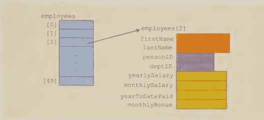

**图 9-7** 员工数组

假设我们还有以下声明：

```cpp
int counter;
```

此外，假设每位员工的初始数据——名、姓、个人 ID、部门 ID 和年薪——都提供在一个文件中。为便于讨论，我们假设每位员工的数据存储在一个文件中，比如 employee.dat。以下 C++ 代码将数据加载到 employees 数组中。我们假设初始时 yearToDatePaid 为 0，并且月度奖金每月根据绩效确定。

```cpp
ifstream infile; // input stream variable
                 // assume that file employee.dat has been opened
for (counter = 0; counter < 50; counter++)
{
    infile >> employees[counter].firstName
           >> employees[counter].lastName
           >> employees[counter].personID
           >> employees[counter].deptID
           >> employees[counter].yearlySalary;
    employees[counter].monthlySalary =
                   employees[counter].yearlySalary / 12;
    employees[counter].yearToDatePaid = 0.0;
    employees[counter].monthlyBonus = 0.0;
}
```

假设某个月份的月度奖金已经存储在每位员工的记录中，我们需要计算当月工资单并更新他们的 yearToDatePaid 金额。以下循环计算并打印员工当月的工资单：

```cpp
double payCheck; // variable to calculate the paycheck

for (counter = 0; counter < 50; counter++)
{
    cout << employees[counter].firstName << " "
         << employees[counter].lastName << " ";

    payCheck = employees[counter].monthlySalary +
               employees[counter].monthlyBonus;

    employees[counter].yearToDatePaid =
               employees[counter].yearToDatePaid +
               payCheck;

    cout << setprecision(2) << payCheck << endl;
}
```

## 结构体中的结构体

你已经看到结构体和数组数据结构如何组合起来组织信息。你也看到了这样的示例：结构体的一个成员是数组，而数组类型是结构体。在本节中，你将了解使用另一个结构体来组织结构体中数据会带来好处的情形。

让我们考虑以下员工记录：

```cpp
struct employeeType
{
    string firstName;
    string middleName;
    string lastName;
    string empID;
    string address1;
    string address2;
    string city;
    string state;
    string zip;
    int hireMonth;
    int hireDay;
    int hireYear;
    int quitMonth;
    int quitDay;
    int quitYear;
    string phone;
    string cellPhone;
    string fax;
    string pager;
    string email;
    string deptID;
    double salary;
};
```

如你所见，一个结构体中打包了大量信息。这个结构体有 22 个成员。该结构体的某些成员会比另一些成员更频繁地被访问，并且某些成员之间的关联比另一些更紧密。此外，有些成员将具有相同的底层结构。例如，雇用日期和离职日期都是 int 数据类型。让我们按如下方式重新组织这个结构体：

```cpp
struct nameType
{
    string first;
    string middle;
    string last;
};

struct addressType
{
    string address1;
    string address2;
    string city;
    string state;
    string zip;
};

struct dateType
{
    int month;
    int day;
    int year;
};

struct contactType
{
    string phone;
    string cellPhone;
    string fax;
    string pager;
    string email;
};
```

我们已经将员工的姓名、地址和联系类型分离到子类别中。此外，我们定义了一个结构体 dateType。让我们按如下方式重建员工记录：

```cpp
struct employeeType
{
    nameType name;
    string empID;
    addressType address;
    dateType hireDate;
    dateType quitDate;
    contactType contact;
    string deptID;
    double salary;
};
```

这个员工结构体中的信息比之前的更容易管理。该结构体的一部分可以复用来构建另一个结构体。例如，假设你想定义客户记录。每位客户都有名、姓，以及

语句：

```cpp
newEmployee.salary = 45678.00;
```

将 newEmployee 的工资设置为 45678.00。以下语句：

```cpp
newEmployee.name.first = "Mary";
newEmployee.name.middle = "Beth";
newEmployee.name.last = "Simons";
```

分别将 newEmployee 的名、中间名和姓设置为 "Mary"、"Beth" 和 "Simons"。注意，newEmployee 有一个名为 name 的成员。我们通过 newEmployee.name 访问这个成员。还要注意，newEmployee.name 是一个结构体，并且有三个成员。我们使用成员访问运算符来访问结构体 newEmployee.name 的成员 first。因此，newEmployee.name.first 就是我们存储名的成员。

语句：

```cpp
cin >> newEmployee.name.first;
```

读取一个字符串并存储到 newEmployee.name.first 中。语句：

```cpp
newEmployee.salary = newEmployee.salary * 1.05;
```

更新 newEmployee 的工资。

以下语句声明 employees 为一个包含 100 个分量的数组，其中每个分量的类型都是 employeeType：

```cpp
employeeType employees[100];
```

以下 for 循环：

```cpp
for (int j = 0; j < 100; j++)
    cin >> employees[j].name.first >> employees[j].name.middle
        >> employees[j].name.last;
```

读取 100 名员工的姓名并存储到数组 employees 中。由于 employees 是一个数组，要访问某个分量，我们使用索引。例如，employees[50] 是员工数组的第 51<sup>个</sup>分量（回想一下，数组索引从 0 开始）。由于 employees[50] 是一个结构体，我们使用成员访问运算符来选择特定成员。


## 编程示例：销售数据分析

一家公司有六名销售人员。每个月，他们都会出差销售公司的产品。每月月底，每名销售人员的销售总额连同该销售人员的 ID 和月份一起记录在一个文件中。每年年底，公司经理希望看到按以下表格格式呈现的报告：

| ID | 第1季度 | 第2季度 | 第3季度 | 第4季度 | 总计 |
|---:|---:|---:|---:|---:|---:|
| 12345 | 1892.00 | 0.00 | 494.00 | 322.00 | 2708.00 |
| 32214 | 343.00 | 892.00 | 9023.00 | 0.00 | 10258.00 |
| 23422 | 1395.00 | 1901.00 | 0.00 | 0.00 | 3296.00 |
| 57373 | 893.00 | 892.00 | 8834.00 | 0.00 | 10619.00 |
| 35864 | 2882.00 | 1221.00 | 0.00 | 1223.00 | 5326.00 |
| 54654 | 893.00 | 0.00 | 392.00 | 3420.00 | 4705.00 |
| 总计 | 8298.00 | 4906.00 | 18743.00 | 4965.00 |  |

销售人员最高销售额：ID = 57373，金额 = $10619.00  
季度最高销售额：季度 = 3，金额 = $18743.00

在本报告中，QT1 表示第1季度（第1至3月），QT2 表示第2季度（第4至6月），QT3 表示第3季度（第7至9月），QT4 表示第4季度（第10至12月）。

销售人员的 ID 存储在一个文件中；销售数据存储在另一个文件中。销售数据的形式如下：

```
salesPersonID  month  saleAmount
.
.
.
```

此外，销售数据没有特定顺序；它未按 ID 排序。

销售数据示例如下：

```
12345 1 893
32214 1 343
23422 3 903
57373 2 893
.
.
.
```

## 问题分析与算法设计

让我们编写一个程序，以指定格式生成输出。

- **输入** 一个包含每名销售人员 ID 的文件，以及另一个包含销售数据的文件。
- **输出** 一个包含上述格式年度销售报告的文件。

根据问题需求，可以明确每名销售人员的主要组成部分是销售人员的 ID、季度销售额和年度总销售额。由于这些组成部分类型不同，我们可以借助一个结构体将它们组合起来，定义如下：

```
struct salesPersonRec
{
    string ID;             // salesperson's ID
    double saleByQuarter[4];    // array to store the total
                                  // sales for each quarter
    double totalSale;      // salesperson's yearly sales amount
};
```

由于有六名销售人员，我们使用一个包含六个组成部分的数组，其中每个组成部分的类型都是 salesPersonRec，定义如下：

```
salesPersonRec salesPersonList[NO_OF_SALES_PERSON];
```

其中 NO_OF_SALES_PERSON 的值为 6。

由于程序要求我们求出公司每个季度的总销售额，我们需要一个包含四个组成部分的数组来存储数据。请注意，这些数据将用于确定销售额最高的季度。因此，程序还需要以下数组：

```
double totalSaleByQuarter[4];
```

回想一下，在 C++ 中，数组索引从 0 开始。因此，totalSaleByQuarter[0] 存储第1季度的数据，totalSaleByQuarter[1] 存储第2季度的数据，依此类推。

我们将在整个讨论中引用这些变量。

数组 salesPersonList 如图 9-9 所示。

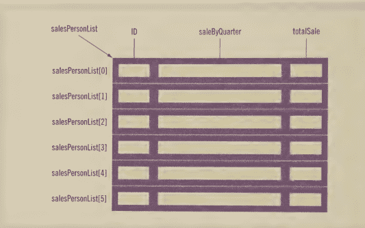

程序的第一步是将销售人员的 ID 读入数组 `salesPersonList`，并将每名销售人员的季度销售额和总销售额初始化为 0。完成这一步后，数组 `salesPersonList` 如图 9-10 所示。

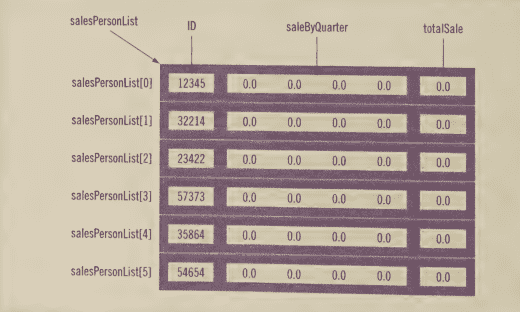

下一步是处理销售数据。处理销售数据相当直接。对于包含销售数据的文件中的每一条记录：

- 1. 读取销售人员的 ID、月份和该月的销售额。
- 2. 搜索数组 `salesPersonList`，定位该销售人员对应的组成部分。
- 3. 确定该月份对应的季度。
- 4. 通过加上该月的销售额来更新该季度的销售额。

处理完销售数据文件后：

- 1. 计算每名销售人员的总销售额。
- 2. 计算每个季度的总销售额。
- 3. 打印报告。

上述讨论可转化为以下算法：

- 1. 初始化数组 `salesPersonList`。
- 2. 处理销售数据。
- 3. 计算每个季度的总销售额。
- 4. 计算每名销售人员的总销售额。
- 5. 打印报告。
- 6. 计算并打印每名销售人员的最高销售额。
- 7. 计算并打印每个季度的最高销售额。

为降低主程序的复杂度，让我们为这七个步骤分别编写一个单独的函数。

该函数从输入文件中读取销售人员的 ID，并将销售人员的 ID 存储到数组 `salesPersonList` 中。它还会将每名销售人员的季度销售额和总销售额初始化为 0。该函数的定义如下：

```
void initialize(ifstream& indata, salesPersonRec list[],
                 int listSize)
{
    int index;
    int quarter;

    for (index = 0; index < listSize; index++)
    {
        indata >> list[index].ID; // get salesperson's ID

        for (quarter = 0; quarter < 4; quarter++)
            list[index].saleByQuarter[quarter] = 0.0;

        list[index].totalSale = 0.0;
    }
} //end initialize
```

### 函数 `getData`

该函数从输入文件中读取销售数据，并将相应信息存储到数组 `salesPersonList` 中。该函数的算法为：

- 1. 读取销售人员的 ID、月份和该月的销售额。
- 2. 搜索数组 `salesPersonList`，定位该销售人员对应的组成部分。（由于销售人员的 ID 未排序，我们将使用顺序搜索来搜索该数组。）
- 3. 确定该月份对应的季度。
- 4. 通过加上该月的销售额来更新该季度的销售额。

假设读取到的记录为：

```
57373  2  350
```

这里，销售人员的 ID 为 57373，月份为 2，销售额为 350。假设数组 `salesPersonList` 如图 9-11 所示。

| `salesPersonList` | ID | 第1季度 | 第2季度 | 第3季度 | 第4季度 | `totalSale` |
|---|---:|---:|---:|---:|---:|---:|
| `salesPersonList[0]` | 12345 | 150.80 | 0.0 | 0.0 | 654.92 | 0.0 |
| `salesPersonList[1]` | 32214 | 0.0 | 439.90 | 0.0 | 0.0 | 0.0 |
| `salesPersonList[2]` | 23422 | 0.0 | 0.0 | 0.0 | 564.76 | 0.0 |
| `salesPersonList[3]` | 57373 | 354.80 | 0.0 | 0.0 | 0.0 | 0.0 |
| `salesPersonList[4]` | 35864 | 0.0 | 0.0 | 763.90 | 0.0 | 0.0 |
| `salesPersonList[5]` | 54654 | 783.45 | 0.0 | 0.0 | 563.80 | 0.0 |

**图 9-11** 数组 `salesPersonList`

现在，ID 57373 对应数组组成部分 `salesPersonList[3]`，月份 2 对应第1季度。因此，将 350 加到 354.80 上，得到新金额 704.80。处理完这条记录后，数组 `salesPersonList` 如图 9-12 所示。

| salesPersonList | ID | saleByQuarter | totalSale |
|---|---:|---|---:|
| salesPersonList[0] | 12345 | 150.80, 0.0, 0.0, 654.92 | 0.0 |
| salesPersonList[1] | 32214 | 0.0, 439.90, 0.0, 0.0 | 0.0 |
| salesPersonList[2] | 23422 | 0.0, 0.0, 0.0, 564.76 | 0.0 |
| salesPersonList[3] | 57373 | 704.80, 0.0, 0.0, 0.0 | 0.0 |
| salesPersonList[4] | 35864 | 0.0, 0.0, 763.90, 0.0 | 0.0 |
| salesPersonList[5] | 54654 | 783.45, 0.0, 0.0, 563.80 | 0.0 |

注释：ID = 57373；月份 = 2。

**图 9-12** 处理记录 57373 2 350 后的数组 salesPersonList

函数 getData 的定义如下：

```
void getData(ifstream infile, salesPersonRec list[],
             int listSize)
{
    int index;
    int quarter;
    string sID;
    int month;
    double amount;

    infile >> sID;      //get salesperson's ID

    while (infile)
    {
        infile >> month >> amount;  //get the sale month and
                                    //the sale amount

        for (index = 0; index < listSize; index++)
            if (sID == list[index].ID)
                break;
```


```cpp
if (1 <= month && month <= 3)
    quarter = 0;
else if (4 <= month && month <= 6)
    quarter = 1;
else if (7 <= month && month <= 9)
    quarter = 2;
else
    quarter = 3;

if (index < listSize)
    list[index].saleByQuarter[quarter] += amount;
else
    cout << "Invalid salesperson's ID." << endl;

infile >> sID;
} //end while
} //end getData
```

### 函数 `saleByQuarter`

该函数计算公司每个季度的总销售额。为了求出每个季度的总销售额，我们将每位销售员在该季度的销售额相加。显然，该函数必须能够访问数组 `salesPersonList` 和数组 `totalSalesByQuarter`。该函数还需要知道每个数组的行数。因此，该函数有三个参数。该函数的定义如下：

```cpp
void saleByQuarter(salesPersonRec list[], int listSize,
                   double totalByQuarter[])
{
    int quarter;
    int index;

    for (quarter = 0; quarter < 4; quarter++)
        totalByQuarter[quarter] = 0.0;

    for (quarter = 0; quarter < 4; quarter++)
        for (index = 0; index < listSize; index++)
            totalByQuarter[quarter] +=
                list[index].saleByQuarter[quarter];
} //end saleByQuarter
```

### 函数 `totalSaleByPerson`

该函数计算每位销售员的年度销售额。为了计算某位员工的年度销售额，我们将该员工四个季度的销售额相加。显然，该函数必须能够访问数组 `salesPersonList`。该函数还需要知道数组的大小。因此，该函数有两个参数。

该函数的定义如下：

```cpp
void totalSaleByPerson(salesPersonRec list[], int listSize)
{
    int index;
    int quarter;

    for (index = 0; index < listSize; index++)
        for (quarter = 0; quarter < 4; quarter++)
            list[index].totalSale +=
                list[index].saleByQuarter[quarter];
} //end totalSaleByPerson
```

### 函数 `printReport`

该函数按指定格式打印年度报告。其伪代码算法如下：

- 1. 打印标题——即输出的前三行。
- 2. 打印每位销售员的数据。
- 3. 打印表格的最后一行。

请注意，接下来的两个函数将生成输出的最后两行。

显然，`printReport` 函数必须能够访问数组 `salesPersonList` 和数组 `totalSaleByQuarter`。此外，由于输出将存储在文件中，该函数必须能够访问与输出文件关联的 `ofstream` 变量。因此，该函数有四个参数：一个对应于数组 `salesPersonList` 的参数、一个对应于数组 `totalSaleByQuarter` 的参数、一个指定数组大小的参数，以及一个对应于 `ofstream` 变量的参数。该函数的定义如下：

```cpp
void printReport(ofstream& outfile, salesPersonRec list[],
                int listSize, double saleByQuarter[])
{
    int index;
    int quarter;

    outfile << "---------- Annual Sales Report ---------";
    outfile << "\n" << endl;
    outfile << endl;
    outfile << "  ID        QT1        QT2        QT3        "
             << "QT4      Total" << endl;
    outfile << "  "
             << "--------------------------------------------"
             << endl;

    for (index = 0; index < listSize; index++)
    {
        outfile << list[index].ID << "\t";

        for (quarter = 0; quarter < 4; quarter++)
            outfile << setw(10)
                    << list[index].saleByQuarter[quarter];

        outfile << setw(10) << list[index].totalSale << endl;
    }

    outfile << "Total ";
    for (quarter = 0; quarter < 4; quarter++)
        outfile << setw(10) << saleByQuarter[quarter];

    outfile << endl << endl;
} //end printReport
```

### 函数 `maxSaleByPerson`

该函数打印销售额最大的销售员姓名。为了确定这位销售员，我们查看每位销售员的销售总额，并找出最大销售额。由于每位员工的销售总额保存在数组 salesPersonList 中，该函数必须能够访问数组 salesPersonList。此外，由于输出将存储在文件中，该函数必须能够访问与输出文件关联的 ofstream 变量。因此，该函数有三个参数：一个对应于数组 salesPersonList 的参数、一个指定该数组大小的参数，以及一个对应于输出文件的参数。

查找最大销售额的算法类似于查找数组中最大元素的算法（在第8章中讨论）。该函数的定义如下：

```cpp
void maxSaleByPerson(ofstream& outData, salesPersonRec list[],
                    int listSize)
{
    int maxIndex = 0;
    int index;

    for (index = 1; index < listSize; index++)
        if (list[maxIndex].totalSale < list[index].totalSale)
            maxIndex = index;

    outData << "Max Sale by SalesPerson: ID = "
            << list[maxIndex].ID
            << ", Amount = $" << list[maxIndex].totalSale
            << endl;
} //end maxSaleByPerson
```

### 函数 `maxSaleByQuarter`

该函数打印销售额最大的季度。为了确定这个季度，我们查看每个季度的总销售额，并找出最大销售额。由于每个季度的销售总额保存在数组 totalSaleByQuarter 中，该函数必须能够访问数组 totalSaleByQuarter。此外，由于输出将存储在文件中，该函数必须能够访问与输出文件关联的 ofstream 变量。因此，该函数有两个参数：一个对应于数组 totalSaleByQuarter 的参数，以及一个对应于输出文件的参数。

查找最大销售额的算法与查找数组中最大元素的算法相同（在第8章中讨论）。该函数的定义如下：

```cpp
void maxSaleByQuarter(ofstream& outData,
                      double saleByQuarter[])
{
    int quarter;
    int maxIndex = 0;

    for (quarter = 0; quarter < 4; quarter++)
        if (saleByQuarter[maxIndex] < saleByQuarter[quarter])
            maxIndex = quarter;

    outData << "Max Sale by Quarter: Quarter = "
            << maxIndex + 1
            << ", Amount = $" << saleByQuarter[maxIndex]
            << endl;
} //end maxSaleByQuarter
```

为了使程序更加灵活，我们将在程序执行期间提示用户指定输入文件和输出文件。

现在我们可以编写函数 main 的算法了。

## 主算法

- 1. 声明变量。
- 2. 提示用户输入包含销售员 ID 数据的文件名。
- 3. 读取输入文件的名称。
- 4. 打开输入文件。
- 5. 如果输入文件不存在，则退出程序。
- 6. 初始化数组 `salesPersonList`。调用函数 `initialize`。
- 7. 关闭包含销售员 ID 数据的输入文件，并清空输入流。
- 8. 提示用户输入包含销售数据的文件名。
- 9. 读取输入文件的名称。
- 10. 打开输入文件。
- 11. 如果输入文件不存在，则退出程序。
- 12. 提示用户输入输出文件的名称。
- 13. 读取输出文件的名称。
- 14. 打开输出文件。
- 15. 为了以固定小数格式输出浮点数，并显示小数点和尾随零，设置操纵符 `fixed` 和 `showpoint`。另外，为了将浮点数输出到两位小数，将精度设为两位小数。
- 16. 处理销售数据。调用函数 `getData`。
- 17. 计算每个季度的总销售额。调用函数 `saleByQuarter`。
- 18. 计算每位销售员的销售总额。调用函数 `totalSaleByPerson`。
- 19. 以表格格式打印报告。调用函数 `printReport`。
- 20. 查找并打印年度销售额最大的销售员。调用函数 `maxSaleByPerson`。
- 21. 查找并打印年度销售额最大的季度。调用函数 `maxSaleByQuarter`。
- 22. 关闭文件。

## 程序清单

```cpp
////////////////////////////////////////////////////////////////////
// Author: D.S. Malik
//
// Program: Sales Data Analysis
// This program processes sales data for a company. For each
// salesperson, it outputs the ID, the total sales by each
// quarter, and the total sales for the year. It also outputs
// the salesperson's ID generating the maximum sale for the
// year and the sales amount. The quarter generating the
// maximum sale and the sales amount is also output.
////////////////////////////////////////////////////////////////////

#include <iostream>
#include <fstream>
#include <iomanip>
#include <string>

using namespace std;

const int NO_OF_SALES_PERSON = 6;

struct salesPersonRec
{
    string ID;          //salesperson's ID
    double saleByQuarter[4];  //array to store the total
                               //sales for each quarter
    double totalSale;   //salesperson's yearly sales amount
};

void initialize(ifstream& indata, salesPersonRec list[],
                int listSize);
```


```cpp
void getData(ifstream& infile, salesPersonRec list[],
             int listSize);
void saleByQuarter(salesPersonRec list[], int listSize,
                   double totalByQuarter[]);
void totalSaleByPerson(salesPersonRec list[], int listSize);
void printReport(ofstream& outfile, salesPersonRec list[],
                 int listSize, double saleByQuarter[]);
void maxSaleByPerson(ofstream& outData, salesPersonRec list[],
                     int listSize);
void maxSaleByQuarter(ofstream& outData, double saleByQuarter[]);

int main()
{
    //Step 1
    ifstream infile;       //input file stream variable
    ofstream outfile;      //output file stream variable

    string inputFile;      //variable to hold the input file name
    string outputFile;     //variable to hold the output file name

    double totalSaleByQuarter[4];    //array to hold the
                                     //sale by quarter

    salesPersonRec salesPersonList[NO_OF_SALES_PERSON]; //array
                                     //to hold the salesperson's data

    cout << "Enter the salesperson ID file name: "; //Step 2
    cin >> inputFile;                                //Step 3
    cout << endl;

    infile.open(inputFile.c_str());                  //Step 4

    if (!infile)                                     //Step 5
    {
        cout << "Cannot open the input file."
             << endl;
        return 1;
    }

    initialize(infile, salesPersonList,
               NO_OF_SALES_PERSON);                  //Step 6

    infile.close();                                  //Step 7
    infile.clear();                                  //Step 7

    cout << "Enter the sales data file name: ";     //Step 8
    cin >> inputFile;
    cout << endl;

    infile.open(inputFile.c_str());                  //Step 10

    if (!infile)                                      //Step 11
    {
        cout << "Cannot open the input file."
             << endl;
        return 1;
    }

    cout << "Enter the output file name: ";             //Step 12
    cin >> outputFile;                                  //Step 13
    cout << endl;

    outfile.open(outputFile.c_str());                   //Step 14
    outfile << fixed << showpoint
            << setprecision(2);                         //Step 15

    getData(infile, salesPersonList,
            NO_OF_SALES_PERSON);                        //Step 16
    saleByQuarter(salesPersonList,
                  NO_OF_SALES_PERSON,
                  totalSaleByQuarter);                  //Step 17
    totalSaleByPerson(salesPersonList,
                      NO_OF_SALES_PERSON);              //Step 18

    printReport(outfile, salesPersonList,
                NO_OF_SALES_PERSON,
                totalSaleByQuarter);                     //Step 19
    maxSaleByPerson(outfile, salesPersonList,
                    NO_OF_SALES_PERSON);                //Step 20
    maxSaleByQuarter(outfile, totalSaleByQuarter);       //Step 21

    infile.close();                                     //Step 22
    outfile.close();                                    //Step 22

    return 0;
}

//Place the definitions of the functions initialize,
//getData, saleByQuarter, totalSaleByPerson,
//printReport, maxSaleByPerson, and maxSaleByQuarter here.
```

**示例运行：** 在此示例运行中，用户输入以阴影显示。

输入销售员 ID 文件名：`Ch9_SalesManID.txt`

输入销售数据文件名：`Ch9_SalesData.txt`

输入输出文件名：`Ch9_SalesDataAnalysis.txt`

## 输入文件：销售员 ID

- 12345
- 32214
- 23422
- 57373
- 35864
- 54654

## 输入文件：销售员数据

```text
12345 1 893
32214 1 343
23422 3 903
57373 2 893
35864 5 329
54654 9 392
12345 2 999
32214 4 892
23422 4 895
23422 2 492
57373 6 892
35864 10 1223
54654 11 3420
12345 12 322
35864 5 892
54654 3 893
12345 8 494
32214 8 9023
23422 6 223
23422 4 783
57373 8 8834
35864 3 2882
```

## 示例运行

------------- 年度销售报告 -------------

| ID | 第1季度 | 第2季度 | 第3季度 | 第4季度 | 总计 |
|---|---:|---:|---:|---:|---:|
| 12345 | 1892.00 | 0.00 | 494.00 | 322.00 | 2708.00 |
| 32214 | 343.00 | 892.00 | 9023.00 | 0.00 | 10258.00 |
| 23422 | 1395.00 | 1901.00 | 0.00 | 0.00 | 3296.00 |
| 57373 | 893.00 | 892.00 | 8834.00 | 0.00 | 10619.00 |
| 35864 | 2882.00 | 1221.00 | 0.00 | 1223.00 | 5326.00 |
| 54654 | 893.00 | 0.00 | 392.00 | 3420.00 | 4705.00 |
| 总计 | 8298.00 | 4906.00 | 18743.00 | 4965.00 |  |

销售员最高销售额：ID = 57373，金额 = $10619.00
季度最高销售额：季度 = 3，金额 = $18743.00

- e. 数组可以是 `struct` 的成员。
- f. 在 C++ 中，允许对 `struct` 进行某些聚合操作。
- g. 因为 `struct` 具有有限数量的组成部分，所以允许对 `struct` 进行关系运算。

2. 定义一个结构体 `carType`，用于存储关于汽车的以下数据：制造商（string）、型号（string）、车型类型（string）、颜色（string）、车门数（int）、城市每加仑英里数（int）、高速公路每加仑英里数（int）、汽车制造年份（int）以及价格（double）。

3. 假设习题2中已定义。声明一个 `carType` 变量，并编写 C++ 语句存储以下信息：制造商——GMT，型号——Canyon，类型——sedan，颜色——blue，车门数——4，城市每加仑英里数——28，高速公路每加仑英里数——32，汽车制造年份——2006，价格——25000.00。

4. 定义一个结构体 `fruitType`，用于存储关于水果的以下数据：水果名称（string）、颜色（string）、脂肪（int）、糖（int）以及碳水化合物（int）。

5. 假设习题4中已定义。声明一个 `fruitType` 类型的变量，用于存储以下数据：水果名称——banana，颜色——yellow，脂肪——1，糖——15，碳水化合物——22。

6. 考虑以下语句：

```cpp
struct nameType
{
    string first;
    string last;
};

struct courseType
{
    string name;
    int callNum;
    int credits;
    char grade;
};

struct studentType
{
    nameType name;
    double gpa;
    courseType course;
};
```

```cpp
studentType student;
studentType classList[100];
courseType course;
nameType name;
```

将以下语句标记为有效或无效。如果语句无效，请解释原因。

- a. `student.course.callNum = "CSC230";`
- b. `cin >> student.name;`
- c. `classList[0].name;`
- d. `classList[1].gpa = 3.45;`
- e. `name = classList[15].name;`
- f. `student.name = name;`
- g. `cout << classList[10] << endl;`
- h. `for (int j = 0; j < 100; j++)`
  `classList[j].name = name;`
- i. `classList.course.credits = 3;`
- j. `course = studentType.course;`

7. 假设习题6中已声明。编写 C++ 语句将以下信息存储到 student 中：

- 姓名：Linda Brown
- GPA：3.78
- 课程名称：Calculus
- 课程编号：23827
- 课程学分：4
- 课程成绩：A

8. 假设习题6中已声明。编写 C++ 语句完成以下操作：

a. 在 course 中存储以下信息：

- name：Programming I
- callNum：13452
- credits：3
- grade：""

b. 在数组 classList 中，将每个 gpa 初始化为 0.0。

c. 将数组 classList 第31个分量的信息复制到 student 中。

d. 将数组 classList 中第10名学生的 gpa 在其先前值基础上增加 0.75。

9. 考虑以下语句（nameType 如习题6中所定义）：

```cpp
struct employeeType
{
    nameType name;
    int performanceRating;
    int pID;
    string dept;
    double salary;
};
employeeType employees[100];
employeeType newEmployee;
```

将以下语句标记为有效或无效。如果语句无效，请解释原因。

- a. `newEmployee.name = "John Smith";`
- b. `cout << newEmployee.name;`
- c. `employees[35] = newEmployee;`
- d. `if (employees[45].pID == 555334444)`
  `employees[45].performanceRating = 1;`
- e. `employees.salary = 0;`


10. 假设练习6和练习9中的声明。编写完成以下操作的C++语句：

- a. 将以下信息存储到`newEmployee`中：

```text
name: Mickey Doe
pID: 111111111
performanceRating: 2
dept: ACCT
salary: 34567.78
```

- b. 在数组`employees`中，将每个`performanceRating`初始化为0。

- c. 将数组`employees`中第20个分量的信息复制到`newEmployee`中。

- d. 将数组`employees`中第50名员工的工资在原有值的基础上增加5735.87。

11. 假设你有以下结构体定义：

```
struct partsType
{
    string partName;
    int partNum;
    double price;
    int quantitiesInStock;
};
```

声明一个包含100个`partsType`类型分量的数组`inventory`。

12. 假设练习11中的定义。

- a. 编写C++代码，将`inventory`的每个分量初始化如下：`partName`为空字符串，`partNum`为-1，`price`为0.0，`quantitiesInStock`为0。

- b. 编写C++代码，使用循环输出存储在`inventory`中的数据。假设变量`length`表示`inventory`中元素的个数。

13. 假设练习11中的定义和声明。编写一个void函数的定义，用于将数据输入到`partsType`类型的变量中。同时编写C++代码，使用你的函数将数据输入到`inventory`中。

14. 假设你有以下定义：

```
struct timeType
{
    int hr;
    double min;
    int sec;
};

struct tourType
{
    string cityName;
    int distance;
    timeType travelTime;
};
```

- a. 声明`tourType`类型的变量`destination`。

- b. 编写C++语句，将以下数据存储到`destination`中：`cityName`：Chicago，`distance`：550英里，`travelTime`：9小时30分钟。

- c. 编写一个函数的定义，用于输出存储在`tourType`类型变量中的数据。

- d. 编写一个值返回函数的定义，该函数将数据输入到`tourType`类型的变量中。

- e. 编写一个带`tourType`类型引用参数的void函数的定义，用于将数据输入到`tourType`类型的变量中。

### 编程练习

1. 假设练习4中的定义，该定义定义了`struct fruitType`。编写一个程序，声明一个`fruitType`类型的变量，提示用户输入有关水果的数据，并输出该水果数据。

2. 编写一个程序，读取学生姓名及其测试分数。程序应输出每个学生的姓名、测试分数和相应等级。还应查找并打印最高测试分数以及获得最高测试分数的学生姓名。

学生数据应存储在`studentType`类型的`struct`变量中，该结构体有四个分量：`studentFName`和`studentLName`为string类型，`testScore`为int类型（`testScore`介于0和100之间），`grade`为char类型。假设班级有20名学生。使用包含20个`studentType`类型分量的数组。

你的程序必须至少包含以下函数：

- a. 一个将学生数据读入数组的函数。

- b. 一个为每个学生分配相应等级的函数。

- c. 一个查找最高测试分数的函数。

- d. 一个打印获得最高测试分数的学生姓名的函数。

你的程序必须以以下形式输出每个学生的姓名：姓氏后跟逗号，再跟空格，再跟名字；姓名必须左对齐。此外，除了声明变量和打开输入输出文件之外，函数`main`应该只是函数调用的集合。

3. 定义一个`struct menuItemType`，包含两个分量：`menuItem`（string类型）和`menuPrice`（double类型）。

4. 编写一个程序，帮助当地一家餐馆实现早餐计费系统自动化。程序应执行以下操作：

- a. 向顾客展示餐馆提供的不同早餐项目。

- b. 允许顾客从菜单中选择多个项目。

- c. 计算并打印账单。

假设餐馆提供以下早餐项目（每个项目的价格显示在项目右侧）：

| 项目 | 价格 |
|---|---|
| Plain Egg | $1.45 |
| Bacon and Egg | $2.45 |
| Muffin | $0.99 |
| French Toast | $1.99 |
| Fruit Basket | $2.49 |
| Cereal | $0.69 |
| Coffee | $0.50 |
| Tea | $0.75 |

使用编程练习3中定义的`struct menuItemType`的数组`menuList`。你的程序必须至少包含以下函数：

- 函数`getData`：此函数将数据加载到数组`menuList`中。
- 函数`showMenu`：此函数显示餐馆提供的不同项目，并告诉用户如何选择项目。
- 函数`printCheck`：此函数计算并打印账单。（注意，账单金额应包含5%的税。）

示例输出如下：

```
Welcome to Johnny's Restaurant
Bacon and Egg     $2.45
Muffin            $0.99
Coffee            $0.50
Tax               $0.20
Amount Due        $4.14
```

你的输出格式保留两位小数。输出中每个项目的名称必须左对齐。你可以假设用户每种类型只选择一个项目。

5. 重做练习4，使顾客可以选择同一种类型的多个项目。此情况下的示例输出如下：

```
Welcome to Johnny's Restaurant
1 Bacon and Egg    $2.45
2 Muffin           $1.98
1 Coffee           $0.50
  Tax              $0.25
  Amount Due       $5.18
```

6. 编写一个程序，其`main`函数仅仅是一些变量声明和函数调用的集合。该程序读取一个文本，并按照下面`printResult`函数中的说明输出字母及其计数。（不能有全局变量！所有信息必须传入和传出函数。使用结构体来存储信息。）你的程序必须至少包含以下函数：

- **函数openFile：** 打开输入和输出文件。你必须将文件流作为参数传递（当然是引用）。如果文件不存在，程序应打印适当消息并退出。程序必须询问用户输入和输出文件的名称。
- **函数count：** 统计在`openFile`函数中打开的文本文件中大写字母A–Z和小写字母a–z的每次出现。此信息必须放入一个结构体数组中。该数组必须作为参数传递，文件标识符也必须作为参数传递。
- **函数printResult：** 打印大写字母和小写字母的数量，以及每个字母A–Z的大写字母百分比和每个字母a–z的小写字母百分比。百分比应如下所示：“25%”。此信息必须来自结构体数组，并且该数组必须作为参数传递。

7. 编写一个程序，声明一个结构体来存储足球运动员的数据（运动员姓名、运动员位置、达阵次数、接球次数、传球码数、接球码数和冲球码数）。声明一个包含10个分量的数组来存储10名足球运动员的数据。你的程序必须包含一个输入数据的函数和一个输出数据的函数。添加函数来搜索数组以查找特定运动员的索引，并更新运动员的数据。（你可以假设输入数据存储在文件中。）在程序终止之前，给用户将数据保存到文件中的选项。你的程序应该是菜单驱动的，给用户各种选择。


## 第10章：类与数据抽象

在本章中，你将：

- 了解类
- 了解类的*私有*、*受保护*和*公有*成员
- 探索类是如何实现的
- 考察构造函数和析构函数
- 了解抽象数据类型（ADT）
- 探索如何使用类来实现ADT
- 了解信息隐藏
- 探索信息隐藏如何在C++中实现
- 了解类的*静态*成员


在第9章中，你学习了如何使用*结构体*将不同类型的数据项组合在一起。第9章给出的*结构体*定义类似于 C 结构体的定义。然而，C++ *结构体*的成员既可以是数据项，也可以是函数。C++ 提供了另一种结构化数据类型，称为**类**，它专门用于组合数据和函数。本章首先介绍类并解释如何使用它们，然后讨论*结构体*与**类**之间的异同。

> **注意** 第9章不是本章的先修内容。事实上，*结构体*和*类*具有相似的能力，正如本章“结构体与类”一节所讨论的那样。

## 类

第1章介绍了一种称为**面向对象设计（OOD）**的问题求解方法。在 OOD 中，第一步是识别组件，称为对象。对象将数据以及对数据的操作组合成一个单元。在 C++ 中，允许你将数据和对数据的操作组合成一个单元的机制称为**类**。既然你已经知道如何在计算机内存中存储和操作数据，以及如何构造自己的函数，你就可以学习对象是如何构造的了。本章及后续章节将使用 OOD 开发和实现程序。本章首先解释如何定义类并在程序中使用它。

**类**是固定数量组件的集合。类的组件称为类的**成员**。

定义类的一般语法是：

```cpp
class classIdentifier
{
    classMembersList
};
```

其中 classMembersList 由变量声明和/或函数组成。也就是说，类的成员可以是变量（用于存储数据）或函数。

- 如果类的成员是变量，你可以像声明任何其他变量一样声明它。此外，在类的定义中，声明变量时不能初始化它。
- 如果类的成员是函数，通常使用函数原型来声明该成员。
- 如果类的成员是函数，它可以（直接）访问类的任何成员——成员变量和成员函数。也就是说，在编写成员函数的定义时，你可以直接访问类的任何成员变量，而无需将其作为参数传递。唯一明显的条件是，必须先声明标识符，然后才能使用它。

在 C++ 中，class 是保留字，它只定义一种数据类型；不会分配内存。它声明了一个类。此外，注意右花括号后的分号（;）。分号是语法的一部分。因此，缺少分号将导致语法错误。

类的成员分为三类：private、public 和 protected。本章主要讨论前两类，即 private 和 public。

在 C++ 中，private、protected 和 public 是保留字，称为成员访问说明符。

以下是关于类的 public 和 private 成员的一些事实：

- 默认情况下，类的所有成员都是 private。
- 如果类的成员是 private，则不能在类外部访问它。（例10-1说明了这一概念。）
- public 成员可以在类外部访问。（例10-1说明了这一概念。）
- 要将类的成员设为 public，需使用成员访问说明符 public 加一个冒号 `:`。

假设我们想定义一个类，在程序中实现一天中的时间。因为时钟给出一天中的时间，我们把这个类称为 clockType。此外，为了在计算机内存中表示时间，我们使用三个 int 变量：一个表示小时，一个表示分钟，一个表示秒。

假设这三个变量是：

```cpp
int hr;
int min;
int sec;
```

我们还希望对时间执行以下操作：

- 1. 设置时间。
- 2. 获取时间。
- 3. 打印时间。
- 4. 将时间增加一秒。
- 5. 将时间增加一分钟。
- 6. 将时间增加一小时。
- 7. 比较两个时间是否相等。

为了实现这七个操作，我们将编写七个函数——setTime、getTime、printTime、incrementSeconds、incrementMinutes、incrementHours 和 equalTime。

从上述讨论可以清楚地看出，类 clockType 有 10 个成员：三个成员变量和七个成员函数。

- 我们不把这些成员变量作为参数传递给成员函数。
- 在函数 `equalTime` 中，形参是常量引用参数。也就是说，在调用函数 `equalTime` 时，形参接收实参的地址，但形参不能修改实参的值。你本可以把形参声明为值参数，但那样会要求形参复制实参的值，可能导致性能不佳。（解释见本章“引用参数与类对象（变量）”一节。）
- 成员函数 `getTime`、`printTime` 和 `equalTime` 末尾的 `const` 一词指定这些函数不能修改 `clockType` 类型变量的成员变量。

> private 和 public 成员可以以任意顺序出现。如果需要，你可以先声明 private 成员，再声明 public 成员。本章“类的 public 和 private 成员的顺序”一节讨论了这个问题。

> 在类 `clockType` 的定义中，所有成员变量都是 private，所有成员函数都是 public。然而，成员函数也可以是 private。例如，如果某个成员函数仅用于实现类的其他成员函数，而用户不需要访问该函数，就把它设为 private。同样，类的成员变量也可以是 public。

注意，我们尚未编写该类的成员函数的定义。你很快就会学习如何编写它们。

函数 `setTime` 将三个成员变量——hr、min 和 sec——设置为给定值。给定值作为参数传递给函数 `setTime`。函数 `printTime` 打印时间，即 hr、min 和 sec 的值。函数 `incrementSeconds` 将时间增加一秒，函数 `incrementMinutes` 将时间增加一分钟，函数 `incrementHours` 将时间增加一小时，函数 `equalTime` 比较两个时间是否相等。

注意，函数 `equalTime` 只有一个参数，尽管进行比较需要两个对象。我们将在本章后面的“成员函数的实现”一节中借助一个例子解释这一点。

## 统一建模语言类图

可以使用称为**统一建模语言**（UML）的记法以图形方式描述类及其成员。例如，图10-1显示了类 ClockType 的 UML 类图。

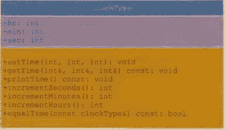

**图10-1** 类 ClockType 的 UML 类图

顶部框包含类名。中间框包含成员变量及其数据类型。最后一个框包含成员函数名、参数列表和函数的返回类型。成员名前的 +（加号）表示该成员是 public 成员；−（减号）表示这是 private 成员。成员名前的 # 符号表示该成员是 protected 成员。

## 变量（对象）声明

一旦定义了类，就可以声明该类型的变量。在 C++ 术语中，类变量称为**类对象**或**类实例**。为了帮助你熟悉这一术语，从现在起，我们将对类变量使用术语类对象，或简称为**对象**。

声明类对象的语法与声明任何其他变量的语法相同。以下语句声明了两个 clockType 类型的对象：

```cpp
clockType myClock;
clockType yourClock;
```

每个对象有 10 个成员：七个成员函数和三个成员变量。每个对象都为 hr、min 和 sec 分配了单独的内存。

实际上，只为每个类对象的成员变量分配内存。C++ 编译器只为类的成员函数生成一份物理副本，每个类对象执行同一份成员函数副本。因此，每当我们绘制

在类对象的图形中，我们将只显示成员变量。例如，图10-2显示了对象`myClock`和`yourClock`及其成员变量中的值。


**图10-2** 对象 myClock 和 yourClock

### 访问类成员

一旦声明了类的对象，它就可以访问类的成员。对象访问类成员的一般语法是：

```
classObjectName.memberName
```

类对象可以访问的类成员取决于该对象在何处声明。

- 如果对象是在类的成员函数定义中声明的，那么该对象可以访问公有成员和私有成员。（在本章稍后的“成员函数的实现”一节中，当我们编写类`clockType`的成员函数定义时，将对此进行详细说明。）
- 如果对象是在其他地方声明的（例如在用户程序中），则该对象*只能*访问类的公有成员。

回想一下，在C++中，点号 .（句点）是一个运算符，称为**成员访问运算符**。

示例10-1说明了如何访问类的成员。

**示例10-1**

假设我们有以下声明（例如，在用户程序中）：

```
clockType myClock;
clockType yourClock;
```

考虑以下语句：

```
myClock.setTime(5, 2, 30);
myClock.printTime();
yourClock.setTime(x, y, z);    //assume x, y, and z are
                              //variables of type int
```

### 赋值运算符和类

假设`myClock`和`yourClock`是前面定义的`clockType`对象。此外，假设`myClock`和`yourClock`的值如图10–3(a)所示。

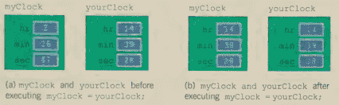

**图10-3** 执行语句`myClock = yourClock`前后的 myClock 和 yourClock。

语句：

```
myClock = yourClock;                 //Line 1
```

将`yourClock`的值复制到`myClock`中。也就是说，

- `yourClock.hr`的值被复制到`myClock.hr`中，
- `yourClock.min`的值被复制到`myClock.min`中，
- `yourClock.sec`的值被复制到`myClock.sec`中。

换句话说，`yourClock`的三个成员变量的值被复制到`myClock`的相应成员变量中。因此，赋值语句执行的是逐成员复制。第1行语句执行后，`myClock`和`yourClock`的值如图10–3(b)所示。

### 类的作用域

类对象可以是自动的（即每次控制流到达其声明时创建，当控制流退出所在块时销毁），也可以是静态的（即控制流到达其声明时创建一次，当程序终止时销毁）。此外，你可以声明类对象数组。类对象与其他变量具有相同的作用域。类的成员与结构体的成员具有相同的作用域。也就是说，类的成员对于该类是局部的。要在类外部访问类成员，需要使用类对象名和成员访问运算符（.）。

### 函数和类

以下规则描述了函数和类之间的关系：

- 类对象可以作为参数传递给函数，也可以作为函数值返回。
- 作为函数参数，类对象可以按值传递，也可以按引用传递。
- 如果类对象按值传递，实参的成员变量内容会被复制到形参的相应成员变量中。

### 引用参数和类对象（变量）

回想一下，当变量按值传递时，形参复制实参的值。也就是说，会为形参分配内存空间以复制实参的值。作为参数，类对象可以按值传递。

假设一个类有多个成员变量，需要大量内存来存储数据，而你需要按值传递一个变量。那么相应的形参将收到该变量数据的副本。也就是说，编译器必须为形参分配内存，以便复制实参成员变量的值。除了需要大量存储空间外，此操作可能还需要相当多的计算机时间将实参的值复制到形参中。

另一方面，如果变量按引用传递，形参只接收实参的地址。因此，将变量作为参数传递的一种有效方式是按引用传递。如果变量按引用传递，那么当形参改变时，实参也会改变。然而，有时你不希望函数能够改变成员变量的值。在C++中，你可以在形参声明中使用关键字`const`，按引用传递变量，同时防止函数改变其值。例如，考虑以下函数定义：

```
void testTime(const clockType& otherClock)
{
    clockType dClock;
    .
    .
    .
}
```

函数`testTime`包含一个引用参数`otherClock`。参数`otherClock`使用关键字`const`声明。因此，在调用函数`testTime`时，形参`otherClock`接收实参的地址，但`otherClock`不能修改实参的内容。例如，在执行以下语句后，`myClock`的值不会被改变：

```
testTime(myClock);
```

通常，如果你想把类对象声明为值参数，可以将它声明为使用关键字`const`的引用参数，如前所述。

回想一下，如果形参是值参数，在函数定义内，你可以改变形参的值。也就是说，你可以使用赋值语句来改变形参的值（当然，这对实参没有影响）。然而，如果形参是常量引用参数，你不能在函数内使用赋值语句改变其值，也不能使用任何其他函数改变其值。因此，在函数`testTime`的定义内，你不能改变`otherClock`的值。例如，以下操作在函数`testTime`的定义中是非法的：

```cpp
otherClock.setTime(5, 34, 56); //illegal
otherClock = dClock;           //illegal
```

### 成员函数的实现

当我们定义类`clockType`时，只包含了成员函数的函数原型。为了让这些函数正常工作，我们必须编写相关算法。实现这些函数的一种方式是在类本身中提供函数定义而不是函数原型。不幸的是，这样类定义会变得很长且难以理解。提供函数原型而不是函数定义的另一个原因与信息隐藏有关；也就是说，我们想要隐藏对数据操作的细节。我们将在本章后面的“信息隐藏”一节中讨论这个问题。

接下来，让我们编写类`clockType`的成员函数定义。也就是说，我们将编写函数`setTime`、`getTime`、`printTime`、`incrementSeconds`、`equalTime`等的定义。因为标识符`setTime`、`printTime`等是类局部的，我们不能在类外部（直接）引用它们。为了引用这些标识符，我们使用**作用域解析运算符 ::**（双冒号）。在函数定义的头部，函数名是类的名称，后跟作用域解析运算符，再跟函数名。例如，函数`setTime`的定义如下：

```cpp
void clockType::setTime(int hours, int minutes, int seconds)
{
    if (0 <= hours && hours < 24)
        hr = hours;
    else
        hr = 0;

    if (0 <= minutes && minutes < 60)
        min = minutes;
    else
        min = 0;
```


```cpp
if (0 <= seconds && seconds < 60)
    sec = seconds;
else
    sec = 0;
}
```

注意，函数 setTime 的定义会检查 hours、minutes 和 seconds 的有效值。如果这些值超出范围，成员变量 hr、min 和 sec 会被初始化为 0。现在让我们解释成员函数 setTime 在由 clockType 类型的对象访问时是如何工作的。

成员函数 setTime 是一个 void 函数，有三个参数。因此：

- 对该函数的调用是一条独立语句。
- 在调用该函数时必须使用三个参数。

此外，回顾一下，由于 setTime 是 clockType 类的成员，它可以直接访问成员变量 hr、min 和 sec，如 setTime 的定义所示。

假设 myClock 是 clockType 类型的对象（如前所述）。对象 myClock 有三个成员变量，如图 10-4(a) 所示。

**图 10-4** 执行语句 myClock.setTime(3, 48, 52); 前后的 myClock

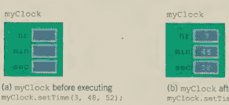

考虑以下语句：

```cpp
myClock.setTime(3, 48, 52);
```

在语句 myClock.setTime(3, 48, 52); 中，setTime 由对象 myClock 访问。因此，函数 setTime 体中提到的三个变量——hr、min 和 sec——就是 myClock 的三个成员变量。于是，前述语句中作为参数传入的值 3、48 和 52 被函数 setTime 赋给 myClock 的三个成员变量（参见函数 setTime 的函数体）。前一条语句执行后，对象 myClock 如图 10-4(b) 所示。

接下来，我们给出类 `clockType` 的其他成员函数的定义。这些函数的定义简单易懂：

```cpp
void clockType::getTime(int& hours, int& minutes,
                       int& seconds) const
{
    hours = hr;
    minutes = min;
    seconds = sec;
}

void clockType::printTime() const
{
    if (hr < 10)
        cout << "0";
    cout << hr << ":";

    if (min < 10)
        cout << "0";
    cout << min << ":";

    if (sec < 10)
        cout << "0";
    cout << sec;
}

void clockType::incrementHours()
{
    hr++;
    if (hr > 23)
        hr = 0;
}

void clockType::incrementMinutes()
{
    min++;
    if (min > 59)
    {
        min = 0;
        incrementHours(); //increment hours
    }
}

void clockType::incrementSeconds()
{
    sec++;

    if (sec > 59)
    {
        sec = 0;
        incrementMinutes(); //increment minutes
    }
}
```

从函数 `incrementMinutes` 和 `incrementSeconds` 的定义可以看出，类的成员函数可以调用该类的其他成员函数。

函数 `equalTime` 的定义如下：

```cpp
bool clockType::equalTime(const clockType& otherClock) const
{
    return (hr == otherClock.hr
         && min == otherClock.min
         && sec == otherClock.sec);
}
```

让我们来看看成员函数 `equalTime` 是如何工作的。

假设 `myClock` 和 `yourClock` 是 `clockType` 类型的对象，如前所述。再假设 `myClock` 和 `yourClock` 如图 10-5 所示。

**图 10-5** 对象 `myClock` 和 `yourClock`

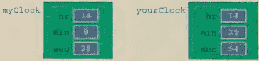

考虑以下语句：

```cpp
if (myClock.equalTime(yourClock))
.
.
.
```

在表达式：

```cpp
myClock.equalTime(yourClock)
```

中，对象 `myClock` 访问成员函数 `equalTime`。由于 `otherClock` 是引用参数，实参 `yourClock` 的地址被传递给形参 `otherClock`，如图 10-6 所示。

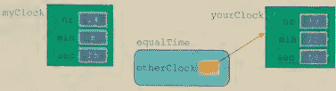

**图 10-6** 对象 myClock 和参数 otherClock

otherClock 的成员变量 hr、min 和 sec 的值分别是 14、25 和 54。换句话说，当函数 equalTime 的函数体执行时，otherClock.hr 的值为 14，otherClock.min 的值为 25，otherClock.sec 的值为 54。函数 equalTime 是 myClock 的一个成员。当函数 equalTime 执行时，函数 equalTime 体中的成员变量 hr、min 和 sec 就是对象 myClock 的成员变量。因此，myClock 的成员 hr 与 otherClock.hr 比较，myClock 的成员 min 与 otherClock.min 比较，myClock 的成员 sec 与 otherClock.sec 比较。

再次从函数 equalTime 的定义中，可以清楚地看出为什么它只有一个参数。

让我们再次看一下函数 equalTime 的定义。注意，在这个函数的定义中，对象 otherClock 访问了成员变量 hr、min 和 sec。然而，这些成员变量是私有的。那么是否存在违规呢？答案是否定的。函数 equalTime 是 clockType 类的成员，而 hr、min 和 sec 是成员变量。此外，otherClock 是 clockType 类型的对象。因此，对象 otherClock 可以在函数 equalTime 的定义中访问其私有成员变量。

对于类的任何成员函数也是如此。一般来说，当你编写某个类（比如 dummyClass）的成员函数（比如 dummyFunction）的定义时，如果该函数使用了一个该类的对象 dummyObject，那么在 dummyFunction 的定义中，对象 dummyObject 可以访问其私有成员变量（实际上是类的任何私有成员）。

一旦一个类被正确定义并实现，它就可以在程序中使用。使用并操作某个类对象的程序或软件被称为该类的客户端。

当你声明 clockType 类的对象时，每个对象都有自己的一份成员变量 hr、min 和 sec。在面向对象的术语中，像 hr、min 和 sec 这样的变量被称为类的实例变量，因为每个对象都有自己的一份数据实例。

```cpp
#include <iostream>
using namespace std;

class clockType
{
public:
    void setTime(int, int, int);
    void getTime(int&, int&, int&) const;
    void printTime() const;
    void incrementSeconds();
    void incrementMinutes();
    void incrementHours();
    bool equalTime(const clockType&) const;

private:
    int hr;
    int min;
    int sec;
};

int main()
{
    clockType myClock;
    clockType yourClock;

    int hours;
    int minutes;
    int seconds;

    //Set the time of myClock
    myClock.setTime(5, 4, 30);                         //Line 1

    cout << "Line 2: myClock: ";                     //Line 2
    myClock.printTime(); //print the time of myClock   //Line 3
    cout << endl;                                    //Line 4

    cout << "Line 5: yourClock: ";                   //Line 5
    yourClock.printTime(); //print the time of yourClock //Line 6
    cout << endl;                                    //Line 7

    //Set the time of yourClock
    yourClock.setTime(5, 45, 16);                    //Line 8

    cout << "Line 9: After setting, yourClock: ";   //Line 9
    yourClock.printTime(); //print the time of yourClock //Line 10
    cout << endl;                                    //Line 11

    //Compare myClock and yourClock
    if (myClock.equalTime(yourClock))               //Line 12
        cout << "Line 13: Both times are equal."
             << endl;                                //Line 13
    else                                      //Line 14
        cout << "Line 15: The two times are not equal."
             << endl;                         //Line 15

    cout << "Line 16: Enter the hours, minutes, and " //Line 16
         << " seconds: ";
    cin >> hours >> minutes >> seconds;                       //Line 17
    cout << endl;                                             //Line 18

        //Set the time of myClock using the value of the
        //variables hours, minutes, and seconds
    myClock.setTime(hours, minutes, seconds);                  //Line 19

    cout << "Line 20: New myClock: ";                         //Line 20
    myClock.printTime();   //print the time of myClock        //Line 21
    cout << endl;                                             //Line 22

        //Increment the time of myClock by one second          //Line 23
    myClock.incrementSeconds();

    cout << "Line 24: After incrementing myClock by "
         << " one second, myClock: ";
    myClock.printTime();   //print the time of myClock        //Line 25
    cout << endl;                                             //Line 26

        //Retrieve the hours, minutes, and seconds of the
        //object myClock
    myClock.getTime(hours, minutes, seconds);                  //Line 27

        //Output the value of hours, minutes, and seconds
    cout << "Line 28: hours = " << hours
         << ", minutes = " << minutes
         << ", seconds = " << seconds << endl;               //Line 28

    return 0;
} //end main

void clockType::setTime(int hours, int minutes, int seconds)
{
    if (0 <= hours && hours < 24)
        hr = hours;
    else
        hr = 0;

    if (0 <= minutes && minutes < 60)
        min = minutes;
    else
        min = 0;

    if (0 <= seconds && seconds < 60)
        sec = seconds;
    else
        sec = 0;
}
```


```cpp
//Place the definitions of the remaining functions, getTime,
//incrementHours, incrementMinutes, incrementSeconds, printTime,
//and equalTime, of the class clockType, as described
//previously here.
```

**示例运行：** 在此示例运行中，用户输入以阴影显示。

```
Line 2: myClock: 05:04:30
Line 5: yourClock: 0-858993460-0-858993460-0-858993460
Line 9: After setting yourClock: 05:45:16
Line 15: The two times are not equal.
Line 16: Enter the hours, minutes, and seconds: 5 23 59

Line 20: New myClock: 05:23:59
Line 24: After incrementing myClock by one second, myClock: 05:24:00
Line 28: hours = 5, minutes = 24, seconds = 0
```

输出第二行（第 5 行）中打印的 yourClock 的值与机器相关——你可能会得到不同的值。

## 类的公有成员和私有成员的顺序

C++ 对公有成员和私有成员的声明顺序没有固定要求；你可以按任意顺序声明它们。唯一需要记住的是，默认情况下，类的所有成员都是私有的。你必须使用成员访问说明符 `public` 才能使成员可被公有访问。如果你决定在公有访问说明符之后声明私有成员（如 clockType 的情况），则必须使用成员访问说明符 `private` 来开始私有成员的声明。

我们可以用三种方式声明 clockType 类，如示例 10-3 至 10-5 所示。

### 示例 10-3

此声明与之前相同。为完整起见，我们包含该类的定义：

```cpp
class clockType
{
public:
    void setTime(int, int, int);
    void getTime(int&, int&, int&) const;
    void printTime() const;
    void incrementSeconds();
    void incrementMinutes();
    void incrementHours();
    bool equalTime(const clockType&) const;

private:
    int hr;
    int min;
    int sec;
};
```

### 示例 10-4

```cpp
class clockType
{
private:
    int hr;
    int min;
    int sec;

public:
    void setTime(int, int, int);
    void getTime(int&, int&, int&) const;
    void printTime() const;
    void incrementSeconds();
    void incrementMinutes();
    void incrementHours();
    bool equalTime(const clockType&) const;
};
```

### 示例 10-5

```cpp
class clockType
{
    int hr;
    int min;
    int sec;

public:
    void setTime(int, int, int);
    void getTime(int&, int&, int&) const;
    void printTime() const;
    void incrementSeconds();
    void incrementMinutes();
    void incrementHours();
    bool equalTime(const clockType&) const;
};
```

在示例 10-5 中，由于标识符 `hr`、`min` 和 `sec` 没有跟在任何成员访问说明符之后，因此它们是私有的。

通常的做法是先列出所有公有成员，然后再列出私有成员。这样，你可以将注意力集中在公有成员上。

## 构造函数

在示例 10-2 的程序中，当我们不调用 setTime 函数就打印 yourClock 的值时，输出是一些奇怪的数字（参见示例运行中第 5 行的输出）。这是因为 C++ 不会自动初始化变量。由于类的私有成员不能在类外访问（在我们的例子中是成员变量），如果用户忘记通过调用 setTime 函数来初始化这些变量，程序将产生错误的结果。

为了保证类的成员变量被初始化，需要使用构造函数。构造函数有两种类型：带参数的和不带参数的。不带参数的构造函数称为**默认构造函数**。

构造函数具有以下属性：

-   构造函数的名字与类名相同。
-   构造函数虽然是一个函数，但没有类型。也就是说，它既不是返回值的函数，也不是 void 函数。
-   一个类可以有多个构造函数。但是，一个类的所有构造函数都具有相同的名称。
-   如果一个类有多个构造函数，那么这些构造函数必须具有不同的形参列表。也就是说，要么形参个数不同，要么形参个数相同但按顺序列出的形参数据类型至少有一个位置不同。
-   当类对象进入其作用域时，构造函数会自动执行。由于它们没有类型，不能像其他函数一样被调用。
-   执行哪个构造函数取决于声明类对象时传递给该类对象的值类型。

让我们通过包含两个构造函数来扩展 `clockType` 类的定义：

```cpp
class clockType
{
public:
    void setTime(int, int, int);
    void getTime(int&, int&, int&) const;
    void printTime() const;
    void incrementSeconds();
```

## 调用构造函数

回想一下，当声明类对象时，构造函数会自动执行。因为一个类可能有多个构造函数，包括默认构造函数，接下来我们讨论如何调用特定的构造函数。

### 调用默认构造函数

假设某个类包含默认构造函数。调用默认构造函数的语法是：

```text
className classObjectName;
```

例如，语句：

```cpp
clockType yourClock;
```

声明 yourClock 为 clockType 类型的对象。在这种情况下，默认构造函数执行，yourClock 的成员变量被初始化为 0。

> 如果你声明一个对象并希望执行默认构造函数，则对象声明语句中对象名称后面的空括号不是必需的。事实上，如果你不小心包含了空括号，编译器会生成一条语法错误消息。例如，下面声明对象 yourClock 的语句是非法的：
>
> `clockType yourClock(); // illegal object declaration`

### 使用参数调用构造函数

假设某个类包含带参数的构造函数。调用带参数的构造函数的语法是：

```text
className classObjectName(argument1, argument2, ...);
```

其中 argument1、argument2 等是变量或表达式。

请注意：

-   参数的数量及其类型应与某个构造函数的形参（按给定顺序）匹配。
-   如果参数的类型与任何构造函数的形参（按给定顺序）都不匹配，C++ 会使用类型转换并寻找最佳匹配。例如，整数值可能被转换为小数部分为零的浮点值。任何二义性都会导致编译时错误。

考虑以下语句：

```cpp
clockType myClock(5, 12, 40);
```

该语句声明了一个 clockType 类型的对象 myClock。这里，我们传入了三个 int 类型的值，这与带参数的构造函数的形参类型匹配。因此，clockType 类的带参数构造函数执行，myClock 对象的三个成员变量被设置为 5、12 和 40。

示例 10-6 进一步说明了构造函数是如何执行的。

### 示例 10-6

考虑以下类定义：

```cpp
class inventory
{
public:
    inventory();                         //Line 1
    inventory(string);                   //Line 2
    inventory(string, int, double);      //Line 3
    inventory(string, int, double, int); //Line 4

    //Add additional functions

private:
    string name;
    int itemNum;
    double price;
    int unitsInStock;
};
```

该类有四个构造函数和四个成员变量。假设构造函数的定义如下：

```cpp
inventory::inventory() //default constructor
{
    name = "";
    itemNum = -1;
    price = 0.0;
    unitsInStock = 0;
}

inventory::inventory(string n)
{
    name = n;
    itemNum = -1;
    price = 0.0;
    unitsInStock = 0;
}

inventory::inventory(string n, int iNum, double cost)
{
    name = n;
    itemNum = iNum;
    price = cost;
    unitsInStock = 0;
}
```


```cpp
inventory::inventory(string n, int iNum, double cost, int inStock)
{
    name = n;
    itemNum = iNum;
    price = cost;
    unitsInStock = inStock;
}
```

考虑以下声明：

```cpp
inventory item1;
inventory item2("Dryer");
inventory item3("Washer", 2345, 278.95);
inventory item4("Toaster", 8231, 34.49, 200);
```

对于 item1，因为未向该变量传递任何值，所以会执行第1行中的默认构造函数。对于 item2，因为只传递了一个 string 类型的参数，并且它与第2行中的构造函数匹配，所以会执行第2行中的构造函数。对于 item3，因为向 item3 传递了三个参数，并且它们与第3行中的构造函数匹配，所以会执行第3行中的构造函数。类似地，对于 item4，会执行第4行中的构造函数（见图10-7）。

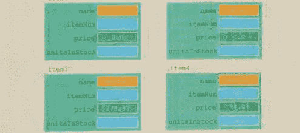

**图 10-7** 构造函数对对象的影响

> 如果传递给类对象的值与任何构造函数的参数都不匹配，并且无法进行类型转换，则将产生编译时错误。

- 另一方面，假设某个类（例如 `dummyClass`）包含带参数的构造函数，但不包含默认构造函数。在这种情况下，C++ 不会为 `dummyClass` 类提供默认构造函数。因此，当声明 `dummyClass` 类的对象时，必须在其声明中包含适当的实参。

以下代码进一步说明了这一点。考虑以下类的定义：

```cpp
class dummyClass
{
public:
    void print() const;

    dummyClass(int dX, int dY);

private:
    int x;
    int y;
};
```

类 `dummyClass` 没有默认构造函数。它有一个带参数的构造函数。给定 `dummyClass` 类的这个定义，以下对象声明是合法的：

```cpp
dummyClass myObject(10, 25);  //object declaration is legal
```

但是，由于类 `dummyClass` 不包含默认构造函数，以下声明是不正确的，并且会产生语法错误：

```cpp
dummyClass dummyObject;  //incorrect object declaration
```

因此，为了避免此类陷阱，如果一个类有构造函数，该类也应包含默认构造函数。

## 类对象（变量）数组与构造函数

如果一个类有构造函数，并且你声明了该类对象的一个数组，则该类应具有默认构造函数。默认构造函数通常用于初始化每个（数组）类对象。

例如，如果声明一个包含100个类对象的数组，那么为每个分量指定不同的构造函数是不切实际的（如果不是不可能的话）。（我们将在本节末尾进一步说明这一点。）

假设你有100名按小时计酬的员工，并且需要记录他们的到达和离开时间。你可以声明两个数组——arrivalTimeEmp 和 departureTimeEmp——每个数组包含100个分量，其中每个分量都是 clockType 类型的对象。

考虑以下语句：

```cpp
clockType arrivalTimeEmp[100];          //line 1
```

第1行中的语句创建对象数组 arrivalTimeEmp[0]、arrivalTimeEmp[1]、……、arrivalTimeEmp[99]，如图10-8所示。


**图 10-8** 数组 `arrivalTimeEmp`

现在可以使用 `clockType` 类的函数来操作每位员工的时间。例如，以下语句将第50名员工的到达时间（即 hr、min 和 sec）分别设置为8、5和10（见图10-9）。

```cpp
arrivalTimeEmp[49].setTime(8, 5, 10);        //Line 2
```


**图 10-9** 设置员工49的时间后的数组 `arrivalTimeEmp`

要输出每位员工的到达时间，你可以使用循环，例如以下代码：

```cpp
for (int j = 0; j < 100; j++)                         //Line 3
{
    cout << "Employee # " << (j + 1)
         << " arrival time: ";
    arrivalTimeEmp[j].printTime();                  //Line 4
    cout << endl;
}
```

第4行中的语句以 hr:min:sec 的形式输出员工的到达时间。

要记录每位员工的离开时间，可以使用数组 departureTimeEmp。

同样，你可以使用数组来管理姓名或其他对象的列表。

> 在结束关于类对象数组的讨论之前，我们想指出以下几点：本节开头指出，如果声明一个类对象数组，并且该类有构造函数，那么该类应具有默认构造函数。编译器使用默认构造函数来初始化对象数组。如果数组规模很大，那么为每个对象指定一个不同的带参数构造函数是不切实际的。对于小规模数组，我们可以设法为每个对象指定一个不同的带参数构造函数。

例如，以下语句将 clocks 声明为包含两个分量的数组。第一个分量的成员变量分别初始化为8、35和42。第二个分量的成员变量分别初始化为6、52和39。

```cpp
clockType clocks[2] = {clockType(8, 35, 42), clockType(6, 52, 39)};
```

事实上，表达式 clockType(8, 35, 42) 创建类 clockType 的一个匿名对象，将其成员变量分别初始化为8、35和42，然后使用逐成员复制来初始化对象 clocks[0]。

考虑以下语句，它创建对象 myClock 并将其成员变量分别初始化为10、45和38。这就是我们一直以来创建和初始化对象的方式。事实上，语句：

```cpp
clockType myClock(10, 45, 38);
```

等价于语句：

```cpp
clockType myClock = clockType(10, 45, 38);
```

然而，第一条语句更高效。它不需要先创建一个匿名对象，然后再逐成员复制来初始化 myClock。

我们在这里强调的要点，也是上一节讨论过的要点，如下：为了避免任何陷阱，如果一个类有构造函数，它也应具有默认构造函数。

## 析构函数

与构造函数一样，析构函数也是函数。此外，与构造函数一样，析构函数没有类型。也就是说，它既不是返回值函数，也不是 void 函数。但是，一个类只能有一个析构函数，并且析构函数没有参数。析构函数的名称是波浪号字符（~），后跟类名。例如，类 clockType 的析构函数名称为：

```cpp
~clockType();
```

当类对象离开作用域时，析构函数会自动执行。析构函数的用法将在后续章节中讨论。

## 数据抽象、类和抽象数据类型

对于我们驾驶的汽车，大多数人想知道如何启动汽车并驾驶它。大多数人不关心发动机工作原理的复杂性。通过将汽车发动机的设计细节与其使用分开，制造商帮助驾驶员专注于如何驾驶汽车。我们的日常生活中还有其他类似的例子。大多数情况下，我们只关心如何使用某些物品，而不是它们如何工作。

将设计细节（即汽车发动机如何工作）与其使用分开称为**抽象**。换句话说，抽象关注发动机做什么，而不是它如何工作。因此，抽象是将逻辑属性与实现细节分离的过程。驾驶汽车是一种逻辑属性；发动机构造构成实现细节。我们对发动机做什么有一种抽象的看法，但对发动机的实际实现不感兴趣。

抽象也可以应用于数据。本章前面的章节定义了数据类型 `clockType`。数据类型 `clockType` 有三个成员变量以及以下基本操作：

1. 设置时间。
2. 返回时间。
3. 打印时间。
4. 将时间增加一秒。
5. 将时间增加一分钟。
6. 将时间增加一小时。
7. 比较两个时间，看它们是否相等。

这些操作的实际实现，即类 `clockType` 的成员函数的定义，被推迟了。

数据抽象被定义为将数据的逻辑属性与其实现分离的过程。`clockType` 的定义及其基本操作是逻辑属性；将 `clockType` 对象存储在计算机中以及执行这些操作的算法是 `clockType` 的实现细节。

**抽象数据类型（ADT）：** 一种将逻辑属性与实现细节分离的数据类型。


与任何其他数据类型一样，ADT 也关联三样东西：ADT 的名称，称为**类型名**；属于该 ADT 的值的集合，称为**域**；以及作用于这些数据的操作集合。遵循这些约定，我们可以如下定义 clockType ADT：

```
dataTypeName
    clockType
domain
    Each clockType value is a time of day in the form of hours,
        minutes, and seconds.
operations
    Set the time.
    Return the time.
    Print the time.
    Increment the time by one second.
    Increment the time by one minute.
    Increment the time by one hour.
    Compare the two times to see whether they are equal.
```

### 示例 10-7

列表定义为同一类型的值的集合。因为列表中的所有值都属于同一类型，所以表示和处理列表的一种便捷方式是使用数组。你可以如下将列表定义为 ADT：

```
dataTypeName
    listType
domain
    Every listType value is an array of, say, 1000 numbers.
operations
    Check to see whether the list is empty.
    Check to see whether the list is full.
    Search the list for a given item.
    Delete an item from the list.
    Insert an item in the list.
    Sort the list.
    Destroy the list.
    Print the list.
```

下一个显而易见的问题是：如何在程序中实现 ADT。要实现 ADT，必须表示数据并编写算法来执行操作。

上一节使用类将数据和函数组合在一起。此外，我们对类的定义只包含操作的规格说明；实现这些操作的函数是单独编写的。因此，我们看到类是实现 ADT 的一种便捷方式。事实上，在 C++ 中，类就是专门为处理 ADT 而设计的。

接下来，我们定义类 `listType`，以将列表实现为 ADT。通常在列表中，我们不仅存储元素，还要记录列表中元素的数量。因此，我们的类 `listType` 有两个成员变量：一个用于存储元素，另一个用于记录列表中元素的数量。下面的类 `listType` 将列表定义为 ADT。

```cpp
class listType
{
public:
    bool isEmptyList() const;
    bool isFullList() const;
    int search(int searchItem) const;
    void insert(int newElement);
    void remove(int removeElement);
    void destroyList();
    void printList() const;
    listType(); // constructor

private:
    int list[1000];
    int length;
};
```

图 10-10 展示了类 `listType` 的 UML 类图。


**图 10-10** 类 `listType` 的 UML 类图

## 结构体与类

第 9 章将结构体定义为组件的固定集合，其中组件可以具有不同类型。结构体中组件的这一定义只包含成员变量。然而，C++ 结构体与 C++ 类非常相似。与类一样，结构体的成员也可以是函数，包括构造函数和析构函数。结构体与类唯一的区别是：默认情况下，结构体的所有成员都是 public，而类的所有成员都是 private。你可以在结构体中使用成员访问说明符 private 使某个成员成为 private。

在 C 中，结构体的定义与第 9 章给出的 C++ 中结构体的定义相似。由于 C++ 是从 C 演变而来的，标准的 C 结构体在 C++ 中完全可以接受。然而，C++ 中结构体的定义被扩展为包含成员函数、构造函数和析构函数。将来，由于类是语法上独立的实体，是专门为处理 ADT 而设计的，因此类的定义可能会以与类 C 结构体的定义完全不同的方式演变。

C++ 类和结构体具有相同的能力。然而，大多数程序员限制结构体的使用，以遵循其类 C 结构体的形式，因此不使用结构体来包含成员函数。换句话说，如果一个类的所有成员变量都是 public，并且该类没有成员函数，那么通常使用结构体来组合这些成员。事实上，本书就是这样做的。

## 信息隐藏

上一节定义了类 clockType 以在程序中实现时间。然后我们编写了一个使用类 clockType 的程序。事实上，我们将类 clockType 与函数定义结合起来实现操作，并与函数 main 结合起来完成程序。也就是说，类 clockType 的规格说明和实现细节被直接合并到程序中。

将类的规格说明和实现细节包含在程序中是一种好做法吗？绝对不是。不这样做有几个原因。假设类的定义和成员函数的定义被直接包含在用户程序中。那么用户就可以直接访问类的定义和成员函数的定义。因此，用户可以随意修改操作。用户也可以随意修改对象的成员变量。因此，在这个意义上，对象的私有成员变量对该对象而言不再是私有的。

如果多个程序员在一个项目中使用同一个对象，并且他们可以直接访问该对象的内部部分，那么就无法保证每个程序员都会以完全相同的方式使用同一个对象。因此，我们必须隐藏实现细节。用户应该只知道对象做什么，而不知道它是如何做的。隐藏实现细节使用户不必将这段额外的代码放入程序中。此外，通过隐藏细节，我们可以确保对象在整个项目中以完全相同的方式使用。而且，一旦对象编写、调试并经过适当测试，它就会变得（并保持）无错误。

本节讨论如何隐藏对象的实现细节。为便于说明，我们将使用类 `clockType`。

要在程序中实现类 `clockType`，用户必须声明 `clockType` 类型的对象，并知道允许哪些操作以及这些操作做什么。因此，用户必须能够访问规格说明细节。由于用户不关心实现细节，我们必须将这些细节放在一个单独的文件中，称为**实现文件**。此外，由于规格说明细节可能太长，我们必须使用户不必将它们直接包含在程序中。然而，用户必须能够查看规格说明细节，以便正确调用函数等。因此，我们必须将规格说明细节放在一个单独的文件中。包含规格说明细节的文件称为**头文件**（或**接口文件**）。

实现文件包含用于实现对象操作的函数定义。该文件除其他内容（如预处理器指令）外，还包含 C++ 语句。由于一个 C++ 程序只能有一个函数 `main`，所以实现文件不包含函数 `main`。只有用户程序包含函数 `main`。由于实现文件不包含函数 `main`，我们无法从该文件生成可执行代码。事实上，我们从实现文件生成所谓的目标代码。然后，用户将实现文件生成的目标代码与使用该类的程序的目标代码链接起来，以创建最终的可执行代码。

最后，头文件的扩展名为 h，而实现文件的扩展名为 cpp。假设类 `clockType` 的规格说明细节位于名为 `clockType` 的文件中。该文件的完整名称应为 `clockType.h`。如果类 `clockType` 的实现细节位于一个文件中——比如 `clockTypeImp`——则该文件的名称必须是 `clockTypeImp.cpp`。

文件 `clockTypeImp.cpp` 只包含函数的定义，而不包含类的定义。因此，为了解决未声明标识符（如函数名和变量名）的问题，我们借助 `#include` 语句将头文件 `clockType.h` 包含到文件 `clockTypeImp.cpp` 中。任何使用类 `clockType` 的程序，以及定义类 `clockType` 函数的实现文件，都需要下面这条语句：

```cpp
#include "clockType.h"
```

注意，头文件 `clockType.h` 是用双引号括起来的，而不是尖括号。头文件 `clockType.h` 称为用户定义的头文件。通常，所有用户定义的头文件都用双引号括起来，而系统提供的头文件（如 `iostream`）则括在尖括号之间。

实现文件包含函数的定义，而这些定义对用户是隐藏的，因为通常只向用户提供目标代码。


然而，类的用户应当知道某个特定函数做什么以及如何使用它。因此，在包含函数原型的规格文件中，我们加入注释，简要描述该函数，并指明任何前置条件和/或后置条件。

**前置条件：** 一个语句，指明在调用函数之前必须为真的条件。

**后置条件：** 一个语句，指明函数调用完成后为真的内容。

以下是类 clockType 的规格文件和实现文件：

```cpp
//clockType.h, the specification file for the class clockType

class clockType
{
public:
    void setTime(int hours, int minutes, int seconds);
       //Function to set the time.
       //The time is set according to the parameters.
       //Postcondition: hr = hours; min = minutes;
       //                sec = seconds;
       //                The function checks whether the
       //                values of hours, minutes, and seconds
       //                are valid. If a value is invalid, the
       //                default value 0 is assigned.

    void getTime(int& hours, int& minutes, int& seconds) const;
       //Function to return the time.
       //Postcondition: hours = hr; minutes = min;
       //                seconds = sec;

    void printTime() const;
       //Function to print the time.
       //Postcondition: The time is printed in the form
       //                hh:mm:ss.

    void incrementSeconds();
       //Function to increment the time by one second.
       //Postcondition: The time is incremented by one second.
       //                If the before-increment time is
       //                23:59:59, the time is reset to 00:00:00.

    void incrementMinutes();
       //Function to increment the time by one minute.
       //Postcondition: The time is incremented by one minute.
       //                If the before-increment time is
       //                23:59:53, the time is reset to 00:00:53.

    void incrementHours();
       //Function to increment the time by one hour.
       //Postcondition: The time is incremented by one hour.
```

```cpp
using namespace std;
.
.
//Place the definitions of the function main and the other
//user-defined functions here
.
.
```

> **注意**  
> 为节省篇幅，我们没有提供实现文件和包含用户程序的文件的完整细节。不过，你可以在本书配套网站上找到这些文件以及规格（头）文件。

## 可执行代码

上一节讨论了如何隐藏类的实现细节。要在程序中使用对象，在执行期间，程序必须能够访问该对象的实现细节（即实现对对象操作所使用的算法）。本节讨论客户程序如何获得对对象实现细节的访问。为便于说明，我们将使用类 clockType。

如前所述，要使用类 clockType，程序必须通过 include 语句包含头文件 clockType.h。例如，下面的程序段包含了头文件 clockType.h：

```cpp
//Program test.cpp

#include "clockType.h"
.
.
int main()
{
    .
    .
}
```

程序 test.cpp 必须只包含头文件，而不包含实现文件。要创建运行程序 test.cpp 的可执行代码，需要以下步骤：

1. 我们单独编译文件 `clockTypeImp.cpp`，并创建目标代码文件 `clockTypeImp.obj`。目标代码文件包含机器语言代码，但该代码不是可执行形式。

   假设命令 `cc` 在计算机的系统命令行上调用 C++ 编译器或链接器，或两者。命令：

   ```
   cc -c clockTypeImp.cpp
   ```

   创建目标代码文件 `clockTypeImp.obj`。

2. 要为源代码文件 `test.cpp` 创建可执行代码，我们编译源代码文件 `test.cpp`，创建目标代码文件 `test.obj`，然后链接文件 `test.obj` 和 `clockTypeImp.obj`，以创建可执行文件 `test.exe`。系统命令行上的以下命令创建可执行文件 `test.exe`：

   ```
   cc test.cpp clockTypeImp.obj
   ```

1. 要为任何源代码文件创建目标代码文件，我们在系统命令行上使用命令行选项 `-c`。例如，要为名为 `exercise.cpp` 的源代码文件创建目标代码文件，我们在系统命令行上使用以下命令：

   `cc -c exercise.cpp`

2. 要将多个目标代码文件与一个源代码文件链接，我们在系统命令行上列出所有目标代码文件。例如，要将 `A.obj` 和 `B.obj` 与源代码文件 `test.cpp` 链接，我们使用命令：

   `cc test.cpp A.obj B.obj`

3. 如果源代码文件被修改，必须重新编译它。

4. 如果一个源文件中的修改影响其他文件，则其他文件必须重新编译并重新链接。

5. 用户必须能够访问头文件和目标代码文件。需要访问头文件以了解对象做什么以及如何使用它们。需要访问目标代码文件，以便用户可以将程序与目标代码链接以生成可执行代码。用户不需要访问包含实现细节的源代码文件。

如第1章所述，IDE（Visual C++ 2008 Express、Visual C++ 2010 Express、Visual Studio 2010 和 C++Builder）将编辑器、编译器和链接器都放入一个包中。使用一条命令，程序就会与其他必要文件一起编译和链接。这些系统还以项目的形式管理多文件程序。因此，一个项目由若干文件组成，这些文件称为项目文件。这些系统通常有一个命令，称为 **build**、**rebuild** 或 **make**。（请查阅你的系统文档。）当对项目应用 build、rebuild 或 make 命令时，系统会自动编译并链接创建可执行代码所需的所有文件。

当项目中的一个或多个文件发生变化时，你可以使用这些命令重新编译并重新链接这些文件。

## 类的更多示例

在本节中，我们给出类的各种示例以及如何在程序中使用它们。

### 示例 10-8

以下语句定义类 circleType，以实现圆的基本属性：

```cpp
class circleType
{
public:
    void setRadius(double r);
        //Function to set the radius.
        //Postcondition: if (r >= 0) radius = r;
        //               otherwise radius = 0;

    double getRadius();
        //Function to return the radius.
        //Postcondition: The value of radius is returned.

    double area();
        //Function to return the area of a circle.
        //Postcondition: Area is calculated and returned.

    double circumference();
        //Function to return the circumference of a circle.
        //Postcondition: Circumference is calculated and returned.

    circleType(double r = 0);
        //Constructor with a default parameter.
        //Radius is set according to the parameter.
        //The default value of the radius is 0.0;
        //Postcondition: radius = r;

private:
    double radius;
};
```

成员函数的定义如下：

```cpp
void circleType::setRadius(double r)
{
    if (r >= 0)
        radius = r;
    else
        radius = 0;
}
```

```cpp
circle2.setRadius(radius);                                  //Line 12
cout << "Line 13: After setting the radius." << endl;  //Line 13
cout << "Line 14: circle2 - "
     << " radius: " << circle2.getRadius()
     << ", area: " << circle2.area()
     << ", circumference: " << circle2.circumference()
     << endl;                                             //Line 14

return 0;                                                  //Line 15
} //end main                                               //Line 16
```

**示例运行：** 在此示例运行中，用户输入以阴影显示。

```
Line 7: circle1 - radius: 8.00, area: 201.06, circumference: 50.27
Line 8: circle2 - radius: 0.00, area: 0.00, circumference: 0.00

Line 9: Enter the radius of a circle: 5.5

Line 13: After setting the radius.
Line 14: circle2 - radius: 5.50, area: 95.03, circumference: 34.56
```

前面的程序按如下方式工作。第3行和第4行中的语句创建对象 circle1 和 circle2。circle1 的半径设为 8；circle2 的半径通过构造函数使用默认值设为 0。第7行和第8行中的语句输出 circle1 和 circle2 的数据。第9行和第10行中的语句提示用户输入一个圆的半径，并将该半径存储在变量 radius 中。第12行中的语句使用成员函数 setRadius 和 radius 的值来设置 circle2 的半径。第14行中的语句输出 circle2 的（新）数据。

### 示例 10-9。

在第6章的示例 6-4 中，函数 rollDice 掷一对骰子，直到掷出的数字之和为给定数字，并返回为得到所需和而掷骰子的次数。事实上，我们可以设计一个类来实现骰子的基本属性。考虑以下类 die 的定义。

```cpp
class die
{
public:
    die();
        //Default constructor
        //Sets the default number rolled by a die to 1

    int roll();
        //Function to roll a die.
        //This function uses a random number generator to randomly
        //generate a number between 1 and 6, and stores the number
        //in the instance variable num and returns the number.
```


```cpp
int getNum() const;
//Function to return the number on the top face of the die.
//Returns the value of the instance variable num.

private:
    int num;
};

The definitions of the member functions are given next.

die::die()
{
    num = 1;
    srand(time(0));
}

int die::roll()
{
    num = rand() % 6 + 1;

    return num;
}

int die::getNum() const
{
    return num;
}
```

以下程序展示了如何在程序中使用类 die：

```cpp
//The user program that uses the class die
#include <iostream>
#include "die.h"

using namespace std;

int main()
{
    die die1;                                      //Line 1
    die die2;                                      //Line 2

    cout << "Line 4: die1: " << die1.getNum() << endl; //Line 4

    cout << "Line 5: die2: " << die2.getNum() << endl; //Line 5

    cout << "Line 6: After rolling die1:"
         << die1.roll() << endl;                   //Line 6

    cout << "Line 7: After rolling die2:"
         << die2.roll() << endl;                   //Line 7
    cout << "Line 8: The sum of the numbers rolled"
         << " by the dice is: "
         << die1.getNum() + die2.getNum() << endl;  //Line 8

    cout << "Line 9: After again rolling, the sum of "
         << "the numbers rolled is: "
         << die1.roll() + die2.roll() << endl;        //Line 9

    return 0;                                          //Line 10
} //end main                                      //Line 11
```

```text
Sample Run:

Line 4: die1: 1
Line 5: die2: 1
Line 6: After rolling die1: 3
Line 7: After rolling die2: 4
Line 8: The sum of the numbers rolled by the dice is: 7
Line 9: After again rolling, the sum of the numbers rolled is: 5
```

前面的程序工作如下。第 2 行和第 3 行中的语句创建对象 die1 和 die2，并使用默认构造函数将两个骰子都设为 1。第 4 行和第 5 行中的语句输出两个骰子的点数。第 6 行中的语句掷 die1 并输出掷出的点数。类似地，第 7 行中的语句掷 die2 并输出掷出的点数。第 8 行中的语句输出 die1 和 die2 掷出的点数之和。第 9 行中的语句再次掷两个骰子，并输出掷出的点数之和。

示例 10-10 进一步说明了如何设计和实现类。示例 10-10 中设计的类 personType 非常有用；我们将在后续章节中使用这个类。

## 示例 10-10

一个人最常见的属性是其名和姓。对人名进行的典型操作是设置姓名和打印姓名。以下语句定义了一个具有这些属性的类。

```cpp
#include <string>

using namespace std;

class personType
{
public:
    void print() const;
        //function to output the first name and last name
        //in the format firstName lastName

    void setName(string first, string last);
        //Function to set firstName and lastName according
        //to the parameters.
        //Postcondition: firstName = first; lastName = last;

    string getFirstName() const;
        //Function to return the first name.
        //Postcondition: The value of firstName is returned.

    string getLastName() const;
        //Function to return the last name.
        //Postcondition: The value of lastName is returned.

    personType(string first = "", string last = "");
        //Constructor
        //Sets firstName and lastName according to the parameters.
        //The default values of the parameters are null strings.
        //Postcondition: firstName = first; lastName = last;

private:
    string firstName;  //variable to store the first name
    string lastName;   //variable to store the last name
};
```

图 10-11 展示了类 personType 的 UML 类图。


**图 10-11** 类 *personType* 的 UML 类图

现在我们给出类 personType 的成员函数的定义。

```cpp
void personType::print() const
{
    cout << firstName << " " << lastName;
}

void personType::setName(string first, string last)
{
    firstName = first;
    lastName = last;
}

string personType::getFirstName() const
{
    return firstName;
}

string personType::getLastName() const
{
    return lastName;
}

//constructor
personType::personType(string first, string last)
{
    firstName = first;
    lastName = last;
}
```

## 类的静态成员

> **注意：** 本节可以跳过，不会造成任何连贯性损失。

在第 6 章中，我们描述了两种类型的变量：自动变量和静态变量。回想一下，如果函数的局部变量是静态的，那么它在函数调用之间存在。与静态变量类似，类也可以有静态成员、函数或变量。让我们注意以下关于类静态成员的几点：

-   如果类的函数是静态的，则在类定义中，其函数头使用关键字 `static` 声明。
-   如果类的成员变量是静态的，则使用关键字 `static` 声明，如第 6 章所述，并在示例 10-11 中说明。
-   类的公有静态成员、函数或变量可以使用类名和作用域解析运算符访问。

示例 10-11 阐明了关键字 `static` 的作用。

## 示例 10-11

考虑以下类 illustrate 的定义：

```cpp
class illustrate
{
public:
    static int count;    //public static variable

    void print() const;
        //Function to output x, y, and count.

    void setX(int a);
        //Function to set x.
        //Postcondition: x = a;

    static void incrementY();
        //static function
        //Function to increment y by 1.
        //Postcondition: y = y + 1

    illustrate(int a = 0);
        //constructor
        //Postcondition: x = a;
        //              If no value is specified for a, x = 0;

private:
    int x;
    static int y;  //private static variable
};
```

假设类 illustrate 的静态成员变量和成员函数的定义如下。（这些语句都放在实现文件中。另外，请注意所有静态成员变量都如下所示进行了初始化。）

```cpp
int illustrate::count = 0;
int illustrate::y = 0;

void illustrate::print() const
{
    cout << "x = " << x << ", y = " << y
         << ", count = " << count << endl;
}

void illustrate::setX(int a)
{
    x = a;
}

void illustrate::incrementY()
{
    y++;
}

illustrate::illustrate(int a)
{
    x = a;
}
```

因为函数 `incrementY` 是静态且公有的，所以以下语句是合法的：

```cpp
illustrate::incrementY();
```

类似地，因为成员变量 `count` 是静态且公有的，所以以下语句是合法的：

```cpp
illustrate::count++;
```

接下来，我们进一步详细说明静态成员变量。假设你有一个类，比如 myClass，带有成员变量（静态和非静态）。当你创建 myClass 类型的对象时，只有类 myClass 的非静态成员变量会成为每个对象的成员变量。对于类的每个静态成员变量，C++ 只分配一个内存空间。所有 myClass 对象都引用同一内存空间。事实上，即使不存在该类型的任何对象，类的静态成员变量也存在。你可以在类外部访问公有静态成员变量，如本节前面所述。

接下来，我们解释如何为类的静态和非静态成员变量分配内存空间。

假设你有类 illustrate，如示例 10-10 所示。此时，静态成员变量 y 和 count 的内存空间已经存在。

考虑以下语句：

```cpp
illustrate illusObject1(3);    //Line 1
illustrate illusObject2(5);    //Line 2
```

第 1 行和第 2 行中的语句将 illusObject1 和 illusObject2 声明为 illustrate 类型的对象（见图 10-12）。


**图 10-12** illusObject1 和 illusObject2

现在，考虑以下语句：

```cpp
illustrate::incrementY();
illustrate::count++;
```


这些语句执行后，对象和静态成员如图10-13所示。


**图10-13** 语句 `illustrate::incrementY();` 和 `illustrate::count++;` 执行后的 illusObject1 和 illusObject2

语句的输出：

```
illusObject1.print();
```

是：

```
x = 3, y = 1, count = 1
```

类似地，语句的输出：

```
illusObject2.print();
```

是：

```
x = 5, y = 1, count = 1
```

现在考虑语句：

```
illustrate::count++;
```

此语句执行后，对象和静态成员如图10-14所示。


**图10-14** 语句 `illustrate::count++;` 执行后的 illusObject1 和 illusObject2

这些语句的输出：

```
illusObject1.print();
illusObject2.print();
```

是：

```
x = 3, y = 1, count = 2
x = 5, y = 1, count = 2
```

示例10-12中的程序进一步说明了类的静态成员是如何工作的。

## 示例10-12

```cpp
#include <iostream>

#include "illustrate.h"

using namespace std;

int main()
{
    illustrate illusObject1(3);                 //Line 1
    illustrate illusObject2(5);                 //Line 2

    illustrate::incrementY();                   //Line 3
    illustrate::count++;                        //Line 4
    illusObject1.print();                       //Line 5
    illusObject2.print();                       //Line 6
    cout << "Line 7: ***Increment y using "
         << "illusObject1***" << endl;         //Line 7

    illusObject1.incrementY();                  //Line 8
    illusObject1.setX(8);                       //Line 9
    illusObject1.print();                       //Line 10
    illusObject2.print();                       //Line 11

    cout << "Line 12: ***Increment y using "
         << "illusObject2***" << endl;         //Line 12

    illusObject2.incrementY();                  //Line 13
    illusObject2.setX(23);                      //Line 14
    illusObject1.print();                       //Line 15
    illusObject2.print();                       //Line 16

    return 0;
}
```

### 示例运行：

```
x = 3, y = 1, count = 1
x = 5, y = 1, count = 1
Line 7: ***Increment y using illusObject1***
x = 8, y = 2, count = 1
x = 5, y = 2, count = 1
Line 12: ***Increment y using illusObject2***
x = 8, y = 3, count = 1
x = 23, y = 3, count = 1
```

上面的程序工作过程如下。静态成员变量 y 和 count 被初始化为0。第1行语句将 illusObject1 声明为 illustrate 类的对象，并将其成员变量 x 初始化为3。第2行语句将 illusObject2 声明为 illustrate 类的对象，并将其成员变量 x 初始化为5。

第3行语句使用类 illustrate 的名称和函数 incrementY 来递增 y。现在，count 是类 illustrate 的公有静态成员，所以第4行语句使用类 illustrate 的名称直接访问 count 并将其递增1。第5行和第6行语句输出存储在对象 illusObject1 和 illusObject2 中的数据。注意两个对象的 y 值相同，同理，两个对象的 count 值也相同。

第7行语句是一个输出语句。第8行语句使用对象 illusObject1 和函数 incrementY 来递增 y。第9行语句将 illusObject1 的成员变量 x 的值设置为8。第10行和第11行输出存储在对象 illusObject1 和 illusObject2 中的数据。注意两个对象的 y 值相同，同理，两个对象的 count 值也相同。此外，注意第9行语句只改变了 illusObject1 的成员变量 x 的值，因为 x 不是类 illustrate 的静态成员。

第13行语句使用对象 illusObject2 和函数 incrementY 来递增 y。第14行语句将 illusObject2 的成员变量 x 的值设置为23。第15行和第16行输出存储在对象 illusObject1 和 illusObject2 中的数据。注意两个对象的 y 值相同，同理，两个对象的 count 值也相同。此外，注意第14行语句只改变了 illusObject2 的成员变量 x 的值，因为 x 不是类 illustrate 的静态成员。

下面是对类的*静态*成员的一些补充说明。正如你在本节所看到的，类的*静态*成员函数不需要任何对象即可被调用。它可以像所展示的那样，使用类名和作用域解析运算符来调用。因此，*静态*成员函数不能使用任何依赖于调用对象的东西。换句话说，在*静态*成员函数的定义中，除非在局部声明了一个对象来访问非静态成员变量或非静态成员函数，否则不能使用非静态成员变量或非静态函数。

让我们再次考虑示例10-11中定义的类 illustrate。该类同时包含静态和非静态成员变量。当我们声明该类的对象时，每个对象拥有自己的非静态成员变量 $x$ 的副本，而所有对象共享静态成员变量 $y$ 和 count。在本章前面，我们使用 clockType 类定义了类的实例变量这一术语。但那时我们并没有讨论类的静态成员变量。一个类可以有静态成员变量，也可以有非静态成员变量。因此，我们可以作一个一般性陈述：类的非静态成员变量称为类的实例变量。

## 编程示例：果汁机


购买果汁的常见地方是自动售货机。健身房新买了一台果汁机，但它无法正常工作。这台机器出售以下种类的果汁：橙汁、苹果汁、芒果汁和草莓香蕉汁。你需要为这台果汁机编写一个程序，以便它可以投入使用。

程序应完成以下工作：

- 1. 向顾客展示果汁机出售的不同产品。
- 2. 让顾客进行选择。
- 3. 向顾客显示所选商品的价格。
- 4. 接收顾客投入的钱。
- 5. 释放商品。

**输入** 商品选择和商品价格。

**输出** 所选商品。

果汁机有两个主要组件：一个内置的收银机和几个用于存放和释放产品的分配器。

## 问题分析与算法设计

### 收银机

让我们先讨论收银机的属性。收银机手头有一定现金，它接收顾客投入的金额，如果存入的金额大于商品价格，那么在可能的情况下它会返还零钱。为简单起见，我们假设用户投入的钱大于或等于商品价格。收银机还应该能够在任何时候向果汁机的主人显示收银机中的金额。以下类定义了收银机的属性：

```cpp
class cashRegister
{
public:
    int getCurrentBalance() const;
        //Function to show the current amount in the cash
        //register.
        //Postcondition: The value of cashOnHand is returned.

    void acceptAmount(int amount);
        //Function to receive the amount deposited by
        //the customer and place the amount in the register.
        //Postcondition: cashOnHand = cashOnHand + amount;

    cashRegister(int cashIn = 500);
        //Constructor
        //Sets the cash in the register to a specific amount.
        //Postcondition: cashOnHand = cashIn;
        //              If no value is specified when the
        //              object is declared, the default value
        //              assigned to cashOnHand is 500.

private:
    int cashOnHand;  //variable to store the cash
                    //in the register
};
```

图10-15显示了类 cashRegister 的UML类图。


**图10-15** 类 cashRegister 的UML类图


```cpp
int getCost() const;
//Function to show the cost of the item.
//Postcondition: The value of cost is returned.

void makeSale();
//Function to reduce the number of items by 1.
//Postcondition: numberOfItems--;

dispenserType(int setNoOfItems = 50, int setCost = 50);
//Constructor
//Sets the cost and number of items in the dispenser
//to the value specified by the user.
//Postcondition: numberOfItems = setNoOfItems;
//              cost = setCost;
//              If no value is specified for a
//              parameter, then its default value is
//              assigned to the corresponding member
//              variable.

private:
    int numberOfItems;    //variable to store the number of
                          //items in the dispenser
    int cost;             //variable to store the cost of an item
};
```

图 10-16 展示了 dispenserType 类的 UML 类图。


**图 10-16** dispenserType 类的 UML 类图

由于果汁机出售四种商品，我们将声明四个 dispenserType 类型的对象。例如，以下语句：

```cpp
dispenserType apple(100, 65);
```

将 apple 声明为 dispenserType 类型的对象，将分配器中苹果汁瓶的数量设置为 100，并将每瓶苹果汁的价格设置为 65 美分（见图 10-17）。

```cpp
if (setCost >= 0)
    cost = setCost;
else
    cost = 50;
}
```

## 主程序

程序执行时，必须完成以下操作：

- 1. 显示果汁机出售的不同产品。
- 2. 显示如何选择特定产品。
- 3. 显示如何终止程序。

此外，在处理每次选择后（退出程序除外）都必须显示这些说明，这样用户如果想购买两件或更多商品，就不必记住该怎么做。用户做出相应选择后，果汁机必须执行相应操作。如果用户选择购买某产品且该产品有货，果汁机应显示该产品的价格，并请用户投入钱款。如果投入的金额至少达到商品价格，果汁机应出售该商品并显示相应消息。

上述讨论可转化为以下算法：

- 1. 向顾客显示选择项。
- 2. 获取选择。
- 3. 如果选择有效且该选择对应的分配器不为空，则出售该产品。

我们将这个程序划分为三个函数：showSelection、sellProduct 和 main。

### showSelection

该函数显示帮助用户选择和购买产品所需的信息。函数 showSelection 的定义如下：

```cpp
void showSelection()
{
    cout << "*** Welcome to Shelly's Juice Shop ***" << endl;
    cout << "To select an item, enter " << endl;
    cout << "1 for orange juice" << endl;
    cout << "2 for apple juice" << endl;
    cout << "3 for mango juice" << endl;
    cout << "4 for strawberry banana juice" << endl;
    cout << "9 to exit" << endl;
}//end showSelection
```

### sellProduct

该函数尝试出售顾客选择的产品。因此，它必须能够访问存放该产品的分配器。该函数做的第一件事是检查存放该产品的分配器是否为空。如果分配器为空，该函数会通知顾客该产品已售罄。如果分配器不为空，它会告诉用户投入购买该产品所需的金额。如果用户没有投入足够的钱购买该产品，sellProduct 会告诉用户还必须投入多少额外金额。如果用户两次尝试后仍未投入足够的钱购买该产品，该函数就直接退还钱款。（本章末尾的编程练习 11 要求你修改函数 sellProduct 的定义，使其在用户尚未投入足够购买该产品的钱时，持续要求用户输入额外金额。）如果用户投入的金额足够，它就接收钱款并出售该产品。出售产品意味着将分配器中的商品数量减 1，并通过加上产品价格来更新收银机中的钱款。（由于本程序不退还顾客多投入的钱，收银机通过加上用户输入的金额来更新。）

从上述讨论可以清楚看出，函数 sellProduct 必须能够访问存放该产品的分配器（以便将分配器中的商品数量减 1 并显示商品价格），也必须能够访问收银机（以便更新现金）。因此，该函数有两个参数：一个对应分配器，另一个对应收银机。此外，两个参数都必须采用引用传递。

用伪代码表示，该函数的算法为：

- 1. 如果分配器不为空，
  - a. 显示并提示顾客输入商品价格。
  - b. 获取顾客输入的金额。
  - c. 如果顾客输入的金额小于产品价格，
    - i. 显示并提示顾客输入额外金额。
    - ii. 计算顾客输入的总金额。
  - d. 如果顾客输入的金额至少达到产品价格，
    - i. 更新收银机中的金额。
    - ii. 出售产品——也就是说，将分配器中的商品数量减 1。
    - iii. 显示相应消息。
  - e. 如果用户输入的金额小于商品价格，退还该金额。
- 2. 如果分配器为空，告诉用户该产品已售罄。

函数 sellProduct 的定义如下：

```cpp
void sellProduct(dispenserType& product,
                 cashRegister& pCounter)
{
    int amount;   //variable to hold the amount entered
    int amount2;  //variable to hold the extra amount needed

    if (product.getNoOfItems() > 0) //if the dispenser is not
                                    //empty
    {
        cout << "Please deposit " << product.getCost()
             << " cents" << endl;
        cin >> amount;

        if (amount < product.getCost())
        {
            cout << "Please deposit another "
                 << product.getCost() - amount
                 << " cents" << endl;
            cin >> amount2;
            amount = amount + amount2;
        }

        if (amount >= product.getCost())
        {
            pCounter.acceptAmount(amount);
            product.makeSale();
            cout << "Collect your item at the bottom and "
                 << "enjoy." << endl;
        }
        else
            cout << "The amount is not enough. "
                 << "Collect what you deposited." << endl;
        cout << "*******************************"
             << endl << endl;
    }
    else
        cout << "Sorry, this item is sold out." << endl;
}//end sellProduct
```

现在我们已经描述了函数 showSelection 和 sellProduct，接下来描述函数 main。

### main

函数 `main` 的算法如下：

- 1. 创建收银机——也就是说，声明一个 `cashRegister` 类型的对象。
- 2. 创建四个分配器——也就是说，声明四个 `dispenserType` 类型的对象并初始化这些对象。例如，以下语句：

  `dispenserType orange(100, 50);`

  创建一个名为 orange 的分配器对象来盛放果汁。该分配器中的商品数量为 100，每件商品的价格为 50 美分。
- 3. 根据需要声明其他变量。
- 4. 显示选择项；调用函数 `showSelection`。
- 5. 获取选择。
- 6. 当未完成时（选择 9 退出程序），
  - a. 出售产品；调用函数 `sellProduct`。
  - b. 显示选择项；调用函数 `showSelection`。
  - c. 获取选择。

函数 main 的定义如下：

```cpp
int main()
{
    cashRegister counter;
    dispenserType orange(100, 50);
    dispenserType apple(100, 65);
    dispenserType mango(75, 80);
    dispenserType strawberryBanana(100, 85);

    int choice;  //variable to hold the selection

    showSelection();
    cin >> choice;

    while (choice != 9)
    {
        switch (choice)
        {
            case 1:
                sellProduct(orange, counter);
                break;
            case 2:
                sellProduct(apple, counter);
                break;
            case 3:
                sellProduct(mango, counter);
                break;
            case 4:
                sellProduct(strawberryBanana, counter);
                break;
            default:
                cout << "Invalid selection." << endl;
        }//end switch

        showSelection();
        cin >> choice;
    }//end while

    return 0;
}//end main
```


## 完整程序清单

在前面的几节中，我们设计了用于实现收银机的类，以及用于实现果汁机的分配器。在本节中，为了完整性，我们给出这些类的完整定义、实现文件以及实现果汁机的用户程序。

```cpp
//*****************************************************************************
// Author: D.S. Malik
//
// class cashRegister
// This class specifies the members to implement a cash
// register.
//*****************************************************************************

class cashRegister
{
public:
    int getCurrentBalance() const;
        //Function to show the current amount in the cash
        //register.
        //Postcondition: The value of cashOnHand is returned.

    void acceptAmount(int amount);
        //Function to receive the amount deposited by
        //the customer and update the amount in the register.
        //Postcondition: cashOnHand = cashOnHand + amount;

    cashRegister(int cashIn = 500);
        //Constructor
        //Sets the cash in the register to a specific amount.
        //Postcondition: cashOnHand = cashIn;
        //              If no value is specified when the
        //              object is declared, the default value
        //              assigned to cashOnHand is 500.

private:
    int cashOnHand;     //variable to store the cash
                        //in the register
};

//*****************************************************************************
// Author: D.S. Malik
//
// class dispenserType
// This class specifies the members to implement a dispenser.
//*****************************************************************************

class dispenserType
{
public:
    int getNoOfItems() const;
        //Function to show the number of items in the machine.
        //Postcondition: The value of numberOfItems is returned.

    int getCost() const;
        //Function to show the cost of the item.
        //Postcondition: The value of cost is returned.

    void makeSale();
        //Function to reduce the number of items by 1.
        //Postcondition: numberOfItems--;

    dispenserType(int setNoOfItems = 50, int setCost = 50);
        //Constructor
        //Sets the cost and number of items in the dispenser
        //to the values specified by the user.
        //Postcondition: numberOfItems = setNoOfItems;
        //              cost = setCost;
        //              if no value is specified for a
        //              parameter, then its default value is
        //              assigned to the corresponding member
        //              variable.

private:
    int numberOfItems;       //variable to store the number of
                             //items in the dispenser
    int cost;                //variable to store the cost of an item
};

//*************************************************************
// Author: D.S. Malik
//
// Implementation file juiceMachineImp.cpp
// This file contains the definitions of the functions to
// implement the operations of the classes cashRegister and
// dispenserType.
//*************************************************************

#include <iostream>
#include "juiceMachine.h"

using namespace std;

int cashRegister::getCurrentBalance() const
{
    return cashOnHand;
}

void cashRegister::acceptAmount(int amountIn)
{
    cashOnHand = cashOnHand + amountIn;
}

cashRegister::cashRegister(int cashIn)
{
    if (cashIn >= 0)
        cashOnHand = cashIn;
    else
        cashOnHand = 500;
}

int dispenserType::getNoOfItems() const
{
    return numberOfItems;
}

int dispenserType::getCost() const
{
    return cost;
}

void dispenserType::makeSale()
{
    numberOfItems--;
}

dispenserType::dispenserType(int setNoOfItems, int setCost)
{
    if (setNoOfItems >= 0)
        numberOfItems = setNoOfItems;
    else
        numberOfItems = 50;

    if (setCost >= 0)
        cost = setCost;
    else
        cost = 50;
}
```

### 主程序

```cpp
//******************************************************
// Author: D.S. Malik
//
// This program uses the classes cashRegister and
// dispenserType to implement a juice machine.
// ******************************************************
#include <iostream>
#include "juiceMachine.h"

using namespace std;

void showSelection();
void sellProduct(dispenserType& product,
                 cashRegister& counter);

int main()
{
    cashRegister counter;
    dispenserType orange(100, 50);
    dispenserType apple(100, 65);
    dispenserType mango(75, 80);
    dispenserType strawberryBanana(100, 85);

    int choice;  //variable to hold the selection

    showSelection();
    cin >> choice;

    while (choice != 9)
    {
        switch (choice)
        {
        case 1:
            sellProduct(orange, counter);
            break;
        case 2:
            sellProduct(apple, counter);
            break;
        case 3:
            sellProduct(mango, counter);
            break;
        case 4:
            sellProduct(strawberryBanana, counter);
            break;
        default:
            cout << "Invalid selection." << endl;
        }//end switch
        showSelection();
        cin >> choice;
    }//end while

    return 0;
}//end main

void showSelection()
{
    cout << "*** Welcome to Shelly's Juice Shop ***" << endl;
    cout << "To select an item, enter " << endl;
    cout << "1 for orange juice" << endl;
    cout << "2 for apple juice" << endl;
    cout << "3 for mango juice" << endl;
    cout << "4 for strawberry banana" << endl;
    cout << "9 to exit" << endl;
}//end showSelection()

void sellProduct(dispenserType& product,
                 cashRegister& counter)
{
    int amount;  //variable to hold the amount entered
    int amount2; //variable to hold the extra amount needed

    if (product.getNoOfItems() > 0) //if the dispenser is not
                                    //empty
    {
        cout << "Please deposit " << product.getCost()
             << " cents" << endl;
        cin >> amount;

        if (amount < product.getCost())
        {
            cout << "Please deposit another "
                 << product.getCost() - amount
                 << " cents" << endl;
            cin >> amount2;
            amount = amount + amount2;
        }

        if (amount >= product.getCost())
        {
            counter.acceptAmount(amount);
            product.makeSale();
            cout << "Collect your item at the bottom and "
                 << "enjoy." << endl;
        }
        else
        {
            cout << "The amount is not enough. "
                 << "Collect what you deposited." << endl;
            cout << "*-*-*-*-*-*-*-*-*-*-*-*-*-*-*"
                 << endl << endl;
        }
    }
    else
        cout << "Sorry, this item is sold out." << endl;
}//end sellProduct
```

### 示例运行

在此示例运行中，用户输入以阴影显示。

```text
*** Welcome to Shelly's Juice Shop ***
To select an item, enter
1 for orange juice
2 for apple juice
3 for mango juice
4 for strawberry banana
9 to exit
1
Please deposit 50 cents
50
Collect your item at the bottom and enjoy.
*-*-*-*-*-*-*-*-*-*-*-*-*-*-*

*** Welcome to Shelly's Juice Shop ***
To select an item, enter
1 for orange juice
2 for apple juice
3 for mango juice
4 for strawberry banana
9 to exit
9
```

我们将类 cashRegister 和 dispenserType 的定义放在同一个头文件 juiceMachine.h 中。不过，你也可以将这些类的定义放在不同的头文件中，并在使用这些类的文件中包含这些头文件，例如这些类的实现文件以及包含主程序的文件。同样，你也可以为这些类创建单独的实现文件。本书配套网站包含这些头文件和实现文件。

## 快速复习

- 1. 类是固定数量组件的集合。
- 2. 类的组件称为类的成员。
- 3. 类的成员通过名称访问。
- 4. 在 C++ 中，class 是保留字。
- 5. 类的成员分为三类：private、protected 和 public。
- 6. 类的私有成员在类外部不可访问。
- 7. 类的公有成员在类外部可访问。
- 8. 默认情况下，类的所有成员都是私有的。
- 9. 公有成员使用成员访问说明符 `public` 和冒号 `:` 声明。
- 10. 私有成员使用成员访问说明符 `private` 和冒号 `:` 声明。
- 11. 类的成员可以是函数或变量。
- 12. 如果类的任何成员是函数，通常使用函数原型来声明它。
- 13. 如果类的任何成员是变量，则像任何其他变量一样声明它。
- 14. 在类的定义中，声明变量时不能初始化它。
- 15. 在类的统一建模语言 (UML) 图中，顶部框包含类名。中间框包含成员变量及其数据类型。最后一个框包含成员函数名、参数列表和函数返回类型。成员前面的 +（加号）表示该成员是公有成员。成员前面的 −（减号）表示这是私有成员。成员名前的 # 符号表示该成员是受保护成员。
- 16. 在 C++ 中，类是定义。类本身不分配内存；声明类变量时才为其分配内存。
- 17. 在 C++ 中，类变量称为类对象、类实例，或简称为对象。
- 18. 类成员使用类变量名、后跟点运算符（`.`）、再后跟成员名来访问。
- 19. 类上唯一的内置操作是赋值和成员选择。
- 20. 作为函数参数，类可以按值传递或按引用传递。
- 21. 函数可以返回类类型的值。
- 22. 任何使用类的程序（或软件）都称为该类的客户端。


## 练习

- 1. 判断下列陈述为真还是假。
  - a. 类的成员变量必须是相同类型。
  - b. 类的成员函数必须是公有的。
  - c. 一个类可以有多个构造函数。
  - d. 一个类可以有多个析构函数。
  - e. 构造函数和析构函数都可以有参数。

- 2. 找出以下类定义中的语法错误：

```
class mystery                         //Line 1
{
public:                                //Line 3
    void print() const;                //Line 4
    void setNum(double, double);       //Line 5
    int power();                        //Line 6
    double mystery();                   //Line 7
    double mystery(double, double);     //Line 8
private:                               //Line 9
    double x;                           //Line 10
    double y;                           //Line 11
};                                     //Line 12
```

- 3. 找出以下类定义中的语法错误：

```
class secret                         //Line 1
{
public:                                //Line 3
    bool multiply();                    //Line 4
    print() const;                      //Line 5
    secret(int = 0, int = 0);           //Line 6
private:                                //Line 7
    int one;                             //Line 8
    int two;                             //Line 9
};                                     //Line 10
```

- 4. 找出以下类定义中的语法错误：

```
class secret                         //Line 1
{
public:                                //Line 3
    bool compare();                     //Line 4
    void print() const;                 //Line 5
    secret(int = 0, int = 0) const;     //Line 6
private:                                //Line 7
    string str;                          //Line 8
    int one;                             //Line 9
    int two;                             //Line 10
};                                     //Line 11
```

- c. 编写类 `bagType` 的默认构造函数定义，使私有成员变量分别初始化为 `""`、`0.0`、`0.0`、`0.0`、`0.0`。

- d. 编写一条 C++ 语句，打印对象 `newBag` 的值。

- e. 编写一条 C++ 语句，声明 `bagType` 类型的对象 `tempBag`，并将 `tempBag` 的成员变量分别初始化为 `"backPack"`、`15`、`8`、`20` 和 `49.99`。

- 8. 考虑以下类的定义：

```
class employee                                      //Line 1
{
public:                                             //Line 3
    employee();                                     //Line 4
    employee(string, int, double);                  //Line 5
    employee(int, double);                          //Line 6
    employee(string);                               //Line 7

    void setData(string, int, double);              //Line 8
    void print() const;                             //Line 9
    void updatePay(double x);                       //Line 10
    int getNumOfServiceYears() const;               //Line 11
    double getPay() const;                          //Line 12

private:                                            //Line 13
    string name;                                    //Line 14
    int numOfServiceYears;                          //Line 15
    double pay;                                     //Line 16
};                                                  //Line 17
```

  - a. 对于以下每个声明，给出其所执行的构造函数所在的行号：
    - i. `employee tempEmployee;`
    - ii. `employee newEmployee("Harry Miller", 0, 25000);`
    - iii. `employee oldEmployee("Bill Dunbar", 15, 55000);`
  - b. 编写第4行中构造函数的定义，使实例变量分别初始化为 `""`、`0` 和 `0.0`。
  - c. 编写第5行中构造函数的定义，使实例变量根据参数进行初始化。
  - d. 编写第6行中构造函数的定义，使实例变量 `name` 被初始化为空字符串，其余实例变量根据参数进行初始化。

- 9. 考虑习题8中给出的类 `employee` 的定义。哪些函数成员是访问器，哪些是修改器？

- 10. 考虑习题8中给出的类 `employee` 的定义。回答以下问题：

  - a. 编写函数 setData 的定义，使实例变量根据参数进行设置。
  - b. 编写函数 print 的定义，输出实例变量的值。
  - c. 编写函数 updatePay 的定义，将参数的值加到实例变量 pay 上以更新其值。
  - d. 编写函数 getNumOfServiceYears 的定义，返回实例变量 numOfServiceYears 的值。
  - e. 编写函数 getPay 的定义，返回实例变量 pay 的值。
  - f. 编写一个程序来测试类 employee。

- 11. 考虑以下语句：

```cpp
class temporary
{
public:
    void set(string, double, double);
    void print();
    double manipulate();
    void get(string&, double&, double&);
    void setDescription(string);
    void setFirst(double);
    void setSecond(double);
    string getDescription() const;
    double getFirst() const;
    double getSecond() const;

    temporary(string = "", double = 0.0, double = 0.0);

private:
    string description;
    double first;
    double second;
};
```

  - a. 类 temporary 有多少个成员？
  - b. 类 temporary 有多少个私有成员？
  - c. 类 temporary 有多少个构造函数？这个构造函数能否在不指定任何参数的情况下用于初始化对象？如果可以，请举例说明；否则，请解释为什么不能在不指定任何参数的情况下用于初始化对象。

- 12. 假设类 temporary 的定义如习题11所示。回答以下问题：

  - a. 编写成员函数 set 的定义，使实例变量根据参数进行设置。
  - b. 编写成员函数 `manipulate` 的定义，返回一个小数，规则如下：如果 `description` 的值为 "rectangle"，则返回 `first * second`；如果 `description` 的值为 "circle"，则返回半径为 `first` 的圆的面积；如果 `description` 的值为 "sphere"，则返回半径为 `first` 的球的体积；如果 `description` 的值为 "cylinder"，则返回半径为 `first`、高为 `second` 的圆柱的体积；否则返回 `-1`。
  - c. 编写函数 `print` 的定义，打印实例变量的值以及函数 `manipulate` 返回的值。例如，如果 `description = "rectangle"`、`first = 8.5`、`second = 5`，则应打印：

```
rectangle: length = 8.50, width = 5.00, area = 42.50
```

  - d. 编写构造函数的定义，使其使用函数 set 初始化实例变量。
  - e. 编写其余用于设置或获取实例变量值的函数定义。请注意，函数 `get` 返回所有实例变量的值。

- 13. 假设类 `temporary` 的定义如习题11所示。以下语句的效果是什么？

```
temporary object1;
temporary object2("rectangle", 3.0, 5.0);    //Line 2
temporary object3("circle", 6.5, 0.0);       //Line 3
temporary object4("cylinder", 6.0, 3.5);     //Line 4
```

- 14. 假设类 `temporary` 的定义如习题11所示，且成员函数和构造函数的定义如习题12所指定。以下语句的输出是什么？

```
temporary object1;
temporary object2("rectangle", 8.5, 5);
temporary object3("circle", 6, 0);
temporary object4("cylinder", 6, 3.5);

cout << fixed << showpoint << setprecision(2);

object1.print();
object2.print();
object3.print();
object4.print();

object1.set("sphere", 4.5, 0);
object1.print();
```

- 15. 类的内置操作有哪些？

- 16. `struct` 和 `class` 之间的主要区别是什么？


- 17. 考虑以下类的定义：

```cpp
class testClass
{
public:
    int sum();
        //Returns the sum of the private member variables
    void print() const;
        //Prints the values of the private member variables
    testClass();
        //Default constructor
        //Initializes the private member variables to 0
    testClass(int a, int b);
        //Constructor with parameters
        //Initializes the private member variables to the values
        //specified by the parameters
        //Postcondition: x = a; y = b;
private:
    int x;
    int y;
};
```

  - a. 按照类 testClass 定义中的描述，编写各成员函数的定义。
  - b. 编写一个测试程序，测试类 testClass 的各种操作。

- 18. 给定带构造函数的类 clockType 的定义（如本章所述），以下 C++ 代码的输出是什么？

```cpp
clockType clock1;
clockType clock2(23, 13, 75);

clock1.printTime();
cout << endl;
clock2.printTime();
cout << endl;

clock1.setTime(6, 59, 39);
clock1.printTime();
cout << endl;

clock1.incrementMinutes();
clock1.printTime();
cout << endl;

clock1.setTime(0, 13, 0);

if (clock1.equalTime(clock2))
    cout << "clock1 time is the same as clock2 time."
         << endl;
else
    cout << "The two times are different." << endl;
```

- 19. 假设类 personType 的定义如本章所给。
  - a. 编写一条 C++ 语句，将 student 声明为 personType 对象，并将其名字初始化为 "Buddy"，姓氏初始化为 "Arora"。
  - b. 编写一条 C++ 语句，输出对象 student 中存储的数据。
  - c. 编写一条 C++ 语句，将 student 的名字改为 "Susan"，姓氏改为 "Gilbert"。

- 20. 解释为什么一个类中同时需要公有成员和私有成员。

- 21. 什么是构造函数？为什么要在类中包含构造函数？

- 22. 下列哪个字符出现在析构函数名称之前？
  - a. #
  - b. !
  - c. ~
  - d. $

- 23. 什么是析构函数？它的用途是什么？

- 24. 编写一个具有以下属性的类的定义：
  - a. 类的名称是 secretType。
  - b. 类 secretType 有四个成员变量：string 类型的 name，int 类型的 age 和 weight，以及 double 类型的 height。
  - c. 类 secretType 具有以下成员函数。（将每个访问器函数设为常量函数。）
    - print——用适当的标题输出成员变量中存储的数据
    - setName——设置 name 的函数
    - setAge——设置 age 的函数
    - setWeight——设置 weight 的函数
    - setHeight——设置 height 的函数
    - getName——返回 name 的值返回函数
    - getAge——返回 age 的值返回函数
    - getWeight——返回 weight 的值返回函数
    - getHeight——返回 height 的值返回函数
    - constructor——带默认参数：name 的默认值为空字符串 `""`，age、weight 和 height 的默认值为 0。
  - d. 按照 c 部分的描述，编写类 secretType 的成员函数的定义。

- 25. 考虑以下类 `myClass` 的定义：

```cpp
class myClass
{
public:
    void setX(int a);
    //Function to set the value of x.
    //Postcondition: x = a;
    void printX() const;
    //Function to output x.
    static void printCount();
    //Function to output count.
    static void incrementCount();
    //Function to increment count.
    //Postcondition: count++;
    myClass(int a = 0);
    //Constructor with default parameters
    //Postcondition: x = a;
    //If no value is specified for a, x = 0;

private:
    int x;
    static int count;
};
```

  - a. 编写一条 C++ 语句，将成员变量 `count` 初始化为 0。
  - b. 编写一条 C++ 语句，将 `count` 的值增加 1。
  - c. 编写一条 C++ 语句，输出 `count` 的值。
  - d. 按照类 `myClass` 定义中的描述，编写该类各函数的定义。
  - e. 编写一条 C++ 语句，将 `myObject1` 声明为 `myClass` 对象，并将其成员变量 `x` 初始化为 5。
  - f. 编写一条 C++ 语句，将 `myObject2` 声明为 `myClass` 对象，并将其成员变量 `x` 初始化为 7。
  - g. 下列哪些语句是有效的？（假设 `myObject1` 和 `myObject2` 如 e 和 f 部分所声明。）

```cpp
myObject1.printCount();       //Line 1
myObject1.printX();           //Line 2
myClass.printCount();         //Line 3
myClass.printX();             //Line 4
myClass::count++;             //Line 5
```

  - h. 假设 `myObject1` 和 `myObject2` 如 e 和 f 部分所声明。以下 C++ 代码的输出是什么？

```cpp
myObject1.printX();
cout << endl;
myObject1.incrementCount();
myClass::incrementCount();
myObject1.printCount();
cout << endl;
myObject2.printCount();
cout << endl;
myObject2.printX();
cout << endl;
myObject1.setX(14);
myObject1.incrementCount();
myObject1.printX();
cout << endl;
myObject1.printCount();
cout << endl;
myObject2.printCount();
cout << endl;
```

- 26. 在例 10-9 中，我们设计了类 die。使用这个类，声明一个名为 rolls 的数组，包含 100 个 die 类型的元素。编写 C++ 语句，掷数组 rolls 中的每个骰子，找出并输出掷出的最大点数以及该点数被掷出的次数，并找出并输出被掷出次数最多的点数及其次数。还要编写一个程序来测试你的语句。

## 编程练习

- 1. 第 9 章定义了结构体 houseType，用于实现房屋的基本属性。定义一个与结构体 houseType 具有相同组件的类 houseType，并添加用于操作数据成员的成员函数。（注意，类 houseType 的数据成员必须是私有的。）编写一个程序来说明如何使用类 houseType。

- 2. 编写一个程序，说明如何使用本章练习 11 和 12 中设计的类 temporary。你的程序不应使用练习 13 和 14 中给出的语句。此外，你的程序必须包含这样的语句：要求用户输入某个对象的数据，并使用成员函数 set 初始化该对象。

- 3. 编写一个程序，将以罗马数字输入的数转换为十进制数。你的程序应包含一个类，比如 romanType。romanType 类型的对象应完成以下操作：
  - a. 将该数存储为罗马数字。
  - b. 将该数转换为十进制形式并存储。
  - c. 按用户要求将该数输出为罗马数字或十进制数。

罗马数字的十进制值如下：

| 罗马数字 | 十进制值 |
|---|---:|
| M | 1000 |
| D | 500 |
| C | 100 |
| L | 50 |
| X | 10 |
| V | 5 |
| I | 1 |

  - d. 使用以下罗马数字测试你的程序：MCXIV、CCCLXIX、MDCLXVI。

- 4. 设计并实现一个类 `dayType`，在程序中实现星期几。类 `dayType` 应存储星期几，例如用 Sun 表示 Sunday。程序应能对 `dayType` 类型的对象执行以下操作：
  - a. 设置星期几。
  - b. 输出星期几。
  - c. 返回星期几。
  - d. 返回下一天。
  - e. 返回前一天。
  - f. 通过向当前星期几加上若干天来计算并返回星期几。例如，如果当前是星期一，加上 4 天，返回的星期几是星期五。类似地，如果今天是星期二，加上 13 天，返回的星期几是星期一。
  - g. 添加适当的构造函数。

- 5. 编写函数的定义，以实现编程练习 4 中定义的类 `dayType` 的各项操作。还要编写一个程序来测试该类的各种操作。

- 6. 本章定义了类 `clockType`，用于在程序中实现时间。向该类添加函数，使使用该类的程序能够仅设置小时、分钟或秒，并且仅获取小时、分钟或秒。还要编写一个程序来测试你的类。

- 7. 例 10-10 定义了类 `personType`，用于存储一个人的姓名。我们包含的成员函数仅打印姓名和设置一个人的姓名。重新定义类 `personType`，使得除了现有类所做的事情之外，你还可以：
  - a. 仅设置名字。
  - b. 仅设置姓氏。
  - c. 存储并设置中间名。


- d. 检查给定的名字是否与此人的名字相同。

- e. 检查给定的姓氏是否与此人的姓氏相同。编写成员函数的定义，以实现该类的这些操作。另外，编写一个程序来测试该类上的各种操作。

- 8. a. 一本书的一些特征包括书名、作者、出版商、ISBN、价格和出版年份。设计一个类 bookType，将书定义为 ADT。
    - i. bookType 类的每个对象都可以保存一本书的以下信息：书名、最多四位作者、出版商、ISBN、价格和库存册数。为了记录作者数量，再添加一个成员变量。
    - ii. 包含成员函数，以对 bookType 类型的对象执行各种操作。例如，对书名可以执行的常见操作包括显示书名、设置书名，以及检查某个书名是否与书的实际书名相同。类似地，对库存册数可以执行的典型操作包括显示库存册数、设置库存册数、更新库存册数和返回库存册数。为出版商、ISBN、书价和作者添加类似的操作。添加适当的构造函数和析构函数（如果需要）。

- 8. b. 编写类 bookType 的成员函数的定义。

- 8. c. 编写一个使用类 bookType 并测试 bookType 类对象上各种操作的程序。声明一个包含 100 个 bookType 类型分量的数组。你应该执行的一些操作包括按书名查找一本书、按 ISBN 查找，以及更新一本书的册数。

- 9. 在本练习中，你将设计一个类 memberType。
    - a. memberType 的每个对象都可以保存一个人的姓名、会员 ID、已购图书数量和消费金额。
    - b. 包含成员函数，以对 memberType 的对象执行各种操作——例如，修改、设置和显示一个人的姓名。类似地，更新、修改和显示已购图书数量及消费金额。
    - c. 添加适当的构造函数。
    - d. 编写 memberType 的成员函数的定义。
    - e. 编写一个程序来测试类 memberType 的各种操作。

- 10. 使用编程练习 8 和 9 中设计的类，编写一个程序来模拟书店。书店有两类顾客：书店会员和偶尔从书店购书的顾客。每位会员必须支付 10 美元的年费，并且每购买一本书可享受 5% 的折扣。

    对于每位会员，书店记录已购图书数量和总消费金额。会员每购买第 11 本书时，书店取最近购买的 10 本书总金额的平均值，将此金额作为折扣应用，然后将总消费金额重置为 0。

    编写一个程序，最多可处理 1000 个书名和 500 位会员。你的程序应包含一个菜单，向用户提供不同选择以有效运行程序；换言之，你的程序应由用户驱动。

- 11. Juice Machine 编程示例中的方法 `sellProduct` 只给用户两次机会输入足够金额来购买产品。重写方法 `sellProduct` 的定义，使得只要用户尚未输入足够金额购买产品，就不断提示用户输入更多金额。另外，编写一个程序来测试你的方法。

- 12. 编写一个类 `swimmingPool` 的定义，以实现游泳池的属性。你的类应包含实例变量，用于存储长度（英尺）、宽度（英尺）、深度（英尺）、向池中注水的速率（加仑/分钟）以及从池中排水的速率（加仑/分钟）。添加适当的构造函数来初始化实例变量。还要添加成员函数来完成以下操作：确定注满空池或部分填充的池所需的水量；确定完全或部分注满或排空池所需的时间；在指定时长内注水或排水。

- 13. （井字棋）编写一个程序，允许两名玩家玩井字棋游戏。你的程序必须包含类 `ticTacToe`，以实现一个 `ticTacToe` 对象。包含一个 3×3 二维数组作为私有成员变量来创建棋盘。如有需要，包含额外的成员变量。对 `ticTacToe` 对象的一些操作包括打印当前棋盘、获取一步棋、检查走法是否有效，以及在每步棋后确定获胜者。根据需要添加额外操作。

- 14. 直线标准形式的方程是 $ax + by = c$，其中 $a$ 和 $b$ 不能同时为零，且 $a$、$b$ 和 $c$ 是实数。如果 $b \ne 0$，那么 $-a/b$ 是该直线的斜率。如果 $a = 0$，则它是一条水平线；如果 $b = 0$，则它是一条垂直线。垂直线的斜率未定义。如果两条直线斜率相同或都是垂直线，则它们平行。如果两条直线中一条是水平线而另一条是垂直线，或者它们的斜率乘积为 −1，则它们垂直。设计类 `lineType` 来存储一条直线。要存储一条直线，需要存储 $a$（$x$ 的系数）、$b$（$y$ 的系数）和 $c$ 的值。你的类必须包含以下操作：
    - a. 如果一条直线不是垂直线，则确定其斜率。
    - b. 判断两条直线是否相等。（两条直线 $a_1x + b_1y = c_1$ 和 $a_2x + b_2y = c_2$ 相等，如果 $a_1 = a_2$、$b_1 = b_2$ 且 $c_1 = c_2$，或者对于某个实数 $k$，有 $a_1 = ka_2$、$b_1 = kb_2$ 且 $c_1 = kc_2$。）
    - c. 判断两条直线是否平行。
    - d. 判断两条直线是否垂直。
    - e. 如果两条直线不平行，则求交点。

    添加适当的构造函数来初始化 lineType 的变量。另外编写一个程序来测试你的类。

- 15. 通常，每个人都会定期存钱，用于退休、买房或其他目的。如果你为退休存钱，那么存入退休基金的钱享受税收优惠，你的雇主也会向你的退休基金缴纳一些款项。在本练习中，为简化起见，我们假设钱存入一个支付固定利率的账户，并且在指定期末存入账户。假设一个人每年向一个账户存入 R 美元 m 次，该账户支付 r% 的年利率，每年复利 m 次，存 t 年。那么 t 年末的累计总额由下式给出

    $$R\left[\frac{(1+r/m)^{mt}-1}{r/m}\right].$$

    例如，假设你每月末向一个账户存入 500 美元，该账户支付 4.8% 的年利率，每月复利一次，存 25 年。那么账户中累计的总金额为

    $$500\left[\frac{(1+0.048/12)^{300}-1}{0.048/12}\right] = \$289,022.42.$$

    另一方面，假设你想在 t 年内累积 S 美元，并且想知道每年应存入一个账户多少钱（每年 m 次），该账户支付 r% 的年利率，每年复利 m 次。定期付款由以下公式给出

    $$\frac{S(r/m)}{(1+r/m)^{mt}-1}$$

    设计一个类，使用上述公式确定账户中的累计总额以及为累积特定金额所需的定期存款额。你的类应包含实例变量，用于存储定期存款额、m 的值、利率以及存款年数。添加适当的构造函数来初始化实例变量，添加函数来设置实例变量的值，添加函数来获取实例变量的值，以及添加函数来进行必要计算并输出结果。

- 16. 定义类 bankAccount，以实现银行账户的基本属性。该类的对象应存储以下数据：账户持有人姓名（string）、账号（int）、账户类型（string，支票/储蓄）、余额（double）和利率（double）。（将利率存储为小数。）添加适当的成员函数来操作对象。在类中使用静态成员来自动分配账号。另外声明一个包含 10 个 bankAccount 类型分量的数组，以处理最多 10 位客户，并编写一个程序来说明如何使用你的类。


## 第11章

## 继承与组合

本章将学习：

- 了解继承
- 了解派生类和基类
- 探讨如何重定义基类的成员函数
- 考察基类和派生类的构造函数如何工作
- 学习如何构建派生类的头文件
- 探讨三种继承类型（公有、保护和私有）
- 了解组合（聚合）
- 熟悉面向对象设计的三个基本原则

第10章介绍了类、抽象数据类型（ADT）以及在C++中实现ADT的方法。通过使用类，可以将数据和操作组合在一个单元中。因此，对象成为一个自包含的实体。操作可以直接访问数据，但对象的内部状态不能被直接操纵。

除了实现ADT之外，类还有其他特性。例如，类可以从现有类创建新类。这一重要特性鼓励代码复用。在C++中，可以用不止一种方式关联两个或更多类。以有意义的方式关联类的两种常见方式是：

- **继承**（“is-a”关系）
- **组合**（聚合）（“has-a”关系）

### 继承

假设你想设计一个类 `partTimeEmployee`，以实现和处理兼职员工的特征。与兼职员工相关的主要特征包括姓名、薪资率和工作小时数。在第10章的示例10-10中，我们设计了一个类来实现一个人的姓名。每个兼职员工都是一个人。因此，与其从头设计类 `partTimeEmployee`，我们希望扩展类 `personType`（来自示例10-10）的定义，通过添加额外的成员（数据和/或函数）来实现。

当然，我们不想直接对类 `personType` 做必要的修改——也就是说，编辑类 `personType` 并添加和/或删除成员。事实上，我们希望在不对方类 `personType` 做任何物理修改的情况下创建类 `partTimeEmployee`，只添加必要的成员。例如，因为类 `personType` 已经有成员来存储名和姓，所以我们不会在类 `partTimeEmployee` 中包含任何此类成员。事实上，这些成员变量将从类 `personType` 继承。（我们将在示例11-3中设计这样一个类。）

在第10章中，我们广泛研究并设计了类 `clockType`，以实现程序中的一天中的时间。类 `clockType` 有三个成员变量来存储小时、分钟和秒。某些应用除了小时、分钟和秒之外，可能还要求我们存储时区。在这种情况下，我们希望扩展类 `clockType` 的定义，并创建一个类 `extClockType` 来容纳这一新信息。也就是说，我们希望通过添加一个成员变量——比如 `timeZone`——以及必要的成员函数来操纵时间，从而派生类 `extClockType`（参见本章末尾的编程练习1）。在C++中，允许我们完成此任务的机制就是继承原理。继承是一种“is-a”关系；例如，“每个员工都是一个人。”

继承让我们从现有类创建新类。我们从现有类创建的新类称为**派生类**；现有类称为**基类**。派生类继承基类的属性。因此，与其从头创建全新的类，我们可以利用继承并降低软件复杂性。

每个派生类反过来又成为未来某个派生类的基类。继承可以是单继承或多重继承。在**单继承**中，派生类派生自单个基类；在**多重继承**中，派生类派生自不止一个基类。本章重点讨论单继承。

继承可以看作一种树状或层次结构，其中基类与其派生类一同显示。考虑图11-1所示的树状图。


**图11-1**  继承层次结构

在此图中，shape 是基类。类 circle 和 rectangle 派生自 shape，类 square 派生自 rectangle。每个 circle 和每个 rectangle 都是一个 shape。每个 square 都是一个 rectangle。

派生类的一般语法是：

```
class className: memberAccessSpecifier baseClassName
{
    member list
};
```

其中 memberAccessSpecifier 为 public、protected 或 private。如果未指定 memberAccessSpecifier，则假定为私有继承。（本章稍后将讨论保护继承。）

### 示例 11-1

假设我们已经定义了一个名为 `shape` 的类。以下语句指明类 `circle` 派生自 `shape`，并且是公有继承。

```
class circle: public shape
{
    .
    .
    .
};
```

另一方面，考虑类 `circle` 的以下定义：

```
class circle: private shape
{
    .
    .
    .
};
```

这是私有继承。在此定义中，`shape` 的公有成员成为类 `circle` 的私有成员。因此，任何 `circle` 类型的对象都不能直接访问这些成员。`circle` 的上述定义等价于：

```
class circle: shape
{
    .
    .
    .
};
```

也就是说，如果我们既不使用 `memberAccessSpecifier` `public` 也不使用 `private`，则基类的公有成员将作为私有成员被继承。

应牢记以下关于基类和派生类的事实。

- 1. 基类的私有成员对基类是私有的；因此，派生类的成员不能直接访问它们。换句话说，当你编写派生类的成员函数定义时，不能直接访问基类的私有成员。
- 2. 基类的公有成员可以由派生类作为公有成员或私有成员继承。也就是说，基类的公有成员可以成为派生类的公有成员或私有成员。
- 3. 派生类可以包含额外的成员——数据和/或函数。
- 4. 派生类可以重定义基类的公有成员函数。也就是说，在派生类中，你可以拥有一个与基类中某个函数具有相同名称、参数数量和参数类型的成员函数。然而，这种重定义只适用于派生类的对象，而不适用于基类的对象。
- 5. 基类的所有成员变量也是派生类的成员变量。类似地，基类的成员函数（除非被重定义）也是派生类的成员函数。（在派生类中访问基类成员时，请记住规则1。）

接下来的几节描述与继承相关的两个重要问题。第一个问题是在派生类中重定义基类的成员函数。在讨论这个问题时，我们还将说明如何在派生类中访问基类的私有（数据）成员。第二个关键的继承问题与构造函数有关。派生类的构造函数不能直接访问基类的私有成员变量。因此，我们需要确保在派生类的构造函数执行时，从基类继承的私有成员变量被初始化。

### 重定义（覆盖）基类的成员函数

假设类 derivedClass 派生自类 baseClass。进一步假设 derivedClass 和 baseClass 都有一些成员变量。于是，类 derivedClass 的成员变量就是它自己的成员变量，再加上 baseClass 的成员变量。假设 baseClass 包含一个函数 print，它打印 baseClass 的成员变量的值。现在 derivedClass 除了从 baseClass 继承的成员变量之外，还包含其他成员变量。假设你想包含一个打印 derivedClass 的成员变量值的函数。你可以给这个函数起任意名称。然而，在类 derivedClass 中，你也可以将这个函数命名为 print（与 baseClass 使用的名称相同）。这称为重定义（或覆盖）基类的成员函数。接下来，我们借助一个示例说明如何重定义基类的成员函数。

> 要在派生类中重定义基类的公有成员函数，派生类中相应的函数必须具有相同的名称、参数数量和参数类型。换句话说，在派生类中被重定义的函数必须具有相同的名称和相同的参数集合。如果基类和派生类中相应的函数具有相同的名称但参数集合不同，那么这就是派生类中的函数重载，这也是允许的。


考虑以下类的定义：

```cpp
class rectangleType
{
public:
    void setDimension(double l, double w);
        //Function to set the length and width of the rectangle.
        //Postcondition: length = l; width = w;

    double getLength() const;
        //Function to return the length of the rectangle.
        //Postcondition: The value of length is returned.

    double getWidth() const;
        //Function to return the width of the rectangle.
        //Postcondition: The value of width is returned.

    double area() const;
        //Function to return the area of the rectangle.
        //Postcondition: The area of the rectangle is
        //              calculated and returned.
        //

    double perimeter() const;
        //Function to return the perimeter of the rectangle.
        //Postcondition: The perimeter of the rectangle is
        //              calculated and returned.
        //

    void print() const;
        //Function to output the length and width of
        //the rectangle.

    rectangleType();
        //Default constructor
        //Postcondition: length = 0; width = 0;

    rectangleType(double l, double w);
        //Constructor with parameters
        //Postcondition: length = l; width = w;

private:
    double length;
    double width;
};
```

**图 11-2** 显示了类 `rectangleType` 的 UML 类图。


**图 11-2** 类 `rectangleType` 的 UML 类图

类 `rectangleType` 有 10 个成员。

假设类 `rectangleType` 的成员函数定义如下：

```cpp
void rectangleType::setDimension(double l, double w)
{
    if (l >= 0)
        length = l;
    else
        length = 0;

    if (w >= 0)
        width = w;
    else
        width = 0;
}

double rectangleType::getLength() const
{
    return length;
}

double rectangleType::getWidth() const
{
    return width;
}

double rectangleType::area() const
{
    return length * width;
}
```

```cpp
double rectangleType::perimeter() const
{
    return 2 * (length + width);
}

void rectangleType::print() const
{
    cout << "Length = " << length
         << "; Width = " << width;
}

rectangleType::rectangleType(double l, double w)
{
    setDimension(l, w);
}

rectangleType::rectangleType()
{
    length = 0;
    width = 0;
}
```

现在考虑以下类 `boxType` 的定义，它派生自类 `rectangleType`：

```cpp
class boxType: public rectangleType
{
public:
    void setDimension(double l, double w, double h);
    //Function to set the length, width, and height
    //of the box.
    //Postcondition: length = l; width = w; height = h;

    double getHeight() const;
    //Function to return the height of the box.
    //Postcondition: The value of height is returned.

    double area() const;
    //Function to return the surface area of the box.
    //Postcondition: The surface area of the box is
    //               calculated and returned.

    double volume() const;
    //Function to return the volume of the box.
    //Postcondition: The volume of the box is
    //               calculated and returned.

    void print() const;
    //Function to output the length, width, and height of a box.

    boxType();
    //Default constructor
    //Postcondition: length = 0; width = 0; height = 0;

    boxType(double l, double w, double h);
    //Constructor with parameters
    //Postcondition: length = l; width = w; height = h;

private:
    double height;
};
```

图 11-3 显示了类 `boxType` 的 UML 类图以及继承层次结构。


**图 11-3** 类 `boxType` 的 UML 类图以及继承层次结构

从类 `boxType` 的定义可以清楚地看出，类 `boxType` 派生自类 `rectangleType`，并且是公有继承。因此，类 `rectangleType` 的所有公有成员都是类 `boxType` 的公有成员。类 `boxType` 还重写（重新定义）了函数 `print` 和 `area`。

通常，在编写派生类的成员函数定义以指定对基类公有成员函数的调用时，我们按以下方式操作：

- 如果派生类重写了基类的某个公有成员函数，那么要指定对该基类公有成员函数的调用，应使用基类名，后跟作用域解析运算符 `::`，再跟函数名及适当的参数列表。
- 如果派生类没有重写基类的某个公有成员函数，则可以通过使用函数名及适当的参数列表来指定对该公有成员函数的调用。（关于在派生类中被重载的基类成员函数，请参见下面的注释。）

> 如果派生类重载了基类的某个公有成员函数，那么在编写派生类成员函数的定义时，要指定对该基类（被重载的）成员函数的调用，可能需要（取决于编译器）使用基类名，后跟作用域解析运算符 `::`，再跟函数名及适当的参数列表。例如，类 `boxType` 重载了类 `rectangleType` 的成员函数 `setDimension`。（请参见本节后面类 `boxType` 的函数 `setDimension` 的定义。）

接下来，让我们编写类 `boxType` 的成员函数 `print` 的定义。

类 `boxType` 有三个成员变量：length、width 和 height。类 `boxType` 的成员函数 `print` 输出这些成员变量的值。要编写类 `boxType` 的函数 `print` 的定义，请记住以下几点：

- 成员变量 `length` 和 `width` 是类 `rectangleType` 的私有成员，因此不能在类 `boxType` 中直接访问它们。所以，在编写类 `boxType` 的函数 `print` 的定义时，我们不能直接访问 `length` 和 `width`。
- 类 `rectangleType` 的成员变量 `length` 和 `width` 可以通过类 `rectangleType` 的公有成员函数在类 `boxType` 中访问。因此，在编写类 `boxType` 的成员函数 `print` 的定义时，我们首先调用类 `rectangleType` 的成员函数 `print` 来输出 `length` 和 `width` 的值。在输出 `length` 和 `width` 的值之后，再输出 `height` 的值。

要在类 `boxType` 的成员函数 `print` 的定义中调用 `rectangleType` 的成员函数 `print`，必须使用以下语句：

```cpp
rectangleType::print();
```

该语句确保我们调用的是基类 `rectangleType` 的成员函数 `print`，而不是类 `boxType` 的成员函数 `print`。

类 `boxType` 的成员函数 `print` 的定义为：

```cpp
void boxType::print() const
{
    rectangleType::print();
    cout << "Height = " << height;
}
```

让我们编写类 `boxType` 其余成员函数的定义。

函数 `setDimension` 的定义为：

```cpp
void boxType::setDimension(double l, double w, double h)
{
    rectangleType::setDimension(l, w);

    if (h >= 0)
        height = h;
    else
        height = 0;
}
```

请注意，在上面的函数 `setDimension` 定义中，对类 `rectangleType` 的成员函数 `setDimension` 的调用前面加上了类名和作用域解析运算符，尽管类 `boxType` 是重载——而不是重写——函数 `setDimension`。

函数 `getHeight` 的定义为：

```cpp
double boxType::getHeight() const
{
    return height;
}
```

类 `boxType` 的成员函数 `area` 计算盒子的表面积。要计算盒子的表面积，我们需要访问盒子的 length 和 width，它们被声明为类 `rectangleType` 的私有成员。因此，我们使用类 `rectangleType` 的成员函数 `getLength` 和 `getWidth` 分别获取 length 和 width。因为类 `boxType` 不包含任何名为 `getLength` 或 `getWidth` 的成员函数，所以我们调用类 `rectangleType` 的这些成员函数时不使用基类名。

```cpp
double boxType::area() const
{
    return 2 * (getLength() * getWidth()
              + getLength() * height
              + getWidth() * height);
}
```

类 `boxType` 的成员函数 `volume` 计算盒子的体积。要计算盒子的体积，可以将盒子的 length、width 和 height 相乘，或者将盒子底面的面积乘以它的 height。让我们使用第二种方式编写成员函数 `volume` 的定义。为此，可以使用类 `rectangleType` 的成员函数 `area` 来计算底面的面积。因为类 `boxType` 重写了成员函数 `area`，所以要指定对类 `rectangleType` 的成员函数 `area` 的调用，我们使用基类名和作用域解析运算符，如下面的定义所示：

```cpp
double boxType::volume() const
{
    return rectangleType::area() * height;
}
```


在下一节中，我们将讨论在编写派生类构造函数的定义时，如何指定对基类构造函数的调用。

## 派生类和基类的构造函数

派生类可以有自己的私有成员变量，因此派生类可以显式包含自己的构造函数。构造函数通常用于初始化成员变量。当我们声明一个派生类对象时，该对象继承了基类的成员，但派生类对象不能直接访问基类的私有（数据）成员。派生类的成员函数也是如此。也就是说，派生类的成员函数不能直接访问基类的私有成员。

因此，派生类的构造函数只能（直接）初始化从基类继承的（公有数据）成员。所以，当声明一个派生类对象时，它还必须自动执行基类的一个构造函数。由于构造函数不能像其他函数那样被调用，派生类构造函数的执行必须触发基类某个构造函数的执行。事实上，情况正是如此。此外，对基类构造函数的调用在派生类构造函数的定义头部指定。

在上一节中，我们定义了rectangleType类，并从中派生出boxType类。此外，我们还说明了如何覆盖rectangleType类的成员函数。现在让我们讨论如何编写boxType类构造函数的定义。

rectangleType类有两个构造函数和两个成员变量。boxType类有三个成员变量：length、width和height。其中成员变量length和width继承自rectangleType类。

首先，让我们编写boxType类默认构造函数的定义。回顾一下，如果一个类包含默认构造函数，且在声明对象时没有指定任何值，则默认构造函数会执行并初始化该对象。由于rectangleType类包含默认构造函数，因此在编写boxType类的默认构造函数定义时，我们不需要指定基类的任何构造函数。

```cpp
boxType::boxType()
{
    height = 0.0;
}
```

接下来，我们讨论如何编写带参数的构造函数的定义。为了触发基类的（带参数的）构造函数执行，你需要在派生类构造函数的定义头部指定基类构造函数的名称及参数。

考虑下面boxType类带参数的构造函数的定义：

```cpp
boxType::boxType(double l, double w, double h)
    : rectangleType(l, w)
{
    if (h >= 0)
        height = h;
    else
        height = 0;
}
```

在这个定义中，我们指定了带两个参数的rectangleType构造函数。当这个boxType构造函数执行时，它会触发rectangleType类带两个double类型参数的构造函数执行。

考虑下面的语句：

```cpp
rectangleType myRectangle(5.0, 3.0);  //Line 1
boxType myBox(6.0, 5.0, 4.0);         //Line 2
```

第1行中的语句创建了rectangleType对象myRectangle。因此，对象myRectangle有两个成员变量：length和width。第2行中的语句创建了boxType对象myBox。因此，对象myBox有三个成员变量：length、width和height（见图11-4）。


**图11-4** 对象myRectangle和myBox

考虑下面的语句：

```cpp
myRectangle.print();     //Line 3
cout << endl;            //Line 4
myBox.print();           //Line 5
cout << endl;            //Line 6
```

在第3行的语句中，执行了rectangleType类的成员函数print。在第5行的语句中，执行了与boxType类相关联的print函数。回顾一下，如果派生类覆盖了基类的成员函数，则重定义仅适用于派生类的对象。因此，第3行语句的输出是：

```cpp
Length = 5.0; Width = 3.0
```

第5行语句的输出是：

Length = 6.0; Width = 5.0; Height = 4.0

当对象myBox进入其作用域时，rectangleType类和boxType类的构造函数都会执行。注意，基类的构造函数不会被派生类继承。对基类构造函数的调用是在派生类构造函数的定义中指定的。当派生类构造函数执行时，首先执行基类的一个构造函数，以初始化从基类继承的数据成员，然后执行派生类的构造函数，以初始化由派生类声明的数据成员。因此，首先执行rectangleType类的构造函数来初始化实例变量length和width，然后执行boxType类的构造函数来初始化实例变量height。

示例11-2中的程序演示了基类对象和派生类对象的行为方式。

### 示例 11-2

在这个示例中，我们编写一个程序来解决以下问题：

- 1. 吉姆的草坪护理店专门为小农场和家庭草坪围栅栏，并为农场和草坪施肥。为简单起见，我们假设庭院和农场都是矩形。为了围栅栏，程序需要知道周长；为了施肥，程序需要知道面积。我们将编写一个程序，使用rectangleType类来存储庭院或农场的尺寸。程序还会提示用户输入庭院或农场的尺寸（以英尺为单位）、围栅栏的成本（每英尺）以及施肥的成本（每平方英尺）。然后，程序将输出围栅栏和施肥的费用。
- 2. 琳达的礼品店专门包装小包裹。为简单起见，我们假设包裹是带有特定长度、宽度和高度的长方体形状。我们将编写一个程序，使用boxType类来存储包裹的尺寸。程序将要求用户输入包裹的尺寸以及包装包裹的成本（每平方英尺）。然后，程序将输出包装包裹的费用。（程序假设包装包裹的最低费用为$1.00。）

考虑以下C++程序：

```cpp
#include <iostream>                 //Line 1
#include <iomanip>                  //Line 2
#include "rectangleType.h"          //Line 3
#include "boxType.h"                //Line 4
using namespace std;                                                       //Line 5

int main()
{                                                                          //Line 7
    rectangleType yard;                                                    //Line 8
    double fenceCostPerFoot;                                               //Line 9
    double fertilizerCostPerSquareFoot;                                    //Line 10
    double length, width;                                                  //Line 11
    double billingAmount;                                                  //Line 12

    cout << fixed << showpoint << setprecision(2);                         //Line 13

    cout << "Line 14: Enter the length and width of the "                  //Line 14
         << "yard (in feet): ";                                            //Line 15
    cin >> length >> width;                                                //Line 16
    cout << endl;

    yard.setDimension(length, width);                                      //Line 17

    cout << "Line 18: Enter the cost of fence "                            //Line 18
         << "(per foot): $";                                               //Line 19
    cin >> fenceCostPerFoot;                                               //Line 20
    cout << endl;

    cout << "Line 21: Enter the cost of fertilizer "                       //Line 21
         << "(per square foot): $";                                        //Line 22
    cin >> fertilizerCostPerSquareFoot;                                    //Line 23
    cout << endl;

    billingAmount = yard.perimeter() * fenceCostPerFoot                    //Line 24
                  + yard.area() * fertilizerCostPerSquareFoot;

    cout << "Line 25: Amount due: $" << billingAmount                      //Line 25
         << endl;

    boxType package;                                                       //Line 26
    double height;                                                         //Line 27
    double wrappingCostPerSquareFeet;                                      //Line 28

    cout << "Line 29: Enter the length, width, and height "                //Line 29
         << "of the package (in feet): ";                                  //Line 30
    cin >> length >> width >> height;                                      //Line 31
    cout << endl;

    package.setDimension(length, width, height);                           //Line 32

    cout << "Line 33: Enter the cost (25 to 50 cents) of "                 //Line 33
         << "wrapping per square foot: ";                                  //Line 34
    cin >> wrappingCostPerSquareFeet;                                      //Line 35
    cout << endl;

    billingAmount = wrappingCostPerSquareFeet                              //Line 36
                  * package.area() / 100;

    if (billingAmount < 1.00)                                              //Line 37
        billingAmount = 1.00;                                              //Line 38
```


```cpp
cout << "Line 39: Amount due: $" << billingAmount                 //Line 39
     << endl;                                                  //Line 40
return 0;                                                      //Line 40
}                                                             //Line 41
```

## 示例运行

```
Line 14: Enter the length and width of the yard (in feet): 70 50
Line 18: Enter the cost of fence (per foot): $10.00
Line 21: Enter the cost of fertilizer (per square foot): $0.25
Line 25: Amount due: $3275.00
Line 29: Enter the length, width, and height of the package (in feet): 3 2 0.25
Line 33: Enter the cost (25 to 50 cents) of wrapping paper per square foot: 25
Line 39: Amount due: $3.63
```

上述程序的工作方式如下：第 8 行至第 12 行以及第 26 行至第 28 行的语句声明了程序中使用的变量和对象。（注意，第 8 行的语句创建了对象 yard，第 26 行的语句创建了对象 package。）第 14 行的语句提示用户输入院子的长度和宽度，第 15 行的语句将这些值分别输入变量 length 和 width。第 17 行的语句使用函数 setDimension 初始化对象 yard 的实例变量。第 18 行至第 23 行的语句提示用户输入修建栅栏和给院子施肥的费用，并将这些值存储在变量 fenceCostPerFoot 和 fertilizerCostPerSquareFoot 中。第 24 行的语句计算账单金额。注意，该语句使用类 rectangleType 的函数 perimeter 和 area 来计算栅栏的长度和院子的面积。然后，第 25 行的语句输出账单金额。

第 29 行的语句提示用户输入包裹的长度、宽度和高度，第 30 行的语句将这些值分别输入变量 length、width 和 height。第 32 行的语句使用函数 setDimension 初始化对象 package 的实例变量。第 33 行的语句提示用户输入包装包裹的费用（每平方英尺），第 34 行的语句将该费用存储在变量 wrappingCostPerSquareFoot 中。第 36 行的语句计算账单金额。注意，该语句使用类 boxType 的函数 area 来计算包裹的表面积。第 37 行的语句检查账单金额是否小于 $1.00，第 38 行的语句将账单金额设置为 1.00。然后，第 39 行的语句输出账单金额。

注意，在这个程序中，院子的长度是 70 英尺，宽度是 50 英尺。因此，院子的周长是 2 * (70 + 50) = 240 英尺，院子的面积是 70 * 50 = 3500 平方英尺。修建栅栏和给院子施肥的总费用是 $(240 * 10 + 3500 * 0.25) = $(2400 + 875) = $3275.00。

接下来，包裹的长度、宽度和高度分别是 3 英尺、2 英尺和 0.25 英尺。因此，包裹的表面积 = 2 * (3 * 2 + 3 * 0.25 + 2 * 0.25) = 14.50 平方英尺。所以，包装包裹的费用是 $14.50 * 25 / 100 = $3.625 = $3.63（四舍五入到两位小数）。

现在，类 rectangleType 和 boxType 都有函数 setDimension 和 area。由此可见，程序正确地调用每个类的函数 setDimension 来初始化对象 yard 和 package。类似地，对于 yard，调用类 rectangleType 的函数 area 来计算院子的面积；对于 package，调用类 boxType 的函数 area 来计算包裹的表面积。

从该程序的输出可以看出，类 boxType 中对函数 setDimension 和 area 的重定义仅适用于类型为 boxType 的对象。


本书配套网站上的文件夹 Ch11_InheritanceAndConstructors 中包含一个程序，进一步说明如何在程序中使用类 rectangleType 和 boxType。


## 带默认参数的构造函数与继承层次结构

回想一下，一个类可以带有默认参数的构造函数。因此，派生类也可以带有默认参数的构造函数。例如，假设类 rectangleType 的定义如下所示。（为节省篇幅，这些定义没有文档注释。）

```cpp
class rectangleType
{
public:
    void setDimension(double l, double w);
    double getLength() const;
    double getWidth() const;
    double area() const;
    double perimeter() const;
    void print() const;
    rectangleType(double l = 0, double w = 0);
        //Constructor with default parameters

private:
    double length;
    double width;
};
```

假设构造函数的定义如下：

```cpp
rectangleType::rectangleType(double l, double w)
{
    setDimension(l, w);
}
```

现在假设类 boxType 的定义如下：

```cpp
class boxType: public rectangleType
{
public:
    void setDimension(double l, double w, double h);
    double getHeight() const;
    double area() const;
    double volume() const;
    void print() const;
    boxType(double l = 0, double w = 0, double h = 0);
    //Constructor with default parameters

private:
    double height;
};
```

可以按如下方式编写类 boxType 的构造函数定义：

```cpp
boxType::boxType(double l, double w, double h)
    : rectangleType(l, w)
{
    if (h >= 0)
        height = h;
    else
        height = 0;
}
```

注意，这个定义也处理了类 boxType 的默认构造函数。


假设一个基类 baseClass 具有私有成员变量和构造函数。进一步假设类 derivedClass 派生自 baseClass，并且 derivedClass 没有成员变量。因此，derivedClass 的成员变量是从 baseClass 继承而来的那些变量。构造函数不能像其他函数那样被调用，并且 baseClass 的成员变量不能被 derivedClass 的成员函数直接访问。为了保证类型为 derivedClass 的对象的继承成员变量得到初始化，即使 derivedClass 没有成员变量，它也必须具有适当的构造函数。derivedClass 的（带参数的）构造函数只是发出对 baseClass 的（带参数的）构造函数的调用。因此，当你编写 derivedClass 的（带参数的）构造函数的定义时，该构造函数定义的首部包含对 baseClass 的适当（带参数的）构造函数的调用，而构造函数体为空——也就是说，它只包含左花括号和右花括号。

## 示例 11-3

假设你想定义一个类来组织员工的属性。员工既有全职员工，也有兼职员工。兼职员工根据工作小时数和小费率获得报酬。假设你想定义一个类来跟踪兼职员工的信息，例如姓名、工资率和工作小时数。然后，你可以打印员工的姓名及其工资。因为每个员工都是一个人，并且示例 10-10（第 10 章）定义了类 personType 来存储名和姓以及对姓名所需的操作，所以我们可以基于类 personType 定义类 partTimeEmployee。你还可以重定义 print 函数以打印适当的信息。

```cpp
class partTimeEmployee: public personType
{
public:
    void print() const;
        //Function to output the first name, last name, and
        //the wages.
        //Postcondition: Outputs
        //              firstName lastName wages are $$$$.$$ 

    double calculatePay() const;
        //Function to calculate and return the wages.
        //Postcondition: Pay is calculated and returned

    void setNameRateHours(string first, string last,
                          double rate, double hours);
        //Function to set the first name, last name, payRate,
        //and hoursWorked according to the parameters.
        //Postcondition: firstName = first; lastName = last;
        //              payRate = rate; hoursWorked = hours

    partTimeEmployee(string first = "", string last = "",
                     double rate = 0, double hours = 0);
        //Constructor with parameters
        //Sets the first name, last name, payRate, and hoursWorked
        //according to the parameters. If no value is specified,
        //the default values are assumed.
        //Postcondition: firstName = first; lastName = last;
        //              payRate = rate; hoursWorked = hours

private:
    double payRate;      //variable to store the pay rate
    double hoursWorked;  //variable to store the hours worked
};
```

图 11-5 展示了类 partTimeEmployee 的 UML 类图以及继承层次结构。


**图 11-5** 类 partTimeEmployee 的 UML 类图及继承层次结构

类 partTimeEmployee 的成员函数定义如下：

```cpp
void partTimeEmployee::print() const
{
    personType::print(); // Print the name of the employee
    cout << "'s wages are: $" << calculatePay() << endl;
}

double partTimeEmployee::calculatePay() const
{
    return (payRate * hoursWorked);
}

void partTimeEmployee::setNameRateHours(string first,
                                         string last, double rate, double hours)
{
    personType::setName(first, last);
    payRate = rate;
    hoursWorked = hours;
}

        //Constructor
partTimeEmployee::partTimeEmployee(string first, string last,
                                   double rate, double hours)
    : personType(first, last)
{
    if (rate >= 0)
        payRate = rate;
    else
        payRate = 0;

    if (hours >= 0)
        hoursWorked = hours;
    else
        hoursWorked = 0;
}
```

## 派生类中的析构函数

回顾第 10 章，类可以有析构函数。正如我们将在下一章看到的，析构函数通常用于释放由类对象分配的动态内存。（在执行期间分配的内存空间称为动态内存空间。下一章将解释如何创建和使用动态内存。）假设基类及其派生类都有析构函数。当派生类对象离开作用域时，它会自动调用其析构函数。当派生类的析构函数执行时，它会自动调用基类的析构函数。因此，在编写派生类析构函数的定义时，不需要显式调用基类的析构函数。此外，当派生类的析构函数先执行时，它先执行自己的代码，然后调用基类的析构函数。例如，假设类 three 派生自类 two，类 two 派生自类 one，并且这些类都有析构函数。当类 three 的对象离开作用域时，首先执行类 three 的析构函数，然后执行类 two 的析构函数，最后执行类 one 的析构函数。也就是说，析构函数按相反顺序执行。

## 派生类的头文件

上一节说明了如何从先前定义的类派生新类。要定义新类，需要创建新的头文件。基类已经定义，头文件中包含它们的定义。因此，要基于先前定义的类创建新类，新类的头文件包含命令，告诉计算机到哪里查找基类的定义。

假设类 personType 的定义放在头文件 personType.h 中。要创建类 partTimeEmployee 的定义，头文件——比如 partTimeEmployee.h——必须包含预处理指令：

```cpp
#include "personType.h"
```

位于类 partTimeEmployee 的定义之前。具体来说，头文件 partTimeEmployee.h 如下所示。

```cpp
//Header file partTimeEmployee

#include "personType.h"

class partTimeEmployee: public personType
{
public:
    void print() const;
        //Function to output the first name, last name, and
        //the wages.
        //Postcondition: Outputs
        //              firstName lastName wages are $$$$.$$

    double calculatePay() const;
        //Function to calculate and return the wages.
        //Postcondition: Pay is calculated and returned

    void setNameRateHours(string first, string last,
                          double rate, double hours);
        //Function to set the first name, last name, payRate,
        //and hoursWorked according to the parameters.
        //Postcondition: firstName = first; lastName = last;
        //              payRate = rate; hoursWorked = hours

    partTimeEmployee(string first = "", string last = "",
                     double rate = 0, double hours = 0);
        //Constructor with parameters
        //Sets the first name, last name, payRate, and hoursWorked
        //according to the parameters. If no value is specified,
        //the default values are assumed.
        //Postcondition: firstName = first; lastName = last;
        //              payRate = rate; hoursWorked = hours

private:
    double payRate;       //variable to store the pay rate
    double hoursWorked;   //variable to store the hours worked
};
```

成员函数的定义可以放在单独的文件中。回顾一下，要在用户程序中包含系统提供的头文件（如 iostream），需要将头文件括在尖括号中；要在程序中包含用户定义的头文件，需要将头文件括在双引号中。

## 头文件的多重包含

上一节讨论了如何创建派生类的头文件。要在程序中包含头文件，需使用预处理命令。回顾一下，在程序编译之前，预处理器会先处理程序。考虑以下头文件：

```cpp
//Header file test.h

const int ONE = 1;
const int TWO = 2;
```

假设头文件 testA.h 包含文件 test.h，以便使用标识符 ONE 和 TWO。具体来说，假设头文件 testA.h 如下所示：

```cpp
//Header file testA.h

#include "test.h"
.
.
.
```

现在，考虑以下程序代码：

```cpp
//Program headerTest.cpp

#include "test.h"
#include "testA.h"
.
.
.
```

当编译程序 headerTest.cpp 时，它首先由预处理器处理。预处理器首先包含头文件 test.h，然后包含头文件 testA.h。当包含头文件 testA.h 时，由于它包含预处理指令 #include "test.h"，头文件 test.h 会在程序中被包含两次。第二次包含头文件 test.h 会导致编译时错误，例如标识符 ONE 已被声明。出现此问题是因为第一次包含头文件 test.h 时已经定义了变量 ONE 和 TWO。为避免一个文件在程序中被多重包含，我们在头文件中使用某些预处理命令。让我们首先使用这些预处理命令重写头文件 test.h，然后解释这些命令的含义。

```cpp
//Header file test.h

#ifndef H_test
#define H_test
const int ONE = 1;
const int TWO = 2;
#endif
```

- a. `#ifndef H_test` 的意思是“如果未定义 H_test”
- b. `#define H_test` 的意思是“定义 H_test”
- c. `#endif` 的意思是“结束 if”

这里，H_test 是预处理器标识符。

这些命令的作用如下：如果标识符 H_test 未定义，则必须定义标识符 H_test，并让 #define 与 #endif 之间的其余语句通过编译器。如果头文件 test.h 在程序中被第二次包含，则 #ifndef 语句失败，直到 #endif 之前的所有语句都会被跳过。事实上，所有头文件都使用类似的预处理命令编写。

## C++ 流类

第 3 章详细描述了如何使用标准 I/O 设备和文件 I/O 执行输入/输出（I/O）。特别是，你使用了对象 cin、提取运算符 >> 以及 get 和 ignore 等函数从标准输入设备读取数据。你还使用了对象 cout 和插入运算符 << 将输出发送到标准输出设备。为了使用 cin 和 cout，程序包含了头文件 iostream，其中包含类 `istream` 和 `ostream` 的定义。此外，对于文件 I/O，程序包含了头文件 `fstream`，并使用 `ifstream` 类型的对象进行文件输入，使用 `ofstream` 类型的对象进行文件输出。本节简要描述流类在 C++ 中如何关联和实现。

在 C++ 中，流类使用继承机制实现，如图 11-6 所示。


**图 11-6** C++ 流类层次结构

图 11-6 显示了我们在前几章中遇到的流类。从该图可以看出，类 `ios` 是所有流类的基类。类 `istream` 和 `ostream` 直接派生自类 `ios`。类 `ifstream` 派生自类 `istream`，类 `ofstream` 派生自类 `ostream`。此外，使用多重继承机制，类 `iostream`（不要与头文件 `iostream` 混淆——它们是不同的东西）派生自类 `istream` 和 `ostream`，类 `fstream` 派生自类 `iostream`。（本书不讨论类 `iostream` 和 `fstream`。）

类 `ios` 包含格式标志以及用于访问和/或修改这些标志设置的成员函数。为了标识 I/O 状态，类 `ios` 包含一个整数状态字。这个整数状态字提供持续更新，报告流的状态。

类 `istream` 和 `ostream` 负责提供内存与设备之间数据传输的操作。类 `istream` 定义了提取运算符 `>>` 以及 `get` 和 `ignore` 等函数。类 `ostream` 定义了插入运算符 `<<`，对象 `cout` 使用该运算符。

类 `ifstream` 派生自类 `istream`，以提供文件输入操作。类似地，类 `ofstream` 派生自类 `ostream`，以提供文件输出操作。`ifstream` 类型的对象用于文件输入；`ofstream` 类型的对象用于文件输出。头文件 `fstream` 包含类 `ifstream` 和 `ofstream` 的定义。


- 2. 如果 `memberAccessSpecifier` 是 protected——也就是说，继承是受保护继承——那么：
  - a. A 的公有成员是 B 的受保护成员。它们可以由 B 的成员函数（以及友元函数）访问。
  - b. A 的受保护成员是 B 的受保护成员。它们可以由 B 的成员函数（以及友元函数）访问。
  - c. A 的私有成员在 B 中被隐藏。它们不能在 B 中直接访问。它们可以通过 A 的公有或受保护成员由 B 的成员函数（以及友元函数）访问。
- 3. 如果 `memberAccessSpecifier` 是 private——也就是说，继承是私有继承——那么：
  - a. A 的公有成员是 B 的私有成员。它们可以由 B 的成员函数（以及友元函数）访问。
  - b. A 的受保护成员是 B 的私有成员。它们可以由 B 的成员函数（以及友元函数）访问。
  - c. A 的私有成员在 B 中被隐藏。它们不能在 B 中直接访问。它们可以通过 A 的公有或受保护成员由 B 的成员函数（以及友元函数）访问。

第13章介绍了友元函数。

例11-4说明了派生类的成员函数如何直接访问基类的受保护成员。

### 例11-4：在派生类中访问受保护成员

考虑以下类 bClass 的定义：

```cpp
class bClass
{
public:
    void setData(double);
    void setData(char, double);
    void print() const;
    bClass(char ch = '*', double u = 0.0);
protected:
    char bCh;
private:
    double bX;
};
```

类 bClass 的定义包含一个 char 类型的受保护成员变量 bCh 和一个 double 类型的私有成员变量 bX。它还包含一个重载的成员函数 setData。一个版本用于设置两个成员变量；另一个版本仅用于设置私有成员变量。该类还有一个带默认参数的构造函数。假设成员函数和构造函数的定义如下：

```cpp
void bClass::setData(double u)
{
    bX = u;
}

void bClass::setData(char ch, double u)
{
    bCh = ch;
    bX = u;
}

void bClass::print() const
{
    cout << "Base class: bCh = " << bCh << ", bX = " << bX
         << endl;
}

bClass::bClass(char ch, double u)
{
    bCh = ch;
    bX = u;
}
```

接下来，我们使用 public 继承从类 bClass 派生出一个类 dClass，如下所示：

```cpp
class dClass: public bClass
{
public:
    void setData(char, double, int);
    void print() const;

    dClass(char ch = '*', double u = 0.0, int x = 0);

private:
    int dA;
};
```

类 dClass 包含一个 int 类型的私有成员变量 dA。它还包含一个构造函数、一个带三个参数的成员函数 setData，以及函数 print。

现在我们来编写函数 setData 的定义。因为 bCh 是类 bClass 的受保护成员变量，所以可以在函数 setData 的定义中直接访问它。然而，因为 bX 是类 bClass 的私有成员变量，函数 setData 不能直接访问它。因此，函数 setData 必须通过类 bClass 的函数 setData 来设置 bX。类 dClass 的函数 setData 的定义可以写成如下形式：

```cpp
void dClass::setData(char ch, double v, int a)
{
    bClass::setData(v);

    bCh = ch; //initialize bCh using the assignment statement
    dA = a;
}
```

注意，函数 setData 的定义调用函数 bClass::setData，并带一个参数来设置成员变量 bX，然后直接设置 bCh 的值。接下来，我们来编写函数 print（类 dClass 的）的定义。

请注意，在类 bClass 的定义中，成员函数 print 不像成员函数 setData 那样被重载。它打印两个成员变量 bCh 和 bX 的值。成员变量 bX 是私有成员变量，因此不能在类 dClass 中直接访问。尽管 bCh 是受保护成员变量，并且可以在类 dClass 中直接访问，但我们必须使用类 bClass 的函数 print 来打印它的值，因为该函数输出 bCh 和 bX 的值。因此，我们首先调用函数 print（类 bClass 的），然后只输出 dA 的值。函数 print 的定义是：

```cpp
void dClass::print() const
{
    bClass::print();

    cout << "Derived class dA = " << dA << endl;
}
```

构造函数的定义是：

```cpp
dClass::dClass(char ch, double u, int x)
    : bClass(ch, u)
{
    dA = x;
}
```

以下程序说明了 bClass 和 dClass 的对象如何工作。我们假设类 bClass 的定义在头文件 protectMembClass.h 中，类 dClass 的定义在头文件 protectMembDerivedCl.h 中。

```cpp
//Accessing protected members of a base class in the derived
//class.

#include <iostream>
#include "protectMembClass.h"
#include "protectMembInDerivedCl.h"

using namespace std;

int main()
{
    bClass bObject;                              //Line 1
    dClass dObject;                              //Line 2

    bObject.print();                             //Line 3
    cout << endl;                                //Line 4

    cout << "*** Derived class object ***" << endl; //Line 5

    dObject.setData('&', 2.5, 7);                //Line 6

    dObject.print();                             //Line 7

    return 0;
}
```

**示例运行：**

```text
Base class: bCh = *, bX = 0

*** Derived class object ***
Base class: bCh = &, bX = 2.5
Derived class dA = 7
```

当你编写类 dClass 的成员函数的定义时，受保护成员变量 bCh 可以被直接访问。然而，dClass 对象不能直接访问 bCh。也就是说，以下语句是非法的（实际上，这是一个语法错误）：

```cpp
dObject.bCh = '&';    //illegal
```

## 组合（聚合）

组合（聚合）是关联两个类的另一种方式。在组合（聚合）中，一个类的一个或多个成员是另一个类类型的对象。组合是一种“has-a”（拥有）关系；例如，“每个人都有出生日期。”

第10章的例10-1定义了一个名为 personType 的类。类 personType 存储一个人的名和姓。假设我们希望跟踪一个人的附加信息，例如个人 ID（例如社会保障号）和出生日期。因为每个人都有个人 ID 和出生日期，我们可以定义一个新类，称为 personalInfo，其中一个成员是 personType 类型的对象。我们可以声明额外的成员来存储类 personalInfo 的个人 ID 和出生日期。

首先，我们定义另一个类 dateType，仅用于存储一个人的出生日期。然后，我们由类 personType 和 dateType 构造类 personalInfo。这样，我们就可以演示如何使用两个类来定义一个新类。

要定义类 dateType，我们需要三个成员变量——分别存储月、日号和年。需要对日期执行的一些操作是设置日期和打印日期。以下语句定义了类 dateType：

```cpp
class dateType
{
public:
    void setDate(int month, int day, int year);
        //Function to set the date.
        //The member variables dMonth, dDay, and dYear are set
        //according to the parameters.
        //Postcondition: dMonth = month; dDay = day;
        //                dYear = year;

    int getDay() const;
        //Function to return the day.
        //Postcondition: The value of dDay is returned.

    int getMonth() const;
        //Function to return the month.
        //Postcondition: The value of dMonth is returned.

    int getYear() const;
        //Function to return the year.
        //Postcondition: The value of dYear is returned.

    void printDate() const;
        //Function to output the date in the form mm-dd-yyyy.

    dateType(int month = 1, int day = 1, int year = 1900);
        //Constructor to set the date
        //The member variables dMonth, dDay, and dYear are set
        //according to the parameters.
        //Postcondition: dMonth = month; dDay = day; dYear = year;
        //               If no values are specified, the default
        //               values are used to initialize the member
        //               variables.
```


```cpp
private:
    int dMonth;  //variable to store the month
    int dDay;    //variable to store the day
    int dYear;   //variable to store the year
};
```

图11-7展示了类dateType的UML类图。


**图11-7**  类dateType的UML类图

类dateType的成员函数定义如下：

```cpp
void dateType::setDate(int month, int day, int year)
{
    dMonth = month;
    dDay = day;
    dYear = year;
}
```

函数setDate的定义在将日期存储到成员变量之前，没有检查日期是否有效。也就是说，它没有确认month是否在1到12之间、year是否大于0以及day是否有效（例如，对于一月，day应在1到31之间）。在本章末尾的编程练习2中，要求你重写函数setDate的定义，以便在将日期存储到成员变量之前对其进行验证。其余成员函数的定义如下：

```cpp
int dateType::getDay() const
{
    return dDay;
}

int dateType::getMonth() const
{
    return dMonth;
}

int dateType::getYear() const
{
    return dYear;
}

void dateType::printDate() const
{
    cout << dMonth << "-" << dDay << "-" << dYear;
}

//Constructor with parameters
dateType::dateType(int month, int day, int year)
{
    dMonth = month;
    dDay = day;
    dYear = year;
}
```

正如setDate的情况一样，在编程练习2中，要求你重写构造函数的定义，以便在将month、day和year存储到成员变量之前检查它们的有效值。

接下来，我们给出类personalInfo的定义：

```cpp
class personalInfo
{
public:
    void setpersonalInfo(string first, string last, int month,
                         int day, int year, int ID);
    //Function to set the personal information.
    //The member variables are set according to the
    //parameters.
    //Postcondition: firstName = first; lastName = last;
    //               dMonth = month; dDay = day;
    //               dYear = year; personID = ID;
    //

    void printpersonalInfo () const;
    //Function to print the personal information.

    personalInfo(string first = "", string last = "",
                 int month = 1, int day = 1, int year = 1900,
                 int ID = 0);
    //Constructor
    //The member variables are set according to the
    //parameters.
    //Postcondition: firstName = first; lastName = last;
    //               dMonth = month; dDay = day;
    //               dYear = year; personID = ID;
    //               If no values are specified, the default
    //               values are used to initialize the member
    //               variables.

private:
    personType name;
    dateType bDay;
    int personID;
};
```

图11-8展示了类`personalInfo`的UML类图以及组合（聚合）。


**图11-8** 类`personalInfo`的UML类图以及组合（聚合）

在给出类`personalInfo`的成员函数定义之前，让我们讨论对象`bDay`和`name`的构造函数是如何被调用的。

回想一下，当类对象进入其作用域时，类构造函数会自动执行。假设我们有以下语句：

```cpp
personalInfo student;
```

当对象`student`进入其作用域时，作为`student`成员的对象`bDay`和`name`也会进入它们的作用域。因此，会执行它们的一个构造函数。所以，我们需要知道如何向成员对象（即`bDay`和`name`）的构造函数传递参数，这发生在我们给出类的构造函数定义时。回想一下，构造函数没有类型，因此不能像其他函数那样被调用。成员对象（如`bDay`）的构造函数的参数在类构造函数定义的头部分中指定。此外，类的成员对象按照它们被声明的顺序（而不是按照它们在构造函数的成员初始化列表中列出的顺序）构造（即初始化），并且在包含它们的类对象构造之前构造。因此，在我们的例子中，对象`name`首先被初始化，然后是`bDay`，最后是`student`。

以下语句说明了如何向成员对象`name`和`bDay`的构造函数传递参数：

```cpp
personalInfo::personalInfo(string first, string last, int month,
                           int day, int year, int ID)
    : name(first, last), bDay(month, day, year)
{
    .
    .
    .
}
```

类personalInfo的成员函数定义如下：

```cpp
void personalInfo::setpersonalInfo(string first, string last,
                                   int month, int day, int year, int ID)
{
    name.setName(first,last);
    bDay.setDate(month,day,year);
    personID = ID;
}
```

```cpp
void personalInfo::printpersonalInfo() const
{
    name.print();
    cout << "'s date of birth is ";
    bDay.printDate();
    cout << endl;
    cout << " and personal ID is " << personID;
}
```

```cpp
personalInfo::personalInfo(string first, string last, int month,
                           int day, int year, int ID)
    : name(first, last), bDay(month, day, year)
{
    personID = ID;
}
```

> **注意：** 在继承的情况下，使用类名来调用基类的构造函数。在组合的情况下，使用成员对象名来调用其自身的构造函数。

## 面向对象设计（OOD）与面向对象编程（OOP）

本书前11章使用自顶向下的编程方法（也称为结构化编程）来编写程序。问题被分解为模块，每个模块解决问题的特定部分。确定数据需求，并编写函数来操作数据。函数和数据保持分离，函数以被动方式作用于数据。因此，结构化编程具有一定的局限性。在结构化编程中，函数依赖于数据，函数是为解决特定问题而专门设计的。将一个程序编写的函数复用到另一个程序中是相当困难的，甚至是不可能的。由于其中一些原因，结构化编程对于大型软件开发来说效率不高。

第1章从类的介绍开始。我们学习了如何定义和使用类。在该章后面，我们关注问题的数据需求以及对该数据的逻辑操作。借助类，我们将数据以及对数据的操作组合在一个单元中。也就是说，数据和操作被封装在一个单元中。此外，借助类，我们能够将数据与操作数据的算法分离。然而，实现数据操作的函数可以直接访问数据。本章解释如何通过继承（以及使用组合）从现有类创建新类。此外，对象能够隐藏信息细节。这些是面向对象设计（OOD）的一些特征。

OOD的三个基本原则如下：

- **封装**——将数据和对数据的操作组合在一个单元中的能力。
- **继承**——从现有对象（类）创建新对象（类）的能力。
- **多态**——使用同一表达式表示不同操作的能力。

在OOD中，对象是基本实体；在结构化编程中，函数是基本实体。在OOD中，我们调试类；在结构化编程中，我们调试函数。在OOD中，程序是相互交互的对象的集合；在结构化编程中，程序是相互交互的函数的集合。此外，OOD鼓励代码复用。一旦一个类变得无错误，它就可以在许多程序中复用，因为它是一个自包含的实体。面向对象编程（OOP）实现OOD。

要创建对象，我们必须知道如何表示数据并编写函数来操作数据。因此，我们必须了解我们在第2章到第8章中学到的所有内容。前八章对于任何类型的编程（无论是结构化还是面向对象）都是必不可少的。

C++通过使用类来支持OOP。我们已在本章和第10章中考察了OOP的前两个特征：封装和继承。第13章讨论OOD的第三个特征：多态。多态函数或运算符具有多种形式。

在C++中，函数名和运算符可以被重载。函数重载的一个例子发生在函数被调用时，运算符根据所使用的参数进行求值。例如，如果两个操作数都是整数，则除法运算符产生整数结果；否则，除法运算符产生小数结果。假设一个类有构造函数。如果在声明对象时没有向对象传递参数，则


默认构造函数会被执行；否则，将执行带参数的一个构造函数。不过，所有构造函数的名字都相同。

C++ 还提供了参数多态。在参数多态中，（数据）类型先不指定，之后再实例化。模板（在第13章讨论）提供了参数多态。此外，C++ 还提供虚函数，用于在继承层次结构中实现多态，从而允许在运行时选择适当的成员函数。（第12章讨论虚函数。）

目前存在多种面向对象编程语言，包括 Ada、Modula-2、Object Pascal、Turbo Pascal、Eiffel、C++、Java 和 Smalltalk。最早的面向对象语言是 Simula，于1967年开发。面向对象的术语受到 Smalltalk 词汇的影响，Smalltalk 这种面向对象语言主要是在20世纪70年代于施乐研究中心开发的。面向对象语言使用了许多“花哨”的词汇，例如方法、消息传递等。

面向对象是一种自然且直观的编程过程视角。当我们看到一个对象时，我们立刻会想到它能做什么。例如，当我们想到一辆汽车时，我们也会想到对汽车的操作，比如启动汽车和驾驶汽车。当程序员想到一个列表时，他们也会想到对列表的操作，例如搜索、排序和插入。OOP 允许创建和使用 ADT。在 C++ 中，我们通过使用类来实现 ADT。

当声明类变量时，对象就被创建了。对象通过函数调用进行交互。每个对象都有内部状态和外部状态。私有成员构成内部状态；公有成员构成外部状态。只有对象自身才能操作其内部状态。

## 识别类、对象和操作

在本书的前9章中，在问题分析阶段，我们分析了问题，确定了数据，并概述了算法。为了降低函数 main 的复杂性，我们编写了操作数据的函数。在第10章中，我们使用了 OOD 技术，并首先识别构成整体问题的对象。这些对象独立于主程序进行设计和实现。OOD 中最困难的部分是识别类和对象。在本节中，我们描述一种常见且简单的识别类和对象的技术。

我们从问题的描述开始，然后识别所有的名词和动词。我们从名词列表中选择类，从动词列表中选择操作。

例如，假设我们要编写一个程序，计算并打印圆柱体的体积和表面积。我们可以这样描述问题：

*编写*一个**程序**，*输入*一个**圆柱体**的**尺寸**，并*计算*和*打印*其**表面积**和**体积**。

在这个描述中，名词用粗体表示，动词用斜体表示。从名词列表——**程序**、**尺寸**、**圆柱体**、**表面积**和**体积**——我们可以很容易地看出圆柱体是一个类——例如 CylinderType——我们可以从中创建许多不同尺寸的圆柱体对象。名词“尺寸”、“表面积”和“体积”是圆柱体的特征，因此很难被视为类。

在识别出一个类之后，下一步是确定三条信息：

- 该类类型的对象能够执行的操作
- 可以对该类类型的对象执行的操作
- 该类类型的对象必须维护的信息

从问题描述中识别出的动词列表里，我们选择一个类对象能够执行或对自身执行的可能操作列表。例如，从圆柱体问题描述的动词列表——编写、输入、计算和打印——圆柱体对象的可能操作是输入、计算和打印。

对于 CylinderType 类，尺寸代表数据。底面的中心、底面的半径和圆柱体的高度是尺寸的特征。你可以通过构造函数或修改函数（mutator function）向对象输入数据。

动词“计算”适用于确定体积和表面积。由此，你可以推导出操作：cylinderVolume 和 cylinderSurfaceArea。类似地，动词“打印”适用于在输出设备上显示体积和表面积。在本章末尾的编程练习3中，要求你设计一个类来实现圆柱体的特征。

通过问题描述中的名词和动词来识别类并不是唯一可行的技术。文献中还有其他几种 OOD 技术。然而，对于本书中的编程练习来说，这种技术已经足够了。

## 编程示例：成绩报告


本编程示例进一步说明了继承和组合的概念。

你们当地大学的期中时间即将到来。注册办公室希望在记录完学生成绩后尽快准备成绩报告。然而，有些注册学生尚未缴纳学费。

- 如果学生已缴纳学费，成绩报告上将显示成绩以及平均绩点（GPA）。
- 如果学生未缴纳学费，则不打印成绩。对于这些学生，成绩报告包含一条消息，说明成绩因未缴纳学费而被扣留。成绩报告还会显示应缴金额。

注册办公室和财务办公室希望你能帮助编写一个程序，分析学生数据并打印适当的成绩报告。数据以下列形式存储在文件中：

```
    15000 345
    studentName studentID isTuitionPaid numberOfCourses
    courseName courseNumber creditHours grade
    courseName courseNumber creditHours grade
    .
    .
    .
    studentName studentID isTuitionPaid numberOfCourses
    courseName courseNumber creditHours grade
    courseName courseNumber creditHours grade
    .
    .
    .
```

第一行表示注册学生人数和每学分的学费费率。之后给出学生的数据。

示例输入文件如下：

```
    3 345
    Lisa Miller 890238 Y 4
    Mathematics MTH345 4 A
    Physics PHY357 3 B
    ComputerSci CSC478 3 B
    History HIS356 3 A
    .
    .
    .
```

第一行表示输入文件包含三名学生的数据，学费费率为每学分345美元。接下来，给出了学生 Lisa Miller 的课程数据：Lisa Miller 的 ID 是890238，她已缴纳学费，并且正在修读四门课程。她所修数学课程的课程编号是 MTH345，该课程有四个学分，她的期中成绩是 A，以此类推。

每个学生所需的输出格式如下：

```
    Student Name: Lisa Miller
    Student ID: 890238
    Number of courses enrolled: 4
```

| 课程编号 | 课程名称 | 学分 | 成绩 |
| --- | --- | --- | --- |
| CSC478 | ComputerSci | 3 | B |
| HIS356 | History | 3 | A |
| MTH345 | Mathematics | 4 | A |
| PHY357 | Physics | 3 | B |

```
    总学分数：13
    期中平均绩点：3.54
```

```java
string getCourseNumber();
    //Function to return the course number.
    //Postcondition: The value of courseNo is returned.

string getCourseName();
    //Function to return the course name.
    //Postcondition: The value of courseName is returned.

courseType(string cName = "", string cNo = "",
           int credits = 0);
    //Constructor
    //The object is initialized according to the parameters.
    //Postcondition: courseName = cName; courseNo = cNo;
    //              courseCredits = credits;

private:
    string courseName;   //variable to store the course name
    string courseNo;     //variable to store the course number
    int courseCredits;   //variable to store the credit hours
};
```

图11-9显示了类 courseType 的 UML 类图。


**图 11-9** 类 courseType 的 UML 类图

接下来，我们讨论实现 courseType 类操作的函数定义。这些定义相当直接且易于理解。

函数 setCourseInfo 根据参数的值设置私有成员变量的值。其定义为：


其余函数的定义如下：

```cpp
int courseType::getCredits()
{
    return courseCredits;
} //end getCredits

string courseType::getCourseNumber()
{
    return courseNo;
}//end getCourseNumber

string courseType::getCourseName()
{
    return courseName;
} //end getCourseName
```

接下来，我们讨论学生组件。

> **注意**
> 请注意，在类 courseType 的定义中，成员函数（如 print 和 getCredits）是访问器函数。该类还有其他访问器函数。正如第 10 章所述，我们通常将访问器函数定义为在其函数头末尾带有关键字 const。我们将重新定义该类，使访问器函数声明为常量函数，作为练习留给你。（参见本章末尾的编程练习 12。）

### 学生

学生的主要特征包括学生姓名、学生 ID、已注册课程数、已注册课程以及每门课程的成绩。由于每个学生都必须缴纳学费，我们还包含一个成员来指示该学生是否已缴纳学费。

每个学生都是一个人，并且每个学生都要修课。我们已经设计了一个类 personType 来处理一个人的名和姓。我们还设计了一个类来处理课程信息。因此，我们可以看到，可以从类 personType 派生类 studentType 来跟踪学生信息，并且该类的一个成员的类型为 courseType。我们可以根据需要添加更多成员。

对 studentType 类型对象执行的基本操作如下：

1. 设置学生信息。
2. 打印学生信息。
3. 计算已修学分时数。
4. 计算 GPA。
5. 计算账单金额。
6. 由于成绩报告将按升序打印课程，因此根据课程编号对课程进行排序。

下面的类将 studentType 定义为 ADT。我们假设每个学生每学期最多修六门课程。

```cpp
class studentType: public personType
{
public:
    void setInfo(string fName, string lName, int ID,
                 int noOfCourses, bool isPTAid,
                 courseType courses[], char courseGrades[]);
        //Function to set the student's information.
        //Postcondition: The member variables are set
        //              according to the parameters.

    void print(ostream& out, double tuitionRate);
        //Function to print the student's grade report.
        //If the member variable isTuitionPaid is true, the grades
        //are shown; otherwise, three stars are printed. If the
        //actual parameter corresponding to out is the object
        //cout, then the output is shown on the standard output
        //device. If the actual parameter corresponding to out
        //is an ofstream object, say outFile, then the output
        //goes to the file specified by outFile.

    studentType();
        //Default constructor
        //The member variables are initialized.

    int getHoursEnrolled();
        //Function to return the credit hours a student is
        //enrolled in.
        //Postcondition: The number of credit hours is
        //              calculated and returned.

    double getGpa();
        //Function to return the grade point average.
        //Postcondition: The gpa is calculated and returned.

    double billingAmount(double tuitionRate);
        //Function to return the tuition fees.
        //Postcondition: The billing amount is calculated
        //and returned.
private:
    void sortCourses();
        //Function to sort the courses.
        //Postcondition: The array coursesEnrolled is sorted.
        //              For each course, its grade is stored in
        //              the array coursesGrade. Therefore, with
        //              the array coursesEnrolled is sorted, the
        //              corresponding entries in the array
        //              coursesGrade are adjusted.

    int sId;                 //variable to store the student ID
    int numberOfCourses;     //variable to store the number
                             //of courses
    bool isTuitionPaid;      //variable to indicate whether the
                             //tuition is paid
    courseType coursesEnrolled[6]; //array to store the courses
    char coursesGrade[6];          //array to store the course grades
};
```

图 11-10 展示了类 `studentType` 的 UML 类图，以及继承与组合（聚合）关系。


**图 11-10** 类 `studentType` 的 UML 类图，以及继承与组合（聚合）关系。

在编写类 `studentType` 的成员函数定义之前，我们作如下说明。

默认构造函数将私有成员变量初始化为默认值。请注意，由于私有成员变量 `coursesEnrolled` 的类型为 `courseType` 并且是一个数组，类 `courseType` 的默认构造函数会自动执行，整个数组会被初始化。

```cpp
studentType::studentType()
{
    numberOfCourses = 0;
    sId = 0;
    isTuitionPaid = false;

    for (int i = 0; i < 6; i++)
        coursesGrade[i] = '*';
} //end default constructor
```

函数 `print` 打印成绩报告。参数 `outF` 指定输出设备。如果学生已缴纳学费，则显示成绩和 GPA。否则，每个成绩的位置打印三颗星，不显示 GPA，并显示一条消息指出因未缴纳学费而暂不提供成绩，同时显示应付金额。该函数包含以下步骤：

1. 输出学生姓名。
2. 输出学生 ID。
3. 输出学生已注册的课程数。
4. 输出表头：

   | 课程编号 | 课程名称 | 学分 | 成绩 |
   |---|---|---|---|
5. 打印每门课程的信息。

   对于每门课程，打印：

   a. 课程编号、课程名称、学分
   b. 如果 `isTuitionPaid` 为 true

      输出成绩

      `else`

      输出三颗星。
6. 打印总学分时数。
7. 为了以带小数点和尾随零的定点十进制格式输出 GPA 和账单金额，设置必要的标志。同时，将精度设置为两位小数。
8. 如果 `isTuitionPaid` 为 true

   输出 GPA

   `else`

   输出账单金额以及关于暂不提供成绩的消息。

函数 print 的定义如下：

```cpp
void studentType::print(ostream& outF, double tuitionRate)
{
    int i;

    outF << "Student Name: " << getFirstName()
         << " " << getLastName() << endl;                 //Step 1

    outF << "Student ID: " << sId << endl;               //Step 2

    outF << "Number of courses enrolled: "
         << numberOfCourses << endl;                      //Step 3
    outF << endl;

    outF << left;
    outF << "Course No" << setw(15) << " Course Name"
         << setw(8) << "Credits"
         << setw(6) << "Grade" << endl;                  //Step 4

    outF << right;
    for (i = 0; i < numberOfCourses; i++)                 //Step 5
    {
        coursesEnrolled[i].print(outF);                   //Step 5a

        if (isTuitionPaid)                                //Step 5b
            outF << setw(4) << coursesGrade[i] << endl;
        else
            outF << setw(4) << "***" << endl;
    }
    outF << endl;

    outF << "Total number of credit hours: "
         << getHoursEnrolled() << endl;                   //Step 6

    outF << fixed << showpoint << setprecision(2);         //Step 7

    if (isTuitionPaid)                                    //Step 8
        outF << "Mid-Semester GPA: " << getGpa()
             << endl;
    else
    {
        outF << "*** Grades are being held for not paying "
             << "the tuition. ***" << endl;
        outF << "Amount Due: $" << billingAmount(tuitionRate)
             << endl;
    }

    outF << "*-*-*-*-*-*-*-*-*-*-*-*-*-*-*-*-*-*"
         << "*-*-*-*-*" << endl << endl;
} //end print
```


让我们看看函数 print 的形式参数。形式参数 `outF` 是 `ostream` 类的对象。我们可以使用这个函数将输出发送到标准输出设备（屏幕）或文件。正如该类的定义所示，如果实参是，比如说 `cout`，那么输出会显示在屏幕上。如果实参是，比如说 `outfile`（`ofstream` 类的对象），那么输出会发送到 `outfile` 所指示的设备。正如“C++ 流类”一节所述，`ofstream` 类派生自 `ostream` 类。因此，`ostream` 类是基类。在 C++ 中，如果形式引用参数的类型为 `ostream`，它可以引用 `ofstream` 类的对象。

一般来说，C++ 允许基类类型的形式引用参数引用派生类的对象。当然，对于用户自定义类，要使该机制正常工作，还需要考虑其他一些事项，我们将在第 12 章（“继承、指针与虚函数”一节）中讨论。

函数 `getHoursEnrolled` 计算并返回学生正在修读的总学分时数。计算 GPA 和账单金额都需要这些学分时数。总学分时数通过将学生注册的每门课程的学分时数相加来计算。由于一门课程的学分时数位于 `courseType` 类型对象的私有成员变量中，我们使用 `courseType` 类的成员函数 `getCredits` 来获取学分时数。该函数的定义如下：

```cpp
int studentType::getHoursEnrolled()
{
    int totalCredits = 0;
    int i;

    for (i = 0; i < numberOfCourses; i++)
        totalCredits += coursesEnrolled[i].getCredits();

    return totalCredits;
} //end getHoursEnrolled
```

如果学生尚未缴纳学费，函数 `billingAmount` 会根据已注册的学分时数计算并返回应付金额。该函数的定义如下：

```cpp
double studentType::billingAmount(double tuitionRate)
{
    return tuitionRate * getHoursEnrolled();
} //end billingAmount
```

现在我们讨论函数 getGpa。该函数计算学生的 GPA。为了求出 GPA，我们找出每个成绩对应的等效绩点，将这些绩点相加，然后除以学生正在修读的总学分时数。该函数的定义如下：

```cpp
double studentType::getGpa()
{
    int i;
    double sum = 0.0;

    for (i = 0; i < numberOfCourses; i++)
    {
        switch (coursesGrade[i])
        {
        case 'A':
            sum += coursesEnrolled[i].getCredits() * 4;
            break;
        case 'B':
            sum += coursesEnrolled[i].getCredits() * 3;
            break;
        case 'C':
            sum += coursesEnrolled[i].getCredits() * 2;
            break;
        case 'D':
            sum += coursesEnrolled[i].getCredits() * 1;
            break;
        case 'F':
            break;
        default:
            cout << "Invalid Course Grade." << endl;
        }
    }

    return sum / getHoursEnrolled();
} //end getGpa
```

函数 sortCourses 按课程编号对数组 coursesEnrolled 进行排序。为了对该数组排序，我们使用选择排序算法。因为我们要比较课程编号，而这些编号是字符串，并且是 courseType 类的私有成员变量，所以我们首先获取课程编号并将其存储在局部变量中。

```cpp
void studentType::sortCourses()
{
    int i, j;
    int minIndex;
    courseType temp;     //variable to swap the data
    char tempGrade;      //char to swap the grades
    string course1;
    string course2;

    for (i = 0; i < numberOfCourses - 1; i++)
    {
        minIndex = i;

        for (j = i + 1; j < numberOfCourses; j++)
        {
            //get the course numbers
            course1 =
                coursesEnrolled[minIndex].getCourseNumber();
            course2 = coursesEnrolled[j].getCourseNumber();

            if (course1 > course2)
                minIndex = j;
        }//end for

        temp = coursesEnrolled[minIndex];
        coursesEnrolled[minIndex] = coursesEnrolled[i];
        coursesEnrolled[i] = temp;

        tempGrade = coursesGrade[minIndex];
        coursesGrade[minIndex] = coursesGrade[i];
        coursesGrade[i] = tempGrade;
    }//end for
}//end sortCourses
```

## 主程序

既然我们已经设计了 courseType 和 studentType 类，接下来将使用这些类来完成程序。

我们将程序限制为最多处理 10 名学生。请注意，这个程序可以很容易地增强为处理任意数量的学生。

由于类中的 print 函数会执行必要的计算以打印最终成绩报告，因此主程序要做的工作很少。实际上，主程序剩下的全部工作就是声明对象来保存学生数据、将数据加载到这些对象中，然后打印成绩报告。由于输入位于文件中，而输出将发送到文件，我们声明流变量来访问输入文件和输出文件。本质上，该程序的主要算法是：

- 1. 声明变量。
- 2. 打开输入文件。
- 3. 如果输入文件不存在，则退出程序。
- 4. 打开输出文件。
- 5. 获取注册学生人数和学费费率。
- 6. 加载学生数据。
- 7. 打印成绩报告。

### 变量

该程序最多处理 10 名学生。因此，我们必须声明一个包含 10 个 `studentType` 类型分量的数组来保存学生数据。我们还需要存储注册学生人数和学费费率。由于数据将从文件中读取，并且输出会发送到文件，我们需要两个流变量来访问输入文件和输出文件。因此，我们需要以下变量：

```cpp
studentType studentList[MAX_NO_OF_STUDENTS];  // array to store
                                               // the students’ data

int noOfStudents;    // variable to store the number of students
double tuitionRate;  // variable to store the tuition rate

ifstream infile;     // input stream variable
ofstream outfile;    // output stream variable
```

### 函数

该函数有三个参数：一个用于访问输入文件的参数、一个用于访问数组 `studentList` 的参数，以及一个用于获知注册学生人数的参数。用伪代码表示，该函数的定义如下：

- 对于大学中的每位学生：
  - 1. 获取名、姓、学生 ID 和 `isPaid`。
  - 2. 如果 `isPaid` 为 ‘Y’：
    - 将 `isTuitionPaid` 设置为 true
    - 否则：
      - 将 `isTuitionPaid` 设置为 false
  - 3. 获取该学生正在修读的课程数量。
  - 4. 对于每门课程：
    - 获取课程名称、课程编号、学分时数和成绩。
    - 将课程信息加载到 `courseType` 对象中。
  - 5. 将数据加载到 `studentType` 对象中。

我们需要声明几个局部变量来读取并存储数据。函数 `getStudentData` 的定义如下：

```cpp
void getStudentData(ifstream& infile,
                    studentType studentList[],
                    int numberOfStudents)
{
    //local variables
    string fName;       //variable to store the first name
    string lName;       //variable to store the last name
    int ID;             //variable to store the student ID
    int noOfCourses;    //variable to store the number of courses
    char isPaid;        //variable to store Y/N, that is,
                        //is tuition paid
    bool isTuitionPaid; //variable to store true/false
```

## 程序清单

```cpp
//**************************************************************
// Author: D.S. Malik
//
// class courseType
// This class specifies the members to implement a course's
// information.
//**************************************************************

#ifndef H_courseType
#define H_courseType

#include <fstream>
#include <string>

using namespace std;

//The definition of the class courseType goes here.
.
.
#endif


//**************************************************************
// Author: D.S. Malik
//
// Implementation file courseTypeImp.cpp
// This file contains the definitions of the functions to
// implement the operations of the class courseType.
//**************************************************************

#include <iostream>
#include <fstream>
#include <string>
#include <iomanip>
#include "courseType.h"

using namespace std;

//The definitions of the member functions of the class
//courseType go here.
.
.
```


```cpp
//***************************************************************
// Author: D.S. Malik
//
// class personType
// This class specifies the members to implement a person's
// first name and last name.
//***************************************************************

#ifndef H_personType
#define H_personType

#include <string>

using namespace std;

//The definition of the class personType goes here.
;
;
;
#endif
```

```cpp
//***************************************************************
// Author: D.S. Malik
//
// Implementation file personTypeImp.cpp
// This file contains the definitions of the functions to
// implement the operations of the class personType.
//***************************************************************

#include <iostream>
#include <string>
#include "personType.h"

using namespace std;

//The definitions of the member functions of the class
//personType go here.
;
;
;
```

```cpp
//***************************************************************
// Author: D.S. Malik
//
// class studentType
// This class specifies the members to implement a student's
// information.
//***************************************************************

#ifndef H_studentType
#define H_studentType

#include <fstream>
#include <string>
#include "personType.h"
#include "courseType.h"

using namespace std;

//The definition of the class studentType goes here.
.
.
.

#endif

//************************************************************
// Author: D.S. Malik
//
// Implementation file studentTypeImp.cpp
// This file contains the definitions of the functions to
// implement the operations of the class studentType.
//************************************************************

#include <iostream>
#include <iomanip>
#include <fstream>
#include <string>
#include "personType.h"
#include "courseType.h"
#include "studentType.h"

using namespace std;

//The definitions of the member functions of the class
//studentType go here.
.
.
.
```

```cpp
//************************************************************
// Author: D.S. Malik
//
// This program reads students’ data from a file and outputs
// the grades. If student has not paid the tuition, the
// grades are not shown, and an appropriate message is
// output. The output is stored in a file.
//************************************************************

#include <iostream>
#include <fstream>
#include <string>
#include "studentType.h"

using namespace std;

const int MAX_NO_OF_STUDENTS = 10;

void getStudentData(ifstream& infile,
                    studentType studentList[],
                    int numberOfStudents);

void printGradeReports(ofstream& outfile,
                       studentType studentList[],
                       int numberOfStudents,
                       double tuitionRate);

int main()
{
    studentType studentList[MAX_NO_OF_STUDENTS];

    int noOfStudents;
    double tuitionRate;
    ifstream infile;
    ofstream outfile;

    infile.open("stData.txt");

    if (!infile)
    {
        cout << "The input file does not exist. "
             << "Program terminates." << endl;
        return 1;
    }

    outfile.open("sDataOut.txt");

    infile >> noOfStudents; //get the number of students
    infile >> tuitionRate;  //get the tuition rate

    getStudentData(infile, studentList, noOfStudents);
    printGradeReports(outfile, studentList,
                      noOfStudents, tuitionRate);

    return 0;
}

//Place the definitions of the functions getStudentData and
//printGradeReports here.
```

## 运行示例：

学生姓名：Lisa Miller
学号：890238
已注册课程数：4

| 课程编号 | 课程名称 | 学分 | 成绩 |
| --- | --- | --- | --- |
| CSC478 | 计算机科学 | 3 | B |
| HIS356 | 历史 | 3 | A |
| MTH345 | 数学 | 4 | A |
| PHY357 | 物理 | 3 | B |

总学分时数：13
期中 GPA：3.54
-*-*-*-*-*-*-*-*-*-*-*-*-*-*-*-*-*-*-*-*-*-*-*-*-*

学生姓名：Bill Wilton
学号：798324
已注册课程数：5

| 课程编号 | 课程名称 | 学分 | 成绩 |
| --- | --- | --- | --- |
| BIO234 | 生物 | 4 | *** |
| CHM256 | 化学 | 4 | *** |
| ENG378 | 英语 | 3 | *** |
| MTH346 | 数学 | 3 | *** |
| PHL534 | 哲学 | 3 | *** |

总学分时数：17
*** 因未缴学费，成绩暂不公布。***
应付金额：$585.00
-*-*-*-*-*-*-*-*-*-*-*-*-*-*-*-*-*-*-*-*-*-*-*-*-*

学生姓名：Dandy Goat
学号：746333
已注册课程数：6

| 课程编号 | 课程名称 | 学分 | 成绩 |
| --- | --- | --- | --- |
| BUS128 | 商业 | 3 | C |
| CHM348 | 化学 | 4 | B |
| CSC201 | 计算机科学 | 3 | B |
| ENG328 | 英语 | 3 | B |
| HIS101 | 历史 | 3 | A |
| MTH137 | 数学 | 3 | A |

总学分时数：19
期中 GPA：3.16
-*-*-*-*-*-*-*-*-*-*-*-*-*-*-*-*-*-*-*-*-*-*-*-*-*

## 输入文件：

```text
3 345
Lisa Miller 890238 Y 4
Mathematics MTH345 4 A
Physics PHY357 3 B
ComputerSci CSC478 3 B
History HIS356 3 A

Bill Wilton 798324 N 5
English ENG378 3 B
Philosophy PHL534 3 A
Chemistry CHM256 4 C
Biology BIO234 4 A
Mathematics MTH346 3 C

Dandy Goat 746333 Y 6
History HIS101 3 A
English ENG328 3 B
Mathematics MTH137 3 A
Chemistry CHM348 4 B
ComputerSci CSC201 3 B
Business BUS128 3 C
```

## 快速回顾

- 1. 继承与组合（聚合）是关联两个或多个类的有意义方式。
- 2. 继承是一种“is-a”（是）关系。
- 3. 组合（聚合）是一种“has-a”（有）关系。
- 4. 在单继承中，派生类仅从一个现有类派生，该类称为基类。
- 5. 在多继承中，一个派生类从多个基类派生。
- 6. 基类的私有成员对基类是私有的。派生类不能直接访问它们。
- 7. 基类的公有成员可以由派生类以公有或私有方式继承。
- 8. 派生类可以重定义基类的成员函数，但这种重定义仅适用于派生类的对象。
- 9. 对基类构造函数（带参数）的调用在派生类构造函数定义的头中指定。
- 10. 如果在派生类构造函数定义的头中未指定对基类构造函数（带参数）的调用，那么在声明和初始化派生类对象期间，将执行基类的默认构造函数（如果有）。
- 11. 初始化派生类的对象时，首先执行基类的构造函数。
- 12. 复习本章给出的继承规则。
- 13. 在组合（聚合）中，一个类的成员是另一个类的对象。
- 14. 在组合（聚合）中，对成员对象构造函数的调用在类构造函数定义的头中指定。
- 15. OOD 的三个基本原则是封装、继承和多态。
- 16. 识别类、对象和操作的一种简单方法是用英语描述问题，然后识别所有名词和动词。从名词列表中选择类（对象），从动词列表中选择操作。

## 练习

- 1. 将下列陈述标记为真或假。
  - a. 派生类的构造函数可以在函数定义的头中指定对基类构造函数的调用。
  - b. 派生类的构造函数可以使用类名指定对基类构造函数的调用。
  - c. 假设 x 和 y 是类，x 的一个成员变量是 y 类型的对象，并且两个类都有构造函数。x 的构造函数通过使用 y 类型的对象名指定对 y 的构造函数的调用。
- 2. 绘制一个类层次结构，其中多个类派生自单个基类。
- 3. 假设类 employeeType 派生自类 personType（参见第 10 章示例 10–10）。举例说明可以添加到类 employeeType 的成员——数据和函数。还要写出你从类 personType 派生的类 employeeType 的定义。
- 4. 考虑示例 10–8（第 10 章）中定义的类 circleType。假设类 sphereType 派生自类 circleType。
  - a. 说出一些可以添加到类 sphereType 的函数和/或数据成员。
  - b. 写出类 sphereType 的定义。
  - c. 写出类 sphereType 的成员函数的定义。


**5.** 考虑以下语句：

```cpp
class molecules: atom
{
    ...
};
```

- a. 在此声明中，哪个类是基类，哪个类是派生类？
- b. 这是哪种类型的继承？

**6.** 考虑以下语句：

```cpp
class pigeon: public bird
{
    ...
};
```

- a. 在此声明中，哪个类是基类，哪个类是派生类？
- b. 这是哪种类型的继承？

**7.** 考虑以下类定义：

```cpp
class circle
{
public:
    void print() const;
    void setRadius(double);
    void setCenter(double, double);
    double getRadius();
    double area();
    circle();
    circle(double, double);
    circle(double, double, double);
private:
    double xCoordinate;
    double yCoordinate;
    double radius;
};
```

```cpp
class cylinder: public circle
{
public:
    void print() const;
    void setHeight(double);
    double getHeight();
    double volume();
    double area();
    cylinder();
    cylinder(double, double);
private:
    double height;
};
```

假设你有以下声明：

```cpp
cylinder newCylinder;
```

确定对象 newCylinder 的私有成员。

**8.** 假设你有习题 7 中的声明。编写类 circle 和 cylinder 的成员函数的定义。指出类 cylinder 中哪些成员函数重写了类 circle 的成员函数。

**9.** 考虑以下类定义：

```cpp
class temp
{
public:
    void print() const;
    void setDescription(string);
    void setX(double);
    string getDescription();
    double getX();
    temp();
    temp(string, double);

private:
    string description;
    double x;
};
```

以下类定义有什么错误？

```cpp
class derivedFromTemp public temp
{
public:
    void print();
    void setX(double);
    double getZ();
    double power();
        //returns z to the power of z.

private:
    double z;
};
```

**10.** 假设类 temp 的定义如习题 9 所示。考虑以下类定义：

```cpp
class derivedFromTemp: public temp;
{
public:
    void print();
        //outputs the values of all the instance variables.
    void setZ(double);
        //sets the value of z according to the parameter.
    double getZ();
        //returns the value of z.
    double power() const;
        //returns z to the power of z.

    derivedFromTemp();
        //sets the values of instance variables to "",
        //0.0, and 0.0, respectively.
    derivedFromTemp(string, double, double);
        //sets the values of instance variables according
        //to the parameters.
private:
    double z;
};
```

- a. 找出并改正类 `derivedFromTemp` 定义中的错误（如果有）。同时给出该类的正确声明。
- b. 在改正类 `derivedFromTemp` 定义中的错误（如果有）之后，编写类 `derivedFromTemp` 的成员函数的定义。

**11.** 考虑以下语句：

```cpp
class base
{
public:
    void print() const;
    void set(int, int);
    void get(int&, int&);
    base();
    base(int, int);

private:
    int a;
    int b;
};

class derived: public base
{
public:
    :
    :
    :
    :

private:
    int c;
};
```

- a. 假设类 `derived` 重写了类 `base` 的函数 `print`。类 `derived` 中函数 `print` 的函数头是什么？
- b. 假设类 `derived` 重载了类 `base` 的函数 `set` 和 `get`。这些函数在类 `derived` 中的函数头是什么？

**12.** 解释在派生类中重写基类成员函数与重载基类成员函数之间的区别。

**13.** 假设类 `three` 派生自类 `two`，类 `two` 派生自类 `one`，并且每个类都有实例变量。假设类 `three` 的一个对象进入其作用域，因此这些类的构造函数将执行。确定这些类的构造函数的执行顺序。

**14.** 考虑以下类定义：

```cpp
class smart
{
public:
    void print() const;
    void set(int, int);
    int sum();
    smart();
    smart(int, int);
private:
    int x;
    int y;
    int secret();
};

class superSmart: public smart
{
public:
    void print() const;
    void set(int, int, int);
    int manipulate();
    superSmart();
    superSmart(int, int, int);
private:
    int z;
};
```

- a. smart 的哪些私有成员（如果有）是 superSmart 的公有成员？
- b. 类 smart 的哪些成员、函数和/或数据在类 superSmart 中可直接访问？

**15.** 假设类 smart 和 superSmart 的定义如习题 14 所示。假设以下语句位于用户程序（客户端代码）中：

```cpp
smart smartObject;
superSmart superSmartObject;
```

将以下语句标记为有效或无效。如果语句无效，请解释原因。

- a.

```cpp
int smart::sum()
{
    return x + y + z;
}
```

- b.

```cpp
smartObject.secret();
superSmartObject.z = 0;
```

- c.

```cpp
void superSmart::set(int a, int b, int c)
{
    smart::set(a, b);
    z = c;
}
```

- d. 假设以下语句位于用户程序中：

```cpp
smart.print();
```

- e. 假设以下语句位于用户程序中：

```cpp
cout << superSmart.sum() << superSmart.z << endl;
```

**16.** 假设有习题 14 中的声明。

- a. 编写 `smart` 的默认构造函数的定义，使 `smart` 的实例变量初始化为 0。
- b. 编写 `superSmart` 的默认构造函数的定义，使 `superSmart` 的实例变量初始化为 0。
- c. 编写 `smart` 的成员函数 `set` 的定义，使实例变量根据参数初始化。
- d. 编写类 `smart` 的成员函数 `sum` 的定义，使其返回实例变量之和。
- e. 编写类 `superSmart` 的成员函数 `manipulate` 的定义，使其返回 `(x + y)^z`，即返回 `x` 加 `y` 的 `z` 次方。

**17.** 解释在私有继承中，基类的成员是如何被派生类继承的。

**18.** 解释在保护继承中，基类的成员是如何被派生类继承的。

**19.** 解释在公有继承中，基类的成员是如何被派生类继承的。

**20.** 解释类的私有成员与保护成员之间的区别。

**21.** 解释类的保护成员与公有成员之间的区别。

**22.** 考虑以下类定义：

```cpp
class first
{
public:
    void setX();
    void print() const;
protected:
    int y;
    void setY(int a);
private:
    int x;
};
```

假设类 `second` 使用以下语句派生自类 `first`：

```cpp
class second: private first
```

确定类 `first` 的哪些成员在类 `second` 中是私有、保护和公有的。

**23.** 假设有习题 22 中的声明。假设类 `third` 使用以下语句派生自类 `first`：

```cpp
class third: protected first
```

确定类 `first` 的哪些成员在类 `third` 中是私有、保护和公有的。

**24.** 假设有习题 22 中的声明。假设类 `fourth` 使用以下语句派生自类 `first`：

```cpp
class fourth: public first
```

确定类 `first` 的哪些成员在类 `fourth` 中是私有、保护和公有的。

**25.** 假设有习题 22 中的声明。假设类 `fifth` 使用以下语句派生自类 `first`：

```cpp
class fifth: first
```

确定类 `first` 的哪些成员在类 `fifth` 中是私有、保护和公有的。

**26.** 以下代码有什么错误？

```cpp
class classA
{
protected:
    void setX(int a);              //Line 1
        //Postcondition: x = a;     //Line 2

private:
    int x;                          //Line 3
};                                  //Line 4

.
.
.

int main()
{
    classA aObject;                 //Line 5

    aObject.setX(4);                //Line 6
    return 0;                       //Line 7
}
```


27. 考虑以下代码：

```cpp
class one
{
public:
    void print() const;
        // Output the values of x and y
protected:
    void setData(int u, int v);
        // Postcondition: x = u; y = v;
private:
    int x;
    int y;
};

class two: public one
{
public:
    void setData(int a, int b, int c);
        // Postcondition: x = a; y = b; z = c;
    void print() const;
        // Output the values of x, y, and z
private:
    int z;
};
```

- a. 编写类 two 中函数 setData 的定义。
- b. 编写类 two 中函数 print 的定义。

28. 以下 C++ 程序的输出是什么？

```cpp
#include <iostream>
#include <string>

using namespace std;

class baseClass
{
public:
    void print() const;

    baseClass(string s = " ", int a = 0);
        // Postcondition: str = s; x = a;

protected:
    int x;

private:
    string str;
};

class derivedClass: public baseClass
{
public:
    void print() const;

    derivedClass(string s = "", int a = 0, int b = 0);
    // Postcondition: str = s; x = a; y = b;

private:
    int y;
};

int main()
{
    baseClass baseObject("This is the base class", 2);
    derivedClass derivedObject("DDDDD", 3, 7);

    baseObject.print();
    derivedObject.print();

    return 0;
}
void baseClass::print() const
{
    cout << x << " " << str << endl;
}

baseClass::baseClass(string s, int a)
{
    str = s;
    x = a;
}

void derivedClass::print() const
{
    cout << "Derived class: " << y << endl;
    baseClass::print();
}

derivedClass::derivedClass(string s, int a, int b)
    :baseClass("Hello Base", a + b)
{
    y = b;
}
```


## 编程练习

- 1. 在第10章中，类 `clockType` 被设计用于实现程序中的一天中的时间。某些应用除了小时、分钟和秒之外，可能还要求存储时区。通过添加一个成员变量来存储时区，从类 `clockType` 派生类 `extClockType`。添加必要的成员函数和构造函数，使该类具备完整功能。同时，编写成员函数和构造函数的定义。最后，编写一个测试程序来测试你的类。

- 2. 在本章中，类 `dateType` 被设计用于实现程序中的日期，但成员函数 `setDate` 和构造函数在将日期存入成员变量之前不检查日期是否有效。重写函数 `setDate` 和构造函数的定义，以便在将日期存入成员变量之前检查月、日、年的值。添加一个成员函数 `isLeapYear`，用于检查某一年是否为闰年。此外，编写一个测试程序来测试你的类。

- 3. 第10章定义了类 `circleType` 来实现圆的基本属性。（向该类添加函数 `print`，以输出圆的半径、面积和周长。）现在每个圆柱都有一个底面和高度，其中底面是一个圆。设计一个类 `cylinderType`，它能够捕获圆柱的属性并对圆柱执行常规操作。从第10章设计的类 `circleType` 派生该类。可以执行的一些操作如下：计算并打印体积，计算并打印表面积，设置高度，设置底面半径，以及设置底面圆心。同时，编写一个程序来测试圆柱上的各种操作。

- 4. Amanda 和 Tyler 开了一家企业，专门用圆柱形容器运输液体，例如牛奶、果汁和水。运输费用取决于容器中液体的量。（为简单起见，可以假设容器装到顶部。）他们还以合理的价格提供容器外表面喷漆选项。编写一个程序，执行以下操作：
  
  - a. 提示用户输入容器的尺寸（以英尺为单位）（底面半径和高度）。
  - b. 提示用户输入每升的运输费用。
  - c. 提示用户输入每平方英尺的喷漆费用。（假设包括顶部和底部在内的整个容器都需要喷漆。）
  - d. 分别输出运输费用和喷漆费用。
  
  你的程序必须使用类 `cylinderType`（在编程练习3中设计）来存储容器的底面半径和高度。（注意：1立方英尺 = 28.32升，或 1升 = 0.0353146667立方英尺。）

- 5. 使用类设计一个在线通讯录，用于记录家庭成员、亲密朋友和某些业务伙伴的姓名、地址、电话号码和出生日期。你的程序应能够处理最多500条记录。
  
  - a. 定义一个类 `addressType`，它可以存储街道地址、城市、州和邮政编码。使用适当的函数来打印和存储地址。同时，使用构造函数自动初始化成员变量。
  
  - b. 使用类 `personType`（如第10章示例10-10所定义）、类 `dateType`（如本章编程练习2所定义）和类 `addressType` 定义类 `extPersonType`。向该类添加一个成员变量，用于将人员分类为家庭成员、朋友或业务伙伴。同时，添加一个成员变量来存储电话号码。添加（或重写）函数以打印和存储相应信息。使用构造函数自动初始化成员变量。
  
  - c. 使用前面定义的类定义类 `addressBookType`。类型为 `addressBookType` 的对象应能够处理最多500条记录。
  
  程序应执行以下操作：
  
  - i. 从磁盘将数据加载到通讯录中。
  - ii. 按姓氏对通讯录排序。
  - iii. 按姓氏查找人员。
  - iv. 打印给定人员的地址、电话号码和出生日期（如果存在）。
  - v. 打印生日在给定月份的人员姓名。
  - vi. 打印姓氏介于两个姓氏之间的所有人员姓名。
  - vii. 根据用户的请求，打印所有家庭成员、朋友或业务伙伴的姓名。

- 6. 在编程练习2中，设计并实现了类 `dateType` 来记录日期，但其操作非常有限。重新定义类 `dateType`，使其除了已定义的操作外，还能对日期执行以下操作：
  
  - a. 设置月份。
  - b. 设置日。
  - c. 设置年份。
  - d. 返回月份。
  - e. 返回日。
  - f. 返回年份。
  - g. 测试该年是否为闰年。
  - h. 返回该月中的天数。例如，如果日期是 3-12-2015，则应返回的天数为31，因为三月有31天。
  - i. 返回该年中已经过去的天数。例如，如果日期是 3-18-2015，则该年中已经过去的天数为77。注意，返回的天数也包括当天。
  - j. 返回该年中剩余的天数。例如，如果日期是 3-18-2015，则该年中剩余的天数为288。
  - k. 通过向日期加上固定天数来计算新日期。例如，如果日期是 3-18-2015，要加的天数为25，则新日期是 4-12-2015。

- 7. 编写函数的定义，以实现编程练习6中为类 `dateType` 定义的操作。

- 8. 编程练习6中定义的类 `extDateType` 以数字形式打印日期。某些应用可能要求以另一种形式打印日期，例如 March 24, 2015。派生类 `extDateType`，使日期能够以任一形式打印。
  
  向类 `extDateType` 添加一个成员变量，以便月份也可以字符串形式存储。添加一个成员函数，以字符串格式输出月份，后跟年份——例如，形式为 March 2015。
  
  编写函数的定义，以实现类 `extDateType` 的操作。

- 9. 使用类 `extDateType`（编程练习8）和 `dayType`（第10章编程练习4），设计类 `calendarType`，给定月份和年份，它可以打印该月的日历。
  
  要打印月历，你必须知道该月的第一天和该月的天数。因此，你必须存储该月的第一天（其形式为 `dayType`），以及日历的月份和年份。显然，月份和年份可以存储在 `extDateType` 类型的对象中，方法是将日期的日部分设置为1，并将月份和年份设置为用户指定的值。因此，类 `calendarType` 有两个成员变量：一个 `dayType` 类型的对象和一个 `extDateType` 类型的对象。
  
  设计类 `calendarType`，使程序能够打印从1500年1月1日开始的任何月份的日历。注意，1500年1月1日是星期一。要计算某月的第一天，可以将相应的天数加到1500年1月1日星期一上。


对于类 `calendarType`，包含以下操作：

- a. 确定将为其打印日历的月份的第一天。将此操作称为 `firstDayOfMonth`。
- b. 设置月份。
- c. 设置年份。
- d. 返回月份。
- e. 返回年份。
- f. 打印特定月份的日历。
- g. 添加适当的构造函数以初始化成员变量。

- 10. a. 编写类 `calendarType`（在编程练习9中设计）的成员函数定义，以实现类 `calendarType` 的操作。
- b. 编写一个测试程序，打印特定月份或特定年份的日历。例如，2015年9月的日历为：

**2015年9月**

| 周日 | 周一 | 周二 | 周三 | 周四 | 周五 | 周六 |
|---|---|---|---|---|---|---|
|  |  | 1 | 2 | 3 | 4 | 5 |
| 6 | 7 | 8 | 9 | 10 | 11 | 12 |
| 13 | 14 | 15 | 16 | 17 | 18 | 19 |
| 20 | 21 | 22 | 23 | 24 | 25 | 26 |
| 27 | 28 | 29 | 30 |  |  |  |

- 11. 在本练习中，你将设计各种类，并编写程序来实现医院计费系统的计算机化。
  - a. 设计类 `doctorType`，它继承自第10章定义的类 `personType`，并增加一个数据成员来存储医生的专科。添加适当的构造函数和成员函数，以初始化、访问和操作这些数据成员。
  - b. 设计类 `billType`，其数据成员用于存储患者的 ID 和患者的医院费用，例如药品的药房费用、医生费用和病房费用。添加适当的构造函数和成员函数，以初始化、访问和操作这些数据成员。
  - c. 设计类 `patientType`，它继承自第10章定义的类 `personType`，并增加数据成员来存储患者的 ID、年龄、出生日期、主治医生姓名、患者入院日期和患者出院日期。（使用类 `dateType` 存储出生日期、入院日期和出院日期，使用类 `doctorType` 存储主治医生姓名。）添加适当的构造函数和成员函数，以初始化、访问和操作这些数据成员。编写一个程序来测试你的类。

- 12. 在编程示例《成绩报告》中，类 `courseType` 和 `studentType` 的定义里的访问器函数没有被设为常量；也就是说，它们的函数头末尾没有使用保留字 `const` 来定义。重新定义这些类，使所有访问器函数都是常量成员函数。相应地，修改访问器函数的定义并重新运行程序。

- 13. a. 定义类 `bankAccount`，用于存储银行客户的账号和余额。假设账号的类型为 `int`，余额的类型为 `double`。你的类至少应提供以下操作：设置账号、获取账号、获取余额、存款和取款，以及打印账户信息。添加适当的构造函数。
  - b. 每家银行都提供支票账户。从类 `bankAccount`（在 (a) 部分设计）派生类 `checkingAccount`。该类从基类继承用于存储账号和余额的成员。拥有支票账户的客户通常会获得利息、维持最低余额，并且如果余额低于最低余额，则需支付服务费。添加成员变量来存储这些附加信息。除了从基类继承的操作外，该类还应提供以下操作：设置利率、获取利率、设置最低余额、获取最低余额、设置服务费、获取服务费、入账利息、检查余额是否低于最低余额、开支票、取款（重写基类的方法），以及打印账户信息。添加适当的构造函数。
  - c. 每家银行都提供储蓄账户。从类 `bankAccount`（在 (a) 部分设计）派生类 `savingsAccount`。该类从基类继承用于存储账号和余额的成员。拥有储蓄账户的客户通常会获得利息、进行存款并取款。除了从基类继承的操作外，该类还应提供以下操作：设置利率、获取利率、入账利息、取款（重写基类的方法），以及打印账户信息。添加适当的构造函数。
  - d. 编写一个程序来测试你在 (b) 和 (c) 部分设计的类。


## 指针、类、虚函数、抽象类和链表

**本章中，你将：**

- 学习指针数据类型和指针变量
- 探讨如何声明和操作指针变量
- 学习取地址运算符和解引用运算符
- 了解动态变量
- 探讨如何使用 `new` 和 `delete` 运算符操作动态变量
- 学习指针算术
- 了解动态数组
- 了解数据的浅拷贝和深拷贝
- 了解带有指针成员变量的类的特殊性
- 学习虚函数
- 考察取地址运算符与类之间的关系
- 了解抽象类

在第2章中，你学习了 C++ 的数据类型分为三类：简单类型、结构类型和指针类型。到目前为止，你只学习了前两种数据类型。本章讨论第三种数据类型，称为指针数据类型。你将首先学习如何声明指针变量（简称指针）并操作它们所指向的数据。之后，在学习动态数组和链表时，你将使用这些概念。链表将在第16章讨论。

### 指针数据类型和指针变量

第2章将数据类型定义为一组值以及一组操作。回想一下，这组值称为数据类型的域。除了这两个属性之外，到目前为止，你遇到的所有数据类型还与另一项内容相关联：数据类型名。例如，有一种数据类型称为 `int`。属于该数据类型的值包括范围在 −2147483648 到 2147483647 之间的整数，而允许对这些值执行的操作是第2章中描述的算术运算符。要操作范围从 −2147483648 到 2147483647 的数值整数数据，你可以使用 `int` 来声明变量。数据类型名允许你声明变量。接下来，我们将描述指针数据类型。

属于指针数据类型的值是计算机的内存地址。与许多其他语言一样，在 C++ 中，指针数据类型没有关联的名称。因为数据类型的域——即数据类型的一组值——是地址（内存位置），所以指针变量是一个其内容为地址（即内存位置）的变量。

**指针变量：** 其内容是一个地址（即内存地址）的变量。

### 声明指针变量

如前所述，指针数据类型没有关联的名称。此外，指针变量存储内存地址。因此，显而易见的问题是：如果没有名称与指针数据类型相关联，你如何声明指针变量？

指针变量的值是一个地址。也就是说，该值指向另一个内存空间。数据通常存储在这个内存空间中。因此，当你声明指针变量时，你还要指定将存储在指针变量所指向的内存位置中的值的数据类型。

在 C++ 中，你通过在数据类型和变量名之间使用星号符号（*）来声明指针变量。声明指针变量的一般语法是：

```cpp
dataType * identifier;
```

例如，考虑以下语句：

```cpp
int *p;
char *ch;
```


在这些语句中，`p` 和 `ch` 都是指针变量。`p` 的内容（在正确赋值后）指向一个 `int` 类型的内存位置，`ch` 的内容指向一个 `char` 类型的内存位置。通常，`p` 被称为 `int` 类型的指针变量，`ch` 被称为 `char` 类型的指针变量。

在讨论指针如何工作之前，让我们注意以下几点。语句：

```cpp
int *p;
```

等价于语句：

```cpp
int* p;
```

也等价于语句：

```cpp
int * p;
```

因此，字符 `*` 可以出现在数据类型名和变量名之间的任何位置。

现在，考虑以下语句：

```cpp
int* p, q;
```

在这个语句中，只有 `p` 是指针变量，`q` 不是。这里，`q` 是一个 `int` 变量。为了避免混淆，我们更倾向于将字符 `*` 紧贴变量名。所以前面的语句写成：

```cpp
int *p, q;
```

当然，语句：

```cpp
int *p, *q;
```

将 `p` 和 `q` 都声明为 `int` 类型的指针变量。

既然你已经知道如何声明指针，接下来我们将讨论如何让指针指向一块内存空间，以及如何操作存储在这些内存位置中的数据。

因为指针的值是一个内存地址，所以指针可以存储指定类型的内存空间的地址。例如，如果 `p` 是一个 `int` 类型的指针，那么 `p` 可以存储任何 `int` 类型的内存空间的地址。C++ 提供了两个运算符——取地址运算符（`&`）和解引用运算符（`*`）——来处理指针。下面两节将介绍这两个运算符。

## 取地址运算符 (&)

在 C++ 中，与号 `&` 被称为**取地址运算符**，它是一个一元运算符，返回其操作数的地址。例如，给定以下语句：

```cpp
int x;
int *p;
```

语句：

```cpp
p = &x;
```

将 x 的地址赋给 p。也就是说，x 和 p 的值指向同一个内存位置。

## 解引用运算符 (*)

到目前为止，每一章都使用星号字符 `*` 作为二元乘法运算符。C++ 也把 `*` 用作一元运算符。当 `*` 作为一元运算符使用时，通常被称为解引用运算符或间接引用运算符，它引用其操作数（即指针）所指向的对象。例如，给定以下语句：

```cpp
int x = 25;
int *p;
p = &x;  //store the address of x in p
```

语句：

```cpp
cout << *p << endl;
```

输出 p 所指向的内存空间中存储的值，也就是 x 的值。同样，语句：

```cpp
*p = 55;
```

将 55 存储到 p 所指向的内存位置，也就是 x 中。

### 示例 12-1

让我们考虑以下语句：

```cpp
int *p;
int num;
```

在这些语句中，p 是一个 `int` 类型的指针变量，num 是一个 `int` 类型的变量。假设为 p 分配的内存位置是 1200，为 num 分配的内存位置是 1800（见图 12-1）。


考虑以下语句：

- 1. `num = 78;`
- 2. `p = &num;`
- 3. `*p = 24;`

下面显示执行每条语句后变量的值。

| 执行后的语句 | 变量的值 | 说明 |
|---|---|---|
| 1 | 内存示意图：`p` 位于 1200，`num` 位于 1800。 | 语句 `num = 78;` 将 78 存储到 `num` 中。 |
| 2 | 内存示意图：`p` 位于 1200，`num` 位于 1800。 | 语句 `p = &num;` 将 `num` 的地址（即 1800）存储到 `p` 中。 |
| 3 | 内存示意图：`p` 位于 1200，`num` 位于 1800。 | 语句 `*p = 24;` 将 24 存储到 `p` 所指向的内存位置。因为 `p` 的值为 1800，所以语句 3 将 24 存储到内存位置 1800。注意，`num` 的值也随之改变。 |


下面总结一下前面的讨论。

- 1. 声明如 `int *p;` 只为 `p` 分配内存，而不是为 `*p` 分配内存。稍后你将学习如何为 `*p` 分配内存。
- 2. `p` 的内容只能指向一个 `int` 类型的内存位置。
- 3. `&p`、`p` 和 `*p` 的含义各不相同。
- 4. `&p` 表示 `p` 的地址，即 1200（见图 12-1）。
- 5. `p` 表示 `p` 的内容，在执行语句 `p = &num;` 后为 1800。
- 6. `*p` 表示 `p` 所指向的内存位置的内容。注意，在执行语句 `p = &num;` 后，`*p` 的值为 78；在执行语句 `*p = 24;` 后，`*p` 的值为 24。

### 示例 12-2

考虑以下语句：

```cpp
int *p;
int x;
```

假设 p 和 x 的内存分配如图 12-2 所示。


**图 12-2** 变量 p 和 x

&p、p、*p、&x 和 x 的值如下：

| 表达式 | 值 |
|---|---|
| `&p` | 1400 |
| `p` | ?（未知） |
| `*p` | 不存在（未定义） |
| `&x` | 1750 |
| `x` | ?（未知） |

假设按给定顺序执行以下语句：

```cpp
x = 50;
p = &x;
*p = 38;
```

下面分别展示执行这些语句中的每一条之后，&p、p、*p、&x 和 x 的值。

执行语句 `x = 50;` 后，&p、p、*p、&x 和 x 的值如下：

| 表达式 | 值 |
|---|---|
| `&p` | 1400 |
| `p` | ?（未知） |
| `*p` | 不存在（未定义） |
| `&x` | 1750 |
| `x` | 50 |

执行语句 `p = &x;` 后，&p、p、*p、&x 和 x 的值如下：

| 表达式 | 值 |
|---|---|
| `&p` | 1400 |
| `p` | 1750 |
| `*p` | 50 |
| `&x` | 1750 |
| `x` | 50 |

执行语句 `*p = 38;` 后，&p、p、*p、&x 和 x 的值如下。（因为 *p 和 x 指向同一内存空间，所以 x 的值也变为 38。）

| 表达式 | 值 |
|---|---|
| `&p` | 1400 |
| `p` | 1750 |
| `*p` | 38 |
| `&x` | 1750 |
| `x` | 38 |

请注意以下几点：

- 1. p 是一个指针变量。
- 2. p 的内容只能指向一个 `int` 类型的内存位置。
- 3. 内存位置 `x` 存在且类型为 `int`。因此，赋值语句：
    ```cpp
    p = &x;
    ```
    是合法的。执行该赋值语句后，`*p` 是有效且有意义的。

示例 12-3 中的程序进一步说明了指针变量的工作方式。

### 示例 12-3

下面的程序说明了指针变量的工作方式：

```cpp
//Chapter 12: Example 12-3
#include <iostream>                              //Line 1
#include <iomanip>                               //Line 2

using namespace std;                             //Line 3

const double PI = 3.1416;                        //Line 4

int main()                                        //Line 5
{
    double radius;                                //Line 7
    double *radiusPtr;                            //Line 8

    cout << fixed << showpoint << setprecision(2); //Line 9

    radius = 2.5;                                 //Line 10
    radiusPtr = &radius;                          //Line 11

    cout << "Line 12: Radius = " << radius
         << ", area = " << PI * radius * radius << endl; //Line 12

    cout << "Line 13: Radius = " << *radiusPtr
         << ", area = "
         << PI * (*radiusPtr) * (*radiusPtr) << endl;     //Line 13

    cout << "Line 14: Enter the radius: ";       //Line 14
    cin >> *radiusPtr;                            //Line 15
    cout << endl;                                 //Line 16
```

从第 20 行和第 21 行语句的输出可以看出，radiusPtr 存储的是变量 radius 的地址。（注意，第 19、20 和 21 行输出分别显示的 radiusPtr 的地址、radiusPtr 的值以及 radius 的地址，都是与机器相关的。当你在自己的机器上运行该程序时，很可能会得到不同的值。此外，指针值（即地址）默认以十六进制打印。）

## 类、结构体和指针变量

在上一节中，你学习了如何声明和操作简单数据类型（如 int 和 char）的指针。你也可以声明指向其他数据类型（如类）的指针。现在你将学习如何声明和操作指向类和结构体的指针。（回顾一下，类和结构体具有相同的功能。类和结构体之间唯一的区别是，默认情况下，类的所有成员是私有的，而结构体的所有成员是公共的。因此，下面的讨论对两者都适用。）

考虑以下结构体声明：

```cpp
struct studentType
{
    char name[26];
    double gpa;
    int sID;
    char grade;
};
```

```cpp
studentType student;
studentType *studentPtr;
```

在前面的声明中，student 是一个 studentType 类型的对象，studentPtr 是一个 studentType 类型的指针变量。以下语句将 student 的地址存储在 studentPtr 中：

```cpp
studentPtr = &student;
```

以下语句将 3.9 存储到对象 student 的成员 gpa 中：

```cpp
(*studentPtr).gpa = 3.9;
```

表达式 (*studentPtr).gpa 是指针解引用和类成员选择的结合。在 C++ 中，点运算符 `.` 的优先级高于解引用运算符。

下面稍作详细说明。在表达式 (*studentPtr).gpa 中，运算符 * 首先求值，因此表达式 *studentPtr 先被求值。因为 studentPtr 是一个


类型为`studentType`的指针变量，`*studentPtr`指向一个类型为`studentType`的内存空间，该类型是一个结构体。因此，`(*studentPtr).gpa`引用该结构体的`gpa`成员。

考虑表达式`*studentPtr.gpa`。让我们看看这个表达式是如何求值的。因为`.`（点运算符）的优先级高于`*`，所以`studentPtr.gpa`先求值。`studentPtr.gpa`会产生语法错误，因为`studentPtr`不是结构体变量，它没有名为`gpa`的成员。

如你所见，在表达式`(*studentPtr).gpa`中，括号很重要。然而，输入错误可能会带来问题。因此，为了简化通过指针访问类或结构体成员的操作，C++提供了另一种运算符，称为**成员访问运算符箭头**，即`->`。运算符`->`由两个连续的符号组成：一个连字符和一个“大于”号。

使用运算符`->`访问类（结构体）成员的语法是：

```text
pointerVariableName->classMemberName
```

因此，语句：

```cpp
(*studentPtr).gpa = 3.9;
```

等价于语句：

```cpp
studentPtr->gpa = 3.9;
```

因此，通过指针使用运算符`->`访问类（结构体）成员，既不需要括号，也不需要解引用运算符。由于输入错误不可避免，而缺少括号可能导致程序异常终止或错误结果，因此本书在通过指针访问类（结构体）成员时使用箭头表示法。

示例12-4说明了指针如何与类成员函数配合使用。

## 示例12-4

考虑以下类：

```cpp
class classExample
{
public:
    void setX(int a);
        //Function to set the value of x
        //Postcondition: x = a;
    void print();
        //Function to output the value of x

private:
    int x;
};
```

成员函数的定义如下：

```cpp
void classExample::setX(int a)
{
    x = a;
}
void classExample::print() const
{
    cout << "x = " << x << endl;
}
```

考虑以下main函数：

```cpp
int main()
{
    classExample *cExpPtr;       //Line 1
    classExample cExpObject;     //Line 2

    cExpPtr = &cExpObject;       //Line 3

    cExpPtr->setX(5);            //Line 4
    cExpPtr->print();            //Line 5

    return 0;
}
```

### 示例运行：

```text
x = 5
```

在main函数中，第1行的语句将cExpPtr声明为classExample类型的指针，第2行的语句将cExpObject声明为classExample类型的对象。第3行的语句将cExpObject的地址存储到cExpPtr中（见图12-3）。


图12-3  执行语句`cExpPtr = &cExpObject;`后的cExpObject和cExpPtr

在第4行的语句中，指针`cExpPtr`访问成员函数`setX`来设置成员变量`x`的值（见图12-4）。


**图12-4** 执行语句`cExpPtr->setX(5);`后的`cExpObject`和`cExpPtr`

在第5行的语句中，指针`cExpPtr`访问成员函数`print`来打印`x`的值，如上所示。

## 初始化指针变量

由于C++不会自动初始化变量，如果你不希望指针变量指向任何东西，就必须对它们进行初始化。指针变量使用常量值0进行初始化，该值称为**空指针**。因此，语句`p = 0;`将空指针存储到`p`中，也就是说，`p`不指向任何东西。有些程序员使用命名常量`NULL`来初始化指针变量。以下两条语句是等价的：

```cpp
p = NULL;
p = 0;
```

数字0是唯一可以直接赋值给指针变量的数字。

## 动态变量

在前面的章节中，你学习了如何声明指针变量，如何将变量的地址存储到与其类型相同的指针变量中，以及如何使用指针操作数据。然而，你学到的使用指针操作数据仅限于使用其他变量创建的内存空间。换句话说，指针是在已有的内存空间中操作数据。那么，使用指针的好处是什么呢？你可以通过操作创建这些内存空间的变量来访问它们。在本节中，你将了解指针背后的强大功能。具体来说，你将学习如何在程序执行期间使用指针分配和释放内存。


在程序执行期间创建的变量称为**动态变量**。在指针的帮助下，C++创建动态变量。C++提供了两个运算符`new`和`delete`，分别用于创建和销毁动态变量。当程序需要新变量时，使用运算符`new`。当程序不再需要某个动态变量时，使用运算符`delete`。

在C++中，`new`和`delete`是保留字。

## 运算符`new`

运算符`new`有两种形式：一种用于分配单个变量，另一种用于分配数组变量。使用运算符`new`的语法是：

```cpp
new dataType;              // to allocate a single variable
new dataType[intExp];      // to allocate an array of variables
```

其中`intExp`是任何求值为正整数的表达式。

运算符`new`分配指定类型的内存（变量）并返回一个指向它的指针——即所分配内存的地址。而且，所分配的内存是未初始化的。

考虑以下声明：

```cpp
int *p;
char *q;
int x;
```

语句：

```cpp
p = &x;
```

将x的地址存储在p中。但是，没有分配新的内存。另一方面，考虑以下语句：

```cpp
p = new int;
```

该语句在程序执行期间在内存中的某处创建了一个变量，并将所分配内存的地址存储在p中。所分配的内存通过指针解引用来访问，即`*p`。类似地，语句：

```cpp
q = new char[16];
```

创建了一个包含16个char类型元素的数组，并将数组的基地址存储在q中。

由于动态变量是未命名的，因此无法直接访问。它通过`new`返回的指针间接访问。以下语句说明了这一概念：

```cpp
int *p;                 //p is a pointer of type int
char *name;             //name is a pointer of type char
string *str;            //str is a pointer of type string

p = new int;            //allocates memory of type int
                        //and stores the address of the
                        //allocated memory in p
*p = 28;                //stores 28 in the allocated memory

name = new char[5];    //allocates memory for an array of
                        //five components of type char and
                        //stores the base address of the array
                        //in name
strcpy(name, "John");  //stores John in name

str = new string;       //allocates memory of type string
                        //and stores the address of the
                        //allocated memory in str
*str = "Sunny Day";     //stores the string "Sunny Day" in
                        //the memory pointed to by str
```

> 回顾一下，运算符`new`分配特定类型的内存空间，并返回所分配内存空间的地址。然而，如果运算符`new`无法分配所需的内存空间（例如，内存空间不足），那么它会抛出`bad_alloc`异常，如果该异常未被处理，程序将以错误消息终止。异常将在第14章详细讨论。本章还将讨论`bad_alloc`异常。

## 运算符`delete`

假设你有以下声明：

```cpp
int *p;
```

该语句将p声明为int类型的指针变量。接下来，考虑以下语句：

```cpp
p = new int;           //Line 1
*p = 54;               //Line 2
p = new int;           //Line 3
*p = 73;               //Line 4
```

图12-5显示了这些语句的效果。


**图 12-5** —— 执行各种语句后 `p` 所指向的内存空间

（方框顶部的数字 1500 表示该内存空间的地址。）第 1 行的语句分配一个 `int` 类型的内存空间，并将所分配内存空间的地址存入 `p`。假设所分配内存空间的地址为 1500。那么，执行该语句后 `p` 的值为 1500（见图 12-5(a)）。第 2 行的语句将 54 存入 `p` 所指向的内存空间，即 1500（见图 12-5(b)）。

接下来，第 3 行的语句执行，它分配一个 `int` 类型的内存空间，并将所分配内存空间的地址存入 `p`。假设这个所分配内存空间的地址为 1800。因此，`p` 的值现在是 1800（见图 12-5(c)）。第 4 行的语句将 73 存入 `p` 所指向的内存空间，即 1800。换句话说，执行第 4 行的语句后，位置 1800 的内存空间中存储的值为 73（见图 12-5(d)）。

现在显而易见的问题是：执行第 1 行的语句后，`p` 原来指向的内存空间 1500 发生了什么？执行第 3 行的语句后，`p` 指向位置 1800 的新内存空间。原先位于位置 1500 的内存空间现在无法访问。此外，内存空间 1500 仍被标记为已分配。换句话说，它不能被重新分配。这称为**内存泄漏**。也就是说，存在一块无法分配的未使用内存空间。

想象一下，如果你执行像第 3 行这样的语句几千次或几百万次，会发生什么。将会出现大量内存泄漏。程序随后可能会耗尽用于数据操作的内存空间，并最终导致程序异常终止。

当前的问题是如何避免内存泄漏。当不再需要某个动态变量时，可以销毁它；也就是说，可以释放其内存。C++ 的 delete 运算符用于销毁动态变量。使用 delete 运算符的语法有两种形式：

```cpp
delete pointerVariable;       //to deallocate a single
                              //dynamic variable
delete [] pointerVariable;    //to deallocate a dynamically
                              //created array
```

因此，给定上一节中的声明，以下语句：

```cpp
delete p;
delete [] name;
delete str;
```

将释放指针 p、name 和 str 所指向的内存空间。

假设 p 和 name 是如前所声明的指针变量。注意，像 `delete p;` 或 `delete [] name;` 这样的表达式只是将这些指针变量所指向的内存空间标记为已释放。取决于具体系统，这些语句执行后，这些指针变量可能仍包含已释放内存空间的地址。在这种情况下，我们说这些指针是悬空指针。因此，如果之后你通过这些指针访问内存空间而没有正确初始化它们，那么取决于具体系统，程序要么会访问错误的内存空间（这可能导致数据损坏），要么会以错误消息终止。避免这个陷阱的一种方法是在 delete 操作之后将这些指针设置为 NULL。另请注意，要使 delete 运算符正常工作，指针必须指向有效的内存空间。

在示例 12-3 中，我们使用指针变量 radiusPtr 访问变量 radius 的内存位置。然而，在那个示例中，radiusPtr 指向的是已存在的内存，而不是在程序执行期间创建的。在下面的示例中，我们说明如何使用 new 和 delete 运算符来分配和释放动态内存。

### 示例 12-5

下面的程序说明如何使用 new 和 delete 运算符。

```cpp
//This program illustrates how to use the operators new and delete.

#include <iostream>                         //Line 1
#include <iomanip>                          //Line 2
using namespace std;                                      //Line 3
const double PI = 3.1416;                                 //Line 4

int main()                                                //Line 5
{                                                         //Line 6
    double *radiusPtr;                                     //Line 7

    cout << fixed << showpoint << setprecision(2);         //Line 8

    radiusPtr = new double;                                //Line 9

    cout << "Line 10: Enter the radius: ";                //Line 10
    cin >> *radiusPtr;                                     //Line 11
    cout << endl;                                          //Line 12

    cout << "Line 13: Radius = " << *radiusPtr
         << ", area = " << PI * (*radiusPtr) * (*radiusPtr)
         << endl << endl;                                  //Line 13

    cout << "Line 14: Address of radiusPtr: "
         << &radiusPtr << endl;                            //Line 14
    cout << "Line 15: Value stored in radiusPtr: "
         << radiusPtr << endl;                             //Line 15
    cout << "Line 16: Value stored in the memory "
         << "location to which radiusPtr "
         << "is pointing: " << *radiusPtr << endl;         //Line 16

    delete radiusPtr;                                      //Line 17

    cout << "Line 18: After using the delete operator, "
         << "the value stored in the location\n"
         << "to which radiusPtr is pointing:"
         << *radiusPtr << endl;                            //Line 18

    double *lengthPtr = new double;                        //Line 19
    radiusPtr = new double;                                //Line 20

    *radiusPtr = 5.38;                                     //Line 21

    cout << "Line 22: Address of radiusPtr: "
         << &radiusPtr << endl;                            //Line 22
    cout << "Line 23: Value stored in radiusPtr: "
         << radiusPtr << endl;                             //Line 23
    cout << "Line 24: Value stored in the memory "
         << "location to which radiusPtr is pointing:"
         << *radiusPtr << endl;                            //Line 24
    cout << "Line 25: Value stored in lengthPtr: "
         << lengthPtr << endl;                             //Line 25

    return 0;                                              //Line 26
}                                                         //Line 27
```

语句：

```cpp
p = q;
```

将 q 的值复制到 p 中。执行该语句后，p 和 q 都指向同一内存位置。对 *p 所做的任何更改都会自动改变 *q 的值，反之亦然。

表达式：

```cpp
p == q
```

如果 p 和 q 具有相同的值——也就是说，如果它们指向同一内存位置——则求值为 true。类似地，表达式：

```cpp
p != q
```

如果 p 和 q 指向不同内存位置，则求值为 true。

允许的算术运算与数字上的算术运算不同。首先，我们用以下语句解释指针变量的自增和自减运算：

```cpp
int *p;
double *q;
char *chPtr;
studentType *stdPtr;  // studentType is as defined before
```

回顾一下，为 int 变量分配的内存大小为 4 字节，double 变量为 8 字节，char 变量为 1 字节。那么，为 studentType 类型变量分配的内存为 40 字节。

语句：

```cpp
p++;    or    p = p + 1;
```

将 p 的值增加 4 字节，因为 p 是 int 类型的指针。类似地，语句：

```cpp
q++;
chPtr++;
```

分别将 q 的值增加 8 字节，将 chPtr 的值增加 1 字节。语句：

```cpp
stdPtr++;
```

将 stdPtr 的值增加 40 字节。

自增运算符按指针变量所指向内存的大小来增加该指针变量的值。类似地，自减运算符按指针变量所指向内存的大小来减少该指针变量的值。

此外，语句：

```cpp
p = p + 2;
```

将 p 的值增加 8 字节。


因此，当把一个整数加到指针变量上时，指针变量的值会增加“该整数乘以指针所指向内存的大小”的量。类似地，当从指针变量中减去一个整数时，指针变量的值会减少“该整数乘以指针所指向内存的大小”的量。

> 指针算术可能非常危险。使用指针算术时，程序可能会意外访问其他变量的内存位置，并在没有任何警告的情况下更改其内容，使程序员不得不设法找出哪里出了问题。如果指针变量试图访问其他变量的内存空间或非法内存空间，某些系统可能会以适当的错误消息终止程序。进行指针算术时始终要格外小心。

## 动态数组

在第8章中，你学习了如何声明和处理数组。第8章中讨论的数组称为静态数组，因为它们的大小在编译时是固定的。静态数组的一个限制是，每次执行程序时，数组的大小都是固定的，因此可能无法用同一个数组处理同一类型的不同数据集。处理这一限制的一种方法是声明一个足够大的数组，以处理各种数据集。然而，如果数组非常大而数据集很小，这样的声明会造成内存浪费。另一方面，如果在程序执行期间，你可以提示用户输入数组的大小，然后创建一个适当大小的数组，那将会很有帮助。当你甚至无法猜测数组大小时，这种方法尤其有用。在本节中，你将学习如何在程序执行期间创建数组并处理这样的数组。

在程序执行期间创建的数组称为动态数组。要创建动态数组，我们使用 new 运算符的第二种形式。

以下语句：

```
int *p;
```

将 p 声明为 int 类型的指针变量。以下语句：

```
p = new int[10];
```

分配 10 个连续的内存位置，每个位置都是 int 类型，并将第一个内存位置的地址存入 p。换句话说，运算符 new 创建一个包含 10 个 int 类型分量的数组，返回该数组的基地址，赋值运算符再将数组的基地址存入 p。因此，以下语句：

```
*p = 25;
```

将 25 存入第一个内存位置，而以下语句：

```
p++;        // p points to the next array component
*p = 35;
```

将 35 存入第二个内存位置。因此，通过使用递增和递减运算，你可以访问数组的各个分量。当然，在执行几次递增运算之后，可能会丢失对第一个数组分量的跟踪。C++ 允许我们使用数组表示法来访问这些内存位置。例如，以下语句：

```
p[0] = 25;
p[1] = 35;
```

分别将 25 和 35 存入第一个和第二个数组分量。也就是说，p[0] 指第一个数组分量，p[1] 指第二个数组分量，依此类推。一般来说，p[i] 指第 (i + 1) 个数组分量。在前面的语句执行之后，p 仍然指向第一个数组分量。此外，下面的 for 循环将每个数组分量初始化为 0：

```
for (j = 0; j < 10; j++)
    p[j] = 0;
```

其中 j 是 int 变量。

当使用数组表示法处理 p 所指向的数组时，p 固定在第一个内存位置。此外，p 是在程序执行期间创建的动态数组。

以下语句：

```
int list[5];
```

将 list 声明为包含五个分量的数组。回想第8章，list 本身是一个变量，存储在 list 中的值是数组的基地址——也就是第一个数组分量的地址。假设第一个数组分量的地址是 1000。图 12-6 显示了 list 和数组 list。


**图 12-6** list 和数组 list

因为 list 的值（即 1000）是一个内存地址，所以 list 是一个指针变量。然而，存储在 list 中的值（即 1000）在*程序执行*期间不能更改。也就是说，list 的值是常量。因此，递增和递减运算不能应用于 list。事实上，任何对 list 使用递增或递减运算的尝试都会导致编译时错误。

注意，这里我们只是说 list 的值不能改变。但是，数组 list 中的数据可以像以前一样操作。例如，语句 `list[0] = 25;` 将 25 存入第一个数组分量。类似地，语句 `list[3] = 78;` 将 78 存入 list 的第四个分量（见图 12-7）。


**图 12-7** 执行语句 `list[0] = 25;` 和 `list[3] = 78;` 之后的数组 list。

如果 p 是 int 类型的指针变量，那么以下语句：

```
p = list;
```

将 list 的值（即数组的基地址 1000）复制到 p 中。我们可以对 p 执行递增和递减运算。

*数组名*是一个常量指针。

### 示例 12-6

下面的程序段说明如何获取用户的响应以得到数组大小，并在程序执行期间创建动态数组。考虑以下语句：

```
int *intList;                         //Line 1
int arraySize;                         //Line 2

cout << "Enter array size: ";          //Line 3
cin >> arraySize;                       //Line 4
cout << endl;                           //Line 5

intList = new int[arraySize];           //Line 6
```

第1行的语句将 intList 声明为 int 类型的指针，第2行的语句将 arraySize 声明为 int 变量。第3行的语句提示用户输入数组的大小，第4行的语句将数组大小输入到变量 arraySize 中。第6行的语句创建一个由 arraySize 指定大小的数组，并将该数组的基地址存储在 intList 中。从这时起，你可以像对待任何其他数组一样对待 intList。例如，你可以使用数组表示法处理 intList 的元素，并将 intList 作为参数传递给函数。

## 函数与指针

指针变量可以按值或按引用作为参数传递给函数。要在函数头中将指针声明为值参数，你使用与声明变量相同的机制。要使形参成为引用参数，你在函数头中声明形参时使用 &。因此，要将形参声明为引用指针参数，在数据类型名和标识符名之间，必须包含 * 以使标识符成为指针，并包含 & 以使其成为引用参数。一个显而易见的问题是：要在数据类型名和标识符之间将指针声明为引用参数，& 和 * 应以什么顺序出现？在 C++ 中，要在函数头中使指针成为引用参数，* 出现在数据类型名和标识符之间的 & 之前。下面的示例说明了这一概念：

```
void pointerParameters(int* &p, double *q)
{
    .
    .
    .
}
```

在函数 pointerParameters 中，p 和 q 都是指针。参数 p 是引用参数；参数 q 是值参数。此外，函数 pointerParameters 可以更改 *q 的值，但不能更改 q 的值。然而，函数 pointerParameters 可以同时更改 p 和 *p 的值。

## 指针与函数返回值

在 C++ 中，函数的返回类型可以是指针。例如，以下函数的返回类型：

```
int* testExp(...)
{
    .
    .
    .
}
```

是 int 类型的指针。

## 动态二维数组

本节开头讨论了如何创建动态一维数组。你也可以动态创建多维数组。在本节中，我们将讨论如何创建动态二维数组。动态多维数组的创建方式类似。

创建动态多维数组有多种方法。一种方法如下。考虑以下语句：

```
int *board[4];
```

这条语句将 board 声明为包含四个指针的数组，其中每个指针都是 int 类型。由于 board[0]、board[1]、board[2] 和 board[3] 都是指针，你现在可以使用这些指针来创建 board 的各行。假设 board 的每一行有六列。那么，下面的 for 循环创建 board 的各行。

```
for (int row = 0; row < 4; row++)
    board[row] = new int[6];
```

注意，表达式 new int[6] 创建一个包含六个 int 类型分量的数组，并返回该数组的基地址。然后，赋值语句将返回的地址存入 board[row]。因此，在前面的 for 循环执行之后，board 是一个四行六列的二维数组。

在前面的 for 循环中，如果将数字 6 替换为数字 10，那么该循环将创建一个四行十列的二维数组。换句话说，board 的列数可以在执行期间指定。然而，按照 board 的声明方式，行数是固定的。所以实际上，board 并不是真正的动态二维数组。

接下来，考虑以下语句：

```
int **board;
```

这条语句将 board 声明为指向指针的指针。换句话说，board 和 *board 都是指针。现在，board 可以存储一个指针的地址或一个 int 类型指针数组的地址，而 *board 可以存储一个 int 内存空间的地址或一个 int 值数组的地址。

假设你希望 board 是一个 10 行 15 列的数组。为此，首先我们创建一个包含 10 个 int 类型指针的数组，并将该数组的地址赋给 board。以下语句完成这一操作：

```
board = new int* [10];
```

接下来，我们创建 board 的各列。下面的 for 循环完成这一操作：

```
for (int row = 0; row < 10; row++)
    board[row] = new int[15];
```


要访问`board`的组件，可以使用第8章中讨论的数组下标表示法。

请注意，`board`的行数和列数可以在程序执行期间指定。下面的程序进一步说明了如何创建二维数组。

## 示例 12-7

```cpp
// Dynamic two-dimensional arrays

#include <iostream>
#include <iomanip>

using namespace std;

void fill(int **p, int rowSize, int columnSize);
void print(int **p, int rowSize, int columnSize);

int main()
{
    int **board;                              //line 1

    int rows;                                  //line 2
    int columns;                               //line 3

    cout << "Line 4: Enter the number of rows "
         << "and columns: ";                  //Line 4
    cin >> rows >> columns;                    //Line 5
    cout << endl;                              //Line 6

    //Create the rows of board
    board = new int* [rows];                   //Line 7

    //Create the columns of board
    for (int row = 0; row < rows; row++)       //Line 8
        board[row] = new int[columns];         //Line 9

    //Insert elements into board
    fill(board, rows, columns);                //Line 10

    cout << "Line 11: Board:" << endl;        //Line 11

    //Output the elements of board
    print(board, rows, columns);               //Line 12

    return 0;
}

void fill(int **p, int rowSize, int columnSize)
{
    for (int row = 0; row < rowSize; row++)
    {
        cout << "Enter " << columnSize << " number(s) for row "
             << "number " << row << ": ";
        for (int col = 0; col < columnSize; col++)
            cin >> p[row][col];
        cout << endl;
    }
}

void print(int **p, int rowSize, int columnSize)
{
    for (int row = 0; row < rowSize; row++)
    {
        for (int col = 0; col < columnSize; col++)
            cout << setw(5) << p[row][col];
        cout << endl;
    }
}
```

**示例运行：** 在此示例运行中，用户输入带有阴影。

```text
Line 4: Enter the number of rows and columns: 3 4
Enter 4 number(s) for row number 0: 1 2 3 4
Enter 4 number(s) for row number 1: 5 6 7 8
Enter 4 number(s) for row number 2: 9 10 11 12
Line 11: Board:
    1    2    3    4
    5    6    7    8
    9   10   11   12
```

上述程序包含函数`fill`和`print`。函数`fill`提示用户输入`int`类型二维数组的元素。函数`print`输出`int`类型二维数组的元素。

在很大程度上，上述输出是不言自明的。我们来看一下函数`main`中的语句。第1行中的语句将`board`声明为`int`类型的指向指针的指针。第2行和第3行中的语句声明`int`变量`rows`和`columns`。第4行中的语句提示用户输入行数和列数。第5行中的语句将行数存储到变量`rows`中，将列数存储到变量`columns`中。第7行中的语句创建`board`的行，第8行和第9行中的`for`循环创建`board`的列。第10行中的语句使用函数`fill`来填充数组`board`，第12行中的语句使用函数`print`输出`board`的元素。

### 浅拷贝与深拷贝及指针

在前面的小节中，我们讨论了指针算术，并解释了如果不小心，一个指针可能会访问另一个（完全无关的）指针的数据。这种情况可能导致意外或错误的结果。在这里，我们讨论指针的另一个特殊之处。为了便于讨论，我们将使用示意图来展示指针及其相关内存。

考虑以下语句：

```cpp
int *first;
int *second;

first = new int[10];
```

前两条语句声明了`int`类型的指针变量`first`和`second`。第三条语句创建一个包含10个元素的数组，并将数组的基地址存储到`first`中（见图12-8）。（注意，`first`连同箭头表示`first`指向分配的内存。）


图12-8 指针`first`及其指向的数组

假设一些有意义的数据存储在`first`指向的数组中。具体来说，假设该数组如图12-9所示。


图12-9 指针`first`及其数组

接下来，考虑以下语句：

```cpp
second = first;            //Line A
```

该语句将`first`的值复制到`second`中。此语句执行后，`first`和`second`都指向同一个数组，如图12-10所示。


图12-10 语句`second = first;`执行后的`first`和`second`

接下来执行以下语句：

```cpp
delete [] second;
```

此语句执行后，`second`指向的数组被删除。此操作的结果如图12-11所示。


**图12-11** 执行`delete [] second;`语句后的`first`和`second`

因为`first`和`second`指向同一个数组，所以在以下语句之后：

```cpp
delete [] second;
```

执行后，`first`变为无效，也就是说，`first`（以及`second`）现在都是悬空指针。因此，如果程序之后试图访问`first`指向的内存，程序要么会访问错误的内存，要么会因错误而终止。这种情况是**浅拷贝**的一个例子。更正式地说，在**浅拷贝**中，两个或多个相同类型的指针指向相同的内存；也就是说，它们指向相同的数据。

另一方面，假设不是之前的语句`second = first;`（在A行），而是有以下语句：

```cpp
second = new int[10];

for (int j = 0; j < 10; j++)
    second[j] = first[j];
```

第一条语句创建一个包含10个`int`类型元素的数组，并将数组的基地址存储到`second`中。第二条语句将`first`指向的数组复制到`second`指向的数组中（见图12-12）。


**图12-12** `first`和`second`都指向各自的数据

现在`first`和`second`都指向各自的数据。如果`second`删除其内存，对`first`没有影响。这种情况是**深拷贝**的一个例子。更正式地说，在**深拷贝**中，两个或多个指针拥有各自的数据。

从上述讨论可知，你必须知道何时使用浅拷贝以及何时使用深拷贝。

### 类与指针：一些特殊之处

在前一节中，我们讨论了如果指针变量是类类型，如何使用箭头表示法通过指针访问类成员。因为类可以有指针成员变量，所以本节讨论此类类的一些特殊之处。为了便于讨论，我们将使用以下类：

```cpp
class ptrMemberVarType
{
public:
    .
    .
    .

private:
    int x;
    int lenP;
    int *p;
};
```

另外，考虑以下语句（见图12-13）：

```cpp
ptrMemberVarType objectOne;
ptrMemberVarType objectTwo;
```


**图12-13** 对象`objectOne`和`objectTwo`

### 析构函数

对象`objectOne`有一个指针成员变量`p`。假设在程序执行期间，指针`p`创建了一个动态数组。当`objectOne`离开作用域时，`objectOne`的所有成员变量都会被销毁。但是，`p`创建了一个动态数组，而动态内存必须使用`delete`运算符来释放。因此，如果指针`p`没有使用`delete`运算符来释放动态数组，该动态数组的内存空间将保持标记为已分配状态，即使它无法被访问。我们如何确保当`p`被销毁时，`p`创建的动态内存也被销毁？假设`objectOne`如图12-14所示。


**图 12-14** 对象 objectOne 及其数据

回顾一下，如果一个类有析构函数，那么每当类对象离开作用域时，析构函数就会自动执行（见第 10 章）。因此，我们可以把必要的代码放入析构函数中，以确保当 objectOne 离开作用域时，指针 p 所创建的内存被释放。例如，类 ptrMemberVarType 的析构函数定义如下：

```
ptrMemberVarType::~ptrMemberVarType()
{
    delete [] p;
}
```

当然，你必须在类的定义中将析构函数作为类的成员包含进来。让我们通过包含析构函数来扩展类 ptrMemberVarType 的定义。此外，本节其余部分假设析构函数的定义如前面给出的一样——也就是说，析构函数释放 p 所指向的内存空间。

```
class ptrMemberVarType
{
public:
    ~ptrMemberVarType();
    .
    .
    .

private:
    int x;
    int lenP;
    int *p;
};
```

> 为了让析构函数正常工作，指针 p 必须具有有效的值。如果 p 没有被正确初始化（也就是说，如果 p 的值是垃圾值）并且析构函数执行，那么程序要么以错误消息终止，要么析构函数释放一个不相关的内存空间。因此，在使用指针时，你应该格外小心。

## 赋值运算符

本节描述带有指针成员变量的类在使用内置赋值运算符时的局限性。假设 objectOne 和 objectTwo 如图 12-15 所示。


**图 12-15** 对象 objectOne 和 objectTwo

回顾一下，对类内置的操作之一是赋值运算符。例如，语句：

```
objectTwo = objectOne;
```

将 objectOne 的成员变量复制到 objectTwo 中。也就是说，objectOne.x 的值被复制到 objectTwo.x 中，objectOne.p 的值被复制到 objectTwo.p 中。因为 p 是一个指针，这种逐成员复制数据会导致数据的浅拷贝。也就是说，objectTwo.p 和 objectOne.p 都会指向同一块内存空间，如图 12-16 所示。


**图 12-16** 执行语句 objectTwo = objectOne; 后对象 objectOne 和 objectTwo

现在，如果 objectTwo.p 释放了它所指向的内存空间，那么 objectOne.p 就会变得无效。如果类 ptrMemberVarType 有一个析构函数，并且当 ptrMemberVarType 类型的对象离开作用域时该析构函数会释放 p 所指向的内存，那么这种情况很可能会发生。这表明必须有一种方法来避免这个陷阱。为了避免带有指针成员变量的类出现这种数据浅拷贝，C++ 允许程序员扩展赋值运算符的定义。这个过程称为重载赋值运算符。第 13 章将解释如何通过使用运算符重载来完成这项任务。一旦赋值运算符被正确重载，objectOne 和 objectTwo 就都拥有自己的数据，如图 12-17 所示。


## 复制构造函数

在声明类对象时，你可以使用同一类型的现有对象的值来初始化它。例如，考虑以下语句：

```
ptrMemberVarType objectThree(objectOne);
```

这里声明了对象 objectThree，并且还使用 objectOne 的值来初始化它。也就是说，objectOne 的成员变量的值被复制到 objectThree 的对应成员变量中。这种初始化称为默认逐成员初始化。默认逐成员初始化是由（编译器提供的）复制构造函数完成的。正如赋值运算符的情况一样，因为类 ptrMemberVarType 有指针成员变量，这种默认初始化会导致数据的浅拷贝，如图 12-18 所示。（假设 objectOne 如前所述。）


在描述如何克服这个缺陷之前，让我们再描述一种也可能导致数据浅拷贝的情况。这两个问题的解决方案是相同的。

回顾一下，作为函数的参数，类对象既可以按引用传递，也可以按值传递。请记住，类 ptrMemberVarType 有析构函数，它会释放 p 所指向的内存空间。假设 objectOne 如图 12-19 所示。


**图 12-19** 对象 objectOne

让我们考虑以下函数原型：

```
void destroyList(ptrMemberVarType paramObject);
```

函数 destroyList 有一个形式值参数 paramObject。现在考虑以下语句：

```
destroyList(objectOne);
```

在这条语句中，objectOne 作为参数传递给函数 destroyList。因为 paramObject 是值参数，所以复制构造函数将 objectOne 的成员变量复制到 paramObject 的对应成员变量中。正如前一种情况一样，paramObject.p 和 objectOne.p 会指向同一块内存空间，如图 12-20 所示。


**图 12-20** 对象 objectOne 和 paramObject 的指针成员变量指向同一个数组

因为 objectOne 是按值传递的，所以 paramObject 的成员变量应该拥有自己的数据副本。特别是，paramObject.p 应该拥有自己的内存空间。我们如何确保实际上确实如此呢？

如果一个类有指针成员变量：

-   在对象声明期间，如果允许默认的逐成员数据复制，那么使用一个对象的值初始化另一个对象会导致数据的浅拷贝。
-   如果对象作为参数按值传递，并且允许默认的逐成员数据复制，那么会导致数据的浅拷贝。

在这两种情况下，为了强制每个对象拥有自己的数据副本，我们必须覆盖编译器提供的复制构造函数的定义；也就是说，我们必须提供自己的复制构造函数定义。通常的做法是在类的定义中放入包含复制构造函数的声明，然后编写复制构造函数的定义。这样，每当需要执行复制构造函数时，系统就会执行我们提供的定义，而不是编译器提供的定义。因此，对于类 ptrMemberVarType，我们可以通过将复制构造函数包含在类 ptrMemberVarType 中来克服这种浅拷贝问题。示例 12-8 说明了这一点。

复制构造函数在三种情况下自动执行（前两种情况已在前文描述）。

-   当声明一个对象并使用另一个对象的值初始化它时
-   当对象作为参数按值传递时
-   当函数的返回值是一个对象时

因此，一旦为类 ptrMemberVarType 正确定义了复制构造函数，objectOne.p 和 objectThree.p 就都会拥有自己的数据副本。同样，objectOne.p 和 paramObject.p 也会拥有自己的数据副本，如图 12-21 所示。


**图 12-21** 对象 objectOne 和 paramObject 的指针成员变量拥有各自的数据

当函数 `destroyList` 退出时，形式参数 `paramObject` 离开作用域，对象 `paramObject` 的析构函数释放 `paramObject.p` 所指向的内存空间。然而，这种释放对 `objectOne` 没有影响。

在类的定义中包含复制构造函数的一般语法是：

```
className(const className& otherObject);
```

请注意，复制构造函数的形式参数是一个常量引用参数。

示例 12-8 说明了如何在类中包含复制构造函数以及它如何工作。

### 示例 12-8

考虑以下类：

```
class ptrMemberVarType
{
public:
    void print() const;
        //Function to output the data stored in the array p.

    void insertAt(int index, int num);
        //Function to insert num into the array p at the
        //position specified by index.
        //If index is out of bounds, the program is terminated.
        //If index is within bounds, but greater than the index
        //of the last item in the list, num is added at the end
        //of the list.

    ptrMemberVarType(int size = 10);
        //Constructor
        //Creates an array of the size specified by the
        //parameter size; the default array size is 10.

    ~ptrMemberVarType();
        //Destructor
        //deallocates the memory space occupied by the array p.

    ptrMemberVarType(const ptrMemberVarType& otherObject);
        //Copy constructor

private:
    int maxSize; //variable to store the maximum size of p
    int length;  //variable to store the number of elements in p
    int *p;      //pointer to an int array
};
```

假设类 `ptrMemberVarType` 的成员定义如下：


```cpp
void ptrMemberVarType::print() const
{
    for (int i = 0; i < length; i++)
        cout << p[i] << " ";
}

void ptrMemberVarType::insertAt(int index, int num)
{
    //if index is out of bounds, terminate the program
    assert(index >= 0 && index < maxSize);

    if (index < length)
        p[index] = num;
    else
    {
        p[length] = num;
        length++;
    }
}

ptrMemberVarType::ptrMemberVarType(int size)
{
    if (size <= 0)
    {
        cout << "The array size must be positive." << endl;
        cout << "Creating an array of the size 10." << endl;

        maxSize = 10;
    }
    else
        maxSize = size;

    length = 0;

    p = new int[maxSize];
}

ptrMemberVarType::~ptrMemberVarType()
{
    delete [] p;
}

//copy constructor
ptrMemberVarType::ptrMemberVarType
                         (const ptrMemberVarType& otherObject)
{
    maxSize = otherObject.maxSize;
    length = otherObject.length;
```

```cpp
cout << "Line 23: Calling the function testCopyConst"
     << endl;                                  //Line 23

//Call function testCopyConst
testCopyConst(listOne);                         //Line 24

cout << "Line 25: After a call to the function "
     << "testCopyConst, " << endl
     << "        listOne is: ";                //Line 25

listOne.print();                               //Line 26
cout << endl;                                  //Line 27

return 0;                                      //Line 28
}
void testCopyConst(ptrMemberVarType temp)
{
    cout << "Line 29: *** Inside the function "
         << "testCopyConst ***" << endl;       //Line 29

    cout << "Line 30: Object temp data: ";     //Line 30
    temp.print();                              //Line 31
    cout << endl;                              //Line 32

    temp.insertAt(3, -100);                    //Line 33
    cout << "Line 34: After changing temp: "; //Line 34
    temp.print();                              //Line 35
    cout << endl;                              //Line 36

    cout << "Line 37: *** Exiting the function "
         << "testCopyConst ***" << endl;       //Line 37
}
```

### 示例运行：

在此示例运行中，用户输入以阴影显示。

```text
Line 4: Enter 5 integers.
14 8 34 2 58
Line 8: listOne: 14 8 34 2 58
Line 12: listTwo: 14 8 34 2 58
Line 17: After modifying listTwo: 14 8 -76 2 58 34
Line 20: After modifying listTwo, listOne: 14 8 34 2 58
Line 23: Calling the function testCopyConst
Line 29: *** Inside the function testCopyConst ***
Line 30: Object temp data: 14 8 34 2 58
Line 34: After changing temp: 14 8 34 2 -100
Line 37: *** Exiting the function testCopyConst ***
Line 25: After a call to the function testCopyConst,
         listOne is: 14 8 34 2 58
```

在前面的程序中，第 1 行中的语句将 listOne 声明为 ptrMemberVarType 类型的对象。listOne 的成员变量 p 是一个大小为 10 的数组，这是默认的数组大小。第 5 行中的 for 循环读取五个整数并将它们存储到 listOne.p 中。第 9 行中的语句输出存储在 listOne 中的数字，即存储在 p 中的五个数字。（请参见示例运行中标记为第 8 行的那行输出。）

第 11 行中的语句将 listTwo 声明为 ptrMemberVarType 类型的对象，并使用 listOne 的值初始化 listTwo。第 13 行中的语句输出存储在 listTwo 中的数字。（请参见示例运行中标记为第 12 行的那行输出。）

第 15 行和第 16 行中的语句修改 listTwo，第 18 行中的语句输出 listTwo 修改后的数据。（请参见示例运行中标记为第 17 行的那行输出。）第 21 行中的语句输出存储在 listOne 中的数据。请注意，尽管 listTwo 修改了其数据，但存储在 listOne 中的数据并未改变。由此可见，用于使用 listOne 初始化 listTwo 的复制构造函数（在第 11 行）为 listTwo 提供了其自己的数据副本。

第 23 行至第 28 行中的语句表明，当 listOne 按值作为参数传递给函数 testCopyConst（见第 24 行）时，相应的形参 temp 拥有自己的数据副本。请注意，函数 testCopyConst 修改了对象 temp；然而，对象 listOne 保持不变。（请参见示例运行中标记为第 23 行（在调用函数 testCopyConst 之前）和第 25 行（在函数 testCopyConst 终止之后）的输出。另请注意，当函数 testCopyConst 终止时，类 ptrMemberVarType 的析构函数会释放 temp.p 占用的内存空间，这对 listOne.p 没有影响。

对于带有指针成员变量的类，通常要做三件事：

- 1. 在类中包含析构函数。
- 2. 为类重载赋值运算符。
- 3. 包含复制构造函数。

第 13 章讨论重载赋值运算符。在此之前，每当我们讨论带有指针成员变量的类时，在上一列表的三项中，我们将只实现析构函数和复制构造函数。

## 继承、指针与虚函数

回忆一下，类对象作为参数可以按值传递，也可以按引用传递。前面的章节还说过，实参和形参的类型必须匹配。然而，对于类，C++ 允许用户将派生类的对象传递给基类类型的形参。

首先，让我们讨论形参是引用参数或指针的情况。具体来说，让我们考虑以下类：

```cpp
class petType
{
public:
    void print();
    petType(string n = "");

private:
    string name;
};

class dogType: public petType
{
public:
    void print();
    dogType(string n = "", string b = "");

private:
    string breed;
};
```

类 petType 有三个成员。类 dogType 派生自类 petType，并拥有自己的三个成员。两个类都有一个成员函数 print。假设两个类的成员函数定义如下：

```cpp
void petType::print()
{
    cout << "Name: " << name;
}
```

```cpp
petType::petType(string n)
{
    name = n;
}
```

```cpp
void dogType::print()
{
    petType::print();
    cout << ", Breed: " << breed << endl;
}
```

考虑用户程序（客户端代码）中的以下函数：

```cpp
void callPrint(petType& p)
{
    p.print();
}
```

函数 callPrint 有一个 petType 类型的引用形参 p。你可以使用 petType 或 dogType 类型的对象作为参数来调用函数 callPrint。此外，函数 callPrint 的函数体会调用成员函数 print。考虑以下函数 main：

```cpp
int main()
{
    petType pet("Lucky");                 //Line 1
    dogType dog("Tommy", "German Shepherd"); //Line 2

    pet.print();                            //Line 3
    cout << endl;                           //Line 4
    dog.print();                            //Line 5
    cout << "*** Calling the function callPrint ***";    //Line 6
    callPrint(pet);                                    //Line 7
    cout << endl;                                      //Line 8
    callPrint(dog);                                    //Line 9
    cout << endl;                                      //Line 10

    return 0;
}
```

### 示例运行：

```text
Name: Lucky
Name: Tommy, Breed: German Shepherd
*** Calling the function callPrint ***
Name: Lucky
Name: Tommy
```

第 1 行至第 6 行中的语句非常直接。让我们看看第 7 行和第 9 行中的语句。第 7 行中的语句调用函数 `callPrint`，并将对象 pet 作为参数传递；它生成输出的第四行。第 9 行中的语句也调用函数 `callPrint`，但将对象 dog 作为参数传递；它生成输出的第五行。第 7 行和第 9 行中的语句生成的输出只显示 name 的值，尽管每次作为参数传递的是不同类的对象。由于在第 9 行中，对象 dog 被作为参数传递给函数 `callPrint`，人们会期望第 9 行中的语句生成的输出应与输出的第二行相同。实际发生的是，对于这两条语句（第 7 行和第 9 行），执行的都是类 petType 的成员函数 `print`。这是由于函数 `callPrint` 函数体中成员函数 `print` 的绑定发生在编译时。因为函数 `callPrint` 的形参 p 是 petType 类型，所以对于语句 `p.print();`，编译器将其关联到类 petType 的函数 `print`。更具体地说，在**编译时**绑定中，编译器会生成调用特定函数所需的代码。（编译时绑定也称为**静态绑定**或**早期绑定**。）

对于第 9 行中的语句，实参是 dogType 类型。因此，当函数 `callPrint` 的函数体执行时，从逻辑上讲，应该执行对象 dog 的 print 函数，但事实并非如此。那么，在程序执行期间，C++ 如何纠正这个调用适当函数的问题呢？C++ 通过提供**虚函数**机制来纠正这个问题。虚函数的绑定发生在程序执行时，这称为**运行时绑定**或**后期绑定**。更正式地说，在运行时绑定中，编译器不生成调用特定函数的代码。相反，它生成足够的信息，使运行时系统能够为适当的函数调用生成特定代码。运行时绑定也称为**动态绑定**。

在 C++ 中，虚函数使用保留字 `virtual` 声明。让我们使用这一特性重新定义前面的类。


```cpp
class petType
{
public:
    virtual void print();        //virtual function
    petType(string n = "");

private:
    string name;
};

class dogType: public petType
{
public:
    void print();
    dogType(string n = "", string b = "");

private:
    string breed;
};
```

注意，我们只需要在基类中声明虚函数。

成员函数 print 的定义与之前相同。如果我们执行经过这些修改的前一个程序，输出如下：

### 示例运行：

```text
Name: Lucky
Name: Tommy, Breed: German Shepherd
***Calling the function callPrint ***
Name: Lucky
Name: Tommy, Breed: German Shepherd
```

该输出表明，对于第9行中的语句，执行的是 dogType 的 print 函数（见输出的最后两行）。

前面的讨论也适用于形式参数是指向类的指针，并且将派生类的指针作为实际参数传递的情况。为了说明这一特性，假设我们有前面的那些类。（我们假设类 petType 的定义在头文件 petType.h 中，类 dogType 的定义在头文件 dogType.h 中。）考虑以下程序：

```cpp
#include <iostream>
#include "petType.h"
#include "dogType.h"

using namespace std;

void callPrint(petType *p);

int main()
{
    petType *q;                              //Line 1
    dogType *r;                              //Line 2

    q = new petType("Lucky");               //Line 3
    r = new dogType("Tommy", "German Shepherd"); //Line 4
    q->print();                         //Line 5
    cout << endl;                       //Line 6
    r->print();                         //Line 7

    cout << "*** Calling the function callPrint ***";  //Line 8
    cout << endl;                       //Line 9
    callPrint(q);                       //Line 10
    cout << endl;                       //Line 11
    callPrint(r);

    return 0;
}
```

```cpp
void callPrint(petType *p)
{
    p->print();
}
```

### 示例运行：

```text
Name: Lucky
Name: Tommy, Breed: German Shepherd
*** Calling the function callPrint ***
Name: Lucky
Name: Tommy, Breed: German Shepherd
```

前面的例子表明，如果形式参数（比如类类型的形式参数 p）是引用参数或指针，并且 p 使用了基类的虚函数，那么我们可以有效地将派生类对象作为实际参数传递给 p。

然而，如果 p 是值参数，那么即使 p 使用了虚函数，这种将派生类对象作为实际参数传递给 p 的机制也不起作用。回想一下，如果形式参数是值参数，则实际参数的值会被复制到形式参数中。因此，如果形式参数是类类型，则实际对象的成员变量会被复制到形式参数相应的成员变量中。

假设我们有上面的那些类——即 petType 和 dogType。考虑以下函数定义：

```cpp
void callPrint(petType p)   //p is a value parameter
{
    p.print();
}
```

进一步假设我们有如下声明：

```cpp
dogType dog;
```

对象 dog 有两个成员变量：name 和 breed。成员变量 name 继承自基类。考虑以下函数调用：

```cpp
callPrint(dog);
```


在这个语句中，因为形式参数 p 是值参数，所以 dog 的成员变量会被复制到 p 的成员变量中。然而，因为 p 是 petType 类型的对象，它只有一个成员变量。因此，只有 dog 的成员变量 name 会被复制到 p 的成员变量 name 中。另外，函数体中的语句 `p.print();` 将导致执行类 petType 的成员函数 `print`。

以下程序的输出进一步说明了这一概念。（和之前一样，我们假设类 petType 的定义在头文件 petType.h 中，类 dogType 的定义在头文件 dogType.h 中。）

```cpp
//Chapter 12: Virtual Functions and Value Parameters

#include <iostream>
#include "petType.h"
#include "dogType.h"

using namespace std;

void callPrint(petType p);

int main()
{
    petType pet("Lucky");                         //Line 1
    dogType dog("Tommy", "German Shepherd");    //Line 2

    pet.print();                                   //Line 3
    cout << endl;                                  //Line 4
    dog.print();                                   //Line 5

    cout << "*** Calling the function callPrint ***"
         << endl;                                  //Line 6
    callPrint(pet);                                //Line 7
    cout << endl;                                  //Line 8
    callPrint(dog);                                //Line 9
    cout << endl;                                  //Line 10

    return 0;
}

void callPrint(petType p)  //p is a value parameter
{
    p.print();
}
```

### 示例运行：

```text
Name: Lucky
Name: Tommy, Breed: German Shepherd
*** Calling the function callPrint ***
Name: Lucky
Name: Tommy
```

仔细观察第7行和第9行中语句的输出（输出的最后两行）。在第9行中，因为形式参数 p 是值参数，所以 dog 的成员变量会被复制到 p 相应的成员变量中。然而，因为 p 是 petType 类型的对象，它只有一个成员变量。因此，只有 dog 的成员变量 name 会被复制到 p 的成员变量 name 中。此外，函数 callPrint 中的语句 p.print(); 执行的是类 petType 的 print() 函数，而不是类 dogType 的 print() 函数。因此，输出的最后一行只显示了 name（dog 的成员变量）的值。

> **注意：** 基类类型的对象不能传递给派生类类型的形式参数。

在结束本节之前，我们讨论另一个与虚函数相关的问题。

假设类 petType 的定义与之前相同，而类 dogType 的定义稍作修改如下：

```cpp
class dogType: public petType
{
public:
    void print();
    void setBreed(string b = "");
    dogType(string n = "", string b = "");

private:
    string breed;
};
```

考虑以下语句。

```cpp
petType pet("Lucky");
dogType dog("Tommy", "German Shepherd");

pet = dog;
```

C++ 允许这种类型的赋值，也就是说，派生类对象的值可以被复制到基类对象中。（注意，反向语句，即 `dog = pet;`，是不允许的。）现在，因为对象 pet 只有一个数据成员（name），而对象 dog 有两个数据成员（name 和 breed），所以只有 dog 的数据成员 name 的值会被复制到 pet 的数据成员 name 中。这称为*切片问题*。以下语句将导致编译时错误。

```cpp
pet.setBreed("Siberian Husky");
```

C++ 提供了一种方法，通过使用指针，将 dogType 对象当作 petType 对象来处理，同时不丢失类 dogType 的附加属性。

例如，假设你有以下语句：

```cpp
petType *pet;
dogType *dog;

dog = new dogType("Tommy", "German Shepherd");
dog->setBreed("Siberian Husky ");

pet = dog;
```

在这种情况下，语句 `pet->print();` 的输出是：Name: Tommy, Breed: Siberian Husky

### 类和虚析构函数

对于带有指针成员变量的类，建议这些类应具有析构函数。当类对象离开作用域时，析构函数会自动执行。因此，如果对象创建了动态内存空间，可以将析构函数设计为释放该内存空间。如果将派生类对象传递给基类类型的形式参数，则无论派生类对象是通过引用还是按值传递，基类的析构函数都会执行。然而，从逻辑上讲，当派生类对象离开作用域时，应该执行派生类的析构函数。

要纠正这个问题，基类的析构函数必须是虚函数。基类的**虚析构函数**会自动使派生类的析构函数成为虚函数。当派生类对象传递给基类类型的形式参数时，当该对象离开作用域时，会执行派生类的析构函数。执行派生类的析构函数之后，再执行基类的析构函数。因此，当派生类对象被销毁时，派生类对象中属于基类的部分（即从基类继承的成员）也会被销毁。

如果基类包含虚函数，请将基类的析构函数设为虚函数。

### 抽象类和纯虚函数

前面几节讨论了虚函数。除了强制实现函数的运行时绑定之外，虚函数还有另一种用途，本节将讨论这一点。第11章讨论了 OOD 的第二条原则——继承。通过继承，我们可以派生新类，而无需从头设计它们。派生类除了继承基类现有的成员之外，还可以添加自己的成员，并可以重新定义或重写基类的公有和受保护成员函数。基类可以包含你希望每个派生类都实现的函数。在许多场景中，我们希望一个类作为多个派生类的基类；然而，该基类可能包含某些在基类中没有有意义定义的函数。

让我们考虑第11章中给出的 shape 类。正如那一章所指出的，从 shape 类可以派生出其他类，例如 rectangle、circle、ellipse，


等等。每种形状共有的一些属性包括其中心、使用中心将形状移动到不同位置以及绘制形状。我们可以将这些包含在类shape中。例如，可以像下面这样定义类shape：

```cpp
class shape
{
public:
    virtual void draw();
        //Function to draw the shape.

    virtual void move(double x, double y);
        //Function to move the shape at the position
        //(x, y).

    .
    .
    .
};
```

因为函数draw和move的定义特定于某一具体形状，所以每个派生类都可以为这些函数提供合适的定义。注意，我们已将函数draw和move声明为虚函数，以强制这些函数进行运行时绑定。

类shape的这种定义要求你编写函数draw和move的定义。然而，此时没有可绘制或移动的形状。因此，这些函数体没有代码。处理此问题的一种方法是让这些函数体为空。这种解决方案可行，但有另一个缺点。一旦我们编写了类shape中函数的定义，就可以创建该类的对象。由于没有可操作的形状，我们希望阻止用户创建类shape的对象。因此，我们希望做以下两件事——不包含函数draw和move的定义，并阻止用户创建类shape的对象。

因为我们不希望包含类shape中函数draw和move的定义，所以必须将这些函数转换为**纯虚函数**。在这种情况下，这些函数的原型为：

```cpp
virtual void draw() = 0;
virtual void move(double x, double y) = 0;
```

注意分号前的表达式= 0。一旦在类shape中将这些函数声明为纯虚函数，就不再需要为类shape提供这些函数的定义。

一旦一个类包含一个或多个纯虚函数，则该类称为**抽象类**。因此，类shape的抽象定义类似于以下内容：

```cpp
class shape
{
public:
    virtual void draw() = 0;
        //Function to draw the shape. Note that this is a
        //pure virtual function.
    virtual void move(double x, double y) = 0;
        //Function to move the shape at the position
        //(x, y). Note that this is a pure virtual
        //function.
        .
        .
        .
};
```

因为抽象类*不是*一个完整的类，由于它（或其实现文件）不包含某些函数的定义，所以不能创建该类的对象。

现在假设我们从类`shape`派生出类`rectangle`。为了使`rectangle`成为非抽象类，以便我们可以创建该类的对象，该类（或其实现文件）必须提供其基类（即类`shape`）的纯虚函数的定义。

注意，除了纯虚函数之外，抽象类还可以包含实例变量、构造函数和非纯虚函数。但是，抽象类必须提供构造函数和非纯虚函数的定义。下面的示例进一步说明抽象类如何工作。

### 示例 12-8

在第11章中，我们定义了类`partTimeEmployee`，它派生自类`personType`，以说明继承。我们还指出有两种类型的员工：全职和兼职。全职员工的基本工资通常一年固定。此外，全职员工可能获得奖金。另一方面，兼职员工的工资通常根据每小时的工资率和工作小时数计算。在本例中，我们首先定义类`employeeType`，它派生自类`personType`，用于存储员工的姓名和ID。我们包含用于设置ID和获取ID的函数。我们还包含纯虚函数`print`和`calculatePay`，用于打印员工数据，其中包括员工的ID、姓名和工资。

从类`employeeType`派生出类`fullTimeEmployee`和`partTimeEmployee`，并提供类`employeeType`的纯虚函数的定义。

类employeeType的定义为：

```cpp
#include "personType.h"

class employeeType: public personType
{
public:
    virtual void print() const = 0;
        //Function to output employee's data
    virtual double calculatePay() const = 0;
        //Function to calculate and return the wages.
        //Postcondition: Pay is calculated and returned

    void setId(long id);
        //Function to set the salary
        //Postcondition: personId = id;

    long getId() const;
        //Function to retrieve the id.
        //Postcondition: returns personId

    employeeType(string first = "", string last = "",
                 long id = 0);
        //Constructor with parameters
        //Sets the first name, last name, payRate, and
        //hoursWorked according to the parameters. If
        //no value is specified, the default values are
        //assumed.
        //Postcondition: firstName = first;
        //              lastName = last; personId = id;

private:
    long personId;       //stores the id
};
```

类employeeType中非纯虚的构造函数和函数的定义为：

```cpp
void employeeType::setId(long id)
{
    personId = id;
}

long employeeType::getId() const
{
    return personId;
}

employeeType::employeeType(string first, string last, long id)
    : personType(first, last)
{
    personId = id;
}
```

类`fullTimeEmployee`的定义为：

```cpp
#include "employeeType.h"

class fullTimeEmployee: public employeeType
{
public:
    void set(string first, string last, long id,
             double salary, double bonus);
    //Function to set the first name, last name,
    //id, and salary according to the parameters.
    //Postcondition: firstName = first; lastName = last;
    //              personId = id; empSalary = salary;
    //              empBonus = bonus;
    //

    void setSalary(double salary);
    //Function to set the salary.
    //Postcondition: empSalary = salary;

    double getSalary();
    //Function to retrieve the salary.
    //Postcondition: returns empSalary

    void setBonus(double bonus);
    //Function to set the bonus.
    //Postcondition: empBonus = bonus;

    double getBonus();
    //Function to retrieve the bonus.
    //Postcondition: returns empBonus;

    void print() const;
    //Function to output the first name, last name,
    //and the wages.
    //Postcondition: Outputs
    //              Id:
    //              Name: firstName lastName
    //              Wages: $$$$.$$

    double calculatePay() const;
    //Function to calculate and return the wages.
    //Postcondition: Pay is calculated and returned

    fullTimeEmployee(string first = "", string last = "",
                     long id = 0, double salary = 0,
                     double bonus = 0);
    //Constructor with default parameters.
    //Sets the first name, last name, id, salary, and
    //bonus according to the parameters. If
    //no value is specified, the default values are
    //assumed.
    //Postcondition: firstName = first; lastName = last;
    //              personId = id; empSalary = salary;
    //              empBonus = bonus;
    //

private:
    double empSalary;
    double empBonus;
};
```

类fullTimeEmployee的构造函数和函数的定义为：

```cpp
void fullTimeEmployee::set(string first, string last,
                            long id,
                            double salary, double bonus)
{
    setName(first, last);
    setId(id);
    empSalary = salary;
    empBonus = bonus;
}

void fullTimeEmployee::setSalary(double salary)
{
    empSalary = salary;
}

double fullTimeEmployee::getSalary()
{
    return empSalary;
}

void fullTimeEmployee::setBonus(double bonus)
{
    empBonus = bonus;
}

double fullTimeEmployee::getBonus()
{
    return empBonus;
}

void fullTimeEmployee::print() const
{
    cout << "Id: " << getId() << endl;
    cout << "Name: ";
    personType::print();
    cout << endl;
    cout << "Wages: $" << calculatePay() << endl;
}

double fullTimeEmployee::calculatePay() const
{
    return empSalary + empBonus;
}
```


```cpp
fullTimeEmployee::fullTimeEmployee(string first, string last,
                                   long id, double salary,
                                   double bonus)
    : employeeType(first, last, id)
{
    empSalary = salary;
    empBonus = bonus;
}
```

类 partTimeEmployee 的定义如下：

```cpp
#include "employeeType.h"

class partTimeEmployee: public employeeType
{
public:
    void set(string first, string last, long id, double rate,
             double hours);
        //Function to set the first name, last name, id,
        //payRate, and hoursWorked according to the
        //parameters.
        //Postcondition: firstName = first; lastName = last;
        //               personId = id;
        //               payRate = rate; hoursWorked = hours

    double calculatePay() const;
        //Function to calculate and return the wages.
        //Postcondition: Pay is calculated and returned.

    void setPayRate(double rate);
        //Function to set the salary.
        //Postcondition: payRate = rate;

    double getPayRate();
        //Function to retrieve the salary.
        //Postcondition: returns payRate;

    void setHoursWorked(double hours);
        //Function to set the hours worked.
        //Postcondition: hoursWorked = hours

    double getHoursWorked();
        //Function to retrieve the hours worked.
        //Postcondition: returns hoursWorked;

    void print() const;
        //Function to output the id, first name, last name,
        //and the wages.
        //Postcondition: Outputs
        //               Id:
        //               Name: firstName lastName
        //               Wages: $$$.$$

    partTimeEmployee(string first = "", string last = "",
                     long id = 0,
                     double rate = 0, double hours = 0);
    //Constructor with parameters
    //Sets the first name, last name, payRate, and
    //hoursWorked according to the parameters. If
    //no value is specified, the default values are
    //assumed.
    //Postcondition: firstName = first; lastName = last;
    //               personId = id, payRate = rate;
    //               hoursWorked = hours;
    //
private:
    double payRate;      //stores the pay rate
    double hoursWorked;  //stores the hours worked
};
```

类 partTimeEmployee 的构造函数和函数的定义如下：

```cpp
void partTimeEmployee::set(string first, string last, long id,
                            double rate, double hours)
{
    setName(first, last);
    setId(id);
    payRate = rate;
    hoursWorked = hours;
}

void partTimeEmployee::setPayRate(double rate)
{
    payRate = rate;
}

double partTimeEmployee::getPayRate()
{
    return payRate;
}

void partTimeEmployee::setHoursWorked(double hours)
{
    hoursWorked = hours;
}

double partTimeEmployee::getHoursWorked()
{
    return hoursWorked;
}

void partTimeEmployee::print() const
{
    cout << "Id: " << getId() << endl;
    cout << "Name: ";
    employeeType::print();
    cout << endl;
    cout << "Wages: $" << calculatePay() << endl;
}

double partTimeEmployee::calculatePay() const
{
    return (payRate * hoursWorked);
}

//constructor
partTimeEmployee::partTimeEmployee(string first, string last,
                                    long id,
                                    double rate, double hours)
                         : employeeType(first, last, id)
{
    payRate = rate;
    hoursWorked = hours;
}
```


下面的函数 main 测试这些类：

```cpp
#include <iostream>
#include "partTimeEmployee.h"
#include "fullTimeEmployee.h"

int main()
{
    fullTimeEmployee newEmp("John", "Smith", 75, 56000, 5700);
    partTimeEmployee tempEmp("Bill", "Nielson", 275, 15.50, 57);

    newEmp.print();
    cout << endl;
    tempEmp.print();

    return 0;
}
```

## 示例运行

```text
Id: 75
Name: John Smith
Wages: $61700

Id: 275
Name: Bill Nielson
Wages: $883.5
```

前面的输出不言自明。我们将细节留作练习。

- 1. 数组 list，用于保存列表元素。
- 2. 一个变量 `length`，用于存储列表的长度（即当前数组中列表元素的数量）。
- 3. 一个变量 `maxSize`，用于存储数组的大小（即数组中可存储元素的最大数量）。

现在你已经了解了要对列表执行的操作，以及将列表存储到计算机内存中的方法，我们可以将实现列表的类定义为 ADT（抽象数据类型）。为便于说明，我们假设列表的元素类型为 `int`。我们将在第 13 章讨论类模板时取消这一限制。这里，我们将开发一个可用于处理各种列表的泛型类。

下面的类将基于数组的 int 列表定义为 ADT：

现在你已经了解了要对列表执行的操作，以及如何将列表存储到计算机内存中，接下来我们定义抽象类 `arrayListType`，它将列表实现为 ADT（抽象数据类型）。

```cpp
class arrayListType
{
public:
    bool isEmpty() const;
        //Function to determine whether the list is empty
        //Postcondition: Returns true if the list is empty;
        //              otherwise, returns false.

    bool isFull() const;
        //Function to determine whether the list is full
        //Postcondition: Returns true if the list is full;
        //              otherwise, returns false.

    int listSize() const;
        //Function to determine the number of elements in
        //the list.
        //Postcondition: Returns the value of length.

    int maxListSize() const;
        //Function to determine the maximum size of the list
        //Postcondition: Returns the value of maxSize.

    void print() const;
        //Function to output the elements of the list
        //Postcondition: Elements of the list are output on the
        //              standard output device.

    bool isItemAtEqual(int location, int item) const;
        //Function to determine whether item is the same as
        //the item in the list at the position specified
        //by location.
        //Postcondition: Returns true if the list[location]
        //              is the same as item; otherwise,
        //              returns false.
        //              If location is out of range, an
        //              appropriate message is displayed.

    virtual void insertAt(int location, int insertItem) = 0;
    //Function to insert insertItem in the list at the
    //position specified by location.
    //Note that this is an abstract function.
    //Postcondition: Starting at location, the elements of
    //                the list are shifted down,
    //                list[location] = insertItem; length++;
    //                If the list is full or location is out of
    //                range, an appropriate message is displayed.

    virtual void insertEnd(int insertItem) = 0;
    //Function to insert insertItem at the end of
    //the list. Note that this is an abstract function.
    //Postcondition: list[length] = insertItem; and length++;
    //                If the list is full, an appropriate
    //                message is displayed.

    void removeAt(int location);
    //Function to remove the item from the list at the
    //position specified by location
    //Postcondition: The list element at list[location] is
    //                removed and length is decremented by 1.
    //                If location is out of range, an
    //                appropriate message is displayed.

    void retrieveAt(int location, int& retItem) const;
    //Function to retrieve the element from the list at the
    //position specified by location
    //Postcondition: retItem = list[location]
    //                If location is out of range, an
    //                appropriate message is displayed.

    virtual void replaceAt(int location, int repItem) = 0;
    //Function to replace repItem the element in the list
    //at the position specified by location.
    //Note that this is an abstract function.
    //Postcondition: list[location] = repItem
    //                If location is out of range, an
    //                appropriate message is displayed.

    void clearList();
    //Function to remove all the elements from the list
    //After this operation, the size of the list is zero.
    //Postcondition: length = 0;

    virtual int seqSearch(int searchItem) const = 0;
    //Function to search the list for searchItem.
    //Note that this is an abstract function.
    //Postcondition: If the item is found, returns the
    //                location in the array where the item is
    //                found; otherwise, returns -1.

    virtual void remove(int removeItem) = 0;
    //Function to remove removeItem from the list.
    //Note that this is an abstract function.
    //Postcondition: If removeItem is found in the list,
    //                it is removed from the list and length
    //                is decremented by one.
```


注意，类 `arrayListType` 的成员变量被声明为受保护的。此外，函数 `insertAt`、`insertEnd`、`replaceAt`、`seqSearch`、`insert` 和 `remove` 被声明为抽象的。这是因为，如前所述，通常我们会处理两种类型的列表——元素按照某种标准排列的列表（例如有序列表），以及元素没有特定顺序的列表（无序列表）。对于有序列表和无序列表，实现搜索、插入和删除操作的算法略有不同。因此，利用继承原则，我们将从类 `arrayListType` 中实际上派生两个类：`orderedArrayListType` 和 `unorderedArrayListType`。

类 `unorderedArrayListType` 的对象会以任意顺序排列列表元素，也就是说，这些列表是无序的。另一方面，类 `orderedArrayListType` 的对象会根据某种比较标准来排列元素，通常是比较标准为大于或等于。也就是说，这些列表将按升序排列。此外，在向有序列表插入元素或从有序列表删除元素之后，结果列表仍然是有序的。因此，我们将分别描述无序列表和有序列表中实现搜索、插入和删除操作的算法。因为类 `orderedArrayListType` 和 `unorderedArrayListType` 都会分别提供函数 `insertAt`、`insertEnd`、`replaceAt`、`seqSearch`、`insert` 和 `remove` 的定义，并且因为这些函数会访问实例变量，所以为了提供对实例变量的直接访问，这些实例变量被声明为受保护的。

接下来，我们编写非抽象函数的定义。

如果 `length` 为 0，则列表为空；如果 `length` 等于 `maxSize`，则列表为满。因此，函数 `isEmpty` 和 `isFull` 的定义为

```cpp
bool arrayListType::isEmpty() const
{
    return (length == 0);
} //end isEmpty

bool arrayListType::isFull() const
{
    return (length == maxSize);
} //end isFull
```

类 `arrayListType` 的成员变量 `length` 存储当前列表中的元素个数。类似地，由于保存列表元素的数组大小存储在成员变量 `maxSize` 中，因此 `maxSize` 指定了列表的最大大小。因此，函数 `listSize` 和 `maxListSize` 的定义为

```cpp
int arrayListType::listSize() const
{
    return length;
} //end listSize

int arrayListType::maxListSize() const
{
    return maxSize;
} //end maxListSize
```

成员函数 `print` 输出列表中的元素。我们假设输出被发送到标准输出设备：

```cpp
void arrayListType::print() const
{
    for (int i = 0; i < length; i++)
        cout << list[i] << " ";
    cout << endl;
} //end print
```

函数 `isItemAtEqual` 的定义很直接。如果位置 `location` 处的元素与 `item` 相同，则返回 `true`。如果 `location` 超出范围，或者 `item` 不在列表中，则返回 `false`。该函数的定义为：

```cpp
bool arrayListType::isItemAtEqual(int location, int item) const
{
    if (location < 0 || location >= length)
    {
        cout << "The location of the item to be removed "
             << "is out of range." << endl;

        return false;
    }
    else
        return (list[location] == item);
} //end isItemAtEqual
```

函数 `removeAt` 从列表中的特定位置删除一个项。要删除的项的位置作为参数传递给该函数。从列表中删除该项后，列表长度减 1。如果要删除的项位于列表中间某处，那么在删除该项后，我们必须将某些元素向上移动一个数组槽位，因为不能在包含列表的数组部分留下空洞。图 12-23 说明了这一概念。


**图 12-23** 数组列表

当前列表中的元素个数为 6，因此 `length` 为 6。因此，删除一个元素后，列表长度为 5。假设要删除的项位于位置 3。显然，我们必须按此顺序将 `list[4]` 移动到 `list[3]`，并将 `list[5]` 移动到 `list[4]`。

函数 `removeAt` 的定义为

```cpp
void arrayListType::removeAt(int location)
{
    if (location < 0 || location >= length)
        cout << "The location of the item to be removed "
             << "is out of range." << endl;
    else
    {
        for (int i = location; i < length - 1; i++)
            list[i] = list[i+1];
        length--;
    } //end removeAt
}
```

函数 `retrieveAt` 的定义很直接。要检索的项的索引以及检索该项的位置作为参数传递给该函数。该函数的定义为：

```cpp
void arrayListType::retrieveAt(int location, int& retItem) const
{
    if (location < 0 || location >= length)
        cout << "The location of the item to be retrieved is "
             << "out of range" << endl;
    else
        retItem = list[location];
} //end retrieveAt
```

函数 `clearList` 从列表中删除元素，使其变为空。由于成员变量 `length` 表示列表中的元素个数，因此只需将 `length` 设置为 0 即可删除元素。因此，该函数的定义为

```cpp
void arrayListType::clearList()
{
    length = 0;
} //end clearList
```

现在我们讨论构造函数和析构函数的定义。构造函数创建一个大小由用户指定的数组，并将列表长度初始化为 0，将 `maxSize` 初始化为用户指定的数组大小。数组大小作为参数传递给构造函数。默认数组大小为 100。析构函数释放保存列表元素的数组所占用的内存。构造函数和析构函数的定义如下：

```cpp
arrayListType::arrayListType(int size)
{
    if (size <= 0)
    {
        cout << "The array size must be positive. Creating "
             << "an array of the size 100." << endl;
        maxSize = 100;
    }
    else
        maxSize = size;

    length = 0;
    list = new int[maxSize];
} //end constructor
```

```cpp
arrayListType::~arrayListType()
{
    delete [] list;
} //end destructor
```

接下来我们描述复制构造函数。回想一下，当对象作为（值）参数传递给函数时，以及当使用同类型另一个对象的值声明并初始化对象时，会调用复制构造函数。它将实际对象的成员变量的值复制到形参以及正在创建的对象的对应成员变量中。其定义为

```cpp
arrayListType::arrayListType(const arrayListType& otherList)
{
    maxSize = otherList.maxSize;
    length = otherList.length;

    list = new int[maxSize];  //create the array

    for (int j = 0; j < length; j++)  //copy otherList
        list[j] = otherList.list[j];
}//end copy constructor
```

## 无序列表

如上一节所述，我们从抽象类 `arrayListType` 派生出类 `unorderedArrayListType`，并实现操作 `insertAt`、`insertEnd`、`replaceAt`、`seqSearch`、`insert` 和 `remove`。

类 `unorderedArrayListType` 的定义为：（为节省篇幅，我们列出成员函数时省略文档说明。这些函数的描述与类 `arrayListType` 中函数的描述相同。）

```cpp
class unorderedArrayListType: public arrayListType
{
public:
    void insertAt(int location, int insertItem);
    void insertEnd(int insertItem);
    void replaceAt(int location, int repItem);
    int seqSearch(int searchItem) const;
    void remove(int removeItem);

    unorderedArrayListType(int size = 100);
        //Constructor.
};
```

我们将类 `unorderedArrayListType` 的 UML 类图及其继承层次结构留作练习。

函数 `insertAt` 在列表中的特定位置插入一个项。要插入的项以及数组中的插入位置作为参数传递给该函数。为了将该项插入到列表中间某处，我们必须首先为新项腾出空间。也就是说，我们需要将某些元素向下移动一个数组槽位。考虑图 12-24 中的列表。


**图 12-24** 数组列表

列表中当前元素的数量为 6，因此 length 为 6。所以，在插入一个新元素之后，列表的长度为 7。如果要将该项插入到例如位置 6，我们可以通过将该项复制到 `list[6]` 中轻松完成。另一方面，如果要将该项插入到例如位置 3，我们首先需要将元素 `list[3]`、`list[4]` 和 `list[5]` 向右移动一个槽位，以便为新项腾出空间。因此，我们必须首先按此顺序将 `list[5]` 复制到 `list[6]`、将 `list[4]` 复制到 `list[5]`、将 `list[3]` 复制到 `list[4]`。然后，我们可以将新项复制到 `list[3]` 中。

当然，诸如尝试向满列表中插入之类的特殊情况必须单独处理。其中一些情况可以通过其他成员函数完成。

函数 `insertAt` 的定义如下：

```cpp
void unorderedArrayListType::insertAt(int location,
                                      int insertItem)
{
    if (location < 0 || location >= maxSize)
        cout << "The position of the item to be inserted "
             << "is out of range." << endl;
    else if (length >= maxSize) //list is full
        cout << "Cannot insert in a full list" << endl;
    else
    {
        for (int i = length; i > location; i--)
            list[i] = list[i - 1]; //move the elements down

        list[location] = insertItem; //insert the item at
                                     //the specified position

        length++;  //increment the length
    }
} //end insertAt
```

函数 `insertEnd` 可以通过使用函数 `insertAt` 来实现。然而，函数 `insertEnd` 不需要移动元素。因此，我们直接给出其定义。

```cpp
void unorderedArrayListType::insertEnd(int insertItem)
{
    if (length >= maxSize) //the list is full
        cout << "Cannot insert in a full list." << endl;
    else
    {
        list[length] = insertItem; //insert the item at the end
        length++; //increment the length
    }
} //end insertEnd
```

第 8 章介绍了**顺序**或**线性搜索**。为便于参考并保持完整性，下面我们给出基于数组的列表的顺序搜索算法：

```cpp
int unorderedArrayListType::seqSearch(int searchItem) const
{
    int loc;
    bool found = false;

    loc = 0;

    while (loc < length && !found)
        if (list[loc] == searchItem)
            found = true;
        else
            loc++;

    if (found)
        return loc;
    else
        return -1;
} //end seqSearch
```

函数 remove 从列表中删除一个项。要删除的项作为参数传递给该函数。为了删除该项，该函数调用成员函数 seqSearch 来确定要删除的项是否在列表中。如果在列表中找到了要删除的项，则从列表中移除该项，并将列表的长度减 1。如果要移除的项在列表中找到，函数 seqSearch 返回要删除的项在列表中的索引。现在我们可以使用函数 seqSearch 返回的索引，并使用函数 removeAt 从列表中移除该项。因此，函数 remove 的定义为：

```cpp
void unorderedArrayListType::remove(int removeItem)
{
    int loc;

    if (length == 0)
        cout << "Cannot delete from an empty list." << endl;
    else
    {
        loc = seqSearch(removeItem);

        if (loc != -1)
            removeAt(loc);
        else
            cout << "The item to be deleted is not in the list."
                 << endl;
    }
} //end remove
```

函数 replaceAt 的定义为：

```cpp
void orderedArrayListType::replaceAt(int location, int repItem)
{
    if (location < 0 || location >= length)
        cout << "The location of the item to be "
             << "replaced is out of range." << endl;
```

一个 ADT。（为节省篇幅，我们列出成员函数而不提供任何文档说明，这留作练习。）

```cpp
class orderedArrayListType : public arrayListType
{
public:
    void insertAt(int location, int insertItem);
    void insertEnd(int insertItem);
    void replaceAt(int location, int repItem);
    int seqSearch(int searchItem) const;
    void insert(int insertItem);
    void remove(int location);

    orderedArrayListType(int size = 100);
        //Constructor
};
```

我们将类 orderedArrayListType 的 UML 类图及其继承层次结构留作练习。

我们只给出函数 insert 的定义，并将其他内容留作练习。

函数 insert 在列表中的适当位置插入一个新项，并将列表的长度增加 1。该函数的定义为：

```cpp
void orderedArrayListType::insert(int insertItem)
{
    if (length == 0)                    //list is empty
        list[length++] = insertItem;    //insert insertItem
                                          //and increment length
    else if (length == maxSize)
        cout << "Cannot insert in a full list." << endl;
    else
    {
        //Find the location in the list where to insert
        //insertItem.
        int loc;

        bool found = false;

        for (loc = 0; loc < length; loc++)
        {
            if (list[loc] >= insertItem)
            {
                found = true;
                break;
            }
        }

        for (int i = length; i > loc; i--)
            list[i] = list[i - 1];  //move the elements down

        list[loc] = insertItem;      //insert insertItem
        length++;                    //increment the length
    }
}   //end insert
```

> **(有序集合)** 有序集合是同一类型的不同元素的集合。本章末尾的编程练习 13 要求你设计类 orderedSetType，它派生自类 orderedArrayListType，用于操作有序集合。

## 取地址运算符与类

本章使用了取地址运算符 &，将变量的地址存储到指针变量中。取地址运算符还用于创建对象的别名。考虑以下语句：

```cpp
int x;
int &y = x;
```

第一条语句声明 x 为 int 变量，第二条语句声明 y 为 x 的别名。也就是说，x 和 y 都引用同一个内存位置。因此，y 类似于一个常量指针变量。语句：

```cpp
y = 25;
```

将 y 的值、因而也将 x 的值设置为 25。类似地，语句：

```cpp
x = 2 * x + 30;
```

更新 x 的值、因而也更新 y 的值。

取地址运算符还可以用于返回类的私有成员变量的地址。然而，如果不小心，此操作可能会导致程序中出现严重错误。下面的示例有助于说明这一想法。

考虑以下类定义：

```cpp
//header file testAdd.h

#ifndef H_testAdd
#define H_testAdd

class testAddress
{
public:
    void setX(int);
    void printX() const;
    int& addressOfX();    //this function returns the address of x
private:
    int x;
};

#endif
```

实现成员函数的函数定义如下：

```cpp
//Implementation file testAdd.cpp
#include <iostream>
#include "testAdd.h"

using namespace std;

void testAddress::setX(int inX)
{
    x = inX;
}
void testAddress::printX() const
{
    cout << x;
}
int& testAddress::addressOfX()
{
    return x;
}
```

由于函数 addressOfX 的返回类型为 int&，即一个 int 内存位置的地址，因此语句：

```cpp
return x;
```

的效果是返回 x 的地址。

接下来，让我们编写一个使用类 testAddress 的简单程序，并说明可能出现的问题。稍后，我们将展示如何修复该问题。

```cpp
//Test program
#include <iostream>
#include "testAdd.h"

using namespace std;

int main()
{
    testAddress a;
    int &y = a.addressOfX();

    a.setX(50);
    cout << "x in class testAddress = ";
    a.printX();
    cout << endl;

    y = 25;
    cout << "After y = 25, x in class testAddress = ";
    a.printX();
    cout << endl;

    return 0;
}
```


## 示例运行

```
x in class testAddress = 50
After y = 25, x in class testAddress = 25
```

在前面的程序中，在语句：

```
int &y = a.addressOfX();
```

执行后，y 成为对象 a 的私有成员变量 x 的别名。因此，语句：

```
y = 25;
```

会改变 x 的值。

第10章说过，私有成员变量不能在类外部访问。然而，通过返回它们的地址，程序员可以操纵它们。解决这个问题的一种方法是，绝不要向类的用户提供私有成员变量的地址。然而，有时必须返回私有成员变量的地址，我们将在下一章看到这一点。我们如何防止程序直接操纵私有成员变量？为了解决这个问题，我们在函数的返回类型前使用关键字 const。这样，我们仍然可以返回私有成员变量的地址，但同时防止程序员直接操纵私有成员变量。让我们使用这一特性重写类 testAddress：

```
#ifndef H_testAdd
#define H_testAdd

class testAddress
{
public:
    void setX(int);
    void printX() const;
    const int& addressOfX(); //this function returns the
                             //address of the private data
                             //member

private:
    int x;
};

#endif
```

实现文件中函数 addressOfX 的定义为：

```
const int& testAddress::addressOfX()
{
    return x;
}
```

同一个程序现在将产生编译时错误。

## 快速回顾

- 1. 指针变量以其他变量的地址作为其值。
- 2. 在 C++ 中，指针数据类型没有关联的名称。
- 3. 指针变量通过在数据类型和变量之间使用星号 `*` 来声明。例如，语句：

    ```cpp
    int *p;
    char *ch;
    ```

    声明 p 和 ch 为指针变量。p 的值指向一个 int 类型的内存空间，ch 的值指向一个 char 类型的内存空间。通常，p 称为 int 类型的指针变量，ch 称为 char 类型的指针变量。
- 4. 在 C++ 中，`&` 称为取地址运算符。
- 5. 取地址运算符返回其操作数的地址。例如，如果 p 是 int 类型的指针变量，num 是 int 变量，则语句：

    ```cpp
    p = &num;
    ```

    将 p 的值设置为 num 的地址。
- 6. 当作为一元运算符使用时，`*` 称为解引用运算符。
- 7. 指针变量值所指示的内存位置通过解引用运算符 `*` 访问。例如，如果 p 是 int 类型的指针变量，则语句：

    ```cpp
    *p = 25;
    ```

    将 p 的值所指示的内存位置的值设置为 25。
- 8. 可以使用成员访问运算符箭头 `->` 访问指针所指向对象的成员。
- 9. 指针变量使用 0（整数零）、NULL 或同类型变量的地址初始化。
- 10. 唯一可以直接赋给指针变量的数字是 0。
- 11. 允许对指针变量进行的算术运算只有递增（++）、递减（--）、整数加到指针变量、从指针变量减去整数，以及从一个指针减去另一个指针。
- 12. 指针算术不同于普通算术。当整数加到指针上时，加到指针变量值上的值是该整数乘以指针所指向对象的大小。类似地，当从指针减去整数时，从指针变量值中减去的值是該整数乘以指针所指向对象的大小。
- 13. 可以使用关系运算符比较指针变量。（比较相同类型的指针是有意义的。）
- 14. 一个指针变量的值可以赋给另一个相同类型的指针变量。
- 15. 在程序执行期间创建的变量称为动态变量。
- 16. 运算符 `new` 用于创建动态变量。
- 17. 运算符 `delete` 用于释放动态变量占用的内存。
- 18. 在 C++ 中，`new` 和 `delete` 都是保留字。
- 19. 运算符 `new` 有两种形式：一种用于创建单个动态变量，另一种用于创建动态变量数组。
- 20. 如果 p 是 int 类型的指针，则语句：

    ```cpp
    p = new int;
    ```

    在内存某处分配 int 类型的存储空间，并将所分配存储空间的地址存入 p。
- 21. 运算符 `delete` 有两种形式：一种用于释放单个动态变量占用的内存，另一种用于释放动态变量数组占用的内存。
- 22. 如果 p 是 int 类型的指针，则语句：

    ```cpp
    delete p;
    ```

    释放 p 所指向的内存。
- 23. 数组名是常量指针。它始终指向同一内存位置，即第一个数组分量的位置。
- 24. 要创建动态数组，使用 `new` 运算符中创建动态变量数组的形式。例如，如果 p 是 int 类型的指针，则语句：

    ```cpp
    p = new int[10];
    ```

    创建一个包含 10 个 int 类型分量的数组。数组的基地址存储在 p 中。我们称 p 为动态数组。
- 25. 数组表示法可用于访问动态数组的分量。例如，假设 p 是包含 10 个分量的动态数组。那么，p[0] 指第一个数组分量，p[1] 指第二个数组分量，依此类推。特别地，p[i] 指数组的第 (i + 1) 个分量。
- 26. 在程序执行期间创建的数组称为动态数组。
- 27. 如果 p 是动态数组，则语句：

    ```cpp
    delete [] p;
    ```

    释放 p 所占用的内存——即 p 的各分量。
- 28. C++ 允许程序创建多维数组。
- 29. 在语句 `int **board;` 中，变量 board 是指向指针的指针。
- 30. 在浅拷贝中，两个或多个相同类型的指针指向同一内存空间；也就是说，它们指向同一数据。
- 31. 在深拷贝中，两个或多个相同类型的指针拥有各自的数据副本。
- 32. 如果类有析构函数，则每当类对象离开作用域时，析构函数会自动执行。
- 33. 如果类有指针成员变量，内置赋值运算符提供数据的浅拷贝。
- 34. 当对象被声明并使用另一个对象的值初始化时，以及当对象按值作为参数传递时，拷贝构造函数会执行。
- 35. C++ 允许用户将派生类的对象传递给基类类型的形参。
- 36. 虚函数的绑定发生在执行时，而不是编译时，称为动态绑定或运行时绑定。
- 37. 在 C++ 中，虚函数使用保留字 `virtual` 声明。
- 38. 如果一个类包含一个或多个纯虚函数，则称为抽象类。
- 39. 因为抽象类不是完整的类——类（或其实现文件）不包含某些函数的定义——所以不能创建该类的对象。
- 40. 除了纯虚函数之外，抽象类还可以包含实例变量、构造函数和非纯虚函数。但是，抽象类必须提供构造函数和非纯虚函数的定义。
- 41. 列表是同一类型元素的集合。
- 42. 对列表常用的操作包括：创建列表、判断列表是否为空、判断列表是否已满、求列表的大小、销毁或清空列表、判断某一项是否与给定的列表元素相同、在列表的指定位置插入一项、从列表的指定位置删除一项、用另一项替换指定位置的一项、从列表的指定位置取出（检索）一项，以及在列表中查找给定项。
- 43. 取地址运算符可用于返回类的私有成员变量的地址。

## 练习

- 1. 判断以下陈述为真还是假。
    - a. 在 C++ 中，pointer 是保留字。
    - b. 在 C++ 中，指针变量使用单词 pointer 声明。
    - c. 语句 `delete p;` 释放变量指针 p。
    - d. 语句 `delete p;` 释放 p 所指向的动态变量。


- e. 已知声明：

  ```cpp
  int list[10];
  int *p;
  ```

  以下语句：

  ```cpp
  p = list;
  ```

  在 C++ 中是合法的。

- f. 已知声明：

  ```cpp
  int *p;
  ```

  以下语句：

  ```cpp
  p = new int[50];
  ```

  动态分配一个包含 50 个 int 类型分量的数组，并且 p 包含该数组的基地址。

- g. 取地址运算符返回其操作数的地址和值。
- h. 如果 p 是指针变量，那么语句 `p = p * 2;` 在 C++ 中是合法的。

2. 已知以下声明：

```cpp
int num;
int *ptr1;
int *ptr2;
double *ptr3;
```

请将以下语句标记为合法或非法。如果语句非法，请解释原因。

- a. `ptr1 = ptr2;`
- b. `num = ptr1;`
- c. `*ptr3 = ptr1;`
- d. `*ptr3 = *ptr2;`
- e. `*ptr1 = *ptr2;`
- f. `num = *ptr2;`
- g. `ptr1 = &ptr2;`
- h. `ptr1 = &num;`
- i. `num = &ptr1;`

3. 解释运算符 `*` 如何用于处理指针。

4. 考虑以下语句：

```cpp
int* p, q;
```

这条语句可能导致哪种类型的误解？

5. 假设你有声明 `int *numPtr;`。表达式 `*numPtr` 和 `&numPtr` 之间有什么区别？

6. 以下 C++ 代码的输出是什么？

```cpp
int x;
int y;
int *p = &x;
int *q = &y;
x = 35;
y = 46;
p = q;
*p = 27;
cout << x << " " << y << endl;
cout << *p << " " << *q << endl;
```

7. 已知以下语句：

```cpp
int num;
int *numPtr;
```

编写 C++ 语句，使用变量 numPtr 递增变量 num 的值。

8. 以下 C++ 代码的输出是什么？

```cpp
string *str;
string fName, lName;
str = &fName;
*str = "Miller";
str = &lName;
*str = "Monty";
cout << fName << " " << lName << endl;
```

9. 以下 C++ 代码的输出是什么？

```cpp
int num1;
int num2;
int *p = &num1;
p = &num2;
*p = 25;
num1 = num2 + 6;
p = &num1;
num2 = 73;
*p = 47;
cout << *p << " " << num1 << " " << num2 << endl;
```

10. 以下 C++ 代码的输出是什么？

```cpp
int *length;
int *width;
length = new int;
*length = 5;
width = length;
length = new int;
*length = 2 * (*width);
cout << *length << " " << *width << " " << (*length) * (*width)
     << endl;
```

15. 以下 C++ 代码有什么问题？

```cpp
double *firstPtr = new double;                 //Line 1
double *nextPtr = new double;                  //Line 2

*firstPtr = 62;                                //Line 3
nextPtr = firstPtr;                             //Line 4
delete firstPtr;                                //Line 5
delete nextPtr;                                 //Line 6
firstPtr = new double;                           //Line 7
*firstPtr = 28;                                  //Line 8

cout << *firstPtr << " " << *nextPtr << endl;   //Line 9
```

16. 以下 C++ 代码的输出是什么？

```cpp
int *p;
int *q = new int;
p = q;
*q = 75;
delete p;
p = new int;
*p = 62;
q = new int;
q = p;
*q = 26;
cout << *p << " " << *q << endl;
```

17. 以下 C++ 代码执行后，list 中存储的是什么？

```cpp
int list[7] = { 10, 8, 15, 14, 16, 24, 36 };
int *ptr = list;

*ptr = *ptr + 2;
ptr = ptr + 2;
*ptr = (*ptr) - *(ptr - 1);
ptr++;
*ptr = 2 * (*ptr) - 3;
```

18. 以下 C++ 代码的输出是什么？

```cpp
int num;
int *listPtr;
int *temp;
listPtr = new int[5];
num = 8;
temp = listPtr;

for (int j = 0; j < 5; j++)
{
    *listPtr = num;
    num = num + 2;
    listPtr++;
}

listPtr = temp;

for (int k = 0; k < 5; k++)
{
    *temp = *temp + 3;
    temp++;
}

for (int k = 0; k < 5; k++)
{
    cout << *listPtr << " ";
    listPtr++;
}
cout << endl;
```

19. 假设 numPtr 是 int 类型的指针，gpaPtr 是 double 类型的指针。再假设 numPtr = 1050，gpaPtr = 2000。还假设为 int 值分配的内存大小为 4 字节，为 double 值分配的内存大小为 8 字节。执行语句 numPtr = numPtr + 2; 和 gpaPtr = gpaPtr + 3; 后，numPtr 和 gpaPtr 的值分别是什么？

20. 运算符 new 的作用是什么？

21. 运算符 delete 的作用是什么？

22. 以下 C++ 代码的输出是什么？

```cpp
int *tempList;
int num = 3;

tempList = new int[7];
tempList[6] = 4;
for (int j = 5; j >= 0; j--)
    tempList[j] = tempList[j + 1] + j * num;
for (int j = 0; j < 7; j++)
    cout << tempList[j] << " ";
cout << endl;
```

23. 考虑以下语句：

```cpp
int *num;
```

- a. 编写 C++ 语句，动态创建一个包含 10 个 int 类型分量的数组，并使 num 包含该数组的基地址。
- b. 编写 C++ 代码，从标准输入设备将数据输入到数组 num 中。
- c. 编写 C++ 语句，释放 num 所指向数组的内存空间。

24. 考虑以下 C++ 代码：

```cpp
int *p;
p = new int[10];
for (int j = 0; j < 10; j++)
    p[j] = 2 * j - 2;
```

编写 C++ 语句，释放 p 所指向数组占用的内存空间。

25. 解释数据的浅拷贝与深拷贝之间的区别。

26. 以下 C++ 代码有什么问题？

```cpp
int *p;                         //Line 1
int *q;                         //Line 2

p = new int[5];                 //Line 3
*p = 2;                         //Line 4

for (int i = 1; i < 5; i++)     //Line 5
    p[i] = p[i - 1] + i;        //Line 6

q = p;                          //Line 7

delete [] p;                    //Line 8

for (int j = 0; j < 5; j++)     //Line 9
    cout << q[j] << " ";        //Line 10

cout << endl;                   //Line 11
```

27. 以下 C++ 代码的输出是什么？

```cpp
int *myList = new int[5];
int *yourList = new int[10];

myList[0] = 3;

for (int i = 1; i < 5; i++)
    myList[i] = myList[i - 1] + i;

for (int i = 0; i < 5; i++)
{
    yourList[i] = myList[i] + 4;
    yourList[i + 5] = myList[4 - i] - 3;
}

cout << "myList: ";
for (int i = 0; i < 5; i++)
    cout << myList[i] << " ";
cout << endl;

cout << "yourList: ";
for (int i = 0; i < 10; i++)
    cout << yourList[i] << " ";

cout << endl;
```

28.
- a. 编写一条语句，将 `sales` 声明为指向 `double` 类型指针的指针。
- b. 编写 C++ 代码，动态创建一个五行七列的二维数组，并使 `sales` 包含该数组的基地址。
- c. 编写 C++ 代码，从标准输入设备将数据输入到数组 `sales` 中。
- d. 编写 C++ 代码，释放 `sales` 所指向的二维数组占用的内存空间。

29. 拷贝构造函数的用途是什么？

30. 列举拷贝构造函数执行的两种情形。

31. 列举对于含有指针成员变量的类应当做的三件事。

32. 假设你有以下类 `classA` 和 `classB`：

```cpp
class classA
{
public:
    virtual void print() const;
    void doubleNum();
    classA(int a = 0);

private:
    int x;
};

void classA::print() const
{
    cout << "ClassA x: " << x << endl;
}

void classA::doubleNum()
{
    x = 2 * x;
}

classA::classA(int a)
{
    x = a;
}

class classB: public classA
{
public:
    void print() const;
    void doubleNum();
    classB(int a = 0, int b = 0);

private:
    int y;
};

void classB::print() const
{
    classA::print();
    cout << "ClassB y: " << y << endl;
}

void classB::doubleNum()
{
    classA::doubleNum();

    y = 2 * y;
}

classB::classB(int a, int b)
    : classA(a)
{
    y = b;
}
```

以下函数 main 的输出是什么？

```cpp
int main()
{
    classA *ptrA;
    classA objectA(2);

    classB objectB(3, 5);

    ptrA = &objectA;
    ptrA->doubleNum();
    ptrA->print();
    cout << endl;

    ptrA = &objectB;

    ptrA->doubleNum();
    ptrA->print();
    cout << endl;

    return 0;
}
```

33. 如果将 classA 的定义替换为以下定义，练习 32 中函数 main 的输出是什么？

```cpp
class classA
{
public:
    virtual void print() const;
    virtual void doubleNum();
    classA(int a = 0);

private:
    int x;
};
```


34. 编译期绑定和运行期绑定有什么区别？

35. 一个所有成员函数都是纯虚函数的抽象类合法吗？

36. 考虑类 `studentType` 的以下定义：

```cpp
class studentType: public personType
{
public:
    void print();
    void calculateGPA();
    void setID(long id);
    void setCourses(const string c[], int noOfC);
    void setGrades(const char cG[], int noOfC);

    long getID();
    void getCourses(string c[], int noOfC);
    void getGrades(char cG[], int noOfC);
    studentType(string fN = "", string lastName = "",
                long id = 0, string c[] = NULL,
                char cG[] = NULL, int noOfC = 0);

private:
    long studentId;
    string courses[6];
    char coursesGrade[6];
    int noOfCourses;
};
```

重写类 `studentType` 的定义，使函数 `print` 和 `calculateGPA` 成为纯虚函数。

37. 假设类 `employeeType`、`fullTimeEmployee` 和 `partTimeEmployee` 的定义如本章示例 12-9 所示。以下哪些语句是合法的？

- a. `employeeType tempEmp;`
- b. `fullTimeEmployee newEmp();`
- c. `partTimeEmployee pEmp("Molly", "Burton", 101, 0.0, 0.0);`

38. 以下语句的作用是什么？

- a. `unorderedArrayListType intList1(50);`
- b. `unorderedArrayListType intList2(1000);`
- c. `unorderedArrayListType intList3(-10);`

## 编程练习

- 1. 使用动态数组重做第 8 章的编程练习 5。
- 2. 使用动态数组重做第 8 章的编程练习 6。
- 3. 使用动态数组重做第 8 章的编程练习 7。你必须询问用户候选人的数量，然后创建适当的数组来保存数据。
- 4. 第 8 章的编程练习 11 说明了如何使用数组相加大型整数。然而，在那个练习中，程序最多只能相加 20 位的整数。本章说明了如何使用动态整数。设计一个名为 `largeIntegers` 的 `class`，使该类的对象可以存储任意位数的整数。添加对两个对象中存储的整数进行加、减、乘和比较的操作。还要添加构造函数以正确初始化对象，以及用于设置、获取和打印对象值的函数。
- 5. 银行提供各种类型的账户，如储蓄账户、支票账户、存单和货币市场账户，以吸引客户并满足他们的特定需求。最常用的两种账户是储蓄账户和支票账户。每种账户都有多种选项。例如，你可能有一个不要求最低余额但利率较低的储蓄账户。同样，你可能有一个限制可签发支票数量的支票账户。另一种用于长期储蓄的账户是存单（CD）。

    在这个编程练习中，你使用抽象类和纯虚函数来设计类，以操作各种类型的账户。为简单起见，假设银行提供三种类型的账户：储蓄账户、支票账户和存单，如下所述。

    **储蓄账户**：假设银行提供两种类型的储蓄账户：一种没有最低余额要求且利率较低，另一种要求最低余额且利率较高。

    **支票账户**：假设银行提供三种类型的支票账户：一种收取月度服务费、限制支票签发、无最低余额要求且无利息；另一种不收取月度服务费、要求最低余额、支票签发不限且利率较低；第三种不收取月度服务费、最低余额要求更高、利率更高且支票签发不限。

    **定期存款（CD）：** 在这种类型的账户中，资金会存放一段时间，这些账户的利率高于储蓄账户或支票账户。假设你购买了一份六个月期的 CD。那么我们说该 CD 将在六个月后到期。提前取款的罚金很重。

    **highInterestChecking：** 高利息支票账户是一种不收取月度服务费的支票账户。因此，它继承了不收费支票账户的所有属性。此外，这种类型的账户支付的利息更高，并且要求的最低余额高于不收费支票账户。

    **savingsAccount：** 储蓄账户是一种银行账户。因此，它继承了银行账户的所有属性。此外，储蓄账户还支付利息。

    **highInterestSavings：** 高利息储蓄账户是一种储蓄账户。因此，它继承了储蓄账户的所有属性。它还要求最低余额。

    **certificateOfDeposit：** 定期存款账户是一种银行账户。因此，它继承了银行账户的所有属性。此外，它还有实例变量来存储 CD 到期月数、利率和当前 CD 月份。

    编写本编程练习中所述类的定义，并编写一个程序来测试你的类。

- 6. 类 `arrayListType` 的函数 `retrieveAt` 被编写为 void 函数。重写该函数，使其成为有返回值的函数，返回所需的项。如果要返回项的位置超出范围，请使用 `assert` 函数终止程序。同时，编写一个程序来测试你的函数。使用类 `unorderedArrayListType` 来测试你的函数。
- 7. 类 `arrayListType` 的函数 `removeAt` 通过移动列表元素来删除元素。然而，如果要删除的元素位于列表开头，并且列表相当大，则可能耗费大量计算机时间。由于列表元素没有特定顺序，你可以简单地将列表的最后一个元素与要删除的项交换，并减少列表长度来删除该元素。使用这种技术重写函数 `removeAt` 的定义。使用类 `unorderedArrayListType` 来测试你的函数。
- 8. 类 `arrayListType` 的函数 `remove` 只删除元素的第一次出现。向类 `arrayListType` 添加抽象函数 `removeAll`，它将删除给定元素的所有出现。同时，在类 `unorderedArrayListType` 中编写函数 `removeAll` 的定义，并编写一个程序来测试该函数。
- 9. 向类 `arrayListType` 添加抽象函数 `min`，以返回列表中的最小元素。同时，在类 `unorderedArrayListType` 中编写函数 `min` 的定义，并编写一个程序来测试该函数。


## 重载与模板

### 本章中，你将：

- 了解重载
- 了解运算符重载的限制
- 考察指针 `this`
- 了解友元函数
- 探索类的成员和非成员
- 发现如何重载各种运算符
- 了解模板
- 探索如何构造函数模板和类模板

### 运算符重载

……类 `clockType` 的灵活性。更具体地说，我们更愿意使用以下语句代替前面的语句：

```cpp
cout << myClock;

myClock++;

if (myClock == yourClock)
    .
    .
    .
```

回想一下，类上唯一的内置操作是赋值运算符和成员选择运算符。因此，其他运算符不能直接应用于类对象。然而，C++ 允许程序员扩展大多数运算符的定义，使得诸如关系运算符、算术运算符、用于数据输出的插入运算符以及用于数据输入的提取运算符等运算符可以应用于类。在 C++ 术语中，这称为**运算符重载**。

回想一下算术运算符 `/` 是如何工作的。如果 `/` 的两个操作数都是整数，则结果是整数；否则，结果是浮点数。类似地，流插入运算符 `<<` 和流提取运算符 `>>` 也是重载的。运算符 `>>` 既用作流提取运算符，也用作右移运算符。运算符 `<<` 既用作流插入运算符，也用作左移运算符。这些都是运算符重载的例子。（注意，运算符 `<<` 和 `>>` 也已针对各种数据类型（如 int、double 和 string）进行了重载。）

其他重载运算符的例子是 `+` 和 `-`。对于整数运算、浮点运算和指针运算，`+` 和 `-` 的结果不同。

C++ 允许用户重载大多数运算符，以便这些运算符能在特定应用中有效工作。它不允许用户创建新的运算符。大多数现有运算符都可以被重载以操作类对象。

为了重载运算符，必须编写函数（即函数头和函数体）。重载运算符的函数名是保留字 `operator` 后跟要重载的运算符。例如，重载运算符 `>=` 的函数名是：

```
operator>=
```

**运算符函数：** 重载运算符的函数。


## 运算符函数的语法

运算的结果是一个值。因此，运算符函数是一个返回值函数。

运算符函数头部的语法是：

```
returnType operator operatorSymbol (formal parameter list)
```

在 C++ 中，`operator` 是保留字。

回想一下，类上唯一的内置操作是赋值（`=`）和成员选择。要在类对象上使用其他运算符，必须显式重载它们。运算符重载为用户定义的数据类型提供了与内置数据类型同样简洁的表达式。

要为类重载运算符：

- 1. 在类的定义中包含声明该运算符重载函数（即运算符函数）原型的语句。
- 2. 编写该运算符函数的定义。

在类定义中包含运算符函数时，必须遵循某些规则。这些规则将在本章后面的“作为成员函数和非成员函数的运算符函数”一节中描述。

## 重载运算符：一些限制

重载运算符时，请记住以下事项：

- 1. 不能改变运算符的优先级。
- 2. 不能改变结合性。（例如，算术运算符加法的结合性是从左到右，不能改变。）
- 3. 重载运算符不能使用默认参数。
- 4. 不能改变运算符接受的参数个数。
- 5. 不能创建新运算符。只能重载已有运算符。
- 6. 不能重载的运算符有：
  - `.*`
  - `::`
  - `?:`
  - `sizeof`
- 7. 运算符与内置类型（如 `int`）一起工作时的含义保持不变。
- 8. 运算符既可以针对用户定义类型的对象重载，也可以针对用户定义类型对象与内置类型对象的组合重载。

将 length 和 width 分别设置为 0.00 和 0.00。第10行的语句输出 oldYard 的面积。第11行的语句将 oldYard 的尺寸翻倍，然后指针 `this` 返回具有新长度和宽度的对象 oldYard。第12行的语句输出 newYard 的面积。

下面的示例展示了指针 `this` 工作的另一种方式。

### 示例 13-2

考虑以下类：

```cpp
class rectangleType
{
public:
    void setDimension (double l, double w);
    double getLength() const;
    double getWidth() const;
    double area() const;
    double perimeter() const;
    void print() const;

    rectangleType& setLength(double l);
    //Function to set the length.
    //Postcondition: length = l
    //              After setting the length, a reference to the object,
    //              that is, the address of the object, is returned.
    rectangleType& setWidth(double w);
    //Function to set the width.
    //Postcondition: width = w
    //              After setting the width a reference to the object,
    //              that is, the address of the object, is returned.

    rectangleType(double l = 0.0, double w = 0.0);

private:
    double length;
    double width;
};
```

注意，类 rectangleType 的定义与第11章给出的相同，不同之处在于，这里在类 rectangleType 的定义中，我们添加了函数 setLength 和 setWidth，分别设置矩形的长度和宽度，然后返回整个对象。我们还用带默认参数的构造函数替换了原来的构造函数。

函数 print、setDimension、getLength、getWidth、area 和 perimeter 的定义与之前相同。带默认参数的构造函数的定义与带参数的构造函数的定义相同。函数 setLength 和 setWidth 的定义如下：

```cpp
rectangleType& rectangleType::setLength(double l)
{
    length = l;
    return *this;
}

rectangleType& rectangleType::setWidth(double w)
{
    width = w;
    return *this;
}
```

下面的程序展示了如何使用类 rectangleType。（我们假设类 rectangleType 的定义在文件 rectangleType.h 中。）

```cpp
//Test Program: class rectangleType

#include <iostream>                                      //Line 1
#include <iomanip>                                      //Line 2
#include "rectangleType.h"                              //Line 3

using namespace std;                                     //Line 4

int main()                                             //Line 5
{
        rectangleType myRectangle;                      //Line 6
        rectangleType yourRectangle;                    //Line 7

        cout << fixed << showpoint << setprecision(2);  //Line 9

        myRectangle.setLength(15.25); myRectangle.setWidth(12.00); //Line 10

        cout << "Line 11 -- myRectangle: ";            //Line 11
        myRectangle.print();                             //Line 12
        cout << endl;                                    //Line 13

        yourRectangle.setLength(18.50);                  //Line 14

        cout << "Line 15 -- yourRectangle: ";           //Line 15
        yourRectangle.print();                           //Line 16
        cout << endl;                                    //Line 17

        yourRectangle.setWidth(7.50);                    //Line 18

        cout << "Line 19 -- yourRectangle: ";           //Line 19
        yourRectangle.print();                           //Line 20
        cout << endl;                                    //Line 21

        return 0;                                        //Line 22
}                                                       //Line 23
```

类型为 `classIllusFriend` 的对象——它要么是 `two` 的局部变量，要么是 `two` 的形参——可以在函数 `two` 的定义内访问其 `private` 成员。（示例 13-3 说明了这一概念。）此外，因为 `friend` 函数不是类的成员，所以它的声明可以放在类的 `private`、`protected` 或 `public` 部分中。不过，它们通常放在任何成员函数声明之前。

### `friend` 函数的定义

在编写 `friend` 函数的定义时，函数头中 `friend` 函数名之前不出现类名和作用域解析运算符。另外，回想一下，单词 `friend` 不会出现在 `friend` 函数定义的头中。因此，前一个类 `classIllusFriend` 中函数 `two` 的定义为：

```cpp
void two(/*parameters*/)
{
    .
    .
    .
}
```

当然，我们会将 `friend` 函数的定义放在实现文件中。

下一节将说明当我们为特定类重载某些运算符时，成员函数与非成员函数（`friend` 函数）之间的区别。下面的示例展示 `friend` 函数如何访问类的 `private` 成员。

### 示例 13-3

在本例中，我们使用 `class` `rectangleType` 来说明 `friend` 函数如何工作。在下面的定义中，我们没有为这些函数添加文档说明。该类的完整定义可在本书配套网站上获得。

```cpp
class rectangleType
{
    friend void rectangleFriend(rectangleType recObject);
public:
    void setDimension(double l, double w);
    double getLength() const;
    double getWidth() const;
    double area() const;
    double perimeter() const;
    void print() const;

    rectangleType();
    rectangleType(double l, double w);

private:
    double length;
    double width;
};
```

在类 rectangleType 的定义中，rectangleFriend 被声明为友元函数。假设函数 rectangleFriend 的定义如下：

```cpp
void rectangleFriend(rectangleType recFriendObject)
{
    cout << "recFriendObject area: " << recFriendObject.area()
         << endl;

    recFriendObject.length = recFriendObject.length + 5;
    recFriendObject.width = recFriendObject.width + 5;

    cout << "After increasing length and width by 5 units "
         << "each, \n         recFriendObject area: "
         << recFriendObject.area() << endl;
}
```

函数 rectangleFriend 包含一个类型为 rectangleType 的（值）形参 recFriendObject。（注意，由于 recFriendObject 是 rectangleType 类型的值参数，它会复制其实参的值。）第一条语句输出对象 recFriendObject 的面积。接下来的两条语句将 recFriendObject 的长度和宽度增加 5 个单位。下一条语句使用新的长度和宽度输出对象 recFriendObject 的面积。注意，recFriendObject 访问其私有成员变量 length 和 width，并将它们的值增加 5 个单位。如果 rectangleFriend 未被声明为类 rectangleType 的友元函数，那么这条语句将导致语法错误，因为对象不能直接访问其私有成员。

类 rectangleType 的其余函数和构造函数的定义如第11章所述。

现在考虑以下函数 main 的定义：

```cpp
//Friend Function Illustration

#include <iostream>                         //Line 1
#include <iomanip>                          //Line 2
#include "rectangleType.h"                 //Line 3

using namespace std;                         //Line 4

int main()                                  //Line 5
{
    rectangleType myYard(25, 18);            //Line 7

    cout << fixed << showpoint << setprecision(2); //Line 8

    cout << "myYard area: " << myYard.area()
         << endl;                            //Line 9
```


```cpp
cout << "Passing object myYard to the friend "
     << "function rectangleFriend." << endl;  //Line 10
rectangleFriend(myYard);                       //Line 11
return 0;                                      //Line 12
}                                              //Line 13
```

## 示例运行

```text
myYard area: 450.00
Passing object myYard to the friend function rectangleFriend.
recFriendObject area: 450.00
After increasing length and width by 5 units each,
    recFriendObject area: 690.00
```

大部分情况下，输出本身就能说明问题。第 9 行的语句输出 myYard 的面积。第 11 行的语句调用函数 rectangleFriend（类 rectangleType 的友元函数），并将对象 myYard 作为实参传递。注意，函数 rectangleFriend 生成输出的最后三行。

本章后面你将了解到，对于类而言，流插入运算符和流提取运算符只能重载为友元函数。

## 运算符函数作为成员函数和非成员函数

本章开头指出，在类的定义中包含运算符函数时必须遵循某些规则。本节介绍这些规则。

大多数运算符函数既可以是成员函数，也可以是非成员函数——即类的友元函数。要使运算符函数成为类的成员函数或非成员函数，请记住以下几点：

- 1. 为类重载 `()`、`[]`、`->` 或 `=` 中任一运算符的函数必须声明为该类的成员。
- 2. 假设为某个类（例如 opOverClass）重载了运算符 op。（这里，op 表示可重载的运算符，例如 `+` 或 `>>`。）
  - a. 如果 op 最左边的操作数是其他类型的对象（即不是 opOverClass 类型），则为 opOverClass 重载运算符 op 的函数必须是非成员函数——即类 opOverClass 的友元。
  - b. 如果为类 opOverClass 重载运算符 op 的运算符函数是类 opOverClass 的成员，那么对 opOverClass 类型的对象应用 op 时，op 最左边的操作数必须是 opOverClass 类型。

```cpp
private:
    double length;
    double width;
};
```

类 rectangleType 的成员函数定义如下：

```cpp
void rectangleType::setDimension(double l, double w)
{
    if (l >= 0)
        length = l;
    else
        length = 0;

    if (w >= 0)
        width = w;
    else
        width = 0;
}

double rectangleType::getLength() const
{
    return length;
}

double rectangleType::getWidth() const
{
    return width;
}

double rectangleType::area() const
{
    return length * width;
}

double rectangleType::perimeter() const
{
    return 2 * (length + width);
}

void rectangleType::print() const
{
    cout << "Length = " << length
         << "; Width = " << width;
}

rectangleType::rectangleType(double l, double w)
{
    setDimension(l, w);
}

rectangleType::rectangleType()
{
    length = 0;
    width = 0;
}
```

类 rectangleType 有两个私有成员变量：length 和 width，二者均为 double 类型。在重载运算符时，我们将向类 rectangleType 添加运算符函数。

另外，假设有以下语句：

```cpp
rectangleType myRectangle;
rectangleType yourRectangle;
rectangleType tempRect;
```

也就是说，myRectangle、yourRectangle 和 tempRect 是 rectangleType 类型的对象。

C++ 包含二元运算符和一元运算符。它还有三元运算符，但三元运算符不能重载。接下来几节讨论如何重载各种二元和一元运算符。

## 重载二元运算符

假设 # 表示一个要为类 rectangleType 重载的二元运算符（算术运算符，如 +；或关系运算符，如 ==）。该运算符既可以重载为类的成员函数，也可以重载为友元函数。我们将介绍重载该运算符的这两种方式。

### 将二元运算符重载为成员函数

假设将 # 重载为类 rectangleType 的成员函数。为类 rectangleType 重载 # 的函数名是：

```cpp
operator#
```

因为 myRectangle 和 yourRectangle 是 rectangleType 类型的对象，所以可以执行以下操作：

```cpp
myRectangle # yourRectangle
```

编译器将该表达式转换为以下表达式：

```cpp
myRectangle.operator#(yourRectangle)
```

这个表达式清楚地表明，函数 operator# 只有一个参数，即 yourRectangle。

因为 operator# 是类 rectangleType 的成员，而 myRectangle 是 rectangleType 类型的对象，所以在上述语句中，operator# 可以直接访问对象 myRectangle 的私有成员。因此，operator# 的第一个参数是调用函数 operator# 的对象，第二个参数则作为参数传递给该函数。

### 将二元（算术或关系）运算符重载为成员函数的一般语法

本节介绍将二元运算符重载为类成员函数的函数的一般形式。

**函数原型**（应包含在类的定义中）：

```cpp
returnType operator#(const className&) const;
```

其中，# 表示要重载的二元运算符（算术或关系运算符）；returnType 是函数返回值的类型；className 是为其重载该运算符的类名。

**函数定义：**

```cpp
returnType className::operator#
                (const className& otherObject) const
{
    //algorithm to perform the operation

    return value;
}
```

> 重载关系运算符的函数的返回类型是 bool。

### 示例 13-4。

让我们为类 rectangleType 重载 +、*、== 和 !=。这些运算符被重载为成员函数。

```cpp
class rectangleType
{
public:
    void setDimension(double l, double w);
    double getLength() const;
    double getWidth() const;
    double area() const;
    double perimeter() const;
    void print() const;

    rectangleType operator+(const rectangleType&) const;
    //Overload the operator +
    rectangleType operator*(const rectangleType&) const;
    //Overload the operator *

    bool operator==(const rectangleType&) const;
    //Overload the operator ==
    bool operator!=(const rectangleType&) const;
    //Overload the operator !=

    rectangleType();
    rectangleType(double l, double w);

private:
    double length;
    double width;
};
```

函数 operator+ 的定义如下：

```cpp
rectangleType rectangleType::operator+
                   (const rectangleType& rectangle) const
{
    rectangleType tempRect;

    tempRect.length = length + rectangle.length;
    tempRect.width = width + rectangle.width;

    return tempRect;
}
```

注意，operator+ 将两个矩形对应的长度和宽度相加。函数 operator* 的定义如下：

```cpp
rectangleType rectangleType::operator*
                   (const rectangleType& rectangle) const
{
    rectangleType tempRect;

    tempRect.length = length * rectangle.length;
    tempRect.width = width * rectangle.width;

    return tempRect;
}
```

注意，operator* 将两个矩形对应的长度和宽度相乘。如果两个矩形的长度和宽度相等，则这两个矩形相等。因此，重载运算符 == 的函数定义是：

```cpp
bool rectangleType::operator==
                   (const rectangleType& rectangle) const
{
    return (length == rectangle.length &&
            width == rectangle.width);
}
```

如果两个矩形的长度不相等或宽度不相等，则这两个矩形不相等。因此，重载运算符 != 的函数定义是：


```cpp
bool rectangleType::operator!=
                         (const rectangleType& rectangle) const
{
    return (length != rectangle.length ||
            width != rectangle.width);
}
```

（请注意，在编写完用于重载运算符 == 的函数定义后，你可以使用它来编写用于重载运算符 != 的函数定义。我们将细节留作练习。）

考虑以下程序。（我们假设类 rectangleType 的定义位于头文件 rectangleType.h 中。）

```cpp
//This program shows how to use the class rectangleType.
#include <iostream>
#include "rectangleType.h"

using namespace std;

int main()
{
    rectangleType rectangle1(23, 45);                  //Line 1
    rectangleType rectangle2(12, 10);                  //Line 2
    rectangleType rectangle3;                          //Line 3
    rectangleType rectangle4;                          //Line 4

    cout << "Line 5: rectangle1: ";                    //Line 5
    rectangle1.print();                                 //Line 6
    cout << endl;                                       //Line 7

    cout << "Line 8: rectangle2: ";                    //Line 8
    rectangle2.print();                                 //Line 9
    cout << endl;                                       //Line 10

    rectangle3 = rectangle1 + rectangle2;              //Line 11

    cout << "Line 12: rectangle3: ";                   //Line 12
    rectangle3.print();                                 //Line 13
    cout << endl;                                       //Line 14

    rectangle4 = rectangle1 * rectangle2;              //Line 15

    cout << "Line 16: rectangle4: ";                   //Line 16
    rectangle4.print();                                 //Line 17
    cout << endl;                                       //Line 18

    if (rectangle1 == rectangle2)                      //Line 19
        cout << "Line 20: rectangle1 and "           //Line 20
             << "rectangle2 are equal." << endl;
    else                                               //Line 21
        cout << "Line 22: rectangle1 and "           //Line 22
             << "rectangle2 are not equal."
             << endl;
}
```

也不是对象 yourRectangle 的成员。对象 myRectangle 和 yourRectangle 都作为参数传递给函数 operator#。

要将运算符函数 operator# 作为类的非成员函数包含在类定义中，保留字 friend 必须出现在函数头之前。此外，函数 operator# 必须有两个参数。

## 将二元（算术或关系）运算符重载为非成员函数的一般语法

本节描述将二元运算符重载为类的非成员函数的通用形式。

**函数原型**（需包含在类定义中）：

```cpp
friend returnType operator#(const className&,
                           const className&);
```

其中 # 代表要重载的二元运算符，returnType 是函数返回值的类型，className 是要为其重载该运算符的类名。

**函数定义：**

```cpp
returnType operator#(const className& firstObject,
                     const className& secondObject)
{
    // algorithm to perform the operation

    return value;
}
```

## 示例 13-5

本示例说明如何将运算符 + 和 == 重载为类 rectangleType 的非成员函数。

要将运算符函数 operator+ 作为类 rectangleType 的非成员函数包含进来，它在 rectangleType 定义中的原型为：

```cpp
friend rectangleType operator+(const rectangleType&,
                                const rectangleType&);
```

函数 operator+ 的定义如下：

```cpp
rectangleType operator+(const rectangleType& firstRect,
                            const rectangleType& secondRect)
{
    rectangleType tempRect;

    tempRect.length = firstRect.length + secondRect.length;
    tempRect.width = firstRect.width + secondRect.width;

    return tempRect;
}
```

在前面的定义中，firstRect 和 secondRect 的对应成员变量相加，结果存储在 tempRect 中。回想一下，类的私有成员是类局部的，因此不能在类外部访问。如果遵循这条规则，那么由于 operator+ 不是类 rectangleType 的成员，其定义中的表达式如 firstRect.length 必须是非法的，因为 length 是 firstRect 的私有成员。然而，由于 operator+ 被声明为类 rectangleType 的友元函数，类型为 rectangleType 的对象可以在 operator+ 的定义中访问其私有成员。另外请注意，在函数头中，函数 operator+ 的名称前不包含类名——即 rectangleType——以及作用域解析运算符，因为函数 operator+ 不是该类的成员。

要将运算符函数 operator== 作为类 rectangleType 的非成员函数包含进来，它在 rectangleType 定义中的原型为：

```cpp
friend bool operator==(const rectangleType&,
                       const rectangleType&);
```

函数 operator== 的定义如下：

```cpp
bool operator==(const rectangleType& firstRect,
                const rectangleType& secondRect)
{
    return (firstRect.length == secondRect.length &&
            firstRect.width == secondRect.width);
}
```

你可以编写一个与示例 13-4 类似的程序，来测试将运算符 + 和 == 作为非成员函数重载。

## 重载流插入（<<）和提取（>>）运算符

为类重载插入运算符 << 或提取运算符 >> 的运算符函数必须是该类的非成员函数，原因如下。

考虑以下表达式：

```cpp
cout << myRectangle;
```

在这个表达式中，<< 的最左侧操作数（即 cout）是一个 ostream 对象，而不是 rectangleType 类型的对象。由于 << 的最左侧操作数不是 rectangleType 类型的对象，为 rectangleType 重载插入运算符的运算符函数必须是类 rectangleType 的**非成员**函数。

类似地，为 rectangleType 重载流提取运算符的运算符函数必须是类 rectangleType 的非成员函数。

### 重载流插入运算符（<<）

下面描述为类重载流插入运算符 << 的一般语法。

**函数原型**（需包含在类定义中）：

```cpp
friend ostream& operator<<(ostream&, const className&);
```

**函数定义：**

```cpp
ostream& operator<<(ostream& osObject, const className& obObject)
{
    //local declaration, if any
    //Output the members of obObject.
    //osObject <<

    //Return the stream object.
    return osObject;
}
```

在这个函数定义中：

- 两个参数都是引用参数。
- 第一个参数——即 osObject——是对 ostream 对象的引用。
- 第二个参数通常是对特定类的 const 引用，因为（回想第10章）将对象作为参数传递给类的最有效方式是通过引用。在这种情况下，形参不需要复制实参的成员变量。单词 const 出现在类名之前，是因为我们只想打印对象的成员变量。也就是说，该函数不应修改对象的成员变量。
- 函数的返回类型是对 ostream 对象的引用。

用于重载运算符 << 的函数的返回类型必须是对 ostream 对象的引用，原因如下：

假设已经为类 rectangleType 重载了运算符 <<。语句：

```cpp
cout << myRectangle;
```

等价于语句：

```cpp
operator<<(cout, myRectangle);
```


这是一条完全合法的语句，因为两个实际参数都是对象，而不是对象的值。第一个参数 `cout` 是 `ostream` 类型；第二个参数 `myRectangle` 是 `rectangleType` 类型。

现在考虑下列语句：

```cpp
cout << myRectangle << yourRectangle;
```

由于运算符 `<<` 的结合性是从左到右，该语句等价于下列语句：

```cpp
operator<<(cout, myRectangle) << yourRectangle; //Line A
```

要执行前述语句，你必须首先执行表达式：

```cpp
cout << myRectangle
```

即表达式：

```cpp
operator<<(cout, myRectangle)
```

在执行完这个输出 `myRectangle` 值的表达式后，函数 `operator<<` 返回的任何值将成为运算符 `<<` 的左侧参数（即函数 `operator<<` 的第一个参数），以便输出对象 `yourRectangle` 的值（参见 Line A 中的语句）。因为运算符 `<<` 的左侧参数必须是 `ostream` 类型的对象，所以表达式：

```cpp
cout << myRectangle
```

必须返回对象 `cout`（而不是它的值），才能输出 `yourRectangle` 的值。

因此，函数 `operator<<` 的返回类型必须是 `ostream` 类型对象的引用。

## 重载流提取运算符（>>）

下面介绍为一个类重载流提取运算符 `>>` 的一般语法。

**函数原型**（包含在类的定义中）：

```cpp
friend istream& operator>>(istream&, className&);
```

**函数定义：**

```cpp
istream& operator>>(istream& isObject, className& cObject)
{
        //local declaration, if any
        //Read the data into cObject.
        //isObject >>

        //Return the stream object.
        return isObject;
}
```

在这个函数定义中：

- 两个参数都是引用参数。
- 第一个参数，即 `isObject`，是对 `istream` 对象的引用。
- 第二个参数通常是对特定类的引用。读取的数据将存储在该对象中。
- 函数返回类型是对 `istream` 对象的引用。

出于前面（我们重载插入运算符 `<<` 时）解释过的同样的原因，函数 `operator>>` 的返回类型必须是对 `istream` 对象的引用。这样我们才能成功执行以下类型的语句：

```cpp
cin >> myRectangle >> yourRectangle;
```

示例 13-6 展示了如何为 `rectangleType` 类重载流插入和流提取运算符。

### 示例 13-6

`rectangleType` 类的定义以及运算符函数的定义如下：

```cpp
#include <iostream>

using namespace std;

class rectangleType
{
    //Overload the stream insertion and extraction operators
    friend ostream& operator<< (ostream&, const rectangleType &);
    friend istream& operator>> (istream&, rectangleType &);

public:
    void setDimension(double l, double w);
    double getLength() const;
    double getWidth() const;
    double area() const;
    double perimeter() const;

    rectangleType operator+(const rectangleType&) const;
        //Overload the operator +
    rectangleType operator*(const rectangleType&) const;
        //Overload the operator *

    bool operator==(const rectangleType&) const;
        //Overload the operator ==
    bool operator!=(const rectangleType&) const;
        //Overload the operator !=

    rectangleType();
    rectangleType(double l, double w);

private:
    double length;
    double width;
};
```

注意，我们已经删除了成员函数 `print`，因为我们要重载流插入运算符 `<<`。

```cpp
//The definitions of the functions operator+, operator*,
//operator==, and operator!= are the same as in Example 13-5.

ostream& operator<<(ostream& osObject,
                    const rectangleType& rectangle)
{
    osObject << "Length = " << rectangle.length
             << "; Width = " << rectangle.width;

    return osObject;
}

istream& operator>>(istream& isObject,
                    rectangleType& rectangle)
{
    isObject >> rectangle.length >> rectangle.width;

    return isObject;
}
```

考虑以下程序。（我们假设 `rectangleType` 类的定义在头文件 `rectangleType.h` 中。）

```cpp
//This program shows how to use the modified class rectangleType.
#include <iostream>

#include "rectangleType.h"

using namespace std;

int main()
{
    rectangleType myRectangle(23, 45);             //Line 1
    rectangleType yourRectangle;                   //Line 2

    cout << "Line 3: myRectangle: " << myRectangle  //Line 3
         << endl;

    cout << "Line 4: Enter the length and width "   //Line 4
         << "of a rectangle: ";                    //Line 5
    cin >> yourRectangle;                           //Line 6
    cout << endl;

    cout << "Line 7: yourRectangle: "
         << yourRectangle << endl;                 //Line 7

    cout << "Line 8: myRectangle + yourRectangle: "
         << myRectangle + yourRectangle << endl;   //Line 8
    cout << "Line 9: myRectangle * yourRectangle: "
         << myRectangle * yourRectangle << endl;   //Line 9

    return 0;
}
```

**示例运行：** 在此示例运行中，用户输入以阴影显示。

```text
Line 3: myRectangle: Length = 23; Width = 45
Line 4: Enter the length and width of a rectangle: 32 15

Line 7: yourRectangle: Length = 32; Width = 15
Line 8: myRectangle + yourRectangle: Length = 55; Width = 60
Line 9: myRectangle * yourRectangle: Length = 736; Width = 675
```

第 1 行和第 2 行的语句声明并将 `myRectangle` 和 `yourRectangle` 初始化为 `rectangleType` 类型的对象。第 3 行的语句使用 `cout` 和插入运算符输出 `myRectangle` 的值。第 6 行的语句使用 `cin` 和提取运算符将数据输入到 `yourRectangle` 中。第 7 行的语句使用 `cout` 和插入运算符输出 `yourRectangle` 的值。第 8 行的 `cout` 语句将 `myRectangle` 和 `yourRectangle` 的长度和宽度相加，并输出结果。类似地，第 9 行的 `cout` 语句将 `myRectangle` 和 `yourRectangle` 的长度和宽度相乘，并输出结果。输出结果表明流插入运算符和流提取运算符都已成功重载。

## 重载赋值运算符（=）

类的内置操作之一是赋值操作。赋值运算符会按成员复制类的成员变量。例如，语句：

```cpp
myRectangle = yourRectangle;
```

等价于语句：

```cpp
myRectangle.length = yourRectangle.length;
myRectangle.width = yourRectangle.width;
```

回顾第 12 章，内置赋值运算符对于没有指针成员变量的类工作良好，但对于有指针成员变量的类则不适用。因此，为了避免有指针成员变量的类发生数据的浅拷贝，我们必须显式地重载赋值运算符。

回顾一下，要为某个类重载赋值运算符 `=`，运算符函数 `operator=` 必须是该类的成员。

### 为类重载赋值运算符的一般语法

下面介绍为某个类重载赋值运算符 `=` 的一般语法。

**函数原型**（包含在类的定义中）：

```cpp
const className& operator=(const className&);
```

**函数定义：**

```cpp
const className& className::operator=
                         (const className& rightObject)
{
    //local declaration, if any

    if (this != rightObject)   //avoid self-assignment
    {
        //algorithm to copy rightObject into this object
    }

    //Return the object assigned.
    return *this;
}
```

在函数 `operator=` 的定义中：

- 只有一个形式参数。
- 形式参数通常是对特定类的 const 引用。
- 函数返回类型是对特定类的 const 引用。

我们现在解释为什么函数 `operator=` 的返回类型应该是类类型的引用。

假设已经为 `rectangleType` 类重载了赋值运算符 `=`。语句：

```cpp
myRectangle = yourRectangle;
```

等价于语句：

```cpp
myRectangle.operator=(yourRectangle);
```

也就是说，对象 `yourRectangle` 成为函数 `operator=` 的实际参数。

现在考虑语句：

```cpp
myRectangle = yourRectangle = tempRect;
```

由于运算符 `=` 的结合性是从右到左，该语句等价于语句：

```cpp
myRectangle.operator=(yourRectangle.operator=(tempRect)); //Line A
```


该形式参数 `rightObject` 也引用对象 `myRectangle`。因此，在表达式：

```cpp
this != &rightObject
```

中，`this` 和 `&rightObject` 都表示 `myRectangle` 的地址。因此，该表达式的计算结果为 false，所以 `if` 语句体将被跳过。

> 本说明阐述了运算符函数的函数体为什么必须防止自我赋值的另一个原因。让我们考虑以下类：

```cpp
class arrayClass
{
public:
    const arrayClass& operator= (const arrayClass&);
    .
    .
    .
private:
    int *list;
    int length;
    int maxSize;
};
```

类 `arrayClass` 有一个指针成员变量 `list`，它用于创建数组以存储整数。假设为类 `arrayClass` 重载赋值运算符的函数定义在编写时没有使用 `if` 语句，如下所示：

```cpp
const arrayClass & arrayClass::operator=
                    (const arrayClass& otherList)
{
    delete [] list;                         //Line 1
    maxSize = otherList.maxSize;            //Line 2
    length = otherList.length;              //Line 3

    list = new int[maxSize];                //Line 4

    for (int i = 0; i < length; i++)        //Line 5
        list[i] = otherList.list[i];        //Line 6

    return *this;                            //Line 7
}
```

假设在用户程序中有如下声明：

```cpp
arrayClass myList;
```

考虑以下语句：

```cpp
myList = myList;
```

这是一个自我赋值。当此语句在函数 `operator=` 的函数体内执行时：

- 1. `list` 表示 `myList.list`，`maxSize` 表示 `myList.maxSize`，`length` 表示 `myList.length`。
- 2. `otherList` 与 `myList` 是同一个对象。

第1行中的语句销毁了 `list`，也就是 `myList.list`，因此保存数字的数组不再存在。也就是说，它是无效的。问题出现在第6行。在这里，表达式 `myList.list[i] = otherList.list[i]` 等价于语句 `myList.list[i] = myList.list[i]`。由于 `myList.list[i]` 没有有效数据（它已在第1行被销毁），第6行中的语句会产生垃圾数据。

由此可见，函数 `operator=` 的定义必须防止自我赋值。类 `arrayClass` 的 `operator=` 的正确定义是：

```cpp
const arrayClass& arrayClass::operator=
                         (const arrayClass& otherList)
{
    if (this != &otherList)                         //Line 1
    {
        delete [] list;                              //Line 2
        maxSize = otherList.maxSize;                 //Line 3
        length = otherList.length;                  //Line 4

        list = new int[maxSize];                     //Line 5

        for (int i = 0; i < length; i++)              //Line 6
            list[i] = otherList.list[i];             //Line 7
    }

    return *this;                                    //Line 8
}
```

下面的示例说明了如何重载赋值运算符。

## 示例 13-7

考虑以下类。

```cpp
class cAssignmentOpOverload
{
public:
    const cAssignmentOpOverload&
        operator=(const cAssignmentOpOverload& otherList);
        //Overload assignment operator

    void print() const;
    //Function to print the list

    void insertEnd(int item);
    //Function to insert an item at the end of the list
    //Postcondition: if the list is not full,
    //                         length++; list[length] = item;
    //                 if the list is full,
    //                         output an appropriate message

    void destroyList();
    //Function to destroy the list
    //Postcondition: length = 0; maxSize = 0; list = NULL;

    cAssignmentOpOverload(int size = 0);
    //Constructor
    //Postcondition: length = 0; maxSize = size;
    //                         list is an array of size maxSize

private:
    int maxSize;
    int length;
    int * list;
};
```

cAssignmentOpOverload 的成员函数的定义如下：

```cpp
void cAssignmentOpOverload::print() const
{
    if (length == 0)
        cout << "The list is empty." << endl;
    else
    {
        for (int i = 0; i < length; i++)
            cout << list[i] << " ";
        cout << endl;
    }
}

void cAssignmentOpOverload::insertEnd(int item)
{
    if (length == maxSize)
        cout << "List is full" << endl;
    else
        list[length++] = item;
}

void cAssignmentOpOverload::destroyList()
{
    delete [] list;
    list = NULL;
    length = 0;
    maxSize = 0;
}
```

```cpp
cAssignmentOpOverload::cAssignmentOpOverload(int size)
{
    maxSize = size;
    length = 0;

    if (maxSize == 0)
        list = NULL;
    else
        list = new int[maxSize];
}

const cAssignmentOpOverload& cAssignmentOpOverload::operator=
                         (const cAssignmentOpOverload& otherList)
{
    if (this != &otherList)  //avoid self-assignment; Line 1
    {
        delete [] list;                          //Line 2
        maxSize = otherList.maxSize;              //Line 3
        length = otherList.length;                //Line 4

        list = new int[maxSize];                  //Line 5

        for (int i = 0; i < length; i++)          //Line 6
            list[i] = otherList.list[i];          //Line 7
    }
    return *this;                                 //Line 8
}
```

重载赋值运算符的函数的工作方式如下。第1行中的语句检查对象是否在复制自身。第2行中的语句销毁 list。第3行和第4行中的语句将 otherList 的成员变量 maxSize 和 length 的值分别复制到 list 的成员变量 maxSize 和 length 中。第5行中的语句创建用于存储数字的数组。第6行中的 for 循环将 otherList 复制到 list。第8行中的语句返回此对象的地址，因为函数 operator= 的返回类型是引用类型。

以下程序测试 cAssignmentOpOverload 类：

```cpp
#include <iostream>

#include "classAssignmentOverload.h"

using namespace std;
int main()
{
    cAssignmentOpOverload intList1(10);          //Line 9
    cAssignmentOpOverload intList2;              //Line 10
    cAssignmentOpOverload intList3;              //Line 11
```

第21行中的语句将 `intList1` 复制到 `intList2`，然后将 `intList2` 复制到 `intList3`。第23行中的语句输出 `intList2`（参见示例输出中的第22行，该行包含第22行和第23行的输出）。第24行中的语句销毁 `intList2`。第27行中的语句输出 `intList2`，此时它为空（参见示例输出中的第26行，该行包含第26行和第27行的输出）。销毁 `intList2` 之后，程序输出 `intList1` 和 `intList3` 的内容（参见示例输出中的第28行和第30行）。示例输出清楚地表明，销毁 `intList2` 既不影响 `intList1` 也不影响 `intList3`，因为 `intList1` 和 `intList3` 各自拥有自己的数据。

## 重载一元运算符

重载一元运算符的过程与重载二元运算符的过程类似。唯一的区别在于，对于二元运算符，运算符有两个操作数；对于一元运算符，运算符只有一个参数。因此，为类重载一元运算符时：

- 1. 如果运算符函数是类的成员，则它没有参数。
- 2. 如果运算符函数是非成员——即类的 `friend`（友元）函数——则它有一个参数。

接下来，我们介绍如何重载自增运算符和自减运算符。

### 重载自增（++）和自减（--）运算符

**重载前置自增运算符。** 重载前置自增运算符相当直接。在函数定义中，首先递增对象的值，然后使用指针 `this` 返回对象的值。

例如，假设我们为类 `rectangleType` 重载前置自增运算符，使矩形的长度和宽度都增加 1。另外，假设运算符函数 `operator++` 是类 `rectangleType` 的成员。那么运算符函数 `operator++` 没有参数。由于运算符函数 `operator++` 没有参数，我们使用指针 `this` 返回对象递增后的值：

```cpp
rectangleType rectangleType::operator++()
{
    //increment the length and width
    ++length;
    ++width;
}
```


## 将前置自增运算符 ++ 重载为非成员函数的一般语法

下面介绍将前置自增运算符 ++ 重载为非成员函数的一般语法。

### 函数原型（需包含在类定义中）：

```cpp
friend className operator++(className&);
```

### 函数定义：

```cpp
className operator++(className& incObj)
{
    //increment incObj by 1
    return incObj;
}
```

## 重载后置自增运算符

现在我们讨论如何重载后置自增运算符。与前置自增运算符的情况一样，我们先描述将该运算符重载为类的成员。

让我们为 rectangleType 类重载后置自增运算符。在前置自增和后置自增两种情况下，运算符函数的名称相同——operator++。为了区分前置和后置自增运算符重载，我们在运算符函数的函数头中使用一个哑参数（int 类型）。因此，rectangleType 类后置自增运算符的函数原型为：

```cpp
rectangleType operator++(int);
```

语句：

```cpp
myRectangle++;
```

会被编译器编译为语句：

```cpp
myRectangle.operator++(0);
```

于是带参数的 operator++ 函数被执行。参数 0 仅用于区分前置和后置自增运算符函数。

后置自增运算符先在表达式中使用对象的值，然后递增对象的值。因此，实现该函数所需的步骤如下：

- 1. 保存对象的值——例如保存在 temp 中。
- 2. 递增对象的值。
- 3. 返回保存在 temp 中的值。

rectangleType 类后置自增运算符的函数定义如下：

```cpp
rectangleType rectangleType::operator++(int u)
{
    rectangleType temp = *this;    //use this pointer to copy
                                  //the value of the object

    //increment the length and width
    length++;
    width++;

    return temp;   //return the old value of the object
}
```

## 将后置自增运算符 ++ 重载为成员函数的一般语法

下面介绍将后置自增运算符 ++ 重载为成员函数的一般语法。

### 函数原型（需包含在类定义中）：

```cpp
className operator++(int);
```

### 函数定义：

```cpp
className className::operator++(int u)
{
    className temp = *this;       //use this pointer to copy
                                  //the value of the object
    //increment the object

    return temp;  //return the old value of the object
}
```

后置自增运算符也可以重载为类的非成员函数。在这种情况下，运算符函数 operator++ 有两个参数。将 rectangleType 类的后置自增运算符重载为非成员函数的函数定义如下。

```cpp
rectangleType operator++(rectangleType& rectangle, int u)
{
    rectangleType temp = rectangle; //copy rectangle into temp

    //increment the length and width of rectangle
    (rectangle.length)++;
    (rectangle.width)++;

    return temp;    //return the old value of the object
}
```

## 将后置自增运算符 ++ 重载为非成员函数的一般语法

下面介绍将后置自增运算符 ++ 重载为非成员函数的一般语法。

### 函数原型（需包含在类定义中）：

```cpp
friend className operator++(className&, int);
```

### 函数定义：

```cpp
className operator++(className& incObj, int u)
{
    className temp = incObj;  //copy incObj into temp

    //increment incObj

    return temp;  //return the old value of the object
}
```

自减运算符可以用类似方式重载，其细节留作练习。

现在我们来编写 rectangleType 类的定义，并展示运算符函数在类定义中的呈现方式。由于某些运算符既可以重载为成员函数，也可以重载为非成员函数，我们给出 rectangleType 类的两个等价定义。在第一个定义中，自增、自减、算术和关系运算符被重载为成员函数。在第二个定义中，自增、自减、算术和关系运算符被重载为非成员函数。

rectangleType 类的定义如下：

```cpp
//Definition of the class rectangleType
//The increment, decrement, arithmetic, and relational
//operator functions are members of the class.

#include <iostream>

using namespace std;

class rectangleType
{
    //Overload the stream insertion and extraction operators
    friend ostream& operator<<(ostream&, const rectangleType &);
    friend istream& operator>>(istream&, rectangleType &);

public:
    void setDimension(double l, double w);
    double getLength() const;
    double getWidth() const;
    double area() const;
    double perimeter() const;

    //Overload the arithmetic operators
    rectangleType operator+(const rectangleType &) const;
    rectangleType operator-(const rectangleType &) const;
    rectangleType operator*(const rectangleType&) const;
    rectangleType operator/(const rectangleType&) const;

    //Overload the increment and decrement operators
    rectangleType operator++();                 //pre-increment
    rectangleType operator++(int);              //post-increment
    rectangleType operator--();                 //pre-decrement
    rectangleType operator--(int);              //post-decrement

    //Overload the relational operators
    bool operator==(const rectangleType&) const;
    bool operator!=(const rectangleType&) const;
    bool operator<=(const rectangleType&) const;
    bool operator<(const rectangleType&) const;
    bool operator>=(const rectangleType&) const;
    bool operator>(const rectangleType&) const;

    //Constructors
    rectangleType();
    rectangleType(double l, double w);

private:
    double length;
    double width;
};
```

下面是 rectangleType 类的定义，其中自增、自减、算术和关系运算符被重载为非成员函数。

```cpp
//Definition of the class rectangleType
//The increment, decrement, arithmetic, and relational
//operator functions are nonmembers of the class.

#include <iostream>

using namespace std;

class rectangleType
{
    //Overload the stream insertion and extraction operators
    friend ostream& operator<<(ostream&, const rectangleType&);
    friend istream& operator>>(istream&, rectangleType&);

    //Overload the arithmetic operators
    friend rectangleType operator+(const rectangleType&,
                                   const rectangleType&);
    friend rectangleType operator-(const rectangleType&,
                                   const rectangleType&);
    friend rectangleType operator*(const rectangleType&,
                                   const rectangleType&);
    friend rectangleType operator/(const rectangleType&,
                                   const rectangleType&);

    //Overload the increment and decrement operators
    friend rectangleType operator++(rectangleType&);
       //pre-increment
    friend rectangleType operator++(rectangleType&, int);
       //post-increment
    friend rectangleType operator--(rectangleType&);
       //pre-decrement
    friend rectangleType operator--(rectangleType&, int);
       //post-decrement

    //Overload the relational operators
    friend bool operator==(const rectangleType&,
                           const rectangleType&);
    friend bool operator!=(const rectangleType&,
                           const rectangleType&);
    friend bool operator<=(const rectangleType&,
                           const rectangleType&);
    friend bool operator<(const rectangleType&,
                          const rectangleType&);
    friend bool operator>=(const rectangleType&,
                           const rectangleType&);
    friend bool operator>(const rectangleType&,
                          const rectangleType&);

public:
    void setDimension(double l, double w);
    double getLength() const;
    double getWidth() const;
    double area() const;
    double perimeter() const;

    //Constructors
    rectangleType();
    rectangleType(double l, double w);

private:
    double length;
    double width;
};
```

为 rectangleType 类重载运算符的函数定义留作练习。（参见本章末尾的编程练习 1 和 2。）

## 运算符重载：成员函数与非成员函数

前面各节讨论并说明了如何重载运算符。某些运算符必须重载为类的成员函数，而有些必须重载为非成员（友元）函数。对于那些既可以重载为成员函数又可以重载为非成员函数的运算符，情况又如何呢？例如，二元算术运算符 + 可以重载为成员函数或非成员函数。如果将 + 重载为成员函数，那么运算符 + 可以直接访问其中一个对象的成员变量，并且你只需将一个对象作为

参数。另一方面，如果将 + 重载为非成员函数，那么必须将两个对象都作为参数传入。当两个对象都作为参数传入时，代码可能会更清晰一些。因此，将 + 重载为成员函数还是非成员函数，取决于个人偏好。在本章余下部分，如果我们将某个运算符重载为成员函数，那么将其重载为非成员函数的任务就留作练习。

## 类和指针成员变量（再探）

第12章介绍了带指针成员变量的类的特殊性。既然我们已经讨论了如何重载各种运算符，为了完整性，让我们回顾一下带指针成员变量的类的特殊性，以及如何避免这些问题。

回想一下，类上唯一的内置操作是赋值和成员选择。赋值运算符提供数据的逐成员复制。也就是说，一个对象的成员变量会被复制到同一类型的另一个对象的相应成员变量中。我们已经看到，这种逐成员复制对于带指针成员变量的类并不适用。带指针成员变量的类可能出现的其他问题与对象离开作用域时释放动态内存，以及按值将类对象作为参数传递有关。要解决这些问题，带指针成员变量的类必须：

- 1. 显式重载赋值运算符
- 2. 包含复制构造函数
- 3. 包含析构函数

## 运算符重载：最后一点说明

接下来，我们将看三个示例，它们说明了运算符重载。在深入研究这些示例之前，你必须记住以下内容：假设为某个类（比如 rectangleType）重载了运算符 op。每当我们对 rectangleType 类型的对象使用运算符 op 时，就会执行为 rectangleType 类重载运算符 op 的函数体。因此，你放在该函数体中的任何代码都会执行。

### 编程示例：clockType


第10章定义了一个类 clockType，用于在程序中实现一天中的时间。我们使用函数实现了打印时间、递增时间以及比较两个时间是否相等的操作。本示例重新定义了类 clockType。它还重载了流插入和提取运算符以便于输入和输出，重载了关系运算符以便比较，并重载了递增运算符以便将时间增加一秒。使用类 clockType 的程序要求用户以 hr:min:sec 的形式输入时间。

类 clockType 的定义如下：

```cpp
//Header file newClock.h

#ifndef H_newClock
#define H_newClock

#include <iostream>

using namespace std;

class clockType
{
    friend ostream& operator<<(ostream&, const clockType&);
    friend istream& operator>>(istream&, clockType&);

public:
    void setTime(int hours, int minutes, int seconds);
        //Function to set the member variables hr, min, and sec.
        //Postcondition: hr = hours; min = minutes; sec = seconds;

    void getTime(int& hours, int& minutes, int& seconds) const;
        //Function to return the time.
        //Postcondition: hours = hr; minutes = min; seconds = sec;

    clockType operator++();
        //Overload the pre-increment operator.
        //Postcondition: The time is incremented by one second.

    bool operator==(const clockType& otherClock) const;
        //Overload the equality operator.
        //Postcondition: Returns true if the time of this clock
        //               is equal to the time of otherClock,
        //               otherwise it returns false.

    bool operator!=(const clockType& otherClock) const;
        //Overload the not equal operator.
        //Postcondition: Returns true if the time of this clock
        //               is not equal to the time of otherClock,
        //               otherwise it returns false.

    bool operator<=(const clockType& otherClock) const;
        //Overload the less than or equal to operator.
        //Postcondition: Returns true if the time of this clock
        //               is less than or equal to the time of
        //               otherClock, otherwise it returns false.

    bool operator<(const clockType& otherClock) const;
        //Overload the less than operator.
        //Postcondition: Returns true if the time of this clock
        //               is less than the time of otherClock,
        //               otherwise it returns false.

    bool operator>=(const clockType& otherClock) const;
        //Overload the greater than or equal to operator.
        //Postcondition: Returns true if the time of this clock
        //               is greater than or equal to the time of
        //               otherClock; otherwise it returns false.

    bool operator>(const clockType& otherClock) const;
        //Overload the greater than operator.
        //Postcondition: Returns true if the time of this clock
        //               is greater than the time of otherClock,
        //               otherwise it returns false.

    clockType(int hours = 0, int minutes = 0, int seconds = 0);
        //Constructor to initialize the object with the values
        //specified by the user. If no values are specified,
        //the default values are assumed.
        //Postcondition: hr = hours; min = minutes;
        //               sec = seconds;

private:
    int hr;   //variable to store the hours
    int min;  //variable to store the minutes
    int sec;  //variable to store the seconds
};

#endif
```

图13-1 显示了类 clockType 的 UML 类图。


图13-1 类 clockType 的 UML 类图

现在让我们编写用于实现类 `clockType` 操作的函数定义。注意，类 `clockType` 只重载了前置递增运算符。然而，为了保持一致，该类还应重载后置递增运算符。该步骤留作练习。（参见本章末尾的编程练习5。）

首先，我们编写函数 `operator++` 的定义。将时间增加一秒的算法如下：

- a. 将秒数增加1。
- b. 如果秒数 > 59，
    - b.1. 将秒数设为0。
    - b.2. 将分钟数增加1。
    - b.3. 如果分钟数 > 59，
        - b.3.1. 将分钟数设为0。
        - b.3.2. 将小时数增加1。
        - b.3.3. 如果小时数 > 23，
            - b.3.3.1. 将小时数设为0。
- c. 返回该对象递增后的值。

函数 `operator++` 的定义为：

```cpp
//Overload the pre-increment operator.
clockType clockType::operator++()
{
    sec++;                  //Step a

    if (sec > 59)           //Step b
    {
        sec = 0;            //Step b.1
        min++;              //Step b.2

        if (min > 59)       //Step b.3
        {
            min = 0;        //Step b.3.1
            hr++;            //Step b.3.2

            if (hr > 23)     //Step b.3.3
                hr = 0;     //Step b.3.3.1
        }
    }

    return *this;            //Step c
}
```

函数 `operator==` 的定义非常简单。如果两个时间的小时、分钟和秒都相同，那么它们就是相同的。因此，函数 `operator==` 的定义为：

```cpp
//Overload the equality operator.
bool clockType::operator==(const clockType& otherClock) const
{
    return hr == otherClock.hr && min == otherClock.min
        && sec == otherClock.sec;
}
```

接下来给出函数 `operator<=` 的定义。如果满足以下条件，则第一个时间小于或等于第二个时间：

- 1. 第一个时间的小时数小于第二个时间的小时数，或者
- 2. 第一个时间和第二个时间的小时数相同，但第一个时间的分钟数小于第二个时间的分钟数，或者
- 3. 第一个时间和第二个时间的小时数和分钟数都相同，但第一个时间的秒数小于或等于第二个时间的秒数。

函数 `operator<=` 的定义为：

```cpp
//Overload the less than or equal to operator.
bool clockType::operator<=(const clockType& otherClock) const
{
    return ((hr < otherClock.hr) ||
            (hr == otherClock.hr && min < otherClock.min) ||
            (hr == otherClock.hr && min == otherClock.min &&
             sec <= otherClock.sec));
}
```

以类似的方式，我们可以写出其他关系运算符函数的定义如下：

```cpp
//Overload the not equal operator.
bool clockType::operator!=(const clockType& otherClock) const
{
    return hr != otherClock.hr || min != otherClock.min
           || sec != otherClock.sec;
}
```

```cpp
//Overload the less than operator.
bool clockType::operator<(const clockType& otherClock) const
{
    return ((hr < otherClock.hr) ||
            (hr == otherClock.hr && min < otherClock.min) ||
            (hr == otherClock.hr && min == otherClock.min &&
             sec < otherClock.sec));
}
```

```cpp
//Overload the greater than or equal to operator.
bool clockType::operator>=(const clockType& otherClock) const
```


```cpp
//Overload the greater than operator.
bool clockType::operator>(const clockType& otherClock) const
{
    return ((hr > otherClock.hr) ||
            (hr == otherClock.hr && min > otherClock.min) ||
            (hr == otherClock.hr && min == otherClock.min &&
             sec >= otherClock.sec));
}
```

（注意，在编写重载运算符 == 的函数的定义之后，可以使用运算符 == 来编写重载运算符 != 的函数的定义。类似地，可以使用运算符 == 和 < 来编写重载运算符 <= 的函数的定义，依此类推。我们将细节留作练习。）

函数 setTime 和 getTime 的定义与第 10 章给出的相同。此处为完整起见将其包含在内。此外，我们修改了构造函数的定义，使其使用函数 setTime 来设置时间。定义如下：

```cpp
void clockType::setTime(int hours, int minutes, int seconds)
{
    if (0 <= hours && hours < 24)
        hr = hours;
    else
        hr = 0;

    if (0 <= minutes && minutes < 60)
        min = minutes;
    else
        min = 0;

    if (0 <= seconds && seconds < 60)
        sec = seconds;
    else
        sec = 0;
}
```

```cpp
void clockType::getTime(int& hours, int& minutes,
                        int& seconds) const
{
    hours = hr;
    minutes = min;
    seconds = sec;
}
```

```cpp
//Constructor
clockType::clockType(int hours, int minutes, int seconds)
{
    setTime(hours, minutes, seconds);
}
```

现在我们讨论函数 `operator<<` 的定义。时间必须按以下形式输出：

hh:mm:ss

按此格式输出时间的算法与第 10 章给出的 `clockType` 的 `printTime` 函数体相同。在这里，按前面的格式打印时间之后，我们必须返回 ostream 对象。因此，函数 `operator<<` 的定义为：

```cpp
//Overload the stream insertion operator.
ostream& operator<<(ostream& osObject, const clockType& timeOut)
{
    if (timeOut.hr < 10)
        osObject << '0';
    osObject << timeOut.hr << ':';

    if (timeOut.min < 10)
        osObject << '0';
    osObject << timeOut.min << ':';

    if (timeOut.sec < 10)
        osObject << '0';
    osObject << timeOut.sec;

    return osObject;  //return the ostream object
}
```

现在我们讨论函数 `operator>>` 的定义。程序的输入形式为：

hh:mm:ss

也就是说，输入依次为小时、冒号、分钟、冒号、秒。显然，输入时间的算法为：

- a. 获取输入，它是一个数字，并将其存入成员变量 `hr`。同时检查输入是否有效。
- b. 获取下一个输入，它是一个冒号，并将其丢弃。
- c. 获取下一个输入，它是一个数字，并将其存入成员变量 `min`。同时检查输入是否有效。
- d. 获取下一个输入，它是一个冒号，并将其丢弃。
- e. 获取下一个输入，它是一个数字，并将其存入成员变量 `sec`。同时检查输入是否有效。
- f. 返回 istream 对象。

显然，我们需要一个 char 类型的局部变量来读取冒号。
函数 operator>> 的定义为：

```cpp
//overload the stream extraction operator
istream& operator>> (istream& is, clockType& timeIn)
{
    char ch;

    is >> timeIn.hr;                                      //Step a

    if (timeIn.hr < 0 || timeIn.hr >= 24)                 //Step a
        timeIn.hr = 0;

    is.get(ch);                 //Read and discard : Step b

    is >> timeIn.min;                                     //Step c

    if (timeIn.min < 0 || timeIn.min >= 60)                //Step c
        timeIn.min = 0;

    is.get(ch);                 //Read and discard : Step d

    is >> timeIn.sec;                                     //Step e

    if (timeIn.sec < 0 || timeIn.sec >= 60)                //Step e
        timeIn.sec = 0;

    return is;                                           //Step f
}
```

以下测试程序使用类 clockType：

```cpp
/************************************************************
// Author: D.S. Malik
//
// This program shows how to use the class clockType.
/************************************************************

#include <iostream>
#include "newClock.h"

using namespace std;

int main()
{
    clockType myClock(5, 6, 23);                         //Line 1
    clockType yourClock;                                 //Line 2

    cout << "Line 3: myClock = " << myClock
         << endl;                                        //Line 3

    cout << "Line 4: yourClock = " << yourClock
         << endl;                                  //Line 4

    cout << "Line 5: Enter the time in the form "
         << "hr:min:sec ";                         //Line 5
    cin >> myClock;                                //Line 6
    cout << endl;                                  //Line 7

    cout << "Line 8: The new time of myClock = "
         << myClock << endl;                       //Line 8

    ++myClock;                                     //Line 9

    cout << "Line 10: After incrementing the time, "
         << "myClock = " << myClock << endl;       //Line 10

    yourClock.setTime(13, 35, 38);                 //Line 11

    cout << "Line 12: After setting the time, "
         << "yourClock = " << yourClock << endl;   //Line 12

    if (myClock == yourClock)                      //Line 13
        cout << "Line 14: The times of myClock and "
             << "yourClock are equal." << endl;    //Line 14
    else                                           //Line 15
        cout << "Line 16: The times of myClock and "
             << "yourClock are not equal." << endl; //Line 16

    if (myClock <= yourClock)                      //Line 17
        cout << "Line 18: The time of myClock is "
             << "less than or equal to " << endl
             << "the time of yourClock." << endl;  //Line 18
    else                                           //Line 19
        cout << "Line 20: The time of myClock is "
             << "greater than the time of "
             << "yourClock." << endl;              //Line 20

    return 0;
}
```

**示例运行：** 在这段示例运行中，用户输入以阴影显示。

```text
Line 3: myClock = 05:06:23
Line 4: yourClock = 00:00:00
Line 5: Enter the time in the form hr:min:sec 4:50:59

Line 8: The new time of myClock = 04:50:59
Line 10: After incrementing the time, myClock = 04:51:00
Line 12: After setting the time, yourClock = 13:35:38
Line 16: The times of myClock and yourClock are not equal.
Line 18: The time of myClock is less than or equal to
the time of yourClock.
```

## 编程示例：复数

形如 *a + ib* 的数（其中 *i² = −1*，且 *a* 和 *b* 是实数）称为**复数**。我们称 *a* 为 *a + ib* 的实部，*b* 为 *a + ib* 的虚部。复数也可以表示为有序对 (*a*, *b*)。复数的加法和乘法由以下规则定义：

$$(a + ib) + (c + id) = (a + c) + i(b + d)$$

$$(a + ib) * (c + id) = (ac − bd) + i(ad + bc)$$

使用有序对记号，这些规则写为：

$$(a, b) + (c, d) = ((a + c), (b + d))$$

$$(a, b) * (c, d) = ((ac − bd), (ad + bc))$$

C++ 没有可用于操作复数的内置数据类型。在本例中，我们将构造一个数据类型 **complexType**，可用于处理复数。我们将重载流插入和流提取运算符，以便于输入和输出。我们还将重载运算符 + 和 *，以执行复数的加法和乘法。如果 *x* 和 *y* 是复数，我们可以求值诸如 *x + y* 和 *x * y* 的表达式。

```cpp
// Specification file complexType.h

#ifndef H_complexNumber
#define H_complexNumber

#include <iostream>
using namespace std;

class complexType
{
        // Overload the stream insertion and extraction operators
        friend ostream& operator<<(ostream&, const complexType&);
        friend istream& operator>>(istream&, complexType&);

public:
        void setComplex(const double& real, const double& imag);
             // Function to set the complex numbers according to
             // the parameters.
             // Postcondition: realPart = real; imaginaryPart = imag;

        void getComplex(double& real, double& imag) const;
             // Function to retrieve the complex number
             // Postcondition: real = realPart; imag = imaginaryPart;
};
```


```cpp
complexType(double real = 0, double imag = 0);
//Constructor
//Initializes the complex number according to
//the parameters.
//Postcondition: realPart = real; imaginaryPart = imag;

complexType operator+
              (const complexType& otherComplex) const;
//Overload the operator +

complexType operator*
              (const complexType& otherComplex) const;
//Overload the operator *

bool operator== (const complexType& otherComplex) const;
//Overload the operator ==

private:
    double realPart;        //variable to store the real part
    double imaginaryPart;   //variable to store the
                            //imaginary part
};

#endif
```

图13-2展示了`complexType`类的UML类图。


**图 13-2** `complexType`类的UML类图。

接下来，我们编写实现`complexType`类各种操作的函数定义。

这些函数中的大多数定义都很直接。我们将只讨论重载流插入运算符`<<`和流提取运算符`>>`的函数的定义。

要以以下形式输出复数：

(a, b)

其中a是实部，b是虚部。显然，算法如下：

- a. 输出左括号 (。
- b. 输出实部。
- c. 输出逗号和一个空格。
- d. 输出虚部。
- e. 输出右括号 )。

因此，函数`operator<<`的定义如下：

```cpp
ostream& operator<<(ostream& osObject,
                    const complexType& complex)
{
    osObject << "(";                 //Step a
    osObject << complex.realPart;    //Step b
    osObject << ", ";                //Step c
    osObject << complex.imaginaryPart; //Step d
    osObject << ")";                 //Step e

    return osObject;    //return the ostream object
}
```

接下来，我们讨论重载流提取运算符`>>`的函数的定义。

输入形式如下：

(3, 5)

在这个输入中，复数的实部是3，虚部是5。显然，读取这个复数的算法如下：

- a. 读取并丢弃左括号。
- b. 读取并存储实部。
- c. 读取并丢弃逗号。
- d. 读取并存储虚部。
- e. 读取并丢弃右括号。

按照这些步骤，函数`operator>>`的定义如下：

```cpp
istream& operator>>(istream& isObject, complexType& complex)
{
    char ch;

    isObject >> ch;                 //Step a
    isObject >> complex.realPart;   //Step b
    isObject >> ch;                 //Step c
    isObject >> complex.imaginaryPart; //Step d
    isObject >> ch;                 //Step e

    return isObject;    //return the istream object
}
```

其他函数的定义如下：

```cpp
bool complexType::operator==
                    (const complexType& otherComplex) const
{
    return (realPart == otherComplex.realPart &&
            imaginaryPart == otherComplex.imaginaryPart);
}

        //Constructor
complexType::complexType(double real, double imag)
{
    realPart = real;
    imaginaryPart = imag;
}

        //Function to set the complex number after the object
        //has been declared.
void complexType::setComplex(const double& real,
                             const double& imag)
{
    realPart = real;
    imaginaryPart = imag;
}

void complexType::getComplex(double& real, double& imag) const
{
    real = realPart;
    imag = imaginaryPart;
}

        //overload the operator +
complexType complexType::operator+
                    (const complexType& otherComplex) const
{
    complexType temp;

    temp.realPart = realPart + otherComplex.realPart;
    temp.imaginaryPart = imaginaryPart
                       + otherComplex.imaginaryPart;

    return temp;
}
```

```cpp
//overload the operator *
complexType complexType::operator*
    (const complexType& otherComplex) const
{
    complexType temp;
    temp.realPart = (realPart * otherComplex.realPart)
                    - (imaginaryPart * otherComplex.imaginaryPart);
    temp.imaginaryPart = (realPart * otherComplex.imaginaryPart)
                         + (imaginaryPart * otherComplex.realPart);
    return temp;
}
```

下面的程序演示了`complexType`类的使用：

```cpp
/************************************************************
// Author: D.S. Malik
//
// This program shows how to use the class complexType.
************************************************************/
#include <iostream>
#include "complexType.h"

using namespace std;

int main()
{
    complexType num1(23, 34);                         //Line 1
    complexType num2;                                 //Line 2
    complexType num3;                                 //Line 3

    cout << "Line 4: Num1 = " << num1 << endl;       //Line 4
    cout << "Line 5: Num2 = " << num2 << endl;       //Line 5

    cout << "Line 6: Enter the complex number "
         << " in the form (a, b) ";                  //Line 6
    cin >> num2;                                      //Line 7
    cout << endl;                                     //Line 8

    cout << "Line 9: New value of num2 = "
         << num2 << endl;                             //Line 9

    num3 = num1 + num2;                               //Line 10
    cout << "Line 11: Num3 = " << num3 << endl;      //Line 11

    cout << "Line 12: " << num1 << " + " << num2
         << " = " << num1 + num2 << endl;            //Line 12

    cout << "Line 13: " << num1 << " * " << num2
         << " = " << num1 * num2 << endl;            //Line 13

    return 0;
}
```

**示例运行：** 在此示例运行中，用户输入以阴影显示。

Line 4: Num1 = (23, 34)

Line 5: Num2 = (0, 0)

Line 6: Enter the complex number in the form (a, b) (3, 4)

Line 9: New value of num2 = (3, 4)

Line 11: Num3 = (26, 38)

Line 12: (23, 34) + (3, 4) = (26, 38)

Line 13: (23, 34) * (3, 4) = (-67, 194)

你可以扩展此数据类型，以对复数执行减法和除法运算。

接下来，我们将定义一个名为`newString`的类，并重载赋值运算符和关系运算符。也就是说，当我们声明一个`newString`类型的变量时，我们将能够使用赋值运算符将一个字符串复制到另一个字符串中，并使用关系运算符来比较两个字符串。

然而，在讨论`newString`类之前，我们先来分析运算符`[]`的重载。回想一下，我们使用运算符`[]`来访问数组的各个分量。要访问`newString`类型字符串中的单个字符，我们必须为`newString`类重载运算符`[]`。

### 重载数组下标运算符([])

回想一下，为类重载运算符`[]`的函数必须是类的成员。此外，由于数组可以声明为常量或非常量，我们需要重载运算符`[]`以处理这两种情况。

对于非常量数组，将运算符函数`operator[]`声明为类成员的语法是：

```cpp
Type& operator[](int index);
```

对于常量数组，将运算符函数`operator[]`声明为类成员的语法是：

```cpp
const Type& operator[](int index) const;
```

其中Type是数组元素的数据类型。

假设classTest是一个具有数组成员变量的类。classTest重载运算符`[]`的定义如下：

```cpp
class classTest
{
public:
```

## 编程示例：`newString`

第8章讨论了C字符串。回想一下：

- 1. C字符串是一个或多个字符的序列。
- 2. C字符串用双引号括起来。
- 3. C字符串以空字符结尾。
- 4. C字符串存储在字符数组中。

C字符串上唯一允许的聚合操作是输入和输出。要使用其他操作，程序员需要包含头文件`cstring`，其中包含许多字符串处理函数的规范。

最初，C++没有提供任何内置数据类型来处理C字符串。然而，较新版本的C++提供了一个`string`类来处理C字符串及对C字符串的操作。

本示例的目标是定义我们自己的C字符串处理类，同时进一步说明运算符重载。更具体地说，我们重载赋值运算符、关系运算符以及流插入和提取运算符，以便于输入和输出。我们将这个类称为`newString`。首先，给出类`newString`的定义：

```cpp
//Header file myString.h

#ifndef H_myString
#define H_myString

#include <iostream>

using namespace std;

class newString
{
    //Overload the stream insertion and extraction operators.
    friend ostream& operator << (ostream&, const newString&);
    friend istream& operator >> (istream&, newString&);

public:
    const newString& operator= (const newString&);
        //overload the assignment operator
    newString(const char *);
        //constructor: conversion from the char string
    newString();
        //Default constructor to initialize the string to null
    newString(const newString&);
        //Copy constructor
```


```cpp
~newString();
//Destructor
char &operator[] (int);
const char &operator[](int) const;

//overload the relational operators
bool operator==(const newString&) const;
bool operator!=(const newString&) const;
bool operator<=(const newString&) const;
bool operator<(const newString&) const;
bool operator>=(const newString&) const;
bool operator>(const newString&) const;

private:
    char *strPtr;          //pointer to the char array
                           //that holds the string
    int strLength;         //variable to store the length
                           //of the string
};
#endif
```

类 newString 有两个私有成员变量：一个用于存储 C 字符串，另一个用于存储 C 字符串的长度。

接下来，我们给出实现 newString 操作的函数定义。实现文件包含头文件 cassert，因为我们使用了函数 assert。（关于函数 assert 的说明，参见第 4 章或附录中的头文件 cassert。）

```cpp
//Implementation file myStringImp.cpp
#include <iostream>
#include <iomanip>
#include <cstring>
#include <cassert>
#include "myString.h"

using namespace std;

//Constructor: conversion from the char string to newString
newString::newString(const char *str)
{
    strLength = strlen(str);
    strPtr = new char[strLength + 1]; //allocate memory to
                                     //store the char string
    strcpy(strPtr, str); //copy string into strPtr
}

//Default constructor to store the null string
newString::newString()
{
    strLength = 0;
    strPtr = new char[1];
    strcpy(strPtr, "");
}

newString::newString(const newString& rightStr) //copy constructor
{
    strLength = rightStr.strLength;
    strPtr = new char[strLength + 1];
    strcpy(strPtr, rightStr.strPtr);
}

newString::~newString() //destructor
{
    delete [] strPtr;
}

//overload the assignment operator
const newString& newString::operator=(const newString& rightStr)
{
    if (this != &rightStr) //avoid self-copy
    {
        delete [] strPtr;
        strLength = rightStr.strLength;
        strPtr = new char[strLength + 1];
        strcpy(strPtr, rightStr.strPtr);
    }

    return *this;
}

char& newString::operator[](int index)
{
    assert(0 <= index && index < strLength);
    return strPtr[index];
}

const char& newString::operator[](int index) const
{
    assert(0 <= index && index < strLength);
    return strPtr[index];
}

//Overload the relational operators.
bool newString::operator==(const newString& rightStr) const
{
    return (strcmp(strPtr, rightStr.strPtr) == 0);
}

bool newString::operator<(const newString& rightStr) const
{
    return (strcmp(strPtr, rightStr.strPtr) < 0);
}

bool newString::operator<=(const newString& rightStr) const
{
    return (strcmp(strPtr, rightStr.strPtr) <= 0);
}

bool newString::operator>(const newString& rightStr) const
{
    return (strcmp(strPtr, rightStr.strPtr) > 0);
}

bool newString::operator>=(const newString& rightStr) const
{
    return (strcmp(strPtr, rightStr.strPtr) >= 0);
}

bool newString::operator!=(const newString& rightStr) const
{
    return (strcmp(strPtr, rightStr.strPtr) != 0);
}

//Overload the stream insertion operator <<
ostream& operator << (ostream& osObject, const newString& str)
{
    osObject << str.strPtr;

    return osObject;
}

//Overload the stream extraction operator >>
istream& operator >> (istream& isObject, newString& str)
{
    char temp[81];

    isObject >> setw(81) >> temp;
    str = temp;
    return isObject;
}
```

考虑以下语句：

`isObject >> setw(81) >> temp;`

在函数 `operator>>` 的定义中，因为 `temp` 被声明为大小为 81 的数组，所以能存储到 `temp` 中的最大字符串长度为 80。此语句（即输入语句）中的操纵符 `setw` 确保读入 `temp` 的字符不超过 80 个。

这些函数大多相当直接。下面解释重载转换构造函数、赋值运算符和复制构造函数的函数。

**转换构造函数**是一个单参数函数，它将其参数转换为构造函数所属类的对象。在我们的例子中，转换构造函数将字符串转换为 newString 类型的对象。

注意，赋值运算符仅针对 newString 类型的对象进行了显式重载。然而，如果我们想把 C 字符串存储到 newString 对象中，重载的赋值运算符也可以工作。考虑以下声明：

```cpp
newString str;
```

以及以下语句：

```cpp
str = "Hello there";
```

编译器将此语句转换为：

```cpp
str.operator=("Hello there");
```

- 1. 首先，编译器自动调用转换构造函数，创建一个 newString 类型的对象，以临时存储字符串 "Hello there"。
- 2. 其次，编译器调用重载的赋值运算符，将临时 newString 对象赋给对象 str。

因此，不必显式重载赋值运算符就能将 C 字符串存储到 newString 类型的对象中。

接下来，我们编写一个 C++ 程序，测试类 newString 的一些操作。

```cpp
//***********************************************************
// Author: D.S. Malik
//
// This program shows how to use the class newString.
//***********************************************************

#include <iostream>
#include "myString.h"

using namespace std;

int main()
{
    newString str1 = "Sunny";       //initialize str1 using
                                    //the assignment operator
    const newString str2("Warm");   //initialize str2 using the
                                    //conversion constructor

    newString str3; //initialize str3 to the empty string
    newString str4; //initialize str4 to the empty string

    cout << "Line 1: " << str1 << "      " << str2
         << "  ***" << str3 << "###." << endl;       //Line 1

    if (str1 <= str2)                //compare str1 and str2; Line 2
        cout << "Line 3: " << str1 << " is less "
             << "than or equal to" << str2 << endl;  //Line 3
    else
        cout << "Line 5: " << str2 << " is less "
             << "than " << str1 << endl;             //Line 5

    cout << "Line 6: Enter a string with a length "
         << "of at least 7: ";                       //Line 6
    cin >> str1;               //input str1;          //Line 7
    cout << endl;                                    //Line 8

    cout << "Line 9: The new value of "
         << "str1 = " << str1 << endl;               //Line 9

    str4 = str3 = "Birth Day";                       //Line 10

    cout << "Line 11: str3 = " << str3
         << ", str4 = " << str4 << endl;             //Line 11

    str3 = str1;                                     //Line 12
    cout << "Line 13: The new value of str3 = "
         << str3 << endl;                            //Line 13

    str1 = "Bright Sky";                             //Line 14

    str3[1] = str1[5];                               //Line 15
    cout << "Line 16: After replacing the second "
         << "character of str3 = " << str3 << endl;  //Line 16

    str3[5] = str2[0];                               //Line 17
    cout << "Line 18: After replacing the sixth "
         << "character of str3 = " << str3 << endl;  //Line 18

    str3[5] = 'g';                                   //Line 19
    cout << "Line 20: After replacing the sixth "
         << "character of str3 = " << str3 << endl;  //Line 20

    return 0;
}
```

示例运行：在此示例运行中，用户输入以底纹显示。

```
Line 1: Sunny    Warm  ***###.
Line 3: Sunny is less than or equal to Warm
Line 6: Enter a string with a length of at least 7: 123456789
Line 9: The new value of str1 = 123456789
Line 11: str3 = Birth Day, str4 = Birth Day
Line 13: The new value of str3 = 123456789
Line 16: After replacing the second character of str3 = 1t3456789
Line 18: After replacing the sixth character of str3 = 1t345W789
```

前面的程序按如下方式工作。第 1 行的语句输出 str1、str2 和 str3 的值。注意，str3 的值将打印在 `***` 和 `###` 之间。因为 str3 为空，所以 `***` 和 `###` 之间没有打印任何内容；参见示例运行中的第 1 行。第 2 行到第 5 行的语句比较 str1 和 str2 并输出结果。第 7 行的语句向 str1 输入一个长度至少为 7 的字符串，第 9 行的语句输出 str1 的新值。注意以下语句（见第 10 行）：

```cpp
str4 = str3 = "Birth Day";
```

因为赋值运算符的结合性是从右到左，所以先执行语句 str3 = "Birth Day";，然后执行语句 str4 = str3;。第 11 行的语句输出 str3 和 str4 的值。第 15、17 和 19 行的语句使用数组下标运算符 [] 分别操作 str3 的字符。其余语句的含义很直接。

## 函数重载

上一节讨论了运算符重载。运算符重载为程序员提供了一种简洁的表示法，使用户定义的数据类型可以像内置类型一样使用运算符。与运算符一起使用的参数类型决定要执行的操作。与运算符重载类似，C++ 允许程序员重载函数名。第 6 章介绍了函数重载。为了便于在下面的讨论中参考，让我们回顾一下这个概念。

回想一下，一个类可以有多个构造函数，但一个类的所有构造函数都具有相同的名称，即该类的名称。这是重载函数的一个例子。进一步回想，重载函数是指具有多个同名但参数列表不同的函数。参数列表决定哪个函数将执行。

要使函数重载生效，我们必须给出每个函数的定义。下一节将教你如何用单个代码段重载函数，并把为各个函数生成代码的工作留给编译器。


## 模板

模板是 C++ 中非常强大的特性。它们允许你为一组相关函数编写单段代码，这种函数称为**函数模板**；也允许你为一组相关类编写单段代码，这种类称为**类模板**。我们用于模板的语法是：

```cpp
template <class Type>
declaration;
```

其中 `Type` 是数据类型（内置或用户自定义）的名称，而声明是函数声明或类声明。在 C++ 中，`template` 是保留字。标题中的单词 `class` 指代任何用户自定义类型或内置类型。`Type` 称为模板的形式参数。（注意，在第一行 `template <class Type>` 中，关键字 `class` 可以替换为关键字 `typename`。）

与变量作为函数参数类似，类型（即数据类型）是模板的参数。

### 函数模板

在第6章中，当我们介绍函数重载时，函数 `larger` 被重载，以找出两个整数、字符、浮点数或字符串中较大的一个。为了实现函数 `larger`，我们需要针对数据类型编写四个函数定义：一个用于 `int`，一个用于 `char`，一个用于 `double`，一个用于 `string`。然而，每个函数体都是相似的。C++ 通过提供函数模板简化了函数重载的过程。

函数模板的语法是：

```cpp
template <class Type>
function definition;
```

其中 `Type` 称为模板的形式参数。它用于指定函数的参数类型和函数的返回类型，并用于在函数内声明变量。

以下语句：

```cpp
template <class Type>
Type larger(Type x, Type y)
{
    if (x >= y)
        return x;
    else
        return y;
}
```

定义了一个函数模板 `larger`，它返回两个项中较大的一个。在函数头中，形式参数 `x` 和 `y` 的类型是 `Type`，该类型将在调用函数时由实际参数的类型指定。语句：

```cpp
cout << larger(5, 6) << endl;
```

这是对函数模板 `larger` 的调用。因为 5 和 6 的类型是 `int`，所以数据类型 `int` 会替代 `Type`，编译器会生成相应的代码。

请注意，函数模板 `larger` 仅适用于已定义运算符 `>=` 的那些数据类型。

如果在函数模板定义中省略函数体，那么该函数模板照常就是原型。

下面的示例说明了函数模板的用法。

#### 示例 13-8

以下程序使用函数模板 `larger` 确定两个项中较大的一个。

```cpp
// Template larger
#include <iostream>
#include "myString.h"

using namespace std;

template <class Type>
Type larger(Type x, Type y);

int main()
{
    cout << "Line 1: Larger of 5 and 6 = "
         << larger(5, 6) << endl;                  //Line 1
    cout << "Line 2: Larger of A and B = "
         << larger('A', 'B') << endl;              //Line 2
    cout << "Line 3: Larger of 5.6 and 3.2 = "
         << larger(5.6, 3.2) << endl;              //Line 3

    newString str1 = "Hello";                      //Line 4
    newString str2 = "Happy";                      //Line 5

    cout << "Line 6: Larger of " << str1 << " and "
         << str2 << " = " << larger(str1, str2)
         << endl;                                  //Line 6

    return 0;
}

template <class Type>
Type larger(Type x, Type y)
{
    if (x >= y)
        return x;
    else
        return y;
}
```

运行示例：

```
Line 1: Larger of 5 and 6 = 6
Line 2: Larger of A and B = B
Line 3: Larger of 5.6 and 3.2 = 5.6
Line 6: Larger of Hello and Happy = Hello
```

### 类模板

与函数模板类似，类模板用于为一组相关类编写单段代码。例如，在第10章中，我们将列表定义为 ADT；我们的列表元素类型是 `int`。如果列表元素类型从 `int` 变为 `char`、`double` 或 `string`，我们就需要为每种元素类型编写单独的类。在大多数情况下，对列表的操作以及实现这些操作的算法保持不变。使用类模板，我们可以创建一个泛型类 `listType`，编译器可以为特定实现生成相应的源代码。

我们用于类模板的语法是：

```cpp
template <class Type>
class declaration
```

类模板称为**参数化类型**，因为会根据参数类型生成特定的类。

以下语句将 `listType` 定义为类模板：

```cpp
template <class elemType>
class listType
{
public:
    bool isEmpty() const;
        //Function to determine whether the list is empty.
        //Postcondition: Returns true if the list is empty,
        //              otherwise it returns false.

    bool isFull() const;
        //Function to determine whether the list is full.
        //Postcondition: Returns true if the list is full,
        //              otherwise it returns false.

    bool search(const elemType& searchItem) const;
        //Function to search the list for searchItem.
        //Postcondition: Returns true if searchItem
        //              is found in the list, and
        //              false otherwise.

    void insert(const elemType& newElement);
        //Function to insert newElement in the list.
        //Precondition: Prior to insertion, the list must
        //             not be full.
        //Postcondition: The list is the old list plus
        //              newElement.

    void remove(const elemType& removeElement);
        //Function to remove removeElement from the list.
        //Postcondition: If removeElement is found in the list,
        //              it is deleted from the list, and the
        //              list is the old list minus removeElement.
        //              If the list is empty, output the message
        //              "Cannot delete from the empty list."

    void destroyList();
        //Function to destroy the list.
        //Postcondition: length == 0;

    void printList();
        //Function to output the elements of the list.

    listType();
        //Default constructor
        //Sets the length of the list to 0.
        //Postcondition: length == 0;

protected:
    elemType list[100];  //array to hold the list elements
    int length;          //variable to store the number of
                         //elements in the list
};
```

这个类模板 `listType` 的定义是一个泛型定义，只包含对列表的基本操作。为了从这个列表派生一个具体的列表，并添加或重写操作，我们将包含列表元素的数组和列表长度声明为受保护的。

接下来，我们描述一个具体的列表。假设你想创建一个处理整数数据的列表。语句：

```cpp
listType<int> intList;                 //Line 1
```

将 `intList` 声明为 `listType` 的对象。受保护成员 `list` 是一个包含 100 个分量的数组，每个分量的类型都是 `int`。类似地，语句：

```cpp
listType<newString> stringList;         //Line 2
```

将 `stringList` 声明为 `listType` 的对象。受保护成员 `list` 是一个包含 100 个分量的数组，每个分量的类型都是 `newString`。

### 基于数组的列表（再论）

在第12章中，我们设计了类 `arrayListType`、`unorderedArrayListType` 和 `orderedArrayListType`，用于处理数组中的列表。然而，这些类按照第12章中的设计，只处理元素类型为 `int` 的列表。既然我们已经讨论了如何使用类模板创建泛型代码，那么在本节中，我们将重新设计这些类，使它们能够用于处理任意类型的列表。此外，在本章中，我们讨论了如何重载赋值运算符。因此，除了第12章中讨论的操作之外，我们还为类 `arrayListType` 重载了赋值运算符，因为它有一个指针成员变量。

以下类模板将抽象类 `arrayListType` 定义为 ADT。（为节省篇幅，我们只列出函数。这些函数的文档与第12章中给出的类似。本书配套网站上的源代码文件包含这些函数的文档。）

```cpp
template <class elemType>
class arrayListType
{
public:
    const arrayListType<elemType>&
                    operator=(const arrayListType<elemType>&);
                    //Overloads the assignment operator

    bool isEmpty() const;
    bool isFull() const;
    int listSize() const;
    int maxListSize() const;
    void print() const;
    bool isItemAtEqual(int location, const elemType& item) const;
    virtual void insertAt(int location, const elemType& insertItem) = 0;
    virtual void insertEnd(const elemType& insertItem) = 0;
    void removeAt(int location);
    void retrieveAt(int location, elemType& retItem) const;
    virtual void replaceAt(int location, const elemType& repItem) = 0;
    void clearList();
    virtual int seqSearch(const elemType& searchItem) const = 0;
    virtual void remove(const elemType& removeItem) = 0;
    arrayListType(int size = 100);
    arrayListType(const arrayListType<elemType>& otherList);
    virtual ~arrayListType();

protected:
    elemType *list;  //array to hold the list elements
    int length;      //variable to store the length of the list
    int maxSize;     //variable to store the maximum
                     //size of the list
};
```


实现类 `arrayListType` 操作的那些函数的定义与第12章给出的定义类似。这里实现这些操作的函数是函数模板。例如，函数 `print`、`isItemAtEqual`、`removeAt`、`retrieveAt`、构造函数和析构函数的定义如下：

```cpp
template <class elemType>
void arrayListType<elemType>::print() const
{
    for (int i = 0; i < length; i++)
        cout << list[i] << " ";
    cout << endl;
}

template <class elemType>
bool arrayListType<elemType>::isItemAtEqual(int location,
                                            const elemType& item) const
{
    if (location < 0 || location >= length)
    {
        cout << "The location of the item to be removed "
             << "is out of range." << endl;

        return false;
    }
    else
        return (list[location] == item);
} //end isItemAtEqual

template <class elemType>
void arrayListType<elemType>::removeAt(int location)
{
    if (location < 0 || location >= length)
        cout << "The location of the item to be removed "
             << "is out of range." << endl;
    else
    {
        for (int i = location; i < length - 1; i++)
            list[i] = list[i + 1];

        length--;
    }
} //end removeAt

template <class elemType>
void arrayListType<elemType>::retrieveAt(int location,
                                         elemType& retItem) const
{
    if (location < 0 || location >= length)
        cout << "The location of the item to be retrieved is "
             << "out of range" << endl;
    else
        retItem = list[location];
} //end retrieveAt

template <class elemType>
arrayListType<elemType>::arrayListType(int size)
{
    if (size <= 0)
    {
        cout << "The array size must be positive. Creating "
             << "an array of the size 100. " << endl;
        maxSize = 100;
    }
    else
        maxSize = size;

    length = 0;
    list = new elemType[maxSize];
}

template <class elemType>
arrayListType<elemType>::~arrayListType()
{
    delete [] list;
}
```

接下来，因为我们正在为类 arrayListType 重载赋值运算，所以给出重载赋值运算符的函数模板定义。

```cpp
template <class elemType>
const arrayListType<elemType>& arrayListType<elemType>::
    operator=(const arrayListType<elemType>& otherList)
{
    if (this != &otherList)    //avoid self-assignment
    {
        delete [] list;
        maxSize = otherList.maxSize;
        length = otherList.length;

        list = new elemType[maxSize];

        for (int i = 0; i < length; i++)
            list[i] = otherList.list[i];
    }
    return *this;
}
```

我们将为类 arrayListType 提供其余函数模板的定义留作练习。（见本章末尾的编程练习20。）

回想一下，类 arrayListType 是抽象类。因此不能实例化它的对象。接下来我们描述从类 arrayListType 派生的非抽象类 unorderedArrayListType。

```cpp
template <class elemType>
class unorderedArrayListType: public arrayListType <elemType>
{
public:
    void insertAt(int location, const elemType& insertItem);
    void insertEnd(const elemType& insertItem);
    void replaceAt(int location, const elemType& repItem);
    int seqSearch(const elemType& searchItem) const;
    void remove(const elemType& removeItem);

    unorderedArrayListType(int size = 100);
    //Constructor
};
```

与类 arrayListType 的情况一样，类 unorderedArrayListType 的成员函数的定义与第12章给出的定义类似。例如，函数 insertEnd、seqSearch、replaceAt 和 remove 以及构造函数的定义如下：

```cpp
template <class elemType>
void unorderedArrayListType<elemType>::insertEnd
                  (const elemType& insertItem)
{
    if (length >= maxSize)  //the list is full
        cout << "Cannot insert in a full list." << endl;
    else
    {
        list[length] = insertItem; //insert the item at the end
        length++; //increment the length
    }
} //end insertEnd
```

```cpp
template <class elemType>
int unorderedArrayListType<elemType>::seqSearch
                  (const elemType& searchItem) const
{
    int loc;
    bool found = false;

    for (loc = 0; loc < length; loc++)
        if (list[loc] == searchItem)
        {
            found = true;
            break;
        }

    if (found)
        return loc;
    else
        return -1;
} //end seqSearch

template <class elemType>
void unorderedArrayListType<elemType>::remove
                                      (const elemType& removeItem)
{
    int loc;

    if (length == 0)
        cout << "Cannot delete from an empty list." << endl;
    else
    {
        loc = seqSearch(removeItem);

        if (loc != -1)
            removeAt(loc);
        else
            cout << "The item to be deleted is not in the list."
                 << endl;
    }
} //end remove

template <class elemType>
void unorderedArrayListType<elemType>::replaceAt(int location,
                                      const elemType& repItem)
{
    if (location < 0 || location >= length)
        cout << "The location of the item to be "
             << "replaced is out of range." << endl;
    else
        list[location] = repItem;
} //end replaceAt

template <class elemType>
unorderedArrayListType<elemType>::
                         unorderedArrayListType(int size)
    : arrayListType<elemType>(size)
{
}
```

我们将为类 unorderedArrayListType 提供其余函数模板的定义留作练习。（见本章末尾的编程练习20。）

下面的示例说明如何使用类 unorderedArrayListType 处理字符串列表。

## 示例 13-9

下面的程序测试基于数组的列表上的各种操作。

```cpp
#include <iostream>
#include <string>
#include "unorderedArrayListType.h"

using namespace std;

int main()
{
    unorderedArrayListType<string> stringList(25);    //Line 1

    string str;                                       //Line 2

    cout << "List 3: Enter 5 strings: ";             //Line 3

    for (int count = 0; count < 5; count++)           //Line 4
    {
        cin >> str;                                   //Line 5
        stringList.insertEnd(str);                    //Line 6
    }

    cout << endl;                                     //Line 7
    cout << "Line 8: stringList: ";                  //Line 8
    stringList.print();                               //Line 9
    cout << endl;                                     //Line 10

    cout << "Line 11: Enter the string to be "
         << " deleted: ";                            //Line 11
    cin >> str;                                       //Line 12
    cout << endl;                                     //Line 13

    stringList.remove(str);                           //Line 14
    cout << "Line 15: After removing " << str
         << " stringList: ";                         //Line 15
    stringList.print();                               //Line 16
    cout << endl;                                     //Line 17

    cout << "Line 18: Enter the search item: ";      //Line 18

    cin >> str;                                       //Line 19
    cout << endl;                                     //Line 20

    if (stringList.seqSearch(str) != -1)              //Line 21
        cout << "Line 22: " << str
             << " found in stringList." << endl;     //Line 22
    else                                               //Line 23
        cout << "Line 24: " << str
             << " is not in stringList." << endl;    //Line 24

    return 0;
}
```

**示例运行：** 在此示例运行中，用户输入以阴影显示。

```
    List 3: Enter 5 strings: hello sunny warm winter summer
    Line 8: stringList: hello sunny warm winter summer
    Line 11: Enter the string to be deleted: hello
    Line 15: After removing hello stringList: sunny warm winter summer
    Line 18: Enter the search item: winter
    Line 22: winter found in stringList.
```

前面的程序按如下方式工作。第1行的语句声明 stringList 为 unorderedArrayListType 类型的对象。stringList 的成员变量 list 是一个包含25个分量的数组，分量类型为 string。第2行的语句声明 string 变量 str。第3行的语句提示用户输入5个字符串。第5行的语句从输入流中获取下一个字符串。第6行的语句使用 stringList 的成员函数 insertEnd 将字符串存储到 stringList 中。第9行的语句使用 stringList 的成员函数 print 输出 stringList 的元素。第11行的语句提示用户输入要从 stringList 中删除的字符串，第12行的语句从输入流中获取要删除的字符串。第14行的语句使用 stringList 的成员函数 remove 从 stringList 中删除该字符串。第16行的语句输出修改后的 stringList。

第18行到第24行的语句测试函数 seqSearch。

本书配套网站包含附加程序，说明如何使用类模板 unorderedArrayListType 创建 double 元素列表和 clockType 对象列表。

正如我们可以从抽象类模板 arrayListType 派生类模板 unorderedArrayListType 来操作无序表一样，我们也可以派生类模板 orderedArrayListType 来操作有序表。（见本章末尾的编程练习21。）

## 快速复习

- 1. 一个运算符在不同数据类型下具有不同含义，称为被重载。
- 2. 在 C++ 中，`>>` 既用作流提取运算符，也用作右移运算符。类似地，`<<` 既用作流插入运算符，也用作左移运算符。二者都是运算符重载的例子。
- 3. 任何重载运算符的函数都称为运算符函数。
- 4. 运算符函数头部的语法是：
  `returnType operator operatorSymbol (parameters)`
- 5. 在 C++ 中，`operator` 是保留字。


- 6. 运算符函数是返回值函数。
- 7. 除了赋值运算符和成员选择运算符之外，要在类对象上使用某个运算符，必须重载该运算符。赋值运算符执行默认的逐成员复制。
- 8. 对于带有指针成员变量的类，必须显式重载赋值运算符。
- 9. 运算符重载为用户自定义数据类型提供了与内置数据类型相同的简洁表示法。
- 10. 重载运算符时，不能改变其优先级，不能改变其结合性，不能对重载运算符使用默认参数，不能改变该运算符的参数个数，并且运算符作用于内置数据类型时的含义保持不变。
- 11. 不能创建新运算符。只能重载已有运算符。
- 12. 大多数 C++ 运算符都可以被重载。
- 13. 不能重载的运算符是 `.`、`.*`、`::`、`?:` 和 `sizeof`。
- 14. 指针 `this` 指代整个对象。
- 15. 为类重载运算符 `()`、`[]`、`->` 或 `=` 的运算符函数必须是该类的成员。
- 16. 友元函数是类的非成员。
- 17. 友元函数原型的头部前面有单词 `friend`。
- 18. 在 C++ 中，`friend` 是保留字。
- 19. 如果运算符函数是类的成员，则该运算符的最左操作数必须是该运算符所属类的类对象（或类对象的引用）。
- 20. 作为类成员的二元运算符函数只有一个参数；作为类的非成员时，它有两个参数。
- 21. 为类重载流插入运算符 `<<` 和流提取运算符 `>>` 的运算符函数必须是该类的友元函数。
- 22. 要为类重载前置自增 `(++)` 运算符，如果运算符函数是该类的成员，则它必须没有参数。类似地，要为类重载前置自减 `(--)` 运算符，如果运算符函数是该类的成员，则它必须没有参数。
- 23. 要为类重载后置自增 `(++)` 运算符，如果运算符函数是该类的成员，则它必须有一个 `int` 类型的参数。用户不为该参数指定任何值。函数头中的哑参数帮助编译器生成正确的代码。后置自减运算符有类似的约定。
- 24. 转换构造函数是单参数函数。

- e. 运算符的优先级不能改变，但其结合性可以改变。
- f. 重载函数的每个实例都具有相同数量的参数。
- g. 对于只有 `int` 成员变量的类，不必重载关系运算符。
- h. `class` 模板的成员函数是函数模板。
- i. 编写 `friend` 函数的定义时，关键字 `friend` 必须出现在函数头中。
- j. 模板提供软件复用的能力。
- k. 用于重载前置自增运算符（++）和后置自增运算符（++）的运算符函数的函数头相同，因为这两个运算符具有相同的符号。

- 2. 什么是 `friend` 函数？
- 3. 类的 `friend` 函数和类的成员函数之间有什么区别？
- 4. 考虑第 11 章给出的 `class` `dateType` 的定义。
  - a. 编写一条语句，在 `class` `dateType` 中声明一个名为 `before` 的 `friend` 函数，该函数接受两个 `dateType` 类型的对象作为参数，如果第一个对象表示的日期早于第二个对象表示的日期，则返回 `true`；否则，该函数返回 `false`。
  - b. 编写你在 a 部分中定义的函数的定义。
- 5. 假设要为用户定义的 `class` `mystery` 重载运算符 `<<`。为什么 `<<` 必须重载为 `friend` 函数？
- 6. 假设二元运算符 `+` 作为 `class` `strange` 的成员函数重载。函数 `operator+` 有多少个参数？
- 7. 类应在什么时候重载赋值运算符并定义复制构造函数？

- 8. 考虑以下声明：

```cpp
class strange
{
    .
    .
    .
} ;
```

  - a. 编写一条语句，显示在 `class` `strange` 中声明重载运算符 `>>`。
  - b. 编写一条语句，显示在 `class` `strange` 中声明重载运算符 `=`。
  - c. 编写一条语句，显示在 `class` `strange` 中声明将二元运算符 `+` 重载为成员函数。
  - d. 编写一条语句，显示在 `class` `strange` 中声明将运算符 `==` 重载为成员函数。
  - e. 编写一条语句，显示在 `class` `strange` 中声明将后置自增运算符 `++` 重载为成员函数。

- 9. 假设第 8 题的声明。
  - a. 编写一条语句，显示在 `class` `strange` 中声明将二元运算符 `+` 重载为 `friend` 函数。
  - b. 编写一条语句，显示在 `class` `strange` 中声明将运算符 `==` 重载为 `friend` 函数。
  - c. 编写一条语句，显示在 `class` `strange` 中声明将后置自增运算符 `++` 重载为 `friend` 函数。

- 10. 找出以下代码中的错误：

```cpp
class secret                                      //Line 1
{
public:                                             //Line 3
    secret operator>=(secret);                      //Line 4
    secret();                                       //Line 5
    secret(int, int);                               //Line 6
private:                                            //Line 7
    int a;                                          //Line 8
    int b;                                          //Line 9
};                                                  //Line 10
```

- 11. 找出以下代码中的错误：

```cpp
class temp                                      //Line 1
{
public:                                          //Line 3
    int operator* (const temp& obj);             //Line 4
        //Returns the object containing the
        //product of the corresponding members
        //of this object and obj.
    temp();                                       //Line 5
    temp(int, int);                               //Line 6
private:                                          //Line 7
    int a;                                        //Line 8
    int b;                                        //Line 9
};                                                //Line 10
```

- 12. 找出以下代码中的错误：

```cpp
class discover                                  //Line 1
{
public:                                          //Line 3
    discover operator+(const discover& a,
                       const discover& b);       //Line 4
        //Returns the object containing the
        //sum of the corresponding members
        //of the objects a and b.
    discover();                                   //Line 5
    discover(int, int);                           //Line 6
private:                                      //Line 7
    int first;                                 //Line 8
    int second;                                //Line 9
};                                             //Line 10
```

- 13. 找出以下代码中的错误：

```cpp
class mystery                              //Line 1
{                                           //Line 2
    friend mystery operator+(const mystery& a,
                             const mystery& b); //Line 3
    //Return true if object a is less than
    //object b; otherwise it returns false
    .
    .

private:                                    //Line 4
    double r;                                //Line 5
};                                          //Line 6
```

- 14. 找出以下代码中的错误：

```cpp
class mystery                              //Line 1
{                                           //Line 2
    friend mystery operator+(const mystery& a,
                             const mystery& b) const; //Line 3
    //Return true if object a is less than
    //object b; otherwise it returns false
    .
    .

private:                                    //Line 4
    double r;                                //Line 5
};                                          //Line 6
```

- 15. 找出以下代码中的错误：

```cpp
class discover                             //Line 1
{                                           //Line 2
    friend double operator+(const discover&,
                            const discover&); //Line 3
public:                                     //Line 4
    discover();                              //Line 5
    discover(double, double);                //Line 6
private:                                     //Line 7
    double first;                             //Line 8
    double second;                            //Line 9
};                                          //Line 10

double discover::operator+(const discover& a,
                            const discover& b)
{                                           //Line 12
    discover temp;
    temp.first = a.first + b.first;          //Line 13
    temp.second = a.second + b.second;       //Line 14
    return temp;                              //Line 15
}                                           //Line 16
```


- **16.**
  - **a.** 在一个类中，为什么要把重载流插入运算符 `<<` 的函数作为友元函数包含在类中？
  - **b.** 在一个类中，为什么要把重载流提取运算符 `>>` 的函数作为友元函数包含在类中？

- **17.** 为某个类重载运算符 `>>` 的函数返回什么？

- **18.** 为某个类重载运算符 `<<` 的函数返回什么？

- **19.** 在为一个类重载后置自增或后置自减运算符的函数中，哑参数的作用是什么？

- **20.** 为某个类重载关系运算符的函数应返回什么类型的值？

- **21.** 将某个类的前置自增运算符重载为成员函数时，需要多少个参数？

- **22.** 将某个类的前置自增运算符重载为友元函数时，需要多少个参数？

- **23.** 将某个类的后置自增运算符重载为成员函数时，需要多少个参数？

- **24.** 将某个类的后置自增运算符重载为友元函数时，需要多少个参数？

- **25.** 设 \(a + ib\) 是一个复数。\(a + ib\) 的共轭是 \(a - ib\)，\(a + ib\) 的绝对值是 \(\sqrt{a^2 + b^2}\)。通过将运算符 `~` 和 `!` 重载为成员函数，扩展“编程示例：复数”中类 `complexType` 的定义，使 `~` 返回复数的共轭，`!` 返回其绝对值。同时，写出这些运算符函数的定义。

- **26.** 重做练习25，使运算符 `~` 和 `!` 被重载为非成员函数。

- **27.** 找出以下代码中的错误：

    ```cpp
    template <class type>       //Line 1
    class strange               //Line 2
    {
        .
        .
        .
    };

    strange<int> s1;            //Line 3
    strange<type> s2;           //Line 4
    ```

- **28.** 考虑以下声明：

    ```cpp
    template <class type>
    class strange
    {
        .
        .
    private:
        type a;
        type b;
    };
    ```

  - **a.** 编写一条语句，声明 `sObj` 为 `strange` 类型的对象，使其私有成员变量 `a` 和 `b` 为 `int` 类型。
  - **b.** 编写一条语句，显示类 `strange` 中将运算符 `==` 重载为成员函数的声明。
  - **c.** 假设如果两个 `strange` 类型对象的对应成员变量相等，则它们相等。编写类 `strange` 中重载为成员函数的函数 `operator==` 的定义。

- **29.** 考虑以下函数模板的定义：

    ```cpp
    template <class Type>
    Type surprise(Type x, Type y)
    {
        return x + y;
    }
    ```

    以下语句的输出是什么？

  - **a.** `cout << surprise(5, 7) << endl;`
  - **b.**
    ```cpp
    string str1 = "Sunny";
    string str2 = " Day";
    cout << surprise(str1, str2) << endl;
    ```

- **30.** 考虑以下函数模板的定义：

    ```cpp
    template <class type>
    type funcExp(type list[], int size)
    {
        type x = list[0];
        type y = list[size - 1];

        for (int j = 1; j < size - 1; j++)
        {
            if (x < list[j])
                x = list[j];
            if (y > list[size - 1 - j])
                y = list[size - 1 - j];
        }

        return y + x;
    }
    ```

    进一步假设有如下声明：

    ```cpp
    double sales[7] = {280.50, 320.00, 56.00, 78.90, 300.00,
                        100.00, 250.00};
    string names[] = {"Mike", "Lisa", "Nancy", "Robinson",
                      "Miller", "Sam"};
    ```

    以下语句的输出是什么？

  - **a.** `cout << funcExp(sales, 7) << endl;`
  - **b.** `cout << funcExp(names, 6) << endl;`

- **31.** 编写交换两个变量内容的函数模板的定义。

- **32.**
  - **a.** 为类 `newString` 重载运算符 `+`，以执行字符串连接。例如，如果 `s1` 是 "Hello"，`s2` 是 "there"，则语句 `s3 = s1 + s2;` 应将 "Hello there" 赋给 `s3`，其中 `s1`、`s2` 和 `s3` 是 `newString` 对象。
  - **b.** 为类 `newString` 重载运算符 `+=`，以执行以下字符串连接。假设 `s1` 是 "Hello"，`s2` 是 "there"。则语句 `s1 += s2;` 应将 "Hello there" 赋给 `s1`，其中 `s1` 和 `s2` 是 `newString` 对象。

## 编程练习

- **1.** 本章使用类 `rectangleType` 说明如何重载运算符 `+`、`*`、`==`、`!=`、`>`、`>>` 和 `<<`。在本练习中，首先重新定义类 `rectangleType`，使实例变量为受保护，然后按 a 到 c 部分中的定义重载其他运算符。

  - **a.** 重载前置和后置自增、自减运算符，分别将矩形的长度和宽度增加、减少一个单位。（注意，在减少长度和宽度后，它们必须为正数。）
  - **b.** 重载二元运算符 `-`，从一个矩形的对应尺寸中减去另一个矩形的尺寸。如果所得尺寸不为正，则输出适当消息，并且不执行该操作。
  - **c.** 通过考虑矩形的长度和宽度来重载运算符 `==` 和 `!=`。重新定义用于重载关系运算符的函数，按如下方式考虑矩形的面积：如果两个矩形的面积相同，则它们相同；否则，它们不相同。类似地，如果 `yard1` 的面积大于 `yard2` 的面积，则矩形 `yard1` 大于矩形 `yard2`。使用类似定义重载其余关系运算符。
  - **d.** 编写用于重载 a 到 c 部分所定义运算符的函数的定义。
  - **e.** 编写一个测试程序，测试类 `rectangleType` 上的各种操作。

- **2.**
  - **a.** 通过将运算符重载为类 `rectangleType` 的非成员，重做编程练习1。
  - **b.** 编写一个测试程序，测试类 `rectangleType` 上的各种操作。

- **3.**
  - **a.** 第11章通过扩展类 `rectangleType` 的定义定义了类 `boxType`。在本练习中，从练习1中定义的类 `rectangleType` 派生类 `boxType`，添加函数以将运算符 `+`、`-`、`*`、`==`、`!=`、`<=`、`<`、`>=`、`>` 以及前置和后置自增、自减运算符重载为类 `boxType` 的成员。还要重载运算符 `<<` 和 `>>`。通过考虑盒子的体积来重载关系运算符。例如，如果两个盒子的体积相同，则它们相同。
  - **b.** 编写 a 部分中定义的类 `boxType` 的函数的定义。
  - **c.** 编写一个测试程序，测试类 `rectangleType` 上的各种操作。

- **4.**
  - **a.** 通过将运算符重载为类 `boxType` 的非成员，重做编程练习3。
  - **b.** 编写一个测试程序，测试类 `boxType` 上的各种操作。

- **5.**
  - **a.** 通过将后置自增运算符函数重载为类 `clockType` 的成员，扩展类 `clockType` 的定义。
  - **b.** 编写 a 部分中定义的类 `clockType` 的后置自增运算符重载函数的定义。

- **6.**
  - **a.** 类 `clockType` 中的自增和关系运算符被重载为成员函数。重写类 `clockType` 的定义，使这些运算符被重载为非成员函数。同时，将类 `clockType` 的后置自增运算符重载为非成员。
  - **b.** 编写 a 部分设计的类 `clockType` 的成员函数的定义。
  - **c.** 编写一个测试程序，测试 a 和 b 部分设计的类上的各种操作。

- **7.**
  - **a.** 扩展类 `complexType` 的定义，使其执行减法和除法运算。将减法和除法运算符重载为该类的成员函数。


如果 (a, b) 和 (c, d) 是复数：

(a, b) - (c, d) = (a - c, b - d)。

如果 (c, d) 非零：

(a, b) / (c, d) = ((ac + bd) / (c^2 + d^2), (-ad + bc) / (c^2 + d^2))。

- b. 编写函数定义，以重载 a 部分中定义的运算符 - 和 /。
- c. 编写一个测试程序，测试 complexType 类上的各种操作。答案保留两位小数。

### 8.
- a. 重写 complexType 类的定义，使算术运算符和关系运算符作为非成员函数重载。
- b. 编写按 a 部分设计好的 complexType 类的成员函数定义。
- c. 编写一个测试程序，测试按 a 和 b 部分设计好的 complexType 类上的各种操作。答案保留两位小数。

### 9.
- a. 按如下方式扩展 newString 类的定义：
  - i. 重载运算符 + 和 +=，以执行字符串连接操作。
  - ii. 添加函数 length，以返回字符串的长度。
- b. 编写函数定义，以实现 a 部分中定义的操作。
- c. 编写一个测试程序，测试 newString 对象上的各种操作。

### 10.
有理分数具有 a / b 的形式，其中 a 和 b 是整数且 b ≠ 0。在本练习中，“分数”指有理分数。假设 a / b 和 c / d 是分数。分数的算术运算由以下规则定义：

- a/b + c/d = (ad + bc)/bd
- a/b − c/d = (ad − bc)/bd
- a/b × c/d = ac/bd
- (a/b)/(c/d) = ad/bc，其中 c/d ≠ 0。

分数比较如下：若 ad op bc，则 a / b op c / d，其中 op 是任意关系运算符。例如，若 ad < bc，则 a / b < c / d。

设计一个类——比如 fractionType——对分数执行算术运算和关系运算。重载算术运算符和关系运算符，以便可以使用相应的符号执行运算。同时，重载流插入运算符和流提取运算符，以便于输入和输出。

编写一个 C++ 程序，使用 `class fractionType` 对分数执行运算。

除其他事项外，测试以下内容：假设 `x`、`y` 和 `z` 是 `fractionType` 类型的对象。如果输入为 `2/3`，则语句：

```
cin >> x;
```

应将 `2/3` 存入 `x`。语句：

```
cout << x + y << endl;
```

应以分数形式输出 `x + y` 的值。语句：

```
z = x + y;
```

应以分数形式将 `x` 和 `y` 的和存入 `z`。你的答案不必化为最简形式。

### 11.
回想一下，在 C++ 中，不会检查数组下标越界。然而，在程序执行期间，数组下标越界可能导致严重问题。此外，在 C++ 中，数组下标从 0 开始。

设计并实现 `class myArray`，以解决数组下标越界问题，并且允许用户从任意整数（正数或负数）开始数组下标。`myArray` 类型的每个对象都是一个 `int` 类型的数组。在执行期间，访问数组分量时，如果下标越界，程序必须终止并给出适当的错误消息。考虑以下语句：

```
myArray<int> list5;                 //Line 1
myArray<int> myList(2, 13);         //Line 2
myArray<int> yourList(-5, 9);       //Line 3
```

第 1 行中的语句将 `list5` 声明为一个包含 5 个分量的数组，分量类型为 `int`，分量为：`list5[0]`、`list5[1]`、...、`list5[4]`；第 2 行中的语句将 `myList` 声明为一个包含 11 个分量的数组，分量类型为 `int`，分量为：`myList[2]`、`myList[3]`、...、`myList[12]`；第 3 行中的语句将 `yourList` 声明为一个包含 14 个分量的数组，分量类型为 `int`，分量为：`yourList[-5]`、`yourList[-4]`、...、`yourList[0]`、...、`yourList[8]`。编写一个程序来测试 `class myArray`。

### 12.
编程练习 11 只处理 `int` 数组。使用类模板重新设计 `class myArray`，以便该类可用于任何需要数组处理数据的应用。

### 13.
设计一个类以执行各种矩阵运算。矩阵是按行和列排列的一组数。因此，矩阵的每个元素都有一个行位置和一个列位置。如果 $A$ 是一个五行六列的矩阵，我们说矩阵 $A$ 的大小为 $5 \times 6$，有时将其记作 $A_{5\times 6}$。显然，矩阵的大小是一个二维数组。两个矩阵如果大小相同，则可以相加和相减。假设 $A=[a_{ij}]$ 和 $B=[b_{ij}]$ 是两个大小为 $m \times n$ 的矩阵，其中 $a_{ij}$ 表示 $A$ 中第 $i$ 行第 $j$ 列的元素，依此类推。$A$ 与 $B$ 的和与差由下式给出：

$A+B=[a_{ij}+b_{ij}]$

$A-B=[a_{ij}-b_{ij}]$

$A$ 与 $B$ 的乘法（$A*B$）仅当 $A$ 的列数与 $B$ 的行数相同时才有定义。如果 $A$ 的大小为 $m \times n$，$B$ 的大小为 $n \times t$，则 $A*B=[c_{ij}]$ 的大小为 $m \times t$，且元素 $c_{ij}$ 由以下公式给出：

$c_{ij}=a_{i1}b_{1j}+a_{i2}b_{2j}+\cdots+a_{in}b_{nj}$

设计并实现一个类 **matrixType**，它可以存储任意大小的矩阵。重载运算符 $+$、$-$ 和 $*$，以分别执行加法、减法和乘法运算，并重载运算符 $<<$ 以输出矩阵。同时，编写一个测试程序，测试矩阵上的各种操作。

### 14.
- a. 在第 10 章的编程练习 3 中，我们定义了一个类 **romanType**，以在程序中实现罗马数字。在该练习中，我们还实现了一个函数 **romanToDecimal**，用于将罗马数字转换为等价的十进制数。

  修改 **romanType** 类的定义，使成员变量声明为 protected。使用编程练习 9 中设计的 **newString** 类来操作字符串。此外，重载流插入运算符和流提取运算符，以便于输入和输出。流插入运算符以罗马数字格式输出罗马数字。

  同时，包含一个成员函数 **decimalToRoman**，用于将十进制数（该十进制数必须是正整数）转换为等价的罗马数字格式。编写成员函数 **decimalToRoman** 的定义。

  为简单起见，我们假设只有字母 I 可以出现在另一个字母之前，并且它只出现在字母 V 和 X 之前。例如，4 表示为 IV，9 表示为 IX，39 表示为 XXXIX，49 表示为 XLIX。此外，40 将表示为 XXXX，190 将表示为 CLXXXX，依此类推。

  

- b. 从 `romanType` 类派生一个类 `extRomanType`，以完成以下操作：在 `extRomanType` 类中，重载算术运算符 `+`、`-`、`*` 和 `/`，以便可以对罗马数字执行算术运算。同时，将前置和后置自增及自减运算符重载为 `extRomanType` 类的成员函数。

  要相加（相减、相乘或相除）罗马数字，先将其十进制表示相加（相减、相乘或相除，分别对应），然后将结果转换为罗马数字格式。对于减法，如果第一个数小于第二个数，则输出一条消息：“因为第一个数小于第二个数，所以不能相减”。类似地，对于除法，分子必须大于分母。自增和自减运算符使用类似的约定。

- c. 编写函数定义，以重载 b 部分中描述的运算符。
- d. 编写一个程序来测试你的类。

### 15.
考虑为在程序中实现列表而设计的类模板 `listType`。为便于说明，该示例只包含了排序操作。扩展该类模板的定义，以包含删除和搜索操作。编写成员函数的定义，以实现类模板 `listType`。同时，编写一个测试程序，测试列表上的各种操作。

### 16.
考虑第 11 章中给出的 `dateType` 类。在该类中，添加函数以重载自增和自减运算符，分别将日期增加一天和减少一天；添加关系运算符以比较两个日期；添加流运算符以便于输入和输出。（假设日期以 MM-DD-YYYY 的形式输入和输出。）同时编写一个程序来测试你的类。

### 17.
第 10 章的编程练习 14 描述了如何设计 `lineType` 类来实现一条直线。重做该编程练习，使 `lineType` 类：

- a. 重载流插入运算符 `<<`，以便于输出。
- b. 重载流提取运算符 `>>`，以便于输入。（直线 `ax + by = c` 按 `(a, b, c)` 输入。）
- c. 重载赋值运算符，以将一条直线复制到另一条直线。
- d. 作为成员函数重载一元运算符 `+`，使得如果直线是垂直的则返回 true；否则返回 false。
- e. 作为成员函数重载一元运算符 `-`，使得如果直线是水平的则返回 true；否则返回 false。
- f. 作为成员函数重载运算符 `==`，使得如果两条直线相等则返回 true；否则返回 false。


- g. 作为成员函数重载运算符 `||`，使得如果两条直线平行则返回 true；否则返回 false。
- h. 作为成员函数重载运算符 `&&`，使得如果两条直线垂直则返回 true；否则返回 false。

编写一个程序测试你的类。

- 18. 考虑第10章编程示例“果汁机”中给出的类 cashRegister 和 dispenserType。
  - a. 在类 cashRegister 中，添加函数以重载二元运算符 + 和 −，用于在收银机中增加和减少金额；重载关系运算符以比较两个收银机中的金额；以及重载流插入运算符以便于输出。
  - b. 第10章编程示例“果汁机”中的类 dispenserType 旨在实现一个用于存放和发放商品的自动售货机。在该类中，添加函数以重载自增和自减运算符，分别将商品数量增加和减少 1，并重载流插入运算符以便于输出。
  - c. 编写一个程序测试 a 和 b 部分设计的类。
- 19. **（股票市场）** 编写一个程序，帮助一家本地股票交易公司实现其系统自动化。该公司只投资于股票市场。每个交易日结束时，公司希望生成并发布其股票列表，以便投资者查看其持仓当天的表现。我们假设该公司投资于，比如，10只不同的股票。期望输出是生成两个列表，一个按股票代码排序，另一个按涨幅百分比从高到低排序。
  
  输入数据由文件按以下格式提供：
  
  ```
  symbol openingPrice closingPrice todayHigh todayLow
  prevClose volume
  ```
  
  例如，示例数据为：
  
  ```
  MSMT 112.50 115.75 116.50 111.75 113.50 6723823
  CBA 67.50 75.50 78.75 67.50 65.75 378233
  .
  .
  .
  ```
  
  第一行表示股票代码为 MSMT，今日开盘价为 112.50，收盘价为 115.75，今日最高价为 116.50，今日最低价为 111.75，昨日收盘价为 113.50，当前持有股数为 6723823。
  
  从输入文件读取数据并将其存储到对象 `myStock` 中。（注意，此语句读取数据并将其存储到 `myStock` 的相关分量中。）
  
  - b. 既然你已经设计并实现了类 `stockType`，用于在程序中实现股票对象，现在是创建股票对象列表的时候了。
    
    让我们把用于实现股票对象列表的类称为 `stockListType`。
    
    类 `stockListType` 必须派生自类 `listType`，后者是你在上一个练习中设计并实现的。然而，类 `stockListType` 是一个非常特定的类，旨在创建股票对象列表。因此，类 `stockListType` 不再是一个模板。
    
    添加一组操作或覆盖类 `listType` 的操作，以实现对股票列表的必要操作。
    
    以下语句从类 `listType` 派生类 `stockListType`。
    
    ```
    class stockListType: public listType<stockType>
    {
        member list
    };
    ```
    
    用于保存列表元素、列表长度和最大 listSize 的成员变量在类 `listType` 中声明为 protected。因此，这些成员可以在类 `stockListType` 中直接访问。
    
    因为公司还要求你生成按涨幅/跌幅百分比排序的列表，你需要按该分量对股票列表进行排序。但是，你不得按涨幅/跌幅百分比分量对列表进行物理排序。相反，你将针对该分量提供一种逻辑排序。
    
    为此，添加一个成员变量（一个数组），用于保存按涨幅/跌幅百分比分量排序的股票列表的索引。将此数组称为 `sortIndicesGainLoss`。当打印按涨幅/跌幅百分比分量排序的列表时，使用数组 `sortIndicesGainLoss` 来打印列表。数组 `sortIndicesGainLoss` 的元素将指出接下来要打印股票列表的哪个分量。
  
  - c. 编写一个程序，使用这两个类来自动化公司的股票数据分析。
- 20. 编写类 `arrayListType` 和 `unorderedArrayListType` 的成员函数定义，这些定义本章未给出。同时，编写一个程序测试你的函数。
- 21. 编写类模板 `orderedArrayListType` 的定义，它派生自类 `arrayListType`，用于实现有序列表。如第12章那样，在该类中添加函数 `insert`。提供非抽象函数的定义。同时，编写一个程序测试你的类。
- 22. （无序集合）使用模板重做第12章编程练习12。
- 23. （有序集合）使用模板重做第12章编程练习13。


## 第14章

## 异常处理

### 本章你将：
- 了解什么是异常
- 学习如何在程序中处理异常
- 了解如何使用 try/catch 块处理异常
- 熟悉 C++ 异常类
- 学习如何创建自己的异常类
- 了解如何抛出和重新抛出异常
- 探索栈展开

异常是程序执行期间可检测到的不期望情况的发生。例如，除以零就是一种异常。类似地，尝试打开一个不存在的输入文件是一种异常，数组索引越界同样如此。

到目前为止，我们通过使用 if 语句或 assert 函数处理了某些异常。例如，在示例5-3和5-4中，在将 sum 除以 counter 或 count 之前，我们检查了 counter 或 count 是否非零。类似地，在编程示例 newString（第13章）中，我们使用 assert 函数判断数组索引是否在边界内。

另一方面，有些地方我们直接忽略了异常。例如，在确定字符串中的子串时（第7章），我们从未检查子串的起始位置是否在范围内。此外，我们也没有处理数组索引越界异常。然而，在所有这些情况中，如果程序执行期间发生异常，要么我们加入了终止程序的代码，要么程序以适当的错误消息终止。例如，如果我们在函数 main 中打开一个输入文件而该输入文件不存在，我们会终止函数 main，从而终止程序。

有些情况下会发生异常，但你不希望程序简单地忽略异常并终止。例如，一个监控股票表现的程序，如果账户余额低于某个水平，不应自动卖出。它应该通知股东并请求采取适当的行动。类似地，一个监控病人心跳的程序，如果血压变得非常高，不能终止。一个监控太空卫星的程序，如果卫星某部分出现临时电源故障，也不能终止。

处理异常的代码取决于你开发的应用程序类型。提供异常处理代码的一种常见方式是在可能发生错误的位置添加异常处理代码。这种技术使阅读代码的程序员能够将异常处理代码与实际代码一起看到，并判断错误检查代码是否得到正确实现。这种方法的缺点是程序可能会因异常处理代码而变得杂乱，这会使理解和维护程序变得困难。这可能会分散程序员的注意力，使其无法确保程序正确运行。

### 在程序中处理异常

在第3章中，我们指出，如果你试图将无效数据输入变量，输入流会进入失败状态，因此发生异常。例如，如果你试图将字母输入 int 变量，就会发生这种情况。第3章还展示了如何清除和恢复输入流。第4章介绍了 assert 函数，并解释了如何使用它来避免某些不可预见的错误，例如除以零。尽管 assert 函数可以检查表达式是否满足所需条件，但如果条件不满足，它会终止程序。如上一节所述，会出现这样的情况：如果出了问题，程序不应被简单地终止。


本节讨论如何处理异常。不过，首先我们给出一些示例，说明如果不处理异常可能会发生什么。我们还会回顾一些处理异常的方法。

示例 14-1 中的程序展示了当发生除以零且该问题未得到处理时会发生什么。

## 示例 14-1

```cpp
// Division by zero.

#include <iostream>

using namespace std;

int main()
{
    int dividend, divisor, quotient;                 //Line 1

    cout << "Line 2: Enter the dividend: ";          //Line 2
    cin >> dividend;                                 //Line 3
    cout << endl;                                    //Line 4

    cout << "Line 5: Enter the divisor: ";           //Line 5
    cin >> divisor;                                  //Line 6
    cout << endl;                                    //Line 7

    quotient = dividend / divisor;                  //Line 8
    cout << "Line 9: Quotient = " << quotient
         << endl;                                    //Line 9

    return 0;                                        //Line 10
}
```

### 示例运行 1

```text
Line 2: Enter the dividend: 12

Line 5: Enter the divisor: 5

Line 9: Quotient = 2
```

### 示例运行 2

```text
Line 2: Enter the dividend: 24

Line 5: Enter the divisor: 0
```

CPP_Proj1.exe 遇到问题需要关闭。很抱歉给您带来不便。

在示例运行 1 中，divisor 的值非零，因此不会发生异常。程序计算并输出商，然后正常终止。

在示例运行 2 中，为 divisor 输入的值是 0。第 8 行中的语句用 dividend 除以 divisor。然而，程序在用 dividend 除以 divisor 之前没有检查 divisor 是否为 0。因此，程序崩溃并显示所示消息。请注意，该错误消息与平台无关，也就是说，它依赖于 IDE。有些 IDE 可能不会给出此错误消息，而可能只是挂起。

接下来，考虑示例 14-2。该程序与示例 14-1 中的程序相同，只是在第 8 行，程序检查除数是否为零。

## 示例 14-2

```cpp
// Checking division by zero.

#include <iostream>

using namespace std;

int main()
{
    int dividend, divisor, quotient;                 //Line 1

    cout << "Line 2: Enter the dividend: ";          //Line 2
    cin >> dividend;                                 //Line 3
    cout << endl;                                    //Line 4

    cout << "Line 5: Enter the divisor: ";           //Line 5
    cin >> divisor;                                  //Line 6
    cout << endl;                                    //Line 7

    if (divisor != 0)                                //Line 8
    {
        quotient = dividend / divisor;               //Line 9
        cout << "Line 10: Quotient = " << quotient
             << endl;                                //Line 10
    }
    else                                             //Line 11
        cout << "Line 12: Cannot divide by zero."
             << endl;                                //Line 12

    return 0;                                        //Line 13
}
```

### 示例运行 1

```text
Line 2: Enter the dividend: 12

Line 5: Enter the divisor: 5

Line 10: Quotient = 2
```

### 示例运行 2

```text
Line 2: Enter the dividend: 24
Line 5: Enter the divisor: 0
Assertion failed: divisor != 0, file c:\\e\chapter14 source code\ch14_exp3.cpp, line 20
```

在示例运行 1 中，divisor 的值非零，因此不会发生异常。程序计算并输出商，然后正常终止。

在示例运行 2 中，为 divisor 输入的值是 0。在第 8 行中，函数 assert 检查 divisor 是否非零。由于 divisor 为 0，assert 语句中的表达式求值为 false，函数 assert 终止程序，并显示输出第三行所示的错误消息。

## C++ 异常处理机制

示例 14-1 至 14-3 展示了程序中发生异常且未处理时会发生什么。本节介绍如何在程序中包含处理异常所需的代码。

### try/catch 块

可能产生异常的语句放在 try 块中。try 块还包含在发生异常时不应执行的语句。try 块后面跟着一个或多个 catch 块。catch 块指定它可以捕获的异常类型，并包含异常处理程序。

try/catch 块的一般语法是：

```cpp
try
{
    //statements
}
catch (dataType1 identifier)
{
    //exception-handling code
}
.
.
.
catch (dataTypen identifier)
{
    //exception-handling code
}
.
.
.
catch (...)
{
    //exception-handling code
}
```

假设有一条可能产生异常的语句，例如除以 0。通常，在执行这样的语句之前，我们会检查是否满足某些条件。例如，在执行除法之前，我们会检查除数是否非零。如果不满足条件，我们通常会生成一个异常，这在 C++ 术语中称为抛出异常。这通常使用 `throw` 语句完成，我们很快会解释它。我们将展示通常会抛出什么来生成异常。

现在让我们注意关于 try/catch 块的以下几点。

- 如果 try 块中没有抛出异常，则与该 try 块关联的所有 catch 块都会被忽略，程序执行会在最后一个 catch 块之后继续。
- 如果 try 块中抛出了异常，则该 try 块中剩余的语句会被忽略。程序按 catch 块在 try 块之后出现的顺序搜索这些 catch 块，并寻找合适的异常处理程序。如果抛出的异常类型与某个 catch 块中的参数类型匹配，则执行该 catch 块的代码，并且该 catch 块之后的其余 catch 块会被忽略。
- 最后一个带有省略号（三个点）的 catch 块旨在捕获任何类型的异常。

考虑以下 catch 块：

```cpp
catch (int x)
{
    //exception-handling code
}
```

在此 catch 块中：

- 标识符 x 充当参数。实际上，它被称为 catch 块参数。
- 数据类型 int 指定此 catch 块可以捕获 int 类型的异常。
- 一个 catch 块最多可以有一个 catch 块参数。

本质上，catch 块参数成为所抛出值的占位符。在这种情况下，x 成为任何 int 类型抛出值的占位符。换句话说，如果抛出的值被此 catch 块捕获，那么该抛出值会存储在 catch 块参数中。这样，如果异常处理代码想对该值执行某些操作，就可以通过 catch 块参数访问它。

假设在 catch 块头部只指定了数据类型，也就是说，没有 catch 块参数。那么，在 catch 块的异常处理代码中可能无法访问抛出的值。

### 抛出异常

为了使异常在 try 块中发生并被 catch 块捕获，必须在 try 块中抛出该异常。抛出异常的一般语法是：

```cpp
throw expression;
```

其中 expression 是常量值、变量或对象。被抛出的对象可以是特定对象，也可以是匿名对象。由此可见，在 C++ 中，异常是一个值。

在 C++ 中，throw 是保留字。

示例 14-4 说明了如何使用 throw 语句。

## 示例 14-4

假设我们有以下声明：

```cpp
int num = 5;
string str = "Something is wrong!!!";
```

| 抛出表达式 | 效果 |
|---|---|
| `throw 4;` | 抛出常量值 4。 |
| `throw x;` | 抛出变量 x 的值。 |
| `throw str;` | 抛出对象 str。 |
| `throw string("Exception found!");` | 抛出一个匿名 string 对象，其中包含字符串 "Exception found!"。 |

### catch 块的顺序

catch 块可以捕获特定类型的所有异常，也可以捕获所有类型的异常。catch 块的头部指定它处理的异常类型。如前所述，处理省略号（三个点）的 catch 块旨在捕获任何类型的异常。因此，如果我们把这个 catch 块放在最前面，那么这个 catch 块就能捕获所有类型的异常。

假设 try 块中发生了异常，并被某个 catch 块捕获。那么，与该 try 块关联的其余 catch 块会被忽略。因此，应当注意在 try 块之后列出 catch 块的顺序。例如，考虑以下 try/catch 块序列：

```cpp
try                 //Line 1
{
    //statements
}
catch (...)         //Line 2
{
    //statements
}
catch (int x)       //Line 3
{
    //statements
}
```


假设try块中抛出了一个异常。由于第2行的catch块可以捕获所有类型的异常，因此第3行的catch块无法到达。对于这种try/catch块序列，某些编译器实际上可能会给出语法错误（请查看编译器的文档）。

在try/catch块序列中，如果需要带有省略号（在catch块头部）的catch块，那么它应该是该序列中最后一个catch块。

## 在程序中使用try/catch块

接下来，我们提供一些示例，说明try/catch块在程序中是如何出现的。

执行数值计算时可能出现的常见错误是整数除以零。如果在程序执行期间，整数值除以零且程序未处理该情况，程序可能会以错误消息终止，或者干脆挂起。示例14-5展示了如何处理除以零异常。

### 示例14-5

此示例演示了如何捕获并处理除以零异常。它还展示了try/catch块在程序中是如何出现的。

```cpp
// Handling division by zero exception.

#include <iostream>

using namespace std;

int main()
{
    int dividend, divisor, quotient;                 //Line 1

    try                                            //Line 2
    {
        cout << "Line 3: Enter the dividend: ";    //Line 3
        cin >> dividend;                           //Line 4
        cout << endl;                               //Line 5

        cout << "Line 6: Enter the divisor: ";     //Line 6
        cin >> divisor;                            //Line 7
        cout << endl;                               //Line 8

        if (divisor == 0)                           //Line 9
            throw 0;                                //Line 10

        quotient = dividend / divisor;              //Line 11

        cout << "Line 12: Quotient = " << quotient //Line 12
             << endl;
    }
    catch (int)                                      //Line 13
    {
        cout << "Line 14: Division by 0." << endl;  //Line 14
    }

    return 0;                                      //Line 15
}
```

**示例运行1：** 在此示例运行中，用户输入以阴影显示。

```
Line 3: Enter the dividend: 16
Line 6: Enter the divisor: 8
Line 12: Quotient = 2
```

**示例运行2：** 在此示例运行中，用户输入以阴影显示。

```
Line 3: Enter the dividend: 34
Line 6: Enter the divisor: 0
Line 14: Division by 0.
```

该程序的工作方式如下。第1行的语句声明了int变量dividend、divisor和quotient。try块从第2行开始。第3行的语句提示用户输入dividend的值，第4行的语句将该数字存储到变量dividend中。第6行的语句提示用户输入divisor的值，第7行的语句将该数字存储到变量divisor中。第9行的语句检查divisor的值是否为0。如果divisor的值为0，则第10行的语句抛出常量值0。第11行的语句计算商并将其存储在quotient中。第12行的语句输出quotient的值。

catch块从第13行开始，捕获int类型的异常。

在示例运行1中，程序没有抛出任何异常。

在示例运行2中，输入的divisor值为0。因此，第10行的语句抛出0，该异常被第13行开始的catch块捕获。第14行的语句输出相应的消息。

示例14-6中的程序与示例14-5中的程序相同，只是throw语句抛出的是变量divisor的值。

### 示例14-6

```cpp
// Handling division by zero exception.

#include <iostream>

using namespace std;

int main()
{
    int dividend, divisor, quotient;                 //Line 1

    try                                             //Line 2
    {
        cout << "Line 3: Enter the dividend: ";    //Line 3
        cin >> dividend;                            //Line 4
        cout << endl;                               //Line 5

        cout << "Line 6: Enter the divisor: ";     //Line 6
        cin >> divisor;                             //Line 7
        cout << endl;                               //Line 8

        if (divisor == 0)                           //Line 9
            throw divisor;                          //Line 10

        quotient = dividend / divisor;              //Line 11

        cout << "Line 12: Quotient = " << quotient
             << endl;                               //Line 12
    }
    catch (int x)                                   //Line 13
    {
        cout << "Line 14: Division by " << x
             << endl;                               //Line 14
    }

    return 0;                                       //Line 15
}
```

**示例运行1：** 在此示例运行中，用户输入以阴影显示。

Line 3: Enter the dividend: **14**

Line 6: Enter the divisor: **5**

Line 12: Quotient = 2

**示例运行2：** 在此示例运行中，用户输入以阴影显示。

Line 3: Enter the dividend: **23**

Line 6: Enter the divisor: **0**

Line 14: Division by 0

该程序的工作方式与示例14-5中的程序相同。

示例14-7中的程序演示了如何处理除以零、除以负整数以及输入失败异常。它还展示了如何抛出和捕获对象。该程序与示例14-5和14-6中的程序类似。

### 示例14-7

```cpp
// Handle division by zero, division by a negative integer,
// and input failure exceptions.

#include <iostream>
#include <string>

using namespace std;

int main()
{
    int dividend, divisor = 1, quotient;              //Line 1

    string inpStr
        = "The input stream is in the fail state.";   //Line 2

    try                                             //Line 3
    {
        cout << "Line 4: Enter the dividend: ";    //Line 4
        cin >> dividend;                            //Line 5
        cout << endl;                               //Line 6

        cout << "Line 7: Enter the divisor: ";     //Line 7
        cin >> divisor;                             //Line 8
        cout << endl;                               //Line 9

        if (divisor == 0)                           //Line 10
            throw divisor;                         //Line 11
        else if (divisor < 0)                      //Line 12
            throw string("Negative divisor.");     //Line 13
        else if (!cin)                             //Line 14
            throw inpStr;                           //Line 15

        quotient = dividend / divisor;              //Line 16

        cout << "Line 17: Quotient = " << quotient
             << endl;                               //Line 17
    }
    catch (int x)                                   //Line 18
    {
        cout << "Line 19: Division by " << x
             << endl;                               //Line 19
    }
    catch (string s)                                //Line 20
    {
        cout << "Line 21: " << s << endl;          //Line 21
    }

    return 0;                                       //Line 22
}
```

**示例运行1：** 在此示例运行中，用户输入以阴影显示。

Line 4: Enter the dividend: 23

Line 7: Enter the divisor: 6

Line 17: Quotient = 3

**示例运行2：** 在此示例运行中，用户输入以阴影显示。

Line 4: Enter the dividend: 34

Line 7: Enter the divisor: -6

Line 21: Negative divisor.

**示例运行3：** 在此示例运行中，用户输入以阴影显示。

Line 4: Enter the dividend: 34

Line 7: Enter the divisor: g

Line 21: The input stream is in the fail state.

在此程序中，第1行和第2行的语句声明了程序中使用的变量。请注意，字符串对象inpStr也已初始化。

第4行到第9行的语句将数据输入到变量dividend和divisor中。第10行的语句检查divisor是否为0，第12行的语句检查divisor是否为负数，第14行的语句检查标准输入流是否处于失败状态。

第11行的语句抛出变量divisor，第13行的语句抛出一个匿名字符串对象，其字符串为"Negative divisor."，第15行的语句抛出对象inpStr。

第18行的catch块捕获int类型的异常，第20行的catch块捕获string类型的异常。如果异常是由第11行的语句抛出的，则会被第18行的catch块捕获并处理。如果异常是由第13行或第15行的语句抛出的，则会被第20行的catch块捕获并处理。

在示例运行1中，程序未遇到任何问题。在示例运行2中，发生了除以负数的情况。在示例运行3中，标准输入流进入了失败状态。

## 使用C++异常类

C++通过一个类层次结构来支持异常处理。exception类是设计用于处理异常的各类的基类。除其他内容外，该类还包含what函数。what函数返回一个字符串，其中包含一个

适当的信息。`exception` 类的所有派生类都会重写函数 `what`，以输出各自对应的错误消息。

有两个类直接派生自 `exception` 类：`logic_error` 和 `runtime_error`。这两个类都定义在头文件 `stdexcept` 中。

为了处理程序中的逻辑错误，例如字符串下标越界或函数调用中的无效参数，有多个类派生自 `logic_error` 类。例如，`invalid_argument` 类用于处理函数调用中使用的非法参数。`out_of_range` 类处理字符串下标越界错误。如果使用的长度大于字符串对象所允许的最大长度，则由 `length_error` 类处理该错误。例如，回想一下，每个 string 对象都有一个最大长度（参见第 7 章）。如果使用的长度大于字符串所允许的最大长度，就会生成 `length_error` 异常。如果运算符 new 无法分配内存空间，该运算符会抛出 `bad_alloc` 异常。

`runtime_error` 类用于处理只能在程序执行期间检测到的错误。例如，为了处理算术溢出和下溢异常，`overflow_error` 和 `underflow_error` 类派生自 `runtime_error` 类。

示例 14-8 和 14-9 说明了如何使用 C++ 的异常类来处理程序中的异常。

示例 14-8 中的程序展示了如何处理 `out_of_range` 和 `length_error` 异常。注意，在这个程序中，这些异常由 string 函数 `substr` 和字符串连接运算符 `+` 抛出。由于异常是由这些函数抛出的，因此 `try` 块中不包含任何 `throw` 语句。

### 示例 14-8

```cpp
// Handling out_of_range and length_error exceptions.

#include <iostream>
#include <string>

using namespace std;

int main()
{
    string sentence;                           //Line 1
    string str1, str2, str3;                    //Line 2

    try                                        //Line 3
    {
        sentence = "Testing string exceptions!"; //Line 4
        cout << "Line 5: sentence = " << sentence //Line 5
             << endl;
        cout << "Line 6: sentence.length() = "
             << static_cast<int>(sentence.length())
             << endl;                         //Line 6

        str1 = sentence.substr(8, 20);         //Line 7
        cout << "Line 8: str1 = " << str1
             << endl;                         //Line 8

        str2 = sentence.substr(28, 10);        //Line 9
        cout << "Line 10: str2 = " << str2
             << endl;                         //Line 10

        str3 = "Exception handling. " + sentence; //Line 11
        cout << "Line 12: str3 = " << str3
             << endl;                         //Line 12
    }
    catch (out_of_range re)                //Line 13
    {
        cout << "Line 14: In the out_of_range "
             << "catch block: " << re.what()
             << endl;                      //Line 14
    }
    catch (length_error le)                //Line 15
    {
        cout << "Line 16: In the length_error "
             << "catch block: " << le.what()
             << endl;                      //Line 16
    }

    return 0;                              //Line 17
}
```

**运行示例：**

```text
Line 5: sentence = Testing string exceptions!
Line 6: sentence.length() = 26
Line 8: str1 = string exceptions!
Line 14: In the out_of_range catch block: invalid string position
```

在这个程序中，第 7 行的语句使用函数 substr 确定 string 对象 sentence 中的一个子串。字符串 sentence 的长度为 26。由于子串的起始位置为 8，小于 26，因此不会抛出异常。然而，在第 9 行的语句中，子串的起始位置为 28，大于 26（sentence 的长度）。因此，函数 substr 抛出一个 out_of_range 异常，该异常由第 13 行的 catch 块捕获并处理。注意，在第 14 行的语句中，对象 re 返回错误消息 invalid string position。

示例 14-9 中的程序说明了如何处理由运算符 new 抛出的 bad_alloc 异常。

### 示例 14-9

```cpp
// Handling bad_alloc exception thrown by the operator new.

#include <iostream>

using namespace std;

int main()
{
    int *list[100];                         //Line 1

    try                                      //Line 2
    {
        for (int i = 0; i < 100; i++)       //Line 3
        {
            list[i] = new int[50000000];    //Line 4
            cout << "Line 4: Created list[" << i
                 << "] of 50000000 components." //Line 5
                 << endl;
        }
    }
    catch (bad_alloc &be)                   //Line 6
    {
        cout << "Line 7: In the bad_alloc catch "
             << "block: " << be.what() << "."
             << endl;                       //Line 7
    }

    return 0;                               //Line 8
}
```

**运行示例：**

```text
Line 4: Created list[0] of 50000000 components.
Line 4: Created list[1] of 50000000 components.
Line 4: Created list[2] of 50000000 components.
Line 4: Created list[3] of 50000000 components.
Line 4: Created list[4] of 50000000 components.
Line 4: Created list[5] of 50000000 components.
Line 4: Created list[6] of 50000000 components.
Line 4: Created list[7] of 50000000 components.
Line 7: In the bad_alloc catch block: bad allocation.
```

前面的程序按如下方式工作。第 1 行的语句将 list 声明为包含 100 个指针的数组。第 3 行 for 循环的循环体设计为执行 100 次。对于 for 循环的每次迭代，第 4 行的语句使用运算符 new 分配一个包含 50000000 个 int 类型元素的数组。如运行示例所示，运算符 new 能够创建八个各含 50000000 个 int 分量的数组。在第 9 次迭代中，运算符 new 无法创建该数组，并抛出一个 bad_alloc 异常。该异常由第 6 行的 catch 块捕获并处理。注意，表达式 `be.what()` 返回字符串 bad allocation。（此外，`be.what()` 返回的字符串长度为 11 个字符。某些 IDE 可能返回字符串 bad_alloc。）第 7 行的语句执行后，控制流退出 try/catch 块，第 8 行的语句终止程序。


## 创建自己的异常类

每当你创建自己的类或编写程序时，异常都有可能发生。如你所见，C++ 提供了许多异常类来处理这些情况。然而，它并不会提供你将来需要的所有异常类。因此，C++ 允许程序员创建自己的异常类，以处理 C++ 异常类未覆盖的异常以及他们自己的异常。本节介绍如何创建自己的异常类。

C++ 处理你定义的异常时使用的机制与处理内置异常时相同。但是，你必须使用 throw 语句抛出自定义异常。

在 C++ 中，任何类都可以声明为异常类。因此，异常类就是一个普通的类。它不必从 exception 类继承。一个类之所以成为异常类，取决于你如何使用它。

你定义的异常类可以非常简单，甚至不包含任何成员。例如，下面的代码可以被视为一个异常类：

```cpp
class dummyExceptionClass
{
};
```

示例 14-10 中的程序使用一个用户定义的类（不含成员）来抛出异常。

### 示例 14-10

```cpp
// Using a user-defined exception class.

#include <iostream>

using namespace std;

class divByZero
{};

int main()
{
    int dividend, divisor, quotient;             //Line 1

    try                                      //Line 2
    {
        cout << "Line 3: Enter the dividend: ";    //Line 3
        cin >> dividend;                              //Line 4
        cout << endl;                                 //Line 5

        cout << "Line 6: Enter the divisor: ";     //Line 6
        cin >> divisor;                               //Line 7
        cout << endl;                                 //Line 8

        if (divisor == 0)                             //Line 9
            throw divByZero();                        //Line 10

        quotient = dividend / divisor;                //Line 11
        cout << "Line 12: Quotient = " << quotient
             << endl;                                 //Line 12
    }
    catch (divByZero)                                 //Line 13
    {
        cout << "Line 14: Division by zero!"
             << endl;                                 //Line 14
    }

    return 0;                                         //Line 15
}
```

**运行示例 1：** 在此运行示例中，用户输入以底纹显示。

第 3 行：输入被除数：**34**

第 6 行：输入除数：**5**

第 12 行：商 = 6。

**运行示例 2：** 在此运行示例中，用户输入以底纹显示。

第 3 行：输入被除数：**56**

第 6 行：输入除数：**0**

第 14 行：除以零！

前面的程序按如下方式工作。如果用户为除数输入 0，第 10 行的语句会抛出一个 `divByZero` 类的匿名对象。`divByZero` 类没有成员，因此我们实际上无法对该抛出对象做任何操作。因此，在第 13 行的 catch 块中，我们只指定数据类型名称，而不指定参数名。第 14 行的语句输出相应的错误消息。

让我们再次考虑第 10 行中的语句 `throw divByZero();`。注意，在这个语句中，`divByZero` 是类名，表达式 `divByZero()` 创建该类的匿名对象，而 `throw` 语句抛出该对象。


在例14-10中设计并使用的异常类 `divByZero` 没有成员。接下来，我们说明如何创建带成员的异常类。

如果希望在异常类中包含成员，通常需要包含构造函数和函数 `what`。请考虑以下类 `divisionByZero` 的定义。

```cpp
// User-defined exception class.

#include <iostream>
#include <string>

using namespace std;

class divisionByZero                 //Line 1
{
public:                              //Line 3
    divisionByZero()                 //Line 4
    {
        message = "Division by zero"; //Line 5
    }                                //Line 6

    divisionByZero(string str)       //Line 7
    {
        message = str;               //Line 8
    }                                //Line 10

    string what()                    //Line 11
    {
        return message;              //Line 13
    }                                //Line 14

private:                             //Line 15
    string message;                  //Line 16
};                                   //Line 17
```

类 `divisionByZero` 的定义包含两个构造函数：默认构造函数和带参数的构造函数。默认构造函数将字符串“Division by zero”存储到对象中。带参数的构造函数允许用户创建自己的错误消息。函数 `what` 用于返回对象中存储的字符串。

> 在类 `divisionByZero` 的定义中，构造函数也可以写成：
>
> ```cpp
> divisionByZero() : message("Division by zero"){}
> divisionByZero(string str) : message(str){}
> ```

例14-11中的程序使用前面的类来抛出异常。

### 例14-11

```cpp
// Using a user-defined exception class divisionByZero with
// default error message.

#include <iostream>
#include "divisionByZero.h"

using namespace std;

int main()
{
    int dividend, divisor, quotient;                         //Line 1

    try                                                     //Line 2
    {
        cout << "Line 3: Enter the dividend: ";             //Line 3
        cin >> dividend;                                    //Line 4
        cout << endl;                                       //Line 5

        cout << "Line 6: Enter the divisor: ";              //Line 6
        cin >> divisor;                                     //Line 7
        cout << endl;                                       //Line 8

        if (divisor == 0)                                   //Line 9
            throw divisionByZero();                         //Line 10

        quotient = dividend / divisor;                      //Line 11
        cout << "Line 12: Quotient = " << quotient          //Line 12
             << endl;
    }
    catch (divisionByZero divByZeroObj)                    //Line 13
    {
        cout << "Line 14: In the divisionByZero "
             << "catch block:"
             << divByZeroObj.what() << endl;                //Line 14
    }

    return 0;                                               //Line 15
}
```

**示例运行1：** 在此示例运行中，用户输入以阴影显示。

第3行：输入被除数：36

第6行：输入除数：5

第12行：商 = 6

**示例运行2：** 在此示例运行中，用户输入以阴影显示。

第3行：输入被除数：56

第6行：输入除数：0

第14行：在 divisionByZero 的 catch 块中：除以零

在此程序中，如果用户为除数输入0，第10行的语句会抛出类 divisionByZero 的一个对象（异常）。这个被抛出的异常由第13行的 catch 块捕获并处理。catch 块中的参数 divByZeroObj 捕获所抛出对象的值，然后使用函数 what 返回对象中存储的字符串。第14行的语句输出相应的错误消息。

例14-12中的程序与例14-11中的程序类似。这里，抛出的对象仍然是一个匿名对象，但错误消息由用户指定（见第10行的语句）。

### 例14-12

```cpp
// Using user-defined exception class divisionByZero with a
// specific error message.

#include <iostream>
#include "divisionByZero.h"

using namespace std;

int main()
{
    int dividend, divisor, quotient;                         //Line 1

                                                            //Line 2
    try                                                     
    {
        cout << "Line 3: Enter the dividend: ";             //Line 3
        cin >> dividend;                                     //Line 4
        cout << endl;                                        //Line 5

        cout << "Line 6: Enter the divisor: ";              //Line 6
        cin >> divisor;                                      //Line 7
        cout << endl;                                        //Line 8

                                                            //Line 9
        if (divisor == 0)                                    //Line 10
            throw divisionByZero("Found division by zero"); //Line 10

        quotient = dividend / divisor;                       //Line 11
        cout << "Line 12: Quotient = " << quotient
             << endl;                                        //Line 12
    }
    catch(divisionByZero divByZeroObj)                         //Line 13
    {
        cout << "Line 14: In the divisionByZero "
             << "catch block: "
             << divByZeroObj.what() << endl;                    //Line 14
    }

    return 0;                                                   //Line 15
}
```

**示例运行1：** 在此示例运行中，用户输入以阴影显示。

第3行：输入被除数：`34`

第6行：输入除数：`5`

第12行：商 = 6

**示例运行2：** 在此示例运行中，用户输入以阴影显示。

第3行：输入被除数：`56`

第6行：输入除数：`0`

第14行：在 divisionByZero 的 catch 块中：发现除以零

此程序的工作方式与例14-11中的程序相同。细节留作练习。

在例14-11和例14-12的程序中，数据操作在函数 main 中完成。因此，异常在函数 main 中被抛出、捕获和处理。例14-13中的程序使用用户定义的函数 doDivision 来操作数据。因此，异常在函数 doDivision 中被抛出、捕获和处理。

### 例14-13

```cpp
// Handling an exception thrown by a function.

#include <iostream>
#include "divisionByZero.h"

using namespace std;

void doDivision();

int main()
{
    doDivision();                                      //Line 1

    return 0;                                           //Line 2
}

void doDivision()
{
    int dividend, divisor, quotient;                 //Line 3

    try
    {
        cout << "Line 4: Enter the dividend: ";     //Line 4
        cin >> dividend;                             //Line 5
        cout << endl;                                //Line 6

        cout << "Line 7: Enter the divisor: ";      //Line 7
        cin >> divisor;                              //Line 8
        cout << endl;                                //Line 9

        if (divisor == 0)                            //Line 10
            throw divisionByZero();                  //Line 11

        quotient = dividend / divisor;               //Line 12
        cout << "Line 13: Quotient = " << quotient   //Line 13
             << endl;
    }
    catch (divisionByZero divByZeroObj)              //Line 14
    {
        cout << "Line 15: In the function "
             << divByZeroObj.what() << endl;         //Line 15
    }
}
```

**示例运行1：** 在此示例运行中，用户输入以阴影显示。

第4行：输入被除数：**34**

第7行：输入除数：**5**

第13行：商 = 6

**示例运行2：** 在此示例运行中，用户输入以阴影显示。

第4行：输入被除数：**56**

第7行：输入除数：**0**

第15行：在函数 doDivision 中：除以零

### 例14-14

例10-8定义了类 circleType 来实现圆的基本属性。如果一个 circleType 对象试图将半径设置为负数，则该类的函数 setRadius 会将半径设置为0。在本例中，我们派生类 negativeNumber 来处理负数异常，然后使用该类在 circleType 对象试图将半径设置为负数时抛出异常。因此，请考虑以下类：


```cpp
// User-defined exception class.

#include <iostream>
#include <string>

using namespace std;

class negativeNumber
{
public:
    negativeNumber()
    {
        message = "Number cannot be negative";
    }

    negativeNumber(string str)
    {
        message = str + " cannot be negative";
    }

    string what()
    {
        return message;
    }

private:
    string message;
};
```

注意，类 negativeNumber 的定义与类 divisionByZero 的定义类似。

类 circleType 的定义与示例 10-8 中相同，只是函数 setRadius 的定义不同。该函数修改后的定义如下：

```cpp
void circleType::setRadius(double r)
{
    if (r < 0)
        throw negativeNumber("Radius");
    radius = r;
}
```

如果参数 r 的值为负数，则函数 setRadius 会抛出一个 negativeNumber 对象。在这种情况下，所抛出对象的实例变量 message 的值为“Radius cannot be negative.”。用户程序将处理该函数抛出的异常（如果有）。

考虑以下程序：

```cpp
// The user program that uses the class circleType

#include <iostream>
#include <iomanip>
#include "circleType.h"
#include "negativeNumber.h"

using namespace std;

int main()
{
    circleType circle;
    double radius;
    cout << fixed << showpoint << setprecision(2);
    try
    {
        cout << "Line 8: Enter the radius of a circle: ";
        cin >> radius;
        cout << endl;

        circle.setRadius(radius);

        cout << "Line 12: circle - "
             << "radius: " << circle.getRadius()
             << ", area: " << circle.area()
             << ", circumference: "
             << circle.circumference() << endl;
    }
    catch (negativeNumber obj)
    {
        cout << "Line 16: " << obj.what() << endl;
    }

    return 0;
}//end main
```

**示例运行 1：** 在此示例运行中，用户输入以阴影显示。

第8行：输入圆的半径：**4.75**

第12行：circle - 半径：4.75，面积：70.88，周长：29.85

**示例运行 2：** 在此示例运行中，用户输入以阴影显示。

第8行：输入圆的半径：**-2.65**

第16行：半径不能为负数。

前面的程序工作方式如下。第3行中的语句创建 circleType 对象 circle，并使用默认构造函数将半径设置为 0.0。第4行中的语句声明 double 变量 radius。第7行到第17行之间的 try/catch 块包含提示用户输入圆半径的代码，并根据用户输入的值生成输出。例如，如果用户输入非负半径，第11行中的语句设置圆的半径，第12行中的语句输出圆的半径、面积和周长。如果用户输入负数，第11行中的语句抛出一个异常，即 negativeNumber 对象，catch 块会处理该异常。在示例运行 1 中，用户输入 4.75（非负数），程序输出圆的半径、面积和周长。在示例运行 2 中，用户输入 −2.65（负数），第16行中的语句输出半径不能为负数。

## 重新抛出和抛出异常

当 try 块中发生异常时，控制权会立即转移到某个 catch 块。通常，catch 块要么处理异常，要么部分处理异常后重新抛出同一异常，要么重新抛出另一个异常，以便调用环境处理该异常。示例 14-4 到 14-14 中的 catch 块处理异常。在 catch 块捕获异常但无法处理异常，或者 catch 块决定应由调用块或调用环境处理异常的情况下，重新抛出或抛出异常的机制非常有用。这使程序员能够在一个地方提供异常处理代码。

要重新抛出或抛出异常，我们使用 throw 语句。重新抛出 catch 块捕获的异常的一般语法是：

```cpp
throw;
```

（在这种情况下，重新抛出同一异常）或者：

```cpp
throw expression;
```

其中 expression 是常量值、变量或对象。被抛出的对象可以是特定对象，也可以是匿名对象。

函数在其头部使用 throw 子句指定它会抛出（需在某处处理的）异常。例如，以下函数指定它会抛出 int、string 和 divisionByZero 类型的异常，其中 divisionByZero 是前面定义的类。

```cpp
void expThrowExcep(int x) throw (int, string, divisionByZero)
{
    .
    .
    //include the appropriate throw statements
    .
    .
}
```

示例 14-15 中的程序进一步说明了函数如何指定它抛出的异常。

### 示例 14-15

```cpp
// Handling an exception, in the main function, thrown by another
// function. The function that throws the same exception object.

#include <iostream>
#include "divisionByZero.h"

using namespace std;

void doDivision() throw (divisionByZero);

int main()
{
    try                                      //Line 1
    {
        doDivision();                        //Line 2
    }
    catch (divisionByZero divByZeroObj)      //Line 3
    {
        cout << "Line 4: In main: "
             << divByZeroObj.what() << endl; //Line 4
    }

    return 0;                                //Line 5
}

void doDivision() throw (divisionByZero)
{
    int dividend, divisor, quotient;         //Line 6

    try                                      //Line 7
    {
        cout << "Line 8: Enter the dividend: "; //Line 8
        cin >> dividend;                     //Line 9
        cout << endl;                        //Line 10

        cout << "Line 11: Enter the divisor: "; //Line 11
        cin >> divisor;                      //Line 12
        cout << endl;                        //Line 13

        if (divisor == 0)                    //Line 14
            throw divisionByZero("Found division by 0!"); //Line 15

        quotient = dividend / divisor;       //Line 16
        cout << "Line 17: Quotient = " << quotient //Line 17
             << endl;
    }
    catch (divisionByZero)                   //Line 18
    {
        throw;                               //Line 19
    }
}
```

**示例运行 1：** 在此示例运行中，用户输入以阴影显示。

```
Line 8: Enter the dividend: 34

Line 11: Enter the divisor: 5

Line 17: Quotient = 6
```

**示例运行 2：** 在此示例运行中，用户输入以阴影显示。

第8行：输入被除数：`56`

第11行：输入除数：`0`

第4行：在 main 中：发现除以 0！

在此程序中，如果 divisor 的值为 0，第15行中的语句会抛出 divisionByZero 类型的异常，该异常是此类的一个匿名对象，其消息字符串为：

“发现除以 0！”

第19行中 catch 块内的语句抛出相同的异常值，在此情况下是一个对象。

在示例运行 1 中，没有抛出异常。

让我们看看示例运行 2 中会发生什么。函数 main 在 try 块中调用函数 doDivision。在函数 doDivision 中，divisor 的值为 0，因此第15行中的语句抛出异常。该异常被第18行中的 catch 块捕获。第19行中的语句重新抛出同一异常。换句话说，catch 块捕获并重新抛出同一异常。因此，第2行中的函数调用语句会导致抛出同一异常。该异常被第3行中的 catch 块捕获并处理。

### 示例 14-16

```cpp
// Handling exception, in the main function, thrown by another
// function. The function throws a different exception object.

#include <iostream>
#include "divisionByZero.h"

using namespace std;

void doDivision() throw (divisionByZero);

int main()
{
    try
    {
        doDivision();                         //Line 1
    }                                        //Line 2
    catch (divisionByZero divByZeroObj)       //Line 3
    {
        cout << "Line 4: In main: "
             << divByZeroObj.what() << endl;  //Line 4
    }

    return 0;                                 //Line 5
}
```


```cpp
void doDivision() throw (divisionByZero)
{
    int dividend, divisor, quotient;                 //Line 6
    try                                             //Line 7
    {
        cout << "Line 8: Enter the dividend: ";     //Line 8
        cin >> dividend;                            //Line 9
        cout << endl;                               //Line 10

        cout << "Line 11: Enter the divisor: ";     //Line 11
        cin >> divisor;                             //Line 12
        cout << endl;                               //Line 13

        if (divisor == 0)                           //Line 14
            throw divisionByZero();                 //Line 15

        quotient = dividend / divisor;              //Line 16
        cout << "Line 17: Quotient = " << quotient  //Line 17
             << endl;
    }
    catch (divisionByZero)                          //Line 18
    {
        throw
            divisionByZero("Division by zero found!"); //Line 19
    }
}
```

**示例运行 1：** 在此示例运行中，用户输入以底纹显示。

第8行：输入被除数：34

第11行：输入除数：5

第17行：商 = 6

**示例运行 2：** 在此示例运行中，用户输入以底纹显示。

第8行：输入被除数：56

第11行：输入除数：0

第4行：在 main 中：发现除数为零！

该程序的工作方式与示例14-15中的程序相同。唯一区别在于，此处的第18行 catch 块重新抛出了一个不同的异常值，即一个对象。

示例14-15和14-16中的程序说明了函数如何重新抛出同一异常或另一异常，以供调用函数处理。这种机制非常有用，因为它允许程序在一个位置处理所有异常，而不是将异常处理代码分散到整个程序中。

## 异常处理技术

当程序中发生异常时，程序员通常有三种选择：终止程序、在程序中加入代码以从异常中恢复，或记录错误并继续。以下各节讨论每种情况。

### 终止程序

在某些情况下，发生异常时最好让程序终止。假设你编写了一个从文件输入数据的程序。如果程序执行时输入文件不存在，那么继续运行程序就没有意义。在这种情况下，程序可以输出适当的错误消息并终止。

### 修复错误并继续

在其他情况下，你可能希望处理异常并让程序继续运行。假设你有一个接收整数输入的程序。如果用户输入字母而不是数字，输入流将进入失败状态。在这种情况下，你可以加入必要的代码，持续提示用户输入数字，直到输入有效。示例14-17中的程序说明了这种情况。

```cpp
// Handle exceptions by fixing the errors. The program continues to
// prompt the user until a valid input is entered.

#include <iostream>
#include <string>

using namespace std;

int main()
{
    int number;                                      //Line 1
    bool done = false;                               //Line 2

    string str =
        "The input stream is in the fail state.";   //Line 3

    do                                               //Line 4
    {
        try                                            //Line 5
        {
            cout << "Line 8: Enter an integer: ";    //Line 7
            cin >> number;                             //Line 9

            cout << endl;                         //Line 10
            if (!cin)                              //Line 11
                throw str;                         //Line 12

            done = true;                           //Line 13
            cout << "Line 14: Number = " << number //Line 14
                 << endl;                          //Line 15
        }                                      //Line 16
        catch (string messageStr)               //Line 17
        {
            cout << "Line 18: " << messageStr  //Line 18
                 << endl;
            cout << "Line 19: Restoring the "   //Line 19
                 << "input stream." << endl;
            cin.clear();                        //Line 20
            cin.ignore(100, '\n');              //Line 21
        }                                      //Line 22
    }
    while (!done);                          //Line 23

    return 0;                               //Line 24
}
```

**示例运行：** 在此示例运行中，用户输入以底纹显示。

第8行：输入一个整数：`x5`

第18行：输入流处于失败状态。
第19行：正在恢复输入流。
第8行：输入一个整数：`d45`

第18行：输入流处于失败状态。
第19行：正在恢复输入流。
第8行：输入一个整数：`hW3`

第18行：输入流处于失败状态。
第19行：正在恢复输入流。
第8行：输入一个整数：`48`

第14行：数字 = 48

该程序提示用户输入一个整数。如果输入无效，标准输入流进入失败状态。在 try 块中，第12行的语句抛出一个异常，该异常是一个 string 对象。控制权转移到 catch 块，异常被捕获并处理。第20行的语句将输入流恢复到正常状态，第21行的语句清除该行剩余的输入。do...while 循环继续提示用户，直到用户输入有效数字。

### 记录错误并继续

发生异常时终止的程序通常假定这种终止是相当安全的。然而，如果你的程序旨在运行核反应堆或持续监视卫星，那么发生异常时就不能终止。此类程序应报告异常，但程序必须继续运行。

例如，考虑一个分析航空公司票务交易的程序。由于每天会发生大量票务交易，因此在每天结束时运行一个程序来验证当天的交易。这类程序要处理这些交易并使用异常来识别任何错误条目，将耗费大量时间。相反，当发生异常时，程序应将异常写入文件，并继续分析交易。

### 栈展开

本章给出的示例展示了如何捕获和处理异常。特别是，你学习了如何在同一块中捕获和处理异常，以及在调用环境中处理已捕获的异常。

当在（比如）一个函数中抛出异常时，该函数可以执行以下操作：

- 什么都不做。
- 部分处理该异常，并抛出同一异常或新异常。
- 抛出一个新异常。

在每种情况下，都会展开函数调用栈，以便异常可在下一个 try/catch 块中被捕获。当函数调用栈展开时，未捕获和/或未重新抛出异常的函数将终止，其局部变量的内存被销毁。栈展开会持续进行，直到某个 try/catch 处理了该异常，或者程序不处理该异常。如果程序不处理该异常，则调用函数 `terminate` 来终止程序。

示例14-18和14-19说明了异常如何传播。为此，我们定义以下内容：

```cpp
// User-defined myException class.

#include <string>

using namespace std;

class myException
{
public:
    myException()
    {
        message = "Something is wrong!";
    }

    myException(string str)
    {
        message = str;
    }

    string what()
    {
        return message;
    }

private:
    string message;
};
```

> **注意**
> 在类 myException 的定义中，构造函数也可以写成如下形式：
>
> ```cpp
> myException() : message("Something is wrong!") {}
> myException(string str) : message(str) {}
> ```

### 示例 14-18

```cpp
// Processing exceptions thrown by a function in the calling
// environment.

#include <iostream>
#include "myException.h"

using namespace std;

void functionA() throw (myException);
void functionB() throw (myException);
void functionC() throw (myException);

int main()
{
    try
    {
        functionA();
    }
}
```


```cpp
catch (myException me)
{
    cout << me.what() << " Caught in main." << endl;
}

return 0;
}

void functionA() throw (myException)
{
    functionB();
}

void functionB() throw (myException)
{
    functionC();
}

void functionC() throw (myException)
{
    throw myException("Exception generated in functionC.");
}
```

### 示例运行：

Exception generated in functionC. Caught in main.

在此程序中，main函数调用functionA，functionA调用functionB，functionB调用functionC。functionC函数创建并抛出类型为myException的异常。functionA和functionB函数不处理functionC抛出的异常。

main函数在try块中调用functionA，并捕获functionC抛出的异常。catch块头中的参数me捕获该异常的值，然后使用函数what返回存储在该对象中的字符串。catch块中的输出语句输出相应的消息。

示例14-19中的程序与示例14-18中的程序类似。这里，异常由直接调用环境捕获和处理。

## 示例14-19

```cpp
// Processing exceptions, thrown by a function, in the
// immediate calling environment.

#include <iostream>
#include "myException.h"

using namespace std;

void functionA();
void functionB();
void functionC() throw (myException);

int main()
{
    try
    {
        functionA();
    }
    catch (myException e)
    {
        cout << e.what() << " Caught in main." << endl;
    }

    return 0;
}

void functionA()
{
    functionB();
}

void functionB()
{
    try
    {
        functionC();
    }
    catch (myException me)
    {
        cout << me.what() << " Caught in functionB." << endl;
    }
}

void functionC() throw (myException)
{
    throw myException("Exception generated in functionC.");
}
```

### 示例运行：

Exception generated in functionC. Caught in functionB.

在此程序中，异常由functionB捕获和处理。尽管main函数包含try/catch块，但try块不会抛出任何异常，因为functionC抛出的异常已被functionB捕获和处理。

- 17. 类`exception`是C++提供的异常类的基类。
- 18. 函数`what`返回包含C++内置异常类抛出的异常对象的字符串。
- 19. 类`exception`包含在头文件`exception`中。
- 20. 直接派生自类`exception`的两个类是`logic_error`和`runtime_error`。这两个类都定义在头文件`stdexcept`中。
- 21. 类`invalid_argument`旨在处理函数调用中使用的非法参数。
- 22. 类`out_of_range`处理字符串下标`out_of_range`错误。
- 23. 如果使用了大于字符串对象允许的最大长度的长度，类`length_error`将处理当使用的长度大于被操作对象允许的最大长度时发生的错误。
- 24. 如果运算符`new`无法分配内存空间，它将抛出`bad_alloc`异常。
- 25. 类`runtime_error`旨在处理只能在程序执行期间检测到的错误。例如，为了处理算术上溢和下溢异常，从类`runtime_error`派生了`overflow_error`和`underflow_error`类。
- 26. catch块通常处理异常，或部分处理异常，然后要么重新抛出相同的异常，要么重新抛出另一个异常，以便调用环境处理该异常。
- 27. C++允许程序员创建自己的异常类，以处理C++异常类未涵盖的异常以及他们自己的异常。
- 28. C++使用与处理内置异常相同的机制来处理您定义的异常。但是，您必须使用`throw`语句抛出自己的异常。
- 29. 在C++中，任何类都可以被视为异常类。它不必继承自类`exception`。使一个类成为异常类的是它的使用方式。
- 30. 重新抛出catch块捕获的异常的通用语法是：

```cpp
throw;
```

在这种情况下，重新抛出相同的异常；或者：

```cpp
throw expression;
```

其中`expression`是一个常量值、变量或对象。被抛出的对象可以是特定对象或匿名对象。

- 31. 函数使用`throw`子句在其头部指定它抛出的异常。
- 32. 当函数中抛出异常时，函数可以执行以下操作：什么都不做；部分处理异常并抛出相同异常或新异常；或者抛出新异常。在上述每种情况下，函数调用栈都会展开，以便异常能在下一个`try/catch`块中被捕获。栈展开持续进行，直到某个`try/catch`处理了该异常，或者程序未处理该异常。
- 33. 如果程序未处理该异常，则调用`terminate`函数终止程序。

## 练习

- 1. 判断以下语句为真还是假。
  - a. `catch`块的列出顺序不重要。
  - b. 异常可以在其发生的函数中捕获，也可以在导致该函数被调用的任何函数中捕获。
  - c. 处理异常的一种方法是打印错误消息并退出程序。
  - d. 所有异常都需要被报告以避免编译错误。

- 2. `try`块和`catch`块之间的区别是什么？

- 3. 如果抛出了异常但未被捕获，会发生什么？

- 4. 如果`try`块中没有抛出异常，会发生什么？

- 5. 如果在`try`块中抛出了异常，会发生什么？

- 6. 以下C++代码有什么问题？同时，提供正确的代码。

```cpp
double balance = 25000;
double intRate;

catch (double x)
{
    cout << "Negative interest rate: " << x << endl;
}
try
{
    cout << "Enter the interest rate: ";
    cin >> intRate;
    cout << endl;

    if (intRate < 0.0)
        throw intRate;

    cout << "Interest: $" << balance * intRate / 100 << endl;
}
```

- 7. 以下C++代码有什么问题？同时，提供正确的代码。

```cpp
double radius;

try
{
    cout << "Enter the radius: ";
    cin >> radius;
    cout << endl;

    if (radius < 0.0)
        throw radius;

    cout << "Area: " << 3.1416 * radius * radius << endl;
    cout << "Entering the catch block." << endl;
}
catch (double x)
{
    cout << "Negative radius: " << x << endl;
}
```

- 8. 考虑以下C++代码：

```cpp
double balance;

try
{
    cout << "Enter the balance: ";
    cin >> balance;
    cout << endl;

    if (balance < 1000.00)
        throw balance;

    cout << "Leaving the try block." << endl;
}
catch (double x)
{
    cout << "Current balance: " << x << endl;
    cout << "Balance must be greater than 1000.00" << endl;
}
```

  - a. 在这段代码中，识别try块。
  - b. 在这段代码中，识别catch块。
  - c. 在这段代码中，识别catch块参数及其类型。
  - d. 在这段代码中，识别throw语句。

- 9. 假定练习8中给出的代码。

  - a. 如果输入是1200，输出是什么？
  - b. 如果输入是975，输出是什么？
  - c. 如果输入是−2000，输出是什么？

- 10. 考虑以下C++代码：

```cpp
int lowerLimit;
.
.
.
try
{
    cout << "Entering the try block." << endl;

    if (lowerLimit < 100)
        throw exception("Lower limit violation.");

    cout << "Exiting the try block." << endl;
}
catch (exception eObj)
{
    cout << "Exception: " << eObj.what() << endl;
}
cout << "After the catch block" << endl;
```

如果出现以下情况，输出是什么：

  - a. lowerLimit的值为50？
  - b. lowerLimit的值为150？

- 11. 考虑以下C++代码：

```cpp
int lowerLimit;
int divisor;
int result;

try
{
    cout << "Entering the try block." << endl;

    if (divisor == 0)
        throw 0;
    if (lowerLimit < 100)
        throw string("Lower limit violation.");

    result = lowerLimit / divisor;
    cout << "Exiting the try block." << endl;
}
catch (int x)
{
    cout << "Exception: " << x << endl;
    result = 120;
}
catch (string str)
{
    cout << "Exception: " << str << endl;
}

cout << "After the catch block" << endl;
```


输出是什么，如果：

- a. lowerLimit 的值为 50，divisor 的值为 10？
- b. lowerLimit 的值为 50，divisor 的值为 0？
- c. lowerLimit 的值为 150，divisor 的值为 10？
- d. lowerLimit 的值为 150，divisor 的值为 0？

- 12. 如果你定义自己的异常类，该类中通常包含什么？
- 13. 哪种类型的语句用于重新抛出异常？
- 14. 定义一个名为 `tornadoException` 的异常类。该类应有两个构造函数，包括默认构造函数。如果使用默认构造函数抛出异常，则方法应返回“Tornado: Take cover immediately!”。另一个构造函数有一个 int 类型的参数，比如 `m`。如果使用此构造函数抛出异常，则方法应返回“Tornado: m miles away, and approaching!”
- 15. 编写一个 C++ 程序来测试练习 14 中指定的类 `tornadoException`。
- 16. 假设异常类 `myException` 定义如下：

    ```cpp
    class myException
    {
    public:
        myException()
        {
            message = "myException thrown!";
            cout << "Immediate attention required!"
                 << endl;
        }

        myException(string msg)
        {
            message = msg;
            cout << "Attention required!" << endl;
        }

        string what()
        {
            return message;
        }

    private:
        string message;
    };
    ```

    假设在用户程序中，catch 块具有以下形式：

    ```cpp
    catch (myException mE)
    {
        cout << mE.what() << endl;
    }
    ```

    如果使用默认构造函数抛出异常，将产生什么输出？另外，如果使用带参数的构造函数抛出异常，且实际参数为：

    > "May Day, May Day"

    将产生什么输出？

- 17. 如果函数抛出异常，它如何指定该异常？
- 18. 列举三种异常处理技术。

### 编程练习

- 1. 编写一个程序，提示用户输入以英尺和英寸表示的长度，并输出以厘米为单位的等效长度。如果用户输入负数或非数字字符，则抛出并处理适当的异常，并提示用户重新输入另一组数字。
- 2. 重做第 4 章的编程练习 9，使你的程序能够处理除零和无效输入等异常。
- 3. 重做第 7 章的编程练习 7，使你的程序能够处理除零和无效输入等异常。
- 4. 编写一个程序，提示用户以 12 小时制输入时间。然后程序以 24 小时制输出时间。你的程序必须包含三个异常类：`invalidHr`、`invalidMin` 和 `invalidSec`。如果用户输入无效的小时值，程序应抛出并捕获一个 `invalidHr` 对象。对于无效的分钟和秒值，采用类似的约定。
- 5. 编写一个程序，提示用户以数字形式输入一个人的出生日期，例如 8-27-1980。然后程序以如下形式输出出生日期：August 27, 1980。你的程序必须至少包含两个异常类：`invalidDay` 和 `invalidMonth`。如果用户输入无效的日期值，程序应抛出并捕获一个 `invalidDay` 对象。对于无效的月份和年份值，采用类似的约定。（注意，你的程序必须处理闰年。）


## 第 15 章

## 递归

在本章中，你将：

- 了解递归定义
- 探索递归定义的基例和一般情况
- 发现什么是递归算法
- 学习递归函数
- 探索如何使用递归函数实现递归算法

在前面的章节中，为了制定问题的解决方案，我们使用了最常见的称为迭代的技术。然而，对于某些问题，使用迭代技术来获得解决方案相当复杂。本章介绍另一种解决问题的方法，称为递归，并提供几个示例来演示递归如何工作。

### 递归定义

通过将问题归约为其自身较小版本来解决问题的过程称为**递归**。递归是一种非常强大的方法，可以解决某些否则解决方案会非常复杂的问题。让我们考虑一个大多数人都熟悉的问题。

在数学中，非负整数的阶乘定义如下：

$$0! = 1 \tag{15-1}$$

$$n! = n \times (n - 1)! \quad \text{如果 } n > 0 \tag{15-2}$$

在这个定义中，0! 被定义为 1，如果 n 是大于 0 的整数，首先我们求出 (n − 1)!，然后将其乘以 n。为了求 (n − 1)!，我们再次应用该定义。如果 (n − 1) > 0，那么我们使用公式 15-2；否则，我们使用公式 15-1。因此，对于大于 0 的整数 n，n! 通过首先求出 (n − 1)!（即，n! 被归约为其自身的一个较小版本），然后乘以 n 来获得。

让我们应用这个定义来求 3!。这里，n = 3。由于 n > 0，我们使用公式 15-2 得到：

$$3! = 3 \times 2!$$

接下来，我们求 2!。这里，n = 2。由于 n > 0，我们使用公式 15-2 得到：

$$2! = 2 \times 1!$$

现在，为了求 1!，我们再次使用公式 15-2，因为 n = 1 > 0。因此：

$$1! = 1 \times 0!$$

最后，我们使用公式 15-1 求出 0!，即 1。将 0! 代入 1! 得到 1! = 1。这给出 2! = 2 × 1! = 2 × 1 = 2，进而给出 3! = 3 × 2! = 3 × 2 = 6。

公式 15-1 中的解是直接的——也就是说，等式的右边不包含阶乘表示法。公式 15-2 中的解是以其自身较小版本的形式给出的。公式 15-1 和 15-2 中给出的阶乘定义称为**递归定义**。公式 15-1 称为**基例**（即直接获得解的情况）；公式 15-2 称为**一般情况**。

**递归定义：** 一种以自身较小版本定义某事物的定义。

从前面的例子（阶乘）可以清楚地看出：

- 1. 每个递归定义必须有一个（或多个）基例。
- 2. 一般情况最终必须归约为基例。
- 3. 基例停止递归。

计算机科学中的递归概念与此类似。在这里，我们讨论递归算法和递归函数。通过将问题归约为其自身较小版本来找到给定问题解的算法称为**递归算法**。递归算法必须有一个或多个基例，并且一般解最终必须归约为基例。

调用自身的函数称为**递归函数**。也就是说，递归函数的主体包含一个语句，该语句在完成当前调用之前导致相同的函数再次执行。递归算法是使用递归函数实现的。

接下来，让我们编写实现阶乘函数的递归函数：

```cpp
int fact (int num)
{
    if (num == 0)
        return 1;
    else
        return num * fact (num - 1);
}
```

图 15-1 追踪了以下语句的执行：

```cpp
cout << fact(3) << endl;
```


图 15-1 fact(3) 的执行

前面 cout 语句的输出是：

6

在图 15-1 中，向下的箭头表示对函数 fact 的连续调用，向上的箭头表示返回给调用者（即调用函数）的值。

从前面的阶乘函数示例中，我们注意到以下几点。

- 从逻辑上讲，你可以将递归函数视为拥有无限数量的自身副本。
- 对递归函数的每次调用——即每次递归调用——都有自己的代码以及自己的一组参数和局部变量。
- 完成特定的递归调用后，控制权将返回到调用环境，即前一个调用者。当前（递归）调用必须完全执行完毕，控制权才能返回到前一个调用。前一个调用中的执行从紧跟递归调用之后的点开始。

### 直接递归和间接递归

如果一个函数调用自身，则称为**直接递归**。如果一个函数调用另一个函数，并最终导致原始函数被调用，则该函数被称为**间接递归**。例如，如果函数 A 调用函数 B，函数 B 调用函数 A，那么函数 A 就是间接递归的。间接递归可以有多层深度。例如，假设函数 A 调用函数 B，函数 B 调用函数 C，函数 C 调用函数 D，函数 D 调用函数 A。那么函数 A 就是间接递归的。

间接递归需要与直接递归同样仔细的分析。必须识别基例，并为它们提供适当的解决方案。然而，追踪间接递归可能很繁琐。因此，在设计间接递归函数时必须格外小心。为简单起见，本书中的问题仅涉及直接递归。

最后一个执行的语句是递归调用的递归函数称为**尾递归函数**。函数 fact 就是尾递归函数的一个例子。

### 无限递归

图 15-1 显示，递归调用的序列最终到达了一个不再进行进一步递归调用的调用。也就是说，递归调用的序列最终到达了基例。另一方面，如果每次递归调用都会导致另一次递归调用，则称该递归（算法）具有无限递归。理论上，无限递归会永远执行下去。每次对递归函数的调用都需要系统为局部变量和形参分配内存。系统还会保存这些信息，以便在完成一次调用后，可以将控制权转移回正确的调用者。因此，由于计算机内存是有限的，如果你执行无限的递归


在计算机上执行函数时，函数会一直执行到系统内存耗尽，并导致程序异常终止。

递归函数（算法）必须仔细设计并分析。必须确保每次递归调用最终都会归约到基本情况。本章提供了几个示例，说明如何设计和实现递归算法。

要设计一个递归函数，必须完成以下工作：

- a. 理解问题需求。
- b. 确定限制条件。例如，对于列表而言，限制条件是列表中元素的数量。
- c. 确定基本情况，并为每个基本情况提供直接解法。
- d. 确定一般情况，并针对每个一般情况，用其自身规模更小的版本给出解法。

## 使用递归解决问题

示例 15-1 至 15-3 说明了如何使用递归函数在 C++ 中开发和实现递归算法。

### 示例 15-1：数组中的最大元素

在第 8 章中，我们使用循环查找数组中的最大元素。在本例中，我们使用递归算法查找数组中的最大元素。考虑图 15-2 中给出的列表。


**图 15-2**  包含六个元素的列表

图 15-2 中列表的最大元素是 10。

假设 list 是包含列表元素的数组的名称。还假设 list[a]...list[b] 表示数组元素 list[a]、list[a + 1]、……和 list[b]。例如，list[0]...list[5] 表示数组元素 list[0]、list[1]、list[2]、list[3]、list[4] 和 list[5]。类似地，list[1]...list[5] 表示数组元素 list[1]、list[2]、list[3]、list[4] 和 list[5]。为了编写查找 list 中最大元素的递归算法，让我们从递归的角度来思考。

如果 list 的长度为 1，那么 list 只有一个元素，而该元素就是最大元素。假设 list 的长度大于 1。要在 list[a]...list[b] 中查找最大元素，我们首先在 list[a + 1]...list[b] 中查找最大元素，然后将这个最大元素与 list[a] 进行比较。也就是说，list[a]...list[b] 中的最大元素由下式给出：

```
maximum(list[a], largest(list[a + 1]...list[b]))
```

让我们应用这个公式来查找图 15-2 所示列表中的最大元素。该列表有六个元素，由 list[0]...list[5] 给出。现在，list 中的最大元素是：

```
maximum(list[0], largest(list[1]...list[5]))
```

也就是说，list 中的最大元素是 list[0] 与 list[1]...list[5] 中最大元素的最大值。为了查找 list[1]...list[5] 中的最大元素，我们再次使用同一个公式，因为这个列表的长度大于 1。于是，list[1]...list[5] 中的最大元素是：

```
maximum(list[1], largest(list[2]...list[5]))
```

依此类推。我们看到，每次使用前面的公式查找子列表中的最大元素时，下一次调用中子列表的长度都会减少 1。最终，子列表的长度为 1，此时子列表只包含一个元素，而该元素就是子列表中的最大元素。从这一点开始，我们通过递归调用回溯。上述讨论可转化为下面的递归算法，该算法以伪代码给出。

- **基本情况：** 列表的大小为 1  
  列表中唯一的元素就是最大元素
- **一般情况：** 列表的大小大于 1  
  要在 list[a]...list[b] 中查找最大元素
  - a. 在 list[a + 1]...list[b] 中查找最大元素，并将其称为 max
  - b. 比较元素 list[a] 和 max  
    如果 (list[a] >= max)  
        list[a]...list[b] 中的最大元素是 list[a]  
    否则  
        list[a]...list[b] 中的最大元素是 max

该算法可转化为下面的 C++ 函数，用于查找数组中的最大元素：

```cpp
int largest(const int list[], int lowerIndex, int upperIndex)
{
    int max;

    if (lowerIndex == upperIndex)  //size of the sublist is one
        return list[lowerIndex];
    else
    {
        max = largest(list, lowerIndex + 1, upperIndex);

        if (list[lowerIndex] >= max)
            return list[lowerIndex];
        else
            return max;
    }
}
```

考虑图 15-3 中给出的列表。


图 15-3  包含四个元素的列表

让我们跟踪以下语句的执行：

```cpp
cout << largest(list, 0, 3) << endl;
```

这里，upperIndex == 3，并且该列表有四个元素。图 15-4 跟踪了 largest(list, 0, 3) 的执行。


图 15-4  largest(list, 0, 3) 的执行过程

表达式 `largest(list, 0, 3)` 返回的值为 12，它是 list 中的最大元素。

以下 C++ 程序使用函数 `largest` 来确定列表中的最大元素。

```cpp
//Largest Element in an Array

#include <iostream>

using namespace std;

int largest(const int list[], int lowerIndex, int upperIndex);

int main()
{
    int intArray[10] = {23, 43, 35, 38, 67, 12, 76, 10, 34, 8};

    cout << "The largest element in intArray: "
         << largest(intArray, 0, 9);
    cout << endl;

    return 0;
}

int largest(const int list[], int lowerIndex, int upperIndex)
{
    int max;

    if (lowerIndex == upperIndex) //size of the sublist is one
        return list[lowerIndex];
    else
    {
        max = largest(list, lowerIndex + 1, upperIndex);

        if (list[lowerIndex] >= max)
            return list[lowerIndex];
        else
            return max;
    }
}
```

### 示例运行结果：

intArray 中的最大元素：76

### 示例 15-2：斐波那契数

在第 5 章中，我们设计了一个程序来确定所需的斐波那契数。在本例中，我们编写一个递归函数 `rFibNum` 来确定所需的斐波那契数。函数 `rFibNum` 以三个数作为参数，分别表示斐波那契序列的前两个数，以及一个数 *n*，即所需的第 n 个斐波那契数。函数 `rFibNum` 返回序列中的第 n 个斐波那契数。

回顾一下，第三个斐波那契数是前两个斐波那契数之和。序列中的第四个斐波那契数是第二个和第三个斐波那契数之和。因此，要计算第四个斐波那契数，我们将第二个斐波那契数与第三个斐波那契数相加（第三个斐波那契数本身是前两个斐波那契数之和）。下面的递归算法计算第 *n* 个斐波那契数，其中 *a* 表示第一个斐波那契数，*b* 表示第二个斐波那契数，*n* 表示第 *n* 个斐波那契数。

$$\operatorname{rFibNum}(a,b,n)=\begin{cases}a & \text{if } n=1\\ b & \text{if } n=2\\ \operatorname{rFibNum}(a,b,n-1)+\operatorname{rFibNum}(a,b,n-2) & \text{if } n>2\end{cases}\tag{15-3}$$

假设我们想确定：

```
rFibNum(2, 5, 4)
```

这里，*a* = 2，*b* = 5，*n* = 4。也就是说，我们想确定第一个数为 2、第二个数为 5 的序列中的第四个斐波那契数。因为 *n* 为 4 > 2：

- 1. `rFibNum(2, 5, 4) = rFibNum(2, 5, 3) + rFibNum(2, 5, 2)`

接下来，我们确定 `rFibNum(2, 5, 3)` 和 `rFibNum(2, 5, 2)`。让我们先确定 `rFibNum(2, 5, 3)`。这里，*a* = 2，*b* = 5，*n* 为 3。因为 *n* 为 3：

- 1.a. `rFibNum(2, 5, 3) = rFibNum(2, 5, 2) + rFibNum(2, 5, 1)`

该语句要求我们确定 `rFibNum(2, 5, 2)` 和 `rFibNum(2, 5, 1)`。在 `rFibNum(2, 5, 2)` 中，*a* = 2，*b* = 5，*n* = 2。因此，根据公式 15-3 中给出的定义，可得：

- 1.a.1. `rFibNum(2, 5, 2) = 5`

为了求 `rFibNum(2, 5, 1)`，注意 *a* = 2，*b* = 5，*n* = 1。因此，根据公式 15-3 中给出的定义，


1.a.2.    `rFibNum(2, 5, 1) = 2`

我们将 `rFibNum(2, 5, 2)` 和 `rFibNum(2, 5, 1)` 的值代入 (1.a) 中，得到：

`rFibNum(2, 5, 3) = 5 + 2 = 7`

接下来，我们求 `rFibNum(2, 5, 2)`。如 (1.a.1) 中所述，`rFibNum(2, 5, 2) = 5`。我们可以将 `rFibNum(2, 5, 3)` 和 `rFibNum(2, 5, 2)` 的值代入 (1) 中，得到：

`rFibNum(2, 5, 4) = 7 + 5 = 12`

下面的递归函数实现了这个算法：

```cpp
int rFibNum(int a, int b, int n)
{
    if (n == 1)
        return a;
    else if (n == 2)
        return b;
    else
        return rFibNum(a, b, n - 1) + rFibNum(a, b, n - 2);
}
```

让我们跟踪下面语句的执行过程：

```cpp
cout << rFibNum(2, 3, 5) << endl;
```

在这个语句中，第一个数是 2，第二个数是 3，我们想要确定该序列的第 5 个斐波那契数。图 15-5 跟踪了表达式 `rFibNum(2,3,5)` 的执行过程。返回的值为 13，即以 2 为第一个数、3 为第二个数的序列中的第 5 个斐波那契数。


**图 15-5** `rFibNum(2, 3, 5)` 的执行过程

下面的 C++ 程序使用了 `rFibNum` 函数：

```cpp
//Chapter 15: Fibonacci Number

#include <iostream>

using namespace std;

int rFibNum(int a, int b, int n);

int main()
{
    int firstFibNum;
    int secondFibNum;
    int nth;

    cout << "Enter the first Fibonacci number: ";
    cin >> firstFibNum;
    cout << endl;

    cout << "Enter the second Fibonacci number: ";
    cin >> secondFibNum;
    cout << endl;

    cout << "Enter the position of the desired Fibonacci number: ";
    cin >> nth;
    cout << endl;

    cout << "The Fibonacci number at position " << nth
         << " is: " << rFibNum(firstFibNum, secondFibNum, nth)
         << endl;

    return 0;
}

int rFibNum(int a, int b, int n)
{
    if (n == 1)
        return a;
    else if (n == 2)
        return b;
    else
        return rFibNum(a, b, n - 1) + rFibNum(a, b, n - 2);
}
```

**示例运行：** 在这些示例运行中，用户输入部分带有底纹。

### 运行示例 1

输入第一个斐波那契数：2

输入第二个斐波那契数：5

输入所需斐波那契数的位置：6

位置 6 处的斐波那契数为：31

### 运行示例 2

输入第一个斐波那契数：12

输入第二个斐波那契数：18

输入所需斐波那契数的位置：15

位置 15 处的斐波那契数为：9582

## 示例 15-3：汉诺塔

19 世纪，一种名为“汉诺塔”的游戏在欧洲流行起来。这个游戏象征着梵天寺中正在进行的工作。相传在宇宙创造之初，梵天寺的僧侣们被分到三根钻石针，其中一根针上有 64 个金盘。每个金盘都比其下方的金盘略小。僧侣们的任务是将全部 64 个金盘从第一根针移到第三根针。移动金盘的规则如下：

1. 一次只能移动一个金盘。
2. 取下的金盘必须放在其中一根针上。
3. 较大的金盘不能放在较小的金盘上面。

僧侣们被告知，一旦他们将所有金盘从第一根针移到第三根针，宇宙就会终结。

我们的目标是编写一个程序，打印将金盘从第一根针移到第三根针所需的移动序列。图 15-6 展示了包含三个金盘的汉诺塔问题。


**图 15-6** 包含三个金盘的汉诺塔问题

和前面一样，我们从递归的角度来思考。首先考虑第一根针上只有一个金盘的情况。在这种情况下，可以直接将金盘从针 1 移到针 3。接着考虑第一根针上只有两个金盘的情况。此时，我们先把第一个金盘从针 1 移到针 2，再把第二个金盘从针 1 移到针 3，最后把第一个金盘从针 2 移到针 3。接下来，我们考虑第一根针上有三个金盘的情况，然后将此推广到 64 个金盘的情况（实际上，可以推广到任意数量的金盘）。

假设针 1 上有三个金盘。要将 3 号金盘移到针 3，必须先将上面的两个金盘移到针 2。然后就可以将 3 号金盘从针 1 移到针 3。要将上面的两个金盘从针 2 移到针 3，我们使用与之前相同的策略。这一次，我们使用针 1 作为中间针。图 15-7 展示了包含三个金盘的汉诺塔问题的一种解法。


**图 15-7** 三个金盘汉诺塔问题的解法

现在，我们将这个问题推广到 64 个金盘的情况。开始时，第一根针上有全部 64 个金盘。除非上面的 63 个金盘位于第二根针上，否则无法将 64 号金盘从针 1 移到针 3。因此，我们首先将上面的 63 个金盘从针 1 移到针 2，然后将 64 号金盘从针 1 移到针 3。现在，上面的 63 个金盘都在针 2 上。要将 63 号金盘从针 2 移到针 3，我们首先将上面的 62 个金盘从针 2 移到针 1，然后将 63 号金盘从针 2 移到针 3。移动剩下的 62 个金盘时，我们使用类似的过程。这一讨论转化为如下用伪代码给出的递归算法。假设针 1 上有 n 个金盘，其中 n ≥ 1。

1. 将上面的 n - 1 个金盘从针 1 移到针 2，以针 3 作为中间针。
2. 将 n 号金盘从针 1 移到针 3。
3. 将上面的 n - 1 个金盘从针 2 移到针 3，以针 1 作为中间针。

这个递归算法转化为下面的 C++ 函数：

```cpp
void moveDisks(int count, int needle1, int needle3, int needle2)
{
    if (count > 0)
    {
        moveDisks(count - 1, needle1, needle2, needle3);

        cout << "Move disk " << count << " from " << needle1
             << " to " << needle3 << "\n" << endl;

        moveDisks(count - 1, needle2, needle3, needle1);
    }
}
```

### 汉诺塔：分析

让我们计算一下将全部 64 个金盘从针 1 移到针 3 需要多长时间。如果针 1 上有三个金盘，那么将这三个金盘从针 1 移到针 3 所需的移动次数是 2³ − 1 = 7。类似地，如果针 1 上有 64 个金盘，那么将所有 64 个金盘从针 1 移到针 3 所需的移动次数是 2⁶⁴ − 1。因为 2¹⁰ = 1024 ≈ 1000 = 10³，所以有：

2⁶⁴ = 2⁴ × 2⁶⁰ ≈ 2⁴ × 10¹⁸ = 1.6 × 10¹⁹

一年的秒数约为 3.2 × 10⁷。假设僧侣们在移动过程中每秒移动一个金盘，那么：

1.6 × 10¹⁹ ÷ (3.2 × 10⁷) = 5 × 10¹¹

将全部 64 个金盘从针 1 移到针 3 所需的时间大约为 5 × 10¹¹ 年。据估计，我们的宇宙大约已有 150 亿年（1.5 × 10¹⁰）的历史。此外，5 × 10¹¹ = 50 × 10¹⁰ ≈ 33 × (1.5 × 10¹⁰)。这个计算表明，我们的宇宙还能延续大约现有寿命的 33 倍。

假设一台计算机每秒能生成 10 亿（10⁹）次移动。那么该计算机一年内能生成的移动次数为：

(3.2 × 10⁷) × 10⁹ = 3.2 × 10¹⁶

因此，生成 2⁶⁴ 次移动所需的计算机时间为：

2⁶⁴ ≈ 1.6 × 10¹⁹ = (3.2 × 10¹⁶) × 500

因此，计算机以每秒 10 亿次移动的速度生成 2⁶⁴ 次移动大约需要 500 年。

## 递归还是迭代？

在第 5 章中，我们设计了一个程序来确定所需的斐波那契数。该程序使用循环来进行计算。换句话说，第 5 章中的程序使用迭代控制结构来重复一组语句。更正式地说，迭代**控制结构**使用循环结构（例如 while、for 或 do...while）来重复一组语句。在示例 15-2 中，我们设计了一个递归函数来计算斐波那契数。从这里的示例可以看出，在递归中，一组语句通过函数调用自身来重复。此外，递归中使用选择控制结构来控制重复调用。

类似地，在第 8 章中，我们使用迭代控制结构（for 循环）来确定列表中的最大元素。在本章中，我们使用递归来确定列表中的最大元素。此外，本章开始时设计了一个递归函数来求非负整数的阶乘。使用迭代控制结构，我们也可以编写一个算法来求非负整数的阶乘。给出阶乘问题的递归解法的唯一原因是为了说明递归是如何工作的。

因此，我们通常有两种方法来解决特定问题——迭代和递归。一个显而易见的问题是：哪种方法更好——迭代还是递归？答案并不简单。除了问题的性质之外，决定最佳解决方法的另一个关键因素是效率。

示例 6-13（第 6 章）在跟踪问题执行过程时向我们展示了：每当调用函数时，系统会为其形式参数和（自动）局部变量分配内存空间；当函数终止时，这些内存空间会被释放。

本章在跟踪递归函数的执行过程时也表明，每次（递归）调用都有自己的一组参数和（自动）局部变量。也就是说，每次（递归）调用都需要系统为其形式参数和（自动）局部变量分配内存空间，并在函数退出时释放这些内存空间。因此，执行（递归）函数在内存空间和计算机时间方面都有开销。所以，递归函数的执行速度比相应的迭代函数慢。在较慢的计算机上，尤其是内存空间有限的计算机上，（缓慢的）递归函数执行会很明显。

然而，如今的计算机速度很快，内存也很便宜。因此，递归函数的执行不会引人注意。考虑到当今计算机的能力，在迭代和递归这两种方案之间进行选择取决于问题的性质。当然，对于任务控制系统等问题，效率绝对至关重要，因此效率因素将决定解决方法。

作为一般规则，如果你认为迭代解法比递归解法更明显、更容易理解，那么就使用迭代解法，它会更高效。另一方面，有些问题的递归解法更明显或更容易构造，例如汉诺塔问题。（事实上，事实证明，为汉诺塔问题构造迭代解法是困难的。）考虑到递归的强大之处，如果问题的定义本身是递归的，那么你应该考虑使用递归解法。


## 编程示例：将二进制数转换为十进制数

在第1章中，我们解释了计算机的语言（称为机器语言）是0和1的序列。当你在键盘上按A键时，01000001会被存储在计算机中。此外，你知道A在ASCII字符集中的排序序列是65。事实上，A的二进制表示是01000001，而A的十进制表示是65。

我们使用的数制称为十进制系统，或称基10系统。计算机使用的数制称为二进制系统，或称基2系统。在本编程示例和下一个编程示例中，我们将讨论如何将数从基2转换为基10，以及从基10转换为基2。

要将一个数从基2转换为基10，我们首先求出二进制数中每一位的权重。二进制数中每一位的权重是从右向左分配的。最右位的权重为0。紧邻最右位左边的位的权重为1，再向左一位的权重为2，依此类推。考虑二进制数1001101。每一位的权重如下：

| 权重 | 6 | 5 | 4 | 3 | 2 | 1 | 0 |
|---|---:|---:|---:|---:|---:|---:|---:|
| 二进制位 | 1 | 0 | 0 | 1 | 1 | 0 | 1 |

我们使用每一位的权重来求出等价的十进制数。对于每一位，将该位乘以2的权重次幂，然后将所有结果相加。对于上面的二进制数，等价的十进制数是：

1 × 2^6 + 0 × 2^5 + 0 × 2^4 + 1 × 2^3 + 1 × 2^2 + 0 × 2^1 + 1 × 2^0
= 64 + 0 + 0 + 8 + 4 + 0 + 1
= 77

要编写一个将二进制数转换为等价十进制数的程序，我们需要注意两点：(1) 必须知道二进制数中每一位的权重；(2) 权重是从右向左分配的。由于我们事先不知道二进制数有多少位，因此必须从右向左处理这些位。处理完一位后，可以将其权重加1，从而得到紧邻其左边的位的权重。此外，必须从二进制数中提取每一位，并将其乘以2的权重次幂。要提取一位，可以使用取模运算符。考虑下面的递归算法，它以伪代码给出。

调用前
decimalNumber
bitWeight

```text
binToDec(1101,decimalNumber,bitWeight)
binaryNumber: ___ bit: ___
because binaryNumber > 0
  bit = 1101 % 10 = 1;
  decimal = 0 + 1 * 2^0 = 1;
  weight = 1;
  binaryNumber = 1101 / 10 = 110;
  binToDec(110,decimal,weight);
```

调用前
decimalNumber
bitWeight

```text
binToDec(110,decimal,weight)
binaryNumber: ___ bit: ___
because binaryNumber > 0
  bit = 110 % 10 = 0;
  decimal = 1 + 0 * 2^1 = 1;
  weight = 2;
  binaryNumber = 110 / 10 = 11;
  binToDec(11,decimal,weight);
```

调用前
decimalNumber
bitWeight

```text
binToDec(11,decimal,weight)
binaryNumber: ___ bit: ___
because binaryNumber > 0
  bit = 11 % 10 = 1;
  decimal = 1 + 1 * 2^2 = 5;
  weight = 3;
  binaryNumber = 11 / 10 = 1;
  binToDec(1,decimal,weight);
```

调用前
decimalNumber
bitWeight

```text
binToDec(1,decimal,weight)
binaryNumber: ___ bit: ___
because binaryNumber > 0
  bit = 1 % 10 = 1;
  decimal = 5 + 1 * 2^3 = 13;
  weight = 4;
  binaryNumber = 1 / 10 = 0;
  binToDec(0,decimal,weight);
```

调用前
decimalNumber
bitWeight

```text
binToDec(0,decimal,weight)
binaryNumber: ___ bit: ___
because binaryNumber is 0
  the if statement fails and this call exits
```

**图15-8** binToDec(1101, decimalNumber, bitWeight) 的执行过程

在图15-8中，每个向下箭头表示连续的函数调用。由于函数binToDec的最后一条语句是函数调用，因此该语句执行后不会发生任何事情。在语句：

```cpp
binToDec(1101, decimalNumber, bitWeight);
```

执行后，变量decimalNumber的值为13。

下面的C++程序测试函数binToDec：

```cpp
/********************************************************
// Author: D. S. Malik
//
// Program: Binary to decimal
// This program uses recursion to find the decimal
// representation of a binary number.
//********************************************************

#include <iostream>
#include <cmath>

using namespace std;

void binToDec(int binaryNumber, int& decimal, int& weight);

int main()
{
    int decimalNumber;
    int bitWeight;
    int binaryNum;

    decimalNumber = 0;
    bitWeight = 0;

    cout << "Enter number in binary: ";
    cin >> binaryNum;
    cout << endl;

    binToDec(binaryNum, decimalNumber, bitWeight);
    cout << "Binary " << binaryNum << " = " << decimalNumber
         << " decimal" << endl;

    return 0;
}

void binToDec(int binaryNumber, int& decimal, int& weight)
{
    int bit;

    if (binaryNumber > 0)
    {
        bit = binaryNumber % 10;
        decimal +=
            bit * static_cast<int>(pow(2.0, weight));
        binaryNumber = binaryNumber / 10;
        weight++;
        binToDec(binaryNumber, decimal, weight);
    }
}
```

**示例运行：** 在此示例运行中，用户输入以阴影显示。

Enter a number in binary: 11010110

Binary 11010110 = 214 decimal

## 编程示例：将十进制数转换为二进制数

上一个编程示例讨论并设计了一个程序，用于将数从二进制表示转换为十进制格式——即从基2转换为基10。本编程示例讨论并设计一个使用递归将十进制格式（即基10）的非负整数转换为等价二进制数（即基2）的程序。首先，定义一些术语。

设x为整数。我们将x除以2后的余数称为x的**最右位**。因此，33的最右位是1，因为33 % 2为1；28的最右位是0，因为28 % 2为0。

我们首先借助一个例子来说明将基10整数转换为等价二进制格式数的算法。

假设我们要找出35的二进制表示。首先，将35除以2。商为17，余数（即35的最右位）为1。接下来，将17除以2。商为8，余数（即17的最右位）为1。接下来，将8除以2。商为4，余数（即8的最右位）为0。我们继续此过程，直到商变为0。

在打印出17的最右位之前，无法打印35的最右位。在打印出8的最右位之前，无法打印17的最右位，依此类推。因此，35的二进制表示是17的二进制表示（即35除以2后的商），后面跟上35的最右位。

因此，要将基10整数*num*转换为等价二进制数，我们首先将商*num* / 2转换为等价二进制数，然后将*num*的最右位追加到*num* / 2的二进制表示之后。

- 1. 如果`num = 0`，则`binary(num) = num`。
- 2. 如果`num > 0`，则`binary(num) = binary(num / 2)`，后接`num % 2`。

下面的递归函数实现了该算法：

```cpp
void decToBin(int num, int base)
{
    if (num > 0)
    {
        decToBin(num / base, base);
        cout << num % base;
    }
}
```

图15-9跟踪了以下语句的执行：

```cpp
decToBin(13, 2);
```

其中num为13，base为2。


**图15-9** `decToBin(13, 2)` 的执行过程

由于第5次调用中的`if`语句失败，该调用不打印任何内容。第一个输出由第4次调用产生，它打印1；第二个输出由第3次调用产生，它打印1；第三个输出由第2次调用产生，它打印0；第四个输出由第1次调用产生，它打印1。因此，语句：

```cpp
decToBin(13, 2);
```

的输出是：

```text
1101
```

下面的C++程序测试函数`decToBin`。

```cpp
////////////////////////////////////////////////////////
// Author: D. S. Malik
//
// Program: Decimal to binary
// This program uses recursion to find the binary
// representation of a nonnegative integer.
////////////////////////////////////////////////////////

#include <iostream>

using namespace std;

void decToBin(int num, int base);

int main()
{
    int decimalNum;
    int base;

    base = 2;

    cout << "Enter number in decimal: ";
    cin >> decimalNum;
    cout << endl;

    cout << "Decimal " << decimalNum << " = ";
    decToBin(decimalNum, base);
    cout << " binary" << endl;

    return 0;
}

void decToBin(int num, int base)
{
    if (num > 0)
    {
        decToBin(num / base, base);
        cout << num % base;
    }
}
```


**示例运行：** 在此示例运行中，用户输入以底纹显示。

输入一个十进制数：57

十进制 57 = 二进制 111001

## 快速回顾

- 1. 通过将问题简化为其自身的更小版本来解决问题的过程称为递归。
- 2. 递归定义用其自身的更小版本来定义一个问题。
- 3. 每个递归定义都有一个或多个基本情况。
- 4. 递归算法通过将问题简化为其自身的更小版本来解决问题。
- 5. 每个递归算法都有一个或多个基本情况。
- 6. 基本情况下的问题解是直接得到的。
- 7. 如果函数调用自身，则称为递归函数。
- 8. 递归算法使用递归函数实现。
- 9. 每个递归函数必须有一个或多个基本情况。
- 10. 一般解法将问题分解为其自身的更小版本。
- 11. 一般情况最终必须归约到基本情况。
- 12. 基本情况停止递归。
- 13. 跟踪递归函数时：
  - 在逻辑上，可以将递归函数视为具有无限多个自身的副本。
  - 每次对递归函数的调用——即每次递归调用——都有自己的代码以及自己的一组参数和局部变量。
  - 完成某个特定递归调用后，控制权返回调用环境，即前一次调用。当前（递归）调用必须完全执行后，控制权才会返回前一次调用。前一次调用中的执行从紧跟在递归调用之后的点开始。
- 14. 如果函数直接调用自身，则称为直接递归。
- 15. 如果一个函数调用另一个函数并最终导致对原始函数的调用，则称该函数为间接递归。
- 16. 如果递归函数中最后执行的语句是递归调用，则该函数称为尾递归函数。
- 17. 设计递归函数时，必须完成以下步骤：
  - a. 理解问题需求。
  - b. 确定限制条件。例如，对于列表，限制条件是列表中的元素个数。
  - c. 识别基本情况，并为每个基本情况提供直接解法。
  - d. 识别一般情况，并用其自身的更小版本为每个一般情况提供解法。

## 练习

- 1. 将下列陈述标记为真或假。
  - a. 每个递归定义必须有一个或多个基本情况。
  - b. 每个递归函数必须有一个或多个基本情况。
  - c. 一般情况停止递归。
  - d. 在一般情况下，问题的解是直接得到的。
  - e. 递归函数总是返回一个值。
- 2. 什么是基本情况？
- 3. 什么是递归情况？
- 4. 什么是直接递归？
- 5. 什么是间接递归？
- 6. 什么是尾递归？
- 7. 考虑以下递归函数：

```cpp
int mystery(int number)                    //Line 1
{
    if (number == 0)                         //Line 2
        return number;                       //Line 3
    else                                     //Line 4
        return(mystery(number + 1) - number); //Line 5
}
```

  - a. 识别基本情况。
  - b. 识别一般情况。
  - c. 哪些有效值可以作为参数传递给函数 mystery？
  - d. 如果 mystery(0) 是有效调用，其值是什么？如果不是，请解释原因。
  - e. 如果 mystery(10) 是有效调用，其值是什么？如果不是，请解释原因。
  - f. 如果 mystery(-3) 是有效调用，其值是什么？如果不是，请解释原因。

- 8. 考虑以下递归函数：

```cpp
void funcRec(int u, char v)                 //Line 1
{
    if (u == 0)                              //Line 2
        cout << v;                           //Line 3
    else                                     //Line 4
    {
        char w;                              //Line 6
        w = static_cast<char>
            (static_cast<int>(v) + 1);       //Line 7
        funcRec(u - 1, w);                   //Line 8
    }                                        //Line 9
}                                            //Line 10
```

  回答以下问题：

  - a. 识别基本情况。
  - b. 识别一般情况。
  - c. 以下语句的输出是什么？

```cpp
funcRec(5, 'A');
```

- 9. 考虑以下递归函数：

```cpp
void recFun(int x)
{
    if (x > 0)
    {
        cout << x % 10 << " ";
        recFun(x / 10);
    }
    else if (x != 0)
        cout << x << endl;
}
```

以下语句的输出是什么？

  - a. `recFun(258);`
  - b. `recFun(7);`
  - c. `recFun(36);`
  - d. `recFun(-85);`

- 10. 考虑以下递归函数：

```cpp
void recFun(int u)
{
    if (u == 0)
        cout << "Zero! ";
    else
    {
        cout << "Negative ";
        recFun(u + 1);
    }
}
```

以下语句的输出是什么（如果有）？

  - a. `recFun(8);`
  - b. `recFun(0);`
  - c. `recFun(-2);`

- 11. 考虑以下递归函数：

```cpp
void exercise(int x)
{
    if (x > 0 && x < 10)
    {
        cout << x << " ";
        exercise(x + 1);
    }
}
```

以下语句的输出是什么？

  - a. `exercise(0);`
  - b. `exercise(5);`
  - c. `exercise(10);`
  - d. `exercise(-5);`

- 12. 考虑以下函数：

```cpp
int test(int x, int y)
{
    if (x <= y)
        return y - x;
    else
        return test(x - 1, y + 1);
}
```

以下语句的输出是什么？

  - a. `cout << test(3, 100) << endl;`
  - b. `cout << test(15, 7) << endl;`

- 13. 考虑以下函数：

```cpp
int func(int x)
{
    if (x == 0)
        return 2;
    else if (x == 1)
        return 3;
    else
        return (func(x - 1) + func(x - 2));
}
```

以下语句的输出是什么？

  - a. `cout << func(0) << endl;`
  - b. `cout << func(1) << endl;`
  - c. `cout << func(2) << endl;`
  - d. `cout << func(5) << endl;`

- 14. 假设 intArray 是一个整数数组，length 指定 intArray 中元素的数量。还假设 low 和 high 是两个整数，满足 0 ≤ low < length、0 ≤ high < length 且 low < high。也就是说，low 和 high 是 intArray 中的两个索引。编写一个递归定义，反转 intArray 中 low 和 high 之间的元素。

- 15. 编写一个递归算法，使用重复加法计算两个正整数 m 和 n 的乘积。指定基本情况和递归情况。

- 16. 考虑以下问题：从 10 个人中选出一个四人委员会有多少种方式？还有许多其他类似问题，要求你从给定的一组物品中选出若干物品的方式数。一般问题可以表述如下：求从 n 个物品的集合中选出 r 个不同物品的方式数，其中 r 和 n 是非负整数且 r ≤ n。假设 C(n, r) 表示从 n 个物品的集合中选出 r 个不同物品的方式数。那么，C(n, r) 由以下公式给出：

$$C(n,r)=\frac{n!}{r!(n-r)!}$$

其中感叹号表示阶乘函数。此外，$C(n, 0) = C(n, n) = 1$。还已知 $C(n, r) = C(n-1, r-1) + C(n-1, r)$。

  - a. 编写一个递归算法来确定 $C(n, r)$。识别基本情况（一个或多个）和一般情况（一个或多个）。
  - b. 使用你的递归算法，确定 $C(5, 3)$ 和 $C(9, 4)$。

## 编程练习

- 1. 编写一个递归函数，接受一个非负整数作为参数，并生成以下星号图案。如果非负整数为 4，则生成的图案为：

```text
****
***
**
*
*
**
***
****
```

另外，编写一个程序，提示用户输入图案的行数，并使用该递归函数生成图案。例如，指定 4 作为行数会生成上述图案。

- 2. 编写一个递归函数生成以下星号图案：

```text
   *
  * *
 * * *
* * * *
 * * *
  * *
   *
```

另外，编写一个程序，提示用户输入图案的行数，并使用该递归函数生成图案。例如，指定 4 作为行数会生成上述图案。

- 3. 编写一个递归函数，返回字符串中元音字母的数量。另外，编写一个程序测试你的函数。

- 4. 编写一个名为 `sumSquares` 的递归函数，返回从 0 到 num 的数字的平方和，其中 num 是一个非负 int 变量。不要使用全局变量；使用适当的参数。另外编写一个程序测试你的函数。

- 5. 编写一个递归函数，求并返回一个 int 数组元素的和。另外，编写一个程序测试你的函数。

- 6. 回文是一个正读和反读都相同的字符串。例如，字符串 "madam" 是回文。编写一个程序，使用

一个递归函数，用于检查字符串是否为回文。你的程序必须包含一个返回值的递归函数：如果字符串是回文，则返回 true；否则返回 false。不要使用任何全局变量；使用适当的参数。

- **7.** 编写一个递归函数，返回一个 int 数组中的最小元素和最大元素。另外，编写一个程序来测试你的函数。
- **8.** 编写一个递归函数，如果正整数的各位数字按递增顺序排列，则返回 true；否则返回 false。另外，编写一个程序来测试你的函数。
- **9.** 编写一个递归函数 reverseDigits，该函数以整数作为参数，返回数字反转后的数。另外，编写一个程序来测试你的函数。
- **10.** 编写一个递归函数 power，该函数以两个整数 x 和 y 作为参数，其中 x 不为零，并返回 x^y。可以使用以下递归定义来计算 x^y。如果 y ≥ 0：

  power(x, y) =
  {
      1, 如果 y = 0
      x, 如果 y = 1
      x × power(x, y − 1), 如果 y > 1
  }

  如果 y < 0：

  power(x, y) = 1 / power(x, −y)

  另外，编写一个程序来测试你的函数。

- **11. （最大公约数）** 给定两个整数 x 和 y，以下递归定义确定 x 和 y 的最大公约数，记为 gcd(x, y)：

  gcd(x, y) =
  {
      x, 如果 y = 0
      gcd(y, x % y), 如果 y ≠ 0
  }

  *注意：* 在此定义中，% 是取模运算符。

  编写一个递归函数 gcd，它以两个整数作为参数，返回这两个数的最大公约数。另外，编写一个程序来测试你的函数。

- **12. （阿克曼函数）** 阿克曼函数定义如下：

  A(m, n) =
  {
      n + 1, 如果 m = 0
      A(m − 1, 1), 如果 n = 0
      A(m − 1, A(m, n − 1)), 否则
  }

  其中 m 和 n 是非负整数。编写一个递归函数来实现阿克曼函数。另外编写一个程序来测试你的函数。当你用 m = 4 和 n = 3 调用该函数时会发生什么？

- **13.** 编写一个递归函数来实现练习14的递归算法（将数组中两个索引之间的元素反转）。另外，编写一个程序来测试你的函数。
- **14.** 编写一个递归函数来实现练习15的递归算法（使用重复加法将两个正整数相乘）。另外，编写一个程序来测试你的函数。
- **15.** 编写一个递归函数来实现练习16的递归算法（确定从给定的一组事物中选择一组事物的方法数）。另外，编写一个程序来测试你的函数。
- **16. （递归顺序查找）** 第8章中给出的顺序查找算法是非递归的。编写并实现顺序查找算法的递归版本。
- **17.** 在本章的编程示例“将数字从十进制转换为二进制”中，你学习了如何将十进制数转换为等价的二进制数。另外两种数制，八进制（基数为8）和十六进制（基数为16），对计算机科学家来说很有意义。事实上，在 C++ 中，你可以指示计算机以八进制或十六进制存储数字。（附录C描述了这些数制。）

  八进制数制中的数字是 0、1、2、3、4、5、6 和 7。十六进制数制中的数字是 0、1、2、3、4、5、6、7、8、9、A、B、C、D、E 和 F。因此，十六进制中的 A 等于十进制中的 10，十六进制中的 B 等于十进制中的 11，依此类推。

  将正十进制数转换为等价的八进制（或十六进制）数的算法与二进制数讨论的算法相同。这里，我们将十进制数除以8（八进制）和除以16（十六进制）。假设 aₙ 表示基数为 b 的数。例如，75₁₀ 表示基数为10的75（即十进制），83₁₆ 表示基数为16的83（即十六进制）。那么 753₁₀ = 1361₈，753₁₀ = 2F1₁₆。

  编写一个程序，使用递归函数将十进制数转换为基数为8或基数为16的数。

- **18.** 头文件 cmath 中的 sqrt 函数可用于求非负实数的平方根。使用牛顿法，你也可以编写一个算法，在给定容差内求非负实数的平方根，如下所示：假设 x 是一个非负实数，a 是 x 的近似平方根，epsilon 是容差。从 a = x 开始。

  - a. 如果 \(|a^2 - x| \le \epsilon\)，则 a 是在容差范围内的 x 的平方根；否则：
  - b. 用 \((a^2 + x) / (2a)\) 替换 a，并重复步骤 a，其中 \(|a^2 - x|\) 表示 \(a^2 - x\) 的绝对值。

  编写一个递归函数来实现这个求非负实数平方根的算法。另外，编写一个程序来测试你的函数。


## 第 16 章 链表

### 在本章中，你将：

- 学习链表的相关知识
- 了解链表的基本属性
- 探索链表上的插入和删除操作
- 发现如何构建和操作链表
- 学习如何构建双向链表

你已经看到了如何使用一个被称为*顺序表*的数组来顺序地组织和处理数据。你对顺序表执行了几种操作，例如排序、插入、删除和查找。你也发现，如果数据未排序，那么在列表中查找一个元素可能非常耗时，尤其是当列表很大时。一旦数据排序后，你可以使用二分查找来改进查找算法。然而，在这种情况下，插入和删除变得耗时，尤其是在大型列表中，因为这些操作需要移动数据。此外，由于数组的大小在执行期间必须固定，只有当有空间时才能添加新项。因此，当你将数据组织在数组中时存在局限性。

本章帮助你克服其中一些问题。第12章展示了如何使用指针动态分配和释放内存（变量）。本章使用指针来组织和处理称为*链表*的列表中的数据。回顾一下，当数据存储在数组中时，数组各组件的内存是连续的——也就是说，内存块是一个接一个地分配的。然而，正如我们将看到的，链表的组件（称为节点）不需要连续。

### 链表

链表是称为**节点**的组件的集合。每个节点（除了最后一个节点）都包含下一个节点的地址。因此，链表中的每个节点有两个组件：一个用于存储相关信息（即数据），一个用于存储链表中下一个节点的地址，称为**链接**。链表中第一个节点的地址存储在单独的位置，称为**head**或**first**。图16-1是节点的图形表示。


**图16-1** 节点的结构

**链表：** 一种称为节点的项列表，其中节点的顺序由地址决定。该列表是链接起来的，链接存储在每个节点中。

图16-2中的列表是链表的一个示例。


**图16-2** 链表

每个节点中的箭头表示该节点所指向的节点的地址存储在该节点中。最后一个节点中的向下箭头表示该链接字段为 NULL。

为了更好地理解这种表示法，假设第一个节点位于内存位置1200，第二个节点位于内存位置1575。于是我们得到图16-3。


图16-3 链表及链接的值

head 的值为1200，第一个节点的数据部分为45，第一个节点的链接组件包含1575，即第二个节点的地址。如果没有混淆，那么我们在绘制链表图时将使用箭头表示法。

为简单起见，为了便于理解和清晰，图16-3到图16-6使用十进制整数作为内存地址的值。然而，在计算机内存中，内存地址是二进制的。

由于链表的每个节点有两个组件，我们需要将每个节点声明为一个类或结构体。每个节点的数据类型取决于具体应用——即正在处理的数据类型。但是，每个节点的链接组件是一个指针。这个指针变量的数据类型是节点类型本身。对于前面的链表，节点的定义如下。（假设数据类型是 int。）

```cpp
struct nodeType
{
    int info;
    nodeType *link;
};
```

变量声明为：

```cpp
nodeType *head;
```

### 链表：一些属性

为了帮助你更好地理解链表和节点的概念，接下来描述链表的一些重要属性。

考虑图16-4中的链表。


图16-4 具有四个节点的链表


这个链表有四个节点。第一个节点的地址存储在指针 `head` 中。每个节点有两个组成部分：`info`，用于存储信息；以及 `link`，用于存储下一个节点的地址。为简单起见，我们假设 `info` 的类型为 `int`。

假设第一个节点位于位置 2000，第二个节点位于位置 2800，第三个节点位于位置 1500，第四个节点位于位置 3600。因此，`head` 的值为 2000，第一个节点的 `link` 成员的值为 2800，第二个节点的 `link` 成员的值为 1500，依此类推。此外，最后一个节点的 `link` 成员中的值 0 表示该值为 NULL，我们通过画一个向下箭头来表示它。每个节点顶部的数字是该节点的地址。下表显示了图 16-4 所示链表中 `head` 和其他一些节点的值。

|  | 值 | 说明 |
|---|---:|---|
| `head` | 2000 | |
| `head->info` | 17 | 因为 `head` 为 2000，且位置 2000 处节点的 info 为 17 |
| `head->link` | 2800 | |
| `head->link->info` | 92 | 因为 `head->link` 为 2800，且位置 2800 处节点的 info 为 92 |

假设 `current` 是一个与指针 `head` 类型相同的指针。那么，语句：

```
current = head;
```

将 `head` 的值复制到 `current` 中（见图 16-5）。


**图 16-5** 语句 `current = head;` 执行后的链表

显然，在图 16-5 中：

|  | 值 |
|---|---:|
| `current` | 2000 |
| `current->info` | 17 |
| `current->link` | 2800 |
| `current->link->info` | 92 |

现在考虑语句：

```
current = current->link;
```

该语句将 current->link 的值（即 2800）复制到 current 中。因此，该语句执行后，current 指向链表中的第二个节点。（在处理链表时，我们通常使用这类语句将指针推进到链表中的下一个节点。）见图 16-6。


图 16-6 语句 current = current->link; 执行后的链表

在图 16-6 中：

| 表达式 | 值 |
|---|---:|
| `current` | 2800 |
| `current->info` | 92 |
| `current->link` | 1500 |
| `current->link->info` | 63 |

最后，注意在图 16-6 中：

| 表达式 | 值 |
|---|---:|
| `head->link->link` | 1500 |
| `head->link->link->info` | 63 |
| `head->link->link->link` | 3600 |
| `head->link->link->link->info` | 45 |
| `current->link->link` | 3600 |
| `current->link->link->info` | 45 |
| `current->link->link->link` | 0（即 NULL） |
| `current->link->link->link->info` | 不存在 |

从现在起，在处理链表时，我们将只使用箭头表示法。

## 遍历链表

链表的基本操作如下：搜索链表以确定某个特定项是否在链表中，在链表中插入一项，以及从链表中删除一项。

## 插入

考虑图 16-7 所示的链表。


图 16-7 插入项之前的链表

假设 p 指向 info 为 65 的节点，并且要创建一个 info 为 50 的新节点，并将其插入到 p 之后。考虑以下语句：

```
newNode = new nodeType;    // create newNode
newNode->info = 50;       // store 50 in the new node
newNode->link = p->link;
p->link = newNode;
```

表 16-1 显示了这些语句的效果。

**表 16-1 在链表中插入节点**

| 语句 | 效果 |
|---|---|
| `newNode = new nodeType;` | 分配一个新节点。 |
| `newNode->info = 50;` | 将值 50 存储到新节点中。 |
| `newNode->link = p->link;` | 将新节点的 link 设置为当前跟在 `p` 后面的节点。 |
| `p->link = newNode;` | 将 `p` 链接到新节点，从而将其插入到 `p` 之后。 |

**表 16-2** 使用两个指针在链表中插入节点

| 语句 | 效果 |
|---|---|
| `p->link = newNode;` | 链表指针图，显示 `newNode` 插入到 `p` 和 `q` 之间。 |
| `newNode->link = q;` | 链表指针图，显示 `newNode->link` 指向 `q`。 |

## 删除

考虑图 16-10 所示的链表。


**图 16-10** 要删除的节点带有 `info 34`

假设要从链表中删除具有 `info 34` 的节点。以下语句将该节点从链表中移除。

```
p->link = p->link->link;
```

图 16-11 显示了上述语句执行后得到的链表。


**图 16-11** 语句 `p->link = p->link->link;` 执行后的链表

从图 16-11 可以清楚地看出，具有 `info 34` 的节点已从链表中移除。然而，该节点仍占用内存，且这块内存无法访问；也就是说，这个节点是悬空的。要释放该内存，我们需要一个指向该节点的指针。以下语句从链表中删除该节点，并释放该节点占用的内存。

```
    q = p->link;
    p->link = q->link;
    delete q;
```

表 16-3 显示了这些语句的效果。

**表 16-3** 从链表中删除节点

| 语句 | 效果 |
|---|---|
| `q = p->link;` | 图示：q 指向 45 节点，p 仍指向 45 节点 |
| `p->link = q->link;` | 图示：p->link 跳过 45 节点，指向 65 节点 |
| `delete q;` | 图示：删除 45 节点，链表变为 65→78 |


## 构建链表

既然我们已经知道如何在链表中插入节点，接下来看看如何构建链表。首先，我们一般性地考虑链表。如果我们读取的数据未排序，那么链表也将是未排序的。这样的链表可以通过两种方式构建：正向和反向。在正向方式中，新节点总是插入到链表的末尾。在反向方式中，新节点总是插入到链表的开头。我们将考虑这两种情况。

### 正向构建链表

假设节点采用通常的 info-link 形式，并且 info 的类型为 int。假设我们处理以下数据：

```
    2 15 8 24 34
```

我们需要三个指针来构建链表：一个指向链表中的第一个节点，该指针不能移动；一个指向链表中的最后一个节点；还有一个用于创建新节点。考虑以下变量声明：

```
    nodeType *first, *last, *newNode;
    int num;
```

假设 `first` 指向链表中的第一个节点。最初，链表为空，因此 `first` 和 `last` 均为 `NULL`。因此，我们必须有如下语句：

```
first = NULL;
last = NULL;

/* to initialize first and last to NULL. */
```

接下来，考虑以下语句：

```
1   cin >> num;                         //read and store a number in num
    newNode = new nodeType;              //allocate memory of type nodeType
                                         //and store the address of the
                                         //allocated memory in newNode
2   newNode->info = num;                 //copy the value of num into the
                                         //info field of newNode
3   newNode->link = NULL;                //initialize the link field of
                                         //newNode to NULL
4   if (first == NULL)                   //if first is NULL, the list is empty;
    {                                    //make first and last point to newNode
5a      first = newNode;
5b      last = newNode;
    }
6   else                                 //list is not empty
    {
6a      last->link = newNode;            //insert newNode at the end of the list
6b      last = newNode;                  //set last so that it points to the
                                         //actual last node in the list
    }
```

现在让我们执行这些语句。最初，`first` 和 `last` 均为 `NULL`。因此，我们得到如图 16-12 所示的链表。


**图 16-12** 空链表

语句 1 执行后，`num` 为 2。语句 2 创建一个节点，并将该节点的地址存储到 `newNode` 中。语句 3 将 2 存储到 `newNode` 的 info 字段中，语句 4 将 `NULL` 存储到 `newNode` 的 link 字段中（见图 16-13）。


**图 16-13** `info` 为 2 的 `newNode`


因为 first 为 NULL，我们执行语句 5a 和 5b。图 16-14 显示了结果链表。


现在我们重复语句 1 到 6b。语句 1 执行后，num 为 15。语句 2 创建一个节点，并将该节点的地址存入 newNode。语句 3 将 15 存入 newNode 的 info 字段，语句 4 将 NULL 存入 newNode 的 link 字段（见图 16-15）。


因为 first 不为 NULL，我们执行语句 6a 和 6b。图 16-16 显示了结果链表。


现在我们再将语句 1 到 6b 重复三次。图 16-17 显示了结果链表。


**图 16-17** 插入 8、24 和 34 后的链表

为了构建链表，我们可以将前面的语句放入循环中，并执行该循环，直到满足特定条件。事实上，我们可以编写一个 C++ 函数来构建链表。

假设我们读取一组以 -999 结尾的整数。下面的函数 `buildListForward` 以正向方式构建链表，并返回所构建链表的指针：

```cpp
nodeType* buildListForward()
{
    nodeType *first, *newNode, *last;
    int num;

    cout << "Enter a list of integers ending with -999."
         << endl;
    cin >> num;
    first = NULL;

    while (num != -999)
    {
        newNode = new nodeType;
        newNode->info = num;
        newNode->link = NULL;

        if (first == NULL)
        {
            first = newNode;
            last = newNode;
        }
        else
        {
            last->link = newNode;
            last = newNode;
        }
        cin >> num;
    } //end while

    return first;
} //end buildListForward
```

## 反向构建链表

现在我们考虑反向构建链表的情况。对于前面给出的数据——2、15、8、24 和 34——链表如图 16-18 所示。


**图 16-18** 反向构建后的链表

由于新节点总是插入到链表开头，我们不需要知道链表的末尾，因此不需要指针 `last`。此外，在将新节点插入到开头后，新节点成为链表中的第一个节点。因此，我们需要更新指针 `first` 的值，使其正确指向链表中的第一个节点。于是我们看到，构建链表只需要两个指针：一个指向链表，一个用于创建新节点。由于初始时链表为空，指针 `first` 必须初始化为 `NULL`。用伪代码表示，算法为：

- 1. 将 `first` 初始化为 `NULL`。
- 2. 对链表中的每一项：
    - a. 创建新节点 `newNode`。
    - b. 将该项存入 `newNode`。
    - c. 将 `newNode` 插入到 `first` 之前。
    - d. 更新指针 `first` 的值。

下面的 C++ 函数反向构建链表，并返回所构建链表的指针：

```cpp
nodeType* buildListBackward()
{
    nodeType *first, *newNode;
    int num;

    cout << "Enter a list of integers ending with -999."
         << endl;
    cin >> num;
    first = NULL;

    while (num != -999)
    {
        newNode = new nodeType;    //create a node
        newNode->info = num;       //store the data in newNode
        newNode->link = first;     //put newNode at the beginning
        first = newNode;            //update the head pointer of
                                    //the list, that is, first
        cin >> num;                 //read the next number
    } //end while

    return first;
} //end buildListBackward
```

## 作为 ADT 的链表

前面几节介绍了链表的基本性质以及如何构造和操作链表。由于链表是一种非常重要的数据结构，本节不讨论具体的链表（例如整数链表或字符串链表），而是将链表作为一种抽象数据类型（ADT）来讨论。本节使用模板给出链表的通用定义，该定义将在下一节以及本书后续内容中使用。本章末尾的编程示例也使用了链表的这一通用定义。

链表的基本操作包括：

- 1. 初始化链表。
- 2. 判断链表是否为空。
- 3. 打印链表。
- 4. 求链表的长度。
- 5. 销毁链表。
- 6. 获取第一个节点中包含的信息。
- 7. 获取最后一个节点中包含的信息。
- 8. 在链表中查找给定项。
- 9. 在链表中插入一项。
- 10. 从链表中删除一项。
- 11. 复制链表。

一般来说，链表有两种类型——有序链表，其元素按照某种标准排列；以及无序链表，其元素没有特定顺序。对于有序链表和无序链表，实现查找、插入和删除操作的算法略有不同。因此，我们将定义类 linkedListType，把链表的基本操作实现为一个抽象类。实际上，利用继承原理，我们将从类 linkedListType 派生出两个类——unorderedLinkedList 和 orderedLinkedList。

类 unorderedLinkedList 的对象将不按特定顺序排列链表元素，也就是说，这些链表可能未排序。另一方面，类 orderedLinkedList 的对象将按照某种比较标准排列元素，通常为小于或等于。也就是说，这些链表将按升序排列。此外，在向有序链表插入元素或从有序链表删除元素后，结果链表仍将是有序的。

如果链表是无序的，我们可以在末尾或开头插入新项。此外，你可以按正向方式或反向方式构建这样的链表。函数 `buildListForward` 将新项插入到末尾，而函数 `buildListBackward` 将新项插入到开头。为了支持这两种操作，我们将编写两个函数：`insertFirst` 用于将新项插入到链表开头，`insertLast` 用于将新项插入到链表末尾。另外，为了使算法更高效，我们将在链表中使用两个指针：`first` 指向链表中的第一个节点，`last` 指向链表中的最后一个节点。

### 链表节点的结构

回想一下，链表的每个节点都必须存储数据以及链表中下一个节点的地址（链表的最后一个节点除外）。因此，节点有两个成员变量。为了简化插入和删除等操作，我们将用于实现链表节点的类定义为结构体。`struct` nodeType 的定义为：

```cpp
//Definition of the node

template <class Type>
struct nodeType
{
    Type info;
    nodeType<Type> *link;
};
```

> 用于实现链表节点的类被声明为结构体。本章末尾的编程练习 9 要求你重新定义用于实现链表节点的类，使类 `nodeType` 的成员变量为私有。

### `class linkedListType` 的成员变量

为了维护链表，我们使用两个指针：first 和 last。指针 first 指向链表中的第一个节点，last 指向链表中的最后一个节点。我们还记录链表中节点的数量。因此，类 `linkedListType` 有三个成员变量，如下所示：

```cpp
protected:
    int count;       //variable to store the number of
                     //elements in the list
    nodeType<Type> *first;  //pointer to the first node
                            //of the list
    nodeType<Type> *last;   //pointer to the last node
                            //of the list
```


## 链表迭代器

对链表执行的基本操作之一是处理链表中的每个节点。这需要从第一个节点开始遍历链表。此外，特定应用要求以非常特定的方式处理每个节点。实现这一点的一种常用技术是提供迭代器。那么什么是迭代器？迭代器是一种对象，它一次一个元素地生成容器（例如链表）的每个元素。迭代器上最常见的两个操作是 ++（自增运算符）和 *（解引用运算符）。自增运算符使迭代器前进到链表中的下一个节点，解引用运算符返回当前节点的 info 信息。

注意，迭代器是一个对象。因此，我们需要定义一个类，将其称为 linkedListIterator，以操作 linkedListType 类的对象。迭代器类将有一个成员变量指向（当前）节点。

```cpp
template <class Type>
class linkedListIterator
{
public:
    linkedListIterator();
        //Default constructor.
        //Postcondition: current == NULL;

    linkedListIterator(nodeType<Type> *ptr);
        //Constructor with a parameter.
        //Postcondition: current = ptr

    Type operator*();
        //Function to overload the dereferencing operator *.
        //Postcondition: Returns the info contained in the node.

    linkedListIterator<Type> operator++();
        //Overload the pre-increment operator.
        //Postcondition: The iterator is advanced to the next
        //             node.

    bool operator==(const linkedListIterator<Type>& right) const;
        //Overload the equality operator.
        //Postcondition: Returns true if this iterator is equal to
        //             the iterator specified by right,
        //             otherwise it returns false.

    bool operator!=(const linkedListIterator<Type>& right) const;
        //Overload the not equal to operator.
        //Postcondition: Returns true if this iterator is not equal
        //             to the iterator specified by right,
        //             otherwise it returns false.

private:
    nodeType<Type> *current; //pointer to point to the current
                             //node in the linked list
};
```

图 16-19 展示了类 `linkedListIterator` 的 UML 类图。


**图 16-19** 类 `linkedListIterator` 的 UML 类图

类 `linkedListIterator` 的函数定义如下：

```cpp
template <class Type>
linkedListIterator<Type>::linkedListIterator()
{
    current = NULL;
}

template <class Type>
linkedListIterator<Type>::linkedListIterator(nodeType<Type> *ptr)
{
    current = ptr;
}

template <class Type>
Type linkedListIterator<Type>::operator*()
{
    return current->info;
}

template <class Type>
linkedListIterator<Type> linkedListIterator<Type>::operator++()
{
    current = current->link;

    return *this;
}

template <class Type>
bool linkedListIterator<Type>::operator==(const linkedListIterator<Type>& right) const
{
    return (current == right.current);
}

template <class Type>
bool linkedListIterator<Type>::operator!=(const linkedListIterator<Type>& right) const
{
    return (current != right.current);
}
```

现在我们已经定义了实现链表节点和链表迭代器的类，接下来我们描述类 linkedListType，以实现链表的基本属性。

以下抽象类定义了链表作为 ADT 的基本属性：

```cpp
template <class Type>
class linkedListType
{
public:
    const linkedListType<Type>& operator=
                          (const linkedListType<Type>&);
    //Overload the assignment operator

    void initializeList();
    //Initialize the list to an empty state.
    //Postcondition: first = NULL, last = NULL, count = 0;

    bool isEmptyList() const;
    //Function to determine whether the list is empty.
    //Postcondition: Returns true if the list is empty,
    //              otherwise it returns false.

    void print() const;
    //Function to output the data contained in each node.
    //Postcondition: none

    int length() const;
    //Function to return the number of nodes in the list.
    //Postcondition: The value of count is returned.

    void destroyList();
    //Function to delete all the nodes from the list.
    //Postcondition: first = NULL, last = NULL, count = 0;

    Type front() const;
    //Function to return the first element of the list.
    //Precondition: The list must exist and must not be
    //             empty.
    //Postcondition: If the list is empty, the program
    //               terminates; otherwise, the first
    //               element of the list is returned.

    Type back() const;
    //Function to return the last element of the list.
    //Precondition: The list must exist and must not be
    //             empty.
    //Postcondition: If the list is empty, the program
    //               terminates; otherwise, the last
    //               element of the list is returned.

    virtual bool search(const Type& searchItem) const = 0;
    //Function to determine whether searchItem is in the list.
    //Postcondition: Returns true if searchItem is in the
    //              list, otherwise the value false is
    //              returned.

    virtual void insertFirst(const Type& newItem) = 0;
    //Function to insert newItem at the beginning of the list.
    //Postcondition: first points to the new item if newItem is
    //              inserted at the beginning of the list,
    //              last points at the last node in the list,
    //              and count is incremented by 1.

    virtual void insertLast(const Type& newItem) = 0;
    //Function to insert newItem at the end of the list.
    //Postcondition: first points to the newItem, if newItem
    //              is inserted at the end of the list,
    //              last points to the last node in the list,
    //              and count is incremented by 1.

    virtual void deleteItem(const Type& deleteItem) = 0;
    //Function to delete deleteItem from the list.
    //Postcondition: If found, the node containing
    //              deleteItem is deleted from the list.
    //              first points to the first node, last
    //              points to the last node of the updated
    //              list, and count is decremented by 1.

    linkedListIterator<Type> begin();
    //Function to return an iterator at the beginning of the
    //linked list.
    //Postcondition: Returns an iterator such that current is
    //              set to first.

    linkedListIterator<Type> end();
    //Function to return an iterator one element past the
    //last element of the linked list.
    //Postcondition: Returns an iterator such that current is
    //              set to NULL.

    linkedListType();
    //default constructor
    //Initializes the list to an empty state.
    //Postcondition: first = NULL, last = NULL, count = 0;

    linkedListType(const linkedListType<Type>& otherList);
    //copy constructor

    ~linkedListType();
    //destructor
    //Deletes all the nodes from the list.
    //Postcondition: The list object is destroyed.

protected:
    int count;       //variable to store the number of
                     //elements in the list
    nodeType<Type> *first; //pointer to the first node of the list
    nodeType<Type> *last;  //pointer to the last node of the list

private:
    void copyList(const linkedListType<Type>& otherList);
    //Function to make a copy of otherList.
    //Postcondition: A copy of otherList is created and
    //               assigned to this list.
};
```

图 16-20 展示了类 linkedListType 的 UML 类图。


**图 16-20** 类 linkedListType 的 UML 类图

注意，通常，在 UML 图中，抽象类和抽象函数的名称以斜体显示。

类 linkedListType 的实例变量 first 和 last（如前所定义）是 protected，因为如前所述，我们将从类 linkedListType 派生类 unorderedLinkedList 和 orderedLinkedList。因为每个类 unorderedLinkedList

而 orderedLinkedList 将提供 search、insertFirst、insertLast 和 deleteNode 等函数的单独定义，并且因为这些函数会访问实例变量，为了提供对实例变量的直接访问，实例变量被声明为 protected。

类 `linkedListType` 的定义包含一个重载赋值运算符的成员函数。对于包含指针数据成员的类，必须显式重载赋值运算符（见第 12 章和第 13 章）。出于同样的原因，该类的定义还包含一个复制构造函数。

注意，类 `linkedListType` 的定义包含成员函数 `copyList`，它被声明为私有成员。这是因为该函数仅用于实现复制构造函数和重载赋值运算符。

接下来，我们编写类 `linkedListType` 的非抽象函数的定义。

如果 first 为 NULL，则链表为空。因此，实现该操作的函数 isEmptyList 的定义如下：

```cpp
template <class Type>
bool linkedListType<Type>::isEmptyList() const
{
    return (first == NULL);
}
```

### 默认构造函数

默认构造函数 linkedListType 非常直接。它只是将链表初始化为空状态。回想一下，当声明 linkedListType 类型的对象且未传递任何值时，默认构造函数会自动执行。

```cpp
template <class Type>
linkedListType<Type>::linkedListType() //default constructor
{
    first = NULL;
    last = NULL;
    count = 0;
}
```

### 销毁链表

函数 destroyList 释放每个节点占用的内存。我们从第一个节点开始遍历链表，并通过调用运算符 `delete` 释放内存。我们需要一个临时指针来释放内存。一旦整个链表被销毁，我们必须将指针 first 和 last 设置为 NULL，并将 count 设置为 0。

```cpp
template <class Type>
void linkedListType<Type>::destroyList()
{
    nodeType<Type> *temp;    //pointer to deallocate the memory
                              //occupied by the node

    while (first != NULL)    //while there are nodes in the list
    {
        temp = first;         //set temp to the current node
        first = first->link;  //advance first to the next node
        delete temp;          //deallocate the memory occupied by temp
    }
    last = NULL;  //initialize last to NULL; first has already
                  //been set to NULL by the while loop
    count = 0;
}
```

### 初始化链表

函数 initializeList 将链表初始化为空状态。注意，当链表对象被声明时，默认构造函数或复制构造函数已经初始化了链表。实际上，此操作会将链表重新初始化为空状态，因此它必须删除链表中的节点（如果有）。此任务可以通过使用 destroyList 操作来完成，该操作还会将指针 first 和 last 重置为 NULL，并将 count 设置为 0。

```cpp
template <class Type>
void linkedListType<Type>::initializeList()
{
    destroyList(); //if the list has any nodes, delete them
}
```

### 打印链表

成员函数 print 打印每个节点中包含的数据。为此，我们必须从第一个节点开始遍历链表。由于指针 first 始终指向链表中的第一个节点，我们需要另一个指针来遍历链表。（如果我们使用 first 遍历链表，整个链表将会丢失。）

```cpp
template <class Type>
void linkedListType<Type>::print() const
{
    nodeType<Type> *current;  //pointer to traverse the list

    current = first;           //set current so that it points to
                               //the first node
    while (current != NULL) //while more data to print
    {
        cout << current->info << " ";
        current = current->link;
    }
}//end print
```

### 链表的长度

链表长度（即链表中节点的数量）存储在变量 count 中。因此，该函数返回此变量的值：

```cpp
template <class Type>
int linkedListType<Type>::length() const
{
    return count;
}
```

### 获取第一个节点的数据

函数 front 返回第一个节点中包含的信息，其定义很直接：

```cpp
template <class Type>
Type linkedListType<Type>::front() const
{
    assert(first != NULL);

    return first->info; //return the info of the first node
}//end front
```

注意，如果链表为空，assert 语句会终止程序。因此，在调用此函数之前，请检查链表是否非空。

### 获取最后一个节点的数据

函数 back 返回最后一个节点中包含的信息，其定义很直接：

```cpp
template <class Type>
Type linkedListType<Type>::back() const
{
    assert(last != NULL);

    return last->info; //return the info of the last node
}//end back
```

注意，如果链表为空，assert 语句会终止程序。因此，在调用此函数之前，请检查链表是否非空。

### begin 和 end

函数 begin 返回指向链表中第一个节点的迭代器，函数 end 返回指向链表中最后一个节点之后位置的迭代器。它们的定义是：

```cpp
template <class Type>
linkedListIterator<Type> linkedListType<Type>::begin()
{
    linkedListIterator<Type> temp(first);

    return temp;
}
```

```cpp
template <class Type>
linkedListIterator<Type> linkedListType<Type>::end()
{
    linkedListIterator<Type> temp(NULL);

    return temp;
}
```

### 复制链表

函数 copyList 创建链表的完全相同副本。因此，我们遍历要复制的链表，从第一个节点开始。对于原始链表中的每个节点，我们：

- a. 创建一个节点，并将其称为 newNode。
- b. 将该节点（在原始链表中）的信息复制到 newNode 中。
- c. 将 newNode 插入正在创建的链表的末尾。

函数 copyList 的定义是：

```cpp
template <class Type>
void linkedListType<Type>::copyList
    (const linkedListType<Type>& otherList)
{
    nodeType<Type> *newNode; //pointer to create a node
    nodeType<Type> *current; //pointer to traverse the list

    if (first != NULL) //if the list is nonempty, make it empty
        destroyList();

    if (otherList.first == NULL) //otherList is empty
    {
        first = NULL;
        last = NULL;
        count = 0;
    }
    else
    {
        current = otherList.first; //current points to the
                                   //list to be copied

        count = otherList.count;

            //copy the first node
        first = new nodeType<Type>;  //create the node
        first->info = current->info; //copy the info
        first->link = NULL;          //set the link field of
                                     //the node to NULL

        last = first;                //make last point to the
                                     //first node
        current = current->link;     //make current point to
                                     //the next node

        //copy the remaining list
        while (current != NULL)
        {
            newNode = new nodeType<Type>;   //create a node
            newNode->info = current->info;  //copy the info
            newNode->link = NULL;           //set the link of
                                            //newNode to NULL
            last->link = newNode;           //attach newNode after last
            last = newNode;                 //make last point to
                                            //the actual last node
            current = current->link;        //make current point
                                            //to the next node
        }//end while
    }//end else
}//end copyList
```

### 析构函数

当类对象超出作用域时，析构函数释放链表节点占用的内存。由于内存是动态分配的，重置指针 first 和 last 并不会释放链表中节点占用的内存。我们必须从第一个节点开始遍历链表，并删除链表中的每个节点。可以通过调用函数 destroyList 来销毁链表。因此，析构函数的定义是：

```cpp
template <class Type>
linkedListType<Type>::~linkedListType()  //destructor
{
    destroyList();
}
```

### 复制构造函数

由于类 linkedListType 包含指针数据成员，该类的定义包含复制构造函数。回想一下，如果形参是值参数，复制构造函数会为形参提供其自己的数据副本。当使用另一个对象声明并初始化对象时，复制构造函数也会执行。（更多信息，见第 12 章。）

复制构造函数创建链表的完全相同副本。这可以通过调用函数 copyList 来完成。由于函数 copyList 通过检查 first 的值来检查原始链表是否为空，因此在调用函数 copyList 之前，我们必须先将指针 first 初始化为 NULL。

复制构造函数的定义是：

```cpp
template <class Type>
linkedListType<Type>::linkedListType
    (const linkedListType<Type>& otherList)
{
    first = NULL;
    copyList(otherList);
}//end copy constructor
```


### 重载赋值运算符

为类 linkedListType 重载赋值运算符的函数的定义与复制构造函数的定义类似。为完整起见，我们给出其定义。

```cpp
//overload the assignment operator
template <class Type>
const linkedListType<Type>& linkedListType<Type>::operator=
(const linkedListType<Type>& otherList)
{
    if (this != &otherList) //avoid self-copy
    {
        copyList(otherList);
    }//end if

    return *this;
}
```

### 无序链表

如前一节所述，我们从抽象类 linkedListType 派生出类 unorderedLinkedList，并实现操作 search、insertFirst、insertLast 和 deleteNode。

下面的类将无序链表定义为一种 ADT：

```cpp
template <class Type>
class unorderedLinkedList: public linkedListType<Type>
{
public:
    bool search(const Type& searchItem) const;
        //Function to determine whether searchItem is in the list.
        //Postcondition: Returns true if searchItem is in the
        //              list, otherwise the value false is
        //              returned.

    void insertFirst(const Type& newItem);
        //Function to insert newItem at the beginning of the list.
        //Postcondition: first points to the new list, newItem is
        //              inserted at the beginning of the list,
        //              last points to the last node in the
        //              list, and count is incremented by 1.

    void insertLast(const Type& newItem);
        //Function to insert newItem at the end of the list.
        //Postcondition: first points to the new list, newItem
        //              is inserted at the end of the list,
        //              last points to the last node in the
        //              list, and count is incremented by 1.

    void deleteNode(const Type& deleteItem);
        //Function to delete deleteItem from the list.
        //Postcondition: If found, the node containing
```


```cpp
while (current != NULL && !found)    //search the list
    if (current->info == searchItem) //searchItem is found
        found = true;
    else
        current = current->link;     //make current point to
                                     //the next node

return found;
}//end search
```


函数 search 也可以写成：

```cpp
template <class Type>
bool unorderedLinkedList<Type>::search(const Type& searchItem)
    const
{
    nodeType<Type> *current; //pointer to traverse the list

    current = first; //set current to point to the first
                    //node in the list

    while (current != NULL)             //search the list
        if (current->info == searchItem) //searchItem is found
            return true;
        else
            current = current->link; //make current point
                                     //the next node

    return false; //searchItem is not in the list, return false
}//end search
```

## 插入第一个结点

函数 insertFirst 将新项插入到链表的开头，也就是插入到 first 所指向的结点之前。实现该函数所需的步骤如下：

- 1. 创建一个新结点。
- 2. 将新项存储到新结点中。
- 3. 将该结点插入到 first 之前。
- 4. 将 count 加 1。

```cpp
template <class Type>
void unorderedLinkedList<Type>::insertFirst(const Type& newItem)
{
    nodeType<Type> *newNode; //pointer to create the new node
    newNode = new nodeType<Type>; //create the new node
    newNode->info = newItem; //store the new item in the node
    newNode->link = first;    //insert newNode before first
    first = newNode;          //make first point to the
                              //actual first node
    count++;                  //increment count

    if (last == NULL)         //if the list was empty, newNode is also
        last = newNode;       //the last node in the list
}//end insertFirst
```

## 插入最后一个结点

成员函数 insertLast 的定义与成员函数 insertFirst 的定义类似。这里，我们将新结点插入到 last 之后。函数 insertLast 本质上为：

```cpp
template <class Type>
void unorderedLinkedList<Type>::insertLast(const Type& newItem)
{
    nodeType<Type> *newNode; //pointer to create the new node

    newNode = new nodeType<Type>; //create the new node
    newNode->info = newItem;      //store the new item in the node
    newNode->link = NULL;         //set the link field of newNode
                                  //to NULL

    if (first == NULL)            //if the list is empty, newNode is
    {                             //both the first and last node
        first = newNode;
        last = newNode;
        count++;                  //increment count
    }
    else                          //the list is not empty, insert newNode after last
    {
        last->link = newNode;     //insert newNode after last
        last = newNode;           //make last point to the actual
                                  //last node in the list
        count++;                  //increment count
    }
}//end insertLast
```

## 删除结点

接下来，我们讨论成员函数 deleteNode 的实现，该函数从链表中删除具有给定 info 的结点。我们需要考虑以下几种情况：

情况 1：链表为空。

情况 2：第一个结点就是具有给定 info 的结点。在这种情况下，我们需要调整指针 first。

**情况 3：** 具有给定 info 的结点位于链表中的某个位置。如果要删除的结点是最后一个结点，那么我们必须调整指针 `last`。

**情况 4：** 链表中不包含具有给定 info 的结点。

如果链表为空，我们只需输出一条表示链表为空的消息。如果链表不为空，我们在链表中搜索具有给定 info 的结点；如果找到这样的结点，就删除该结点。删除结点后，将 count 减 1。用伪代码表示，算法为：

```
if list is empty
    Output(cannot delete from an empty list);
else
{
    if the first node is the node with the given info
        adjust the head pointer, that is, first, and deallocate
            the memory;
    else
    {
        search the list for the node with the given info
        if such a node is found, delete it and adjust the
            values of last (if necessary) and count.
    }
}
```

**情况 1：** 链表为空。

如果链表为空，则按伪代码所示输出一条错误消息。

**情况 2：** 链表不为空。要删除的结点是第一个结点。

这种情况有两种情形：链表只有一个结点，以及链表有多个结点。考虑如图 16-22 所示的只有一个结点的链表。


**图 16-22** 只有一个结点的链表

假设我们要删除 37。删除后，链表变为空。因此，删除后，first 和 last 都被设置为 NULL，count 被设置为 0。

现在考虑如图 16-23 所示的具有多个结点的链表。


**图 16-23** 具有多个结点的链表

假设要删除的结点是 28。删除该结点后，第二个结点成为第一个结点。因此，删除该结点后，指针 first 的值发生变化；也就是说，删除后，first 包含 info 为 17 的结点的地址，并且 count 减 1。图 16-24 显示了删除 28 后的链表。


**图 16-24** 删除 info 为 28 的结点后的链表

**情况 3：** 要删除的结点不是第一个结点，而是位于链表中的某个位置。

这种情况有两个子情况：(a) 要删除的结点不是最后一个结点；(b) 要删除的结点是最后一个结点。下面我们分别说明这两种情况。

**情况 3a：** 要删除的结点不是最后一个结点。

考虑图 16-25 所示的链表。


**图 16-25** 删除 37 之前的链表

假设要删除的结点是 37。删除该结点后，得到的链表如图 16-26 所示。（注意，删除 37 并不需要我们修改……

由情形 2、3 和 4 可知，删除一个节点需要我们遍历链表。由于链表不是随机访问数据结构，我们必须顺序搜索链表。我们单独处理情形 1，因为它不需要遍历链表。我们从第二个节点开始顺序搜索链表。如果要删除的节点位于链表中间，我们需要调整待删除节点前一个节点的 link 字段。因此，我们需要一个指向前一个节点的指针。当我们在链表中搜索给定的 info 时，使用两个指针：一个用于保存当前节点的 info，另一个用于跟踪当前节点之前的节点。如果要删除的节点是最后一个节点，我们必须调整指针 last。

函数 deleteNode 的定义如下：

```cpp
template <class Type>
void unorderedLinkedList<Type>::deleteNode(const Type& deleteItem)
{
    nodeType<Type> *current;  //pointer to traverse the list
    nodeType<Type> *trailCurrent;  //pointer just before current
    bool found;

    if (first == NULL)    //Case 1: the list is empty
        cout << "Cannot delete from an empty list."
             << endl;
    else
    {
        if (first->info == deleteItem)  //Case 2
        {
            current = first;
            first = first->link;
            count--;

            if (first == NULL)    //the list has only one node
                last = NULL;

            delete current;
        }
        else //search the list for the node with the given info
        {
            found = false;
            trailCurrent = first;  //set trailCurrent to point
                                   //to the first node
            current = first->link;  //set current to point to
                                    //the second node

            while (current != NULL && !found)
            {
                if (current->info != deleteItem)
                {
                    trailCurrent = current;
                    current = current->link;
                }
                else
                    found = true;
            }//end while

            if (found) //Case 3: if found, delete the node
            {
                trailCurrent->link = current->link;
                count--;

                if (last == current)    //node to be deleted
                                         //was the last node
                    last = trailCurrent; //update the value
                                         //of last
                delete current;         //delete the node from the list
            }
            else
                cout << "The item to be deleted is not in "
                     << "the list." << endl;
        }//end else
    }//end else
}//end deleteNode
```

## 无序链表的头文件

为了完整起见，我们将展示如何创建定义类 unorderedListType 以及此类链表操作的头文件。（我们假设类 unorderedLinkedListType 的定义以及实现这些操作的函数定义位于头文件 linkedlist.h 中。）

```cpp
#ifndef H_UnorderedLinkedList
#define H_UnorderedLinkedList

#include "linkedList.h"

using namespace std;

template <class Type>
class unorderedLinkedList: public linkedListType<Type>
{
public:
    bool search(const Type& searchItem) const;
        //Function to determine whether searchItem is in the list.
        //Postcondition: Returns true if searchItem is in the
        //              list, otherwise the value false is
        //              returned.

    void insertFirst(const Type& newItem);
        //Function to insert newItem at the beginning of the list.
        //Postcondition: first points to the new list, newItem is
        //              inserted at the beginning of the list,
        //              last points to the last node in the
        //              list, and count is incremented by 1.

    void insertLast(const Type& newItem);
        //Function to insert newItem at the end of the list.
        //Postcondition: first points to the new list, newItem
        //              is inserted at the end of the list,
        //              last points to the last node in the
        //              list, and count is incremented by 1.
```

## 插入节点

要在有序链表中插入一个项，我们首先找到新项应放置的位置，然后将该项插入链表中。为了找到新项的位置，和之前一样，我们搜索链表。这里，我们使用两个指针 current 和 trailCurrent 来搜索链表。指针 current 指向其 info 正在与待插入项进行比较的节点，而 trailCurrent 指向 current 之前的节点。由于链表是有序的，搜索算法与之前相同。会出现以下情形。

**情形 1：** 链表初始为空。包含新项的节点是唯一的节点，因此是链表中的第一个节点。

**情形 2：** 新项小于链表中最小的项。新项放在链表开头。在这种情况下，我们需要调整链表的头指针，即 `first`。同时，`count` 加 1。

**情形 3：** 该项要插入链表中的某个位置。

**3a：** 新项大于链表中的所有项。在这种情况下，新项插入到链表末尾。因此，`current` 的值为 NULL，并且新项插入到 `trailCurrent` 之后。同时，`count` 加 1。

**3b：** 新项要插入链表中间的某个位置。在这种情况下，新项插入到 `trailCurrent` 和 `current` 之间。同时，`count` 加 1。

以下语句可以完成情形 3a 和 3b。假设 `newNode` 指向新节点。

```cpp
trailCurrent->link = newNode;
newNode->link = current;
```

接下来我们说明这些情形。

### 情形 1：链表为空。

考虑图 16-30(a) 中所示的链表。


**图 16-30** 链表

假设我们想在链表中插入 27。要完成此任务，我们创建一个节点，将 27 复制到该节点中，将该节点的 link 设置为 NULL，并让 `first` 指向该节点。图 16-30(b) 显示了结果链表。注意，插入 27 后，`first` 和 `count` 的值都会改变。

### 情形 2：链表非空，并且待插入项小于链表中最小的项。

考虑图 16-31 中所示的链表。


**图 16-31** 插入 10 前的非空链表

假设要插入 10。在链表中插入 10 后，info 为 10 的节点成为链表的第一个节点。这需要我们改变 first 的值。同时，count 加 1。图 16-32 显示了结果链表。


**图 16-32** 插入 10 后的链表

### 情形 3：

链表非空，并且待插入项大于链表中的第一项。如前所述，这种情形有两种情况。

### 情形 3a：

待插入项大于链表中最大的项；也就是说，它被放到链表末尾。考虑图 16-33 中所示的链表。


**图 16-33** 插入 65 前的链表

假设我们想在链表中插入 65。插入 65 后，结果链表如图 16-34 所示。


**图 16-34** 插入 65 后的链表


```cpp
bool found;

newNode = new nodeType<Type>; //create the node
newNode->info = newItem;      //store newItem in the node
newNode->link = NULL;         //set the link field of the node
                              //to NULL

if (first == NULL)   //Case 1
{
    first = newNode;
    last = newNode;
    count++;
}
else
{
    current = first;
    found = false;

    while (current != NULL && !found)  //search the list
        if (current->info >= newItem)
            found = true;
        else
        {
            trailCurrent = current;
            current = current->link;
        }

    if (current == first)       //Case 2
    {
        newNode->link = first;
        first = newNode;
        count++;
    }
    else                        //Case 3
    {
        trailCurrent->link = newNode;
        newNode->link = current;

        if (current == NULL)
            last = newNode;

        count++;
    }
}//end else
}//end insert
```

## 在首部插入与在尾部插入

函数 insertFirst 将新项插入到链表开头。然而，由于结果链表必须有序，新项必须插入到适当位置。同样，函数 insertLast 也必须将新项插入到适当位置。

因此，我们使用函数 `insertNode` 将新项插入到其适当位置。这些函数的定义如下：

```cpp
template <class Type>
void orderedLinkedList<Type>::insertFirst(const Type& newItem)
{
    insert(newItem);
}//end insertFirst
```

```cpp
template <class Type>
void orderedLinkedList<Type>::insertLast(const Type& newItem)
{
    insert(newItem);
}//end insertLast
```

请注意，实际上函数 `insertFirst` 和 `insertLast` 并不适用于有序链表，因为新项必须插入到链表中的适当位置。但是，由于这些函数在父类中被声明为抽象函数，你必须提供它们的定义。

## 删除节点

要从有序链表中删除给定项，首先搜索链表，以确定要删除的项是否在链表中。实现此操作的函数与一般链表上的删除操作相同。这里，由于链表有序，我们可以对有序链表的算法略作改进。

与 `insertNode` 的情况一样，我们使用两个指针 `current` 和 `trailCurrent` 搜索链表。与 `insertNode` 操作类似，会出现以下几种情况：

- **情况 1：** 链表最初为空。此时出错。我们不能从空链表中删除。
- **情况 2：** 要删除的项包含在链表的第一个节点中。我们必须调整链表的头指针——即 `first`。
- **情况 3：** 要删除的项位于链表中的某个位置。在这种情况下，`current` 指向包含要删除项的节点，而 `trailCurrent` 指向 `current` 所指节点之前的那个节点。
- **情况 4：** 链表非空，但要删除的项不在链表中。

删除节点后，`count` 减 1。函数 `deleteNode` 的定义如下：

```cpp
template <class Type>
void orderedLinkedList<Type>::deleteNode(const Type& deleteItem)
{
    nodeType<Type> *current; //pointer to traverse the list
    nodeType<Type> *trailCurrent; //pointer just before current
    bool found;

    if (first == NULL) //Case 1
        cout << "Cannot delete from an empty list." << endl;
    else
    {
        current = first;
        found = false;

        while (current != NULL && !found)  //search the list
            if (current->info >= deleteItem)
                found = true;
            else
            {
                trailCurrent = current;
                current = current->link;
            }

        if (current == NULL)  //Case 4
            cout << "The item to be deleted is not in the "
                 << "list." << endl;
        else
            if (current->info == deleteItem) //the item to be
                                             //deleted is in the list
            {
                if (first == current)       //Case 2
                {
                    first = first->link;

                    if (first == NULL)
                        last = NULL;

                    delete current;
                }
                else                        //Case 3
                {
                    trailCurrent->link = current->link;

                    if (current == last)
                        last = trailCurrent;

                    delete current;
                }
                count--;
            }
            else                            //Case 4
                cout << "The item to be deleted is not in the "
                     << "list." << endl;
    }  //end deleteNode
}
```

## 有序链表的头文件

为完整起见，我们将展示如何创建定义类 orderedListType 以及此类链表操作的头文件。（我们假设类 linkedListType 的定义以及实现这些操作的函数定义都在头文件 linkedList.h 中）

```cpp
#ifndef H_orderedListType
#define H_orderedListType

#include "linkedList.h"

using namespace std;

template <class Type>
class orderedLinkedList: public linkedListType<Type>
{
public:
    bool search(const Type& searchItem) const;
        //Function to determine whether searchItem is in the list.
        //Postcondition: Returns true if searchItem is in the list,
        //              otherwise the value false is returned.

    void insert(const Type& newItem);
        //Function to insert newItem in the list.
        //Postcondition: first points to the new list, newItem
        //              is inserted at the proper place in the
        //              list, and count is incremented by 1.

    void insertFirst(const Type& newItem);
        //Function to insert newItem at the beginning of the list.
        //Postcondition: first points to the new list, newItem is
        //              inserted at the proper place in the list,
        //              last points to the last node in the
        //              list, and count is incremented by 1.

    void insertLast(const Type& newItem);
        //Function to insert newItem at the end of the list.
        //Postcondition: first points to the new list, newItem is
        //              inserted at the proper place in the list,
        //              last points to the last node in the
        //              list, and count is incremented by 1.

    void deleteNode(const Type& deleteItem);
        //Function to delete deleteItem from the list.
        //Postcondition: If found, the node containing
        //              deleteItem is deleted from the list;
        //              first points to the first node of the
        //              new list, and count is decremented by 1.
        //              If deleteItem is not in the list, an
        //              appropriate message is printed.

};

//Place the definitions of the functions search, insert,
//insertFirst, insertLast, and deleteNode here.
...

#endif
```

以下程序测试有序链表上的各种操作：

```cpp
//Program to test the various operations on an ordered linked list

#include <iostream>
#include "orderedLinkedList.h"

using namespace std;

int main()
{
    orderedLinkedList<int> list1, list2;        //Line 1
    int num;                                     //Line 2

    cout << "Line 3: Enter numbers ending "
         << "with -999." << endl;               //Line 3
    cin >> num;                                  //Line 4
    while (num != -999)                          //Line 5
    {
        list1.insert(num);                       //Line 6
        cin >> num;                              //Line 7
    }

    cout << endl;                                //Line 8

    cout << "Line 9: list1: ";                  //Line 9
    list1.print();                               //Line 10
    cout << endl;                                //Line 11

    list2 = list1; //test the assignment operator Line 12

    cout << "Line 13: list2: ";                 //Line 13
    list2.print();                               //Line 14
    cout << endl;                                //Line 15

    cout << "Line 16: Enter the number to be "
         << " deleted: ";                       //Line 16
    cin >> num;                                  //Line 17
    cout << endl;                                //Line 18

    list2.deleteNode(num);                       //Line 19

    cout << "Line 20: After deleting "
         << num << ", list2: " << endl;         //Line 20
    list2.print();                               //Line 21
    cout << endl;                                //Line 22

    return 0;
}
```

**示例运行：** 在此示例运行中，用户输入以底纹显示。

```cpp
Line 3: Enter numbers ending with -999.
23 65 34 72 12 82 36 55 29 -999
```

```cpp
Line 9: list1: 12 23 29 34 36 55 65 72 82
Line 13: list2: 12 23 29 34 36 55 65 72 82
Line 16: Enter the number to be deleted: 34
```

```cpp
Line 20: After deleting 34, list2:
12 23 29 36 55 65 72 82
```

前面的输出不言自明。细节留作练习。


注意，函数 `insert` 不会检查要插入的项是否已在链表中，也就是说，它不检查重复项。本章末尾的编程练习 8 要求你修改函数 `insert` 的定义，使其在插入该项之前检查它是否已在链表中。如果要插入的项已经在链表中，该函数会输出适当的错误消息。换句话说，不允许重复项。

## 逆序打印链表（重温递归）

有序链表（如前面所构造的）的节点按升序排列。然而，某些应用可能要求按降序打印数据，这意味着我们必须反向打印链表。现在我们讨论函数 `reversePrint`。给定指向链表的指针，该函数按逆序打印链表的元素。

考虑图 16-37 所示的链表。


**图 16-37**  链表

对于图 16-37 中的链表，输出应采用以下形式：

```cpp
20 15 10 5
```

由于链接只有一个方向，我们无法从最后一个节点开始反向遍历链表。让我们看看如何有效地利用递归来逆序打印链表。

让我们从递归的角度来思考。在打印完链表的其余部分（即第一个节点的尾部）之前，我们无法打印第一个节点的信息。类似地，在打印完第二个节点的尾部之前，我们无法打印第二个节点的信息，依此类推。每当我们考虑一个节点的尾部时，链表的大小就减少 1。最终，链表的大小会减小到 0，此时递归将停止。让我们先用伪代码写出该算法。（假设 current 是指向链表的指针。）

```cpp
if (current != NULL)
{
    reversePrint(current->link);   //print the tail
    cout << current->info << endl; //print the node
}
```

这里，我们看不到基本情况；它是隐藏的。只有当指向链表的指针不为 NULL 时，才打印链表。此外，在 if 语句的主体中，递归调用作用于链表的尾部。由于最终链表的尾部会为空，下一次调用中的 if 语句将失败，递归将停止。另外，请注意，语句（例如打印节点信息）出现在递归调用之后；因此，当控制权返回调用函数时，我们必须执行剩余的语句。回想一下，函数只有在最后一条语句执行后才退出。（这里的“最后一条语句”不是指物理上的最后一条语句，而是指逻辑上的最后一条语句。）

让我们用 C++ 编写前面的函数，然后将其应用于一个链表。

```cpp
template <class Type>
void linkedListType<Type>::reversePrint
                (nodeType<Type> *current) const
{
    if (current != NULL)
    {
        reversePrint(current->link);   //print the tail
        cout << current->info << " "; //print the node
    }
}
```

考虑以下语句：

```cpp
reversePrint(first);
```

其中 first 是 nodeType<Type> 类型的指针。

让我们针对图 16-37 所示的链表跟踪这条语句（它是一个函数调用）的执行过程。由于形参是值参数，实参的值会传递给形参。（见图 16-38。）

## 双向链表

双向链表是一种链表，其中每个节点都有一个 next 指针和一个 back 指针。换句话说，每个节点都包含下一个节点的地址（最后一个节点除外），并且每个节点都包含前一个节点的地址（第一个节点除外）（见图 16-39）。


图 16-39  双向链表

双向链表可以沿任一方向遍历。也就是说，我们可以从第一个节点开始遍历链表；或者，如果给定了指向最后一个节点的指针，我们也可以从最后一个节点开始遍历链表。

和前面一样，双向链表的典型操作包括：

- 1. 初始化链表。
- 2. 销毁链表。
- 3. 判断链表是否为空。
- 4. 在链表中搜索给定项。
- 5. 获取链表的第一个元素。
- 6. 获取链表的最后一个元素。
- 7. 在链表中插入一项。
- 8. 从链表中删除一项。
- 9. 求链表的长度。
- 10. 打印链表。
- 11. 复制双向链表。

接下来，我们描述有序双向链表的操作。下面的类将双向链表定义为 ADT：

```cpp
//Definition of the node
template <class Type>
struct nodeType
{
    Type info;
    nodeType<Type> *next;
    nodeType<Type> *back;
};
```

```cpp
template <class Type>
class doublyLinkedList
{
public:
    const doublyLinkedList<Type>& operator=
                                (const doublyLinkedList<Type>&);
    //Overload the assignment operator.

    void initializeList();
    //Function to initialize the list to an empty state.
    //Postcondition: first = NULL; last = NULL; count = 0;

    bool isEmptyList() const;
    //Function to determine whether the list is empty.
    //Postcondition: Returns true if the list is empty,
    //              otherwise returns false.

    void destroy();
    //Function to delete all the nodes from the list.
    //Postcondition: first = NULL; last = NULL; count = 0;

    void print() const;
    //Function to output the info contained in each node.

    void reversePrint() const;
    //Function to output the info contained in each node
    //in reverse order.

    int length() const;
    //Function to return the number of nodes in the list.
    //Postcondition: The value of count is returned.

    Type front() const;
    //Function to return the first element of the list.
    //Precondition: The list must exist and must not be empty.
    //Postcondition: If the list is empty, the program
    //              terminates; otherwise, the first
    //              element of the list is returned.

    Type back() const;
    //Function to return the last element of the list.
    //Precondition: The list must exist and must not be empty.
    //Postcondition: If the list is empty, the program
    //              terminates; otherwise, the last
    //              element of the list is returned.

    bool search(const Type& searchItem) const;
    //Function to determine whether searchItem is in the list.
    //Postcondition: Returns true if searchItem is found in
    //              the list, otherwise returns false.
};
```

函数 copyList、复制构造函数、重载赋值运算符以及析构函数的实现留作练习。（见本章末尾的编程练习 11。）此外，构造函数 copyList 仅用于实现复制构造函数和重载赋值运算符。

### 默认构造函数

默认构造函数将双向链表初始化为空状态。它将 first 和 last 设置为 NULL，并将 count 设置为 0。

```cpp
template <class Type>
doublyLinkedList<Type>::doublyLinkedList()
{
    first = NULL;
    last = NULL;
    count = 0;
}
```

### isEmptyList

如果链表为空，此操作返回 true；否则返回 false。如果指针 first 为 NULL，则链表为空。

```cpp
template <class Type>
bool doublyLinkedList<Type>::isEmptyList() const
{
    return (first == NULL);
}
```

### 销毁链表

此操作删除链表中的所有节点，使链表处于空状态。我们从第一个节点开始遍历链表，然后删除每个节点。此外，count 被设置为 0。

```cpp
template <class Type>
void doublyLinkedList<Type>::destroy()
{
    nodeType<Type> *temp; //pointer to delete the node

    while (first != NULL)
    {
        temp = first;
        first = first->next;
        delete temp;
    }

    last = NULL;
    count = 0;
}
```


### 初始化链表

该操作将双向链表重新初始化为空状态。该任务可以通过使用 destroy 操作来完成。函数 initializeList 的定义如下：

```cpp
template <class Type>
void doublyLinkedList<Type>::initializeList()
{
    destroy();
}
```

### 链表的长度

链表的长度（即链表中节点的数量）存储在变量 count 中。因此，该函数返回此变量的值。

```cpp
template <class Type>
int doublyLinkedList<Type>::length() const
{
    return count;
}
```

### 打印链表

print 函数输出每个节点中包含的信息。我们从第一个节点开始遍历链表。

```cpp
template <class Type>
void doublyLinkedList<Type>::print() const
{
    nodeType<Type> *current; //pointer to traverse the list

    current = first;  //set current to point to the first node

    while (current != NULL)
    {
        cout << current->info << "  ";  //output info
        current = current->next;
    }//end while
}//end print
```

### 反向打印链表

该函数按相反顺序输出每个节点包含的信息。我们从最后一个节点开始逆序遍历链表。其定义如下：

```cpp
template <class Type>
void doublyLinkedList<Type>::reversePrint() const
{
    nodeType<Type> *current; //pointer to traverse
                             //the list

    current = last;    //set current to point to the
                       //last node

    while (current != NULL)
    {
        cout << current->info << " ";
        current = current->back;
    }//end while
}//end reversePrint
```

### 搜索链表

如果在链表中找到 searchItem，search 函数返回 true；否则返回 false。该搜索算法与有序链表的搜索算法完全相同。

```cpp
template <class Type>
bool doublyLinkedList<Type>::search(const Type& searchItem) const
{
    bool found = false;
    nodeType<Type>* current; //pointer to traverse the list

    current = first;

    while (current != NULL && !found)
        if (current->info == searchItem)
            found = true;
        else
            current = current->next;

    if (found)
        found = (current->info == searchItem); //test for
                                               //equality

    return found;
}//end search
```

### 第一个和最后一个元素

front 函数返回链表的第一个元素，back 函数返回链表的最后一个元素。如果链表为空，这两个函数都会终止程序。它们的定义如下：

```cpp
template <class Type>
Type doublyLinkedList<Type>::front() const
{
    assert(first != NULL);

    return first->info;
}
```


**图 16-41**  插入 20 后的双向链表

从图 16-41 可以看出，需要调整节点 15 的 next 指针、节点 24 的 back 指针以及节点 20 的 next 和 back 指针。

函数 insert 的定义如下：

```cpp
template <class Type>
void doublyLinkedList<Type>::insert(const Type& insertItem)
{
    nodeType<Type> *current;       //pointer to traverse the list
    nodeType<Type> *trailCurrent;  //pointer just before current
    nodeType<Type> *newNode;       //pointer to create a node
    bool found;

    newNode = new nodeType<Type>;  //create the node
    newNode->info = insertItem;    //store the new item in the node
    newNode->next = NULL;
    newNode->back = NULL;

    if (first == NULL)  //if the list is empty, newNode is
                        //the only node
    {
        first = newNode;
        last = newNode;
        count++;
    }
    else
    {
        found = false;
        current = first;

        while (current != NULL && !found)  //search the list
        {
            if (current->info >= insertItem)
                found = true;
            else
            {
                trailCurrent = current;
                current = current->next;
            }
        }

        if (current == first) //insert newNode before first
        {
            first->back = newNode;
            newNode->next = first;
            first = newNode;
            count++;
        }
        else
        {
            //insert newNode between trailCurrent and current
            if (current != NULL)
            {
                trailCurrent->next = newNode;
                newNode->back = trailCurrent;
                newNode->next = current;
                current->back = newNode;
            }
            else
            {
                trailCurrent->next = newNode;
                newNode->back = trailCurrent;
                last = newNode;
            }
            count++;
        } //end else
    } //end else
} //end insert
```

## 删除节点

该操作从双向链表中删除给定的项（如果找到的话）。和之前一样，我们首先搜索链表，看要删除的项是否在链表中。搜索算法与之前相同。与插入操作类似，该操作（如果要删除的项在链表中）需要调整某些节点中的两个指针。删除操作有以下几种情况：

- **情况 1：**链表为空。
- **情况 2：**要删除的项位于链表的第一个节点，这要求我们更改指针 `first` 的值。
- **情况 3：**要删除的项位于链表中某处。
- **情况 4：**要删除的项不在链表中。

删除节点后，count 减 1。下面演示情况 3。考虑图 16-42 所示的链表。


**图 16-42**  删除 17 之前的双向链表

假设要删除的项是 17。首先，我们用两个指针（trail 和 current）搜索链表，找到 info 为 17 的节点，然后调整受影响节点的链接字段（见图 16-43）。


**图 16-43**  调整 info 为 17 的节点的前后节点的链接后的链表

接下来，我们删除 current 指向的节点（见图 16-44）。


**图 16-44**  删除 info 为 17 的节点后的链表

函数 `deleteNode` 的定义如下：

```cpp
template <class Type>
void doublyLinkedList<Type>::deleteNode(const Type& deleteItem)
{
    nodeType<Type> *current; //pointer to traverse the list
    nodeType<Type> *trailCurrent; //pointer just before current

    bool found;

    if (first == NULL)
        cout << "Cannot delete from an empty list." << endl;
    else if (first->info == deleteItem) //node to be deleted is
                                        //the first node
    {
        current = first;
        first = first->next;

        if (first != NULL)
            first->back = NULL;
        else
            last = NULL;

        count--;
        delete current;
    }
    else
    {
        found = false;
        current = first;

        while (current != NULL && !found) //search the list
            if (current->info == deleteItem)
                found = true;
            else
                current = current->next;

        if (current == NULL)
            cout << "The item to be deleted is not in "
                 << "the list." << endl;
        else if (current->info == deleteItem) //check for
                                             //equality
        {
            trailCurrent = current->back;
            trailCurrent->next = current->next;

            if (current->next != NULL)
                current->next->back = trailCurrent;

            if (current == last)
                last = trailCurrent;

            count--;
            delete current;
        }
        else
            cout << "The item to be deleted is not in list."
                 << endl;
    }//end else
}//end deleteNode
```

## 循环链表

最后一个节点指向第一个节点的链表称为**循环链表**。图 16-45 展示了各种循环链表。


**图 16-45**  循环链表

在具有多个节点的循环链表中，如图 16-45(c) 所示，使指针 first 指向链表的最后一个节点是很方便的。然后，通过使用 first，就可以访问链表的第一个和最后一个节点。例如，first 指向最后一个节点，first->link 指向第一个节点。

与之前一样，循环链表通常有以下操作：

- 初始化链表（为空状态）。
- 判断链表是否为空。
- 销毁链表。
- 打印链表。
- 获取链表的长度。
- 在链表中搜索给定项。
- 在链表中插入一项。
- 从链表中删除一项。
- 复制链表。

我们将实现有序循环链表的类设计留作练习。（参见本章末尾的编程练习 13。）


## 编程示例：DVD 商店


对于家庭或个人来说，周末或节假日最喜欢去的地方之一就是 DVD 商店租电影。你附近的一家新 DVD 商店即将开业。然而，它还没有用于跟踪其 DVD 和顾客的程序。商店经理希望有人为他们的系统编写一个程序，以便 DVD 商店能够运作。该程序应能够执行以下操作：

- 1. 租借 DVD；也就是说，办理 DVD 借出手续。
- 2. 归还，或办理归还，一张 DVD。
- 3. 创建商店拥有的 DVD 列表。
- 4. 显示某张特定 DVD 的详细信息。
- 5. 打印商店中所有 DVD 的列表。
- 6. 检查某张特定 DVD 是否在商店中。
- 7. 维护顾客数据库。
- 8. 打印每位顾客租借的所有 DVD 的列表。

让我们为 DVD 商店编写一个程序。本示例进一步说明面向对象的设计方法，尤其是继承和重载。

编程需求告诉我们，DVD 商店有两个主要组成部分：DVD 和顾客。我们将详细描述这两个组成部分。我们还需要维护以下列表：

- 商店中所有 DVD 的列表
- 商店所有顾客的列表
- 顾客当前租借的 DVD 列表

我们将分两部分开发该程序。在第 1 部分中，我们设计、实现并测试 DVD 组件。在第 2 部分中，我们设计并实现顾客组件，然后将其添加到第 1 部分开发的 DVD 组件中。也就是说，完成第 1 部分和第 2 部分后，我们就可以执行前面列出的所有操作。

### 第 1 部分：DVD 组件

### DVD 对象

这是第一阶段，我们在此讨论 DVD 组件。与 DVD 相关的常见信息包括：

- 电影名称
- 主演姓名
- 制片人姓名
- 导演姓名

```cpp
movieStar2 = star2;
movieProducer = producer;
movieDirector = director;
movieProductionCo = productionCo;
copiesInStock = setInStock;
}

void dvdType::checkOut()
{
    if (getNoOfCopiesInStock() > 0)
        copiesInStock--;
    else
        cout << "Currently out of stock" << endl;
}

void dvdType::checkIn()
{
    copiesInStock++;
}

int dvdType::getNoOfCopiesInStock() const
{
    return copiesInStock;
}

void dvdType::printTitle() const
{
    cout << "DVD Title: " << dvdTitle << endl;
}

void dvdType::printInfo() const
{
    cout << "DVD Title: " << dvdTitle << endl;
    cout << "Stars: " << movieStar1 << " and "
         << movieStar2 << endl;
    cout << "Producer: " << movieProducer << endl;
    cout << "Director: " << movieDirector << endl;
    cout << "Production Company: " << movieProductionCo
         << endl;
    cout << "Copies in stock: " << copiesInStock
         << endl;
}

bool dvdType::checkTitle(string title)
{
    return (dvdTitle == title);
}

void dvdType::updateInStock(int num)
{
    copiesInStock += num;
}

void dvdType::setCopiesInStock(int num)
{
    copiesInStock = num;
}

string dvdType::getTitle() const
{
    return dvdTitle;
}

dvdType::dvdType(string title, string star1,
                 string star2, string producer,
                 string director,
                 string productionCo, int setInStock)
{
    setDVDInfo(title, star1, star2, producer, director,
               productionCo, setInStock);
}

bool dvdType::operator==(const dvdType& other) const
{
    return (dvdTitle == other.dvdTitle);
}

bool dvdType::operator!=(const dvdType& other) const
{
    return (dvdTitle != other.dvdTitle);
}

ostream& operator<<(ostream& osObject, const dvdType& dvd)
{
    osObject << endl;
    osObject << "DVD Title: " << dvd.dvdTitle << endl;
    osObject << "Stars: " << dvd.movieStar1 << " and "
             << dvd.movieStar2 << endl;
    osObject << "Producer: " << dvd.movieProducer << endl;
    osObject << "Director: " << dvd.movieDirector << endl;
    osObject << "Production Company: "
             << dvd.movieProductionCo << endl;
    osObject << "Copies in stock: " << dvd.copiesInStock
             << endl;
    osObject << "________________________________________"
             << endl;

    return osObject;
}
```

**DVD 列表** 本程序要求我们维护商店中所有 DVD 的列表。我们还应当能够向列表中添加新 DVD。一般来说，我们不知道商店中有多少张 DVD，而向商店添加或删除 DVD 会改变商店中 DVD 的数量。因此，我们将使用链表来创建 DVD 列表（见图 16-46）。


**图 16-46** dvdList

在本章前面，我们定义了类 `unorderedLinkedList` 来创建对象的链表。我们还定义了基本操作，例如在列表中插入和删除 DVD。然而，有些操作是 DVD 列表所特有的，例如借出 DVD、归还 DVD、设置 DVD 的副本数量等。这些操作在类 `unorderedLinkedList` 中不可用。因此，我们将从类 `unorderedLinkedList` 派生一个类 `dvdListType`，并添加这些操作。

类 `dvdListType` 的定义如下：

```cpp
//***************************************************************
// Author: D.S. Malik
//
// class dvdListType
// This class specifies the members to implement a list of
// DVDs.
//***************************************************************

#include <string>
#include "unorderedLinkedList.h"
#include "dvdType.h"

using namespace std;

class dvdListType : public unorderedLinkedList<dvdType>
{
public:
    bool dvdSearch(string title) const;
        //Function to search the list to see whether a
        //particular title, specified by the parameter title,
        //is in the store.
        //Postcondition: Returns true if the title is found,
        //                and false otherwise.

    bool isDVDAvailable(string title) const;
        //Function to determine whether a copy of a particular
        //DVD is in the store.
        //Postcondition: Returns true if at least one copy of the
        //                DVD specified by title is in the store,
        //                and false otherwise.

    void dvdCheckOut(string title);
        //Function to check out a DVD, that is, rented
        //Postcondition: copiesInStock is decremented by one.

    void dvdCheckIn(string title);
        //Function to check in a DVD returned by a customer.
        //Postcondition: copiesInStock is incremented by one.

    bool dvdCheckTitle(string title) const;
        //Function to determine whether a particular DVD is in
        //the store.
        //Postcondition: Returns true if the DVD's title is
        //              the same as title, and false otherwise.

    void dvdUpdateInStock(string title, int num);
        //Function to update the number of copies of a DVD
        //by adding the value of the parameter num. The
        //parameter title specifies the name of the DVD for
        //which the number of copies is to be updated.
        //Postcondition: copiesInStock = copiesInStock + num;

    void dvdSetCopiesInStock(string title, int num);
        //Function to reset the number of copies of a DVD.
        //The parameter title specifies the name of the DVD
        //for which the number of copies is to be reset, and the
        //parameter num specifies the number of copies.
        //Postcondition: copiesInStock = num;

    void dvdPrintTitle() const;
        //Function to print the titles of all the DVDs in
        //the store.

private:
    void searchDVDList(string title, bool& found,
                      nodeType<dvdType>*& current) const;
    //This function searches the DVD list for a DVD with
    //a particular DVD, specified by the parameter title.
    //Postcondition: If the DVD is found, the parameter
    //              found is set to true, otherwise it is set
    //              to false. The parameter current points
    //              to the node containing the DVD.
};
```

注意，类 dvdListType 通过公有继承派生自类 unorderedLinkedList。此外，unorderedLinkedList 是一个类模板，而我们已经将类 dvdType 作为参数传递给该类。也就是说，类 dvdListType 不是一个

模板。因为我们现在处理的是一个非常具体的数据类型，类 `dvdListType` 不再需要是模板。因此，链表中每个节点的 info 类型现在是 `dvdType`。通过类 `dvdType` 的成员函数，现在可以访问某些成员——例如 `dvdType` 类型对象的 `dvdTitle` 和 `copiesInStock`。

接下来给出实现类 `dvdListType` 各项操作的函数定义。

DVD 列表的主要操作是归还一张 DVD 和借出一张 DVD。这两种操作都需要搜索列表，并在 DVD 列表中找到正在归还或借出的 DVD 的位置。其他操作，例如确定某张 DVD 是否在店中、更新某张 DVD 的副本数量等，也需要搜索列表。为了简化搜索过程，我们将编写一个函数，在 DVD 列表中搜索某张特定的 DVD。如果找到该 DVD，则它将参数 `found` 设置为 true，并返回指向该 DVD 的指针，以便执行归还、借出以及对该 DVD 对象的其他操作。注意，函数 `searchDVDList` 是类 `dvdListType` 的私有数据成员，因为它仅用于内部操作。首先，我们描述搜索过程。

考虑图 16-47 所示的 DVD 列表节点。


分量 `info` 的类型是 `dvdType`，包含一张 DVD 的必要信息。事实上，节点的分量 `info` 有七个成员：`dvdTitle`、`movieStar1`、`movieStar2`、`movieProducer`、`movieDirector`、`movieProductionCo` 和 `copiesInStock`。（参见类 `dvdType` 的定义。）因此，DVD 列表的节点具有图 16-48 所示的形式。


**图 16-48** 显示 *info* 各分量的 DVD 列表节点

这些成员变量都是私有的，不能直接访问。类 `dvdType` 的成员函数将帮助我们检查和/或设置某个特定分量的值。

假设一个指针——比如 `current`——指向 DVD 列表中的一个节点（见图 16-49）。


**图 16-49** 指针 `current` 与 DVD 列表节点

现在：

```
current->info
```

引用该节点的 info 部分。假设我们想知道存储在此节点中的 DVD 标题是否与变量 title 指定的标题相同。表达式：

```
current->info.checkTitle(title)
```

如果存储在此节点中的 DVD 标题与参数 title 指定的标题相同，则该表达式为 true，否则为 false。（注意，成员函数 checkTitle 是一个有返回值的函数。参见它在类 dvdType 中的声明。）

作为另一个例子，假设我们想将此节点的 copiesInStock 设置为 10。因为 copiesInStock 是私有成员，不能直接访问。因此，语句：

```
current->info.copiesInStock = 10;   //illegal
```

是不正确的，并会产生编译时错误。我们必须如下使用成员函数 setCopiesInStock：

```
current->info.setCopiesInStock(10);
```

既然我们知道了如何访问存储在节点中的 DVD 的成员变量，下面描述搜索 DVD 列表的算法。

```
while (not found)
    if the title of the current DVD is the same as the desired
        title, stop the search
    else
        check the next node
```

下面的函数定义执行所需的搜索：

```cpp
void dvdListType::searchDVDList(string title, bool& found,
                                nodeType<dvdType>*& current) const
{
    found = false;    //set found to false

    current = first; //set current to point to the first node
                     //in the list

    while (current != NULL && !found)    //search the list
        if (current->info.checkTitle(title)) //the item is found
            found = true;
        else
            current = current->link; //advance current to
                                      //the next node
} //end searchDVDList
```

如果搜索成功，参数 found 被设置为 true，参数 current 指向包含 DVD 信息的节点。如果搜索不成功，found 被设置为 false，current 将为 NULL。

类 dvdListType 的其他函数定义如下：

```cpp
bool dvdListType::isDVDAvailable(string title) const
{
    bool found;
    nodeType<dvdType> * location;

    searchDVDList(title, found, location);

    if (found)
        found = (location->info.getNoOfCopiesInStock() > 0);
    else
        found = false;

    return found;
}

void dvdListType::dvdCheckIn(string title)
{
    bool found = false;
    nodeType<dvdType> * location;

    searchDVDList(title, found, location); //search the list

    if (found)
        location->info.checkIn();
    else
        cout << "The store does not carry " << title
             << endl;
}

void dvdListType::dvdCheckOut(string title)
{
    bool found = false;
    nodeType<dvdType> * location;

    searchDVDList(title, found, location); //search the list

    if (found)
        location->info.checkOut();
    else
        cout << "The store does not carry " << title
             << endl;
}
```

```cpp
bool dvdListType::dvdCheckTitle(string title) const
{
    bool found = false;
    nodeType<dvdType> *location;

    searchDVDList(title, found, location); //search the list

    return found;
}

void dvdListType::dvdUpdateInStock(string title, int num)
{
    bool found = false;
    nodeType<dvdType> *location;

    searchDVDList(title, found, location); //search the list

    if (found)
        location->info.updateInStock(num);
    else
        cout << "The store does not carry " << title
             << endl;
}

void dvdListType::dvdSetCopiesInStock(string title, int num)
{
    bool found = false;
    nodeType<dvdType> *location;

    searchDVDList(title, found, location);

    if (found)
        location->info.setCopiesInStock(num);
    else
        cout << "The store does not carry " << title
             << endl;
}

bool dvdListType::dvdSearch(string title) const
{
    bool found = false;
    nodeType<dvdType> *location;

    searchDVDList(title, found, location);

    return found;
}
```

```cpp
void dvdListType::dvdPrintTitle() const
{
    nodeType<dvdType>* current;

    current = first;
    while (current != NULL)
    {
        current->info.printTitle();
        current = current->link;
    }
}
```

## 客户对象

客户对象存储有关客户的信息，例如名字、姓氏、账号以及客户已租借的 DVD 列表。

每个客户都是一个人。我们已经在示例 11-10（第 10 章）中设计了类 personType，并描述了有关人的姓名所需的操作。因此，我们可以从类 personType 派生类 customerType，并添加我们需要的额外成员。不过，首先我们必须重新定义类 personType，以利用你学过的面向对象设计的新特性（例如运算符重载），然后再派生类 customerType。

回想一下，对 personType 类型对象的基本操作是：

- 1. 打印姓名。
- 2. 设置姓名。
- 3. 显示名字。
- 4. 显示姓氏。

类似地，对 customerType 类型对象的基本操作是：

- 1. 打印姓名、账号以及已租借的 DVD 列表。
- 2. 设置姓名和账号。
- 3. 租借一张 DVD；也就是将租借的 DVD 添加到列表中。
- 4. 归还一张 DVD；也就是从列表中删除已租借的 DVD。
- 5. 显示账号。

实现客户组件的细节留作练习。（参见本章末尾的编程练习 14。）

## 主程序

现在我们将编写主程序来测试 DVD 对象。我们假设 DVD 的必要数据存储在一个文件中。我们将打开该文件并创建

DVD 商店所拥有的 DVD 列表。输入文件中的数据形式如下：

```text
DVD title (that is, the name of the movie)
movie star1
movie star2
movie producer
movie director
movie production co.
number of copies
.
.
```

我们将编写一个函数 createDVDList，从输入文件中读取数据并创建 DVD 列表。我们还将编写一个函数 displayMenu，用来显示用户可以做出的不同选择——例如借出电影或归还电影。函数 main 的算法如下：

- 1. 打开输入文件。
  - 如果输入文件不存在，则退出程序。
- 2. 创建 DVD 列表（createDVDList）。
- 3. 显示菜单（displayMenu）。
- 4. 当未完成时
  执行各种操作。

打开输入文件很简单。下面描述步骤 2 和步骤 3，它们通过编写两个单独的函数来实现：createDVDList 和 displayMenu。

该函数从输入文件中读取数据并创建 DVD 的链表。由于数据将从文件中读取，而输入文件已在函数 main 中打开，因此我们将输入文件指针传递给该函数。我们还将函数 main 中声明的 DVD 列表指针传递给该函数。这两个参数都是引用参数。接下来，我们读取每张 DVD 的数据，然后将该 DVD 插入列表中。一般算法如下：

- a. 读取数据并将其存储在一个 DVD 对象中。
- b. 将该 DVD 插入列表中。
- c. 对文件中的每个 DVD 数据重复步骤 a 和 b。

该函数告知用户要做什么。它包含以下输出语句：

请选择以下一项：

- 1. 检查商店是否有某部特定的 DVD
- 2. 借出 DVD
- 3. 归还 DVD
- 4. 检查某部特定 DVD 是否有库存
- 5. 仅打印所有 DVD 的标题
- 6. 打印所有 DVD 的列表
- 9. 退出

用伪代码表示，主程序的步骤 4 如下：

```text
a. get choice
b. while (choice != 9)
   {
      switch (choice)
      {
      case 1:
         a. get the movie name
         b. search the DVD list
         c. if found, report success
            else report "failure"
         break;
      case 2:
         a. get the movie name
         b. search the DVD list
         c. if found, check out the DVD
            else report "failure"
         break;
      case 3:
         a. get the movie name
         b. search the DVD list
         c. if found, check in DVD
            else report "failure"
         break;
      case 4:
         a. get the movie name
         b. search the DVD list
         c. if found,
               if number of copies > 0
                  report "success"
               else
                  report "currently out of stock"
            else report "failure"
         break;
      case 5:
         print the titles of the DVDs
         break;
      case 6:
         print all the DVDs in the store
         break;
      default: invalid selection
      } //end switch
      displayMenu();
      get choice;
   }//end while
```

## 程序清单

```cpp
/********************************************************
// Author: D. S. Malik
//
// This program uses the classes dvdType and dvdListType to
// create a list of DVDs for a DVD store. It also performs
// basic operations such as check in and check out DVDs.
********************************************************/

#include <iostream>
#include <fstream>
#include <string>
#include "dvdType.h"
#include "dvdListType.h"

using namespace std;

void createDVDList(ifstream& infile,
                   dvdListType& dvdList);
void displayMenu();

int main()
{
    dvdListType dvdList;
    int choice;
    char ch;
    string title;

    ifstream infile;

    //open the input file
    infile.open("dvdDat.txt");
    if (!infile)
    {
        cout << "The input file does not exist. "
             << "The program terminates!!!" << endl;
        return 1;
    }

    //create the DVD list
    createDVDList(infile, dvdList);
    infile.close();

    //show the menu
    displayMenu();
    cout << "Enter your choice: ";
    cin >> choice;      //get the request
    cin.get(ch);
    cout << endl;

    //process the requests
    while (choice != 9)
    {
        switch (choice)
        {
        case 1:
            cout << "Enter the title: ";
            getline(cin, title);
            cout << endl;

            if (dvdList.dvdSearch(title))
                cout << "The store carries " << title
                     << endl;
            else
                cout << "The store does not carry "
                     << title << endl;
            break;

        case 2:
            cout << "Enter the title: ";
            getline(cin, title);
            cout << endl;

            if (dvdList.dvdSearch(title))
            {
                if (dvdList.isDVDAvailable(title))
                {
                    dvdList.dvdCheckOut(title);
                    cout << "Enjoy your movie: "
                         << title << endl;
                }
                else
                    cout << "Currently " << title
                         << " is out of stock." << endl;
            }
            else
                cout << "The store does not carry "
                     << title << endl;
            break;

        case 3:
            cout << "Enter the title: ";
            getline(cin, title);
            cout << endl;

            if (dvdList.dvdSearch(title))
            {
                dvdList.dvdCheckIn(title);
                cout << "Thanks for returning "
                     << title << endl;
            }
            else
                cout << "The store does not carry "
                     << title << endl;
            break;

        case 4:
            cout << "Enter the title: ";
            getline(cin, title);
            cout << endl;

            if (dvdList.dvdSearch(title))
            {
                if (dvdList.isDVDAvailable(title))
                    cout << title << " is currently in "
                         << "stock." << endl;
                else
                    cout << title << " is currently out "
                         << "of stock." << endl;
            }
            else
                cout << "The store does not carry "
                     << title << endl;
            break;

        case 5:
            dvdList.dvdPrintTitle();
            break;

        case 6:
            dvdList.print();
            break;

        default:
            cout << "Invalid selection." << endl;
        }//end switch

        displayMenu();       //display menu

        cout << "Enter your choice: ";
        cin >> choice;       //get the next request
        cin.get(ch);
        cout << endl;
    }//end while

    return 0;
}

void createDVDList(ifstream& infile,
                   dvdListType& dvdList)
{
    string title;
    string star1;
    string star2;
    string producer;
    string director;
    string productionCo;

    char ch;
    int inStock;

    dvdType newDVD;

    getline(infile, title);

    while (infile)
    {
        getline(infile, star1);
        getline(infile, star2);
        getline(infile, producer);
        getline(infile, director);
        getline(infile, productionCo);
        infile >> inStock;
        infile.get(ch);
        newDVD.setDVDInfo(title, star1, star2, producer,
                          director, productionCo, inStock);
        dvdList.insert(newDVD);

        getline(infile, title);
    }//end while
}//end createDVDList

void displayMenu()
{
    cout << "Select one of the following:" << endl;
    cout << "1: To check whether the store carries a "
         << "particular DVD." << endl;
    cout << "2: To check out a DVD." << endl;
    cout << "3: To check in a DVD." << endl;
    cout << "4: To check whether a particular DVD is "
         << "in stock." << endl;
    cout << "5: To print only the titles of all the DVDs."
         << endl;
    cout << "6: To print a list of all the DVDs." << endl;
    cout << "9: To exit" << endl;
}//end displayMenu
```


## 快速回顾

- 1. 链表是由称为节点的项组成的列表，其中节点的顺序由每个节点中存储的称为链接的地址决定。
- 2. 指向链表的指针——即指向链表中第一个节点的指针——存储在一个称为 head 或 first 的单独位置。
- 3. 链表是一种动态数据结构。
- 4. 链表的长度是链表中节点的数量。
- 5. 从链表中插入和删除项不需要移动数据；只需调整指针。
- 6. 单链表只能沿一个方向遍历。
- 7. 链表上的搜索是顺序的。
- 8. 链表的第一个（或头）指针始终固定，指向链表中的第一个节点。
- 9. 要遍历链表，程序必须使用一个不同于链表头指针的指针，并将其初始化为链表中的第一个节点。
- 10. 在双向链表中，每个节点有两个链接：一个指向下一个节点，一个指向前一个节点。
- 11. 双向链表可以沿任一方向遍历。
- 12. 在双向链表中，插入和删除项需要调整节点中的两个指针。
- 13. 最后一个节点指向第一个节点的链表称为循环链表。

## 练习

- 1. 将下列陈述标记为真或假。
  - a. 在链表中，元素的顺序由为存储元素而创建节点的顺序决定。
  - b. 在链表中，为节点分配的内存是连续的。
  - c. 单链表可以沿任一方向遍历。
  - d. 在链表中，节点总是插入在开头或末尾，因为链表不是随机访问数据结构。
- 2. 描述单链表节点的两个典型组成部分。
- 3. 非空单链表最后一个节点的链接字段中存储什么？
- 4. 假设 first 是指向链表的指针。first 中存储什么？
- 5. 假设要删除链表的第四个节点，并且有一个指针指向第四个节点？为什么需要指向链表第三个节点的指针？

考虑图 16-50 所示的链表。假设节点采用通常的 info-link 形式。使用该链表回答练习 6 至 14。如有必要，声明额外变量。（假设 list、current、temp、trail 和 last 是 nodeType 类型的指针。）


**图 16-50** 练习 6 至 14 的链表

- 6. 下列各 C++ 语句的输出是什么（如果有）？
  - a. `cout << current->info;`
  - b.
    ```cpp
    current = current->link;
    cout << current->info;
    ```
  - c. `cout << temp->link->link->info;`
  - d.
    ```cpp
    trail->link = NULL;
    cout << trail->info;
    ```
  - e. `cout << last->link->info;`
- 7. 下列各关系表达式的值是什么？
  - a. `current->link == temp`
  - b. `temp->link->link->info == 50`
  - c. `trail->link->link == 0`
  - d. `last->link == NULL`
  - e. `list == current`
- 8. 下列各 C++ 语句的效果是什么（如果有）？
  - a.
    ```cpp
    trail->link = NULL;
    delete last;
    ```
  - b. `temp->link = trail;`
  - c. `list->info = 19;`
  - d.
    ```cpp
    current = current->link;
    current->link = temp->link;
    ```
- 9. 编写 C++ 语句完成以下操作：
  - a. 将第二个节点的 info 设为 52。
  - b. 使 current 指向 info 为 10 的节点。
  - c. 使 trail 指向 temp 之前的节点。
  - d. 使 temp 指向空链表。
  - e. 将 trail 之前节点的值设为 36。
  - f. 编写一个 while 循环，使 current 指向 info 为 10 的节点。
- 10. 将下列各语句标记为有效或无效。如果语句无效，请解释原因。
  - a. `current = list;`
  - b. `temp->link->link = NULL;`
  - c. `trail->link = 0;`
  - d. `*temp = last;`
  - e. `list = 75;`
  - f. `temp->link->info = 75;`
  - g. `current->info = trail->link;`
  - h. `*list = *last;`
  - i. `current = last;`
  - j. `cout << trail->link->link->info;`
- 11. 编写 C++ 语句完成以下操作：
  - a. 编写 C++ 代码，使 current 遍历整个链表。
  - b. 创建 info 为 68 的节点并插入到 trail 和 last 之间。
  - c. 删除链表的最后一个节点，并释放该节点占用的内存。删除节点后，使 last 指向链表的最后一个节点，且最后一个节点的 link 必须为 NULL。
  - d. 删除 info 为 10 的节点。同时，释放该节点占用的内存。
- 12. 以下 C++ 代码的输出是什么？
  - a.
    ```cpp
    while (current != NULL)
        cout << current->info << " ";
        current = current->link;
        cout << endl;
    ```
  - b.
    ```cpp
    while (current != last)
        current = current->link;
        cout << current->info << " ";
        cout << endl;
    ```
- 13. 如果以下 C++ 代码有效，请显示输出。如果无效，请解释原因。

  ```cpp
  temp = current;               //Line 1
  current = current->link;      //Line 2
  current->link = last;         //Line 3
  trail = current->link;        //Line 4
  trail = trail->link;          //Line 5
  cout << current->info << " "
       << trail->info << endl;  //Line 6
  ```

```cpp
{
    cout << current->info << " ";
    current = current->link;
}
cout << endl;
```

- 17. 假设链表节点采用通常的 info-link 形式，info 类型为 int。以下数据（如 (a) 至 (d) 部分所述）将插入一个初始为空的链表：72、43、8、12。假设 head 是 nodeType 类型的指针。创建链表后，head 应指向链表的第一个节点。根据需要声明额外变量。编写 C++ 代码创建该链表。创建链表后，编写代码打印该链表。你的代码输出是什么？
  - a. 将 72 插入空链表。
  - b. 将 43 插入到 72 之前。
  - c. 将 8 插入到链表末尾。
  - d. 将 12 插入到 43 之后。
- 18. 假设链表节点采用通常的 info-link 形式，info 类型为 int。（list 和 ptr 是 nodeType 类型的指针。）以下代码创建一个链表：

  ```cpp
  ptr = new nodeType;
  ptr->info = 16;
  list = new nodeType;
  list->info = 25;
  list->link = ptr;
  ptr = new nodeType;
  ptr->info = 12;
  ptr->link = NULL;
  list->link->link = ptr;
  ```

  使用此代码创建的链表回答以下问题。（这些问题彼此独立。）如有需要，声明额外指针。

  - a. 哪个指针指向链表的第一个节点？
  - b. 确定链表节点的顺序。
  - c. 编写 C++ 代码，创建 info 为 45 的节点并插入到 info 为 16 的节点之后。
  - d. 编写 C++ 代码，创建 info 为 58 的节点并插入到 info 为 25 的节点之前。这是否需要你更改原先指向链表第一个节点的指针的值？
  - e. 编写 C++ 代码删除 info 为 25 的节点。这是否需要你更改原先指向链表第一个节点的指针的值？
- 19. 考虑以下 C++ 语句。（类 unorderedLinkedList 如本章所定义。）

  ```cpp
  unorderedLinkedList<int> list;

  list.insertFirst(38);
  list.insertFirst(42);
  list.insertLast(55);
  list.insertFirst(60);
  list.insertLast(18);
  list.insertLast(35);
  list.insertFirst(66);
  list.deleteNode(60);
  list.insertFirst(93);
  list.deleteNode(42);
  list.deleteNode(12);
  list.print();
  cout << endl;
  ```

  该程序段的输出是什么？
- 20. 假设输入为：

  ```text
  45 35 12 83 40 23 11 98 64 120 16 -999
  ```

  以下 C++ 代码的输出是什么？（类 unorderedLinkedList 如本章所定义。）

  ```cpp
  unorderedLinkedList<int> list;
  unorderedLinkedList<int> copyList;
  int num;

  cin >> num;
  while (num != -999)
  {
      if (num % 4 == 0 || num % 3 == 0)
          list.insertFirst(num);
      else
          list.insertLast(num);
      cin >> num;
  }

  cout << "list = ";
  list.print();
  cout << endl;

  copyList = list;

  copyList.deleteNode(33);
  copyList.deleteNode(58);

  cout << "copyList = ";
  copyList.print();
  cout << endl;
  ```


- 21. 画出本章讨论的类 `doublyLinkedList` 的 UML 图。
- 22. 画出 DVD 商店编程示例中类 `dvdType` 的 UML 图。
- 23. 画出 DVD 商店编程示例中类 `dvdListType` 的 UML 图。

## 编程练习

- 1. **（在线通讯录（修订版））** 第 11 章中的编程练习 5 最多只能处理 500 个条目。使用链表重做该程序，以处理所需数量的条目。向程序中添加以下操作：
  - a. 向通讯录中添加或删除新条目。
  - b. 允许用户保存通讯录中的数据。

- 2. 通过添加以下操作来扩展类 `linkedListType`：
  - a. 查找并删除链表中 `info` 最小的结点。（只删除第一个出现的结点，并且只遍历链表一次。）
  - b. 查找并删除链表中给定 `info` 的所有出现。（只遍历链表一次。）

  在类 `linkedListType` 中将它们添加为抽象函数，并在类 `unorderedLinkedList` 中提供这些函数的定义。另外，编写一个程序来测试这些函数。

- 3. 通过添加以下操作来扩展类 `linkedListType`：
  - a. 编写一个函数，返回链表中第 k<sup>个</sup>元素的 `info`。如果不存在这样的元素，则终止程序。
  - b. 编写一个函数，返回链表中第 k<sup>个</sup>元素。如果不存在这样的元素，则终止程序。

  在类 `linkedListType` 中提供这些函数的定义。另外，编写一个程序来测试这些函数。（使用类 `unorderedLinkedList` 或类 `orderedLinkedList` 来测试你的函数。）

- 4. **（反向打印单链表）** 将本章讨论的函数 `reversePrint` 和 `recursiveReversePrint` 包含到类 `linkedListType` 中。另外，编写一个程序函数来反向打印（单）链表。（使用类 `unorderedLinkedList` 或类 `orderedLinkedList` 来测试你的函数。）

- 5. **（将链表划分为两个大小几乎相等的子链表）**
  - a. 按如下方式向类 `linkedListType` 添加操作 `divideMid`：

```
void divideMid(linkedListType<Type> &sublist);
//This operation divides the given list into two sublists
//of (almost) equal sizes.
//Postcondition: first points to the first node and last
//              points to the last node of the first
//              sublist.
//              sublist.first points to the first node
//              and sublist.last points to the last node
//              of the second sublist.
```

考虑以下语句：

```
unorderedLinkedList<int> myList;
unorderedLinkedList<int> subList;
```

假设 `myList` 指向包含元素 34 65 27 89 12（按此顺序）的链表。语句：

```
myList.divideMid(subList);
```

将 myList 划分为两个子链表：myList 指向包含元素 34 65 27 的链表，而 subList 指向包含元素 89 12 的子链表。

  - b. 编写函数模板的定义以实现操作 `divideMid`。另外，编写一个程序来测试你的函数。

- 6. **（在给定结点处将链表拆分为两个子链表）**
  - a. 向类 `linkedListType` 添加以下操作：

```
void divideAt(linkedListType<Type> &secondList,
              const Type& item);
//Divide the list at the node with the info item into two
//sublists.
//Postcondition: first and last point to the first and
//              last nodes of the first sublist.
//              secondList.first and secondList.last
//              point to the first and last nodes of the
//              second sublist.
```

考虑以下语句：

```
unorderedLinkedList<int> myList;
unorderedLinkedList<int> otherList;
```

假设 `myList` 指向包含元素 34 65 18 39 27 89 12（按此顺序）的链表。语句：

```cpp
myList.divideAt(otherList, 18);
```

将 `myList` 划分为两个子链表：`myList` 指向包含元素 34 65 的链表，而 `otherList` 指向包含元素 18 39 27 89 12 的子链表。

  - b. 编写函数模板的定义以实现操作 `divideAt`。另外，编写一个程序来测试你的函数。

- 7.
  - a. 向类 `orderedLinkedList` 添加以下操作：

```
void mergeLists(orderedLinkedList<Type>& list1,
                orderedLinkedList<Type>& list2);
//This function creates a new list by merging the
//elements of list1 and list2.
//Postcondition: first points to the merged list
//              list1 and list2 are empty
```

考虑以下语句：

```
orderedLinkedList<int> newList;
orderedLinkedList<int> list1;
orderedLinkedList<int> list2;
```

假设 `list1` 指向包含元素 2 6 7 的链表，`list2` 指向包含元素 3 5 8 的链表。语句：

```
newList.mergeLists(list1, list2);
```

创建一个新链表，其中元素顺序为 2 3 5 6 7 8，并且对象 `newList` 指向该链表。此外，在前面的语句执行后，`list1` 和 `list2` 为空。

  - b. 编写函数模板 `mergeLists` 的定义以实现操作 `mergeLists`。

- 8. 类 `orderedLinkedList` 的函数 `insert` 不检查要插入的项是否已经在链表中；也就是说，它不检查重复项。重写函数 `insert` 的定义，使其在插入该项之前检查要插入的项是否已经在链表中。如果要插入的项已经在链表中，该函数输出适当的错误消息。另外，编写一个程序来测试你的函数。

- 9. 在本章中，用于实现链表结点的类被定义为 `struct`。下面重写了 `struct nodeType` 的定义，使其声明为类，并且成员变量为私有：

```
template <class Type>
class nodeType
{
```

类 nodeType 的成员函数用于访问结点的 info 和 link 字段。另外，编写程序来测试类 unorderedLinkedList 和 orderedLinkedList 的各种操作。

- 11. 为类 `doublyLinkedList` 编写函数 `copyList`、复制构造函数以及重载赋值运算符的函数的定义。

- 12. 编写一个程序来测试类 `doublyLinkedList` 的各种操作。

- 13. **（循环链表）** 本章定义并识别了循环链表上的各种操作。
  - a. 编写类 `circularLinkedList` 及其成员函数的定义。（你可以假设循环链表的元素按升序排列。）
  - b. 编写一个程序来测试 (a) 中定义的类的各种操作。

- 14. **（DVD 商店编程示例）**
  - a. 完成 DVD 商店编程示例中定义的类 `customerType` 的设计与实现。
  - b. 设计并实现类 `customerListType`，以创建和维护 DVD 商店的客户列表。

- 15. **（DVD 商店编程示例）** 完成 DVD 商店程序的设计与实现。换句话说，编写一个程序，使用 DVD 商店编程示例和编程练习 14 中设计的类，使 DVD 商店能够运行。

- 16. 通过添加以下函数来扩展类 `linkedListType`：

```
void rotate();
//Function to remove the first node of a linked list and put it
//at the end of the linked list.
```

另外编写一个程序来测试你的函数。使用类 `unorderedLinkedList` 创建一个链表。

- 17. 编写一个程序，提示用户输入一个字符串，然后以 pig Latin 形式输出该字符串。将字符串转换为 pig Latin 形式的规则在第 7 章的编程示例：Pig Latin 字符串中描述。你的程序必须将字符串的字符存储到链表中，并使用编程练习 16 中描述的函数 `rotate` 来旋转该字符串。


## 第17章

## 栈和队列

本章你将：

- 学习栈
- 考察各种栈操作
- 学习如何将栈实现为数组
- 学习如何将栈实现为链表
- 了解栈的应用
- 学习如何使用栈消除递归
- 学习队列
- 考察各种队列操作
- 学习如何将队列实现为数组
- 学习如何将队列实现为链表
- 了解队列的应用

栈底部的元素在栈中停留的时间最长。栈顶元素是最后添加到栈中的元素。由于元素只从一端（即栈顶）添加和删除，因此最后添加的项将最先被删除。出于这个原因，栈也称为**后进先出（LIFO）**数据结构。

**栈：** 一种只从一端添加和删除元素的数据结构：后进先出（LIFO）数据结构。

既然你已经知道什么是栈，下面来看看可以对栈执行哪些操作。由于可以向栈中添加新项，我们可以执行称为 push 的添加操作，将元素添加到栈上。类似地，由于可以检索和/或删除栈顶项，我们可以执行 top 操作来检索栈顶元素，并执行 pop 操作来从栈中删除栈顶元素。

push、top 和 pop 操作的工作方式如下：假设地板上放着一些箱子，需要把它们堆放到一个栈上。最初，所有箱子都在地板上，栈为空（见图17-2）。


**图17-2**  空栈

首先，我们将箱子 A 压入栈。执行 push 操作后，栈如图17-3(a)所示。


**图17-3**  栈操作

然后，我们将箱子 B 压入栈。执行这次 push 操作后，栈如图17-3(b)所示。接着，我们将箱子 C 压入栈。执行这次 push 操作后，栈如图17-3(c)所示。接下来，我们查看（即窥视）栈顶元素。执行该操作后，栈不变，如图17-3(d)所示。然后，我们将箱子 D 压入栈。执行这次 push 操作后，栈如图17-3(e)所示。接下来，我们弹出栈。执行 pop 操作后，栈如图17-3(f)所示。

只有当栈中有元素时，才能从栈中删除元素；只有当栈中有空间时，才能向栈中添加元素。紧接 push、top 和 pop 的两个操作是 **isEmptyStack**（检查栈是否为空）和 **isFullStack**（检查栈是否已满）。由于随着我们添加和删除元素，栈会不断变化，因此必须在开始使用栈之前将其置为空。于是，我们需要另一个名为 **initializeStack** 的操作，它将栈初始化为空状态。因此，要成功实现一个栈，至少需要这六个操作，下一节将描述它们。根据具体实现，我们可能还需要对栈执行其他操作。

### 栈操作

- **initializeStack**：将栈初始化为空状态。
- **isEmptyStack**：判断栈是否为空。如果栈为空，则返回值 `true`；否则返回值 `false`。
- **isFullStack**：判断栈是否已满。如果栈已满，则返回值 `true`；否则返回值 `false`。
- **push**：向栈顶添加一个新元素。该操作的输入包括栈和新元素。执行此操作前，栈必须存在且未满。
- **top**：返回栈顶元素。执行此操作前，栈必须存在且未满。
- **pop**：删除栈顶元素。执行此操作前，栈必须存在且非空。

下面的抽象类 `stackADT` 将这些操作定义为 ADT：

```cpp
template <class Type>
class stackADT
{
public:
    virtual void initializeStack() = 0;
        //Method to initialize the stack to an empty state.
        //Postcondition: Stack is empty.

    virtual bool isEmptyStack() const = 0;
        //Function to determine whether the stack is empty
        //Postcondition: Returns true if the stack is empty,
        //              otherwise returns false.

    virtual bool isFullStack() const = 0;
        //Function to determine whether the stack is full.
        //Postcondition: Returns true if the stack is full,
        //              otherwise returns false.

    virtual void push(const Type& newItem) = 0;
        //Function to add newItem to the stack.
        //Precondition: The stack exists and is not full.
        //Postcondition: The stack is changed and newItem
        //              is added to the top of the stack.

    virtual Type top() const = 0;
        //Function to return the top element of the stack.
        //Precondition: The stack exists and is not empty.
        //Postcondition: If the stack is empty, the program
        //              terminates; otherwise, the top element
        //              of the stack is returned.

    virtual void pop() = 0;
        //Function to remove the top element of the stack.
        //Precondition: The stack exists and is not empty.
        //Postcondition: The stack is changed and the top
        //              element is removed from the stack.
};
```

图17-4显示了类 stackADT 的 UML 类图。


**图17-4**  类 stackADT 的 UML 类图

现在我们考虑抽象栈数据结构的实现。由于栈的所有元素都具有相同类型，栈可以实现为数组或链式结构。这两种实现都很有用，本章将分别讨论。

### 栈的数组实现

由于栈的所有元素都具有相同类型，可以使用数组来实现栈。栈的第一个元素可以放入数组的第一个槽位，栈的第二个元素放入数组的第二个槽位，依此类推。栈顶是最后添加到栈中的元素的索引。

在这种栈实现中，栈元素存储在数组中，而数组是一种随机访问数据结构；也就是说，可以直接访问数组中的任何元素。然而，根据定义，栈是一种只能在一端访问（弹出或压入）元素的数据结构——即后进先出数据结构。因此，栈元素只能通过栈顶访问，而不能通过栈底或中间访问。栈的这一特性极其重要，必须从一开始就认识到。

为了跟踪数组的栈顶位置，我们可以简单地声明另一个名为 stackTop 的变量。

下面的类 stackType 实现了抽象类 stackADT 的功能。通过使用指针，我们可以动态分配数组，因此将数组大小（即栈大小）留给用户指定。我们假设默认栈大小为 100。由于类 stackType 有一个指针成员变量（指向用于存储栈元素的数组的指针），我们必须重载赋值运算符，并包含复制构造函数和析构函数。此外，我们给出了栈的泛型定义。根据具体应用，我们可以在声明栈对象时传入栈元素类型。

```cpp
template <class Type>
class stackType: public stackADT<Type>
{
public:
    const stackType<Type>& operator=(const stackType<Type>&);
        //Overload the assignment operator.

    void initializeStack();
        //Function to initialize the stack to an empty state.
        //Postcondition: stackTop = 0;

    bool isEmptyStack() const;
        //Function to determine whether the stack is empty.
        //Postcondition: Returns true if the stack is empty,
        //               otherwise returns false.

    bool isFullStack() const;
        //Function to determine whether the stack is full.
        //Postcondition: Returns true if the stack is full,
        //               otherwise returns false.

    void push(const Type& newItem);
        //Function to add newItem to the stack.
        //Precondition: The stack exists and is not full.
        //Postcondition: The stack is changed and newItem
        //               is added to the top of the stack.
```


```cpp
Type top() const;
    //Function to return the top element of the stack.
    //Precondition: The stack exists and is not empty.
    //Postcondition: If the stack is empty, the program
    //              terminates; otherwise, the top element
    //              of the stack is returned.

void pop();
    //Function to remove the top element of the stack.
    //Precondition: The stack exists and is not empty.
    //Postcondition: The stack is changed and the top
    //              element is removed from the stack.

stackType(int stackSize = 100);
    //Constructor
    //Create an array of the size stackSize to hold
    //the stack elements. The default stack size is 100.
    //Postcondition: The variable list contains the base
    //              address of the array, stackTop = 0, and
    //              maxStackSize as stackSize.

stackType(const stackType<Type>& otherStack);
    //Copy constructor

~stackType();
    //Destructor
    //Remove all the elements from the stack.
    //Postcondition: The array (list) holding the stack
    //              elements is deleted.

private:
    int maxStackSize;  //variable to store the maximum stack size
    int stackTop;      //variable to point to the top of the stack
    Type *list;        //pointer to the array that holds the
                       //stack elements

    void copyStack(const stackType<Type>& otherStack);
    //Function to make a copy of otherStack.
    //Postcondition: A copy of otherStack is created and
    //              assigned to this stack.
};
```

图17-5展示了类 `stackType` 的 UML 类图。


**图17-5** 类 `stackType` 的 UML 类图

因为 C++ 数组从索引 0 开始，我们需要区分 `stackTop` 的值与 `stackTop` 所指示的数组位置。如果 `stackTop` 为 0，则栈为空；如果 `stackTop` 非零，则栈非空，且栈顶元素由 `stackTop - 1` 给出。

注意，函数 `copyStack` 作为私有成员包含在内。这是因为我们希望仅使用该函数来实现复制构造函数和重载赋值运算符。要将一个栈复制到另一个栈，程序可以使用赋值运算符。

图17-6展示了这种数据结构，其中 `stack` 是 `stackType` 类型的对象。注意 `stackTop` 的范围可以从 0 到 `maxStackSize`。如果 `stackTop` 非零，则 `stackTop - 1` 是栈中第 `stackTop` 个元素的索引。假设 `maxStackSize = 100`。


**图17-6** 栈的示例

注意，指针 list 包含数组（存储栈元素）的基地址——即数组第一个元素的地址。接下来，我们讨论如何实现类 `stackType` 的成员函数。

## 初始化栈

让我们考虑 initializeStack 操作。由于 `stackTop` 的值指示栈是否为空，我们可以简单地将 `stackTop` 设为 0 来初始化栈（见图17-7）。


**图17-7** 空栈


假设 newItem 为 'y'。执行 push 操作后，栈如图17-9所示。


使用前面的算法，函数 push 的定义为：

```cpp
template <class Type>
void stackType<Type>::push(const Type& newItem)
{
    if (!isFullStack())
    {
        list[stackTop] = newItem;    //add newItem to the
                                      //top of the stack
        stackTop++; //increment stackTop
    }
    else
        cout << "Cannot add to a full stack." << endl;
}//end push
```

如果试图向已满的栈添加新元素，产生的条件称为上溢。上溢的错误检查可以用不同方式处理。一种方式如前面所示。或者，我们可以在调用函数 push 之前检查是否上溢，如下所示（假设 stack 是 `stackType` 类型的对象）。

```cpp
if (!stack.isFullStack())
    stack.push(newItem);
```

## 返回栈顶元素

操作 top 返回栈顶元素。其定义为：

```cpp
template <class Type>
Type stackType<Type>::top() const
{
    assert(stackTop != 0);          //if stack is empty,
                                     //terminate the program
    return list[stackTop - 1];       //return the element of the
                                     //stack indicated by
                                     //stackTop - 1
}//end top
```

## 出栈

要从栈中删除（或弹出）一个元素，我们只需将 `stackTop` 减 1。

图17-10和图17-11展示了出栈操作。

假设出栈操作之前，栈如图17-10所示。


**图17-10** 弹出 D 之前的栈

出栈操作之后，栈如图17-11所示。


**图17-11** 弹出 D 之后的栈

函数 pop 的定义为：

```cpp
template <class Type>
void stackType<Type>::pop()
{
    if (!isEmptyStack())
        stackTop--;            //decrement stackTop
    else
        cout << "Cannot remove from an empty stack." << endl;
}//end pop
```

如果试图从空栈中删除元素，产生的条件称为下溢。下溢的错误检查可以用不同方式处理。一种方式如函数 pop 的定义所示。或者，我们可以在调用函数 pop 之前检查是否下溢，如下所示（假设 stack 是 `stackType` 类型的对象）。

```cpp
if (!stack.isEmptyStack())
    stack.pop();
```

## 复制栈

函数 `copyStack` 复制一个栈。要复制的栈作为参数传递给函数 `copyStack`。实际上，我们将使用该函数实现复制构造函数并重载赋值运算符。该函数的定义为：

```cpp
template <class Type>
void stackType<Type>::copyStack(const stackType<Type>& otherStack)
{
    delete [] list;
    maxStackSize = otherStack.maxStackSize;
    stackTop = otherStack.stackTop;

        //copy otherStack into this stack
    for (int j = 0; j < stackTop; j++)
        list[j] = otherStack.list[j];
} //end copyStack
```

## 构造函数和析构函数

实现构造函数和析构函数的代码很直观。带参数的构造函数将栈大小设置为用户指定的大小，将 `stackTop` 设为 0，并创建合适的数组来存储栈元素。如果用户未指定用于存储栈元素的数组大小，构造函数使用默认值 100 来创建大小为 100 的数组。析构函数只是释放数组（即栈）占用的内存，并将 `stackTop` 设为 0。构造函数和析构函数的定义为：

```cpp
template <class Type>
stackType<Type>::stackType(int stackSize)
{
    if (stackSize <= 0)
    {
        cout << "Size of the array to hold the stack must "
             << "be positive." << endl;
        cout << "Creating an array of size 100." << endl;

        maxStackSize = 100;
    }
    else
        maxStackSize = stackSize;    //set the stack size to
                                     //the value specified by
                                     //the parameter stackSize

    stackTop = 0;                    //set the stackTop to 0
    list = new Type[maxStackSize];   //create the array to
                                     //hold the stack elements
}//end constructor


template <class Type>
stackType<Type>::~stackType()  //destructor
{
    delete [] list;  //deallocate the memory occupied
                     //by the array
}//end destructor
```

## 复制构造函数

当栈对象作为（值）参数传递给函数时，会调用复制构造函数。它将实参的成员变量值复制到形参的对应成员变量中。其定义为：

```cpp
template <class Type>
stackType<Type>::stackType(const stackType<Type>& otherStack)
{
    list = NULL;

    copyStack(otherStack);
}//end copy constructor
```

## 重载赋值运算符（=）

回想一下，对于具有指针成员变量的类，必须显式重载赋值运算符。为类 `stackType` 重载赋值运算符的函数定义为：

```cpp
template <class Type>
const stackType<Type>& stackType<Type>::operator=
                         (const stackType<Type>& otherStack)
```


```cpp
{
    if (this != &otherStack) //avoid self-copy
        copyStack(otherStack);

    return *this;
} //end operator=
```

## 栈头文件

既然你已经知道如何实现栈操作，就可以将类的定义和实现栈操作的函数放在一起，创建栈头文件。为完整起见，下面描述该头文件。（为节省篇幅，这里只显示类的定义；不提供文档说明。）假设包含类 `stackType` 定义的头文件名为 `myStack.h`。在任何使用栈的程序中，我们都将引用这个头文件。

```cpp
//Header file: myStack.h

#ifndef H_StackType
#define H_StackType

#include <iostream>
#include <cassert>

#include "stackADT.h"

using namespace std;

template <class Type>
class stackType: public stackADT<Type>
{
public:
    const stackType<Type>& operator=(const stackType<Type>&);
    void initializeStack();
    bool isEmptyStack() const;
    bool isFullStack() const;
    void push(const Type& newItem);
    Type top() const;
    void pop();
    stackType(int stackSize = 100);
    stackType(const stackType<Type>& otherStack);
    ~stackType();

private:
    int maxStackSize;  //variable to store the maximum stack size
    int stackTop;      //variable to point to the top of the stack
    Type *list;         //pointer to array that holds the
                        //stack elements

    void copyStack(const stackType<Type>& otherStack);

};

template <class Type>
void stackType<Type>::initializeStack()
{
    stackTop = 0;
}//end initializeStack

template <class Type>
bool stackType<Type>::isEmptyStack() const
{
    return (stackTop == 0);
}//end isEmptyStack

template <class Type>
bool stackType<Type>::isFullStack() const
{
    return (stackTop == maxStackSize);
}//end isFullStack

template <class Type>
void stackType<Type>::push(const Type& newItem)
{
    if (!isFullStack())
    {
        list[stackTop] = newItem;   //add newItem to the
                                    //top of the stack
        stackTop++; //increment stackTop
    }
    else
        cout << "Cannot add to a full stack." << endl;
}//end push

template <class Type>
Type stackType<Type>::top() const
{
    assert(stackTop != 0);          //if stack is empty,
                                     //terminate the program
    return list[stackTop - 1];      //return the element of the
                                    //stack indicated by
                                    //stackTop - 1
}//end top

template <class Type>
void stackType<Type>::pop()
{
    if (!isEmptyStack())             //decrement stackTop
        stackTop--;
    else
        cout << "Cannot remove from an empty stack." << endl;
}//end pop
```

```cpp
template <class Type>
stackType<Type>::stackType(int stackSize)
{
    if (stackSize <= 0)
    {
        cout << "Size of the array to hold the stack must "
             << "be positive." << endl;
        cout << "Creating an array of size 100." << endl;

        maxStackSize = 100;
    }
    else
        maxStackSize = stackSize;    //set the stack size to
                                      //the value specified by
                                      //the parameter stackSize

    stackTop = 0;                     //set stackTop to 0
    list = new Type[maxStackSize];    //create the array to
                                      //hold the stack elements
}//end constructor

template <class Type>
stackType<Type>::~stackType() //destructor
{
    delete [] list; //deallocate the memory occupied
                    //by the array
}//end destructor

template <class Type>
void stackType<Type>::copyStack(const stackType<Type>& otherStack)
{
    delete [] list;
    maxStackSize = otherStack.maxStackSize;
    stackTop = otherStack.stackTop;

    list = new Type[maxStackSize];

    //copy otherStack into this stack
    for (int j = 0; j < stackTop; j++)
        list[j] = otherStack.list[j];
}//end copyStack

template <class Type>
stackType<Type>::stackType(const stackType<Type>& otherStack)
{
    list = NULL;

    copyStack(otherStack);
}//end copy constructor

template <class Type>
const stackType<Type>& stackType<Type>::operator=
                                  (const stackType<Type>& otherStack)
{
    if (this != &otherStack) //avoid self-copy
        copyStack(otherStack);

    return *this;
} //end operator=

#endif
```

## 示例 17-1

在给出编程示例之前，让我们先编写一个使用类 `stackType` 并测试一些栈操作的简单程序。除其他内容外，我们将测试赋值运算符和复制构造函数。该程序及其输出如下：

```cpp
//Program to test the various operations of a stack
#include <iostream>
#include "myStack.h"

using namespace std;

void testCopyConstructor(stackType<int> otherStack);

int main()
{
    stackType<int> stack(50);
    stackType<int> copyStack(50);
    stackType<int> dummyStack(100);

    stack.initializeStack();
    stack.push(23);
    stack.push(45);
    stack.push(38);
    copyStack = stack;    //copy stack into copyStack

    cout << "The elements of copyStack: ";

    while (!copyStack.isEmptyStack())  //print copyStack
    {
        cout << copyStack.top() << " ";
        copyStack.pop();
    }
    cout << endl;

    copyStack = stack;
    testCopyConstructor(stack);  //test the copy constructor

    if (!stack.isEmptyStack())
        cout << "The original stack is not empty." << endl
             << "The top element of the original stack: "
             << copyStack.top() << endl;

    dummyStack = stack;  //copy stack into dummyStack
    cout << "The elements of dummyStack: ";
```

### 输出

最高 GPA 以及所有与最高 GPA 相关的姓名。例如，对于上述数据，最高 GPA 是 3.8，具有该 GPA 的学生是罗恩和米奇。

我们读取第一个 GPA 和学生姓名。由于这个数据是读取的第一个项，所以它是目前最高的 GPA。接下来，我们读取第二个 GPA 和学生姓名。然后我们将这个（第二个）GPA 与目前最高的 GPA 进行比较。会出现三种情况：

- 1. 新的 GPA 大于目前最高的 GPA。在这种情况下，我们：
  - a. 更新目前最高 GPA 的值。
  - b. 初始化栈——即从栈中移除学生姓名。
  - c. 将目前最高 GPA 的学生姓名保存到栈中。
- 2. 新的 GPA 等于目前最高的 GPA。在这种情况下，我们将新学生的姓名添加到栈中。
- 3. 新的 GPA 小于目前最高的 GPA。在这种情况下，我们丢弃具有该成绩的学生姓名。

然后我们读取下一个 GPA 和学生姓名，并重复步骤 1 到 3。我们继续这个过程，直到到达输入文件的末尾。

从以上讨论可以清楚地看出，我们需要以下变量：

```cpp
double GPA;           //variable to hold the current GPA
double highestGPA;    //variable to hold the highest GPA
string name;          //variable to hold the name of the student
stackType<string> stack(100); //object to implement the stack
```

前面的讨论可转化为以下算法：

- 1. 声明变量并初始化 stack。
- 2. 打开输入文件。
- 3. 如果输入文件不存在，则退出程序。
- 4. 将浮点数的输出设置为固定小数格式，带小数点并保留尾随零。同时，将精度设置为两位小数。
- 5. 读取 GPA 和学生姓名。
- 6. highestGPA = GPA;
- 7. while (未到文件末尾)
  {
  - 7.1. if (GPA > highestGPA)
    {
    - 7.1.1. clearstack(stack);
    - 7.1.2. push(stack, 学生姓名);
    - 7.1.3. highestGPA = GPA;
    }
  - 7.2. else
    if (GPA 等于 highestGPA)
      push(stack, 学生姓名);
  - 7.3. 读取 GPA 和学生姓名;
  }
- 8. 输出最高 GPA。
- 9. 输出具有最高 GPA 的学生姓名。

## 程序清单

```cpp
//**********************************************************
// Author: D. S. Malik
//
// This program uses the class myStack to determine the
// highest GPA from a list of students with their GPA.
// The program also outputs the names of the students
// who received the highest GPA.
//**********************************************************

#include <iostream>
#include <iomanip>
#include <fstream>
#include <string>

#include "myStack.h"

using namespace std;

int main()
{
    //Step 1
    double GPA;
    double highestGPA;
    string name;

    stackType<string> stack(100);

    ifstream infile;
```


```cpp
infile.open("HighestGPAData.txt");              //Step 2

if (!infile)                                    //Step 3
{
    cout << "The input file does not"
         << "exist. Program terminates!"
         << endl;
    return 1;
}

cout << fixed << showpoint;                     //Step 4
cout << setprecision(2);                        //Step 4

infile >> GPA >> name;                          //Step 5

highestGPA = GPA;                               //Step 6

while (infile)                                  //Step 7
{
    if (GPA > highestGPA)                       //Step 7.1
    {
        stack.initializeStack();                //Step 7.1.1

        if (!stack.isFullStack())               //Step 7.1.2
            stack.push(name);

        highestGPA = GPA;                       //Step 7.1.3
    }
    else if (GPA == highestGPA)                 //Step 7.2
    {
        if (!stack.isFullStack())
            stack.push(name);
        else
        {
            cout << "Stack overflows."
                 << "Program terminates!"
                 << endl;
            return 1;                           //exit program
        }
    }

    infile >> GPA >> name;                      //Step 7.3
}

cout << "Highest GPA = " << highestGPA
     << endl;                                   //Step 8
cout << "The students holding the "
     << "highest GPA are:" << endl;

while (!stack.isEmptyStack())                   //Step 9
{
    cout << stack.top() << endl;
    stack.pop();
}
```

回顾一下，在栈的线性表示中，stackTop 的值表示栈中元素的数量，而 stackTop - 1 的值指向栈顶项。借助 stackTop，我们可以完成几件事：找到栈顶元素、检查栈是否为空，等等。

与线性表示类似，在链式表示中，stackTop 用于定位栈中的栈顶元素。不过，这里有一个细微差别。在前一种情况下，stackTop 给出数组的下标。在后一种情况下，stackTop 给出栈顶元素的地址（内存位置）。

下面的类实现了抽象类 stackADT 中的函数：

```cpp
//Definition of the node
template <class Type>
struct nodeType
{
    Type info;
    nodeType<Type> *link;
};

template <class Type>
class linkedStackType: public stackADT<Type>
{
public:
    const linkedStackType<Type>& operator=
                         (const linkedStackType<Type>&);
    //Overload the assignment operator.

    bool isEmptyStack() const;
    //Function to determine whether the stack is empty.
    //Postcondition: Returns true if the stack is empty;
    //               otherwise returns false.

    bool isFullStack() const;
    //Function to determine whether the stack is full.
    //Postcondition: Returns false.

    void initializeStack();
    //Function to initialize the stack to an empty state.
    //Postcondition: The stack elements are removed;
    //               stackTop = NULL;

    void push(const Type& newItem);
    //Function to add newItem to the stack.
    //Precondition: The stack exists and is not full.
    //Postcondition: The stack is changed and newItem
    //               is added to the top of the stack.

    Type top() const;
    //Function to return the top element of the stack
    //Precondition: The stack exists and is not empty.
    //Postcondition: If the stack is empty, the program
    //              terminates; otherwise, the top
    //              element of the stack is returned.
    void pop();
    //Function to remove the top element of the stack.
    //Precondition: The stack exists and is not empty.
    //Postcondition: The stack is changed and the top
    //              element is removed from the stack.

    linkedStackType();
    //Default constructor
    //Postcondition: stackTop = NULL;

    linkedStackType(const linkedStackType<Type>& otherStack);
    //Copy constructor

    ~linkedStackType();
    //Destructor
    //Postcondition: All the elements of the stack are
    //              removed from the stack.

private:
    nodeType<Type> *stackTop; //pointer to the stack

    void copyStack(const linkedStackType<Type>& otherStack);
    //Function to make a copy of otherStack.
    //Postcondition: A copy of otherStack is created and
    //              assigned to this stack.
};
```

在这种栈的链式实现中，用于存储栈元素的内存是动态分配的。从逻辑上说，栈永远不会满。只有当内存空间耗尽时，栈才会满。因此，实际上，函数 isFullStack 并不适用于栈的链式实现。然而，类 linkedStackType 必须提供函数 isFullStack 的定义，因为该函数是在父抽象类 stackADT 中定义的。

我们将类 linkedStackType 的 UML 类图留作练习。（参见本章末尾的习题 28。）

## 示例 17-2

假设 stack 是一个 linkedStackType 类型的对象。图 17-12(a) 展示了一个空栈，图 17-12(b) 展示了一个非空栈。


在图 17-12(b) 中，栈顶元素是 C；也就是说，最后被压入栈的元素是 C。

接下来，我们讨论实现链式栈操作的相关函数定义。

### 默认构造函数

我们考虑的第一个操作是默认构造函数。当声明一个栈对象时，默认构造函数会将栈初始化为空状态。因此，该函数将 stackTop 设置为 NULL。该函数的定义如下：

```cpp
template <class Type>
linkedStackType<Type>::linkedStackType()
{
    stackTop = NULL;
}
```

### 空栈与满栈

操作 isEmptyStack 和 isFullStack 非常直接。如果 stackTop 为 NULL，则栈为空。另外，由于栈元素的内存在动态分配和释放，栈永远不会满。（只有当内存耗尽时，栈才会满。）因此，函数 isFullStack 总是返回 false。实现这些操作的函数定义如下：

```cpp
template <class Type>
bool linkedStackType<Type>::isEmptyStack() const
{
    return (stackTop == NULL);
} //end isEmptyStack

template <class Type>
bool linkedStackType<Type>::isFullStack() const
{
    return false;
} //end isFullStack
```

回顾一下，在栈的链式实现中，函数 isFullStack 并不适用，因为从逻辑上说，栈永远不会满。然而，你必须提供它的定义，因为它作为抽象函数包含在父类 stackADT 中。

### 初始化栈

操作 initializeStack 会将栈重新初始化为空状态。由于栈中可能包含一些元素，而且我们使用的是栈的链式实现，因此必须释放栈元素占用的内存，并将 stackTop 设置为 NULL。该函数的定义如下：

```cpp
template <class Type>
void linkedStackType<Type>::initializeStack()
{
    nodeType<Type> *temp; //pointer to delete the node

    while (stackTop != NULL) //while there are elements in
                             //the stack
    {
        temp = stackTop;          //set temp to point to the
                                  //current node
        stackTop = stackTop->link; //advance stackTop to the
                                   //next node
        delete temp;              //deallocate memory occupied by temp
    }
} //end initializeStack
```

接下来，我们考虑 push、top 和 pop 操作。从图 17-12(b) 可以清楚地看出，newElement 将被添加（在 push 的情况下）到由 stackTop 指向的链表的开头。在 pop 的情况下，将由 stackTop 指向的节点删除。在这两种情况下，指针 stackTop 的值都会被更新。操作 top 返回 stackTop 所指向节点的 info。

### 入栈

考虑图 17-13 所示的栈。


**图 17-13** 入栈操作之前的栈

图 17-14 展示了入栈操作的步骤。（假设要入栈的新元素是 `D`。）


**图 17-14** 入栈操作

以下语句：

```cpp
newNode = new nodeType<Type>; //create the new node
newNode->info = newElement;
```

创建一个节点，将该节点的地址存入变量 `newNode`，并将 `newElement` 存入 `newNode` 的信息域（见图 17-14(a)）。

以下语句：

```cpp
newNode->link = stackTop;
```

将 `newNode` 插入到栈顶，如图 17-14(b) 所示。

最后，以下语句：

```cpp
stackTop = newNode;
```

更新 `stackTop` 的值，从而得到图 17-14(c) 的结果。

函数 push 的定义如下：

```cpp
template <class Type>
void linkedStackType<Type>::push(const Type& newElement)
{
    nodeType<Type> *newNode;    //pointer to create the new node

    newNode = new nodeType<Type>; //create the node

    newNode->info = newElement;  //store newElement in the node
    newNode->link = stackTop;    //insert newNode before stackTop
    stackTop = newNode;          //set stackTop to point to the
                                 //top node

} //end push
```

我们不需要在将元素压入栈之前检查栈是否已满，因为在这种实现中，从逻辑上讲，栈永远不会满。

## 返回栈顶元素

返回栈顶元素的操作非常直接。其定义如下：

```cpp
template <class Type>
Type linkedStackType<Type>::top() const
{
    assert(stackTop != NULL);  //if stack is empty,
                               //terminate the program
    return stackTop->info;      //return the top element
}//end top
```

## 出栈

现在考虑出栈操作，它会移除栈顶元素。考虑图 17-15 所示的栈。


**图 17-15** 出栈操作之前的栈

图 17-16 展示了出栈操作。


**图 17-16** 出栈操作

以下语句：

```cpp
temp = stackTop;
```

使 temp 指向栈顶（见图 17-16(a)）。接下来，以下语句：

```cpp
stackTop = stackTop->link;
```

使栈中的第二个元素成为栈顶元素（见图 17-16(b)）。

最后，以下语句：

```cpp
delete temp;
```

释放 temp 所指向的内存（见图 17-16(c)）。

函数 pop 的定义如下：

```cpp
template <class Type>
void linkedStackType<Type>::pop()
{
    nodeType<Type> *temp;    //pointer to deallocate memory

    if (stackTop != NULL)
    {
        temp = stackTop;    //set temp to point to the top node

        stackTop = stackTop->link;    //advance stackTop to the
                                      //next node
        delete temp;    //delete the top node
    }
    else
        cout << "Cannot remove from an empty stack." << endl;
}//end pop
```

## 复制栈

函数 copyStack 会生成一个栈的完全相同副本。其定义类似于第 16 章中给出的链表 copyList 的定义。函数 copyStack 的定义如下：

```cpp
template <class Type>
void linkedStackType<Type>::copyStack
              (const linkedStackType<Type>& otherStack)
{
    nodeType<Type> *newNode, *current, *last;

    if (stackTop != NULL)  //if stack is nonempty, make it empty
        initializeStack();

    if (otherStack.stackTop == NULL)
        stackTop = NULL;
    else
    {
        current = otherStack.stackTop;  //set current to point
                                        //to the stack to be copied

        stackTop = new nodeType<Type>;  //create the node

        stackTop->info = current->info; //copy the info
        stackTop->link = NULL;    //set the link field of the
                                   //node to NULL
        last = stackTop;           //set last to point to the node
        current = current->link;   //set current to point to
                                   //the next node

        //copy the remaining stack
        while (current != NULL)
        {
            newNode = new nodeType<Type>;

            newNode->info = current->info;
            newNode->link = NULL;
            last->link = newNode;
            last = newNode;
            current = current->link;
        } //end while
    } //end else
}//end copyStack
```

## 构造函数和析构函数

我们已经讨论了默认构造函数。为了完成栈操作的实现，接下来给出用于实现复制构造函数、析构函数以及重载赋值运算符的函数的定义。（这些函数类似于第 16 章中为链表讨论的函数。）

```cpp
        //copy constructor
template <class Type>
linkedStackType<Type>::linkedStackType(
                 const linkedStackType<Type>& otherStack)
{
    stackTop = NULL;
    copyStack(otherStack);
}//end copy constructor

        //destructor
template <class Type>
linkedStackType<Type>::~linkedStackType()
{
    initializeStack();
}//end destructor
```

## 重载赋值运算符（=）

为类 linkedStackType 重载赋值运算符的函数的定义如下：

```cpp
template <class Type>
const linkedStackType<Type>& linkedStackType<Type>::operator=
                 (const linkedStackType<Type>& otherStack)
{
    if (this != &otherStack) //avoid self-copy
        copyStack(otherStack);

    return *this;
}//end operator=
```

栈的定义以及前面讨论的用于实现栈操作的函数都是通用的。此外，与栈的数组表示一样，在栈的链接表示中，我们必须将栈的定义和用于实现栈操作的函数一起放在一个（头）文件中。客户端程序可以通过 include 语句包含这个头文件。

示例 17-3 说明了如何在程序中使用 linkedStack 对象。

### 示例 17-3

我们假设类 linkedStackType 的定义以及用于实现栈操作的函数都包含在头文件 "linkedStack.h" 中。

```cpp
//This program tests various operations of a linked stack

#include <iostream>
#include "linkedStack.h"

using namespace std;

void testCopy(linkedStackType<int> OStack);

int main()
{
    linkedStackType<int> stack;
    linkedStackType<int> otherStack;
    linkedStackType<int> newStack;

        //Add elements into stack
    stack.push(34);
    stack.push(43);
    stack.push(27);

        //Use the assignment operator to copy the elements
        //of stack into newStack
    newStack = stack;

    cout << "After the assignment operator, newStack: "
         << endl;

        //Output the elements of newStack
    while (!newStack.isEmptyStack())
    {
        cout << newStack.top() << endl;
        newStack.pop();
    }

    //Use the assignment operator to copy the elements
    //of stack into otherStack
    otherStack = stack;

    cout << "Testing the copy constructor." << endl;

    testCopy(otherStack);

    cout << "After the copy constructor, otherStack: " << endl;

    while (!otherStack.isEmptyStack())
    {
        cout << otherStack.top() << endl;
        otherStack.pop();
    }

    return 0;
}

//function to test the copy constructor
void testCopy(linkedStackType<int> OStack)
{
    cout << "Stack in the function testCopy:" << endl;

    while (!OStack.isEmptyStack())
    {
        cout << OStack.top() << endl;
        OStack.pop();
    }
}
```

### 示例运行：

```text
After the assignment operator, newStack:
27
43
34
Testing the copy constructor.
Stack in the function testCopy:
27
43
34
After the copy constructor, otherStack:
27
43
34
```

## 从 `class unorderedLinkedListType` 派生的栈

如果将栈的 push 函数与第 16 章中为一般链表讨论的 `insertFirst` 函数进行比较，我们会发现实现这些操作的算法是相似的。对其他函数（例如 `initializeStack` 与 `initializeList`、`isEmptyList` 与 `isEmptyStack` 等）的比较表明，类 `linkedStackType` 可以从类 `linkedListType` 派生。此外，函数 `pop` 和 `isFullStack` 可以像上一节那样实现。注意，类 `linkedListType` 是抽象的，并没有实现所有操作。然而，类 `unorderedLinkedListType` 派生自类 `linkedListType`，并提供了类 `linkedListType` 中抽象函数的定义。因此，我们可以从类 `unorderedLinkedListType` 派生类 `linkedStackType`。

接下来，我们定义从类 `unorderedLinkedListType` 派生的类 `linkedStackType`。下面给出用于实现栈操作的函数的定义。

```cpp
#include <iostream>
#include "unorderedLinkedList.h"

using namespace std;

template <class Type>
class linkedStackType: public unorderedLinkedListType<Type>
{
public:
    void initializeStack();
    bool isEmptyStack() const;
    bool isFullStack() const;
    void push(const Type& newItem);
    Type top() const;
    void pop();
};

template <class Type>
void linkedStackType<Type>::initializeStack()
{
    unorderedLinkedListType<Type>::initializeList();
}

template <class Type>
bool linkedStackType<Type>::isEmptyStack() const
{
    return unorderedLinkedListType<Type>::isEmptyList();
}

template <class Type>
bool linkedStackType<Type>::isFullStack() const
{
    return false;
}
```


```cpp
template <class Type>
void linkedStack<Type>::push(const Type& newElement)
{
    unorderedLinkedList<Type>::insertFirst(newElement);
}

template <class Type>
Type linkedStack<Type>::top() const
{
    return unorderedLinkedList<Type>::front();
}

template <class Type>
void linkedStack<Type>::pop()
{
    nodeType<Type>* temp;

    temp = first;
    first = first->link;
    delete temp;
}
```

## 栈的应用：后缀表达式计算器

书写算术表达式的常用表示法（我们在小学学到的表示法）称为**中缀**表示法，其中运算符写在操作数之间。例如，在表达式 $a + b$ 中，运算符 + 位于操作数 $a$ 和 $b$ 之间。在中缀表示法中，运算符具有优先级。也就是说，我们必须从左到右计算表达式，并且乘法和除法的优先级高于加法和减法。如果我们想以不同的顺序计算表达式，就必须加上括号。例如，在表达式 $a + b * c$ 中，我们首先使用操作数 $b$ 和 $c$ 计算 *，然后使用操作数 $a$ 和 $b * c$ 的结果计算 +。

20 世纪 20 年代初，波兰数学家扬·卢卡谢维奇发现，如果把运算符写在操作数之前（**前缀**或**波兰表示法**；例如，$+\ a\ b$），就可以省略括号。20 世纪 50 年代末，另一位波兰哲学家和早期计算机科学家查尔斯·L·汉布林提出了一种方案，其中运算符**跟随**操作数（**后缀运算符**），从而产生了**逆波兰表示法**。其优点是运算符按计算所需的顺序出现。

例如，表达式：

$a + b * c$

的后缀表达式为：

$a\ b\ c\ *\ +$

下面的示例展示了各种中缀表达式及其等价的后缀表达式。

### 示例 17-4

| 中缀表达式 | 等价的后缀表达式 |
|---|---|
| a + b | a b + |
| a + b * c | a b c * + |
| a * b + c | a b * c + |
| (a + b) * c | a b + c * |
| (a - b) * (c + d) | a b - c d + * |
| (a + b) * (c - d / e) + f | a b + c d e / - * f + |

卢卡谢维奇发现后不久，人们就认识到后缀表示法在计算机科学中具有重要应用。事实上，许多编译器现在会先把算术表达式转换为某种形式的后缀表示法，然后再把这个后缀表达式转换为机器代码。可以使用以下算法计算后缀表达式的值：

从左到右扫描表达式。当遇到运算符时，回退以取得所需数量的操作数，执行运算，然后继续。

考虑以下后缀表达式：

```
6 3 + 2 * =
```

让我们使用栈和前面的算法来计算这个表达式。图 17-17 展示了这个表达式是如何计算的。


图 17-17 计算后缀表达式：6 3 + 2 * =


读取第一个符号 6，它是一个数字。将该数字压入栈中（见图 17-17(a)）。读取下一个符号 3，它是一个数字。将该数字压入栈中（见图 17-17(b)）。读取下一个符号 +，它是一个运算符。由于运算符需要两个操作数才能求值，因此从栈中弹出两次（见图 17-17(c)）。执行运算，并将结果放回栈中（见图 17-17(d)）。

读取下一个符号 2，它是一个数字。将该数字压入栈中（见图 17-17(e)）。读取下一个符号 *，它是一个运算符。由于运算符需要两个操作数才能求值，因此从栈中弹出两次（见图 17-17(f)）。执行运算，并将结果放入栈中（见图 17-17(g)）。

扫描下一个符号 =，即等号，表示表达式结束。因此，打印结果。表达式的结果在栈中，所以弹出并打印（见图 17-17(h)）。

表达式 6 3 + 2 * = 的值为 18。

从上述讨论可以清楚地看出，当我们读取的符号不是数字时，会出现以下情况：

- 1. 我们读取的符号是以下之一：+、−、*、/ 或 =。
  - a. 如果符号是 +、−、* 或 /，则该符号是运算符，因此必须对其进行求值。由于运算符需要两个操作数，栈中必须至少有两个元素；否则，表达式有错误。
  - b. 如果符号是 =（等号），则表达式结束，我们必须打印答案。在此步骤中，栈中必须恰好包含一个元素；否则，表达式有错误。
- 2. 我们读取的符号不是 +、−、*、/ 或 =。在这种情况下，表达式包含非法运算符。

同样清楚的是，当在表达式中遇到操作数（数字）时，会将其压入栈中，因为运算符出现在操作数之后。

考虑以下表达式：

- a. 7 6 + 3 ; 6 − =
- b. 14 + 2 3 * =
- c. 14 2 3 + =

表达式 (a) 包含非法运算符，表达式 (b) 没有足够的操作数用于 +，表达式 (c) 的操作数过多。对于表达式 (c)，当我们遇到等号（=）时，栈中将有两个元素，而直到准备打印表达式的值时才能发现这个错误。

为了让输入更易于阅读，我们假设后缀表达式采用以下形式：

```
#6 #3 + #2 * =
```

符号 # 出现在表达式中每个数字之前。如果扫描到的符号是 #，则下一个输入是一个数字（即操作数）。如果扫描到的符号不是 #，那么它要么是运算符（可能是非法的），要么是等号（表示表达式结束）。此外，我们假设每个表达式只包含 +、-、*、/ 和 ^ 运算符。

该程序输出整个后缀表达式及其答案。如果表达式有错误，则丢弃该表达式。在这种情况下，程序会输出该表达式以及相应的错误消息。由于一个表达式可能包含错误，我们必须在处理下一个表达式之前清空栈。此外，栈必须初始化；也就是说，栈必须为空。

### 主算法

根据前面的讨论，伪代码中的主算法如下：

```
Read the first character
while not the end of input data
{
    a. initialize the stack
    b. process the expression
    c. output result
    d. get the next expression
}
```

为了降低函数 main 的复杂度，我们编写四个函数：evaluateExpression、evaluateOpr、discardExp 和 printResult。函数 evaluateExpression 在可能的情况下计算表达式，并将结果留在栈中。如果后缀表达式没有错误，函数 printResult 输出结果。函数 evaluateOpr 计算一个运算符，函数 discardExp 在表达式存在任何错误时丢弃当前表达式。

### 函数 evaluateExpression

函数 evaluateExpression 计算每个后缀表达式。每个表达式以符号 = 结束。通用算法如下：

```
while (ch != '=')  //process each expression
                   //= marks the end of an expression
{
    switch (ch)
    {
    case '#':
        read a number
        output the number;
        push the number onto the stack;
        break;
    default:
        assume that ch is an operation
        evaluate the operation;
    } //end switch

    if no error was found, then
    {
        read next ch;
        output ch;
    }
    else
        Discard the expression
} //end while
```

由该算法可知，此方法有五个参数——一个用于访问输入文件，一个用于访问输出文件，一个用于访问栈，一个用于传入表达式中的一个字符，还有一个用于指示表达式中是否存在错误。该函数的定义如下：

```cpp
void evaluateExpression(ifstream& inF, ofstream& outF,
                        stackType<double>& stack,
                        char& ch, bool& isExpOk)
{
    double num;

    while (ch != '=')
    {
        switch (ch)
        {
        case '#':
            inF >> num;
            outF << num << " ";
            if (!stack.isFullStack())
                stack.push(num);
            else
            {
                cout << "Stack overflow. "
                     << "Program terminates!" << endl;
                exit(0);  //terminate the program
            }

            break;
        default:
            evaluateOpr(outF, stack, ch, isExpOk);
        }//end switch

        if (isExpOk) //if no error
        {
            inF >> ch;
            outF << ch;

            if (ch != '#')
                outF << " ";
        }
        else
            discardExp(inF, outF, ch);
    } //end while (!= '=')
}
```


注意，函数 exit 会终止程序。

### 函数 `evaluateOpr`

该函数（如果可能）对表达式求值。求值一个运算需要两个操作数，而操作数保存在栈中。因此，栈中必须至少包含两个数。如果栈中包含的数少于两个，则表达式有错误。在这种情况下，整个表达式会被丢弃，并打印一条适当的消息。该函数还会检查任何非法运算。用伪代码表示，该函数为：

```text
if stack is empty
{
    error in the expression
    set expressionOk to false
}
else
{
    retrieve the top element of stack into op2
    pop stack
    if stack is empty
    {
        error in the expression
        set expressionOk to false
    }
    else
    {
        retrieve the top element of stack into op1
        pop stack

        //If the operation is legal, perform the
        //operation and push the result onto the stack.
        switch (ch)
        {
        case '+':
            //Perform the operation and push the result
            //onto the stack
            stack.push(op1 + op2);
            break;
        case '-':
            //Perform the operation and push the result
            //onto the stack.
            stack.push(op1 - op2);
            break;
        case '*':
            //Perform the operation and push the
            //result onto the stack.
            stack.push(op1 * op2);
            break;
        case '/':
            //If (op2 != 0), perform the operation and
            //push the result onto the stack.
            stack.push(op1 / op2);
            //Otherwise, report the error.
            //Set expressionOk to false.
            break;
        otherwise operation is illegal
        {
            output an appropriate message;
            set expressionOk to false
        }
    } //end switch
}
```

按照这个伪代码，函数 evaluateOpr 的定义为：

```cpp
void evaluateOpr(ofstream& out, stackType<double>& stack,
                 char& ch, bool& isExpOk)
{
    double op1, op2;

    if (stack.isEmptyStack())
    {
        out << " (Not enough operands)";
        isExpOk = false;
    }
    else
    {
        op2 = stack.top();
        stack.pop();

        if (stack.isEmptyStack())
        {
            out << " (Not enough operands)";
            isExpOk = false;
        }
        else
        {
            op1 = stack.top();
            stack.pop();

            switch (ch)
            {
            case '+':
                stack.push(op1 + op2);
                break;
            case '-':
                stack.push(op1 - op2);
                break;
            case '*':
                stack.push(op1 * op2);
                break;
            case '/':
                if (op2 != 0)
                    stack.push(op1 / op2);
                else
                {
                    out << " (Division by 0)";
                    isExpOk = false;
                }
                break;
            default:
                out << " (Illegal operator)";
                isExpOk = false;
            }//end switch
        }//end else
    }//end else
}//end evaluateOpr
```

### 函数 `discardExp`

每当在表达式中发现错误时，就会调用该函数。它只读取并写入输入数据，直到输入为 '='，即表达式的末尾。该函数的定义为：

```cpp
void discardExp(ifstream& in, ofstream& out, char& ch)
{
    while (ch != '=')
    {
        in.get(ch);
        out << ch;
    }
} //end discardExp
```

### 函数 `printResult`

如果后缀表达式不包含错误，函数 printResult 会打印结果；否则，它会输出一条适当的消息。表达式的结果在栈中，输出会发送到文件。因此，该函数必须能够访问栈和输出文件。假设方法 evaluateExpression 没有遇到任何错误。如果栈只有一个元素，那么表达式没有错误，并打印栈顶元素。如果栈为空或元素多于一个，则后缀表达式中有错误。在这种情况下，该方法会输出一条适当的错误消息。该方法的定义为：

```cpp
void printResult(ofstream& outF, stackType<double>& stack,
                 bool isExpOk)
{
    double result;

    if (isExpOk) //if no error, print the result
    {
        if (!stack.isEmptyStack())
        {
            result = stack.top();
            stack.pop();

            if (stack.isEmptyStack())
                outF << result << endl;
            else
                outF << " (Error: Too many operands)" << endl;
        } //end if
        else
            outF << " (Error in the expression)" << endl;
    }
    else
        outF << " (Error in the expression)" << endl;

    outF << "______________________________"
         << endl << endl;
} //end printResult
```

## 程序清单

```cpp
////////////////////////////////////////////////////////////
// Author: D.S. Malik
//
// Program: Postfix Calculator
// This program evaluates postfix expressions.
////////////////////////////////////////////////////////////

#include <iostream>
#include <iomanip>
#include <fstream>
#include "mystack.h"

using namespace std;

void evaluateExpression(ifstream& inF, ofstream& outF,
                        stackType<double>& stack,
                        char& ch, bool& isExpOk);

void evaluateOpr(ofstream& outF, stackType<double>& stack,
                 char& ch, bool& isExpOk);

void discardExp(ifstream& in, ofstream& out, char& ch);
void printResult(ofstream& outF, stackType<double>& stack,
                 bool isExpOk);

int main()
{
    bool expressionOk;
    char ch;
```

### 输出

```text
#35.00 #27.00 + #3.00 * = 186.00
#26.00 #28.00 + #32.00 #2.00 ; (Illegal operator) - #5 / = (Error in the expression)
#23.00 #30.00 #15.00 * / = 0.05
#2.00 #3.00 #4.00 + = (Error: Too many operands)
#20.00 #29.00 #9.00 * ; (Illegal operator) = (Error in the expression)
#25.00 #23.00 - + (Not enough operands) = (Error in the expression)
#34.00 #24.00 #12.00 #7.00 / * + #23.00 - = 52.14
```

## 消除递归：逆序打印链表的非递归算法

在第 16 章中，我们使用递归来逆序打印链表。在本节中，你将学习如何使用栈来设计一个逆序打印链表的非递归算法。

考虑图 17-18 所示的链表。


图 17-18 链表

要逆序打印该链表，首先需要到达链表的最后一个结点，这可以通过从第一个结点开始遍历链表来实现。然而，一旦到达最后一个结点，我们如何返回前一个结点，尤其是考虑到链接只沿一个方向？你可以使用适当的循环终止条件再次遍历链表，但这种方法可能会浪费大量计算机时间，特别是当链表非常大时。此外，如果对链表中的每个结点都这样做，程序的执行可能会非常慢。接下来，我们将展示如何有效地使用栈来逆序打印链表。

打印某个特定结点的 info 后，我们需要移动到紧挨在该结点后面的结点。例如，打印 15 之后，我们需要移动到 info 为 10 的结点。因此，在最初遍历链表以移动到最后一个结点时，我们必须保存指向每个结点的指针。例如，对于图 17-18 中的链表，我们必须保存指向 info 分别为 5 和 10 的每个结点的指针。打印 15 之后，我们返回到 info 为 10 的结点；打印 10 之后，我们返回到 info 为 5 的结点。由此可知，我们必须在栈中保存指向每个结点的指针，以实现后进先出原则。

由于链表中结点的数量通常未知，我们将使用栈的链式实现。假设 stack 是类型为 linkedListType 的对象，而 current 是与指针 first 同类型的指针。考虑以下语句：

```cpp
current = first;                 //Line 1

while (current != NULL)          //Line 2
{
    stack.push(current);         //Line 3
    current = current->link;     //Line 4
}
```

第 1 行的语句执行后，current 指向第一个结点（见图 17-19）。


因为 current 不为 NULL，所以第 3 行和第 4 行的语句会执行（见图 17-20）。


第4行的语句执行后，第2行的循环条件会重新求值。由于 current 不为 NULL，循环条件求值为 true，因此第3行和第4行的语句会执行（见图 17-21）。


**图 17-21** 语句 `stack.push(current);` 和 `current = current->link;` 执行后的链表和栈

第4行的语句执行后，第2行的循环条件会再次求值。由于 current 不为 NULL，循环条件求值为 true，因此第3行和第4行的语句会执行（见图 17-22）。


**图 17-22** 语句 `stack.push(current);` 和 `current = current->link;` 执行后的链表和栈

第4行的语句执行后，第2行的循环条件会再次求值。由于 current 为 NULL，循环条件求值为 false，第2行的 while 循环终止。从图 17-22 可以看出，链表中每个节点的指针都保存在栈中。栈顶元素包含指向链表中最后一个节点的指针，依此类推。现在让我们执行以下语句：

```cpp
while (!stack.isEmptyStack())        //Line 5
{
    current = stack.top();           //Line 6
    stack.pop();                     //Line 7
    cout << current->info << " ";   //Line 8
}
```

第5行的循环条件求值为 true，因为栈非空。因此，第6、7、8行的语句会执行。第6行的语句执行后，current 指向最后一个节点。第7行的语句移除栈顶元素（见图 17-23）。


**图 17-23** 语句 `current = stack.top();` 和 `stack.pop();` 执行后的链表和栈。

第8行的语句输出 current->info，其值为 15。接下来，第5行的循环条件会求值。由于循环条件求值为 true，第6、7、8行的语句会执行。第6行和第7行的语句执行后，得到图 17-24。


**图 17-24** 语句 `current = stack.top();` 和 `stack.pop();` 执行后的链表和栈。

第8行的语句输出 current->info，其值为 10。接下来，第5行的循环条件会求值。由于循环条件求值为 true，第6、7、8行的语句会执行。第6行和第7行的语句执行后，得到图 17-25。


**图 17-25** 语句 `current = stack.top();` 和 `stack.pop();` 执行后的链表和栈

第8行的语句输出 current->info，其值为 5。接下来，第5行的循环条件会求值。由于循环条件求值为 false，while 循环终止。第5行的 while 循环产生以下输出：

```
15 10 5
```

## 队列

本节讨论另一种重要的数据结构，称为**队列**。计算机科学中队列的概念与日常生活中你熟悉的队列概念相同。银行或杂货店中有顾客队列，还有等待通过收费亭的汽车队列。类似地，由于计算机发送打印请求的速度可能快于打印机打印的速度，因此打印机处通常有一个等待打印的文档队列。处理队列中元素的一般规则是：队列前端的顾客接下来接受服务，而当新顾客到达时，他或她站在队列末尾。也就是说，队列是一种先进先出数据结构。

队列在计算机科学中有大量应用。只要系统按照先进先出原则建模，就会使用队列。在本节末尾，我们将讨论队列最广泛的应用之一：计算机模拟。不过，首先我们需要开发实现队列所需的工具。接下来几节将讨论如何设计类来将队列实现为 ADT。

队列是一组相同类型的元素，其中元素在一端添加，这一端称为**后端**或**尾部**，并从另一端删除，这一端称为**前端**。例如，考虑银行中一队顾客，这些顾客正在等待取款/存款或办理其他业务。每个新顾客都从尾部加入队列。每当出纳员准备好接待新顾客时，位于队列前端的顾客就会接受服务。

每当向队列添加新元素时，访问的是队列的尾部；每当从队列删除元素时，访问的是队列的前端。与栈一样，即使队列元素存储在数组中，队列中间的元素也是不可访问的。

**队列：** 一种数据结构，其中元素在一端添加，这一端称为尾部，并从另一端删除，这一端称为前端；一种先进先出（FIFO）数据结构。

### 队列操作

从队列的定义可以看出，两个关键操作是添加和删除。我们将添加操作称为 `addQueue`，将删除操作称为 `deleteQueue`。由于既不能从空队列中删除元素，也不能向满队列中添加元素，因此为了成功使用 `addQueue` 和 `deleteQueue` 操作，我们还需要两个操作：`isEmptyQueue`（检查队列是否为空）和 `isFullQueue`（检查队列是否已满）。

我们还需要一个操作 `initializeQueue`，用于将队列初始化为空状态。此外，为了获取队列的第一个和最后一个元素，我们包含 `front` 和 `back` 操作，如下列表所述。部分队列操作如下：

- `initializeQueue`：将队列初始化为空状态。
- `isEmptyQueue`：判断队列是否为空。如果队列为空，则返回 true；否则返回 false。
- `isFullQueue`：判断队列是否已满。如果队列已满，则返回 true；否则返回 false。
- `front`：返回队列的前端，即队列的第一个元素。该操作的输入是队列。在执行此操作之前，队列必须存在且不能为空。
- `back`：返回队列的最后一个元素。该操作的输入是队列。在执行此操作之前，队列必须存在且不能为空。
- `addQueue`：向队列尾部添加一个新元素。该操作的输入是队列和新元素。在执行此操作之前，队列必须存在且不能为满。
- `deleteQueue`：从队列中移除前端元素。该操作的输入是队列。在执行此操作之前，队列必须存在且不能为空。

与栈的情况一样，队列可以存储在数组中，也可以存储在链式结构中。我们将考虑这两种实现。由于元素在一端添加并从另一端移除，我们需要两个指针来跟踪队列的前端和尾部，分别称为 `queueFront` 和 `queueRear`。

以下抽象类 `queueADT` 将这些操作定义为 ADT：

```cpp
template <class Type>
class queueADT
{
public:
    virtual bool isEmptyQueue() const = 0;
        //Function to determine whether the queue is empty.
        //Postcondition: Returns true if the queue is empty,
        //              otherwise returns false.

    virtual bool isFullQueue() const = 0;
        //Function to determine whether the queue is full.
        //Postcondition: Returns true if the queue is full,
        //              otherwise returns false.

    virtual void initializeQueue() = 0;
        //Function to initialize the queue to an empty state.
        //Postcondition: The queue is empty.
    virtual Type front() const = 0;
        //Function to return the first element of the queue.
        //Precondition: The queue exists and is not empty.
        //Postcondition: If the queue is empty, the program
        //              terminates; otherwise, the first
        //              element of the queue is returned.

    virtual Type back() const = 0;
        //Function to return the last element of the queue.
        //Precondition: The queue exists and is not empty.
        //Postcondition: If the queue is empty, the program
        //              terminates; otherwise, the last
        //              element of the queue is returned.

    virtual void addQueue(const Type& queueElement) = 0;
        //Function to add queueElement to the queue.
        //Precondition: The queue exists and is not full.
        //Postcondition: The queue is changed and queueElement
        //              is added to the queue.

    virtual void deleteQueue() = 0;
        //Function to remove the first element of the queue.
        //Precondition: The queue exists and is not empty.
        //Postcondition: The queue is changed and the first
        //              element is removed from the queue.
};
```

我们把绘制类 `queueADT` 的 UML 类图留作练习。


**图 17-27** 又执行两次 addQueue 操作后的队列

现在考虑 deleteQueue 操作：

```cpp
deleteQueue();
```

经过此操作后，包含该队列的数组如图 17-28 所示。


**图 17-28** 执行 `deleteQueue` 操作后的队列

这种队列设计可行吗？假设 A 表示向队列添加（即 addQueue）一个元素，D 表示从队列删除（即 deleteQueue）一个元素。考虑以下操作序列：

```cpp
AAADADADADADA...
```

这个操作序列最终会使索引 `queueRear` 指向数组的最后一个位置，给人队列已满的印象。然而，队列中只有两三个元素，且数组的前部是空的（见图 17-29）。


**图 17-29** 执行操作序列 `AAADADADADADA...` 后的队列

此问题的一种解决方案是：当队列在尾部溢出（即 `queueRear` 指向数组的最后一个位置）时，我们可以检查索引 `queueFront` 的值。如果 `queueFront` 的值表明数组前部有空间，那么当 `queueRear` 到达数组的最后一个位置时，我们可以将所有队列元素向数组的第一个位置滑动。如果队列规模非常小，这种解决方案很好；否则，程序可能会执行得更慢。

此问题的另一种解决方案是假设数组是环形的——也就是说，数组的第一个位置紧跟在最后一个位置之后（见图 17-30）。


我们将认为包含队列的数组是环形的，尽管我们在绘制容纳队列元素的数组图形时仍与之前相同。

假设我们有一个如图 17-31(a) 所示的队列。


执行 `addQueue(Queue, 'Z');` 操作后，队列如图 17-31(b) 所示。

由于包含队列的数组是环形的，我们可以使用以下语句将 `queueRear`（`queueFront`）推进到下一个数组位置：

```cpp
queueRear = (queueRear + 1) % maxQueueSize;
```

如果 `queueRear < maxQueueSize - 1`，那么 `queueRear + 1 <= maxQueueSize - 1`，所以 `(queueRear + 1) % maxQueueSize = queueRear + 1`。如果 `queueRear = maxQueueSize - 1`（即 `queueRear` 指向数组的最后一个位置），则 `queueRear + 1 = maxQueueSize`，所以 `(queueRear + 1) % maxQueueSize = 0`。在这种情况下，`queueRear` 将被设置为 0，即数组的第一个位置。

这种队列设计似乎效果不错。在编写实现队列操作的算法之前，请考虑以下两种情况。

**情况 1：** 假设经过某些操作后，包含队列的数组如图 17-32(a) 所示。


**图 17-32** 删除操作前和操作后的队列

执行 `deleteQueue()` 操作后，生成的数组如图 17-32(b) 所示。

**情况 2：** 现在让我们考虑图 17-33(a) 所示的队列。


**图 17-33** 添加操作前和操作后的队列

执行 `addQueue(Queue, 'Z')` 操作后，生成的数组如图 17-33(b) 所示。

图 17-32(b) 和图 17-33(b) 中的数组具有相同的 `queueFront` 和 `queueRear` 值。然而，图 17-32(b) 中的结果数组表示空队列，而图 17-33(b) 中的结果数组表示满队列。这种最新的队列设计又带来了另一个问题：如何区分空队列和满队列。

此问题有几种解决方案。一种解决方案是保留一个计数。除了成员变量 `queueFront` 和 `queueRear`，我们还需要另一个变量 `count` 来实现队列。每当向队列添加新元素时，`count` 的值就递增；每当从队列中移除一个元素时，`count` 的值就递减。在这种情况下，函数 `initializeQueue` 将 `count` 初始化为 0。如果队列用户经常需要知道队列中的元素个数，这种解决方案非常有用。

另一种解决方案是让 `queueFront` 指示队列第一个元素之前的数组位置的索引，而不是（实际）元素本身的索引。在这种情况下，假设 `queueRear` 仍然指示队列中最后一个元素的索引，那么如果 `queueFront == queueRear`，队列为空。在这种解决方案中，由索引 `queueFront` 指示的槽位（即第一个真正元素之前的槽位）被保留。如果下一个可用空间是由 `queueFront` 指示的特殊保留槽位，则队列为满。最后，由于 `queueFront` 指示的数组位置需要保持为空，如果数组大小，比方说是 100，那么队列中可以存储 99 个元素（见图 17-34）。


**图 17-34** 用于存储队列元素且带有保留槽位的数组

让我们使用第一种解决方案来实现队列。也就是说，我们使用变量 `count` 来指示队列为空还是满。下面的类实现了抽象类 `queueADT` 的函数。因为数组可以动态分配，我们将由用户指定用于实现队列的数组大小。数组的默认大小是 100。

```cpp
template <class Type>
class queueType: public queueADT<Type>
{
public:
    const queueType<Type>& operator=(const queueType<Type>&);
        //Overload the assignment operator.

    bool isEmptyQueue() const;
    //Function to determine whether the queue is empty.
    //Postcondition: Returns true if the queue is empty,
    //                otherwise returns false.

    bool isFullQueue() const;
    //Function to determine whether the queue is full.
    //Postcondition: Returns true if the queue is full,
    //                otherwise returns false.

    void initializeQueue();
    //Function to initialize the queue to an empty state.
    //Postcondition: The queue is empty.

    Type front() const;
    //Function to return the first element of the queue.
    //Precondition: The queue exists and is not empty.
    //Postcondition: If the queue is empty, the program
    //              terminates; otherwise, the first
    //              element of the queue is returned.

    Type back() const;
    //Function to return the last element of the queue.
    //Precondition: The queue exists and is not empty.
    //Postcondition: If the queue is empty, the program
    //              terminates; otherwise, the last
    //              element of the queue is returned.

    void addQueue(const Type& queueElement);
    //Function to add queueElement to the queue.
    //Precondition: The queue exists and is not full.
    //Postcondition: The queue is changed and queueElement
    //              is added to the queue.

    void deleteQueue();
    //Function to remove the first element of the queue.
    //Precondition: The queue exists and is not empty.
    //Postcondition: The queue is changed and the first
    //              element is removed from the queue.

    queueType(int queueSize = 100);
    //Constructor

    queueType(const queueType<Type>& otherQueue);
    //Copy constructor

    ~queueType();
    //Destructor

private:
    int maxQueueSize; //variable to store the maximum queue size
    int count;        //variable to store the number of
                      //elements in the queue
    int queueFront;   //variable to point to the first
                      //element of the queue
    int queueRear;    //variable to point to the last
                      //element of the queue
    Type *list;       //pointer to the array that holds
                      //the queue elements
};
```

我们将类 `queueType` 的 UML 类图留作练习。（参见本章末尾的练习 30。）

接下来，我们考虑队列操作的实现。

### 空队列和满队列

如前所述，如果 `count == 0`，则队列为空；如果 `count == maxQueueSize`，则队列为满。因此，实现这些操作的函数如下：

```cpp
template <class Type>
bool queueType<Type>::isEmptyQueue() const
{
    return (count == 0);
} //end isEmptyQueue

template <class Type>
bool queueType<Type>::isFullQueue() const
{
    return (count == maxQueueSize);
} //end isFullQueue
```

### 初始化队列

该操作将队列初始化为空状态。第一个元素被添加到数组的第一个位置。因此，我们将 `queueFront` 初始化为 0，将 `queueRear` 初始化为 `maxQueueSize - 1`，并将 `count` 初始化为 0（见图 17-35）。


函数 `initializeQueue` 的定义如下：

```cpp
template <class Type>
void queueType<Type>::initializeQueue()
{
    queueFront = 0;
    queueRear = maxQueueSize - 1;
    count = 0;
} //end initializeQueue
```

### 队首

该操作返回队列的第一个元素。如果队列非空，则返回由索引 `queueFront` 指示的队列元素；否则，程序终止。


```cpp
template <class Type>
Type queueType<Type>::front() const
{
    assert(!isEmptyQueue());
    return list[queueFront];
} //end front
```

## BACK

该操作返回队列的最后一个元素。如果队列非空，则返回由索引 queueRear 指示的队列元素；否则，程序终止。

```cpp
template <class Type>
Type queueType<Type>::back() const
{
    assert(!isEmptyQueue());
    return list[queueRear];
} //end back
```

## addQueue

接下来，我们实现 addQueue 操作。由于 queueRear 指向队列的最后一个元素，为了向队列中添加新元素，我们首先将 queueRear 前移到下一个数组位置，然后将新元素添加到由 queueRear 指示的数组位置。我们还将 count 递增 1。因此，函数 addQueue 为：

```cpp
template <class Type>
void queueType<Type>::addQueue(const Type& newElement)
{
    if (!isFullQueue())
    {
        queueRear = (queueRear + 1) % maxQueueSize; //use the
                                                   //mod operator to advance queueRear
                                                   //because the array is circular
        count++;
        list[queueRear] = newElement;
    }
    else
        cout << "Cannot add to a full queue." << endl;
} //end addQueue
```

## deleteQueue

为了实现 deleteQueue 操作，我们访问索引 queueFront。由于 queueFront 指向包含队列第一个元素的数组位置，为了删除该队列元素，我们将 count 递减 1，并将 queueFront 前移到下一个队列元素。因此，函数 deleteQueue 为：

```cpp
template <class Type>
void queueType<Type>::deleteQueue()
{
    if (!isEmptyQueue())
    {
        count--;
        queueFront = (queueFront + 1) % maxQueueSize;  //use the
                         //mod operator to advance queueFront
                         //because the array is circular
    }
    else
        cout << "Cannot remove from an empty queue." << endl;
} //end deleteQueue
```

## 构造函数和析构函数

为了完成队列操作的实现，我们接下来考虑构造函数和析构函数的实现。构造函数从用户处获取 maxQueueSize，将变量 maxQueueSize 设置为用户指定的值，并创建一个大小为 maxQueueSize 的数组。如果用户未指定队列大小，则构造函数使用默认值 100 来创建大小为 100 的数组。构造函数还初始化 queueFront 和 queueRear，以表示队列为空。用于实现构造函数的函数定义如下：

```cpp
template <class Type>
queueType<Type>::queueType(int queueSize)
{
    if (queueSize <= 0)
    {
        cout << "Size of the array to hold the queue must "
             << "be positive." << endl;
        cout << "Creating an array of size 100." << endl;

        maxQueueSize = 100;
    }
    else
        maxQueueSize = queueSize;    //set maxQueueSize to
                                     //queueSize

    queueFront = 0;                  //initialize queueFront
    queueRear = maxQueueSize - 1;    //initialize queueRear
    count = 0;
    list = new Type[maxQueueSize];   //create the array to
                                     //hold the queue elements
} //end constructor
```

用于存储队列元素的数组是动态创建的。因此，当队列对象离开作用域时，析构函数只需释放存储队列元素的数组所占用的内存。用于实现析构函数的函数定义如下：

```cpp
template <class Type>
queueType<Type>::~queueType()
{
    delete [] list;
}
```

复制构造函数的实现以及赋值运算符的重载留给读者作为练习。（这些函数的定义与前面讨论的链表和栈的函数定义类似。）

## 队列的链式实现

由于用于存储队列元素的数组大小是固定的，因此数组中只能存储有限数量的队列元素。此外，队列的数组实现要求以特殊方式处理数组以及索引 queueFront 和 queueRear 的值。队列的链式实现简化了数组实现中的许多特殊情况，并且由于存储队列元素的内存是动态分配的，队列永远不会满。本节讨论队列的链式实现。

由于元素在一端添加并从另一端删除，我们需要知道队列的前端和队列的后端。因此，我们需要两个指针 queueFront 和 queueRear 来维护队列。下面的类实现了抽象类 queueADT 的函数：

```cpp
//Definition of the node
template <class Type>
struct nodeType
{
    Type info;
    nodeType<Type> *link;
};

template <class Type>
class linkedQueueType: public queueADT<Type>
{
public:
    const linkedQueueType<Type>& operator=
                         (const linkedQueueType<Type>&);
    //Overload the assignment operator.

    bool isEmptyQueue() const;
    //Function to determine whether the queue is empty.
    //Postcondition: Returns true if the queue is empty,
    //               otherwise returns false.

    bool isFullQueue() const;
    //Function to determine whether the queue is full.
    //Postcondition: Returns true if the queue is full,
    //               otherwise returns false.

    void initializeQueue();
    //Function to initialize the queue to an empty state.
    //Postcondition: queueFront = NULL; queueRear = NULL

    Type front() const;
    //Function to return the first element of the queue.
    //Precondition: The queue exists and is not empty.
    //Postcondition: If the queue is empty, the program
    //              terminates; otherwise, the first
    //              element of the queue is returned.

    Type back() const;
    //Function to return the last element of the queue.
    //Precondition: The queue exists and is not empty.
    //Postcondition: If the queue is empty, the program
    //              terminates; otherwise, the last
    //              element of the queue is returned.

    void addQueue(const Type& queueElement);
    //Function to add queueElement to the queue.
    //Precondition: The queue exists and is not full.
    //Postcondition: The queue is changed and queueElement
    //              is added to the queue.

    void deleteQueue();
    //Function to remove the first element of the queue.
    //Precondition: The queue exists and is not empty.
    //Postcondition: The queue is changed and the first
    //              element is removed from the queue.

    linkedQueueType();
    //Default constructor

    linkedQueueType(const linkedQueueType<Type>& otherQueue);
    //Copy constructor

    ~linkedQueueType();
    //Destructor

private:
    nodeType<Type> * queueFront;    //pointer to the front of
                                    //the queue
    nodeType<Type> * queueRear;     //pointer to the rear of
                                    //the queue
};
```

类 linkedQueueType 的 UML 类图留给读者作为练习。（参见本章末尾的练习 31。）

接下来，我们编写类 linkedQueueType 的各个函数定义。

## 空队列和满队列

如果 queueFront 为 NULL，则队列为空。用于存储队列元素的内存是动态分配的。因此，队列永远不会满，所以实现 isFullQueue 操作的函数返回 false。（只有当我们耗尽内存时，队列才会满。）

```cpp
template <class Type>
bool linkedQueueType<Type>::isEmptyQueue() const
{
    return (queueFront == NULL);
} //end isEmptyQueue
```

```cpp
template <class Type>
bool linkedQueueType<Type>::isFullQueue() const
{
    return false;
} //end isFullQueue
```

请注意，实际上，在队列的链式实现中，函数 isFullQueue 并不适用，因为从逻辑上讲，队列永远不会满。但是，你必须提供它的定义，因为它作为抽象函数包含在父类 queueADT 中。

## 初始化队列

操作 initializeQueue 将队列初始化为空状态。如果队列中没有元素，则队列为空。请注意，构造函数在声明队列对象时初始化队列。因此，该操作必须从队列中移除所有元素（如果有）。所以，该操作从第一个节点开始遍历包含队列的链表，并释放队列元素占用的内存。该函数的定义如下：

```cpp
template <class Type>
void linkedQueueType<Type>::initializeQueue()
{
    nodeType<Type> *temp;

    while (queueFront != NULL)    //while there are elements left
                                 //in the queue
    {
        temp = queueFront;       //set temp to point to the
                                 //current node
        queueFront = queueFront->link;  //advance first to
                                        //the next node
        delete temp;             //deallocate memory occupied by temp
    }

    queueRear = NULL;    //set rear to NULL
} //end initializeQueue
```

## addQueue、front、back 和 deleteQueue 操作

addQueue 操作在队列末尾添加一个新元素。为了实现该操作，我们访问指针 queueRear。


如果队列非空，操作 `front` 返回队列的第一个元素，因此返回由指针 `queueFront` 所指示的队列元素。如果队列为空，函数 `front` 将终止程序。

如果队列非空，操作 `back` 返回队列的最后一个元素，因此返回由指针 `queueRear` 所指示的队列元素。如果队列为空，函数 `back` 将终止程序。类似地，如果队列非空，操作 `deleteQueue` 删除队列的第一个元素，因此我们访问指针 `queueFront`。

实现这些操作的函数定义如下：

```cpp
template <class Type>
void linkedQueueType<Type>::addQueue(const Type& newElement)
{
    nodeType<Type> *newNode;

    newNode = new nodeType<Type>;    //create the node

    newNode->info = newElement; //store the info
    newNode->link = NULL;      //initialize the link field to NULL

    if (queueFront == NULL) //if initially the queue is empty
    {
        queueFront = newNode;
        queueRear = newNode;
    }
    else                 //add newNode at the end
    {
        queueRear->link = newNode;
        queueRear = queueRear->link;
    }
}//end addQueue

template <class Type>
Type linkedQueueType<Type>::front() const
{
    assert(queueFront != NULL);
    return queueFront->info;
} //end front

template <class Type>
Type linkedQueueType<Type>::back() const
{
    assert(queueRear != NULL);
    return queueRear->info;
} //end back

template <class Type>
void linkedQueueType<Type>::deleteQueue()
{
    nodeType<Type> *temp;

    if (!isEmptyQueue())
    {
        temp = queueFront;          //make temp point to the
                                    //first node
        queueFront = queueFront->link; //advance queueFront

        delete temp;    //delete the first node

        if (queueFront == NULL) //if after deletion the
                                 //queue is empty
            queueRear = NULL;   //set queueRear to NULL
    }
    else
        cout << "Cannot remove from an empty queue" << endl;
}//end deleteQueue
```

默认构造函数的定义如下：

```cpp
template<class Type>
linkedQueueType<Type>::linkedQueueType()
{
    queueFront = NULL; //set front to null
    queueRear = NULL;  //set rear to null
} //end default constructor
```

当队列对象超出作用域时，析构函数会销毁队列；也就是说，它会释放队列元素所占用的内存。实现析构函数的函数定义与函数 initializeQueue 的定义类似。此外，实现复制构造函数和重载赋值运算符的函数与栈的对应函数类似。实现这些操作留作你的练习。

### 示例 17-5

下面的程序测试队列的各种操作。它使用类 linkedQueueType 实现一个队列。

```cpp
//Test Program linked queue

#include <iostream>
#include "linkedQueue.h"

using namespace std;
int main()
{
    linkedQueueType<int> queue;
    int x, y;

    queue.initializeQueue();
    x = 4;
    y = 5;
    queue.addQueue(x);
    queue.addQueue(y);
    x = queue.front();
    queue.deleteQueue();
    queue.addQueue(x + 5);
    queue.addQueue(16);
    queue.addQueue(x);
    queue.addQueue(y - 3);

    cout << "Queue Elements: ";

    while (!queue.isEmptyQueue())
    {
        cout << queue.front() << " ";
        queue.deleteQueue();
    }

    cout << endl;

    return 0;
}
```

**示例运行：**

队列元素：5 9 16 4 2

## 从 `class unorderedLinkedListType` 派生的队列

从实现队列操作的函数定义可以清楚地看出，队列的链式实现类似于以正向方式创建的链表的实现（见第16章）。addQueue 操作类似于 insertFirst 操作。同样，initializeQueue 和 initializeList 操作以及 isEmptyQueue 和 isEmptyList 操作也类似。deleteQueue 操作可以像以前一样实现。指针 queueFront 与指针 first 相同，指针 queueRear 与指针 last 相同。这种对应关系表明，我们可以从类 linkedListType 派生类 linkedQueueType（见第16章）。注意，类 linkedListType 是一个抽象类，并没有实现所有操作。然而，类 unorderedLinkedListType 派生自类 linkedListType，并提供了类 linkedListType 的抽象函数的定义。因此，我们可以从类 unorderedLinkedListType 派生类 linkedQueueType。

我们把它留作你的练习：编写从类 `unorderedLinkedListType` 派生的类 `linkedQueueType` 的定义。见本章末尾的编程练习 17。

## 队列的应用：模拟

一种用一个系统模拟另一个系统行为的技术称为模拟。例如，物理模拟器包括用于试验车身设计的风洞和用于训练航空公司飞行员的飞行模拟器。当对真实系统进行实验过于昂贵或危险时，就使用模拟技术。你也可以设计计算机模型来研究真实系统的行为。（我们很快就会描述一些由计算机建模的真实系统。）

使用计算机模型模拟昂贵或危险实验的行为，通常比使用真实系统成本更低，并且是在不危及人的生命的情况下获得洞见的好方法。此外，当难以构建数学模型时，计算机模拟对复杂系统特别有用。对于这类系统，计算机模型可以保持描述准确性。在计算机模拟中，程序的步骤被用来模拟真实系统的行为。让我们考虑一个这样的问题。

当地一家电影院的经理不断听到顾客抱怨买票排队等待的时间太长。该影院目前只有一名收银员。另一家影院正准备在附近开业，经理担心失去顾客。经理想雇佣足够的收银员，使顾客不必等太久就能买票，但又不想以试用方式雇佣额外收银员，从而可能浪费时间和金钱。经理想知道的一件事是顾客等待服务的平均时间。经理希望有人编写一个程序来模拟该影院的行为。

在计算机模拟中，被研究的对象通常表示为数据。对于影院问题，一些对象是顾客和收银员。收银员为顾客服务，我们想要确定顾客的平均等待时间。动作通过编写算法来实现，而在编程语言中，算法是借助函数来实现的。因此，函数被用来实现对象的动作。在 C++ 中，我们可以借助类将数据及对数据的操作组合成一个单元。因此，对象可以表示为类。类的成员变量描述对象的属性，函数成员描述对数据的操作。如果我们改变数据的值或修改函数的定义（即修改实现动作的算法），模拟结果也可能发生这种变化。计算机模拟的主要目标要么是生成显示现有系统性能的结果，要么是预测拟议系统的性能。

在影院问题中，当收银员正在为一位顾客服务时，其他顾客必须等待。因为顾客按照先到先服务的原则接受服务，而队列是

队列是实现先进先出系统的一种有效方式，也是计算机仿真中重要的数据结构。本节研究以队列为基本数据结构的计算机仿真。这些仿真模拟称为**排队系统**的系统行为，在排队系统中，对象队列正等待被各种服务台服务。换句话说，排队系统由服务台和等待服务的对象队列组成。我们每天都会遇到各种各样的排队系统。例如，杂货店和银行系统都是排队系统。此外，当你向一台多人共享的网络打印机发送打印请求时，你的打印请求会进入队列。在您的打印请求之前到达的打印请求通常会在您的请求之前完成。因此，当一队文档等待打印时，打印机充当服务台。

## 设计排队系统

在本节中，我们描述一个可应用于多种场景的排队系统，例如银行、杂货店、电影院、打印机，或者一个多个人试图使用相同处理器来执行程序的大型机环境。为了描述排队系统，我们用术语**服务台**来表示提供服务的对象。例如，在银行中，出纳员就是服务台；在杂货店或电影院，收银员就是服务台。我们将接收服务的对象称为**顾客**，将服务时间——即服务一名顾客所需的时间——称为**事务时间**。

由于排队系统由服务台和等待对象的队列组成，我们将对这样一个系统建模：它由一张服务台列表和一个保存待服务顾客的等待队列构成。队列前面的顾客等待下一个可用服务台。当某个服务台空闲时，队列前面的顾客移到该空闲服务台接受服务。

当第一位顾客到达时，所有服务台均空闲，该顾客移到第一个服务台。当下一位顾客到达时，如果有可用服务台，该顾客立即移到该可用服务台；否则，该顾客在队列中等待。要对排队系统建模，我们需要知道服务台的数量、顾客的预期到达时间、顾客到达之间的时间间隔，以及影响系统的事件数量。

让我们再次考虑电影院系统。系统的性能取决于有多少可用服务台、服务一名顾客需要多长时间，以及顾客到达的频率。如果服务一名顾客耗时过长且顾客到访频繁，就需要更多的服务台。该系统可以建模为时间驱动仿真。在**时间驱动仿真**中，时钟实现为一个计数器，例如，一分钟的流逝可以通过将计数器加 1 来实现。仿真运行一段固定的时间。如果仿真需要运行 100 分钟，计数器从 1 开始递增到 100，这可以通过循环来实现。

对于本节描述的仿真，我们希望确定顾客的平均等待时间。要计算顾客的平均等待时间，我们需要将每位顾客的等待时间相加，然后除以已到达的顾客人数。当顾客到达时，他或她走到队列末尾，该顾客的等待时间开始计时。如果队列为空且某个服务台空闲，该顾客会立即得到服务，因此该顾客的等待时间为零。另一方面，如果顾客到达时队列非空或所有服务台都在忙，该顾客必须等待下一个可用服务台，因此该顾客的等待时间开始计时。我们可以通过为每位顾客使用一个计时器来跟踪顾客的等待时间。当顾客到达时，计时器设置为 0，每个时间单位后递增。

假设平均每个服务台服务一名顾客需要五分钟。当某个服务台空闲且等待顾客的队列非空时，队列前面的顾客就开始进行事务处理。因此，我们必须跟踪顾客在一个服务台处的时间。当顾客到达某个服务台时，事务时间设置为五分钟，并在每个时间单位后递减。当事务时间变为零时，该服务台被标记为空闲。因此，实现排队系统的时间驱动计算机仿真所需的两个对象是顾客和服务台。

接下来，在设计实现仿真的主算法之前，我们设计类来实现这两个对象：*顾客*和*服务台*。

### 顾客

每个顾客都有一个顾客编号、到达时间、等待时间、事务时间和离开时间。如果我们知道到达时间、等待时间和事务时间，就可以将这三个时间相加来确定离开时间。我们将实现顾客对象的类称为 customerType。因此，类 customerType 有四个成员变量：customerNumber、arrivalTime、waitingTime 和 transactionTime，它们都是 int 数据类型。对 customerType 类型的对象必须执行的基本操作如下：设置顾客的编号、到达时间和等待时间；将等待时间增加一个时间单位；返回等待时间；返回到达时间；返回事务时间；返回顾客编号。下面的类 customerType 将顾客实现为一个 ADT：

```cpp
class customerType
{
public:
    customerType(int cN = 0, int arrvTime = 0,
                 int wTime = 0, int tTime = 0);
    //Constructor to initialize the instance variables
    //according to the parameters.
    //If no value is specified in the object declaration,
    //the default values are assigned.
    //Postcondition: customerNumber = cN;
    //               arrivalTime = arrvTime;
    //               waitingTime = wTime;
    //               transactionTime = tTime;
```

```cpp
void setCustomerInfo(int customerN = 0, int inTime = 0,
                     int wTime = 0, int tTime = 0);
    //Function to initialize the instance variables.
    //Instance variables are set according to the parameters.
    //Postcondition: customerNumber = customerN;
    //               arrivalTime = arrvTime;
    //               waitingTime = wTime;
    //               transactionTime = tTime;

int getWaitingTime() const;
    //Function to return the waiting time of a customer.
    //Postcondition: The value of waitingTime is returned.

void setWaitingTime(int time);
    //Function to set the waiting time of a customer.
    //Postcondition: waitingTime = time;

void incrementWaitingTime();
    //Function to increment the waiting time by one time unit.
    //Postcondition: waitingTime++;

int getArrivalTime() const;
    //Function to return the arrival time of a customer.
    //Postcondition: The value of arrivalTime is returned.

int getTransactionTime() const;
    //Function to return the transaction time of a customer.
    //Postcondition: The value of transactionTime is returned.

int getCustomerNumber() const;
    //Function to return the customer number.
    //Postcondition: The value of customerNumber is returned.

private:
    int customerNumber;
    int arrivalTime;
    int waitingTime;
    int transactionTime;
};
```

图 17-36 显示了类 customerType 的 UML 类图。


**图 17-36** 类 customerType 的 UML 类图

类 customerType 的成员函数的定义很容易根据其描述得出。接下来，我们给出类 customerType 的成员函数的定义。

函数 setCustomerInfo 使用参数的值来初始化 customerNumber、arrivalTime、waitingTime 和 transactionTime。setCustomerInfo 的定义如下：

```cpp
void customerType::setCustomerInfo(int customerN, int arrvTime,
                                   int wTime, int tTime)
{
    customerNumber = customerN;
    arrivalTime = arrvTime;
    waitingTime = wTime;
    transactionTime = tTime;
}
```

构造函数的定义与函数 setCustomerInfo 的定义类似。它使用参数的值来初始化 customerNumber、arrivalTime、waitingTime 和 transactionTime。为了简化调试，我们使用函数 setCustomerInfo 来编写构造函数的定义，如下所示：


```cpp
customerType::customerType(int customerN, int arrvTime,
                           int wTime, int tTime)
{
    setCustomerInfo(customerN, arrvTime, wTime, tTime);
}
```

函数 `getWaitingTime` 返回当前等待时间。函数 `getWaitingTime` 的定义为：

```cpp
int customerType::getWaitingTime() const
{
    return waitingTime;
}
```

函数 `incrementWaitingTime` 将 waitingTime 的值递增。其定义为：

```cpp
void customerType::incrementWaitingTime()
{
    waitingTime++;
}
```

函数 setWaitingTime、getArrivalTime、getTransactionTime 和 getCustomerNumber 的定义留作练习。

## 服务器

在任意给定时间单位，服务器要么正忙于服务一位客户，要么空闲。我们使用一个字符串变量来设置服务器的状态。每个服务器都有一个计时器，并且由于程序可能需要知道哪个服务器正在服务哪位客户，服务器还存储正在服务的客户的信息。因此，一个服务器关联三个成员变量：状态、transactionTime 和 currentCustomer。必须对服务器执行的一些基本操作如下：检查服务器是否空闲；将服务器设为空闲；将服务器设为忙碌；设置事务时间（即服务该客户需要多长时间）；返回剩余事务时间（以判断是否应将服务器设为空闲）；在每个时间单位之后，如果服务器忙碌，则将事务时间减一个时间单位；等等。下面的类 serverType 将服务器实现为抽象数据类型（ADT）：

```cpp
class serverType
{
public:
    serverType();
        //Default constructor
        //Sets the values of the instance variables to their default
        //values.
        //Postcondition: currentCustomer is initialized by its
        //              default constructor; status = "free";
        //              the transaction time is initialized to 0.

    bool isFree() const;
        //Function to determine if the server is free.
        //Postcondition: Returns true if the server is free,
        //              otherwise returns false.

    void setBusy();
        //Function to set the status of the server to busy.
        //Postcondition: status = "busy";

    void setFree();
        //Function to set the status of the server to "free".
        //Postcondition: status = "free";

    void setTransactionTime(int t);
        //Function to set the transaction time according to the
        //parameter t.
        //Postcondition: transactionTime = t;

    void setTransactionTime();
        //Function to set the transaction time according to
        //the transaction time of the current customer.
        //Postcondition:
        //    transactionTime = currentCustomer.transactionTime;

    int getRemainingTransactionTime() const;
        //Function to return the remaining transaction time.
        //Postcondition: The value of transactionTime is returned.

    void decreaseTransactionTime();
        //Function to decrease the transactionTime by one unit.
        //Postcondition: transactionTime--;

    void setCurrentCustomer(customerType cCustomer);
        //Function to set the info of the current customer
        //according to the parameter cCustomer.
        //Postcondition: currentCustomer = cCustomer;

    int getCurrentCustomerNumber() const;
        //Function to return the customer number of the current
        //customer.
        //Postcondition: The value of customerNumber of the
        //              current customer is returned.

    int getCurrentCustomerArrivalTime() const;
        //Function to return the arrival time of the current
        //customer.
        //Postcondition: The value of arrivalTime of the current
        //              customer is returned.

    int getCurrentCustomerWaitingTime() const;
        //Function to return the current waiting time of the
        //current customer.
        //Postcondition: The value of waitingTime is
        //              returned.

    int getCurrentCustomerTransactionTime() const;
        //Function to return the transaction time of the
        //current customer.
        //Postcondition: The value of transactionTime of the
        //              current customer is returned.

private:
    customerType currentCustomer;
    string status;
    int transactionTime;
};
```

图 17-37 展示了类 `serverType` 的 UML 类图。


**图 17-37** 类 `serverType` 的 UML 类图

类 `serverType` 的一些成员函数的定义如下：

```cpp
serverType::serverType()
{
    status = "free";
    transactionTime = 0;
}

bool serverType::isFree() const
{
    return (status == "free");
}

void serverType::setBusy()
{
    status = "busy";
}

void serverType::setFree()
{
    status = "free";
}

void serverType::setTransactionTime(int t)
{
    transactionTime = t;
}

void serverType::setTransactionTime()
{
    int time;

    time = currentCustomer.getTransactionTime();

    transactionTime = time;
}

void serverType::decreaseTransactionTime()
{
    transactionTime--;
}
```

我们将函数 getRemainingTransactionTime、setCurrentCustomer、getCurrentCustomerNumber、getCurrentCustomerArrivalTime、getCurrentCustomerWaitingTime 和 getCurrentCustomerTransactionTime 的定义留作练习。

因为我们正在设计一个可用于多种应用的模拟程序，所以还需要设计两个类：一个用于创建和处理服务器列表，另一个用于创建和处理等待客户队列。接下来的两节将分别介绍这两个类。

### 服务器列表

服务器列表是一组服务器。在任意给定时刻，服务器要么空闲，要么忙碌。对于位于队列前端的客户，我们需要在列表中找到一台空闲的服务器。如果所有服务器都忙碌，那么该客户必须等待，直到其中一台服务器变为空闲。因此，实现服务器列表的类有两个成员变量：一个用于存储服务器数量，另一个用于维护服务器列表。使用动态数组，根据用户指定的服务器数量，在程序执行期间创建服务器列表。必须对服务器列表执行的一些操作如下：返回一台空闲服务器的服务器编号；当客户准备办理业务且有一台服务器可用时，将该服务器设为忙碌；当模拟结束时，一些服务器可能仍然忙碌，因此返回忙碌服务器的数量；在每个时间单位之后，将每台忙碌服务器的事务时间减少一个单位；如果某台服务器的事务时间变为零，则将该服务器设为空闲。下面的类 serverListType 将服务器列表实现为抽象数据类型（ADT）：

```cpp
class serverListType
{
public:
    serverListType(int num = 1);
    //Constructor to initialize a list of servers
    //Postcondition: numOfServers = num
    //                 A list of servers, specified by num,
    //                 is created and each server is
    //                 initialized to "free".

    ~serverListType();
    //Destructor
    //Postcondition: The list of servers is destroyed.

    int getFreeServerID() const;
    //Function to search the list of servers.
    //Postcondition: If a free server is found, returns
    //                 its ID; otherwise, returns -1.

    int getNumberOfBusyServers() const;
    //Function to return the number of busy servers.
    //Postcondition: The number of busy servers is returned.

    void setServerBusy(int serverID, customerType cCustomer,
                       int tTime);
    //Function to set a server as busy.
    //Postcondition: The server specified by serverID is set
    //                 to "busy", to serve the customer
    //                 specified by cCustomer, and the
    //                 transaction time is set according to the
    //                 parameter tTime.

    void setServerBusy(int serverID, customerType cCustomer);
    //Function to set a server as busy.
    //Postcondition: The server specified by serverID is set
    //                 to "busy", to serve the customer
    //                 specified by cCustomer.

    void updateServers(ostream& outFile);
    //Function to update the status of a server.
    //Postcondition: The transaction time of each busy

```cpp
// server is decremented by one unit. If
// the transaction time of a busy server
// is reduced to zero, the server is set
// to "free". Moreover, if the actual
// parameter corresponding to outFile is
// cout, a message indicating which customer
// has been served is printed on the screen,
// together with the customer's departing
// time. Otherwise, the output is sent to
// a file specified by the user.

private:
    int numOfServers;
    serverType * servers;
};
```

图17-38展示了类`serverListType`的UML类图。


**图17-38** 类`serverListType`的UML类图

以下是类`serverListType`的成员函数定义。构造函数和析构函数的定义很直接。

```cpp
serverListType::serverListType(int num)
{
    numOfServers = num;
    servers = new serverType[num];
}

serverListType::~serverListType()
{
    delete [] servers;
}
```

函数getFreeServerID搜索服务器列表。如果找到空闲服务器，则返回该服务器的ID；否则返回-1，表示所有服务器都忙。该函数的定义如下：

```
int serverListType::getFreeServerID() const
{
    int serverID = -1;

    int i;

    for (i = 0; i < numOfServers; i++)
        if (servers[i].isFree())
        {
            serverID = i;
            break;
        }

    return serverID;
}
```

函数getNumberOfBusyServers搜索服务器列表，确定并返回忙服务器的数量。该函数的定义如下：

```
int serverListType::getNumberOfBusyServers() const
{
    int busyServers = 0;

    int i;

    for (i = 0; i < numOfServers; i++)
        if (!servers[i].isFree())
            busyServers++;

    return busyServers;
}
```

函数setServerBusy将服务器设置为忙。该函数被重载。被设置为忙的服务器的serverID作为参数传递给该函数。一个函数根据参数tTime设置服务器的事务时间；另一个函数使用对象cCustomer中存储的事务时间来设置。之后需要事务时间来确定平均等待时间。这些函数的定义如下：

```
void serverListType::setServerBusy(int serverID,
                                   customerType cCustomer,
                                   int tTime)
{
    servers[serverID].setBusy();
    servers[serverID].setTransactionTime(tTime);
    servers[serverID].setCurrentCustomer(cCustomer);
}
```

```
void serverListType::setServerBusy(int serverID,
                                  customerType cCustomer)
{
    int time;

    time = cCustomer.getTransactionTime();

    servers[serverID].setBusy();
    servers[serverID].setTransactionTime(time);
    servers[serverID].setCurrentCustomer(cCustomer);
}
```

函数updateServers的定义相当直接。从第一个服务器开始，它在服务器列表中搜索忙服务器。当找到忙服务器时，其事务时间减1。如果transactionTime减到零，服务器被设置为空闲。如果忙服务器的transactionTime减到零，那么该服务器正在服务的顾客的事务就完成了。如果对应outFile的参数是cout，则在屏幕上打印一条消息，指示哪个顾客已被服务，并连同该顾客的离开时间一起输出。否则，输出发送到用户指定的文件。该函数的定义如下：

```
void serverListType::updateServers(ostream& outFile)
{
    int i;

    for (i = 0; i < numOfServers; i++)
        if (!servers[i].isFree())
        {
            servers[i].decreaseTransactionTime();

            if (servers[i].getRemainingTransactionTime() == 0)
            {
                outFile << "From server number " << (i + 1)
                        << " customer number "
                        << servers[i].getCurrentCustomerNumber()
                        << "\n departed at time unit "
                        << servers[i].getCurrentCustomerArrivalTime()
                        + servers[i].getCurrentCustomerWaitingTime()
                        + servers[i].getCurrentCustomerTransactionTime()
                        << endl;
                servers[i].setFree();
            }
        }
}
```

## 等待顾客队列

当顾客到达时，他或她走到队列末尾。当服务器变得可用时，队首的顾客离开去进行事务。每经过一个时间单位，队列中每个顾客的等待时间增加1。本章设计的ADT queueType具有实现队列所需的所有操作，除了将队列中每个顾客的等待时间增加一个时间单位的操作。我们将从类queueType派生类waitingCustomerQueueType，并添加额外操作来实现顾客队列。类waitingCustomerQueueType的定义如下：

```cpp
class waitingCustomerQueueType: public queueType<customerType>
{
public:
    waitingCustomerQueueType(int size = 100);
    //Constructor
    //Postcondition: The queue is initialized according to
    //               the parameter size. The value of size
    //               is passed to the constructor of queueType.

    void updateWaitingQueue();
    //Function to increment the waiting time of each
    //customer in the queue by one time unit.
};
```

> 注意，类waitingCustomerQueueType派生自类queueType，后者用数组实现队列。你也可以从类linkedQueueType派生它，后者用链表实现队列。我们将细节留作练习。

下面给出成员函数的定义。构造函数的定义如下：

```cpp
waitingCustomerQueueType::waitingCustomerQueueType(int size)
    :queueType<customerType>(size)
{
}
```

函数updateWaitingQueue将队列中每个顾客的等待时间增加一个时间单位。类waitingCustomerQueueType派生自类queueType。由于queueType的成员变量是私有的，函数updateWaitingQueue不能直接访问队列元素。访问队列元素的唯一方式是使用deleteQueue操作。增加等待时间后，可以使用addQueue操作将该元素放回队列。

addQueue操作将元素插入队列末尾。如果对队列中的每个元素执行deleteQueue操作，随后执行addQueue操作，那么最终队首元素会再次成为队首元素。既然每个deleteQueue操作之后都跟着一个addQueue操作，我们如何确定队列中的所有元素都已处理完毕？我们不能对队列使用isEmptyQueue或isFullQueue操作，因为队列永远不会为空或为满。

这个问题的一种解决方案是创建一个临时队列。原队列的每个元素都被移除、处理并插入临时队列。当原队列变为空时，队列中的所有元素都已处理完毕。然后我们可以将元素从临时队列复制回原队列。然而，这种解决方案要求我们使用额外的内存空间，这可能相当可观。此外，如果队列很大，将元素从临时队列复制回原队列需要额外的计算机时间。让我们研究另一种解决方案。

在第二种解决方案中，在开始更新队列元素之前，我们可以插入一个等待时间例如为-1的哑顾客。在更新过程中，当遇到等待时间为-1的顾客时，我们可以停止更新过程，而不处理等待时间为-1的顾客。如果我们不处理等待时间为-1的顾客，该顾客会从队列中移除，并且在处理完队列中的所有元素之后，队列将不包含额外元素。这种解决方案不需要我们创建临时队列，因此不需要额外的计算机时间将元素复制回原队列。我们将使用这种解决方案来更新队列。因此，函数updateWaitingQueue的定义是：

```cpp
void waitingCustomerQueueType::updateWaitingQueue()
{
    customerType cust;

    cust.setWaitingTime(-1);
    int wTime = 0;

    addQueue(cust);

    while (wTime != -1)
    {
        cust = front();
        deleteQueue();

        wTime = cust.getWaitingTime();
        if (wTime == -1)
            break;
        cust.incrementWaitingTime();
        addQueue(cust);
    }
}
```


## 主程序

要运行模拟，我们首先需要获取以下信息：

- 模拟应运行的时间单位数。假设每个时间单位为一分钟。
- 服务器的数量。
- 服务一个客户所需的时间——即交易时间。
- 客户到达之间的近似时间。

这些信息称为模拟参数。通过改变这些参数的值，我们可以观察系统性能的变化。我们可以编写一个函数 `setSimulationParameters`，提示用户指定这些值。该函数的定义是：

```cpp
void setSimulationParameters(int& sTime, int& numOfServers,
                              int& transTime,
                              int& tBetweenCArrival)
{
    cout << "Enter the simulation time: ";
    cin >> sTime;
    cout << endl;

    cout << "Enter the number of servers: ";
    cin >> numOfServers;
    cout << endl;

    cout << "Enter the transaction time: ";
    cin >> transTime;
    cout << endl;

    cout << "Enter the time between customer arrivals: ";
    cin >> tBetweenCArrival;
    cout << endl;
}
```

当一个服务器空闲且客户队列非空时，我们可以将队列前端的客户移到空闲服务器上接受服务。此外，当客户开始交易时，等待时间结束。客户的等待时间会加到总等待时间中。开始交易的一般算法（假设 `serverID` 表示空闲服务器的 ID）是：

1. 从队列前端移除客户。

   ```cpp
   customer = customerQueue.front();
   customerQueue.deleteQueue();
   ```

2. 通过将当前客户的等待时间加到先前的总等待时间上，更新总等待时间。

   ```cpp
   totalWait = totalWait + customer.getWaitingTime();
   ```

3. 将空闲服务器设置为开始交易。

   ```cpp
   serverList.setServerBusy(serverID, customer, transTime);
   ```

要运行模拟，我们需要知道在给定时间单位内到达的客户数量以及服务客户需要多长时间。我们使用统计学中的泊松分布，它表明在给定时间内发生 γ 个事件的概率由以下公式给出：

$$P(\gamma)=\frac{\lambda^\gamma e^{-\lambda}}{\gamma!},\quad \gamma=0,1,2,\ldots$$

其中 λ 是在该时间发生 γ 个事件的期望值。假设平均每四分钟到达一个客户。在这四分钟的时间段内，客户可能在这四分钟中的任意一分钟到达。假设这四分钟中每一分钟的可能性相等，因此客户在这四分钟中的每一分钟到达的期望值是 1/4 = .25。接下来，我们需要确定客户是否真的在给定的一分钟到达。

现在，$P(0)=e^{-\lambda}$ 是在给定时间单位内没有事件发生的概率。泊松分布的基本假设之一是，在短时间间隔内发生多于一个结果的概率可以忽略不计。为简单起见，我们假设在给定时间单位内只有一个客户到达。因此，我们使用 $e^{-\lambda}$ 作为截止点来确定客户是否在给定时间单位到达。假设平均每四分钟到达一个客户。那么，λ = 0.25。我们可以使用算法生成一个 0 到 1 之间的数。如果生成的数值 > $e^{-0.25}$，我们可以假设客户在特定时间单位到达。例如，假设 `RNum` 是一个随机数，满足 $0 \leq RNum < 1$。如果 `RNum` > $e^{-0.25}$，则客户在给定时间单位到达。

我们现在描述实现模拟的函数 `runSimulation`。假设我们运行模拟 100 个时间单位，客户在时间单位 93、96 和 100 到达。平均交易时间为五分钟——即五个时间单位。为简单起见，假设我们只有一个服务器，并且该服务器在时间单位 97 变为空闲，且在时间单位 93 之前到达的所有客户都已得到服务。当服务器在时间单位 97 变为空闲时，在时间单位 93 到达的客户开始交易。因为在时间单位 93 到达的客户的交易从时间单位 97 开始，并且完成一次交易需要五分钟，所以当模拟循环结束时，在时间单位 93 到达的客户仍在服务器上。此外，在时间单位 96 和 100 到达的客户在队列中。为简单起见，我们假设当模拟循环结束时，服务器上的客户被视为已服务。该函数的一般算法是：

1. 声明并初始化变量，例如模拟参数、客户编号、时钟、总等待时间和平均等待时间、到达的客户数、已服务的客户数、留在等待队列中的客户数、仍在服务器上的客户数、`waitingCustomersQueue` 以及服务器列表。

2. 主循环：

   ```cpp
   for (clock = 1; clock <= simulationTime; clock++)
   {
   ```

   - 2.1. 更新服务器列表，将每个忙碌服务器的交易时间减少一个时间单位。
   - 2.2. 如果客户队列非空，将每个客户的等待时间增加一个时间单位。
   - 2.3. 如果有客户到达，将客户数增加 1，并将新客户加入队列。
   - 2.4. 如果服务器空闲且客户队列非空，从队列前端移除一个客户，并将该客户发送到空闲服务器。

   ```cpp
   }
   ```

3. 输出适当的结果。结果必须包括留在队列中的客户数、仍在服务器上的客户数、到达的客户数以及实际完成交易的客户数。

一旦你设计好函数 `runSimulation`，函数 `main` 的定义就简单直接，因为函数 `main` 只调用函数 `runSimulation`。

当我们测试我们的模拟程序版本时，生成了以下结果。（程序执行了两次。）我们假设平均交易时间为五分钟，并且平均每四分钟到达一个客户，我们使用随机数生成器生成一个 0 到 1 之间的数来决定客户是否在给定时间单位到达。

### 示例运行

### 示例运行 1：

```text
Customer number 1 arrived at time unit 4
Customer number 2 arrived at time unit 8
From server number 1 customer number 1
    departed at time unit 9
Customer number 3 arrived at time unit 9
Customer number 4 arrived at time unit 12
From server number 1 customer number 2
    departed at time unit 14
From server number 2 customer number 3
    departed at time unit 19
Customer number 5 arrived at time unit 21
From server number 1 customer number 4
    departed at time unit 24
From server number 1 customer number 5
    departed at time unit 29
Customer number 6 arrived at time unit 37
Customer number 7 arrived at time unit 38
Customer number 8 arrived at time unit 41
From server number 1 customer number 6
    departed at time unit 42
Customer number 9 arrived at time unit 43
Customer number 10 arrived at time unit 44
From server number 1 customer number 7
    departed at time unit 47
Customer number 11 arrived at time unit 49
Customer number 12 arrived at time unit 51
From server number 1 customer number 8
    departed at time unit 52
Customer number 13 arrived at time unit 52
Customer number 14 arrived at time unit 53
Customer number 15 arrived at time unit 54
From server number 1 customer number 9
    departed at time unit 57
Customer number 16 arrived at time unit 59
From server number 1 customer number 10
    departed at time unit 62
Customer number 17 arrived at time unit 66
From server number 1 customer number 11
    departed at time unit 67
Customer number 18 arrived at time unit 71
From server number 1 customer number 12
    departed at time unit 72
From server number 1 customer number 13
    departed at time unit 77
Customer number 19 arrived at time unit 78
From server number 1 customer number 14
    departed at time unit 82
From server number 1 customer number 15
    departed at time unit 87
Customer number 20 arrived at time unit 90
From server number 1 customer number 16
    departed at time unit 92
Customer number 21 arrived at time unit 92
From server number 1 customer number 17
    departed at time unit 97

The simulation ran for 100 time units
Number of servers: 1
Average transaction time: 5
Average arrival time difference between customers: 4
Total waiting time: 269
Number of customers that completed a transaction: 17
Number of customers left in the servers: 1
The number of customers left in queue: 3
Average waiting time: 12.81
************ END SIMULATION ************
```

### 示例运行 2：

```text
Customer number 1 arrived at time unit 4
Customer number 2 arrived at time unit 8
From server number 1 customer number 1
    departed at time unit 9
```

```text
Customer number 3 arrived at time unit 9
Customer number 4 arrived at time unit 12
From server number 2 customer number 2
    departed at time unit 13
From server number 1 customer number 3
    departed at time unit 14
From server number 2 customer number 4
    departed at time unit 18
Customer number 5 arrived at time unit 21
From server number 1 customer number 5
    departed at time unit 26
Customer number 6 arrived at time unit 37
Customer number 7 arrived at time unit 38
Customer number 8 arrived at time unit 41
From server number 1 customer number 6
    departed at time unit 42
From server number 2 customer number 7
    departed at time unit 43
Customer number 9 arrived at time unit 43
Customer number 10 arrived at time unit 44
From server number 1 customer number 8
    departed at time unit 47
From server number 2 customer number 9
    departed at time unit 48
Customer number 11 arrived at time unit 49
Customer number 12 arrived at time unit 51
From server number 1 customer number 10
    departed at time unit 52
Customer number 13 arrived at time unit 52
Customer number 14 arrived at time unit 53
From server number 2 customer number 11
    departed at time unit 54
Customer number 15 arrived at time unit 54
From server number 1 customer number 12
    departed at time unit 57
From server number 2 customer number 13
    departed at time unit 59
Customer number 16 arrived at time unit 59
From server number 1 customer number 14
    departed at time unit 62
From server number 2 customer number 15
    departed at time unit 64
Customer number 17 arrived at time unit 66
From server number 1 customer number 16
    departed at time unit 67
From server number 2 customer number 17
    departed at time unit 71
Customer number 18 arrived at time unit 71
From server number 1 customer number 18
    departed at time unit 76
Customer number 19 arrived at time unit 78
From server number 1 customer number 19
    departed at time unit 83
Customer number 20 arrived at time unit 90
Customer number 21 arrived at time unit 92
From server number 1 customer number 20
    departed at time unit 95
From server number 2 customer number 21
    departed at time unit 97

The simulation ran for 100 time units
Number of servers: 2
Average transaction time: 5
Average arrival time difference between customers: 4
Total waiting time: 20
Number of customers that completed a transaction: 21
Number of customers left in the servers: 0
The number of customers left in queue: 0
Average waiting time: 0.95
************ END SIMULATION ************
```

## 快速回顾

- 1. 栈是一种数据结构，其中项目仅从一端添加和删除。
- 2. 栈是一种后进先出（LIFO）数据结构。
- 3. 栈的基本操作如下：将项目压入栈、从栈中弹出项目、获取栈顶元素、初始化栈、检查栈是否为空，以及检查栈是否已满。
- 4. 栈可以用数组或链表实现。
- 5. 不应直接访问栈的中间元素。
- 6. 栈是数组和链表的受限版本。
- 7. 后缀表示法不需要使用括号来强制运算符优先级。
- 8. 在后缀表示法中，运算符写在操作数之后。
- 9. 后缀表达式根据以下规则求值：
  - a. 从左到右扫描表达式。
  - b. 如果遇到运算符，则回退以获取所需数量的操作数，对该运算符求值，然后继续。
- 10. 队列是一种数据结构，其中项目从一端添加，并从另一端删除。
- 11. 队列是一种先进先出（FIFO）数据结构。
- 12. 队列的基本操作如下：向队列添加项目、从队列中删除项目、获取队列的第一个或最后一个元素、初始化队列、检查队列是否为空，以及检查队列是否已满。
- 13. 队列可以用数组或链表实现。
- 14. 不应直接访问队列的中间元素。
- 15. 队列是数组和链表的受限版本。

## 练习

- 1. 描述栈的两个基本操作。

- 2. 假设 stack 是 `stackType<int>` 类型的对象。`stack.top` 和 `stack.top - 1` 之间有什么区别？

- 3. 假设 stack 是 `stackType<double>` 类型的对象，并且 `stack.top` 的值为 5。栈顶元素的索引是多少？

- 4. 假设 stack 是 `stackType<string>` 类型的对象，并且 `stack.top - 1` 的值为 2。栈中有多少个元素？

- 5. 考虑以下语句：

```cpp
stackType<int> stack;
int num1, num2;
```

以下代码段会输出什么：

```cpp
stack.push(12);
stack.push(5);
num1 = stack.top() + 3;
stack.push(num1 + 5);
num2 = stack.top();
stack.push(num1 + num2);
num2 = stack.top();
stack.pop();
stack.push(15);
num1 = stack.top();
stack.pop();

while (!stack.isEmptyStack())
{
    cout << stack.top() << " ";
    stack.pop();
}
cout << endl;
cout << "num1 = " << num1 << endl;
cout << "num2 = " << num2 << endl;
```

- 6. 考虑以下语句：

```cpp
stackType<int> stack(50);
int num;
```

假设输入为：

```text
31 47 86 39 62 71 15 63
```

以下代码段会输出什么：

```cpp
cin >> num;

while (cin)
{
    if (!stack.isFullStack())
    {
        if (num % 2 == 0 || num % 3 == 0)
            stack.push(num);
        else if (!stack.isEmptyStack())
        {
            cout << stack.top() << " ";
            stack.pop();
        }
        else
            stack.push(num + 3);
    }
    cin >> num;
}
cout << endl;

cout << "Stack Elements: ";

while (!stack.isEmptyStack())
{
    cout << " " << stack.top();
    stack.pop();
}
cout << endl;
```

- 7. 计算以下后缀表达式的值：
  - a. `17 5 3 - * 6 + =`
  - b. `14 2 * 8 + 6 / 5 + =`
  - c. `15 16 3 10 2 + + - 8 / =`
  - d. `1 8 12 - 9 + 25 5 / * =`

- 8. 将以下中缀表达式转换为后缀表示法：
  - a. `x * (y + z) - (w + t)`
  - b. `(x + y) / (z - w) * t`
  - c. `((x - y) + (z - w) * t) * u`
  - d. `x - y / (z + w) * t / u + (v - s)`

- 9. 写出以下后缀表达式的等价中缀表达式：
  - a. `x y + z * w -`
  - b. `x y * z / w +`
  - c. `x y z + * w -`

- 10. 以下程序的输出是什么？

```cpp
#include <iostream>
#include <string>
#include "myStack.h"

using namespace std;

template <class type>
void mystery(stackType<type>& s1, stackType<type>& s2,
             stackType<type>& s3);

int main()
{
    stackType<string> stack1;
    stackType<string> stack2;
    stackType<string> newStack;

    string fNames[] = {"Chelsea", "Kirk", "David", "Stephanie",
                       "Bianca", "Frank", "Holly"};
    string lNames[] = {"Jackson", "McCarthy", "Miller", "Pratt",
                       "Hollman", "Smith", "Klien"};

    for (int i = 0; i < 7; i++)
    {
        stack1.push(fNames[i]);
        stack2.push(lNames[i]);
    }

    mystery(stack1, stack2, newStack);

    while (!newStack.isEmptyStack())
    {
        cout << newStack.top() << endl;
        newStack.pop();
    }
}

template <class type>
void mystery(stackType<type>& s1, stackType<type>& s2,
             stackType<type>& s3)
{
    while (!s1.isEmptyStack() && !s2.isEmptyStack())
    {
        s3.push(s1.top() + " " + s2.top());
        s1.pop();
        s2.pop();
    }
}
```

- 11. 以下程序的输出是什么？

```cpp
#include <iostream>
#include <cmath>
#include "myStack.h"

using namespace std;

void mystery(stackType<int>& s, stackType<double>& t);

int main()
{
    int list[] = {1, 2, 3, 4, 5};

    stackType<int> s1;
    stackType<double> s2;

    for (int i = 0; i < 5; i++)
        s1.push(list[i]);

    mystery(s1, s2);

    while (!s2.isEmptyStack())
    {
        cout << s2.top() << " ";
        s2.pop();
    }
    cout << endl;
}

void mystery(stackType<int>& s, stackType<double>& t)
{
    double x = 1.0;

    while (!s.isEmptyStack())
    {
        t.push(pow(s.top(), x));
        s.pop();
        x = x + 1;
    }
}
```

- 12. 解释为什么在栈的链式实现中，不需要实现用于确定栈是否已满的操作。

- 13. 假设 stack 是 `linkedStackType<int>` 类型的对象。语句 `stack.top();` 和 `stack.pop();` 之间有什么区别？

- 14. 编写函数模板 `printListReverse` 的定义，该函数使用栈以逆序打印链表。假设此函数是第 16 章设计的 `linkedListType` 类的成员。


## 编程练习

- **15.** 编写方法 `second` 的定义，该方法接受一个栈对象作为参数，并返回栈的第二个元素。原栈保持不变。

- **16.** 考虑以下语句：

```cpp
queueType<int> queue;
int num;
```

显示以下代码段输出的内容：

```cpp
num = 7;
queue.addQueue(6);
queue.addQueue(num);
num = queue.front();
queue.deleteQueue();
queue.addQueue(num + 5);
queue.addQueue(14);
queue.addQueue(num - 2);
queue.addQueue(25);
queue.deleteQueue();

cout << "Queue elements: ";
while (!queue.isEmptyQueue())
{
    cout << queue.front() << " ";
    queue.deleteQueue();
}
cout << endl;
```

- **17.** 考虑以下语句：

```cpp
linkedStackType<int> stack;
linkedQueueType<int> queue;
int num;
```

假设输入为：

```text
48 35 72 88 92 11 10 15 44 52 67 36
```

显示以下代码段写出的内容：

```cpp
stack.push(0);
queue.addQueue(0);
cin >> num;

while (cin)
{
    switch (num % 3)
    {
        case 0:
            stack.push(num);
            break;
        case 1:
            queue.addQueue(num);
            break;
```

```cpp
while (!s.isEmptyStack())
{
    q.addQueue(2 * s.top());
    s.pop();
}
```

- **19.** 假设 `queue` 是一个 `queueType` 对象，且实现 `queue` 的数组大小为 100。另外，假设 `queueFront` 的值为 50，`queueRear` 的值为 99。
  - **a.** 向 `queue` 添加一个元素后，`queueFront` 和 `queueRear` 的值分别是什么？
  - **b.** 从 `queue` 中删除一个元素后，`queueFront` 和 `queueRear` 的值分别是什么？

- **20.** 假设 `queue` 是一个 `queueType` 对象，且实现 `queue` 的数组大小为 100。另外，假设 `queueFront` 的值为 99，`queueRear` 的值为 25。
  - **a.** 向 `queue` 添加一个元素后，`queueFront` 和 `queueRear` 的值分别是什么？
  - **b.** 从 `queue` 中删除一个元素后，`queueFront` 和 `queueRear` 的值分别是什么？

- **21.** 假设 `queue` 是一个 `queueType` 对象，且实现 `queue` 的数组大小为 100。另外，假设 `queueFront` 的值为 25，`queueRear` 的值为 75。
  - **a.** 向 `queue` 添加一个元素后，`queueFront` 和 `queueRear` 的值分别是什么？
  - **b.** 从 `queue` 中删除一个元素后，`queueFront` 和 `queueRear` 的值分别是什么？

- **22.** 假设 `queue` 是一个 `queueType` 对象，且实现 `queue` 的数组大小为 100。另外，假设 `queueFront` 的值为 99，`queueRear` 的值为 99。
  - **a.** 向 `queue` 添加一个元素后，`queueFront` 和 `queueRear` 的值分别是什么？
  - **b.** 从 `queue` 中删除一个元素后，`queueFront` 和 `queueRear` 的值分别是什么？

- **23.** 假设 `queue` 实现为带有特殊保留槽的数组，如本章所述。另外，假设实现 `queue` 的数组大小为 100。如果 `queueFront` 的值为 50，第一个队列元素的位置是什么？

- **24.** 假设队列实现为带有特殊保留槽的数组，如本章所述。假设实现队列的数组大小为 100。另外，假设 `queueFront` 的值为 74，`queueRear` 的值为 99。
  - **a.** 向队列添加一个元素后，`queueFront` 和 `queueRear` 的值分别是什么？
  - **b.** 从队列中删除一个元素后，`queueFront` 和 `queueRear` 的值分别是什么？此外，被删除的队列元素的位置是什么？

- **25.** 编写一个函数模板 `reverseStack`，该模板接受一个栈对象作为参数，并使用一个队列对象来反转栈中的元素。

- **26.** 编写一个函数模板 `reverseQueue`，该模板接受一个队列对象作为参数，并使用一个栈对象来反转队列中的元素。

- **27.** 将操作 `queueCount` 添加到类 `queueType`（队列的数组实现）中，该操作返回队列中的元素个数。编写实现该操作的函数模板定义。

- **28.** 绘制类 `linkedStackType` 的 UML 类图。

- **29.** 绘制类 `queueADT` 的 UML 类图。

- **30.** 绘制类 `queueType` 的 UML 类图。

- **31.** 绘制类 `linkedQueueType` 的 UML 类图。

### 编程练习

- **1.** 如果两个相同类型的栈具有相同数量的元素，且对应位置上的元素相同，则这两个栈相同。为类 `stackType` 重载关系运算符 `==`，如果两个相同类型的栈相同则返回 true；否则返回 false。同时，编写重载该运算符的函数模板定义。

- **2.** 对类 `linkedStackType` 重复编程练习 1。

- **3.**
  - **a.** 将以下操作添加到类 `stackType`：

    ```cpp
    void reverseStack(stackType<Type>& otherStack);
    ```

    该操作将一个栈中的元素按相反顺序复制到另一个栈中。

    考虑以下语句：

    ```cpp
    stackType<int> stack1;
    stackType<int> stack2;
    ```

    语句：

    ```cpp
    stack1.reverseStack(stack2);
    ```

    将 stack1 的元素按相反顺序复制到 stack2 中。也就是说，stack1 的栈顶元素成为 stack2 的栈底元素，依此类推。stack2 的旧内容被销毁，而 stack1 保持不变。

  - **b.** 编写实现操作 `reverseStack` 的函数模板定义。

- **4.** 对类 `linkedStackType` 重复编程练习 3a 和 3b。

- **5.** 编写一个程序，输入一个算术表达式。程序输出该表达式是否包含匹配的分组符号。例如，算术表达式 (25 + (3 − 6) * 8) 和 7 + 8 * 2 包含匹配的分组符号。然而，表达式 5 + ((13 + 7) / 8 − 2 * 9 不包含匹配的分组符号。

- **6.** 编写一个程序，使用栈按降序打印一个正整数的质因数。

- **7.** 第 15 章中的编程示例“将数从二进制转换为十进制”使用递归将一个二进制数转换为等价的十进制数。编写一个程序，使用栈将一个二进制数转换为等价的十进制数。

- **8.** 第 15 章中的编程示例“将数从十进制转换为二进制”包含一个使用递归将十进制数转换为等价二进制数的程序。编写一个程序，使用栈将一个十进制数转换为等价的二进制数。

- **9.** 编写一个程序，读取由正整数或正十进制数组成的字符串，并将该数字转换为数值格式。如果字符串由十进制数组成，程序必须使用栈将该十进制数转换为数值格式。

- **10.（中缀转后缀）** 编写一个程序，将一个中缀表达式转换为等价的后缀表达式。

将中缀表达式转换为等价后缀表达式的规则如下：

假设 `infx` 表示中缀表达式，`pfx` 表示后缀表达式。将 `infx` 转换为 `pfx` 的规则如下：

- **a.** 将 `pfx` 初始化为空表达式，并初始化栈。

- **b.** 从 `infx` 中获取下一个符号 `sym`。
  - **b.1.** 如果 `sym` 是操作数，则将 `sym` 追加到 `pfx`。
  - **b.2.** 如果 `sym` 是 `(`，则将 `sym` 压入栈。
  - **b.3.** 如果 `sym` 是 `)`，则从栈中弹出所有符号并追加到 `pfx`，直到最近的一个左括号。弹出并丢弃该左括号。
  - **b.4.** 如果 `sym` 是运算符：
    - **b.4.1.** 从栈中弹出所有位于最近左括号之上且优先级大于或等于 `sym` 的运算符，并追加到 `pfx`。
    - **b.4.2.** 将 `sym` 压入栈。

- **c.** 处理完中缀表达式后，栈中可能还剩下一些运算符。将栈中的所有内容弹出并追加到 `pfx`。

在本程序中，你将考虑以下（二元）算术运算符：+、−、* 和 /。你可以假设要处理的表达式没有错误。

设计一个类，用于存储中缀字符串和后缀字符串。该类必须包含以下操作：

- **getInfix**：存储中缀表达式。
- **showInfix**：输出中缀表达式。
- **showPostfix**：输出后缀表达式。

你可能需要的其他操作包括：

- **convertToPostfix**：将中缀表达式转换为后缀表达式。得到的后缀表达式存储在 `pfx` 中。
- **precedence**：确定两个运算符之间的优先级。如果第一个运算符的优先级高于或等于第二个运算符，则返回 true；否则返回 false。

包含构造函数和析构函数，以实现自动初始化和动态内存释放。

用以下表达式测试你的程序：

- **a.** A + B − C;
- **b.** (A + B) * C;
- **c.** (A + B) * (C − D);
- **d.** A + ((B + C) * (E − F) − G) / (H − I);
- **e.** A + B * (C + D) − E / F * G + H;

对于每个表达式，你的答案必须采用以下形式：

```text
Infix Expression: A + B − C;
Postfix Expression: A B + C −
```

- **11.** 编写为类 `queueType` 重载赋值运算符和复制构造函数的函数定义。同时，编写一个程序来测试这些操作。

- **12.** 编写为类 `linkedQueueType` 重载赋值运算符和复制构造函数的函数定义。同时，编写一个程序来测试这些操作。


- 13. 本章介绍队列的数组实现，该实现使用一个特殊的数组槽位（称为保留槽位）来区分空队列和满队列。请写出该队列设计中的类定义和函数成员定义。另外，编写一个测试程序来测试队列的各种操作。

- 14. 编写函数 `moveNthFront` 的定义，该函数以一个正整数 `n` 作为参数，将队列中的第 `n` 个元素移到队首。其余元素的顺序保持不变。例如，假设：

  ```text
  queue = {5, 11, 34, 67, 43, 55} and n = 3.
  ```

  调用函数 `moveNthFront` 之后：

  ```text
  queue = {34, 5, 11, 67, 43, 55}.
  ```

  将该函数添加到类 `queueType` 中。另外，编写一个程序来测试你的方法。

- 15. 编写一个程序，读取一行文本，将每个大写字母转换为小写字母，并将每个字母同时放入队列和栈中。然后，程序应验证该行文本是否为回文（正着读和倒着读都相同的字母或数字序列）。

- 16. 如本章所示，队列的数组实现使用变量 `count` 来判断队列是否为空或已满。你也可以使用变量 `count` 返回队列中的元素个数。另一方面，类 `linkedQueueType` 没有使用这样的变量来跟踪队列中的元素个数。请重新定义类 `linkedQueueType`，添加变量 `count` 来跟踪队列中的元素个数，并根据需要修改函数 `addQueue` 和 `deleteQueue` 的定义。添加函数 `queueCount` 以返回队列中的元素个数。另外，编写一个程序来测试你所定义的类的各种操作。

- 17. 编写类 `linkedQueueType` 的定义，该类派生自类 `unorderedLinkedList`，如本章所述。另外，编写一个程序来测试该类的各种操作。

- 18.
  - a. 编写在“队列的应用：模拟”一节中定义的类 `customerType` 的函数 `setWaitingTime`、`getArrivalTime`、`getTransactionTime` 和 `getCustomerNumber` 的定义。
  - b. 编写在“队列的应用：模拟”一节中定义的类 `serverType` 的函数 `getRemainingTransactionTime`、`setCurrentCustomer`、`getCurrentCustomerNumber`、`getCurrentCustomerArrivalTime`、`getCurrentCustomerWaitingTime` 和 `getCurrentCustomerTransactionTime` 的定义。
  - c. 编写函数 `runSimulation` 的定义，以完成计算机模拟程序的设计（参见“队列的应用：模拟”一节）。用各种数据测试运行你的程序。此外，使用随机数生成器来决定在给定的时间单位内是否有顾客到达。

第 12 章和第 13 章介绍了如何使用数组将数据组织到计算机内存中，以及如何对这些数据执行基本操作。第 16 章介绍了如何使用链表组织数据。列表上可以执行的最重要操作是查找算法。使用查找算法，你可以执行以下操作：

- 确定某个特定项是否在列表中。
- 如果数据经过特殊组织（例如已排序），找出列表中可插入新项的位置。
- 找出待删除项的位置。

因此，查找算法的性能至关重要。如果查找很慢，完成任务需要大量的计算机时间；如果查找很快，你就能迅速完成任务。

在本章的第一部分，我们介绍查找算法：顺序查找和二分查找。某些查找算法只适用于已排序的数据。因此，本章的后半部分讨论各种排序算法。

## 查找与排序算法

我们描述的查找和排序算法是通用的。由于查找和排序需要对数据进行比较，这些算法应当适用于提供了适当函数来比较数据项的数据类型。数据可以借助数组或链表来组织。你可以创建数据项数组，也可以使用类 `unorderedLinkedList` 来组织数据。我们描述的算法应同时适用于这两种组织方式。因此，我们将编写函数模板来实现特定算法。除归并排序算法外，本章描述的所有算法都适用于基于数组的列表。由于存储问题和其他一些开销，归并排序更适合链表。因此，在描述归并排序算法之后，我们会将其作为函数添加到类 `unorderedLinkedList` 中。我们还将展示如何对类 `unorderedArrayListType` 的对象使用查找和排序算法。此外，我们会将所有基于数组的查找和排序函数放在头文件 `searchSortAlgorithms.h` 中。因此，如果你需要使用本章设计的某个查找和/或排序函数，你的程序可以包含此头文件并使用该函数。

### 查找算法

第 12、13 和 16 章介绍了如何实现顺序查找算法。本章讨论其他查找算法并对其进行分析。对算法的分析使程序员能够决定在特定应用中使用哪种算法。在探讨这些算法之前，让我们先做如下观察。

数据集中的每个项都关联着一个特殊成员，该成员唯一标识数据集中的项。例如，如果有一个由学生记录组成的数据集，那么学生 ID 唯一标识某所学校中的每个学生。该项的这个唯一成员称为项的键。数据集中各项的键用于查找、排序、插入和删除等操作。例如，当我们在数据集中查找特定项时，会将正在查找的项的键与数据集中各项的键进行比较。

在分析查找和排序算法时，键比较是指将查找项的键与列表中某项的键进行比较。键比较次数是指在查找和排序等算法中，查找项的键与列表中各项的键进行比较的次数。

### 顺序查找

基于数组的列表上的顺序查找（也称为线性查找）已在第 12 章和第 13 章中介绍，链表上的顺序查找已在第 16 章中介绍。顺序查找对于基于数组的列表和链表的工作方式相同。查找总是从列表的第一个元素开始，一直持续到在列表中找到该项或整个列表被查找完为止。

由于我们关心顺序查找的性能（即对此类查找的分析），为了方便查阅并保持内容的完整性，我们给出针对基于数组的列表的顺序查找算法（如第 12 章和第 13 章所述）。如果找到查找项，则返回其索引（即它在数组中的位置）。如果查找不成功，则返回 −1。请注意，下面的顺序查找不要求列表元素按任何特定顺序排列。

```cpp
template <class elemType>
int seqSearch(const elemType list[], int length,
              const elemType& item)
{
    int loc;
    bool found = false;

    loc = 0;

    while (loc < length && !found)
        if (list[loc] == item)
            found = true;
        else
            loc++;

    if (found)
        return loc;
    else
        return -1;
} //end seqSearch
```


这里给出的顺序查找算法使用迭代控制结构（`while` 循环）将查找项与列表元素进行比较。你也可以编写递归算法来实现顺序查找算法。（参见本章末尾的编程练习 1。）

### 顺序查找分析

本节分析顺序查找算法在最坏情况和平均情况下的性能。

循环之前和之后的语句只执行一次，因此所需计算机时间很少。`while` 循环中的语句则是要重复执行多次的语句。对于循环的每次迭代，都会将查找项与列表中的一个元素进行比较，并执行少量其他语句，包括一些其他比较。显然，一旦在列表中找到查找项，循环就会终止。因此，循环中其他语句的执行情况与关键比较的结果直接相关。此外，不同的程序员可能以不同方式实现同一算法，尽管关键比较的次数通常相同。计算机的速度也很容易影响算法执行所需的时间，但这当然不会影响所需的关键比较次数。

因此，在分析查找算法时，我们统计关键比较的次数，因为这个次数能提供最有用的信息。此外，统计关键比较次数的标准同样可以很好地应用于其他查找算法。

假设 *L* 是一个长度为 *n* 的列表。我们想要确定在列表 *L* 中查找给定项时，顺序查找所进行的关键比较次数。

如果查找项不在列表中，那么我们将查找项与列表中的每个元素进行比较，共进行 *n* 次比较。这是不成功的情况。

假设查找项在列表中。那么，关键比较次数取决于查找项位于列表中的位置。如果查找项是 *L* 的第一个元素，我们只需进行一次关键比较。这是最好情况。另一方面，如果查找项是列表中的最后一个元素，该算法会进行 *n* 次比较。这是最坏情况。每次对 *L* 应用顺序查找时，最好情况和最坏情况都不太可能发生，因此如果能确定算法的平均行为会更有帮助。也就是说，我们需要确定顺序查找算法在成功情况下进行的关键比较平均次数。

要确定顺序查找算法在成功情况下的平均比较次数：

- 1. 考虑所有可能的情况。
- 2. 求出每种情况的比较次数。
- 3. 将比较次数相加并除以情况数。

如果查找项（称为目标）是列表中的第一个元素，则需要进行一次比较。如果目标是列表中的第二个元素，则需要进行两次比较。类似地，如果目标是列表中的第 k 个元素，则需要进行 k 次比较。我们假设目标可以是列表中的任意元素；也就是说，所有列表元素成为目标的可能性相同。假设列表中有 n 个元素。下面的表达式给出了平均比较次数：

$$\frac{1+2+\cdots+n}{n}$$

已知：

$$1+2+\cdots+n=\frac{n(n+1)}{2}.$$

因此，下面的表达式给出了顺序查找在成功情况下的平均比较次数：

$$\frac{1+2+\cdots+n}{n}=\frac{1}{n}\frac{n(n+1)}{2}=\frac{n+1}{2}.$$

该表达式表明，平均而言，一次成功的顺序查找会查找列表的一半。由此可知，如果列表大小为 1,000,000，那么平均而言，顺序查找会进行 500,000 次比较。因此，对于大型列表，顺序查找效率不高。

## 二分查找

如你所见，对于大型列表，顺序查找效率不高，因为平均而言它会查找列表的一半。因此，我们介绍另一种查找算法，称为**二分查找**，它非常快。然而，二分查找只能在已排序的列表上执行。因此，我们假设列表已排序。本章后面将介绍几种排序算法。

二分查找算法使用“分而治之”技术来查找列表。首先，将查找项与列表的中间元素进行比较。如果查找项小于列表的中间元素，我们将查找限制在列表的前半部分；否则，我们查找列表的后半部分。

考虑图 18-1 中长度为 12 的已排序列表。


**图 18-1**  长度为 12 的列表

假设我们想要确定 75 是否在列表中。最初，整个列表就是查找列表（见图 18-2）。


**图 18-2**  查找列表，`list[0]...list[11]`

首先，我们将 75 与该列表中的中间元素 `list[5]`（其值为 39）进行比较。因为 75 ≠ `list[5]` 且 75 > `list[5]`，所以我们接下来将查找范围限制在列表 `list[6]...list[11]`，如图 18-3 所示。


**图 18-3**  查找列表，`list[6]...list[11]`

现在，对列表 `list[6]...list[11]` 重复这一过程，该列表的长度 = 6。

由于我们需要频繁确定列表的中间元素，二分查找算法通常针对基于数组的列表实现。为了确定列表的中间元素，我们将查找列表的起始索引 `first` 和结束索引 `last` 相加，然后除以 2 来计算其中间索引。即：

$$\mathrm{mid}=\frac{\mathrm{first}+\mathrm{last}}{2}$$

初始时，`first = 0` 且 `last = length - 1`（这是因为 C++ 中的数组索引从 0 开始，而 length 表示列表中的元素个数）。

下面的 C++ 函数实现了二分查找算法。如果在列表中找到该项，则返回其位置；如果查找项不在列表中，则返回 -1。

```cpp
template <class elemType>
int binarySearch(const elemType list[], int length,
                 const elemType& item)
{
    int first = 0;
    int last = length - 1;
    int mid;

    bool found = false;

    while (first <= last && !found)
    {
        mid = (first + last) / 2;

        if (list[mid] == item)
            found = true;
        else if (list[mid] > item)
            last = mid - 1;
        else
            first = mid + 1;
    }

    if (found)
        return mid;
    else
        return -1;
} //end binarySearch
```

在二分查找算法中，每次循环迭代都会进行两次关键比较。唯一的例外是成功情况；在最后一次循环迭代时，只进行一次关键比较。

> 本章给出的二分查找算法使用迭代控制结构（`while` 循环）将查找项与列表元素进行比较。你也可以编写递归算法来实现二分查找算法。（参见本章末尾的编程练习 2。）

例 18-1 进一步说明了二分查找算法的工作原理。

### 例 18-1

考虑图 18-4 中给出的列表。


**图 18-4**  用于二分查找的已排序列表

该列表的大小为 12，即长度为 12。假设我们要查找项 89。表 18-1 显示了每次循环迭代时 first、last 和 mid 的值，还显示了每次循环迭代时该项与列表中元素进行比较的次数。

**表 18-1**  查找项 89 时 first、last 和 mid 的值以及比较次数

| 迭代 | first | last | mid | list[mid] | 比较次数 |
|---|---:|---:|---:|---:|---:|
| 1 | 0 | 11 | 5 | 39 | 2 |
| 2 | 6 | 11 | 8 | 66 | 2 |
| 3 | 9 | 11 | 10 | 89 | 1（found 为 true） |

该项在位置 10 处找到，总比较次数为 5。

接下来，让我们在列表中查找项 34。表 18-2 显示了每次循环迭代时 first、last 和 mid 的值，还显示了每次循环迭代时该项与列表中元素进行比较的次数。


### 表 18-2 查找项 34 时 first、last 和 mid 的值以及比较次数

| 迭代 | first | last | mid | list[mid] | 比较次数 |
|---:|---:|---:|---:|---:|---:|
| 1 | 0 | 11 | 5 | 39 | 2 |
| 2 | 0 | 4 | 2 | 19 | 2 |
| 3 | 3 | 4 | 3 | 25 | 2 |
| 4 | 4 | 4 | 4 | 34 | 1（found 为 true） |

该项在位置 4 找到，总比较次数为 7。

现在让我们查找项 22，如表 18-3 所示。

### 表 18-3 查找项 22 时 first、last 和 mid 的值以及比较次数

| 迭代 | first | last | mid | list[mid] | 比较次数 |
|---:|---:|---:|---|---:|---:|
| 1 | 0 | 11 | 5 | 39 | 2 |
| 2 | 0 | 4 | 2 | 19 | 2 |
| 3 | 3 | 4 | 3 | 25 | 2 |
| 4 | 3 | 2 | 循环停止（因为 first > last） |  |  |

这是一次不成功的查找。总比较次数为 6。

例 18-2 说明了如何在程序中使用二分查找算法。

### 例 18-2

```cpp
#include <iostream>
#include "searchSortAlgorithms.h"

using namespace std;

int main()
{
    int intList[] = {2, 16, 34, 45, 53,
                     56, 69, 70, 75, 96};             //Line 1

    int pos;                                           //Line 2

    pos = binarySearch(intList, 10, 45);               //Line 3

    if (pos != -1)                                     //Line 4
        cout << "Line 5: " << 45
             << " found at position "
             << pos;                                   //Line 5
    else                                                //Line 6
        cout << "Line 7: " << 45
             << " is not in intList" << endl;          //Line 7
    return 0;
}
```

### 示例运行：

第 5 行：在位置 3 找到 45

前面的程序工作如下。第 1 行的语句创建数组 intList。（注意，数组 intList 已排序。）第 2 行的语句声明 pos 为 int 变量。第 3 行的语句使用二分查找算法判断 45 是否在 intList 中。注意，数组 intList、其长度以及查找项 45 作为参数传递给函数 binarySearch。第 4 行到第 7 行的语句输出查找结果，该查找成功。

## 二分查找的性能

假设 L 是一个大小为 1024 的有序列表，我们想确定项 x 是否在 L 中。根据二分查找算法，while 循环的每次迭代都会将查找列表的大小减半。（例如，见图 18-2 和图 18-3。）因为 1024 = 2¹⁰，while 循环最多需要 11 次迭代来确定 x 是否在 L 中。因为 while 循环的每次迭代进行两次项（键）比较，也就是说，x 会与 L 中的元素比较两次，所以二分查找最多进行 22 次比较来确定 x 是否在 L 中。另一方面，回想一下，顺序查找平均会进行 512 次比较来确定 x 是否在 L 中。

为了更好地理解二分查找相对于顺序查找有多快，假设 L 的大小为 1048576。因为 1048576 = 2²⁰，因此二分查找中的 while 循环最多需要 21 次迭代来确定某个元素是否在 L 中。while 循环的每次迭代进行两次键（即项）比较。因此，为了确定某个项是否在 L 中，二分查找最多进行 42 次项比较。

注意，40 = 2 * 20 = 2 * log₂2²⁰ = 2 * log₂(1048576)。

一般来说，假设 $L$ 是一个大小为 $n$ 的有序列表。此外，假设 $n$ 是 2 的幂，即对于某个非负整数 $m$，有 $n = 2^m$。在 while 循环的每次迭代之后，大约一半的元素留待查找，也就是说，下一次迭代的查找子列表是当前子列表大小的一半。例如，在第一次迭代之后，查找子列表的大小约为 $n/2 = 2^{m-1}$。很容易看出，while 循环的最大迭代次数约为 $m + 1$。此外，$m = \log_2 n$。每次迭代进行两次键比较。因此，确定元素 $x$ 是否在 $L$ 中所需的最大比较次数为 $2(m + 1) = 2(\log_2 n + 1) = 2\log_2 n + 2$。

在成功查找的情况下，可以证明，对于长度为 $n$ 的列表，二分查找平均进行 $2\log_2 n - 3$ 次键比较。在不成功查找的情况下，可以证明，对于长度为 $n$ 的列表，二分查找大约进行 $2\log_2 n$ 次键比较。

## 二分查找算法与 orderedArrayListType 类

第 13 章设计的 orderedArrayListType 类不包含二分查找算法。既然你已经知道如何实现二分查找算法，就可以学习如何在 orderedArrayListType 类中使用它。

为了在 orderedArrayListType 类中使用二分查找算法，我们将函数 binSearch 添加到该类，并使用适当的参数调用函数 binarySearch。

```cpp
#include "arrayListType.h"
#include "searchSortAlgorithms.h"

template <class elemType>
class orderedArrayListType: public arrayListType<elemType>
{
public:
    void insertAt(int location, const elemType& insertItem);
    void insertEnd(const elemType& insertItem);
    void replaceAt(int location, const elemType& repItem);
    int seqSearch(const elemType& searchItem) const;
    void insert(const elemType& insertItem);
    void remove(const elemType& removeItem);

    int binSearch(const elemType& item) const;

    orderedArrayListType(int size = 100);
        //Constructor
};
```

成员函数 binSearch 的定义为：

```cpp
template <class elemType>
int orderedArrayListType<elemType>::
                         binSearch(const elemType& item) const
{
    return binarySearch(list, length, item);
}
```

## 渐近记号：大 O 记号

正如在编写算法和计算机程序之前要分析问题一样，在设计算法之后，也应该对算法进行分析。通常，设计特定算法有多种方式。有些算法执行所需的计算机时间很少，而另一些算法则需要相当多的时间。考虑以下示例。

### 例 18-3

考虑以下算法（假设所有变量都已正确声明）：

```cpp
cout << "Enter the first number: ";                 //Line 1
cin >> num1;                                       //Line 2
cout << endl;                                      //Line 3

cout << "Enter the second number: ";                //Line 4
cin >> num2;                                       //Line 5
cout << endl;                                      //Line 6

if (num1 >= num2)                                  //Line 7
    max = num1;                                    //Line 8
else                                                //Line 9
    max = num2;                                    //Line 10

cout << "The maximum number is: " << max << endl;  //Line 11
```

第 1 行到第 6 行各有一个操作，即 << 或 >>。第 7 行有一个操作，即 >=。第 8 行或第 9 行会执行；每行各有一个操作。第 11 行有三个操作。因此，前面代码中执行的操作总数为 6 + 1 + 1 + 3 = 11。在该算法中，执行的操作数是固定的。

### 例 18-4

考虑以下算法（假设所有变量都已正确声明）：

```cpp
cout << "Enter positive integers ending with -1"
     << endl;                                      //Line 1

count = 0;                                         //Line 2
sum = 0;                                           //Line 3

cin >> num;                                        //Line 4

while (num != -1)                         //Line 5
{
    sum = sum + num;                       //Line 6
    count++;                               //Line 7
    cin >> num;                            //Line 8
}

cout << "The sum of the numbers is: " << sum
     << endl;                              //Line 9

if (count != 0)                           //Line 10
    average = sum / count;                 //Line 11
else                                       //Line 12
    average = 0;                           //Line 13

cout << "The average is: " << average << endl; //Line 14
```

该算法在 while 循环之前有五个操作（第 1 行到第 4 行）。类似地，while 循环之后有九个或八个操作，取决于执行的是第 11 行还是第 13 行。

第 5 行有一个操作，而 while 循环内部有四个操作（第 6 行到第 8 行）。因此，第 5 行到第 8 行共有五个操作。如果 while 循环执行 10 次，这五个操作执行 10 次，另外在第 5 行还会执行一个额外操作来终止循环。因此，从第 5 行到第 8 行执行的操作数为 51。

如果 while 循环执行 10 次，执行的操作总数为：

5 × 10 + 1 + 5 + 9 或 5 × 10 + 1 + 5 + 8。

即：

5 × 10 + 15 或 5 × 10 + 14。

我们可以将其推广到 while 循环执行 n 次的情况。如果 while 循环执行 n 次，执行的操作数为：

5n + 15 或 5n + 14。

在这些表达式中，对于非常大的 n，项 5n 成为主导项，而项 15 和 14 变得可以忽略不计。

通常，在算法中，某些操作是主导操作。例如，在例 18-4 的算法中，为了对数字求和，主导操作在第 6 行。类似地，在查找算法中，由于查找项要与列表中的项进行比较，主导操作将是比较，即关系运算。因此，在查找算法的情况下，我们统计比较次数。


假设一个算法为完成某项任务执行 $f(n)$ 次基本操作，其中 $n$ 是问题的规模。假设你想确定某个元素是否在列表中，并且列表的大小为 $n$。要确定该元素是否在列表中，有多种算法。然而，基本方法是将该元素与列表中的元素进行比较。因此，算法的性能取决于比较次数。

于是，在查找的情况下，$n$ 是列表的大小，$f(n)$ 成为计数函数；也就是说，$f(n)$ 给出查找算法所做的比较次数。假设在某台特定计算机上，执行一次操作需要 $t$ 个计算机时间单位。因此，执行 $f(n)$ 次操作所需的计算机时间为 $t f(n)$。显然，常数 $t$ 取决于计算机的速度，因此因计算机而异。然而，基本操作次数 $f(n)$ 在每台计算机上是相同的。

如果我们知道函数 $f(n)$ 如何随问题规模增长而增长，就能确定算法的效率。考虑表 18-4。

**表 18-4 各种函数的增长率**

| $n$ | $\log_2 n$ | $n\log_2 n$ | $n^2$ | $2^n$ |
|---:|---:|---:|---:|---:|
| 1  | 0 | 0   | 1    | 2 |
| 2  | 1 | 2   | 4    | 4 |
| 4  | 2 | 8   | 16   | 16 |
| 8  | 3 | 24  | 64   | 256 |
| 16 | 4 | 64  | 256  | 65536 |
| 32 | 5 | 160 | 1024 | 4294967296 |

表 18-4 展示了某些函数如何随参数 $n$（问题规模）的增长而增长。假设问题规模翻倍。由表 18-4 可知，如果基本操作次数是函数 $f(n)=n^2$，则基本操作次数变为原来的四倍。如果基本操作次数是函数 $f(n)=2^n$，则基本操作次数变为原来的平方。然而，如果基本操作次数是函数 $f(n)=\log_2 n$，则基本操作次数的变化不显著。

假设一台计算机每秒能执行 10 亿步。表 18-5 给出了该计算机执行 $f(n)$ 步所需的时间。

**表 18-5 在一台每秒执行 10 亿条指令的计算机上执行 $f(n)$ 条指令所需的时间**

| $n$ | $f(n)=n$ | $f(n)=\lg n$ | $f(n)=n\lg n$ | $f(n)=n^2$ | $f(n)=2^n$ |
|---:|---:|---:|---:|---:|---:|
| 10 | 0.01μs | 0.003μs | 0.033μs | 0.1μs | 1μs |
| 20 | 0.02μs | 0.004μs | 0.086μs | 0.4μs | 1ms |
| 30 | 0.03μs | 0.005μs | 0.147μs | 0.9μs | 1s |
| 40 | 0.04μs | 0.005μs | 0.213μs | 1.6μs | 18.3 分钟 |
| 50 | 0.05μs | 0.006μs | 0.282μs | 2.5μs | 13 天 |
| 100 | 0.10μs | 0.007μs | 0.664μs | 10μs | $4\times10^{13}$ 年 |
| 1,000 | 1.00μs | 0.010μs | 9.966μs | 1ms |  |
| 10,000 | 10μs | 0.013μs | 130μs | 100ms |  |
| 100,000 | 0.10ms | 0.017μs | 1.67ms | 10s |  |
| 1,000,000 | 1ms | 0.020μs | 19.93ms | 16.7 分钟 |  |
| 10,000,000 | 0.01s | 0.023μs | 0.23s | 1.16 天 |  |
| 100,000,000 | 0.10s | 0.027μs | 2.66s | 115.7 天 |  |

在表 18-5 中，$1\mu s = 10^{-6}$ 秒，$1ms = 10^{-3}$ 秒。

图 18-5 显示了表 18-5 中函数的增长率。


**图 18-5** 各种函数的增长率

本节余下部分将建立一种记号，用于表示当 $n$ 无界增大时函数 $f(n)$ 如何增长。也就是说，我们建立一种有助于描述算法行为的记号，它为我们提供关于算法最有用的信息。首先，我们定义术语“渐近”。

设 $f$ 是关于 $n$ 的函数。所谓**渐近**，是指研究当 $n$ 无界增大时函数 $f$ 的行为。

考虑函数 $g(n) = n^2$ 和 $f(n) = n^2 + 4n + 20$。显然，函数 $g$ 不包含任何线性项；也就是说，$n$ 在 $g$ 中的贡献为零。考虑表 18-6。

**表 18-6 $n^2$ 与 $n^2 + 4n + 20$ 的增长率**

| $n$ | $g(n) = n^2$ | $f(n) = n^2 + 4n + 20$ |
|---:|---:|---:|
| 10 | 100 | 160 |
| 50 | 2500 | 2720 |
| 100 | 10000 | 10420 |
| 1000 | 1000000 | 1004020 |
| 10000 | 100000000 | 100040020 |

显然，随着 $n$ 越来越大，$f(n)$ 中的项 $4n + 20$ 变得不显著，而项 $n^2$ 成为主导项。对于较大的 $n$ 值，我们可以通过观察 $g(n)$ 的行为来预测 $f(n)$ 的行为。在算法分析中，如果一个函数的复杂度可以用不含线性项的二次函数的复杂度来描述，我们就说该函数是 $O(n^2)$ 阶的，称为 $n^2$ 的大 O。

设 $f$ 和 $g$ 为实值函数。假设 $f$ 和 $g$ 非负；也就是说，对于所有实数 $n$，$f(n) \ge 0$ 且 $g(n) \ge 0$。

**定义：** 若存在正常数 $c$ 和 $n_0$，使得：

$f(n) \le cg(n)$ 对所有 $n \ge n_0$ 成立，

则称 $f(n)$ 是 $g(n)$ 的大 O，记作 $f(n) = O(g(n))$。

### 例 18-5

设 $f(n) = a$，其中 $a$ 是非负实数，且 $n \ge 0$。注意 $f$ 是常数函数。

现在：

$f(n) = a \le a \cdot 1$ 对所有 $n \ge a$ 成立。

令 $c = a$，$n_0 = a$，$g(n) = 1$。则 $f(n) \le cg(n)$ 对所有 $n \ge n_0$ 成立。由此可得 $f(n) = O(g(n)) = O(1)$。

由例 18-5 可知，如果 $f$ 是非负常数函数，那么 $f$ 是 $O(1)$。

### 例 18-6

设 $f(n) = 2n + 5$，$n \ge 0$。注意：

$f(n) = 2n + 5 \le 2n + n = 3n$ 对所有 $n \ge 5$ 成立。

令 $c = 3$，$n_0 = 5$，$g(n) = n$。则 $f(n) \le cg(n)$ 对所有 $n \ge 5$ 成立。由此可得 $f(n) = O(g(n)) = O(n)$。

### 例 18-7

设 $f(n) = n^2 + 3n + 2$，$g(n) = n^2$，$n \ge 0$。注意：

$3n + 2 \le n^2$ 对所有 $n \ge 4$ 成立。

这意味着：

$f(n)=n^2+3n+2\le n^2+n^2\le 2n^2=2g(n)$ 对所有 $n\ge 4$ 成立。

令 $c=2$，$n_0=4$。则 $f(n)\le cg(n)$ 对所有 $n\ge 4$ 成立。由此可得 $f(n)=O(g(n))=O(n^2)$。

一般来说，我们可以证明以下定理。这里给出定理而不加证明。

**定理：** 设 $f(n)$ 是一个非负实值函数，使得：

$f(n)=a_mn^m+a_{m-1}n^{m-1}+\cdots+a_1n+a_0,$

其中 $a_i$ 为实数，$a_m\ne0$，$n\ge0$，且 $m$ 为非负整数。则：

$f(n)=O(n^m)$。

在例 18-8 中，我们使用前面的定理来确定某些函数的大 O。

### 例 18-8

在下列各式中，$f(n)$ 是非负实值函数。

| 函数 | 大 O |
|---|---|
| $f(n)=an+b$，其中 $a$ 和 $b$ 为实数且 $a$ 非零 | $f(n)=O(n)$ |
| $f(n)=n^2+5n+1$ | $f(n)=O(n^2)$ |
| $f(n)=4n^6+3n^3+1$ | $f(n)=O(n^6)$ |
| $f(n)=10n^7+23$ | $f(n)=O(n^7)$ |
| $f(n)=6n^{15}$ | $f(n)=O(n^{15})$ |

### 例 18-9

假设 $f(n)=2\log_2 n+a$，其中 $a$ 是实数。可以证明 $f(n)=O(\log_2 n)$。

使用本节建立的记号，我们可以得出结论：例 18-3 中的算法是 $O(1)$ 阶，例 18-4 中的算法是 $O(n)$ 阶。表 18-8 总结了前面讨论的查找算法的算法分析。

**表 18-8 长度为 $n$ 的列表的比较次数**

| 算法 | 成功查找 | 不成功查找 |
| --- | --- | --- |
| 顺序查找 | (n+1)/2 = (1/2)n + 1/2 = O(n) | n = O(n) |
| 二分查找 | 2log₂n - 3 = O(log₂n) | 2log₂n = O(log₂n) |

## 基于比较的查找算法的下界

顺序查找和二分查找算法通过将目标元素与列表元素进行比较来查找列表。因此，这些算法被称为**基于比较的查找算法**。本章前面的内容表明，顺序查找是 $n$ 阶的，二分查找是 $\log_2 n$ 阶的，其中 $n$ 是列表的大小。显而易见的问题是：我们能否设计出一种阶小于 $\log_2 n$ 的查找算法？在回答这个问题之前，首先我们给出基于比较的查找算法所需比较次数的下界。

**定理：** 设 $L$ 是一个大小为 $n > 1$ 的列表。假设 $L$ 的元素已排序。若 $SRH(n)$ 表示在最坏情况下，使用基于比较的算法识别元素 $x$ 是否在 $L$ 中所需的最少比较次数，则 $SRH(n) \ge \log_2(n + 1)$。

**推论：** 二分查找算法是用比较方法求解查找问题的最优最坏情况算法。

由这些结果可知，如果我们想设计一个阶小于 $\log_2 n$ 的查找算法，那么它不能是基于比较的。

## 排序算法

文献中有多种排序算法。本章讨论一些常用的排序算法。为了比较它们的性能，我们还对这些算法进行了一些分析。这些排序算法既可以应用于基于数组的列表，也可以应用于链表。我们将说明所讨论的算法是用于基于数组的列表还是链表。

### 对列表排序：冒泡排序

文献中有许多可用的排序算法。本节介绍使用称为**冒泡排序**的排序算法对列表进行排序。


假设 `list[0...n − 1]` 是一个包含 *n* 个元素的列表，索引从 0 到 *n* − 1。我们希望重新排列，即按递增顺序对列表中的元素进行排序。冒泡排序算法的工作方式如下。

在一系列 *n* − 1 次迭代中，会比较列表中相邻的元素 `list[index]` 和 `list[index + 1]`。如果 `list[index]` 大于 `list[index + 1]`，则交换元素 `list[index]` 和 `list[index + 1]`。

由此可知，较小的元素向列表顶部移动，较大的元素向列表底部移动。

在第一次迭代中，我们考虑 `list[0...n − 1]`。第一次迭代之后，如你所见，列表中的最大元素被移到最后一个位置，即列表中的位置 *n* − 1。在第二次迭代中，我们考虑 `list[0...n − 2]`。第二次迭代之后，列表中的第二大元素被移到位置 *n* − 2，即列表中的倒数第二个位置。在第三次迭代中，我们考虑 `list[0...n − 3]`，依此类推。正如你将看到的，每次迭代之后，列表未排序部分的大小都会缩小。

考虑如图 18-6 所示的包含五个元素的 `list[0...4]`。


**图 18-6**  五个元素的列表

### 第 1 次迭代：排序 `list[0...4]`。

图 18-7 展示了第一次迭代中列表元素如何重新排列。


**图 18-7**  第一次迭代期间列表的元素

注意，在图 18-7 的第一个图中，`list[0] > list[1]`。因此，交换 `list[0]` 和 `list[1]`。在第二个图中，比较 `list[1]` 和 `list[2]`。因为 `list[1] < list[2]`，所以不交换它们。图 18-7 的第三个图比较 `list[2]` 与 `list[3]`；因为 `list[2] > list[3]`，所以交换 `list[2]` 与 `list[3]`。然后在第四个图中，我们比较 `list[3]` 与 `list[4]`。因为 `list[3] > list[4]`，所以交换 `list[3]` 和 `list[4]`。

第一次迭代之后，最大元素位于最后一个位置。因此，在下一次迭代中，我们考虑 `list[0...3]`。

### 第 2 次迭代：排序 `list[0...3]`。

图 18-8 展示了第二次迭代中列表元素如何重新排列。


图 18-8. 第二次迭代期间 `list` 的元素

元素像第一次迭代中那样进行比较和交换。这里只考虑从 `list[0]` 到 `list[3]` 的列表元素。第二次迭代之后，最后两个元素已处于正确位置。因此，在下一次迭代中，我们考虑 `list[0...2]`。

### 第 3 次迭代：排序 `list[0...2]`。

图 18-9 展示了第三次迭代中列表元素如何重新排列。


图 18-9. 第三次迭代期间 `list` 的元素

### 第 4 次迭代：排序 `list[0...1]`。

图 18-10 展示了第四次迭代中列表元素如何重新排列。


**图 18-10**  第四次迭代期间列表的元素

第四次迭代之后，列表已排序。

以下 C++ 函数实现了冒泡排序算法：

```cpp
template <class elemType>
void bubbleSort(elemType list[], int length)
{
    for (int iteration = 1; iteration < length; iteration++)
    {
        for (int index = 0; index < length - iteration;
             index++)
        {
            if (list[index] > list[index + 1])
            {
                elemType temp = list[index];
                list[index] = list[index + 1];
                list[index + 1] = temp;
            }
        }
    }
} //end bubbleSort
```

示例 18-11 说明了如何在程序中使用冒泡排序算法。

### 示例 18-11（冒泡排序）

```cpp
#include <iostream>
#include "searchSortAlgorithms.h"

using namespace std;

template <class elemType>
void print(elemType list[], int length);

int main()
{
    int intList[] = {2, 56, 34, 25, 73,
                     46, 89, 10, 5, 16};          //Line 1

    cout << "Line 2: Before sorting, intList: ";  //Line 2

    print(intList, 10);                             //Line 3

    cout << endl;                                   //Line 4

    bubbleSort(intList, 10);                        //Line 5

    cout << "Line 6: After sorting, intList: ";   //Line 6

    print(intList, 10);                             //Line 7

    return 0;
}

template <class elemType>
void print(elemType list[], int length)
{
    for (int i = 0; i < length; i++)
        cout << list[i] << " ";

    cout << endl;
}
```

### 示例运行：

```text
Line 2: Before sorting, intList: 2 56 34 25 73 46 89 10 5 16
Line 6: After sorting, intList: 2 5 10 16 25 34 46 56 73 89
```

第 1 行的语句声明并将 intList 初始化为一个包含 10 个 int 类型分量的数组。第 3 行的语句输出排序前数组 intList 的值。第 5 行的语句使用函数 bubbleSort 对列表进行排序。注意，intList 及其长度（元素个数）都作为参数传递给函数 bubbleSort。第 7 行的语句输出排序后的 intList。

## 分析：冒泡排序

对于搜索算法，我们唯一关心的是关键项比较的次数。排序算法会进行关键比较，还会移动数据。因此，在分析排序算法时，我们既要考察关键比较的次数，也要考察数据移动的次数。

假设要用冒泡排序对长度为 \(n\) 的列表 \(L\) 进行排序。考虑本章给出的函数 `bubbleSort`。该函数包含嵌套的 `for` 循环。因为 \(L\) 的长度为 \(n\)，所以外层循环执行 \(n - 1\) 次。对于外层循环的每次迭代，内层循环执行一定次数。让我们考虑外层循环的第一次迭代。在外层循环的第一次迭代期间，内层循环的迭代次数为 \(n - 1\)。因此有 \(n - 1\) 次比较。类似地，在外层循环的第二次迭代期间，内层循环的迭代次数为 \(n - 2\)，依此类推。因此，比较总次数为：

$$(n-1)+(n-2)+\cdots+2+1=\frac{n(n-1)}{2}=\frac{1}{2}n^2-\frac{1}{2}n=O(n^2).$$

在最坏情况下，`if` 语句的主体总是执行。因此，在最坏情况下，赋值次数为：

$$3\frac{n(n-1)}{2}=\frac{3}{2}n^2-\frac{3}{2}n=O(n^2).$$

如果列表已经有序，即最好情况，赋值次数为 0。可以证明，平均而言，冒泡排序大约进行 \(\frac{n(n-1)}{4}\) 次元素赋值。然而，本章给出的冒泡排序的比较次数始终为 \(\frac{n(n-1)}{2}\)。

因此，要对大小为 1000 的列表进行排序，冒泡排序大约进行 500,000 次关键比较和约 250,000 次元素赋值。下一节将介绍可减少元素赋值次数的选择排序算法。

> **注意：** 本章末尾的练习 7 给出了冒泡排序算法的一个版本，其中最好情况下的比较次数为 \(O(n)\)。

## 冒泡排序算法与类 `unorderedArrayListType`

第 13 章设计的类 `unorderedArrayListType` 不包含任何排序算法。既然你已经知道如何实现冒泡排序算法，就可以学习如何在类 `unorderedArrayListType` 中使用它。

为了在类 `unorderedArrayListType` 中使用二分搜索算法，我们向该类添加函数 `sort`，并用适当的参数调用函数 `bubbleSort`。（注意，我们还向二分搜索算法添加了函数 `use`。）

成员函数 binSearch 和 sort 的定义如下：

```cpp
template <class elemType>
class unorderedArrayListType: public arrayListType<elemType>
{
public:
    void insertAt(int location, const elemType& insertItem);
    void insertEnd(const elemType& insertItem);
    void replaceAt(int location, const elemType& repItem);
    int seqSearch(const elemType& searchItem) const;
    void remove(const elemType& removeItem);

    void sort();
    int binSearch(const elemType& item) const;

    unorderedArrayListType(int size = 100);
    //Constructor
};
```

```cpp
template <class elemType>
int unorderedArrayListType<elemType>::
                    binSearch(const elemType& item) const
{
    return binarySearch(list, length, item);
}
```

```cpp
template <class elemType>
void unorderedArrayListType<elemType>::sort()
{
    selectionSort(list, length);
}
```

我们把它留作练习：编写一个程序来测试成员函数 sort 和 binSearch。

## 选择排序：基于数组的列表

第 9 章介绍了用于基于数组的列表的选择排序算法。然而，第 9 章给出的选择排序算法仅适用于 int 类型的数组。在本节中，我们使用模板给出一个通用的选择排序算法。请注意，这里给出的算法与第 8 章给出的算法略有不同。

假设列表就是要排序的数组，length 表示长度，即列表中元素的个数。如第 8 章所述，选择排序包括以下步骤：

- a. 找到最小元素的位置。
- b. 将最小元素移到未排序列表的开头。

给定列表的起始索引 `first` 和结束索引 `last`，以下 C++ 函数返回 `list[first]...list[last]` 中最小元素的索引。


```cpp
template <class elemType>
int minLocation(elemType list[], int first, int last)
{
    int loc, minIndex;

    minIndex = first;
    for (loc = first + 1; loc <= last; loc++)
        if (list[loc] < list[minIndex])
            minIndex = loc;

    return minIndex;
} //end minLocation
```

给定列表中要交换元素的位置，下面的 C++ 函数 swap 将交换这些元素：

```cpp
template <class elemType>
void swap(elemType list[], int first, int second)
{
    elemType temp;

    temp = list[first];
    list[first] = list[second];
    list[second] = temp;
} //end swap
```

现在我们可以完成函数 selectionSort 的定义：

```cpp
template <class elemType>
void selectionSort(elemType list[], int length)
{
    int loc, minIndex;

    for (loc = 0; loc < length; loc++)
    {
        minIndex = minLocation(list, loc, length - 1);
        swap(list, loc, minIndex);
    }
} //end selectionSort
```

我们将编写程序测试选择排序算法留作练习。（参见本章末尾的编程练习6。）

- 1. 选择排序也可以通过选择列表中未排序部分的最大元素并将其移到列表末尾来实现。只需修改函数 minLocation 中的 if 语句，并在函数 selectionSort 中调用相应函数和函数 swap 时向二者传递适当的参数，就可以轻松实现这种形式的选择排序。
- 2. 选择排序也可以应用于链表。一般算法相同，具体细节留作练习。参见本章末尾的编程练习7。

## 分析：选择排序

假设要使用选择排序算法对长度为 $n$ 的列表 $L$ 进行排序。函数 `swap` 执行三次赋值，共执行 $n-1$ 次。因此，数据项赋值次数为 $3(n-1)=O(n)$。

关键比较由函数 `minLocation` 完成。对于长度为 $k$ 的列表，函数 `minLocation` 进行 $k-1$ 次关键比较。此外，函数 `minLocation` 由函数 `selectionSort` 执行 $n-1$ 次。第一次，函数 `minLocation` 找到整个列表中最小关键数据项的下标，因此进行 $n-1$ 次比较。第二次，函数 `minLocation` 找到长度为 $n-1$ 的子列表中最小元素的下标，因此进行 $n-2$ 次比较，依此类推。因此，关键比较次数如下：

$$(n-1)+(n-2)+\cdots+2+1=\frac{n(n-1)}{2}$$
$$=\frac{1}{2}n^2-\frac{1}{2}n$$
$$=\frac{1}{2}n^2+O(n)$$
$$=O(n^2).$$

因此，如果 $n=1000$，选择排序算法进行的关键比较次数为：

$$\frac{1}{2}(1000)^2-\frac{1}{2}(1000)=499500\approx500000.$$

注意，选择排序算法不依赖于数据的初始排列。比较次数始终为 $O(n^2)$，赋值次数为 $O(n)$。一般来说，该算法仅适用于小列表，因为 $O(n^2)$ 会随着 $n$ 的增长而迅速增长。然而，如果数据移动代价高昂而比较次数代价不高，那么与其他算法相比，该算法可能是更好的选择。

## 插入排序：基于数组的列表

上一节描述并分析了选择排序算法。已经说明，如果 $n=1000$，关键比较次数约为 500,000，这相当高。本节介绍一种称为**插入排序**的排序算法，它试图改善——即减少——关键比较次数。

插入排序算法通过将每个元素移到列表已排序部分中的正确位置来对列表排序。考虑图 18-11 给出的列表。


**图 18-11** 列表

该列表的长度为 8。在此列表中，元素 list[0]、list[1]、list[2] 和 list[3] 已经有序。也就是说，list[0]...list[3] 已排序（见图 18-12）。


**图 18-12** 列表的已排序部分和未排序部分

接下来，我们考虑元素 list[4]，即未排序列表的第一个元素。因为 list[4] < list[3]，所以需要将元素 list[4] 移到其正确位置。因此，元素 list[4] 应移到 list[2]（见图 18-13）。


**图 18-13** 将 list[4] 移到 list[2]

为了将 list[4] 移入 list[2]，首先将 list[4] 复制到临时内存空间 temp 中（见图 18-14）。


**图 18-14** 将 list[4] 复制到 temp

接下来，将 list[3] 复制到 list[4]，然后将 list[2] 复制到 list[3]（见图 18-15）。


**图 18-15** 将 list[3] 复制到 list[4] 再将 list[2] 复制到 list[3] 之前的列表

将 list[3] 复制到 list[4] 并将 list[2] 复制到 list[3] 后，列表如图 18-16 所示。


**图 18-16** 将 list[3] 复制到 list[4] 再将 list[2] 复制到 list[3] 之后的列表

现在将 temp 复制到 list[2]。图 18-17 显示了结果列表。


**图 18-17** 将 temp 复制到 list[2] 之后的列表

现在 list[0]...list[4] 已排序，而 list[5]...list[7] 未排序。我们对结果列表重复此过程，将未排序列表的第一个元素移到已排序列表中的正确位置。

从上述讨论可以看出，在排序阶段，包含该列表的数组被分成两个子列表：*已排序* 和 *未排序*。已排序子列表中的元素有序；未排序子列表中的元素需要逐个移到已排序子列表中的正确位置。我们使用一个索引——比如 `firstOutOfOrder`——指向未排序子列表的第一个元素；也就是说，`firstOutOfOrder` 给出数组未排序部分第一个元素的下标。初始时，`firstOutOfOrder` 被初始化为 1。

上述讨论可转化为以下伪代码算法：

```
for (firstOutOfOrder = 1; firstOutOfOrder < length; firstOutOfOrder++)
    if (list[firstOutOfOrder] is less than list[firstOutOfOrder - 1])
    {
        copy list[firstOutOfOrder] into temp
        initialize location to firstOutOfOrder
        do
        {
            a. copy list[location - 1] into list[location]
            b. decrement location by 1 to consider the next element
               of the sorted portion of the array
        }
        while (location > 0 && the list element at location - 1 is
               greater than temp)
    }
copy temp into list[location]
```

以下 C++ 函数实现了上述算法：

```cpp
template <class elemType>
void insertionSort(elemType list[], int length)
{
    for (int firstOutOfOrder = 1; firstOutOfOrder < length;
                                firstOutOfOrder++)
        if (list[firstOutOfOrder] < list[firstOutOfOrder - 1])
        {
            elemType temp = list[firstOutOfOrder];
            int location = firstOutOfOrder;

            do
            {
                list[location] = list[location - 1];
                location--;
            }
            while (location > 0 && list[location - 1] > temp);

            list[location] = temp;
        }
} //end insertionSort
```

我们将编写程序测试插入排序算法留作练习。（参见本章末尾的编程练习8。）

> 插入排序也可以应用于链表。一般算法相同，具体细节留作练习。参见本章末尾的编程练习9。

### 分析：插入排序

设 L 是长度为 n 的列表。假设要用插入排序对 L 排序。for 循环执行 n − 1 次。最好情况下，当列表已经有序时，对于 for 循环的每次迭代，if 语句求值为 false，因此有 n − 1 次关键比较。因此，最好情况下，关键比较次数为 n − 1 = O(n)。考虑最坏情况。此时，对于 for 循环的每次迭代，if 语句求值为 true。此外，在最坏情况下，对于 for 循环的每次迭代，do...while 循环执行 firstOutOfOrder − 1 次。由此可知，最坏情况下，关键比较次数为：

1 + 2 + ⋯ + (n − 1) = n(n − 1)/2 = O(n²).

可以证明，插入排序算法中平均关键比较次数和平均数据项赋值次数为：

(1/4)n² + O(n) = O(n²).


表 18-9 总结了冒泡排序、选择排序和插入排序算法的行为。

**表 18-9** 长度为 $n$ 的列表的冒泡排序、选择排序和插入排序算法的平均情况行为

| 算法 | 比较次数 | 交换次数 |
|---|---:|---:|
| 冒泡排序 | $\frac{n(n-1)}{2}=O(n^2)$ | $\frac{n(n-1)}{4}=O(n^2)$ |
| 选择排序 | $\frac{n(n-1)}{2}=O(n^2)$ | $3(n-1)=O(n)$ |
| 插入排序 | $\frac{1}{4}n^2+O(n)=O(n^2)$ | $\frac{1}{4}n^2+O(n)=O(n^2)$ |

## 基于比较的排序算法的下界

在前面的几节中，我们讨论了选择排序和插入排序算法，并指出这些算法的平均情况行为是 $O(n^2)$。这两种算法都是基于比较的；也就是说，通过比较各自的键来对列表进行排序。在讨论任何其他排序算法之前，让我们讨论基于比较的排序算法的最佳情况。

我们可以使用称为**比较树**的图来跟踪基于比较的算法的执行过程。设 $L$ 是包含 $n$ 个不同元素的列表，其中 $n>0$。对于任意 $j$ 和 $k$，其中 $1 \leq j < k \leq n$，要么 $L[j]<L[k]$，要么 $L[j]>L[k]$。由于每次键比较都有两个结果，因此比较树是一棵**二叉树**。在绘制此图时，我们将每次比较画成一个圆圈，并将节点标记为 $j:k$，表示 $L[j]$ 与 $L[k]$ 的比较。如果 $L[j]<L[k]$，则沿左分支；否则，沿右分支。图 18-18 显示了长度为 3 的列表的比较树。（在图 18-18 中，称为**叶节点**的矩形表示节点的最终顺序。）


**图 18-18** 对三个项进行排序的比较树

我们将图中的顶部节点称为**根**节点。连接两个节点的直线称为**分支**。从节点 *x* 到另一个节点 *y* 的一系列分支称为从 *x* 到 *y* 的**路径**。

与从根到叶的每条路径相关联的是 *L* 的元素的一个唯一排列。这种唯一性成立，因为排序算法只移动数据并进行比较。此外，无论初始输入如何，从根到叶的任意路径上的数据移动都是相同的。对于包含 *n* 个元素的列表（*n* > 0），存在 *n*! 种不同的排列。这些 *n*! 种排列中的任何一种都可能是 *L* 的正确顺序。因此，比较树必须至少有 *n*! 个叶节点。

现在让我们考虑所有基于比较的排序算法的最坏情况。我们不加证明地陈述以下结果。

**定理：** 设 *L* 是包含 *n* 个不同元素的列表。任何仅通过比较键来对 *L* 进行排序的排序算法，在最坏情况下至少进行 Ω(*n* log *n*) 次键比较。

如前几节所分析，选择排序和插入排序算法都是 O(*n*²) 阶的。本章其余部分讨论平均情况下为 O(*n* log *n*) 阶的排序算法。

## 快速排序：基于数组的列表

在上一节中，我们指出基于比较的算法的下界是 Ω(*n* log *n*)。本章前面讨论的排序算法——冒泡排序、选择排序和插入排序——都是 O(*n*²) 阶的。在本节及接下来的两节中，我们讨论 O(*n* log *n*) 阶的排序算法。第一个算法是快速排序算法。

快速排序算法使用分治技术对列表进行排序。该列表被划分为两个子列表，然后对它们进行排序，并以使合并后的列表有序的方式合并为一个列表。因此，通用算法为：

```
if (the list size is greater than 1)
{
    a. Partition the list into two sublists, say lowerSublist and upperSublist.
    b. Quick sort lowerSublist.
    c. Quick sort upperSublist.
    d. Combine the sorted lowerSublist and sorted upperSublist.
}
```

在将列表划分为名为 lowerSublist 和 upperSublist 的两个子列表后，使用快速排序算法对这些子列表进行排序。换句话说，我们使用递归来实现快速排序算法。

这里描述的快速排序算法适用于基于数组的列表。针对链表的算法可以用类似方式开发，并留作练习。

在快速排序算法中，列表的划分方式使得合并已排序的 lowerSublist 和 upperSublist 很简单。因此，在快速排序中，所有排序工作都在划分列表时完成。由于所有排序工作都发生在列表划分期间，我们首先详细描述划分过程。

要将列表划分为两个子列表，首先我们选择列表中的一个元素，称为枢轴。枢轴用于将列表划分为两个子列表：lowerSublist 和 upperSublist。lowerSublist 中的元素小于枢轴，upperSublist 中的元素大于或等于枢轴。例如，考虑图 18-19 中的列表。

**图 18-19** 划分前的列表

|  | [0] | [1] | [2] | [3] | [4] | [5] | [6] | [7] | [8] |
|---|---|---|---|---|---|---|---|---|---|
| list | 45 | 52 | 25 | 64 | 50 | 60 | 74 | 18 | 49 |

确定枢轴的方法有多种。然而，选择枢轴时希望 lowerSublist 和 upperSublist 的大小几乎相等。为便于说明，我们选择列表的中间元素作为枢轴。我们所描述的划分过程使用中间元素（在我们的例子中是 50）作为枢轴来划分此列表，如图 18-20 所示。


**图 18-20** 划分后的列表

从图 18-20 可知，在将列表划分为 lowerSublist 和 upperSublist 后，枢轴位于正确位置。因此，在对 lowerSublist 和 upperSublist 排序后，合并这两个已排序的子列表就很简单了。

划分算法如下（我们假设枢轴选为列表的中间元素）：

- 1. 确定枢轴，并将枢轴与列表的第一个元素交换。
  假设索引 `smallIndex` 指向小于枢轴的最后一个元素。索引 `smallIndex` 初始化为列表的第一个元素。
- 2. 对于列表中的其余元素（从第二个元素开始）：
  如果当前元素小于枢轴，
  - a. 递增 `smallIndex`。
  - b. 将当前元素与 `smallIndex` 指向的数组元素交换。
- 3. 将第一个元素（即枢轴）与 `smallIndex` 指向的数组元素交换。

步骤 2 可以使用 `for` 循环实现，循环从列表的第二个元素开始。

步骤 1 确定枢轴并将枢轴移到数组的第一个位置。在步骤 2 执行期间，列表元素按图 18-21 所示排列。（假设包含列表元素的数组名为 `list`。）


**图 18-21** 步骤 2 执行期间的列表

如图 18-21 所示，枢轴位于数组的第一个位置。下子列表中的元素小于枢轴；上子列表中的元素大于或等于枢轴。变量 smallIndex 包含下子列表最后一个元素的索引；变量 index 包含下一个需要移动的元素的索引，该元素可能位于下子列表或上子列表中。如步骤 2 所述，如果列表的下一个元素（即 list[index]）小于枢轴，我们将 smallIndex 推进到下一个数组位置，并交换 list[index] 与 list[smallIndex]。接下来，我们说明步骤 2。

假设列表如图 18-22 所示。


**图 18-22** 排序前的列表

步骤 1 要求我们确定枢轴并将其与数组的第一个元素交换。对于图 18-22 中的列表，中间元素位于位置 (0 + 13) / 2 = 6。也就是说，枢轴位于位置 6。因此，在将枢轴与数组的第一个元素交换后，列表如图 18-23 所示。（注意，在图 18-23 中，52 与 32 交换了。）


**图 18-23** 将枢轴移到数组第一个位置后的列表

假设在执行步骤 2 若干次后，列表如图 18-24 所示。


**图 18-24** 步骤 2 迭代若干次后的列表


如图18-24所示，列表中下一个需要移入子表的元素由索引 index 指示。因为 `list[index] > pivot`，所以需要将元素 `list[index]` 移入下子表。为此，我们首先将 `smallIndex` 推进到下一个数组位置，然后交换 `list[smallIndex]` 与 `list[index]`。结果列表如图18-25所示。（注意，11 与 96 发生了交换。）


**图 18-25** 将 11 移入下子表后的列表

现在考虑图18-26中的列表。


**图 18-26** 将 58 移入子表之前的列表

对于图18-26中的列表，`list[index]` 为 58，大于 `pivot`。因此，`list[index]` 将被移入上子表。实现方法是让 58 留在原位置，并将上子表的大小增加 1，扩展到下一个数组位置。将 58 移入上子表后，列表如图18-27所示。


**图 18-27** 将 58 移入上子表后的列表

在将小于枢轴的元素移入下子表、将大于枢轴的元素移入上子表之后（即完全执行完步骤2之后），结果列表如图18-28所示。


**图 18-28** 将元素安排到下子表和上子表后的列表元素

接下来，我们执行步骤3，将枢轴 52 移到列表中的正确位置。这是通过交换 52 与 45 实现的。结果列表如图18-29所示。


**图 18-29** 交换 52 与 45 后的列表

如图18-29所示，前述算法中的步骤1、2和3将列表划分为两个子表。小于枢轴的元素位于下子表；大于或等于枢轴的元素位于上子表。

为了将列表划分为下子表和上子表，我们只需跟踪下子表的最后一个元素，以及列表中下一个需要移入下子表或上子表的元素。事实上，上子表位于两个索引 `smallIndex` 和 `index` 之间。

现在编写函数 partition 来实现上述划分算法。在重新排列列表元素之后，函数 partition 返回枢轴的位置，以便确定各子表的起始和结束位置。函数 partition 的定义如下：

```cpp
template <class elemType>
int partition(elemType list[], int first, int last)
{
    elemType pivot;

    int index, smallIndex;

    swap(list, first, (first + last) / 2);

    pivot = list[first];
    smallIndex = first;

    for (index = first + 1; index <= last; index++)
        if (list[index] < pivot)
        {
            smallIndex++;
            swap(list, smallIndex, index);
        }

    swap(list, first, smallIndex);

    return smallIndex;
} //end partition
```

注意，形参 first 和 last 分别指定待划分列表子表的起始索引和结束索引。如果 first = 0 且 last = length - 1，则对整个列表进行划分。

从函数 partition 的定义可以看出，列表中的某些元素需要交换。下面的函数 swap 完成此任务。（注意，这个 swap 函数与本章前面为选择排序算法给出的 swap 函数相同。）

```cpp
template <class elemType>
void swap(elemType list[], int first, int second)
{
    elemType temp;

    temp = list[first];
    list[first] = list[second];
    list[second] = temp;
} //end swap
```

一旦将列表划分为 lowerSublist 和 upperSublist，我们再次应用快速排序函数对这两个子表进行排序。由于两个子表都使用相同的快速排序算法排序，实现该算法最简单的方法是使用递归。因此，本节给出快速排序算法的递归版本。如前所述，在重新排列列表元素之后，函数 partition 返回枢轴的索引，以便确定各子表的起始和结束索引。

给定列表的起始索引和结束索引，下面的函数 `recQuickSort` 实现快速排序算法的递归版本：

```cpp
template <class elemType>
void recQuickSort(elemType list[], int first, int last)
{
    int pivotLocation;

    if (first < last)
    {
        pivotLocation = partition(list, first, last);
        recQuickSort(list, first, pivotLocation - 1);
        recQuickSort(list, pivotLocation + 1, last);
    }
} //end recQuickSort
```

最后，我们编写快速排序函数 `quickSort`，它在原始列表上调用函数 `recQuickSort`：

```cpp
template <class elemType>
void quickSort(elemType list[], int length)
{
    recQuickSort(list, 0, length - 1);
} //end quickSort
```

我们将编写程序测试快速排序算法留作练习。参见本章末尾的编程练习10。

## 分析：快速排序

快速排序算法的一般分析超出了本书的范围。不过，让我们确定最坏情况下的比较次数。假设 \(L\) 是一个包含 \(n\) 个元素的列表，\(n \geq 0\)。在快速排序中，所有排序工作都由函数 `partition` 完成。由函数 `partition` 的定义可知，要划分一个长度为 \(k\) 的列表，函数 `partition` 进行 \(k - 1\) 次关键字比较。此外，在最坏情况下，划分之后，一个子表的长度为 \(k - 1\)，另一个子表的长度为 0。

由此可知，在最坏情况下，函数 `partition` 的第一次调用进行 \(n - 1\) 次关键字比较。在第二次调用中，函数 `partition` 划分一个长度为 \(n - 1\) 的列表，因此进行 \(n - 2\) 次关键字比较，依此类推。现在可以得出结论：要排序一个长度为 \(n\) 的列表，在最坏情况下，快速排序进行的关键字比较总数为：

$$(n - 1) + (n - 2) + \cdots + 2 + 1 = n(n - 1)/2 = O(n^2).$$

表18-10总结了快速排序算法对长度为 \(n\) 的列表的行为。


**图 18-30** 归并排序算法

从图18-30可以清楚地看出，在归并排序算法中，大部分排序工作是在合并已排序的子表时完成的。

归并排序的一般算法如下：

```
if the list is of a size greater than 1
{
    a. Divide the list into two sublists.
    b. Merge sort the first sublist.
    c. Merge sort the second sublist.
    d. Merge the first sublist and the second sublist.
}
```

如前所述，将列表划分为两个子表——第一个子表和第二个子表——之后，使用归并排序算法对这两个子表进行排序。换句话说，我们使用递归来实现归并排序算法。

接下来描述以下操作所需的算法：

- 将列表划分为两个大小几乎相等的子表。
- 合并两个子表。
- 合并已排序的子表。

## 划分

由于数据存储在链表中，我们不知道列表的长度。此外，链表不是随机访问数据结构。因此，要将列表划分为两个子表，需要找到列表的中间节点。

考虑图18-31中的列表。


**图 18-31** 未排序的链表

为了找到列表的中间位置，我们使用两个指针遍历列表——例如 middle 和 current。指针 middle 初始化为列表的第一个节点。由于此列表的节点数多于两个，我们将 current 初始化为第三个节点。（回想一下，我们仅当列表包含多个元素时才排序，因为大小为 1 的列表已经有序。另外，如果列表只有两个节点，我们将 current 设为 NULL。）考虑图18-32所示的列表。


**图 18-32** 遍历列表之前的 middle 和 current

每当我们把 middle 向前推进一个节点，就把 current 向前推进一个节点。在将 current 向前推进一个节点之后，如果 current 不为 NULL，我们再次将 current 向前推进一个节点。也就是说，在大多数情况下，每当 middle 向前推进一个节点，current 就向前推进两个节点。最终，current 变为 NULL，而 middle 指向第一个子表的最后一个节点。例如，对于图18-32中的列表，当 current 变为 NULL 时，middle 指向信息为 25 的节点（见图18-33）。


**图 18-33** 遍历链表后的 middle

现在很容易将该链表分成两个子链表。首先，利用 middle 的 link，将一个指针赋给 middle 后面的结点。然后，将 middle 的 link 置为 NULL。图 18-34 显示了得到的子链表。


**图 18-34** 将其分成两个链表后的链表

上述讨论可转化为下面的 C++ 函数 divideList：

```cpp
template <class Type>
void unorderedLinkedList<Type>::
                 divideList(nodeType<Type>* first1,
                            nodeType<Type>* &first2)
{
    nodeType<Type>* middle;
    nodeType<Type>* current;

    if (first1 == NULL)       //list is empty
        first2 = NULL;
    else if (first1->link == NULL)  //list has only one node
        first2 = NULL;
    else
    {
        middle = first1;
        current = first1->link;

        if (current != NULL)       //list has more than two nodes
            current = current->link;
        while (current != NULL)
```


**图 18-36** 设置 `newHead` 和 `lastMerged` 并推进 `first1` 后的子链表

在图 18-36 中，`first1` 指向第一个子链表中尚未与第二个子链表合并的第一个结点。因此，我们再次比较 `first1` 和 `first2` 所指向的结点，并调整较小结点以及已合并链表最后一个结点的 link，以便将较小结点移到已合并链表的末尾。对于图 18-36 所示的子链表，在调整必要的 link 之后，得到图 18-37。


**图 18-37** 将 info 为 20 的结点放到已合并链表末尾后的合并链表

我们对两个子链表的剩余元素继续此过程。每当我们把一个结点移到已合并链表中时，就将 `first1` 或 `first2` 推进到下一个结点。最终，`first1` 或 `first2` 会变为 NULL。如果 `first1` 变为 NULL，则第一个子链表先被耗尽，因此我们将第二个子链表的剩余结点接到部分合并链表的末尾。如果 `first2` 变为 NULL，则第二个子链表先被耗尽，因此我们将第一个子链表的剩余结点接到部分合并链表的末尾。

根据上述讨论，我们现在可以编写 C++ 函数 `mergeList` 来合并两个已排序的子链表。子链表首结点的指针作为参数传递给函数 `mergeList`。

```cpp
template <class Type>
nodeType<Type>* unorderedLinkedList<Type>::
                 mergeList(nodeType<Type>* first1,
                           nodeType<Type>* first2)
{
    nodeType<Type> *lastSmall;  //pointer to the last node of
                               //the merged list
    nodeType<Type> *newHead;    //pointer to the merged list

    if (first1 == NULL)        //the first sublist is empty
        return first2;
    else if (first2 == NULL)    //the second sublist is empty
        return first1;
    else
    {
        if (first1->info < first2->info)  //compare the
                                          //first nodes
        {
            newHead = first1;
            first1 = first1->link;
            lastSmall = newHead;
        }
        else
        {
            newHead = first2;
            first2 = first2->link;
            lastSmall = newHead;
        }

        while (first1 != NULL && first2 != NULL)
        {
            if (first1->info < first2->info)
            {
                lastSmall->link = first1;
                lastSmall = lastSmall->link;
                first1 = first1->link;
            }
            else
            {
                lastSmall->link = first2;
                lastSmall = lastSmall->link;
                first2 = first2->link;
            }
        }  //end while

        if (first1 == NULL) //first sublist is exhausted first
            lastSmall->link = first2;
        else                //second sublist is exhausted first
            lastSmall->link = first1;

        return newHead;
    }
} //end mergeList
```

最后，我们编写递归归并排序函数 recMergeSort，它使用 divideList 和 mergeList 函数对链表进行排序。待排序链表首结点的指针作为参数传递给函数 recMergeSort。

```cpp
template <class Type>
void unorderedLinkedList<Type>::recMergeSort(
                         nodeType<Type>* &head)
{
    nodeType<Type> *otherHead;

    if (head != NULL)    //if the list is not empty
        if (head->link != NULL)    //if the list has more than
                                    //one node
        {
            divideList(head, otherHead);
            recMergeSort(head);
            recMergeSort(otherHead);
            head = mergeList(head, otherHead);
        }
} //end recMergeSort
```

现在可以给出函数 mergeSort 的定义，它应作为类 unorderedLinkedList 的公有成员包含在内。（注意，函数 `divideList`、`mergeList` 和 `recMergeSort` 可以作为类 unorderedLinkedList 的私有成员包含在内，因为这些函数仅用于实现函数 mergeSort。）函数 mergeSort 调用函数 recMergeSort，并将 first 传递给该函数。它还将 last 设置为指向链表的最后一个结点。函数 mergeSort 的定义如下：

```cpp
template <class Type>
void unorderedLinkedList<Type>::mergeSort()
{
    recMergeSort(first);

    if (first == NULL)
        last = NULL;
    else
    {
        last = first;
        while (last->link != NULL)
            last = last->link;
    }
} //end mergeSort
```

我们将编写程序测试归并排序算法留作练习。请参见本章末尾的编程练习 13。

## 分析：归并排序

假设 L 是一个包含 n 个元素的链表，其中 n > 0。假设 n 是 2 的幂，即对于某个非负整数 m，有 n = 2^m，从而我们可以将该链表分成两个子链表，每个的大小为：

n/2 = 2^m/2 = 2^(m−1)。

此外，每个子链表也可以分成两个大小相同的子链表。每次调用函数 recMergeSort 都会对函数 recMergeSort 进行两次递归调用，并且每次调用都将子链表分成两个大小相同的子链表。假设 $m = 3$，即 $n = 2^3 = 8$。因此，原链表的长度为 8。第一次调用函数 `recMergeSort` 将原链表分成两个子链表，每个大小为 4。第一次调用随后对函数 `recMergeSort` 进行两次递归调用。这些递归调用中的每一个都将大小为 4 的每个子链表分成两个子链表，每个大小为 2。现在我们有四个子链表，每个大小为 2。下一组递归调用将大小为 2 的每个子链表分成大小为 1 的子链表。因此现在我们有八个子链表，每个大小为 1。由此可知，$2^3$ 中的指数 3 表示递归的层次（见图 18-38）。


**图 18-38** 长度为 8 的链表调用 recMergeSort 的递归层次

让我们考虑 $n = 2^m$ 的一般情况。注意递归层次数为 $m$。还要注意，要将大小为 $s$ 的已排序链表与大小为 $t$ 的已排序链表合并，最大比较次数为 $s + t - 1$。

考虑函数 `mergeList`，它将两个已排序链表合并为一个已排序链表。注意，实际工作（比较和赋值）正是在这里完成的。在第 0 层对函数 `recMergeSort` 的初始调用产生两个子链表，每个的大小为 $n/2$。在对这两个链表排序之后，要将它们合并，最大比较次数为：

$\frac{n}{2} + \frac{n}{2} - 1 = n - 1 = O(n).$

在第 1 层，我们合并两组已排序链表，其中每个子链表的大小为 $n/4$。要合并两个大小均为 $n/4$ 的已排序子链表，我们最多需要：

$\frac{n}{4} + \frac{n}{4} - 1 = \frac{n}{2} - 1$

比较次数。因此，在递归的第 1 层，比较次数为 2(n / 2 − 1) = n − 2 = O(n)。一般来说，在递归的第 k 层，共有 2^k 次对函数 mergeList 的调用。这些调用中的每一次都会合并两个子列表，每个子列表的大小为 n / 2^k，最多需要 n / 2^k − 1 次比较。因此，在递归的第 k 层，最大比较次数为：

$$2^k (n / 2^k − 1) = n − 2^k = O(n).$$

由此可知，递归每一层的最大比较次数为 O(n)。因为递归的层数为 m，所以归并排序算法所做的最大比较次数为 O(nm)。由 n = 2^m 可得 m = log₂ n。因此，归并排序算法所做的最大比较次数为 O(n log₂ n)。

如果用 W(n) 表示对 L 进行排序时最坏情况下的关键字比较次数，则 W(n) = O(n log₂ n)。

令 A(n) 表示平均情况下的关键字比较次数。在平均情况下，合并期间其中一个子列表会先于另一个列表耗尽。由此可知，平均而言，当合并两个总规模为 n 的有序子列表时，比较次数将小于 n − 1。平均而言，可以证明归并排序的比较次数由以下方程给出：如果 n 是 2 的幂，则 A(n) = n log₂ n − 1.25n = O(n log₂ n)。当 n 不是 2 的幂时，这也是一个很好的近似。

> > 我们还可以通过构造并求解如下某些方程来分析归并排序算法。如前所述，在归并排序中，所有比较都在过程 mergeList 中进行，该过程合并两个有序子列表。如果一个子列表的大小为 s，另一个子列表的大小为 t，那么在最坏情况下，合并这些列表最多需要 s + t − 1 次比较。因此：
> >
> > $$W(n) = W(s) + W(t) + s + t − 1.$$
> >
> > 注意 s = n / 2 且 t = n / 2。假设 n = 2^m。那么 s = 2^{m−1} 且 t = 2^{m−1}。由此可得 s + t = n。因此：
> >
> > $$W(n) = W(n/2) + W(n/2) + n − 1 = 2W(n/2) + n − 1, n > 0.$$
> >
> > 同样：
> >
> > $$W(1) = 0.$$
> >
> > 已知当 n 是 2 的幂时，W(n) 由以下方程给出：
> >
> > $$W(n) = n log₂ n − (n − 1) = O(n log₂ n).$$

## 堆排序

本章还讨论堆排序算法。该算法及其相关练习可在本书配套网站 *www.course.com/malik/cpp* 上获取。

## 编程示例：选举结果


你所在大学的学生会主席选举即将举行。选举委员会主席希望将投票计算机化，并已要求你编写一个程序来分析数据并报告结果。

该大学有四个主要分部，每个分部有若干系。为进行选举，这四个分部分别标记为区域1、区域2、区域3和区域4。每个分部中的每个系自行处理本系投票，并向选举委员会报告每位候选人获得的票数。投票结果按以下形式报告：

```
firstName lastName regionNumber numberOfVotes
```

选举委员会希望输出采用以下表格形式：

| 候选人姓名 | 区域1 | 区域2 | 区域3 | 区域4 | 总计 |
|---|---:|---:|---:|---:|---:|
| Sheila Bower | 23 | 70 | 133 | 267 | 493 |
| Danny Dillon | 25 | 71 | 156 | 97 | 349 |
| Lisa Fisher | 110 | 158 | 0 | 0 | 268 |
| Greg Goldy | 75 | 34 | 134 | 0 | 243 |
| Peter Lamba | 285 | 56 | 0 | 46 | 387 |
| Mickey Miller | 112 | 141 | 156 | 67 | 476 |

获胜者：Sheila Bower，获得票数：493

总投票数：2216

输出中候选人姓名必须按字母顺序排列。

对于本程序，我们假设有六名候选人竞选学生会主席职位。该程序可以增强以处理任意数量的候选人。

数据由两个文件提供。一个文件 candData.txt 包含竞选主席职位的候选人姓名。该文件中的候选人姓名未按特定顺序排列。在第二个文件 voteData.txt 中，每一行都包含以下形式的投票结果：

```
firstName lastName regionNumber numberOfVotes
```

文件 voteData.txt 中的每一行包含候选人姓名、区域编号以及该候选人在该区域获得的票数。每行一个条目。例如，包含投票数据的输入文件如下所示：

```
Greg Goldy 2 34
Mickey Miller 1 56
Lisa Fisher 2 56
Peter Lamba 1 78
Danny Dillon 4 29
Sheila Bower 4 78
.
.
.
```

第一行表示 Greg Goldy 从区域2获得了34票。

**输入** 两个文件：一个包含候选人姓名，另一个包含如前所述的投票数据。

**输出** 以表格形式给出如前所述的选举结果，以及获胜者的姓名。

### 问题分析与算法设计

从输出可以看出，程序必须按区域组织投票数据，并计算每位候选人获得的总票数以及整个选举的总投票数。此外，候选人姓名必须按字母顺序出现。

本程序的主要组件是候选人。因此，我们首先设计 `class candidateType` 来实现候选人对象。此外，在本程序中，我们使用 candidateType 对象数组来实现候选人列表。

每位候选人都有一个姓名并获得选票。由于有四个区域，我们可以使用一个包含四个分量的数组。在示例 10-10（第 10 章）中，我们设计了 `class personType` 来实现人的姓名。回想一下，`class personType` 的对象可以存储名和姓。既然我们已经讨论了运算符重载，我们将重新设计 `class personType`，使关系运算符能够比较两个人的姓名。我们还将重载赋值运算符以便于赋值，并使用流提取和插入运算符进行输入/输出。由于每位候选人都是一个人，我们将从 `class personType` 派生 `class candidateType`。

`personType` 类实现一个人的名和姓。因此，`class personType` 有两个成员变量：`firstName` 用于存储名，`lastName` 用于存储姓。我们将这些成员声明为 protected，以便可以轻松扩展 `class personType` 的定义，以满足实现人名所需的特定应用的要求。`class personType` 的定义如下。

```cpp
//***************************************************************
// Author: D.S. Malik
//
// class personType
// This class specifies the members to implement a person's
// name. It overloads the stream insertion and extraction
// operators and relational operators for comparison.
//***************************************************************

#include <string>

using namespace std;

class personType
{
    friend istream& operator>>(istream&, personType&);
    friend ostream& operator<<(ostream&, const personType&);

public:
    void setName(string first, string last);
        //Function to set firstName and lastName according
        //to the parameters.
        //Postcondition: firstName = first; lastName = last

    string getFirstName() const;
        //Function to return the first name.
        //Postcondition: The value of firstName is returned.

    string getLastName() const;
        //Function to return the last name.
        //Postcondition: The value of lastName is returned.

    personType(string first = "", string last = "");
        //Constructor
        //Sets firstName and lastName according to the
        //parameters. The default values of the parameters are
        //empty strings.
        //Postcondition: firstName = first; lastName = last

        //overload the relational operators
    bool operator==(const personType& right) const;
    bool operator!=(const personType& right) const;
    bool operator<(const personType& right) const;
    bool operator<=(const personType& right) const;
    bool operator>(const personType& right) const;
    bool operator>=(const personType& right) const;

protected:
    string firstName; //variable to store the first name
    string lastName;  //variable to store the last name
};
```

现在给出实现 personType 类各种操作的函数定义。

成员函数 setName、getFirstName、getLastName 以及构造函数的定义与第 10 章给出的相同。因此，我们考虑重载关系运算符和流运算符的函数的定义。

如果两个人的名和姓都相同，则他们的姓名相同。因此，重载相等运算符的函数定义如下：

```cpp
bool personType::operator==(const personType& right) const
{
    return (firstName == right.firstName
                && lastName == right.lastName);
}
```

如果两个人的名或姓不同，则他们的姓名不同。因此，重载不等运算符的函数定义如下：

```cpp
bool personType::operator!=(const personType& right) const
{
    return (firstName != right.firstName
                || lastName != right.lastName);
}
```

类似地，重载其余关系运算符的函数定义如下：

```cpp
bool personType::operator<=(const personType& right) const
{
    return (lastName <= right.lastName ||
            (lastName == right.lastName &&
             firstName <= right.firstName));
}
```

```cpp
bool personType::operator<(const personType& right) const
{
    return (lastName < right.lastName ||
            (lastName == right.lastName &&
             firstName < right.firstName));
}
```

```cpp
bool personType::operator>=(const personType& right) const
{
    return (lastName >= right.lastName ||
            (lastName == right.lastName &&
             firstName >= right.firstName));
}
```

```cpp
bool personType::operator>(const personType& right) const
{
    return (lastName > right.lastName ||
            (lastName == right.lastName &&
             firstName > right.firstName));
}
```

接下来给出重载流提取运算符和流插入运算符的函数定义。

```cpp
istream& operator>>(istream& isObject, personType& pName)
{
    isObject >> pName.firstName >> pName.lastName;

    return isObject;
}
```

```cpp
ostream& operator<<(ostream& osObject, const personType& pName)
{
    osObject << pName.firstName << " " << pName.lastName;

    return osObject;
}
```

## 候选人

如前所述，本程序的主要组成部分是候选人。每位候选人都有一个姓名，并且可以获得选票。由于有四个地区，我们可以使用一个包含四个元素的数组来存储获得的选票。

共有六位候选人。因此，我们声明一个包含六位 candidateType 类型候选人的列表。本章通过说明如何纳入本章开发的查找和排序算法，扩展了 `class unorderedArrayListType`。我们将使用这个类来维护候选人列表。这个候选人列表将被排序和查找。因此，我们必须为 `class candidateType` 定义（也就是重载）赋值运算符和关系运算符，因为查找和排序算法会使用这些运算符。

包含候选人数据的文件中的数据仅由候选人姓名组成。因此，除了重载赋值运算符以便将一个对象的值赋给另一个对象之外，我们还为 `class candidateType` 重载赋值运算符，以便只能将候选人的姓名（属于 personType）赋给候选人对象。也就是说，我们重载赋值运算符两次：一次用于 `candidateType` 类型的对象，一次用于 `candidateType` 和 `personType` 类型的对象。

```cpp
//********************************************************
// Author: D. S. Malik
//
// class candidateType
// This class specifies the members to implement the properties
// of a candidate. It overloads the assignment operator
// and relational operators for comparison.
//***********************************************************************

#include <string>
#include "personType.h"

const int NO_OF_REGIONS = 4;

class candidateType: public personType
{
public:
    const candidateType& operator=(const candidateType&);
        //Overload the assignment operator for objects of the
        //type candidateType.

    const candidateType& operator=(const personType&);
        //Overload assignment operator for objects so that
        //the value of an object of type personType can be
        //assigned to an object of type candidateType.

    void updateVotesByRegion(int region, int votes);
        //Function to update the votes of a candidate for a
        //particular region.
        //Postcondition: Votes for the region specified by
        //                 the parameter are updated by adding
        //                 the votes specified by the parameter
        //                 votes.

    void setVotes(int region, int votes);
        //Function to set the votes of a candidate for a
        //particular region.
        //Postcondition: Votes for the region specified by
        //                 the parameter region are set to the votes
        //                 specified by the parameter votes.

    void calculateTotalVotes();
        //Function to calculate the total votes received by a
        //candidate.
        //Postcondition: The votes in each region are added
        //                 and assigned to totalVotes.

    int getTotalVotes() const;
        //Function to return the total votes received by a
        //candidate.
        //Postcondition: The value of totalVotes is returned.

    void printData() const;
        //Function to output the candidate's name, the votes
        //received in each region, and the total votes received.

    candidateType();
        //Default constructor.
        //Postcondition: Candidate's name is initialized to
        //               blanks, the number of votes in each
        //               region, and the total votes are
        //               initialized to 0.

    //Overload the relational operators.
    bool operator==(const candidateType& right) const;
    bool operator!=(const candidateType& right) const;
    bool operator<(const candidateType& right) const;
    bool operator<=(const candidateType& right) const;
    bool operator>(const candidateType& right) const;
    bool operator>=(const candidateType& right) const;

private:
    int votesByRegion[NO_OF_REGIONS];    //array to store the
                                         //votes received in
                                         //each region
    int totalVotes;                      //variable to store the total votes
};
```


**图 18-39** 类 candidateType 的 UML 类图

```cpp
candidateType::candidateType()
{
    for (int i = 0; i < NO_OF_REGIONS; i++)
        votesByRegion[i] = 0;

    totalVotes = 0;
}
```

为了为 candidateType 类重载关系运算符，需要比较候选人的姓名。例如，如果两位候选人的姓名相同，则他们相同。这些函数的定义与为 personType 类重载关系运算符的函数定义类似，下面给出。

```cpp
bool candidateType::operator==(const candidateType& right) const
{
    return (firstName == right.firstName
            && lastName == right.lastName);
}
```

```cpp
bool candidateType::operator!=(const candidateType& right) const
{
    return (firstName != right.firstName
            || lastName != right.lastName);
}
```

```cpp
bool candidateType::operator<=(const candidateType& right) const
{
    return (lastName <= right.lastName ||
            (lastName == right.lastName &&
             firstName <= right.firstName));
}
```

```cpp
bool candidateType::operator<(const candidateType& right) const
{
    return (lastName < right.lastName ||
            (lastName == right.lastName &&
             firstName < right.firstName));
}
```

```cpp
bool candidateType::operator>=(const candidateType& right) const
{
    return (lastName >= right.lastName ||
            (lastName == right.lastName &&
             firstName >= right.firstName));
}
```

```cpp
bool candidateType::operator>(const candidateType& right) const
{
    return (lastName > right.lastName ||
            (lastName == right.lastName &&
             firstName > right.firstName));
}
```

```cpp
const candidateType& candidateType::operator=
                              (const candidateType& right)
{
    if (this != &right)    // avoid self-assignment
    {
        firstName = right.firstName;
        lastName = right.lastName;

        for (int i = 0; i < NO_OF_REGIONS; i++)
            votesByRegion[i] = right.votesByRegion[i];

        totalVotes = right.totalVotes;
    }

    return *this;
}

const candidateType& candidateType::operator=
                              (const personType& right)
{
    firstName = right.getFirstName();
    lastName = right.getLastName();

    return *this;
}
```

## 主程序

既然已经设计并实现了类 `candidateType`，接下来我们重点关注主程序的设计。

因为有六名候选人，我们创建一个列表 `candidateList`，其中包含六个 `candidateType` 类型的组件。程序要做的第一件事是从文件 `candData.txt` 中读取每位候选人的姓名并存入列表 `candidateList`。然后，我们对 `candidateList` 进行排序。

下一步是处理来自文件 `voteData.txt` 的投票数据，该文件保存着投票数据。处理完投票数据后，程序应计算每位候选人获得的总票数并打印这些数据，如前所示。因此，总体算法如下：

1. 将每位候选人的姓名读入 `candidateList`。
2. 对 `candidateList` 进行排序。
3. 处理投票数据。
4. 计算每位候选人获得的总票数。
5. 打印结果。

下面的语句创建对象 `candidateList`。

```cpp
unorderedArrayListType<candidateType> candidateList(NO_OF_CANDIDATES);
```

图 18-40 展示了对象 `candidateList`。数组列表的每个组件都是 `candidateType` 类型的对象。

### fillNames

程序必须做的第一件事是将候选人姓名读入 `candidateList`。因此，我们编写一个函数来完成这项任务。文件 `candidate.txt` 在函数 `main` 中打开。因此，输入文件和 `candidateList` 的名称作为参数传递给函数 `fillNames`。由于对象 `candidateList` 的成员变量 `list` 是受保护的，不能直接访问。因此，我们创建一个 `candidateType` 类型的对象 `temp` 来存储候选人姓名，并使用（列表的）函数 `insertEnd` 将每位候选人的姓名存入对象 `candidateList`。函数 `fillNames` 的定义如下：

```cpp
void fillNames(ifstream& inFile,
               unorderedArrayListType<candidateType>& cList)
{
    string firstN;
    string lastN;
    int i;
    candidateType temp;

    for (i = 0; i < NO_OF_CANDIDATES; i++)
    {
        inFile >> firstN >> lastN;
        temp.setName(firstN, lastN);
        cList.insertEnd(temp);
    }
}
```

图 18-42 展示了调用函数 `fillNames` 后的对象 `candidateList`。


**图 18-42** 调用函数 `fillNames` 后的对象 `candidateList`

### 排序姓名

读取候选人姓名后，我们接下来使用本章讨论的任意一种（基于数组的）排序算法对对象 `candidateList` 的数组列表进行排序。由于 `candidateList` 是 `unorderedArrayListType` 类型的对象，我们使用成员函数 `sort` 对 `candidateList` 进行排序。（为便于说明，我们在函数 `sort` 中使用选择排序。实际上，你可以使用本章讨论的任意一种基于数组的排序算法。）下面的语句完成这项任务：

```cpp
candidateList.sort();
```

执行该语句后，`candidateList` 如图 18-43 所示。


**图 18-43** 语句 `candidateList.sort();` 执行后的对象 `candidateList`

### 处理投票数据

处理投票数据相当直接。文件 `voteData.txt` 中的每个条目格式如下：

```
firstName lastName regionNumber numberOfVotes
```

从文件 `voteData.txt` 读取一个条目后，我们在（对象 `candidateList` 的）数组列表中找到与该特定候选人对应的行，并更新由 `regionNumber` 指定的条目。

组件 `votesByRegion` 是数组列表每个组件的私有成员。此外，它也是 `candidateList` 的私有成员。我们更新某位候选人票数的唯一方法是：将该候选人的记录复制到一个临时对象中，更新该对象，然后通过用临时对象的新值替换旧值，将临时对象复制回 `list`。我们可以使用成员函数 `retrieveAt` 复制需要更新票数的候选人。更新临时对象后，我们可以使用成员函数 `replaceAt` 将临时对象复制回列表。假设接下来读取的条目是：

```
Lisa Fisher 2 35
```

该条目表示 Lisa Fisher 从第 2 区获得了 35 票。假设在处理该条目之前，`candidateList` 如图 18-44 所示。


**图 18-44** 处理条目 Lisa Fisher 2 35 之前的对象 `candidateList`

我们复制与 Lisa Fisher 对应的行（见图 18-45）。


**图 18-45** 对象 `temp`

接下来，下面的语句更新第 2 区的投票数据。（这里 region = 2，votes 为 35。）

```cpp
temp.updateVotesByRegion(region, votes);
```

执行该语句后，对象 `temp` 如图 18-46 所示。


**图 18-46** 语句 `temp.updateVotesByRegion(region, votes);` 执行后的对象 `temp`

现在我们将对象 `temp` 复制到 `list` 中（见图 18-47）。


**图 18-47** 复制 `temp` 后的 `candidateList`

由于 `candidateList` 的成员列表已排序，我们可以使用二分查找算法在 `list` 中找到需要更新票数的候选人对应的行位置。函数 `processVotes` 的定义本质上如下：

```cpp
void processVotes(ifstream& inFile,
                  unorderedArrayListType<candidateType> & cList)
{
    string firstN;
    string lastN;
    int region;
    int votes;
    int candLocation;

    candidateType temp;

    inFile >> firstN >> lastN >> region >> votes;

    temp.setName(firstN, lastN);
    temp.setVotes(region, votes);

    while (inFile)
    {
        candLocation = cList.binSearch(temp);

        if (candLocation != -1)
        {
            cList.retrieveAt(candLocation, temp);
            temp.updateVotesByRegion(region, votes);
            cList.replaceAt(candLocation, temp);
        }

        inFile >> firstN >> lastN >> region >> votes;

        temp.setName(firstN, lastN);
        temp.setVotes(region, votes);
    }
}
```

### 累加票数

处理完投票数据后，下一步是求出每位候选人获得的总票数。这通过将各区域获得的票数相加来完成。

现在 `votesByRegion` 是 `candidateType` 的私有成员，而 `list` 是 `candidateList` 的受保护成员。因此，为了累加每位候选人的票数，我们使用函数 `retrieveAt` 为每位候选人的数据制作临时副本，在临时对象中累加票数，然后将临时对象复制回 `candidateList`。下面的函数完成此任务：

```cpp
void addVotes(unorderedArrayListType<candidateType>& cList)
{
    int i;

    candidateType temp;

    for (i = 0; i < NO_OF_CANDIDATES; i++)
    {
        cList.retrieveAt(i, temp);
        temp.calculateTotalVotes();
        cList.replaceAt(i, temp);
    }
}
```

图 18-48 展示了累加每位候选人票数后的 `candidateList`——也就是说，在调用函数 `addVotes` 之后。


**图 18-48** 调用函数 `addVotes` 后的 `candidateList`

### 打印表头和打印结果

为完成该程序，我们加入一个打印表头的函数，它输出输出的前四行。下面的函数完成此任务：

```cpp
void printHeading()
{
    cout << "--------------------Election Results--------" << endl;
    cout << "----------" << endl << endl;
    cout << "                 Votes" << endl;
    cout << "   Candidate Name    Region1  Region2  Region3 " << endl;
    cout << "   Region4    Total" << endl;
    cout << "--------- ----------- ----" << endl;
}
```

现在描述函数 `printResults`，它打印结果。假设变量 `sumVotes` 保存选举的总投票数，变量 `largestVotes` 保存某位候选人获得的最大票数，变量 `minLoc` 保存获胜候选人在数组 `list` 中的索引。此外


```cpp
int main()
{
    unorderedArrayListType<candidateType> candidateList(NO_OF_CANDIDATES);
    candidateType temp;

    ifstream inFile;

    inFile.open("candData.txt");
    if (!inFile)
    {
        cout << "Input file (candData.txt) does not exist."
             << "Program terminates!!!" << endl;
        return 1;
    }

    fillNames(inFile, candidateList);

    candidateList.sort();

    inFile.close();
    inFile.clear();

    inFile.open("voteData.txt");
    if (!inFile)
    {
        cout << "Input file (voteData.txt) does not exist."
             << "Program terminates!!!" << endl;
        return 1;
    }

    processVotes(inFile, candidateList);
    addVotes(candidateList);

    printHeading();
    printResults(candidateList);

    return 0;
}
//Place the definitions of the functions fillNames,
//addVotes, processVotes, and printHeading here. Also, write and place
//the definitions of the function printResults here.
```

**示例运行：** 在编写完类 `candidateType` 的函数和函数 `printResults` 的定义后运行程序，程序应产生以下输出。（参见程序清单练习18。）

## 选举结果

票数

| 候选人姓名 | 地区1 | 地区2 | 地区3 | 地区4 | 总计 |
|---|---|---|---|---|---|
| Sheila Bower | 23 | 70 | 133 | 267 | 493 |
| Danny Dillon | 25 | 71 | 156 | 97 | 349 |
| Lisa Fisher | 110 | 158 | 0 | 0 | 268 |
| Greg Goldy | 75 | 34 | 134 | 0 | 243 |
| Peter Lamba | 285 | 56 | 0 | 46 | 387 |
| Mickey Miller | 112 | 141 | 156 | 67 | 476 |

获胜者：Sheila Bower，得票数：493

总投票数：2216

### 输入文件

**candData.txt**

- Greg Goldy
- Mickey Miller
- Lisa Fisher
- Peter Lamba
- Danny Dillon
- Sheila Bower

**voteData.txt**

- Greg Goldy 2 34
- Mickey Miller 1 56
- Lisa Fisher 2 56
- Peter Lamba 1 78
- Danny Dillon 4 29
- Sheila Bower 4 78
- Mickey Miller 2 63
- Lisa Fisher 1 23
- Peter Lamba 2 56
- Danny Dillon 1 25
- Sheila Bower 2 70
- Peter Lamba 4 23
- Danny Dillon 4 12
- Greg Goldy 3 134
- Sheila Bower 4 100
- Mickey Miller 3 67
- Lisa Fisher 2 67
- Danny Dillon 3 67
- Sheila Bower 1 23
- Mickey Miller 1 56
- Lisa Fisher 2 35
- Sheila Bower 3 78
- Peter Lamba 1 27
- Danny Dillon 2 34
- Greg Goldy 1 75
- Peter Lamba 4 23
- Sheila Bower 3 55
- Mickey Miller 4 67
- Peter Lamba 1 23
- Danny Dillon 3 89
- Mickey Miller 3 89
- Peter Lamba 1 67
- Danny Dillon 2 37
- Sheila Bower 4 89
- Mickey Miller 2 78
- Lisa Fisher 1 87
- Peter Lamba 1 90
- Danny Dillon 4 56

## 快速回顾

- 1. 顺序查找算法从列表的第一个元素开始，在列表中查找给定项。它会持续将查找项与列表中的元素进行比较，直到找到该项，或者列表中不再有可比较的元素。
- 2. 平均而言，顺序查找算法会查找列表的一半。
- 3. 对于长度为 $n$ 的列表，在成功查找中，平均而言，顺序查找会进行 $\frac{n+1}{2}=O(n)$ 次比较。
- 4. 顺序查找对于大型列表效率不高。
- 5. 二分查找比顺序查找快得多。
- 6. 二分查找要求列表元素有序，即已经排序。
- 7. 要在长度为 1024 的列表中查找一项，二分查找最多需要循环 11 次，因此最多进行 22 次比较。
- 8. 对于长度为 $n$ 的列表，在成功查找中，平均而言，二分查找会进行 $2\log_2 n-3$ 次关键比较。
- 9. 设 $f$ 是关于 $n$ 的函数。术语“渐近”是指研究当 $n$ 无界地变得越来越大时函数 $f$ 的性质。
- 10. 设 $f$ 和 $g$ 是实值函数。假设 $f$ 和 $g$ 是非负的，即对于所有实数 $n$，$f(n)\ge 0$ 且 $g(n)\ge 0$。如果存在正常数 $c$ 和 $n_0$，使得对于所有 $n\ge n_0$ 都有 $f(n)\le c g(n)$，则称 $f(n)$ 是 $g(n)$ 的 Big-O，记作 $f(n)=O(g(n))$。
- 11. 设 $f(n)$ 是一个非负实值函数，且 $f(n)=a_m n^m+a_{m-1}n^{m-1}+\cdots+a_1n+a_0$，其中 $a_i$ 是实数，$a_m\ne 0$，$n\ge 0$，$m$ 是非负整数。那么 $f(n)=O(n^m)$。
- 12. 设 L 是大小为 n > 1 的列表。假设 L 的元素已排序。如果 SRH(n) 是在最坏情况下使用基于比较的算法识别元素 x 是否在 L 中所需的最小比较次数，则 SRH(n) ≥ log₂(n + 1)。
- 13. 二分查找算法是使用比较方法解决查找问题时的最优最坏情况算法。
- 14. 要构造阶数小于 log₂ n 的查找算法，不能基于比较。
- 15. 对于长度为 n 的列表，平均而言，冒泡排序算法会进行 n(n − 1)/2 次关键比较和约 n(n − 1)/4 次元素赋值。
- 16. 选择排序算法通过找到列表中最小的（或等价地，最大的）元素，并将其移动到列表的开头（或末尾）来对列表进行排序。
- 17. 对于长度为 n（n > 0）的列表，选择排序算法会进行 1/2 n² − 1/2 n 次关键比较和 3(n − 1) 次元素赋值。
- 18. 对于长度为 n（n > 0）的列表，平均而言，插入排序算法会进行 1/4 n² + O(n) 次关键比较和 1/4 n² + O(n) 次元素赋值。
- 19. 设 L 是包含 n 个不同元素的列表。任何仅通过比较键来对 L 进行排序的排序算法，在最坏情况下至少需要进行 Ω(n log₂ n) 次关键比较。
- 20. 快速排序和归并排序算法都通过划分列表来进行排序。
- 21. 为了划分列表，快速排序算法首先从列表中选择一个称为“基准”的元素。然后算法重新排列元素，使得一个子列表中的元素小于基准，另一个子列表中的元素大于或等于基准。
- 22. 在快速排序中，排序工作是在划分列表时完成的。
- 23. 平均而言，快速排序中的关键比较次数为 O(n log₂ n)。在最坏情况下，快速排序中的关键比较次数为 O(n²)。
- 24. 归并排序算法通过将列表从中间分成两半来划分列表。
- 25. 在归并排序中，排序工作是在合并列表时完成的。
- 26. 归并排序中的关键比较次数为 O(n log₂ n)。

## 练习

- 1. 判断下列陈述为真还是假。
  - a. 顺序查找列表假定列表按升序排列。
  - b. 二分查找列表假定列表已排序。
  - c. 二分查找在有序列表上更快，在无序列表上更慢。
  - d. 二分查找在大列表上更快，但顺序查找在小列表上更快。

- 2. 考虑以下列表：

  35, 82, 45, 12, 56, 67, 92, 77

  使用本章所述的顺序查找，要确定以下各项是否在列表中，需要多少次比较？（回忆一下，我们所说的比较是指元素比较，而不是索引比较。）

  - a. 12
  - b. 92
  - c. 65
  - d. 35

- 3.
  - a. 编写一个顺序查找算法的版本，该版本可用于查找已排序的列表。
  - b. 考虑以下列表：

    8, 12, 15, 27, 35, 48, 65, 77, 86, 94, 120

    使用你在 (a) 中设计的有序列表顺序查找，要确定以下各项是否在列表中，需要多少次比较？（回忆一下，比较是指元素比较，而不是索引比较。）

    - i. 65
    - ii. 8
    - iii. 80
    - iv. 125

- 4. 考虑以下列表：

  5, 12, 25, 32, 38, 46, 58, 62, 85, 90, 97, 105, 110

  使用本章所述的二分查找，要确定以下各项是否在列表中，需要多少次比较？循环的每次迭代后，显示 first、last 和 middle 的值以及比较次数。

  - a. 32
  - b. 20
  - c. 105
  - d. 60

- 5. 假设 L 是一个包含 4096 个元素的有序列表。本章给出的二分查找算法要确定一个项是否在 L 中，最多进行多少次比较？

- 6. 使用本章讨论的冒泡排序算法对以下列表进行排序。在外层 for 循环的每次迭代之后显示列表。

  38, 60, 43, 57, 70, 58, 15, 10

- 7. a. 如本章所述，冒泡排序算法在最好情况下的比较次数为 O(n²)。证明以下冒泡排序算法的版本将最好情况下的比较次数减少到 O(n)。


```cpp
//list - list to be sorted
//elemType - type of the list elements
//length - length of the list

bool isSorted = false;

for (int iteration = 1; (iteration < length) && !isSorted;
                         iteration++)
{
    isSorted = true;   //assume that the sublist is sorted
    for (int index = 0; index < length - iteration; index++)
    {
        if (list[index] > list[index + 1])
        {
            elemType temp = list[index];
            list[index] = list[index + 1];
            list[index + 1] = temp;
            isSorted = false;
        }
    }
}
```

- 7. b. 使用（a）部分给出的算法，求对以下列表进行排序所需的迭代次数：

  65, 14, 52, 43, 75, 25, 80, 90, 95

- 8. 使用本章讨论的冒泡排序算法对以下列表进行排序。显示外层 for 循环每次迭代后的列表。

  46, 58, 16, 25, 83, 98, 8, 70, 5, 62

- 9. 假设有以下关键字列表：

  8, 28, 31, 20, 55, 46

  前三个关键字已经有序。使用本章描述的插入排序算法将 20 移到其正确位置，确切执行了多少次关键字比较？

- 10. 假设有以下关键字列表：

  12, 38, 45, 50, 55, 5, 30

  前五个关键字已经有序。使用本章描述的插入排序算法将 5 移到其正确位置，确切执行了多少次关键字比较？

- 11. 假设有以下关键字列表：

  25, 32, 20, 15, 45, 4, 18, 91, 62, 88, 66

  将使用本章描述的用于基于数组的列表的插入排序算法对该列表进行排序。显示排序阶段七趟之后——即 for 循环七次迭代之后——的结果列表。

- 12. 回顾本章讨论的插入排序算法（连续版本）。假设有以下关键字列表：

  30, 20, 35, 27, 96, 82, 56, 60, 48, 75, 5, 80

  使用插入排序算法对该列表排序，确切执行了多少次比较？

- 13. 归并排序和快速排序算法都通过对列表进行划分来排序。解释归并排序算法在划分列表方面与快速排序算法有何不同。

- 14. 假设有以下关键字列表：

  36, 55, 89, 95, 65, 75, 13, 62, 86, 9, 23, 74, 2, 100, 98

  将使用本章讨论的快速排序算法对该列表进行排序。使用列表中间元素作为枢轴。

  - a. 给出调用一次函数 partition 后的结果列表。
  - b. 函数 partition 所划分的列表大小是多少？
  - c. 函数 partition 创建的两个子列表的大小分别是多少？

- 15. 假设关键字列表如习题 14 所示，并且将使用本章讨论的快速排序算法对该列表进行排序。使用列表中间元素作为枢轴。

  - a. 给出调用两次函数 partition 后的结果列表。
  - b. 函数 partition 所划分的列表大小是多少？
  - c. 函数 partition 创建的两个子列表的大小分别是多少？

- 16. 假设关键字列表如习题 14 所示。使用本章讨论的快速排序算法，确定完全排序该列表时函数 partition 被调用的次数。

- 17. 假设有以下关键字列表：

  48, 30, 66, 50, 9, 95, 80, 15, 25, 18, 94, 55, 3, 22, 62

  将使用本章讨论的快速排序算法对该列表进行排序。使用列表第一个、最后一个和中间元素的中间值作为枢轴。

  - a. 枢轴是什么？
  - b. 给出调用一次函数 partition 后的结果列表。
  - c. 函数 partition 所划分的列表大小是多少？
  - d. 函数 partition 创建的两个子列表的大小分别是多少？

- 18. 假设关键字列表如习题 17 所示，并且将使用本章讨论的快速排序算法对该列表进行排序。使用列表第一个、最后一个和中间元素的中间值作为枢轴。

  - a 第二次调用函数 partition 时的枢轴是什么？
  - b. 给出调用两次函数 partition 后的结果列表。
  - c. 函数 `partition` 所划分的列表大小是多少？
  - d. 函数 `partition` 创建的两个子列表的大小分别是多少？

- 19. 假设关键字列表如习题 17 所示。使用本章讨论的快速排序算法，确定完全排序该列表时函数 `partition` 被调用的次数。

- 20. 假设 *L* 是一个包含 10,000 个元素的列表。求冒泡排序、选择排序和插入排序对 *L* 进行排序所做的平均比较次数。

- 21. 假设 *L* 是一个包含 10,000 个元素的列表。求快速排序和归并排序对 *L* 进行排序所做的平均比较次数。

- 22. 假设列表的元素按降序排列，需要将它们按升序排列。编写一个 C++ 函数，输入一个按降序排列的项数组。该函数将数组元素重新排列为升序。你的函数不得包含任何排序算法，也就是说，不应进行任何项比较。

## 编程练习

- 1. **（递归顺序查找）** 本章给出的顺序查找算法是非递归的。编写并实现顺序查找算法的递归版本。

- 2. **（递归二分查找）** 本章给出的二分查找算法是非递归的。编写并实现二分查找算法的递归版本。同时，编写一个程序测试你的算法。

- 3. 编写一个程序测试你在习题 3 中设计的函数。

- 4. 编写一个程序，按如下方式使用 `binarySearch` 和顺序查找算法来求比较次数：

  假设 *list* 是一个包含 1000 个元素的数组。

  - a. 使用随机数生成器填充 *list*。
  - b. 使用任意排序算法对 *list* 进行排序。
  - c. 按如下方式在 *list* 中查找一些项：
    - i. 使用二分查找算法查找该列表。（你可能需要修改本章给出的算法以统计比较次数。）
    - ii. 使用二分查找算法查找该列表，当查找列表的大小减小到小于 15 时改用顺序查找。（对有序列表使用顺序查找算法。）
  - d. 打印步骤 c(i) 和 c(ii) 的比较次数。如果在列表中找到该项，则打印其位置。

- 5. **（改进的冒泡排序）** 编写一个完整的 C++ 函数模板，实现本章习题 7 中给出的改进的冒泡排序算法。将该函数命名为 `modifiedBubbleSort`。同时，编写一个程序测试你的函数。

- 6. 编写一个程序，测试本章给出的用于基于数组的列表的选择排序算法。

- 7. 编写并测试用于链表的版本的选择排序算法。

- 8. 编写一个程序，测试本章给出的用于基于数组的列表的插入排序算法。

- 9. 编写并测试用于链表的版本的插入排序算法。

- 10. 编写一个程序，测试本章给出的用于基于数组的列表的快速排序算法。

- 11. **（C. A. R. Hoare）** 设 L 是一个大小为 n 的列表。快速排序算法可用于在不完全排序 L 的情况下找出 L 中第 k 小的项，其中 0 ≤ k ≤ n − 1。编写并实现一个 C++ 函数 `kthSmallestItem`，该函数使用快速排序算法的某个版本，在不完全排序 L 的情况下确定 L 中第 k 小的项。

- 12. 按如下方式使用快速排序算法对包含 10,000 个元素的数组进行排序：

  - a. 使用数组中间元素作为枢轴对数组进行排序。
  - b. 使用数组第一个、最后一个和中间元素的中间值作为枢轴对数组进行排序。
  - c. 使用数组中间元素作为枢轴对数组进行排序。但是，当任何子列表的大小减小到小于 20 时，使用插入排序对该子列表进行排序。
  - d. 使用数组第一个、最后一个和中间元素的中间值作为枢轴对数组进行排序。当任何子列表的大小减小到小于 20 时，使用插入排序对该子列表进行排序。
  - e. 计算并打印前四个步骤各自的 CPU 时间。

  要获取当前 CPU 时间，声明一个类型为 `clock_t` 的变量，比如 x。语句 `x = clock();` 将当前 CPU 时间存入 x。你可以检查程序特定阶段之前和之后的 CPU 时间。然后，要计算程序该特定阶段的 CPU 时间，用之后的时间减去之前的时间。此外，你必须包含头文件 `ctime` 才能使用数据类型 `clock_t` 和函数 `clock`。使用随机数生成器初始填充数组。

- 13. 编写一个程序，测试本章给出的用于链表的归并排序算法。

- 14. 编写并测试用于基于数组的列表的版本的归并排序算法。


- 15. 编写一个程序，创建三个相同的数组 list1、list2 和 list3，每个数组包含 5000 个元素。然后程序分别使用冒泡排序对 list1 排序、使用选择排序对 list2 排序、使用插入排序对 list3 排序，并输出每种排序算法所进行的比较次数和元素赋值次数。

- 16. 编写一个程序，创建三个相同的列表 list1、list2 和 list3，每个列表包含 5000 个元素。然后程序分别使用快速排序对 list1 排序、使用插入排序对 list2 排序、使用归并排序对 list3 排序，并输出快速排序和插入排序所进行的比较次数与元素赋值次数，以及归并排序所进行的比较次数。

- 17. 编写一个程序来测试你在练习 22 中设计的函数。

- 18. 写出“选举结果”编程示例中函数 printResults 的定义。另外，编写一个程序以产生该编程示例示例运行中所示的输出。

- 19. 在“选举结果”编程示例中，类 candidateType 包含一个函数 calculateTotalVotes，用于计算某位候选人获得的总票数。在处理投票数据后，该函数计算某位候选人的总票数。函数 updateVotesByRegion（属于类 candidateType）只更新特定地区的票数。修改该函数的定义，使其同时更新该候选人获得的总票数。这样，主程序中的函数 addVotes 就不再需要了。使用 updateVotesByRegion 函数的修改后定义来修改并运行你的程序。

- 20. 在“选举结果”编程示例中，声明了类型为 unorderedArrayListType 的对象 candidateList 来处理投票数据。插入候选人数据以及更新和检索票数的操作有些复杂。成员变量 list 是 candidateList 的受保护成员，而 list 的每个分量都是私有成员。要更新候选人的票数，需将每位候选人的数据从 candidateList 复制到类型为 candidateType 的临时对象中，更新该临时对象，然后用该临时对象替换候选人的数据。在本练习中，你要修改“选举结果”编程示例，以简化对候选人数据的访问。按如下方式从类 unorderedArrayListType 派生类 candidateListType：

```cpp
class candidateListType:
    public unorderedArrayListType<candidateType>
{
public:
    candidateListType(int size = 0);
         //constructor
    void processVotes(string fName, string lName, int region,
                      int votes);
};
```

组织数据时，程序员的首要任务是采用合适的数据组织方式，使元素插入、删除和查找（搜索）都很快。你已经了解了如何在数组中存储和处理数据。由于数组是一种随机访问数据结构，如果数据组织得当（例如已排序），我们就可以使用搜索算法（如二分查找）来有效地在列表中查找和检索元素。然而，我们知道在数组中存储数据有其局限性。例如，元素插入（尤其是数组已排序时）和元素删除可能非常耗时，特别是当列表规模很大时，因为这两种操作都需要移动数据。为了加快元素插入和删除，我们使用了链表。在链表中插入和删除元素不需要移动任何数据；我们只需调整链表中的一些链接。然而，链表的一个缺点是必须顺序处理。也就是说，要插入或删除元素，或只是在列表中搜索特定元素，我们都必须从链表的第一个结点开始搜索。因此，顺序查找只适用于非常小的列表，因为顺序查找的平均查找长度是列表长度的一半。

## 二叉树

本章讨论如何动态组织数据，使元素插入、删除和查找更加高效。

我们首先介绍一些定义，以便于讨论。

**定义：** 一棵二叉树 *T* 要么为空，要么满足：

- i. *T* 有一个称为**根**结点的特殊结点；
- ii. *T* 有两组结点 *L*<sub>T</sub> 和 *R*<sub>T</sub>，分别称为 *T* 的**左子树**和**右子树**；并且
- iii. *L*<sub>T</sub> 和 *R*<sub>T</sub> 都是二叉树。

假设 *T* 是一棵根结点为 *A* 的二叉树。令 *L*<sub>A</sub> 表示 *A* 的左子树，*R*<sub>A</sub> 表示 *A* 的右子树。此时 *L*<sub>A</sub> 和 *R*<sub>A</sub> 都是二叉树。假设 *B* 是 *L*<sub>A</sub> 的根结点，*C* 是 *R*<sub>A</sub> 的根结点。*B* 称为 *A* 的**左孩子**，*C* 称为 *A* 的**右孩子**。此外，*A* 称为 *B* 和 *C* 的**父结点**。

二叉树可以用图形表示。在二叉树的图示中，二叉树的每个结点用一个圆圈表示，圆圈上标有该结点的名称。二叉树的根结点画在顶部。根结点的左孩子（如果有）画在根结点的左下方。类似地，根结点的右孩子（如果有）画在根结点的右下方。孩子通过从父结点指向孩子的箭头与父结点相连。箭头通常称为**有向边**或**有向分支**（或简称为**分支**）（见图 19-1）。由于 *L*<sub>A</sub> 的根结点 *B* 已经画出，我们对 *L*<sub>A</sub> 的其余部分应用同样的（递归）过程来绘制。*R*<sub>A</sub> 也以类似方式绘制。例如，如果一个结点没有左孩子，我们就从该结点向左画一个箭头，箭头末端用三条堆叠线表示。也就是说，箭头末端的三条线表示该子树为空。


**图 19-1**  二叉树

在图 19-1 中，这棵二叉树的根结点是 *A*。根结点的左子树（记作 *L*<sub>A</sub>）是集合 {B, D, E, G}，根结点的右子树（记作 *R*<sub>A</sub>）是集合 {C, F, H}。*A* 的左子树的根结点——即 *L*<sub>A</sub> 的根结点——是结点 B。*R*<sub>A</sub> 的根结点是 C，依此类推。显然，*L*<sub>D</sub> 和 *R*<sub>D</sub> 都是二叉树。由于箭头末端的三条线表示该子树为空，因此 D 的左子树为空。另外，注意对于结点 F，其左孩子是 H，而结点 F 没有右孩子。

例 19-1 展示了非空二叉树。

### 例 19-1

图 19-2 展示了含有一个、两个或三个结点的二叉树。


(a) 含一个结点的二叉树   (b) 含两个结点的二叉树   (c) 含两个结点的二叉树   (d) 含三个结点的二叉树

**图 19-2**  含一个、两个或三个结点的二叉树

在图 19-2(a) 的二叉树中，根结点是 *A*，*L*<sub>A</sub> = 空，*R*<sub>A</sub> = 空。

在图 19-2(b) 的二叉树中，根结点是 *A*，*L*<sub>A</sub> = {B}，*R*<sub>A</sub> = 空。*L*<sub>A</sub> 的根结点 = *B*，*L*<sub>B</sub> = 空，*R*<sub>B</sub> = 空。

在图 19-2(c) 的二叉树中，根结点是 *A*，*L*<sub>A</sub> = 空，*R*<sub>A</sub> = {C}。*R*<sub>A</sub> 的根结点 = *C*，*L*<sub>C</sub> = 空，*R*<sub>C</sub> = 空。

在图 19-2(d) 的二叉树中，根结点是 *A*，*L*<sub>A</sub> = {B}，*R*<sub>A</sub> = {C}。*L*<sub>A</sub> 的根结点 = *B*，*L*<sub>B</sub> = 空，*R*<sub>B</sub> = 空。*R*<sub>A</sub> 的根结点 = *C*，*L*<sub>C</sub> = 空，*R*<sub>C</sub> = 空。

### 例 19-2

图 19-3 展示了含三个结点的非空二叉树的其他情况。


**图 19-3**  各种含三个结点的二叉树

从前面的例子可以看出，二叉树中的每个结点至多有两个孩子。因此，每个结点除了存储自身信息外，还必须记录其左子树和右子树。这意味着每个结点有两个指针，例如 lLink 和 rLink。指针 lLink 指向该结点左子树的根结点；指针 rLink 指向该结点右子树的根结点。

下面的结构体定义了二叉树的结点：

```cpp
template <class elemType>
struct nodeType
{
    elemType info;
    nodeType<elemType> *lLink;
    nodeType<elemType> *rLink;
};
```


由节点的定义可以清楚地看出，对于每个节点：

- 1. 数据存储在 `info` 中。
- 2. 指向左孩子的指针存储在 `lLink` 中。
- 3. 指向右孩子的指针存储在 `rLink` 中。

此外，指向二叉树根节点的指针存储在二叉树外部的一个指针变量中，该变量通常称为 `root`，类型为 `nodeType`。因此，一般情况下，二叉树如图 19–4 所示。


为了简便起见，我们继续像之前那样绘制二叉树。也就是说，我们用圆圈表示节点，用左箭头和右箭头表示链接。和之前一样，箭头末端的三条线表示该子树为空。

在结束本节之前，让我们定义几个术语。

如果二叉树中的一个节点没有左孩子和右孩子，则称该节点为**叶子**。设 U 和 V 是二叉树 T 中的两个节点。如果存在一条从 U 到 V 的分支，则称 U 为 V 的**父节点**。在二叉树中，从节点 X 到节点 Y 的**路径**是一个节点序列 X₀, X₁, …, Xₙ，满足：

- i. X = X₀, Xₙ = Y
- ii. 对于所有 i = 1, 2, …, n，Xᵢ₋₁ 是 Xᵢ 的父节点。也就是说，存在从 X₀ 到 X₁、从 X₁ 到 X₂、…、从 Xᵢ₋₁ 到 Xᵢ、…、从 Xₙ₋₁ 到 Xₙ 的分支。

如果 X₀, X₁, …, Xₙ 是从节点 X 到节点 Y 的一条路径，有时我们将其记为 X = X₀ → X₁ → … → Xₙ₋₁ → Xₙ = Y。或者简单地记为 X → X₁ → … → Xₙ₋₁ → Xₙ = Y。

由于分支只能从父节点指向其子节点，从前面的讨论可以清楚地看出，在二叉树中，从根节点到二叉树中的每个节点都存在一条唯一的路径。

**定义：** 路径的长度是该路径上的分支数目。

**定义：** 二叉树中一个节点的层数是从根节点到该节点的路径上的分支数目。

显然，二叉树根节点的层数为 0，根节点的子节点的层数为 1。

**定义：** 二叉树的高度是从根节点到叶子节点的最长路径上的节点数目。

### 示例 19-2

考虑图 19-5 中的二叉树。在本例中，术语“节点 A”和“（信息为 A 的节点）”含义相同。


**图 19-5**  二叉树

在这棵二叉树中，节点 I、E 和 H 没有左孩子和右孩子。因此，节点 I、E 和 H 是叶子。

从节点 A 到节点 B 有一条分支。因此，节点 A 是节点 B 的父节点。类似地，节点 A 是节点 C 的父节点，节点 B 是节点 D 和 E 的父节点，节点 C 是节点 F 的父节点，节点 D 是节点 G 的父节点，等等。

A→B→D→G 是从节点 A 到节点 G 的一条路径。因为这条路径上有三条分支，所以该路径的长度为 3。类似地，B→D→G→I 是从节点 B 到节点 I 的一条路径。

这棵二叉树中有三个叶子，分别是 I、E 和 H。此外，从根到这些叶子的路径分别为：A→B→D→G→I、A→B→E 和 A→C→F→H。显然，从根到叶子的最长路径是 A→B→D→G→I。这条路径上的节点数目为 5。因此，这棵二叉树的高度为 5。

假设给定一个指向二叉树根节点的指针 p。接下来我们描述一个 C++ 函数 `height`，用于求二叉树的高度。指向根节点的指针作为参数传递给函数 `height`。

如果二叉树为空，则高度为 0。假设二叉树非空。为了求二叉树的高度，我们首先求出左子树的高度和右子树的高度。然后取这两个高度的最大值并加 1，即得到二叉树的高度。为了求左（右）子树的高度，我们应用相同的过程，因为左（右）子树也是一棵二叉树。因此，求二叉树高度的通用算法如下。假设 `height(p)` 表示以 p 为根的二叉树的高度。

```
if (p is NULL)
    height(p) = 0
else
    height(p) = 1 + max(height(p->lLink), height(p->rLink))
```

显然，这是一个递归算法。下面的函数实现了该算法：

```cpp
template <class elemType>
int height(nodeType<elemType> *p)
{
    if (p == NULL)
        return 0;
    else
        return 1 + max(height(p->lLink), height(p->rLink));
}
```

函数 `height` 的定义使用了函数 `max` 来确定两个整数中较大的一个。函数 `max` 很容易实现。

类似地，我们也可以实现求二叉树中节点数目和叶子数目的算法。

## 复制树

对二叉树的一个常用操作是制作一棵二叉树的完全相同副本。二叉树是一种动态数据结构；也就是说，二叉树节点的内存在程序执行期间被分配和释放。因此，如果我们仅使用根节点指针的值来复制二叉树，得到的只是数据的浅拷贝。要制作二叉树的完全相同副本，我们需要创建与待复制二叉树中节点数目相同的节点。此外，在复制的树中，这些节点必须按照它们在原始树中的相同顺序出现。

给定一个指向二叉树根节点的指针，接下来我们描述一个复制给定二叉树的函数。该函数在实现复制构造函数和重载赋值运算符时也非常有用，本章稍后将对此进行说明（参见“实现二叉树”）。

```cpp
template <class elemType>
void copyTree(nodeType<elemType>* copiedTreeRoot,
              nodeType<elemType>* otherTreeRoot)
{
    if (otherTreeRoot == NULL)
        copiedTreeRoot = NULL;
    else
    {
        copiedTreeRoot = new nodeType<elemType>;
        copiedTreeRoot->info = otherTreeRoot->info;
        copyTree(copiedTreeRoot->lLink, otherTreeRoot->lLink);
        copyTree(copiedTreeRoot->rLink, otherTreeRoot->rLink);
    }
} //end copyTree
```

当我们重载赋值运算符和实现复制构造函数时，将使用函数 `copyTree`。

## 二叉树的遍历

项的插入、删除和查找操作都需要遍历二叉树。因此，对二叉树执行的最常见操作就是遍历二叉树，即访问二叉树的每个节点。从二叉树的图示可以看出，实际遍历必须从根节点开始，因为存在一个指向二叉树根的指针。对于每个节点，我们有两种选择：

- 先访问该节点。
- 先访问子树。

这些选择产生了三种常用的二叉树遍历方式：

- 中序遍历
- 前序遍历
- 后序遍历

### 中序遍历

在中序遍历中，二叉树按如下方式遍历：

- 1. 遍历左子树。
- 2. 访问节点。
- 3. 遍历右子树。

### 前序遍历

在前序遍历中，二叉树按如下方式遍历：

- 1. 访问节点。
- 2. 遍历左子树。
- 3. 遍历右子树。

### 后序遍历

在后序遍历中，二叉树按如下方式遍历：

- 1. 遍历左子树。
- 2. 遍历右子树。
- 3. 访问节点。

显然，这些遍历算法都是递归的。

二叉树中序遍历产生的节点序列称为**中序序列**。前序遍历产生的节点序列称为**前序序列**，后序遍历产生的节点序列称为**后序序列**。

### 示例 19-4

考虑图 19-6 中的二叉树。设 $T$ 为一棵二叉树。假设 $T$ 非空，且 $T$ 的根节点为 $A$。那么 `inorder($T$)` 或 `inorder($A$)` 表示按中序序列列出 $T$ 的节点，`root($T$)` 表示 $T$ 的根节点。为简单起见，我们假设访问一个节点意味着输出该节点中存储的数据。在“二叉树遍历与函数作为参数”一节中，我们将说明如何修改二叉树遍历算法，以便用户可以通过函数指定访问节点时要执行的操作。


**图 19-6**  用于中序遍历的二叉树

设 $T$ 表示图 19-6 中的二叉树。那么，`root($T$)` = $A$。因此，我们从 $A$ 开始遍历。即 `inorder($A$)`。因为二叉树非空，为确定 `inorder($A$)`，我们执行以下操作：


- **1.** 确定 inorder($L_A$)，其中 $L_A$ 是 $A$ 的左子树。注意 $L_A = \{B, D, F\}$。
- **2.** 访问 $A$。
- **3.** 确定 inorder($R_A$)，其中 $R_A$ 是 $A$ 的右子树。注意 $R_A = \{C, E, G\}$。

现在，在完成步骤 1 之前，我们无法执行步骤 2。

- **1.** inorder($L_A$)：现在 $L_A$ 是一棵二叉树，且 root($L_A$) = $B$。因此，要确定 inorder($L_A$)，我们执行以下操作：
  - **1.1.** 确定 inorder($L_B$)，其中 $L_B = \{D, F\}$。
  - **1.2.** 访问 $B$。
  - **1.3.** 确定 inorder($R_B$)，其中 $R_B = \text{empty}$。

和之前一样，我们先完成步骤 1.1，再继续步骤 1.2。

  - **1.1.** inorder($L_B$)：现在 $L_B$ 是一棵二叉树，且 root($L_B$) = $D$。因此，要确定 inorder($L_B$)，我们执行以下操作：
    - **1.1.1.** 确定 inorder($L_D$)，其中 $L_D = \text{empty}$。
    - **1.1.2.** 访问 $D$。
    - **1.1.3.** 确定 inorder($R_D$)，其中 $R_D = \{F\}$。

因为 $L_D = \text{empty}$，步骤 1.1.1 已完成，所以我们继续步骤 1.1.2，该步骤输出 $D$。因为步骤 1.1.2 也已完成，所以我们继续步骤 1.1.3。

    - **1.1.3.** 确定 inorder($R_D$)，其中 $R_D = \{F\}$。现在 $R_D$ 是一棵二叉树，且 root($R_D$) = $F$。因此，要确定 inorder($R_D$)，我们执行以下操作：
      - **1.1.3.1.** 确定 inorder($L_F$)，其中 $L_F = \text{empty}$。
      - **1.1.3.2.** 访问 $F$。
      - **1.1.3.3.** 确定 inorder($R_F$)，其中 $R_F = \text{empty}$。

因为 $L_F = \text{empty}$，步骤 1.1.3.1 已完成，所以我们继续步骤 1.1.3.2，该步骤输出 $F$。因为步骤 1.1.3.2 也已完成，所以我们继续步骤 1.1.3.3。因为 $R_F = \text{empty}$，该步骤也已完成。因此，步骤 1.1.3 已完成，进而完成步骤 1.1。

接下来，我们继续步骤 1.2，该步骤输出 $B$。完成步骤 1.2 后，我们继续步骤 1.3。现在步骤 1.3 要求我们确定 inorder($R_B$)。然而，$R_B = \text{empty}$，所以步骤 1.3 已完成，进而完成步骤 1。

- **2.** 接下来，我们继续步骤 2，该步骤输出 $A$。此时，我们已经完成 inorder($L_A$) 并访问了 $A$。

- **3.** 现在，我们继续步骤 3，即确定 inorder($R_A$)，其中 $R_A = \{C, E, G\}$。现在 $R_A$ 是一棵非空二叉树，且 root($R_A$) = $C$，因此要确定 inorder($R_A$)，我们需要执行以下操作：
  - **3.1.** 确定 inorder($L_C$)，其中 $L_C = \text{empty}$。
  - **3.2.** 访问 $C$。
  - **3.3.** 确定 inorder($R_C$)，其中 $R_C = \{E, G\}$。

现在 $L_C = \text{empty}$，所以步骤 3.1 已完成。接下来，在步骤 3.2 中，我们输出 $C$，这完成了该步骤。完成步骤 3.2 后，我们继续步骤 3.3。

  - **3.3.** 确定 inorder($R_C$)，其中 $R_C = \{E, G\}$。现在 $R_C$ 是一棵非空二叉树，且 root($R_C$) = $E$。因此，inorder($R_C$) 要求我们完成以下步骤：
    - **3.3.1.** 确定 inorder($L_E$)，其中 $L_E = \{G\}$。
    - **3.3.2.** 访问 $E$。
    - **3.3.3.** 确定 inorder($R_E$)，其中 $R_E = \text{empty}$。

要完成步骤 3.3.1，我们必须确定 inorder($L_E$)，其中 $L_E = \{G\}$。现在 $L_E$ 是一棵二叉树，且 root($L_E$) = $G$。因此，要确定 inorder($L_E$)，我们必须完成以下步骤：

    - **3.3.1.1.** 确定 inorder($L_G$)，其中 $L_G = \text{empty}$。
    - **3.3.1.2.** 访问 $G$。
    - **3.3.1.3.** 确定 inorder($R_G$)，其中 $R_G = \text{empty}$。

现在 $L_G = \text{empty}$，所以步骤 3.3.1.1 已完成。下一步骤 3.3.1.2 输出 $G$，这完成了该步骤。因为 $R_G = \text{empty}$，步骤 3.3.1.3 也已完成。这进而完成步骤 3.3.1。

完成步骤 3.3.1 后，要完成步骤 3.3.2，我们输出 $E$。接下来，因为 $R_E = \text{empty}$，步骤 3.3.3 也已完成，进而完成步骤 3.3。

因为步骤 3.3 已完成，步骤 3 也已完成，也就是说，我们已经确定 inorder($R_A$)。由此可得：

inorder($A$) = DFBACGE

以类似方式，前序遍历和后序遍历按以下顺序输出节点：

preorder($A$) = ABDFCEG

postorder($A$) = FDBGECA

从上述中序遍历的逐步演示可以看出，访问一个节点的左子树后，我们必须回到该节点本身。链接只有一个方向；也就是说，父节点指向左孩子和右孩子，但每个孩子都没有指向父节点的指针。因此，在前往某个孩子之前，我们必须以某种方式保存指向父节点的指针。

一种方便的做法是编写递归的中序函数，因为在递归调用中，完成某个特定调用后，控制权会返回给调用者。（稍后，我们将讨论如何编写递归遍历函数。）实现中序遍历算法的函数的递归定义如下：

```cpp
template <class elemType>
void inorder(nodeType<elemType> *p) const
{
    if (p != NULL)
    {
        inorder(p->lLink);
        cout << p->info << " ";
        inorder(p->rLink);
    }
}
```

要对二叉树进行中序遍历，需要将二叉树的根节点作为参数传递给函数 inorder。例如，如果 root 指向二叉树的根节点，则对函数 inorder 的调用为：

```cpp
inorder(root);
```

类似地，我们可以编写实现前序遍历和后序遍历的函数。这些函数的定义如下。

```cpp
template <class elemType>
void preorder(nodeType<elemType> *p) const
{
    if (p != NULL)
    {
        cout << p->info << " ";
        preorder(p->lLink);
        preorder(p->rLink);
    }
}
```

```cpp
template <class elemType>
void postorder(nodeType<elemType> *p) const
{
    if (p != NULL)
    {
        postorder(p->lLink);
        postorder(p->rLink);
        cout << p->info << " ";
    }
}
```

> 本节介绍了二叉树遍历算法：中序遍历、前序遍历和后序遍历。如果你想在复制二叉树时保留二叉树的结构，可以使用前序遍历。要删除二叉树的所有节点，可以使用后序遍历。本章后面将讨论二叉搜索树。二叉搜索树的中序遍历按排序顺序访问节点。

除了中序遍历、前序遍历和后序遍历之外，还可以**逐层**遍历二叉树，也称为**广度优先遍历**。第 20 章将讨论图。二叉树也是一种图。我们会讨论如何实现图的广度优先遍历算法。你可以修改该算法，以对二叉树进行广度优先遍历。

## 实现二叉树

前面几节描述了可以在二叉树上执行的各种操作，以及实现这些操作的函数。本节将二叉树描述为抽象数据类型（ADT）。在设计将二叉树实现为 ADT 的类之前，让我们列出通常在二叉树上执行的各种操作。

- **1.** 判断二叉树是否为空。
- **2.** 在二叉树中搜索特定项。
- **3.** 在二叉树中插入一项。
- **4.** 从二叉树中删除一项。
- **5.** 求二叉树的高度。
- **6.** 求二叉树中的节点数。
- **7.** 求二叉树中的叶子数。
- **8.** 遍历二叉树。
- **9.** 复制二叉树。

项搜索、插入和删除操作都需要遍历二叉树。然而，由于二叉树的节点没有特定顺序，这些算法在任意二叉树上都不是很高效。也就是说，不存在指导在这些二叉树上进行搜索的准则，下一节将会看到。因此，我们将在讨论特殊二叉树时讨论这些算法。

下面的类将二叉树定义为 ADT。节点的定义与之前相同。不过，为了完整性和便于参考，我们先给出节点的定义，然后给出类的定义。

```cpp
//Definition of the Node
template <class elemType>
struct nodeType
{
    elemType info;
    nodeType<elemType> *lLink;
    nodeType<elemType> *rLink;
};
```


```cpp
void postorder(nodeType<elemType> *p) const;
//Function to do a postorder traversal of the binary
//tree to which p points.
//Postcondition: Nodes of the binary tree, to which p
//              points, are printed in postorder
//              sequence.

int height(nodeType<elemType> *p) const;
//Function to determine the height of the binary tree
//to which p points.
//Postcondition: Height of the binary tree to which
//              p points is returned.

int max(int x, int y) const;
//Function to determine the larger of x and y.
//Postcondition: Returns the larger of x and y.

int nodeCount(nodeType<elemType> *p) const;
//Function to determine the number of nodes in
//the binary tree to which p points.
//Postcondition: The number of nodes in the binary
//              tree to which p points is returned.

int leavesCount(nodeType<elemType> *p) const;
//Function to determine the number of leaves in
//the binary tree to which p points.
//Postcondition: The number of leaves in the binary
//              tree to which p points is returned.
};
```

我们将类 binaryTreeType 的 UML 类图留作练习。参见本章末尾的练习 31。

函数 search、insert 和 deleteNode 在类 binaryTreeType 的定义中被声明为抽象函数。这是因为在本节中，我们讨论的是任意二叉树。正如我们将在“二叉搜索树”一节中讨论的那样，为任意二叉树实现这些操作即使并非不可能，也是低效的。由于类 binaryTreeType 包含抽象函数，因此该类是抽象类。所以，不能创建该类的对象。在“二叉搜索树”一节中，我们将从类 binaryTreeType 派生一个类，并提供这些函数的定义。

注意，类 binaryTreeType 的定义包含重载赋值运算符、复制构造函数和析构函数的语句。这是因为类 binaryTreeType 含有指针成员变量。回想一下，对于含有指针成员变量的类，必须显式重载赋值运算符、包含复制构造函数并包含析构函数。

类 binaryTreeType 的定义包含若干作为该类私有成员的成员函数。这些函数用于实现该类的公有成员函数。例如，为了进行中序遍历，函数 inorderTraversal 调用函数 inorder，并将指针 root 作为参数传递给该函数。此外，指针 root 被声明为保护成员，以便我们以后可以派生特殊的二叉树。

接下来，我们给出类 `binaryTreeType` 的非抽象成员函数的定义。

如果 root 为 NULL，则二叉树为空。因此，函数 `isEmpty` 的定义为：

```cpp
template <class elemType>
bool binaryTreeType<elemType>::isEmpty() const
{
    return (root == NULL);
}
```

默认构造函数将二叉树初始化为空状态；也就是说，它将指针 root 设置为 NULL。因此，默认构造函数的定义为：

```cpp
template <class elemType>
binaryTreeType<elemType>::binaryTreeType()
{
    root = NULL;
}
```

其他函数的定义如下：

```cpp
template <class elemType>
void binaryTreeType<elemType>::inorderTraversal() const
{
    inorder(root);
}
```

```cpp
template <class elemType>
void binaryTreeType<elemType>::preorderTraversal() const
{
    preorder(root);
}
```

```cpp
template <class elemType>
void binaryTreeType<elemType>::postorderTraversal() const
{
    postorder(root);
}
```

```cpp
template <class elemType>
int binaryTreeType<elemType>::treeHeight() const
{
    return height(root);
}
```

```cpp
template <class elemType>
int binaryTreeType<elemType>::treeNodeCount() const
{
    return nodeCount(root);
}
```

```cpp
template <class elemType>
int binaryTreeType<elemType>::treeLeavesCount() const
{
    return leavesCount(root);
}

template <class elemType>
void binaryTreeType<elemType>::inorder
                    (nodeType<elemType> *p) const
{
    if (p != NULL)
    {
        inorder(p->lLink);
        cout << p->info << " ";
        inorder(p->rLink);
    }
}

template <class elemType>
void binaryTreeType<elemType>::preorder
                    (nodeType<elemType> *p) const
{
    if (p != NULL)
    {
        cout << p->info << " ";
        preorder(p->lLink);
        preorder(p->rLink);
    }
}

template <class elemType>
void binaryTreeType<elemType>::postorder
                    (nodeType<elemType> *p) const
{
    if (p != NULL)
    {
        postorder(p->lLink);
        postorder(p->rLink);
        cout << p->info << " ";
    }
}

template<class elemType>
int binaryTreeType<elemType>::height
                    (nodeType<elemType> *p) const
{
    if (p == NULL)
        return 0;
    else
        return 1 + max(height(p->lLink), height(p->rLink));
}
```

```cpp
template <class elemType>
int binaryTreeType<elemType>::max(int x, int y) const
{
    if (x >= y)
        return x;
    else
        return y;
}
```

函数 nodeCount 和 leavesCount 的定义留作练习。参见本章末尾的编程练习 1 和 2。

接下来，我们给出函数 copyTree、destroy 和 destroyTree 的定义；复制构造函数；以及析构函数。我们还将重载赋值运算符。

函数 copyTree 的定义与之前相同；在这里，该函数是类 binaryTreeType 的成员。

```cpp
template <class elemType>
void binaryTreeType<elemType>::copyTree
                    (nodeType<elemType>*& copiedTreeRoot,
                     nodeType<elemType>* otherTreeRoot)
{
    if (otherTreeRoot == NULL)
        copiedTreeRoot = NULL;
    else
    {
        copiedTreeRoot = new nodeType<elemType>;
        copiedTreeRoot->info = otherTreeRoot->info;
        copyTree(copiedTreeRoot->lLink, otherTreeRoot->lLink);
        copyTree(copiedTreeRoot->rLink, otherTreeRoot->rLink);
    }
} //end copyTree
```

要销毁一棵二叉树，对于每个节点，我们首先销毁其左子树，然后销毁其右子树，最后销毁该节点本身。必须使用运算符 delete 来释放该节点占用的内存。函数 destroy 的定义为：

```cpp
template <class elemType>
void binaryTreeType<elemType>::destroy(nodeType<elemType>*& p)
{
    if (p != NULL)
    {
        destroy(p->lLink);
        destroy(p->rLink);
        delete p;
        p = NULL;
    }
}
```

为了实现函数 destroyTree，我们使用函数 destroy，并将二叉树的根节点传递给函数 destroy。函数 destroyTree 的定义为：

```cpp
template <class elemType>
void binaryTreeType<elemType>::destroyTree()
{
    destroy(root);
}
```

回想一下，当按值传递类对象时，复制构造函数会将实参的值复制到形参中。由于类 binaryTreeType 含有指针成员变量，并且指针用于创建动态内存，因此必须提供复制构造函数的定义，以避免数据的浅复制。下面给出的复制构造函数定义使用函数 copyTree 来创建作为参数传递的二叉树的完全相同的副本。

```cpp
//copy constructor
template <class elemType>
binaryTreeType<elemType>::binaryTreeType
                         (const binaryTreeType<elemType>& otherTree)
{
    if (otherTree.root == NULL) //otherTree is empty
        root = NULL;
    else
        copyTree(root, otherTree.root);
}
```

析构函数的定义非常直接。当 binaryTreeType 类型的对象离开作用域时，析构函数会释放二叉树节点占用的内存。析构函数的定义使用函数 destroy 来完成此任务。

```cpp
//Destructor
template <class elemType>
binaryTreeType<elemType>::~binaryTreeType()
{
    destroy(root);
}
```

接下来，我们讨论重载赋值运算符的函数的定义。要将一棵二叉树的值赋给另一棵二叉树，我们使用函数 copyTree 创建待赋值二叉树的完全相同的副本。重载赋值运算符的函数的定义为：

```cpp
//Overload the assignment operator
template <class elemType>
const binaryTreeType<elemType>& binaryTreeType<elemType>::
    operator=(const binaryTreeType<elemType>& otherTree)
{
    if (this != &otherTree) //avoid self-copy
    {
        if (root != NULL)    //if the binary tree is not empty,
                             //destroy the binary tree
            destroy(root);
```


```cpp
if (otherTree.root == NULL) //otherTree is empty
    root = NULL;
else
    copyTree(root, otherTree.root);
}//end else

return *this;
}
```

## 二叉搜索树

现在你已经了解了二叉树的基本操作，本节将讨论一种特殊的二叉树，称为二叉搜索树。

考虑图19-7中的二叉树。


**图19-7**  任意二叉树

假设我们要确定53是否在这棵二叉树中。为此，我们可以使用之前的任何一种遍历算法来访问每个节点，并将搜索项与节点中存储的数据进行比较。然而，这可能需要遍历二叉树的大部分区域，因此搜索会很慢。我们需要访问二叉树中的每个节点，直到找到搜索项或遍历完整个二叉树，其原因在于没有任何准则可以指导我们的搜索。这种情况就像一个任意的链表，我们必须从第一个节点开始搜索，并继续查看每个节点，直到找到搜索项或整个链表被搜索完毕。

另一方面，考虑图19-8中的二叉树。


**图19-8**  二叉搜索树

在图19-8的二叉树中，每个节点的数据都满足：

- 大于其左孩子中的数据
- 小于其右孩子中的数据

图19-8中的二叉树对其节点有一定的顺序。假设我们要确定58是否在这棵二叉树中。和之前一样，我们必须从根节点开始搜索。我们将58与根节点中的数据进行比较；也就是将58与60比较。因为58 ≠ 60且58 < 60，所以可以保证58不会出现在根节点的右子树中。因此，如果58在这棵二叉树中，那么它一定在根节点的左子树中。我们沿着根节点的左指针到达信息为50的节点。现在我们在该节点处应用同样的准则。因为58 > 50，我们必须沿着该节点的右指针到达信息为58的节点。在该节点处，我们找到了58。

这个例子表明，每次我们向下移动到一个子节点时，都会从搜索中排除该节点的一个子树。如果二叉树构造得合理，那么搜索过程与在数组上进行二分搜索非常相似。

图19-8中给出的二叉树是一种特殊类型的二叉树，称为二叉搜索树。（在下面的定义中，术语“节点的键”指的是数据项中唯一标识该数据项的键。）

**定义：** 一棵二叉搜索树 *T* 要么为空，要么满足：

- i. *T* 有一个特殊的节点称为**根**节点；
- ii. *T* 有两个节点集合，*L<sub>T</sub>* 和 *R<sub>T</sub>*，分别称为 *T* 的左子树和右子树；
- iii. 根节点中的键大于左子树中的每一个键，并且小于右子树中的每一个键；且
- iv. *L<sub>T</sub>* 和 *R<sub>T</sub>* 都是二叉搜索树。

二叉搜索树通常执行以下操作。

- 1. 确定二叉搜索树是否为空。
- 2. 在二叉搜索树中搜索特定项。
- 3. 向二叉搜索树中插入一项。
- 4. 从二叉搜索树中删除一项。
- 5. 求二叉搜索树的高度。
- 6. 求二叉搜索树中的节点数。
- 7. 求二叉搜索树中的叶子数。
- 8. 遍历二叉搜索树。
- 9. 复制二叉搜索树。

显然，每棵二叉搜索树都是一棵二叉树。二叉搜索树的高度与二叉树高度的确定方式相同。类似地，求节点数、求叶子数以及进行中序、前序和后序遍历的操作也与二叉树相同。因此，我们可以从二叉树继承所有这些操作。也就是说，我们可以通过使用继承原则来扩展二叉树的定义，从而定义二叉搜索树。

下面的类通过扩展二叉树的定义，将二叉搜索树定义为一个ADT：

```cpp
template <class elemType>
class bSearchTreeType: public binaryTreeType<elemType>
{
public:
    bool search(const elemType& searchItem) const;
        //Function to determine if searchItem is in the binary
        //search tree.
        //Postcondition: Returns true if searchItem is found in
        //               the binary search tree; otherwise,
        //               returns false.

    void insert(const elemType& insertItem);
        //Function to insert insertItem in the binary search tree.
        //Postcondition: If there is no node in the binary search
        //               tree that has the same info as
        //               insertItem, a node with the info
        //               insertItem is created and inserted in the
        //               binary search tree.

    void deleteNode(const elemType& deleteItem);
        //Function to delete deleteItem from the binary search tree.
        //Postcondition: If a node with the same info as deleteItem
        //              is found, it is deleted from the binary
        //              search tree.
        //              If the binary tree is empty or deleteItem
        //              is not in the binary tree, an appropriate
        //              message is printed.

private:
    void deleteFromTree(nodeType<elemType>* &p);
        //Function to delete the node to which p points is
        //          deleted from the binary search tree.
        //Postcondition: The node to which p points is deleted
        //              from the binary search tree.
};
```

我们留作练习，请你自己绘制bSearchTreeType类的UML类图和继承层次结构。参见本章末尾的练习32。

接下来，我们描述这些操作中的每一个。

### 搜索

函数search在二叉搜索树中搜索给定项。如果在二叉搜索树中找到该项，则返回true；否则返回false。因为指针root指向二叉搜索树的根节点，所以我们必须从根节点开始搜索。此外，由于root必须始终指向根节点，我们需要一个指针——比如current——来遍历二叉搜索树。指针current被初始化为root。

如果二叉搜索树非空，我们首先将搜索项与根节点中的信息进行比较。如果它们相同，我们停止搜索并返回true。否则，如果搜索项小于节点中的信息，我们沿着lLink进入左子树；否则，我们沿着rLink进入右子树。我们对下一个节点重复此过程。如果搜索项在二叉搜索树中，我们的搜索将在包含该搜索项的节点处结束；否则，搜索将在空子树处结束。因此，一般算法为：

```
if root is NULL
    Cannot search an empty tree, returns false.
else
{
    current = root;
    while (current is not NULL and not found)
        if (current->info is the same as the search item)
            set found to true;
        else
            if (current->info is greater than the search item)
                follow the lLink of current
            else
                follow the rLink of current
}
```

这个伪代码算法转换成如下C++函数：

```cpp
template <class elemType>
bool bSearchTreeType<elemType>::search
                  (const elemType& searchItem) const
{
    nodeType<elemType> * current;
    bool found = false;

    if (root == NULL)
        cout << "Cannot search an empty tree." << endl;
    else
    {
        current = root;

        while (current != NULL && !found)
        {
            if (current->info == searchItem)
                found = true;
            else if (current->info > searchItem)
                current = current->lLink;
            else
                current = current->rLink;
        }//end while
    }//end else

    return found;
}//end search
```

### 插入

向二叉搜索树中插入一个项后，得到的二叉树必须仍然是二叉搜索树。要插入一个新项，首先我们搜索二叉搜索树，找到新项要插入的位置。搜索算法与函数search的搜索算法类似。这里，我们用两个指针遍历二叉搜索树——一个指针，比如current，用于检查当前节点；另一个指针，比如trailCurrent，指向current的父节点。因为不允许重复项，所以我们的搜索必须在空子树处结束。然后我们可以使用指针trailCurrent将新项插入到适当的位置。要插入的项insertItem作为参数传递给函数insert。一般算法为：

- a. 创建一个新节点，并将insertItem复制到新节点中。同时将新节点的lLink和rLink设置为NULL。
- b.
  ```cpp
  if the root is NULL, the tree is empty, so make root point to the new node.
  else
  {
      current = root;
      while (current is not NULL)    //search the binary tree
  ```


```text
{
    trailCurrent = current;
    if (current->info is the same as the insertItem)
        Error: Cannot insert duplicate
        exit
    else
        if (current->info > insertItem)
            Follow lLink of current
        else
            Follow rLink of current
}

//insert the new node in the binary tree

if (trailCurrent->info > insertItem)
    make the new node the left child of trailCurrent
else
    make the new node the right child of trailCurrent
}
```

这段伪代码算法转换为以下 C++ 函数：

```cpp
template <class elemType>
void SearchTreeType<elemType>::insert
                    (const elemType& insertItem)
{
    nodeType<elemType> *current; //pointer to traverse the tree
    nodeType<elemType> *trailCurrent; //pointer behind current
    nodeType<elemType> *newNode; //pointer to create the node

    newNode = new nodeType<elemType>;
    newNode->info = insertItem;
    newNode->lLink = NULL;
    newNode->rLink = NULL;

    if (root == NULL)
        root = newNode;
    else
    {
        current = root;

        while (current != NULL)
        {
            trailCurrent = current;

            if (current->info == insertItem)
            {
                cout << "The item to be inserted is already ";
                cout << "in the tree and duplicates are not "
                     << "allowed." << endl;
                return;
            }
            else if (current->info > insertItem)
                current = current->lLink;
            else
                current = current->rLink;
        }//end while

        if (trailCurrent->info > insertItem)
            trailCurrent->lLink = newNode;
        else
            trailCurrent->rLink = newNode;
    }
}//end insert
```

## 删除

和之前一样，首先在二叉搜索树中搜索要删除的节点。为了帮助你更好地理解删除操作，在描述从二叉搜索树中删除一项的函数之前，让我们先考虑图 19-9 中的二叉搜索树。


**图 19-9**  删除节点之前的二叉搜索树

删除所需项（如果它存在于二叉搜索树中）后，结果树必须仍是一棵二叉搜索树。删除操作有四种情况，如下：

**情况 1：** 要删除的节点没有左子树和右子树；也就是说，要删除的节点是叶节点。例如，信息为 45 的节点是叶节点。

**情况 2：** 要删除的节点没有左子树；也就是说，左子树为空，但它有一个非空右子树。例如，信息为 40 的节点的左子树为空，而其右子树非空。

**情况 3：** 要删除的节点没有右子树；也就是说，右子树为空，但它有一个非空左子树。例如，信息为 80 的节点的右子树为空，而其左子树非空。

**情况 4：** 要删除的节点具有非空左子树和右子树。例如，信息为 50 的节点的左子树和右子树均非空。

图 19-10 说明了这四种情况。


**图 19-10**  删除各种项后的图 19-9 的二叉树

**情况 1：** 假设我们要从图 19-9 的二叉搜索树中删除 45。我们搜索二叉树并到达包含 45 的节点。由于该节点是叶节点且是其父节点的左孩子，我们可以简单地将父节点的 lLink 设置为 NULL，并释放该节点占用的内存。删除该节点后，图 19-10(a) 显示了结果二叉搜索树。

**情况 2：** 假设我们要从图 19-9 的二叉搜索树中删除 30。在这种情况下，要删除的节点没有左子树。由于 30 是其父节点的左孩子，我们使父节点的 lLink 指向 30 的右孩子，然后释放 30 占用的内存。图 19-10(b) 显示了结果二叉树。

**情况 3：** 假设我们要从图 19-9 的二叉搜索树中删除 80。包含 80 的节点没有右孩子，并且是其父节点的右孩子。因此，我们使 80 的父节点——即 70——的 rLink 指向 80 的左孩子。图 19-10(c) 显示了结果二叉树。

**情况 4：** 假设我们要从图 19-9 的二叉搜索树中删除 50。信息为 50 的节点具有非空左子树和非空右子树。这里，我们首先按如下方式将此情况归约为情况 2 或情况 3。具体来说，假设我们将其归约为情况 3——即要删除的节点没有右子树。对于这种情况，我们在此二叉树中找到 50 的直接前驱，即 48。做法是先转到 50 的左孩子，然后定位 50 的左子树中最右侧的节点。为此，我们沿着节点的 rLink 前进。由于二叉搜索树是有限的，我们最终会到达一个没有右子树的节点。接下来，我们将待删除节点中的信息与其直接前驱的信息交换。在此情况下，我们交换 48 与 50。这便归约为待删除节点没有右子树的情况。现在我们应用情况 3 来删除该节点。（注意：由于我们能够从二叉搜索树中找到直接前驱，实际上我们只将直接前驱的信息复制到待删除节点中。）从图 19-9 的二叉搜索树中删除 50 后，结果二叉树如图 19-10(d) 所示。


在每种情况下，我们都能清楚地看到，结果二叉树仍然是一棵二叉搜索树。由上述讨论可知，要从二叉搜索树中删除一项，我们必须执行以下操作：

- 1. 找到包含待删除项（如果存在）的节点。
- 2. 删除该节点。

我们通过一个单独的函数来完成第二步，我们将该函数称为 deleteFromTree。给定指向待删除节点的指针，该函数会考虑前面四种情况来删除该节点。

从前面的示例可以清楚地看出，每当我们从二叉树中删除一个节点时，我们都会调整父节点的一个指针。由于调整必须在父节点中进行，我们必须使用父节点的适当指针来调用函数 deleteFromTree。例如，假设要删除的节点是 35，它是其父节点的右孩子。假设 trailCurrent 指向包含 30 的节点，即 35 的父节点。对函数 deleteFromTree 的调用为：

```cpp
deleteFromTree(trailCurrent->rLink);
```

当然，如果要删除的节点是根节点，那么对函数 `deleteFromTree` 的调用为：

`deleteFromTree(root);`

现在定义 C++ 函数 `deleteFromTree`。

```cpp
template <class elemType>
void SearchTreeType<elemType>::deleteFromTree
                                      (nodeType<elemType>* &p)
{
    nodeType<elemType> *current;    //pointer to traverse the tree
    nodeType<elemType> *trailCurrent;   //pointer behind current
    nodeType<elemType> *temp;       //pointer to delete the node

    if (p == NULL)
        cout << "Error: The node to be deleted is NULL."
             << endl;
    else if (p->lLink == NULL && p->rLink == NULL)
    {
        temp = p;
        p = NULL;
        delete temp;
    }
    else if (p->lLink == NULL)
    {
        temp = p;
        p = temp->rLink;
        delete temp;
    }
    else if (p->rLink == NULL)
    {
        temp = p;
        p = temp->lLink;
        delete temp;
    }
    else
    {
        current = p->lLink;
        trailCurrent = NULL;

        while (current->rLink != NULL)
        {
            trailCurrent = current;
            current = current->rLink;
        } //end while

        p->info = current->info;

        if (trailCurrent == NULL) //current did not move;
            //current == p->lLink; adjust p
            p->lLink = current->lLink;
```


```cpp
else
    trailCurrent->rLink = current->lLink;

`delete current;`
} // end else
} // end deleteFromTree
```

接下来，我们描述函数 `deleteNode`。函数 `deleteNode` 首先在二叉搜索树中搜索，以找到包含待删除元素的节点。待删除的元素 `deleteItem` 作为参数传递给该函数。如果在二叉搜索树中找到包含 `deleteItem` 的节点，则函数 `deleteNode` 调用函数 `deleteFromTree` 来删除该节点。函数 `deleteNode` 的定义如下。

```cpp
template <class elemType>
void bSearchTreeType<elemType>::deleteNode
              (const elemType& deleteItem)
{
    nodeType<elemType> *current; // pointer to traverse the tree
    nodeType<elemType> *trailCurrent; // pointer behind current
    bool found = false;

    if (root == NULL)
        cout << "Cannot delete from an empty tree."
             << endl;
    else
    {
        current = root;
        trailCurrent = root;

        while (current != NULL && !found)
        {
            if (current->info == deleteItem)
                found = true;
            else
            {
                trailCurrent = current;

                if (current->info > deleteItem)
                    current = current->lLink;
                else
                    current = current->rLink;
            }
        } // end while

        if (current == NULL)
            cout << "The item to be deleted is not in the tree."
                 << endl;
        else if (found)
        {
            if (current == root)
                deleteFromTree(root);
```

在 T 中插入 x 所需的比较次数与不成功搜索中所做的比较次数相同，这反映出 x 不在 T 中。由此可得：

$$S(n)=1+\frac{U(0)+U(1)+\cdots+U(n-1)}{n} \tag{19-1}$$

还已知：

$$S(n)=\left(1+\frac{1}{n}\right)U(n)-3 \tag{19-2}$$

求解方程 (19-1) 和 (19-2)，可以证明：

$$U(n)\approx 2.77\log_2 n=O(\log_2 n)$$

并且：

$$S(n)\approx 2.77\log_2 n=O(\log_2 n)$$

现在我们可以表述以下结果。

> **定理：** 设 $T$ 是一棵有 $n$ 个节点的二叉搜索树，其中 $n>0$。在 $T$ 的一次搜索中平均访问的节点数约为 $1.39\log_2 n=O(\log_2 n)$，关键字比较次数约为 $2.77\log_2 n=O(\log_2 n)$。

## 非递归二叉树遍历算法

前面几节介绍了如何完成以下操作：

- 使用中序、前序和后序方法遍历二叉树。
- 构造二叉树。
- 在二叉树中插入一个元素。
- 从二叉树中删除一个元素。

前面讨论的遍历算法——中序、前序和后序——是递归的。由于遍历二叉树是一项基本操作，本节讨论非递归的中序、前序和后序遍历算法。

### 非递归中序遍历

在二叉树的中序遍历中，对于每个节点，先访问左子树，再访问该节点，最后访问右子树。由此可知，在中序遍历中，第一个被访问的节点是二叉树的最左节点。例如，在图 19-12 的二叉树中，最左节点是节点 28。


图 19-12  二叉树；最左节点是 28

要到达二叉树的最左节点，我们从根节点开始遍历二叉树，然后沿着每个节点的左链接前进，直到某个节点的左链接变为空。此时，我们回退到父节点，访问该节点，然后移动到右节点。由于链接只能单向行进，为了返回某个节点，我们必须在移动到子节点之前保存指向该节点的指针。此外，必须按照节点被遍历的顺序回溯这些节点。因此，在回溯时，必须以“后进先出”的方式访问节点。这可以通过使用栈来实现。因此，我们将指向节点的指针保存在栈中。一般算法如下：

- 1. `current = root;` // 从根节点开始遍历二叉树
- 2. `while (current is not NULL or stack is nonempty)`

  ```cpp
  if (current is not NULL)
  {
      push current onto stack;
      current = current->lLink;
  }
  else
  {
      current = stack.top();
      pop stack;
      visit current;             // visit the node
      current = current->rLink;  // move to the right child
  }
  ```

以下函数实现了二叉树的非递归中序遍历：

```cpp
template <class elemType>
void binaryTreeType<elemType>::nonRecursiveInTraversal() const
{
    stackType<nodeType<elemType>*> stack;
    nodeType<elemType> *current;
    current = root;

    while ((current != NULL) || (!stack.isEmptyStack()))
        if (current != NULL)
        {
            stack.push(current);
            current = current->lLink;
        }
        else
        {
            current = stack.top();
            stack.pop();
            cout << current->info << " ";
            current = current->rLink;
        }

    cout << endl;
} // end nonRecursiveInTraversal
```

### 非递归前序遍历

在二叉树的前序遍历中，对于每个节点，先访问该节点，再访问左子树，最后访问右子树。与中序遍历的情况一样，在访问一个节点之后、移动到左子树之前，我们必须保存指向该节点的指针，以便在访问完左子树后可以访问右子树。一般算法如下：

- 1. `current = root;` // 从根节点开始遍历
- 2. `while (current is not NULL or stack is nonempty)`

  ```cpp
  if (current is not NULL)
  {
      visit current node;
      push current onto stack;
      current = current->lLink;
  }
  else
  {
      current = stack.top();
      pop stack;
      current = current->rLink; // move to the right child
  }
  ```

以下函数实现了非递归前序遍历算法：

```cpp
template <class elemType>
void binaryTreeType<elemType>::nonRecursivePreTraversal() const
{
    stackType<nodeType<elemType>*> stack;
    nodeType<elemType> *current;

    current = root;

    while ((current != NULL) || (!stack.isEmptyStack()))
        if (current != NULL)
        {
            cout << current->info << " ";
            stack.push(current);
            current = current->lLink;
        }
        else
        {
            current = stack.top();
            stack.pop();
            current = current->rLink;
        }

    cout << endl;
} // end nonRecursivePreTraversal
```

### 非递归后序遍历

在二叉树的后序遍历中，对于每个节点，先访问左子树，再访问右子树，最后访问该节点。与中序遍历的情况一样，在后序遍历中，第一个被访问的节点是二叉树的最左节点。由于——对于每个节点——在访问该节点之前要先访问其左子树和右子树，因此必须向该节点表明左子树和右子树是否已被访问。在访问某个节点的左子树之后、访问该节点之前，必须访问其右子树。因此，从左子树返回后，必须告诉该节点需要访问右子树；访问完右子树后，必须告诉该节点现在可以访问它了。为此，除了保存指向该节点的指针（以便返回右子树和该节点本身）之外，我们还在移动到左子树之前保存一个整数值 1，在移动到右子树之前保存一个整数值 2。每当从栈中弹出时，与该指针关联的整数值也会被弹出。这个整数值表明某个节点的左子树和右子树是否已被访问。

一般算法如下：

- 1. `current = root;` // 从根节点开始遍历
- 2. `v = 0;`
- 3. 如果 `current` 为 NULL
  - 二叉树为空
- 4. 如果 `current` 不为 NULL
  - a. 将 `current` 压入栈；
  - b. 将 1 压入栈；
  - c. `current = current->lLink;`
  - d. 当（`stack` 不为空）
    - 如果（`current` 不为 NULL 且 `v` 为 0）


```cpp
{
    将当前节点和1压入栈；
    当前节点 = 当前节点->lLink；
}
否则
{
    将栈顶元素赋给当前节点和v；
    弹出栈顶；
    如果 (v == 1)
    {
        将当前节点和2压入栈；
        当前节点 = 当前节点->rLink；
        v = 0；
    }
    否则
        访问当前节点；
}
```

我们将使用两个（平行的）栈：一个用于保存指向节点的指针，另一个用于保存与该指针关联的整数值（1或2）。我们把编写一个C++函数来实现上述后序遍历算法的定义留作练习。请参阅本章末尾的编程练习6。

## 二叉树遍历与函数作为参数

假设你已将员工数据存储在一棵二叉搜索树中，并且到年底时要为每位员工加薪或发放奖金。此任务要求访问二叉搜索树中的每个节点，并更新每位员工的薪水。前面的章节讨论了遍历二叉树的各种方法。然而，在这些遍历算法（中序、前序和后序）中，为了简单和说明起见，每当访问一个节点时，我们只输出每个节点包含的数据。我们如何使用遍历算法来访问每个节点并更新每个节点中的数据？一种方法是先创建另一棵二叉搜索树，其中每个节点中的数据是原始二叉搜索树的更新数据，然后销毁旧的二叉搜索树。这样会需要额外的计算机时间，也许还有额外的内存，因此效率不高。另一种解决方案是编写单独的遍历算法来更新数据。此解决方案要求你频繁修改实现二叉搜索树的类的定义。但是，如果用户能够编写一个适当的函数来更新每位员工的数据，然后将该函数作为参数传递给遍历算法，我们就可以大大提高程序的灵活性。本节将介绍如何将函数作为参数传递给其他函数。

在C++中，不带任何括号的函数名被视为指向该函数的指针。要将一个函数指定为另一个函数的形式参数，我们需要指定函数类型，后跟作为指针的函数名，再后跟该函数的参数类型。例如，考虑以下语句：

```cpp
void fParamFunc1(void (*visit) (int));      //第1行
void fParamFunc2(void (*visit) (elemType)); //第2行
```

第1行中的语句将fParamFunc1声明为一个函数，该函数接受任何带有一个int类型值参数的void函数作为参数。第2行中的语句将fParamFunc2声明为一个函数，该函数接受任何带有一个elemType类型引用参数的void函数作为参数。

我们现在可以重写，例如，binaryTreeType类的inorder遍历函数。或者，我们可以重载现有的inorder遍历函数。为了进一步说明函数重载，我们将重载inorder遍历函数。因此，我们在binaryTreeType类的定义中包含以下语句：

```cpp
void inorderTraversal(void (*visit) (elemType&)) const;
//函数功能：对二叉树进行中序遍历。
//参数visit是一个函数，用于指定
//在每个节点处要执行的操作。
//后置条件：函数visit所指定的操作
//              被应用到二叉树的每个节点上。
```

```cpp
void inorder(nodeType<elemType> * p,
             void (*visit) (elemType&)) const;
//函数功能：从参数p指定的节点开始
//对二叉树进行中序遍历。
//参数visit是一个函数，用于指定
//在每个节点处要执行的操作。
//后置条件：函数visit所指定的操作
//              被应用到p所指向的二叉树
//              的每个节点上。
```

这些函数的定义如下：

```cpp
template <class elemType>
void BinaryTreeType<elemType>::inorderTraversal
                              (void (*visit) (elemType& item)) const
{
    inorder(root, *visit);
}
```

```cpp
template <class elemType>
void BinaryTreeType<elemType>::inorder(nodeType<elemType>* p,
                                       void (*visit) (elemType& item)) const
{
    if (p != NULL)
    {
        inorder(p->lLink, *visit);
        (*visit) (p->info);
        inorder(p->rLink, *visit);
    }
}
```

在函数inorder的定义中，语句：

```cpp
(*visit) (p->info);
```

调用了一个函数，该函数带有一个elemType类型的引用参数，由指针visit指向。

### 示例19-5

此示例演示如何将用户自定义函数作为参数传递给二叉树遍历算法。为了说明起见，我们仅展示如何使用inorder遍历函数。

以下程序使用从binaryTreeType类派生的bSearchTreeType类来构建二叉树。遍历函数包含在binaryTreeType类中，并由bSearchTreeType类继承。

```cpp
#include <iostream>
#include "binarySearchTree.h"

using namespace std;

void print(int& x);
void update(int& x);

int main()
{
    bSearchTreeType<int> treeRoot;                 //第1行

    int num;                                       //第2行

    cout << "Line 3: Enter numbers ending "
         << "with -999." << endl;                 //第3行
    cin >> num;                                    //第4行

    while (num != -999)                            //第5行
    {
        treeRoot.insert(num);                      //第6行
        cin >> num;                                //第7行
    }

    cout << endl
         << "Line 8: Tree nodes in inorder: ";    //第8行
    treeRoot.inorderTraversal(print);              //第9行
    cout << endl << "Line 10: Tree Height: "
         << treeRoot.treeHeight()
         << endl << endl;                          //第10行

    cout << "Line 11: ****** Update Nodes "
         << "********" << endl;                    //第11行
    treeRoot.inorderTraversal(update);             //第12行

    cout << "Line 13: Tree nodes in inorder "
         << "after the update: " << endl
         << "                 ";                   //第13行
    treeRoot.inorderTraversal(print);              //第14行

    cout << endl << "Line 15: Tree Height: "
         << treeRoot.treeHeight() << endl;        //第15行

    return 0;                                     //第16行
}

void print(int& x)                                //第17行
{
    cout << x << " ";                             //第18行
}

void update(int& x)                               //第19行
{
    x = 2 * x;                                    //第20行
}
```

**示例运行：** 在此示例运行中，用户输入以阴影显示。

第3行：输入以-999结尾的数字。

```
56 87 23 65 34 45 12 90 66 -999
```

第8行：中序遍历的树节点：12 23 34 45 56 65 66 87 90
第10行：树高：4

第11行：****** 更新节点 ******
第13行：更新后中序遍历的树节点：
  24 46 68 90 112 130 132 174 180
第15行：树高：4

此程序的工作过程如下。第1行中的语句将treeRoot声明为一个二叉搜索树对象，其中每个节点中的数据为int类型。第4行至第7行中的语句构建二叉搜索树。第9行中的语句使用treeRoot的成员函数inorderTraversal来遍历二叉搜索树treeRoot。在第9行中，函数inorderTraversal的参数是函数print（在第17行定义）。由于函数print输出其参数的值，因此第9行中的语句输出二叉搜索树treeRoot的各节点数据。第10行中的语句输出二叉搜索树的高度。

第12行中的语句使用成员函数inorderTraversal来遍历二叉搜索树treeRoot。在第12行中，函数inorderTraversal的实际参数是函数update（在第19行定义）。函数update将其参数的值加倍。因此，第12行中的语句通过将每个节点的值加倍来更新二叉搜索树中每个节点的数据。第14行和第15行中的语句输出二叉搜索树的节点和高度。

> **（AVL树）** 本章还讨论了AVL树。必要材料在文件*AVL Trees.pdf*中。该文件位于随本书附带的网站*www.course.com/malik/cpp*上。


## 编程示例：DVD 商店（再探）


### DVD 对象

在第 16 章中，我们设计了一个程序，帮助 DVD 商店自动化其 DVD 租赁流程。该程序使用一个（无序）链表来跟踪商店中的 DVD 库存。由于链表上的搜索算法是顺序的，而且链表相当大，搜索可能很耗时。本章中，你学习了如何在二叉树中组织数据。如果二叉树构造良好（即不是线性的），那么搜索算法可以显著改进。此外，通常二叉搜索树中的项插入和删除比链表中更快。因此，我们将重新设计 DVD 商店程序，以便 DVD 库存可以在二叉树中维护。与第 16 章一样，我们将客户列表设计为二叉树的工作留作练习。

在第 16 章中，使用链表维护商店中的 DVD 列表。由于链表是无序的，为了查看特定 DVD 是否有库存，顺序搜索算法使用相等运算符进行比较。然而，在二叉搜索树的情况下，我们需要其他关系运算符来进行搜索、插入和删除操作。因此，我们将重载所有关系运算符。除了这个差异之外，类 `dvdType` 与之前相同。不过，为了完整起见，我们给出它的定义。

```cpp
//***************************************************************
// Author: D. S. Malik
//
// class dvdType
// This class specifies the members to implement a DVD. It
// overloads the stream insertion operator and relational
// operators.
//***************************************************************

class dvdType
{
    friend ostream& operator<< (ostream&, const dvdType&);

public:
    void setDVDInfo(string title, string star1,
                    string star2, string producer,
                    string director, string productionCo,
                    int setInStock);
    //Function to set the details of a DVD.
    //The member variables are set according to the
    //parameters.
    //Postcondition: dvdTitle = title; movieStar1 = star1;
    //               movieStar2 = star2;
    //               movieProducer = producer;
    //               movieDirector = director;
    //               movieProductionCo = productionCo;
    //               copiesInStock = setInStock;

    int getNoOfCopiesInStock() const;
    //Function to check the number of copies in stock.
    //Postcondition: The value of copiesInStock is returned.

    void checkOut();
    //Function to rent a DVD.
    //The number of copies in stock is decremented by one.
    //Postcondition: copiesInStock--;

    void checkIn();
    //Function to check in a DVD.
    //The number of copies in stock is incremented by one.
    //Postcondition: copiesInStock++;

    void printTitle() const;
    //Function to print the title of a movie.

    void printInfo() const;
    //Function to print the details of a DVD.
    //Postcondition: The title of the movie, stars, director,
    //              and so on are output on the screen.

    bool checkTitle(string title);
    //Function to check whether the title is the same as the
    //title of the DVD.
    //Postcondition: Returns the value true if the title is
    //              the same as the title of the DVD, and
    //              false otherwise.

    void updateInStock(int num);
    //Function to increment the number of copies in stock by
    //adding the value of the parameter num.
    //Postcondition: copiesInStock = copiesInStock + num;

    void setCopiesInStock(int num);
    //Function to set the number of copies in stock.
    //Postcondition: copiesInStock = num;

    string getTitle() const;
    //Function to return the title of the DVD.
    //Postcondition: The title of the DVD is returned.

    dvdType(string title = "", string star1 = "",
            string star2 = "", string producer = "",
            string director = "", string productionCo = "",
            int setInStock = 0);
    //Constructor
    //The member variables are set according to the incoming
    //parameters. If no values are specified, the default
    //values are assigned.
    //Postcondition: dvdTitle = title; movieStar1 = star1;
    //              movieStar2 = star2;
    //              movieProducer = producer;
    //              movieDirector = director;
    //              movieProductionCo = productionCo;
    //              copiesInStock = setInStock;

    //Overload relational operators
    bool operator==(const dvdType&) const;
    bool operator!=(const dvdType&) const;
    bool operator<(const dvdType&) const;
    bool operator<=(const dvdType&) const;
    bool operator>(const dvdType&) const;
    bool operator>=(const dvdType&) const;

private:
    string dvdTitle;       //variable to store the name
                           //of the movie
    string movieStar1;     //variable to store the name
                           //of the star
    string movieStar2;     //variable to store the name
                           //of the star
    string movieProducer;  //variable to store the name
                           //of the producer
    string movieDirector;  //variable to store the name
                           //of the director
    string movieProductionCo; //variable to store the name
                              //of the production company
    int copiesInStock;     //variable to store the number of
                           //copies in stock
};
```

类 `dvdType` 的成员函数定义与第 16 章相同。由于这里我们重载所有关系运算符，我们只给出这些成员函数的定义。

```cpp
//Overload the relational operators
bool dvdType::operator==(const dvdType& right) const
{
    return (dvdTitle == right.dvdTitle);
}

bool dvdType::operator!=(const dvdType& right) const
{
    return (dvdTitle != right.dvdTitle);
}

bool dvdType::operator<(const dvdType& right) const
{
    return (dvdTitle < right.dvdTitle);
}

bool dvdType::operator<=(const dvdType& right) const
{
    return (dvdTitle <= right.dvdTitle);
}

bool dvdType::operator>(const dvdType& right) const
{
    return (dvdTitle > right.dvdTitle);
}

bool dvdType::operator>=(const dvdType& right) const
{
    return (dvdTitle >= right.dvdTitle);
}
```

### DVD 列表

DVD 列表维护在二叉搜索树中。因此，我们从类 `bSearchTreeType` 派生类 `dvdBinaryTree`。类 `dvdBinaryTree` 的定义如下：

```cpp
/***************************************************************
// Author: D. S. Malik
//
// class dvdBinaryTree
// This class extends the class bSearchTreeType to create
// a DVD list.
//***************************************************************

class dvdBinaryTree: public bSearchTreeType<dvdType>
{
public:
    bool dvdSearch(string title);
        //Function to search the list to see whether a
        //particular title, specified by the parameter title,
        //is in the store.
        //Postcondition: Returns true if the title is found,
        //              and false otherwise.

    bool isDVDAvailable(string title);
        //Function to determine whether a copy of a particular
        //DVD is in the store.
        //Postcondition: Returns true if at least one copy of
        //              the DVD specified by title is in the
        //              store, and false otherwise.

    void dvdCheckIn(string title);
        //Function to check in a DVD returned by a customer.
        //Postcondition: copiesInStock is incremented by one.

    void dvdCheckOut(string title);
        //Function to check out a DVD, that is, rent a DVD.
        //Postcondition: copiesInStock is decremented by one.

    bool dvdCheckTitle(string title) const;
    //Function to determine whether a particular DVD is in
    //the store.
    //Postcondition: Returns true if the DVD's title is
    //              the same as title, and false otherwise.

    void dvdUpdateInStock(string title, int num);
    //Function to update the number of copies of a DVD
    //by adding the value of the parameter num. The
    //parameter title specifies the name of the DVD for
    //which the number of copies is to be updated.
    //Postcondition: copiesInStock = copiesInStock + num;

    void dvdSetCopiesInStock(string title, int num);
    //Function to reset the number of copies of a DVD.
    //The parameter title specifies the name of the DVD
    //for which the number of copies is to be reset, and
    //the parameter num specifies the number of copies.
    //Postcondition: copiesInStock = num;

    void dvdPrintTitle() const;
    //Function to print the titles of all the DVDs in
    //the store.

private:
    void searchDVDList(string title, bool& found,
                       nodeType<dvdType>*& current) const;
    //This function searches the DVD list for a
    //particular DVD, specified by the parameter title.
    //If the DVD is found, the parameter found is set to
    //true, otherwise false; the parameter current points
    //to the node containing the DVD.

    void inorderTitle(nodeType<dvdType>* p) const;
    //This function prints the titles of all the DVDs
    //in stock.
};
```

类 `dvdBinaryTree` 的成员函数 `isDVDAvailable`、`dvdCheckIn`、`dvdCheckOut`、`dvdCheckTitle`、`dvdUpdateInStock`、`dvdSetCopiesInStock` 和 `dvdSearch` 的定义与第 16 章给出的这些函数的定义相似。唯一的区别在于，这里它们是类 `dvdBinaryTree` 的成员。你可以在本书配套网站上找到这些函数的完整定义。接下来，我们讨论类 `dvdBinaryTree` 其余函数的定义。

函数 `searchDVDList` 使用的搜索算法类似于本章前面给出的二叉搜索树搜索算法。如果在列表中找到搜索项，则返回 `true`。它还返回一个指向包含搜索项的节点的指针。该函数的定义如下：


```cpp
void dvdBinaryTree::searchDVDList(string title,
                                  bool& found,
                                  nodeType<dvdType>* &current) const
{
    found = false;

    dvdType temp;

    temp.setDVDInfo(title, "", "", "", "", 0);

    if (root == NULL)    //tree is empty
        cout << "Cannot search an empty list." << endl;
    else
    {
        current = root;  //set current point to the root node
                         //of the binary tree
        found = false;   //set found to false

        while (current != NULL && !found)  //search the tree
            if (current->info == temp)     //item is found
                found = true;
            else if (current->info > temp)
                current = current->lLink;
            else
                current = current->rLink;
    }   //end else
}   //end searchDVDList
```

给定指向包含DVD的二叉树根节点的指针，函数 `inorderTitle` 使用中序遍历算法打印DVD的标题。请注意，该函数仅输出DVD标题。该函数的定义如下：

```cpp
void dvdBinaryTree::inorderTitle
                      (nodeType<dvdType> *p) const
{
    if (p != NULL)
    {
        inorderTitle(p->lLink);
        p->info.printTitle();
        inorderTitle(p->rLink);
    }
}
```

函数 `dvdPrintTitle` 使用函数 `inorderTitle` 打印商店中所有DVD的标题。该函数的定义是：

```cpp
void dvdBinaryTree::dvdPrintTitle() const
{
    inorderTitle(root);
}
```

## 主程序

主程序与之前相同。这里，我们仅给出该程序的清单。我们假设包含类 dvdBinaryTree 定义的头文件名为 dvdBinaryTree.h，依此类推。

```cpp
/************************************************************
// Author: D. S. Malik
//
// This program uses the classes dvdType and dvdBinaryTree
// to create a list of DVDs for a DVD store. It performs
// basic operations such as check in and check out DVDs.
*************************************************************/

#include <iostream>
#include <fstream>
#include <string>
#include "binarySearchTree.h"
#include "dvdType.h"
#include "dvdBinaryTree.h"

using namespace std;

void createDVDList(ifstream& infile,
                   dvdBinaryTree& dvdList);
void displayMenu();

int main()
{
    dvdBinaryTree dvdList;
    int choice;
    string title;

    ifstream infile;

    infile.open("dvdDat.txt");
    if (!infile)
    {
        cout << "The input file does not exist. "
             << "Program terminates!" << endl;
        return 1;
    }

    createDVDList(infile, dvdList);
    infile.close();

    displayMenu();                 //show the menu
    cout << "Enter your choice: ";
    cin >> choice;                 //get the request
    cin.ignore(100, '\n');          //ignore the remaining
                                    //characters in the line
    cout << endl;

    while (choice != 9)
    {
        switch (choice)
        {
        case 1:
            cout << "Enter the title: ";
            getline(cin, title);
            cout << endl;

            if (dvdList.dvdSearch(title))
                cout << "The store carries " << title << endl;
            else
                cout << "The store does not carry " << title
                     << endl;

            break;

        case 2:
            cout << "Enter the title: ";
            getline(cin, title);
            cout << endl;

            if (dvdList.dvdSearch(title))
            {
                if (dvdList.isDVDAvailable(title))
                {
                    dvdList.dvdCheckOut(title);
                    cout << "Enjoy your movie: " << title
                         << endl;
                }
                else
                    cout << "Currently " << title
                         << " is out of stock." << endl;
            }
            else
                cout << "The store does not carry " << title
                     << endl;

            break;

        case 3:
            cout << "Enter the title: ";
            getline(cin, title);
            cout << endl;

            if (dvdList.dvdSearch(title))
            {
                dvdList.dvdCheckIn(title);
                cout << "Thanks for returning " << title
                     << endl;
            }
            else
                cout << "The store does not carry " << title
                     << endl;

            break;

        case 4:
            cout << "Enter the title: ";
            getline(cin, title);
            cout << endl;

            if (dvdList.dvdSearch(title))
            {
                if (dvdList.isDVDAvailable(title))
                    cout << title << " is currently in "
                         << "stock." << endl;
                else
                    cout << title << " is currently out "
                         << "of stock." << endl;
            }
            else
                cout << "The store does not carry " << title
                     << endl;
            break;

        case 5:
            dvdList.dvdPrintTitle();
            break;

        case 6:
            dvdList.inorderTraversal();
            break;

        default: cout << "Invalid selection." << endl;
        } //end switch

        displayMenu();          //display the menu
        cout << "Enter your choice: ";  //get the next request
        cin >> choice;
        cin.ignore(100, '\n');  //ignore the remaining
                                //characters in the line

        cout << endl;
    } //end while

    return 0;
}

void createDVDList(ifstream& infile,
                   dvdBinaryTree& dvdList)
{
    string title;
    string star1;
    string star2;
    string producer;
    string director;
    string productionCo;
    int inStock;

    dvdType newDVD;
    getline(infile, title);
    while (infile)
    {
        getline(infile, star1);
        getline(infile, star2);
        getline(infile, producer);
        getline(infile, director);
        getline(infile, productionCo);
        infile >> inStock;
        infile.ignore(100, '\n');
        newDVD.setDVDInfo(title, star1, star2, producer,
                          director, productionCo, inStock);

        dvdList.insert(newDVD);

        getline(infile, title);
    } //end while
} //end createDVDList

void displayMenu()
{
    cout << "Select one of the following:" << endl;
    cout << "1: To check whether the store carries a "
         << "particular DVD." << endl;
    cout << "2: To check out a DVD." << endl;
    cout << "3: To check in a DVD." << endl;
    cout << "4: To check whether a particular DVD is "
         << "in stock." << endl;
    cout << "5: To print only the titles of all the DVDs."
         << endl;
    cout << "6: To print a list of all the DVDs." << endl;
    cout << "9: To exit." << endl;
}
```

## 快速回顾

- 1. 二叉树要么为空，要么有一个称为根节点的特殊节点。如果树非空，则根节点有两组节点，分别称为左子树和右子树，并且左子树和右子树也都是二叉树。
- 2. 二叉树的节点包含两个链接。
- 3. 如果二叉树中的节点没有左孩子和右孩子，则该节点称为叶节点。
- 4. 如果存在从节点 *U* 到节点 *V* 的分支，则节点 *U* 称为节点 *V* 的父节点。
- 5. 二叉树中从节点 $X$ 到节点 $Y$ 的路径是一个节点序列 $X_0, X_1, \ldots, X_n$，使得 (a) $X = X_0$，$X_n = Y$，并且 (b) 对于所有 $i$，$i = 1, 2, \ldots, n$，$X_{i-1}$ 是 $X_i$ 的父节点。也就是说，存在从 $X_0$ 到 $X_1$、从 $X_1$ 到 $X_2$、$\ldots$、从 $X_{n-1}$ 到 $X_n$ 的分支。
- 6. 二叉树中路径的长度是该路径上的分支数。
- 7. 二叉树中节点的层是从根到该节点的路径上的分支数。
- 8. 二叉树根节点的层为0，根节点的孩子的层为1。
- 9. 二叉树的高度是从根到叶节点的最长路径上的节点数。
- 10. 在中序遍历中，二叉树的遍历方式如下：
  - a. 遍历左子树。
  - b. 访问该节点。
  - c. 遍历右子树。
- 11. 在前序遍历中，二叉树的遍历方式如下：
  - a. 访问该节点。
  - b. 遍历左子树。
  - c. 遍历右子树。
- 12. 在后序遍历中，二叉树的遍历方式如下：
  - a. 遍历左子树。
  - b. 遍历右子树。
  - c. 访问该节点。
- 13. 二叉搜索树 $T$ 要么为空，要么：
  - i. $T$ 有一个称为根节点的特殊节点；
  - ii. $T$ 有两组节点，$L_T$ 和 $R_T$，分别称为 $T$ 的左子树和右子树；
  - iii. 根节点中的键大于左子树中的每个键，并小于右子树中的每个键；并且
  - iv. $L_T$ 和 $R_T$ 是二叉搜索树。
- 14. 从左右子树均非空的二叉搜索树中删除节点时，首先定位其直接前驱，然后将前驱的信息复制到该节点中，最后删除前驱。


## 练习

- 1. 判断下列语句为真还是假。
  - a. 二叉树必须非空。
  - b. 根节点的层次为0。
  - c. 如果一棵树只有一个节点，则该树的高度为0，因为层数为0。
  - d. 二叉树的中序遍历总是按升序输出数据。

- 2. 有14棵具有四个节点的不同二叉树。画出所有这些二叉树。

图19-13中的二叉树用于练习3至练习18。


**图19-13** 练习3至18的图

- 3. 找出 $L_A$，即 $A$ 的左子树中的节点。
- 4. 找出 $R_A$，即 $A$ 的右子树中的节点。
- 5. 找出 $L_B$，即 $B$ 的左子树中的节点。
- 6. 找出 $R_B$，即 $B$ 的右子树中的节点。
- 7. 找出 $L_E$，即 $E$ 的左子树中的节点。
- 8. 找出以 $A$ 为根的树的高度。
- 9. 找出以 $D$ 为根的树的高度。
- 10. 找出节点 $H$ 的层次。
- 11. 找出节点 $F$ 的层次。
- 12. 找出以 $A$ 为根的二叉树中叶子节点的数量。
- 13. 找出以 $C$ 为根的二叉树中叶子节点的数量。
- 14. 列出以 $E$ 为根的二叉树中的叶子节点。
- 15. 列出从节点 $A$ 到节点 $L$ 的路径上的节点。
- 16. 按中序序列列出该二叉树的节点。
- 17. 按前序序列列出该二叉树的节点。
- 18. 按后序序列列出该二叉树的节点。

图19-14中的二叉树用于练习19至练习23。（注：这些练习相互独立。）


**图19-14** 练习19至23的图

- 19. 列出从 info 为68的节点到 info 为90的节点的路径。
- 20. 一个 info 为58的节点将被插入该树。列出函数 insert 插入58时所访问的节点。插入58后重画该树。
- 21. 删除节点60并重画该二叉树。
- 22. 按顺序删除节点50和95。每次删除后重画该二叉树。
- 23. 删除节点75并重画该二叉树。
- 24. 将28、25、26、42、47、30、45、29、5插入一棵初始为空的二叉搜索树。画出最终的二叉搜索树。
- 25. 证明：一棵具有 $n$ 个节点的二叉树恰好有 $n + 1$ 棵空子树（NULL指针）。
- 26. 假设已知与中序序列和前序序列对应的两个元素序列。证明可以重建出唯一的二叉树。
- 27. 下面按两种不同顺序列出二叉树中的节点：

        preorder: ABCDEFGHIJKLM
        inorder: CEDFBAHJIKGML

    画出该二叉树。

- 28. 已知一棵二叉树的前序序列和后序序列中的节点，证明可能无法重建出唯一的二叉树。

图19-15中的二叉树用于练习29和练习30。


**图19-15** 练习29和30的图

- 29. 回顾本章给出的二叉树非递归中序遍历算法。对图19-15中的二叉树执行中序遍历。显示每次入栈（push）和出栈（pop）操作后的栈内容。
- 30. 回顾本章给出的二叉树非递归前序遍历算法。对图19-15中的二叉树执行前序遍历。显示每次入栈（push）和出栈（pop）操作后的栈内容。
- 31. 画出类 binaryTreeType 的 UML 类图。
- 32. 画出类 bSearchTreeType 的 UML 类图。同时，展示其继承层次结构。

## 编程练习

- 1. 编写函数 nodeCount 的定义，该函数返回二叉树中节点的数量。将此函数添加到类 binaryTreeType 中，并创建一个程序来测试该函数。
- 2. 编写函数 `leavesCount` 的定义，该函数以指向二叉树根节点的指针作为参数，并返回二叉树中叶子节点的数量。将此函数添加到类 `binaryTreeType` 中，并创建一个程序来测试该函数。
- 3. 编写函数 `swapSubtrees`，交换二叉树中每个节点的左子树和右子树。将此函数添加到类 `binaryTreeType` 中，并创建一个程序来测试该函数。
- 4. 编写函数 `singleParent`，返回二叉树中只有一个孩子的节点数量。将此函数添加到类 `binaryTreeType` 中，并创建一个程序来测试该函数。*（注：首先创建一棵二叉搜索树。）*
- 5. 编写一个程序，测试二叉搜索树的各种操作。
- 6.
  - a. 编写实现非递归后序遍历算法的函数定义。
  - b. 编写一个程序，测试非递归中序、前序和后序遍历算法。*（注：首先创建一棵二叉搜索树。）*
- 7. 编写前序遍历算法的一个版本，在该版本中，可以将用户自定义函数作为参数传递，以指定访问某个节点时的访问规则。同时，编写一个程序来测试你的函数。
- 8. 编写后序遍历算法的一个版本，在该版本中，可以将用户自定义函数作为参数传递，以指定访问某个节点时的访问规则。同时，编写一个程序来测试你的函数。
- 9. 编写一个函数，将二叉树的节点插入到有序链表中。同时编写一个程序来测试你的函数。
- 10. 编写一个程序完成以下操作：
  - a. 构建一棵二叉搜索树 `T₁`。
  - b. 对 `T₁` 执行后序遍历，并在后序遍历过程中将节点插入第二棵二叉搜索树 `T₂`。
  - c. 对 `T₂` 执行前序遍历，并在前序遍历过程中将这些节点插入第三棵二叉搜索树 `T₃`。
  - d. 对 `T₃` 执行中序遍历。
  - e. 输出三棵二叉搜索树各自的高度和叶子节点数。
- 11. **（DVD商店程序）** 在第16章的编程练习14中，要求你设计并实现一个类，用于在链表中维护客户数据。由于在链表上进行的是顺序查找，因而可能很耗时，所以设计并实现类 `customerBTreeType`，使这些客户数据可以存储在二叉搜索树中。类 `customerBTreeType` 必须派生自本章设计的类 `bSearchTreeType`。（要输出某个客户租借的DVD数量，可按照编程练习1中的方式，编写类 `binaryTreeType` 中函数 `nodeCount` 的定义。）
- 12. **（DVD商店程序）** 使用类来实现DVD数据、DVD列表数据、客户数据和客户列表数据（如本章和编程练习11中所设计的），设计并完成程序，使该DVD商店投入运营。（要输出某个客户租借的DVD数量，可按照编程练习1中的方式，编写类 `binaryTreeType` 中函数 `nodeCount` 的定义。）


## 图

**在本章中，你将：**

- 学习图
- 熟悉图论的基本术语
- 探索如何在计算机内存中表示图
- 将图作为ADT（抽象数据类型）进行探索
- 考察并实现各种图的遍历算法
- 学习如何实现最短路径算法
- 考察并实现最小生成树算法

在前几章中，你学习了表示和操作数据的各种方法。本章讨论如何实现和操作图，图在计算机科学中有大量应用。

### 引言

1736年，出现了以下问题。在哥尼斯堡（今称加里宁格勒）城，普雷格尔河（Pregolya）绕过克奈普霍夫岛，然后分成两条支流（见图20-1）。


**图20-1.** 哥尼斯堡七桥问题

如图所示，河流有四个陆地区域（A、B、C、D）。这些陆地区域通过七座桥连接，如图20-1所示。这些桥分别标记为 a、b、c、d、e、f 和 g。哥尼斯堡七桥问题如下：从一块陆地出发，能否恰好走过所有桥梁一次并返回出发的陆地？1736年，欧拉把哥尼斯堡七桥问题表示成图20-2所示的图，并给出了否定答案。这（据记载）标志着图论的诞生。


**图20-2.** 哥尼斯堡七桥问题的图表示


柯尼斯堡桥问题的一个解法见附录H所列的*《离散数学：理论与应用（修订版）》*一书。

在过去的200年里，图论已被应用于各种场景。图可用于对电路、化合物、公路地图等进行建模。它们还用于电路分析、寻找最短路线、项目规划、语言学、遗传学、社会科学等。本章将学习图及其在计算机科学中的应用。

## 图的定义与记号

为便于并简化讨论，我们从集合论中借用一些定义和术语。设 $X$ 是一个集合。如果 $x$ 是 $X$ 的元素，则记作 $x \in X$。（符号“$\in$”表示“属于”。）如果集合 $Y$ 的每个元素也是 $X$ 的元素，则称 $Y$ 是 $X$ 的**子集**。如果 $Y$ 是 $X$ 的子集，则记作 $Y \subseteq X$。（符号“$\subseteq$”表示“是……的子集”。）集合 $A$ 与 $B$ 的交集记作 $A \cap B$，它是由所有既在 $A$ 中又在 $B$ 中的元素组成的集合；即 $A \cap B = \{x \mid x \in A \text{ and } x \in B\}$。（符号“$\cap$”表示“交集”。）集合 $A$ 与 $B$ 的并集记作 $A \cup B$，它是由所有在 $A$ 中或在 $B$ 中的元素组成的集合；即 $A \cup B = \{x \mid x \in A \text{ or } x \in B\}$。（符号“$\cup$”表示“并集”。注意，$x \in A \cup B$ 表示 $x$ 在 $A$ 中，或 $x$ 在 $B$ 中，或 $x$ 同时在 $A$ 和 $B$ 中。此外，符号“$\mid$”读作“使得”。）

对于集合 $A$ 和 $B$，集合 $A \times B$ 是由 $A$ 和 $B$ 的元素组成的所有有序对构成的集合；即 $A \times B = \{(a,b) \mid a \in A, b \in B\}$。

**图** $G$ 是一个二元组，$G = (V, E)$，其中 $V$ 是一个有限非空集合，称为 $G$ 的**顶点**集，且 $E \subseteq V \times V$。也就是说，$E$ 的元素是 $V$ 中元素组成的对。$E$ 称为**边**集。

用 $V(G)$ 表示图 $G$ 的顶点集，用 $E(G)$ 表示图 $G$ 的边集。如果 $E(G)$ 的元素是有序对，则称 $G$ 为**有向图**或 digraph；否则称 $G$ 为**无向图**。在无向图中，对 $(u,v)$ 和 $(v,u)$ 表示同一条边。如果 $(u,v)$ 是有向图中的一条边，则有时称顶点 $u$ 为该边的**起点**，称顶点 $v$ 为该边的**终点**。

设 $G$ 是一个图。如果 $V(H) \subseteq V(G)$ 且 $E(H) \subseteq E(G)$，则称图 $H$ 是 $G$ 的**子图**；也就是说，$H$ 的每个顶点都是 $G$ 的顶点，且 $H$ 中的每条边都是 $G$ 中的边。

想进一步了解集合和图论术语的读者，可参阅附录H所列的*《离散数学：理论与应用（修订版）》*一书。

图可以用图形表示。顶点画成圆圈，圆圈内的标号表示该顶点。在无向图中，边用线表示。在有向图中，边用箭头表示。此外，在有向图中，所画有向边的尾部是起点，头部是终点。

### 例20-1

图20-3给出了一些无向图的例子。


**图20-3** 各种无向图

### 例20-2

图20-4给出了一些有向图的例子。


**图20-4** 各种有向图

对于图20-4中的图，有

$V(G_1)=\{1,2,3,4,5\}$

$V(G_2)=\{0,1,2,3,4,5,6,7,8\}$

$E(G_1)=\{(1,2),(1,4),(2,3),(2,5),(4,2),(4,3),(4,5)\}$

$E(G_2)=\{(0,1),(0,3),(1,2),(1,5),(2,0),(2,7),(3,4),(3,6),(4,8),(5,4),(6,0),(8,5),(8,6)\}$

设 $G$ 是一个无向图。设 $u$ 和 $v$ 是 $G$ 中的两个顶点。如果从其中一个到另一个存在一条边，即 $(u,v)\in E(G)$，则称 $u$ 和 $v$ **相邻**。设 $e=(u,v)$ 是 $G$ 中的一条边。则称边 $e$ 与顶点 $u$ 和 $v$ **关联**。与单个顶点关联的边称为**自环**。如果两条边 $e_1$ 和 $e_2$ 与同一对顶点相关联，则称 $e_1$ 和 $e_2$ 为**平行边**。如果一个图没有自环也没有平行边，则称其为**简单图**。如果存在顶点序列 $u_1,u_2,\ldots,u_n$，使得 $u=u_1$，$u_n=v$，且对所有 $i=1,2,\ldots,n-1$，$(u_i,u_{i+1})$ 都是边，则称从 $u$ 到 $v$ 存在一条**路径**。如果从 $u$ 到 $v$ 存在路径，则称顶点 $u$ 和 $v$ **连通**。**简单路径**是除可能的首尾顶点外，所有顶点均互不相同的路径。$G$ 中的**环**是首尾顶点相同的简单路径。如果从任意顶点到任意其他顶点都存在路径，则称 $G$ **连通**。连通顶点的极大子集称为 $G$ 的**连通分量**。

设 $G$ 是一个有向图，并设 $u$ 和 $v$ 是 $G$ 中的两个顶点。如果存在从 $u$ 到 $v$ 的边，即 $(u,v)\in E(G)$，则称 $u$ **邻接到** $v$，$v$ **邻接自** $u$。$G$ 中路径和环的定义与无向图类似。如果 $G$ 中任意两个顶点都连通，则称 $G$ **强连通**。

考虑图20-4中的有向图。在 $G_1$ 中，$1$-$4$-$2$-$5$ 是从顶点1到顶点5的一条路径。$G_1$ 中没有环。在 $G_2$ 中，$0$-$3$-$4$-$8$-$5$ 是从顶点0到顶点5的一条路径；$6$-$0$-$1$-$2$-$7$ 是从顶点6到顶点7的一条路径；$0$-$1$-$2$-$0$ 是一个环；$3$-$4$-$8$-$6$-$0$-$3$ 是一个环；$0$-$1$-$5$-$4$-$8$-$6$-$0$ 是一个环。

## 图的表示

要编写处理和操作图的程序，必须将图存储在计算机内存中——即表示在计算机内存中。图可以用多种方式表示。现在讨论两种常用方法：邻接矩阵和邻接表。

### 邻接矩阵

设 $G$ 是一个具有 $n$ 个顶点的图，其中 $n \ge 0$。设 $V(G)=\{v_1,v_2,\ldots,v_n\}$。$G$ 的邻接矩阵 $A_G$ 是一个 $n \times n$ 二维矩阵，如果存在从 $v_i$ 到 $v_j$ 的边，则 $A_G$ 的第 $(i,j)$ 项为1；否则第 $(i,j)$ 项为0。即：

$$A_G(i,j)=\begin{cases}1 & \text{if }(v_i,v_j)\in E(G)\\0 & \text{otherwise}\end{cases}$$

在无向图中，如果 $(v_i,v_j)\in E(G)$，则 $(v_j,v_i)\in E(G)$，所以 $A_G(i,j)=1=A_G(j,i)$。因此，无向图的邻接矩阵是对称的。

### 例20-3

考虑图20-4中的有向图。有向图 $G_1$ 和 $G_2$ 的邻接矩阵如下：

$$A_{G_1}=\begin{bmatrix}0&1&0&1&0\\0&0&1&0&1\\0&0&0&0&0\\0&1&1&0&1\\0&0&0&0&0\end{bmatrix}\qquad\text{and}\qquad A_{G_2}=\begin{bmatrix}0&1&0&1&0&0&0&0&0\\0&0&1&0&0&1&0&0&0\\1&0&0&0&0&0&0&1&0\\0&0&0&0&1&0&0&0&0\\0&0&0&0&0&0&0&0&1\\0&0&0&0&1&0&0&0&0\\1&0&0&0&0&0&0&0&0\\0&0&0&0&0&0&0&0&0\\0&0&0&0&0&1&1&0&0\end{bmatrix}$$

- 4. 遍历图。
- 5. 打印图。

本章后面讨论具体应用或特定图时，我们将为图增加更多操作。

图在计算机内存中如何表示取决于具体应用。为便于说明，我们使用图的邻接表（链表）表示。因此，对于每个顶点 $v$，与 $v$ 邻接的顶点（在有向图中也称为直接后继）存储在关联于 $v$ 的链表中。

为管理链表中的数据，我们使用第16章讨论的类 `unorderedLinkedList`。

图顶点的标号取决于具体应用。如果处理的是城市图，可以将顶点标为城市名称。然而，为了编写操作图的算法并简化算法，必须对顶点进行某种排序。也就是说，必须指定第一个顶点、第二个顶点，等等。因此，为简单起见，本章通篇假设图的 $n$ 个顶点编号为 $0, 1, ..., n-1$。此外，由此可知，我们将设计用于实现图算法的方式将不是模板。

## 图作为抽象数据类型（ADT）

本节描述将图实现为抽象数据类型（ADT）的类，并给出实现图操作的函数定义。

下面的类将图定义为ADT：

```cpp
class graphType
{
public:
    bool isEmpty() const;
        //Function to determine whether the graph is empty.
        //Postcondition: Returns true if the graph is empty;
        //              otherwise, returns false.

    void createGraph();
        //Function to create a graph.
        //Postcondition: The graph is created using the
        //              adjacency list representation.

    void clearGraph();
        //Function to clear graph.
        //Postcondition: The memory occupied by each vertex
        //              is deallocated.

    void printGraph() const;
        //Function to print graph.
        //Postcondition: The graph is printed.
```


```cpp
void depthFirstTraversal();
    //Function to perform the depth first traversal of
    //the entire graph.
    //Postcondition: The vertices of the graph are printed
    //              using depth first traversal algorithm.

void dftAtVertex(int vertex);
    //Function to perform the depth first traversal of
    //the graph at a node specified by the parameter vertex.
    //Postcondition: Starting at vertex, the vertices are
    //              printed using depth first traversal
    //              algorithm.

void breadthFirstTraversal();
    //Function to perform the breadth first traversal of
    //the entire graph.
    //Postcondition: The vertices of the graph are printed
    //              using breadth first traversal algorithm.

graphType(int size = 0);
    //Constructor
    //Postcondition: gSize = 0; maxSize = size;
    //              graph is an array of pointers to linked
    //              lists.

~graphType();
    //Destructor
    //The storage occupied by the vertices is deallocated.

protected:
    int maxSize;        //maximum number of vertices
    int gSize;          //number of vertices
    unorderedLinkedList<int> *graph; //array to create
                                    //adjacency lists

private:
    void dft(int v, bool visited[]);
        //Function to perform the depth first traversal of
        //the graph at a node specified by the parameter vertex.
        //This function is used by the public member functions
        //depthFirstTraversal() and dftAtVertex.
        //Postcondition: Starting at vertex, the vertices are
        //              printed using depth first traversal
        //              algorithm.
};
```

我们将类 graphType 的 UML 类图留作练习。

接下来讨论类 graphType 的各个函数的定义。

如果顶点数为零——即 gSize 为 0——则图为空。因此，函数 isEmpty 的定义为：

```cpp
bool graphType::isEmpty() const
{
    return (gSize == 0);
}
```

函数 createGraph 的定义取决于数据如何输入到程序中。为说明起见，我们假设程序的数据从文件输入。系统会提示用户输入文件名。文件中的数据形式如下：

```text
5
0 2 4 ... -999
1 3 6 8 ... -999
...
```

输入的第一行指定图中的顶点数。其余各行中的第一个条目指定顶点，该行中所有其余条目（最后一个除外）指定与该顶点相邻的顶点。每一行以数字 -999 结束。

按照这些约定，函数 createGraph 的定义为：

```cpp
void graphType::createGraph()
{
    ifstream infile;
    char fileName[50];

    int index;
    int vertex;
    int adjacentVertex;

    if (gSize != 0) //if the graph is not empty, make it empty
        clearGraph();

    cout << "Enter input file name: ";
    cin >> fileName;
    cout << endl;

    infile.open(fileName);

    if (!infile)
    {
        cout << "Cannot open input file." << endl;
        return;
    }

    infile >> gSize;  //get the number of vertices

    for (index = 0; index < gSize; index++)
    {
        infile >> vertex;
        infile >> adjacentVertex;

        while (adjacentVertex != -999)
        {
            graph[vertex].insertLast(adjacentVertex);
            infile >> adjacentVertex;
        } //end while
    } // end for

    infile.close();
} //end createGraph
```

函数 clearGraph 通过释放每个链表占用的存储空间，然后将顶点数设置为零，来清空图。

```cpp
void graphType::clearGraph()
{
    int index;

    for (index = 0; index < gSize; index++)
        graph[index].destroyList();

    gSize = 0;
} //end clearGraph
```

接下来给出函数 printGraph 的定义。

```cpp
void graphType::printGraph() const
{
    int index;

    for (index = 0; index < gSize; index++)
    {
        cout << index << " ";
        graph[index].print();
        cout << endl;
    }

    cout << endl;
} //end printGraph
```

构造函数和析构函数的定义如下：

```cpp
//Constructor
graphType::graphType(int size)
{
    maxSize = size;
    gSize = 0;
    graph = new unorderedLinkedList<int>[size];
}

//Destructor
graphType::~graphType()
{
    clearGraph();
}
```

## 图的遍历

处理图需要具备遍历图的能力。本节讨论图的遍历算法。

遍历图类似于遍历二叉树，只是遍历图稍微复杂一些。回想一下，二叉树没有环。而且，从根节点开始，我们可以遍历整棵树。另一方面，图可能有环，并且我们可能无法从单个顶点遍历整个图（例如，如果图不连通）。因此，我们必须记录已经访问过的顶点。我们还必须从图中每个尚未访问的顶点开始遍历图。这确保整个图都被遍历。

两种最常见的图遍历算法是**深度优先遍历**和**广度优先遍历**，下面分别介绍。为简单起见，我们假设访问一个顶点时输出其索引。此外，每个顶点只访问一次。我们使用 bool 数组 visited 来记录已访问的顶点。

### 深度优先遍历

**深度优先遍历**类似于二叉树的前序遍历。一般算法为：

```text
for each vertex, v, in the graph
    if v is not visited
        start the depth first traversal at v
```

考虑图 20-6 中的图 G。


**图 20-6** 有向图 G

图 20-6 中图 G 的顶点的一种深度优先次序为

0, 1, 4, 3, 2, 5, 7, 8, 6, 9

对于图 20-6 中的图，深度优先搜索从顶点 0 开始。访问完从顶点 0 开始可以到达的所有顶点后，深度优先搜索从下一个尚未访问的顶点开始。从顶点 0 到除顶点 6 和 9 之外的每个其他顶点都存在路径。因此，当从顶点 0 开始深度优先搜索时，除 6 和 9 之外的所有顶点都会在 6 和 9 之前被访问。完成从顶点 0 开始的深度优先搜索后，深度优先搜索从顶点 6 开始，然后从顶点 9 开始。注意，从顶点 6 到顶点 9 没有路径。因此，完成从顶点 6 开始的深度优先搜索后，深度优先搜索从顶点 9 开始。

在给定节点 *v* 处进行深度优先遍历的一般算法为：

- 将节点 *v* 标记为已访问
- 访问该节点
- 对与 *v* 相邻的每个顶点 *u*：
  - 如果 *u* 尚未访问，则从 *u* 开始深度优先遍历

显然，这是一个递归算法。我们使用递归函数 *dft* 来实现该算法。深度优先遍历的起始顶点以及 *bool* 数组 *visited* 作为参数传递给该函数：

```cpp
void graphType::dft(int v, bool visited[])
{
    visited[v] = true;
    cout << " " << v << " ";  //visit the vertex

    linkedListIterator<int> graphIt;

        //for each vertex adjacent to v
    for (graphIt = graph[v].begin(); graphIt != graph[v].end();
                                            ++graphIt)
    {
        int w = *graphIt;
        if (!visited[w])
            dft(w, visited);
    } //end while
} //end dft
```

在前面的代码中，请注意以下语句：

```cpp
linkedListIterator<int> graphIt;
```

将 *graphIt* 声明为一个迭代器。在 *for* 循环中，我们使用它来遍历指针 *graph[v]* 所指向的链表（邻接表）。接下来，让我们看以下语句：

```cpp
int w = *graphIt;
```

表达式 `*graphIt` 返回 *graphIt* 所指向的、与顶点 *v* 相邻的顶点的标号。


接下来，我们给出函数 depthFirstTraversal 的定义，以实现图的深度优先遍历：

```cpp
void graphType::depthFirstTraversal()
{
    bool *visited; //pointer to create the array to keep
                   //track of the visited vertices
    visited = new bool[gSize];

    int index;

    for (index = 0; index < gSize; index++)
        visited[index] = false;

        //For each vertex that is not visited, do a depth
        //first traversal
    for (index = 0; index < gSize; index++)
        if (!visited[index])
            dft(index, visited);
    delete [] visited;
} //end depthFirstTraversal
```

函数 depthFirstTraversal 对整个图执行深度优先遍历。函数 dftAtVertex 在给定顶点处执行深度优先遍历，其定义如下：

```cpp
void graphType::dftAtVertex(int vertex)
{
    bool *visited;

    visited = new bool[gSize];

    for (int index = 0; index < gSize; index++)
        visited[index] = false;

    dft(vertex, visited);

    delete [] visited;
} // end dftAtVertex
```

## 广度优先遍历

图的**广度优先遍历**类似于逐层遍历二叉树（每一层的节点从左到右访问）。任意层 *i* 上的所有节点都在访问第 *i* + 1 层节点之前被访问。

图 *G*（图 20-6）的顶点的一种广度优先次序为：

0, 1, 3, 4, 2, 5, 7, 8, 6, 9

对于图 *G*，我们从顶点 0 开始广度遍历。访问顶点 0 之后，接下来访问与它直接相连且尚未访问的顶点，即 1 和 3。接着，访问与 1 直接相连且尚未访问的顶点，即 4。此后，访问与 3 直接相连且尚未访问的顶点，在这个例子中是单个顶点 2。再之后，访问与 2 直接相连且尚未访问的顶点，依此类推。

与深度优先遍历的情况一样，由于可能无法从单个顶点遍历整个图，广度优先遍历也会从每个尚未访问的顶点出发遍历图。从第一个顶点开始，尽可能多地遍历图；然后转到下一个尚未访问的顶点。为了实现广度优先搜索算法，我们使用一个队列。一般算法如下：

- a. 对于图中的每个顶点 v
  - 如果 v 未被访问
    - 将 v 加入队列 //在 v 处开始广度优先搜索
- b. 将 v 标记为已访问
- c. 当队列不为空时
  - c.1. 从队列中删除顶点 u
  - c.2. 获取与 u 相邻的顶点
  - c.3. 对于每个与 u 相邻的顶点 w
    - 如果 w 未被访问
      - c.3.1. 将 w 加入队列
      - c.3.2. 将 w 标记为已访问

下面的 C++ 函数 breadthFirstTraversal() 实现了该算法：

```cpp
void graphType::breadthFirstTraversal()
{
    linkedQueueType<int> queue;

    bool *visited;
    visited = new bool[gSize];

    for (int index = 0; index < gSize; index++)
        visited[index] = false; //initialize the array
                                  //visited to false

    linkedListIterator<int> graphIt;

    for (int index = 0; index < gSize; index++)
        if (!visited[index])
        {
            queue.addQueue(index);
            visited[index] = true;
            cout << " " << index << " ";

            while (!queue.isEmptyQueue())
            {
                int u = queue.front();
                queue.deleteQueue();

                for (graphIt = graph[u].begin();
                     graphIt != graph[u].end(); ++graphIt)
                {
                    int w = *graphIt;
                    if (!visited[w])
                    {
                        queue.addQueue(w);
                        visited[w] = true;
                        cout << " " << w << " ";
                    }
                }
            } //end while
        }
    delete [] visited;
} //end breadthFirstTraversal
```

随着我们继续讨论图算法，我们将编写 C++ 函数来实现特定算法，因此我们将从类 graphType 派生（使用继承）新类。

## 最短路径算法


图论有许多应用。例如，我们可以用图表示不同化学物质之间的关系，或表示航线。它们还可以用来表示城市、州或国家的高速公路结构。连接两个顶点的边可以赋予一个非负实数，称为**边的权重**。如果图表示高速公路结构，权重可以表示两地之间的距离或从一地到另一地的行驶时间。这样的图称为**加权图**。

设 *G* 是一个加权图。设 *u* 和 *v* 是 *G* 中的两个顶点，并设 *P* 是 *G* 中从 *u* 到 *v* 的一条路径。**路径 P 的权重**是路径 *P* 上所有边的权重之和，也称为**从 u 经 P 到 v 的权重**。

设 *G* 是表示高速公路结构的加权图。假设一条边的权重表示行驶时间。例如，为了规划每月的商务旅行，一名销售人员想要找到从其所在城市到图中其他每个城市的**最短路径**（即权重最小的路径）。许多此类问题都存在，即我们希望找到从给定顶点（称为**源点**）到图中其他每个顶点的最短路径。

本节介绍由 Dijkstra 提出的**最短路径算法**，也称为**贪心算法**。

设 G 是一个具有 n 个顶点的图，其中 n > 0。设 V(G) = {v₁, v₂, ..., vₙ}。设 W 是一个 n × n 二维矩阵，使得：

W(i,j) = {
  wᵢⱼ  如果 (vᵢ, vⱼ) 是 G 中的一条边，且 wᵢⱼ 是边 (vᵢ, vⱼ) 的权重
  ∞    如果从 vᵢ 到 vⱼ 没有边
}

程序的输入是图以及与该图关联的权重矩阵。为了更容易输入数据，我们扩展类 graphType 的定义（使用继承），并添加函数 createWeightedGraph 来创建图以及与该图关联的权重矩阵。我们将这个类称为 weightedGraphType。实现最短路径算法的函数也将添加到这个类中。

```cpp
class weightedGraphType: public graphType
{
public:
    void createWeightedGraph();
        //Function to create the graph and the weight matrix.
        //Postcondition: The graph using adjacency lists and
        //              its weight matrix is created.

    void shortestPath(int vertex);
        //Function to determine the weight of a shortest path
        //from vertex, that is, source, to every other vertex
        //in the graph.
        //Postcondition: The weight of the shortest path from
        //              vertex to every other vertex in the
        //              graph is determined.

    void printShortestDistance(int vertex);
        //Function to print the shortest weight from vertex
        //to the other vertex in the graph.
        //Postcondition: The weight of the shortest path from
        //              vertex to every other vertex in the
        //              graph is printed.

    weightedGraphType(int size = 0);
        //Constructor
        //Postcondition: gSize = 0; maxSize = size;
        //              graph is an array of pointers to linked
        //              lists.
        //              weights is a two-dimensional array to
        //              store the weights of the edges.
        //              smallestWeight is an array to store the
        //              smallest weight from source to vertices.

    ~weightedGraphType();
        //Destructor
        //The storage occupied by the vertices and the arrays
        //weights and smallestWeight is deallocated.

protected:
    double **weights;          //pointer to create weight matrix
    double *smallestWeight;    //pointer to create the array to
                               //store the smallest weight from
                               //source to vertices
};
```

我们将类 weightedGraphType 的 UML 类图和继承层次结构留作练习。函数 createWeightedGraph 的定义也留作练习。接下来，我们描述最短路径算法。

### 最短路径

给定一个顶点，比如 vertex（即源点），本节描述最短路径算法。

一般算法如下：

- 1. 初始化数组 smallestWeight，使得：
  
  `smallestWeight[u] = weights[vertex, u]`
  
- 2. 设置 `smallestWeight[vertex] = 0`。
- 3. 找到最接近 vertex 且其最短路径尚未确定的顶点 v。
- 4. 将 v 标记为已找到最小权重的（下一个）顶点。
- 5. 对于 G 中的每个顶点 w，如果从顶点 v 到 w 的最短路径尚未确定且存在边 (v, w)，并且经 v 到 w 的路径权重小于其当前权重，则将 w 的权重更新为 v 的权重与边 (v, w) 的权重之和。

由于有 n 个顶点，步骤 3 到 5 重复 n − 1 次。

例 20-5 说明了最短路径算法。（我们使用 bool 数组 weightFound 来跟踪那些已找到从源点到其最小权重的顶点。如果已找到某个顶点从源点出发的最小权重，则将该顶点在数组 weightFound 中的对应项设置为 true；否则，对应项为 false。）


### 例 20-5

设 G 为图 20-7 所示的图。


**图 20-7** 带权图 G

假设 G 的源顶点为 0。该图给出了每条边的权值。执行步骤 1 和步骤 2 后，所得图如图 20-8 所示。


| | [0] | [1] | [2] | [3] | [4] |
|---|---|---|---|---|---|
| smallestWeight | 0 | 16 | ∞ | 2 | ∞ |
| weightFound | T | F | F | F | F |

**图 20-8** 执行步骤 1 和步骤 2 后的图

**步骤 3 至步骤 5 的迭代 1：** 在步骤 3 中，我们选择一个最接近顶点 0 且尚未找到最短路径的顶点。具体做法是，在数组 smallestWeight 中找到一个权值最小、且数组 weightFound 中对应项为 false 的顶点。因此，在本轮迭代中，我们选择顶点 3。在步骤 4 中，我们将 weightFound[3] 标记为 true。接下来，在步骤 5 中，我们考虑顶点 1 和 4，因为从顶点 3 到这些顶点存在边，并且从 0 到这些顶点的最短路径尚未找到。然后我们检查从顶点 0 经顶点 3 到顶点 1 和 4 的路径能否改进。从 0 到 1 的路径 0–3–1 的权值小于路径 0–1 的权值。因此，我们将 `smallestWeight[1]` 更新为 14。路径 0–3–4 的权值为 2 + 7 = 9，大于路径 0–4 的权值 3。因此，我们不更新顶点 4 的权值。图 20-9 给出了所得图。（虚线箭头表示从源点——即从 0——到该顶点的最短路径。）


**图 20-9** 步骤 3、4 和 5 第一次迭代后的图

**步骤 3 至步骤 5 的迭代 2：** 在步骤 3 中，我们选择顶点 4，因为它是数组 `smallestWeight` 中权值最小的顶点，并且它在数组 `weightFound` 中的对应项为 `false`。接下来，我们执行步骤 4 和 5。在步骤 4 中，我们将 `weightFound[4]` 设为 `true`。在步骤 5 中，我们考虑顶点 1 和 2，因为从顶点 4 到这些顶点存在边，并且从 0 到这些顶点的最短路径尚未找到。然后我们检查从顶点 0 经顶点 4 到顶点 1 和 2 的路径能否改进。显然，路径 0–4–1 的权值为 13，小于顶点 1 的当前权值 14。因此，我们将 `smallestWeight[1]` 更新为 13。类似地，我们更新 `smallestWeight[2]`。图 20-10 给出了所得图。


**图 20-10** 步骤 3、4 和 5 第二次迭代后的图

**步骤 3 至步骤 5 的迭代 3：** 在步骤 3 中，选择的顶点是 2。在步骤 4 中，我们将 `weightFound[2]` 设为 true。接下来，在步骤 5 中，我们考虑顶点 1，因为从顶点 2 到该顶点存在边，并且从 0 到该顶点的最短路径尚未找到。然后我们检查从顶点 0 经顶点 2 到顶点 1 的路径能否改进。显然，从 0 到 1 的路径 0–4–2–1 的权值为 10，小于顶点 1 的当前权值（13）。因此，我们更新 `smallestWeight[1]`。图 20-11 给出了所得图。


**图 20-11** 步骤 3、4 和 5 第三次迭代后的图

**步骤 3 至步骤 5 的迭代 4：** 在步骤 3 中，选择顶点 1；在步骤 4 中，将 `weightFound[1]` 设为 true。在本轮迭代中，步骤 5 的操作是空的，因为从顶点 0 到图中其他每个顶点的最短路径都已确定。图 20-12 给出了最终图。


**图 20-12** 步骤 3、4 和 5 第四次迭代后的图

下面的 C++ 函数 `shortestPath` 实现了上述算法：

```cpp
void weightedGraphType::shortestPath(int vertex)
{
    for (int j = 0; j < gSize; j++)
        smallestWeight[j] = weights[vertex][j];

    bool *weightFound;
    weightFound = new bool[gSize];

    for (int j = 0; j < gSize; j++)
        weightFound[j] = false;

    weightFound[vertex] = true;
    smallestWeight[vertex] = 0;

    for (int i = 0; i < gSize - 1; i++)
    {
        double minWeight = DBL_MAX;
        int v;

        for (int j = 0; j < gSize; j++)
            if (!weightFound[j])
                if (smallestWeight[j] < minWeight)
                {
                    v = j;
                    minWeight = smallestWeight[v];
                }

        weightFound[v] = true;

        for (int j = 0; j < gSize; j++)
            if (!weightFound[j])
                if (minWeight + weights[v][j] < smallestWeight[j])
                    smallestWeight[j] = minWeight + weights[v][j];
    } //end for
} //end shortestPath
```

注意，函数 shortestPath 只记录从源点到某个顶点的最短路径的权值。我们把它留给你修改，使从源点到某个顶点的最短路径也被记录下来。此外，该函数使用了命名常量 DBL_MAX，它定义在头文件 cfloat 中。

函数 printShortestDistance 以及构造函数和析构函数的定义如下：

```cpp
void weightedGraphType::printShortestDistance(int vertex)
{
    cout << "Source Vertex: " << vertex << endl;
    cout << "Shortest Distance from Source to each Vertex."
         << endl;
    cout << "Vertex Shortest_Distance" << endl;

    for (int j = 0; j < gSize; j++)
        cout << setw(4) << j << setw(12) << smallestWeight[j]
             << endl;
    cout << endl;
} //end printShortestDistance
```

```cpp
//Constructor
weightedGraphType::weightedGraphType(int size)
                         : graphType(size)
{
    weights = new double*[size];

    for (int i = 0; i < size; i++)
        weights[i] = new double[size];

    smallestWeight = new double[size];
}
```

```cpp
//Destructor
weightedGraphType::~weightedGraphType()
{
    for (int i = 0; i < gSize; i++)
        delete [] weights[i];

    delete [] weights;
    delete [] smallestWeight;
}
```

## 最小生成树

考虑图 20-13 中的图，它表示一家公司在七个城市之间的航线连接。每条边上的数字表示维持城市间连接的成本系数。


**图 20-13** 城市间的航线连接以及维持连接的成本系数

由于财务困难，公司需要关闭尽可能多的连接，同时仍能从一个城市飞往另一个城市（航班不必是直飞）。图 20-14(a)、(b) 和 (c) 给出了三种不同的解决方案。


**图 20-14** 图 20-13 的可能解决方案

图 20-14(a) 中维持剩余连接的总成本系数为 33，图 20-14(b) 中为 28，图 20-14(c) 中为 25。显然，在这三种解决方案中，期望的解决方案是图 20-14(c) 所示的方案，因为它给出的成本系数最低。图 20-14 中的图称为图 20-13 的生成树。

从图 20-14 中的图可以注意到以下几点。每个图都是图 20-13 的子图，并且从一个节点到任何其他节点都存在唯一路径。这样的图称为树。还有许多其他情形：给定一个带权图，需要确定一个权值最小的图，如图 20-14 所示。本节给出一个确定这类图的算法。不过，首先我们介绍一些术语。

**树** *T* 是一个简单图，使得若 *u* 和 *v* 是 *T* 中的两个顶点，则从 *u* 到 *v* 存在唯一路径。将某个特定顶点指定为根的树称为**有根树**。如果为 *T* 中的边指定权值，则 *T* 称为**带权树**。如果 *T* 是带权树，则 *T* 的**权**（记为 *W*(*T*)）是 *T* 中所有边的权值之和。

如果树 *T* 是图 *G* 的子图，且满足 *V*(*T*) = *V*(*G*)，即 *G* 的所有顶点都在 *T* 中，则称 *T* 为图 *G* 的**生成树**。

假设 *G* 表示图 20-13 中的图。那么，图 20-14 中的图给出了 *G* 的三棵生成树。请注意下面的定理。

**定理：** 图 *G* 有生成树当且仅当 *G* 是连通的。

由该定理可知，要确定一个图的生成树，该图必须是连通的。

设 *G* 为带权图。*G* 的**最小生成树**是权值最小的生成树。

普里姆算法和克鲁斯卡尔算法是两种著名算法，可用于求图的最小生成树。本节讨论普里姆算法。


令 **N** 表示 **G** 中不在 **T** 中的顶点集合。假设源顶点为 0。执行步骤 1 和步骤 2 后，**V(T)**、**E(T)** 和 **N** 如图 20-16(a) 所示。


**图 20-16** 寻找最小生成树的 Prim 算法

```cpp
//              store the weights of the edges.
//              edges is an array to store the edges
//              of a minimal spanning tree.
//              edgeWeights is an array to store the
//              weights of the edges of a minimal
//              spanning tree.
```

```cpp
~msTreeType();
    //Destructor
    //The storage occupied by the vertices and the arrays
    //weights, edges, and edgeWeights is deallocated.

protected:
    int *source;
    double *weights;
    int *edges;
    double *edgeWeights;
};
```

我们将类 msTreeType 的 UML 类图和继承层次结构留作练习。函数 createSpanningGraph 的定义也留作练习。该函数创建图以及与图相关联的权重矩阵。

下面的 C++ 函数 minimalSpanning 实现了前面所述的 Prim 算法：

```cpp
void msTreeType::minimalSpanning(int sVertex)
{
    int startVertex, endVertex;
    double minWeight;

    source = sVertex;

    bool *mstv;
    mstv = new bool[gSize];

    for (int j = 0; j < gSize; j++)
    {
        mstv[j] = false;
        edges[j] = source;
        edgeWeights[j] = weights[source][j];
    }

    mstv[source] = true;
    edgeWeights[source] = 0;

    for (int i = 0; i < gSize - 1; i++)
    {
        minWeight = DBL_MAX;

        for (int j = 0; j < gSize; j++)
            if (!mstv[j])
            {
                for (int k = 0; k < gSize; k++)
                    if (!mstv[k] && weights[j][k] < minWeight)
                    {
                        endVertex = k;
                        startVertex = j;
                        minWeight = weights[j][k];
                    }
                mstv[endVertex] = true;
                edges[endVertex] = startVertex;
                edgeWeights[endVertex] = minWeight;
            } //end for
    } //end for
} //end minimalSpanning
```

函数 minimalSpanning 的定义包含三个嵌套的 for 循环。因此，在最坏情况下，本节给出的 Prim 算法为 O(n³) 阶。可以设计出 O(n²) 阶的 Prim 算法。本章末尾的编程练习 5 要求你完成这一设计。

函数 printTreeAndWeight 的定义如下：

```cpp
void msTreeType::printTreeAndWeight()
{
    double treeWeight = 0;

    cout << "Source Vertex: " << source << endl;
    cout << "Edges    Weight" << endl;

    for (int j = 0; j < gSize; j++)
    {
        if (edges[j] != -1)
        {
            treeWeight = treeWeight + edgeWeights[j];
            cout << "(" << edges[j] << ", " << j << ")    "
                 << edgeWeights[j] << endl;
        }
    }

    cout << endl;
    cout << "Minimal Spanning Tree Weight: "
         << treeWeight << endl;
} //end printTreeAndWeight
```

构造函数和析构函数的定义如下：

```cpp
msTreeType::msTreeType(int size)
    : graphType(size)
{
    weights = new double*[size];

    for (int i = 0; i < size; i++)
        weights[i] = new double[size];

    edges = new int[size];

    edgeWeights = new double[size];
}

//Destructor
msTreeType::~msTreeType()
{
    for (int i = 0; i < gSize; i++)
        delete [] weights[i];

    delete [] weights;
    delete [] edges;
    delete [] edgeWeights;
}
```


> **(拓扑排序)** 本章还讨论拓扑排序。必要的材料在文件 *TopologicalOrder.pdf* 中。该文件位于随本书提供的网站 *www.mhhe.com/malik/cpp* 上。

## 快速回顾

- 1. 图 **G** 是一个二元组 **G = (V, E)**，其中 **V** 是一个有限非空集合，称为 **G** 的顶点集，**E ⊆ V × V** 称为边集。
- 2. 在无向图 **G = (V, E)** 中，**E** 的元素是无序对。
- 3. 在有向图 **G = (V, E)** 中，**E** 的元素是有序对。
- 4. 设 **G** 是一个图。如果 **H** 的每个顶点都是 **G** 的顶点，且 **H** 中的每条边都是 **G** 中的边，则称图 **H** 是 **G** 的子图。
- 5. 无向图中的两个顶点 **u** 和 **v**，如果它们之间存在一条边，则称为相邻。
- 6. 设 **e = (u, v)** 是无向图 **G** 中的一条边。称边 **e** 关联于顶点 **u** 和 **v**。
- 7. 关联于单个顶点的边称为环。
- 8. 在无向图中，如果两条边 **e₁** 和 **e₂** 与同一对顶点相关联，则 **e₁** 和 **e₂** 称为平行边。
- 9. 如果一个图没有环且没有平行边，则称为简单图。
- 10. 从顶点 **u** 到顶点 **v** 的路径是一个顶点序列 **v₁, v₂, …, vₙ**，使得 **u = v₁**、**vₙ = v**，且对于所有 **i = 1, 2, …, n − 1**，**(vᵢ, vᵢ₊₁)** 是一条边。
- 11. 如果存在从 **u** 到 **v** 的路径，则称顶点 **u** 和 **v** 连通。
- 12. 简单路径是指除第一个和最后一个顶点可能相同外，其余所有顶点都互不相同的路径。
- 13. **G** 中的环是一条第一个和最后一个顶点相同的简单路径。
- 14. 如果从任意顶点到任意其他顶点都存在路径，则称无向图 \(G\) 为连通图。
- 15. 连通顶点的极大子集称为 \(G\) 的连通分量。
- 16. 设 \(u\) 和 \(v\) 是有向图 \(G\) 中的顶点。如果存在从 \(u\) 到 \(v\) 的边，即 \((u,v)\in E\)，则称 \(u\) 邻接到 \(v\)，而 \(v\) 邻接自 \(u\)。
- 17. 如果 \(G\) 中任意两个顶点都连通，则称有向图 \(G\) 为强连通图。
- 18. 设 \(G\) 是一个具有 \(n\) 个顶点的图，其中 \(n>0\)。设 \(V(G)=\{v_1,v_2,\ldots,v_n\}\)。邻接矩阵 \(A_G\) 是一个二维 \(n\times n\) 矩阵，如果存在从 \(v_i\) 到 \(v_j\) 的边，则 \(A_G\) 的第 \((i,j)\) 个元素为 1；否则，第 \((i,j)\) 个元素为 0。
- 19. 在邻接表表示中，每个顶点 \(v\) 对应一个链表，使得该链表的每个结点包含顶点 \(u\)，且 \((v,u)\in E(G)\)。
- 20. 图的深度优先遍历类似于二叉树的先序遍历。
- 21. 图的广度优先遍历类似于二叉树的逐层遍历。
- 22. 最短路径算法给出从给定结点到图中其他每个结点的最短距离。
- 23. 在带权图中，每条边都有一个非负权重。
- 24. 路径 \(P\) 的权重是路径 \(P\) 上所有边的权重之和，也称为从 \(u\) 经 \(P\) 到 \(v\) 的权重。
- 25. （自由）树 \(T\) 是一种简单图，使得如果 \(u\) 和 \(v\) 是 \(T\) 中的两个顶点，则从 \(u\) 到 \(v\) 存在唯一路径。
- 26. 如果将某个特定顶点指定为根，这样的树称为有根树。
- 27. 设 \(T\) 是一棵树。如果为 \(T\) 中的边赋予权重，则 \(T\) 称为带权树。
- 28. 如果 \(T\) 是带权树，则 \(T\) 的权重（记为 \(W(T)\)）是 \(T\) 中所有边的权重之和。
- 29. 如果树 \(T\) 是图 \(G\) 的子图，且满足 \(V(T)=V(G)\)，即 \(G\) 的所有顶点都在 \(T\) 中，则称 \(T\) 为图 \(G\) 的生成树。

## 练习

使用图 20-17 中的图完成练习 1 至 8。


**图 20-17** 练习 1 至 8 所用的图

- 1. 在图 20-17(a) 中，找出从顶点 0 到顶点 10 的一条路径。
- 2. 在图 20-17(a) 中，找出从顶点 1 经顶点 7 到顶点 10 的一条路径。
- 3. 在图 20-17(a) 中，判断该图是否为简单图。同时，判断该图中是否存在环。
- 4. 在图 20-17(a) 中，判断顶点 1 和 9 是否连通。如果这些顶点连通，找出从顶点 1 到顶点 9 的一条路径。
- 5. 在图 20-17(b) 中，判断顶点 2 和 4 是否连通。如果这些顶点连通，找出从顶点 2 到顶点 4 的一条路径。
- 6. 在图 20-17(b) 中，判断顶点 0 和 9 是否连通。如果这些顶点连通，找出从顶点 0 到顶点 9 的一条路径。
- 7. 在图 20-17(b) 中，如果存在，找出从顶点 0 到顶点 11 且包含 4 条边的一条路径。
- 8. 在图 20-17(b) 中，判断该图是否为简单图。同时，判断该图中是否存在环。


使用图 20-18 中的图形完成练习 9 至 14。


**图 20-18** 练习 9 至 14 的图形

- 9. 求图 20-18(a) 中图形的邻接矩阵。
- 10. 画出图 20-18(a) 中图形的邻接表。
- 11. 按深度优先遍历列出图 20-18(a) 中图形的节点。
- 12. 按广度优先遍历列出图 20-18(a) 中图形的节点。
- 13. 按广度优先遍历列出图 20-18(b) 中图形的节点。
- 14. 按深度优先遍历列出图 20-18(b) 中图形的节点。
- 15. 求图 20-19 中图形的权重矩阵。


**图 20-19** 练习 15 的图形

- 16. 考虑图 20-20 中的图形。求从节点 0 到图中其他每个节点的最短距离。


**图 20-20** 练习 16 的图形

- 17. 求图 20-21 中图形的一棵生成树。


**图 20-21** 练习 17 的图形

- 18. 求图 20-22 中图形的一棵生成树。


**图 20-22** 练习 18 的图形

- 19. 使用本章给出的算法，求图 20-23 中图形的最小生成树。


**图 20-23** 练习 19 的图形

## 编程练习

- 1. 编写一个程序，按深度优先遍历输出图的节点。
- 2. 编写一个程序，按广度优先遍历输出图的节点。
- 3. 编写一个程序，输出从给定节点到图中其他每个节点的最短距离。
- 4. 编写一个程序，输出给定图的最小生成树。
- 5. 本章给出的确定最小生成树的算法的阶为 O(n³)。下面是 Prim 算法的一种替代算法，其阶为 O(n²)。

  **输入：** 一个具有 n 个顶点（编号为 0, 1, ..., n - 1）的连通加权图 G = (V, E)；起始顶点为 s，并带有权重矩阵 W。

  **输出：** 最小生成树。

  ```cpp
  Prim2(G, W, n, s)
  Let T = (V, E), where E = ∅.
  for (j = 0; j < n; j++)
  {
      edgeWeights[j] = W(s, j);
      edges[j] = s;
      visited[j] = false;
  }
  edgeWeights[s] = 0;
  visited[s] = true;
  while (not all nodes are visited)
  {
      Choose the node that is not visited and has the smallest weight, and call it k.
      visited[k] = true;
      E = E ∪ { (k, edges[k]) }
      V = V ∪ { k }
      for each node j that is not visited
          if (W(k, j) < edgeWeights[j])
          {
              edgeWeights[j] = W(k, j);
              edges[j] = k;
          }
  }
  return T;
  ```

  编写函数 `Prim2` 的定义来实现该算法，并将此函数添加到类 `msTreeType` 中。此外，编写一个程序来测试这个版本的 Prim 算法。

第13章详细介绍并考察了模板。借助类模板，我们开发（并使用）了用于处理列表的通用代码。例如，我们使用类 `listType` 处理整数列表和字符串列表。在第16章和第17章中，我们学习了三种最重要的数据结构：链表、栈和队列。在这些章节中，我们使用类模板开发了处理链表的通用代码。此外，我们使用面向对象编程（OOP）的第二条原则，开发了处理有序列表的通用代码。再者，在第17章中，我们使用类模板开发了实现栈和队列的通用代码。在此过程中，你看到了模板是一种促进代码复用的强大工具。

ANSI/ISO 标准 C++ 配备了标准模板库（STL）。除其他内容外，STL 提供了用于处理列表（连续或链式）、栈和队列的类模板。本章讨论 STL 的许多重要特性，并展示如何在程序中使用 STL 提供的工具。

## STL 的组成部分

程序的主要目标是操作数据并生成结果。实现这一目标需要具备将数据存储到计算机内存、访问特定数据以及编写算法来操作数据的能力。

例如，如果所有数据项都具有相同类型，并且我们大致知道数据项的数量，就可以使用数组来存储数据。然后，我们可以使用索引访问数组的特定分量。利用循环和数组索引，我们可以逐个遍历数组元素。诸如初始化数组、排序和搜索等算法，用于操作存储在数组中的数据。另一方面，如果我们不想关心数据的大小，可以使用链表来处理数据。如果数据需要以后进先出（LIFO）方式处理，可以使用栈。同样，如果数据需要以先进先出（FIFO）方式处理，可以使用队列。

STL 配备了这些特性，以便有效地操作数据。更正式地说，STL 有三个主要组成部分：

- 容器
- 迭代器
- 算法

容器和迭代器是类模板。迭代器用于逐个遍历容器的元素。算法用于操作数据。以下各节将详细讨论这些组成部分中的每一个。

## 容器类型

容器用于管理给定类型的对象。STL 容器分为以下三类：

- 序列容器（也称为顺序容器）
- 关联容器
- 容器适配器

### 序列容器

序列容器中的每个对象都有一个特定位置。三种预定义的序列容器是：

- vector
- deque
- list

在一般性地讨论容器类型之前，让我们先简要描述序列容器 vector。我们这样做是因为 vector 容器类似于数组，因而可以像数组一样处理。此外，借助 vector 容器，我们可以描述所有容器共有的一些属性。事实上，所有容器对常见操作使用相同的名称。当然，也有一些操作是某个容器特有的，这些将在描述特定容器时讨论。

### 序列容器：vector

vector 容器在动态数组中存储和管理其对象。因为数组是一种随机访问数据结构，所以可以随机访问 vector 的元素。在数组中间或开头插入项很耗时，尤其是数组很大时。然而，在末尾插入项相当快。

实现 vector 容器的类名是 `vector`。（回想一下，容器是类模板。）包含类 `vector` 的头文件名是 `vector`。因此，要在程序中使用 vector 容器，程序必须包含以下语句：

```cpp
#include <vector>
```

此外，要定义 vector 类型的对象，我们必须指定对象的类型，因为类 `vector` 是类模板。例如，以下语句：

```cpp
vector<int> intList;
```

将 `intList` 声明为一个 vector，且分量类型为 `int`。类似地，以下语句：

```cpp
vector<string> stringList;
```

将 `stringList` 声明为一个 vector 容器，且分量类型为 `string`。

### 声明 vector 对象

类 `vector` 包含多个构造函数，包括默认构造函数。因此，可以通过多种方式声明和初始化 vector 容器。表 21-1 描述了如何声明和初始化特定类型的 vector 容器。

**表 21-1** 声明和初始化 vector 容器的各种方式

| 语句 | 效果 |
|---|---|
| `vector<elemType> vecList;` | 创建空的 vector 容器 vecList。（调用默认构造函数。） |
| `vector<elemType> vecList(otherVecList);` | 创建 vector 容器 vecList，并将 vecList 初始化为 vector 容器 otherVecList 的元素。vecList 和 otherVecList 的类型相同。 |
| `vector<elemType> vecList(size);` | 创建大小为 size 的 vector 容器 vecList。使用默认构造函数初始化 vecList。 |
| `vector<elemType> vecList(n, elem);` | 创建大小为 n 的 vector 容器 vecList。使用元素 elem 的 n 个副本初始化 vecList。 |
| `vector<elemType> vecList(beg, end);` | 创建 vector 容器 vecList。将 vecList 初始化为范围 [beg, end) 中的元素，即范围 beg...end - 1 中的所有元素。beg 和 end 都是指针，在 STL 术语中称为迭代器。（本章后面将解释如何使用迭代器。） |


既然我们已经知道如何声明向量顺序容器，现在让我们讨论如何操作存储在向量容器中的数据。为了操作向量容器中的数据，我们必须了解以下基本操作：

- 元素插入
- 元素删除
- 遍历向量容器的元素

向量容器中的元素可以通过使用表21-2中给出的操作直接访问。函数名以**粗体**显示。

### 表21-2 访问向量容器元素的操作

| 表达式 | 描述 |
|---|---|
| `vecList.at(index)` | 返回由`index`指定位置处的元素。 |
| `vecList[index]` | 返回由`index`指定位置处的元素。 |
| `vecList.front()` | 返回第一个元素。（不检查容器是否为空。） |
| `vecList.back()` | 返回最后一个元素。（不检查容器是否为空。） |

从表21-2可以看出，向量中的元素可以像数组中的元素一样处理。参见例21-1。（回忆一下，在C++中，数组从位置0开始。类似地，向量容器中的第一个元素位于位置0。）

### 例21-1

考虑以下语句，它将intList声明为一个大小为5、元素类型为int的向量容器：

```
vector<int> intList(5);
```

你可以使用如下循环将元素存储到intList中：

```
for (int j = 0; j < 5; j++)
    intList[j] = j;
```

类似地，你可以使用for循环输出intList的元素。

类`vector`还包含成员函数，可用于查找容器中当前元素的数量、可插入容器的最大元素数量等。表21-3描述了其中一些操作。函数名以**粗体**显示。（假设`vecCont`是一个向量容器。）

### 表21-3 确定向量容器大小的操作

| 表达式 | 描述 |
| :--- | :--- |
| `vecCont.capacity()` | 返回在不重新分配的情况下可插入容器`vecCont`的最大元素数量。 |
| `vecCont.empty()` | 如果容器`vecCont`为空，则返回`true`，否则返回`false`。 |
| `vecCont.size()` | 返回容器`vecCont`中当前元素的数量。 |
| `vecCont.max_size()` | 返回可插入容器`vecCont`的最大元素数量。 |

类`vector`还包含成员函数，可用于在向量容器中操作数据以及插入和删除元素。假设`vecList`是一个类型为`vector`的容器。`vecList`中的元素插入和删除通过表21-4中给出的操作完成。这些操作实现为类`vector`的成员函数，并以粗体显示。表21-4还展示了如何使用这些操作。

### 表21-4 向量容器上的各种操作

| 语句 | 效果 |
|---|---|
| `vecList.clear()` | 从容器中删除所有元素。 |
| `vecList.erase(position)` | 删除由`position`指定位置处的元素。 |
| `vecList.erase(beg, end)` | 删除从`beg`开始直到`end-1`的所有元素。 |
| `vecList.insert(position, elem)` | 在由`position`指定位置处插入`elem`的副本。返回新元素的位置。 |
| `vecList.insert(position, n, elem)` | 在由`position`指定位置处插入`elem`的`n`个副本。 |
| `vecList.insert(position, beg, end)` | 将从`beg`开始直到`end-1`的元素的副本插入到`vecList`中由`position`指定的位置。 |
| `vecList.push_back(elem)` | 将`elem`的副本插入到`vecList`的末尾。 |
| `vecList.pop_back()` | 删除最后一个元素。 |
| `vecList.resize(num)` | 将元素数量改为`num`。如果`size()`增加，默认构造函数创建新元素。 |
| `vecList.resize(num, elem)` | 将元素数量改为`num`。如果`size()`增加，新元素是`elem`的副本。 |

在表21-4中，STL术语中的标识符position、beg和end称为迭代器。迭代器就像指针一样。通常，迭代器用于遍历容器的元素。换句话说，借助迭代器，我们可以遍历容器的元素并逐一检查它们。由于迭代器是STL的组成部分，本章后面的“迭代器”一节将讨论它们。

例21-1使用了for循环和数组下标运算符`[]`来访问`intList`的元素。我们将`intList`声明为一个大小为5的向量对象。这是否意味着我们只能在`intList`中存储五个元素？答案是否定的。事实上，我们可以向`intList`添加更多元素。然而，因为声明`intList`时我们指定大小为5，为了添加位置4之后的元素，我们使用函数`push_back`。此外，如果我们最初声明一个向量对象并且不指定其大小，那么要向该向量对象添加元素，我们使用函数`push_back`。例21-2解释了如何使用函数`push_back`。

### 例21-2

以下语句将`intList`声明为一个大小为0的向量对象：

```
vector<int> intList;
```

要向`intList`添加元素，我们可以如下使用函数`push_back`：

```
intList.push_back(34);
intList.push_back(55);
```

这些语句执行后，`intList`的大小为2，并且：

```
intList = {34, 55}
```

在例21-2中，因为`intList`被声明为大小为0，我们使用函数`push_back`向`intList`添加元素。然而，我们也可以使用`resize`函数增加`intList`的大小，然后使用数组下标运算符。例如，假设`intList`如例21-2中那样声明。那么，以下语句将`intList`的大小设置为10：

```
intList.resize(10);
```

类似地，以下语句将`intList`的大小增加10：

```
intList.resize(intList.size() + 10);
```

然而，有时`push_back`函数更方便，因为它不需要知道向量的大小；它只是将元素添加到末尾。

接下来，我们描述如何在向量容器中声明迭代器。

## 声明向量容器的迭代器

类`vector`包含一个typedef `iterator`，它被声明为公有成员。指向向量容器的迭代器使用typedef `iterator`声明。例如，语句：

```
vector<int>::iterator intVecIter;
```

将`intVecIter`声明为元素类型为int的向量容器中的迭代器。因为`iterator`是在类`vector`内部定义的typedef，所以我们必须使用容器名（即`vector`）、容器元素类型和作用域解析运算符来使用typedef `iterator`。

表达式：

```
++intVecIter
```

将迭代器`intVecIter`推进到容器中的下一个元素，而表达式：

```
*intVecIter
```

返回当前迭代器位置处的元素。

注意，这些操作与第12章讨论的指针操作相同。回忆一下，当`*`用作一元运算符时，称为解引用运算符。

我们现在讨论如何在向量容器中使用迭代器来操作存储在向量容器中的数据。

假设我们有以下语句：

```
vector<int> intList;                         //Line 1
vector<int>::iterator intVecIter;            //Line 2
```

第1行的语句将`intList`声明为一个向量容器，元素类型为int。第2行的语句将`intVecIter`声明为元素类型为int的向量容器中的迭代器。

## 容器与 begin 和 end 函数

每个容器都有成员函数`begin`和`end`。函数`begin`返回容器中第一个元素的位置；函数`end`返回容器中最后一个元素之后的位置。此外，这些函数没有参数。

在以下语句之后

```
intVecIter = intList.begin();
```

迭代器`intVecIter`指向容器`intList`中的第一个元素。

以下for循环将`intList`的元素输出到标准输出设备。

```
for (intVecIter = intList.begin(); intVecIter != intList.end();
                                      ++intVecIter)
    cout << *intVecIter << " ";
```

例21-3展示了函数`insert`如何与向量对象一起工作。


### 示例21.5

考虑以下语句：

```cpp
int intArray[7] = {1, 3, 5, 7, 9, 11, 13};    //Line 1
vector<int> vecList(intArray, intArray + 7);    //Line 2
vector<int>::iterator intVecIter;               //Line 3
```

第2行中的语句声明并初始化 vector 容器 vecList。现在考虑以下语句：

```cpp
intVecIter = vecList.begin();                  //Line 4
++intVecIter;                                   //Line 5
vecList.insert(intVecIter, 22);                //Line 6
```

第4行中的语句将迭代器 intVecIter 初始化为指向 vecList 的第一个元素；第5行中的语句将 intVecIter 推进到 vecList 的第二个元素。第6行中的语句在 intVecIter 指定的位置插入 22。第6行的语句执行后，vecList = {1, 22, 3, 5, 7, 9, 11, 13}。注意，容器的大小也会增加。

下面的示例演示了如何在程序中使用 vector 容器以及如何处理 vector 容器中的元素。

### 示例21.6

```cpp
#include <iostream>
#include <vector>

using namespace std;

int main()
{
        vector<int> intList;                         //Line 1
        int i;                                       //Line 2

        intList.push_back(13);                       //Line 3
        intList.push_back(75);                       //Line 4
        intList.push_back(28);                       //Line 5
        intList.push_back(35);                       //Line 6

        cout << "Line 7: List elements: ";
        for (i = 0; i < 4; i++)                      //Line 8
                cout << intList[i] << " ";
        cout << endl;                                //Line 10

        for (i = 0; i < 4; i++)                      //Line 11
                intList[i] *= 2;                     //Line 12

        cout << "Line 13: List elements: ";              //Line 13
        for (i = 0; i < 4; i++)                            //Line 14
                cout << intList[i] << " ";                    //Line 15
        cout << endl;                                      //Line 16

        vector<int>::iterator listIt;                      //Line 17

        cout << "Line 18: List elements: ";              //Line 18
        for (listIt = intList.begin();                    //Line 19
             listIt != intList.end(); ++listIt)
                cout << *listIt << " ";                       //Line 20
        cout << endl;                                      //Line 21

        listIt = intList.begin();                          //Line 22
        ++listIt;                                          //Line 23
        ++listIt;                                          //Line 24

        //Insert 88 at the position specified
        //by listIt
        intList.insert(listIt, 88);                         //Line 25

        cout << "Line 25: List elements: ";              //Line 26
        for (listIt = intList.begin();                    //Line 27
             listIt != intList.end(); ++listIt)
                cout << *listIt << " ";                       //Line 28
        cout << endl;                                      //Line 29

        return 0;
}
```

### 示例运行

```text
Line 7: List elements: 13 75 28 35
Line 13: List elements: 26 150 56 70
Line 18: List elements: 26 150 56 70
Line 25: List elements: 26 150 88 56 70
```

第1行中的语句声明了一个 int 类型的 vector 容器（简称 vector）intList。第2行中的语句将 i 声明为 int 变量。第3行到第6行中的语句使用操作 push_back 将四个数字——13、75、28 和 35——插入 intList。第8行和第9行中的语句使用 for 循环和数组下标运算符 [] 输出 intList 的元素。在输出中，参见标有 Line 7 的那一行，其中包含第7行到第10行的输出。第11行和第12行中的语句使用 for 循环将 intList 中每个元素的值加倍；第14行和第15行中的语句输出 intList 的元素。在输出中，参见标有 Line 13 的那一行，其中包含第13行到第16行的输出。

第17行中的语句将 listIt 声明为一个 vector 迭代器，用于处理元素类型为 int 的任何 vector 容器。使用迭代器 listIt，第19行和第20行中的语句输出 intList 的元素。第22行的语句执行后，listIt 指向 intList 的第一个元素。第23行和第24行中的语句将 listIt 向前推进两次；这些语句执行后，listIt 指向 `intList` 的第三个元素。第25行中的语句将 88 插入到 `intList` 中由迭代器 `listIt` 指定的位置。由于 `listIt` 指向位置 2 处的元素（即 `intList` 的第三个元素），因此 88 被插入到 `intList` 的位置 2；也就是说，88 成为 `intList` 的第三个元素。第27行和第28行中的语句输出修改后的 `intList`。

## 所有容器共有的成员函数

上一节讨论了 vector 容器。本节讨论所有容器共有的操作。例如，每个容器类都有默认构造函数、几个带参数的构造函数、析构函数、向容器中插入元素的函数等。

回忆一下，类将数据以及对这些数据的操作封装到一个单元中。由于每个容器都是一个类，因此许多操作是直接为容器定义的，并作为类定义的一部分提供。此外，回忆对数据的操作是通过函数实现的，这些函数称为类的成员函数。表21-5描述了所有容器共有的成员函数；也就是说，这些函数作为实现容器的类模板的成员包含在内。

假设 `ct`、`ct1` 和 `ct2` 是相同类型的容器。在表21-5中，函数名称以粗体显示。该表还展示了函数是如何调用的。

**表21-5** 所有容器共有的操作

| 成员函数 | 描述 |
| :--- | :--- |
| 默认构造函数 | 将对象初始化为空状态。 |
| 带参数的构造函数 | 除了默认构造函数外，每个容器还有带参数的构造函数。我们将在讨论特定容器时描述这些构造函数。 |
| 复制构造函数 | 当对象按值作为参数传递，以及使用另一个同类型对象声明并初始化对象时执行。 |
| 析构函数 | 当对象超出作用域时执行。 |
| `ct.empty()` | 如果容器 `ct` 为空，则返回 `true`，否则返回 `false`。 |
| `ct.size()` | 返回容器 `ct` 中当前元素的个数。 |
| `ct.max_size()` | 返回可插入到容器 `ct` 中的最大元素个数。 |
| `ct1.swap(ct2)` | 交换容器 `ct1` 和 `ct2` 的元素。 |
| `ct.begin()` | 返回指向容器 `ct` 中第一个元素的迭代器。 |
| `ct.end()` | 返回指向容器 `ct` 中最后一个元素之后位置的迭代器。 |
| `ct.rbegin()` | 反向起始。返回指向容器 `ct` 中最后一个元素的指针。该函数用于反向处理 `ct` 的元素。 |
| `ct.rend()` | 反向末尾。返回指向容器 `ct` 中第一个元素之前位置的指针。 |
| `ct.insert(position, elem)` | 将 elem 插入到容器 `ct` 中由 position 指定的位置。注意，这里的 position 是一个迭代器。 |
| `ct.erase(beg, end)` | 从容器 `ct` 中删除 beg..end-1 之间的所有元素。beg 和 end 都是迭代器。 |
| `ct.clear()` | 删除容器中的所有元素。调用此函数后，容器 `ct` 为空。 |
| **运算符函数** |  |
| `ct1 = ct2;` | 将 `ct2` 的元素复制到 `ct1`。此操作后，两个容器中的元素相同。 |
| `ct1 == ct2` | 如果容器 `ct1` 和 `ct2` 相等，则返回 true，否则返回 false。 |
| `ct1 != ct2` | 如果容器 `ct1` 和 `ct2` 不相等，则返回 true，否则返回 false。 |

因为这些操作对所有容器都是通用的，所以在讨论特定容器时，为节省篇幅，将不再列出这些操作。


## 序列容器通用的成员函数

上一节描述了所有容器通用的成员函数。除这些成员函数之外，表21-6描述了所有序列容器（即 vector、deque 和 list 类型的容器）通用的成员函数。函数名以粗体显示。（假设 seqCont 是一个序列容器。）

**表21-6 —— 所有序列容器通用的成员函数**

| 表达式 | 描述 |
|---|---|
| `seqCont.insert(position, elem)` | 在迭代器 `position` 指定的位置插入 `elem` 的一个副本，并返回新元素的位置。 |
| `seqCont.insert(position, n, elem)` | 在迭代器 `position` 指定的位置插入 `n` 个 `elem` 的副本。 |
| `seqCont.insert(position, beg, end)` | 将从 `beg` 开始到 `end-1` 为止的元素副本插入到 `seqCont` 中由迭代器 `position` 指定的位置。此外，`beg` 和 `end` 也是迭代器。 |
| `seqCont.push_back(elem)` | 将 `elem` 的一个副本插入到 `seqCont` 的末尾。 |
| `seqCont.pop_back()` | 删除最后一个元素。 |
| `seqCont.erase(position)` | 删除由迭代器 position 指定的位置处的元素。 |
| `seqCont.erase(beg, end)` | 删除从 `beg` 开始到 `end-1` 为止的所有元素。`beg` 和 `end` 都是迭代器。 |
| `seqCont.clear()` | 删除容器中的所有元素。 |
| `seqCont.resize(num)` | 将元素个数改为 `num`。如果 `size()` 增大，新元素将通过它们的默认构造函数创建。 |
| `seqCont.resize(num, elem)` | 将元素个数改为 `num`。如果 `size()` 增大，新元素是 `elem` 的副本。 |

## copy 算法

示例21-4使用了一个 `for` 循环来输出 vector 容器的元素。STL 借助函数 `copy` 提供了一种便捷的方法来输出容器的元素。函数 `copy` 作为泛型算法的一部分提供，可用于任何容器类型。由于我们经常需要输出容器的元素，在继续讨论容器之前，先来介绍这个函数。

函数 `copy` 不仅仅是输出容器的元素。通常，它允许我们将元素从一个位置复制到另一个位置。例如，要输出 vector 的元素或将一个 vector 的元素复制到另一个 vector 中，可以使用函数 `copy`。函数模板 `copy` 的原型是：

```
template <class inputIterator, class outputIterator>
outputIterator copy(inputIterator first1, inputIterator last,
                    outputIterator first2);
```

参数 `first1` 指定开始复制元素的位置；参数 `last` 指定结束位置。参数 `first2` 指定复制元素的目标位置。因此，参数 `first1` 和 `last` 指定源；参数 `first2` 指定目标。

注意，复制的是 `first1...last-1` 范围内的元素。

函数模板 `copy` 的定义包含在头文件 `algorithm` 中。因此，要使用函数 `copy`，程序必须包含语句

```
#include <algorithm>
```

函数 `copy` 的工作方式如下。考虑以下语句：

```
int intArray[] = {5, 6, 8, 3, 40, 36, 98, 29, 75};
```

该语句创建了一个包含九个元素的数组 `intArray`。其中，`intArray[0] = 5`，`intArray[1] = 6`，依此类推。

语句：

```
vector<int> vecList(9);
```

创建一个包含九个组件、类型为 `vector`、元素类型为 `int` 的空容器。

回顾一下，数组名 `intArray` 实际上是一个指针，包含数组的基地址。因此，`intArray` 指向数组的第一个组件，`intArray + 1` 指向数组的第二个组件，依此类推。

现在考虑以下语句：

```
copy(intArray, intArray + 9, vecList.begin());
```

该语句将从位置 `intArray`（即数组 `intArray` 的第一个组件）开始，直到 `intArray + 9 - 1`（即 `intArray + 8`，也就是数组 `intArray` 的最后一个元素）为止的元素复制到容器 `vecList` 中。（注意，这里 `first1` 是 `intArray`，`last` 是 `intArray + 9`，`first2` 是 `vecList.begin()`。）在执行完上述语句后：

```
vecList = {5, 6, 8, 3, 40, 36, 98, 29, 75}
```

接下来，考虑以下语句：

```
copy(intArray + 1, intArray + 9, intArray);
```

这里，first1 是 intArray + 1；也就是说，first1 指向数组 intArray 的第二个元素的位置，last 是 intArray + 9。此外，first2 是 intArray；也就是说，first2 指向 intArray 的第一个元素的位置。因此，数组的第二个元素被复制到数组的第一个组件中，第三个元素被复制到第二个组件中，依此类推。执行完上述语句后：

```
intArray = {6, 8, 3, 40, 36, 98, 29, 75, 75}
```

显然，数组 intArray 的元素向左移动了一个位置。

现在考虑以下语句：

```
copy(vecList.rbegin() + 2, vecList.rend(), vecList.rbegin());
```

回顾一下，函数 rbegin（reverse begin，反向起始）返回一个指向容器中最后一个元素的指针；它用于反向处理容器中的元素。因此，vecList.rbegin() + 2 返回一个指向容器 vecList 中倒数第三个元素的指针。类似地，函数 rend（reverse end，反向结束）返回一个指向容器中第一个元素的指针。上述语句将容器 vecList 的元素向右移动两个位置。执行完上述语句后，容器 vecList 为：

```
vecList = {5, 6, 5, 6, 8, 3, 40, 36, 98}
```

示例21-5 使用一个 C++ 程序展示了上述语句的效果。在讨论示例21-5之前，让我们先介绍一种特殊类型的迭代器——**ostream 迭代器**。这些迭代器与函数 copy 配合使用，可以将容器的元素复制到输出设备。

## ostream 迭代器与 copy 函数

输出容器内容的一种方式是使用 `for` 循环，用函数 begin 初始化 `for` 循环控制变量，用函数 end 设置循环界限。或者，也可以使用函数 `copy` 来输出容器的元素。在这种情况下，`ostream` 类型的迭代器指定目标位置。（`ostream` 迭代器将在本章后面详细讨论。）当我们创建 `ostream` 类型的迭代器时，还需要指定该迭代器将要输出的元素类型。

下面的语句说明了如何创建 `int` 类型的 ostream 迭代器：

```
ostream_iterator<int> screen(cout, " ");        //Line A
```

```cpp
vector<int> vecList(9);                         //Line 2
ostream_iterator<int> screen(cout, " ");       //Line 3
cout << "Line 4: intArray: ";                  //Line 4
copy(intArray, intArray + 9, screen);          //Line 5
cout << endl;                                   //Line 6

copy(intArray, intArray + 9, vecList.begin());  //Line 7

cout << "Line 8: vecList: ";                   //Line 8
copy(vecList.begin(), vecList.end(), screen);   //Line 9
cout << endl;                                   //Line 10

copy(intArray + 1, intArray + 9, intArray);     //Line 11

cout << "Line 12: After shifting the elements "
     << "one position to the left, " << endl
     << "              intArray: ";             //Line 12

copy(intArray, intArray + 9, screen);           //Line 13

cout << endl;                                   //Line 14

copy(vecList.rbegin() + 2, vecList.rend(),
     vecList.rbegin());                         //Line 15
cout << "Line 16: After shifting the elements "
     << "down by two positions, " << endl
     << "              vecList: ";               //Line 16

copy(vecList.begin(), vecList.end(), screen);   //Line 17

cout << endl;                                   //Line 18

return 0;
}
```

### 示例运行：

```
Line 4: intArray: 5 6 8 3 40 36 98 29 75
Line 8: vecList: 5 6 8 3 40 36 98 29 75
Line 12: After shifting the elements one position to the left,
             intArray: 6 8 3 40 36 98 29 75 75

Line 16: After shifting the elements down by two positions,
             vecList: 5 6 5 6 8 3 40 36 98
```


## 序列容器：`deque`

本节描述 `deque` 序列容器。术语 deque 代表双端队列。deque 容器实现为动态数组，其元素可以插入到两端。因此，deque 可以向任一方向扩展。元素也可以插入到中间。在开头或末尾插入元素很快；然而，在中间插入元素很耗时，因为队列中的元素需要移动。

定义 deque 容器的类名是 deque。类 deque 的定义，以及实现 deque 对象上各种操作的函数，也包含在头文件 deque 中。因此，要在程序中使用 deque 容器，程序必须包含以下语句：

```cpp
#include <deque>
```

类 deque 包含多个构造函数。因此，deque 对象在声明时可以通过多种方式初始化，如表 21-7 所述。

**表 21-7 声明 deque 对象的各种方式**

| 语句 | 描述 |
|---|---|
| `deque<elementType> deq;` | 创建一个空的 deque 容器 deq。（调用默认构造函数。） |
| `deque<elementType> deq(otherDeq);` | 创建 deque 容器 deq 并将其初始化为 otherDeq 的元素；deq 和 otherDeq 类型相同。 |
| `deque<elementType> deq(size);` | 创建大小为 size 的 deque 容器 deq。deq 使用默认构造函数初始化。 |
| `deque<elementType> deq(n, elm);` | 创建大小为 n 的 deque 容器 deq。deq 使用元素 elm 的 n 个副本初始化。 |
| `deque<elementType> deq(beg, end);` | 创建 deque 容器 deq。deq 初始化为范围 [beg, end) 中的元素，即范围 beg 到 end-1 中的所有元素。beg 和 end 都是迭代器。 |

```cpp
int main()
{
    deque<int> intDeq;                                      //Line 1
    ostream_iterator<int> screen(cout, " ");                //Line 2

    intDeq.push_back(13);                                    //Line 3
    intDeq.push_back(75);                                    //Line 4
    intDeq.push_back(28);                                    //Line 5
    intDeq.push_back(35);                                    //Line 6

    cout << "Line 7: intDeq: ";                             //Line 7
    copy(intDeq.begin(), intDeq.end(), screen);              //Line 8
    cout << endl;                                             //Line 9

    intDeq.push_front(0);                                    //Line 10
    intDeq.push_back(100);                                   //Line 11

    cout << "Line 12: After adding two more "
         << "elements, one at the front, one at the back, intDeq: "; //Line 12
    copy(intDeq.begin(), intDeq.end(), screen);              //Line 13
    cout << endl;                                             //Line 14

    intDeq.pop_front();                                      //Line 15
    intDeq.pop_front();                                      //Line 16

    cout << "Line 17: After removing the first "
         << "two elements, " << endl
         << "        intDeq: ";                              //Line 17
    copy(intDeq.begin(), intDeq.end(), screen);              //Line 18
    cout << endl;                                             //Line 19

    intDeq.pop_back();                                       //Line 20
    intDeq.pop_back();                                       //Line 21

    cout << "Line 22: After removing the last "
         << "two elements, " << endl
         << "        intDeq: ";                              //Line 22
    copy(intDeq.begin(), intDeq.end(), screen);              //Line 23
    cout << endl;                                             //Line 24

    deque<int>::iterator deqIt;                              //Line 25

    deqIt = intDeq.begin();                                  //Line 26
    ++deqIt;                         //deqIt points to the    //Line 27
                                     //second element

    intDeq.insert(deqIt, 444);       //Insert 444 at the      //Line 28
                                     //location deqIt
```

第 20 行和第 21 行的语句使用函数 `pop_back` 删除 `intDeq` 的最后两个元素，第 23 行的语句输出修改后的 `intDeq`。

第 25 行的语句声明 `deqIt` 为一个 deque 迭代器，用于处理所有元素类型为 `int` 的 deque 容器。第 26 行的语句执行后，`deqIt` 指向 `intDeq` 的第一个元素。第 27 行的语句将 `deqIt` 推进到 `intDeq` 的下一个元素。第 28 行的语句将 444 插入到 `intDeq` 中由 `deqIt` 指定的位置。第 30 行的语句输出 `intDeq`。

第 32 行的语句将 45 的两个副本赋给 `intDeq`。第 32 行的语句执行后，`intDeq` 的旧元素被移除，`intDeq` 现在只包含 45 的两个副本。第 34 行的语句的输出说明了这一点。在输出中，请查看标记为第 33 行的行，其中包含程序中第 33 行至第 35 行语句的输出。

其余语句的含义不言自明。

## 序列容器：`list`

本节描述序列容器 `list`。list 容器实现为双向链表。因此，列表中的每个元素都指向其直接前驱和直接后继（第一个和最后一个元素除外）。回想一下，链表不是随机访问数据结构，例如数组。因此，要访问列表中的第五个元素（举例来说），我们必须先遍历前四个元素。

包含类 `list` 定义的类名是 `list`。类 `list` 的定义，以及实现 `list` 上各种操作的函数定义，都包含在头文件 `list` 中。因此，要在程序中使用 `list`，程序必须包含以下语句：

```cpp
#include <list>
```

与其他容器类一样，类 `list` 包含多个构造函数。因此，`list` 对象在声明时可以通过多种方式初始化，如表 21-9 所述。

**表 21-9 声明 list 对象的各种方式**

| 语句 | 描述 |
|---|---|
| `list<elementType> listCont;` | 创建空的 list 容器 `listCont`。（调用默认构造函数。） |
| `list<elementType> listCont(otherList);` | 创建 list 容器 `listCont` 并将其初始化为 `otherList` 的元素。`listCont` 和 `otherList` 类型相同。 |
| `list<elementType> listCont(size);` | 创建大小为 `size` 的 list 容器 `listCont`。`listCont` 使用默认构造函数初始化。 |
| `list<elementType> listCont(n, elm);` | 创建大小为 `n` 的 list 容器 `listCont`。`listCont` 使用元素 `elm` 的 `n` 个副本初始化。 |
| `list<elementType> listCont(beg, end);` | 创建 list 容器 `listCont`。`listCont` 初始化为范围 [beg, end) 中的元素，即范围 beg 到 end−1 中的所有元素。beg 和 end 都是迭代器。 |

表 21-5 描述了所有容器共有的操作。表 21-6 描述了所有序列容器共有的操作。除了这些共有操作之外，表 21-10 描述了 list 容器特有的操作。实现该操作的函数名以粗体显示。

在表 21-10 中，listCont 是类型为 list 的容器。

**表 21-10 `list` 容器特有的各种操作**

| 表达式 | 描述 |
|---|---|
| `listCont.assign(n, elem)` | 赋 n 个 elem 的副本。 |
| `listCont.assign(beg, end)` | 赋范围 beg ... end - 1 中的所有元素。beg 和 end 都是迭代器。 |
| `listCont.push_front(elem)` | 在 `listCont` 的开头插入 elem。 |
| `listCont.pop_front()` | 从 `listCont` 中移除第一个元素。 |
| `listCont.front()` | 返回第一个元素。（不检查容器是否为空。） |
| `listCont.back()` | 返回最后一个元素。（不检查容器是否为空。） |
| `listCont.remove(elem)` | 移除所有等于 elem 的元素。 |
| `listCont.remove_if(oper)` | 移除所有使 oper 为真的元素。 |
| `listCont.unique()` | 如果 `listCont` 中连续元素具有相同值，则移除重复项。 |
| `listCont.unique(oper)` | 如果 `listCont` 中连续元素具有相同值，则移除使 oper 为真的重复项。 |


### 表 21-10 列表容器特有的各种操作（续）

| 表达式 | 描述 |
|---|---|
| `listCont1.splice(pos, listCont2)` | `listCont2` 的所有元素被移动到 `listCont1` 中迭代器 `pos` 指定的位置之前。此操作后，`listCont2` 为空。 |
| `listCont1.splice(pos, listCont2, pos2)` | `listCont2` 中从 `pos2` 开始的所有元素被移动到 `listCont1` 中迭代器 `pos` 指定的位置之前。 |
| `listCont1.splice(pos, listCont2, beg, end)` | `listCont2` 中范围 `beg...end-1` 内的所有元素被移动到 `listCont1` 中迭代器 `pos` 指定的位置之前。`beg` 和 `end` 都是迭代器。 |
| `listCont1.sort()` | `listCont1` 的元素被排序。排序准则为 `<`。 |
| `listCont1.sort(oper)` | `listCont1` 的元素被排序。排序准则由 `oper` 指定。 |
| `listCont1.merge(listCont2)` | 假设 `listCont1` 和 `listCont2` 的元素已排序。此操作将 `listCont2` 的所有元素移动到 `listCont1` 中。此操作后，`listCont1` 中的元素已排序。此外，此操作后，`listCont2` 为空。 |
| `listCont1.merge(listCont2, oper)` | 假设 `listCont1` 和 `listCont2` 的元素已按准则 `oper` 排序。此操作将 `listCont2` 的所有元素移动到 `listCont1` 中。此操作后，`listCont1` 中的元素按排序准则 `oper` 排序。 |
| `listCont1.reverse()` | `listCont1` 的元素被反转。 |

例 21-7 说明了如何使用列表容器上的各种操作。

### 例 21-7

```cpp
//list Container Example

#include <iostream>
#include <list>
#include <iterator>
#include <algorithm>

using namespace std;

int main()
{
    list<int> intList1, intList2, intList3, intList4;    //Line 1

    ostream_iterator<int> screen(cout, " ");             //Line 2

    intList1.push_back(23);                               //Line 3
    intList1.push_back(58);                               //Line 4
    intList1.push_back(58);                               //Line 5
    intList1.push_back(58);                               //Line 6
    intList1.push_back(36);                               //Line 8
    intList1.push_back(15);                               //Line 9
    intList1.push_back(93);                               //Line 10
    intList1.push_back(98);                               //Line 11
    intList1.push_back(58);
    cout << "Line 12: intList1: ";                         //Line 12
    copy(intList1.begin(), intList1.end(), screen);          //Line 13
    cout << endl;                                            //Line 14

    intList2 = intList1;                                     //Line 15

    cout << "Line 16: intList2: ";                         //Line 16
    copy(intList2.begin(), intList2.end(), screen);          //Line 17
    cout << endl;                                            //Line 18

    intList1.unique();                                       //Line 19

    cout << "Line 20: After removing the consecutive "
         << "duplicates," << endl
         << "        intList1: ";                           //Line 20
    copy(intList1.begin(), intList1.end(), screen);          //Line 21
    cout << endl;                                            //Line 22

    intList2.sort();                                         //Line 23

    cout << "Line 24: After sorting, intList2: ";           //Line 24
    copy(intList2.begin(), intList2.end(), screen);          //Line 25
    cout << endl;                                            //Line 26

    intList3.push_back(13);                                  //Line 27
    intList3.push_back(23);                                  //Line 28
    intList3.push_back(25);                                  //Line 29
    intList3.push_back(136);                                 //Line 30
    intList3.push_back(198);                                 //Line 31

    cout << "Line 32: intList3: ";                          //Line 32
    copy(intList3.begin(), intList3.end(), screen);          //Line 33
    cout << endl;                                            //Line 34

    intList4.push_back(-2);                                  //Line 35
    intList4.push_back(-7);                                  //Line 36
    intList4.push_back(-8);                                  //Line 37

    cout << "Line 38: intList4: ";                          //Line 38
    copy(intList4.begin(), intList4.end(), screen);          //Line 39
    cout << endl;                                            //Line 40

    intList3.splice(intList3.begin(), intList4);             //Line 41

    cout << "Line 42: After moving the elements of "
         << "intList4 into intList3, " << endl
         << "        intList3: ";                           //Line 42
    copy(intList3.begin(), intList3.end(), screen);          //Line 43
    cout << endl;                                            //Line 44

    intList3.sort();                                         //Line 45
    cout << "Line 46: After sorting, intList3: ";        //Line 46
    copy(intList3.begin(), intList3.end(), screen);       //Line 47
    cout << endl;                                         //Line 48

    intList2.merge(intList3);                             //Line 49

    cout << "Line 50: After merging intList2 and "
         << "intList3, intList2:" << endl                      //Line 50
         << "    " ;                                   //Line 51
    copy(intList2.begin(), intList2.end(), screen);       //Line 52
    cout << endl;                                         //Line 53

    intList2.unique();

    cout << "Line 54: After removing the consecutive "
         << "duplicates, intList2: " << endl             //Line 54
         << "    " ;
    copy(intList2.begin(), intList2.end(), screen);       //Line 55
    cout << endl;                                         //Line 56

    return 0;
}
```

### 示例运行：

```text
Line 12: intList1: 23 58 58 58 36 15 93 98 58
Line 16: intList2: 23 58 58 58 36 15 93 98 58
Line 20: After removing the consecutive duplicates,
         intList1: 23 58 36 15 93 98 58
Line 24: After sorting, intList2: 15 23 36 58 58 58 93 98
Line 32: intList3: 13 23 25 136 198
Line 38: intList4: −2 −7 −8
Line 42: After moving the elements of intList4 into intList3,
         intList3: −2 −7 −8 13 23 25 136 198
Line 46: After sorting, intList3: −8 −7 −2 13 23 25 136 198
Line 50: After merging intList2 and intList3, intList2:
         −8 −7 −2 13 15 23 23 25 36 58 58 58 93 98 136 198
Line 54: After removing the consecutive duplicates, intList2:
         −8 −7 −2 13 15 23 25 36 58 93 98 136 198
```

上述程序的输出大部分都很直观。第 3 行到第 11 行的语句将数字 23、58、58、58、36、15、93、98 和 58（按此顺序）插入 intList1。第 15 行的语句将 intList1 的元素复制到 intList2。该语句执行后，intList1 和 intList2 完全相同。第 19 行的语句删除任何连续出现的相同元素。例如，数字 58 连续出现三次。unique 操作删除其中两次出现的 58。注意，此操作对 intList1 末尾出现的 58 没有影响。

第 23 行的语句对 intList2 排序。第 27 行到第 31 行的语句将 13、23、25、136 和 198 插入 intList3。类似地，第 35 行到第 37 行的语句将 −2、−7 和 −8 插入 intList4。第 41 行的语句使用 splice 操作将 intList4 的元素移动到 intList3 的开头。splice 操作后，intList4 为空。第 45 行的语句对 intList3 排序，第 49 行的语句将 intList2 和 intList3 合并到 intList2 中。合并操作后，intList3 为空。其余语句的含义类似。

例 21-5 到 21-7 进一步说明，迭代器对于高效处理容器元素很重要。在描述关联容器之前，我们先较为详细地讨论迭代器。

## 迭代器

迭代器类似于指针。一般而言，迭代器指向容器（顺序容器或关联容器）的元素。因此，借助迭代器，我们可以依次访问容器的每个元素。

迭代器上最常见的两种操作是 ++（自增运算符）和 *（解引用运算符）。假设 cntItr 是某个容器中的迭代器。语句：

```cpp
++cntItr;
```

使 cntItr 前进，使其指向容器中的下一个元素。类似地，语句：

```cpp
*cntItr;
```

可访问 cntItr 所指向的容器元素。

### 迭代器的类型

迭代器有五种类型：

- 输入迭代器
- 输出迭代器
- 前向迭代器
- 双向迭代器
- 随机访问迭代器

以下各节描述这些迭代器。

### 输入迭代器

输入迭代器具有读访问能力，逐个元素向前步进；因此，它们逐个元素返回值。这些迭代器用于从输入流读取数据。

假设 inputIterator 是一个输入迭代器。表 21-11 描述了可在 inputIterator 上执行的操作。


## 前向迭代器

前向迭代器结合了输入迭代器的全部功能以及输出迭代器的几乎所有功能。假设 `forwardIterator` 是一个前向迭代器。表21-13描述了作用于 `forwardIterator` 的操作。

表21-13 前向迭代器上的操作

| 表达式 | 效果 |
|---|---|
| `*forwardIterator` | 访问 `forwardIterator` 所指向的元素。 |
| `forwardIterator->member` | 访问该元素的成员。 |
| `++forwardIterator` | 向前移动，返回新位置（前置递增）。 |
| `forwardIterator++` | 向前移动，返回旧位置（后置递增）。 |
| `forwardIt1 == forwardIt2` | 如果两个迭代器相同则返回 `true`，否则返回 `false`。 |
| `forwardIt1 != forwardIt2` | 如果两个迭代器不相同则返回 `true`，否则返回 `false`。 |
| `forwardIt1 = forwardIt2` | 赋值 |

> 前向迭代器可以指向同一集合中的同一元素，并多次处理同一元素。

## 双向迭代器

双向迭代器是前向迭代器，也可以反向遍历元素。假设 `bidirectionalIterator` 是一个双向迭代器。为前向迭代器定义的操作（表21-13）也适用于双向迭代器。为了向后步进，还为 `bidirectionalIterator` 定义了递减操作。表21-14展示了双向迭代器上的附加操作。

**表21-14** 双向迭代器上的附加操作

| 表达式 | 效果 |
|---|---|
| `--bidirectionalIterator` | 向后移动，返回新位置（前置递减）。 |
| `bidirectionalIterator--` | 向后移动，返回旧位置（后置递减）。 |

> 双向迭代器可用于 `vector`、`deque`、`list`、`set`、`multiset`、`map` 和 `multimap` 类型的容器。

## 随机访问迭代器

随机访问迭代器是双向迭代器，可以随机处理容器中的元素。这些迭代器可用于 `vector`、`deque` 和 `string` 类型的容器以及数组。为双向迭代器定义的操作（例如表21-13和表21-14）也适用于随机访问迭代器。表21-15描述了为随机访问迭代器定义的附加操作。假设 `rAccessIterator` 是一个随机访问迭代器。

**表21-15** 随机访问迭代器上的附加操作

| 表达式 | 效果 |
|---|---|
| `rAccessIterator[n]` | 访问第 n 个元素。 |
| `rAccessIterator += n` | 如果 n >= 0，则将 `rAccessIterator` 向前移动 n 个元素；如果 n < 0，则向后移动。 |
| `rAccessIterator -= n` | 如果 n >= 0，则将 `rAccessIterator` 向后移动 n 个元素；如果 n < 0，则向前移动。 |
| `rAccessIterator + n` | 返回后第 n 个元素的迭代器。 |
| `n + rAccessIterator` | 返回后第 n 个元素的迭代器。 |
| `rAccessIterator - n` | 返回前第 n 个元素的迭代器。 |
| `rAccessIt1 - rAccessIt2` | 返回迭代器 `rAccessIt1` 和 `rAccessIt2` 之间的距离。 |
| `rAccessIt1 < rAccessIt2` | 如果 rAccessIt1 位于 rAccessIt2 之前，则返回 true，否则返回 false。 |
| `rAccessIt1 <= rAccessIt2` | 如果 rAccessIt1 位于 rAccessIt2 之前或与之相等，则返回 true，否则返回 false。 |
| `rAccessIt1 > rAccessIt2` | 如果 rAccessIt1 位于 rAccessIt2 之后，则返回 true，否则返回 false。 |
| `rAccessIt1 >= rAccessIt2` | 如果 rAccessIt1 位于 rAccessIt2 之后或与之相等，则返回 true，否则返回 false。 |

图21-1展示了迭代器层次结构。


现在你已经了解了不同类型的迭代器，接下来我们描述如何声明容器中的迭代器。

## typedef ITERATOR

每个容器（序列容器或关联容器）都包含一个 typedef iterator。因此，容器中的迭代器使用 typedef iterator 来声明。例如，语句：

```
vector<int>::iterator intVecIter;
```

将 intVecIter 声明为 int 类型的 vector 容器中的迭代器。

因为 iterator 是在容器（即类）如 vector 内部定义的 typedef，所以我们必须使用适当的容器名、容器元素类型和作用域解析运算符来使用 typedef iterator。

### typedef CONST_ITERATOR

因为迭代器的工作方式类似于指针，借助容器中的迭代器和解引用运算符，我们可以修改容器中的元素。然而，如果容器被声明为 const，那么我们必须防止迭代器修改容器中的元素，尤其是意外修改。为了处理这种情况，每个容器还包含另一个 typedef const_iterator。例如，语句：

```
vector<int>::const_iterator intConstVect;
```

将 intConstVect 声明为元素类型为 int 的 vector 容器中的迭代器。迭代器 intConstVect 用于处理那些被声明为 vector<int> 类型的常量 vector 容器的元素。

const_iterator 类型的迭代器是只读迭代器。

### typedef REVERSE_ITERATOR

每个容器还包含 typedef reverse_iterator。此类型的迭代器用于反向遍历容器中的元素。

### typedef CONST_REVERSE_ITERATOR

此类型的迭代器是只读迭代器，用于反向遍历容器中的元素。如果容器被声明为 const，并且我们需要反向遍历容器中的元素，则需要此迭代器。

除了前面的四个 typedef 之外，还有几个 typedef 是所有容器共有的，表21-16对此进行了描述。

**表21-16** 所有容器共有的各种 typedef

| 类型 | 效果 |
|---|---|
| `difference_type` | 两个指向同一容器的迭代器相减所得结果的类型。 |
| `pointer` | 指向容器中存储元素类型的指针。 |
| `reference` | 对容器中存储元素类型的引用。 |
| `const_reference` | 对容器中存储元素类型的常量引用。常量引用是只读的。 |
| `size_type` | 用于对容器中元素进行计数的类型。此类型也用于对序列容器进行索引，但 list 容器除外。 |
| `value_type` | 容器元素的类型。 |

## 流迭代器

另一组有用的迭代器是流迭代器——istream 迭代器和 ostream 迭代器。本节介绍这两种迭代器。

### `istream_iterator`

istream 迭代器用于从输入流向程序输入数据。类 istream_iterator 包含输入流迭代器的定义。使用 istream 迭代器的一般语法是：

```
istream_iterator<Type> isIdentifier(istream&);
```

其中 Type 是内置类型或用户定义的类类型，并且为其定义了输入迭代器。标识符 isIdentifier 使用构造函数初始化，该构造函数的参数是 istream 类对象（例如 cin）或任何公开定义的 istream 子类型（例如 ifstream）。

### `ostream_iterator`

ostream 迭代器用于将程序中的数据输出到输出流。这些迭代器在本章前面已经定义过。为完整起见，我们在这里回顾它们。

类 ostream_iterator 包含输出流迭代器的定义。使用 ostream 迭代器的一般语法是：

```
ostream_iterator<Type> osIdentifier(ostream&);
```

或：

```
ostream_iterator<Type> osIdentifier(ostream&, char* deLimit);
```

其中 Type 是内置类型或用户定义的类类型，并且为其定义了输出迭代器。标识符 osIdentifier 使用构造函数初始化，该构造函数的参数是 ostream 类对象（例如 cout）或任何公开定义的 ostream 子类型（例如 ofstream）。在用于声明 ostream 迭代器的第二种形式中，通过使用初始化构造函数的第二个参数（deLimit），我们可以指定分隔输出的字符。

## 关联容器

本节讨论关联容器。关联容器中的元素会根据某种排序准则自动排序。默认排序准则是关系运算符 <（小于）。用户还可以选择指定自己的排序准则。


由于关联容器中的元素会自动排序，所以当向容器中插入新元素时，该元素会被插入到合适的位置。实现这一操作的一种便捷且快速的方法是使用二叉搜索树。事实上，关联容器就是这样实现的。因此，容器中的每个元素都有一个父节点（根节点除外），并且至多有两个子节点。对于每个元素，父节点中的键大于左子节点中的键，且小于右子节点中的键。

STL 中预定义的关联容器有：

- 集合（Sets）
- 多重集合（Multisets）
- 映射（Maps）
- 多重映射（Multimaps）

本书只讨论关联容器 set 和 multiset。

## 关联容器：set 和 multiset

如前所述，容器 set 和 multiset 都会根据某种排序准则自动对其元素排序。默认的排序准则是关系运算符 <（小于）；也就是说，元素按升序排列。用户也可以指定其他排序准则。对于用户定义的数据类型（例如类），必须正确重载关系运算符。

容器 set 和 multiset 之间的唯一区别是：容器 multiset 允许重复元素，而容器 set 不允许。

定义容器 set 的类名是 set；定义容器 multiset 的类名是 multiset。包含类 set 和 multiset 的定义以及实现这些容器各种操作的函数定义的头文件名是 set。因此，要使用这些容器中的任何一个，程序必须包含以下语句：

```cpp
#include <set>
```

### 声明 set 或 multiset 关联容器

类 set 和 multiset 包含多个构造函数，用于声明和初始化这些类型的容器。本节讨论声明和初始化这些类型关联容器的各种方式。表 21-17 描述了如何声明和初始化特定类型的 set/multiset 容器。


**表 21-17 声明 set/multiset 容器的各种方式**

| 语句 | 效果 |
| --- | --- |
| `ctType<elmType> ct;` | 创建一个空的 set/multiset 容器 ct。排序准则为 `<`。 |
| `ctType<elmType, sortOp> ct;` | 创建一个空的 set/multiset 容器 ct。排序准则由 `sortOp` 指定。 |
| `ctType<elmType> ct(otherCt);` | 创建一个 set/multiset 容器 ct。将 `otherCt` 的元素复制到 ct 中。排序准则为 `<`。ct 和 otherCt 类型相同。 |
| `ctType<elmType, sortOp> ct(otherCt);` | 创建一个 set/multiset 容器 ct。将 otherCt 的元素复制到 ct 中。排序准则由 sortOp 指定。ct 和 otherCt 类型相同。注意 ct 和 otherCt 的排序准则必须相同。 |
| `ctType<elmType> ct(beg, end);` | 创建一个 set/multiset 容器 ct。将从位置 beg 开始直到位置 end-1 的元素复制到 ct 中。beg 和 end 都是迭代器。 |
| `ctType<elmType, sortOp> ct(beg, end);` | 创建一个 set/multiset 容器 ct。将从位置 beg 开始直到位置 end-1 的元素复制到 ct 中。beg 和 end 都是迭代器。排序准则由 sortOp 指定。 |

如果要使用默认排序准则以外的排序准则，则必须在声明容器时指定该选项。例如，考虑以下语句：

```cpp
set<int> intSet; // Line 1
set<int, greater<int> > otherIntSet; // Line 2
multiset<string> multiSet; // Line 3
multiset<string, greater<string> > otherStringMultiSet; // Line 4
```

第 1 行的语句将 intSet 声明为一个空 set 容器，元素类型为 int，排序准则为默认排序准则。第 2 行的语句将 otherIntSet 声明为一个空 set 容器，元素类型为 int，排序准则为“大于”。也就是说，容器 otherIntSet 中的元素将按降序排列。第 3 行和第 4 行的语句采用类似的约定。

第 2 行和第 4 行的语句说明了如何指定降序排序准则。

> 在第 2 行和第 4 行的语句中，注意两个 > 符号之间的空格，即 `greater<int>` 和 `>` 之间的空格。如果使用的是旧编译器，那么这个空格很重要，因为 `>>` 在 C++ 中也是移位运算符。不过，这一限制在 C++0X 中已被取消，而且本书编写程序所用的编译器已经实现了这一点。因此，在 C++0X 中，第 2 行和第 4 行的语句可以写成：
>
> ```cpp
> set<int, greater<int>> otherIntSet; // Line 2
> multiset<string, greater<string>> otherStringMultiSet; // Line 4
> ```

### set/multiset 中的元素插入与删除

假设 ct 是 set 类型或 multiset 类型。表 21-18 描述了可用于从 set 中插入或删除元素的操作。它还说明了如何使用这些操作。函数名以粗体显示。

**表 21-18** 从 set 中插入或删除元素的操作

| 表达式 | 效果 |
| --- | --- |
| `ct.insert(elem)` | 将 elem 的副本插入 ct 中。对于 set，它还返回插入操作是否成功。 |
| `ct.insert(position, elem)` | 将 elem 的副本插入 ct 中。返回插入 elem 的位置。第一个参数 position 提示从何处开始搜索插入位置。参数 position 是一个迭代器。 |
| `ct.insert(beg, end);` | 将从位置 beg 开始直到 end-1 的所有元素副本插入 ct 中。beg 和 end 都是迭代器。 |

```cpp
intSetA.insert(30);                         //Line 14
intSetA.insert(39);                         //Line 15
intSetA.insert(59);                         //Line 16
intSetA.insert(238);                        //Line 17
intSetA.insert(156);                        //Line 18

cout << "Line 19: intSetA: ";              //Line 19
copy(intSetA.begin(), intSetA.end(), screen); //Line 20
cout << endl;                               //Line 21

intSetA.erase(59);                          //Line 22

cout << "Line 23: After removing 59, intSetA: "; //Line 23
copy(intSetA.begin(), intSetA.end(), screen);     //Line 24
cout << endl;                                      //Line 25

intGtIt = intSetA.begin();                   //Line 26
++intGtIt;                                    //Line 27
++intGtIt;                                    //Line 28
++intGtIt;                                    //Line 29

intSetA.erase(intGtIt);                       //Line 30

cout << "Line 31: After removing the fourth "
     << "element, " << endl
     << "        intSetA: ";                 //Line 31
copy(intSetA.begin(), intSetA.end(), screen); //Line 32
cout << endl;                                //Line 33

set<int, greater<int> > intSetB(intSetA);   //Line 34

cout << "Line 35: intSetB: ";                //Line 35
copy(intSetB.begin(), intSetB.end(), screen); //Line 36
cout << endl;                                //Line 37

intSetB.clear();                             //Line 38

cout << "Line 39: After removing all elements, " //Line 39
     << "intSetB: ";                         //Line 39
copy(intSetB.begin(), intSetB.end(), screen); //Line 40
cout << endl;                                //Line 41

multiset<string, greater<string> > namesMultiSet; //Line 42
multiset<string, greater<string> >::iterator iter; //Line 43

ostream_iterator<string> pScreen(cout, " "); //Line 44

namesMultiSet.insert("Donny");              //Line 45
namesMultiSet.insert("Zippy");              //Line 46
namesMultiSet.insert("Goofy");              //Line 47
namesMultiSet.insert("Hungry");             //Line 48
namesMultiSet.insert("Goofy");                         //Line 49
namesMultiSet.insert("Donny");                         //Line 50

cout << "Line 51: namesMultiSet: ";
copy(namesMultiSet.begin(), namesMultiSet.end(),
     pScreen);                                           //Line 52
cout << endl;                                            //Line 53

return 0;
}
```

### 示例运行：

```text
Line 9: intSet: 3 8 16 20
Line 19: intSetA: 238 156 84 59 39 36 30
Line 23: After removing 59, intSetA: 238 156 84 39 36 30
Line 31: After removing the fourth element,
          intSetA: 238 156 84 36 30
Line 35: intSetB: 238 156 84 36 30
Line 39: After removing all elements, intSetB:
Line 51: namesMultiSet: Zippy Hungry Goofy Goofy Donny Donny
```

第 1 行的语句将 intSet 声明为 set 容器。第 2 行的语句将 intSetA 声明为一个 set 容器，其元素将按降序排列。第 3 行的语句将 intGtIt 声明为 set 迭代器。迭代器 intGtIt 可以处理任何元素类型为 int 且按降序排列的 set 容器中的元素。第 4 行的语句将 screen 声明为 ostream 迭代器，用于输出任何元素类型为 int 的容器中的元素。

第 5 行到第 8 行的语句将 16、8、20 和 3 插入 intSet，第 10 行的语句输出 intSet 中的元素。在输出中，请参见标记为 Line 9 的行；它包含第 9 行到第 11 行语句的输出。

第 12 行到第 18 行的语句将 36、84、30、39、59、238 和 156 插入 intSetA，第 20 行的语句输出 intSetA 的元素。在输出中，请参见标记为 Line 19 的行。它包含第 19 行到第 21 行语句的输出。注意，intSetA 的元素按降序出现。

第 22 行的语句从 intSetA 中删除 59。第 26 行的语句执行后，intGtIt 指向 intSetA 的第一个元素。第 27 行的语句将 intGtIt 推进到 intSetA 的下一个元素。第 29 行的语句执行后，intGtIt 指向 intSetA 的第四个元素。第 30 行的语句删除 intGtIt 所指向的 intSetA 元素。第 34 行到第 41 行语句的含义类似。

第 42 行的语句将 namesMultiSet 声明为 multiset 类型的容器。namesMultiSet 中的元素类型为 string，并按降序排列。第 43 行的语句将 iter 声明为 multiset 迭代器。


第 45 行到第 50 行的语句将 Donny、Zippy、Goofy、Hungry、Goofy 和 Donny 插入 `namesMultiSet`。第 52 行的语句输出 `namesMultiSet` 的元素。

## 容器适配器

前面几节讨论了几种类型的容器。除了在通用框架中工作的容器之外，STL 还提供了一些用于适应特殊情况的容器。这些容器称为**容器适配器**，它们是经过适配的标准 STL 容器，以便在特定环境中工作。三种容器适配器是：

- 栈
- 队列
- 优先级队列

容器适配器不支持任何类型的迭代器。也就是说，迭代器不能用于这些类型的容器。接下来的两节介绍两种容器适配器：栈和队列。

### 栈

第 17 章详细讨论了数据结构栈。由于栈是一种重要的数据结构，STL 提供了一个类来在程序中实现栈。定义栈的类名是 `stack`；包含 `class` `stack` 定义的头文件名是 `stack`。表 21-19 定义了栈容器类支持的各种操作。

**表 21-19 —— 对栈对象的各种操作**

| 操作 | 描述 |
|---|---|
| `size` | 返回栈中元素的实际数量。 |
| `empty` | 如果栈为空，则返回 `true`，否则返回 `false`。 |
| `push(item)` | 将 `item` 的副本压入栈中。 |
| `top` | 返回栈顶元素，但不从栈中移除该元素。该操作实现为值返回函数。 |
| `pop` | 移除栈顶元素。 |

除了 `size`、`empty`、`push`、`top` 和 `pop` 这些操作之外，栈容器类还提供关系运算符来比较两个栈。例如，关系运算符 == 可用于判断两个栈是否相同。

示例 21-9 中的程序说明了如何使用栈容器类。

### 示例 21-9

```cpp
#include <iostream>
#include <stack>

using namespace std;

int main()
{
    stack<int> intStack;                         //Line 1

    intStack.push(16);                           //Line 2
    intStack.push(8);                            //Line 3
    intStack.push(20);                           //Line 4
    intStack.push(3);                            //Line 5

    cout << "Line 6: The top element of intStack: "
         << intStack.top() << endl;              //Line 6

    intStack.pop();                              //Line 7

    cout << "Line 8: After the pop operation, "
         << "the top element of intStack: "
         << intStack.top() << endl;              //Line 8

    cout << "Line 9: intStack elements: ";      //Line 9

    while (!intStack.empty())                    //Line 10
    {
        cout << intStack.top() << " ";           //Line 11
        intStack.pop();                          //Line 12
    }

    cout << endl;                                 //Line 13

    return 0;
}
```

**示例运行：**

```text
Line 6: The top element of intStack: 3
Line 8: After the pop operation, the top element of intStack: 20
Line 9: intStack elements: 20 8 16
```

前面的输出不言自明。细节留作练习。

### 队列

第 17 章详细讨论了数据结构队列。由于队列是一种重要的数据结构，STL 提供了一个类来在程序中实现队列。定义队列的类名是 queue，包含类 queue 定义的头文件名是 queue。表 21-20 定义了队列容器类支持的各种操作。

**表 21-20** 对队列对象的各种操作

| 操作 | 描述 |
|---|---|
| `size` | 返回队列中元素的实际数量。 |
| `empty` | 如果队列为空，则返回 `true`，否则返回 `false`。 |
| `push(item)` | 将 `item` 的副本插入队列。 |
| `front` | 返回下一个项，即队列中的第一个元素，但不从队列中移除该元素。该操作实现为值返回函数。 |
| `back` | 返回队列中的最后一个元素，但不从队列中移除该元素。该操作实现为值返回函数。 |
| `pop` | 移除队列中的下一个元素。 |

除了 `size`、`empty`、`push`、`front`、`back` 和 `pop` 这些操作之外，队列容器类还提供关系运算符来比较两个队列。例如，关系运算符 == 可用于判断两个队列是否相同。

示例 21-10 中的程序说明了如何使用队列容器类。

### 示例 21-10

```cpp
#include <iostream>
#include <queue>

using namespace std;

int main()
{
    queue<int> intQueue;                    //Line 1

    intQueue.push(26);                      //Line 2
    intQueue.push(18);                      //Line 3
    intQueue.push(50);                      //Line 4
    intQueue.push(33);                      //Line 5

    cout << "Line 6: The front element of intQueue: "
         << intQueue.front() << endl;       //Line 6

    cout << "Line 7: The last element of intQueue: "
         << intQueue.back() << endl;        //Line 7

    intQueue.pop();                         //Line 8

    cout << "Line 9: After the pop operation, "
         << "the front element of intQueue: "
         << intQueue.front() << endl;       //Line 9

    cout << "Line 10: intQueue elements: "; //Line 10
    while (!intQueue.empty())               //Line 11
    {
        cout << intQueue.front() << " ";    //Line 12
        intQueue.pop();                     //Line 13
    }

    cout << endl;                           //Line 14

    return 0;
}
```

**示例运行：**

```text
Line 6: The front element of intQueue: 26
Line 7: The last element of intQueue: 33
Line 9: After the pop operation, the front element of intQueue: 18
Line 10: intQueue elements: 18 50 33
```

前面的输出不言自明。细节留作练习。

## 容器、关联头文件与迭代器支持

前面几节讨论了各种类型的容器。回想一下，每个容器都是一个类。实现特定容器的类的定义包含在头文件中。表 21-21 描述了容器、其关联头文件以及该容器支持的迭代器类型。

**表 21-21** 容器、其关联头文件以及每个容器支持的迭代器类型

| 顺序容器 | 关联头文件 | 迭代器支持类型 |
|---|---|---|
| `vector` | `<vector>` | 随机访问 |
| `deque` | `<deque>` | 随机访问 |
| `list` | `<list>` | 双向 |
| **关联容器** | **关联头文件** | **迭代器支持类型** |
| `map` | `<map>` | 双向 |
| `multimap` | `<map>` | 双向 |
| `set` | `<set>` | 双向 |
| `multiset` | `<set>` | 双向 |
| **适配器** | **关联头文件** | **迭代器支持类型** |
| `stack` | `<stack>` | 无迭代器支持 |
| `queue` | `<queue>` | 无迭代器支持 |
| `priority_queue` | `<queue>` | 无迭代器支持 |

## 算法

可以为容器定义多种操作。其中一些操作非常特定于某个容器，因此作为容器定义的一部分提供（即作为实现该容器的类的成员函数）。然而，查找、排序和合并等若干操作是所有容器共有的。这些操作以泛型算法形式提供，可应用于所有容器以及内置数组类型。算法通过一对迭代器绑定到特定容器。

泛型算法包含在头文件 `algorithm` 中。本节介绍其中几种算法，并展示如何在程序中使用它们。由于算法是借助函数实现的，因此在本节中，术语*函数*和*算法*含义相同。


## STL 算法分类

在前面的章节中，你对序列容器应用了各种操作，例如 clear、sort、merge 等。然而，这些算法作为特定类的成员，是与容器绑定在一起的。所有这些算法以及另外一些算法也以更通用的形式提供，称为**泛型算法**，可应用于多种情形。本节讨论其中一些泛型算法。

STL 包含只查看容器中元素的算法，以及移动容器中元素的算法。它还具有可执行特定计算的算法，例如求数值容器中元素之和。此外，STL 还包含用于基本集合论运算的算法，例如集合并集和交集。你已经遇到过一些泛型算法，例如 copy 算法。该算法将给定元素范围中的元素复制到另一个位置，例如另一个容器或屏幕。STL 中的算法可分为以下类别：

-   非修改算法
-   修改算法
-   数值算法
-   堆算法

接下来的四节将描述这些算法。大多数泛型算法包含在头文件 `algorithm` 中。某些算法（例如数值算法）包含在头文件 `numeric` 中。

### 非修改算法

非修改算法不修改容器中的元素；它们仅检查这些元素。表 21-22 列出了非修改算法。

**表 21-22 — 非修改算法**

|  |  |  |
| --- | --- | --- |
| `adjacent_find` | `find_end` | `max` |
| `binary_search` | `find_first_of` | `max_element` |
| `count` | `find_if` | `min` |
| `count_if` | `for_each` | `min_element` |
| `equal` | `includes` | `search` |
| `equal_range` | `lower_bound` | `search_n` |
| `find` | `mismatch` | `upper_bound` |

### 修改算法

修改算法，顾名思义，通过重新排列、移除或更改元素的值来修改容器中的元素。表 21-23 列出了修改算法。

**表 21-23 — 修改算法**

|  |  |  |
| --- | --- | --- |
| `copy` | `prev_permutation` | `rotate_copy` |
| `copy_backward` | `random_shuffle` | `set_difference` |
| `fill` | `remove` | `set_intersection` |
| `fill_n` | `remove_copy` | `set_symmetric_difference` |
| `generate` | `remove_copy_if` | `set_union` |
| `generate_n` | `remove_if` | `sort` |
| `inplace_merge` | `replace` | `stable_partition` |
| `iter_swap` | `replace_copy` | `stable_sort` |
| `merge` | `replace_copy_if` | `swap` |
| `next_permutation` | `replace_if` | `swap_ranges` |
| `nth_element` | `reverse` | `transform` |
| `partial_sort` | `reverse_copy` | `unique` |
| `partial_sort_copy` | `rotate` | `unique_copy` |
| `partition` |  |  |

改变元素顺序而不改变其值的修改算法也称为变异算法。例如，next_permutation、partition、prev_permutation、random_shuffle、reverse、reverse_copy、rotate、rotate_copy 和 stable_partition 都是变异算法。

### 数值算法

数值算法旨在对容器中的元素执行数值计算。表 21-24 列出了这些算法。

**表 21-24 — 数值算法**

|  |  |
| --- | --- |
| `accumulate` | `inner_product` |
| `adjacent_difference` | `partial_sum` |

### 堆算法

一种特殊类型的排序算法称为堆排序算法，用于对存储在数组中的数据进行排序。在堆排序算法中，包含数据的数组被视为一棵二叉树。因此，堆是以数组形式表示的二叉树的一种形式。在堆中，第一个元素是最大元素，第 i 个位置上的元素（如果存在）大于第 2i 个和第 2i + 1 个位置上的元素（如果存在）。在堆排序算法中，首先将包含数据的数组转换为堆，然后使用一种特殊类型的排序算法对该数组进行排序。表 21-25 列出了堆排序算法所需的基本算法。

**表 21-25 — 堆算法**

|  |  |
| --- | --- |
| `make_heap` | `push_heap` |
| `pop_heap` | `sort_heap` |

本章后面将解释大多数 STL 算法。大体上，会给出这些算法的函数原型，并简要说明每个算法的作用。然后你将借助一个 C++ 程序学习如何使用这些算法。STL 算法非常强大，能完成令人惊叹的结果。此外，它们已被设计为通用的，也就是说，除了使用自然操作来操纵容器之外，它们还允许用户指定操作准则。例如，自然排序顺序是升序，但用户可以指定准则，以按降序对容器排序。因此，每个算法通常都借助重载的函数对象来实现。在开始描述这些算法之前，我们先讨论**函数对象**，它允许用户指定操作准则。

### 函数对象

为了使泛型算法灵活，STL 通常利用函数重载机制提供算法的两种形式。算法的第一种形式使用自然操作来实现这一目标。在第二种形式中，用户可以指定准则，算法依据该准则处理元素。例如，算法 `adjacent_find` 搜索容器，并返回前两个相等元素的位置。在该算法的第二种形式中，我们可以指定准则（比如“小于”），以查找两个元素，使得第二个元素小于第一个元素。

这些准则作为函数对象传递。更正式地说，**函数对象**包含一个函数，该函数可通过函数调用运算符 `()` 当作函数来对待。事实上，函数对象是一个重载了函数调用运算符 `operator()` 的类模板。

除了允许你创建自己的函数对象之外，STL 还提供算术、关系和逻辑函数对象，表 21-26 对它们进行了描述。STL 的函数对象包含在头文件 `functional` 中。

**表 21-26 — 算术 STL 函数对象**

| 函数对象名称 | 描述 |
| --- | --- |
| `plus<Type>` | `plus<int> addNum;`<br>`int sum = addNum(12, 35);`<br>sum 的值为 47。 |
| `minus<Type>` | `minus<int> subtractNum;`<br>`int difference = subtractNum(56, 35);`<br>difference 的值为 21。 |
| `multiplies<Type>` | `multiplies<int> multiplyNum;`<br>`int product = multiplyNum(6, 3);`<br>product 的值为 18。 |
| `divides<Type>` | `divides<int> divideNum;`<br>`int quotient = divideNum(16, 3);`<br>quotient 的值为 5。 |
| `modulus<Type>` | `modulus<int> remainder;`<br>`int rem = remainder(16, 7);`<br>rem 的值为 2。 |
| `negate<Type>` | `negate<int> num;`<br>`int opposite = num(-25);`<br>opposite 的值为 25。 |

示例 21-11 展示了如何使用 STL 的函数对象。

#### 示例 21-11

```cpp
#include <iostream>
#include <string>
#include <algorithm>
#include <numeric>
#include <iterator>
#include <vector>
#include <functional>

using namespace std;

int funcAdd(plus<int>, int, int);

int main()
{
    plus<int> addNum;                                      //Line 1
    int num = addNum(34, 56);                              //Line 2

    cout << "Line 3: num = " << num << endl;              //Line 3

    plus<string> joinString;                               //Line 4

    string str1 = "Hello ";                               //Line 5
    string str2 = "There";                                //Line 6

    string str = joinString(str1, str2);                   //Line 7

    cout << "Line 8: str = " << str << endl;              //Line 8

    cout << "Line 9: Sum of 34 and 26 = "
         << funcAdd(addNum, 34, 26) << endl;              //Line 9

    int list[8] = {1, 2, 3, 4, 5, 6, 7, 8};              //Line 10

    vector<int> intList(list, list + 8);                   //Line 11
    ostream_iterator<int> screenOut(cout, " ");           //Line 12

    cout << "Line 13: intList: ";                         //Line 13
    copy(intList.begin(), intList.end(), screenOut);      //Line 14
    cout << endl;                                          //Line 15

    //accumulate function
    int sum = accumulate(intList.begin(),
                         intList.end(), 0);                //Line 16

    cout << "Line 17: Sum of the elements of "
         << "intList = " << sum << endl;                  //Line 17

    int product = accumulate(intList.begin(),
                             intList.end(),
                             1, multiplies<int>());        //Line 18

    cout << "Line 19: Product of the elements of "
         << "intList = " << product << endl;              //Line 19

    return 0;
}
```

```cpp
int funcAdd (plus<int> sum, int x, int y)
{
    return sum(x, y);
}
```

### 示例运行

```text
Line 3: num = 90
Line 8: str = Hello There
Line 9: Sum of 34 and 26 = 60
Line 13: intList: 1 2 3 4 5 6 7 8
Line 17: Sum of the elements of intList = 36
Line 19: Product of the elements of intList = 40320
```

表 21-27 描述了关系型 STL 函数对象。

### 表 21-27 关系型 STL 函数对象

| 函数对象名 | 描述 |
| --- | --- |
| `equal_to<Type>` | 如果两个参数相等，则返回 true，否则返回 false。例如，`equal_to<int> compare;` `bool isEqual = compare(5, 5);` isEqual 的值为 true。 |
| `not_equal<Type>` | 如果两个参数不相等，则返回 true，否则返回 false。例如，`not_equal<int> compare;` `bool isNotEqual = compare(5, 6);` isNotEqual 的值为 true。 |
| `greater<Type>` | 如果第一个参数大于第二个参数，则返回 true，否则返回 false。例如，`greater<int> compare;` `bool isGreater = compare(8, 5);` isGreater 的值为 true。 |
| `greater_equal<Type>` | 如果第一个参数大于或等于第二个参数，则返回 true，否则返回 false。例如，`greater_equal<int> compare;` `bool isGreaterEqual = compare(8, 5);` isGreaterEqual 的值为 true。 |
| `less<Type>` | 如果第一个参数小于第二个参数，则返回 true，否则返回 false。例如，`less<int> compare;` `bool isLess = compare(3, 5);` `isLess` 的值为 true。 |
| `less_equal<Type>` | 如果第一个参数小于或等于第二个参数，则返回 true，否则返回 false。例如，`less_equal<int> compare;` `bool isLessEqual = compare(8, 15);` `isLessEqual` 的值为 true。 |

STL 关系型函数对象也可以应用于容器，如下所示。STL 算法 adjacent_find 搜索容器，并返回容器中两个元素相等的位置。该算法还有第二种形式，允许用户指定比较标准。例如，考虑以下向量 vecList：

```cpp
vecList = {2, 3, 4, 5, 1, 7, 8, 9};
```

vecList 的元素应当按升序排列。要查看元素是否乱序，可以如下使用算法 adjacent_find：

```cpp
intItr = adjacent_find(vecList.begin(), vecList.end(),
                       greater<int>());
```

其中 intItr 是 vector 类型的迭代器。函数 adjacent_find 从位置 vecList.begin()（即 vecList 的第一个元素）开始，查找第一组连续元素，使得第一个元素大于第二个元素。该函数返回指向元素 5 的指针，该指针存储在 intItr 中。

示例 21-12 中的程序进一步说明了如何使用关系型函数对象。

### 示例 21-12

本示例展示了关系型 STL 函数对象如何工作。

```cpp
#include <iostream>
#include <string>
#include <algorithm>
#include <iterator>
#include <vector>
#include <functional>

using namespace std;

int main()
{
    equal_to<int> compare;                         //Line 1
    bool isEqual = compare(6, 6);                  //Line 2

    cout << "Line 3: isEqual = " << isEqual << endl; //Line 3

    greater<string> greaterStr;                    //Line 4

    string str1 = "Hello";                         //Line 5
    string str2 = "There";                         //Line 6

    if (greaterStr(str1, str2))                    //Line 7
        cout << "Line 8: \"" << str1 << "\" is "
             << "greater than \"" << str2 << "\""
             << endl;                              //Line 8
    else
        cout << "Line 10: \"" << str1 << "\" is "
             << "not greater than \"" << str2
             << "\"" << endl;                      //Line 10

    int temp[8] = {2, 3, 4, 5, 1, 7, 8, 9};      //Line 11
    vector<int> vecList(temp, temp + 8);           //Line 12
    vector<int>::iterator intItr1, intItr2;        //Line 13
    ostream_iterator<int> screen(cout, " ");      //Line 14

    cout << "Line 15: vecList: ";
    copy(vecList.begin(), vecList.end(), screen);  //Line 16
    cout << endl;                                  //Line 17

    intItr1 = adjacent_find(vecList.begin(),
                            vecList.end(),
                            greater<int>());       //Line 18
    intItr2 = intItr1 + 1;                          //Line 19

    cout << "Line 20: In vecList, the first set of "
         << "out-of-order elements is: " << *intItr1
         << " and " << *intItr2 << endl;           //Line 20
    cout << "Line 21: In vecList, the first out-of-"
         << "order element is at position "
         << vecList.end() - intItr2 << endl;       //Line 21

    return 0;
}
```

### 示例运行

```text
Line 3: isEqual = 1
Line 10: "Hello" is not greater than "There"
Line 15: vecList: 2 3 4 5 1 7 8 9
Line 20: In vecList, the first set of out-of-order elements is: 5 1
Line 21: In vecList, the first out-of-order element is at position 4
```

表 21-28 描述了逻辑 STL 函数对象。

### 表 21-28 逻辑 STL 函数对象

| 函数对象名 | 作用 |
| --- | --- |
| `logical_not<Type>` | 如果其操作数的计算结果为 `false`，则返回 `true`；否则返回 `false`。这是一元函数对象。 |
| `logical_and<Type>` | 如果两个操作数的计算结果都为 `true`，则返回 `true`；否则返回 `false`。这是二元函数对象。 |
| `logical_or<Type>` | 如果至少一个操作数的计算结果为 `true`，则返回 `true`；否则返回 `false`。这是二元函数对象。 |

## 谓词

谓词是一类特殊的函数对象，返回布尔值。谓词有两种类型：一元谓词和二元谓词。一元谓词检查单个参数的特定属性；二元谓词检查一对参数（即两个参数）的特定属性。谓词通常用于指定搜索或排序条件。在 STL 中，对于相同的值，谓词必须始终返回相同的结果。因此，修改其内部状态的函数*不能*被视为谓词。

## 插入迭代器

考虑以下语句：

```cpp
int list[5] = {1, 3, 6, 9, 12}; //Line 1
vector<int> vList;                //Line 2
```

第 1 行的语句声明并初始化 list 为一个包含五个分量的数组。第 2 行的语句声明 vList 为一个 vector。由于没有为 vList 指定大小，因此没有为 vList 的元素保留内存空间。现在假设我们想将 list 的元素复制到 vList 中。以下语句：

```cpp
copy(list, list + 8, vList.begin());
```

将无法工作，因为没有为 vList 的元素分配内存空间，而且 copy 函数使用赋值运算符将元素从源复制到目标。解决此问题的一种方法是使用循环遍历 list 的元素，并使用 vList 的 push_back 函数复制 list 的元素。然而，有一种更好的解决方案，只要目标处没有分配内存空间，它就很方便且适用。STL 提供了三种迭代器，称为插入迭代器，用于在目标处插入元素：back_inserter、front_inserter 和 inserter。

- **back_inserter**：此插入器使用容器的 `push_back` 操作代替赋值运算符。此迭代器的参数是容器本身。例如，对于前面的问题，我们可以如下使用 `back_inserter` 将 `list` 的元素复制到 `vList` 中：

    ```cpp
    copy(list, list + 5, back_inserter(vList));
    ```

- **front_inserter**：此插入器使用容器的 `push_front` 操作代替赋值运算符。此迭代器的参数是容器本身。由于 `vector` 类不支持 `push_front` 操作，因此此迭代器*不能*用于 `vector` 容器。

- **inserter**：此插入器使用容器的 `insert` 操作代替赋值运算符。此迭代器有两个参数：第一个参数是容器本身；第二个参数是指向容器的迭代器，指定插入应开始的位置。

示例 21-13 中的程序说明了插入器对容器的影响。

### 示例 21-13

```cpp
//Inserters

#include <iostream>
#include <algorithm>
#include <iterator>
#include <vector>
#include <list>

using namespace std;

int main()
{
    int temp[8] = {1, 2, 3, 4, 5, 6, 7, 8};             //Line 1
    vector<int> vecList1;                                 //Line 2
    vector<int> vecList2;                                 //Line 3
    ostream_iterator<int> screenOut(cout, " ");           //Line 4
    copy(temp, temp + 8, back_inserter(vecList1));        //Line 5
}
```


```cpp
cout << "Line 6: vecList1: ";                    //Line 6
copy(vecList1.begin(), vecList1.end(),
     screenOut);                                  //Line 7
cout << endl;                                     //Line 8

copy(vecList1.begin(), vecList1.end(),
     inserter(vecList2, vecList2.begin()));       //Line 9

cout << "Line 10: vecList2: ";                  //Line 10
copy(vecList2.begin(), vecList2.end(),
     screenOut);                                  //Line 11
cout << endl;                                     //Line 12

list<int> tempList;                               //Line 13

copy(vecList2.begin(), vecList2.end(),
     front_inserter(tempList));                   //Line 14

cout << "Line 15: tempList: ";                   //Line 15
copy(tempList.begin(), tempList.end(),
     screenOut);                                  //Line 16
cout << endl;                                     //Line 17

return 0;
}
```

**示例运行：**

```
Line 6: vecList1: 1 2 3 4 5 6 7 8
Line 10: vecList2: 1 2 3 4 5 6 7 8
Line 15: tempList: 8 7 6 5 4 3 2 1
```

## STL 算法

接下来的章节将介绍大多数 STL 算法。对于每种算法，我们都会给出函数原型、算法功能的简要描述，以及展示如何使用它的程序。在函数原型中，参数类型指明了该算法适用的容器类型。例如，如果参数类型是 randomAccessIterator，则该算法仅适用于随机访问类型的容器，如 vector。在整个过程中，我们使用诸如 outputItr 这样的形容词来表示输出迭代器，inputItr 表示输入迭代器，forwardItr 表示前向迭代器，等等。

### 函数 `fill` 和 `fill_n`

函数 `fill` 用于向容器中填充元素；函数 `fill_n` 用于填充接下来的 n 个元素。用作填充元素的元素将作为参数传递给这些函数。这两个函数都定义在头文件 algorithm 中。这些函数的原型如下：

第1行和第2行的语句声明 vecList 为一个大小为8的序列容器，screen 为一个初始化为 cout 且以空格作为分隔符的 ostream 迭代器。第3行的语句使用函数 `fill` 将 vecList 填充为 2；也就是说，vecList 的所有八个元素都被设置为 2。回顾一下，vecList.begin() 返回指向 vecList 第一个元素的迭代器，vecList.end() 返回指向 vecList 最后一个元素之后一个位置的迭代器。第5行的语句使用 `copy` 函数输出 vecList 的元素。第7行的语句使用函数 `fill_n` 将 5 存储到 vecList 的元素中。`fill_n` 的第一个参数是 vecList.begin()，它指定开始复制的起始位置。`fill_n` 的第二个参数是 3，它指定要填充的元素个数。第三个参数 5 指定填充字符。因此，5 被复制到 vecList 的前三个元素中。第9行的语句输出 vecList 的元素。

### 函数 `generate` 和 `generate_n`

函数 `generate` 和 `generate_n` 用于生成元素并填充序列。这两个函数定义在头文件 algorithm 中。这些函数的原型如下：

```cpp
template <class forwardItr, class function>
void generate(forwardItr first, forwardItr last, function gen);

template <class forwardItr, class size, class function>
void generate_n(forwardItr first, size n, function gen);
```

函数 `generate` 通过连续调用函数 gen() 来填充范围 first...last-1 内的序列。函数 `generate_n` 通过连续调用函数 gen() 来填充范围 first...first+n-1 内的序列，即从位置 first 开始。注意，gen 也可以是一个指向函数的指针。此外，如果 gen 是一个函数，它必须是一个不带参数并返回值的函数。示例 21-15 中的程序说明了如何使用这些函数。

**示例 21-15**

```cpp
//STL Functions generate and generate_n

#include <iostream>
#include <algorithm>
#include <iterator>
#include <vector>

using namespace std;

int nextNum();

int main()
{
    vector<int> vecList(8);

    ostream_iterator<int> screen(cout, " ");

    generate(vecList.begin(), vecList.end(), nextNum); //Line 1

    cout << "Line 4: vecList after filling with "
         << " numbers: "; //Line 4

    copy(vecList.begin(), vecList.end(), screen); //Line 5
    cout << endl; //Line 6

    generate_n(vecList.begin(), 3, nextNum); //Line 7

    cout << "Line 8: vecList after filling the "
         << "first three elements " << endl
         << " with the next number: "; //Line 8

    copy(vecList.begin(), vecList.end(), screen); //Line 9
    cout << endl; //Line 10

    return 0;
}

int nextNum()
{
    static int n = 1;

    return n++;
}
```

**示例运行：**

```
Line 4: vecList after filling with numbers: 1 2 3 4 5 6 7 8
Line 8: vecList after filling the first three elements
        with the next number: 9 10 11 4 5 6 7 8
```

该程序包含一个返回值函数 nextNum，其中包含一个初始化为 1 的静态变量 n。对该函数的调用返回 n 的当前值，然后将 n 的值加 1。因此，第一次调用 nextNum 返回 1，第二次调用返回 2，依此类推。

第1行和第2行的语句声明 vecList 为一个大小为8的序列容器，screen 为一个初始化为 cout 且以空格作为分隔符的 ostream 迭代器。第3行的语句使用函数 `generate` 通过连续调用函数 nextNum 来填充 vecList。注意，在第3行的语句执行后，nextNum 的静态变量 n 的值为 9。第5行的语句输出 vecList 的元素。第7行的语句调用函数 `generate_n`，通过三次调用函数 nextNum 来填充 vecList 的前三个元素。起始位置是 vecList.begin()，即 vecList 的第一个元素，要填充的元素个数为 3，由 `generate_n` 的第二个参数给出（见第7行）。第9行的语句输出 vecList 的元素。

### 函数 `find`、`find_if`、`find_end` 和 `find_first_of`

函数 `find`、`find_if`、`find_end` 和 `find_first_of` 用于在给定范围内查找元素。这些函数定义在头文件 algorithm 中。函数 `find` 和 `find_if` 的原型如下：

```cpp
template <class inputItr, class size, class Type>
inputItr find(inputItr first, inputItr last,
              const Type& searchValue);

template <class inputItr, class unaryPredicate>
inputItr find_if(inputItr first, inputItr last, unaryPredicate op);
```

函数 `find` 在元素范围 first...last-1 中搜索元素 searchValue。如果在范围内找到 searchValue，函数返回范围内找到 searchValue 的位置；否则返回 last。函数 `find_if` 在元素范围 first...last-1 中搜索使 op(rangeElement) 为 true 的元素。如果找到满足 op(rangeElement) 为 true 的元素，则返回给定范围内该元素的位置；否则返回 last。

示例 21-16 中的程序说明了如何使用函数 `find` 和 `find_if`。

**示例 21-16**

```cpp
//STL Functions find and find_if

#include <iostream>
#include <cctype>
#include <algorithm>
#include <iterator>
#include <vector>

using namespace std;

int main()
{
    char cList[10] = {'a', 'i', 'C', 'd', 'e',
                      'f', 'o', 'H', 'u', 'j'};

    vector<char> charList(cList, cList + 10);        //Line 2

    ostream_iterator<char> screen(cout, " ");          //Line 3

    cout << "Line 4: Character list: ";                  //Line 4
    copy(charList.begin(), charList.end(), screen);      //Line 5
    cout << endl;                                        //Line 6

    vector<char>::iterator position;                     //Line 7

            //find it
    position = find(charList.begin(),
                   charList.end(), 'd');                 //Line 8

    if (position != charList.end())                      //Line 9
        cout << "Line 10: The element is found at "
             << "position "
             << (position - charList.begin())            //Line 10
             << endl;                                    //Line 11
    else
        cout << "Line 12: The element is not in "
             << "the list." << endl;                    //Line 12

            //find_if
    position = find_if(charList.begin(),
                       charList.end(), isupper);         //Line 13

    if (position != charList.end())                      //Line 14
        cout << "Line 15: The first uppercase "
             << "letter is found at position "
             << (position - charList.begin())            //Line 15
             << endl;                                    //Line 16
    else
        cout << "Line 17: The element is not in "
             << "the list." << endl;                    //Line 17

    return 0;
}
```

**示例运行：**

```
Line 4: Character list: a i C d e f o H u j
Line 10: The element is found at position 3
Line 15: The first uppercase letter is found at position 2
```

第1行的语句创建并初始化一个包含10个元素的字符数组 cList。第2行的语句创建 vector 容器 charList，并使用字符数组 cList 对其进行初始化。第3行的语句创建一个 ostream 迭代器。第5行的语句输出 charList。（在输出中，标记为第4行的行包含程序第4到6行的输出。）第7行的语句声明一个类型为 vector<char> 的迭代器 position。第8行的语句在 charList 中搜索 'd' 的首次出现，并返回一个迭代器，存储到 position 中。第9到12行的语句输出搜索的结果。因为 'd' 是 charList 中的第四个字符，所以它的位置是 3。


参见标记为 Line 10 的那一行。）第 13 行的语句使用函数 `find_if` 在 `charList` 中查找第一个大写字符。注意，头文件 `cctype` 中的函数 `isupper` 作为第三个参数传递给函数 `find_if`（参见第 13 行）。第 14 行到第 17 行的语句输出搜索结果。`charList` 中的第一个大写字符是 'C'，它是 `charList` 的第三个元素；其位置为 2。（在输出中，参见标记为 Line 15 的那一行。）

接下来，我们描述函数 `find_end` 和 `find_first_of`。这两个函数都有两种形式。函数 `find_end` 的原型为：

```cpp
template <class forwardItr1, class forwardItr2>
forwardItr1 find_end(forwardItr1 first1, forwardItr1 last1,
                     forwardItr2 first2, forwardItr2 last2);

template <class forwardItr1, class forwardItr2,
          class binaryPredicate>
forwardItr1 find_end(forwardItr1 first1, forwardItr1 last1,
                     forwardItr2 first2, forwardItr2 last2,
                     binaryPredicate op);
```

函数 `find_end` 的两种形式都会在范围 first1...last1 - 1 中查找范围 first2...last2 - 1 作为子范围的最后一次出现。如果查找成功，函数返回 first1...last1 - 1 中发生匹配的位置；否则，返回 last1。也就是说，函数 `find_end` 返回范围 first1...last1 - 1 中最后一个元素的位置，使得范围 first2...last2 - 1 是 first1...last1 - 1 的子范围。在第一种形式中，元素按相等性进行比较；在第二种形式中，比较 op(elementFirstRange, elementSecondRange) 必须为真。

函数 `find_first_of` 的原型为：

```cpp
template <class forwardItr1, class forwardItr2>
forwardItr1 find_first_of(forwardItr1 first1, forwardItr1 last1,
                          forwardItr2 first2, forwardItr2 last2);

template <class forwardItr1, class forwardItr2,
          class binaryPredicate>
forwardItr1 find_first_of(forwardItr1 first1, forwardItr1 last1,
                          forwardItr2 first2, forwardItr2 last2,
                          binaryPredicate op);
```

第一种形式返回范围 first1...last1 - 1 中第一个元素的位置，该元素属于 first2...last2 - 1，同时也位于范围 first1...last1 - 1 中。第二种形式返回范围 first1...last1 - 1 中第一个元素的位置，该元素属于 first2...last2 - 1，且 op(elemRange1, elemRange2) 为真。如果未找到匹配，两种形式都返回 last1。

示例 21-17 中的程序说明了如何使用函数 `find_end` 和 `find_first_of`。

## 示例 21.7

```cpp
//STL functions find_end and find_first_of
#include <iostream>
#include <algorithm>
#include <iterator>

using namespace std;

int main()
{
    int list1[10] = {12, 34, 56, 21, 34,
                     78, 34, 56, 12, 25};                 //Line 1
    int list2[2] = {34, 56};                               //Line 2
    int list3[3] = {56, 21, 35};                           //Line 3
    int list4[5] = {33, 48, 21, 34, 73};                  //Line 4

    int* location;                                         //Line 5

    ostream_iterator<int> screenOut(cout, " ");           //Line 6

    cout << "Line 7: list1: ";
    copy(list1, list1 + 10, screenOut);                    //Line 8
    cout << endl;                                          //Line 9

    cout << "Line 10: list2: ";                           //Line 10
    copy(list2, list2 + 2, screenOut);                     //Line 11
    cout << endl;                                          //Line 12

            //find_end
    location = find_end(list1, list1 + 10,
                       list2, list2 + 2);                  //Line 13

    if (location != list1 + 10)                            //Line 14
        cout << "Line 15: list2 is found in list1. "
             << "The last occurrence of \n"
             << "list2 in list1 is at position "
             << (location - list1) << endl;               //Line 15
    else                                                   //Line 16
        cout << "Line 17: list2 is not in list1."          //Line 17
             << endl;

    cout << "Line 18: list3: ";                           //Line 18
    copy(list3, list3 + 3, screenOut);                     //Line 19
    cout << endl;                                          //Line 20

    location = find_end(list1, list1 + 10,
                       list3, list3 + 3);                  //Line 21

    if (location != list1 + 10)                         //Line 22
        cout << "Line 23: list3 is found in list1. "
             << "The last occurrence of list3 in "
             << "list1 is at position "
             << (location - list1) << endl;             //Line 23
    else                                                //Line 24
        cout << "Line 25: list3 is not in list1."
             << endl;                                   //Line 25

    //find_first_of
    cout << "Line 26: list4: ";                         //Line 26
    copy(list4, list4 + 5, screenOut);                  //Line 27
    cout << endl;                                       //Line 28

    location = find_first_of(list1, list1 + 10,
                             list4, list4 + 5);         //Line 29

    if (location != list1 + 10)                         //Line 30
        cout << "Line 31: The first element "
             << *location << " of list4 is found in "
             << "list1 at position "
             << (location - list1) << endl;             //Line 31
    else                                                //Line 32
        cout << "Line 33: No element of list4 is "
             << "in list1." << endl;                   //Line 33

    return 0;
}
```

### 运行示例：

```text
Line 7: list1: 12 34 56 21 34 78 34 56 12 25
Line 10: list2: 34 56
Line 15: list2 is found in list1. The last occurrence of
         list2 in list1 is at position 6
Line 18: list3: 56 21 35
Line 25: list3 is not in list1.
Line 26: list4: 33 48 21 34 73
Line 31: The first element 34 of list4 is found in
         list1 at position 4
```

第 1 行到第 4 行的语句创建并初始化 int 数组 list1、list2、list3 和 list4。第 5 行和第 6 行的语句分别声明一个 int 指针和一个 ostream_iterator。第 8 行和第 11 行的语句输出 list1 和 list2 的值。（在输出中，参见标记为 Line 7 和 Line 10 的行。）第 13 行的语句使用函数 `find_end` 在 list1 中查找 list2 作为子序列的最后一次出现。list2 在 list1 中最后一次出现始于位置 6（即第七个元素）。第 14 行到第 17 行的语句输出搜索结果。（在输出中，参见 Line 15。）第 19 行的语句输出 list3。第 21 行的语句使用函数 `find_end` 在 list1 中查找 list3 作为子序列的最后一次出现。由于 list3 没有作为子序列出现在 list1 中，因此这是一次不成功的查找。第 27 行的语句输出 list4。第 29 行的语句使用函数 `find_first_of` 在 list1 中查找位置，使得 list4 的第一个元素也是 list1 的元素。list4 的第一个同时也是 list1 元素的元素是 33。它在 list1 中的位置是 1，即 list1 的第二个元素。第 30 行到第 33 行的语句输出搜索结果。（在输出中，参见 Line 31。）

### 函数 remove、remove_if、remove_copy 和 remove_copy_if

函数 `remove` 用于从序列中删除某些元素，函数 `remove_if` 用于根据某些条件从序列中删除元素。函数 `remove_copy` 通过排除第一个序列中的某些元素，将第一个序列的元素复制到另一个序列中。类似地，函数 `remove_copy_if` 通过使用某些条件排除第一个序列中的某些元素，将第一个序列的元素复制到另一个序列中。这些函数定义在头文件 `algorithm` 中。

函数 `remove` 和 `remove_if` 的原型为：

```cpp
template <class forwardItr, class Type>
forwardItr remove(forwardItr first, forwardItr last,
                  const Type& value);

template <class forwardItr, class unaryPredicate>
forwardItr remove_if(forwardItr first, forwardItr last,
                     unaryPredicate op);
```

函数 `remove` 删除范围 first...last - 1 中给定元素的每一次出现。要删除的元素作为第三个参数传递给该函数。函数 `remove_if` 删除范围 first...last - 1 中满足 op(element) 为真的那些元素。这两个函数都返回 forwardItr，它指向新元素范围中最后一个元素之后的位置。这些函数不修改容器的大小；实际上，元素被移动到容器的开头。例如，如果序列为 {3, 7, 2, 5, 7, 9}，要删除的元素为 7，那么删除 7 后，得到的序列为 {3, 2, 5, 9, 9, 9}。函数返回指向元素 9 的指针（该元素位于 5 之后）。

示例 21-18 中的程序进一步说明了这个返回的 forwardItr 的重要性。（参见第 8、10、12 和 14 行。）

现在让我们看看函数 `remove_copy` 和 `remove_copy_if` 的原型。

```cpp
template <class inputItr, class outputItr, class Type>
outputItr remove_copy(inputItr first1, inputItr last1,
                      outputItr destFirst, const Type& value);
```


```cpp
copy(charList.begin(), lastElem, screen);                 //Line 10
cout << endl;                                             //Line 11

    //remove_if
newLastElem = remove_if(charList.begin(),
                        charList.end(), isupper());       //Line 12
cout << "Line 13: Character list after "
     << "removing the uppercase " << endl
     << "    letters: ";                                  //Line 13
copy(charList.begin(), newLastElem, screen);              //Line 14
cout << endl;                                             //Line 15

int list[10] = {12, 34, 56, 21, 34,
                78, 34, 55, 12, 25};                      //Line 16

vector<int> intList(list, list + 10);                     //Line 17
vector<int>::iterator endElement;                         //Line 18

ostream_iterator<int> screenOut(cout, " ");               //Line 19

cout << "Line 20: intList: ";                             //Line 20
copy(intList.begin(), intList.end(), screenOut);          //Line 21
cout << endl;                                             //Line 22

vector<int> temp1(10);                                    //Line 23

    //remove_copy
endElement = remove_copy(intList.begin(),
                         intList.end(),
                         temp1.begin(), 34);              //Line 24

cout << "Line 25: temp1 list after copying "
     << "all the elements of intList "
     << "and all " << " except 34: ";                     //Line 25
copy(temp1.begin(), endElement, screenOut);               //Line 26
cout << endl;                                             //Line 27

vector<int> temp2(10, 0);                                 //Line 28

    //remove_copy_if
remove_copy_if(intList.begin(), intList.end(),
               temp2.begin(), lessThanOrEqualTo50);       //Line 29

cout << "Line 30: temp2 after copying all the "
     << "elements of intList except all "
     << " numbers less than 50: ";                        //Line 30
copy(temp2.begin(), temp2.end(), screenOut);              //Line 31
cout << endl;                                             //Line 32

return 0;
}

bool lessThanOrEqualTo50(int num)
{
    return (num <= 50);
}
```

## 示例运行

```
Line 6: Character list: A a A B A C D E F A
Line 9: Character list after removing A: a B C D E F
Line 13: Character list after removing the uppercase
        letters: a c e
Line 20: intList: 12 34 56 21 34 78 34 55 12 25
Line 25: temp1 list after copying all the elements of intList
        except 34: 12 56 21 78 55 12 25
Line 30: temp2 after copying all the elements of intList except
        numbers less than 50: 56 78 55 0 0 0 0 0 0 0
```

第2行的语句创建一个 char 类型的 vector（即 charList），并使用第1行创建的数组 charList 初始化 charList。第3行的语句声明两个 vector 迭代器：lastElem 和 newLastElem。第4行的语句声明一个 ostream 迭代器 screen。第6行的语句输出 charList 的值。第8行的语句使用函数 remove 从 charList 中删除所有出现的 'A'。该函数返回一个指针，指向新区间最后一个元素之后的位置，并将其存储在 lastElem 中。第10行的语句输出新区间中的元素。（注意，第10行的语句输出的是区间 charList.begin()...lastElem-1 中的元素。）第12行的语句使用函数 remove_if 从字符列表中删除大写字母，并将函数 remove_if 返回的指针存储在 newLastElem 中。第14行的语句输出新区间中的元素。

第17行的语句创建一个 int 类型的 vector（即 intList），并使用第16行创建的数组 list 初始化 intList。第21行的语句输出 intList 的元素。第24行的语句将 intList 中除 34 之外的所有元素复制到 temp1 中。列表 intList 未被修改。第26行的语句输出 temp1 的元素。第28行的语句创建一个包含 10 个分量的 int 类型 vector（即 temp2），并将 temp2 的所有元素初始化为 0。第29行的语句使用函数 remove_copy_if 复制 intList 中大于 50 的那些元素。第31行的语句输出 temp2 的元素。

## replace、replace_if、replace_copy 和 replace_copy_if 函数

函数 replace 用于将给定范围内某个给定元素的所有出现替换为新值。函数 replace_if 用于将给定范围内满足特定条件的元素值替换为新值。这些函数的原型如下：

```cpp
template <class ForwardItr, class Type >
void replace(ForwardItr first, ForwardItr last,
             const Type& oldValue, const Type& newValue);

template <class ForwardItr, class UnaryPredicate, class Type>
void replace_if(ForwardItr first, ForwardItr last,
                UnaryPredicate op, const Type& newValue);
```

函数 replace 将区间 first...last-1 中所有值等于 oldValue 的元素替换为 newValue 指定的值。函数 replace_if 将区间 first...last-1 中所有满足 op(element) 为 true 的元素替换为 newValue 指定的值。

函数 replace_copy 是 replace 和 copy 的组合。类似地，函数 replace_copy_if 是 replace_if 和 copy 的组合。我们先来看函数 replace_copy 和 replace_copy_if 的原型。

```cpp
template <class ForwardItr, class OutputItr, class Type>
OutputItr replace_copy(ForwardItr first, ForwardItr last,
                       OutputItr destFirst,
                       const Type& oldValue,
                       const Type& newValue);

template <class ForwardItr, class OutputItr,
          class UnaryPredicate, class Type>
OutputItr replace_copy_if(ForwardItr first, ForwardItr last,
                          OutputItr destFirst,
                          UnaryPredicate op,
                          const Type& newValue);
```

函数 replace_copy 将区间 first...last-1 中的所有元素复制到从 destFirst 开始的容器中。如果该区间中某个元素的值等于 oldValue，则将其替换为 newValue。函数 replace_copy_if 将区间 first...last-1 中的所有元素复制到从 destFirst 开始的容器中。如果该区间中任意元素满足 op(element) 为 true，则在目标位置将其值替换为 newValue。这两个函数都返回一个 outputItr（指针），它指向目标位置中最后复制的元素之后的位置。

示例 21-19 中的程序展示了如何使用函数 replace、replace_if、replace_copy 和 replace_copy_if。

### 示例 21-19

```cpp
//STL Functions replace, replace_if, replace_copy, and
//    replace_copy_if

#include <iostream>
#include <cctype>
#include <algorithm>
#include <iterator>
#include <vector>

using namespace std;

bool lessThanOrEqualTo50(int num);

int main()
{
    char cList[10] = {'A', 'a', 'A', 'B', 'A',
                      'C', 'D', 'E', 'F', 'A'};        //Line 1

    vector<char> charList(cList, cList + 10);           //Line 2

    ostream_iterator<char> screen(cout, " ");          //Line 3

    cout << "Line 4: Character list: ";                 //Line 4
    copy(charList.begin(), charList.end(), screen);     //Line 5
    cout << endl;                                        //Line 6

        //replace
    replace(charList.begin(), charList.end(),
            'A', 'Z');                                  //Line 7

    cout << "Line 8: Character list after replacing "
         << "A with Z: " << endl;                       //Line 8
    copy(charList.begin(), charList.end(), screen);     //Line 9
    cout << endl;                                        //Line 10

        //replace_if
    replace_if(charList.begin(), charList.end(),
               isupper, '*');                            //Line 11
    cout << "Line 12: Character list after "
         << "replacing the uppercase " << endl
         << "letters with *: ";                         //Line 12
    copy(charList.begin(), charList.end(), screen);     //Line 13
    cout << endl;                                        //Line 14

    int list[10] = {12, 34, 56, 21, 34,
                    78, 34, 55, 12, 25};               //Line 15

    vector<int> intList(list, list + 10);               //Line 16

    ostream_iterator<int> screenOut(cout, " ");         //Line 17

    cout << "Line 18: intList: ";                       //Line 18
    copy(intList.begin(), intList.end(), screenOut);    //Line 19
    cout << endl;                                        //Line 20

    vector<int> temp1(10);                               //Line 21

        //replace_copy
    replace_copy(intList.begin(), intList.end(),
                 temp1.begin(), 34, 0);                 //Line 22
```

```cpp
cout << "Line 23: temp1 list after copying "
     << "intList and " << endl
     << "     replacing 34 with 0: ";        //Line 23
copy(temp1.begin(), temp1.end(), screenOut); //Line 24
cout << endl;                               //Line 25

vector<int> temp2(10);                      //Line 26

//replace_copy_if
replace_copy_if(intList.begin(), intList.end(),
                temp2.begin(), lessThanEqualTo50, 50); //Line 27

cout << "Line 28: temp2 after copying intList "
     << "and replacing any " << endl
     << "     numbers less than 50 "
     << "with 50: " << endl << "         "; //Line 28
copy(temp2.begin(), temp2.end(), screenOut); //Line 29
cout << endl;                                //Line 30

return 0;
}

bool lessThanEqualTo50(int num)
{
    return (num <= 50);
}
```

### 示例运行

```text
Line 4: Character list: A a A B A c d e F A
Line 8: Character list after replacing A with Z:
        Z a Z B Z c d e F Z
Line 12: Character list after replacing the uppercase
        letters with *: * a * * * c d e * *
Line 18: intList: 12 34 56 21 34 78 34 55 12 25
Line 23: temp1 list after copying intList and
        replacing 34 with 0: 12 0 56 21 0 78 0 55 12 25
Line 28: temp2 after copying intList and replacing any
        numbers less than 50 with 50:
        50 50 56 50 50 78 50 55 50 50
```

第 2 行的语句创建了一个 `char` 类型的向量 `charList`，并使用第 1 行创建的数组 `cList` 初始化 `charList`。第 3 行的语句声明了一个 ostream 迭代器 `screen`。第 5 行的语句输出 `charList` 的值。第 7 行的语句使用函数 `replace` 将 `charList` 中所有出现的 'A' 替换为 'Z'。第 9 行的语句输出 `charList` 的元素。在输出中，标记为 Line 8 的行包含第 8 行到第 10 行的输出。第 11 行的语句使用函数 `replace_if` 将列表 `charList` 中的大写字母替换为 '*'。第 13 行的语句输出 `charList` 的元素。在输出中，标记为 Line 12 的行包含第 12 行到第 14 行的输出。第 16 行的语句创建了一个 `int` 类型的向量 `intList`，并使用第 15 行创建的数组 `list` 初始化 `intList`。第 19 行的语句输出 `intList` 的元素。第 21 行的语句声明了一个 `int` 类型的向量 `temp1`。第 22 行的语句复制 `intList` 的所有元素，并将 34 替换为 0。列表 `intList` 未被修改。第 24 行的语句输出 `temp1` 的元素。第 26 行的语句创建了一个包含 10 个分量的 `int` 类型向量 `temp2`。第 27 行的语句使用函数 `replace_copy_if` 复制 `intList` 的元素，并将所有小于 50 的元素替换为 50。第 29 行的语句输出 `temp2` 的元素。在输出中，标记为 Line 28 的行包含第 28 行到第 30 行的输出。

## 函数 `swap`、`iter_swap` 和 `swap_ranges`

函数 `swap`、`iter_swap` 和 `swap_ranges` 用于交换元素。这些函数定义在头文件 algorithm 中。这些函数的原型为：

```cpp
template <class Type>
void swap(Type& object1, Type& object2);

template <class forwardItr1, class forwardItr2>
void iter_swap(forwardItr1 first, forwardItr2 second);

template <class forwardItr1, class forwardItr2>
void swap_ranges(forwardItr1 first1, forwardItr1 last1,
                 forwardItr2 first2);
```

函数 `swap` 交换 object1 和 object2 的值。函数 `iter_swap` 交换迭代器 first 和 second 所指向的值。

函数 `swap_ranges` 将范围 first1...last1−1 中的元素与从位置 first2 开始的连续元素交换。它返回第二个范围的迭代器，该迭代器指向最后一个被交换元素之后的位置。例 21-20 中的程序说明了如何使用这些函数。

### 示例 21-20

```cpp
//STL functions swap, iter_swap, and swap_ranges

#include <iostream>
#include <algorithm>
#include <vector>
#include <iterator>

using namespace std;

int main()
{
    char cList[10] = {'A', 'B', 'C', 'D', 'F',
                      'G', 'H', 'I', 'J', 'K'};             //Line 1

    vector<char> charList(cList, cList + 10);               //Line 2
    vector<char>::iterator charItr;                         //Line 3

    ostream_iterator<char> screen(cout, " ");              //Line 4

    cout << "Line 5: Character list: ";                    //Line 5
    copy(charList.begin(), charList.end(), screen);         //Line 6
    cout << endl;                                           //Line 7

    swap(charList[0], charList[1]);                         //Line 8

    cout << "Line 9: Character list after swapping "
         << "the first and second " << endl
         << "        elements: ";                           //Line 9
    copy(charList.begin(), charList.end(), screen);         //Line 10
    cout << endl;                                           //Line 11

    iter_swap(charList.begin() + 2,
              charList.begin() + 3);                        //Line 12

    cout << "Line 13: Character list after swapping "
         << "the third and fourth " << endl
         << "        elements: ";                           //Line 13
    copy(charList.begin(), charList.end(), screen);         //Line 14
    cout << endl;                                           //Line 15

    charItr = charList.begin() + 4;                         //Line 16
    iter_swap(charItr, charItr + 1);                        //Line 17

    cout << "Line 18: Character list after swapping "
         << "the fifth and sixth " << endl
         << "        elements: ";                           //Line 18
    copy(charList.begin(), charList.end(), screen);         //Line 19
    cout << endl;                                           //Line 20

    int list[10] = {1, 2, 3, 4, 5, 6, 7, 8, 9, 10};        //Line 21

    vector<int> intList(list, list + 10);                   //Line 22

    ostream_iterator<int> screenOut(cout, " ");             //Line 23

    cout << "Line 24: intList: ";                          //Line 24
    copy(intList.begin(), intList.end(), screenOut);        //Line 25
    cout << endl;                                           //Line 26

    //swap_ranges
    swap_ranges(intList.begin(), intList.begin() + 4,
                intList.begin() + 5);                     //Line 27

    cout << "Line 28: intList after swapping the first "
         << "four elements" << endl
         << "        with four elements starting at "
         << "the sixth element" << endl
         << "        of intList: ";                    //Line 28
    copy(intList.begin(), intList.end(), screenOut);     //Line 29
    cout << endl;                                        //Line 30

    swap_ranges(list, list + 10, intList.begin());       //Line 31

    cout << "Line 32: list and intList after"
         << " swapping their elements" << endl;          //Line 32
    cout << "Line 33: list: ";                           //Line 33
    copy(list, list + 10, screenOut);                    //Line 34
    cout << endl;                                        //Line 35
    cout << "Line 36: intList: ";                       //Line 36
    copy(intList.begin(), intList.end(), screenOut);     //Line 37
    cout << endl;                                        //Line 38

    return 0;
}
```

### 示例运行

```text
Line 5: Character list: A B C D F G H I J K
Line 9: Character list after swapping the first and second
         elements: B A C D F G H I J K
Line 13: Character list after swapping the third and fourth
          elements: B A D C F G H I J K
Line 18: Character list after swapping the fifth and sixth
          elements: B A D C G F H I J K
Line 24: intList: 1 2 3 4 5 6 7 8 9 10
Line 28: intList after swapping the first four elements
          with four elements starting at the sixth element
          of intList: 6 7 8 9 5 1 2 3 4 10
Line 32: list and intList after swapping their elements
Line 33: list: 6 7 8 9 5 1 2 3 4 10
Line 36: intList: 1 2 3 4 5 6 7 8 9 10
```

第 2 行的语句创建向量 charList，并使用第 1 行声明的数组 cList 初始化它。第 6 行的语句输出 charList 的值。第 8 行的语句交换 charList 的第一个和第二个元素。第 12 行的语句使用函数 iter_swap 交换 charList 的第三个和第四个元素。（回想一下，charList 中第一个元素的位置是 0。）第 16 行的语句执行后，charItr 指向 charList 的第五个元素。第 17 行的语句使用迭代器 charItr 交换 charList 的第五个和第六个元素。第 19 行的语句输出 charList 的元素值。


（在输出中，标有 Line 18 的那一行包含程序第18行到第20行的输出。）

第22行的语句创建向量 `intList`，并使用第21行声明的数组初始化它。第25行的语句输出 `intList` 各元素的值。第27行的语句使用函数 `swap_ranges` 将 `intList` 的前四个元素与 `intList` 中从第六个元素开始的四个元素交换。第29行的语句输出 `intList` 的元素。（在输出中，标有 Line 28 的那一行包含程序第28行到第30行的输出。）

第31行的语句将数组 list 的元素与向量 `intList` 的元素交换。第34行的语句输出数组 list 的元素，第37行的语句输出 `intList`。

## 函数 `search`、`search_n`、`sort` 和 `binary_search`

函数 `search`、`search_n`、`sort` 和 `binary_search` 用于搜索和排序元素。这些函数定义在头文件 algorithm 中。

函数 `search` 的原型如下：

```cpp
template <class forwardItr1, class forwardItr2>
forwardItr1 search(forwardItr1 first1, forwardItr1 last1,
                   forwardItr2 first2, forwardItr2 last2);
```

```cpp
template <class forwardItr1, class forwardItr2,
          class binaryPredicate>
forwardItr1 search(forwardItr1 first1, forwardItr1 last1,
                 forwardItr2 first2, forwardItr2 last2,
                 binaryPredicate op);
```

给定两个元素范围 first1...last1−1 和 first2...last2−1，函数 `search` 在范围 first1...last1−1 中搜索第一个位置，使得范围 first2...last2−1 作为 first1...last1−1 的子范围出现。第一种形式对两个范围中的元素进行相等比较。对于第二种形式，比较 `op(elemFirstRange, elemSecondRange)` 必须为真。如果找到匹配，函数返回范围 first1...last1−1 中发生匹配的位置；否则，函数返回 last1。

函数 `search_n` 的原型如下：

```cpp
template <class forwardItr, class size, class Type>
forwardItr search_n(forwardItr first, forwardItr last,
                    size count, const Type& value);
```


```cpp
using namespace std;

int main()
{
    int intList[15] = {12, 34, 56, 34, 34,
                       78, 38, 43, 12, 25,
                       34, 56, 62, 5, 49};             //Line 1

    vector<int> vecList(intList, intList + 15);        //Line 2
    int list[2] = {34, 56};                             //Line 3

    vector<int>::iterator location;                    //Line 4

    ostream_iterator<int> screenOut(cout, " ");       //Line 5

    cout << "Line 6: vecList: ";                      //Line 6
    copy(vecList.begin(), vecList.end(), screenOut);   //Line 7
    cout << endl;                                      //Line 8

    cout << "Line 9: list: ";                         //Line 9
    copy(list, list + 2, screenOut);                   //Line 10
    cout << endl;                                      //Line 11

        //search
    location = search(vecList.begin(), vecList.end(),
                      list, list + 2);                 //Line 12

    if (location != vecList.end())                     //Line 13
        cout << "Line 14: list found in vecList. "
             << "The first occurrence of " << endl
             << "        list in vecList is at "
             << "the position "
             << (location - vecList.begin()) << endl; //Line 14
    else                                                 //Line 15
        cout << "Line 16: list is not in vecList."
             << endl;                                   //Line 16

        //search_n
    location = search_n(vecList.begin(),
                        vecList.end(), 2, 34);          //Line 17

    if (location != vecList.end())                      //Line 18
        cout << "Line 19: two consecutive "
             << "occurrences of 34 found in "
             << "vecList at the position "
             << (location - vecList.begin()) << endl;  //Line 19
    else                                                 //Line 20
        cout << "Line 21: vecList does not contain "
             << "two consecutive occurrences of 34."
             << endl;                                   //Line 21

        //sort
    sort(vecList.begin(), vecList.end());               //Line 22

    cout << "Line 23: vecList after sorting:"
         << endl;                         //Line 23
    copy(vecList.begin(), vecList.end(), screenOut); //Line 24
    cout << endl;                          //Line 25

    //binary_search
    bool found;                             //Line 26

    found = binary_search(vecList.begin(),
                          vecList.end(), 78);          //Line 27

    if (found)                              //Line 28
        cout << "Line 29: 78 found in vecList."
             << endl;                       //Line 29
    else                                    //Line 30
        cout << "Line 31: 78 not in vecList."
             << endl;                       //Line 31

    return 0;
}
```

## 示例运行：

```text
Line 6: vecList: 12 34 56 34 34 78 38 43 12 25 34 56 62 5 49
Line 9: list: 34 56
Line 14: list found in vecList. The first occurrence of
          list in vecList is at the position 1
Line 19: two consecutive occurrences of 34 found in
          vecList at the position 3
Line 23: vecList after sorting:
          5 12 12 25 34 34 34 38 43 49 56 56 62 78
Line 29: 78 found in vecList.
```

第2行的语句创建一个向量 vecList，并使用第1行创建的数组 intList 初始化它。第3行的语句创建一个包含两个分量的数组 list，并初始化 list。第7行的语句输出 vecList。第12行的语句使用函数 `search` 在 vecList 中搜索 list 作为子序列首次出现的位置。第13行到第16行的语句输出搜索结果；参见输出中标有 Line 14 的那一行。

第17行的语句使用函数 `search_n` 查找 vecList 中连续出现两个 34 的位置。第18行到第21行的语句输出搜索结果。

第22行的语句使用函数 `sort` 对 vecList 进行排序。第24行的语句输出 vecList。在输出中，标有 Line 23 的那一行包含第23行到第25行语句的输出。

第27行的语句使用函数 `binary_search` 搜索 vecList。第28行到第31行的语句输出搜索结果。

## 函数 `adjacent_find`、`merge` 和 `inplace_merge`

算法 `adjacent_find` 用于查找满足特定条件的连续元素的首次出现。实现该算法的函数原型如下：

```cpp
template <class ForwardItr>
ForwardItr adjacent_find(ForwardItr first, ForwardItr last);

template <class ForwardItr, class BinaryPredicate>
ForwardItr adjacent_find(ForwardItr first, ForwardItr last,
                         BinaryPredicate op);
```

`adjacent_find` 的第一种形式使用相等条件；也就是说，它查找同一元素首次连续出现的位置。在第二种形式中，算法返回一个迭代器，指向范围 `first...last-1` 中满足 `op(elem, nextElem)` 为真的元素，其中 `elem` 是范围 `first...last-1` 中的一个元素，`nextElem` 是紧邻 `elem` 的元素范围中的一个元素。如果未找到匹配元素，两种算法都返回 `last`。

算法 `merge` 合并已排序的列表。结果是一个已排序的列表。两个列表必须按照相同的条件排序。例如，两个列表都应采用升序或降序。实现合并算法的函数原型如下：

```cpp
template <class InputItr1, class InputItr2, class OutputItr>
OutputItr merge(InputItr1 first1, InputItr1 last1,
               InputItr2 first2, InputItr2 last2,
               OutputItr destFirst);
```

```cpp
template <class InputItr1, class InputItr2,
          class OutputItr, class BinaryPredicate>
OutputItr merge(InputItr1 first1, InputItr1 last1,
               InputItr2 first2, InputItr2 last2,
               OutputItr destFirst, BinaryPredicate op);
```

算法 `merge` 的两种形式都合并已排序范围 `first1...last1-1` 和 `first2...last2-1` 中的元素。目标范围从迭代器 `destFirst` 开始，包含合并后的元素。第一种形式使用小于运算符 `<` 对元素排序。第二种形式使用二元谓词 `op` 对元素排序；也就是说，`op(elemRange1, elemRange2)` 必须为真。两种形式都返回目标范围中最后一个被复制元素之后的位置。此外，源范围不会被修改，目标范围不应与源范围重叠。

算法 `inplace_merge` 用于合并已排序的连续序列。实现该算法的函数原型如下：

```cpp
template <class bidirectionalItr>
void inplace_merge(bidirectionalItr first,
                   bidirectionalItr middle,
                   bidirectionalItr last);

template <class bidirectionalItr, class binaryPredicate>
void inplace_merge(bidirectionalItr first,
                   bidirectionalItr middle,
                   bidirectionalItr last,
                   binaryPredicate op);
```

这两种形式都会合并已排序的连续序列 first...middle-1 和 middle...last-1。合并后的元素会覆盖从 first 开始的两个区间。第一种形式使用小于准则来合并这两个连续序列。第二种形式使用二元谓词 op 来合并序列；也就是说，对于两个序列中的元素，op(elemSeq1, elemSeq2) 必须为 true。例如，假设：

`vecList = {1, 3, 5, 7, 9, 2, 4, 6, 8}`

其中 vecList 是一个 vector 容器。再假设 vecItr 是一个指向元素 2 的 vector 迭代器。那么，在执行语句：

```cpp
inplace_merge(vecList.begin(), vecItr, vecList.end());
```

之后，vecList 中的元素将按以下顺序排列：

`vecList = {1, 2, 3, 4, 5, 6, 7, 8, 9}`

示例 21-22 中的程序演示了这些算法的工作原理。

## 示例 21-22

```cpp
//STL Functions adjacent_find, merge, and inplace_merge

#include <iostream>
#include <functional>
#include <algorithm>
#include <iterator>
#include <vector>
#include <list>

using namespace std;

int main()
{
    int list1[10] = {1, 3, 5, 7, 9, 0, 2, 4, 6, 8};    //Line 1
    int list2[10] = {0, 1, 1, 2, 3, 4, 4, 5, 6, 6};    //Line 2

    int list3[5] = {0, 2, 4, 6, 8};                     //Line 3
    int list4[5] = {1, 3, 5, 7, 9};                     //Line 4

    list<int> intList(list2, list2 + 10);                    //Line 5
    list<int>::iterator listItr;                              //Line 6

    vector<int> vecList(list1, list1 + 10);                   //Line 7
    vector<int>::iterator       intItr;                       //Line 8

    ostream_iterator<int> screen(cout, " ");                 //Line 9

    cout << "Line 10: intList : ";                            //Line 10
    copy(intList.begin(), intList.end(), screen);              //Line 11
    cout << endl;                                              //Line 12

           //adjacent_find
    listItr = adjacent_find(intList.begin(),
                            intList.end());                   //Line 13

    if (listItr != intList.end())                              //Line 14
        cout << "Line 15: Adjacent equal "
             << "elements are found " << endl
             << "         The first set of "
             << "adjacent equal elements: "
             << listItr << endl;                              //Line 15
    else                                                         //Line 16
        cout << "Line 17: No adjacent equal "
             << "element found" << endl;                      //Line 17

    intList.clear();                                           //Line 18

           //merge
    merge(list3, list3 + 5, list4, list4 + 5,
          back_inserter(intList));                             //Line 19

    cout << "Line 20: intList after merging list3 "
         << "and " << list4 << "\n"
         << " ";                                                //Line 20
    copy(intList.begin(), intList.end(), screen);              //Line 21
    cout << endl;                                              //Line 22

           //adjacent_find; second form
    intItr = adjacent_find(vecList.begin(),
                           vecList.end(),
                           greater<int>());                    //Line 23

    cout << "Line 24: Last element of first "
         << "sorted sublist: " << *intItr << endl;             //Line 24
    intItr++;
    cout << "Line 26: First element of second "
         << "sorted sublist: " << *intItr << endl;             //Line 26

    cout << "Line 27: vecList before "
         << "inplace_merge: ";
    copy(vecList.begin(), vecList.end(), screen);              //Line 28
    cout << endl;                                              //Line 29
```

inplace_merge 和迭代器 intItr 用于合并 vecList 的已排序子序列。请注意，vecList 包含合并后的序列。在输出中，标记为 Line 27 的行包含第 27 至 29 行语句的输出；标记为 Line 31 的行包含第 31 至 33 行语句的输出。

## reverse、reverse_copy、rotate 和 rotate_copy 函数

算法 reverse 用于反转给定范围内元素的顺序。实现算法 reverse 的函数原型如下：

```cpp
template <class bidirectionalItr>
void reverse(bidirectionalItr first, bidirectionalItr last);
```

范围 first...last-1 中的元素会被反转。例如，如果 vecList = {1, 2, 5, 3, 4}，则反转后的元素顺序为 vecList = {4, 3, 5, 2, 1}。

算法 reverse_copy 通过将给定范围内的元素复制到目标范围来反转这些元素。源范围不会被修改。实现算法 reverse_copy 的函数原型如下：

```cpp
template <class bidirectionalItr, class outputItr>
outputItr reverse_copy(bidirectionalItr first,
                       bidirectionalItr last,
                       outputItr destFirst);
```

范围 first...last-1 中的元素会以相反顺序复制到目标位置，从 destFirst 开始。该函数还会返回目标中最后一个被复制元素之后的位置。

算法 rotate 用于旋转给定范围内的元素。其原型如下：

```cpp
template <class forwardItr>
void rotate(forwardItr first, forwardItr newFirst,
            forwardItr last);
```

范围 first...newFirst-1 中的元素会被移动到范围的末尾。由 newFirst 指定的元素将成为该范围的第一个元素。例如，假设：

```text
vecList = {3, 5, 4, 0, 7, 8, 2, 5}
```

且迭代器 vecItr 指向 0。然后，在执行语句：

```cpp
rotate(vecList.begin(), vecItr, vecList.end());
```

之后，vecList 如下所示：

```text
vecList = {0, 7, 8, 2, 5, 3, 5, 4}
```


算法 `rotate_copy` 是 rotate 和 copy 的组合。也就是说，源范围中的元素会以旋转后的顺序复制到目标位置。源范围不会被修改。实现该算法的函数原型如下：

```cpp
template <class forwardItr, class outputItr>
outputItr rotate_copy(forwardItr first, forwardItr middle,
                      forwardItr last,
                      outputItr destFirst);
```

范围 `first...last-1` 中的元素会以旋转后的顺序复制到从 `destFirst` 开始的目标范围中，使得范围 `first...last-1` 中由 `middle` 指定的元素成为目标范围的第一个元素。该函数还会返回目标中最后一个被复制元素之后的位置。

算法 reverse、reverse_copy、rotate 和 rotate_copy 包含在头文件 algorithm 中。示例 21–23 中的程序演示了如何使用这些算法。

## 示例 21-23

```cpp
//STL Functions: reverse, reverse_copy, rotate, and rotate_copy

#include <iostream>
#include <algorithm>
#include <iterator>
#include <list>

using namespace std;

int main()
{
    int temp[10] = {1, 3, 5, 7, 9, 0, 2, 4, 6, 8};       //Line 1

    list<int> intList(temp, temp + 10);                    //Line 2
    list<int> result;                                      //Line 3
    list<int>::iterator listItr;                           //Line 4

    ostream_iterator<int> screen(cout, " ");              //Line 5

    cout << "Line 6: intList: ";                          //Line 6
    copy(intList.begin(), intList.end(), screen);          //Line 7
    cout << endl;                                          //Line 8

        //reverse
    reverse(intList.begin(), intList.end());                //Line 9

    cout << "Line 10: intList after reversal: ";           //Line 10
    copy(intList.begin(), intList.end(), screen);           //Line 11
    cout << endl;                                           //Line 12
```


```cpp
cout << "Line 37: resultList after rotating and "
     << "copying:\n"
     << "                 ";                 //第37行
copy(resultList.begin(), resultList.end(), screen); //第38行
cout << endl;                            //第39行

}

return 0;
```

### 示例运行：

```text
Line 6: intList: 1 3 5 7 9 0 2 4 6 8
Line 10: intList after reversal: 8 6 4 2 0 9 7 5 3 1
Line 14: resultList: 1 3 5 7 9 0 2 4 6 8
Line 20: intList before rotating: 8 6 4 2 0 9 7 5 3 1
Line 24: intList after rotating: 4 2 0 9 7 5 3 1 8 6
Line 29: intList after rotating and copying:
         4 2 0 9 7 5 3 1 8 6
Line 32: resultList after rotating and copying:
         0 9 7 5 3 1 8 6 4 2
Line 37: resultList after rotating and copying:
         6 4 2 0 9 7 5 3 1 8
```

## 函数 `count`、`count_if`、`max`、`max_element`、`min`、`min_element` 和 `random_shuffle`

算法 count 计算给定值在给定范围内出现的次数。实现该算法的函数原型为：

```cpp
template<class InputItr, class Type>
iterator_traits<InputItr>::difference_type
    count(InputItr first, InputItr last, const Type& value);
```

函数 count 返回参数 value 指定的值在范围 first...last-1 中出现的次数。

算法 count_if 计算给定范围内满足特定条件的给定值出现的次数。实现该算法的函数原型为：

```cpp
template <class InputItr, class UnaryPredicate>
iterator_traits<InputItr>::difference_type
    count_if(InputItr first, InputItr last, UnaryPredicate op);
```

函数 count_if 返回范围 first...last-1 中满足 op(elemRange) 为真的元素个数。

算法 max 用于确定两个值中的最大值。它有两种形式，如下列原型所示：

```cpp
template <class Type>
const Type& max(const Type& aVal, const Type& bVal);
```

```cpp
template <class Type, class compare>
const Type& max(const Type& aVal, const Type& bVal, compare comp);
```

第一种形式使用与 Type 关联的大于运算符。第二种形式使用由 comp 指定的比较操作。

算法 max_element 用于确定给定范围内的最大元素。该算法有两种形式，如下列原型所示：

```cpp
template <class forwardItr>
forwardItr max_element(forwardItr first, forwardItr last);
```

```cpp
template <class forwardItr, class compare>
forwardItr max_element(forwardItr first, forwardItr last,
                       compare comp);
```

第一种形式使用与范围 first...last-1 中元素数据类型关联的大于运算符。第二种形式使用由 comp 指定的比较操作。两种形式都返回指向该范围内最大元素所在位置的迭代器。

算法 min 用于确定两个值中的最小值。它有两种形式，如下列原型所示：

```cpp
template <class Type>
const Type& min(const Type& aVal, const Type& bVal);
```

```cpp
template <class Type, class compare>
const Type& min(const Type& aVal, const Type& bVal, compare comp);
```

第一种形式使用与 Type 关联的小于运算符。第二种形式使用由 comp 指定的比较操作。

算法 min_element 用于确定给定范围内的最小元素。该算法有两种形式，如下列原型所示：

```cpp
template <class forwardItr>
forwardItr min_element(forwardItr first, forwardItr last);
```

```cpp
template <class forwardItr, class compare>
forwardItr min_element(forwardItr first, forwardItr last,
                       compare comp);
```

第一种形式使用与范围 first...last-1 中元素数据类型关联的小于运算符。第二种形式使用由 comp 指定的比较操作。两种形式都返回指向该范围内最小元素所在位置的迭代器。

算法 `random_shuffle` 用于随机排列给定范围内的元素。该算法有两种形式，如下列原型所示：

```cpp
template <class randomAccessItr>
void random_shuffle(randomAccessItr first,
                    randomAccessItr last);

template <class randomAccessItr, class randomAccessGenerator>
void random_shuffle(randomAccessItr first,
                    randomAccessItr last,
                    randomAccessGenerator rand);
```

第一种形式使用均匀分布的随机数生成器重新排列范围 `first...last-1` 中的元素。第二种形式使用随机数生成函数对象或函数指针重新排列范围 `first...last-1` 中的元素。

示例 21-24 说明了如何使用这些函数。

### 示例 21-24

```cpp
//STL函数 count、count_if、min_element、
//                 max_element、random_shuffle

#include <iostream>
#include <cctype>
#include <algorithm>
#include <iterator>
#include <vector>

using namespace std;

void doubleNum(int num);

int main()
{
    char chList[10] = {'Z', 'a', 'Z', 'B', 'Z',
                       'c', 'D', 'e', 'F', 'Z'};       //第1行

    vector<char> charList(chList, chList + 10);         //第2行

    ostream_iterator<char> screen(cout, " ");          //第3行
    cout << "Line 4: charList: ";                      //第4行
    copy(charList.begin(), charList.end(), screen);     //第5行
    cout << endl;                                       //第6行

    //count
    int noOfZs = count(charList.begin(),
                       charList.end(), 'Z');            //第7行
    cout << "Line 8: Number of Zs in charList = "
         << noOfZs << endl;                       //第8行

    //count_if
    int noOfUpper = count_if(charList.begin(),
                             charList.end(), isupper); //第9行

    cout << "Line 10: Number of uppercase letters "
         << "in charList = " << noOfUpper << endl; //第10行

    int list[10] = {12, 34, 56, 21, 34,
                    78, 34, 55, 12, 25};           //第11行

    ostream_iterator<int> screenOut(cout, " ");    //第12行

    cout << "Line 13: list: ";                     //第13行
    copy(list, list + 10, screenOut);              //第14行
    cout << endl;                                  //第15行

    //max_element
    int *maxLoc = max_element(list, list + 10);    //第16行

    cout << "Line 17: Largest element in list = "
         << *maxLoc << endl;                       //第17行

    //min_element
    int *minLoc = min_element(list, list + 10);    //第18行

    cout << "Line 19: Smallest element in list = "
         << *minLoc << endl;                       //第19行

    //random_shuffle
    random_shuffle(list, list + 10);               //第20行

    cout << "Line 21: list after random shuffle:\n" //第21行
         << "     ";
    copy(list, list + 10, screenOut);              //第22行
    cout << endl;                                  //第23行

    return 0;
}

void doubleNum(int num)
{
    cout << 2 * num << " ";
}
```

### **示例运行：**

```text
Line 4: charList: Z a Z B Z c D e F Z
Line 8: Number of Zs in charList = 4
Line 10: Number of uppercase letters in charList = 7
Line 13: list: 12 34 56 21 34 78 34 55 12 25
Line 17: Largest element in list = 78
Line 19: Smallest element in list = 12
Line 21: list after random shuffle:
    12 34 25 56 12 78 55 21 34
```

上述输出不言自明。具体细节留作练习，供您自行完成。

## 函数 for_each 和 transform

算法 for_each 用于通过应用作为参数传入的函数来访问和处理给定范围内的每个元素。实现该算法的函数原型为：

```cpp
template <class inputItr, class function>
function for_each(inputItr first, inputItr last, function func);
```

参数 func 指定的函数将应用于范围 first...last-1 中的每个元素。函数 func 可以修改元素。函数 for_each 的返回值通常被忽略。

算法 transform 有两种形式。实现该算法的函数原型为：

```cpp
template <class inputItr, class outputItr,
          class unaryOperation>
outputItr transform(inputItr first, inputItr last,
                    outputItr destFirst,
                    unaryOperation op);
```

```cpp
template <class inputItr1, class inputItr2,
          class outputItr, class binaryOperation>
outputItr transform(inputItr1 first1, inputItr1 last1,
                    inputItr2 first2,
                    outputItr destFirst,
                    binaryOperation bop);
```

函数 transform 的第一种形式有四个参数。该函数通过将一元操作 op 应用于范围 first...last-1 中的每个元素，在目标位置从 destFirst 开始创建一系列元素。该函数返回目标位置中最后一个被复制元素之后的位置。

函数 transform 的第二种形式有五个参数。该函数通过将二元操作 bop——即 bop(elemRange1, elemRange2)——应用于范围 first1...last1-1 和从 first2 开始的范围中对应的元素，来创建一系列元素。结果序列放置在从 destFirst 开始的目标位置。该函数返回目标位置中最后一个被复制元素之后一个元素的位置。

示例 21-25 说明了如何使用这些函数。


## 示例21-25

```cpp
//STL Functions for_each and transform

#include <iostream>
#include <cctype>
#include <algorithm>
#include <iterator>
#include <vector>

using namespace std;

void doubleNum(int& num);

int main()
{
    char cList[5] = {'a', 'b', 'c', 'd', 'e'};        //Line 1

    vector<char> charList(cList, cList + 5);          //Line 2

    ostream_iterator<char> screen(cout, " ");        //Line 3

    cout << "Line 4: cList: ";                       //Line 4
    copy(charList.begin(), charList.end(), screen);   //Line 5
    cout << endl;                                     //Line 6

    //transform
    transform(charList.begin(), charList.end(),
              charList.begin(), toupper);             //Line 7

    cout << "Line 8: cList after changing all "       //Line 8
         << "lowercase letters to \n"
         << "        uppercase letters: ";           //Line 9
    copy(charList.begin(), charList.end(), screen);   //Line 10
    cout << endl;                                     //Line 11

    int list[7] = {2, 8, 5, 1, 7, 11, 3};             //Line 12

    ostream_iterator<int> screenOut(cout, " ");      //Line 13

    cout << "Line 13: list: ";                       //Line 14
    copy(list, list + 7, screenOut);                  //Line 15
    cout << endl;

    cout << "Line 16: The effect of for_each "       //Line 16
         << "function:\n        ";

    //for_each                                      //Line 17
    for_each(list, list + 7, doubleNum);             //Line 18
    cout << endl;

    cout << "Line 19: list after a call to "
         << "for_each function:\n        ";                 //Line 19
    copy(list, list + 7, screenOut);                         //Line 20
    cout << endl;                                             //Line 21

    return 0;
}

void doubleNum(int& num)
{
    num = 2 * num;

    cout << num << " ";
}
```

### 示例运行：

```text
Line 4: cList: a b c d e
Line 8: cList after changing all lowercase letters to
         uppercase: A B C D E
Line 13: list: 2 8 5 1 7 11 3
Line 16: The effect of for_each function:
         4 16 10 2 14 22 6
Line 19: list after a call to for_each function:
         4 16 10 2 14 22 6
```

第7行中的语句使用函数 transform 将 charList 中的每个小写字母变成其对应的大写字母。第9行中的语句输出 charList 的元素。在输出中，标记为第8行的行包含程序中第8到10行语句的输出。注意，函数 transform（第7行）的第四个参数是来自头文件 cctype 的函数 toupper。

第17行中的语句调用函数 for_each，使用函数 doubleNum 处理 list 中的每个元素。函数 doubleNum 有一个引用参数 num，类型为 int。此外，该函数将 num 的值加倍，然后输出 num 的值。因为 num 是引用参数，所以实际参数的值会被改变。在输出中，标记为第16行的行包含函数 doubleNum 中 cout 语句产生的输出，该函数作为函数 for_each 的第三个参数传递（见第17行）。第20行中的语句输出 list 元素的值。在输出中，第19行包含第19到20行语句的输出。

## 函数 `includes`、`set_intersection`、`set_union`、`set_difference` 和 `set_symmetric_difference`

本节描述集合运算：includes（子集）、set_intersection、set_union、set_difference 和 set_symmetric_difference。所有这些算法都假设每个给定范围内的元素已经排序。

算法 includes 确定一个范围内的元素是否出现在另一个范围内。该函数有两种形式，如下面的原型所示：

```cpp
template <class inputItr1, class inputItr2>
bool includes(inputItr1 first1, inputItr1 last1,
              inputItr2 first2, inputItr2 last2);

template <class inputItr1, class inputItr2,
          class binaryPredicate>
bool includes(inputItr1 first1, inputItr1 last1,
              inputItr2 first2, inputItr2 last2,
              binaryPredicate op);
```

函数 includes 的两种形式都假设范围 first1...last1-1 和 first2...last2-1 中的元素按照相同的排序标准排序。如果范围 first2...last2-1 中的所有元素也都在 first1...last1-1 中，则函数返回 true。换句话说，如果 first1...last1-1 包含范围 first2...last2-1 中的所有元素，则函数返回 true。第一种形式假设两个范围内的元素都按升序排列。第二种形式使用操作 op 来确定元素的顺序。

示例21-26说明了函数 includes 的工作原理。

## 示例21-26

```cpp
//STL function includes
//This function assumes that the elements in the given ranges
//are ordered according to some sorting criteria

#include <iostream>
#include <algorithm>
#include <iterator>

using namespace std;

int main()
{
    char setA[5] = {'A', 'B', 'C', 'D', 'E'};       //Line 1
    char setB[10] = {'A', 'B', 'C', 'D', 'E',       //Line 2
                     'F', 'I', 'J', 'K', 'L'};      //Line 3
    char setC[5] = {'A', 'E', 'I', 'O', 'U'};        //Line 4
    ostream_iterator<char> screen(cout, " ");      //Line 5
    cout << "Line 5: setA: ";
    copy(setA, setA + 5, screen);                        //Line 6
    cout << endl;                                         //Line 7

    cout << "Line 8: setB: ";
    copy(setB, setB + 10, screen);                        //Line 8
    cout << endl;                                         //Line 9
                                                          //Line 10

    cout << "Line 11: setC: ";
    copy(setC, setC + 5, screen);                         //Line 11
    cout << endl;                                         //Line 12
                                                          //Line 13

    if (includes(setB, setB + 10, setA, setA + 5))        //Line 14
        cout << "Line 15: setA is a subset of "           //Line 15
             << "setB." << endl;                          //Line 16
    else
        cout << "Line 17: setA is not a subset "          //Line 17
             << "of setB." << endl;

    if (includes(setB, setB + 10, setC, setC + 5))        //Line 18
        cout << "Line 19: setC is a subset of "           //Line 19
             << "setB." << endl;                          //Line 20
    else
        cout << "Line 21: setC is not a subset "          //Line 21
             << "of setB." << endl;

    return 0;
}
```

### 示例运行：

```text
Line 5: setA: A B C D E
Line 8: setB: A B C D E F I J K L
Line 11: setC: A E I O U
Line 15: setA is a subset of setB
Line 21: setC is not a subset of setB
```

上述输出不言自明。具体细节留给读者作为练习。

算法 set_intersection 用于查找两个元素范围内共有的元素。该算法有两种形式，如下面的原型所示：

```cpp
template <class InputItr1, class InputItr2,
          class OutputItr>
OutputItr set_intersection(InputItr1 first1, InputItr1 last1,
                           InputItr2 first2, InputItr2 last2,
                           OutputItr destFirst);

template <class inputItr1, class inputItr2,
          class outputItr, class binaryPredicate>
outputItr set_intersection(inputItr1 first1, inputItr1 last1,
                           inputItr2 first2, inputItr2 last2,
                           outputItr destFirst,
                           binaryPredicate op);
```

两种形式都会创建一个有序序列，其中的元素是两个有序范围 first1...last1-1 和 first2...last2-1 所共有的元素。创建的序列被放置在从 destFirst 开始的容器中。两种形式都返回一个迭代器，该迭代器指向目标范围中最后一个被复制元素之后的位置。第一种形式假设元素按升序排列；第二种形式假设两个范围都使用 op 指定的操作进行排序。源范围中的元素不会被修改。

假设：

```cpp
setA[5] = {2, 4, 5, 7, 8};
setB[7] = {1, 2, 3, 4, 5, 6, 7};
setC[5] = {2, 5, 8, 8, 15};
setD[6] = {1, 4, 4, 6, 7, 12};
setE[7] = {2, 3, 4, 4, 5, 6, 10};
```

那么：

```cpp
AintersectB = {2, 4, 5, 7}
AintersectC = {2, 5, 8}
DintersectE = {4, 4, 6}
```

注意，因为 8 只在 setA 中出现一次，所以 8 在 AintersectC 中只出现一次，尽管 8 在 setC 中出现了两次。然而，因为 4 在 setD 和 setE 中都出现了两次，所以 4 在 DintersectE 中也出现了两次。

算法 set_union 用于查找两个元素范围内包含的元素。该算法有两种形式，如下面的原型所示：

```cpp
template <class inputItr1, class inputItr2,
          class outputItr>
outputItr set_union(inputItr1 first1, inputItr1 last1,
                    inputItr2 first2, inputItr2 last2,
                    outputItr destFirst);

template <class inputItr1, class inputItr2,
          class outputItr, class binaryPredicate>
outputItr set_union(inputItr1 first1, inputItr1 last1,
                    inputItr2 first2, inputItr2 last2,
                    outputItr destFirst,
                    binaryPredicate op);
```

两种形式都会创建一个有序序列，其中的元素出现在两个有序范围 first1...last1-1 或 first2...last2-1 中的任意一个中。创建的序列被放置在从 destFirst 开始的容器中。两种形式都返回一个迭代器，该迭代器指向目标范围中最后一个被复制元素之后的位置。第一种形式假设元素


按升序排列。第二种形式假定两个范围都使用由 `op` 指定的操作进行排序。源范围中的元素不会被修改。

假设你已经按前面的定义设置了 setA、setB、setC、setD 和 setE。那么：

```text
AunionB = {1, 2, 3, 4, 5, 6, 7, 8}
AunionC = {2, 4, 5, 7, 8, 8, 15}
AunionD = {1, 2, 4, 4, 5, 6, 7, 8, 12}
DunionE = {1, 2, 3, 4, 4, 5, 6, 7, 10, 12}
```

注意，由于 8 在 setC 中出现两次，因此它在 AunionC 中也出现两次。由于 4 在 setD 中出现两次、在 setE 中出现一次，因此 4 在 DunionE 中出现两次。

示例 21-27 说明了函数 set_union 和 set_intersection 的工作方式。

## 示例 21-27

```cpp
//STL set theory functions set_union and set_intersection
//These functions assume that the elements in the given ranges
//are ordered according to some sorting criteria.

#include <iostream>
#include <algorithm>
#include <iterator>

using namespace std;

int main()
{
    int setA[5] = {2, 4, 5, 7, 8};
    int setB[7] = {1, 2, 3, 4, 5, 6, 7};        //Line 1
    int setC[5] = {2, 5, 8, 8, 15};             //Line 2
    int setD[6] = {1, 4, 4, 6, 7, 12};          //Line 3

    int AunionB[10];                             //Line 5
    int AunionC[10];                             //Line 6
    int BunionD[15];                             //Line 7
    int AintersectB[10];                         //Line 8
    int AintersectC[10];                         //Line 9

    int *lastElem;                                //Line 10

    ostream_iterator<int> screen(cout, " ");   //Line 11

    cout << "Line 12: setA = ";                 //Line 12
    copy(setA, setA + 5, screen);                //Line 13
    cout << endl;                                //Line 14

    cout << "Line 15: setB = ";                 //Line 15
    copy(setB, setB + 7, screen);                //Line 16
    cout << endl;                                //Line 17

    cout << "Line 18: setC = ";                    //Line 18
    copy(setC, setC + 5, screen);                   //Line 19
    cout << endl;                                   //Line 20

    cout << "Line 21: setD = ";                    //Line 21
    copy(setD, setD + 6, screen);                   //Line 22
    cout << endl;                                   //Line 23

    lastElem = set_union(setA, setA + 5,
                         setB, setB + 7,
                         AunionB);                  //Line 24

    cout << "Line 25: Set AunionB: ";              //Line 25
    copy(AunionB, lastElem, screen);                //Line 26
    cout << endl;                                   //Line 27

    lastElem = set_union(setA, setA + 5,
                         setC, setC + 5,
                         AunionC);                  //Line 28

    cout << "Line 29: Set AunionC: ";              //Line 29
    copy(AunionC, lastElem, screen);                //Line 30
    cout << endl;                                   //Line 31

    lastElem = set_union(setB, setB + 7,
                         setD, setD + 6,
                         BunionD);                  //Line 32

    cout << "Line 33: Set BunionD: ";               //Line 33
    copy(BunionD, lastElem, screen);                //Line 34
    cout << endl;                                   //Line 35

    lastElem = set_intersection(setA, setA + 5,
                                setB, setB + 7,
                                AintersectB);       //Line 36

    cout << "Line 37: Set AintersectB: ";          //Line 37
    copy(AintersectB, lastElem, screen);            //Line 38
    cout << endl;                                   //Line 39

    lastElem = set_intersection(setA, setA + 5,
                                setC, setC + 5,
                                AintersectC);       //Line 40

    cout << "Line 41: Set AintersectC: ";          //Line 41
    copy(AintersectC, lastElem, screen);            //Line 42
    cout << endl;                                   //Line 43

    return 0;
}
```


### 示例运行：

```text
Line 12: setA = 2 4 5 7 8
Line 15: setB = 1 2 3 4 5 6 7
Line 18: setC = 2 5 8 8 15
Line 21: setD = 1 4 4 6 7 12
Line 25: Set AunionB: 1 2 3 4 5 6 7 8
Line 29: Set AunionC: 2 4 5 7 8 8 15
Line 33: Set BunionD: 1 2 3 4 4 5 6 7 12
Line 37: Set AintersectB: 2 4 5 7
Line 41: Set AintersectC: 2 5 8
```

前面的输出不言自明。具体细节留作练习。

算法 `set_difference` 用于查找一个元素范围中未出现在另一个元素范围中的元素。该算法有两种形式，如下列原型所示：

```cpp
template <class InputItr1, class InputItr2,
          class outputItr>
outputItr set_difference(InputItr1 first1, InputItr1 last1,
                        InputItr2 first2, InputItr2 last2,
                        outputItr destFirst);

template <class InputItr1, class InputItr2,
          class outputItr, class binaryPredicate>
outputItr set_difference(InputItr1 first1, InputItr1 last1,
                        InputItr2 first2, InputItr2 last2,
                        outputItr destFirst,
                        binaryPredicate op);
```

两种形式都会创建一个有序元素序列，其中的元素位于有序范围 `first1...last1-1` 中，但不在有序范围 `first2...last2-1` 中。所创建的序列被放入从 `destFirst` 开始的容器中。两种形式都返回一个迭代器，它指向目标范围中最后一个被复制元素之后的位置。第一种形式假定元素按升序排列。第二种形式假定两个范围都使用由 `op` 指定的操作进行排序。源范围中的元素不会被修改。

假设：

```text
setA = {2, 4, 5, 7, 8}
setC = {1, 5, 6, 8, 15}
setD = {2, 5, 5, 6, 9}
setE = {1, 5, 7, 9, 12}
```

那么：

```text
AdifferenceC = {2, 4, 7}
DdifferenceE = {2, 5, 6}
```

由于 5 在 setD 中出现两次，但在 setE 中只出现一次，因此 5 在 DdifferenceE 中出现一次。

算法 `set_symmetric_difference` 有两种形式，如下列原型所示：

```cpp
template <class InputItr1, class InputItr2,
          class outputItr>
outputItr set_symmetric_difference(InputItr1 first1,
                                   InputItr1 last1,
                                   InputItr2 first2,
                                   InputItr2 last2,
                                   outputItr destFirst);

template <class InputItr1, class InputItr2,
          class outputItr, class binaryPredicate>
outputItr set_symmetric_difference(InputItr1 first1,
                                   InputItr1 last1,
                                   InputItr2 first2,
                                   InputItr2 last2,
                                   outputItr destFirst,
                                   binaryPredicate op);
```

两种形式都会创建一个有序元素序列，其中的元素位于有序范围 `first1...last1-1` 中但不在 `first2...last2-1` 中，或者位于有序范围 `first2...last2-1` 中但不在 `first1...last1-1` 中。换句话说，`set_symmetric_difference` 创建的序列包含位于 `range1_difference_range2` 与 `range2_difference_range1` 的并集中的元素。所创建的序列被放入从 `destFirst` 开始的容器中。两种形式都返回一个迭代器，它指向目标范围中最后一个被复制元素之后的位置。第一种形式假定元素按升序排列。第二种形式假定两个范围都使用由 `op` 指定的操作进行排序。源范围中的元素不会被修改。可以证明，`set_symmetric_difference` 创建的序列包含位于 `range1_union_range2` 中但不在 `range1_intersection_range2` 中的元素。

假设：

```text
setB = {3, 4, 5, 6, 7, 8, 10}
setC = {1, 5, 6, 8, 15}
setD = {2, 5, 5, 6, 9}
```

注意，`BdifferenceC = {3, 4, 7, 10}` 且 `CdifferenceB = {1, 15}`。因此：

```text
BsymDiffC = {1, 3, 4, 7, 10, 15}
```

现在 `DdifferenceC = {2, 5, 9}` 且 `CdifferenceD = {1, 8, 15}`。因此：

```text
DsymDiffC = {1, 2, 5, 8, 9, 15}
```

示例 21-28 说明了函数 `set_difference` 和 `set_symmetric_difference` 的工作方式。


## 示例 21-32

```cpp
//STL set theory functions: set_difference and
//                         set_symmetric_difference.
//These functions assume that the elements in the given
//ranges are ordered according to some sorting criteria.

#include <iostream>
#include <algorithm>
#include <iterator>

using namespace std;

int main()
{
    int setA[5] = {2, 4, 5, 7, 8};                 //Line 1
    int setB[7] = {3, 4, 5, 6, 7, 8, 10};          //Line 2
    int setC[5] = {1, 5, 6, 8, 15};                //Line 3

    int ADifferenceC[5];                            //Line 4
    int BsymDiffC[10];                              //Line 5

    int *lastElem;                                  //Line 6

    ostream_iterator<int> screen(cout, " ");       //Line 7

    cout << "Line 8: setA = ";                    //Line 8
    copy(setA, setA + 5, screen);                  //Line 9
    cout << endl;                                  //Line 10

    cout << "Line 11: setB = ";                   //Line 11
    copy(setB, setB + 7, screen);                  //Line 12
    cout << endl;                                  //Line 13

    cout << "Line 14: setC = ";                   //Line 14
    copy(setC, setC + 5, screen);                  //Line 15
    cout << endl;                                  //Line 16

    lastElem = set_difference(setA, setA + 5,
                              setC, setC + 5,
                              ADifferenceC);       //Line 17

    cout << "Line 18: ADifferenceC: ";            //Line 18
    copy(ADifferenceC, lastElem, screen);          //Line 19
    cout << endl;                                  //Line 20

    lastElem = set_symmetric_difference(setB, setB + 7,
                                        setC, setC + 5,
                                        BsymDiffC); //Line 21

    cout << "Line 22: BsymDiffC: ";               //Line 22
    copy(BsymDiffC, lastElem, screen);            //Line 23
    cout << endl;                                 //Line 24

    return 0;
}
```

### 示例运行：

```text
Line 8: setA = 2 4 5 7 8
Line 11: setB = 3 4 5 6 7 8 10
Line 14: setC = 1 5 6 8 15
Line 18: ADifferenceC: 2 4 7
Line 22: BsymDiffC: 1 3 4 7 10 15
```

前面的输出不言自明。具体细节留作练习。

## 函数 accumulate、adjacent_difference、inner_product 和 partial_sum

算法 accumulate、adjacent_difference、inner_product 和 partial_sum 是数值函数，因此用于处理数值数据。这些函数每种都有两种形式。第一种形式使用自然运算来处理数据。例如，算法 accumulate 求给定范围内所有元素的和。在第二种形式中，我们可以指定要应用于范围内元素的运算。例如，与其将给定范围内的元素相加，我们可以为算法 accumulate 指定乘法运算，以将范围内的元素相乘。接下来，我们给出每个算法的原型，并附上简要说明。这些算法包含在头文件 numeric 中。

```cpp
template<class inputItr, class Type>
Type accumulate(inputItr first, inputItr last, Type init);
```

```cpp
template<class inputItr, class Type, class binaryOperation>
Type accumulate(inputItr first, inputItr last,
                Type init, binaryOperation op);
```

算法 accumulate 的第一种形式将范围内 first...last-1 的所有元素加到由参数 init 指定的初始值上。例如，如果 init 的值为 0，则该算法返回所有元素之和。在第二种形式中，我们可以指定一个二元运算（例如乘法）应用于该范围内的元素。例如，如果 init 的值为 1，且二元运算为乘法，则该算法返回该范围内元素的乘积。

接下来，我们描述算法 adjacent_difference。其原型如下：

```cpp
template <class inputItr, class outputItr>
outputItr adjacent_difference(inputItr first, inputItr last,
                              outputItr destFirst);
```

```cpp
template <class inputItr, class outputItr,
          class binaryOperation>
outputItr adjacent_difference(inputItr first, inputItr last,
                              outputItr destFirst,
                              binaryOperation op);
```

第一种形式创建一个元素序列，其中第一个元素与范围 first...last-1 中的第一个元素相同，而所有其他元素都是当前元素与前一个元素之差。例如，如果元素范围是：

```cpp
{2, 5, 6, 8, 3, 7}
```

那么由函数 adjacent_difference 创建的序列是：

```cpp
{2, 3, 1, 2, -5, 4}
```

第一个元素与原始范围中的第一个元素相同。第二个元素等于原始范围中的第二个元素减去原始范围中的第一个元素。类似地，第三个元素等于原始范围中的第三个元素减去原始范围中的第二个元素，依此类推。

在 adjacent_difference 的第二种形式中，二元运算 op 应用于该范围内的元素。结果序列被复制到由 destFirst 指定的目标位置。例如，如果序列为 {2, 5, 6, 8, 3, 7}，且运算为乘法，则结果序列为 {2, 10, 30, 48, 24, 21}。

两种形式都返回一个迭代器，它定位在目标位置所复制最后一个元素之后的位置。

算法 inner_product 用于处理两个范围内的元素。该算法的原型如下：

```cpp
template <class inputItr1, class inputItr2, class Type>
Type inner_product(inputItr1 first1, inputItr1 last,
                   inputItr2 first2, Type init);
```

```cpp
template <class inputItr1, class inputItr2, class Type,
          class binaryOperation1, class binaryOperation2>
Type inner_product(inputItr1 first1, inputItr1 last,
                   inputItr2 first2, Type init,
                   binaryOperation1 op1, binaryOperation2 op2);
```

第一种形式将范围 first1...last-1 中的对应元素与从 first2 开始的元素范围中的对应元素相乘。然后，将这些元素的乘积加到由参数 init 指定的值上。具体来说，假设 elem1 遍历第一个范围，而 elem2 从 first2 开始遍历第二个范围。第一种形式计算：

```cpp
init = init + elem1 * elem2
```

例如，假设两个范围分别为 {2, 4, 7, 8} 和 {1, 4, 6, 9}，且 init 为 0。该函数计算并返回：

```cpp
0 + 2 * 1 + 4 * 4 + 7 * 6 + 8 * 9 = 132
```

在第二种形式中，默认的加法可以由 `op1` 指定的运算替代，默认的乘法可以由 `op2` 指定的运算替代。这种形式实际上计算：

```cpp
init = init op1 (elem1 op2 elem2);
```

算法 `partial_sum` 有两种形式，如下列原型所示：

```cpp
template <class inputItr, class outputItr>
outputItr partial_sum(inputItr first, inputItr last,
                     outputItr destFirst);
```

```cpp
template <class inputItr, class outputItr,
          class binaryOperation>
outputItr partial_sum(inputItr first, inputItr last,
                     outputItr destFirst, binaryOperation op);
```

第一种形式创建一个元素序列，其中每个元素是该元素位置之前范围 `first . . . last-1` 中所有先前元素的总和。例如，新序列的第一个元素与范围 `first . . . last-1` 中的第一个元素相同，第二个元素是范围 `first . . . last-1` 中前两个元素之和，新序列的第三个元素是范围 `first . . . last-1` 中前三个元素之和，依此类推。例如，对于元素序列：

```cpp
{1, 3, 4, 6}
```

函数 `partial_sum` 生成以下序列：

```cpp
{1, 4, 8, 14}
```

在第二种形式中，默认的加法可以由 `op` 指定的运算替代。例如，如果序列为：

```cpp
{1, 3, 4, 6}
```

且运算为乘法，则函数 `partial_sum` 生成以下序列：

```cpp
{1, 3, 12, 72}
```

所创建的序列被复制到由 `destFirst` 指定的目标位置，并返回一个迭代器，它定位在目标位置所复制最后一个元素之后的位置。

示例 21-29 说明了本节中这些函数的工作方式。


## 示例 21-29

```cpp
//Numeric algorithms: accumulate, adjacent_difference,
//                         inner_product, and partial_sum

#include <iostream>
#include <algorithm>
#include <numeric>
#include <iterator>
#include <vector>
#include <functional>

using namespace std;

void print(vector<int> vList);

int main()
{
    int list[8] = {1, 2, 3, 4, 5, 6, 7, 8};             //Line 1

    vector<int> vecList(list, list + 8);                 //Line 2
    vector<int> newVList(8);                             //Line 3

    cout << "Line 4: vecList: ";                        //Line 4
    print(vecList);                                      //Line 5

    //accumulate function
    int sum = accumulate(vecList.begin(),
                         vecList.end(), 0);             //Line 6

    cout << "Line 7: Sum of the elements of "
         << "vecList = " << sum << endl;                //Line 7

    int product = accumulate(vecList.begin(),
                             vecList.end(),
                             1, multiplies<int>());      //Line 8

    cout << "Line 9: Product of the elements of "
         << "vecList = " << product << endl;            //Line 9

    //adjacent_difference function
    adjacent_difference(vecList.begin(),
                        vecList.end(),
                        newVList.begin());                //Line 10

    cout << "Line 11: newVList: ";                       //Line 11
    print(newVList);                                      //Line 12

    adjacent_difference(vecList.begin(), vecList.end(),
                        newVList.begin(),
                        multiplies<int>());              //Line 13

    cout << "Line 14: newVList: ";                         //Line 14
    print(newVList);                                      //Line 15

    //inner_product function
    sum = inner_product(vecList.begin(), vecList.end(),
                        newVList.begin(), 0);             //Line 16

    cout << "Line 17: Inner product of vecList "
         << "and newVList: " << sum << endl;              //Line 17

    sum = inner_product(vecList.begin(), vecList.end(),
                        newVList.begin(), 0,
                        plus<int>(), minus<int>());       //Line 18

    cout << "Line 19: Inner product of vecList and "
         << "newVList, using - for * "
         << sum << endl;                                  //Line 19

    //partial_sum function
    partial_sum(vecList.begin(), vecList.end(),
                newVList.begin());                         //Line 20

    cout << "Line 21: newVList with partial sum: ";      //Line 21
    print(newVList);                                      //Line 22

    //partial_sum: the default + is replaced by *
    partial_sum(vecList.begin(), vecList.end(),
                newVList.begin(), multiplies<int>());      //Line 23

    cout << "Line 24: newVList with partial "
         << "multiplication: " << endl
         << " ";                                          //Line 24
    print(newVList);                                      //Line 25

    return 0;
}

void print(vector<int> vList)
{
    ostream_iterator<int> screenOut(cout, " ");       //Line 26

    copy(vList.begin(), vList.end(), screenOut);       //Line 27
    cout << endl;                                      //Line 28
}
```

### 示例运行：

```text
Line 4: vecList: 1 2 3 4 5 6 7 8
Line 7: Sum of the elements of vecList = 36
Line 9: Product of the elements of vecList = 40320
Line 11: newVList: 1 1 1 1 1 1 1 1
Line 14: newVList: 1 2 6 12 20 30 42 56
```

- 17. copy 算法用于将给定范围内的元素复制到另一个位置。
- 18. 使用输出流迭代器的 copy 函数也可用于输出容器中的元素。
- 19. 当我们创建 ostream 类型的迭代器时，也要指定该迭代器将输出的元素类型。
- 20. deque 容器以动态数组的方式实现，因此元素可以插入数组两端。
- 21. deque 可以向任一方向扩展。
- 22. 包含 deque 类定义的类名是 deque。
- 23. 除了所有容器共有的操作之外，还可用于操作 deque 元素的其他操作有 assign、push_front、pop_front、at、数组下标运算符 []、front 和 back。
- 24. list 容器以双向链表的方式实现。因此，list 中的每个元素都指向其直接前驱和直接后继（第一个和最后一个元素除外）。
- 25. 包含 list 类定义的类名是 list。
- 26. 除了顺序容器共有的操作之外，还可用于操作 list 容器中元素的其他操作有 assign、push_front、pop_front、front、back、remove、remove_if、unique、splice、sort、merge 和 reverse。
- 27. 迭代器的五个类别是输入、输出、前向、双向和随机访问迭代器。
- 28. 输入迭代器用于从输入流输入数据。
- 29. 输出迭代器用于向输出流输出数据。
- 30. 前向迭代器可以引用同一集合中的同一元素，并多次处理同一元素。
- 31. 双向迭代器是也可以向后遍历元素的前向迭代器。
- 32. 双向迭代器可用于 list、set、multiset、map 和 multimap 类型的容器。
- 33. 随机访问迭代器是能够随机处理容器元素的双向迭代器。
- 34. 随机访问迭代器可用于 vector、deque 和 string 类型的容器，以及数组。
- 35. 关联容器中的元素会根据某种排序准则自动排序。默认排序准则是关系运算符小于 `<`。
- 36. STL 中预定义的关联容器有 set、multiset、map 和 multimap。
- 37. set 类型的容器不允许重复。
- 38. multiset 类型的容器允许重复。
- 39. 定义容器 set 的类名是 set。
- 40. 定义容器 multiset 的类名是 multiset。
- 41. 包含 set 和 multiset 类定义以及实现这些容器各种操作的函数定义的头文件名是 set。
- 42. 操作 insert、erase 和 clear 可用于从 set 中插入或删除元素。
- 43. 大多数泛型算法包含在头文件 algorithm 中。
- 44. STL 算法的主要类别有非修改、修改、数值和堆。
- 45. 非修改算法不修改容器中的元素。
- 46. 修改算法通过重排、删除和/或更改元素的值来修改容器中的元素。
- 47. 改变元素顺序而不改变其值的修改算法也称为变异算法。
- 48. 数值算法旨在对容器中的元素执行数值计算。
- 49. 函数对象是重载函数调用运算符 `operator()` 的类模板。
- 50. 预定义算术函数对象有 plus、minus、multiplies、divides、modulus 和 negate。
- 51. 预定义关系函数对象有 equal_to、not_equal_to、greater、greater_equal、less 和 less_equal。
- 52. 预定义逻辑函数对象有 logical_not、logical_and 和 logical_or。
- 53. 谓词是返回布尔值的特殊类型函数对象。
- 54. 一元谓词检查单个参数的特定属性；二元谓词检查一对（即两个参数）的特定属性。
- 55. 谓词通常用于指定搜索或排序条件。
- 56. 在 STL 中，谓词对相同值必须始终返回相同结果。
- 57. 修改其内部状态的函数不能视为谓词。


- 58. STL 提供三种迭代器——`back_inserter`、`front_inserter` 和 `inserter`——称为插入迭代器，用于在目标位置插入元素。
- 59. `back_inserter` 使用容器的 `push_back` 操作代替赋值运算符。
- 60. `front_inserter` 使用容器的 `push_front` 操作代替赋值运算符。
- 61. 因为 vector 类不支持 `push_front` 操作，所以该迭代器不能用于 vector 容器。
- 62. 插入器迭代器使用容器的 `insert` 操作代替赋值运算符。
- 63. 函数 `fill` 用于用元素填充容器，函数 `fill_n` 用于填充接下来的 n 个元素。
- 64. 函数 `generate` 和 `generate_n` 用于生成元素并填充序列。
- 65. 函数 `find`、`find_if`、`find_end` 和 `find_first_of` 用于在给定范围内查找元素。
- 66. 函数 `remove` 用于从序列中移除某些元素。
- 67. 函数 `remove_if` 用于根据指定条件从序列中移除元素。
- 68. 函数 `remove_copy` 通过从第一个序列中排除某些元素，将元素从该序列复制到另一个序列。
- 69. 函数 `remove_copy_if` 通过使用指定条件从第一个序列中排除某些元素，将元素从该序列复制到另一个序列。
- 70. 函数 `swap`、`iter_swap` 和 `swap_ranges` 用于交换元素。
- 71. 函数 `search`、`search_n`、`sort` 和 `binary_search` 用于查找元素。
- 72. 函数 `adjacent_find` 用于查找满足特定条件的连续元素的首次出现。
- 73. 算法 `merge` 合并两个已排序列表。
- 74. 算法 `inplace_merge` 用于合并两个已排序的连续序列。
- 75. 算法 `reverse` 反转给定范围内元素的顺序。
- 76. 算法 `reverse_copy` 在复制到目标范围的同时反转给定范围内的元素。源不会被修改。
- 77. 算法 `rotate` 旋转给定范围内的元素。
- 78. 算法 `rotate_copy` 按旋转后的顺序将源元素复制到目标位置。
- 79. 算法 `count` 统计给定值在给定范围内出现的次数。


- 80. 算法 `count_if` 统计给定范围内满足特定条件的给定值出现的次数。
- 81. 算法 `max` 用于确定两个值中的最大值。
- 82. 算法 `max_element` 用于确定给定范围内的最大元素。
- 83. 算法 `min` 用于确定两个值中的最小值。
- 84. 算法 `min_element` 用于确定给定范围内的最小元素。
- 85. 算法 `random_shuffle` 用于随机排列给定范围内的元素。
- 86. 算法 `for_each` 用于通过应用作为参数传入的函数来访问并处理给定范围内的每个元素。
- 87. 函数 `transform` 通过对给定范围内的每个元素应用某些操作来创建元素序列。
- 88. 算法 `includes` 判断一个范围内的元素是否出现在另一个范围中。
- 89. 算法 `set_intersection` 用于查找两个元素范围中共有的元素。
- 90. 算法 `set_union` 用于查找包含在两个元素范围中的元素。
- 91. 算法 `set_difference` 用于查找一个元素范围中未出现在另一个元素范围中的元素。
- 92. 给定两个元素范围，算法 `set_symmetric_difference` 确定位于第一个范围但不在第二个范围中的元素，或位于第二个范围但不在第一个范围中的元素。
- 93. 算法 `accumulate`、`adjacent_difference`、`inner_product` 和 `partial_sum` 是数值函数，用于处理数值数据。

## 练习

- 1. STL 的三个主要组成部分是什么？
- 2. STL 容器和 STL 迭代器之间有什么区别？
- 3. STL 容器和 STL 算法之间有什么区别？
- 4. set 和 multiset 之间有什么区别？
- 5. 什么是 STL 函数对象？
- 6. 假设 `vecList` 是一个 vector 容器，并且：

  ```cpp
  vecList = {13, 56, 17, 28, 77, 36, 88, 10, 20, 25}
  ```

  显示执行以下语句后的 `vecList`：

  ```cpp
  copy(vecList.begin() + 3, vecList.end(), vecList.begin() + 1);
  ```

- 7. 假设 `vecList` 是一个 vector 容器，并且：

  ```cpp
  vecList = { 35, 67, 87, 10, 92, 11, 17, 82, 5, 15, 17, 25 }
  ```

  显示执行以下语句后的 `vecList`：

  ```cpp
  copy(vecList.rbegin() + 2, vecList.rend(), vecList.rbegin());
  ```

- 8. 假设 `intList` 是一个 list 容器，并且：

  ```cpp
  intList = { 7, 12, 12, 7, 38, 27, 12, 38, 38, 70, 45 }
  ```

  显示执行以下语句后的 `intList`：

  ```cpp
  intList.unique();
  ```

- 9. 假设 `intList1`、`intList2` 和 `intList3` 是 list 容器，并且：

  ```cpp
  intList1 = { 13, 15, 16, 18, 90, 30, 11, 88, 26 }
  intList2 = { 7, 8, 19, 90, 15 }
  intList3 = { 12, 12, 14, 20, 20, 13, 13, 13 }
  ```

  - a. 显示执行以下语句后的 `intList1`：

    ```cpp
    intList1.splice(intList1.begin(), intList2);
    ```

  - b. 显示执行以下语句后的 `intList1`。（注意本部分与 a 部分无关。）

    ```cpp
    intList1.splice(intList1.begin(), intList3);
    intList1.unique();
    ```

- 10. 什么是谓词？
- 11. `back_inserter` 和 `front_inserter` 之间有什么区别？
- 12. 假设有以下语句：

  ```cpp
  int numList[] = { 7, 6, 9, 1, 2, 3, 4 };
  vector<int> intVec;
  list<int> intList;
  ```

  - a. 执行以下语句后，`intVec` 的内容是什么？

    ```cpp
    copy(numList, numList + 7, back_inserter(intVec));
    ```

  - b. 执行以下语句后，`intList` 的内容是什么？

    ```cpp
    copy(numList, numList + 7, front_inserter(intList));
    ```

- 13. 假设有以下语句：

  ```cpp
  vector<int> vec;
  vector<int>::iterator intItr;
  ```

  假设 `vec = { 10, 9, 8, 7, 6, 5, 5, 8, 2 }`。以下语句的输出是什么？

  ```cpp
  intItr = adjacent_find(vec.begin(), vec.end(), less_equal<int>());
  cout << *intItr << endl;
  ```

- 14. 假设有以下语句：

  ```cpp
  char list[10] = { 'A', 'B', 'C', 'D', 'E', 'F', '*', '%', '$', '&' };
  ostream_iterator<char> screen(cout, " ");
  vector<char> charVec(list, list + 10);
  swap_ranges(charVec.begin(), charVec.begin() + 3,
               charVec.begin() + 6);
  ```

  以下语句的输出是什么？

  ```cpp
  copy(charVec.begin(), charVec.end(), screen);
  ```

- 15. 假设有以下语句：

  ```cpp
  char list[10] = { 'A', 'B', 'C', '*', 'E', '%', 'F', '$', 'H', '8' };
  vector<char> charVec(list, list + 10);
  ostream_iterator<char> screen(cout, " ");
  transform(charVec.begin(), charVec.end(),
            charVec.begin(), tolower);
  ```

  以下语句的输出是什么？

  ```cpp
  copy(charVec.begin(), charVec.end(), screen);
  ```

- 16. 假设 `charList` 是一个 vector 容器，并且：

  ```cpp
  charList = { '/', 'A', ' ', '\t', 'B', '\n', 'C', '*',
               '9', '\r', 'h', '8' };
  ```

  此外假设：

  ```cpp
  lastElem = remove_if(charList.begin(), charList.end(), isspace);
  ostream_iterator<char> screen(cout, " ");
  ```

  其中 `lastElem` 是指向 `char` 类型 vector 容器的 vector 迭代器。以下语句的输出是什么？

  ```cpp
  copy(charList.begin(), lastElem, screen);
  ```

- 17. 假设 `intList` 是一个 vector 容器，并且：

  ```cpp
  numList[] = { 18, 24, 24, 5, 11, 56, 27, 24, 11, 2, 24, 18,
                78, 30, 24, 35, 48, 18, 11, 36, 11 };
  ```

  此外，假设：

  ```cpp
  vector<int>::iterator lastElem = intList.end();
  ostream_iterator<int> screen(cout, " ");
  int tempList[] = { 11, 18, 24 };
  ```

  以下语句的输出是什么？

  ```cpp
  for (int i = 0; i < 3; i++)
      lastElem = remove_copy(intList.begin(), lastElem,
                             intList.begin(), tempList[i]);

  copy(intList.begin(), lastElem, screen);

  cout << endl;
  ```


- 6. 重做第17章的编程练习10，使其使用 STL 类 `stack` 将中缀表达式转换为后缀表达式。
- 7. 重做第17章的模拟程序，使其使用 STL 类 `queue` 维护等待顾客列表。
- 8. 编写一个程序来玩猜牌游戏。程序必须向用户提供以下选择：
  - a. 只猜牌面值。
  - b. 只猜花色。
  - c. 同时猜牌面值和花色。

游戏开始前，创建一副牌。每次猜测前，使用函数 `random_shuffle` 随机洗牌。


## 附录 A：保留字

- `and`
- `bitand`
- `case`
- `compl`
- `default`
- `dynamic_cast`
- `export`
- `for`
- `include`
- `mutable`
- `not_eq`
- `private`
- `reinterpret_cast`
- `sizeof`
- `switch`
- `true`
- `typename`
- `virtual`
- `while`
- `alignof`
- `bitor`
- `catch`
- `const`
- `delete`
- `else`
- `extern`
- `friend`
- `inline`
- `namespace`
- `operator`
- `protected`
- `return`
- `static`
- `template`
- `try`
- `union`
- `void`
- `xor`
- `asm`
- `bool`
- `char`
- `const_cast`
- `do`
- `enum`
- `false`
- `goto`
- `int`
- `new`
- `or`
- `public`
- `short`
- `static_cast`
- `this`
- `typedef`
- `unsigned`
- `volatile`
- `xor_eq`
- `auto`
- `break`
- `class`
- `continue`
- `double`
- `explicit`
- `float`
- `if`
- `long`
- `not`
- `or_eq`
- `register`
- `signed`
- `struct`
- `throw`
- `typeid`
- `using`
- `wchar_t`

## 附录 B：运算符优先级

下表展示了 C++ 中运算符的优先级（从高到低）和结合性。

| 运算符 | 结合性 |
|---|---|
| `::`（二元作用域解析） | 从左到右 |
| `::`（一元作用域解析） | 从右到左 |
| `()` | 从左到右 |
| `[]` `->` | 从左到右 |
| `++` `--`（作为后缀运算符） | 从右到左 |
| `typeid` `dynamic_cast` | 从右到左 |
| `static_cast` `const_cast` | 从右到左 |
| `reinterpret_cast` | 从右到左 |
| `++` `--`（作为前缀运算符）、`+`（一元）、`-`（一元） | 从右到左 |
| `~`、`&`（取地址）、`*`（解引用） | 从右到左 |
| `new` `delete` `sizeof` | 从右到左 |
| `->*` `.*` | 从左到右 |
| `*` `/` `%` | 从左到右 |
| `+` `-` | 从左到右 |
| `<<` `>>` | 从左到右 |
| `<` `<=` `>` `>=` | 从左到右 |
| `==` `!=` | 从左到右 |
| `&` | 从左到右 |
| `^` | 从左到右 |
| `\|` | 从左到右 |
| `&&` | 从左到右 |
| `\|\|` | 从左到右 |
| `?:` | 从右到左 |
| `= += -= *= /= %=` | 从右到左 |
| `<<= >>= &= \|= ^=` | 从右到左 |
| `throw` | 从右到左 |
| `,`（顺序运算符） | 从左到右 |

## 附录 C：字符集

### ASCII（美国信息交换标准代码）

下表展示了 ASCII 字符集。

**ASCII**

| | 0 | 1 | 2 | 3 | 4 | 5 | 6 | 7 | 8 | 9 |
|---|---|---|---|---|---|---|---|---|---|---|
| 0 | nul | soh | stx | etx | eot | enq | ack | bel | bs | ht |
| 1 | lf | vt | ff | cr | so | si | dle | dc1 | dc2 | dc3 |
| 2 | dc4 | nak | syn | etb | can | em | sub | esc | fs | gs |
| 3 | rs | us | b | ! | " | # | $ | % | & | ' |
| 4 | ( | ) | * | + | , | - | . | / | 0 | 1 |
| 5 | 2 | 3 | 4 | 5 | 6 | 7 | 8 | 9 | : | ; |
| 6 | < | = | > | ? | @ | A | B | C | D | E |
| 7 | F | G | H | I | J | K | L | M | N | O |
| 8 | P | Q | R | S | T | U | V | W | X | Y |
| 9 | Z | [ | \\ | ] | ^ | _ | \` | a | b | c |
| 10 | d | e | f | g | h | i | j | k | l | m |
| 11 | n | o | p | q | r | s | t | u | v | w |
| 12 | x | y | z | { | \| | } | ~ | del | | |

第一列中的数字 0-12 指定 ASCII 数据集中每个字符的左位数字，第二行中的数字 0-9 指定右位数字。例如，行标记为 6（第一列中的数字）且列标记为 5（第二行中的数字）的字符是 A。因此，位置 65（即第 66 个字符）处的字符是 A。此外，位置 32 处的字符表示空格字符。

前 32 个字符，即位置 0–31 和位置 127 的字符，是不可打印字符。下表展示了这些字符的缩写和含义。

| 缩写 | 含义 | 缩写 | 含义 | 缩写 | 含义 |
|---|---|---|---|---|---|
| nul | 空字符 | ff | 换页 | can | 取消 |
| soh | 标题开始 | cr | 回车 | em | 介质结束 |
| stx | 文本开始 | so | 移出 | sub | 替换 |
| etx | 文本结束 | si | 移入 | esc | 转义 |
| eot | 传输结束 | dle | 数据链路转义 | fs | 文件分隔符 |
| enq | 询问 | dc1 | 设备控制 1 | gs | 组分隔符 |
| ack | 确认 | dc2 | 设备控制 2 | rs | 记录分隔符 |
| bel | 响铃 | dc3 | 设备控制 3 | us | 单元分隔符 |
| bs | 退格 | dc4 | 设备控制 4 | b | 空格 |
| ht | 水平制表 | nak | 否定确认 | del | 删除 |
| lf | 换行 | syn | 同步空闲 | | |
| vt | 垂直制表 | etb | 传输块结束 | | |

### EBCDIC（扩展二进制编码的十进制交换码）

下表展示了 EBCDIC 字符集中的部分字符。

| EBCDIC | 0 | 1 | 2 | 3 | 4 | 5 | 6 | 7 | 8 | 9 |
|---|---|---|---|---|---|---|---|---|---|---|
| 6 | | | | | b | . | < | ( | + | \| |
| 7 | | | | | | | | | | |
| 8 | & | | | | | | | | | |
| 9 | ! | $ | * | ) | ; | ¬ | − | / | | |
| 10 | | | | | | | | | | |


## 附录 D：运算符重载

下表列出了可重载的运算符。

| 可重载的运算符 | | | | | | | |
|---|---|---|---|---|---|---|---|
| + | - | * | / | % | ^ | & | \| |
| ! | && | \|\| | = | == | < | <= | > |
| >= | != | += | -= | *= | /= | %= | ^= |
| \|= | &= | << | >> | >>= | <<= | ++ | -- |
| ->* | , | -> | [] | () | ~ | new | delete |

下表列出了不可重载的运算符。

| 不可重载的运算符 | | | | |
|---|---|---|---|---|
| . | .* | :: | ?: | sizeof |


## 附录 E：额外的 C++ 主题

### 非负整数的二进制（基2）表示

#### 将十进制数转换为二进制数（基2）

第1章提到，A 是 ASCII 字符集中的第 66 个字符，但其位置是 65（因为第一个字符的位置是 0）。此外，二进制数 1000001 是 65 的二进制表示。我们日常使用的数制称为**十进制数制**或**基10数制**。计算机中使用的数制称为**二进制数制**或**基2数制**。本节描述如何求一个非负整数的二进制表示，以及反过来如何求。

考虑 65。注意：

\[
65 = 1 \times 2^6 + 0 \times 2^5 + 0 \times 2^4 + 0 \times 2^3 + 0 \times 2^2 + 0 \times 2^1 + 1 \times 2^0
\]

类似地：

\[
711 = 1 \times 2^9 + 0 \times 2^8 + 1 \times 2^7 + 1 \times 2^6 + 0 \times 2^5 + 0 \times 2^4 + 0 \times 2^3 + 1 \times 2^2 + 1 \times 2^1 + 1 \times 2^0
\]

一般来说，如果 *m* 是一个非负整数，那么 *m* 可以写成：

\[
m = a_k 2^k + a_{k-1} 2^{k-1} + \cdots + a_1 2^1 + a_0 2^0,
\]

其中对于每个 \(i = 0, 1, 2, \ldots, k\)，\(a_i = 0\) 或 1。二进制数 \(a_k a_{k-1} \cdots a_1 a_0\) 称为 *m* 的**二进制表示**或**基2表示**。在这种情况下，我们通常写成：

\[
m_{10} = (a_k a_{k-1} \cdots a_1 a_0)_2,
\]

并称 *m* 的十进制表示为以 2 为基的 \((a_k a_{k-1} \cdots a_1 a_0)_2\)。

例如，对于整数 65，\(k = 6\)，\(a_6 = 1\)，\(a_5 = 0\)，\(a_4 = 0\)，\(a_3 = 0\)，\(a_2 = 0\)，\(a_1 = 0\)，\(a_0 = 1\)。因此，\(a_6a_5a_4a_3a_2a_1a_0 = 1000001\)，所以 65 的二进制表示是 1000001，即：

\[
65_{10} = (1000001)_2.
\]

如果不产生混淆，我们将 \((1000001)_2\) 写作 \(1000001_2\)。


同样，对于数字 711，\(k=9\)，\(a_9=1\)，\(a_8=0\)，\(a_7=1\)，\(a_6=1\)，\(a_5=0\)，\(a_4=0\)，\(a_3=0\)，\(a_2=1\)，\(a_1=1\)，且 \(a_0=1\)。因此：

\(711_{10}=1011000111_2\)。

由此可知，要找到一个非负整数的二进制表示，我们需要求出 2 的各次幂的系数，这些系数为 0 或 1。不过，接下来介绍一种简单的算法，可用于求非负整数的二进制表示。首先，注意：

\(0_{10}=0_2\)，\(1_{10}=1_2\)，\(2_{10}=10_2\)，\(3_{10}=11_2\)，\(4_{10}=100_2\)，\(5_{10}=101_2\)，\(6_{10}=110_2\)，且 \(7_{10}=111_2\)。

考虑整数 65。注意 \(65 / 2=32\) 且 \(65\%2=1\)，其中 % 是取模运算符。接着，\(32 / 2=16\)，且 \(32\%2=0\)，依此类推。让我们说明当 \(a_0=65\%2=1\)、\(a_1=32\%2=0\) 等时的情况。我们可以借助图 E-1 展示这种连续除法和求余数的过程。


**图 E-1** 确定 65 的二进制表示

注意，在图 E-1(a) 中，从第二行开始，第二列包含上一行除以 2 后的商，第三列包含该除法的余数。例如，在第二行中，\(65 / 2=32\)，且 \(65\%2=1\)。在第三行中，\(32 / 2=16\)，且 \(32\%2=0\)，依此类推。对于每一行，将第二列中的数除以 2，把商写在下一行、当前行下方，把余数写在第三列。使用图（例如 E-1）求非负整数的二进制表示时，通常只像图 E-1(b) 那样显示商和余数。你可以从第三列最后一个余数开始写出该数的二进制表示，接着写倒数第二个余数，依此类推。因此：

```
65₁₀ = 1000001₂.
```

接下来，考虑数字 711。图 E-2 显示了商和余数。

|  | 被除数 / 商 | 余数 |
| --- | --- | --- |
| 2 | 711 | |
| 2 | 355 | 1 = a₀ |
| 2 | 177 | 1 = a₁ |
| 2 | 88 | 0 = a₂ |
| 2 | 44 | 0 = a₃ |
| 2 | 22 | 0 = a₄ |
| 2 | 11 | 1 = a₅ |
| 2 | 5 | 1 = a₆ |
| 2 | 2 | 1 = a₇ |
| 2 | 1 | 0 = a₈ |
|  | 0 | 1 = a₉ |

**图 E-2** 确定 711 的二进制表示

由图 E-2 可得：

```
711₁₀ = 1011000111₂.
```

## 将二进制数（基 2）转换为十进制（基 10）

要将一个数从基 2 转换为基 10，我们首先求出二进制数中每一位的权重。二进制数中每一位的权重从右到左分配。最右位的权重为 0。其左边相邻位的权重为 1，再左边相邻位的权重为 2，依此类推。考虑二进制数 1001101。每一位的权重如下：

```
weight 6 5 4 3 2 1 0
       1 0 0 1 1 0 1
```

我们使用每一位的权重来求等价的十进制数。对于每一位，将该位乘以 2 的该位权重次幂，然后将所有数相加。对于上述二进制数，等价的十进制数为：

\[
1 \times 2^6 + 0 \times 2^5 + 0 \times 2^4 + 1 \times 2^3 + 1 \times 2^2 + 0 \times 2^1 + 1 \times 2^0
\]

\[
= 64 + 0 + 0 + 8 + 4 + 0 + 1
\]

\[
= 77.
\]

## 将二进制数（基 2）转换为八进制（基 8）和十六进制（基 16）

前面几节介绍了如何将二进制数（基 2）转换为十进制数。尽管计算机的语言是二进制，但如果二进制数太长，手动操作它就会很困难。为了有效处理二进制数，计算机科学家还关注另外两种数制：八进制（基 8）和十六进制（基 16）。

八进制数制中的数字是 0、1、2、3、4、5、6 和 7。十六进制数制中的数字是 0、1、2、3、4、5、6、7、8、9、A、B、C、D、E 和 F。因此，十六进制中的 A 等于十进制中的 10，十六进制中的 B 等于十进制中的 11，依此类推。

将二进制数转换为等价的八进制（或十六进制）数的算法相当简单。在描述具体方法之前，让我们回顾一些记号。假设 \(a_b\) 表示基为 \(b\) 的数 \(a\)。例如，\(2A0_{16}\) 表示基为 16 的 2A0，\(63_8\) 表示基为 8 的 63。

首先，我们描述如何将二进制数转换为等价的八进制数，以及反过来如何转换。表 E-1 描述了前八个八进制数。

**表 E-1 —— 前八个八进制数的二进制表示**

| 二进制 | 八进制 | 二进制 | 八进制 |
|---|---:|---|---:|
| 000 | 0 | 100 | 4 |
| 001 | 1 | 101 | 5 |
| 010 | 2 | 110 | 6 |
| 011 | 3 | 111 | 7 |

考虑二进制数 1101100010101。要求其等价的八进制数，从右到左每次取三位，并写出它们的八进制表示。注意，二进制数 1101100010101 只有 13 位。因此，当我们每次取三位时，最后会只剩一位。在这种情况下，我们只需在二进制数左侧添加两个 0；等价的二进制数为 \(001101100010101_2\)。

```
1101100010101₂ = 001101100010101₂
                = 001 101 100 010 101
                = 15425₈ because 001₂ = 1₈, 101₂ = 5₈, 100₂ = 4₈, 010₂ = 2₈,
                  and 101₂ = 5₈
```

因此，\(1101100010101_2 = 15425_8\)。

要将八进制数转换为等价的二进制数，可使用表 E-1，写出该数中每个八进制数字的二进制表示。例如，

```
3761₈ = 011 111 110 001₂
      = 011111110001₂
      = 11111110001₂
```

因此，\(3761_8 = 11111110001_2\)。

接下来，我们讨论如何将二进制数转换为等价的十六进制数，以及反过来如何转换。其方法与将数从二进制转换为八进制以及反向转换类似，只是这里每次处理四位二进制数字。表 E-2 给出了前 16 个十六进制数的二进制表示。

**表 E-2** 前 16 个十六进制数的二进制表示

| 二进制 | 十六进制 | 二进制 | 十六进制 |
|---|---|---|---|
| 0000 | 0 | 1000 | 8 |
| 0001 | 1 | 1001 | 9 |
| 0010 | 2 | 1010 | A |
| 0011 | 3 | 1011 | B |
| 0100 | 4 | 1100 | C |
| 0101 | 5 | 1101 | D |
| 0110 | 6 | 1110 | E |
| 0111 | 7 | 1111 | F |

考虑二进制数 \(1111101010001010101_2\)。现在，

```
1111101010001010101₂ = 111 1101 0100 0101 0101₂
                      = 0111 1101 0100 0101 0101₂  (add one zero to the left)
                      = 7D455₁₆
```

因此，\(1111101010001010101_2 = 7D455_{16}\)。

接下来，要将十六进制数转换为等价的二进制数，写出该数中每个十六进制数字的四位二进制表示。例如，

```
A7F32₁₆ = 1010 0111 1111 0011 0010₂
        = 10100111111100110010₂
```

因此，\(A7F32_{16} = 10100111111100110010_2\)。

## 关于文件输入/输出的更多内容

在第 3 章中，你学习了如何从文件读取数据以及向文件写入数据。本节将扩展该章介绍的概念。

### 二进制文件

在第 3 章中，你学习了如何让程序从文件读取数据以及向文件写入数据。然而，到目前为止程序所使用的文件称为文本文件。文本文件中的数据以字符格式存储。例如，考虑数字 45。如果 45 存储在文件中，那么它存储为两个字符的序列——字符‘4’后跟字符‘5’。‘4’的八位机器表示为 00001000，‘5’的八位机器表示为 00000101。因此，在文本文件中，45 存储为 0000010000000101。当 C++ 程序读取该数字时，必须首先将其转换为二进制格式。假设整数表示为 16 位二进制数。那么 45 的 16 位二进制表示为 0000000000101101。类似地，当程序将数字 45 存储到文本文件时，必须首先将其转换为文本格式。因此，从文本文件读取数据和向文本文件写入数据效率不高，因为数据必须从文本格式转换为二进制格式，反之亦然。

另一方面，当数据以二进制格式存储在文件中时，读取和写入数据更快，因为不会在将数据从一种格式转换为另一种格式上浪费时间。这样的文件称为二进制文件。更正式地说，二进制文件是以二进制格式存储数据的文件。文本文件中的数据也称为**格式化数据**，而二进制文件中的数据称为**原始数据**。

C++ 允许程序员创建二进制文件。本节说明如何创建二进制文件，以及如何从二进制文件读取数据。


要创建二进制文件，必须以二进制模式打开该文件。假设 `outFile` 是一个 `ofstream` 变量（对象）。考虑以下语句。

```cpp
outFile.open("employee.dat", ios::binary);
```

这条语句打开文件 employee.dat。该文件中的数据将以其二进制格式写入。因此，文件打开模式 `ios::binary` 指定以二进制模式打开该文件。

接下来，使用流函数 `write` 将数据写入文件 employee.dat。使用函数 `write` 的语法是：

```cpp
fileVariableName.write(reinterpret_cast<const char *>(buffer),
                       sizeof(buffer));
```

其中 `fileVariableName` 是用于打开输出文件的对象，第一个参数 `buffer` 指定内存中存储数据的起始地址。表达式 `sizeof(buffer)` 指定要写入的数据大小（以字节为单位）。

例如，假设 `num` 是一个 `int` 变量。以下语句将 `num` 的值以二进制格式写入与 `outFile` 关联的文件：

```cpp
outFile.write(reinterpret_cast<const char *> (&num),
              sizeof(num));
```

类似地，假设 `empSalary` 是一个例如包含 100 个元素的数组，且元素类型为 `double`。以下语句将整个数组写入与 `outFile` 关联的文件：

```cpp
outFile.write(reinterpret_cast<const char *> (empSalary),
              sizeof(empSalary));
```

接下来，我们讨论如何从二进制文件读取数据。从二进制文件读取数据的操作与向二进制文件写入数据类似。首先，必须打开该二进制文件。例如，假设 `inFile` 是一个 `ifstream` 变量，并且程序已经创建了二进制文件 employee.dat。以下语句打开该文件：

```cpp
inFile.open("employee.dat");
```

或者：

```cpp
inFile.open("employee.dat", ios::binary);
```

要以二进制格式读取数据，使用流函数 `read`。使用函数 `read` 的语法是：

```cpp
fileVariableName.read(reinterpret_cast<char *> (buffer),
                     sizeof(buffer));
```

第一个参数 `buffer` 指定内存中要存储数据的起始地址。表达式 `sizeof(buffer)` 指定要读取的数据大小（以字节为单位）。

以下示例中的程序进一步说明如何创建二进制文件以及如何从二进制文件读取数据。

## 示例 E-1

```cpp
//Creating and reading binary files

#include <iostream>
#include <fstream>

using namespace std;

struct studentType
{
    char firstName[15];
    char lastName[15];
    int ID;
};

int main()
{
    //create and initialize an array of students' IDs
    int studentIDs[5] = {111111, 222222, 333333,
                         444444, 555555};        //Line 1

    //declare and initialize the struct newStudent
    studentType newStudent = {"John", "Wilson",
                              777777};            //Line 2

    ofstream outFile;                              //Line 3

    //open the output file as a binary file
    outFile.open("ids.dat", ios::binary);          //Line 4

    //write the array in the binary format
    outFile.write(reinterpret_cast<const char *> (studentIDs),
                  sizeof(studentIDs));            //Line 5
    //write the newStudent data in the binary format
    outFile.write(reinterpret_cast<const char *> (&newStudent),
                  sizeof(newStudent));             //Line 6

    outFile.close(); //close the file              //Line 7

    ifstream inFile;                               //Line 8
    int arrayID[5];                                //Line 9
    studentType student;                           //Line 10

    //open the input file
    inFile.open("ids.dat");                                      //Line 11

    if (!inFile)                                                   //Line 12
    {
        cout << "The input file does not exist. "
             << "The program terminates!!!!" << endl;              //Line 13
        return 1;                                                  //Line 14
    }

    //input the data into the array arrayID
    inFile.read(reinterpret_cast<char *> (arrayID),
                sizeof(arrayID));                                  //Line 15
    //output the data of the array arrayID
    for (int i = 0; i < 5; i++)                                    //Line 16
        cout << arrayID[i] << " ";                                //Line 17
    cout << endl;                                                  //Line 18

    //read the student's data
    inFile.read(reinterpret_cast<char *> (&student),
                sizeof(student));                                  //Line 19

    //output studentData
    cout << student.ID << " " << student.firstName
         << " " << student.lastName << endl;                       //Line 20

    inFile.close();       //close the file                         //Line 21

    return 0;                                                       //Line 22
}
```

### 运行示例：

```text
111111 222222 333333 444444 555555
777777 John Wilson
```

上述程序的输出不言自明。细节留作练习。

> 在示例 E-1 的程序中，第 2 行的语句声明了结构体变量 `newStudent`，并对其进行了初始化。由于 `newStudent` 有三个分量，而我们希望初始化所有分量，因此在花括号中指定了三个用逗号分隔的值。换句话说，`struct` 变量也可以在声明时初始化。

以下示例中的程序进一步说明如何创建二进制文件，然后从这些二进制文件中读取数据。

## 示例 5

```cpp
//Creating and reading a binary file consisting of
//bank customers’ data

#include <iostream>
#include <fstream>
#include <iomanip>

using namespace std;

struct customerType
{
    char firstName[15];
    char lastName[15];
    int ID;
    double balance;
};

int main()
{
    customerType cust;                         //Line 1
    ifstream inFile;                            //Line 2
    ofstream outFile;                           //Line 3

    inFile.open("customerData.txt");            //Line 4

    if (!inFile)                                //Line 5
    {
        cout << "The input file does not exist. "
             << "The program terminates!!!!" << endl; //Line 6
        return 1;                               //Line 7
    }

    outFile.open("customer.dat", ios::binary);  //Line 8

    inFile >> cust.ID >> cust.firstName >> cust.lastName
           >> cust.balance;                     //Line 9

    while (inFile)                              //Line 10
    {
        outFile.write(reinterpret_cast<const char *> (&cust),
                      sizeof(cust));            //Line 11
        inFile >> cust.ID >> cust.firstName >> cust.lastName
               >> cust.balance;                //Line 12
    }

    inFile.close();                             //Line 13
    inFile.clear();                             //Line 14
    outFile.close();                            //Line 15

    inFile.open("customer.dat", ios::binary);              //Line 16

    if (!inFile)                                             //Line 17
    {
        cout << "The input file does not exist. "
             << "The program terminates!!!!" << endl;        //Line 18
        return 1;                                             //Line 19
    }

    cout << left << setw(8) << "ID"
         << setw(16) << "First Name"
         << setw(16) << "Last Name"
         << setw(10) << "Balance" << endl;                  //Line 20
    cout << fixed << showpoint << setprecision(2);            //Line 21

            //read and output the data from the binary
            //file customer.dat
    inFile.read(reinterpret_cast<char *> (&cust),
              sizeof(cust));                                  //Line 22
    while (inFile)                                            //Line 23
    {
        cout << left << setw(8) << cust.ID
             << setw(16) << cust.firstName
             << setw(16) << cust.lastName
             << right << setw(10) << cust.balance
             << endl;                                         //Line 24
        inFile.read(reinterpret_cast<char *> (&cust),
                   sizeof(cust));                             //Line 25
    }

    inFile.close();      //close the file                    //Line 26

    return 0;                                               //Line 27
}
```

### 运行示例：

| ID | 名 | 姓 | 余额 |
|---:|---|---|---:|
| 77234 | 阿什利 | 怀特 | 4563.50 |
| 12345 | 布拉德 | 史密斯 | 128923.45 |
| 87123 | 莉萨 | 约翰逊 | 2345.93 |
| 81234 | 希拉 | 罗宾逊 | 674.00 |
| 11111 | 丽塔 | 古普塔 | 14863.50 |
| 23422 | 阿贾伊 | 库马尔 | 72682.90 |
| 22222 | 何塞 | 拉米 | 25345.35 |
| 54234 | 希拉 | 达菲 | 65220.00 |
| 55555 | 汤米 | 皮茨 | 892.85 |
| 23452 | 萨尔玛 | 奎德 | 2812.90 |
| 32657 | 珍妮弗 | 阿克曼 | 9823.89 |
| 82722 | 史蒂夫 | 夏尔马 | 78932.00 |


## 随机文件访问

在第 3 章和上一节中，你学习了如何从文件读取数据以及如何将数据写入文件。更具体地说，你使用 ifstream 对象从文件读取数据，并使用 ofstream 对象将数据写入文件。但是，这些文件是按顺序读取和/或写入的。从文件顺序读取数据对于各种应用来说并不太适用。例如，考虑一个处理银行客户数据的程序。通常，一家银行有数千甚至数百万客户。假设我们想从包含此类数据的文件中访问某个客户的数据，比如进行账户更新。如果按顺序访问数据，从第一个位置开始读取，直到找到所需客户的数据，这个过程可能极其耗时。同样，在航空公司的预订系统中，按顺序访问乘客的预订信息也可能非常耗时。在这种情况下，数据检索必须高效。一种方便的方法是能够从文件中随机读取数据，即随机访问文件中的任意记录。

上一节中，你学习了如何使用流函数 read 读取指定数量的字节，以及使用函数 write 写入指定数量的字节。

流函数 seekg 用于将读取位置移动到文件中的任意字节。使用函数 seekg 的一般语法是：

```cpp
fileVariableName.seekg(offset, position);
```

流函数 seekp 用于将写入位置移动到文件中的任意字节。使用函数 seekp 的一般语法是：

```cpp
fileVariableName.seekp(offset, position);
```

offset 指定读取/写入位置要移动的字节数，position 指定偏移量从何处开始计算。偏移量可以从文件开头、文件末尾或文件中当前位置计算。此外，offset 是偏移量的 long 整数表示。表 E-3 显示了可用于 position 的值。

**表 E-3** position 的取值

| position | 描述 |
|---|---|
| ios::beg | 偏移量从文件开头计算。 |
| ios::cur | 偏移量从文件中读取标记的当前位置计算。 |
| ios::end | 偏移量从文件末尾计算。 |

### 示例 5.3

假设文件（例如 `digitsAndLetters.txt`）中存储了下面一行文本：

`0123456789ABCDEFGHIJKLMNOPQRSTUVWXYZ`

另外，假设 `inFile` 是一个 ifstream 对象，并且已使用对象 `inFile` 打开了 `digitsAndLetters.txt` 文件。该行文本的每个字符使用一个字节存储。此外，第一个字符的位置为 0。

| 语句 | 说明 |
|---|---|
| `inFile.seekg(10L, ios::beg);` | 将 `inFile` 的读取位置设置为第 11 个字节（字符），即位置 10。也就是说，它将读取位置设置到数字 9 之后或字母 A 之前。 |
| `inFile.seekg(5L, ios::cur);` | 将 `inFile` 的读取位置从其当前位置向右移动五个字节。 |
| `inFile.seekg(-6L, ios::end);` | 将 `inFile` 的读取位置设置为从文件末尾数第六个字节（字符）。也就是说，它将读取位置设置到字母 U 之前。 |

下面示例中的程序进一步说明函数 `seekg` 和 `seekp` 的工作方式。

### 示例 5.4

```cpp
#include <iostream>
#include <fstream>

using namespace std;

int main()
{
    char ch;                              //Line 1
    ifstream inFile;                      //Line 2

    inFile.open("digitsAndLetters.txt");  //Line 3

    if (!inFile)                          //Line 4
    {
        cout << "The input file does not exist. "
             << "The program terminates!!!!" << endl; //Line 5
        return 1;                         //Line 6
    }

    inFile.get(ch);                                      //Line 7
    cout << "Line 8: The first byte: " << ch << endl;     //Line 8

    //position the reading marker six bytes to
    //right of its current position
    inFile.seekg(6L, ios::cur);                            //Line 9
    inFile.get(ch);  //read the character                  //Line 10
    cout << "Line 11: Current byte read: " << ch
         << endl;                                         //Line 11

    //position the reading marker seven bytes
    //from the beginning
    inFile.seekg(7L, ios::beg);                            //Line 12
    inFile.get(ch);  //read the character                  //Line 13
    cout << "Line 14: Seventh byte from the beginning: "
         << ch << endl;                                   //Line 14

    //position the reading marker 26 bytes
    //from the end
    inFile.seekg(-26L, ios::end);                         //Line 15
    inFile.get(ch);  //read the character                  //Line 16
    cout << "Line 17: Byte 26 from the end: " << ch
         << endl;                                         //Line 17

    return 0;                                         //Line 18
}
```

**示例运行：**

```text
Line 8: The first byte: 0
Line 11: Current byte read: 7
Line 14: Seventh byte from the beginning: 7
Line 17: Byte 26 from the end: A
```

输入文件包含下面一行文本：

```text
0123456789ABCDEFGHIJKLMNOPQRSTUVWXYZ
```

下面的程序说明函数 seekg 如何用于结构体。

### 示例 E-5

假设 customerType 是如下定义的结构体：

```cpp
struct customerType
{
    char firstName[15];
    char lastName[15];
    int ID;
    double balance;
};
```

示例 E-2 中的程序创建了二进制文件 customer.dat，其中包含某些客户的数据。可以使用函数 seekg 将此文件的读取位置移动到任意记录。假设 inFile 是用于打开二进制文件 customer.dat 的 ifstream 对象。

下面的语句计算 customerType 结构体的大小，并将其存储在变量 custSize 中：

```cpp
long custSize = sizeof(cust);
```

我们可以使用变量 custSize 的值将读取位置移动到文件中的特定记录。例如，考虑下面的语句：

```cpp
inFile.seekg(6 * custSize, ios::beg);
```

此语句将读取位置移动到第六个客户记录之后，即第七个客户记录之前。

下面的程序进一步说明函数 seekg 如何用于结构体。

### 示例 E-6

```cpp
//Reading a file randomly

#include <iostream>
#include <fstream>
#include <iomanip>

using namespace std;

struct customerType
{
    char firstName[15];
    char lastName[15];
    int ID;
    double balance;
};

void printCustData(const customerType& customer);

int main()
{
    customerType cust;                     //Line 1
    ifstream inFile;                       //Line 2

    long custSize = sizeof(cust);          //Line 3

    inFile.open("customer.dat", ios::binary); //Line 4
    if (!inFile)                           //Line 5
    {
        cout << "The input file does not exist. "
             << "The program terminates!!!!" << endl; //Line 6
        return 1;                                      //Line 7
    }

    cout << fixed << showpoint << setprecision(2);    //Line 8

    //randomly read the records and output them
    inFile.seekg(6 * custSize, ios::beg);             //Line 9
    inFile.read(reinterpret_cast<char *> (&cust),
               sizeof(cust));                         //Line 10
    cout << "Seventh customer's data: " << endl;      //Line 11
    printCustData(cust);                              //Line 12

    inFile.seekg(8 * custSize, ios::beg);             //Line 13
    inFile.read(reinterpret_cast<char *> (&cust),
               sizeof(cust));                         //Line 14
    cout << "Ninth customer's data: " << endl;       //Line 15
    printCustData(cust);

    inFile.seekg(-8 * custSize, ios::end);            //Line 16
    inFile.read(reinterpret_cast<char *> (&cust),
               sizeof(cust));                         //Line 17
    cout << "Eighth (from the end) customer's data: " //Line 18
         << endl;
    printCustData(cust);                              //Line 19

    inFile.close();     //close the file             //Line 20

    return 0;                                      //Line 21
}

void printCustData(const customerType& customer)
{
    cout << "  ID: " << customer.ID << endl
         << "  First Name: " << customer.firstName << endl
         << "  Last Name: " << customer.lastName << endl
         << "  Account Balance: $" << customer.balance
         << endl;
}
```

**示例运行：**

```text
Seventh customer's data:
    ID: 22222
    First Name: Jose
    Last Name: Ramey
    Account Balance: $25345.35
Ninth customer's data:
    ID: 55555
    First Name: Tommy
    Last Name: Pitts
```


```
Account Balance: $892.85
Eighth (from the end) customer's data:
ID: 11111
First Name: Rita
Last Name: Gupta
Account Balance: $14863.50
```

示例 E-6 中的程序演示了函数 seekg 的工作方式。使用函数 seekg，可以将文件中的读取位置移动到文件中的任意位置。类似地，函数 seekp 可用于将文件中的写入位置移动到任意位置。此外，这些函数可用于创建二进制文件，其中的数据按照某个变量的值或结构体的某个特定分量的值来组织。例如，假设一个班级中最多有，比如说，100 名学生。每名学生都有一个 1 到 100 范围内的唯一 ID。使用学生 ID，我们可以创建随机访问二进制文件，使得在文件中，某个学生的数据被写入其 ID 所指定的位置。这就像把文件当作一个数组来处理。优点在于，文件创建后，可以直接使用学生 ID 从文件中读取该学生的数据。另一个优点是，在文件中，数据按 ID 排序。

这里，我们假设学生 ID 在 1 到 100 的范围内。然而，如果你使用，比如说，三位、四位或五位数字作为学生 ID，而班级中只有少数几名学生，那么文件中的数据可能会分散。换句话说，可能会用大量空间只存储少数几名学生数据。在这种情况下，会使用更高级的技术来组织数据，以便能够高效地访问。

示例 E-7 中的程序演示了如何使用学生 ID 来组织二进制文件中的数据。该程序还展示了如何输出该文件。

## 示例 E-7

```cpp
//Creating and reading a random access file.

#include <iostream>
#include <fstream>
#include <iomanip>

using namespace std;

struct studentType
{
    char firstName[15];
    char lastName[15];
    int ID;
    double GPA;
};

void printStudentData(const studentType& student);

//read the data at location 0 in the file
inFile.read(reinterpret_cast<char *> (&st),
            sizeof(st));
while (inFile)
{
    if (st.ID != 0)
        printStudentData(st);

    //read the data at the current reading position
    inFile.read(reinterpret_cast<char *> (&st),
                sizeof(st));
}

return 0;
}

void printStudentData(const studentType& student)
{
    cout << left << setw(3) << student.ID
         << setw(16) << student.firstName
         << setw(16) << student.lastName
         << right << setw(10) << student.GPA
         << endl;
}
```

### 示例运行：

| ID | 名 | 姓 | 当前 GPA |
|---:|---|---|---:|
| 2 | Sheila | Duffy | 4.00 |
| 10 | Ajay | Kumar | 3.60 |
| 12 | Ashley | White | 3.90 |
| 16 | Tommy | Pitts | 2.40 |
| 23 | Rita | Gupta | 3.40 |
| 34 | Brad | Smith | 3.50 |
| 36 | Salma | Quade | 3.90 |
| 41 | Steve | Sharma | 3.50 |
| 45 | Sheila | Robinson | 2.50 |
| 56 | Lisa | Johnson | 2.90 |
| 67 | Jose | Ramey | 3.80 |
| 75 | Jennifer | Ackerman | 4.00 |

文件 studentData.txt 中的数据如下：

```text
12 Ashley White 3.9
34 Brad Smith 3.5
56 Lisa Johnson 2.9
45 Sheila Robinson 2.5
23 Rita Gupta 3.4
10 Ajay Kumar 3.6
67 Jose Ramey 3.8
2 Sheila Duffy 4.0
16 Tommy Pitts 2.4
```

## ANSI/ISO 标准 C++ 和标准 C++ 中头文件的命名约定

本书中的程序使用 ANSI/ISO 标准 C++ 编写。正如第 1 章所述，C++ 有两个版本——ANSI/ISO 标准 C++ 和标准 C++。在很大程度上，这两个标准是相同的。标准 C++ 中的头文件扩展名为 `.h`，而 ANSI/ISO 标准 C++ 中的头文件没有扩展名。此外，在 ANSI/ISO 标准 C++ 中，某些头文件（例如 `math.h`）的名称以字母 c 开头。C++ 语言由 C 演变而来。因此，某些头文件——例如 `math.h`、`stdlib.h` 和 `string.h`——从 C 引入到了 C++ 中。头文件——例如 `iostream.h`、`iomanip.h` 和 `fstream.h`——是为 C++ 专门设计的。回想一下，当头文件被包含到程序中时，该头文件的全局标识符也会成为程序的全局标识符。在 ANSI/ISO 标准 C++ 中，为了利用命名空间机制，所有头文件都经过了修改，使标识符在命名空间内声明。回想一下，这个命名空间的名字是 `std`。

在 ANSI/ISO 标准 C++ 中，为 C++ 专门设计的头文件的扩展名 `.h` 被去掉了。对于从 C 引入到 C++ 的头文件，扩展名 `.h` 被去掉，并且这些头文件的名称以字母 c 开头。以下是标准 C++ 和 ANSI/ISO 标准 C++ 中最常用头文件的名称：

| 标准 C++ 头文件名称 | ANSI/ISO 标准 C++ 头文件名称 |
|---|---|
| `assert.h` | `cassert` |
| `ctype.h` | `cctype` |
| `float.h` | `cfloat` |
| `fstream.h` | `fstream` |
| `iomanip.h` | `iomanip` |
| `iostream.h` | `iostream` |
| `limits.h` | `climits` |
| `math.h` | `cmath` |
| `stdlib.h` | `cstdlib` |
| `string.h` | `cstring` |

要包含一个头文件，比如 `iostream`，需要以下语句：

```cpp
#include <iostream>
```

此外，要使用诸如 `cin`、`cout`、`endl` 等标识符，程序应使用以下语句之一：

```cpp
using namespace std;
```

或者在标识符前加上前缀 `std::`。


## 附录 F

## 头文件

C++ 标准库包含许多预定义函数、命名常量和专用数据类型。本附录讨论一些最常用的库例程（以及若干命名常量）。有关函数、命名常量等的更多说明和信息，请查阅系统文档。标准 C++ 头文件的名称显示在括号中。

### 头文件 `cassert` (`assert.h`)

下表描述函数 `assert`。其规范包含在头文件 `cassert` (`assert.h`) 中。

| 函数 | 描述 | 行为 |
|---|---|---|
| `assert(expression)` | `expression` 是任意 int 表达式；`expression` 通常是逻辑表达式 | - 如果 `expression` 的值非零（真），程序继续执行。<br>- 如果 `expression` 的值为 0（假），程序执行立即终止。会显示该表达式、包含源代码的文件名以及源代码中的行号。 |

> 要禁用所有 `assert` 语句，请将预处理指令 `#define NDEBUG` 放在指令 `#include <cassert>` 之前。

### 头文件 `cctype` (`ctype.h`)

下表显示了头文件 `cctype` (`ctype.h`) 中的各种函数。

| 函数名和参数 | 参数类型 | 函数返回值 |
|---|---|---|
| `isalnum(ch)` | `ch` 是一个 char 值 | 函数返回一个 `int` 值，如下所示：<br>• 如果 `ch` 是字母或数字字符，即（`'A'`–`'Z'`、`'a'`–`'z'`、`'0'`–`'9'`），则返回非零值（`true`）<br>• 否则返回 `0`（`false`） |
| `iscntrl(ch)` | `ch` 是一个 char 值 | 函数返回一个 `int` 值，如下所示：<br>• 如果 `ch` 是控制字符（在 ASCII 中，字符值为 0–31 或 127），则返回非零值（`true`）<br>• 否则返回 `0`（`false`） |
| `isdigit(ch)` | `ch` 是一个 char 值 | 函数返回一个 `int` 值，如下所示：<br>• 如果 `ch` 是数字（`'0'`–`'9'`），则返回非零值（`true`）<br>• 否则返回 `0`（`false`） |
| `islower(ch)` | `ch` 是一个 char 值 | 函数返回一个 `int` 值，如下所示：<br>• 如果 `ch` 是小写字母（`'a'`–`'z'`），则返回非零值（`true`）<br>• 否则返回 `0`（`false`） |
| `isprint(ch)` | `ch` 是一个 char 值 | 函数返回一个 `int` 值，如下所示：<br>• 如果 `ch` 是可打印字符，包括空白字符（在 ASCII 中，从 `' '` 到 `'~'`），则返回非零值（`true`）<br>• 否则返回 `0`（`false`） |
| `ispunct(ch)` | `ch` 是一个 char 值 | 函数返回一个 `int` 值，如下所示：<br>• 如果 `ch` 是标点字符，则返回非零值（`true`）<br>• 否则返回 `0`（`false`） |
| `isspace(ch)` | `ch` 是一个 char 值 | 函数返回一个 `int` 值，如下所示：<br>• 如果 `ch` 是空白字符（空格、换行、制表符、回车、换页），则返回非零值（`true`）<br>• 否则返回 `0`（`false`） |


| 函数名和参数 | 参数类型 | 函数返回值 |
|---|---|---|
| `isupper(ch)` | `ch` 是一个 char 值 | 函数返回一个 `int` 值，如下：<br>• 如果 `ch` 是大写字母（`'A'`–`'Z'`），则返回一个非零值（`true`）<br>• 否则返回 `0`（`false`） |
| `tolower(ch)` | `ch` 是一个 char 值 | 函数返回一个 `int` 值，如下：<br>• 如果 `ch` 是大写字母，则返回 `ch` 对应小写字母的 ASCII 值<br>• 否则返回 `ch` 的 ASCII 值 |
| `toupper(ch)` | `ch` 是一个 char 值 | 函数返回一个 `int` 值，如下：<br>• 如果 `ch` 是小写字母，则返回 `ch` 对应大写字母的 ASCII 值<br>• 否则返回 `ch` 的 ASCII 值 |

## 头文件 `cfloat`（`float.h`）

在第 2 章中，我们列出了属于浮点数据类型的最大值和最小值。我们还提到这些值依赖于系统。这些最大值和最小值存储在命名常量中。头文件 cfloat 包含许多这样的命名常量。下表列出了其中一些常量。

| 命名常量 | 描述 |
|---|---|
| `FLT_DIG` | `float` 值中有效数字的近似位数 |
| `FLT_MAX` | `float` 最大正值 |
| `FLT_MIN` | `float` 最小正值 |
| `DBL_DIG` | `double` 值中有效数字的近似位数 |
| `DBL_MAX` | `double` 最大正值 |
| `DBL_MIN` | `double` 最小正值 |
| `LDBL_DIG` | `long double` 值中有效数字的近似位数 |
| `LDBL_MAX` | `long double` 最大正值 |
| `LDBL_MIN` | `long double` 最小正值 |

类似下面的程序可以打印出你系统上这些命名常量的值：

```cpp
#include <iostream>
#include <cfloat>

using namespace std;

int main()
{
    cout << "Approximate number of significant digits "
         << "in a float value " << FLT_DIG << endl;
    cout << "Maximum positive float value " << FLT_MAX
         << endl;
    cout << "Minimum positive float value " << FLT_MIN
         << endl;
    cout << "Approximate number of significant digits "
         << "in a double value " << DBL_DIG << endl;
    cout << "Maximum positive double value " << DBL_MAX
         << endl;
    cout << "Minimum positive double value " << DBL_MIN
         << endl;
    cout << "Approximate number of significant digits "
         << "in a long double value " << LDBL_DIG << endl;
    cout << "Maximum positive long double value " << LDBL_MAX
         << endl;
    cout << "Minimum positive long double value " << LDBL_MIN
         << endl;

    return 0;
}
```

## 头文件 `climits`（`limits.h`）

在第 2 章中，我们列出了属于整数数据类型的最大值和最小值。我们还提到这些值依赖于系统。这些最大值和最小值存储在命名常量中。头文件 climits 包含许多这样的命名常量。下表列出了其中一些常量。

| 命名常量 | 描述 |
|---|---|
| `CHAR_BIT` | 一个字节中的位数 |
| `CHAR_MAX` | char 最大值 |
| `CHAR_MIN` | char 最小值 |
| `SHRT_MAX` | short 最大值 |
| `SHRT_MIN` | short 最小值 |
| `INT_MAX` | int 最大值 |
| `INT_MIN` | int 最小值 |
| `LONG_MAX` | long 最大值 |
| `LONG_MIN` | long 最小值 |
| `LLONG_MAX` | long long 最大值 |
| `LLONG_MIN` | long long 最小值 |
| `UCHAR_MAX` | unsigned char 最大值 |
| `USHRT_MAX` | unsigned short 最大值 |
| `UINT_MAX` | unsigned int 最大值 |
| `ULONG_MAX` | unsigned long 最大值 |

类似下面的程序可以打印出你系统上这些命名常量的值：

```cpp
#include <iostream>
#include <climits>

using namespace std;

int main()
{
    cout << "Number of bits in a byte " << CHAR_BIT << endl;
    cout << "Maximum char value " << CHAR_MAX << endl;
    cout << "Minimum char value " << CHAR_MIN << endl;
    cout << "Maximum short value " << SHRT_MAX << endl;
    cout << "Minimum short value " << SHRT_MIN << endl;
    cout << "Maximum int value " << INT_MAX << endl;
    cout << "Minimum int value " << INT_MIN << endl;
    cout << "Maximum long value " << LONG_MAX << endl;
    cout << "Minimum long value " << LONG_MIN << endl;
    cout << "Maximum long long value " << LLONG_MAX << endl;
    cout << "Minimum long long value " << LLONG_MIN << endl;
    cout << "Maximum unsigned char value " << UCHAR_MAX
         << endl;
    cout << "Maximum unsigned short value " << USHRT_MAX
         << endl;
    cout << "Maximum unsigned int value " << UINT_MAX << endl;
    cout << "Maximum unsigned long value " << ULONG_MAX
         << endl;

    return 0;
}
```

## 头文件 `<math.h>`

下表展示了各种数学函数。

| 函数名和参数 | 参数类型 | 函数返回值 |
|---|---|---|
| `acos(x)` | x 是浮点表达式，−1.0 ≤ x ≤ 1.0 | x 的反余弦，值在 0.0 和 π 之间 |
| `asin(x)` | x 是浮点表达式，−1.0 ≤ x ≤ 1.0 | x 的反正弦，值在 −π/2 和 π/2 之间 |
| `atan(x)` | x 是浮点表达式 | x 的反正切，值在 −π/2 和 π/2 之间 |
| `ceil(x)` | x 是浮点表达式 | 大于或等于 x 的最小整数；（x 的“上取整”） |
| `cos(x)` | x 是浮点表达式，x 以弧度为单位 | 该角度的三角余弦 |
| `cosh(x)` | x 是浮点表达式 | x 的双曲余弦 |
| `exp(x)` | x 是浮点表达式 | e 的 x 次幂的值；（e ≈ 2.718...） |
| `fabs(x)` | x 是浮点表达式 | x 的绝对值 |
| `floor(x)` | x 是浮点表达式 | 小于或等于 x 的最大整数；（x 的“下取整”） |
| `log(x)` | x 是浮点表达式，其中 x > 0.0 | x 的自然对数（以 e 为底） |
| `log10(x)` | x 是浮点表达式，其中 x > 0.0 | x 的常用对数（以 10 为底） |
| `pow(x,y)` | x 和 y 是浮点表达式。如果 x = 0.0，则 y 必须为正数；如果 x ≤ 0.0，则 y 必须是整数。 | x 的 y 次幂 |
| `sin(x)` | x 是浮点表达式；x 以弧度为单位 | 该角度的三角正弦 |
| `sinh(x)` | x 是浮点表达式 | x 的双曲正弦 |
| `sqrt(x)` | x 是浮点表达式，其中 x ≥ 0.0 | x 的平方根 |
| `tan(x)` | x 是浮点表达式；x 以弧度为单位 | 该角度的三角正切 |
| `tanh(x)` | x 是浮点表达式 | x 的双曲正切 |

## 头文件 `stddef`（`stddef.h`）

除其他内容外，该头文件还包含以下符号常量的定义：

**NULL:** 依赖于系统的空指针（通常为 0）

## 头文件 `cstring`（`string.h`）

下表展示了各种字符串函数。

| 函数名和参数 | 参数类型 | 函数返回值 |
|---|---|---|
| `strcat(destStr, srcStr)` | `destStr` 和 `srcStr` 是以空字符结尾的 char 数组；`destStr` 必须足够大以容纳结果 | 返回 `destStr` 的基地址；`srcStr`（包括空字符）被连接到 `destStr` 的末尾。 |
| `strcmp(str1, str2)` | `str1` 和 `str2` 是以空字符结尾的 char 数组 | 返回值如下：<br>• 如果 `str1 < str2`，则返回一个 `< 0` 的 `int` 值<br>• 如果 `str1 = str2`，则返回 `int` 值 0<br>• 如果 `str1 > str2`，则返回一个 `> 0` 的 `int` 值 |
| `strcpy(destStr, srcStr)` | `destStr` 和 `srcStr` 是以空字符结尾的 char 数组 | 返回 `destStr` 的基地址；`srcStr` 被复制到 `destStr` 中 |
| `strlen(str)` | `str` 是以空字符结尾的 char 数组 | 返回一个 ≥ 0 的整数值，指定 `str` 的长度（不包括 `'\0'`） |

## 头文件 `string`

该头文件——不要与头文件 `cstring` 混淆——提供了名为 `string` 的程序员定义数据类型。与 `string` 类型相关联的是一个数据类型 `string::size_type` 和一个命名常量 `string::npos`。它们的定义如下：

|  |  |
|---|---|
| `string::size_type` | 一个无符号整数类型 |
| `string::npos` | 类型 `string::size_type` 的最大值 |

`string` 类型包含若干用于字符串操作的函数。除了表 7-1 中列出的字符串函数外，下表还描述了其他字符串函数。在下表中，我们假设 `strVar` 是一个 `string` 变量，而 `str` 是一个 `string` 变量、一个字符串常量或一个字符数组。函数名以粗体显示。

| 表达式 | 效果 |
|---|---|
| `getline(istreamVar, strVar);` | `istreamVar` 是一个输入流变量（类型为 `istream` 或 `ifstream`）。<br><br>从 `istreamVar` 输入直到换行符为止的字符，并存储到 `strVar` 中。（换行符会被读取，但不会存储到 `strVar` 中。）此函数返回的值通常被忽略。 |
| `strVar.append(str, n)` | 将字符数组 `str` 的前 `n` 个字符追加到 `strVar`。 |
| `strVar.c_str()` | 与 `strVar` 中字符相对应的、以空字符结尾的 C 字符串的基地址。 |


| 表达式 | 效果 |
|---|---|
| `strVar.capacity();` | 返回为 `strVar` 分配的存储空间大小。 |
| `strVar.erase(pos);` | `pos` 是类型为 `string::size_type` 的参数。从索引 `pos` 开始删除 `strVar` 中的所有字符。 |
| `strVar.resize(n, ch);` | 将 `strVar` 的存储分配大小改为 `n`。如果 `n` 小于 `strVar` 当前的存储大小，字符串的存储大小将被截断为 `n`。如果 `n` 大于当前存储大小，字符串将扩展为大小 `n`，新增的空间用 `ch` 变量指定的字符副本填充。 |

## 附录 G：系统中的内存大小和随机数生成器

与下面类似的程序会打印系统中内置数据类型的内存大小。（程序的输出显示了运行该程序的系统上内置数据类型的大小。）

```cpp
#include <iostream>

using namespace std;

int main()
{
    cout << "Size of char = " << sizeof(char) << endl;
    cout << "Size of int = " << sizeof(int) << endl;
    cout << "Size of short = " << sizeof(short) << endl;
    cout << "Size of unsigned int = " << sizeof(unsigned int) << endl;
    cout << "Size of long = " << sizeof(long) << endl;
    cout << "Size of long long = " << sizeof(long long) << endl;
    cout << "Size of bool = " << sizeof(bool) << endl;
    cout << "Size of float = " << sizeof(float) << endl;
    cout << "Size of double = " << sizeof(double) << endl;
    cout << "Size of long double = " << sizeof(long double) << endl;
    cout << "Size of unsigned short = "
         << sizeof(unsigned short) << endl;
    cout << "Size of unsigned long = "
         << sizeof(unsigned long) << endl;

    return 0;
}
```

### 示例运行

```text
Size of char = 1
Size of int = 4
Size of short = 2
Size of unsigned int = 4
Size of long = 4
Size of long long = 8
Size of bool = 1
Size of float = 4
Size of double = 8
Size of long double = 8
Size of unsigned short = 2
Size of unsigned long = 4
```

### 随机数生成器

要生成随机数，可以使用 C++ 函数 rand。要使用函数 rand，程序必须包含头文件 cstdlib。头文件 cstdlib 还包含常量 RAND_MAX。通常，RAND_MAX 的值为 32767。要查看 RAND_MAX 的准确值，请查阅系统的文档。函数 rand 生成一个介于 0 和 RAND_MAX 之间的整数。下面的程序演示了如何使用函数 rand，同时还打印 RAND_MAX 的值：

```cpp
#include <iostream>
#include <cstdlib>
#include <iomanip>

using namespace std;

int main()
{
    cout << fixed << showpoint << setprecision(5);
    cout << "The value of RAND_MAX: " << RAND_MAX << endl;
    cout << "A random number: " << rand() << endl;
    cout << "A random number between 0 and 9: "
         << rand() % 10 << endl;
    cout << "A random number between 0 and 1: "
         << static_cast<double> (rand())
         / static_cast<double>(RAND_MAX)
         << endl;

    return 0;
}
```

### 示例运行

```text
The value of RAND_MAX: 32767
A random number: 41
A random number between 0 and 9: 7
A random number between 0 and 1: 0.19330
```


## 附录 H：参考文献

- 1. G. Booch，*面向对象分析与设计*，第2版，Addison-Wesley，1995年。
- 2. E. Horowitz、S. Sahni 和 S. Rajasekaran，*计算机算法 C++*，Computer Science Press，1997年。
- 3. N.M. Josuttis，*C++ 标准库：教程与参考*，Addison-Wesley，Reading，MA，1999年。
- 4. D.E. Knuth，*计算机程序设计艺术，第1卷：基本算法*，第3版，Addison-Wesley，Reading，MA，1997年。
- 5. D.E. Knuth，*计算机程序设计艺术，第2卷：半数值算法*，第3版，Addison-Wesley，Reading，MA，1998年。
- 6. D.E. Knuth，*计算机程序设计艺术，第3卷：查找与排序*，第2版，Addison-Wesley，Reading，MA，1998年。
- 7. S.B. Lippman 和 J. Lajoie，*C++ 入门*，第3版，Addison-Wesley，Reading，MA，1998年。
- 8. D.S. Malik 和 M.K. Sen，*离散数学：理论与应用（修订版）*，Cengage Learning Asia，新加坡，2010年。
- 9. E.M. Reingold 和 W.J. Hansen，*Pascal 语言中的数据结构*，Little Brown and Company，Boston，MA，1986年。
- 10. R. Sedgewick，*C 语言算法*，第3版，Addison-Wesley，Reading，MA，第1–4部分，1998年；第5部分，2002年。
- 11. B. Stroustrup，*C++ 的设计与演化*，Addison-Wesley，Reading，MA，1994年。

## 附录 I：奇数编号练习答案

### 第1章

- 1. a. 错误；b. 错误；c. 正确；d. 错误；e. 错误；f. 错误；g. 错误；h. 正确；i. 正确；j. 错误；k. 正确；l. 错误
- 3. 中央处理器（CPU）、主存储器（MM）和输入/输出设备。
- 5. 操作系统监控计算机的整体活动并提供服务。其中一些服务包括内存管理、输入/输出活动和存储管理。
- 7. 在机器语言中，程序使用二进制代码编写，而在高级语言中，程序更接近自然语言。为了执行，高级语言程序会被翻译成机器语言，而机器语言则无需翻译成任何其他语言。
- 9. 由于计算机无法直接执行用高级语言编写的指令，因此需要编译器将用高级语言编写的程序翻译成机器代码。
- 11. 每台计算机都能直接理解自己的机器语言。因此，为了让计算机执行用高级语言编写的程序，必须将高级语言程序翻译成计算机的机器语言。
- 13. 在链接过程中，目标程序与程序中使用的库中的其他程序组合在一起，以生成可执行代码。
- 15. 要计算四次测试成绩的加权平均值，首先需要知道每次测试成绩及其权重。接下来，将每次测试成绩与其权重相乘，然后将这些数值相加得到平均值。因此：
  - 1. 获取 testScore1、weightTestScore1
  - 2. 获取 testScore2、weightTestScore2
  - 3. 获取 testScore3、weightTestScore3
  - 4. 获取 testScore4、weightTestScore4
  - 5. weightedAverage = testScore1 * weightTestScore1 +
    testScore2 * weightTestScore2 +
    testScore3 * weightTestScore3 +
    testScore4 * weightTestScore4;
- 17. 要计算每平方英寸的价格，首先需要求出披萨的面积。然后用披萨的价格除以披萨的面积。设 radius 表示半径，area 表示圆的面积，price 表示披萨的价格。另外，用 pricePerSquareInch 表示每平方英寸的价格。
  - a. 获取 radius
  - b. area = π * radius * radius
  - c. 获取 price
  - d. pricePerSquareInch = price / area
- 19. 要使用给定的公式计算三角形的面积，我们需要知道三角形的三条边 a、b 和 c 的长度。接下来，我们使用以下公式计算 s：
  ```
  s = (1/2) (a + b + c)
  ```
  然后使用以下公式计算面积：
  ```
  area = sqrt (s(s-a) (s-b) (s-c))
  ```
  其中 sqrt 表示平方根。

  因此，算法如下：
  - a. 获取 a、b、c
  - b. s = (1/2) (a + b + c)
  - c. area = sqrt (s(s-a) (s-b) (s-c))

  计算三角形面积所需的信息是三角形各边的长度。
- 21. 假设 numOfPages 表示要传真的页数，billingAmount 表示传真页数的总费用。要计算总费用，你需要知道传真的页数。如果 numOfPages 小于或等于 10，则计费金额为服务费 + (numOfPages × 0.20)；否则，计费金额为服务费 + 10 × 0.20 + (numOfPages − 10) × 0.10。也就是说，

  现在可以按如下方式编写算法：
  - a. 获取 numOfPages。
  - b. 使用以下公式计算计费金额：
    ```
    if (numOfPages is less than or equal to 10)

        billingAmount = 3.00 + (numOfPages × 0.20);

    otherwise

        billingAmount = 3.00 + 10 × 0.20 + (numOfPages − 10) × 0.10;
    ```


- 23. 假设 `averageTestScore` 表示平均测验成绩，`highestScore` 表示最高测验成绩，`testScore` 表示一个测验成绩，`sum` 表示所有测验成绩之和，`count` 表示班级中的学生人数，`studentName` 表示学生姓名。

  **a.** 首先，你设计一个算法来求平均测验成绩。为了求平均测验成绩，首先需要统计班级中的学生人数，并把每个学生的测验成绩相加。然后用总和除以人数，得到平均测验成绩。求平均测验成绩的算法如下：

  - i. 将 `sum` 和 `count` 设为 0。
  - ii. 对班级中的每个学生重复以下步骤：
    1. 获取 `testScore`
    2. 将 `count` 加 1，并通过将当前测验成绩加到 `sum` 来更新 `sum` 的值。

  - iii. 使用以下公式求平均测验成绩：

  ```
  if (count is 0)
      averageTestScore = 0;
  otherwise
      averageTestScore = sum / count;
  ```

  **b.** 以下算法确定并打印所有测验成绩低于平均测验成绩的学生姓名。

  - 对班级中的每个学生重复以下步骤：
    - i. 获取 `studentName` 和 `testScore`
    - ii. 如果（`testScore` 小于 `averageTestScore`）
      打印 `studentName`

  **c.** 以下算法确定最高测验成绩。

  - i. 获取第一个学生的测验成绩，并将其称为 `highestTestScore`。
  - ii. 对班级中其余每个学生重复以下步骤：
    1. 获取 `testScore`
    2. 如果（`testScore` 大于 `highestTestScore`）
       `highestTestScore = testScore;`

  **d.** 要打印所有测验成绩与最高测验成绩相同的学生姓名，请将每个学生的测验成绩与最高测验成绩进行比较，如果相等，则打印姓名。以下算法实现此功能。对班级中的每个学生重复以下步骤：

  - i. 获取 `studentName` 和 `testScore`
  - ii. 如果（`testScore` 等于 `highestTestScore`）
    打印 `studentName`

你可以使用 a 到 d 部分得到的子问题解，按如下方式设计主算法：

- 1. 使用 a 部分的算法求平均测验成绩。
- 2. 使用 b 部分的算法打印所有成绩低于平均测验成绩的学生姓名。
- 3. 使用 c 部分的算法求最高测验成绩。
- 4. 使用 d 部分的算法打印所有测验成绩与最高测验成绩相同的学生姓名。

## 第2章

- 1. a. 假；b. 假；c. 假；d. 真；e. 真；f. 假；g. 真；h. 真；i. 假；j. 真；k. 假
- 2. b, d, e, h
- 5. 标识符 `firstName` 和 `FirstName` 不相同。C++ 区分大小写。`firstName` 的第一个字母是小写 f，而 `FirstName` 的第一个字符是大写 F。因此这些标识符不同。
- 7.
  - a. 3
  - b. 不可能。运算符 `%` 的两个操作数都必须是整数。因为第二个操作数 `w` 是浮点值，所以该表达式无效。
  - c. 不可能。运算符 `%` 的两个操作数都必须是整数。因为第一个操作数是 `y + w`，它是浮点值，所以该表达式无效。
  - d. 38.5
  - e. 1
  - f. 2
  - g. 2
  - h. 420.0
- 9. 7
- 11. a 和 c 有效。
- 13.
  - a. `32 * a + b`
  - b. `'8'`
  - c. `"Julie Nelson"`
  - d. `(b * b - 4 * a * c) / (2 * a)`
  - e. `(a + b) / c * (e * f) - g * h`
  - f. `(-b + sqrt(b * b - 4 * a * c)) / (2 * a)`
- 15.
  ```
  x = 28
  y = 35
  z = 1
  w = 22.00
  t = 6.5
  ```
- 17. a. 0.50；b. 24.50；c. 37.6；d. 8.3；e. 10；f. 38.75
- 19. a 和 c 正确。
- 21.
  - a. `int num1;`
    `int num2;`
  - b. `cout << "Enter two numbers separated by spaces." << endl;`
  - c. `cin >> num1 >> num2;`
  - d. `cout << "num1 = " << num1 << "num2 = " << num2`
    `<< "2 * num1 - num2 = " << 2 * num1 - num2 << endl;`
- 23. 一个正确答案是：

  ```cpp
  #include <iostream>

  using namespace std;

  const char STAR = '*';
  const int PRIME = 71;

  int main()
  {
      int count, sum;
      double x;

      int newNum;  //declare newNum

      count = 1;
      sum = count + PRIME;
      x = 25.67;  // x = 25.67;
      newNum = count * 1 + 2; //newNum = count * ONE + 2;
      sum = sum + count;      // sum + count = sum;
      x = x + sum + count;    // x = x + sum + COUNT;
      cout << " count = " << count << ", sum = " << sum
           << ", x = " << x << ", PRIME = " << PRIME << endl;
      return 0;
  }
  ```

- 25. 标识符必须先声明才能使用。
- 27.
  - a. `x *= 2;`
  - b. `x += y - 2;`
  - c. `sum += num;`
  - d. `z *= x + 2;`
  - e. `y /= x + 5;`
- 29.

  ```cpp
  a = (b++) + 3;
  c = 2 * a + (++b);
  b = 2 * a + (a++);
  ```

  | a | b | c |
  |---|---|---|
  | 9 | 7 | und |
  | 9 | 8 | 26 |
  | 10 | 45 | 27 |

- 31. （用户输入用阴影表示。）

  ```text
  a = 25
  Enter two integers : 20 15

  The numbers you entered are 20 and 15
  x = 45.5
  Your grade is A
  The value of a = 65
  ```

- 33.

  ```cpp
  #include <iostream>
  #include <string>

  using namespace std;

  const double X = 13.45;
  const int Y = 34;
  const char BLANK = ' ';

  int main()
  {
      string firstName, lastName;
      int num;
      double salary;

      cout << "Enter first name: ";
      cin >> firstName;
      cout << endl;

      cout << "Enter last name: ";
      cin >> lastName;
      cout << endl;

      cout << "Enter a positive integer less than 70: ";
      cin >> num;
      cout << endl;

      salary = num * X;

      cout << "Name: " << firstName << BLANK << lastName << endl;
      cout << "Wages: $" << salary << endl;
      cout << "X = " << X << endl;
      cout << "X + Y = " << X + Y << endl;

      return 0;
  }
  ```

## 第3章

- 1. a. 真；b. 真；c. 假；d. 假；e. 真；f. 真
- 3.
  - a. x = 37, y = 86, z = 0.56
  - b. x = 37, y = 32, z = 86.56
  - c. 输入失败：z = 37.0，x = 86，试图将 .（句点）读入 y。
- 5. 输入失败：试图将 A 读入 y，而 y 是 int 变量。x = 46，y = 18，z = 'A'。y 和 z 的值保持不变。
- 7. iomanip
- 9. cmath
- 11. 要使用函数 `putback`，程序必须包含头文件 `iomanip`。要使用函数 `peek`，程序必须包含头文件 `iostream`。
- 13. `getline(cin, name);`
- 15.
  - a. `name = "Lance Grant", age = 23`
  - b. `name = "", age = 23`
- 17.

  ```cpp
  #include <iostream>
  #include <fstream>

  using namespace std;

  int main()
  {
      int num1, num2;
      ifstream infile;
      ofstream outfile;

      infile.open("input.dat");
      outfile.open("output.dat");

      infile >> num1 >> num2;
      outfile << "Sum = " << num1 + num2 << endl;

      infile.close();
      outfile.close();

      return 0;
  }
  ```

- 19. `fstream`
- 21.
  - a. 与之前相同。
  - b. 文件中包含程序产生的输出。
  - c. 文件中包含程序产生的输出。旧内容被擦除。
  - d. 程序将准备文件并将输出存储到文件中。
- 23.
  - a. `outfile.open("travel.dat");`
  - b. `outfile << fixed << showpoint << setprecision(2);`
  - c. `outfile << day << " " << distance << " " << speed << endl;`
  - d. `travelTime = distance / speed;`
    `outfile << travelTime;`
  - e. `fstream` 和 `iomanip`。

- 5.
  - a. `x == y: 0`
  - b. `x != z: 1`
  - c. `y == z - 3: 1`
  - d. `!(z > w): 0`
  - e. `x + y < z: 0`
- 7.
  - a. `%`
  - b. `10 2 * 5`
  - c. `A`
  - d. `C--`
  - e. `Sam Tom`
    `Tom Sam`
  - f. `-6`
    `**`
- 9.
  - a. `R&`
  - b. `1 2 3 4`
    `$$`
  - c. `Jack Accounting`
    `John Business`
- 11. four 的值是：1
- 13. 省略 else 后的分号。正确的语句是：

  ```cpp
  if (score >= 60)
      cout << "You pass." << endl;
  else
      cout << "You fail." << endl;
  ```

- 15. 正确的代码是：

  ```cpp
  if (0 < numOfItemsBought && numOfItemsBought < 5)
      shippingCharges = 5.00 * numOfItemsBought;
  else if (5 <= numOfItemsBought && numOfItemsBought < 10)
      shippingCharges = 2.00 * numOfItemsBought;
  else
      shippingCharges = 0.0;
  ```

- 17. 3 1
- 19.

  ```cpp
  if (sale > 20000)
      bonus = 0.10
  else if (sale > 10000 && sale <= 20000)
      bonus = 0.05;
  else
      bonus = 0.0;
  ```

- 21. a. 输出为：Discount = 10%。if 语句末尾的分号终止了 if 语句。因此 cout 语句不是 if 语句的一部分。无论 if 语句中的表达式求值为真还是假，cout 语句都会执行。


b. 输出为：`Discount = 10%`。`if` 语句末尾的分号终止了 `if` 语句。因此，`cout` 语句不是 `if` 语句的一部分。无论 `if` 语句中的表达式求值为 `true` 还是 `false`，`cout` 语句都会执行。

- 23.  
  a. `(x > y) ? z = x - y : z = y - x;`  
  b. `(hours >= 40.0) ? wages = 40 * 7.50 + 1.5 * 7.5 * (hours - 40) : wages = hours * 7.50;`  
  c. `(score >= 60) ? str = "Pass" : str = "Fail";`

- 25.  
  a. 40.00  
  b. 40.00  
  c. 55.00

- 27. a. 16  b. 3  c. 18  d. 23

- 29. a. 3  b. −20  c. 3  d. 5

```cpp
#include <iostream>

using namespace std;
const int SECRET = 5;

int main()
{
    int x, y, w, z;

    z = 9;

    if (z > 10)
    {
        x = 12;
        y = 5;
        w = x + y + SECRET;
    }
    else
    {
        x = 12;
        y = 4;
        w = x + y + SECRET;
    }

    cout << "w = " << w << endl;

    return 0;
}
```

33.

```cpp
switch (classStanding)
{
    case 'f':
        dues = 150.00;
        break;
    case 's':
        if (gpa >= 3.75)
            dues = 75.00;
        else
            dues = 120.00;
        break;
    case 'j':
        if (gpa >= 3.75)
            dues = 50.00;
        else
            dues = 100.00;
        break;
    case 'h':
        if (gpa >= 3.75)
            dues = 25.00;
        else
            dues = 75.00;
        break;
    default:
        cout << "Invalid class standing code." << endl;
}
```

## 第5章

- 1. a. 假；b. 真；c. 假；d. 真；e. 真；f. 真；g. 真；h. 假

- 3. 181.00

- 5. `if ch > 'Z' or ch < 'A'`

- 7. 和 = 94

- 9. 和 = 37

- 11.
  - a. 29
  - b. 28
  - c. 8 13 21 34
  - d. num1 + num2 的值变得大于最大的 int 值，并且 temp 的值溢出其内存空间。程序输出的一些值为：  
    4 7 11 18 29 47 76 123 199 322 521 843 1364 2207 3571 5778 9349 15127 24476 39603 64079 103682 167761 271443 439204 710647 1149851 1860498 3010349 4870847 7881196 12752043 20633329 33385282 54018521 87403803 141422324 228826127 370248451 599074578 969323029 1568397607

13. 将 while 循环语句替换为以下内容：

```cpp
while (response == 'Y' || response == 'y')
```

将 cout 语句：

```cpp
cout << num1 << " + " << num2 << " = " << (num1 - num2)
     << endl;
```

替换为以下内容：

```cpp
cout << num1 << " + " << num2 << " = " << (num1 + num2)
     << endl;
```

- 15. 4 3 2 1

- 17. 0 3 8 15 24

- 19. 循环控制变量：j  
  初始化语句：j = 1;  
  循环条件：j <= 10;  
  更新语句：j++  
  更新 s 值的语句：s = s + j * (j - 1);

- 21. -1 1 3 5 7 6

- 23. a. *  
  b. 无限循环  
  c. 无限循环  
  d. ****  
  e. ******  
  f. ***

- 25. x 与 y 之间的关系是：3^y = x。  
  输出：x = 19683，y = 10

- 27. 0 - 24  
  25 - 49  
  50 - 74  
  75 - 99  
  100 - 124  
  125 - 149  
  150 - 174  
  175 - 200

- 29. a. 两者都  
  b. do ... while  
  c. while  
  d. while

- 31. 在前测循环中，循环条件在执行循环体之前求值。在后测循环中，循环条件在执行循环体之后求值。后测循环至少执行一次，而前测循环可能一次也不执行。

33.

```cpp
int num;
do
{
    cout << "Enter a number less than 20 or greater than 75: ";
    cin >> num;
}
while (20 <= num && num <= 75);
```

35.

```cpp
int i = 0, value = 0;
do
{
    if (i % 2 == 0 && i <= 10)
        value = value + i * i;
    else if (i % 2 == 0 && i > 10)
        value = value + i;
    else
        value = value - i;
    i = i + 1;
}
while (i <= 20);

cout << "value = " << value << endl;
```

输出为：`value = 200`

37.

```cpp
cin >> number;
while (number != -1)
{
    total = total + number;
    cin >> number;
}
cout << endl;
cout << total << endl;
```

39. a.

```cpp
number = 1;
while (number <= 10)
{
    cout << setw(3) << number;
    number++;
}
```

b.

```cpp
number = 1;
do
{
    cout << setw(3) << number;
    number++;
}
while (number <= 10);
```

- 41.
  - a. 29
  - b. 2 8
  - c. 8 13 21 34
  - d. 28 43 71 114

- 43. -1 0 3 8 15 24

- 45. 12 11 9 7 6 4 2 1

## 第6章

- 1. a. 假；b. 真；c. 真；d. 真；e. 假；f. 真；g. 假；h. 真；i. 假；j. 真；k. 假；l. 假；m. 假；n. 真

- 3. a. 12  b. 23.45  f. 7.0  g. 2.7  h. 6.0  i. 36.00  j. 19.00

- 5. (i) 和 (iii)

- 7. a、b、c、d、e 有效。在 f 中，函数调用缺少第二个实参。在 g 和 h 中，函数调用还需要一个实参。

- 9. a. 2；int  
  b. 3；double  
  c. 4；char  
  d. 2；string  
  e. 函数 func1 需要 2 个实参。这些参数的类型和顺序为：int、double  
  f. `cout << func1(3, 8.5) << endl;`  
  g. `cout << join("John", "Project Manager") << endl;`  
  h. `cout << static_cast<char>(static_cast<int>(three(4, 3, 'A', 17.6)) + 1) << endl;`

```cpp
bool isUppercaseLetter(char ch)
{
    if (isupper(ch))
        return true;
    else
        return false;
}
```

- 13. a. (i) 45 (ii) 30  
  b. 该函数计算 (k − 1) * k * m / 2，其中 m 和 n 是函数的实参，且 k = abs(n)。

- 15. a. 385  
  b. 该函数计算 1+4+9+16+25+36+49+64+81+100

```cpp
double funcEX17(double x, double y, double z)
{
    return x * pow(y, z);
}
```

- 19. a. 在 void 函数中，return 语句不带任何值，例如 `return;`。  
  b. 在 void 函数中，return 语句用于提前退出函数。

- 21.  
  a. 在函数定义头部声明的变量称为形参。在函数调用中使用的变量或表达式称为实参。  
  b. 值参数接收实参数据的副本。引用参数接收实参的地址。  
  c. 在函数或块内声明的变量称为局部变量。在每个函数定义之外声明的变量称为全局变量。

```cpp
void funcThreeTimes(double x)
{
    cout << fixed << showpoint << setprecision(2);
    cout << 3 * x << endl;
}
```

```cpp
void initialize(int& x, double& y, string& str)
{
    x = 0;
    y = 0;
    str = "";
}
```

- 27.  
  5, 10, 15  
  20, 10, 15  
  25, 30, 15  
  45, 30, 60

```cpp
#include <iostream>

using namespace std;

int secret(int, int);

void func(int x, int& y);

int main()
{
    int num1, num2;

    // 1
    num1 = 6;
    // 2
    cout << "Enter a positive integer: ";
    // 3
    cin >> num2;
    // 4
    cout << endl;
    // 8
    cout << secret(num1, num2) << endl;
    // 9
    num2 = num2 - num1;
    // 10
    cout << num1 << " " << num2 << endl;
    // 15
    func(num2, num1);
    // 16
    cout << num1 << " " << num2 << endl;
    // 17
    return 0;
}
```

```cpp
int secret(int a, int b)
{
    int d;

    // 5
    d = a + b;
    // 6
    b = a * d;

    // 7
    return b;
}
```

```cpp
void func(int x, int& y)
{
    int val1, val2;

    // 11
    val1 = x + y;
    // 12
    val2 = x * y;
    // 13
    y = val1 + val2;
    // 14
    cout << val1 << " " << val2 << endl;
}
```

如果输入为 10，则输出为：

```text
96
6 4
10 24
34 4
```

31.

```cpp
void traceMe(double& x, double y, double z)
{
    if (x != 0)
        z = sqrt(y) / x;
    else
    {
        cout << "Enter a nonzero number: ";
        cin >> x;
        cout << endl;
        z = floor(pow(y, x));
    }
}
```

- 33. 10 20  
  5 20

- 35. 11, 3  
  16, 2  
  19, 3  
  24, 2

- 37. a、b、c 和 e 正确。

- 17. 夏威夷夏季或秋季之旅  
  夏季或秋季的夏威夷之旅  
  29  
  8  
  7  
  秋季夏威夷之旅  
  夏季或秋季的 ****** 之旅  
  C++ 程序设计  
  15  
  J++ 程序设计

## 第8章

- 1. a. 真；b. 真；c. 假；d. 假；e. 真；f. 假；g. 假；h. 假；i. 真；j. 假；  
  k. 假；l. 假

- 3.  
  a. 此声明正确。  
  b. 语句应为：`int age[80];`。  
  c. 此声明正确。  
  d. 语句应为：`int list[100];`。  
  e. 语句应为：`double salaries[50];`。  
  f. const 声明应为：`const double LENGTH = 30;`。  
  g. 此声明正确。

- 5. 0 到 63

- 7. 2.00  3.00  6.00  11.00  18.00  
  27.00  12.00  22.00  11.00  18.00

- 9. 2 3 5 8 13 21 34 55 144 343

11. `int myList[10];`

    ```cpp
    for (int i = 0; i < 10; i++)
        myList[i] = i;
    ```

13. 如果数组下标小于 0 或大于 arraySize − 1，我们就说该数组下标越界。C++ 不检查数组下标是否在边界内。

15.  
  a. `double heights[10] = {5.2, 6.3, 5.8, 4.9, 5.2, 5.7, 6.7, 7.1, 5.10, 6.0};`  
  或  
  `double heights[] = {5.2, 6.3, 5.8, 4.9, 5.2, 5.7, 6.7, 7.1, 5.10, 6.0};`  
  b. `int weights[7] = {120, 125, 137, 140, 150, 180, 210};`  
  或  
  `int weights[] = {120, 125, 137, 140, 150, 180, 210};`  
  c. `char specialSymbols[] = {'$', '#', '%', '&', '@', '!', '^', '*'};`  
  d. `string seasons[4] = {"fall", "winter", "spring", "summer"};`  
  或  
  `string seasons[] = {"fall", "winter", "spring", "summer"};`


- 17. `list[0] = 6, list[1] = 10, list[2] = 14, list[3] = 18, list[4] = 22, list[5] = 0,` `list[6] = 0.`

- 19. `16 32 44 56 68 37 20`

- 21.
  - a. 正确。
  - b. 正确。
  - c. 错误。score 的大小为 50，因此调用应为 `tryMe(score, 50);`。
  - d. 正确。
  - e. 错误。数组 gpa 的类型为 double，而 tryMe 的参数 x 的类型为 int。因此会出现数据类型不匹配错误。

- 23.
  1. 25000.00 750.00
  2. 36500.00 1095.00
  3. 85000.00 2550.00
  4. 62500.00 1875.00
  5. 97000.00 2910.00

- 25. 列表元素：11 16 21 26 30

- 27.
  1. 3.50 10.70 235.31
  2. 7.20 6.50 294.05
  3. 10.50 12.00 791.68
  4. 9.80 10.50 646.54
  5. 6.50 8.00 326.73

- 29. 否。

- 31.
  第一次迭代前的列表：36, 55, 17, 35, 63, 85, 12, 48, 3, 66

  第一次迭代后的列表：3, 55, 17, 35, 63, 85, 12, 48, 36, 66

  第二次迭代后的列表：3, 12, 17, 35, 63, 85, 55, 48, 36, 66

  第三次迭代后的列表：3, 12, 17, 35, 63, 85, 55, 48, 36, 66

  第四次迭代后的列表：3, 12, 17, 35, 63, 85, 55, 48, 36, 66

  第五次迭代后的列表：3, 12, 17, 35, 36, 85, 55, 48, 63, 66

  第六次迭代后的列表：3, 12, 17, 35, 36, 48, 55, 85, 63, 66

  第七次迭代后的列表：3, 12, 17, 35, 36, 48, 55, 85, 63, 66

  第八次迭代后的列表：3, 12, 17, 35, 36, 48, 55, 63, 85, 66

  第九次迭代后的列表：3, 12, 17, 35, 36, 48, 55, 63, 66, 85

- 33.
  - a. 无效；C 字符串未定义赋值运算符。
  - b. 无效；C 字符串未定义关系运算符。
  - c. 无效；C 字符串未定义赋值运算符。
  - d. 有效

- 35.
  - a. `strcpy(str1, "Sunny Day");`
  - b. `length = strlen(str1);`
  - c. `strcpy(str2, name);`
  - d.
    ```cpp
    if (strcmp(str1, str2) <= 0)
        cout << str1 << endl;
    else
        cout << str2 << endl;
    ```

- 37.
  ```cpp
  int temp[3][4] = {{6, 8, 12, 9},
                   {7, 5, 10, 6},
                   {4, 13, 16, 20}};
  ```

- 39. a. 30；b. 5；c. 6；d. 行：c 列

- 41.
  - a. beta 初始化为 0。
  - b. beta 的第一行：0 1 2
    beta 的第二行：1 2 3
    beta 的第三行：2 3 4
  - c. beta 的第一行：0 0 0
    beta 的第二行：0 1 2
    beta 的第三行：0 2 4
  - d. beta 的第一行：0 2 0
    beta 的第二行：2 0 2
    beta 的第三行：0 2 0

## 第 9 章

- 1. a. 假；b. 假；c. 真；d. 真；e. 真；f. 真；g. 假

- 3.
  ```cpp
  carType newCar;

  newCar.manufacturer = "GM";
  newCar.model = "Cyclone";
  newCar.modelType = "sedan";
  newCar.color = "blue";
  newCar.numOfDoors = 4;
  newCar.cityMilesPerGallon = 28;
  newCar.highwayMilesPerGallon = 32;
  newCar.yearBuilt = 2006;
  newCar.price = 25000.00;
  ```

- 5.
  ```cpp
  fruitType fruit;

  fruit.name = "banana";
  fruit.color = "yellow";
  fruit.fat = 1;
  fruit.sugar = 15;
  fruit.carbohydrate = 22;
  ```

- 7.
  ```cpp
  student.name.first = "Linda";
  student.name.last = "Brown";
  student.gpa = 3.78;
  student.course.name = "Calculus";
  student.course.callNum = 23827;
  student.course.credits = 4;
  student.course.grade = 'A';
  ```

- 9.
  - a. 无效；`newEmployee` 的成员 name 是一个结构体。请指定成员名来存储值 "John Smith"。例如：
    ```cpp
    newEmployee.name.first = "John";
    newEmployee.name.last = "Smith";
    ```
  - b. 无效；`newEmployee` 的成员 name 是一个结构体。结构体没有聚合输出操作。正确的语句是：
    ```cpp
    cout << newEmployee.name.first << " "
         << newEmployee.name.last << endl;
    ```
  - c. 有效
  - d. 有效
  - e. 无效；`employees` 是一个数组。数组没有聚合赋值操作。

- 11.
  ```cpp
  partsType inventory[100];

  void getData(partsType &pType)
  {
      for (int j = 0; j < length; j++)
      {
          cin >> pType.partName;
          cin >> pType.partNum;
          cin >> pType.price;
          cin >> pType.quantitiesInStock;
      }
  }

  for (int j = 0; j < 100; j++)
      getData(inventory[j]);
  ```

## 第 10 章

- 1. a 假；b 假；c 真；d 假；e 假

- 3. 函数 `print` 的类型缺失。第 5 行的语句应为：
  ```cpp
  void print() const;                    //Line 5
  ```

- 5. `public` 后面的分号应为冒号，`}` 后缺少一个分号，并且构造函数没有类型。第 3、8 和 13 行的语句应为：
  ```cpp
  public:                                 //Line 3

  discover(string, int, int);            //Line 8

  };                                      //Line 13
  ```

- 7.
  - a.
    ```cpp
    void bagType::set(string s, double a, double b, double c, double d)
    {
        style = s;
        l = a;
        w = b;
        h = c;
        price = d;
    }
    ```
  - b.
    ```cpp
    void bagType::print() const
    {
        cout << "Bag Type: " << style << ", length = " << l
             << ", width = " << w << ", height = " << h
             << ", price = $" << price << endl;
    }
    ```
  - c.
    ```cpp
    bagType::bagType()
    {
        style = "";
        l = 0.0;
        w = 0.0;
        h = 0.0;
        price = 0.0;
    }
    ```
  - d. `newBag.print();`
  - e. `bagType tempBag("backPack", 15, 8, 20, 49.99);`

- 9. 函数 print 和 getNumOfServiceYears 是访问器；函数 setData 和 updatePay 是修改器。

- 11.
  - a. 14
  - b. 3
  - c. 类 temporary 只有一个构造函数。由于这是一个带默认参数的构造函数，因此可以在不指定任何参数的情况下用于初始化对象。例如，以下语句创建对象 newObject，并将其实例变量分别初始化为 `""`、0 和 0。
    ```cpp
    temporary newObject;
    ```

- 13. 第 1 行的语句创建 object1，并将该对象的实例变量初始化为 `""`、0、0，即 object1.description = `""`；object1.first = 0.0；object1.second = 0.0；。第 2 行的语句创建 object2，并按如下方式初始化该对象的实例变量：object2.description = `"rectangle"`；object2.first = 3.0；object2.second = 5.0；。第 3 行的语句创建 object3，并按如下方式初始化该对象的实例变量：object3.description = `"circle"`；object3.first = 6.5；object3.second = 0.0；。第 4 行的语句创建 object4，并按如下方式初始化该对象的实例变量：object4.description = "cylinder"；object4.first = 6.0；object4.second = 3.5；

- 15. 类对象有两种内置操作：成员访问（.）和赋值（=）。

- 17.
  - a.
    ```cpp
    int testClass::sum()
    {
        return x + y;
    }

    void testClass::print() const
    {
        cout << "x = " << x << ", y = " << y << endl;
    }

    testClass::testClass()
    {
        x = 0;
        y = 0;
    }

    testClass::testClass(int a, int b)
    {
        x = a;
        y = b;
    }
    ```
  - b. 一种可能的解决方案。（我们假设包含类 testClass 定义的头文件名为 Exercise17Ch10.h。）
    ```cpp
    #include <iostream>
    #include "Exercise17Ch10.h"

    int main()
    {
        testClass one;
        testClass two(4, 5);

        one.print();
        two.print();

        return 0;
    }
    ```

- 19.
  - a. `personType student("Buddy", "Arora");`
  - b. `student.print();`
  - c. `student.setName("Susan", "Gilbert");`

- 21. 构造函数是类的成员，当实例化类对象并在对象声明中指定调用构造函数时，它会自动执行。类中包含构造函数，以便在声明对象时正确初始化对象。


- 23. 析构函数是类的成员，如果类中包含析构函数，那么当类对象离开作用域时，它会自动执行。它的主要目的是释放对象创建的动态内存。

- 25.
  - a. `myClass::count = 0;`
  - b. `myClass.incrementCount();`
  - c. `myClass.printCount();`
  - d. `int myClass::count = 0;`

```cpp
void myClass::setX(int a)
{
    x = a;
}

void myClass::printX() const
{
    cout << x;
}

void myClass::printCount()
{
    cout << count;
}

void myClass::incrementCount()
{
    count++;
}

myClass::myClass(int a)
{
    x = a;
}
```

  - e. `myClass myObject1(5);`
  - f. `myClass myObject2(7);`
  - g. 第1行和第2行语句有效。第3行语句应为 `myClass::printCount();`。第4行语句无效，因为成员函数 `printX` 不是类的静态成员，因此不能通过使用类名来调用。第5行语句无效，因为 `count` 是类的私有静态成员变量。
  - h.
    - 5
    - 2
    - 2
    - 3
    - 14
    - 3
    - 3

## 第11章

- 1. a. 正确；b. 正确；c. 正确

- 3. 可以添加到类 employeeType 的一些成员变量包括：department、salary、employeeCategory（例如 supervisor 和 president）以及 employeeID。一些成员函数包括：`setInfo`、`setSalary`、`getSalary`、`setDepartment`、`getDepartment`、`setCategory`、`getCategory`、`setID` 和 `getID`。

```cpp
class employeeType: public personType
{
public:
    void setInfo(string, string, string, double, string, string);
    void setSalary(double);
    void setDepartment(string);
    void setCategory(string);
    void setID(string);
    double getSalary() const;
    string getDepartment() const;
    string getCategory() const;
    string getID() const;

private:
    string department;
    double salary;
    string employeeCategory;
    string employeeID;
};
```

- 5.
  - a. 基类是 atom，派生类是 molecules。
  - b. 这是私有继承。

- 7. 对象 newCylinder 的私有成员是 xCoordinate、yCoordinate、radius 和 height。

- 9. 缺少：在第一条语句中。第一条语句应为：

```
class derivedFromTemp: public temp
```

另外，`}` 后缺少 `;`。它应为：

```
};
```

- 11.
  - a. `void print() const;`
  - b. `void set(int, int, int);`
       `void get(int&, int&, int&);`

- 13. 首先执行类 one 的构造函数，然后执行类 two 的构造函数，最后执行类 three 的构造函数。

- 15.
  - a. 无效。`z` 是派生类的实例变量，类 `smart` 的成员不能访问它。
  - b. 无效。`secret` 是类 `smart` 的私有成员。不能在类外直接访问它。另外，`z` 是类 `superSmart` 的私有成员。也不能在类外直接访问它。
  - c. 有效
  - d. 无效。`smart` 是类名，不是该类的对象。不能用它调用其成员函数 `print`。
  - e. 无效。`superSmart` 是类名。不能用它访问其成员。

- 17. 在私有继承中，基类的公有成员是派生类的私有成员。它们可以由派生类的成员函数（以及友元函数）访问。基类的受保护成员是派生类的私有成员。它们可以由派生类的成员函数（以及友元函数）访问。基类的私有成员在派生类中被隐藏。它们不能在派生类中被直接访问。它们可以由派生类的成员函数（以及友元函数）通过基类的公有或受保护成员访问。

- 19. 在公有继承中，基类的公有成员是派生类的公有成员。它们可以在派生类中被直接访问。基类的受保护成员是派生类的受保护成员。它们可以由派生类的成员函数（以及友元函数）直接访问。基类的私有成员在派生类中被隐藏。它们不能在派生类中被直接访问。它们可以由派生类的成员函数（以及友元函数）通过基类的公有或受保护成员访问。

- 21. 基类的受保护成员可以由派生类的成员函数直接访问，但在使用该类的程序中不能访问它们。类的公有成员可以由任何派生类的成员函数直接访问，也可以在使用该类的程序中直接访问。

- 23. 成员 `setX`、`print`、`y` 和 `setY` 在类 `third` 中是受保护成员。类 `first` 的私有成员 `x` 在类 `third` 中被隐藏，并且只能在类 `third` 中通过类 `first` 的受保护和公有成员访问。

- 25. 由于没有指定成员访问说明符，因此这是私有继承。所以，类 `first` 的所有成员在类 `fifth` 中都成为私有成员。

- 27.
  - a. `void two::setData(int a, int b, int c)`

```cpp
{
    one::setData(a, b);
    z = c;
}
```

  - b. `void two::print() const`

```cpp
{
    one::print();
    cout << z << endl;
}
```

## 第12章

- 1. a. 错误；b. 错误；c. 错误；d. 正确；e. 正确；f. 正确；g. 错误；h. 错误

- 3. 运算符 `*` 用于声明指针变量，并访问指针变量所指向的内存空间。

- 5. `*numPtr` 给出 `numPtr` 所指向的内存位置的地址，而 `&numPtr` 给出 `numPtr` 的地址。

- 7. `numPtr = &num;`
     `(*numPtr)++;`

- 9. `47 47 73`

- 11. `70 170`

- 13. `90.00 86.00 88.00`

- 15. 第6行中，运算符 `delete` 释放 `nextPtr` 所指向的内存空间。因此第9行中的表达式 `*nextPtr` 没有有效值。

- 17. `12 8 7 25 16 24 36`

- 19. `numPtr = 1058 and gpaPtr = 2024`

- 21. 运算符 `delete` 释放指针所指向的内存空间。

- 23.
  - a. `num = new int[10];`
  - b. `for (int j = 0; j < 10; j++)`
       `cin >> num[j];`
  - c. `delete [] num;`

- 25. 在数据的浅拷贝中，两个或多个指针指向同一内存空间。在数据的深拷贝中，每个指针都有自己的一份数据副本。

- 27. `myList: 3 4 6 9 13`
      `yourList: 7 8 10 13 17 10 6 3 1 0`

- 29. 拷贝构造函数复制实际变量。

- 31. 具有指针数据成员的类应包含析构函数、重载赋值运算符，并通过在类定义中包含拷贝构造函数并提供其定义来显式提供拷贝构造函数。

- 33. `ClassA x: 4`

```text
ClassA x: 6
ClassB y: 10
```

- 35. 是。

- 37.
  - a. 因为 `employeeType` 是抽象类，不能实例化该类的对象。因此这条语句非法。
  - b. 这条语句合法。
  - c. 这条语句合法。

## 第13章

- 1. a. 错误；b. 正确；c. 正确；d. 错误；e. 错误；f. 正确；g. 错误；h. 正确；i. 错误；j. 正确；k. 错误

- 3. 友元函数是类的非成员，而成员函数是类的成员。

- 5. 因为 `<<` 的左操作数是流对象，而不是 `mystery` 类型。

- 7. 当类具有指针数据成员时。

- 9.
  - a. `friend strange operator+(const strange&, const strange&);`
  - b. `friend bool operator==(const strange&, const strange&);`
  - c. `friend strange operator++(strange&, int);`

- 11. 第4行中，函数 `operator*` 的返回类型应为 `temp`。正确的语句是：

```cpp
temp operator*(const temp& obj);    //Line 4
```

- 13. 第3行中，函数 `operator<` 的返回类型应为 `bool`。正确的语句是：

```cpp
friend bool operator<(const mystery& a,
                      const mystery& b);    //Line 3
```

- 15. 第3行和第11行中，函数 `operator+` 的返回类型应为 `discover`。另外，由于 `operator+` 是该类的友元函数，第11行中函数头部的类名和作用域解析运算符不需要。正确的语句是：

```cpp
friend discover operator+(const discover,
                           const discover&);        //Line 3

discover operator+(const discover& a,
                   const discover& b)                //Line 11
```

- 17. 对 `istream` 类对象的引用。


- 19. 假设有一个类（例如 `temp`）重载了前置和后置自增运算符 `++`，并且 `tempObj` 是类 `temp` 的对象。那么，语句 `++tempObj;` 被编译为 `tempObj.operator++();`，语句 `tempObj++;` 被编译为 `tempObj.operator++(0);`。哑元参数用于区分前置和后置自增运算符函数。前置和后置自减运算符也有类似约定。
- 21. 无。
- 23. 一个。
- 25. 本题答案可在本书配套网站获取。
- 27. 第4行有错误。模板实例化只能针对内置类型或用户定义类型。尖括号之间的单词“type”必须替换为内置类型或用户定义类型。
- 29. a. 12；b. Sunny Day。

```cpp
template <class Type>
void swap(Type &x, Type &y)
{
    Type temp;
    temp = x;
    x = y;
    y = temp;
}
```

## 第14章

- 1. a. 假；b. 真；c. 真；d. 假
- 3. 程序将终止并显示一条错误消息。
- 5. 如果在 `try` 块中抛出异常，则该 `try` 块中剩余的语句将被忽略。程序按 `try` 块之后 `catch` 块出现的顺序搜索这些 `catch` 块，并寻找合适的异常处理程序。如果所抛出异常的类型与某个 `catch` 块中的参数类型匹配，则执行该 `catch` 块的代码，并忽略此 `catch` 块之后的其余 `catch` 块。
- 7. 该 `catch` 块没有关联的 `try` 块，也就是说，该 `catch` 块不跟在任何 `try` 块之后。此外，该 `try` 块没有关联的 `catch` 块，也就是说，没有 `catch` 块跟在 `try` 块之后。`catch` 块之前的 `cout` 语句使 `catch` 块与 `try` 块脱离关联。正确的代码是：

```cpp
double radius;

try
{
    cout << "Enter the radius: ";
    cin >> radius;
    cout << endl;

    if (radius < 0.0)
        throw radius;

    cout << "Area: " << 3.1416 * radius * radius << endl;
}
catch (double x)
{
    cout << "Negative radius: " << x << endl;
}
```

- 9.
  a. 离开 try 块。
  b. 当前余额：975  
     余额必须大于 1000.00
  c. 当前余额：-2000  
     余额必须大于 1000.00
- 11.
  a. 进入 try 块。  
     异常：违反下限。  
     catch 块之后
  b. 进入 try 块。  
     异常：0  
     catch 块之后
  c. 进入 try 块。  
     退出 try 块。  
     catch 块之后
  d. 进入 try 块。  
     异常：0  
     catch 块之后
- 13. 一条 throw 语句。
- 15. （假设类 tornadoException 的定义在头文件 tornadoException.h 中。）

```cpp
#include <iostream>
#include "tornadoException.h"

using namespace std;

int main()
{
    int miles;

    try
    {
        cout << "Enter the miles: ";
        cin >> miles;
        cout << endl;

        if (miles < 5)
            throw tornadoException();
        else
            throw tornadoException(miles);
    }
    catch (tornadoException &E)
    {
        cout << E.what() << endl;
    }

    return 0;
}
```

- 17. 函数在其头部使用 throw 子句指定它抛出的异常。

## 第15章

- 1. a. 真；b. 真；c. 假；d. 假；e. 假
- 3. 解由自身的较小版本来定义的情形。
- 5. 如果一个函数调用另一个函数，并最终导致对原函数的调用，则称该函数是间接递归的。
- 7.
  a. 第2行和第3行中的语句。
  b. 第4行和第5行中的语句。
  c. 任何非正整数。
  d. 这是一次有效调用。`mystery(0)` 的值为 0。
  e. 这是一次无效调用。它将导致无限递归。
  f. 这是一次有效调用。`mystery(-3)` 的值为 6。
- 9. a. 8 5 2；b. 7；c. 6 3；d. −85
- 11.
  a. 它不产生任何输出。
  b. 5 6 7 8 9
  c. 它不产生任何输出。
  d. 它不产生任何输出。
- 13. a. 2；b. 3；c. 5；d. 21
- 15.

$$\operatorname{multiply}(m,n)=
\begin{cases}
0 & \text{if } n=0\\
m & \text{if } n=1\\
m+\operatorname{multiply}(m,n-1) & \text{otherwise}
\end{cases}$$

基准情形是 n = 0 或 n = 1。一般情形由 otherwise 选项指定。

## 第16章

- 1. a. 假；b. 假；c. 假；d. 假
- 3. NULL
- 5. 删除前，第三个节点的链接字段存储第四个节点的地址。删除后，第三个节点的链接字段将存储下一个节点的地址，即原来的第四个节点。如果没有第五个节点，那么删除后，链接字段将存储值 NULL。因此，删除第四个节点后，第三个节点的链接字段发生了变化。所以需要一个指向第三个节点的指针。
- 7. a. 假；b. 真；c. 真；d. 真；e. 真
- 9.
  a. `current->link->info = 52;`
  b. `current = temp->link;`
  c. `trail = current->link;`
  d. `temp->link->link->info = 36;`
  e. `while (current->info != 10)`  
     `current = current->link;`
- 11.
  a. `while (current != NULL)`  
     `current = current->link;`
  b. `temp = new nodeType;`  
     `temp->info = 68;`  
     `temp->link = last;`  
     `trail->link = temp;`
  c. `delete last;`  
     `trail->link = NULL;`  
     `last = trail;`
  d. `trail = temp->link;`  
     `temp->link = trail->link;`  
     `delete trail;`
- 13. 第5行语句执行后，trail 为 NULL，因此 trail->info 不存在。这段代码将导致运行时错误。
- 15. 33 62 28
- 17.

```cpp
nodeType head, p, q;

head = new nodeType;
head->info = 72;
head->link = NULL;
p = new nodeType;
p->info = 43;
p->link = head;
head = p;
p = head->link;
q = new nodeType;
q->info = 8;
q->link = NULL;
p->link = q;
q = new nodeType;
q->info = 12;
q->link = p;
head->link = q;

p = head;
while (p != NULL)
{
    cout << p->info << " ";
    p = p->link;
}
cout << endl;
```

这段代码的输出为：
12 4 3 72 8

- 19. 要删除的项不在列表中。  
  93 66 38 55 18 35
- 20. 本题答案可在本书配套网站获取。
- 21. 本题答案可在本书配套网站获取。

## 第17章

- 1. 栈上的两个基本操作是 push（向栈中添加元素）和 pop（从栈中移除元素）。
- 3. 4
- 5. 13 5 12  
  num1 = 15  
  num2 = 21
- 7. a. 40  
  b. 11  
  c. 2  
  d. 70
- 9. a. (x + y) * z - w  
  b. x * y / z + w  
  c. x * (y + z) - w
- 11. 1 16 27 16 5
- 13. 如果栈非空，语句 `stack.top();` 返回栈顶元素，语句 `stack.pop();` 移除栈顶元素。
- 15.

```cpp
template <class elemType>
elemType second(stackType<elemType> stack)
{
    elemType temp1, temp2;

    if (stack.isEmptyStack())
    {
        cout << "Stack is empty." << endl;
        exit(0); // terminate the program
    }

    temp1 = stack.top();
    stack.pop();

    if (stack.isEmptyStack())
    {
        cout << "Stack has only one element." << endl;
        exit(0); // terminate the program
    }
    temp2 = stack.top();
    stack.push(temp1);

    return temp2;
}
```

- 17. 48 72 0 15  
  栈：36  
  队列：0 88 10 52 67
- 19. a. queueFront = 50；queueRear = 0。  
  b. queueFront = 51；queueRear = 99。
- 21. a. queueFront = 25；queueRear = 76。  
  b. queueFront = 26；queueRear = 75。
- 23. 51
- 25.

```cpp
template <class Type>
void reverseStack(stackType<Type> &s)
{
    linkedQueueType<Type> q;
    Type elem;

    while (!s.isEmptyStack())
    {
        elem = s.top();
        s.pop();
        q.addQueue(elem);
    }

    while (!q.isEmptyQueue())
    {
        elem = q.front();
        q.deleteQueue();
        s.push(elem);
    }
}
```


- 27.
  ```cpp
  template <class Type>
  int queueType<Type>::queueCount()
  {
      return count;
  }
  ```
- 29. 该问题的答案可在本书配套网站上获取。
- 31. 该问题的答案可在本书配套网站上获取。

## 第18章

- 1. a. 假；b. 真；c. 假；d. 假
- 3.
  - a.
    ```cpp
    template <class elemType>
    int seqOrdSearch(const elemType list[], int length,
                     const elemType& item)
    {
        int loc;
        bool found = false;

        for (loc = 0; loc < length; loc++)
            if (list[loc] >= item)
            {
                found = true;
                break;
            }

        if (found)
            if (list[loc] == item)
                return loc;
            else
                return -1;
        else
            return -1;
    } //end seqOrdSearch
    ```
  - b. i. 8  ii. 2  iii. 10  iv. 11
- 5. 26
- 7.
  - a. 假设列表长度为 n。则 length = n。考虑外层 for 循环的第一次迭代，即 iteration = 1 时。此时内层循环执行 n − 1 次。在内层 for 循环执行之前，变量 isSorted 被设为 true，假定列表已排序。如果列表已经有序，那么 if 语句中的表达式 list[index] > list[index + 1] 总是求值为 false，因此 if 语句的主体永远不会执行。因为内层循环执行 n − 1 次，所以有 n − 1 次比较。在外层循环的第二次迭代中，由于变量 isSorted 为 true，循环条件 (iteration < length) && !isSorted 求值为 false，因此外层 for 循环终止。由此可知，如果列表已经有序，外层 for 循环只执行一次。因此，总比较次数为 n − 1 = O(n)。
  - b. 30
  - c. 3
- 11. 4, 15, 18, 20, 25, 32, 45, 91, 62, 88, 66
- 13. 在快速排序中，列表根据一个称为枢轴（pivot）的元素进行划分。划分后，第一个子列表中的元素小于枢轴，第二个子列表中的元素大于枢轴。归并排序通过从中间拆分列表，将列表划分为两个大小几乎相等的子列表。
- 15.
  - a. 9, 2, 13, 36, 55, 23, 62, 95, 86, 65, 75, 74, 89, 100, 98
  - b. 6
  - c. 2 和 3
- 17.
  - a. 48
  - b. 22, 30, 9, 15, 25, 18, 3, 48, 66, 95, 94, 55, 80, 50, 62
  - c. 15
  - d. 7 和 7
- 19. 函数 partition 被调用 9 次，排序该列表所需的比较次数为 37。
- 21. 快速排序：10000 × log₂(10000) = 132878；归并排序：132878。

## 第19章

- 1. a. 假；b. 真；c. 假；d. 假
- 3. L₄ = {B, D, E, H, I, K, L, M}
- 5. L₃ = {D, H, K}
- 7. L₂ = {I, L, M}
- 9. 3
- 11. 2
- 13. 2
- 15. A、B、E、I 和 L
- 17. A、B、D、H、K、E、I、L、M、C、F、J、G
- 19. 68~95~75~80~85~90
- 21. 删除 60 后的二叉搜索树。


- 23. 删除节点 75 并重画二叉树。


- 25. 每个节点有两个指针。因此，二叉树的全部节点中共有 2n 个指针。指向根节点的指针是外部指针。其余 n − 1 个节点各有一个指向它的指针，即来自父节点的指针。所有节点中剩余的指针数为 2n − (n − 1) = n + 1，它们都是 NULL。这意味着该二叉树有 n + 1 棵空子树。
- 27.


- 29.


- 31. 该问题的答案可在本书配套网站上获取。

## 第20章

- 1. 0-3-4-7-10
- 3. 该图是简单图。
- 5. 顶点 2 和 4 不相连。因此，从顶点 2 到顶点 4 没有路径。
- 7. 0-2-6-10-11
- 9. $\begin{bmatrix}0&1&1&0&0&0\\0&0&0&0&0&0\\0&1&0&1&0&0\\0&0&0&0&0&0\\0&0&2&0&0&0\\0&1&0&1&1&0\end{bmatrix}$
- 11. 0, 2, 1, 3, 4, 5
- 13. 0, 1, 2, 6, 7, 3, 11, 4, 5, 8, 10, 9
- 15. $\begin{bmatrix}\infty&10&6&\infty&\infty&\infty&\infty\\\infty&\infty&\infty&\infty&\infty&\infty&\infty\\\infty&\infty&\infty&\infty&\infty&4&8\\3&\infty&\infty&\infty&11&\infty&\infty\\\infty&\infty&\infty&\infty&\infty&\infty&\infty\\\infty&6&\infty&\infty&\infty&\infty&10\\\infty&\infty&\infty&\infty&\infty&\infty&\infty\end{bmatrix}$
- 17.


源顶点：0

| 边 | 权重 |
| --- | --- |
| (3, 1) | 3 |
| (1, 2) | 2 |
| (6, 3) | 2 |
| (0, 4) | 3 |
| (2, 5) | 1 |
| (4, 6) | 3 |
| (5, 7) | 5 |

最小生成树权重：19

## 第21章

- 1. STL 的三个主要组成部分是：容器、迭代器和算法。
- 3. 容器用于存储数据，而算法用于操作存储在容器中的数据。
- 5. STL 函数对象包含一个函数，可以使用函数调用运算符将其当作函数来处理。
- 7. `vecList = {35, 67, 35, 67, 87, 10, 92, 11, 17, 82, 5, 15}`
- 9.
  - a. `intList1 = {7, 8, 19, 90, 15, 13, 15, 16, 18, 90, 30, 11, 88, 26}`
  - b. `intList1 = {12, 14, 20, 13, 15, 16, 18, 90, 30, 11, 88, 26}`
- 11. `back_inserter` 使用容器的 `push_back` 操作，而 `front_inserter` 使用容器的 `push_front` 操作来向容器添加元素。此外，`front_inserter` 不能用于 vector 容器。
- 13. 5
- 15. a b c * e ¤ f § h 8
- 17. 5 56 27 2 78 30 35 48 36
- 19. 9


## 索引

注：粗体页码表示关键术语。

- &（和号），364，365，372，518
- <>（尖括号），30，35
- *（星号），7，37，78
- \\（反斜杠），535
- ,（逗号），35，40，90
- {}（花括号），7，83，90，203，214，220，398，592，726
- "（双引号），30，78，476
- =（等号），35，59，161
- !（感叹号），35
- /（正斜杠），31，35，159
- -（连字符），35
- ()（圆括号），46，195，199，288，1341
- .（句点），35，594，635
- +（加号），40，634
- #（井号），10，79，634，1162
- ?（问号），35
- ;（分号），35，77，87，90，199，201，211，263，290，593，631
- ~（波浪号），657
- _（下划线），36，37，55，471
- **@**
- 算盘，2
- abs 函数，337，342
- 抽象类
  - 二叉树与，1320
  - 描述，**827**
  - 链表与，1045，1049–1051
  - 纯虚函数与，826–834
- 抽象数据类型。参见 ADTs（抽象数据类型）；数据抽象
- 访问函数，**644**，645–647
- acos 函数，1552
- 动作语句，**197**，205
- 实参，**342**。另见 参数
- accumulate 函数，1448，1501–1506
- Ada，744
- addFirst 函数，384
- 加法（+）运算符，43，45，46–49
- addQueue 函数，1174，1176–1179，1183，1187–1188，1190，1204–1205
- 地址（&）运算符
  - 类与，848–850
  - 描述，783
  - 概述，783–784
  - 指针与，783–784
- 地址，内存单元的，4，5，33
- addressOfX 函数，849
- addVotes 函数，1291
- 邻接表，1367
- 邻接矩阵，1366
- adjacent from，术语用法，1365
- adjacent to，术语用法，1365
- 邻接顶点，1365
- adjacent_difference 函数，1448，1501–1506
- adjacent_find 函数，1446，1452，1479–1483
- ADTs（抽象数据类型）
  - 二叉树与，1317，1327
  - 描述，658
  - 成绩报告程序与，747–748，751
  - 图与，1368–1371，1388
  - 列表与，836–838，847，1036，1045–1057，1066–1077，1080–1081
  - 概述，658–660
  - 队列与，1173–1174，1176，1193，1196–1198，1200–1201，1204–1205
  - 栈与，1126–1127
  - 结构体与，661
  - 模板与，935
- age 变量，139，140，141
- 聚合操作，517
- 聚合。参见 组合
- 霍华德·艾肯，3
- 航空公司座位程序，589
- 代数，336–337
- 算法，
  - ANSI/ISO 标准 C++ 与，22
  - 数组与，514
  - 有线电视公司计费程序与，234，236
  - 找零计算与，99–102
  - 慈善捐款程序与，162
  - 分类，1446–1448
  - 数字分类与，295–297，403–406
  - 代码检测程序与，559–562
  - 控制结构与，207，234，236，295–297，301–302
  - 数据比较程序与，409–410，412–413
  - 描述，12
  - 整除性测试与，301–302
  - 函数与，356，359
  - 泛型，1446
  - 成绩报告程序与，747–748
  - 堆，1448
  - 果汁机程序与，679–680
  - 最大数程序与，362
  - 长度计算与，96–99
  - 修改型，1447
  - 非修改型，1446
  - 概述，21
  - 问题分析-编码-执行周期与，12–20
  - 石头剪刀布游戏与，463，468–469
  - 销售数据分析与，609–611，617–618
  - 搜索，526–535
  - 排序，530，531–535
  - 栈与，1143–1144
  - STL 与，1400，1445–1506
  - 字符串与，490–491，493–494
  - 学生成绩程序与，167–170
  - 文本处理程序与，565–566，568
- algorithm 头文件，1445，1446，1456，1460，1472，1484
- 美国信息交换标准代码。参见 ASCII（美国信息交换标准代码）
- 应付款额变量，57
- 和号（&），364，365，372，518
- 模拟信号，6
- and（&&）运算符，190–195，208，313
- 尖括号（< >），30，35
- 匿名数据类型，461
- ANSI（美国国家标准学会），22
- ANSI/ISO 标准 C++。另见 标准 C++
  - 命名空间与，81，471，472
  - 命名约定，1544–1545
  - 概述，22
  - 字符串数据类型与，53，476，555
- append 函数，480
- 应用程序，6
- area 函数，717，719，724，725，873
- area 变量，33
- areaAndPerimeter 函数，366
- 实参，129，132。另见 参数
- 算术表达式，30，45。另见 表达式；算术运算符
- 算术运算符
  - 另见 算术表达式
  - 赋值语句与，94–99
  - 描述，43
  - 运算符重载与，882–886
  - 优先级顺序与，46–49
  - 概述，43–51
  - 指针与，798–800
- 数组。另见 特定类型
  - 基地址，521，522–524
  - 类对象，655–657
  - 分量，访问，509–511，545
  - 在计算机内存中，521–524
  - 常量，519–521
  - copy 函数与，1413–1414
  - 声明，510–511，516–517，527
  - 图与，1378–1380，1388
  - 队列的数组实现，1176–1185
  - 栈的数组实现，1128–1146
  - 初始化，512，516–517，548–550
  - 最大元素，512，1005–1008
  - 多维，543–544，557–558
  - 概述，507–524
  - 并行，542，543
  - 作为函数参数，518–521
  - 按引用传递，518


- 按值传递，524
  - 传递，作为实参，524–526
  - 打印，512，548
  - 处理，511–512，517–518
  - 将数据读入，512
  - 递归与，1005–1024
  - 限制，517–518
  - 搜索算法与，1232
  - 搜索特定项，527–535
  - 大小，511，516
  - 字符串的，555–556
  - 结构体与，599，600–604
  - 求和/平均值，求取，512
- 数组下标运算符
  - 描述，478
  - 运算符重载与，921–929
  - 概述，509
- 基于数组的列表，835–842
  - 排序算法与，1248–1264
  - 模板与，935–941
- arrayClass 类，895–896
- arrayListType 类，836–842，847，935–938
- arraySize 变量，1193，1194
- ASCII（美国信息交换标准代码）字符集
  - 类型转换运算符与，53
  - 字符算术，46
  - 作为七位代码的分类，8
  - 排序序列与，40–41，188
  - 控制结构与，187–188
  - 数字转换与，1017
  - C 字符串与，535
  - 数据类型与，40
  - 描述，7
  - 函数与，340
  - 输入/输出与，124
  - 其中的不可打印字符，41，535
  - 概述，1519–1520
  - 字符串比较与，537–538
  - 表，1519
- asin 函数，1552
- 汇编器，9
- 汇编语言，8–9
- assert 函数，231，232–233，924，960，963–964，1547
- assert.h (cassert) 头文件，232，924，1547
- assign 函数，1423

- 赋值（=）运算符，636，637
  - 结合性，61
  - 二叉树与，1324–1325
  - 描述，58
  - 相等运算符（==）与，二者之间的混淆，217–219
  - 链表与，1057
  - 运算符重载与，892–900，907，1057，1137–1138，1155–1157，1324–1325
  - 概述，57–58，94–102
  - 指针与，811–812
  - 栈与，1155–1157
  - 模板与，937
- 赋值语句
  - 数组与，509–510
  - 复合，94，95
  - 控制结构与，313
  - 结构体与，596–597
- 关联容器，1434–1441
- 结合性，运算符的，61，193，870，893
  - 描述，46
  - 关系运算符与，209–211
- 星号（*），7，35，782
- 渐近，该术语的使用，1238
- 渐近（Big-O）表示法
  - 描述，1239
  - 概述，1234–1242
- at 函数，480
- atan 函数，1552
- average 变量，292
- averageAndGrade 函数，367
- 数字的平均值，260–261
- 巴贝奇，查尔斯，2
- 巴比伦，2
- 队列的后端（尾部），1173，1174
- back 函数，1174，1085，1188，1423，1443
- 反斜杠（\），78，535
- 反斜杠（\\）转义序列，78
- 退格（\b）转义序列，78
- bad_alloc 异常，794，972，973–975
- balance 变量，204
- 条形图，417
- 基本情况，1002，1006
- 基类。另请参阅继承
  - 构造函数，720–728
  - 描述，**711**
  - 成员函数，重写其成员函数，713–720
- baseClass 类，713，726
- bCh 变量，735，736，737
- bClass 类，735，736
- begin 函数，1407–1411，1054–1055
- 贝尔实验室，22
- 双向迭代器，1430–1431
- Big-O 表示法。参见渐近（Big-O）表示法
- 二进制（基 2）数制
  - 描述，**7**
  - 数字转换与，1017–1024，1527–1530
  - 概述，6–8，1525
- 二进制（基 2）表示，6–8，**1525**
- 二进制代码，编程语言的演进与，8–9。另请参阅二进制（基 2）数制
- 二进制位（比特），6，**1021**
- 二进制文件
  - 描述，**1530**
  - 输入/输出与，1530–1535
- 二元运算符
  - 描述，**45**
  - 运算符重载与，881–887
- 二分搜索。另请参阅二叉树
  - 描述，**1227**
  - 概述，1228–1234
  - 树，1325，**1326**，1327–1336
- 二叉树。另请参阅二分搜索；树
  - 复制，1311–1312
  - 描述，**1255**
  - 高度，**1310**
  - 实现，1317–1341
  - 概述，1305–1360
  - 搜索树，1325，**1326**，1327–1336
  - 术语，1306
  - 遍历，1312–1325
- binarySearch 函数，1232，1233
- binary_search 函数，1446，1475–1478
- binaryTreeType 类，1320，1323，1324，1342，1343
- binSearch 函数，1233
- binToDec 函数，1018–1021
- 比特（二进制位），6，**1021**
- bitWeight 变量，1018–1020
- 空白
  - get 函数与，131
  - 空格，92
  - 符号，35–36
  - 使用，90
- 语句块。参见复合语句
- 奖金，计算，17
- bool 数据类型，38，39
  - 控制结构与，275
  - 图与，1388
  - 逻辑表达式与，196
  - 概述，40
- 布尔（逻辑）表达式
  - 结合性与，209–211
  - bool 数据类型与，196
  - 控制结构与，278
  - 描述，**186**
  - int 数据类型与，195–196
  - 优先级顺序与，192–195
  - 概述，188，190–196
  - 短路求值，**207**，208
  - typedef 语句与，462
- 布尔（逻辑）运算符
  - 描述，**190**
  - 优先级顺序与，192–195
  - 概述，190–196
- 布尔（逻辑）值，**186**
- 自底向上设计。参见结构化设计
- 盒子问题，447–448
- boxType 类，716–722，724–725
- 括号。参见花括号（{}）
- 分支（有向边），1256，**1306**
- 广度优先遍历
  - 描述，**1372**
  - 概述，1374–1376
- breadthFirstTraversal 函数，1375
- break 关键字，223
- break 语句，224–227，231，303–305
- bSearchTreeType 类，1328，1343，1348
- 冒泡排序，1255，**1256**
  - 描述，**1242**
  - 概述，1242–1247
- bubbleSort 函数，1246，1247
- 缓冲区，160
- 缺陷。另请参阅错误
  - 避免，211–214，229–231
  - 与控制结构，310–313
  - 与补丁，310–313
- Build 命令，**12**，666
- buildListBackward 函数，1044–1046
- buildListForward 函数，1043，1046
- business 函数，357，358
- 字节
  - 描述，6
  - 概述，7
- C
- C（高级语言），9
- C++ Builder (Borland)，12，666
- C#（高级语言），9
- cable 编译程序，233–239，356–361
- calculateAverage 函数，409，410–411，413
- calculatePay 函数，828
- calculateTotalVotes 函数，1281
- callPrint 函数，821，825
- candidateType 类，1275，1278，1280–1295
- capacity 函数，1404
- case 关键字，223
- 大小写敏感性，36，484
- cashRegister 类，680–681，692
- cassert (assert.h) 头文件，232，924，1547
- cAssignmentOrOverload 类，896–899
- 类型转换运算符，51，52–53
- catch 块。参见 try/catch 块
- c 命令，666
- cctype (ctype.h) 头文件，1462，1548–1549
- ceil 函数，337，1552
- 人口普查（美国），2，3
- 中央处理器（CPUs）
  - 描述，4
  - 发明，3
- cfloat (float.h) 头文件，1383，1549–1550
- Ch5_FibonacciNumberUsingAForLoop.cpp，293
- Ch5_LoopWithBugsCorrectedProgram.cpp，313
- Ch5_LoopWithBugsThatExist.cpp，311
- 找零，计算，99–102
- 可更改的，461
- char 数据类型，38，39
  - 类型转换运算符与，53
  - 控制结构与，187–188，277
  - C 字符串与，535–538
  - 枚举类型与，456
  - 输入/输出与，67，73，124，126，127，132–133，135
  - 运算符优先级与，46
  - 概述，40
  - 指针与，783，789，793
  - 模板与，930，932
- char 关键字，36
- 字符数组（C 字符串）
  - 其数组，555–556
  - 描述，535
  - 输入，539–540
  - 运算符重载与，923–929
  - 概述，535–542
  - 读取/写入，539
- characterCount 函数，567
- 字符。另请参阅 ASCII（美国信息交换标准代码）字符集；EBCDIC（扩展二进制编码十进制交换码）字符集
  - 比较，187–188
  - 与控制结构，187–188
- CHAR_BIT 常量，150
- CHAR_MAX 常量，1550
- CHAR_MIN 常量，1550
- 中国，2
- 芯片（集成电路）的出现，3
- cin 标识符，36，63，85
  - 与控制结构，277
  - 与点表示法，137
  - 与提取（>>）运算符，123–128
  - 与 get 函数，131–132
  - 与头文件，1545
  - 与 ignore 函数，133–134
  - 与继承，731–732
  - 与命名空间，474
  - 与预处理器，122–123
  - 使用，80–81
- circle 类，711，712，826–827
- circleType 类，667–669，981–983
- 类。另请参阅类成员；类
  - 按名称列出
  - 其内置操作，636
  - 其客户端，643
  - 定义，630
  - 描述，631
  - 示例，667–673
  - 与函数的关系，638
  - 标识，744–745
  - 与运算符重载，907
  - 概述，629–658
  - 与指针变量，789–892
  - 作用域，637
  - 流，731–732
  - 与结构体比较，660–661


- logic_error 类，972
- msTreeType 类，1388–1390
- myClass 类，675
- myException 类，990–993
- negativeNumber 类，981, 982
- newString 类，921, 923–929
- one 类，729
- opOverClass 类，878
- orderedArrayList 类，233–234
- orderedArrayListType 类，839, 846–848, 935
- orderedLinkedList 类，1045, 1051–1052, 1066–1077
- orderedListType 类，1074–1077
- orderedSetType 类，848
- ostream 类，732
- ostream_iterator 类，1434
- overflow_error 类，972
- partTimeEmployee 类，710–711, 727–730, 828–829, 832–833
- personalInfo 类，738, 740–742
- personType 类，673–674, 710, 727, 729–730, 737–738, 828, 1105, 1275–1278, 1282
- petType 类，819–826
- ptrMemberVarType 类，809–819
- queue 类，1443
- queueADT 类，1174, 1180, 1185–1186
- queueType 类，1180–1182, 1204
- rectangle 类，711, 722, 826–828
- rectangleType 类，1174–1176, 719–722, 724–726, 871–887, 893–907
- runtime_error 类，972
- serverListType 类，1200–1201
- serverType 类，1196–1199
- shape 类，712, 826–828
- square 类，711
- stack 类，1441–1442
- stackADT 类，1126–1127, 1128, 1147–1148, 1150
- stackType 类，1128–1131, 1137–1142
- studentType 类，752–753*
- substr 类，922
- test 类，871
- testAddress 类，849, 850
- three 类，729
- two 类，729
- underflow_error 类，972
- unorderedArrayListType 类，839, 842–843, 846, 935, 938, 939–941, 1224, 1278, 1247–1248
- unorderedLinkedList 类，1045, 1051–1052, 1057–1066, 1158–1159, 1224, 1271, 1368
- unorderedLinkedListType 类，1190–1191
- unorderedListType 类，1065–1066
- vector 类，1401–1407
- waitingCustomerQueueType 类，1204–1205
- weightedGraphType 类，1337–1378, 1382
- classifyNumber 函数，404–405
- classIIIsFriend 类，875–876
- classTest 类，921–922
- clear 函数，140–141, 480, 482, 1405, 1411, 1412, 1438
- clearGraph 函数，1371
- clearList 函数，841
- 类（clients），643
- climits（limits.h）头文件，1550–1551
- clockType 类，631, 632–667, 710, 868–869, 907–915
- clockType.h，662, 663–665
- clockTypeImpl.cpp，662, 665–666
- clockTypeImpl.obj，665
- close 函数，160
- cmath（math.h）头文件，79, 81, 129, 209, 1544, 1552–1553
  - 函数与，337
  - 命名空间与，474, 476
- COBOL
  - 作为高级语言的分类，9
  - 引入，3
- 代码。另见伪代码
  - 颜色编码，31, 34
  - 注释，34–35
  - 检测程序，559–560
  - 可执行的，665–667
  - 目标，82, 665–666
  - 源，10, 82
  - 面条式，304
  - 走查，60, 69, 222, 306
- 排序序列，40, 41
- 颜色编码，31, 34
- 列
  - 最大元素所在，551
  - 处理，548, 549
  - 按列求和，551
- 逗号（,），35, 40, 90
- 注释
  - 多行，35
  - 概述，34–35
  - 单行，35
- 常见
  - 输入，122
  - 输出，122
- compare 函数，480
- compareCode 函数，561–562
- compareThree 函数，348, 349
- 比较树，1255
- 基于比较的搜索算法，1242
- 基于比较的排序算法，1255–1256
- 编译器。另见编译时
  - ANSI/ISO 标准 C++ 与，22
  - 常量与，55
  - 数据类型与，39
  - 调试与，85–88
  - 描述，9
  - 标识符与，37
  - 预处理器指令与，79
  - 字符串数据类型与，85
  - 典型 C++ 程序处理与，10, 11
- 编译时绑定，821
- 编译时错误。另见错误
  - 地址运算符与，850
  - 切片问题与，825
- 复数
  - 描述，916
  - 编程示例，916–921
- complexType 类，916–921
- 组件
  - 邻接表与，1367
  - 与图一起使用的术语，1365
- 组合
  - 描述，737
  - 概述，737–742
- 复合语句
  - 复合赋值语句，94, 95
  - 描述，203
  - 概述，203–204
- 计算机
  - 语言，6–8
  - 系统，要素，3–6
- 计算机历史博物馆，2
- 计算机程序。见程序
- 概念，部分理解的，避免，211–214, 229–231
- 条件表达式，219
- 条件运算符，219
- 连通，与图一起使用的术语，1365
- const 标识符，888, 1324
  - 容器与，1410
  - 图与，1390
- const 关键字，36, 602, 633, 638
- 常量。另见命名常量
  - 用常量分配内存，54–57
  - 有线电视公司计费程序与，234
  - 计算长度与，97
  - 描述，55
  - 函数，644
  - 全局，392
  - 概述，55–56
  - 带类型的语句与，462
- 构造函数。另见默认构造函数
  - 二叉树与，1321
  - 默认参数与，654
  - 图与，1371
  - 继承与，720–828
  - 调用，651–653
  - 概述，649–650
  - 参数与，725
  - 指针与，872
  - 访问，654–655
  - 队列与，1184–1185
  - 栈与，1136–1137, 1155
  - 模板与，936
- 容器
  - 关联式，1434–1441
  - 头文件与，1444–1445
  - 初始化，1402
  - 通用成员函数，1410–1412
  - 概述，1400–1410
- 容器适配器
  - 描述，1441
  - 概述，1441–1444
- continue 语句，303–305
- 控制结构。另见重复结构；选择结构
  - 选择正确的，303
  - 嵌套的，271–273, 294, 305–310
  - 概述，183–333
  - 伪代码与，220–223
  - switch 结构与，223–241
  - 测试与，220–223
- 转换构造函数，926
- 转换标识符，37
- convertEnum 函数，464, 467–468
- 饼干销售，计算，265–270
- 复制构造函数
  - 二叉树与，1324
  - 容器与，1410
  - 描述，**812**
  - 链表与，1052, 1056
  - 运算符重载与，907
  - 指针与，812–819
  - 栈与，1137
- copy 函数，1413–1416, 1447
- copy_backward 函数，1447
- copyList 函数，1055–1056, 1083
- copyStack 函数，1136, 1154–1155
- copyText 函数，666–667
- copyTree 函数，1323, 1324
- cos 函数，337, 1552
- count 函数，1446, 1486–1490
- count 变量，472, 675, 678, 679
- count_if 函数，1446, 1486–1490
- counter 变量，43, 267, 294, 308
- 计数器控制循环
  - for 循环，287–288
  - while 循环，264, 265–267
- counter1 标识符，37
- courseGrade 函数，352–353
- courseScore 变量，374–375
- courseType 类，747–750, 758
- cout 标识符，31, 36, 685
  - 用其调试，154–157
  - 用其生成输出，72–79
  - 头文件与，1545
  - 继承与，731–732
  - 命名空间与，474
  - 运算符重载与，889
  - putback 函数与，136
  - setprecision 操纵符与，143
  - 使用，80–81
- .cpp 文件扩展名，10, 82, 662
- CPU（中央处理器）
  - 描述，4
  - 发明，3
- createDVDList 函数，1106
- createGraph 函数，1370–1371
- createSpanning 函数，1389
- createWeightedGraph 函数，1377–1378
- 信用卡余额程序，198–199
- creditCardBalance 变量，199
- cstddef 头文件，1553
- cstdio 头文件，274, 1558
- c_str 函数，541–542
- cstring（string.h）头文件，489, 536, 541, 923, 1553–1555
- C 字符串（字符数组）
  - 数组，555–556
  - 描述，535
  - 输入，539–540
  - 运算符重载与，923–929
  - 概述，535–542
  - 读/写，539
- ctime 头文件，274
- 花括号（{}），7, 83, 90, 203, 214, 220, 398, 592, 726
- customerNumber 变量，1193, 1195
- 客户
  - 排队系统与，1192, 1193–1196
  - 术语的使用，1192
  - 等待中的，1204–1205
- customerType 类，1105, 1193–1195
- custSize 变量，1539
- 环，与图一起使用的术语，**1365**
- 圆柱体，尺寸，744–745
- cylinderType 类，745
- 悬空指针，**796**
- .dat 文件扩展名，159
- 数据
  - 比较程序，408–418
  - 格式化的，**1530**
  - 原始的，**1530**
- 数据抽象
  - 描述，**658**
  - 概述，658–660
- 数据类型。另见特定数据类型
  - 描述，**38**
  - 运算符重载与，870
  - 概述，37–42
  - 随机数生成与，1557–1559
  - 变量与，42–43
- dataType 标识符，42
- dateType 类，738–740
- DBL_DIG 常量，1549
- DBL_MAX 常量，1383, 1549


- DBL_MIN 常量, 1549
- dClass 类, 735–737
- 调试。*另见缺陷；错误*
  - 与控制结构, 220–223
  - 与驱动程序, 396–398
  - 与信息隐藏, 661
  - 与输入/输出, 154–157
  - 与循环, 313–314
  - 概述, 85–88
  - 与伪代码, 220–223
  - 与桩, 396–398
- 十进制（基 10）数制
  - 描述, 7
  - 与浮点表示法, 41
  - 与数制转换, 1017–1024
  - 概述, 1525
- decimalNumber 变量, 1018–1020
- 决策结构, 217, 218
  - 描述, 197
  - 概述, 261
  - 与 while 循环, 261
- 声明语句, 83
- 递减运算符, 799, 900–901
  - 描述, 70
  - 概述, 70–72
- 深拷贝
  - 描述, 808
  - 与浅拷贝对比, 807–809
- 默认构造函数, 651, 655。*另见构造函数*
  - 与二叉树, 1321
  - 与容器, 1410
  - 描述, 649
  - 与链表, 1052
  - 与栈, 1149
- default 关键字, 223
- delete 函数, 1331–1336
- delete 关键字, 793
- delete 运算符, 793–798, 809, 1323
- deleteFromTree 函数, 1333–1335
- deleteNode 函数, 1052, 1057, 1060–1077, 1090–1091, 1320, 1335
- deleteQueue 函数, 1174, 1176, 1177, 1179, 1183–1184, 1188, 1190, 1204
- 分母, 231–233
- 深度优先遍历, 1372, 1373–1374
- depthFirstTraversal 函数, 1374
- deque 类, 1417–1421
- deque 容器, 1417–1421, 1445

- 解引用（*）运算符, 783, 1047
  - 描述, 784
  - 与迭代器, 1428, 1433
  - 概述, 784–789
- 派生类。*另见继承*
  - 与构造函数, 720–728
  - 描述, 710
  - 与析构函数, 729–730
  - 与头文件, 729–730
  - 概述, 710–711, 713
  - 中的受保护成员, 734–737
- derivedClass 类, 713, 726
- destination 一词的使用, 1363
- destroy 函数, 1084, 1323, 1324
- destroyList 函数, 813, 815, 1052–1053, 1056
- destroyTree 函数, 1323–1324
- 析构函数, 657–658, 1410
  - 与派生类, 729–730
  - 与图, 1371, 1390
  - 与链表, 1056
  - 与运算符重载, 907
  - 与指针, 809–810
  - 与栈, 1136–1137, 1155
  - 与模板, 936
  - 虚析构函数, 826
- Dev-C++ IDE（Bloodshed Software）, 12
- diff 函数, 1373
- 掷一对骰子, 353–355, 669–671
- die 类, 669–671
- 差分机, 2
- 数字信号, 6
- 直接递归, 1004
- 有向图（digraph）
  - 描述, 1363
  - 示例, 1365
- discardExp 函数, 1166
- *《离散数学：理论与应用》*（Malik and Sen）, 313
- dispatcherType 类, 681–689
- displayMenu 函数, 1106–1107
- displayResults 函数, 464, 468
- displayRules 函数, 464–465
- divByZero 类, 976–977
- “分治”技术, 1227
- divideList 函数, 1267, 1270
- dividend 变量, 968, 971
- 整除性测试, 301–302
- 除法（/）运算符, 43–44, 45, 46–49
- divisionByZero 类, 977–980, 984, 986–987
- 除数, 301
- divisor 变量, 968
- do 关键字, 299
- do...while 循环, 394, 1254
  - 归类为后测试循环, 300
  - 与 continue 语句, 304–305
  - 与异常处理, 989
  - 概述, 298–303
- 文档的重要性, 92
- doDivision 函数, 980–981, 986
- dogType 类, 820–825
- dogType.h, 822, 824
- 域, 659
- 点表示法, 137
- double 数据类型, 41–42, 511, 518
  - 与常量, 55–56
  - 与控制结构, 204
  - 与枚举类型, 456
  - 与函数, 345, 346
  - 与继承, 721, 735
  - 与初始化变量, 62
  - 与输入/输出, 124–125, 126, 127
  - 与运算符重载, 881
  - 与指针, 788, 798, 799
  - 与模板, 930, 932
  - 与变量, 57
- double 关键字, 36
- double precision 一词的使用, 42
- 双引号（\"）转义序列, 78
- 双引号（\" \"）, 30, 78, 476
- doubleDimensions 函数, 872
- doubleNum 函数, 1942
- doublyLinkedList 类, 1080–1082
- draw 函数, 827
- 驱动程序, 396, 397–398
- dummyClass 类, 655
- dummyException 类, 975
- DVD 商店程序, 1092–1111, 1345–1354
- dvdBinaryTree 类, 1348, 1351
- dvdBinaryTree.h, 1351
- dvdCheckIn 函数, 1349
- dvdCheckOut 函数, 1349
- dvdCheckTitle 函数, 1349
- dvdListType 类, 1098–1100, 1103–1104, 1108–1111
- dvdPrintTitle 函数, 1350
- dvdSearch 函数, 1349

- dvdSetCopiesInStock 函数, 1349
- dvdType 类, 1345–1348
- dvdUpdateInStock 函数, 1349
- 动态数组。另见数组
  - 描述, 511
  - 概述, 800–806
  - 二维, 804–806
- 动态绑定。参见运行时绑定
- 动态变量。另见变量
  - 描述, 793
  - 与指针, 792–798

## E.

- 早期绑定。参见编译时绑定
- EBCDIC（扩展二进制编码十进制交换码）字符集, 8, 40
  - 与 C 字符串, 535
  - 图表, 1520–1521
- 边
  - 描述, 1363
  - 有向（分支）, 1256, 1306
  - 边的起点, 1363
  - 平行边, 1365
  - 边的权重, 1376
- Eiffel, 744
- 选举结果程序, 1274–1295
- ellipse 类, 826–827
- else 关键字, 201
- else 语句，与 if 语句配对, 204, 205
- employeeType 类, 828, 829
- empty 函数, 480, 482, 1404, 1410, 1441, 1442, 1443
- 封装, 743
- end 函数, 1054–1055, 1407–1411
- 文件结束（EOF）控制的 while 循环, 277, 278–282, 308, 309
- endl 标识符, 30, 31, 85, 1545
  - 与命名空间, 474
  - 与输出语句, 75, 77
  - 概述, 72
  - 与参数, 153
- ENIAC（电子数字积分计算机）, 3
- enum 关键字, 453
- 枚举类型
  - 与数组, 527, 546–549
  - 定义时声明变量, 360–361
  - 描述, **452**
  - 与函数, 459–460
  - 与输入/输出, 456–458
  - 与循环, 456
  - 对其的操作, 455
  - 概述, 38, 452–471
- 枚举器, **453**
- eof 函数, **277**, 278–282
- EOF 控制的 while 循环, **277**, 278–282, 308, 309
- 等号（=）, 35, 59, 1161
- 相等运算符（==）, 186, 217–219
- equal_range 函数, 1446
- equalTime 函数, 631, 632, 633, 635, 642, 643, 644
- erase 函数, 480, 482, 1405, 1411, 1412, 1438
- 错误。*另见*缺陷；调试；异常处理；逻辑错误
  - 与控制结构, 211, 277
  - 与数据类型, 38
  - 标记, 87
  - 与标识符, 37, 57
  - 记录日志, 990
  - 与运算符, 218, 219
  - 运行时, 972
  - 语义, 199, 202
- 转义序列
  - 常用, 78
  - 其效果, 78–79
- evaluateExpression 函数, 1162–1163, 1166
- evaluateOpr 函数, 1164–1166
- 艾字节（EB）, 7
- example 函数, 519
- Example2_26.cpp, 79
- Example2_4Modified.cpp, 45
- Example2_9.cpp, 69
- Example_ArrayIndexOutOfBoundsA.cpp, 516
- Example_ArrayIndexOutOfBoundsB.cpp, 516
- 异常。*另见*错误；异常处理
  - 使用类, 971–987
  - 与指针, 794
  - 重新抛出, 984–987
  - 抛出, 965–966, 977–979, 984–987
- 异常类, 972, 975
- 异常处理。*另见*错误；try/catch 块
  - 修复错误并继续, 988–989
  - 记录错误并继续, 990

- 机制, 964–975
- 概述, 959–1000
- 在程序内, 960–964
- 与栈展开, 990–993
- 技术, 988–990
- 终止程序, 988
- 感叹号（!）, 35
- .exe 文件扩展名, 82
- 可执行
  - 代码, 665–667
  - 语句, 83
- exp 函数, 337, 1552
- exp 变量, 344–348
- 表达式。*另见*特定类型
  - 与强制类型转换运算符, 52
  - 条件表达式, **219**
  - 混合表达式, 48, 49–51
  - 概述, 43–51
  - 保存, 61
  - 三种类型, 48
  - 使用其值, 61
- extClockType 类, 710
- 扩展二进制编码十进制交换码。*参见* EBCDIC（扩展二进制编码十进制交换码）
- extern 关键字, 390
- 外部变量, 390
- 提取（>>）运算符
  - 与 cin, 123–128
  - 与控制结构, 309
  - 与 C 字符串, 539
  - 与 get 函数, 131–132
  - 与继承, 731, 732
  - 与输入/输出, 153–154
  - 与运算符重载, 879, 881–892
  - 概述, 123
- fabs 函数, 209, 337, 1552
- fact 函数, 1004
- 失败状态, **138**
- false 关键字, 188, 190–191, 196
- FeetAndInchesToMetersAndCents 函数, 392
- fenceCostPerFoot 变量, 724
- fertilizerCostPerSquareFoot 变量, 724


- 函数。另请参阅函数（按名称列出）
  - 函数体，341
  - 函数调用，365
  - 带默认参数的，400–418
  - 函数定义，342, 364
  - 执行流程与，361–364
  - 函数头，341
  - 修改器，644, 645–647
  - 重载，399, 400
  - 预定义，34, 128–137
  - 原型，348, 349–350, 401–402
  - 返回值，349–361
- 函数（按名称列出）。另请参阅函数；主函数
  - abs 函数，337, 342
  - acos 函数，1552
  - accumulate 函数，1448, 1501–1506
  - addFirst 函数，384
  - addQueue 函数，1174, 1176–1177, 1178–1179, 1183, 1187–1188, 1190, 1204–1205
  - addressOfX 函数，849
  - addVotes 函数，1291
  - adjacent_difference 函数，1448, 1501–1506
  - adjacent_find 函数，1446, 1452, 1479–1483
  - append 函数，480
  - area 函数，717, 719, 724, 725, 873
  - areaAndPerimeter 函数，366
  - asin 函数，1552
  - assert 函数，231, 232–233, 924, 960, 963–964, 1548
  - assign 函数，1423
  - at 函数，480
  - atan 函数，1552
  - averageAndGrade 函数，367
  - back 函数，1174, 1085, 1188, 1423, 1443
  - begin 函数，1407–1411, 1054–1055
  - binarySearch 函数，1232, 1233
  - binary_search 函数，1446, 1475–1478
  - binSearch 函数，1233
  - binToDec 函数，1018–1021
  - breadthFirstTraversal 函数，1375
  - bubbleSort 函数，1246, 1247
  - buildListBackward 函数，1044–1046
  - buildListForward 函数，1043, 1046
  - business 函数，357, 358
  - calculateAverage 函数，409, 410–411, 413
  - calculatePay 函数，828
  - calculateTotalVotes 函数，1281
  - callPrint 函数，821, 825
  - capacity 函数，1404
  - ceil 函数，337, 1552
  - characterCount 函数，567
  - classifyNumber 函数，404–405
  - clear 函数，140–141, 480, 482, 1405, 1411, 1412, 1438
  - clearGraph 函数，1371
  - clearList 函数，841
  - close 函数，160
  - compare 函数，480
  - compareCode 函数，561–562
  - compareThree 函数，348, 349
  - convertEnum 函数，464, 467–468
  - copy 函数，1413–1416, 1447
  - copy_backward 函数，1413, 1447
  - copyList 函数，1055–1056, 1083
  - copyStack 函数，1136, 1154–1155
  - copyText 函数，566–567
  - copyTree 函数，1323, 1324
  - cos 函数，337, 1552
  - count 函数，1446, 1486, 1486–1490
  - count_if 函数，1446, 1486–1490
  - courseGrade 函数，352–353
  - createDVDList 函数，1106
  - createGraph 函数，1370–1371
  - createSpanningGraph 函数，1389
  - createWeightedGraph 函数，1377–1378
  - c_str 函数，541–542
  - delete 函数，1331–1336
  - deleteFromTree 函数，1333–1335
  - deleteNode 函数，1052, 1057, 1060–1077, 1090–1091, 1320, 1335
  - deleteQueue 函数，1174, 1176, 1177, 1179, 1183–1184, 1188, 1190, 1204
  - depthFirstTraversal 函数，1374
  - destroy 函数，1084, 1323, 1324
  - destroyList 函数，813, 815, 1052–1053, 1056
  - destroyTree 函数，1323–1324
  - dft 函数，1373
  - discardExp 函数，1166
  - displayMenu 函数，1106–1107
  - displayResults 函数，464, 468
  - displayRules 函数，464–465
  - divideList 函数，1267, 1270
  - doDivision 函数，980–981, 986
  - inorder 函数，1316, 1342
  - inorderTitle 函数，1350
  - inorderTraversal 函数，1320, 1344
  - inplace_merge 函数，1447, 1479–1483
  - insert 函数，481, 486–487, 839, 842, 846–847, 1066–1077, 1087, 1320, 1329–1331, 1405, 1411, 1412, 1437
  - insertAt 函数，839, 842, 843, 846
  - insertEnd 函数，839, 842, 843, 846, 938, 941
  - insertFirst 函数，1046, 1052, 1057, 1059–1060, 1066–1077, 1158
  - insertItem 函数，1329
  - insertLast 函数，1046, 1052, 1057, 1060–1077
  - insertNode 函数，1073
  - isDVDAvailable 函数，1349
  - isEmpty 函数，1321
  - isEmptyList 函数，1052, 1158
  - isEmptyQueue 函数，1174, 1190, 1205
  - isEmptyStack 函数，1126, 1132, 1149–1150, 1158
  - isFullQueue 函数，1174, 1187, 1205
  - isFullStack 函数，1126, 1132, 1148, 1149–1150, 1158
  - isItemAtEqual 函数，840, 936
  - islower 函数，338, 340, 1548
  - isPalindrome 函数，355–356
  - isprint 函数，1548
  - ispunct 函数，1548
  - isspace 函数，1548
  - isupper 函数，338, 1462, 1549
  - isVowel 函数，491
  - iter_swap 函数，1447, 1472–1475
  - larger 函数，345–350, 362–363, 400, 930
  - largerChar 函数，400
  - largest 函数，1008
  - largestInRows 函数，553, 555
  - leavesCount 函数，1323
  - length 函数，129, 131, 481, 482, 484
  - listSize 函数，839
  - log 函数，1552
  - log10 函数，1552
  - lower_bound 函数，1446
  - make_heap 函数，1448
  - max 函数，1446, 1486–1490
  - max_element 函数，1446, 1486–1490
  - max_size 函数，1404, 1411
  - maxListSize 函数，839
  - maxSaleByPerson 函数，616, 618
  - maxSaleByQuarter 函数，616–617, 618
  - merge 函数，1424, 1425, 1428, 1445, 1447, 1479–1483
  - mergeList 函数，1269–1271, 1272, 1273
  - mergeSort 函数，1271
  - min 函数，1486–1490
  - min_element 函数，1446, 1486–1490
  - minimalSpanning 函数，1389, 1390
  - minLocation 函数，1249, 1250
  - mismatch 函数，1446
  - move 函数，827
  - next_permutation 函数，1447
  - nodeCount 函数，1323
  - nth_element 函数，1447
  - one 函数，390
  - open 函数，158
  - partial_sort 函数，1447
  - partial_sort_copy 函数，1447
  - partial_sum 函数，1448, 1501–1506
  - partition 函数，1261–1264, 1447
  - peek 函数，134–137
  - perimeter 函数，724, 873
  - pigLatinString 函数，492–493
  - poolCapacity 函数，398
  - poolFillTime 函数，398
  - pop 函数，1125–1126, 1134–1136, 1152–1154, 1158, 1441, 1442, 1443
  - pop_back 函数，1405, 1412, 1421
  - pop_front 函数，1420
  - pop_heap 函数，1448
  - pow 函数，129, 131, 337, 338, 341, 342, 474, 1552
  - power 函数，342
  - prev_permutation 函数，1447
  - print 函数，717, 718, 736, 754–756, 760, 792, 806, 820, 821, 822, 824, 825, 828, 840, 873, 891, 936, 1053, 1084
  - printArray 函数，526
  - printData 函数，1281
  - printGrade 函数，372–375
  - printGradeReports 函数，760
  - printListReverse 函数，1079
  - printMatrix 函数，552–555
  - printReport 函数，615–616, 618
  - printResult 函数，409, 411–412, 417–418, 472, 476, 1166–1169
  - printResults 函数，1291, 1292, 1293
  - stub 函数，398
  - substr 函数，481, 487–488, 973
  - sumArray 函数，524, 526
  - sumRows 函数，553, 555
  - swap 函数，481, 489–490, 1249, 1250, 1262, 1411, 1447, 1472–1475
  - swap_ranges 函数，1447, 1472–1475
  - 尾递归函数，1004
  - tan 函数，1553
  - terminate 函数，990
  - test 函数，396
  - testCopyConst 函数，819
  - testTime 函数，638–639
  - three 函数，390
  - time 函数，274, 275
  - tolower 函数，338, 1549
  - top 函数，1125–1126, 1134, 1152, 1441, 1442
  - totalSaleByPerson 函数，614–615, 618
  - toupper 函数，338, 340, 1549
  - transform 函数，1447, 1490–1492
  - two 函数，875, 876
  - unique 函数，1423, 1447
  - unique_copy 函数，1447
  - update 函数，1344
  - updateServers 函数，1203
  - updateWaitingQueue 函数，1204, 1205
  - upper_bound 函数，1446
  - 变量部分，464, 465
  - volume 函数，719
  - what 函数，971–973, 975, 977, 992
  - winningObject 函数，464, 468
  - write 函数，1531, 1536
  - writeTotal 函数，567
- 斐波那契数，293–294, 1009–1012
  - 描述，283
  - 查找，283–287
- 斐波那契数列，283, 284–287
- FIFO（先进先出），1173, 1400
- 文件
  - 描述，158
  - 输入/输出，157–161, 1530–1544
  - 打开，158, 159
  - 流变量，158
- 文件扩展名
  - .cpp, 10, 82, 662
  - .dat, 159
  - .exe, 82
  - .obj, 82
  - .out, 159
  - .txt, 159
- fileStreamVariable 变量，159
- fill 函数，1447, 1456–1458
- fillArray 函数，526
- fill_n 函数，1447, 1456–1458
- fillNames 函数，1285
- find 函数，481, 484, 486, 1445, 1446, 1460–1465
- find_end 函数，1446, 1460–1465
- find_first_not_of 函数，481
- find_first_of 函数，481, 1446, 1460–1465
- find_if 函数，1446, 1460–1465
- first 标识符，37
- first 变量，1051
- FirstCPPProgram.cpp，10
- firstNum 变量，85, 340
- firstProg.cpp，82
- firstProg.obj，82
- firstProg.out，161
- firstProgram.cpp，82
- firstProj.exe，82
- firstRect 变量，887
- fixed 操纵符，143–144, 145, 153, 359
- flag 变量，462
- flag 控制的 while 循环，273, 274–276, 282–283
- float 数据类型，41–42, 56
- float 关键字，36
- 浮点数据类型
  - 描述，38
  - 概述，41–42
- 浮点表达式，48
- 浮点表示法，41
- 浮点数
  - 比较，208–209
  - 转换为整数，51
- floor 函数，337, 338, 1552
- FLT_DIG 常量，1549
- FLT_MAX 常量，1549
- FLT_MIN 常量，1549
- for 关键字，288
- for 循环，513, 515, 549–551, 819, 1407
  - 归类为前测循环，300
  - continue 语句与，304–305
  - 动态数组与，801, 804–805
  - 枚举类型与，456
  - 异常处理与，974

- for 循环（续）
  - 斐波那契数程序与 for 循环，293–294
  - 一般语法，288
  - 图与 for 循环，1373、1390
  - 嵌套 for 循环，305–307
  - 运算符重载与 for 循环，898
  - 概述，287–288
  - 搜索算法与 for 循环，1241
  - 排序算法与 for 循环，1254
  - 列表排序与 for 循环，532–533
- for 循环控制变量，288
- for 语句
  - 函数与 for 语句，387
  - 基于范围的 for 语句，515
- for_each 函数，1446、1490–1492
- 形式参数列表，87
- 形式参数，342、346
- 格式化数据，1530
- 公式，234–236
- FORTRAN
  - 作为高级语言的分类，9
  - 简介，3
- 正斜杠（/），31、35、159
- fParamFunc1 函数，1342
- fParamFunc2 函数，1342
- 友元函数
  - 定义，876–878
  - 描述，875
  - 继承与友元函数，734
  - 运算符重载与友元函数，906
  - 概述，875–878
- friend 关键字，875、886
- 队列的前端，1173、1174
- front 函数，1054、1085–1086、1174、1423、1443
- fstream（fstream.h）头文件，158、732、1544
- fullTimeEmployee 类，828、830–832
- funcA 函数，361
- funcArrayAsParam 函数，518
- funcB 函数，361
- funcExp 函数，401
- 函数
  - 函数体，83
  - 函数调用，129、343、524–526
  - 类与函数的关系，638
  - 描述，34
  - 枚举类型与函数，459–460
  - 执行流程与函数，361–364
  - 函数头，83
  - 重载，927
  - 重写，713–720
  - 概述，335–449
  - 预定义函数，34、336–340
  - 返回值，803
  - 结构与函数，598–599
  - 有返回值函数，341、342–364
  - void 函数，341
- 函数调用运算符，1449
- 函数对象
  - 描述，1449
  - 概述，1448–1454
- 函数模板
  - 描述，930
  - 概述，930–932
- functionA 函数，992–993
- functionABC 函数，399–400
- functional 头文件，1449
- functionB 函数，992–993
- functionC 函数，992–993
- functionSeven 函数，399
- functionSix 函数，399
- funcValueParam 函数，371
- funExample 函数，390
- funOne 函数，378、380、391
- funTwo 函数，380、382

## G

- gameResult 函数，464、466–467
- 垃圾值，62
- 一般情况，1002、1006
- generate 函数，1447、1458–1460
- generate_n 函数，1447、1458–1460
- 泛型算法，1446
- get 函数，128、131–132、135、137、309、539、731
- getData 函数，612–614、618
- getFirstName 函数，1277
- getFreeServerID 函数，1202
- getGPA 函数，757
- getHoursEnrolled 函数，756
- getLastName 函数，1277
- getLength 函数，719、873
- getline 函数，163、154、309
- getNumber 函数，404、405、408
- getNumberOfBusyServers 函数，1202
- getScore 函数，372–374
- getStudentData 函数，759–760
- getTime 函数，631、632、633、641、644、912
- getTotalVotes 函数，1281
- getWidth 函数，719、873
- 吉字节（GB），7
- 平均绩点（GPA），211–214、595、598–599、745–766、1142–1146
  - 指针与 GPA，789–790
  - 结构与 GPA，592
- 全球定位卫星（GPS），3
- 成绩计算程序，19、167–170、372–375、542–543。另见 GPA（平均绩点）
- grade 变量，198
- 图
  - 作为 ADT，1368–1371
  - 描述，1363
  - 图上的操作，1367–1368
  - 概述，1361–1397
  - 表示，1366
  - 术语，1363–1366
  - 遍历，1372–1376
  - 加权图，1376、1377–1378、1382
- graphType 类，1368–1369、1376、1377
- 大于或等于运算符，186
- 贪心算法。另见最短路径算法

## H

- 查尔斯·L·汉布林，1159
- 硬件概述，4–5
- 链表中的头（第一个），1032、1034、1036
- 头文件。另见头文件（按名称列出）
  - 容器与头文件，1444–1445
  - 控制结构与头文件，232
  - 派生类与头文件，729–730
  - 描述，662
  - 文件输入/输出与头文件，158
  - 继承与头文件，729–731
  - 链表与头文件，1065–1066、1074–1077
  - 头文件的多次包含，730–731
  - 命名约定，1544–1545
  - 概述，1547–1555
  - 预定义函数与头文件，129
  - 栈与头文件，1138–1142
  - 字符串与头文件，556
  - 模板与头文件，934
- 头文件（按名称列出）。另见头文件；
  - iostream（iostream.h）头文件，692
  - algorithm 头文件，1445、1446、1456、1460、1472、1484
  - assert.h（cassert）头文件，232、924、1547
  - cctype（ctype.h）头文件，1462、1548–1549
  - cfloat（float.h）头文件，1538、1549–1550
  - climits（limits.h）头文件，1550–1551
  - clockType.h 头文件，662–665
  - cmath（math.h）头文件，79、81、129、209、337、474、476、1544、1552–1553
  - cstddef 头文件，1553
  - cstdlib 头文件，274、1558
  - cstring（string.h）头文件，489、536、541、923、1553–1555
  - ctime 头文件，274
  - dogType.h 头文件，822、824
  - dvdBinaryTree.h 头文件，1351
  - fstream（fstream.h）头文件，158、732、1544
  - functional 头文件，1449
  - ifstream 头文件，158、215、216、732、1536、1537
  - iomanip（iomanip.h）头文件，81、146–147、150、153、163、476、1544
  - iostream.h 头文件，692
  - linkedList.h 头文件，1065–1066、1075
  - linkedStack.h 头文件，1156
  - myStack.h 头文件，1138–1142、1144
  - numeric 头文件，1446、1501
  - orderedLinkedList.h 头文件，1076
  - partTimeEmployee.h 头文件，729–730
  - personType.h 头文件，729–730
  - petType.h，822、824
  - protectMembClass.h 头文件，736
  - ptrMemberVarType.h 头文件，817
  - rectangleType.h 头文件，874、884、891
  - searchSortAlgorithm.h 头文件，1224
  - testA.h 头文件，730–731
  - test.h 头文件，730–731
- 堆算法，1448
- 堆排序，1274
- height 函数，1311
- height 变量，139、140、141、146、718、720、721、722、724
- Hello! 输出，289、290、538、927
- 十六进制（基 16）数制，1528–1530
- 高级语言，9
- 赫尔曼·霍勒瑞斯，2–3
- 水平制表符（\t），41
- hr 变量，632–634、640、643、649–650、654、656、868
- 连字符（-），35
- IBM（International Business Machines）
  - EBCDIC 编码与 IBM，8、40
  - 计算历史与 IBM，3
- IBM 个人计算机
  - 兼容机，3
  - 推出，3
- 标识符
  - 大小写敏感性，36
  - 编译器与标识符，57
  - 描述，36
  - 枚举类型与标识符，452–454
  - 全局标识符，386、387、471
  - 非法标识符，37
  - 合法标识符，37
  - 局部标识符，386、387
  - 命名空间与标识符，471
  - 命名，90–91
  - 概述，36–37
  - 作用域，386、387–390
  - 自文档化标识符，91
  - 使用，80–81
- 集成开发环境（IDE）
  - 控制结构与 IDE，313、314
  - 异常处理与 IDE，962、975
  - 标识符与 IDE，37
  - 缩进与 IDE，220
  - 输入/输出与 IDE，142、159
  - IDE 对文件的管理，666
  - 概述，11
  - 预处理指令与 IDE，79
  - 警告消息与 IDE，67
  - 常见 IDE，12
- if 关键字，197
- if 语句，196–220、963
  - 错误与 if 语句，211
  - 函数与 if 语句，351
  - if ... else 语句与 if 语句的比较，206–207
  - 输入失败与 if 语句，214–217
  - 链表与 if 语句，1078
  - 嵌套 if 语句，204、205–206
  - 运算符重载与 if 语句，895
  - 将 else 语句与 if 语句配对，204、205
  - 排序算法与 if 语句，1249、1254
- if ... else 语句，196–220、282
  - 条件运算符与 if ... else 语句，219
  - 调试与 if ... else 语句，222
  - 错误与 if ... else 语句，212–214
  - 与 if 语句的比较，206–207
  - 在 if ... else 语句中加入多重选择，204–206
  - switch 语句与 if ... else 语句，229
- ifstream 头文件，158、215、216
  - 继承与 ifstream 头文件，732
  - 随机文件访问与 ifstream 头文件，1536、1537
- ignore 函数，133–134、137、140、731
- illustrate 类，673–675、678–679
- 直接后继，1368
- 实现文件
  - 描述，662
  - 模板与实现文件，934
- 隐式类型强制转换，51
- 以英寸计算长度，44–45
- 术语 incident 的使用，1365
- #include 语句，81、665
- includes 函数，1446、1493–1501
- 自增（++）运算符
  - 描述，70
  - 迭代器与自增运算符，1428
  - 链表与自增运算符，1047
  - 运算符重载与自增运算符，868–869、900–901
  - 概述，70–72
- incrementHours 函数，631、632、633、644
- incrementMinutes 函数，631、632、633、642、644
- incrementSeconds 函数，631、632、633、642、644
- incrementWaitingTime 函数，1196
- incrementY 函数，678
- 缩进，93–94、205、219–220、290
- 索引
  - 数组的索引，513
  - 描述，509
  - 枚举类型与索引，546
  - 在边界内，575、576
  - 整型数据类型与索引，526–527
  - 越界，575、576
- indexLargestElement 函数，524
- 间接递归，1004
- isEmpty 函数，1369–1370
- infile 变量，215、278、282、309、542
- 无限递归，1004–1005
- 中缀表示法，1159、1160


- 信息隐藏，661–665
- 继承
  - 描述，743
  - 层次结构图，711
  - 多重，711
  - 概述，710–737
  - 指针与，819–826
- 初始语句，288–290
- initialize 函数，404，405，519，566，611，617
- initializeList 函数，1053，1084，1158
- initializeQueue 函数，1174，1180，1182，1187–1190
- initializeStack 函数，1126，1131–1132，1150，1158
- inner_product 函数，1448，1501–1506
- inorder 函数，1316，1342
- 中序序列，1313
- 中序遍历，1312–1317，1337–1338
- inorderTitle 函数，1350
- inorderTraversal 函数，1320，1344
- inplace_merge 函数，1447，1479–1483
- 输入设备，5
- 输入失败
  - 描述，128
  - 概述，138–141，214–217
- 输入迭代器，1428–1429
- 输入语句，63，64–66
- 输入流
  - 描述，122
  - 点表示法与，137
  - 概述，122–128
  - 变量，123，137
- 输入/输出
  - 二进制文件与，1530–1535
  - 调试与，154–157
  - 设备，5
  - 点表示法与，137
  - 文件，157–161，1530–1544
  - 文件，在执行时指定，541
  - 概述，121–181
  - 预定义函数，128–137
  - 字符串与，153–154，477，541–542
  - 结构体与，598
- insert 函数，481，486–487，839，842，846–847，1066–1077，1087，1320，1329–1331，1405，1411，1412，1437
- 插入迭代器，1454，1455，1456
- insertAt 函数，839–842，843，846
- insertEnd 函数，839，842，843，846，938，941
- insertFirst 函数，1046，1052，1057，1059–1060，1066–1077，1158
- 插入（<<）运算符
  - 运算符重载与，868–869
  - setprecision 操纵符与，143
  - 字符串与，540–541
- 插入点，30
- 插入排序
  - 描述，1250
  - 概述，1250–1256
- insertItem 函数，1329
- insertLast 函数，1046，1052，1057，1060–1077
- insertNode 函数，1073
- 实例变量，643，679
- int 数据类型，38，60，452，631，848，849
  - 数组与，508，518，524，529
  - 二叉树与，1342，1344
  - 强制类型转换运算符与，53
  - 容器与，1440
  - 控制结构与，195–196，205，228，260，262，301
  - 调试与，87
  - 动态数组与，800，803，804，806
  - 枚举类型与，456
  - 初始化变量与，62
  - 输入/输出与，125，126，127，138，140，132，147
  - 链表与，1034，1036
  - 逻辑表达式与，195–196
  - 运算符与，70，71，72，870
  - 概述，39–40
  - 指针与，782，783，784–787，789，793–795，798–800，807
  - 递归与，1003
  - 排序算法与，1246
  - STL 与，1401，1403，1409，1420
  - 结构体与，596，605
  - 模板与，930，932
  - typedef 语句与，462
  - 变量与，57
- int 关键字，36
- 整数数据类型，39。另见整数
- 整数。另见数字
  - 大数相加，587
  - 二进制表示，1525–1530
  - 分类，295–298
  - 求和，294
- 整型数据类型，38，43–44，526–527
- 整型表达式，48
- 集成电路（芯片）的出现，3
- interestRate 变量，43，204
- 接口文件。*另见*头文件
- 交集，术语用法，1363
- intList 变量，600
- INT_MAX 常量，1551
- INT_MIN 常量，1551
- invalid_argument 类，972
- 库存跟踪程序，543–544，546–548
- iomanip（iomanip.h）头文件，81，146–147，150，153，163，476，1544
- ios 类，732
- ios::app 选项，161
- iostream（iostream.h）头文件，79，85，97，1544，1545
  - 函数，337
  - 继承与，730，731–732
  - 输入/输出与，122，153，158
  - 命名空间与，80–81，471，474，476
- isDVDAvailable 函数，1349
- isEmpty 函数，1321
- isEmptyList 函数，1052，1158
- isEmptyQueue 函数，1174，1190，1205
- isEmptyStack 函数，1126，1132，1148，1149–1150，1158
- isGuessed 变量，275
- isItemAtEqual 函数，840，936
- islower 函数，338，340，1548
- isNegative 变量，303，304
- ISO（国际标准化组织），22
- isPalindrome 函数，355–356
- isprint 函数，1548
- ispunct 函数，1548
- isspace 函数，1548
- istream 类，732
- istream 数据类型，122，123，137，278
- istream 成员函数，128
- istreamVar 变量，135，140，154
- isupper 函数，338，462，1549
- isVowel 函数，491
- iter_swap 函数，1447，1472–1475
- 迭代控制结构。*另见*迭代器；循环
  - 描述，1015
  - 与递归的比较，1015–1016
- 迭代器
  - 双向，1430–1431
  - 容器与，1444–1445
  - 声明，1406–1407
  - 描述，1047
  - 链表，1047–1053
  - 概述，1400，1428–1432
  - STL 与，1405
  - 类型，1428
- 约瑟夫·雅卡尔，2
- Java，9，744
- 史蒂文·约翰斯，3
- 果汁机程序，679–692
- juiceMachine.h，692
- 加里宁格勒，1362。*另见*柯尼斯堡桥问题
- 键，术语用法，1225
- 键盘快捷键，278
- 关键字。*另见*关键字（按名称列出）
  - 描述，36
  - 列表，1515
- 关键字（按名称列出）。*另见*关键字
  - break 关键字，223
  - case 关键字，223
  - char 关键字，36
  - class 关键字，631
  - const 关键字，36，602，633，638
  - default 关键字，223
  - delete 关键字，793
  - do 关键字，299
  - double 关键字，36
  - else 关键字，201
  - enum 关键字，453
  - extern 关键字，390
  - false 关键字，188，190–191，196
  - float 关键字，36
  - for 关键字，288
  - friend 关键字，875，886
  - if 关键字，197
  - int 关键字，36
  - namespace 关键字，472
  - new 关键字，793
  - operator 关键字，869，870
  - private 关键字，631，632，633，636，643
  - protected 关键字，631
  - public 关键字，631
  - return 关键字，36，82，345
  - static 关键字，673
  - static_cast 关键字，51，52，53
  - struct 关键字，592
  - switch 关键字，223
  - template 关键字，930
  - this 关键字，871
  - throw 关键字，965
  - true 关键字，188，190–191，196，262
  - typedef 关键字，461
  - virtual 关键字，821
  - void 关键字，36
  - while 关键字，261
- 千字节（KB），6，7
- 柯尼斯堡桥问题，1362–1363
- Kruskal 算法，1385–1386

## L

- larger 函数，345–350，362–363，400，930
- largerThan 函数，400
- largest 函数，1008
- 最大数计算，362–363
- largestInRows 函数，553，555
- last 变量，1051
- 后期绑定。见运行时绑定
- LCV（循环控制变量）
  - 描述，262
  - 递增/递减，291
  - 初始化，263
  - STL 与，1414
  - while 循环与，262–263
- LDBL_DIG 常量，1549
- LDBL_MAX 常量，1549
- LDBL_MIN 常量，1549
- 叶，术语用法，1255，1309
- leavesCount 函数，1323
- 左孩子，1306
- left 操纵符，151–153
- 左子树，1306
- legalAge 变量，196
- 戈特弗里德·冯·莱布尼茨，2
- 长度
  - 列表长度，835，836，839，1053–1054，1084
  - 路径长度，1309
- 长度计算，44–45，64，66–70，96–99
- length 函数，129，131，481，482，484
- length 标识符，36
- length 变量，33，718，720，721，722，724，836，839，841，877，881，898
- length_error 类，972
- length_error 异常，972
- 小于（<）运算符，186
- 小于或等于（<=）运算符，186
- letter 变量，273
- 库
  - 描述，11
  - 预处理指令与，79
- 后进先出（LIFO，Last in First Out）
  - 描述，1125
  - 栈与，1125，1128
  - STL 与，1400
- 行与字母计数程序，565–571
- 线性查找，844。另见顺序查找
- 链表。另见列表
  - ADT 与，1036，1045–1057，1066–1077，1080–1081
  - 构建，1040–1045
  - 循环，1091，1092–1111
  - 复制，1055–1056
  - 删除项，1036，1039–1040
  - 描述，1032
  - 销毁，1052–1053，1083
  - 双向，1080–1091
  - 返回第一个/最后一个元素，1085–1086
  - 头文件与，1056–1066，1074–1077
  - 初始化，1053，1084
  - 插入项，1036–1039，1072–1073
  - 迭代器，1047–1053
  - 长度，1053–1054，1084
  - 有序，1066–1077
  - 概述，1031–1122
  - 打印，1053，1077–1079，1084–1085，1169–1173
  - 属性，1033–1039
  - 反向打印，1079，1084–1085
  - 查找，1058–1059，1067–1068，1085
  - 排序算法与，1249，1264–1295
  - 遍历，1035–1036
  - 无序，1057–1066


- 果汁机程序，686–687
- 较大的函数，348
- 命名常量，392
- 命名空间，474–476
- 运算符重载，877–878
- 概述，32, 34, 81–82
- 参数，371, 384, 385
- 指针，791–792, 820–821
- 打印星号图案，369
- 程序风格，89
- 队列，1208
- 降低其复杂性，340
- 栈，1162
- 结构体，617–618
- 语法，82–85
- 变量，378
- 虚函数，834
- void 函数，364

## M

- 主存储器。参见 RAM（随机存取存储器）
- make 命令，666
- make_heap 函数，1448
- 操纵器
  - 禁用，143, 152
  - 两种类型，153
- map 容器，1445
- Mark I 计算机，3
- max 函数，1446, 1486–1490
- max 变量，345, 362
- max_element 函数，1446, 1486–1490
- maxListSize 函数，839
- maxNum 变量，347
- maxQueueSize 变量，1176, 1184
- maxSaleByPerson 函数，616, 618
- maxSaleByQuarter 函数，616–617, 618
- max_size 函数，1404, 1411
- maxSize 变量，836, 839, 841, 898
- me 参数，992
- 兆字节（MB），7
- 成员访问运算符，137, 594, 635, 636, 637
- 成员访问运算符箭头（->），790
- 内存。*另见* 数组；内存泄漏
  - 分配，54–57, 376–386
  - 数组，521–524
  - 单元，4, 5, 33
  - 数据类型，38–39
  - 浮点表示法，41
  - get 函数，132
  - 输入/输出，135
  - 概述，4–5
  - 大小，随机数生成，1557–1559
  - 空间，分配，33
  - 结构体，593
- 内存泄漏
  - 避免，795–796
  - 描述，795
- 菜单驱动程序，392–393
- merge 函数，1424, 1425, 1445, 1447, 1448, 1479–1483
- 归并排序算法，1264–1295
- mergeList 函数，1269–1271, 1272, 1273
- mergeSort 函数，1271
- message 变量，982
- 方法学，编程，20–22
- Microsoft Visual C++ 2008 Express，12, 666
- Microsoft Visual C++ 2010 Express，12, 666
- Microsoft Visual Studio 2010，12, 86, 666
- Microsoft Visual Studio.NET，159
- Microsoft Windows，278
- min 函数，1486–1490
- min 变量，632, 633, 634, 640, 643, 649, 650, 654, 656, 868
- min_element 函数，1446, 1486–1490
- 最小生成树
  - 描述，1385
  - 概述，1384, 1391
- minimalSpanning 函数，1389, 1390
- minLocation 函数，1249, 1250
- mismatch 函数，1446
- 混合表达式
  - 描述，48
  - 概述，49–51
- 助记符，8, 9
- Modula-2，744
- 模块化编程。参见结构化设计
- 模块。参见函数
- 取模（%）运算符，43–44, 46–49
- move 函数，827
- 电影票销售，161–166
- msTreePtr 类，1388–1390
- 多维数组，543–544, 557–558。*另见* 数组
- multimap 容器，1445
- 多重继承，711
- 乘法（*）运算符，43, 45, 46–49
- 乘法表，306
- multiset 容器，1435–1441, 1445
- **mutator 函数**，644, 645-647
- **myClass 类**，675
- **myException 类**，990-993
- **myList 变量**，527
- **mySport 变量**，454, 455, 456, 461
- **myStack.h 头文件**，1138-1142, 1144

## N

- **name 变量**，139, 140, 141, 477, 823, 824, 825
- **命名常量**，85, 100。*另见* 常量
  - 有线电视公司计费，234
  - 计算长度，97
  - 描述，55
  - 函数，390-394
  - 全局，392
  - 概述，55-56
  - typedef 语句，462
- **人名，处理**，671-672
- **命名空间**。*另见* 具体命名空间
  - 概述，80-81, 471-476
  - 语法，471-472
- **namespace 关键字**，472
- **n 维数组**，557, 558
- **negativeNumber 类**，981, 982
- **嵌套块**，387
- **嵌套 if 语句**，204, 205-206
- **诺依曼，约翰·冯**，3
- **new 关键字**，793
- **new 运算符**，793-794, 796-798
  - 动态数组，800
  - 异常处理，973-974
- **newHouse 变量**，593
- **换行（\n）字符**，40-41, 539-540
  - get 函数，131
  - 输出语句，73, 75-78
  - 概述，78
- **newValue 变量**，1152
- **newNum 变量**，292
- **newString 类**，921, 923-929
- **newStudent 变量**，599, 1533
- **next_permutation 函数**，1447
- **节点**
  - 删除，1060-1065, 1073-1074, 1083, 1088-1091
  - 描述，1032
  - 第一个/最后一个，检索其数据，1054
  - 插入，1037-1039, 1059-1065, 1068-1072, 1086-1087
  - 级别，1310
  - 概述，1255
  - 根，1256, 1326
  - 排序算法，1255
  - 结构，1046
- **nodeCount 函数**，1323
- **不可打印字符**，41, 535
- **不等于（!=）运算符**，186
- **非（!）运算符**，190-195
- **nth_element 函数**，1447
- **空指针**
  - 描述，792
  - 初始化指针变量，792
- **空字符串**，53
- **NULL 值**，535, 1311, 1321, 1329, 1333
  - 链表，1032, 1034, 1036, 1041, 1042, 1044, 1052, 1053, 1056, 1061, 1069, 1071, 1078
  - 排序算法，1266, 1267, 1268
- **num 标识符**，87
- **number 变量**，132, 260, 301, 303-304, 362
- **数字**。*另见* 具体类型
  - 分类，295-298, 403-408
  - 转换，1017-1024, 1525-1530
  - 生成，随机，1557-1559
  - 猜数字游戏，18, 274-276, 282-283
- **NUMBER 常量**，85
- **NUMBER 标识符**，36
- **number 变量**，371
- **numberOfBlanks 变量**，368
- **分子**，231-233
- **numeric 头文件**，1446, 1501
- **numOfVolunteers 变量**，267, 270

## O

- **.obj 文件名扩展名**，82
- **对象**
  - 代码文件，82, 665-666
  - 声明，634-635
  - 描述，630
  - 程序，10, 11
- **Object Pascal**，744
- **八进制（基数为 8）数字系统**，1528-1530
- **one 类**，729
- **one 函数**，390
- 一维数组。*另见* 数组
  - 基地址，521–524
  - 描述，507
  - 概述，508
  - 参数，518
  - 处理，511–512
- OOP（面向对象设计）
  - 基本原则，743
  - 描述，20
  - 概述，20–22, 630, 742–766
- OOP（面向对象编程）。*另见* 编程
  - 描述，21
  - 语言，744
  - 概述，742–766
- open 函数，158
- open 语句，161, 541
- 操作数，45
- 操作系统，6
- 操作，659
- 运算符。*另见* 运算符重载；运算符优先级；具体运算符
  - 描述，869, 870
  - 非法，1161
- operator 关键字，869, 870
- 运算符重载，881–887, 1324–1325
  - 描述，869
  - 友元函数，875–878
  - 链表，1057
  - 必要性，868–869
  - 概述，869–921
  - 限制，870
  - 栈，1137–1138, 1155–1157
  - 表格，1523
  - this 指针，871–875
  - 一元运算符，900–906
- 运算符优先级，46–49, 192–195
  - 图表，1517–1518
  - 概述，43–51
- opOverClass 类，878
- 或（||）运算符，190–197, 207–208, 313
- orderedArrayList 类，1233–1234
- orderedArrayListType 类，839, 846–848, 935
- orderedLinkedList 类，1045, 1051–1052, 1066–1077
- orderedLinkedList.h 头文件，1076
- orderedListType 类，1074–1077
- orderedSetType 类，848
- 边的起点，1363
- ostream 类，732
- ostream 数据类型，122, 123, 137, 1414–1415
  - 迭代器，1414
  - 运算符重载，887–888, 889, 913
- ostream_iterator 类，1434
- ostream 迭代器，1414, 1434
- .out 文件名扩展名，159
- outFile 变量，282
- out_of_range 类，972
- 输出。*另见* 输入/输出；输出语句；输出流
  - 设备，5
  - 格式化，142–153
  - 迭代器，1429
- 输出语句
  - 描述，72
  - 概述，29–31, 72–79
- 输出流
  - 描述，122
  - 变量，123
- overflow_error 类，972
- 加班工资计算程序，201–202

## P

- 回文示例，355–356
- 平行数组，542, 543。*另见* 数组
- 参数，638, 654。*另见* 实参；参数列表
  - 实际，342
  - 数组，518–521, 524–526, 558
  - 二叉树，1341–1344
  - 构造函数，651–653
  - 默认，400–418, 725
  - 描述，129
  - 异常处理，965, 992
  - 形式，342, 519–521, 523, 552, 558
  - 函数，341
  - 链表，1056
  - 运算符重载，870, 888, 889
  - 将数组作为参数传递，552–555
  - 指针，815, 819, 823
  - 引用，365, 466
  - 引用变量作为，371–375
  - 结构体，601, 602
  - 模板，930, 932–933
  - 类型，365–369
  - 值，365, 466, 823, 824–825


- 参数列表，343, 344, 399–400
  - 实际参数，365
  - 描述，399
  - 形式参数，364–365, 399
  - void 函数，364–365
- 参数化流操纵器，153
- 参数化类型，932。*另请参阅* 类模板
  - 术语“parent”（父）的使用，1306, 1309
- 圆括号，46, 195, 199, 288, 1341
- partial_sort 函数，1447
- partial_sort_copy 函数，1447
- partial_sum 函数，1448, 1501–1506
- partition 函数，1261–1264, 1447
- partTimeEmployee 类，710–711, 727–730, 828–829, 832–833
- partTimeEmployee.h 头文件，729–730
- Pascal，9
- Pascal, Blaise，2
- Pascaline，2
- 补丁，310–313
- 路径
  - 描述，1256
  - 图，1365
  - 概述，1309, 1365
  - 简单路径，1365
- 模式（打印），305–306, 367–369
- 工资计算程序，16–18, 200–203
- payment 变量，199
- payRate 标识符，37
- payRate 变量，123–128, 159
- peak 函数，134–137
- perimeter 函数，724, 873
- perimeter 变量，33
- 句点（.），35, 594, 635
- personalInfo 类，738, 740–742
- personType 类，671–673, 710, 727, 729–730, 737–738, 828, 1105, 1275–1278, 1282
- personType.h 头文件，729–730
- 拍字节（PB），7
- petType 类，819–826
- petType.h 头文件，822, 824
- Pig Latin 字符串，490–494
- pigLatinString 函数，492–493
- 管道问题，449
- 加号（+），40, 634
- point1x 变量，131
- point1y 变量，131
- point2x 变量，131
- point2y 变量，131
- 指针。*另请参阅* 指针变量
  - 运算，800
  - 二叉树，1320, 1321, 1328, 1329, 1342
  - 类，809–819
  - 悬垂指针，796
  - 动态变量，792–798
  - 继承，819–826
  - 链表，1044, 1046, 1052–1053, 1056, 1064, 1068–1073, 1078, 1080, 1082, 1091
  - 队列，1174
  - 浅复制与深复制，807–809
  - 排序算法，1266, 1268
  - 虚函数，819–826
- 指针数据类型，782–783
- 指针变量。*另请参阅* 指针
  - 类，789–892
  - 声明，782–783
  - 描述，782
  - 动态变量，792–798
  - 初始化，792
  - 操作，798–800
  - 运算符重载，907
  - 概述，782–783
- 多态性
  - 描述，743
  - 参数化多态，744
- poolCapacity 函数，398
- poolFillTime 函数，398
- pop 函数，1125–1126, 1134–1136, 1152–1154, 1158, 1441, 1442, 1443
- pop_back 函数，1405, 1412, 1421
- pop_front 函数，1420
- pop_heap 函数，1448
- popularSport 变量，454, 455
- 后置条件，663
- 后缀表达式计算器，1159–1169
- 后置递增运算符，902–904
- 后序序列，1313
- 后序遍历（非递归），1340–1341
- 后测试循环，300
- 井号（#），10, 79, 634, 1162
- pow 函数，129, 131, 337, 338, 341, 342, 474, 1552
- power 函数，342
- 发电站问题，448–449
- 精度，42
- 前置条件，663
- 预定义函数
  - 描述，34
  - 概述，129
  - 在程序中使用，128–137
- 谓词，1454
- 前缀（波兰）表示法，1159
- 前置递增运算符，900–902
- 前序序列，1313
- 前序遍历，1339–1340
- 预处理器
  - 描述，10
  - 继承，729–731
  - 概述，79–81
- 预处理器指令。*参见* 预处理器
- 预测试循环，300
- prev_permutation 函数，1447
- Prim 算法，1385–1389
- printf 函数，717, 718, 736, 754–756, 760, 792, 806, 820, 821–822, 824, 825, 828, 840, 873, 891, 936, 1053, 1084
- printArray 函数，526
- printData 函数，1281
- printGrade 函数，372–375
- printGradeReports 函数，760
- printLastReverse 函数，1079
- printMatrix 函数，552–555
- printReport 函数，618, 651–656
- printResult 函数，409, 411–412, 417–418, 472, 476, 1166–1169
- printResults 函数，1291, 1292, 1293
- printStars 函数，367–368
- printTime 函数，631, 632, 633, 636, 644, 913
- printTreeAndWeight 函数，1390
- 优先队列容器，1445
- 私有类成员
  - 地址运算符，848, 850
  - 声明顺序，647–650
  - 友元函数，876
  - 信息隐藏，661
  - 继承，711, 712, 713, 720, 733–734
  - 链表，1051, 1052
  - 概述，631
  - 指针，789
  - 队列，1204
  - 结构体，661
- private 关键字，631, 632, 633, 636, 643
- 问题求解
  - 问题分析-编码-执行周期，12–20
  - 编程作为问题求解，12
- 问题分析-编码-执行周期，12–20
- processVotes 函数，1289–1290
- prog.dat 文件，159
- prog.out 文件，159
- 程序。*另请参阅* 软件
  - 基本描述，34–37
  - 创建，81–85
  - 描述，28
  - 形式，89–94, 219–220
  - 概述，28–33
  - 处理过程，10–12
  - 风格，89–94, 219–220
  - 终止，31, 231–233, 988
  - 在程序中使用预定义函数，128–137
  - 各部分，32–33
- 编程，28。*另请参阅* OOP（面向对象编程）
- 编程语言
  - 演变，8–9
  - 概述，34
- 提示行，91, 92
- 受保护类成员
  - 描述，1320
  - 友元函数，876
  - 继承，711, 733–737
  - 链表，1051
  - 概述，631
  - 模板，933
- protected 关键字，631
- protectMembClass.h 头文件，736
- 伪代码
  - 描述，220
  - 列表排序，532
  - 使用，220–223
- ptrMemberVarType 类，809–819
- ptrMemberVarType.h，817
- 公有类成员
  - 声明顺序，647–650
  - 友元函数，875–876
  - 继承，711–713, 717–718, 733–734
  - 概述，631
  - 指针，789
  - 静态成员，673
  - 结构体，661
- public 关键字，631
- push 函数，1125–1126, 1132–1134, 1150–1152, 1441, 1444, 1443
- push_back 函数，1405, 1406, 1412, 1455
- push_front 函数，1423
- push_heap 函数，1448
- putback 函数，134–137

## Q

- 问号（?），35
- 队列。*另请参阅* 排队系统
  - 抽象数据类型（ADT），1173, 1174, 1176, 1193, 1196–1198, 1200–1201, 1204–1205
  - 应用，1191–1211
  - 队尾，1173, 1174
  - 描述，1173
  - 空队列，1182, 1186–1187
  - 队首，1173, 1174
  - 满队列，1182, 1186–1187
  - 实现，1176–1190
  - 操作，1173–1174
  - 概述，1173–1191
  - 模拟程序，1191–1211
- queue 类，1443
- queue 容器，1445
- queueADT 类，1174, 1180, 1185–1186
- queueFront 变量，1176, 1178, 1180, 1182–1183, 1184, 1185, 1188
- 排队系统。*另请参阅* 队列
  - 描述，1173
  - 设计，1192–1193
- queueRear 变量，1176, 1177–1179, 1180, 1183, 1184, 1185, 1187, 1188
- queueType 类，1180–1182, 1204
- quotient 变量，968

## R

- radius 变量，146–147, 669, 788–789, 796, 983
- RAM（随机存取存储器），4。*另请参阅* 内存
- rand 函数，274, 1558
- RAND_MAX 常量，1558
- 随机
  - 随机访问迭代器，1431–1432
  - 随机文件访问，1536–1544
  - 随机数生成，1557–1559
- random_shuffle 函数，1447, 1486–1490
- 原始数据，1530
- rbegin 函数，1414
- read 函数，1531, 1536
- readCode 函数，560
- readCourses 函数，460
- readln 函数，599
- real 数据类型，39
- Rebuild 命令，12, 666
- recMergeSort 函数，1270, 1271, 1272
- 记录。*另请参阅* 结构体
  - 数组，599–604
  - 赋值语句，596–597
  - 描述，592
  - 一般语法，592–593
  - 输入/输出，598
  - 概述，591–628
  - 记录中的结构体，604–607
- recQuickSort 函数，1263
- rectangle 类，711, 722, 826–828
- 矩形（测量），15, 29–30, 33
- rectangleFriend 函数，877–878
- rectangleType 类，714–716, 719–722, 724–726, 871–887, 893–907
- rectangleType.h 头文件，874, 884, 891
- 递归。*另请参阅* 递归算法；递归定义；递归函数
  - 描述，1002
  - 斐波那契数，1009–1012
  - 无限递归，1004–1005
  - 与迭代的比较，1015–1016
  - 链表，1077–1079
  - 概述，1001–1030
  - 使用递归的问题求解，1005–1024
  - 递归定义，1002–1005
  - 汉诺塔游戏，1013–1016
- 递归算法
  - 数组，1006
  - 数字转换，1017–1018
  - 描述，1003
- 递归定义
  - 描述，1002
  - 概述，1002–1005
- 递归函数，1003
- ref 变量，385–386
- 引用
  - 按引用传递，518, 524, 602
  - 变量作为参数，371–386
- registered 变量，457


- 关系运算符。*另见*特定运算符
  - 结合性，209–211
  - 容器与，1434
  - 控制结构与，185–190, 192–195
  - 描述，186
  - 枚举类型与，455–456
  - 运算符重载，882–886
  - 优先级顺序与，192–195
  - 概述，185–190
  - 简单数据类型与，186–187
  - 字符串数据与，188–190
  - 结构体与，597–598
- remove 函数，839, 842, 844, 938, 941, 1423, 1447, 1465–1468
- removeAt 函数，840–841, 844, 936
- remove_copy 函数，1447, 1465–1468
- remove_copy_if 函数，1447, 1465–1468
- remove_if 函数，1465–1468
- 归约，1411
- 重复结构。*另见*循环
  - 需要，260–261
  - 概述，184–185, 259–333
- replace 函数，481, 486–487, 1447, 1468–1472
- replaceAt 函数，839, 842, 844–845, 846, 938
- replace_copy 函数，1447, 1468–1472
- replace_copy_if 函数，1447, 1468–1472
- replace_if 函数，1447, 1468–1472
- 保留字。*见*关键字
- residential 函数，356–357
- resize 函数，1405, 1406, 1412
- retrieveAt 函数，841, 936, 1287, 1290
- retrievePlay 函数，464, 464–466
- 回车（\r）转义序列，78
- return 关键字，36, 82, 345
- return 语句，85, 88
  - 函数与，344–348, 351–352
  - 输入失败与，215
- 返回类型，343, 364, 400
- reverse 函数，1425, 1447, 1483–1486
- 逆波兰表示法，1159
- reverse_copy 函数，1447, 1483–1486
- reversePrint 函数，1077–1079
- rFibNum 函数，1009–1012
- 右孩子，1306
- 右操纵器，151–153
- 右子树，1306
- 最右位，1021
- 石头、布、剪刀游戏，463–464
- rollDice 函数，354, 669–671
- 根，该术语的用法，1309
- 根节点
  - 二叉搜索树与，1326
  - 描述，1256
- rotate 函数，491, 1447, 1483–1486
- rotate_copy 函数，1447, 1483–1486
- 行
  - 每行中的最大元素，551
  - 顺序形式，552
  - 处理，548, 549
  - 按行求和，550
- runSimulation 函数，1208
- 运行时绑定
  - 描述，821
  - 虚函数与，827
- 运行时错误，972。*另见*错误
- runtime_error 类，972
- 连写词，91

## S

- saleByQuarter 函数，614, 618
- 销售数据分析程序，608–621
- 销售税计算程序，15–16
- 科学格式，143–144
- 科学操纵器，143–144
- 标识符的作用域，386, 387–390
- 作用域解析（::）运算符，390, 673
  - 描述，639
  - 继承与，717, 719
- 作用域变量，596
- 搜索算法，1224–1234, 1242
- search 函数，1052, 1057, 1058–1059, 1066–1077, 1085, 1320, 1328–1329, 1446, 1475–1478
- searchDVDList 函数，1349
- search_n 函数，1446, 1475–1478
- searchSortAlgorithm.h 头文件，1224
- second 变量，868, 632, 633, 634, 640, 643, 649, 650, 654, 656
- 二级存储，837
- secondNum 变量，85, 340
- secondRect 变量，887
- secret 函数，350–351
- seek 函数，1537, 1538, 1539, 1540
- seekp 函数，1536, 1537, 1540
- 选择控制结构，184–257
- 选择排序，1255, 1256
  - 描述，530
  - 概述，530–535, 1248–1250
- 选择
  - 多重，204–206
  - 单向，197–199, 206
  - 双向，200–203
- selectionSort 函数，533, 545, 1249, 1250
- 选择器，223
- 自文档化标识符，91
- selfProduct 函数，684–686
- 语义
  - 错误，199, 202
  - 规则，34
- 语义，90
- 分号（;），35, 77, 87, 90, 199, 201, 211, 263, 290, 593, 631
- 哨兵控制 while 循环，268, 269–273
- seqSearch 函数，529, 601, 602, 839, 842, 844, 938
- 序列容器，1401–1410, 1417–1428
- 顺序搜索
  - 描述，844
  - 概述，527–535
  - 结构体与，601
- 顺序排序算法，1225–1227
- serverListType 类，1200–1201
- 服务器
  - 描述，1192
  - 列表，1199–1203
  - 排队系统与，1192, 1196–1199
- serverType 类，1196–1199
- 集合
  - 描述，846
  - 有序，848
  - 无序，846
- set 容器，1435–1441, 1445
- setCustomerInfo 函数，1195–1196
- setData 函数，736, 739–740
- set_difference 函数，1447, 1493–1501
- setDimension 函数，718–719, 724, 725, 873
- setfill 操纵器，149–151, 153, 163
- setInfo 函数，753
- setLength 函数，873–874
- setName 函数，1277
- setprecision 操纵器，142–144, 147, 153
- setRadius 函数，981, 982
- setServerBusy 函数，1202
- setSimulationParameters 函数，1206
- set_symmetric_difference 函数，1447, 1493–1501
- setTime 函数，631, 632, 633, 636, 639–640, 644, 649, 650, 912–913
- set_union 函数，1447, 1493–1501
- setVotes 函数，1281
- setw 操纵器，147–149, 151, 153
- setWidth 函数，873–874
- setX 函数，792
- 浅拷贝
  - 描述，808
  - 与深拷贝对比，807–809
- shape 类，712, 826–828
- 短数据类型，38
- 短路求值，207, 208
- 最短路径
  - 算法，1376, 1377
  - 描述，1376
- shortestPath 函数，1382, 1383
- showChoices 函数，392
- showpoint 操纵器，144–147, 153, 359
- showSelection 函数，684
- SHRT_MAX 常量，1550
- SHRT_MIN 常量，1550
- 使用全局变量的副作用，390–394
- 函数的签名，399
- 沉默杀手，该术语的用法，218
- 简单赋值语句
  - 描述，94
  - 概述，94–95
- 简单数据类型，38, 186–187
  - 描述，57
  - 与结构化数据类型的比较，506
- 简单图，1365。*另见*图
- Simula，744
- 模拟程序，1191–1211
- sin 函数，1552
- 单继承，711
- 单精度，42
- 单引号（\'）转义序列，78
- size 函数，481, 1404, 1410, 1441, 1442, 1443
- 切片问题，825
- SmallTalk，744
- 软件。*另见*程序
  - 概述，6
  - 补丁，310–313
- **sort** 函数，1247, 1424, 1445, 1447, 1475–1478
- sortCourse 函数，757–758
- sort_heap 函数，1448
- **排序算法**
  - 基于数组的列表与，1248–1264
  - **冒泡排序，1242**，1243–1247, 1255, 1256
  - 基于比较的排序的下界，1255–1256
  - **插入排序，1250**，1251–1256
  - 概述，1242–1248
  - **选择排序，530, 531–535, 1248–1250, 1255, 1256**
- 源代码。*另见*代码
  - 代码，**10, 82**
  - 文件，**82**
  - 该术语的用法，**1376**
- 意大利面条式代码，304
- 生成树，**1385**
- sphereRadius 变量，131
- sphereVolume 变量，131
- splice 函数，1424, 1427–1428
- sqrt 函数，337, 338, 1553
- square 类，711
- squareFirst 函数，385
- stable_partition 函数，1447
- stable_sort 函数，1447
- **栈**
  - 应用，1159–1169
  - 描述，**1124**
  - 空，1149–1150
  - 满，1149–1150
  - 头文件，1138–1142
  - 实现，1128–1159
  - 初始化，1131–1132
  - 操作，1126–1127
  - 概述，1124–1127
  - 后缀表达式计算器与，1159–1169
  - 用于打印链表，1169–1173
  - 返回栈顶元素，1152
  - 下溢条件与，1136
  - 展开，990–993
- stack 类，1441–1442
- stack 容器，1445
- stackADT 类，1126–1127, 1128, 1147–1148, 1150
- stackTop 变量，1128, 1130, 1131–1134, 1136–1137, 1147
- stackType 类，1128–1131, 1137–1142
- 标准输出设备，72
- **标准 C++**。*另见*ANSI/ISO 标准 C++
  - 标识符作用域与，387
  - 命名约定，1544–1545
  - 字符串与，556
- 星号图案，305–306, 367–369
- **语句终止符，90**。*另见*分号（;）
- 静态绑定。*见*编译时绑定
- static 关键字，673
- static_cast 关键字，51, 52, 53
- std 命名空间，80–81, 474, 476, 1544–1545, 1551
- std:: 前缀，31, 80–81, 85
- 逐步细化。*见*结构化设计
- **STL（标准模板库）**。*另见*模板
  - 算法与，1400, 1445–1506
  - 组件，1400–1428
  - 容器适配器与，1441–1444
  - int 数据类型与，1401, 1403, 1409, 1420
  - 迭代器与，1405
  - 循环控制变量与，1414
  - 概述，1399–1514
- str 变量，480
- strcat 函数，1553
- strcmp 函数，536, 538, 1553
- strcpy 函数，536, 537, 1554
- **流**
  - 类，731–732
  - 描述，**122**
  - 函数，**128**
  - 迭代器，1434
- 流提取（>>）运算符
  - 描述，**63**
  - 运算符重载与，869, 889–892
  - 概述，64–66
- 流插入（<<）运算符
  - 描述，**72**
  - 运算符重载与，881–892
- 流变量，376
- **字符串**。*另见*字符串数据类型
  - 字符串**数组**，**555–556**
  - 比较，537–538
  - 描述，**53**
  - 输入/输出与，67, 78, 129, 539–541
  - 概述，505–589
  - 猪拉丁语，490–494
  - 读取/写入，539
  - 模板与，932
- 字符串连接运算符，972


- string 数据类型。*另见 strings*
  - 枚举类型与，457
  - 输入/输出与，153–154，541–542
  - 操作，480–489
  - 概述，53–54，476–494
  - 关系运算符与，188–190
  - 使用，81
- string（string.h）头文件，489，536，541，923，1553–1555
- strlen 函数，537，1554
- 强连通，术语的使用，**1365**
- Stroustrup, Bjarne，22
- struct。*另见记录*
  - 类与，比较，630
  - 成员，访问，594–596
  - 指向 struct 的指针，789–892
  - 关系运算符与，597–598
  - 变量，598–599，606
- struct 数据类型，592
- struct 关键字，592
- 结构化数据类型，38，**506**
- 结构化设计
  - 描述，20
  - 与 OOD 一起使用，21–22
- 结构化编程，20
- 存根函数，**398**
- 存根，396–398
- 学生成绩。*另见成绩计算程序*
- studentType 类，752–753
- 子图，**1363**
- 子程序。*另见函数*
- 子集，**1363**
- substr 类，972
- substring 函数，481，487–488，973
- 减法（-）运算符，43，46–49
- sum 变量，260，292，294，301，303–304，354
- sumArray 函数，524，526
- sumRows 函数，553
- 求和，查找，294，512，550，551
- swap 函数，481，489–490，1249，1250，1262，1411，1447，1472–1475
- swap_ranges 函数，1447，1472–1475
- switch 关键字，223
- switch 语句，231，282
  - 枚举类型与，457
  - 退出，303
- switch 结构，197，223–241
  - 描述，223
  - 哨兵控制循环与，273

- 语法。*另见语法错误*
  - 概述，10，89
  - 问题分析-编码-执行周期，14
  - 规则，**34**
- 语法错误。*另见错误*
  - 数组与，517，518，522
  - 空格与，92
  - 控制结构与，201，211，222
  - 调试与，85–88
  - 函数与，400
  - 标识符与，57
  - 输入/输出与，154
  - 概述，89
  - 分号与，631
  - 典型 C++ 程序处理与，10，11
- 系统程序，**6**

## T

- 制表符（\t）转义序列，78，79
- Tabulating Machine Company，3
- 尾递归函数，**1004**
- tan 函数，1553
- 目标，1227
- 技巧，避免一知半解，211–214，229–231
- 电话数字程序，271–273
- 温度转换程序，155–157
- 模板。*另见 STL（标准模板库）*
  - 描述，930
  - 实现文件与，934
  - 实例化，934
  - 概述，930–941
- template 关键字，930
- tempNum 标识符，87
- 太字节（TB），7
- terminate 函数，990
- 三目运算符，**219**
- test 类，871
- test 函数，396
- 测试成绩，19，167–170，216–217，229–231，279–282，514–515
- testAddress 类，849，850
- testA.h 头文件，730–731
- testCopyConstructor 函数，819
- test.cpp，665–666
- test.h 头文件，730–731
- 测试
  - 控制结构与，220–223
  - 伪代码与，220–223
- testTime 函数，638–639
- 文本处理程序，565–571
- textIn.txt，565
- textOut.txt，565
- this 关键字，871
- this 指针，871–875，900–901
- three 类，729
- three 函数，390
- throw 关键字，965
- 波浪号（~），657
- time 函数，274，275
- 时间驱动模拟，1192
- timeZone 变量，710
- 标记，35，36
- tolower 函数，338，1549
- 栈顶，1124，1125–1126，1134，1152，1441，1442
- top 函数，1125–1126，1134，1152，1441，1442
- 自顶向下设计。见结构化设计
- totalNumOfBoxesSold 变量，267，270
- totalSaleByPerson 函数，614–615，618
- toupper 函数，338，340，1549
- 汉诺塔游戏，1013–1016
- 尾随零，144，146
- 事务时间，1192，1193，1195，1196，1200，1203
- transactionTime 变量，1193，1195，1196，1200，1203
- transform 函数，1447，1490–1492
- 遍历，二叉树的，1312–1325
  - 深度优先，1372，1373–1374
  - 函数与，1341–1344
  - 中序，1312–1317，1337–1338
  - 逐层（广度优先），1317
  - 非递归，1337–1341
  - 后序，1313–1314
  - 前序，1312
- 树。*另见二叉树*
  - 自由树，1385
  - 有根树，1385
  - 加权树，1385
- 三角学，449
- true 关键字，188，190–191，196，262
- try/catch 块
  - 概述，964–971
  - 栈展开与，990–993

- 语法，964–965
  - 在程序中使用，967–968
- Turbo Pascal，744
- two 类，729
- two 函数，875，876
- 二维数组，543–544，556–557
  - 描述，544
  - 动态，804–806
  - 枚举类型与，546–549
  - 初始化，546
  - 概述，804–806
  - 作为参数传递给函数，552–555
  - 处理，548–549
- .txt 文件扩展名，159
- 类型转换。见 cast 运算符
- 类型转换。见 cast 运算符
- 类型名，659
- typedef 迭代器，1406–1407，1432–1433
- typedef 关键字，461
- typedef 语句，461–462

- UCHAR_MAX 常量，1551
- UINT_MAX 常量，1551
- ULONG_MAX 常量，1551
- UML（统一建模语言），634。另见 UML 类图
- UML 类图，634，660，672，682，714–715，717，727–728，739，741，748，752
  - arrayListType 类，838
  - candidateType 类，1280
  - clockType 类，909
  - complexType 类，917
  - customerType 类，1194–1195
  - linkedListIterator 类，1048
  - linkedListType 类，1051
  - orderedLinkedList 类，1067
  - serverListType 类，1201
  - serverType 类，1198
  - stackADT 类，1127
  - stackType 类，1129–1130
  - unorderedArrayListType 类，842–843
  - unorderedLinkedList 类，1058
- 一元运算符
  - 描述，45
  - 运算符重载与，900–906
  - STL 与，1407
- 下溢条件，1136
- underflow_error 类，972
- 下划线（_），36，37，55，471
- 无向图
  - 描述，1363
  - 示例，1364
- Unicode，8
- union，术语的使用，1363
- unique 函数，1423，1447
- unique_copy 函数，1447
- UNIVAC，3
- 宾夕法尼亚大学，3
- UNIX，278
- 无序集合，846
- unorderedArrayListType 类，839，842–843，846，935，938，939–941，1224，1247–1248，1278
- unorderedLinkedList 类，1045，1051–1052，1057–1066，1158–1159，1224，1271，1368
- unorderedLinkedListType 类，1190–1191
- unorderedListType 类，1065–1066
- unsigned char 数据类型，38
- unsigned int 数据类型，38
- unsigned long 数据类型，38
- unsigned short 数据类型，38
- update 函数，1344
- update 语句，288–290，304
- updateServers 函数，1203
- updateWaitingQueue 函数，1204，1205
- upper_bound 函数，1446
- USHRT_MAX 常量，1551
- using 语句，473–475

## V

- validSelection 函数，464，465
- 值
  - 按值传递，524，601
  - array 类型的，524–526
- 值参数，370–371，376–386
- 有返回值函数
  - 描述，341
  - 示例，350–361
  - 执行流与，361–364
  - 概述，341–364
  - 特殊之处，350–352
  - 原型，349–350
  - 引用参数与，386
  - 语法，343

- vaChar 变量，132
- 变量。*另见变量（按名称列出）*
  - 用其分配内存，54–57
  - 自动，395，396
  - 有线电视公司计费程序与，234
  - 计算找零与，100
  - 慈善捐款计算与，162–163
  - 数字分类与，295–296
  - 数据类型与，42–43
  - 调试与，87
  - 声明，42–43，56–63，454，460–461，634–635
  - 描述，56
  - 动态，792，793，794–798
  - 斐波那契数与，284–286
  - 全局，390–394
  - 初始化，58，62–63，66–70
  - 实例，643，679
  - 概述，33
  - 将数据放入，57–61
  - 石头剪刀布游戏与，464
  - 静态，395，396
  - struct 与，593–594，598–599
  - 学生成绩程序与，167
  - 文本处理程序与，565–566
- 变量（按名称列出）。*另见变量*
  - age 变量，139，140，141
  - amount 变量，57
  - area 变量，33
  - arrivalTime 变量，1193，1195
  - average 变量，292
  - balance 变量，204
  - bCh 变量，735，736，737
  - bitWeight 变量，1018–1020
  - change 变量，461
  - count 变量，472，675，678，679
  - counter 变量，43，267，294，308
  - courseScore 变量，374–375
  - creditCardBalance 变量，199
  - customerNumber 变量，1193，1195
  - custSize 变量，1539
  - decimalNumber 变量，1018–1020
  - dividend 变量，968，971
  - divisor 变量，968
  - expr 变量，344–348
  - fenceCostPerFoot 变量，724
  - fertilizerCostPerSquareFoot 变量，724


- fileStreamVariable 变量，159
- first 变量，1051
- firstNum 变量，85, 340
- firstRect 变量，887
- flag 变量，462
- for 循环控制变量，288
- grade 变量，198
- height 变量，139, 140, 141, 146, 718, 720, 721, 722, 724, 721, 722, 724
- hr 变量，632–634, 640, 643, 649–650, 654, 656, 868
- infile 变量，215, 278, 282, 309, 542
- interestRate 变量，43, 204
- intList 变量，600
- isGuessed 变量，275
- isNegative 变量，303, 304
- istreamVar 变量，135, 140, 154
- last 变量，1051
- legalAge 变量，196
- length 变量，33, 718, 720, 721, 722, 724, 836, 839, 841, 877, 881, 898
- letter 变量，273
- max 变量，345, 362
- maxNum 变量，347
- maxQueueSize 变量，1176, 1184
- maxSize 变量，836, 839, 841, 898
- message 变量，982
- min 变量，632, 633, 634, 640, 643, 649, 650, 654, 656, 868
- myList 变量，527
- mySport 变量，454, 455, 456, 461
- name 变量，139, 140, 141, 477, 823, 824, 825
- newHouse 变量，593
- newNode 变量，1152
- newNum 变量，292
- newStudent 变量，599, 1533
- num 变量，132, 260, 301, 303–304, 362
- number 变量，371
- numberOfBlank 变量，368
- numOfVolunteers 变量，267, 270
- outFile 变量，282
- payment 变量，199
- payRate 变量，123–128, 159
- perimeter 变量，33
- point1x 变量，131
- point1y 变量，131
- point2x 变量，131
- point2y 变量，131
- popularSport 变量，454, 455
- queueFront 变量，1176, 1178, 1180, 1182–1183, 1184, 1185, 1188
- queueRear 变量，1176, 1177–1179, 1183, 1184, 1185, 1187, 1188
- quotient 变量，968
- radius 变量，146–147, 669, 788–789, 796, 983
- ref 变量，385–386
- registered 变量，457
- score 变量，596
- sec 变量，862, 632, 633, 634, 640, 643, 649, 650, 654, 656
- secondNum 变量，85, 340
- secondRect 变量，887
- sphereRadius 变量，131
- sphereVolume 变量，131
- stackTop 变量，1128, 1130, 1131–1134, 1136–1137, 1147
- str 变量，480
- sum 变量，260, 292, 294, 301, 303–304, 354
- timeZone 变量，710
- totalNumOfBoxesSold 变量，267, 270
- transactionTime 变量，1193, 1195, 1196, 1200, 1203
- varChar 变量，132
- waitingTime 变量，1193, 1195, 1196
- weight 变量，139, 140, 141
- width 变量，33, 718, 720, 721, 722, 724, 877, 881
- wrappingCostPerSquareFeet 变量，724
- x 变量，678, 679
- y 变量，678, 679
- yourList 变量，527
- vector 类，1401–1407
- vector 容器，1401–1410, 1445
- 视频租赁程序，20–22
- 虚析构函数，826
- 虚函数
  - 与抽象类，826–834
  - 描述，821
  - 与指针，819–826
  - 纯虚函数，826, 827, 828–834
- virtual 关键字，821
- Visual C++ 2008 Express（Microsoft），12, 666
- Visual C++ 2010 Express（Microsoft），12, 666
- Visual Studio 2010（Microsoft），12, 86, 666
- Visual Studio.NET（Microsoft），159
- void 函数
  - 描述，341
  - 概述，364–369
- void 关键字，36
- volume 函数，719
- 投票数据，309–310

## W

- 工资计算，201–202, 231–233
- waitingCustomType 类，1204–1205
- waitingTime 变量，1193, 1195, 1196
- 逐步讲解，60, 69, 222, 306
- 警告消息，67
- 路径的权重，1376
- weight 变量，139, 140, 141
- 加权图，1376, 1377–1378, 1382
- weightedGraphType 类，1377–1378, 1382
- what 函数，971–973, 975, 977, 992
- while 关键字，261
- while 循环
  - 与 Big-O 表示法，1235
  - 与 break 语句，304
  - 归类为预测试循环，300
  - 与 continue 语句，304–305
  - 计数器控制，264, 265–267
  - 描述，261
  - 设计，269–270
  - EOF 控制，277, 278–282, 308, 309
  - 中的表达式，282–283
  - 标志控制，273, 274–276, 282–283
  - 嵌套，307, 308
  - 概述，261–298
  - 与搜索算法，1225, 1229, 1232–1233
  - 哨兵控制，268, 269–273
- 空白字符
  - 描述，37
  - 与 get 函数，131
- width 变量，33, 718, 720, 721, 722, 724, 877, 881
- Windows（Microsoft），278
- winningObject 函数，464, 468
- 连写单词，91
- 斯蒂芬·沃兹尼亚克，3
- wrappingCostPerSquareFeet 变量，724
- write 函数，1531, 1536
- writeTotal 函数，567

## X

- x 变量，678, 679

## Y

- y 变量，678, 679
- yourList 变量，527

## Z

- 零
  - 除以零，232, 961–963, 969–970
  - 尾随零，144, 146
- 泽字节（ZB），7

## 国际版

感谢您选择 Cengage Learning 国际版。Cengage Learning 的使命是通过为全球的学生、教师和机构提供始终更好的学习解决方案，塑造全球学习的未来。本教材是创新性全球协作开发流程的成果，该流程旨在吸引学生参与，并提供具有全球相关性的内容和案例。

Cengage Learning 开发并出版此特别版，以惠及美国、加拿大和澳大利亚以外的学生和教师。内容可能与北美大学版存在显著差异。如果您在美国、加拿大或澳大利亚购买了本书，请注意，本书未经出版商或作者批准而进口。© CENGAGE Learning®。法律禁止移除或更改本封面上的版权信息。

**不得在美国、加拿大或澳大利亚销售**


- 访问我们的在线商店：www.cengagebrain.com
- 访问您当地的办事处：www.cengage.com/global
- 访问我们的公司网站：www.cengage.com


